# Drilling.File/Script/CAutomation1ScriptFile.cs

| 항목 | 내용 |
| --- | --- |
| 원본 저장소 | https://github.com/kjuws10-rgb/A3Drilling.git |
| 원본 Commit | 334b3599651b2e8e0181fd4459bafaf3cddafff3 |
| 원본 SHA256 | 1681351dcfa412fcae7313a2ff470b23be816cad1047ee586e3fb79f35850ac4 |
| 파일 분류 | code |
| 원본 크기/행 | 100,935 bytes / 2,455 physical lines |
| 인코딩 | utf-8-sig |
| 검토 범위 | 구문/부분 의미 분석에서 추출한 사실. 동작·물리 단위·실장비 합격을 보증하지 않습니다. |
| 원본 링크 | [고정 Commit 원본](https://github.com/kjuws10-rgb/A3Drilling/blob/334b3599651b2e8e0181fd4459bafaf3cddafff3/Drilling.File/Script/CAutomation1ScriptFile.cs) |

## 파일의 역할과 읽는 순서

정의·설정·레시피·결과·스크립트의 파일 입출력과 데이터 형식을 담당합니다. 저장 필드를 통신 송신 필드로 단정하지 않습니다.

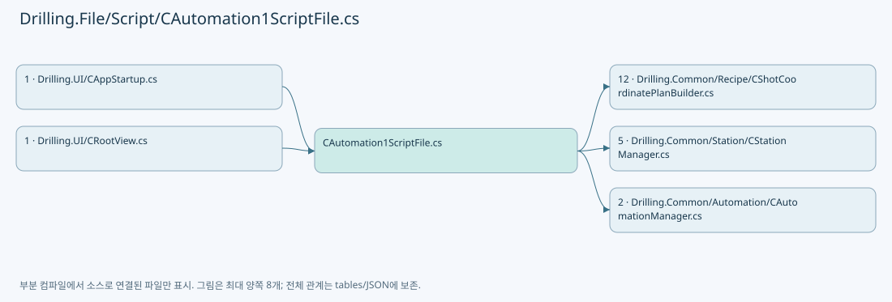

## 네임스페이스·타입·상속

| 타입 | 구분 | 원본 범위 | 선언/상속 |
| --- | --- | --- | --- |
| CAutomation1ScriptFile | ClassDeclaration | 9–2455 | CAutomation1ScriptFile: CAutomationScriptFileBase |
| EN_SCRIPT_FOLLOW_AXIS | EnumDeclaration | 20–24 | EN_SCRIPT_FOLLOW_AXIS |
| CAutomation1Script | ClassDeclaration | 1384–2454 | CAutomation1Script: CAutomation1ScriptBase |

## 멤버 빠른 목록

| 이름 | 종류 | 범위 | 서명 |
| --- | --- | --- | --- |
| DefaultScriptFileName | FieldDeclaration | L11–11 | string Drilling.File.Script.CAutomation1ScriptFile.DefaultScriptFileName |
| ProcessCoordinateListFileName | FieldDeclaration | L12–12 | string Drilling.File.Script.CAutomation1ScriptFile.ProcessCoordinateListFileName |
| ProcessShotCoordinateCsvFileName | FieldDeclaration | L13–13 | string Drilling.File.Script.CAutomation1ScriptFile.ProcessShotCoordinateCsvFileName |
| StandardDirectoryName | FieldDeclaration | L14–14 | string Drilling.File.Script.CAutomation1ScriptFile.StandardDirectoryName |
| BufferedRunDirectoryName | FieldDeclaration | L15–15 | string Drilling.File.Script.CAutomation1ScriptFile.BufferedRunDirectoryName |
| Automation1SimulatorUseKey | FieldDeclaration | L16–16 | string Drilling.File.Script.CAutomation1ScriptFile.Automation1SimulatorUseKey |
| Automation1SimulatorWaitMilliseconds | FieldDeclaration | L17–17 | int Drilling.File.Script.CAutomation1ScriptFile.Automation1SimulatorWaitMilliseconds |
| MinimumEncoderScaleMagnitude | FieldDeclaration | L18–18 | double Drilling.File.Script.CAutomation1ScriptFile.MinimumEncoderScaleMagnitude |
| MofSetupDelayMsec | FieldDeclaration | L19–19 | double Drilling.File.Script.CAutomation1ScriptFile.MofSetupDelayMsec |
| X | EnumMemberDeclaration | L22–22 | Drilling.File.Script.CAutomation1ScriptFile.EN_SCRIPT_FOLLOW_AXIS.X |
| Y | EnumMemberDeclaration | L23–23 | Drilling.File.Script.CAutomation1ScriptFile.EN_SCRIPT_FOLLOW_AXIS.Y |
| _scriptDirectory | FieldDeclaration | L26–26 | string Drilling.File.Script.CAutomation1ScriptFile._scriptDirectory |
| .ctor | ConstructorDeclaration | L27–31 | Drilling.File.Script.CAutomation1ScriptFile.CAutomation1ScriptFile(string?) |
| ScriptFileName | PropertyDeclaration | L33–39 | string Drilling.File.Script.CAutomation1ScriptFile.ScriptFileName |
| get_ScriptFileName | GetAccessorDeclaration | L35–38 | string Drilling.File.Script.CAutomation1ScriptFile.ScriptFileName.get |
| Create | MethodDeclaration | L41–44 | Drilling.Common.Station.CAutomation1ScriptBase Drilling.File.Script.CAutomation1ScriptFile.Create(string?) |
| Build | MethodDeclaration | L46–49 | Drilling.Common.Station.ST_SCRIPT_BUILD_RESULT Drilling.File.Script.CAutomation1ScriptFile.Build(Drilling.Common.Station.ST_PROCESS_MODEL, System.Threading.CancellationToken) |
| Build | MethodDeclaration | L51–109 | Drilling.Common.Station.ST_SCRIPT_BUILD_RESULT Drilling.File.Script.CAutomation1ScriptFile.Build(Drilling.Common.Station.ST_PROCESS_MODEL, string, System.Threading.CancellationToken) |
| ShouldIncludeItem | LocalFunctionStatement | L58–61 | bool ShouldIncludeItem(Drilling.Common.Station.ST_HEAD_PROCESS_PLAN) |
| SelectItem | LocalFunctionStatement | L63–69 | Drilling.Common.Station.ST_HEAD_PROCESS_PLAN SelectItem(Drilling.Common.Station.ST_HEAD_PROCESS_PLAN) |
| ShouldIncludeHead | LocalFunctionStatement | L71–74 | bool ShouldIncludeHead(Drilling.Common.Station.ST_HEAD_PROCESS_PLAN) |
| SelectTotalShots | LocalFunctionStatement | L102–105 | int SelectTotalShots(Drilling.Common.Station.ST_HEAD_SCRIPT_RESULT) |
| LoadLatest | MethodDeclaration | L111–173 | Drilling.Common.Station.ST_SCRIPT_BUILD_RESULT Drilling.File.Script.CAutomation1ScriptFile.LoadLatest(Drilling.Common.Station.ST_PROCESS_MODEL, string, System.Threading.CancellationToken) |
| Header | LocalFunctionStatement | L127–128 | string Header(string) |
| BuildShotCoordinateCsvLines | MethodDeclaration | L175–325 | System.Collections.Generic.IReadOnlyList<string> Drilling.File.Script.CAutomation1ScriptFile.BuildShotCoordinateCsvLines(Drilling.Common.Station.ST_PROCESS_MODEL, System.DateTimeOffset, System.Collections.Generic.IReadOnlyList<Drilling.Common.Station.ST_HEAD_PROCESS_PLAN>) |
| ShotCellNo | MethodDeclaration | L327–330 | int Drilling.File.Script.CAutomation1ScriptFile.ShotCellNo(Drilling.Common.Recipe.ST_HEAD_SHOT_POINT) |
| ShotRowNo | MethodDeclaration | L332–335 | int Drilling.File.Script.CAutomation1ScriptFile.ShotRowNo(Drilling.Common.Recipe.ST_HEAD_SHOT_POINT) |
| ShotColumnNo | MethodDeclaration | L337–340 | int Drilling.File.Script.CAutomation1ScriptFile.ShotColumnNo(Drilling.Common.Recipe.ST_HEAD_SHOT_POINT) |
| ShotHeadNo | MethodDeclaration | L342–345 | int Drilling.File.Script.CAutomation1ScriptFile.ShotHeadNo(Drilling.Common.Recipe.ST_HEAD_SHOT_POINT) |
| ReadParameterText | MethodDeclaration | L347–352 | string Drilling.File.Script.CAutomation1ScriptFile.ReadParameterText(System.Collections.Generic.IReadOnlyDictionary<string, string>, string, string) |
| BuildCoordinateListLines | MethodDeclaration | L354–388 | System.Collections.Generic.IReadOnlyList<string> Drilling.File.Script.CAutomation1ScriptFile.BuildCoordinateListLines(Drilling.Common.Station.ST_PROCESS_MODEL, System.DateTimeOffset, System.Collections.Generic.IReadOnlyList<Drilling.Common.Station.ST_HEAD_PROCESS_PLAN>, System.Collections.Generic.IReadOnlyList<Drilling.Common.Station.ST_HEAD_SCRIPT_RESULT>) |
| SelectHeadNo | LocalFunctionStatement | L357–360 | int SelectHeadNo(Drilling.Common.Station.ST_HEAD_SCRIPT_RESULT) |
| SelectTotalShots | LocalFunctionStatement | L370–373 | int SelectTotalShots(Drilling.Common.Station.ST_HEAD_SCRIPT_RESULT) |
| BuildHeadLines | MethodDeclaration | L390–582 | System.Collections.Generic.IReadOnlyList<string> Drilling.File.Script.CAutomation1ScriptFile.BuildHeadLines(Drilling.Common.Station.ST_PROCESS_MODEL, Drilling.Common.Station.ST_HEAD_PROCESS_PLAN, System.DateTimeOffset, bool, long) |
| ResolveMachiningAxis | MethodDeclaration | L584–606 | Drilling.File.Script.CAutomation1ScriptFile.EN_SCRIPT_FOLLOW_AXIS Drilling.File.Script.CAutomation1ScriptFile.ResolveMachiningAxis(System.Collections.Generic.IReadOnlyList<Drilling.Common.Recipe.ST_HEAD_SHOT_POINT>, bool) |
| ResolveLineMachiningAxis | MethodDeclaration | L608–623 | Drilling.File.Script.CAutomation1ScriptFile.EN_SCRIPT_FOLLOW_AXIS Drilling.File.Script.CAutomation1ScriptFile.ResolveLineMachiningAxis(Drilling.Common.Recipe.ST_HEAD_SHOT_POINT, Drilling.Common.Recipe.ST_HEAD_SHOT_POINT?, Drilling.File.Script.CAutomation1ScriptFile.EN_SCRIPT_FOLLOW_AXIS, bool) |
| IsScanLineFirstShot | MethodDeclaration | L625–633 | bool Drilling.File.Script.CAutomation1ScriptFile.IsScanLineFirstShot(Drilling.Common.Recipe.ST_HEAD_SHOT_POINT?, Drilling.Common.Recipe.ST_HEAD_SHOT_POINT) |
| FindNextPointInSameScanLine | MethodDeclaration | L635–650 | Drilling.Common.Recipe.ST_HEAD_SHOT_POINT? Drilling.File.Script.CAutomation1ScriptFile.FindNextPointInSameScanLine(System.Collections.Generic.IReadOnlyList<Drilling.Common.Recipe.ST_HEAD_SHOT_POINT>, int, Drilling.Common.Recipe.ST_HEAD_SHOT_POINT) |
| AppendLinePreApproachMove | MethodDeclaration | L652–676 | void Drilling.File.Script.CAutomation1ScriptFile.AppendLinePreApproachMove(System.Collections.Generic.List<string>, string, string, Drilling.Common.Recipe.ST_HEAD_SHOT_POINT, Drilling.Common.Recipe.ST_HEAD_SHOT_POINT?, Drilling.File.Script.CAutomation1ScriptFile.EN_SCRIPT_FOLLOW_AXIS, double, double, bool) |
| ResolveLinePreApproachDirection | MethodDeclaration | L678–690 | double Drilling.File.Script.CAutomation1ScriptFile.ResolveLinePreApproachDirection(Drilling.Common.Recipe.ST_HEAD_SHOT_POINT, Drilling.Common.Recipe.ST_HEAD_SHOT_POINT?, Drilling.File.Script.CAutomation1ScriptFile.EN_SCRIPT_FOLLOW_AXIS, bool) |
| ReadHeadScanFieldHalfWidth | MethodDeclaration | L692–701 | double Drilling.File.Script.CAutomation1ScriptFile.ReadHeadScanFieldHalfWidth(System.Collections.Generic.IReadOnlyDictionary<string, string>, int) |
| ReadScriptAxisPosition | MethodDeclaration | L703–711 | double Drilling.File.Script.CAutomation1ScriptFile.ReadScriptAxisPosition(Drilling.Common.Recipe.ST_HEAD_SHOT_POINT, Drilling.File.Script.CAutomation1ScriptFile.EN_SCRIPT_FOLLOW_AXIS, bool) |
| ReadScriptScannerY | MethodDeclaration | L713–716 | double Drilling.File.Script.CAutomation1ScriptFile.ReadScriptScannerY(Drilling.Common.Recipe.ST_HEAD_SHOT_POINT, bool) |
| Clamp | MethodDeclaration | L718–721 | double Drilling.File.Script.CAutomation1ScriptFile.Clamp(double, double, double) |
| ResolveScriptBuildDirectory | MethodDeclaration | L723–750 | string Drilling.File.Script.CAutomation1ScriptFile.ResolveScriptBuildDirectory(string, System.DateTimeOffset, string) |
| NormalizeScriptBuildName | MethodDeclaration | L752–764 | string Drilling.File.Script.CAutomation1ScriptFile.NormalizeScriptBuildName(string) |
| IsBufferedRunDirectory | MethodDeclaration | L766–770 | bool Drilling.File.Script.CAutomation1ScriptFile.IsBufferedRunDirectory(string) |
| ValidateActiveHeads | MethodDeclaration | L772–838 | void Drilling.File.Script.CAutomation1ScriptFile.ValidateActiveHeads(System.Collections.Generic.IReadOnlyList<Drilling.Common.Station.ST_HEAD_PROCESS_PLAN>) |
| SelectHeadNo | LocalFunctionStatement | L774–777 | int SelectHeadNo(Drilling.Common.Station.ST_HEAD_PROCESS_PLAN) |
| ShouldIncludeItem | LocalFunctionStatement | L779–782 | bool ShouldIncludeItem(System.Linq.IGrouping<int, Drilling.Common.Station.ST_HEAD_PROCESS_PLAN>) |
| SelectKey | LocalFunctionStatement | L784–787 | int SelectKey(System.Linq.IGrouping<int, Drilling.Common.Station.ST_HEAD_PROCESS_PLAN>) |
| SelectHeadNo2 | LocalFunctionStatement | L789–792 | int SelectHeadNo2(int) |
| SelectScriptFileName | LocalFunctionStatement | L813–816 | string SelectScriptFileName(Drilling.Common.Station.ST_HEAD_PROCESS_PLAN) |
| ShouldIncludeHead | LocalFunctionStatement | L818–821 | bool ShouldIncludeHead(System.Linq.IGrouping<string, Drilling.Common.Station.ST_HEAD_PROCESS_PLAN>) |
| SelectDuplicateScriptFileName | LocalFunctionStatement | L823–826 | string SelectDuplicateScriptFileName(System.Linq.IGrouping<string, Drilling.Common.Station.ST_HEAD_PROCESS_PLAN>) |
| SelectFileName | LocalFunctionStatement | L828–831 | string SelectFileName(string) |
| AppendStartFollowMoves | MethodDeclaration | L840–886 | void Drilling.File.Script.CAutomation1ScriptFile.AppendStartFollowMoves(System.Collections.Generic.List<string>, System.Collections.Generic.IReadOnlyDictionary<string, string>, Drilling.Common.Station.ST_HEAD_PROCESS_PLAN, string, string, string, double, bool) |
| AppendFollowTransitionMoves | MethodDeclaration | L888–934 | void Drilling.File.Script.CAutomation1ScriptFile.AppendFollowTransitionMoves(System.Collections.Generic.List<string>, System.Collections.Generic.IReadOnlyDictionary<string, string>, Drilling.Common.Station.ST_HEAD_PROCESS_PLAN, string, string, string, bool, Drilling.Common.Recipe.ST_HEAD_SHOT_POINT, Drilling.Common.Recipe.ST_HEAD_SHOT_POINT) |
| ResolveFollowAxis | MethodDeclaration | L936–945 | Drilling.File.Script.CAutomation1ScriptFile.EN_SCRIPT_FOLLOW_AXIS Drilling.File.Script.CAutomation1ScriptFile.ResolveFollowAxis(Drilling.Common.Recipe.ST_SCANNER_AXIS_TRANSFORM) |
| ReadFollowAxisPosition | MethodDeclaration | L947–955 | double Drilling.File.Script.CAutomation1ScriptFile.ReadFollowAxisPosition(Drilling.Common.Recipe.ST_HEAD_SHOT_POINT, Drilling.File.Script.CAutomation1ScriptFile.EN_SCRIPT_FOLLOW_AXIS) |
| AppendEncoderWait | MethodDeclaration | L957–967 | void Drilling.File.Script.CAutomation1ScriptFile.AppendEncoderWait(System.Collections.Generic.List<string>, string, double, bool) |
| AppendHeadShotList | MethodDeclaration | L969–989 | void Drilling.File.Script.CAutomation1ScriptFile.AppendHeadShotList(System.Collections.Generic.List<string>, Drilling.Common.Station.ST_HEAD_PROCESS_PLAN) |
| SelectCellNo | LocalFunctionStatement | L972–975 | int SelectCellNo(Drilling.Common.Recipe.ST_HEAD_SHOT_POINT) |
| SelectKey | LocalFunctionStatement | L977–980 | int SelectKey(System.Linq.IGrouping<int, Drilling.Common.Recipe.ST_HEAD_SHOT_POINT>) |
| FormatShotName | MethodDeclaration | L991–994 | string Drilling.File.Script.CAutomation1ScriptFile.FormatShotName(Drilling.Common.Recipe.ST_HEAD_SHOT_POINT) |
| FormatRowName | MethodDeclaration | L996–1007 | string Drilling.File.Script.CAutomation1ScriptFile.FormatRowName(int) |
| AppendDefaultSetting | MethodDeclaration | L1009–1024 | void Drilling.File.Script.CAutomation1ScriptFile.AppendDefaultSetting(System.Collections.Generic.List<string>, System.Collections.Generic.IReadOnlyDictionary<string, string>) |
| AppendScriptEnd | MethodDeclaration | L1026–1034 | void Drilling.File.Script.CAutomation1ScriptFile.AppendScriptEnd(System.Collections.Generic.List<string>, System.Collections.Generic.IReadOnlyDictionary<string, string>) |
| CalculateLaserPeriod | MethodDeclaration | L1036–1039 | double Drilling.File.Script.CAutomation1ScriptFile.CalculateLaserPeriod(double) |
| CalculateShotDelaySeconds | MethodDeclaration | L1041–1050 | double Drilling.File.Script.CAutomation1ScriptFile.CalculateShotDelaySeconds(int, double) |
| AppendSingleAxisMoveDelay | MethodDeclaration | L1052–1060 | void Drilling.File.Script.CAutomation1ScriptFile.AppendSingleAxisMoveDelay(System.Collections.Generic.List<string>, string, double) |
| ResolveCoordinatedRampRate | MethodDeclaration | L1062–1075 | double Drilling.File.Script.CAutomation1ScriptFile.ResolveCoordinatedRampRate(double, double) |
| ToAutomationSpeed | MethodDeclaration | L1077–1080 | double Drilling.File.Script.CAutomation1ScriptFile.ToAutomationSpeed(double) |
| ReadDelaySeconds | MethodDeclaration | L1082–1100 | double Drilling.File.Script.CAutomation1ScriptFile.ReadDelaySeconds(System.Collections.Generic.IReadOnlyDictionary<string, string>, double, params string[]) |
| ShouldIncludeItem | LocalFunctionStatement | L1084–1087 | bool ShouldIncludeItem(string) |
| CreateHeadKeys | MethodDeclaration | L1102–1110 | System.Collections.Generic.IReadOnlyList<string> Drilling.File.Script.CAutomation1ScriptFile.CreateHeadKeys(int, params string[]) |
| SelectItem | LocalFunctionStatement | L1104–1107 | string SelectItem(string) |
| CreateEncoderScaleKeys | MethodDeclaration | L1112–1117 | System.Collections.Generic.IReadOnlyList<string> Drilling.File.Script.CAutomation1ScriptFile.CreateEncoderScaleKeys(int) |
| CreateEncoderFeedbackFlipKeys | MethodDeclaration | L1119–1124 | System.Collections.Generic.IReadOnlyList<string> Drilling.File.Script.CAutomation1ScriptFile.CreateEncoderFeedbackFlipKeys(int) |
| ResolveParameterName | MethodDeclaration | L1126–1137 | string Drilling.File.Script.CAutomation1ScriptFile.ResolveParameterName(System.Collections.Generic.IReadOnlyDictionary<string, string>, System.Collections.Generic.IEnumerable<string>, string) |
| ReadText | MethodDeclaration | L1139–1155 | string Drilling.File.Script.CAutomation1ScriptFile.ReadText(System.Collections.Generic.IReadOnlyDictionary<string, string>, string, System.Collections.Generic.IEnumerable<string>) |
| ShouldIncludeItem | LocalFunctionStatement | L1141–1144 | bool ShouldIncludeItem(string) |
| ReadDouble | MethodDeclaration | L1157–1160 | double Drilling.File.Script.CAutomation1ScriptFile.ReadDouble(System.Collections.Generic.IReadOnlyDictionary<string, string>, double, params string[]) |
| ReadDouble | MethodDeclaration | L1162–1178 | double Drilling.File.Script.CAutomation1ScriptFile.ReadDouble(System.Collections.Generic.IReadOnlyDictionary<string, string>, double, System.Collections.Generic.IEnumerable<string>) |
| ShouldIncludeItem | LocalFunctionStatement | L1164–1167 | bool ShouldIncludeItem(string) |
| ReadOnOff | MethodDeclaration | L1180–1196 | bool Drilling.File.Script.CAutomation1ScriptFile.ReadOnOff(System.Collections.Generic.IReadOnlyDictionary<string, string>, bool, System.Collections.Generic.IEnumerable<string>) |
| ParseOnOff | MethodDeclaration | L1198–1217 | bool Drilling.File.Script.CAutomation1ScriptFile.ParseOnOff(string?, bool, string) |
| ReadInt | MethodDeclaration | L1219–1222 | int Drilling.File.Script.CAutomation1ScriptFile.ReadInt(System.Collections.Generic.IReadOnlyDictionary<string, string>, int, params string[]) |
| ReadInt | MethodDeclaration | L1224–1240 | int Drilling.File.Script.CAutomation1ScriptFile.ReadInt(System.Collections.Generic.IReadOnlyDictionary<string, string>, int, System.Collections.Generic.IEnumerable<string>) |
| ShouldIncludeItem | LocalFunctionStatement | L1226–1229 | bool ShouldIncludeItem(string) |
| ReadBool | MethodDeclaration | L1242–1245 | bool Drilling.File.Script.CAutomation1ScriptFile.ReadBool(System.Collections.Generic.IReadOnlyDictionary<string, string>, bool, params string[]) |
| ReadBool | MethodDeclaration | L1247–1283 | bool Drilling.File.Script.CAutomation1ScriptFile.ReadBool(System.Collections.Generic.IReadOnlyDictionary<string, string>, bool, System.Collections.Generic.IEnumerable<string>) |
| ShouldIncludeItem | LocalFunctionStatement | L1249–1252 | bool ShouldIncludeItem(string) |
| Format | MethodDeclaration | L1285–1288 | string Drilling.File.Script.CAutomation1ScriptFile.Format(double) |
| CreateCsvLine | MethodDeclaration | L1290–1304 | string Drilling.File.Script.CAutomation1ScriptFile.CreateCsvLine(params string?[]) |
| AppendCsvField | MethodDeclaration | L1306–1328 | void Drilling.File.Script.CAutomation1ScriptFile.AppendCsvField(System.Text.StringBuilder, string?) |
| IsReservedBuildFileName | MethodDeclaration | L1330–1334 | bool Drilling.File.Script.CAutomation1ScriptFile.IsReservedBuildFileName(string) |
| ValidateEncoderScale | MethodDeclaration | L1336–1350 | void Drilling.File.Script.CAutomation1ScriptFile.ValidateEncoderScale(string, double) |
| ValidateAeroScriptAxisName | MethodDeclaration | L1352–1371 | string Drilling.File.Script.CAutomation1ScriptFile.ValidateAeroScriptAxisName(string, string) |
| MatchesItem | LocalFunctionStatement | L1360–1363 | bool MatchesItem(char) |
| NormalizeFileName | MethodDeclaration | L1373–1382 | string Drilling.File.Script.CAutomation1ScriptFile.NormalizeFileName(string?) |
| _scriptDirectory | FieldDeclaration | L1386–1386 | string Drilling.File.Script.CAutomation1ScriptFile.CAutomation1Script._scriptDirectory |
| _lines | FieldDeclaration | L1387–1387 | System.Collections.Generic.List<string> Drilling.File.Script.CAutomation1ScriptFile.CAutomation1Script._lines |
| _xAxis | FieldDeclaration | L1388–1388 | string Drilling.File.Script.CAutomation1ScriptFile.CAutomation1Script._xAxis |
| _yAxis | FieldDeclaration | L1389–1389 | string Drilling.File.Script.CAutomation1ScriptFile.CAutomation1Script._yAxis |
| _laserAxis | FieldDeclaration | L1390–1390 | string Drilling.File.Script.CAutomation1ScriptFile.CAutomation1Script._laserAxis |
| _stageXAxis | FieldDeclaration | L1391–1391 | string Drilling.File.Script.CAutomation1ScriptFile.CAutomation1Script._stageXAxis |
| _stageYAxis | FieldDeclaration | L1392–1392 | string Drilling.File.Script.CAutomation1ScriptFile.CAutomation1Script._stageYAxis |
| _deviceNo | FieldDeclaration | L1393–1393 | int Drilling.File.Script.CAutomation1ScriptFile.CAutomation1Script._deviceNo |
| _pointCount | FieldDeclaration | L1394–1394 | int Drilling.File.Script.CAutomation1ScriptFile.CAutomation1Script._pointCount |
| _currentX | FieldDeclaration | L1395–1395 | double Drilling.File.Script.CAutomation1ScriptFile.CAutomation1Script._currentX |
| _currentY | FieldDeclaration | L1396–1396 | double Drilling.File.Script.CAutomation1ScriptFile.CAutomation1Script._currentY |
| _laserOutputPeriod | FieldDeclaration | L1397–1397 | double Drilling.File.Script.CAutomation1ScriptFile.CAutomation1Script._laserOutputPeriod |
| _jumpSpeedMeterPerSec | FieldDeclaration | L1398–1398 | double Drilling.File.Script.CAutomation1ScriptFile.CAutomation1Script._jumpSpeedMeterPerSec |
| _markSpeedMeterPerSec | FieldDeclaration | L1399–1399 | double Drilling.File.Script.CAutomation1ScriptFile.CAutomation1Script._markSpeedMeterPerSec |
| _tactTime | FieldDeclaration | L1400–1400 | double Drilling.File.Script.CAutomation1ScriptFile.CAutomation1Script._tactTime |
| _nMarkDriveLaserControl | FieldDeclaration | L1401–1401 | bool Drilling.File.Script.CAutomation1ScriptFile.CAutomation1Script._nMarkDriveLaserControl |
| _scanPlannerStageEncoderMode | FieldDeclaration | L1402–1402 | bool Drilling.File.Script.CAutomation1ScriptFile.CAutomation1Script._scanPlannerStageEncoderMode |
| _createdAt | FieldDeclaration | L1403–1403 | System.DateTimeOffset Drilling.File.Script.CAutomation1ScriptFile.CAutomation1Script._createdAt |
| .ctor | ConstructorDeclaration | L1404–1408 | Drilling.File.Script.CAutomation1ScriptFile.CAutomation1Script.CAutomation1Script(string, string) |
| FileName | PropertyDeclaration | L1410–1410 | string Drilling.File.Script.CAutomation1ScriptFile.CAutomation1Script.FileName |
| get_FileName | GetAccessorDeclaration | L1410–1410 | string Drilling.File.Script.CAutomation1ScriptFile.CAutomation1Script.FileName.get |
| FilePath | PropertyDeclaration | L1412–1418 | string Drilling.File.Script.CAutomation1ScriptFile.CAutomation1Script.FilePath |
| get_FilePath | GetAccessorDeclaration | L1414–1417 | string Drilling.File.Script.CAutomation1ScriptFile.CAutomation1Script.FilePath.get |
| Lines | PropertyDeclaration | L1420–1426 | System.Collections.Generic.IReadOnlyList<string> Drilling.File.Script.CAutomation1ScriptFile.CAutomation1Script.Lines |
| get_Lines | GetAccessorDeclaration | L1422–1425 | System.Collections.Generic.IReadOnlyList<string> Drilling.File.Script.CAutomation1ScriptFile.CAutomation1Script.Lines.get |
| Clear | MethodDeclaration | L1428–1447 | void Drilling.File.Script.CAutomation1ScriptFile.CAutomation1Script.Clear() |
| AddLine | MethodDeclaration | L1449–1455 | void Drilling.File.Script.CAutomation1ScriptFile.CAutomation1Script.AddLine(string) |
| Start | MethodDeclaration | L1457–1467 | void Drilling.File.Script.CAutomation1ScriptFile.CAutomation1Script.Start(string) |
| SetDeviceNo | MethodDeclaration | L1469–1472 | void Drilling.File.Script.CAutomation1ScriptFile.CAutomation1Script.SetDeviceNo(int) |
| SetNMarkDriveLaserControl | MethodDeclaration | L1474–1477 | void Drilling.File.Script.CAutomation1ScriptFile.CAutomation1Script.SetNMarkDriveLaserControl(bool) |
| SetScanPlannerStageEncoderMode | MethodDeclaration | L1479–1482 | void Drilling.File.Script.CAutomation1ScriptFile.CAutomation1Script.SetScanPlannerStageEncoderMode(bool) |
| DefaultSetting | MethodDeclaration | L1484–1509 | void Drilling.File.Script.CAutomation1ScriptFile.CAutomation1Script.DefaultSetting(double, int, int, bool) |
| DefaultFigureScanSetting | MethodDeclaration | L1511–1534 | void Drilling.File.Script.CAutomation1ScriptFile.CAutomation1Script.DefaultFigureScanSetting(int, int, bool) |
| SetAxis | MethodDeclaration | L1536–1541 | void Drilling.File.Script.CAutomation1ScriptFile.CAutomation1Script.SetAxis(string, string, string?) |
| SetStageAxis | MethodDeclaration | L1543–1547 | void Drilling.File.Script.CAutomation1ScriptFile.CAutomation1Script.SetStageAxis(string, string) |
| SetFrequency | MethodDeclaration | L1549–1556 | void Drilling.File.Script.CAutomation1ScriptFile.CAutomation1Script.SetFrequency(double) |
| SetLaserPower | MethodDeclaration | L1558–1572 | void Drilling.File.Script.CAutomation1ScriptFile.CAutomation1Script.SetLaserPower(double, double, bool) |
| SetLaserPowerNoDelay | MethodDeclaration | L1574–1583 | void Drilling.File.Script.CAutomation1ScriptFile.CAutomation1Script.SetLaserPowerNoDelay(double, double) |
| SetPulseOnTimeLaserPower | MethodDeclaration | L1585–1601 | void Drilling.File.Script.CAutomation1ScriptFile.CAutomation1Script.SetPulseOnTimeLaserPower(double, double, double) |
| SetLaserMode | MethodDeclaration | L1603–1609 | void Drilling.File.Script.CAutomation1ScriptFile.CAutomation1Script.SetLaserMode(int) |
| SetLaserDelay | MethodDeclaration | L1611–1616 | void Drilling.File.Script.CAutomation1ScriptFile.CAutomation1Script.SetLaserDelay(double, double) |
| SetJumpSpeed | MethodDeclaration | L1618–1623 | void Drilling.File.Script.CAutomation1ScriptFile.CAutomation1Script.SetJumpSpeed(double) |
| SetJumpSpeedRate | MethodDeclaration | L1625–1635 | void Drilling.File.Script.CAutomation1ScriptFile.CAutomation1Script.SetJumpSpeedRate(double, double) |
| SetMarkSpeed | MethodDeclaration | L1637–1641 | void Drilling.File.Script.CAutomation1ScriptFile.CAutomation1Script.SetMarkSpeed(double) |
| SetStageSpeed | MethodDeclaration | L1643–1654 | void Drilling.File.Script.CAutomation1ScriptFile.CAutomation1Script.SetStageSpeed(double, double) |
| SetScannerAcc | MethodDeclaration | L1656–1668 | void Drilling.File.Script.CAutomation1ScriptFile.CAutomation1Script.SetScannerAcc(double) |
| SetMarkAcc | MethodDeclaration | L1670–1679 | void Drilling.File.Script.CAutomation1ScriptFile.CAutomation1Script.SetMarkAcc(double) |
| SetIFOV | MethodDeclaration | L1681–1684 | void Drilling.File.Script.CAutomation1ScriptFile.CAutomation1Script.SetIFOV(bool) |
| SetIFOVEmulatedQuadratureDivider | MethodDeclaration | L1686–1709 | void Drilling.File.Script.CAutomation1ScriptFile.CAutomation1Script.SetIFOVEmulatedQuadratureDivider() |
| SetIFOVIO | MethodDeclaration | L1711–1741 | void Drilling.File.Script.CAutomation1ScriptFile.CAutomation1Script.SetIFOVIO(bool) |
| SetIFOVScaleXY | MethodDeclaration | L1743–1754 | void Drilling.File.Script.CAutomation1ScriptFile.CAutomation1Script.SetIFOVScaleXY() |
| SetIFOVTime | MethodDeclaration | L1756–1759 | void Drilling.File.Script.CAutomation1ScriptFile.CAutomation1Script.SetIFOVTime(long) |
| SetIFOVSize | MethodDeclaration | L1761–1764 | void Drilling.File.Script.CAutomation1ScriptFile.CAutomation1Script.SetIFOVSize(double) |
| SetIFOVTrackingSpeed | MethodDeclaration | L1766–1769 | void Drilling.File.Script.CAutomation1ScriptFile.CAutomation1Script.SetIFOVTrackingSpeed(long) |
| SetIFOVTrackingAccel | MethodDeclaration | L1771–1774 | void Drilling.File.Script.CAutomation1ScriptFile.CAutomation1Script.SetIFOVTrackingAccel(long) |
| SetIFOVPair | MethodDeclaration | L1776–1781 | void Drilling.File.Script.CAutomation1ScriptFile.CAutomation1Script.SetIFOVPair(string, string, bool, bool) |
| SetIFOVSyncAxis | MethodDeclaration | L1783–1786 | void Drilling.File.Script.CAutomation1ScriptFile.CAutomation1Script.SetIFOVSyncAxis() |
| SetMoveBlending | MethodDeclaration | L1788–1791 | void Drilling.File.Script.CAutomation1ScriptFile.CAutomation1Script.SetMoveBlending(bool) |
| SetAbsoluteMode | MethodDeclaration | L1793–1796 | void Drilling.File.Script.CAutomation1ScriptFile.CAutomation1Script.SetAbsoluteMode() |
| SetIncrementalMode | MethodDeclaration | L1798–1801 | void Drilling.File.Script.CAutomation1ScriptFile.CAutomation1Script.SetIncrementalMode() |
| SetWaitModeAuto | MethodDeclaration | L1803–1806 | void Drilling.File.Script.CAutomation1ScriptFile.CAutomation1Script.SetWaitModeAuto() |
| SetMoveDelay | MethodDeclaration | L1808–1825 | void Drilling.File.Script.CAutomation1ScriptFile.CAutomation1Script.SetMoveDelay(double, bool, bool) |
| SetExecuteLineCount | MethodDeclaration | L1827–1835 | void Drilling.File.Script.CAutomation1ScriptFile.CAutomation1Script.SetExecuteLineCount(int) |
| SetScannerRotate | MethodDeclaration | L1837–1843 | void Drilling.File.Script.CAutomation1ScriptFile.CAutomation1Script.SetScannerRotate(double) |
| SetScannerRotate | MethodDeclaration | L1845–1848 | void Drilling.File.Script.CAutomation1ScriptFile.CAutomation1Script.SetScannerRotate(string, double) |
| SetMoveUpdateRate | MethodDeclaration | L1850–1853 | void Drilling.File.Script.CAutomation1ScriptFile.CAutomation1Script.SetMoveUpdateRate(int) |
| SetCoordinatedAccelLimit | MethodDeclaration | L1855–1858 | void Drilling.File.Script.CAutomation1ScriptFile.CAutomation1Script.SetCoordinatedAccelLimit(long, long) |
| SetTaskAccelLimit | MethodDeclaration | L1860–1864 | void Drilling.File.Script.CAutomation1ScriptFile.CAutomation1Script.SetTaskAccelLimit(long, long) |
| SetScanTrajectoryFIRFilterX | MethodDeclaration | L1866–1869 | void Drilling.File.Script.CAutomation1ScriptFile.CAutomation1Script.SetScanTrajectoryFIRFilterX(long) |
| SetScanTrajectoryFIRFilterY | MethodDeclaration | L1871–1874 | void Drilling.File.Script.CAutomation1ScriptFile.CAutomation1Script.SetScanTrajectoryFIRFilterY(long) |
| SetStageTrajectoryFIRFilterX | MethodDeclaration | L1876–1882 | void Drilling.File.Script.CAutomation1ScriptFile.CAutomation1Script.SetStageTrajectoryFIRFilterX(long) |
| SetStageTrajectoryFIRFilterY | MethodDeclaration | L1884–1890 | void Drilling.File.Script.CAutomation1ScriptFile.CAutomation1Script.SetStageTrajectoryFIRFilterY(long) |
| SetProjection | MethodDeclaration | L1892–1895 | void Drilling.File.Script.CAutomation1ScriptFile.CAutomation1Script.SetProjection(string, double, double, double) |
| SetProjectionOff | MethodDeclaration | L1897–1900 | void Drilling.File.Script.CAutomation1ScriptFile.CAutomation1Script.SetProjectionOff(string) |
| SetGearing | MethodDeclaration | L1902–1905 | void Drilling.File.Script.CAutomation1ScriptFile.CAutomation1Script.SetGearing(string, string) |
| SetGearingOff | MethodDeclaration | L1907–1910 | void Drilling.File.Script.CAutomation1ScriptFile.CAutomation1Script.SetGearingOff(string) |
| SetSoftwareLimitSetup | MethodDeclaration | L1912–1921 | void Drilling.File.Script.CAutomation1ScriptFile.CAutomation1Script.SetSoftwareLimitSetup(bool) |
| SetAerotechEncoderReset | MethodDeclaration | L1923–1936 | void Drilling.File.Script.CAutomation1ScriptFile.CAutomation1Script.SetAerotechEncoderReset(string, string) |
| SetScanPlannerStageEncoder | MethodDeclaration | L1938–1945 | void Drilling.File.Script.CAutomation1ScriptFile.CAutomation1Script.SetScanPlannerStageEncoder(string) |
| SetEmulatedQuadratureDividerX | MethodDeclaration | L1947–1950 | void Drilling.File.Script.CAutomation1ScriptFile.CAutomation1Script.SetEmulatedQuadratureDividerX(int) |
| SetEmulatedQuadratureDividerY | MethodDeclaration | L1952–1955 | void Drilling.File.Script.CAutomation1ScriptFile.CAutomation1Script.SetEmulatedQuadratureDividerY(int) |
| SetStageEmulatedQuadratureDivider | MethodDeclaration | L1957–1968 | void Drilling.File.Script.CAutomation1ScriptFile.CAutomation1Script.SetStageEmulatedQuadratureDivider(int, int) |
| SetPSO | MethodDeclaration | L1970–2047 | void Drilling.File.Script.CAutomation1ScriptFile.CAutomation1Script.SetPSO(double, double, double, double, Drilling.Common.Station.EN_AEROTECH_MODE, Drilling.Common.Station.EN_AEROTECH_PSO_MODE, double, double, int, double, bool) |
| SetPSODistance | MethodDeclaration | L2049–2052 | void Drilling.File.Script.CAutomation1ScriptFile.CAutomation1Script.SetPSODistance(double) |
| SetPSOOnOff | MethodDeclaration | L2054–2057 | void Drilling.File.Script.CAutomation1ScriptFile.CAutomation1Script.SetPSOOnOff(bool) |
| SetPSOChangePower | MethodDeclaration | L2059–2062 | void Drilling.File.Script.CAutomation1ScriptFile.CAutomation1Script.SetPSOChangePower(double, double) |
| SetPSOFire | MethodDeclaration | L2064–2067 | void Drilling.File.Script.CAutomation1ScriptFile.CAutomation1Script.SetPSOFire(double, double, int, double, Drilling.Common.Station.EN_AEROTECH_MODE) |
| SetPSOLaserWindowMask | MethodDeclaration | L2069–2072 | void Drilling.File.Script.CAutomation1ScriptFile.CAutomation1Script.SetPSOLaserWindowMask(bool, double, double) |
| DeclareEncoderVariable | MethodDeclaration | L2074–2076 | void Drilling.File.Script.CAutomation1ScriptFile.CAutomation1Script.DeclareEncoderVariable(string, bool) |
| InitDeclareVariable | MethodDeclaration | L2078–2085 | void Drilling.File.Script.CAutomation1ScriptFile.CAutomation1Script.InitDeclareVariable() |
| InitDeclareVariableIFOV | MethodDeclaration | L2087–2090 | void Drilling.File.Script.CAutomation1ScriptFile.CAutomation1Script.InitDeclareVariableIFOV() |
| SetWaitForEncoder | MethodDeclaration | L2092–2098 | void Drilling.File.Script.CAutomation1ScriptFile.CAutomation1Script.SetWaitForEncoder(string, double, bool) |
| SetWaitForEncoder | MethodDeclaration | L2100–2125 | void Drilling.File.Script.CAutomation1ScriptFile.CAutomation1Script.SetWaitForEncoder(string, bool, double, double, double) |
| SetWaitForEncoder2Axis | MethodDeclaration | L2127–2141 | void Drilling.File.Script.CAutomation1ScriptFile.CAutomation1Script.SetWaitForEncoder2Axis(string, string, bool, double, double, double, double) |
| SetWaitForStartAxis2 | MethodDeclaration | L2143–2166 | void Drilling.File.Script.CAutomation1ScriptFile.CAutomation1Script.SetWaitForStartAxis2(string, string, bool, double, double, double, double) |
| SetEncoderScaleFactor | MethodDeclaration | L2168–2178 | void Drilling.File.Script.CAutomation1ScriptFile.CAutomation1Script.SetEncoderScaleFactor(string, string, int) |
| SetEncoderScaleFactor | MethodDeclaration | L2180–2187 | void Drilling.File.Script.CAutomation1ScriptFile.CAutomation1Script.SetEncoderScaleFactor(string, string, bool) |
| SetEncoderScaleFactor | MethodDeclaration | L2189–2200 | void Drilling.File.Script.CAutomation1ScriptFile.CAutomation1Script.SetEncoderScaleFactor(string, string, double, double, bool) |
| SetEncoderScaleFactorByPrimaryDivider | MethodDeclaration | L2202–2214 | void Drilling.File.Script.CAutomation1ScriptFile.CAutomation1Script.SetEncoderScaleFactorByPrimaryDivider(string, string, bool) |
| InitEncoderCount | MethodDeclaration | L2216–2220 | void Drilling.File.Script.CAutomation1ScriptFile.CAutomation1Script.InitEncoderCount(string) |
| EncoderNotFeedback | MethodDeclaration | L2222–2226 | void Drilling.File.Script.CAutomation1ScriptFile.CAutomation1Script.EncoderNotFeedback(string) |
| ReleaseEncoderScaleFactor | MethodDeclaration | L2228–2232 | void Drilling.File.Script.CAutomation1ScriptFile.CAutomation1Script.ReleaseEncoderScaleFactor(string) |
| LaserAuto | MethodDeclaration | L2234–2237 | void Drilling.File.Script.CAutomation1ScriptFile.CAutomation1Script.LaserAuto() |
| LaserOn | MethodDeclaration | L2239–2242 | void Drilling.File.Script.CAutomation1ScriptFile.CAutomation1Script.LaserOn() |
| LaserOff | MethodDeclaration | L2244–2247 | void Drilling.File.Script.CAutomation1ScriptFile.CAutomation1Script.LaserOff() |
| PsoLaserControl | MethodDeclaration | L2249–2252 | void Drilling.File.Script.CAutomation1ScriptFile.CAutomation1Script.PsoLaserControl(bool, bool) |
| LaserFire | MethodDeclaration | L2254–2257 | void Drilling.File.Script.CAutomation1ScriptFile.CAutomation1Script.LaserFire(bool) |
| Jump | MethodDeclaration | L2259–2271 | void Drilling.File.Script.CAutomation1ScriptFile.CAutomation1Script.Jump(double, double) |
| Mark | MethodDeclaration | L2273–2285 | void Drilling.File.Script.CAutomation1ScriptFile.CAutomation1Script.Mark(double, double) |
| GCodeMove | MethodDeclaration | L2287–2292 | void Drilling.File.Script.CAutomation1ScriptFile.CAutomation1Script.GCodeMove(double, double) |
| JumpRel | MethodDeclaration | L2294–2297 | void Drilling.File.Script.CAutomation1ScriptFile.CAutomation1Script.JumpRel(double, double) |
| MarkRel | MethodDeclaration | L2299–2302 | void Drilling.File.Script.CAutomation1ScriptFile.CAutomation1Script.MarkRel(double, double) |
| Arc | MethodDeclaration | L2304–2313 | void Drilling.File.Script.CAutomation1ScriptFile.CAutomation1Script.Arc(double, double, double, double, double, double, double) |
| JumpLinear | MethodDeclaration | L2315–2324 | void Drilling.File.Script.CAutomation1ScriptFile.CAutomation1Script.JumpLinear(double, double) |
| WaitMoveDone | MethodDeclaration | L2326–2329 | void Drilling.File.Script.CAutomation1ScriptFile.CAutomation1Script.WaitMoveDone() |
| Dwell | MethodDeclaration | L2331–2339 | void Drilling.File.Script.CAutomation1ScriptFile.CAutomation1Script.Dwell(double) |
| EnableAxisPair | MethodDeclaration | L2341–2344 | void Drilling.File.Script.CAutomation1ScriptFile.CAutomation1Script.EnableAxisPair() |
| DisableAxisPair | MethodDeclaration | L2346–2349 | void Drilling.File.Script.CAutomation1ScriptFile.CAutomation1Script.DisableAxisPair() |
| FaultAckAxisPair | MethodDeclaration | L2351–2354 | void Drilling.File.Script.CAutomation1ScriptFile.CAutomation1Script.FaultAckAxisPair() |
| HomeAxisPair | MethodDeclaration | L2356–2359 | void Drilling.File.Script.CAutomation1ScriptFile.CAutomation1Script.HomeAxisPair() |
| OffsetClearAxisPair | MethodDeclaration | L2361–2364 | void Drilling.File.Script.CAutomation1ScriptFile.CAutomation1Script.OffsetClearAxisPair() |
| OffsetSetAxisPair | MethodDeclaration | L2366–2369 | void Drilling.File.Script.CAutomation1ScriptFile.CAutomation1Script.OffsetSetAxisPair(double, double) |
| SetSignalLogTrigger | MethodDeclaration | L2371–2374 | void Drilling.File.Script.CAutomation1ScriptFile.CAutomation1Script.SetSignalLogTrigger(bool) |
| ProgramStart | MethodDeclaration | L2376–2379 | void Drilling.File.Script.CAutomation1ScriptFile.CAutomation1Script.ProgramStart() |
| ProgramEnd | MethodDeclaration | L2381–2384 | void Drilling.File.Script.CAutomation1ScriptFile.CAutomation1Script.ProgramEnd() |
| BufferedEnd | MethodDeclaration | L2386–2389 | void Drilling.File.Script.CAutomation1ScriptFile.CAutomation1Script.BufferedEnd() |
| WaitInpos | MethodDeclaration | L2391–2394 | void Drilling.File.Script.CAutomation1ScriptFile.CAutomation1Script.WaitInpos() |
| SetHomePos | MethodDeclaration | L2396–2399 | void Drilling.File.Script.CAutomation1ScriptFile.CAutomation1Script.SetHomePos() |
| SetGalvoPosZero | MethodDeclaration | L2401–2406 | void Drilling.File.Script.CAutomation1ScriptFile.CAutomation1Script.SetGalvoPosZero() |
| End | MethodDeclaration | L2408–2419 | void Drilling.File.Script.CAutomation1ScriptFile.CAutomation1Script.End(bool) |
| Save | MethodDeclaration | L2421–2432 | Drilling.Common.Station.ST_SCRIPT_BUILD_RESULT Drilling.File.Script.CAutomation1ScriptFile.CAutomation1Script.Save(System.Threading.CancellationToken) |
| AddMoveTactTime | MethodDeclaration | L2434–2443 | void Drilling.File.Script.CAutomation1ScriptFile.CAutomation1Script.AddMoveTactTime(double, double, double) |
| NormalizeAxis | MethodDeclaration | L2445–2448 | string Drilling.File.Script.CAutomation1ScriptFile.CAutomation1Script.NormalizeAxis(string?, string) |
| IsUsableAxis | MethodDeclaration | L2450–2453 | bool Drilling.File.Script.CAutomation1ScriptFile.CAutomation1Script.IsUsableAxis(string?) |

## 멤버별 상세 계약·호출·처리 해설

### FieldDeclaration `DefaultScriptFileName` · L11–11

[Drilling.File/Script/CAutomation1ScriptFile.cs:11–11](https://github.com/kjuws10-rgb/A3Drilling/blob/334b3599651b2e8e0181fd4459bafaf3cddafff3/Drilling.File/Script/CAutomation1ScriptFile.cs#L11-L11)

| 항목 | 실제 추출 값 |
| --- | --- |
| 서명 | string Drilling.File.Script.CAutomation1ScriptFile.DefaultScriptFileName |
| 접근/수식자 | Public / public, const |
| 반환/값 타입 | string |
| 소속 타입 | NamedType:Drilling.File.Script.CAutomation1ScriptFile |

현재 부분 분석에서 직접 연결된 호출자는 없습니다. XAML/이벤트/인터페이스·델리게이트·외부 진입을 추가 확인해야 하며, 미사용으로 판정한 것이 아닙니다.

본문의 실제 연산·분기·예외·반환 순서(원문 위치 순):

| 원본 행 | 종류 | 주석 해설 |
| --- | --- | --- |
| 11 | variable-initializer | 변수의 초기값을 지정합니다: DefaultScriptFileName = "PROCESS.ascript" |

변경 전 점검: 입력/반환 타입, 위 호출자, 예외/취소 경로, 공유 상태와 저장·전송 소비자를 함께 확인합니다. 값의 단위나 물리 방향을 이름만으로 확정하지 않습니다.

### FieldDeclaration `ProcessCoordinateListFileName` · L12–12

[Drilling.File/Script/CAutomation1ScriptFile.cs:12–12](https://github.com/kjuws10-rgb/A3Drilling/blob/334b3599651b2e8e0181fd4459bafaf3cddafff3/Drilling.File/Script/CAutomation1ScriptFile.cs#L12-L12)

| 항목 | 실제 추출 값 |
| --- | --- |
| 서명 | string Drilling.File.Script.CAutomation1ScriptFile.ProcessCoordinateListFileName |
| 접근/수식자 | Public / public, const |
| 반환/값 타입 | string |
| 소속 타입 | NamedType:Drilling.File.Script.CAutomation1ScriptFile |

현재 부분 분석에서 직접 연결된 호출자는 없습니다. XAML/이벤트/인터페이스·델리게이트·외부 진입을 추가 확인해야 하며, 미사용으로 판정한 것이 아닙니다.

본문의 실제 연산·분기·예외·반환 순서(원문 위치 순):

| 원본 행 | 종류 | 주석 해설 |
| --- | --- | --- |
| 12 | variable-initializer | 변수의 초기값을 지정합니다: ProcessCoordinateListFileName = "PROCESS.txt" |

변경 전 점검: 입력/반환 타입, 위 호출자, 예외/취소 경로, 공유 상태와 저장·전송 소비자를 함께 확인합니다. 값의 단위나 물리 방향을 이름만으로 확정하지 않습니다.

### FieldDeclaration `ProcessShotCoordinateCsvFileName` · L13–13

[Drilling.File/Script/CAutomation1ScriptFile.cs:13–13](https://github.com/kjuws10-rgb/A3Drilling/blob/334b3599651b2e8e0181fd4459bafaf3cddafff3/Drilling.File/Script/CAutomation1ScriptFile.cs#L13-L13)

| 항목 | 실제 추출 값 |
| --- | --- |
| 서명 | string Drilling.File.Script.CAutomation1ScriptFile.ProcessShotCoordinateCsvFileName |
| 접근/수식자 | Public / public, const |
| 반환/값 타입 | string |
| 소속 타입 | NamedType:Drilling.File.Script.CAutomation1ScriptFile |

현재 부분 분석에서 직접 연결된 호출자는 없습니다. XAML/이벤트/인터페이스·델리게이트·외부 진입을 추가 확인해야 하며, 미사용으로 판정한 것이 아닙니다.

본문의 실제 연산·분기·예외·반환 순서(원문 위치 순):

| 원본 행 | 종류 | 주석 해설 |
| --- | --- | --- |
| 13 | variable-initializer | 변수의 초기값을 지정합니다: ProcessShotCoordinateCsvFileName = "PROCESS_COORDINATES.csv" |

변경 전 점검: 입력/반환 타입, 위 호출자, 예외/취소 경로, 공유 상태와 저장·전송 소비자를 함께 확인합니다. 값의 단위나 물리 방향을 이름만으로 확정하지 않습니다.

### FieldDeclaration `StandardDirectoryName` · L14–14

[Drilling.File/Script/CAutomation1ScriptFile.cs:14–14](https://github.com/kjuws10-rgb/A3Drilling/blob/334b3599651b2e8e0181fd4459bafaf3cddafff3/Drilling.File/Script/CAutomation1ScriptFile.cs#L14-L14)

| 항목 | 실제 추출 값 |
| --- | --- |
| 서명 | string Drilling.File.Script.CAutomation1ScriptFile.StandardDirectoryName |
| 접근/수식자 | Private / private, const |
| 반환/값 타입 | string |
| 소속 타입 | NamedType:Drilling.File.Script.CAutomation1ScriptFile |

현재 부분 분석에서 직접 연결된 호출자는 없습니다. XAML/이벤트/인터페이스·델리게이트·외부 진입을 추가 확인해야 하며, 미사용으로 판정한 것이 아닙니다.

본문의 실제 연산·분기·예외·반환 순서(원문 위치 순):

| 원본 행 | 종류 | 주석 해설 |
| --- | --- | --- |
| 14 | variable-initializer | 변수의 초기값을 지정합니다: StandardDirectoryName = "Standard" |

변경 전 점검: 입력/반환 타입, 위 호출자, 예외/취소 경로, 공유 상태와 저장·전송 소비자를 함께 확인합니다. 값의 단위나 물리 방향을 이름만으로 확정하지 않습니다.

### FieldDeclaration `BufferedRunDirectoryName` · L15–15

[Drilling.File/Script/CAutomation1ScriptFile.cs:15–15](https://github.com/kjuws10-rgb/A3Drilling/blob/334b3599651b2e8e0181fd4459bafaf3cddafff3/Drilling.File/Script/CAutomation1ScriptFile.cs#L15-L15)

| 항목 | 실제 추출 값 |
| --- | --- |
| 서명 | string Drilling.File.Script.CAutomation1ScriptFile.BufferedRunDirectoryName |
| 접근/수식자 | Private / private, const |
| 반환/값 타입 | string |
| 소속 타입 | NamedType:Drilling.File.Script.CAutomation1ScriptFile |

현재 부분 분석에서 직접 연결된 호출자는 없습니다. XAML/이벤트/인터페이스·델리게이트·외부 진입을 추가 확인해야 하며, 미사용으로 판정한 것이 아닙니다.

본문의 실제 연산·분기·예외·반환 순서(원문 위치 순):

| 원본 행 | 종류 | 주석 해설 |
| --- | --- | --- |
| 15 | variable-initializer | 변수의 초기값을 지정합니다: BufferedRunDirectoryName = "BufferedRun" |

변경 전 점검: 입력/반환 타입, 위 호출자, 예외/취소 경로, 공유 상태와 저장·전송 소비자를 함께 확인합니다. 값의 단위나 물리 방향을 이름만으로 확정하지 않습니다.

### FieldDeclaration `Automation1SimulatorUseKey` · L16–16

[Drilling.File/Script/CAutomation1ScriptFile.cs:16–16](https://github.com/kjuws10-rgb/A3Drilling/blob/334b3599651b2e8e0181fd4459bafaf3cddafff3/Drilling.File/Script/CAutomation1ScriptFile.cs#L16-L16)

| 항목 | 실제 추출 값 |
| --- | --- |
| 서명 | string Drilling.File.Script.CAutomation1ScriptFile.Automation1SimulatorUseKey |
| 접근/수식자 | Private / private, const |
| 반환/값 타입 | string |
| 소속 타입 | NamedType:Drilling.File.Script.CAutomation1ScriptFile |

현재 부분 분석에서 직접 연결된 호출자는 없습니다. XAML/이벤트/인터페이스·델리게이트·외부 진입을 추가 확인해야 하며, 미사용으로 판정한 것이 아닙니다.

본문의 실제 연산·분기·예외·반환 순서(원문 위치 순):

| 원본 행 | 종류 | 주석 해설 |
| --- | --- | --- |
| 16 | variable-initializer | 변수의 초기값을 지정합니다: Automation1SimulatorUseKey = "AUTOMATION1_SIMULATOR_USE" |

변경 전 점검: 입력/반환 타입, 위 호출자, 예외/취소 경로, 공유 상태와 저장·전송 소비자를 함께 확인합니다. 값의 단위나 물리 방향을 이름만으로 확정하지 않습니다.

### FieldDeclaration `Automation1SimulatorWaitMilliseconds` · L17–17

[Drilling.File/Script/CAutomation1ScriptFile.cs:17–17](https://github.com/kjuws10-rgb/A3Drilling/blob/334b3599651b2e8e0181fd4459bafaf3cddafff3/Drilling.File/Script/CAutomation1ScriptFile.cs#L17-L17)

| 항목 | 실제 추출 값 |
| --- | --- |
| 서명 | int Drilling.File.Script.CAutomation1ScriptFile.Automation1SimulatorWaitMilliseconds |
| 접근/수식자 | Private / private, const |
| 반환/값 타입 | int |
| 소속 타입 | NamedType:Drilling.File.Script.CAutomation1ScriptFile |

현재 부분 분석에서 직접 연결된 호출자는 없습니다. XAML/이벤트/인터페이스·델리게이트·외부 진입을 추가 확인해야 하며, 미사용으로 판정한 것이 아닙니다.

본문의 실제 연산·분기·예외·반환 순서(원문 위치 순):

| 원본 행 | 종류 | 주석 해설 |
| --- | --- | --- |
| 17 | variable-initializer | 변수의 초기값을 지정합니다: Automation1SimulatorWaitMilliseconds = 5 |

변경 전 점검: 입력/반환 타입, 위 호출자, 예외/취소 경로, 공유 상태와 저장·전송 소비자를 함께 확인합니다. 값의 단위나 물리 방향을 이름만으로 확정하지 않습니다.

### FieldDeclaration `MinimumEncoderScaleMagnitude` · L18–18

[Drilling.File/Script/CAutomation1ScriptFile.cs:18–18](https://github.com/kjuws10-rgb/A3Drilling/blob/334b3599651b2e8e0181fd4459bafaf3cddafff3/Drilling.File/Script/CAutomation1ScriptFile.cs#L18-L18)

| 항목 | 실제 추출 값 |
| --- | --- |
| 서명 | double Drilling.File.Script.CAutomation1ScriptFile.MinimumEncoderScaleMagnitude |
| 접근/수식자 | Private / private, const |
| 반환/값 타입 | double |
| 소속 타입 | NamedType:Drilling.File.Script.CAutomation1ScriptFile |

현재 부분 분석에서 직접 연결된 호출자는 없습니다. XAML/이벤트/인터페이스·델리게이트·외부 진입을 추가 확인해야 하며, 미사용으로 판정한 것이 아닙니다.

본문의 실제 연산·분기·예외·반환 순서(원문 위치 순):

| 원본 행 | 종류 | 주석 해설 |
| --- | --- | --- |
| 18 | variable-initializer | 변수의 초기값을 지정합니다: MinimumEncoderScaleMagnitude = 0.000001 |

변경 전 점검: 입력/반환 타입, 위 호출자, 예외/취소 경로, 공유 상태와 저장·전송 소비자를 함께 확인합니다. 값의 단위나 물리 방향을 이름만으로 확정하지 않습니다.

### FieldDeclaration `MofSetupDelayMsec` · L19–19

[Drilling.File/Script/CAutomation1ScriptFile.cs:19–19](https://github.com/kjuws10-rgb/A3Drilling/blob/334b3599651b2e8e0181fd4459bafaf3cddafff3/Drilling.File/Script/CAutomation1ScriptFile.cs#L19-L19)

| 항목 | 실제 추출 값 |
| --- | --- |
| 서명 | double Drilling.File.Script.CAutomation1ScriptFile.MofSetupDelayMsec |
| 접근/수식자 | Private / private, const |
| 반환/값 타입 | double |
| 소속 타입 | NamedType:Drilling.File.Script.CAutomation1ScriptFile |

현재 부분 분석에서 직접 연결된 호출자는 없습니다. XAML/이벤트/인터페이스·델리게이트·외부 진입을 추가 확인해야 하며, 미사용으로 판정한 것이 아닙니다.

본문의 실제 연산·분기·예외·반환 순서(원문 위치 순):

| 원본 행 | 종류 | 주석 해설 |
| --- | --- | --- |
| 19 | variable-initializer | 변수의 초기값을 지정합니다: MofSetupDelayMsec = 0.5 |

변경 전 점검: 입력/반환 타입, 위 호출자, 예외/취소 경로, 공유 상태와 저장·전송 소비자를 함께 확인합니다. 값의 단위나 물리 방향을 이름만으로 확정하지 않습니다.

### EnumMemberDeclaration `X` · L22–22

[Drilling.File/Script/CAutomation1ScriptFile.cs:22–22](https://github.com/kjuws10-rgb/A3Drilling/blob/334b3599651b2e8e0181fd4459bafaf3cddafff3/Drilling.File/Script/CAutomation1ScriptFile.cs#L22-L22)

| 항목 | 실제 추출 값 |
| --- | --- |
| 서명 | Drilling.File.Script.CAutomation1ScriptFile.EN_SCRIPT_FOLLOW_AXIS.X |
| 접근/수식자 | Public /  |
| 반환/값 타입 | Drilling.File.Script.CAutomation1ScriptFile.EN_SCRIPT_FOLLOW_AXIS |
| 소속 타입 | NamedType:Drilling.File.Script.CAutomation1ScriptFile.EN_SCRIPT_FOLLOW_AXIS |

현재 부분 분석에서 직접 연결된 호출자는 없습니다. XAML/이벤트/인터페이스·델리게이트·외부 진입을 추가 확인해야 하며, 미사용으로 판정한 것이 아닙니다.

변경 전 점검: 입력/반환 타입, 위 호출자, 예외/취소 경로, 공유 상태와 저장·전송 소비자를 함께 확인합니다. 값의 단위나 물리 방향을 이름만으로 확정하지 않습니다.

### EnumMemberDeclaration `Y` · L23–23

[Drilling.File/Script/CAutomation1ScriptFile.cs:23–23](https://github.com/kjuws10-rgb/A3Drilling/blob/334b3599651b2e8e0181fd4459bafaf3cddafff3/Drilling.File/Script/CAutomation1ScriptFile.cs#L23-L23)

| 항목 | 실제 추출 값 |
| --- | --- |
| 서명 | Drilling.File.Script.CAutomation1ScriptFile.EN_SCRIPT_FOLLOW_AXIS.Y |
| 접근/수식자 | Public /  |
| 반환/값 타입 | Drilling.File.Script.CAutomation1ScriptFile.EN_SCRIPT_FOLLOW_AXIS |
| 소속 타입 | NamedType:Drilling.File.Script.CAutomation1ScriptFile.EN_SCRIPT_FOLLOW_AXIS |

현재 부분 분석에서 직접 연결된 호출자는 없습니다. XAML/이벤트/인터페이스·델리게이트·외부 진입을 추가 확인해야 하며, 미사용으로 판정한 것이 아닙니다.

변경 전 점검: 입력/반환 타입, 위 호출자, 예외/취소 경로, 공유 상태와 저장·전송 소비자를 함께 확인합니다. 값의 단위나 물리 방향을 이름만으로 확정하지 않습니다.

### FieldDeclaration `_scriptDirectory` · L26–26

[Drilling.File/Script/CAutomation1ScriptFile.cs:26–26](https://github.com/kjuws10-rgb/A3Drilling/blob/334b3599651b2e8e0181fd4459bafaf3cddafff3/Drilling.File/Script/CAutomation1ScriptFile.cs#L26-L26)

| 항목 | 실제 추출 값 |
| --- | --- |
| 서명 | string Drilling.File.Script.CAutomation1ScriptFile._scriptDirectory |
| 접근/수식자 | Private / private, readonly |
| 반환/값 타입 | string |
| 소속 타입 | NamedType:Drilling.File.Script.CAutomation1ScriptFile |

현재 부분 분석에서 직접 연결된 호출자는 없습니다. XAML/이벤트/인터페이스·델리게이트·외부 진입을 추가 확인해야 하며, 미사용으로 판정한 것이 아닙니다.

변경 전 점검: 입력/반환 타입, 위 호출자, 예외/취소 경로, 공유 상태와 저장·전송 소비자를 함께 확인합니다. 값의 단위나 물리 방향을 이름만으로 확정하지 않습니다.

### ConstructorDeclaration `.ctor` · L27–31

[Drilling.File/Script/CAutomation1ScriptFile.cs:27–31](https://github.com/kjuws10-rgb/A3Drilling/blob/334b3599651b2e8e0181fd4459bafaf3cddafff3/Drilling.File/Script/CAutomation1ScriptFile.cs#L27-L31)

| 항목 | 실제 추출 값 |
| --- | --- |
| 서명 | Drilling.File.Script.CAutomation1ScriptFile.CAutomation1ScriptFile(string?) |
| 접근/수식자 | Public / public |
| 반환/값 타입 | void |
| 소속 타입 | NamedType:Drilling.File.Script.CAutomation1ScriptFile |

입력 계약:

| 이름 | 타입 | 전달 | 선택/기본값 |
| --- | --- | --- | --- |
| scriptDirectory | string? | None | True / null |

정적 호출자로 확인된 위치:

| 호출 파일/행 | 호출 표현식 | 런타임 분기 가능 |
| --- | --- | --- |
| [Drilling.UI/CAppStartup.cs:18–18](https://github.com/kjuws10-rgb/A3Drilling/blob/334b3599651b2e8e0181fd4459bafaf3cddafff3/Drilling.UI/CAppStartup.cs#L18-L18) | new CAutomation1ScriptFile | False |
| [Drilling.UI/CRootView.cs:2547–2547](https://github.com/kjuws10-rgb/A3Drilling/blob/334b3599651b2e8e0181fd4459bafaf3cddafff3/Drilling.UI/CRootView.cs#L2547-L2547) | new Drilling.File.Script.CAutomation1ScriptFile | False |

호출하는 대상과 해석 범위:

| 원본 행 | 표현식 | 분석 상태 | 대상/소스 위치 |
| --- | --- | --- | --- |
| 29 | string.IsNullOrWhiteSpace | resolved | bool string.IsNullOrWhiteSpace(string?) |
| 29 | Path.Combine | resolved | string System.IO.Path.Combine(string, string, string) |
| 30 | Path.GetFullPath | resolved | string System.IO.Path.GetFullPath(string) |

본문의 실제 연산·분기·예외·반환 순서(원문 위치 순):

| 원본 행 | 종류 | 주석 해설 |
| --- | --- | --- |
| 29 | call | 함수·델리게이트 또는 객체 생성자를 호출합니다: string.IsNullOrWhiteSpace(scriptDirectory) |
| 29 | call | 함수·델리게이트 또는 객체 생성자를 호출합니다: Path.Combine(AppContext.BaseDirectory, "Data", "Script") |
| 29 | conditional-expression | 조건에 따라 결과식을 선택합니다: string.IsNullOrWhiteSpace(scriptDirectory) ? Path.Combine(AppContext.BaseDirectory, "Data", "Script") : scriptDirectory |
| 29 | local-declaration | 지역 변수를 선언합니다: var resolvedDirectory = string.IsNullOrWhiteSpace(scriptDirectory) ? Path.Combine(AppContext.BaseDirectory, "Data", "Script") : scriptDirectory; |
| 29 | variable-initializer | 변수의 초기값을 지정합니다: resolvedDirectory = string.IsNullOrWhiteSpace(scriptDirectory) ? Path.Combine(AppContext.BaseDirectory, "Data", "Script") : scriptDirectory |
| 30 | assignment | 값을 대상에 대입합니다: _scriptDirectory = Path.GetFullPath(resolvedDirectory) |
| 30 | call | 함수·델리게이트 또는 객체 생성자를 호출합니다: Path.GetFullPath(resolvedDirectory) |

변경 전 점검: 입력/반환 타입, 위 호출자, 예외/취소 경로, 공유 상태와 저장·전송 소비자를 함께 확인합니다. 값의 단위나 물리 방향을 이름만으로 확정하지 않습니다.

### PropertyDeclaration `ScriptFileName` · L33–39

[Drilling.File/Script/CAutomation1ScriptFile.cs:33–39](https://github.com/kjuws10-rgb/A3Drilling/blob/334b3599651b2e8e0181fd4459bafaf3cddafff3/Drilling.File/Script/CAutomation1ScriptFile.cs#L33-L39)

| 항목 | 실제 추출 값 |
| --- | --- |
| 서명 | string Drilling.File.Script.CAutomation1ScriptFile.ScriptFileName |
| 접근/수식자 | Public / public, override |
| 반환/값 타입 | string |
| 소속 타입 | NamedType:Drilling.File.Script.CAutomation1ScriptFile |

현재 부분 분석에서 직접 연결된 호출자는 없습니다. XAML/이벤트/인터페이스·델리게이트·외부 진입을 추가 확인해야 하며, 미사용으로 판정한 것이 아닙니다.

변경 전 점검: 입력/반환 타입, 위 호출자, 예외/취소 경로, 공유 상태와 저장·전송 소비자를 함께 확인합니다. 값의 단위나 물리 방향을 이름만으로 확정하지 않습니다.

### GetAccessorDeclaration `get_ScriptFileName` · L35–38

[Drilling.File/Script/CAutomation1ScriptFile.cs:35–38](https://github.com/kjuws10-rgb/A3Drilling/blob/334b3599651b2e8e0181fd4459bafaf3cddafff3/Drilling.File/Script/CAutomation1ScriptFile.cs#L35-L38)

| 항목 | 실제 추출 값 |
| --- | --- |
| 서명 | string Drilling.File.Script.CAutomation1ScriptFile.ScriptFileName.get |
| 접근/수식자 | Public / get |
| 반환/값 타입 | string |
| 소속 타입 | NamedType:Drilling.File.Script.CAutomation1ScriptFile |

현재 부분 분석에서 직접 연결된 호출자는 없습니다. XAML/이벤트/인터페이스·델리게이트·외부 진입을 추가 확인해야 하며, 미사용으로 판정한 것이 아닙니다.

본문의 실제 연산·분기·예외·반환 순서(원문 위치 순):

| 원본 행 | 종류 | 주석 해설 |
| --- | --- | --- |
| 37 | return | 호출자에게 값 또는 제어를 반환합니다: return DefaultScriptFileName; |

변경 전 점검: 입력/반환 타입, 위 호출자, 예외/취소 경로, 공유 상태와 저장·전송 소비자를 함께 확인합니다. 값의 단위나 물리 방향을 이름만으로 확정하지 않습니다.

### MethodDeclaration `Create` · L41–44

[Drilling.File/Script/CAutomation1ScriptFile.cs:41–44](https://github.com/kjuws10-rgb/A3Drilling/blob/334b3599651b2e8e0181fd4459bafaf3cddafff3/Drilling.File/Script/CAutomation1ScriptFile.cs#L41-L44)

| 항목 | 실제 추출 값 |
| --- | --- |
| 서명 | Drilling.Common.Station.CAutomation1ScriptBase Drilling.File.Script.CAutomation1ScriptFile.Create(string?) |
| 접근/수식자 | Public / public, override |
| 반환/값 타입 | Drilling.Common.Station.CAutomation1ScriptBase |
| 소속 타입 | NamedType:Drilling.File.Script.CAutomation1ScriptFile |

입력 계약:

| 이름 | 타입 | 전달 | 선택/기본값 |
| --- | --- | --- | --- |
| fileName | string? | None | True / null |

현재 부분 분석에서 직접 연결된 호출자는 없습니다. XAML/이벤트/인터페이스·델리게이트·외부 진입을 추가 확인해야 하며, 미사용으로 판정한 것이 아닙니다.

호출하는 대상과 해석 범위:

| 원본 행 | 표현식 | 분석 상태 | 대상/소스 위치 |
| --- | --- | --- | --- |
| 43 | new CAutomation1Script | resolved | Drilling.File.Script.CAutomation1ScriptFile.CAutomation1Script.CAutomation1Script(string, string) · Drilling.File/Script/CAutomation1ScriptFile.cs:1404 |
| 43 | NormalizeFileName | resolved | string Drilling.File.Script.CAutomation1ScriptFile.NormalizeFileName(string?) · Drilling.File/Script/CAutomation1ScriptFile.cs:1373 |

본문의 실제 연산·분기·예외·반환 순서(원문 위치 순):

| 원본 행 | 종류 | 주석 해설 |
| --- | --- | --- |
| 43 | call | 함수·델리게이트 또는 객체 생성자를 호출합니다: new CAutomation1Script(_scriptDirectory, NormalizeFileName(fileName)) |
| 43 | call | 함수·델리게이트 또는 객체 생성자를 호출합니다: NormalizeFileName(fileName) |
| 43 | return | 호출자에게 값 또는 제어를 반환합니다: return new CAutomation1Script(_scriptDirectory, NormalizeFileName(fileName)); |

변경 전 점검: 입력/반환 타입, 위 호출자, 예외/취소 경로, 공유 상태와 저장·전송 소비자를 함께 확인합니다. 값의 단위나 물리 방향을 이름만으로 확정하지 않습니다.

### MethodDeclaration `Build` · L46–49

[Drilling.File/Script/CAutomation1ScriptFile.cs:46–49](https://github.com/kjuws10-rgb/A3Drilling/blob/334b3599651b2e8e0181fd4459bafaf3cddafff3/Drilling.File/Script/CAutomation1ScriptFile.cs#L46-L49)

| 항목 | 실제 추출 값 |
| --- | --- |
| 서명 | Drilling.Common.Station.ST_SCRIPT_BUILD_RESULT Drilling.File.Script.CAutomation1ScriptFile.Build(Drilling.Common.Station.ST_PROCESS_MODEL, System.Threading.CancellationToken) |
| 접근/수식자 | Public / public, override |
| 반환/값 타입 | Drilling.Common.Station.ST_SCRIPT_BUILD_RESULT |
| 소속 타입 | NamedType:Drilling.File.Script.CAutomation1ScriptFile |

입력 계약:

| 이름 | 타입 | 전달 | 선택/기본값 |
| --- | --- | --- | --- |
| processModel | Drilling.Common.Station.ST_PROCESS_MODEL | None | False /  |
| cancellationToken | System.Threading.CancellationToken | None | True / null |

현재 부분 분석에서 직접 연결된 호출자는 없습니다. XAML/이벤트/인터페이스·델리게이트·외부 진입을 추가 확인해야 하며, 미사용으로 판정한 것이 아닙니다.

호출하는 대상과 해석 범위:

| 원본 행 | 표현식 | 분석 상태 | 대상/소스 위치 |
| --- | --- | --- | --- |
| 48 | Build | resolved · 동적 구현 선택 가능 | Drilling.Common.Station.ST_SCRIPT_BUILD_RESULT Drilling.File.Script.CAutomation1ScriptFile.Build(Drilling.Common.Station.ST_PROCESS_MODEL, string, System.Threading.CancellationToken) · Drilling.File/Script/CAutomation1ScriptFile.cs:51 |

본문의 실제 연산·분기·예외·반환 순서(원문 위치 순):

| 원본 행 | 종류 | 주석 해설 |
| --- | --- | --- |
| 48 | call | 함수·델리게이트 또는 객체 생성자를 호출합니다: Build(processModel, StandardDirectoryName, cancellationToken) |
| 48 | return | 호출자에게 값 또는 제어를 반환합니다: return Build(processModel, StandardDirectoryName, cancellationToken); |

변경 전 점검: 입력/반환 타입, 위 호출자, 예외/취소 경로, 공유 상태와 저장·전송 소비자를 함께 확인합니다. 값의 단위나 물리 방향을 이름만으로 확정하지 않습니다.

### MethodDeclaration `Build` · L51–109

[Drilling.File/Script/CAutomation1ScriptFile.cs:51–109](https://github.com/kjuws10-rgb/A3Drilling/blob/334b3599651b2e8e0181fd4459bafaf3cddafff3/Drilling.File/Script/CAutomation1ScriptFile.cs#L51-L109)

| 항목 | 실제 추출 값 |
| --- | --- |
| 서명 | Drilling.Common.Station.ST_SCRIPT_BUILD_RESULT Drilling.File.Script.CAutomation1ScriptFile.Build(Drilling.Common.Station.ST_PROCESS_MODEL, string, System.Threading.CancellationToken) |
| 접근/수식자 | Public / public, override |
| 반환/값 타입 | Drilling.Common.Station.ST_SCRIPT_BUILD_RESULT |
| 소속 타입 | NamedType:Drilling.File.Script.CAutomation1ScriptFile |

입력 계약:

| 이름 | 타입 | 전달 | 선택/기본값 |
| --- | --- | --- | --- |
| processModel | Drilling.Common.Station.ST_PROCESS_MODEL | None | False /  |
| subDirectoryName | string | None | False /  |
| cancellationToken | System.Threading.CancellationToken | None | True / null |

정적 호출자로 확인된 위치:

| 호출 파일/행 | 호출 표현식 | 런타임 분기 가능 |
| --- | --- | --- |
| [Drilling.File/Script/CAutomation1ScriptFile.cs:48–48](https://github.com/kjuws10-rgb/A3Drilling/blob/334b3599651b2e8e0181fd4459bafaf3cddafff3/Drilling.File/Script/CAutomation1ScriptFile.cs#L48-L48) | Build | True |

호출하는 대상과 해석 범위:

| 원본 행 | 표현식 | 분석 상태 | 대상/소스 위치 |
| --- | --- | --- | --- |
| 54 | cancellationToken.ThrowIfCancellationRequested | resolved | void System.Threading.CancellationToken.ThrowIfCancellationRequested() |
| 56 | CMofReadiness.CreateRunId | resolved | long Drilling.Common.Automation.CMofReadiness.CreateRunId() · Drilling.Common/Automation/CAutomationManager.cs:1777 |
| 57 | CRecipeShotMaskingPlan.Build | resolved | Drilling.Common.Recipe.CRecipeShotMaskingPlan Drilling.Common.Recipe.CRecipeShotMaskingPlan.Build(System.Collections.Generic.IReadOnlyDictionary<string, string>) · Drilling.Common/Recipe/CShotCoordinatePlanBuilder.cs:836 |
| 76 | processModel.HeadPlans.Where(ShouldIncludeItem).Select(SelectItem).Where(ShouldIncludeHead).ToArray | resolved | Drilling.Common.Station.ST_HEAD_PROCESS_PLAN[] System.Collections.Generic.IEnumerable<Drilling.Common.Station.ST_HEAD_PROCESS_PLAN>.ToArray<Drilling.Common.Station.ST_HEAD_PROCESS_PLAN>() |
| 76 | processModel.HeadPlans.Where(ShouldIncludeItem).Select(SelectItem).Where | resolved | System.Collections.Generic.IEnumerable<Drilling.Common.Station.ST_HEAD_PROCESS_PLAN> System.Collections.Generic.IEnumerable<Drilling.Common.Station.ST_HEAD_PROCESS_PLAN>.Where<Drilling.Common.Station.ST_HEAD_PROCESS_PLAN>(System.Func<Drilling.Common.Station.ST_HEAD_PROCESS_PLAN, bool>) |
| 76 | processModel.HeadPlans.Where(ShouldIncludeItem).Select | resolved | System.Collections.Generic.IEnumerable<Drilling.Common.Station.ST_HEAD_PROCESS_PLAN> System.Collections.Generic.IEnumerable<Drilling.Common.Station.ST_HEAD_PROCESS_PLAN>.Select<Drilling.Common.Station.ST_HEAD_PROCESS_PLAN, Drilling.Common.Station.ST_HEAD_PROCESS_PLAN>(System.Func<Drilling.Common.Station.ST_HEAD_PROCESS_PLAN, Drilling.Common.Station.ST_HEAD_PROCESS_PLAN>) |
| 76 | processModel.HeadPlans.Where | resolved | System.Collections.Generic.IEnumerable<Drilling.Common.Station.ST_HEAD_PROCESS_PLAN> System.Collections.Generic.IEnumerable<Drilling.Common.Station.ST_HEAD_PROCESS_PLAN>.Where<Drilling.Common.Station.ST_HEAD_PROCESS_PLAN>(System.Func<Drilling.Common.Station.ST_HEAD_PROCESS_PLAN, bool>) |
| 77 | ValidateActiveHeads | resolved | void Drilling.File.Script.CAutomation1ScriptFile.ValidateActiveHeads(System.Collections.Generic.IReadOnlyList<Drilling.Common.Station.ST_HEAD_PROCESS_PLAN>) · Drilling.File/Script/CAutomation1ScriptFile.cs:772 |
| 78 | ResolveScriptBuildDirectory | resolved | string Drilling.File.Script.CAutomation1ScriptFile.ResolveScriptBuildDirectory(string, System.DateTimeOffset, string) · Drilling.File/Script/CAutomation1ScriptFile.cs:723 |
| 79 | IsBufferedRunDirectory | resolved | bool Drilling.File.Script.CAutomation1ScriptFile.IsBufferedRunDirectory(string) · Drilling.File/Script/CAutomation1ScriptFile.cs:766 |
| 80 | Directory.CreateDirectory | resolved | System.IO.DirectoryInfo System.IO.Directory.CreateDirectory(string) |
| 81 | new List<ST_HEAD_SCRIPT_RESULT> | resolved | System.Collections.Generic.List<Drilling.Common.Station.ST_HEAD_SCRIPT_RESULT>.List() |
| 83 | BuildShotCoordinateCsvLines | resolved | System.Collections.Generic.IReadOnlyList<string> Drilling.File.Script.CAutomation1ScriptFile.BuildShotCoordinateCsvLines(Drilling.Common.Station.ST_PROCESS_MODEL, System.DateTimeOffset, System.Collections.Generic.IReadOnlyList<Drilling.Common.Station.ST_HEAD_PROCESS_PLAN>) · Drilling.File/Script/CAutomation1ScriptFile.cs:175 |
| 84 | Path.Combine | resolved | string System.IO.Path.Combine(string, string) |
| 85 | cancellationToken.ThrowIfCancellationRequested | resolved | void System.Threading.CancellationToken.ThrowIfCancellationRequested() |
| 86 | System.IO.File.WriteAllLines | resolved | void System.IO.File.WriteAllLines(string, System.Collections.Generic.IEnumerable<string>, System.Text.Encoding) |
| 91 | cancellationToken.ThrowIfCancellationRequested | resolved | void System.Threading.CancellationToken.ThrowIfCancellationRequested() |
| 92 | BuildHeadLines | resolved | System.Collections.Generic.IReadOnlyList<string> Drilling.File.Script.CAutomation1ScriptFile.BuildHeadLines(Drilling.Common.Station.ST_PROCESS_MODEL, Drilling.Common.Station.ST_HEAD_PROCESS_PLAN, System.DateTimeOffset, bool, long) · Drilling.File/Script/CAutomation1ScriptFile.cs:390 |
| 93 | Path.Combine | resolved | string System.IO.Path.Combine(string, string) |
| 94 | System.IO.File.WriteAllLines | resolved | void System.IO.File.WriteAllLines(string, System.Collections.Generic.IEnumerable<string>, System.Text.Encoding) |
| 95 | headScripts.Add | resolved | void System.Collections.Generic.List<Drilling.Common.Station.ST_HEAD_SCRIPT_RESULT>.Add(Drilling.Common.Station.ST_HEAD_SCRIPT_RESULT) |
| 95 | new ST_HEAD_SCRIPT_RESULT | resolved | Drilling.Common.Station.ST_HEAD_SCRIPT_RESULT.ST_HEAD_SCRIPT_RESULT(int, int, int, string, string, int, int, System.DateTimeOffset) · Drilling.Common/Station/CStationManager.cs:341 |
| 98 | BuildCoordinateListLines | resolved | System.Collections.Generic.IReadOnlyList<string> Drilling.File.Script.CAutomation1ScriptFile.BuildCoordinateListLines(Drilling.Common.Station.ST_PROCESS_MODEL, System.DateTimeOffset, System.Collections.Generic.IReadOnlyList<Drilling.Common.Station.ST_HEAD_PROCESS_PLAN>, System.Collections.Generic.IReadOnlyList<Drilling.Common.Station.ST_HEAD_SCRIPT_RESULT>) · Drilling.File/Script/CAutomation1ScriptFile.cs:354 |
| 99 | Path.Combine | resolved | string System.IO.Path.Combine(string, string) |
| 100 | cancellationToken.ThrowIfCancellationRequested | resolved | void System.Threading.CancellationToken.ThrowIfCancellationRequested() |
| 101 | System.IO.File.WriteAllLines | resolved | void System.IO.File.WriteAllLines(string, System.Collections.Generic.IEnumerable<string>, System.Text.Encoding) |
| 107 | new ST_SCRIPT_BUILD_RESULT | resolved | Drilling.Common.Station.ST_SCRIPT_BUILD_RESULT.ST_SCRIPT_BUILD_RESULT(string, string, int, System.DateTimeOffset, System.Collections.Generic.IReadOnlyList<Drilling.Common.Station.ST_HEAD_SCRIPT_RESULT>) · Drilling.Common/Station/CStationManager.cs:336 |
| 107 | headScripts.Sum | resolved | int System.Collections.Generic.IEnumerable<Drilling.Common.Station.ST_HEAD_SCRIPT_RESULT>.Sum<Drilling.Common.Station.ST_HEAD_SCRIPT_RESULT>(System.Func<Drilling.Common.Station.ST_HEAD_SCRIPT_RESULT, int>) |

본문의 실제 연산·분기·예외·반환 순서(원문 위치 순):

| 원본 행 | 종류 | 주석 해설 |
| --- | --- | --- |
| 54 | call | 함수·델리게이트 또는 객체 생성자를 호출합니다: cancellationToken.ThrowIfCancellationRequested() |
| 55 | local-declaration | 지역 변수를 선언합니다: var createdAt = DateTimeOffset.Now; |
| 55 | variable-initializer | 변수의 초기값을 지정합니다: createdAt = DateTimeOffset.Now |
| 56 | call | 함수·델리게이트 또는 객체 생성자를 호출합니다: CMofReadiness.CreateRunId() |
| 56 | local-declaration | 지역 변수를 선언합니다: var readyRunId = CMofReadiness.CreateRunId(); |
| 56 | variable-initializer | 변수의 초기값을 지정합니다: readyRunId = CMofReadiness.CreateRunId() |
| 57 | call | 함수·델리게이트 또는 객체 생성자를 호출합니다: CRecipeShotMaskingPlan.Build(processModel.Parameters) |
| 57 | local-declaration | 지역 변수를 선언합니다: var shotMaskingPlan = CRecipeShotMaskingPlan.Build(processModel.Parameters); |
| 57 | variable-initializer | 변수의 초기값을 지정합니다: shotMaskingPlan = CRecipeShotMaskingPlan.Build(processModel.Parameters) |
| 76 | call | 함수·델리게이트 또는 객체 생성자를 호출합니다: processModel.HeadPlans.Where(ShouldIncludeItem).Select(SelectItem).Where(ShouldIncludeHead).ToArray() |
| 76 | call | 함수·델리게이트 또는 객체 생성자를 호출합니다: processModel.HeadPlans.Where(ShouldIncludeItem).Select(SelectItem).Where(ShouldIncludeHead) |
| 76 | call | 함수·델리게이트 또는 객체 생성자를 호출합니다: processModel.HeadPlans.Where(ShouldIncludeItem).Select(SelectItem) |
| 76 | call | 함수·델리게이트 또는 객체 생성자를 호출합니다: processModel.HeadPlans.Where(ShouldIncludeItem) |
| 76 | local-declaration | 지역 변수를 선언합니다: var activeHeads = processModel.HeadPlans.Where(ShouldIncludeItem).Select(SelectItem).Where(ShouldIncludeHead).ToArray(); |
| 76 | variable-initializer | 변수의 초기값을 지정합니다: activeHeads = processModel.HeadPlans.Where(ShouldIncludeItem).Select(SelectItem).Where(ShouldIncludeHead).ToArray() |
| 77 | call | 함수·델리게이트 또는 객체 생성자를 호출합니다: ValidateActiveHeads(activeHeads) |
| 78 | call | 함수·델리게이트 또는 객체 생성자를 호출합니다: ResolveScriptBuildDirectory(subDirectoryName, createdAt, processModel.GlassId) |
| 78 | local-declaration | 지역 변수를 선언합니다: var targetDirectory = ResolveScriptBuildDirectory(subDirectoryName, createdAt, processModel.GlassId); |
| 78 | variable-initializer | 변수의 초기값을 지정합니다: targetDirectory = ResolveScriptBuildDirectory(subDirectoryName, createdAt, processModel.GlassId) |
| 79 | call | 함수·델리게이트 또는 객체 생성자를 호출합니다: IsBufferedRunDirectory(subDirectoryName) |
| 79 | local-declaration | 지역 변수를 선언합니다: var isBufferedRun = IsBufferedRunDirectory(subDirectoryName); |
| 79 | variable-initializer | 변수의 초기값을 지정합니다: isBufferedRun = IsBufferedRunDirectory(subDirectoryName) |
| 80 | call | 함수·델리게이트 또는 객체 생성자를 호출합니다: Directory.CreateDirectory(targetDirectory) |
| 81 | call | 함수·델리게이트 또는 객체 생성자를 호출합니다: new List<ST_HEAD_SCRIPT_RESULT>() |
| 81 | local-declaration | 지역 변수를 선언합니다: var headScripts = new List<ST_HEAD_SCRIPT_RESULT>(); |
| 81 | variable-initializer | 변수의 초기값을 지정합니다: headScripts = new List<ST_HEAD_SCRIPT_RESULT>() |
| 83 | call | 함수·델리게이트 또는 객체 생성자를 호출합니다: BuildShotCoordinateCsvLines(processModel, createdAt, activeHeads) |
| 83 | local-declaration | 지역 변수를 선언합니다: var shotCoordinateCsvLines = BuildShotCoordinateCsvLines(processModel, createdAt, activeHeads); |
| 83 | variable-initializer | 변수의 초기값을 지정합니다: shotCoordinateCsvLines = BuildShotCoordinateCsvLines(processModel, createdAt, activeHeads) |
| 84 | call | 함수·델리게이트 또는 객체 생성자를 호출합니다: Path.Combine(targetDirectory, ProcessShotCoordinateCsvFileName) |
| 84 | local-declaration | 지역 변수를 선언합니다: var shotCoordinateCsvPath = Path.Combine(targetDirectory, ProcessShotCoordinateCsvFileName); |
| 84 | variable-initializer | 변수의 초기값을 지정합니다: shotCoordinateCsvPath = Path.Combine(targetDirectory, ProcessShotCoordinateCsvFileName) |
| 85 | call | 함수·델리게이트 또는 객체 생성자를 호출합니다: cancellationToken.ThrowIfCancellationRequested() |
| 86 | call | 함수·델리게이트 또는 객체 생성자를 호출합니다: System.IO.File.WriteAllLines(shotCoordinateCsvPath, shotCoordinateCsvLines, Encoding.UTF8) |
| 89 | foreach | 컬렉션 요소를 순회합니다: foreach (var head in activeHeads) |
| 91 | call | 함수·델리게이트 또는 객체 생성자를 호출합니다: cancellationToken.ThrowIfCancellationRequested() |
| 92 | call | 함수·델리게이트 또는 객체 생성자를 호출합니다: BuildHeadLines(processModel, head, createdAt, isBufferedRun, readyRunId) |
| 92 | local-declaration | 지역 변수를 선언합니다: var headLines = BuildHeadLines(processModel, head, createdAt, isBufferedRun, readyRunId); |
| 92 | variable-initializer | 변수의 초기값을 지정합니다: headLines = BuildHeadLines(processModel, head, createdAt, isBufferedRun, readyRunId) |
| 93 | call | 함수·델리게이트 또는 객체 생성자를 호출합니다: Path.Combine(targetDirectory, head.ScriptFileName) |
| 93 | local-declaration | 지역 변수를 선언합니다: var headFilePath = Path.Combine(targetDirectory, head.ScriptFileName); |
| 93 | variable-initializer | 변수의 초기값을 지정합니다: headFilePath = Path.Combine(targetDirectory, head.ScriptFileName) |
| 94 | call | 함수·델리게이트 또는 객체 생성자를 호출합니다: System.IO.File.WriteAllLines(headFilePath, headLines, Encoding.UTF8) |
| 95 | call | 함수·델리게이트 또는 객체 생성자를 호출합니다: headScripts.Add(new ST_HEAD_SCRIPT_RESULT(head.HeadNo, head.AutomationNo, head.TaskNo, head.ScriptFileName, headFilePath, head.Shots.Count, headLines.Count, createdAt)) |
| 95 | call | 함수·델리게이트 또는 객체 생성자를 호출합니다: new ST_HEAD_SCRIPT_RESULT(head.HeadNo, head.AutomationNo, head.TaskNo, head.ScriptFileName, headFilePath, head.Shots.Count, headLines.Count, createdAt) |
| 98 | call | 함수·델리게이트 또는 객체 생성자를 호출합니다: BuildCoordinateListLines(processModel, createdAt, activeHeads, headScripts) |
| 98 | local-declaration | 지역 변수를 선언합니다: var lines = BuildCoordinateListLines(processModel, createdAt, activeHeads, headScripts); |
| 98 | variable-initializer | 변수의 초기값을 지정합니다: lines = BuildCoordinateListLines(processModel, createdAt, activeHeads, headScripts) |
| 99 | call | 함수·델리게이트 또는 객체 생성자를 호출합니다: Path.Combine(targetDirectory, ProcessCoordinateListFileName) |
| 99 | local-declaration | 지역 변수를 선언합니다: var filePath = Path.Combine(targetDirectory, ProcessCoordinateListFileName); |
| 99 | variable-initializer | 변수의 초기값을 지정합니다: filePath = Path.Combine(targetDirectory, ProcessCoordinateListFileName) |
| 100 | call | 함수·델리게이트 또는 객체 생성자를 호출합니다: cancellationToken.ThrowIfCancellationRequested() |
| 101 | call | 함수·델리게이트 또는 객체 생성자를 호출합니다: System.IO.File.WriteAllLines(filePath, lines, Encoding.UTF8) |
| 107 | call | 함수·델리게이트 또는 객체 생성자를 호출합니다: headScripts.Sum(SelectTotalShots) |
| 107 | call | 함수·델리게이트 또는 객체 생성자를 호출합니다: new ST_SCRIPT_BUILD_RESULT(ProcessCoordinateListFileName, filePath, headScripts.Sum(SelectTotalShots), createdAt, headScripts) { MofReadyRunId = readyRunId } |
| 107 | return | 호출자에게 값 또는 제어를 반환합니다: return new ST_SCRIPT_BUILD_RESULT(ProcessCoordinateListFileName, filePath, headScripts.Sum(SelectTotalShots), createdAt, headScripts) { MofReadyRunId = readyRunId }; |
| 108 | assignment | 값을 대상에 대입합니다: MofReadyRunId = readyRunId |

제어 구문의 포함 구조(실제 실행 순서/CFG가 아닌 구문 탐색 그림):

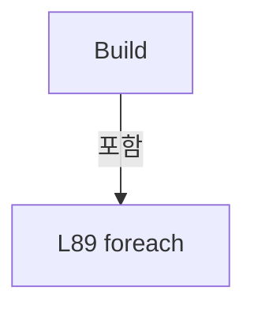

변경 전 점검: 입력/반환 타입, 위 호출자, 예외/취소 경로, 공유 상태와 저장·전송 소비자를 함께 확인합니다. 값의 단위나 물리 방향을 이름만으로 확정하지 않습니다.

### LocalFunctionStatement `ShouldIncludeItem` · L58–61

[Drilling.File/Script/CAutomation1ScriptFile.cs:58–61](https://github.com/kjuws10-rgb/A3Drilling/blob/334b3599651b2e8e0181fd4459bafaf3cddafff3/Drilling.File/Script/CAutomation1ScriptFile.cs#L58-L61)

| 항목 | 실제 추출 값 |
| --- | --- |
| 서명 | bool ShouldIncludeItem(Drilling.Common.Station.ST_HEAD_PROCESS_PLAN) |
| 접근/수식자 | Private /  |
| 반환/값 타입 | bool |
| 소속 타입 | NamedType:Drilling.File.Script.CAutomation1ScriptFile |

입력 계약:

| 이름 | 타입 | 전달 | 선택/기본값 |
| --- | --- | --- | --- |
| head | Drilling.Common.Station.ST_HEAD_PROCESS_PLAN | None | False /  |

현재 부분 분석에서 직접 연결된 호출자는 없습니다. XAML/이벤트/인터페이스·델리게이트·외부 진입을 추가 확인해야 하며, 미사용으로 판정한 것이 아닙니다.

호출하는 대상과 해석 범위:

| 원본 행 | 표현식 | 분석 상태 | 대상/소스 위치 |
| --- | --- | --- | --- |
| 60 | ReadBool | resolved | bool Drilling.File.Script.CAutomation1ScriptFile.ReadBool(System.Collections.Generic.IReadOnlyDictionary<string, string>, bool, System.Collections.Generic.IEnumerable<string>) · Drilling.File/Script/CAutomation1ScriptFile.cs:1247 |
| 60 | CreateHeadKeys | resolved | System.Collections.Generic.IReadOnlyList<string> Drilling.File.Script.CAutomation1ScriptFile.CreateHeadKeys(int, params string[]) · Drilling.File/Script/CAutomation1ScriptFile.cs:1102 |

본문의 실제 연산·분기·예외·반환 순서(원문 위치 순):

| 원본 행 | 종류 | 주석 해설 |
| --- | --- | --- |
| 60 | call | 함수·델리게이트 또는 객체 생성자를 호출합니다: ReadBool(processModel.Parameters, true, CreateHeadKeys(head.HeadNo, "USE")) |
| 60 | call | 함수·델리게이트 또는 객체 생성자를 호출합니다: CreateHeadKeys(head.HeadNo, "USE") |
| 60 | return | 호출자에게 값 또는 제어를 반환합니다: return ReadBool(processModel.Parameters, true, CreateHeadKeys(head.HeadNo, "USE")); |

변경 전 점검: 입력/반환 타입, 위 호출자, 예외/취소 경로, 공유 상태와 저장·전송 소비자를 함께 확인합니다. 값의 단위나 물리 방향을 이름만으로 확정하지 않습니다.

### LocalFunctionStatement `SelectItem` · L63–69

[Drilling.File/Script/CAutomation1ScriptFile.cs:63–69](https://github.com/kjuws10-rgb/A3Drilling/blob/334b3599651b2e8e0181fd4459bafaf3cddafff3/Drilling.File/Script/CAutomation1ScriptFile.cs#L63-L69)

| 항목 | 실제 추출 값 |
| --- | --- |
| 서명 | Drilling.Common.Station.ST_HEAD_PROCESS_PLAN SelectItem(Drilling.Common.Station.ST_HEAD_PROCESS_PLAN) |
| 접근/수식자 | Private /  |
| 반환/값 타입 | Drilling.Common.Station.ST_HEAD_PROCESS_PLAN |
| 소속 타입 | NamedType:Drilling.File.Script.CAutomation1ScriptFile |

입력 계약:

| 이름 | 타입 | 전달 | 선택/기본값 |
| --- | --- | --- | --- |
| head | Drilling.Common.Station.ST_HEAD_PROCESS_PLAN | None | False /  |

현재 부분 분석에서 직접 연결된 호출자는 없습니다. XAML/이벤트/인터페이스·델리게이트·외부 진입을 추가 확인해야 하며, 미사용으로 판정한 것이 아닙니다.

호출하는 대상과 해석 범위:

| 원본 행 | 표현식 | 분석 상태 | 대상/소스 위치 |
| --- | --- | --- | --- |
| 65 | head.Shots .Where(shot => !shotMaskingPlan.EvaluateShot(shot).IsChessSkipped) .ToArray | resolved | Drilling.Common.Recipe.ST_HEAD_SHOT_POINT[] System.Collections.Generic.IEnumerable<Drilling.Common.Recipe.ST_HEAD_SHOT_POINT>.ToArray<Drilling.Common.Recipe.ST_HEAD_SHOT_POINT>() |
| 65 | head.Shots .Where | resolved | System.Collections.Generic.IEnumerable<Drilling.Common.Recipe.ST_HEAD_SHOT_POINT> System.Collections.Generic.IEnumerable<Drilling.Common.Recipe.ST_HEAD_SHOT_POINT>.Where<Drilling.Common.Recipe.ST_HEAD_SHOT_POINT>(System.Func<Drilling.Common.Recipe.ST_HEAD_SHOT_POINT, bool>) |
| 66 | shotMaskingPlan.EvaluateShot | resolved | Drilling.Common.Recipe.ST_RECIPE_SHOT_MASKING_RESULT Drilling.Common.Recipe.CRecipeShotMaskingPlan.EvaluateShot(Drilling.Common.Recipe.ST_HEAD_SHOT_POINT) · Drilling.Common/Recipe/CShotCoordinatePlanBuilder.cs:876 |

본문의 실제 연산·분기·예외·반환 순서(원문 위치 순):

| 원본 행 | 종류 | 주석 해설 |
| --- | --- | --- |
| 65 | call | 함수·델리게이트 또는 객체 생성자를 호출합니다: head.Shots .Where(shot => !shotMaskingPlan.EvaluateShot(shot).IsChessSkipped) |
| 65 | call | 함수·델리게이트 또는 객체 생성자를 호출합니다: head.Shots .Where(shot => !shotMaskingPlan.EvaluateShot(shot).IsChessSkipped) .ToArray() |
| 65 | local-declaration | 지역 변수를 선언합니다: var processShots = head.Shots .Where(shot => !shotMaskingPlan.EvaluateShot(shot).IsChessSkipped) .ToArray(); |
| 65 | variable-initializer | 변수의 초기값을 지정합니다: processShots = head.Shots .Where(shot => !shotMaskingPlan.EvaluateShot(shot).IsChessSkipped) .ToArray() |
| 66 | call | 함수·델리게이트 또는 객체 생성자를 호출합니다: shotMaskingPlan.EvaluateShot(shot) |
| 68 | assignment | 값을 대상에 대입합니다: Shots = processShots |
| 68 | return | 호출자에게 값 또는 제어를 반환합니다: return head with { Shots = processShots }; |

변경 전 점검: 입력/반환 타입, 위 호출자, 예외/취소 경로, 공유 상태와 저장·전송 소비자를 함께 확인합니다. 값의 단위나 물리 방향을 이름만으로 확정하지 않습니다.

### LocalFunctionStatement `ShouldIncludeHead` · L71–74

[Drilling.File/Script/CAutomation1ScriptFile.cs:71–74](https://github.com/kjuws10-rgb/A3Drilling/blob/334b3599651b2e8e0181fd4459bafaf3cddafff3/Drilling.File/Script/CAutomation1ScriptFile.cs#L71-L74)

| 항목 | 실제 추출 값 |
| --- | --- |
| 서명 | bool ShouldIncludeHead(Drilling.Common.Station.ST_HEAD_PROCESS_PLAN) |
| 접근/수식자 | Private /  |
| 반환/값 타입 | bool |
| 소속 타입 | NamedType:Drilling.File.Script.CAutomation1ScriptFile |

입력 계약:

| 이름 | 타입 | 전달 | 선택/기본값 |
| --- | --- | --- | --- |
| head | Drilling.Common.Station.ST_HEAD_PROCESS_PLAN | None | False /  |

현재 부분 분석에서 직접 연결된 호출자는 없습니다. XAML/이벤트/인터페이스·델리게이트·외부 진입을 추가 확인해야 하며, 미사용으로 판정한 것이 아닙니다.

본문의 실제 연산·분기·예외·반환 순서(원문 위치 순):

| 원본 행 | 종류 | 주석 해설 |
| --- | --- | --- |
| 73 | return | 호출자에게 값 또는 제어를 반환합니다: return head.Shots.Count > 0; |

변경 전 점검: 입력/반환 타입, 위 호출자, 예외/취소 경로, 공유 상태와 저장·전송 소비자를 함께 확인합니다. 값의 단위나 물리 방향을 이름만으로 확정하지 않습니다.

### LocalFunctionStatement `SelectTotalShots` · L102–105

[Drilling.File/Script/CAutomation1ScriptFile.cs:102–105](https://github.com/kjuws10-rgb/A3Drilling/blob/334b3599651b2e8e0181fd4459bafaf3cddafff3/Drilling.File/Script/CAutomation1ScriptFile.cs#L102-L105)

| 항목 | 실제 추출 값 |
| --- | --- |
| 서명 | int SelectTotalShots(Drilling.Common.Station.ST_HEAD_SCRIPT_RESULT) |
| 접근/수식자 | Private /  |
| 반환/값 타입 | int |
| 소속 타입 | NamedType:Drilling.File.Script.CAutomation1ScriptFile |

입력 계약:

| 이름 | 타입 | 전달 | 선택/기본값 |
| --- | --- | --- | --- |
| script | Drilling.Common.Station.ST_HEAD_SCRIPT_RESULT | None | False /  |

현재 부분 분석에서 직접 연결된 호출자는 없습니다. XAML/이벤트/인터페이스·델리게이트·외부 진입을 추가 확인해야 하며, 미사용으로 판정한 것이 아닙니다.

본문의 실제 연산·분기·예외·반환 순서(원문 위치 순):

| 원본 행 | 종류 | 주석 해설 |
| --- | --- | --- |
| 104 | return | 호출자에게 값 또는 제어를 반환합니다: return script.TotalShots; |

변경 전 점검: 입력/반환 타입, 위 호출자, 예외/취소 경로, 공유 상태와 저장·전송 소비자를 함께 확인합니다. 값의 단위나 물리 방향을 이름만으로 확정하지 않습니다.

### MethodDeclaration `LoadLatest` · L111–173

[Drilling.File/Script/CAutomation1ScriptFile.cs:111–173](https://github.com/kjuws10-rgb/A3Drilling/blob/334b3599651b2e8e0181fd4459bafaf3cddafff3/Drilling.File/Script/CAutomation1ScriptFile.cs#L111-L173)

| 항목 | 실제 추출 값 |
| --- | --- |
| 서명 | Drilling.Common.Station.ST_SCRIPT_BUILD_RESULT Drilling.File.Script.CAutomation1ScriptFile.LoadLatest(Drilling.Common.Station.ST_PROCESS_MODEL, string, System.Threading.CancellationToken) |
| 접근/수식자 | Public / public, override |
| 반환/값 타입 | Drilling.Common.Station.ST_SCRIPT_BUILD_RESULT |
| 소속 타입 | NamedType:Drilling.File.Script.CAutomation1ScriptFile |

입력 계약:

| 이름 | 타입 | 전달 | 선택/기본값 |
| --- | --- | --- | --- |
| processModel | Drilling.Common.Station.ST_PROCESS_MODEL | None | False /  |
| subDirectoryName | string | None | False /  |
| cancellationToken | System.Threading.CancellationToken | None | True / null |

현재 부분 분석에서 직접 연결된 호출자는 없습니다. XAML/이벤트/인터페이스·델리게이트·외부 진입을 추가 확인해야 하며, 미사용으로 판정한 것이 아닙니다.

호출하는 대상과 해석 범위:

| 원본 행 | 표현식 | 분석 상태 | 대상/소스 위치 |
| --- | --- | --- | --- |
| 113 | cancellationToken.ThrowIfCancellationRequested | resolved | void System.Threading.CancellationToken.ThrowIfCancellationRequested() |
| 115 | new ArgumentException | resolved | System.ArgumentException.ArgumentException(string?, string?) |
| 115 | nameof | unresolved | None |
| 116 | Path.Combine | resolved | string System.IO.Path.Combine(string, string) |
| 117 | Directory.Exists | resolved | bool System.IO.Directory.Exists(string?) |
| 118 | new FileNotFoundException | resolved | System.IO.FileNotFoundException.FileNotFoundException(string?, string?) |
| 120 | Directory.EnumerateDirectories(root).Select(path => new DirectoryInfo(path)) .Where(info => info.Name.Length >= 15 && DateTime.TryParseExact(info.Name[..15], "yyyyMMdd_HHmmss", CultureInfo.InvariantCulture, DateTimeStyles.None, out _)) .OrderByDescending(info => info.Name[..15], StringComparer.Ordinal).ThenByDescending(info => info.CreationTimeUtc)… | resolved | System.IO.DirectoryInfo? System.Collections.Generic.IEnumerable<System.IO.DirectoryInfo>.FirstOrDefault<System.IO.DirectoryInfo>() |
| 120 | Directory.EnumerateDirectories(root).Select(path => new DirectoryInfo(path)) .Where(info => info.Name.Length >= 15 && DateTime.TryParseExact(info.Name[..15], "yyyyMMdd_HHmmss", CultureInfo.InvariantCulture, DateTimeStyles.None, out _)) .OrderByDescending(info => info.Name[..15], StringComparer.Ordinal).ThenByDescending(info => info.CreationTimeUtc)… | resolved | System.Linq.IOrderedEnumerable<System.IO.DirectoryInfo> System.Linq.IOrderedEnumerable<System.IO.DirectoryInfo>.ThenByDescending<System.IO.DirectoryInfo, string>(System.Func<System.IO.DirectoryInfo, string>, System.Collections.Generic.IComparer<string>?) |
| 120 | Directory.EnumerateDirectories(root).Select(path => new DirectoryInfo(path)) .Where(info => info.Name.Length >= 15 && DateTime.TryParseExact(info.Name[..15], "yyyyMMdd_HHmmss", CultureInfo.InvariantCulture, DateTimeStyles.None, out _)) .OrderByDescending(info => info.Name[..15], StringComparer.Ordinal).ThenByDescending | resolved | System.Linq.IOrderedEnumerable<System.IO.DirectoryInfo> System.Linq.IOrderedEnumerable<System.IO.DirectoryInfo>.ThenByDescending<System.IO.DirectoryInfo, System.DateTime>(System.Func<System.IO.DirectoryInfo, System.DateTime>) |
| 120 | Directory.EnumerateDirectories(root).Select(path => new DirectoryInfo(path)) .Where(info => info.Name.Length >= 15 && DateTime.TryParseExact(info.Name[..15], "yyyyMMdd_HHmmss", CultureInfo.InvariantCulture, DateTimeStyles.None, out _)) .OrderByDescending | resolved | System.Linq.IOrderedEnumerable<System.IO.DirectoryInfo> System.Collections.Generic.IEnumerable<System.IO.DirectoryInfo>.OrderByDescending<System.IO.DirectoryInfo, string>(System.Func<System.IO.DirectoryInfo, string>, System.Collections.Generic.IComparer<string>?) |
| 120 | Directory.EnumerateDirectories(root).Select(path => new DirectoryInfo(path)) .Where | resolved | System.Collections.Generic.IEnumerable<System.IO.DirectoryInfo> System.Collections.Generic.IEnumerable<System.IO.DirectoryInfo>.Where<System.IO.DirectoryInfo>(System.Func<System.IO.DirectoryInfo, bool>) |
| 120 | Directory.EnumerateDirectories(root).Select | resolved | System.Collections.Generic.IEnumerable<System.IO.DirectoryInfo> System.Collections.Generic.IEnumerable<string>.Select<string, System.IO.DirectoryInfo>(System.Func<string, System.IO.DirectoryInfo>) |
| 120 | Directory.EnumerateDirectories | resolved | System.Collections.Generic.IEnumerable<string> System.IO.Directory.EnumerateDirectories(string) |
| 120 | new DirectoryInfo | resolved | System.IO.DirectoryInfo.DirectoryInfo(string) |
| 121 | DateTime.TryParseExact | resolved | bool System.DateTime.TryParseExact(string?, string?, System.IFormatProvider?, System.Globalization.DateTimeStyles, out System.DateTime) |
| 124 | new FileNotFoundException | resolved | System.IO.FileNotFoundException.FileNotFoundException(string?, string?) |
| 125 | Path.Combine | resolved | string System.IO.Path.Combine(string, string) |
| 126 | System.IO.File.ReadAllLines | resolved | string[] System.IO.File.ReadAllLines(string) |
| 129 | Header("RecipeId").Equals | resolved | bool string.Equals(string?, System.StringComparison) |
| 129 | Header | resolved | string Header(string) · Drilling.File/Script/CAutomation1ScriptFile.cs:127 |
| 130 | new InvalidDataException | resolved | System.IO.InvalidDataException.InvalidDataException(string?) |
| 130 | Header | resolved | string Header(string) · Drilling.File/Script/CAutomation1ScriptFile.cs:127 |
| 131 | DateTimeOffset.ParseExact | resolved | System.DateTimeOffset System.DateTimeOffset.ParseExact(string, string, System.IFormatProvider?) |
| 131 | Header | resolved | string Header(string) · Drilling.File/Script/CAutomation1ScriptFile.cs:127 |
| 132 | new List<ST_HEAD_SCRIPT_RESULT> | resolved | System.Collections.Generic.List<Drilling.Common.Station.ST_HEAD_SCRIPT_RESULT>.List() |
| 136 | cancellationToken.ThrowIfCancellationRequested | resolved | void System.Threading.CancellationToken.ThrowIfCancellationRequested() |
| 137 | Regex.Match | resolved | System.Text.RegularExpressions.Match System.Text.RegularExpressions.Regex.Match(string, string) |
| 139 | int.Parse | resolved | int int.Parse(string, System.IFormatProvider?) |
| 140 | Regex.Match | resolved | System.Text.RegularExpressions.Match System.Text.RegularExpressions.Regex.Match(string, string) |
| 141 | heads.Any | resolved | bool System.Collections.Generic.IEnumerable<Drilling.Common.Station.ST_HEAD_SCRIPT_RESULT>.Any<Drilling.Common.Station.ST_HEAD_SCRIPT_RESULT>(System.Func<Drilling.Common.Station.ST_HEAD_SCRIPT_RESULT, bool>) |
| 142 | new InvalidDataException | resolved | System.IO.InvalidDataException.InvalidDataException(string?) |
| 143 | int.Parse | resolved | int int.Parse(string, System.IFormatProvider?) |
| 144 | int.Parse | resolved | int int.Parse(string, System.IFormatProvider?) |
| 146 | int.Parse | resolved | int int.Parse(string, System.IFormatProvider?) |
| 147 | processModel.HeadPlans.SingleOrDefault | resolved | Drilling.Common.Station.ST_HEAD_PROCESS_PLAN? System.Collections.Generic.IEnumerable<Drilling.Common.Station.ST_HEAD_PROCESS_PLAN>.SingleOrDefault<Drilling.Common.Station.ST_HEAD_PROCESS_PLAN>(System.Func<Drilling.Common.Station.ST_HEAD_PROCESS_PLAN, bool>) |
| 148 | Path.GetFileName | resolved | string? System.IO.Path.GetFileName(string?) |
| 148 | fileName.EndsWith | resolved | bool string.EndsWith(string, System.StringComparison) |
| 149 | new InvalidDataException | resolved | System.IO.InvalidDataException.InvalidDataException(string?) |
| 150 | Path.Combine | resolved | string System.IO.Path.Combine(string, string) |
| 153 | System.IO.File.ReadLines | resolved | System.Collections.Generic.IEnumerable<string> System.IO.File.ReadLines(string) |
| 155 | cancellationToken.ThrowIfCancellationRequested | resolved | void System.Threading.CancellationToken.ThrowIfCancellationRequested() |
| 158 | Regex.Match | resolved | System.Text.RegularExpressions.Match System.Text.RegularExpressions.Regex.Match(string, string) |
| 159 | long.Parse | resolved | long long.Parse(string, System.IFormatProvider?) |
| 162 | new InvalidDataException | resolved | System.IO.InvalidDataException.InvalidDataException(string?) |
| 164 | heads.Add | resolved | void System.Collections.Generic.List<Drilling.Common.Station.ST_HEAD_SCRIPT_RESULT>.Add(Drilling.Common.Station.ST_HEAD_SCRIPT_RESULT) |
| 164 | new | resolved | Drilling.Common.Station.ST_HEAD_SCRIPT_RESULT.ST_HEAD_SCRIPT_RESULT(int, int, int, string, string, int, int, System.DateTimeOffset) · Drilling.Common/Station/CStationManager.cs:341 |
| 166 | processModel.HeadPlans.Where(head => ReadBool(processModel.Parameters, true, CreateHeadKeys(head.HeadNo, "USE")) && head.Shots.Count > 0).Select(head => head.HeadNo).Order().ToArray | resolved | int[] System.Collections.Generic.IEnumerable<int>.ToArray<int>() |
| 166 | processModel.HeadPlans.Where(head => ReadBool(processModel.Parameters, true, CreateHeadKeys(head.HeadNo, "USE")) && head.Shots.Count > 0).Select(head => head.HeadNo).Order | resolved | System.Linq.IOrderedEnumerable<int> System.Collections.Generic.IEnumerable<int>.Order<int>() |
| 166 | processModel.HeadPlans.Where(head => ReadBool(processModel.Parameters, true, CreateHeadKeys(head.HeadNo, "USE")) && head.Shots.Count > 0).Select | resolved | System.Collections.Generic.IEnumerable<int> System.Collections.Generic.IEnumerable<Drilling.Common.Station.ST_HEAD_PROCESS_PLAN>.Select<Drilling.Common.Station.ST_HEAD_PROCESS_PLAN, int>(System.Func<Drilling.Common.Station.ST_HEAD_PROCESS_PLAN, int>) |
| 166 | processModel.HeadPlans.Where | resolved | System.Collections.Generic.IEnumerable<Drilling.Common.Station.ST_HEAD_PROCESS_PLAN> System.Collections.Generic.IEnumerable<Drilling.Common.Station.ST_HEAD_PROCESS_PLAN>.Where<Drilling.Common.Station.ST_HEAD_PROCESS_PLAN>(System.Func<Drilling.Common.Station.ST_HEAD_PROCESS_PLAN, bool>) |
| 166 | ReadBool | resolved | bool Drilling.File.Script.CAutomation1ScriptFile.ReadBool(System.Collections.Generic.IReadOnlyDictionary<string, string>, bool, System.Collections.Generic.IEnumerable<string>) · Drilling.File/Script/CAutomation1ScriptFile.cs:1247 |
| 166 | CreateHeadKeys | resolved | System.Collections.Generic.IReadOnlyList<string> Drilling.File.Script.CAutomation1ScriptFile.CreateHeadKeys(int, params string[]) · Drilling.File/Script/CAutomation1ScriptFile.cs:1102 |
| 167 | int.Parse | resolved | int int.Parse(string, System.IFormatProvider?) |
| 167 | Header | resolved | string Header(string) · Drilling.File/Script/CAutomation1ScriptFile.cs:127 |
| 168 | heads.Select(head => head.HeadNo).Order().SequenceEqual | resolved | bool System.Collections.Generic.IEnumerable<int>.SequenceEqual<int>(System.Collections.Generic.IEnumerable<int>) |
| 168 | heads.Select(head => head.HeadNo).Order | resolved | System.Linq.IOrderedEnumerable<int> System.Collections.Generic.IEnumerable<int>.Order<int>() |
| 168 | heads.Select | resolved | System.Collections.Generic.IEnumerable<int> System.Collections.Generic.IEnumerable<Drilling.Common.Station.ST_HEAD_SCRIPT_RESULT>.Select<Drilling.Common.Station.ST_HEAD_SCRIPT_RESULT, int>(System.Func<Drilling.Common.Station.ST_HEAD_SCRIPT_RESULT, int>) |
| 169 | heads.Select(head => (head.AutomationNo, head.TaskNo)).Distinct().Count | resolved | int System.Collections.Generic.IEnumerable<(int AutomationNo, int TaskNo)>.Count<(int AutomationNo, int TaskNo)>() |
| 169 | heads.Select(head => (head.AutomationNo, head.TaskNo)).Distinct | resolved | System.Collections.Generic.IEnumerable<(int AutomationNo, int TaskNo)> System.Collections.Generic.IEnumerable<(int AutomationNo, int TaskNo)>.Distinct<(int AutomationNo, int TaskNo)>() |
| 169 | heads.Select | resolved | System.Collections.Generic.IEnumerable<(int AutomationNo, int TaskNo)> System.Collections.Generic.IEnumerable<Drilling.Common.Station.ST_HEAD_SCRIPT_RESULT>.Select<Drilling.Common.Station.ST_HEAD_SCRIPT_RESULT, (int AutomationNo, int TaskNo)>(System.Func<Drilling.Common.Station.ST_HEAD_SCRIPT_RESULT, (int AutomationNo, int TaskNo)>) |
| 170 | new InvalidDataException | resolved | System.IO.InvalidDataException.InvalidDataException(string?) |
| 172 | new | resolved | Drilling.Common.Station.ST_SCRIPT_BUILD_RESULT.ST_SCRIPT_BUILD_RESULT(string, string, int, System.DateTimeOffset, System.Collections.Generic.IReadOnlyList<Drilling.Common.Station.ST_HEAD_SCRIPT_RESULT>) · Drilling.Common/Station/CStationManager.cs:336 |
| 172 | heads.Sum | resolved | int System.Collections.Generic.IEnumerable<Drilling.Common.Station.ST_HEAD_SCRIPT_RESULT>.Sum<Drilling.Common.Station.ST_HEAD_SCRIPT_RESULT>(System.Func<Drilling.Common.Station.ST_HEAD_SCRIPT_RESULT, int>) |

본문의 실제 연산·분기·예외·반환 순서(원문 위치 순):

| 원본 행 | 종류 | 주석 해설 |
| --- | --- | --- |
| 113 | call | 함수·델리게이트 또는 객체 생성자를 호출합니다: cancellationToken.ThrowIfCancellationRequested() |
| 114 | if | 조건에 따라 분기합니다: if (subDirectoryName is not (StandardDirectoryName or BufferedRunDirectoryName)) |
| 115 | call | 함수·델리게이트 또는 객체 생성자를 호출합니다: new ArgumentException("AUTO 스크립트 실행 방식이 올바르지 않습니다.", nameof(subDirectoryName)) |
| 115 | call | 함수·델리게이트 또는 객체 생성자를 호출합니다: nameof(subDirectoryName) |
| 115 | throw | 예외를 발생/전달합니다: throw new ArgumentException("AUTO 스크립트 실행 방식이 올바르지 않습니다.", nameof(subDirectoryName)); |
| 116 | call | 함수·델리게이트 또는 객체 생성자를 호출합니다: Path.Combine(_scriptDirectory, subDirectoryName) |
| 116 | local-declaration | 지역 변수를 선언합니다: var root = Path.Combine(_scriptDirectory, subDirectoryName); |
| 116 | variable-initializer | 변수의 초기값을 지정합니다: root = Path.Combine(_scriptDirectory, subDirectoryName) |
| 117 | call | 함수·델리게이트 또는 객체 생성자를 호출합니다: Directory.Exists(root) |
| 117 | if | 조건에 따라 분기합니다: if (!Directory.Exists(root)) |
| 118 | call | 함수·델리게이트 또는 객체 생성자를 호출합니다: new FileNotFoundException("마지막 AUTO 스크립트 폴더가 없습니다.", root) |
| 118 | throw | 예외를 발생/전달합니다: throw new FileNotFoundException("마지막 AUTO 스크립트 폴더가 없습니다.", root); |
| 120 | call | 함수·델리게이트 또는 객체 생성자를 호출합니다: Directory.EnumerateDirectories(root).Select(path => new DirectoryInfo(path)) |
| 120 | call | 함수·델리게이트 또는 객체 생성자를 호출합니다: Directory.EnumerateDirectories(root) |
| 120 | call | 함수·델리게이트 또는 객체 생성자를 호출합니다: new DirectoryInfo(path) |
| 120 | call | 함수·델리게이트 또는 객체 생성자를 호출합니다: Directory.EnumerateDirectories(root).Select(path => new DirectoryInfo(path)) .Where(info => info.Name.Length >= 15 && DateTime.TryParseExact(info.Name[..15], "yyyyMMdd_HHmmss", CultureInfo.InvariantCulture, DateTimeStyle… |
| 120 | call | 함수·델리게이트 또는 객체 생성자를 호출합니다: Directory.EnumerateDirectories(root).Select(path => new DirectoryInfo(path)) .Where(info => info.Name.Length >= 15 && DateTime.TryParseExact(info.Name[..15], "yyyyMMdd_HHmmss", CultureInfo.InvariantCulture, DateTimeStyle… |
| 120 | call | 함수·델리게이트 또는 객체 생성자를 호출합니다: Directory.EnumerateDirectories(root).Select(path => new DirectoryInfo(path)) .Where(info => info.Name.Length >= 15 && DateTime.TryParseExact(info.Name[..15], "yyyyMMdd_HHmmss", CultureInfo.InvariantCulture, DateTimeStyle… |
| 120 | call | 함수·델리게이트 또는 객체 생성자를 호출합니다: Directory.EnumerateDirectories(root).Select(path => new DirectoryInfo(path)) .Where(info => info.Name.Length >= 15 && DateTime.TryParseExact(info.Name[..15], "yyyyMMdd_HHmmss", CultureInfo.InvariantCulture, DateTimeStyle… |
| 120 | call | 함수·델리게이트 또는 객체 생성자를 호출합니다: Directory.EnumerateDirectories(root).Select(path => new DirectoryInfo(path)) .Where(info => info.Name.Length >= 15 && DateTime.TryParseExact(info.Name[..15], "yyyyMMdd_HHmmss", CultureInfo.InvariantCulture, DateTimeStyle… |
| 120 | local-declaration | 지역 변수를 선언합니다: var directory = Directory.EnumerateDirectories(root).Select(path => new DirectoryInfo(path)) .Where(info => info.Name.Length >= 15 && DateTime.TryParseExact(info.Name[..15], "yyyyMMdd_HHmmss", CultureInfo.InvariantCulture, DateTim |
| 120 | variable-initializer | 변수의 초기값을 지정합니다: directory = Directory.EnumerateDirectories(root).Select(path => new DirectoryInfo(path)) .Where(info => info.Name.Length >= 15 && DateTime.TryParseExact(info.Name[..15], "yyyyMMdd_HHmmss", CultureInfo.InvariantCulture, DateTimeSty |
| 121 | call | 함수·델리게이트 또는 객체 생성자를 호출합니다: DateTime.TryParseExact(info.Name[..15], "yyyyMMdd_HHmmss", CultureInfo.InvariantCulture, DateTimeStyles.None, out _) |
| 124 | call | 함수·델리게이트 또는 객체 생성자를 호출합니다: new FileNotFoundException("실행할 AUTO 스크립트 생성 회차가 없습니다.", root) |
| 124 | throw | 예외를 발생/전달합니다: throw new FileNotFoundException("실행할 AUTO 스크립트 생성 회차가 없습니다.", root) |
| 125 | call | 함수·델리게이트 또는 객체 생성자를 호출합니다: Path.Combine(directory, ProcessCoordinateListFileName) |
| 125 | local-declaration | 지역 변수를 선언합니다: var manifest = Path.Combine(directory, ProcessCoordinateListFileName); |
| 125 | variable-initializer | 변수의 초기값을 지정합니다: manifest = Path.Combine(directory, ProcessCoordinateListFileName) |
| 126 | call | 함수·델리게이트 또는 객체 생성자를 호출합니다: System.IO.File.ReadAllLines(manifest) |
| 126 | local-declaration | 지역 변수를 선언합니다: var lines = System.IO.File.ReadAllLines(manifest); |
| 126 | variable-initializer | 변수의 초기값을 지정합니다: lines = System.IO.File.ReadAllLines(manifest) |
| 129 | call | 함수·델리게이트 또는 객체 생성자를 호출합니다: Header("RecipeId").Equals(processModel.RecipeId, StringComparison.OrdinalIgnoreCase) |
| 129 | call | 함수·델리게이트 또는 객체 생성자를 호출합니다: Header("RecipeId") |
| 129 | if | 조건에 따라 분기합니다: if (!Header("RecipeId").Equals(processModel.RecipeId, StringComparison.OrdinalIgnoreCase)) |
| 130 | call | 함수·델리게이트 또는 객체 생성자를 호출합니다: new InvalidDataException($"마지막 스크립트의 Recipe({Header("RecipeId")})가 현재 Recipe({processModel.RecipeId})와 다릅니다. {manifest}") |
| 130 | call | 함수·델리게이트 또는 객체 생성자를 호출합니다: Header("RecipeId") |
| 130 | throw | 예외를 발생/전달합니다: throw new InvalidDataException($"마지막 스크립트의 Recipe({Header("RecipeId")})가 현재 Recipe({processModel.RecipeId})와 다릅니다. {manifest}"); |
| 131 | call | 함수·델리게이트 또는 객체 생성자를 호출합니다: DateTimeOffset.ParseExact(Header("CreatedAt"), "yyyy-MM-dd HH:mm:ss.fff zzz", CultureInfo.InvariantCulture) |
| 131 | call | 함수·델리게이트 또는 객체 생성자를 호출합니다: Header("CreatedAt") |
| 131 | local-declaration | 지역 변수를 선언합니다: var createdAt = DateTimeOffset.ParseExact(Header("CreatedAt"), "yyyy-MM-dd HH:mm:ss.fff zzz", CultureInfo.InvariantCulture); |
| 131 | variable-initializer | 변수의 초기값을 지정합니다: createdAt = DateTimeOffset.ParseExact(Header("CreatedAt"), "yyyy-MM-dd HH:mm:ss.fff zzz", CultureInfo.InvariantCulture) |
| 132 | call | 함수·델리게이트 또는 객체 생성자를 호출합니다: new List<ST_HEAD_SCRIPT_RESULT>() |
| 132 | local-declaration | 지역 변수를 선언합니다: var heads = new List<ST_HEAD_SCRIPT_RESULT>(); |
| 132 | variable-initializer | 변수의 초기값을 지정합니다: heads = new List<ST_HEAD_SCRIPT_RESULT>() |
| 133 | local-declaration | 지역 변수를 선언합니다: long? readyRunId = null; |
| 133 | variable-initializer | 변수의 초기값을 지정합니다: readyRunId = null |
| 134 | variable-initializer | 변수의 초기값을 지정합니다: i = 0 |
| 134 | for | 초기화·조건·증감이 있는 반복입니다: for (var i = 0; i < lines.Length; i++) |
| 136 | call | 함수·델리게이트 또는 객체 생성자를 호출합니다: cancellationToken.ThrowIfCancellationRequested() |
| 137 | call | 함수·델리게이트 또는 객체 생성자를 호출합니다: Regex.Match(lines[i], @"^\[H(\d{2})\]$") |
| 137 | local-declaration | 지역 변수를 선언합니다: var headMatch = Regex.Match(lines[i], @"^\[H(\d{2})\]$"); |
| 137 | variable-initializer | 변수의 초기값을 지정합니다: headMatch = Regex.Match(lines[i], @"^\[H(\d{2})\]$") |
| 138 | continue | 다음 반복으로 진행합니다: continue; |
| 138 | if | 조건에 따라 분기합니다: if (!headMatch.Success) |
| 139 | call | 함수·델리게이트 또는 객체 생성자를 호출합니다: int.Parse(headMatch.Groups[1].Value, CultureInfo.InvariantCulture) |
| 139 | local-declaration | 지역 변수를 선언합니다: var headNo = int.Parse(headMatch.Groups[1].Value, CultureInfo.InvariantCulture); |
| 139 | variable-initializer | 변수의 초기값을 지정합니다: headNo = int.Parse(headMatch.Groups[1].Value, CultureInfo.InvariantCulture) |
| 140 | call | 함수·델리게이트 또는 객체 생성자를 호출합니다: Regex.Match(i + 1 < lines.Length ? lines[++i] : "", @"^Automation=(\d+) Task=(\d+) Script=(\S+) Shots=(\d+)$") |
| 140 | conditional-expression | 조건에 따라 결과식을 선택합니다: i + 1 < lines.Length ? lines[++i] : "" |
| 140 | local-declaration | 지역 변수를 선언합니다: var metadata = Regex.Match(i + 1 < lines.Length ? lines[++i] : "", @"^Automation=(\d+) Task=(\d+) Script=(\S+) Shots=(\d+)$"); |
| 140 | variable-initializer | 변수의 초기값을 지정합니다: metadata = Regex.Match(i + 1 < lines.Length ? lines[++i] : "", @"^Automation=(\d+) Task=(\d+) Script=(\S+) Shots=(\d+)$") |
| 141 | call | 함수·델리게이트 또는 객체 생성자를 호출합니다: heads.Any(head => head.HeadNo == headNo) |
| 141 | if | 조건에 따라 분기합니다: if (!metadata.Success &#124;&#124; heads.Any(head => head.HeadNo == headNo)) |
| 142 | call | 함수·델리게이트 또는 객체 생성자를 호출합니다: new InvalidDataException($"HEAD {headNo:00} 스크립트 목록이 올바르지 않습니다: {manifest}") |
| 142 | throw | 예외를 발생/전달합니다: throw new InvalidDataException($"HEAD {headNo:00} 스크립트 목록이 올바르지 않습니다: {manifest}"); |
| 143 | call | 함수·델리게이트 또는 객체 생성자를 호출합니다: int.Parse(metadata.Groups[1].Value, CultureInfo.InvariantCulture) |
| 143 | local-declaration | 지역 변수를 선언합니다: var controller = int.Parse(metadata.Groups[1].Value, CultureInfo.InvariantCulture); |
| 143 | variable-initializer | 변수의 초기값을 지정합니다: controller = int.Parse(metadata.Groups[1].Value, CultureInfo.InvariantCulture) |
| 144 | call | 함수·델리게이트 또는 객체 생성자를 호출합니다: int.Parse(metadata.Groups[2].Value, CultureInfo.InvariantCulture) |
| 144 | local-declaration | 지역 변수를 선언합니다: var task = int.Parse(metadata.Groups[2].Value, CultureInfo.InvariantCulture); |
| 144 | variable-initializer | 변수의 초기값을 지정합니다: task = int.Parse(metadata.Groups[2].Value, CultureInfo.InvariantCulture) |
| 145 | local-declaration | 지역 변수를 선언합니다: var fileName = metadata.Groups[3].Value; |
| 145 | variable-initializer | 변수의 초기값을 지정합니다: fileName = metadata.Groups[3].Value |
| 146 | call | 함수·델리게이트 또는 객체 생성자를 호출합니다: int.Parse(metadata.Groups[4].Value, CultureInfo.InvariantCulture) |
| 146 | local-declaration | 지역 변수를 선언합니다: var shots = int.Parse(metadata.Groups[4].Value, CultureInfo.InvariantCulture); |
| 146 | variable-initializer | 변수의 초기값을 지정합니다: shots = int.Parse(metadata.Groups[4].Value, CultureInfo.InvariantCulture) |
| 147 | call | 함수·델리게이트 또는 객체 생성자를 호출합니다: processModel.HeadPlans.SingleOrDefault(head => head.HeadNo == headNo) |
| 147 | local-declaration | 지역 변수를 선언합니다: var plan = processModel.HeadPlans.SingleOrDefault(head => head.HeadNo == headNo); |
| 147 | variable-initializer | 변수의 초기값을 지정합니다: plan = processModel.HeadPlans.SingleOrDefault(head => head.HeadNo == headNo) |
| 148 | call | 함수·델리게이트 또는 객체 생성자를 호출합니다: Path.GetFileName(fileName) |
| 148 | call | 함수·델리게이트 또는 객체 생성자를 호출합니다: fileName.EndsWith(".ascript", StringComparison.OrdinalIgnoreCase) |
| 148 | if | 조건에 따라 분기합니다: if (plan is null &#124;&#124; plan.AutomationNo != controller &#124;&#124; plan.TaskNo != task &#124;&#124; Path.GetFileName(fileName) != fileName &#124;&#124; !fileName.EndsWith(".ascript", StringComparison.OrdinalIgnoreCase)) |
| 149 | call | 함수·델리게이트 또는 객체 생성자를 호출합니다: new InvalidDataException($"HEAD {headNo:00}의 현재 Controller/Task와 저장 스크립트 정보를 확인해 주세요.") |
| 149 | throw | 예외를 발생/전달합니다: throw new InvalidDataException($"HEAD {headNo:00}의 현재 Controller/Task와 저장 스크립트 정보를 확인해 주세요."); |
| 150 | call | 함수·델리게이트 또는 객체 생성자를 호출합니다: Path.Combine(directory, fileName) |
| 150 | local-declaration | 지역 변수를 선언합니다: var filePath = Path.Combine(directory, fileName); |
| 150 | variable-initializer | 변수의 초기값을 지정합니다: filePath = Path.Combine(directory, fileName) |
| 151 | local-declaration | 지역 변수를 선언합니다: long? headRunId = null; |
| 151 | variable-initializer | 변수의 초기값을 지정합니다: headRunId = null |
| 152 | local-declaration | 지역 변수를 선언합니다: var lineCount = 0; |
| 152 | variable-initializer | 변수의 초기값을 지정합니다: lineCount = 0 |
| 153 | call | 함수·델리게이트 또는 객체 생성자를 호출합니다: System.IO.File.ReadLines(filePath) |
| 153 | foreach | 컬렉션 요소를 순회합니다: foreach (var line in System.IO.File.ReadLines(filePath)) |
| 155 | call | 함수·델리게이트 또는 객체 생성자를 호출합니다: cancellationToken.ThrowIfCancellationRequested() |
| 157 | continue | 다음 반복으로 진행합니다: continue; |
| 157 | if | 조건에 따라 분기합니다: if (lineCount > 16) |
| 158 | call | 함수·델리게이트 또는 객체 생성자를 호출합니다: Regex.Match(line, @"^// MOF Ready: GlobalInteger\[\d+\], RunId=(\d+)$") |
| 158 | local-declaration | 지역 변수를 선언합니다: var marker = Regex.Match(line, @"^// MOF Ready: GlobalInteger\[\d+\], RunId=(\d+)$"); |
| 158 | variable-initializer | 변수의 초기값을 지정합니다: marker = Regex.Match(line, @"^// MOF Ready: GlobalInteger\[\d+\], RunId=(\d+)$") |
| 159 | assignment | 값을 대상에 대입합니다: headRunId = long.Parse(marker.Groups[1].Value, CultureInfo.InvariantCulture) |
| 159 | call | 함수·델리게이트 또는 객체 생성자를 호출합니다: long.Parse(marker.Groups[1].Value, CultureInfo.InvariantCulture) |
| 159 | if | 조건에 따라 분기합니다: if (marker.Success) |
| 161 | if | 조건에 따라 분기합니다: if (headRunId is not > 0 &#124;&#124; readyRunId is not null && readyRunId != headRunId) |
| 162 | call | 함수·델리게이트 또는 객체 생성자를 호출합니다: new InvalidDataException($"HEAD {headNo:00}의 MOF 실행번호가 없거나 다른 회차와 섞였습니다: {filePath}") |
| 162 | throw | 예외를 발생/전달합니다: throw new InvalidDataException($"HEAD {headNo:00}의 MOF 실행번호가 없거나 다른 회차와 섞였습니다: {filePath}"); |
| 163 | assignment | 값을 대상에 대입합니다: readyRunId = headRunId |
| 164 | call | 함수·델리게이트 또는 객체 생성자를 호출합니다: heads.Add(new(headNo, controller, task, fileName, filePath, shots, lineCount, createdAt)) |
| 164 | call | 함수·델리게이트 또는 객체 생성자를 호출합니다: new(headNo, controller, task, fileName, filePath, shots, lineCount, createdAt) |
| 166 | call | 함수·델리게이트 또는 객체 생성자를 호출합니다: processModel.HeadPlans.Where(head => ReadBool(processModel.Parameters, true, CreateHeadKeys(head.HeadNo, "USE")) && head.Shots.Count > 0).Select(head => head.HeadNo).Order().ToArray() |
| 166 | call | 함수·델리게이트 또는 객체 생성자를 호출합니다: processModel.HeadPlans.Where(head => ReadBool(processModel.Parameters, true, CreateHeadKeys(head.HeadNo, "USE")) && head.Shots.Count > 0).Select(head => head.HeadNo).Order() |
| 166 | call | 함수·델리게이트 또는 객체 생성자를 호출합니다: processModel.HeadPlans.Where(head => ReadBool(processModel.Parameters, true, CreateHeadKeys(head.HeadNo, "USE")) && head.Shots.Count > 0).Select(head => head.HeadNo) |
| 166 | call | 함수·델리게이트 또는 객체 생성자를 호출합니다: processModel.HeadPlans.Where(head => ReadBool(processModel.Parameters, true, CreateHeadKeys(head.HeadNo, "USE")) && head.Shots.Count > 0) |
| 166 | call | 함수·델리게이트 또는 객체 생성자를 호출합니다: ReadBool(processModel.Parameters, true, CreateHeadKeys(head.HeadNo, "USE")) |
| 166 | call | 함수·델리게이트 또는 객체 생성자를 호출합니다: CreateHeadKeys(head.HeadNo, "USE") |
| 166 | local-declaration | 지역 변수를 선언합니다: var expectedHeads = processModel.HeadPlans.Where(head => ReadBool(processModel.Parameters, true, CreateHeadKeys(head.HeadNo, "USE")) && head.Shots.Count > 0).Select(head => head.HeadNo).Order().ToArray(); |
| 166 | variable-initializer | 변수의 초기값을 지정합니다: expectedHeads = processModel.HeadPlans.Where(head => ReadBool(processModel.Parameters, true, CreateHeadKeys(head.HeadNo, "USE")) && head.Shots.Count > 0).Select(head => head.HeadNo).Order().ToArray() |
| 167 | call | 함수·델리게이트 또는 객체 생성자를 호출합니다: int.Parse(Header("HeadScriptCount"), CultureInfo.InvariantCulture) |
| 167 | call | 함수·델리게이트 또는 객체 생성자를 호출합니다: Header("HeadScriptCount") |
| 167 | if | 조건에 따라 분기합니다: if (heads.Count != int.Parse(Header("HeadScriptCount"), CultureInfo.InvariantCulture) &#124;&#124; heads.Count == 0 &#124;&#124; !heads.Select(head => head.HeadNo).Order().SequenceEqual(expectedHeads) &#124;&#124; heads.Select(head => (head.AutomationNo,…) |
| 168 | call | 함수·델리게이트 또는 객체 생성자를 호출합니다: heads.Select(head => head.HeadNo).Order().SequenceEqual(expectedHeads) |
| 168 | call | 함수·델리게이트 또는 객체 생성자를 호출합니다: heads.Select(head => head.HeadNo).Order() |
| 168 | call | 함수·델리게이트 또는 객체 생성자를 호출합니다: heads.Select(head => head.HeadNo) |
| 169 | call | 함수·델리게이트 또는 객체 생성자를 호출합니다: heads.Select(head => (head.AutomationNo, head.TaskNo)).Distinct().Count() |
| 169 | call | 함수·델리게이트 또는 객체 생성자를 호출합니다: heads.Select(head => (head.AutomationNo, head.TaskNo)).Distinct() |
| 169 | call | 함수·델리게이트 또는 객체 생성자를 호출합니다: heads.Select(head => (head.AutomationNo, head.TaskNo)) |
| 170 | call | 함수·델리게이트 또는 객체 생성자를 호출합니다: new InvalidDataException("마지막 스크립트 세트의 Head/Task 구성이 현재 가공 대상과 일치하지 않습니다: " + manifest) |
| 170 | throw | 예외를 발생/전달합니다: throw new InvalidDataException("마지막 스크립트 세트의 Head/Task 구성이 현재 가공 대상과 일치하지 않습니다: " + manifest); |
| 172 | assignment | 값을 대상에 대입합니다: MofReadyRunId = readyRunId!.Value |
| 172 | call | 함수·델리게이트 또는 객체 생성자를 호출합니다: new(ProcessCoordinateListFileName, manifest, heads.Sum(head => head.TotalShots), createdAt, heads) { MofReadyRunId = readyRunId!.Value } |
| 172 | call | 함수·델리게이트 또는 객체 생성자를 호출합니다: heads.Sum(head => head.TotalShots) |
| 172 | return | 호출자에게 값 또는 제어를 반환합니다: return new(ProcessCoordinateListFileName, manifest, heads.Sum(head => head.TotalShots), createdAt, heads) { MofReadyRunId = readyRunId!.Value }; |

제어 구문의 포함 구조(실제 실행 순서/CFG가 아닌 구문 탐색 그림):

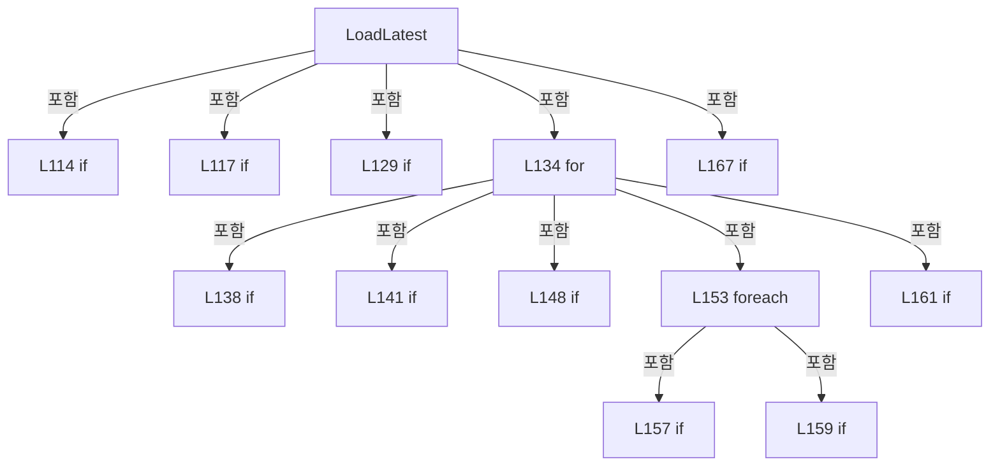

변경 전 점검: 입력/반환 타입, 위 호출자, 예외/취소 경로, 공유 상태와 저장·전송 소비자를 함께 확인합니다. 값의 단위나 물리 방향을 이름만으로 확정하지 않습니다.

### LocalFunctionStatement `Header` · L127–128

[Drilling.File/Script/CAutomation1ScriptFile.cs:127–128](https://github.com/kjuws10-rgb/A3Drilling/blob/334b3599651b2e8e0181fd4459bafaf3cddafff3/Drilling.File/Script/CAutomation1ScriptFile.cs#L127-L128)

| 항목 | 실제 추출 값 |
| --- | --- |
| 서명 | string Header(string) |
| 접근/수식자 | Private /  |
| 반환/값 타입 | string |
| 소속 타입 | NamedType:Drilling.File.Script.CAutomation1ScriptFile |

입력 계약:

| 이름 | 타입 | 전달 | 선택/기본값 |
| --- | --- | --- | --- |
| key | string | None | False /  |

정적 호출자로 확인된 위치:

| 호출 파일/행 | 호출 표현식 | 런타임 분기 가능 |
| --- | --- | --- |
| [Drilling.File/Script/CAutomation1ScriptFile.cs:129–129](https://github.com/kjuws10-rgb/A3Drilling/blob/334b3599651b2e8e0181fd4459bafaf3cddafff3/Drilling.File/Script/CAutomation1ScriptFile.cs#L129-L129) | Header | False |
| [Drilling.File/Script/CAutomation1ScriptFile.cs:130–130](https://github.com/kjuws10-rgb/A3Drilling/blob/334b3599651b2e8e0181fd4459bafaf3cddafff3/Drilling.File/Script/CAutomation1ScriptFile.cs#L130-L130) | Header | False |
| [Drilling.File/Script/CAutomation1ScriptFile.cs:131–131](https://github.com/kjuws10-rgb/A3Drilling/blob/334b3599651b2e8e0181fd4459bafaf3cddafff3/Drilling.File/Script/CAutomation1ScriptFile.cs#L131-L131) | Header | False |
| [Drilling.File/Script/CAutomation1ScriptFile.cs:167–167](https://github.com/kjuws10-rgb/A3Drilling/blob/334b3599651b2e8e0181fd4459bafaf3cddafff3/Drilling.File/Script/CAutomation1ScriptFile.cs#L167-L167) | Header | False |

호출하는 대상과 해석 범위:

| 원본 행 | 표현식 | 분석 상태 | 대상/소스 위치 |
| --- | --- | --- | --- |
| 127 | lines.FirstOrDefault | resolved | string? System.Collections.Generic.IEnumerable<string>.FirstOrDefault<string>(System.Func<string, bool>) |
| 127 | line.StartsWith | resolved | bool string.StartsWith(string, System.StringComparison) |
| 128 | new InvalidDataException | resolved | System.IO.InvalidDataException.InvalidDataException(string?) |

본문의 실제 연산·분기·예외·반환 순서(원문 위치 순):

| 원본 행 | 종류 | 주석 해설 |
| --- | --- | --- |
| 127 | call | 함수·델리게이트 또는 객체 생성자를 호출합니다: lines.FirstOrDefault(line => line.StartsWith(key + "=", StringComparison.Ordinal)) |
| 127 | call | 함수·델리게이트 또는 객체 생성자를 호출합니다: line.StartsWith(key + "=", StringComparison.Ordinal) |
| 128 | call | 함수·델리게이트 또는 객체 생성자를 호출합니다: new InvalidDataException($"스크립트 목록 정보가 없습니다: {key} / {manifest}") |
| 128 | throw | 예외를 발생/전달합니다: throw new InvalidDataException($"스크립트 목록 정보가 없습니다: {key} / {manifest}") |

변경 전 점검: 입력/반환 타입, 위 호출자, 예외/취소 경로, 공유 상태와 저장·전송 소비자를 함께 확인합니다. 값의 단위나 물리 방향을 이름만으로 확정하지 않습니다.

### MethodDeclaration `BuildShotCoordinateCsvLines` · L175–325

[Drilling.File/Script/CAutomation1ScriptFile.cs:175–325](https://github.com/kjuws10-rgb/A3Drilling/blob/334b3599651b2e8e0181fd4459bafaf3cddafff3/Drilling.File/Script/CAutomation1ScriptFile.cs#L175-L325)

| 항목 | 실제 추출 값 |
| --- | --- |
| 서명 | System.Collections.Generic.IReadOnlyList<string> Drilling.File.Script.CAutomation1ScriptFile.BuildShotCoordinateCsvLines(Drilling.Common.Station.ST_PROCESS_MODEL, System.DateTimeOffset, System.Collections.Generic.IReadOnlyList<Drilling.Common.Station.ST_HEAD_PROCESS_PLAN>) |
| 접근/수식자 | Private / private, static |
| 반환/값 타입 | System.Collections.Generic.IReadOnlyList<string> |
| 소속 타입 | NamedType:Drilling.File.Script.CAutomation1ScriptFile |

입력 계약:

| 이름 | 타입 | 전달 | 선택/기본값 |
| --- | --- | --- | --- |
| processModel | Drilling.Common.Station.ST_PROCESS_MODEL | None | False /  |
| createdAt | System.DateTimeOffset | None | False /  |
| activeHeads | System.Collections.Generic.IReadOnlyList<Drilling.Common.Station.ST_HEAD_PROCESS_PLAN> | None | False /  |

정적 호출자로 확인된 위치:

| 호출 파일/행 | 호출 표현식 | 런타임 분기 가능 |
| --- | --- | --- |
| [Drilling.File/Script/CAutomation1ScriptFile.cs:83–83](https://github.com/kjuws10-rgb/A3Drilling/blob/334b3599651b2e8e0181fd4459bafaf3cddafff3/Drilling.File/Script/CAutomation1ScriptFile.cs#L83-L83) | BuildShotCoordinateCsvLines | False |

호출하는 대상과 해석 범위:

| 원본 행 | 표현식 | 분석 상태 | 대상/소스 위치 |
| --- | --- | --- | --- |
| 177 | new List<string> | resolved | System.Collections.Generic.List<string>.List() |
| 178 | new Dictionary<string, string> | resolved | System.Collections.Generic.Dictionary<string, string>.Dictionary(System.Collections.Generic.IEnumerable<System.Collections.Generic.KeyValuePair<string, string>>, System.Collections.Generic.IEqualityComparer<string>?) |
| 179 | ReadBool | resolved | bool Drilling.File.Script.CAutomation1ScriptFile.ReadBool(System.Collections.Generic.IReadOnlyDictionary<string, string>, bool, params string[]) · Drilling.File/Script/CAutomation1ScriptFile.cs:1242 |
| 180 | CRecipeShotMaskingPlan.Build | resolved | Drilling.Common.Recipe.CRecipeShotMaskingPlan Drilling.Common.Recipe.CRecipeShotMaskingPlan.Build(System.Collections.Generic.IReadOnlyDictionary<string, string>) · Drilling.Common/Recipe/CShotCoordinatePlanBuilder.cs:836 |
| 181 | lines.Add | resolved | void System.Collections.Generic.List<string>.Add(string) |
| 181 | CreateCsvLine | resolved | string Drilling.File.Script.CAutomation1ScriptFile.CreateCsvLine(params string?[]) · Drilling.File/Script/CAutomation1ScriptFile.cs:1290 |
| 248 | head.Shots .OrderBy(ShotCellNo) .ThenBy(ShotRowNo) .ThenBy(ShotColumnNo) .ThenBy(ShotHeadNo) .ToArray | resolved | Drilling.Common.Recipe.ST_HEAD_SHOT_POINT[] System.Collections.Generic.IEnumerable<Drilling.Common.Recipe.ST_HEAD_SHOT_POINT>.ToArray<Drilling.Common.Recipe.ST_HEAD_SHOT_POINT>() |
| 248 | head.Shots .OrderBy(ShotCellNo) .ThenBy(ShotRowNo) .ThenBy(ShotColumnNo) .ThenBy | resolved | System.Linq.IOrderedEnumerable<Drilling.Common.Recipe.ST_HEAD_SHOT_POINT> System.Linq.IOrderedEnumerable<Drilling.Common.Recipe.ST_HEAD_SHOT_POINT>.ThenBy<Drilling.Common.Recipe.ST_HEAD_SHOT_POINT, int>(System.Func<Drilling.Common.Recipe.ST_HEAD_SHOT_POINT, int>) |
| 248 | head.Shots .OrderBy(ShotCellNo) .ThenBy(ShotRowNo) .ThenBy | resolved | System.Linq.IOrderedEnumerable<Drilling.Common.Recipe.ST_HEAD_SHOT_POINT> System.Linq.IOrderedEnumerable<Drilling.Common.Recipe.ST_HEAD_SHOT_POINT>.ThenBy<Drilling.Common.Recipe.ST_HEAD_SHOT_POINT, int>(System.Func<Drilling.Common.Recipe.ST_HEAD_SHOT_POINT, int>) |
| 248 | head.Shots .OrderBy(ShotCellNo) .ThenBy | resolved | System.Linq.IOrderedEnumerable<Drilling.Common.Recipe.ST_HEAD_SHOT_POINT> System.Linq.IOrderedEnumerable<Drilling.Common.Recipe.ST_HEAD_SHOT_POINT>.ThenBy<Drilling.Common.Recipe.ST_HEAD_SHOT_POINT, int>(System.Func<Drilling.Common.Recipe.ST_HEAD_SHOT_POINT, int>) |
| 248 | head.Shots .OrderBy | resolved | System.Linq.IOrderedEnumerable<Drilling.Common.Recipe.ST_HEAD_SHOT_POINT> System.Collections.Generic.IEnumerable<Drilling.Common.Recipe.ST_HEAD_SHOT_POINT>.OrderBy<Drilling.Common.Recipe.ST_HEAD_SHOT_POINT, int>(System.Func<Drilling.Common.Recipe.ST_HEAD_SHOT_POINT, int>) |
| 256 | ReadScriptScannerY | resolved | double Drilling.File.Script.CAutomation1ScriptFile.ReadScriptScannerY(Drilling.Common.Recipe.ST_HEAD_SHOT_POINT, bool) · Drilling.File/Script/CAutomation1ScriptFile.cs:713 |
| 257 | lines.Add | resolved | void System.Collections.Generic.List<string>.Add(string) |
| 257 | CreateCsvLine | resolved | string Drilling.File.Script.CAutomation1ScriptFile.CreateCsvLine(params string?[]) · Drilling.File/Script/CAutomation1ScriptFile.cs:1290 |
| 263 | createdAt.ToString | resolved | string System.DateTimeOffset.ToString(string?, System.IFormatProvider?) |
| 267 | head.HeadNo.ToString | resolved | string int.ToString(System.IFormatProvider?) |
| 269 | head.AutomationNo.ToString | resolved | string int.ToString(System.IFormatProvider?) |
| 271 | head.TaskNo.ToString | resolved | string int.ToString(System.IFormatProvider?) |
| 275 | FormatShotName | resolved | string Drilling.File.Script.CAutomation1ScriptFile.FormatShotName(Drilling.Common.Recipe.ST_HEAD_SHOT_POINT) · Drilling.File/Script/CAutomation1ScriptFile.cs:991 |
| 277 | point.CellNo.ToString | resolved | string int.ToString(System.IFormatProvider?) |
| 279 | point.GroupRow.ToString | resolved | string int.ToString(System.IFormatProvider?) |
| 281 | point.GroupColumn.ToString | resolved | string int.ToString(System.IFormatProvider?) |
| 283 | Format | resolved | string Drilling.File.Script.CAutomation1ScriptFile.Format(double) · Drilling.File/Script/CAutomation1ScriptFile.cs:1285 |
| 285 | Format | resolved | string Drilling.File.Script.CAutomation1ScriptFile.Format(double) · Drilling.File/Script/CAutomation1ScriptFile.cs:1285 |
| 287 | Format | resolved | string Drilling.File.Script.CAutomation1ScriptFile.Format(double) · Drilling.File/Script/CAutomation1ScriptFile.cs:1285 |
| 289 | Format | resolved | string Drilling.File.Script.CAutomation1ScriptFile.Format(double) · Drilling.File/Script/CAutomation1ScriptFile.cs:1285 |
| 291 | Format | resolved | string Drilling.File.Script.CAutomation1ScriptFile.Format(double) · Drilling.File/Script/CAutomation1ScriptFile.cs:1285 |
| 293 | Format | resolved | string Drilling.File.Script.CAutomation1ScriptFile.Format(double) · Drilling.File/Script/CAutomation1ScriptFile.cs:1285 |
| 295 | Format | resolved | string Drilling.File.Script.CAutomation1ScriptFile.Format(double) · Drilling.File/Script/CAutomation1ScriptFile.cs:1285 |
| 297 | Format | resolved | string Drilling.File.Script.CAutomation1ScriptFile.Format(double) · Drilling.File/Script/CAutomation1ScriptFile.cs:1285 |
| 299 | Format | resolved | string Drilling.File.Script.CAutomation1ScriptFile.Format(double) · Drilling.File/Script/CAutomation1ScriptFile.cs:1285 |
| 301 | Format | resolved | string Drilling.File.Script.CAutomation1ScriptFile.Format(double) · Drilling.File/Script/CAutomation1ScriptFile.cs:1285 |
| 303 | Format | resolved | string Drilling.File.Script.CAutomation1ScriptFile.Format(double) · Drilling.File/Script/CAutomation1ScriptFile.cs:1285 |
| 305 | Format | resolved | string Drilling.File.Script.CAutomation1ScriptFile.Format(double) · Drilling.File/Script/CAutomation1ScriptFile.cs:1285 |
| 307 | CAlignShotOffsetData.FormatValue | resolved | string Drilling.Common.Recipe.CAlignShotOffsetData.FormatValue(double) · Drilling.Common/Recipe/CShotCoordinatePlanBuilder.cs:672 |
| 309 | CAlignShotOffsetData.FormatValue | resolved | string Drilling.Common.Recipe.CAlignShotOffsetData.FormatValue(double) · Drilling.Common/Recipe/CShotCoordinatePlanBuilder.cs:672 |
| 311 | Format | resolved | string Drilling.File.Script.CAutomation1ScriptFile.Format(double) · Drilling.File/Script/CAutomation1ScriptFile.cs:1285 |
| 313 | Format | resolved | string Drilling.File.Script.CAutomation1ScriptFile.Format(double) · Drilling.File/Script/CAutomation1ScriptFile.cs:1285 |
| 315 | Format | resolved | string Drilling.File.Script.CAutomation1ScriptFile.Format(double) · Drilling.File/Script/CAutomation1ScriptFile.cs:1285 |
| 317 | Format | resolved | string Drilling.File.Script.CAutomation1ScriptFile.Format(double) · Drilling.File/Script/CAutomation1ScriptFile.cs:1285 |
| 319 | maskingPlan.EvaluateShot | resolved | Drilling.Common.Recipe.ST_RECIPE_SHOT_MASKING_RESULT Drilling.Common.Recipe.CRecipeShotMaskingPlan.EvaluateShot(Drilling.Common.Recipe.ST_HEAD_SHOT_POINT) · Drilling.Common/Recipe/CShotCoordinatePlanBuilder.cs:876 |

본문의 실제 연산·분기·예외·반환 순서(원문 위치 순):

| 원본 행 | 종류 | 주석 해설 |
| --- | --- | --- |
| 177 | call | 함수·델리게이트 또는 객체 생성자를 호출합니다: new List<string>() |
| 177 | local-declaration | 지역 변수를 선언합니다: var lines = new List<string>(); |
| 177 | variable-initializer | 변수의 초기값을 지정합니다: lines = new List<string>() |
| 178 | call | 함수·델리게이트 또는 객체 생성자를 호출합니다: new Dictionary<string, string>(processModel.Parameters, StringComparer.OrdinalIgnoreCase) |
| 178 | local-declaration | 지역 변수를 선언합니다: var common = new Dictionary<string, string>(processModel.Parameters, StringComparer.OrdinalIgnoreCase); |
| 178 | variable-initializer | 변수의 초기값을 지정합니다: common = new Dictionary<string, string>(processModel.Parameters, StringComparer.OrdinalIgnoreCase) |
| 179 | call | 함수·델리게이트 또는 객체 생성자를 호출합니다: ReadBool(common, false, Automation1SimulatorUseKey) |
| 179 | local-declaration | 지역 변수를 선언합니다: var simulatorMode = ReadBool(common, false, Automation1SimulatorUseKey); |
| 179 | variable-initializer | 변수의 초기값을 지정합니다: simulatorMode = ReadBool(common, false, Automation1SimulatorUseKey) |
| 180 | call | 함수·델리게이트 또는 객체 생성자를 호출합니다: CRecipeShotMaskingPlan.Build(common) |
| 180 | local-declaration | 지역 변수를 선언합니다: var maskingPlan = CRecipeShotMaskingPlan.Build(common); |
| 180 | variable-initializer | 변수의 초기값을 지정합니다: maskingPlan = CRecipeShotMaskingPlan.Build(common) |
| 181 | call | 함수·델리게이트 또는 객체 생성자를 호출합니다: lines.Add(CreateCsvLine( "RecipeId", "GlassId", "CreatedAt", "Automation1SimulatorUse", "HeadNo", "AutomationNo", "TaskNo", "ScriptFileName", "ShotName", "CellNo", "ShotRowNo", "ShotColNo", "DesignX", "DesignY", "Scanner… |
| 181 | call | 함수·델리게이트 또는 객체 생성자를 호출합니다: CreateCsvLine( "RecipeId", "GlassId", "CreatedAt", "Automation1SimulatorUse", "HeadNo", "AutomationNo", "TaskNo", "ScriptFileName", "ShotName", "CellNo", "ShotRowNo", "ShotColNo", "DesignX", "DesignY", "ScannerGx", "Scan… |
| 246 | foreach | 컬렉션 요소를 순회합니다: foreach (var head in activeHeads) |
| 248 | call | 함수·델리게이트 또는 객체 생성자를 호출합니다: head.Shots .OrderBy(ShotCellNo) |
| 248 | call | 함수·델리게이트 또는 객체 생성자를 호출합니다: head.Shots .OrderBy(ShotCellNo) .ThenBy(ShotRowNo) |
| 248 | call | 함수·델리게이트 또는 객체 생성자를 호출합니다: head.Shots .OrderBy(ShotCellNo) .ThenBy(ShotRowNo) .ThenBy(ShotColumnNo) |
| 248 | call | 함수·델리게이트 또는 객체 생성자를 호출합니다: head.Shots .OrderBy(ShotCellNo) .ThenBy(ShotRowNo) .ThenBy(ShotColumnNo) .ThenBy(ShotHeadNo) |
| 248 | call | 함수·델리게이트 또는 객체 생성자를 호출합니다: head.Shots .OrderBy(ShotCellNo) .ThenBy(ShotRowNo) .ThenBy(ShotColumnNo) .ThenBy(ShotHeadNo) .ToArray() |
| 248 | local-declaration | 지역 변수를 선언합니다: var orderedShots = head.Shots .OrderBy(ShotCellNo) .ThenBy(ShotRowNo) .ThenBy(ShotColumnNo) .ThenBy(ShotHeadNo) .ToArray(); |
| 248 | variable-initializer | 변수의 초기값을 지정합니다: orderedShots = head.Shots .OrderBy(ShotCellNo) .ThenBy(ShotRowNo) .ThenBy(ShotColumnNo) .ThenBy(ShotHeadNo) .ToArray() |
| 254 | foreach | 컬렉션 요소를 순회합니다: foreach (var point in orderedShots) |
| 256 | call | 함수·델리게이트 또는 객체 생성자를 호출합니다: ReadScriptScannerY(point, simulatorMode) |
| 256 | local-declaration | 지역 변수를 선언합니다: var totalScannerY = ReadScriptScannerY(point, simulatorMode); |
| 256 | variable-initializer | 변수의 초기값을 지정합니다: totalScannerY = ReadScriptScannerY(point, simulatorMode) |
| 257 | call | 함수·델리게이트 또는 객체 생성자를 호출합니다: lines.Add(CreateCsvLine( processModel.RecipeId, processModel.GlassId, createdAt.ToString("yyyy-MM-dd HH:mm:ss.fff zzz", CultureInfo.InvariantCulture), simulatorMode ? "1" : "0", head.HeadNo.ToString(CultureInfo.Invariant… |
| 257 | call | 함수·델리게이트 또는 객체 생성자를 호출합니다: CreateCsvLine( processModel.RecipeId, processModel.GlassId, createdAt.ToString("yyyy-MM-dd HH:mm:ss.fff zzz", CultureInfo.InvariantCulture), simulatorMode ? "1" : "0", head.HeadNo.ToString(CultureInfo.InvariantCulture), … |
| 263 | call | 함수·델리게이트 또는 객체 생성자를 호출합니다: createdAt.ToString("yyyy-MM-dd HH:mm:ss.fff zzz", CultureInfo.InvariantCulture) |
| 265 | conditional-expression | 조건에 따라 결과식을 선택합니다: simulatorMode ? "1" : "0" |
| 267 | call | 함수·델리게이트 또는 객체 생성자를 호출합니다: head.HeadNo.ToString(CultureInfo.InvariantCulture) |
| 269 | call | 함수·델리게이트 또는 객체 생성자를 호출합니다: head.AutomationNo.ToString(CultureInfo.InvariantCulture) |
| 271 | call | 함수·델리게이트 또는 객체 생성자를 호출합니다: head.TaskNo.ToString(CultureInfo.InvariantCulture) |
| 275 | call | 함수·델리게이트 또는 객체 생성자를 호출합니다: FormatShotName(point) |
| 277 | call | 함수·델리게이트 또는 객체 생성자를 호출합니다: point.CellNo.ToString(CultureInfo.InvariantCulture) |
| 279 | call | 함수·델리게이트 또는 객체 생성자를 호출합니다: point.GroupRow.ToString(CultureInfo.InvariantCulture) |
| 281 | call | 함수·델리게이트 또는 객체 생성자를 호출합니다: point.GroupColumn.ToString(CultureInfo.InvariantCulture) |
| 283 | call | 함수·델리게이트 또는 객체 생성자를 호출합니다: Format(point.DesignX) |
| 285 | call | 함수·델리게이트 또는 객체 생성자를 호출합니다: Format(point.DesignY) |
| 287 | call | 함수·델리게이트 또는 객체 생성자를 호출합니다: Format(point.ScannerGx) |
| 289 | call | 함수·델리게이트 또는 객체 생성자를 호출합니다: Format(point.ScannerGy) |
| 291 | call | 함수·델리게이트 또는 객체 생성자를 호출합니다: Format(point.RecipeOffsetX) |
| 293 | call | 함수·델리게이트 또는 객체 생성자를 호출합니다: Format(point.RecipeOffsetY) |
| 295 | call | 함수·델리게이트 또는 객체 생성자를 호출합니다: Format(point.HeadDefaultOffsetX) |
| 297 | call | 함수·델리게이트 또는 객체 생성자를 호출합니다: Format(point.HeadDefaultOffsetY) |
| 299 | call | 함수·델리게이트 또는 객체 생성자를 호출합니다: Format(point.FirstBeamOffsetX) |
| 301 | call | 함수·델리게이트 또는 객체 생성자를 호출합니다: Format(point.FirstBeamOffsetY) |
| 303 | call | 함수·델리게이트 또는 객체 생성자를 호출합니다: Format(point.ReviewOffsetX) |
| 305 | call | 함수·델리게이트 또는 객체 생성자를 호출합니다: Format(point.ReviewOffsetY) |
| 307 | call | 함수·델리게이트 또는 객체 생성자를 호출합니다: CAlignShotOffsetData.FormatValue(point.AlignScannerOffsetX) |
| 309 | call | 함수·델리게이트 또는 객체 생성자를 호출합니다: CAlignShotOffsetData.FormatValue(point.AlignScannerOffsetY) |
| 311 | call | 함수·델리게이트 또는 객체 생성자를 호출합니다: Format(point.ShiftScannerOffsetX) |
| 313 | call | 함수·델리게이트 또는 객체 생성자를 호출합니다: Format(point.ShiftScannerOffsetY) |
| 315 | call | 함수·델리게이트 또는 객체 생성자를 호출합니다: Format(point.ScannerGx) |
| 317 | call | 함수·델리게이트 또는 객체 생성자를 호출합니다: Format(totalScannerY) |
| 319 | call | 함수·델리게이트 또는 객체 생성자를 호출합니다: maskingPlan.EvaluateShot(point) |
| 319 | conditional-expression | 조건에 따라 결과식을 선택합니다: maskingPlan.EvaluateShot(point).ShouldSkipLaser ? "미가공" : "가공" |
| 324 | return | 호출자에게 값 또는 제어를 반환합니다: return lines; |

제어 구문의 포함 구조(실제 실행 순서/CFG가 아닌 구문 탐색 그림):

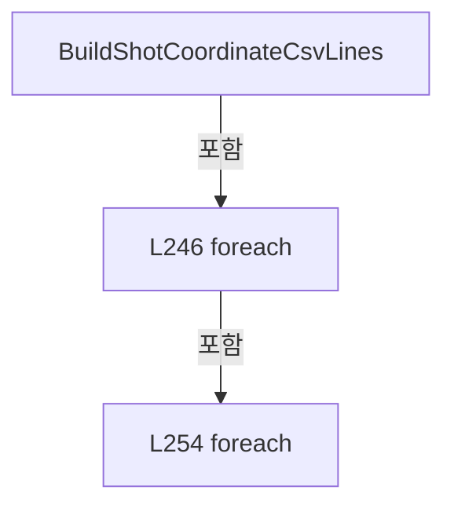

변경 전 점검: 입력/반환 타입, 위 호출자, 예외/취소 경로, 공유 상태와 저장·전송 소비자를 함께 확인합니다. 값의 단위나 물리 방향을 이름만으로 확정하지 않습니다.

### MethodDeclaration `ShotCellNo` · L327–330

[Drilling.File/Script/CAutomation1ScriptFile.cs:327–330](https://github.com/kjuws10-rgb/A3Drilling/blob/334b3599651b2e8e0181fd4459bafaf3cddafff3/Drilling.File/Script/CAutomation1ScriptFile.cs#L327-L330)

| 항목 | 실제 추출 값 |
| --- | --- |
| 서명 | int Drilling.File.Script.CAutomation1ScriptFile.ShotCellNo(Drilling.Common.Recipe.ST_HEAD_SHOT_POINT) |
| 접근/수식자 | Private / private, static |
| 반환/값 타입 | int |
| 소속 타입 | NamedType:Drilling.File.Script.CAutomation1ScriptFile |

입력 계약:

| 이름 | 타입 | 전달 | 선택/기본값 |
| --- | --- | --- | --- |
| point | Drilling.Common.Recipe.ST_HEAD_SHOT_POINT | None | False /  |

현재 부분 분석에서 직접 연결된 호출자는 없습니다. XAML/이벤트/인터페이스·델리게이트·외부 진입을 추가 확인해야 하며, 미사용으로 판정한 것이 아닙니다.

본문의 실제 연산·분기·예외·반환 순서(원문 위치 순):

| 원본 행 | 종류 | 주석 해설 |
| --- | --- | --- |
| 329 | return | 호출자에게 값 또는 제어를 반환합니다: return point.CellNo; |

변경 전 점검: 입력/반환 타입, 위 호출자, 예외/취소 경로, 공유 상태와 저장·전송 소비자를 함께 확인합니다. 값의 단위나 물리 방향을 이름만으로 확정하지 않습니다.

### MethodDeclaration `ShotRowNo` · L332–335

[Drilling.File/Script/CAutomation1ScriptFile.cs:332–335](https://github.com/kjuws10-rgb/A3Drilling/blob/334b3599651b2e8e0181fd4459bafaf3cddafff3/Drilling.File/Script/CAutomation1ScriptFile.cs#L332-L335)

| 항목 | 실제 추출 값 |
| --- | --- |
| 서명 | int Drilling.File.Script.CAutomation1ScriptFile.ShotRowNo(Drilling.Common.Recipe.ST_HEAD_SHOT_POINT) |
| 접근/수식자 | Private / private, static |
| 반환/값 타입 | int |
| 소속 타입 | NamedType:Drilling.File.Script.CAutomation1ScriptFile |

입력 계약:

| 이름 | 타입 | 전달 | 선택/기본값 |
| --- | --- | --- | --- |
| point | Drilling.Common.Recipe.ST_HEAD_SHOT_POINT | None | False /  |

현재 부분 분석에서 직접 연결된 호출자는 없습니다. XAML/이벤트/인터페이스·델리게이트·외부 진입을 추가 확인해야 하며, 미사용으로 판정한 것이 아닙니다.

본문의 실제 연산·분기·예외·반환 순서(원문 위치 순):

| 원본 행 | 종류 | 주석 해설 |
| --- | --- | --- |
| 334 | return | 호출자에게 값 또는 제어를 반환합니다: return point.GroupRow; |

변경 전 점검: 입력/반환 타입, 위 호출자, 예외/취소 경로, 공유 상태와 저장·전송 소비자를 함께 확인합니다. 값의 단위나 물리 방향을 이름만으로 확정하지 않습니다.

### MethodDeclaration `ShotColumnNo` · L337–340

[Drilling.File/Script/CAutomation1ScriptFile.cs:337–340](https://github.com/kjuws10-rgb/A3Drilling/blob/334b3599651b2e8e0181fd4459bafaf3cddafff3/Drilling.File/Script/CAutomation1ScriptFile.cs#L337-L340)

| 항목 | 실제 추출 값 |
| --- | --- |
| 서명 | int Drilling.File.Script.CAutomation1ScriptFile.ShotColumnNo(Drilling.Common.Recipe.ST_HEAD_SHOT_POINT) |
| 접근/수식자 | Private / private, static |
| 반환/값 타입 | int |
| 소속 타입 | NamedType:Drilling.File.Script.CAutomation1ScriptFile |

입력 계약:

| 이름 | 타입 | 전달 | 선택/기본값 |
| --- | --- | --- | --- |
| point | Drilling.Common.Recipe.ST_HEAD_SHOT_POINT | None | False /  |

현재 부분 분석에서 직접 연결된 호출자는 없습니다. XAML/이벤트/인터페이스·델리게이트·외부 진입을 추가 확인해야 하며, 미사용으로 판정한 것이 아닙니다.

본문의 실제 연산·분기·예외·반환 순서(원문 위치 순):

| 원본 행 | 종류 | 주석 해설 |
| --- | --- | --- |
| 339 | return | 호출자에게 값 또는 제어를 반환합니다: return point.GroupColumn; |

변경 전 점검: 입력/반환 타입, 위 호출자, 예외/취소 경로, 공유 상태와 저장·전송 소비자를 함께 확인합니다. 값의 단위나 물리 방향을 이름만으로 확정하지 않습니다.

### MethodDeclaration `ShotHeadNo` · L342–345

[Drilling.File/Script/CAutomation1ScriptFile.cs:342–345](https://github.com/kjuws10-rgb/A3Drilling/blob/334b3599651b2e8e0181fd4459bafaf3cddafff3/Drilling.File/Script/CAutomation1ScriptFile.cs#L342-L345)

| 항목 | 실제 추출 값 |
| --- | --- |
| 서명 | int Drilling.File.Script.CAutomation1ScriptFile.ShotHeadNo(Drilling.Common.Recipe.ST_HEAD_SHOT_POINT) |
| 접근/수식자 | Private / private, static |
| 반환/값 타입 | int |
| 소속 타입 | NamedType:Drilling.File.Script.CAutomation1ScriptFile |

입력 계약:

| 이름 | 타입 | 전달 | 선택/기본값 |
| --- | --- | --- | --- |
| point | Drilling.Common.Recipe.ST_HEAD_SHOT_POINT | None | False /  |

현재 부분 분석에서 직접 연결된 호출자는 없습니다. XAML/이벤트/인터페이스·델리게이트·외부 진입을 추가 확인해야 하며, 미사용으로 판정한 것이 아닙니다.

본문의 실제 연산·분기·예외·반환 순서(원문 위치 순):

| 원본 행 | 종류 | 주석 해설 |
| --- | --- | --- |
| 344 | return | 호출자에게 값 또는 제어를 반환합니다: return point.HeadNo; |

변경 전 점검: 입력/반환 타입, 위 호출자, 예외/취소 경로, 공유 상태와 저장·전송 소비자를 함께 확인합니다. 값의 단위나 물리 방향을 이름만으로 확정하지 않습니다.

### MethodDeclaration `ReadParameterText` · L347–352

[Drilling.File/Script/CAutomation1ScriptFile.cs:347–352](https://github.com/kjuws10-rgb/A3Drilling/blob/334b3599651b2e8e0181fd4459bafaf3cddafff3/Drilling.File/Script/CAutomation1ScriptFile.cs#L347-L352)

| 항목 | 실제 추출 값 |
| --- | --- |
| 서명 | string Drilling.File.Script.CAutomation1ScriptFile.ReadParameterText(System.Collections.Generic.IReadOnlyDictionary<string, string>, string, string) |
| 접근/수식자 | Private / private, static |
| 반환/값 타입 | string |
| 소속 타입 | NamedType:Drilling.File.Script.CAutomation1ScriptFile |

입력 계약:

| 이름 | 타입 | 전달 | 선택/기본값 |
| --- | --- | --- | --- |
| parameters | System.Collections.Generic.IReadOnlyDictionary<string, string> | None | False /  |
| key | string | None | False /  |
| defaultValue | string | None | False /  |

정적 호출자로 확인된 위치:

| 호출 파일/행 | 호출 표현식 | 런타임 분기 가능 |
| --- | --- | --- |
| [Drilling.File/Script/CAutomation1ScriptFile.cs:368–368](https://github.com/kjuws10-rgb/A3Drilling/blob/334b3599651b2e8e0181fd4459bafaf3cddafff3/Drilling.File/Script/CAutomation1ScriptFile.cs#L368-L368) | ReadParameterText | False |
| [Drilling.File/Script/CAutomation1ScriptFile.cs:369–369](https://github.com/kjuws10-rgb/A3Drilling/blob/334b3599651b2e8e0181fd4459bafaf3cddafff3/Drilling.File/Script/CAutomation1ScriptFile.cs#L369-L369) | ReadParameterText | False |

호출하는 대상과 해석 범위:

| 원본 행 | 표현식 | 분석 상태 | 대상/소스 위치 |
| --- | --- | --- | --- |
| 349 | parameters.TryGetValue | resolved · 동적 구현 선택 가능 | bool System.Collections.Generic.IReadOnlyDictionary<string, string>.TryGetValue(string, out string) |
| 349 | string.IsNullOrWhiteSpace | resolved | bool string.IsNullOrWhiteSpace(string?) |

본문의 실제 연산·분기·예외·반환 순서(원문 위치 순):

| 원본 행 | 종류 | 주석 해설 |
| --- | --- | --- |
| 349 | call | 함수·델리게이트 또는 객체 생성자를 호출합니다: parameters.TryGetValue(key, out var value) |
| 349 | call | 함수·델리게이트 또는 객체 생성자를 호출합니다: string.IsNullOrWhiteSpace(value) |
| 349 | conditional-expression | 조건에 따라 결과식을 선택합니다: parameters.TryGetValue(key, out var value) && !string.IsNullOrWhiteSpace(value) ? value : defaultValue |
| 349 | return | 호출자에게 값 또는 제어를 반환합니다: return parameters.TryGetValue(key, out var value) && !string.IsNullOrWhiteSpace(value) ? value : defaultValue; |

변경 전 점검: 입력/반환 타입, 위 호출자, 예외/취소 경로, 공유 상태와 저장·전송 소비자를 함께 확인합니다. 값의 단위나 물리 방향을 이름만으로 확정하지 않습니다.

### MethodDeclaration `BuildCoordinateListLines` · L354–388

[Drilling.File/Script/CAutomation1ScriptFile.cs:354–388](https://github.com/kjuws10-rgb/A3Drilling/blob/334b3599651b2e8e0181fd4459bafaf3cddafff3/Drilling.File/Script/CAutomation1ScriptFile.cs#L354-L388)

| 항목 | 실제 추출 값 |
| --- | --- |
| 서명 | System.Collections.Generic.IReadOnlyList<string> Drilling.File.Script.CAutomation1ScriptFile.BuildCoordinateListLines(Drilling.Common.Station.ST_PROCESS_MODEL, System.DateTimeOffset, System.Collections.Generic.IReadOnlyList<Drilling.Common.Station.ST_HEAD_PROCESS_PLAN>, System.Collections.Generic.IReadOnlyList<Drilling.Common.Station.ST_HEAD_SCRIPT_RESULT>) |
| 접근/수식자 | Private / private, static |
| 반환/값 타입 | System.Collections.Generic.IReadOnlyList<string> |
| 소속 타입 | NamedType:Drilling.File.Script.CAutomation1ScriptFile |

입력 계약:

| 이름 | 타입 | 전달 | 선택/기본값 |
| --- | --- | --- | --- |
| processModel | Drilling.Common.Station.ST_PROCESS_MODEL | None | False /  |
| createdAt | System.DateTimeOffset | None | False /  |
| activeHeads | System.Collections.Generic.IReadOnlyList<Drilling.Common.Station.ST_HEAD_PROCESS_PLAN> | None | False /  |
| headScripts | System.Collections.Generic.IReadOnlyList<Drilling.Common.Station.ST_HEAD_SCRIPT_RESULT> | None | False /  |

정적 호출자로 확인된 위치:

| 호출 파일/행 | 호출 표현식 | 런타임 분기 가능 |
| --- | --- | --- |
| [Drilling.File/Script/CAutomation1ScriptFile.cs:98–98](https://github.com/kjuws10-rgb/A3Drilling/blob/334b3599651b2e8e0181fd4459bafaf3cddafff3/Drilling.File/Script/CAutomation1ScriptFile.cs#L98-L98) | BuildCoordinateListLines | False |

호출하는 대상과 해석 범위:

| 원본 행 | 표현식 | 분석 상태 | 대상/소스 위치 |
| --- | --- | --- | --- |
| 356 | new List<string> | resolved | System.Collections.Generic.List<string>.List() |
| 362 | headScripts.ToDictionary | resolved | System.Collections.Generic.Dictionary<int, Drilling.Common.Station.ST_HEAD_SCRIPT_RESULT> System.Collections.Generic.IEnumerable<Drilling.Common.Station.ST_HEAD_SCRIPT_RESULT>.ToDictionary<Drilling.Common.Station.ST_HEAD_SCRIPT_RESULT, int>(System.Func<Drilling.Common.Station.ST_HEAD_SCRIPT_RESULT, int>) |
| 363 | lines.Add | resolved | void System.Collections.Generic.List<string>.Add(string) |
| 364 | lines.Add | resolved | void System.Collections.Generic.List<string>.Add(string) |
| 365 | lines.Add | resolved | void System.Collections.Generic.List<string>.Add(string) |
| 366 | lines.Add | resolved | void System.Collections.Generic.List<string>.Add(string) |
| 367 | lines.Add | resolved | void System.Collections.Generic.List<string>.Add(string) |
| 368 | lines.Add | resolved | void System.Collections.Generic.List<string>.Add(string) |
| 368 | ReadParameterText | resolved | string Drilling.File.Script.CAutomation1ScriptFile.ReadParameterText(System.Collections.Generic.IReadOnlyDictionary<string, string>, string, string) · Drilling.File/Script/CAutomation1ScriptFile.cs:347 |
| 369 | lines.Add | resolved | void System.Collections.Generic.List<string>.Add(string) |
| 369 | ReadParameterText | resolved | string Drilling.File.Script.CAutomation1ScriptFile.ReadParameterText(System.Collections.Generic.IReadOnlyDictionary<string, string>, string, string) · Drilling.File/Script/CAutomation1ScriptFile.cs:347 |
| 375 | lines.Add | resolved | void System.Collections.Generic.List<string>.Add(string) |
| 375 | headScripts.Sum | resolved | int System.Collections.Generic.IEnumerable<Drilling.Common.Station.ST_HEAD_SCRIPT_RESULT>.Sum<Drilling.Common.Station.ST_HEAD_SCRIPT_RESULT>(System.Func<Drilling.Common.Station.ST_HEAD_SCRIPT_RESULT, int>) |
| 376 | lines.Add | resolved | void System.Collections.Generic.List<string>.Add(string) |
| 377 | lines.Add | resolved | void System.Collections.Generic.List<string>.Add(string) |
| 381 | lines.Add | resolved | void System.Collections.Generic.List<string>.Add(string) |
| 382 | lines.Add | resolved | void System.Collections.Generic.List<string>.Add(string) |
| 383 | AppendHeadShotList | resolved | void Drilling.File.Script.CAutomation1ScriptFile.AppendHeadShotList(System.Collections.Generic.List<string>, Drilling.Common.Station.ST_HEAD_PROCESS_PLAN) · Drilling.File/Script/CAutomation1ScriptFile.cs:969 |
| 384 | lines.Add | resolved | void System.Collections.Generic.List<string>.Add(string) |

본문의 실제 연산·분기·예외·반환 순서(원문 위치 순):

| 원본 행 | 종류 | 주석 해설 |
| --- | --- | --- |
| 356 | call | 함수·델리게이트 또는 객체 생성자를 호출합니다: new List<string>() |
| 356 | local-declaration | 지역 변수를 선언합니다: var lines = new List<string>(); |
| 356 | variable-initializer | 변수의 초기값을 지정합니다: lines = new List<string>() |
| 362 | call | 함수·델리게이트 또는 객체 생성자를 호출합니다: headScripts.ToDictionary(SelectHeadNo) |
| 362 | local-declaration | 지역 변수를 선언합니다: var scriptByHead = headScripts.ToDictionary(SelectHeadNo); |
| 362 | variable-initializer | 변수의 초기값을 지정합니다: scriptByHead = headScripts.ToDictionary(SelectHeadNo) |
| 363 | call | 함수·델리게이트 또는 객체 생성자를 호출합니다: lines.Add("Laser Drilling Process Coordinate List") |
| 364 | call | 함수·델리게이트 또는 객체 생성자를 호출합니다: lines.Add($"ProcessId={processModel.ProcessId}") |
| 365 | call | 함수·델리게이트 또는 객체 생성자를 호출합니다: lines.Add($"RecipeId={processModel.RecipeId}") |
| 366 | call | 함수·델리게이트 또는 객체 생성자를 호출합니다: lines.Add($"GlassId={processModel.GlassId}") |
| 367 | call | 함수·델리게이트 또는 객체 생성자를 호출합니다: lines.Add($"CreatedAt={createdAt:yyyy-MM-dd HH:mm:ss.fff zzz}") |
| 368 | call | 함수·델리게이트 또는 객체 생성자를 호출합니다: lines.Add($"ShiftOffsetX={ReadParameterText(processModel.Parameters, "SHIFT_OFFSET_X", "0")}") |
| 368 | call | 함수·델리게이트 또는 객체 생성자를 호출합니다: ReadParameterText(processModel.Parameters, "SHIFT_OFFSET_X", "0") |
| 369 | call | 함수·델리게이트 또는 객체 생성자를 호출합니다: lines.Add($"ShiftOffsetY={ReadParameterText(processModel.Parameters, "SHIFT_OFFSET_Y", "0")}") |
| 369 | call | 함수·델리게이트 또는 객체 생성자를 호출합니다: ReadParameterText(processModel.Parameters, "SHIFT_OFFSET_Y", "0") |
| 375 | call | 함수·델리게이트 또는 객체 생성자를 호출합니다: lines.Add($"TotalShots={headScripts.Sum(SelectTotalShots)}") |
| 375 | call | 함수·델리게이트 또는 객체 생성자를 호출합니다: headScripts.Sum(SelectTotalShots) |
| 376 | call | 함수·델리게이트 또는 객체 생성자를 호출합니다: lines.Add($"HeadScriptCount={headScripts.Count}") |
| 377 | call | 함수·델리게이트 또는 객체 생성자를 호출합니다: lines.Add("") |
| 378 | foreach | 컬렉션 요소를 순회합니다: foreach (var head in activeHeads) |
| 380 | local-declaration | 지역 변수를 선언합니다: var script = scriptByHead[head.HeadNo]; |
| 380 | variable-initializer | 변수의 초기값을 지정합니다: script = scriptByHead[head.HeadNo] |
| 381 | call | 함수·델리게이트 또는 객체 생성자를 호출합니다: lines.Add($"[H{head.HeadNo:00}]") |
| 382 | call | 함수·델리게이트 또는 객체 생성자를 호출합니다: lines.Add($"Automation={script.AutomationNo} Task={script.TaskNo} Script={script.FileName} Shots={script.TotalShots}") |
| 383 | call | 함수·델리게이트 또는 객체 생성자를 호출합니다: AppendHeadShotList(lines, head) |
| 384 | call | 함수·델리게이트 또는 객체 생성자를 호출합니다: lines.Add("") |
| 387 | return | 호출자에게 값 또는 제어를 반환합니다: return lines; |

제어 구문의 포함 구조(실제 실행 순서/CFG가 아닌 구문 탐색 그림):

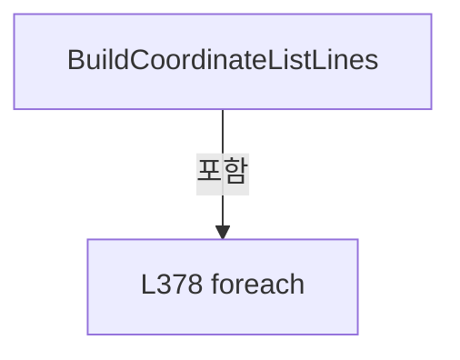

변경 전 점검: 입력/반환 타입, 위 호출자, 예외/취소 경로, 공유 상태와 저장·전송 소비자를 함께 확인합니다. 값의 단위나 물리 방향을 이름만으로 확정하지 않습니다.

### LocalFunctionStatement `SelectHeadNo` · L357–360

[Drilling.File/Script/CAutomation1ScriptFile.cs:357–360](https://github.com/kjuws10-rgb/A3Drilling/blob/334b3599651b2e8e0181fd4459bafaf3cddafff3/Drilling.File/Script/CAutomation1ScriptFile.cs#L357-L360)

| 항목 | 실제 추출 값 |
| --- | --- |
| 서명 | int SelectHeadNo(Drilling.Common.Station.ST_HEAD_SCRIPT_RESULT) |
| 접근/수식자 | Private /  |
| 반환/값 타입 | int |
| 소속 타입 | NamedType:Drilling.File.Script.CAutomation1ScriptFile |

입력 계약:

| 이름 | 타입 | 전달 | 선택/기본값 |
| --- | --- | --- | --- |
| script | Drilling.Common.Station.ST_HEAD_SCRIPT_RESULT | None | False /  |

현재 부분 분석에서 직접 연결된 호출자는 없습니다. XAML/이벤트/인터페이스·델리게이트·외부 진입을 추가 확인해야 하며, 미사용으로 판정한 것이 아닙니다.

본문의 실제 연산·분기·예외·반환 순서(원문 위치 순):

| 원본 행 | 종류 | 주석 해설 |
| --- | --- | --- |
| 359 | return | 호출자에게 값 또는 제어를 반환합니다: return script.HeadNo; |

변경 전 점검: 입력/반환 타입, 위 호출자, 예외/취소 경로, 공유 상태와 저장·전송 소비자를 함께 확인합니다. 값의 단위나 물리 방향을 이름만으로 확정하지 않습니다.

### LocalFunctionStatement `SelectTotalShots` · L370–373

[Drilling.File/Script/CAutomation1ScriptFile.cs:370–373](https://github.com/kjuws10-rgb/A3Drilling/blob/334b3599651b2e8e0181fd4459bafaf3cddafff3/Drilling.File/Script/CAutomation1ScriptFile.cs#L370-L373)

| 항목 | 실제 추출 값 |
| --- | --- |
| 서명 | int SelectTotalShots(Drilling.Common.Station.ST_HEAD_SCRIPT_RESULT) |
| 접근/수식자 | Private /  |
| 반환/값 타입 | int |
| 소속 타입 | NamedType:Drilling.File.Script.CAutomation1ScriptFile |

입력 계약:

| 이름 | 타입 | 전달 | 선택/기본값 |
| --- | --- | --- | --- |
| script | Drilling.Common.Station.ST_HEAD_SCRIPT_RESULT | None | False /  |

현재 부분 분석에서 직접 연결된 호출자는 없습니다. XAML/이벤트/인터페이스·델리게이트·외부 진입을 추가 확인해야 하며, 미사용으로 판정한 것이 아닙니다.

본문의 실제 연산·분기·예외·반환 순서(원문 위치 순):

| 원본 행 | 종류 | 주석 해설 |
| --- | --- | --- |
| 372 | return | 호출자에게 값 또는 제어를 반환합니다: return script.TotalShots; |

변경 전 점검: 입력/반환 타입, 위 호출자, 예외/취소 경로, 공유 상태와 저장·전송 소비자를 함께 확인합니다. 값의 단위나 물리 방향을 이름만으로 확정하지 않습니다.

### MethodDeclaration `BuildHeadLines` · L390–582

[Drilling.File/Script/CAutomation1ScriptFile.cs:390–582](https://github.com/kjuws10-rgb/A3Drilling/blob/334b3599651b2e8e0181fd4459bafaf3cddafff3/Drilling.File/Script/CAutomation1ScriptFile.cs#L390-L582)

| 항목 | 실제 추출 값 |
| --- | --- |
| 서명 | System.Collections.Generic.IReadOnlyList<string> Drilling.File.Script.CAutomation1ScriptFile.BuildHeadLines(Drilling.Common.Station.ST_PROCESS_MODEL, Drilling.Common.Station.ST_HEAD_PROCESS_PLAN, System.DateTimeOffset, bool, long) |
| 접근/수식자 | Private / private, static |
| 반환/값 타입 | System.Collections.Generic.IReadOnlyList<string> |
| 소속 타입 | NamedType:Drilling.File.Script.CAutomation1ScriptFile |

입력 계약:

| 이름 | 타입 | 전달 | 선택/기본값 |
| --- | --- | --- | --- |
| processModel | Drilling.Common.Station.ST_PROCESS_MODEL | None | False /  |
| head | Drilling.Common.Station.ST_HEAD_PROCESS_PLAN | None | False /  |
| createdAt | System.DateTimeOffset | None | False /  |
| bufferedRun | bool | None | False /  |
| readyRunId | long | None | False /  |

정적 호출자로 확인된 위치:

| 호출 파일/행 | 호출 표현식 | 런타임 분기 가능 |
| --- | --- | --- |
| [Drilling.File/Script/CAutomation1ScriptFile.cs:92–92](https://github.com/kjuws10-rgb/A3Drilling/blob/334b3599651b2e8e0181fd4459bafaf3cddafff3/Drilling.File/Script/CAutomation1ScriptFile.cs#L92-L92) | BuildHeadLines | False |

호출하는 대상과 해석 범위:

| 원본 행 | 표현식 | 분석 상태 | 대상/소스 위치 |
| --- | --- | --- | --- |
| 393 | new List<string> | resolved | System.Collections.Generic.List<string>.List() |
| 394 | new Dictionary<string, string> | resolved | System.Collections.Generic.Dictionary<string, string>.Dictionary(System.Collections.Generic.IEnumerable<System.Collections.Generic.KeyValuePair<string, string>>, System.Collections.Generic.IEqualityComparer<string>?) |
| 395 | ReadBool | resolved | bool Drilling.File.Script.CAutomation1ScriptFile.ReadBool(System.Collections.Generic.IReadOnlyDictionary<string, string>, bool, params string[]) · Drilling.File/Script/CAutomation1ScriptFile.cs:1242 |
| 396 | ReadText | resolved | string Drilling.File.Script.CAutomation1ScriptFile.ReadText(System.Collections.Generic.IReadOnlyDictionary<string, string>, string, System.Collections.Generic.IEnumerable<string>) · Drilling.File/Script/CAutomation1ScriptFile.cs:1139 |
| 396 | CreateHeadKeys | resolved | System.Collections.Generic.IReadOnlyList<string> Drilling.File.Script.CAutomation1ScriptFile.CreateHeadKeys(int, params string[]) · Drilling.File/Script/CAutomation1ScriptFile.cs:1102 |
| 397 | ValidateAeroScriptAxisName | resolved | string Drilling.File.Script.CAutomation1ScriptFile.ValidateAeroScriptAxisName(string, string) · Drilling.File/Script/CAutomation1ScriptFile.cs:1352 |
| 398 | ReadText | resolved | string Drilling.File.Script.CAutomation1ScriptFile.ReadText(System.Collections.Generic.IReadOnlyDictionary<string, string>, string, System.Collections.Generic.IEnumerable<string>) · Drilling.File/Script/CAutomation1ScriptFile.cs:1139 |
| 398 | CreateHeadKeys | resolved | System.Collections.Generic.IReadOnlyList<string> Drilling.File.Script.CAutomation1ScriptFile.CreateHeadKeys(int, params string[]) · Drilling.File/Script/CAutomation1ScriptFile.cs:1102 |
| 399 | ValidateAeroScriptAxisName | resolved | string Drilling.File.Script.CAutomation1ScriptFile.ValidateAeroScriptAxisName(string, string) · Drilling.File/Script/CAutomation1ScriptFile.cs:1352 |
| 400 | ReadText | resolved | string Drilling.File.Script.CAutomation1ScriptFile.ReadText(System.Collections.Generic.IReadOnlyDictionary<string, string>, string, System.Collections.Generic.IEnumerable<string>) · Drilling.File/Script/CAutomation1ScriptFile.cs:1139 |
| 400 | CreateHeadKeys | resolved | System.Collections.Generic.IReadOnlyList<string> Drilling.File.Script.CAutomation1ScriptFile.CreateHeadKeys(int, params string[]) · Drilling.File/Script/CAutomation1ScriptFile.cs:1102 |
| 403 | ValidateAeroScriptAxisName | resolved | string Drilling.File.Script.CAutomation1ScriptFile.ValidateAeroScriptAxisName(string, string) · Drilling.File/Script/CAutomation1ScriptFile.cs:1352 |
| 406 | ReadText | resolved | string Drilling.File.Script.CAutomation1ScriptFile.ReadText(System.Collections.Generic.IReadOnlyDictionary<string, string>, string, System.Collections.Generic.IEnumerable<string>) · Drilling.File/Script/CAutomation1ScriptFile.cs:1139 |
| 406 | CreateHeadKeys | resolved | System.Collections.Generic.IReadOnlyList<string> Drilling.File.Script.CAutomation1ScriptFile.CreateHeadKeys(int, params string[]) · Drilling.File/Script/CAutomation1ScriptFile.cs:1102 |
| 409 | ValidateAeroScriptAxisName | resolved | string Drilling.File.Script.CAutomation1ScriptFile.ValidateAeroScriptAxisName(string, string) · Drilling.File/Script/CAutomation1ScriptFile.cs:1352 |
| 412 | CreateEncoderScaleKeys | resolved | System.Collections.Generic.IReadOnlyList<string> Drilling.File.Script.CAutomation1ScriptFile.CreateEncoderScaleKeys(int) · Drilling.File/Script/CAutomation1ScriptFile.cs:1112 |
| 413 | ResolveParameterName | resolved | string Drilling.File.Script.CAutomation1ScriptFile.ResolveParameterName(System.Collections.Generic.IReadOnlyDictionary<string, string>, System.Collections.Generic.IEnumerable<string>, string) · Drilling.File/Script/CAutomation1ScriptFile.cs:1126 |
| 414 | ReadDouble | resolved | double Drilling.File.Script.CAutomation1ScriptFile.ReadDouble(System.Collections.Generic.IReadOnlyDictionary<string, string>, double, System.Collections.Generic.IEnumerable<string>) · Drilling.File/Script/CAutomation1ScriptFile.cs:1162 |
| 417 | ValidateEncoderScale | resolved | void Drilling.File.Script.CAutomation1ScriptFile.ValidateEncoderScale(string, double) · Drilling.File/Script/CAutomation1ScriptFile.cs:1336 |
| 420 | ReadOnOff | resolved | bool Drilling.File.Script.CAutomation1ScriptFile.ReadOnOff(System.Collections.Generic.IReadOnlyDictionary<string, string>, bool, System.Collections.Generic.IEnumerable<string>) · Drilling.File/Script/CAutomation1ScriptFile.cs:1180 |
| 420 | CreateEncoderFeedbackFlipKeys | resolved | System.Collections.Generic.IReadOnlyList<string> Drilling.File.Script.CAutomation1ScriptFile.CreateEncoderFeedbackFlipKeys(int) · Drilling.File/Script/CAutomation1ScriptFile.cs:1119 |
| 421 | ResolveCoordinatedRampRate | resolved | double Drilling.File.Script.CAutomation1ScriptFile.ResolveCoordinatedRampRate(double, double) · Drilling.File/Script/CAutomation1ScriptFile.cs:1062 |
| 422 | ReadInt | resolved | int Drilling.File.Script.CAutomation1ScriptFile.ReadInt(System.Collections.Generic.IReadOnlyDictionary<string, string>, int, params string[]) · Drilling.File/Script/CAutomation1ScriptFile.cs:1219 |
| 423 | ReadInt | resolved | int Drilling.File.Script.CAutomation1ScriptFile.ReadInt(System.Collections.Generic.IReadOnlyDictionary<string, string>, int, params string[]) · Drilling.File/Script/CAutomation1ScriptFile.cs:1219 |
| 424 | ReadDelaySeconds | resolved | double Drilling.File.Script.CAutomation1ScriptFile.ReadDelaySeconds(System.Collections.Generic.IReadOnlyDictionary<string, string>, double, params string[]) · Drilling.File/Script/CAutomation1ScriptFile.cs:1082 |
| 425 | ReadDouble | resolved | double Drilling.File.Script.CAutomation1ScriptFile.ReadDouble(System.Collections.Generic.IReadOnlyDictionary<string, string>, double, params string[]) · Drilling.File/Script/CAutomation1ScriptFile.cs:1157 |
| 426 | CalculateLaserPeriod | resolved | double Drilling.File.Script.CAutomation1ScriptFile.CalculateLaserPeriod(double) · Drilling.File/Script/CAutomation1ScriptFile.cs:1036 |
| 427 | CalculateShotDelaySeconds | resolved | double Drilling.File.Script.CAutomation1ScriptFile.CalculateShotDelaySeconds(int, double) · Drilling.File/Script/CAutomation1ScriptFile.cs:1041 |
| 428 | ReadDouble | resolved | double Drilling.File.Script.CAutomation1ScriptFile.ReadDouble(System.Collections.Generic.IReadOnlyDictionary<string, string>, double, System.Collections.Generic.IEnumerable<string>) · Drilling.File/Script/CAutomation1ScriptFile.cs:1162 |
| 428 | CreateHeadKeys | resolved | System.Collections.Generic.IReadOnlyList<string> Drilling.File.Script.CAutomation1ScriptFile.CreateHeadKeys(int, params string[]) · Drilling.File/Script/CAutomation1ScriptFile.cs:1102 |
| 429 | ReadDouble | resolved | double Drilling.File.Script.CAutomation1ScriptFile.ReadDouble(System.Collections.Generic.IReadOnlyDictionary<string, string>, double, System.Collections.Generic.IEnumerable<string>) · Drilling.File/Script/CAutomation1ScriptFile.cs:1162 |
| 429 | CreateHeadKeys | resolved | System.Collections.Generic.IReadOnlyList<string> Drilling.File.Script.CAutomation1ScriptFile.CreateHeadKeys(int, params string[]) · Drilling.File/Script/CAutomation1ScriptFile.cs:1102 |
| 430 | ReadBool | resolved | bool Drilling.File.Script.CAutomation1ScriptFile.ReadBool(System.Collections.Generic.IReadOnlyDictionary<string, string>, bool, params string[]) · Drilling.File/Script/CAutomation1ScriptFile.cs:1242 |
| 431 | Math.Abs | resolved | double System.Math.Abs(double) |
| 431 | ReadDouble | resolved | double Drilling.File.Script.CAutomation1ScriptFile.ReadDouble(System.Collections.Generic.IReadOnlyDictionary<string, string>, double, params string[]) · Drilling.File/Script/CAutomation1ScriptFile.cs:1157 |
| 432 | ResolveMachiningAxis | resolved | Drilling.File.Script.CAutomation1ScriptFile.EN_SCRIPT_FOLLOW_AXIS Drilling.File.Script.CAutomation1ScriptFile.ResolveMachiningAxis(System.Collections.Generic.IReadOnlyList<Drilling.Common.Recipe.ST_HEAD_SHOT_POINT>, bool) · Drilling.File/Script/CAutomation1ScriptFile.cs:584 |
| 433 | ReadHeadScanFieldHalfWidth | resolved | double Drilling.File.Script.CAutomation1ScriptFile.ReadHeadScanFieldHalfWidth(System.Collections.Generic.IReadOnlyDictionary<string, string>, int) · Drilling.File/Script/CAutomation1ScriptFile.cs:692 |
| 434 | lines.Add | resolved | void System.Collections.Generic.List<string>.Add(string) |
| 435 | lines.Add | resolved | void System.Collections.Generic.List<string>.Add(string) |
| 436 | lines.Add | resolved | void System.Collections.Generic.List<string>.Add(string) |
| 437 | lines.Add | resolved | void System.Collections.Generic.List<string>.Add(string) |
| 438 | lines.Add | resolved | void System.Collections.Generic.List<string>.Add(string) |
| 439 | CMofReadiness.VariableIndex | resolved | int Drilling.Common.Automation.CMofReadiness.VariableIndex(int) · Drilling.Common/Automation/CAutomationManager.cs:1778 |
| 440 | lines.Add | resolved | void System.Collections.Generic.List<string>.Add(string) |
| 440 | readyRunId.ToString | resolved | string long.ToString(System.IFormatProvider?) |
| 441 | lines.Add | resolved | void System.Collections.Generic.List<string>.Add(string) |
| 442 | lines.Add | resolved | void System.Collections.Generic.List<string>.Add(string) |
| 443 | lines.Add | resolved | void System.Collections.Generic.List<string>.Add(string) |
| 443 | Format | resolved | string Drilling.File.Script.CAutomation1ScriptFile.Format(double) · Drilling.File/Script/CAutomation1ScriptFile.cs:1285 |
| 443 | Format | resolved | string Drilling.File.Script.CAutomation1ScriptFile.Format(double) · Drilling.File/Script/CAutomation1ScriptFile.cs:1285 |
| 446 | lines.Add | resolved | void System.Collections.Generic.List<string>.Add(string) |
| 446 | Format | resolved | string Drilling.File.Script.CAutomation1ScriptFile.Format(double) · Drilling.File/Script/CAutomation1ScriptFile.cs:1285 |
| 451 | lines.Add | resolved | void System.Collections.Generic.List<string>.Add(string) |
| 456 | lines.Add | resolved | void System.Collections.Generic.List<string>.Add(string) |
| 459 | lines.Add | resolved | void System.Collections.Generic.List<string>.Add(string) |
| 460 | lines.Add | resolved | void System.Collections.Generic.List<string>.Add(string) |
| 461 | lines.Add | resolved | void System.Collections.Generic.List<string>.Add(string) |
| 462 | lines.Add | resolved | void System.Collections.Generic.List<string>.Add(string) |
| 463 | lines.Add | resolved | void System.Collections.Generic.List<string>.Add(string) |
| 464 | lines.Add | resolved | void System.Collections.Generic.List<string>.Add(string) |
| 465 | lines.Add | resolved | void System.Collections.Generic.List<string>.Add(string) |
| 468 | lines.Add | resolved | void System.Collections.Generic.List<string>.Add(string) |
| 469 | lines.Add | resolved | void System.Collections.Generic.List<string>.Add(string) |
| 470 | lines.Add | resolved | void System.Collections.Generic.List<string>.Add(string) |
| 473 | lines.Add | resolved | void System.Collections.Generic.List<string>.Add(string) |
| 474 | lines.Add | resolved | void System.Collections.Generic.List<string>.Add(string) |
| 477 | lines.Add | resolved | void System.Collections.Generic.List<string>.Add(string) |
| 480 | lines.Add | resolved | void System.Collections.Generic.List<string>.Add(string) |
| 480 | Format | resolved | string Drilling.File.Script.CAutomation1ScriptFile.Format(double) · Drilling.File/Script/CAutomation1ScriptFile.cs:1285 |
| 480 | Format | resolved | string Drilling.File.Script.CAutomation1ScriptFile.Format(double) · Drilling.File/Script/CAutomation1ScriptFile.cs:1285 |
| 481 | lines.Add | resolved | void System.Collections.Generic.List<string>.Add(string) |
| 482 | lines.Add | resolved | void System.Collections.Generic.List<string>.Add(string) |
| 482 | Format | resolved | string Drilling.File.Script.CAutomation1ScriptFile.Format(double) · Drilling.File/Script/CAutomation1ScriptFile.cs:1285 |
| 483 | lines.Add | resolved | void System.Collections.Generic.List<string>.Add(string) |
| 483 | Format | resolved | string Drilling.File.Script.CAutomation1ScriptFile.Format(double) · Drilling.File/Script/CAutomation1ScriptFile.cs:1285 |
| 484 | lines.Add | resolved | void System.Collections.Generic.List<string>.Add(string) |
| 485 | lines.Add | resolved | void System.Collections.Generic.List<string>.Add(string) |
| 485 | Format | resolved | string Drilling.File.Script.CAutomation1ScriptFile.Format(double) · Drilling.File/Script/CAutomation1ScriptFile.cs:1285 |
| 486 | lines.Add | resolved | void System.Collections.Generic.List<string>.Add(string) |
| 486 | Format | resolved | string Drilling.File.Script.CAutomation1ScriptFile.Format(double) · Drilling.File/Script/CAutomation1ScriptFile.cs:1285 |
| 486 | ToAutomationSpeed | resolved | double Drilling.File.Script.CAutomation1ScriptFile.ToAutomationSpeed(double) · Drilling.File/Script/CAutomation1ScriptFile.cs:1077 |
| 487 | lines.Add | resolved | void System.Collections.Generic.List<string>.Add(string) |
| 487 | Format | resolved | string Drilling.File.Script.CAutomation1ScriptFile.Format(double) · Drilling.File/Script/CAutomation1ScriptFile.cs:1285 |
| 487 | ToAutomationSpeed | resolved | double Drilling.File.Script.CAutomation1ScriptFile.ToAutomationSpeed(double) · Drilling.File/Script/CAutomation1ScriptFile.cs:1077 |
| 488 | lines.Add | resolved | void System.Collections.Generic.List<string>.Add(string) |
| 488 | Format | resolved | string Drilling.File.Script.CAutomation1ScriptFile.Format(double) · Drilling.File/Script/CAutomation1ScriptFile.cs:1285 |
| 488 | ToAutomationSpeed | resolved | double Drilling.File.Script.CAutomation1ScriptFile.ToAutomationSpeed(double) · Drilling.File/Script/CAutomation1ScriptFile.cs:1077 |
| 491 | lines.Add | resolved | void System.Collections.Generic.List<string>.Add(string) |
| 496 | lines.Add | resolved | void System.Collections.Generic.List<string>.Add(string) |
| 497 | lines.Add | resolved | void System.Collections.Generic.List<string>.Add(string) |
| 497 | Format | resolved | string Drilling.File.Script.CAutomation1ScriptFile.Format(double) · Drilling.File/Script/CAutomation1ScriptFile.cs:1285 |
| 499 | lines.Add | resolved | void System.Collections.Generic.List<string>.Add(string) |
| 499 | Format | resolved | string Drilling.File.Script.CAutomation1ScriptFile.Format(double) · Drilling.File/Script/CAutomation1ScriptFile.cs:1285 |
| 500 | lines.Add | resolved | void System.Collections.Generic.List<string>.Add(string) |
| 500 | Format | resolved | string Drilling.File.Script.CAutomation1ScriptFile.Format(double) · Drilling.File/Script/CAutomation1ScriptFile.cs:1285 |
| 501 | lines.Add | resolved | void System.Collections.Generic.List<string>.Add(string) |
| 501 | Format | resolved | string Drilling.File.Script.CAutomation1ScriptFile.Format(double) · Drilling.File/Script/CAutomation1ScriptFile.cs:1285 |
| 502 | lines.Add | resolved | void System.Collections.Generic.List<string>.Add(string) |
| 502 | Format | resolved | string Drilling.File.Script.CAutomation1ScriptFile.Format(double) · Drilling.File/Script/CAutomation1ScriptFile.cs:1285 |
| 504 | lines.Add | resolved | void System.Collections.Generic.List<string>.Add(string) |
| 504 | Format | resolved | string Drilling.File.Script.CAutomation1ScriptFile.Format(double) · Drilling.File/Script/CAutomation1ScriptFile.cs:1285 |
| 505 | lines.Add | resolved | void System.Collections.Generic.List<string>.Add(string) |
| 506 | lines.Add | resolved | void System.Collections.Generic.List<string>.Add(string) |
| 511 | lines.Add | resolved | void System.Collections.Generic.List<string>.Add(string) |
| 512 | lines.Add | resolved | void System.Collections.Generic.List<string>.Add(string) |
| 512 | readyRunId.ToString | resolved | string long.ToString(System.IFormatProvider?) |
| 514 | AppendStartFollowMoves | resolved | void Drilling.File.Script.CAutomation1ScriptFile.AppendStartFollowMoves(System.Collections.Generic.List<string>, System.Collections.Generic.IReadOnlyDictionary<string, string>, Drilling.Common.Station.ST_HEAD_PROCESS_PLAN, string, string, string, double, bool) · Drilling.File/Script/CAutomation1ScriptFile.cs:840 |
| 516 | CRecipeShotMaskingPlan.Build | resolved | Drilling.Common.Recipe.CRecipeShotMaskingPlan Drilling.Common.Recipe.CRecipeShotMaskingPlan.Build(System.Collections.Generic.IReadOnlyDictionary<string, string>) · Drilling.Common/Recipe/CShotCoordinatePlanBuilder.cs:836 |
| 521 | ReadScriptScannerY | resolved | double Drilling.File.Script.CAutomation1ScriptFile.ReadScriptScannerY(Drilling.Common.Recipe.ST_HEAD_SHOT_POINT, bool) · Drilling.File/Script/CAutomation1ScriptFile.cs:713 |
| 524 | AppendFollowTransitionMoves | resolved | void Drilling.File.Script.CAutomation1ScriptFile.AppendFollowTransitionMoves(System.Collections.Generic.List<string>, System.Collections.Generic.IReadOnlyDictionary<string, string>, Drilling.Common.Station.ST_HEAD_PROCESS_PLAN, string, string, string, bool, Drilling.Common.Recipe.ST_HEAD_SHOT_POINT, Drilling.Common.Recipe.ST_HEAD_SHOT_POINT) · Drilling.File/Script/CAutomation1ScriptFile.cs:888 |
| 527 | IsScanLineFirstShot | resolved | bool Drilling.File.Script.CAutomation1ScriptFile.IsScanLineFirstShot(Drilling.Common.Recipe.ST_HEAD_SHOT_POINT?, Drilling.Common.Recipe.ST_HEAD_SHOT_POINT) · Drilling.File/Script/CAutomation1ScriptFile.cs:625 |
| 529 | FindNextPointInSameScanLine | resolved | Drilling.Common.Recipe.ST_HEAD_SHOT_POINT? Drilling.File.Script.CAutomation1ScriptFile.FindNextPointInSameScanLine(System.Collections.Generic.IReadOnlyList<Drilling.Common.Recipe.ST_HEAD_SHOT_POINT>, int, Drilling.Common.Recipe.ST_HEAD_SHOT_POINT) · Drilling.File/Script/CAutomation1ScriptFile.cs:635 |
| 530 | ResolveLineMachiningAxis | resolved | Drilling.File.Script.CAutomation1ScriptFile.EN_SCRIPT_FOLLOW_AXIS Drilling.File.Script.CAutomation1ScriptFile.ResolveLineMachiningAxis(Drilling.Common.Recipe.ST_HEAD_SHOT_POINT, Drilling.Common.Recipe.ST_HEAD_SHOT_POINT?, Drilling.File.Script.CAutomation1ScriptFile.EN_SCRIPT_FOLLOW_AXIS, bool) · Drilling.File/Script/CAutomation1ScriptFile.cs:608 |
| 531 | AppendLinePreApproachMove | resolved | void Drilling.File.Script.CAutomation1ScriptFile.AppendLinePreApproachMove(System.Collections.Generic.List<string>, string, string, Drilling.Common.Recipe.ST_HEAD_SHOT_POINT, Drilling.Common.Recipe.ST_HEAD_SHOT_POINT?, Drilling.File.Script.CAutomation1ScriptFile.EN_SCRIPT_FOLLOW_AXIS, double, double, bool) · Drilling.File/Script/CAutomation1ScriptFile.cs:652 |
| 534 | lines.Add | resolved | void System.Collections.Generic.List<string>.Add(string) |
| 534 | Format | resolved | string Drilling.File.Script.CAutomation1ScriptFile.Format(double) · Drilling.File/Script/CAutomation1ScriptFile.cs:1285 |
| 534 | Format | resolved | string Drilling.File.Script.CAutomation1ScriptFile.Format(double) · Drilling.File/Script/CAutomation1ScriptFile.cs:1285 |
| 537 | lines.Add | resolved | void System.Collections.Generic.List<string>.Add(string) |
| 541 | AppendEncoderWait | resolved | void Drilling.File.Script.CAutomation1ScriptFile.AppendEncoderWait(System.Collections.Generic.List<string>, string, double, bool) · Drilling.File/Script/CAutomation1ScriptFile.cs:957 |
| 544 | lines.Add | resolved | void System.Collections.Generic.List<string>.Add(string) |
| 544 | Format | resolved | string Drilling.File.Script.CAutomation1ScriptFile.Format(double) · Drilling.File/Script/CAutomation1ScriptFile.cs:1285 |
| 547 | maskingPlan.EvaluateShot | resolved | Drilling.Common.Recipe.ST_RECIPE_SHOT_MASKING_RESULT Drilling.Common.Recipe.CRecipeShotMaskingPlan.EvaluateShot(Drilling.Common.Recipe.ST_HEAD_SHOT_POINT) · Drilling.Common/Recipe/CShotCoordinatePlanBuilder.cs:876 |
| 550 | AppendSingleAxisMoveDelay | resolved | void Drilling.File.Script.CAutomation1ScriptFile.AppendSingleAxisMoveDelay(System.Collections.Generic.List<string>, string, double) · Drilling.File/Script/CAutomation1ScriptFile.cs:1052 |
| 551 | lines.Add | resolved | void System.Collections.Generic.List<string>.Add(string) |
| 552 | lines.Add | resolved | void System.Collections.Generic.List<string>.Add(string) |
| 552 | Format | resolved | string Drilling.File.Script.CAutomation1ScriptFile.Format(double) · Drilling.File/Script/CAutomation1ScriptFile.cs:1285 |
| 553 | lines.Add | resolved | void System.Collections.Generic.List<string>.Add(string) |
| 554 | AppendSingleAxisMoveDelay | resolved | void Drilling.File.Script.CAutomation1ScriptFile.AppendSingleAxisMoveDelay(System.Collections.Generic.List<string>, string, double) · Drilling.File/Script/CAutomation1ScriptFile.cs:1052 |
| 563 | lines.Add | resolved | void System.Collections.Generic.List<string>.Add(string) |
| 564 | lines.Add | resolved | void System.Collections.Generic.List<string>.Add(string) |
| 566 | lines.Add | resolved | void System.Collections.Generic.List<string>.Add(string) |
| 567 | lines.Add | resolved | void System.Collections.Generic.List<string>.Add(string) |
| 568 | lines.Add | resolved | void System.Collections.Generic.List<string>.Add(string) |
| 571 | lines.Add | resolved | void System.Collections.Generic.List<string>.Add(string) |
| 574 | lines.Add | resolved | void System.Collections.Generic.List<string>.Add(string) |
| 578 | lines.Add | resolved | void System.Collections.Generic.List<string>.Add(string) |

본문의 실제 연산·분기·예외·반환 순서(원문 위치 순):

| 원본 행 | 종류 | 주석 해설 |
| --- | --- | --- |
| 393 | call | 함수·델리게이트 또는 객체 생성자를 호출합니다: new List<string>() |
| 393 | local-declaration | 지역 변수를 선언합니다: var lines = new List<string>(); |
| 393 | variable-initializer | 변수의 초기값을 지정합니다: lines = new List<string>() |
| 394 | call | 함수·델리게이트 또는 객체 생성자를 호출합니다: new Dictionary<string, string>(processModel.Parameters, StringComparer.OrdinalIgnoreCase) |
| 394 | local-declaration | 지역 변수를 선언합니다: var common = new Dictionary<string, string>(processModel.Parameters, StringComparer.OrdinalIgnoreCase); |
| 394 | variable-initializer | 변수의 초기값을 지정합니다: common = new Dictionary<string, string>(processModel.Parameters, StringComparer.OrdinalIgnoreCase) |
| 395 | call | 함수·델리게이트 또는 객체 생성자를 호출합니다: ReadBool(common, false, Automation1SimulatorUseKey) |
| 395 | local-declaration | 지역 변수를 선언합니다: var simulatorMode = ReadBool(common, false, Automation1SimulatorUseKey); |
| 395 | variable-initializer | 변수의 초기값을 지정합니다: simulatorMode = ReadBool(common, false, Automation1SimulatorUseKey) |
| 396 | call | 함수·델리게이트 또는 객체 생성자를 호출합니다: ReadText(common, "GX", CreateHeadKeys(head.HeadNo, "X_AXIS")) |
| 396 | call | 함수·델리게이트 또는 객체 생성자를 호출합니다: CreateHeadKeys(head.HeadNo, "X_AXIS") |
| 396 | local-declaration | 지역 변수를 선언합니다: var xAxis = ReadText(common, "GX", CreateHeadKeys(head.HeadNo, "X_AXIS")); |
| 396 | variable-initializer | 변수의 초기값을 지정합니다: xAxis = ReadText(common, "GX", CreateHeadKeys(head.HeadNo, "X_AXIS")) |
| 397 | assignment | 값을 대상에 대입합니다: xAxis = ValidateAeroScriptAxisName("X_AXIS", xAxis) |
| 397 | call | 함수·델리게이트 또는 객체 생성자를 호출합니다: ValidateAeroScriptAxisName("X_AXIS", xAxis) |
| 398 | call | 함수·델리게이트 또는 객체 생성자를 호출합니다: ReadText(common, "GY", CreateHeadKeys(head.HeadNo, "Y_AXIS")) |
| 398 | call | 함수·델리게이트 또는 객체 생성자를 호출합니다: CreateHeadKeys(head.HeadNo, "Y_AXIS") |
| 398 | local-declaration | 지역 변수를 선언합니다: var yAxis = ReadText(common, "GY", CreateHeadKeys(head.HeadNo, "Y_AXIS")); |
| 398 | variable-initializer | 변수의 초기값을 지정합니다: yAxis = ReadText(common, "GY", CreateHeadKeys(head.HeadNo, "Y_AXIS")) |
| 399 | assignment | 값을 대상에 대입합니다: yAxis = ValidateAeroScriptAxisName("Y_AXIS", yAxis) |
| 399 | call | 함수·델리게이트 또는 객체 생성자를 호출합니다: ValidateAeroScriptAxisName("Y_AXIS", yAxis) |
| 400 | call | 함수·델리게이트 또는 객체 생성자를 호출합니다: ReadText(common, xAxis, CreateHeadKeys(head.HeadNo, "LASER_AXIS")) |
| 400 | call | 함수·델리게이트 또는 객체 생성자를 호출합니다: CreateHeadKeys(head.HeadNo, "LASER_AXIS") |
| 400 | local-declaration | 지역 변수를 선언합니다: var laserAxis = ReadText(common, xAxis, CreateHeadKeys(head.HeadNo, "LASER_AXIS")); |
| 400 | variable-initializer | 변수의 초기값을 지정합니다: laserAxis = ReadText(common, xAxis, CreateHeadKeys(head.HeadNo, "LASER_AXIS")) |
| 401 | if | 조건에 따라 분기합니다: if (!simulatorMode) |
| 403 | assignment | 값을 대상에 대입합니다: laserAxis = ValidateAeroScriptAxisName("LASER_AXIS", laserAxis) |
| 403 | call | 함수·델리게이트 또는 객체 생성자를 호출합니다: ValidateAeroScriptAxisName("LASER_AXIS", laserAxis) |
| 406 | call | 함수·델리게이트 또는 객체 생성자를 호출합니다: ReadText(common, xAxis, CreateHeadKeys(head.HeadNo, "ENCODER_AXIS")) |
| 406 | call | 함수·델리게이트 또는 객체 생성자를 호출합니다: CreateHeadKeys(head.HeadNo, "ENCODER_AXIS") |
| 406 | local-declaration | 지역 변수를 선언합니다: var encoderAxis = ReadText(common, xAxis, CreateHeadKeys(head.HeadNo, "ENCODER_AXIS")); |
| 406 | variable-initializer | 변수의 초기값을 지정합니다: encoderAxis = ReadText(common, xAxis, CreateHeadKeys(head.HeadNo, "ENCODER_AXIS")) |
| 407 | if | 조건에 따라 분기합니다: if (!simulatorMode) |
| 409 | assignment | 값을 대상에 대입합니다: encoderAxis = ValidateAeroScriptAxisName("ENCODER_AXIS", encoderAxis) |
| 409 | call | 함수·델리게이트 또는 객체 생성자를 호출합니다: ValidateAeroScriptAxisName("ENCODER_AXIS", encoderAxis) |
| 412 | call | 함수·델리게이트 또는 객체 생성자를 호출합니다: CreateEncoderScaleKeys(head.HeadNo) |
| 412 | local-declaration | 지역 변수를 선언합니다: var encoderScaleKeys = CreateEncoderScaleKeys(head.HeadNo); |
| 412 | variable-initializer | 변수의 초기값을 지정합니다: encoderScaleKeys = CreateEncoderScaleKeys(head.HeadNo) |
| 413 | call | 함수·델리게이트 또는 객체 생성자를 호출합니다: ResolveParameterName(common, encoderScaleKeys, $"H{head.HeadNo:00}_ENCODER_SCALE") |
| 413 | local-declaration | 지역 변수를 선언합니다: var encoderScaleName = ResolveParameterName(common, encoderScaleKeys, $"H{head.HeadNo:00}_ENCODER_SCALE"); |
| 413 | variable-initializer | 변수의 초기값을 지정합니다: encoderScaleName = ResolveParameterName(common, encoderScaleKeys, $"H{head.HeadNo:00}_ENCODER_SCALE") |
| 414 | call | 함수·델리게이트 또는 객체 생성자를 호출합니다: ReadDouble(common, 16000.0, encoderScaleKeys) |
| 414 | local-declaration | 지역 변수를 선언합니다: var encoderScale = ReadDouble(common, 16000.0, encoderScaleKeys); |
| 414 | variable-initializer | 변수의 초기값을 지정합니다: encoderScale = ReadDouble(common, 16000.0, encoderScaleKeys) |
| 415 | if | 조건에 따라 분기합니다: if (!simulatorMode) |
| 417 | call | 함수·델리게이트 또는 객체 생성자를 호출합니다: ValidateEncoderScale(encoderScaleName, encoderScale) |
| 420 | call | 함수·델리게이트 또는 객체 생성자를 호출합니다: ReadOnOff(common, false, CreateEncoderFeedbackFlipKeys(head.HeadNo)) |
| 420 | call | 함수·델리게이트 또는 객체 생성자를 호출합니다: CreateEncoderFeedbackFlipKeys(head.HeadNo) |
| 420 | local-declaration | 지역 변수를 선언합니다: var encoderFeedbackFlip = ReadOnOff(common, false, CreateEncoderFeedbackFlipKeys(head.HeadNo)); |
| 420 | variable-initializer | 변수의 초기값을 지정합니다: encoderFeedbackFlip = ReadOnOff(common, false, CreateEncoderFeedbackFlipKeys(head.HeadNo)) |
| 421 | call | 함수·델리게이트 또는 객체 생성자를 호출합니다: ResolveCoordinatedRampRate(head.ScannerXRampRate, head.ScannerYRampRate) |
| 421 | local-declaration | 지역 변수를 선언합니다: var scannerCoordinatedRampRate = ResolveCoordinatedRampRate(head.ScannerXRampRate, head.ScannerYRampRate); |
| 421 | variable-initializer | 변수의 초기값을 지정합니다: scannerCoordinatedRampRate = ResolveCoordinatedRampRate(head.ScannerXRampRate, head.ScannerYRampRate) |
| 422 | call | 함수·델리게이트 또는 객체 생성자를 호출합니다: ReadInt(common, 100, "SCAN_MOTION_UPDATE_RATE") |
| 422 | local-declaration | 지역 변수를 선언합니다: var motionUpdateRate = ReadInt(common, 100, "SCAN_MOTION_UPDATE_RATE"); |
| 422 | variable-initializer | 변수의 초기값을 지정합니다: motionUpdateRate = ReadInt(common, 100, "SCAN_MOTION_UPDATE_RATE") |
| 423 | call | 함수·델리게이트 또는 객체 생성자를 호출합니다: ReadInt(common, 110, "SCAN_EXECUTE_NUM_LINES") |
| 423 | local-declaration | 지역 변수를 선언합니다: var executeLineCount = ReadInt(common, 110, "SCAN_EXECUTE_NUM_LINES"); |
| 423 | variable-initializer | 변수의 초기값을 지정합니다: executeLineCount = ReadInt(common, 110, "SCAN_EXECUTE_NUM_LINES") |
| 424 | call | 함수·델리게이트 또는 객체 생성자를 호출합니다: ReadDelaySeconds(common, 0.0, "PROCESS_SETTLING_TIME_MS") |
| 424 | local-declaration | 지역 변수를 선언합니다: var settlingDelaySeconds = ReadDelaySeconds(common, 0.0, "PROCESS_SETTLING_TIME_MS"); |
| 424 | variable-initializer | 변수의 초기값을 지정합니다: settlingDelaySeconds = ReadDelaySeconds(common, 0.0, "PROCESS_SETTLING_TIME_MS") |
| 425 | call | 함수·델리게이트 또는 객체 생성자를 호출합니다: ReadDouble(common, 10.0, "LASER_OUTPUT_RATE") |
| 425 | local-declaration | 지역 변수를 선언합니다: var laserOutputRate = ReadDouble(common, 10.0, "LASER_OUTPUT_RATE"); |
| 425 | variable-initializer | 변수의 초기값을 지정합니다: laserOutputRate = ReadDouble(common, 10.0, "LASER_OUTPUT_RATE") |
| 426 | call | 함수·델리게이트 또는 객체 생성자를 호출합니다: CalculateLaserPeriod(head.FrequencyKhz) |
| 426 | local-declaration | 지역 변수를 선언합니다: var laserOutputPeriodUsec = CalculateLaserPeriod(head.FrequencyKhz); |
| 426 | variable-initializer | 변수의 초기값을 지정합니다: laserOutputPeriodUsec = CalculateLaserPeriod(head.FrequencyKhz) |
| 427 | call | 함수·델리게이트 또는 객체 생성자를 호출합니다: CalculateShotDelaySeconds(head.ShotCount, head.FrequencyKhz) |
| 427 | local-declaration | 지역 변수를 선언합니다: var shotDelaySeconds = CalculateShotDelaySeconds(head.ShotCount, head.FrequencyKhz); |
| 427 | variable-initializer | 변수의 초기값을 지정합니다: shotDelaySeconds = CalculateShotDelaySeconds(head.ShotCount, head.FrequencyKhz) |
| 428 | call | 함수·델리게이트 또는 객체 생성자를 호출합니다: ReadDouble(common, 0.8, CreateHeadKeys(head.HeadNo, "LASER_ON_DELAY")) |
| 428 | call | 함수·델리게이트 또는 객체 생성자를 호출합니다: CreateHeadKeys(head.HeadNo, "LASER_ON_DELAY") |
| 428 | local-declaration | 지역 변수를 선언합니다: var laserOnDelayMsec = ReadDouble(common, 0.8, CreateHeadKeys(head.HeadNo, "LASER_ON_DELAY")); |
| 428 | variable-initializer | 변수의 초기값을 지정합니다: laserOnDelayMsec = ReadDouble(common, 0.8, CreateHeadKeys(head.HeadNo, "LASER_ON_DELAY")) |
| 429 | call | 함수·델리게이트 또는 객체 생성자를 호출합니다: ReadDouble(common, 0.2, CreateHeadKeys(head.HeadNo, "LASER_OFF_DELAY")) |
| 429 | call | 함수·델리게이트 또는 객체 생성자를 호출합니다: CreateHeadKeys(head.HeadNo, "LASER_OFF_DELAY") |
| 429 | local-declaration | 지역 변수를 선언합니다: var laserOffDelayMsec = ReadDouble(common, 0.2, CreateHeadKeys(head.HeadNo, "LASER_OFF_DELAY")); |
| 429 | variable-initializer | 변수의 초기값을 지정합니다: laserOffDelayMsec = ReadDouble(common, 0.2, CreateHeadKeys(head.HeadNo, "LASER_OFF_DELAY")) |
| 430 | call | 함수·델리게이트 또는 객체 생성자를 호출합니다: ReadBool(common, false, "SCAN_LINE_PRE_APPROACH_USE") |
| 430 | local-declaration | 지역 변수를 선언합니다: var linePreApproachUse = ReadBool(common, false, "SCAN_LINE_PRE_APPROACH_USE"); |
| 430 | variable-initializer | 변수의 초기값을 지정합니다: linePreApproachUse = ReadBool(common, false, "SCAN_LINE_PRE_APPROACH_USE") |
| 431 | call | 함수·델리게이트 또는 객체 생성자를 호출합니다: Math.Abs(ReadDouble(common, 0.0, "SCAN_LINE_PRE_APPROACH_DISTANCE")) |
| 431 | call | 함수·델리게이트 또는 객체 생성자를 호출합니다: ReadDouble(common, 0.0, "SCAN_LINE_PRE_APPROACH_DISTANCE") |
| 431 | local-declaration | 지역 변수를 선언합니다: var linePreApproachDistance = Math.Abs(ReadDouble(common, 0.0, "SCAN_LINE_PRE_APPROACH_DISTANCE")); |
| 431 | variable-initializer | 변수의 초기값을 지정합니다: linePreApproachDistance = Math.Abs(ReadDouble(common, 0.0, "SCAN_LINE_PRE_APPROACH_DISTANCE")) |
| 432 | call | 함수·델리게이트 또는 객체 생성자를 호출합니다: ResolveMachiningAxis(head.Shots, simulatorMode) |
| 432 | local-declaration | 지역 변수를 선언합니다: var linePreApproachDefaultAxis = ResolveMachiningAxis(head.Shots, simulatorMode); |
| 432 | variable-initializer | 변수의 초기값을 지정합니다: linePreApproachDefaultAxis = ResolveMachiningAxis(head.Shots, simulatorMode) |
| 433 | call | 함수·델리게이트 또는 객체 생성자를 호출합니다: ReadHeadScanFieldHalfWidth(common, head.HeadNo) |
| 433 | local-declaration | 지역 변수를 선언합니다: var linePreApproachLimit = ReadHeadScanFieldHalfWidth(common, head.HeadNo); |
| 433 | variable-initializer | 변수의 초기값을 지정합니다: linePreApproachLimit = ReadHeadScanFieldHalfWidth(common, head.HeadNo) |
| 434 | call | 함수·델리게이트 또는 객체 생성자를 호출합니다: lines.Add("// Laser Drilling Automation1 head process script") |
| 435 | call | 함수·델리게이트 또는 객체 생성자를 호출합니다: lines.Add($"// ProcessId={processModel.ProcessId}") |
| 436 | call | 함수·델리게이트 또는 객체 생성자를 호출합니다: lines.Add($"// RecipeId={processModel.RecipeId}") |
| 437 | call | 함수·델리게이트 또는 객체 생성자를 호출합니다: lines.Add($"// Head=H{head.HeadNo:00}") |
| 438 | call | 함수·델리게이트 또는 객체 생성자를 호출합니다: lines.Add($"// Task={head.TaskNo}") |
| 439 | call | 함수·델리게이트 또는 객체 생성자를 호출합니다: CMofReadiness.VariableIndex(head.TaskNo) |
| 439 | local-declaration | 지역 변수를 선언합니다: var readyIndex = CMofReadiness.VariableIndex(head.TaskNo); |
| 439 | variable-initializer | 변수의 초기값을 지정합니다: readyIndex = CMofReadiness.VariableIndex(head.TaskNo) |
| 440 | call | 함수·델리게이트 또는 객체 생성자를 호출합니다: lines.Add($"// MOF Ready: GlobalInteger[{readyIndex}], RunId={readyRunId.ToString(CultureInfo.InvariantCulture)}") |
| 440 | call | 함수·델리게이트 또는 객체 생성자를 호출합니다: readyRunId.ToString(CultureInfo.InvariantCulture) |
| 441 | call | 함수·델리게이트 또는 객체 생성자를 호출합니다: lines.Add($"// CreatedAt={createdAt:yyyy-MM-dd HH:mm:ss.fff zzz}") |
| 442 | call | 함수·델리게이트 또는 객체 생성자를 호출합니다: lines.Add($"// EncoderFeedbackFlip={(encoderFeedbackFlip ? "ON" : "OFF")}") |
| 442 | conditional-expression | 조건에 따라 결과식을 선택합니다: encoderFeedbackFlip ? "ON" : "OFF" |
| 443 | call | 함수·델리게이트 또는 객체 생성자를 호출합니다: lines.Add($"// LaserOnDelay={Format(laserOnDelayMsec)} msec LaserOffDelay={Format(laserOffDelayMsec)} msec") |
| 443 | call | 함수·델리게이트 또는 객체 생성자를 호출합니다: Format(laserOnDelayMsec) |
| 443 | call | 함수·델리게이트 또는 객체 생성자를 호출합니다: Format(laserOffDelayMsec) |
| 444 | if | 조건에 따라 분기합니다: if (linePreApproachUse && linePreApproachDistance > 0.000001) |
| 446 | call | 함수·델리게이트 또는 객체 생성자를 호출합니다: lines.Add($"// ScanLinePreApproach=ON Distance={Format(linePreApproachDistance)} mm") |
| 446 | call | 함수·델리게이트 또는 객체 생성자를 호출합니다: Format(linePreApproachDistance) |
| 449 | if | 조건에 따라 분기합니다: if (simulatorMode) |
| 451 | call | 함수·델리게이트 또는 객체 생성자를 호출합니다: lines.Add("// Automation1 simulator mode: scanner motion only") |
| 454 | if | 조건에 따라 분기합니다: if (!bufferedRun) |
| 456 | call | 함수·델리게이트 또는 객체 생성자를 호출합니다: lines.Add("program") |
| 459 | call | 함수·델리게이트 또는 객체 생성자를 호출합니다: lines.Add($"$iglobal[{readyIndex}] = 0") |
| 460 | call | 함수·델리게이트 또는 객체 생성자를 호출합니다: lines.Add("IfovOff()") |
| 461 | call | 함수·델리게이트 또는 객체 생성자를 호출합니다: lines.Add("SetupTaskDistanceUnits(DistanceUnits.Primary)") |
| 462 | call | 함수·델리게이트 또는 객체 생성자를 호출합니다: lines.Add("SetupTaskTimeUnits(TimeUnits.Seconds)") |
| 463 | call | 함수·델리게이트 또는 객체 생성자를 호출합니다: lines.Add("VelocityBlendingOff()") |
| 464 | call | 함수·델리게이트 또는 객체 생성자를 호출합니다: lines.Add("SetupTaskWaitMode(WaitMode.Auto)") |
| 465 | call | 함수·델리게이트 또는 객체 생성자를 호출합니다: lines.Add("SetupTaskTargetMode(TargetMode.Absolute)") |
| 466 | if | 조건에 따라 분기합니다: if (!simulatorMode) |
| 468 | call | 함수·델리게이트 또는 객체 생성자를 호출합니다: lines.Add($"GalvoConfigureLaserOutputPeriod({laserAxis}, 0)") |
| 469 | call | 함수·델리게이트 또는 객체 생성자를 호출합니다: lines.Add($"GalvoConfigureLaser1PulseWidth({laserAxis}, 0)") |
| 470 | call | 함수·델리게이트 또는 객체 생성자를 호출합니다: lines.Add($"GalvoConfigureLaserMode({laserAxis}, 0)") |
| 473 | call | 함수·델리게이트 또는 객체 생성자를 호출합니다: lines.Add($"ParameterSetTaskValue(TaskGetIndex(), TaskParameter.MotionUpdateRate, {motionUpdateRate})") |
| 474 | call | 함수·델리게이트 또는 객체 생성자를 호출합니다: lines.Add($"ParameterSetTaskValue(TaskGetIndex(), TaskParameter.ExecuteNumLines, {executeLineCount})") |
| 475 | if | 조건에 따라 분기합니다: if (!simulatorMode) |
| 477 | call | 함수·델리게이트 또는 객체 생성자를 호출합니다: lines.Add($"PsoReset({laserAxis})") |
| 480 | call | 함수·델리게이트 또는 객체 생성자를 호출합니다: lines.Add($"SetupCoordinatedAccelLimit({Format(head.ScannerAccLimit)},{Format(head.ScannerAccLimit)})") |
| 480 | call | 함수·델리게이트 또는 객체 생성자를 호출합니다: Format(head.ScannerAccLimit) |
| 480 | call | 함수·델리게이트 또는 객체 생성자를 호출합니다: Format(head.ScannerAccLimit) |
| 481 | call | 함수·델리게이트 또는 객체 생성자를 호출합니다: lines.Add($"SetupAxisRampType([{xAxis},{yAxis}], RampType.Sine)") |
| 482 | call | 함수·델리게이트 또는 객체 생성자를 호출합니다: lines.Add($"SetupAxisRampValue([{xAxis}], RampMode.Rate, {Format(head.ScannerXRampRate)})") |
| 482 | call | 함수·델리게이트 또는 객체 생성자를 호출합니다: Format(head.ScannerXRampRate) |
| 483 | call | 함수·델리게이트 또는 객체 생성자를 호출합니다: lines.Add($"SetupAxisRampValue([{yAxis}], RampMode.Rate, {Format(head.ScannerYRampRate)})") |
| 483 | call | 함수·델리게이트 또는 객체 생성자를 호출합니다: Format(head.ScannerYRampRate) |
| 484 | call | 함수·델리게이트 또는 객체 생성자를 호출합니다: lines.Add("SetupCoordinatedRampType(RampType.Sine)") |
| 485 | call | 함수·델리게이트 또는 객체 생성자를 호출합니다: lines.Add($"SetupCoordinatedRampValue(RampMode.Rate,{Format(scannerCoordinatedRampRate)})") |
| 485 | call | 함수·델리게이트 또는 객체 생성자를 호출합니다: Format(scannerCoordinatedRampRate) |
| 486 | call | 함수·델리게이트 또는 객체 생성자를 호출합니다: lines.Add($"SetupCoordinatedSpeed({Format(ToAutomationSpeed(head.MarkSpeed))})") |
| 486 | call | 함수·델리게이트 또는 객체 생성자를 호출합니다: Format(ToAutomationSpeed(head.MarkSpeed)) |
| 486 | call | 함수·델리게이트 또는 객체 생성자를 호출합니다: ToAutomationSpeed(head.MarkSpeed) |
| 487 | call | 함수·델리게이트 또는 객체 생성자를 호출합니다: lines.Add($"SetupAxisSpeed({xAxis}, {Format(ToAutomationSpeed(head.JumpSpeed))})") |
| 487 | call | 함수·델리게이트 또는 객체 생성자를 호출합니다: Format(ToAutomationSpeed(head.JumpSpeed)) |
| 487 | call | 함수·델리게이트 또는 객체 생성자를 호출합니다: ToAutomationSpeed(head.JumpSpeed) |
| 488 | call | 함수·델리게이트 또는 객체 생성자를 호출합니다: lines.Add($"SetupAxisSpeed({yAxis}, {Format(ToAutomationSpeed(head.JumpSpeed))})") |
| 488 | call | 함수·델리게이트 또는 객체 생성자를 호출합니다: Format(ToAutomationSpeed(head.JumpSpeed)) |
| 488 | call | 함수·델리게이트 또는 객체 생성자를 호출합니다: ToAutomationSpeed(head.JumpSpeed) |
| 491 | call | 함수·델리게이트 또는 객체 생성자를 호출합니다: lines.Add($"MoveRapid([{xAxis},{yAxis}], [0,0])") |
| 492 | if | 조건에 따라 분기합니다: if (!simulatorMode) |
| 496 | call | 함수·델리게이트 또는 객체 생성자를 호출합니다: lines.Add($"DriveSetAuxiliaryFeedback({encoderAxis}, 0)") |
| 497 | call | 함수·델리게이트 또는 객체 생성자를 호출합니다: lines.Add($"MoveDelay([{xAxis},{yAxis}], {Format(MofSetupDelayMsec)})") |
| 497 | call | 함수·델리게이트 또는 객체 생성자를 호출합니다: Format(MofSetupDelayMsec) |
| 499 | call | 함수·델리게이트 또는 객체 생성자를 호출합니다: lines.Add($"GalvoEncoderScaleFactorSet({encoderAxis}, ParameterGetAxisValue({encoderAxis}, AxisParameter.CountsPerUnit) / {Format(encoderScale)})") |
| 499 | call | 함수·델리게이트 또는 객체 생성자를 호출합니다: Format(encoderScale) |
| 500 | call | 함수·델리게이트 또는 객체 생성자를 호출합니다: lines.Add($"MoveDelay([{xAxis},{yAxis}], {Format(MofSetupDelayMsec)})") |
| 500 | call | 함수·델리게이트 또는 객체 생성자를 호출합니다: Format(MofSetupDelayMsec) |
| 501 | call | 함수·델리게이트 또는 객체 생성자를 호출합니다: lines.Add($"GalvoConfigureLaserOutputPeriod({laserAxis}, {Format(laserOutputPeriodUsec)})") |
| 501 | call | 함수·델리게이트 또는 객체 생성자를 호출합니다: Format(laserOutputPeriodUsec) |
| 502 | call | 함수·델리게이트 또는 객체 생성자를 호출합니다: lines.Add($"AnalogOutputSet({laserAxis}, 0, {Format(laserOutputRate)})") |
| 502 | call | 함수·델리게이트 또는 객체 생성자를 호출합니다: Format(laserOutputRate) |
| 504 | call | 함수·델리게이트 또는 객체 생성자를 호출합니다: lines.Add($"GalvoConfigureLaser1PulseWidth({laserAxis}, {Format(laserOutputPeriodUsec)})") |
| 504 | call | 함수·델리게이트 또는 객체 생성자를 호출합니다: Format(laserOutputPeriodUsec) |
| 505 | call | 함수·델리게이트 또는 객체 생성자를 호출합니다: lines.Add($"GalvoConfigureLaserDelays({laserAxis}, 0.000, 0.000)") |
| 506 | call | 함수·델리게이트 또는 객체 생성자를 호출합니다: lines.Add($"GalvoConfigureLaserMode({laserAxis}, 0)") |
| 511 | call | 함수·델리게이트 또는 객체 생성자를 호출합니다: lines.Add($"WaitForMotionDone([{xAxis},{yAxis}])") |
| 512 | call | 함수·델리게이트 또는 객체 생성자를 호출합니다: lines.Add($"$iglobal[{readyIndex}] = {readyRunId.ToString(CultureInfo.InvariantCulture)}") |
| 512 | call | 함수·델리게이트 또는 객체 생성자를 호출합니다: readyRunId.ToString(CultureInfo.InvariantCulture) |
| 513 | if | 조건에 따라 분기합니다: if (!simulatorMode) |
| 514 | call | 함수·델리게이트 또는 객체 생성자를 호출합니다: AppendStartFollowMoves(lines, common, head, xAxis, yAxis, encoderAxis, encoderScale, encoderFeedbackFlip) |
| 516 | call | 함수·델리게이트 또는 객체 생성자를 호출합니다: CRecipeShotMaskingPlan.Build(common) |
| 516 | local-declaration | 지역 변수를 선언합니다: var maskingPlan = CRecipeShotMaskingPlan.Build(common); |
| 516 | variable-initializer | 변수의 초기값을 지정합니다: maskingPlan = CRecipeShotMaskingPlan.Build(common) |
| 517 | local-declaration | 지역 변수를 선언합니다: ST_HEAD_SHOT_POINT? previousPoint = null; |
| 517 | variable-initializer | 변수의 초기값을 지정합니다: previousPoint = null |
| 518 | variable-initializer | 변수의 초기값을 지정합니다: index = 0 |
| 518 | for | 초기화·조건·증감이 있는 반복입니다: for (var index = 0; index < head.Shots.Count; index++) |
| 520 | local-declaration | 지역 변수를 선언합니다: var point = head.Shots[index]; |
| 520 | variable-initializer | 변수의 초기값을 지정합니다: point = head.Shots[index] |
| 521 | call | 함수·델리게이트 또는 객체 생성자를 호출합니다: ReadScriptScannerY(point, simulatorMode) |
| 521 | local-declaration | 지역 변수를 선언합니다: var scannerGy = ReadScriptScannerY(point, simulatorMode); |
| 521 | variable-initializer | 변수의 초기값을 지정합니다: scannerGy = ReadScriptScannerY(point, simulatorMode) |
| 522 | if | 조건에 따라 분기합니다: if (!simulatorMode && previousPoint is not null) |
| 524 | call | 함수·델리게이트 또는 객체 생성자를 호출합니다: AppendFollowTransitionMoves(lines, common, head, xAxis, yAxis, encoderAxis, encoderFeedbackFlip, previousPoint, point) |
| 527 | call | 함수·델리게이트 또는 객체 생성자를 호출합니다: IsScanLineFirstShot(previousPoint, point) |
| 527 | if | 조건에 따라 분기합니다: if (linePreApproachUse && linePreApproachDistance > 0.000001 && IsScanLineFirstShot(previousPoint, point)) |
| 529 | call | 함수·델리게이트 또는 객체 생성자를 호출합니다: FindNextPointInSameScanLine(head.Shots, index, point) |
| 529 | local-declaration | 지역 변수를 선언합니다: var nextPoint = FindNextPointInSameScanLine(head.Shots, index, point); |
| 529 | variable-initializer | 변수의 초기값을 지정합니다: nextPoint = FindNextPointInSameScanLine(head.Shots, index, point) |
| 530 | call | 함수·델리게이트 또는 객체 생성자를 호출합니다: ResolveLineMachiningAxis(point, nextPoint, linePreApproachDefaultAxis, simulatorMode) |
| 530 | local-declaration | 지역 변수를 선언합니다: var linePreApproachAxis = ResolveLineMachiningAxis(point, nextPoint, linePreApproachDefaultAxis, simulatorMode); |
| 530 | variable-initializer | 변수의 초기값을 지정합니다: linePreApproachAxis = ResolveLineMachiningAxis(point, nextPoint, linePreApproachDefaultAxis, simulatorMode) |
| 531 | call | 함수·델리게이트 또는 객체 생성자를 호출합니다: AppendLinePreApproachMove(lines, xAxis, yAxis, point, nextPoint, linePreApproachAxis, linePreApproachDistance, linePreApproachLimit, simulatorMode) |
| 534 | call | 함수·델리게이트 또는 객체 생성자를 호출합니다: lines.Add($"MoveRapid([{xAxis},{yAxis}], [{Format(point.ScannerGx)},{Format(scannerGy)}])") |
| 534 | call | 함수·델리게이트 또는 객체 생성자를 호출합니다: Format(point.ScannerGx) |
| 534 | call | 함수·델리게이트 또는 객체 생성자를 호출합니다: Format(scannerGy) |
| 535 | if | 조건에 따라 분기합니다: if (simulatorMode) |
| 537 | call | 함수·델리게이트 또는 객체 생성자를 호출합니다: lines.Add($"wait(false, {Automation1SimulatorWaitMilliseconds})") |
| 539 | else | 앞 조건이 거짓인 경로입니다: else |
| 541 | call | 함수·델리게이트 또는 객체 생성자를 호출합니다: AppendEncoderWait(lines, encoderAxis, point.EncoderWaitPosition, encoderFeedbackFlip) |
| 542 | if | 조건에 따라 분기합니다: if (settlingDelaySeconds > 0.0) |
| 544 | call | 함수·델리게이트 또는 객체 생성자를 호출합니다: lines.Add($"MoveDelay([{xAxis},{yAxis}], {Format(settlingDelaySeconds)})") |
| 544 | call | 함수·델리게이트 또는 객체 생성자를 호출합니다: Format(settlingDelaySeconds) |
| 547 | call | 함수·델리게이트 또는 객체 생성자를 호출합니다: maskingPlan.EvaluateShot(point) |
| 547 | local-declaration | 지역 변수를 선언합니다: var maskingState = maskingPlan.EvaluateShot(point); |
| 547 | variable-initializer | 변수의 초기값을 지정합니다: maskingState = maskingPlan.EvaluateShot(point) |
| 548 | if | 조건에 따라 분기합니다: if (!maskingState.ShouldSkipLaser) |
| 550 | call | 함수·델리게이트 또는 객체 생성자를 호출합니다: AppendSingleAxisMoveDelay(lines, xAxis, laserOnDelayMsec) |
| 551 | call | 함수·델리게이트 또는 객체 생성자를 호출합니다: lines.Add($"GalvoLaserOutput({laserAxis},GalvoLaser.On)") |
| 552 | call | 함수·델리게이트 또는 객체 생성자를 호출합니다: lines.Add($"MoveDelay([{xAxis},{yAxis}], {Format(shotDelaySeconds)})") |
| 552 | call | 함수·델리게이트 또는 객체 생성자를 호출합니다: Format(shotDelaySeconds) |
| 553 | call | 함수·델리게이트 또는 객체 생성자를 호출합니다: lines.Add($"GalvoLaserOutput({laserAxis},GalvoLaser.Off)") |
| 554 | call | 함수·델리게이트 또는 객체 생성자를 호출합니다: AppendSingleAxisMoveDelay(lines, xAxis, laserOffDelayMsec) |
| 558 | assignment | 값을 대상에 대입합니다: previousPoint = point |
| 561 | if | 조건에 따라 분기합니다: if (!simulatorMode) |
| 563 | call | 함수·델리게이트 또는 객체 생성자를 호출합니다: lines.Add($"MoveDelay([{xAxis},{yAxis}], 0.001)") |
| 564 | call | 함수·델리게이트 또는 객체 생성자를 호출합니다: lines.Add($"GalvoLaserOutput({laserAxis},GalvoLaser.Off)") |
| 566 | call | 함수·델리게이트 또는 객체 생성자를 호출합니다: lines.Add($"GalvoEncoderScaleFactorSet({encoderAxis}, 0)") |
| 567 | call | 함수·델리게이트 또는 객체 생성자를 호출합니다: lines.Add($"GalvoEncoderScaleFactorSet({xAxis}, 0)") |
| 568 | call | 함수·델리게이트 또는 객체 생성자를 호출합니다: lines.Add($"GalvoEncoderScaleFactorSet({yAxis}, 0)") |
| 571 | call | 함수·델리게이트 또는 객체 생성자를 호출합니다: lines.Add($"MoveRapid([{xAxis},{yAxis}], [0,0])") |
| 572 | if | 조건에 따라 분기합니다: if (bufferedRun) |
| 574 | call | 함수·델리게이트 또는 객체 생성자를 호출합니다: lines.Add("CommandQueueStop()") |
| 576 | else | 앞 조건이 거짓인 경로입니다: else |
| 578 | call | 함수·델리게이트 또는 객체 생성자를 호출합니다: lines.Add("end") |
| 581 | return | 호출자에게 값 또는 제어를 반환합니다: return lines; |

제어 구문의 포함 구조(실제 실행 순서/CFG가 아닌 구문 탐색 그림):

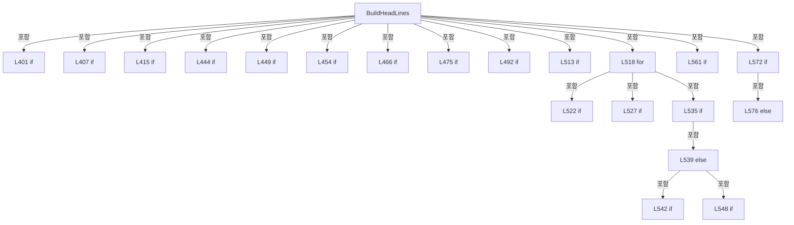

변경 전 점검: 입력/반환 타입, 위 호출자, 예외/취소 경로, 공유 상태와 저장·전송 소비자를 함께 확인합니다. 값의 단위나 물리 방향을 이름만으로 확정하지 않습니다.

### MethodDeclaration `ResolveMachiningAxis` · L584–606

[Drilling.File/Script/CAutomation1ScriptFile.cs:584–606](https://github.com/kjuws10-rgb/A3Drilling/blob/334b3599651b2e8e0181fd4459bafaf3cddafff3/Drilling.File/Script/CAutomation1ScriptFile.cs#L584-L606)

| 항목 | 실제 추출 값 |
| --- | --- |
| 서명 | Drilling.File.Script.CAutomation1ScriptFile.EN_SCRIPT_FOLLOW_AXIS Drilling.File.Script.CAutomation1ScriptFile.ResolveMachiningAxis(System.Collections.Generic.IReadOnlyList<Drilling.Common.Recipe.ST_HEAD_SHOT_POINT>, bool) |
| 접근/수식자 | Private / private, static |
| 반환/값 타입 | Drilling.File.Script.CAutomation1ScriptFile.EN_SCRIPT_FOLLOW_AXIS |
| 소속 타입 | NamedType:Drilling.File.Script.CAutomation1ScriptFile |

입력 계약:

| 이름 | 타입 | 전달 | 선택/기본값 |
| --- | --- | --- | --- |
| shots | System.Collections.Generic.IReadOnlyList<Drilling.Common.Recipe.ST_HEAD_SHOT_POINT> | None | False /  |
| simulatorMode | bool | None | False /  |

정적 호출자로 확인된 위치:

| 호출 파일/행 | 호출 표현식 | 런타임 분기 가능 |
| --- | --- | --- |
| [Drilling.File/Script/CAutomation1ScriptFile.cs:432–432](https://github.com/kjuws10-rgb/A3Drilling/blob/334b3599651b2e8e0181fd4459bafaf3cddafff3/Drilling.File/Script/CAutomation1ScriptFile.cs#L432-L432) | ResolveMachiningAxis | False |

호출하는 대상과 해석 범위:

| 원본 행 | 표현식 | 분석 상태 | 대상/소스 위치 |
| --- | --- | --- | --- |
| 593 | ReadScriptScannerY | resolved | double Drilling.File.Script.CAutomation1ScriptFile.ReadScriptScannerY(Drilling.Common.Recipe.ST_HEAD_SHOT_POINT, bool) · Drilling.File/Script/CAutomation1ScriptFile.cs:713 |
| 594 | ReadScriptScannerY | resolved | double Drilling.File.Script.CAutomation1ScriptFile.ReadScriptScannerY(Drilling.Common.Recipe.ST_HEAD_SHOT_POINT, bool) · Drilling.File/Script/CAutomation1ScriptFile.cs:713 |
| 598 | ReadScriptScannerY | resolved | double Drilling.File.Script.CAutomation1ScriptFile.ReadScriptScannerY(Drilling.Common.Recipe.ST_HEAD_SHOT_POINT, bool) · Drilling.File/Script/CAutomation1ScriptFile.cs:713 |
| 599 | Math.Min | resolved | double System.Math.Min(double, double) |
| 600 | Math.Max | resolved | double System.Math.Max(double, double) |
| 601 | Math.Min | resolved | double System.Math.Min(double, double) |
| 602 | Math.Max | resolved | double System.Math.Max(double, double) |

본문의 실제 연산·분기·예외·반환 순서(원문 위치 순):

| 원본 행 | 종류 | 주석 해설 |
| --- | --- | --- |
| 586 | if | 조건에 따라 분기합니다: if (shots.Count <= 1) |
| 588 | return | 호출자에게 값 또는 제어를 반환합니다: return EN_SCRIPT_FOLLOW_AXIS.X; |
| 591 | local-declaration | 지역 변수를 선언합니다: var minGx = shots[0].ScannerGx; |
| 591 | variable-initializer | 변수의 초기값을 지정합니다: minGx = shots[0].ScannerGx |
| 592 | local-declaration | 지역 변수를 선언합니다: var maxGx = shots[0].ScannerGx; |
| 592 | variable-initializer | 변수의 초기값을 지정합니다: maxGx = shots[0].ScannerGx |
| 593 | call | 함수·델리게이트 또는 객체 생성자를 호출합니다: ReadScriptScannerY(shots[0], simulatorMode) |
| 593 | local-declaration | 지역 변수를 선언합니다: var minGy = ReadScriptScannerY(shots[0], simulatorMode); |
| 593 | variable-initializer | 변수의 초기값을 지정합니다: minGy = ReadScriptScannerY(shots[0], simulatorMode) |
| 594 | call | 함수·델리게이트 또는 객체 생성자를 호출합니다: ReadScriptScannerY(shots[0], simulatorMode) |
| 594 | local-declaration | 지역 변수를 선언합니다: var maxGy = ReadScriptScannerY(shots[0], simulatorMode); |
| 594 | variable-initializer | 변수의 초기값을 지정합니다: maxGy = ReadScriptScannerY(shots[0], simulatorMode) |
| 595 | variable-initializer | 변수의 초기값을 지정합니다: index = 1 |
| 595 | for | 초기화·조건·증감이 있는 반복입니다: for (var index = 1; index < shots.Count; index++) |
| 597 | local-declaration | 지역 변수를 선언합니다: var shot = shots[index]; |
| 597 | variable-initializer | 변수의 초기값을 지정합니다: shot = shots[index] |
| 598 | call | 함수·델리게이트 또는 객체 생성자를 호출합니다: ReadScriptScannerY(shot, simulatorMode) |
| 598 | local-declaration | 지역 변수를 선언합니다: var scannerY = ReadScriptScannerY(shot, simulatorMode); |
| 598 | variable-initializer | 변수의 초기값을 지정합니다: scannerY = ReadScriptScannerY(shot, simulatorMode) |
| 599 | assignment | 값을 대상에 대입합니다: minGx = Math.Min(minGx, shot.ScannerGx) |
| 599 | call | 함수·델리게이트 또는 객체 생성자를 호출합니다: Math.Min(minGx, shot.ScannerGx) |
| 600 | assignment | 값을 대상에 대입합니다: maxGx = Math.Max(maxGx, shot.ScannerGx) |
| 600 | call | 함수·델리게이트 또는 객체 생성자를 호출합니다: Math.Max(maxGx, shot.ScannerGx) |
| 601 | assignment | 값을 대상에 대입합니다: minGy = Math.Min(minGy, scannerY) |
| 601 | call | 함수·델리게이트 또는 객체 생성자를 호출합니다: Math.Min(minGy, scannerY) |
| 602 | assignment | 값을 대상에 대입합니다: maxGy = Math.Max(maxGy, scannerY) |
| 602 | call | 함수·델리게이트 또는 객체 생성자를 호출합니다: Math.Max(maxGy, scannerY) |
| 605 | conditional-expression | 조건에 따라 결과식을 선택합니다: maxGy - minGy > maxGx - minGx ? EN_SCRIPT_FOLLOW_AXIS.Y : EN_SCRIPT_FOLLOW_AXIS.X |
| 605 | return | 호출자에게 값 또는 제어를 반환합니다: return maxGy - minGy > maxGx - minGx ? EN_SCRIPT_FOLLOW_AXIS.Y : EN_SCRIPT_FOLLOW_AXIS.X; |

제어 구문의 포함 구조(실제 실행 순서/CFG가 아닌 구문 탐색 그림):

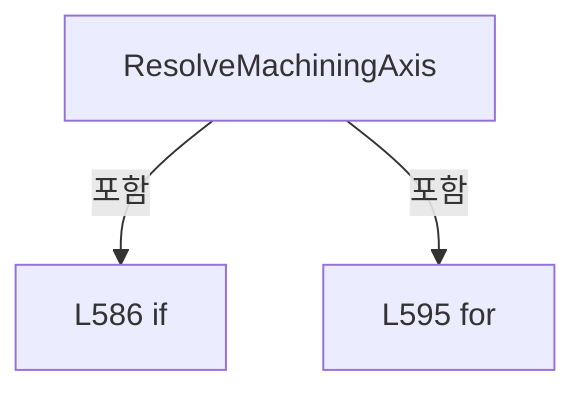

변경 전 점검: 입력/반환 타입, 위 호출자, 예외/취소 경로, 공유 상태와 저장·전송 소비자를 함께 확인합니다. 값의 단위나 물리 방향을 이름만으로 확정하지 않습니다.

### MethodDeclaration `ResolveLineMachiningAxis` · L608–623

[Drilling.File/Script/CAutomation1ScriptFile.cs:608–623](https://github.com/kjuws10-rgb/A3Drilling/blob/334b3599651b2e8e0181fd4459bafaf3cddafff3/Drilling.File/Script/CAutomation1ScriptFile.cs#L608-L623)

| 항목 | 실제 추출 값 |
| --- | --- |
| 서명 | Drilling.File.Script.CAutomation1ScriptFile.EN_SCRIPT_FOLLOW_AXIS Drilling.File.Script.CAutomation1ScriptFile.ResolveLineMachiningAxis(Drilling.Common.Recipe.ST_HEAD_SHOT_POINT, Drilling.Common.Recipe.ST_HEAD_SHOT_POINT?, Drilling.File.Script.CAutomation1ScriptFile.EN_SCRIPT_FOLLOW_AXIS, bool) |
| 접근/수식자 | Private / private, static |
| 반환/값 타입 | Drilling.File.Script.CAutomation1ScriptFile.EN_SCRIPT_FOLLOW_AXIS |
| 소속 타입 | NamedType:Drilling.File.Script.CAutomation1ScriptFile |

입력 계약:

| 이름 | 타입 | 전달 | 선택/기본값 |
| --- | --- | --- | --- |
| targetPoint | Drilling.Common.Recipe.ST_HEAD_SHOT_POINT | None | False /  |
| nextPoint | Drilling.Common.Recipe.ST_HEAD_SHOT_POINT? | None | False /  |
| fallbackAxis | Drilling.File.Script.CAutomation1ScriptFile.EN_SCRIPT_FOLLOW_AXIS | None | False /  |
| simulatorMode | bool | None | False /  |

정적 호출자로 확인된 위치:

| 호출 파일/행 | 호출 표현식 | 런타임 분기 가능 |
| --- | --- | --- |
| [Drilling.File/Script/CAutomation1ScriptFile.cs:530–530](https://github.com/kjuws10-rgb/A3Drilling/blob/334b3599651b2e8e0181fd4459bafaf3cddafff3/Drilling.File/Script/CAutomation1ScriptFile.cs#L530-L530) | ResolveLineMachiningAxis | False |

호출하는 대상과 해석 범위:

| 원본 행 | 표현식 | 분석 상태 | 대상/소스 위치 |
| --- | --- | --- | --- |
| 615 | Math.Abs | resolved | double System.Math.Abs(double) |
| 616 | Math.Abs | resolved | double System.Math.Abs(double) |
| 616 | ReadScriptScannerY | resolved | double Drilling.File.Script.CAutomation1ScriptFile.ReadScriptScannerY(Drilling.Common.Recipe.ST_HEAD_SHOT_POINT, bool) · Drilling.File/Script/CAutomation1ScriptFile.cs:713 |
| 616 | ReadScriptScannerY | resolved | double Drilling.File.Script.CAutomation1ScriptFile.ReadScriptScannerY(Drilling.Common.Recipe.ST_HEAD_SHOT_POINT, bool) · Drilling.File/Script/CAutomation1ScriptFile.cs:713 |
| 617 | Math.Max | resolved | double System.Math.Max(double, double) |

본문의 실제 연산·분기·예외·반환 순서(원문 위치 순):

| 원본 행 | 종류 | 주석 해설 |
| --- | --- | --- |
| 610 | if | 조건에 따라 분기합니다: if (nextPoint is null) |
| 612 | return | 호출자에게 값 또는 제어를 반환합니다: return fallbackAxis; |
| 615 | call | 함수·델리게이트 또는 객체 생성자를 호출합니다: Math.Abs(nextPoint.ScannerGx - targetPoint.ScannerGx) |
| 615 | local-declaration | 지역 변수를 선언합니다: var deltaX = Math.Abs(nextPoint.ScannerGx - targetPoint.ScannerGx); |
| 615 | variable-initializer | 변수의 초기값을 지정합니다: deltaX = Math.Abs(nextPoint.ScannerGx - targetPoint.ScannerGx) |
| 616 | call | 함수·델리게이트 또는 객체 생성자를 호출합니다: Math.Abs(ReadScriptScannerY(nextPoint, simulatorMode) - ReadScriptScannerY(targetPoint, simulatorMode)) |
| 616 | call | 함수·델리게이트 또는 객체 생성자를 호출합니다: ReadScriptScannerY(nextPoint, simulatorMode) |
| 616 | call | 함수·델리게이트 또는 객체 생성자를 호출합니다: ReadScriptScannerY(targetPoint, simulatorMode) |
| 616 | local-declaration | 지역 변수를 선언합니다: var deltaY = Math.Abs(ReadScriptScannerY(nextPoint, simulatorMode) - ReadScriptScannerY(targetPoint, simulatorMode)); |
| 616 | variable-initializer | 변수의 초기값을 지정합니다: deltaY = Math.Abs(ReadScriptScannerY(nextPoint, simulatorMode) - ReadScriptScannerY(targetPoint, simulatorMode)) |
| 617 | call | 함수·델리게이트 또는 객체 생성자를 호출합니다: Math.Max(deltaX, deltaY) |
| 617 | if | 조건에 따라 분기합니다: if (Math.Max(deltaX, deltaY) <= 0.000001) |
| 619 | return | 호출자에게 값 또는 제어를 반환합니다: return fallbackAxis; |
| 622 | conditional-expression | 조건에 따라 결과식을 선택합니다: deltaY > deltaX ? EN_SCRIPT_FOLLOW_AXIS.Y : EN_SCRIPT_FOLLOW_AXIS.X |
| 622 | return | 호출자에게 값 또는 제어를 반환합니다: return deltaY > deltaX ? EN_SCRIPT_FOLLOW_AXIS.Y : EN_SCRIPT_FOLLOW_AXIS.X; |

제어 구문의 포함 구조(실제 실행 순서/CFG가 아닌 구문 탐색 그림):

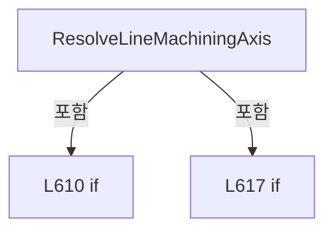

변경 전 점검: 입력/반환 타입, 위 호출자, 예외/취소 경로, 공유 상태와 저장·전송 소비자를 함께 확인합니다. 값의 단위나 물리 방향을 이름만으로 확정하지 않습니다.

### MethodDeclaration `IsScanLineFirstShot` · L625–633

[Drilling.File/Script/CAutomation1ScriptFile.cs:625–633](https://github.com/kjuws10-rgb/A3Drilling/blob/334b3599651b2e8e0181fd4459bafaf3cddafff3/Drilling.File/Script/CAutomation1ScriptFile.cs#L625-L633)

| 항목 | 실제 추출 값 |
| --- | --- |
| 서명 | bool Drilling.File.Script.CAutomation1ScriptFile.IsScanLineFirstShot(Drilling.Common.Recipe.ST_HEAD_SHOT_POINT?, Drilling.Common.Recipe.ST_HEAD_SHOT_POINT) |
| 접근/수식자 | Private / private, static |
| 반환/값 타입 | bool |
| 소속 타입 | NamedType:Drilling.File.Script.CAutomation1ScriptFile |

입력 계약:

| 이름 | 타입 | 전달 | 선택/기본값 |
| --- | --- | --- | --- |
| previousPoint | Drilling.Common.Recipe.ST_HEAD_SHOT_POINT? | None | False /  |
| currentPoint | Drilling.Common.Recipe.ST_HEAD_SHOT_POINT | None | False /  |

정적 호출자로 확인된 위치:

| 호출 파일/행 | 호출 표현식 | 런타임 분기 가능 |
| --- | --- | --- |
| [Drilling.File/Script/CAutomation1ScriptFile.cs:527–527](https://github.com/kjuws10-rgb/A3Drilling/blob/334b3599651b2e8e0181fd4459bafaf3cddafff3/Drilling.File/Script/CAutomation1ScriptFile.cs#L527-L527) | IsScanLineFirstShot | False |

호출하는 대상과 해석 범위:

| 원본 행 | 표현식 | 분석 상태 | 대상/소스 위치 |
| --- | --- | --- | --- |
| 632 | Math.Abs | resolved | double System.Math.Abs(double) |

본문의 실제 연산·분기·예외·반환 순서(원문 위치 순):

| 원본 행 | 종류 | 주석 해설 |
| --- | --- | --- |
| 627 | if | 조건에 따라 분기합니다: if (previousPoint is null) |
| 629 | return | 호출자에게 값 또는 제어를 반환합니다: return true; |
| 632 | call | 함수·델리게이트 또는 객체 생성자를 호출합니다: Math.Abs(currentPoint.EncoderWaitPosition - previousPoint.EncoderWaitPosition) |
| 632 | return | 호출자에게 값 또는 제어를 반환합니다: return Math.Abs(currentPoint.EncoderWaitPosition - previousPoint.EncoderWaitPosition) > 0.000001; |

제어 구문의 포함 구조(실제 실행 순서/CFG가 아닌 구문 탐색 그림):

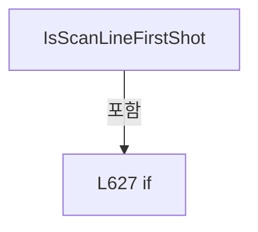

변경 전 점검: 입력/반환 타입, 위 호출자, 예외/취소 경로, 공유 상태와 저장·전송 소비자를 함께 확인합니다. 값의 단위나 물리 방향을 이름만으로 확정하지 않습니다.

### MethodDeclaration `FindNextPointInSameScanLine` · L635–650

[Drilling.File/Script/CAutomation1ScriptFile.cs:635–650](https://github.com/kjuws10-rgb/A3Drilling/blob/334b3599651b2e8e0181fd4459bafaf3cddafff3/Drilling.File/Script/CAutomation1ScriptFile.cs#L635-L650)

| 항목 | 실제 추출 값 |
| --- | --- |
| 서명 | Drilling.Common.Recipe.ST_HEAD_SHOT_POINT? Drilling.File.Script.CAutomation1ScriptFile.FindNextPointInSameScanLine(System.Collections.Generic.IReadOnlyList<Drilling.Common.Recipe.ST_HEAD_SHOT_POINT>, int, Drilling.Common.Recipe.ST_HEAD_SHOT_POINT) |
| 접근/수식자 | Private / private, static |
| 반환/값 타입 | Drilling.Common.Recipe.ST_HEAD_SHOT_POINT? |
| 소속 타입 | NamedType:Drilling.File.Script.CAutomation1ScriptFile |

입력 계약:

| 이름 | 타입 | 전달 | 선택/기본값 |
| --- | --- | --- | --- |
| shots | System.Collections.Generic.IReadOnlyList<Drilling.Common.Recipe.ST_HEAD_SHOT_POINT> | None | False /  |
| currentIndex | int | None | False /  |
| currentPoint | Drilling.Common.Recipe.ST_HEAD_SHOT_POINT | None | False /  |

정적 호출자로 확인된 위치:

| 호출 파일/행 | 호출 표현식 | 런타임 분기 가능 |
| --- | --- | --- |
| [Drilling.File/Script/CAutomation1ScriptFile.cs:529–529](https://github.com/kjuws10-rgb/A3Drilling/blob/334b3599651b2e8e0181fd4459bafaf3cddafff3/Drilling.File/Script/CAutomation1ScriptFile.cs#L529-L529) | FindNextPointInSameScanLine | False |

호출하는 대상과 해석 범위:

| 원본 행 | 표현식 | 분석 상태 | 대상/소스 위치 |
| --- | --- | --- | --- |
| 644 | Math.Abs | resolved | double System.Math.Abs(double) |

본문의 실제 연산·분기·예외·반환 순서(원문 위치 순):

| 원본 행 | 종류 | 주석 해설 |
| --- | --- | --- |
| 637 | local-declaration | 지역 변수를 선언합니다: var nextIndex = currentIndex + 1; |
| 637 | variable-initializer | 변수의 초기값을 지정합니다: nextIndex = currentIndex + 1 |
| 638 | if | 조건에 따라 분기합니다: if (nextIndex >= shots.Count) |
| 640 | return | 호출자에게 값 또는 제어를 반환합니다: return null; |
| 643 | local-declaration | 지역 변수를 선언합니다: var nextPoint = shots[nextIndex]; |
| 643 | variable-initializer | 변수의 초기값을 지정합니다: nextPoint = shots[nextIndex] |
| 644 | call | 함수·델리게이트 또는 객체 생성자를 호출합니다: Math.Abs(nextPoint.EncoderWaitPosition - currentPoint.EncoderWaitPosition) |
| 644 | if | 조건에 따라 분기합니다: if (Math.Abs(nextPoint.EncoderWaitPosition - currentPoint.EncoderWaitPosition) > 0.000001) |
| 646 | return | 호출자에게 값 또는 제어를 반환합니다: return null; |
| 649 | return | 호출자에게 값 또는 제어를 반환합니다: return nextPoint; |

제어 구문의 포함 구조(실제 실행 순서/CFG가 아닌 구문 탐색 그림):

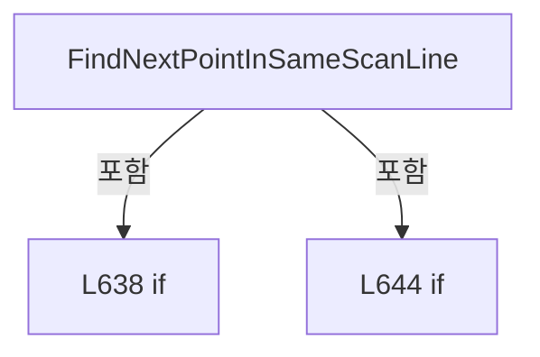

변경 전 점검: 입력/반환 타입, 위 호출자, 예외/취소 경로, 공유 상태와 저장·전송 소비자를 함께 확인합니다. 값의 단위나 물리 방향을 이름만으로 확정하지 않습니다.

### MethodDeclaration `AppendLinePreApproachMove` · L652–676

[Drilling.File/Script/CAutomation1ScriptFile.cs:652–676](https://github.com/kjuws10-rgb/A3Drilling/blob/334b3599651b2e8e0181fd4459bafaf3cddafff3/Drilling.File/Script/CAutomation1ScriptFile.cs#L652-L676)

| 항목 | 실제 추출 값 |
| --- | --- |
| 서명 | void Drilling.File.Script.CAutomation1ScriptFile.AppendLinePreApproachMove(System.Collections.Generic.List<string>, string, string, Drilling.Common.Recipe.ST_HEAD_SHOT_POINT, Drilling.Common.Recipe.ST_HEAD_SHOT_POINT?, Drilling.File.Script.CAutomation1ScriptFile.EN_SCRIPT_FOLLOW_AXIS, double, double, bool) |
| 접근/수식자 | Private / private, static |
| 반환/값 타입 | void |
| 소속 타입 | NamedType:Drilling.File.Script.CAutomation1ScriptFile |

입력 계약:

| 이름 | 타입 | 전달 | 선택/기본값 |
| --- | --- | --- | --- |
| lines | System.Collections.Generic.List<string> | None | False /  |
| xAxis | string | None | False /  |
| yAxis | string | None | False /  |
| targetPoint | Drilling.Common.Recipe.ST_HEAD_SHOT_POINT | None | False /  |
| nextPoint | Drilling.Common.Recipe.ST_HEAD_SHOT_POINT? | None | False /  |
| machiningAxis | Drilling.File.Script.CAutomation1ScriptFile.EN_SCRIPT_FOLLOW_AXIS | None | False /  |
| distance | double | None | False /  |
| scanFieldHalfWidth | double | None | False /  |
| simulatorMode | bool | None | False /  |

정적 호출자로 확인된 위치:

| 호출 파일/행 | 호출 표현식 | 런타임 분기 가능 |
| --- | --- | --- |
| [Drilling.File/Script/CAutomation1ScriptFile.cs:531–531](https://github.com/kjuws10-rgb/A3Drilling/blob/334b3599651b2e8e0181fd4459bafaf3cddafff3/Drilling.File/Script/CAutomation1ScriptFile.cs#L531-L531) | AppendLinePreApproachMove | False |

호출하는 대상과 해석 범위:

| 원본 행 | 표현식 | 분석 상태 | 대상/소스 위치 |
| --- | --- | --- | --- |
| 664 | ReadScriptAxisPosition | resolved | double Drilling.File.Script.CAutomation1ScriptFile.ReadScriptAxisPosition(Drilling.Common.Recipe.ST_HEAD_SHOT_POINT, Drilling.File.Script.CAutomation1ScriptFile.EN_SCRIPT_FOLLOW_AXIS, bool) · Drilling.File/Script/CAutomation1ScriptFile.cs:703 |
| 665 | ResolveLinePreApproachDirection | resolved | double Drilling.File.Script.CAutomation1ScriptFile.ResolveLinePreApproachDirection(Drilling.Common.Recipe.ST_HEAD_SHOT_POINT, Drilling.Common.Recipe.ST_HEAD_SHOT_POINT?, Drilling.File.Script.CAutomation1ScriptFile.EN_SCRIPT_FOLLOW_AXIS, bool) · Drilling.File/Script/CAutomation1ScriptFile.cs:678 |
| 666 | Clamp | resolved | double Drilling.File.Script.CAutomation1ScriptFile.Clamp(double, double, double) · Drilling.File/Script/CAutomation1ScriptFile.cs:718 |
| 667 | Math.Abs | resolved | double System.Math.Abs(double) |
| 673 | ReadScriptScannerY | resolved | double Drilling.File.Script.CAutomation1ScriptFile.ReadScriptScannerY(Drilling.Common.Recipe.ST_HEAD_SHOT_POINT, bool) · Drilling.File/Script/CAutomation1ScriptFile.cs:713 |
| 675 | lines.Add | resolved | void System.Collections.Generic.List<string>.Add(string) |
| 675 | Format | resolved | string Drilling.File.Script.CAutomation1ScriptFile.Format(double) · Drilling.File/Script/CAutomation1ScriptFile.cs:1285 |
| 675 | Format | resolved | string Drilling.File.Script.CAutomation1ScriptFile.Format(double) · Drilling.File/Script/CAutomation1ScriptFile.cs:1285 |

본문의 실제 연산·분기·예외·반환 순서(원문 위치 순):

| 원본 행 | 종류 | 주석 해설 |
| --- | --- | --- |
| 664 | call | 함수·델리게이트 또는 객체 생성자를 호출합니다: ReadScriptAxisPosition(targetPoint, machiningAxis, simulatorMode) |
| 664 | local-declaration | 지역 변수를 선언합니다: var targetAxisPosition = ReadScriptAxisPosition(targetPoint, machiningAxis, simulatorMode); |
| 664 | variable-initializer | 변수의 초기값을 지정합니다: targetAxisPosition = ReadScriptAxisPosition(targetPoint, machiningAxis, simulatorMode) |
| 665 | call | 함수·델리게이트 또는 객체 생성자를 호출합니다: ResolveLinePreApproachDirection(targetPoint, nextPoint, machiningAxis, simulatorMode) |
| 665 | local-declaration | 지역 변수를 선언합니다: var direction = ResolveLinePreApproachDirection(targetPoint, nextPoint, machiningAxis, simulatorMode); |
| 665 | variable-initializer | 변수의 초기값을 지정합니다: direction = ResolveLinePreApproachDirection(targetPoint, nextPoint, machiningAxis, simulatorMode) |
| 666 | call | 함수·델리게이트 또는 객체 생성자를 호출합니다: Clamp(targetAxisPosition - (direction * distance), -scanFieldHalfWidth, scanFieldHalfWidth) |
| 666 | local-declaration | 지역 변수를 선언합니다: var preAxisPosition = Clamp(targetAxisPosition - (direction * distance), -scanFieldHalfWidth, scanFieldHalfWidth); |
| 666 | variable-initializer | 변수의 초기값을 지정합니다: preAxisPosition = Clamp(targetAxisPosition - (direction * distance), -scanFieldHalfWidth, scanFieldHalfWidth) |
| 667 | call | 함수·델리게이트 또는 객체 생성자를 호출합니다: Math.Abs(preAxisPosition - targetAxisPosition) |
| 667 | if | 조건에 따라 분기합니다: if (Math.Abs(preAxisPosition - targetAxisPosition) <= 0.000001) |
| 669 | return | 호출자에게 값 또는 제어를 반환합니다: return; |
| 672 | conditional-expression | 조건에 따라 결과식을 선택합니다: machiningAxis == EN_SCRIPT_FOLLOW_AXIS.X ? preAxisPosition : targetPoint.ScannerGx |
| 672 | local-declaration | 지역 변수를 선언합니다: var scannerX = machiningAxis == EN_SCRIPT_FOLLOW_AXIS.X ? preAxisPosition : targetPoint.ScannerGx; |
| 672 | variable-initializer | 변수의 초기값을 지정합니다: scannerX = machiningAxis == EN_SCRIPT_FOLLOW_AXIS.X ? preAxisPosition : targetPoint.ScannerGx |
| 673 | call | 함수·델리게이트 또는 객체 생성자를 호출합니다: ReadScriptScannerY(targetPoint, simulatorMode) |
| 673 | local-declaration | 지역 변수를 선언합니다: var targetScannerY = ReadScriptScannerY(targetPoint, simulatorMode); |
| 673 | variable-initializer | 변수의 초기값을 지정합니다: targetScannerY = ReadScriptScannerY(targetPoint, simulatorMode) |
| 674 | conditional-expression | 조건에 따라 결과식을 선택합니다: machiningAxis == EN_SCRIPT_FOLLOW_AXIS.Y ? preAxisPosition : targetScannerY |
| 674 | local-declaration | 지역 변수를 선언합니다: var scannerY = machiningAxis == EN_SCRIPT_FOLLOW_AXIS.Y ? preAxisPosition : targetScannerY; |
| 674 | variable-initializer | 변수의 초기값을 지정합니다: scannerY = machiningAxis == EN_SCRIPT_FOLLOW_AXIS.Y ? preAxisPosition : targetScannerY |
| 675 | call | 함수·델리게이트 또는 객체 생성자를 호출합니다: lines.Add($"MoveRapid([{xAxis},{yAxis}], [{Format(scannerX)},{Format(scannerY)}])") |
| 675 | call | 함수·델리게이트 또는 객체 생성자를 호출합니다: Format(scannerX) |
| 675 | call | 함수·델리게이트 또는 객체 생성자를 호출합니다: Format(scannerY) |

제어 구문의 포함 구조(실제 실행 순서/CFG가 아닌 구문 탐색 그림):

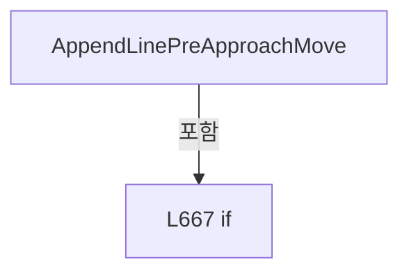

변경 전 점검: 입력/반환 타입, 위 호출자, 예외/취소 경로, 공유 상태와 저장·전송 소비자를 함께 확인합니다. 값의 단위나 물리 방향을 이름만으로 확정하지 않습니다.

### MethodDeclaration `ResolveLinePreApproachDirection` · L678–690

[Drilling.File/Script/CAutomation1ScriptFile.cs:678–690](https://github.com/kjuws10-rgb/A3Drilling/blob/334b3599651b2e8e0181fd4459bafaf3cddafff3/Drilling.File/Script/CAutomation1ScriptFile.cs#L678-L690)

| 항목 | 실제 추출 값 |
| --- | --- |
| 서명 | double Drilling.File.Script.CAutomation1ScriptFile.ResolveLinePreApproachDirection(Drilling.Common.Recipe.ST_HEAD_SHOT_POINT, Drilling.Common.Recipe.ST_HEAD_SHOT_POINT?, Drilling.File.Script.CAutomation1ScriptFile.EN_SCRIPT_FOLLOW_AXIS, bool) |
| 접근/수식자 | Private / private, static |
| 반환/값 타입 | double |
| 소속 타입 | NamedType:Drilling.File.Script.CAutomation1ScriptFile |

입력 계약:

| 이름 | 타입 | 전달 | 선택/기본값 |
| --- | --- | --- | --- |
| targetPoint | Drilling.Common.Recipe.ST_HEAD_SHOT_POINT | None | False /  |
| nextPoint | Drilling.Common.Recipe.ST_HEAD_SHOT_POINT? | None | False /  |
| machiningAxis | Drilling.File.Script.CAutomation1ScriptFile.EN_SCRIPT_FOLLOW_AXIS | None | False /  |
| simulatorMode | bool | None | False /  |

정적 호출자로 확인된 위치:

| 호출 파일/행 | 호출 표현식 | 런타임 분기 가능 |
| --- | --- | --- |
| [Drilling.File/Script/CAutomation1ScriptFile.cs:665–665](https://github.com/kjuws10-rgb/A3Drilling/blob/334b3599651b2e8e0181fd4459bafaf3cddafff3/Drilling.File/Script/CAutomation1ScriptFile.cs#L665-L665) | ResolveLinePreApproachDirection | False |

호출하는 대상과 해석 범위:

| 원본 행 | 표현식 | 분석 상태 | 대상/소스 위치 |
| --- | --- | --- | --- |
| 682 | ReadScriptAxisPosition | resolved | double Drilling.File.Script.CAutomation1ScriptFile.ReadScriptAxisPosition(Drilling.Common.Recipe.ST_HEAD_SHOT_POINT, Drilling.File.Script.CAutomation1ScriptFile.EN_SCRIPT_FOLLOW_AXIS, bool) · Drilling.File/Script/CAutomation1ScriptFile.cs:703 |
| 682 | ReadScriptAxisPosition | resolved | double Drilling.File.Script.CAutomation1ScriptFile.ReadScriptAxisPosition(Drilling.Common.Recipe.ST_HEAD_SHOT_POINT, Drilling.File.Script.CAutomation1ScriptFile.EN_SCRIPT_FOLLOW_AXIS, bool) · Drilling.File/Script/CAutomation1ScriptFile.cs:703 |
| 683 | Math.Abs | resolved | double System.Math.Abs(double) |

본문의 실제 연산·분기·예외·반환 순서(원문 위치 순):

| 원본 행 | 종류 | 주석 해설 |
| --- | --- | --- |
| 680 | if | 조건에 따라 분기합니다: if (nextPoint is not null) |
| 682 | call | 함수·델리게이트 또는 객체 생성자를 호출합니다: ReadScriptAxisPosition(nextPoint, machiningAxis, simulatorMode) |
| 682 | call | 함수·델리게이트 또는 객체 생성자를 호출합니다: ReadScriptAxisPosition(targetPoint, machiningAxis, simulatorMode) |
| 682 | local-declaration | 지역 변수를 선언합니다: var delta = ReadScriptAxisPosition(nextPoint, machiningAxis, simulatorMode) - ReadScriptAxisPosition(targetPoint, machiningAxis, simulatorMode); |
| 682 | variable-initializer | 변수의 초기값을 지정합니다: delta = ReadScriptAxisPosition(nextPoint, machiningAxis, simulatorMode) - ReadScriptAxisPosition(targetPoint, machiningAxis, simulatorMode) |
| 683 | call | 함수·델리게이트 또는 객체 생성자를 호출합니다: Math.Abs(delta) |
| 683 | if | 조건에 따라 분기합니다: if (Math.Abs(delta) > 0.000001) |
| 685 | conditional-expression | 조건에 따라 결과식을 선택합니다: delta > 0.0 ? 1.0 : -1.0 |
| 685 | return | 호출자에게 값 또는 제어를 반환합니다: return delta > 0.0 ? 1.0 : -1.0; |
| 689 | return | 호출자에게 값 또는 제어를 반환합니다: return 1.0; |

제어 구문의 포함 구조(실제 실행 순서/CFG가 아닌 구문 탐색 그림):

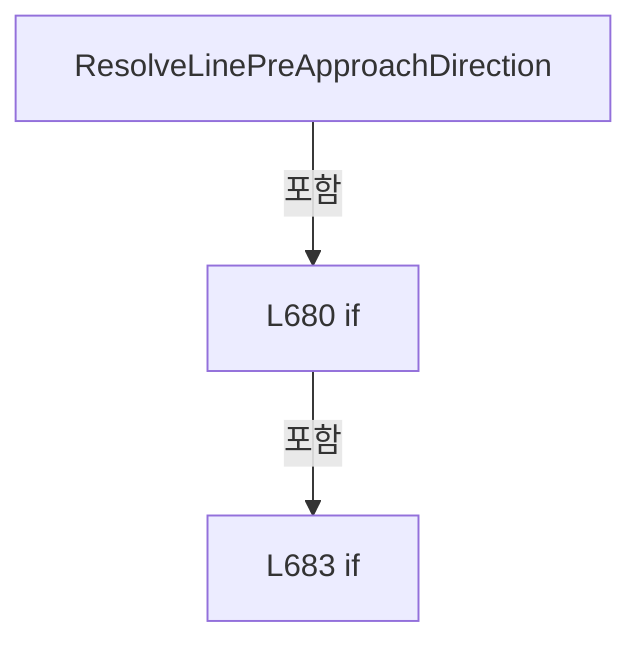

변경 전 점검: 입력/반환 타입, 위 호출자, 예외/취소 경로, 공유 상태와 저장·전송 소비자를 함께 확인합니다. 값의 단위나 물리 방향을 이름만으로 확정하지 않습니다.

### MethodDeclaration `ReadHeadScanFieldHalfWidth` · L692–701

[Drilling.File/Script/CAutomation1ScriptFile.cs:692–701](https://github.com/kjuws10-rgb/A3Drilling/blob/334b3599651b2e8e0181fd4459bafaf3cddafff3/Drilling.File/Script/CAutomation1ScriptFile.cs#L692-L701)

| 항목 | 실제 추출 값 |
| --- | --- |
| 서명 | double Drilling.File.Script.CAutomation1ScriptFile.ReadHeadScanFieldHalfWidth(System.Collections.Generic.IReadOnlyDictionary<string, string>, int) |
| 접근/수식자 | Private / private, static |
| 반환/값 타입 | double |
| 소속 타입 | NamedType:Drilling.File.Script.CAutomation1ScriptFile |

입력 계약:

| 이름 | 타입 | 전달 | 선택/기본값 |
| --- | --- | --- | --- |
| common | System.Collections.Generic.IReadOnlyDictionary<string, string> | None | False /  |
| headNo | int | None | False /  |

정적 호출자로 확인된 위치:

| 호출 파일/행 | 호출 표현식 | 런타임 분기 가능 |
| --- | --- | --- |
| [Drilling.File/Script/CAutomation1ScriptFile.cs:433–433](https://github.com/kjuws10-rgb/A3Drilling/blob/334b3599651b2e8e0181fd4459bafaf3cddafff3/Drilling.File/Script/CAutomation1ScriptFile.cs#L433-L433) | ReadHeadScanFieldHalfWidth | False |

호출하는 대상과 해석 범위:

| 원본 행 | 표현식 | 분석 상태 | 대상/소스 위치 |
| --- | --- | --- | --- |
| 694 | Math.Abs | resolved | double System.Math.Abs(double) |
| 694 | ReadDouble | resolved | double Drilling.File.Script.CAutomation1ScriptFile.ReadDouble(System.Collections.Generic.IReadOnlyDictionary<string, string>, double, System.Collections.Generic.IEnumerable<string>) · Drilling.File/Script/CAutomation1ScriptFile.cs:1162 |
| 694 | CreateHeadKeys | resolved | System.Collections.Generic.IReadOnlyList<string> Drilling.File.Script.CAutomation1ScriptFile.CreateHeadKeys(int, params string[]) · Drilling.File/Script/CAutomation1ScriptFile.cs:1102 |

본문의 실제 연산·분기·예외·반환 순서(원문 위치 순):

| 원본 행 | 종류 | 주석 해설 |
| --- | --- | --- |
| 694 | call | 함수·델리게이트 또는 객체 생성자를 호출합니다: Math.Abs(ReadDouble(common, 110.0, CreateHeadKeys(headNo, "SCAN_FIELD_WIDTH_X", "HEAD_FIELD_WIDTH_X"))) |
| 694 | call | 함수·델리게이트 또는 객체 생성자를 호출합니다: ReadDouble(common, 110.0, CreateHeadKeys(headNo, "SCAN_FIELD_WIDTH_X", "HEAD_FIELD_WIDTH_X")) |
| 694 | call | 함수·델리게이트 또는 객체 생성자를 호출합니다: CreateHeadKeys(headNo, "SCAN_FIELD_WIDTH_X", "HEAD_FIELD_WIDTH_X") |
| 694 | local-declaration | 지역 변수를 선언합니다: var scanFieldWidth = Math.Abs(ReadDouble(common, 110.0, CreateHeadKeys(headNo, "SCAN_FIELD_WIDTH_X", "HEAD_FIELD_WIDTH_X"))); |
| 694 | variable-initializer | 변수의 초기값을 지정합니다: scanFieldWidth = Math.Abs(ReadDouble(common, 110.0, CreateHeadKeys(headNo, "SCAN_FIELD_WIDTH_X", "HEAD_FIELD_WIDTH_X"))) |
| 695 | if | 조건에 따라 분기합니다: if (scanFieldWidth <= 0.000001) |
| 697 | assignment | 값을 대상에 대입합니다: scanFieldWidth = 110.0 |
| 700 | return | 호출자에게 값 또는 제어를 반환합니다: return scanFieldWidth / 2.0; |

제어 구문의 포함 구조(실제 실행 순서/CFG가 아닌 구문 탐색 그림):

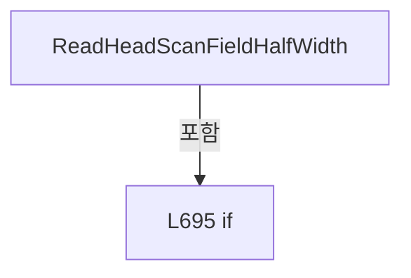

변경 전 점검: 입력/반환 타입, 위 호출자, 예외/취소 경로, 공유 상태와 저장·전송 소비자를 함께 확인합니다. 값의 단위나 물리 방향을 이름만으로 확정하지 않습니다.

### MethodDeclaration `ReadScriptAxisPosition` · L703–711

[Drilling.File/Script/CAutomation1ScriptFile.cs:703–711](https://github.com/kjuws10-rgb/A3Drilling/blob/334b3599651b2e8e0181fd4459bafaf3cddafff3/Drilling.File/Script/CAutomation1ScriptFile.cs#L703-L711)

| 항목 | 실제 추출 값 |
| --- | --- |
| 서명 | double Drilling.File.Script.CAutomation1ScriptFile.ReadScriptAxisPosition(Drilling.Common.Recipe.ST_HEAD_SHOT_POINT, Drilling.File.Script.CAutomation1ScriptFile.EN_SCRIPT_FOLLOW_AXIS, bool) |
| 접근/수식자 | Private / private, static |
| 반환/값 타입 | double |
| 소속 타입 | NamedType:Drilling.File.Script.CAutomation1ScriptFile |

입력 계약:

| 이름 | 타입 | 전달 | 선택/기본값 |
| --- | --- | --- | --- |
| point | Drilling.Common.Recipe.ST_HEAD_SHOT_POINT | None | False /  |
| followAxis | Drilling.File.Script.CAutomation1ScriptFile.EN_SCRIPT_FOLLOW_AXIS | None | False /  |
| simulatorMode | bool | None | False /  |

정적 호출자로 확인된 위치:

| 호출 파일/행 | 호출 표현식 | 런타임 분기 가능 |
| --- | --- | --- |
| [Drilling.File/Script/CAutomation1ScriptFile.cs:664–664](https://github.com/kjuws10-rgb/A3Drilling/blob/334b3599651b2e8e0181fd4459bafaf3cddafff3/Drilling.File/Script/CAutomation1ScriptFile.cs#L664-L664) | ReadScriptAxisPosition | False |
| [Drilling.File/Script/CAutomation1ScriptFile.cs:682–682](https://github.com/kjuws10-rgb/A3Drilling/blob/334b3599651b2e8e0181fd4459bafaf3cddafff3/Drilling.File/Script/CAutomation1ScriptFile.cs#L682-L682) | ReadScriptAxisPosition | False |
| [Drilling.File/Script/CAutomation1ScriptFile.cs:682–682](https://github.com/kjuws10-rgb/A3Drilling/blob/334b3599651b2e8e0181fd4459bafaf3cddafff3/Drilling.File/Script/CAutomation1ScriptFile.cs#L682-L682) | ReadScriptAxisPosition | False |

호출하는 대상과 해석 범위:

| 원본 행 | 표현식 | 분석 상태 | 대상/소스 위치 |
| --- | --- | --- | --- |
| 710 | ReadScriptScannerY | resolved | double Drilling.File.Script.CAutomation1ScriptFile.ReadScriptScannerY(Drilling.Common.Recipe.ST_HEAD_SHOT_POINT, bool) · Drilling.File/Script/CAutomation1ScriptFile.cs:713 |

본문의 실제 연산·분기·예외·반환 순서(원문 위치 순):

| 원본 행 | 종류 | 주석 해설 |
| --- | --- | --- |
| 705 | if | 조건에 따라 분기합니다: if (followAxis == EN_SCRIPT_FOLLOW_AXIS.X) |
| 707 | return | 호출자에게 값 또는 제어를 반환합니다: return point.ScannerGx; |
| 710 | call | 함수·델리게이트 또는 객체 생성자를 호출합니다: ReadScriptScannerY(point, simulatorMode) |
| 710 | return | 호출자에게 값 또는 제어를 반환합니다: return ReadScriptScannerY(point, simulatorMode); |

제어 구문의 포함 구조(실제 실행 순서/CFG가 아닌 구문 탐색 그림):

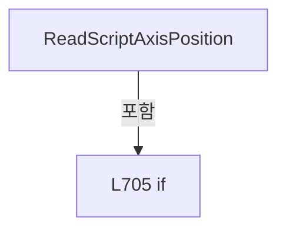

변경 전 점검: 입력/반환 타입, 위 호출자, 예외/취소 경로, 공유 상태와 저장·전송 소비자를 함께 확인합니다. 값의 단위나 물리 방향을 이름만으로 확정하지 않습니다.

### MethodDeclaration `ReadScriptScannerY` · L713–716

[Drilling.File/Script/CAutomation1ScriptFile.cs:713–716](https://github.com/kjuws10-rgb/A3Drilling/blob/334b3599651b2e8e0181fd4459bafaf3cddafff3/Drilling.File/Script/CAutomation1ScriptFile.cs#L713-L716)

| 항목 | 실제 추출 값 |
| --- | --- |
| 서명 | double Drilling.File.Script.CAutomation1ScriptFile.ReadScriptScannerY(Drilling.Common.Recipe.ST_HEAD_SHOT_POINT, bool) |
| 접근/수식자 | Private / private, static |
| 반환/값 타입 | double |
| 소속 타입 | NamedType:Drilling.File.Script.CAutomation1ScriptFile |

입력 계약:

| 이름 | 타입 | 전달 | 선택/기본값 |
| --- | --- | --- | --- |
| point | Drilling.Common.Recipe.ST_HEAD_SHOT_POINT | None | False /  |
| simulatorMode | bool | None | False /  |

정적 호출자로 확인된 위치:

| 호출 파일/행 | 호출 표현식 | 런타임 분기 가능 |
| --- | --- | --- |
| [Drilling.File/Script/CAutomation1ScriptFile.cs:256–256](https://github.com/kjuws10-rgb/A3Drilling/blob/334b3599651b2e8e0181fd4459bafaf3cddafff3/Drilling.File/Script/CAutomation1ScriptFile.cs#L256-L256) | ReadScriptScannerY | False |
| [Drilling.File/Script/CAutomation1ScriptFile.cs:521–521](https://github.com/kjuws10-rgb/A3Drilling/blob/334b3599651b2e8e0181fd4459bafaf3cddafff3/Drilling.File/Script/CAutomation1ScriptFile.cs#L521-L521) | ReadScriptScannerY | False |
| [Drilling.File/Script/CAutomation1ScriptFile.cs:593–593](https://github.com/kjuws10-rgb/A3Drilling/blob/334b3599651b2e8e0181fd4459bafaf3cddafff3/Drilling.File/Script/CAutomation1ScriptFile.cs#L593-L593) | ReadScriptScannerY | False |
| [Drilling.File/Script/CAutomation1ScriptFile.cs:594–594](https://github.com/kjuws10-rgb/A3Drilling/blob/334b3599651b2e8e0181fd4459bafaf3cddafff3/Drilling.File/Script/CAutomation1ScriptFile.cs#L594-L594) | ReadScriptScannerY | False |
| [Drilling.File/Script/CAutomation1ScriptFile.cs:598–598](https://github.com/kjuws10-rgb/A3Drilling/blob/334b3599651b2e8e0181fd4459bafaf3cddafff3/Drilling.File/Script/CAutomation1ScriptFile.cs#L598-L598) | ReadScriptScannerY | False |
| [Drilling.File/Script/CAutomation1ScriptFile.cs:616–616](https://github.com/kjuws10-rgb/A3Drilling/blob/334b3599651b2e8e0181fd4459bafaf3cddafff3/Drilling.File/Script/CAutomation1ScriptFile.cs#L616-L616) | ReadScriptScannerY | False |
| [Drilling.File/Script/CAutomation1ScriptFile.cs:616–616](https://github.com/kjuws10-rgb/A3Drilling/blob/334b3599651b2e8e0181fd4459bafaf3cddafff3/Drilling.File/Script/CAutomation1ScriptFile.cs#L616-L616) | ReadScriptScannerY | False |
| [Drilling.File/Script/CAutomation1ScriptFile.cs:673–673](https://github.com/kjuws10-rgb/A3Drilling/blob/334b3599651b2e8e0181fd4459bafaf3cddafff3/Drilling.File/Script/CAutomation1ScriptFile.cs#L673-L673) | ReadScriptScannerY | False |
| [Drilling.File/Script/CAutomation1ScriptFile.cs:710–710](https://github.com/kjuws10-rgb/A3Drilling/blob/334b3599651b2e8e0181fd4459bafaf3cddafff3/Drilling.File/Script/CAutomation1ScriptFile.cs#L710-L710) | ReadScriptScannerY | False |

본문의 실제 연산·분기·예외·반환 순서(원문 위치 순):

| 원본 행 | 종류 | 주석 해설 |
| --- | --- | --- |
| 715 | conditional-expression | 조건에 따라 결과식을 선택합니다: simulatorMode ? point.FinalScannerOffsetY + point.ShiftScannerOffsetY : point.ScannerGy |
| 715 | return | 호출자에게 값 또는 제어를 반환합니다: return simulatorMode ? point.FinalScannerOffsetY + point.ShiftScannerOffsetY : point.ScannerGy; |

변경 전 점검: 입력/반환 타입, 위 호출자, 예외/취소 경로, 공유 상태와 저장·전송 소비자를 함께 확인합니다. 값의 단위나 물리 방향을 이름만으로 확정하지 않습니다.

### MethodDeclaration `Clamp` · L718–721

[Drilling.File/Script/CAutomation1ScriptFile.cs:718–721](https://github.com/kjuws10-rgb/A3Drilling/blob/334b3599651b2e8e0181fd4459bafaf3cddafff3/Drilling.File/Script/CAutomation1ScriptFile.cs#L718-L721)

| 항목 | 실제 추출 값 |
| --- | --- |
| 서명 | double Drilling.File.Script.CAutomation1ScriptFile.Clamp(double, double, double) |
| 접근/수식자 | Private / private, static |
| 반환/값 타입 | double |
| 소속 타입 | NamedType:Drilling.File.Script.CAutomation1ScriptFile |

입력 계약:

| 이름 | 타입 | 전달 | 선택/기본값 |
| --- | --- | --- | --- |
| value | double | None | False /  |
| min | double | None | False /  |
| max | double | None | False /  |

정적 호출자로 확인된 위치:

| 호출 파일/행 | 호출 표현식 | 런타임 분기 가능 |
| --- | --- | --- |
| [Drilling.File/Script/CAutomation1ScriptFile.cs:666–666](https://github.com/kjuws10-rgb/A3Drilling/blob/334b3599651b2e8e0181fd4459bafaf3cddafff3/Drilling.File/Script/CAutomation1ScriptFile.cs#L666-L666) | Clamp | False |

호출하는 대상과 해석 범위:

| 원본 행 | 표현식 | 분석 상태 | 대상/소스 위치 |
| --- | --- | --- | --- |
| 720 | Math.Min | resolved | double System.Math.Min(double, double) |
| 720 | Math.Max | resolved | double System.Math.Max(double, double) |

본문의 실제 연산·분기·예외·반환 순서(원문 위치 순):

| 원본 행 | 종류 | 주석 해설 |
| --- | --- | --- |
| 720 | call | 함수·델리게이트 또는 객체 생성자를 호출합니다: Math.Min(Math.Max(value, min), max) |
| 720 | call | 함수·델리게이트 또는 객체 생성자를 호출합니다: Math.Max(value, min) |
| 720 | return | 호출자에게 값 또는 제어를 반환합니다: return Math.Min(Math.Max(value, min), max); |

변경 전 점검: 입력/반환 타입, 위 호출자, 예외/취소 경로, 공유 상태와 저장·전송 소비자를 함께 확인합니다. 값의 단위나 물리 방향을 이름만으로 확정하지 않습니다.

### MethodDeclaration `ResolveScriptBuildDirectory` · L723–750

[Drilling.File/Script/CAutomation1ScriptFile.cs:723–750](https://github.com/kjuws10-rgb/A3Drilling/blob/334b3599651b2e8e0181fd4459bafaf3cddafff3/Drilling.File/Script/CAutomation1ScriptFile.cs#L723-L750)

| 항목 | 실제 추출 값 |
| --- | --- |
| 서명 | string Drilling.File.Script.CAutomation1ScriptFile.ResolveScriptBuildDirectory(string, System.DateTimeOffset, string) |
| 접근/수식자 | Private / private |
| 반환/값 타입 | string |
| 소속 타입 | NamedType:Drilling.File.Script.CAutomation1ScriptFile |

입력 계약:

| 이름 | 타입 | 전달 | 선택/기본값 |
| --- | --- | --- | --- |
| subDirectoryName | string | None | False /  |
| createdAt | System.DateTimeOffset | None | False /  |
| glassId | string | None | False /  |

정적 호출자로 확인된 위치:

| 호출 파일/행 | 호출 표현식 | 런타임 분기 가능 |
| --- | --- | --- |
| [Drilling.File/Script/CAutomation1ScriptFile.cs:78–78](https://github.com/kjuws10-rgb/A3Drilling/blob/334b3599651b2e8e0181fd4459bafaf3cddafff3/Drilling.File/Script/CAutomation1ScriptFile.cs#L78-L78) | ResolveScriptBuildDirectory | False |

호출하는 대상과 해석 범위:

| 원본 행 | 표현식 | 분석 상태 | 대상/소스 위치 |
| --- | --- | --- | --- |
| 728 | subDirectoryName.Replace('\\', '/').Trim | resolved | string string.Trim(char) |
| 728 | subDirectoryName.Replace | resolved | string string.Replace(char, char) |
| 730 | requested.Equals | resolved | bool string.Equals(string?, System.StringComparison) |
| 730 | Path.Combine | resolved | string System.IO.Path.Combine(string, string) |
| 731 | requested.Equals | resolved | bool string.Equals(string?, System.StringComparison) |
| 731 | Path.Combine | resolved | string System.IO.Path.Combine(string, string) |
| 732 | string.IsNullOrWhiteSpace | resolved | bool string.IsNullOrWhiteSpace(string?) |
| 732 | Path.GetFileName | resolved | string? System.IO.Path.GetFileName(string?) |
| 732 | subDirectoryName.Trim | resolved | string string.Trim() |
| 733 | NormalizeScriptBuildName | resolved | string Drilling.File.Script.CAutomation1ScriptFile.NormalizeScriptBuildName(string) · Drilling.File/Script/CAutomation1ScriptFile.cs:752 |
| 734 | Path.Combine | resolved | string System.IO.Path.Combine(string, string, string) |
| 735 | Directory.Exists | resolved | bool System.IO.Directory.Exists(string?) |
| 742 | Path.Combine | resolved | string System.IO.Path.Combine(string, string, string) |
| 743 | Directory.Exists | resolved | bool System.IO.Directory.Exists(string?) |
| 749 | new IOException | resolved | System.IO.IOException.IOException(string?) |

본문의 실제 연산·분기·예외·반환 순서(원문 위치 순):

| 원본 행 | 종류 | 주석 해설 |
| --- | --- | --- |
| 728 | call | 함수·델리게이트 또는 객체 생성자를 호출합니다: subDirectoryName.Replace('\\', '/').Trim('/') |
| 728 | call | 함수·델리게이트 또는 객체 생성자를 호출합니다: subDirectoryName.Replace('\\', '/') |
| 728 | local-declaration | 지역 변수를 선언합니다: var requested = subDirectoryName.Replace('\\', '/').Trim('/'); |
| 728 | variable-initializer | 변수의 초기값을 지정합니다: requested = subDirectoryName.Replace('\\', '/').Trim('/') |
| 730 | call | 함수·델리게이트 또는 객체 생성자를 호출합니다: requested.Equals("ManualMOF/Buffered", StringComparison.OrdinalIgnoreCase) |
| 730 | call | 함수·델리게이트 또는 객체 생성자를 호출합니다: Path.Combine("ManualMOF", "Buffered") |
| 730 | conditional-expression | 조건에 따라 결과식을 선택합니다: requested.Equals("ManualMOF/Buffered", StringComparison.OrdinalIgnoreCase) ? Path.Combine("ManualMOF", "Buffered") : requested.Equals("ManualMOF/Standard", StringComparison.OrdinalIgnoreCase) ? Path.Combine("ManualMOF", "Standard" |
| 730 | local-declaration | 지역 변수를 선언합니다: var normalized = requested.Equals("ManualMOF/Buffered", StringComparison.OrdinalIgnoreCase) ? Path.Combine("ManualMOF", "Buffered") : requested.Equals("ManualMOF/Standard", StringComparison.OrdinalIgnoreCase) ? Path.Combine("Manua |
| 730 | variable-initializer | 변수의 초기값을 지정합니다: normalized = requested.Equals("ManualMOF/Buffered", StringComparison.OrdinalIgnoreCase) ? Path.Combine("ManualMOF", "Buffered") : requested.Equals("ManualMOF/Standard", StringComparison.OrdinalIgnoreCase) ? Path.Combine("ManualMOF |
| 731 | call | 함수·델리게이트 또는 객체 생성자를 호출합니다: requested.Equals("ManualMOF/Standard", StringComparison.OrdinalIgnoreCase) |
| 731 | call | 함수·델리게이트 또는 객체 생성자를 호출합니다: Path.Combine("ManualMOF", "Standard") |
| 731 | conditional-expression | 조건에 따라 결과식을 선택합니다: requested.Equals("ManualMOF/Standard", StringComparison.OrdinalIgnoreCase) ? Path.Combine("ManualMOF", "Standard") : string.IsNullOrWhiteSpace(subDirectoryName) ? StandardDirectoryName : Path.GetFileName(subDirectoryName.Trim()) |
| 732 | call | 함수·델리게이트 또는 객체 생성자를 호출합니다: string.IsNullOrWhiteSpace(subDirectoryName) |
| 732 | call | 함수·델리게이트 또는 객체 생성자를 호출합니다: Path.GetFileName(subDirectoryName.Trim()) |
| 732 | call | 함수·델리게이트 또는 객체 생성자를 호출합니다: subDirectoryName.Trim() |
| 732 | conditional-expression | 조건에 따라 결과식을 선택합니다: string.IsNullOrWhiteSpace(subDirectoryName) ? StandardDirectoryName : Path.GetFileName(subDirectoryName.Trim()) |
| 733 | call | 함수·델리게이트 또는 객체 생성자를 호출합니다: NormalizeScriptBuildName(glassId) |
| 733 | local-declaration | 지역 변수를 선언합니다: var buildDirectoryName = $"{createdAt:yyyyMMdd_HHmmss}_{NormalizeScriptBuildName(glassId)}"; |
| 733 | variable-initializer | 변수의 초기값을 지정합니다: buildDirectoryName = $"{createdAt:yyyyMMdd_HHmmss}_{NormalizeScriptBuildName(glassId)}" |
| 734 | call | 함수·델리게이트 또는 객체 생성자를 호출합니다: Path.Combine(_scriptDirectory, normalized, buildDirectoryName) |
| 734 | local-declaration | 지역 변수를 선언합니다: var buildDirectory = Path.Combine(_scriptDirectory, normalized, buildDirectoryName); |
| 734 | variable-initializer | 변수의 초기값을 지정합니다: buildDirectory = Path.Combine(_scriptDirectory, normalized, buildDirectoryName) |
| 735 | call | 함수·델리게이트 또는 객체 생성자를 호출합니다: Directory.Exists(buildDirectory) |
| 735 | if | 조건에 따라 분기합니다: if (!Directory.Exists(buildDirectory)) |
| 737 | return | 호출자에게 값 또는 제어를 반환합니다: return buildDirectory; |
| 740 | variable-initializer | 변수의 초기값을 지정합니다: index = 2 |
| 740 | for | 초기화·조건·증감이 있는 반복입니다: for (var index = 2; index < 1000; index++) |
| 742 | call | 함수·델리게이트 또는 객체 생성자를 호출합니다: Path.Combine(_scriptDirectory, normalized, $"{buildDirectoryName}_{index:000}") |
| 742 | local-declaration | 지역 변수를 선언합니다: var candidate = Path.Combine(_scriptDirectory, normalized, $"{buildDirectoryName}_{index:000}"); |
| 742 | variable-initializer | 변수의 초기값을 지정합니다: candidate = Path.Combine(_scriptDirectory, normalized, $"{buildDirectoryName}_{index:000}") |
| 743 | call | 함수·델리게이트 또는 객체 생성자를 호출합니다: Directory.Exists(candidate) |
| 743 | if | 조건에 따라 분기합니다: if (!Directory.Exists(candidate)) |
| 745 | return | 호출자에게 값 또는 제어를 반환합니다: return candidate; |
| 749 | call | 함수·델리게이트 또는 객체 생성자를 호출합니다: new IOException($"Script build directory already exists too many times: {buildDirectory}") |
| 749 | throw | 예외를 발생/전달합니다: throw new IOException($"Script build directory already exists too many times: {buildDirectory}"); |

제어 구문의 포함 구조(실제 실행 순서/CFG가 아닌 구문 탐색 그림):

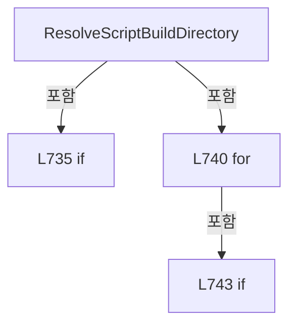

변경 전 점검: 입력/반환 타입, 위 호출자, 예외/취소 경로, 공유 상태와 저장·전송 소비자를 함께 확인합니다. 값의 단위나 물리 방향을 이름만으로 확정하지 않습니다.

### MethodDeclaration `NormalizeScriptBuildName` · L752–764

[Drilling.File/Script/CAutomation1ScriptFile.cs:752–764](https://github.com/kjuws10-rgb/A3Drilling/blob/334b3599651b2e8e0181fd4459bafaf3cddafff3/Drilling.File/Script/CAutomation1ScriptFile.cs#L752-L764)

| 항목 | 실제 추출 값 |
| --- | --- |
| 서명 | string Drilling.File.Script.CAutomation1ScriptFile.NormalizeScriptBuildName(string) |
| 접근/수식자 | Private / private, static |
| 반환/값 타입 | string |
| 소속 타입 | NamedType:Drilling.File.Script.CAutomation1ScriptFile |

입력 계약:

| 이름 | 타입 | 전달 | 선택/기본값 |
| --- | --- | --- | --- |
| value | string | None | False /  |

정적 호출자로 확인된 위치:

| 호출 파일/행 | 호출 표현식 | 런타임 분기 가능 |
| --- | --- | --- |
| [Drilling.File/Script/CAutomation1ScriptFile.cs:733–733](https://github.com/kjuws10-rgb/A3Drilling/blob/334b3599651b2e8e0181fd4459bafaf3cddafff3/Drilling.File/Script/CAutomation1ScriptFile.cs#L733-L733) | NormalizeScriptBuildName | False |

호출하는 대상과 해석 범위:

| 원본 행 | 표현식 | 분석 상태 | 대상/소스 위치 |
| --- | --- | --- | --- |
| 754 | string.IsNullOrWhiteSpace | resolved | bool string.IsNullOrWhiteSpace(string?) |
| 754 | value.Trim | resolved | string string.Trim() |
| 755 | Path.GetInvalidFileNameChars | resolved | char[] System.IO.Path.GetInvalidFileNameChars() |
| 756 | new StringBuilder | resolved | System.Text.StringBuilder.StringBuilder(int) |
| 759 | builder.Append | resolved | System.Text.StringBuilder System.Text.StringBuilder.Append(char) |
| 759 | invalidChars.Contains | resolved | bool System.ReadOnlySpan<char>.Contains<char>(char) |
| 762 | builder.ToString().Trim | resolved | string string.Trim(params System.ReadOnlySpan<char>) |
| 762 | builder.ToString | resolved · 동적 구현 선택 가능 | string System.Text.StringBuilder.ToString() |
| 763 | string.IsNullOrWhiteSpace | resolved | bool string.IsNullOrWhiteSpace(string?) |

본문의 실제 연산·분기·예외·반환 순서(원문 위치 순):

| 원본 행 | 종류 | 주석 해설 |
| --- | --- | --- |
| 754 | call | 함수·델리게이트 또는 객체 생성자를 호출합니다: string.IsNullOrWhiteSpace(value) |
| 754 | call | 함수·델리게이트 또는 객체 생성자를 호출합니다: value.Trim() |
| 754 | conditional-expression | 조건에 따라 결과식을 선택합니다: string.IsNullOrWhiteSpace(value) ? "NO_GLASS_ID" : value.Trim() |
| 754 | local-declaration | 지역 변수를 선언합니다: var text = string.IsNullOrWhiteSpace(value) ? "NO_GLASS_ID" : value.Trim(); |
| 754 | variable-initializer | 변수의 초기값을 지정합니다: text = string.IsNullOrWhiteSpace(value) ? "NO_GLASS_ID" : value.Trim() |
| 755 | call | 함수·델리게이트 또는 객체 생성자를 호출합니다: Path.GetInvalidFileNameChars() |
| 755 | local-declaration | 지역 변수를 선언합니다: var invalidChars = Path.GetInvalidFileNameChars(); |
| 755 | variable-initializer | 변수의 초기값을 지정합니다: invalidChars = Path.GetInvalidFileNameChars() |
| 756 | call | 함수·델리게이트 또는 객체 생성자를 호출합니다: new StringBuilder(text.Length) |
| 756 | local-declaration | 지역 변수를 선언합니다: var builder = new StringBuilder(text.Length); |
| 756 | variable-initializer | 변수의 초기값을 지정합니다: builder = new StringBuilder(text.Length) |
| 757 | foreach | 컬렉션 요소를 순회합니다: foreach (var character in text) |
| 759 | call | 함수·델리게이트 또는 객체 생성자를 호출합니다: builder.Append(character == '-' &#124;&#124; invalidChars.Contains(character) ? '_' : character) |
| 759 | call | 함수·델리게이트 또는 객체 생성자를 호출합니다: invalidChars.Contains(character) |
| 759 | conditional-expression | 조건에 따라 결과식을 선택합니다: character == '-' &#124;&#124; invalidChars.Contains(character) ? '_' : character |
| 762 | call | 함수·델리게이트 또는 객체 생성자를 호출합니다: builder.ToString().Trim(' ', '.') |
| 762 | call | 함수·델리게이트 또는 객체 생성자를 호출합니다: builder.ToString() |
| 762 | local-declaration | 지역 변수를 선언합니다: var normalized = builder.ToString().Trim(' ', '.'); |
| 762 | variable-initializer | 변수의 초기값을 지정합니다: normalized = builder.ToString().Trim(' ', '.') |
| 763 | call | 함수·델리게이트 또는 객체 생성자를 호출합니다: string.IsNullOrWhiteSpace(normalized) |
| 763 | conditional-expression | 조건에 따라 결과식을 선택합니다: string.IsNullOrWhiteSpace(normalized) ? "NO_GLASS_ID" : normalized |
| 763 | return | 호출자에게 값 또는 제어를 반환합니다: return string.IsNullOrWhiteSpace(normalized) ? "NO_GLASS_ID" : normalized; |

제어 구문의 포함 구조(실제 실행 순서/CFG가 아닌 구문 탐색 그림):

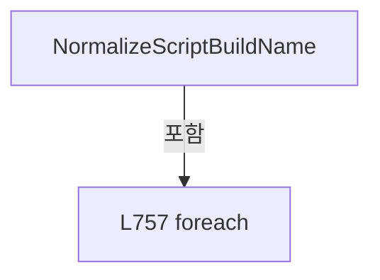

변경 전 점검: 입력/반환 타입, 위 호출자, 예외/취소 경로, 공유 상태와 저장·전송 소비자를 함께 확인합니다. 값의 단위나 물리 방향을 이름만으로 확정하지 않습니다.

### MethodDeclaration `IsBufferedRunDirectory` · L766–770

[Drilling.File/Script/CAutomation1ScriptFile.cs:766–770](https://github.com/kjuws10-rgb/A3Drilling/blob/334b3599651b2e8e0181fd4459bafaf3cddafff3/Drilling.File/Script/CAutomation1ScriptFile.cs#L766-L770)

| 항목 | 실제 추출 값 |
| --- | --- |
| 서명 | bool Drilling.File.Script.CAutomation1ScriptFile.IsBufferedRunDirectory(string) |
| 접근/수식자 | Private / private, static |
| 반환/값 타입 | bool |
| 소속 타입 | NamedType:Drilling.File.Script.CAutomation1ScriptFile |

입력 계약:

| 이름 | 타입 | 전달 | 선택/기본값 |
| --- | --- | --- | --- |
| subDirectoryName | string | None | False /  |

정적 호출자로 확인된 위치:

| 호출 파일/행 | 호출 표현식 | 런타임 분기 가능 |
| --- | --- | --- |
| [Drilling.File/Script/CAutomation1ScriptFile.cs:79–79](https://github.com/kjuws10-rgb/A3Drilling/blob/334b3599651b2e8e0181fd4459bafaf3cddafff3/Drilling.File/Script/CAutomation1ScriptFile.cs#L79-L79) | IsBufferedRunDirectory | False |

호출하는 대상과 해석 범위:

| 원본 행 | 표현식 | 분석 상태 | 대상/소스 위치 |
| --- | --- | --- | --- |
| 768 | string.Equals | resolved | bool string.Equals(string?, string?, System.StringComparison) |
| 769 | subDirectoryName.Replace('\\', '/').Trim('/').Equals | resolved | bool string.Equals(string?, System.StringComparison) |
| 769 | subDirectoryName.Replace('\\', '/').Trim | resolved | string string.Trim(char) |
| 769 | subDirectoryName.Replace | resolved | string string.Replace(char, char) |

본문의 실제 연산·분기·예외·반환 순서(원문 위치 순):

| 원본 행 | 종류 | 주석 해설 |
| --- | --- | --- |
| 768 | call | 함수·델리게이트 또는 객체 생성자를 호출합니다: string.Equals(subDirectoryName, BufferedRunDirectoryName, StringComparison.OrdinalIgnoreCase) |
| 768 | return | 호출자에게 값 또는 제어를 반환합니다: return string.Equals(subDirectoryName, BufferedRunDirectoryName, StringComparison.OrdinalIgnoreCase) &#124;&#124; subDirectoryName.Replace('\\', '/').Trim('/').Equals("ManualMOF/Buffered", StringComparison.OrdinalIgnoreCase); |
| 769 | call | 함수·델리게이트 또는 객체 생성자를 호출합니다: subDirectoryName.Replace('\\', '/').Trim('/').Equals("ManualMOF/Buffered", StringComparison.OrdinalIgnoreCase) |
| 769 | call | 함수·델리게이트 또는 객체 생성자를 호출합니다: subDirectoryName.Replace('\\', '/').Trim('/') |
| 769 | call | 함수·델리게이트 또는 객체 생성자를 호출합니다: subDirectoryName.Replace('\\', '/') |

변경 전 점검: 입력/반환 타입, 위 호출자, 예외/취소 경로, 공유 상태와 저장·전송 소비자를 함께 확인합니다. 값의 단위나 물리 방향을 이름만으로 확정하지 않습니다.

### MethodDeclaration `ValidateActiveHeads` · L772–838

[Drilling.File/Script/CAutomation1ScriptFile.cs:772–838](https://github.com/kjuws10-rgb/A3Drilling/blob/334b3599651b2e8e0181fd4459bafaf3cddafff3/Drilling.File/Script/CAutomation1ScriptFile.cs#L772-L838)

| 항목 | 실제 추출 값 |
| --- | --- |
| 서명 | void Drilling.File.Script.CAutomation1ScriptFile.ValidateActiveHeads(System.Collections.Generic.IReadOnlyList<Drilling.Common.Station.ST_HEAD_PROCESS_PLAN>) |
| 접근/수식자 | Private / private, static |
| 반환/값 타입 | void |
| 소속 타입 | NamedType:Drilling.File.Script.CAutomation1ScriptFile |

입력 계약:

| 이름 | 타입 | 전달 | 선택/기본값 |
| --- | --- | --- | --- |
| activeHeads | System.Collections.Generic.IReadOnlyList<Drilling.Common.Station.ST_HEAD_PROCESS_PLAN> | None | False /  |

정적 호출자로 확인된 위치:

| 호출 파일/행 | 호출 표현식 | 런타임 분기 가능 |
| --- | --- | --- |
| [Drilling.File/Script/CAutomation1ScriptFile.cs:77–77](https://github.com/kjuws10-rgb/A3Drilling/blob/334b3599651b2e8e0181fd4459bafaf3cddafff3/Drilling.File/Script/CAutomation1ScriptFile.cs#L77-L77) | ValidateActiveHeads | False |

호출하는 대상과 해석 범위:

| 원본 행 | 표현식 | 분석 상태 | 대상/소스 위치 |
| --- | --- | --- | --- |
| 794 | activeHeads.GroupBy(SelectHeadNo).Where(ShouldIncludeItem).Select(SelectKey).OrderBy(SelectHeadNo2).ToArray | resolved | int[] System.Collections.Generic.IEnumerable<int>.ToArray<int>() |
| 794 | activeHeads.GroupBy(SelectHeadNo).Where(ShouldIncludeItem).Select(SelectKey).OrderBy | resolved | System.Linq.IOrderedEnumerable<int> System.Collections.Generic.IEnumerable<int>.OrderBy<int, int>(System.Func<int, int>) |
| 794 | activeHeads.GroupBy(SelectHeadNo).Where(ShouldIncludeItem).Select | resolved | System.Collections.Generic.IEnumerable<int> System.Collections.Generic.IEnumerable<System.Linq.IGrouping<int, Drilling.Common.Station.ST_HEAD_PROCESS_PLAN>>.Select<System.Linq.IGrouping<int, Drilling.Common.Station.ST_HEAD_PROCESS_PLAN>, int>(System.Func<System.Linq.IGrouping<int, Drilling.Common.Station.ST_HEAD_PROCESS_PLAN>, int>) |
| 794 | activeHeads.GroupBy(SelectHeadNo).Where | resolved | System.Collections.Generic.IEnumerable<System.Linq.IGrouping<int, Drilling.Common.Station.ST_HEAD_PROCESS_PLAN>> System.Collections.Generic.IEnumerable<System.Linq.IGrouping<int, Drilling.Common.Station.ST_HEAD_PROCESS_PLAN>>.Where<System.Linq.IGrouping<int, Drilling.Common.Station.ST_HEAD_PROCESS_PLAN>>(System.Func<System.Linq.IGrouping<int, Drilling.Common.Station.ST_HEAD_PROCESS_PLAN>, bool>) |
| 794 | activeHeads.GroupBy | resolved | System.Collections.Generic.IEnumerable<System.Linq.IGrouping<int, Drilling.Common.Station.ST_HEAD_PROCESS_PLAN>> System.Collections.Generic.IEnumerable<Drilling.Common.Station.ST_HEAD_PROCESS_PLAN>.GroupBy<Drilling.Common.Station.ST_HEAD_PROCESS_PLAN, int>(System.Func<Drilling.Common.Station.ST_HEAD_PROCESS_PLAN, int>) |
| 797 | new InvalidOperationException | resolved | System.InvalidOperationException.InvalidOperationException(string?) |
| 797 | string.Join | resolved | string string.Join<int>(string?, System.Collections.Generic.IEnumerable<int>) |
| 802 | string.IsNullOrWhiteSpace | resolved | bool string.IsNullOrWhiteSpace(string?) |
| 802 | string.Equals | resolved | bool string.Equals(string?, string?, System.StringComparison) |
| 802 | Path.GetFileName | resolved | string? System.IO.Path.GetFileName(string?) |
| 802 | head.ScriptFileName.IndexOfAny | resolved | int string.IndexOfAny(char[]) |
| 802 | Path.GetInvalidFileNameChars | resolved | char[] System.IO.Path.GetInvalidFileNameChars() |
| 804 | new InvalidOperationException | resolved | System.InvalidOperationException.InvalidOperationException(string?) |
| 807 | IsReservedBuildFileName | resolved | bool Drilling.File.Script.CAutomation1ScriptFile.IsReservedBuildFileName(string) · Drilling.File/Script/CAutomation1ScriptFile.cs:1330 |
| 809 | new InvalidOperationException | resolved | System.InvalidOperationException.InvalidOperationException(string?) |
| 833 | activeHeads.GroupBy(SelectScriptFileName, StringComparer.OrdinalIgnoreCase).Where(ShouldIncludeHead).Select(SelectDuplicateScriptFileName).OrderBy(SelectFileName, StringComparer.OrdinalIgnoreCase).ToArray | resolved | string[] System.Collections.Generic.IEnumerable<string>.ToArray<string>() |
| 833 | activeHeads.GroupBy(SelectScriptFileName, StringComparer.OrdinalIgnoreCase).Where(ShouldIncludeHead).Select(SelectDuplicateScriptFileName).OrderBy | resolved | System.Linq.IOrderedEnumerable<string> System.Collections.Generic.IEnumerable<string>.OrderBy<string, string>(System.Func<string, string>, System.Collections.Generic.IComparer<string>?) |
| 833 | activeHeads.GroupBy(SelectScriptFileName, StringComparer.OrdinalIgnoreCase).Where(ShouldIncludeHead).Select | resolved | System.Collections.Generic.IEnumerable<string> System.Collections.Generic.IEnumerable<System.Linq.IGrouping<string, Drilling.Common.Station.ST_HEAD_PROCESS_PLAN>>.Select<System.Linq.IGrouping<string, Drilling.Common.Station.ST_HEAD_PROCESS_PLAN>, string>(System.Func<System.Linq.IGrouping<string, Drilling.Common.Station.ST_HEAD_PROCESS_PLAN>, string>) |
| 833 | activeHeads.GroupBy(SelectScriptFileName, StringComparer.OrdinalIgnoreCase).Where | resolved | System.Collections.Generic.IEnumerable<System.Linq.IGrouping<string, Drilling.Common.Station.ST_HEAD_PROCESS_PLAN>> System.Collections.Generic.IEnumerable<System.Linq.IGrouping<string, Drilling.Common.Station.ST_HEAD_PROCESS_PLAN>>.Where<System.Linq.IGrouping<string, Drilling.Common.Station.ST_HEAD_PROCESS_PLAN>>(System.Func<System.Linq.IGrouping<string, Drilling.Common.Station.ST_HEAD_PROCESS_PLAN>, bool>) |
| 833 | activeHeads.GroupBy | resolved | System.Collections.Generic.IEnumerable<System.Linq.IGrouping<string, Drilling.Common.Station.ST_HEAD_PROCESS_PLAN>> System.Collections.Generic.IEnumerable<Drilling.Common.Station.ST_HEAD_PROCESS_PLAN>.GroupBy<Drilling.Common.Station.ST_HEAD_PROCESS_PLAN, string>(System.Func<Drilling.Common.Station.ST_HEAD_PROCESS_PLAN, string>, System.Collections.Generic.IEqualityComparer<string>?) |
| 836 | new InvalidOperationException | resolved | System.InvalidOperationException.InvalidOperationException(string?) |
| 836 | string.Join | resolved | string string.Join(string?, params string?[]) |

본문의 실제 연산·분기·예외·반환 순서(원문 위치 순):

| 원본 행 | 종류 | 주석 해설 |
| --- | --- | --- |
| 794 | call | 함수·델리게이트 또는 객체 생성자를 호출합니다: activeHeads.GroupBy(SelectHeadNo).Where(ShouldIncludeItem).Select(SelectKey).OrderBy(SelectHeadNo2).ToArray() |
| 794 | call | 함수·델리게이트 또는 객체 생성자를 호출합니다: activeHeads.GroupBy(SelectHeadNo).Where(ShouldIncludeItem).Select(SelectKey).OrderBy(SelectHeadNo2) |
| 794 | call | 함수·델리게이트 또는 객체 생성자를 호출합니다: activeHeads.GroupBy(SelectHeadNo).Where(ShouldIncludeItem).Select(SelectKey) |
| 794 | call | 함수·델리게이트 또는 객체 생성자를 호출합니다: activeHeads.GroupBy(SelectHeadNo).Where(ShouldIncludeItem) |
| 794 | call | 함수·델리게이트 또는 객체 생성자를 호출합니다: activeHeads.GroupBy(SelectHeadNo) |
| 794 | local-declaration | 지역 변수를 선언합니다: var duplicateHeadNumbers = activeHeads.GroupBy(SelectHeadNo).Where(ShouldIncludeItem).Select(SelectKey).OrderBy(SelectHeadNo2).ToArray(); |
| 794 | variable-initializer | 변수의 초기값을 지정합니다: duplicateHeadNumbers = activeHeads.GroupBy(SelectHeadNo).Where(ShouldIncludeItem).Select(SelectKey).OrderBy(SelectHeadNo2).ToArray() |
| 795 | if | 조건에 따라 분기합니다: if (duplicateHeadNumbers.Length > 0) |
| 797 | call | 함수·델리게이트 또는 객체 생성자를 호출합니다: new InvalidOperationException($"Duplicate active head numbers: {string.Join(", ", duplicateHeadNumbers)}.") |
| 797 | call | 함수·델리게이트 또는 객체 생성자를 호출합니다: string.Join(", ", duplicateHeadNumbers) |
| 797 | throw | 예외를 발생/전달합니다: throw new InvalidOperationException($"Duplicate active head numbers: {string.Join(", ", duplicateHeadNumbers)}."); |
| 800 | foreach | 컬렉션 요소를 순회합니다: foreach (var head in activeHeads) |
| 802 | call | 함수·델리게이트 또는 객체 생성자를 호출합니다: string.IsNullOrWhiteSpace(head.ScriptFileName) |
| 802 | call | 함수·델리게이트 또는 객체 생성자를 호출합니다: string.Equals(Path.GetFileName(head.ScriptFileName), head.ScriptFileName, StringComparison.Ordinal) |
| 802 | call | 함수·델리게이트 또는 객체 생성자를 호출합니다: Path.GetFileName(head.ScriptFileName) |
| 802 | call | 함수·델리게이트 또는 객체 생성자를 호출합니다: head.ScriptFileName.IndexOfAny(Path.GetInvalidFileNameChars()) |
| 802 | call | 함수·델리게이트 또는 객체 생성자를 호출합니다: Path.GetInvalidFileNameChars() |
| 802 | if | 조건에 따라 분기합니다: if (string.IsNullOrWhiteSpace(head.ScriptFileName) &#124;&#124; !string.Equals(Path.GetFileName(head.ScriptFileName), head.ScriptFileName, StringComparison.Ordinal) &#124;&#124; head.ScriptFileName.IndexOfAny(Path.GetInvalidFileNameChars()) >= …) |
| 804 | call | 함수·델리게이트 또는 객체 생성자를 호출합니다: new InvalidOperationException($"H{head.HeadNo:00} has an invalid script file name: {head.ScriptFileName}.") |
| 804 | throw | 예외를 발생/전달합니다: throw new InvalidOperationException($"H{head.HeadNo:00} has an invalid script file name: {head.ScriptFileName}."); |
| 807 | call | 함수·델리게이트 또는 객체 생성자를 호출합니다: IsReservedBuildFileName(head.ScriptFileName) |
| 807 | if | 조건에 따라 분기합니다: if (IsReservedBuildFileName(head.ScriptFileName)) |
| 809 | call | 함수·델리게이트 또는 객체 생성자를 호출합니다: new InvalidOperationException($"H{head.HeadNo:00} script file name conflicts with a reserved build output file: {head.ScriptFileName}.") |
| 809 | throw | 예외를 발생/전달합니다: throw new InvalidOperationException($"H{head.HeadNo:00} script file name conflicts with a reserved build output file: {head.ScriptFileName}."); |
| 833 | call | 함수·델리게이트 또는 객체 생성자를 호출합니다: activeHeads.GroupBy(SelectScriptFileName, StringComparer.OrdinalIgnoreCase).Where(ShouldIncludeHead).Select(SelectDuplicateScriptFileName).OrderBy(SelectFileName, StringComparer.OrdinalIgnoreCase).ToArray() |
| 833 | call | 함수·델리게이트 또는 객체 생성자를 호출합니다: activeHeads.GroupBy(SelectScriptFileName, StringComparer.OrdinalIgnoreCase).Where(ShouldIncludeHead).Select(SelectDuplicateScriptFileName).OrderBy(SelectFileName, StringComparer.OrdinalIgnoreCase) |
| 833 | call | 함수·델리게이트 또는 객체 생성자를 호출합니다: activeHeads.GroupBy(SelectScriptFileName, StringComparer.OrdinalIgnoreCase).Where(ShouldIncludeHead).Select(SelectDuplicateScriptFileName) |
| 833 | call | 함수·델리게이트 또는 객체 생성자를 호출합니다: activeHeads.GroupBy(SelectScriptFileName, StringComparer.OrdinalIgnoreCase).Where(ShouldIncludeHead) |
| 833 | call | 함수·델리게이트 또는 객체 생성자를 호출합니다: activeHeads.GroupBy(SelectScriptFileName, StringComparer.OrdinalIgnoreCase) |
| 833 | local-declaration | 지역 변수를 선언합니다: var duplicateFileNames = activeHeads.GroupBy(SelectScriptFileName, StringComparer.OrdinalIgnoreCase).Where(ShouldIncludeHead).Select(SelectDuplicateScriptFileName).OrderBy(SelectFileName, StringComparer.OrdinalIgnoreCase).ToArray( |
| 833 | variable-initializer | 변수의 초기값을 지정합니다: duplicateFileNames = activeHeads.GroupBy(SelectScriptFileName, StringComparer.OrdinalIgnoreCase).Where(ShouldIncludeHead).Select(SelectDuplicateScriptFileName).OrderBy(SelectFileName, StringComparer.OrdinalIgnoreCase).ToArray() |
| 834 | if | 조건에 따라 분기합니다: if (duplicateFileNames.Length > 0) |
| 836 | call | 함수·델리게이트 또는 객체 생성자를 호출합니다: new InvalidOperationException($"Duplicate active script file names: {string.Join(", ", duplicateFileNames)}.") |
| 836 | call | 함수·델리게이트 또는 객체 생성자를 호출합니다: string.Join(", ", duplicateFileNames) |
| 836 | throw | 예외를 발생/전달합니다: throw new InvalidOperationException($"Duplicate active script file names: {string.Join(", ", duplicateFileNames)}."); |

제어 구문의 포함 구조(실제 실행 순서/CFG가 아닌 구문 탐색 그림):

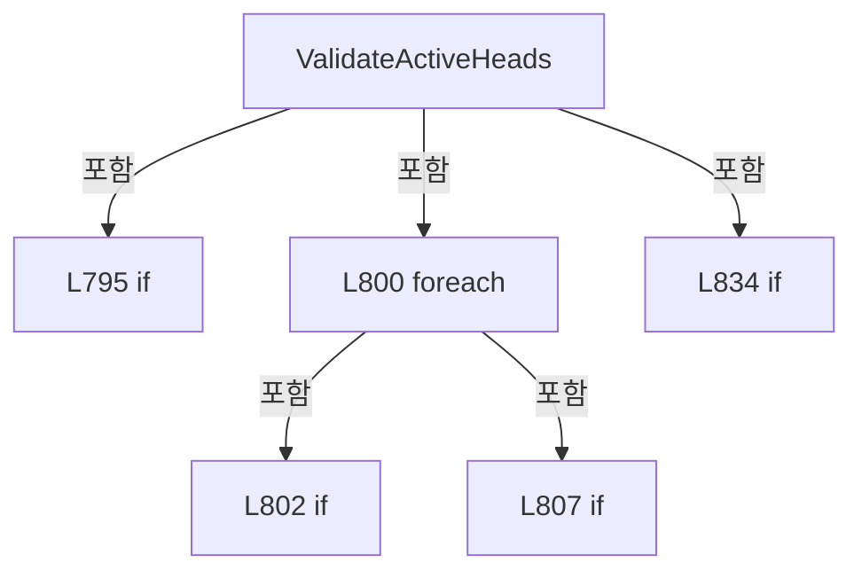

변경 전 점검: 입력/반환 타입, 위 호출자, 예외/취소 경로, 공유 상태와 저장·전송 소비자를 함께 확인합니다. 값의 단위나 물리 방향을 이름만으로 확정하지 않습니다.

### LocalFunctionStatement `SelectHeadNo` · L774–777

[Drilling.File/Script/CAutomation1ScriptFile.cs:774–777](https://github.com/kjuws10-rgb/A3Drilling/blob/334b3599651b2e8e0181fd4459bafaf3cddafff3/Drilling.File/Script/CAutomation1ScriptFile.cs#L774-L777)

| 항목 | 실제 추출 값 |
| --- | --- |
| 서명 | int SelectHeadNo(Drilling.Common.Station.ST_HEAD_PROCESS_PLAN) |
| 접근/수식자 | Private /  |
| 반환/값 타입 | int |
| 소속 타입 | NamedType:Drilling.File.Script.CAutomation1ScriptFile |

입력 계약:

| 이름 | 타입 | 전달 | 선택/기본값 |
| --- | --- | --- | --- |
| head | Drilling.Common.Station.ST_HEAD_PROCESS_PLAN | None | False /  |

현재 부분 분석에서 직접 연결된 호출자는 없습니다. XAML/이벤트/인터페이스·델리게이트·외부 진입을 추가 확인해야 하며, 미사용으로 판정한 것이 아닙니다.

본문의 실제 연산·분기·예외·반환 순서(원문 위치 순):

| 원본 행 | 종류 | 주석 해설 |
| --- | --- | --- |
| 776 | return | 호출자에게 값 또는 제어를 반환합니다: return head.HeadNo; |

변경 전 점검: 입력/반환 타입, 위 호출자, 예외/취소 경로, 공유 상태와 저장·전송 소비자를 함께 확인합니다. 값의 단위나 물리 방향을 이름만으로 확정하지 않습니다.

### LocalFunctionStatement `ShouldIncludeItem` · L779–782

[Drilling.File/Script/CAutomation1ScriptFile.cs:779–782](https://github.com/kjuws10-rgb/A3Drilling/blob/334b3599651b2e8e0181fd4459bafaf3cddafff3/Drilling.File/Script/CAutomation1ScriptFile.cs#L779-L782)

| 항목 | 실제 추출 값 |
| --- | --- |
| 서명 | bool ShouldIncludeItem(System.Linq.IGrouping<int, Drilling.Common.Station.ST_HEAD_PROCESS_PLAN>) |
| 접근/수식자 | Private /  |
| 반환/값 타입 | bool |
| 소속 타입 | NamedType:Drilling.File.Script.CAutomation1ScriptFile |

입력 계약:

| 이름 | 타입 | 전달 | 선택/기본값 |
| --- | --- | --- | --- |
| group | System.Linq.IGrouping<int, Drilling.Common.Station.ST_HEAD_PROCESS_PLAN> | None | False /  |

현재 부분 분석에서 직접 연결된 호출자는 없습니다. XAML/이벤트/인터페이스·델리게이트·외부 진입을 추가 확인해야 하며, 미사용으로 판정한 것이 아닙니다.

호출하는 대상과 해석 범위:

| 원본 행 | 표현식 | 분석 상태 | 대상/소스 위치 |
| --- | --- | --- | --- |
| 781 | group.Count | resolved | int System.Collections.Generic.IEnumerable<Drilling.Common.Station.ST_HEAD_PROCESS_PLAN>.Count<Drilling.Common.Station.ST_HEAD_PROCESS_PLAN>() |

본문의 실제 연산·분기·예외·반환 순서(원문 위치 순):

| 원본 행 | 종류 | 주석 해설 |
| --- | --- | --- |
| 781 | call | 함수·델리게이트 또는 객체 생성자를 호출합니다: group.Count() |
| 781 | return | 호출자에게 값 또는 제어를 반환합니다: return group.Count() > 1; |

변경 전 점검: 입력/반환 타입, 위 호출자, 예외/취소 경로, 공유 상태와 저장·전송 소비자를 함께 확인합니다. 값의 단위나 물리 방향을 이름만으로 확정하지 않습니다.

### LocalFunctionStatement `SelectKey` · L784–787

[Drilling.File/Script/CAutomation1ScriptFile.cs:784–787](https://github.com/kjuws10-rgb/A3Drilling/blob/334b3599651b2e8e0181fd4459bafaf3cddafff3/Drilling.File/Script/CAutomation1ScriptFile.cs#L784-L787)

| 항목 | 실제 추출 값 |
| --- | --- |
| 서명 | int SelectKey(System.Linq.IGrouping<int, Drilling.Common.Station.ST_HEAD_PROCESS_PLAN>) |
| 접근/수식자 | Private /  |
| 반환/값 타입 | int |
| 소속 타입 | NamedType:Drilling.File.Script.CAutomation1ScriptFile |

입력 계약:

| 이름 | 타입 | 전달 | 선택/기본값 |
| --- | --- | --- | --- |
| group | System.Linq.IGrouping<int, Drilling.Common.Station.ST_HEAD_PROCESS_PLAN> | None | False /  |

현재 부분 분석에서 직접 연결된 호출자는 없습니다. XAML/이벤트/인터페이스·델리게이트·외부 진입을 추가 확인해야 하며, 미사용으로 판정한 것이 아닙니다.

본문의 실제 연산·분기·예외·반환 순서(원문 위치 순):

| 원본 행 | 종류 | 주석 해설 |
| --- | --- | --- |
| 786 | return | 호출자에게 값 또는 제어를 반환합니다: return group.Key; |

변경 전 점검: 입력/반환 타입, 위 호출자, 예외/취소 경로, 공유 상태와 저장·전송 소비자를 함께 확인합니다. 값의 단위나 물리 방향을 이름만으로 확정하지 않습니다.

### LocalFunctionStatement `SelectHeadNo2` · L789–792

[Drilling.File/Script/CAutomation1ScriptFile.cs:789–792](https://github.com/kjuws10-rgb/A3Drilling/blob/334b3599651b2e8e0181fd4459bafaf3cddafff3/Drilling.File/Script/CAutomation1ScriptFile.cs#L789-L792)

| 항목 | 실제 추출 값 |
| --- | --- |
| 서명 | int SelectHeadNo2(int) |
| 접근/수식자 | Private /  |
| 반환/값 타입 | int |
| 소속 타입 | NamedType:Drilling.File.Script.CAutomation1ScriptFile |

입력 계약:

| 이름 | 타입 | 전달 | 선택/기본값 |
| --- | --- | --- | --- |
| headNo | int | None | False /  |

현재 부분 분석에서 직접 연결된 호출자는 없습니다. XAML/이벤트/인터페이스·델리게이트·외부 진입을 추가 확인해야 하며, 미사용으로 판정한 것이 아닙니다.

본문의 실제 연산·분기·예외·반환 순서(원문 위치 순):

| 원본 행 | 종류 | 주석 해설 |
| --- | --- | --- |
| 791 | return | 호출자에게 값 또는 제어를 반환합니다: return headNo; |

변경 전 점검: 입력/반환 타입, 위 호출자, 예외/취소 경로, 공유 상태와 저장·전송 소비자를 함께 확인합니다. 값의 단위나 물리 방향을 이름만으로 확정하지 않습니다.

### LocalFunctionStatement `SelectScriptFileName` · L813–816

[Drilling.File/Script/CAutomation1ScriptFile.cs:813–816](https://github.com/kjuws10-rgb/A3Drilling/blob/334b3599651b2e8e0181fd4459bafaf3cddafff3/Drilling.File/Script/CAutomation1ScriptFile.cs#L813-L816)

| 항목 | 실제 추출 값 |
| --- | --- |
| 서명 | string SelectScriptFileName(Drilling.Common.Station.ST_HEAD_PROCESS_PLAN) |
| 접근/수식자 | Private /  |
| 반환/값 타입 | string |
| 소속 타입 | NamedType:Drilling.File.Script.CAutomation1ScriptFile |

입력 계약:

| 이름 | 타입 | 전달 | 선택/기본값 |
| --- | --- | --- | --- |
| head | Drilling.Common.Station.ST_HEAD_PROCESS_PLAN | None | False /  |

현재 부분 분석에서 직접 연결된 호출자는 없습니다. XAML/이벤트/인터페이스·델리게이트·외부 진입을 추가 확인해야 하며, 미사용으로 판정한 것이 아닙니다.

본문의 실제 연산·분기·예외·반환 순서(원문 위치 순):

| 원본 행 | 종류 | 주석 해설 |
| --- | --- | --- |
| 815 | return | 호출자에게 값 또는 제어를 반환합니다: return head.ScriptFileName; |

변경 전 점검: 입력/반환 타입, 위 호출자, 예외/취소 경로, 공유 상태와 저장·전송 소비자를 함께 확인합니다. 값의 단위나 물리 방향을 이름만으로 확정하지 않습니다.

### LocalFunctionStatement `ShouldIncludeHead` · L818–821

[Drilling.File/Script/CAutomation1ScriptFile.cs:818–821](https://github.com/kjuws10-rgb/A3Drilling/blob/334b3599651b2e8e0181fd4459bafaf3cddafff3/Drilling.File/Script/CAutomation1ScriptFile.cs#L818-L821)

| 항목 | 실제 추출 값 |
| --- | --- |
| 서명 | bool ShouldIncludeHead(System.Linq.IGrouping<string, Drilling.Common.Station.ST_HEAD_PROCESS_PLAN>) |
| 접근/수식자 | Private /  |
| 반환/값 타입 | bool |
| 소속 타입 | NamedType:Drilling.File.Script.CAutomation1ScriptFile |

입력 계약:

| 이름 | 타입 | 전달 | 선택/기본값 |
| --- | --- | --- | --- |
| group | System.Linq.IGrouping<string, Drilling.Common.Station.ST_HEAD_PROCESS_PLAN> | None | False /  |

현재 부분 분석에서 직접 연결된 호출자는 없습니다. XAML/이벤트/인터페이스·델리게이트·외부 진입을 추가 확인해야 하며, 미사용으로 판정한 것이 아닙니다.

호출하는 대상과 해석 범위:

| 원본 행 | 표현식 | 분석 상태 | 대상/소스 위치 |
| --- | --- | --- | --- |
| 820 | group.Count | resolved | int System.Collections.Generic.IEnumerable<Drilling.Common.Station.ST_HEAD_PROCESS_PLAN>.Count<Drilling.Common.Station.ST_HEAD_PROCESS_PLAN>() |

본문의 실제 연산·분기·예외·반환 순서(원문 위치 순):

| 원본 행 | 종류 | 주석 해설 |
| --- | --- | --- |
| 820 | call | 함수·델리게이트 또는 객체 생성자를 호출합니다: group.Count() |
| 820 | return | 호출자에게 값 또는 제어를 반환합니다: return group.Count() > 1; |

변경 전 점검: 입력/반환 타입, 위 호출자, 예외/취소 경로, 공유 상태와 저장·전송 소비자를 함께 확인합니다. 값의 단위나 물리 방향을 이름만으로 확정하지 않습니다.

### LocalFunctionStatement `SelectDuplicateScriptFileName` · L823–826

[Drilling.File/Script/CAutomation1ScriptFile.cs:823–826](https://github.com/kjuws10-rgb/A3Drilling/blob/334b3599651b2e8e0181fd4459bafaf3cddafff3/Drilling.File/Script/CAutomation1ScriptFile.cs#L823-L826)

| 항목 | 실제 추출 값 |
| --- | --- |
| 서명 | string SelectDuplicateScriptFileName(System.Linq.IGrouping<string, Drilling.Common.Station.ST_HEAD_PROCESS_PLAN>) |
| 접근/수식자 | Private /  |
| 반환/값 타입 | string |
| 소속 타입 | NamedType:Drilling.File.Script.CAutomation1ScriptFile |

입력 계약:

| 이름 | 타입 | 전달 | 선택/기본값 |
| --- | --- | --- | --- |
| group | System.Linq.IGrouping<string, Drilling.Common.Station.ST_HEAD_PROCESS_PLAN> | None | False /  |

현재 부분 분석에서 직접 연결된 호출자는 없습니다. XAML/이벤트/인터페이스·델리게이트·외부 진입을 추가 확인해야 하며, 미사용으로 판정한 것이 아닙니다.

본문의 실제 연산·분기·예외·반환 순서(원문 위치 순):

| 원본 행 | 종류 | 주석 해설 |
| --- | --- | --- |
| 825 | return | 호출자에게 값 또는 제어를 반환합니다: return group.Key; |

변경 전 점검: 입력/반환 타입, 위 호출자, 예외/취소 경로, 공유 상태와 저장·전송 소비자를 함께 확인합니다. 값의 단위나 물리 방향을 이름만으로 확정하지 않습니다.

### LocalFunctionStatement `SelectFileName` · L828–831

[Drilling.File/Script/CAutomation1ScriptFile.cs:828–831](https://github.com/kjuws10-rgb/A3Drilling/blob/334b3599651b2e8e0181fd4459bafaf3cddafff3/Drilling.File/Script/CAutomation1ScriptFile.cs#L828-L831)

| 항목 | 실제 추출 값 |
| --- | --- |
| 서명 | string SelectFileName(string) |
| 접근/수식자 | Private /  |
| 반환/값 타입 | string |
| 소속 타입 | NamedType:Drilling.File.Script.CAutomation1ScriptFile |

입력 계약:

| 이름 | 타입 | 전달 | 선택/기본값 |
| --- | --- | --- | --- |
| fileName | string | None | False /  |

현재 부분 분석에서 직접 연결된 호출자는 없습니다. XAML/이벤트/인터페이스·델리게이트·외부 진입을 추가 확인해야 하며, 미사용으로 판정한 것이 아닙니다.

본문의 실제 연산·분기·예외·반환 순서(원문 위치 순):

| 원본 행 | 종류 | 주석 해설 |
| --- | --- | --- |
| 830 | return | 호출자에게 값 또는 제어를 반환합니다: return fileName; |

변경 전 점검: 입력/반환 타입, 위 호출자, 예외/취소 경로, 공유 상태와 저장·전송 소비자를 함께 확인합니다. 값의 단위나 물리 방향을 이름만으로 확정하지 않습니다.

### MethodDeclaration `AppendStartFollowMoves` · L840–886

[Drilling.File/Script/CAutomation1ScriptFile.cs:840–886](https://github.com/kjuws10-rgb/A3Drilling/blob/334b3599651b2e8e0181fd4459bafaf3cddafff3/Drilling.File/Script/CAutomation1ScriptFile.cs#L840-L886)

| 항목 | 실제 추출 값 |
| --- | --- |
| 서명 | void Drilling.File.Script.CAutomation1ScriptFile.AppendStartFollowMoves(System.Collections.Generic.List<string>, System.Collections.Generic.IReadOnlyDictionary<string, string>, Drilling.Common.Station.ST_HEAD_PROCESS_PLAN, string, string, string, double, bool) |
| 접근/수식자 | Private / private, static |
| 반환/값 타입 | void |
| 소속 타입 | NamedType:Drilling.File.Script.CAutomation1ScriptFile |

입력 계약:

| 이름 | 타입 | 전달 | 선택/기본값 |
| --- | --- | --- | --- |
| lines | System.Collections.Generic.List<string> | None | False /  |
| common | System.Collections.Generic.IReadOnlyDictionary<string, string> | None | False /  |
| head | Drilling.Common.Station.ST_HEAD_PROCESS_PLAN | None | False /  |
| xAxis | string | None | False /  |
| yAxis | string | None | False /  |
| encoderAxis | string | None | False /  |
| encoderScale | double | None | False /  |
| encoderFeedbackFlip | bool | None | False /  |

정적 호출자로 확인된 위치:

| 호출 파일/행 | 호출 표현식 | 런타임 분기 가능 |
| --- | --- | --- |
| [Drilling.File/Script/CAutomation1ScriptFile.cs:514–514](https://github.com/kjuws10-rgb/A3Drilling/blob/334b3599651b2e8e0181fd4459bafaf3cddafff3/Drilling.File/Script/CAutomation1ScriptFile.cs#L514-L514) | AppendStartFollowMoves | False |

호출하는 대상과 해석 범위:

| 원본 행 | 표현식 | 분석 상태 | 대상/소스 위치 |
| --- | --- | --- | --- |
| 858 | Math.Abs | resolved | double System.Math.Abs(double) |
| 858 | Math.Abs | resolved | double System.Math.Abs(double) |
| 863 | Math.Abs | resolved | double System.Math.Abs(double) |
| 863 | ReadDouble | resolved | double Drilling.File.Script.CAutomation1ScriptFile.ReadDouble(System.Collections.Generic.IReadOnlyDictionary<string, string>, double, params string[]) · Drilling.File/Script/CAutomation1ScriptFile.cs:1157 |
| 869 | Math.Abs | resolved | double System.Math.Abs(double) |
| 870 | CScannerAxisTransform.Read(common, head.HeadNo).Apply | resolved | (double X, double Y) Drilling.Common.Recipe.ST_SCANNER_AXIS_TRANSFORM.Apply(double, double) · Drilling.Common/Recipe/CShotCoordinatePlanBuilder.cs:1233 |
| 870 | CScannerAxisTransform.Read | resolved | Drilling.Common.Recipe.ST_SCANNER_AXIS_TRANSFORM Drilling.Common.Recipe.CScannerAxisTransform.Read(System.Collections.Generic.IReadOnlyDictionary<string, string>, int) · Drilling.Common/Recipe/CShotCoordinatePlanBuilder.cs:1262 |
| 871 | Math.Max | resolved | double System.Math.Max(double, double) |
| 871 | Math.Abs | resolved | double System.Math.Abs(double) |
| 871 | Math.Abs | resolved | double System.Math.Abs(double) |
| 883 | lines.Add | resolved | void System.Collections.Generic.List<string>.Add(string) |
| 883 | Format | resolved | string Drilling.File.Script.CAutomation1ScriptFile.Format(double) · Drilling.File/Script/CAutomation1ScriptFile.cs:1285 |
| 883 | Format | resolved | string Drilling.File.Script.CAutomation1ScriptFile.Format(double) · Drilling.File/Script/CAutomation1ScriptFile.cs:1285 |
| 884 | AppendEncoderWait | resolved | void Drilling.File.Script.CAutomation1ScriptFile.AppendEncoderWait(System.Collections.Generic.List<string>, string, double, bool) · Drilling.File/Script/CAutomation1ScriptFile.cs:957 |

본문의 실제 연산·분기·예외·반환 순서(원문 위치 순):

| 원본 행 | 종류 | 주석 해설 |
| --- | --- | --- |
| 851 | if | 조건에 따라 분기합니다: if (head.Shots.Count == 0) |
| 853 | return | 호출자에게 값 또는 제어를 반환합니다: return; |
| 856 | local-declaration | 지역 변수를 선언합니다: var firstPoint = head.Shots[0]; |
| 856 | variable-initializer | 변수의 초기값을 지정합니다: firstPoint = head.Shots[0] |
| 857 | local-declaration | 지역 변수를 선언합니다: var targetWaitPosition = firstPoint.EncoderWaitPosition; |
| 857 | variable-initializer | 변수의 초기값을 지정합니다: targetWaitPosition = firstPoint.EncoderWaitPosition |
| 858 | call | 함수·델리게이트 또는 객체 생성자를 호출합니다: Math.Abs(encoderScale) |
| 858 | call | 함수·델리게이트 또는 객체 생성자를 호출합니다: Math.Abs(targetWaitPosition) |
| 858 | if | 조건에 따라 분기합니다: if (Math.Abs(encoderScale) <= 0.000001 &#124;&#124; Math.Abs(targetWaitPosition) <= 0.000001) |
| 860 | return | 호출자에게 값 또는 제어를 반환합니다: return; |
| 863 | call | 함수·델리게이트 또는 객체 생성자를 호출합니다: Math.Abs(ReadDouble(common, 5.0, "SCAN_START_JUMP_STEP", "MOF_START_JUMP_STEP", "SCAN_JUMP_SCALE")) |
| 863 | call | 함수·델리게이트 또는 객체 생성자를 호출합니다: ReadDouble(common, 5.0, "SCAN_START_JUMP_STEP", "MOF_START_JUMP_STEP", "SCAN_JUMP_SCALE") |
| 863 | local-declaration | 지역 변수를 선언합니다: var jumpStep = Math.Abs(ReadDouble(common, 5.0, "SCAN_START_JUMP_STEP", "MOF_START_JUMP_STEP", "SCAN_JUMP_SCALE")); |
| 863 | variable-initializer | 변수의 초기값을 지정합니다: jumpStep = Math.Abs(ReadDouble(common, 5.0, "SCAN_START_JUMP_STEP", "MOF_START_JUMP_STEP", "SCAN_JUMP_SCALE")) |
| 864 | if | 조건에 따라 분기합니다: if (jumpStep <= 0.000001) |
| 866 | return | 호출자에게 값 또는 제어를 반환합니다: return; |
| 869 | call | 함수·델리게이트 또는 객체 생성자를 호출합니다: Math.Abs(encoderScale) |
| 869 | local-declaration | 지역 변수를 선언합니다: var targetScanDistance = -(targetWaitPosition / Math.Abs(encoderScale)); |
| 869 | variable-initializer | 변수의 초기값을 지정합니다: targetScanDistance = -(targetWaitPosition / Math.Abs(encoderScale)) |
| 870 | call | 함수·델리게이트 또는 객체 생성자를 호출합니다: CScannerAxisTransform.Read(common, head.HeadNo).Apply(0.0, targetScanDistance) |
| 870 | call | 함수·델리게이트 또는 객체 생성자를 호출합니다: CScannerAxisTransform.Read(common, head.HeadNo) |
| 870 | local-declaration | 지역 변수를 선언합니다: var targetScannerMove = CScannerAxisTransform.Read(common, head.HeadNo).Apply(0.0, targetScanDistance); |
| 870 | variable-initializer | 변수의 초기값을 지정합니다: targetScannerMove = CScannerAxisTransform.Read(common, head.HeadNo).Apply(0.0, targetScanDistance) |
| 871 | call | 함수·델리게이트 또는 객체 생성자를 호출합니다: Math.Max(Math.Abs(targetScannerMove.X), Math.Abs(targetScannerMove.Y)) |
| 871 | call | 함수·델리게이트 또는 객체 생성자를 호출합니다: Math.Abs(targetScannerMove.X) |
| 871 | call | 함수·델리게이트 또는 객체 생성자를 호출합니다: Math.Abs(targetScannerMove.Y) |
| 871 | local-declaration | 지역 변수를 선언합니다: var targetDistance = Math.Max(Math.Abs(targetScannerMove.X), Math.Abs(targetScannerMove.Y)); |
| 871 | variable-initializer | 변수의 초기값을 지정합니다: targetDistance = Math.Max(Math.Abs(targetScannerMove.X), Math.Abs(targetScannerMove.Y)) |
| 872 | if | 조건에 따라 분기합니다: if (targetDistance <= 0.000001) |
| 874 | return | 호출자에게 값 또는 제어를 반환합니다: return; |
| 877 | compound-assignment-or-event-subscription | 복합 대입 또는 이벤트 구독/해지 표현입니다: distance += jumpStep |
| 877 | variable-initializer | 변수의 초기값을 지정합니다: distance = jumpStep |
| 877 | for | 초기화·조건·증감이 있는 반복입니다: for (var distance = jumpStep; distance < targetDistance; distance += jumpStep) |
| 879 | local-declaration | 지역 변수를 선언합니다: var ratio = distance / targetDistance; |
| 879 | variable-initializer | 변수의 초기값을 지정합니다: ratio = distance / targetDistance |
| 880 | local-declaration | 지역 변수를 선언합니다: var scannerX = targetScannerMove.X * ratio; |
| 880 | variable-initializer | 변수의 초기값을 지정합니다: scannerX = targetScannerMove.X * ratio |
| 881 | local-declaration | 지역 변수를 선언합니다: var scannerY = targetScannerMove.Y * ratio; |
| 881 | variable-initializer | 변수의 초기값을 지정합니다: scannerY = targetScannerMove.Y * ratio |
| 882 | local-declaration | 지역 변수를 선언합니다: var waitPosition = targetWaitPosition * ratio; |
| 882 | variable-initializer | 변수의 초기값을 지정합니다: waitPosition = targetWaitPosition * ratio |
| 883 | call | 함수·델리게이트 또는 객체 생성자를 호출합니다: lines.Add($"MoveRapid([{xAxis},{yAxis}], [{Format(scannerX)},{Format(scannerY)}])") |
| 883 | call | 함수·델리게이트 또는 객체 생성자를 호출합니다: Format(scannerX) |
| 883 | call | 함수·델리게이트 또는 객체 생성자를 호출합니다: Format(scannerY) |
| 884 | call | 함수·델리게이트 또는 객체 생성자를 호출합니다: AppendEncoderWait(lines, encoderAxis, waitPosition, encoderFeedbackFlip) |

제어 구문의 포함 구조(실제 실행 순서/CFG가 아닌 구문 탐색 그림):

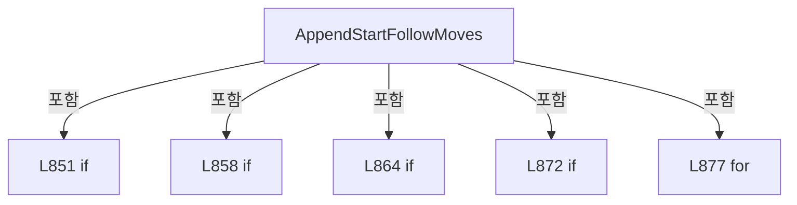

변경 전 점검: 입력/반환 타입, 위 호출자, 예외/취소 경로, 공유 상태와 저장·전송 소비자를 함께 확인합니다. 값의 단위나 물리 방향을 이름만으로 확정하지 않습니다.

### MethodDeclaration `AppendFollowTransitionMoves` · L888–934

[Drilling.File/Script/CAutomation1ScriptFile.cs:888–934](https://github.com/kjuws10-rgb/A3Drilling/blob/334b3599651b2e8e0181fd4459bafaf3cddafff3/Drilling.File/Script/CAutomation1ScriptFile.cs#L888-L934)

| 항목 | 실제 추출 값 |
| --- | --- |
| 서명 | void Drilling.File.Script.CAutomation1ScriptFile.AppendFollowTransitionMoves(System.Collections.Generic.List<string>, System.Collections.Generic.IReadOnlyDictionary<string, string>, Drilling.Common.Station.ST_HEAD_PROCESS_PLAN, string, string, string, bool, Drilling.Common.Recipe.ST_HEAD_SHOT_POINT, Drilling.Common.Recipe.ST_HEAD_SHOT_POINT) |
| 접근/수식자 | Private / private, static |
| 반환/값 타입 | void |
| 소속 타입 | NamedType:Drilling.File.Script.CAutomation1ScriptFile |

입력 계약:

| 이름 | 타입 | 전달 | 선택/기본값 |
| --- | --- | --- | --- |
| lines | System.Collections.Generic.List<string> | None | False /  |
| common | System.Collections.Generic.IReadOnlyDictionary<string, string> | None | False /  |
| head | Drilling.Common.Station.ST_HEAD_PROCESS_PLAN | None | False /  |
| xAxis | string | None | False /  |
| yAxis | string | None | False /  |
| encoderAxis | string | None | False /  |
| encoderFeedbackFlip | bool | None | False /  |
| previousPoint | Drilling.Common.Recipe.ST_HEAD_SHOT_POINT | None | False /  |
| targetPoint | Drilling.Common.Recipe.ST_HEAD_SHOT_POINT | None | False /  |

정적 호출자로 확인된 위치:

| 호출 파일/행 | 호출 표현식 | 런타임 분기 가능 |
| --- | --- | --- |
| [Drilling.File/Script/CAutomation1ScriptFile.cs:524–524](https://github.com/kjuws10-rgb/A3Drilling/blob/334b3599651b2e8e0181fd4459bafaf3cddafff3/Drilling.File/Script/CAutomation1ScriptFile.cs#L524-L524) | AppendFollowTransitionMoves | False |

호출하는 대상과 해석 범위:

| 원본 행 | 표현식 | 분석 상태 | 대상/소스 위치 |
| --- | --- | --- | --- |
| 900 | Math.Abs | resolved | double System.Math.Abs(double) |
| 900 | ReadDouble | resolved | double Drilling.File.Script.CAutomation1ScriptFile.ReadDouble(System.Collections.Generic.IReadOnlyDictionary<string, string>, double, params string[]) · Drilling.File/Script/CAutomation1ScriptFile.cs:1157 |
| 906 | Math.Abs | resolved | double System.Math.Abs(double) |
| 906 | ReadDouble | resolved | double Drilling.File.Script.CAutomation1ScriptFile.ReadDouble(System.Collections.Generic.IReadOnlyDictionary<string, string>, double, System.Collections.Generic.IEnumerable<string>) · Drilling.File/Script/CAutomation1ScriptFile.cs:1162 |
| 906 | CreateHeadKeys | resolved | System.Collections.Generic.IReadOnlyList<string> Drilling.File.Script.CAutomation1ScriptFile.CreateHeadKeys(int, params string[]) · Drilling.File/Script/CAutomation1ScriptFile.cs:1102 |
| 913 | ResolveFollowAxis | resolved | Drilling.File.Script.CAutomation1ScriptFile.EN_SCRIPT_FOLLOW_AXIS Drilling.File.Script.CAutomation1ScriptFile.ResolveFollowAxis(Drilling.Common.Recipe.ST_SCANNER_AXIS_TRANSFORM) · Drilling.File/Script/CAutomation1ScriptFile.cs:936 |
| 913 | CScannerAxisTransform.Read | resolved | Drilling.Common.Recipe.ST_SCANNER_AXIS_TRANSFORM Drilling.Common.Recipe.CScannerAxisTransform.Read(System.Collections.Generic.IReadOnlyDictionary<string, string>, int) · Drilling.Common/Recipe/CShotCoordinatePlanBuilder.cs:1262 |
| 914 | ReadFollowAxisPosition | resolved | double Drilling.File.Script.CAutomation1ScriptFile.ReadFollowAxisPosition(Drilling.Common.Recipe.ST_HEAD_SHOT_POINT, Drilling.File.Script.CAutomation1ScriptFile.EN_SCRIPT_FOLLOW_AXIS) · Drilling.File/Script/CAutomation1ScriptFile.cs:947 |
| 915 | ReadFollowAxisPosition | resolved | double Drilling.File.Script.CAutomation1ScriptFile.ReadFollowAxisPosition(Drilling.Common.Recipe.ST_HEAD_SHOT_POINT, Drilling.File.Script.CAutomation1ScriptFile.EN_SCRIPT_FOLLOW_AXIS) · Drilling.File/Script/CAutomation1ScriptFile.cs:947 |
| 916 | Math.Abs | resolved | double System.Math.Abs(double) |
| 931 | lines.Add | resolved | void System.Collections.Generic.List<string>.Add(string) |
| 931 | Format | resolved | string Drilling.File.Script.CAutomation1ScriptFile.Format(double) · Drilling.File/Script/CAutomation1ScriptFile.cs:1285 |
| 931 | Format | resolved | string Drilling.File.Script.CAutomation1ScriptFile.Format(double) · Drilling.File/Script/CAutomation1ScriptFile.cs:1285 |
| 932 | AppendEncoderWait | resolved | void Drilling.File.Script.CAutomation1ScriptFile.AppendEncoderWait(System.Collections.Generic.List<string>, string, double, bool) · Drilling.File/Script/CAutomation1ScriptFile.cs:957 |

본문의 실제 연산·분기·예외·반환 순서(원문 위치 순):

| 원본 행 | 종류 | 주석 해설 |
| --- | --- | --- |
| 900 | call | 함수·델리게이트 또는 객체 생성자를 호출합니다: Math.Abs(ReadDouble(common, 5.0, "SCAN_START_JUMP_STEP", "MOF_START_JUMP_STEP", "SCAN_JUMP_SCALE")) |
| 900 | call | 함수·델리게이트 또는 객체 생성자를 호출합니다: ReadDouble(common, 5.0, "SCAN_START_JUMP_STEP", "MOF_START_JUMP_STEP", "SCAN_JUMP_SCALE") |
| 900 | local-declaration | 지역 변수를 선언합니다: var jumpStep = Math.Abs(ReadDouble(common, 5.0, "SCAN_START_JUMP_STEP", "MOF_START_JUMP_STEP", "SCAN_JUMP_SCALE")); |
| 900 | variable-initializer | 변수의 초기값을 지정합니다: jumpStep = Math.Abs(ReadDouble(common, 5.0, "SCAN_START_JUMP_STEP", "MOF_START_JUMP_STEP", "SCAN_JUMP_SCALE")) |
| 901 | if | 조건에 따라 분기합니다: if (jumpStep <= 0.000001) |
| 903 | return | 호출자에게 값 또는 제어를 반환합니다: return; |
| 906 | call | 함수·델리게이트 또는 객체 생성자를 호출합니다: Math.Abs(ReadDouble(common, 110.0, CreateHeadKeys(head.HeadNo, "SCAN_FIELD_WIDTH_X", "HEAD_FIELD_WIDTH_X"))) |
| 906 | call | 함수·델리게이트 또는 객체 생성자를 호출합니다: ReadDouble(common, 110.0, CreateHeadKeys(head.HeadNo, "SCAN_FIELD_WIDTH_X", "HEAD_FIELD_WIDTH_X")) |
| 906 | call | 함수·델리게이트 또는 객체 생성자를 호출합니다: CreateHeadKeys(head.HeadNo, "SCAN_FIELD_WIDTH_X", "HEAD_FIELD_WIDTH_X") |
| 906 | local-declaration | 지역 변수를 선언합니다: var scanFieldWidth = Math.Abs(ReadDouble(common, 110.0, CreateHeadKeys(head.HeadNo, "SCAN_FIELD_WIDTH_X", "HEAD_FIELD_WIDTH_X"))); |
| 906 | variable-initializer | 변수의 초기값을 지정합니다: scanFieldWidth = Math.Abs(ReadDouble(common, 110.0, CreateHeadKeys(head.HeadNo, "SCAN_FIELD_WIDTH_X", "HEAD_FIELD_WIDTH_X"))) |
| 907 | if | 조건에 따라 분기합니다: if (scanFieldWidth <= 0.000001) |
| 909 | assignment | 값을 대상에 대입합니다: scanFieldWidth = 110.0 |
| 912 | local-declaration | 지역 변수를 선언합니다: var transitionLimit = scanFieldWidth / 2.0; |
| 912 | variable-initializer | 변수의 초기값을 지정합니다: transitionLimit = scanFieldWidth / 2.0 |
| 913 | call | 함수·델리게이트 또는 객체 생성자를 호출합니다: ResolveFollowAxis(CScannerAxisTransform.Read(common, head.HeadNo)) |
| 913 | call | 함수·델리게이트 또는 객체 생성자를 호출합니다: CScannerAxisTransform.Read(common, head.HeadNo) |
| 913 | local-declaration | 지역 변수를 선언합니다: var followAxis = ResolveFollowAxis(CScannerAxisTransform.Read(common, head.HeadNo)); |
| 913 | variable-initializer | 변수의 초기값을 지정합니다: followAxis = ResolveFollowAxis(CScannerAxisTransform.Read(common, head.HeadNo)) |
| 914 | call | 함수·델리게이트 또는 객체 생성자를 호출합니다: ReadFollowAxisPosition(previousPoint, followAxis) |
| 914 | local-declaration | 지역 변수를 선언합니다: var previousFollowPosition = ReadFollowAxisPosition(previousPoint, followAxis); |
| 914 | variable-initializer | 변수의 초기값을 지정합니다: previousFollowPosition = ReadFollowAxisPosition(previousPoint, followAxis) |
| 915 | call | 함수·델리게이트 또는 객체 생성자를 호출합니다: ReadFollowAxisPosition(targetPoint, followAxis) |
| 915 | local-declaration | 지역 변수를 선언합니다: var targetFollowPosition = ReadFollowAxisPosition(targetPoint, followAxis); |
| 915 | variable-initializer | 변수의 초기값을 지정합니다: targetFollowPosition = ReadFollowAxisPosition(targetPoint, followAxis) |
| 916 | call | 함수·델리게이트 또는 객체 생성자를 호출합니다: Math.Abs(targetFollowPosition - previousFollowPosition) |
| 916 | local-declaration | 지역 변수를 선언합니다: var followDistance = Math.Abs(targetFollowPosition - previousFollowPosition); |
| 916 | variable-initializer | 변수의 초기값을 지정합니다: followDistance = Math.Abs(targetFollowPosition - previousFollowPosition) |
| 917 | if | 조건에 따라 분기합니다: if (followDistance <= transitionLimit) |
| 919 | return | 호출자에게 값 또는 제어를 반환합니다: return; |
| 922 | local-declaration | 지역 변수를 선언합니다: var deltaX = targetPoint.ScannerGx - previousPoint.ScannerGx; |
| 922 | variable-initializer | 변수의 초기값을 지정합니다: deltaX = targetPoint.ScannerGx - previousPoint.ScannerGx |
| 923 | local-declaration | 지역 변수를 선언합니다: var deltaY = targetPoint.ScannerGy - previousPoint.ScannerGy; |
| 923 | variable-initializer | 변수의 초기값을 지정합니다: deltaY = targetPoint.ScannerGy - previousPoint.ScannerGy |
| 924 | local-declaration | 지역 변수를 선언합니다: var deltaWaitPosition = targetPoint.EncoderWaitPosition - previousPoint.EncoderWaitPosition; |
| 924 | variable-initializer | 변수의 초기값을 지정합니다: deltaWaitPosition = targetPoint.EncoderWaitPosition - previousPoint.EncoderWaitPosition |
| 925 | compound-assignment-or-event-subscription | 복합 대입 또는 이벤트 구독/해지 표현입니다: distance += jumpStep |
| 925 | variable-initializer | 변수의 초기값을 지정합니다: distance = jumpStep |
| 925 | for | 초기화·조건·증감이 있는 반복입니다: for (var distance = jumpStep; distance < followDistance; distance += jumpStep) |
| 927 | local-declaration | 지역 변수를 선언합니다: var ratio = distance / followDistance; |
| 927 | variable-initializer | 변수의 초기값을 지정합니다: ratio = distance / followDistance |
| 928 | local-declaration | 지역 변수를 선언합니다: var scannerX = previousPoint.ScannerGx + (deltaX * ratio); |
| 928 | variable-initializer | 변수의 초기값을 지정합니다: scannerX = previousPoint.ScannerGx + (deltaX * ratio) |
| 929 | local-declaration | 지역 변수를 선언합니다: var scannerY = previousPoint.ScannerGy + (deltaY * ratio); |
| 929 | variable-initializer | 변수의 초기값을 지정합니다: scannerY = previousPoint.ScannerGy + (deltaY * ratio) |
| 930 | local-declaration | 지역 변수를 선언합니다: var waitPosition = previousPoint.EncoderWaitPosition + (deltaWaitPosition * ratio); |
| 930 | variable-initializer | 변수의 초기값을 지정합니다: waitPosition = previousPoint.EncoderWaitPosition + (deltaWaitPosition * ratio) |
| 931 | call | 함수·델리게이트 또는 객체 생성자를 호출합니다: lines.Add($"MoveRapid([{xAxis},{yAxis}], [{Format(scannerX)},{Format(scannerY)}])") |
| 931 | call | 함수·델리게이트 또는 객체 생성자를 호출합니다: Format(scannerX) |
| 931 | call | 함수·델리게이트 또는 객체 생성자를 호출합니다: Format(scannerY) |
| 932 | call | 함수·델리게이트 또는 객체 생성자를 호출합니다: AppendEncoderWait(lines, encoderAxis, waitPosition, encoderFeedbackFlip) |

제어 구문의 포함 구조(실제 실행 순서/CFG가 아닌 구문 탐색 그림):

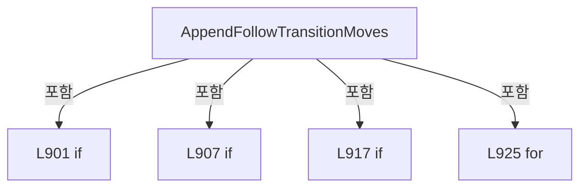

변경 전 점검: 입력/반환 타입, 위 호출자, 예외/취소 경로, 공유 상태와 저장·전송 소비자를 함께 확인합니다. 값의 단위나 물리 방향을 이름만으로 확정하지 않습니다.

### MethodDeclaration `ResolveFollowAxis` · L936–945

[Drilling.File/Script/CAutomation1ScriptFile.cs:936–945](https://github.com/kjuws10-rgb/A3Drilling/blob/334b3599651b2e8e0181fd4459bafaf3cddafff3/Drilling.File/Script/CAutomation1ScriptFile.cs#L936-L945)

| 항목 | 실제 추출 값 |
| --- | --- |
| 서명 | Drilling.File.Script.CAutomation1ScriptFile.EN_SCRIPT_FOLLOW_AXIS Drilling.File.Script.CAutomation1ScriptFile.ResolveFollowAxis(Drilling.Common.Recipe.ST_SCANNER_AXIS_TRANSFORM) |
| 접근/수식자 | Private / private, static |
| 반환/값 타입 | Drilling.File.Script.CAutomation1ScriptFile.EN_SCRIPT_FOLLOW_AXIS |
| 소속 타입 | NamedType:Drilling.File.Script.CAutomation1ScriptFile |

입력 계약:

| 이름 | 타입 | 전달 | 선택/기본값 |
| --- | --- | --- | --- |
| transform | Drilling.Common.Recipe.ST_SCANNER_AXIS_TRANSFORM | None | False /  |

정적 호출자로 확인된 위치:

| 호출 파일/행 | 호출 표현식 | 런타임 분기 가능 |
| --- | --- | --- |
| [Drilling.File/Script/CAutomation1ScriptFile.cs:913–913](https://github.com/kjuws10-rgb/A3Drilling/blob/334b3599651b2e8e0181fd4459bafaf3cddafff3/Drilling.File/Script/CAutomation1ScriptFile.cs#L913-L913) | ResolveFollowAxis | False |

호출하는 대상과 해석 범위:

| 원본 행 | 표현식 | 분석 상태 | 대상/소스 위치 |
| --- | --- | --- | --- |
| 938 | transform.Apply | resolved | (double X, double Y) Drilling.Common.Recipe.ST_SCANNER_AXIS_TRANSFORM.Apply(double, double) · Drilling.Common/Recipe/CShotCoordinatePlanBuilder.cs:1233 |
| 939 | Math.Abs | resolved | double System.Math.Abs(double) |
| 939 | Math.Abs | resolved | double System.Math.Abs(double) |

본문의 실제 연산·분기·예외·반환 순서(원문 위치 순):

| 원본 행 | 종류 | 주석 해설 |
| --- | --- | --- |
| 938 | call | 함수·델리게이트 또는 객체 생성자를 호출합니다: transform.Apply(0.0, 1.0) |
| 938 | local-declaration | 지역 변수를 선언합니다: var followDirection = transform.Apply(0.0, 1.0); |
| 938 | variable-initializer | 변수의 초기값을 지정합니다: followDirection = transform.Apply(0.0, 1.0) |
| 939 | call | 함수·델리게이트 또는 객체 생성자를 호출합니다: Math.Abs(followDirection.X) |
| 939 | call | 함수·델리게이트 또는 객체 생성자를 호출합니다: Math.Abs(followDirection.Y) |
| 939 | if | 조건에 따라 분기합니다: if (Math.Abs(followDirection.X) >= Math.Abs(followDirection.Y)) |
| 941 | return | 호출자에게 값 또는 제어를 반환합니다: return EN_SCRIPT_FOLLOW_AXIS.X; |
| 944 | return | 호출자에게 값 또는 제어를 반환합니다: return EN_SCRIPT_FOLLOW_AXIS.Y; |

제어 구문의 포함 구조(실제 실행 순서/CFG가 아닌 구문 탐색 그림):

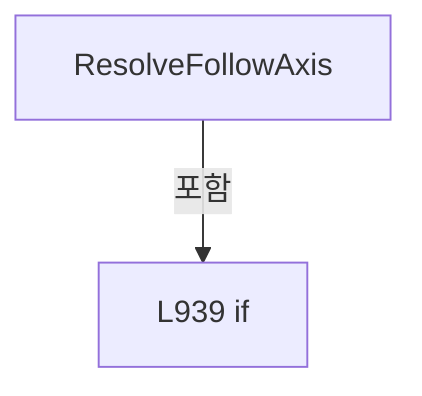

변경 전 점검: 입력/반환 타입, 위 호출자, 예외/취소 경로, 공유 상태와 저장·전송 소비자를 함께 확인합니다. 값의 단위나 물리 방향을 이름만으로 확정하지 않습니다.

### MethodDeclaration `ReadFollowAxisPosition` · L947–955

[Drilling.File/Script/CAutomation1ScriptFile.cs:947–955](https://github.com/kjuws10-rgb/A3Drilling/blob/334b3599651b2e8e0181fd4459bafaf3cddafff3/Drilling.File/Script/CAutomation1ScriptFile.cs#L947-L955)

| 항목 | 실제 추출 값 |
| --- | --- |
| 서명 | double Drilling.File.Script.CAutomation1ScriptFile.ReadFollowAxisPosition(Drilling.Common.Recipe.ST_HEAD_SHOT_POINT, Drilling.File.Script.CAutomation1ScriptFile.EN_SCRIPT_FOLLOW_AXIS) |
| 접근/수식자 | Private / private, static |
| 반환/값 타입 | double |
| 소속 타입 | NamedType:Drilling.File.Script.CAutomation1ScriptFile |

입력 계약:

| 이름 | 타입 | 전달 | 선택/기본값 |
| --- | --- | --- | --- |
| point | Drilling.Common.Recipe.ST_HEAD_SHOT_POINT | None | False /  |
| followAxis | Drilling.File.Script.CAutomation1ScriptFile.EN_SCRIPT_FOLLOW_AXIS | None | False /  |

정적 호출자로 확인된 위치:

| 호출 파일/행 | 호출 표현식 | 런타임 분기 가능 |
| --- | --- | --- |
| [Drilling.File/Script/CAutomation1ScriptFile.cs:914–914](https://github.com/kjuws10-rgb/A3Drilling/blob/334b3599651b2e8e0181fd4459bafaf3cddafff3/Drilling.File/Script/CAutomation1ScriptFile.cs#L914-L914) | ReadFollowAxisPosition | False |
| [Drilling.File/Script/CAutomation1ScriptFile.cs:915–915](https://github.com/kjuws10-rgb/A3Drilling/blob/334b3599651b2e8e0181fd4459bafaf3cddafff3/Drilling.File/Script/CAutomation1ScriptFile.cs#L915-L915) | ReadFollowAxisPosition | False |

본문의 실제 연산·분기·예외·반환 순서(원문 위치 순):

| 원본 행 | 종류 | 주석 해설 |
| --- | --- | --- |
| 949 | if | 조건에 따라 분기합니다: if (followAxis == EN_SCRIPT_FOLLOW_AXIS.X) |
| 951 | return | 호출자에게 값 또는 제어를 반환합니다: return point.ScannerGx; |
| 954 | return | 호출자에게 값 또는 제어를 반환합니다: return point.ScannerGy; |

제어 구문의 포함 구조(실제 실행 순서/CFG가 아닌 구문 탐색 그림):

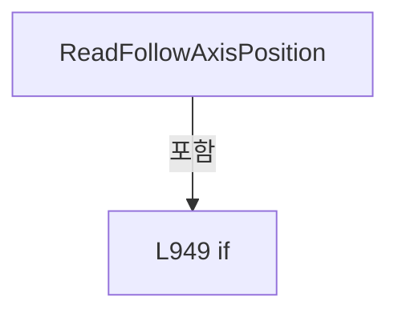

변경 전 점검: 입력/반환 타입, 위 호출자, 예외/취소 경로, 공유 상태와 저장·전송 소비자를 함께 확인합니다. 값의 단위나 물리 방향을 이름만으로 확정하지 않습니다.

### MethodDeclaration `AppendEncoderWait` · L957–967

[Drilling.File/Script/CAutomation1ScriptFile.cs:957–967](https://github.com/kjuws10-rgb/A3Drilling/blob/334b3599651b2e8e0181fd4459bafaf3cddafff3/Drilling.File/Script/CAutomation1ScriptFile.cs#L957-L967)

| 항목 | 실제 추출 값 |
| --- | --- |
| 서명 | void Drilling.File.Script.CAutomation1ScriptFile.AppendEncoderWait(System.Collections.Generic.List<string>, string, double, bool) |
| 접근/수식자 | Private / private, static |
| 반환/값 타입 | void |
| 소속 타입 | NamedType:Drilling.File.Script.CAutomation1ScriptFile |

입력 계약:

| 이름 | 타입 | 전달 | 선택/기본값 |
| --- | --- | --- | --- |
| lines | System.Collections.Generic.List<string> | None | False /  |
| encoderAxis | string | None | False /  |
| waitPosition | double | None | False /  |
| encoderFeedbackFlip | bool | None | False /  |

정적 호출자로 확인된 위치:

| 호출 파일/행 | 호출 표현식 | 런타임 분기 가능 |
| --- | --- | --- |
| [Drilling.File/Script/CAutomation1ScriptFile.cs:541–541](https://github.com/kjuws10-rgb/A3Drilling/blob/334b3599651b2e8e0181fd4459bafaf3cddafff3/Drilling.File/Script/CAutomation1ScriptFile.cs#L541-L541) | AppendEncoderWait | False |
| [Drilling.File/Script/CAutomation1ScriptFile.cs:884–884](https://github.com/kjuws10-rgb/A3Drilling/blob/334b3599651b2e8e0181fd4459bafaf3cddafff3/Drilling.File/Script/CAutomation1ScriptFile.cs#L884-L884) | AppendEncoderWait | False |
| [Drilling.File/Script/CAutomation1ScriptFile.cs:932–932](https://github.com/kjuws10-rgb/A3Drilling/blob/334b3599651b2e8e0181fd4459bafaf3cddafff3/Drilling.File/Script/CAutomation1ScriptFile.cs#L932-L932) | AppendEncoderWait | False |

호출하는 대상과 해석 범위:

| 원본 행 | 표현식 | 분석 상태 | 대상/소스 위치 |
| --- | --- | --- | --- |
| 959 | Math.Abs | resolved | double System.Math.Abs(double) |
| 966 | lines.Add | resolved | void System.Collections.Generic.List<string>.Add(string) |
| 966 | Format | resolved | string Drilling.File.Script.CAutomation1ScriptFile.Format(double) · Drilling.File/Script/CAutomation1ScriptFile.cs:1285 |

본문의 실제 연산·분기·예외·반환 순서(원문 위치 순):

| 원본 행 | 종류 | 주석 해설 |
| --- | --- | --- |
| 959 | call | 함수·델리게이트 또는 객체 생성자를 호출합니다: Math.Abs(waitPosition) |
| 959 | if | 조건에 따라 분기합니다: if (Math.Abs(waitPosition) <= 0.000001) |
| 961 | return | 호출자에게 값 또는 제어를 반환합니다: return; |
| 964 | conditional-expression | 조건에 따라 결과식을 선택합니다: encoderFeedbackFlip ? -waitPosition : waitPosition |
| 964 | local-declaration | 지역 변수를 선언합니다: var feedbackWaitPosition = encoderFeedbackFlip ? -waitPosition : waitPosition; |
| 964 | variable-initializer | 변수의 초기값을 지정합니다: feedbackWaitPosition = encoderFeedbackFlip ? -waitPosition : waitPosition |
| 965 | conditional-expression | 조건에 따라 결과식을 선택합니다: feedbackWaitPosition >= 0.0 ? ">=" : "<=" |
| 965 | local-declaration | 지역 변수를 선언합니다: var comparison = feedbackWaitPosition >= 0.0 ? ">=" : "<="; |
| 965 | variable-initializer | 변수의 초기값을 지정합니다: comparison = feedbackWaitPosition >= 0.0 ? ">=" : "<=" |
| 966 | call | 함수·델리게이트 또는 객체 생성자를 호출합니다: lines.Add($"wait(StatusGetAxisItem({encoderAxis}, AxisStatusItem.AuxiliaryFeedback) {comparison} {Format(feedbackWaitPosition)})") |
| 966 | call | 함수·델리게이트 또는 객체 생성자를 호출합니다: Format(feedbackWaitPosition) |

제어 구문의 포함 구조(실제 실행 순서/CFG가 아닌 구문 탐색 그림):

```mermaid
flowchart TD
 M["AppendEncoderWait"]
 N0["L959 if"]
 M -->|포함| N0
```

변경 전 점검: 입력/반환 타입, 위 호출자, 예외/취소 경로, 공유 상태와 저장·전송 소비자를 함께 확인합니다. 값의 단위나 물리 방향을 이름만으로 확정하지 않습니다.

### MethodDeclaration `AppendHeadShotList` · L969–989

[Drilling.File/Script/CAutomation1ScriptFile.cs:969–989](https://github.com/kjuws10-rgb/A3Drilling/blob/334b3599651b2e8e0181fd4459bafaf3cddafff3/Drilling.File/Script/CAutomation1ScriptFile.cs#L969-L989)

| 항목 | 실제 추출 값 |
| --- | --- |
| 서명 | void Drilling.File.Script.CAutomation1ScriptFile.AppendHeadShotList(System.Collections.Generic.List<string>, Drilling.Common.Station.ST_HEAD_PROCESS_PLAN) |
| 접근/수식자 | Private / private, static |
| 반환/값 타입 | void |
| 소속 타입 | NamedType:Drilling.File.Script.CAutomation1ScriptFile |

입력 계약:

| 이름 | 타입 | 전달 | 선택/기본값 |
| --- | --- | --- | --- |
| lines | System.Collections.Generic.List<string> | None | False /  |
| head | Drilling.Common.Station.ST_HEAD_PROCESS_PLAN | None | False /  |

정적 호출자로 확인된 위치:

| 호출 파일/행 | 호출 표현식 | 런타임 분기 가능 |
| --- | --- | --- |
| [Drilling.File/Script/CAutomation1ScriptFile.cs:383–383](https://github.com/kjuws10-rgb/A3Drilling/blob/334b3599651b2e8e0181fd4459bafaf3cddafff3/Drilling.File/Script/CAutomation1ScriptFile.cs#L383-L383) | AppendHeadShotList | False |

호출하는 대상과 해석 범위:

| 원본 행 | 표현식 | 분석 상태 | 대상/소스 위치 |
| --- | --- | --- | --- |
| 971 | lines.Add | resolved | void System.Collections.Generic.List<string>.Add(string) |
| 982 | head.Shots.GroupBy(SelectCellNo).OrderBy | resolved | System.Linq.IOrderedEnumerable<System.Linq.IGrouping<int, Drilling.Common.Recipe.ST_HEAD_SHOT_POINT>> System.Collections.Generic.IEnumerable<System.Linq.IGrouping<int, Drilling.Common.Recipe.ST_HEAD_SHOT_POINT>>.OrderBy<System.Linq.IGrouping<int, Drilling.Common.Recipe.ST_HEAD_SHOT_POINT>, int>(System.Func<System.Linq.IGrouping<int, Drilling.Common.Recipe.ST_HEAD_SHOT_POINT>, int>) |
| 982 | head.Shots.GroupBy | resolved | System.Collections.Generic.IEnumerable<System.Linq.IGrouping<int, Drilling.Common.Recipe.ST_HEAD_SHOT_POINT>> System.Collections.Generic.IEnumerable<Drilling.Common.Recipe.ST_HEAD_SHOT_POINT>.GroupBy<Drilling.Common.Recipe.ST_HEAD_SHOT_POINT, int>(System.Func<Drilling.Common.Recipe.ST_HEAD_SHOT_POINT, int>) |
| 984 | cell.Select(FormatShotName).Chunk | resolved | System.Collections.Generic.IEnumerable<string[]> System.Collections.Generic.IEnumerable<string>.Chunk<string>(int) |
| 984 | cell.Select | resolved | System.Collections.Generic.IEnumerable<string> System.Collections.Generic.IEnumerable<Drilling.Common.Recipe.ST_HEAD_SHOT_POINT>.Select<Drilling.Common.Recipe.ST_HEAD_SHOT_POINT, string>(System.Func<Drilling.Common.Recipe.ST_HEAD_SHOT_POINT, string>) |
| 986 | lines.Add | resolved | void System.Collections.Generic.List<string>.Add(string) |
| 986 | string.Join | resolved | string string.Join(string?, params string?[]) |

본문의 실제 연산·분기·예외·반환 순서(원문 위치 순):

| 원본 행 | 종류 | 주석 해설 |
| --- | --- | --- |
| 971 | call | 함수·델리게이트 또는 객체 생성자를 호출합니다: lines.Add("ShotList:") |
| 982 | call | 함수·델리게이트 또는 객체 생성자를 호출합니다: head.Shots.GroupBy(SelectCellNo).OrderBy(SelectKey) |
| 982 | call | 함수·델리게이트 또는 객체 생성자를 호출합니다: head.Shots.GroupBy(SelectCellNo) |
| 982 | foreach | 컬렉션 요소를 순회합니다: foreach (var cell in head.Shots.GroupBy(SelectCellNo).OrderBy(SelectKey)) |
| 984 | call | 함수·델리게이트 또는 객체 생성자를 호출합니다: cell.Select(FormatShotName).Chunk(12) |
| 984 | call | 함수·델리게이트 또는 객체 생성자를 호출합니다: cell.Select(FormatShotName) |
| 984 | foreach | 컬렉션 요소를 순회합니다: foreach (var shotNames in cell.Select(FormatShotName).Chunk(12)) |
| 986 | call | 함수·델리게이트 또는 객체 생성자를 호출합니다: lines.Add($"CELL{cell.Key:00}: {string.Join(", ", shotNames)}") |
| 986 | call | 함수·델리게이트 또는 객체 생성자를 호출합니다: string.Join(", ", shotNames) |

제어 구문의 포함 구조(실제 실행 순서/CFG가 아닌 구문 탐색 그림):

```mermaid
flowchart TD
 M["AppendHeadShotList"]
 N0["L982 foreach"]
 M -->|포함| N0
 N1["L984 foreach"]
 N0 -->|포함| N1
```

변경 전 점검: 입력/반환 타입, 위 호출자, 예외/취소 경로, 공유 상태와 저장·전송 소비자를 함께 확인합니다. 값의 단위나 물리 방향을 이름만으로 확정하지 않습니다.

### LocalFunctionStatement `SelectCellNo` · L972–975

[Drilling.File/Script/CAutomation1ScriptFile.cs:972–975](https://github.com/kjuws10-rgb/A3Drilling/blob/334b3599651b2e8e0181fd4459bafaf3cddafff3/Drilling.File/Script/CAutomation1ScriptFile.cs#L972-L975)

| 항목 | 실제 추출 값 |
| --- | --- |
| 서명 | int SelectCellNo(Drilling.Common.Recipe.ST_HEAD_SHOT_POINT) |
| 접근/수식자 | Private /  |
| 반환/값 타입 | int |
| 소속 타입 | NamedType:Drilling.File.Script.CAutomation1ScriptFile |

입력 계약:

| 이름 | 타입 | 전달 | 선택/기본값 |
| --- | --- | --- | --- |
| point | Drilling.Common.Recipe.ST_HEAD_SHOT_POINT | None | False /  |

현재 부분 분석에서 직접 연결된 호출자는 없습니다. XAML/이벤트/인터페이스·델리게이트·외부 진입을 추가 확인해야 하며, 미사용으로 판정한 것이 아닙니다.

본문의 실제 연산·분기·예외·반환 순서(원문 위치 순):

| 원본 행 | 종류 | 주석 해설 |
| --- | --- | --- |
| 974 | return | 호출자에게 값 또는 제어를 반환합니다: return point.CellNo; |

변경 전 점검: 입력/반환 타입, 위 호출자, 예외/취소 경로, 공유 상태와 저장·전송 소비자를 함께 확인합니다. 값의 단위나 물리 방향을 이름만으로 확정하지 않습니다.

### LocalFunctionStatement `SelectKey` · L977–980

[Drilling.File/Script/CAutomation1ScriptFile.cs:977–980](https://github.com/kjuws10-rgb/A3Drilling/blob/334b3599651b2e8e0181fd4459bafaf3cddafff3/Drilling.File/Script/CAutomation1ScriptFile.cs#L977-L980)

| 항목 | 실제 추출 값 |
| --- | --- |
| 서명 | int SelectKey(System.Linq.IGrouping<int, Drilling.Common.Recipe.ST_HEAD_SHOT_POINT>) |
| 접근/수식자 | Private /  |
| 반환/값 타입 | int |
| 소속 타입 | NamedType:Drilling.File.Script.CAutomation1ScriptFile |

입력 계약:

| 이름 | 타입 | 전달 | 선택/기본값 |
| --- | --- | --- | --- |
| cell | System.Linq.IGrouping<int, Drilling.Common.Recipe.ST_HEAD_SHOT_POINT> | None | False /  |

현재 부분 분석에서 직접 연결된 호출자는 없습니다. XAML/이벤트/인터페이스·델리게이트·외부 진입을 추가 확인해야 하며, 미사용으로 판정한 것이 아닙니다.

본문의 실제 연산·분기·예외·반환 순서(원문 위치 순):

| 원본 행 | 종류 | 주석 해설 |
| --- | --- | --- |
| 979 | return | 호출자에게 값 또는 제어를 반환합니다: return cell.Key; |

변경 전 점검: 입력/반환 타입, 위 호출자, 예외/취소 경로, 공유 상태와 저장·전송 소비자를 함께 확인합니다. 값의 단위나 물리 방향을 이름만으로 확정하지 않습니다.

### MethodDeclaration `FormatShotName` · L991–994

[Drilling.File/Script/CAutomation1ScriptFile.cs:991–994](https://github.com/kjuws10-rgb/A3Drilling/blob/334b3599651b2e8e0181fd4459bafaf3cddafff3/Drilling.File/Script/CAutomation1ScriptFile.cs#L991-L994)

| 항목 | 실제 추출 값 |
| --- | --- |
| 서명 | string Drilling.File.Script.CAutomation1ScriptFile.FormatShotName(Drilling.Common.Recipe.ST_HEAD_SHOT_POINT) |
| 접근/수식자 | Private / private, static |
| 반환/값 타입 | string |
| 소속 타입 | NamedType:Drilling.File.Script.CAutomation1ScriptFile |

입력 계약:

| 이름 | 타입 | 전달 | 선택/기본값 |
| --- | --- | --- | --- |
| point | Drilling.Common.Recipe.ST_HEAD_SHOT_POINT | None | False /  |

정적 호출자로 확인된 위치:

| 호출 파일/행 | 호출 표현식 | 런타임 분기 가능 |
| --- | --- | --- |
| [Drilling.File/Script/CAutomation1ScriptFile.cs:275–275](https://github.com/kjuws10-rgb/A3Drilling/blob/334b3599651b2e8e0181fd4459bafaf3cddafff3/Drilling.File/Script/CAutomation1ScriptFile.cs#L275-L275) | FormatShotName | False |

호출하는 대상과 해석 범위:

| 원본 행 | 표현식 | 분석 상태 | 대상/소스 위치 |
| --- | --- | --- | --- |
| 993 | FormatRowName | resolved | string Drilling.File.Script.CAutomation1ScriptFile.FormatRowName(int) · Drilling.File/Script/CAutomation1ScriptFile.cs:996 |
| 993 | Math.Max | resolved | int System.Math.Max(int, int) |

본문의 실제 연산·분기·예외·반환 순서(원문 위치 순):

| 원본 행 | 종류 | 주석 해설 |
| --- | --- | --- |
| 993 | call | 함수·델리게이트 또는 객체 생성자를 호출합니다: FormatRowName(point.GroupRow) |
| 993 | call | 함수·델리게이트 또는 객체 생성자를 호출합니다: Math.Max(1, point.GroupColumn + 1) |
| 993 | return | 호출자에게 값 또는 제어를 반환합니다: return $"{FormatRowName(point.GroupRow)}{Math.Max(1, point.GroupColumn + 1):00}"; |

변경 전 점검: 입력/반환 타입, 위 호출자, 예외/취소 경로, 공유 상태와 저장·전송 소비자를 함께 확인합니다. 값의 단위나 물리 방향을 이름만으로 확정하지 않습니다.

### MethodDeclaration `FormatRowName` · L996–1007

[Drilling.File/Script/CAutomation1ScriptFile.cs:996–1007](https://github.com/kjuws10-rgb/A3Drilling/blob/334b3599651b2e8e0181fd4459bafaf3cddafff3/Drilling.File/Script/CAutomation1ScriptFile.cs#L996-L1007)

| 항목 | 실제 추출 값 |
| --- | --- |
| 서명 | string Drilling.File.Script.CAutomation1ScriptFile.FormatRowName(int) |
| 접근/수식자 | Private / private, static |
| 반환/값 타입 | string |
| 소속 타입 | NamedType:Drilling.File.Script.CAutomation1ScriptFile |

입력 계약:

| 이름 | 타입 | 전달 | 선택/기본값 |
| --- | --- | --- | --- |
| zeroBasedRow | int | None | False /  |

정적 호출자로 확인된 위치:

| 호출 파일/행 | 호출 표현식 | 런타임 분기 가능 |
| --- | --- | --- |
| [Drilling.File/Script/CAutomation1ScriptFile.cs:993–993](https://github.com/kjuws10-rgb/A3Drilling/blob/334b3599651b2e8e0181fd4459bafaf3cddafff3/Drilling.File/Script/CAutomation1ScriptFile.cs#L993-L993) | FormatRowName | False |

호출하는 대상과 해석 범위:

| 원본 행 | 표현식 | 분석 상태 | 대상/소스 위치 |
| --- | --- | --- | --- |
| 998 | Math.Max | resolved | int System.Math.Max(int, int) |

본문의 실제 연산·분기·예외·반환 순서(원문 위치 순):

| 원본 행 | 종류 | 주석 해설 |
| --- | --- | --- |
| 998 | call | 함수·델리게이트 또는 객체 생성자를 호출합니다: Math.Max(0, zeroBasedRow) |
| 998 | local-declaration | 지역 변수를 선언합니다: var row = Math.Max(0, zeroBasedRow); |
| 998 | variable-initializer | 변수의 초기값을 지정합니다: row = Math.Max(0, zeroBasedRow) |
| 999 | local-declaration | 지역 변수를 선언합니다: var name = ""; |
| 999 | variable-initializer | 변수의 초기값을 지정합니다: name = "" |
| 1000 | do | 본문 실행 후 반복 조건을 확인합니다: do ... while (row >= 0) |
| 1002 | assignment | 값을 대상에 대입합니다: name = (char)('A' + (row % 26)) + name |
| 1003 | assignment | 값을 대상에 대입합니다: row = (row / 26) - 1 |
| 1006 | return | 호출자에게 값 또는 제어를 반환합니다: return name; |

제어 구문의 포함 구조(실제 실행 순서/CFG가 아닌 구문 탐색 그림):

```mermaid
flowchart TD
 M["FormatRowName"]
 N0["L1000 do"]
 M -->|포함| N0
```

변경 전 점검: 입력/반환 타입, 위 호출자, 예외/취소 경로, 공유 상태와 저장·전송 소비자를 함께 확인합니다. 값의 단위나 물리 방향을 이름만으로 확정하지 않습니다.

### MethodDeclaration `AppendDefaultSetting` · L1009–1024

[Drilling.File/Script/CAutomation1ScriptFile.cs:1009–1024](https://github.com/kjuws10-rgb/A3Drilling/blob/334b3599651b2e8e0181fd4459bafaf3cddafff3/Drilling.File/Script/CAutomation1ScriptFile.cs#L1009-L1024)

| 항목 | 실제 추출 값 |
| --- | --- |
| 서명 | void Drilling.File.Script.CAutomation1ScriptFile.AppendDefaultSetting(System.Collections.Generic.List<string>, System.Collections.Generic.IReadOnlyDictionary<string, string>) |
| 접근/수식자 | Private / private, static |
| 반환/값 타입 | void |
| 소속 타입 | NamedType:Drilling.File.Script.CAutomation1ScriptFile |

입력 계약:

| 이름 | 타입 | 전달 | 선택/기본값 |
| --- | --- | --- | --- |
| lines | System.Collections.Generic.List<string> | None | False /  |
| parameters | System.Collections.Generic.IReadOnlyDictionary<string, string> | None | False /  |

현재 부분 분석에서 직접 연결된 호출자는 없습니다. XAML/이벤트/인터페이스·델리게이트·외부 진입을 추가 확인해야 하며, 미사용으로 판정한 것이 아닙니다.

호출하는 대상과 해석 범위:

| 원본 행 | 표현식 | 분석 상태 | 대상/소스 위치 |
| --- | --- | --- | --- |
| 1011 | ReadDouble | resolved | double Drilling.File.Script.CAutomation1ScriptFile.ReadDouble(System.Collections.Generic.IReadOnlyDictionary<string, string>, double, params string[]) · Drilling.File/Script/CAutomation1ScriptFile.cs:1157 |
| 1012 | ReadInt | resolved | int Drilling.File.Script.CAutomation1ScriptFile.ReadInt(System.Collections.Generic.IReadOnlyDictionary<string, string>, int, params string[]) · Drilling.File/Script/CAutomation1ScriptFile.cs:1219 |
| 1013 | lines.Add | resolved | void System.Collections.Generic.List<string>.Add(string) |
| 1014 | lines.Add | resolved | void System.Collections.Generic.List<string>.Add(string) |
| 1015 | lines.Add | resolved | void System.Collections.Generic.List<string>.Add(string) |
| 1016 | lines.Add | resolved | void System.Collections.Generic.List<string>.Add(string) |
| 1017 | lines.Add | resolved | void System.Collections.Generic.List<string>.Add(string) |
| 1017 | Format | resolved | string Drilling.File.Script.CAutomation1ScriptFile.Format(double) · Drilling.File/Script/CAutomation1ScriptFile.cs:1285 |
| 1020 | lines.Add | resolved | void System.Collections.Generic.List<string>.Add(string) |
| 1023 | lines.Add | resolved | void System.Collections.Generic.List<string>.Add(string) |

본문의 실제 연산·분기·예외·반환 순서(원문 위치 순):

| 원본 행 | 종류 | 주석 해설 |
| --- | --- | --- |
| 1011 | call | 함수·델리게이트 또는 객체 생성자를 호출합니다: ReadDouble(parameters, 500000.0, "SCANNER_ACC") |
| 1011 | local-declaration | 지역 변수를 선언합니다: var scannerAcc = ReadDouble(parameters, 500000.0, "SCANNER_ACC"); |
| 1011 | variable-initializer | 변수의 초기값을 지정합니다: scannerAcc = ReadDouble(parameters, 500000.0, "SCANNER_ACC") |
| 1012 | call | 함수·델리게이트 또는 객체 생성자를 호출합니다: ReadInt(parameters, 0, "SCAN_MOTION_UPDATE_RATE") |
| 1012 | local-declaration | 지역 변수를 선언합니다: var motionUpdateRate = ReadInt(parameters, 0, "SCAN_MOTION_UPDATE_RATE"); |
| 1012 | variable-initializer | 변수의 초기값을 지정합니다: motionUpdateRate = ReadInt(parameters, 0, "SCAN_MOTION_UPDATE_RATE") |
| 1013 | call | 함수·델리게이트 또는 객체 생성자를 호출합니다: lines.Add("IfovOff()") |
| 1014 | call | 함수·델리게이트 또는 객체 생성자를 호출합니다: lines.Add("SetupTaskDistanceUnits(DistanceUnits.Primary)") |
| 1015 | call | 함수·델리게이트 또는 객체 생성자를 호출합니다: lines.Add("SetupTaskTimeUnits(TimeUnits.Seconds)") |
| 1016 | call | 함수·델리게이트 또는 객체 생성자를 호출합니다: lines.Add("SetupCoordinatedRampType(RampType.Sine)") |
| 1017 | call | 함수·델리게이트 또는 객체 생성자를 호출합니다: lines.Add($"SetupCoordinatedRampValue(RampMode.Rate, {Format(scannerAcc)})") |
| 1017 | call | 함수·델리게이트 또는 객체 생성자를 호출합니다: Format(scannerAcc) |
| 1018 | if | 조건에 따라 분기합니다: if (motionUpdateRate > 0) |
| 1020 | call | 함수·델리게이트 또는 객체 생성자를 호출합니다: lines.Add($"ParameterSetTaskValue(TaskGetIndex(), TaskParameter.MotionUpdateRate, {motionUpdateRate})") |
| 1023 | call | 함수·델리게이트 또는 객체 생성자를 호출합니다: lines.Add("") |

제어 구문의 포함 구조(실제 실행 순서/CFG가 아닌 구문 탐색 그림):

```mermaid
flowchart TD
 M["AppendDefaultSetting"]
 N0["L1018 if"]
 M -->|포함| N0
```

변경 전 점검: 입력/반환 타입, 위 호출자, 예외/취소 경로, 공유 상태와 저장·전송 소비자를 함께 확인합니다. 값의 단위나 물리 방향을 이름만으로 확정하지 않습니다.

### MethodDeclaration `AppendScriptEnd` · L1026–1034

[Drilling.File/Script/CAutomation1ScriptFile.cs:1026–1034](https://github.com/kjuws10-rgb/A3Drilling/blob/334b3599651b2e8e0181fd4459bafaf3cddafff3/Drilling.File/Script/CAutomation1ScriptFile.cs#L1026-L1034)

| 항목 | 실제 추출 값 |
| --- | --- |
| 서명 | void Drilling.File.Script.CAutomation1ScriptFile.AppendScriptEnd(System.Collections.Generic.List<string>, System.Collections.Generic.IReadOnlyDictionary<string, string>) |
| 접근/수식자 | Private / private, static |
| 반환/값 타입 | void |
| 소속 타입 | NamedType:Drilling.File.Script.CAutomation1ScriptFile |

입력 계약:

| 이름 | 타입 | 전달 | 선택/기본값 |
| --- | --- | --- | --- |
| lines | System.Collections.Generic.List<string> | None | False /  |
| parameters | System.Collections.Generic.IReadOnlyDictionary<string, string> | None | False /  |

현재 부분 분석에서 직접 연결된 호출자는 없습니다. XAML/이벤트/인터페이스·델리게이트·외부 진입을 추가 확인해야 하며, 미사용으로 판정한 것이 아닙니다.

호출하는 대상과 해석 범위:

| 원본 행 | 표현식 | 분석 상태 | 대상/소스 위치 |
| --- | --- | --- | --- |
| 1028 | ReadBool | resolved | bool Drilling.File.Script.CAutomation1ScriptFile.ReadBool(System.Collections.Generic.IReadOnlyDictionary<string, string>, bool, params string[]) · Drilling.File/Script/CAutomation1ScriptFile.cs:1242 |
| 1030 | lines.Add | resolved | void System.Collections.Generic.List<string>.Add(string) |
| 1033 | lines.Add | resolved | void System.Collections.Generic.List<string>.Add(string) |

본문의 실제 연산·분기·예외·반환 순서(원문 위치 순):

| 원본 행 | 종류 | 주석 해설 |
| --- | --- | --- |
| 1028 | call | 함수·델리게이트 또는 객체 생성자를 호출합니다: ReadBool(parameters, false, "A1_BUFFERED_RUN") |
| 1028 | if | 조건에 따라 분기합니다: if (ReadBool(parameters, false, "A1_BUFFERED_RUN")) |
| 1030 | call | 함수·델리게이트 또는 객체 생성자를 호출합니다: lines.Add("CommandQueueStop()") |
| 1033 | call | 함수·델리게이트 또는 객체 생성자를 호출합니다: lines.Add("end") |

제어 구문의 포함 구조(실제 실행 순서/CFG가 아닌 구문 탐색 그림):

```mermaid
flowchart TD
 M["AppendScriptEnd"]
 N0["L1028 if"]
 M -->|포함| N0
```

변경 전 점검: 입력/반환 타입, 위 호출자, 예외/취소 경로, 공유 상태와 저장·전송 소비자를 함께 확인합니다. 값의 단위나 물리 방향을 이름만으로 확정하지 않습니다.

### MethodDeclaration `CalculateLaserPeriod` · L1036–1039

[Drilling.File/Script/CAutomation1ScriptFile.cs:1036–1039](https://github.com/kjuws10-rgb/A3Drilling/blob/334b3599651b2e8e0181fd4459bafaf3cddafff3/Drilling.File/Script/CAutomation1ScriptFile.cs#L1036-L1039)

| 항목 | 실제 추출 값 |
| --- | --- |
| 서명 | double Drilling.File.Script.CAutomation1ScriptFile.CalculateLaserPeriod(double) |
| 접근/수식자 | Private / private, static |
| 반환/값 타입 | double |
| 소속 타입 | NamedType:Drilling.File.Script.CAutomation1ScriptFile |

입력 계약:

| 이름 | 타입 | 전달 | 선택/기본값 |
| --- | --- | --- | --- |
| frequencyKhz | double | None | False /  |

정적 호출자로 확인된 위치:

| 호출 파일/행 | 호출 표현식 | 런타임 분기 가능 |
| --- | --- | --- |
| [Drilling.File/Script/CAutomation1ScriptFile.cs:426–426](https://github.com/kjuws10-rgb/A3Drilling/blob/334b3599651b2e8e0181fd4459bafaf3cddafff3/Drilling.File/Script/CAutomation1ScriptFile.cs#L426-L426) | CalculateLaserPeriod | False |
| [Drilling.File/Script/CAutomation1ScriptFile.cs:1551–1551](https://github.com/kjuws10-rgb/A3Drilling/blob/334b3599651b2e8e0181fd4459bafaf3cddafff3/Drilling.File/Script/CAutomation1ScriptFile.cs#L1551-L1551) | CalculateLaserPeriod | False |

본문의 실제 연산·분기·예외·반환 순서(원문 위치 순):

| 원본 행 | 종류 | 주석 해설 |
| --- | --- | --- |
| 1038 | conditional-expression | 조건에 따라 결과식을 선택합니다: frequencyKhz <= 0.0 ? 0.0 : 1.0 / (frequencyKhz / 1000.0) |
| 1038 | return | 호출자에게 값 또는 제어를 반환합니다: return frequencyKhz <= 0.0 ? 0.0 : 1.0 / (frequencyKhz / 1000.0); |

변경 전 점검: 입력/반환 타입, 위 호출자, 예외/취소 경로, 공유 상태와 저장·전송 소비자를 함께 확인합니다. 값의 단위나 물리 방향을 이름만으로 확정하지 않습니다.

### MethodDeclaration `CalculateShotDelaySeconds` · L1041–1050

[Drilling.File/Script/CAutomation1ScriptFile.cs:1041–1050](https://github.com/kjuws10-rgb/A3Drilling/blob/334b3599651b2e8e0181fd4459bafaf3cddafff3/Drilling.File/Script/CAutomation1ScriptFile.cs#L1041-L1050)

| 항목 | 실제 추출 값 |
| --- | --- |
| 서명 | double Drilling.File.Script.CAutomation1ScriptFile.CalculateShotDelaySeconds(int, double) |
| 접근/수식자 | Private / private, static |
| 반환/값 타입 | double |
| 소속 타입 | NamedType:Drilling.File.Script.CAutomation1ScriptFile |

입력 계약:

| 이름 | 타입 | 전달 | 선택/기본값 |
| --- | --- | --- | --- |
| shotCount | int | None | False /  |
| frequencyKhz | double | None | False /  |

정적 호출자로 확인된 위치:

| 호출 파일/행 | 호출 표현식 | 런타임 분기 가능 |
| --- | --- | --- |
| [Drilling.File/Script/CAutomation1ScriptFile.cs:427–427](https://github.com/kjuws10-rgb/A3Drilling/blob/334b3599651b2e8e0181fd4459bafaf3cddafff3/Drilling.File/Script/CAutomation1ScriptFile.cs#L427-L427) | CalculateShotDelaySeconds | False |

본문의 실제 연산·분기·예외·반환 순서(원문 위치 순):

| 원본 행 | 종류 | 주석 해설 |
| --- | --- | --- |
| 1043 | if | 조건에 따라 분기합니다: if (shotCount <= 0 &#124;&#124; frequencyKhz <= 0.0) |
| 1045 | return | 호출자에게 값 또는 제어를 반환합니다: return 0.001; |
| 1049 | return | 호출자에게 값 또는 제어를 반환합니다: return (shotCount + 1.0) / frequencyKhz; |

제어 구문의 포함 구조(실제 실행 순서/CFG가 아닌 구문 탐색 그림):

```mermaid
flowchart TD
 M["CalculateShotDelaySeconds"]
 N0["L1043 if"]
 M -->|포함| N0
```

변경 전 점검: 입력/반환 타입, 위 호출자, 예외/취소 경로, 공유 상태와 저장·전송 소비자를 함께 확인합니다. 값의 단위나 물리 방향을 이름만으로 확정하지 않습니다.

### MethodDeclaration `AppendSingleAxisMoveDelay` · L1052–1060

[Drilling.File/Script/CAutomation1ScriptFile.cs:1052–1060](https://github.com/kjuws10-rgb/A3Drilling/blob/334b3599651b2e8e0181fd4459bafaf3cddafff3/Drilling.File/Script/CAutomation1ScriptFile.cs#L1052-L1060)

| 항목 | 실제 추출 값 |
| --- | --- |
| 서명 | void Drilling.File.Script.CAutomation1ScriptFile.AppendSingleAxisMoveDelay(System.Collections.Generic.List<string>, string, double) |
| 접근/수식자 | Private / private, static |
| 반환/값 타입 | void |
| 소속 타입 | NamedType:Drilling.File.Script.CAutomation1ScriptFile |

입력 계약:

| 이름 | 타입 | 전달 | 선택/기본값 |
| --- | --- | --- | --- |
| lines | System.Collections.Generic.List<string> | None | False /  |
| axis | string | None | False /  |
| delayMsec | double | None | False /  |

정적 호출자로 확인된 위치:

| 호출 파일/행 | 호출 표현식 | 런타임 분기 가능 |
| --- | --- | --- |
| [Drilling.File/Script/CAutomation1ScriptFile.cs:550–550](https://github.com/kjuws10-rgb/A3Drilling/blob/334b3599651b2e8e0181fd4459bafaf3cddafff3/Drilling.File/Script/CAutomation1ScriptFile.cs#L550-L550) | AppendSingleAxisMoveDelay | False |
| [Drilling.File/Script/CAutomation1ScriptFile.cs:554–554](https://github.com/kjuws10-rgb/A3Drilling/blob/334b3599651b2e8e0181fd4459bafaf3cddafff3/Drilling.File/Script/CAutomation1ScriptFile.cs#L554-L554) | AppendSingleAxisMoveDelay | False |

호출하는 대상과 해석 범위:

| 원본 행 | 표현식 | 분석 상태 | 대상/소스 위치 |
| --- | --- | --- | --- |
| 1059 | lines.Add | resolved | void System.Collections.Generic.List<string>.Add(string) |
| 1059 | Format | resolved | string Drilling.File.Script.CAutomation1ScriptFile.Format(double) · Drilling.File/Script/CAutomation1ScriptFile.cs:1285 |

본문의 실제 연산·분기·예외·반환 순서(원문 위치 순):

| 원본 행 | 종류 | 주석 해설 |
| --- | --- | --- |
| 1054 | if | 조건에 따라 분기합니다: if (delayMsec <= 0.0) |
| 1056 | return | 호출자에게 값 또는 제어를 반환합니다: return; |
| 1059 | call | 함수·델리게이트 또는 객체 생성자를 호출합니다: lines.Add($"MoveDelay([{axis}], {Format(delayMsec)})") |
| 1059 | call | 함수·델리게이트 또는 객체 생성자를 호출합니다: Format(delayMsec) |

제어 구문의 포함 구조(실제 실행 순서/CFG가 아닌 구문 탐색 그림):

```mermaid
flowchart TD
 M["AppendSingleAxisMoveDelay"]
 N0["L1054 if"]
 M -->|포함| N0
```

변경 전 점검: 입력/반환 타입, 위 호출자, 예외/취소 경로, 공유 상태와 저장·전송 소비자를 함께 확인합니다. 값의 단위나 물리 방향을 이름만으로 확정하지 않습니다.

### MethodDeclaration `ResolveCoordinatedRampRate` · L1062–1075

[Drilling.File/Script/CAutomation1ScriptFile.cs:1062–1075](https://github.com/kjuws10-rgb/A3Drilling/blob/334b3599651b2e8e0181fd4459bafaf3cddafff3/Drilling.File/Script/CAutomation1ScriptFile.cs#L1062-L1075)

| 항목 | 실제 추출 값 |
| --- | --- |
| 서명 | double Drilling.File.Script.CAutomation1ScriptFile.ResolveCoordinatedRampRate(double, double) |
| 접근/수식자 | Private / private, static |
| 반환/값 타입 | double |
| 소속 타입 | NamedType:Drilling.File.Script.CAutomation1ScriptFile |

입력 계약:

| 이름 | 타입 | 전달 | 선택/기본값 |
| --- | --- | --- | --- |
| xRampRate | double | None | False /  |
| yRampRate | double | None | False /  |

정적 호출자로 확인된 위치:

| 호출 파일/행 | 호출 표현식 | 런타임 분기 가능 |
| --- | --- | --- |
| [Drilling.File/Script/CAutomation1ScriptFile.cs:421–421](https://github.com/kjuws10-rgb/A3Drilling/blob/334b3599651b2e8e0181fd4459bafaf3cddafff3/Drilling.File/Script/CAutomation1ScriptFile.cs#L421-L421) | ResolveCoordinatedRampRate | False |

호출하는 대상과 해석 범위:

| 원본 행 | 표현식 | 분석 상태 | 대상/소스 위치 |
| --- | --- | --- | --- |
| 1074 | Math.Min | resolved | double System.Math.Min(double, double) |

본문의 실제 연산·분기·예외·반환 순서(원문 위치 순):

| 원본 행 | 종류 | 주석 해설 |
| --- | --- | --- |
| 1064 | if | 조건에 따라 분기합니다: if (xRampRate <= 0.0) |
| 1066 | return | 호출자에게 값 또는 제어를 반환합니다: return yRampRate; |
| 1069 | if | 조건에 따라 분기합니다: if (yRampRate <= 0.0) |
| 1071 | return | 호출자에게 값 또는 제어를 반환합니다: return xRampRate; |
| 1074 | call | 함수·델리게이트 또는 객체 생성자를 호출합니다: Math.Min(xRampRate, yRampRate) |
| 1074 | return | 호출자에게 값 또는 제어를 반환합니다: return Math.Min(xRampRate, yRampRate); |

제어 구문의 포함 구조(실제 실행 순서/CFG가 아닌 구문 탐색 그림):

```mermaid
flowchart TD
 M["ResolveCoordinatedRampRate"]
 N0["L1064 if"]
 M -->|포함| N0
 N1["L1069 if"]
 M -->|포함| N1
```

변경 전 점검: 입력/반환 타입, 위 호출자, 예외/취소 경로, 공유 상태와 저장·전송 소비자를 함께 확인합니다. 값의 단위나 물리 방향을 이름만으로 확정하지 않습니다.

### MethodDeclaration `ToAutomationSpeed` · L1077–1080

[Drilling.File/Script/CAutomation1ScriptFile.cs:1077–1080](https://github.com/kjuws10-rgb/A3Drilling/blob/334b3599651b2e8e0181fd4459bafaf3cddafff3/Drilling.File/Script/CAutomation1ScriptFile.cs#L1077-L1080)

| 항목 | 실제 추출 값 |
| --- | --- |
| 서명 | double Drilling.File.Script.CAutomation1ScriptFile.ToAutomationSpeed(double) |
| 접근/수식자 | Private / private, static |
| 반환/값 타입 | double |
| 소속 타입 | NamedType:Drilling.File.Script.CAutomation1ScriptFile |

입력 계약:

| 이름 | 타입 | 전달 | 선택/기본값 |
| --- | --- | --- | --- |
| recipeSpeed | double | None | False /  |

정적 호출자로 확인된 위치:

| 호출 파일/행 | 호출 표현식 | 런타임 분기 가능 |
| --- | --- | --- |
| [Drilling.File/Script/CAutomation1ScriptFile.cs:486–486](https://github.com/kjuws10-rgb/A3Drilling/blob/334b3599651b2e8e0181fd4459bafaf3cddafff3/Drilling.File/Script/CAutomation1ScriptFile.cs#L486-L486) | ToAutomationSpeed | False |
| [Drilling.File/Script/CAutomation1ScriptFile.cs:487–487](https://github.com/kjuws10-rgb/A3Drilling/blob/334b3599651b2e8e0181fd4459bafaf3cddafff3/Drilling.File/Script/CAutomation1ScriptFile.cs#L487-L487) | ToAutomationSpeed | False |
| [Drilling.File/Script/CAutomation1ScriptFile.cs:488–488](https://github.com/kjuws10-rgb/A3Drilling/blob/334b3599651b2e8e0181fd4459bafaf3cddafff3/Drilling.File/Script/CAutomation1ScriptFile.cs#L488-L488) | ToAutomationSpeed | False |

본문의 실제 연산·분기·예외·반환 순서(원문 위치 순):

| 원본 행 | 종류 | 주석 해설 |
| --- | --- | --- |
| 1079 | return | 호출자에게 값 또는 제어를 반환합니다: return recipeSpeed; |

변경 전 점검: 입력/반환 타입, 위 호출자, 예외/취소 경로, 공유 상태와 저장·전송 소비자를 함께 확인합니다. 값의 단위나 물리 방향을 이름만으로 확정하지 않습니다.

### MethodDeclaration `ReadDelaySeconds` · L1082–1100

[Drilling.File/Script/CAutomation1ScriptFile.cs:1082–1100](https://github.com/kjuws10-rgb/A3Drilling/blob/334b3599651b2e8e0181fd4459bafaf3cddafff3/Drilling.File/Script/CAutomation1ScriptFile.cs#L1082-L1100)

| 항목 | 실제 추출 값 |
| --- | --- |
| 서명 | double Drilling.File.Script.CAutomation1ScriptFile.ReadDelaySeconds(System.Collections.Generic.IReadOnlyDictionary<string, string>, double, params string[]) |
| 접근/수식자 | Private / private, static |
| 반환/값 타입 | double |
| 소속 타입 | NamedType:Drilling.File.Script.CAutomation1ScriptFile |

입력 계약:

| 이름 | 타입 | 전달 | 선택/기본값 |
| --- | --- | --- | --- |
| parameters | System.Collections.Generic.IReadOnlyDictionary<string, string> | None | False /  |
| defaultSeconds | double | None | False /  |
| keys | string[] | None | False /  |

정적 호출자로 확인된 위치:

| 호출 파일/행 | 호출 표현식 | 런타임 분기 가능 |
| --- | --- | --- |
| [Drilling.File/Script/CAutomation1ScriptFile.cs:424–424](https://github.com/kjuws10-rgb/A3Drilling/blob/334b3599651b2e8e0181fd4459bafaf3cddafff3/Drilling.File/Script/CAutomation1ScriptFile.cs#L424-L424) | ReadDelaySeconds | False |

호출하는 대상과 해석 범위:

| 원본 행 | 표현식 | 분석 상태 | 대상/소스 위치 |
| --- | --- | --- | --- |
| 1089 | keys.Where | resolved | System.Collections.Generic.IEnumerable<string> System.Collections.Generic.IEnumerable<string>.Where<string>(System.Func<string, bool>) |
| 1091 | parameters.TryGetValue | resolved · 동적 구현 선택 가능 | bool System.Collections.Generic.IReadOnlyDictionary<string, string>.TryGetValue(string, out string) |
| 1091 | double.TryParse | resolved | bool double.TryParse(string?, System.Globalization.NumberStyles, System.IFormatProvider?, out double) |
| 1096 | key.EndsWith | resolved | bool string.EndsWith(string, System.StringComparison) |

본문의 실제 연산·분기·예외·반환 순서(원문 위치 순):

| 원본 행 | 종류 | 주석 해설 |
| --- | --- | --- |
| 1089 | call | 함수·델리게이트 또는 객체 생성자를 호출합니다: keys.Where(ShouldIncludeItem) |
| 1089 | foreach | 컬렉션 요소를 순회합니다: foreach (var key in keys.Where(ShouldIncludeItem)) |
| 1091 | call | 함수·델리게이트 또는 객체 생성자를 호출합니다: parameters.TryGetValue(key, out var value) |
| 1091 | call | 함수·델리게이트 또는 객체 생성자를 호출합니다: double.TryParse(value, NumberStyles.Any, CultureInfo.InvariantCulture, out var result) |
| 1091 | if | 조건에 따라 분기합니다: if (!parameters.TryGetValue(key, out var value) &#124;&#124; !double.TryParse(value, NumberStyles.Any, CultureInfo.InvariantCulture, out var result)) |
| 1093 | continue | 다음 반복으로 진행합니다: continue; |
| 1096 | call | 함수·델리게이트 또는 객체 생성자를 호출합니다: key.EndsWith("_MS", StringComparison.OrdinalIgnoreCase) |
| 1096 | conditional-expression | 조건에 따라 결과식을 선택합니다: key.EndsWith("_MS", StringComparison.OrdinalIgnoreCase) &#124;&#124; result > 10.0 ? result / 1000.0 : result |
| 1096 | return | 호출자에게 값 또는 제어를 반환합니다: return key.EndsWith("_MS", StringComparison.OrdinalIgnoreCase) &#124;&#124; result > 10.0 ? result / 1000.0 : result; |
| 1099 | return | 호출자에게 값 또는 제어를 반환합니다: return defaultSeconds; |

제어 구문의 포함 구조(실제 실행 순서/CFG가 아닌 구문 탐색 그림):

```mermaid
flowchart TD
 M["ReadDelaySeconds"]
 N0["L1089 foreach"]
 M -->|포함| N0
 N1["L1091 if"]
 N0 -->|포함| N1
```

변경 전 점검: 입력/반환 타입, 위 호출자, 예외/취소 경로, 공유 상태와 저장·전송 소비자를 함께 확인합니다. 값의 단위나 물리 방향을 이름만으로 확정하지 않습니다.

### LocalFunctionStatement `ShouldIncludeItem` · L1084–1087

[Drilling.File/Script/CAutomation1ScriptFile.cs:1084–1087](https://github.com/kjuws10-rgb/A3Drilling/blob/334b3599651b2e8e0181fd4459bafaf3cddafff3/Drilling.File/Script/CAutomation1ScriptFile.cs#L1084-L1087)

| 항목 | 실제 추출 값 |
| --- | --- |
| 서명 | bool ShouldIncludeItem(string) |
| 접근/수식자 | Private /  |
| 반환/값 타입 | bool |
| 소속 타입 | NamedType:Drilling.File.Script.CAutomation1ScriptFile |

입력 계약:

| 이름 | 타입 | 전달 | 선택/기본값 |
| --- | --- | --- | --- |
| key | string | None | False /  |

현재 부분 분석에서 직접 연결된 호출자는 없습니다. XAML/이벤트/인터페이스·델리게이트·외부 진입을 추가 확인해야 하며, 미사용으로 판정한 것이 아닙니다.

호출하는 대상과 해석 범위:

| 원본 행 | 표현식 | 분석 상태 | 대상/소스 위치 |
| --- | --- | --- | --- |
| 1086 | string.IsNullOrWhiteSpace | resolved | bool string.IsNullOrWhiteSpace(string?) |

본문의 실제 연산·분기·예외·반환 순서(원문 위치 순):

| 원본 행 | 종류 | 주석 해설 |
| --- | --- | --- |
| 1086 | call | 함수·델리게이트 또는 객체 생성자를 호출합니다: string.IsNullOrWhiteSpace(key) |
| 1086 | return | 호출자에게 값 또는 제어를 반환합니다: return !string.IsNullOrWhiteSpace(key); |

변경 전 점검: 입력/반환 타입, 위 호출자, 예외/취소 경로, 공유 상태와 저장·전송 소비자를 함께 확인합니다. 값의 단위나 물리 방향을 이름만으로 확정하지 않습니다.

### MethodDeclaration `CreateHeadKeys` · L1102–1110

[Drilling.File/Script/CAutomation1ScriptFile.cs:1102–1110](https://github.com/kjuws10-rgb/A3Drilling/blob/334b3599651b2e8e0181fd4459bafaf3cddafff3/Drilling.File/Script/CAutomation1ScriptFile.cs#L1102-L1110)

| 항목 | 실제 추출 값 |
| --- | --- |
| 서명 | System.Collections.Generic.IReadOnlyList<string> Drilling.File.Script.CAutomation1ScriptFile.CreateHeadKeys(int, params string[]) |
| 접근/수식자 | Private / private, static |
| 반환/값 타입 | System.Collections.Generic.IReadOnlyList<string> |
| 소속 타입 | NamedType:Drilling.File.Script.CAutomation1ScriptFile |

입력 계약:

| 이름 | 타입 | 전달 | 선택/기본값 |
| --- | --- | --- | --- |
| headNo | int | None | False /  |
| names | string[] | None | False /  |

정적 호출자로 확인된 위치:

| 호출 파일/행 | 호출 표현식 | 런타임 분기 가능 |
| --- | --- | --- |
| [Drilling.File/Script/CAutomation1ScriptFile.cs:60–60](https://github.com/kjuws10-rgb/A3Drilling/blob/334b3599651b2e8e0181fd4459bafaf3cddafff3/Drilling.File/Script/CAutomation1ScriptFile.cs#L60-L60) | CreateHeadKeys | False |
| [Drilling.File/Script/CAutomation1ScriptFile.cs:166–166](https://github.com/kjuws10-rgb/A3Drilling/blob/334b3599651b2e8e0181fd4459bafaf3cddafff3/Drilling.File/Script/CAutomation1ScriptFile.cs#L166-L166) | CreateHeadKeys | False |
| [Drilling.File/Script/CAutomation1ScriptFile.cs:396–396](https://github.com/kjuws10-rgb/A3Drilling/blob/334b3599651b2e8e0181fd4459bafaf3cddafff3/Drilling.File/Script/CAutomation1ScriptFile.cs#L396-L396) | CreateHeadKeys | False |
| [Drilling.File/Script/CAutomation1ScriptFile.cs:398–398](https://github.com/kjuws10-rgb/A3Drilling/blob/334b3599651b2e8e0181fd4459bafaf3cddafff3/Drilling.File/Script/CAutomation1ScriptFile.cs#L398-L398) | CreateHeadKeys | False |
| [Drilling.File/Script/CAutomation1ScriptFile.cs:400–400](https://github.com/kjuws10-rgb/A3Drilling/blob/334b3599651b2e8e0181fd4459bafaf3cddafff3/Drilling.File/Script/CAutomation1ScriptFile.cs#L400-L400) | CreateHeadKeys | False |
| [Drilling.File/Script/CAutomation1ScriptFile.cs:406–406](https://github.com/kjuws10-rgb/A3Drilling/blob/334b3599651b2e8e0181fd4459bafaf3cddafff3/Drilling.File/Script/CAutomation1ScriptFile.cs#L406-L406) | CreateHeadKeys | False |
| [Drilling.File/Script/CAutomation1ScriptFile.cs:428–428](https://github.com/kjuws10-rgb/A3Drilling/blob/334b3599651b2e8e0181fd4459bafaf3cddafff3/Drilling.File/Script/CAutomation1ScriptFile.cs#L428-L428) | CreateHeadKeys | False |
| [Drilling.File/Script/CAutomation1ScriptFile.cs:429–429](https://github.com/kjuws10-rgb/A3Drilling/blob/334b3599651b2e8e0181fd4459bafaf3cddafff3/Drilling.File/Script/CAutomation1ScriptFile.cs#L429-L429) | CreateHeadKeys | False |
| [Drilling.File/Script/CAutomation1ScriptFile.cs:694–694](https://github.com/kjuws10-rgb/A3Drilling/blob/334b3599651b2e8e0181fd4459bafaf3cddafff3/Drilling.File/Script/CAutomation1ScriptFile.cs#L694-L694) | CreateHeadKeys | False |
| [Drilling.File/Script/CAutomation1ScriptFile.cs:906–906](https://github.com/kjuws10-rgb/A3Drilling/blob/334b3599651b2e8e0181fd4459bafaf3cddafff3/Drilling.File/Script/CAutomation1ScriptFile.cs#L906-L906) | CreateHeadKeys | False |
| [Drilling.File/Script/CAutomation1ScriptFile.cs:1114–1114](https://github.com/kjuws10-rgb/A3Drilling/blob/334b3599651b2e8e0181fd4459bafaf3cddafff3/Drilling.File/Script/CAutomation1ScriptFile.cs#L1114-L1114) | CreateHeadKeys | False |
| [Drilling.File/Script/CAutomation1ScriptFile.cs:1121–1121](https://github.com/kjuws10-rgb/A3Drilling/blob/334b3599651b2e8e0181fd4459bafaf3cddafff3/Drilling.File/Script/CAutomation1ScriptFile.cs#L1121-L1121) | CreateHeadKeys | False |

호출하는 대상과 해석 범위:

| 원본 행 | 표현식 | 분석 상태 | 대상/소스 위치 |
| --- | --- | --- | --- |
| 1109 | names.Select(SelectItem).ToArray | resolved | string[] System.Collections.Generic.IEnumerable<string>.ToArray<string>() |
| 1109 | names.Select | resolved | System.Collections.Generic.IEnumerable<string> System.Collections.Generic.IEnumerable<string>.Select<string, string>(System.Func<string, string>) |

본문의 실제 연산·분기·예외·반환 순서(원문 위치 순):

| 원본 행 | 종류 | 주석 해설 |
| --- | --- | --- |
| 1109 | call | 함수·델리게이트 또는 객체 생성자를 호출합니다: names.Select(SelectItem).ToArray() |
| 1109 | call | 함수·델리게이트 또는 객체 생성자를 호출합니다: names.Select(SelectItem) |
| 1109 | return | 호출자에게 값 또는 제어를 반환합니다: return names.Select(SelectItem).ToArray(); |

변경 전 점검: 입력/반환 타입, 위 호출자, 예외/취소 경로, 공유 상태와 저장·전송 소비자를 함께 확인합니다. 값의 단위나 물리 방향을 이름만으로 확정하지 않습니다.

### LocalFunctionStatement `SelectItem` · L1104–1107

[Drilling.File/Script/CAutomation1ScriptFile.cs:1104–1107](https://github.com/kjuws10-rgb/A3Drilling/blob/334b3599651b2e8e0181fd4459bafaf3cddafff3/Drilling.File/Script/CAutomation1ScriptFile.cs#L1104-L1107)

| 항목 | 실제 추출 값 |
| --- | --- |
| 서명 | string SelectItem(string) |
| 접근/수식자 | Private /  |
| 반환/값 타입 | string |
| 소속 타입 | NamedType:Drilling.File.Script.CAutomation1ScriptFile |

입력 계약:

| 이름 | 타입 | 전달 | 선택/기본값 |
| --- | --- | --- | --- |
| name | string | None | False /  |

현재 부분 분석에서 직접 연결된 호출자는 없습니다. XAML/이벤트/인터페이스·델리게이트·외부 진입을 추가 확인해야 하며, 미사용으로 판정한 것이 아닙니다.

본문의 실제 연산·분기·예외·반환 순서(원문 위치 순):

| 원본 행 | 종류 | 주석 해설 |
| --- | --- | --- |
| 1106 | return | 호출자에게 값 또는 제어를 반환합니다: return $"H{headNo:00}_{name}"; |

변경 전 점검: 입력/반환 타입, 위 호출자, 예외/취소 경로, 공유 상태와 저장·전송 소비자를 함께 확인합니다. 값의 단위나 물리 방향을 이름만으로 확정하지 않습니다.

### MethodDeclaration `CreateEncoderScaleKeys` · L1112–1117

[Drilling.File/Script/CAutomation1ScriptFile.cs:1112–1117](https://github.com/kjuws10-rgb/A3Drilling/blob/334b3599651b2e8e0181fd4459bafaf3cddafff3/Drilling.File/Script/CAutomation1ScriptFile.cs#L1112-L1117)

| 항목 | 실제 추출 값 |
| --- | --- |
| 서명 | System.Collections.Generic.IReadOnlyList<string> Drilling.File.Script.CAutomation1ScriptFile.CreateEncoderScaleKeys(int) |
| 접근/수식자 | Private / private, static |
| 반환/값 타입 | System.Collections.Generic.IReadOnlyList<string> |
| 소속 타입 | NamedType:Drilling.File.Script.CAutomation1ScriptFile |

입력 계약:

| 이름 | 타입 | 전달 | 선택/기본값 |
| --- | --- | --- | --- |
| headNo | int | None | False /  |

정적 호출자로 확인된 위치:

| 호출 파일/행 | 호출 표현식 | 런타임 분기 가능 |
| --- | --- | --- |
| [Drilling.File/Script/CAutomation1ScriptFile.cs:412–412](https://github.com/kjuws10-rgb/A3Drilling/blob/334b3599651b2e8e0181fd4459bafaf3cddafff3/Drilling.File/Script/CAutomation1ScriptFile.cs#L412-L412) | CreateEncoderScaleKeys | False |

호출하는 대상과 해석 범위:

| 원본 행 | 표현식 | 분석 상태 | 대상/소스 위치 |
| --- | --- | --- | --- |
| 1114 | CreateHeadKeys(headNo, "ENCODER_SCALE") .Concat(["SCAN_ENCODER_SCALE"]) .ToArray | resolved | string[] System.Collections.Generic.IEnumerable<string>.ToArray<string>() |
| 1114 | CreateHeadKeys(headNo, "ENCODER_SCALE") .Concat | resolved | System.Collections.Generic.IEnumerable<string> System.Collections.Generic.IEnumerable<string>.Concat<string>(System.Collections.Generic.IEnumerable<string>) |
| 1114 | CreateHeadKeys | resolved | System.Collections.Generic.IReadOnlyList<string> Drilling.File.Script.CAutomation1ScriptFile.CreateHeadKeys(int, params string[]) · Drilling.File/Script/CAutomation1ScriptFile.cs:1102 |

본문의 실제 연산·분기·예외·반환 순서(원문 위치 순):

| 원본 행 | 종류 | 주석 해설 |
| --- | --- | --- |
| 1114 | call | 함수·델리게이트 또는 객체 생성자를 호출합니다: CreateHeadKeys(headNo, "ENCODER_SCALE") |
| 1114 | call | 함수·델리게이트 또는 객체 생성자를 호출합니다: CreateHeadKeys(headNo, "ENCODER_SCALE") .Concat(["SCAN_ENCODER_SCALE"]) |
| 1114 | call | 함수·델리게이트 또는 객체 생성자를 호출합니다: CreateHeadKeys(headNo, "ENCODER_SCALE") .Concat(["SCAN_ENCODER_SCALE"]) .ToArray() |
| 1114 | return | 호출자에게 값 또는 제어를 반환합니다: return CreateHeadKeys(headNo, "ENCODER_SCALE") .Concat(["SCAN_ENCODER_SCALE"]) .ToArray(); |

변경 전 점검: 입력/반환 타입, 위 호출자, 예외/취소 경로, 공유 상태와 저장·전송 소비자를 함께 확인합니다. 값의 단위나 물리 방향을 이름만으로 확정하지 않습니다.

### MethodDeclaration `CreateEncoderFeedbackFlipKeys` · L1119–1124

[Drilling.File/Script/CAutomation1ScriptFile.cs:1119–1124](https://github.com/kjuws10-rgb/A3Drilling/blob/334b3599651b2e8e0181fd4459bafaf3cddafff3/Drilling.File/Script/CAutomation1ScriptFile.cs#L1119-L1124)

| 항목 | 실제 추출 값 |
| --- | --- |
| 서명 | System.Collections.Generic.IReadOnlyList<string> Drilling.File.Script.CAutomation1ScriptFile.CreateEncoderFeedbackFlipKeys(int) |
| 접근/수식자 | Private / private, static |
| 반환/값 타입 | System.Collections.Generic.IReadOnlyList<string> |
| 소속 타입 | NamedType:Drilling.File.Script.CAutomation1ScriptFile |

입력 계약:

| 이름 | 타입 | 전달 | 선택/기본값 |
| --- | --- | --- | --- |
| headNo | int | None | False /  |

정적 호출자로 확인된 위치:

| 호출 파일/행 | 호출 표현식 | 런타임 분기 가능 |
| --- | --- | --- |
| [Drilling.File/Script/CAutomation1ScriptFile.cs:420–420](https://github.com/kjuws10-rgb/A3Drilling/blob/334b3599651b2e8e0181fd4459bafaf3cddafff3/Drilling.File/Script/CAutomation1ScriptFile.cs#L420-L420) | CreateEncoderFeedbackFlipKeys | False |

호출하는 대상과 해석 범위:

| 원본 행 | 표현식 | 분석 상태 | 대상/소스 위치 |
| --- | --- | --- | --- |
| 1121 | CreateHeadKeys(headNo, "ENCODER_FEEDBACK_FLIP") .Concat(["SCAN_ENCODER_FEEDBACK_FLIP"]) .ToArray | resolved | string[] System.Collections.Generic.IEnumerable<string>.ToArray<string>() |
| 1121 | CreateHeadKeys(headNo, "ENCODER_FEEDBACK_FLIP") .Concat | resolved | System.Collections.Generic.IEnumerable<string> System.Collections.Generic.IEnumerable<string>.Concat<string>(System.Collections.Generic.IEnumerable<string>) |
| 1121 | CreateHeadKeys | resolved | System.Collections.Generic.IReadOnlyList<string> Drilling.File.Script.CAutomation1ScriptFile.CreateHeadKeys(int, params string[]) · Drilling.File/Script/CAutomation1ScriptFile.cs:1102 |

본문의 실제 연산·분기·예외·반환 순서(원문 위치 순):

| 원본 행 | 종류 | 주석 해설 |
| --- | --- | --- |
| 1121 | call | 함수·델리게이트 또는 객체 생성자를 호출합니다: CreateHeadKeys(headNo, "ENCODER_FEEDBACK_FLIP") |
| 1121 | call | 함수·델리게이트 또는 객체 생성자를 호출합니다: CreateHeadKeys(headNo, "ENCODER_FEEDBACK_FLIP") .Concat(["SCAN_ENCODER_FEEDBACK_FLIP"]) |
| 1121 | call | 함수·델리게이트 또는 객체 생성자를 호출합니다: CreateHeadKeys(headNo, "ENCODER_FEEDBACK_FLIP") .Concat(["SCAN_ENCODER_FEEDBACK_FLIP"]) .ToArray() |
| 1121 | return | 호출자에게 값 또는 제어를 반환합니다: return CreateHeadKeys(headNo, "ENCODER_FEEDBACK_FLIP") .Concat(["SCAN_ENCODER_FEEDBACK_FLIP"]) .ToArray(); |

변경 전 점검: 입력/반환 타입, 위 호출자, 예외/취소 경로, 공유 상태와 저장·전송 소비자를 함께 확인합니다. 값의 단위나 물리 방향을 이름만으로 확정하지 않습니다.

### MethodDeclaration `ResolveParameterName` · L1126–1137

[Drilling.File/Script/CAutomation1ScriptFile.cs:1126–1137](https://github.com/kjuws10-rgb/A3Drilling/blob/334b3599651b2e8e0181fd4459bafaf3cddafff3/Drilling.File/Script/CAutomation1ScriptFile.cs#L1126-L1137)

| 항목 | 실제 추출 값 |
| --- | --- |
| 서명 | string Drilling.File.Script.CAutomation1ScriptFile.ResolveParameterName(System.Collections.Generic.IReadOnlyDictionary<string, string>, System.Collections.Generic.IEnumerable<string>, string) |
| 접근/수식자 | Private / private, static |
| 반환/값 타입 | string |
| 소속 타입 | NamedType:Drilling.File.Script.CAutomation1ScriptFile |

입력 계약:

| 이름 | 타입 | 전달 | 선택/기본값 |
| --- | --- | --- | --- |
| parameters | System.Collections.Generic.IReadOnlyDictionary<string, string> | None | False /  |
| keys | System.Collections.Generic.IEnumerable<string> | None | False /  |
| defaultName | string | None | False /  |

정적 호출자로 확인된 위치:

| 호출 파일/행 | 호출 표현식 | 런타임 분기 가능 |
| --- | --- | --- |
| [Drilling.File/Script/CAutomation1ScriptFile.cs:413–413](https://github.com/kjuws10-rgb/A3Drilling/blob/334b3599651b2e8e0181fd4459bafaf3cddafff3/Drilling.File/Script/CAutomation1ScriptFile.cs#L413-L413) | ResolveParameterName | False |

호출하는 대상과 해석 범위:

| 원본 행 | 표현식 | 분석 상태 | 대상/소스 위치 |
| --- | --- | --- | --- |
| 1130 | string.IsNullOrWhiteSpace | resolved | bool string.IsNullOrWhiteSpace(string?) |
| 1130 | parameters.ContainsKey | resolved · 동적 구현 선택 가능 | bool System.Collections.Generic.IReadOnlyDictionary<string, string>.ContainsKey(string) |

본문의 실제 연산·분기·예외·반환 순서(원문 위치 순):

| 원본 행 | 종류 | 주석 해설 |
| --- | --- | --- |
| 1128 | foreach | 컬렉션 요소를 순회합니다: foreach (var key in keys) |
| 1130 | call | 함수·델리게이트 또는 객체 생성자를 호출합니다: string.IsNullOrWhiteSpace(key) |
| 1130 | call | 함수·델리게이트 또는 객체 생성자를 호출합니다: parameters.ContainsKey(key) |
| 1130 | if | 조건에 따라 분기합니다: if (!string.IsNullOrWhiteSpace(key) && parameters.ContainsKey(key)) |
| 1132 | return | 호출자에게 값 또는 제어를 반환합니다: return key; |
| 1136 | return | 호출자에게 값 또는 제어를 반환합니다: return defaultName; |

제어 구문의 포함 구조(실제 실행 순서/CFG가 아닌 구문 탐색 그림):

```mermaid
flowchart TD
 M["ResolveParameterName"]
 N0["L1128 foreach"]
 M -->|포함| N0
 N1["L1130 if"]
 N0 -->|포함| N1
```

변경 전 점검: 입력/반환 타입, 위 호출자, 예외/취소 경로, 공유 상태와 저장·전송 소비자를 함께 확인합니다. 값의 단위나 물리 방향을 이름만으로 확정하지 않습니다.

### MethodDeclaration `ReadText` · L1139–1155

[Drilling.File/Script/CAutomation1ScriptFile.cs:1139–1155](https://github.com/kjuws10-rgb/A3Drilling/blob/334b3599651b2e8e0181fd4459bafaf3cddafff3/Drilling.File/Script/CAutomation1ScriptFile.cs#L1139-L1155)

| 항목 | 실제 추출 값 |
| --- | --- |
| 서명 | string Drilling.File.Script.CAutomation1ScriptFile.ReadText(System.Collections.Generic.IReadOnlyDictionary<string, string>, string, System.Collections.Generic.IEnumerable<string>) |
| 접근/수식자 | Private / private, static |
| 반환/값 타입 | string |
| 소속 타입 | NamedType:Drilling.File.Script.CAutomation1ScriptFile |

입력 계약:

| 이름 | 타입 | 전달 | 선택/기본값 |
| --- | --- | --- | --- |
| parameters | System.Collections.Generic.IReadOnlyDictionary<string, string> | None | False /  |
| defaultValue | string | None | False /  |
| keys | System.Collections.Generic.IEnumerable<string> | None | False /  |

정적 호출자로 확인된 위치:

| 호출 파일/행 | 호출 표현식 | 런타임 분기 가능 |
| --- | --- | --- |
| [Drilling.File/Script/CAutomation1ScriptFile.cs:396–396](https://github.com/kjuws10-rgb/A3Drilling/blob/334b3599651b2e8e0181fd4459bafaf3cddafff3/Drilling.File/Script/CAutomation1ScriptFile.cs#L396-L396) | ReadText | False |
| [Drilling.File/Script/CAutomation1ScriptFile.cs:398–398](https://github.com/kjuws10-rgb/A3Drilling/blob/334b3599651b2e8e0181fd4459bafaf3cddafff3/Drilling.File/Script/CAutomation1ScriptFile.cs#L398-L398) | ReadText | False |
| [Drilling.File/Script/CAutomation1ScriptFile.cs:400–400](https://github.com/kjuws10-rgb/A3Drilling/blob/334b3599651b2e8e0181fd4459bafaf3cddafff3/Drilling.File/Script/CAutomation1ScriptFile.cs#L400-L400) | ReadText | False |
| [Drilling.File/Script/CAutomation1ScriptFile.cs:406–406](https://github.com/kjuws10-rgb/A3Drilling/blob/334b3599651b2e8e0181fd4459bafaf3cddafff3/Drilling.File/Script/CAutomation1ScriptFile.cs#L406-L406) | ReadText | False |

호출하는 대상과 해석 범위:

| 원본 행 | 표현식 | 분석 상태 | 대상/소스 위치 |
| --- | --- | --- | --- |
| 1146 | keys.Where | resolved | System.Collections.Generic.IEnumerable<string> System.Collections.Generic.IEnumerable<string>.Where<string>(System.Func<string, bool>) |
| 1148 | parameters.TryGetValue | resolved · 동적 구현 선택 가능 | bool System.Collections.Generic.IReadOnlyDictionary<string, string>.TryGetValue(string, out string) |
| 1148 | string.IsNullOrWhiteSpace | resolved | bool string.IsNullOrWhiteSpace(string?) |
| 1150 | value.Trim | resolved | string string.Trim() |

본문의 실제 연산·분기·예외·반환 순서(원문 위치 순):

| 원본 행 | 종류 | 주석 해설 |
| --- | --- | --- |
| 1146 | call | 함수·델리게이트 또는 객체 생성자를 호출합니다: keys.Where(ShouldIncludeItem) |
| 1146 | foreach | 컬렉션 요소를 순회합니다: foreach (var key in keys.Where(ShouldIncludeItem)) |
| 1148 | call | 함수·델리게이트 또는 객체 생성자를 호출합니다: parameters.TryGetValue(key, out var value) |
| 1148 | call | 함수·델리게이트 또는 객체 생성자를 호출합니다: string.IsNullOrWhiteSpace(value) |
| 1148 | if | 조건에 따라 분기합니다: if (parameters.TryGetValue(key, out var value) && !string.IsNullOrWhiteSpace(value)) |
| 1150 | call | 함수·델리게이트 또는 객체 생성자를 호출합니다: value.Trim() |
| 1150 | return | 호출자에게 값 또는 제어를 반환합니다: return value.Trim(); |
| 1154 | return | 호출자에게 값 또는 제어를 반환합니다: return defaultValue; |

제어 구문의 포함 구조(실제 실행 순서/CFG가 아닌 구문 탐색 그림):

```mermaid
flowchart TD
 M["ReadText"]
 N0["L1146 foreach"]
 M -->|포함| N0
 N1["L1148 if"]
 N0 -->|포함| N1
```

변경 전 점검: 입력/반환 타입, 위 호출자, 예외/취소 경로, 공유 상태와 저장·전송 소비자를 함께 확인합니다. 값의 단위나 물리 방향을 이름만으로 확정하지 않습니다.

### LocalFunctionStatement `ShouldIncludeItem` · L1141–1144

[Drilling.File/Script/CAutomation1ScriptFile.cs:1141–1144](https://github.com/kjuws10-rgb/A3Drilling/blob/334b3599651b2e8e0181fd4459bafaf3cddafff3/Drilling.File/Script/CAutomation1ScriptFile.cs#L1141-L1144)

| 항목 | 실제 추출 값 |
| --- | --- |
| 서명 | bool ShouldIncludeItem(string) |
| 접근/수식자 | Private /  |
| 반환/값 타입 | bool |
| 소속 타입 | NamedType:Drilling.File.Script.CAutomation1ScriptFile |

입력 계약:

| 이름 | 타입 | 전달 | 선택/기본값 |
| --- | --- | --- | --- |
| key | string | None | False /  |

현재 부분 분석에서 직접 연결된 호출자는 없습니다. XAML/이벤트/인터페이스·델리게이트·외부 진입을 추가 확인해야 하며, 미사용으로 판정한 것이 아닙니다.

호출하는 대상과 해석 범위:

| 원본 행 | 표현식 | 분석 상태 | 대상/소스 위치 |
| --- | --- | --- | --- |
| 1143 | string.IsNullOrWhiteSpace | resolved | bool string.IsNullOrWhiteSpace(string?) |

본문의 실제 연산·분기·예외·반환 순서(원문 위치 순):

| 원본 행 | 종류 | 주석 해설 |
| --- | --- | --- |
| 1143 | call | 함수·델리게이트 또는 객체 생성자를 호출합니다: string.IsNullOrWhiteSpace(key) |
| 1143 | return | 호출자에게 값 또는 제어를 반환합니다: return !string.IsNullOrWhiteSpace(key); |

변경 전 점검: 입력/반환 타입, 위 호출자, 예외/취소 경로, 공유 상태와 저장·전송 소비자를 함께 확인합니다. 값의 단위나 물리 방향을 이름만으로 확정하지 않습니다.

### MethodDeclaration `ReadDouble` · L1157–1160

[Drilling.File/Script/CAutomation1ScriptFile.cs:1157–1160](https://github.com/kjuws10-rgb/A3Drilling/blob/334b3599651b2e8e0181fd4459bafaf3cddafff3/Drilling.File/Script/CAutomation1ScriptFile.cs#L1157-L1160)

| 항목 | 실제 추출 값 |
| --- | --- |
| 서명 | double Drilling.File.Script.CAutomation1ScriptFile.ReadDouble(System.Collections.Generic.IReadOnlyDictionary<string, string>, double, params string[]) |
| 접근/수식자 | Private / private, static |
| 반환/값 타입 | double |
| 소속 타입 | NamedType:Drilling.File.Script.CAutomation1ScriptFile |

입력 계약:

| 이름 | 타입 | 전달 | 선택/기본값 |
| --- | --- | --- | --- |
| parameters | System.Collections.Generic.IReadOnlyDictionary<string, string> | None | False /  |
| defaultValue | double | None | False /  |
| keys | string[] | None | False /  |

정적 호출자로 확인된 위치:

| 호출 파일/행 | 호출 표현식 | 런타임 분기 가능 |
| --- | --- | --- |
| [Drilling.File/Script/CAutomation1ScriptFile.cs:425–425](https://github.com/kjuws10-rgb/A3Drilling/blob/334b3599651b2e8e0181fd4459bafaf3cddafff3/Drilling.File/Script/CAutomation1ScriptFile.cs#L425-L425) | ReadDouble | False |
| [Drilling.File/Script/CAutomation1ScriptFile.cs:431–431](https://github.com/kjuws10-rgb/A3Drilling/blob/334b3599651b2e8e0181fd4459bafaf3cddafff3/Drilling.File/Script/CAutomation1ScriptFile.cs#L431-L431) | ReadDouble | False |
| [Drilling.File/Script/CAutomation1ScriptFile.cs:863–863](https://github.com/kjuws10-rgb/A3Drilling/blob/334b3599651b2e8e0181fd4459bafaf3cddafff3/Drilling.File/Script/CAutomation1ScriptFile.cs#L863-L863) | ReadDouble | False |
| [Drilling.File/Script/CAutomation1ScriptFile.cs:900–900](https://github.com/kjuws10-rgb/A3Drilling/blob/334b3599651b2e8e0181fd4459bafaf3cddafff3/Drilling.File/Script/CAutomation1ScriptFile.cs#L900-L900) | ReadDouble | False |
| [Drilling.File/Script/CAutomation1ScriptFile.cs:1011–1011](https://github.com/kjuws10-rgb/A3Drilling/blob/334b3599651b2e8e0181fd4459bafaf3cddafff3/Drilling.File/Script/CAutomation1ScriptFile.cs#L1011-L1011) | ReadDouble | False |

호출하는 대상과 해석 범위:

| 원본 행 | 표현식 | 분석 상태 | 대상/소스 위치 |
| --- | --- | --- | --- |
| 1159 | ReadDouble | resolved | double Drilling.File.Script.CAutomation1ScriptFile.ReadDouble(System.Collections.Generic.IReadOnlyDictionary<string, string>, double, System.Collections.Generic.IEnumerable<string>) · Drilling.File/Script/CAutomation1ScriptFile.cs:1162 |

본문의 실제 연산·분기·예외·반환 순서(원문 위치 순):

| 원본 행 | 종류 | 주석 해설 |
| --- | --- | --- |
| 1159 | call | 함수·델리게이트 또는 객체 생성자를 호출합니다: ReadDouble(parameters, defaultValue, (IEnumerable<string>)keys) |
| 1159 | return | 호출자에게 값 또는 제어를 반환합니다: return ReadDouble(parameters, defaultValue, (IEnumerable<string>)keys); |

변경 전 점검: 입력/반환 타입, 위 호출자, 예외/취소 경로, 공유 상태와 저장·전송 소비자를 함께 확인합니다. 값의 단위나 물리 방향을 이름만으로 확정하지 않습니다.

### MethodDeclaration `ReadDouble` · L1162–1178

[Drilling.File/Script/CAutomation1ScriptFile.cs:1162–1178](https://github.com/kjuws10-rgb/A3Drilling/blob/334b3599651b2e8e0181fd4459bafaf3cddafff3/Drilling.File/Script/CAutomation1ScriptFile.cs#L1162-L1178)

| 항목 | 실제 추출 값 |
| --- | --- |
| 서명 | double Drilling.File.Script.CAutomation1ScriptFile.ReadDouble(System.Collections.Generic.IReadOnlyDictionary<string, string>, double, System.Collections.Generic.IEnumerable<string>) |
| 접근/수식자 | Private / private, static |
| 반환/값 타입 | double |
| 소속 타입 | NamedType:Drilling.File.Script.CAutomation1ScriptFile |

입력 계약:

| 이름 | 타입 | 전달 | 선택/기본값 |
| --- | --- | --- | --- |
| parameters | System.Collections.Generic.IReadOnlyDictionary<string, string> | None | False /  |
| defaultValue | double | None | False /  |
| keys | System.Collections.Generic.IEnumerable<string> | None | False /  |

정적 호출자로 확인된 위치:

| 호출 파일/행 | 호출 표현식 | 런타임 분기 가능 |
| --- | --- | --- |
| [Drilling.File/Script/CAutomation1ScriptFile.cs:414–414](https://github.com/kjuws10-rgb/A3Drilling/blob/334b3599651b2e8e0181fd4459bafaf3cddafff3/Drilling.File/Script/CAutomation1ScriptFile.cs#L414-L414) | ReadDouble | False |
| [Drilling.File/Script/CAutomation1ScriptFile.cs:428–428](https://github.com/kjuws10-rgb/A3Drilling/blob/334b3599651b2e8e0181fd4459bafaf3cddafff3/Drilling.File/Script/CAutomation1ScriptFile.cs#L428-L428) | ReadDouble | False |
| [Drilling.File/Script/CAutomation1ScriptFile.cs:429–429](https://github.com/kjuws10-rgb/A3Drilling/blob/334b3599651b2e8e0181fd4459bafaf3cddafff3/Drilling.File/Script/CAutomation1ScriptFile.cs#L429-L429) | ReadDouble | False |
| [Drilling.File/Script/CAutomation1ScriptFile.cs:694–694](https://github.com/kjuws10-rgb/A3Drilling/blob/334b3599651b2e8e0181fd4459bafaf3cddafff3/Drilling.File/Script/CAutomation1ScriptFile.cs#L694-L694) | ReadDouble | False |
| [Drilling.File/Script/CAutomation1ScriptFile.cs:906–906](https://github.com/kjuws10-rgb/A3Drilling/blob/334b3599651b2e8e0181fd4459bafaf3cddafff3/Drilling.File/Script/CAutomation1ScriptFile.cs#L906-L906) | ReadDouble | False |
| [Drilling.File/Script/CAutomation1ScriptFile.cs:1159–1159](https://github.com/kjuws10-rgb/A3Drilling/blob/334b3599651b2e8e0181fd4459bafaf3cddafff3/Drilling.File/Script/CAutomation1ScriptFile.cs#L1159-L1159) | ReadDouble | False |

호출하는 대상과 해석 범위:

| 원본 행 | 표현식 | 분석 상태 | 대상/소스 위치 |
| --- | --- | --- | --- |
| 1169 | keys.Where | resolved | System.Collections.Generic.IEnumerable<string> System.Collections.Generic.IEnumerable<string>.Where<string>(System.Func<string, bool>) |
| 1171 | parameters.TryGetValue | resolved · 동적 구현 선택 가능 | bool System.Collections.Generic.IReadOnlyDictionary<string, string>.TryGetValue(string, out string) |
| 1171 | double.TryParse | resolved | bool double.TryParse(string?, System.Globalization.NumberStyles, System.IFormatProvider?, out double) |

본문의 실제 연산·분기·예외·반환 순서(원문 위치 순):

| 원본 행 | 종류 | 주석 해설 |
| --- | --- | --- |
| 1169 | call | 함수·델리게이트 또는 객체 생성자를 호출합니다: keys.Where(ShouldIncludeItem) |
| 1169 | foreach | 컬렉션 요소를 순회합니다: foreach (var key in keys.Where(ShouldIncludeItem)) |
| 1171 | call | 함수·델리게이트 또는 객체 생성자를 호출합니다: parameters.TryGetValue(key, out var value) |
| 1171 | call | 함수·델리게이트 또는 객체 생성자를 호출합니다: double.TryParse(value, NumberStyles.Any, CultureInfo.InvariantCulture, out var result) |
| 1171 | if | 조건에 따라 분기합니다: if (parameters.TryGetValue(key, out var value) && double.TryParse(value, NumberStyles.Any, CultureInfo.InvariantCulture, out var result)) |
| 1173 | return | 호출자에게 값 또는 제어를 반환합니다: return result; |
| 1177 | return | 호출자에게 값 또는 제어를 반환합니다: return defaultValue; |

제어 구문의 포함 구조(실제 실행 순서/CFG가 아닌 구문 탐색 그림):

```mermaid
flowchart TD
 M["ReadDouble"]
 N0["L1169 foreach"]
 M -->|포함| N0
 N1["L1171 if"]
 N0 -->|포함| N1
```

변경 전 점검: 입력/반환 타입, 위 호출자, 예외/취소 경로, 공유 상태와 저장·전송 소비자를 함께 확인합니다. 값의 단위나 물리 방향을 이름만으로 확정하지 않습니다.

### LocalFunctionStatement `ShouldIncludeItem` · L1164–1167

[Drilling.File/Script/CAutomation1ScriptFile.cs:1164–1167](https://github.com/kjuws10-rgb/A3Drilling/blob/334b3599651b2e8e0181fd4459bafaf3cddafff3/Drilling.File/Script/CAutomation1ScriptFile.cs#L1164-L1167)

| 항목 | 실제 추출 값 |
| --- | --- |
| 서명 | bool ShouldIncludeItem(string) |
| 접근/수식자 | Private /  |
| 반환/값 타입 | bool |
| 소속 타입 | NamedType:Drilling.File.Script.CAutomation1ScriptFile |

입력 계약:

| 이름 | 타입 | 전달 | 선택/기본값 |
| --- | --- | --- | --- |
| key | string | None | False /  |

현재 부분 분석에서 직접 연결된 호출자는 없습니다. XAML/이벤트/인터페이스·델리게이트·외부 진입을 추가 확인해야 하며, 미사용으로 판정한 것이 아닙니다.

호출하는 대상과 해석 범위:

| 원본 행 | 표현식 | 분석 상태 | 대상/소스 위치 |
| --- | --- | --- | --- |
| 1166 | string.IsNullOrWhiteSpace | resolved | bool string.IsNullOrWhiteSpace(string?) |

본문의 실제 연산·분기·예외·반환 순서(원문 위치 순):

| 원본 행 | 종류 | 주석 해설 |
| --- | --- | --- |
| 1166 | call | 함수·델리게이트 또는 객체 생성자를 호출합니다: string.IsNullOrWhiteSpace(key) |
| 1166 | return | 호출자에게 값 또는 제어를 반환합니다: return !string.IsNullOrWhiteSpace(key); |

변경 전 점검: 입력/반환 타입, 위 호출자, 예외/취소 경로, 공유 상태와 저장·전송 소비자를 함께 확인합니다. 값의 단위나 물리 방향을 이름만으로 확정하지 않습니다.

### MethodDeclaration `ReadOnOff` · L1180–1196

[Drilling.File/Script/CAutomation1ScriptFile.cs:1180–1196](https://github.com/kjuws10-rgb/A3Drilling/blob/334b3599651b2e8e0181fd4459bafaf3cddafff3/Drilling.File/Script/CAutomation1ScriptFile.cs#L1180-L1196)

| 항목 | 실제 추출 값 |
| --- | --- |
| 서명 | bool Drilling.File.Script.CAutomation1ScriptFile.ReadOnOff(System.Collections.Generic.IReadOnlyDictionary<string, string>, bool, System.Collections.Generic.IEnumerable<string>) |
| 접근/수식자 | Private / private, static |
| 반환/값 타입 | bool |
| 소속 타입 | NamedType:Drilling.File.Script.CAutomation1ScriptFile |

입력 계약:

| 이름 | 타입 | 전달 | 선택/기본값 |
| --- | --- | --- | --- |
| parameters | System.Collections.Generic.IReadOnlyDictionary<string, string> | None | False /  |
| defaultValue | bool | None | False /  |
| keys | System.Collections.Generic.IEnumerable<string> | None | False /  |

정적 호출자로 확인된 위치:

| 호출 파일/행 | 호출 표현식 | 런타임 분기 가능 |
| --- | --- | --- |
| [Drilling.File/Script/CAutomation1ScriptFile.cs:420–420](https://github.com/kjuws10-rgb/A3Drilling/blob/334b3599651b2e8e0181fd4459bafaf3cddafff3/Drilling.File/Script/CAutomation1ScriptFile.cs#L420-L420) | ReadOnOff | False |

호출하는 대상과 해석 범위:

| 원본 행 | 표현식 | 분석 상태 | 대상/소스 위치 |
| --- | --- | --- | --- |
| 1184 | string.IsNullOrWhiteSpace | resolved | bool string.IsNullOrWhiteSpace(string?) |
| 1189 | parameters.TryGetValue | resolved · 동적 구현 선택 가능 | bool System.Collections.Generic.IReadOnlyDictionary<string, string>.TryGetValue(string, out string) |
| 1191 | ParseOnOff | resolved | bool Drilling.File.Script.CAutomation1ScriptFile.ParseOnOff(string?, bool, string) · Drilling.File/Script/CAutomation1ScriptFile.cs:1198 |

본문의 실제 연산·분기·예외·반환 순서(원문 위치 순):

| 원본 행 | 종류 | 주석 해설 |
| --- | --- | --- |
| 1182 | foreach | 컬렉션 요소를 순회합니다: foreach (var key in keys) |
| 1184 | call | 함수·델리게이트 또는 객체 생성자를 호출합니다: string.IsNullOrWhiteSpace(key) |
| 1184 | if | 조건에 따라 분기합니다: if (string.IsNullOrWhiteSpace(key)) |
| 1186 | continue | 다음 반복으로 진행합니다: continue; |
| 1189 | call | 함수·델리게이트 또는 객체 생성자를 호출합니다: parameters.TryGetValue(key, out var value) |
| 1189 | if | 조건에 따라 분기합니다: if (parameters.TryGetValue(key, out var value)) |
| 1191 | call | 함수·델리게이트 또는 객체 생성자를 호출합니다: ParseOnOff(value, defaultValue, key) |
| 1191 | return | 호출자에게 값 또는 제어를 반환합니다: return ParseOnOff(value, defaultValue, key); |
| 1195 | return | 호출자에게 값 또는 제어를 반환합니다: return defaultValue; |

제어 구문의 포함 구조(실제 실행 순서/CFG가 아닌 구문 탐색 그림):

```mermaid
flowchart TD
 M["ReadOnOff"]
 N0["L1182 foreach"]
 M -->|포함| N0
 N1["L1184 if"]
 N0 -->|포함| N1
 N2["L1189 if"]
 N0 -->|포함| N2
```

변경 전 점검: 입력/반환 타입, 위 호출자, 예외/취소 경로, 공유 상태와 저장·전송 소비자를 함께 확인합니다. 값의 단위나 물리 방향을 이름만으로 확정하지 않습니다.

### MethodDeclaration `ParseOnOff` · L1198–1217

[Drilling.File/Script/CAutomation1ScriptFile.cs:1198–1217](https://github.com/kjuws10-rgb/A3Drilling/blob/334b3599651b2e8e0181fd4459bafaf3cddafff3/Drilling.File/Script/CAutomation1ScriptFile.cs#L1198-L1217)

| 항목 | 실제 추출 값 |
| --- | --- |
| 서명 | bool Drilling.File.Script.CAutomation1ScriptFile.ParseOnOff(string?, bool, string) |
| 접근/수식자 | Private / private, static |
| 반환/값 타입 | bool |
| 소속 타입 | NamedType:Drilling.File.Script.CAutomation1ScriptFile |

입력 계약:

| 이름 | 타입 | 전달 | 선택/기본값 |
| --- | --- | --- | --- |
| value | string? | None | False /  |
| defaultValue | bool | None | False /  |
| key | string | None | False /  |

정적 호출자로 확인된 위치:

| 호출 파일/행 | 호출 표현식 | 런타임 분기 가능 |
| --- | --- | --- |
| [Drilling.File/Script/CAutomation1ScriptFile.cs:1191–1191](https://github.com/kjuws10-rgb/A3Drilling/blob/334b3599651b2e8e0181fd4459bafaf3cddafff3/Drilling.File/Script/CAutomation1ScriptFile.cs#L1191-L1191) | ParseOnOff | False |

호출하는 대상과 해석 범위:

| 원본 행 | 표현식 | 분석 상태 | 대상/소스 위치 |
| --- | --- | --- | --- |
| 1200 | string.IsNullOrWhiteSpace | resolved | bool string.IsNullOrWhiteSpace(string?) |
| 1205 | value.Trim().ToUpperInvariant | resolved | string string.ToUpperInvariant() |
| 1205 | value.Trim | resolved | string string.Trim() |
| 1216 | new InvalidOperationException | resolved | System.InvalidOperationException.InvalidOperationException(string?) |

본문의 실제 연산·분기·예외·반환 순서(원문 위치 순):

| 원본 행 | 종류 | 주석 해설 |
| --- | --- | --- |
| 1200 | call | 함수·델리게이트 또는 객체 생성자를 호출합니다: string.IsNullOrWhiteSpace(value) |
| 1200 | if | 조건에 따라 분기합니다: if (string.IsNullOrWhiteSpace(value)) |
| 1202 | return | 호출자에게 값 또는 제어를 반환합니다: return defaultValue; |
| 1205 | call | 함수·델리게이트 또는 객체 생성자를 호출합니다: value.Trim().ToUpperInvariant() |
| 1205 | call | 함수·델리게이트 또는 객체 생성자를 호출합니다: value.Trim() |
| 1205 | local-declaration | 지역 변수를 선언합니다: var normalized = value.Trim().ToUpperInvariant(); |
| 1205 | variable-initializer | 변수의 초기값을 지정합니다: normalized = value.Trim().ToUpperInvariant() |
| 1206 | if | 조건에 따라 분기합니다: if (normalized is "ON" or "TRUE" or "1" or "YES") |
| 1208 | return | 호출자에게 값 또는 제어를 반환합니다: return true; |
| 1211 | if | 조건에 따라 분기합니다: if (normalized is "OFF" or "FALSE" or "0" or "NO") |
| 1213 | return | 호출자에게 값 또는 제어를 반환합니다: return false; |
| 1216 | call | 함수·델리게이트 또는 객체 생성자를 호출합니다: new InvalidOperationException($"{key} must be ON or OFF. Current value: {value}") |
| 1216 | throw | 예외를 발생/전달합니다: throw new InvalidOperationException($"{key} must be ON or OFF. Current value: {value}"); |

제어 구문의 포함 구조(실제 실행 순서/CFG가 아닌 구문 탐색 그림):

```mermaid
flowchart TD
 M["ParseOnOff"]
 N0["L1200 if"]
 M -->|포함| N0
 N1["L1206 if"]
 M -->|포함| N1
 N2["L1211 if"]
 M -->|포함| N2
```

변경 전 점검: 입력/반환 타입, 위 호출자, 예외/취소 경로, 공유 상태와 저장·전송 소비자를 함께 확인합니다. 값의 단위나 물리 방향을 이름만으로 확정하지 않습니다.

### MethodDeclaration `ReadInt` · L1219–1222

[Drilling.File/Script/CAutomation1ScriptFile.cs:1219–1222](https://github.com/kjuws10-rgb/A3Drilling/blob/334b3599651b2e8e0181fd4459bafaf3cddafff3/Drilling.File/Script/CAutomation1ScriptFile.cs#L1219-L1222)

| 항목 | 실제 추출 값 |
| --- | --- |
| 서명 | int Drilling.File.Script.CAutomation1ScriptFile.ReadInt(System.Collections.Generic.IReadOnlyDictionary<string, string>, int, params string[]) |
| 접근/수식자 | Private / private, static |
| 반환/값 타입 | int |
| 소속 타입 | NamedType:Drilling.File.Script.CAutomation1ScriptFile |

입력 계약:

| 이름 | 타입 | 전달 | 선택/기본값 |
| --- | --- | --- | --- |
| parameters | System.Collections.Generic.IReadOnlyDictionary<string, string> | None | False /  |
| defaultValue | int | None | False /  |
| keys | string[] | None | False /  |

정적 호출자로 확인된 위치:

| 호출 파일/행 | 호출 표현식 | 런타임 분기 가능 |
| --- | --- | --- |
| [Drilling.File/Script/CAutomation1ScriptFile.cs:422–422](https://github.com/kjuws10-rgb/A3Drilling/blob/334b3599651b2e8e0181fd4459bafaf3cddafff3/Drilling.File/Script/CAutomation1ScriptFile.cs#L422-L422) | ReadInt | False |
| [Drilling.File/Script/CAutomation1ScriptFile.cs:423–423](https://github.com/kjuws10-rgb/A3Drilling/blob/334b3599651b2e8e0181fd4459bafaf3cddafff3/Drilling.File/Script/CAutomation1ScriptFile.cs#L423-L423) | ReadInt | False |
| [Drilling.File/Script/CAutomation1ScriptFile.cs:1012–1012](https://github.com/kjuws10-rgb/A3Drilling/blob/334b3599651b2e8e0181fd4459bafaf3cddafff3/Drilling.File/Script/CAutomation1ScriptFile.cs#L1012-L1012) | ReadInt | False |

호출하는 대상과 해석 범위:

| 원본 행 | 표현식 | 분석 상태 | 대상/소스 위치 |
| --- | --- | --- | --- |
| 1221 | ReadInt | resolved | int Drilling.File.Script.CAutomation1ScriptFile.ReadInt(System.Collections.Generic.IReadOnlyDictionary<string, string>, int, System.Collections.Generic.IEnumerable<string>) · Drilling.File/Script/CAutomation1ScriptFile.cs:1224 |

본문의 실제 연산·분기·예외·반환 순서(원문 위치 순):

| 원본 행 | 종류 | 주석 해설 |
| --- | --- | --- |
| 1221 | call | 함수·델리게이트 또는 객체 생성자를 호출합니다: ReadInt(parameters, defaultValue, (IEnumerable<string>)keys) |
| 1221 | return | 호출자에게 값 또는 제어를 반환합니다: return ReadInt(parameters, defaultValue, (IEnumerable<string>)keys); |

변경 전 점검: 입력/반환 타입, 위 호출자, 예외/취소 경로, 공유 상태와 저장·전송 소비자를 함께 확인합니다. 값의 단위나 물리 방향을 이름만으로 확정하지 않습니다.

### MethodDeclaration `ReadInt` · L1224–1240

[Drilling.File/Script/CAutomation1ScriptFile.cs:1224–1240](https://github.com/kjuws10-rgb/A3Drilling/blob/334b3599651b2e8e0181fd4459bafaf3cddafff3/Drilling.File/Script/CAutomation1ScriptFile.cs#L1224-L1240)

| 항목 | 실제 추출 값 |
| --- | --- |
| 서명 | int Drilling.File.Script.CAutomation1ScriptFile.ReadInt(System.Collections.Generic.IReadOnlyDictionary<string, string>, int, System.Collections.Generic.IEnumerable<string>) |
| 접근/수식자 | Private / private, static |
| 반환/값 타입 | int |
| 소속 타입 | NamedType:Drilling.File.Script.CAutomation1ScriptFile |

입력 계약:

| 이름 | 타입 | 전달 | 선택/기본값 |
| --- | --- | --- | --- |
| parameters | System.Collections.Generic.IReadOnlyDictionary<string, string> | None | False /  |
| defaultValue | int | None | False /  |
| keys | System.Collections.Generic.IEnumerable<string> | None | False /  |

정적 호출자로 확인된 위치:

| 호출 파일/행 | 호출 표현식 | 런타임 분기 가능 |
| --- | --- | --- |
| [Drilling.File/Script/CAutomation1ScriptFile.cs:1221–1221](https://github.com/kjuws10-rgb/A3Drilling/blob/334b3599651b2e8e0181fd4459bafaf3cddafff3/Drilling.File/Script/CAutomation1ScriptFile.cs#L1221-L1221) | ReadInt | False |

호출하는 대상과 해석 범위:

| 원본 행 | 표현식 | 분석 상태 | 대상/소스 위치 |
| --- | --- | --- | --- |
| 1231 | keys.Where | resolved | System.Collections.Generic.IEnumerable<string> System.Collections.Generic.IEnumerable<string>.Where<string>(System.Func<string, bool>) |
| 1233 | parameters.TryGetValue | resolved · 동적 구현 선택 가능 | bool System.Collections.Generic.IReadOnlyDictionary<string, string>.TryGetValue(string, out string) |
| 1233 | int.TryParse | resolved | bool int.TryParse(string?, System.Globalization.NumberStyles, System.IFormatProvider?, out int) |

본문의 실제 연산·분기·예외·반환 순서(원문 위치 순):

| 원본 행 | 종류 | 주석 해설 |
| --- | --- | --- |
| 1231 | call | 함수·델리게이트 또는 객체 생성자를 호출합니다: keys.Where(ShouldIncludeItem) |
| 1231 | foreach | 컬렉션 요소를 순회합니다: foreach (var key in keys.Where(ShouldIncludeItem)) |
| 1233 | call | 함수·델리게이트 또는 객체 생성자를 호출합니다: parameters.TryGetValue(key, out var value) |
| 1233 | call | 함수·델리게이트 또는 객체 생성자를 호출합니다: int.TryParse(value, NumberStyles.Integer, CultureInfo.InvariantCulture, out var result) |
| 1233 | if | 조건에 따라 분기합니다: if (parameters.TryGetValue(key, out var value) && int.TryParse(value, NumberStyles.Integer, CultureInfo.InvariantCulture, out var result)) |
| 1235 | return | 호출자에게 값 또는 제어를 반환합니다: return result; |
| 1239 | return | 호출자에게 값 또는 제어를 반환합니다: return defaultValue; |

제어 구문의 포함 구조(실제 실행 순서/CFG가 아닌 구문 탐색 그림):

```mermaid
flowchart TD
 M["ReadInt"]
 N0["L1231 foreach"]
 M -->|포함| N0
 N1["L1233 if"]
 N0 -->|포함| N1
```

변경 전 점검: 입력/반환 타입, 위 호출자, 예외/취소 경로, 공유 상태와 저장·전송 소비자를 함께 확인합니다. 값의 단위나 물리 방향을 이름만으로 확정하지 않습니다.

### LocalFunctionStatement `ShouldIncludeItem` · L1226–1229

[Drilling.File/Script/CAutomation1ScriptFile.cs:1226–1229](https://github.com/kjuws10-rgb/A3Drilling/blob/334b3599651b2e8e0181fd4459bafaf3cddafff3/Drilling.File/Script/CAutomation1ScriptFile.cs#L1226-L1229)

| 항목 | 실제 추출 값 |
| --- | --- |
| 서명 | bool ShouldIncludeItem(string) |
| 접근/수식자 | Private /  |
| 반환/값 타입 | bool |
| 소속 타입 | NamedType:Drilling.File.Script.CAutomation1ScriptFile |

입력 계약:

| 이름 | 타입 | 전달 | 선택/기본값 |
| --- | --- | --- | --- |
| key | string | None | False /  |

현재 부분 분석에서 직접 연결된 호출자는 없습니다. XAML/이벤트/인터페이스·델리게이트·외부 진입을 추가 확인해야 하며, 미사용으로 판정한 것이 아닙니다.

호출하는 대상과 해석 범위:

| 원본 행 | 표현식 | 분석 상태 | 대상/소스 위치 |
| --- | --- | --- | --- |
| 1228 | string.IsNullOrWhiteSpace | resolved | bool string.IsNullOrWhiteSpace(string?) |

본문의 실제 연산·분기·예외·반환 순서(원문 위치 순):

| 원본 행 | 종류 | 주석 해설 |
| --- | --- | --- |
| 1228 | call | 함수·델리게이트 또는 객체 생성자를 호출합니다: string.IsNullOrWhiteSpace(key) |
| 1228 | return | 호출자에게 값 또는 제어를 반환합니다: return !string.IsNullOrWhiteSpace(key); |

변경 전 점검: 입력/반환 타입, 위 호출자, 예외/취소 경로, 공유 상태와 저장·전송 소비자를 함께 확인합니다. 값의 단위나 물리 방향을 이름만으로 확정하지 않습니다.

### MethodDeclaration `ReadBool` · L1242–1245

[Drilling.File/Script/CAutomation1ScriptFile.cs:1242–1245](https://github.com/kjuws10-rgb/A3Drilling/blob/334b3599651b2e8e0181fd4459bafaf3cddafff3/Drilling.File/Script/CAutomation1ScriptFile.cs#L1242-L1245)

| 항목 | 실제 추출 값 |
| --- | --- |
| 서명 | bool Drilling.File.Script.CAutomation1ScriptFile.ReadBool(System.Collections.Generic.IReadOnlyDictionary<string, string>, bool, params string[]) |
| 접근/수식자 | Private / private, static |
| 반환/값 타입 | bool |
| 소속 타입 | NamedType:Drilling.File.Script.CAutomation1ScriptFile |

입력 계약:

| 이름 | 타입 | 전달 | 선택/기본값 |
| --- | --- | --- | --- |
| parameters | System.Collections.Generic.IReadOnlyDictionary<string, string> | None | False /  |
| defaultValue | bool | None | False /  |
| keys | string[] | None | False /  |

정적 호출자로 확인된 위치:

| 호출 파일/행 | 호출 표현식 | 런타임 분기 가능 |
| --- | --- | --- |
| [Drilling.File/Script/CAutomation1ScriptFile.cs:179–179](https://github.com/kjuws10-rgb/A3Drilling/blob/334b3599651b2e8e0181fd4459bafaf3cddafff3/Drilling.File/Script/CAutomation1ScriptFile.cs#L179-L179) | ReadBool | False |
| [Drilling.File/Script/CAutomation1ScriptFile.cs:395–395](https://github.com/kjuws10-rgb/A3Drilling/blob/334b3599651b2e8e0181fd4459bafaf3cddafff3/Drilling.File/Script/CAutomation1ScriptFile.cs#L395-L395) | ReadBool | False |
| [Drilling.File/Script/CAutomation1ScriptFile.cs:430–430](https://github.com/kjuws10-rgb/A3Drilling/blob/334b3599651b2e8e0181fd4459bafaf3cddafff3/Drilling.File/Script/CAutomation1ScriptFile.cs#L430-L430) | ReadBool | False |
| [Drilling.File/Script/CAutomation1ScriptFile.cs:1028–1028](https://github.com/kjuws10-rgb/A3Drilling/blob/334b3599651b2e8e0181fd4459bafaf3cddafff3/Drilling.File/Script/CAutomation1ScriptFile.cs#L1028-L1028) | ReadBool | False |

호출하는 대상과 해석 범위:

| 원본 행 | 표현식 | 분석 상태 | 대상/소스 위치 |
| --- | --- | --- | --- |
| 1244 | ReadBool | resolved | bool Drilling.File.Script.CAutomation1ScriptFile.ReadBool(System.Collections.Generic.IReadOnlyDictionary<string, string>, bool, System.Collections.Generic.IEnumerable<string>) · Drilling.File/Script/CAutomation1ScriptFile.cs:1247 |

본문의 실제 연산·분기·예외·반환 순서(원문 위치 순):

| 원본 행 | 종류 | 주석 해설 |
| --- | --- | --- |
| 1244 | call | 함수·델리게이트 또는 객체 생성자를 호출합니다: ReadBool(parameters, defaultValue, (IEnumerable<string>)keys) |
| 1244 | return | 호출자에게 값 또는 제어를 반환합니다: return ReadBool(parameters, defaultValue, (IEnumerable<string>)keys); |

변경 전 점검: 입력/반환 타입, 위 호출자, 예외/취소 경로, 공유 상태와 저장·전송 소비자를 함께 확인합니다. 값의 단위나 물리 방향을 이름만으로 확정하지 않습니다.

### MethodDeclaration `ReadBool` · L1247–1283

[Drilling.File/Script/CAutomation1ScriptFile.cs:1247–1283](https://github.com/kjuws10-rgb/A3Drilling/blob/334b3599651b2e8e0181fd4459bafaf3cddafff3/Drilling.File/Script/CAutomation1ScriptFile.cs#L1247-L1283)

| 항목 | 실제 추출 값 |
| --- | --- |
| 서명 | bool Drilling.File.Script.CAutomation1ScriptFile.ReadBool(System.Collections.Generic.IReadOnlyDictionary<string, string>, bool, System.Collections.Generic.IEnumerable<string>) |
| 접근/수식자 | Private / private, static |
| 반환/값 타입 | bool |
| 소속 타입 | NamedType:Drilling.File.Script.CAutomation1ScriptFile |

입력 계약:

| 이름 | 타입 | 전달 | 선택/기본값 |
| --- | --- | --- | --- |
| parameters | System.Collections.Generic.IReadOnlyDictionary<string, string> | None | False /  |
| defaultValue | bool | None | False /  |
| keys | System.Collections.Generic.IEnumerable<string> | None | False /  |

정적 호출자로 확인된 위치:

| 호출 파일/행 | 호출 표현식 | 런타임 분기 가능 |
| --- | --- | --- |
| [Drilling.File/Script/CAutomation1ScriptFile.cs:60–60](https://github.com/kjuws10-rgb/A3Drilling/blob/334b3599651b2e8e0181fd4459bafaf3cddafff3/Drilling.File/Script/CAutomation1ScriptFile.cs#L60-L60) | ReadBool | False |
| [Drilling.File/Script/CAutomation1ScriptFile.cs:166–166](https://github.com/kjuws10-rgb/A3Drilling/blob/334b3599651b2e8e0181fd4459bafaf3cddafff3/Drilling.File/Script/CAutomation1ScriptFile.cs#L166-L166) | ReadBool | False |
| [Drilling.File/Script/CAutomation1ScriptFile.cs:1244–1244](https://github.com/kjuws10-rgb/A3Drilling/blob/334b3599651b2e8e0181fd4459bafaf3cddafff3/Drilling.File/Script/CAutomation1ScriptFile.cs#L1244-L1244) | ReadBool | False |

호출하는 대상과 해석 범위:

| 원본 행 | 표현식 | 분석 상태 | 대상/소스 위치 |
| --- | --- | --- | --- |
| 1254 | keys.Where | resolved | System.Collections.Generic.IEnumerable<string> System.Collections.Generic.IEnumerable<string>.Where<string>(System.Func<string, bool>) |
| 1256 | parameters.TryGetValue | resolved · 동적 구현 선택 가능 | bool System.Collections.Generic.IReadOnlyDictionary<string, string>.TryGetValue(string, out string) |
| 1256 | string.IsNullOrWhiteSpace | resolved | bool string.IsNullOrWhiteSpace(string?) |
| 1261 | bool.TryParse | resolved | bool bool.TryParse(string?, out bool) |
| 1266 | int.TryParse | resolved | bool int.TryParse(string?, System.Globalization.NumberStyles, System.IFormatProvider?, out int) |
| 1271 | value.Equals | resolved | bool string.Equals(string?, System.StringComparison) |
| 1271 | value.Equals | resolved | bool string.Equals(string?, System.StringComparison) |
| 1271 | value.Equals | resolved | bool string.Equals(string?, System.StringComparison) |
| 1271 | value.Equals | resolved | bool string.Equals(string?, System.StringComparison) |
| 1276 | value.Equals | resolved | bool string.Equals(string?, System.StringComparison) |
| 1276 | value.Equals | resolved | bool string.Equals(string?, System.StringComparison) |
| 1276 | value.Equals | resolved | bool string.Equals(string?, System.StringComparison) |
| 1276 | value.Equals | resolved | bool string.Equals(string?, System.StringComparison) |

본문의 실제 연산·분기·예외·반환 순서(원문 위치 순):

| 원본 행 | 종류 | 주석 해설 |
| --- | --- | --- |
| 1254 | call | 함수·델리게이트 또는 객체 생성자를 호출합니다: keys.Where(ShouldIncludeItem) |
| 1254 | foreach | 컬렉션 요소를 순회합니다: foreach (var key in keys.Where(ShouldIncludeItem)) |
| 1256 | call | 함수·델리게이트 또는 객체 생성자를 호출합니다: parameters.TryGetValue(key, out var value) |
| 1256 | call | 함수·델리게이트 또는 객체 생성자를 호출합니다: string.IsNullOrWhiteSpace(value) |
| 1256 | if | 조건에 따라 분기합니다: if (!parameters.TryGetValue(key, out var value) &#124;&#124; string.IsNullOrWhiteSpace(value)) |
| 1258 | continue | 다음 반복으로 진행합니다: continue; |
| 1261 | call | 함수·델리게이트 또는 객체 생성자를 호출합니다: bool.TryParse(value, out var boolValue) |
| 1261 | if | 조건에 따라 분기합니다: if (bool.TryParse(value, out var boolValue)) |
| 1263 | return | 호출자에게 값 또는 제어를 반환합니다: return boolValue; |
| 1266 | call | 함수·델리게이트 또는 객체 생성자를 호출합니다: int.TryParse(value, NumberStyles.Integer, CultureInfo.InvariantCulture, out var intValue) |
| 1266 | if | 조건에 따라 분기합니다: if (int.TryParse(value, NumberStyles.Integer, CultureInfo.InvariantCulture, out var intValue)) |
| 1268 | return | 호출자에게 값 또는 제어를 반환합니다: return intValue != 0; |
| 1271 | call | 함수·델리게이트 또는 객체 생성자를 호출합니다: value.Equals("Y", StringComparison.OrdinalIgnoreCase) |
| 1271 | call | 함수·델리게이트 또는 객체 생성자를 호출합니다: value.Equals("YES", StringComparison.OrdinalIgnoreCase) |
| 1271 | call | 함수·델리게이트 또는 객체 생성자를 호출합니다: value.Equals("ON", StringComparison.OrdinalIgnoreCase) |
| 1271 | call | 함수·델리게이트 또는 객체 생성자를 호출합니다: value.Equals("USE", StringComparison.OrdinalIgnoreCase) |
| 1271 | if | 조건에 따라 분기합니다: if (value.Equals("Y", StringComparison.OrdinalIgnoreCase) &#124;&#124; value.Equals("YES", StringComparison.OrdinalIgnoreCase) &#124;&#124; value.Equals("ON", StringComparison.OrdinalIgnoreCase) &#124;&#124; value.Equals("USE", StringComparison.OrdinalIg…) |
| 1273 | return | 호출자에게 값 또는 제어를 반환합니다: return true; |
| 1276 | call | 함수·델리게이트 또는 객체 생성자를 호출합니다: value.Equals("N", StringComparison.OrdinalIgnoreCase) |
| 1276 | call | 함수·델리게이트 또는 객체 생성자를 호출합니다: value.Equals("NO", StringComparison.OrdinalIgnoreCase) |
| 1276 | call | 함수·델리게이트 또는 객체 생성자를 호출합니다: value.Equals("OFF", StringComparison.OrdinalIgnoreCase) |
| 1276 | call | 함수·델리게이트 또는 객체 생성자를 호출합니다: value.Equals("UNUSE", StringComparison.OrdinalIgnoreCase) |
| 1276 | if | 조건에 따라 분기합니다: if (value.Equals("N", StringComparison.OrdinalIgnoreCase) &#124;&#124; value.Equals("NO", StringComparison.OrdinalIgnoreCase) &#124;&#124; value.Equals("OFF", StringComparison.OrdinalIgnoreCase) &#124;&#124; value.Equals("UNUSE", StringComparison.Ordinal…) |
| 1278 | return | 호출자에게 값 또는 제어를 반환합니다: return false; |
| 1282 | return | 호출자에게 값 또는 제어를 반환합니다: return defaultValue; |

제어 구문의 포함 구조(실제 실행 순서/CFG가 아닌 구문 탐색 그림):

```mermaid
flowchart TD
 M["ReadBool"]
 N0["L1254 foreach"]
 M -->|포함| N0
 N1["L1256 if"]
 N0 -->|포함| N1
 N2["L1261 if"]
 N0 -->|포함| N2
 N3["L1266 if"]
 N0 -->|포함| N3
 N4["L1271 if"]
 N0 -->|포함| N4
 N5["L1276 if"]
 N0 -->|포함| N5
```

변경 전 점검: 입력/반환 타입, 위 호출자, 예외/취소 경로, 공유 상태와 저장·전송 소비자를 함께 확인합니다. 값의 단위나 물리 방향을 이름만으로 확정하지 않습니다.

### LocalFunctionStatement `ShouldIncludeItem` · L1249–1252

[Drilling.File/Script/CAutomation1ScriptFile.cs:1249–1252](https://github.com/kjuws10-rgb/A3Drilling/blob/334b3599651b2e8e0181fd4459bafaf3cddafff3/Drilling.File/Script/CAutomation1ScriptFile.cs#L1249-L1252)

| 항목 | 실제 추출 값 |
| --- | --- |
| 서명 | bool ShouldIncludeItem(string) |
| 접근/수식자 | Private /  |
| 반환/값 타입 | bool |
| 소속 타입 | NamedType:Drilling.File.Script.CAutomation1ScriptFile |

입력 계약:

| 이름 | 타입 | 전달 | 선택/기본값 |
| --- | --- | --- | --- |
| key | string | None | False /  |

현재 부분 분석에서 직접 연결된 호출자는 없습니다. XAML/이벤트/인터페이스·델리게이트·외부 진입을 추가 확인해야 하며, 미사용으로 판정한 것이 아닙니다.

호출하는 대상과 해석 범위:

| 원본 행 | 표현식 | 분석 상태 | 대상/소스 위치 |
| --- | --- | --- | --- |
| 1251 | string.IsNullOrWhiteSpace | resolved | bool string.IsNullOrWhiteSpace(string?) |

본문의 실제 연산·분기·예외·반환 순서(원문 위치 순):

| 원본 행 | 종류 | 주석 해설 |
| --- | --- | --- |
| 1251 | call | 함수·델리게이트 또는 객체 생성자를 호출합니다: string.IsNullOrWhiteSpace(key) |
| 1251 | return | 호출자에게 값 또는 제어를 반환합니다: return !string.IsNullOrWhiteSpace(key); |

변경 전 점검: 입력/반환 타입, 위 호출자, 예외/취소 경로, 공유 상태와 저장·전송 소비자를 함께 확인합니다. 값의 단위나 물리 방향을 이름만으로 확정하지 않습니다.

### MethodDeclaration `Format` · L1285–1288

[Drilling.File/Script/CAutomation1ScriptFile.cs:1285–1288](https://github.com/kjuws10-rgb/A3Drilling/blob/334b3599651b2e8e0181fd4459bafaf3cddafff3/Drilling.File/Script/CAutomation1ScriptFile.cs#L1285-L1288)

| 항목 | 실제 추출 값 |
| --- | --- |
| 서명 | string Drilling.File.Script.CAutomation1ScriptFile.Format(double) |
| 접근/수식자 | Private / private, static |
| 반환/값 타입 | string |
| 소속 타입 | NamedType:Drilling.File.Script.CAutomation1ScriptFile |

입력 계약:

| 이름 | 타입 | 전달 | 선택/기본값 |
| --- | --- | --- | --- |
| value | double | None | False /  |

정적 호출자로 확인된 위치:

| 호출 파일/행 | 호출 표현식 | 런타임 분기 가능 |
| --- | --- | --- |
| [Drilling.File/Script/CAutomation1ScriptFile.cs:283–283](https://github.com/kjuws10-rgb/A3Drilling/blob/334b3599651b2e8e0181fd4459bafaf3cddafff3/Drilling.File/Script/CAutomation1ScriptFile.cs#L283-L283) | Format | False |
| [Drilling.File/Script/CAutomation1ScriptFile.cs:285–285](https://github.com/kjuws10-rgb/A3Drilling/blob/334b3599651b2e8e0181fd4459bafaf3cddafff3/Drilling.File/Script/CAutomation1ScriptFile.cs#L285-L285) | Format | False |
| [Drilling.File/Script/CAutomation1ScriptFile.cs:287–287](https://github.com/kjuws10-rgb/A3Drilling/blob/334b3599651b2e8e0181fd4459bafaf3cddafff3/Drilling.File/Script/CAutomation1ScriptFile.cs#L287-L287) | Format | False |
| [Drilling.File/Script/CAutomation1ScriptFile.cs:289–289](https://github.com/kjuws10-rgb/A3Drilling/blob/334b3599651b2e8e0181fd4459bafaf3cddafff3/Drilling.File/Script/CAutomation1ScriptFile.cs#L289-L289) | Format | False |
| [Drilling.File/Script/CAutomation1ScriptFile.cs:291–291](https://github.com/kjuws10-rgb/A3Drilling/blob/334b3599651b2e8e0181fd4459bafaf3cddafff3/Drilling.File/Script/CAutomation1ScriptFile.cs#L291-L291) | Format | False |
| [Drilling.File/Script/CAutomation1ScriptFile.cs:293–293](https://github.com/kjuws10-rgb/A3Drilling/blob/334b3599651b2e8e0181fd4459bafaf3cddafff3/Drilling.File/Script/CAutomation1ScriptFile.cs#L293-L293) | Format | False |
| [Drilling.File/Script/CAutomation1ScriptFile.cs:295–295](https://github.com/kjuws10-rgb/A3Drilling/blob/334b3599651b2e8e0181fd4459bafaf3cddafff3/Drilling.File/Script/CAutomation1ScriptFile.cs#L295-L295) | Format | False |
| [Drilling.File/Script/CAutomation1ScriptFile.cs:297–297](https://github.com/kjuws10-rgb/A3Drilling/blob/334b3599651b2e8e0181fd4459bafaf3cddafff3/Drilling.File/Script/CAutomation1ScriptFile.cs#L297-L297) | Format | False |
| [Drilling.File/Script/CAutomation1ScriptFile.cs:299–299](https://github.com/kjuws10-rgb/A3Drilling/blob/334b3599651b2e8e0181fd4459bafaf3cddafff3/Drilling.File/Script/CAutomation1ScriptFile.cs#L299-L299) | Format | False |
| [Drilling.File/Script/CAutomation1ScriptFile.cs:301–301](https://github.com/kjuws10-rgb/A3Drilling/blob/334b3599651b2e8e0181fd4459bafaf3cddafff3/Drilling.File/Script/CAutomation1ScriptFile.cs#L301-L301) | Format | False |
| [Drilling.File/Script/CAutomation1ScriptFile.cs:303–303](https://github.com/kjuws10-rgb/A3Drilling/blob/334b3599651b2e8e0181fd4459bafaf3cddafff3/Drilling.File/Script/CAutomation1ScriptFile.cs#L303-L303) | Format | False |
| [Drilling.File/Script/CAutomation1ScriptFile.cs:305–305](https://github.com/kjuws10-rgb/A3Drilling/blob/334b3599651b2e8e0181fd4459bafaf3cddafff3/Drilling.File/Script/CAutomation1ScriptFile.cs#L305-L305) | Format | False |
| [Drilling.File/Script/CAutomation1ScriptFile.cs:311–311](https://github.com/kjuws10-rgb/A3Drilling/blob/334b3599651b2e8e0181fd4459bafaf3cddafff3/Drilling.File/Script/CAutomation1ScriptFile.cs#L311-L311) | Format | False |
| [Drilling.File/Script/CAutomation1ScriptFile.cs:313–313](https://github.com/kjuws10-rgb/A3Drilling/blob/334b3599651b2e8e0181fd4459bafaf3cddafff3/Drilling.File/Script/CAutomation1ScriptFile.cs#L313-L313) | Format | False |
| [Drilling.File/Script/CAutomation1ScriptFile.cs:315–315](https://github.com/kjuws10-rgb/A3Drilling/blob/334b3599651b2e8e0181fd4459bafaf3cddafff3/Drilling.File/Script/CAutomation1ScriptFile.cs#L315-L315) | Format | False |
| [Drilling.File/Script/CAutomation1ScriptFile.cs:317–317](https://github.com/kjuws10-rgb/A3Drilling/blob/334b3599651b2e8e0181fd4459bafaf3cddafff3/Drilling.File/Script/CAutomation1ScriptFile.cs#L317-L317) | Format | False |
| [Drilling.File/Script/CAutomation1ScriptFile.cs:443–443](https://github.com/kjuws10-rgb/A3Drilling/blob/334b3599651b2e8e0181fd4459bafaf3cddafff3/Drilling.File/Script/CAutomation1ScriptFile.cs#L443-L443) | Format | False |
| [Drilling.File/Script/CAutomation1ScriptFile.cs:443–443](https://github.com/kjuws10-rgb/A3Drilling/blob/334b3599651b2e8e0181fd4459bafaf3cddafff3/Drilling.File/Script/CAutomation1ScriptFile.cs#L443-L443) | Format | False |
| [Drilling.File/Script/CAutomation1ScriptFile.cs:446–446](https://github.com/kjuws10-rgb/A3Drilling/blob/334b3599651b2e8e0181fd4459bafaf3cddafff3/Drilling.File/Script/CAutomation1ScriptFile.cs#L446-L446) | Format | False |
| [Drilling.File/Script/CAutomation1ScriptFile.cs:480–480](https://github.com/kjuws10-rgb/A3Drilling/blob/334b3599651b2e8e0181fd4459bafaf3cddafff3/Drilling.File/Script/CAutomation1ScriptFile.cs#L480-L480) | Format | False |
| [Drilling.File/Script/CAutomation1ScriptFile.cs:480–480](https://github.com/kjuws10-rgb/A3Drilling/blob/334b3599651b2e8e0181fd4459bafaf3cddafff3/Drilling.File/Script/CAutomation1ScriptFile.cs#L480-L480) | Format | False |
| [Drilling.File/Script/CAutomation1ScriptFile.cs:482–482](https://github.com/kjuws10-rgb/A3Drilling/blob/334b3599651b2e8e0181fd4459bafaf3cddafff3/Drilling.File/Script/CAutomation1ScriptFile.cs#L482-L482) | Format | False |
| [Drilling.File/Script/CAutomation1ScriptFile.cs:483–483](https://github.com/kjuws10-rgb/A3Drilling/blob/334b3599651b2e8e0181fd4459bafaf3cddafff3/Drilling.File/Script/CAutomation1ScriptFile.cs#L483-L483) | Format | False |
| [Drilling.File/Script/CAutomation1ScriptFile.cs:485–485](https://github.com/kjuws10-rgb/A3Drilling/blob/334b3599651b2e8e0181fd4459bafaf3cddafff3/Drilling.File/Script/CAutomation1ScriptFile.cs#L485-L485) | Format | False |
| [Drilling.File/Script/CAutomation1ScriptFile.cs:486–486](https://github.com/kjuws10-rgb/A3Drilling/blob/334b3599651b2e8e0181fd4459bafaf3cddafff3/Drilling.File/Script/CAutomation1ScriptFile.cs#L486-L486) | Format | False |
| [Drilling.File/Script/CAutomation1ScriptFile.cs:487–487](https://github.com/kjuws10-rgb/A3Drilling/blob/334b3599651b2e8e0181fd4459bafaf3cddafff3/Drilling.File/Script/CAutomation1ScriptFile.cs#L487-L487) | Format | False |
| [Drilling.File/Script/CAutomation1ScriptFile.cs:488–488](https://github.com/kjuws10-rgb/A3Drilling/blob/334b3599651b2e8e0181fd4459bafaf3cddafff3/Drilling.File/Script/CAutomation1ScriptFile.cs#L488-L488) | Format | False |
| [Drilling.File/Script/CAutomation1ScriptFile.cs:497–497](https://github.com/kjuws10-rgb/A3Drilling/blob/334b3599651b2e8e0181fd4459bafaf3cddafff3/Drilling.File/Script/CAutomation1ScriptFile.cs#L497-L497) | Format | False |
| [Drilling.File/Script/CAutomation1ScriptFile.cs:499–499](https://github.com/kjuws10-rgb/A3Drilling/blob/334b3599651b2e8e0181fd4459bafaf3cddafff3/Drilling.File/Script/CAutomation1ScriptFile.cs#L499-L499) | Format | False |
| [Drilling.File/Script/CAutomation1ScriptFile.cs:500–500](https://github.com/kjuws10-rgb/A3Drilling/blob/334b3599651b2e8e0181fd4459bafaf3cddafff3/Drilling.File/Script/CAutomation1ScriptFile.cs#L500-L500) | Format | False |
| [Drilling.File/Script/CAutomation1ScriptFile.cs:501–501](https://github.com/kjuws10-rgb/A3Drilling/blob/334b3599651b2e8e0181fd4459bafaf3cddafff3/Drilling.File/Script/CAutomation1ScriptFile.cs#L501-L501) | Format | False |
| [Drilling.File/Script/CAutomation1ScriptFile.cs:502–502](https://github.com/kjuws10-rgb/A3Drilling/blob/334b3599651b2e8e0181fd4459bafaf3cddafff3/Drilling.File/Script/CAutomation1ScriptFile.cs#L502-L502) | Format | False |
| [Drilling.File/Script/CAutomation1ScriptFile.cs:504–504](https://github.com/kjuws10-rgb/A3Drilling/blob/334b3599651b2e8e0181fd4459bafaf3cddafff3/Drilling.File/Script/CAutomation1ScriptFile.cs#L504-L504) | Format | False |
| [Drilling.File/Script/CAutomation1ScriptFile.cs:534–534](https://github.com/kjuws10-rgb/A3Drilling/blob/334b3599651b2e8e0181fd4459bafaf3cddafff3/Drilling.File/Script/CAutomation1ScriptFile.cs#L534-L534) | Format | False |
| [Drilling.File/Script/CAutomation1ScriptFile.cs:534–534](https://github.com/kjuws10-rgb/A3Drilling/blob/334b3599651b2e8e0181fd4459bafaf3cddafff3/Drilling.File/Script/CAutomation1ScriptFile.cs#L534-L534) | Format | False |
| [Drilling.File/Script/CAutomation1ScriptFile.cs:544–544](https://github.com/kjuws10-rgb/A3Drilling/blob/334b3599651b2e8e0181fd4459bafaf3cddafff3/Drilling.File/Script/CAutomation1ScriptFile.cs#L544-L544) | Format | False |
| [Drilling.File/Script/CAutomation1ScriptFile.cs:552–552](https://github.com/kjuws10-rgb/A3Drilling/blob/334b3599651b2e8e0181fd4459bafaf3cddafff3/Drilling.File/Script/CAutomation1ScriptFile.cs#L552-L552) | Format | False |
| [Drilling.File/Script/CAutomation1ScriptFile.cs:675–675](https://github.com/kjuws10-rgb/A3Drilling/blob/334b3599651b2e8e0181fd4459bafaf3cddafff3/Drilling.File/Script/CAutomation1ScriptFile.cs#L675-L675) | Format | False |
| [Drilling.File/Script/CAutomation1ScriptFile.cs:675–675](https://github.com/kjuws10-rgb/A3Drilling/blob/334b3599651b2e8e0181fd4459bafaf3cddafff3/Drilling.File/Script/CAutomation1ScriptFile.cs#L675-L675) | Format | False |
| [Drilling.File/Script/CAutomation1ScriptFile.cs:883–883](https://github.com/kjuws10-rgb/A3Drilling/blob/334b3599651b2e8e0181fd4459bafaf3cddafff3/Drilling.File/Script/CAutomation1ScriptFile.cs#L883-L883) | Format | False |
| [Drilling.File/Script/CAutomation1ScriptFile.cs:883–883](https://github.com/kjuws10-rgb/A3Drilling/blob/334b3599651b2e8e0181fd4459bafaf3cddafff3/Drilling.File/Script/CAutomation1ScriptFile.cs#L883-L883) | Format | False |
| [Drilling.File/Script/CAutomation1ScriptFile.cs:931–931](https://github.com/kjuws10-rgb/A3Drilling/blob/334b3599651b2e8e0181fd4459bafaf3cddafff3/Drilling.File/Script/CAutomation1ScriptFile.cs#L931-L931) | Format | False |
| [Drilling.File/Script/CAutomation1ScriptFile.cs:931–931](https://github.com/kjuws10-rgb/A3Drilling/blob/334b3599651b2e8e0181fd4459bafaf3cddafff3/Drilling.File/Script/CAutomation1ScriptFile.cs#L931-L931) | Format | False |
| [Drilling.File/Script/CAutomation1ScriptFile.cs:966–966](https://github.com/kjuws10-rgb/A3Drilling/blob/334b3599651b2e8e0181fd4459bafaf3cddafff3/Drilling.File/Script/CAutomation1ScriptFile.cs#L966-L966) | Format | False |
| [Drilling.File/Script/CAutomation1ScriptFile.cs:1017–1017](https://github.com/kjuws10-rgb/A3Drilling/blob/334b3599651b2e8e0181fd4459bafaf3cddafff3/Drilling.File/Script/CAutomation1ScriptFile.cs#L1017-L1017) | Format | False |
| [Drilling.File/Script/CAutomation1ScriptFile.cs:1059–1059](https://github.com/kjuws10-rgb/A3Drilling/blob/334b3599651b2e8e0181fd4459bafaf3cddafff3/Drilling.File/Script/CAutomation1ScriptFile.cs#L1059-L1059) | Format | False |
| [Drilling.File/Script/CAutomation1ScriptFile.cs:1343–1343](https://github.com/kjuws10-rgb/A3Drilling/blob/334b3599651b2e8e0181fd4459bafaf3cddafff3/Drilling.File/Script/CAutomation1ScriptFile.cs#L1343-L1343) | Format | False |
| [Drilling.File/Script/CAutomation1ScriptFile.cs:1554–1554](https://github.com/kjuws10-rgb/A3Drilling/blob/334b3599651b2e8e0181fd4459bafaf3cddafff3/Drilling.File/Script/CAutomation1ScriptFile.cs#L1554-L1554) | Format | False |
| [Drilling.File/Script/CAutomation1ScriptFile.cs:1566–1566](https://github.com/kjuws10-rgb/A3Drilling/blob/334b3599651b2e8e0181fd4459bafaf3cddafff3/Drilling.File/Script/CAutomation1ScriptFile.cs#L1566-L1566) | Format | False |
| [Drilling.File/Script/CAutomation1ScriptFile.cs:1570–1570](https://github.com/kjuws10-rgb/A3Drilling/blob/334b3599651b2e8e0181fd4459bafaf3cddafff3/Drilling.File/Script/CAutomation1ScriptFile.cs#L1570-L1570) | Format | False |
| [Drilling.File/Script/CAutomation1ScriptFile.cs:1577–1577](https://github.com/kjuws10-rgb/A3Drilling/blob/334b3599651b2e8e0181fd4459bafaf3cddafff3/Drilling.File/Script/CAutomation1ScriptFile.cs#L1577-L1577) | Format | False |
| [Drilling.File/Script/CAutomation1ScriptFile.cs:1581–1581](https://github.com/kjuws10-rgb/A3Drilling/blob/334b3599651b2e8e0181fd4459bafaf3cddafff3/Drilling.File/Script/CAutomation1ScriptFile.cs#L1581-L1581) | Format | False |
| [Drilling.File/Script/CAutomation1ScriptFile.cs:1593–1593](https://github.com/kjuws10-rgb/A3Drilling/blob/334b3599651b2e8e0181fd4459bafaf3cddafff3/Drilling.File/Script/CAutomation1ScriptFile.cs#L1593-L1593) | Format | False |
| [Drilling.File/Script/CAutomation1ScriptFile.cs:1597–1597](https://github.com/kjuws10-rgb/A3Drilling/blob/334b3599651b2e8e0181fd4459bafaf3cddafff3/Drilling.File/Script/CAutomation1ScriptFile.cs#L1597-L1597) | Format | False |
| [Drilling.File/Script/CAutomation1ScriptFile.cs:1615–1615](https://github.com/kjuws10-rgb/A3Drilling/blob/334b3599651b2e8e0181fd4459bafaf3cddafff3/Drilling.File/Script/CAutomation1ScriptFile.cs#L1615-L1615) | Format | False |
| [Drilling.File/Script/CAutomation1ScriptFile.cs:1615–1615](https://github.com/kjuws10-rgb/A3Drilling/blob/334b3599651b2e8e0181fd4459bafaf3cddafff3/Drilling.File/Script/CAutomation1ScriptFile.cs#L1615-L1615) | Format | False |
| [Drilling.File/Script/CAutomation1ScriptFile.cs:1620–1620](https://github.com/kjuws10-rgb/A3Drilling/blob/334b3599651b2e8e0181fd4459bafaf3cddafff3/Drilling.File/Script/CAutomation1ScriptFile.cs#L1620-L1620) | Format | False |
| [Drilling.File/Script/CAutomation1ScriptFile.cs:1621–1621](https://github.com/kjuws10-rgb/A3Drilling/blob/334b3599651b2e8e0181fd4459bafaf3cddafff3/Drilling.File/Script/CAutomation1ScriptFile.cs#L1621-L1621) | Format | False |
| [Drilling.File/Script/CAutomation1ScriptFile.cs:1632–1632](https://github.com/kjuws10-rgb/A3Drilling/blob/334b3599651b2e8e0181fd4459bafaf3cddafff3/Drilling.File/Script/CAutomation1ScriptFile.cs#L1632-L1632) | Format | False |
| [Drilling.File/Script/CAutomation1ScriptFile.cs:1633–1633](https://github.com/kjuws10-rgb/A3Drilling/blob/334b3599651b2e8e0181fd4459bafaf3cddafff3/Drilling.File/Script/CAutomation1ScriptFile.cs#L1633-L1633) | Format | False |
| [Drilling.File/Script/CAutomation1ScriptFile.cs:1639–1639](https://github.com/kjuws10-rgb/A3Drilling/blob/334b3599651b2e8e0181fd4459bafaf3cddafff3/Drilling.File/Script/CAutomation1ScriptFile.cs#L1639-L1639) | Format | False |
| [Drilling.File/Script/CAutomation1ScriptFile.cs:1647–1647](https://github.com/kjuws10-rgb/A3Drilling/blob/334b3599651b2e8e0181fd4459bafaf3cddafff3/Drilling.File/Script/CAutomation1ScriptFile.cs#L1647-L1647) | Format | False |
| [Drilling.File/Script/CAutomation1ScriptFile.cs:1652–1652](https://github.com/kjuws10-rgb/A3Drilling/blob/334b3599651b2e8e0181fd4459bafaf3cddafff3/Drilling.File/Script/CAutomation1ScriptFile.cs#L1652-L1652) | Format | False |
| [Drilling.File/Script/CAutomation1ScriptFile.cs:1664–1664](https://github.com/kjuws10-rgb/A3Drilling/blob/334b3599651b2e8e0181fd4459bafaf3cddafff3/Drilling.File/Script/CAutomation1ScriptFile.cs#L1664-L1664) | Format | False |
| [Drilling.File/Script/CAutomation1ScriptFile.cs:1665–1665](https://github.com/kjuws10-rgb/A3Drilling/blob/334b3599651b2e8e0181fd4459bafaf3cddafff3/Drilling.File/Script/CAutomation1ScriptFile.cs#L1665-L1665) | Format | False |
| [Drilling.File/Script/CAutomation1ScriptFile.cs:1667–1667](https://github.com/kjuws10-rgb/A3Drilling/blob/334b3599651b2e8e0181fd4459bafaf3cddafff3/Drilling.File/Script/CAutomation1ScriptFile.cs#L1667-L1667) | Format | False |
| [Drilling.File/Script/CAutomation1ScriptFile.cs:1678–1678](https://github.com/kjuws10-rgb/A3Drilling/blob/334b3599651b2e8e0181fd4459bafaf3cddafff3/Drilling.File/Script/CAutomation1ScriptFile.cs#L1678-L1678) | Format | False |
| [Drilling.File/Script/CAutomation1ScriptFile.cs:1763–1763](https://github.com/kjuws10-rgb/A3Drilling/blob/334b3599651b2e8e0181fd4459bafaf3cddafff3/Drilling.File/Script/CAutomation1ScriptFile.cs#L1763-L1763) | Format | False |
| [Drilling.File/Script/CAutomation1ScriptFile.cs:1820–1820](https://github.com/kjuws10-rgb/A3Drilling/blob/334b3599651b2e8e0181fd4459bafaf3cddafff3/Drilling.File/Script/CAutomation1ScriptFile.cs#L1820-L1820) | Format | False |
| [Drilling.File/Script/CAutomation1ScriptFile.cs:1841–1841](https://github.com/kjuws10-rgb/A3Drilling/blob/334b3599651b2e8e0181fd4459bafaf3cddafff3/Drilling.File/Script/CAutomation1ScriptFile.cs#L1841-L1841) | Format | False |
| [Drilling.File/Script/CAutomation1ScriptFile.cs:1847–1847](https://github.com/kjuws10-rgb/A3Drilling/blob/334b3599651b2e8e0181fd4459bafaf3cddafff3/Drilling.File/Script/CAutomation1ScriptFile.cs#L1847-L1847) | Format | False |
| [Drilling.File/Script/CAutomation1ScriptFile.cs:1992–1992](https://github.com/kjuws10-rgb/A3Drilling/blob/334b3599651b2e8e0181fd4459bafaf3cddafff3/Drilling.File/Script/CAutomation1ScriptFile.cs#L1992-L1992) | Format | False |
| [Drilling.File/Script/CAutomation1ScriptFile.cs:1993–1993](https://github.com/kjuws10-rgb/A3Drilling/blob/334b3599651b2e8e0181fd4459bafaf3cddafff3/Drilling.File/Script/CAutomation1ScriptFile.cs#L1993-L1993) | Format | False |
| [Drilling.File/Script/CAutomation1ScriptFile.cs:2004–2004](https://github.com/kjuws10-rgb/A3Drilling/blob/334b3599651b2e8e0181fd4459bafaf3cddafff3/Drilling.File/Script/CAutomation1ScriptFile.cs#L2004-L2004) | Format | False |
| [Drilling.File/Script/CAutomation1ScriptFile.cs:2005–2005](https://github.com/kjuws10-rgb/A3Drilling/blob/334b3599651b2e8e0181fd4459bafaf3cddafff3/Drilling.File/Script/CAutomation1ScriptFile.cs#L2005-L2005) | Format | False |
| [Drilling.File/Script/CAutomation1ScriptFile.cs:2027–2027](https://github.com/kjuws10-rgb/A3Drilling/blob/334b3599651b2e8e0181fd4459bafaf3cddafff3/Drilling.File/Script/CAutomation1ScriptFile.cs#L2027-L2027) | Format | False |
| [Drilling.File/Script/CAutomation1ScriptFile.cs:2031–2031](https://github.com/kjuws10-rgb/A3Drilling/blob/334b3599651b2e8e0181fd4459bafaf3cddafff3/Drilling.File/Script/CAutomation1ScriptFile.cs#L2031-L2031) | Format | False |
| [Drilling.File/Script/CAutomation1ScriptFile.cs:2038–2038](https://github.com/kjuws10-rgb/A3Drilling/blob/334b3599651b2e8e0181fd4459bafaf3cddafff3/Drilling.File/Script/CAutomation1ScriptFile.cs#L2038-L2038) | Format | False |
| [Drilling.File/Script/CAutomation1ScriptFile.cs:2039–2039](https://github.com/kjuws10-rgb/A3Drilling/blob/334b3599651b2e8e0181fd4459bafaf3cddafff3/Drilling.File/Script/CAutomation1ScriptFile.cs#L2039-L2039) | Format | False |
| [Drilling.File/Script/CAutomation1ScriptFile.cs:2051–2051](https://github.com/kjuws10-rgb/A3Drilling/blob/334b3599651b2e8e0181fd4459bafaf3cddafff3/Drilling.File/Script/CAutomation1ScriptFile.cs#L2051-L2051) | Format | False |
| [Drilling.File/Script/CAutomation1ScriptFile.cs:2097–2097](https://github.com/kjuws10-rgb/A3Drilling/blob/334b3599651b2e8e0181fd4459bafaf3cddafff3/Drilling.File/Script/CAutomation1ScriptFile.cs#L2097-L2097) | Format | False |
| [Drilling.File/Script/CAutomation1ScriptFile.cs:2105–2105](https://github.com/kjuws10-rgb/A3Drilling/blob/334b3599651b2e8e0181fd4459bafaf3cddafff3/Drilling.File/Script/CAutomation1ScriptFile.cs#L2105-L2105) | Format | False |
| [Drilling.File/Script/CAutomation1ScriptFile.cs:2111–2111](https://github.com/kjuws10-rgb/A3Drilling/blob/334b3599651b2e8e0181fd4459bafaf3cddafff3/Drilling.File/Script/CAutomation1ScriptFile.cs#L2111-L2111) | Format | False |
| [Drilling.File/Script/CAutomation1ScriptFile.cs:2111–2111](https://github.com/kjuws10-rgb/A3Drilling/blob/334b3599651b2e8e0181fd4459bafaf3cddafff3/Drilling.File/Script/CAutomation1ScriptFile.cs#L2111-L2111) | Format | False |
| [Drilling.File/Script/CAutomation1ScriptFile.cs:2118–2118](https://github.com/kjuws10-rgb/A3Drilling/blob/334b3599651b2e8e0181fd4459bafaf3cddafff3/Drilling.File/Script/CAutomation1ScriptFile.cs#L2118-L2118) | Format | False |
| [Drilling.File/Script/CAutomation1ScriptFile.cs:2123–2123](https://github.com/kjuws10-rgb/A3Drilling/blob/334b3599651b2e8e0181fd4459bafaf3cddafff3/Drilling.File/Script/CAutomation1ScriptFile.cs#L2123-L2123) | Format | False |
| [Drilling.File/Script/CAutomation1ScriptFile.cs:2133–2133](https://github.com/kjuws10-rgb/A3Drilling/blob/334b3599651b2e8e0181fd4459bafaf3cddafff3/Drilling.File/Script/CAutomation1ScriptFile.cs#L2133-L2133) | Format | False |
| [Drilling.File/Script/CAutomation1ScriptFile.cs:2133–2133](https://github.com/kjuws10-rgb/A3Drilling/blob/334b3599651b2e8e0181fd4459bafaf3cddafff3/Drilling.File/Script/CAutomation1ScriptFile.cs#L2133-L2133) | Format | False |
| [Drilling.File/Script/CAutomation1ScriptFile.cs:2133–2133](https://github.com/kjuws10-rgb/A3Drilling/blob/334b3599651b2e8e0181fd4459bafaf3cddafff3/Drilling.File/Script/CAutomation1ScriptFile.cs#L2133-L2133) | Format | False |
| [Drilling.File/Script/CAutomation1ScriptFile.cs:2133–2133](https://github.com/kjuws10-rgb/A3Drilling/blob/334b3599651b2e8e0181fd4459bafaf3cddafff3/Drilling.File/Script/CAutomation1ScriptFile.cs#L2133-L2133) | Format | False |
| [Drilling.File/Script/CAutomation1ScriptFile.cs:2137–2137](https://github.com/kjuws10-rgb/A3Drilling/blob/334b3599651b2e8e0181fd4459bafaf3cddafff3/Drilling.File/Script/CAutomation1ScriptFile.cs#L2137-L2137) | Format | False |
| [Drilling.File/Script/CAutomation1ScriptFile.cs:2137–2137](https://github.com/kjuws10-rgb/A3Drilling/blob/334b3599651b2e8e0181fd4459bafaf3cddafff3/Drilling.File/Script/CAutomation1ScriptFile.cs#L2137-L2137) | Format | False |
| [Drilling.File/Script/CAutomation1ScriptFile.cs:2137–2137](https://github.com/kjuws10-rgb/A3Drilling/blob/334b3599651b2e8e0181fd4459bafaf3cddafff3/Drilling.File/Script/CAutomation1ScriptFile.cs#L2137-L2137) | Format | False |
| [Drilling.File/Script/CAutomation1ScriptFile.cs:2137–2137](https://github.com/kjuws10-rgb/A3Drilling/blob/334b3599651b2e8e0181fd4459bafaf3cddafff3/Drilling.File/Script/CAutomation1ScriptFile.cs#L2137-L2137) | Format | False |
| [Drilling.File/Script/CAutomation1ScriptFile.cs:2149–2149](https://github.com/kjuws10-rgb/A3Drilling/blob/334b3599651b2e8e0181fd4459bafaf3cddafff3/Drilling.File/Script/CAutomation1ScriptFile.cs#L2149-L2149) | Format | False |
| [Drilling.File/Script/CAutomation1ScriptFile.cs:2156–2156](https://github.com/kjuws10-rgb/A3Drilling/blob/334b3599651b2e8e0181fd4459bafaf3cddafff3/Drilling.File/Script/CAutomation1ScriptFile.cs#L2156-L2156) | Format | False |
| [Drilling.File/Script/CAutomation1ScriptFile.cs:2163–2163](https://github.com/kjuws10-rgb/A3Drilling/blob/334b3599651b2e8e0181fd4459bafaf3cddafff3/Drilling.File/Script/CAutomation1ScriptFile.cs#L2163-L2163) | Format | False |
| [Drilling.File/Script/CAutomation1ScriptFile.cs:2163–2163](https://github.com/kjuws10-rgb/A3Drilling/blob/334b3599651b2e8e0181fd4459bafaf3cddafff3/Drilling.File/Script/CAutomation1ScriptFile.cs#L2163-L2163) | Format | False |
| [Drilling.File/Script/CAutomation1ScriptFile.cs:2198–2198](https://github.com/kjuws10-rgb/A3Drilling/blob/334b3599651b2e8e0181fd4459bafaf3cddafff3/Drilling.File/Script/CAutomation1ScriptFile.cs#L2198-L2198) | Format | False |
| [Drilling.File/Script/CAutomation1ScriptFile.cs:2267–2267](https://github.com/kjuws10-rgb/A3Drilling/blob/334b3599651b2e8e0181fd4459bafaf3cddafff3/Drilling.File/Script/CAutomation1ScriptFile.cs#L2267-L2267) | Format | False |
| [Drilling.File/Script/CAutomation1ScriptFile.cs:2267–2267](https://github.com/kjuws10-rgb/A3Drilling/blob/334b3599651b2e8e0181fd4459bafaf3cddafff3/Drilling.File/Script/CAutomation1ScriptFile.cs#L2267-L2267) | Format | False |
| [Drilling.File/Script/CAutomation1ScriptFile.cs:2281–2281](https://github.com/kjuws10-rgb/A3Drilling/blob/334b3599651b2e8e0181fd4459bafaf3cddafff3/Drilling.File/Script/CAutomation1ScriptFile.cs#L2281-L2281) | Format | False |
| [Drilling.File/Script/CAutomation1ScriptFile.cs:2281–2281](https://github.com/kjuws10-rgb/A3Drilling/blob/334b3599651b2e8e0181fd4459bafaf3cddafff3/Drilling.File/Script/CAutomation1ScriptFile.cs#L2281-L2281) | Format | False |
| [Drilling.File/Script/CAutomation1ScriptFile.cs:2289–2289](https://github.com/kjuws10-rgb/A3Drilling/blob/334b3599651b2e8e0181fd4459bafaf3cddafff3/Drilling.File/Script/CAutomation1ScriptFile.cs#L2289-L2289) | Format | False |
| [Drilling.File/Script/CAutomation1ScriptFile.cs:2289–2289](https://github.com/kjuws10-rgb/A3Drilling/blob/334b3599651b2e8e0181fd4459bafaf3cddafff3/Drilling.File/Script/CAutomation1ScriptFile.cs#L2289-L2289) | Format | False |
| [Drilling.File/Script/CAutomation1ScriptFile.cs:2310–2310](https://github.com/kjuws10-rgb/A3Drilling/blob/334b3599651b2e8e0181fd4459bafaf3cddafff3/Drilling.File/Script/CAutomation1ScriptFile.cs#L2310-L2310) | Format | False |
| [Drilling.File/Script/CAutomation1ScriptFile.cs:2310–2310](https://github.com/kjuws10-rgb/A3Drilling/blob/334b3599651b2e8e0181fd4459bafaf3cddafff3/Drilling.File/Script/CAutomation1ScriptFile.cs#L2310-L2310) | Format | False |
| [Drilling.File/Script/CAutomation1ScriptFile.cs:2310–2310](https://github.com/kjuws10-rgb/A3Drilling/blob/334b3599651b2e8e0181fd4459bafaf3cddafff3/Drilling.File/Script/CAutomation1ScriptFile.cs#L2310-L2310) | Format | False |
| [Drilling.File/Script/CAutomation1ScriptFile.cs:2310–2310](https://github.com/kjuws10-rgb/A3Drilling/blob/334b3599651b2e8e0181fd4459bafaf3cddafff3/Drilling.File/Script/CAutomation1ScriptFile.cs#L2310-L2310) | Format | False |
| [Drilling.File/Script/CAutomation1ScriptFile.cs:2317–2317](https://github.com/kjuws10-rgb/A3Drilling/blob/334b3599651b2e8e0181fd4459bafaf3cddafff3/Drilling.File/Script/CAutomation1ScriptFile.cs#L2317-L2317) | Format | False |
| [Drilling.File/Script/CAutomation1ScriptFile.cs:2320–2320](https://github.com/kjuws10-rgb/A3Drilling/blob/334b3599651b2e8e0181fd4459bafaf3cddafff3/Drilling.File/Script/CAutomation1ScriptFile.cs#L2320-L2320) | Format | False |
| [Drilling.File/Script/CAutomation1ScriptFile.cs:2320–2320](https://github.com/kjuws10-rgb/A3Drilling/blob/334b3599651b2e8e0181fd4459bafaf3cddafff3/Drilling.File/Script/CAutomation1ScriptFile.cs#L2320-L2320) | Format | False |
| [Drilling.File/Script/CAutomation1ScriptFile.cs:2321–2321](https://github.com/kjuws10-rgb/A3Drilling/blob/334b3599651b2e8e0181fd4459bafaf3cddafff3/Drilling.File/Script/CAutomation1ScriptFile.cs#L2321-L2321) | Format | False |
| [Drilling.File/Script/CAutomation1ScriptFile.cs:2338–2338](https://github.com/kjuws10-rgb/A3Drilling/blob/334b3599651b2e8e0181fd4459bafaf3cddafff3/Drilling.File/Script/CAutomation1ScriptFile.cs#L2338-L2338) | Format | False |

호출하는 대상과 해석 범위:

| 원본 행 | 표현식 | 분석 상태 | 대상/소스 위치 |
| --- | --- | --- | --- |
| 1287 | value.ToString | resolved | string double.ToString(string?, System.IFormatProvider?) |

본문의 실제 연산·분기·예외·반환 순서(원문 위치 순):

| 원본 행 | 종류 | 주석 해설 |
| --- | --- | --- |
| 1287 | call | 함수·델리게이트 또는 객체 생성자를 호출합니다: value.ToString("0.######", CultureInfo.InvariantCulture) |
| 1287 | return | 호출자에게 값 또는 제어를 반환합니다: return value.ToString("0.######", CultureInfo.InvariantCulture); |

변경 전 점검: 입력/반환 타입, 위 호출자, 예외/취소 경로, 공유 상태와 저장·전송 소비자를 함께 확인합니다. 값의 단위나 물리 방향을 이름만으로 확정하지 않습니다.

### MethodDeclaration `CreateCsvLine` · L1290–1304

[Drilling.File/Script/CAutomation1ScriptFile.cs:1290–1304](https://github.com/kjuws10-rgb/A3Drilling/blob/334b3599651b2e8e0181fd4459bafaf3cddafff3/Drilling.File/Script/CAutomation1ScriptFile.cs#L1290-L1304)

| 항목 | 실제 추출 값 |
| --- | --- |
| 서명 | string Drilling.File.Script.CAutomation1ScriptFile.CreateCsvLine(params string?[]) |
| 접근/수식자 | Private / private, static |
| 반환/값 타입 | string |
| 소속 타입 | NamedType:Drilling.File.Script.CAutomation1ScriptFile |

입력 계약:

| 이름 | 타입 | 전달 | 선택/기본값 |
| --- | --- | --- | --- |
| values | string?[] | None | False /  |

정적 호출자로 확인된 위치:

| 호출 파일/행 | 호출 표현식 | 런타임 분기 가능 |
| --- | --- | --- |
| [Drilling.File/Script/CAutomation1ScriptFile.cs:181–244](https://github.com/kjuws10-rgb/A3Drilling/blob/334b3599651b2e8e0181fd4459bafaf3cddafff3/Drilling.File/Script/CAutomation1ScriptFile.cs#L181-L244) | CreateCsvLine | False |
| [Drilling.File/Script/CAutomation1ScriptFile.cs:257–320](https://github.com/kjuws10-rgb/A3Drilling/blob/334b3599651b2e8e0181fd4459bafaf3cddafff3/Drilling.File/Script/CAutomation1ScriptFile.cs#L257-L320) | CreateCsvLine | False |

호출하는 대상과 해석 범위:

| 원본 행 | 표현식 | 분석 상태 | 대상/소스 위치 |
| --- | --- | --- | --- |
| 1292 | new StringBuilder | resolved | System.Text.StringBuilder.StringBuilder() |
| 1297 | builder.Append | resolved | System.Text.StringBuilder System.Text.StringBuilder.Append(char) |
| 1300 | AppendCsvField | resolved | void Drilling.File.Script.CAutomation1ScriptFile.AppendCsvField(System.Text.StringBuilder, string?) · Drilling.File/Script/CAutomation1ScriptFile.cs:1306 |
| 1303 | builder.ToString | resolved · 동적 구현 선택 가능 | string System.Text.StringBuilder.ToString() |

본문의 실제 연산·분기·예외·반환 순서(원문 위치 순):

| 원본 행 | 종류 | 주석 해설 |
| --- | --- | --- |
| 1292 | call | 함수·델리게이트 또는 객체 생성자를 호출합니다: new StringBuilder() |
| 1292 | local-declaration | 지역 변수를 선언합니다: var builder = new StringBuilder(); |
| 1292 | variable-initializer | 변수의 초기값을 지정합니다: builder = new StringBuilder() |
| 1293 | variable-initializer | 변수의 초기값을 지정합니다: index = 0 |
| 1293 | for | 초기화·조건·증감이 있는 반복입니다: for (var index = 0; index < values.Length; index++) |
| 1295 | if | 조건에 따라 분기합니다: if (index > 0) |
| 1297 | call | 함수·델리게이트 또는 객체 생성자를 호출합니다: builder.Append(',') |
| 1300 | call | 함수·델리게이트 또는 객체 생성자를 호출합니다: AppendCsvField(builder, values[index]) |
| 1303 | call | 함수·델리게이트 또는 객체 생성자를 호출합니다: builder.ToString() |
| 1303 | return | 호출자에게 값 또는 제어를 반환합니다: return builder.ToString(); |

제어 구문의 포함 구조(실제 실행 순서/CFG가 아닌 구문 탐색 그림):

```mermaid
flowchart TD
 M["CreateCsvLine"]
 N0["L1293 for"]
 M -->|포함| N0
 N1["L1295 if"]
 N0 -->|포함| N1
```

변경 전 점검: 입력/반환 타입, 위 호출자, 예외/취소 경로, 공유 상태와 저장·전송 소비자를 함께 확인합니다. 값의 단위나 물리 방향을 이름만으로 확정하지 않습니다.

### MethodDeclaration `AppendCsvField` · L1306–1328

[Drilling.File/Script/CAutomation1ScriptFile.cs:1306–1328](https://github.com/kjuws10-rgb/A3Drilling/blob/334b3599651b2e8e0181fd4459bafaf3cddafff3/Drilling.File/Script/CAutomation1ScriptFile.cs#L1306-L1328)

| 항목 | 실제 추출 값 |
| --- | --- |
| 서명 | void Drilling.File.Script.CAutomation1ScriptFile.AppendCsvField(System.Text.StringBuilder, string?) |
| 접근/수식자 | Private / private, static |
| 반환/값 타입 | void |
| 소속 타입 | NamedType:Drilling.File.Script.CAutomation1ScriptFile |

입력 계약:

| 이름 | 타입 | 전달 | 선택/기본값 |
| --- | --- | --- | --- |
| builder | System.Text.StringBuilder | None | False /  |
| value | string? | None | False /  |

정적 호출자로 확인된 위치:

| 호출 파일/행 | 호출 표현식 | 런타임 분기 가능 |
| --- | --- | --- |
| [Drilling.File/Script/CAutomation1ScriptFile.cs:1300–1300](https://github.com/kjuws10-rgb/A3Drilling/blob/334b3599651b2e8e0181fd4459bafaf3cddafff3/Drilling.File/Script/CAutomation1ScriptFile.cs#L1300-L1300) | AppendCsvField | False |

호출하는 대상과 해석 범위:

| 원본 행 | 표현식 | 분석 상태 | 대상/소스 위치 |
| --- | --- | --- | --- |
| 1309 | value.IndexOfAny | resolved | int string.IndexOfAny(char[]) |
| 1312 | builder.Append | resolved | System.Text.StringBuilder System.Text.StringBuilder.Append(string?) |
| 1316 | builder.Append | resolved | System.Text.StringBuilder System.Text.StringBuilder.Append(char) |
| 1321 | builder.Append | resolved | System.Text.StringBuilder System.Text.StringBuilder.Append(char) |
| 1324 | builder.Append | resolved | System.Text.StringBuilder System.Text.StringBuilder.Append(char) |
| 1327 | builder.Append | resolved | System.Text.StringBuilder System.Text.StringBuilder.Append(char) |

본문의 실제 연산·분기·예외·반환 순서(원문 위치 순):

| 원본 행 | 종류 | 주석 해설 |
| --- | --- | --- |
| 1308 | assignment | 값을 대상에 대입합니다: value ??= "" |
| 1309 | call | 함수·델리게이트 또는 객체 생성자를 호출합니다: value.IndexOfAny([',', '"', '\r', '\n']) |
| 1309 | local-declaration | 지역 변수를 선언합니다: var needsQuote = value.IndexOfAny([',', '"', '\r', '\n']) >= 0; |
| 1309 | variable-initializer | 변수의 초기값을 지정합니다: needsQuote = value.IndexOfAny([',', '"', '\r', '\n']) >= 0 |
| 1310 | if | 조건에 따라 분기합니다: if (!needsQuote) |
| 1312 | call | 함수·델리게이트 또는 객체 생성자를 호출합니다: builder.Append(value) |
| 1313 | return | 호출자에게 값 또는 제어를 반환합니다: return; |
| 1316 | call | 함수·델리게이트 또는 객체 생성자를 호출합니다: builder.Append('"') |
| 1317 | foreach | 컬렉션 요소를 순회합니다: foreach (var character in value) |
| 1319 | if | 조건에 따라 분기합니다: if (character == '"') |
| 1321 | call | 함수·델리게이트 또는 객체 생성자를 호출합니다: builder.Append('"') |
| 1324 | call | 함수·델리게이트 또는 객체 생성자를 호출합니다: builder.Append(character) |
| 1327 | call | 함수·델리게이트 또는 객체 생성자를 호출합니다: builder.Append('"') |

제어 구문의 포함 구조(실제 실행 순서/CFG가 아닌 구문 탐색 그림):

```mermaid
flowchart TD
 M["AppendCsvField"]
 N0["L1310 if"]
 M -->|포함| N0
 N1["L1317 foreach"]
 M -->|포함| N1
 N2["L1319 if"]
 N1 -->|포함| N2
```

변경 전 점검: 입력/반환 타입, 위 호출자, 예외/취소 경로, 공유 상태와 저장·전송 소비자를 함께 확인합니다. 값의 단위나 물리 방향을 이름만으로 확정하지 않습니다.

### MethodDeclaration `IsReservedBuildFileName` · L1330–1334

[Drilling.File/Script/CAutomation1ScriptFile.cs:1330–1334](https://github.com/kjuws10-rgb/A3Drilling/blob/334b3599651b2e8e0181fd4459bafaf3cddafff3/Drilling.File/Script/CAutomation1ScriptFile.cs#L1330-L1334)

| 항목 | 실제 추출 값 |
| --- | --- |
| 서명 | bool Drilling.File.Script.CAutomation1ScriptFile.IsReservedBuildFileName(string) |
| 접근/수식자 | Private / private, static |
| 반환/값 타입 | bool |
| 소속 타입 | NamedType:Drilling.File.Script.CAutomation1ScriptFile |

입력 계약:

| 이름 | 타입 | 전달 | 선택/기본값 |
| --- | --- | --- | --- |
| fileName | string | None | False /  |

정적 호출자로 확인된 위치:

| 호출 파일/행 | 호출 표현식 | 런타임 분기 가능 |
| --- | --- | --- |
| [Drilling.File/Script/CAutomation1ScriptFile.cs:807–807](https://github.com/kjuws10-rgb/A3Drilling/blob/334b3599651b2e8e0181fd4459bafaf3cddafff3/Drilling.File/Script/CAutomation1ScriptFile.cs#L807-L807) | IsReservedBuildFileName | False |

호출하는 대상과 해석 범위:

| 원본 행 | 표현식 | 분석 상태 | 대상/소스 위치 |
| --- | --- | --- | --- |
| 1332 | fileName.Equals | resolved | bool string.Equals(string?, System.StringComparison) |
| 1333 | fileName.Equals | resolved | bool string.Equals(string?, System.StringComparison) |

본문의 실제 연산·분기·예외·반환 순서(원문 위치 순):

| 원본 행 | 종류 | 주석 해설 |
| --- | --- | --- |
| 1332 | call | 함수·델리게이트 또는 객체 생성자를 호출합니다: fileName.Equals(ProcessCoordinateListFileName, StringComparison.OrdinalIgnoreCase) |
| 1332 | return | 호출자에게 값 또는 제어를 반환합니다: return fileName.Equals(ProcessCoordinateListFileName, StringComparison.OrdinalIgnoreCase) &#124;&#124; fileName.Equals(ProcessShotCoordinateCsvFileName, StringComparison.OrdinalIgnoreCase); |
| 1333 | call | 함수·델리게이트 또는 객체 생성자를 호출합니다: fileName.Equals(ProcessShotCoordinateCsvFileName, StringComparison.OrdinalIgnoreCase) |

변경 전 점검: 입력/반환 타입, 위 호출자, 예외/취소 경로, 공유 상태와 저장·전송 소비자를 함께 확인합니다. 값의 단위나 물리 방향을 이름만으로 확정하지 않습니다.

### MethodDeclaration `ValidateEncoderScale` · L1336–1350

[Drilling.File/Script/CAutomation1ScriptFile.cs:1336–1350](https://github.com/kjuws10-rgb/A3Drilling/blob/334b3599651b2e8e0181fd4459bafaf3cddafff3/Drilling.File/Script/CAutomation1ScriptFile.cs#L1336-L1350)

| 항목 | 실제 추출 값 |
| --- | --- |
| 서명 | void Drilling.File.Script.CAutomation1ScriptFile.ValidateEncoderScale(string, double) |
| 접근/수식자 | Private / private, static |
| 반환/값 타입 | void |
| 소속 타입 | NamedType:Drilling.File.Script.CAutomation1ScriptFile |

입력 계약:

| 이름 | 타입 | 전달 | 선택/기본값 |
| --- | --- | --- | --- |
| name | string | None | False /  |
| value | double | None | False /  |

정적 호출자로 확인된 위치:

| 호출 파일/행 | 호출 표현식 | 런타임 분기 가능 |
| --- | --- | --- |
| [Drilling.File/Script/CAutomation1ScriptFile.cs:417–417](https://github.com/kjuws10-rgb/A3Drilling/blob/334b3599651b2e8e0181fd4459bafaf3cddafff3/Drilling.File/Script/CAutomation1ScriptFile.cs#L417-L417) | ValidateEncoderScale | False |

호출하는 대상과 해석 범위:

| 원본 행 | 표현식 | 분석 상태 | 대상/소스 위치 |
| --- | --- | --- | --- |
| 1338 | double.IsFinite | resolved | bool double.IsFinite(double) |
| 1338 | Math.Abs | resolved | double System.Math.Abs(double) |
| 1340 | new InvalidOperationException | resolved | System.InvalidOperationException.InvalidOperationException(string?) |
| 1343 | double.Parse | resolved | double double.Parse(string, System.Globalization.NumberStyles, System.IFormatProvider?) |
| 1343 | Format | resolved | string Drilling.File.Script.CAutomation1ScriptFile.Format(double) · Drilling.File/Script/CAutomation1ScriptFile.cs:1285 |
| 1344 | Math.Abs | resolved | double System.Math.Abs(double) |
| 1345 | Math.Min | resolved | double System.Math.Min(double, double) |
| 1345 | Math.Max | resolved | double System.Math.Max(double, double) |
| 1345 | Math.Abs | resolved | double System.Math.Abs(double) |
| 1348 | new InvalidOperationException | resolved | System.InvalidOperationException.InvalidOperationException(string?) |

본문의 실제 연산·분기·예외·반환 순서(원문 위치 순):

| 원본 행 | 종류 | 주석 해설 |
| --- | --- | --- |
| 1338 | call | 함수·델리게이트 또는 객체 생성자를 호출합니다: double.IsFinite(value) |
| 1338 | call | 함수·델리게이트 또는 객체 생성자를 호출합니다: Math.Abs(value) |
| 1338 | if | 조건에 따라 분기합니다: if (!double.IsFinite(value) &#124;&#124; Math.Abs(value) < MinimumEncoderScaleMagnitude) |
| 1340 | call | 함수·델리게이트 또는 객체 생성자를 호출합니다: new InvalidOperationException($"{name} must be a finite non-zero value at least {MinimumEncoderScaleMagnitude} in magnitude.") |
| 1340 | throw | 예외를 발생/전달합니다: throw new InvalidOperationException($"{name} must be a finite non-zero value at least {MinimumEncoderScaleMagnitude} in magnitude."); |
| 1343 | call | 함수·델리게이트 또는 객체 생성자를 호출합니다: double.Parse(Format(value), NumberStyles.Float, CultureInfo.InvariantCulture) |
| 1343 | call | 함수·델리게이트 또는 객체 생성자를 호출합니다: Format(value) |
| 1343 | local-declaration | 지역 변수를 선언합니다: var scriptValue = double.Parse(Format(value), NumberStyles.Float, CultureInfo.InvariantCulture); |
| 1343 | variable-initializer | 변수의 초기값을 지정합니다: scriptValue = double.Parse(Format(value), NumberStyles.Float, CultureInfo.InvariantCulture) |
| 1344 | call | 함수·델리게이트 또는 객체 생성자를 호출합니다: Math.Abs(scriptValue - value) |
| 1344 | local-declaration | 지역 변수를 선언합니다: var scaleUnitError = Math.Abs(scriptValue - value) / MinimumEncoderScaleMagnitude; |
| 1344 | variable-initializer | 변수의 초기값을 지정합니다: scaleUnitError = Math.Abs(scriptValue - value) / MinimumEncoderScaleMagnitude |
| 1345 | call | 함수·델리게이트 또는 객체 생성자를 호출합니다: Math.Min(0.499999, Math.Max(0.000001, Math.Abs(value) * 0.000000000001 / MinimumEncoderScaleMagnitude)) |
| 1345 | call | 함수·델리게이트 또는 객체 생성자를 호출합니다: Math.Max(0.000001, Math.Abs(value) * 0.000000000001 / MinimumEncoderScaleMagnitude) |
| 1345 | call | 함수·델리게이트 또는 객체 생성자를 호출합니다: Math.Abs(value) |
| 1345 | local-declaration | 지역 변수를 선언합니다: var scaleUnitTolerance = Math.Min(0.499999, Math.Max(0.000001, Math.Abs(value) * 0.000000000001 / MinimumEncoderScaleMagnitude)); |
| 1345 | variable-initializer | 변수의 초기값을 지정합니다: scaleUnitTolerance = Math.Min(0.499999, Math.Max(0.000001, Math.Abs(value) * 0.000000000001 / MinimumEncoderScaleMagnitude)) |
| 1346 | if | 조건에 따라 분기합니다: if (scaleUnitError > scaleUnitTolerance) |
| 1348 | call | 함수·델리게이트 또는 객체 생성자를 호출합니다: new InvalidOperationException($"{name} must be aligned to {MinimumEncoderScaleMagnitude} resolution because Automation script output uses six decimal places.") |
| 1348 | throw | 예외를 발생/전달합니다: throw new InvalidOperationException($"{name} must be aligned to {MinimumEncoderScaleMagnitude} resolution because Automation script output uses six decimal places."); |

제어 구문의 포함 구조(실제 실행 순서/CFG가 아닌 구문 탐색 그림):

```mermaid
flowchart TD
 M["ValidateEncoderScale"]
 N0["L1338 if"]
 M -->|포함| N0
 N1["L1346 if"]
 M -->|포함| N1
```

변경 전 점검: 입력/반환 타입, 위 호출자, 예외/취소 경로, 공유 상태와 저장·전송 소비자를 함께 확인합니다. 값의 단위나 물리 방향을 이름만으로 확정하지 않습니다.

### MethodDeclaration `ValidateAeroScriptAxisName` · L1352–1371

[Drilling.File/Script/CAutomation1ScriptFile.cs:1352–1371](https://github.com/kjuws10-rgb/A3Drilling/blob/334b3599651b2e8e0181fd4459bafaf3cddafff3/Drilling.File/Script/CAutomation1ScriptFile.cs#L1352-L1371)

| 항목 | 실제 추출 값 |
| --- | --- |
| 서명 | string Drilling.File.Script.CAutomation1ScriptFile.ValidateAeroScriptAxisName(string, string) |
| 접근/수식자 | Private / private, static |
| 반환/값 타입 | string |
| 소속 타입 | NamedType:Drilling.File.Script.CAutomation1ScriptFile |

입력 계약:

| 이름 | 타입 | 전달 | 선택/기본값 |
| --- | --- | --- | --- |
| name | string | None | False /  |
| value | string | None | False /  |

정적 호출자로 확인된 위치:

| 호출 파일/행 | 호출 표현식 | 런타임 분기 가능 |
| --- | --- | --- |
| [Drilling.File/Script/CAutomation1ScriptFile.cs:397–397](https://github.com/kjuws10-rgb/A3Drilling/blob/334b3599651b2e8e0181fd4459bafaf3cddafff3/Drilling.File/Script/CAutomation1ScriptFile.cs#L397-L397) | ValidateAeroScriptAxisName | False |
| [Drilling.File/Script/CAutomation1ScriptFile.cs:399–399](https://github.com/kjuws10-rgb/A3Drilling/blob/334b3599651b2e8e0181fd4459bafaf3cddafff3/Drilling.File/Script/CAutomation1ScriptFile.cs#L399-L399) | ValidateAeroScriptAxisName | False |
| [Drilling.File/Script/CAutomation1ScriptFile.cs:403–403](https://github.com/kjuws10-rgb/A3Drilling/blob/334b3599651b2e8e0181fd4459bafaf3cddafff3/Drilling.File/Script/CAutomation1ScriptFile.cs#L403-L403) | ValidateAeroScriptAxisName | False |
| [Drilling.File/Script/CAutomation1ScriptFile.cs:409–409](https://github.com/kjuws10-rgb/A3Drilling/blob/334b3599651b2e8e0181fd4459bafaf3cddafff3/Drilling.File/Script/CAutomation1ScriptFile.cs#L409-L409) | ValidateAeroScriptAxisName | False |

호출하는 대상과 해석 범위:

| 원본 행 | 표현식 | 분석 상태 | 대상/소스 위치 |
| --- | --- | --- | --- |
| 1354 | string.IsNullOrWhiteSpace | resolved | bool string.IsNullOrWhiteSpace(string?) |
| 1356 | new InvalidOperationException | resolved | System.InvalidOperationException.InvalidOperationException(string?) |
| 1359 | value.Trim | resolved | string string.Trim() |
| 1365 | normalized.All | resolved | bool System.Collections.Generic.IEnumerable<char>.All<char>(System.Func<char, bool>) |
| 1365 | char.IsAsciiLetter | resolved | bool char.IsAsciiLetter(char) |
| 1365 | normalized.All | resolved | bool System.Collections.Generic.IEnumerable<char>.All<char>(System.Func<char, bool>) |
| 1370 | new InvalidOperationException | resolved | System.InvalidOperationException.InvalidOperationException(string?) |

본문의 실제 연산·분기·예외·반환 순서(원문 위치 순):

| 원본 행 | 종류 | 주석 해설 |
| --- | --- | --- |
| 1354 | call | 함수·델리게이트 또는 객체 생성자를 호출합니다: string.IsNullOrWhiteSpace(value) |
| 1354 | if | 조건에 따라 분기합니다: if (string.IsNullOrWhiteSpace(value)) |
| 1356 | call | 함수·델리게이트 또는 객체 생성자를 호출합니다: new InvalidOperationException($"{name} axis name is required.") |
| 1356 | throw | 예외를 발생/전달합니다: throw new InvalidOperationException($"{name} axis name is required."); |
| 1359 | call | 함수·델리게이트 또는 객체 생성자를 호출합니다: value.Trim() |
| 1359 | local-declaration | 지역 변수를 선언합니다: var normalized = value.Trim(); |
| 1359 | variable-initializer | 변수의 초기값을 지정합니다: normalized = value.Trim() |
| 1365 | call | 함수·델리게이트 또는 객체 생성자를 호출합니다: normalized.All(char.IsAsciiDigit) |
| 1365 | call | 함수·델리게이트 또는 객체 생성자를 호출합니다: char.IsAsciiLetter(normalized[0]) |
| 1365 | call | 함수·델리게이트 또는 객체 생성자를 호출합니다: normalized.All(MatchesItem) |
| 1365 | if | 조건에 따라 분기합니다: if (normalized.All(char.IsAsciiDigit) &#124;&#124; (char.IsAsciiLetter(normalized[0]) && normalized.All(MatchesItem))) |
| 1367 | return | 호출자에게 값 또는 제어를 반환합니다: return normalized; |
| 1370 | call | 함수·델리게이트 또는 객체 생성자를 호출합니다: new InvalidOperationException($"{name} axis name must be a numeric axis number or start with a letter and use letters, numbers, and underscores only.") |
| 1370 | throw | 예외를 발생/전달합니다: throw new InvalidOperationException($"{name} axis name must be a numeric axis number or start with a letter and use letters, numbers, and underscores only."); |

제어 구문의 포함 구조(실제 실행 순서/CFG가 아닌 구문 탐색 그림):

```mermaid
flowchart TD
 M["ValidateAeroScriptAxisName"]
 N0["L1354 if"]
 M -->|포함| N0
 N1["L1365 if"]
 M -->|포함| N1
```

변경 전 점검: 입력/반환 타입, 위 호출자, 예외/취소 경로, 공유 상태와 저장·전송 소비자를 함께 확인합니다. 값의 단위나 물리 방향을 이름만으로 확정하지 않습니다.

### LocalFunctionStatement `MatchesItem` · L1360–1363

[Drilling.File/Script/CAutomation1ScriptFile.cs:1360–1363](https://github.com/kjuws10-rgb/A3Drilling/blob/334b3599651b2e8e0181fd4459bafaf3cddafff3/Drilling.File/Script/CAutomation1ScriptFile.cs#L1360-L1363)

| 항목 | 실제 추출 값 |
| --- | --- |
| 서명 | bool MatchesItem(char) |
| 접근/수식자 | Private /  |
| 반환/값 타입 | bool |
| 소속 타입 | NamedType:Drilling.File.Script.CAutomation1ScriptFile |

입력 계약:

| 이름 | 타입 | 전달 | 선택/기본값 |
| --- | --- | --- | --- |
| character | char | None | False /  |

현재 부분 분석에서 직접 연결된 호출자는 없습니다. XAML/이벤트/인터페이스·델리게이트·외부 진입을 추가 확인해야 하며, 미사용으로 판정한 것이 아닙니다.

호출하는 대상과 해석 범위:

| 원본 행 | 표현식 | 분석 상태 | 대상/소스 위치 |
| --- | --- | --- | --- |
| 1362 | char.IsAsciiLetter | resolved | bool char.IsAsciiLetter(char) |
| 1362 | char.IsAsciiDigit | resolved | bool char.IsAsciiDigit(char) |

본문의 실제 연산·분기·예외·반환 순서(원문 위치 순):

| 원본 행 | 종류 | 주석 해설 |
| --- | --- | --- |
| 1362 | call | 함수·델리게이트 또는 객체 생성자를 호출합니다: char.IsAsciiLetter(character) |
| 1362 | call | 함수·델리게이트 또는 객체 생성자를 호출합니다: char.IsAsciiDigit(character) |
| 1362 | return | 호출자에게 값 또는 제어를 반환합니다: return char.IsAsciiLetter(character) &#124;&#124; char.IsAsciiDigit(character) &#124;&#124; character == '_'; |

변경 전 점검: 입력/반환 타입, 위 호출자, 예외/취소 경로, 공유 상태와 저장·전송 소비자를 함께 확인합니다. 값의 단위나 물리 방향을 이름만으로 확정하지 않습니다.

### MethodDeclaration `NormalizeFileName` · L1373–1382

[Drilling.File/Script/CAutomation1ScriptFile.cs:1373–1382](https://github.com/kjuws10-rgb/A3Drilling/blob/334b3599651b2e8e0181fd4459bafaf3cddafff3/Drilling.File/Script/CAutomation1ScriptFile.cs#L1373-L1382)

| 항목 | 실제 추출 값 |
| --- | --- |
| 서명 | string Drilling.File.Script.CAutomation1ScriptFile.NormalizeFileName(string?) |
| 접근/수식자 | Private / private, static |
| 반환/값 타입 | string |
| 소속 타입 | NamedType:Drilling.File.Script.CAutomation1ScriptFile |

입력 계약:

| 이름 | 타입 | 전달 | 선택/기본값 |
| --- | --- | --- | --- |
| fileName | string? | None | False /  |

정적 호출자로 확인된 위치:

| 호출 파일/행 | 호출 표현식 | 런타임 분기 가능 |
| --- | --- | --- |
| [Drilling.File/Script/CAutomation1ScriptFile.cs:43–43](https://github.com/kjuws10-rgb/A3Drilling/blob/334b3599651b2e8e0181fd4459bafaf3cddafff3/Drilling.File/Script/CAutomation1ScriptFile.cs#L43-L43) | NormalizeFileName | False |

호출하는 대상과 해석 범위:

| 원본 행 | 표현식 | 분석 상태 | 대상/소스 위치 |
| --- | --- | --- | --- |
| 1375 | string.IsNullOrWhiteSpace | resolved | bool string.IsNullOrWhiteSpace(string?) |
| 1380 | Path.GetFileName | resolved | string? System.IO.Path.GetFileName(string?) |
| 1380 | fileName.Trim | resolved | string string.Trim() |
| 1381 | Path.HasExtension | resolved | bool System.IO.Path.HasExtension(string?) |

본문의 실제 연산·분기·예외·반환 순서(원문 위치 순):

| 원본 행 | 종류 | 주석 해설 |
| --- | --- | --- |
| 1375 | call | 함수·델리게이트 또는 객체 생성자를 호출합니다: string.IsNullOrWhiteSpace(fileName) |
| 1375 | if | 조건에 따라 분기합니다: if (string.IsNullOrWhiteSpace(fileName)) |
| 1377 | return | 호출자에게 값 또는 제어를 반환합니다: return DefaultScriptFileName; |
| 1380 | call | 함수·델리게이트 또는 객체 생성자를 호출합니다: Path.GetFileName(fileName.Trim()) |
| 1380 | call | 함수·델리게이트 또는 객체 생성자를 호출합니다: fileName.Trim() |
| 1380 | local-declaration | 지역 변수를 선언합니다: var normalized = Path.GetFileName(fileName.Trim()); |
| 1380 | variable-initializer | 변수의 초기값을 지정합니다: normalized = Path.GetFileName(fileName.Trim()) |
| 1381 | call | 함수·델리게이트 또는 객체 생성자를 호출합니다: Path.HasExtension(normalized) |
| 1381 | conditional-expression | 조건에 따라 결과식을 선택합니다: Path.HasExtension(normalized) ? normalized : $"{normalized}.ascript" |
| 1381 | return | 호출자에게 값 또는 제어를 반환합니다: return Path.HasExtension(normalized) ? normalized : $"{normalized}.ascript"; |

제어 구문의 포함 구조(실제 실행 순서/CFG가 아닌 구문 탐색 그림):

```mermaid
flowchart TD
 M["NormalizeFileName"]
 N0["L1375 if"]
 M -->|포함| N0
```

변경 전 점검: 입력/반환 타입, 위 호출자, 예외/취소 경로, 공유 상태와 저장·전송 소비자를 함께 확인합니다. 값의 단위나 물리 방향을 이름만으로 확정하지 않습니다.

### FieldDeclaration `_scriptDirectory` · L1386–1386

[Drilling.File/Script/CAutomation1ScriptFile.cs:1386–1386](https://github.com/kjuws10-rgb/A3Drilling/blob/334b3599651b2e8e0181fd4459bafaf3cddafff3/Drilling.File/Script/CAutomation1ScriptFile.cs#L1386-L1386)

| 항목 | 실제 추출 값 |
| --- | --- |
| 서명 | string Drilling.File.Script.CAutomation1ScriptFile.CAutomation1Script._scriptDirectory |
| 접근/수식자 | Private / private, readonly |
| 반환/값 타입 | string |
| 소속 타입 | NamedType:Drilling.File.Script.CAutomation1ScriptFile.CAutomation1Script |

현재 부분 분석에서 직접 연결된 호출자는 없습니다. XAML/이벤트/인터페이스·델리게이트·외부 진입을 추가 확인해야 하며, 미사용으로 판정한 것이 아닙니다.

변경 전 점검: 입력/반환 타입, 위 호출자, 예외/취소 경로, 공유 상태와 저장·전송 소비자를 함께 확인합니다. 값의 단위나 물리 방향을 이름만으로 확정하지 않습니다.

### FieldDeclaration `_lines` · L1387–1387

[Drilling.File/Script/CAutomation1ScriptFile.cs:1387–1387](https://github.com/kjuws10-rgb/A3Drilling/blob/334b3599651b2e8e0181fd4459bafaf3cddafff3/Drilling.File/Script/CAutomation1ScriptFile.cs#L1387-L1387)

| 항목 | 실제 추출 값 |
| --- | --- |
| 서명 | System.Collections.Generic.List<string> Drilling.File.Script.CAutomation1ScriptFile.CAutomation1Script._lines |
| 접근/수식자 | Private / private, readonly |
| 반환/값 타입 | System.Collections.Generic.List<string> |
| 소속 타입 | NamedType:Drilling.File.Script.CAutomation1ScriptFile.CAutomation1Script |

현재 부분 분석에서 직접 연결된 호출자는 없습니다. XAML/이벤트/인터페이스·델리게이트·외부 진입을 추가 확인해야 하며, 미사용으로 판정한 것이 아닙니다.

본문의 실제 연산·분기·예외·반환 순서(원문 위치 순):

| 원본 행 | 종류 | 주석 해설 |
| --- | --- | --- |
| 1387 | variable-initializer | 변수의 초기값을 지정합니다: _lines = [] |

변경 전 점검: 입력/반환 타입, 위 호출자, 예외/취소 경로, 공유 상태와 저장·전송 소비자를 함께 확인합니다. 값의 단위나 물리 방향을 이름만으로 확정하지 않습니다.

### FieldDeclaration `_xAxis` · L1388–1388

[Drilling.File/Script/CAutomation1ScriptFile.cs:1388–1388](https://github.com/kjuws10-rgb/A3Drilling/blob/334b3599651b2e8e0181fd4459bafaf3cddafff3/Drilling.File/Script/CAutomation1ScriptFile.cs#L1388-L1388)

| 항목 | 실제 추출 값 |
| --- | --- |
| 서명 | string Drilling.File.Script.CAutomation1ScriptFile.CAutomation1Script._xAxis |
| 접근/수식자 | Private / private |
| 반환/값 타입 | string |
| 소속 타입 | NamedType:Drilling.File.Script.CAutomation1ScriptFile.CAutomation1Script |

현재 부분 분석에서 직접 연결된 호출자는 없습니다. XAML/이벤트/인터페이스·델리게이트·외부 진입을 추가 확인해야 하며, 미사용으로 판정한 것이 아닙니다.

본문의 실제 연산·분기·예외·반환 순서(원문 위치 순):

| 원본 행 | 종류 | 주석 해설 |
| --- | --- | --- |
| 1388 | variable-initializer | 변수의 초기값을 지정합니다: _xAxis = "X" |

변경 전 점검: 입력/반환 타입, 위 호출자, 예외/취소 경로, 공유 상태와 저장·전송 소비자를 함께 확인합니다. 값의 단위나 물리 방향을 이름만으로 확정하지 않습니다.

### FieldDeclaration `_yAxis` · L1389–1389

[Drilling.File/Script/CAutomation1ScriptFile.cs:1389–1389](https://github.com/kjuws10-rgb/A3Drilling/blob/334b3599651b2e8e0181fd4459bafaf3cddafff3/Drilling.File/Script/CAutomation1ScriptFile.cs#L1389-L1389)

| 항목 | 실제 추출 값 |
| --- | --- |
| 서명 | string Drilling.File.Script.CAutomation1ScriptFile.CAutomation1Script._yAxis |
| 접근/수식자 | Private / private |
| 반환/값 타입 | string |
| 소속 타입 | NamedType:Drilling.File.Script.CAutomation1ScriptFile.CAutomation1Script |

현재 부분 분석에서 직접 연결된 호출자는 없습니다. XAML/이벤트/인터페이스·델리게이트·외부 진입을 추가 확인해야 하며, 미사용으로 판정한 것이 아닙니다.

본문의 실제 연산·분기·예외·반환 순서(원문 위치 순):

| 원본 행 | 종류 | 주석 해설 |
| --- | --- | --- |
| 1389 | variable-initializer | 변수의 초기값을 지정합니다: _yAxis = "Y" |

변경 전 점검: 입력/반환 타입, 위 호출자, 예외/취소 경로, 공유 상태와 저장·전송 소비자를 함께 확인합니다. 값의 단위나 물리 방향을 이름만으로 확정하지 않습니다.

### FieldDeclaration `_laserAxis` · L1390–1390

[Drilling.File/Script/CAutomation1ScriptFile.cs:1390–1390](https://github.com/kjuws10-rgb/A3Drilling/blob/334b3599651b2e8e0181fd4459bafaf3cddafff3/Drilling.File/Script/CAutomation1ScriptFile.cs#L1390-L1390)

| 항목 | 실제 추출 값 |
| --- | --- |
| 서명 | string Drilling.File.Script.CAutomation1ScriptFile.CAutomation1Script._laserAxis |
| 접근/수식자 | Private / private |
| 반환/값 타입 | string |
| 소속 타입 | NamedType:Drilling.File.Script.CAutomation1ScriptFile.CAutomation1Script |

현재 부분 분석에서 직접 연결된 호출자는 없습니다. XAML/이벤트/인터페이스·델리게이트·외부 진입을 추가 확인해야 하며, 미사용으로 판정한 것이 아닙니다.

본문의 실제 연산·분기·예외·반환 순서(원문 위치 순):

| 원본 행 | 종류 | 주석 해설 |
| --- | --- | --- |
| 1390 | variable-initializer | 변수의 초기값을 지정합니다: _laserAxis = "X" |

변경 전 점검: 입력/반환 타입, 위 호출자, 예외/취소 경로, 공유 상태와 저장·전송 소비자를 함께 확인합니다. 값의 단위나 물리 방향을 이름만으로 확정하지 않습니다.

### FieldDeclaration `_stageXAxis` · L1391–1391

[Drilling.File/Script/CAutomation1ScriptFile.cs:1391–1391](https://github.com/kjuws10-rgb/A3Drilling/blob/334b3599651b2e8e0181fd4459bafaf3cddafff3/Drilling.File/Script/CAutomation1ScriptFile.cs#L1391-L1391)

| 항목 | 실제 추출 값 |
| --- | --- |
| 서명 | string Drilling.File.Script.CAutomation1ScriptFile.CAutomation1Script._stageXAxis |
| 접근/수식자 | Private / private |
| 반환/값 타입 | string |
| 소속 타입 | NamedType:Drilling.File.Script.CAutomation1ScriptFile.CAutomation1Script |

현재 부분 분석에서 직접 연결된 호출자는 없습니다. XAML/이벤트/인터페이스·델리게이트·외부 진입을 추가 확인해야 하며, 미사용으로 판정한 것이 아닙니다.

본문의 실제 연산·분기·예외·반환 순서(원문 위치 순):

| 원본 행 | 종류 | 주석 해설 |
| --- | --- | --- |
| 1391 | variable-initializer | 변수의 초기값을 지정합니다: _stageXAxis = "STAGE_X" |

변경 전 점검: 입력/반환 타입, 위 호출자, 예외/취소 경로, 공유 상태와 저장·전송 소비자를 함께 확인합니다. 값의 단위나 물리 방향을 이름만으로 확정하지 않습니다.

### FieldDeclaration `_stageYAxis` · L1392–1392

[Drilling.File/Script/CAutomation1ScriptFile.cs:1392–1392](https://github.com/kjuws10-rgb/A3Drilling/blob/334b3599651b2e8e0181fd4459bafaf3cddafff3/Drilling.File/Script/CAutomation1ScriptFile.cs#L1392-L1392)

| 항목 | 실제 추출 값 |
| --- | --- |
| 서명 | string Drilling.File.Script.CAutomation1ScriptFile.CAutomation1Script._stageYAxis |
| 접근/수식자 | Private / private |
| 반환/값 타입 | string |
| 소속 타입 | NamedType:Drilling.File.Script.CAutomation1ScriptFile.CAutomation1Script |

현재 부분 분석에서 직접 연결된 호출자는 없습니다. XAML/이벤트/인터페이스·델리게이트·외부 진입을 추가 확인해야 하며, 미사용으로 판정한 것이 아닙니다.

본문의 실제 연산·분기·예외·반환 순서(원문 위치 순):

| 원본 행 | 종류 | 주석 해설 |
| --- | --- | --- |
| 1392 | variable-initializer | 변수의 초기값을 지정합니다: _stageYAxis = "STAGE_Y" |

변경 전 점검: 입력/반환 타입, 위 호출자, 예외/취소 경로, 공유 상태와 저장·전송 소비자를 함께 확인합니다. 값의 단위나 물리 방향을 이름만으로 확정하지 않습니다.

### FieldDeclaration `_deviceNo` · L1393–1393

[Drilling.File/Script/CAutomation1ScriptFile.cs:1393–1393](https://github.com/kjuws10-rgb/A3Drilling/blob/334b3599651b2e8e0181fd4459bafaf3cddafff3/Drilling.File/Script/CAutomation1ScriptFile.cs#L1393-L1393)

| 항목 | 실제 추출 값 |
| --- | --- |
| 서명 | int Drilling.File.Script.CAutomation1ScriptFile.CAutomation1Script._deviceNo |
| 접근/수식자 | Private / private |
| 반환/값 타입 | int |
| 소속 타입 | NamedType:Drilling.File.Script.CAutomation1ScriptFile.CAutomation1Script |

현재 부분 분석에서 직접 연결된 호출자는 없습니다. XAML/이벤트/인터페이스·델리게이트·외부 진입을 추가 확인해야 하며, 미사용으로 판정한 것이 아닙니다.

변경 전 점검: 입력/반환 타입, 위 호출자, 예외/취소 경로, 공유 상태와 저장·전송 소비자를 함께 확인합니다. 값의 단위나 물리 방향을 이름만으로 확정하지 않습니다.

### FieldDeclaration `_pointCount` · L1394–1394

[Drilling.File/Script/CAutomation1ScriptFile.cs:1394–1394](https://github.com/kjuws10-rgb/A3Drilling/blob/334b3599651b2e8e0181fd4459bafaf3cddafff3/Drilling.File/Script/CAutomation1ScriptFile.cs#L1394-L1394)

| 항목 | 실제 추출 값 |
| --- | --- |
| 서명 | int Drilling.File.Script.CAutomation1ScriptFile.CAutomation1Script._pointCount |
| 접근/수식자 | Private / private |
| 반환/값 타입 | int |
| 소속 타입 | NamedType:Drilling.File.Script.CAutomation1ScriptFile.CAutomation1Script |

현재 부분 분석에서 직접 연결된 호출자는 없습니다. XAML/이벤트/인터페이스·델리게이트·외부 진입을 추가 확인해야 하며, 미사용으로 판정한 것이 아닙니다.

변경 전 점검: 입력/반환 타입, 위 호출자, 예외/취소 경로, 공유 상태와 저장·전송 소비자를 함께 확인합니다. 값의 단위나 물리 방향을 이름만으로 확정하지 않습니다.

### FieldDeclaration `_currentX` · L1395–1395

[Drilling.File/Script/CAutomation1ScriptFile.cs:1395–1395](https://github.com/kjuws10-rgb/A3Drilling/blob/334b3599651b2e8e0181fd4459bafaf3cddafff3/Drilling.File/Script/CAutomation1ScriptFile.cs#L1395-L1395)

| 항목 | 실제 추출 값 |
| --- | --- |
| 서명 | double Drilling.File.Script.CAutomation1ScriptFile.CAutomation1Script._currentX |
| 접근/수식자 | Private / private |
| 반환/값 타입 | double |
| 소속 타입 | NamedType:Drilling.File.Script.CAutomation1ScriptFile.CAutomation1Script |

현재 부분 분석에서 직접 연결된 호출자는 없습니다. XAML/이벤트/인터페이스·델리게이트·외부 진입을 추가 확인해야 하며, 미사용으로 판정한 것이 아닙니다.

변경 전 점검: 입력/반환 타입, 위 호출자, 예외/취소 경로, 공유 상태와 저장·전송 소비자를 함께 확인합니다. 값의 단위나 물리 방향을 이름만으로 확정하지 않습니다.

### FieldDeclaration `_currentY` · L1396–1396

[Drilling.File/Script/CAutomation1ScriptFile.cs:1396–1396](https://github.com/kjuws10-rgb/A3Drilling/blob/334b3599651b2e8e0181fd4459bafaf3cddafff3/Drilling.File/Script/CAutomation1ScriptFile.cs#L1396-L1396)

| 항목 | 실제 추출 값 |
| --- | --- |
| 서명 | double Drilling.File.Script.CAutomation1ScriptFile.CAutomation1Script._currentY |
| 접근/수식자 | Private / private |
| 반환/값 타입 | double |
| 소속 타입 | NamedType:Drilling.File.Script.CAutomation1ScriptFile.CAutomation1Script |

현재 부분 분석에서 직접 연결된 호출자는 없습니다. XAML/이벤트/인터페이스·델리게이트·외부 진입을 추가 확인해야 하며, 미사용으로 판정한 것이 아닙니다.

변경 전 점검: 입력/반환 타입, 위 호출자, 예외/취소 경로, 공유 상태와 저장·전송 소비자를 함께 확인합니다. 값의 단위나 물리 방향을 이름만으로 확정하지 않습니다.

### FieldDeclaration `_laserOutputPeriod` · L1397–1397

[Drilling.File/Script/CAutomation1ScriptFile.cs:1397–1397](https://github.com/kjuws10-rgb/A3Drilling/blob/334b3599651b2e8e0181fd4459bafaf3cddafff3/Drilling.File/Script/CAutomation1ScriptFile.cs#L1397-L1397)

| 항목 | 실제 추출 값 |
| --- | --- |
| 서명 | double Drilling.File.Script.CAutomation1ScriptFile.CAutomation1Script._laserOutputPeriod |
| 접근/수식자 | Private / private |
| 반환/값 타입 | double |
| 소속 타입 | NamedType:Drilling.File.Script.CAutomation1ScriptFile.CAutomation1Script |

현재 부분 분석에서 직접 연결된 호출자는 없습니다. XAML/이벤트/인터페이스·델리게이트·외부 진입을 추가 확인해야 하며, 미사용으로 판정한 것이 아닙니다.

변경 전 점검: 입력/반환 타입, 위 호출자, 예외/취소 경로, 공유 상태와 저장·전송 소비자를 함께 확인합니다. 값의 단위나 물리 방향을 이름만으로 확정하지 않습니다.

### FieldDeclaration `_jumpSpeedMeterPerSec` · L1398–1398

[Drilling.File/Script/CAutomation1ScriptFile.cs:1398–1398](https://github.com/kjuws10-rgb/A3Drilling/blob/334b3599651b2e8e0181fd4459bafaf3cddafff3/Drilling.File/Script/CAutomation1ScriptFile.cs#L1398-L1398)

| 항목 | 실제 추출 값 |
| --- | --- |
| 서명 | double Drilling.File.Script.CAutomation1ScriptFile.CAutomation1Script._jumpSpeedMeterPerSec |
| 접근/수식자 | Private / private |
| 반환/값 타입 | double |
| 소속 타입 | NamedType:Drilling.File.Script.CAutomation1ScriptFile.CAutomation1Script |

현재 부분 분석에서 직접 연결된 호출자는 없습니다. XAML/이벤트/인터페이스·델리게이트·외부 진입을 추가 확인해야 하며, 미사용으로 판정한 것이 아닙니다.

변경 전 점검: 입력/반환 타입, 위 호출자, 예외/취소 경로, 공유 상태와 저장·전송 소비자를 함께 확인합니다. 값의 단위나 물리 방향을 이름만으로 확정하지 않습니다.

### FieldDeclaration `_markSpeedMeterPerSec` · L1399–1399

[Drilling.File/Script/CAutomation1ScriptFile.cs:1399–1399](https://github.com/kjuws10-rgb/A3Drilling/blob/334b3599651b2e8e0181fd4459bafaf3cddafff3/Drilling.File/Script/CAutomation1ScriptFile.cs#L1399-L1399)

| 항목 | 실제 추출 값 |
| --- | --- |
| 서명 | double Drilling.File.Script.CAutomation1ScriptFile.CAutomation1Script._markSpeedMeterPerSec |
| 접근/수식자 | Private / private |
| 반환/값 타입 | double |
| 소속 타입 | NamedType:Drilling.File.Script.CAutomation1ScriptFile.CAutomation1Script |

현재 부분 분석에서 직접 연결된 호출자는 없습니다. XAML/이벤트/인터페이스·델리게이트·외부 진입을 추가 확인해야 하며, 미사용으로 판정한 것이 아닙니다.

변경 전 점검: 입력/반환 타입, 위 호출자, 예외/취소 경로, 공유 상태와 저장·전송 소비자를 함께 확인합니다. 값의 단위나 물리 방향을 이름만으로 확정하지 않습니다.

### FieldDeclaration `_tactTime` · L1400–1400

[Drilling.File/Script/CAutomation1ScriptFile.cs:1400–1400](https://github.com/kjuws10-rgb/A3Drilling/blob/334b3599651b2e8e0181fd4459bafaf3cddafff3/Drilling.File/Script/CAutomation1ScriptFile.cs#L1400-L1400)

| 항목 | 실제 추출 값 |
| --- | --- |
| 서명 | double Drilling.File.Script.CAutomation1ScriptFile.CAutomation1Script._tactTime |
| 접근/수식자 | Private / private |
| 반환/값 타입 | double |
| 소속 타입 | NamedType:Drilling.File.Script.CAutomation1ScriptFile.CAutomation1Script |

현재 부분 분석에서 직접 연결된 호출자는 없습니다. XAML/이벤트/인터페이스·델리게이트·외부 진입을 추가 확인해야 하며, 미사용으로 판정한 것이 아닙니다.

변경 전 점검: 입력/반환 타입, 위 호출자, 예외/취소 경로, 공유 상태와 저장·전송 소비자를 함께 확인합니다. 값의 단위나 물리 방향을 이름만으로 확정하지 않습니다.

### FieldDeclaration `_nMarkDriveLaserControl` · L1401–1401

[Drilling.File/Script/CAutomation1ScriptFile.cs:1401–1401](https://github.com/kjuws10-rgb/A3Drilling/blob/334b3599651b2e8e0181fd4459bafaf3cddafff3/Drilling.File/Script/CAutomation1ScriptFile.cs#L1401-L1401)

| 항목 | 실제 추출 값 |
| --- | --- |
| 서명 | bool Drilling.File.Script.CAutomation1ScriptFile.CAutomation1Script._nMarkDriveLaserControl |
| 접근/수식자 | Private / private |
| 반환/값 타입 | bool |
| 소속 타입 | NamedType:Drilling.File.Script.CAutomation1ScriptFile.CAutomation1Script |

현재 부분 분석에서 직접 연결된 호출자는 없습니다. XAML/이벤트/인터페이스·델리게이트·외부 진입을 추가 확인해야 하며, 미사용으로 판정한 것이 아닙니다.

변경 전 점검: 입력/반환 타입, 위 호출자, 예외/취소 경로, 공유 상태와 저장·전송 소비자를 함께 확인합니다. 값의 단위나 물리 방향을 이름만으로 확정하지 않습니다.

### FieldDeclaration `_scanPlannerStageEncoderMode` · L1402–1402

[Drilling.File/Script/CAutomation1ScriptFile.cs:1402–1402](https://github.com/kjuws10-rgb/A3Drilling/blob/334b3599651b2e8e0181fd4459bafaf3cddafff3/Drilling.File/Script/CAutomation1ScriptFile.cs#L1402-L1402)

| 항목 | 실제 추출 값 |
| --- | --- |
| 서명 | bool Drilling.File.Script.CAutomation1ScriptFile.CAutomation1Script._scanPlannerStageEncoderMode |
| 접근/수식자 | Private / private |
| 반환/값 타입 | bool |
| 소속 타입 | NamedType:Drilling.File.Script.CAutomation1ScriptFile.CAutomation1Script |

현재 부분 분석에서 직접 연결된 호출자는 없습니다. XAML/이벤트/인터페이스·델리게이트·외부 진입을 추가 확인해야 하며, 미사용으로 판정한 것이 아닙니다.

변경 전 점검: 입력/반환 타입, 위 호출자, 예외/취소 경로, 공유 상태와 저장·전송 소비자를 함께 확인합니다. 값의 단위나 물리 방향을 이름만으로 확정하지 않습니다.

### FieldDeclaration `_createdAt` · L1403–1403

[Drilling.File/Script/CAutomation1ScriptFile.cs:1403–1403](https://github.com/kjuws10-rgb/A3Drilling/blob/334b3599651b2e8e0181fd4459bafaf3cddafff3/Drilling.File/Script/CAutomation1ScriptFile.cs#L1403-L1403)

| 항목 | 실제 추출 값 |
| --- | --- |
| 서명 | System.DateTimeOffset Drilling.File.Script.CAutomation1ScriptFile.CAutomation1Script._createdAt |
| 접근/수식자 | Private / private |
| 반환/값 타입 | System.DateTimeOffset |
| 소속 타입 | NamedType:Drilling.File.Script.CAutomation1ScriptFile.CAutomation1Script |

현재 부분 분석에서 직접 연결된 호출자는 없습니다. XAML/이벤트/인터페이스·델리게이트·외부 진입을 추가 확인해야 하며, 미사용으로 판정한 것이 아닙니다.

본문의 실제 연산·분기·예외·반환 순서(원문 위치 순):

| 원본 행 | 종류 | 주석 해설 |
| --- | --- | --- |
| 1403 | variable-initializer | 변수의 초기값을 지정합니다: _createdAt = DateTimeOffset.Now |

변경 전 점검: 입력/반환 타입, 위 호출자, 예외/취소 경로, 공유 상태와 저장·전송 소비자를 함께 확인합니다. 값의 단위나 물리 방향을 이름만으로 확정하지 않습니다.

### ConstructorDeclaration `.ctor` · L1404–1408

[Drilling.File/Script/CAutomation1ScriptFile.cs:1404–1408](https://github.com/kjuws10-rgb/A3Drilling/blob/334b3599651b2e8e0181fd4459bafaf3cddafff3/Drilling.File/Script/CAutomation1ScriptFile.cs#L1404-L1408)

| 항목 | 실제 추출 값 |
| --- | --- |
| 서명 | Drilling.File.Script.CAutomation1ScriptFile.CAutomation1Script.CAutomation1Script(string, string) |
| 접근/수식자 | Public / public |
| 반환/값 타입 | void |
| 소속 타입 | NamedType:Drilling.File.Script.CAutomation1ScriptFile.CAutomation1Script |

입력 계약:

| 이름 | 타입 | 전달 | 선택/기본값 |
| --- | --- | --- | --- |
| scriptDirectory | string | None | False /  |
| fileName | string | None | False /  |

정적 호출자로 확인된 위치:

| 호출 파일/행 | 호출 표현식 | 런타임 분기 가능 |
| --- | --- | --- |
| [Drilling.File/Script/CAutomation1ScriptFile.cs:43–43](https://github.com/kjuws10-rgb/A3Drilling/blob/334b3599651b2e8e0181fd4459bafaf3cddafff3/Drilling.File/Script/CAutomation1ScriptFile.cs#L43-L43) | new CAutomation1Script | False |

본문의 실제 연산·분기·예외·반환 순서(원문 위치 순):

| 원본 행 | 종류 | 주석 해설 |
| --- | --- | --- |
| 1406 | assignment | 값을 대상에 대입합니다: _scriptDirectory = scriptDirectory |
| 1407 | assignment | 값을 대상에 대입합니다: FileName = fileName |

변경 전 점검: 입력/반환 타입, 위 호출자, 예외/취소 경로, 공유 상태와 저장·전송 소비자를 함께 확인합니다. 값의 단위나 물리 방향을 이름만으로 확정하지 않습니다.

### PropertyDeclaration `FileName` · L1410–1410

[Drilling.File/Script/CAutomation1ScriptFile.cs:1410–1410](https://github.com/kjuws10-rgb/A3Drilling/blob/334b3599651b2e8e0181fd4459bafaf3cddafff3/Drilling.File/Script/CAutomation1ScriptFile.cs#L1410-L1410)

| 항목 | 실제 추출 값 |
| --- | --- |
| 서명 | string Drilling.File.Script.CAutomation1ScriptFile.CAutomation1Script.FileName |
| 접근/수식자 | Public / public, override |
| 반환/값 타입 | string |
| 소속 타입 | NamedType:Drilling.File.Script.CAutomation1ScriptFile.CAutomation1Script |

현재 부분 분석에서 직접 연결된 호출자는 없습니다. XAML/이벤트/인터페이스·델리게이트·외부 진입을 추가 확인해야 하며, 미사용으로 판정한 것이 아닙니다.

변경 전 점검: 입력/반환 타입, 위 호출자, 예외/취소 경로, 공유 상태와 저장·전송 소비자를 함께 확인합니다. 값의 단위나 물리 방향을 이름만으로 확정하지 않습니다.

### GetAccessorDeclaration `get_FileName` · L1410–1410

[Drilling.File/Script/CAutomation1ScriptFile.cs:1410–1410](https://github.com/kjuws10-rgb/A3Drilling/blob/334b3599651b2e8e0181fd4459bafaf3cddafff3/Drilling.File/Script/CAutomation1ScriptFile.cs#L1410-L1410)

| 항목 | 실제 추출 값 |
| --- | --- |
| 서명 | string Drilling.File.Script.CAutomation1ScriptFile.CAutomation1Script.FileName.get |
| 접근/수식자 | Public / get |
| 반환/값 타입 | string |
| 소속 타입 | NamedType:Drilling.File.Script.CAutomation1ScriptFile.CAutomation1Script |

현재 부분 분석에서 직접 연결된 호출자는 없습니다. XAML/이벤트/인터페이스·델리게이트·외부 진입을 추가 확인해야 하며, 미사용으로 판정한 것이 아닙니다.

변경 전 점검: 입력/반환 타입, 위 호출자, 예외/취소 경로, 공유 상태와 저장·전송 소비자를 함께 확인합니다. 값의 단위나 물리 방향을 이름만으로 확정하지 않습니다.

### PropertyDeclaration `FilePath` · L1412–1418

[Drilling.File/Script/CAutomation1ScriptFile.cs:1412–1418](https://github.com/kjuws10-rgb/A3Drilling/blob/334b3599651b2e8e0181fd4459bafaf3cddafff3/Drilling.File/Script/CAutomation1ScriptFile.cs#L1412-L1418)

| 항목 | 실제 추출 값 |
| --- | --- |
| 서명 | string Drilling.File.Script.CAutomation1ScriptFile.CAutomation1Script.FilePath |
| 접근/수식자 | Public / public, override |
| 반환/값 타입 | string |
| 소속 타입 | NamedType:Drilling.File.Script.CAutomation1ScriptFile.CAutomation1Script |

현재 부분 분석에서 직접 연결된 호출자는 없습니다. XAML/이벤트/인터페이스·델리게이트·외부 진입을 추가 확인해야 하며, 미사용으로 판정한 것이 아닙니다.

변경 전 점검: 입력/반환 타입, 위 호출자, 예외/취소 경로, 공유 상태와 저장·전송 소비자를 함께 확인합니다. 값의 단위나 물리 방향을 이름만으로 확정하지 않습니다.

### GetAccessorDeclaration `get_FilePath` · L1414–1417

[Drilling.File/Script/CAutomation1ScriptFile.cs:1414–1417](https://github.com/kjuws10-rgb/A3Drilling/blob/334b3599651b2e8e0181fd4459bafaf3cddafff3/Drilling.File/Script/CAutomation1ScriptFile.cs#L1414-L1417)

| 항목 | 실제 추출 값 |
| --- | --- |
| 서명 | string Drilling.File.Script.CAutomation1ScriptFile.CAutomation1Script.FilePath.get |
| 접근/수식자 | Public / get |
| 반환/값 타입 | string |
| 소속 타입 | NamedType:Drilling.File.Script.CAutomation1ScriptFile.CAutomation1Script |

현재 부분 분석에서 직접 연결된 호출자는 없습니다. XAML/이벤트/인터페이스·델리게이트·외부 진입을 추가 확인해야 하며, 미사용으로 판정한 것이 아닙니다.

호출하는 대상과 해석 범위:

| 원본 행 | 표현식 | 분석 상태 | 대상/소스 위치 |
| --- | --- | --- | --- |
| 1416 | Path.Combine | resolved | string System.IO.Path.Combine(string, string) |

본문의 실제 연산·분기·예외·반환 순서(원문 위치 순):

| 원본 행 | 종류 | 주석 해설 |
| --- | --- | --- |
| 1416 | call | 함수·델리게이트 또는 객체 생성자를 호출합니다: Path.Combine(_scriptDirectory, FileName) |
| 1416 | return | 호출자에게 값 또는 제어를 반환합니다: return Path.Combine(_scriptDirectory, FileName); |

변경 전 점검: 입력/반환 타입, 위 호출자, 예외/취소 경로, 공유 상태와 저장·전송 소비자를 함께 확인합니다. 값의 단위나 물리 방향을 이름만으로 확정하지 않습니다.

### PropertyDeclaration `Lines` · L1420–1426

[Drilling.File/Script/CAutomation1ScriptFile.cs:1420–1426](https://github.com/kjuws10-rgb/A3Drilling/blob/334b3599651b2e8e0181fd4459bafaf3cddafff3/Drilling.File/Script/CAutomation1ScriptFile.cs#L1420-L1426)

| 항목 | 실제 추출 값 |
| --- | --- |
| 서명 | System.Collections.Generic.IReadOnlyList<string> Drilling.File.Script.CAutomation1ScriptFile.CAutomation1Script.Lines |
| 접근/수식자 | Public / public, override |
| 반환/값 타입 | System.Collections.Generic.IReadOnlyList<string> |
| 소속 타입 | NamedType:Drilling.File.Script.CAutomation1ScriptFile.CAutomation1Script |

현재 부분 분석에서 직접 연결된 호출자는 없습니다. XAML/이벤트/인터페이스·델리게이트·외부 진입을 추가 확인해야 하며, 미사용으로 판정한 것이 아닙니다.

변경 전 점검: 입력/반환 타입, 위 호출자, 예외/취소 경로, 공유 상태와 저장·전송 소비자를 함께 확인합니다. 값의 단위나 물리 방향을 이름만으로 확정하지 않습니다.

### GetAccessorDeclaration `get_Lines` · L1422–1425

[Drilling.File/Script/CAutomation1ScriptFile.cs:1422–1425](https://github.com/kjuws10-rgb/A3Drilling/blob/334b3599651b2e8e0181fd4459bafaf3cddafff3/Drilling.File/Script/CAutomation1ScriptFile.cs#L1422-L1425)

| 항목 | 실제 추출 값 |
| --- | --- |
| 서명 | System.Collections.Generic.IReadOnlyList<string> Drilling.File.Script.CAutomation1ScriptFile.CAutomation1Script.Lines.get |
| 접근/수식자 | Public / get |
| 반환/값 타입 | System.Collections.Generic.IReadOnlyList<string> |
| 소속 타입 | NamedType:Drilling.File.Script.CAutomation1ScriptFile.CAutomation1Script |

현재 부분 분석에서 직접 연결된 호출자는 없습니다. XAML/이벤트/인터페이스·델리게이트·외부 진입을 추가 확인해야 하며, 미사용으로 판정한 것이 아닙니다.

본문의 실제 연산·분기·예외·반환 순서(원문 위치 순):

| 원본 행 | 종류 | 주석 해설 |
| --- | --- | --- |
| 1424 | return | 호출자에게 값 또는 제어를 반환합니다: return _lines; |

변경 전 점검: 입력/반환 타입, 위 호출자, 예외/취소 경로, 공유 상태와 저장·전송 소비자를 함께 확인합니다. 값의 단위나 물리 방향을 이름만으로 확정하지 않습니다.

### MethodDeclaration `Clear` · L1428–1447

[Drilling.File/Script/CAutomation1ScriptFile.cs:1428–1447](https://github.com/kjuws10-rgb/A3Drilling/blob/334b3599651b2e8e0181fd4459bafaf3cddafff3/Drilling.File/Script/CAutomation1ScriptFile.cs#L1428-L1447)

| 항목 | 실제 추출 값 |
| --- | --- |
| 서명 | void Drilling.File.Script.CAutomation1ScriptFile.CAutomation1Script.Clear() |
| 접근/수식자 | Public / public, override |
| 반환/값 타입 | void |
| 소속 타입 | NamedType:Drilling.File.Script.CAutomation1ScriptFile.CAutomation1Script |

현재 부분 분석에서 직접 연결된 호출자는 없습니다. XAML/이벤트/인터페이스·델리게이트·외부 진입을 추가 확인해야 하며, 미사용으로 판정한 것이 아닙니다.

호출하는 대상과 해석 범위:

| 원본 행 | 표현식 | 분석 상태 | 대상/소스 위치 |
| --- | --- | --- | --- |
| 1430 | _lines.Clear | resolved | void System.Collections.Generic.List<string>.Clear() |

본문의 실제 연산·분기·예외·반환 순서(원문 위치 순):

| 원본 행 | 종류 | 주석 해설 |
| --- | --- | --- |
| 1430 | call | 함수·델리게이트 또는 객체 생성자를 호출합니다: _lines.Clear() |
| 1431 | assignment | 값을 대상에 대입합니다: _pointCount = 0 |
| 1432 | assignment | 값을 대상에 대입합니다: _currentX = 0.0 |
| 1433 | assignment | 값을 대상에 대입합니다: _currentY = 0.0 |
| 1434 | assignment | 값을 대상에 대입합니다: _createdAt = DateTimeOffset.Now |
| 1435 | assignment | 값을 대상에 대입합니다: _xAxis = "X" |
| 1436 | assignment | 값을 대상에 대입합니다: _yAxis = "Y" |
| 1437 | assignment | 값을 대상에 대입합니다: _laserAxis = "X" |
| 1438 | assignment | 값을 대상에 대입합니다: _stageXAxis = "STAGE_X" |
| 1439 | assignment | 값을 대상에 대입합니다: _stageYAxis = "STAGE_Y" |
| 1440 | assignment | 값을 대상에 대입합니다: _deviceNo = 0 |
| 1441 | assignment | 값을 대상에 대입합니다: _laserOutputPeriod = 0.0 |
| 1442 | assignment | 값을 대상에 대입합니다: _jumpSpeedMeterPerSec = 0.0 |
| 1443 | assignment | 값을 대상에 대입합니다: _markSpeedMeterPerSec = 0.0 |
| 1444 | assignment | 값을 대상에 대입합니다: _tactTime = 0.0 |
| 1445 | assignment | 값을 대상에 대입합니다: _nMarkDriveLaserControl = false |
| 1446 | assignment | 값을 대상에 대입합니다: _scanPlannerStageEncoderMode = false |

변경 전 점검: 입력/반환 타입, 위 호출자, 예외/취소 경로, 공유 상태와 저장·전송 소비자를 함께 확인합니다. 값의 단위나 물리 방향을 이름만으로 확정하지 않습니다.

### MethodDeclaration `AddLine` · L1449–1455

[Drilling.File/Script/CAutomation1ScriptFile.cs:1449–1455](https://github.com/kjuws10-rgb/A3Drilling/blob/334b3599651b2e8e0181fd4459bafaf3cddafff3/Drilling.File/Script/CAutomation1ScriptFile.cs#L1449-L1455)

| 항목 | 실제 추출 값 |
| --- | --- |
| 서명 | void Drilling.File.Script.CAutomation1ScriptFile.CAutomation1Script.AddLine(string) |
| 접근/수식자 | Public / public, override |
| 반환/값 타입 | void |
| 소속 타입 | NamedType:Drilling.File.Script.CAutomation1ScriptFile.CAutomation1Script |

입력 계약:

| 이름 | 타입 | 전달 | 선택/기본값 |
| --- | --- | --- | --- |
| line | string | None | False /  |

현재 부분 분석에서 직접 연결된 호출자는 없습니다. XAML/이벤트/인터페이스·델리게이트·외부 진입을 추가 확인해야 하며, 미사용으로 판정한 것이 아닙니다.

호출하는 대상과 해석 범위:

| 원본 행 | 표현식 | 분석 상태 | 대상/소스 위치 |
| --- | --- | --- | --- |
| 1451 | string.IsNullOrWhiteSpace | resolved | bool string.IsNullOrWhiteSpace(string?) |
| 1453 | _lines.Add | resolved | void System.Collections.Generic.List<string>.Add(string) |

본문의 실제 연산·분기·예외·반환 순서(원문 위치 순):

| 원본 행 | 종류 | 주석 해설 |
| --- | --- | --- |
| 1451 | call | 함수·델리게이트 또는 객체 생성자를 호출합니다: string.IsNullOrWhiteSpace(line) |
| 1451 | if | 조건에 따라 분기합니다: if (!string.IsNullOrWhiteSpace(line)) |
| 1453 | call | 함수·델리게이트 또는 객체 생성자를 호출합니다: _lines.Add(line) |

제어 구문의 포함 구조(실제 실행 순서/CFG가 아닌 구문 탐색 그림):

```mermaid
flowchart TD
 M["AddLine"]
 N0["L1451 if"]
 M -->|포함| N0
```

변경 전 점검: 입력/반환 타입, 위 호출자, 예외/취소 경로, 공유 상태와 저장·전송 소비자를 함께 확인합니다. 값의 단위나 물리 방향을 이름만으로 확정하지 않습니다.

### MethodDeclaration `Start` · L1457–1467

[Drilling.File/Script/CAutomation1ScriptFile.cs:1457–1467](https://github.com/kjuws10-rgb/A3Drilling/blob/334b3599651b2e8e0181fd4459bafaf3cddafff3/Drilling.File/Script/CAutomation1ScriptFile.cs#L1457-L1467)

| 항목 | 실제 추출 값 |
| --- | --- |
| 서명 | void Drilling.File.Script.CAutomation1ScriptFile.CAutomation1Script.Start(string) |
| 접근/수식자 | Public / public, override |
| 반환/값 타입 | void |
| 소속 타입 | NamedType:Drilling.File.Script.CAutomation1ScriptFile.CAutomation1Script |

입력 계약:

| 이름 | 타입 | 전달 | 선택/기본값 |
| --- | --- | --- | --- |
| title | string | None | True / "" |

현재 부분 분석에서 직접 연결된 호출자는 없습니다. XAML/이벤트/인터페이스·델리게이트·외부 진입을 추가 확인해야 하며, 미사용으로 판정한 것이 아닙니다.

호출하는 대상과 해석 범위:

| 원본 행 | 표현식 | 분석 상태 | 대상/소스 위치 |
| --- | --- | --- | --- |
| 1460 | string.IsNullOrWhiteSpace | resolved | bool string.IsNullOrWhiteSpace(string?) |
| 1462 | _lines.Add | resolved | void System.Collections.Generic.List<string>.Add(string) |
| 1462 | title.Trim | resolved | string string.Trim() |
| 1465 | _lines.Add | resolved | void System.Collections.Generic.List<string>.Add(string) |
| 1466 | _lines.Add | resolved | void System.Collections.Generic.List<string>.Add(string) |

본문의 실제 연산·분기·예외·반환 순서(원문 위치 순):

| 원본 행 | 종류 | 주석 해설 |
| --- | --- | --- |
| 1459 | assignment | 값을 대상에 대입합니다: _createdAt = DateTimeOffset.Now |
| 1460 | call | 함수·델리게이트 또는 객체 생성자를 호출합니다: string.IsNullOrWhiteSpace(title) |
| 1460 | if | 조건에 따라 분기합니다: if (!string.IsNullOrWhiteSpace(title)) |
| 1462 | call | 함수·델리게이트 또는 객체 생성자를 호출합니다: _lines.Add($"// {title.Trim()}") |
| 1462 | call | 함수·델리게이트 또는 객체 생성자를 호출합니다: title.Trim() |
| 1465 | call | 함수·델리게이트 또는 객체 생성자를 호출합니다: _lines.Add($"// CreatedAt={_createdAt:yyyy-MM-dd HH:mm:ss.fff zzz}") |
| 1466 | call | 함수·델리게이트 또는 객체 생성자를 호출합니다: _lines.Add("program") |

제어 구문의 포함 구조(실제 실행 순서/CFG가 아닌 구문 탐색 그림):

```mermaid
flowchart TD
 M["Start"]
 N0["L1460 if"]
 M -->|포함| N0
```

변경 전 점검: 입력/반환 타입, 위 호출자, 예외/취소 경로, 공유 상태와 저장·전송 소비자를 함께 확인합니다. 값의 단위나 물리 방향을 이름만으로 확정하지 않습니다.

### MethodDeclaration `SetDeviceNo` · L1469–1472

[Drilling.File/Script/CAutomation1ScriptFile.cs:1469–1472](https://github.com/kjuws10-rgb/A3Drilling/blob/334b3599651b2e8e0181fd4459bafaf3cddafff3/Drilling.File/Script/CAutomation1ScriptFile.cs#L1469-L1472)

| 항목 | 실제 추출 값 |
| --- | --- |
| 서명 | void Drilling.File.Script.CAutomation1ScriptFile.CAutomation1Script.SetDeviceNo(int) |
| 접근/수식자 | Public / public, override |
| 반환/값 타입 | void |
| 소속 타입 | NamedType:Drilling.File.Script.CAutomation1ScriptFile.CAutomation1Script |

입력 계약:

| 이름 | 타입 | 전달 | 선택/기본값 |
| --- | --- | --- | --- |
| deviceNo | int | None | False /  |

현재 부분 분석에서 직접 연결된 호출자는 없습니다. XAML/이벤트/인터페이스·델리게이트·외부 진입을 추가 확인해야 하며, 미사용으로 판정한 것이 아닙니다.

호출하는 대상과 해석 범위:

| 원본 행 | 표현식 | 분석 상태 | 대상/소스 위치 |
| --- | --- | --- | --- |
| 1471 | Math.Max | resolved | int System.Math.Max(int, int) |

본문의 실제 연산·분기·예외·반환 순서(원문 위치 순):

| 원본 행 | 종류 | 주석 해설 |
| --- | --- | --- |
| 1471 | assignment | 값을 대상에 대입합니다: _deviceNo = Math.Max(0, deviceNo) |
| 1471 | call | 함수·델리게이트 또는 객체 생성자를 호출합니다: Math.Max(0, deviceNo) |

변경 전 점검: 입력/반환 타입, 위 호출자, 예외/취소 경로, 공유 상태와 저장·전송 소비자를 함께 확인합니다. 값의 단위나 물리 방향을 이름만으로 확정하지 않습니다.

### MethodDeclaration `SetNMarkDriveLaserControl` · L1474–1477

[Drilling.File/Script/CAutomation1ScriptFile.cs:1474–1477](https://github.com/kjuws10-rgb/A3Drilling/blob/334b3599651b2e8e0181fd4459bafaf3cddafff3/Drilling.File/Script/CAutomation1ScriptFile.cs#L1474-L1477)

| 항목 | 실제 추출 값 |
| --- | --- |
| 서명 | void Drilling.File.Script.CAutomation1ScriptFile.CAutomation1Script.SetNMarkDriveLaserControl(bool) |
| 접근/수식자 | Public / public, override |
| 반환/값 타입 | void |
| 소속 타입 | NamedType:Drilling.File.Script.CAutomation1ScriptFile.CAutomation1Script |

입력 계약:

| 이름 | 타입 | 전달 | 선택/기본값 |
| --- | --- | --- | --- |
| use | bool | None | False /  |

현재 부분 분석에서 직접 연결된 호출자는 없습니다. XAML/이벤트/인터페이스·델리게이트·외부 진입을 추가 확인해야 하며, 미사용으로 판정한 것이 아닙니다.

본문의 실제 연산·분기·예외·반환 순서(원문 위치 순):

| 원본 행 | 종류 | 주석 해설 |
| --- | --- | --- |
| 1476 | assignment | 값을 대상에 대입합니다: _nMarkDriveLaserControl = use |

변경 전 점검: 입력/반환 타입, 위 호출자, 예외/취소 경로, 공유 상태와 저장·전송 소비자를 함께 확인합니다. 값의 단위나 물리 방향을 이름만으로 확정하지 않습니다.

### MethodDeclaration `SetScanPlannerStageEncoderMode` · L1479–1482

[Drilling.File/Script/CAutomation1ScriptFile.cs:1479–1482](https://github.com/kjuws10-rgb/A3Drilling/blob/334b3599651b2e8e0181fd4459bafaf3cddafff3/Drilling.File/Script/CAutomation1ScriptFile.cs#L1479-L1482)

| 항목 | 실제 추출 값 |
| --- | --- |
| 서명 | void Drilling.File.Script.CAutomation1ScriptFile.CAutomation1Script.SetScanPlannerStageEncoderMode(bool) |
| 접근/수식자 | Public / public, override |
| 반환/값 타입 | void |
| 소속 타입 | NamedType:Drilling.File.Script.CAutomation1ScriptFile.CAutomation1Script |

입력 계약:

| 이름 | 타입 | 전달 | 선택/기본값 |
| --- | --- | --- | --- |
| use | bool | None | False /  |

현재 부분 분석에서 직접 연결된 호출자는 없습니다. XAML/이벤트/인터페이스·델리게이트·외부 진입을 추가 확인해야 하며, 미사용으로 판정한 것이 아닙니다.

본문의 실제 연산·분기·예외·반환 순서(원문 위치 순):

| 원본 행 | 종류 | 주석 해설 |
| --- | --- | --- |
| 1481 | assignment | 값을 대상에 대입합니다: _scanPlannerStageEncoderMode = use |

변경 전 점검: 입력/반환 타입, 위 호출자, 예외/취소 경로, 공유 상태와 저장·전송 소비자를 함께 확인합니다. 값의 단위나 물리 방향을 이름만으로 확정하지 않습니다.

### MethodDeclaration `DefaultSetting` · L1484–1509

[Drilling.File/Script/CAutomation1ScriptFile.cs:1484–1509](https://github.com/kjuws10-rgb/A3Drilling/blob/334b3599651b2e8e0181fd4459bafaf3cddafff3/Drilling.File/Script/CAutomation1ScriptFile.cs#L1484-L1509)

| 항목 | 실제 추출 값 |
| --- | --- |
| 서명 | void Drilling.File.Script.CAutomation1ScriptFile.CAutomation1Script.DefaultSetting(double, int, int, bool) |
| 접근/수식자 | Public / public, override |
| 반환/값 타입 | void |
| 소속 타입 | NamedType:Drilling.File.Script.CAutomation1ScriptFile.CAutomation1Script |

입력 계약:

| 이름 | 타입 | 전달 | 선택/기본값 |
| --- | --- | --- | --- |
| scannerAcc | double | None | True / 500000 |
| motionUpdateRate | int | None | True / 0 |
| executeLineCount | int | None | True / 110 |
| resetPso | bool | None | True / true |

현재 부분 분석에서 직접 연결된 호출자는 없습니다. XAML/이벤트/인터페이스·델리게이트·외부 진입을 추가 확인해야 하며, 미사용으로 판정한 것이 아닙니다.

호출하는 대상과 해석 범위:

| 원본 행 | 표현식 | 분석 상태 | 대상/소스 위치 |
| --- | --- | --- | --- |
| 1486 | _lines.Add | resolved | void System.Collections.Generic.List<string>.Add(string) |
| 1487 | _lines.Add | resolved | void System.Collections.Generic.List<string>.Add(string) |
| 1488 | SetMoveBlending | resolved · 동적 구현 선택 가능 | void Drilling.File.Script.CAutomation1ScriptFile.CAutomation1Script.SetMoveBlending(bool) · Drilling.File/Script/CAutomation1ScriptFile.cs:1788 |
| 1489 | SetWaitModeAuto | resolved · 동적 구현 선택 가능 | void Drilling.File.Script.CAutomation1ScriptFile.CAutomation1Script.SetWaitModeAuto() · Drilling.File/Script/CAutomation1ScriptFile.cs:1803 |
| 1490 | SetAbsoluteMode | resolved · 동적 구현 선택 가능 | void Drilling.File.Script.CAutomation1ScriptFile.CAutomation1Script.SetAbsoluteMode() · Drilling.File/Script/CAutomation1ScriptFile.cs:1793 |
| 1491 | SetScannerAcc | resolved · 동적 구현 선택 가능 | void Drilling.File.Script.CAutomation1ScriptFile.CAutomation1Script.SetScannerAcc(double) · Drilling.File/Script/CAutomation1ScriptFile.cs:1656 |
| 1494 | _lines.Add | resolved | void System.Collections.Generic.List<string>.Add(string) |
| 1495 | _lines.Add | resolved | void System.Collections.Generic.List<string>.Add(string) |
| 1496 | SetLaserMode | resolved · 동적 구현 선택 가능 | void Drilling.File.Script.CAutomation1ScriptFile.CAutomation1Script.SetLaserMode(int) · Drilling.File/Script/CAutomation1ScriptFile.cs:1603 |
| 1501 | SetMoveUpdateRate | resolved · 동적 구현 선택 가능 | void Drilling.File.Script.CAutomation1ScriptFile.CAutomation1Script.SetMoveUpdateRate(int) · Drilling.File/Script/CAutomation1ScriptFile.cs:1850 |
| 1504 | SetExecuteLineCount | resolved · 동적 구현 선택 가능 | void Drilling.File.Script.CAutomation1ScriptFile.CAutomation1Script.SetExecuteLineCount(int) · Drilling.File/Script/CAutomation1ScriptFile.cs:1827 |
| 1507 | _lines.Add | resolved | void System.Collections.Generic.List<string>.Add(string) |

본문의 실제 연산·분기·예외·반환 순서(원문 위치 순):

| 원본 행 | 종류 | 주석 해설 |
| --- | --- | --- |
| 1486 | call | 함수·델리게이트 또는 객체 생성자를 호출합니다: _lines.Add("SetupTaskDistanceUnits(DistanceUnits.Primary)") |
| 1487 | call | 함수·델리게이트 또는 객체 생성자를 호출합니다: _lines.Add("SetupTaskTimeUnits(TimeUnits.Seconds)") |
| 1488 | call | 함수·델리게이트 또는 객체 생성자를 호출합니다: SetMoveBlending(true) |
| 1489 | call | 함수·델리게이트 또는 객체 생성자를 호출합니다: SetWaitModeAuto() |
| 1490 | call | 함수·델리게이트 또는 객체 생성자를 호출합니다: SetAbsoluteMode() |
| 1491 | call | 함수·델리게이트 또는 객체 생성자를 호출합니다: SetScannerAcc(scannerAcc) |
| 1492 | if | 조건에 따라 분기합니다: if (!_nMarkDriveLaserControl) |
| 1494 | call | 함수·델리게이트 또는 객체 생성자를 호출합니다: _lines.Add($"GalvoConfigureLaserOutputPeriod({_laserAxis}, 0)") |
| 1495 | call | 함수·델리게이트 또는 객체 생성자를 호출합니다: _lines.Add($"GalvoConfigureLaser1PulseWidth({_laserAxis}, 0)") |
| 1496 | call | 함수·델리게이트 또는 객체 생성자를 호출합니다: SetLaserMode(0) |
| 1499 | if | 조건에 따라 분기합니다: if (motionUpdateRate > 0) |
| 1501 | call | 함수·델리게이트 또는 객체 생성자를 호출합니다: SetMoveUpdateRate(motionUpdateRate) |
| 1504 | call | 함수·델리게이트 또는 객체 생성자를 호출합니다: SetExecuteLineCount(executeLineCount) |
| 1505 | if | 조건에 따라 분기합니다: if (resetPso && !_nMarkDriveLaserControl) |
| 1507 | call | 함수·델리게이트 또는 객체 생성자를 호출합니다: _lines.Add($"PsoReset({_laserAxis})") |

제어 구문의 포함 구조(실제 실행 순서/CFG가 아닌 구문 탐색 그림):

```mermaid
flowchart TD
 M["DefaultSetting"]
 N0["L1492 if"]
 M -->|포함| N0
 N1["L1499 if"]
 M -->|포함| N1
 N2["L1505 if"]
 M -->|포함| N2
```

변경 전 점검: 입력/반환 타입, 위 호출자, 예외/취소 경로, 공유 상태와 저장·전송 소비자를 함께 확인합니다. 값의 단위나 물리 방향을 이름만으로 확정하지 않습니다.

### MethodDeclaration `DefaultFigureScanSetting` · L1511–1534

[Drilling.File/Script/CAutomation1ScriptFile.cs:1511–1534](https://github.com/kjuws10-rgb/A3Drilling/blob/334b3599651b2e8e0181fd4459bafaf3cddafff3/Drilling.File/Script/CAutomation1ScriptFile.cs#L1511-L1534)

| 항목 | 실제 추출 값 |
| --- | --- |
| 서명 | void Drilling.File.Script.CAutomation1ScriptFile.CAutomation1Script.DefaultFigureScanSetting(int, int, bool) |
| 접근/수식자 | Public / public, override |
| 반환/값 타입 | void |
| 소속 타입 | NamedType:Drilling.File.Script.CAutomation1ScriptFile.CAutomation1Script |

입력 계약:

| 이름 | 타입 | 전달 | 선택/기본값 |
| --- | --- | --- | --- |
| motionUpdateRate | int | None | True / 100 |
| executeLineCount | int | None | True / 110 |
| moveToCenter | bool | None | True / true |

현재 부분 분석에서 직접 연결된 호출자는 없습니다. XAML/이벤트/인터페이스·델리게이트·외부 진입을 추가 확인해야 하며, 미사용으로 판정한 것이 아닙니다.

호출하는 대상과 해석 범위:

| 원본 행 | 표현식 | 분석 상태 | 대상/소스 위치 |
| --- | --- | --- | --- |
| 1513 | SetIFOV | resolved · 동적 구현 선택 가능 | void Drilling.File.Script.CAutomation1ScriptFile.CAutomation1Script.SetIFOV(bool) · Drilling.File/Script/CAutomation1ScriptFile.cs:1681 |
| 1514 | _lines.Add | resolved | void System.Collections.Generic.List<string>.Add(string) |
| 1515 | _lines.Add | resolved | void System.Collections.Generic.List<string>.Add(string) |
| 1516 | SetMoveBlending | resolved · 동적 구현 선택 가능 | void Drilling.File.Script.CAutomation1ScriptFile.CAutomation1Script.SetMoveBlending(bool) · Drilling.File/Script/CAutomation1ScriptFile.cs:1788 |
| 1517 | SetWaitModeAuto | resolved · 동적 구현 선택 가능 | void Drilling.File.Script.CAutomation1ScriptFile.CAutomation1Script.SetWaitModeAuto() · Drilling.File/Script/CAutomation1ScriptFile.cs:1803 |
| 1518 | SetAbsoluteMode | resolved · 동적 구현 선택 가능 | void Drilling.File.Script.CAutomation1ScriptFile.CAutomation1Script.SetAbsoluteMode() · Drilling.File/Script/CAutomation1ScriptFile.cs:1793 |
| 1521 | _lines.Add | resolved | void System.Collections.Generic.List<string>.Add(string) |
| 1522 | _lines.Add | resolved | void System.Collections.Generic.List<string>.Add(string) |
| 1523 | SetLaserMode | resolved · 동적 구현 선택 가능 | void Drilling.File.Script.CAutomation1ScriptFile.CAutomation1Script.SetLaserMode(int) · Drilling.File/Script/CAutomation1ScriptFile.cs:1603 |
| 1526 | SetMoveUpdateRate | resolved · 동적 구현 선택 가능 | void Drilling.File.Script.CAutomation1ScriptFile.CAutomation1Script.SetMoveUpdateRate(int) · Drilling.File/Script/CAutomation1ScriptFile.cs:1850 |
| 1527 | SetExecuteLineCount | resolved · 동적 구현 선택 가능 | void Drilling.File.Script.CAutomation1ScriptFile.CAutomation1Script.SetExecuteLineCount(int) · Drilling.File/Script/CAutomation1ScriptFile.cs:1827 |
| 1530 | _lines.Add | resolved | void System.Collections.Generic.List<string>.Add(string) |
| 1533 | GCodeMove | resolved · 동적 구현 선택 가능 | void Drilling.File.Script.CAutomation1ScriptFile.CAutomation1Script.GCodeMove(double, double) · Drilling.File/Script/CAutomation1ScriptFile.cs:2287 |

본문의 실제 연산·분기·예외·반환 순서(원문 위치 순):

| 원본 행 | 종류 | 주석 해설 |
| --- | --- | --- |
| 1513 | call | 함수·델리게이트 또는 객체 생성자를 호출합니다: SetIFOV(false) |
| 1514 | call | 함수·델리게이트 또는 객체 생성자를 호출합니다: _lines.Add("SetupTaskDistanceUnits(DistanceUnits.Primary)") |
| 1515 | call | 함수·델리게이트 또는 객체 생성자를 호출합니다: _lines.Add("SetupTaskTimeUnits(TimeUnits.Seconds)") |
| 1516 | call | 함수·델리게이트 또는 객체 생성자를 호출합니다: SetMoveBlending(false) |
| 1517 | call | 함수·델리게이트 또는 객체 생성자를 호출합니다: SetWaitModeAuto() |
| 1518 | call | 함수·델리게이트 또는 객체 생성자를 호출합니다: SetAbsoluteMode() |
| 1519 | if | 조건에 따라 분기합니다: if (!_nMarkDriveLaserControl) |
| 1521 | call | 함수·델리게이트 또는 객체 생성자를 호출합니다: _lines.Add($"GalvoConfigureLaserOutputPeriod({_laserAxis}, 0)") |
| 1522 | call | 함수·델리게이트 또는 객체 생성자를 호출합니다: _lines.Add($"GalvoConfigureLaser1PulseWidth({_laserAxis}, 0)") |
| 1523 | call | 함수·델리게이트 또는 객체 생성자를 호출합니다: SetLaserMode(0) |
| 1526 | call | 함수·델리게이트 또는 객체 생성자를 호출합니다: SetMoveUpdateRate(motionUpdateRate) |
| 1527 | call | 함수·델리게이트 또는 객체 생성자를 호출합니다: SetExecuteLineCount(executeLineCount) |
| 1528 | if | 조건에 따라 분기합니다: if (!_nMarkDriveLaserControl) |
| 1530 | call | 함수·델리게이트 또는 객체 생성자를 호출합니다: _lines.Add($"PsoReset ({_laserAxis})") |
| 1533 | call | 함수·델리게이트 또는 객체 생성자를 호출합니다: GCodeMove(0.0, 0.0) |
| 1533 | if | 조건에 따라 분기합니다: if (moveToCenter) |

제어 구문의 포함 구조(실제 실행 순서/CFG가 아닌 구문 탐색 그림):

```mermaid
flowchart TD
 M["DefaultFigureScanSetting"]
 N0["L1519 if"]
 M -->|포함| N0
 N1["L1528 if"]
 M -->|포함| N1
 N2["L1533 if"]
 M -->|포함| N2
```

변경 전 점검: 입력/반환 타입, 위 호출자, 예외/취소 경로, 공유 상태와 저장·전송 소비자를 함께 확인합니다. 값의 단위나 물리 방향을 이름만으로 확정하지 않습니다.

### MethodDeclaration `SetAxis` · L1536–1541

[Drilling.File/Script/CAutomation1ScriptFile.cs:1536–1541](https://github.com/kjuws10-rgb/A3Drilling/blob/334b3599651b2e8e0181fd4459bafaf3cddafff3/Drilling.File/Script/CAutomation1ScriptFile.cs#L1536-L1541)

| 항목 | 실제 추출 값 |
| --- | --- |
| 서명 | void Drilling.File.Script.CAutomation1ScriptFile.CAutomation1Script.SetAxis(string, string, string?) |
| 접근/수식자 | Public / public, override |
| 반환/값 타입 | void |
| 소속 타입 | NamedType:Drilling.File.Script.CAutomation1ScriptFile.CAutomation1Script |

입력 계약:

| 이름 | 타입 | 전달 | 선택/기본값 |
| --- | --- | --- | --- |
| xAxis | string | None | False /  |
| yAxis | string | None | False /  |
| laserAxis | string? | None | True / null |

현재 부분 분석에서 직접 연결된 호출자는 없습니다. XAML/이벤트/인터페이스·델리게이트·외부 진입을 추가 확인해야 하며, 미사용으로 판정한 것이 아닙니다.

호출하는 대상과 해석 범위:

| 원본 행 | 표현식 | 분석 상태 | 대상/소스 위치 |
| --- | --- | --- | --- |
| 1538 | NormalizeAxis | resolved | string Drilling.File.Script.CAutomation1ScriptFile.CAutomation1Script.NormalizeAxis(string?, string) · Drilling.File/Script/CAutomation1ScriptFile.cs:2445 |
| 1539 | NormalizeAxis | resolved | string Drilling.File.Script.CAutomation1ScriptFile.CAutomation1Script.NormalizeAxis(string?, string) · Drilling.File/Script/CAutomation1ScriptFile.cs:2445 |
| 1540 | NormalizeAxis | resolved | string Drilling.File.Script.CAutomation1ScriptFile.CAutomation1Script.NormalizeAxis(string?, string) · Drilling.File/Script/CAutomation1ScriptFile.cs:2445 |

본문의 실제 연산·분기·예외·반환 순서(원문 위치 순):

| 원본 행 | 종류 | 주석 해설 |
| --- | --- | --- |
| 1538 | assignment | 값을 대상에 대입합니다: _xAxis = NormalizeAxis(xAxis, "X") |
| 1538 | call | 함수·델리게이트 또는 객체 생성자를 호출합니다: NormalizeAxis(xAxis, "X") |
| 1539 | assignment | 값을 대상에 대입합니다: _yAxis = NormalizeAxis(yAxis, "Y") |
| 1539 | call | 함수·델리게이트 또는 객체 생성자를 호출합니다: NormalizeAxis(yAxis, "Y") |
| 1540 | assignment | 값을 대상에 대입합니다: _laserAxis = NormalizeAxis(laserAxis, _xAxis) |
| 1540 | call | 함수·델리게이트 또는 객체 생성자를 호출합니다: NormalizeAxis(laserAxis, _xAxis) |

변경 전 점검: 입력/반환 타입, 위 호출자, 예외/취소 경로, 공유 상태와 저장·전송 소비자를 함께 확인합니다. 값의 단위나 물리 방향을 이름만으로 확정하지 않습니다.

### MethodDeclaration `SetStageAxis` · L1543–1547

[Drilling.File/Script/CAutomation1ScriptFile.cs:1543–1547](https://github.com/kjuws10-rgb/A3Drilling/blob/334b3599651b2e8e0181fd4459bafaf3cddafff3/Drilling.File/Script/CAutomation1ScriptFile.cs#L1543-L1547)

| 항목 | 실제 추출 값 |
| --- | --- |
| 서명 | void Drilling.File.Script.CAutomation1ScriptFile.CAutomation1Script.SetStageAxis(string, string) |
| 접근/수식자 | Public / public, override |
| 반환/값 타입 | void |
| 소속 타입 | NamedType:Drilling.File.Script.CAutomation1ScriptFile.CAutomation1Script |

입력 계약:

| 이름 | 타입 | 전달 | 선택/기본값 |
| --- | --- | --- | --- |
| xAxis | string | None | False /  |
| yAxis | string | None | False /  |

현재 부분 분석에서 직접 연결된 호출자는 없습니다. XAML/이벤트/인터페이스·델리게이트·외부 진입을 추가 확인해야 하며, 미사용으로 판정한 것이 아닙니다.

호출하는 대상과 해석 범위:

| 원본 행 | 표현식 | 분석 상태 | 대상/소스 위치 |
| --- | --- | --- | --- |
| 1545 | NormalizeAxis | resolved | string Drilling.File.Script.CAutomation1ScriptFile.CAutomation1Script.NormalizeAxis(string?, string) · Drilling.File/Script/CAutomation1ScriptFile.cs:2445 |
| 1546 | NormalizeAxis | resolved | string Drilling.File.Script.CAutomation1ScriptFile.CAutomation1Script.NormalizeAxis(string?, string) · Drilling.File/Script/CAutomation1ScriptFile.cs:2445 |

본문의 실제 연산·분기·예외·반환 순서(원문 위치 순):

| 원본 행 | 종류 | 주석 해설 |
| --- | --- | --- |
| 1545 | assignment | 값을 대상에 대입합니다: _stageXAxis = NormalizeAxis(xAxis, "STAGE_X") |
| 1545 | call | 함수·델리게이트 또는 객체 생성자를 호출합니다: NormalizeAxis(xAxis, "STAGE_X") |
| 1546 | assignment | 값을 대상에 대입합니다: _stageYAxis = NormalizeAxis(yAxis, "STAGE_Y") |
| 1546 | call | 함수·델리게이트 또는 객체 생성자를 호출합니다: NormalizeAxis(yAxis, "STAGE_Y") |

변경 전 점검: 입력/반환 타입, 위 호출자, 예외/취소 경로, 공유 상태와 저장·전송 소비자를 함께 확인합니다. 값의 단위나 물리 방향을 이름만으로 확정하지 않습니다.

### MethodDeclaration `SetFrequency` · L1549–1556

[Drilling.File/Script/CAutomation1ScriptFile.cs:1549–1556](https://github.com/kjuws10-rgb/A3Drilling/blob/334b3599651b2e8e0181fd4459bafaf3cddafff3/Drilling.File/Script/CAutomation1ScriptFile.cs#L1549-L1556)

| 항목 | 실제 추출 값 |
| --- | --- |
| 서명 | void Drilling.File.Script.CAutomation1ScriptFile.CAutomation1Script.SetFrequency(double) |
| 접근/수식자 | Public / public, override |
| 반환/값 타입 | void |
| 소속 타입 | NamedType:Drilling.File.Script.CAutomation1ScriptFile.CAutomation1Script |

입력 계약:

| 이름 | 타입 | 전달 | 선택/기본값 |
| --- | --- | --- | --- |
| frequencyKhz | double | None | False /  |

현재 부분 분석에서 직접 연결된 호출자는 없습니다. XAML/이벤트/인터페이스·델리게이트·외부 진입을 추가 확인해야 하며, 미사용으로 판정한 것이 아닙니다.

호출하는 대상과 해석 범위:

| 원본 행 | 표현식 | 분석 상태 | 대상/소스 위치 |
| --- | --- | --- | --- |
| 1551 | CalculateLaserPeriod | resolved | double Drilling.File.Script.CAutomation1ScriptFile.CalculateLaserPeriod(double) · Drilling.File/Script/CAutomation1ScriptFile.cs:1036 |
| 1554 | _lines.Add | resolved | void System.Collections.Generic.List<string>.Add(string) |
| 1554 | Format | resolved | string Drilling.File.Script.CAutomation1ScriptFile.Format(double) · Drilling.File/Script/CAutomation1ScriptFile.cs:1285 |

본문의 실제 연산·분기·예외·반환 순서(원문 위치 순):

| 원본 행 | 종류 | 주석 해설 |
| --- | --- | --- |
| 1551 | assignment | 값을 대상에 대입합니다: _laserOutputPeriod = CalculateLaserPeriod(frequencyKhz) |
| 1551 | call | 함수·델리게이트 또는 객체 생성자를 호출합니다: CalculateLaserPeriod(frequencyKhz) |
| 1552 | if | 조건에 따라 분기합니다: if (!_nMarkDriveLaserControl) |
| 1554 | call | 함수·델리게이트 또는 객체 생성자를 호출합니다: _lines.Add($"GalvoConfigureLaserOutputPeriod({_laserAxis}, {Format(_laserOutputPeriod)})") |
| 1554 | call | 함수·델리게이트 또는 객체 생성자를 호출합니다: Format(_laserOutputPeriod) |

제어 구문의 포함 구조(실제 실행 순서/CFG가 아닌 구문 탐색 그림):

```mermaid
flowchart TD
 M["SetFrequency"]
 N0["L1552 if"]
 M -->|포함| N0
```

변경 전 점검: 입력/반환 타입, 위 호출자, 예외/취소 경로, 공유 상태와 저장·전송 소비자를 함께 확인합니다. 값의 단위나 물리 방향을 이름만으로 확정하지 않습니다.

### MethodDeclaration `SetLaserPower` · L1558–1572

[Drilling.File/Script/CAutomation1ScriptFile.cs:1558–1572](https://github.com/kjuws10-rgb/A3Drilling/blob/334b3599651b2e8e0181fd4459bafaf3cddafff3/Drilling.File/Script/CAutomation1ScriptFile.cs#L1558-L1572)

| 항목 | 실제 추출 값 |
| --- | --- |
| 서명 | void Drilling.File.Script.CAutomation1ScriptFile.CAutomation1Script.SetLaserPower(double, double, bool) |
| 접근/수식자 | Public / public, override |
| 반환/값 타입 | void |
| 소속 타입 | NamedType:Drilling.File.Script.CAutomation1ScriptFile.CAutomation1Script |

입력 계약:

| 이름 | 타입 | 전달 | 선택/기본값 |
| --- | --- | --- | --- |
| powerPercent | double | None | False /  |
| outputRate | double | None | True / 100 |
| analogOutputUse | bool | None | True / false |

현재 부분 분석에서 직접 연결된 호출자는 없습니다. XAML/이벤트/인터페이스·델리게이트·외부 진입을 추가 확인해야 하며, 미사용으로 판정한 것이 아닙니다.

호출하는 대상과 해석 범위:

| 원본 행 | 표현식 | 분석 상태 | 대상/소스 위치 |
| --- | --- | --- | --- |
| 1562 | SetMoveDelay | resolved · 동적 구현 선택 가능 | void Drilling.File.Script.CAutomation1ScriptFile.CAutomation1Script.SetMoveDelay(double, bool, bool) · Drilling.File/Script/CAutomation1ScriptFile.cs:1808 |
| 1566 | _lines.Add | resolved | void System.Collections.Generic.List<string>.Add(string) |
| 1566 | Format | resolved | string Drilling.File.Script.CAutomation1ScriptFile.Format(double) · Drilling.File/Script/CAutomation1ScriptFile.cs:1285 |
| 1570 | _lines.Add | resolved | void System.Collections.Generic.List<string>.Add(string) |
| 1570 | Format | resolved | string Drilling.File.Script.CAutomation1ScriptFile.Format(double) · Drilling.File/Script/CAutomation1ScriptFile.cs:1285 |

본문의 실제 연산·분기·예외·반환 순서(원문 위치 순):

| 원본 행 | 종류 | 주석 해설 |
| --- | --- | --- |
| 1560 | if | 조건에 따라 분기합니다: if (!_nMarkDriveLaserControl) |
| 1562 | call | 함수·델리게이트 또는 객체 생성자를 호출합니다: SetMoveDelay(1.0, false) |
| 1565 | local-declaration | 지역 변수를 선언합니다: var voltage = (powerPercent / 100.0) * 10.0 * (outputRate / 100.0); |
| 1565 | variable-initializer | 변수의 초기값을 지정합니다: voltage = (powerPercent / 100.0) * 10.0 * (outputRate / 100.0) |
| 1566 | call | 함수·델리게이트 또는 객체 생성자를 호출합니다: _lines.Add($"AnalogOutputSet({_laserAxis}, 0, {Format(voltage)})") |
| 1566 | call | 함수·델리게이트 또는 객체 생성자를 호출합니다: Format(voltage) |
| 1567 | if | 조건에 따라 분기합니다: if (!_nMarkDriveLaserControl) |
| 1569 | local-declaration | 지역 변수를 선언합니다: var pulseWidth = _laserOutputPeriod * (powerPercent / 100.0) * (outputRate / 100.0); |
| 1569 | variable-initializer | 변수의 초기값을 지정합니다: pulseWidth = _laserOutputPeriod * (powerPercent / 100.0) * (outputRate / 100.0) |
| 1570 | call | 함수·델리게이트 또는 객체 생성자를 호출합니다: _lines.Add($"GalvoConfigureLaser1PulseWidth({_laserAxis}, {Format(pulseWidth)})") |
| 1570 | call | 함수·델리게이트 또는 객체 생성자를 호출합니다: Format(pulseWidth) |

제어 구문의 포함 구조(실제 실행 순서/CFG가 아닌 구문 탐색 그림):

```mermaid
flowchart TD
 M["SetLaserPower"]
 N0["L1560 if"]
 M -->|포함| N0
 N1["L1567 if"]
 M -->|포함| N1
```

변경 전 점검: 입력/반환 타입, 위 호출자, 예외/취소 경로, 공유 상태와 저장·전송 소비자를 함께 확인합니다. 값의 단위나 물리 방향을 이름만으로 확정하지 않습니다.

### MethodDeclaration `SetLaserPowerNoDelay` · L1574–1583

[Drilling.File/Script/CAutomation1ScriptFile.cs:1574–1583](https://github.com/kjuws10-rgb/A3Drilling/blob/334b3599651b2e8e0181fd4459bafaf3cddafff3/Drilling.File/Script/CAutomation1ScriptFile.cs#L1574-L1583)

| 항목 | 실제 추출 값 |
| --- | --- |
| 서명 | void Drilling.File.Script.CAutomation1ScriptFile.CAutomation1Script.SetLaserPowerNoDelay(double, double) |
| 접근/수식자 | Public / public, override |
| 반환/값 타입 | void |
| 소속 타입 | NamedType:Drilling.File.Script.CAutomation1ScriptFile.CAutomation1Script |

입력 계약:

| 이름 | 타입 | 전달 | 선택/기본값 |
| --- | --- | --- | --- |
| powerPercent | double | None | False /  |
| outputRate | double | None | True / 100 |

현재 부분 분석에서 직접 연결된 호출자는 없습니다. XAML/이벤트/인터페이스·델리게이트·외부 진입을 추가 확인해야 하며, 미사용으로 판정한 것이 아닙니다.

호출하는 대상과 해석 범위:

| 원본 행 | 표현식 | 분석 상태 | 대상/소스 위치 |
| --- | --- | --- | --- |
| 1577 | _lines.Add | resolved | void System.Collections.Generic.List<string>.Add(string) |
| 1577 | Format | resolved | string Drilling.File.Script.CAutomation1ScriptFile.Format(double) · Drilling.File/Script/CAutomation1ScriptFile.cs:1285 |
| 1581 | _lines.Add | resolved | void System.Collections.Generic.List<string>.Add(string) |
| 1581 | Format | resolved | string Drilling.File.Script.CAutomation1ScriptFile.Format(double) · Drilling.File/Script/CAutomation1ScriptFile.cs:1285 |

본문의 실제 연산·분기·예외·반환 순서(원문 위치 순):

| 원본 행 | 종류 | 주석 해설 |
| --- | --- | --- |
| 1576 | local-declaration | 지역 변수를 선언합니다: var voltage = (powerPercent / 100.0) * 10.0 * (outputRate / 100.0); |
| 1576 | variable-initializer | 변수의 초기값을 지정합니다: voltage = (powerPercent / 100.0) * 10.0 * (outputRate / 100.0) |
| 1577 | call | 함수·델리게이트 또는 객체 생성자를 호출합니다: _lines.Add($"AnalogOutputSet({_laserAxis}, 0, {Format(voltage)})") |
| 1577 | call | 함수·델리게이트 또는 객체 생성자를 호출합니다: Format(voltage) |
| 1578 | if | 조건에 따라 분기합니다: if (!_nMarkDriveLaserControl) |
| 1580 | local-declaration | 지역 변수를 선언합니다: var pulseWidth = _laserOutputPeriod * (powerPercent / 100.0) * (outputRate / 100.0); |
| 1580 | variable-initializer | 변수의 초기값을 지정합니다: pulseWidth = _laserOutputPeriod * (powerPercent / 100.0) * (outputRate / 100.0) |
| 1581 | call | 함수·델리게이트 또는 객체 생성자를 호출합니다: _lines.Add($"GalvoConfigureLaser1PulseWidth({_laserAxis}, {Format(pulseWidth)})") |
| 1581 | call | 함수·델리게이트 또는 객체 생성자를 호출합니다: Format(pulseWidth) |

제어 구문의 포함 구조(실제 실행 순서/CFG가 아닌 구문 탐색 그림):

```mermaid
flowchart TD
 M["SetLaserPowerNoDelay"]
 N0["L1578 if"]
 M -->|포함| N0
```

변경 전 점검: 입력/반환 타입, 위 호출자, 예외/취소 경로, 공유 상태와 저장·전송 소비자를 함께 확인합니다. 값의 단위나 물리 방향을 이름만으로 확정하지 않습니다.

### MethodDeclaration `SetPulseOnTimeLaserPower` · L1585–1601

[Drilling.File/Script/CAutomation1ScriptFile.cs:1585–1601](https://github.com/kjuws10-rgb/A3Drilling/blob/334b3599651b2e8e0181fd4459bafaf3cddafff3/Drilling.File/Script/CAutomation1ScriptFile.cs#L1585-L1601)

| 항목 | 실제 추출 값 |
| --- | --- |
| 서명 | void Drilling.File.Script.CAutomation1ScriptFile.CAutomation1Script.SetPulseOnTimeLaserPower(double, double, double) |
| 접근/수식자 | Public / public, override |
| 반환/값 타입 | void |
| 소속 타입 | NamedType:Drilling.File.Script.CAutomation1ScriptFile.CAutomation1Script |

입력 계약:

| 이름 | 타입 | 전달 | 선택/기본값 |
| --- | --- | --- | --- |
| powerPercent | double | None | False /  |
| dutyPercent | double | None | False /  |
| outputRate | double | None | True / 100 |

현재 부분 분석에서 직접 연결된 호출자는 없습니다. XAML/이벤트/인터페이스·델리게이트·외부 진입을 추가 확인해야 하며, 미사용으로 판정한 것이 아닙니다.

호출하는 대상과 해석 범위:

| 원본 행 | 표현식 | 분석 상태 | 대상/소스 위치 |
| --- | --- | --- | --- |
| 1589 | SetMoveDelay | resolved · 동적 구현 선택 가능 | void Drilling.File.Script.CAutomation1ScriptFile.CAutomation1Script.SetMoveDelay(double, bool, bool) · Drilling.File/Script/CAutomation1ScriptFile.cs:1808 |
| 1593 | _lines.Add | resolved | void System.Collections.Generic.List<string>.Add(string) |
| 1593 | Format | resolved | string Drilling.File.Script.CAutomation1ScriptFile.Format(double) · Drilling.File/Script/CAutomation1ScriptFile.cs:1285 |
| 1597 | _lines.Add | resolved | void System.Collections.Generic.List<string>.Add(string) |
| 1597 | Format | resolved | string Drilling.File.Script.CAutomation1ScriptFile.Format(double) · Drilling.File/Script/CAutomation1ScriptFile.cs:1285 |
| 1600 | SetLaserMode | resolved · 동적 구현 선택 가능 | void Drilling.File.Script.CAutomation1ScriptFile.CAutomation1Script.SetLaserMode(int) · Drilling.File/Script/CAutomation1ScriptFile.cs:1603 |

본문의 실제 연산·분기·예외·반환 순서(원문 위치 순):

| 원본 행 | 종류 | 주석 해설 |
| --- | --- | --- |
| 1587 | if | 조건에 따라 분기합니다: if (!_nMarkDriveLaserControl) |
| 1589 | call | 함수·델리게이트 또는 객체 생성자를 호출합니다: SetMoveDelay(1.0, false) |
| 1592 | local-declaration | 지역 변수를 선언합니다: var voltage = (powerPercent / 100.0) * 10.0 * (outputRate / 100.0); |
| 1592 | variable-initializer | 변수의 초기값을 지정합니다: voltage = (powerPercent / 100.0) * 10.0 * (outputRate / 100.0) |
| 1593 | call | 함수·델리게이트 또는 객체 생성자를 호출합니다: _lines.Add($"AnalogOutputSet({_laserAxis}, 0, {Format(voltage)})") |
| 1593 | call | 함수·델리게이트 또는 객체 생성자를 호출합니다: Format(voltage) |
| 1594 | if | 조건에 따라 분기합니다: if (!_nMarkDriveLaserControl) |
| 1596 | local-declaration | 지역 변수를 선언합니다: var pulseWidth = _laserOutputPeriod * (dutyPercent / 100.0); |
| 1596 | variable-initializer | 변수의 초기값을 지정합니다: pulseWidth = _laserOutputPeriod * (dutyPercent / 100.0) |
| 1597 | call | 함수·델리게이트 또는 객체 생성자를 호출합니다: _lines.Add($"GalvoConfigureLaser1PulseWidth({_laserAxis}, {Format(pulseWidth)})") |
| 1597 | call | 함수·델리게이트 또는 객체 생성자를 호출합니다: Format(pulseWidth) |
| 1600 | call | 함수·델리게이트 또는 객체 생성자를 호출합니다: SetLaserMode(0) |

제어 구문의 포함 구조(실제 실행 순서/CFG가 아닌 구문 탐색 그림):

```mermaid
flowchart TD
 M["SetPulseOnTimeLaserPower"]
 N0["L1587 if"]
 M -->|포함| N0
 N1["L1594 if"]
 M -->|포함| N1
```

변경 전 점검: 입력/반환 타입, 위 호출자, 예외/취소 경로, 공유 상태와 저장·전송 소비자를 함께 확인합니다. 값의 단위나 물리 방향을 이름만으로 확정하지 않습니다.

### MethodDeclaration `SetLaserMode` · L1603–1609

[Drilling.File/Script/CAutomation1ScriptFile.cs:1603–1609](https://github.com/kjuws10-rgb/A3Drilling/blob/334b3599651b2e8e0181fd4459bafaf3cddafff3/Drilling.File/Script/CAutomation1ScriptFile.cs#L1603-L1609)

| 항목 | 실제 추출 값 |
| --- | --- |
| 서명 | void Drilling.File.Script.CAutomation1ScriptFile.CAutomation1Script.SetLaserMode(int) |
| 접근/수식자 | Public / public, override |
| 반환/값 타입 | void |
| 소속 타입 | NamedType:Drilling.File.Script.CAutomation1ScriptFile.CAutomation1Script |

입력 계약:

| 이름 | 타입 | 전달 | 선택/기본값 |
| --- | --- | --- | --- |
| mode | int | None | False /  |

정적 호출자로 확인된 위치:

| 호출 파일/행 | 호출 표현식 | 런타임 분기 가능 |
| --- | --- | --- |
| [Drilling.File/Script/CAutomation1ScriptFile.cs:1496–1496](https://github.com/kjuws10-rgb/A3Drilling/blob/334b3599651b2e8e0181fd4459bafaf3cddafff3/Drilling.File/Script/CAutomation1ScriptFile.cs#L1496-L1496) | SetLaserMode | True |
| [Drilling.File/Script/CAutomation1ScriptFile.cs:1523–1523](https://github.com/kjuws10-rgb/A3Drilling/blob/334b3599651b2e8e0181fd4459bafaf3cddafff3/Drilling.File/Script/CAutomation1ScriptFile.cs#L1523-L1523) | SetLaserMode | True |
| [Drilling.File/Script/CAutomation1ScriptFile.cs:1600–1600](https://github.com/kjuws10-rgb/A3Drilling/blob/334b3599651b2e8e0181fd4459bafaf3cddafff3/Drilling.File/Script/CAutomation1ScriptFile.cs#L1600-L1600) | SetLaserMode | True |

호출하는 대상과 해석 범위:

| 원본 행 | 표현식 | 분석 상태 | 대상/소스 위치 |
| --- | --- | --- | --- |
| 1607 | _lines.Add | resolved | void System.Collections.Generic.List<string>.Add(string) |

본문의 실제 연산·분기·예외·반환 순서(원문 위치 순):

| 원본 행 | 종류 | 주석 해설 |
| --- | --- | --- |
| 1605 | if | 조건에 따라 분기합니다: if (!_nMarkDriveLaserControl) |
| 1607 | call | 함수·델리게이트 또는 객체 생성자를 호출합니다: _lines.Add($"GalvoConfigureLaserMode({_laserAxis}, {mode})") |

제어 구문의 포함 구조(실제 실행 순서/CFG가 아닌 구문 탐색 그림):

```mermaid
flowchart TD
 M["SetLaserMode"]
 N0["L1605 if"]
 M -->|포함| N0
```

변경 전 점검: 입력/반환 타입, 위 호출자, 예외/취소 경로, 공유 상태와 저장·전송 소비자를 함께 확인합니다. 값의 단위나 물리 방향을 이름만으로 확정하지 않습니다.

### MethodDeclaration `SetLaserDelay` · L1611–1616

[Drilling.File/Script/CAutomation1ScriptFile.cs:1611–1616](https://github.com/kjuws10-rgb/A3Drilling/blob/334b3599651b2e8e0181fd4459bafaf3cddafff3/Drilling.File/Script/CAutomation1ScriptFile.cs#L1611-L1616)

| 항목 | 실제 추출 값 |
| --- | --- |
| 서명 | void Drilling.File.Script.CAutomation1ScriptFile.CAutomation1Script.SetLaserDelay(double, double) |
| 접근/수식자 | Public / public, override |
| 반환/값 타입 | void |
| 소속 타입 | NamedType:Drilling.File.Script.CAutomation1ScriptFile.CAutomation1Script |

입력 계약:

| 이름 | 타입 | 전달 | 선택/기본값 |
| --- | --- | --- | --- |
| onDelay | double | None | False /  |
| offDelay | double | None | False /  |

현재 부분 분석에서 직접 연결된 호출자는 없습니다. XAML/이벤트/인터페이스·델리게이트·외부 진입을 추가 확인해야 하며, 미사용으로 판정한 것이 아닙니다.

호출하는 대상과 해석 범위:

| 원본 행 | 표현식 | 분석 상태 | 대상/소스 위치 |
| --- | --- | --- | --- |
| 1615 | _lines.Add | resolved | void System.Collections.Generic.List<string>.Add(string) |
| 1615 | Format | resolved | string Drilling.File.Script.CAutomation1ScriptFile.Format(double) · Drilling.File/Script/CAutomation1ScriptFile.cs:1285 |
| 1615 | Format | resolved | string Drilling.File.Script.CAutomation1ScriptFile.Format(double) · Drilling.File/Script/CAutomation1ScriptFile.cs:1285 |

본문의 실제 연산·분기·예외·반환 순서(원문 위치 순):

| 원본 행 | 종류 | 주석 해설 |
| --- | --- | --- |
| 1615 | call | 함수·델리게이트 또는 객체 생성자를 호출합니다: _lines.Add($"GalvoConfigureLaserDelays({_laserAxis}, {Format(onDelay)}, {Format(offDelay)})") |
| 1615 | call | 함수·델리게이트 또는 객체 생성자를 호출합니다: Format(onDelay) |
| 1615 | call | 함수·델리게이트 또는 객체 생성자를 호출합니다: Format(offDelay) |

변경 전 점검: 입력/반환 타입, 위 호출자, 예외/취소 경로, 공유 상태와 저장·전송 소비자를 함께 확인합니다. 값의 단위나 물리 방향을 이름만으로 확정하지 않습니다.

### MethodDeclaration `SetJumpSpeed` · L1618–1623

[Drilling.File/Script/CAutomation1ScriptFile.cs:1618–1623](https://github.com/kjuws10-rgb/A3Drilling/blob/334b3599651b2e8e0181fd4459bafaf3cddafff3/Drilling.File/Script/CAutomation1ScriptFile.cs#L1618-L1623)

| 항목 | 실제 추출 값 |
| --- | --- |
| 서명 | void Drilling.File.Script.CAutomation1ScriptFile.CAutomation1Script.SetJumpSpeed(double) |
| 접근/수식자 | Public / public, override |
| 반환/값 타입 | void |
| 소속 타입 | NamedType:Drilling.File.Script.CAutomation1ScriptFile.CAutomation1Script |

입력 계약:

| 이름 | 타입 | 전달 | 선택/기본값 |
| --- | --- | --- | --- |
| speedMeterPerSec | double | None | False /  |

현재 부분 분석에서 직접 연결된 호출자는 없습니다. XAML/이벤트/인터페이스·델리게이트·외부 진입을 추가 확인해야 하며, 미사용으로 판정한 것이 아닙니다.

호출하는 대상과 해석 범위:

| 원본 행 | 표현식 | 분석 상태 | 대상/소스 위치 |
| --- | --- | --- | --- |
| 1620 | _lines.Add | resolved | void System.Collections.Generic.List<string>.Add(string) |
| 1620 | Format | resolved | string Drilling.File.Script.CAutomation1ScriptFile.Format(double) · Drilling.File/Script/CAutomation1ScriptFile.cs:1285 |
| 1621 | _lines.Add | resolved | void System.Collections.Generic.List<string>.Add(string) |
| 1621 | Format | resolved | string Drilling.File.Script.CAutomation1ScriptFile.Format(double) · Drilling.File/Script/CAutomation1ScriptFile.cs:1285 |

본문의 실제 연산·분기·예외·반환 순서(원문 위치 순):

| 원본 행 | 종류 | 주석 해설 |
| --- | --- | --- |
| 1620 | call | 함수·델리게이트 또는 객체 생성자를 호출합니다: _lines.Add($"SetupAxisSpeed({_xAxis}, {Format(speedMeterPerSec * 1000.0)})") |
| 1620 | call | 함수·델리게이트 또는 객체 생성자를 호출합니다: Format(speedMeterPerSec * 1000.0) |
| 1621 | call | 함수·델리게이트 또는 객체 생성자를 호출합니다: _lines.Add($"SetupAxisSpeed({_yAxis}, {Format(speedMeterPerSec * 1000.0)})") |
| 1621 | call | 함수·델리게이트 또는 객체 생성자를 호출합니다: Format(speedMeterPerSec * 1000.0) |
| 1622 | assignment | 값을 대상에 대입합니다: _jumpSpeedMeterPerSec = speedMeterPerSec |

변경 전 점검: 입력/반환 타입, 위 호출자, 예외/취소 경로, 공유 상태와 저장·전송 소비자를 함께 확인합니다. 값의 단위나 물리 방향을 이름만으로 확정하지 않습니다.

### MethodDeclaration `SetJumpSpeedRate` · L1625–1635

[Drilling.File/Script/CAutomation1ScriptFile.cs:1625–1635](https://github.com/kjuws10-rgb/A3Drilling/blob/334b3599651b2e8e0181fd4459bafaf3cddafff3/Drilling.File/Script/CAutomation1ScriptFile.cs#L1625-L1635)

| 항목 | 실제 추출 값 |
| --- | --- |
| 서명 | void Drilling.File.Script.CAutomation1ScriptFile.CAutomation1Script.SetJumpSpeedRate(double, double) |
| 접근/수식자 | Public / public, override |
| 반환/값 타입 | void |
| 소속 타입 | NamedType:Drilling.File.Script.CAutomation1ScriptFile.CAutomation1Script |

입력 계약:

| 이름 | 타입 | 전달 | 선택/기본값 |
| --- | --- | --- | --- |
| speedMeterPerSec | double | None | False /  |
| rate | double | None | True / 1 |

현재 부분 분석에서 직접 연결된 호출자는 없습니다. XAML/이벤트/인터페이스·델리게이트·외부 진입을 추가 확인해야 하며, 미사용으로 판정한 것이 아닙니다.

호출하는 대상과 해석 범위:

| 원본 행 | 표현식 | 분석 상태 | 대상/소스 위치 |
| --- | --- | --- | --- |
| 1632 | _lines.Add | resolved | void System.Collections.Generic.List<string>.Add(string) |
| 1632 | Format | resolved | string Drilling.File.Script.CAutomation1ScriptFile.Format(double) · Drilling.File/Script/CAutomation1ScriptFile.cs:1285 |
| 1633 | _lines.Add | resolved | void System.Collections.Generic.List<string>.Add(string) |
| 1633 | Format | resolved | string Drilling.File.Script.CAutomation1ScriptFile.Format(double) · Drilling.File/Script/CAutomation1ScriptFile.cs:1285 |

본문의 실제 연산·분기·예외·반환 순서(원문 위치 순):

| 원본 행 | 종류 | 주석 해설 |
| --- | --- | --- |
| 1627 | if | 조건에 따라 분기합니다: if (rate < 1.0) |
| 1629 | assignment | 값을 대상에 대입합니다: rate = 1.0 |
| 1632 | call | 함수·델리게이트 또는 객체 생성자를 호출합니다: _lines.Add($"SetupAxisSpeed({_xAxis}, {Format(speedMeterPerSec * rate * 1000.0)})") |
| 1632 | call | 함수·델리게이트 또는 객체 생성자를 호출합니다: Format(speedMeterPerSec * rate * 1000.0) |
| 1633 | call | 함수·델리게이트 또는 객체 생성자를 호출합니다: _lines.Add($"SetupAxisSpeed({_yAxis}, {Format(speedMeterPerSec * rate * 1000.0)})") |
| 1633 | call | 함수·델리게이트 또는 객체 생성자를 호출합니다: Format(speedMeterPerSec * rate * 1000.0) |
| 1634 | assignment | 값을 대상에 대입합니다: _jumpSpeedMeterPerSec = speedMeterPerSec |

제어 구문의 포함 구조(실제 실행 순서/CFG가 아닌 구문 탐색 그림):

```mermaid
flowchart TD
 M["SetJumpSpeedRate"]
 N0["L1627 if"]
 M -->|포함| N0
```

변경 전 점검: 입력/반환 타입, 위 호출자, 예외/취소 경로, 공유 상태와 저장·전송 소비자를 함께 확인합니다. 값의 단위나 물리 방향을 이름만으로 확정하지 않습니다.

### MethodDeclaration `SetMarkSpeed` · L1637–1641

[Drilling.File/Script/CAutomation1ScriptFile.cs:1637–1641](https://github.com/kjuws10-rgb/A3Drilling/blob/334b3599651b2e8e0181fd4459bafaf3cddafff3/Drilling.File/Script/CAutomation1ScriptFile.cs#L1637-L1641)

| 항목 | 실제 추출 값 |
| --- | --- |
| 서명 | void Drilling.File.Script.CAutomation1ScriptFile.CAutomation1Script.SetMarkSpeed(double) |
| 접근/수식자 | Public / public, override |
| 반환/값 타입 | void |
| 소속 타입 | NamedType:Drilling.File.Script.CAutomation1ScriptFile.CAutomation1Script |

입력 계약:

| 이름 | 타입 | 전달 | 선택/기본값 |
| --- | --- | --- | --- |
| speedMeterPerSec | double | None | False /  |

현재 부분 분석에서 직접 연결된 호출자는 없습니다. XAML/이벤트/인터페이스·델리게이트·외부 진입을 추가 확인해야 하며, 미사용으로 판정한 것이 아닙니다.

호출하는 대상과 해석 범위:

| 원본 행 | 표현식 | 분석 상태 | 대상/소스 위치 |
| --- | --- | --- | --- |
| 1639 | _lines.Add | resolved | void System.Collections.Generic.List<string>.Add(string) |
| 1639 | Format | resolved | string Drilling.File.Script.CAutomation1ScriptFile.Format(double) · Drilling.File/Script/CAutomation1ScriptFile.cs:1285 |

본문의 실제 연산·분기·예외·반환 순서(원문 위치 순):

| 원본 행 | 종류 | 주석 해설 |
| --- | --- | --- |
| 1639 | call | 함수·델리게이트 또는 객체 생성자를 호출합니다: _lines.Add($"SetupCoordinatedSpeed({Format(speedMeterPerSec * 1000.0)})") |
| 1639 | call | 함수·델리게이트 또는 객체 생성자를 호출합니다: Format(speedMeterPerSec * 1000.0) |
| 1640 | assignment | 값을 대상에 대입합니다: _markSpeedMeterPerSec = speedMeterPerSec |

변경 전 점검: 입력/반환 타입, 위 호출자, 예외/취소 경로, 공유 상태와 저장·전송 소비자를 함께 확인합니다. 값의 단위나 물리 방향을 이름만으로 확정하지 않습니다.

### MethodDeclaration `SetStageSpeed` · L1643–1654

[Drilling.File/Script/CAutomation1ScriptFile.cs:1643–1654](https://github.com/kjuws10-rgb/A3Drilling/blob/334b3599651b2e8e0181fd4459bafaf3cddafff3/Drilling.File/Script/CAutomation1ScriptFile.cs#L1643-L1654)

| 항목 | 실제 추출 값 |
| --- | --- |
| 서명 | void Drilling.File.Script.CAutomation1ScriptFile.CAutomation1Script.SetStageSpeed(double, double) |
| 접근/수식자 | Public / public, override |
| 반환/값 타입 | void |
| 소속 타입 | NamedType:Drilling.File.Script.CAutomation1ScriptFile.CAutomation1Script |

입력 계약:

| 이름 | 타입 | 전달 | 선택/기본값 |
| --- | --- | --- | --- |
| speedX | double | None | False /  |
| speedY | double | None | False /  |

현재 부분 분석에서 직접 연결된 호출자는 없습니다. XAML/이벤트/인터페이스·델리게이트·외부 진입을 추가 확인해야 하며, 미사용으로 판정한 것이 아닙니다.

호출하는 대상과 해석 범위:

| 원본 행 | 표현식 | 분석 상태 | 대상/소스 위치 |
| --- | --- | --- | --- |
| 1645 | IsUsableAxis | resolved | bool Drilling.File.Script.CAutomation1ScriptFile.CAutomation1Script.IsUsableAxis(string?) · Drilling.File/Script/CAutomation1ScriptFile.cs:2450 |
| 1647 | _lines.Add | resolved | void System.Collections.Generic.List<string>.Add(string) |
| 1647 | Format | resolved | string Drilling.File.Script.CAutomation1ScriptFile.Format(double) · Drilling.File/Script/CAutomation1ScriptFile.cs:1285 |
| 1650 | IsUsableAxis | resolved | bool Drilling.File.Script.CAutomation1ScriptFile.CAutomation1Script.IsUsableAxis(string?) · Drilling.File/Script/CAutomation1ScriptFile.cs:2450 |
| 1652 | _lines.Add | resolved | void System.Collections.Generic.List<string>.Add(string) |
| 1652 | Format | resolved | string Drilling.File.Script.CAutomation1ScriptFile.Format(double) · Drilling.File/Script/CAutomation1ScriptFile.cs:1285 |

본문의 실제 연산·분기·예외·반환 순서(원문 위치 순):

| 원본 행 | 종류 | 주석 해설 |
| --- | --- | --- |
| 1645 | call | 함수·델리게이트 또는 객체 생성자를 호출합니다: IsUsableAxis(_stageXAxis) |
| 1645 | if | 조건에 따라 분기합니다: if (IsUsableAxis(_stageXAxis)) |
| 1647 | call | 함수·델리게이트 또는 객체 생성자를 호출합니다: _lines.Add($"SetupAxisSpeed({_stageXAxis}, {Format(speedX)})") |
| 1647 | call | 함수·델리게이트 또는 객체 생성자를 호출합니다: Format(speedX) |
| 1650 | call | 함수·델리게이트 또는 객체 생성자를 호출합니다: IsUsableAxis(_stageYAxis) |
| 1650 | if | 조건에 따라 분기합니다: if (IsUsableAxis(_stageYAxis)) |
| 1652 | call | 함수·델리게이트 또는 객체 생성자를 호출합니다: _lines.Add($"SetupAxisSpeed({_stageYAxis}, {Format(speedY)})") |
| 1652 | call | 함수·델리게이트 또는 객체 생성자를 호출합니다: Format(speedY) |

제어 구문의 포함 구조(실제 실행 순서/CFG가 아닌 구문 탐색 그림):

```mermaid
flowchart TD
 M["SetStageSpeed"]
 N0["L1645 if"]
 M -->|포함| N0
 N1["L1650 if"]
 M -->|포함| N1
```

변경 전 점검: 입력/반환 타입, 위 호출자, 예외/취소 경로, 공유 상태와 저장·전송 소비자를 함께 확인합니다. 값의 단위나 물리 방향을 이름만으로 확정하지 않습니다.

### MethodDeclaration `SetScannerAcc` · L1656–1668

[Drilling.File/Script/CAutomation1ScriptFile.cs:1656–1668](https://github.com/kjuws10-rgb/A3Drilling/blob/334b3599651b2e8e0181fd4459bafaf3cddafff3/Drilling.File/Script/CAutomation1ScriptFile.cs#L1656-L1668)

| 항목 | 실제 추출 값 |
| --- | --- |
| 서명 | void Drilling.File.Script.CAutomation1ScriptFile.CAutomation1Script.SetScannerAcc(double) |
| 접근/수식자 | Public / public, override |
| 반환/값 타입 | void |
| 소속 타입 | NamedType:Drilling.File.Script.CAutomation1ScriptFile.CAutomation1Script |

입력 계약:

| 이름 | 타입 | 전달 | 선택/기본값 |
| --- | --- | --- | --- |
| acc | double | None | False /  |

정적 호출자로 확인된 위치:

| 호출 파일/행 | 호출 표현식 | 런타임 분기 가능 |
| --- | --- | --- |
| [Drilling.File/Script/CAutomation1ScriptFile.cs:1491–1491](https://github.com/kjuws10-rgb/A3Drilling/blob/334b3599651b2e8e0181fd4459bafaf3cddafff3/Drilling.File/Script/CAutomation1ScriptFile.cs#L1491-L1491) | SetScannerAcc | True |

호출하는 대상과 해석 범위:

| 원본 행 | 표현식 | 분석 상태 | 대상/소스 위치 |
| --- | --- | --- | --- |
| 1663 | _lines.Add | resolved | void System.Collections.Generic.List<string>.Add(string) |
| 1664 | _lines.Add | resolved | void System.Collections.Generic.List<string>.Add(string) |
| 1664 | Format | resolved | string Drilling.File.Script.CAutomation1ScriptFile.Format(double) · Drilling.File/Script/CAutomation1ScriptFile.cs:1285 |
| 1665 | _lines.Add | resolved | void System.Collections.Generic.List<string>.Add(string) |
| 1665 | Format | resolved | string Drilling.File.Script.CAutomation1ScriptFile.Format(double) · Drilling.File/Script/CAutomation1ScriptFile.cs:1285 |
| 1666 | _lines.Add | resolved | void System.Collections.Generic.List<string>.Add(string) |
| 1667 | _lines.Add | resolved | void System.Collections.Generic.List<string>.Add(string) |
| 1667 | Format | resolved | string Drilling.File.Script.CAutomation1ScriptFile.Format(double) · Drilling.File/Script/CAutomation1ScriptFile.cs:1285 |

본문의 실제 연산·분기·예외·반환 순서(원문 위치 순):

| 원본 행 | 종류 | 주석 해설 |
| --- | --- | --- |
| 1658 | if | 조건에 따라 분기합니다: if (acc <= 0.0) |
| 1660 | return | 호출자에게 값 또는 제어를 반환합니다: return; |
| 1663 | call | 함수·델리게이트 또는 객체 생성자를 호출합니다: _lines.Add($"SetupAxisRampType([{_xAxis}, {_yAxis}], RampType.Sine)") |
| 1664 | call | 함수·델리게이트 또는 객체 생성자를 호출합니다: _lines.Add($"SetupAxisRampValue([{_xAxis}], RampMode.Rate, {Format(acc)})") |
| 1664 | call | 함수·델리게이트 또는 객체 생성자를 호출합니다: Format(acc) |
| 1665 | call | 함수·델리게이트 또는 객체 생성자를 호출합니다: _lines.Add($"SetupAxisRampValue([{_yAxis}], RampMode.Rate, {Format(acc)})") |
| 1665 | call | 함수·델리게이트 또는 객체 생성자를 호출합니다: Format(acc) |
| 1666 | call | 함수·델리게이트 또는 객체 생성자를 호출합니다: _lines.Add("SetupCoordinatedRampType(RampType.Sine)") |
| 1667 | call | 함수·델리게이트 또는 객체 생성자를 호출합니다: _lines.Add($"SetupCoordinatedRampValue(RampMode.Rate, {Format(acc)})") |
| 1667 | call | 함수·델리게이트 또는 객체 생성자를 호출합니다: Format(acc) |

제어 구문의 포함 구조(실제 실행 순서/CFG가 아닌 구문 탐색 그림):

```mermaid
flowchart TD
 M["SetScannerAcc"]
 N0["L1658 if"]
 M -->|포함| N0
```

변경 전 점검: 입력/반환 타입, 위 호출자, 예외/취소 경로, 공유 상태와 저장·전송 소비자를 함께 확인합니다. 값의 단위나 물리 방향을 이름만으로 확정하지 않습니다.

### MethodDeclaration `SetMarkAcc` · L1670–1679

[Drilling.File/Script/CAutomation1ScriptFile.cs:1670–1679](https://github.com/kjuws10-rgb/A3Drilling/blob/334b3599651b2e8e0181fd4459bafaf3cddafff3/Drilling.File/Script/CAutomation1ScriptFile.cs#L1670-L1679)

| 항목 | 실제 추출 값 |
| --- | --- |
| 서명 | void Drilling.File.Script.CAutomation1ScriptFile.CAutomation1Script.SetMarkAcc(double) |
| 접근/수식자 | Public / public, override |
| 반환/값 타입 | void |
| 소속 타입 | NamedType:Drilling.File.Script.CAutomation1ScriptFile.CAutomation1Script |

입력 계약:

| 이름 | 타입 | 전달 | 선택/기본값 |
| --- | --- | --- | --- |
| acc | double | None | False /  |

현재 부분 분석에서 직접 연결된 호출자는 없습니다. XAML/이벤트/인터페이스·델리게이트·외부 진입을 추가 확인해야 하며, 미사용으로 판정한 것이 아닙니다.

호출하는 대상과 해석 범위:

| 원본 행 | 표현식 | 분석 상태 | 대상/소스 위치 |
| --- | --- | --- | --- |
| 1677 | _lines.Add | resolved | void System.Collections.Generic.List<string>.Add(string) |
| 1678 | _lines.Add | resolved | void System.Collections.Generic.List<string>.Add(string) |
| 1678 | Format | resolved | string Drilling.File.Script.CAutomation1ScriptFile.Format(double) · Drilling.File/Script/CAutomation1ScriptFile.cs:1285 |

본문의 실제 연산·분기·예외·반환 순서(원문 위치 순):

| 원본 행 | 종류 | 주석 해설 |
| --- | --- | --- |
| 1672 | if | 조건에 따라 분기합니다: if (acc <= 0.0) |
| 1674 | return | 호출자에게 값 또는 제어를 반환합니다: return; |
| 1677 | call | 함수·델리게이트 또는 객체 생성자를 호출합니다: _lines.Add("SetupCoordinatedRampType(RampType.Sine)") |
| 1678 | call | 함수·델리게이트 또는 객체 생성자를 호출합니다: _lines.Add($"SetupCoordinatedRampValue(RampMode.Rate, {Format(acc)})") |
| 1678 | call | 함수·델리게이트 또는 객체 생성자를 호출합니다: Format(acc) |

제어 구문의 포함 구조(실제 실행 순서/CFG가 아닌 구문 탐색 그림):

```mermaid
flowchart TD
 M["SetMarkAcc"]
 N0["L1672 if"]
 M -->|포함| N0
```

변경 전 점검: 입력/반환 타입, 위 호출자, 예외/취소 경로, 공유 상태와 저장·전송 소비자를 함께 확인합니다. 값의 단위나 물리 방향을 이름만으로 확정하지 않습니다.

### MethodDeclaration `SetIFOV` · L1681–1684

[Drilling.File/Script/CAutomation1ScriptFile.cs:1681–1684](https://github.com/kjuws10-rgb/A3Drilling/blob/334b3599651b2e8e0181fd4459bafaf3cddafff3/Drilling.File/Script/CAutomation1ScriptFile.cs#L1681-L1684)

| 항목 | 실제 추출 값 |
| --- | --- |
| 서명 | void Drilling.File.Script.CAutomation1ScriptFile.CAutomation1Script.SetIFOV(bool) |
| 접근/수식자 | Public / public, override |
| 반환/값 타입 | void |
| 소속 타입 | NamedType:Drilling.File.Script.CAutomation1ScriptFile.CAutomation1Script |

입력 계약:

| 이름 | 타입 | 전달 | 선택/기본값 |
| --- | --- | --- | --- |
| use | bool | None | False /  |

정적 호출자로 확인된 위치:

| 호출 파일/행 | 호출 표현식 | 런타임 분기 가능 |
| --- | --- | --- |
| [Drilling.File/Script/CAutomation1ScriptFile.cs:1513–1513](https://github.com/kjuws10-rgb/A3Drilling/blob/334b3599651b2e8e0181fd4459bafaf3cddafff3/Drilling.File/Script/CAutomation1ScriptFile.cs#L1513-L1513) | SetIFOV | True |

호출하는 대상과 해석 범위:

| 원본 행 | 표현식 | 분석 상태 | 대상/소스 위치 |
| --- | --- | --- | --- |
| 1683 | _lines.Add | resolved | void System.Collections.Generic.List<string>.Add(string) |

본문의 실제 연산·분기·예외·반환 순서(원문 위치 순):

| 원본 행 | 종류 | 주석 해설 |
| --- | --- | --- |
| 1683 | call | 함수·델리게이트 또는 객체 생성자를 호출합니다: _lines.Add(use ? "IfovOn()" : "IfovOff()") |
| 1683 | conditional-expression | 조건에 따라 결과식을 선택합니다: use ? "IfovOn()" : "IfovOff()" |

변경 전 점검: 입력/반환 타입, 위 호출자, 예외/취소 경로, 공유 상태와 저장·전송 소비자를 함께 확인합니다. 값의 단위나 물리 방향을 이름만으로 확정하지 않습니다.

### MethodDeclaration `SetIFOVEmulatedQuadratureDivider` · L1686–1709

[Drilling.File/Script/CAutomation1ScriptFile.cs:1686–1709](https://github.com/kjuws10-rgb/A3Drilling/blob/334b3599651b2e8e0181fd4459bafaf3cddafff3/Drilling.File/Script/CAutomation1ScriptFile.cs#L1686-L1709)

| 항목 | 실제 추출 값 |
| --- | --- |
| 서명 | void Drilling.File.Script.CAutomation1ScriptFile.CAutomation1Script.SetIFOVEmulatedQuadratureDivider() |
| 접근/수식자 | Public / public, override |
| 반환/값 타입 | void |
| 소속 타입 | NamedType:Drilling.File.Script.CAutomation1ScriptFile.CAutomation1Script |

정적 호출자로 확인된 위치:

| 호출 파일/행 | 호출 표현식 | 런타임 분기 가능 |
| --- | --- | --- |
| [Drilling.File/Script/CAutomation1ScriptFile.cs:1999–1999](https://github.com/kjuws10-rgb/A3Drilling/blob/334b3599651b2e8e0181fd4459bafaf3cddafff3/Drilling.File/Script/CAutomation1ScriptFile.cs#L1999-L1999) | SetIFOVEmulatedQuadratureDivider | True |

호출하는 대상과 해석 범위:

| 원본 행 | 표현식 | 분석 상태 | 대상/소스 위치 |
| --- | --- | --- | --- |
| 1688 | IsUsableAxis | resolved | bool Drilling.File.Script.CAutomation1ScriptFile.CAutomation1Script.IsUsableAxis(string?) · Drilling.File/Script/CAutomation1ScriptFile.cs:2450 |
| 1690 | _lines.Add | resolved | void System.Collections.Generic.List<string>.Add(string) |
| 1693 | IsUsableAxis | resolved | bool Drilling.File.Script.CAutomation1ScriptFile.CAutomation1Script.IsUsableAxis(string?) · Drilling.File/Script/CAutomation1ScriptFile.cs:2450 |
| 1695 | _lines.Add | resolved | void System.Collections.Generic.List<string>.Add(string) |
| 1698 | IsUsableAxis | resolved | bool Drilling.File.Script.CAutomation1ScriptFile.CAutomation1Script.IsUsableAxis(string?) · Drilling.File/Script/CAutomation1ScriptFile.cs:2450 |
| 1700 | _lines.Add | resolved | void System.Collections.Generic.List<string>.Add(string) |
| 1701 | _lines.Add | resolved | void System.Collections.Generic.List<string>.Add(string) |
| 1704 | IsUsableAxis | resolved | bool Drilling.File.Script.CAutomation1ScriptFile.CAutomation1Script.IsUsableAxis(string?) · Drilling.File/Script/CAutomation1ScriptFile.cs:2450 |
| 1706 | _lines.Add | resolved | void System.Collections.Generic.List<string>.Add(string) |
| 1707 | _lines.Add | resolved | void System.Collections.Generic.List<string>.Add(string) |

본문의 실제 연산·분기·예외·반환 순서(원문 위치 순):

| 원본 행 | 종류 | 주석 해설 |
| --- | --- | --- |
| 1688 | call | 함수·델리게이트 또는 객체 생성자를 호출합니다: IsUsableAxis(_stageXAxis) |
| 1688 | if | 조건에 따라 분기합니다: if (IsUsableAxis(_stageXAxis)) |
| 1690 | call | 함수·델리게이트 또는 객체 생성자를 호출합니다: _lines.Add($"ParameterSetAxisValue({_stageXAxis}, AxisParameter.PrimaryEmulatedQuadratureDivider, 16)") |
| 1693 | call | 함수·델리게이트 또는 객체 생성자를 호출합니다: IsUsableAxis(_stageYAxis) |
| 1693 | if | 조건에 따라 분기합니다: if (IsUsableAxis(_stageYAxis)) |
| 1695 | call | 함수·델리게이트 또는 객체 생성자를 호출합니다: _lines.Add($"ParameterSetAxisValue({_stageYAxis}, AxisParameter.PrimaryEmulatedQuadratureDivider, 16)") |
| 1698 | call | 함수·델리게이트 또는 객체 생성자를 호출합니다: IsUsableAxis(_stageXAxis) |
| 1698 | if | 조건에 따라 분기합니다: if (IsUsableAxis(_stageXAxis)) |
| 1700 | call | 함수·델리게이트 또는 객체 생성자를 호출합니다: _lines.Add($"$rglobal[{_deviceNo}] = ParameterGetAxisValue({_xAxis}, AxisParameter.CountsPerUnit) / (ParameterGetAxisValue({_stageXAxis}, AxisParameter.CountsPerUnit) / ParameterGetAxisValue({_stageXAxis}, AxisParameter.… |
| 1701 | call | 함수·델리게이트 또는 객체 생성자를 호출합니다: _lines.Add($"ParameterSetAxisValue({_xAxis}, AxisParameter.PrimaryEmulatedQuadratureDivider, $rglobal[{_deviceNo}])") |
| 1704 | call | 함수·델리게이트 또는 객체 생성자를 호출합니다: IsUsableAxis(_stageYAxis) |
| 1704 | if | 조건에 따라 분기합니다: if (IsUsableAxis(_stageYAxis)) |
| 1706 | call | 함수·델리게이트 또는 객체 생성자를 호출합니다: _lines.Add($"$rglobal[{_deviceNo + 1}] = ParameterGetAxisValue({_yAxis}, AxisParameter.CountsPerUnit) / (ParameterGetAxisValue({_stageYAxis}, AxisParameter.CountsPerUnit) / ParameterGetAxisValue({_stageYAxis}, AxisParame… |
| 1707 | call | 함수·델리게이트 또는 객체 생성자를 호출합니다: _lines.Add($"ParameterSetAxisValue({_yAxis}, AxisParameter.PrimaryEmulatedQuadratureDivider, $rglobal[{_deviceNo + 1}])") |

제어 구문의 포함 구조(실제 실행 순서/CFG가 아닌 구문 탐색 그림):

```mermaid
flowchart TD
 M["SetIFOVEmulatedQuadratureDivider"]
 N0["L1688 if"]
 M -->|포함| N0
 N1["L1693 if"]
 M -->|포함| N1
 N2["L1698 if"]
 M -->|포함| N2
 N3["L1704 if"]
 M -->|포함| N3
```

변경 전 점검: 입력/반환 타입, 위 호출자, 예외/취소 경로, 공유 상태와 저장·전송 소비자를 함께 확인합니다. 값의 단위나 물리 방향을 이름만으로 확정하지 않습니다.

### MethodDeclaration `SetIFOVIO` · L1711–1741

[Drilling.File/Script/CAutomation1ScriptFile.cs:1711–1741](https://github.com/kjuws10-rgb/A3Drilling/blob/334b3599651b2e8e0181fd4459bafaf3cddafff3/Drilling.File/Script/CAutomation1ScriptFile.cs#L1711-L1741)

| 항목 | 실제 추출 값 |
| --- | --- |
| 서명 | void Drilling.File.Script.CAutomation1ScriptFile.CAutomation1Script.SetIFOVIO(bool) |
| 접근/수식자 | Public / public, override |
| 반환/값 타입 | void |
| 소속 타입 | NamedType:Drilling.File.Script.CAutomation1ScriptFile.CAutomation1Script |

입력 계약:

| 이름 | 타입 | 전달 | 선택/기본값 |
| --- | --- | --- | --- |
| use | bool | None | True / true |

현재 부분 분석에서 직접 연결된 호출자는 없습니다. XAML/이벤트/인터페이스·델리게이트·외부 진입을 추가 확인해야 하며, 미사용으로 판정한 것이 아닙니다.

호출하는 대상과 해석 범위:

| 원본 행 | 표현식 | 분석 상태 | 대상/소스 위치 |
| --- | --- | --- | --- |
| 1715 | IsUsableAxis | resolved | bool Drilling.File.Script.CAutomation1ScriptFile.CAutomation1Script.IsUsableAxis(string?) · Drilling.File/Script/CAutomation1ScriptFile.cs:2450 |
| 1717 | _lines.Add | resolved | void System.Collections.Generic.List<string>.Add(string) |
| 1718 | _lines.Add | resolved | void System.Collections.Generic.List<string>.Add(string) |
| 1719 | _lines.Add | resolved | void System.Collections.Generic.List<string>.Add(string) |
| 1722 | IsUsableAxis | resolved | bool Drilling.File.Script.CAutomation1ScriptFile.CAutomation1Script.IsUsableAxis(string?) · Drilling.File/Script/CAutomation1ScriptFile.cs:2450 |
| 1724 | _lines.Add | resolved | void System.Collections.Generic.List<string>.Add(string) |
| 1725 | _lines.Add | resolved | void System.Collections.Generic.List<string>.Add(string) |
| 1726 | _lines.Add | resolved | void System.Collections.Generic.List<string>.Add(string) |
| 1732 | IsUsableAxis | resolved | bool Drilling.File.Script.CAutomation1ScriptFile.CAutomation1Script.IsUsableAxis(string?) · Drilling.File/Script/CAutomation1ScriptFile.cs:2450 |
| 1734 | _lines.Add | resolved | void System.Collections.Generic.List<string>.Add(string) |
| 1737 | IsUsableAxis | resolved | bool Drilling.File.Script.CAutomation1ScriptFile.CAutomation1Script.IsUsableAxis(string?) · Drilling.File/Script/CAutomation1ScriptFile.cs:2450 |
| 1739 | _lines.Add | resolved | void System.Collections.Generic.List<string>.Add(string) |

본문의 실제 연산·분기·예외·반환 순서(원문 위치 순):

| 원본 행 | 종류 | 주석 해설 |
| --- | --- | --- |
| 1713 | if | 조건에 따라 분기합니다: if (use) |
| 1715 | call | 함수·델리게이트 또는 객체 생성자를 호출합니다: IsUsableAxis(_stageXAxis) |
| 1715 | if | 조건에 따라 분기합니다: if (IsUsableAxis(_stageXAxis)) |
| 1717 | call | 함수·델리게이트 또는 객체 생성자를 호출합니다: _lines.Add($"DriveEncoderOutputConfigureInput({_stageXAxis}, 0, 0)") |
| 1718 | call | 함수·델리게이트 또는 객체 생성자를 호출합니다: _lines.Add($"DriveEncoderOutputConfigureDivider({_stageXAxis}, 0, 1)") |
| 1719 | call | 함수·델리게이트 또는 객체 생성자를 호출합니다: _lines.Add($"DriveEncoderOutputOn({_stageXAxis}, 0, 0)") |
| 1722 | call | 함수·델리게이트 또는 객체 생성자를 호출합니다: IsUsableAxis(_stageYAxis) |
| 1722 | if | 조건에 따라 분기합니다: if (IsUsableAxis(_stageYAxis)) |
| 1724 | call | 함수·델리게이트 또는 객체 생성자를 호출합니다: _lines.Add($"DriveEncoderOutputConfigureInput({_stageYAxis}, 0, 0)") |
| 1725 | call | 함수·델리게이트 또는 객체 생성자를 호출합니다: _lines.Add($"DriveEncoderOutputConfigureDivider({_stageYAxis}, 0, 1)") |
| 1726 | call | 함수·델리게이트 또는 객체 생성자를 호출합니다: _lines.Add($"DriveEncoderOutputOn({_stageYAxis}, 0, 0)") |
| 1729 | return | 호출자에게 값 또는 제어를 반환합니다: return; |
| 1732 | call | 함수·델리게이트 또는 객체 생성자를 호출합니다: IsUsableAxis(_stageXAxis) |
| 1732 | if | 조건에 따라 분기합니다: if (IsUsableAxis(_stageXAxis)) |
| 1734 | call | 함수·델리게이트 또는 객체 생성자를 호출합니다: _lines.Add($"DriveEncoderOutputOff({_stageXAxis}, 0)") |
| 1737 | call | 함수·델리게이트 또는 객체 생성자를 호출합니다: IsUsableAxis(_stageYAxis) |
| 1737 | if | 조건에 따라 분기합니다: if (IsUsableAxis(_stageYAxis)) |
| 1739 | call | 함수·델리게이트 또는 객체 생성자를 호출합니다: _lines.Add($"DriveEncoderOutputOff({_stageYAxis}, 0)") |

제어 구문의 포함 구조(실제 실행 순서/CFG가 아닌 구문 탐색 그림):

```mermaid
flowchart TD
 M["SetIFOVIO"]
 N0["L1713 if"]
 M -->|포함| N0
 N1["L1715 if"]
 N0 -->|포함| N1
 N2["L1722 if"]
 N0 -->|포함| N2
 N3["L1732 if"]
 M -->|포함| N3
 N4["L1737 if"]
 M -->|포함| N4
```

변경 전 점검: 입력/반환 타입, 위 호출자, 예외/취소 경로, 공유 상태와 저장·전송 소비자를 함께 확인합니다. 값의 단위나 물리 방향을 이름만으로 확정하지 않습니다.

### MethodDeclaration `SetIFOVScaleXY` · L1743–1754

[Drilling.File/Script/CAutomation1ScriptFile.cs:1743–1754](https://github.com/kjuws10-rgb/A3Drilling/blob/334b3599651b2e8e0181fd4459bafaf3cddafff3/Drilling.File/Script/CAutomation1ScriptFile.cs#L1743-L1754)

| 항목 | 실제 추출 값 |
| --- | --- |
| 서명 | void Drilling.File.Script.CAutomation1ScriptFile.CAutomation1Script.SetIFOVScaleXY() |
| 접근/수식자 | Public / public, override |
| 반환/값 타입 | void |
| 소속 타입 | NamedType:Drilling.File.Script.CAutomation1ScriptFile.CAutomation1Script |

현재 부분 분석에서 직접 연결된 호출자는 없습니다. XAML/이벤트/인터페이스·델리게이트·외부 진입을 추가 확인해야 하며, 미사용으로 판정한 것이 아닙니다.

호출하는 대상과 해석 범위:

| 원본 행 | 표현식 | 분석 상태 | 대상/소스 위치 |
| --- | --- | --- | --- |
| 1745 | IsUsableAxis | resolved | bool Drilling.File.Script.CAutomation1ScriptFile.CAutomation1Script.IsUsableAxis(string?) · Drilling.File/Script/CAutomation1ScriptFile.cs:2450 |
| 1747 | _lines.Add | resolved | void System.Collections.Generic.List<string>.Add(string) |
| 1750 | IsUsableAxis | resolved | bool Drilling.File.Script.CAutomation1ScriptFile.CAutomation1Script.IsUsableAxis(string?) · Drilling.File/Script/CAutomation1ScriptFile.cs:2450 |
| 1752 | _lines.Add | resolved | void System.Collections.Generic.List<string>.Add(string) |

본문의 실제 연산·분기·예외·반환 순서(원문 위치 순):

| 원본 행 | 종류 | 주석 해설 |
| --- | --- | --- |
| 1745 | call | 함수·델리게이트 또는 객체 생성자를 호출합니다: IsUsableAxis(_stageXAxis) |
| 1745 | if | 조건에 따라 분기합니다: if (IsUsableAxis(_stageXAxis)) |
| 1747 | call | 함수·델리게이트 또는 객체 생성자를 호출합니다: _lines.Add($"$rglobal[{_deviceNo + 100}] = ParameterGetAxisValue({_xAxis}, AxisParameter.CountsPerUnit) / ParameterGetAxisValue({_stageXAxis}, AxisParameter.CountsPerUnit) * ParameterGetAxisValue({_stageXAxis}, AxisParam… |
| 1750 | call | 함수·델리게이트 또는 객체 생성자를 호출합니다: IsUsableAxis(_stageYAxis) |
| 1750 | if | 조건에 따라 분기합니다: if (IsUsableAxis(_stageYAxis)) |
| 1752 | call | 함수·델리게이트 또는 객체 생성자를 호출합니다: _lines.Add($"$rglobal[{_deviceNo + 101}] = ParameterGetAxisValue({_yAxis}, AxisParameter.CountsPerUnit) / ParameterGetAxisValue({_stageYAxis}, AxisParameter.CountsPerUnit) * ParameterGetAxisValue({_stageYAxis}, AxisParam… |

제어 구문의 포함 구조(실제 실행 순서/CFG가 아닌 구문 탐색 그림):

```mermaid
flowchart TD
 M["SetIFOVScaleXY"]
 N0["L1745 if"]
 M -->|포함| N0
 N1["L1750 if"]
 M -->|포함| N1
```

변경 전 점검: 입력/반환 타입, 위 호출자, 예외/취소 경로, 공유 상태와 저장·전송 소비자를 함께 확인합니다. 값의 단위나 물리 방향을 이름만으로 확정하지 않습니다.

### MethodDeclaration `SetIFOVTime` · L1756–1759

[Drilling.File/Script/CAutomation1ScriptFile.cs:1756–1759](https://github.com/kjuws10-rgb/A3Drilling/blob/334b3599651b2e8e0181fd4459bafaf3cddafff3/Drilling.File/Script/CAutomation1ScriptFile.cs#L1756-L1759)

| 항목 | 실제 추출 값 |
| --- | --- |
| 서명 | void Drilling.File.Script.CAutomation1ScriptFile.CAutomation1Script.SetIFOVTime(long) |
| 접근/수식자 | Public / public, override |
| 반환/값 타입 | void |
| 소속 타입 | NamedType:Drilling.File.Script.CAutomation1ScriptFile.CAutomation1Script |

입력 계약:

| 이름 | 타입 | 전달 | 선택/기본값 |
| --- | --- | --- | --- |
| time | long | None | False /  |

현재 부분 분석에서 직접 연결된 호출자는 없습니다. XAML/이벤트/인터페이스·델리게이트·외부 진입을 추가 확인해야 하며, 미사용으로 판정한 것이 아닙니다.

호출하는 대상과 해석 범위:

| 원본 행 | 표현식 | 분석 상태 | 대상/소스 위치 |
| --- | --- | --- | --- |
| 1758 | _lines.Add | resolved | void System.Collections.Generic.List<string>.Add(string) |

본문의 실제 연산·분기·예외·반환 순서(원문 위치 순):

| 원본 행 | 종류 | 주석 해설 |
| --- | --- | --- |
| 1758 | call | 함수·델리게이트 또는 객체 생성자를 호출합니다: _lines.Add($"IfovSetTime({time})") |

변경 전 점검: 입력/반환 타입, 위 호출자, 예외/취소 경로, 공유 상태와 저장·전송 소비자를 함께 확인합니다. 값의 단위나 물리 방향을 이름만으로 확정하지 않습니다.

### MethodDeclaration `SetIFOVSize` · L1761–1764

[Drilling.File/Script/CAutomation1ScriptFile.cs:1761–1764](https://github.com/kjuws10-rgb/A3Drilling/blob/334b3599651b2e8e0181fd4459bafaf3cddafff3/Drilling.File/Script/CAutomation1ScriptFile.cs#L1761-L1764)

| 항목 | 실제 추출 값 |
| --- | --- |
| 서명 | void Drilling.File.Script.CAutomation1ScriptFile.CAutomation1Script.SetIFOVSize(double) |
| 접근/수식자 | Public / public, override |
| 반환/값 타입 | void |
| 소속 타입 | NamedType:Drilling.File.Script.CAutomation1ScriptFile.CAutomation1Script |

입력 계약:

| 이름 | 타입 | 전달 | 선택/기본값 |
| --- | --- | --- | --- |
| size | double | None | False /  |

현재 부분 분석에서 직접 연결된 호출자는 없습니다. XAML/이벤트/인터페이스·델리게이트·외부 진입을 추가 확인해야 하며, 미사용으로 판정한 것이 아닙니다.

호출하는 대상과 해석 범위:

| 원본 행 | 표현식 | 분석 상태 | 대상/소스 위치 |
| --- | --- | --- | --- |
| 1763 | _lines.Add | resolved | void System.Collections.Generic.List<string>.Add(string) |
| 1763 | Format | resolved | string Drilling.File.Script.CAutomation1ScriptFile.Format(double) · Drilling.File/Script/CAutomation1ScriptFile.cs:1285 |

본문의 실제 연산·분기·예외·반환 순서(원문 위치 순):

| 원본 행 | 종류 | 주석 해설 |
| --- | --- | --- |
| 1763 | call | 함수·델리게이트 또는 객체 생성자를 호출합니다: _lines.Add($"IfovSetSize({Format(size)})") |
| 1763 | call | 함수·델리게이트 또는 객체 생성자를 호출합니다: Format(size) |

변경 전 점검: 입력/반환 타입, 위 호출자, 예외/취소 경로, 공유 상태와 저장·전송 소비자를 함께 확인합니다. 값의 단위나 물리 방향을 이름만으로 확정하지 않습니다.

### MethodDeclaration `SetIFOVTrackingSpeed` · L1766–1769

[Drilling.File/Script/CAutomation1ScriptFile.cs:1766–1769](https://github.com/kjuws10-rgb/A3Drilling/blob/334b3599651b2e8e0181fd4459bafaf3cddafff3/Drilling.File/Script/CAutomation1ScriptFile.cs#L1766-L1769)

| 항목 | 실제 추출 값 |
| --- | --- |
| 서명 | void Drilling.File.Script.CAutomation1ScriptFile.CAutomation1Script.SetIFOVTrackingSpeed(long) |
| 접근/수식자 | Public / public, override |
| 반환/값 타입 | void |
| 소속 타입 | NamedType:Drilling.File.Script.CAutomation1ScriptFile.CAutomation1Script |

입력 계약:

| 이름 | 타입 | 전달 | 선택/기본값 |
| --- | --- | --- | --- |
| speed | long | None | False /  |

현재 부분 분석에서 직접 연결된 호출자는 없습니다. XAML/이벤트/인터페이스·델리게이트·외부 진입을 추가 확인해야 하며, 미사용으로 판정한 것이 아닙니다.

호출하는 대상과 해석 범위:

| 원본 행 | 표현식 | 분석 상태 | 대상/소스 위치 |
| --- | --- | --- | --- |
| 1768 | _lines.Add | resolved | void System.Collections.Generic.List<string>.Add(string) |

본문의 실제 연산·분기·예외·반환 순서(원문 위치 순):

| 원본 행 | 종류 | 주석 해설 |
| --- | --- | --- |
| 1768 | call | 함수·델리게이트 또는 객체 생성자를 호출합니다: _lines.Add($"IfovSetTrackingSpeed({speed})") |

변경 전 점검: 입력/반환 타입, 위 호출자, 예외/취소 경로, 공유 상태와 저장·전송 소비자를 함께 확인합니다. 값의 단위나 물리 방향을 이름만으로 확정하지 않습니다.

### MethodDeclaration `SetIFOVTrackingAccel` · L1771–1774

[Drilling.File/Script/CAutomation1ScriptFile.cs:1771–1774](https://github.com/kjuws10-rgb/A3Drilling/blob/334b3599651b2e8e0181fd4459bafaf3cddafff3/Drilling.File/Script/CAutomation1ScriptFile.cs#L1771-L1774)

| 항목 | 실제 추출 값 |
| --- | --- |
| 서명 | void Drilling.File.Script.CAutomation1ScriptFile.CAutomation1Script.SetIFOVTrackingAccel(long) |
| 접근/수식자 | Public / public, override |
| 반환/값 타입 | void |
| 소속 타입 | NamedType:Drilling.File.Script.CAutomation1ScriptFile.CAutomation1Script |

입력 계약:

| 이름 | 타입 | 전달 | 선택/기본값 |
| --- | --- | --- | --- |
| acc | long | None | False /  |

현재 부분 분석에서 직접 연결된 호출자는 없습니다. XAML/이벤트/인터페이스·델리게이트·외부 진입을 추가 확인해야 하며, 미사용으로 판정한 것이 아닙니다.

호출하는 대상과 해석 범위:

| 원본 행 | 표현식 | 분석 상태 | 대상/소스 위치 |
| --- | --- | --- | --- |
| 1773 | _lines.Add | resolved | void System.Collections.Generic.List<string>.Add(string) |

본문의 실제 연산·분기·예외·반환 순서(원문 위치 순):

| 원본 행 | 종류 | 주석 해설 |
| --- | --- | --- |
| 1773 | call | 함수·델리게이트 또는 객체 생성자를 호출합니다: _lines.Add($"IfovSetTrackingAcceleration({acc})") |

변경 전 점검: 입력/반환 타입, 위 호출자, 예외/취소 경로, 공유 상태와 저장·전송 소비자를 함께 확인합니다. 값의 단위나 물리 방향을 이름만으로 확정하지 않습니다.

### MethodDeclaration `SetIFOVPair` · L1776–1781

[Drilling.File/Script/CAutomation1ScriptFile.cs:1776–1781](https://github.com/kjuws10-rgb/A3Drilling/blob/334b3599651b2e8e0181fd4459bafaf3cddafff3/Drilling.File/Script/CAutomation1ScriptFile.cs#L1776-L1781)

| 항목 | 실제 추출 값 |
| --- | --- |
| 서명 | void Drilling.File.Script.CAutomation1ScriptFile.CAutomation1Script.SetIFOVPair(string, string, bool, bool) |
| 접근/수식자 | Public / public, override |
| 반환/값 타입 | void |
| 소속 타입 | NamedType:Drilling.File.Script.CAutomation1ScriptFile.CAutomation1Script |

입력 계약:

| 이름 | 타입 | 전달 | 선택/기본값 |
| --- | --- | --- | --- |
| xStageAxis | string | None | False /  |
| yStageAxis | string | None | False /  |
| xDirection | bool | None | False /  |
| yDirection | bool | None | False /  |

현재 부분 분석에서 직접 연결된 호출자는 없습니다. XAML/이벤트/인터페이스·델리게이트·외부 진입을 추가 확인해야 하며, 미사용으로 판정한 것이 아닙니다.

호출하는 대상과 해석 범위:

| 원본 행 | 표현식 | 분석 상태 | 대상/소스 위치 |
| --- | --- | --- | --- |
| 1780 | _lines.Add | resolved | void System.Collections.Generic.List<string>.Add(string) |
| 1780 | NormalizeAxis | resolved | string Drilling.File.Script.CAutomation1ScriptFile.CAutomation1Script.NormalizeAxis(string?, string) · Drilling.File/Script/CAutomation1ScriptFile.cs:2445 |
| 1780 | NormalizeAxis | resolved | string Drilling.File.Script.CAutomation1ScriptFile.CAutomation1Script.NormalizeAxis(string?, string) · Drilling.File/Script/CAutomation1ScriptFile.cs:2445 |

본문의 실제 연산·분기·예외·반환 순서(원문 위치 순):

| 원본 행 | 종류 | 주석 해설 |
| --- | --- | --- |
| 1778 | conditional-expression | 조건에 따라 결과식을 선택합니다: xDirection ? $"$rglobal[{_deviceNo + 100}]" : $"$rglobal[{_deviceNo + 100}]*-1" |
| 1778 | local-declaration | 지역 변수를 선언합니다: var scaleX = xDirection ? $"$rglobal[{_deviceNo + 100}]" : $"$rglobal[{_deviceNo + 100}]*-1"; |
| 1778 | variable-initializer | 변수의 초기값을 지정합니다: scaleX = xDirection ? $"$rglobal[{_deviceNo + 100}]" : $"$rglobal[{_deviceNo + 100}]*-1" |
| 1779 | conditional-expression | 조건에 따라 결과식을 선택합니다: yDirection ? $"$rglobal[{_deviceNo + 101}]" : $"$rglobal[{_deviceNo + 101}]*-1" |
| 1779 | local-declaration | 지역 변수를 선언합니다: var scaleY = yDirection ? $"$rglobal[{_deviceNo + 101}]" : $"$rglobal[{_deviceNo + 101}]*-1"; |
| 1779 | variable-initializer | 변수의 초기값을 지정합니다: scaleY = yDirection ? $"$rglobal[{_deviceNo + 101}]" : $"$rglobal[{_deviceNo + 101}]*-1" |
| 1780 | call | 함수·델리게이트 또는 객체 생성자를 호출합니다: _lines.Add($"IfovSetAxisPairs([{_xAxis},{NormalizeAxis(xStageAxis, _stageXAxis)}],[{_yAxis},{NormalizeAxis(yStageAxis, _stageYAxis)}], {scaleX},{scaleY})") |
| 1780 | call | 함수·델리게이트 또는 객체 생성자를 호출합니다: NormalizeAxis(xStageAxis, _stageXAxis) |
| 1780 | call | 함수·델리게이트 또는 객체 생성자를 호출합니다: NormalizeAxis(yStageAxis, _stageYAxis) |

변경 전 점검: 입력/반환 타입, 위 호출자, 예외/취소 경로, 공유 상태와 저장·전송 소비자를 함께 확인합니다. 값의 단위나 물리 방향을 이름만으로 확정하지 않습니다.

### MethodDeclaration `SetIFOVSyncAxis` · L1783–1786

[Drilling.File/Script/CAutomation1ScriptFile.cs:1783–1786](https://github.com/kjuws10-rgb/A3Drilling/blob/334b3599651b2e8e0181fd4459bafaf3cddafff3/Drilling.File/Script/CAutomation1ScriptFile.cs#L1783-L1786)

| 항목 | 실제 추출 값 |
| --- | --- |
| 서명 | void Drilling.File.Script.CAutomation1ScriptFile.CAutomation1Script.SetIFOVSyncAxis() |
| 접근/수식자 | Public / public, override |
| 반환/값 타입 | void |
| 소속 타입 | NamedType:Drilling.File.Script.CAutomation1ScriptFile.CAutomation1Script |

현재 부분 분석에서 직접 연결된 호출자는 없습니다. XAML/이벤트/인터페이스·델리게이트·외부 진입을 추가 확인해야 하며, 미사용으로 판정한 것이 아닙니다.

변경 전 점검: 입력/반환 타입, 위 호출자, 예외/취소 경로, 공유 상태와 저장·전송 소비자를 함께 확인합니다. 값의 단위나 물리 방향을 이름만으로 확정하지 않습니다.

### MethodDeclaration `SetMoveBlending` · L1788–1791

[Drilling.File/Script/CAutomation1ScriptFile.cs:1788–1791](https://github.com/kjuws10-rgb/A3Drilling/blob/334b3599651b2e8e0181fd4459bafaf3cddafff3/Drilling.File/Script/CAutomation1ScriptFile.cs#L1788-L1791)

| 항목 | 실제 추출 값 |
| --- | --- |
| 서명 | void Drilling.File.Script.CAutomation1ScriptFile.CAutomation1Script.SetMoveBlending(bool) |
| 접근/수식자 | Public / public, override |
| 반환/값 타입 | void |
| 소속 타입 | NamedType:Drilling.File.Script.CAutomation1ScriptFile.CAutomation1Script |

입력 계약:

| 이름 | 타입 | 전달 | 선택/기본값 |
| --- | --- | --- | --- |
| use | bool | None | False /  |

정적 호출자로 확인된 위치:

| 호출 파일/행 | 호출 표현식 | 런타임 분기 가능 |
| --- | --- | --- |
| [Drilling.File/Script/CAutomation1ScriptFile.cs:1488–1488](https://github.com/kjuws10-rgb/A3Drilling/blob/334b3599651b2e8e0181fd4459bafaf3cddafff3/Drilling.File/Script/CAutomation1ScriptFile.cs#L1488-L1488) | SetMoveBlending | True |
| [Drilling.File/Script/CAutomation1ScriptFile.cs:1516–1516](https://github.com/kjuws10-rgb/A3Drilling/blob/334b3599651b2e8e0181fd4459bafaf3cddafff3/Drilling.File/Script/CAutomation1ScriptFile.cs#L1516-L1516) | SetMoveBlending | True |

호출하는 대상과 해석 범위:

| 원본 행 | 표현식 | 분석 상태 | 대상/소스 위치 |
| --- | --- | --- | --- |
| 1790 | _lines.Add | resolved | void System.Collections.Generic.List<string>.Add(string) |

본문의 실제 연산·분기·예외·반환 순서(원문 위치 순):

| 원본 행 | 종류 | 주석 해설 |
| --- | --- | --- |
| 1790 | call | 함수·델리게이트 또는 객체 생성자를 호출합니다: _lines.Add(use ? "VelocityBlendingOn()" : "VelocityBlendingOff()") |
| 1790 | conditional-expression | 조건에 따라 결과식을 선택합니다: use ? "VelocityBlendingOn()" : "VelocityBlendingOff()" |

변경 전 점검: 입력/반환 타입, 위 호출자, 예외/취소 경로, 공유 상태와 저장·전송 소비자를 함께 확인합니다. 값의 단위나 물리 방향을 이름만으로 확정하지 않습니다.

### MethodDeclaration `SetAbsoluteMode` · L1793–1796

[Drilling.File/Script/CAutomation1ScriptFile.cs:1793–1796](https://github.com/kjuws10-rgb/A3Drilling/blob/334b3599651b2e8e0181fd4459bafaf3cddafff3/Drilling.File/Script/CAutomation1ScriptFile.cs#L1793-L1796)

| 항목 | 실제 추출 값 |
| --- | --- |
| 서명 | void Drilling.File.Script.CAutomation1ScriptFile.CAutomation1Script.SetAbsoluteMode() |
| 접근/수식자 | Public / public, override |
| 반환/값 타입 | void |
| 소속 타입 | NamedType:Drilling.File.Script.CAutomation1ScriptFile.CAutomation1Script |

정적 호출자로 확인된 위치:

| 호출 파일/행 | 호출 표현식 | 런타임 분기 가능 |
| --- | --- | --- |
| [Drilling.File/Script/CAutomation1ScriptFile.cs:1490–1490](https://github.com/kjuws10-rgb/A3Drilling/blob/334b3599651b2e8e0181fd4459bafaf3cddafff3/Drilling.File/Script/CAutomation1ScriptFile.cs#L1490-L1490) | SetAbsoluteMode | True |
| [Drilling.File/Script/CAutomation1ScriptFile.cs:1518–1518](https://github.com/kjuws10-rgb/A3Drilling/blob/334b3599651b2e8e0181fd4459bafaf3cddafff3/Drilling.File/Script/CAutomation1ScriptFile.cs#L1518-L1518) | SetAbsoluteMode | True |

호출하는 대상과 해석 범위:

| 원본 행 | 표현식 | 분석 상태 | 대상/소스 위치 |
| --- | --- | --- | --- |
| 1795 | _lines.Add | resolved | void System.Collections.Generic.List<string>.Add(string) |

본문의 실제 연산·분기·예외·반환 순서(원문 위치 순):

| 원본 행 | 종류 | 주석 해설 |
| --- | --- | --- |
| 1795 | call | 함수·델리게이트 또는 객체 생성자를 호출합니다: _lines.Add("SetupTaskTargetMode(TargetMode.Absolute)") |

변경 전 점검: 입력/반환 타입, 위 호출자, 예외/취소 경로, 공유 상태와 저장·전송 소비자를 함께 확인합니다. 값의 단위나 물리 방향을 이름만으로 확정하지 않습니다.

### MethodDeclaration `SetIncrementalMode` · L1798–1801

[Drilling.File/Script/CAutomation1ScriptFile.cs:1798–1801](https://github.com/kjuws10-rgb/A3Drilling/blob/334b3599651b2e8e0181fd4459bafaf3cddafff3/Drilling.File/Script/CAutomation1ScriptFile.cs#L1798-L1801)

| 항목 | 실제 추출 값 |
| --- | --- |
| 서명 | void Drilling.File.Script.CAutomation1ScriptFile.CAutomation1Script.SetIncrementalMode() |
| 접근/수식자 | Public / public, override |
| 반환/값 타입 | void |
| 소속 타입 | NamedType:Drilling.File.Script.CAutomation1ScriptFile.CAutomation1Script |

현재 부분 분석에서 직접 연결된 호출자는 없습니다. XAML/이벤트/인터페이스·델리게이트·외부 진입을 추가 확인해야 하며, 미사용으로 판정한 것이 아닙니다.

호출하는 대상과 해석 범위:

| 원본 행 | 표현식 | 분석 상태 | 대상/소스 위치 |
| --- | --- | --- | --- |
| 1800 | _lines.Add | resolved | void System.Collections.Generic.List<string>.Add(string) |

본문의 실제 연산·분기·예외·반환 순서(원문 위치 순):

| 원본 행 | 종류 | 주석 해설 |
| --- | --- | --- |
| 1800 | call | 함수·델리게이트 또는 객체 생성자를 호출합니다: _lines.Add("SetupTaskTargetMode(TargetMode.Incremental)") |

변경 전 점검: 입력/반환 타입, 위 호출자, 예외/취소 경로, 공유 상태와 저장·전송 소비자를 함께 확인합니다. 값의 단위나 물리 방향을 이름만으로 확정하지 않습니다.

### MethodDeclaration `SetWaitModeAuto` · L1803–1806

[Drilling.File/Script/CAutomation1ScriptFile.cs:1803–1806](https://github.com/kjuws10-rgb/A3Drilling/blob/334b3599651b2e8e0181fd4459bafaf3cddafff3/Drilling.File/Script/CAutomation1ScriptFile.cs#L1803-L1806)

| 항목 | 실제 추출 값 |
| --- | --- |
| 서명 | void Drilling.File.Script.CAutomation1ScriptFile.CAutomation1Script.SetWaitModeAuto() |
| 접근/수식자 | Public / public, override |
| 반환/값 타입 | void |
| 소속 타입 | NamedType:Drilling.File.Script.CAutomation1ScriptFile.CAutomation1Script |

정적 호출자로 확인된 위치:

| 호출 파일/행 | 호출 표현식 | 런타임 분기 가능 |
| --- | --- | --- |
| [Drilling.File/Script/CAutomation1ScriptFile.cs:1489–1489](https://github.com/kjuws10-rgb/A3Drilling/blob/334b3599651b2e8e0181fd4459bafaf3cddafff3/Drilling.File/Script/CAutomation1ScriptFile.cs#L1489-L1489) | SetWaitModeAuto | True |
| [Drilling.File/Script/CAutomation1ScriptFile.cs:1517–1517](https://github.com/kjuws10-rgb/A3Drilling/blob/334b3599651b2e8e0181fd4459bafaf3cddafff3/Drilling.File/Script/CAutomation1ScriptFile.cs#L1517-L1517) | SetWaitModeAuto | True |

호출하는 대상과 해석 범위:

| 원본 행 | 표현식 | 분석 상태 | 대상/소스 위치 |
| --- | --- | --- | --- |
| 1805 | _lines.Add | resolved | void System.Collections.Generic.List<string>.Add(string) |

본문의 실제 연산·분기·예외·반환 순서(원문 위치 순):

| 원본 행 | 종류 | 주석 해설 |
| --- | --- | --- |
| 1805 | call | 함수·델리게이트 또는 객체 생성자를 호출합니다: _lines.Add("SetupTaskWaitMode(WaitMode.Auto)") |

변경 전 점검: 입력/반환 타입, 위 호출자, 예외/취소 경로, 공유 상태와 저장·전송 소비자를 함께 확인합니다. 값의 단위나 물리 방향을 이름만으로 확정하지 않습니다.

### MethodDeclaration `SetMoveDelay` · L1808–1825

[Drilling.File/Script/CAutomation1ScriptFile.cs:1808–1825](https://github.com/kjuws10-rgb/A3Drilling/blob/334b3599651b2e8e0181fd4459bafaf3cddafff3/Drilling.File/Script/CAutomation1ScriptFile.cs#L1808-L1825)

| 항목 | 실제 추출 값 |
| --- | --- |
| 서명 | void Drilling.File.Script.CAutomation1ScriptFile.CAutomation1Script.SetMoveDelay(double, bool, bool) |
| 접근/수식자 | Public / public, override |
| 반환/값 타입 | void |
| 소속 타입 | NamedType:Drilling.File.Script.CAutomation1ScriptFile.CAutomation1Script |

입력 계약:

| 이름 | 타입 | 전달 | 선택/기본값 |
| --- | --- | --- | --- |
| delaySeconds | double | None | False /  |
| addTactTime | bool | None | True / true |
| applyMinimumDelay | bool | None | True / true |

정적 호출자로 확인된 위치:

| 호출 파일/행 | 호출 표현식 | 런타임 분기 가능 |
| --- | --- | --- |
| [Drilling.File/Script/CAutomation1ScriptFile.cs:1562–1562](https://github.com/kjuws10-rgb/A3Drilling/blob/334b3599651b2e8e0181fd4459bafaf3cddafff3/Drilling.File/Script/CAutomation1ScriptFile.cs#L1562-L1562) | SetMoveDelay | True |
| [Drilling.File/Script/CAutomation1ScriptFile.cs:1589–1589](https://github.com/kjuws10-rgb/A3Drilling/blob/334b3599651b2e8e0181fd4459bafaf3cddafff3/Drilling.File/Script/CAutomation1ScriptFile.cs#L1589-L1589) | SetMoveDelay | True |

호출하는 대상과 해석 범위:

| 원본 행 | 표현식 | 분석 상태 | 대상/소스 위치 |
| --- | --- | --- | --- |
| 1820 | _lines.Add | resolved | void System.Collections.Generic.List<string>.Add(string) |
| 1820 | Format | resolved | string Drilling.File.Script.CAutomation1ScriptFile.Format(double) · Drilling.File/Script/CAutomation1ScriptFile.cs:1285 |

본문의 실제 연산·분기·예외·반환 순서(원문 위치 순):

| 원본 행 | 종류 | 주석 해설 |
| --- | --- | --- |
| 1810 | if | 조건에 따라 분기합니다: if (delaySeconds <= 0.0 &#124;&#124; applyMinimumDelay && delaySeconds < 0.001) |
| 1812 | return | 호출자에게 값 또는 제어를 반환합니다: return; |
| 1815 | if | 조건에 따라 분기합니다: if (applyMinimumDelay && delaySeconds <= 0.021) |
| 1817 | assignment | 값을 대상에 대입합니다: delaySeconds = 0.021 |
| 1820 | call | 함수·델리게이트 또는 객체 생성자를 호출합니다: _lines.Add($"MoveDelay([{_xAxis},{_yAxis}], {Format(delaySeconds)})") |
| 1820 | call | 함수·델리게이트 또는 객체 생성자를 호출합니다: Format(delaySeconds) |
| 1821 | if | 조건에 따라 분기합니다: if (addTactTime) |
| 1823 | compound-assignment-or-event-subscription | 복합 대입 또는 이벤트 구독/해지 표현입니다: _tactTime += delaySeconds |

제어 구문의 포함 구조(실제 실행 순서/CFG가 아닌 구문 탐색 그림):

```mermaid
flowchart TD
 M["SetMoveDelay"]
 N0["L1810 if"]
 M -->|포함| N0
 N1["L1815 if"]
 M -->|포함| N1
 N2["L1821 if"]
 M -->|포함| N2
```

변경 전 점검: 입력/반환 타입, 위 호출자, 예외/취소 경로, 공유 상태와 저장·전송 소비자를 함께 확인합니다. 값의 단위나 물리 방향을 이름만으로 확정하지 않습니다.

### MethodDeclaration `SetExecuteLineCount` · L1827–1835

[Drilling.File/Script/CAutomation1ScriptFile.cs:1827–1835](https://github.com/kjuws10-rgb/A3Drilling/blob/334b3599651b2e8e0181fd4459bafaf3cddafff3/Drilling.File/Script/CAutomation1ScriptFile.cs#L1827-L1835)

| 항목 | 실제 추출 값 |
| --- | --- |
| 서명 | void Drilling.File.Script.CAutomation1ScriptFile.CAutomation1Script.SetExecuteLineCount(int) |
| 접근/수식자 | Public / public, override |
| 반환/값 타입 | void |
| 소속 타입 | NamedType:Drilling.File.Script.CAutomation1ScriptFile.CAutomation1Script |

입력 계약:

| 이름 | 타입 | 전달 | 선택/기본값 |
| --- | --- | --- | --- |
| lineCount | int | None | False /  |

정적 호출자로 확인된 위치:

| 호출 파일/행 | 호출 표현식 | 런타임 분기 가능 |
| --- | --- | --- |
| [Drilling.File/Script/CAutomation1ScriptFile.cs:1504–1504](https://github.com/kjuws10-rgb/A3Drilling/blob/334b3599651b2e8e0181fd4459bafaf3cddafff3/Drilling.File/Script/CAutomation1ScriptFile.cs#L1504-L1504) | SetExecuteLineCount | True |
| [Drilling.File/Script/CAutomation1ScriptFile.cs:1527–1527](https://github.com/kjuws10-rgb/A3Drilling/blob/334b3599651b2e8e0181fd4459bafaf3cddafff3/Drilling.File/Script/CAutomation1ScriptFile.cs#L1527-L1527) | SetExecuteLineCount | True |

호출하는 대상과 해석 범위:

| 원본 행 | 표현식 | 분석 상태 | 대상/소스 위치 |
| --- | --- | --- | --- |
| 1834 | _lines.Add | resolved | void System.Collections.Generic.List<string>.Add(string) |

본문의 실제 연산·분기·예외·반환 순서(원문 위치 순):

| 원본 행 | 종류 | 주석 해설 |
| --- | --- | --- |
| 1829 | if | 조건에 따라 분기합니다: if (lineCount <= 0) |
| 1831 | return | 호출자에게 값 또는 제어를 반환합니다: return; |
| 1834 | call | 함수·델리게이트 또는 객체 생성자를 호출합니다: _lines.Add($"ParameterSetTaskValue(TaskGetIndex(), TaskParameter.ExecuteNumLines, {lineCount})") |

제어 구문의 포함 구조(실제 실행 순서/CFG가 아닌 구문 탐색 그림):

```mermaid
flowchart TD
 M["SetExecuteLineCount"]
 N0["L1829 if"]
 M -->|포함| N0
```

변경 전 점검: 입력/반환 타입, 위 호출자, 예외/취소 경로, 공유 상태와 저장·전송 소비자를 함께 확인합니다. 값의 단위나 물리 방향을 이름만으로 확정하지 않습니다.

### MethodDeclaration `SetScannerRotate` · L1837–1843

[Drilling.File/Script/CAutomation1ScriptFile.cs:1837–1843](https://github.com/kjuws10-rgb/A3Drilling/blob/334b3599651b2e8e0181fd4459bafaf3cddafff3/Drilling.File/Script/CAutomation1ScriptFile.cs#L1837-L1843)

| 항목 | 실제 추출 값 |
| --- | --- |
| 서명 | void Drilling.File.Script.CAutomation1ScriptFile.CAutomation1Script.SetScannerRotate(double) |
| 접근/수식자 | Public / public, override |
| 반환/값 타입 | void |
| 소속 타입 | NamedType:Drilling.File.Script.CAutomation1ScriptFile.CAutomation1Script |

입력 계약:

| 이름 | 타입 | 전달 | 선택/기본값 |
| --- | --- | --- | --- |
| angle | double | None | False /  |

현재 부분 분석에서 직접 연결된 호출자는 없습니다. XAML/이벤트/인터페이스·델리게이트·외부 진입을 추가 확인해야 하며, 미사용으로 판정한 것이 아닙니다.

호출하는 대상과 해석 범위:

| 원본 행 | 표현식 | 분석 상태 | 대상/소스 위치 |
| --- | --- | --- | --- |
| 1841 | _lines.Add | resolved | void System.Collections.Generic.List<string>.Add(string) |
| 1841 | Format | resolved | string Drilling.File.Script.CAutomation1ScriptFile.Format(double) · Drilling.File/Script/CAutomation1ScriptFile.cs:1285 |

본문의 실제 연산·분기·예외·반환 순서(원문 위치 순):

| 원본 행 | 종류 | 주석 해설 |
| --- | --- | --- |
| 1839 | if | 조건에 따라 분기합니다: if (!_nMarkDriveLaserControl) |
| 1841 | call | 함수·델리게이트 또는 객체 생성자를 호출합니다: _lines.Add($"GalvoRotationSet({_laserAxis}, {Format(angle)})") |
| 1841 | call | 함수·델리게이트 또는 객체 생성자를 호출합니다: Format(angle) |

제어 구문의 포함 구조(실제 실행 순서/CFG가 아닌 구문 탐색 그림):

```mermaid
flowchart TD
 M["SetScannerRotate"]
 N0["L1839 if"]
 M -->|포함| N0
```

변경 전 점검: 입력/반환 타입, 위 호출자, 예외/취소 경로, 공유 상태와 저장·전송 소비자를 함께 확인합니다. 값의 단위나 물리 방향을 이름만으로 확정하지 않습니다.

### MethodDeclaration `SetScannerRotate` · L1845–1848

[Drilling.File/Script/CAutomation1ScriptFile.cs:1845–1848](https://github.com/kjuws10-rgb/A3Drilling/blob/334b3599651b2e8e0181fd4459bafaf3cddafff3/Drilling.File/Script/CAutomation1ScriptFile.cs#L1845-L1848)

| 항목 | 실제 추출 값 |
| --- | --- |
| 서명 | void Drilling.File.Script.CAutomation1ScriptFile.CAutomation1Script.SetScannerRotate(string, double) |
| 접근/수식자 | Public / public, override |
| 반환/값 타입 | void |
| 소속 타입 | NamedType:Drilling.File.Script.CAutomation1ScriptFile.CAutomation1Script |

입력 계약:

| 이름 | 타입 | 전달 | 선택/기본값 |
| --- | --- | --- | --- |
| laserAxis | string | None | False /  |
| angle | double | None | False /  |

현재 부분 분석에서 직접 연결된 호출자는 없습니다. XAML/이벤트/인터페이스·델리게이트·외부 진입을 추가 확인해야 하며, 미사용으로 판정한 것이 아닙니다.

호출하는 대상과 해석 범위:

| 원본 행 | 표현식 | 분석 상태 | 대상/소스 위치 |
| --- | --- | --- | --- |
| 1847 | _lines.Add | resolved | void System.Collections.Generic.List<string>.Add(string) |
| 1847 | NormalizeAxis | resolved | string Drilling.File.Script.CAutomation1ScriptFile.CAutomation1Script.NormalizeAxis(string?, string) · Drilling.File/Script/CAutomation1ScriptFile.cs:2445 |
| 1847 | Format | resolved | string Drilling.File.Script.CAutomation1ScriptFile.Format(double) · Drilling.File/Script/CAutomation1ScriptFile.cs:1285 |

본문의 실제 연산·분기·예외·반환 순서(원문 위치 순):

| 원본 행 | 종류 | 주석 해설 |
| --- | --- | --- |
| 1847 | call | 함수·델리게이트 또는 객체 생성자를 호출합니다: _lines.Add($"GalvoRotationSet({NormalizeAxis(laserAxis, _laserAxis)}, {Format(angle)})") |
| 1847 | call | 함수·델리게이트 또는 객체 생성자를 호출합니다: NormalizeAxis(laserAxis, _laserAxis) |
| 1847 | call | 함수·델리게이트 또는 객체 생성자를 호출합니다: Format(angle) |

변경 전 점검: 입력/반환 타입, 위 호출자, 예외/취소 경로, 공유 상태와 저장·전송 소비자를 함께 확인합니다. 값의 단위나 물리 방향을 이름만으로 확정하지 않습니다.

### MethodDeclaration `SetMoveUpdateRate` · L1850–1853

[Drilling.File/Script/CAutomation1ScriptFile.cs:1850–1853](https://github.com/kjuws10-rgb/A3Drilling/blob/334b3599651b2e8e0181fd4459bafaf3cddafff3/Drilling.File/Script/CAutomation1ScriptFile.cs#L1850-L1853)

| 항목 | 실제 추출 값 |
| --- | --- |
| 서명 | void Drilling.File.Script.CAutomation1ScriptFile.CAutomation1Script.SetMoveUpdateRate(int) |
| 접근/수식자 | Public / public, override |
| 반환/값 타입 | void |
| 소속 타입 | NamedType:Drilling.File.Script.CAutomation1ScriptFile.CAutomation1Script |

입력 계약:

| 이름 | 타입 | 전달 | 선택/기본값 |
| --- | --- | --- | --- |
| rate | int | None | False /  |

정적 호출자로 확인된 위치:

| 호출 파일/행 | 호출 표현식 | 런타임 분기 가능 |
| --- | --- | --- |
| [Drilling.File/Script/CAutomation1ScriptFile.cs:1501–1501](https://github.com/kjuws10-rgb/A3Drilling/blob/334b3599651b2e8e0181fd4459bafaf3cddafff3/Drilling.File/Script/CAutomation1ScriptFile.cs#L1501-L1501) | SetMoveUpdateRate | True |
| [Drilling.File/Script/CAutomation1ScriptFile.cs:1526–1526](https://github.com/kjuws10-rgb/A3Drilling/blob/334b3599651b2e8e0181fd4459bafaf3cddafff3/Drilling.File/Script/CAutomation1ScriptFile.cs#L1526-L1526) | SetMoveUpdateRate | True |

호출하는 대상과 해석 범위:

| 원본 행 | 표현식 | 분석 상태 | 대상/소스 위치 |
| --- | --- | --- | --- |
| 1852 | _lines.Add | resolved | void System.Collections.Generic.List<string>.Add(string) |

본문의 실제 연산·분기·예외·반환 순서(원문 위치 순):

| 원본 행 | 종류 | 주석 해설 |
| --- | --- | --- |
| 1852 | call | 함수·델리게이트 또는 객체 생성자를 호출합니다: _lines.Add($"ParameterSetTaskValue(TaskGetIndex(), TaskParameter.MotionUpdateRate, {rate})") |

변경 전 점검: 입력/반환 타입, 위 호출자, 예외/취소 경로, 공유 상태와 저장·전송 소비자를 함께 확인합니다. 값의 단위나 물리 방향을 이름만으로 확정하지 않습니다.

### MethodDeclaration `SetCoordinatedAccelLimit` · L1855–1858

[Drilling.File/Script/CAutomation1ScriptFile.cs:1855–1858](https://github.com/kjuws10-rgb/A3Drilling/blob/334b3599651b2e8e0181fd4459bafaf3cddafff3/Drilling.File/Script/CAutomation1ScriptFile.cs#L1855-L1858)

| 항목 | 실제 추출 값 |
| --- | --- |
| 서명 | void Drilling.File.Script.CAutomation1ScriptFile.CAutomation1Script.SetCoordinatedAccelLimit(long, long) |
| 접근/수식자 | Public / public, override |
| 반환/값 타입 | void |
| 소속 타입 | NamedType:Drilling.File.Script.CAutomation1ScriptFile.CAutomation1Script |

입력 계약:

| 이름 | 타입 | 전달 | 선택/기본값 |
| --- | --- | --- | --- |
| acc | long | None | False /  |
| arcAcc | long | None | False /  |

현재 부분 분석에서 직접 연결된 호출자는 없습니다. XAML/이벤트/인터페이스·델리게이트·외부 진입을 추가 확인해야 하며, 미사용으로 판정한 것이 아닙니다.

호출하는 대상과 해석 범위:

| 원본 행 | 표현식 | 분석 상태 | 대상/소스 위치 |
| --- | --- | --- | --- |
| 1857 | _lines.Add | resolved | void System.Collections.Generic.List<string>.Add(string) |

본문의 실제 연산·분기·예외·반환 순서(원문 위치 순):

| 원본 행 | 종류 | 주석 해설 |
| --- | --- | --- |
| 1857 | call | 함수·델리게이트 또는 객체 생성자를 호출합니다: _lines.Add($"SetupCoordinatedAccelLimit({acc},{arcAcc})") |

변경 전 점검: 입력/반환 타입, 위 호출자, 예외/취소 경로, 공유 상태와 저장·전송 소비자를 함께 확인합니다. 값의 단위나 물리 방향을 이름만으로 확정하지 않습니다.

### MethodDeclaration `SetTaskAccelLimit` · L1860–1864

[Drilling.File/Script/CAutomation1ScriptFile.cs:1860–1864](https://github.com/kjuws10-rgb/A3Drilling/blob/334b3599651b2e8e0181fd4459bafaf3cddafff3/Drilling.File/Script/CAutomation1ScriptFile.cs#L1860-L1864)

| 항목 | 실제 추출 값 |
| --- | --- |
| 서명 | void Drilling.File.Script.CAutomation1ScriptFile.CAutomation1Script.SetTaskAccelLimit(long, long) |
| 접근/수식자 | Public / public, override |
| 반환/값 타입 | void |
| 소속 타입 | NamedType:Drilling.File.Script.CAutomation1ScriptFile.CAutomation1Script |

입력 계약:

| 이름 | 타입 | 전달 | 선택/기본값 |
| --- | --- | --- | --- |
| acc | long | None | False /  |
| arcAcc | long | None | False /  |

현재 부분 분석에서 직접 연결된 호출자는 없습니다. XAML/이벤트/인터페이스·델리게이트·외부 진입을 추가 확인해야 하며, 미사용으로 판정한 것이 아닙니다.

호출하는 대상과 해석 범위:

| 원본 행 | 표현식 | 분석 상태 | 대상/소스 위치 |
| --- | --- | --- | --- |
| 1862 | _lines.Add | resolved | void System.Collections.Generic.List<string>.Add(string) |
| 1863 | _lines.Add | resolved | void System.Collections.Generic.List<string>.Add(string) |

본문의 실제 연산·분기·예외·반환 순서(원문 위치 순):

| 원본 행 | 종류 | 주석 해설 |
| --- | --- | --- |
| 1862 | call | 함수·델리게이트 또는 객체 생성자를 호출합니다: _lines.Add($"ParameterSetTaskValue(TaskGetIndex(), TaskParameter.DefaultCoordinatedAccelLimit, {acc})") |
| 1863 | call | 함수·델리게이트 또는 객체 생성자를 호출합니다: _lines.Add($"ParameterSetTaskValue(TaskGetIndex(), TaskParameter.DefaultCoordinatedCircularAccelLimit, {arcAcc})") |

변경 전 점검: 입력/반환 타입, 위 호출자, 예외/취소 경로, 공유 상태와 저장·전송 소비자를 함께 확인합니다. 값의 단위나 물리 방향을 이름만으로 확정하지 않습니다.

### MethodDeclaration `SetScanTrajectoryFIRFilterX` · L1866–1869

[Drilling.File/Script/CAutomation1ScriptFile.cs:1866–1869](https://github.com/kjuws10-rgb/A3Drilling/blob/334b3599651b2e8e0181fd4459bafaf3cddafff3/Drilling.File/Script/CAutomation1ScriptFile.cs#L1866-L1869)

| 항목 | 실제 추출 값 |
| --- | --- |
| 서명 | void Drilling.File.Script.CAutomation1ScriptFile.CAutomation1Script.SetScanTrajectoryFIRFilterX(long) |
| 접근/수식자 | Public / public, override |
| 반환/값 타입 | void |
| 소속 타입 | NamedType:Drilling.File.Script.CAutomation1ScriptFile.CAutomation1Script |

입력 계약:

| 이름 | 타입 | 전달 | 선택/기본값 |
| --- | --- | --- | --- |
| delay | long | None | False /  |

현재 부분 분석에서 직접 연결된 호출자는 없습니다. XAML/이벤트/인터페이스·델리게이트·외부 진입을 추가 확인해야 하며, 미사용으로 판정한 것이 아닙니다.

호출하는 대상과 해석 범위:

| 원본 행 | 표현식 | 분석 상태 | 대상/소스 위치 |
| --- | --- | --- | --- |
| 1868 | _lines.Add | resolved | void System.Collections.Generic.List<string>.Add(string) |

본문의 실제 연산·분기·예외·반환 순서(원문 위치 순):

| 원본 행 | 종류 | 주석 해설 |
| --- | --- | --- |
| 1868 | call | 함수·델리게이트 또는 객체 생성자를 호출합니다: _lines.Add($"ParameterSetAxisValue({_xAxis},AxisParameter.TrajectoryFirFilter, {delay})") |

변경 전 점검: 입력/반환 타입, 위 호출자, 예외/취소 경로, 공유 상태와 저장·전송 소비자를 함께 확인합니다. 값의 단위나 물리 방향을 이름만으로 확정하지 않습니다.

### MethodDeclaration `SetScanTrajectoryFIRFilterY` · L1871–1874

[Drilling.File/Script/CAutomation1ScriptFile.cs:1871–1874](https://github.com/kjuws10-rgb/A3Drilling/blob/334b3599651b2e8e0181fd4459bafaf3cddafff3/Drilling.File/Script/CAutomation1ScriptFile.cs#L1871-L1874)

| 항목 | 실제 추출 값 |
| --- | --- |
| 서명 | void Drilling.File.Script.CAutomation1ScriptFile.CAutomation1Script.SetScanTrajectoryFIRFilterY(long) |
| 접근/수식자 | Public / public, override |
| 반환/값 타입 | void |
| 소속 타입 | NamedType:Drilling.File.Script.CAutomation1ScriptFile.CAutomation1Script |

입력 계약:

| 이름 | 타입 | 전달 | 선택/기본값 |
| --- | --- | --- | --- |
| delay | long | None | False /  |

현재 부분 분석에서 직접 연결된 호출자는 없습니다. XAML/이벤트/인터페이스·델리게이트·외부 진입을 추가 확인해야 하며, 미사용으로 판정한 것이 아닙니다.

호출하는 대상과 해석 범위:

| 원본 행 | 표현식 | 분석 상태 | 대상/소스 위치 |
| --- | --- | --- | --- |
| 1873 | _lines.Add | resolved | void System.Collections.Generic.List<string>.Add(string) |

본문의 실제 연산·분기·예외·반환 순서(원문 위치 순):

| 원본 행 | 종류 | 주석 해설 |
| --- | --- | --- |
| 1873 | call | 함수·델리게이트 또는 객체 생성자를 호출합니다: _lines.Add($"ParameterSetAxisValue({_yAxis},AxisParameter.TrajectoryFirFilter, {delay})") |

변경 전 점검: 입력/반환 타입, 위 호출자, 예외/취소 경로, 공유 상태와 저장·전송 소비자를 함께 확인합니다. 값의 단위나 물리 방향을 이름만으로 확정하지 않습니다.

### MethodDeclaration `SetStageTrajectoryFIRFilterX` · L1876–1882

[Drilling.File/Script/CAutomation1ScriptFile.cs:1876–1882](https://github.com/kjuws10-rgb/A3Drilling/blob/334b3599651b2e8e0181fd4459bafaf3cddafff3/Drilling.File/Script/CAutomation1ScriptFile.cs#L1876-L1882)

| 항목 | 실제 추출 값 |
| --- | --- |
| 서명 | void Drilling.File.Script.CAutomation1ScriptFile.CAutomation1Script.SetStageTrajectoryFIRFilterX(long) |
| 접근/수식자 | Public / public, override |
| 반환/값 타입 | void |
| 소속 타입 | NamedType:Drilling.File.Script.CAutomation1ScriptFile.CAutomation1Script |

입력 계약:

| 이름 | 타입 | 전달 | 선택/기본값 |
| --- | --- | --- | --- |
| delay | long | None | False /  |

현재 부분 분석에서 직접 연결된 호출자는 없습니다. XAML/이벤트/인터페이스·델리게이트·외부 진입을 추가 확인해야 하며, 미사용으로 판정한 것이 아닙니다.

호출하는 대상과 해석 범위:

| 원본 행 | 표현식 | 분석 상태 | 대상/소스 위치 |
| --- | --- | --- | --- |
| 1878 | IsUsableAxis | resolved | bool Drilling.File.Script.CAutomation1ScriptFile.CAutomation1Script.IsUsableAxis(string?) · Drilling.File/Script/CAutomation1ScriptFile.cs:2450 |
| 1880 | _lines.Add | resolved | void System.Collections.Generic.List<string>.Add(string) |

본문의 실제 연산·분기·예외·반환 순서(원문 위치 순):

| 원본 행 | 종류 | 주석 해설 |
| --- | --- | --- |
| 1878 | call | 함수·델리게이트 또는 객체 생성자를 호출합니다: IsUsableAxis(_stageXAxis) |
| 1878 | if | 조건에 따라 분기합니다: if (IsUsableAxis(_stageXAxis)) |
| 1880 | call | 함수·델리게이트 또는 객체 생성자를 호출합니다: _lines.Add($"ParameterSetAxisValue({_stageXAxis},AxisParameter.TrajectoryFirFilter, {delay})") |

제어 구문의 포함 구조(실제 실행 순서/CFG가 아닌 구문 탐색 그림):

```mermaid
flowchart TD
 M["SetStageTrajectoryFIRFilterX"]
 N0["L1878 if"]
 M -->|포함| N0
```

변경 전 점검: 입력/반환 타입, 위 호출자, 예외/취소 경로, 공유 상태와 저장·전송 소비자를 함께 확인합니다. 값의 단위나 물리 방향을 이름만으로 확정하지 않습니다.

### MethodDeclaration `SetStageTrajectoryFIRFilterY` · L1884–1890

[Drilling.File/Script/CAutomation1ScriptFile.cs:1884–1890](https://github.com/kjuws10-rgb/A3Drilling/blob/334b3599651b2e8e0181fd4459bafaf3cddafff3/Drilling.File/Script/CAutomation1ScriptFile.cs#L1884-L1890)

| 항목 | 실제 추출 값 |
| --- | --- |
| 서명 | void Drilling.File.Script.CAutomation1ScriptFile.CAutomation1Script.SetStageTrajectoryFIRFilterY(long) |
| 접근/수식자 | Public / public, override |
| 반환/값 타입 | void |
| 소속 타입 | NamedType:Drilling.File.Script.CAutomation1ScriptFile.CAutomation1Script |

입력 계약:

| 이름 | 타입 | 전달 | 선택/기본값 |
| --- | --- | --- | --- |
| delay | long | None | False /  |

현재 부분 분석에서 직접 연결된 호출자는 없습니다. XAML/이벤트/인터페이스·델리게이트·외부 진입을 추가 확인해야 하며, 미사용으로 판정한 것이 아닙니다.

호출하는 대상과 해석 범위:

| 원본 행 | 표현식 | 분석 상태 | 대상/소스 위치 |
| --- | --- | --- | --- |
| 1886 | IsUsableAxis | resolved | bool Drilling.File.Script.CAutomation1ScriptFile.CAutomation1Script.IsUsableAxis(string?) · Drilling.File/Script/CAutomation1ScriptFile.cs:2450 |
| 1888 | _lines.Add | resolved | void System.Collections.Generic.List<string>.Add(string) |

본문의 실제 연산·분기·예외·반환 순서(원문 위치 순):

| 원본 행 | 종류 | 주석 해설 |
| --- | --- | --- |
| 1886 | call | 함수·델리게이트 또는 객체 생성자를 호출합니다: IsUsableAxis(_stageYAxis) |
| 1886 | if | 조건에 따라 분기합니다: if (IsUsableAxis(_stageYAxis)) |
| 1888 | call | 함수·델리게이트 또는 객체 생성자를 호출합니다: _lines.Add($"ParameterSetAxisValue({_stageYAxis},AxisParameter.TrajectoryFirFilter, {delay})") |

제어 구문의 포함 구조(실제 실행 순서/CFG가 아닌 구문 탐색 그림):

```mermaid
flowchart TD
 M["SetStageTrajectoryFIRFilterY"]
 N0["L1886 if"]
 M -->|포함| N0
```

변경 전 점검: 입력/반환 타입, 위 호출자, 예외/취소 경로, 공유 상태와 저장·전송 소비자를 함께 확인합니다. 값의 단위나 물리 방향을 이름만으로 확정하지 않습니다.

### MethodDeclaration `SetProjection` · L1892–1895

[Drilling.File/Script/CAutomation1ScriptFile.cs:1892–1895](https://github.com/kjuws10-rgb/A3Drilling/blob/334b3599651b2e8e0181fd4459bafaf3cddafff3/Drilling.File/Script/CAutomation1ScriptFile.cs#L1892-L1895)

| 항목 | 실제 추출 값 |
| --- | --- |
| 서명 | void Drilling.File.Script.CAutomation1ScriptFile.CAutomation1Script.SetProjection(string, double, double, double) |
| 접근/수식자 | Public / public, override |
| 반환/값 타입 | void |
| 소속 타입 | NamedType:Drilling.File.Script.CAutomation1ScriptFile.CAutomation1Script |

입력 계약:

| 이름 | 타입 | 전달 | 선택/기본값 |
| --- | --- | --- | --- |
| axis | string | None | False /  |
| offsetX | double | None | False /  |
| offsetY | double | None | False /  |
| offsetT | double | None | False /  |

현재 부분 분석에서 직접 연결된 호출자는 없습니다. XAML/이벤트/인터페이스·델리게이트·외부 진입을 추가 확인해야 하며, 미사용으로 판정한 것이 아닙니다.

변경 전 점검: 입력/반환 타입, 위 호출자, 예외/취소 경로, 공유 상태와 저장·전송 소비자를 함께 확인합니다. 값의 단위나 물리 방향을 이름만으로 확정하지 않습니다.

### MethodDeclaration `SetProjectionOff` · L1897–1900

[Drilling.File/Script/CAutomation1ScriptFile.cs:1897–1900](https://github.com/kjuws10-rgb/A3Drilling/blob/334b3599651b2e8e0181fd4459bafaf3cddafff3/Drilling.File/Script/CAutomation1ScriptFile.cs#L1897-L1900)

| 항목 | 실제 추출 값 |
| --- | --- |
| 서명 | void Drilling.File.Script.CAutomation1ScriptFile.CAutomation1Script.SetProjectionOff(string) |
| 접근/수식자 | Public / public, override |
| 반환/값 타입 | void |
| 소속 타입 | NamedType:Drilling.File.Script.CAutomation1ScriptFile.CAutomation1Script |

입력 계약:

| 이름 | 타입 | 전달 | 선택/기본값 |
| --- | --- | --- | --- |
| axis | string | None | False /  |

현재 부분 분석에서 직접 연결된 호출자는 없습니다. XAML/이벤트/인터페이스·델리게이트·외부 진입을 추가 확인해야 하며, 미사용으로 판정한 것이 아닙니다.

변경 전 점검: 입력/반환 타입, 위 호출자, 예외/취소 경로, 공유 상태와 저장·전송 소비자를 함께 확인합니다. 값의 단위나 물리 방향을 이름만으로 확정하지 않습니다.

### MethodDeclaration `SetGearing` · L1902–1905

[Drilling.File/Script/CAutomation1ScriptFile.cs:1902–1905](https://github.com/kjuws10-rgb/A3Drilling/blob/334b3599651b2e8e0181fd4459bafaf3cddafff3/Drilling.File/Script/CAutomation1ScriptFile.cs#L1902-L1905)

| 항목 | 실제 추출 값 |
| --- | --- |
| 서명 | void Drilling.File.Script.CAutomation1ScriptFile.CAutomation1Script.SetGearing(string, string) |
| 접근/수식자 | Public / public, override |
| 반환/값 타입 | void |
| 소속 타입 | NamedType:Drilling.File.Script.CAutomation1ScriptFile.CAutomation1Script |

입력 계약:

| 이름 | 타입 | 전달 | 선택/기본값 |
| --- | --- | --- | --- |
| masterAxis | string | None | False /  |
| slaveAxis | string | None | False /  |

현재 부분 분석에서 직접 연결된 호출자는 없습니다. XAML/이벤트/인터페이스·델리게이트·외부 진입을 추가 확인해야 하며, 미사용으로 판정한 것이 아닙니다.

변경 전 점검: 입력/반환 타입, 위 호출자, 예외/취소 경로, 공유 상태와 저장·전송 소비자를 함께 확인합니다. 값의 단위나 물리 방향을 이름만으로 확정하지 않습니다.

### MethodDeclaration `SetGearingOff` · L1907–1910

[Drilling.File/Script/CAutomation1ScriptFile.cs:1907–1910](https://github.com/kjuws10-rgb/A3Drilling/blob/334b3599651b2e8e0181fd4459bafaf3cddafff3/Drilling.File/Script/CAutomation1ScriptFile.cs#L1907-L1910)

| 항목 | 실제 추출 값 |
| --- | --- |
| 서명 | void Drilling.File.Script.CAutomation1ScriptFile.CAutomation1Script.SetGearingOff(string) |
| 접근/수식자 | Public / public, override |
| 반환/값 타입 | void |
| 소속 타입 | NamedType:Drilling.File.Script.CAutomation1ScriptFile.CAutomation1Script |

입력 계약:

| 이름 | 타입 | 전달 | 선택/기본값 |
| --- | --- | --- | --- |
| slaveAxis | string | None | True / "AUTO" |

현재 부분 분석에서 직접 연결된 호출자는 없습니다. XAML/이벤트/인터페이스·델리게이트·외부 진입을 추가 확인해야 하며, 미사용으로 판정한 것이 아닙니다.

변경 전 점검: 입력/반환 타입, 위 호출자, 예외/취소 경로, 공유 상태와 저장·전송 소비자를 함께 확인합니다. 값의 단위나 물리 방향을 이름만으로 확정하지 않습니다.

### MethodDeclaration `SetSoftwareLimitSetup` · L1912–1921

[Drilling.File/Script/CAutomation1ScriptFile.cs:1912–1921](https://github.com/kjuws10-rgb/A3Drilling/blob/334b3599651b2e8e0181fd4459bafaf3cddafff3/Drilling.File/Script/CAutomation1ScriptFile.cs#L1912-L1921)

| 항목 | 실제 추출 값 |
| --- | --- |
| 서명 | void Drilling.File.Script.CAutomation1ScriptFile.CAutomation1Script.SetSoftwareLimitSetup(bool) |
| 접근/수식자 | Public / public, override |
| 반환/값 타입 | void |
| 소속 타입 | NamedType:Drilling.File.Script.CAutomation1ScriptFile.CAutomation1Script |

입력 계약:

| 이름 | 타입 | 전달 | 선택/기본값 |
| --- | --- | --- | --- |
| use | bool | None | True / true |

현재 부분 분석에서 직접 연결된 호출자는 없습니다. XAML/이벤트/인터페이스·델리게이트·외부 진입을 추가 확인해야 하며, 미사용으로 판정한 것이 아닙니다.

호출하는 대상과 해석 범위:

| 원본 행 | 표현식 | 분석 상태 | 대상/소스 위치 |
| --- | --- | --- | --- |
| 1919 | _lines.Add | resolved | void System.Collections.Generic.List<string>.Add(string) |
| 1920 | _lines.Add | resolved | void System.Collections.Generic.List<string>.Add(string) |

본문의 실제 연산·분기·예외·반환 순서(원문 위치 순):

| 원본 행 | 종류 | 주석 해설 |
| --- | --- | --- |
| 1914 | if | 조건에 따라 분기합니다: if (use) |
| 1916 | return | 호출자에게 값 또는 제어를 반환합니다: return; |
| 1919 | call | 함수·델리게이트 또는 객체 생성자를 호출합니다: _lines.Add($"ParameterSetAxisValue({_xAxis}, AxisParameter.SoftwareLimitSetup, 0)") |
| 1920 | call | 함수·델리게이트 또는 객체 생성자를 호출합니다: _lines.Add($"ParameterSetAxisValue({_yAxis}, AxisParameter.SoftwareLimitSetup, 0)") |

제어 구문의 포함 구조(실제 실행 순서/CFG가 아닌 구문 탐색 그림):

```mermaid
flowchart TD
 M["SetSoftwareLimitSetup"]
 N0["L1914 if"]
 M -->|포함| N0
```

변경 전 점검: 입력/반환 타입, 위 호출자, 예외/취소 경로, 공유 상태와 저장·전송 소비자를 함께 확인합니다. 값의 단위나 물리 방향을 이름만으로 확정하지 않습니다.

### MethodDeclaration `SetAerotechEncoderReset` · L1923–1936

[Drilling.File/Script/CAutomation1ScriptFile.cs:1923–1936](https://github.com/kjuws10-rgb/A3Drilling/blob/334b3599651b2e8e0181fd4459bafaf3cddafff3/Drilling.File/Script/CAutomation1ScriptFile.cs#L1923-L1936)

| 항목 | 실제 추출 값 |
| --- | --- |
| 서명 | void Drilling.File.Script.CAutomation1ScriptFile.CAutomation1Script.SetAerotechEncoderReset(string, string) |
| 접근/수식자 | Public / public, override |
| 반환/값 타입 | void |
| 소속 타입 | NamedType:Drilling.File.Script.CAutomation1ScriptFile.CAutomation1Script |

입력 계약:

| 이름 | 타입 | 전달 | 선택/기본값 |
| --- | --- | --- | --- |
| axisX | string | None | False /  |
| axisY | string | None | False /  |

현재 부분 분석에서 직접 연결된 호출자는 없습니다. XAML/이벤트/인터페이스·델리게이트·외부 진입을 추가 확인해야 하며, 미사용으로 판정한 것이 아닙니다.

호출하는 대상과 해석 범위:

| 원본 행 | 표현식 | 분석 상태 | 대상/소스 위치 |
| --- | --- | --- | --- |
| 1925 | NormalizeAxis | resolved | string Drilling.File.Script.CAutomation1ScriptFile.CAutomation1Script.NormalizeAxis(string?, string) · Drilling.File/Script/CAutomation1ScriptFile.cs:2445 |
| 1926 | NormalizeAxis | resolved | string Drilling.File.Script.CAutomation1ScriptFile.CAutomation1Script.NormalizeAxis(string?, string) · Drilling.File/Script/CAutomation1ScriptFile.cs:2445 |
| 1927 | IsUsableAxis | resolved | bool Drilling.File.Script.CAutomation1ScriptFile.CAutomation1Script.IsUsableAxis(string?) · Drilling.File/Script/CAutomation1ScriptFile.cs:2450 |
| 1929 | _lines.Add | resolved | void System.Collections.Generic.List<string>.Add(string) |
| 1932 | IsUsableAxis | resolved | bool Drilling.File.Script.CAutomation1ScriptFile.CAutomation1Script.IsUsableAxis(string?) · Drilling.File/Script/CAutomation1ScriptFile.cs:2450 |
| 1934 | _lines.Add | resolved | void System.Collections.Generic.List<string>.Add(string) |

본문의 실제 연산·분기·예외·반환 순서(원문 위치 순):

| 원본 행 | 종류 | 주석 해설 |
| --- | --- | --- |
| 1925 | call | 함수·델리게이트 또는 객체 생성자를 호출합니다: NormalizeAxis(axisX, "NONE") |
| 1925 | local-declaration | 지역 변수를 선언합니다: var x = NormalizeAxis(axisX, "NONE"); |
| 1925 | variable-initializer | 변수의 초기값을 지정합니다: x = NormalizeAxis(axisX, "NONE") |
| 1926 | call | 함수·델리게이트 또는 객체 생성자를 호출합니다: NormalizeAxis(axisY, "NONE") |
| 1926 | local-declaration | 지역 변수를 선언합니다: var y = NormalizeAxis(axisY, "NONE"); |
| 1926 | variable-initializer | 변수의 초기값을 지정합니다: y = NormalizeAxis(axisY, "NONE") |
| 1927 | call | 함수·델리게이트 또는 객체 생성자를 호출합니다: IsUsableAxis(x) |
| 1927 | if | 조건에 따라 분기합니다: if (IsUsableAxis(x)) |
| 1929 | call | 함수·델리게이트 또는 객체 생성자를 호출합니다: _lines.Add($"DriveSetAuxiliaryFeedback({x},0)") |
| 1932 | call | 함수·델리게이트 또는 객체 생성자를 호출합니다: IsUsableAxis(y) |
| 1932 | if | 조건에 따라 분기합니다: if (IsUsableAxis(y)) |
| 1934 | call | 함수·델리게이트 또는 객체 생성자를 호출합니다: _lines.Add($"DriveSetAuxiliaryFeedback({y},0)") |

제어 구문의 포함 구조(실제 실행 순서/CFG가 아닌 구문 탐색 그림):

```mermaid
flowchart TD
 M["SetAerotechEncoderReset"]
 N0["L1927 if"]
 M -->|포함| N0
 N1["L1932 if"]
 M -->|포함| N1
```

변경 전 점검: 입력/반환 타입, 위 호출자, 예외/취소 경로, 공유 상태와 저장·전송 소비자를 함께 확인합니다. 값의 단위나 물리 방향을 이름만으로 확정하지 않습니다.

### MethodDeclaration `SetScanPlannerStageEncoder` · L1938–1945

[Drilling.File/Script/CAutomation1ScriptFile.cs:1938–1945](https://github.com/kjuws10-rgb/A3Drilling/blob/334b3599651b2e8e0181fd4459bafaf3cddafff3/Drilling.File/Script/CAutomation1ScriptFile.cs#L1938-L1945)

| 항목 | 실제 추출 값 |
| --- | --- |
| 서명 | void Drilling.File.Script.CAutomation1ScriptFile.CAutomation1Script.SetScanPlannerStageEncoder(string) |
| 접근/수식자 | Public / public, override |
| 반환/값 타입 | void |
| 소속 타입 | NamedType:Drilling.File.Script.CAutomation1ScriptFile.CAutomation1Script |

입력 계약:

| 이름 | 타입 | 전달 | 선택/기본값 |
| --- | --- | --- | --- |
| stageAxis | string | None | False /  |

현재 부분 분석에서 직접 연결된 호출자는 없습니다. XAML/이벤트/인터페이스·델리게이트·외부 진입을 추가 확인해야 하며, 미사용으로 판정한 것이 아닙니다.

호출하는 대상과 해석 범위:

| 원본 행 | 표현식 | 분석 상태 | 대상/소스 위치 |
| --- | --- | --- | --- |
| 1940 | NormalizeAxis | resolved | string Drilling.File.Script.CAutomation1ScriptFile.CAutomation1Script.NormalizeAxis(string?, string) · Drilling.File/Script/CAutomation1ScriptFile.cs:2445 |
| 1941 | IsUsableAxis | resolved | bool Drilling.File.Script.CAutomation1ScriptFile.CAutomation1Script.IsUsableAxis(string?) · Drilling.File/Script/CAutomation1ScriptFile.cs:2450 |
| 1943 | _lines.Add | resolved | void System.Collections.Generic.List<string>.Add(string) |

본문의 실제 연산·분기·예외·반환 순서(원문 위치 순):

| 원본 행 | 종류 | 주석 해설 |
| --- | --- | --- |
| 1940 | call | 함수·델리게이트 또는 객체 생성자를 호출합니다: NormalizeAxis(stageAxis, "NONE") |
| 1940 | local-declaration | 지역 변수를 선언합니다: var axis = NormalizeAxis(stageAxis, "NONE"); |
| 1940 | variable-initializer | 변수의 초기값을 지정합니다: axis = NormalizeAxis(stageAxis, "NONE") |
| 1941 | call | 함수·델리게이트 또는 객체 생성자를 호출합니다: IsUsableAxis(axis) |
| 1941 | if | 조건에 따라 분기합니다: if (IsUsableAxis(axis)) |
| 1943 | call | 함수·델리게이트 또는 객체 생성자를 호출합니다: _lines.Add($"$StageEncoder = ParameterGetAxisValue({axis}, AxisParameter.CountsPerUnit) / ParameterGetAxisValue({axis}, AxisParameter.PrimaryEmulatedQuadratureDivider)") |

제어 구문의 포함 구조(실제 실행 순서/CFG가 아닌 구문 탐색 그림):

```mermaid
flowchart TD
 M["SetScanPlannerStageEncoder"]
 N0["L1941 if"]
 M -->|포함| N0
```

변경 전 점검: 입력/반환 타입, 위 호출자, 예외/취소 경로, 공유 상태와 저장·전송 소비자를 함께 확인합니다. 값의 단위나 물리 방향을 이름만으로 확정하지 않습니다.

### MethodDeclaration `SetEmulatedQuadratureDividerX` · L1947–1950

[Drilling.File/Script/CAutomation1ScriptFile.cs:1947–1950](https://github.com/kjuws10-rgb/A3Drilling/blob/334b3599651b2e8e0181fd4459bafaf3cddafff3/Drilling.File/Script/CAutomation1ScriptFile.cs#L1947-L1950)

| 항목 | 실제 추출 값 |
| --- | --- |
| 서명 | void Drilling.File.Script.CAutomation1ScriptFile.CAutomation1Script.SetEmulatedQuadratureDividerX(int) |
| 접근/수식자 | Public / public, override |
| 반환/값 타입 | void |
| 소속 타입 | NamedType:Drilling.File.Script.CAutomation1ScriptFile.CAutomation1Script |

입력 계약:

| 이름 | 타입 | 전달 | 선택/기본값 |
| --- | --- | --- | --- |
| value | int | None | False /  |

현재 부분 분석에서 직접 연결된 호출자는 없습니다. XAML/이벤트/인터페이스·델리게이트·외부 진입을 추가 확인해야 하며, 미사용으로 판정한 것이 아닙니다.

호출하는 대상과 해석 범위:

| 원본 행 | 표현식 | 분석 상태 | 대상/소스 위치 |
| --- | --- | --- | --- |
| 1949 | _lines.Add | resolved | void System.Collections.Generic.List<string>.Add(string) |

본문의 실제 연산·분기·예외·반환 순서(원문 위치 순):

| 원본 행 | 종류 | 주석 해설 |
| --- | --- | --- |
| 1949 | call | 함수·델리게이트 또는 객체 생성자를 호출합니다: _lines.Add($"ParameterSetAxisValue({_xAxis}, AxisParameter.PrimaryEmulatedQuadratureDivider, {value})") |

변경 전 점검: 입력/반환 타입, 위 호출자, 예외/취소 경로, 공유 상태와 저장·전송 소비자를 함께 확인합니다. 값의 단위나 물리 방향을 이름만으로 확정하지 않습니다.

### MethodDeclaration `SetEmulatedQuadratureDividerY` · L1952–1955

[Drilling.File/Script/CAutomation1ScriptFile.cs:1952–1955](https://github.com/kjuws10-rgb/A3Drilling/blob/334b3599651b2e8e0181fd4459bafaf3cddafff3/Drilling.File/Script/CAutomation1ScriptFile.cs#L1952-L1955)

| 항목 | 실제 추출 값 |
| --- | --- |
| 서명 | void Drilling.File.Script.CAutomation1ScriptFile.CAutomation1Script.SetEmulatedQuadratureDividerY(int) |
| 접근/수식자 | Public / public, override |
| 반환/값 타입 | void |
| 소속 타입 | NamedType:Drilling.File.Script.CAutomation1ScriptFile.CAutomation1Script |

입력 계약:

| 이름 | 타입 | 전달 | 선택/기본값 |
| --- | --- | --- | --- |
| value | int | None | False /  |

현재 부분 분석에서 직접 연결된 호출자는 없습니다. XAML/이벤트/인터페이스·델리게이트·외부 진입을 추가 확인해야 하며, 미사용으로 판정한 것이 아닙니다.

호출하는 대상과 해석 범위:

| 원본 행 | 표현식 | 분석 상태 | 대상/소스 위치 |
| --- | --- | --- | --- |
| 1954 | _lines.Add | resolved | void System.Collections.Generic.List<string>.Add(string) |

본문의 실제 연산·분기·예외·반환 순서(원문 위치 순):

| 원본 행 | 종류 | 주석 해설 |
| --- | --- | --- |
| 1954 | call | 함수·델리게이트 또는 객체 생성자를 호출합니다: _lines.Add($"ParameterSetAxisValue({_yAxis}, AxisParameter.PrimaryEmulatedQuadratureDivider, {value})") |

변경 전 점검: 입력/반환 타입, 위 호출자, 예외/취소 경로, 공유 상태와 저장·전송 소비자를 함께 확인합니다. 값의 단위나 물리 방향을 이름만으로 확정하지 않습니다.

### MethodDeclaration `SetStageEmulatedQuadratureDivider` · L1957–1968

[Drilling.File/Script/CAutomation1ScriptFile.cs:1957–1968](https://github.com/kjuws10-rgb/A3Drilling/blob/334b3599651b2e8e0181fd4459bafaf3cddafff3/Drilling.File/Script/CAutomation1ScriptFile.cs#L1957-L1968)

| 항목 | 실제 추출 값 |
| --- | --- |
| 서명 | void Drilling.File.Script.CAutomation1ScriptFile.CAutomation1Script.SetStageEmulatedQuadratureDivider(int, int) |
| 접근/수식자 | Public / public, override |
| 반환/값 타입 | void |
| 소속 타입 | NamedType:Drilling.File.Script.CAutomation1ScriptFile.CAutomation1Script |

입력 계약:

| 이름 | 타입 | 전달 | 선택/기본값 |
| --- | --- | --- | --- |
| xValue | int | None | False /  |
| yValue | int | None | False /  |

현재 부분 분석에서 직접 연결된 호출자는 없습니다. XAML/이벤트/인터페이스·델리게이트·외부 진입을 추가 확인해야 하며, 미사용으로 판정한 것이 아닙니다.

호출하는 대상과 해석 범위:

| 원본 행 | 표현식 | 분석 상태 | 대상/소스 위치 |
| --- | --- | --- | --- |
| 1959 | IsUsableAxis | resolved | bool Drilling.File.Script.CAutomation1ScriptFile.CAutomation1Script.IsUsableAxis(string?) · Drilling.File/Script/CAutomation1ScriptFile.cs:2450 |
| 1961 | _lines.Add | resolved | void System.Collections.Generic.List<string>.Add(string) |
| 1964 | IsUsableAxis | resolved | bool Drilling.File.Script.CAutomation1ScriptFile.CAutomation1Script.IsUsableAxis(string?) · Drilling.File/Script/CAutomation1ScriptFile.cs:2450 |
| 1966 | _lines.Add | resolved | void System.Collections.Generic.List<string>.Add(string) |

본문의 실제 연산·분기·예외·반환 순서(원문 위치 순):

| 원본 행 | 종류 | 주석 해설 |
| --- | --- | --- |
| 1959 | call | 함수·델리게이트 또는 객체 생성자를 호출합니다: IsUsableAxis(_stageXAxis) |
| 1959 | if | 조건에 따라 분기합니다: if (IsUsableAxis(_stageXAxis)) |
| 1961 | call | 함수·델리게이트 또는 객체 생성자를 호출합니다: _lines.Add($"ParameterSetAxisValue({_stageXAxis}, AxisParameter.PrimaryEmulatedQuadratureDivider, {xValue})") |
| 1964 | call | 함수·델리게이트 또는 객체 생성자를 호출합니다: IsUsableAxis(_stageYAxis) |
| 1964 | if | 조건에 따라 분기합니다: if (IsUsableAxis(_stageYAxis)) |
| 1966 | call | 함수·델리게이트 또는 객체 생성자를 호출합니다: _lines.Add($"ParameterSetAxisValue({_stageYAxis}, AxisParameter.PrimaryEmulatedQuadratureDivider, {yValue})") |

제어 구문의 포함 구조(실제 실행 순서/CFG가 아닌 구문 탐색 그림):

```mermaid
flowchart TD
 M["SetStageEmulatedQuadratureDivider"]
 N0["L1959 if"]
 M -->|포함| N0
 N1["L1964 if"]
 M -->|포함| N1
```

변경 전 점검: 입력/반환 타입, 위 호출자, 예외/취소 경로, 공유 상태와 저장·전송 소비자를 함께 확인합니다. 값의 단위나 물리 방향을 이름만으로 확정하지 않습니다.

### MethodDeclaration `SetPSO` · L1970–2047

[Drilling.File/Script/CAutomation1ScriptFile.cs:1970–2047](https://github.com/kjuws10-rgb/A3Drilling/blob/334b3599651b2e8e0181fd4459bafaf3cddafff3/Drilling.File/Script/CAutomation1ScriptFile.cs#L1970-L2047)

| 항목 | 실제 추출 값 |
| --- | --- |
| 서명 | void Drilling.File.Script.CAutomation1ScriptFile.CAutomation1Script.SetPSO(double, double, double, double, Drilling.Common.Station.EN_AEROTECH_MODE, Drilling.Common.Station.EN_AEROTECH_PSO_MODE, double, double, int, double, bool) |
| 접근/수식자 | Public / public, override |
| 반환/값 타입 | void |
| 소속 타입 | NamedType:Drilling.File.Script.CAutomation1ScriptFile.CAutomation1Script |

입력 계약:

| 이름 | 타입 | 전달 | 선택/기본값 |
| --- | --- | --- | --- |
| pulseDistance | double | None | False /  |
| totalTime | double | None | False /  |
| laserOnTime | double | None | False /  |
| delay | double | None | False /  |
| mode | Drilling.Common.Station.EN_AEROTECH_MODE | None | False /  |
| psoMode | Drilling.Common.Station.EN_AEROTECH_PSO_MODE | None | False /  |
| frequencyKhz | double | None | False /  |
| powerPercent | double | None | False /  |
| windowMaskDirection | int | None | False /  |
| markSpeed | double | None | False /  |
| manual | bool | None | True / false |

현재 부분 분석에서 직접 연결된 호출자는 없습니다. XAML/이벤트/인터페이스·델리게이트·외부 진입을 추가 확인해야 하며, 미사용으로 판정한 것이 아닙니다.

호출하는 대상과 해석 범위:

| 원본 행 | 표현식 | 분석 상태 | 대상/소스 위치 |
| --- | --- | --- | --- |
| 1991 | WaitMoveDone | resolved · 동적 구현 선택 가능 | void Drilling.File.Script.CAutomation1ScriptFile.CAutomation1Script.WaitMoveDone() · Drilling.File/Script/CAutomation1ScriptFile.cs:2326 |
| 1992 | _lines.Add | resolved | void System.Collections.Generic.List<string>.Add(string) |
| 1992 | Format | resolved | string Drilling.File.Script.CAutomation1ScriptFile.Format(double) · Drilling.File/Script/CAutomation1ScriptFile.cs:1285 |
| 1993 | _lines.Add | resolved | void System.Collections.Generic.List<string>.Add(string) |
| 1993 | Format | resolved | string Drilling.File.Script.CAutomation1ScriptFile.Format(double) · Drilling.File/Script/CAutomation1ScriptFile.cs:1285 |
| 1994 | _lines.Add | resolved | void System.Collections.Generic.List<string>.Add(string) |
| 1995 | _lines.Add | resolved | void System.Collections.Generic.List<string>.Add(string) |
| 1999 | SetIFOVEmulatedQuadratureDivider | resolved · 동적 구현 선택 가능 | void Drilling.File.Script.CAutomation1ScriptFile.CAutomation1Script.SetIFOVEmulatedQuadratureDivider() · Drilling.File/Script/CAutomation1ScriptFile.cs:1686 |
| 2003 | WaitMoveDone | resolved · 동적 구현 선택 가능 | void Drilling.File.Script.CAutomation1ScriptFile.CAutomation1Script.WaitMoveDone() · Drilling.File/Script/CAutomation1ScriptFile.cs:2326 |
| 2004 | _lines.Add | resolved | void System.Collections.Generic.List<string>.Add(string) |
| 2004 | Format | resolved | string Drilling.File.Script.CAutomation1ScriptFile.Format(double) · Drilling.File/Script/CAutomation1ScriptFile.cs:1285 |
| 2005 | _lines.Add | resolved | void System.Collections.Generic.List<string>.Add(string) |
| 2005 | Format | resolved | string Drilling.File.Script.CAutomation1ScriptFile.Format(double) · Drilling.File/Script/CAutomation1ScriptFile.cs:1285 |
| 2006 | _lines.Add | resolved | void System.Collections.Generic.List<string>.Add(string) |
| 2007 | _lines.Add | resolved | void System.Collections.Generic.List<string>.Add(string) |
| 2012 | _lines.Add | resolved | void System.Collections.Generic.List<string>.Add(string) |
| 2013 | _lines.Add | resolved | void System.Collections.Generic.List<string>.Add(string) |
| 2016 | _lines.Add | resolved | void System.Collections.Generic.List<string>.Add(string) |
| 2019 | SetPSOOnOff | resolved · 동적 구현 선택 가능 | void Drilling.File.Script.CAutomation1ScriptFile.CAutomation1Script.SetPSOOnOff(bool) · Drilling.File/Script/CAutomation1ScriptFile.cs:2054 |
| 2020 | LaserAuto | resolved · 동적 구현 선택 가능 | void Drilling.File.Script.CAutomation1ScriptFile.CAutomation1Script.LaserAuto() · Drilling.File/Script/CAutomation1ScriptFile.cs:2234 |
| 2024 | _lines.Add | resolved | void System.Collections.Generic.List<string>.Add(string) |
| 2027 | _lines.Add | resolved | void System.Collections.Generic.List<string>.Add(string) |
| 2027 | Format | resolved | string Drilling.File.Script.CAutomation1ScriptFile.Format(double) · Drilling.File/Script/CAutomation1ScriptFile.cs:1285 |
| 2031 | _lines.Add | resolved | void System.Collections.Generic.List<string>.Add(string) |
| 2031 | Format | resolved | string Drilling.File.Script.CAutomation1ScriptFile.Format(double) · Drilling.File/Script/CAutomation1ScriptFile.cs:1285 |
| 2034 | _lines.Add | resolved | void System.Collections.Generic.List<string>.Add(string) |
| 2035 | _lines.Add | resolved | void System.Collections.Generic.List<string>.Add(string) |
| 2036 | _lines.Add | resolved | void System.Collections.Generic.List<string>.Add(string) |
| 2037 | _lines.Add | resolved | void System.Collections.Generic.List<string>.Add(string) |
| 2038 | _lines.Add | resolved | void System.Collections.Generic.List<string>.Add(string) |
| 2038 | Format | resolved | string Drilling.File.Script.CAutomation1ScriptFile.Format(double) · Drilling.File/Script/CAutomation1ScriptFile.cs:1285 |
| 2039 | _lines.Add | resolved | void System.Collections.Generic.List<string>.Add(string) |
| 2039 | Format | resolved | string Drilling.File.Script.CAutomation1ScriptFile.Format(double) · Drilling.File/Script/CAutomation1ScriptFile.cs:1285 |
| 2040 | _lines.Add | resolved | void System.Collections.Generic.List<string>.Add(string) |
| 2041 | _lines.Add | resolved | void System.Collections.Generic.List<string>.Add(string) |
| 2042 | SetPSOOnOff | resolved · 동적 구현 선택 가능 | void Drilling.File.Script.CAutomation1ScriptFile.CAutomation1Script.SetPSOOnOff(bool) · Drilling.File/Script/CAutomation1ScriptFile.cs:2054 |
| 2043 | _lines.Add | resolved | void System.Collections.Generic.List<string>.Add(string) |
| 2044 | _lines.Add | resolved | void System.Collections.Generic.List<string>.Add(string) |
| 2045 | _lines.Add | resolved | void System.Collections.Generic.List<string>.Add(string) |
| 2046 | LaserAuto | resolved · 동적 구현 선택 가능 | void Drilling.File.Script.CAutomation1ScriptFile.CAutomation1Script.LaserAuto() · Drilling.File/Script/CAutomation1ScriptFile.cs:2234 |

본문의 실제 연산·분기·예외·반환 순서(원문 위치 순):

| 원본 행 | 종류 | 주석 해설 |
| --- | --- | --- |
| 1984 | if | 조건에 따라 분기합니다: if (_nMarkDriveLaserControl) |
| 1986 | return | 호출자에게 값 또는 제어를 반환합니다: return; |
| 1989 | if | 조건에 따라 분기합니다: if (mode == EN_AEROTECH_MODE.Mof) |
| 1991 | call | 함수·델리게이트 또는 객체 생성자를 호출합니다: WaitMoveDone() |
| 1992 | call | 함수·델리게이트 또는 객체 생성자를 호출합니다: _lines.Add($"$Cpu{_xAxis} = {Format(markSpeed * 1000.0)} * ParameterGetAxisValue({_xAxis}, AxisParameter.CountsPerUnit) / 15000000 ; pso max inputrate 15Mhz ; marking velocity 6000") |
| 1992 | call | 함수·델리게이트 또는 객체 생성자를 호출합니다: Format(markSpeed * 1000.0) |
| 1993 | call | 함수·델리게이트 또는 객체 생성자를 호출합니다: _lines.Add($"$Cpu{_yAxis} = {Format(markSpeed * 1000.0)} * ParameterGetAxisValue({_yAxis}, AxisParameter.CountsPerUnit) / 15000000 ; pso max inputrate 15Mhz ; marking velocity 6000") |
| 1993 | call | 함수·델리게이트 또는 객체 생성자를 호출합니다: Format(markSpeed * 1000.0) |
| 1994 | call | 함수·델리게이트 또는 객체 생성자를 호출합니다: _lines.Add($"ParameterSetAxisValue({_xAxis}, AxisParameter.PrimaryEmulatedQuadratureDivider, $Cpu{_xAxis})") |
| 1995 | call | 함수·델리게이트 또는 객체 생성자를 호출합니다: _lines.Add($"ParameterSetAxisValue({_yAxis}, AxisParameter.PrimaryEmulatedQuadratureDivider, $Cpu{_yAxis})") |
| 1997 | else | 앞 조건이 거짓인 경로입니다: else |
| 1997 | if | 조건에 따라 분기합니다: if (mode == EN_AEROTECH_MODE.Ifov) |
| 1999 | call | 함수·델리게이트 또는 객체 생성자를 호출합니다: SetIFOVEmulatedQuadratureDivider() |
| 2001 | else | 앞 조건이 거짓인 경로입니다: else |
| 2003 | call | 함수·델리게이트 또는 객체 생성자를 호출합니다: WaitMoveDone() |
| 2004 | call | 함수·델리게이트 또는 객체 생성자를 호출합니다: _lines.Add($"$rglobal[{_deviceNo}] = {Format(markSpeed * 1000.0)} * ParameterGetAxisValue({_xAxis}, AxisParameter.CountsPerUnit) / 15000000 ; pso max inputrate 15Mhz ; marking velocity 6000") |
| 2004 | call | 함수·델리게이트 또는 객체 생성자를 호출합니다: Format(markSpeed * 1000.0) |
| 2005 | call | 함수·델리게이트 또는 객체 생성자를 호출합니다: _lines.Add($"$rglobal[{_deviceNo + 1}] = {Format(markSpeed * 1000.0)} * ParameterGetAxisValue({_yAxis}, AxisParameter.CountsPerUnit) / 15000000 ; pso max inputrate 15Mhz ; marking velocity 6000") |
| 2005 | call | 함수·델리게이트 또는 객체 생성자를 호출합니다: Format(markSpeed * 1000.0) |
| 2006 | call | 함수·델리게이트 또는 객체 생성자를 호출합니다: _lines.Add($"ParameterSetAxisValue({_xAxis}, AxisParameter.PrimaryEmulatedQuadratureDivider, $rglobal[{_deviceNo}])") |
| 2007 | call | 함수·델리게이트 또는 객체 생성자를 호출합니다: _lines.Add($"ParameterSetAxisValue({_yAxis}, AxisParameter.PrimaryEmulatedQuadratureDivider, $rglobal[{_deviceNo + 1}])") |
| 2010 | if | 조건에 따라 분기합니다: if (_scanPlannerStageEncoderMode) |
| 2012 | call | 함수·델리게이트 또는 객체 생성자를 호출합니다: _lines.Add($"ParameterSetAxisValue({_xAxis}, AxisParameter.PrimaryEmulatedQuadratureDivider, ParameterGetAxisValue({_xAxis}, AxisParameter.CountsPerUnit) / $StageEncoder)") |
| 2013 | call | 함수·델리게이트 또는 객체 생성자를 호출합니다: _lines.Add($"ParameterSetAxisValue({_yAxis}, AxisParameter.PrimaryEmulatedQuadratureDivider, ParameterGetAxisValue({_yAxis}, AxisParameter.CountsPerUnit) / $StageEncoder)") |
| 2016 | call | 함수·델리게이트 또는 객체 생성자를 호출합니다: _lines.Add($"PsoReset({_laserAxis})") |
| 2017 | if | 조건에 따라 분기합니다: if (psoMode == EN_AEROTECH_PSO_MODE.Unused) |
| 2019 | call | 함수·델리게이트 또는 객체 생성자를 호출합니다: SetPSOOnOff(false) |
| 2020 | call | 함수·델리게이트 또는 객체 생성자를 호출합니다: LaserAuto() |
| 2021 | return | 호출자에게 값 또는 제어를 반환합니다: return; |
| 2024 | call | 함수·델리게이트 또는 객체 생성자를 호출합니다: _lines.Add($"PsoDistanceConfigureInputs({_laserAxis}, [PsoDistanceInput.GL4PrimaryFeedbackAxis1Encoder0, PsoDistanceInput.GL4IfovFeedbackAxis2])") |
| 2025 | if | 조건에 따라 분기합니다: if (mode == EN_AEROTECH_MODE.Mof) |
| 2027 | call | 함수·델리게이트 또는 객체 생성자를 호출합니다: _lines.Add($"PsoDistanceConfigureFixedDistance({_laserAxis}, Round( UnitsToCounts({_laserAxis}, {Format(pulseDistance)}) / $Cpu{_xAxis} ))") |
| 2027 | call | 함수·델리게이트 또는 객체 생성자를 호출합니다: Format(pulseDistance) |
| 2029 | else | 앞 조건이 거짓인 경로입니다: else |
| 2031 | call | 함수·델리게이트 또는 객체 생성자를 호출합니다: _lines.Add($"PsoDistanceConfigureFixedDistance({_laserAxis}, Round( UnitsToCounts({_laserAxis}, {Format(pulseDistance)}) / $rglobal[{_deviceNo}] ))") |
| 2031 | call | 함수·델리게이트 또는 객체 생성자를 호출합니다: Format(pulseDistance) |
| 2034 | call | 함수·델리게이트 또는 객체 생성자를 호출합니다: _lines.Add($"PsoDistanceCounterOn({_laserAxis})") |
| 2035 | call | 함수·델리게이트 또는 객체 생성자를 호출합니다: _lines.Add($"PsoDistanceEventsOn({_laserAxis})") |
| 2036 | call | 함수·델리게이트 또는 객체 생성자를 호출합니다: _lines.Add($"PsoDistanceConfigureCounterReset({_laserAxis}, PsoDistanceCounterResetMask.ResetWhenLaserOff)") |
| 2037 | call | 함수·델리게이트 또는 객체 생성자를 호출합니다: _lines.Add($"PsoWaveformConfigureMode({_laserAxis}, PsoWaveformMode.Pulse)") |
| 2038 | call | 함수·델리게이트 또는 객체 생성자를 호출합니다: _lines.Add($"PsoWaveformConfigurePulseFixedTotalTime({_laserAxis}, {Format(totalTime)})") |
| 2038 | call | 함수·델리게이트 또는 객체 생성자를 호출합니다: Format(totalTime) |
| 2039 | call | 함수·델리게이트 또는 객체 생성자를 호출합니다: _lines.Add($"PsoWaveformConfigurePulseFixedOnTime({_laserAxis},{Format(laserOnTime)})") |
| 2039 | call | 함수·델리게이트 또는 객체 생성자를 호출합니다: Format(laserOnTime) |
| 2040 | call | 함수·델리게이트 또는 객체 생성자를 호출합니다: _lines.Add($"PsoWaveformConfigurePulseFixedCount({_laserAxis}, 1)") |
| 2041 | call | 함수·델리게이트 또는 객체 생성자를 호출합니다: _lines.Add($"PsoWaveformApplyPulseConfiguration({_laserAxis})") |
| 2042 | call | 함수·델리게이트 또는 객체 생성자를 호출합니다: SetPSOOnOff(true) |
| 2043 | call | 함수·델리게이트 또는 객체 생성자를 호출합니다: _lines.Add($"PsoOutputConfigureSource({_laserAxis}, PsoOutputSource.Waveform)") |
| 2044 | call | 함수·델리게이트 또는 객체 생성자를 호출합니다: _lines.Add($"PsoOutputConfigureOutput({_laserAxis}, PsoOutputPin.GL4LaserOutput0)") |
| 2045 | call | 함수·델리게이트 또는 객체 생성자를 호출합니다: _lines.Add($"PsoEventConfigureMask({_laserAxis}, PsoEventMask.LaserMask)") |
| 2046 | call | 함수·델리게이트 또는 객체 생성자를 호출합니다: LaserAuto() |

제어 구문의 포함 구조(실제 실행 순서/CFG가 아닌 구문 탐색 그림):

```mermaid
flowchart TD
 M["SetPSO"]
 N0["L1984 if"]
 M -->|포함| N0
 N1["L1989 if"]
 M -->|포함| N1
 N2["L1997 else"]
 N1 -->|포함| N2
 N3["L1997 if"]
 N1 -->|포함| N3
 N4["L2001 else"]
 N2 -->|포함| N4
 N5["L2010 if"]
 M -->|포함| N5
 N6["L2017 if"]
 M -->|포함| N6
 N7["L2025 if"]
 M -->|포함| N7
 N8["L2029 else"]
 N7 -->|포함| N8
```

변경 전 점검: 입력/반환 타입, 위 호출자, 예외/취소 경로, 공유 상태와 저장·전송 소비자를 함께 확인합니다. 값의 단위나 물리 방향을 이름만으로 확정하지 않습니다.

### MethodDeclaration `SetPSODistance` · L2049–2052

[Drilling.File/Script/CAutomation1ScriptFile.cs:2049–2052](https://github.com/kjuws10-rgb/A3Drilling/blob/334b3599651b2e8e0181fd4459bafaf3cddafff3/Drilling.File/Script/CAutomation1ScriptFile.cs#L2049-L2052)

| 항목 | 실제 추출 값 |
| --- | --- |
| 서명 | void Drilling.File.Script.CAutomation1ScriptFile.CAutomation1Script.SetPSODistance(double) |
| 접근/수식자 | Public / public, override |
| 반환/값 타입 | void |
| 소속 타입 | NamedType:Drilling.File.Script.CAutomation1ScriptFile.CAutomation1Script |

입력 계약:

| 이름 | 타입 | 전달 | 선택/기본값 |
| --- | --- | --- | --- |
| pulseDistance | double | None | False /  |

현재 부분 분석에서 직접 연결된 호출자는 없습니다. XAML/이벤트/인터페이스·델리게이트·외부 진입을 추가 확인해야 하며, 미사용으로 판정한 것이 아닙니다.

호출하는 대상과 해석 범위:

| 원본 행 | 표현식 | 분석 상태 | 대상/소스 위치 |
| --- | --- | --- | --- |
| 2051 | _lines.Add | resolved | void System.Collections.Generic.List<string>.Add(string) |
| 2051 | Format | resolved | string Drilling.File.Script.CAutomation1ScriptFile.Format(double) · Drilling.File/Script/CAutomation1ScriptFile.cs:1285 |

본문의 실제 연산·분기·예외·반환 순서(원문 위치 순):

| 원본 행 | 종류 | 주석 해설 |
| --- | --- | --- |
| 2051 | call | 함수·델리게이트 또는 객체 생성자를 호출합니다: _lines.Add($"PsoDistanceConfigureFixedDistance({_laserAxis}, Round(UnitsToCounts({_laserAxis}, {Format(pulseDistance)}) / ParameterGetAxisValue({_laserAxis}, AxisParameter.PrimaryEmulatedQuadratureDivider)))") |
| 2051 | call | 함수·델리게이트 또는 객체 생성자를 호출합니다: Format(pulseDistance) |

변경 전 점검: 입력/반환 타입, 위 호출자, 예외/취소 경로, 공유 상태와 저장·전송 소비자를 함께 확인합니다. 값의 단위나 물리 방향을 이름만으로 확정하지 않습니다.

### MethodDeclaration `SetPSOOnOff` · L2054–2057

[Drilling.File/Script/CAutomation1ScriptFile.cs:2054–2057](https://github.com/kjuws10-rgb/A3Drilling/blob/334b3599651b2e8e0181fd4459bafaf3cddafff3/Drilling.File/Script/CAutomation1ScriptFile.cs#L2054-L2057)

| 항목 | 실제 추출 값 |
| --- | --- |
| 서명 | void Drilling.File.Script.CAutomation1ScriptFile.CAutomation1Script.SetPSOOnOff(bool) |
| 접근/수식자 | Public / public, override |
| 반환/값 타입 | void |
| 소속 타입 | NamedType:Drilling.File.Script.CAutomation1ScriptFile.CAutomation1Script |

입력 계약:

| 이름 | 타입 | 전달 | 선택/기본값 |
| --- | --- | --- | --- |
| on | bool | None | False /  |

정적 호출자로 확인된 위치:

| 호출 파일/행 | 호출 표현식 | 런타임 분기 가능 |
| --- | --- | --- |
| [Drilling.File/Script/CAutomation1ScriptFile.cs:2019–2019](https://github.com/kjuws10-rgb/A3Drilling/blob/334b3599651b2e8e0181fd4459bafaf3cddafff3/Drilling.File/Script/CAutomation1ScriptFile.cs#L2019-L2019) | SetPSOOnOff | True |
| [Drilling.File/Script/CAutomation1ScriptFile.cs:2042–2042](https://github.com/kjuws10-rgb/A3Drilling/blob/334b3599651b2e8e0181fd4459bafaf3cddafff3/Drilling.File/Script/CAutomation1ScriptFile.cs#L2042-L2042) | SetPSOOnOff | True |

호출하는 대상과 해석 범위:

| 원본 행 | 표현식 | 분석 상태 | 대상/소스 위치 |
| --- | --- | --- | --- |
| 2056 | _lines.Add | resolved | void System.Collections.Generic.List<string>.Add(string) |

본문의 실제 연산·분기·예외·반환 순서(원문 위치 순):

| 원본 행 | 종류 | 주석 해설 |
| --- | --- | --- |
| 2056 | call | 함수·델리게이트 또는 객체 생성자를 호출합니다: _lines.Add(on ? $"PsoWaveformOn({_laserAxis})" : $"PsoWaveformOff({_laserAxis})") |
| 2056 | conditional-expression | 조건에 따라 결과식을 선택합니다: on ? $"PsoWaveformOn({_laserAxis})" : $"PsoWaveformOff({_laserAxis})" |

변경 전 점검: 입력/반환 타입, 위 호출자, 예외/취소 경로, 공유 상태와 저장·전송 소비자를 함께 확인합니다. 값의 단위나 물리 방향을 이름만으로 확정하지 않습니다.

### MethodDeclaration `SetPSOChangePower` · L2059–2062

[Drilling.File/Script/CAutomation1ScriptFile.cs:2059–2062](https://github.com/kjuws10-rgb/A3Drilling/blob/334b3599651b2e8e0181fd4459bafaf3cddafff3/Drilling.File/Script/CAutomation1ScriptFile.cs#L2059-L2062)

| 항목 | 실제 추출 값 |
| --- | --- |
| 서명 | void Drilling.File.Script.CAutomation1ScriptFile.CAutomation1Script.SetPSOChangePower(double, double) |
| 접근/수식자 | Public / public, override |
| 반환/값 타입 | void |
| 소속 타입 | NamedType:Drilling.File.Script.CAutomation1ScriptFile.CAutomation1Script |

입력 계약:

| 이름 | 타입 | 전달 | 선택/기본값 |
| --- | --- | --- | --- |
| frequencyKhz | double | None | False /  |
| powerPercent | double | None | False /  |

현재 부분 분석에서 직접 연결된 호출자는 없습니다. XAML/이벤트/인터페이스·델리게이트·외부 진입을 추가 확인해야 하며, 미사용으로 판정한 것이 아닙니다.

변경 전 점검: 입력/반환 타입, 위 호출자, 예외/취소 경로, 공유 상태와 저장·전송 소비자를 함께 확인합니다. 값의 단위나 물리 방향을 이름만으로 확정하지 않습니다.

### MethodDeclaration `SetPSOFire` · L2064–2067

[Drilling.File/Script/CAutomation1ScriptFile.cs:2064–2067](https://github.com/kjuws10-rgb/A3Drilling/blob/334b3599651b2e8e0181fd4459bafaf3cddafff3/Drilling.File/Script/CAutomation1ScriptFile.cs#L2064-L2067)

| 항목 | 실제 추출 값 |
| --- | --- |
| 서명 | void Drilling.File.Script.CAutomation1ScriptFile.CAutomation1Script.SetPSOFire(double, double, int, double, Drilling.Common.Station.EN_AEROTECH_MODE) |
| 접근/수식자 | Public / public, override |
| 반환/값 타입 | void |
| 소속 타입 | NamedType:Drilling.File.Script.CAutomation1ScriptFile.CAutomation1Script |

입력 계약:

| 이름 | 타입 | 전달 | 선택/기본값 |
| --- | --- | --- | --- |
| totalTime | double | None | False /  |
| laserOnTime | double | None | False /  |
| count | int | None | False /  |
| delay | double | None | False /  |
| mode | Drilling.Common.Station.EN_AEROTECH_MODE | None | False /  |

현재 부분 분석에서 직접 연결된 호출자는 없습니다. XAML/이벤트/인터페이스·델리게이트·외부 진입을 추가 확인해야 하며, 미사용으로 판정한 것이 아닙니다.

변경 전 점검: 입력/반환 타입, 위 호출자, 예외/취소 경로, 공유 상태와 저장·전송 소비자를 함께 확인합니다. 값의 단위나 물리 방향을 이름만으로 확정하지 않습니다.

### MethodDeclaration `SetPSOLaserWindowMask` · L2069–2072

[Drilling.File/Script/CAutomation1ScriptFile.cs:2069–2072](https://github.com/kjuws10-rgb/A3Drilling/blob/334b3599651b2e8e0181fd4459bafaf3cddafff3/Drilling.File/Script/CAutomation1ScriptFile.cs#L2069-L2072)

| 항목 | 실제 추출 값 |
| --- | --- |
| 서명 | void Drilling.File.Script.CAutomation1ScriptFile.CAutomation1Script.SetPSOLaserWindowMask(bool, double, double) |
| 접근/수식자 | Public / public, override |
| 반환/값 타입 | void |
| 소속 타입 | NamedType:Drilling.File.Script.CAutomation1ScriptFile.CAutomation1Script |

입력 계약:

| 이름 | 타입 | 전달 | 선택/기본값 |
| --- | --- | --- | --- |
| on | bool | None | False /  |
| windowStartRange | double | None | True / 0 |
| windowEndRange | double | None | True / 0 |

현재 부분 분석에서 직접 연결된 호출자는 없습니다. XAML/이벤트/인터페이스·델리게이트·외부 진입을 추가 확인해야 하며, 미사용으로 판정한 것이 아닙니다.

변경 전 점검: 입력/반환 타입, 위 호출자, 예외/취소 경로, 공유 상태와 저장·전송 소비자를 함께 확인합니다. 값의 단위나 물리 방향을 이름만으로 확정하지 않습니다.

### MethodDeclaration `DeclareEncoderVariable` · L2074–2076

[Drilling.File/Script/CAutomation1ScriptFile.cs:2074–2076](https://github.com/kjuws10-rgb/A3Drilling/blob/334b3599651b2e8e0181fd4459bafaf3cddafff3/Drilling.File/Script/CAutomation1ScriptFile.cs#L2074-L2076)

| 항목 | 실제 추출 값 |
| --- | --- |
| 서명 | void Drilling.File.Script.CAutomation1ScriptFile.CAutomation1Script.DeclareEncoderVariable(string, bool) |
| 접근/수식자 | Public / public, override |
| 반환/값 타입 | void |
| 소속 타입 | NamedType:Drilling.File.Script.CAutomation1ScriptFile.CAutomation1Script |

입력 계약:

| 이름 | 타입 | 전달 | 선택/기본값 |
| --- | --- | --- | --- |
| axis | string | None | True / "" |
| useFeedback | bool | None | True / false |

현재 부분 분석에서 직접 연결된 호출자는 없습니다. XAML/이벤트/인터페이스·델리게이트·외부 진입을 추가 확인해야 하며, 미사용으로 판정한 것이 아닙니다.

변경 전 점검: 입력/반환 타입, 위 호출자, 예외/취소 경로, 공유 상태와 저장·전송 소비자를 함께 확인합니다. 값의 단위나 물리 방향을 이름만으로 확정하지 않습니다.

### MethodDeclaration `InitDeclareVariable` · L2078–2085

[Drilling.File/Script/CAutomation1ScriptFile.cs:2078–2085](https://github.com/kjuws10-rgb/A3Drilling/blob/334b3599651b2e8e0181fd4459bafaf3cddafff3/Drilling.File/Script/CAutomation1ScriptFile.cs#L2078-L2085)

| 항목 | 실제 추출 값 |
| --- | --- |
| 서명 | void Drilling.File.Script.CAutomation1ScriptFile.CAutomation1Script.InitDeclareVariable() |
| 접근/수식자 | Public / public, override |
| 반환/값 타입 | void |
| 소속 타입 | NamedType:Drilling.File.Script.CAutomation1ScriptFile.CAutomation1Script |

현재 부분 분석에서 직접 연결된 호출자는 없습니다. XAML/이벤트/인터페이스·델리게이트·외부 진입을 추가 확인해야 하며, 미사용으로 판정한 것이 아닙니다.

호출하는 대상과 해석 범위:

| 원본 행 | 표현식 | 분석 상태 | 대상/소스 위치 |
| --- | --- | --- | --- |
| 2080 | _lines.Add | resolved | void System.Collections.Generic.List<string>.Add(string) |
| 2081 | _lines.Add | resolved | void System.Collections.Generic.List<string>.Add(string) |
| 2082 | _lines.Add | resolved | void System.Collections.Generic.List<string>.Add(string) |
| 2083 | _lines.Add | resolved | void System.Collections.Generic.List<string>.Add(string) |
| 2084 | _lines.Add | resolved | void System.Collections.Generic.List<string>.Add(string) |

본문의 실제 연산·분기·예외·반환 순서(원문 위치 순):

| 원본 행 | 종류 | 주석 해설 |
| --- | --- | --- |
| 2080 | call | 함수·델리게이트 또는 객체 생성자를 호출합니다: _lines.Add($"var $EncoderScale{_xAxis} as real") |
| 2081 | call | 함수·델리게이트 또는 객체 생성자를 호출합니다: _lines.Add($"var $EncoderScale{_yAxis} as real") |
| 2082 | call | 함수·델리게이트 또는 객체 생성자를 호출합니다: _lines.Add($"var $Cpu{_xAxis} as real") |
| 2083 | call | 함수·델리게이트 또는 객체 생성자를 호출합니다: _lines.Add($"var $Cpu{_yAxis} as real") |
| 2084 | call | 함수·델리게이트 또는 객체 생성자를 호출합니다: _lines.Add("var $StageEncoder as real") |

변경 전 점검: 입력/반환 타입, 위 호출자, 예외/취소 경로, 공유 상태와 저장·전송 소비자를 함께 확인합니다. 값의 단위나 물리 방향을 이름만으로 확정하지 않습니다.

### MethodDeclaration `InitDeclareVariableIFOV` · L2087–2090

[Drilling.File/Script/CAutomation1ScriptFile.cs:2087–2090](https://github.com/kjuws10-rgb/A3Drilling/blob/334b3599651b2e8e0181fd4459bafaf3cddafff3/Drilling.File/Script/CAutomation1ScriptFile.cs#L2087-L2090)

| 항목 | 실제 추출 값 |
| --- | --- |
| 서명 | void Drilling.File.Script.CAutomation1ScriptFile.CAutomation1Script.InitDeclareVariableIFOV() |
| 접근/수식자 | Public / public, override |
| 반환/값 타입 | void |
| 소속 타입 | NamedType:Drilling.File.Script.CAutomation1ScriptFile.CAutomation1Script |

현재 부분 분석에서 직접 연결된 호출자는 없습니다. XAML/이벤트/인터페이스·델리게이트·외부 진입을 추가 확인해야 하며, 미사용으로 판정한 것이 아닙니다.

변경 전 점검: 입력/반환 타입, 위 호출자, 예외/취소 경로, 공유 상태와 저장·전송 소비자를 함께 확인합니다. 값의 단위나 물리 방향을 이름만으로 확정하지 않습니다.

### MethodDeclaration `SetWaitForEncoder` · L2092–2098

[Drilling.File/Script/CAutomation1ScriptFile.cs:2092–2098](https://github.com/kjuws10-rgb/A3Drilling/blob/334b3599651b2e8e0181fd4459bafaf3cddafff3/Drilling.File/Script/CAutomation1ScriptFile.cs#L2092-L2098)

| 항목 | 실제 추출 값 |
| --- | --- |
| 서명 | void Drilling.File.Script.CAutomation1ScriptFile.CAutomation1Script.SetWaitForEncoder(string, double, bool) |
| 접근/수식자 | Public / public, override |
| 반환/값 타입 | void |
| 소속 타입 | NamedType:Drilling.File.Script.CAutomation1ScriptFile.CAutomation1Script |

입력 계약:

| 이름 | 타입 | 전달 | 선택/기본값 |
| --- | --- | --- | --- |
| axis | string | None | False /  |
| position | double | None | False /  |
| directionPlus | bool | None | True / true |

현재 부분 분석에서 직접 연결된 호출자는 없습니다. XAML/이벤트/인터페이스·델리게이트·외부 진입을 추가 확인해야 하며, 미사용으로 판정한 것이 아닙니다.

호출하는 대상과 해석 범위:

| 원본 행 | 표현식 | 분석 상태 | 대상/소스 위치 |
| --- | --- | --- | --- |
| 2094 | NormalizeAxis | resolved | string Drilling.File.Script.CAutomation1ScriptFile.CAutomation1Script.NormalizeAxis(string?, string) · Drilling.File/Script/CAutomation1ScriptFile.cs:2445 |
| 2097 | _lines.Add | resolved | void System.Collections.Generic.List<string>.Add(string) |
| 2097 | Format | resolved | string Drilling.File.Script.CAutomation1ScriptFile.Format(double) · Drilling.File/Script/CAutomation1ScriptFile.cs:1285 |

본문의 실제 연산·분기·예외·반환 순서(원문 위치 순):

| 원본 행 | 종류 | 주석 해설 |
| --- | --- | --- |
| 2094 | call | 함수·델리게이트 또는 객체 생성자를 호출합니다: NormalizeAxis(axis, _xAxis) |
| 2094 | local-declaration | 지역 변수를 선언합니다: var encoderAxis = NormalizeAxis(axis, _xAxis); |
| 2094 | variable-initializer | 변수의 초기값을 지정합니다: encoderAxis = NormalizeAxis(axis, _xAxis) |
| 2095 | conditional-expression | 조건에 따라 결과식을 선택합니다: directionPlus ? ">" : "<" |
| 2095 | local-declaration | 지역 변수를 선언합니다: var op = directionPlus ? ">" : "<"; |
| 2095 | variable-initializer | 변수의 초기값을 지정합니다: op = directionPlus ? ">" : "<" |
| 2096 | conditional-expression | 조건에 따라 결과식을 선택합니다: directionPlus ? position : -position |
| 2096 | local-declaration | 지역 변수를 선언합니다: var offset = directionPlus ? position : -position; |
| 2096 | variable-initializer | 변수의 초기값을 지정합니다: offset = directionPlus ? position : -position |
| 2097 | call | 함수·델리게이트 또는 객체 생성자를 호출합니다: _lines.Add($"wait(StatusGetAxisItem({encoderAxis}, AxisStatusItem.AuxiliaryFeedback) {op} {Format(offset)})") |
| 2097 | call | 함수·델리게이트 또는 객체 생성자를 호출합니다: Format(offset) |

변경 전 점검: 입력/반환 타입, 위 호출자, 예외/취소 경로, 공유 상태와 저장·전송 소비자를 함께 확인합니다. 값의 단위나 물리 방향을 이름만으로 확정하지 않습니다.

### MethodDeclaration `SetWaitForEncoder` · L2100–2125

[Drilling.File/Script/CAutomation1ScriptFile.cs:2100–2125](https://github.com/kjuws10-rgb/A3Drilling/blob/334b3599651b2e8e0181fd4459bafaf3cddafff3/Drilling.File/Script/CAutomation1ScriptFile.cs#L2100-L2125)

| 항목 | 실제 추출 값 |
| --- | --- |
| 서명 | void Drilling.File.Script.CAutomation1ScriptFile.CAutomation1Script.SetWaitForEncoder(string, bool, double, double, double) |
| 접근/수식자 | Public / public, override |
| 반환/값 타입 | void |
| 소속 타입 | NamedType:Drilling.File.Script.CAutomation1ScriptFile.CAutomation1Script |

입력 계약:

| 이름 | 타입 | 전달 | 선택/기본값 |
| --- | --- | --- | --- |
| axis | string | None | False /  |
| directionPlus | bool | None | False /  |
| position | double | None | False /  |
| limit | double | None | False /  |
| encoderScale | double | None | True / 1 |

현재 부분 분석에서 직접 연결된 호출자는 없습니다. XAML/이벤트/인터페이스·델리게이트·외부 진입을 추가 확인해야 하며, 미사용으로 판정한 것이 아닙니다.

호출하는 대상과 해석 범위:

| 원본 행 | 표현식 | 분석 상태 | 대상/소스 위치 |
| --- | --- | --- | --- |
| 2102 | NormalizeAxis | resolved | string Drilling.File.Script.CAutomation1ScriptFile.CAutomation1Script.NormalizeAxis(string?, string) · Drilling.File/Script/CAutomation1ScriptFile.cs:2445 |
| 2105 | _lines.Add | resolved | void System.Collections.Generic.List<string>.Add(string) |
| 2105 | Format | resolved | string Drilling.File.Script.CAutomation1ScriptFile.Format(double) · Drilling.File/Script/CAutomation1ScriptFile.cs:1285 |
| 2105 | Math.Abs | resolved | double System.Math.Abs(double) |
| 2109 | Math.Abs | resolved | double System.Math.Abs(double) |
| 2109 | Math.Abs | resolved | double System.Math.Abs(double) |
| 2111 | _lines.Add | resolved | void System.Collections.Generic.List<string>.Add(string) |
| 2111 | Format | resolved | string Drilling.File.Script.CAutomation1ScriptFile.Format(double) · Drilling.File/Script/CAutomation1ScriptFile.cs:1285 |
| 2111 | Math.Abs | resolved | double System.Math.Abs(double) |
| 2111 | Format | resolved | string Drilling.File.Script.CAutomation1ScriptFile.Format(double) · Drilling.File/Script/CAutomation1ScriptFile.cs:1285 |
| 2111 | Math.Abs | resolved | double System.Math.Abs(double) |
| 2118 | _lines.Add | resolved | void System.Collections.Generic.List<string>.Add(string) |
| 2118 | Format | resolved | string Drilling.File.Script.CAutomation1ScriptFile.Format(double) · Drilling.File/Script/CAutomation1ScriptFile.cs:1285 |
| 2123 | _lines.Add | resolved | void System.Collections.Generic.List<string>.Add(string) |
| 2123 | Format | resolved | string Drilling.File.Script.CAutomation1ScriptFile.Format(double) · Drilling.File/Script/CAutomation1ScriptFile.cs:1285 |

본문의 실제 연산·분기·예외·반환 순서(원문 위치 순):

| 원본 행 | 종류 | 주석 해설 |
| --- | --- | --- |
| 2102 | call | 함수·델리게이트 또는 객체 생성자를 호출합니다: NormalizeAxis(axis, _xAxis) |
| 2102 | local-declaration | 지역 변수를 선언합니다: var encoderAxis = NormalizeAxis(axis, _xAxis); |
| 2102 | variable-initializer | 변수의 초기값을 지정합니다: encoderAxis = NormalizeAxis(axis, _xAxis) |
| 2103 | if | 조건에 따라 분기합니다: if (_scanPlannerStageEncoderMode) |
| 2105 | call | 함수·델리게이트 또는 객체 생성자를 호출합니다: _lines.Add($"wait(Abs(StatusGetAxisItem({_yAxis}, AxisStatusItem.AuxiliaryFeedback)) > $StageEncoder * {Format(Math.Abs(position))})") |
| 2105 | call | 함수·델리게이트 또는 객체 생성자를 호출합니다: Format(Math.Abs(position)) |
| 2105 | call | 함수·델리게이트 또는 객체 생성자를 호출합니다: Math.Abs(position) |
| 2106 | return | 호출자에게 값 또는 제어를 반환합니다: return; |
| 2109 | call | 함수·델리게이트 또는 객체 생성자를 호출합니다: Math.Abs(encoderScale) |
| 2109 | call | 함수·델리게이트 또는 객체 생성자를 호출합니다: Math.Abs(encoderScale - 1.0) |
| 2109 | if | 조건에 따라 분기합니다: if (Math.Abs(encoderScale) > 0.000001 && Math.Abs(encoderScale - 1.0) > 0.000001) |
| 2111 | call | 함수·델리게이트 또는 객체 생성자를 호출합니다: _lines.Add($"wait(Abs(StatusGetAxisItem({_yAxis}, AxisStatusItem.AuxiliaryFeedback)) > {Format(Math.Abs(encoderScale))} * {Format(Math.Abs(position))})") |
| 2111 | call | 함수·델리게이트 또는 객체 생성자를 호출합니다: Format(Math.Abs(encoderScale)) |
| 2111 | call | 함수·델리게이트 또는 객체 생성자를 호출합니다: Math.Abs(encoderScale) |
| 2111 | call | 함수·델리게이트 또는 객체 생성자를 호출합니다: Format(Math.Abs(position)) |
| 2111 | call | 함수·델리게이트 또는 객체 생성자를 호출합니다: Math.Abs(position) |
| 2112 | return | 호출자에게 값 또는 제어를 반환합니다: return; |
| 2115 | if | 조건에 따라 분기합니다: if (directionPlus) |
| 2117 | local-declaration | 지역 변수를 선언합니다: var posEncoder = (position - limit) * encoderScale; |
| 2117 | variable-initializer | 변수의 초기값을 지정합니다: posEncoder = (position - limit) * encoderScale |
| 2118 | call | 함수·델리게이트 또는 객체 생성자를 호출합니다: _lines.Add($"wait(StatusGetAxisItem({encoderAxis}, AxisStatusItem.PositionFeedback) >= {Format(posEncoder)})") |
| 2118 | call | 함수·델리게이트 또는 객체 생성자를 호출합니다: Format(posEncoder) |
| 2120 | else | 앞 조건이 거짓인 경로입니다: else |
| 2122 | local-declaration | 지역 변수를 선언합니다: var posEncoder = (position + limit) * encoderScale; |
| 2122 | variable-initializer | 변수의 초기값을 지정합니다: posEncoder = (position + limit) * encoderScale |
| 2123 | call | 함수·델리게이트 또는 객체 생성자를 호출합니다: _lines.Add($"wait(StatusGetAxisItem({encoderAxis}, AxisStatusItem.PositionFeedback) <= {Format(posEncoder)})") |
| 2123 | call | 함수·델리게이트 또는 객체 생성자를 호출합니다: Format(posEncoder) |

제어 구문의 포함 구조(실제 실행 순서/CFG가 아닌 구문 탐색 그림):

```mermaid
flowchart TD
 M["SetWaitForEncoder"]
 N0["L2103 if"]
 M -->|포함| N0
 N1["L2109 if"]
 M -->|포함| N1
 N2["L2115 if"]
 M -->|포함| N2
 N3["L2120 else"]
 N2 -->|포함| N3
```

변경 전 점검: 입력/반환 타입, 위 호출자, 예외/취소 경로, 공유 상태와 저장·전송 소비자를 함께 확인합니다. 값의 단위나 물리 방향을 이름만으로 확정하지 않습니다.

### MethodDeclaration `SetWaitForEncoder2Axis` · L2127–2141

[Drilling.File/Script/CAutomation1ScriptFile.cs:2127–2141](https://github.com/kjuws10-rgb/A3Drilling/blob/334b3599651b2e8e0181fd4459bafaf3cddafff3/Drilling.File/Script/CAutomation1ScriptFile.cs#L2127-L2141)

| 항목 | 실제 추출 값 |
| --- | --- |
| 서명 | void Drilling.File.Script.CAutomation1ScriptFile.CAutomation1Script.SetWaitForEncoder2Axis(string, string, bool, double, double, double, double) |
| 접근/수식자 | Public / public, override |
| 반환/값 타입 | void |
| 소속 타입 | NamedType:Drilling.File.Script.CAutomation1ScriptFile.CAutomation1Script |

입력 계약:

| 이름 | 타입 | 전달 | 선택/기본값 |
| --- | --- | --- | --- |
| axisX | string | None | False /  |
| axisY | string | None | False /  |
| inToOut | bool | None | False /  |
| posX | double | None | False /  |
| posY | double | None | False /  |
| limitX | double | None | False /  |
| limitY | double | None | False /  |

현재 부분 분석에서 직접 연결된 호출자는 없습니다. XAML/이벤트/인터페이스·델리게이트·외부 진입을 추가 확인해야 하며, 미사용으로 판정한 것이 아닙니다.

호출하는 대상과 해석 범위:

| 원본 행 | 표현식 | 분석 상태 | 대상/소스 위치 |
| --- | --- | --- | --- |
| 2129 | NormalizeAxis | resolved | string Drilling.File.Script.CAutomation1ScriptFile.CAutomation1Script.NormalizeAxis(string?, string) · Drilling.File/Script/CAutomation1ScriptFile.cs:2445 |
| 2130 | NormalizeAxis | resolved | string Drilling.File.Script.CAutomation1ScriptFile.CAutomation1Script.NormalizeAxis(string?, string) · Drilling.File/Script/CAutomation1ScriptFile.cs:2445 |
| 2133 | _lines.Add | resolved | void System.Collections.Generic.List<string>.Add(string) |
| 2133 | Format | resolved | string Drilling.File.Script.CAutomation1ScriptFile.Format(double) · Drilling.File/Script/CAutomation1ScriptFile.cs:1285 |
| 2133 | Format | resolved | string Drilling.File.Script.CAutomation1ScriptFile.Format(double) · Drilling.File/Script/CAutomation1ScriptFile.cs:1285 |
| 2133 | Format | resolved | string Drilling.File.Script.CAutomation1ScriptFile.Format(double) · Drilling.File/Script/CAutomation1ScriptFile.cs:1285 |
| 2133 | Format | resolved | string Drilling.File.Script.CAutomation1ScriptFile.Format(double) · Drilling.File/Script/CAutomation1ScriptFile.cs:1285 |
| 2137 | _lines.Add | resolved | void System.Collections.Generic.List<string>.Add(string) |
| 2137 | Format | resolved | string Drilling.File.Script.CAutomation1ScriptFile.Format(double) · Drilling.File/Script/CAutomation1ScriptFile.cs:1285 |
| 2137 | Format | resolved | string Drilling.File.Script.CAutomation1ScriptFile.Format(double) · Drilling.File/Script/CAutomation1ScriptFile.cs:1285 |
| 2137 | Format | resolved | string Drilling.File.Script.CAutomation1ScriptFile.Format(double) · Drilling.File/Script/CAutomation1ScriptFile.cs:1285 |
| 2137 | Format | resolved | string Drilling.File.Script.CAutomation1ScriptFile.Format(double) · Drilling.File/Script/CAutomation1ScriptFile.cs:1285 |
| 2140 | _lines.Add | resolved | void System.Collections.Generic.List<string>.Add(string) |

본문의 실제 연산·분기·예외·반환 순서(원문 위치 순):

| 원본 행 | 종류 | 주석 해설 |
| --- | --- | --- |
| 2129 | call | 함수·델리게이트 또는 객체 생성자를 호출합니다: NormalizeAxis(axisX, _stageXAxis) |
| 2129 | local-declaration | 지역 변수를 선언합니다: var x = NormalizeAxis(axisX, _stageXAxis); |
| 2129 | variable-initializer | 변수의 초기값을 지정합니다: x = NormalizeAxis(axisX, _stageXAxis) |
| 2130 | call | 함수·델리게이트 또는 객체 생성자를 호출합니다: NormalizeAxis(axisY, _stageYAxis) |
| 2130 | local-declaration | 지역 변수를 선언합니다: var y = NormalizeAxis(axisY, _stageYAxis); |
| 2130 | variable-initializer | 변수의 초기값을 지정합니다: y = NormalizeAxis(axisY, _stageYAxis) |
| 2131 | if | 조건에 따라 분기합니다: if (inToOut) |
| 2133 | call | 함수·델리게이트 또는 객체 생성자를 호출합니다: _lines.Add($"while(StatusGetAxisItem({x}, AxisStatusItem.PositionFeedback) > {Format(posX - limitX)} && StatusGetAxisItem({x}, AxisStatusItem.PositionFeedback) < {Format(posX + limitX)} && StatusGetAxisItem({y}, AxisStat… |
| 2133 | call | 함수·델리게이트 또는 객체 생성자를 호출합니다: Format(posX - limitX) |
| 2133 | call | 함수·델리게이트 또는 객체 생성자를 호출합니다: Format(posX + limitX) |
| 2133 | call | 함수·델리게이트 또는 객체 생성자를 호출합니다: Format(posY - limitY) |
| 2133 | call | 함수·델리게이트 또는 객체 생성자를 호출합니다: Format(posY + limitY) |
| 2135 | else | 앞 조건이 거짓인 경로입니다: else |
| 2137 | call | 함수·델리게이트 또는 객체 생성자를 호출합니다: _lines.Add($"while(!(StatusGetAxisItem({x}, AxisStatusItem.PositionFeedback) > {Format(posX - limitX)} && StatusGetAxisItem({x}, AxisStatusItem.PositionFeedback) < {Format(posX + limitX)}) &#124;&#124; !(StatusGetAxisItem({y}, Axi… |
| 2137 | call | 함수·델리게이트 또는 객체 생성자를 호출합니다: Format(posX - limitX) |
| 2137 | call | 함수·델리게이트 또는 객체 생성자를 호출합니다: Format(posX + limitX) |
| 2137 | call | 함수·델리게이트 또는 객체 생성자를 호출합니다: Format(posY - limitY) |
| 2137 | call | 함수·델리게이트 또는 객체 생성자를 호출합니다: Format(posY + limitY) |
| 2140 | call | 함수·델리게이트 또는 객체 생성자를 호출합니다: _lines.Add("end") |

제어 구문의 포함 구조(실제 실행 순서/CFG가 아닌 구문 탐색 그림):

```mermaid
flowchart TD
 M["SetWaitForEncoder2Axis"]
 N0["L2131 if"]
 M -->|포함| N0
 N1["L2135 else"]
 N0 -->|포함| N1
```

변경 전 점검: 입력/반환 타입, 위 호출자, 예외/취소 경로, 공유 상태와 저장·전송 소비자를 함께 확인합니다. 값의 단위나 물리 방향을 이름만으로 확정하지 않습니다.

### MethodDeclaration `SetWaitForStartAxis2` · L2143–2166

[Drilling.File/Script/CAutomation1ScriptFile.cs:2143–2166](https://github.com/kjuws10-rgb/A3Drilling/blob/334b3599651b2e8e0181fd4459bafaf3cddafff3/Drilling.File/Script/CAutomation1ScriptFile.cs#L2143-L2166)

| 항목 | 실제 추출 값 |
| --- | --- |
| 서명 | void Drilling.File.Script.CAutomation1ScriptFile.CAutomation1Script.SetWaitForStartAxis2(string, string, bool, double, double, double, double) |
| 접근/수식자 | Public / public, override |
| 반환/값 타입 | void |
| 소속 타입 | NamedType:Drilling.File.Script.CAutomation1ScriptFile.CAutomation1Script |

입력 계약:

| 이름 | 타입 | 전달 | 선택/기본값 |
| --- | --- | --- | --- |
| axisX | string | None | False /  |
| axisY | string | None | False /  |
| inToOut | bool | None | False /  |
| posX | double | None | False /  |
| posY | double | None | False /  |
| limitX | double | None | False /  |
| limitY | double | None | False /  |

현재 부분 분석에서 직접 연결된 호출자는 없습니다. XAML/이벤트/인터페이스·델리게이트·외부 진입을 추가 확인해야 하며, 미사용으로 판정한 것이 아닙니다.

호출하는 대상과 해석 범위:

| 원본 행 | 표현식 | 분석 상태 | 대상/소스 위치 |
| --- | --- | --- | --- |
| 2145 | NormalizeAxis | resolved | string Drilling.File.Script.CAutomation1ScriptFile.CAutomation1Script.NormalizeAxis(string?, string) · Drilling.File/Script/CAutomation1ScriptFile.cs:2445 |
| 2146 | NormalizeAxis | resolved | string Drilling.File.Script.CAutomation1ScriptFile.CAutomation1Script.NormalizeAxis(string?, string) · Drilling.File/Script/CAutomation1ScriptFile.cs:2445 |
| 2147 | IsUsableAxis | resolved | bool Drilling.File.Script.CAutomation1ScriptFile.CAutomation1Script.IsUsableAxis(string?) · Drilling.File/Script/CAutomation1ScriptFile.cs:2450 |
| 2147 | IsUsableAxis | resolved | bool Drilling.File.Script.CAutomation1ScriptFile.CAutomation1Script.IsUsableAxis(string?) · Drilling.File/Script/CAutomation1ScriptFile.cs:2450 |
| 2149 | _lines.Add | resolved | void System.Collections.Generic.List<string>.Add(string) |
| 2149 | Format | resolved | string Drilling.File.Script.CAutomation1ScriptFile.Format(double) · Drilling.File/Script/CAutomation1ScriptFile.cs:1285 |
| 2150 | _lines.Add | resolved | void System.Collections.Generic.List<string>.Add(string) |
| 2154 | IsUsableAxis | resolved | bool Drilling.File.Script.CAutomation1ScriptFile.CAutomation1Script.IsUsableAxis(string?) · Drilling.File/Script/CAutomation1ScriptFile.cs:2450 |
| 2154 | IsUsableAxis | resolved | bool Drilling.File.Script.CAutomation1ScriptFile.CAutomation1Script.IsUsableAxis(string?) · Drilling.File/Script/CAutomation1ScriptFile.cs:2450 |
| 2156 | _lines.Add | resolved | void System.Collections.Generic.List<string>.Add(string) |
| 2156 | Format | resolved | string Drilling.File.Script.CAutomation1ScriptFile.Format(double) · Drilling.File/Script/CAutomation1ScriptFile.cs:1285 |
| 2157 | _lines.Add | resolved | void System.Collections.Generic.List<string>.Add(string) |
| 2161 | IsUsableAxis | resolved | bool Drilling.File.Script.CAutomation1ScriptFile.CAutomation1Script.IsUsableAxis(string?) · Drilling.File/Script/CAutomation1ScriptFile.cs:2450 |
| 2161 | IsUsableAxis | resolved | bool Drilling.File.Script.CAutomation1ScriptFile.CAutomation1Script.IsUsableAxis(string?) · Drilling.File/Script/CAutomation1ScriptFile.cs:2450 |
| 2163 | _lines.Add | resolved | void System.Collections.Generic.List<string>.Add(string) |
| 2163 | Format | resolved | string Drilling.File.Script.CAutomation1ScriptFile.Format(double) · Drilling.File/Script/CAutomation1ScriptFile.cs:1285 |
| 2163 | Format | resolved | string Drilling.File.Script.CAutomation1ScriptFile.Format(double) · Drilling.File/Script/CAutomation1ScriptFile.cs:1285 |
| 2164 | _lines.Add | resolved | void System.Collections.Generic.List<string>.Add(string) |

본문의 실제 연산·분기·예외·반환 순서(원문 위치 순):

| 원본 행 | 종류 | 주석 해설 |
| --- | --- | --- |
| 2145 | call | 함수·델리게이트 또는 객체 생성자를 호출합니다: NormalizeAxis(axisX, "NONE") |
| 2145 | local-declaration | 지역 변수를 선언합니다: var x = NormalizeAxis(axisX, "NONE"); |
| 2145 | variable-initializer | 변수의 초기값을 지정합니다: x = NormalizeAxis(axisX, "NONE") |
| 2146 | call | 함수·델리게이트 또는 객체 생성자를 호출합니다: NormalizeAxis(axisY, "NONE") |
| 2146 | local-declaration | 지역 변수를 선언합니다: var y = NormalizeAxis(axisY, "NONE"); |
| 2146 | variable-initializer | 변수의 초기값을 지정합니다: y = NormalizeAxis(axisY, "NONE") |
| 2147 | call | 함수·델리게이트 또는 객체 생성자를 호출합니다: IsUsableAxis(x) |
| 2147 | call | 함수·델리게이트 또는 객체 생성자를 호출합니다: IsUsableAxis(y) |
| 2147 | if | 조건에 따라 분기합니다: if (!IsUsableAxis(x) && IsUsableAxis(y)) |
| 2149 | call | 함수·델리게이트 또는 객체 생성자를 호출합니다: _lines.Add($"while(Abs(StatusGetAxisItem({y}, AxisStatusItem.PositionFeedback) - {Format(posY)}) < 0.005)") |
| 2149 | call | 함수·델리게이트 또는 객체 생성자를 호출합니다: Format(posY) |
| 2150 | call | 함수·델리게이트 또는 객체 생성자를 호출합니다: _lines.Add("end") |
| 2151 | return | 호출자에게 값 또는 제어를 반환합니다: return; |
| 2154 | call | 함수·델리게이트 또는 객체 생성자를 호출합니다: IsUsableAxis(y) |
| 2154 | call | 함수·델리게이트 또는 객체 생성자를 호출합니다: IsUsableAxis(x) |
| 2154 | if | 조건에 따라 분기합니다: if (!IsUsableAxis(y) && IsUsableAxis(x)) |
| 2156 | call | 함수·델리게이트 또는 객체 생성자를 호출합니다: _lines.Add($"while(Abs(StatusGetAxisItem({x}, AxisStatusItem.PositionFeedback) - {Format(posX)}) < 0.005)") |
| 2156 | call | 함수·델리게이트 또는 객체 생성자를 호출합니다: Format(posX) |
| 2157 | call | 함수·델리게이트 또는 객체 생성자를 호출합니다: _lines.Add("end") |
| 2158 | return | 호출자에게 값 또는 제어를 반환합니다: return; |
| 2161 | call | 함수·델리게이트 또는 객체 생성자를 호출합니다: IsUsableAxis(x) |
| 2161 | call | 함수·델리게이트 또는 객체 생성자를 호출합니다: IsUsableAxis(y) |
| 2161 | if | 조건에 따라 분기합니다: if (IsUsableAxis(x) && IsUsableAxis(y)) |
| 2163 | call | 함수·델리게이트 또는 객체 생성자를 호출합니다: _lines.Add($"while(Abs(StatusGetAxisItem({x}, AxisStatusItem.PositionFeedback) - {Format(posX)}) < 0.01 && Abs(StatusGetAxisItem({y}, AxisStatusItem.PositionFeedback) - {Format(posY)}) < 0.01)") |
| 2163 | call | 함수·델리게이트 또는 객체 생성자를 호출합니다: Format(posX) |
| 2163 | call | 함수·델리게이트 또는 객체 생성자를 호출합니다: Format(posY) |
| 2164 | call | 함수·델리게이트 또는 객체 생성자를 호출합니다: _lines.Add("end") |

제어 구문의 포함 구조(실제 실행 순서/CFG가 아닌 구문 탐색 그림):

```mermaid
flowchart TD
 M["SetWaitForStartAxis2"]
 N0["L2147 if"]
 M -->|포함| N0
 N1["L2154 if"]
 M -->|포함| N1
 N2["L2161 if"]
 M -->|포함| N2
```

변경 전 점검: 입력/반환 타입, 위 호출자, 예외/취소 경로, 공유 상태와 저장·전송 소비자를 함께 확인합니다. 값의 단위나 물리 방향을 이름만으로 확정하지 않습니다.

### MethodDeclaration `SetEncoderScaleFactor` · L2168–2178

[Drilling.File/Script/CAutomation1ScriptFile.cs:2168–2178](https://github.com/kjuws10-rgb/A3Drilling/blob/334b3599651b2e8e0181fd4459bafaf3cddafff3/Drilling.File/Script/CAutomation1ScriptFile.cs#L2168-L2178)

| 항목 | 실제 추출 값 |
| --- | --- |
| 서명 | void Drilling.File.Script.CAutomation1ScriptFile.CAutomation1Script.SetEncoderScaleFactor(string, string, int) |
| 접근/수식자 | Public / public, override |
| 반환/값 타입 | void |
| 소속 타입 | NamedType:Drilling.File.Script.CAutomation1ScriptFile.CAutomation1Script |

입력 계약:

| 이름 | 타입 | 전달 | 선택/기본값 |
| --- | --- | --- | --- |
| galvoAxis | string | None | False /  |
| encoderAxis | string | None | False /  |
| scale | int | None | False /  |

현재 부분 분석에서 직접 연결된 호출자는 없습니다. XAML/이벤트/인터페이스·델리게이트·외부 진입을 추가 확인해야 하며, 미사용으로 판정한 것이 아닙니다.

호출하는 대상과 해석 범위:

| 원본 행 | 표현식 | 분석 상태 | 대상/소스 위치 |
| --- | --- | --- | --- |
| 2175 | NormalizeAxis | resolved | string Drilling.File.Script.CAutomation1ScriptFile.CAutomation1Script.NormalizeAxis(string?, string) · Drilling.File/Script/CAutomation1ScriptFile.cs:2445 |
| 2176 | NormalizeAxis | resolved | string Drilling.File.Script.CAutomation1ScriptFile.CAutomation1Script.NormalizeAxis(string?, string) · Drilling.File/Script/CAutomation1ScriptFile.cs:2445 |
| 2177 | _lines.Add | resolved | void System.Collections.Generic.List<string>.Add(string) |

본문의 실제 연산·분기·예외·반환 순서(원문 위치 순):

| 원본 행 | 종류 | 주석 해설 |
| --- | --- | --- |
| 2170 | if | 조건에 따라 분기합니다: if (scale == 0) |
| 2172 | return | 호출자에게 값 또는 제어를 반환합니다: return; |
| 2175 | call | 함수·델리게이트 또는 객체 생성자를 호출합니다: NormalizeAxis(galvoAxis, _laserAxis) |
| 2175 | local-declaration | 지역 변수를 선언합니다: var galvo = NormalizeAxis(galvoAxis, _laserAxis); |
| 2175 | variable-initializer | 변수의 초기값을 지정합니다: galvo = NormalizeAxis(galvoAxis, _laserAxis) |
| 2176 | call | 함수·델리게이트 또는 객체 생성자를 호출합니다: NormalizeAxis(encoderAxis, _xAxis) |
| 2176 | local-declaration | 지역 변수를 선언합니다: var encoder = NormalizeAxis(encoderAxis, _xAxis); |
| 2176 | variable-initializer | 변수의 초기값을 지정합니다: encoder = NormalizeAxis(encoderAxis, _xAxis) |
| 2177 | call | 함수·델리게이트 또는 객체 생성자를 호출합니다: _lines.Add($"GalvoEncoderScaleFactorSet({galvo}, ParameterGetAxisValue({encoder}, AxisParameter.CountsPerUnit) / {scale})") |

제어 구문의 포함 구조(실제 실행 순서/CFG가 아닌 구문 탐색 그림):

```mermaid
flowchart TD
 M["SetEncoderScaleFactor"]
 N0["L2170 if"]
 M -->|포함| N0
```

변경 전 점검: 입력/반환 타입, 위 호출자, 예외/취소 경로, 공유 상태와 저장·전송 소비자를 함께 확인합니다. 값의 단위나 물리 방향을 이름만으로 확정하지 않습니다.

### MethodDeclaration `SetEncoderScaleFactor` · L2180–2187

[Drilling.File/Script/CAutomation1ScriptFile.cs:2180–2187](https://github.com/kjuws10-rgb/A3Drilling/blob/334b3599651b2e8e0181fd4459bafaf3cddafff3/Drilling.File/Script/CAutomation1ScriptFile.cs#L2180-L2187)

| 항목 | 실제 추출 값 |
| --- | --- |
| 서명 | void Drilling.File.Script.CAutomation1ScriptFile.CAutomation1Script.SetEncoderScaleFactor(string, string, bool) |
| 접근/수식자 | Public / public, override |
| 반환/값 타입 | void |
| 소속 타입 | NamedType:Drilling.File.Script.CAutomation1ScriptFile.CAutomation1Script |

입력 계약:

| 이름 | 타입 | 전달 | 선택/기본값 |
| --- | --- | --- | --- |
| galvoAxis | string | None | False /  |
| encoderAxis | string | None | False /  |
| directionPlus | bool | None | False /  |

현재 부분 분석에서 직접 연결된 호출자는 없습니다. XAML/이벤트/인터페이스·델리게이트·외부 진입을 추가 확인해야 하며, 미사용으로 판정한 것이 아닙니다.

호출하는 대상과 해석 범위:

| 원본 행 | 표현식 | 분석 상태 | 대상/소스 위치 |
| --- | --- | --- | --- |
| 2182 | NormalizeAxis | resolved | string Drilling.File.Script.CAutomation1ScriptFile.CAutomation1Script.NormalizeAxis(string?, string) · Drilling.File/Script/CAutomation1ScriptFile.cs:2445 |
| 2183 | NormalizeAxis | resolved | string Drilling.File.Script.CAutomation1ScriptFile.CAutomation1Script.NormalizeAxis(string?, string) · Drilling.File/Script/CAutomation1ScriptFile.cs:2445 |
| 2185 | _lines.Add | resolved | void System.Collections.Generic.List<string>.Add(string) |
| 2186 | _lines.Add | resolved | void System.Collections.Generic.List<string>.Add(string) |

본문의 실제 연산·분기·예외·반환 순서(원문 위치 순):

| 원본 행 | 종류 | 주석 해설 |
| --- | --- | --- |
| 2182 | call | 함수·델리게이트 또는 객체 생성자를 호출합니다: NormalizeAxis(galvoAxis, _laserAxis) |
| 2182 | local-declaration | 지역 변수를 선언합니다: var galvo = NormalizeAxis(galvoAxis, _laserAxis); |
| 2182 | variable-initializer | 변수의 초기값을 지정합니다: galvo = NormalizeAxis(galvoAxis, _laserAxis) |
| 2183 | call | 함수·델리게이트 또는 객체 생성자를 호출합니다: NormalizeAxis(encoderAxis, _stageXAxis) |
| 2183 | local-declaration | 지역 변수를 선언합니다: var encoder = NormalizeAxis(encoderAxis, _stageXAxis); |
| 2183 | variable-initializer | 변수의 초기값을 지정합니다: encoder = NormalizeAxis(encoderAxis, _stageXAxis) |
| 2184 | conditional-expression | 조건에 따라 결과식을 선택합니다: directionPlus ? "" : " * -1" |
| 2184 | local-declaration | 지역 변수를 선언합니다: var sign = directionPlus ? "" : " * -1"; |
| 2184 | variable-initializer | 변수의 초기값을 지정합니다: sign = directionPlus ? "" : " * -1" |
| 2185 | call | 함수·델리게이트 또는 객체 생성자를 호출합니다: _lines.Add($"$EncoderScale{galvo} = ParameterGetAxisValue({galvo},AxisParameter.CountsPerUnit) / (ParameterGetAxisValue({encoder},AxisParameter.CountsPerUnit) / ParameterGetAxisValue({encoder},AxisParameter.AuxiliaryEmul… |
| 2186 | call | 함수·델리게이트 또는 객체 생성자를 호출합니다: _lines.Add($"GalvoEncoderScaleFactorSet({galvo}, $EncoderScale{galvo})") |

변경 전 점검: 입력/반환 타입, 위 호출자, 예외/취소 경로, 공유 상태와 저장·전송 소비자를 함께 확인합니다. 값의 단위나 물리 방향을 이름만으로 확정하지 않습니다.

### MethodDeclaration `SetEncoderScaleFactor` · L2189–2200

[Drilling.File/Script/CAutomation1ScriptFile.cs:2189–2200](https://github.com/kjuws10-rgb/A3Drilling/blob/334b3599651b2e8e0181fd4459bafaf3cddafff3/Drilling.File/Script/CAutomation1ScriptFile.cs#L2189-L2200)

| 항목 | 실제 추출 값 |
| --- | --- |
| 서명 | void Drilling.File.Script.CAutomation1ScriptFile.CAutomation1Script.SetEncoderScaleFactor(string, string, double, double, bool) |
| 접근/수식자 | Public / public, override |
| 반환/값 타입 | void |
| 소속 타입 | NamedType:Drilling.File.Script.CAutomation1ScriptFile.CAutomation1Script |

입력 계약:

| 이름 | 타입 | 전달 | 선택/기본값 |
| --- | --- | --- | --- |
| galvoAxis | string | None | False /  |
| encoderAxis | string | None | False /  |
| encoderX | double | None | False /  |
| encoderY | double | None | False /  |
| directionPlus | bool | None | False /  |

현재 부분 분석에서 직접 연결된 호출자는 없습니다. XAML/이벤트/인터페이스·델리게이트·외부 진입을 추가 확인해야 하며, 미사용으로 판정한 것이 아닙니다.

호출하는 대상과 해석 범위:

| 원본 행 | 표현식 | 분석 상태 | 대상/소스 위치 |
| --- | --- | --- | --- |
| 2191 | Math.Abs | resolved | double System.Math.Abs(double) |
| 2196 | NormalizeAxis | resolved | string Drilling.File.Script.CAutomation1ScriptFile.CAutomation1Script.NormalizeAxis(string?, string) · Drilling.File/Script/CAutomation1ScriptFile.cs:2445 |
| 2198 | _lines.Add | resolved | void System.Collections.Generic.List<string>.Add(string) |
| 2198 | Format | resolved | string Drilling.File.Script.CAutomation1ScriptFile.Format(double) · Drilling.File/Script/CAutomation1ScriptFile.cs:1285 |
| 2198 | Math.Abs | resolved | double System.Math.Abs(double) |
| 2199 | _lines.Add | resolved | void System.Collections.Generic.List<string>.Add(string) |

본문의 실제 연산·분기·예외·반환 순서(원문 위치 순):

| 원본 행 | 종류 | 주석 해설 |
| --- | --- | --- |
| 2191 | call | 함수·델리게이트 또는 객체 생성자를 호출합니다: Math.Abs(encoderX) |
| 2191 | if | 조건에 따라 분기합니다: if (Math.Abs(encoderX) < 0.000001) |
| 2193 | return | 호출자에게 값 또는 제어를 반환합니다: return; |
| 2196 | call | 함수·델리게이트 또는 객체 생성자를 호출합니다: NormalizeAxis(galvoAxis, _laserAxis) |
| 2196 | local-declaration | 지역 변수를 선언합니다: var galvo = NormalizeAxis(galvoAxis, _laserAxis); |
| 2196 | variable-initializer | 변수의 초기값을 지정합니다: galvo = NormalizeAxis(galvoAxis, _laserAxis) |
| 2197 | conditional-expression | 조건에 따라 결과식을 선택합니다: directionPlus ? "" : "-" |
| 2197 | local-declaration | 지역 변수를 선언합니다: var sign = directionPlus ? "" : "-"; |
| 2197 | variable-initializer | 변수의 초기값을 지정합니다: sign = directionPlus ? "" : "-" |
| 2198 | call | 함수·델리게이트 또는 객체 생성자를 호출합니다: _lines.Add($"$EncoderScale{galvo} = ParameterGetAxisValue({galvo},AxisParameter.CountsPerUnit) / {Format(Math.Abs(encoderX))}") |
| 2198 | call | 함수·델리게이트 또는 객체 생성자를 호출합니다: Format(Math.Abs(encoderX)) |
| 2198 | call | 함수·델리게이트 또는 객체 생성자를 호출합니다: Math.Abs(encoderX) |
| 2199 | call | 함수·델리게이트 또는 객체 생성자를 호출합니다: _lines.Add($"GalvoEncoderScaleFactorSet({galvo}, {sign}$EncoderScale{galvo})") |

제어 구문의 포함 구조(실제 실행 순서/CFG가 아닌 구문 탐색 그림):

```mermaid
flowchart TD
 M["SetEncoderScaleFactor"]
 N0["L2191 if"]
 M -->|포함| N0
```

변경 전 점검: 입력/반환 타입, 위 호출자, 예외/취소 경로, 공유 상태와 저장·전송 소비자를 함께 확인합니다. 값의 단위나 물리 방향을 이름만으로 확정하지 않습니다.

### MethodDeclaration `SetEncoderScaleFactorByPrimaryDivider` · L2202–2214

[Drilling.File/Script/CAutomation1ScriptFile.cs:2202–2214](https://github.com/kjuws10-rgb/A3Drilling/blob/334b3599651b2e8e0181fd4459bafaf3cddafff3/Drilling.File/Script/CAutomation1ScriptFile.cs#L2202-L2214)

| 항목 | 실제 추출 값 |
| --- | --- |
| 서명 | void Drilling.File.Script.CAutomation1ScriptFile.CAutomation1Script.SetEncoderScaleFactorByPrimaryDivider(string, string, bool) |
| 접근/수식자 | Public / public, override |
| 반환/값 타입 | void |
| 소속 타입 | NamedType:Drilling.File.Script.CAutomation1ScriptFile.CAutomation1Script |

입력 계약:

| 이름 | 타입 | 전달 | 선택/기본값 |
| --- | --- | --- | --- |
| galvoAxis | string | None | False /  |
| encoderAxis | string | None | False /  |
| directionPlus | bool | None | False /  |

현재 부분 분석에서 직접 연결된 호출자는 없습니다. XAML/이벤트/인터페이스·델리게이트·외부 진입을 추가 확인해야 하며, 미사용으로 판정한 것이 아닙니다.

호출하는 대상과 해석 범위:

| 원본 행 | 표현식 | 분석 상태 | 대상/소스 위치 |
| --- | --- | --- | --- |
| 2204 | NormalizeAxis | resolved | string Drilling.File.Script.CAutomation1ScriptFile.CAutomation1Script.NormalizeAxis(string?, string) · Drilling.File/Script/CAutomation1ScriptFile.cs:2445 |
| 2205 | NormalizeAxis | resolved | string Drilling.File.Script.CAutomation1ScriptFile.CAutomation1Script.NormalizeAxis(string?, string) · Drilling.File/Script/CAutomation1ScriptFile.cs:2445 |
| 2206 | IsUsableAxis | resolved | bool Drilling.File.Script.CAutomation1ScriptFile.CAutomation1Script.IsUsableAxis(string?) · Drilling.File/Script/CAutomation1ScriptFile.cs:2450 |
| 2212 | _lines.Add | resolved | void System.Collections.Generic.List<string>.Add(string) |
| 2213 | _lines.Add | resolved | void System.Collections.Generic.List<string>.Add(string) |

본문의 실제 연산·분기·예외·반환 순서(원문 위치 순):

| 원본 행 | 종류 | 주석 해설 |
| --- | --- | --- |
| 2204 | call | 함수·델리게이트 또는 객체 생성자를 호출합니다: NormalizeAxis(galvoAxis, _laserAxis) |
| 2204 | local-declaration | 지역 변수를 선언합니다: var galvo = NormalizeAxis(galvoAxis, _laserAxis); |
| 2204 | variable-initializer | 변수의 초기값을 지정합니다: galvo = NormalizeAxis(galvoAxis, _laserAxis) |
| 2205 | call | 함수·델리게이트 또는 객체 생성자를 호출합니다: NormalizeAxis(encoderAxis, "NONE") |
| 2205 | local-declaration | 지역 변수를 선언합니다: var encoder = NormalizeAxis(encoderAxis, "NONE"); |
| 2205 | variable-initializer | 변수의 초기값을 지정합니다: encoder = NormalizeAxis(encoderAxis, "NONE") |
| 2206 | call | 함수·델리게이트 또는 객체 생성자를 호출합니다: IsUsableAxis(encoder) |
| 2206 | if | 조건에 따라 분기합니다: if (!IsUsableAxis(encoder)) |
| 2208 | return | 호출자에게 값 또는 제어를 반환합니다: return; |
| 2211 | conditional-expression | 조건에 따라 결과식을 선택합니다: directionPlus ? "" : " * -1" |
| 2211 | local-declaration | 지역 변수를 선언합니다: var sign = directionPlus ? "" : " * -1"; |
| 2211 | variable-initializer | 변수의 초기값을 지정합니다: sign = directionPlus ? "" : " * -1" |
| 2212 | call | 함수·델리게이트 또는 객체 생성자를 호출합니다: _lines.Add($"$EncoderScale{galvo} = ParameterGetAxisValue({galvo}, AxisParameter.CountsPerUnit) / (ParameterGetAxisValue({encoder}, AxisParameter.CountsPerUnit) / ParameterGetAxisValue({encoder}, AxisParameter.PrimaryEmu… |
| 2213 | call | 함수·델리게이트 또는 객체 생성자를 호출합니다: _lines.Add($"GalvoEncoderScaleFactorSet({galvo}, $EncoderScale{galvo})") |

제어 구문의 포함 구조(실제 실행 순서/CFG가 아닌 구문 탐색 그림):

```mermaid
flowchart TD
 M["SetEncoderScaleFactorByPrimaryDivider"]
 N0["L2206 if"]
 M -->|포함| N0
```

변경 전 점검: 입력/반환 타입, 위 호출자, 예외/취소 경로, 공유 상태와 저장·전송 소비자를 함께 확인합니다. 값의 단위나 물리 방향을 이름만으로 확정하지 않습니다.

### MethodDeclaration `InitEncoderCount` · L2216–2220

[Drilling.File/Script/CAutomation1ScriptFile.cs:2216–2220](https://github.com/kjuws10-rgb/A3Drilling/blob/334b3599651b2e8e0181fd4459bafaf3cddafff3/Drilling.File/Script/CAutomation1ScriptFile.cs#L2216-L2220)

| 항목 | 실제 추출 값 |
| --- | --- |
| 서명 | void Drilling.File.Script.CAutomation1ScriptFile.CAutomation1Script.InitEncoderCount(string) |
| 접근/수식자 | Public / public, override |
| 반환/값 타입 | void |
| 소속 타입 | NamedType:Drilling.File.Script.CAutomation1ScriptFile.CAutomation1Script |

입력 계약:

| 이름 | 타입 | 전달 | 선택/기본값 |
| --- | --- | --- | --- |
| galvoAxis | string | None | False /  |

현재 부분 분석에서 직접 연결된 호출자는 없습니다. XAML/이벤트/인터페이스·델리게이트·외부 진입을 추가 확인해야 하며, 미사용으로 판정한 것이 아닙니다.

호출하는 대상과 해석 범위:

| 원본 행 | 표현식 | 분석 상태 | 대상/소스 위치 |
| --- | --- | --- | --- |
| 2218 | NormalizeAxis | resolved | string Drilling.File.Script.CAutomation1ScriptFile.CAutomation1Script.NormalizeAxis(string?, string) · Drilling.File/Script/CAutomation1ScriptFile.cs:2445 |
| 2219 | _lines.Add | resolved | void System.Collections.Generic.List<string>.Add(string) |

본문의 실제 연산·분기·예외·반환 순서(원문 위치 순):

| 원본 행 | 종류 | 주석 해설 |
| --- | --- | --- |
| 2218 | call | 함수·델리게이트 또는 객체 생성자를 호출합니다: NormalizeAxis(galvoAxis, _laserAxis) |
| 2218 | local-declaration | 지역 변수를 선언합니다: var galvo = NormalizeAxis(galvoAxis, _laserAxis); |
| 2218 | variable-initializer | 변수의 초기값을 지정합니다: galvo = NormalizeAxis(galvoAxis, _laserAxis) |
| 2219 | call | 함수·델리게이트 또는 객체 생성자를 호출합니다: _lines.Add($"DriveSetAuxiliaryFeedback({galvo}, 0)") |

변경 전 점검: 입력/반환 타입, 위 호출자, 예외/취소 경로, 공유 상태와 저장·전송 소비자를 함께 확인합니다. 값의 단위나 물리 방향을 이름만으로 확정하지 않습니다.

### MethodDeclaration `EncoderNotFeedback` · L2222–2226

[Drilling.File/Script/CAutomation1ScriptFile.cs:2222–2226](https://github.com/kjuws10-rgb/A3Drilling/blob/334b3599651b2e8e0181fd4459bafaf3cddafff3/Drilling.File/Script/CAutomation1ScriptFile.cs#L2222-L2226)

| 항목 | 실제 추출 값 |
| --- | --- |
| 서명 | void Drilling.File.Script.CAutomation1ScriptFile.CAutomation1Script.EncoderNotFeedback(string) |
| 접근/수식자 | Public / public, override |
| 반환/값 타입 | void |
| 소속 타입 | NamedType:Drilling.File.Script.CAutomation1ScriptFile.CAutomation1Script |

입력 계약:

| 이름 | 타입 | 전달 | 선택/기본값 |
| --- | --- | --- | --- |
| axis | string | None | False /  |

현재 부분 분석에서 직접 연결된 호출자는 없습니다. XAML/이벤트/인터페이스·델리게이트·외부 진입을 추가 확인해야 하며, 미사용으로 판정한 것이 아닙니다.

호출하는 대상과 해석 범위:

| 원본 행 | 표현식 | 분석 상태 | 대상/소스 위치 |
| --- | --- | --- | --- |
| 2224 | NormalizeAxis | resolved | string Drilling.File.Script.CAutomation1ScriptFile.CAutomation1Script.NormalizeAxis(string?, string) · Drilling.File/Script/CAutomation1ScriptFile.cs:2445 |
| 2225 | _lines.Add | resolved | void System.Collections.Generic.List<string>.Add(string) |

본문의 실제 연산·분기·예외·반환 순서(원문 위치 순):

| 원본 행 | 종류 | 주석 해설 |
| --- | --- | --- |
| 2224 | call | 함수·델리게이트 또는 객체 생성자를 호출합니다: NormalizeAxis(axis, _stageXAxis) |
| 2224 | local-declaration | 지역 변수를 선언합니다: var encoderAxis = NormalizeAxis(axis, _stageXAxis); |
| 2224 | variable-initializer | 변수의 초기값을 지정합니다: encoderAxis = NormalizeAxis(axis, _stageXAxis) |
| 2225 | call | 함수·델리게이트 또는 객체 생성자를 호출합니다: _lines.Add($"DriveEncoderOutputOff({encoderAxis}, 0)") |

변경 전 점검: 입력/반환 타입, 위 호출자, 예외/취소 경로, 공유 상태와 저장·전송 소비자를 함께 확인합니다. 값의 단위나 물리 방향을 이름만으로 확정하지 않습니다.

### MethodDeclaration `ReleaseEncoderScaleFactor` · L2228–2232

[Drilling.File/Script/CAutomation1ScriptFile.cs:2228–2232](https://github.com/kjuws10-rgb/A3Drilling/blob/334b3599651b2e8e0181fd4459bafaf3cddafff3/Drilling.File/Script/CAutomation1ScriptFile.cs#L2228-L2232)

| 항목 | 실제 추출 값 |
| --- | --- |
| 서명 | void Drilling.File.Script.CAutomation1ScriptFile.CAutomation1Script.ReleaseEncoderScaleFactor(string) |
| 접근/수식자 | Public / public, override |
| 반환/값 타입 | void |
| 소속 타입 | NamedType:Drilling.File.Script.CAutomation1ScriptFile.CAutomation1Script |

입력 계약:

| 이름 | 타입 | 전달 | 선택/기본값 |
| --- | --- | --- | --- |
| galvoAxis | string | None | False /  |

현재 부분 분석에서 직접 연결된 호출자는 없습니다. XAML/이벤트/인터페이스·델리게이트·외부 진입을 추가 확인해야 하며, 미사용으로 판정한 것이 아닙니다.

호출하는 대상과 해석 범위:

| 원본 행 | 표현식 | 분석 상태 | 대상/소스 위치 |
| --- | --- | --- | --- |
| 2230 | NormalizeAxis | resolved | string Drilling.File.Script.CAutomation1ScriptFile.CAutomation1Script.NormalizeAxis(string?, string) · Drilling.File/Script/CAutomation1ScriptFile.cs:2445 |
| 2231 | _lines.Add | resolved | void System.Collections.Generic.List<string>.Add(string) |

본문의 실제 연산·분기·예외·반환 순서(원문 위치 순):

| 원본 행 | 종류 | 주석 해설 |
| --- | --- | --- |
| 2230 | call | 함수·델리게이트 또는 객체 생성자를 호출합니다: NormalizeAxis(galvoAxis, _laserAxis) |
| 2230 | local-declaration | 지역 변수를 선언합니다: var galvo = NormalizeAxis(galvoAxis, _laserAxis); |
| 2230 | variable-initializer | 변수의 초기값을 지정합니다: galvo = NormalizeAxis(galvoAxis, _laserAxis) |
| 2231 | call | 함수·델리게이트 또는 객체 생성자를 호출합니다: _lines.Add($"GalvoEncoderScaleFactorSet({galvo}, 0)") |

변경 전 점검: 입력/반환 타입, 위 호출자, 예외/취소 경로, 공유 상태와 저장·전송 소비자를 함께 확인합니다. 값의 단위나 물리 방향을 이름만으로 확정하지 않습니다.

### MethodDeclaration `LaserAuto` · L2234–2237

[Drilling.File/Script/CAutomation1ScriptFile.cs:2234–2237](https://github.com/kjuws10-rgb/A3Drilling/blob/334b3599651b2e8e0181fd4459bafaf3cddafff3/Drilling.File/Script/CAutomation1ScriptFile.cs#L2234-L2237)

| 항목 | 실제 추출 값 |
| --- | --- |
| 서명 | void Drilling.File.Script.CAutomation1ScriptFile.CAutomation1Script.LaserAuto() |
| 접근/수식자 | Public / public, override |
| 반환/값 타입 | void |
| 소속 타입 | NamedType:Drilling.File.Script.CAutomation1ScriptFile.CAutomation1Script |

정적 호출자로 확인된 위치:

| 호출 파일/행 | 호출 표현식 | 런타임 분기 가능 |
| --- | --- | --- |
| [Drilling.File/Script/CAutomation1ScriptFile.cs:2020–2020](https://github.com/kjuws10-rgb/A3Drilling/blob/334b3599651b2e8e0181fd4459bafaf3cddafff3/Drilling.File/Script/CAutomation1ScriptFile.cs#L2020-L2020) | LaserAuto | True |
| [Drilling.File/Script/CAutomation1ScriptFile.cs:2046–2046](https://github.com/kjuws10-rgb/A3Drilling/blob/334b3599651b2e8e0181fd4459bafaf3cddafff3/Drilling.File/Script/CAutomation1ScriptFile.cs#L2046-L2046) | LaserAuto | True |

호출하는 대상과 해석 범위:

| 원본 행 | 표현식 | 분석 상태 | 대상/소스 위치 |
| --- | --- | --- | --- |
| 2236 | _lines.Add | resolved | void System.Collections.Generic.List<string>.Add(string) |

본문의 실제 연산·분기·예외·반환 순서(원문 위치 순):

| 원본 행 | 종류 | 주석 해설 |
| --- | --- | --- |
| 2236 | call | 함수·델리게이트 또는 객체 생성자를 호출합니다: _lines.Add($"GalvoLaserOutput({_laserAxis}, GalvoLaser.Auto)") |

변경 전 점검: 입력/반환 타입, 위 호출자, 예외/취소 경로, 공유 상태와 저장·전송 소비자를 함께 확인합니다. 값의 단위나 물리 방향을 이름만으로 확정하지 않습니다.

### MethodDeclaration `LaserOn` · L2239–2242

[Drilling.File/Script/CAutomation1ScriptFile.cs:2239–2242](https://github.com/kjuws10-rgb/A3Drilling/blob/334b3599651b2e8e0181fd4459bafaf3cddafff3/Drilling.File/Script/CAutomation1ScriptFile.cs#L2239-L2242)

| 항목 | 실제 추출 값 |
| --- | --- |
| 서명 | void Drilling.File.Script.CAutomation1ScriptFile.CAutomation1Script.LaserOn() |
| 접근/수식자 | Public / public, override |
| 반환/값 타입 | void |
| 소속 타입 | NamedType:Drilling.File.Script.CAutomation1ScriptFile.CAutomation1Script |

현재 부분 분석에서 직접 연결된 호출자는 없습니다. XAML/이벤트/인터페이스·델리게이트·외부 진입을 추가 확인해야 하며, 미사용으로 판정한 것이 아닙니다.

호출하는 대상과 해석 범위:

| 원본 행 | 표현식 | 분석 상태 | 대상/소스 위치 |
| --- | --- | --- | --- |
| 2241 | _lines.Add | resolved | void System.Collections.Generic.List<string>.Add(string) |

본문의 실제 연산·분기·예외·반환 순서(원문 위치 순):

| 원본 행 | 종류 | 주석 해설 |
| --- | --- | --- |
| 2241 | call | 함수·델리게이트 또는 객체 생성자를 호출합니다: _lines.Add($"GalvoLaserOutput({_laserAxis}, GalvoLaser.On)") |

변경 전 점검: 입력/반환 타입, 위 호출자, 예외/취소 경로, 공유 상태와 저장·전송 소비자를 함께 확인합니다. 값의 단위나 물리 방향을 이름만으로 확정하지 않습니다.

### MethodDeclaration `LaserOff` · L2244–2247

[Drilling.File/Script/CAutomation1ScriptFile.cs:2244–2247](https://github.com/kjuws10-rgb/A3Drilling/blob/334b3599651b2e8e0181fd4459bafaf3cddafff3/Drilling.File/Script/CAutomation1ScriptFile.cs#L2244-L2247)

| 항목 | 실제 추출 값 |
| --- | --- |
| 서명 | void Drilling.File.Script.CAutomation1ScriptFile.CAutomation1Script.LaserOff() |
| 접근/수식자 | Public / public, override |
| 반환/값 타입 | void |
| 소속 타입 | NamedType:Drilling.File.Script.CAutomation1ScriptFile.CAutomation1Script |

정적 호출자로 확인된 위치:

| 호출 파일/행 | 호출 표현식 | 런타임 분기 가능 |
| --- | --- | --- |
| [Drilling.File/Script/CAutomation1ScriptFile.cs:2318–2318](https://github.com/kjuws10-rgb/A3Drilling/blob/334b3599651b2e8e0181fd4459bafaf3cddafff3/Drilling.File/Script/CAutomation1ScriptFile.cs#L2318-L2318) | LaserOff | True |

호출하는 대상과 해석 범위:

| 원본 행 | 표현식 | 분석 상태 | 대상/소스 위치 |
| --- | --- | --- | --- |
| 2246 | _lines.Add | resolved | void System.Collections.Generic.List<string>.Add(string) |

본문의 실제 연산·분기·예외·반환 순서(원문 위치 순):

| 원본 행 | 종류 | 주석 해설 |
| --- | --- | --- |
| 2246 | call | 함수·델리게이트 또는 객체 생성자를 호출합니다: _lines.Add($"GalvoLaserOutput({_laserAxis}, GalvoLaser.Off)") |

변경 전 점검: 입력/반환 타입, 위 호출자, 예외/취소 경로, 공유 상태와 저장·전송 소비자를 함께 확인합니다. 값의 단위나 물리 방향을 이름만으로 확정하지 않습니다.

### MethodDeclaration `PsoLaserControl` · L2249–2252

[Drilling.File/Script/CAutomation1ScriptFile.cs:2249–2252](https://github.com/kjuws10-rgb/A3Drilling/blob/334b3599651b2e8e0181fd4459bafaf3cddafff3/Drilling.File/Script/CAutomation1ScriptFile.cs#L2249-L2252)

| 항목 | 실제 추출 값 |
| --- | --- |
| 서명 | void Drilling.File.Script.CAutomation1ScriptFile.CAutomation1Script.PsoLaserControl(bool, bool) |
| 접근/수식자 | Public / public, override |
| 반환/값 타입 | void |
| 소속 타입 | NamedType:Drilling.File.Script.CAutomation1ScriptFile.CAutomation1Script |

입력 계약:

| 이름 | 타입 | 전달 | 선택/기본값 |
| --- | --- | --- | --- |
| on | bool | None | False /  |
| manual | bool | None | True / false |

현재 부분 분석에서 직접 연결된 호출자는 없습니다. XAML/이벤트/인터페이스·델리게이트·외부 진입을 추가 확인해야 하며, 미사용으로 판정한 것이 아닙니다.

변경 전 점검: 입력/반환 타입, 위 호출자, 예외/취소 경로, 공유 상태와 저장·전송 소비자를 함께 확인합니다. 값의 단위나 물리 방향을 이름만으로 확정하지 않습니다.

### MethodDeclaration `LaserFire` · L2254–2257

[Drilling.File/Script/CAutomation1ScriptFile.cs:2254–2257](https://github.com/kjuws10-rgb/A3Drilling/blob/334b3599651b2e8e0181fd4459bafaf3cddafff3/Drilling.File/Script/CAutomation1ScriptFile.cs#L2254-L2257)

| 항목 | 실제 추출 값 |
| --- | --- |
| 서명 | void Drilling.File.Script.CAutomation1ScriptFile.CAutomation1Script.LaserFire(bool) |
| 접근/수식자 | Public / public, override |
| 반환/값 타입 | void |
| 소속 타입 | NamedType:Drilling.File.Script.CAutomation1ScriptFile.CAutomation1Script |

입력 계약:

| 이름 | 타입 | 전달 | 선택/기본값 |
| --- | --- | --- | --- |
| on | bool | None | False /  |

현재 부분 분석에서 직접 연결된 호출자는 없습니다. XAML/이벤트/인터페이스·델리게이트·외부 진입을 추가 확인해야 하며, 미사용으로 판정한 것이 아닙니다.

변경 전 점검: 입력/반환 타입, 위 호출자, 예외/취소 경로, 공유 상태와 저장·전송 소비자를 함께 확인합니다. 값의 단위나 물리 방향을 이름만으로 확정하지 않습니다.

### MethodDeclaration `Jump` · L2259–2271

[Drilling.File/Script/CAutomation1ScriptFile.cs:2259–2271](https://github.com/kjuws10-rgb/A3Drilling/blob/334b3599651b2e8e0181fd4459bafaf3cddafff3/Drilling.File/Script/CAutomation1ScriptFile.cs#L2259-L2271)

| 항목 | 실제 추출 값 |
| --- | --- |
| 서명 | void Drilling.File.Script.CAutomation1ScriptFile.CAutomation1Script.Jump(double, double) |
| 접근/수식자 | Public / public, override |
| 반환/값 타입 | void |
| 소속 타입 | NamedType:Drilling.File.Script.CAutomation1ScriptFile.CAutomation1Script |

입력 계약:

| 이름 | 타입 | 전달 | 선택/기본값 |
| --- | --- | --- | --- |
| x | double | None | False /  |
| y | double | None | False /  |

정적 호출자로 확인된 위치:

| 호출 파일/행 | 호출 표현식 | 런타임 분기 가능 |
| --- | --- | --- |
| [Drilling.File/Script/CAutomation1ScriptFile.cs:2296–2296](https://github.com/kjuws10-rgb/A3Drilling/blob/334b3599651b2e8e0181fd4459bafaf3cddafff3/Drilling.File/Script/CAutomation1ScriptFile.cs#L2296-L2296) | Jump | True |

호출하는 대상과 해석 범위:

| 원본 행 | 표현식 | 분석 상태 | 대상/소스 위치 |
| --- | --- | --- | --- |
| 2267 | _lines.Add | resolved | void System.Collections.Generic.List<string>.Add(string) |
| 2267 | Format | resolved | string Drilling.File.Script.CAutomation1ScriptFile.Format(double) · Drilling.File/Script/CAutomation1ScriptFile.cs:1285 |
| 2267 | Format | resolved | string Drilling.File.Script.CAutomation1ScriptFile.Format(double) · Drilling.File/Script/CAutomation1ScriptFile.cs:1285 |
| 2268 | AddMoveTactTime | resolved | void Drilling.File.Script.CAutomation1ScriptFile.CAutomation1Script.AddMoveTactTime(double, double, double) · Drilling.File/Script/CAutomation1ScriptFile.cs:2434 |

본문의 실제 연산·분기·예외·반환 순서(원문 위치 순):

| 원본 행 | 종류 | 주석 해설 |
| --- | --- | --- |
| 2261 | if | 조건에 따라 분기합니다: if (!(x == 0.0 && y == 0.0) && _currentX == x && _currentY == y) |
| 2263 | return | 호출자에게 값 또는 제어를 반환합니다: return; |
| 2267 | call | 함수·델리게이트 또는 객체 생성자를 호출합니다: _lines.Add($"MoveRapid([{_xAxis}, {_yAxis}], [{Format(x)}, {Format(y)}])") |
| 2267 | call | 함수·델리게이트 또는 객체 생성자를 호출합니다: Format(x) |
| 2267 | call | 함수·델리게이트 또는 객체 생성자를 호출합니다: Format(y) |
| 2268 | call | 함수·델리게이트 또는 객체 생성자를 호출합니다: AddMoveTactTime(x, y, _jumpSpeedMeterPerSec) |
| 2269 | assignment | 값을 대상에 대입합니다: _currentX = x |
| 2270 | assignment | 값을 대상에 대입합니다: _currentY = y |

제어 구문의 포함 구조(실제 실행 순서/CFG가 아닌 구문 탐색 그림):

```mermaid
flowchart TD
 M["Jump"]
 N0["L2261 if"]
 M -->|포함| N0
```

변경 전 점검: 입력/반환 타입, 위 호출자, 예외/취소 경로, 공유 상태와 저장·전송 소비자를 함께 확인합니다. 값의 단위나 물리 방향을 이름만으로 확정하지 않습니다.

### MethodDeclaration `Mark` · L2273–2285

[Drilling.File/Script/CAutomation1ScriptFile.cs:2273–2285](https://github.com/kjuws10-rgb/A3Drilling/blob/334b3599651b2e8e0181fd4459bafaf3cddafff3/Drilling.File/Script/CAutomation1ScriptFile.cs#L2273-L2285)

| 항목 | 실제 추출 값 |
| --- | --- |
| 서명 | void Drilling.File.Script.CAutomation1ScriptFile.CAutomation1Script.Mark(double, double) |
| 접근/수식자 | Public / public, override |
| 반환/값 타입 | void |
| 소속 타입 | NamedType:Drilling.File.Script.CAutomation1ScriptFile.CAutomation1Script |

입력 계약:

| 이름 | 타입 | 전달 | 선택/기본값 |
| --- | --- | --- | --- |
| x | double | None | False /  |
| y | double | None | False /  |

정적 호출자로 확인된 위치:

| 호출 파일/행 | 호출 표현식 | 런타임 분기 가능 |
| --- | --- | --- |
| [Drilling.File/Script/CAutomation1ScriptFile.cs:2301–2301](https://github.com/kjuws10-rgb/A3Drilling/blob/334b3599651b2e8e0181fd4459bafaf3cddafff3/Drilling.File/Script/CAutomation1ScriptFile.cs#L2301-L2301) | Mark | True |

호출하는 대상과 해석 범위:

| 원본 행 | 표현식 | 분석 상태 | 대상/소스 위치 |
| --- | --- | --- | --- |
| 2281 | _lines.Add | resolved | void System.Collections.Generic.List<string>.Add(string) |
| 2281 | Format | resolved | string Drilling.File.Script.CAutomation1ScriptFile.Format(double) · Drilling.File/Script/CAutomation1ScriptFile.cs:1285 |
| 2281 | Format | resolved | string Drilling.File.Script.CAutomation1ScriptFile.Format(double) · Drilling.File/Script/CAutomation1ScriptFile.cs:1285 |
| 2282 | AddMoveTactTime | resolved | void Drilling.File.Script.CAutomation1ScriptFile.CAutomation1Script.AddMoveTactTime(double, double, double) · Drilling.File/Script/CAutomation1ScriptFile.cs:2434 |

본문의 실제 연산·분기·예외·반환 순서(원문 위치 순):

| 원본 행 | 종류 | 주석 해설 |
| --- | --- | --- |
| 2275 | if | 조건에 따라 분기합니다: if (_currentX == x && _currentY == y) |
| 2277 | return | 호출자에게 값 또는 제어를 반환합니다: return; |
| 2281 | call | 함수·델리게이트 또는 객체 생성자를 호출합니다: _lines.Add($"MoveLinear([{_xAxis}, {_yAxis}], [{Format(x)}, {Format(y)}])") |
| 2281 | call | 함수·델리게이트 또는 객체 생성자를 호출합니다: Format(x) |
| 2281 | call | 함수·델리게이트 또는 객체 생성자를 호출합니다: Format(y) |
| 2282 | call | 함수·델리게이트 또는 객체 생성자를 호출합니다: AddMoveTactTime(x, y, _markSpeedMeterPerSec) |
| 2283 | assignment | 값을 대상에 대입합니다: _currentX = x |
| 2284 | assignment | 값을 대상에 대입합니다: _currentY = y |

제어 구문의 포함 구조(실제 실행 순서/CFG가 아닌 구문 탐색 그림):

```mermaid
flowchart TD
 M["Mark"]
 N0["L2275 if"]
 M -->|포함| N0
```

변경 전 점검: 입력/반환 타입, 위 호출자, 예외/취소 경로, 공유 상태와 저장·전송 소비자를 함께 확인합니다. 값의 단위나 물리 방향을 이름만으로 확정하지 않습니다.

### MethodDeclaration `GCodeMove` · L2287–2292

[Drilling.File/Script/CAutomation1ScriptFile.cs:2287–2292](https://github.com/kjuws10-rgb/A3Drilling/blob/334b3599651b2e8e0181fd4459bafaf3cddafff3/Drilling.File/Script/CAutomation1ScriptFile.cs#L2287-L2292)

| 항목 | 실제 추출 값 |
| --- | --- |
| 서명 | void Drilling.File.Script.CAutomation1ScriptFile.CAutomation1Script.GCodeMove(double, double) |
| 접근/수식자 | Public / public, override |
| 반환/값 타입 | void |
| 소속 타입 | NamedType:Drilling.File.Script.CAutomation1ScriptFile.CAutomation1Script |

입력 계약:

| 이름 | 타입 | 전달 | 선택/기본값 |
| --- | --- | --- | --- |
| x | double | None | False /  |
| y | double | None | False /  |

정적 호출자로 확인된 위치:

| 호출 파일/행 | 호출 표현식 | 런타임 분기 가능 |
| --- | --- | --- |
| [Drilling.File/Script/CAutomation1ScriptFile.cs:1533–1533](https://github.com/kjuws10-rgb/A3Drilling/blob/334b3599651b2e8e0181fd4459bafaf3cddafff3/Drilling.File/Script/CAutomation1ScriptFile.cs#L1533-L1533) | GCodeMove | True |

호출하는 대상과 해석 범위:

| 원본 행 | 표현식 | 분석 상태 | 대상/소스 위치 |
| --- | --- | --- | --- |
| 2289 | _lines.Add | resolved | void System.Collections.Generic.List<string>.Add(string) |
| 2289 | Format | resolved | string Drilling.File.Script.CAutomation1ScriptFile.Format(double) · Drilling.File/Script/CAutomation1ScriptFile.cs:1285 |
| 2289 | Format | resolved | string Drilling.File.Script.CAutomation1ScriptFile.Format(double) · Drilling.File/Script/CAutomation1ScriptFile.cs:1285 |

본문의 실제 연산·분기·예외·반환 순서(원문 위치 순):

| 원본 행 | 종류 | 주석 해설 |
| --- | --- | --- |
| 2289 | call | 함수·델리게이트 또는 객체 생성자를 호출합니다: _lines.Add($"G0 {_xAxis} {Format(x)} {_yAxis} {Format(y)}") |
| 2289 | call | 함수·델리게이트 또는 객체 생성자를 호출합니다: Format(x) |
| 2289 | call | 함수·델리게이트 또는 객체 생성자를 호출합니다: Format(y) |
| 2290 | assignment | 값을 대상에 대입합니다: _currentX = x |
| 2291 | assignment | 값을 대상에 대입합니다: _currentY = y |

변경 전 점검: 입력/반환 타입, 위 호출자, 예외/취소 경로, 공유 상태와 저장·전송 소비자를 함께 확인합니다. 값의 단위나 물리 방향을 이름만으로 확정하지 않습니다.

### MethodDeclaration `JumpRel` · L2294–2297

[Drilling.File/Script/CAutomation1ScriptFile.cs:2294–2297](https://github.com/kjuws10-rgb/A3Drilling/blob/334b3599651b2e8e0181fd4459bafaf3cddafff3/Drilling.File/Script/CAutomation1ScriptFile.cs#L2294-L2297)

| 항목 | 실제 추출 값 |
| --- | --- |
| 서명 | void Drilling.File.Script.CAutomation1ScriptFile.CAutomation1Script.JumpRel(double, double) |
| 접근/수식자 | Public / public, override |
| 반환/값 타입 | void |
| 소속 타입 | NamedType:Drilling.File.Script.CAutomation1ScriptFile.CAutomation1Script |

입력 계약:

| 이름 | 타입 | 전달 | 선택/기본값 |
| --- | --- | --- | --- |
| x | double | None | False /  |
| y | double | None | False /  |

현재 부분 분석에서 직접 연결된 호출자는 없습니다. XAML/이벤트/인터페이스·델리게이트·외부 진입을 추가 확인해야 하며, 미사용으로 판정한 것이 아닙니다.

호출하는 대상과 해석 범위:

| 원본 행 | 표현식 | 분석 상태 | 대상/소스 위치 |
| --- | --- | --- | --- |
| 2296 | Jump | resolved · 동적 구현 선택 가능 | void Drilling.File.Script.CAutomation1ScriptFile.CAutomation1Script.Jump(double, double) · Drilling.File/Script/CAutomation1ScriptFile.cs:2259 |

본문의 실제 연산·분기·예외·반환 순서(원문 위치 순):

| 원본 행 | 종류 | 주석 해설 |
| --- | --- | --- |
| 2296 | call | 함수·델리게이트 또는 객체 생성자를 호출합니다: Jump(_currentX + x, _currentY + y) |

변경 전 점검: 입력/반환 타입, 위 호출자, 예외/취소 경로, 공유 상태와 저장·전송 소비자를 함께 확인합니다. 값의 단위나 물리 방향을 이름만으로 확정하지 않습니다.

### MethodDeclaration `MarkRel` · L2299–2302

[Drilling.File/Script/CAutomation1ScriptFile.cs:2299–2302](https://github.com/kjuws10-rgb/A3Drilling/blob/334b3599651b2e8e0181fd4459bafaf3cddafff3/Drilling.File/Script/CAutomation1ScriptFile.cs#L2299-L2302)

| 항목 | 실제 추출 값 |
| --- | --- |
| 서명 | void Drilling.File.Script.CAutomation1ScriptFile.CAutomation1Script.MarkRel(double, double) |
| 접근/수식자 | Public / public, override |
| 반환/값 타입 | void |
| 소속 타입 | NamedType:Drilling.File.Script.CAutomation1ScriptFile.CAutomation1Script |

입력 계약:

| 이름 | 타입 | 전달 | 선택/기본값 |
| --- | --- | --- | --- |
| x | double | None | False /  |
| y | double | None | False /  |

현재 부분 분석에서 직접 연결된 호출자는 없습니다. XAML/이벤트/인터페이스·델리게이트·외부 진입을 추가 확인해야 하며, 미사용으로 판정한 것이 아닙니다.

호출하는 대상과 해석 범위:

| 원본 행 | 표현식 | 분석 상태 | 대상/소스 위치 |
| --- | --- | --- | --- |
| 2301 | Mark | resolved · 동적 구현 선택 가능 | void Drilling.File.Script.CAutomation1ScriptFile.CAutomation1Script.Mark(double, double) · Drilling.File/Script/CAutomation1ScriptFile.cs:2273 |

본문의 실제 연산·분기·예외·반환 순서(원문 위치 순):

| 원본 행 | 종류 | 주석 해설 |
| --- | --- | --- |
| 2301 | call | 함수·델리게이트 또는 객체 생성자를 호출합니다: Mark(_currentX + x, _currentY + y) |

변경 전 점검: 입력/반환 타입, 위 호출자, 예외/취소 경로, 공유 상태와 저장·전송 소비자를 함께 확인합니다. 값의 단위나 물리 방향을 이름만으로 확정하지 않습니다.

### MethodDeclaration `Arc` · L2304–2313

[Drilling.File/Script/CAutomation1ScriptFile.cs:2304–2313](https://github.com/kjuws10-rgb/A3Drilling/blob/334b3599651b2e8e0181fd4459bafaf3cddafff3/Drilling.File/Script/CAutomation1ScriptFile.cs#L2304-L2313)

| 항목 | 실제 추출 값 |
| --- | --- |
| 서명 | void Drilling.File.Script.CAutomation1ScriptFile.CAutomation1Script.Arc(double, double, double, double, double, double, double) |
| 접근/수식자 | Public / public, override |
| 반환/값 타입 | void |
| 소속 타입 | NamedType:Drilling.File.Script.CAutomation1ScriptFile.CAutomation1Script |

입력 계약:

| 이름 | 타입 | 전달 | 선택/기본값 |
| --- | --- | --- | --- |
| startX | double | None | False /  |
| startY | double | None | False /  |
| endX | double | None | False /  |
| endY | double | None | False /  |
| centerX | double | None | False /  |
| centerY | double | None | False /  |
| angle | double | None | False /  |

현재 부분 분석에서 직접 연결된 호출자는 없습니다. XAML/이벤트/인터페이스·델리게이트·외부 진입을 추가 확인해야 하며, 미사용으로 판정한 것이 아닙니다.

호출하는 대상과 해석 범위:

| 원본 행 | 표현식 | 분석 상태 | 대상/소스 위치 |
| --- | --- | --- | --- |
| 2310 | _lines.Add | resolved | void System.Collections.Generic.List<string>.Add(string) |
| 2310 | Format | resolved | string Drilling.File.Script.CAutomation1ScriptFile.Format(double) · Drilling.File/Script/CAutomation1ScriptFile.cs:1285 |
| 2310 | Format | resolved | string Drilling.File.Script.CAutomation1ScriptFile.Format(double) · Drilling.File/Script/CAutomation1ScriptFile.cs:1285 |
| 2310 | Format | resolved | string Drilling.File.Script.CAutomation1ScriptFile.Format(double) · Drilling.File/Script/CAutomation1ScriptFile.cs:1285 |
| 2310 | Format | resolved | string Drilling.File.Script.CAutomation1ScriptFile.Format(double) · Drilling.File/Script/CAutomation1ScriptFile.cs:1285 |

본문의 실제 연산·분기·예외·반환 순서(원문 위치 순):

| 원본 행 | 종류 | 주석 해설 |
| --- | --- | --- |
| 2306 | local-declaration | 지역 변수를 선언합니다: var i = centerX - startX; |
| 2306 | variable-initializer | 변수의 초기값을 지정합니다: i = centerX - startX |
| 2307 | local-declaration | 지역 변수를 선언합니다: var j = centerY - startY; |
| 2307 | variable-initializer | 변수의 초기값을 지정합니다: j = centerY - startY |
| 2308 | conditional-expression | 조건에 따라 결과식을 선택합니다: angle >= 0.0 ? "MoveCw" : "MoveCcw" |
| 2308 | local-declaration | 지역 변수를 선언합니다: var command = angle >= 0.0 ? "MoveCw" : "MoveCcw"; |
| 2308 | variable-initializer | 변수의 초기값을 지정합니다: command = angle >= 0.0 ? "MoveCw" : "MoveCcw" |
| 2310 | call | 함수·델리게이트 또는 객체 생성자를 호출합니다: _lines.Add($"{command}([{_xAxis}, {_yAxis}], [{Format(endX)}, {Format(endY)}], [{Format(i)}, {Format(j)}])") |
| 2310 | call | 함수·델리게이트 또는 객체 생성자를 호출합니다: Format(endX) |
| 2310 | call | 함수·델리게이트 또는 객체 생성자를 호출합니다: Format(endY) |
| 2310 | call | 함수·델리게이트 또는 객체 생성자를 호출합니다: Format(i) |
| 2310 | call | 함수·델리게이트 또는 객체 생성자를 호출합니다: Format(j) |
| 2311 | assignment | 값을 대상에 대입합니다: _currentX = endX |
| 2312 | assignment | 값을 대상에 대입합니다: _currentY = endY |

변경 전 점검: 입력/반환 타입, 위 호출자, 예외/취소 경로, 공유 상태와 저장·전송 소비자를 함께 확인합니다. 값의 단위나 물리 방향을 이름만으로 확정하지 않습니다.

### MethodDeclaration `JumpLinear` · L2315–2324

[Drilling.File/Script/CAutomation1ScriptFile.cs:2315–2324](https://github.com/kjuws10-rgb/A3Drilling/blob/334b3599651b2e8e0181fd4459bafaf3cddafff3/Drilling.File/Script/CAutomation1ScriptFile.cs#L2315-L2324)

| 항목 | 실제 추출 값 |
| --- | --- |
| 서명 | void Drilling.File.Script.CAutomation1ScriptFile.CAutomation1Script.JumpLinear(double, double) |
| 접근/수식자 | Public / public, override |
| 반환/값 타입 | void |
| 소속 타입 | NamedType:Drilling.File.Script.CAutomation1ScriptFile.CAutomation1Script |

입력 계약:

| 이름 | 타입 | 전달 | 선택/기본값 |
| --- | --- | --- | --- |
| x | double | None | False /  |
| y | double | None | False /  |

현재 부분 분석에서 직접 연결된 호출자는 없습니다. XAML/이벤트/인터페이스·델리게이트·외부 진입을 추가 확인해야 하며, 미사용으로 판정한 것이 아닙니다.

호출하는 대상과 해석 범위:

| 원본 행 | 표현식 | 분석 상태 | 대상/소스 위치 |
| --- | --- | --- | --- |
| 2317 | _lines.Add | resolved | void System.Collections.Generic.List<string>.Add(string) |
| 2317 | Format | resolved | string Drilling.File.Script.CAutomation1ScriptFile.Format(double) · Drilling.File/Script/CAutomation1ScriptFile.cs:1285 |
| 2318 | LaserOff | resolved · 동적 구현 선택 가능 | void Drilling.File.Script.CAutomation1ScriptFile.CAutomation1Script.LaserOff() · Drilling.File/Script/CAutomation1ScriptFile.cs:2244 |
| 2320 | _lines.Add | resolved | void System.Collections.Generic.List<string>.Add(string) |
| 2320 | Format | resolved | string Drilling.File.Script.CAutomation1ScriptFile.Format(double) · Drilling.File/Script/CAutomation1ScriptFile.cs:1285 |
| 2320 | Format | resolved | string Drilling.File.Script.CAutomation1ScriptFile.Format(double) · Drilling.File/Script/CAutomation1ScriptFile.cs:1285 |
| 2321 | _lines.Add | resolved | void System.Collections.Generic.List<string>.Add(string) |
| 2321 | Format | resolved | string Drilling.File.Script.CAutomation1ScriptFile.Format(double) · Drilling.File/Script/CAutomation1ScriptFile.cs:1285 |

본문의 실제 연산·분기·예외·반환 순서(원문 위치 순):

| 원본 행 | 종류 | 주석 해설 |
| --- | --- | --- |
| 2317 | call | 함수·델리게이트 또는 객체 생성자를 호출합니다: _lines.Add($"SetupCoordinatedSpeed({Format(_jumpSpeedMeterPerSec * 1000.0)})") |
| 2317 | call | 함수·델리게이트 또는 객체 생성자를 호출합니다: Format(_jumpSpeedMeterPerSec * 1000.0) |
| 2318 | call | 함수·델리게이트 또는 객체 생성자를 호출합니다: LaserOff() |
| 2320 | call | 함수·델리게이트 또는 객체 생성자를 호출합니다: _lines.Add($"MoveLinear([{_xAxis}, {_yAxis}], [{Format(x)}, {Format(y)}])") |
| 2320 | call | 함수·델리게이트 또는 객체 생성자를 호출합니다: Format(x) |
| 2320 | call | 함수·델리게이트 또는 객체 생성자를 호출합니다: Format(y) |
| 2321 | call | 함수·델리게이트 또는 객체 생성자를 호출합니다: _lines.Add($"SetupCoordinatedSpeed({Format(_markSpeedMeterPerSec * 1000.0)})") |
| 2321 | call | 함수·델리게이트 또는 객체 생성자를 호출합니다: Format(_markSpeedMeterPerSec * 1000.0) |
| 2322 | assignment | 값을 대상에 대입합니다: _currentX = x |
| 2323 | assignment | 값을 대상에 대입합니다: _currentY = y |

변경 전 점검: 입력/반환 타입, 위 호출자, 예외/취소 경로, 공유 상태와 저장·전송 소비자를 함께 확인합니다. 값의 단위나 물리 방향을 이름만으로 확정하지 않습니다.

### MethodDeclaration `WaitMoveDone` · L2326–2329

[Drilling.File/Script/CAutomation1ScriptFile.cs:2326–2329](https://github.com/kjuws10-rgb/A3Drilling/blob/334b3599651b2e8e0181fd4459bafaf3cddafff3/Drilling.File/Script/CAutomation1ScriptFile.cs#L2326-L2329)

| 항목 | 실제 추출 값 |
| --- | --- |
| 서명 | void Drilling.File.Script.CAutomation1ScriptFile.CAutomation1Script.WaitMoveDone() |
| 접근/수식자 | Public / public, override |
| 반환/값 타입 | void |
| 소속 타입 | NamedType:Drilling.File.Script.CAutomation1ScriptFile.CAutomation1Script |

정적 호출자로 확인된 위치:

| 호출 파일/행 | 호출 표현식 | 런타임 분기 가능 |
| --- | --- | --- |
| [Drilling.File/Script/CAutomation1ScriptFile.cs:1991–1991](https://github.com/kjuws10-rgb/A3Drilling/blob/334b3599651b2e8e0181fd4459bafaf3cddafff3/Drilling.File/Script/CAutomation1ScriptFile.cs#L1991-L1991) | WaitMoveDone | True |
| [Drilling.File/Script/CAutomation1ScriptFile.cs:2003–2003](https://github.com/kjuws10-rgb/A3Drilling/blob/334b3599651b2e8e0181fd4459bafaf3cddafff3/Drilling.File/Script/CAutomation1ScriptFile.cs#L2003-L2003) | WaitMoveDone | True |

호출하는 대상과 해석 범위:

| 원본 행 | 표현식 | 분석 상태 | 대상/소스 위치 |
| --- | --- | --- | --- |
| 2328 | _lines.Add | resolved | void System.Collections.Generic.List<string>.Add(string) |

본문의 실제 연산·분기·예외·반환 순서(원문 위치 순):

| 원본 행 | 종류 | 주석 해설 |
| --- | --- | --- |
| 2328 | call | 함수·델리게이트 또는 객체 생성자를 호출합니다: _lines.Add($"WaitForMotionDone([{_xAxis}, {_yAxis}])") |

변경 전 점검: 입력/반환 타입, 위 호출자, 예외/취소 경로, 공유 상태와 저장·전송 소비자를 함께 확인합니다. 값의 단위나 물리 방향을 이름만으로 확정하지 않습니다.

### MethodDeclaration `Dwell` · L2331–2339

[Drilling.File/Script/CAutomation1ScriptFile.cs:2331–2339](https://github.com/kjuws10-rgb/A3Drilling/blob/334b3599651b2e8e0181fd4459bafaf3cddafff3/Drilling.File/Script/CAutomation1ScriptFile.cs#L2331-L2339)

| 항목 | 실제 추출 값 |
| --- | --- |
| 서명 | void Drilling.File.Script.CAutomation1ScriptFile.CAutomation1Script.Dwell(double) |
| 접근/수식자 | Public / public, override |
| 반환/값 타입 | void |
| 소속 타입 | NamedType:Drilling.File.Script.CAutomation1ScriptFile.CAutomation1Script |

입력 계약:

| 이름 | 타입 | 전달 | 선택/기본값 |
| --- | --- | --- | --- |
| delay | double | None | False /  |

현재 부분 분석에서 직접 연결된 호출자는 없습니다. XAML/이벤트/인터페이스·델리게이트·외부 진입을 추가 확인해야 하며, 미사용으로 판정한 것이 아닙니다.

호출하는 대상과 해석 범위:

| 원본 행 | 표현식 | 분석 상태 | 대상/소스 위치 |
| --- | --- | --- | --- |
| 2338 | _lines.Add | resolved | void System.Collections.Generic.List<string>.Add(string) |
| 2338 | Format | resolved | string Drilling.File.Script.CAutomation1ScriptFile.Format(double) · Drilling.File/Script/CAutomation1ScriptFile.cs:1285 |

본문의 실제 연산·분기·예외·반환 순서(원문 위치 순):

| 원본 행 | 종류 | 주석 해설 |
| --- | --- | --- |
| 2333 | if | 조건에 따라 분기합니다: if (delay <= 0.0) |
| 2335 | return | 호출자에게 값 또는 제어를 반환합니다: return; |
| 2338 | call | 함수·델리게이트 또는 객체 생성자를 호출합니다: _lines.Add($"Dwell({Format(delay)})") |
| 2338 | call | 함수·델리게이트 또는 객체 생성자를 호출합니다: Format(delay) |

제어 구문의 포함 구조(실제 실행 순서/CFG가 아닌 구문 탐색 그림):

```mermaid
flowchart TD
 M["Dwell"]
 N0["L2333 if"]
 M -->|포함| N0
```

변경 전 점검: 입력/반환 타입, 위 호출자, 예외/취소 경로, 공유 상태와 저장·전송 소비자를 함께 확인합니다. 값의 단위나 물리 방향을 이름만으로 확정하지 않습니다.

### MethodDeclaration `EnableAxisPair` · L2341–2344

[Drilling.File/Script/CAutomation1ScriptFile.cs:2341–2344](https://github.com/kjuws10-rgb/A3Drilling/blob/334b3599651b2e8e0181fd4459bafaf3cddafff3/Drilling.File/Script/CAutomation1ScriptFile.cs#L2341-L2344)

| 항목 | 실제 추출 값 |
| --- | --- |
| 서명 | void Drilling.File.Script.CAutomation1ScriptFile.CAutomation1Script.EnableAxisPair() |
| 접근/수식자 | Public / public, override |
| 반환/값 타입 | void |
| 소속 타입 | NamedType:Drilling.File.Script.CAutomation1ScriptFile.CAutomation1Script |

현재 부분 분석에서 직접 연결된 호출자는 없습니다. XAML/이벤트/인터페이스·델리게이트·외부 진입을 추가 확인해야 하며, 미사용으로 판정한 것이 아닙니다.

호출하는 대상과 해석 범위:

| 원본 행 | 표현식 | 분석 상태 | 대상/소스 위치 |
| --- | --- | --- | --- |
| 2343 | _lines.Add | resolved | void System.Collections.Generic.List<string>.Add(string) |

본문의 실제 연산·분기·예외·반환 순서(원문 위치 순):

| 원본 행 | 종류 | 주석 해설 |
| --- | --- | --- |
| 2343 | call | 함수·델리게이트 또는 객체 생성자를 호출합니다: _lines.Add($"Enable([{_xAxis}, {_yAxis}])") |

변경 전 점검: 입력/반환 타입, 위 호출자, 예외/취소 경로, 공유 상태와 저장·전송 소비자를 함께 확인합니다. 값의 단위나 물리 방향을 이름만으로 확정하지 않습니다.

### MethodDeclaration `DisableAxisPair` · L2346–2349

[Drilling.File/Script/CAutomation1ScriptFile.cs:2346–2349](https://github.com/kjuws10-rgb/A3Drilling/blob/334b3599651b2e8e0181fd4459bafaf3cddafff3/Drilling.File/Script/CAutomation1ScriptFile.cs#L2346-L2349)

| 항목 | 실제 추출 값 |
| --- | --- |
| 서명 | void Drilling.File.Script.CAutomation1ScriptFile.CAutomation1Script.DisableAxisPair() |
| 접근/수식자 | Public / public, override |
| 반환/값 타입 | void |
| 소속 타입 | NamedType:Drilling.File.Script.CAutomation1ScriptFile.CAutomation1Script |

현재 부분 분석에서 직접 연결된 호출자는 없습니다. XAML/이벤트/인터페이스·델리게이트·외부 진입을 추가 확인해야 하며, 미사용으로 판정한 것이 아닙니다.

호출하는 대상과 해석 범위:

| 원본 행 | 표현식 | 분석 상태 | 대상/소스 위치 |
| --- | --- | --- | --- |
| 2348 | _lines.Add | resolved | void System.Collections.Generic.List<string>.Add(string) |

본문의 실제 연산·분기·예외·반환 순서(원문 위치 순):

| 원본 행 | 종류 | 주석 해설 |
| --- | --- | --- |
| 2348 | call | 함수·델리게이트 또는 객체 생성자를 호출합니다: _lines.Add($"Disable([{_xAxis}, {_yAxis}])") |

변경 전 점검: 입력/반환 타입, 위 호출자, 예외/취소 경로, 공유 상태와 저장·전송 소비자를 함께 확인합니다. 값의 단위나 물리 방향을 이름만으로 확정하지 않습니다.

### MethodDeclaration `FaultAckAxisPair` · L2351–2354

[Drilling.File/Script/CAutomation1ScriptFile.cs:2351–2354](https://github.com/kjuws10-rgb/A3Drilling/blob/334b3599651b2e8e0181fd4459bafaf3cddafff3/Drilling.File/Script/CAutomation1ScriptFile.cs#L2351-L2354)

| 항목 | 실제 추출 값 |
| --- | --- |
| 서명 | void Drilling.File.Script.CAutomation1ScriptFile.CAutomation1Script.FaultAckAxisPair() |
| 접근/수식자 | Public / public, override |
| 반환/값 타입 | void |
| 소속 타입 | NamedType:Drilling.File.Script.CAutomation1ScriptFile.CAutomation1Script |

현재 부분 분석에서 직접 연결된 호출자는 없습니다. XAML/이벤트/인터페이스·델리게이트·외부 진입을 추가 확인해야 하며, 미사용으로 판정한 것이 아닙니다.

변경 전 점검: 입력/반환 타입, 위 호출자, 예외/취소 경로, 공유 상태와 저장·전송 소비자를 함께 확인합니다. 값의 단위나 물리 방향을 이름만으로 확정하지 않습니다.

### MethodDeclaration `HomeAxisPair` · L2356–2359

[Drilling.File/Script/CAutomation1ScriptFile.cs:2356–2359](https://github.com/kjuws10-rgb/A3Drilling/blob/334b3599651b2e8e0181fd4459bafaf3cddafff3/Drilling.File/Script/CAutomation1ScriptFile.cs#L2356-L2359)

| 항목 | 실제 추출 값 |
| --- | --- |
| 서명 | void Drilling.File.Script.CAutomation1ScriptFile.CAutomation1Script.HomeAxisPair() |
| 접근/수식자 | Public / public, override |
| 반환/값 타입 | void |
| 소속 타입 | NamedType:Drilling.File.Script.CAutomation1ScriptFile.CAutomation1Script |

현재 부분 분석에서 직접 연결된 호출자는 없습니다. XAML/이벤트/인터페이스·델리게이트·외부 진입을 추가 확인해야 하며, 미사용으로 판정한 것이 아닙니다.

호출하는 대상과 해석 범위:

| 원본 행 | 표현식 | 분석 상태 | 대상/소스 위치 |
| --- | --- | --- | --- |
| 2358 | _lines.Add | resolved | void System.Collections.Generic.List<string>.Add(string) |

본문의 실제 연산·분기·예외·반환 순서(원문 위치 순):

| 원본 행 | 종류 | 주석 해설 |
| --- | --- | --- |
| 2358 | call | 함수·델리게이트 또는 객체 생성자를 호출합니다: _lines.Add($"Home([{_xAxis}, {_yAxis}])") |

변경 전 점검: 입력/반환 타입, 위 호출자, 예외/취소 경로, 공유 상태와 저장·전송 소비자를 함께 확인합니다. 값의 단위나 물리 방향을 이름만으로 확정하지 않습니다.

### MethodDeclaration `OffsetClearAxisPair` · L2361–2364

[Drilling.File/Script/CAutomation1ScriptFile.cs:2361–2364](https://github.com/kjuws10-rgb/A3Drilling/blob/334b3599651b2e8e0181fd4459bafaf3cddafff3/Drilling.File/Script/CAutomation1ScriptFile.cs#L2361-L2364)

| 항목 | 실제 추출 값 |
| --- | --- |
| 서명 | void Drilling.File.Script.CAutomation1ScriptFile.CAutomation1Script.OffsetClearAxisPair() |
| 접근/수식자 | Public / public, override |
| 반환/값 타입 | void |
| 소속 타입 | NamedType:Drilling.File.Script.CAutomation1ScriptFile.CAutomation1Script |

현재 부분 분석에서 직접 연결된 호출자는 없습니다. XAML/이벤트/인터페이스·델리게이트·외부 진입을 추가 확인해야 하며, 미사용으로 판정한 것이 아닙니다.

변경 전 점검: 입력/반환 타입, 위 호출자, 예외/취소 경로, 공유 상태와 저장·전송 소비자를 함께 확인합니다. 값의 단위나 물리 방향을 이름만으로 확정하지 않습니다.

### MethodDeclaration `OffsetSetAxisPair` · L2366–2369

[Drilling.File/Script/CAutomation1ScriptFile.cs:2366–2369](https://github.com/kjuws10-rgb/A3Drilling/blob/334b3599651b2e8e0181fd4459bafaf3cddafff3/Drilling.File/Script/CAutomation1ScriptFile.cs#L2366-L2369)

| 항목 | 실제 추출 값 |
| --- | --- |
| 서명 | void Drilling.File.Script.CAutomation1ScriptFile.CAutomation1Script.OffsetSetAxisPair(double, double) |
| 접근/수식자 | Public / public, override |
| 반환/값 타입 | void |
| 소속 타입 | NamedType:Drilling.File.Script.CAutomation1ScriptFile.CAutomation1Script |

입력 계약:

| 이름 | 타입 | 전달 | 선택/기본값 |
| --- | --- | --- | --- |
| x | double | None | False /  |
| y | double | None | False /  |

현재 부분 분석에서 직접 연결된 호출자는 없습니다. XAML/이벤트/인터페이스·델리게이트·외부 진입을 추가 확인해야 하며, 미사용으로 판정한 것이 아닙니다.

변경 전 점검: 입력/반환 타입, 위 호출자, 예외/취소 경로, 공유 상태와 저장·전송 소비자를 함께 확인합니다. 값의 단위나 물리 방향을 이름만으로 확정하지 않습니다.

### MethodDeclaration `SetSignalLogTrigger` · L2371–2374

[Drilling.File/Script/CAutomation1ScriptFile.cs:2371–2374](https://github.com/kjuws10-rgb/A3Drilling/blob/334b3599651b2e8e0181fd4459bafaf3cddafff3/Drilling.File/Script/CAutomation1ScriptFile.cs#L2371-L2374)

| 항목 | 실제 추출 값 |
| --- | --- |
| 서명 | void Drilling.File.Script.CAutomation1ScriptFile.CAutomation1Script.SetSignalLogTrigger(bool) |
| 접근/수식자 | Public / public, override |
| 반환/값 타입 | void |
| 소속 타입 | NamedType:Drilling.File.Script.CAutomation1ScriptFile.CAutomation1Script |

입력 계약:

| 이름 | 타입 | 전달 | 선택/기본값 |
| --- | --- | --- | --- |
| use | bool | None | False /  |

현재 부분 분석에서 직접 연결된 호출자는 없습니다. XAML/이벤트/인터페이스·델리게이트·외부 진입을 추가 확인해야 하며, 미사용으로 판정한 것이 아닙니다.

변경 전 점검: 입력/반환 타입, 위 호출자, 예외/취소 경로, 공유 상태와 저장·전송 소비자를 함께 확인합니다. 값의 단위나 물리 방향을 이름만으로 확정하지 않습니다.

### MethodDeclaration `ProgramStart` · L2376–2379

[Drilling.File/Script/CAutomation1ScriptFile.cs:2376–2379](https://github.com/kjuws10-rgb/A3Drilling/blob/334b3599651b2e8e0181fd4459bafaf3cddafff3/Drilling.File/Script/CAutomation1ScriptFile.cs#L2376-L2379)

| 항목 | 실제 추출 값 |
| --- | --- |
| 서명 | void Drilling.File.Script.CAutomation1ScriptFile.CAutomation1Script.ProgramStart() |
| 접근/수식자 | Public / public, override |
| 반환/값 타입 | void |
| 소속 타입 | NamedType:Drilling.File.Script.CAutomation1ScriptFile.CAutomation1Script |

현재 부분 분석에서 직접 연결된 호출자는 없습니다. XAML/이벤트/인터페이스·델리게이트·외부 진입을 추가 확인해야 하며, 미사용으로 판정한 것이 아닙니다.

호출하는 대상과 해석 범위:

| 원본 행 | 표현식 | 분석 상태 | 대상/소스 위치 |
| --- | --- | --- | --- |
| 2378 | _lines.Add | resolved | void System.Collections.Generic.List<string>.Add(string) |

본문의 실제 연산·분기·예외·반환 순서(원문 위치 순):

| 원본 행 | 종류 | 주석 해설 |
| --- | --- | --- |
| 2378 | call | 함수·델리게이트 또는 객체 생성자를 호출합니다: _lines.Add("program") |

변경 전 점검: 입력/반환 타입, 위 호출자, 예외/취소 경로, 공유 상태와 저장·전송 소비자를 함께 확인합니다. 값의 단위나 물리 방향을 이름만으로 확정하지 않습니다.

### MethodDeclaration `ProgramEnd` · L2381–2384

[Drilling.File/Script/CAutomation1ScriptFile.cs:2381–2384](https://github.com/kjuws10-rgb/A3Drilling/blob/334b3599651b2e8e0181fd4459bafaf3cddafff3/Drilling.File/Script/CAutomation1ScriptFile.cs#L2381-L2384)

| 항목 | 실제 추출 값 |
| --- | --- |
| 서명 | void Drilling.File.Script.CAutomation1ScriptFile.CAutomation1Script.ProgramEnd() |
| 접근/수식자 | Public / public, override |
| 반환/값 타입 | void |
| 소속 타입 | NamedType:Drilling.File.Script.CAutomation1ScriptFile.CAutomation1Script |

현재 부분 분석에서 직접 연결된 호출자는 없습니다. XAML/이벤트/인터페이스·델리게이트·외부 진입을 추가 확인해야 하며, 미사용으로 판정한 것이 아닙니다.

호출하는 대상과 해석 범위:

| 원본 행 | 표현식 | 분석 상태 | 대상/소스 위치 |
| --- | --- | --- | --- |
| 2383 | _lines.Add | resolved | void System.Collections.Generic.List<string>.Add(string) |

본문의 실제 연산·분기·예외·반환 순서(원문 위치 순):

| 원본 행 | 종류 | 주석 해설 |
| --- | --- | --- |
| 2383 | call | 함수·델리게이트 또는 객체 생성자를 호출합니다: _lines.Add("end") |

변경 전 점검: 입력/반환 타입, 위 호출자, 예외/취소 경로, 공유 상태와 저장·전송 소비자를 함께 확인합니다. 값의 단위나 물리 방향을 이름만으로 확정하지 않습니다.

### MethodDeclaration `BufferedEnd` · L2386–2389

[Drilling.File/Script/CAutomation1ScriptFile.cs:2386–2389](https://github.com/kjuws10-rgb/A3Drilling/blob/334b3599651b2e8e0181fd4459bafaf3cddafff3/Drilling.File/Script/CAutomation1ScriptFile.cs#L2386-L2389)

| 항목 | 실제 추출 값 |
| --- | --- |
| 서명 | void Drilling.File.Script.CAutomation1ScriptFile.CAutomation1Script.BufferedEnd() |
| 접근/수식자 | Public / public, override |
| 반환/값 타입 | void |
| 소속 타입 | NamedType:Drilling.File.Script.CAutomation1ScriptFile.CAutomation1Script |

현재 부분 분석에서 직접 연결된 호출자는 없습니다. XAML/이벤트/인터페이스·델리게이트·외부 진입을 추가 확인해야 하며, 미사용으로 판정한 것이 아닙니다.

호출하는 대상과 해석 범위:

| 원본 행 | 표현식 | 분석 상태 | 대상/소스 위치 |
| --- | --- | --- | --- |
| 2388 | _lines.Add | resolved | void System.Collections.Generic.List<string>.Add(string) |

본문의 실제 연산·분기·예외·반환 순서(원문 위치 순):

| 원본 행 | 종류 | 주석 해설 |
| --- | --- | --- |
| 2388 | call | 함수·델리게이트 또는 객체 생성자를 호출합니다: _lines.Add("CommandQueueStop()") |

변경 전 점검: 입력/반환 타입, 위 호출자, 예외/취소 경로, 공유 상태와 저장·전송 소비자를 함께 확인합니다. 값의 단위나 물리 방향을 이름만으로 확정하지 않습니다.

### MethodDeclaration `WaitInpos` · L2391–2394

[Drilling.File/Script/CAutomation1ScriptFile.cs:2391–2394](https://github.com/kjuws10-rgb/A3Drilling/blob/334b3599651b2e8e0181fd4459bafaf3cddafff3/Drilling.File/Script/CAutomation1ScriptFile.cs#L2391-L2394)

| 항목 | 실제 추출 값 |
| --- | --- |
| 서명 | void Drilling.File.Script.CAutomation1ScriptFile.CAutomation1Script.WaitInpos() |
| 접근/수식자 | Public / public, override |
| 반환/값 타입 | void |
| 소속 타입 | NamedType:Drilling.File.Script.CAutomation1ScriptFile.CAutomation1Script |

현재 부분 분석에서 직접 연결된 호출자는 없습니다. XAML/이벤트/인터페이스·델리게이트·외부 진입을 추가 확인해야 하며, 미사용으로 판정한 것이 아닙니다.

변경 전 점검: 입력/반환 타입, 위 호출자, 예외/취소 경로, 공유 상태와 저장·전송 소비자를 함께 확인합니다. 값의 단위나 물리 방향을 이름만으로 확정하지 않습니다.

### MethodDeclaration `SetHomePos` · L2396–2399

[Drilling.File/Script/CAutomation1ScriptFile.cs:2396–2399](https://github.com/kjuws10-rgb/A3Drilling/blob/334b3599651b2e8e0181fd4459bafaf3cddafff3/Drilling.File/Script/CAutomation1ScriptFile.cs#L2396-L2399)

| 항목 | 실제 추출 값 |
| --- | --- |
| 서명 | void Drilling.File.Script.CAutomation1ScriptFile.CAutomation1Script.SetHomePos() |
| 접근/수식자 | Public / public, override |
| 반환/값 타입 | void |
| 소속 타입 | NamedType:Drilling.File.Script.CAutomation1ScriptFile.CAutomation1Script |

현재 부분 분석에서 직접 연결된 호출자는 없습니다. XAML/이벤트/인터페이스·델리게이트·외부 진입을 추가 확인해야 하며, 미사용으로 판정한 것이 아닙니다.

변경 전 점검: 입력/반환 타입, 위 호출자, 예외/취소 경로, 공유 상태와 저장·전송 소비자를 함께 확인합니다. 값의 단위나 물리 방향을 이름만으로 확정하지 않습니다.

### MethodDeclaration `SetGalvoPosZero` · L2401–2406

[Drilling.File/Script/CAutomation1ScriptFile.cs:2401–2406](https://github.com/kjuws10-rgb/A3Drilling/blob/334b3599651b2e8e0181fd4459bafaf3cddafff3/Drilling.File/Script/CAutomation1ScriptFile.cs#L2401-L2406)

| 항목 | 실제 추출 값 |
| --- | --- |
| 서명 | void Drilling.File.Script.CAutomation1ScriptFile.CAutomation1Script.SetGalvoPosZero() |
| 접근/수식자 | Public / public, override |
| 반환/값 타입 | void |
| 소속 타입 | NamedType:Drilling.File.Script.CAutomation1ScriptFile.CAutomation1Script |

현재 부분 분석에서 직접 연결된 호출자는 없습니다. XAML/이벤트/인터페이스·델리게이트·외부 진입을 추가 확인해야 하며, 미사용으로 판정한 것이 아닙니다.

호출하는 대상과 해석 범위:

| 원본 행 | 표현식 | 분석 상태 | 대상/소스 위치 |
| --- | --- | --- | --- |
| 2403 | _lines.Add | resolved | void System.Collections.Generic.List<string>.Add(string) |

본문의 실제 연산·분기·예외·반환 순서(원문 위치 순):

| 원본 행 | 종류 | 주석 해설 |
| --- | --- | --- |
| 2403 | call | 함수·델리게이트 또는 객체 생성자를 호출합니다: _lines.Add($"MoveRapid([{_xAxis}, {_yAxis}], [0, 0])") |
| 2404 | assignment | 값을 대상에 대입합니다: _currentX = 0.0 |
| 2405 | assignment | 값을 대상에 대입합니다: _currentY = 0.0 |

변경 전 점검: 입력/반환 타입, 위 호출자, 예외/취소 경로, 공유 상태와 저장·전송 소비자를 함께 확인합니다. 값의 단위나 물리 방향을 이름만으로 확정하지 않습니다.

### MethodDeclaration `End` · L2408–2419

[Drilling.File/Script/CAutomation1ScriptFile.cs:2408–2419](https://github.com/kjuws10-rgb/A3Drilling/blob/334b3599651b2e8e0181fd4459bafaf3cddafff3/Drilling.File/Script/CAutomation1ScriptFile.cs#L2408-L2419)

| 항목 | 실제 추출 값 |
| --- | --- |
| 서명 | void Drilling.File.Script.CAutomation1ScriptFile.CAutomation1Script.End(bool) |
| 접근/수식자 | Public / public, override |
| 반환/값 타입 | void |
| 소속 타입 | NamedType:Drilling.File.Script.CAutomation1ScriptFile.CAutomation1Script |

입력 계약:

| 이름 | 타입 | 전달 | 선택/기본값 |
| --- | --- | --- | --- |
| bufferedRun | bool | None | True / false |

정적 호출자로 확인된 위치:

| 호출 파일/행 | 호출 표현식 | 런타임 분기 가능 |
| --- | --- | --- |
| [Drilling.File/Script/CAutomation1ScriptFile.cs:2426–2426](https://github.com/kjuws10-rgb/A3Drilling/blob/334b3599651b2e8e0181fd4459bafaf3cddafff3/Drilling.File/Script/CAutomation1ScriptFile.cs#L2426-L2426) | End | True |

호출하는 대상과 해석 범위:

| 원본 행 | 표현식 | 분석 상태 | 대상/소스 위치 |
| --- | --- | --- | --- |
| 2412 | _lines.Add | resolved | void System.Collections.Generic.List<string>.Add(string) |
| 2415 | _lines[^1].Trim().Equals | resolved | bool string.Equals(string?, System.StringComparison) |
| 2415 | _lines[^1].Trim | resolved | string string.Trim() |
| 2417 | _lines.Add | resolved | void System.Collections.Generic.List<string>.Add(string) |

본문의 실제 연산·분기·예외·반환 순서(원문 위치 순):

| 원본 행 | 종류 | 주석 해설 |
| --- | --- | --- |
| 2410 | if | 조건에 따라 분기합니다: if (bufferedRun) |
| 2412 | call | 함수·델리게이트 또는 객체 생성자를 호출합니다: _lines.Add("CommandQueueStop()") |
| 2415 | call | 함수·델리게이트 또는 객체 생성자를 호출합니다: _lines[^1].Trim().Equals("end", StringComparison.OrdinalIgnoreCase) |
| 2415 | call | 함수·델리게이트 또는 객체 생성자를 호출합니다: _lines[^1].Trim() |
| 2415 | if | 조건에 따라 분기합니다: if (_lines.Count == 0 &#124;&#124; !_lines[^1].Trim().Equals("end", StringComparison.OrdinalIgnoreCase)) |
| 2417 | call | 함수·델리게이트 또는 객체 생성자를 호출합니다: _lines.Add("end") |

제어 구문의 포함 구조(실제 실행 순서/CFG가 아닌 구문 탐색 그림):

```mermaid
flowchart TD
 M["End"]
 N0["L2410 if"]
 M -->|포함| N0
 N1["L2415 if"]
 M -->|포함| N1
```

변경 전 점검: 입력/반환 타입, 위 호출자, 예외/취소 경로, 공유 상태와 저장·전송 소비자를 함께 확인합니다. 값의 단위나 물리 방향을 이름만으로 확정하지 않습니다.

### MethodDeclaration `Save` · L2421–2432

[Drilling.File/Script/CAutomation1ScriptFile.cs:2421–2432](https://github.com/kjuws10-rgb/A3Drilling/blob/334b3599651b2e8e0181fd4459bafaf3cddafff3/Drilling.File/Script/CAutomation1ScriptFile.cs#L2421-L2432)

| 항목 | 실제 추출 값 |
| --- | --- |
| 서명 | Drilling.Common.Station.ST_SCRIPT_BUILD_RESULT Drilling.File.Script.CAutomation1ScriptFile.CAutomation1Script.Save(System.Threading.CancellationToken) |
| 접근/수식자 | Public / public, override |
| 반환/값 타입 | Drilling.Common.Station.ST_SCRIPT_BUILD_RESULT |
| 소속 타입 | NamedType:Drilling.File.Script.CAutomation1ScriptFile.CAutomation1Script |

입력 계약:

| 이름 | 타입 | 전달 | 선택/기본값 |
| --- | --- | --- | --- |
| cancellationToken | System.Threading.CancellationToken | None | True / null |

현재 부분 분석에서 직접 연결된 호출자는 없습니다. XAML/이벤트/인터페이스·델리게이트·외부 진입을 추가 확인해야 하며, 미사용으로 판정한 것이 아닙니다.

호출하는 대상과 해석 범위:

| 원본 행 | 표현식 | 분석 상태 | 대상/소스 위치 |
| --- | --- | --- | --- |
| 2423 | cancellationToken.ThrowIfCancellationRequested | resolved | void System.Threading.CancellationToken.ThrowIfCancellationRequested() |
| 2424 | _lines[^1].Trim().Equals | resolved | bool string.Equals(string?, System.StringComparison) |
| 2424 | _lines[^1].Trim | resolved | string string.Trim() |
| 2426 | End | resolved · 동적 구현 선택 가능 | void Drilling.File.Script.CAutomation1ScriptFile.CAutomation1Script.End(bool) · Drilling.File/Script/CAutomation1ScriptFile.cs:2408 |
| 2429 | Directory.CreateDirectory | resolved | System.IO.DirectoryInfo System.IO.Directory.CreateDirectory(string) |
| 2430 | System.IO.File.WriteAllLines | resolved | void System.IO.File.WriteAllLines(string, System.Collections.Generic.IEnumerable<string>, System.Text.Encoding) |
| 2431 | new ST_SCRIPT_BUILD_RESULT | resolved | Drilling.Common.Station.ST_SCRIPT_BUILD_RESULT.ST_SCRIPT_BUILD_RESULT(string, string, int, System.DateTimeOffset, System.Collections.Generic.IReadOnlyList<Drilling.Common.Station.ST_HEAD_SCRIPT_RESULT>) · Drilling.Common/Station/CStationManager.cs:336 |

본문의 실제 연산·분기·예외·반환 순서(원문 위치 순):

| 원본 행 | 종류 | 주석 해설 |
| --- | --- | --- |
| 2423 | call | 함수·델리게이트 또는 객체 생성자를 호출합니다: cancellationToken.ThrowIfCancellationRequested() |
| 2424 | call | 함수·델리게이트 또는 객체 생성자를 호출합니다: _lines[^1].Trim().Equals("end", StringComparison.OrdinalIgnoreCase) |
| 2424 | call | 함수·델리게이트 또는 객체 생성자를 호출합니다: _lines[^1].Trim() |
| 2424 | if | 조건에 따라 분기합니다: if (_lines.Count == 0 &#124;&#124; !_lines[^1].Trim().Equals("end", StringComparison.OrdinalIgnoreCase)) |
| 2426 | call | 함수·델리게이트 또는 객체 생성자를 호출합니다: End() |
| 2429 | call | 함수·델리게이트 또는 객체 생성자를 호출합니다: Directory.CreateDirectory(_scriptDirectory) |
| 2430 | call | 함수·델리게이트 또는 객체 생성자를 호출합니다: System.IO.File.WriteAllLines(FilePath, _lines, Encoding.UTF8) |
| 2431 | call | 함수·델리게이트 또는 객체 생성자를 호출합니다: new ST_SCRIPT_BUILD_RESULT(FileName, FilePath, _pointCount, _createdAt, []) |
| 2431 | return | 호출자에게 값 또는 제어를 반환합니다: return new ST_SCRIPT_BUILD_RESULT(FileName, FilePath, _pointCount, _createdAt, []); |

제어 구문의 포함 구조(실제 실행 순서/CFG가 아닌 구문 탐색 그림):

```mermaid
flowchart TD
 M["Save"]
 N0["L2424 if"]
 M -->|포함| N0
```

변경 전 점검: 입력/반환 타입, 위 호출자, 예외/취소 경로, 공유 상태와 저장·전송 소비자를 함께 확인합니다. 값의 단위나 물리 방향을 이름만으로 확정하지 않습니다.

### MethodDeclaration `AddMoveTactTime` · L2434–2443

[Drilling.File/Script/CAutomation1ScriptFile.cs:2434–2443](https://github.com/kjuws10-rgb/A3Drilling/blob/334b3599651b2e8e0181fd4459bafaf3cddafff3/Drilling.File/Script/CAutomation1ScriptFile.cs#L2434-L2443)

| 항목 | 실제 추출 값 |
| --- | --- |
| 서명 | void Drilling.File.Script.CAutomation1ScriptFile.CAutomation1Script.AddMoveTactTime(double, double, double) |
| 접근/수식자 | Private / private |
| 반환/값 타입 | void |
| 소속 타입 | NamedType:Drilling.File.Script.CAutomation1ScriptFile.CAutomation1Script |

입력 계약:

| 이름 | 타입 | 전달 | 선택/기본값 |
| --- | --- | --- | --- |
| nextX | double | None | False /  |
| nextY | double | None | False /  |
| speed | double | None | False /  |

정적 호출자로 확인된 위치:

| 호출 파일/행 | 호출 표현식 | 런타임 분기 가능 |
| --- | --- | --- |
| [Drilling.File/Script/CAutomation1ScriptFile.cs:2268–2268](https://github.com/kjuws10-rgb/A3Drilling/blob/334b3599651b2e8e0181fd4459bafaf3cddafff3/Drilling.File/Script/CAutomation1ScriptFile.cs#L2268-L2268) | AddMoveTactTime | False |
| [Drilling.File/Script/CAutomation1ScriptFile.cs:2282–2282](https://github.com/kjuws10-rgb/A3Drilling/blob/334b3599651b2e8e0181fd4459bafaf3cddafff3/Drilling.File/Script/CAutomation1ScriptFile.cs#L2282-L2282) | AddMoveTactTime | False |

호출하는 대상과 해석 범위:

| 원본 행 | 표현식 | 분석 상태 | 대상/소스 위치 |
| --- | --- | --- | --- |
| 2441 | Math.Sqrt | resolved | double System.Math.Sqrt(double) |
| 2441 | Math.Pow | resolved | double System.Math.Pow(double, double) |
| 2441 | Math.Pow | resolved | double System.Math.Pow(double, double) |

본문의 실제 연산·분기·예외·반환 순서(원문 위치 순):

| 원본 행 | 종류 | 주석 해설 |
| --- | --- | --- |
| 2436 | if | 조건에 따라 분기합니다: if (speed <= 0.0) |
| 2438 | return | 호출자에게 값 또는 제어를 반환합니다: return; |
| 2441 | call | 함수·델리게이트 또는 객체 생성자를 호출합니다: Math.Sqrt(Math.Pow(nextY - _currentY, 2) + Math.Pow(nextX - _currentX, 2)) |
| 2441 | call | 함수·델리게이트 또는 객체 생성자를 호출합니다: Math.Pow(nextY - _currentY, 2) |
| 2441 | call | 함수·델리게이트 또는 객체 생성자를 호출합니다: Math.Pow(nextX - _currentX, 2) |
| 2441 | local-declaration | 지역 변수를 선언합니다: var distance = Math.Sqrt(Math.Pow(nextY - _currentY, 2) + Math.Pow(nextX - _currentX, 2)); |
| 2441 | variable-initializer | 변수의 초기값을 지정합니다: distance = Math.Sqrt(Math.Pow(nextY - _currentY, 2) + Math.Pow(nextX - _currentX, 2)) |
| 2442 | compound-assignment-or-event-subscription | 복합 대입 또는 이벤트 구독/해지 표현입니다: _tactTime += distance / (speed * 1000.0) |

제어 구문의 포함 구조(실제 실행 순서/CFG가 아닌 구문 탐색 그림):

```mermaid
flowchart TD
 M["AddMoveTactTime"]
 N0["L2436 if"]
 M -->|포함| N0
```

변경 전 점검: 입력/반환 타입, 위 호출자, 예외/취소 경로, 공유 상태와 저장·전송 소비자를 함께 확인합니다. 값의 단위나 물리 방향을 이름만으로 확정하지 않습니다.

### MethodDeclaration `NormalizeAxis` · L2445–2448

[Drilling.File/Script/CAutomation1ScriptFile.cs:2445–2448](https://github.com/kjuws10-rgb/A3Drilling/blob/334b3599651b2e8e0181fd4459bafaf3cddafff3/Drilling.File/Script/CAutomation1ScriptFile.cs#L2445-L2448)

| 항목 | 실제 추출 값 |
| --- | --- |
| 서명 | string Drilling.File.Script.CAutomation1ScriptFile.CAutomation1Script.NormalizeAxis(string?, string) |
| 접근/수식자 | Private / private, static |
| 반환/값 타입 | string |
| 소속 타입 | NamedType:Drilling.File.Script.CAutomation1ScriptFile.CAutomation1Script |

입력 계약:

| 이름 | 타입 | 전달 | 선택/기본값 |
| --- | --- | --- | --- |
| axis | string? | None | False /  |
| defaultAxis | string | None | False /  |

정적 호출자로 확인된 위치:

| 호출 파일/행 | 호출 표현식 | 런타임 분기 가능 |
| --- | --- | --- |
| [Drilling.File/Script/CAutomation1ScriptFile.cs:1538–1538](https://github.com/kjuws10-rgb/A3Drilling/blob/334b3599651b2e8e0181fd4459bafaf3cddafff3/Drilling.File/Script/CAutomation1ScriptFile.cs#L1538-L1538) | NormalizeAxis | False |
| [Drilling.File/Script/CAutomation1ScriptFile.cs:1539–1539](https://github.com/kjuws10-rgb/A3Drilling/blob/334b3599651b2e8e0181fd4459bafaf3cddafff3/Drilling.File/Script/CAutomation1ScriptFile.cs#L1539-L1539) | NormalizeAxis | False |
| [Drilling.File/Script/CAutomation1ScriptFile.cs:1540–1540](https://github.com/kjuws10-rgb/A3Drilling/blob/334b3599651b2e8e0181fd4459bafaf3cddafff3/Drilling.File/Script/CAutomation1ScriptFile.cs#L1540-L1540) | NormalizeAxis | False |
| [Drilling.File/Script/CAutomation1ScriptFile.cs:1545–1545](https://github.com/kjuws10-rgb/A3Drilling/blob/334b3599651b2e8e0181fd4459bafaf3cddafff3/Drilling.File/Script/CAutomation1ScriptFile.cs#L1545-L1545) | NormalizeAxis | False |
| [Drilling.File/Script/CAutomation1ScriptFile.cs:1546–1546](https://github.com/kjuws10-rgb/A3Drilling/blob/334b3599651b2e8e0181fd4459bafaf3cddafff3/Drilling.File/Script/CAutomation1ScriptFile.cs#L1546-L1546) | NormalizeAxis | False |
| [Drilling.File/Script/CAutomation1ScriptFile.cs:1780–1780](https://github.com/kjuws10-rgb/A3Drilling/blob/334b3599651b2e8e0181fd4459bafaf3cddafff3/Drilling.File/Script/CAutomation1ScriptFile.cs#L1780-L1780) | NormalizeAxis | False |
| [Drilling.File/Script/CAutomation1ScriptFile.cs:1780–1780](https://github.com/kjuws10-rgb/A3Drilling/blob/334b3599651b2e8e0181fd4459bafaf3cddafff3/Drilling.File/Script/CAutomation1ScriptFile.cs#L1780-L1780) | NormalizeAxis | False |
| [Drilling.File/Script/CAutomation1ScriptFile.cs:1847–1847](https://github.com/kjuws10-rgb/A3Drilling/blob/334b3599651b2e8e0181fd4459bafaf3cddafff3/Drilling.File/Script/CAutomation1ScriptFile.cs#L1847-L1847) | NormalizeAxis | False |
| [Drilling.File/Script/CAutomation1ScriptFile.cs:1925–1925](https://github.com/kjuws10-rgb/A3Drilling/blob/334b3599651b2e8e0181fd4459bafaf3cddafff3/Drilling.File/Script/CAutomation1ScriptFile.cs#L1925-L1925) | NormalizeAxis | False |
| [Drilling.File/Script/CAutomation1ScriptFile.cs:1926–1926](https://github.com/kjuws10-rgb/A3Drilling/blob/334b3599651b2e8e0181fd4459bafaf3cddafff3/Drilling.File/Script/CAutomation1ScriptFile.cs#L1926-L1926) | NormalizeAxis | False |
| [Drilling.File/Script/CAutomation1ScriptFile.cs:1940–1940](https://github.com/kjuws10-rgb/A3Drilling/blob/334b3599651b2e8e0181fd4459bafaf3cddafff3/Drilling.File/Script/CAutomation1ScriptFile.cs#L1940-L1940) | NormalizeAxis | False |
| [Drilling.File/Script/CAutomation1ScriptFile.cs:2094–2094](https://github.com/kjuws10-rgb/A3Drilling/blob/334b3599651b2e8e0181fd4459bafaf3cddafff3/Drilling.File/Script/CAutomation1ScriptFile.cs#L2094-L2094) | NormalizeAxis | False |
| [Drilling.File/Script/CAutomation1ScriptFile.cs:2102–2102](https://github.com/kjuws10-rgb/A3Drilling/blob/334b3599651b2e8e0181fd4459bafaf3cddafff3/Drilling.File/Script/CAutomation1ScriptFile.cs#L2102-L2102) | NormalizeAxis | False |
| [Drilling.File/Script/CAutomation1ScriptFile.cs:2129–2129](https://github.com/kjuws10-rgb/A3Drilling/blob/334b3599651b2e8e0181fd4459bafaf3cddafff3/Drilling.File/Script/CAutomation1ScriptFile.cs#L2129-L2129) | NormalizeAxis | False |
| [Drilling.File/Script/CAutomation1ScriptFile.cs:2130–2130](https://github.com/kjuws10-rgb/A3Drilling/blob/334b3599651b2e8e0181fd4459bafaf3cddafff3/Drilling.File/Script/CAutomation1ScriptFile.cs#L2130-L2130) | NormalizeAxis | False |
| [Drilling.File/Script/CAutomation1ScriptFile.cs:2145–2145](https://github.com/kjuws10-rgb/A3Drilling/blob/334b3599651b2e8e0181fd4459bafaf3cddafff3/Drilling.File/Script/CAutomation1ScriptFile.cs#L2145-L2145) | NormalizeAxis | False |
| [Drilling.File/Script/CAutomation1ScriptFile.cs:2146–2146](https://github.com/kjuws10-rgb/A3Drilling/blob/334b3599651b2e8e0181fd4459bafaf3cddafff3/Drilling.File/Script/CAutomation1ScriptFile.cs#L2146-L2146) | NormalizeAxis | False |
| [Drilling.File/Script/CAutomation1ScriptFile.cs:2175–2175](https://github.com/kjuws10-rgb/A3Drilling/blob/334b3599651b2e8e0181fd4459bafaf3cddafff3/Drilling.File/Script/CAutomation1ScriptFile.cs#L2175-L2175) | NormalizeAxis | False |
| [Drilling.File/Script/CAutomation1ScriptFile.cs:2176–2176](https://github.com/kjuws10-rgb/A3Drilling/blob/334b3599651b2e8e0181fd4459bafaf3cddafff3/Drilling.File/Script/CAutomation1ScriptFile.cs#L2176-L2176) | NormalizeAxis | False |
| [Drilling.File/Script/CAutomation1ScriptFile.cs:2182–2182](https://github.com/kjuws10-rgb/A3Drilling/blob/334b3599651b2e8e0181fd4459bafaf3cddafff3/Drilling.File/Script/CAutomation1ScriptFile.cs#L2182-L2182) | NormalizeAxis | False |
| [Drilling.File/Script/CAutomation1ScriptFile.cs:2183–2183](https://github.com/kjuws10-rgb/A3Drilling/blob/334b3599651b2e8e0181fd4459bafaf3cddafff3/Drilling.File/Script/CAutomation1ScriptFile.cs#L2183-L2183) | NormalizeAxis | False |
| [Drilling.File/Script/CAutomation1ScriptFile.cs:2196–2196](https://github.com/kjuws10-rgb/A3Drilling/blob/334b3599651b2e8e0181fd4459bafaf3cddafff3/Drilling.File/Script/CAutomation1ScriptFile.cs#L2196-L2196) | NormalizeAxis | False |
| [Drilling.File/Script/CAutomation1ScriptFile.cs:2204–2204](https://github.com/kjuws10-rgb/A3Drilling/blob/334b3599651b2e8e0181fd4459bafaf3cddafff3/Drilling.File/Script/CAutomation1ScriptFile.cs#L2204-L2204) | NormalizeAxis | False |
| [Drilling.File/Script/CAutomation1ScriptFile.cs:2205–2205](https://github.com/kjuws10-rgb/A3Drilling/blob/334b3599651b2e8e0181fd4459bafaf3cddafff3/Drilling.File/Script/CAutomation1ScriptFile.cs#L2205-L2205) | NormalizeAxis | False |
| [Drilling.File/Script/CAutomation1ScriptFile.cs:2218–2218](https://github.com/kjuws10-rgb/A3Drilling/blob/334b3599651b2e8e0181fd4459bafaf3cddafff3/Drilling.File/Script/CAutomation1ScriptFile.cs#L2218-L2218) | NormalizeAxis | False |
| [Drilling.File/Script/CAutomation1ScriptFile.cs:2224–2224](https://github.com/kjuws10-rgb/A3Drilling/blob/334b3599651b2e8e0181fd4459bafaf3cddafff3/Drilling.File/Script/CAutomation1ScriptFile.cs#L2224-L2224) | NormalizeAxis | False |
| [Drilling.File/Script/CAutomation1ScriptFile.cs:2230–2230](https://github.com/kjuws10-rgb/A3Drilling/blob/334b3599651b2e8e0181fd4459bafaf3cddafff3/Drilling.File/Script/CAutomation1ScriptFile.cs#L2230-L2230) | NormalizeAxis | False |

호출하는 대상과 해석 범위:

| 원본 행 | 표현식 | 분석 상태 | 대상/소스 위치 |
| --- | --- | --- | --- |
| 2447 | string.IsNullOrWhiteSpace | resolved | bool string.IsNullOrWhiteSpace(string?) |
| 2447 | axis.Trim | resolved | string string.Trim() |

본문의 실제 연산·분기·예외·반환 순서(원문 위치 순):

| 원본 행 | 종류 | 주석 해설 |
| --- | --- | --- |
| 2447 | call | 함수·델리게이트 또는 객체 생성자를 호출합니다: string.IsNullOrWhiteSpace(axis) |
| 2447 | call | 함수·델리게이트 또는 객체 생성자를 호출합니다: axis.Trim() |
| 2447 | conditional-expression | 조건에 따라 결과식을 선택합니다: string.IsNullOrWhiteSpace(axis) ? defaultAxis : axis.Trim() |
| 2447 | return | 호출자에게 값 또는 제어를 반환합니다: return string.IsNullOrWhiteSpace(axis) ? defaultAxis : axis.Trim(); |

변경 전 점검: 입력/반환 타입, 위 호출자, 예외/취소 경로, 공유 상태와 저장·전송 소비자를 함께 확인합니다. 값의 단위나 물리 방향을 이름만으로 확정하지 않습니다.

### MethodDeclaration `IsUsableAxis` · L2450–2453

[Drilling.File/Script/CAutomation1ScriptFile.cs:2450–2453](https://github.com/kjuws10-rgb/A3Drilling/blob/334b3599651b2e8e0181fd4459bafaf3cddafff3/Drilling.File/Script/CAutomation1ScriptFile.cs#L2450-L2453)

| 항목 | 실제 추출 값 |
| --- | --- |
| 서명 | bool Drilling.File.Script.CAutomation1ScriptFile.CAutomation1Script.IsUsableAxis(string?) |
| 접근/수식자 | Private / private, static |
| 반환/값 타입 | bool |
| 소속 타입 | NamedType:Drilling.File.Script.CAutomation1ScriptFile.CAutomation1Script |

입력 계약:

| 이름 | 타입 | 전달 | 선택/기본값 |
| --- | --- | --- | --- |
| axis | string? | None | False /  |

정적 호출자로 확인된 위치:

| 호출 파일/행 | 호출 표현식 | 런타임 분기 가능 |
| --- | --- | --- |
| [Drilling.File/Script/CAutomation1ScriptFile.cs:1645–1645](https://github.com/kjuws10-rgb/A3Drilling/blob/334b3599651b2e8e0181fd4459bafaf3cddafff3/Drilling.File/Script/CAutomation1ScriptFile.cs#L1645-L1645) | IsUsableAxis | False |
| [Drilling.File/Script/CAutomation1ScriptFile.cs:1650–1650](https://github.com/kjuws10-rgb/A3Drilling/blob/334b3599651b2e8e0181fd4459bafaf3cddafff3/Drilling.File/Script/CAutomation1ScriptFile.cs#L1650-L1650) | IsUsableAxis | False |
| [Drilling.File/Script/CAutomation1ScriptFile.cs:1688–1688](https://github.com/kjuws10-rgb/A3Drilling/blob/334b3599651b2e8e0181fd4459bafaf3cddafff3/Drilling.File/Script/CAutomation1ScriptFile.cs#L1688-L1688) | IsUsableAxis | False |
| [Drilling.File/Script/CAutomation1ScriptFile.cs:1693–1693](https://github.com/kjuws10-rgb/A3Drilling/blob/334b3599651b2e8e0181fd4459bafaf3cddafff3/Drilling.File/Script/CAutomation1ScriptFile.cs#L1693-L1693) | IsUsableAxis | False |
| [Drilling.File/Script/CAutomation1ScriptFile.cs:1698–1698](https://github.com/kjuws10-rgb/A3Drilling/blob/334b3599651b2e8e0181fd4459bafaf3cddafff3/Drilling.File/Script/CAutomation1ScriptFile.cs#L1698-L1698) | IsUsableAxis | False |
| [Drilling.File/Script/CAutomation1ScriptFile.cs:1704–1704](https://github.com/kjuws10-rgb/A3Drilling/blob/334b3599651b2e8e0181fd4459bafaf3cddafff3/Drilling.File/Script/CAutomation1ScriptFile.cs#L1704-L1704) | IsUsableAxis | False |
| [Drilling.File/Script/CAutomation1ScriptFile.cs:1715–1715](https://github.com/kjuws10-rgb/A3Drilling/blob/334b3599651b2e8e0181fd4459bafaf3cddafff3/Drilling.File/Script/CAutomation1ScriptFile.cs#L1715-L1715) | IsUsableAxis | False |
| [Drilling.File/Script/CAutomation1ScriptFile.cs:1722–1722](https://github.com/kjuws10-rgb/A3Drilling/blob/334b3599651b2e8e0181fd4459bafaf3cddafff3/Drilling.File/Script/CAutomation1ScriptFile.cs#L1722-L1722) | IsUsableAxis | False |
| [Drilling.File/Script/CAutomation1ScriptFile.cs:1732–1732](https://github.com/kjuws10-rgb/A3Drilling/blob/334b3599651b2e8e0181fd4459bafaf3cddafff3/Drilling.File/Script/CAutomation1ScriptFile.cs#L1732-L1732) | IsUsableAxis | False |
| [Drilling.File/Script/CAutomation1ScriptFile.cs:1737–1737](https://github.com/kjuws10-rgb/A3Drilling/blob/334b3599651b2e8e0181fd4459bafaf3cddafff3/Drilling.File/Script/CAutomation1ScriptFile.cs#L1737-L1737) | IsUsableAxis | False |
| [Drilling.File/Script/CAutomation1ScriptFile.cs:1745–1745](https://github.com/kjuws10-rgb/A3Drilling/blob/334b3599651b2e8e0181fd4459bafaf3cddafff3/Drilling.File/Script/CAutomation1ScriptFile.cs#L1745-L1745) | IsUsableAxis | False |
| [Drilling.File/Script/CAutomation1ScriptFile.cs:1750–1750](https://github.com/kjuws10-rgb/A3Drilling/blob/334b3599651b2e8e0181fd4459bafaf3cddafff3/Drilling.File/Script/CAutomation1ScriptFile.cs#L1750-L1750) | IsUsableAxis | False |
| [Drilling.File/Script/CAutomation1ScriptFile.cs:1878–1878](https://github.com/kjuws10-rgb/A3Drilling/blob/334b3599651b2e8e0181fd4459bafaf3cddafff3/Drilling.File/Script/CAutomation1ScriptFile.cs#L1878-L1878) | IsUsableAxis | False |
| [Drilling.File/Script/CAutomation1ScriptFile.cs:1886–1886](https://github.com/kjuws10-rgb/A3Drilling/blob/334b3599651b2e8e0181fd4459bafaf3cddafff3/Drilling.File/Script/CAutomation1ScriptFile.cs#L1886-L1886) | IsUsableAxis | False |
| [Drilling.File/Script/CAutomation1ScriptFile.cs:1927–1927](https://github.com/kjuws10-rgb/A3Drilling/blob/334b3599651b2e8e0181fd4459bafaf3cddafff3/Drilling.File/Script/CAutomation1ScriptFile.cs#L1927-L1927) | IsUsableAxis | False |
| [Drilling.File/Script/CAutomation1ScriptFile.cs:1932–1932](https://github.com/kjuws10-rgb/A3Drilling/blob/334b3599651b2e8e0181fd4459bafaf3cddafff3/Drilling.File/Script/CAutomation1ScriptFile.cs#L1932-L1932) | IsUsableAxis | False |
| [Drilling.File/Script/CAutomation1ScriptFile.cs:1941–1941](https://github.com/kjuws10-rgb/A3Drilling/blob/334b3599651b2e8e0181fd4459bafaf3cddafff3/Drilling.File/Script/CAutomation1ScriptFile.cs#L1941-L1941) | IsUsableAxis | False |
| [Drilling.File/Script/CAutomation1ScriptFile.cs:1959–1959](https://github.com/kjuws10-rgb/A3Drilling/blob/334b3599651b2e8e0181fd4459bafaf3cddafff3/Drilling.File/Script/CAutomation1ScriptFile.cs#L1959-L1959) | IsUsableAxis | False |
| [Drilling.File/Script/CAutomation1ScriptFile.cs:1964–1964](https://github.com/kjuws10-rgb/A3Drilling/blob/334b3599651b2e8e0181fd4459bafaf3cddafff3/Drilling.File/Script/CAutomation1ScriptFile.cs#L1964-L1964) | IsUsableAxis | False |
| [Drilling.File/Script/CAutomation1ScriptFile.cs:2147–2147](https://github.com/kjuws10-rgb/A3Drilling/blob/334b3599651b2e8e0181fd4459bafaf3cddafff3/Drilling.File/Script/CAutomation1ScriptFile.cs#L2147-L2147) | IsUsableAxis | False |
| [Drilling.File/Script/CAutomation1ScriptFile.cs:2147–2147](https://github.com/kjuws10-rgb/A3Drilling/blob/334b3599651b2e8e0181fd4459bafaf3cddafff3/Drilling.File/Script/CAutomation1ScriptFile.cs#L2147-L2147) | IsUsableAxis | False |
| [Drilling.File/Script/CAutomation1ScriptFile.cs:2154–2154](https://github.com/kjuws10-rgb/A3Drilling/blob/334b3599651b2e8e0181fd4459bafaf3cddafff3/Drilling.File/Script/CAutomation1ScriptFile.cs#L2154-L2154) | IsUsableAxis | False |
| [Drilling.File/Script/CAutomation1ScriptFile.cs:2154–2154](https://github.com/kjuws10-rgb/A3Drilling/blob/334b3599651b2e8e0181fd4459bafaf3cddafff3/Drilling.File/Script/CAutomation1ScriptFile.cs#L2154-L2154) | IsUsableAxis | False |
| [Drilling.File/Script/CAutomation1ScriptFile.cs:2161–2161](https://github.com/kjuws10-rgb/A3Drilling/blob/334b3599651b2e8e0181fd4459bafaf3cddafff3/Drilling.File/Script/CAutomation1ScriptFile.cs#L2161-L2161) | IsUsableAxis | False |
| [Drilling.File/Script/CAutomation1ScriptFile.cs:2161–2161](https://github.com/kjuws10-rgb/A3Drilling/blob/334b3599651b2e8e0181fd4459bafaf3cddafff3/Drilling.File/Script/CAutomation1ScriptFile.cs#L2161-L2161) | IsUsableAxis | False |
| [Drilling.File/Script/CAutomation1ScriptFile.cs:2206–2206](https://github.com/kjuws10-rgb/A3Drilling/blob/334b3599651b2e8e0181fd4459bafaf3cddafff3/Drilling.File/Script/CAutomation1ScriptFile.cs#L2206-L2206) | IsUsableAxis | False |

호출하는 대상과 해석 범위:

| 원본 행 | 표현식 | 분석 상태 | 대상/소스 위치 |
| --- | --- | --- | --- |
| 2452 | string.IsNullOrWhiteSpace | resolved | bool string.IsNullOrWhiteSpace(string?) |
| 2452 | axis.Trim().Equals | resolved | bool string.Equals(string?, System.StringComparison) |
| 2452 | axis.Trim | resolved | string string.Trim() |

본문의 실제 연산·분기·예외·반환 순서(원문 위치 순):

| 원본 행 | 종류 | 주석 해설 |
| --- | --- | --- |
| 2452 | call | 함수·델리게이트 또는 객체 생성자를 호출합니다: string.IsNullOrWhiteSpace(axis) |
| 2452 | call | 함수·델리게이트 또는 객체 생성자를 호출합니다: axis.Trim().Equals("NONE", StringComparison.OrdinalIgnoreCase) |
| 2452 | call | 함수·델리게이트 또는 객체 생성자를 호출합니다: axis.Trim() |
| 2452 | return | 호출자에게 값 또는 제어를 반환합니다: return !string.IsNullOrWhiteSpace(axis) && !axis.Trim().Equals("NONE", StringComparison.OrdinalIgnoreCase); |

변경 전 점검: 입력/반환 타입, 위 호출자, 예외/취소 경로, 공유 상태와 저장·전송 소비자를 함께 확인합니다. 값의 단위나 물리 방향을 이름만으로 확정하지 않습니다.

## 구문·바인딩 한계

전체 WPF/벤더 SDK/프로젝트별 빌드 조건을 로드한 정식 빌드가 아닙니다. `resolved`는 이 부분 컴파일에서의 심볼 연결이며 virtual/interface/delegate/이벤트/Reflection/XAML의 실제 런타임 구현을 확정하지 않습니다. `candidate`와 `unresolved`는 후속 확인 대상으로 남깁니다.

## 원문 전체 주석 해설본

[원본 모든 행과 행별 해설 보기](../../../annotated/Drilling.File/Script/CAutomation1ScriptFile.cs.annotated.txt)

원본을 빠뜨리거나 임의로 줄이지 않았습니다. `L000001 |` 표시는 원본 행 번호, `// 해설`은 별도 설명입니다. 실행용 소스가 아닌 문서입니다.

## 수정·재검증 체크

- 원본 Commit과 현재 작업 파일 SHA가 같은지 먼저 확인합니다. 다르면 이 문서를 과거 버전 자료로 취급합니다.
- 선언·직접 호출·이벤트/인터페이스 경계·설정 소비를 함께 확인합니다. 정적 연결의 빈 곳을 정상 경로로 추정하지 않습니다.
- 저장 형식/단위/식별자·재시도·취소·예외·롤백에 영향을 주는 변경은 상세 해설장과 호출자를 다시 검토합니다.
- 도구의 구문 추출과 별도 정적 추적 해설, 실제 빌드·시뮬레이션·실장비 검증 결과를 분리합니다.
