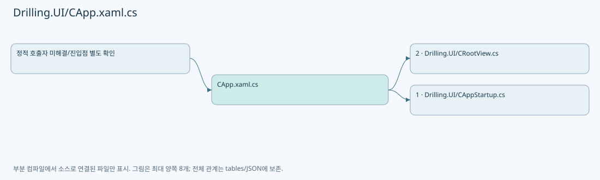
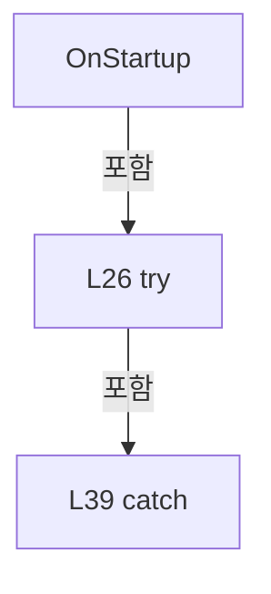
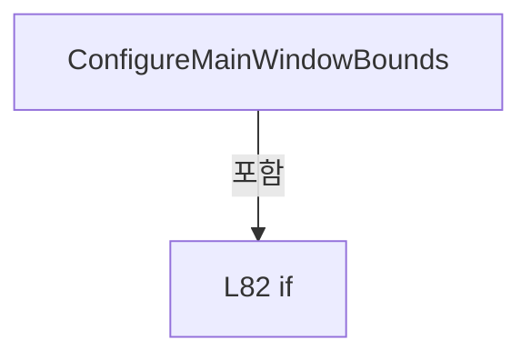
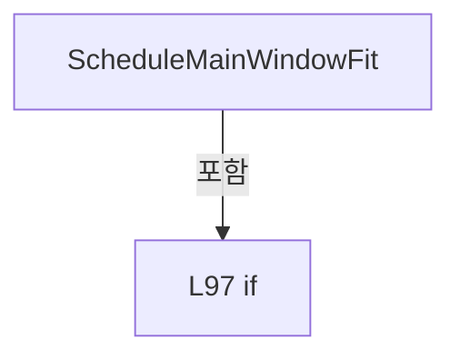
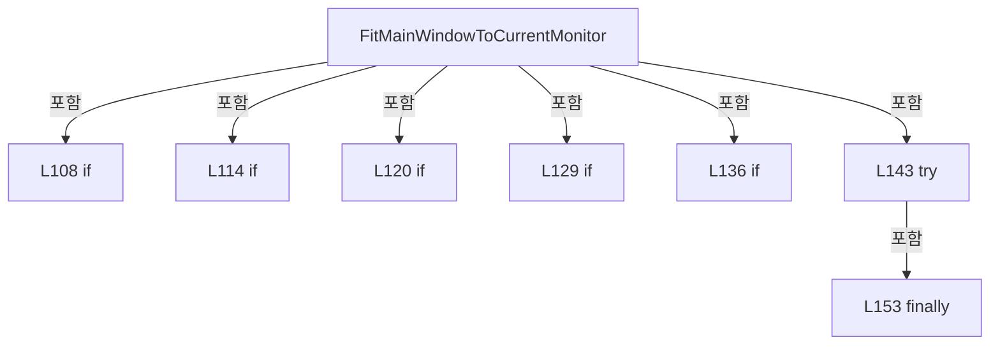

# Drilling.UI/CApp.xaml.cs

| 항목 | 내용 |
| --- | --- |
| 원본 저장소 | https://github.com/kjuws10-rgb/A3Drilling.git |
| 원본 Commit | 5aee8e58439c9b455cae7c9593c9be986c3e682e |
| 원본 SHA256 | 9690a272cdb61d231b85decbd9bfaf354e81d09c7bbab7671264d5fc3e11a7ee |
| 파일 분류 | code |
| 원본 크기/행 | 6,206 bytes / 180 physical lines |
| 인코딩 | utf-8-sig |
| 검토 범위 | 구문/부분 의미 분석에서 추출한 사실. 동작·물리 단위·실장비 합격을 보증하지 않습니다. |
| 원본 링크 | [고정 Commit 원본](https://github.com/kjuws10-rgb/A3Drilling/blob/5aee8e58439c9b455cae7c9593c9be986c3e682e/Drilling.UI/CApp.xaml.cs) |

## 파일의 역할과 읽는 순서

WPF 화면·사용자 명령·표시 상태를 구성합니다. XAML 이벤트와 코드 비하인드, RootView의 조립 경로를 함께 추적합니다.

## 네임스페이스·타입·상속

| 타입 | 구분 | 원본 범위 | 선언/상속 |
| --- | --- | --- | --- |
| CApp | ClassDeclaration | 9–180 | CApp: Application |
| MONITORINFO | StructDeclaration | 163–170 | MONITORINFO |
| RECT | StructDeclaration | 172–179 | RECT |

## 멤버 빠른 목록

| 이름 | 종류 | 범위 | 서명 |
| --- | --- | --- | --- |
| MonitorDefaultToNearest | FieldDeclaration | L11–11 | uint Drilling.UI.CApp.MonitorDefaultToNearest |
| _monitorFitTimer | FieldDeclaration | L12–12 | DispatcherTimer Drilling.UI.CApp._monitorFitTimer |
| _isFittingMainWindow | FieldDeclaration | L13–13 | bool Drilling.UI.CApp._isFittingMainWindow |
| _rootView | FieldDeclaration | L14–14 | Drilling.UI.CRootView? Drilling.UI.CApp._rootView |
| .ctor | ConstructorDeclaration | L15–21 | Drilling.UI.CApp.CApp() |
| OnStartup | MethodDeclaration | L23–45 | void Drilling.UI.CApp.OnStartup(StartupEventArgs) |
| OnExit | MethodDeclaration | L47–51 | void Drilling.UI.CApp.OnExit(ExitEventArgs) |
| RegisterExceptionHandlers | MethodDeclaration | L53–72 | void Drilling.UI.CApp.RegisterExceptionHandlers() |
| HandleUnhandledException | LocalFunctionStatement | L59–63 | void HandleUnhandledException(object, System.UnhandledExceptionEventArgs) |
| HandleUnobservedTaskException | LocalFunctionStatement | L66–69 | void HandleUnobservedTaskException(object?, System.Threading.Tasks.UnobservedTaskExceptionEventArgs) |
| ConfigureMainWindowBounds | MethodDeclaration | L74–93 | void Drilling.UI.CApp.ConfigureMainWindowBounds(Window) |
| ScheduleMainWindowFit | MethodDeclaration | L95–104 | void Drilling.UI.CApp.ScheduleMainWindowFit(Window) |
| FitMainWindowToCurrentMonitor | MethodDeclaration | L106–157 | void Drilling.UI.CApp.FitMainWindowToCurrentMonitor(Window) |
| MonitorFromWindow | MethodDeclaration | L159–160 | nint Drilling.UI.CApp.MonitorFromWindow(nint, uint) |
| GetMonitorInfo | MethodDeclaration | L161–162 | bool Drilling.UI.CApp.GetMonitorInfo(nint, ref Drilling.UI.CApp.MONITORINFO) |
| cbSize | FieldDeclaration | L166–166 | int Drilling.UI.CApp.MONITORINFO.cbSize |
| rcMonitor | FieldDeclaration | L167–167 | Drilling.UI.CApp.RECT Drilling.UI.CApp.MONITORINFO.rcMonitor |
| rcWork | FieldDeclaration | L168–168 | Drilling.UI.CApp.RECT Drilling.UI.CApp.MONITORINFO.rcWork |
| dwFlags | FieldDeclaration | L169–169 | uint Drilling.UI.CApp.MONITORINFO.dwFlags |
| Left | FieldDeclaration | L175–175 | int Drilling.UI.CApp.RECT.Left |
| Top | FieldDeclaration | L176–176 | int Drilling.UI.CApp.RECT.Top |
| Right | FieldDeclaration | L177–177 | int Drilling.UI.CApp.RECT.Right |
| Bottom | FieldDeclaration | L178–178 | int Drilling.UI.CApp.RECT.Bottom |

## 멤버별 상세 계약·호출·처리 해설

### FieldDeclaration `MonitorDefaultToNearest` · L11–11

[Drilling.UI/CApp.xaml.cs:11–11](https://github.com/kjuws10-rgb/A3Drilling/blob/5aee8e58439c9b455cae7c9593c9be986c3e682e/Drilling.UI/CApp.xaml.cs#L11-L11)

| 항목 | 실제 추출 값 |
| --- | --- |
| 서명 | uint Drilling.UI.CApp.MonitorDefaultToNearest |
| 접근/수식자 | Private / private, const |
| 반환/값 타입 | uint |
| 소속 타입 | NamedType:Drilling.UI.CApp |

현재 부분 분석에서 직접 연결된 호출자는 없습니다. XAML/이벤트/인터페이스·델리게이트·외부 진입을 추가 확인해야 하며, 미사용으로 판정한 것이 아닙니다.

본문의 실제 연산·분기·예외·반환 순서(원문 위치 순):

| 원본 행 | 종류 | 주석 해설 |
| --- | --- | --- |
| 11 | variable-initializer | 변수의 초기값을 지정합니다: MonitorDefaultToNearest = 0x00000002 |

변경 전 점검: 입력/반환 타입, 위 호출자, 예외/취소 경로, 공유 상태와 저장·전송 소비자를 함께 확인합니다. 값의 단위나 물리 방향을 이름만으로 확정하지 않습니다.

### FieldDeclaration `_monitorFitTimer` · L12–12

[Drilling.UI/CApp.xaml.cs:12–12](https://github.com/kjuws10-rgb/A3Drilling/blob/5aee8e58439c9b455cae7c9593c9be986c3e682e/Drilling.UI/CApp.xaml.cs#L12-L12)

| 항목 | 실제 추출 값 |
| --- | --- |
| 서명 | DispatcherTimer Drilling.UI.CApp._monitorFitTimer |
| 접근/수식자 | Private / private, readonly |
| 반환/값 타입 | DispatcherTimer |
| 소속 타입 | NamedType:Drilling.UI.CApp |

현재 부분 분석에서 직접 연결된 호출자는 없습니다. XAML/이벤트/인터페이스·델리게이트·외부 진입을 추가 확인해야 하며, 미사용으로 판정한 것이 아닙니다.

변경 전 점검: 입력/반환 타입, 위 호출자, 예외/취소 경로, 공유 상태와 저장·전송 소비자를 함께 확인합니다. 값의 단위나 물리 방향을 이름만으로 확정하지 않습니다.

### FieldDeclaration `_isFittingMainWindow` · L13–13

[Drilling.UI/CApp.xaml.cs:13–13](https://github.com/kjuws10-rgb/A3Drilling/blob/5aee8e58439c9b455cae7c9593c9be986c3e682e/Drilling.UI/CApp.xaml.cs#L13-L13)

| 항목 | 실제 추출 값 |
| --- | --- |
| 서명 | bool Drilling.UI.CApp._isFittingMainWindow |
| 접근/수식자 | Private / private |
| 반환/값 타입 | bool |
| 소속 타입 | NamedType:Drilling.UI.CApp |

현재 부분 분석에서 직접 연결된 호출자는 없습니다. XAML/이벤트/인터페이스·델리게이트·외부 진입을 추가 확인해야 하며, 미사용으로 판정한 것이 아닙니다.

변경 전 점검: 입력/반환 타입, 위 호출자, 예외/취소 경로, 공유 상태와 저장·전송 소비자를 함께 확인합니다. 값의 단위나 물리 방향을 이름만으로 확정하지 않습니다.

### FieldDeclaration `_rootView` · L14–14

[Drilling.UI/CApp.xaml.cs:14–14](https://github.com/kjuws10-rgb/A3Drilling/blob/5aee8e58439c9b455cae7c9593c9be986c3e682e/Drilling.UI/CApp.xaml.cs#L14-L14)

| 항목 | 실제 추출 값 |
| --- | --- |
| 서명 | Drilling.UI.CRootView? Drilling.UI.CApp._rootView |
| 접근/수식자 | Private / private |
| 반환/값 타입 | Drilling.UI.CRootView? |
| 소속 타입 | NamedType:Drilling.UI.CApp |

현재 부분 분석에서 직접 연결된 호출자는 없습니다. XAML/이벤트/인터페이스·델리게이트·외부 진입을 추가 확인해야 하며, 미사용으로 판정한 것이 아닙니다.

변경 전 점검: 입력/반환 타입, 위 호출자, 예외/취소 경로, 공유 상태와 저장·전송 소비자를 함께 확인합니다. 값의 단위나 물리 방향을 이름만으로 확정하지 않습니다.

### ConstructorDeclaration `.ctor` · L15–21

[Drilling.UI/CApp.xaml.cs:15–21](https://github.com/kjuws10-rgb/A3Drilling/blob/5aee8e58439c9b455cae7c9593c9be986c3e682e/Drilling.UI/CApp.xaml.cs#L15-L21)

| 항목 | 실제 추출 값 |
| --- | --- |
| 서명 | Drilling.UI.CApp.CApp() |
| 접근/수식자 | Public / public |
| 반환/값 타입 | void |
| 소속 타입 | NamedType:Drilling.UI.CApp |

현재 부분 분석에서 직접 연결된 호출자는 없습니다. XAML/이벤트/인터페이스·델리게이트·외부 진입을 추가 확인해야 하며, 미사용으로 판정한 것이 아닙니다.

호출하는 대상과 해석 범위:

| 원본 행 | 표현식 | 분석 상태 | 대상/소스 위치 |
| --- | --- | --- | --- |
| 17 | new DispatcherTimer | unresolved | None |
| 19 | TimeSpan.FromMilliseconds | resolved | System.TimeSpan System.TimeSpan.FromMilliseconds(long) |

본문의 실제 연산·분기·예외·반환 순서(원문 위치 순):

| 원본 행 | 종류 | 주석 해설 |
| --- | --- | --- |
| 17 | assignment | 값을 대상에 대입합니다: _monitorFitTimer = new DispatcherTimer { Interval = TimeSpan.FromMilliseconds(450) } |
| 17 | call | 함수·델리게이트 또는 객체 생성자를 호출합니다: new DispatcherTimer { Interval = TimeSpan.FromMilliseconds(450) } |
| 19 | assignment | 값을 대상에 대입합니다: Interval = TimeSpan.FromMilliseconds(450) |
| 19 | call | 함수·델리게이트 또는 객체 생성자를 호출합니다: TimeSpan.FromMilliseconds(450) |

변경 전 점검: 입력/반환 타입, 위 호출자, 예외/취소 경로, 공유 상태와 저장·전송 소비자를 함께 확인합니다. 값의 단위나 물리 방향을 이름만으로 확정하지 않습니다.

### MethodDeclaration `OnStartup` · L23–45

[Drilling.UI/CApp.xaml.cs:23–45](https://github.com/kjuws10-rgb/A3Drilling/blob/5aee8e58439c9b455cae7c9593c9be986c3e682e/Drilling.UI/CApp.xaml.cs#L23-L45)

| 항목 | 실제 추출 값 |
| --- | --- |
| 서명 | void Drilling.UI.CApp.OnStartup(StartupEventArgs) |
| 접근/수식자 | Protected / protected, override |
| 반환/값 타입 | void |
| 소속 타입 | NamedType:Drilling.UI.CApp |

입력 계약:

| 이름 | 타입 | 전달 | 선택/기본값 |
| --- | --- | --- | --- |
| e | StartupEventArgs | None | False /  |

현재 부분 분석에서 직접 연결된 호출자는 없습니다. XAML/이벤트/인터페이스·델리게이트·외부 진입을 추가 확인해야 하며, 미사용으로 판정한 것이 아닙니다.

호출하는 대상과 해석 범위:

| 원본 행 | 표현식 | 분석 상태 | 대상/소스 위치 |
| --- | --- | --- | --- |
| 25 | RegisterExceptionHandlers | resolved | void Drilling.UI.CApp.RegisterExceptionHandlers() · Drilling.UI/CApp.xaml.cs:53 |
| 28 | base.OnStartup | unresolved | None |
| 29 | CProgramOpenLog.Write | unresolved | None |
| 30 | LoadComponent | unresolved | None |
| 30 | new Uri | resolved | System.Uri.Uri(string, System.UriKind) |
| 31 | CAppStartup.CreateMainViewModel | resolved | Drilling.UI.CRootView Drilling.UI.CAppStartup.CreateMainViewModel() · Drilling.UI/CAppStartup.cs:14 |
| 33 | ConfigureMainWindowBounds | resolved | void Drilling.UI.CApp.ConfigureMainWindowBounds(Window) · Drilling.UI/CApp.xaml.cs:74 |
| 35 | window.Show | unresolved | None |
| 36 | _rootView.StartProtectWindowRequestNotice | resolved | void Drilling.UI.CRootView.StartProtectWindowRequestNotice(Window) · Drilling.UI/CRootView.cs:2767 |
| 37 | CProgramOpenLog.Write | unresolved | None |
| 41 | CProgramOpenLog.Write | unresolved | None |
| 42 | MessageBox.Show | unresolved | None |
| 43 | Shutdown | unresolved | None |

본문의 실제 연산·분기·예외·반환 순서(원문 위치 순):

| 원본 행 | 종류 | 주석 해설 |
| --- | --- | --- |
| 25 | call | 함수·델리게이트 또는 객체 생성자를 호출합니다: RegisterExceptionHandlers() |
| 26 | try | 예외 처리 범위입니다: try |
| 28 | call | 함수·델리게이트 또는 객체 생성자를 호출합니다: base.OnStartup(e) |
| 29 | call | 함수·델리게이트 또는 객체 생성자를 호출합니다: CProgramOpenLog.Write("PROGRAM_OPEN", "Application startup started.") |
| 30 | call | 함수·델리게이트 또는 객체 생성자를 호출합니다: LoadComponent(new Uri("CRootView.xaml", UriKind.Relative)) |
| 30 | call | 함수·델리게이트 또는 객체 생성자를 호출합니다: new Uri("CRootView.xaml", UriKind.Relative) |
| 30 | local-declaration | 지역 변수를 선언합니다: var window = (Window)LoadComponent(new Uri("CRootView.xaml", UriKind.Relative)); |
| 30 | variable-initializer | 변수의 초기값을 지정합니다: window = (Window)LoadComponent(new Uri("CRootView.xaml", UriKind.Relative)) |
| 31 | assignment | 값을 대상에 대입합니다: _rootView = CAppStartup.CreateMainViewModel() |
| 31 | call | 함수·델리게이트 또는 객체 생성자를 호출합니다: CAppStartup.CreateMainViewModel() |
| 32 | assignment | 값을 대상에 대입합니다: window.DataContext = _rootView |
| 33 | call | 함수·델리게이트 또는 객체 생성자를 호출합니다: ConfigureMainWindowBounds(window) |
| 34 | assignment | 값을 대상에 대입합니다: MainWindow = window |
| 35 | call | 함수·델리게이트 또는 객체 생성자를 호출합니다: window.Show() |
| 36 | call | 함수·델리게이트 또는 객체 생성자를 호출합니다: _rootView.StartProtectWindowRequestNotice(window) |
| 37 | call | 함수·델리게이트 또는 객체 생성자를 호출합니다: CProgramOpenLog.Write("PROGRAM_OPEN", "Main window opened.") |
| 39 | catch | 지정 예외를 처리합니다: catch (Exception exception) |
| 41 | call | 함수·델리게이트 또는 객체 생성자를 호출합니다: CProgramOpenLog.Write("PROGRAM_OPEN_FAILED", exception) |
| 42 | call | 함수·델리게이트 또는 객체 생성자를 호출합니다: MessageBox.Show($"프로그램을 시작하지 못했습니다.{Environment.NewLine}{exception.Message}{Environment.NewLine}{Environment.NewLine}로그: {CProgramOpenLog.LogPath}", "Laser Drilling", MessageBoxButton.OK, MessageBoxImage.Error) |
| 43 | call | 함수·델리게이트 또는 객체 생성자를 호출합니다: Shutdown(-1) |

제어 구문의 포함 구조(실제 실행 순서/CFG가 아닌 구문 탐색 그림):

변경 전 점검: 입력/반환 타입, 위 호출자, 예외/취소 경로, 공유 상태와 저장·전송 소비자를 함께 확인합니다. 값의 단위나 물리 방향을 이름만으로 확정하지 않습니다.

### MethodDeclaration `OnExit` · L47–51

[Drilling.UI/CApp.xaml.cs:47–51](https://github.com/kjuws10-rgb/A3Drilling/blob/5aee8e58439c9b455cae7c9593c9be986c3e682e/Drilling.UI/CApp.xaml.cs#L47-L51)

| 항목 | 실제 추출 값 |
| --- | --- |
| 서명 | void Drilling.UI.CApp.OnExit(ExitEventArgs) |
| 접근/수식자 | Protected / protected, override |
| 반환/값 타입 | void |
| 소속 타입 | NamedType:Drilling.UI.CApp |

입력 계약:

| 이름 | 타입 | 전달 | 선택/기본값 |
| --- | --- | --- | --- |
| e | ExitEventArgs | None | False /  |

현재 부분 분석에서 직접 연결된 호출자는 없습니다. XAML/이벤트/인터페이스·델리게이트·외부 진입을 추가 확인해야 하며, 미사용으로 판정한 것이 아닙니다.

호출하는 대상과 해석 범위:

| 원본 행 | 표현식 | 분석 상태 | 대상/소스 위치 |
| --- | --- | --- | --- |
| 49 | .StopAutomationStatusAcquisition | resolved | void Drilling.UI.CRootView.StopAutomationStatusAcquisition() · Drilling.UI/CRootView.cs:248 |
| 50 | base.OnExit | unresolved | None |

본문의 실제 연산·분기·예외·반환 순서(원문 위치 순):

| 원본 행 | 종류 | 주석 해설 |
| --- | --- | --- |
| 49 | call | 함수·델리게이트 또는 객체 생성자를 호출합니다: .StopAutomationStatusAcquisition() |
| 50 | call | 함수·델리게이트 또는 객체 생성자를 호출합니다: base.OnExit(e) |

변경 전 점검: 입력/반환 타입, 위 호출자, 예외/취소 경로, 공유 상태와 저장·전송 소비자를 함께 확인합니다. 값의 단위나 물리 방향을 이름만으로 확정하지 않습니다.

### MethodDeclaration `RegisterExceptionHandlers` · L53–72

[Drilling.UI/CApp.xaml.cs:53–72](https://github.com/kjuws10-rgb/A3Drilling/blob/5aee8e58439c9b455cae7c9593c9be986c3e682e/Drilling.UI/CApp.xaml.cs#L53-L72)

| 항목 | 실제 추출 값 |
| --- | --- |
| 서명 | void Drilling.UI.CApp.RegisterExceptionHandlers() |
| 접근/수식자 | Private / private |
| 반환/값 타입 | void |
| 소속 타입 | NamedType:Drilling.UI.CApp |

정적 호출자로 확인된 위치:

| 호출 파일/행 | 호출 표현식 | 런타임 분기 가능 |
| --- | --- | --- |
| [Drilling.UI/CApp.xaml.cs:25–25](https://github.com/kjuws10-rgb/A3Drilling/blob/5aee8e58439c9b455cae7c9593c9be986c3e682e/Drilling.UI/CApp.xaml.cs#L25-L25) | RegisterExceptionHandlers | False |

호출하는 대상과 해석 범위:

| 원본 행 | 표현식 | 분석 상태 | 대상/소스 위치 |
| --- | --- | --- | --- |
| 57 | CProgramOpenLog.Write | unresolved | None |

본문의 실제 연산·분기·예외·반환 순서(원문 위치 순):

| 원본 행 | 종류 | 주석 해설 |
| --- | --- | --- |
| 55 | compound-assignment-or-event-subscription | 복합 대입 또는 이벤트 구독/해지 표현입니다: DispatcherUnhandledException += (_, args) => { CProgramOpenLog.Write("DISPATCHER_UNHANDLED", args.Exception); } |
| 57 | call | 함수·델리게이트 또는 객체 생성자를 호출합니다: CProgramOpenLog.Write("DISPATCHER_UNHANDLED", args.Exception) |
| 65 | compound-assignment-or-event-subscription | 복합 대입 또는 이벤트 구독/해지 표현입니다: AppDomain.CurrentDomain.UnhandledException += HandleUnhandledException |
| 71 | compound-assignment-or-event-subscription | 복합 대입 또는 이벤트 구독/해지 표현입니다: TaskScheduler.UnobservedTaskException += HandleUnobservedTaskException |

변경 전 점검: 입력/반환 타입, 위 호출자, 예외/취소 경로, 공유 상태와 저장·전송 소비자를 함께 확인합니다. 값의 단위나 물리 방향을 이름만으로 확정하지 않습니다.

### LocalFunctionStatement `HandleUnhandledException` · L59–63

[Drilling.UI/CApp.xaml.cs:59–63](https://github.com/kjuws10-rgb/A3Drilling/blob/5aee8e58439c9b455cae7c9593c9be986c3e682e/Drilling.UI/CApp.xaml.cs#L59-L63)

| 항목 | 실제 추출 값 |
| --- | --- |
| 서명 | void HandleUnhandledException(object, System.UnhandledExceptionEventArgs) |
| 접근/수식자 | Private /  |
| 반환/값 타입 | void |
| 소속 타입 | NamedType:Drilling.UI.CApp |

입력 계약:

| 이름 | 타입 | 전달 | 선택/기본값 |
| --- | --- | --- | --- |
| arg0 | object | None | False /  |
| args | System.UnhandledExceptionEventArgs | None | False /  |

현재 부분 분석에서 직접 연결된 호출자는 없습니다. XAML/이벤트/인터페이스·델리게이트·외부 진입을 추가 확인해야 하며, 미사용으로 판정한 것이 아닙니다.

호출하는 대상과 해석 범위:

| 원본 행 | 표현식 | 분석 상태 | 대상/소스 위치 |
| --- | --- | --- | --- |
| 62 | CProgramOpenLog.Write | unresolved | None |
| 62 | .ToString | resolved · 동적 구현 선택 가능 | string System.Exception.ToString() |
| 62 | .ToString | resolved · 동적 구현 선택 가능 | string? object.ToString() |

본문의 실제 연산·분기·예외·반환 순서(원문 위치 순):

| 원본 행 | 종류 | 주석 해설 |
| --- | --- | --- |
| 61 | local-declaration | 지역 변수를 선언합니다: var exception = args.ExceptionObject as Exception; |
| 61 | variable-initializer | 변수의 초기값을 지정합니다: exception = args.ExceptionObject as Exception |
| 62 | call | 함수·델리게이트 또는 객체 생성자를 호출합니다: CProgramOpenLog.Write("APPDOMAIN_UNHANDLED", exception?.ToString() ?? args.ExceptionObject?.ToString() ?? "Unknown unhandled exception.") |
| 62 | call | 함수·델리게이트 또는 객체 생성자를 호출합니다: .ToString() |
| 62 | call | 함수·델리게이트 또는 객체 생성자를 호출합니다: .ToString() |

변경 전 점검: 입력/반환 타입, 위 호출자, 예외/취소 경로, 공유 상태와 저장·전송 소비자를 함께 확인합니다. 값의 단위나 물리 방향을 이름만으로 확정하지 않습니다.

### LocalFunctionStatement `HandleUnobservedTaskException` · L66–69

[Drilling.UI/CApp.xaml.cs:66–69](https://github.com/kjuws10-rgb/A3Drilling/blob/5aee8e58439c9b455cae7c9593c9be986c3e682e/Drilling.UI/CApp.xaml.cs#L66-L69)

| 항목 | 실제 추출 값 |
| --- | --- |
| 서명 | void HandleUnobservedTaskException(object?, System.Threading.Tasks.UnobservedTaskExceptionEventArgs) |
| 접근/수식자 | Private /  |
| 반환/값 타입 | void |
| 소속 타입 | NamedType:Drilling.UI.CApp |

입력 계약:

| 이름 | 타입 | 전달 | 선택/기본값 |
| --- | --- | --- | --- |
| arg0 | object? | None | False /  |
| args | System.Threading.Tasks.UnobservedTaskExceptionEventArgs | None | False /  |

현재 부분 분석에서 직접 연결된 호출자는 없습니다. XAML/이벤트/인터페이스·델리게이트·외부 진입을 추가 확인해야 하며, 미사용으로 판정한 것이 아닙니다.

호출하는 대상과 해석 범위:

| 원본 행 | 표현식 | 분석 상태 | 대상/소스 위치 |
| --- | --- | --- | --- |
| 68 | CProgramOpenLog.Write | unresolved | None |

본문의 실제 연산·분기·예외·반환 순서(원문 위치 순):

| 원본 행 | 종류 | 주석 해설 |
| --- | --- | --- |
| 68 | call | 함수·델리게이트 또는 객체 생성자를 호출합니다: CProgramOpenLog.Write("TASK_UNOBSERVED", args.Exception) |

변경 전 점검: 입력/반환 타입, 위 호출자, 예외/취소 경로, 공유 상태와 저장·전송 소비자를 함께 확인합니다. 값의 단위나 물리 방향을 이름만으로 확정하지 않습니다.

### MethodDeclaration `ConfigureMainWindowBounds` · L74–93

[Drilling.UI/CApp.xaml.cs:74–93](https://github.com/kjuws10-rgb/A3Drilling/blob/5aee8e58439c9b455cae7c9593c9be986c3e682e/Drilling.UI/CApp.xaml.cs#L74-L93)

| 항목 | 실제 추출 값 |
| --- | --- |
| 서명 | void Drilling.UI.CApp.ConfigureMainWindowBounds(Window) |
| 접근/수식자 | Private / private |
| 반환/값 타입 | void |
| 소속 타입 | NamedType:Drilling.UI.CApp |

입력 계약:

| 이름 | 타입 | 전달 | 선택/기본값 |
| --- | --- | --- | --- |
| window | Window | None | False /  |

정적 호출자로 확인된 위치:

| 호출 파일/행 | 호출 표현식 | 런타임 분기 가능 |
| --- | --- | --- |
| [Drilling.UI/CApp.xaml.cs:33–33](https://github.com/kjuws10-rgb/A3Drilling/blob/5aee8e58439c9b455cae7c9593c9be986c3e682e/Drilling.UI/CApp.xaml.cs#L33-L33) | ConfigureMainWindowBounds | False |

호출하는 대상과 해석 범위:

| 원본 행 | 표현식 | 분석 상태 | 대상/소스 위치 |
| --- | --- | --- | --- |
| 81 | _monitorFitTimer.Stop | unresolved | None |
| 84 | ScheduleMainWindowFit | resolved | void Drilling.UI.CApp.ScheduleMainWindowFit(Window) · Drilling.UI/CApp.xaml.cs:95 |
| 88 | FitMainWindowToCurrentMonitor | resolved | void Drilling.UI.CApp.FitMainWindowToCurrentMonitor(Window) · Drilling.UI/CApp.xaml.cs:106 |
| 90 | FitMainWindowToCurrentMonitor | resolved | void Drilling.UI.CApp.FitMainWindowToCurrentMonitor(Window) · Drilling.UI/CApp.xaml.cs:106 |
| 91 | ScheduleMainWindowFit | resolved | void Drilling.UI.CApp.ScheduleMainWindowFit(Window) · Drilling.UI/CApp.xaml.cs:95 |
| 92 | ScheduleMainWindowFit | resolved | void Drilling.UI.CApp.ScheduleMainWindowFit(Window) · Drilling.UI/CApp.xaml.cs:95 |

본문의 실제 연산·분기·예외·반환 순서(원문 위치 순):

| 원본 행 | 종류 | 주석 해설 |
| --- | --- | --- |
| 76 | assignment | 값을 대상에 대입합니다: window.ResizeMode = ResizeMode.CanMinimize |
| 77 | assignment | 값을 대상에 대입합니다: window.WindowStartupLocation = WindowStartupLocation.CenterScreen |
| 78 | assignment | 값을 대상에 대입합니다: window.WindowState = WindowState.Maximized |
| 79 | compound-assignment-or-event-subscription | 복합 대입 또는 이벤트 구독/해지 표현입니다: _monitorFitTimer.Tick += (_, _) => { _monitorFitTimer.Stop(); if (Mouse.LeftButton == MouseButtonState.Pressed) { ScheduleMainWindowFit(window); return; } FitMainWindowToCurrentMonitor(window); } |
| 81 | call | 함수·델리게이트 또는 객체 생성자를 호출합니다: _monitorFitTimer.Stop() |
| 82 | if | 조건에 따라 분기합니다: if (Mouse.LeftButton == MouseButtonState.Pressed) |
| 84 | call | 함수·델리게이트 또는 객체 생성자를 호출합니다: ScheduleMainWindowFit(window) |
| 85 | return | 호출자에게 값 또는 제어를 반환합니다: return; |
| 88 | call | 함수·델리게이트 또는 객체 생성자를 호출합니다: FitMainWindowToCurrentMonitor(window) |
| 90 | call | 함수·델리게이트 또는 객체 생성자를 호출합니다: FitMainWindowToCurrentMonitor(window) |
| 90 | compound-assignment-or-event-subscription | 복합 대입 또는 이벤트 구독/해지 표현입니다: window.SourceInitialized += (_, _) => FitMainWindowToCurrentMonitor(window) |
| 91 | call | 함수·델리게이트 또는 객체 생성자를 호출합니다: ScheduleMainWindowFit(window) |
| 91 | compound-assignment-or-event-subscription | 복합 대입 또는 이벤트 구독/해지 표현입니다: window.LocationChanged += (_, _) => ScheduleMainWindowFit(window) |
| 92 | call | 함수·델리게이트 또는 객체 생성자를 호출합니다: ScheduleMainWindowFit(window) |
| 92 | compound-assignment-or-event-subscription | 복합 대입 또는 이벤트 구독/해지 표현입니다: window.StateChanged += (_, _) => ScheduleMainWindowFit(window) |

제어 구문의 포함 구조(실제 실행 순서/CFG가 아닌 구문 탐색 그림):

변경 전 점검: 입력/반환 타입, 위 호출자, 예외/취소 경로, 공유 상태와 저장·전송 소비자를 함께 확인합니다. 값의 단위나 물리 방향을 이름만으로 확정하지 않습니다.

### MethodDeclaration `ScheduleMainWindowFit` · L95–104

[Drilling.UI/CApp.xaml.cs:95–104](https://github.com/kjuws10-rgb/A3Drilling/blob/5aee8e58439c9b455cae7c9593c9be986c3e682e/Drilling.UI/CApp.xaml.cs#L95-L104)

| 항목 | 실제 추출 값 |
| --- | --- |
| 서명 | void Drilling.UI.CApp.ScheduleMainWindowFit(Window) |
| 접근/수식자 | Private / private |
| 반환/값 타입 | void |
| 소속 타입 | NamedType:Drilling.UI.CApp |

입력 계약:

| 이름 | 타입 | 전달 | 선택/기본값 |
| --- | --- | --- | --- |
| window | Window | None | False /  |

정적 호출자로 확인된 위치:

| 호출 파일/행 | 호출 표현식 | 런타임 분기 가능 |
| --- | --- | --- |
| [Drilling.UI/CApp.xaml.cs:84–84](https://github.com/kjuws10-rgb/A3Drilling/blob/5aee8e58439c9b455cae7c9593c9be986c3e682e/Drilling.UI/CApp.xaml.cs#L84-L84) | ScheduleMainWindowFit | False |
| [Drilling.UI/CApp.xaml.cs:91–91](https://github.com/kjuws10-rgb/A3Drilling/blob/5aee8e58439c9b455cae7c9593c9be986c3e682e/Drilling.UI/CApp.xaml.cs#L91-L91) | ScheduleMainWindowFit | False |
| [Drilling.UI/CApp.xaml.cs:92–92](https://github.com/kjuws10-rgb/A3Drilling/blob/5aee8e58439c9b455cae7c9593c9be986c3e682e/Drilling.UI/CApp.xaml.cs#L92-L92) | ScheduleMainWindowFit | False |

호출하는 대상과 해석 범위:

| 원본 행 | 표현식 | 분석 상태 | 대상/소스 위치 |
| --- | --- | --- | --- |
| 102 | _monitorFitTimer.Stop | unresolved | None |
| 103 | _monitorFitTimer.Start | unresolved | None |

본문의 실제 연산·분기·예외·반환 순서(원문 위치 순):

| 원본 행 | 종류 | 주석 해설 |
| --- | --- | --- |
| 97 | if | 조건에 따라 분기합니다: if (_isFittingMainWindow &#124;&#124; window.WindowState == WindowState.Minimized) |
| 99 | return | 호출자에게 값 또는 제어를 반환합니다: return; |
| 102 | call | 함수·델리게이트 또는 객체 생성자를 호출합니다: _monitorFitTimer.Stop() |
| 103 | call | 함수·델리게이트 또는 객체 생성자를 호출합니다: _monitorFitTimer.Start() |

제어 구문의 포함 구조(실제 실행 순서/CFG가 아닌 구문 탐색 그림):

변경 전 점검: 입력/반환 타입, 위 호출자, 예외/취소 경로, 공유 상태와 저장·전송 소비자를 함께 확인합니다. 값의 단위나 물리 방향을 이름만으로 확정하지 않습니다.

### MethodDeclaration `FitMainWindowToCurrentMonitor` · L106–157

[Drilling.UI/CApp.xaml.cs:106–157](https://github.com/kjuws10-rgb/A3Drilling/blob/5aee8e58439c9b455cae7c9593c9be986c3e682e/Drilling.UI/CApp.xaml.cs#L106-L157)

| 항목 | 실제 추출 값 |
| --- | --- |
| 서명 | void Drilling.UI.CApp.FitMainWindowToCurrentMonitor(Window) |
| 접근/수식자 | Private / private |
| 반환/값 타입 | void |
| 소속 타입 | NamedType:Drilling.UI.CApp |

입력 계약:

| 이름 | 타입 | 전달 | 선택/기본값 |
| --- | --- | --- | --- |
| window | Window | None | False /  |

정적 호출자로 확인된 위치:

| 호출 파일/행 | 호출 표현식 | 런타임 분기 가능 |
| --- | --- | --- |
| [Drilling.UI/CApp.xaml.cs:88–88](https://github.com/kjuws10-rgb/A3Drilling/blob/5aee8e58439c9b455cae7c9593c9be986c3e682e/Drilling.UI/CApp.xaml.cs#L88-L88) | FitMainWindowToCurrentMonitor | False |
| [Drilling.UI/CApp.xaml.cs:90–90](https://github.com/kjuws10-rgb/A3Drilling/blob/5aee8e58439c9b455cae7c9593c9be986c3e682e/Drilling.UI/CApp.xaml.cs#L90-L90) | FitMainWindowToCurrentMonitor | False |

호출하는 대상과 해석 범위:

| 원본 행 | 표현식 | 분석 상태 | 대상/소스 위치 |
| --- | --- | --- | --- |
| 113 | new WindowInteropHelper | unresolved | None |
| 119 | MonitorFromWindow | candidate | OverloadResolutionFailure |
| 125 | new MONITORINFO | resolved | Drilling.UI.CApp.MONITORINFO.MONITORINFO() · Drilling.UI/CApp.xaml.cs:164 |
| 127 | Marshal.SizeOf<MONITORINFO> | resolved | int System.Runtime.InteropServices.Marshal.SizeOf<Drilling.UI.CApp.MONITORINFO>() |
| 129 | GetMonitorInfo | resolved | bool Drilling.UI.CApp.GetMonitorInfo(nint, ref Drilling.UI.CApp.MONITORINFO) · Drilling.UI/CApp.xaml.cs:162 |
| 134 | PresentationSource.FromVisual | unresolved | None |
| 141 | transform.Value.Transform | unresolved | None |
| 141 | new Point | unresolved | None |
| 142 | transform.Value.Transform | unresolved | None |
| 142 | new Point | unresolved | None |
| 149 | Math.Max | candidate | OverloadResolutionFailure |
| 150 | Math.Max | candidate | OverloadResolutionFailure |

본문의 실제 연산·분기·예외·반환 순서(원문 위치 순):

| 원본 행 | 종류 | 주석 해설 |
| --- | --- | --- |
| 108 | if | 조건에 따라 분기합니다: if (_isFittingMainWindow &#124;&#124; window.WindowState == WindowState.Minimized) |
| 110 | return | 호출자에게 값 또는 제어를 반환합니다: return; |
| 113 | call | 함수·델리게이트 또는 객체 생성자를 호출합니다: new WindowInteropHelper(window) |
| 113 | local-declaration | 지역 변수를 선언합니다: var handle = new WindowInteropHelper(window).Handle; |
| 113 | variable-initializer | 변수의 초기값을 지정합니다: handle = new WindowInteropHelper(window).Handle |
| 114 | if | 조건에 따라 분기합니다: if (handle == IntPtr.Zero) |
| 116 | return | 호출자에게 값 또는 제어를 반환합니다: return; |
| 119 | call | 함수·델리게이트 또는 객체 생성자를 호출합니다: MonitorFromWindow(handle, MonitorDefaultToNearest) |
| 119 | local-declaration | 지역 변수를 선언합니다: var monitor = MonitorFromWindow(handle, MonitorDefaultToNearest); |
| 119 | variable-initializer | 변수의 초기값을 지정합니다: monitor = MonitorFromWindow(handle, MonitorDefaultToNearest) |
| 120 | if | 조건에 따라 분기합니다: if (monitor == IntPtr.Zero) |
| 122 | return | 호출자에게 값 또는 제어를 반환합니다: return; |
| 125 | call | 함수·델리게이트 또는 객체 생성자를 호출합니다: new MONITORINFO { cbSize = Marshal.SizeOf<MONITORINFO>() } |
| 125 | local-declaration | 지역 변수를 선언합니다: var monitorInfo = new MONITORINFO { cbSize = Marshal.SizeOf<MONITORINFO>() }; |
| 125 | variable-initializer | 변수의 초기값을 지정합니다: monitorInfo = new MONITORINFO { cbSize = Marshal.SizeOf<MONITORINFO>() } |
| 127 | assignment | 값을 대상에 대입합니다: cbSize = Marshal.SizeOf<MONITORINFO>() |
| 127 | call | 함수·델리게이트 또는 객체 생성자를 호출합니다: Marshal.SizeOf<MONITORINFO>() |
| 129 | call | 함수·델리게이트 또는 객체 생성자를 호출합니다: GetMonitorInfo(monitor, ref monitorInfo) |
| 129 | if | 조건에 따라 분기합니다: if (!GetMonitorInfo(monitor, ref monitorInfo)) |
| 131 | return | 호출자에게 값 또는 제어를 반환합니다: return; |
| 134 | call | 함수·델리게이트 또는 객체 생성자를 호출합니다: PresentationSource.FromVisual(window) |
| 134 | local-declaration | 지역 변수를 선언합니다: var source = PresentationSource.FromVisual(window); |
| 134 | variable-initializer | 변수의 초기값을 지정합니다: source = PresentationSource.FromVisual(window) |
| 135 | local-declaration | 지역 변수를 선언합니다: var transform = source?.CompositionTarget?.TransformFromDevice; |
| 135 | variable-initializer | 변수의 초기값을 지정합니다: transform = source?.CompositionTarget?.TransformFromDevice |
| 136 | if | 조건에 따라 분기합니다: if (transform is null) |
| 138 | return | 호출자에게 값 또는 제어를 반환합니다: return; |
| 141 | call | 함수·델리게이트 또는 객체 생성자를 호출합니다: transform.Value.Transform(new Point(monitorInfo.rcWork.Left, monitorInfo.rcWork.Top)) |
| 141 | call | 함수·델리게이트 또는 객체 생성자를 호출합니다: new Point(monitorInfo.rcWork.Left, monitorInfo.rcWork.Top) |
| 141 | local-declaration | 지역 변수를 선언합니다: var topLeft = transform.Value.Transform(new Point(monitorInfo.rcWork.Left, monitorInfo.rcWork.Top)); |
| 141 | variable-initializer | 변수의 초기값을 지정합니다: topLeft = transform.Value.Transform(new Point(monitorInfo.rcWork.Left, monitorInfo.rcWork.Top)) |
| 142 | call | 함수·델리게이트 또는 객체 생성자를 호출합니다: transform.Value.Transform(new Point(monitorInfo.rcWork.Right, monitorInfo.rcWork.Bottom)) |
| 142 | call | 함수·델리게이트 또는 객체 생성자를 호출합니다: new Point(monitorInfo.rcWork.Right, monitorInfo.rcWork.Bottom) |
| 142 | local-declaration | 지역 변수를 선언합니다: var bottomRight = transform.Value.Transform(new Point(monitorInfo.rcWork.Right, monitorInfo.rcWork.Bottom)); |
| 142 | variable-initializer | 변수의 초기값을 지정합니다: bottomRight = transform.Value.Transform(new Point(monitorInfo.rcWork.Right, monitorInfo.rcWork.Bottom)) |
| 143 | try | 예외 처리 범위입니다: try |
| 145 | assignment | 값을 대상에 대입합니다: _isFittingMainWindow = true |
| 146 | assignment | 값을 대상에 대입합니다: window.WindowState = WindowState.Normal |
| 147 | assignment | 값을 대상에 대입합니다: window.Left = topLeft.X |
| 148 | assignment | 값을 대상에 대입합니다: window.Top = topLeft.Y |
| 149 | assignment | 값을 대상에 대입합니다: window.Width = Math.Max(1, bottomRight.X - topLeft.X) |
| 149 | call | 함수·델리게이트 또는 객체 생성자를 호출합니다: Math.Max(1, bottomRight.X - topLeft.X) |
| 150 | assignment | 값을 대상에 대입합니다: window.Height = Math.Max(1, bottomRight.Y - topLeft.Y) |
| 150 | call | 함수·델리게이트 또는 객체 생성자를 호출합니다: Math.Max(1, bottomRight.Y - topLeft.Y) |
| 151 | assignment | 값을 대상에 대입합니다: window.WindowState = WindowState.Maximized |
| 153 | finally | 종료 정리 구간입니다: finally |
| 155 | assignment | 값을 대상에 대입합니다: _isFittingMainWindow = false |

제어 구문의 포함 구조(실제 실행 순서/CFG가 아닌 구문 탐색 그림):

변경 전 점검: 입력/반환 타입, 위 호출자, 예외/취소 경로, 공유 상태와 저장·전송 소비자를 함께 확인합니다. 값의 단위나 물리 방향을 이름만으로 확정하지 않습니다.

### MethodDeclaration `MonitorFromWindow` · L159–160

[Drilling.UI/CApp.xaml.cs:159–160](https://github.com/kjuws10-rgb/A3Drilling/blob/5aee8e58439c9b455cae7c9593c9be986c3e682e/Drilling.UI/CApp.xaml.cs#L159-L160)

| 항목 | 실제 추출 값 |
| --- | --- |
| 서명 | nint Drilling.UI.CApp.MonitorFromWindow(nint, uint) |
| 접근/수식자 | Private / private, static, extern |
| 반환/값 타입 | nint |
| 소속 타입 | NamedType:Drilling.UI.CApp |

입력 계약:

| 이름 | 타입 | 전달 | 선택/기본값 |
| --- | --- | --- | --- |
| hwnd | nint | None | False /  |
| dwFlags | uint | None | False /  |

현재 부분 분석에서 직접 연결된 호출자는 없습니다. XAML/이벤트/인터페이스·델리게이트·외부 진입을 추가 확인해야 하며, 미사용으로 판정한 것이 아닙니다.

변경 전 점검: 입력/반환 타입, 위 호출자, 예외/취소 경로, 공유 상태와 저장·전송 소비자를 함께 확인합니다. 값의 단위나 물리 방향을 이름만으로 확정하지 않습니다.

### MethodDeclaration `GetMonitorInfo` · L161–162

[Drilling.UI/CApp.xaml.cs:161–162](https://github.com/kjuws10-rgb/A3Drilling/blob/5aee8e58439c9b455cae7c9593c9be986c3e682e/Drilling.UI/CApp.xaml.cs#L161-L162)

| 항목 | 실제 추출 값 |
| --- | --- |
| 서명 | bool Drilling.UI.CApp.GetMonitorInfo(nint, ref Drilling.UI.CApp.MONITORINFO) |
| 접근/수식자 | Private / private, static, extern |
| 반환/값 타입 | bool |
| 소속 타입 | NamedType:Drilling.UI.CApp |

입력 계약:

| 이름 | 타입 | 전달 | 선택/기본값 |
| --- | --- | --- | --- |
| hMonitor | nint | None | False /  |
| lpmi | Drilling.UI.CApp.MONITORINFO | Ref | False /  |

정적 호출자로 확인된 위치:

| 호출 파일/행 | 호출 표현식 | 런타임 분기 가능 |
| --- | --- | --- |
| [Drilling.UI/CApp.xaml.cs:129–129](https://github.com/kjuws10-rgb/A3Drilling/blob/5aee8e58439c9b455cae7c9593c9be986c3e682e/Drilling.UI/CApp.xaml.cs#L129-L129) | GetMonitorInfo | False |

변경 전 점검: 입력/반환 타입, 위 호출자, 예외/취소 경로, 공유 상태와 저장·전송 소비자를 함께 확인합니다. 값의 단위나 물리 방향을 이름만으로 확정하지 않습니다.

### FieldDeclaration `cbSize` · L166–166

[Drilling.UI/CApp.xaml.cs:166–166](https://github.com/kjuws10-rgb/A3Drilling/blob/5aee8e58439c9b455cae7c9593c9be986c3e682e/Drilling.UI/CApp.xaml.cs#L166-L166)

| 항목 | 실제 추출 값 |
| --- | --- |
| 서명 | int Drilling.UI.CApp.MONITORINFO.cbSize |
| 접근/수식자 | Public / public |
| 반환/값 타입 | int |
| 소속 타입 | NamedType:Drilling.UI.CApp.MONITORINFO |

현재 부분 분석에서 직접 연결된 호출자는 없습니다. XAML/이벤트/인터페이스·델리게이트·외부 진입을 추가 확인해야 하며, 미사용으로 판정한 것이 아닙니다.

변경 전 점검: 입력/반환 타입, 위 호출자, 예외/취소 경로, 공유 상태와 저장·전송 소비자를 함께 확인합니다. 값의 단위나 물리 방향을 이름만으로 확정하지 않습니다.

### FieldDeclaration `rcMonitor` · L167–167

[Drilling.UI/CApp.xaml.cs:167–167](https://github.com/kjuws10-rgb/A3Drilling/blob/5aee8e58439c9b455cae7c9593c9be986c3e682e/Drilling.UI/CApp.xaml.cs#L167-L167)

| 항목 | 실제 추출 값 |
| --- | --- |
| 서명 | Drilling.UI.CApp.RECT Drilling.UI.CApp.MONITORINFO.rcMonitor |
| 접근/수식자 | Public / public |
| 반환/값 타입 | Drilling.UI.CApp.RECT |
| 소속 타입 | NamedType:Drilling.UI.CApp.MONITORINFO |

현재 부분 분석에서 직접 연결된 호출자는 없습니다. XAML/이벤트/인터페이스·델리게이트·외부 진입을 추가 확인해야 하며, 미사용으로 판정한 것이 아닙니다.

변경 전 점검: 입력/반환 타입, 위 호출자, 예외/취소 경로, 공유 상태와 저장·전송 소비자를 함께 확인합니다. 값의 단위나 물리 방향을 이름만으로 확정하지 않습니다.

### FieldDeclaration `rcWork` · L168–168

[Drilling.UI/CApp.xaml.cs:168–168](https://github.com/kjuws10-rgb/A3Drilling/blob/5aee8e58439c9b455cae7c9593c9be986c3e682e/Drilling.UI/CApp.xaml.cs#L168-L168)

| 항목 | 실제 추출 값 |
| --- | --- |
| 서명 | Drilling.UI.CApp.RECT Drilling.UI.CApp.MONITORINFO.rcWork |
| 접근/수식자 | Public / public |
| 반환/값 타입 | Drilling.UI.CApp.RECT |
| 소속 타입 | NamedType:Drilling.UI.CApp.MONITORINFO |

현재 부분 분석에서 직접 연결된 호출자는 없습니다. XAML/이벤트/인터페이스·델리게이트·외부 진입을 추가 확인해야 하며, 미사용으로 판정한 것이 아닙니다.

변경 전 점검: 입력/반환 타입, 위 호출자, 예외/취소 경로, 공유 상태와 저장·전송 소비자를 함께 확인합니다. 값의 단위나 물리 방향을 이름만으로 확정하지 않습니다.

### FieldDeclaration `dwFlags` · L169–169

[Drilling.UI/CApp.xaml.cs:169–169](https://github.com/kjuws10-rgb/A3Drilling/blob/5aee8e58439c9b455cae7c9593c9be986c3e682e/Drilling.UI/CApp.xaml.cs#L169-L169)

| 항목 | 실제 추출 값 |
| --- | --- |
| 서명 | uint Drilling.UI.CApp.MONITORINFO.dwFlags |
| 접근/수식자 | Public / public |
| 반환/값 타입 | uint |
| 소속 타입 | NamedType:Drilling.UI.CApp.MONITORINFO |

현재 부분 분석에서 직접 연결된 호출자는 없습니다. XAML/이벤트/인터페이스·델리게이트·외부 진입을 추가 확인해야 하며, 미사용으로 판정한 것이 아닙니다.

변경 전 점검: 입력/반환 타입, 위 호출자, 예외/취소 경로, 공유 상태와 저장·전송 소비자를 함께 확인합니다. 값의 단위나 물리 방향을 이름만으로 확정하지 않습니다.

### FieldDeclaration `Left` · L175–175

[Drilling.UI/CApp.xaml.cs:175–175](https://github.com/kjuws10-rgb/A3Drilling/blob/5aee8e58439c9b455cae7c9593c9be986c3e682e/Drilling.UI/CApp.xaml.cs#L175-L175)

| 항목 | 실제 추출 값 |
| --- | --- |
| 서명 | int Drilling.UI.CApp.RECT.Left |
| 접근/수식자 | Public / public |
| 반환/값 타입 | int |
| 소속 타입 | NamedType:Drilling.UI.CApp.RECT |

현재 부분 분석에서 직접 연결된 호출자는 없습니다. XAML/이벤트/인터페이스·델리게이트·외부 진입을 추가 확인해야 하며, 미사용으로 판정한 것이 아닙니다.

변경 전 점검: 입력/반환 타입, 위 호출자, 예외/취소 경로, 공유 상태와 저장·전송 소비자를 함께 확인합니다. 값의 단위나 물리 방향을 이름만으로 확정하지 않습니다.

### FieldDeclaration `Top` · L176–176

[Drilling.UI/CApp.xaml.cs:176–176](https://github.com/kjuws10-rgb/A3Drilling/blob/5aee8e58439c9b455cae7c9593c9be986c3e682e/Drilling.UI/CApp.xaml.cs#L176-L176)

| 항목 | 실제 추출 값 |
| --- | --- |
| 서명 | int Drilling.UI.CApp.RECT.Top |
| 접근/수식자 | Public / public |
| 반환/값 타입 | int |
| 소속 타입 | NamedType:Drilling.UI.CApp.RECT |

현재 부분 분석에서 직접 연결된 호출자는 없습니다. XAML/이벤트/인터페이스·델리게이트·외부 진입을 추가 확인해야 하며, 미사용으로 판정한 것이 아닙니다.

변경 전 점검: 입력/반환 타입, 위 호출자, 예외/취소 경로, 공유 상태와 저장·전송 소비자를 함께 확인합니다. 값의 단위나 물리 방향을 이름만으로 확정하지 않습니다.

### FieldDeclaration `Right` · L177–177

[Drilling.UI/CApp.xaml.cs:177–177](https://github.com/kjuws10-rgb/A3Drilling/blob/5aee8e58439c9b455cae7c9593c9be986c3e682e/Drilling.UI/CApp.xaml.cs#L177-L177)

| 항목 | 실제 추출 값 |
| --- | --- |
| 서명 | int Drilling.UI.CApp.RECT.Right |
| 접근/수식자 | Public / public |
| 반환/값 타입 | int |
| 소속 타입 | NamedType:Drilling.UI.CApp.RECT |

현재 부분 분석에서 직접 연결된 호출자는 없습니다. XAML/이벤트/인터페이스·델리게이트·외부 진입을 추가 확인해야 하며, 미사용으로 판정한 것이 아닙니다.

변경 전 점검: 입력/반환 타입, 위 호출자, 예외/취소 경로, 공유 상태와 저장·전송 소비자를 함께 확인합니다. 값의 단위나 물리 방향을 이름만으로 확정하지 않습니다.

### FieldDeclaration `Bottom` · L178–178

[Drilling.UI/CApp.xaml.cs:178–178](https://github.com/kjuws10-rgb/A3Drilling/blob/5aee8e58439c9b455cae7c9593c9be986c3e682e/Drilling.UI/CApp.xaml.cs#L178-L178)

| 항목 | 실제 추출 값 |
| --- | --- |
| 서명 | int Drilling.UI.CApp.RECT.Bottom |
| 접근/수식자 | Public / public |
| 반환/값 타입 | int |
| 소속 타입 | NamedType:Drilling.UI.CApp.RECT |

현재 부분 분석에서 직접 연결된 호출자는 없습니다. XAML/이벤트/인터페이스·델리게이트·외부 진입을 추가 확인해야 하며, 미사용으로 판정한 것이 아닙니다.

변경 전 점검: 입력/반환 타입, 위 호출자, 예외/취소 경로, 공유 상태와 저장·전송 소비자를 함께 확인합니다. 값의 단위나 물리 방향을 이름만으로 확정하지 않습니다.

## 구문·바인딩 한계

전체 WPF/벤더 SDK/프로젝트별 빌드 조건을 로드한 정식 빌드가 아닙니다. `resolved`는 이 부분 컴파일에서의 심볼 연결이며 virtual/interface/delegate/이벤트/Reflection/XAML의 실제 런타임 구현을 확정하지 않습니다. `candidate`와 `unresolved`는 후속 확인 대상으로 남깁니다.

## 원문 전체 주석 해설본

[원본 모든 행과 행별 해설 보기](../../annotated/Drilling.UI/CApp.xaml.cs.annotated.txt)

원본을 빠뜨리거나 임의로 줄이지 않았습니다. `L000001 |` 표시는 원본 행 번호, `// 해설`은 별도 설명입니다. 실행용 소스가 아닌 문서입니다.

## 수정·재검증 체크

- 원본 Commit과 현재 작업 파일 SHA가 같은지 먼저 확인합니다. 다르면 이 문서를 과거 버전 자료로 취급합니다.
- 선언·직접 호출·이벤트/인터페이스 경계·설정 소비를 함께 확인합니다. 정적 연결의 빈 곳을 정상 경로로 추정하지 않습니다.
- 저장 형식/단위/식별자·재시도·취소·예외·롤백에 영향을 주는 변경은 상세 해설장과 호출자를 다시 검토합니다.
- 도구의 구문 추출과 별도 정적 추적 해설, 실제 빌드·시뮬레이션·실장비 검증 결과를 분리합니다.
