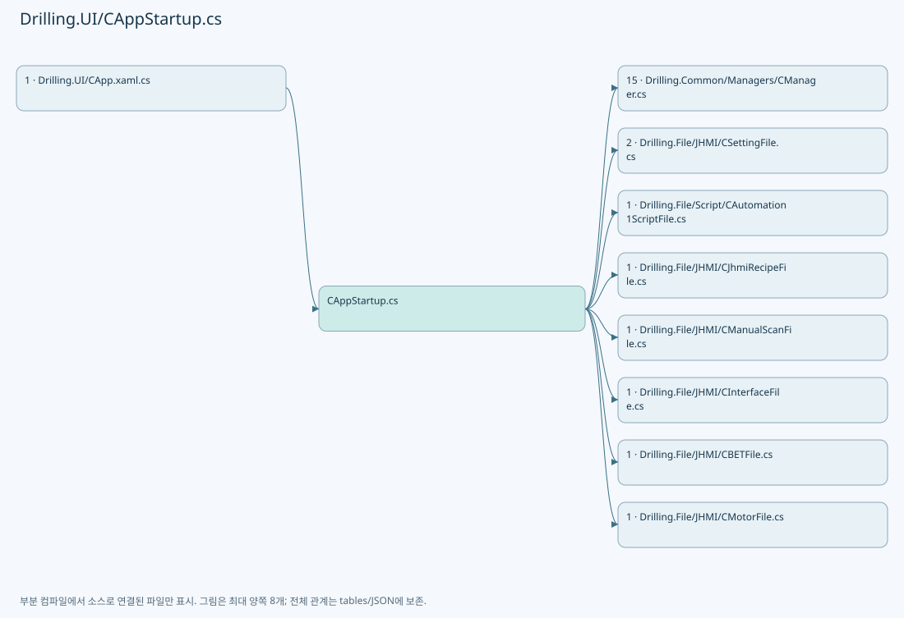
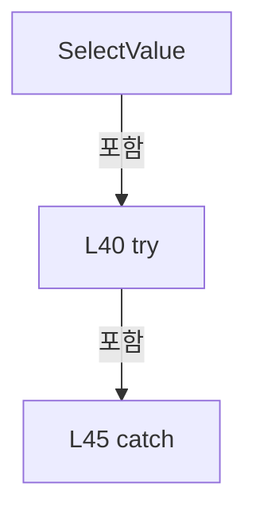
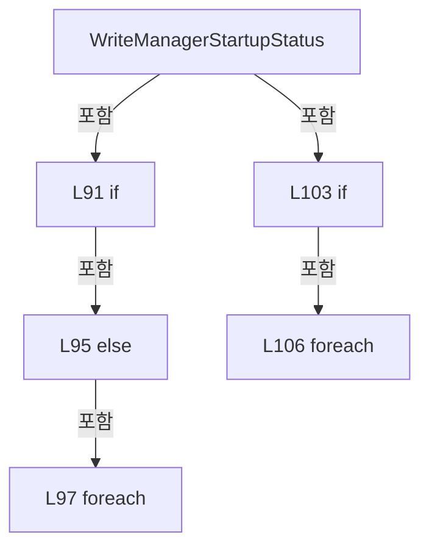
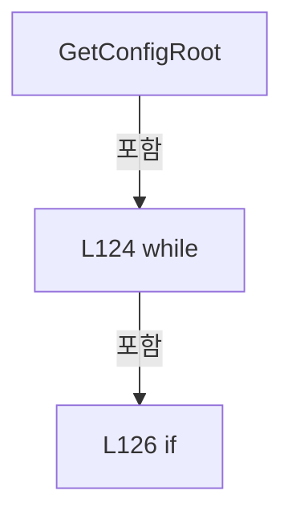
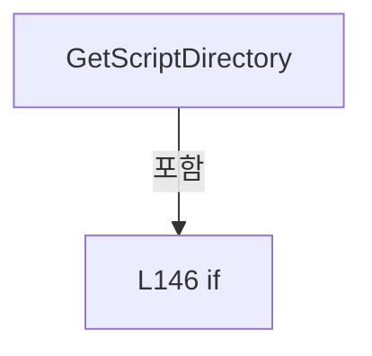

# Drilling.UI/CAppStartup.cs

| 항목 | 내용 |
| --- | --- |
| 원본 저장소 | https://github.com/kjuws10-rgb/A3Drilling.git |
| 원본 Commit | 5aee8e58439c9b455cae7c9593c9be986c3e682e |
| 원본 SHA256 | 98e8716b093e6970d73233f8488d538acf7fa02f5d140ab1baebd9e8abdcd9b9 |
| 파일 분류 | code |
| 원본 크기/행 | 5,813 bytes / 153 physical lines |
| 인코딩 | utf-8-sig |
| 검토 범위 | 구문/부분 의미 분석에서 추출한 사실. 동작·물리 단위·실장비 합격을 보증하지 않습니다. |
| 원본 링크 | [고정 Commit 원본](https://github.com/kjuws10-rgb/A3Drilling/blob/5aee8e58439c9b455cae7c9593c9be986c3e682e/Drilling.UI/CAppStartup.cs) |

## 파일의 역할과 읽는 순서

WPF 화면·사용자 명령·표시 상태를 구성합니다. XAML 이벤트와 코드 비하인드, RootView의 조립 경로를 함께 추적합니다.

## 네임스페이스·타입·상속

| 타입 | 구분 | 원본 범위 | 선언/상속 |
| --- | --- | --- | --- |
| CAppStartup | ClassDeclaration | 12–153 | CAppStartup |

## 멤버 빠른 목록

| 이름 | 종류 | 범위 | 서명 |
| --- | --- | --- | --- |
| CreateMainViewModel | MethodDeclaration | L14–69 | Drilling.UI.CRootView Drilling.UI.CAppStartup.CreateMainViewModel() |
| SelectValue | LocalFunctionStatement | L38–50 | System.Threading.Tasks.Task SelectValue() |
| WriteManagerStartupStatus | MethodDeclaration | L71–119 | int Drilling.UI.CAppStartup.WriteManagerStartupStatus(Drilling.Common.Managers.CManager, string, int) |
| ShouldIncludeItem | LocalFunctionStatement | L74–77 | bool ShouldIncludeItem(Drilling.Common.Managers.ST_MANAGER_STARTUP_STEP) |
| SelectOrder | LocalFunctionStatement | L79–82 | int SelectOrder(Drilling.Common.Managers.ST_MANAGER_STARTUP_STEP) |
| SelectOrder2 | LocalFunctionStatement | L113–116 | int SelectOrder2(Drilling.Common.Managers.ST_MANAGER_STARTUP_STEP) |
| GetConfigRoot | MethodDeclaration | L121–135 | string Drilling.UI.CAppStartup.GetConfigRoot() |
| GetScriptDirectory | MethodDeclaration | L137–152 | string Drilling.UI.CAppStartup.GetScriptDirectory(string, Drilling.File.JHMI.CSettingFile) |
| MatchesItem | LocalFunctionStatement | L140–143 | bool MatchesItem(Drilling.Common.Managers.ST_SYSTEM_PARAMETER) |

## 멤버별 상세 계약·호출·처리 해설

### MethodDeclaration `CreateMainViewModel` · L14–69

[Drilling.UI/CAppStartup.cs:14–69](https://github.com/kjuws10-rgb/A3Drilling/blob/5aee8e58439c9b455cae7c9593c9be986c3e682e/Drilling.UI/CAppStartup.cs#L14-L69)

| 항목 | 실제 추출 값 |
| --- | --- |
| 서명 | Drilling.UI.CRootView Drilling.UI.CAppStartup.CreateMainViewModel() |
| 접근/수식자 | Public / public, static |
| 반환/값 타입 | Drilling.UI.CRootView |
| 소속 타입 | NamedType:Drilling.UI.CAppStartup |

정적 호출자로 확인된 위치:

| 호출 파일/행 | 호출 표현식 | 런타임 분기 가능 |
| --- | --- | --- |
| [Drilling.UI/CApp.xaml.cs:31–31](https://github.com/kjuws10-rgb/A3Drilling/blob/5aee8e58439c9b455cae7c9593c9be986c3e682e/Drilling.UI/CApp.xaml.cs#L31-L31) | CAppStartup.CreateMainViewModel | False |

호출하는 대상과 해석 범위:

| 원본 행 | 표현식 | 분석 상태 | 대상/소스 위치 |
| --- | --- | --- | --- |
| 16 | GetConfigRoot | resolved | string Drilling.UI.CAppStartup.GetConfigRoot() · Drilling.UI/CAppStartup.cs:121 |
| 17 | new CSettingFile | resolved | Drilling.File.JHMI.CSettingFile.CSettingFile(string) · Drilling.File/JHMI/CSettingFile.cs:13 |
| 18 | new CAutomation1ScriptFile | resolved | Drilling.File.Script.CAutomation1ScriptFile.CAutomation1ScriptFile(string?) · Drilling.File/Script/CAutomation1ScriptFile.cs:27 |
| 18 | GetScriptDirectory | resolved | string Drilling.UI.CAppStartup.GetScriptDirectory(string, Drilling.File.JHMI.CSettingFile) · Drilling.UI/CAppStartup.cs:137 |
| 19 | new CManager | resolved | Drilling.Common.Managers.CManager.CManager(string, Drilling.Common.Managers.CRecipeFileBase, Drilling.Common.Managers.CSettingFileBase, Drilling.Common.Managers.CManualScanFileBase, Drilling.Common.Managers.CInterfaceFileBase, Drilling.Common.Interface.CBETFileBase, Drilling.Common.Motion.CMotorFileBase, Drilling.Common.Interface.CMelsecMapFileBase, Drilling.Common.Product.CProductFileBase, Drilling.Common.Review.CReviewResultFileBase, Drilling.Common.Review.CReviewOffsetFileBase, CLogManager, Drilling.Common.Station.CAutomationScriptFileBase, bool?, Drilling.Common.Managers.CConfigStructureFileBase?, Drilling.Common.Alarm.CAlarmListFileBase?) · Drilling.Common/Managers/CManager.cs:52 |
| 21 | new CJhmiRecipeFile | resolved | Drilling.File.JHMI.CJhmiRecipeFile.CJhmiRecipeFile(string) · Drilling.File/JHMI/CJhmiRecipeFile.cs:16 |
| 23 | new CManualScanFile | resolved | Drilling.File.JHMI.CManualScanFile.CManualScanFile(string) · Drilling.File/JHMI/CManualScanFile.cs:11 |
| 24 | new CInterfaceFile | resolved | Drilling.File.JHMI.CInterfaceFile.CInterfaceFile(string) · Drilling.File/JHMI/CInterfaceFile.cs:12 |
| 25 | new CBETFile | resolved | Drilling.File.JHMI.CBETFile.CBETFile(string) · Drilling.File/JHMI/CBETFile.cs:11 |
| 26 | new CMotorFile | resolved | Drilling.File.JHMI.CMotorFile.CMotorFile(string) · Drilling.File/JHMI/CMotorFile.cs:11 |
| 27 | new CMelsecMapFile | resolved | Drilling.File.JHMI.CMelsecMapFile.CMelsecMapFile(string) · Drilling.File/JHMI/CMelsecMapFile.cs:7 |
| 28 | new CProductFile | resolved | Drilling.File.Product.CProductFile.CProductFile(string) · Drilling.File/Product/CProductFile.cs:6 |
| 29 | new CReviewResultFile | resolved | Drilling.File.ReviewResult.CReviewResultFile.CReviewResultFile(string) · Drilling.File/ReviewResult/CReviewResultFile.cs:9 |
| 30 | new CReviewOffsetFile | resolved | Drilling.File.ReviewOffset.CReviewOffsetFile.CReviewOffsetFile(string, System.Func<System.DateTimeOffset>?) · Drilling.File/ReviewOffset/CReviewOffsetFile.cs:55 |
| 31 | new CLogManager | unresolved | None |
| 33 | new CConfigStructureFile | resolved | Drilling.File.JHMI.CConfigStructureFile.CConfigStructureFile(string) · Drilling.File/JHMI/CConfigStructureFile.cs:5 |
| 34 | new CAlarmListFile | resolved | Drilling.File.JHMI.CAlarmListFile.CAlarmListFile(string) · Drilling.File/JHMI/CAlarmListFile.cs:6 |
| 36 | CUiLogService.Configure | resolved | void Drilling.UI.CUiLogService.Configure(CLogManager) · Drilling.UI/CUiLogService.cs:17 |
| 36 | manager.Log | resolved | CLogManager Drilling.Common.Managers.CManager.Log() · Drilling.Common/Managers/CManager.cs:380 |
| 37 | WriteManagerStartupStatus | resolved | int Drilling.UI.CAppStartup.WriteManagerStartupStatus(Drilling.Common.Managers.CManager, string, int) · Drilling.UI/CAppStartup.cs:71 |
| 52 | Task.Run | resolved | System.Threading.Tasks.Task System.Threading.Tasks.Task.Run(System.Func<System.Threading.Tasks.Task?>) |
| 53 | new CRootView | resolved | Drilling.UI.CRootView.CRootView(Drilling.Common.Managers.CManager, Drilling.Common.Station.CStationManager, Drilling.Common.Interface.CInterfaceManager, Drilling.Common.Motion.CMotionManager, Drilling.Common.Alarm.CAlarmManager, Drilling.Common.InterLock.CInterLockManager, Drilling.Common.Managers.CManualScanFileBase, Drilling.Common.Managers.CRecipeManager, Drilling.Common.Managers.CSettingManager, Drilling.Common.Product.CProductManager, Drilling.Common.Review.CReviewManager, Drilling.Common.Station.CAutomationScriptFileBase) · Drilling.UI/CRootView.cs:128 |
| 55 | manager.Station | resolved | Drilling.Common.Station.CStationManager Drilling.Common.Managers.CManager.Station() · Drilling.Common/Managers/CManager.cs:322 |
| 56 | manager.Interface | resolved | Drilling.Common.Interface.CInterfaceManager Drilling.Common.Managers.CManager.Interface() · Drilling.Common/Managers/CManager.cs:347 |
| 57 | manager.Motion | resolved | Drilling.Common.Motion.CMotionManager Drilling.Common.Managers.CManager.Motion() · Drilling.Common/Managers/CManager.cs:365 |
| 58 | manager.Alarm | resolved | Drilling.Common.Alarm.CAlarmManager Drilling.Common.Managers.CManager.Alarm() · Drilling.Common/Managers/CManager.cs:370 |
| 59 | manager.InterLock | resolved | Drilling.Common.InterLock.CInterLockManager Drilling.Common.Managers.CManager.InterLock() · Drilling.Common/Managers/CManager.cs:375 |
| 60 | manager.ManualScanFile | resolved | Drilling.Common.Managers.CManualScanFileBase Drilling.Common.Managers.CManager.ManualScanFile() · Drilling.Common/Managers/CManager.cs:395 |
| 61 | manager.Recipe | resolved | Drilling.Common.Managers.CRecipeManager Drilling.Common.Managers.CManager.Recipe() · Drilling.Common/Managers/CManager.cs:327 |
| 62 | manager.Setting | resolved | Drilling.Common.Managers.CSettingManager Drilling.Common.Managers.CManager.Setting() · Drilling.Common/Managers/CManager.cs:332 |
| 63 | manager.Product | resolved | Drilling.Common.Product.CProductManager Drilling.Common.Managers.CManager.Product() · Drilling.Common/Managers/CManager.cs:337 |
| 64 | manager.Review | resolved | Drilling.Common.Review.CReviewManager Drilling.Common.Managers.CManager.Review() · Drilling.Common/Managers/CManager.cs:342 |
| 67 | manager.StartBackgroundMonitoring | resolved | void Drilling.Common.Managers.CManager.StartBackgroundMonitoring() · Drilling.Common/Managers/CManager.cs:259 |

본문의 실제 연산·분기·예외·반환 순서(원문 위치 순):

| 원본 행 | 종류 | 주석 해설 |
| --- | --- | --- |
| 16 | call | 함수·델리게이트 또는 객체 생성자를 호출합니다: GetConfigRoot() |
| 16 | local-declaration | 지역 변수를 선언합니다: var configRoot = GetConfigRoot(); |
| 16 | variable-initializer | 변수의 초기값을 지정합니다: configRoot = GetConfigRoot() |
| 17 | call | 함수·델리게이트 또는 객체 생성자를 호출합니다: new CSettingFile(configRoot) |
| 17 | local-declaration | 지역 변수를 선언합니다: var settingFile = new CSettingFile(configRoot); |
| 17 | variable-initializer | 변수의 초기값을 지정합니다: settingFile = new CSettingFile(configRoot) |
| 18 | call | 함수·델리게이트 또는 객체 생성자를 호출합니다: new CAutomation1ScriptFile(GetScriptDirectory(configRoot, settingFile)) |
| 18 | call | 함수·델리게이트 또는 객체 생성자를 호출합니다: GetScriptDirectory(configRoot, settingFile) |
| 18 | local-declaration | 지역 변수를 선언합니다: var automationScriptFile = new CAutomation1ScriptFile(GetScriptDirectory(configRoot, settingFile)); |
| 18 | variable-initializer | 변수의 초기값을 지정합니다: automationScriptFile = new CAutomation1ScriptFile(GetScriptDirectory(configRoot, settingFile)) |
| 19 | call | 함수·델리게이트 또는 객체 생성자를 호출합니다: new CManager( configRoot, new CJhmiRecipeFile(configRoot), settingFile, new CManualScanFile(configRoot), new CInterfaceFile(configRoot), new CBETFile(configRoot), new CMotorFile(configRoot), new CMelsecMapFile(configRoot… |
| 19 | local-declaration | 지역 변수를 선언합니다: var manager = new CManager( configRoot, new CJhmiRecipeFile(configRoot), settingFile, new CManualScanFile(configRoot), new CInterfaceFile(configRoot), new CBETFile(configRoot), new CMotorFile(configRoot), new CMelsecMapFile(config |
| 19 | variable-initializer | 변수의 초기값을 지정합니다: manager = new CManager( configRoot, new CJhmiRecipeFile(configRoot), settingFile, new CManualScanFile(configRoot), new CInterfaceFile(configRoot), new CBETFile(configRoot), new CMotorFile(configRoot), new CMelsecMapFile(configRoot |
| 21 | call | 함수·델리게이트 또는 객체 생성자를 호출합니다: new CJhmiRecipeFile(configRoot) |
| 23 | call | 함수·델리게이트 또는 객체 생성자를 호출합니다: new CManualScanFile(configRoot) |
| 24 | call | 함수·델리게이트 또는 객체 생성자를 호출합니다: new CInterfaceFile(configRoot) |
| 25 | call | 함수·델리게이트 또는 객체 생성자를 호출합니다: new CBETFile(configRoot) |
| 26 | call | 함수·델리게이트 또는 객체 생성자를 호출합니다: new CMotorFile(configRoot) |
| 27 | call | 함수·델리게이트 또는 객체 생성자를 호출합니다: new CMelsecMapFile(configRoot) |
| 28 | call | 함수·델리게이트 또는 객체 생성자를 호출합니다: new CProductFile(configRoot) |
| 29 | call | 함수·델리게이트 또는 객체 생성자를 호출합니다: new CReviewResultFile(configRoot) |
| 30 | call | 함수·델리게이트 또는 객체 생성자를 호출합니다: new CReviewOffsetFile(configRoot) |
| 31 | call | 함수·델리게이트 또는 객체 생성자를 호출합니다: new CLogManager(configRoot) |
| 33 | call | 함수·델리게이트 또는 객체 생성자를 호출합니다: new CConfigStructureFile(configRoot) |
| 34 | call | 함수·델리게이트 또는 객체 생성자를 호출합니다: new CAlarmListFile(configRoot) |
| 36 | call | 함수·델리게이트 또는 객체 생성자를 호출합니다: CUiLogService.Configure(manager.Log()) |
| 36 | call | 함수·델리게이트 또는 객체 생성자를 호출합니다: manager.Log() |
| 37 | call | 함수·델리게이트 또는 객체 생성자를 호출합니다: WriteManagerStartupStatus(manager, "MANAGER_STARTUP_SEQUENCE", 0) |
| 37 | local-declaration | 지역 변수를 선언합니다: var lastLoggedStartupOrder = WriteManagerStartupStatus(manager, "MANAGER_STARTUP_SEQUENCE", 0); |
| 37 | variable-initializer | 변수의 초기값을 지정합니다: lastLoggedStartupOrder = WriteManagerStartupStatus(manager, "MANAGER_STARTUP_SEQUENCE", 0) |
| 52 | assignment | 값을 대상에 대입합니다: _ = Task.Run(SelectValue) |
| 52 | call | 함수·델리게이트 또는 객체 생성자를 호출합니다: Task.Run(SelectValue) |
| 53 | call | 함수·델리게이트 또는 객체 생성자를 호출합니다: new CRootView( manager, manager.Station(), manager.Interface(), manager.Motion(), manager.Alarm(), manager.InterLock(), manager.ManualScanFile(), manager.Recipe(), manager.Setting(), manager.Product(), manager.Review(), … |
| 53 | local-declaration | 지역 변수를 선언합니다: var rootView = new CRootView( manager, manager.Station(), manager.Interface(), manager.Motion(), manager.Alarm(), manager.InterLock(), manager.ManualScanFile(), manager.Recipe(), manager.Setting(), manager.Product(), manager.Revie |
| 53 | variable-initializer | 변수의 초기값을 지정합니다: rootView = new CRootView( manager, manager.Station(), manager.Interface(), manager.Motion(), manager.Alarm(), manager.InterLock(), manager.ManualScanFile(), manager.Recipe(), manager.Setting(), manager.Product(), manager.Review(), |
| 55 | call | 함수·델리게이트 또는 객체 생성자를 호출합니다: manager.Station() |
| 56 | call | 함수·델리게이트 또는 객체 생성자를 호출합니다: manager.Interface() |
| 57 | call | 함수·델리게이트 또는 객체 생성자를 호출합니다: manager.Motion() |
| 58 | call | 함수·델리게이트 또는 객체 생성자를 호출합니다: manager.Alarm() |
| 59 | call | 함수·델리게이트 또는 객체 생성자를 호출합니다: manager.InterLock() |
| 60 | call | 함수·델리게이트 또는 객체 생성자를 호출합니다: manager.ManualScanFile() |
| 61 | call | 함수·델리게이트 또는 객체 생성자를 호출합니다: manager.Recipe() |
| 62 | call | 함수·델리게이트 또는 객체 생성자를 호출합니다: manager.Setting() |
| 63 | call | 함수·델리게이트 또는 객체 생성자를 호출합니다: manager.Product() |
| 64 | call | 함수·델리게이트 또는 객체 생성자를 호출합니다: manager.Review() |
| 67 | call | 함수·델리게이트 또는 객체 생성자를 호출합니다: manager.StartBackgroundMonitoring() |
| 68 | return | 호출자에게 값 또는 제어를 반환합니다: return rootView; |

변경 전 점검: 입력/반환 타입, 위 호출자, 예외/취소 경로, 공유 상태와 저장·전송 소비자를 함께 확인합니다. 값의 단위나 물리 방향을 이름만으로 확정하지 않습니다.

### LocalFunctionStatement `SelectValue` · L38–50

[Drilling.UI/CAppStartup.cs:38–50](https://github.com/kjuws10-rgb/A3Drilling/blob/5aee8e58439c9b455cae7c9593c9be986c3e682e/Drilling.UI/CAppStartup.cs#L38-L50)

| 항목 | 실제 추출 값 |
| --- | --- |
| 서명 | System.Threading.Tasks.Task SelectValue() |
| 접근/수식자 | Private / async |
| 반환/값 타입 | System.Threading.Tasks.Task |
| 소속 타입 | NamedType:Drilling.UI.CAppStartup |

현재 부분 분석에서 직접 연결된 호출자는 없습니다. XAML/이벤트/인터페이스·델리게이트·외부 진입을 추가 확인해야 하며, 미사용으로 판정한 것이 아닙니다.

호출하는 대상과 해석 범위:

| 원본 행 | 표현식 | 분석 상태 | 대상/소스 위치 |
| --- | --- | --- | --- |
| 42 | manager.Initialize | resolved | System.Threading.Tasks.Task Drilling.Common.Managers.CManager.Initialize(System.Threading.CancellationToken) · Drilling.Common/Managers/CManager.cs:204 |
| 43 | WriteManagerStartupStatus | resolved | int Drilling.UI.CAppStartup.WriteManagerStartupStatus(Drilling.Common.Managers.CManager, string, int) · Drilling.UI/CAppStartup.cs:71 |
| 47 | CProgramOpenLog.Write | unresolved | None |
| 48 | WriteManagerStartupStatus | resolved | int Drilling.UI.CAppStartup.WriteManagerStartupStatus(Drilling.Common.Managers.CManager, string, int) · Drilling.UI/CAppStartup.cs:71 |

본문의 실제 연산·분기·예외·반환 순서(원문 위치 순):

| 원본 행 | 종류 | 주석 해설 |
| --- | --- | --- |
| 40 | try | 예외 처리 범위입니다: try |
| 42 | await | 비동기 완료를 기다립니다: await manager.Initialize() |
| 42 | call | 함수·델리게이트 또는 객체 생성자를 호출합니다: manager.Initialize() |
| 43 | call | 함수·델리게이트 또는 객체 생성자를 호출합니다: WriteManagerStartupStatus(manager, "MANAGER_INITIALIZE_SEQUENCE", lastLoggedStartupOrder) |
| 45 | catch | 지정 예외를 처리합니다: catch (Exception exception) |
| 47 | call | 함수·델리게이트 또는 객체 생성자를 호출합니다: CProgramOpenLog.Write("MANAGER_INITIALIZE_FAILED", exception) |
| 48 | call | 함수·델리게이트 또는 객체 생성자를 호출합니다: WriteManagerStartupStatus(manager, "MANAGER_INITIALIZE_SEQUENCE", lastLoggedStartupOrder) |

제어 구문의 포함 구조(실제 실행 순서/CFG가 아닌 구문 탐색 그림):

변경 전 점검: 입력/반환 타입, 위 호출자, 예외/취소 경로, 공유 상태와 저장·전송 소비자를 함께 확인합니다. 값의 단위나 물리 방향을 이름만으로 확정하지 않습니다.

### MethodDeclaration `WriteManagerStartupStatus` · L71–119

[Drilling.UI/CAppStartup.cs:71–119](https://github.com/kjuws10-rgb/A3Drilling/blob/5aee8e58439c9b455cae7c9593c9be986c3e682e/Drilling.UI/CAppStartup.cs#L71-L119)

| 항목 | 실제 추출 값 |
| --- | --- |
| 서명 | int Drilling.UI.CAppStartup.WriteManagerStartupStatus(Drilling.Common.Managers.CManager, string, int) |
| 접근/수식자 | Private / private, static |
| 반환/값 타입 | int |
| 소속 타입 | NamedType:Drilling.UI.CAppStartup |

입력 계약:

| 이름 | 타입 | 전달 | 선택/기본값 |
| --- | --- | --- | --- |
| manager | Drilling.Common.Managers.CManager | None | False /  |
| title | string | None | False /  |
| afterOrder | int | None | False /  |

정적 호출자로 확인된 위치:

| 호출 파일/행 | 호출 표현식 | 런타임 분기 가능 |
| --- | --- | --- |
| [Drilling.UI/CAppStartup.cs:37–37](https://github.com/kjuws10-rgb/A3Drilling/blob/5aee8e58439c9b455cae7c9593c9be986c3e682e/Drilling.UI/CAppStartup.cs#L37-L37) | WriteManagerStartupStatus | False |
| [Drilling.UI/CAppStartup.cs:43–43](https://github.com/kjuws10-rgb/A3Drilling/blob/5aee8e58439c9b455cae7c9593c9be986c3e682e/Drilling.UI/CAppStartup.cs#L43-L43) | WriteManagerStartupStatus | False |
| [Drilling.UI/CAppStartup.cs:48–48](https://github.com/kjuws10-rgb/A3Drilling/blob/5aee8e58439c9b455cae7c9593c9be986c3e682e/Drilling.UI/CAppStartup.cs#L48-L48) | WriteManagerStartupStatus | False |

호출하는 대상과 해석 범위:

| 원본 행 | 표현식 | 분석 상태 | 대상/소스 위치 |
| --- | --- | --- | --- |
| 73 | manager.ConfigStatus | resolved | Drilling.Common.Managers.ST_CONFIG_LOAD_STATUS Drilling.Common.Managers.CManager.ConfigStatus() · Drilling.Common/Managers/CManager.cs:175 |
| 84 | status.StartupSteps.Where(ShouldIncludeItem).OrderBy(SelectOrder).ToArray | resolved | Drilling.Common.Managers.ST_MANAGER_STARTUP_STEP[] System.Collections.Generic.IEnumerable<Drilling.Common.Managers.ST_MANAGER_STARTUP_STEP>.ToArray<Drilling.Common.Managers.ST_MANAGER_STARTUP_STEP>() |
| 84 | status.StartupSteps.Where(ShouldIncludeItem).OrderBy | resolved | System.Linq.IOrderedEnumerable<Drilling.Common.Managers.ST_MANAGER_STARTUP_STEP> System.Collections.Generic.IEnumerable<Drilling.Common.Managers.ST_MANAGER_STARTUP_STEP>.OrderBy<Drilling.Common.Managers.ST_MANAGER_STARTUP_STEP, int>(System.Func<Drilling.Common.Managers.ST_MANAGER_STARTUP_STEP, int>) |
| 84 | status.StartupSteps.Where | resolved | System.Collections.Generic.IEnumerable<Drilling.Common.Managers.ST_MANAGER_STARTUP_STEP> System.Collections.Generic.IEnumerable<Drilling.Common.Managers.ST_MANAGER_STARTUP_STEP>.Where<Drilling.Common.Managers.ST_MANAGER_STARTUP_STEP>(System.Func<Drilling.Common.Managers.ST_MANAGER_STARTUP_STEP, bool>) |
| 85 | new StringBuilder | resolved | System.Text.StringBuilder.StringBuilder() |
| 86 | builder.AppendLine | resolved | System.Text.StringBuilder System.Text.StringBuilder.AppendLine(ref System.Text.StringBuilder.AppendInterpolatedStringHandler) |
| 87 | builder.AppendLine | resolved | System.Text.StringBuilder System.Text.StringBuilder.AppendLine(ref System.Text.StringBuilder.AppendInterpolatedStringHandler) |
| 88 | builder.AppendLine | resolved | System.Text.StringBuilder System.Text.StringBuilder.AppendLine(ref System.Text.StringBuilder.AppendInterpolatedStringHandler) |
| 89 | builder.AppendLine | resolved | System.Text.StringBuilder System.Text.StringBuilder.AppendLine(ref System.Text.StringBuilder.AppendInterpolatedStringHandler) |
| 90 | builder.AppendLine | resolved | System.Text.StringBuilder System.Text.StringBuilder.AppendLine(ref System.Text.StringBuilder.AppendInterpolatedStringHandler) |
| 93 | builder.AppendLine | resolved | System.Text.StringBuilder System.Text.StringBuilder.AppendLine(string?) |
| 99 | builder.AppendLine | resolved | System.Text.StringBuilder System.Text.StringBuilder.AppendLine(ref System.Text.StringBuilder.AppendInterpolatedStringHandler) |
| 105 | builder.AppendLine | resolved | System.Text.StringBuilder System.Text.StringBuilder.AppendLine(string?) |
| 108 | builder.AppendLine | resolved | System.Text.StringBuilder System.Text.StringBuilder.AppendLine(ref System.Text.StringBuilder.AppendInterpolatedStringHandler) |
| 112 | CProgramOpenLog.Write | unresolved | None |
| 112 | builder.ToString().TrimEnd | resolved | string string.TrimEnd() |
| 112 | builder.ToString | resolved · 동적 구현 선택 가능 | string System.Text.StringBuilder.ToString() |
| 118 | status.StartupSteps.Max | resolved | int System.Collections.Generic.IEnumerable<Drilling.Common.Managers.ST_MANAGER_STARTUP_STEP>.Max<Drilling.Common.Managers.ST_MANAGER_STARTUP_STEP>(System.Func<Drilling.Common.Managers.ST_MANAGER_STARTUP_STEP, int>) |

본문의 실제 연산·분기·예외·반환 순서(원문 위치 순):

| 원본 행 | 종류 | 주석 해설 |
| --- | --- | --- |
| 73 | call | 함수·델리게이트 또는 객체 생성자를 호출합니다: manager.ConfigStatus() |
| 73 | local-declaration | 지역 변수를 선언합니다: var status = manager.ConfigStatus(); |
| 73 | variable-initializer | 변수의 초기값을 지정합니다: status = manager.ConfigStatus() |
| 84 | call | 함수·델리게이트 또는 객체 생성자를 호출합니다: status.StartupSteps.Where(ShouldIncludeItem).OrderBy(SelectOrder).ToArray() |
| 84 | call | 함수·델리게이트 또는 객체 생성자를 호출합니다: status.StartupSteps.Where(ShouldIncludeItem).OrderBy(SelectOrder) |
| 84 | call | 함수·델리게이트 또는 객체 생성자를 호출합니다: status.StartupSteps.Where(ShouldIncludeItem) |
| 84 | local-declaration | 지역 변수를 선언합니다: var steps = status.StartupSteps.Where(ShouldIncludeItem).OrderBy(SelectOrder).ToArray(); |
| 84 | variable-initializer | 변수의 초기값을 지정합니다: steps = status.StartupSteps.Where(ShouldIncludeItem).OrderBy(SelectOrder).ToArray() |
| 85 | call | 함수·델리게이트 또는 객체 생성자를 호출합니다: new StringBuilder() |
| 85 | local-declaration | 지역 변수를 선언합니다: var builder = new StringBuilder(); |
| 85 | variable-initializer | 변수의 초기값을 지정합니다: builder = new StringBuilder() |
| 86 | call | 함수·델리게이트 또는 객체 생성자를 호출합니다: builder.AppendLine($"ConfigRoot={status.ConfigRoot}") |
| 87 | call | 함수·델리게이트 또는 객체 생성자를 호출합니다: builder.AppendLine($"InterfaceCount={status.InterfaceCount}") |
| 88 | call | 함수·델리게이트 또는 객체 생성자를 호출합니다: builder.AppendLine($"MotorCount={status.MotorCount}") |
| 89 | call | 함수·델리게이트 또는 객체 생성자를 호출합니다: builder.AppendLine($"MelsecMapCount={status.MelsecMapCount}") |
| 90 | call | 함수·델리게이트 또는 객체 생성자를 호출합니다: builder.AppendLine($"ActiveProductLoaded={status.ActiveProductLoaded}") |
| 91 | if | 조건에 따라 분기합니다: if (steps.Length == 0) |
| 93 | call | 함수·델리게이트 또는 객체 생성자를 호출합니다: builder.AppendLine("No additional manager startup step.") |
| 95 | else | 앞 조건이 거짓인 경로입니다: else |
| 97 | foreach | 컬렉션 요소를 순회합니다: foreach (var step in steps) |
| 99 | call | 함수·델리게이트 또는 객체 생성자를 호출합니다: builder.AppendLine($"{step.Order:00} &#124; {step.Result} &#124; {step.StepName} &#124; {step.Message}") |
| 103 | if | 조건에 따라 분기합니다: if (status.StartupMessages.Count > 0) |
| 105 | call | 함수·델리게이트 또는 객체 생성자를 호출합니다: builder.AppendLine("StartupMessages:") |
| 106 | foreach | 컬렉션 요소를 순회합니다: foreach (var message in status.StartupMessages) |
| 108 | call | 함수·델리게이트 또는 객체 생성자를 호출합니다: builder.AppendLine($"- {message}") |
| 112 | call | 함수·델리게이트 또는 객체 생성자를 호출합니다: CProgramOpenLog.Write(title, builder.ToString().TrimEnd()) |
| 112 | call | 함수·델리게이트 또는 객체 생성자를 호출합니다: builder.ToString().TrimEnd() |
| 112 | call | 함수·델리게이트 또는 객체 생성자를 호출합니다: builder.ToString() |
| 118 | call | 함수·델리게이트 또는 객체 생성자를 호출합니다: status.StartupSteps.Max(SelectOrder2) |
| 118 | conditional-expression | 조건에 따라 결과식을 선택합니다: status.StartupSteps.Count == 0 ? afterOrder : status.StartupSteps.Max(SelectOrder2) |
| 118 | return | 호출자에게 값 또는 제어를 반환합니다: return status.StartupSteps.Count == 0 ? afterOrder : status.StartupSteps.Max(SelectOrder2); |

제어 구문의 포함 구조(실제 실행 순서/CFG가 아닌 구문 탐색 그림):

변경 전 점검: 입력/반환 타입, 위 호출자, 예외/취소 경로, 공유 상태와 저장·전송 소비자를 함께 확인합니다. 값의 단위나 물리 방향을 이름만으로 확정하지 않습니다.

### LocalFunctionStatement `ShouldIncludeItem` · L74–77

[Drilling.UI/CAppStartup.cs:74–77](https://github.com/kjuws10-rgb/A3Drilling/blob/5aee8e58439c9b455cae7c9593c9be986c3e682e/Drilling.UI/CAppStartup.cs#L74-L77)

| 항목 | 실제 추출 값 |
| --- | --- |
| 서명 | bool ShouldIncludeItem(Drilling.Common.Managers.ST_MANAGER_STARTUP_STEP) |
| 접근/수식자 | Private /  |
| 반환/값 타입 | bool |
| 소속 타입 | NamedType:Drilling.UI.CAppStartup |

입력 계약:

| 이름 | 타입 | 전달 | 선택/기본값 |
| --- | --- | --- | --- |
| step | Drilling.Common.Managers.ST_MANAGER_STARTUP_STEP | None | False /  |

현재 부분 분석에서 직접 연결된 호출자는 없습니다. XAML/이벤트/인터페이스·델리게이트·외부 진입을 추가 확인해야 하며, 미사용으로 판정한 것이 아닙니다.

본문의 실제 연산·분기·예외·반환 순서(원문 위치 순):

| 원본 행 | 종류 | 주석 해설 |
| --- | --- | --- |
| 76 | return | 호출자에게 값 또는 제어를 반환합니다: return step.Order > afterOrder; |

변경 전 점검: 입력/반환 타입, 위 호출자, 예외/취소 경로, 공유 상태와 저장·전송 소비자를 함께 확인합니다. 값의 단위나 물리 방향을 이름만으로 확정하지 않습니다.

### LocalFunctionStatement `SelectOrder` · L79–82

[Drilling.UI/CAppStartup.cs:79–82](https://github.com/kjuws10-rgb/A3Drilling/blob/5aee8e58439c9b455cae7c9593c9be986c3e682e/Drilling.UI/CAppStartup.cs#L79-L82)

| 항목 | 실제 추출 값 |
| --- | --- |
| 서명 | int SelectOrder(Drilling.Common.Managers.ST_MANAGER_STARTUP_STEP) |
| 접근/수식자 | Private /  |
| 반환/값 타입 | int |
| 소속 타입 | NamedType:Drilling.UI.CAppStartup |

입력 계약:

| 이름 | 타입 | 전달 | 선택/기본값 |
| --- | --- | --- | --- |
| step | Drilling.Common.Managers.ST_MANAGER_STARTUP_STEP | None | False /  |

현재 부분 분석에서 직접 연결된 호출자는 없습니다. XAML/이벤트/인터페이스·델리게이트·외부 진입을 추가 확인해야 하며, 미사용으로 판정한 것이 아닙니다.

본문의 실제 연산·분기·예외·반환 순서(원문 위치 순):

| 원본 행 | 종류 | 주석 해설 |
| --- | --- | --- |
| 81 | return | 호출자에게 값 또는 제어를 반환합니다: return step.Order; |

변경 전 점검: 입력/반환 타입, 위 호출자, 예외/취소 경로, 공유 상태와 저장·전송 소비자를 함께 확인합니다. 값의 단위나 물리 방향을 이름만으로 확정하지 않습니다.

### LocalFunctionStatement `SelectOrder2` · L113–116

[Drilling.UI/CAppStartup.cs:113–116](https://github.com/kjuws10-rgb/A3Drilling/blob/5aee8e58439c9b455cae7c9593c9be986c3e682e/Drilling.UI/CAppStartup.cs#L113-L116)

| 항목 | 실제 추출 값 |
| --- | --- |
| 서명 | int SelectOrder2(Drilling.Common.Managers.ST_MANAGER_STARTUP_STEP) |
| 접근/수식자 | Private /  |
| 반환/값 타입 | int |
| 소속 타입 | NamedType:Drilling.UI.CAppStartup |

입력 계약:

| 이름 | 타입 | 전달 | 선택/기본값 |
| --- | --- | --- | --- |
| step | Drilling.Common.Managers.ST_MANAGER_STARTUP_STEP | None | False /  |

현재 부분 분석에서 직접 연결된 호출자는 없습니다. XAML/이벤트/인터페이스·델리게이트·외부 진입을 추가 확인해야 하며, 미사용으로 판정한 것이 아닙니다.

본문의 실제 연산·분기·예외·반환 순서(원문 위치 순):

| 원본 행 | 종류 | 주석 해설 |
| --- | --- | --- |
| 115 | return | 호출자에게 값 또는 제어를 반환합니다: return step.Order; |

변경 전 점검: 입력/반환 타입, 위 호출자, 예외/취소 경로, 공유 상태와 저장·전송 소비자를 함께 확인합니다. 값의 단위나 물리 방향을 이름만으로 확정하지 않습니다.

### MethodDeclaration `GetConfigRoot` · L121–135

[Drilling.UI/CAppStartup.cs:121–135](https://github.com/kjuws10-rgb/A3Drilling/blob/5aee8e58439c9b455cae7c9593c9be986c3e682e/Drilling.UI/CAppStartup.cs#L121-L135)

| 항목 | 실제 추출 값 |
| --- | --- |
| 서명 | string Drilling.UI.CAppStartup.GetConfigRoot() |
| 접근/수식자 | Private / private, static |
| 반환/값 타입 | string |
| 소속 타입 | NamedType:Drilling.UI.CAppStartup |

정적 호출자로 확인된 위치:

| 호출 파일/행 | 호출 표현식 | 런타임 분기 가능 |
| --- | --- | --- |
| [Drilling.UI/CAppStartup.cs:16–16](https://github.com/kjuws10-rgb/A3Drilling/blob/5aee8e58439c9b455cae7c9593c9be986c3e682e/Drilling.UI/CAppStartup.cs#L16-L16) | GetConfigRoot | False |

호출하는 대상과 해석 범위:

| 원본 행 | 표현식 | 분석 상태 | 대상/소스 위치 |
| --- | --- | --- | --- |
| 123 | new DirectoryInfo | resolved | System.IO.DirectoryInfo.DirectoryInfo(string) |
| 126 | System.IO.File.Exists | resolved | bool System.IO.File.Exists(string?) |
| 126 | Path.Combine | resolved | string System.IO.Path.Combine(string, string) |
| 128 | Path.Combine | resolved | string System.IO.Path.Combine(string, string) |
| 134 | Path.Combine | resolved | string System.IO.Path.Combine(string, string) |

본문의 실제 연산·분기·예외·반환 순서(원문 위치 순):

| 원본 행 | 종류 | 주석 해설 |
| --- | --- | --- |
| 123 | call | 함수·델리게이트 또는 객체 생성자를 호출합니다: new DirectoryInfo(AppContext.BaseDirectory) |
| 123 | local-declaration | 지역 변수를 선언합니다: var directory = new DirectoryInfo(AppContext.BaseDirectory); |
| 123 | variable-initializer | 변수의 초기값을 지정합니다: directory = new DirectoryInfo(AppContext.BaseDirectory) |
| 124 | while | 조건을 먼저 확인하며 반복합니다: while (directory is not null) |
| 126 | call | 함수·델리게이트 또는 객체 생성자를 호출합니다: System.IO.File.Exists(Path.Combine(directory.FullName, "Drilling.sln")) |
| 126 | call | 함수·델리게이트 또는 객체 생성자를 호출합니다: Path.Combine(directory.FullName, "Drilling.sln") |
| 126 | if | 조건에 따라 분기합니다: if (System.IO.File.Exists(Path.Combine(directory.FullName, "Drilling.sln"))) |
| 128 | call | 함수·델리게이트 또는 객체 생성자를 호출합니다: Path.Combine(directory.FullName, "Config") |
| 128 | return | 호출자에게 값 또는 제어를 반환합니다: return Path.Combine(directory.FullName, "Config"); |
| 131 | assignment | 값을 대상에 대입합니다: directory = directory.Parent |
| 134 | call | 함수·델리게이트 또는 객체 생성자를 호출합니다: Path.Combine(Environment.CurrentDirectory, "Config") |
| 134 | return | 호출자에게 값 또는 제어를 반환합니다: return Path.Combine(Environment.CurrentDirectory, "Config"); |

제어 구문의 포함 구조(실제 실행 순서/CFG가 아닌 구문 탐색 그림):

변경 전 점검: 입력/반환 타입, 위 호출자, 예외/취소 경로, 공유 상태와 저장·전송 소비자를 함께 확인합니다. 값의 단위나 물리 방향을 이름만으로 확정하지 않습니다.

### MethodDeclaration `GetScriptDirectory` · L137–152

[Drilling.UI/CAppStartup.cs:137–152](https://github.com/kjuws10-rgb/A3Drilling/blob/5aee8e58439c9b455cae7c9593c9be986c3e682e/Drilling.UI/CAppStartup.cs#L137-L152)

| 항목 | 실제 추출 값 |
| --- | --- |
| 서명 | string Drilling.UI.CAppStartup.GetScriptDirectory(string, Drilling.File.JHMI.CSettingFile) |
| 접근/수식자 | Private / private, static |
| 반환/값 타입 | string |
| 소속 타입 | NamedType:Drilling.UI.CAppStartup |

입력 계약:

| 이름 | 타입 | 전달 | 선택/기본값 |
| --- | --- | --- | --- |
| configRoot | string | None | False /  |
| settingFile | Drilling.File.JHMI.CSettingFile | None | False /  |

정적 호출자로 확인된 위치:

| 호출 파일/행 | 호출 표현식 | 런타임 분기 가능 |
| --- | --- | --- |
| [Drilling.UI/CAppStartup.cs:18–18](https://github.com/kjuws10-rgb/A3Drilling/blob/5aee8e58439c9b455cae7c9593c9be986c3e682e/Drilling.UI/CAppStartup.cs#L18-L18) | GetScriptDirectory | False |

호출하는 대상과 해석 범위:

| 원본 행 | 표현식 | 분석 상태 | 대상/소스 위치 |
| --- | --- | --- | --- |
| 139 | Directory.GetParent | resolved | System.IO.DirectoryInfo? System.IO.Directory.GetParent(string) |
| 145 | settingFile.Load(EN_SETTING_TAB.Option).FirstOrDefault | resolved | Drilling.Common.Managers.ST_SYSTEM_PARAMETER? System.Collections.Generic.IEnumerable<Drilling.Common.Managers.ST_SYSTEM_PARAMETER>.FirstOrDefault<Drilling.Common.Managers.ST_SYSTEM_PARAMETER>(System.Func<Drilling.Common.Managers.ST_SYSTEM_PARAMETER, bool>) |
| 145 | settingFile.Load | resolved · 동적 구현 선택 가능 | System.Collections.Generic.IReadOnlyList<Drilling.Common.Managers.ST_SYSTEM_PARAMETER> Drilling.File.JHMI.CSettingFile.Load(Drilling.Common.Managers.EN_SETTING_TAB, System.Threading.CancellationToken) · Drilling.File/JHMI/CSettingFile.cs:19 |
| 146 | string.IsNullOrWhiteSpace | resolved | bool string.IsNullOrWhiteSpace(string?) |
| 148 | Path.Combine | resolved | string System.IO.Path.Combine(string, string) |
| 151 | Path.IsPathRooted | resolved | bool System.IO.Path.IsPathRooted(string?) |
| 151 | Path.GetFullPath | resolved | string System.IO.Path.GetFullPath(string) |
| 151 | Path.GetFullPath | resolved | string System.IO.Path.GetFullPath(string) |
| 151 | Path.Combine | resolved | string System.IO.Path.Combine(string, string) |

본문의 실제 연산·분기·예외·반환 순서(원문 위치 순):

| 원본 행 | 종류 | 주석 해설 |
| --- | --- | --- |
| 139 | call | 함수·델리게이트 또는 객체 생성자를 호출합니다: Directory.GetParent(configRoot) |
| 139 | local-declaration | 지역 변수를 선언합니다: var projectRoot = Directory.GetParent(configRoot)?.FullName ?? configRoot; |
| 139 | variable-initializer | 변수의 초기값을 지정합니다: projectRoot = Directory.GetParent(configRoot)?.FullName ?? configRoot |
| 145 | call | 함수·델리게이트 또는 객체 생성자를 호출합니다: settingFile.Load(EN_SETTING_TAB.Option).FirstOrDefault(MatchesItem) |
| 145 | call | 함수·델리게이트 또는 객체 생성자를 호출합니다: settingFile.Load(EN_SETTING_TAB.Option) |
| 145 | local-declaration | 지역 변수를 선언합니다: var scriptPath = settingFile.Load(EN_SETTING_TAB.Option).FirstOrDefault(MatchesItem)?.Value; |
| 145 | variable-initializer | 변수의 초기값을 지정합니다: scriptPath = settingFile.Load(EN_SETTING_TAB.Option).FirstOrDefault(MatchesItem)?.Value |
| 146 | call | 함수·델리게이트 또는 객체 생성자를 호출합니다: string.IsNullOrWhiteSpace(scriptPath) |
| 146 | if | 조건에 따라 분기합니다: if (string.IsNullOrWhiteSpace(scriptPath)) |
| 148 | assignment | 값을 대상에 대입합니다: scriptPath = Path.Combine("Data", "Script") |
| 148 | call | 함수·델리게이트 또는 객체 생성자를 호출합니다: Path.Combine("Data", "Script") |
| 151 | call | 함수·델리게이트 또는 객체 생성자를 호출합니다: Path.IsPathRooted(scriptPath) |
| 151 | call | 함수·델리게이트 또는 객체 생성자를 호출합니다: Path.GetFullPath(scriptPath) |
| 151 | call | 함수·델리게이트 또는 객체 생성자를 호출합니다: Path.GetFullPath(Path.Combine(projectRoot, scriptPath)) |
| 151 | call | 함수·델리게이트 또는 객체 생성자를 호출합니다: Path.Combine(projectRoot, scriptPath) |
| 151 | conditional-expression | 조건에 따라 결과식을 선택합니다: Path.IsPathRooted(scriptPath) ? Path.GetFullPath(scriptPath) : Path.GetFullPath(Path.Combine(projectRoot, scriptPath)) |
| 151 | return | 호출자에게 값 또는 제어를 반환합니다: return Path.IsPathRooted(scriptPath) ? Path.GetFullPath(scriptPath) : Path.GetFullPath(Path.Combine(projectRoot, scriptPath)); |

제어 구문의 포함 구조(실제 실행 순서/CFG가 아닌 구문 탐색 그림):

변경 전 점검: 입력/반환 타입, 위 호출자, 예외/취소 경로, 공유 상태와 저장·전송 소비자를 함께 확인합니다. 값의 단위나 물리 방향을 이름만으로 확정하지 않습니다.

### LocalFunctionStatement `MatchesItem` · L140–143

[Drilling.UI/CAppStartup.cs:140–143](https://github.com/kjuws10-rgb/A3Drilling/blob/5aee8e58439c9b455cae7c9593c9be986c3e682e/Drilling.UI/CAppStartup.cs#L140-L143)

| 항목 | 실제 추출 값 |
| --- | --- |
| 서명 | bool MatchesItem(Drilling.Common.Managers.ST_SYSTEM_PARAMETER) |
| 접근/수식자 | Private /  |
| 반환/값 타입 | bool |
| 소속 타입 | NamedType:Drilling.UI.CAppStartup |

입력 계약:

| 이름 | 타입 | 전달 | 선택/기본값 |
| --- | --- | --- | --- |
| parameter | Drilling.Common.Managers.ST_SYSTEM_PARAMETER | None | False /  |

현재 부분 분석에서 직접 연결된 호출자는 없습니다. XAML/이벤트/인터페이스·델리게이트·외부 진입을 추가 확인해야 하며, 미사용으로 판정한 것이 아닙니다.

호출하는 대상과 해석 범위:

| 원본 행 | 표현식 | 분석 상태 | 대상/소스 위치 |
| --- | --- | --- | --- |
| 142 | parameter.Key.Equals | resolved | bool string.Equals(string?, System.StringComparison) |
| 142 | parameter.Name.Equals | resolved | bool string.Equals(string?, System.StringComparison) |

본문의 실제 연산·분기·예외·반환 순서(원문 위치 순):

| 원본 행 | 종류 | 주석 해설 |
| --- | --- | --- |
| 142 | call | 함수·델리게이트 또는 객체 생성자를 호출합니다: parameter.Key.Equals("LocalScriptPath", StringComparison.OrdinalIgnoreCase) |
| 142 | call | 함수·델리게이트 또는 객체 생성자를 호출합니다: parameter.Name.Equals("LocalScriptPath", StringComparison.OrdinalIgnoreCase) |
| 142 | return | 호출자에게 값 또는 제어를 반환합니다: return parameter.Key.Equals("LocalScriptPath", StringComparison.OrdinalIgnoreCase) &#124;&#124; parameter.Name.Equals("LocalScriptPath", StringComparison.OrdinalIgnoreCase); |

변경 전 점검: 입력/반환 타입, 위 호출자, 예외/취소 경로, 공유 상태와 저장·전송 소비자를 함께 확인합니다. 값의 단위나 물리 방향을 이름만으로 확정하지 않습니다.

## 구문·바인딩 한계

전체 WPF/벤더 SDK/프로젝트별 빌드 조건을 로드한 정식 빌드가 아닙니다. `resolved`는 이 부분 컴파일에서의 심볼 연결이며 virtual/interface/delegate/이벤트/Reflection/XAML의 실제 런타임 구현을 확정하지 않습니다. `candidate`와 `unresolved`는 후속 확인 대상으로 남깁니다.

## 원문 전체 주석 해설본

[원본 모든 행과 행별 해설 보기](../../annotated/Drilling.UI/CAppStartup.cs.annotated.txt)

원본을 빠뜨리거나 임의로 줄이지 않았습니다. `L000001 |` 표시는 원본 행 번호, `// 해설`은 별도 설명입니다. 실행용 소스가 아닌 문서입니다.

## 수정·재검증 체크

- 원본 Commit과 현재 작업 파일 SHA가 같은지 먼저 확인합니다. 다르면 이 문서를 과거 버전 자료로 취급합니다.
- 선언·직접 호출·이벤트/인터페이스 경계·설정 소비를 함께 확인합니다. 정적 연결의 빈 곳을 정상 경로로 추정하지 않습니다.
- 저장 형식/단위/식별자·재시도·취소·예외·롤백에 영향을 주는 변경은 상세 해설장과 호출자를 다시 검토합니다.
- 도구의 구문 추출과 별도 정적 추적 해설, 실제 빌드·시뮬레이션·실장비 검증 결과를 분리합니다.
