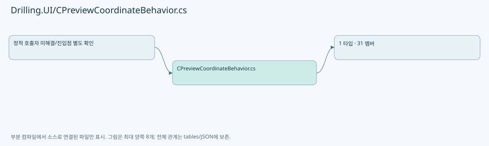
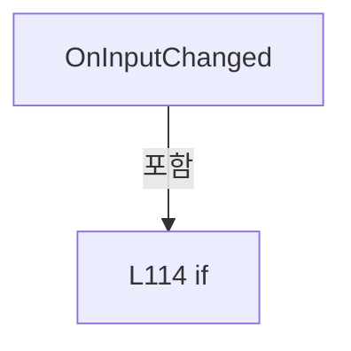
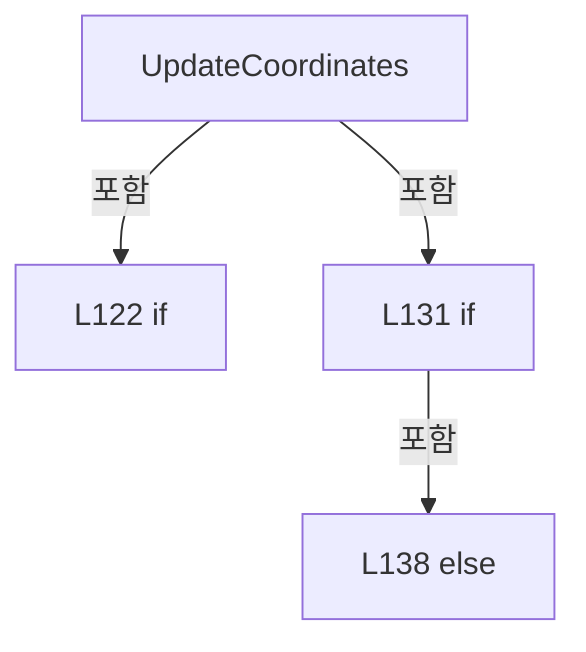
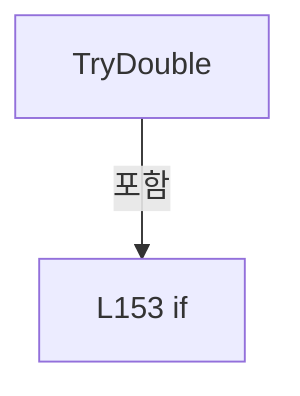

# Drilling.UI/CPreviewCoordinateBehavior.cs

| 항목 | 내용 |
| --- | --- |
| 원본 저장소 | https://github.com/kjuws10-rgb/A3Drilling.git |
| 원본 Commit | 5aee8e58439c9b455cae7c9593c9be986c3e682e |
| 원본 SHA256 | 766dbce15e8dd64b80d342370294b0a2c29c27a5aa3e538ba51b6814d8b85b13 |
| 파일 분류 | code |
| 원본 크기/행 | 6,336 bytes / 161 physical lines |
| 인코딩 | utf-8-sig |
| 검토 범위 | 구문/부분 의미 분석에서 추출한 사실. 동작·물리 단위·실장비 합격을 보증하지 않습니다. |
| 원본 링크 | [고정 Commit 원본](https://github.com/kjuws10-rgb/A3Drilling/blob/5aee8e58439c9b455cae7c9593c9be986c3e682e/Drilling.UI/CPreviewCoordinateBehavior.cs) |

## 파일의 역할과 읽는 순서

WPF 화면·사용자 명령·표시 상태를 구성합니다. XAML 이벤트와 코드 비하인드, RootView의 조립 경로를 함께 추적합니다.

## 네임스페이스·타입·상속

| 타입 | 구분 | 원본 범위 | 선언/상속 |
| --- | --- | --- | --- |
| CPreviewCoordinateBehavior | ClassDeclaration | 6–161 | CPreviewCoordinateBehavior |

## 멤버 빠른 목록

| 이름 | 종류 | 범위 | 서명 |
| --- | --- | --- | --- |
| PositionXProperty | FieldDeclaration | L8–8 | DependencyProperty Drilling.UI.CPreviewCoordinateBehavior.PositionXProperty |
| PositionYProperty | FieldDeclaration | L9–9 | DependencyProperty Drilling.UI.CPreviewCoordinateBehavior.PositionYProperty |
| ContainerWidthProperty | FieldDeclaration | L10–10 | DependencyProperty Drilling.UI.CPreviewCoordinateBehavior.ContainerWidthProperty |
| ContainerHeightProperty | FieldDeclaration | L11–11 | DependencyProperty Drilling.UI.CPreviewCoordinateBehavior.ContainerHeightProperty |
| DesignWidthProperty | FieldDeclaration | L12–12 | DependencyProperty Drilling.UI.CPreviewCoordinateBehavior.DesignWidthProperty |
| DesignHeightProperty | FieldDeclaration | L13–13 | DependencyProperty Drilling.UI.CPreviewCoordinateBehavior.DesignHeightProperty |
| ElementWidthProperty | FieldDeclaration | L14–14 | DependencyProperty Drilling.UI.CPreviewCoordinateBehavior.ElementWidthProperty |
| ElementHeightProperty | FieldDeclaration | L15–15 | DependencyProperty Drilling.UI.CPreviewCoordinateBehavior.ElementHeightProperty |
| UseStretchScaleProperty | FieldDeclaration | L16–16 | DependencyProperty Drilling.UI.CPreviewCoordinateBehavior.UseStretchScaleProperty |
| GetPositionX | MethodDeclaration | L17–20 | object? Drilling.UI.CPreviewCoordinateBehavior.GetPositionX(DependencyObject) |
| SetPositionX | MethodDeclaration | L22–25 | void Drilling.UI.CPreviewCoordinateBehavior.SetPositionX(DependencyObject, object?) |
| GetPositionY | MethodDeclaration | L27–30 | object? Drilling.UI.CPreviewCoordinateBehavior.GetPositionY(DependencyObject) |
| SetPositionY | MethodDeclaration | L32–35 | void Drilling.UI.CPreviewCoordinateBehavior.SetPositionY(DependencyObject, object?) |
| GetContainerWidth | MethodDeclaration | L37–40 | object? Drilling.UI.CPreviewCoordinateBehavior.GetContainerWidth(DependencyObject) |
| SetContainerWidth | MethodDeclaration | L42–45 | void Drilling.UI.CPreviewCoordinateBehavior.SetContainerWidth(DependencyObject, object?) |
| GetContainerHeight | MethodDeclaration | L47–50 | object? Drilling.UI.CPreviewCoordinateBehavior.GetContainerHeight(DependencyObject) |
| SetContainerHeight | MethodDeclaration | L52–55 | void Drilling.UI.CPreviewCoordinateBehavior.SetContainerHeight(DependencyObject, object?) |
| GetDesignWidth | MethodDeclaration | L57–60 | object? Drilling.UI.CPreviewCoordinateBehavior.GetDesignWidth(DependencyObject) |
| SetDesignWidth | MethodDeclaration | L62–65 | void Drilling.UI.CPreviewCoordinateBehavior.SetDesignWidth(DependencyObject, object?) |
| GetDesignHeight | MethodDeclaration | L67–70 | object? Drilling.UI.CPreviewCoordinateBehavior.GetDesignHeight(DependencyObject) |
| SetDesignHeight | MethodDeclaration | L72–75 | void Drilling.UI.CPreviewCoordinateBehavior.SetDesignHeight(DependencyObject, object?) |
| GetElementWidth | MethodDeclaration | L77–80 | object? Drilling.UI.CPreviewCoordinateBehavior.GetElementWidth(DependencyObject) |
| SetElementWidth | MethodDeclaration | L82–85 | void Drilling.UI.CPreviewCoordinateBehavior.SetElementWidth(DependencyObject, object?) |
| GetElementHeight | MethodDeclaration | L87–90 | object? Drilling.UI.CPreviewCoordinateBehavior.GetElementHeight(DependencyObject) |
| SetElementHeight | MethodDeclaration | L92–95 | void Drilling.UI.CPreviewCoordinateBehavior.SetElementHeight(DependencyObject, object?) |
| GetUseStretchScale | MethodDeclaration | L97–100 | bool Drilling.UI.CPreviewCoordinateBehavior.GetUseStretchScale(DependencyObject) |
| SetUseStretchScale | MethodDeclaration | L102–105 | void Drilling.UI.CPreviewCoordinateBehavior.SetUseStretchScale(DependencyObject, bool) |
| CreateInputProperty | MethodDeclaration | L107–110 | DependencyProperty Drilling.UI.CPreviewCoordinateBehavior.CreateInputProperty(string) |
| OnInputChanged | MethodDeclaration | L112–118 | void Drilling.UI.CPreviewCoordinateBehavior.OnInputChanged(DependencyObject, DependencyPropertyChangedEventArgs) |
| UpdateCoordinates | MethodDeclaration | L120–149 | void Drilling.UI.CPreviewCoordinateBehavior.UpdateCoordinates(ContentPresenter) |
| TryDouble | MethodDeclaration | L151–160 | bool Drilling.UI.CPreviewCoordinateBehavior.TryDouble(object?, out double) |

## 멤버별 상세 계약·호출·처리 해설

### FieldDeclaration `PositionXProperty` · L8–8

[Drilling.UI/CPreviewCoordinateBehavior.cs:8–8](https://github.com/kjuws10-rgb/A3Drilling/blob/5aee8e58439c9b455cae7c9593c9be986c3e682e/Drilling.UI/CPreviewCoordinateBehavior.cs#L8-L8)

| 항목 | 실제 추출 값 |
| --- | --- |
| 서명 | DependencyProperty Drilling.UI.CPreviewCoordinateBehavior.PositionXProperty |
| 접근/수식자 | Public / public, static, readonly |
| 반환/값 타입 | DependencyProperty |
| 소속 타입 | NamedType:Drilling.UI.CPreviewCoordinateBehavior |

현재 부분 분석에서 직접 연결된 호출자는 없습니다. XAML/이벤트/인터페이스·델리게이트·외부 진입을 추가 확인해야 하며, 미사용으로 판정한 것이 아닙니다.

호출하는 대상과 해석 범위:

| 원본 행 | 표현식 | 분석 상태 | 대상/소스 위치 |
| --- | --- | --- | --- |
| 8 | CreateInputProperty | resolved | DependencyProperty Drilling.UI.CPreviewCoordinateBehavior.CreateInputProperty(string) · Drilling.UI/CPreviewCoordinateBehavior.cs:107 |

본문의 실제 연산·분기·예외·반환 순서(원문 위치 순):

| 원본 행 | 종류 | 주석 해설 |
| --- | --- | --- |
| 8 | call | 함수·델리게이트 또는 객체 생성자를 호출합니다: CreateInputProperty("PositionX") |
| 8 | variable-initializer | 변수의 초기값을 지정합니다: PositionXProperty = CreateInputProperty("PositionX") |

변경 전 점검: 입력/반환 타입, 위 호출자, 예외/취소 경로, 공유 상태와 저장·전송 소비자를 함께 확인합니다. 값의 단위나 물리 방향을 이름만으로 확정하지 않습니다.

### FieldDeclaration `PositionYProperty` · L9–9

[Drilling.UI/CPreviewCoordinateBehavior.cs:9–9](https://github.com/kjuws10-rgb/A3Drilling/blob/5aee8e58439c9b455cae7c9593c9be986c3e682e/Drilling.UI/CPreviewCoordinateBehavior.cs#L9-L9)

| 항목 | 실제 추출 값 |
| --- | --- |
| 서명 | DependencyProperty Drilling.UI.CPreviewCoordinateBehavior.PositionYProperty |
| 접근/수식자 | Public / public, static, readonly |
| 반환/값 타입 | DependencyProperty |
| 소속 타입 | NamedType:Drilling.UI.CPreviewCoordinateBehavior |

현재 부분 분석에서 직접 연결된 호출자는 없습니다. XAML/이벤트/인터페이스·델리게이트·외부 진입을 추가 확인해야 하며, 미사용으로 판정한 것이 아닙니다.

호출하는 대상과 해석 범위:

| 원본 행 | 표현식 | 분석 상태 | 대상/소스 위치 |
| --- | --- | --- | --- |
| 9 | CreateInputProperty | resolved | DependencyProperty Drilling.UI.CPreviewCoordinateBehavior.CreateInputProperty(string) · Drilling.UI/CPreviewCoordinateBehavior.cs:107 |

본문의 실제 연산·분기·예외·반환 순서(원문 위치 순):

| 원본 행 | 종류 | 주석 해설 |
| --- | --- | --- |
| 9 | call | 함수·델리게이트 또는 객체 생성자를 호출합니다: CreateInputProperty("PositionY") |
| 9 | variable-initializer | 변수의 초기값을 지정합니다: PositionYProperty = CreateInputProperty("PositionY") |

변경 전 점검: 입력/반환 타입, 위 호출자, 예외/취소 경로, 공유 상태와 저장·전송 소비자를 함께 확인합니다. 값의 단위나 물리 방향을 이름만으로 확정하지 않습니다.

### FieldDeclaration `ContainerWidthProperty` · L10–10

[Drilling.UI/CPreviewCoordinateBehavior.cs:10–10](https://github.com/kjuws10-rgb/A3Drilling/blob/5aee8e58439c9b455cae7c9593c9be986c3e682e/Drilling.UI/CPreviewCoordinateBehavior.cs#L10-L10)

| 항목 | 실제 추출 값 |
| --- | --- |
| 서명 | DependencyProperty Drilling.UI.CPreviewCoordinateBehavior.ContainerWidthProperty |
| 접근/수식자 | Public / public, static, readonly |
| 반환/값 타입 | DependencyProperty |
| 소속 타입 | NamedType:Drilling.UI.CPreviewCoordinateBehavior |

현재 부분 분석에서 직접 연결된 호출자는 없습니다. XAML/이벤트/인터페이스·델리게이트·외부 진입을 추가 확인해야 하며, 미사용으로 판정한 것이 아닙니다.

호출하는 대상과 해석 범위:

| 원본 행 | 표현식 | 분석 상태 | 대상/소스 위치 |
| --- | --- | --- | --- |
| 10 | CreateInputProperty | resolved | DependencyProperty Drilling.UI.CPreviewCoordinateBehavior.CreateInputProperty(string) · Drilling.UI/CPreviewCoordinateBehavior.cs:107 |

본문의 실제 연산·분기·예외·반환 순서(원문 위치 순):

| 원본 행 | 종류 | 주석 해설 |
| --- | --- | --- |
| 10 | call | 함수·델리게이트 또는 객체 생성자를 호출합니다: CreateInputProperty("ContainerWidth") |
| 10 | variable-initializer | 변수의 초기값을 지정합니다: ContainerWidthProperty = CreateInputProperty("ContainerWidth") |

변경 전 점검: 입력/반환 타입, 위 호출자, 예외/취소 경로, 공유 상태와 저장·전송 소비자를 함께 확인합니다. 값의 단위나 물리 방향을 이름만으로 확정하지 않습니다.

### FieldDeclaration `ContainerHeightProperty` · L11–11

[Drilling.UI/CPreviewCoordinateBehavior.cs:11–11](https://github.com/kjuws10-rgb/A3Drilling/blob/5aee8e58439c9b455cae7c9593c9be986c3e682e/Drilling.UI/CPreviewCoordinateBehavior.cs#L11-L11)

| 항목 | 실제 추출 값 |
| --- | --- |
| 서명 | DependencyProperty Drilling.UI.CPreviewCoordinateBehavior.ContainerHeightProperty |
| 접근/수식자 | Public / public, static, readonly |
| 반환/값 타입 | DependencyProperty |
| 소속 타입 | NamedType:Drilling.UI.CPreviewCoordinateBehavior |

현재 부분 분석에서 직접 연결된 호출자는 없습니다. XAML/이벤트/인터페이스·델리게이트·외부 진입을 추가 확인해야 하며, 미사용으로 판정한 것이 아닙니다.

호출하는 대상과 해석 범위:

| 원본 행 | 표현식 | 분석 상태 | 대상/소스 위치 |
| --- | --- | --- | --- |
| 11 | CreateInputProperty | resolved | DependencyProperty Drilling.UI.CPreviewCoordinateBehavior.CreateInputProperty(string) · Drilling.UI/CPreviewCoordinateBehavior.cs:107 |

본문의 실제 연산·분기·예외·반환 순서(원문 위치 순):

| 원본 행 | 종류 | 주석 해설 |
| --- | --- | --- |
| 11 | call | 함수·델리게이트 또는 객체 생성자를 호출합니다: CreateInputProperty("ContainerHeight") |
| 11 | variable-initializer | 변수의 초기값을 지정합니다: ContainerHeightProperty = CreateInputProperty("ContainerHeight") |

변경 전 점검: 입력/반환 타입, 위 호출자, 예외/취소 경로, 공유 상태와 저장·전송 소비자를 함께 확인합니다. 값의 단위나 물리 방향을 이름만으로 확정하지 않습니다.

### FieldDeclaration `DesignWidthProperty` · L12–12

[Drilling.UI/CPreviewCoordinateBehavior.cs:12–12](https://github.com/kjuws10-rgb/A3Drilling/blob/5aee8e58439c9b455cae7c9593c9be986c3e682e/Drilling.UI/CPreviewCoordinateBehavior.cs#L12-L12)

| 항목 | 실제 추출 값 |
| --- | --- |
| 서명 | DependencyProperty Drilling.UI.CPreviewCoordinateBehavior.DesignWidthProperty |
| 접근/수식자 | Public / public, static, readonly |
| 반환/값 타입 | DependencyProperty |
| 소속 타입 | NamedType:Drilling.UI.CPreviewCoordinateBehavior |

현재 부분 분석에서 직접 연결된 호출자는 없습니다. XAML/이벤트/인터페이스·델리게이트·외부 진입을 추가 확인해야 하며, 미사용으로 판정한 것이 아닙니다.

호출하는 대상과 해석 범위:

| 원본 행 | 표현식 | 분석 상태 | 대상/소스 위치 |
| --- | --- | --- | --- |
| 12 | CreateInputProperty | resolved | DependencyProperty Drilling.UI.CPreviewCoordinateBehavior.CreateInputProperty(string) · Drilling.UI/CPreviewCoordinateBehavior.cs:107 |

본문의 실제 연산·분기·예외·반환 순서(원문 위치 순):

| 원본 행 | 종류 | 주석 해설 |
| --- | --- | --- |
| 12 | call | 함수·델리게이트 또는 객체 생성자를 호출합니다: CreateInputProperty("DesignWidth") |
| 12 | variable-initializer | 변수의 초기값을 지정합니다: DesignWidthProperty = CreateInputProperty("DesignWidth") |

변경 전 점검: 입력/반환 타입, 위 호출자, 예외/취소 경로, 공유 상태와 저장·전송 소비자를 함께 확인합니다. 값의 단위나 물리 방향을 이름만으로 확정하지 않습니다.

### FieldDeclaration `DesignHeightProperty` · L13–13

[Drilling.UI/CPreviewCoordinateBehavior.cs:13–13](https://github.com/kjuws10-rgb/A3Drilling/blob/5aee8e58439c9b455cae7c9593c9be986c3e682e/Drilling.UI/CPreviewCoordinateBehavior.cs#L13-L13)

| 항목 | 실제 추출 값 |
| --- | --- |
| 서명 | DependencyProperty Drilling.UI.CPreviewCoordinateBehavior.DesignHeightProperty |
| 접근/수식자 | Public / public, static, readonly |
| 반환/값 타입 | DependencyProperty |
| 소속 타입 | NamedType:Drilling.UI.CPreviewCoordinateBehavior |

현재 부분 분석에서 직접 연결된 호출자는 없습니다. XAML/이벤트/인터페이스·델리게이트·외부 진입을 추가 확인해야 하며, 미사용으로 판정한 것이 아닙니다.

호출하는 대상과 해석 범위:

| 원본 행 | 표현식 | 분석 상태 | 대상/소스 위치 |
| --- | --- | --- | --- |
| 13 | CreateInputProperty | resolved | DependencyProperty Drilling.UI.CPreviewCoordinateBehavior.CreateInputProperty(string) · Drilling.UI/CPreviewCoordinateBehavior.cs:107 |

본문의 실제 연산·분기·예외·반환 순서(원문 위치 순):

| 원본 행 | 종류 | 주석 해설 |
| --- | --- | --- |
| 13 | call | 함수·델리게이트 또는 객체 생성자를 호출합니다: CreateInputProperty("DesignHeight") |
| 13 | variable-initializer | 변수의 초기값을 지정합니다: DesignHeightProperty = CreateInputProperty("DesignHeight") |

변경 전 점검: 입력/반환 타입, 위 호출자, 예외/취소 경로, 공유 상태와 저장·전송 소비자를 함께 확인합니다. 값의 단위나 물리 방향을 이름만으로 확정하지 않습니다.

### FieldDeclaration `ElementWidthProperty` · L14–14

[Drilling.UI/CPreviewCoordinateBehavior.cs:14–14](https://github.com/kjuws10-rgb/A3Drilling/blob/5aee8e58439c9b455cae7c9593c9be986c3e682e/Drilling.UI/CPreviewCoordinateBehavior.cs#L14-L14)

| 항목 | 실제 추출 값 |
| --- | --- |
| 서명 | DependencyProperty Drilling.UI.CPreviewCoordinateBehavior.ElementWidthProperty |
| 접근/수식자 | Public / public, static, readonly |
| 반환/값 타입 | DependencyProperty |
| 소속 타입 | NamedType:Drilling.UI.CPreviewCoordinateBehavior |

현재 부분 분석에서 직접 연결된 호출자는 없습니다. XAML/이벤트/인터페이스·델리게이트·외부 진입을 추가 확인해야 하며, 미사용으로 판정한 것이 아닙니다.

호출하는 대상과 해석 범위:

| 원본 행 | 표현식 | 분석 상태 | 대상/소스 위치 |
| --- | --- | --- | --- |
| 14 | CreateInputProperty | resolved | DependencyProperty Drilling.UI.CPreviewCoordinateBehavior.CreateInputProperty(string) · Drilling.UI/CPreviewCoordinateBehavior.cs:107 |

본문의 실제 연산·분기·예외·반환 순서(원문 위치 순):

| 원본 행 | 종류 | 주석 해설 |
| --- | --- | --- |
| 14 | call | 함수·델리게이트 또는 객체 생성자를 호출합니다: CreateInputProperty("ElementWidth") |
| 14 | variable-initializer | 변수의 초기값을 지정합니다: ElementWidthProperty = CreateInputProperty("ElementWidth") |

변경 전 점검: 입력/반환 타입, 위 호출자, 예외/취소 경로, 공유 상태와 저장·전송 소비자를 함께 확인합니다. 값의 단위나 물리 방향을 이름만으로 확정하지 않습니다.

### FieldDeclaration `ElementHeightProperty` · L15–15

[Drilling.UI/CPreviewCoordinateBehavior.cs:15–15](https://github.com/kjuws10-rgb/A3Drilling/blob/5aee8e58439c9b455cae7c9593c9be986c3e682e/Drilling.UI/CPreviewCoordinateBehavior.cs#L15-L15)

| 항목 | 실제 추출 값 |
| --- | --- |
| 서명 | DependencyProperty Drilling.UI.CPreviewCoordinateBehavior.ElementHeightProperty |
| 접근/수식자 | Public / public, static, readonly |
| 반환/값 타입 | DependencyProperty |
| 소속 타입 | NamedType:Drilling.UI.CPreviewCoordinateBehavior |

현재 부분 분석에서 직접 연결된 호출자는 없습니다. XAML/이벤트/인터페이스·델리게이트·외부 진입을 추가 확인해야 하며, 미사용으로 판정한 것이 아닙니다.

호출하는 대상과 해석 범위:

| 원본 행 | 표현식 | 분석 상태 | 대상/소스 위치 |
| --- | --- | --- | --- |
| 15 | CreateInputProperty | resolved | DependencyProperty Drilling.UI.CPreviewCoordinateBehavior.CreateInputProperty(string) · Drilling.UI/CPreviewCoordinateBehavior.cs:107 |

본문의 실제 연산·분기·예외·반환 순서(원문 위치 순):

| 원본 행 | 종류 | 주석 해설 |
| --- | --- | --- |
| 15 | call | 함수·델리게이트 또는 객체 생성자를 호출합니다: CreateInputProperty("ElementHeight") |
| 15 | variable-initializer | 변수의 초기값을 지정합니다: ElementHeightProperty = CreateInputProperty("ElementHeight") |

변경 전 점검: 입력/반환 타입, 위 호출자, 예외/취소 경로, 공유 상태와 저장·전송 소비자를 함께 확인합니다. 값의 단위나 물리 방향을 이름만으로 확정하지 않습니다.

### FieldDeclaration `UseStretchScaleProperty` · L16–16

[Drilling.UI/CPreviewCoordinateBehavior.cs:16–16](https://github.com/kjuws10-rgb/A3Drilling/blob/5aee8e58439c9b455cae7c9593c9be986c3e682e/Drilling.UI/CPreviewCoordinateBehavior.cs#L16-L16)

| 항목 | 실제 추출 값 |
| --- | --- |
| 서명 | DependencyProperty Drilling.UI.CPreviewCoordinateBehavior.UseStretchScaleProperty |
| 접근/수식자 | Public / public, static, readonly |
| 반환/값 타입 | DependencyProperty |
| 소속 타입 | NamedType:Drilling.UI.CPreviewCoordinateBehavior |

현재 부분 분석에서 직접 연결된 호출자는 없습니다. XAML/이벤트/인터페이스·델리게이트·외부 진입을 추가 확인해야 하며, 미사용으로 판정한 것이 아닙니다.

호출하는 대상과 해석 범위:

| 원본 행 | 표현식 | 분석 상태 | 대상/소스 위치 |
| --- | --- | --- | --- |
| 16 | DependencyProperty.RegisterAttached | unresolved | None |
| 16 | new PropertyMetadata | unresolved | None |

본문의 실제 연산·분기·예외·반환 순서(원문 위치 순):

| 원본 행 | 종류 | 주석 해설 |
| --- | --- | --- |
| 16 | call | 함수·델리게이트 또는 객체 생성자를 호출합니다: DependencyProperty.RegisterAttached("UseStretchScale", typeof(bool), typeof(CPreviewCoordinateBehavior), new PropertyMetadata(false, OnInputChanged)) |
| 16 | call | 함수·델리게이트 또는 객체 생성자를 호출합니다: new PropertyMetadata(false, OnInputChanged) |
| 16 | variable-initializer | 변수의 초기값을 지정합니다: UseStretchScaleProperty = DependencyProperty.RegisterAttached("UseStretchScale", typeof(bool), typeof(CPreviewCoordinateBehavior), new PropertyMetadata(false, OnInputChanged)) |

변경 전 점검: 입력/반환 타입, 위 호출자, 예외/취소 경로, 공유 상태와 저장·전송 소비자를 함께 확인합니다. 값의 단위나 물리 방향을 이름만으로 확정하지 않습니다.

### MethodDeclaration `GetPositionX` · L17–20

[Drilling.UI/CPreviewCoordinateBehavior.cs:17–20](https://github.com/kjuws10-rgb/A3Drilling/blob/5aee8e58439c9b455cae7c9593c9be986c3e682e/Drilling.UI/CPreviewCoordinateBehavior.cs#L17-L20)

| 항목 | 실제 추출 값 |
| --- | --- |
| 서명 | object? Drilling.UI.CPreviewCoordinateBehavior.GetPositionX(DependencyObject) |
| 접근/수식자 | Public / public, static |
| 반환/값 타입 | object? |
| 소속 타입 | NamedType:Drilling.UI.CPreviewCoordinateBehavior |

입력 계약:

| 이름 | 타입 | 전달 | 선택/기본값 |
| --- | --- | --- | --- |
| target | DependencyObject | None | False /  |

현재 부분 분석에서 직접 연결된 호출자는 없습니다. XAML/이벤트/인터페이스·델리게이트·외부 진입을 추가 확인해야 하며, 미사용으로 판정한 것이 아닙니다.

호출하는 대상과 해석 범위:

| 원본 행 | 표현식 | 분석 상태 | 대상/소스 위치 |
| --- | --- | --- | --- |
| 19 | target.GetValue | unresolved | None |

본문의 실제 연산·분기·예외·반환 순서(원문 위치 순):

| 원본 행 | 종류 | 주석 해설 |
| --- | --- | --- |
| 19 | call | 함수·델리게이트 또는 객체 생성자를 호출합니다: target.GetValue(PositionXProperty) |
| 19 | return | 호출자에게 값 또는 제어를 반환합니다: return target.GetValue(PositionXProperty); |

변경 전 점검: 입력/반환 타입, 위 호출자, 예외/취소 경로, 공유 상태와 저장·전송 소비자를 함께 확인합니다. 값의 단위나 물리 방향을 이름만으로 확정하지 않습니다.

### MethodDeclaration `SetPositionX` · L22–25

[Drilling.UI/CPreviewCoordinateBehavior.cs:22–25](https://github.com/kjuws10-rgb/A3Drilling/blob/5aee8e58439c9b455cae7c9593c9be986c3e682e/Drilling.UI/CPreviewCoordinateBehavior.cs#L22-L25)

| 항목 | 실제 추출 값 |
| --- | --- |
| 서명 | void Drilling.UI.CPreviewCoordinateBehavior.SetPositionX(DependencyObject, object?) |
| 접근/수식자 | Public / public, static |
| 반환/값 타입 | void |
| 소속 타입 | NamedType:Drilling.UI.CPreviewCoordinateBehavior |

입력 계약:

| 이름 | 타입 | 전달 | 선택/기본값 |
| --- | --- | --- | --- |
| target | DependencyObject | None | False /  |
| value | object? | None | False /  |

현재 부분 분석에서 직접 연결된 호출자는 없습니다. XAML/이벤트/인터페이스·델리게이트·외부 진입을 추가 확인해야 하며, 미사용으로 판정한 것이 아닙니다.

호출하는 대상과 해석 범위:

| 원본 행 | 표현식 | 분석 상태 | 대상/소스 위치 |
| --- | --- | --- | --- |
| 24 | target.SetValue | unresolved | None |

본문의 실제 연산·분기·예외·반환 순서(원문 위치 순):

| 원본 행 | 종류 | 주석 해설 |
| --- | --- | --- |
| 24 | call | 함수·델리게이트 또는 객체 생성자를 호출합니다: target.SetValue(PositionXProperty, value) |

변경 전 점검: 입력/반환 타입, 위 호출자, 예외/취소 경로, 공유 상태와 저장·전송 소비자를 함께 확인합니다. 값의 단위나 물리 방향을 이름만으로 확정하지 않습니다.

### MethodDeclaration `GetPositionY` · L27–30

[Drilling.UI/CPreviewCoordinateBehavior.cs:27–30](https://github.com/kjuws10-rgb/A3Drilling/blob/5aee8e58439c9b455cae7c9593c9be986c3e682e/Drilling.UI/CPreviewCoordinateBehavior.cs#L27-L30)

| 항목 | 실제 추출 값 |
| --- | --- |
| 서명 | object? Drilling.UI.CPreviewCoordinateBehavior.GetPositionY(DependencyObject) |
| 접근/수식자 | Public / public, static |
| 반환/값 타입 | object? |
| 소속 타입 | NamedType:Drilling.UI.CPreviewCoordinateBehavior |

입력 계약:

| 이름 | 타입 | 전달 | 선택/기본값 |
| --- | --- | --- | --- |
| target | DependencyObject | None | False /  |

현재 부분 분석에서 직접 연결된 호출자는 없습니다. XAML/이벤트/인터페이스·델리게이트·외부 진입을 추가 확인해야 하며, 미사용으로 판정한 것이 아닙니다.

호출하는 대상과 해석 범위:

| 원본 행 | 표현식 | 분석 상태 | 대상/소스 위치 |
| --- | --- | --- | --- |
| 29 | target.GetValue | unresolved | None |

본문의 실제 연산·분기·예외·반환 순서(원문 위치 순):

| 원본 행 | 종류 | 주석 해설 |
| --- | --- | --- |
| 29 | call | 함수·델리게이트 또는 객체 생성자를 호출합니다: target.GetValue(PositionYProperty) |
| 29 | return | 호출자에게 값 또는 제어를 반환합니다: return target.GetValue(PositionYProperty); |

변경 전 점검: 입력/반환 타입, 위 호출자, 예외/취소 경로, 공유 상태와 저장·전송 소비자를 함께 확인합니다. 값의 단위나 물리 방향을 이름만으로 확정하지 않습니다.

### MethodDeclaration `SetPositionY` · L32–35

[Drilling.UI/CPreviewCoordinateBehavior.cs:32–35](https://github.com/kjuws10-rgb/A3Drilling/blob/5aee8e58439c9b455cae7c9593c9be986c3e682e/Drilling.UI/CPreviewCoordinateBehavior.cs#L32-L35)

| 항목 | 실제 추출 값 |
| --- | --- |
| 서명 | void Drilling.UI.CPreviewCoordinateBehavior.SetPositionY(DependencyObject, object?) |
| 접근/수식자 | Public / public, static |
| 반환/값 타입 | void |
| 소속 타입 | NamedType:Drilling.UI.CPreviewCoordinateBehavior |

입력 계약:

| 이름 | 타입 | 전달 | 선택/기본값 |
| --- | --- | --- | --- |
| target | DependencyObject | None | False /  |
| value | object? | None | False /  |

현재 부분 분석에서 직접 연결된 호출자는 없습니다. XAML/이벤트/인터페이스·델리게이트·외부 진입을 추가 확인해야 하며, 미사용으로 판정한 것이 아닙니다.

호출하는 대상과 해석 범위:

| 원본 행 | 표현식 | 분석 상태 | 대상/소스 위치 |
| --- | --- | --- | --- |
| 34 | target.SetValue | unresolved | None |

본문의 실제 연산·분기·예외·반환 순서(원문 위치 순):

| 원본 행 | 종류 | 주석 해설 |
| --- | --- | --- |
| 34 | call | 함수·델리게이트 또는 객체 생성자를 호출합니다: target.SetValue(PositionYProperty, value) |

변경 전 점검: 입력/반환 타입, 위 호출자, 예외/취소 경로, 공유 상태와 저장·전송 소비자를 함께 확인합니다. 값의 단위나 물리 방향을 이름만으로 확정하지 않습니다.

### MethodDeclaration `GetContainerWidth` · L37–40

[Drilling.UI/CPreviewCoordinateBehavior.cs:37–40](https://github.com/kjuws10-rgb/A3Drilling/blob/5aee8e58439c9b455cae7c9593c9be986c3e682e/Drilling.UI/CPreviewCoordinateBehavior.cs#L37-L40)

| 항목 | 실제 추출 값 |
| --- | --- |
| 서명 | object? Drilling.UI.CPreviewCoordinateBehavior.GetContainerWidth(DependencyObject) |
| 접근/수식자 | Public / public, static |
| 반환/값 타입 | object? |
| 소속 타입 | NamedType:Drilling.UI.CPreviewCoordinateBehavior |

입력 계약:

| 이름 | 타입 | 전달 | 선택/기본값 |
| --- | --- | --- | --- |
| target | DependencyObject | None | False /  |

현재 부분 분석에서 직접 연결된 호출자는 없습니다. XAML/이벤트/인터페이스·델리게이트·외부 진입을 추가 확인해야 하며, 미사용으로 판정한 것이 아닙니다.

호출하는 대상과 해석 범위:

| 원본 행 | 표현식 | 분석 상태 | 대상/소스 위치 |
| --- | --- | --- | --- |
| 39 | target.GetValue | unresolved | None |

본문의 실제 연산·분기·예외·반환 순서(원문 위치 순):

| 원본 행 | 종류 | 주석 해설 |
| --- | --- | --- |
| 39 | call | 함수·델리게이트 또는 객체 생성자를 호출합니다: target.GetValue(ContainerWidthProperty) |
| 39 | return | 호출자에게 값 또는 제어를 반환합니다: return target.GetValue(ContainerWidthProperty); |

변경 전 점검: 입력/반환 타입, 위 호출자, 예외/취소 경로, 공유 상태와 저장·전송 소비자를 함께 확인합니다. 값의 단위나 물리 방향을 이름만으로 확정하지 않습니다.

### MethodDeclaration `SetContainerWidth` · L42–45

[Drilling.UI/CPreviewCoordinateBehavior.cs:42–45](https://github.com/kjuws10-rgb/A3Drilling/blob/5aee8e58439c9b455cae7c9593c9be986c3e682e/Drilling.UI/CPreviewCoordinateBehavior.cs#L42-L45)

| 항목 | 실제 추출 값 |
| --- | --- |
| 서명 | void Drilling.UI.CPreviewCoordinateBehavior.SetContainerWidth(DependencyObject, object?) |
| 접근/수식자 | Public / public, static |
| 반환/값 타입 | void |
| 소속 타입 | NamedType:Drilling.UI.CPreviewCoordinateBehavior |

입력 계약:

| 이름 | 타입 | 전달 | 선택/기본값 |
| --- | --- | --- | --- |
| target | DependencyObject | None | False /  |
| value | object? | None | False /  |

현재 부분 분석에서 직접 연결된 호출자는 없습니다. XAML/이벤트/인터페이스·델리게이트·외부 진입을 추가 확인해야 하며, 미사용으로 판정한 것이 아닙니다.

호출하는 대상과 해석 범위:

| 원본 행 | 표현식 | 분석 상태 | 대상/소스 위치 |
| --- | --- | --- | --- |
| 44 | target.SetValue | unresolved | None |

본문의 실제 연산·분기·예외·반환 순서(원문 위치 순):

| 원본 행 | 종류 | 주석 해설 |
| --- | --- | --- |
| 44 | call | 함수·델리게이트 또는 객체 생성자를 호출합니다: target.SetValue(ContainerWidthProperty, value) |

변경 전 점검: 입력/반환 타입, 위 호출자, 예외/취소 경로, 공유 상태와 저장·전송 소비자를 함께 확인합니다. 값의 단위나 물리 방향을 이름만으로 확정하지 않습니다.

### MethodDeclaration `GetContainerHeight` · L47–50

[Drilling.UI/CPreviewCoordinateBehavior.cs:47–50](https://github.com/kjuws10-rgb/A3Drilling/blob/5aee8e58439c9b455cae7c9593c9be986c3e682e/Drilling.UI/CPreviewCoordinateBehavior.cs#L47-L50)

| 항목 | 실제 추출 값 |
| --- | --- |
| 서명 | object? Drilling.UI.CPreviewCoordinateBehavior.GetContainerHeight(DependencyObject) |
| 접근/수식자 | Public / public, static |
| 반환/값 타입 | object? |
| 소속 타입 | NamedType:Drilling.UI.CPreviewCoordinateBehavior |

입력 계약:

| 이름 | 타입 | 전달 | 선택/기본값 |
| --- | --- | --- | --- |
| target | DependencyObject | None | False /  |

현재 부분 분석에서 직접 연결된 호출자는 없습니다. XAML/이벤트/인터페이스·델리게이트·외부 진입을 추가 확인해야 하며, 미사용으로 판정한 것이 아닙니다.

호출하는 대상과 해석 범위:

| 원본 행 | 표현식 | 분석 상태 | 대상/소스 위치 |
| --- | --- | --- | --- |
| 49 | target.GetValue | unresolved | None |

본문의 실제 연산·분기·예외·반환 순서(원문 위치 순):

| 원본 행 | 종류 | 주석 해설 |
| --- | --- | --- |
| 49 | call | 함수·델리게이트 또는 객체 생성자를 호출합니다: target.GetValue(ContainerHeightProperty) |
| 49 | return | 호출자에게 값 또는 제어를 반환합니다: return target.GetValue(ContainerHeightProperty); |

변경 전 점검: 입력/반환 타입, 위 호출자, 예외/취소 경로, 공유 상태와 저장·전송 소비자를 함께 확인합니다. 값의 단위나 물리 방향을 이름만으로 확정하지 않습니다.

### MethodDeclaration `SetContainerHeight` · L52–55

[Drilling.UI/CPreviewCoordinateBehavior.cs:52–55](https://github.com/kjuws10-rgb/A3Drilling/blob/5aee8e58439c9b455cae7c9593c9be986c3e682e/Drilling.UI/CPreviewCoordinateBehavior.cs#L52-L55)

| 항목 | 실제 추출 값 |
| --- | --- |
| 서명 | void Drilling.UI.CPreviewCoordinateBehavior.SetContainerHeight(DependencyObject, object?) |
| 접근/수식자 | Public / public, static |
| 반환/값 타입 | void |
| 소속 타입 | NamedType:Drilling.UI.CPreviewCoordinateBehavior |

입력 계약:

| 이름 | 타입 | 전달 | 선택/기본값 |
| --- | --- | --- | --- |
| target | DependencyObject | None | False /  |
| value | object? | None | False /  |

현재 부분 분석에서 직접 연결된 호출자는 없습니다. XAML/이벤트/인터페이스·델리게이트·외부 진입을 추가 확인해야 하며, 미사용으로 판정한 것이 아닙니다.

호출하는 대상과 해석 범위:

| 원본 행 | 표현식 | 분석 상태 | 대상/소스 위치 |
| --- | --- | --- | --- |
| 54 | target.SetValue | unresolved | None |

본문의 실제 연산·분기·예외·반환 순서(원문 위치 순):

| 원본 행 | 종류 | 주석 해설 |
| --- | --- | --- |
| 54 | call | 함수·델리게이트 또는 객체 생성자를 호출합니다: target.SetValue(ContainerHeightProperty, value) |

변경 전 점검: 입력/반환 타입, 위 호출자, 예외/취소 경로, 공유 상태와 저장·전송 소비자를 함께 확인합니다. 값의 단위나 물리 방향을 이름만으로 확정하지 않습니다.

### MethodDeclaration `GetDesignWidth` · L57–60

[Drilling.UI/CPreviewCoordinateBehavior.cs:57–60](https://github.com/kjuws10-rgb/A3Drilling/blob/5aee8e58439c9b455cae7c9593c9be986c3e682e/Drilling.UI/CPreviewCoordinateBehavior.cs#L57-L60)

| 항목 | 실제 추출 값 |
| --- | --- |
| 서명 | object? Drilling.UI.CPreviewCoordinateBehavior.GetDesignWidth(DependencyObject) |
| 접근/수식자 | Public / public, static |
| 반환/값 타입 | object? |
| 소속 타입 | NamedType:Drilling.UI.CPreviewCoordinateBehavior |

입력 계약:

| 이름 | 타입 | 전달 | 선택/기본값 |
| --- | --- | --- | --- |
| target | DependencyObject | None | False /  |

현재 부분 분석에서 직접 연결된 호출자는 없습니다. XAML/이벤트/인터페이스·델리게이트·외부 진입을 추가 확인해야 하며, 미사용으로 판정한 것이 아닙니다.

호출하는 대상과 해석 범위:

| 원본 행 | 표현식 | 분석 상태 | 대상/소스 위치 |
| --- | --- | --- | --- |
| 59 | target.GetValue | unresolved | None |

본문의 실제 연산·분기·예외·반환 순서(원문 위치 순):

| 원본 행 | 종류 | 주석 해설 |
| --- | --- | --- |
| 59 | call | 함수·델리게이트 또는 객체 생성자를 호출합니다: target.GetValue(DesignWidthProperty) |
| 59 | return | 호출자에게 값 또는 제어를 반환합니다: return target.GetValue(DesignWidthProperty); |

변경 전 점검: 입력/반환 타입, 위 호출자, 예외/취소 경로, 공유 상태와 저장·전송 소비자를 함께 확인합니다. 값의 단위나 물리 방향을 이름만으로 확정하지 않습니다.

### MethodDeclaration `SetDesignWidth` · L62–65

[Drilling.UI/CPreviewCoordinateBehavior.cs:62–65](https://github.com/kjuws10-rgb/A3Drilling/blob/5aee8e58439c9b455cae7c9593c9be986c3e682e/Drilling.UI/CPreviewCoordinateBehavior.cs#L62-L65)

| 항목 | 실제 추출 값 |
| --- | --- |
| 서명 | void Drilling.UI.CPreviewCoordinateBehavior.SetDesignWidth(DependencyObject, object?) |
| 접근/수식자 | Public / public, static |
| 반환/값 타입 | void |
| 소속 타입 | NamedType:Drilling.UI.CPreviewCoordinateBehavior |

입력 계약:

| 이름 | 타입 | 전달 | 선택/기본값 |
| --- | --- | --- | --- |
| target | DependencyObject | None | False /  |
| value | object? | None | False /  |

현재 부분 분석에서 직접 연결된 호출자는 없습니다. XAML/이벤트/인터페이스·델리게이트·외부 진입을 추가 확인해야 하며, 미사용으로 판정한 것이 아닙니다.

호출하는 대상과 해석 범위:

| 원본 행 | 표현식 | 분석 상태 | 대상/소스 위치 |
| --- | --- | --- | --- |
| 64 | target.SetValue | unresolved | None |

본문의 실제 연산·분기·예외·반환 순서(원문 위치 순):

| 원본 행 | 종류 | 주석 해설 |
| --- | --- | --- |
| 64 | call | 함수·델리게이트 또는 객체 생성자를 호출합니다: target.SetValue(DesignWidthProperty, value) |

변경 전 점검: 입력/반환 타입, 위 호출자, 예외/취소 경로, 공유 상태와 저장·전송 소비자를 함께 확인합니다. 값의 단위나 물리 방향을 이름만으로 확정하지 않습니다.

### MethodDeclaration `GetDesignHeight` · L67–70

[Drilling.UI/CPreviewCoordinateBehavior.cs:67–70](https://github.com/kjuws10-rgb/A3Drilling/blob/5aee8e58439c9b455cae7c9593c9be986c3e682e/Drilling.UI/CPreviewCoordinateBehavior.cs#L67-L70)

| 항목 | 실제 추출 값 |
| --- | --- |
| 서명 | object? Drilling.UI.CPreviewCoordinateBehavior.GetDesignHeight(DependencyObject) |
| 접근/수식자 | Public / public, static |
| 반환/값 타입 | object? |
| 소속 타입 | NamedType:Drilling.UI.CPreviewCoordinateBehavior |

입력 계약:

| 이름 | 타입 | 전달 | 선택/기본값 |
| --- | --- | --- | --- |
| target | DependencyObject | None | False /  |

현재 부분 분석에서 직접 연결된 호출자는 없습니다. XAML/이벤트/인터페이스·델리게이트·외부 진입을 추가 확인해야 하며, 미사용으로 판정한 것이 아닙니다.

호출하는 대상과 해석 범위:

| 원본 행 | 표현식 | 분석 상태 | 대상/소스 위치 |
| --- | --- | --- | --- |
| 69 | target.GetValue | unresolved | None |

본문의 실제 연산·분기·예외·반환 순서(원문 위치 순):

| 원본 행 | 종류 | 주석 해설 |
| --- | --- | --- |
| 69 | call | 함수·델리게이트 또는 객체 생성자를 호출합니다: target.GetValue(DesignHeightProperty) |
| 69 | return | 호출자에게 값 또는 제어를 반환합니다: return target.GetValue(DesignHeightProperty); |

변경 전 점검: 입력/반환 타입, 위 호출자, 예외/취소 경로, 공유 상태와 저장·전송 소비자를 함께 확인합니다. 값의 단위나 물리 방향을 이름만으로 확정하지 않습니다.

### MethodDeclaration `SetDesignHeight` · L72–75

[Drilling.UI/CPreviewCoordinateBehavior.cs:72–75](https://github.com/kjuws10-rgb/A3Drilling/blob/5aee8e58439c9b455cae7c9593c9be986c3e682e/Drilling.UI/CPreviewCoordinateBehavior.cs#L72-L75)

| 항목 | 실제 추출 값 |
| --- | --- |
| 서명 | void Drilling.UI.CPreviewCoordinateBehavior.SetDesignHeight(DependencyObject, object?) |
| 접근/수식자 | Public / public, static |
| 반환/값 타입 | void |
| 소속 타입 | NamedType:Drilling.UI.CPreviewCoordinateBehavior |

입력 계약:

| 이름 | 타입 | 전달 | 선택/기본값 |
| --- | --- | --- | --- |
| target | DependencyObject | None | False /  |
| value | object? | None | False /  |

현재 부분 분석에서 직접 연결된 호출자는 없습니다. XAML/이벤트/인터페이스·델리게이트·외부 진입을 추가 확인해야 하며, 미사용으로 판정한 것이 아닙니다.

호출하는 대상과 해석 범위:

| 원본 행 | 표현식 | 분석 상태 | 대상/소스 위치 |
| --- | --- | --- | --- |
| 74 | target.SetValue | unresolved | None |

본문의 실제 연산·분기·예외·반환 순서(원문 위치 순):

| 원본 행 | 종류 | 주석 해설 |
| --- | --- | --- |
| 74 | call | 함수·델리게이트 또는 객체 생성자를 호출합니다: target.SetValue(DesignHeightProperty, value) |

변경 전 점검: 입력/반환 타입, 위 호출자, 예외/취소 경로, 공유 상태와 저장·전송 소비자를 함께 확인합니다. 값의 단위나 물리 방향을 이름만으로 확정하지 않습니다.

### MethodDeclaration `GetElementWidth` · L77–80

[Drilling.UI/CPreviewCoordinateBehavior.cs:77–80](https://github.com/kjuws10-rgb/A3Drilling/blob/5aee8e58439c9b455cae7c9593c9be986c3e682e/Drilling.UI/CPreviewCoordinateBehavior.cs#L77-L80)

| 항목 | 실제 추출 값 |
| --- | --- |
| 서명 | object? Drilling.UI.CPreviewCoordinateBehavior.GetElementWidth(DependencyObject) |
| 접근/수식자 | Public / public, static |
| 반환/값 타입 | object? |
| 소속 타입 | NamedType:Drilling.UI.CPreviewCoordinateBehavior |

입력 계약:

| 이름 | 타입 | 전달 | 선택/기본값 |
| --- | --- | --- | --- |
| target | DependencyObject | None | False /  |

현재 부분 분석에서 직접 연결된 호출자는 없습니다. XAML/이벤트/인터페이스·델리게이트·외부 진입을 추가 확인해야 하며, 미사용으로 판정한 것이 아닙니다.

호출하는 대상과 해석 범위:

| 원본 행 | 표현식 | 분석 상태 | 대상/소스 위치 |
| --- | --- | --- | --- |
| 79 | target.GetValue | unresolved | None |

본문의 실제 연산·분기·예외·반환 순서(원문 위치 순):

| 원본 행 | 종류 | 주석 해설 |
| --- | --- | --- |
| 79 | call | 함수·델리게이트 또는 객체 생성자를 호출합니다: target.GetValue(ElementWidthProperty) |
| 79 | return | 호출자에게 값 또는 제어를 반환합니다: return target.GetValue(ElementWidthProperty); |

변경 전 점검: 입력/반환 타입, 위 호출자, 예외/취소 경로, 공유 상태와 저장·전송 소비자를 함께 확인합니다. 값의 단위나 물리 방향을 이름만으로 확정하지 않습니다.

### MethodDeclaration `SetElementWidth` · L82–85

[Drilling.UI/CPreviewCoordinateBehavior.cs:82–85](https://github.com/kjuws10-rgb/A3Drilling/blob/5aee8e58439c9b455cae7c9593c9be986c3e682e/Drilling.UI/CPreviewCoordinateBehavior.cs#L82-L85)

| 항목 | 실제 추출 값 |
| --- | --- |
| 서명 | void Drilling.UI.CPreviewCoordinateBehavior.SetElementWidth(DependencyObject, object?) |
| 접근/수식자 | Public / public, static |
| 반환/값 타입 | void |
| 소속 타입 | NamedType:Drilling.UI.CPreviewCoordinateBehavior |

입력 계약:

| 이름 | 타입 | 전달 | 선택/기본값 |
| --- | --- | --- | --- |
| target | DependencyObject | None | False /  |
| value | object? | None | False /  |

현재 부분 분석에서 직접 연결된 호출자는 없습니다. XAML/이벤트/인터페이스·델리게이트·외부 진입을 추가 확인해야 하며, 미사용으로 판정한 것이 아닙니다.

호출하는 대상과 해석 범위:

| 원본 행 | 표현식 | 분석 상태 | 대상/소스 위치 |
| --- | --- | --- | --- |
| 84 | target.SetValue | unresolved | None |

본문의 실제 연산·분기·예외·반환 순서(원문 위치 순):

| 원본 행 | 종류 | 주석 해설 |
| --- | --- | --- |
| 84 | call | 함수·델리게이트 또는 객체 생성자를 호출합니다: target.SetValue(ElementWidthProperty, value) |

변경 전 점검: 입력/반환 타입, 위 호출자, 예외/취소 경로, 공유 상태와 저장·전송 소비자를 함께 확인합니다. 값의 단위나 물리 방향을 이름만으로 확정하지 않습니다.

### MethodDeclaration `GetElementHeight` · L87–90

[Drilling.UI/CPreviewCoordinateBehavior.cs:87–90](https://github.com/kjuws10-rgb/A3Drilling/blob/5aee8e58439c9b455cae7c9593c9be986c3e682e/Drilling.UI/CPreviewCoordinateBehavior.cs#L87-L90)

| 항목 | 실제 추출 값 |
| --- | --- |
| 서명 | object? Drilling.UI.CPreviewCoordinateBehavior.GetElementHeight(DependencyObject) |
| 접근/수식자 | Public / public, static |
| 반환/값 타입 | object? |
| 소속 타입 | NamedType:Drilling.UI.CPreviewCoordinateBehavior |

입력 계약:

| 이름 | 타입 | 전달 | 선택/기본값 |
| --- | --- | --- | --- |
| target | DependencyObject | None | False /  |

현재 부분 분석에서 직접 연결된 호출자는 없습니다. XAML/이벤트/인터페이스·델리게이트·외부 진입을 추가 확인해야 하며, 미사용으로 판정한 것이 아닙니다.

호출하는 대상과 해석 범위:

| 원본 행 | 표현식 | 분석 상태 | 대상/소스 위치 |
| --- | --- | --- | --- |
| 89 | target.GetValue | unresolved | None |

본문의 실제 연산·분기·예외·반환 순서(원문 위치 순):

| 원본 행 | 종류 | 주석 해설 |
| --- | --- | --- |
| 89 | call | 함수·델리게이트 또는 객체 생성자를 호출합니다: target.GetValue(ElementHeightProperty) |
| 89 | return | 호출자에게 값 또는 제어를 반환합니다: return target.GetValue(ElementHeightProperty); |

변경 전 점검: 입력/반환 타입, 위 호출자, 예외/취소 경로, 공유 상태와 저장·전송 소비자를 함께 확인합니다. 값의 단위나 물리 방향을 이름만으로 확정하지 않습니다.

### MethodDeclaration `SetElementHeight` · L92–95

[Drilling.UI/CPreviewCoordinateBehavior.cs:92–95](https://github.com/kjuws10-rgb/A3Drilling/blob/5aee8e58439c9b455cae7c9593c9be986c3e682e/Drilling.UI/CPreviewCoordinateBehavior.cs#L92-L95)

| 항목 | 실제 추출 값 |
| --- | --- |
| 서명 | void Drilling.UI.CPreviewCoordinateBehavior.SetElementHeight(DependencyObject, object?) |
| 접근/수식자 | Public / public, static |
| 반환/값 타입 | void |
| 소속 타입 | NamedType:Drilling.UI.CPreviewCoordinateBehavior |

입력 계약:

| 이름 | 타입 | 전달 | 선택/기본값 |
| --- | --- | --- | --- |
| target | DependencyObject | None | False /  |
| value | object? | None | False /  |

현재 부분 분석에서 직접 연결된 호출자는 없습니다. XAML/이벤트/인터페이스·델리게이트·외부 진입을 추가 확인해야 하며, 미사용으로 판정한 것이 아닙니다.

호출하는 대상과 해석 범위:

| 원본 행 | 표현식 | 분석 상태 | 대상/소스 위치 |
| --- | --- | --- | --- |
| 94 | target.SetValue | unresolved | None |

본문의 실제 연산·분기·예외·반환 순서(원문 위치 순):

| 원본 행 | 종류 | 주석 해설 |
| --- | --- | --- |
| 94 | call | 함수·델리게이트 또는 객체 생성자를 호출합니다: target.SetValue(ElementHeightProperty, value) |

변경 전 점검: 입력/반환 타입, 위 호출자, 예외/취소 경로, 공유 상태와 저장·전송 소비자를 함께 확인합니다. 값의 단위나 물리 방향을 이름만으로 확정하지 않습니다.

### MethodDeclaration `GetUseStretchScale` · L97–100

[Drilling.UI/CPreviewCoordinateBehavior.cs:97–100](https://github.com/kjuws10-rgb/A3Drilling/blob/5aee8e58439c9b455cae7c9593c9be986c3e682e/Drilling.UI/CPreviewCoordinateBehavior.cs#L97-L100)

| 항목 | 실제 추출 값 |
| --- | --- |
| 서명 | bool Drilling.UI.CPreviewCoordinateBehavior.GetUseStretchScale(DependencyObject) |
| 접근/수식자 | Public / public, static |
| 반환/값 타입 | bool |
| 소속 타입 | NamedType:Drilling.UI.CPreviewCoordinateBehavior |

입력 계약:

| 이름 | 타입 | 전달 | 선택/기본값 |
| --- | --- | --- | --- |
| target | DependencyObject | None | False /  |

현재 부분 분석에서 직접 연결된 호출자는 없습니다. XAML/이벤트/인터페이스·델리게이트·외부 진입을 추가 확인해야 하며, 미사용으로 판정한 것이 아닙니다.

호출하는 대상과 해석 범위:

| 원본 행 | 표현식 | 분석 상태 | 대상/소스 위치 |
| --- | --- | --- | --- |
| 99 | target.GetValue | unresolved | None |

본문의 실제 연산·분기·예외·반환 순서(원문 위치 순):

| 원본 행 | 종류 | 주석 해설 |
| --- | --- | --- |
| 99 | call | 함수·델리게이트 또는 객체 생성자를 호출합니다: target.GetValue(UseStretchScaleProperty) |
| 99 | return | 호출자에게 값 또는 제어를 반환합니다: return (bool)target.GetValue(UseStretchScaleProperty); |

변경 전 점검: 입력/반환 타입, 위 호출자, 예외/취소 경로, 공유 상태와 저장·전송 소비자를 함께 확인합니다. 값의 단위나 물리 방향을 이름만으로 확정하지 않습니다.

### MethodDeclaration `SetUseStretchScale` · L102–105

[Drilling.UI/CPreviewCoordinateBehavior.cs:102–105](https://github.com/kjuws10-rgb/A3Drilling/blob/5aee8e58439c9b455cae7c9593c9be986c3e682e/Drilling.UI/CPreviewCoordinateBehavior.cs#L102-L105)

| 항목 | 실제 추출 값 |
| --- | --- |
| 서명 | void Drilling.UI.CPreviewCoordinateBehavior.SetUseStretchScale(DependencyObject, bool) |
| 접근/수식자 | Public / public, static |
| 반환/값 타입 | void |
| 소속 타입 | NamedType:Drilling.UI.CPreviewCoordinateBehavior |

입력 계약:

| 이름 | 타입 | 전달 | 선택/기본값 |
| --- | --- | --- | --- |
| target | DependencyObject | None | False /  |
| value | bool | None | False /  |

현재 부분 분석에서 직접 연결된 호출자는 없습니다. XAML/이벤트/인터페이스·델리게이트·외부 진입을 추가 확인해야 하며, 미사용으로 판정한 것이 아닙니다.

호출하는 대상과 해석 범위:

| 원본 행 | 표현식 | 분석 상태 | 대상/소스 위치 |
| --- | --- | --- | --- |
| 104 | target.SetValue | unresolved | None |

본문의 실제 연산·분기·예외·반환 순서(원문 위치 순):

| 원본 행 | 종류 | 주석 해설 |
| --- | --- | --- |
| 104 | call | 함수·델리게이트 또는 객체 생성자를 호출합니다: target.SetValue(UseStretchScaleProperty, value) |

변경 전 점검: 입력/반환 타입, 위 호출자, 예외/취소 경로, 공유 상태와 저장·전송 소비자를 함께 확인합니다. 값의 단위나 물리 방향을 이름만으로 확정하지 않습니다.

### MethodDeclaration `CreateInputProperty` · L107–110

[Drilling.UI/CPreviewCoordinateBehavior.cs:107–110](https://github.com/kjuws10-rgb/A3Drilling/blob/5aee8e58439c9b455cae7c9593c9be986c3e682e/Drilling.UI/CPreviewCoordinateBehavior.cs#L107-L110)

| 항목 | 실제 추출 값 |
| --- | --- |
| 서명 | DependencyProperty Drilling.UI.CPreviewCoordinateBehavior.CreateInputProperty(string) |
| 접근/수식자 | Private / private, static |
| 반환/값 타입 | DependencyProperty |
| 소속 타입 | NamedType:Drilling.UI.CPreviewCoordinateBehavior |

입력 계약:

| 이름 | 타입 | 전달 | 선택/기본값 |
| --- | --- | --- | --- |
| name | string | None | False /  |

정적 호출자로 확인된 위치:

| 호출 파일/행 | 호출 표현식 | 런타임 분기 가능 |
| --- | --- | --- |
| [Drilling.UI/CPreviewCoordinateBehavior.cs:8–8](https://github.com/kjuws10-rgb/A3Drilling/blob/5aee8e58439c9b455cae7c9593c9be986c3e682e/Drilling.UI/CPreviewCoordinateBehavior.cs#L8-L8) | CreateInputProperty | False |
| [Drilling.UI/CPreviewCoordinateBehavior.cs:9–9](https://github.com/kjuws10-rgb/A3Drilling/blob/5aee8e58439c9b455cae7c9593c9be986c3e682e/Drilling.UI/CPreviewCoordinateBehavior.cs#L9-L9) | CreateInputProperty | False |
| [Drilling.UI/CPreviewCoordinateBehavior.cs:10–10](https://github.com/kjuws10-rgb/A3Drilling/blob/5aee8e58439c9b455cae7c9593c9be986c3e682e/Drilling.UI/CPreviewCoordinateBehavior.cs#L10-L10) | CreateInputProperty | False |
| [Drilling.UI/CPreviewCoordinateBehavior.cs:11–11](https://github.com/kjuws10-rgb/A3Drilling/blob/5aee8e58439c9b455cae7c9593c9be986c3e682e/Drilling.UI/CPreviewCoordinateBehavior.cs#L11-L11) | CreateInputProperty | False |
| [Drilling.UI/CPreviewCoordinateBehavior.cs:12–12](https://github.com/kjuws10-rgb/A3Drilling/blob/5aee8e58439c9b455cae7c9593c9be986c3e682e/Drilling.UI/CPreviewCoordinateBehavior.cs#L12-L12) | CreateInputProperty | False |
| [Drilling.UI/CPreviewCoordinateBehavior.cs:13–13](https://github.com/kjuws10-rgb/A3Drilling/blob/5aee8e58439c9b455cae7c9593c9be986c3e682e/Drilling.UI/CPreviewCoordinateBehavior.cs#L13-L13) | CreateInputProperty | False |
| [Drilling.UI/CPreviewCoordinateBehavior.cs:14–14](https://github.com/kjuws10-rgb/A3Drilling/blob/5aee8e58439c9b455cae7c9593c9be986c3e682e/Drilling.UI/CPreviewCoordinateBehavior.cs#L14-L14) | CreateInputProperty | False |
| [Drilling.UI/CPreviewCoordinateBehavior.cs:15–15](https://github.com/kjuws10-rgb/A3Drilling/blob/5aee8e58439c9b455cae7c9593c9be986c3e682e/Drilling.UI/CPreviewCoordinateBehavior.cs#L15-L15) | CreateInputProperty | False |

호출하는 대상과 해석 범위:

| 원본 행 | 표현식 | 분석 상태 | 대상/소스 위치 |
| --- | --- | --- | --- |
| 109 | DependencyProperty.RegisterAttached | unresolved | None |
| 109 | new PropertyMetadata | unresolved | None |

본문의 실제 연산·분기·예외·반환 순서(원문 위치 순):

| 원본 행 | 종류 | 주석 해설 |
| --- | --- | --- |
| 109 | call | 함수·델리게이트 또는 객체 생성자를 호출합니다: DependencyProperty.RegisterAttached(name, typeof(object), typeof(CPreviewCoordinateBehavior), new PropertyMetadata(null, OnInputChanged)) |
| 109 | call | 함수·델리게이트 또는 객체 생성자를 호출합니다: new PropertyMetadata(null, OnInputChanged) |
| 109 | return | 호출자에게 값 또는 제어를 반환합니다: return DependencyProperty.RegisterAttached(name, typeof(object), typeof(CPreviewCoordinateBehavior), new PropertyMetadata(null, OnInputChanged)); |

변경 전 점검: 입력/반환 타입, 위 호출자, 예외/취소 경로, 공유 상태와 저장·전송 소비자를 함께 확인합니다. 값의 단위나 물리 방향을 이름만으로 확정하지 않습니다.

### MethodDeclaration `OnInputChanged` · L112–118

[Drilling.UI/CPreviewCoordinateBehavior.cs:112–118](https://github.com/kjuws10-rgb/A3Drilling/blob/5aee8e58439c9b455cae7c9593c9be986c3e682e/Drilling.UI/CPreviewCoordinateBehavior.cs#L112-L118)

| 항목 | 실제 추출 값 |
| --- | --- |
| 서명 | void Drilling.UI.CPreviewCoordinateBehavior.OnInputChanged(DependencyObject, DependencyPropertyChangedEventArgs) |
| 접근/수식자 | Private / private, static |
| 반환/값 타입 | void |
| 소속 타입 | NamedType:Drilling.UI.CPreviewCoordinateBehavior |

입력 계약:

| 이름 | 타입 | 전달 | 선택/기본값 |
| --- | --- | --- | --- |
| target | DependencyObject | None | False /  |
| eventArgs | DependencyPropertyChangedEventArgs | None | False /  |

현재 부분 분석에서 직접 연결된 호출자는 없습니다. XAML/이벤트/인터페이스·델리게이트·외부 진입을 추가 확인해야 하며, 미사용으로 판정한 것이 아닙니다.

호출하는 대상과 해석 범위:

| 원본 행 | 표현식 | 분석 상태 | 대상/소스 위치 |
| --- | --- | --- | --- |
| 116 | UpdateCoordinates | resolved | void Drilling.UI.CPreviewCoordinateBehavior.UpdateCoordinates(ContentPresenter) · Drilling.UI/CPreviewCoordinateBehavior.cs:120 |

본문의 실제 연산·분기·예외·반환 순서(원문 위치 순):

| 원본 행 | 종류 | 주석 해설 |
| --- | --- | --- |
| 114 | if | 조건에 따라 분기합니다: if (target is ContentPresenter presenter) |
| 116 | call | 함수·델리게이트 또는 객체 생성자를 호출합니다: UpdateCoordinates(presenter) |

제어 구문의 포함 구조(실제 실행 순서/CFG가 아닌 구문 탐색 그림):

변경 전 점검: 입력/반환 타입, 위 호출자, 예외/취소 경로, 공유 상태와 저장·전송 소비자를 함께 확인합니다. 값의 단위나 물리 방향을 이름만으로 확정하지 않습니다.

### MethodDeclaration `UpdateCoordinates` · L120–149

[Drilling.UI/CPreviewCoordinateBehavior.cs:120–149](https://github.com/kjuws10-rgb/A3Drilling/blob/5aee8e58439c9b455cae7c9593c9be986c3e682e/Drilling.UI/CPreviewCoordinateBehavior.cs#L120-L149)

| 항목 | 실제 추출 값 |
| --- | --- |
| 서명 | void Drilling.UI.CPreviewCoordinateBehavior.UpdateCoordinates(ContentPresenter) |
| 접근/수식자 | Private / private, static |
| 반환/값 타입 | void |
| 소속 타입 | NamedType:Drilling.UI.CPreviewCoordinateBehavior |

입력 계약:

| 이름 | 타입 | 전달 | 선택/기본값 |
| --- | --- | --- | --- |
| presenter | ContentPresenter | None | False /  |

정적 호출자로 확인된 위치:

| 호출 파일/행 | 호출 표현식 | 런타임 분기 가능 |
| --- | --- | --- |
| [Drilling.UI/CPreviewCoordinateBehavior.cs:116–116](https://github.com/kjuws10-rgb/A3Drilling/blob/5aee8e58439c9b455cae7c9593c9be986c3e682e/Drilling.UI/CPreviewCoordinateBehavior.cs#L116-L116) | UpdateCoordinates | False |

호출하는 대상과 해석 범위:

| 원본 행 | 표현식 | 분석 상태 | 대상/소스 위치 |
| --- | --- | --- | --- |
| 122 | TryDouble | resolved | bool Drilling.UI.CPreviewCoordinateBehavior.TryDouble(object?, out double) · Drilling.UI/CPreviewCoordinateBehavior.cs:151 |
| 122 | GetPositionX | candidate | OverloadResolutionFailure |
| 122 | TryDouble | resolved | bool Drilling.UI.CPreviewCoordinateBehavior.TryDouble(object?, out double) · Drilling.UI/CPreviewCoordinateBehavior.cs:151 |
| 122 | GetPositionY | candidate | OverloadResolutionFailure |
| 122 | TryDouble | resolved | bool Drilling.UI.CPreviewCoordinateBehavior.TryDouble(object?, out double) · Drilling.UI/CPreviewCoordinateBehavior.cs:151 |
| 122 | GetContainerWidth | candidate | OverloadResolutionFailure |
| 122 | TryDouble | resolved | bool Drilling.UI.CPreviewCoordinateBehavior.TryDouble(object?, out double) · Drilling.UI/CPreviewCoordinateBehavior.cs:151 |
| 122 | GetContainerHeight | candidate | OverloadResolutionFailure |
| 122 | TryDouble | resolved | bool Drilling.UI.CPreviewCoordinateBehavior.TryDouble(object?, out double) · Drilling.UI/CPreviewCoordinateBehavior.cs:151 |
| 122 | GetDesignWidth | candidate | OverloadResolutionFailure |
| 122 | TryDouble | resolved | bool Drilling.UI.CPreviewCoordinateBehavior.TryDouble(object?, out double) · Drilling.UI/CPreviewCoordinateBehavior.cs:151 |
| 122 | GetDesignHeight | candidate | OverloadResolutionFailure |
| 122 | TryDouble | resolved | bool Drilling.UI.CPreviewCoordinateBehavior.TryDouble(object?, out double) · Drilling.UI/CPreviewCoordinateBehavior.cs:151 |
| 122 | GetElementWidth | candidate | OverloadResolutionFailure |
| 122 | TryDouble | resolved | bool Drilling.UI.CPreviewCoordinateBehavior.TryDouble(object?, out double) · Drilling.UI/CPreviewCoordinateBehavior.cs:151 |
| 122 | GetElementHeight | candidate | OverloadResolutionFailure |
| 124 | Canvas.SetLeft | unresolved | None |
| 125 | Canvas.SetTop | unresolved | None |
| 131 | GetUseStretchScale | candidate | OverloadResolutionFailure |
| 140 | Math.Min | resolved | double System.Math.Min(double, double) |
| 147 | Canvas.SetLeft | unresolved | None |
| 148 | Canvas.SetTop | unresolved | None |

본문의 실제 연산·분기·예외·반환 순서(원문 위치 순):

| 원본 행 | 종류 | 주석 해설 |
| --- | --- | --- |
| 122 | call | 함수·델리게이트 또는 객체 생성자를 호출합니다: TryDouble(GetPositionX(presenter), out var positionX) |
| 122 | call | 함수·델리게이트 또는 객체 생성자를 호출합니다: GetPositionX(presenter) |
| 122 | call | 함수·델리게이트 또는 객체 생성자를 호출합니다: TryDouble(GetPositionY(presenter), out var positionY) |
| 122 | call | 함수·델리게이트 또는 객체 생성자를 호출합니다: GetPositionY(presenter) |
| 122 | call | 함수·델리게이트 또는 객체 생성자를 호출합니다: TryDouble(GetContainerWidth(presenter), out var actualWidth) |
| 122 | call | 함수·델리게이트 또는 객체 생성자를 호출합니다: GetContainerWidth(presenter) |
| 122 | call | 함수·델리게이트 또는 객체 생성자를 호출합니다: TryDouble(GetContainerHeight(presenter), out var actualHeight) |
| 122 | call | 함수·델리게이트 또는 객체 생성자를 호출합니다: GetContainerHeight(presenter) |
| 122 | call | 함수·델리게이트 또는 객체 생성자를 호출합니다: TryDouble(GetDesignWidth(presenter), out var designWidth) |
| 122 | call | 함수·델리게이트 또는 객체 생성자를 호출합니다: GetDesignWidth(presenter) |
| 122 | call | 함수·델리게이트 또는 객체 생성자를 호출합니다: TryDouble(GetDesignHeight(presenter), out var designHeight) |
| 122 | call | 함수·델리게이트 또는 객체 생성자를 호출합니다: GetDesignHeight(presenter) |
| 122 | call | 함수·델리게이트 또는 객체 생성자를 호출합니다: TryDouble(GetElementWidth(presenter), out var elementWidth) |
| 122 | call | 함수·델리게이트 또는 객체 생성자를 호출합니다: GetElementWidth(presenter) |
| 122 | call | 함수·델리게이트 또는 객체 생성자를 호출합니다: TryDouble(GetElementHeight(presenter), out var elementHeight) |
| 122 | call | 함수·델리게이트 또는 객체 생성자를 호출합니다: GetElementHeight(presenter) |
| 122 | if | 조건에 따라 분기합니다: if (!TryDouble(GetPositionX(presenter), out var positionX) &#124;&#124; !TryDouble(GetPositionY(presenter), out var positionY) &#124;&#124; !TryDouble(GetContainerWidth(presenter), out var actualWidth) &#124;&#124; !TryDouble(GetContainerHeight(presenter…) |
| 124 | call | 함수·델리게이트 또는 객체 생성자를 호출합니다: Canvas.SetLeft(presenter, 0.0) |
| 125 | call | 함수·델리게이트 또는 객체 생성자를 호출합니다: Canvas.SetTop(presenter, 0.0) |
| 126 | return | 호출자에게 값 또는 제어를 반환합니다: return; |
| 129 | local-declaration | 지역 변수를 선언합니다: double left; |
| 130 | local-declaration | 지역 변수를 선언합니다: double top; |
| 131 | call | 함수·델리게이트 또는 객체 생성자를 호출합니다: GetUseStretchScale(presenter) |
| 131 | if | 조건에 따라 분기합니다: if (GetUseStretchScale(presenter)) |
| 133 | local-declaration | 지역 변수를 선언합니다: var scaleX = actualWidth / designWidth; |
| 133 | variable-initializer | 변수의 초기값을 지정합니다: scaleX = actualWidth / designWidth |
| 134 | local-declaration | 지역 변수를 선언합니다: var scaleY = actualHeight / designHeight; |
| 134 | variable-initializer | 변수의 초기값을 지정합니다: scaleY = actualHeight / designHeight |
| 135 | assignment | 값을 대상에 대입합니다: left = (positionX * scaleX) - (elementWidth / 2.0) |
| 136 | assignment | 값을 대상에 대입합니다: top = (positionY * scaleY) - (elementHeight / 2.0) |
| 138 | else | 앞 조건이 거짓인 경로입니다: else |
| 140 | call | 함수·델리게이트 또는 객체 생성자를 호출합니다: Math.Min(actualWidth / designWidth, actualHeight / designHeight) |
| 140 | local-declaration | 지역 변수를 선언합니다: var scale = Math.Min(actualWidth / designWidth, actualHeight / designHeight); |
| 140 | variable-initializer | 변수의 초기값을 지정합니다: scale = Math.Min(actualWidth / designWidth, actualHeight / designHeight) |
| 141 | local-declaration | 지역 변수를 선언합니다: var offsetX = (actualWidth - (designWidth * scale)) / 2.0; |
| 141 | variable-initializer | 변수의 초기값을 지정합니다: offsetX = (actualWidth - (designWidth * scale)) / 2.0 |
| 142 | local-declaration | 지역 변수를 선언합니다: var offsetY = (actualHeight - (designHeight * scale)) / 2.0; |
| 142 | variable-initializer | 변수의 초기값을 지정합니다: offsetY = (actualHeight - (designHeight * scale)) / 2.0 |
| 143 | assignment | 값을 대상에 대입합니다: left = offsetX + (positionX * scale) - (elementWidth / 2.0) |
| 144 | assignment | 값을 대상에 대입합니다: top = offsetY + (positionY * scale) - (elementHeight / 2.0) |
| 147 | call | 함수·델리게이트 또는 객체 생성자를 호출합니다: Canvas.SetLeft(presenter, left) |
| 148 | call | 함수·델리게이트 또는 객체 생성자를 호출합니다: Canvas.SetTop(presenter, top) |

제어 구문의 포함 구조(실제 실행 순서/CFG가 아닌 구문 탐색 그림):

변경 전 점검: 입력/반환 타입, 위 호출자, 예외/취소 경로, 공유 상태와 저장·전송 소비자를 함께 확인합니다. 값의 단위나 물리 방향을 이름만으로 확정하지 않습니다.

### MethodDeclaration `TryDouble` · L151–160

[Drilling.UI/CPreviewCoordinateBehavior.cs:151–160](https://github.com/kjuws10-rgb/A3Drilling/blob/5aee8e58439c9b455cae7c9593c9be986c3e682e/Drilling.UI/CPreviewCoordinateBehavior.cs#L151-L160)

| 항목 | 실제 추출 값 |
| --- | --- |
| 서명 | bool Drilling.UI.CPreviewCoordinateBehavior.TryDouble(object?, out double) |
| 접근/수식자 | Private / private, static |
| 반환/값 타입 | bool |
| 소속 타입 | NamedType:Drilling.UI.CPreviewCoordinateBehavior |

입력 계약:

| 이름 | 타입 | 전달 | 선택/기본값 |
| --- | --- | --- | --- |
| value | object? | None | False /  |
| result | double | Out | False /  |

정적 호출자로 확인된 위치:

| 호출 파일/행 | 호출 표현식 | 런타임 분기 가능 |
| --- | --- | --- |
| [Drilling.UI/CPreviewCoordinateBehavior.cs:122–122](https://github.com/kjuws10-rgb/A3Drilling/blob/5aee8e58439c9b455cae7c9593c9be986c3e682e/Drilling.UI/CPreviewCoordinateBehavior.cs#L122-L122) | TryDouble | False |
| [Drilling.UI/CPreviewCoordinateBehavior.cs:122–122](https://github.com/kjuws10-rgb/A3Drilling/blob/5aee8e58439c9b455cae7c9593c9be986c3e682e/Drilling.UI/CPreviewCoordinateBehavior.cs#L122-L122) | TryDouble | False |
| [Drilling.UI/CPreviewCoordinateBehavior.cs:122–122](https://github.com/kjuws10-rgb/A3Drilling/blob/5aee8e58439c9b455cae7c9593c9be986c3e682e/Drilling.UI/CPreviewCoordinateBehavior.cs#L122-L122) | TryDouble | False |
| [Drilling.UI/CPreviewCoordinateBehavior.cs:122–122](https://github.com/kjuws10-rgb/A3Drilling/blob/5aee8e58439c9b455cae7c9593c9be986c3e682e/Drilling.UI/CPreviewCoordinateBehavior.cs#L122-L122) | TryDouble | False |
| [Drilling.UI/CPreviewCoordinateBehavior.cs:122–122](https://github.com/kjuws10-rgb/A3Drilling/blob/5aee8e58439c9b455cae7c9593c9be986c3e682e/Drilling.UI/CPreviewCoordinateBehavior.cs#L122-L122) | TryDouble | False |
| [Drilling.UI/CPreviewCoordinateBehavior.cs:122–122](https://github.com/kjuws10-rgb/A3Drilling/blob/5aee8e58439c9b455cae7c9593c9be986c3e682e/Drilling.UI/CPreviewCoordinateBehavior.cs#L122-L122) | TryDouble | False |
| [Drilling.UI/CPreviewCoordinateBehavior.cs:122–122](https://github.com/kjuws10-rgb/A3Drilling/blob/5aee8e58439c9b455cae7c9593c9be986c3e682e/Drilling.UI/CPreviewCoordinateBehavior.cs#L122-L122) | TryDouble | False |
| [Drilling.UI/CPreviewCoordinateBehavior.cs:122–122](https://github.com/kjuws10-rgb/A3Drilling/blob/5aee8e58439c9b455cae7c9593c9be986c3e682e/Drilling.UI/CPreviewCoordinateBehavior.cs#L122-L122) | TryDouble | False |

호출하는 대상과 해석 범위:

| 원본 행 | 표현식 | 분석 상태 | 대상/소스 위치 |
| --- | --- | --- | --- |
| 159 | double.TryParse | resolved | bool double.TryParse(string?, System.Globalization.NumberStyles, System.IFormatProvider?, out double) |
| 159 | .ToString | resolved · 동적 구현 선택 가능 | string? object.ToString() |

본문의 실제 연산·분기·예외·반환 순서(원문 위치 순):

| 원본 행 | 종류 | 주석 해설 |
| --- | --- | --- |
| 153 | if | 조건에 따라 분기합니다: if (value is double number) |
| 155 | assignment | 값을 대상에 대입합니다: result = number |
| 156 | return | 호출자에게 값 또는 제어를 반환합니다: return true; |
| 159 | call | 함수·델리게이트 또는 객체 생성자를 호출합니다: double.TryParse(value?.ToString(), NumberStyles.Float, CultureInfo.InvariantCulture, out result) |
| 159 | call | 함수·델리게이트 또는 객체 생성자를 호출합니다: .ToString() |
| 159 | return | 호출자에게 값 또는 제어를 반환합니다: return double.TryParse(value?.ToString(), NumberStyles.Float, CultureInfo.InvariantCulture, out result); |

제어 구문의 포함 구조(실제 실행 순서/CFG가 아닌 구문 탐색 그림):

변경 전 점검: 입력/반환 타입, 위 호출자, 예외/취소 경로, 공유 상태와 저장·전송 소비자를 함께 확인합니다. 값의 단위나 물리 방향을 이름만으로 확정하지 않습니다.

## 구문·바인딩 한계

전체 WPF/벤더 SDK/프로젝트별 빌드 조건을 로드한 정식 빌드가 아닙니다. `resolved`는 이 부분 컴파일에서의 심볼 연결이며 virtual/interface/delegate/이벤트/Reflection/XAML의 실제 런타임 구현을 확정하지 않습니다. `candidate`와 `unresolved`는 후속 확인 대상으로 남깁니다.

## 원문 전체 주석 해설본

[원본 모든 행과 행별 해설 보기](../../annotated/Drilling.UI/CPreviewCoordinateBehavior.cs.annotated.txt)

원본을 빠뜨리거나 임의로 줄이지 않았습니다. `L000001 |` 표시는 원본 행 번호, `// 해설`은 별도 설명입니다. 실행용 소스가 아닌 문서입니다.

## 수정·재검증 체크

- 원본 Commit과 현재 작업 파일 SHA가 같은지 먼저 확인합니다. 다르면 이 문서를 과거 버전 자료로 취급합니다.
- 선언·직접 호출·이벤트/인터페이스 경계·설정 소비를 함께 확인합니다. 정적 연결의 빈 곳을 정상 경로로 추정하지 않습니다.
- 저장 형식/단위/식별자·재시도·취소·예외·롤백에 영향을 주는 변경은 상세 해설장과 호출자를 다시 검토합니다.
- 도구의 구문 추출과 별도 정적 추적 해설, 실제 빌드·시뮬레이션·실장비 검증 결과를 분리합니다.
