# Drilling.UI/CRootView.cs

| 항목 | 내용 |
| --- | --- |
| 원본 저장소 | https://github.com/kjuws10-rgb/A3Drilling.git |
| 원본 Commit | 0219666f9053b907d96d7e0aa7d0c6c1be3a73d4 |
| 원본 SHA256 | 09f2e5df917b40012488baaad112bcba54488350e86e3bdc181cffa5ffeee8ab |
| 파일 분류 | code |
| 원본 크기/행 | 144,797 bytes / 3,356 physical lines |
| 인코딩 | utf-8-sig |
| 검토 범위 | 구문/부분 의미 분석에서 추출한 사실. 동작·물리 단위·실장비 합격을 보증하지 않습니다. |
| 원본 링크 | [고정 Commit 원본](https://github.com/kjuws10-rgb/A3Drilling/blob/0219666f9053b907d96d7e0aa7d0c6c1be3a73d4/Drilling.UI/CRootView.cs) |

## 파일의 역할과 읽는 순서

WPF 화면·사용자 명령·표시 상태를 구성합니다. XAML 이벤트와 코드 비하인드, RootView의 조립 경로를 함께 추적합니다.

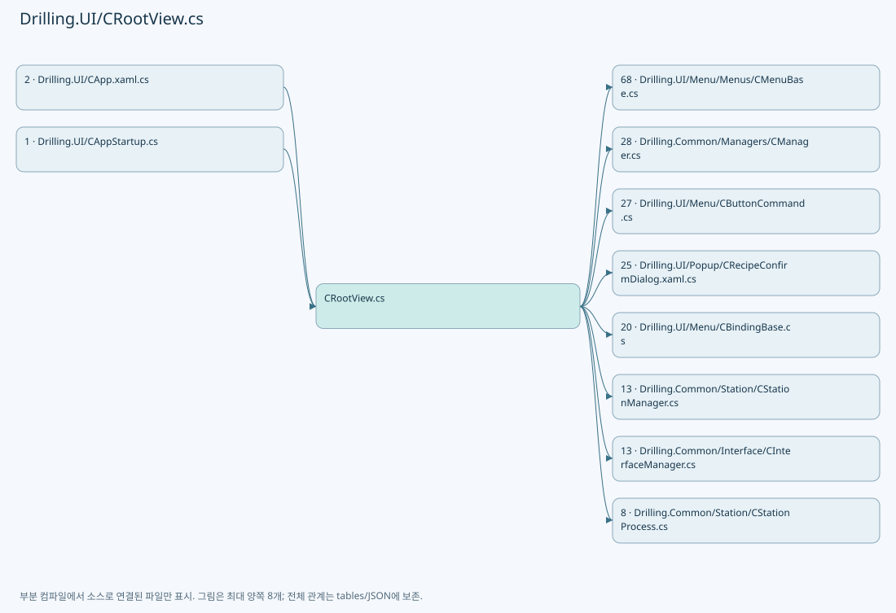

## 네임스페이스·타입·상속

| 타입 | 구분 | 원본 범위 | 선언/상속 |
| --- | --- | --- | --- |
| CRootView | ClassDeclaration | 24–3332 | CRootView: CBindingBase |
| EN_AUTO_CYCLE_STATE | EnumDeclaration | 266–272 | EN_AUTO_CYCLE_STATE |
| CAlarmNavigationTracker | ClassDeclaration | 3335–3345 | CAlarmNavigationTracker |
| ST_SYSTEM_STATUS_SOURCE | RecordDeclaration | 3347–3353 | ST_SYSTEM_STATUS_SOURCE |
| ST_SYSTEM_STATUS_SNAPSHOT | RecordDeclaration | 3354–3354 | ST_SYSTEM_STATUS_SNAPSHOT |

## 멤버 빠른 목록

| 이름 | 종류 | 범위 | 서명 |
| --- | --- | --- | --- |
| SoftwareVersion | PropertyDeclaration | L26–26 | string Drilling.UI.CRootView.SoftwareVersion |
| _alarmDispatcher | FieldDeclaration | L29–29 | Dispatcher Drilling.UI.CRootView._alarmDispatcher |
| _alarmNavigation | FieldDeclaration | L30–30 | Drilling.UI.CAlarmNavigationTracker Drilling.UI.CRootView._alarmNavigation |
| _heavyOccurrences | FieldDeclaration | L31–31 | System.Collections.Generic.HashSet<(int Code, System.DateTimeOffset Time)> Drilling.UI.CRootView._heavyOccurrences |
| _alarmRefreshQueued | FieldDeclaration | L32–32 | int Drilling.UI.CRootView._alarmRefreshQueued |
| _isAlarmNavigation | FieldDeclaration | L33–33 | bool Drilling.UI.CRootView._isAlarmNavigation |
| _isHeaderAlarmResetRunning | FieldDeclaration | L34–34 | bool Drilling.UI.CRootView._isHeaderAlarmResetRunning |
| _heavyRecoveryBlocked | FieldDeclaration | L35–35 | bool Drilling.UI.CRootView._heavyRecoveryBlocked |
| _heavyAlarmRecoveryTask | FieldDeclaration | L36–36 | System.Threading.Tasks.Task? Drilling.UI.CRootView._heavyAlarmRecoveryTask |
| _alarmRecoveryStatus | FieldDeclaration | L37–37 | string Drilling.UI.CRootView._alarmRecoveryStatus |
| _alarmPopup | FieldDeclaration | L38–38 | Drilling.UI.Popup.CAlarmPopupDialog? Drilling.UI.CRootView._alarmPopup |
| _headerAlarmResetCommand | FieldDeclaration | L39–39 | Drilling.UI.Menu.CButtonCommand? Drilling.UI.CRootView._headerAlarmResetCommand |
| MainLiveStatusRefreshInterval | FieldDeclaration | L40–40 | System.TimeSpan Drilling.UI.CRootView.MainLiveStatusRefreshInterval |
| MainLiveStatusTimeout | FieldDeclaration | L41–41 | System.TimeSpan Drilling.UI.CRootView.MainLiveStatusTimeout |
| MonitorDefaultRefreshInterval | FieldDeclaration | L42–42 | System.TimeSpan Drilling.UI.CRootView.MonitorDefaultRefreshInterval |
| MonitorShellStatusRefreshInterval | FieldDeclaration | L43–43 | System.TimeSpan Drilling.UI.CRootView.MonitorShellStatusRefreshInterval |
| PmLifeStatusRefreshInterval | FieldDeclaration | L44–44 | System.TimeSpan Drilling.UI.CRootView.PmLifeStatusRefreshInterval |
| ErrorReportInterval | FieldDeclaration | L45–45 | System.TimeSpan Drilling.UI.CRootView.ErrorReportInterval |
| SelectRecipeSettingKey | FieldDeclaration | L46–46 | string Drilling.UI.CRootView.SelectRecipeSettingKey |
| DefaultRecipeId | FieldDeclaration | L47–47 | string Drilling.UI.CRootView.DefaultRecipeId |
| ShiftOffsetXKey | FieldDeclaration | L48–48 | string Drilling.UI.CRootView.ShiftOffsetXKey |
| ShiftOffsetYKey | FieldDeclaration | L49–49 | string Drilling.UI.CRootView.ShiftOffsetYKey |
| PmUnlockPasswordKey | FieldDeclaration | L50–50 | string Drilling.UI.CRootView.PmUnlockPasswordKey |
| OperatorMenus | FieldDeclaration | L51–51 | System.Collections.Generic.IReadOnlyList<Drilling.UI.Menu.Menus.EN_MENU> Drilling.UI.CRootView.OperatorMenus |
| AutoModeMenus | FieldDeclaration | L52–58 | System.Collections.Generic.IReadOnlySet<Drilling.UI.Menu.Menus.EN_MENU> Drilling.UI.CRootView.AutoModeMenus |
| HeaderModules | FieldDeclaration | L59–69 | System.Collections.Generic.IReadOnlyList<Drilling.Common.Interface.EN_EQP_MODULE> Drilling.UI.CRootView.HeaderModules |
| _stationManager | FieldDeclaration | L70–70 | Drilling.Common.Station.CStationManager Drilling.UI.CRootView._stationManager |
| _manager | FieldDeclaration | L71–71 | Drilling.Common.Managers.CManager Drilling.UI.CRootView._manager |
| _interfaceManager | FieldDeclaration | L72–72 | Drilling.Common.Interface.CInterfaceManager Drilling.UI.CRootView._interfaceManager |
| _motionManager | FieldDeclaration | L73–73 | Drilling.Common.Motion.CMotionManager Drilling.UI.CRootView._motionManager |
| _alarmManager | FieldDeclaration | L74–74 | Drilling.Common.Alarm.CAlarmManager Drilling.UI.CRootView._alarmManager |
| _interLockManager | FieldDeclaration | L75–75 | Drilling.Common.InterLock.CInterLockManager Drilling.UI.CRootView._interLockManager |
| _recipeManager | FieldDeclaration | L76–76 | Drilling.Common.Managers.CRecipeManager Drilling.UI.CRootView._recipeManager |
| _productManager | FieldDeclaration | L77–77 | Drilling.Common.Product.CProductManager Drilling.UI.CRootView._productManager |
| _reviewManager | FieldDeclaration | L78–78 | Drilling.Common.Review.CReviewManager Drilling.UI.CRootView._reviewManager |
| _menus | FieldDeclaration | L79–79 | System.Collections.Generic.IReadOnlyDictionary<Drilling.UI.Menu.Menus.EN_MENU, Drilling.UI.Menu.Menus.CMenuBase> Drilling.UI.CRootView._menus |
| _selectedHeaderModuleIndexes | FieldDeclaration | L80–80 | System.Collections.Generic.Dictionary<Drilling.Common.Interface.EN_EQP_MODULE, int> Drilling.UI.CRootView._selectedHeaderModuleIndexes |
| _screenCache | FieldDeclaration | L81–81 | System.Collections.Generic.Dictionary<Drilling.UI.Menu.Menus.EN_MENU, Drilling.UI.Menu.Menus.CScreenViewModel> Drilling.UI.CRootView._screenCache |
| _screenBuildSync | FieldDeclaration | L82–82 | object Drilling.UI.CRootView._screenBuildSync |
| _processPreparationGate | FieldDeclaration | L83–83 | System.Threading.SemaphoreSlim Drilling.UI.CRootView._processPreparationGate |
| _initialProcessModelCts | FieldDeclaration | L84–84 | System.Threading.CancellationTokenSource Drilling.UI.CRootView._initialProcessModelCts |
| _initialProcessModelTask | FieldDeclaration | L85–85 | System.Threading.Tasks.Task Drilling.UI.CRootView._initialProcessModelTask |
| _selectedMenu | FieldDeclaration | L86–86 | Drilling.UI.Menu.Menus.CMenuItem Drilling.UI.CRootView._selectedMenu |
| _navigationSelectedMenu | FieldDeclaration | L87–87 | Drilling.UI.Menu.Menus.CMenuItem? Drilling.UI.CRootView._navigationSelectedMenu |
| _currentScreen | FieldDeclaration | L88–88 | Drilling.UI.Menu.Menus.CScreenViewModel Drilling.UI.CRootView._currentScreen |
| _systemStatus | FieldDeclaration | L89–89 | Drilling.Common.Managers.ST_SYSTEM_STATUS Drilling.UI.CRootView._systemStatus |
| _interfaceCommStatuses | FieldDeclaration | L90–90 | System.Collections.Generic.IReadOnlyList<Drilling.Common.Interface.ST_INTERFACE_COMM_STATUS> Drilling.UI.CRootView._interfaceCommStatuses |
| _statusMessage | FieldDeclaration | L91–91 | string Drilling.UI.CRootView._statusMessage |
| _currentDateText | FieldDeclaration | L92–92 | string Drilling.UI.CRootView._currentDateText |
| _currentTimeText | FieldDeclaration | L93–93 | string Drilling.UI.CRootView._currentTimeText |
| _selectedHeadNo | FieldDeclaration | L94–94 | int Drilling.UI.CRootView._selectedHeadNo |
| _selectedManualSettingName | FieldDeclaration | L95–95 | string Drilling.UI.CRootView._selectedManualSettingName |
| _selectedRecipeId | FieldDeclaration | L96–96 | string Drilling.UI.CRootView._selectedRecipeId |
| _viewRecipeId | FieldDeclaration | L97–97 | string Drilling.UI.CRootView._viewRecipeId |
| _selectedRecipeCategory | FieldDeclaration | L98–98 | string Drilling.UI.CRootView._selectedRecipeCategory |
| _selectedSettingTab | FieldDeclaration | L99–99 | string Drilling.UI.CRootView._selectedSettingTab |
| _selectedSettingGroup | FieldDeclaration | L100–100 | string Drilling.UI.CRootView._selectedSettingGroup |
| _selectedMonitorTab | FieldDeclaration | L101–101 | string Drilling.UI.CRootView._selectedMonitorTab |
| _shiftOffsetX | FieldDeclaration | L102–102 | string Drilling.UI.CRootView._shiftOffsetX |
| _shiftOffsetY | FieldDeclaration | L103–103 | string Drilling.UI.CRootView._shiftOffsetY |
| _operationMode | FieldDeclaration | L104–104 | Drilling.Common.Managers.EN_SYSTEM_MODE Drilling.UI.CRootView._operationMode |
| _autoCycleState | FieldDeclaration | L105–105 | Drilling.UI.CRootView.EN_AUTO_CYCLE_STATE Drilling.UI.CRootView._autoCycleState |
| _isAutoSequenceInitializing | FieldDeclaration | L106–106 | bool Drilling.UI.CRootView._isAutoSequenceInitializing |
| _autoCycleCts | FieldDeclaration | L107–107 | System.Threading.CancellationTokenSource? Drilling.UI.CRootView._autoCycleCts |
| _autoCycleCompletion | FieldDeclaration | L108–108 | System.Threading.Tasks.TaskCompletionSource<bool>? Drilling.UI.CRootView._autoCycleCompletion |
| _currentTheme | FieldDeclaration | L109–109 | Drilling.UI.EN_UI_THEME Drilling.UI.CRootView._currentTheme |
| _statusRefreshRunning | FieldDeclaration | L110–110 | bool Drilling.UI.CRootView._statusRefreshRunning |
| _screenRefreshRunning | FieldDeclaration | L111–111 | int Drilling.UI.CRootView._screenRefreshRunning |
| _screenRefreshPending | FieldDeclaration | L112–112 | bool Drilling.UI.CRootView._screenRefreshPending |
| _screenBuildCts | FieldDeclaration | L113–113 | System.Threading.CancellationTokenSource Drilling.UI.CRootView._screenBuildCts |
| _monitorLiveRefreshRunning | FieldDeclaration | L114–114 | bool Drilling.UI.CRootView._monitorLiveRefreshRunning |
| _manualScannerStatusRefreshRunning | FieldDeclaration | L115–115 | bool Drilling.UI.CRootView._manualScannerStatusRefreshRunning |
| _mainLiveRefreshRunning | FieldDeclaration | L116–116 | bool Drilling.UI.CRootView._mainLiveRefreshRunning |
| _mainLiveStatusErrorActive | FieldDeclaration | L117–117 | bool Drilling.UI.CRootView._mainLiveStatusErrorActive |
| _mainLiveStatusRefreshCts | FieldDeclaration | L118–118 | System.Threading.CancellationTokenSource? Drilling.UI.CRootView._mainLiveStatusRefreshCts |
| _lastMonitorScreenRefreshTimestamp | FieldDeclaration | L119–119 | long Drilling.UI.CRootView._lastMonitorScreenRefreshTimestamp |
| _lastMonitorShellStatusRefreshTimestamp | FieldDeclaration | L120–120 | long Drilling.UI.CRootView._lastMonitorShellStatusRefreshTimestamp |
| _lastMainLiveStatusRefreshTimestamp | FieldDeclaration | L121–121 | long Drilling.UI.CRootView._lastMainLiveStatusRefreshTimestamp |
| _lastPmLifeStatusRefreshTimestamp | FieldDeclaration | L122–122 | long Drilling.UI.CRootView._lastPmLifeStatusRefreshTimestamp |
| _lastMainLiveStatusErrorReportTimestamp | FieldDeclaration | L123–123 | long Drilling.UI.CRootView._lastMainLiveStatusErrorReportTimestamp |
| _lastClockTickErrorReportTimestamp | FieldDeclaration | L124–124 | long Drilling.UI.CRootView._lastClockTickErrorReportTimestamp |
| _lastMainLiveStatusError | FieldDeclaration | L125–125 | string Drilling.UI.CRootView._lastMainLiveStatusError |
| _lastClockTickError | FieldDeclaration | L126–126 | string Drilling.UI.CRootView._lastClockTickError |
| _pmLockStatus | FieldDeclaration | L127–127 | Drilling.Common.Managers.ST_PM_LOCK_STATUS Drilling.UI.CRootView._pmLockStatus |
| _activePmSession | FieldDeclaration | L128–128 | Drilling.Common.Log.ST_PM_HISTORY_ENTRY? Drilling.UI.CRootView._activePmSession |
| _isPmUnlocking | FieldDeclaration | L129–129 | bool Drilling.UI.CRootView._isPmUnlocking |
| _isPmNavigationUnlockPromptOpen | FieldDeclaration | L130–130 | bool Drilling.UI.CRootView._isPmNavigationUnlockPromptOpen |
| AutoCycleStopTimeout | FieldDeclaration | L131–131 | System.TimeSpan Drilling.UI.CRootView.AutoCycleStopTimeout |
| _protectWindowNotice | FieldDeclaration | L132–132 | Drilling.UI.Popup.CProtectWindowRequestNotice? Drilling.UI.CRootView._protectWindowNotice |
| _autoFineReview | FieldDeclaration | L133–133 | Drilling.Common.Review.CAutoFineReviewCoordinator? Drilling.UI.CRootView._autoFineReview |
| _autoDistortion | FieldDeclaration | L134–134 | Drilling.Common.Correction.CAlignDistortionCycle? Drilling.UI.CRootView._autoDistortion |
| _stageSimulationDialog | FieldDeclaration | L135–135 | Drilling.UI.Popup.CMelsecStageSimulationDialog? Drilling.UI.CRootView._stageSimulationDialog |
| MelsecSimulatorVisibilityChanged | EventFieldDeclaration | L136–136 | System.EventHandler? Drilling.UI.CRootView.MelsecSimulatorVisibilityChanged |
| _lastSimulatorVisibility | FieldDeclaration | L137–137 | Visibility? Drilling.UI.CRootView._lastSimulatorVisibility |
| .ctor | ConstructorDeclaration | L140–262 | Drilling.UI.CRootView.CRootView(Drilling.Common.Managers.CManager, Drilling.Common.Station.CStationManager, Drilling.Common.Interface.CInterfaceManager, Drilling.Common.Motion.CMotionManager, Drilling.Common.Alarm.CAlarmManager, Drilling.Common.InterLock.CInterLockManager, Drilling.Common.Managers.CManualScanFileBase, Drilling.Common.Managers.CRecipeManager, Drilling.Common.Managers.CSettingManager, Drilling.Common.Product.CProductManager, Drilling.Common.Review.CReviewManager, Drilling.Common.Station.CAutomationScriptFileBase) |
| BuildCMenuItem | LocalFunctionStatement | L172–175 | Drilling.UI.Menu.Menus.CMenuItem BuildCMenuItem(Drilling.UI.Menu.Menus.EN_MENU) |
| StartCallback | LocalFunctionStatement | L186–189 | void StartCallback(object?) |
| CanExecuteStartCommand | LocalFunctionStatement | L191–194 | bool CanExecuteStartCommand(object?) |
| StopCallback | LocalFunctionStatement | L197–200 | void StopCallback(object?) |
| CanExecuteStopCommand | LocalFunctionStatement | L202–205 | bool CanExecuteStopCommand(object?) |
| SelectHeadCallback | LocalFunctionStatement | L208–211 | void SelectHeadCallback(object?) |
| CanExecuteSelectHeadCommand | LocalFunctionStatement | L213–216 | bool CanExecuteSelectHeadCommand(object?) |
| ToggleThemeCallback | LocalFunctionStatement | L219–222 | void ToggleThemeCallback(object?) |
| ToggleOperationModeCallback | LocalFunctionStatement | L226–229 | void ToggleOperationModeCallback(object?) |
| CanExecuteToggleOperationModeCommand | LocalFunctionStatement | L231–234 | bool CanExecuteToggleOperationModeCommand(object?) |
| InitializeAutoSequenceCallback | LocalFunctionStatement | L237–240 | void InitializeAutoSequenceCallback(object?) |
| CanExecuteInitializeAutoSequenceCommand | LocalFunctionStatement | L242–247 | bool CanExecuteInitializeAutoSequenceCommand(object?) |
| Ready | EnumMemberDeclaration | L268–268 | Drilling.UI.CRootView.EN_AUTO_CYCLE_STATE.Ready |
| Preparing | EnumMemberDeclaration | L269–269 | Drilling.UI.CRootView.EN_AUTO_CYCLE_STATE.Preparing |
| Running | EnumMemberDeclaration | L270–270 | Drilling.UI.CRootView.EN_AUTO_CYCLE_STATE.Running |
| Stopping | EnumMemberDeclaration | L271–271 | Drilling.UI.CRootView.EN_AUTO_CYCLE_STATE.Stopping |
| StopAutomationStatusAcquisition | MethodDeclaration | L274–285 | void Drilling.UI.CRootView.StopAutomationStatusAcquisition() |
| Menus | PropertyDeclaration | L287–287 | System.Collections.ObjectModel.ObservableCollection<Drilling.UI.Menu.Menus.CMenuItem> Drilling.UI.CRootView.Menus |
| get_Menus | GetAccessorDeclaration | L287–287 | System.Collections.ObjectModel.ObservableCollection<Drilling.UI.Menu.Menus.CMenuItem> Drilling.UI.CRootView.Menus.get |
| HeaderStatusItems | PropertyDeclaration | L288–288 | System.Collections.ObjectModel.ObservableCollection<Drilling.UI.Menu.Menus.ST_HEADER_STATUS_ITEM> Drilling.UI.CRootView.HeaderStatusItems |
| get_HeaderStatusItems | GetAccessorDeclaration | L288–288 | System.Collections.ObjectModel.ObservableCollection<Drilling.UI.Menu.Menus.ST_HEADER_STATUS_ITEM> Drilling.UI.CRootView.HeaderStatusItems.get |
| HeaderContextStatusItems | PropertyDeclaration | L289–289 | System.Collections.ObjectModel.ObservableCollection<Drilling.UI.Menu.Menus.ST_HEADER_STATUS_ITEM> Drilling.UI.CRootView.HeaderContextStatusItems |
| get_HeaderContextStatusItems | GetAccessorDeclaration | L289–289 | System.Collections.ObjectModel.ObservableCollection<Drilling.UI.Menu.Menus.ST_HEADER_STATUS_ITEM> Drilling.UI.CRootView.HeaderContextStatusItems.get |
| HeaderCommunicationStatusItems | PropertyDeclaration | L290–290 | System.Collections.ObjectModel.ObservableCollection<Drilling.UI.Menu.Menus.ST_HEADER_STATUS_ITEM> Drilling.UI.CRootView.HeaderCommunicationStatusItems |
| get_HeaderCommunicationStatusItems | GetAccessorDeclaration | L290–290 | System.Collections.ObjectModel.ObservableCollection<Drilling.UI.Menu.Menus.ST_HEADER_STATUS_ITEM> Drilling.UI.CRootView.HeaderCommunicationStatusItems.get |
| FooterStatusItems | PropertyDeclaration | L291–291 | System.Collections.ObjectModel.ObservableCollection<Drilling.UI.Menu.Menus.ST_HEADER_STATUS_ITEM> Drilling.UI.CRootView.FooterStatusItems |
| get_FooterStatusItems | GetAccessorDeclaration | L291–291 | System.Collections.ObjectModel.ObservableCollection<Drilling.UI.Menu.Menus.ST_HEADER_STATUS_ITEM> Drilling.UI.CRootView.FooterStatusItems.get |
| SelectedMenu | PropertyDeclaration | L293–382 | Drilling.UI.Menu.Menus.CMenuItem Drilling.UI.CRootView.SelectedMenu |
| get_SelectedMenu | GetAccessorDeclaration | L295–298 | Drilling.UI.Menu.Menus.CMenuItem Drilling.UI.CRootView.SelectedMenu.get |
| set_SelectedMenu | SetAccessorDeclaration | L300–381 | void Drilling.UI.CRootView.SelectedMenu.set |
| NavigationSelectedMenu | PropertyDeclaration | L384–400 | Drilling.UI.Menu.Menus.CMenuItem? Drilling.UI.CRootView.NavigationSelectedMenu |
| get_NavigationSelectedMenu | GetAccessorDeclaration | L386–389 | Drilling.UI.Menu.Menus.CMenuItem? Drilling.UI.CRootView.NavigationSelectedMenu.get |
| set_NavigationSelectedMenu | SetAccessorDeclaration | L391–399 | void Drilling.UI.CRootView.NavigationSelectedMenu.set |
| CurrentScreen | PropertyDeclaration | L402–413 | Drilling.UI.Menu.Menus.CScreenViewModel Drilling.UI.CRootView.CurrentScreen |
| get_CurrentScreen | GetAccessorDeclaration | L404–407 | Drilling.UI.Menu.Menus.CScreenViewModel Drilling.UI.CRootView.CurrentScreen.get |
| set_CurrentScreen | SetAccessorDeclaration | L409–412 | void Drilling.UI.CRootView.CurrentScreen.set |
| StatusMessage | PropertyDeclaration | L415–426 | string Drilling.UI.CRootView.StatusMessage |
| get_StatusMessage | GetAccessorDeclaration | L417–420 | string Drilling.UI.CRootView.StatusMessage.get |
| set_StatusMessage | SetAccessorDeclaration | L422–425 | void Drilling.UI.CRootView.StatusMessage.set |
| CurrentDateText | PropertyDeclaration | L428–439 | string Drilling.UI.CRootView.CurrentDateText |
| get_CurrentDateText | GetAccessorDeclaration | L430–433 | string Drilling.UI.CRootView.CurrentDateText.get |
| set_CurrentDateText | SetAccessorDeclaration | L435–438 | void Drilling.UI.CRootView.CurrentDateText.set |
| CurrentTimeText | PropertyDeclaration | L441–452 | string Drilling.UI.CRootView.CurrentTimeText |
| get_CurrentTimeText | GetAccessorDeclaration | L443–446 | string Drilling.UI.CRootView.CurrentTimeText.get |
| set_CurrentTimeText | SetAccessorDeclaration | L448–451 | void Drilling.UI.CRootView.CurrentTimeText.set |
| CurrentUserText | PropertyDeclaration | L454–460 | string Drilling.UI.CRootView.CurrentUserText |
| get_CurrentUserText | GetAccessorDeclaration | L456–459 | string Drilling.UI.CRootView.CurrentUserText.get |
| ThemeToggleText | PropertyDeclaration | L462–468 | string Drilling.UI.CRootView.ThemeToggleText |
| get_ThemeToggleText | GetAccessorDeclaration | L464–467 | string Drilling.UI.CRootView.ThemeToggleText.get |
| ThemeModeText | PropertyDeclaration | L470–476 | string Drilling.UI.CRootView.ThemeModeText |
| get_ThemeModeText | GetAccessorDeclaration | L472–475 | string Drilling.UI.CRootView.ThemeModeText.get |
| StartCommand | PropertyDeclaration | L478–478 | Drilling.UI.Menu.CButtonCommand Drilling.UI.CRootView.StartCommand |
| get_StartCommand | GetAccessorDeclaration | L478–478 | Drilling.UI.Menu.CButtonCommand Drilling.UI.CRootView.StartCommand.get |
| StopCommand | PropertyDeclaration | L479–479 | Drilling.UI.Menu.CButtonCommand Drilling.UI.CRootView.StopCommand |
| get_StopCommand | GetAccessorDeclaration | L479–479 | Drilling.UI.Menu.CButtonCommand Drilling.UI.CRootView.StopCommand.get |
| SelectHeadCommand | PropertyDeclaration | L480–480 | Drilling.UI.Menu.CButtonCommand Drilling.UI.CRootView.SelectHeadCommand |
| get_SelectHeadCommand | GetAccessorDeclaration | L480–480 | Drilling.UI.Menu.CButtonCommand Drilling.UI.CRootView.SelectHeadCommand.get |
| ToggleThemeCommand | PropertyDeclaration | L481–481 | Drilling.UI.Menu.CButtonCommand Drilling.UI.CRootView.ToggleThemeCommand |
| get_ToggleThemeCommand | GetAccessorDeclaration | L481–481 | Drilling.UI.Menu.CButtonCommand Drilling.UI.CRootView.ToggleThemeCommand.get |
| ToggleOperationModeCommand | PropertyDeclaration | L482–482 | Drilling.UI.Menu.CButtonCommand Drilling.UI.CRootView.ToggleOperationModeCommand |
| get_ToggleOperationModeCommand | GetAccessorDeclaration | L482–482 | Drilling.UI.Menu.CButtonCommand Drilling.UI.CRootView.ToggleOperationModeCommand.get |
| InitializeAutoSequenceCommand | PropertyDeclaration | L483–483 | Drilling.UI.Menu.CButtonCommand Drilling.UI.CRootView.InitializeAutoSequenceCommand |
| get_InitializeAutoSequenceCommand | GetAccessorDeclaration | L483–483 | Drilling.UI.Menu.CButtonCommand Drilling.UI.CRootView.InitializeAutoSequenceCommand.get |
| ShiftOffsetX | PropertyDeclaration | L485–496 | string Drilling.UI.CRootView.ShiftOffsetX |
| get_ShiftOffsetX | GetAccessorDeclaration | L487–490 | string Drilling.UI.CRootView.ShiftOffsetX.get |
| set_ShiftOffsetX | SetAccessorDeclaration | L492–495 | void Drilling.UI.CRootView.ShiftOffsetX.set |
| ShiftOffsetY | PropertyDeclaration | L498–509 | string Drilling.UI.CRootView.ShiftOffsetY |
| get_ShiftOffsetY | GetAccessorDeclaration | L500–503 | string Drilling.UI.CRootView.ShiftOffsetY.get |
| set_ShiftOffsetY | SetAccessorDeclaration | L505–508 | void Drilling.UI.CRootView.ShiftOffsetY.set |
| IsManualShiftOffsetVisible | PropertyDeclaration | L511–517 | bool Drilling.UI.CRootView.IsManualShiftOffsetVisible |
| get_IsManualShiftOffsetVisible | GetAccessorDeclaration | L513–516 | bool Drilling.UI.CRootView.IsManualShiftOffsetVisible.get |
| CanSelectHead | PropertyDeclaration | L519–525 | bool Drilling.UI.CRootView.CanSelectHead |
| get_CanSelectHead | GetAccessorDeclaration | L521–524 | bool Drilling.UI.CRootView.CanSelectHead.get |
| IsSimulationEnvironment | PropertyDeclaration | L527–533 | bool Drilling.UI.CRootView.IsSimulationEnvironment |
| get_IsSimulationEnvironment | GetAccessorDeclaration | L529–532 | bool Drilling.UI.CRootView.IsSimulationEnvironment.get |
| CanStartAutoCycle | MethodDeclaration | L535–538 | bool Drilling.UI.CRootView.CanStartAutoCycle() |
| CanStopAutoCycle | MethodDeclaration | L540–545 | bool Drilling.UI.CRootView.CanStopAutoCycle() |
| IsManualStartEligible | MethodDeclaration | L547–550 | bool Drilling.UI.CRootView.IsManualStartEligible() |
| RefreshCurrentScreen | MethodDeclaration | L552–625 | System.Threading.Tasks.Task Drilling.UI.CRootView.RefreshCurrentScreen() |
| ShowCachedScreenOrLoading | MethodDeclaration | L627–632 | void Drilling.UI.CRootView.ShowCachedScreenOrLoading(Drilling.UI.Menu.Menus.CMenuItem) |
| RestartScreenBuild | MethodDeclaration | L634–645 | void Drilling.UI.CRootView.RestartScreenBuild() |
| GetScreenBuildToken | MethodDeclaration | L647–653 | System.Threading.CancellationToken Drilling.UI.CRootView.GetScreenBuildToken() |
| ResetMenuStateOnOpen | MethodDeclaration | L655–666 | void Drilling.UI.CRootView.ResetMenuStateOnOpen(Drilling.UI.Menu.Menus.EN_MENU, Drilling.UI.Menu.Menus.EN_MENU) |
| ResetSelectedManualHead | MethodDeclaration | L668–685 | void Drilling.UI.CRootView.ResetSelectedManualHead() |
| ToggleTheme | MethodDeclaration | L687–695 | System.Threading.Tasks.Task Drilling.UI.CRootView.ToggleTheme() |
| ToggleOperationMode | MethodDeclaration | L697–756 | System.Threading.Tasks.Task Drilling.UI.CRootView.ToggleOperationMode(System.Func<string, string, bool>?, System.Action<string, string>?) |
| InitializeAutoSequence | MethodDeclaration | L758–798 | System.Threading.Tasks.Task Drilling.UI.CRootView.InitializeAutoSequence() |
| CheckAutoModeInterlocks | MethodDeclaration | L800–826 | System.Threading.Tasks.Task<bool> Drilling.UI.CRootView.CheckAutoModeInterlocks(System.Action<string, string>) |
| CheckStageMotionOwnership | MethodDeclaration | L828–837 | bool Drilling.UI.CRootView.CheckStageMotionOwnership(System.Action<string, string>, string) |
| CanAccessMenu | MethodDeclaration | L839–849 | bool Drilling.UI.CRootView.CanAccessMenu(Drilling.UI.Menu.Menus.EN_MENU) |
| IsReviewNavigationLocked | MethodDeclaration | L851–865 | bool Drilling.UI.CRootView.IsReviewNavigationLocked(Drilling.UI.Menu.Menus.EN_MENU) |
| ApplyMenuAccessForOperationMode | MethodDeclaration | L867–877 | void Drilling.UI.CRootView.ApplyMenuAccessForOperationMode() |
| RefreshOperationModeAccess | MethodDeclaration | L879–897 | void Drilling.UI.CRootView.RefreshOperationModeAccess() |
| MatchesItem | LocalFunctionStatement | L881–884 | bool MatchesItem(Drilling.UI.Menu.Menus.CMenuItem) |
| RefreshShellStatusItems | MethodDeclaration | L899–910 | void Drilling.UI.CRootView.RefreshShellStatusItems() |
| RefreshSystemStatus | MethodDeclaration | L912–932 | System.Threading.Tasks.Task Drilling.UI.CRootView.RefreshSystemStatus() |
| WaitForInitialProcessModelPreparation | MethodDeclaration | L934–948 | System.Threading.Tasks.Task Drilling.UI.CRootView.WaitForInitialProcessModelPreparation(System.Threading.CancellationToken) |
| RefreshMonitorLiveData | MethodDeclaration | L950–980 | System.Threading.Tasks.Task Drilling.UI.CRootView.RefreshMonitorLiveData() |
| RefreshMainLiveStatus | MethodDeclaration | L982–1034 | System.Threading.Tasks.Task Drilling.UI.CRootView.RefreshMainLiveStatus() |
| RefreshManualScannerStatus | MethodDeclaration | L1036–1062 | void Drilling.UI.CRootView.RefreshManualScannerStatus() |
| CancelMainLiveStatusRefresh | MethodDeclaration | L1064–1074 | void Drilling.UI.CRootView.CancelMainLiveStatusRefresh() |
| StopMainScannerStatusPolling | MethodDeclaration | L1076–1084 | void Drilling.UI.CRootView.StopMainScannerStatusPolling() |
| QueueMainScannerStatusPollingStop | MethodDeclaration | L1086–1101 | void Drilling.UI.CRootView.QueueMainScannerStatusPollingStop() |
| StopPolling | LocalFunctionStatement | L1088–1098 | void StopPolling() |
| StopManualScannerStatusPolling | MethodDeclaration | L1103–1111 | void Drilling.UI.CRootView.StopManualScannerStatusPolling() |
| QueueManualScannerStatusPollingStop | MethodDeclaration | L1113–1128 | void Drilling.UI.CRootView.QueueManualScannerStatusPollingStop() |
| StopPolling | LocalFunctionStatement | L1115–1125 | void StopPolling() |
| IsMainLiveStatusTargetCurrent | MethodDeclaration | L1130–1133 | bool Drilling.UI.CRootView.IsMainLiveStatusTargetCurrent(Drilling.UI.Menu.Menus.CScreenViewModel, Drilling.UI.Menu.Menus.CMenuMain?) |
| ReportMainLiveStatusError | MethodDeclaration | L1135–1150 | void Drilling.UI.CRootView.ReportMainLiveStatusError(System.Exception) |
| ReportStaleMainLiveStatusError | MethodDeclaration | L1152–1161 | void Drilling.UI.CRootView.ReportStaleMainLiveStatusError(System.Exception) |
| ReportMainLiveStatusRestored | MethodDeclaration | L1163–1174 | void Drilling.UI.CRootView.ReportMainLiveStatusRestored() |
| ReportClockTickError | MethodDeclaration | L1176–1190 | void Drilling.UI.CRootView.ReportClockTickError(System.Exception) |
| QueueStationStateLog | MethodDeclaration | L1192–1208 | void Drilling.UI.CRootView.QueueStationStateLog(string, string, string) |
| WriteStationStateLog | LocalFunctionStatement | L1195–1205 | void WriteStationStateLog() |
| HasElapsed | MethodDeclaration | L1210–1220 | bool Drilling.UI.CRootView.HasElapsed(long, long, System.TimeSpan) |
| RefreshShellCommunicationStatus | MethodDeclaration | L1222–1235 | System.Threading.Tasks.Task Drilling.UI.CRootView.RefreshShellCommunicationStatus(System.Threading.CancellationToken) |
| GetSystemStatusSnapshot | MethodDeclaration | L1237–1253 | System.Threading.Tasks.Task<Drilling.UI.ST_SYSTEM_STATUS_SNAPSHOT> Drilling.UI.CRootView.GetSystemStatusSnapshot(System.Threading.CancellationToken) |
| ReadSystemStatusSource | LocalFunctionStatement | L1242–1247 | Drilling.UI.ST_SYSTEM_STATUS_SOURCE ReadSystemStatusSource() |
| ApplySystemStatusSnapshot | MethodDeclaration | L1255–1265 | void Drilling.UI.CRootView.ApplySystemStatusSnapshot(Drilling.UI.ST_SYSTEM_STATUS_SNAPSHOT, bool) |
| GetPMLockStatus | MethodDeclaration | L1267–1270 | Drilling.Common.Managers.ST_PM_LOCK_STATUS Drilling.UI.CRootView.GetPMLockStatus() |
| TryEnterPmLock | MethodDeclaration | L1272–1322 | bool Drilling.UI.CRootView.TryEnterPmLock() |
| TryGetManualOperationBlocker | MethodDeclaration | L1324–1377 | bool Drilling.UI.CRootView.TryGetManualOperationBlocker(out string) |
| ValidatePmReason | MethodDeclaration | L1379–1386 | string Drilling.UI.CRootView.ValidatePmReason(string) |
| RequestPmUnlockForNavigation | MethodDeclaration | L1388–1412 | void Drilling.UI.CRootView.RequestPmUnlockForNavigation(Drilling.UI.Menu.Menus.CMenuItem) |
| QueueNavigationMenuSelectionSync | MethodDeclaration | L1414–1435 | void Drilling.UI.CRootView.QueueNavigationMenuSelectionSync() |
| SyncNavigationMenuSelection | MethodDeclaration | L1437–1443 | void Drilling.UI.CRootView.SyncNavigationMenuSelection() |
| UnlockPm | MethodDeclaration | L1445–1495 | System.Threading.Tasks.Task<bool> Drilling.UI.CRootView.UnlockPm(string, Drilling.UI.Menu.Menus.CMenuItem?) |
| Replace | MethodDeclaration | L1497–1510 | void Drilling.UI.CRootView.Replace<T>(System.Collections.ObjectModel.ObservableCollection<T>, System.Collections.Generic.IEnumerable<T>) |
| CreateHeaderStatusItems | MethodDeclaration | L1512–1529 | System.Collections.Generic.IReadOnlyList<Drilling.UI.Menu.Menus.ST_HEADER_STATUS_ITEM> Drilling.UI.CRootView.CreateHeaderStatusItems() |
| SelectItem | LocalFunctionStatement | L1521–1524 | Drilling.UI.Menu.Menus.ST_HEADER_STATUS_ITEM SelectItem(Drilling.Common.Interface.EN_EQP_MODULE) |
| IsHeaderContextStatusItem | MethodDeclaration | L1531–1534 | bool Drilling.UI.CRootView.IsHeaderContextStatusItem(Drilling.UI.Menu.Menus.ST_HEADER_STATUS_ITEM) |
| CreateFooterStatusItems | MethodDeclaration | L1536–1607 | System.Collections.Generic.IReadOnlyList<Drilling.UI.Menu.Menus.ST_HEADER_STATUS_ITEM> Drilling.UI.CRootView.CreateFooterStatusItems(Drilling.UI.Menu.Menus.EN_MENU) |
| IsIsEdited | LocalFunctionStatement | L1549–1552 | bool IsIsEdited(Drilling.UI.Menu.Menus.ST_RECIPE_PARAMETER_EDITOR_ITEM) |
| IsIsModified | LocalFunctionStatement | L1564–1567 | bool IsIsModified(Drilling.UI.Menu.Menus.ST_SYSTEM_PARAMETER_ROW) |
| InitializeProcessModel | MethodDeclaration | L1609–1625 | System.Threading.Tasks.Task Drilling.UI.CRootView.InitializeProcessModel(System.Threading.CancellationToken) |
| PrepareInitialProcess | MethodDeclaration | L1627–1661 | System.Threading.Tasks.Task Drilling.UI.CRootView.PrepareInitialProcess(bool, System.Threading.CancellationToken) |
| FindSelectedRecipe | MethodDeclaration | L1663–1690 | Drilling.Common.Managers.ST_RECIPE_DEFINITION? Drilling.UI.CRootView.FindSelectedRecipe(System.Collections.Generic.IReadOnlyList<Drilling.Common.Managers.ST_RECIPE_DEFINITION>) |
| MatchesItem | LocalFunctionStatement | L1670–1673 | bool MatchesItem(Drilling.Common.Managers.ST_RECIPE_DEFINITION) |
| MatchesItem2 | LocalFunctionStatement | L1684–1687 | bool MatchesItem2(Drilling.Common.Managers.ST_RECIPE_DEFINITION) |
| CreateProcessParameters | MethodDeclaration | L1692–1722 | System.Collections.Generic.IReadOnlyDictionary<string, string> Drilling.UI.CRootView.CreateProcessParameters(Drilling.Common.Managers.ST_RECIPE_DEFINITION?, string, string, double, double) |
| HasRecipeParameterKey | LocalFunctionStatement | L1694–1697 | bool HasRecipeParameterKey(Drilling.Common.Managers.ST_RECIPE_PARAMETER) |
| SelectKey | LocalFunctionStatement | L1699–1702 | string SelectKey(Drilling.Common.Managers.ST_RECIPE_PARAMETER) |
| SelectRecipeParameterGroupKey | LocalFunctionStatement | L1704–1707 | string SelectRecipeParameterGroupKey(System.Linq.IGrouping<string, Drilling.Common.Managers.ST_RECIPE_PARAMETER>) |
| SelectValue | LocalFunctionStatement | L1709–1712 | string SelectValue(System.Linq.IGrouping<string, Drilling.Common.Managers.ST_RECIPE_PARAMETER>) |
| ReadShiftOffset | MethodDeclaration | L1724–1727 | (double X, double Y) Drilling.UI.CRootView.ReadShiftOffset() |
| OpenShiftOffsetDialog | MethodDeclaration | L1729–1762 | System.Threading.Tasks.Task Drilling.UI.CRootView.OpenShiftOffsetDialog(Window?) |
| BuildRows | LocalFunctionStatement | L1736–1739 | System.Collections.Generic.IReadOnlyList<Drilling.UI.Popup.ST_SHIFT_OFFSET_HEAD_ROW> BuildRows(double, double) |
| ValidateApply | LocalFunctionStatement | L1741–1744 | string? ValidateApply(double, double) |
| CreateShiftOffsetPreviewParameters | MethodDeclaration | L1764–1796 | System.Collections.Generic.IReadOnlyDictionary<string, string> Drilling.UI.CRootView.CreateShiftOffsetPreviewParameters(Drilling.Common.Managers.ST_RECIPE_DEFINITION?) |
| BuildShiftOffsetHeadRows | MethodDeclaration | L1798–1814 | System.Collections.Generic.IReadOnlyList<Drilling.UI.Popup.ST_SHIFT_OFFSET_HEAD_ROW> Drilling.UI.CRootView.BuildShiftOffsetHeadRows(System.Collections.Generic.IReadOnlyDictionary<string, string>, double, double) |
| CreateShiftOffsetParameters | MethodDeclaration | L1816–1823 | System.Collections.Generic.Dictionary<string, string> Drilling.UI.CRootView.CreateShiftOffsetParameters(System.Collections.Generic.IReadOnlyDictionary<string, string>, double, double) |
| ValidateShiftOffsetApply | MethodDeclaration | L1825–1876 | string? Drilling.UI.CRootView.ValidateShiftOffsetApply(System.Collections.Generic.IReadOnlyDictionary<string, string>, double, double) |
| AddShiftOffsetIssue | MethodDeclaration | L1878–1884 | void Drilling.UI.CRootView.AddShiftOffsetIssue(System.Collections.Generic.ICollection<string>, string) |
| IsOutsideRange | MethodDeclaration | L1886–1889 | bool Drilling.UI.CRootView.IsOutsideRange(double, double, double, double) |
| FormatShiftOffsetShot | MethodDeclaration | L1891–1894 | string Drilling.UI.CRootView.FormatShiftOffsetShot(Drilling.Common.Recipe.ST_HEAD_SHOT_POINT) |
| ReadShiftOffsetHeadCenterX | MethodDeclaration | L1896–1904 | double Drilling.UI.CRootView.ReadShiftOffsetHeadCenterX(System.Collections.Generic.IReadOnlyDictionary<string, string>, int) |
| ReadShiftOffsetHeadScanFieldHalfWidth | MethodDeclaration | L1906–1915 | double Drilling.UI.CRootView.ReadShiftOffsetHeadScanFieldHalfWidth(System.Collections.Generic.IReadOnlyDictionary<string, string>, int) |
| ReadShiftOffsetScannerReferenceOffsetX | MethodDeclaration | L1917–1922 | double Drilling.UI.CRootView.ReadShiftOffsetScannerReferenceOffsetX(System.Collections.Generic.IReadOnlyDictionary<string, string>) |
| ReadShiftOffsetPreviewInt | MethodDeclaration | L1924–1935 | int Drilling.UI.CRootView.ReadShiftOffsetPreviewInt(System.Collections.Generic.IReadOnlyDictionary<string, string>, int, params string[]) |
| ReadShiftOffsetPreviewDouble | MethodDeclaration | L1937–1948 | double Drilling.UI.CRootView.ReadShiftOffsetPreviewDouble(System.Collections.Generic.IReadOnlyDictionary<string, string>, double, params string[]) |
| FormatShiftOffsetPreviewValue | MethodDeclaration | L1950–1953 | string Drilling.UI.CRootView.FormatShiftOffsetPreviewValue(double) |
| ReadShiftOffsetValue | MethodDeclaration | L1955–1958 | double Drilling.UI.CRootView.ReadShiftOffsetValue(string) |
| NormalizeShiftOffsetText | MethodDeclaration | L1960–1968 | string Drilling.UI.CRootView.NormalizeShiftOffsetText(string?) |
| StartCycle | MethodDeclaration | L1970–2071 | System.Threading.Tasks.Task Drilling.UI.CRootView.StartCycle() |
| StopCycle | MethodDeclaration | L2073–2138 | System.Threading.Tasks.Task Drilling.UI.CRootView.StopCycle() |
| CompleteStopAfterTimeout | MethodDeclaration | L2140–2169 | System.Threading.Tasks.Task Drilling.UI.CRootView.CompleteStopAfterTimeout(System.Threading.Tasks.TaskCompletionSource<bool>?) |
| WaitForStationCycleFinished | MethodDeclaration | L2171–2182 | System.Threading.Tasks.Task<Drilling.Common.Station.ST_STATION_STATUS> Drilling.UI.CRootView.WaitForStationCycleFinished(System.TimeSpan) |
| WaitForStationCycleFinished | MethodDeclaration | L2184–2197 | System.Threading.Tasks.Task<Drilling.Common.Station.ST_STATION_STATUS> Drilling.UI.CRootView.WaitForStationCycleFinished(System.Threading.CancellationToken) |
| IsStationCycleFinished | MethodDeclaration | L2199–2212 | bool Drilling.UI.CRootView.IsStationCycleFinished(Drilling.Common.Station.ST_STATION_STATUS?) |
| SetAutoCycleState | MethodDeclaration | L2214–2224 | void Drilling.UI.CRootView.SetAutoCycleState(Drilling.UI.CRootView.EN_AUTO_CYCLE_STATE) |
| NotifyOperationCommandStates | MethodDeclaration | L2226–2232 | void Drilling.UI.CRootView.NotifyOperationCommandStates() |
| SelectHead | MethodDeclaration | L2234–2260 | System.Threading.Tasks.Task Drilling.UI.CRootView.SelectHead(object?) |
| CanSelectHeadParameter | MethodDeclaration | L2262–2272 | bool Drilling.UI.CRootView.CanSelectHeadParameter(object?) |
| IsHeadEnabled | MethodDeclaration | L2274–2290 | bool Drilling.UI.CRootView.IsHeadEnabled(int) |
| StartClock | MethodDeclaration | L2292–2354 | void Drilling.UI.CRootView.StartClock() |
| CreateMenus | MethodDeclaration | L2356–2650 | System.Collections.Generic.IReadOnlyDictionary<Drilling.UI.Menu.Menus.EN_MENU, Drilling.UI.Menu.Menus.CMenuBase> Drilling.UI.CRootView.CreateMenus(Drilling.Common.Station.CStationManager, Drilling.Common.Interface.CInterfaceManager, Drilling.Common.Motion.CMotionManager, Drilling.Common.Alarm.CAlarmManager, Drilling.Common.InterLock.CInterLockManager, Drilling.Common.Managers.CManualScanFileBase, Drilling.Common.Managers.CRecipeManager, Drilling.Common.Managers.CSettingManager, Drilling.Common.Product.CProductManager, Drilling.Common.Review.CReviewManager, Drilling.Common.Station.CAutomationScriptFileBase) |
| SelectSelectedRecipeId | LocalFunctionStatement | L2370–2373 | string SelectSelectedRecipeId() |
| SetMainStatusMessage | LocalFunctionStatement | L2375–2378 | void SetMainStatusMessage(string) |
| SelectSelectedHeadNo | LocalFunctionStatement | L2380–2383 | int SelectSelectedHeadNo() |
| SelectSelectedManualSettingName | LocalFunctionStatement | L2385–2388 | string SelectSelectedManualSettingName() |
| SetSelectedManualSettingName | LocalFunctionStatement | L2390–2393 | void SetSelectedManualSettingName(string) |
| SetManualStatusMessage | LocalFunctionStatement | L2395–2398 | void SetManualStatusMessage(string) |
| SelectSelectedRecipeId2 | LocalFunctionStatement | L2400–2403 | string SelectSelectedRecipeId2() |
| SetSelectedRecipeId | LocalFunctionStatement | L2405–2408 | void SetSelectedRecipeId(string) |
| SelectViewRecipeId | LocalFunctionStatement | L2410–2413 | string SelectViewRecipeId() |
| SetViewRecipeId | LocalFunctionStatement | L2415–2418 | void SetViewRecipeId(string) |
| SelectRecipe | LocalFunctionStatement | L2420–2423 | Drilling.UI.Menu.Menus.CMenuRecipe? SelectRecipe() |
| SelectSelectedRecipeCategory | LocalFunctionStatement | L2425–2428 | string SelectSelectedRecipeCategory() |
| SetSelectedRecipeCategory | LocalFunctionStatement | L2430–2433 | void SetSelectedRecipeCategory(string) |
| SetRecipeStatusMessage | LocalFunctionStatement | L2435–2438 | void SetRecipeStatusMessage(string) |
| ShowRecipeLoadingScreen | LocalFunctionStatement | L2440–2443 | void ShowRecipeLoadingScreen(Drilling.UI.Menu.Menus.EN_MENU, string) |
| SelectSelectedSettingTab | LocalFunctionStatement | L2445–2448 | string SelectSelectedSettingTab() |
| SetSelectedSettingTab | LocalFunctionStatement | L2450–2453 | void SetSelectedSettingTab(string) |
| SelectSelectedSettingGroup | LocalFunctionStatement | L2455–2458 | string SelectSelectedSettingGroup() |
| SetSelectedSettingGroup | LocalFunctionStatement | L2460–2463 | void SetSelectedSettingGroup(string) |
| SelectSetting | LocalFunctionStatement | L2465–2468 | Drilling.UI.Menu.Menus.CMenuSetting? SelectSetting() |
| SetSettingStatusMessage | LocalFunctionStatement | L2470–2473 | void SetSettingStatusMessage(string) |
| ShowSettingLoadingScreen | LocalFunctionStatement | L2475–2478 | void ShowSettingLoadingScreen(Drilling.UI.Menu.Menus.EN_MENU, string) |
| SetAlarmStatusMessage | LocalFunctionStatement | L2480–2483 | void SetAlarmStatusMessage(string) |
| SelectSelectedRecipeId3 | LocalFunctionStatement | L2485–2488 | string SelectSelectedRecipeId3() |
| SelectSelectedMonitorTab | LocalFunctionStatement | L2490–2493 | string SelectSelectedMonitorTab() |
| SetSelectedMonitorTab | LocalFunctionStatement | L2495–2498 | void SetSelectedMonitorTab(string) |
| SetMonitorStatusMessage | LocalFunctionStatement | L2500–2503 | void SetMonitorStatusMessage(string) |
| CanExecuteMonitorWriteCommand | LocalFunctionStatement | L2505–2508 | bool CanExecuteMonitorWriteCommand() |
| SelectSelectedRecipeId4 | LocalFunctionStatement | L2510–2513 | string SelectSelectedRecipeId4() |
| SetReviewStatusMessage | LocalFunctionStatement | L2515–2518 | void SetReviewStatusMessage(string) |
| RefreshMenuAccessAfterReview | LocalFunctionStatement | L2520–2523 | void RefreshMenuAccessAfterReview() |
| SelectSelectedRecipeId5 | LocalFunctionStatement | L2525–2528 | string SelectSelectedRecipeId5() |
| SetCorrectionStatusMessage | LocalFunctionStatement | L2530–2533 | void SetCorrectionStatusMessage(string) |
| IsCorrectionMenuItem | LocalFunctionStatement | L2549–2552 | bool IsCorrectionMenuItem(Drilling.UI.Menu.Menus.CMenuItem) |
| OpenCorrectionReview | LocalFunctionStatement | L2554–2559 | void OpenCorrectionReview() |
| SelectMenu | LocalFunctionStatement | L2638–2641 | Drilling.UI.Menu.Menus.EN_MENU SelectMenu(Drilling.UI.Menu.Menus.CMenuBase) |
| CreateLoadingScreen | MethodDeclaration | L2652–2655 | Drilling.UI.Menu.Menus.CScreenViewModel Drilling.UI.CRootView.CreateLoadingScreen(Drilling.UI.Menu.Menus.EN_MENU, string) |
| GetHeaderRecipeId | MethodDeclaration | L2657–2660 | string Drilling.UI.CRootView.GetHeaderRecipeId(Drilling.Common.Managers.ST_SYSTEM_STATUS) |
| SyncSelectedManualSettingFromScreen | MethodDeclaration | L2662–2669 | void Drilling.UI.CRootView.SyncSelectedManualSettingFromScreen() |
| SyncSelectedSettingSelectionFromScreen | MethodDeclaration | L2671–2680 | void Drilling.UI.CRootView.SyncSelectedSettingSelectionFromScreen() |
| GetSelectedRecipeFileText | MethodDeclaration | L2682–2690 | string Drilling.UI.CRootView.GetSelectedRecipeFileText() |
| NormalizeRecipeId | MethodDeclaration | L2692–2695 | string Drilling.UI.CRootView.NormalizeRecipeId(string) |
| CreateMonitorFooterStatusItems | MethodDeclaration | L2697–2712 | System.Collections.Generic.IReadOnlyList<Drilling.UI.Menu.Menus.ST_HEADER_STATUS_ITEM> Drilling.UI.CRootView.CreateMonitorFooterStatusItems() |
| NormalizeMonitorTab | MethodDeclaration | L2714–2727 | string Drilling.UI.CRootView.NormalizeMonitorTab(string) |
| CreateFallbackST_SYSTEM_STATUS | MethodDeclaration | L2729–2746 | Drilling.Common.Managers.ST_SYSTEM_STATUS Drilling.UI.CRootView.CreateFallbackST_SYSTEM_STATUS() |
| NormalizeCommunicationStatuses | MethodDeclaration | L2748–2761 | System.Collections.Generic.IReadOnlyList<Drilling.Common.Interface.ST_DEVICE_COMM_STATUS> Drilling.UI.CRootView.NormalizeCommunicationStatuses(System.Collections.Generic.IReadOnlyList<Drilling.Common.Interface.ST_DEVICE_COMM_STATUS>) |
| SelectItem | LocalFunctionStatement | L2750–2758 | Drilling.Common.Interface.ST_DEVICE_COMM_STATUS SelectItem(Drilling.Common.Interface.EN_EQP_MODULE) |
| MatchesItem | LocalFunctionStatement | L2752–2755 | bool MatchesItem(Drilling.Common.Interface.ST_DEVICE_COMM_STATUS) |
| ModuleHeader | MethodDeclaration | L2763–2805 | Drilling.UI.Menu.Menus.ST_HEADER_STATUS_ITEM Drilling.UI.CRootView.ModuleHeader(Drilling.Common.Managers.ST_SYSTEM_STATUS, Drilling.Common.Interface.EN_EQP_MODULE) |
| SelectPreviousModuleStatusCallback | LocalFunctionStatement | L2780–2783 | void SelectPreviousModuleStatusCallback(object?) |
| SelectNextModuleStatusCallback | LocalFunctionStatement | L2785–2788 | void SelectNextModuleStatusCallback(object?) |
| ShowModuleStatusPopupCallback | LocalFunctionStatement | L2790–2793 | void ShowModuleStatusPopupCallback(object?) |
| GetModuleCommunicationStatuses | MethodDeclaration | L2807–2825 | System.Collections.Generic.IReadOnlyList<Drilling.Common.Interface.ST_INTERFACE_COMM_STATUS> Drilling.UI.CRootView.GetModuleCommunicationStatuses(Drilling.Common.Interface.EN_EQP_MODULE) |
| ShouldIncludeItem | LocalFunctionStatement | L2809–2812 | bool ShouldIncludeItem(Drilling.Common.Interface.ST_INTERFACE_COMM_STATUS) |
| SelectNumber | LocalFunctionStatement | L2814–2817 | int SelectNumber(Drilling.Common.Interface.ST_INTERFACE_COMM_STATUS) |
| SelectNickName | LocalFunctionStatement | L2819–2822 | string SelectNickName(Drilling.Common.Interface.ST_INTERFACE_COMM_STATUS) |
| GetSelectedModuleIndex | MethodDeclaration | L2827–2842 | int Drilling.UI.CRootView.GetSelectedModuleIndex(Drilling.Common.Interface.EN_EQP_MODULE, int) |
| SelectPreviousModuleStatus | MethodDeclaration | L2844–2847 | void Drilling.UI.CRootView.SelectPreviousModuleStatus(Drilling.Common.Interface.EN_EQP_MODULE) |
| SelectNextModuleStatus | MethodDeclaration | L2849–2852 | void Drilling.UI.CRootView.SelectNextModuleStatus(Drilling.Common.Interface.EN_EQP_MODULE) |
| SelectModuleStatus | MethodDeclaration | L2854–2865 | void Drilling.UI.CRootView.SelectModuleStatus(Drilling.Common.Interface.EN_EQP_MODULE, int) |
| ShowModuleStatusPopup | MethodDeclaration | L2867–2883 | void Drilling.UI.CRootView.ShowModuleStatusPopup(Drilling.Common.Interface.EN_EQP_MODULE) |
| ModuleDisplayName | MethodDeclaration | L2885–2900 | string Drilling.UI.CRootView.ModuleDisplayName(Drilling.Common.Interface.EN_EQP_MODULE) |
| ConnectionStateValue | MethodDeclaration | L2902–2910 | string Drilling.UI.CRootView.ConnectionStateValue(Drilling.Common.Interface.EN_COMM_STATE) |
| OperationModeValue | MethodDeclaration | L2912–2920 | string Drilling.UI.CRootView.OperationModeValue(Drilling.Common.Managers.EN_SYSTEM_MODE) |
| OperationModeHeaderValue | MethodDeclaration | L2922–2926 | string Drilling.UI.CRootView.OperationModeHeaderValue(Drilling.Common.Managers.EN_SYSTEM_MODE, bool) |
| OperationModeState | MethodDeclaration | L2928–2931 | string Drilling.UI.CRootView.OperationModeState(bool) |
| AlarmStateValue | MethodDeclaration | L2933–2936 | string Drilling.UI.CRootView.AlarmStateValue(Drilling.Common.Alarm.EN_ALARM_STATE) |
| GetMenuDisplayName | MethodDeclaration | L2938–2953 | string Drilling.UI.CRootView.GetMenuDisplayName(Drilling.UI.Menu.Menus.EN_MENU) |
| EnsureHeavyAlarmRecovery | MethodDeclaration | L2957–2957 | System.Threading.Tasks.Task Drilling.UI.CRootView.EnsureHeavyAlarmRecovery() |
| HeaderAlarmResetCommand | PropertyDeclaration | L2958–2958 | Drilling.UI.Menu.CButtonCommand Drilling.UI.CRootView.HeaderAlarmResetCommand |
| CheckHeavyAlarmForOperation | MethodDeclaration | L2960–2973 | bool Drilling.UI.CRootView.CheckHeavyAlarmForOperation(string) |
| ShowAlarmPopup | MethodDeclaration | L2975–2994 | void Drilling.UI.CRootView.ShowAlarmPopup() |
| ConfirmHeaderAlarmReset | MethodDeclaration | L2996–3018 | System.Threading.Tasks.Task Drilling.UI.CRootView.ConfirmHeaderAlarmReset() |
| SetAlarmRecoveryStatus | MethodDeclaration | L3020–3024 | void Drilling.UI.CRootView.SetAlarmRecoveryStatus(string) |
| RecoverHeavyAlarm | MethodDeclaration | L3026–3122 | System.Threading.Tasks.Task Drilling.UI.CRootView.RecoverHeavyAlarm() |
| Stop | LocalFunctionStatement | L3039–3049 | System.Threading.Tasks.Task Stop(System.Func<System.Threading.Tasks.Task>) |
| OnCurrentAlarmsChanged | MethodDeclaration | L3124–3151 | void Drilling.UI.CRootView.OnCurrentAlarmsChanged() |
| StartProtectWindowRequestNotice | MethodDeclaration | L3155–3160 | void Drilling.UI.CRootView.StartProtectWindowRequestNotice(Window) |
| CreateAutoPowerActions | MethodDeclaration | L3164–3176 | Drilling.Common.Station.ST_STAGE_TPM_ACTIONS Drilling.UI.CRootView.CreateAutoPowerActions() |
| _autoReviewZeroLineRunId | FieldDeclaration | L3178–3178 | System.Guid? Drilling.UI.CRootView._autoReviewZeroLineRunId |
| CreateAutoReviewActions | MethodDeclaration | L3179–3220 | Drilling.Common.Station.ST_STAGE_REVIEW_ACTIONS Drilling.UI.CRootView.CreateAutoReviewActions() |
| RaiseDuplicateSourceAlarm | LocalFunctionStatement | L3181–3189 | void RaiseDuplicateSourceAlarm(Drilling.Common.Review.CReviewOffsetDuplicateSourceException) |
| CreateStageReviewInput | MethodDeclaration | L3222–3258 | System.Threading.Tasks.Task<Drilling.Common.Review.ST_AUTO_REVIEW_INPUT> Drilling.UI.CRootView.CreateStageReviewInput(System.Threading.CancellationToken) |
| CreateAutoDistortionActions | MethodDeclaration | L3260–3268 | Drilling.Common.Station.ST_STAGE_DISTORTION_ACTIONS Drilling.UI.CRootView.CreateAutoDistortionActions() |
| CreateStageProcessRequest | MethodDeclaration | L3271–3277 | System.Threading.Tasks.Task<Drilling.Common.Station.ST_STAGE_PROCESS_REQUEST> Drilling.UI.CRootView.CreateStageProcessRequest(System.Threading.CancellationToken) |
| CreateStageProcessRequestCore | MethodDeclaration | L3280–3294 | System.Threading.Tasks.Task<Drilling.Common.Station.ST_STAGE_PROCESS_REQUEST> Drilling.UI.CRootView.CreateStageProcessRequestCore(System.Threading.CancellationToken) |
| OpenMelsecStageSimulationCommand | PropertyDeclaration | L3298–3298 | Drilling.UI.Menu.CButtonCommand Drilling.UI.CRootView.OpenMelsecStageSimulationCommand |
| get_OpenMelsecStageSimulationCommand | GetAccessorDeclaration | L3298–3298 | Drilling.UI.Menu.CButtonCommand Drilling.UI.CRootView.OpenMelsecStageSimulationCommand.get |
| RefreshMelsecSimulatorVisibility | MethodDeclaration | L3300–3307 | void Drilling.UI.CRootView.RefreshMelsecSimulatorVisibility() |
| MelsecSimulatorVisibility | PropertyDeclaration | L3309–3309 | Visibility Drilling.UI.CRootView.MelsecSimulatorVisibility |
| OpenMelsecStageSimulation | MethodDeclaration | L3311–3330 | void Drilling.UI.CRootView.OpenMelsecStageSimulation() |
| _handledOccurrence | FieldDeclaration | L3337–3337 | long Drilling.UI.CAlarmNavigationTracker._handledOccurrence |
| ShouldNavigate | MethodDeclaration | L3338–3344 | bool Drilling.UI.CAlarmNavigationTracker.ShouldNavigate(Drilling.Common.Alarm.ST_CURRENT_ALARM_SNAPSHOT) |

## 멤버별 상세 계약·호출·처리 해설

### PropertyDeclaration `SoftwareVersion` · L26–26

[Drilling.UI/CRootView.cs:26–26](https://github.com/kjuws10-rgb/A3Drilling/blob/0219666f9053b907d96d7e0aa7d0c6c1be3a73d4/Drilling.UI/CRootView.cs#L26-L26)

| 항목 | 실제 추출 값 |
| --- | --- |
| 서명 | string Drilling.UI.CRootView.SoftwareVersion |
| 접근/수식자 | Public / public |
| 반환/값 타입 | string |
| 소속 타입 | NamedType:Drilling.UI.CRootView |

현재 부분 분석에서 직접 연결된 호출자는 없습니다. XAML/이벤트/인터페이스·델리게이트·외부 진입을 추가 확인해야 하며, 미사용으로 판정한 것이 아닙니다.

호출하는 대상과 해석 범위:

| 원본 행 | 표현식 | 분석 상태 | 대상/소스 위치 |
| --- | --- | --- | --- |
| 26 | typeof(CRootView).Assembly.GetName | resolved · 동적 구현 선택 가능 | System.Reflection.AssemblyName System.Reflection.Assembly.GetName() |

본문의 실제 연산·분기·예외·반환 순서(원문 위치 순):

| 원본 행 | 종류 | 주석 해설 |
| --- | --- | --- |
| 26 | call | 함수·델리게이트 또는 객체 생성자를 호출합니다: typeof(CRootView).Assembly.GetName() |

변경 전 점검: 입력/반환 타입, 위 호출자, 예외/취소 경로, 공유 상태와 저장·전송 소비자를 함께 확인합니다. 값의 단위나 물리 방향을 이름만으로 확정하지 않습니다.

### FieldDeclaration `_alarmDispatcher` · L29–29

[Drilling.UI/CRootView.cs:29–29](https://github.com/kjuws10-rgb/A3Drilling/blob/0219666f9053b907d96d7e0aa7d0c6c1be3a73d4/Drilling.UI/CRootView.cs#L29-L29)

| 항목 | 실제 추출 값 |
| --- | --- |
| 서명 | Dispatcher Drilling.UI.CRootView._alarmDispatcher |
| 접근/수식자 | Private / private, readonly |
| 반환/값 타입 | Dispatcher |
| 소속 타입 | NamedType:Drilling.UI.CRootView |

현재 부분 분석에서 직접 연결된 호출자는 없습니다. XAML/이벤트/인터페이스·델리게이트·외부 진입을 추가 확인해야 하며, 미사용으로 판정한 것이 아닙니다.

본문의 실제 연산·분기·예외·반환 순서(원문 위치 순):

| 원본 행 | 종류 | 주석 해설 |
| --- | --- | --- |
| 29 | variable-initializer | 변수의 초기값을 지정합니다: _alarmDispatcher = Dispatcher.CurrentDispatcher |

변경 전 점검: 입력/반환 타입, 위 호출자, 예외/취소 경로, 공유 상태와 저장·전송 소비자를 함께 확인합니다. 값의 단위나 물리 방향을 이름만으로 확정하지 않습니다.

### FieldDeclaration `_alarmNavigation` · L30–30

[Drilling.UI/CRootView.cs:30–30](https://github.com/kjuws10-rgb/A3Drilling/blob/0219666f9053b907d96d7e0aa7d0c6c1be3a73d4/Drilling.UI/CRootView.cs#L30-L30)

| 항목 | 실제 추출 값 |
| --- | --- |
| 서명 | Drilling.UI.CAlarmNavigationTracker Drilling.UI.CRootView._alarmNavigation |
| 접근/수식자 | Private / private, readonly |
| 반환/값 타입 | Drilling.UI.CAlarmNavigationTracker |
| 소속 타입 | NamedType:Drilling.UI.CRootView |

현재 부분 분석에서 직접 연결된 호출자는 없습니다. XAML/이벤트/인터페이스·델리게이트·외부 진입을 추가 확인해야 하며, 미사용으로 판정한 것이 아닙니다.

호출하는 대상과 해석 범위:

| 원본 행 | 표현식 | 분석 상태 | 대상/소스 위치 |
| --- | --- | --- | --- |
| 30 | new | resolved | Drilling.UI.CAlarmNavigationTracker.CAlarmNavigationTracker() · Drilling.UI/CRootView.cs:3335 |

본문의 실제 연산·분기·예외·반환 순서(원문 위치 순):

| 원본 행 | 종류 | 주석 해설 |
| --- | --- | --- |
| 30 | call | 함수·델리게이트 또는 객체 생성자를 호출합니다: new() |
| 30 | variable-initializer | 변수의 초기값을 지정합니다: _alarmNavigation = new() |

변경 전 점검: 입력/반환 타입, 위 호출자, 예외/취소 경로, 공유 상태와 저장·전송 소비자를 함께 확인합니다. 값의 단위나 물리 방향을 이름만으로 확정하지 않습니다.

### FieldDeclaration `_heavyOccurrences` · L31–31

[Drilling.UI/CRootView.cs:31–31](https://github.com/kjuws10-rgb/A3Drilling/blob/0219666f9053b907d96d7e0aa7d0c6c1be3a73d4/Drilling.UI/CRootView.cs#L31-L31)

| 항목 | 실제 추출 값 |
| --- | --- |
| 서명 | System.Collections.Generic.HashSet<(int Code, System.DateTimeOffset Time)> Drilling.UI.CRootView._heavyOccurrences |
| 접근/수식자 | Private / private, readonly |
| 반환/값 타입 | System.Collections.Generic.HashSet<(int Code, System.DateTimeOffset Time)> |
| 소속 타입 | NamedType:Drilling.UI.CRootView |

현재 부분 분석에서 직접 연결된 호출자는 없습니다. XAML/이벤트/인터페이스·델리게이트·외부 진입을 추가 확인해야 하며, 미사용으로 판정한 것이 아닙니다.

본문의 실제 연산·분기·예외·반환 순서(원문 위치 순):

| 원본 행 | 종류 | 주석 해설 |
| --- | --- | --- |
| 31 | variable-initializer | 변수의 초기값을 지정합니다: _heavyOccurrences = [] |

변경 전 점검: 입력/반환 타입, 위 호출자, 예외/취소 경로, 공유 상태와 저장·전송 소비자를 함께 확인합니다. 값의 단위나 물리 방향을 이름만으로 확정하지 않습니다.

### FieldDeclaration `_alarmRefreshQueued` · L32–32

[Drilling.UI/CRootView.cs:32–32](https://github.com/kjuws10-rgb/A3Drilling/blob/0219666f9053b907d96d7e0aa7d0c6c1be3a73d4/Drilling.UI/CRootView.cs#L32-L32)

| 항목 | 실제 추출 값 |
| --- | --- |
| 서명 | int Drilling.UI.CRootView._alarmRefreshQueued |
| 접근/수식자 | Private / private |
| 반환/값 타입 | int |
| 소속 타입 | NamedType:Drilling.UI.CRootView |

현재 부분 분석에서 직접 연결된 호출자는 없습니다. XAML/이벤트/인터페이스·델리게이트·외부 진입을 추가 확인해야 하며, 미사용으로 판정한 것이 아닙니다.

변경 전 점검: 입력/반환 타입, 위 호출자, 예외/취소 경로, 공유 상태와 저장·전송 소비자를 함께 확인합니다. 값의 단위나 물리 방향을 이름만으로 확정하지 않습니다.

### FieldDeclaration `_isAlarmNavigation` · L33–33

[Drilling.UI/CRootView.cs:33–33](https://github.com/kjuws10-rgb/A3Drilling/blob/0219666f9053b907d96d7e0aa7d0c6c1be3a73d4/Drilling.UI/CRootView.cs#L33-L33)

| 항목 | 실제 추출 값 |
| --- | --- |
| 서명 | bool Drilling.UI.CRootView._isAlarmNavigation |
| 접근/수식자 | Private / private |
| 반환/값 타입 | bool |
| 소속 타입 | NamedType:Drilling.UI.CRootView |

현재 부분 분석에서 직접 연결된 호출자는 없습니다. XAML/이벤트/인터페이스·델리게이트·외부 진입을 추가 확인해야 하며, 미사용으로 판정한 것이 아닙니다.

본문의 실제 연산·분기·예외·반환 순서(원문 위치 순):

| 원본 행 | 종류 | 주석 해설 |
| --- | --- | --- |
| 33 | variable-initializer | 변수의 초기값을 지정합니다: _isAlarmNavigation = false |

변경 전 점검: 입력/반환 타입, 위 호출자, 예외/취소 경로, 공유 상태와 저장·전송 소비자를 함께 확인합니다. 값의 단위나 물리 방향을 이름만으로 확정하지 않습니다.

### FieldDeclaration `_isHeaderAlarmResetRunning` · L34–34

[Drilling.UI/CRootView.cs:34–34](https://github.com/kjuws10-rgb/A3Drilling/blob/0219666f9053b907d96d7e0aa7d0c6c1be3a73d4/Drilling.UI/CRootView.cs#L34-L34)

| 항목 | 실제 추출 값 |
| --- | --- |
| 서명 | bool Drilling.UI.CRootView._isHeaderAlarmResetRunning |
| 접근/수식자 | Private / private |
| 반환/값 타입 | bool |
| 소속 타입 | NamedType:Drilling.UI.CRootView |

현재 부분 분석에서 직접 연결된 호출자는 없습니다. XAML/이벤트/인터페이스·델리게이트·외부 진입을 추가 확인해야 하며, 미사용으로 판정한 것이 아닙니다.

변경 전 점검: 입력/반환 타입, 위 호출자, 예외/취소 경로, 공유 상태와 저장·전송 소비자를 함께 확인합니다. 값의 단위나 물리 방향을 이름만으로 확정하지 않습니다.

### FieldDeclaration `_heavyRecoveryBlocked` · L35–35

[Drilling.UI/CRootView.cs:35–35](https://github.com/kjuws10-rgb/A3Drilling/blob/0219666f9053b907d96d7e0aa7d0c6c1be3a73d4/Drilling.UI/CRootView.cs#L35-L35)

| 항목 | 실제 추출 값 |
| --- | --- |
| 서명 | bool Drilling.UI.CRootView._heavyRecoveryBlocked |
| 접근/수식자 | Private / private |
| 반환/값 타입 | bool |
| 소속 타입 | NamedType:Drilling.UI.CRootView |

현재 부분 분석에서 직접 연결된 호출자는 없습니다. XAML/이벤트/인터페이스·델리게이트·외부 진입을 추가 확인해야 하며, 미사용으로 판정한 것이 아닙니다.

변경 전 점검: 입력/반환 타입, 위 호출자, 예외/취소 경로, 공유 상태와 저장·전송 소비자를 함께 확인합니다. 값의 단위나 물리 방향을 이름만으로 확정하지 않습니다.

### FieldDeclaration `_heavyAlarmRecoveryTask` · L36–36

[Drilling.UI/CRootView.cs:36–36](https://github.com/kjuws10-rgb/A3Drilling/blob/0219666f9053b907d96d7e0aa7d0c6c1be3a73d4/Drilling.UI/CRootView.cs#L36-L36)

| 항목 | 실제 추출 값 |
| --- | --- |
| 서명 | System.Threading.Tasks.Task? Drilling.UI.CRootView._heavyAlarmRecoveryTask |
| 접근/수식자 | Private / private |
| 반환/값 타입 | System.Threading.Tasks.Task? |
| 소속 타입 | NamedType:Drilling.UI.CRootView |

현재 부분 분석에서 직접 연결된 호출자는 없습니다. XAML/이벤트/인터페이스·델리게이트·외부 진입을 추가 확인해야 하며, 미사용으로 판정한 것이 아닙니다.

변경 전 점검: 입력/반환 타입, 위 호출자, 예외/취소 경로, 공유 상태와 저장·전송 소비자를 함께 확인합니다. 값의 단위나 물리 방향을 이름만으로 확정하지 않습니다.

### FieldDeclaration `_alarmRecoveryStatus` · L37–37

[Drilling.UI/CRootView.cs:37–37](https://github.com/kjuws10-rgb/A3Drilling/blob/0219666f9053b907d96d7e0aa7d0c6c1be3a73d4/Drilling.UI/CRootView.cs#L37-L37)

| 항목 | 실제 추출 값 |
| --- | --- |
| 서명 | string Drilling.UI.CRootView._alarmRecoveryStatus |
| 접근/수식자 | Private / private |
| 반환/값 타입 | string |
| 소속 타입 | NamedType:Drilling.UI.CRootView |

현재 부분 분석에서 직접 연결된 호출자는 없습니다. XAML/이벤트/인터페이스·델리게이트·외부 진입을 추가 확인해야 하며, 미사용으로 판정한 것이 아닙니다.

본문의 실제 연산·분기·예외·반환 순서(원문 위치 순):

| 원본 행 | 종류 | 주석 해설 |
| --- | --- | --- |
| 37 | variable-initializer | 변수의 초기값을 지정합니다: _alarmRecoveryStatus = "" |

변경 전 점검: 입력/반환 타입, 위 호출자, 예외/취소 경로, 공유 상태와 저장·전송 소비자를 함께 확인합니다. 값의 단위나 물리 방향을 이름만으로 확정하지 않습니다.

### FieldDeclaration `_alarmPopup` · L38–38

[Drilling.UI/CRootView.cs:38–38](https://github.com/kjuws10-rgb/A3Drilling/blob/0219666f9053b907d96d7e0aa7d0c6c1be3a73d4/Drilling.UI/CRootView.cs#L38-L38)

| 항목 | 실제 추출 값 |
| --- | --- |
| 서명 | Drilling.UI.Popup.CAlarmPopupDialog? Drilling.UI.CRootView._alarmPopup |
| 접근/수식자 | Private / private |
| 반환/값 타입 | Drilling.UI.Popup.CAlarmPopupDialog? |
| 소속 타입 | NamedType:Drilling.UI.CRootView |

현재 부분 분석에서 직접 연결된 호출자는 없습니다. XAML/이벤트/인터페이스·델리게이트·외부 진입을 추가 확인해야 하며, 미사용으로 판정한 것이 아닙니다.

변경 전 점검: 입력/반환 타입, 위 호출자, 예외/취소 경로, 공유 상태와 저장·전송 소비자를 함께 확인합니다. 값의 단위나 물리 방향을 이름만으로 확정하지 않습니다.

### FieldDeclaration `_headerAlarmResetCommand` · L39–39

[Drilling.UI/CRootView.cs:39–39](https://github.com/kjuws10-rgb/A3Drilling/blob/0219666f9053b907d96d7e0aa7d0c6c1be3a73d4/Drilling.UI/CRootView.cs#L39-L39)

| 항목 | 실제 추출 값 |
| --- | --- |
| 서명 | Drilling.UI.Menu.CButtonCommand? Drilling.UI.CRootView._headerAlarmResetCommand |
| 접근/수식자 | Private / private |
| 반환/값 타입 | Drilling.UI.Menu.CButtonCommand? |
| 소속 타입 | NamedType:Drilling.UI.CRootView |

현재 부분 분석에서 직접 연결된 호출자는 없습니다. XAML/이벤트/인터페이스·델리게이트·외부 진입을 추가 확인해야 하며, 미사용으로 판정한 것이 아닙니다.

변경 전 점검: 입력/반환 타입, 위 호출자, 예외/취소 경로, 공유 상태와 저장·전송 소비자를 함께 확인합니다. 값의 단위나 물리 방향을 이름만으로 확정하지 않습니다.

### FieldDeclaration `MainLiveStatusRefreshInterval` · L40–40

[Drilling.UI/CRootView.cs:40–40](https://github.com/kjuws10-rgb/A3Drilling/blob/0219666f9053b907d96d7e0aa7d0c6c1be3a73d4/Drilling.UI/CRootView.cs#L40-L40)

| 항목 | 실제 추출 값 |
| --- | --- |
| 서명 | System.TimeSpan Drilling.UI.CRootView.MainLiveStatusRefreshInterval |
| 접근/수식자 | Private / private, static, readonly |
| 반환/값 타입 | System.TimeSpan |
| 소속 타입 | NamedType:Drilling.UI.CRootView |

현재 부분 분석에서 직접 연결된 호출자는 없습니다. XAML/이벤트/인터페이스·델리게이트·외부 진입을 추가 확인해야 하며, 미사용으로 판정한 것이 아닙니다.

호출하는 대상과 해석 범위:

| 원본 행 | 표현식 | 분석 상태 | 대상/소스 위치 |
| --- | --- | --- | --- |
| 40 | TimeSpan.FromSeconds | resolved | System.TimeSpan System.TimeSpan.FromSeconds(long) |

본문의 실제 연산·분기·예외·반환 순서(원문 위치 순):

| 원본 행 | 종류 | 주석 해설 |
| --- | --- | --- |
| 40 | call | 함수·델리게이트 또는 객체 생성자를 호출합니다: TimeSpan.FromSeconds(1) |
| 40 | variable-initializer | 변수의 초기값을 지정합니다: MainLiveStatusRefreshInterval = TimeSpan.FromSeconds(1) |

변경 전 점검: 입력/반환 타입, 위 호출자, 예외/취소 경로, 공유 상태와 저장·전송 소비자를 함께 확인합니다. 값의 단위나 물리 방향을 이름만으로 확정하지 않습니다.

### FieldDeclaration `MainLiveStatusTimeout` · L41–41

[Drilling.UI/CRootView.cs:41–41](https://github.com/kjuws10-rgb/A3Drilling/blob/0219666f9053b907d96d7e0aa7d0c6c1be3a73d4/Drilling.UI/CRootView.cs#L41-L41)

| 항목 | 실제 추출 값 |
| --- | --- |
| 서명 | System.TimeSpan Drilling.UI.CRootView.MainLiveStatusTimeout |
| 접근/수식자 | Private / private, static, readonly |
| 반환/값 타입 | System.TimeSpan |
| 소속 타입 | NamedType:Drilling.UI.CRootView |

현재 부분 분석에서 직접 연결된 호출자는 없습니다. XAML/이벤트/인터페이스·델리게이트·외부 진입을 추가 확인해야 하며, 미사용으로 판정한 것이 아닙니다.

호출하는 대상과 해석 범위:

| 원본 행 | 표현식 | 분석 상태 | 대상/소스 위치 |
| --- | --- | --- | --- |
| 41 | TimeSpan.FromSeconds | resolved | System.TimeSpan System.TimeSpan.FromSeconds(long) |

본문의 실제 연산·분기·예외·반환 순서(원문 위치 순):

| 원본 행 | 종류 | 주석 해설 |
| --- | --- | --- |
| 41 | call | 함수·델리게이트 또는 객체 생성자를 호출합니다: TimeSpan.FromSeconds(5) |
| 41 | variable-initializer | 변수의 초기값을 지정합니다: MainLiveStatusTimeout = TimeSpan.FromSeconds(5) |

변경 전 점검: 입력/반환 타입, 위 호출자, 예외/취소 경로, 공유 상태와 저장·전송 소비자를 함께 확인합니다. 값의 단위나 물리 방향을 이름만으로 확정하지 않습니다.

### FieldDeclaration `MonitorDefaultRefreshInterval` · L42–42

[Drilling.UI/CRootView.cs:42–42](https://github.com/kjuws10-rgb/A3Drilling/blob/0219666f9053b907d96d7e0aa7d0c6c1be3a73d4/Drilling.UI/CRootView.cs#L42-L42)

| 항목 | 실제 추출 값 |
| --- | --- |
| 서명 | System.TimeSpan Drilling.UI.CRootView.MonitorDefaultRefreshInterval |
| 접근/수식자 | Private / private, static, readonly |
| 반환/값 타입 | System.TimeSpan |
| 소속 타입 | NamedType:Drilling.UI.CRootView |

현재 부분 분석에서 직접 연결된 호출자는 없습니다. XAML/이벤트/인터페이스·델리게이트·외부 진입을 추가 확인해야 하며, 미사용으로 판정한 것이 아닙니다.

호출하는 대상과 해석 범위:

| 원본 행 | 표현식 | 분석 상태 | 대상/소스 위치 |
| --- | --- | --- | --- |
| 42 | TimeSpan.FromSeconds | resolved | System.TimeSpan System.TimeSpan.FromSeconds(long) |

본문의 실제 연산·분기·예외·반환 순서(원문 위치 순):

| 원본 행 | 종류 | 주석 해설 |
| --- | --- | --- |
| 42 | call | 함수·델리게이트 또는 객체 생성자를 호출합니다: TimeSpan.FromSeconds(2) |
| 42 | variable-initializer | 변수의 초기값을 지정합니다: MonitorDefaultRefreshInterval = TimeSpan.FromSeconds(2) |

변경 전 점검: 입력/반환 타입, 위 호출자, 예외/취소 경로, 공유 상태와 저장·전송 소비자를 함께 확인합니다. 값의 단위나 물리 방향을 이름만으로 확정하지 않습니다.

### FieldDeclaration `MonitorShellStatusRefreshInterval` · L43–43

[Drilling.UI/CRootView.cs:43–43](https://github.com/kjuws10-rgb/A3Drilling/blob/0219666f9053b907d96d7e0aa7d0c6c1be3a73d4/Drilling.UI/CRootView.cs#L43-L43)

| 항목 | 실제 추출 값 |
| --- | --- |
| 서명 | System.TimeSpan Drilling.UI.CRootView.MonitorShellStatusRefreshInterval |
| 접근/수식자 | Private / private, static, readonly |
| 반환/값 타입 | System.TimeSpan |
| 소속 타입 | NamedType:Drilling.UI.CRootView |

현재 부분 분석에서 직접 연결된 호출자는 없습니다. XAML/이벤트/인터페이스·델리게이트·외부 진입을 추가 확인해야 하며, 미사용으로 판정한 것이 아닙니다.

호출하는 대상과 해석 범위:

| 원본 행 | 표현식 | 분석 상태 | 대상/소스 위치 |
| --- | --- | --- | --- |
| 43 | TimeSpan.FromSeconds | resolved | System.TimeSpan System.TimeSpan.FromSeconds(long) |

본문의 실제 연산·분기·예외·반환 순서(원문 위치 순):

| 원본 행 | 종류 | 주석 해설 |
| --- | --- | --- |
| 43 | call | 함수·델리게이트 또는 객체 생성자를 호출합니다: TimeSpan.FromSeconds(5) |
| 43 | variable-initializer | 변수의 초기값을 지정합니다: MonitorShellStatusRefreshInterval = TimeSpan.FromSeconds(5) |

변경 전 점검: 입력/반환 타입, 위 호출자, 예외/취소 경로, 공유 상태와 저장·전송 소비자를 함께 확인합니다. 값의 단위나 물리 방향을 이름만으로 확정하지 않습니다.

### FieldDeclaration `PmLifeStatusRefreshInterval` · L44–44

[Drilling.UI/CRootView.cs:44–44](https://github.com/kjuws10-rgb/A3Drilling/blob/0219666f9053b907d96d7e0aa7d0c6c1be3a73d4/Drilling.UI/CRootView.cs#L44-L44)

| 항목 | 실제 추출 값 |
| --- | --- |
| 서명 | System.TimeSpan Drilling.UI.CRootView.PmLifeStatusRefreshInterval |
| 접근/수식자 | Private / private, static, readonly |
| 반환/값 타입 | System.TimeSpan |
| 소속 타입 | NamedType:Drilling.UI.CRootView |

현재 부분 분석에서 직접 연결된 호출자는 없습니다. XAML/이벤트/인터페이스·델리게이트·외부 진입을 추가 확인해야 하며, 미사용으로 판정한 것이 아닙니다.

호출하는 대상과 해석 범위:

| 원본 행 | 표현식 | 분석 상태 | 대상/소스 위치 |
| --- | --- | --- | --- |
| 44 | TimeSpan.FromSeconds | resolved | System.TimeSpan System.TimeSpan.FromSeconds(long) |

본문의 실제 연산·분기·예외·반환 순서(원문 위치 순):

| 원본 행 | 종류 | 주석 해설 |
| --- | --- | --- |
| 44 | call | 함수·델리게이트 또는 객체 생성자를 호출합니다: TimeSpan.FromSeconds(2) |
| 44 | variable-initializer | 변수의 초기값을 지정합니다: PmLifeStatusRefreshInterval = TimeSpan.FromSeconds(2) |

변경 전 점검: 입력/반환 타입, 위 호출자, 예외/취소 경로, 공유 상태와 저장·전송 소비자를 함께 확인합니다. 값의 단위나 물리 방향을 이름만으로 확정하지 않습니다.

### FieldDeclaration `ErrorReportInterval` · L45–45

[Drilling.UI/CRootView.cs:45–45](https://github.com/kjuws10-rgb/A3Drilling/blob/0219666f9053b907d96d7e0aa7d0c6c1be3a73d4/Drilling.UI/CRootView.cs#L45-L45)

| 항목 | 실제 추출 값 |
| --- | --- |
| 서명 | System.TimeSpan Drilling.UI.CRootView.ErrorReportInterval |
| 접근/수식자 | Private / private, static, readonly |
| 반환/값 타입 | System.TimeSpan |
| 소속 타입 | NamedType:Drilling.UI.CRootView |

현재 부분 분석에서 직접 연결된 호출자는 없습니다. XAML/이벤트/인터페이스·델리게이트·외부 진입을 추가 확인해야 하며, 미사용으로 판정한 것이 아닙니다.

호출하는 대상과 해석 범위:

| 원본 행 | 표현식 | 분석 상태 | 대상/소스 위치 |
| --- | --- | --- | --- |
| 45 | TimeSpan.FromSeconds | resolved | System.TimeSpan System.TimeSpan.FromSeconds(long) |

본문의 실제 연산·분기·예외·반환 순서(원문 위치 순):

| 원본 행 | 종류 | 주석 해설 |
| --- | --- | --- |
| 45 | call | 함수·델리게이트 또는 객체 생성자를 호출합니다: TimeSpan.FromSeconds(10) |
| 45 | variable-initializer | 변수의 초기값을 지정합니다: ErrorReportInterval = TimeSpan.FromSeconds(10) |

변경 전 점검: 입력/반환 타입, 위 호출자, 예외/취소 경로, 공유 상태와 저장·전송 소비자를 함께 확인합니다. 값의 단위나 물리 방향을 이름만으로 확정하지 않습니다.

### FieldDeclaration `SelectRecipeSettingKey` · L46–46

[Drilling.UI/CRootView.cs:46–46](https://github.com/kjuws10-rgb/A3Drilling/blob/0219666f9053b907d96d7e0aa7d0c6c1be3a73d4/Drilling.UI/CRootView.cs#L46-L46)

| 항목 | 실제 추출 값 |
| --- | --- |
| 서명 | string Drilling.UI.CRootView.SelectRecipeSettingKey |
| 접근/수식자 | Private / private, const |
| 반환/값 타입 | string |
| 소속 타입 | NamedType:Drilling.UI.CRootView |

현재 부분 분석에서 직접 연결된 호출자는 없습니다. XAML/이벤트/인터페이스·델리게이트·외부 진입을 추가 확인해야 하며, 미사용으로 판정한 것이 아닙니다.

본문의 실제 연산·분기·예외·반환 순서(원문 위치 순):

| 원본 행 | 종류 | 주석 해설 |
| --- | --- | --- |
| 46 | variable-initializer | 변수의 초기값을 지정합니다: SelectRecipeSettingKey = "SELECT_RECIPE" |

변경 전 점검: 입력/반환 타입, 위 호출자, 예외/취소 경로, 공유 상태와 저장·전송 소비자를 함께 확인합니다. 값의 단위나 물리 방향을 이름만으로 확정하지 않습니다.

### FieldDeclaration `DefaultRecipeId` · L47–47

[Drilling.UI/CRootView.cs:47–47](https://github.com/kjuws10-rgb/A3Drilling/blob/0219666f9053b907d96d7e0aa7d0c6c1be3a73d4/Drilling.UI/CRootView.cs#L47-L47)

| 항목 | 실제 추출 값 |
| --- | --- |
| 서명 | string Drilling.UI.CRootView.DefaultRecipeId |
| 접근/수식자 | Private / private, const |
| 반환/값 타입 | string |
| 소속 타입 | NamedType:Drilling.UI.CRootView |

현재 부분 분석에서 직접 연결된 호출자는 없습니다. XAML/이벤트/인터페이스·델리게이트·외부 진입을 추가 확인해야 하며, 미사용으로 판정한 것이 아닙니다.

본문의 실제 연산·분기·예외·반환 순서(원문 위치 순):

| 원본 행 | 종류 | 주석 해설 |
| --- | --- | --- |
| 47 | variable-initializer | 변수의 초기값을 지정합니다: DefaultRecipeId = "DRILL_A01" |

변경 전 점검: 입력/반환 타입, 위 호출자, 예외/취소 경로, 공유 상태와 저장·전송 소비자를 함께 확인합니다. 값의 단위나 물리 방향을 이름만으로 확정하지 않습니다.

### FieldDeclaration `ShiftOffsetXKey` · L48–48

[Drilling.UI/CRootView.cs:48–48](https://github.com/kjuws10-rgb/A3Drilling/blob/0219666f9053b907d96d7e0aa7d0c6c1be3a73d4/Drilling.UI/CRootView.cs#L48-L48)

| 항목 | 실제 추출 값 |
| --- | --- |
| 서명 | string Drilling.UI.CRootView.ShiftOffsetXKey |
| 접근/수식자 | Private / private, const |
| 반환/값 타입 | string |
| 소속 타입 | NamedType:Drilling.UI.CRootView |

현재 부분 분석에서 직접 연결된 호출자는 없습니다. XAML/이벤트/인터페이스·델리게이트·외부 진입을 추가 확인해야 하며, 미사용으로 판정한 것이 아닙니다.

본문의 실제 연산·분기·예외·반환 순서(원문 위치 순):

| 원본 행 | 종류 | 주석 해설 |
| --- | --- | --- |
| 48 | variable-initializer | 변수의 초기값을 지정합니다: ShiftOffsetXKey = "SHIFT_OFFSET_X" |

변경 전 점검: 입력/반환 타입, 위 호출자, 예외/취소 경로, 공유 상태와 저장·전송 소비자를 함께 확인합니다. 값의 단위나 물리 방향을 이름만으로 확정하지 않습니다.

### FieldDeclaration `ShiftOffsetYKey` · L49–49

[Drilling.UI/CRootView.cs:49–49](https://github.com/kjuws10-rgb/A3Drilling/blob/0219666f9053b907d96d7e0aa7d0c6c1be3a73d4/Drilling.UI/CRootView.cs#L49-L49)

| 항목 | 실제 추출 값 |
| --- | --- |
| 서명 | string Drilling.UI.CRootView.ShiftOffsetYKey |
| 접근/수식자 | Private / private, const |
| 반환/값 타입 | string |
| 소속 타입 | NamedType:Drilling.UI.CRootView |

현재 부분 분석에서 직접 연결된 호출자는 없습니다. XAML/이벤트/인터페이스·델리게이트·외부 진입을 추가 확인해야 하며, 미사용으로 판정한 것이 아닙니다.

본문의 실제 연산·분기·예외·반환 순서(원문 위치 순):

| 원본 행 | 종류 | 주석 해설 |
| --- | --- | --- |
| 49 | variable-initializer | 변수의 초기값을 지정합니다: ShiftOffsetYKey = "SHIFT_OFFSET_Y" |

변경 전 점검: 입력/반환 타입, 위 호출자, 예외/취소 경로, 공유 상태와 저장·전송 소비자를 함께 확인합니다. 값의 단위나 물리 방향을 이름만으로 확정하지 않습니다.

### FieldDeclaration `PmUnlockPasswordKey` · L50–50

[Drilling.UI/CRootView.cs:50–50](https://github.com/kjuws10-rgb/A3Drilling/blob/0219666f9053b907d96d7e0aa7d0c6c1be3a73d4/Drilling.UI/CRootView.cs#L50-L50)

| 항목 | 실제 추출 값 |
| --- | --- |
| 서명 | string Drilling.UI.CRootView.PmUnlockPasswordKey |
| 접근/수식자 | Private / private, const |
| 반환/값 타입 | string |
| 소속 타입 | NamedType:Drilling.UI.CRootView |

현재 부분 분석에서 직접 연결된 호출자는 없습니다. XAML/이벤트/인터페이스·델리게이트·외부 진입을 추가 확인해야 하며, 미사용으로 판정한 것이 아닙니다.

본문의 실제 연산·분기·예외·반환 순서(원문 위치 순):

| 원본 행 | 종류 | 주석 해설 |
| --- | --- | --- |
| 50 | variable-initializer | 변수의 초기값을 지정합니다: PmUnlockPasswordKey = "PM_UNLOCK_PASSWORD" |

변경 전 점검: 입력/반환 타입, 위 호출자, 예외/취소 경로, 공유 상태와 저장·전송 소비자를 함께 확인합니다. 값의 단위나 물리 방향을 이름만으로 확정하지 않습니다.

### FieldDeclaration `OperatorMenus` · L51–51

[Drilling.UI/CRootView.cs:51–51](https://github.com/kjuws10-rgb/A3Drilling/blob/0219666f9053b907d96d7e0aa7d0c6c1be3a73d4/Drilling.UI/CRootView.cs#L51-L51)

| 항목 | 실제 추출 값 |
| --- | --- |
| 서명 | System.Collections.Generic.IReadOnlyList<Drilling.UI.Menu.Menus.EN_MENU> Drilling.UI.CRootView.OperatorMenus |
| 접근/수식자 | Private / private, static, readonly |
| 반환/값 타입 | System.Collections.Generic.IReadOnlyList<Drilling.UI.Menu.Menus.EN_MENU> |
| 소속 타입 | NamedType:Drilling.UI.CRootView |

현재 부분 분석에서 직접 연결된 호출자는 없습니다. XAML/이벤트/인터페이스·델리게이트·외부 진입을 추가 확인해야 하며, 미사용으로 판정한 것이 아닙니다.

본문의 실제 연산·분기·예외·반환 순서(원문 위치 순):

| 원본 행 | 종류 | 주석 해설 |
| --- | --- | --- |
| 51 | variable-initializer | 변수의 초기값을 지정합니다: OperatorMenus = [EN_MENU.Main, EN_MENU.Manual, EN_MENU.Recipe, EN_MENU.Setting, EN_MENU.Correction, EN_MENU.Alarm, EN_MENU.Monitor, EN_MENU.Pm] |

변경 전 점검: 입력/반환 타입, 위 호출자, 예외/취소 경로, 공유 상태와 저장·전송 소비자를 함께 확인합니다. 값의 단위나 물리 방향을 이름만으로 확정하지 않습니다.

### FieldDeclaration `AutoModeMenus` · L52–58

[Drilling.UI/CRootView.cs:52–58](https://github.com/kjuws10-rgb/A3Drilling/blob/0219666f9053b907d96d7e0aa7d0c6c1be3a73d4/Drilling.UI/CRootView.cs#L52-L58)

| 항목 | 실제 추출 값 |
| --- | --- |
| 서명 | System.Collections.Generic.IReadOnlySet<Drilling.UI.Menu.Menus.EN_MENU> Drilling.UI.CRootView.AutoModeMenus |
| 접근/수식자 | Private / private, static, readonly |
| 반환/값 타입 | System.Collections.Generic.IReadOnlySet<Drilling.UI.Menu.Menus.EN_MENU> |
| 소속 타입 | NamedType:Drilling.UI.CRootView |

현재 부분 분석에서 직접 연결된 호출자는 없습니다. XAML/이벤트/인터페이스·델리게이트·외부 진입을 추가 확인해야 하며, 미사용으로 판정한 것이 아닙니다.

호출하는 대상과 해석 범위:

| 원본 행 | 표현식 | 분석 상태 | 대상/소스 위치 |
| --- | --- | --- | --- |
| 52 | new HashSet<EN_MENU> | resolved | System.Collections.Generic.HashSet<Drilling.UI.Menu.Menus.EN_MENU>.HashSet() |

본문의 실제 연산·분기·예외·반환 순서(원문 위치 순):

| 원본 행 | 종류 | 주석 해설 |
| --- | --- | --- |
| 52 | call | 함수·델리게이트 또는 객체 생성자를 호출합니다: new HashSet<EN_MENU> { EN_MENU.Main, EN_MENU.Alarm, EN_MENU.Monitor, EN_MENU.Pm } |
| 52 | variable-initializer | 변수의 초기값을 지정합니다: AutoModeMenus = new HashSet<EN_MENU> { EN_MENU.Main, EN_MENU.Alarm, EN_MENU.Monitor, EN_MENU.Pm } |

변경 전 점검: 입력/반환 타입, 위 호출자, 예외/취소 경로, 공유 상태와 저장·전송 소비자를 함께 확인합니다. 값의 단위나 물리 방향을 이름만으로 확정하지 않습니다.

### FieldDeclaration `HeaderModules` · L59–69

[Drilling.UI/CRootView.cs:59–69](https://github.com/kjuws10-rgb/A3Drilling/blob/0219666f9053b907d96d7e0aa7d0c6c1be3a73d4/Drilling.UI/CRootView.cs#L59-L69)

| 항목 | 실제 추출 값 |
| --- | --- |
| 서명 | System.Collections.Generic.IReadOnlyList<Drilling.Common.Interface.EN_EQP_MODULE> Drilling.UI.CRootView.HeaderModules |
| 접근/수식자 | Private / private, static, readonly |
| 반환/값 타입 | System.Collections.Generic.IReadOnlyList<Drilling.Common.Interface.EN_EQP_MODULE> |
| 소속 타입 | NamedType:Drilling.UI.CRootView |

현재 부분 분석에서 직접 연결된 호출자는 없습니다. XAML/이벤트/인터페이스·델리게이트·외부 진입을 추가 확인해야 하며, 미사용으로 판정한 것이 아닙니다.

본문의 실제 연산·분기·예외·반환 순서(원문 위치 순):

| 원본 행 | 종류 | 주석 해설 |
| --- | --- | --- |
| 59 | variable-initializer | 변수의 초기값을 지정합니다: HeaderModules = [ EN_EQP_MODULE.Automation1, EN_EQP_MODULE.Vision, EN_EQP_MODULE.TalonLaser, EN_EQP_MODULE.Attenuator, EN_EQP_MODULE.Bet, EN_EQP_MODULE.PowerMeter, EN_EQP_MODULE.Motion, EN_EQP_MODULE.PicoMotor, EN_EQP_MODULE.Melse |

변경 전 점검: 입력/반환 타입, 위 호출자, 예외/취소 경로, 공유 상태와 저장·전송 소비자를 함께 확인합니다. 값의 단위나 물리 방향을 이름만으로 확정하지 않습니다.

### FieldDeclaration `_stationManager` · L70–70

[Drilling.UI/CRootView.cs:70–70](https://github.com/kjuws10-rgb/A3Drilling/blob/0219666f9053b907d96d7e0aa7d0c6c1be3a73d4/Drilling.UI/CRootView.cs#L70-L70)

| 항목 | 실제 추출 값 |
| --- | --- |
| 서명 | Drilling.Common.Station.CStationManager Drilling.UI.CRootView._stationManager |
| 접근/수식자 | Private / private, readonly |
| 반환/값 타입 | Drilling.Common.Station.CStationManager |
| 소속 타입 | NamedType:Drilling.UI.CRootView |

현재 부분 분석에서 직접 연결된 호출자는 없습니다. XAML/이벤트/인터페이스·델리게이트·외부 진입을 추가 확인해야 하며, 미사용으로 판정한 것이 아닙니다.

변경 전 점검: 입력/반환 타입, 위 호출자, 예외/취소 경로, 공유 상태와 저장·전송 소비자를 함께 확인합니다. 값의 단위나 물리 방향을 이름만으로 확정하지 않습니다.

### FieldDeclaration `_manager` · L71–71

[Drilling.UI/CRootView.cs:71–71](https://github.com/kjuws10-rgb/A3Drilling/blob/0219666f9053b907d96d7e0aa7d0c6c1be3a73d4/Drilling.UI/CRootView.cs#L71-L71)

| 항목 | 실제 추출 값 |
| --- | --- |
| 서명 | Drilling.Common.Managers.CManager Drilling.UI.CRootView._manager |
| 접근/수식자 | Private / private, readonly |
| 반환/값 타입 | Drilling.Common.Managers.CManager |
| 소속 타입 | NamedType:Drilling.UI.CRootView |

현재 부분 분석에서 직접 연결된 호출자는 없습니다. XAML/이벤트/인터페이스·델리게이트·외부 진입을 추가 확인해야 하며, 미사용으로 판정한 것이 아닙니다.

변경 전 점검: 입력/반환 타입, 위 호출자, 예외/취소 경로, 공유 상태와 저장·전송 소비자를 함께 확인합니다. 값의 단위나 물리 방향을 이름만으로 확정하지 않습니다.

### FieldDeclaration `_interfaceManager` · L72–72

[Drilling.UI/CRootView.cs:72–72](https://github.com/kjuws10-rgb/A3Drilling/blob/0219666f9053b907d96d7e0aa7d0c6c1be3a73d4/Drilling.UI/CRootView.cs#L72-L72)

| 항목 | 실제 추출 값 |
| --- | --- |
| 서명 | Drilling.Common.Interface.CInterfaceManager Drilling.UI.CRootView._interfaceManager |
| 접근/수식자 | Private / private, readonly |
| 반환/값 타입 | Drilling.Common.Interface.CInterfaceManager |
| 소속 타입 | NamedType:Drilling.UI.CRootView |

현재 부분 분석에서 직접 연결된 호출자는 없습니다. XAML/이벤트/인터페이스·델리게이트·외부 진입을 추가 확인해야 하며, 미사용으로 판정한 것이 아닙니다.

변경 전 점검: 입력/반환 타입, 위 호출자, 예외/취소 경로, 공유 상태와 저장·전송 소비자를 함께 확인합니다. 값의 단위나 물리 방향을 이름만으로 확정하지 않습니다.

### FieldDeclaration `_motionManager` · L73–73

[Drilling.UI/CRootView.cs:73–73](https://github.com/kjuws10-rgb/A3Drilling/blob/0219666f9053b907d96d7e0aa7d0c6c1be3a73d4/Drilling.UI/CRootView.cs#L73-L73)

| 항목 | 실제 추출 값 |
| --- | --- |
| 서명 | Drilling.Common.Motion.CMotionManager Drilling.UI.CRootView._motionManager |
| 접근/수식자 | Private / private, readonly |
| 반환/값 타입 | Drilling.Common.Motion.CMotionManager |
| 소속 타입 | NamedType:Drilling.UI.CRootView |

현재 부분 분석에서 직접 연결된 호출자는 없습니다. XAML/이벤트/인터페이스·델리게이트·외부 진입을 추가 확인해야 하며, 미사용으로 판정한 것이 아닙니다.

변경 전 점검: 입력/반환 타입, 위 호출자, 예외/취소 경로, 공유 상태와 저장·전송 소비자를 함께 확인합니다. 값의 단위나 물리 방향을 이름만으로 확정하지 않습니다.

### FieldDeclaration `_alarmManager` · L74–74

[Drilling.UI/CRootView.cs:74–74](https://github.com/kjuws10-rgb/A3Drilling/blob/0219666f9053b907d96d7e0aa7d0c6c1be3a73d4/Drilling.UI/CRootView.cs#L74-L74)

| 항목 | 실제 추출 값 |
| --- | --- |
| 서명 | Drilling.Common.Alarm.CAlarmManager Drilling.UI.CRootView._alarmManager |
| 접근/수식자 | Private / private, readonly |
| 반환/값 타입 | Drilling.Common.Alarm.CAlarmManager |
| 소속 타입 | NamedType:Drilling.UI.CRootView |

현재 부분 분석에서 직접 연결된 호출자는 없습니다. XAML/이벤트/인터페이스·델리게이트·외부 진입을 추가 확인해야 하며, 미사용으로 판정한 것이 아닙니다.

변경 전 점검: 입력/반환 타입, 위 호출자, 예외/취소 경로, 공유 상태와 저장·전송 소비자를 함께 확인합니다. 값의 단위나 물리 방향을 이름만으로 확정하지 않습니다.

### FieldDeclaration `_interLockManager` · L75–75

[Drilling.UI/CRootView.cs:75–75](https://github.com/kjuws10-rgb/A3Drilling/blob/0219666f9053b907d96d7e0aa7d0c6c1be3a73d4/Drilling.UI/CRootView.cs#L75-L75)

| 항목 | 실제 추출 값 |
| --- | --- |
| 서명 | Drilling.Common.InterLock.CInterLockManager Drilling.UI.CRootView._interLockManager |
| 접근/수식자 | Private / private, readonly |
| 반환/값 타입 | Drilling.Common.InterLock.CInterLockManager |
| 소속 타입 | NamedType:Drilling.UI.CRootView |

현재 부분 분석에서 직접 연결된 호출자는 없습니다. XAML/이벤트/인터페이스·델리게이트·외부 진입을 추가 확인해야 하며, 미사용으로 판정한 것이 아닙니다.

변경 전 점검: 입력/반환 타입, 위 호출자, 예외/취소 경로, 공유 상태와 저장·전송 소비자를 함께 확인합니다. 값의 단위나 물리 방향을 이름만으로 확정하지 않습니다.

### FieldDeclaration `_recipeManager` · L76–76

[Drilling.UI/CRootView.cs:76–76](https://github.com/kjuws10-rgb/A3Drilling/blob/0219666f9053b907d96d7e0aa7d0c6c1be3a73d4/Drilling.UI/CRootView.cs#L76-L76)

| 항목 | 실제 추출 값 |
| --- | --- |
| 서명 | Drilling.Common.Managers.CRecipeManager Drilling.UI.CRootView._recipeManager |
| 접근/수식자 | Private / private, readonly |
| 반환/값 타입 | Drilling.Common.Managers.CRecipeManager |
| 소속 타입 | NamedType:Drilling.UI.CRootView |

현재 부분 분석에서 직접 연결된 호출자는 없습니다. XAML/이벤트/인터페이스·델리게이트·외부 진입을 추가 확인해야 하며, 미사용으로 판정한 것이 아닙니다.

변경 전 점검: 입력/반환 타입, 위 호출자, 예외/취소 경로, 공유 상태와 저장·전송 소비자를 함께 확인합니다. 값의 단위나 물리 방향을 이름만으로 확정하지 않습니다.

### FieldDeclaration `_productManager` · L77–77

[Drilling.UI/CRootView.cs:77–77](https://github.com/kjuws10-rgb/A3Drilling/blob/0219666f9053b907d96d7e0aa7d0c6c1be3a73d4/Drilling.UI/CRootView.cs#L77-L77)

| 항목 | 실제 추출 값 |
| --- | --- |
| 서명 | Drilling.Common.Product.CProductManager Drilling.UI.CRootView._productManager |
| 접근/수식자 | Private / private, readonly |
| 반환/값 타입 | Drilling.Common.Product.CProductManager |
| 소속 타입 | NamedType:Drilling.UI.CRootView |

현재 부분 분석에서 직접 연결된 호출자는 없습니다. XAML/이벤트/인터페이스·델리게이트·외부 진입을 추가 확인해야 하며, 미사용으로 판정한 것이 아닙니다.

변경 전 점검: 입력/반환 타입, 위 호출자, 예외/취소 경로, 공유 상태와 저장·전송 소비자를 함께 확인합니다. 값의 단위나 물리 방향을 이름만으로 확정하지 않습니다.

### FieldDeclaration `_reviewManager` · L78–78

[Drilling.UI/CRootView.cs:78–78](https://github.com/kjuws10-rgb/A3Drilling/blob/0219666f9053b907d96d7e0aa7d0c6c1be3a73d4/Drilling.UI/CRootView.cs#L78-L78)

| 항목 | 실제 추출 값 |
| --- | --- |
| 서명 | Drilling.Common.Review.CReviewManager Drilling.UI.CRootView._reviewManager |
| 접근/수식자 | Private / private, readonly |
| 반환/값 타입 | Drilling.Common.Review.CReviewManager |
| 소속 타입 | NamedType:Drilling.UI.CRootView |

현재 부분 분석에서 직접 연결된 호출자는 없습니다. XAML/이벤트/인터페이스·델리게이트·외부 진입을 추가 확인해야 하며, 미사용으로 판정한 것이 아닙니다.

변경 전 점검: 입력/반환 타입, 위 호출자, 예외/취소 경로, 공유 상태와 저장·전송 소비자를 함께 확인합니다. 값의 단위나 물리 방향을 이름만으로 확정하지 않습니다.

### FieldDeclaration `_menus` · L79–79

[Drilling.UI/CRootView.cs:79–79](https://github.com/kjuws10-rgb/A3Drilling/blob/0219666f9053b907d96d7e0aa7d0c6c1be3a73d4/Drilling.UI/CRootView.cs#L79-L79)

| 항목 | 실제 추출 값 |
| --- | --- |
| 서명 | System.Collections.Generic.IReadOnlyDictionary<Drilling.UI.Menu.Menus.EN_MENU, Drilling.UI.Menu.Menus.CMenuBase> Drilling.UI.CRootView._menus |
| 접근/수식자 | Private / private, readonly |
| 반환/값 타입 | System.Collections.Generic.IReadOnlyDictionary<Drilling.UI.Menu.Menus.EN_MENU, Drilling.UI.Menu.Menus.CMenuBase> |
| 소속 타입 | NamedType:Drilling.UI.CRootView |

현재 부분 분석에서 직접 연결된 호출자는 없습니다. XAML/이벤트/인터페이스·델리게이트·외부 진입을 추가 확인해야 하며, 미사용으로 판정한 것이 아닙니다.

변경 전 점검: 입력/반환 타입, 위 호출자, 예외/취소 경로, 공유 상태와 저장·전송 소비자를 함께 확인합니다. 값의 단위나 물리 방향을 이름만으로 확정하지 않습니다.

### FieldDeclaration `_selectedHeaderModuleIndexes` · L80–80

[Drilling.UI/CRootView.cs:80–80](https://github.com/kjuws10-rgb/A3Drilling/blob/0219666f9053b907d96d7e0aa7d0c6c1be3a73d4/Drilling.UI/CRootView.cs#L80-L80)

| 항목 | 실제 추출 값 |
| --- | --- |
| 서명 | System.Collections.Generic.Dictionary<Drilling.Common.Interface.EN_EQP_MODULE, int> Drilling.UI.CRootView._selectedHeaderModuleIndexes |
| 접근/수식자 | Private / private, readonly |
| 반환/값 타입 | System.Collections.Generic.Dictionary<Drilling.Common.Interface.EN_EQP_MODULE, int> |
| 소속 타입 | NamedType:Drilling.UI.CRootView |

현재 부분 분석에서 직접 연결된 호출자는 없습니다. XAML/이벤트/인터페이스·델리게이트·외부 진입을 추가 확인해야 하며, 미사용으로 판정한 것이 아닙니다.

호출하는 대상과 해석 범위:

| 원본 행 | 표현식 | 분석 상태 | 대상/소스 위치 |
| --- | --- | --- | --- |
| 80 | new | resolved | System.Collections.Generic.Dictionary<Drilling.Common.Interface.EN_EQP_MODULE, int>.Dictionary() |

본문의 실제 연산·분기·예외·반환 순서(원문 위치 순):

| 원본 행 | 종류 | 주석 해설 |
| --- | --- | --- |
| 80 | call | 함수·델리게이트 또는 객체 생성자를 호출합니다: new() |
| 80 | variable-initializer | 변수의 초기값을 지정합니다: _selectedHeaderModuleIndexes = new() |

변경 전 점검: 입력/반환 타입, 위 호출자, 예외/취소 경로, 공유 상태와 저장·전송 소비자를 함께 확인합니다. 값의 단위나 물리 방향을 이름만으로 확정하지 않습니다.

### FieldDeclaration `_screenCache` · L81–81

[Drilling.UI/CRootView.cs:81–81](https://github.com/kjuws10-rgb/A3Drilling/blob/0219666f9053b907d96d7e0aa7d0c6c1be3a73d4/Drilling.UI/CRootView.cs#L81-L81)

| 항목 | 실제 추출 값 |
| --- | --- |
| 서명 | System.Collections.Generic.Dictionary<Drilling.UI.Menu.Menus.EN_MENU, Drilling.UI.Menu.Menus.CScreenViewModel> Drilling.UI.CRootView._screenCache |
| 접근/수식자 | Private / private, readonly |
| 반환/값 타입 | System.Collections.Generic.Dictionary<Drilling.UI.Menu.Menus.EN_MENU, Drilling.UI.Menu.Menus.CScreenViewModel> |
| 소속 타입 | NamedType:Drilling.UI.CRootView |

현재 부분 분석에서 직접 연결된 호출자는 없습니다. XAML/이벤트/인터페이스·델리게이트·외부 진입을 추가 확인해야 하며, 미사용으로 판정한 것이 아닙니다.

호출하는 대상과 해석 범위:

| 원본 행 | 표현식 | 분석 상태 | 대상/소스 위치 |
| --- | --- | --- | --- |
| 81 | new | resolved | System.Collections.Generic.Dictionary<Drilling.UI.Menu.Menus.EN_MENU, Drilling.UI.Menu.Menus.CScreenViewModel>.Dictionary() |

본문의 실제 연산·분기·예외·반환 순서(원문 위치 순):

| 원본 행 | 종류 | 주석 해설 |
| --- | --- | --- |
| 81 | call | 함수·델리게이트 또는 객체 생성자를 호출합니다: new() |
| 81 | variable-initializer | 변수의 초기값을 지정합니다: _screenCache = new() |

변경 전 점검: 입력/반환 타입, 위 호출자, 예외/취소 경로, 공유 상태와 저장·전송 소비자를 함께 확인합니다. 값의 단위나 물리 방향을 이름만으로 확정하지 않습니다.

### FieldDeclaration `_screenBuildSync` · L82–82

[Drilling.UI/CRootView.cs:82–82](https://github.com/kjuws10-rgb/A3Drilling/blob/0219666f9053b907d96d7e0aa7d0c6c1be3a73d4/Drilling.UI/CRootView.cs#L82-L82)

| 항목 | 실제 추출 값 |
| --- | --- |
| 서명 | object Drilling.UI.CRootView._screenBuildSync |
| 접근/수식자 | Private / private, readonly |
| 반환/값 타입 | object |
| 소속 타입 | NamedType:Drilling.UI.CRootView |

현재 부분 분석에서 직접 연결된 호출자는 없습니다. XAML/이벤트/인터페이스·델리게이트·외부 진입을 추가 확인해야 하며, 미사용으로 판정한 것이 아닙니다.

호출하는 대상과 해석 범위:

| 원본 행 | 표현식 | 분석 상태 | 대상/소스 위치 |
| --- | --- | --- | --- |
| 82 | new | resolved | object.Object() |

본문의 실제 연산·분기·예외·반환 순서(원문 위치 순):

| 원본 행 | 종류 | 주석 해설 |
| --- | --- | --- |
| 82 | call | 함수·델리게이트 또는 객체 생성자를 호출합니다: new() |
| 82 | variable-initializer | 변수의 초기값을 지정합니다: _screenBuildSync = new() |

변경 전 점검: 입력/반환 타입, 위 호출자, 예외/취소 경로, 공유 상태와 저장·전송 소비자를 함께 확인합니다. 값의 단위나 물리 방향을 이름만으로 확정하지 않습니다.

### FieldDeclaration `_processPreparationGate` · L83–83

[Drilling.UI/CRootView.cs:83–83](https://github.com/kjuws10-rgb/A3Drilling/blob/0219666f9053b907d96d7e0aa7d0c6c1be3a73d4/Drilling.UI/CRootView.cs#L83-L83)

| 항목 | 실제 추출 값 |
| --- | --- |
| 서명 | System.Threading.SemaphoreSlim Drilling.UI.CRootView._processPreparationGate |
| 접근/수식자 | Private / private, readonly |
| 반환/값 타입 | System.Threading.SemaphoreSlim |
| 소속 타입 | NamedType:Drilling.UI.CRootView |

현재 부분 분석에서 직접 연결된 호출자는 없습니다. XAML/이벤트/인터페이스·델리게이트·외부 진입을 추가 확인해야 하며, 미사용으로 판정한 것이 아닙니다.

호출하는 대상과 해석 범위:

| 원본 행 | 표현식 | 분석 상태 | 대상/소스 위치 |
| --- | --- | --- | --- |
| 83 | new | resolved | System.Threading.SemaphoreSlim.SemaphoreSlim(int, int) |

본문의 실제 연산·분기·예외·반환 순서(원문 위치 순):

| 원본 행 | 종류 | 주석 해설 |
| --- | --- | --- |
| 83 | call | 함수·델리게이트 또는 객체 생성자를 호출합니다: new(1, 1) |
| 83 | variable-initializer | 변수의 초기값을 지정합니다: _processPreparationGate = new(1, 1) |

변경 전 점검: 입력/반환 타입, 위 호출자, 예외/취소 경로, 공유 상태와 저장·전송 소비자를 함께 확인합니다. 값의 단위나 물리 방향을 이름만으로 확정하지 않습니다.

### FieldDeclaration `_initialProcessModelCts` · L84–84

[Drilling.UI/CRootView.cs:84–84](https://github.com/kjuws10-rgb/A3Drilling/blob/0219666f9053b907d96d7e0aa7d0c6c1be3a73d4/Drilling.UI/CRootView.cs#L84-L84)

| 항목 | 실제 추출 값 |
| --- | --- |
| 서명 | System.Threading.CancellationTokenSource Drilling.UI.CRootView._initialProcessModelCts |
| 접근/수식자 | Private / private, readonly |
| 반환/값 타입 | System.Threading.CancellationTokenSource |
| 소속 타입 | NamedType:Drilling.UI.CRootView |

현재 부분 분석에서 직접 연결된 호출자는 없습니다. XAML/이벤트/인터페이스·델리게이트·외부 진입을 추가 확인해야 하며, 미사용으로 판정한 것이 아닙니다.

호출하는 대상과 해석 범위:

| 원본 행 | 표현식 | 분석 상태 | 대상/소스 위치 |
| --- | --- | --- | --- |
| 84 | new | resolved | System.Threading.CancellationTokenSource.CancellationTokenSource() |

본문의 실제 연산·분기·예외·반환 순서(원문 위치 순):

| 원본 행 | 종류 | 주석 해설 |
| --- | --- | --- |
| 84 | call | 함수·델리게이트 또는 객체 생성자를 호출합니다: new() |
| 84 | variable-initializer | 변수의 초기값을 지정합니다: _initialProcessModelCts = new() |

변경 전 점검: 입력/반환 타입, 위 호출자, 예외/취소 경로, 공유 상태와 저장·전송 소비자를 함께 확인합니다. 값의 단위나 물리 방향을 이름만으로 확정하지 않습니다.

### FieldDeclaration `_initialProcessModelTask` · L85–85

[Drilling.UI/CRootView.cs:85–85](https://github.com/kjuws10-rgb/A3Drilling/blob/0219666f9053b907d96d7e0aa7d0c6c1be3a73d4/Drilling.UI/CRootView.cs#L85-L85)

| 항목 | 실제 추출 값 |
| --- | --- |
| 서명 | System.Threading.Tasks.Task Drilling.UI.CRootView._initialProcessModelTask |
| 접근/수식자 | Private / private, readonly |
| 반환/값 타입 | System.Threading.Tasks.Task |
| 소속 타입 | NamedType:Drilling.UI.CRootView |

현재 부분 분석에서 직접 연결된 호출자는 없습니다. XAML/이벤트/인터페이스·델리게이트·외부 진입을 추가 확인해야 하며, 미사용으로 판정한 것이 아닙니다.

변경 전 점검: 입력/반환 타입, 위 호출자, 예외/취소 경로, 공유 상태와 저장·전송 소비자를 함께 확인합니다. 값의 단위나 물리 방향을 이름만으로 확정하지 않습니다.

### FieldDeclaration `_selectedMenu` · L86–86

[Drilling.UI/CRootView.cs:86–86](https://github.com/kjuws10-rgb/A3Drilling/blob/0219666f9053b907d96d7e0aa7d0c6c1be3a73d4/Drilling.UI/CRootView.cs#L86-L86)

| 항목 | 실제 추출 값 |
| --- | --- |
| 서명 | Drilling.UI.Menu.Menus.CMenuItem Drilling.UI.CRootView._selectedMenu |
| 접근/수식자 | Private / private |
| 반환/값 타입 | Drilling.UI.Menu.Menus.CMenuItem |
| 소속 타입 | NamedType:Drilling.UI.CRootView |

현재 부분 분석에서 직접 연결된 호출자는 없습니다. XAML/이벤트/인터페이스·델리게이트·외부 진입을 추가 확인해야 하며, 미사용으로 판정한 것이 아닙니다.

변경 전 점검: 입력/반환 타입, 위 호출자, 예외/취소 경로, 공유 상태와 저장·전송 소비자를 함께 확인합니다. 값의 단위나 물리 방향을 이름만으로 확정하지 않습니다.

### FieldDeclaration `_navigationSelectedMenu` · L87–87

[Drilling.UI/CRootView.cs:87–87](https://github.com/kjuws10-rgb/A3Drilling/blob/0219666f9053b907d96d7e0aa7d0c6c1be3a73d4/Drilling.UI/CRootView.cs#L87-L87)

| 항목 | 실제 추출 값 |
| --- | --- |
| 서명 | Drilling.UI.Menu.Menus.CMenuItem? Drilling.UI.CRootView._navigationSelectedMenu |
| 접근/수식자 | Private / private |
| 반환/값 타입 | Drilling.UI.Menu.Menus.CMenuItem? |
| 소속 타입 | NamedType:Drilling.UI.CRootView |

현재 부분 분석에서 직접 연결된 호출자는 없습니다. XAML/이벤트/인터페이스·델리게이트·외부 진입을 추가 확인해야 하며, 미사용으로 판정한 것이 아닙니다.

변경 전 점검: 입력/반환 타입, 위 호출자, 예외/취소 경로, 공유 상태와 저장·전송 소비자를 함께 확인합니다. 값의 단위나 물리 방향을 이름만으로 확정하지 않습니다.

### FieldDeclaration `_currentScreen` · L88–88

[Drilling.UI/CRootView.cs:88–88](https://github.com/kjuws10-rgb/A3Drilling/blob/0219666f9053b907d96d7e0aa7d0c6c1be3a73d4/Drilling.UI/CRootView.cs#L88-L88)

| 항목 | 실제 추출 값 |
| --- | --- |
| 서명 | Drilling.UI.Menu.Menus.CScreenViewModel Drilling.UI.CRootView._currentScreen |
| 접근/수식자 | Private / private |
| 반환/값 타입 | Drilling.UI.Menu.Menus.CScreenViewModel |
| 소속 타입 | NamedType:Drilling.UI.CRootView |

현재 부분 분석에서 직접 연결된 호출자는 없습니다. XAML/이벤트/인터페이스·델리게이트·외부 진입을 추가 확인해야 하며, 미사용으로 판정한 것이 아닙니다.

변경 전 점검: 입력/반환 타입, 위 호출자, 예외/취소 경로, 공유 상태와 저장·전송 소비자를 함께 확인합니다. 값의 단위나 물리 방향을 이름만으로 확정하지 않습니다.

### FieldDeclaration `_systemStatus` · L89–89

[Drilling.UI/CRootView.cs:89–89](https://github.com/kjuws10-rgb/A3Drilling/blob/0219666f9053b907d96d7e0aa7d0c6c1be3a73d4/Drilling.UI/CRootView.cs#L89-L89)

| 항목 | 실제 추출 값 |
| --- | --- |
| 서명 | Drilling.Common.Managers.ST_SYSTEM_STATUS Drilling.UI.CRootView._systemStatus |
| 접근/수식자 | Private / private |
| 반환/값 타입 | Drilling.Common.Managers.ST_SYSTEM_STATUS |
| 소속 타입 | NamedType:Drilling.UI.CRootView |

현재 부분 분석에서 직접 연결된 호출자는 없습니다. XAML/이벤트/인터페이스·델리게이트·외부 진입을 추가 확인해야 하며, 미사용으로 판정한 것이 아닙니다.

호출하는 대상과 해석 범위:

| 원본 행 | 표현식 | 분석 상태 | 대상/소스 위치 |
| --- | --- | --- | --- |
| 89 | CreateFallbackST_SYSTEM_STATUS | resolved | Drilling.Common.Managers.ST_SYSTEM_STATUS Drilling.UI.CRootView.CreateFallbackST_SYSTEM_STATUS() · Drilling.UI/CRootView.cs:2729 |

본문의 실제 연산·분기·예외·반환 순서(원문 위치 순):

| 원본 행 | 종류 | 주석 해설 |
| --- | --- | --- |
| 89 | call | 함수·델리게이트 또는 객체 생성자를 호출합니다: CreateFallbackST_SYSTEM_STATUS() |
| 89 | variable-initializer | 변수의 초기값을 지정합니다: _systemStatus = CreateFallbackST_SYSTEM_STATUS() |

변경 전 점검: 입력/반환 타입, 위 호출자, 예외/취소 경로, 공유 상태와 저장·전송 소비자를 함께 확인합니다. 값의 단위나 물리 방향을 이름만으로 확정하지 않습니다.

### FieldDeclaration `_interfaceCommStatuses` · L90–90

[Drilling.UI/CRootView.cs:90–90](https://github.com/kjuws10-rgb/A3Drilling/blob/0219666f9053b907d96d7e0aa7d0c6c1be3a73d4/Drilling.UI/CRootView.cs#L90-L90)

| 항목 | 실제 추출 값 |
| --- | --- |
| 서명 | System.Collections.Generic.IReadOnlyList<Drilling.Common.Interface.ST_INTERFACE_COMM_STATUS> Drilling.UI.CRootView._interfaceCommStatuses |
| 접근/수식자 | Private / private |
| 반환/값 타입 | System.Collections.Generic.IReadOnlyList<Drilling.Common.Interface.ST_INTERFACE_COMM_STATUS> |
| 소속 타입 | NamedType:Drilling.UI.CRootView |

현재 부분 분석에서 직접 연결된 호출자는 없습니다. XAML/이벤트/인터페이스·델리게이트·외부 진입을 추가 확인해야 하며, 미사용으로 판정한 것이 아닙니다.

본문의 실제 연산·분기·예외·반환 순서(원문 위치 순):

| 원본 행 | 종류 | 주석 해설 |
| --- | --- | --- |
| 90 | variable-initializer | 변수의 초기값을 지정합니다: _interfaceCommStatuses = [] |

변경 전 점검: 입력/반환 타입, 위 호출자, 예외/취소 경로, 공유 상태와 저장·전송 소비자를 함께 확인합니다. 값의 단위나 물리 방향을 이름만으로 확정하지 않습니다.

### FieldDeclaration `_statusMessage` · L91–91

[Drilling.UI/CRootView.cs:91–91](https://github.com/kjuws10-rgb/A3Drilling/blob/0219666f9053b907d96d7e0aa7d0c6c1be3a73d4/Drilling.UI/CRootView.cs#L91-L91)

| 항목 | 실제 추출 값 |
| --- | --- |
| 서명 | string Drilling.UI.CRootView._statusMessage |
| 접근/수식자 | Private / private |
| 반환/값 타입 | string |
| 소속 타입 | NamedType:Drilling.UI.CRootView |

현재 부분 분석에서 직접 연결된 호출자는 없습니다. XAML/이벤트/인터페이스·델리게이트·외부 진입을 추가 확인해야 하며, 미사용으로 판정한 것이 아닙니다.

본문의 실제 연산·분기·예외·반환 순서(원문 위치 순):

| 원본 행 | 종류 | 주석 해설 |
| --- | --- | --- |
| 91 | variable-initializer | 변수의 초기값을 지정합니다: _statusMessage = "Simulation mode ready." |

변경 전 점검: 입력/반환 타입, 위 호출자, 예외/취소 경로, 공유 상태와 저장·전송 소비자를 함께 확인합니다. 값의 단위나 물리 방향을 이름만으로 확정하지 않습니다.

### FieldDeclaration `_currentDateText` · L92–92

[Drilling.UI/CRootView.cs:92–92](https://github.com/kjuws10-rgb/A3Drilling/blob/0219666f9053b907d96d7e0aa7d0c6c1be3a73d4/Drilling.UI/CRootView.cs#L92-L92)

| 항목 | 실제 추출 값 |
| --- | --- |
| 서명 | string Drilling.UI.CRootView._currentDateText |
| 접근/수식자 | Private / private |
| 반환/값 타입 | string |
| 소속 타입 | NamedType:Drilling.UI.CRootView |

현재 부분 분석에서 직접 연결된 호출자는 없습니다. XAML/이벤트/인터페이스·델리게이트·외부 진입을 추가 확인해야 하며, 미사용으로 판정한 것이 아닙니다.

호출하는 대상과 해석 범위:

| 원본 행 | 표현식 | 분석 상태 | 대상/소스 위치 |
| --- | --- | --- | --- |
| 92 | DateTime.Now.ToString | resolved | string System.DateTime.ToString(string?) |

본문의 실제 연산·분기·예외·반환 순서(원문 위치 순):

| 원본 행 | 종류 | 주석 해설 |
| --- | --- | --- |
| 92 | call | 함수·델리게이트 또는 객체 생성자를 호출합니다: DateTime.Now.ToString("yyyy-MM-dd") |
| 92 | variable-initializer | 변수의 초기값을 지정합니다: _currentDateText = DateTime.Now.ToString("yyyy-MM-dd") |

변경 전 점검: 입력/반환 타입, 위 호출자, 예외/취소 경로, 공유 상태와 저장·전송 소비자를 함께 확인합니다. 값의 단위나 물리 방향을 이름만으로 확정하지 않습니다.

### FieldDeclaration `_currentTimeText` · L93–93

[Drilling.UI/CRootView.cs:93–93](https://github.com/kjuws10-rgb/A3Drilling/blob/0219666f9053b907d96d7e0aa7d0c6c1be3a73d4/Drilling.UI/CRootView.cs#L93-L93)

| 항목 | 실제 추출 값 |
| --- | --- |
| 서명 | string Drilling.UI.CRootView._currentTimeText |
| 접근/수식자 | Private / private |
| 반환/값 타입 | string |
| 소속 타입 | NamedType:Drilling.UI.CRootView |

현재 부분 분석에서 직접 연결된 호출자는 없습니다. XAML/이벤트/인터페이스·델리게이트·외부 진입을 추가 확인해야 하며, 미사용으로 판정한 것이 아닙니다.

호출하는 대상과 해석 범위:

| 원본 행 | 표현식 | 분석 상태 | 대상/소스 위치 |
| --- | --- | --- | --- |
| 93 | DateTime.Now.ToString | resolved | string System.DateTime.ToString(string?) |

본문의 실제 연산·분기·예외·반환 순서(원문 위치 순):

| 원본 행 | 종류 | 주석 해설 |
| --- | --- | --- |
| 93 | call | 함수·델리게이트 또는 객체 생성자를 호출합니다: DateTime.Now.ToString("HH:mm:ss") |
| 93 | variable-initializer | 변수의 초기값을 지정합니다: _currentTimeText = DateTime.Now.ToString("HH:mm:ss") |

변경 전 점검: 입력/반환 타입, 위 호출자, 예외/취소 경로, 공유 상태와 저장·전송 소비자를 함께 확인합니다. 값의 단위나 물리 방향을 이름만으로 확정하지 않습니다.

### FieldDeclaration `_selectedHeadNo` · L94–94

[Drilling.UI/CRootView.cs:94–94](https://github.com/kjuws10-rgb/A3Drilling/blob/0219666f9053b907d96d7e0aa7d0c6c1be3a73d4/Drilling.UI/CRootView.cs#L94-L94)

| 항목 | 실제 추출 값 |
| --- | --- |
| 서명 | int Drilling.UI.CRootView._selectedHeadNo |
| 접근/수식자 | Private / private |
| 반환/값 타입 | int |
| 소속 타입 | NamedType:Drilling.UI.CRootView |

현재 부분 분석에서 직접 연결된 호출자는 없습니다. XAML/이벤트/인터페이스·델리게이트·외부 진입을 추가 확인해야 하며, 미사용으로 판정한 것이 아닙니다.

본문의 실제 연산·분기·예외·반환 순서(원문 위치 순):

| 원본 행 | 종류 | 주석 해설 |
| --- | --- | --- |
| 94 | variable-initializer | 변수의 초기값을 지정합니다: _selectedHeadNo = 1 |

변경 전 점검: 입력/반환 타입, 위 호출자, 예외/취소 경로, 공유 상태와 저장·전송 소비자를 함께 확인합니다. 값의 단위나 물리 방향을 이름만으로 확정하지 않습니다.

### FieldDeclaration `_selectedManualSettingName` · L95–95

[Drilling.UI/CRootView.cs:95–95](https://github.com/kjuws10-rgb/A3Drilling/blob/0219666f9053b907d96d7e0aa7d0c6c1be3a73d4/Drilling.UI/CRootView.cs#L95-L95)

| 항목 | 실제 추출 값 |
| --- | --- |
| 서명 | string Drilling.UI.CRootView._selectedManualSettingName |
| 접근/수식자 | Private / private |
| 반환/값 타입 | string |
| 소속 타입 | NamedType:Drilling.UI.CRootView |

현재 부분 분석에서 직접 연결된 호출자는 없습니다. XAML/이벤트/인터페이스·델리게이트·외부 진입을 추가 확인해야 하며, 미사용으로 판정한 것이 아닙니다.

본문의 실제 연산·분기·예외·반환 순서(원문 위치 순):

| 원본 행 | 종류 | 주석 해설 |
| --- | --- | --- |
| 95 | variable-initializer | 변수의 초기값을 지정합니다: _selectedManualSettingName = "CIRCLE_TEST.scan" |

변경 전 점검: 입력/반환 타입, 위 호출자, 예외/취소 경로, 공유 상태와 저장·전송 소비자를 함께 확인합니다. 값의 단위나 물리 방향을 이름만으로 확정하지 않습니다.

### FieldDeclaration `_selectedRecipeId` · L96–96

[Drilling.UI/CRootView.cs:96–96](https://github.com/kjuws10-rgb/A3Drilling/blob/0219666f9053b907d96d7e0aa7d0c6c1be3a73d4/Drilling.UI/CRootView.cs#L96-L96)

| 항목 | 실제 추출 값 |
| --- | --- |
| 서명 | string Drilling.UI.CRootView._selectedRecipeId |
| 접근/수식자 | Private / private |
| 반환/값 타입 | string |
| 소속 타입 | NamedType:Drilling.UI.CRootView |

현재 부분 분석에서 직접 연결된 호출자는 없습니다. XAML/이벤트/인터페이스·델리게이트·외부 진입을 추가 확인해야 하며, 미사용으로 판정한 것이 아닙니다.

본문의 실제 연산·분기·예외·반환 순서(원문 위치 순):

| 원본 행 | 종류 | 주석 해설 |
| --- | --- | --- |
| 96 | variable-initializer | 변수의 초기값을 지정합니다: _selectedRecipeId = "" |

변경 전 점검: 입력/반환 타입, 위 호출자, 예외/취소 경로, 공유 상태와 저장·전송 소비자를 함께 확인합니다. 값의 단위나 물리 방향을 이름만으로 확정하지 않습니다.

### FieldDeclaration `_viewRecipeId` · L97–97

[Drilling.UI/CRootView.cs:97–97](https://github.com/kjuws10-rgb/A3Drilling/blob/0219666f9053b907d96d7e0aa7d0c6c1be3a73d4/Drilling.UI/CRootView.cs#L97-L97)

| 항목 | 실제 추출 값 |
| --- | --- |
| 서명 | string Drilling.UI.CRootView._viewRecipeId |
| 접근/수식자 | Private / private |
| 반환/값 타입 | string |
| 소속 타입 | NamedType:Drilling.UI.CRootView |

현재 부분 분석에서 직접 연결된 호출자는 없습니다. XAML/이벤트/인터페이스·델리게이트·외부 진입을 추가 확인해야 하며, 미사용으로 판정한 것이 아닙니다.

본문의 실제 연산·분기·예외·반환 순서(원문 위치 순):

| 원본 행 | 종류 | 주석 해설 |
| --- | --- | --- |
| 97 | variable-initializer | 변수의 초기값을 지정합니다: _viewRecipeId = "" |

변경 전 점검: 입력/반환 타입, 위 호출자, 예외/취소 경로, 공유 상태와 저장·전송 소비자를 함께 확인합니다. 값의 단위나 물리 방향을 이름만으로 확정하지 않습니다.

### FieldDeclaration `_selectedRecipeCategory` · L98–98

[Drilling.UI/CRootView.cs:98–98](https://github.com/kjuws10-rgb/A3Drilling/blob/0219666f9053b907d96d7e0aa7d0c6c1be3a73d4/Drilling.UI/CRootView.cs#L98-L98)

| 항목 | 실제 추출 값 |
| --- | --- |
| 서명 | string Drilling.UI.CRootView._selectedRecipeCategory |
| 접근/수식자 | Private / private |
| 반환/값 타입 | string |
| 소속 타입 | NamedType:Drilling.UI.CRootView |

현재 부분 분석에서 직접 연결된 호출자는 없습니다. XAML/이벤트/인터페이스·델리게이트·외부 진입을 추가 확인해야 하며, 미사용으로 판정한 것이 아닙니다.

본문의 실제 연산·분기·예외·반환 순서(원문 위치 순):

| 원본 행 | 종류 | 주석 해설 |
| --- | --- | --- |
| 98 | variable-initializer | 변수의 초기값을 지정합니다: _selectedRecipeCategory = "ALL" |

변경 전 점검: 입력/반환 타입, 위 호출자, 예외/취소 경로, 공유 상태와 저장·전송 소비자를 함께 확인합니다. 값의 단위나 물리 방향을 이름만으로 확정하지 않습니다.

### FieldDeclaration `_selectedSettingTab` · L99–99

[Drilling.UI/CRootView.cs:99–99](https://github.com/kjuws10-rgb/A3Drilling/blob/0219666f9053b907d96d7e0aa7d0c6c1be3a73d4/Drilling.UI/CRootView.cs#L99-L99)

| 항목 | 실제 추출 값 |
| --- | --- |
| 서명 | string Drilling.UI.CRootView._selectedSettingTab |
| 접근/수식자 | Private / private |
| 반환/값 타입 | string |
| 소속 타입 | NamedType:Drilling.UI.CRootView |

현재 부분 분석에서 직접 연결된 호출자는 없습니다. XAML/이벤트/인터페이스·델리게이트·외부 진입을 추가 확인해야 하며, 미사용으로 판정한 것이 아닙니다.

본문의 실제 연산·분기·예외·반환 순서(원문 위치 순):

| 원본 행 | 종류 | 주석 해설 |
| --- | --- | --- |
| 99 | variable-initializer | 변수의 초기값을 지정합니다: _selectedSettingTab = "OPTION" |

변경 전 점검: 입력/반환 타입, 위 호출자, 예외/취소 경로, 공유 상태와 저장·전송 소비자를 함께 확인합니다. 값의 단위나 물리 방향을 이름만으로 확정하지 않습니다.

### FieldDeclaration `_selectedSettingGroup` · L100–100

[Drilling.UI/CRootView.cs:100–100](https://github.com/kjuws10-rgb/A3Drilling/blob/0219666f9053b907d96d7e0aa7d0c6c1be3a73d4/Drilling.UI/CRootView.cs#L100-L100)

| 항목 | 실제 추출 값 |
| --- | --- |
| 서명 | string Drilling.UI.CRootView._selectedSettingGroup |
| 접근/수식자 | Private / private |
| 반환/값 타입 | string |
| 소속 타입 | NamedType:Drilling.UI.CRootView |

현재 부분 분석에서 직접 연결된 호출자는 없습니다. XAML/이벤트/인터페이스·델리게이트·외부 진입을 추가 확인해야 하며, 미사용으로 판정한 것이 아닙니다.

본문의 실제 연산·분기·예외·반환 순서(원문 위치 순):

| 원본 행 | 종류 | 주석 해설 |
| --- | --- | --- |
| 100 | variable-initializer | 변수의 초기값을 지정합니다: _selectedSettingGroup = "ALL" |

변경 전 점검: 입력/반환 타입, 위 호출자, 예외/취소 경로, 공유 상태와 저장·전송 소비자를 함께 확인합니다. 값의 단위나 물리 방향을 이름만으로 확정하지 않습니다.

### FieldDeclaration `_selectedMonitorTab` · L101–101

[Drilling.UI/CRootView.cs:101–101](https://github.com/kjuws10-rgb/A3Drilling/blob/0219666f9053b907d96d7e0aa7d0c6c1be3a73d4/Drilling.UI/CRootView.cs#L101-L101)

| 항목 | 실제 추출 값 |
| --- | --- |
| 서명 | string Drilling.UI.CRootView._selectedMonitorTab |
| 접근/수식자 | Private / private |
| 반환/값 타입 | string |
| 소속 타입 | NamedType:Drilling.UI.CRootView |

현재 부분 분석에서 직접 연결된 호출자는 없습니다. XAML/이벤트/인터페이스·델리게이트·외부 진입을 추가 확인해야 하며, 미사용으로 판정한 것이 아닙니다.

본문의 실제 연산·분기·예외·반환 순서(원문 위치 순):

| 원본 행 | 종류 | 주석 해설 |
| --- | --- | --- |
| 101 | variable-initializer | 변수의 초기값을 지정합니다: _selectedMonitorTab = "PRODUCT" |

변경 전 점검: 입력/반환 타입, 위 호출자, 예외/취소 경로, 공유 상태와 저장·전송 소비자를 함께 확인합니다. 값의 단위나 물리 방향을 이름만으로 확정하지 않습니다.

### FieldDeclaration `_shiftOffsetX` · L102–102

[Drilling.UI/CRootView.cs:102–102](https://github.com/kjuws10-rgb/A3Drilling/blob/0219666f9053b907d96d7e0aa7d0c6c1be3a73d4/Drilling.UI/CRootView.cs#L102-L102)

| 항목 | 실제 추출 값 |
| --- | --- |
| 서명 | string Drilling.UI.CRootView._shiftOffsetX |
| 접근/수식자 | Private / private |
| 반환/값 타입 | string |
| 소속 타입 | NamedType:Drilling.UI.CRootView |

현재 부분 분석에서 직접 연결된 호출자는 없습니다. XAML/이벤트/인터페이스·델리게이트·외부 진입을 추가 확인해야 하며, 미사용으로 판정한 것이 아닙니다.

본문의 실제 연산·분기·예외·반환 순서(원문 위치 순):

| 원본 행 | 종류 | 주석 해설 |
| --- | --- | --- |
| 102 | variable-initializer | 변수의 초기값을 지정합니다: _shiftOffsetX = "0" |

변경 전 점검: 입력/반환 타입, 위 호출자, 예외/취소 경로, 공유 상태와 저장·전송 소비자를 함께 확인합니다. 값의 단위나 물리 방향을 이름만으로 확정하지 않습니다.

### FieldDeclaration `_shiftOffsetY` · L103–103

[Drilling.UI/CRootView.cs:103–103](https://github.com/kjuws10-rgb/A3Drilling/blob/0219666f9053b907d96d7e0aa7d0c6c1be3a73d4/Drilling.UI/CRootView.cs#L103-L103)

| 항목 | 실제 추출 값 |
| --- | --- |
| 서명 | string Drilling.UI.CRootView._shiftOffsetY |
| 접근/수식자 | Private / private |
| 반환/값 타입 | string |
| 소속 타입 | NamedType:Drilling.UI.CRootView |

현재 부분 분석에서 직접 연결된 호출자는 없습니다. XAML/이벤트/인터페이스·델리게이트·외부 진입을 추가 확인해야 하며, 미사용으로 판정한 것이 아닙니다.

본문의 실제 연산·분기·예외·반환 순서(원문 위치 순):

| 원본 행 | 종류 | 주석 해설 |
| --- | --- | --- |
| 103 | variable-initializer | 변수의 초기값을 지정합니다: _shiftOffsetY = "0" |

변경 전 점검: 입력/반환 타입, 위 호출자, 예외/취소 경로, 공유 상태와 저장·전송 소비자를 함께 확인합니다. 값의 단위나 물리 방향을 이름만으로 확정하지 않습니다.

### FieldDeclaration `_operationMode` · L104–104

[Drilling.UI/CRootView.cs:104–104](https://github.com/kjuws10-rgb/A3Drilling/blob/0219666f9053b907d96d7e0aa7d0c6c1be3a73d4/Drilling.UI/CRootView.cs#L104-L104)

| 항목 | 실제 추출 값 |
| --- | --- |
| 서명 | Drilling.Common.Managers.EN_SYSTEM_MODE Drilling.UI.CRootView._operationMode |
| 접근/수식자 | Private / private |
| 반환/값 타입 | Drilling.Common.Managers.EN_SYSTEM_MODE |
| 소속 타입 | NamedType:Drilling.UI.CRootView |

현재 부분 분석에서 직접 연결된 호출자는 없습니다. XAML/이벤트/인터페이스·델리게이트·외부 진입을 추가 확인해야 하며, 미사용으로 판정한 것이 아닙니다.

본문의 실제 연산·분기·예외·반환 순서(원문 위치 순):

| 원본 행 | 종류 | 주석 해설 |
| --- | --- | --- |
| 104 | variable-initializer | 변수의 초기값을 지정합니다: _operationMode = EN_SYSTEM_MODE.Manual |

변경 전 점검: 입력/반환 타입, 위 호출자, 예외/취소 경로, 공유 상태와 저장·전송 소비자를 함께 확인합니다. 값의 단위나 물리 방향을 이름만으로 확정하지 않습니다.

### FieldDeclaration `_autoCycleState` · L105–105

[Drilling.UI/CRootView.cs:105–105](https://github.com/kjuws10-rgb/A3Drilling/blob/0219666f9053b907d96d7e0aa7d0c6c1be3a73d4/Drilling.UI/CRootView.cs#L105-L105)

| 항목 | 실제 추출 값 |
| --- | --- |
| 서명 | Drilling.UI.CRootView.EN_AUTO_CYCLE_STATE Drilling.UI.CRootView._autoCycleState |
| 접근/수식자 | Private / private |
| 반환/값 타입 | Drilling.UI.CRootView.EN_AUTO_CYCLE_STATE |
| 소속 타입 | NamedType:Drilling.UI.CRootView |

현재 부분 분석에서 직접 연결된 호출자는 없습니다. XAML/이벤트/인터페이스·델리게이트·외부 진입을 추가 확인해야 하며, 미사용으로 판정한 것이 아닙니다.

본문의 실제 연산·분기·예외·반환 순서(원문 위치 순):

| 원본 행 | 종류 | 주석 해설 |
| --- | --- | --- |
| 105 | variable-initializer | 변수의 초기값을 지정합니다: _autoCycleState = EN_AUTO_CYCLE_STATE.Ready |

변경 전 점검: 입력/반환 타입, 위 호출자, 예외/취소 경로, 공유 상태와 저장·전송 소비자를 함께 확인합니다. 값의 단위나 물리 방향을 이름만으로 확정하지 않습니다.

### FieldDeclaration `_isAutoSequenceInitializing` · L106–106

[Drilling.UI/CRootView.cs:106–106](https://github.com/kjuws10-rgb/A3Drilling/blob/0219666f9053b907d96d7e0aa7d0c6c1be3a73d4/Drilling.UI/CRootView.cs#L106-L106)

| 항목 | 실제 추출 값 |
| --- | --- |
| 서명 | bool Drilling.UI.CRootView._isAutoSequenceInitializing |
| 접근/수식자 | Private / private |
| 반환/값 타입 | bool |
| 소속 타입 | NamedType:Drilling.UI.CRootView |

현재 부분 분석에서 직접 연결된 호출자는 없습니다. XAML/이벤트/인터페이스·델리게이트·외부 진입을 추가 확인해야 하며, 미사용으로 판정한 것이 아닙니다.

변경 전 점검: 입력/반환 타입, 위 호출자, 예외/취소 경로, 공유 상태와 저장·전송 소비자를 함께 확인합니다. 값의 단위나 물리 방향을 이름만으로 확정하지 않습니다.

### FieldDeclaration `_autoCycleCts` · L107–107

[Drilling.UI/CRootView.cs:107–107](https://github.com/kjuws10-rgb/A3Drilling/blob/0219666f9053b907d96d7e0aa7d0c6c1be3a73d4/Drilling.UI/CRootView.cs#L107-L107)

| 항목 | 실제 추출 값 |
| --- | --- |
| 서명 | System.Threading.CancellationTokenSource? Drilling.UI.CRootView._autoCycleCts |
| 접근/수식자 | Private / private |
| 반환/값 타입 | System.Threading.CancellationTokenSource? |
| 소속 타입 | NamedType:Drilling.UI.CRootView |

현재 부분 분석에서 직접 연결된 호출자는 없습니다. XAML/이벤트/인터페이스·델리게이트·외부 진입을 추가 확인해야 하며, 미사용으로 판정한 것이 아닙니다.

변경 전 점검: 입력/반환 타입, 위 호출자, 예외/취소 경로, 공유 상태와 저장·전송 소비자를 함께 확인합니다. 값의 단위나 물리 방향을 이름만으로 확정하지 않습니다.

### FieldDeclaration `_autoCycleCompletion` · L108–108

[Drilling.UI/CRootView.cs:108–108](https://github.com/kjuws10-rgb/A3Drilling/blob/0219666f9053b907d96d7e0aa7d0c6c1be3a73d4/Drilling.UI/CRootView.cs#L108-L108)

| 항목 | 실제 추출 값 |
| --- | --- |
| 서명 | System.Threading.Tasks.TaskCompletionSource<bool>? Drilling.UI.CRootView._autoCycleCompletion |
| 접근/수식자 | Private / private |
| 반환/값 타입 | System.Threading.Tasks.TaskCompletionSource<bool>? |
| 소속 타입 | NamedType:Drilling.UI.CRootView |

현재 부분 분석에서 직접 연결된 호출자는 없습니다. XAML/이벤트/인터페이스·델리게이트·외부 진입을 추가 확인해야 하며, 미사용으로 판정한 것이 아닙니다.

변경 전 점검: 입력/반환 타입, 위 호출자, 예외/취소 경로, 공유 상태와 저장·전송 소비자를 함께 확인합니다. 값의 단위나 물리 방향을 이름만으로 확정하지 않습니다.

### FieldDeclaration `_currentTheme` · L109–109

[Drilling.UI/CRootView.cs:109–109](https://github.com/kjuws10-rgb/A3Drilling/blob/0219666f9053b907d96d7e0aa7d0c6c1be3a73d4/Drilling.UI/CRootView.cs#L109-L109)

| 항목 | 실제 추출 값 |
| --- | --- |
| 서명 | Drilling.UI.EN_UI_THEME Drilling.UI.CRootView._currentTheme |
| 접근/수식자 | Private / private |
| 반환/값 타입 | Drilling.UI.EN_UI_THEME |
| 소속 타입 | NamedType:Drilling.UI.CRootView |

현재 부분 분석에서 직접 연결된 호출자는 없습니다. XAML/이벤트/인터페이스·델리게이트·외부 진입을 추가 확인해야 하며, 미사용으로 판정한 것이 아닙니다.

본문의 실제 연산·분기·예외·반환 순서(원문 위치 순):

| 원본 행 | 종류 | 주석 해설 |
| --- | --- | --- |
| 109 | variable-initializer | 변수의 초기값을 지정합니다: _currentTheme = EN_UI_THEME.Light |

변경 전 점검: 입력/반환 타입, 위 호출자, 예외/취소 경로, 공유 상태와 저장·전송 소비자를 함께 확인합니다. 값의 단위나 물리 방향을 이름만으로 확정하지 않습니다.

### FieldDeclaration `_statusRefreshRunning` · L110–110

[Drilling.UI/CRootView.cs:110–110](https://github.com/kjuws10-rgb/A3Drilling/blob/0219666f9053b907d96d7e0aa7d0c6c1be3a73d4/Drilling.UI/CRootView.cs#L110-L110)

| 항목 | 실제 추출 값 |
| --- | --- |
| 서명 | bool Drilling.UI.CRootView._statusRefreshRunning |
| 접근/수식자 | Private / private |
| 반환/값 타입 | bool |
| 소속 타입 | NamedType:Drilling.UI.CRootView |

현재 부분 분석에서 직접 연결된 호출자는 없습니다. XAML/이벤트/인터페이스·델리게이트·외부 진입을 추가 확인해야 하며, 미사용으로 판정한 것이 아닙니다.

변경 전 점검: 입력/반환 타입, 위 호출자, 예외/취소 경로, 공유 상태와 저장·전송 소비자를 함께 확인합니다. 값의 단위나 물리 방향을 이름만으로 확정하지 않습니다.

### FieldDeclaration `_screenRefreshRunning` · L111–111

[Drilling.UI/CRootView.cs:111–111](https://github.com/kjuws10-rgb/A3Drilling/blob/0219666f9053b907d96d7e0aa7d0c6c1be3a73d4/Drilling.UI/CRootView.cs#L111-L111)

| 항목 | 실제 추출 값 |
| --- | --- |
| 서명 | int Drilling.UI.CRootView._screenRefreshRunning |
| 접근/수식자 | Private / private |
| 반환/값 타입 | int |
| 소속 타입 | NamedType:Drilling.UI.CRootView |

현재 부분 분석에서 직접 연결된 호출자는 없습니다. XAML/이벤트/인터페이스·델리게이트·외부 진입을 추가 확인해야 하며, 미사용으로 판정한 것이 아닙니다.

변경 전 점검: 입력/반환 타입, 위 호출자, 예외/취소 경로, 공유 상태와 저장·전송 소비자를 함께 확인합니다. 값의 단위나 물리 방향을 이름만으로 확정하지 않습니다.

### FieldDeclaration `_screenRefreshPending` · L112–112

[Drilling.UI/CRootView.cs:112–112](https://github.com/kjuws10-rgb/A3Drilling/blob/0219666f9053b907d96d7e0aa7d0c6c1be3a73d4/Drilling.UI/CRootView.cs#L112-L112)

| 항목 | 실제 추출 값 |
| --- | --- |
| 서명 | bool Drilling.UI.CRootView._screenRefreshPending |
| 접근/수식자 | Private / private |
| 반환/값 타입 | bool |
| 소속 타입 | NamedType:Drilling.UI.CRootView |

현재 부분 분석에서 직접 연결된 호출자는 없습니다. XAML/이벤트/인터페이스·델리게이트·외부 진입을 추가 확인해야 하며, 미사용으로 판정한 것이 아닙니다.

변경 전 점검: 입력/반환 타입, 위 호출자, 예외/취소 경로, 공유 상태와 저장·전송 소비자를 함께 확인합니다. 값의 단위나 물리 방향을 이름만으로 확정하지 않습니다.

### FieldDeclaration `_screenBuildCts` · L113–113

[Drilling.UI/CRootView.cs:113–113](https://github.com/kjuws10-rgb/A3Drilling/blob/0219666f9053b907d96d7e0aa7d0c6c1be3a73d4/Drilling.UI/CRootView.cs#L113-L113)

| 항목 | 실제 추출 값 |
| --- | --- |
| 서명 | System.Threading.CancellationTokenSource Drilling.UI.CRootView._screenBuildCts |
| 접근/수식자 | Private / private |
| 반환/값 타입 | System.Threading.CancellationTokenSource |
| 소속 타입 | NamedType:Drilling.UI.CRootView |

현재 부분 분석에서 직접 연결된 호출자는 없습니다. XAML/이벤트/인터페이스·델리게이트·외부 진입을 추가 확인해야 하며, 미사용으로 판정한 것이 아닙니다.

호출하는 대상과 해석 범위:

| 원본 행 | 표현식 | 분석 상태 | 대상/소스 위치 |
| --- | --- | --- | --- |
| 113 | new | resolved | System.Threading.CancellationTokenSource.CancellationTokenSource() |

본문의 실제 연산·분기·예외·반환 순서(원문 위치 순):

| 원본 행 | 종류 | 주석 해설 |
| --- | --- | --- |
| 113 | call | 함수·델리게이트 또는 객체 생성자를 호출합니다: new() |
| 113 | variable-initializer | 변수의 초기값을 지정합니다: _screenBuildCts = new() |

변경 전 점검: 입력/반환 타입, 위 호출자, 예외/취소 경로, 공유 상태와 저장·전송 소비자를 함께 확인합니다. 값의 단위나 물리 방향을 이름만으로 확정하지 않습니다.

### FieldDeclaration `_monitorLiveRefreshRunning` · L114–114

[Drilling.UI/CRootView.cs:114–114](https://github.com/kjuws10-rgb/A3Drilling/blob/0219666f9053b907d96d7e0aa7d0c6c1be3a73d4/Drilling.UI/CRootView.cs#L114-L114)

| 항목 | 실제 추출 값 |
| --- | --- |
| 서명 | bool Drilling.UI.CRootView._monitorLiveRefreshRunning |
| 접근/수식자 | Private / private |
| 반환/값 타입 | bool |
| 소속 타입 | NamedType:Drilling.UI.CRootView |

현재 부분 분석에서 직접 연결된 호출자는 없습니다. XAML/이벤트/인터페이스·델리게이트·외부 진입을 추가 확인해야 하며, 미사용으로 판정한 것이 아닙니다.

변경 전 점검: 입력/반환 타입, 위 호출자, 예외/취소 경로, 공유 상태와 저장·전송 소비자를 함께 확인합니다. 값의 단위나 물리 방향을 이름만으로 확정하지 않습니다.

### FieldDeclaration `_manualScannerStatusRefreshRunning` · L115–115

[Drilling.UI/CRootView.cs:115–115](https://github.com/kjuws10-rgb/A3Drilling/blob/0219666f9053b907d96d7e0aa7d0c6c1be3a73d4/Drilling.UI/CRootView.cs#L115-L115)

| 항목 | 실제 추출 값 |
| --- | --- |
| 서명 | bool Drilling.UI.CRootView._manualScannerStatusRefreshRunning |
| 접근/수식자 | Private / private |
| 반환/값 타입 | bool |
| 소속 타입 | NamedType:Drilling.UI.CRootView |

현재 부분 분석에서 직접 연결된 호출자는 없습니다. XAML/이벤트/인터페이스·델리게이트·외부 진입을 추가 확인해야 하며, 미사용으로 판정한 것이 아닙니다.

변경 전 점검: 입력/반환 타입, 위 호출자, 예외/취소 경로, 공유 상태와 저장·전송 소비자를 함께 확인합니다. 값의 단위나 물리 방향을 이름만으로 확정하지 않습니다.

### FieldDeclaration `_mainLiveRefreshRunning` · L116–116

[Drilling.UI/CRootView.cs:116–116](https://github.com/kjuws10-rgb/A3Drilling/blob/0219666f9053b907d96d7e0aa7d0c6c1be3a73d4/Drilling.UI/CRootView.cs#L116-L116)

| 항목 | 실제 추출 값 |
| --- | --- |
| 서명 | bool Drilling.UI.CRootView._mainLiveRefreshRunning |
| 접근/수식자 | Private / private |
| 반환/값 타입 | bool |
| 소속 타입 | NamedType:Drilling.UI.CRootView |

현재 부분 분석에서 직접 연결된 호출자는 없습니다. XAML/이벤트/인터페이스·델리게이트·외부 진입을 추가 확인해야 하며, 미사용으로 판정한 것이 아닙니다.

변경 전 점검: 입력/반환 타입, 위 호출자, 예외/취소 경로, 공유 상태와 저장·전송 소비자를 함께 확인합니다. 값의 단위나 물리 방향을 이름만으로 확정하지 않습니다.

### FieldDeclaration `_mainLiveStatusErrorActive` · L117–117

[Drilling.UI/CRootView.cs:117–117](https://github.com/kjuws10-rgb/A3Drilling/blob/0219666f9053b907d96d7e0aa7d0c6c1be3a73d4/Drilling.UI/CRootView.cs#L117-L117)

| 항목 | 실제 추출 값 |
| --- | --- |
| 서명 | bool Drilling.UI.CRootView._mainLiveStatusErrorActive |
| 접근/수식자 | Private / private |
| 반환/값 타입 | bool |
| 소속 타입 | NamedType:Drilling.UI.CRootView |

현재 부분 분석에서 직접 연결된 호출자는 없습니다. XAML/이벤트/인터페이스·델리게이트·외부 진입을 추가 확인해야 하며, 미사용으로 판정한 것이 아닙니다.

변경 전 점검: 입력/반환 타입, 위 호출자, 예외/취소 경로, 공유 상태와 저장·전송 소비자를 함께 확인합니다. 값의 단위나 물리 방향을 이름만으로 확정하지 않습니다.

### FieldDeclaration `_mainLiveStatusRefreshCts` · L118–118

[Drilling.UI/CRootView.cs:118–118](https://github.com/kjuws10-rgb/A3Drilling/blob/0219666f9053b907d96d7e0aa7d0c6c1be3a73d4/Drilling.UI/CRootView.cs#L118-L118)

| 항목 | 실제 추출 값 |
| --- | --- |
| 서명 | System.Threading.CancellationTokenSource? Drilling.UI.CRootView._mainLiveStatusRefreshCts |
| 접근/수식자 | Private / private |
| 반환/값 타입 | System.Threading.CancellationTokenSource? |
| 소속 타입 | NamedType:Drilling.UI.CRootView |

현재 부분 분석에서 직접 연결된 호출자는 없습니다. XAML/이벤트/인터페이스·델리게이트·외부 진입을 추가 확인해야 하며, 미사용으로 판정한 것이 아닙니다.

변경 전 점검: 입력/반환 타입, 위 호출자, 예외/취소 경로, 공유 상태와 저장·전송 소비자를 함께 확인합니다. 값의 단위나 물리 방향을 이름만으로 확정하지 않습니다.

### FieldDeclaration `_lastMonitorScreenRefreshTimestamp` · L119–119

[Drilling.UI/CRootView.cs:119–119](https://github.com/kjuws10-rgb/A3Drilling/blob/0219666f9053b907d96d7e0aa7d0c6c1be3a73d4/Drilling.UI/CRootView.cs#L119-L119)

| 항목 | 실제 추출 값 |
| --- | --- |
| 서명 | long Drilling.UI.CRootView._lastMonitorScreenRefreshTimestamp |
| 접근/수식자 | Private / private |
| 반환/값 타입 | long |
| 소속 타입 | NamedType:Drilling.UI.CRootView |

현재 부분 분석에서 직접 연결된 호출자는 없습니다. XAML/이벤트/인터페이스·델리게이트·외부 진입을 추가 확인해야 하며, 미사용으로 판정한 것이 아닙니다.

변경 전 점검: 입력/반환 타입, 위 호출자, 예외/취소 경로, 공유 상태와 저장·전송 소비자를 함께 확인합니다. 값의 단위나 물리 방향을 이름만으로 확정하지 않습니다.

### FieldDeclaration `_lastMonitorShellStatusRefreshTimestamp` · L120–120

[Drilling.UI/CRootView.cs:120–120](https://github.com/kjuws10-rgb/A3Drilling/blob/0219666f9053b907d96d7e0aa7d0c6c1be3a73d4/Drilling.UI/CRootView.cs#L120-L120)

| 항목 | 실제 추출 값 |
| --- | --- |
| 서명 | long Drilling.UI.CRootView._lastMonitorShellStatusRefreshTimestamp |
| 접근/수식자 | Private / private |
| 반환/값 타입 | long |
| 소속 타입 | NamedType:Drilling.UI.CRootView |

현재 부분 분석에서 직접 연결된 호출자는 없습니다. XAML/이벤트/인터페이스·델리게이트·외부 진입을 추가 확인해야 하며, 미사용으로 판정한 것이 아닙니다.

변경 전 점검: 입력/반환 타입, 위 호출자, 예외/취소 경로, 공유 상태와 저장·전송 소비자를 함께 확인합니다. 값의 단위나 물리 방향을 이름만으로 확정하지 않습니다.

### FieldDeclaration `_lastMainLiveStatusRefreshTimestamp` · L121–121

[Drilling.UI/CRootView.cs:121–121](https://github.com/kjuws10-rgb/A3Drilling/blob/0219666f9053b907d96d7e0aa7d0c6c1be3a73d4/Drilling.UI/CRootView.cs#L121-L121)

| 항목 | 실제 추출 값 |
| --- | --- |
| 서명 | long Drilling.UI.CRootView._lastMainLiveStatusRefreshTimestamp |
| 접근/수식자 | Private / private |
| 반환/값 타입 | long |
| 소속 타입 | NamedType:Drilling.UI.CRootView |

현재 부분 분석에서 직접 연결된 호출자는 없습니다. XAML/이벤트/인터페이스·델리게이트·외부 진입을 추가 확인해야 하며, 미사용으로 판정한 것이 아닙니다.

변경 전 점검: 입력/반환 타입, 위 호출자, 예외/취소 경로, 공유 상태와 저장·전송 소비자를 함께 확인합니다. 값의 단위나 물리 방향을 이름만으로 확정하지 않습니다.

### FieldDeclaration `_lastPmLifeStatusRefreshTimestamp` · L122–122

[Drilling.UI/CRootView.cs:122–122](https://github.com/kjuws10-rgb/A3Drilling/blob/0219666f9053b907d96d7e0aa7d0c6c1be3a73d4/Drilling.UI/CRootView.cs#L122-L122)

| 항목 | 실제 추출 값 |
| --- | --- |
| 서명 | long Drilling.UI.CRootView._lastPmLifeStatusRefreshTimestamp |
| 접근/수식자 | Private / private |
| 반환/값 타입 | long |
| 소속 타입 | NamedType:Drilling.UI.CRootView |

현재 부분 분석에서 직접 연결된 호출자는 없습니다. XAML/이벤트/인터페이스·델리게이트·외부 진입을 추가 확인해야 하며, 미사용으로 판정한 것이 아닙니다.

변경 전 점검: 입력/반환 타입, 위 호출자, 예외/취소 경로, 공유 상태와 저장·전송 소비자를 함께 확인합니다. 값의 단위나 물리 방향을 이름만으로 확정하지 않습니다.

### FieldDeclaration `_lastMainLiveStatusErrorReportTimestamp` · L123–123

[Drilling.UI/CRootView.cs:123–123](https://github.com/kjuws10-rgb/A3Drilling/blob/0219666f9053b907d96d7e0aa7d0c6c1be3a73d4/Drilling.UI/CRootView.cs#L123-L123)

| 항목 | 실제 추출 값 |
| --- | --- |
| 서명 | long Drilling.UI.CRootView._lastMainLiveStatusErrorReportTimestamp |
| 접근/수식자 | Private / private |
| 반환/값 타입 | long |
| 소속 타입 | NamedType:Drilling.UI.CRootView |

현재 부분 분석에서 직접 연결된 호출자는 없습니다. XAML/이벤트/인터페이스·델리게이트·외부 진입을 추가 확인해야 하며, 미사용으로 판정한 것이 아닙니다.

변경 전 점검: 입력/반환 타입, 위 호출자, 예외/취소 경로, 공유 상태와 저장·전송 소비자를 함께 확인합니다. 값의 단위나 물리 방향을 이름만으로 확정하지 않습니다.

### FieldDeclaration `_lastClockTickErrorReportTimestamp` · L124–124

[Drilling.UI/CRootView.cs:124–124](https://github.com/kjuws10-rgb/A3Drilling/blob/0219666f9053b907d96d7e0aa7d0c6c1be3a73d4/Drilling.UI/CRootView.cs#L124-L124)

| 항목 | 실제 추출 값 |
| --- | --- |
| 서명 | long Drilling.UI.CRootView._lastClockTickErrorReportTimestamp |
| 접근/수식자 | Private / private |
| 반환/값 타입 | long |
| 소속 타입 | NamedType:Drilling.UI.CRootView |

현재 부분 분석에서 직접 연결된 호출자는 없습니다. XAML/이벤트/인터페이스·델리게이트·외부 진입을 추가 확인해야 하며, 미사용으로 판정한 것이 아닙니다.

변경 전 점검: 입력/반환 타입, 위 호출자, 예외/취소 경로, 공유 상태와 저장·전송 소비자를 함께 확인합니다. 값의 단위나 물리 방향을 이름만으로 확정하지 않습니다.

### FieldDeclaration `_lastMainLiveStatusError` · L125–125

[Drilling.UI/CRootView.cs:125–125](https://github.com/kjuws10-rgb/A3Drilling/blob/0219666f9053b907d96d7e0aa7d0c6c1be3a73d4/Drilling.UI/CRootView.cs#L125-L125)

| 항목 | 실제 추출 값 |
| --- | --- |
| 서명 | string Drilling.UI.CRootView._lastMainLiveStatusError |
| 접근/수식자 | Private / private |
| 반환/값 타입 | string |
| 소속 타입 | NamedType:Drilling.UI.CRootView |

현재 부분 분석에서 직접 연결된 호출자는 없습니다. XAML/이벤트/인터페이스·델리게이트·외부 진입을 추가 확인해야 하며, 미사용으로 판정한 것이 아닙니다.

본문의 실제 연산·분기·예외·반환 순서(원문 위치 순):

| 원본 행 | 종류 | 주석 해설 |
| --- | --- | --- |
| 125 | variable-initializer | 변수의 초기값을 지정합니다: _lastMainLiveStatusError = "" |

변경 전 점검: 입력/반환 타입, 위 호출자, 예외/취소 경로, 공유 상태와 저장·전송 소비자를 함께 확인합니다. 값의 단위나 물리 방향을 이름만으로 확정하지 않습니다.

### FieldDeclaration `_lastClockTickError` · L126–126

[Drilling.UI/CRootView.cs:126–126](https://github.com/kjuws10-rgb/A3Drilling/blob/0219666f9053b907d96d7e0aa7d0c6c1be3a73d4/Drilling.UI/CRootView.cs#L126-L126)

| 항목 | 실제 추출 값 |
| --- | --- |
| 서명 | string Drilling.UI.CRootView._lastClockTickError |
| 접근/수식자 | Private / private |
| 반환/값 타입 | string |
| 소속 타입 | NamedType:Drilling.UI.CRootView |

현재 부분 분석에서 직접 연결된 호출자는 없습니다. XAML/이벤트/인터페이스·델리게이트·외부 진입을 추가 확인해야 하며, 미사용으로 판정한 것이 아닙니다.

본문의 실제 연산·분기·예외·반환 순서(원문 위치 순):

| 원본 행 | 종류 | 주석 해설 |
| --- | --- | --- |
| 126 | variable-initializer | 변수의 초기값을 지정합니다: _lastClockTickError = "" |

변경 전 점검: 입력/반환 타입, 위 호출자, 예외/취소 경로, 공유 상태와 저장·전송 소비자를 함께 확인합니다. 값의 단위나 물리 방향을 이름만으로 확정하지 않습니다.

### FieldDeclaration `_pmLockStatus` · L127–127

[Drilling.UI/CRootView.cs:127–127](https://github.com/kjuws10-rgb/A3Drilling/blob/0219666f9053b907d96d7e0aa7d0c6c1be3a73d4/Drilling.UI/CRootView.cs#L127-L127)

| 항목 | 실제 추출 값 |
| --- | --- |
| 서명 | Drilling.Common.Managers.ST_PM_LOCK_STATUS Drilling.UI.CRootView._pmLockStatus |
| 접근/수식자 | Private / private |
| 반환/값 타입 | Drilling.Common.Managers.ST_PM_LOCK_STATUS |
| 소속 타입 | NamedType:Drilling.UI.CRootView |

현재 부분 분석에서 직접 연결된 호출자는 없습니다. XAML/이벤트/인터페이스·델리게이트·외부 진입을 추가 확인해야 하며, 미사용으로 판정한 것이 아닙니다.

호출하는 대상과 해석 범위:

| 원본 행 | 표현식 | 분석 상태 | 대상/소스 위치 |
| --- | --- | --- | --- |
| 127 | new | resolved | Drilling.Common.Managers.ST_PM_LOCK_STATUS.ST_PM_LOCK_STATUS(bool, System.DateTimeOffset?) · Drilling.Common/Managers/CManager.cs:762 |

본문의 실제 연산·분기·예외·반환 순서(원문 위치 순):

| 원본 행 | 종류 | 주석 해설 |
| --- | --- | --- |
| 127 | call | 함수·델리게이트 또는 객체 생성자를 호출합니다: new(false, null) |
| 127 | variable-initializer | 변수의 초기값을 지정합니다: _pmLockStatus = new(false, null) |

변경 전 점검: 입력/반환 타입, 위 호출자, 예외/취소 경로, 공유 상태와 저장·전송 소비자를 함께 확인합니다. 값의 단위나 물리 방향을 이름만으로 확정하지 않습니다.

### FieldDeclaration `_activePmSession` · L128–128

[Drilling.UI/CRootView.cs:128–128](https://github.com/kjuws10-rgb/A3Drilling/blob/0219666f9053b907d96d7e0aa7d0c6c1be3a73d4/Drilling.UI/CRootView.cs#L128-L128)

| 항목 | 실제 추출 값 |
| --- | --- |
| 서명 | Drilling.Common.Log.ST_PM_HISTORY_ENTRY? Drilling.UI.CRootView._activePmSession |
| 접근/수식자 | Private / private |
| 반환/값 타입 | Drilling.Common.Log.ST_PM_HISTORY_ENTRY? |
| 소속 타입 | NamedType:Drilling.UI.CRootView |

현재 부분 분석에서 직접 연결된 호출자는 없습니다. XAML/이벤트/인터페이스·델리게이트·외부 진입을 추가 확인해야 하며, 미사용으로 판정한 것이 아닙니다.

변경 전 점검: 입력/반환 타입, 위 호출자, 예외/취소 경로, 공유 상태와 저장·전송 소비자를 함께 확인합니다. 값의 단위나 물리 방향을 이름만으로 확정하지 않습니다.

### FieldDeclaration `_isPmUnlocking` · L129–129

[Drilling.UI/CRootView.cs:129–129](https://github.com/kjuws10-rgb/A3Drilling/blob/0219666f9053b907d96d7e0aa7d0c6c1be3a73d4/Drilling.UI/CRootView.cs#L129-L129)

| 항목 | 실제 추출 값 |
| --- | --- |
| 서명 | bool Drilling.UI.CRootView._isPmUnlocking |
| 접근/수식자 | Private / private |
| 반환/값 타입 | bool |
| 소속 타입 | NamedType:Drilling.UI.CRootView |

현재 부분 분석에서 직접 연결된 호출자는 없습니다. XAML/이벤트/인터페이스·델리게이트·외부 진입을 추가 확인해야 하며, 미사용으로 판정한 것이 아닙니다.

변경 전 점검: 입력/반환 타입, 위 호출자, 예외/취소 경로, 공유 상태와 저장·전송 소비자를 함께 확인합니다. 값의 단위나 물리 방향을 이름만으로 확정하지 않습니다.

### FieldDeclaration `_isPmNavigationUnlockPromptOpen` · L130–130

[Drilling.UI/CRootView.cs:130–130](https://github.com/kjuws10-rgb/A3Drilling/blob/0219666f9053b907d96d7e0aa7d0c6c1be3a73d4/Drilling.UI/CRootView.cs#L130-L130)

| 항목 | 실제 추출 값 |
| --- | --- |
| 서명 | bool Drilling.UI.CRootView._isPmNavigationUnlockPromptOpen |
| 접근/수식자 | Private / private |
| 반환/값 타입 | bool |
| 소속 타입 | NamedType:Drilling.UI.CRootView |

현재 부분 분석에서 직접 연결된 호출자는 없습니다. XAML/이벤트/인터페이스·델리게이트·외부 진입을 추가 확인해야 하며, 미사용으로 판정한 것이 아닙니다.

변경 전 점검: 입력/반환 타입, 위 호출자, 예외/취소 경로, 공유 상태와 저장·전송 소비자를 함께 확인합니다. 값의 단위나 물리 방향을 이름만으로 확정하지 않습니다.

### FieldDeclaration `AutoCycleStopTimeout` · L131–131

[Drilling.UI/CRootView.cs:131–131](https://github.com/kjuws10-rgb/A3Drilling/blob/0219666f9053b907d96d7e0aa7d0c6c1be3a73d4/Drilling.UI/CRootView.cs#L131-L131)

| 항목 | 실제 추출 값 |
| --- | --- |
| 서명 | System.TimeSpan Drilling.UI.CRootView.AutoCycleStopTimeout |
| 접근/수식자 | Private / private, static, readonly |
| 반환/값 타입 | System.TimeSpan |
| 소속 타입 | NamedType:Drilling.UI.CRootView |

현재 부분 분석에서 직접 연결된 호출자는 없습니다. XAML/이벤트/인터페이스·델리게이트·외부 진입을 추가 확인해야 하며, 미사용으로 판정한 것이 아닙니다.

호출하는 대상과 해석 범위:

| 원본 행 | 표현식 | 분석 상태 | 대상/소스 위치 |
| --- | --- | --- | --- |
| 131 | TimeSpan.FromSeconds | resolved | System.TimeSpan System.TimeSpan.FromSeconds(long) |

본문의 실제 연산·분기·예외·반환 순서(원문 위치 순):

| 원본 행 | 종류 | 주석 해설 |
| --- | --- | --- |
| 131 | call | 함수·델리게이트 또는 객체 생성자를 호출합니다: TimeSpan.FromSeconds(10) |
| 131 | variable-initializer | 변수의 초기값을 지정합니다: AutoCycleStopTimeout = TimeSpan.FromSeconds(10) |

변경 전 점검: 입력/반환 타입, 위 호출자, 예외/취소 경로, 공유 상태와 저장·전송 소비자를 함께 확인합니다. 값의 단위나 물리 방향을 이름만으로 확정하지 않습니다.

### FieldDeclaration `_protectWindowNotice` · L132–132

[Drilling.UI/CRootView.cs:132–132](https://github.com/kjuws10-rgb/A3Drilling/blob/0219666f9053b907d96d7e0aa7d0c6c1be3a73d4/Drilling.UI/CRootView.cs#L132-L132)

| 항목 | 실제 추출 값 |
| --- | --- |
| 서명 | Drilling.UI.Popup.CProtectWindowRequestNotice? Drilling.UI.CRootView._protectWindowNotice |
| 접근/수식자 | Private / private |
| 반환/값 타입 | Drilling.UI.Popup.CProtectWindowRequestNotice? |
| 소속 타입 | NamedType:Drilling.UI.CRootView |

현재 부분 분석에서 직접 연결된 호출자는 없습니다. XAML/이벤트/인터페이스·델리게이트·외부 진입을 추가 확인해야 하며, 미사용으로 판정한 것이 아닙니다.

변경 전 점검: 입력/반환 타입, 위 호출자, 예외/취소 경로, 공유 상태와 저장·전송 소비자를 함께 확인합니다. 값의 단위나 물리 방향을 이름만으로 확정하지 않습니다.

### FieldDeclaration `_autoFineReview` · L133–133

[Drilling.UI/CRootView.cs:133–133](https://github.com/kjuws10-rgb/A3Drilling/blob/0219666f9053b907d96d7e0aa7d0c6c1be3a73d4/Drilling.UI/CRootView.cs#L133-L133)

| 항목 | 실제 추출 값 |
| --- | --- |
| 서명 | Drilling.Common.Review.CAutoFineReviewCoordinator? Drilling.UI.CRootView._autoFineReview |
| 접근/수식자 | Private / private |
| 반환/값 타입 | Drilling.Common.Review.CAutoFineReviewCoordinator? |
| 소속 타입 | NamedType:Drilling.UI.CRootView |

현재 부분 분석에서 직접 연결된 호출자는 없습니다. XAML/이벤트/인터페이스·델리게이트·외부 진입을 추가 확인해야 하며, 미사용으로 판정한 것이 아닙니다.

변경 전 점검: 입력/반환 타입, 위 호출자, 예외/취소 경로, 공유 상태와 저장·전송 소비자를 함께 확인합니다. 값의 단위나 물리 방향을 이름만으로 확정하지 않습니다.

### FieldDeclaration `_autoDistortion` · L134–134

[Drilling.UI/CRootView.cs:134–134](https://github.com/kjuws10-rgb/A3Drilling/blob/0219666f9053b907d96d7e0aa7d0c6c1be3a73d4/Drilling.UI/CRootView.cs#L134-L134)

| 항목 | 실제 추출 값 |
| --- | --- |
| 서명 | Drilling.Common.Correction.CAlignDistortionCycle? Drilling.UI.CRootView._autoDistortion |
| 접근/수식자 | Private / private |
| 반환/값 타입 | Drilling.Common.Correction.CAlignDistortionCycle? |
| 소속 타입 | NamedType:Drilling.UI.CRootView |

현재 부분 분석에서 직접 연결된 호출자는 없습니다. XAML/이벤트/인터페이스·델리게이트·외부 진입을 추가 확인해야 하며, 미사용으로 판정한 것이 아닙니다.

변경 전 점검: 입력/반환 타입, 위 호출자, 예외/취소 경로, 공유 상태와 저장·전송 소비자를 함께 확인합니다. 값의 단위나 물리 방향을 이름만으로 확정하지 않습니다.

### FieldDeclaration `_stageSimulationDialog` · L135–135

[Drilling.UI/CRootView.cs:135–135](https://github.com/kjuws10-rgb/A3Drilling/blob/0219666f9053b907d96d7e0aa7d0c6c1be3a73d4/Drilling.UI/CRootView.cs#L135-L135)

| 항목 | 실제 추출 값 |
| --- | --- |
| 서명 | Drilling.UI.Popup.CMelsecStageSimulationDialog? Drilling.UI.CRootView._stageSimulationDialog |
| 접근/수식자 | Private / private |
| 반환/값 타입 | Drilling.UI.Popup.CMelsecStageSimulationDialog? |
| 소속 타입 | NamedType:Drilling.UI.CRootView |

현재 부분 분석에서 직접 연결된 호출자는 없습니다. XAML/이벤트/인터페이스·델리게이트·외부 진입을 추가 확인해야 하며, 미사용으로 판정한 것이 아닙니다.

변경 전 점검: 입력/반환 타입, 위 호출자, 예외/취소 경로, 공유 상태와 저장·전송 소비자를 함께 확인합니다. 값의 단위나 물리 방향을 이름만으로 확정하지 않습니다.

### EventFieldDeclaration `MelsecSimulatorVisibilityChanged` · L136–136

[Drilling.UI/CRootView.cs:136–136](https://github.com/kjuws10-rgb/A3Drilling/blob/0219666f9053b907d96d7e0aa7d0c6c1be3a73d4/Drilling.UI/CRootView.cs#L136-L136)

| 항목 | 실제 추출 값 |
| --- | --- |
| 서명 | System.EventHandler? Drilling.UI.CRootView.MelsecSimulatorVisibilityChanged |
| 접근/수식자 | Public / public, event |
| 반환/값 타입 | System.EventHandler? |
| 소속 타입 | NamedType:Drilling.UI.CRootView |

현재 부분 분석에서 직접 연결된 호출자는 없습니다. XAML/이벤트/인터페이스·델리게이트·외부 진입을 추가 확인해야 하며, 미사용으로 판정한 것이 아닙니다.

변경 전 점검: 입력/반환 타입, 위 호출자, 예외/취소 경로, 공유 상태와 저장·전송 소비자를 함께 확인합니다. 값의 단위나 물리 방향을 이름만으로 확정하지 않습니다.

### FieldDeclaration `_lastSimulatorVisibility` · L137–137

[Drilling.UI/CRootView.cs:137–137](https://github.com/kjuws10-rgb/A3Drilling/blob/0219666f9053b907d96d7e0aa7d0c6c1be3a73d4/Drilling.UI/CRootView.cs#L137-L137)

| 항목 | 실제 추출 값 |
| --- | --- |
| 서명 | Visibility? Drilling.UI.CRootView._lastSimulatorVisibility |
| 접근/수식자 | Private / private |
| 반환/값 타입 | Visibility? |
| 소속 타입 | NamedType:Drilling.UI.CRootView |

현재 부분 분석에서 직접 연결된 호출자는 없습니다. XAML/이벤트/인터페이스·델리게이트·외부 진입을 추가 확인해야 하며, 미사용으로 판정한 것이 아닙니다.

변경 전 점검: 입력/반환 타입, 위 호출자, 예외/취소 경로, 공유 상태와 저장·전송 소비자를 함께 확인합니다. 값의 단위나 물리 방향을 이름만으로 확정하지 않습니다.

### ConstructorDeclaration `.ctor` · L140–262

[Drilling.UI/CRootView.cs:140–262](https://github.com/kjuws10-rgb/A3Drilling/blob/0219666f9053b907d96d7e0aa7d0c6c1be3a73d4/Drilling.UI/CRootView.cs#L140-L262)

| 항목 | 실제 추출 값 |
| --- | --- |
| 서명 | Drilling.UI.CRootView.CRootView(Drilling.Common.Managers.CManager, Drilling.Common.Station.CStationManager, Drilling.Common.Interface.CInterfaceManager, Drilling.Common.Motion.CMotionManager, Drilling.Common.Alarm.CAlarmManager, Drilling.Common.InterLock.CInterLockManager, Drilling.Common.Managers.CManualScanFileBase, Drilling.Common.Managers.CRecipeManager, Drilling.Common.Managers.CSettingManager, Drilling.Common.Product.CProductManager, Drilling.Common.Review.CReviewManager, Drilling.Common.Station.CAutomationScriptFileBase) |
| 접근/수식자 | Public / public |
| 반환/값 타입 | void |
| 소속 타입 | NamedType:Drilling.UI.CRootView |

입력 계약:

| 이름 | 타입 | 전달 | 선택/기본값 |
| --- | --- | --- | --- |
| manager | Drilling.Common.Managers.CManager | None | False /  |
| stationManager | Drilling.Common.Station.CStationManager | None | False /  |
| interfaceManager | Drilling.Common.Interface.CInterfaceManager | None | False /  |
| motionManager | Drilling.Common.Motion.CMotionManager | None | False /  |
| alarmManager | Drilling.Common.Alarm.CAlarmManager | None | False /  |
| interLockManager | Drilling.Common.InterLock.CInterLockManager | None | False /  |
| manualScanFile | Drilling.Common.Managers.CManualScanFileBase | None | False /  |
| recipeManager | Drilling.Common.Managers.CRecipeManager | None | False /  |
| settingManager | Drilling.Common.Managers.CSettingManager | None | False /  |
| productManager | Drilling.Common.Product.CProductManager | None | False /  |
| reviewManager | Drilling.Common.Review.CReviewManager | None | False /  |
| automationScriptFile | Drilling.Common.Station.CAutomationScriptFileBase | None | False /  |

정적 호출자로 확인된 위치:

| 호출 파일/행 | 호출 표현식 | 런타임 분기 가능 |
| --- | --- | --- |
| [Drilling.UI/CAppStartup.cs:53–66](https://github.com/kjuws10-rgb/A3Drilling/blob/0219666f9053b907d96d7e0aa7d0c6c1be3a73d4/Drilling.UI/CAppStartup.cs#L53-L66) | new CRootView | False |

호출하는 대상과 해석 범위:

| 원본 행 | 표현식 | 분석 상태 | 대상/소스 위치 |
| --- | --- | --- | --- |
| 164 | NormalizeRecipeId | resolved | string Drilling.UI.CRootView.NormalizeRecipeId(string) · Drilling.UI/CRootView.cs:2692 |
| 164 | settingManager.GetValue | resolved | string Drilling.Common.Managers.CSettingManager.GetValue(Drilling.Common.Managers.EN_SETTING_TAB, string, string, System.Threading.CancellationToken) · Drilling.Common/Managers/CSettingManager.cs:60 |
| 165 | string.IsNullOrWhiteSpace | resolved | bool string.IsNullOrWhiteSpace(string?) |
| 171 | CThemeManager.Apply | resolved | void Drilling.UI.CThemeManager.Apply(Drilling.UI.EN_UI_THEME) · Drilling.UI/CThemeManager.cs:10 |
| 177 | new ObservableCollection<CMenuItem> | resolved | System.Collections.ObjectModel.ObservableCollection<Drilling.UI.Menu.Menus.CMenuItem>.ObservableCollection(System.Collections.Generic.IEnumerable<Drilling.UI.Menu.Menus.CMenuItem>) |
| 177 | OperatorMenus.Select | resolved | System.Collections.Generic.IEnumerable<Drilling.UI.Menu.Menus.CMenuItem> System.Collections.Generic.IEnumerable<Drilling.UI.Menu.Menus.EN_MENU>.Select<Drilling.UI.Menu.Menus.EN_MENU, Drilling.UI.Menu.Menus.CMenuItem>(System.Func<Drilling.UI.Menu.Menus.EN_MENU, Drilling.UI.Menu.Menus.CMenuItem>) |
| 180 | ApplyMenuAccessForOperationMode | resolved | void Drilling.UI.CRootView.ApplyMenuAccessForOperationMode() · Drilling.UI/CRootView.cs:867 |
| 181 | new ObservableCollection<ST_HEADER_STATUS_ITEM> | resolved | System.Collections.ObjectModel.ObservableCollection<Drilling.UI.Menu.Menus.ST_HEADER_STATUS_ITEM>.ObservableCollection() |
| 182 | new ObservableCollection<ST_HEADER_STATUS_ITEM> | resolved | System.Collections.ObjectModel.ObservableCollection<Drilling.UI.Menu.Menus.ST_HEADER_STATUS_ITEM>.ObservableCollection() |
| 183 | new ObservableCollection<ST_HEADER_STATUS_ITEM> | resolved | System.Collections.ObjectModel.ObservableCollection<Drilling.UI.Menu.Menus.ST_HEADER_STATUS_ITEM>.ObservableCollection() |
| 184 | new ObservableCollection<ST_HEADER_STATUS_ITEM> | resolved | System.Collections.ObjectModel.ObservableCollection<Drilling.UI.Menu.Menus.ST_HEADER_STATUS_ITEM>.ObservableCollection() |
| 185 | CreateLoadingScreen | resolved | Drilling.UI.Menu.Menus.CScreenViewModel Drilling.UI.CRootView.CreateLoadingScreen(Drilling.UI.Menu.Menus.EN_MENU, string) · Drilling.UI/CRootView.cs:2652 |
| 196 | new CButtonCommand | resolved | Drilling.UI.Menu.CButtonCommand.CButtonCommand(System.Action<object?>, System.Predicate<object?>?) · Drilling.UI/Menu/CButtonCommand.cs:9 |
| 207 | new CButtonCommand | resolved | Drilling.UI.Menu.CButtonCommand.CButtonCommand(System.Action<object?>, System.Predicate<object?>?) · Drilling.UI/Menu/CButtonCommand.cs:9 |
| 218 | new CButtonCommand | resolved | Drilling.UI.Menu.CButtonCommand.CButtonCommand(System.Action<object?>, System.Predicate<object?>?) · Drilling.UI/Menu/CButtonCommand.cs:9 |
| 224 | new CButtonCommand | resolved | Drilling.UI.Menu.CButtonCommand.CButtonCommand(System.Action<object?>, System.Predicate<object?>?) · Drilling.UI/Menu/CButtonCommand.cs:9 |
| 225 | new CButtonCommand | resolved | Drilling.UI.Menu.CButtonCommand.CButtonCommand(System.Action<object?>, System.Predicate<object?>?) · Drilling.UI/Menu/CButtonCommand.cs:9 |
| 225 | OpenMelsecStageSimulation | resolved | void Drilling.UI.CRootView.OpenMelsecStageSimulation() · Drilling.UI/CRootView.cs:3311 |
| 236 | new CButtonCommand | resolved | Drilling.UI.Menu.CButtonCommand.CButtonCommand(System.Action<object?>, System.Predicate<object?>?) · Drilling.UI/Menu/CButtonCommand.cs:9 |
| 249 | new CButtonCommand | resolved | Drilling.UI.Menu.CButtonCommand.CButtonCommand(System.Action<object?>, System.Predicate<object?>?) · Drilling.UI/Menu/CButtonCommand.cs:9 |
| 254 | OnPropertyChanged | resolved | void Drilling.UI.Menu.CBindingBase.OnPropertyChanged(string?) · Drilling.UI/Menu/CBindingBase.cs:790 |
| 254 | nameof | unresolved | None |
| 255 | RefreshShellStatusItems | resolved | void Drilling.UI.CRootView.RefreshShellStatusItems() · Drilling.UI/CRootView.cs:899 |
| 256 | CreateMenus | resolved | System.Collections.Generic.IReadOnlyDictionary<Drilling.UI.Menu.Menus.EN_MENU, Drilling.UI.Menu.Menus.CMenuBase> Drilling.UI.CRootView.CreateMenus(Drilling.Common.Station.CStationManager, Drilling.Common.Interface.CInterfaceManager, Drilling.Common.Motion.CMotionManager, Drilling.Common.Alarm.CAlarmManager, Drilling.Common.InterLock.CInterLockManager, Drilling.Common.Managers.CManualScanFileBase, Drilling.Common.Managers.CRecipeManager, Drilling.Common.Managers.CSettingManager, Drilling.Common.Product.CProductManager, Drilling.Common.Review.CReviewManager, Drilling.Common.Station.CAutomationScriptFileBase) · Drilling.UI/CRootView.cs:2356 |
| 257 | _menus[_selectedMenu.Menu].OnActivated | resolved · 동적 구현 선택 가능 | void Drilling.UI.Menu.Menus.CMenuBase.OnActivated() · Drilling.UI/Menu/Menus/CMenuBase.cs:20 |
| 259 | OnCurrentAlarmsChanged | resolved | void Drilling.UI.CRootView.OnCurrentAlarmsChanged() · Drilling.UI/CRootView.cs:3124 |
| 260 | StartClock | resolved | void Drilling.UI.CRootView.StartClock() · Drilling.UI/CRootView.cs:2292 |
| 261 | InitializeProcessModel | resolved | System.Threading.Tasks.Task Drilling.UI.CRootView.InitializeProcessModel(System.Threading.CancellationToken) · Drilling.UI/CRootView.cs:1609 |

본문의 실제 연산·분기·예외·반환 순서(원문 위치 순):

| 원본 행 | 종류 | 주석 해설 |
| --- | --- | --- |
| 155 | assignment | 값을 대상에 대입합니다: _manager = manager |
| 156 | assignment | 값을 대상에 대입합니다: _stationManager = stationManager |
| 157 | assignment | 값을 대상에 대입합니다: _interfaceManager = interfaceManager |
| 158 | assignment | 값을 대상에 대입합니다: _motionManager = motionManager |
| 159 | assignment | 값을 대상에 대입합니다: _alarmManager = alarmManager |
| 160 | assignment | 값을 대상에 대입합니다: _interLockManager = interLockManager |
| 161 | assignment | 값을 대상에 대입합니다: _recipeManager = recipeManager |
| 162 | assignment | 값을 대상에 대입합니다: _productManager = productManager |
| 163 | assignment | 값을 대상에 대입합니다: _reviewManager = reviewManager |
| 164 | assignment | 값을 대상에 대입합니다: _selectedRecipeId = NormalizeRecipeId(settingManager.GetValue(EN_SETTING_TAB.Option, SelectRecipeSettingKey, DefaultRecipeId)) |
| 164 | call | 함수·델리게이트 또는 객체 생성자를 호출합니다: NormalizeRecipeId(settingManager.GetValue(EN_SETTING_TAB.Option, SelectRecipeSettingKey, DefaultRecipeId)) |
| 164 | call | 함수·델리게이트 또는 객체 생성자를 호출합니다: settingManager.GetValue(EN_SETTING_TAB.Option, SelectRecipeSettingKey, DefaultRecipeId) |
| 165 | call | 함수·델리게이트 또는 객체 생성자를 호출합니다: string.IsNullOrWhiteSpace(_selectedRecipeId) |
| 165 | if | 조건에 따라 분기합니다: if (string.IsNullOrWhiteSpace(_selectedRecipeId)) |
| 167 | assignment | 값을 대상에 대입합니다: _selectedRecipeId = DefaultRecipeId |
| 170 | assignment | 값을 대상에 대입합니다: _viewRecipeId = _selectedRecipeId |
| 171 | call | 함수·델리게이트 또는 객체 생성자를 호출합니다: CThemeManager.Apply(_currentTheme) |
| 177 | assignment | 값을 대상에 대입합니다: Menus = new ObservableCollection<CMenuItem>(OperatorMenus.Select(BuildCMenuItem)) |
| 177 | call | 함수·델리게이트 또는 객체 생성자를 호출합니다: new ObservableCollection<CMenuItem>(OperatorMenus.Select(BuildCMenuItem)) |
| 177 | call | 함수·델리게이트 또는 객체 생성자를 호출합니다: OperatorMenus.Select(BuildCMenuItem) |
| 178 | assignment | 값을 대상에 대입합니다: _selectedMenu = Menus[0] |
| 179 | assignment | 값을 대상에 대입합니다: _navigationSelectedMenu = _selectedMenu |
| 180 | call | 함수·델리게이트 또는 객체 생성자를 호출합니다: ApplyMenuAccessForOperationMode() |
| 181 | assignment | 값을 대상에 대입합니다: HeaderStatusItems = new ObservableCollection<ST_HEADER_STATUS_ITEM>() |
| 181 | call | 함수·델리게이트 또는 객체 생성자를 호출합니다: new ObservableCollection<ST_HEADER_STATUS_ITEM>() |
| 182 | assignment | 값을 대상에 대입합니다: HeaderContextStatusItems = new ObservableCollection<ST_HEADER_STATUS_ITEM>() |
| 182 | call | 함수·델리게이트 또는 객체 생성자를 호출합니다: new ObservableCollection<ST_HEADER_STATUS_ITEM>() |
| 183 | assignment | 값을 대상에 대입합니다: HeaderCommunicationStatusItems = new ObservableCollection<ST_HEADER_STATUS_ITEM>() |
| 183 | call | 함수·델리게이트 또는 객체 생성자를 호출합니다: new ObservableCollection<ST_HEADER_STATUS_ITEM>() |
| 184 | assignment | 값을 대상에 대입합니다: FooterStatusItems = new ObservableCollection<ST_HEADER_STATUS_ITEM>() |
| 184 | call | 함수·델리게이트 또는 객체 생성자를 호출합니다: new ObservableCollection<ST_HEADER_STATUS_ITEM>() |
| 185 | assignment | 값을 대상에 대입합니다: _currentScreen = CreateLoadingScreen(EN_MENU.Main, "MAIN") |
| 185 | call | 함수·델리게이트 또는 객체 생성자를 호출합니다: CreateLoadingScreen(EN_MENU.Main, "MAIN") |
| 196 | assignment | 값을 대상에 대입합니다: StartCommand = new CButtonCommand(StartCallback, CanExecuteStartCommand) |
| 196 | call | 함수·델리게이트 또는 객체 생성자를 호출합니다: new CButtonCommand(StartCallback, CanExecuteStartCommand) |
| 207 | assignment | 값을 대상에 대입합니다: StopCommand = new CButtonCommand(StopCallback, CanExecuteStopCommand) |
| 207 | call | 함수·델리게이트 또는 객체 생성자를 호출합니다: new CButtonCommand(StopCallback, CanExecuteStopCommand) |
| 218 | assignment | 값을 대상에 대입합니다: SelectHeadCommand = new CButtonCommand(SelectHeadCallback, CanExecuteSelectHeadCommand) |
| 218 | call | 함수·델리게이트 또는 객체 생성자를 호출합니다: new CButtonCommand(SelectHeadCallback, CanExecuteSelectHeadCommand) |
| 224 | assignment | 값을 대상에 대입합니다: ToggleThemeCommand = new CButtonCommand(ToggleThemeCallback) |
| 224 | call | 함수·델리게이트 또는 객체 생성자를 호출합니다: new CButtonCommand(ToggleThemeCallback) |
| 225 | assignment | 값을 대상에 대입합니다: OpenMelsecStageSimulationCommand = new CButtonCommand(_ => OpenMelsecStageSimulation(), _ => !_pmLockStatus.IsLocked) |
| 225 | call | 함수·델리게이트 또는 객체 생성자를 호출합니다: new CButtonCommand(_ => OpenMelsecStageSimulation(), _ => !_pmLockStatus.IsLocked) |
| 225 | call | 함수·델리게이트 또는 객체 생성자를 호출합니다: OpenMelsecStageSimulation() |
| 236 | assignment | 값을 대상에 대입합니다: ToggleOperationModeCommand = new CButtonCommand(ToggleOperationModeCallback, CanExecuteToggleOperationModeCommand) |
| 236 | call | 함수·델리게이트 또는 객체 생성자를 호출합니다: new CButtonCommand(ToggleOperationModeCallback, CanExecuteToggleOperationModeCommand) |
| 249 | assignment | 값을 대상에 대입합니다: InitializeAutoSequenceCommand = new CButtonCommand(InitializeAutoSequenceCallback, CanExecuteInitializeAutoSequenceCommand) |
| 249 | call | 함수·델리게이트 또는 객체 생성자를 호출합니다: new CButtonCommand(InitializeAutoSequenceCallback, CanExecuteInitializeAutoSequenceCommand) |
| 250 | assignment | 값을 대상에 대입합니다: _systemStatus = _systemStatus with { OperationMode = _operationMode } |
| 252 | assignment | 값을 대상에 대입합니다: OperationMode = _operationMode |
| 254 | call | 함수·델리게이트 또는 객체 생성자를 호출합니다: OnPropertyChanged(nameof(IsManualShiftOffsetVisible)) |
| 254 | call | 함수·델리게이트 또는 객체 생성자를 호출합니다: nameof(IsManualShiftOffsetVisible) |
| 255 | call | 함수·델리게이트 또는 객체 생성자를 호출합니다: RefreshShellStatusItems() |
| 256 | assignment | 값을 대상에 대입합니다: _menus = CreateMenus(stationManager, interfaceManager, motionManager, alarmManager, interLockManager, manualScanFile, recipeManager, settingManager, productManager, reviewManager, automationScriptFile) |
| 256 | call | 함수·델리게이트 또는 객체 생성자를 호출합니다: CreateMenus(stationManager, interfaceManager, motionManager, alarmManager, interLockManager, manualScanFile, recipeManager, settingManager, productManager, reviewManager, automationScriptFile) |
| 257 | call | 함수·델리게이트 또는 객체 생성자를 호출합니다: _menus[_selectedMenu.Menu].OnActivated() |
| 258 | compound-assignment-or-event-subscription | 복합 대입 또는 이벤트 구독/해지 표현입니다: _alarmManager.CurrentChanged += OnCurrentAlarmsChanged |
| 259 | call | 함수·델리게이트 또는 객체 생성자를 호출합니다: OnCurrentAlarmsChanged() |
| 260 | call | 함수·델리게이트 또는 객체 생성자를 호출합니다: StartClock() |
| 261 | assignment | 값을 대상에 대입합니다: _initialProcessModelTask = InitializeProcessModel(_initialProcessModelCts.Token) |
| 261 | call | 함수·델리게이트 또는 객체 생성자를 호출합니다: InitializeProcessModel(_initialProcessModelCts.Token) |

제어 구문의 포함 구조(실제 실행 순서/CFG가 아닌 구문 탐색 그림):

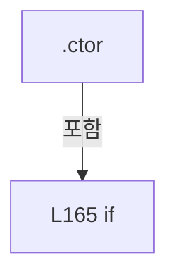

변경 전 점검: 입력/반환 타입, 위 호출자, 예외/취소 경로, 공유 상태와 저장·전송 소비자를 함께 확인합니다. 값의 단위나 물리 방향을 이름만으로 확정하지 않습니다.

### LocalFunctionStatement `BuildCMenuItem` · L172–175

[Drilling.UI/CRootView.cs:172–175](https://github.com/kjuws10-rgb/A3Drilling/blob/0219666f9053b907d96d7e0aa7d0c6c1be3a73d4/Drilling.UI/CRootView.cs#L172-L175)

| 항목 | 실제 추출 값 |
| --- | --- |
| 서명 | Drilling.UI.Menu.Menus.CMenuItem BuildCMenuItem(Drilling.UI.Menu.Menus.EN_MENU) |
| 접근/수식자 | Private /  |
| 반환/값 타입 | Drilling.UI.Menu.Menus.CMenuItem |
| 소속 타입 | NamedType:Drilling.UI.CRootView |

입력 계약:

| 이름 | 타입 | 전달 | 선택/기본값 |
| --- | --- | --- | --- |
| menu | Drilling.UI.Menu.Menus.EN_MENU | None | False /  |

현재 부분 분석에서 직접 연결된 호출자는 없습니다. XAML/이벤트/인터페이스·델리게이트·외부 진입을 추가 확인해야 하며, 미사용으로 판정한 것이 아닙니다.

호출하는 대상과 해석 범위:

| 원본 행 | 표현식 | 분석 상태 | 대상/소스 위치 |
| --- | --- | --- | --- |
| 174 | new CMenuItem | resolved | Drilling.UI.Menu.Menus.CMenuItem.CMenuItem(Drilling.UI.Menu.Menus.EN_MENU, string) · Drilling.UI/Menu/Menus/CMenuBase.cs:526 |
| 174 | GetMenuDisplayName | resolved | string Drilling.UI.CRootView.GetMenuDisplayName(Drilling.UI.Menu.Menus.EN_MENU) · Drilling.UI/CRootView.cs:2938 |

본문의 실제 연산·분기·예외·반환 순서(원문 위치 순):

| 원본 행 | 종류 | 주석 해설 |
| --- | --- | --- |
| 174 | call | 함수·델리게이트 또는 객체 생성자를 호출합니다: new CMenuItem(menu, GetMenuDisplayName(menu)) |
| 174 | call | 함수·델리게이트 또는 객체 생성자를 호출합니다: GetMenuDisplayName(menu) |
| 174 | return | 호출자에게 값 또는 제어를 반환합니다: return new CMenuItem(menu, GetMenuDisplayName(menu)); |

변경 전 점검: 입력/반환 타입, 위 호출자, 예외/취소 경로, 공유 상태와 저장·전송 소비자를 함께 확인합니다. 값의 단위나 물리 방향을 이름만으로 확정하지 않습니다.

### LocalFunctionStatement `StartCallback` · L186–189

[Drilling.UI/CRootView.cs:186–189](https://github.com/kjuws10-rgb/A3Drilling/blob/0219666f9053b907d96d7e0aa7d0c6c1be3a73d4/Drilling.UI/CRootView.cs#L186-L189)

| 항목 | 실제 추출 값 |
| --- | --- |
| 서명 | void StartCallback(object?) |
| 접근/수식자 | Private / async |
| 반환/값 타입 | void |
| 소속 타입 | NamedType:Drilling.UI.CRootView |

입력 계약:

| 이름 | 타입 | 전달 | 선택/기본값 |
| --- | --- | --- | --- |
| arg0 | object? | None | False /  |

현재 부분 분석에서 직접 연결된 호출자는 없습니다. XAML/이벤트/인터페이스·델리게이트·외부 진입을 추가 확인해야 하며, 미사용으로 판정한 것이 아닙니다.

호출하는 대상과 해석 범위:

| 원본 행 | 표현식 | 분석 상태 | 대상/소스 위치 |
| --- | --- | --- | --- |
| 188 | StartCycle | resolved | System.Threading.Tasks.Task Drilling.UI.CRootView.StartCycle() · Drilling.UI/CRootView.cs:1970 |

본문의 실제 연산·분기·예외·반환 순서(원문 위치 순):

| 원본 행 | 종류 | 주석 해설 |
| --- | --- | --- |
| 188 | await | 비동기 완료를 기다립니다: await StartCycle() |
| 188 | call | 함수·델리게이트 또는 객체 생성자를 호출합니다: StartCycle() |

변경 전 점검: 입력/반환 타입, 위 호출자, 예외/취소 경로, 공유 상태와 저장·전송 소비자를 함께 확인합니다. 값의 단위나 물리 방향을 이름만으로 확정하지 않습니다.

### LocalFunctionStatement `CanExecuteStartCommand` · L191–194

[Drilling.UI/CRootView.cs:191–194](https://github.com/kjuws10-rgb/A3Drilling/blob/0219666f9053b907d96d7e0aa7d0c6c1be3a73d4/Drilling.UI/CRootView.cs#L191-L194)

| 항목 | 실제 추출 값 |
| --- | --- |
| 서명 | bool CanExecuteStartCommand(object?) |
| 접근/수식자 | Private /  |
| 반환/값 타입 | bool |
| 소속 타입 | NamedType:Drilling.UI.CRootView |

입력 계약:

| 이름 | 타입 | 전달 | 선택/기본값 |
| --- | --- | --- | --- |
| arg0 | object? | None | False /  |

현재 부분 분석에서 직접 연결된 호출자는 없습니다. XAML/이벤트/인터페이스·델리게이트·외부 진입을 추가 확인해야 하며, 미사용으로 판정한 것이 아닙니다.

호출하는 대상과 해석 범위:

| 원본 행 | 표현식 | 분석 상태 | 대상/소스 위치 |
| --- | --- | --- | --- |
| 193 | CanStartAutoCycle | resolved | bool Drilling.UI.CRootView.CanStartAutoCycle() · Drilling.UI/CRootView.cs:535 |

본문의 실제 연산·분기·예외·반환 순서(원문 위치 순):

| 원본 행 | 종류 | 주석 해설 |
| --- | --- | --- |
| 193 | call | 함수·델리게이트 또는 객체 생성자를 호출합니다: CanStartAutoCycle() |
| 193 | return | 호출자에게 값 또는 제어를 반환합니다: return SelectedMenu.Menu == EN_MENU.Main && CanStartAutoCycle(); |

변경 전 점검: 입력/반환 타입, 위 호출자, 예외/취소 경로, 공유 상태와 저장·전송 소비자를 함께 확인합니다. 값의 단위나 물리 방향을 이름만으로 확정하지 않습니다.

### LocalFunctionStatement `StopCallback` · L197–200

[Drilling.UI/CRootView.cs:197–200](https://github.com/kjuws10-rgb/A3Drilling/blob/0219666f9053b907d96d7e0aa7d0c6c1be3a73d4/Drilling.UI/CRootView.cs#L197-L200)

| 항목 | 실제 추출 값 |
| --- | --- |
| 서명 | void StopCallback(object?) |
| 접근/수식자 | Private / async |
| 반환/값 타입 | void |
| 소속 타입 | NamedType:Drilling.UI.CRootView |

입력 계약:

| 이름 | 타입 | 전달 | 선택/기본값 |
| --- | --- | --- | --- |
| arg0 | object? | None | False /  |

현재 부분 분석에서 직접 연결된 호출자는 없습니다. XAML/이벤트/인터페이스·델리게이트·외부 진입을 추가 확인해야 하며, 미사용으로 판정한 것이 아닙니다.

호출하는 대상과 해석 범위:

| 원본 행 | 표현식 | 분석 상태 | 대상/소스 위치 |
| --- | --- | --- | --- |
| 199 | StopCycle | resolved | System.Threading.Tasks.Task Drilling.UI.CRootView.StopCycle() · Drilling.UI/CRootView.cs:2073 |

본문의 실제 연산·분기·예외·반환 순서(원문 위치 순):

| 원본 행 | 종류 | 주석 해설 |
| --- | --- | --- |
| 199 | await | 비동기 완료를 기다립니다: await StopCycle() |
| 199 | call | 함수·델리게이트 또는 객체 생성자를 호출합니다: StopCycle() |

변경 전 점검: 입력/반환 타입, 위 호출자, 예외/취소 경로, 공유 상태와 저장·전송 소비자를 함께 확인합니다. 값의 단위나 물리 방향을 이름만으로 확정하지 않습니다.

### LocalFunctionStatement `CanExecuteStopCommand` · L202–205

[Drilling.UI/CRootView.cs:202–205](https://github.com/kjuws10-rgb/A3Drilling/blob/0219666f9053b907d96d7e0aa7d0c6c1be3a73d4/Drilling.UI/CRootView.cs#L202-L205)

| 항목 | 실제 추출 값 |
| --- | --- |
| 서명 | bool CanExecuteStopCommand(object?) |
| 접근/수식자 | Private /  |
| 반환/값 타입 | bool |
| 소속 타입 | NamedType:Drilling.UI.CRootView |

입력 계약:

| 이름 | 타입 | 전달 | 선택/기본값 |
| --- | --- | --- | --- |
| arg0 | object? | None | False /  |

현재 부분 분석에서 직접 연결된 호출자는 없습니다. XAML/이벤트/인터페이스·델리게이트·외부 진입을 추가 확인해야 하며, 미사용으로 판정한 것이 아닙니다.

호출하는 대상과 해석 범위:

| 원본 행 | 표현식 | 분석 상태 | 대상/소스 위치 |
| --- | --- | --- | --- |
| 204 | CanStopAutoCycle | resolved | bool Drilling.UI.CRootView.CanStopAutoCycle() · Drilling.UI/CRootView.cs:540 |

본문의 실제 연산·분기·예외·반환 순서(원문 위치 순):

| 원본 행 | 종류 | 주석 해설 |
| --- | --- | --- |
| 204 | call | 함수·델리게이트 또는 객체 생성자를 호출합니다: CanStopAutoCycle() |
| 204 | return | 호출자에게 값 또는 제어를 반환합니다: return SelectedMenu.Menu == EN_MENU.Main && CanStopAutoCycle(); |

변경 전 점검: 입력/반환 타입, 위 호출자, 예외/취소 경로, 공유 상태와 저장·전송 소비자를 함께 확인합니다. 값의 단위나 물리 방향을 이름만으로 확정하지 않습니다.

### LocalFunctionStatement `SelectHeadCallback` · L208–211

[Drilling.UI/CRootView.cs:208–211](https://github.com/kjuws10-rgb/A3Drilling/blob/0219666f9053b907d96d7e0aa7d0c6c1be3a73d4/Drilling.UI/CRootView.cs#L208-L211)

| 항목 | 실제 추출 값 |
| --- | --- |
| 서명 | void SelectHeadCallback(object?) |
| 접근/수식자 | Private / async |
| 반환/값 타입 | void |
| 소속 타입 | NamedType:Drilling.UI.CRootView |

입력 계약:

| 이름 | 타입 | 전달 | 선택/기본값 |
| --- | --- | --- | --- |
| parameter | object? | None | False /  |

현재 부분 분석에서 직접 연결된 호출자는 없습니다. XAML/이벤트/인터페이스·델리게이트·외부 진입을 추가 확인해야 하며, 미사용으로 판정한 것이 아닙니다.

호출하는 대상과 해석 범위:

| 원본 행 | 표현식 | 분석 상태 | 대상/소스 위치 |
| --- | --- | --- | --- |
| 210 | SelectHead | resolved | System.Threading.Tasks.Task Drilling.UI.CRootView.SelectHead(object?) · Drilling.UI/CRootView.cs:2234 |

본문의 실제 연산·분기·예외·반환 순서(원문 위치 순):

| 원본 행 | 종류 | 주석 해설 |
| --- | --- | --- |
| 210 | await | 비동기 완료를 기다립니다: await SelectHead(parameter) |
| 210 | call | 함수·델리게이트 또는 객체 생성자를 호출합니다: SelectHead(parameter) |

변경 전 점검: 입력/반환 타입, 위 호출자, 예외/취소 경로, 공유 상태와 저장·전송 소비자를 함께 확인합니다. 값의 단위나 물리 방향을 이름만으로 확정하지 않습니다.

### LocalFunctionStatement `CanExecuteSelectHeadCommand` · L213–216

[Drilling.UI/CRootView.cs:213–216](https://github.com/kjuws10-rgb/A3Drilling/blob/0219666f9053b907d96d7e0aa7d0c6c1be3a73d4/Drilling.UI/CRootView.cs#L213-L216)

| 항목 | 실제 추출 값 |
| --- | --- |
| 서명 | bool CanExecuteSelectHeadCommand(object?) |
| 접근/수식자 | Private /  |
| 반환/값 타입 | bool |
| 소속 타입 | NamedType:Drilling.UI.CRootView |

입력 계약:

| 이름 | 타입 | 전달 | 선택/기본값 |
| --- | --- | --- | --- |
| parameter | object? | None | False /  |

현재 부분 분석에서 직접 연결된 호출자는 없습니다. XAML/이벤트/인터페이스·델리게이트·외부 진입을 추가 확인해야 하며, 미사용으로 판정한 것이 아닙니다.

호출하는 대상과 해석 범위:

| 원본 행 | 표현식 | 분석 상태 | 대상/소스 위치 |
| --- | --- | --- | --- |
| 215 | CanSelectHeadParameter | resolved | bool Drilling.UI.CRootView.CanSelectHeadParameter(object?) · Drilling.UI/CRootView.cs:2262 |

본문의 실제 연산·분기·예외·반환 순서(원문 위치 순):

| 원본 행 | 종류 | 주석 해설 |
| --- | --- | --- |
| 215 | call | 함수·델리게이트 또는 객체 생성자를 호출합니다: CanSelectHeadParameter(parameter) |
| 215 | return | 호출자에게 값 또는 제어를 반환합니다: return CanSelectHead && (parameter is null &#124;&#124; CanSelectHeadParameter(parameter)); |

변경 전 점검: 입력/반환 타입, 위 호출자, 예외/취소 경로, 공유 상태와 저장·전송 소비자를 함께 확인합니다. 값의 단위나 물리 방향을 이름만으로 확정하지 않습니다.

### LocalFunctionStatement `ToggleThemeCallback` · L219–222

[Drilling.UI/CRootView.cs:219–222](https://github.com/kjuws10-rgb/A3Drilling/blob/0219666f9053b907d96d7e0aa7d0c6c1be3a73d4/Drilling.UI/CRootView.cs#L219-L222)

| 항목 | 실제 추출 값 |
| --- | --- |
| 서명 | void ToggleThemeCallback(object?) |
| 접근/수식자 | Private / async |
| 반환/값 타입 | void |
| 소속 타입 | NamedType:Drilling.UI.CRootView |

입력 계약:

| 이름 | 타입 | 전달 | 선택/기본값 |
| --- | --- | --- | --- |
| arg0 | object? | None | False /  |

현재 부분 분석에서 직접 연결된 호출자는 없습니다. XAML/이벤트/인터페이스·델리게이트·외부 진입을 추가 확인해야 하며, 미사용으로 판정한 것이 아닙니다.

호출하는 대상과 해석 범위:

| 원본 행 | 표현식 | 분석 상태 | 대상/소스 위치 |
| --- | --- | --- | --- |
| 221 | ToggleTheme | resolved | System.Threading.Tasks.Task Drilling.UI.CRootView.ToggleTheme() · Drilling.UI/CRootView.cs:687 |

본문의 실제 연산·분기·예외·반환 순서(원문 위치 순):

| 원본 행 | 종류 | 주석 해설 |
| --- | --- | --- |
| 221 | await | 비동기 완료를 기다립니다: await ToggleTheme() |
| 221 | call | 함수·델리게이트 또는 객체 생성자를 호출합니다: ToggleTheme() |

변경 전 점검: 입력/반환 타입, 위 호출자, 예외/취소 경로, 공유 상태와 저장·전송 소비자를 함께 확인합니다. 값의 단위나 물리 방향을 이름만으로 확정하지 않습니다.

### LocalFunctionStatement `ToggleOperationModeCallback` · L226–229

[Drilling.UI/CRootView.cs:226–229](https://github.com/kjuws10-rgb/A3Drilling/blob/0219666f9053b907d96d7e0aa7d0c6c1be3a73d4/Drilling.UI/CRootView.cs#L226-L229)

| 항목 | 실제 추출 값 |
| --- | --- |
| 서명 | void ToggleOperationModeCallback(object?) |
| 접근/수식자 | Private / async |
| 반환/값 타입 | void |
| 소속 타입 | NamedType:Drilling.UI.CRootView |

입력 계약:

| 이름 | 타입 | 전달 | 선택/기본값 |
| --- | --- | --- | --- |
| arg0 | object? | None | False /  |

현재 부분 분석에서 직접 연결된 호출자는 없습니다. XAML/이벤트/인터페이스·델리게이트·외부 진입을 추가 확인해야 하며, 미사용으로 판정한 것이 아닙니다.

호출하는 대상과 해석 범위:

| 원본 행 | 표현식 | 분석 상태 | 대상/소스 위치 |
| --- | --- | --- | --- |
| 228 | ToggleOperationMode | resolved | System.Threading.Tasks.Task Drilling.UI.CRootView.ToggleOperationMode(System.Func<string, string, bool>?, System.Action<string, string>?) · Drilling.UI/CRootView.cs:697 |

본문의 실제 연산·분기·예외·반환 순서(원문 위치 순):

| 원본 행 | 종류 | 주석 해설 |
| --- | --- | --- |
| 228 | await | 비동기 완료를 기다립니다: await ToggleOperationMode() |
| 228 | call | 함수·델리게이트 또는 객체 생성자를 호출합니다: ToggleOperationMode() |

변경 전 점검: 입력/반환 타입, 위 호출자, 예외/취소 경로, 공유 상태와 저장·전송 소비자를 함께 확인합니다. 값의 단위나 물리 방향을 이름만으로 확정하지 않습니다.

### LocalFunctionStatement `CanExecuteToggleOperationModeCommand` · L231–234

[Drilling.UI/CRootView.cs:231–234](https://github.com/kjuws10-rgb/A3Drilling/blob/0219666f9053b907d96d7e0aa7d0c6c1be3a73d4/Drilling.UI/CRootView.cs#L231-L234)

| 항목 | 실제 추출 값 |
| --- | --- |
| 서명 | bool CanExecuteToggleOperationModeCommand(object?) |
| 접근/수식자 | Private /  |
| 반환/값 타입 | bool |
| 소속 타입 | NamedType:Drilling.UI.CRootView |

입력 계약:

| 이름 | 타입 | 전달 | 선택/기본값 |
| --- | --- | --- | --- |
| arg0 | object? | None | False /  |

현재 부분 분석에서 직접 연결된 호출자는 없습니다. XAML/이벤트/인터페이스·델리게이트·외부 진입을 추가 확인해야 하며, 미사용으로 판정한 것이 아닙니다.

본문의 실제 연산·분기·예외·반환 순서(원문 위치 순):

| 원본 행 | 종류 | 주석 해설 |
| --- | --- | --- |
| 233 | return | 호출자에게 값 또는 제어를 반환합니다: return !_pmLockStatus.IsLocked && _autoCycleState == EN_AUTO_CYCLE_STATE.Ready && !_isAutoSequenceInitializing; |

변경 전 점검: 입력/반환 타입, 위 호출자, 예외/취소 경로, 공유 상태와 저장·전송 소비자를 함께 확인합니다. 값의 단위나 물리 방향을 이름만으로 확정하지 않습니다.

### LocalFunctionStatement `InitializeAutoSequenceCallback` · L237–240

[Drilling.UI/CRootView.cs:237–240](https://github.com/kjuws10-rgb/A3Drilling/blob/0219666f9053b907d96d7e0aa7d0c6c1be3a73d4/Drilling.UI/CRootView.cs#L237-L240)

| 항목 | 실제 추출 값 |
| --- | --- |
| 서명 | void InitializeAutoSequenceCallback(object?) |
| 접근/수식자 | Private / async |
| 반환/값 타입 | void |
| 소속 타입 | NamedType:Drilling.UI.CRootView |

입력 계약:

| 이름 | 타입 | 전달 | 선택/기본값 |
| --- | --- | --- | --- |
| arg0 | object? | None | False /  |

현재 부분 분석에서 직접 연결된 호출자는 없습니다. XAML/이벤트/인터페이스·델리게이트·외부 진입을 추가 확인해야 하며, 미사용으로 판정한 것이 아닙니다.

호출하는 대상과 해석 범위:

| 원본 행 | 표현식 | 분석 상태 | 대상/소스 위치 |
| --- | --- | --- | --- |
| 239 | InitializeAutoSequence | resolved | System.Threading.Tasks.Task Drilling.UI.CRootView.InitializeAutoSequence() · Drilling.UI/CRootView.cs:758 |

본문의 실제 연산·분기·예외·반환 순서(원문 위치 순):

| 원본 행 | 종류 | 주석 해설 |
| --- | --- | --- |
| 239 | await | 비동기 완료를 기다립니다: await InitializeAutoSequence() |
| 239 | call | 함수·델리게이트 또는 객체 생성자를 호출합니다: InitializeAutoSequence() |

변경 전 점검: 입력/반환 타입, 위 호출자, 예외/취소 경로, 공유 상태와 저장·전송 소비자를 함께 확인합니다. 값의 단위나 물리 방향을 이름만으로 확정하지 않습니다.

### LocalFunctionStatement `CanExecuteInitializeAutoSequenceCommand` · L242–247

[Drilling.UI/CRootView.cs:242–247](https://github.com/kjuws10-rgb/A3Drilling/blob/0219666f9053b907d96d7e0aa7d0c6c1be3a73d4/Drilling.UI/CRootView.cs#L242-L247)

| 항목 | 실제 추출 값 |
| --- | --- |
| 서명 | bool CanExecuteInitializeAutoSequenceCommand(object?) |
| 접근/수식자 | Private /  |
| 반환/값 타입 | bool |
| 소속 타입 | NamedType:Drilling.UI.CRootView |

입력 계약:

| 이름 | 타입 | 전달 | 선택/기본값 |
| --- | --- | --- | --- |
| arg0 | object? | None | False /  |

현재 부분 분석에서 직접 연결된 호출자는 없습니다. XAML/이벤트/인터페이스·델리게이트·외부 진입을 추가 확인해야 하며, 미사용으로 판정한 것이 아닙니다.

본문의 실제 연산·분기·예외·반환 순서(원문 위치 순):

| 원본 행 | 종류 | 주석 해설 |
| --- | --- | --- |
| 244 | return | 호출자에게 값 또는 제어를 반환합니다: return _operationMode == EN_SYSTEM_MODE.Auto && _autoCycleState == EN_AUTO_CYCLE_STATE.Ready && !_isAutoSequenceInitializing; |

변경 전 점검: 입력/반환 타입, 위 호출자, 예외/취소 경로, 공유 상태와 저장·전송 소비자를 함께 확인합니다. 값의 단위나 물리 방향을 이름만으로 확정하지 않습니다.

### EnumMemberDeclaration `Ready` · L268–268

[Drilling.UI/CRootView.cs:268–268](https://github.com/kjuws10-rgb/A3Drilling/blob/0219666f9053b907d96d7e0aa7d0c6c1be3a73d4/Drilling.UI/CRootView.cs#L268-L268)

| 항목 | 실제 추출 값 |
| --- | --- |
| 서명 | Drilling.UI.CRootView.EN_AUTO_CYCLE_STATE.Ready |
| 접근/수식자 | Public /  |
| 반환/값 타입 | Drilling.UI.CRootView.EN_AUTO_CYCLE_STATE |
| 소속 타입 | NamedType:Drilling.UI.CRootView.EN_AUTO_CYCLE_STATE |

현재 부분 분석에서 직접 연결된 호출자는 없습니다. XAML/이벤트/인터페이스·델리게이트·외부 진입을 추가 확인해야 하며, 미사용으로 판정한 것이 아닙니다.

변경 전 점검: 입력/반환 타입, 위 호출자, 예외/취소 경로, 공유 상태와 저장·전송 소비자를 함께 확인합니다. 값의 단위나 물리 방향을 이름만으로 확정하지 않습니다.

### EnumMemberDeclaration `Preparing` · L269–269

[Drilling.UI/CRootView.cs:269–269](https://github.com/kjuws10-rgb/A3Drilling/blob/0219666f9053b907d96d7e0aa7d0c6c1be3a73d4/Drilling.UI/CRootView.cs#L269-L269)

| 항목 | 실제 추출 값 |
| --- | --- |
| 서명 | Drilling.UI.CRootView.EN_AUTO_CYCLE_STATE.Preparing |
| 접근/수식자 | Public /  |
| 반환/값 타입 | Drilling.UI.CRootView.EN_AUTO_CYCLE_STATE |
| 소속 타입 | NamedType:Drilling.UI.CRootView.EN_AUTO_CYCLE_STATE |

현재 부분 분석에서 직접 연결된 호출자는 없습니다. XAML/이벤트/인터페이스·델리게이트·외부 진입을 추가 확인해야 하며, 미사용으로 판정한 것이 아닙니다.

변경 전 점검: 입력/반환 타입, 위 호출자, 예외/취소 경로, 공유 상태와 저장·전송 소비자를 함께 확인합니다. 값의 단위나 물리 방향을 이름만으로 확정하지 않습니다.

### EnumMemberDeclaration `Running` · L270–270

[Drilling.UI/CRootView.cs:270–270](https://github.com/kjuws10-rgb/A3Drilling/blob/0219666f9053b907d96d7e0aa7d0c6c1be3a73d4/Drilling.UI/CRootView.cs#L270-L270)

| 항목 | 실제 추출 값 |
| --- | --- |
| 서명 | Drilling.UI.CRootView.EN_AUTO_CYCLE_STATE.Running |
| 접근/수식자 | Public /  |
| 반환/값 타입 | Drilling.UI.CRootView.EN_AUTO_CYCLE_STATE |
| 소속 타입 | NamedType:Drilling.UI.CRootView.EN_AUTO_CYCLE_STATE |

현재 부분 분석에서 직접 연결된 호출자는 없습니다. XAML/이벤트/인터페이스·델리게이트·외부 진입을 추가 확인해야 하며, 미사용으로 판정한 것이 아닙니다.

변경 전 점검: 입력/반환 타입, 위 호출자, 예외/취소 경로, 공유 상태와 저장·전송 소비자를 함께 확인합니다. 값의 단위나 물리 방향을 이름만으로 확정하지 않습니다.

### EnumMemberDeclaration `Stopping` · L271–271

[Drilling.UI/CRootView.cs:271–271](https://github.com/kjuws10-rgb/A3Drilling/blob/0219666f9053b907d96d7e0aa7d0c6c1be3a73d4/Drilling.UI/CRootView.cs#L271-L271)

| 항목 | 실제 추출 값 |
| --- | --- |
| 서명 | Drilling.UI.CRootView.EN_AUTO_CYCLE_STATE.Stopping |
| 접근/수식자 | Public /  |
| 반환/값 타입 | Drilling.UI.CRootView.EN_AUTO_CYCLE_STATE |
| 소속 타입 | NamedType:Drilling.UI.CRootView.EN_AUTO_CYCLE_STATE |

현재 부분 분석에서 직접 연결된 호출자는 없습니다. XAML/이벤트/인터페이스·델리게이트·외부 진입을 추가 확인해야 하며, 미사용으로 판정한 것이 아닙니다.

변경 전 점검: 입력/반환 타입, 위 호출자, 예외/취소 경로, 공유 상태와 저장·전송 소비자를 함께 확인합니다. 값의 단위나 물리 방향을 이름만으로 확정하지 않습니다.

### MethodDeclaration `StopAutomationStatusAcquisition` · L274–285

[Drilling.UI/CRootView.cs:274–285](https://github.com/kjuws10-rgb/A3Drilling/blob/0219666f9053b907d96d7e0aa7d0c6c1be3a73d4/Drilling.UI/CRootView.cs#L274-L285)

| 항목 | 실제 추출 값 |
| --- | --- |
| 서명 | void Drilling.UI.CRootView.StopAutomationStatusAcquisition() |
| 접근/수식자 | Public / public |
| 반환/값 타입 | void |
| 소속 타입 | NamedType:Drilling.UI.CRootView |

정적 호출자로 확인된 위치:

| 호출 파일/행 | 호출 표현식 | 런타임 분기 가능 |
| --- | --- | --- |
| [Drilling.UI/CApp.xaml.cs:49–49](https://github.com/kjuws10-rgb/A3Drilling/blob/0219666f9053b907d96d7e0aa7d0c6c1be3a73d4/Drilling.UI/CApp.xaml.cs#L49-L49) | .StopAutomationStatusAcquisition | False |

호출하는 대상과 해석 범위:

| 원본 행 | 표현식 | 분석 상태 | 대상/소스 위치 |
| --- | --- | --- | --- |
| 278 | _screenBuildCts.Cancel | resolved | void System.Threading.CancellationTokenSource.Cancel() |
| 280 | .Dispose | resolved | void Drilling.UI.Popup.CProtectWindowRequestNotice.Dispose() · Drilling.UI/Popup/CProtectWindowRequestDialog.xaml.cs:110 |
| 281 | .Close | unresolved | None |
| 282 | .Close | unresolved | None |
| 284 | _manager.StopBackgroundMonitoring().GetAwaiter().GetResult | resolved | void System.Runtime.CompilerServices.TaskAwaiter.GetResult() |
| 284 | _manager.StopBackgroundMonitoring().GetAwaiter | resolved | System.Runtime.CompilerServices.TaskAwaiter System.Threading.Tasks.Task.GetAwaiter() |
| 284 | _manager.StopBackgroundMonitoring | resolved | System.Threading.Tasks.Task Drilling.Common.Managers.CManager.StopBackgroundMonitoring() · Drilling.Common/Managers/CManager.cs:278 |

본문의 실제 연산·분기·예외·반환 순서(원문 위치 순):

| 원본 행 | 종류 | 주석 해설 |
| --- | --- | --- |
| 276 | lock | 공유 상태의 임계 구역에 진입합니다: lock (_screenBuildSync) |
| 278 | call | 함수·델리게이트 또는 객체 생성자를 호출합니다: _screenBuildCts.Cancel() |
| 280 | call | 함수·델리게이트 또는 객체 생성자를 호출합니다: .Dispose() |
| 281 | call | 함수·델리게이트 또는 객체 생성자를 호출합니다: .Close() |
| 282 | call | 함수·델리게이트 또는 객체 생성자를 호출합니다: .Close() |
| 283 | compound-assignment-or-event-subscription | 복합 대입 또는 이벤트 구독/해지 표현입니다: _alarmManager.CurrentChanged -= OnCurrentAlarmsChanged |
| 284 | call | 함수·델리게이트 또는 객체 생성자를 호출합니다: _manager.StopBackgroundMonitoring().GetAwaiter().GetResult() |
| 284 | call | 함수·델리게이트 또는 객체 생성자를 호출합니다: _manager.StopBackgroundMonitoring().GetAwaiter() |
| 284 | call | 함수·델리게이트 또는 객체 생성자를 호출합니다: _manager.StopBackgroundMonitoring() |

제어 구문의 포함 구조(실제 실행 순서/CFG가 아닌 구문 탐색 그림):

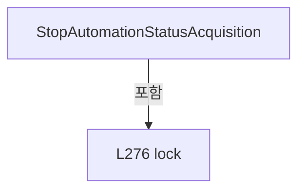

변경 전 점검: 입력/반환 타입, 위 호출자, 예외/취소 경로, 공유 상태와 저장·전송 소비자를 함께 확인합니다. 값의 단위나 물리 방향을 이름만으로 확정하지 않습니다.

### PropertyDeclaration `Menus` · L287–287

[Drilling.UI/CRootView.cs:287–287](https://github.com/kjuws10-rgb/A3Drilling/blob/0219666f9053b907d96d7e0aa7d0c6c1be3a73d4/Drilling.UI/CRootView.cs#L287-L287)

| 항목 | 실제 추출 값 |
| --- | --- |
| 서명 | System.Collections.ObjectModel.ObservableCollection<Drilling.UI.Menu.Menus.CMenuItem> Drilling.UI.CRootView.Menus |
| 접근/수식자 | Public / public |
| 반환/값 타입 | System.Collections.ObjectModel.ObservableCollection<Drilling.UI.Menu.Menus.CMenuItem> |
| 소속 타입 | NamedType:Drilling.UI.CRootView |

현재 부분 분석에서 직접 연결된 호출자는 없습니다. XAML/이벤트/인터페이스·델리게이트·외부 진입을 추가 확인해야 하며, 미사용으로 판정한 것이 아닙니다.

변경 전 점검: 입력/반환 타입, 위 호출자, 예외/취소 경로, 공유 상태와 저장·전송 소비자를 함께 확인합니다. 값의 단위나 물리 방향을 이름만으로 확정하지 않습니다.

### GetAccessorDeclaration `get_Menus` · L287–287

[Drilling.UI/CRootView.cs:287–287](https://github.com/kjuws10-rgb/A3Drilling/blob/0219666f9053b907d96d7e0aa7d0c6c1be3a73d4/Drilling.UI/CRootView.cs#L287-L287)

| 항목 | 실제 추출 값 |
| --- | --- |
| 서명 | System.Collections.ObjectModel.ObservableCollection<Drilling.UI.Menu.Menus.CMenuItem> Drilling.UI.CRootView.Menus.get |
| 접근/수식자 | Public / get |
| 반환/값 타입 | System.Collections.ObjectModel.ObservableCollection<Drilling.UI.Menu.Menus.CMenuItem> |
| 소속 타입 | NamedType:Drilling.UI.CRootView |

현재 부분 분석에서 직접 연결된 호출자는 없습니다. XAML/이벤트/인터페이스·델리게이트·외부 진입을 추가 확인해야 하며, 미사용으로 판정한 것이 아닙니다.

변경 전 점검: 입력/반환 타입, 위 호출자, 예외/취소 경로, 공유 상태와 저장·전송 소비자를 함께 확인합니다. 값의 단위나 물리 방향을 이름만으로 확정하지 않습니다.

### PropertyDeclaration `HeaderStatusItems` · L288–288

[Drilling.UI/CRootView.cs:288–288](https://github.com/kjuws10-rgb/A3Drilling/blob/0219666f9053b907d96d7e0aa7d0c6c1be3a73d4/Drilling.UI/CRootView.cs#L288-L288)

| 항목 | 실제 추출 값 |
| --- | --- |
| 서명 | System.Collections.ObjectModel.ObservableCollection<Drilling.UI.Menu.Menus.ST_HEADER_STATUS_ITEM> Drilling.UI.CRootView.HeaderStatusItems |
| 접근/수식자 | Public / public |
| 반환/값 타입 | System.Collections.ObjectModel.ObservableCollection<Drilling.UI.Menu.Menus.ST_HEADER_STATUS_ITEM> |
| 소속 타입 | NamedType:Drilling.UI.CRootView |

현재 부분 분석에서 직접 연결된 호출자는 없습니다. XAML/이벤트/인터페이스·델리게이트·외부 진입을 추가 확인해야 하며, 미사용으로 판정한 것이 아닙니다.

변경 전 점검: 입력/반환 타입, 위 호출자, 예외/취소 경로, 공유 상태와 저장·전송 소비자를 함께 확인합니다. 값의 단위나 물리 방향을 이름만으로 확정하지 않습니다.

### GetAccessorDeclaration `get_HeaderStatusItems` · L288–288

[Drilling.UI/CRootView.cs:288–288](https://github.com/kjuws10-rgb/A3Drilling/blob/0219666f9053b907d96d7e0aa7d0c6c1be3a73d4/Drilling.UI/CRootView.cs#L288-L288)

| 항목 | 실제 추출 값 |
| --- | --- |
| 서명 | System.Collections.ObjectModel.ObservableCollection<Drilling.UI.Menu.Menus.ST_HEADER_STATUS_ITEM> Drilling.UI.CRootView.HeaderStatusItems.get |
| 접근/수식자 | Public / get |
| 반환/값 타입 | System.Collections.ObjectModel.ObservableCollection<Drilling.UI.Menu.Menus.ST_HEADER_STATUS_ITEM> |
| 소속 타입 | NamedType:Drilling.UI.CRootView |

현재 부분 분석에서 직접 연결된 호출자는 없습니다. XAML/이벤트/인터페이스·델리게이트·외부 진입을 추가 확인해야 하며, 미사용으로 판정한 것이 아닙니다.

변경 전 점검: 입력/반환 타입, 위 호출자, 예외/취소 경로, 공유 상태와 저장·전송 소비자를 함께 확인합니다. 값의 단위나 물리 방향을 이름만으로 확정하지 않습니다.

### PropertyDeclaration `HeaderContextStatusItems` · L289–289

[Drilling.UI/CRootView.cs:289–289](https://github.com/kjuws10-rgb/A3Drilling/blob/0219666f9053b907d96d7e0aa7d0c6c1be3a73d4/Drilling.UI/CRootView.cs#L289-L289)

| 항목 | 실제 추출 값 |
| --- | --- |
| 서명 | System.Collections.ObjectModel.ObservableCollection<Drilling.UI.Menu.Menus.ST_HEADER_STATUS_ITEM> Drilling.UI.CRootView.HeaderContextStatusItems |
| 접근/수식자 | Public / public |
| 반환/값 타입 | System.Collections.ObjectModel.ObservableCollection<Drilling.UI.Menu.Menus.ST_HEADER_STATUS_ITEM> |
| 소속 타입 | NamedType:Drilling.UI.CRootView |

현재 부분 분석에서 직접 연결된 호출자는 없습니다. XAML/이벤트/인터페이스·델리게이트·외부 진입을 추가 확인해야 하며, 미사용으로 판정한 것이 아닙니다.

변경 전 점검: 입력/반환 타입, 위 호출자, 예외/취소 경로, 공유 상태와 저장·전송 소비자를 함께 확인합니다. 값의 단위나 물리 방향을 이름만으로 확정하지 않습니다.

### GetAccessorDeclaration `get_HeaderContextStatusItems` · L289–289

[Drilling.UI/CRootView.cs:289–289](https://github.com/kjuws10-rgb/A3Drilling/blob/0219666f9053b907d96d7e0aa7d0c6c1be3a73d4/Drilling.UI/CRootView.cs#L289-L289)

| 항목 | 실제 추출 값 |
| --- | --- |
| 서명 | System.Collections.ObjectModel.ObservableCollection<Drilling.UI.Menu.Menus.ST_HEADER_STATUS_ITEM> Drilling.UI.CRootView.HeaderContextStatusItems.get |
| 접근/수식자 | Public / get |
| 반환/값 타입 | System.Collections.ObjectModel.ObservableCollection<Drilling.UI.Menu.Menus.ST_HEADER_STATUS_ITEM> |
| 소속 타입 | NamedType:Drilling.UI.CRootView |

현재 부분 분석에서 직접 연결된 호출자는 없습니다. XAML/이벤트/인터페이스·델리게이트·외부 진입을 추가 확인해야 하며, 미사용으로 판정한 것이 아닙니다.

변경 전 점검: 입력/반환 타입, 위 호출자, 예외/취소 경로, 공유 상태와 저장·전송 소비자를 함께 확인합니다. 값의 단위나 물리 방향을 이름만으로 확정하지 않습니다.

### PropertyDeclaration `HeaderCommunicationStatusItems` · L290–290

[Drilling.UI/CRootView.cs:290–290](https://github.com/kjuws10-rgb/A3Drilling/blob/0219666f9053b907d96d7e0aa7d0c6c1be3a73d4/Drilling.UI/CRootView.cs#L290-L290)

| 항목 | 실제 추출 값 |
| --- | --- |
| 서명 | System.Collections.ObjectModel.ObservableCollection<Drilling.UI.Menu.Menus.ST_HEADER_STATUS_ITEM> Drilling.UI.CRootView.HeaderCommunicationStatusItems |
| 접근/수식자 | Public / public |
| 반환/값 타입 | System.Collections.ObjectModel.ObservableCollection<Drilling.UI.Menu.Menus.ST_HEADER_STATUS_ITEM> |
| 소속 타입 | NamedType:Drilling.UI.CRootView |

현재 부분 분석에서 직접 연결된 호출자는 없습니다. XAML/이벤트/인터페이스·델리게이트·외부 진입을 추가 확인해야 하며, 미사용으로 판정한 것이 아닙니다.

변경 전 점검: 입력/반환 타입, 위 호출자, 예외/취소 경로, 공유 상태와 저장·전송 소비자를 함께 확인합니다. 값의 단위나 물리 방향을 이름만으로 확정하지 않습니다.

### GetAccessorDeclaration `get_HeaderCommunicationStatusItems` · L290–290

[Drilling.UI/CRootView.cs:290–290](https://github.com/kjuws10-rgb/A3Drilling/blob/0219666f9053b907d96d7e0aa7d0c6c1be3a73d4/Drilling.UI/CRootView.cs#L290-L290)

| 항목 | 실제 추출 값 |
| --- | --- |
| 서명 | System.Collections.ObjectModel.ObservableCollection<Drilling.UI.Menu.Menus.ST_HEADER_STATUS_ITEM> Drilling.UI.CRootView.HeaderCommunicationStatusItems.get |
| 접근/수식자 | Public / get |
| 반환/값 타입 | System.Collections.ObjectModel.ObservableCollection<Drilling.UI.Menu.Menus.ST_HEADER_STATUS_ITEM> |
| 소속 타입 | NamedType:Drilling.UI.CRootView |

현재 부분 분석에서 직접 연결된 호출자는 없습니다. XAML/이벤트/인터페이스·델리게이트·외부 진입을 추가 확인해야 하며, 미사용으로 판정한 것이 아닙니다.

변경 전 점검: 입력/반환 타입, 위 호출자, 예외/취소 경로, 공유 상태와 저장·전송 소비자를 함께 확인합니다. 값의 단위나 물리 방향을 이름만으로 확정하지 않습니다.

### PropertyDeclaration `FooterStatusItems` · L291–291

[Drilling.UI/CRootView.cs:291–291](https://github.com/kjuws10-rgb/A3Drilling/blob/0219666f9053b907d96d7e0aa7d0c6c1be3a73d4/Drilling.UI/CRootView.cs#L291-L291)

| 항목 | 실제 추출 값 |
| --- | --- |
| 서명 | System.Collections.ObjectModel.ObservableCollection<Drilling.UI.Menu.Menus.ST_HEADER_STATUS_ITEM> Drilling.UI.CRootView.FooterStatusItems |
| 접근/수식자 | Public / public |
| 반환/값 타입 | System.Collections.ObjectModel.ObservableCollection<Drilling.UI.Menu.Menus.ST_HEADER_STATUS_ITEM> |
| 소속 타입 | NamedType:Drilling.UI.CRootView |

현재 부분 분석에서 직접 연결된 호출자는 없습니다. XAML/이벤트/인터페이스·델리게이트·외부 진입을 추가 확인해야 하며, 미사용으로 판정한 것이 아닙니다.

변경 전 점검: 입력/반환 타입, 위 호출자, 예외/취소 경로, 공유 상태와 저장·전송 소비자를 함께 확인합니다. 값의 단위나 물리 방향을 이름만으로 확정하지 않습니다.

### GetAccessorDeclaration `get_FooterStatusItems` · L291–291

[Drilling.UI/CRootView.cs:291–291](https://github.com/kjuws10-rgb/A3Drilling/blob/0219666f9053b907d96d7e0aa7d0c6c1be3a73d4/Drilling.UI/CRootView.cs#L291-L291)

| 항목 | 실제 추출 값 |
| --- | --- |
| 서명 | System.Collections.ObjectModel.ObservableCollection<Drilling.UI.Menu.Menus.ST_HEADER_STATUS_ITEM> Drilling.UI.CRootView.FooterStatusItems.get |
| 접근/수식자 | Public / get |
| 반환/값 타입 | System.Collections.ObjectModel.ObservableCollection<Drilling.UI.Menu.Menus.ST_HEADER_STATUS_ITEM> |
| 소속 타입 | NamedType:Drilling.UI.CRootView |

현재 부분 분석에서 직접 연결된 호출자는 없습니다. XAML/이벤트/인터페이스·델리게이트·외부 진입을 추가 확인해야 하며, 미사용으로 판정한 것이 아닙니다.

변경 전 점검: 입력/반환 타입, 위 호출자, 예외/취소 경로, 공유 상태와 저장·전송 소비자를 함께 확인합니다. 값의 단위나 물리 방향을 이름만으로 확정하지 않습니다.

### PropertyDeclaration `SelectedMenu` · L293–382

[Drilling.UI/CRootView.cs:293–382](https://github.com/kjuws10-rgb/A3Drilling/blob/0219666f9053b907d96d7e0aa7d0c6c1be3a73d4/Drilling.UI/CRootView.cs#L293-L382)

| 항목 | 실제 추출 값 |
| --- | --- |
| 서명 | Drilling.UI.Menu.Menus.CMenuItem Drilling.UI.CRootView.SelectedMenu |
| 접근/수식자 | Public / public |
| 반환/값 타입 | Drilling.UI.Menu.Menus.CMenuItem |
| 소속 타입 | NamedType:Drilling.UI.CRootView |

현재 부분 분석에서 직접 연결된 호출자는 없습니다. XAML/이벤트/인터페이스·델리게이트·외부 진입을 추가 확인해야 하며, 미사용으로 판정한 것이 아닙니다.

변경 전 점검: 입력/반환 타입, 위 호출자, 예외/취소 경로, 공유 상태와 저장·전송 소비자를 함께 확인합니다. 값의 단위나 물리 방향을 이름만으로 확정하지 않습니다.

### GetAccessorDeclaration `get_SelectedMenu` · L295–298

[Drilling.UI/CRootView.cs:295–298](https://github.com/kjuws10-rgb/A3Drilling/blob/0219666f9053b907d96d7e0aa7d0c6c1be3a73d4/Drilling.UI/CRootView.cs#L295-L298)

| 항목 | 실제 추출 값 |
| --- | --- |
| 서명 | Drilling.UI.Menu.Menus.CMenuItem Drilling.UI.CRootView.SelectedMenu.get |
| 접근/수식자 | Public / get |
| 반환/값 타입 | Drilling.UI.Menu.Menus.CMenuItem |
| 소속 타입 | NamedType:Drilling.UI.CRootView |

현재 부분 분석에서 직접 연결된 호출자는 없습니다. XAML/이벤트/인터페이스·델리게이트·외부 진입을 추가 확인해야 하며, 미사용으로 판정한 것이 아닙니다.

본문의 실제 연산·분기·예외·반환 순서(원문 위치 순):

| 원본 행 | 종류 | 주석 해설 |
| --- | --- | --- |
| 297 | return | 호출자에게 값 또는 제어를 반환합니다: return _selectedMenu; |

변경 전 점검: 입력/반환 타입, 위 호출자, 예외/취소 경로, 공유 상태와 저장·전송 소비자를 함께 확인합니다. 값의 단위나 물리 방향을 이름만으로 확정하지 않습니다.

### SetAccessorDeclaration `set_SelectedMenu` · L300–381

[Drilling.UI/CRootView.cs:300–381](https://github.com/kjuws10-rgb/A3Drilling/blob/0219666f9053b907d96d7e0aa7d0c6c1be3a73d4/Drilling.UI/CRootView.cs#L300-L381)

| 항목 | 실제 추출 값 |
| --- | --- |
| 서명 | void Drilling.UI.CRootView.SelectedMenu.set |
| 접근/수식자 | Public / set |
| 반환/값 타입 | void |
| 소속 타입 | NamedType:Drilling.UI.CRootView |

입력 계약:

| 이름 | 타입 | 전달 | 선택/기본값 |
| --- | --- | --- | --- |
| value | Drilling.UI.Menu.Menus.CMenuItem | None | False /  |

현재 부분 분석에서 직접 연결된 호출자는 없습니다. XAML/이벤트/인터페이스·델리게이트·외부 진입을 추가 확인해야 하며, 미사용으로 판정한 것이 아닙니다.

호출하는 대상과 해석 범위:

| 원본 행 | 표현식 | 분석 상태 | 대상/소스 위치 |
| --- | --- | --- | --- |
| 304 | RequestPmUnlockForNavigation | resolved | void Drilling.UI.CRootView.RequestPmUnlockForNavigation(Drilling.UI.Menu.Menus.CMenuItem) · Drilling.UI/CRootView.cs:1388 |
| 312 | TryEnterPmLock | resolved | bool Drilling.UI.CRootView.TryEnterPmLock() · Drilling.UI/CRootView.cs:1272 |
| 314 | OnPropertyChanged | resolved | void Drilling.UI.Menu.CBindingBase.OnPropertyChanged(string?) · Drilling.UI/Menu/CBindingBase.cs:790 |
| 314 | nameof | unresolved | None |
| 318 | IsReviewNavigationLocked | resolved | bool Drilling.UI.CRootView.IsReviewNavigationLocked(Drilling.UI.Menu.Menus.EN_MENU) · Drilling.UI/CRootView.cs:851 |
| 321 | OnPropertyChanged | resolved | void Drilling.UI.Menu.CBindingBase.OnPropertyChanged(string?) · Drilling.UI/Menu/CBindingBase.cs:790 |
| 321 | nameof | unresolved | None |
| 322 | CRecipeConfirmDialog.ShowWarning | resolved | void Drilling.UI.Popup.CRecipeConfirmDialog.ShowWarning(string, string, Window?) · Drilling.UI/Popup/CRecipeConfirmDialog.xaml.cs:110 |
| 326 | CanAccessMenu | resolved | bool Drilling.UI.CRootView.CanAccessMenu(Drilling.UI.Menu.Menus.EN_MENU) · Drilling.UI/CRootView.cs:839 |
| 331 | CRecipeConfirmDialog.ShowWarning | resolved | void Drilling.UI.Popup.CRecipeConfirmDialog.ShowWarning(string, string, Window?) · Drilling.UI/Popup/CRecipeConfirmDialog.xaml.cs:110 |
| 334 | OnPropertyChanged | resolved | void Drilling.UI.Menu.CBindingBase.OnPropertyChanged(string?) · Drilling.UI/Menu/CBindingBase.cs:790 |
| 334 | nameof | unresolved | None |
| 339 | SetProperty | resolved | bool Drilling.UI.Menu.CBindingBase.SetProperty<Drilling.UI.Menu.Menus.CMenuItem>(ref Drilling.UI.Menu.Menus.CMenuItem, Drilling.UI.Menu.Menus.CMenuItem, string?) · Drilling.UI/Menu/CBindingBase.cs:766 |
| 343 | SyncNavigationMenuSelection | resolved | void Drilling.UI.CRootView.SyncNavigationMenuSelection() · Drilling.UI/CRootView.cs:1437 |
| 344 | RestartScreenBuild | resolved | void Drilling.UI.CRootView.RestartScreenBuild() · Drilling.UI/CRootView.cs:634 |
| 345 | ShowCachedScreenOrLoading | resolved | void Drilling.UI.CRootView.ShowCachedScreenOrLoading(Drilling.UI.Menu.Menus.CMenuItem) · Drilling.UI/CRootView.cs:627 |
| 347 | CUiLogService.WriteClick | resolved | void Drilling.UI.CUiLogService.WriteClick(string, string, string, string) · Drilling.UI/CUiLogService.cs:33 |
| 350 | CancelMainLiveStatusRefresh | resolved | void Drilling.UI.CRootView.CancelMainLiveStatusRefresh() · Drilling.UI/CRootView.cs:1064 |
| 351 | QueueMainScannerStatusPollingStop | resolved | void Drilling.UI.CRootView.QueueMainScannerStatusPollingStop() · Drilling.UI/CRootView.cs:1086 |
| 356 | QueueManualScannerStatusPollingStop | resolved | void Drilling.UI.CRootView.QueueManualScannerStatusPollingStop() · Drilling.UI/CRootView.cs:1113 |
| 359 | _menus.TryGetValue | resolved · 동적 구현 선택 가능 | bool System.Collections.Generic.IReadOnlyDictionary<Drilling.UI.Menu.Menus.EN_MENU, Drilling.UI.Menu.Menus.CMenuBase>.TryGetValue(Drilling.UI.Menu.Menus.EN_MENU, out Drilling.UI.Menu.Menus.CMenuBase) |
| 361 | previousMenuViewModel.OnDeactivated | resolved · 동적 구현 선택 가능 | void Drilling.UI.Menu.Menus.CMenuBase.OnDeactivated() · Drilling.UI/Menu/Menus/CMenuBase.cs:24 |
| 364 | _menus.TryGetValue | resolved · 동적 구현 선택 가능 | bool System.Collections.Generic.IReadOnlyDictionary<Drilling.UI.Menu.Menus.EN_MENU, Drilling.UI.Menu.Menus.CMenuBase>.TryGetValue(Drilling.UI.Menu.Menus.EN_MENU, out Drilling.UI.Menu.Menus.CMenuBase) |
| 366 | selectedMenuViewModel.OnActivated | resolved · 동적 구현 선택 가능 | void Drilling.UI.Menu.Menus.CMenuBase.OnActivated() · Drilling.UI/Menu/Menus/CMenuBase.cs:20 |
| 369 | ResetMenuStateOnOpen | resolved | void Drilling.UI.CRootView.ResetMenuStateOnOpen(Drilling.UI.Menu.Menus.EN_MENU, Drilling.UI.Menu.Menus.EN_MENU) · Drilling.UI/CRootView.cs:655 |
| 370 | _menus.TryGetValue | resolved · 동적 구현 선택 가능 | bool System.Collections.Generic.IReadOnlyDictionary<Drilling.UI.Menu.Menus.EN_MENU, Drilling.UI.Menu.Menus.CMenuBase>.TryGetValue(Drilling.UI.Menu.Menus.EN_MENU, out Drilling.UI.Menu.Menus.CMenuBase) |
| 372 | monitor.SetPollingActive | resolved | void Drilling.UI.Menu.Menus.CMenuMonitor.SetPollingActive(bool) · Drilling.UI/Menu/Menus/CMenuMonitor.cs:736 |
| 375 | StartCommand.NotifyCanExecuteChanged | resolved | void Drilling.UI.Menu.CButtonCommand.NotifyCanExecuteChanged() · Drilling.UI/Menu/CButtonCommand.cs:24 |
| 376 | StopCommand.NotifyCanExecuteChanged | resolved | void Drilling.UI.Menu.CButtonCommand.NotifyCanExecuteChanged() · Drilling.UI/Menu/CButtonCommand.cs:24 |
| 377 | SelectHeadCommand.NotifyCanExecuteChanged | resolved | void Drilling.UI.Menu.CButtonCommand.NotifyCanExecuteChanged() · Drilling.UI/Menu/CButtonCommand.cs:24 |
| 378 | ApplyMenuAccessForOperationMode | resolved | void Drilling.UI.CRootView.ApplyMenuAccessForOperationMode() · Drilling.UI/CRootView.cs:867 |
| 379 | RefreshShellStatusItems | resolved | void Drilling.UI.CRootView.RefreshShellStatusItems() · Drilling.UI/CRootView.cs:899 |
| 380 | RefreshCurrentScreen | resolved | System.Threading.Tasks.Task Drilling.UI.CRootView.RefreshCurrentScreen() · Drilling.UI/CRootView.cs:552 |

본문의 실제 연산·분기·예외·반환 순서(원문 위치 순):

| 원본 행 | 종류 | 주석 해설 |
| --- | --- | --- |
| 302 | if | 조건에 따라 분기합니다: if (_pmLockStatus.IsLocked && value is not null && value.Menu != EN_MENU.Pm) |
| 304 | call | 함수·델리게이트 또는 객체 생성자를 호출합니다: RequestPmUnlockForNavigation(value) |
| 305 | return | 호출자에게 값 또는 제어를 반환합니다: return; |
| 308 | if | 조건에 따라 분기합니다: if (value is not null && value.Menu == EN_MENU.Pm && _selectedMenu.Menu != EN_MENU.Pm && !_pmLockStatus.IsLocked && !TryEnterPmLock()) |
| 312 | call | 함수·델리게이트 또는 객체 생성자를 호출합니다: TryEnterPmLock() |
| 314 | call | 함수·델리게이트 또는 객체 생성자를 호출합니다: OnPropertyChanged(nameof(SelectedMenu)) |
| 314 | call | 함수·델리게이트 또는 객체 생성자를 호출합니다: nameof(SelectedMenu) |
| 315 | return | 호출자에게 값 또는 제어를 반환합니다: return; |
| 318 | call | 함수·델리게이트 또는 객체 생성자를 호출합니다: IsReviewNavigationLocked(value.Menu) |
| 318 | if | 조건에 따라 분기합니다: if (!_isAlarmNavigation && value is not null && IsReviewNavigationLocked(value.Menu)) |
| 320 | assignment | 값을 대상에 대입합니다: StatusMessage = "Review is running. Stop the current Review before changing the menu." |
| 321 | call | 함수·델리게이트 또는 객체 생성자를 호출합니다: OnPropertyChanged(nameof(SelectedMenu)) |
| 321 | call | 함수·델리게이트 또는 객체 생성자를 호출합니다: nameof(SelectedMenu) |
| 322 | call | 함수·델리게이트 또는 객체 생성자를 호출합니다: CRecipeConfirmDialog.ShowWarning("검사 진행 중", "검사를 중지한 후 이동해 주세요.") |
| 323 | return | 호출자에게 값 또는 제어를 반환합니다: return; |
| 326 | call | 함수·델리게이트 또는 객체 생성자를 호출합니다: CanAccessMenu(value.Menu) |
| 326 | if | 조건에 따라 분기합니다: if (value is null &#124;&#124; !CanAccessMenu(value.Menu)) |
| 328 | if | 조건에 따라 분기합니다: if (value is not null) |
| 330 | assignment | 값을 대상에 대입합니다: StatusMessage = $"{value.Name} menu is available in MANUAL mode only." |
| 331 | call | 함수·델리게이트 또는 객체 생성자를 호출합니다: CRecipeConfirmDialog.ShowWarning("메뉴 진입 불가", "Manual Mode에서만 진입 가능합니다.") |
| 334 | call | 함수·델리게이트 또는 객체 생성자를 호출합니다: OnPropertyChanged(nameof(SelectedMenu)) |
| 334 | call | 함수·델리게이트 또는 객체 생성자를 호출합니다: nameof(SelectedMenu) |
| 335 | return | 호출자에게 값 또는 제어를 반환합니다: return; |
| 338 | local-declaration | 지역 변수를 선언합니다: var previousMenu = _selectedMenu.Menu; |
| 338 | variable-initializer | 변수의 초기값을 지정합니다: previousMenu = _selectedMenu.Menu |
| 339 | call | 함수·델리게이트 또는 객체 생성자를 호출합니다: SetProperty(ref _selectedMenu, value) |
| 339 | if | 조건에 따라 분기합니다: if (!SetProperty(ref _selectedMenu, value)) |
| 341 | return | 호출자에게 값 또는 제어를 반환합니다: return; |
| 343 | call | 함수·델리게이트 또는 객체 생성자를 호출합니다: SyncNavigationMenuSelection() |
| 344 | call | 함수·델리게이트 또는 객체 생성자를 호출합니다: RestartScreenBuild() |
| 345 | call | 함수·델리게이트 또는 객체 생성자를 호출합니다: ShowCachedScreenOrLoading(value) |
| 347 | call | 함수·델리게이트 또는 객체 생성자를 호출합니다: CUiLogService.WriteClick("CRootView", "MENU_SELECT", value.Name, $"{previousMenu} -> {value.Menu}") |
| 348 | if | 조건에 따라 분기합니다: if (previousMenu == EN_MENU.Main && value.Menu != EN_MENU.Main) |
| 350 | call | 함수·델리게이트 또는 객체 생성자를 호출합니다: CancelMainLiveStatusRefresh() |
| 351 | call | 함수·델리게이트 또는 객체 생성자를 호출합니다: QueueMainScannerStatusPollingStop() |
| 354 | if | 조건에 따라 분기합니다: if (previousMenu == EN_MENU.Manual && value.Menu != EN_MENU.Manual) |
| 356 | call | 함수·델리게이트 또는 객체 생성자를 호출합니다: QueueManualScannerStatusPollingStop() |
| 359 | call | 함수·델리게이트 또는 객체 생성자를 호출합니다: _menus.TryGetValue(previousMenu, out var previousMenuViewModel) |
| 359 | if | 조건에 따라 분기합니다: if (_menus.TryGetValue(previousMenu, out var previousMenuViewModel)) |
| 361 | call | 함수·델리게이트 또는 객체 생성자를 호출합니다: previousMenuViewModel.OnDeactivated() |
| 364 | call | 함수·델리게이트 또는 객체 생성자를 호출합니다: _menus.TryGetValue(value.Menu, out var selectedMenuViewModel) |
| 364 | if | 조건에 따라 분기합니다: if (_menus.TryGetValue(value.Menu, out var selectedMenuViewModel)) |
| 366 | call | 함수·델리게이트 또는 객체 생성자를 호출합니다: selectedMenuViewModel.OnActivated() |
| 369 | call | 함수·델리게이트 또는 객체 생성자를 호출합니다: ResetMenuStateOnOpen(previousMenu, value.Menu) |
| 370 | call | 함수·델리게이트 또는 객체 생성자를 호출합니다: _menus.TryGetValue(EN_MENU.Monitor, out var monitorMenu) |
| 370 | if | 조건에 따라 분기합니다: if (_menus.TryGetValue(EN_MENU.Monitor, out var monitorMenu) && monitorMenu is CMenuMonitor monitor) |
| 372 | call | 함수·델리게이트 또는 객체 생성자를 호출합니다: monitor.SetPollingActive(value.Menu == EN_MENU.Monitor) |
| 375 | call | 함수·델리게이트 또는 객체 생성자를 호출합니다: StartCommand.NotifyCanExecuteChanged() |
| 376 | call | 함수·델리게이트 또는 객체 생성자를 호출합니다: StopCommand.NotifyCanExecuteChanged() |
| 377 | call | 함수·델리게이트 또는 객체 생성자를 호출합니다: SelectHeadCommand.NotifyCanExecuteChanged() |
| 378 | call | 함수·델리게이트 또는 객체 생성자를 호출합니다: ApplyMenuAccessForOperationMode() |
| 379 | call | 함수·델리게이트 또는 객체 생성자를 호출합니다: RefreshShellStatusItems() |
| 380 | assignment | 값을 대상에 대입합니다: _ = RefreshCurrentScreen() |
| 380 | call | 함수·델리게이트 또는 객체 생성자를 호출합니다: RefreshCurrentScreen() |

제어 구문의 포함 구조(실제 실행 순서/CFG가 아닌 구문 탐색 그림):

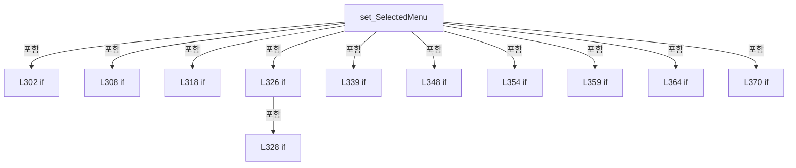

변경 전 점검: 입력/반환 타입, 위 호출자, 예외/취소 경로, 공유 상태와 저장·전송 소비자를 함께 확인합니다. 값의 단위나 물리 방향을 이름만으로 확정하지 않습니다.

### PropertyDeclaration `NavigationSelectedMenu` · L384–400

[Drilling.UI/CRootView.cs:384–400](https://github.com/kjuws10-rgb/A3Drilling/blob/0219666f9053b907d96d7e0aa7d0c6c1be3a73d4/Drilling.UI/CRootView.cs#L384-L400)

| 항목 | 실제 추출 값 |
| --- | --- |
| 서명 | Drilling.UI.Menu.Menus.CMenuItem? Drilling.UI.CRootView.NavigationSelectedMenu |
| 접근/수식자 | Public / public |
| 반환/값 타입 | Drilling.UI.Menu.Menus.CMenuItem? |
| 소속 타입 | NamedType:Drilling.UI.CRootView |

현재 부분 분석에서 직접 연결된 호출자는 없습니다. XAML/이벤트/인터페이스·델리게이트·외부 진입을 추가 확인해야 하며, 미사용으로 판정한 것이 아닙니다.

변경 전 점검: 입력/반환 타입, 위 호출자, 예외/취소 경로, 공유 상태와 저장·전송 소비자를 함께 확인합니다. 값의 단위나 물리 방향을 이름만으로 확정하지 않습니다.

### GetAccessorDeclaration `get_NavigationSelectedMenu` · L386–389

[Drilling.UI/CRootView.cs:386–389](https://github.com/kjuws10-rgb/A3Drilling/blob/0219666f9053b907d96d7e0aa7d0c6c1be3a73d4/Drilling.UI/CRootView.cs#L386-L389)

| 항목 | 실제 추출 값 |
| --- | --- |
| 서명 | Drilling.UI.Menu.Menus.CMenuItem? Drilling.UI.CRootView.NavigationSelectedMenu.get |
| 접근/수식자 | Public / get |
| 반환/값 타입 | Drilling.UI.Menu.Menus.CMenuItem? |
| 소속 타입 | NamedType:Drilling.UI.CRootView |

현재 부분 분석에서 직접 연결된 호출자는 없습니다. XAML/이벤트/인터페이스·델리게이트·외부 진입을 추가 확인해야 하며, 미사용으로 판정한 것이 아닙니다.

본문의 실제 연산·분기·예외·반환 순서(원문 위치 순):

| 원본 행 | 종류 | 주석 해설 |
| --- | --- | --- |
| 388 | return | 호출자에게 값 또는 제어를 반환합니다: return _navigationSelectedMenu; |

변경 전 점검: 입력/반환 타입, 위 호출자, 예외/취소 경로, 공유 상태와 저장·전송 소비자를 함께 확인합니다. 값의 단위나 물리 방향을 이름만으로 확정하지 않습니다.

### SetAccessorDeclaration `set_NavigationSelectedMenu` · L391–399

[Drilling.UI/CRootView.cs:391–399](https://github.com/kjuws10-rgb/A3Drilling/blob/0219666f9053b907d96d7e0aa7d0c6c1be3a73d4/Drilling.UI/CRootView.cs#L391-L399)

| 항목 | 실제 추출 값 |
| --- | --- |
| 서명 | void Drilling.UI.CRootView.NavigationSelectedMenu.set |
| 접근/수식자 | Public / set |
| 반환/값 타입 | void |
| 소속 타입 | NamedType:Drilling.UI.CRootView |

입력 계약:

| 이름 | 타입 | 전달 | 선택/기본값 |
| --- | --- | --- | --- |
| value | Drilling.UI.Menu.Menus.CMenuItem? | None | False /  |

현재 부분 분석에서 직접 연결된 호출자는 없습니다. XAML/이벤트/인터페이스·델리게이트·외부 진입을 추가 확인해야 하며, 미사용으로 판정한 것이 아닙니다.

호출하는 대상과 해석 범위:

| 원본 행 | 표현식 | 분석 상태 | 대상/소스 위치 |
| --- | --- | --- | --- |
| 393 | SetProperty | resolved | bool Drilling.UI.Menu.CBindingBase.SetProperty<Drilling.UI.Menu.Menus.CMenuItem?>(ref Drilling.UI.Menu.Menus.CMenuItem?, Drilling.UI.Menu.Menus.CMenuItem?, string?) · Drilling.UI/Menu/CBindingBase.cs:766 |
| 397 | ReferenceEquals | resolved | bool object.ReferenceEquals(object?, object?) |
| 398 | QueueNavigationMenuSelectionSync | resolved | void Drilling.UI.CRootView.QueueNavigationMenuSelectionSync() · Drilling.UI/CRootView.cs:1414 |

본문의 실제 연산·분기·예외·반환 순서(원문 위치 순):

| 원본 행 | 종류 | 주석 해설 |
| --- | --- | --- |
| 393 | call | 함수·델리게이트 또는 객체 생성자를 호출합니다: SetProperty(ref _navigationSelectedMenu, value) |
| 393 | if | 조건에 따라 분기합니다: if (value is null &#124;&#124; !SetProperty(ref _navigationSelectedMenu, value)) |
| 394 | return | 호출자에게 값 또는 제어를 반환합니다: return; |
| 396 | assignment | 값을 대상에 대입합니다: SelectedMenu = value |
| 397 | call | 함수·델리게이트 또는 객체 생성자를 호출합니다: ReferenceEquals(_navigationSelectedMenu, _selectedMenu) |
| 397 | if | 조건에 따라 분기합니다: if (!ReferenceEquals(_navigationSelectedMenu, _selectedMenu)) |
| 398 | call | 함수·델리게이트 또는 객체 생성자를 호출합니다: QueueNavigationMenuSelectionSync() |

제어 구문의 포함 구조(실제 실행 순서/CFG가 아닌 구문 탐색 그림):

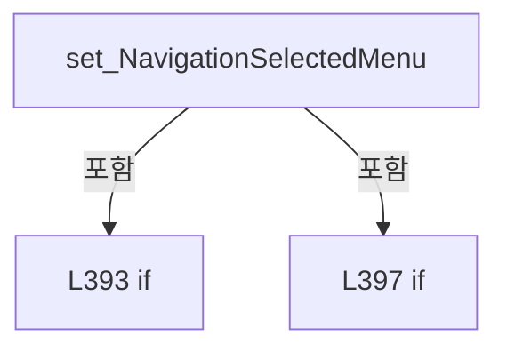

변경 전 점검: 입력/반환 타입, 위 호출자, 예외/취소 경로, 공유 상태와 저장·전송 소비자를 함께 확인합니다. 값의 단위나 물리 방향을 이름만으로 확정하지 않습니다.

### PropertyDeclaration `CurrentScreen` · L402–413

[Drilling.UI/CRootView.cs:402–413](https://github.com/kjuws10-rgb/A3Drilling/blob/0219666f9053b907d96d7e0aa7d0c6c1be3a73d4/Drilling.UI/CRootView.cs#L402-L413)

| 항목 | 실제 추출 값 |
| --- | --- |
| 서명 | Drilling.UI.Menu.Menus.CScreenViewModel Drilling.UI.CRootView.CurrentScreen |
| 접근/수식자 | Public / public |
| 반환/값 타입 | Drilling.UI.Menu.Menus.CScreenViewModel |
| 소속 타입 | NamedType:Drilling.UI.CRootView |

현재 부분 분석에서 직접 연결된 호출자는 없습니다. XAML/이벤트/인터페이스·델리게이트·외부 진입을 추가 확인해야 하며, 미사용으로 판정한 것이 아닙니다.

변경 전 점검: 입력/반환 타입, 위 호출자, 예외/취소 경로, 공유 상태와 저장·전송 소비자를 함께 확인합니다. 값의 단위나 물리 방향을 이름만으로 확정하지 않습니다.

### GetAccessorDeclaration `get_CurrentScreen` · L404–407

[Drilling.UI/CRootView.cs:404–407](https://github.com/kjuws10-rgb/A3Drilling/blob/0219666f9053b907d96d7e0aa7d0c6c1be3a73d4/Drilling.UI/CRootView.cs#L404-L407)

| 항목 | 실제 추출 값 |
| --- | --- |
| 서명 | Drilling.UI.Menu.Menus.CScreenViewModel Drilling.UI.CRootView.CurrentScreen.get |
| 접근/수식자 | Public / get |
| 반환/값 타입 | Drilling.UI.Menu.Menus.CScreenViewModel |
| 소속 타입 | NamedType:Drilling.UI.CRootView |

현재 부분 분석에서 직접 연결된 호출자는 없습니다. XAML/이벤트/인터페이스·델리게이트·외부 진입을 추가 확인해야 하며, 미사용으로 판정한 것이 아닙니다.

본문의 실제 연산·분기·예외·반환 순서(원문 위치 순):

| 원본 행 | 종류 | 주석 해설 |
| --- | --- | --- |
| 406 | return | 호출자에게 값 또는 제어를 반환합니다: return _currentScreen; |

변경 전 점검: 입력/반환 타입, 위 호출자, 예외/취소 경로, 공유 상태와 저장·전송 소비자를 함께 확인합니다. 값의 단위나 물리 방향을 이름만으로 확정하지 않습니다.

### SetAccessorDeclaration `set_CurrentScreen` · L409–412

[Drilling.UI/CRootView.cs:409–412](https://github.com/kjuws10-rgb/A3Drilling/blob/0219666f9053b907d96d7e0aa7d0c6c1be3a73d4/Drilling.UI/CRootView.cs#L409-L412)

| 항목 | 실제 추출 값 |
| --- | --- |
| 서명 | void Drilling.UI.CRootView.CurrentScreen.set |
| 접근/수식자 | Private / private, set |
| 반환/값 타입 | void |
| 소속 타입 | NamedType:Drilling.UI.CRootView |

입력 계약:

| 이름 | 타입 | 전달 | 선택/기본값 |
| --- | --- | --- | --- |
| value | Drilling.UI.Menu.Menus.CScreenViewModel | None | False /  |

현재 부분 분석에서 직접 연결된 호출자는 없습니다. XAML/이벤트/인터페이스·델리게이트·외부 진입을 추가 확인해야 하며, 미사용으로 판정한 것이 아닙니다.

호출하는 대상과 해석 범위:

| 원본 행 | 표현식 | 분석 상태 | 대상/소스 위치 |
| --- | --- | --- | --- |
| 411 | SetProperty | resolved | bool Drilling.UI.Menu.CBindingBase.SetProperty<Drilling.UI.Menu.Menus.CScreenViewModel>(ref Drilling.UI.Menu.Menus.CScreenViewModel, Drilling.UI.Menu.Menus.CScreenViewModel, string?) · Drilling.UI/Menu/CBindingBase.cs:766 |

본문의 실제 연산·분기·예외·반환 순서(원문 위치 순):

| 원본 행 | 종류 | 주석 해설 |
| --- | --- | --- |
| 411 | call | 함수·델리게이트 또는 객체 생성자를 호출합니다: SetProperty(ref _currentScreen, value) |

변경 전 점검: 입력/반환 타입, 위 호출자, 예외/취소 경로, 공유 상태와 저장·전송 소비자를 함께 확인합니다. 값의 단위나 물리 방향을 이름만으로 확정하지 않습니다.

### PropertyDeclaration `StatusMessage` · L415–426

[Drilling.UI/CRootView.cs:415–426](https://github.com/kjuws10-rgb/A3Drilling/blob/0219666f9053b907d96d7e0aa7d0c6c1be3a73d4/Drilling.UI/CRootView.cs#L415-L426)

| 항목 | 실제 추출 값 |
| --- | --- |
| 서명 | string Drilling.UI.CRootView.StatusMessage |
| 접근/수식자 | Public / public |
| 반환/값 타입 | string |
| 소속 타입 | NamedType:Drilling.UI.CRootView |

현재 부분 분석에서 직접 연결된 호출자는 없습니다. XAML/이벤트/인터페이스·델리게이트·외부 진입을 추가 확인해야 하며, 미사용으로 판정한 것이 아닙니다.

변경 전 점검: 입력/반환 타입, 위 호출자, 예외/취소 경로, 공유 상태와 저장·전송 소비자를 함께 확인합니다. 값의 단위나 물리 방향을 이름만으로 확정하지 않습니다.

### GetAccessorDeclaration `get_StatusMessage` · L417–420

[Drilling.UI/CRootView.cs:417–420](https://github.com/kjuws10-rgb/A3Drilling/blob/0219666f9053b907d96d7e0aa7d0c6c1be3a73d4/Drilling.UI/CRootView.cs#L417-L420)

| 항목 | 실제 추출 값 |
| --- | --- |
| 서명 | string Drilling.UI.CRootView.StatusMessage.get |
| 접근/수식자 | Public / get |
| 반환/값 타입 | string |
| 소속 타입 | NamedType:Drilling.UI.CRootView |

현재 부분 분석에서 직접 연결된 호출자는 없습니다. XAML/이벤트/인터페이스·델리게이트·외부 진입을 추가 확인해야 하며, 미사용으로 판정한 것이 아닙니다.

본문의 실제 연산·분기·예외·반환 순서(원문 위치 순):

| 원본 행 | 종류 | 주석 해설 |
| --- | --- | --- |
| 419 | return | 호출자에게 값 또는 제어를 반환합니다: return _statusMessage; |

변경 전 점검: 입력/반환 타입, 위 호출자, 예외/취소 경로, 공유 상태와 저장·전송 소비자를 함께 확인합니다. 값의 단위나 물리 방향을 이름만으로 확정하지 않습니다.

### SetAccessorDeclaration `set_StatusMessage` · L422–425

[Drilling.UI/CRootView.cs:422–425](https://github.com/kjuws10-rgb/A3Drilling/blob/0219666f9053b907d96d7e0aa7d0c6c1be3a73d4/Drilling.UI/CRootView.cs#L422-L425)

| 항목 | 실제 추출 값 |
| --- | --- |
| 서명 | void Drilling.UI.CRootView.StatusMessage.set |
| 접근/수식자 | Private / private, set |
| 반환/값 타입 | void |
| 소속 타입 | NamedType:Drilling.UI.CRootView |

입력 계약:

| 이름 | 타입 | 전달 | 선택/기본값 |
| --- | --- | --- | --- |
| value | string | None | False /  |

현재 부분 분석에서 직접 연결된 호출자는 없습니다. XAML/이벤트/인터페이스·델리게이트·외부 진입을 추가 확인해야 하며, 미사용으로 판정한 것이 아닙니다.

호출하는 대상과 해석 범위:

| 원본 행 | 표현식 | 분석 상태 | 대상/소스 위치 |
| --- | --- | --- | --- |
| 424 | SetProperty | resolved | bool Drilling.UI.Menu.CBindingBase.SetProperty<string>(ref string, string, string?) · Drilling.UI/Menu/CBindingBase.cs:766 |

본문의 실제 연산·분기·예외·반환 순서(원문 위치 순):

| 원본 행 | 종류 | 주석 해설 |
| --- | --- | --- |
| 424 | call | 함수·델리게이트 또는 객체 생성자를 호출합니다: SetProperty(ref _statusMessage, value) |

변경 전 점검: 입력/반환 타입, 위 호출자, 예외/취소 경로, 공유 상태와 저장·전송 소비자를 함께 확인합니다. 값의 단위나 물리 방향을 이름만으로 확정하지 않습니다.

### PropertyDeclaration `CurrentDateText` · L428–439

[Drilling.UI/CRootView.cs:428–439](https://github.com/kjuws10-rgb/A3Drilling/blob/0219666f9053b907d96d7e0aa7d0c6c1be3a73d4/Drilling.UI/CRootView.cs#L428-L439)

| 항목 | 실제 추출 값 |
| --- | --- |
| 서명 | string Drilling.UI.CRootView.CurrentDateText |
| 접근/수식자 | Public / public |
| 반환/값 타입 | string |
| 소속 타입 | NamedType:Drilling.UI.CRootView |

현재 부분 분석에서 직접 연결된 호출자는 없습니다. XAML/이벤트/인터페이스·델리게이트·외부 진입을 추가 확인해야 하며, 미사용으로 판정한 것이 아닙니다.

변경 전 점검: 입력/반환 타입, 위 호출자, 예외/취소 경로, 공유 상태와 저장·전송 소비자를 함께 확인합니다. 값의 단위나 물리 방향을 이름만으로 확정하지 않습니다.

### GetAccessorDeclaration `get_CurrentDateText` · L430–433

[Drilling.UI/CRootView.cs:430–433](https://github.com/kjuws10-rgb/A3Drilling/blob/0219666f9053b907d96d7e0aa7d0c6c1be3a73d4/Drilling.UI/CRootView.cs#L430-L433)

| 항목 | 실제 추출 값 |
| --- | --- |
| 서명 | string Drilling.UI.CRootView.CurrentDateText.get |
| 접근/수식자 | Public / get |
| 반환/값 타입 | string |
| 소속 타입 | NamedType:Drilling.UI.CRootView |

현재 부분 분석에서 직접 연결된 호출자는 없습니다. XAML/이벤트/인터페이스·델리게이트·외부 진입을 추가 확인해야 하며, 미사용으로 판정한 것이 아닙니다.

본문의 실제 연산·분기·예외·반환 순서(원문 위치 순):

| 원본 행 | 종류 | 주석 해설 |
| --- | --- | --- |
| 432 | return | 호출자에게 값 또는 제어를 반환합니다: return _currentDateText; |

변경 전 점검: 입력/반환 타입, 위 호출자, 예외/취소 경로, 공유 상태와 저장·전송 소비자를 함께 확인합니다. 값의 단위나 물리 방향을 이름만으로 확정하지 않습니다.

### SetAccessorDeclaration `set_CurrentDateText` · L435–438

[Drilling.UI/CRootView.cs:435–438](https://github.com/kjuws10-rgb/A3Drilling/blob/0219666f9053b907d96d7e0aa7d0c6c1be3a73d4/Drilling.UI/CRootView.cs#L435-L438)

| 항목 | 실제 추출 값 |
| --- | --- |
| 서명 | void Drilling.UI.CRootView.CurrentDateText.set |
| 접근/수식자 | Private / private, set |
| 반환/값 타입 | void |
| 소속 타입 | NamedType:Drilling.UI.CRootView |

입력 계약:

| 이름 | 타입 | 전달 | 선택/기본값 |
| --- | --- | --- | --- |
| value | string | None | False /  |

현재 부분 분석에서 직접 연결된 호출자는 없습니다. XAML/이벤트/인터페이스·델리게이트·외부 진입을 추가 확인해야 하며, 미사용으로 판정한 것이 아닙니다.

호출하는 대상과 해석 범위:

| 원본 행 | 표현식 | 분석 상태 | 대상/소스 위치 |
| --- | --- | --- | --- |
| 437 | SetProperty | resolved | bool Drilling.UI.Menu.CBindingBase.SetProperty<string>(ref string, string, string?) · Drilling.UI/Menu/CBindingBase.cs:766 |

본문의 실제 연산·분기·예외·반환 순서(원문 위치 순):

| 원본 행 | 종류 | 주석 해설 |
| --- | --- | --- |
| 437 | call | 함수·델리게이트 또는 객체 생성자를 호출합니다: SetProperty(ref _currentDateText, value) |

변경 전 점검: 입력/반환 타입, 위 호출자, 예외/취소 경로, 공유 상태와 저장·전송 소비자를 함께 확인합니다. 값의 단위나 물리 방향을 이름만으로 확정하지 않습니다.

### PropertyDeclaration `CurrentTimeText` · L441–452

[Drilling.UI/CRootView.cs:441–452](https://github.com/kjuws10-rgb/A3Drilling/blob/0219666f9053b907d96d7e0aa7d0c6c1be3a73d4/Drilling.UI/CRootView.cs#L441-L452)

| 항목 | 실제 추출 값 |
| --- | --- |
| 서명 | string Drilling.UI.CRootView.CurrentTimeText |
| 접근/수식자 | Public / public |
| 반환/값 타입 | string |
| 소속 타입 | NamedType:Drilling.UI.CRootView |

현재 부분 분석에서 직접 연결된 호출자는 없습니다. XAML/이벤트/인터페이스·델리게이트·외부 진입을 추가 확인해야 하며, 미사용으로 판정한 것이 아닙니다.

변경 전 점검: 입력/반환 타입, 위 호출자, 예외/취소 경로, 공유 상태와 저장·전송 소비자를 함께 확인합니다. 값의 단위나 물리 방향을 이름만으로 확정하지 않습니다.

### GetAccessorDeclaration `get_CurrentTimeText` · L443–446

[Drilling.UI/CRootView.cs:443–446](https://github.com/kjuws10-rgb/A3Drilling/blob/0219666f9053b907d96d7e0aa7d0c6c1be3a73d4/Drilling.UI/CRootView.cs#L443-L446)

| 항목 | 실제 추출 값 |
| --- | --- |
| 서명 | string Drilling.UI.CRootView.CurrentTimeText.get |
| 접근/수식자 | Public / get |
| 반환/값 타입 | string |
| 소속 타입 | NamedType:Drilling.UI.CRootView |

현재 부분 분석에서 직접 연결된 호출자는 없습니다. XAML/이벤트/인터페이스·델리게이트·외부 진입을 추가 확인해야 하며, 미사용으로 판정한 것이 아닙니다.

본문의 실제 연산·분기·예외·반환 순서(원문 위치 순):

| 원본 행 | 종류 | 주석 해설 |
| --- | --- | --- |
| 445 | return | 호출자에게 값 또는 제어를 반환합니다: return _currentTimeText; |

변경 전 점검: 입력/반환 타입, 위 호출자, 예외/취소 경로, 공유 상태와 저장·전송 소비자를 함께 확인합니다. 값의 단위나 물리 방향을 이름만으로 확정하지 않습니다.

### SetAccessorDeclaration `set_CurrentTimeText` · L448–451

[Drilling.UI/CRootView.cs:448–451](https://github.com/kjuws10-rgb/A3Drilling/blob/0219666f9053b907d96d7e0aa7d0c6c1be3a73d4/Drilling.UI/CRootView.cs#L448-L451)

| 항목 | 실제 추출 값 |
| --- | --- |
| 서명 | void Drilling.UI.CRootView.CurrentTimeText.set |
| 접근/수식자 | Private / private, set |
| 반환/값 타입 | void |
| 소속 타입 | NamedType:Drilling.UI.CRootView |

입력 계약:

| 이름 | 타입 | 전달 | 선택/기본값 |
| --- | --- | --- | --- |
| value | string | None | False /  |

현재 부분 분석에서 직접 연결된 호출자는 없습니다. XAML/이벤트/인터페이스·델리게이트·외부 진입을 추가 확인해야 하며, 미사용으로 판정한 것이 아닙니다.

호출하는 대상과 해석 범위:

| 원본 행 | 표현식 | 분석 상태 | 대상/소스 위치 |
| --- | --- | --- | --- |
| 450 | SetProperty | resolved | bool Drilling.UI.Menu.CBindingBase.SetProperty<string>(ref string, string, string?) · Drilling.UI/Menu/CBindingBase.cs:766 |

본문의 실제 연산·분기·예외·반환 순서(원문 위치 순):

| 원본 행 | 종류 | 주석 해설 |
| --- | --- | --- |
| 450 | call | 함수·델리게이트 또는 객체 생성자를 호출합니다: SetProperty(ref _currentTimeText, value) |

변경 전 점검: 입력/반환 타입, 위 호출자, 예외/취소 경로, 공유 상태와 저장·전송 소비자를 함께 확인합니다. 값의 단위나 물리 방향을 이름만으로 확정하지 않습니다.

### PropertyDeclaration `CurrentUserText` · L454–460

[Drilling.UI/CRootView.cs:454–460](https://github.com/kjuws10-rgb/A3Drilling/blob/0219666f9053b907d96d7e0aa7d0c6c1be3a73d4/Drilling.UI/CRootView.cs#L454-L460)

| 항목 | 실제 추출 값 |
| --- | --- |
| 서명 | string Drilling.UI.CRootView.CurrentUserText |
| 접근/수식자 | Public / public |
| 반환/값 타입 | string |
| 소속 타입 | NamedType:Drilling.UI.CRootView |

현재 부분 분석에서 직접 연결된 호출자는 없습니다. XAML/이벤트/인터페이스·델리게이트·외부 진입을 추가 확인해야 하며, 미사용으로 판정한 것이 아닙니다.

변경 전 점검: 입력/반환 타입, 위 호출자, 예외/취소 경로, 공유 상태와 저장·전송 소비자를 함께 확인합니다. 값의 단위나 물리 방향을 이름만으로 확정하지 않습니다.

### GetAccessorDeclaration `get_CurrentUserText` · L456–459

[Drilling.UI/CRootView.cs:456–459](https://github.com/kjuws10-rgb/A3Drilling/blob/0219666f9053b907d96d7e0aa7d0c6c1be3a73d4/Drilling.UI/CRootView.cs#L456-L459)

| 항목 | 실제 추출 값 |
| --- | --- |
| 서명 | string Drilling.UI.CRootView.CurrentUserText.get |
| 접근/수식자 | Public / get |
| 반환/값 타입 | string |
| 소속 타입 | NamedType:Drilling.UI.CRootView |

현재 부분 분석에서 직접 연결된 호출자는 없습니다. XAML/이벤트/인터페이스·델리게이트·외부 진입을 추가 확인해야 하며, 미사용으로 판정한 것이 아닙니다.

본문의 실제 연산·분기·예외·반환 순서(원문 위치 순):

| 원본 행 | 종류 | 주석 해설 |
| --- | --- | --- |
| 458 | conditional-expression | 조건에 따라 결과식을 선택합니다: _interfaceManager.IsSimulation && _motionManager.IsSimulation ? "Engineer / Simulation" : "Engineer / Live" |
| 458 | return | 호출자에게 값 또는 제어를 반환합니다: return _interfaceManager.IsSimulation && _motionManager.IsSimulation ? "Engineer / Simulation" : "Engineer / Live"; |

변경 전 점검: 입력/반환 타입, 위 호출자, 예외/취소 경로, 공유 상태와 저장·전송 소비자를 함께 확인합니다. 값의 단위나 물리 방향을 이름만으로 확정하지 않습니다.

### PropertyDeclaration `ThemeToggleText` · L462–468

[Drilling.UI/CRootView.cs:462–468](https://github.com/kjuws10-rgb/A3Drilling/blob/0219666f9053b907d96d7e0aa7d0c6c1be3a73d4/Drilling.UI/CRootView.cs#L462-L468)

| 항목 | 실제 추출 값 |
| --- | --- |
| 서명 | string Drilling.UI.CRootView.ThemeToggleText |
| 접근/수식자 | Public / public |
| 반환/값 타입 | string |
| 소속 타입 | NamedType:Drilling.UI.CRootView |

현재 부분 분석에서 직접 연결된 호출자는 없습니다. XAML/이벤트/인터페이스·델리게이트·외부 진입을 추가 확인해야 하며, 미사용으로 판정한 것이 아닙니다.

변경 전 점검: 입력/반환 타입, 위 호출자, 예외/취소 경로, 공유 상태와 저장·전송 소비자를 함께 확인합니다. 값의 단위나 물리 방향을 이름만으로 확정하지 않습니다.

### GetAccessorDeclaration `get_ThemeToggleText` · L464–467

[Drilling.UI/CRootView.cs:464–467](https://github.com/kjuws10-rgb/A3Drilling/blob/0219666f9053b907d96d7e0aa7d0c6c1be3a73d4/Drilling.UI/CRootView.cs#L464-L467)

| 항목 | 실제 추출 값 |
| --- | --- |
| 서명 | string Drilling.UI.CRootView.ThemeToggleText.get |
| 접근/수식자 | Public / get |
| 반환/값 타입 | string |
| 소속 타입 | NamedType:Drilling.UI.CRootView |

현재 부분 분석에서 직접 연결된 호출자는 없습니다. XAML/이벤트/인터페이스·델리게이트·외부 진입을 추가 확인해야 하며, 미사용으로 판정한 것이 아닙니다.

본문의 실제 연산·분기·예외·반환 순서(원문 위치 순):

| 원본 행 | 종류 | 주석 해설 |
| --- | --- | --- |
| 466 | conditional-expression | 조건에 따라 결과식을 선택합니다: _currentTheme == EN_UI_THEME.Light ? "LIGHT MODE" : "DARK MODE" |
| 466 | return | 호출자에게 값 또는 제어를 반환합니다: return _currentTheme == EN_UI_THEME.Light ? "LIGHT MODE" : "DARK MODE"; |

변경 전 점검: 입력/반환 타입, 위 호출자, 예외/취소 경로, 공유 상태와 저장·전송 소비자를 함께 확인합니다. 값의 단위나 물리 방향을 이름만으로 확정하지 않습니다.

### PropertyDeclaration `ThemeModeText` · L470–476

[Drilling.UI/CRootView.cs:470–476](https://github.com/kjuws10-rgb/A3Drilling/blob/0219666f9053b907d96d7e0aa7d0c6c1be3a73d4/Drilling.UI/CRootView.cs#L470-L476)

| 항목 | 실제 추출 값 |
| --- | --- |
| 서명 | string Drilling.UI.CRootView.ThemeModeText |
| 접근/수식자 | Public / public |
| 반환/값 타입 | string |
| 소속 타입 | NamedType:Drilling.UI.CRootView |

현재 부분 분석에서 직접 연결된 호출자는 없습니다. XAML/이벤트/인터페이스·델리게이트·외부 진입을 추가 확인해야 하며, 미사용으로 판정한 것이 아닙니다.

변경 전 점검: 입력/반환 타입, 위 호출자, 예외/취소 경로, 공유 상태와 저장·전송 소비자를 함께 확인합니다. 값의 단위나 물리 방향을 이름만으로 확정하지 않습니다.

### GetAccessorDeclaration `get_ThemeModeText` · L472–475

[Drilling.UI/CRootView.cs:472–475](https://github.com/kjuws10-rgb/A3Drilling/blob/0219666f9053b907d96d7e0aa7d0c6c1be3a73d4/Drilling.UI/CRootView.cs#L472-L475)

| 항목 | 실제 추출 값 |
| --- | --- |
| 서명 | string Drilling.UI.CRootView.ThemeModeText.get |
| 접근/수식자 | Public / get |
| 반환/값 타입 | string |
| 소속 타입 | NamedType:Drilling.UI.CRootView |

현재 부분 분석에서 직접 연결된 호출자는 없습니다. XAML/이벤트/인터페이스·델리게이트·외부 진입을 추가 확인해야 하며, 미사용으로 판정한 것이 아닙니다.

본문의 실제 연산·분기·예외·반환 순서(원문 위치 순):

| 원본 행 | 종류 | 주석 해설 |
| --- | --- | --- |
| 474 | conditional-expression | 조건에 따라 결과식을 선택합니다: _currentTheme == EN_UI_THEME.Light ? "Light Theme" : "Dark Theme" |
| 474 | return | 호출자에게 값 또는 제어를 반환합니다: return _currentTheme == EN_UI_THEME.Light ? "Light Theme" : "Dark Theme"; |

변경 전 점검: 입력/반환 타입, 위 호출자, 예외/취소 경로, 공유 상태와 저장·전송 소비자를 함께 확인합니다. 값의 단위나 물리 방향을 이름만으로 확정하지 않습니다.

### PropertyDeclaration `StartCommand` · L478–478

[Drilling.UI/CRootView.cs:478–478](https://github.com/kjuws10-rgb/A3Drilling/blob/0219666f9053b907d96d7e0aa7d0c6c1be3a73d4/Drilling.UI/CRootView.cs#L478-L478)

| 항목 | 실제 추출 값 |
| --- | --- |
| 서명 | Drilling.UI.Menu.CButtonCommand Drilling.UI.CRootView.StartCommand |
| 접근/수식자 | Public / public |
| 반환/값 타입 | Drilling.UI.Menu.CButtonCommand |
| 소속 타입 | NamedType:Drilling.UI.CRootView |

현재 부분 분석에서 직접 연결된 호출자는 없습니다. XAML/이벤트/인터페이스·델리게이트·외부 진입을 추가 확인해야 하며, 미사용으로 판정한 것이 아닙니다.

변경 전 점검: 입력/반환 타입, 위 호출자, 예외/취소 경로, 공유 상태와 저장·전송 소비자를 함께 확인합니다. 값의 단위나 물리 방향을 이름만으로 확정하지 않습니다.

### GetAccessorDeclaration `get_StartCommand` · L478–478

[Drilling.UI/CRootView.cs:478–478](https://github.com/kjuws10-rgb/A3Drilling/blob/0219666f9053b907d96d7e0aa7d0c6c1be3a73d4/Drilling.UI/CRootView.cs#L478-L478)

| 항목 | 실제 추출 값 |
| --- | --- |
| 서명 | Drilling.UI.Menu.CButtonCommand Drilling.UI.CRootView.StartCommand.get |
| 접근/수식자 | Public / get |
| 반환/값 타입 | Drilling.UI.Menu.CButtonCommand |
| 소속 타입 | NamedType:Drilling.UI.CRootView |

현재 부분 분석에서 직접 연결된 호출자는 없습니다. XAML/이벤트/인터페이스·델리게이트·외부 진입을 추가 확인해야 하며, 미사용으로 판정한 것이 아닙니다.

변경 전 점검: 입력/반환 타입, 위 호출자, 예외/취소 경로, 공유 상태와 저장·전송 소비자를 함께 확인합니다. 값의 단위나 물리 방향을 이름만으로 확정하지 않습니다.

### PropertyDeclaration `StopCommand` · L479–479

[Drilling.UI/CRootView.cs:479–479](https://github.com/kjuws10-rgb/A3Drilling/blob/0219666f9053b907d96d7e0aa7d0c6c1be3a73d4/Drilling.UI/CRootView.cs#L479-L479)

| 항목 | 실제 추출 값 |
| --- | --- |
| 서명 | Drilling.UI.Menu.CButtonCommand Drilling.UI.CRootView.StopCommand |
| 접근/수식자 | Public / public |
| 반환/값 타입 | Drilling.UI.Menu.CButtonCommand |
| 소속 타입 | NamedType:Drilling.UI.CRootView |

현재 부분 분석에서 직접 연결된 호출자는 없습니다. XAML/이벤트/인터페이스·델리게이트·외부 진입을 추가 확인해야 하며, 미사용으로 판정한 것이 아닙니다.

변경 전 점검: 입력/반환 타입, 위 호출자, 예외/취소 경로, 공유 상태와 저장·전송 소비자를 함께 확인합니다. 값의 단위나 물리 방향을 이름만으로 확정하지 않습니다.

### GetAccessorDeclaration `get_StopCommand` · L479–479

[Drilling.UI/CRootView.cs:479–479](https://github.com/kjuws10-rgb/A3Drilling/blob/0219666f9053b907d96d7e0aa7d0c6c1be3a73d4/Drilling.UI/CRootView.cs#L479-L479)

| 항목 | 실제 추출 값 |
| --- | --- |
| 서명 | Drilling.UI.Menu.CButtonCommand Drilling.UI.CRootView.StopCommand.get |
| 접근/수식자 | Public / get |
| 반환/값 타입 | Drilling.UI.Menu.CButtonCommand |
| 소속 타입 | NamedType:Drilling.UI.CRootView |

현재 부분 분석에서 직접 연결된 호출자는 없습니다. XAML/이벤트/인터페이스·델리게이트·외부 진입을 추가 확인해야 하며, 미사용으로 판정한 것이 아닙니다.

변경 전 점검: 입력/반환 타입, 위 호출자, 예외/취소 경로, 공유 상태와 저장·전송 소비자를 함께 확인합니다. 값의 단위나 물리 방향을 이름만으로 확정하지 않습니다.

### PropertyDeclaration `SelectHeadCommand` · L480–480

[Drilling.UI/CRootView.cs:480–480](https://github.com/kjuws10-rgb/A3Drilling/blob/0219666f9053b907d96d7e0aa7d0c6c1be3a73d4/Drilling.UI/CRootView.cs#L480-L480)

| 항목 | 실제 추출 값 |
| --- | --- |
| 서명 | Drilling.UI.Menu.CButtonCommand Drilling.UI.CRootView.SelectHeadCommand |
| 접근/수식자 | Public / public |
| 반환/값 타입 | Drilling.UI.Menu.CButtonCommand |
| 소속 타입 | NamedType:Drilling.UI.CRootView |

현재 부분 분석에서 직접 연결된 호출자는 없습니다. XAML/이벤트/인터페이스·델리게이트·외부 진입을 추가 확인해야 하며, 미사용으로 판정한 것이 아닙니다.

변경 전 점검: 입력/반환 타입, 위 호출자, 예외/취소 경로, 공유 상태와 저장·전송 소비자를 함께 확인합니다. 값의 단위나 물리 방향을 이름만으로 확정하지 않습니다.

### GetAccessorDeclaration `get_SelectHeadCommand` · L480–480

[Drilling.UI/CRootView.cs:480–480](https://github.com/kjuws10-rgb/A3Drilling/blob/0219666f9053b907d96d7e0aa7d0c6c1be3a73d4/Drilling.UI/CRootView.cs#L480-L480)

| 항목 | 실제 추출 값 |
| --- | --- |
| 서명 | Drilling.UI.Menu.CButtonCommand Drilling.UI.CRootView.SelectHeadCommand.get |
| 접근/수식자 | Public / get |
| 반환/값 타입 | Drilling.UI.Menu.CButtonCommand |
| 소속 타입 | NamedType:Drilling.UI.CRootView |

현재 부분 분석에서 직접 연결된 호출자는 없습니다. XAML/이벤트/인터페이스·델리게이트·외부 진입을 추가 확인해야 하며, 미사용으로 판정한 것이 아닙니다.

변경 전 점검: 입력/반환 타입, 위 호출자, 예외/취소 경로, 공유 상태와 저장·전송 소비자를 함께 확인합니다. 값의 단위나 물리 방향을 이름만으로 확정하지 않습니다.

### PropertyDeclaration `ToggleThemeCommand` · L481–481

[Drilling.UI/CRootView.cs:481–481](https://github.com/kjuws10-rgb/A3Drilling/blob/0219666f9053b907d96d7e0aa7d0c6c1be3a73d4/Drilling.UI/CRootView.cs#L481-L481)

| 항목 | 실제 추출 값 |
| --- | --- |
| 서명 | Drilling.UI.Menu.CButtonCommand Drilling.UI.CRootView.ToggleThemeCommand |
| 접근/수식자 | Public / public |
| 반환/값 타입 | Drilling.UI.Menu.CButtonCommand |
| 소속 타입 | NamedType:Drilling.UI.CRootView |

현재 부분 분석에서 직접 연결된 호출자는 없습니다. XAML/이벤트/인터페이스·델리게이트·외부 진입을 추가 확인해야 하며, 미사용으로 판정한 것이 아닙니다.

변경 전 점검: 입력/반환 타입, 위 호출자, 예외/취소 경로, 공유 상태와 저장·전송 소비자를 함께 확인합니다. 값의 단위나 물리 방향을 이름만으로 확정하지 않습니다.

### GetAccessorDeclaration `get_ToggleThemeCommand` · L481–481

[Drilling.UI/CRootView.cs:481–481](https://github.com/kjuws10-rgb/A3Drilling/blob/0219666f9053b907d96d7e0aa7d0c6c1be3a73d4/Drilling.UI/CRootView.cs#L481-L481)

| 항목 | 실제 추출 값 |
| --- | --- |
| 서명 | Drilling.UI.Menu.CButtonCommand Drilling.UI.CRootView.ToggleThemeCommand.get |
| 접근/수식자 | Public / get |
| 반환/값 타입 | Drilling.UI.Menu.CButtonCommand |
| 소속 타입 | NamedType:Drilling.UI.CRootView |

현재 부분 분석에서 직접 연결된 호출자는 없습니다. XAML/이벤트/인터페이스·델리게이트·외부 진입을 추가 확인해야 하며, 미사용으로 판정한 것이 아닙니다.

변경 전 점검: 입력/반환 타입, 위 호출자, 예외/취소 경로, 공유 상태와 저장·전송 소비자를 함께 확인합니다. 값의 단위나 물리 방향을 이름만으로 확정하지 않습니다.

### PropertyDeclaration `ToggleOperationModeCommand` · L482–482

[Drilling.UI/CRootView.cs:482–482](https://github.com/kjuws10-rgb/A3Drilling/blob/0219666f9053b907d96d7e0aa7d0c6c1be3a73d4/Drilling.UI/CRootView.cs#L482-L482)

| 항목 | 실제 추출 값 |
| --- | --- |
| 서명 | Drilling.UI.Menu.CButtonCommand Drilling.UI.CRootView.ToggleOperationModeCommand |
| 접근/수식자 | Public / public |
| 반환/값 타입 | Drilling.UI.Menu.CButtonCommand |
| 소속 타입 | NamedType:Drilling.UI.CRootView |

현재 부분 분석에서 직접 연결된 호출자는 없습니다. XAML/이벤트/인터페이스·델리게이트·외부 진입을 추가 확인해야 하며, 미사용으로 판정한 것이 아닙니다.

변경 전 점검: 입력/반환 타입, 위 호출자, 예외/취소 경로, 공유 상태와 저장·전송 소비자를 함께 확인합니다. 값의 단위나 물리 방향을 이름만으로 확정하지 않습니다.

### GetAccessorDeclaration `get_ToggleOperationModeCommand` · L482–482

[Drilling.UI/CRootView.cs:482–482](https://github.com/kjuws10-rgb/A3Drilling/blob/0219666f9053b907d96d7e0aa7d0c6c1be3a73d4/Drilling.UI/CRootView.cs#L482-L482)

| 항목 | 실제 추출 값 |
| --- | --- |
| 서명 | Drilling.UI.Menu.CButtonCommand Drilling.UI.CRootView.ToggleOperationModeCommand.get |
| 접근/수식자 | Public / get |
| 반환/값 타입 | Drilling.UI.Menu.CButtonCommand |
| 소속 타입 | NamedType:Drilling.UI.CRootView |

현재 부분 분석에서 직접 연결된 호출자는 없습니다. XAML/이벤트/인터페이스·델리게이트·외부 진입을 추가 확인해야 하며, 미사용으로 판정한 것이 아닙니다.

변경 전 점검: 입력/반환 타입, 위 호출자, 예외/취소 경로, 공유 상태와 저장·전송 소비자를 함께 확인합니다. 값의 단위나 물리 방향을 이름만으로 확정하지 않습니다.

### PropertyDeclaration `InitializeAutoSequenceCommand` · L483–483

[Drilling.UI/CRootView.cs:483–483](https://github.com/kjuws10-rgb/A3Drilling/blob/0219666f9053b907d96d7e0aa7d0c6c1be3a73d4/Drilling.UI/CRootView.cs#L483-L483)

| 항목 | 실제 추출 값 |
| --- | --- |
| 서명 | Drilling.UI.Menu.CButtonCommand Drilling.UI.CRootView.InitializeAutoSequenceCommand |
| 접근/수식자 | Public / public |
| 반환/값 타입 | Drilling.UI.Menu.CButtonCommand |
| 소속 타입 | NamedType:Drilling.UI.CRootView |

현재 부분 분석에서 직접 연결된 호출자는 없습니다. XAML/이벤트/인터페이스·델리게이트·외부 진입을 추가 확인해야 하며, 미사용으로 판정한 것이 아닙니다.

변경 전 점검: 입력/반환 타입, 위 호출자, 예외/취소 경로, 공유 상태와 저장·전송 소비자를 함께 확인합니다. 값의 단위나 물리 방향을 이름만으로 확정하지 않습니다.

### GetAccessorDeclaration `get_InitializeAutoSequenceCommand` · L483–483

[Drilling.UI/CRootView.cs:483–483](https://github.com/kjuws10-rgb/A3Drilling/blob/0219666f9053b907d96d7e0aa7d0c6c1be3a73d4/Drilling.UI/CRootView.cs#L483-L483)

| 항목 | 실제 추출 값 |
| --- | --- |
| 서명 | Drilling.UI.Menu.CButtonCommand Drilling.UI.CRootView.InitializeAutoSequenceCommand.get |
| 접근/수식자 | Public / get |
| 반환/값 타입 | Drilling.UI.Menu.CButtonCommand |
| 소속 타입 | NamedType:Drilling.UI.CRootView |

현재 부분 분석에서 직접 연결된 호출자는 없습니다. XAML/이벤트/인터페이스·델리게이트·외부 진입을 추가 확인해야 하며, 미사용으로 판정한 것이 아닙니다.

변경 전 점검: 입력/반환 타입, 위 호출자, 예외/취소 경로, 공유 상태와 저장·전송 소비자를 함께 확인합니다. 값의 단위나 물리 방향을 이름만으로 확정하지 않습니다.

### PropertyDeclaration `ShiftOffsetX` · L485–496

[Drilling.UI/CRootView.cs:485–496](https://github.com/kjuws10-rgb/A3Drilling/blob/0219666f9053b907d96d7e0aa7d0c6c1be3a73d4/Drilling.UI/CRootView.cs#L485-L496)

| 항목 | 실제 추출 값 |
| --- | --- |
| 서명 | string Drilling.UI.CRootView.ShiftOffsetX |
| 접근/수식자 | Public / public |
| 반환/값 타입 | string |
| 소속 타입 | NamedType:Drilling.UI.CRootView |

현재 부분 분석에서 직접 연결된 호출자는 없습니다. XAML/이벤트/인터페이스·델리게이트·외부 진입을 추가 확인해야 하며, 미사용으로 판정한 것이 아닙니다.

변경 전 점검: 입력/반환 타입, 위 호출자, 예외/취소 경로, 공유 상태와 저장·전송 소비자를 함께 확인합니다. 값의 단위나 물리 방향을 이름만으로 확정하지 않습니다.

### GetAccessorDeclaration `get_ShiftOffsetX` · L487–490

[Drilling.UI/CRootView.cs:487–490](https://github.com/kjuws10-rgb/A3Drilling/blob/0219666f9053b907d96d7e0aa7d0c6c1be3a73d4/Drilling.UI/CRootView.cs#L487-L490)

| 항목 | 실제 추출 값 |
| --- | --- |
| 서명 | string Drilling.UI.CRootView.ShiftOffsetX.get |
| 접근/수식자 | Public / get |
| 반환/값 타입 | string |
| 소속 타입 | NamedType:Drilling.UI.CRootView |

현재 부분 분석에서 직접 연결된 호출자는 없습니다. XAML/이벤트/인터페이스·델리게이트·외부 진입을 추가 확인해야 하며, 미사용으로 판정한 것이 아닙니다.

본문의 실제 연산·분기·예외·반환 순서(원문 위치 순):

| 원본 행 | 종류 | 주석 해설 |
| --- | --- | --- |
| 489 | return | 호출자에게 값 또는 제어를 반환합니다: return _shiftOffsetX; |

변경 전 점검: 입력/반환 타입, 위 호출자, 예외/취소 경로, 공유 상태와 저장·전송 소비자를 함께 확인합니다. 값의 단위나 물리 방향을 이름만으로 확정하지 않습니다.

### SetAccessorDeclaration `set_ShiftOffsetX` · L492–495

[Drilling.UI/CRootView.cs:492–495](https://github.com/kjuws10-rgb/A3Drilling/blob/0219666f9053b907d96d7e0aa7d0c6c1be3a73d4/Drilling.UI/CRootView.cs#L492-L495)

| 항목 | 실제 추출 값 |
| --- | --- |
| 서명 | void Drilling.UI.CRootView.ShiftOffsetX.set |
| 접근/수식자 | Public / set |
| 반환/값 타입 | void |
| 소속 타입 | NamedType:Drilling.UI.CRootView |

입력 계약:

| 이름 | 타입 | 전달 | 선택/기본값 |
| --- | --- | --- | --- |
| value | string | None | False /  |

현재 부분 분석에서 직접 연결된 호출자는 없습니다. XAML/이벤트/인터페이스·델리게이트·외부 진입을 추가 확인해야 하며, 미사용으로 판정한 것이 아닙니다.

호출하는 대상과 해석 범위:

| 원본 행 | 표현식 | 분석 상태 | 대상/소스 위치 |
| --- | --- | --- | --- |
| 494 | SetProperty | resolved | bool Drilling.UI.Menu.CBindingBase.SetProperty<string>(ref string, string, string?) · Drilling.UI/Menu/CBindingBase.cs:766 |
| 494 | NormalizeShiftOffsetText | resolved | string Drilling.UI.CRootView.NormalizeShiftOffsetText(string?) · Drilling.UI/CRootView.cs:1960 |

본문의 실제 연산·분기·예외·반환 순서(원문 위치 순):

| 원본 행 | 종류 | 주석 해설 |
| --- | --- | --- |
| 494 | call | 함수·델리게이트 또는 객체 생성자를 호출합니다: SetProperty(ref _shiftOffsetX, NormalizeShiftOffsetText(value)) |
| 494 | call | 함수·델리게이트 또는 객체 생성자를 호출합니다: NormalizeShiftOffsetText(value) |

변경 전 점검: 입력/반환 타입, 위 호출자, 예외/취소 경로, 공유 상태와 저장·전송 소비자를 함께 확인합니다. 값의 단위나 물리 방향을 이름만으로 확정하지 않습니다.

### PropertyDeclaration `ShiftOffsetY` · L498–509

[Drilling.UI/CRootView.cs:498–509](https://github.com/kjuws10-rgb/A3Drilling/blob/0219666f9053b907d96d7e0aa7d0c6c1be3a73d4/Drilling.UI/CRootView.cs#L498-L509)

| 항목 | 실제 추출 값 |
| --- | --- |
| 서명 | string Drilling.UI.CRootView.ShiftOffsetY |
| 접근/수식자 | Public / public |
| 반환/값 타입 | string |
| 소속 타입 | NamedType:Drilling.UI.CRootView |

현재 부분 분석에서 직접 연결된 호출자는 없습니다. XAML/이벤트/인터페이스·델리게이트·외부 진입을 추가 확인해야 하며, 미사용으로 판정한 것이 아닙니다.

변경 전 점검: 입력/반환 타입, 위 호출자, 예외/취소 경로, 공유 상태와 저장·전송 소비자를 함께 확인합니다. 값의 단위나 물리 방향을 이름만으로 확정하지 않습니다.

### GetAccessorDeclaration `get_ShiftOffsetY` · L500–503

[Drilling.UI/CRootView.cs:500–503](https://github.com/kjuws10-rgb/A3Drilling/blob/0219666f9053b907d96d7e0aa7d0c6c1be3a73d4/Drilling.UI/CRootView.cs#L500-L503)

| 항목 | 실제 추출 값 |
| --- | --- |
| 서명 | string Drilling.UI.CRootView.ShiftOffsetY.get |
| 접근/수식자 | Public / get |
| 반환/값 타입 | string |
| 소속 타입 | NamedType:Drilling.UI.CRootView |

현재 부분 분석에서 직접 연결된 호출자는 없습니다. XAML/이벤트/인터페이스·델리게이트·외부 진입을 추가 확인해야 하며, 미사용으로 판정한 것이 아닙니다.

본문의 실제 연산·분기·예외·반환 순서(원문 위치 순):

| 원본 행 | 종류 | 주석 해설 |
| --- | --- | --- |
| 502 | return | 호출자에게 값 또는 제어를 반환합니다: return _shiftOffsetY; |

변경 전 점검: 입력/반환 타입, 위 호출자, 예외/취소 경로, 공유 상태와 저장·전송 소비자를 함께 확인합니다. 값의 단위나 물리 방향을 이름만으로 확정하지 않습니다.

### SetAccessorDeclaration `set_ShiftOffsetY` · L505–508

[Drilling.UI/CRootView.cs:505–508](https://github.com/kjuws10-rgb/A3Drilling/blob/0219666f9053b907d96d7e0aa7d0c6c1be3a73d4/Drilling.UI/CRootView.cs#L505-L508)

| 항목 | 실제 추출 값 |
| --- | --- |
| 서명 | void Drilling.UI.CRootView.ShiftOffsetY.set |
| 접근/수식자 | Public / set |
| 반환/값 타입 | void |
| 소속 타입 | NamedType:Drilling.UI.CRootView |

입력 계약:

| 이름 | 타입 | 전달 | 선택/기본값 |
| --- | --- | --- | --- |
| value | string | None | False /  |

현재 부분 분석에서 직접 연결된 호출자는 없습니다. XAML/이벤트/인터페이스·델리게이트·외부 진입을 추가 확인해야 하며, 미사용으로 판정한 것이 아닙니다.

호출하는 대상과 해석 범위:

| 원본 행 | 표현식 | 분석 상태 | 대상/소스 위치 |
| --- | --- | --- | --- |
| 507 | SetProperty | resolved | bool Drilling.UI.Menu.CBindingBase.SetProperty<string>(ref string, string, string?) · Drilling.UI/Menu/CBindingBase.cs:766 |
| 507 | NormalizeShiftOffsetText | resolved | string Drilling.UI.CRootView.NormalizeShiftOffsetText(string?) · Drilling.UI/CRootView.cs:1960 |

본문의 실제 연산·분기·예외·반환 순서(원문 위치 순):

| 원본 행 | 종류 | 주석 해설 |
| --- | --- | --- |
| 507 | call | 함수·델리게이트 또는 객체 생성자를 호출합니다: SetProperty(ref _shiftOffsetY, NormalizeShiftOffsetText(value)) |
| 507 | call | 함수·델리게이트 또는 객체 생성자를 호출합니다: NormalizeShiftOffsetText(value) |

변경 전 점검: 입력/반환 타입, 위 호출자, 예외/취소 경로, 공유 상태와 저장·전송 소비자를 함께 확인합니다. 값의 단위나 물리 방향을 이름만으로 확정하지 않습니다.

### PropertyDeclaration `IsManualShiftOffsetVisible` · L511–517

[Drilling.UI/CRootView.cs:511–517](https://github.com/kjuws10-rgb/A3Drilling/blob/0219666f9053b907d96d7e0aa7d0c6c1be3a73d4/Drilling.UI/CRootView.cs#L511-L517)

| 항목 | 실제 추출 값 |
| --- | --- |
| 서명 | bool Drilling.UI.CRootView.IsManualShiftOffsetVisible |
| 접근/수식자 | Public / public |
| 반환/값 타입 | bool |
| 소속 타입 | NamedType:Drilling.UI.CRootView |

현재 부분 분석에서 직접 연결된 호출자는 없습니다. XAML/이벤트/인터페이스·델리게이트·외부 진입을 추가 확인해야 하며, 미사용으로 판정한 것이 아닙니다.

변경 전 점검: 입력/반환 타입, 위 호출자, 예외/취소 경로, 공유 상태와 저장·전송 소비자를 함께 확인합니다. 값의 단위나 물리 방향을 이름만으로 확정하지 않습니다.

### GetAccessorDeclaration `get_IsManualShiftOffsetVisible` · L513–516

[Drilling.UI/CRootView.cs:513–516](https://github.com/kjuws10-rgb/A3Drilling/blob/0219666f9053b907d96d7e0aa7d0c6c1be3a73d4/Drilling.UI/CRootView.cs#L513-L516)

| 항목 | 실제 추출 값 |
| --- | --- |
| 서명 | bool Drilling.UI.CRootView.IsManualShiftOffsetVisible.get |
| 접근/수식자 | Public / get |
| 반환/값 타입 | bool |
| 소속 타입 | NamedType:Drilling.UI.CRootView |

현재 부분 분석에서 직접 연결된 호출자는 없습니다. XAML/이벤트/인터페이스·델리게이트·외부 진입을 추가 확인해야 하며, 미사용으로 판정한 것이 아닙니다.

본문의 실제 연산·분기·예외·반환 순서(원문 위치 순):

| 원본 행 | 종류 | 주석 해설 |
| --- | --- | --- |
| 515 | return | 호출자에게 값 또는 제어를 반환합니다: return _operationMode == EN_SYSTEM_MODE.Manual; |

변경 전 점검: 입력/반환 타입, 위 호출자, 예외/취소 경로, 공유 상태와 저장·전송 소비자를 함께 확인합니다. 값의 단위나 물리 방향을 이름만으로 확정하지 않습니다.

### PropertyDeclaration `CanSelectHead` · L519–525

[Drilling.UI/CRootView.cs:519–525](https://github.com/kjuws10-rgb/A3Drilling/blob/0219666f9053b907d96d7e0aa7d0c6c1be3a73d4/Drilling.UI/CRootView.cs#L519-L525)

| 항목 | 실제 추출 값 |
| --- | --- |
| 서명 | bool Drilling.UI.CRootView.CanSelectHead |
| 접근/수식자 | Private / private |
| 반환/값 타입 | bool |
| 소속 타입 | NamedType:Drilling.UI.CRootView |

현재 부분 분석에서 직접 연결된 호출자는 없습니다. XAML/이벤트/인터페이스·델리게이트·외부 진입을 추가 확인해야 하며, 미사용으로 판정한 것이 아닙니다.

변경 전 점검: 입력/반환 타입, 위 호출자, 예외/취소 경로, 공유 상태와 저장·전송 소비자를 함께 확인합니다. 값의 단위나 물리 방향을 이름만으로 확정하지 않습니다.

### GetAccessorDeclaration `get_CanSelectHead` · L521–524

[Drilling.UI/CRootView.cs:521–524](https://github.com/kjuws10-rgb/A3Drilling/blob/0219666f9053b907d96d7e0aa7d0c6c1be3a73d4/Drilling.UI/CRootView.cs#L521-L524)

| 항목 | 실제 추출 값 |
| --- | --- |
| 서명 | bool Drilling.UI.CRootView.CanSelectHead.get |
| 접근/수식자 | Private / get |
| 반환/값 타입 | bool |
| 소속 타입 | NamedType:Drilling.UI.CRootView |

현재 부분 분석에서 직접 연결된 호출자는 없습니다. XAML/이벤트/인터페이스·델리게이트·외부 진입을 추가 확인해야 하며, 미사용으로 판정한 것이 아닙니다.

본문의 실제 연산·분기·예외·반환 순서(원문 위치 순):

| 원본 행 | 종류 | 주석 해설 |
| --- | --- | --- |
| 523 | return | 호출자에게 값 또는 제어를 반환합니다: return SelectedMenu.Menu is EN_MENU.Main or EN_MENU.Manual; |

변경 전 점검: 입력/반환 타입, 위 호출자, 예외/취소 경로, 공유 상태와 저장·전송 소비자를 함께 확인합니다. 값의 단위나 물리 방향을 이름만으로 확정하지 않습니다.

### PropertyDeclaration `IsSimulationEnvironment` · L527–533

[Drilling.UI/CRootView.cs:527–533](https://github.com/kjuws10-rgb/A3Drilling/blob/0219666f9053b907d96d7e0aa7d0c6c1be3a73d4/Drilling.UI/CRootView.cs#L527-L533)

| 항목 | 실제 추출 값 |
| --- | --- |
| 서명 | bool Drilling.UI.CRootView.IsSimulationEnvironment |
| 접근/수식자 | Private / private |
| 반환/값 타입 | bool |
| 소속 타입 | NamedType:Drilling.UI.CRootView |

현재 부분 분석에서 직접 연결된 호출자는 없습니다. XAML/이벤트/인터페이스·델리게이트·외부 진입을 추가 확인해야 하며, 미사용으로 판정한 것이 아닙니다.

변경 전 점검: 입력/반환 타입, 위 호출자, 예외/취소 경로, 공유 상태와 저장·전송 소비자를 함께 확인합니다. 값의 단위나 물리 방향을 이름만으로 확정하지 않습니다.

### GetAccessorDeclaration `get_IsSimulationEnvironment` · L529–532

[Drilling.UI/CRootView.cs:529–532](https://github.com/kjuws10-rgb/A3Drilling/blob/0219666f9053b907d96d7e0aa7d0c6c1be3a73d4/Drilling.UI/CRootView.cs#L529-L532)

| 항목 | 실제 추출 값 |
| --- | --- |
| 서명 | bool Drilling.UI.CRootView.IsSimulationEnvironment.get |
| 접근/수식자 | Private / get |
| 반환/값 타입 | bool |
| 소속 타입 | NamedType:Drilling.UI.CRootView |

현재 부분 분석에서 직접 연결된 호출자는 없습니다. XAML/이벤트/인터페이스·델리게이트·외부 진입을 추가 확인해야 하며, 미사용으로 판정한 것이 아닙니다.

본문의 실제 연산·분기·예외·반환 순서(원문 위치 순):

| 원본 행 | 종류 | 주석 해설 |
| --- | --- | --- |
| 531 | return | 호출자에게 값 또는 제어를 반환합니다: return _interfaceManager.IsSimulation && _motionManager.IsSimulation; |

변경 전 점검: 입력/반환 타입, 위 호출자, 예외/취소 경로, 공유 상태와 저장·전송 소비자를 함께 확인합니다. 값의 단위나 물리 방향을 이름만으로 확정하지 않습니다.

### MethodDeclaration `CanStartAutoCycle` · L535–538

[Drilling.UI/CRootView.cs:535–538](https://github.com/kjuws10-rgb/A3Drilling/blob/0219666f9053b907d96d7e0aa7d0c6c1be3a73d4/Drilling.UI/CRootView.cs#L535-L538)

| 항목 | 실제 추출 값 |
| --- | --- |
| 서명 | bool Drilling.UI.CRootView.CanStartAutoCycle() |
| 접근/수식자 | Private / private |
| 반환/값 타입 | bool |
| 소속 타입 | NamedType:Drilling.UI.CRootView |

정적 호출자로 확인된 위치:

| 호출 파일/행 | 호출 표현식 | 런타임 분기 가능 |
| --- | --- | --- |
| [Drilling.UI/CRootView.cs:193–193](https://github.com/kjuws10-rgb/A3Drilling/blob/0219666f9053b907d96d7e0aa7d0c6c1be3a73d4/Drilling.UI/CRootView.cs#L193-L193) | CanStartAutoCycle | False |

호출하는 대상과 해석 범위:

| 원본 행 | 표현식 | 분석 상태 | 대상/소스 위치 |
| --- | --- | --- | --- |
| 537 | IsManualStartEligible | resolved | bool Drilling.UI.CRootView.IsManualStartEligible() · Drilling.UI/CRootView.cs:547 |

본문의 실제 연산·분기·예외·반환 순서(원문 위치 순):

| 원본 행 | 종류 | 주석 해설 |
| --- | --- | --- |
| 537 | call | 함수·델리게이트 또는 객체 생성자를 호출합니다: IsManualStartEligible() |
| 537 | return | 호출자에게 값 또는 제어를 반환합니다: return !_isAutoSequenceInitializing && _autoCycleState == EN_AUTO_CYCLE_STATE.Ready && IsManualStartEligible(); |

변경 전 점검: 입력/반환 타입, 위 호출자, 예외/취소 경로, 공유 상태와 저장·전송 소비자를 함께 확인합니다. 값의 단위나 물리 방향을 이름만으로 확정하지 않습니다.

### MethodDeclaration `CanStopAutoCycle` · L540–545

[Drilling.UI/CRootView.cs:540–545](https://github.com/kjuws10-rgb/A3Drilling/blob/0219666f9053b907d96d7e0aa7d0c6c1be3a73d4/Drilling.UI/CRootView.cs#L540-L545)

| 항목 | 실제 추출 값 |
| --- | --- |
| 서명 | bool Drilling.UI.CRootView.CanStopAutoCycle() |
| 접근/수식자 | Private / private |
| 반환/값 타입 | bool |
| 소속 타입 | NamedType:Drilling.UI.CRootView |

정적 호출자로 확인된 위치:

| 호출 파일/행 | 호출 표현식 | 런타임 분기 가능 |
| --- | --- | --- |
| [Drilling.UI/CRootView.cs:204–204](https://github.com/kjuws10-rgb/A3Drilling/blob/0219666f9053b907d96d7e0aa7d0c6c1be3a73d4/Drilling.UI/CRootView.cs#L204-L204) | CanStopAutoCycle | False |
| [Drilling.UI/CRootView.cs:2083–2083](https://github.com/kjuws10-rgb/A3Drilling/blob/0219666f9053b907d96d7e0aa7d0c6c1be3a73d4/Drilling.UI/CRootView.cs#L2083-L2083) | CanStopAutoCycle | False |

본문의 실제 연산·분기·예외·반환 순서(원문 위치 순):

| 원본 행 | 종류 | 주석 해설 |
| --- | --- | --- |
| 542 | return | 호출자에게 값 또는 제어를 반환합니다: return !_isAutoSequenceInitializing && (_autoCycleState is EN_AUTO_CYCLE_STATE.Preparing or EN_AUTO_CYCLE_STATE.Running &#124;&#124; _operationMode == EN_SYSTEM_MODE.Auto && (_stationManager.StageRequests.IsRunning &#124;&#124; _stationManager.StageR |

변경 전 점검: 입력/반환 타입, 위 호출자, 예외/취소 경로, 공유 상태와 저장·전송 소비자를 함께 확인합니다. 값의 단위나 물리 방향을 이름만으로 확정하지 않습니다.

### MethodDeclaration `IsManualStartEligible` · L547–550

[Drilling.UI/CRootView.cs:547–550](https://github.com/kjuws10-rgb/A3Drilling/blob/0219666f9053b907d96d7e0aa7d0c6c1be3a73d4/Drilling.UI/CRootView.cs#L547-L550)

| 항목 | 실제 추출 값 |
| --- | --- |
| 서명 | bool Drilling.UI.CRootView.IsManualStartEligible() |
| 접근/수식자 | Private / private |
| 반환/값 타입 | bool |
| 소속 타입 | NamedType:Drilling.UI.CRootView |

정적 호출자로 확인된 위치:

| 호출 파일/행 | 호출 표현식 | 런타임 분기 가능 |
| --- | --- | --- |
| [Drilling.UI/CRootView.cs:537–537](https://github.com/kjuws10-rgb/A3Drilling/blob/0219666f9053b907d96d7e0aa7d0c6c1be3a73d4/Drilling.UI/CRootView.cs#L537-L537) | IsManualStartEligible | False |
| [Drilling.UI/CRootView.cs:1649–1649](https://github.com/kjuws10-rgb/A3Drilling/blob/0219666f9053b907d96d7e0aa7d0c6c1be3a73d4/Drilling.UI/CRootView.cs#L1649-L1649) | IsManualStartEligible | False |
| [Drilling.UI/CRootView.cs:1977–1977](https://github.com/kjuws10-rgb/A3Drilling/blob/0219666f9053b907d96d7e0aa7d0c6c1be3a73d4/Drilling.UI/CRootView.cs#L1977-L1977) | IsManualStartEligible | False |
| [Drilling.UI/CRootView.cs:1992–1992](https://github.com/kjuws10-rgb/A3Drilling/blob/0219666f9053b907d96d7e0aa7d0c6c1be3a73d4/Drilling.UI/CRootView.cs#L1992-L1992) | IsManualStartEligible | False |
| [Drilling.UI/CRootView.cs:2008–2008](https://github.com/kjuws10-rgb/A3Drilling/blob/0219666f9053b907d96d7e0aa7d0c6c1be3a73d4/Drilling.UI/CRootView.cs#L2008-L2008) | IsManualStartEligible | False |

본문의 실제 연산·분기·예외·반환 순서(원문 위치 순):

| 원본 행 | 종류 | 주석 해설 |
| --- | --- | --- |
| 549 | return | 호출자에게 값 또는 제어를 반환합니다: return _operationMode == EN_SYSTEM_MODE.Manual; |

변경 전 점검: 입력/반환 타입, 위 호출자, 예외/취소 경로, 공유 상태와 저장·전송 소비자를 함께 확인합니다. 값의 단위나 물리 방향을 이름만으로 확정하지 않습니다.

### MethodDeclaration `RefreshCurrentScreen` · L552–625

[Drilling.UI/CRootView.cs:552–625](https://github.com/kjuws10-rgb/A3Drilling/blob/0219666f9053b907d96d7e0aa7d0c6c1be3a73d4/Drilling.UI/CRootView.cs#L552-L625)

| 항목 | 실제 추출 값 |
| --- | --- |
| 서명 | System.Threading.Tasks.Task Drilling.UI.CRootView.RefreshCurrentScreen() |
| 접근/수식자 | Private / private, async |
| 반환/값 타입 | System.Threading.Tasks.Task |
| 소속 타입 | NamedType:Drilling.UI.CRootView |

정적 호출자로 확인된 위치:

| 호출 파일/행 | 호출 표현식 | 런타임 분기 가능 |
| --- | --- | --- |
| [Drilling.UI/CRootView.cs:380–380](https://github.com/kjuws10-rgb/A3Drilling/blob/0219666f9053b907d96d7e0aa7d0c6c1be3a73d4/Drilling.UI/CRootView.cs#L380-L380) | RefreshCurrentScreen | False |
| [Drilling.UI/CRootView.cs:622–622](https://github.com/kjuws10-rgb/A3Drilling/blob/0219666f9053b907d96d7e0aa7d0c6c1be3a73d4/Drilling.UI/CRootView.cs#L622-L622) | RefreshCurrentScreen | False |
| [Drilling.UI/CRootView.cs:693–693](https://github.com/kjuws10-rgb/A3Drilling/blob/0219666f9053b907d96d7e0aa7d0c6c1be3a73d4/Drilling.UI/CRootView.cs#L693-L693) | RefreshCurrentScreen | False |
| [Drilling.UI/CRootView.cs:755–755](https://github.com/kjuws10-rgb/A3Drilling/blob/0219666f9053b907d96d7e0aa7d0c6c1be3a73d4/Drilling.UI/CRootView.cs#L755-L755) | RefreshCurrentScreen | False |
| [Drilling.UI/CRootView.cs:1482–1482](https://github.com/kjuws10-rgb/A3Drilling/blob/0219666f9053b907d96d7e0aa7d0c6c1be3a73d4/Drilling.UI/CRootView.cs#L1482-L1482) | RefreshCurrentScreen | False |
| [Drilling.UI/CRootView.cs:1654–1654](https://github.com/kjuws10-rgb/A3Drilling/blob/0219666f9053b907d96d7e0aa7d0c6c1be3a73d4/Drilling.UI/CRootView.cs#L1654-L1654) | RefreshCurrentScreen | False |
| [Drilling.UI/CRootView.cs:2040–2040](https://github.com/kjuws10-rgb/A3Drilling/blob/0219666f9053b907d96d7e0aa7d0c6c1be3a73d4/Drilling.UI/CRootView.cs#L2040-L2040) | RefreshCurrentScreen | False |
| [Drilling.UI/CRootView.cs:2079–2079](https://github.com/kjuws10-rgb/A3Drilling/blob/0219666f9053b907d96d7e0aa7d0c6c1be3a73d4/Drilling.UI/CRootView.cs#L2079-L2079) | RefreshCurrentScreen | False |
| [Drilling.UI/CRootView.cs:2128–2128](https://github.com/kjuws10-rgb/A3Drilling/blob/0219666f9053b907d96d7e0aa7d0c6c1be3a73d4/Drilling.UI/CRootView.cs#L2128-L2128) | RefreshCurrentScreen | False |
| [Drilling.UI/CRootView.cs:2162–2162](https://github.com/kjuws10-rgb/A3Drilling/blob/0219666f9053b907d96d7e0aa7d0c6c1be3a73d4/Drilling.UI/CRootView.cs#L2162-L2162) | RefreshCurrentScreen | False |
| [Drilling.UI/CRootView.cs:2252–2252](https://github.com/kjuws10-rgb/A3Drilling/blob/0219666f9053b907d96d7e0aa7d0c6c1be3a73d4/Drilling.UI/CRootView.cs#L2252-L2252) | RefreshCurrentScreen | False |
| [Drilling.UI/CRootView.cs:2259–2259](https://github.com/kjuws10-rgb/A3Drilling/blob/0219666f9053b907d96d7e0aa7d0c6c1be3a73d4/Drilling.UI/CRootView.cs#L2259-L2259) | RefreshCurrentScreen | False |
| [Drilling.UI/CRootView.cs:2342–2342](https://github.com/kjuws10-rgb/A3Drilling/blob/0219666f9053b907d96d7e0aa7d0c6c1be3a73d4/Drilling.UI/CRootView.cs#L2342-L2342) | RefreshCurrentScreen | False |
| [Drilling.UI/CRootView.cs:2522–2522](https://github.com/kjuws10-rgb/A3Drilling/blob/0219666f9053b907d96d7e0aa7d0c6c1be3a73d4/Drilling.UI/CRootView.cs#L2522-L2522) | RefreshCurrentScreen | False |
| [Drilling.UI/CRootView.cs:3149–3149](https://github.com/kjuws10-rgb/A3Drilling/blob/0219666f9053b907d96d7e0aa7d0c6c1be3a73d4/Drilling.UI/CRootView.cs#L3149-L3149) | RefreshCurrentScreen | False |

호출하는 대상과 해석 범위:

| 원본 행 | 표현식 | 분석 상태 | 대상/소스 위치 |
| --- | --- | --- | --- |
| 554 | Interlocked.Exchange | resolved | int System.Threading.Interlocked.Exchange(ref int, int) |
| 567 | GetScreenBuildToken | resolved | System.Threading.CancellationToken Drilling.UI.CRootView.GetScreenBuildToken() · Drilling.UI/CRootView.cs:647 |
| 568 | _menus.TryGetValue | resolved · 동적 구현 선택 가능 | bool System.Collections.Generic.IReadOnlyDictionary<Drilling.UI.Menu.Menus.EN_MENU, Drilling.UI.Menu.Menus.CMenuBase>.TryGetValue(Drilling.UI.Menu.Menus.EN_MENU, out Drilling.UI.Menu.Menus.CMenuBase) |
| 572 | CreateLoadingScreen | resolved | Drilling.UI.Menu.Menus.CScreenViewModel Drilling.UI.CRootView.CreateLoadingScreen(Drilling.UI.Menu.Menus.EN_MENU, string) · Drilling.UI/CRootView.cs:2652 |
| 581 | Dispatcher.Yield | unresolved | None |
| 582 | buildToken.ThrowIfCancellationRequested | resolved | void System.Threading.CancellationToken.ThrowIfCancellationRequested() |
| 583 | menu.Build | resolved | System.Threading.Tasks.Task<Drilling.UI.Menu.Menus.CScreenViewModel> Drilling.UI.Menu.Menus.CMenuBase.Build(System.Threading.CancellationToken) · Drilling.UI/Menu/Menus/CMenuBase.cs:19 |
| 584 | buildToken.ThrowIfCancellationRequested | resolved | void System.Threading.CancellationToken.ThrowIfCancellationRequested() |
| 595 | SyncSelectedManualSettingFromScreen | resolved | void Drilling.UI.CRootView.SyncSelectedManualSettingFromScreen() · Drilling.UI/CRootView.cs:2662 |
| 600 | SyncSelectedSettingSelectionFromScreen | resolved | void Drilling.UI.CRootView.SyncSelectedSettingSelectionFromScreen() · Drilling.UI/CRootView.cs:2671 |
| 603 | ApplySystemStatusSnapshot | resolved | void Drilling.UI.CRootView.ApplySystemStatusSnapshot(Drilling.UI.ST_SYSTEM_STATUS_SNAPSHOT, bool) · Drilling.UI/CRootView.cs:1255 |
| 603 | GetSystemStatusSnapshot | resolved | System.Threading.Tasks.Task<Drilling.UI.ST_SYSTEM_STATUS_SNAPSHOT> Drilling.UI.CRootView.GetSystemStatusSnapshot(System.Threading.CancellationToken) · Drilling.UI/CRootView.cs:1237 |
| 612 | GetScreenBuildToken | resolved | System.Threading.CancellationToken Drilling.UI.CRootView.GetScreenBuildToken() · Drilling.UI/CRootView.cs:647 |
| 619 | Interlocked.Exchange | resolved | int System.Threading.Interlocked.Exchange(ref int, int) |
| 622 | RefreshCurrentScreen | resolved | System.Threading.Tasks.Task Drilling.UI.CRootView.RefreshCurrentScreen() · Drilling.UI/CRootView.cs:552 |

본문의 실제 연산·분기·예외·반환 순서(원문 위치 순):

| 원본 행 | 종류 | 주석 해설 |
| --- | --- | --- |
| 554 | call | 함수·델리게이트 또는 객체 생성자를 호출합니다: Interlocked.Exchange(ref _screenRefreshRunning, 1) |
| 554 | if | 조건에 따라 분기합니다: if (Interlocked.Exchange(ref _screenRefreshRunning, 1) != 0) |
| 556 | assignment | 값을 대상에 대입합니다: _screenRefreshPending = true |
| 557 | return | 호출자에게 값 또는 제어를 반환합니다: return; |
| 560 | local-declaration | 지역 변수를 선언합니다: var targetMenu = SelectedMenu; |
| 560 | variable-initializer | 변수의 초기값을 지정합니다: targetMenu = SelectedMenu |
| 561 | try | 예외 처리 범위입니다: try |
| 563 | do | 본문 실행 후 반복 조건을 확인합니다: do ... while (_screenRefreshPending) |
| 565 | assignment | 값을 대상에 대입합니다: targetMenu = SelectedMenu |
| 566 | assignment | 값을 대상에 대입합니다: _screenRefreshPending = false |
| 567 | call | 함수·델리게이트 또는 객체 생성자를 호출합니다: GetScreenBuildToken() |
| 567 | local-declaration | 지역 변수를 선언합니다: var buildToken = GetScreenBuildToken(); |
| 567 | variable-initializer | 변수의 초기값을 지정합니다: buildToken = GetScreenBuildToken() |
| 568 | call | 함수·델리게이트 또는 객체 생성자를 호출합니다: _menus.TryGetValue(targetMenu.Menu, out var menu) |
| 568 | if | 조건에 따라 분기합니다: if (!_menus.TryGetValue(targetMenu.Menu, out var menu)) |
| 570 | if | 조건에 따라 분기합니다: if (SelectedMenu.Menu == targetMenu.Menu) |
| 572 | assignment | 값을 대상에 대입합니다: CurrentScreen = CreateLoadingScreen(targetMenu.Menu, targetMenu.Name) |
| 572 | call | 함수·델리게이트 또는 객체 생성자를 호출합니다: CreateLoadingScreen(targetMenu.Menu, targetMenu.Name) |
| 575 | continue | 다음 반복으로 진행합니다: continue; |
| 578 | try | 예외 처리 범위입니다: try |
| 581 | await | 비동기 완료를 기다립니다: await Dispatcher.Yield(DispatcherPriority.Render) |
| 581 | call | 함수·델리게이트 또는 객체 생성자를 호출합니다: Dispatcher.Yield(DispatcherPriority.Render) |
| 582 | call | 함수·델리게이트 또는 객체 생성자를 호출합니다: buildToken.ThrowIfCancellationRequested() |
| 583 | await | 비동기 완료를 기다립니다: await menu.Build(buildToken) |
| 583 | call | 함수·델리게이트 또는 객체 생성자를 호출합니다: menu.Build(buildToken) |
| 583 | local-declaration | 지역 변수를 선언합니다: var screen = await menu.Build(buildToken); |
| 583 | variable-initializer | 변수의 초기값을 지정합니다: screen = await menu.Build(buildToken) |
| 584 | call | 함수·델리게이트 또는 객체 생성자를 호출합니다: buildToken.ThrowIfCancellationRequested() |
| 585 | if | 조건에 따라 분기합니다: if (SelectedMenu.Menu != targetMenu.Menu) |
| 587 | assignment | 값을 대상에 대입합니다: _screenRefreshPending = true |
| 588 | continue | 다음 반복으로 진행합니다: continue; |
| 591 | assignment | 값을 대상에 대입합니다: _screenCache[targetMenu.Menu] = screen |
| 592 | assignment | 값을 대상에 대입합니다: CurrentScreen = screen |
| 593 | if | 조건에 따라 분기합니다: if (targetMenu.Menu == EN_MENU.Manual) |
| 595 | call | 함수·델리게이트 또는 객체 생성자를 호출합니다: SyncSelectedManualSettingFromScreen() |
| 598 | if | 조건에 따라 분기합니다: if (targetMenu.Menu == EN_MENU.Setting) |
| 600 | call | 함수·델리게이트 또는 객체 생성자를 호출합니다: SyncSelectedSettingSelectionFromScreen() |
| 603 | await | 비동기 완료를 기다립니다: await GetSystemStatusSnapshot(buildToken) |
| 603 | call | 함수·델리게이트 또는 객체 생성자를 호출합니다: ApplySystemStatusSnapshot(await GetSystemStatusSnapshot(buildToken), refreshOperationModeAccess: false) |
| 603 | call | 함수·델리게이트 또는 객체 생성자를 호출합니다: GetSystemStatusSnapshot(buildToken) |
| 604 | if | 조건에 따라 분기합니다: if (targetMenu.Menu == EN_MENU.Pm) |
| 606 | assignment | 값을 대상에 대입합니다: StatusMessage = "PM lock entered. Operation commands are blocked." |
| 609 | catch | 지정 예외를 처리합니다: catch (OperationCanceledException) when (buildToken.IsCancellationRequested) |
| 612 | assignment | 값을 대상에 대입합니다: _screenRefreshPending = !GetScreenBuildToken().IsCancellationRequested |
| 612 | call | 함수·델리게이트 또는 객체 생성자를 호출합니다: GetScreenBuildToken() |
| 617 | finally | 종료 정리 구간입니다: finally |
| 619 | call | 함수·델리게이트 또는 객체 생성자를 호출합니다: Interlocked.Exchange(ref _screenRefreshRunning, 0) |
| 620 | if | 조건에 따라 분기합니다: if (_screenRefreshPending) |
| 622 | assignment | 값을 대상에 대입합니다: _ = RefreshCurrentScreen() |
| 622 | call | 함수·델리게이트 또는 객체 생성자를 호출합니다: RefreshCurrentScreen() |

제어 구문의 포함 구조(실제 실행 순서/CFG가 아닌 구문 탐색 그림):

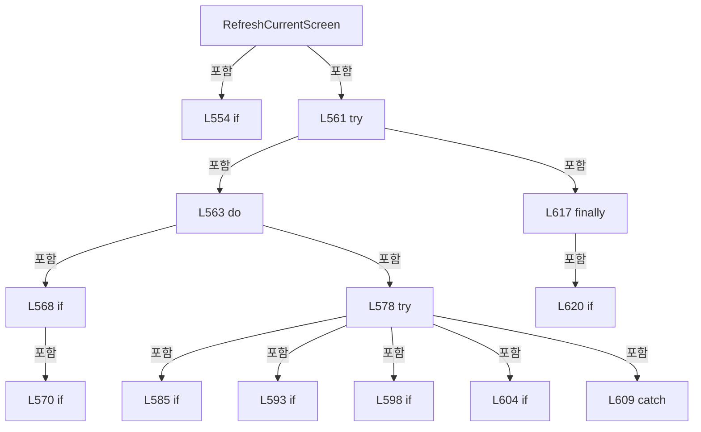

변경 전 점검: 입력/반환 타입, 위 호출자, 예외/취소 경로, 공유 상태와 저장·전송 소비자를 함께 확인합니다. 값의 단위나 물리 방향을 이름만으로 확정하지 않습니다.

### MethodDeclaration `ShowCachedScreenOrLoading` · L627–632

[Drilling.UI/CRootView.cs:627–632](https://github.com/kjuws10-rgb/A3Drilling/blob/0219666f9053b907d96d7e0aa7d0c6c1be3a73d4/Drilling.UI/CRootView.cs#L627-L632)

| 항목 | 실제 추출 값 |
| --- | --- |
| 서명 | void Drilling.UI.CRootView.ShowCachedScreenOrLoading(Drilling.UI.Menu.Menus.CMenuItem) |
| 접근/수식자 | Private / private |
| 반환/값 타입 | void |
| 소속 타입 | NamedType:Drilling.UI.CRootView |

입력 계약:

| 이름 | 타입 | 전달 | 선택/기본값 |
| --- | --- | --- | --- |
| menu | Drilling.UI.Menu.Menus.CMenuItem | None | False /  |

정적 호출자로 확인된 위치:

| 호출 파일/행 | 호출 표현식 | 런타임 분기 가능 |
| --- | --- | --- |
| [Drilling.UI/CRootView.cs:345–345](https://github.com/kjuws10-rgb/A3Drilling/blob/0219666f9053b907d96d7e0aa7d0c6c1be3a73d4/Drilling.UI/CRootView.cs#L345-L345) | ShowCachedScreenOrLoading | False |

호출하는 대상과 해석 범위:

| 원본 행 | 표현식 | 분석 상태 | 대상/소스 위치 |
| --- | --- | --- | --- |
| 629 | _screenCache.TryGetValue | resolved | bool System.Collections.Generic.Dictionary<Drilling.UI.Menu.Menus.EN_MENU, Drilling.UI.Menu.Menus.CScreenViewModel>.TryGetValue(Drilling.UI.Menu.Menus.EN_MENU, out Drilling.UI.Menu.Menus.CScreenViewModel) |
| 631 | CreateLoadingScreen | resolved | Drilling.UI.Menu.Menus.CScreenViewModel Drilling.UI.CRootView.CreateLoadingScreen(Drilling.UI.Menu.Menus.EN_MENU, string) · Drilling.UI/CRootView.cs:2652 |

본문의 실제 연산·분기·예외·반환 순서(원문 위치 순):

| 원본 행 | 종류 | 주석 해설 |
| --- | --- | --- |
| 629 | call | 함수·델리게이트 또는 객체 생성자를 호출합니다: _screenCache.TryGetValue(menu.Menu, out var cached) |
| 629 | assignment | 값을 대상에 대입합니다: CurrentScreen = _screenCache.TryGetValue(menu.Menu, out var cached) ? cached : CreateLoadingScreen(menu.Menu, menu.Name) |
| 629 | conditional-expression | 조건에 따라 결과식을 선택합니다: _screenCache.TryGetValue(menu.Menu, out var cached) ? cached : CreateLoadingScreen(menu.Menu, menu.Name) |
| 631 | call | 함수·델리게이트 또는 객체 생성자를 호출합니다: CreateLoadingScreen(menu.Menu, menu.Name) |

변경 전 점검: 입력/반환 타입, 위 호출자, 예외/취소 경로, 공유 상태와 저장·전송 소비자를 함께 확인합니다. 값의 단위나 물리 방향을 이름만으로 확정하지 않습니다.

### MethodDeclaration `RestartScreenBuild` · L634–645

[Drilling.UI/CRootView.cs:634–645](https://github.com/kjuws10-rgb/A3Drilling/blob/0219666f9053b907d96d7e0aa7d0c6c1be3a73d4/Drilling.UI/CRootView.cs#L634-L645)

| 항목 | 실제 추출 값 |
| --- | --- |
| 서명 | void Drilling.UI.CRootView.RestartScreenBuild() |
| 접근/수식자 | Private / private |
| 반환/값 타입 | void |
| 소속 타입 | NamedType:Drilling.UI.CRootView |

정적 호출자로 확인된 위치:

| 호출 파일/행 | 호출 표현식 | 런타임 분기 가능 |
| --- | --- | --- |
| [Drilling.UI/CRootView.cs:344–344](https://github.com/kjuws10-rgb/A3Drilling/blob/0219666f9053b907d96d7e0aa7d0c6c1be3a73d4/Drilling.UI/CRootView.cs#L344-L344) | RestartScreenBuild | False |

호출하는 대상과 해석 범위:

| 원본 행 | 표현식 | 분석 상태 | 대상/소스 위치 |
| --- | --- | --- | --- |
| 640 | new CancellationTokenSource | resolved | System.Threading.CancellationTokenSource.CancellationTokenSource() |
| 643 | previous.Cancel | resolved | void System.Threading.CancellationTokenSource.Cancel() |
| 644 | previous.Dispose | resolved | void System.Threading.CancellationTokenSource.Dispose() |

본문의 실제 연산·분기·예외·반환 순서(원문 위치 순):

| 원본 행 | 종류 | 주석 해설 |
| --- | --- | --- |
| 636 | local-declaration | 지역 변수를 선언합니다: CancellationTokenSource previous; |
| 637 | lock | 공유 상태의 임계 구역에 진입합니다: lock (_screenBuildSync) |
| 639 | assignment | 값을 대상에 대입합니다: previous = _screenBuildCts |
| 640 | assignment | 값을 대상에 대입합니다: _screenBuildCts = new CancellationTokenSource() |
| 640 | call | 함수·델리게이트 또는 객체 생성자를 호출합니다: new CancellationTokenSource() |
| 643 | call | 함수·델리게이트 또는 객체 생성자를 호출합니다: previous.Cancel() |
| 644 | call | 함수·델리게이트 또는 객체 생성자를 호출합니다: previous.Dispose() |

제어 구문의 포함 구조(실제 실행 순서/CFG가 아닌 구문 탐색 그림):


변경 전 점검: 입력/반환 타입, 위 호출자, 예외/취소 경로, 공유 상태와 저장·전송 소비자를 함께 확인합니다. 값의 단위나 물리 방향을 이름만으로 확정하지 않습니다.

### MethodDeclaration `GetScreenBuildToken` · L647–653

[Drilling.UI/CRootView.cs:647–653](https://github.com/kjuws10-rgb/A3Drilling/blob/0219666f9053b907d96d7e0aa7d0c6c1be3a73d4/Drilling.UI/CRootView.cs#L647-L653)

| 항목 | 실제 추출 값 |
| --- | --- |
| 서명 | System.Threading.CancellationToken Drilling.UI.CRootView.GetScreenBuildToken() |
| 접근/수식자 | Private / private |
| 반환/값 타입 | System.Threading.CancellationToken |
| 소속 타입 | NamedType:Drilling.UI.CRootView |

정적 호출자로 확인된 위치:

| 호출 파일/행 | 호출 표현식 | 런타임 분기 가능 |
| --- | --- | --- |
| [Drilling.UI/CRootView.cs:567–567](https://github.com/kjuws10-rgb/A3Drilling/blob/0219666f9053b907d96d7e0aa7d0c6c1be3a73d4/Drilling.UI/CRootView.cs#L567-L567) | GetScreenBuildToken | False |
| [Drilling.UI/CRootView.cs:612–612](https://github.com/kjuws10-rgb/A3Drilling/blob/0219666f9053b907d96d7e0aa7d0c6c1be3a73d4/Drilling.UI/CRootView.cs#L612-L612) | GetScreenBuildToken | False |

본문의 실제 연산·분기·예외·반환 순서(원문 위치 순):

| 원본 행 | 종류 | 주석 해설 |
| --- | --- | --- |
| 649 | lock | 공유 상태의 임계 구역에 진입합니다: lock (_screenBuildSync) |
| 651 | return | 호출자에게 값 또는 제어를 반환합니다: return _screenBuildCts.Token; |

제어 구문의 포함 구조(실제 실행 순서/CFG가 아닌 구문 탐색 그림):

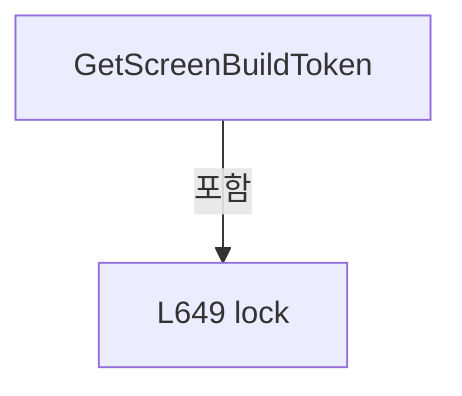

변경 전 점검: 입력/반환 타입, 위 호출자, 예외/취소 경로, 공유 상태와 저장·전송 소비자를 함께 확인합니다. 값의 단위나 물리 방향을 이름만으로 확정하지 않습니다.

### MethodDeclaration `ResetMenuStateOnOpen` · L655–666

[Drilling.UI/CRootView.cs:655–666](https://github.com/kjuws10-rgb/A3Drilling/blob/0219666f9053b907d96d7e0aa7d0c6c1be3a73d4/Drilling.UI/CRootView.cs#L655-L666)

| 항목 | 실제 추출 값 |
| --- | --- |
| 서명 | void Drilling.UI.CRootView.ResetMenuStateOnOpen(Drilling.UI.Menu.Menus.EN_MENU, Drilling.UI.Menu.Menus.EN_MENU) |
| 접근/수식자 | Private / private |
| 반환/값 타입 | void |
| 소속 타입 | NamedType:Drilling.UI.CRootView |

입력 계약:

| 이름 | 타입 | 전달 | 선택/기본값 |
| --- | --- | --- | --- |
| previousMenu | Drilling.UI.Menu.Menus.EN_MENU | None | False /  |
| selectedMenu | Drilling.UI.Menu.Menus.EN_MENU | None | False /  |

정적 호출자로 확인된 위치:

| 호출 파일/행 | 호출 표현식 | 런타임 분기 가능 |
| --- | --- | --- |
| [Drilling.UI/CRootView.cs:369–369](https://github.com/kjuws10-rgb/A3Drilling/blob/0219666f9053b907d96d7e0aa7d0c6c1be3a73d4/Drilling.UI/CRootView.cs#L369-L369) | ResetMenuStateOnOpen | False |

호출하는 대상과 해석 범위:

| 원본 행 | 표현식 | 분석 상태 | 대상/소스 위치 |
| --- | --- | --- | --- |
| 659 | ResetSelectedManualHead | resolved | void Drilling.UI.CRootView.ResetSelectedManualHead() · Drilling.UI/CRootView.cs:668 |
| 663 | _menus.TryGetValue | resolved · 동적 구현 선택 가능 | bool System.Collections.Generic.IReadOnlyDictionary<Drilling.UI.Menu.Menus.EN_MENU, Drilling.UI.Menu.Menus.CMenuBase>.TryGetValue(Drilling.UI.Menu.Menus.EN_MENU, out Drilling.UI.Menu.Menus.CMenuBase) |
| 665 | .ResetForMenuOpen | resolved | void Drilling.UI.Menu.Menus.CMenuReview.ResetForMenuOpen() · Drilling.UI/Menu/Menus/CMenuReview.cs:472 |

본문의 실제 연산·분기·예외·반환 순서(원문 위치 순):

| 원본 행 | 종류 | 주석 해설 |
| --- | --- | --- |
| 657 | if | 조건에 따라 분기합니다: if (selectedMenu == EN_MENU.Manual && previousMenu != EN_MENU.Manual) |
| 659 | call | 함수·델리게이트 또는 객체 생성자를 호출합니다: ResetSelectedManualHead() |
| 662 | if | 조건에 따라 분기합니다: if (selectedMenu == EN_MENU.Correction && previousMenu != EN_MENU.Correction && _menus.TryGetValue(EN_MENU.Correction, out var correction) && correction is CMenuCorrection correctionMenu) |
| 663 | call | 함수·델리게이트 또는 객체 생성자를 호출합니다: _menus.TryGetValue(EN_MENU.Correction, out var correction) |
| 665 | call | 함수·델리게이트 또는 객체 생성자를 호출합니다: .ResetForMenuOpen() |

제어 구문의 포함 구조(실제 실행 순서/CFG가 아닌 구문 탐색 그림):

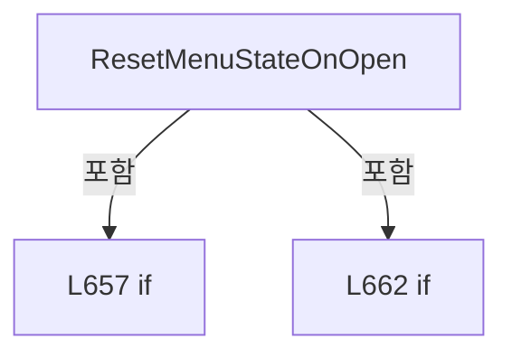

변경 전 점검: 입력/반환 타입, 위 호출자, 예외/취소 경로, 공유 상태와 저장·전송 소비자를 함께 확인합니다. 값의 단위나 물리 방향을 이름만으로 확정하지 않습니다.

### MethodDeclaration `ResetSelectedManualHead` · L668–685

[Drilling.UI/CRootView.cs:668–685](https://github.com/kjuws10-rgb/A3Drilling/blob/0219666f9053b907d96d7e0aa7d0c6c1be3a73d4/Drilling.UI/CRootView.cs#L668-L685)

| 항목 | 실제 추출 값 |
| --- | --- |
| 서명 | void Drilling.UI.CRootView.ResetSelectedManualHead() |
| 접근/수식자 | Private / private |
| 반환/값 타입 | void |
| 소속 타입 | NamedType:Drilling.UI.CRootView |

정적 호출자로 확인된 위치:

| 호출 파일/행 | 호출 표현식 | 런타임 분기 가능 |
| --- | --- | --- |
| [Drilling.UI/CRootView.cs:659–659](https://github.com/kjuws10-rgb/A3Drilling/blob/0219666f9053b907d96d7e0aa7d0c6c1be3a73d4/Drilling.UI/CRootView.cs#L659-L659) | ResetSelectedManualHead | False |

호출하는 대상과 해석 범위:

| 원본 행 | 표현식 | 분석 상태 | 대상/소스 위치 |
| --- | --- | --- | --- |
| 672 | _manager.Setting().LoadSection | resolved | System.Collections.Generic.IReadOnlyList<Drilling.Common.Managers.ST_SYSTEM_PARAMETER> Drilling.Common.Managers.CSettingManager.LoadSection(Drilling.Common.Managers.EN_SETTING_TAB, System.Threading.CancellationToken) · Drilling.Common/Managers/CSettingManager.cs:26 |
| 672 | _manager.Setting | resolved | Drilling.Common.Managers.CSettingManager Drilling.Common.Managers.CManager.Setting() · Drilling.Common/Managers/CManager.cs:340 |
| 673 | CScannerStatusSnapshotReader.BuildEnabledHeadNumbers | resolved | System.Collections.Generic.IReadOnlyList<int> Drilling.UI.Menu.Menus.CScannerStatusSnapshotReader.BuildEnabledHeadNumbers(System.Collections.Generic.IReadOnlyList<Drilling.Common.Managers.ST_SYSTEM_PARAMETER>, int) · Drilling.UI/Menu/Menus/CScannerStatusSnapshotReader.cs:126 |
| 684 | Math.Clamp | resolved | int System.Math.Clamp(int, int, int) |

본문의 실제 연산·분기·예외·반환 순서(원문 위치 순):

| 원본 행 | 종류 | 주석 해설 |
| --- | --- | --- |
| 670 | try | 예외 처리 범위입니다: try |
| 672 | call | 함수·델리게이트 또는 객체 생성자를 호출합니다: _manager.Setting().LoadSection(EN_SETTING_TAB.Option, CancellationToken.None) |
| 672 | call | 함수·델리게이트 또는 객체 생성자를 호출합니다: _manager.Setting() |
| 672 | local-declaration | 지역 변수를 선언합니다: var settings = _manager.Setting().LoadSection(EN_SETTING_TAB.Option, CancellationToken.None); |
| 672 | variable-initializer | 변수의 초기값을 지정합니다: settings = _manager.Setting().LoadSection(EN_SETTING_TAB.Option, CancellationToken.None) |
| 673 | call | 함수·델리게이트 또는 객체 생성자를 호출합니다: CScannerStatusSnapshotReader.BuildEnabledHeadNumbers(settings, 8) |
| 673 | local-declaration | 지역 변수를 선언합니다: var enabledHeadNos = CScannerStatusSnapshotReader.BuildEnabledHeadNumbers(settings, 8); |
| 673 | variable-initializer | 변수의 초기값을 지정합니다: enabledHeadNos = CScannerStatusSnapshotReader.BuildEnabledHeadNumbers(settings, 8) |
| 674 | if | 조건에 따라 분기합니다: if (enabledHeadNos.Count > 0) |
| 676 | assignment | 값을 대상에 대입합니다: _selectedHeadNo = enabledHeadNos[0] |
| 677 | return | 호출자에게 값 또는 제어를 반환합니다: return; |
| 680 | catch | 지정 예외를 처리합니다: catch (Exception exception) when (exception is InvalidDataException or IOException) |
| 684 | assignment | 값을 대상에 대입합니다: _selectedHeadNo = Math.Clamp(_selectedHeadNo, 1, 8) |
| 684 | call | 함수·델리게이트 또는 객체 생성자를 호출합니다: Math.Clamp(_selectedHeadNo, 1, 8) |

제어 구문의 포함 구조(실제 실행 순서/CFG가 아닌 구문 탐색 그림):


변경 전 점검: 입력/반환 타입, 위 호출자, 예외/취소 경로, 공유 상태와 저장·전송 소비자를 함께 확인합니다. 값의 단위나 물리 방향을 이름만으로 확정하지 않습니다.

### MethodDeclaration `ToggleTheme` · L687–695

[Drilling.UI/CRootView.cs:687–695](https://github.com/kjuws10-rgb/A3Drilling/blob/0219666f9053b907d96d7e0aa7d0c6c1be3a73d4/Drilling.UI/CRootView.cs#L687-L695)

| 항목 | 실제 추출 값 |
| --- | --- |
| 서명 | System.Threading.Tasks.Task Drilling.UI.CRootView.ToggleTheme() |
| 접근/수식자 | Private / private, async |
| 반환/값 타입 | System.Threading.Tasks.Task |
| 소속 타입 | NamedType:Drilling.UI.CRootView |

정적 호출자로 확인된 위치:

| 호출 파일/행 | 호출 표현식 | 런타임 분기 가능 |
| --- | --- | --- |
| [Drilling.UI/CRootView.cs:221–221](https://github.com/kjuws10-rgb/A3Drilling/blob/0219666f9053b907d96d7e0aa7d0c6c1be3a73d4/Drilling.UI/CRootView.cs#L221-L221) | ToggleTheme | False |

호출하는 대상과 해석 범위:

| 원본 행 | 표현식 | 분석 상태 | 대상/소스 위치 |
| --- | --- | --- | --- |
| 689 | CThemeManager.Toggle | resolved | Drilling.UI.EN_UI_THEME Drilling.UI.CThemeManager.Toggle() · Drilling.UI/CThemeManager.cs:33 |
| 690 | OnPropertyChanged | resolved | void Drilling.UI.Menu.CBindingBase.OnPropertyChanged(string?) · Drilling.UI/Menu/CBindingBase.cs:790 |
| 690 | nameof | unresolved | None |
| 691 | OnPropertyChanged | resolved | void Drilling.UI.Menu.CBindingBase.OnPropertyChanged(string?) · Drilling.UI/Menu/CBindingBase.cs:790 |
| 691 | nameof | unresolved | None |
| 692 | RefreshShellStatusItems | resolved | void Drilling.UI.CRootView.RefreshShellStatusItems() · Drilling.UI/CRootView.cs:899 |
| 693 | RefreshCurrentScreen | resolved | System.Threading.Tasks.Task Drilling.UI.CRootView.RefreshCurrentScreen() · Drilling.UI/CRootView.cs:552 |

본문의 실제 연산·분기·예외·반환 순서(원문 위치 순):

| 원본 행 | 종류 | 주석 해설 |
| --- | --- | --- |
| 689 | assignment | 값을 대상에 대입합니다: _currentTheme = CThemeManager.Toggle() |
| 689 | call | 함수·델리게이트 또는 객체 생성자를 호출합니다: CThemeManager.Toggle() |
| 690 | call | 함수·델리게이트 또는 객체 생성자를 호출합니다: OnPropertyChanged(nameof(ThemeToggleText)) |
| 690 | call | 함수·델리게이트 또는 객체 생성자를 호출합니다: nameof(ThemeToggleText) |
| 691 | call | 함수·델리게이트 또는 객체 생성자를 호출합니다: OnPropertyChanged(nameof(ThemeModeText)) |
| 691 | call | 함수·델리게이트 또는 객체 생성자를 호출합니다: nameof(ThemeModeText) |
| 692 | call | 함수·델리게이트 또는 객체 생성자를 호출합니다: RefreshShellStatusItems() |
| 693 | await | 비동기 완료를 기다립니다: await RefreshCurrentScreen() |
| 693 | call | 함수·델리게이트 또는 객체 생성자를 호출합니다: RefreshCurrentScreen() |
| 694 | assignment | 값을 대상에 대입합니다: StatusMessage = $"{ThemeModeText} applied." |

변경 전 점검: 입력/반환 타입, 위 호출자, 예외/취소 경로, 공유 상태와 저장·전송 소비자를 함께 확인합니다. 값의 단위나 물리 방향을 이름만으로 확정하지 않습니다.

### MethodDeclaration `ToggleOperationMode` · L697–756

[Drilling.UI/CRootView.cs:697–756](https://github.com/kjuws10-rgb/A3Drilling/blob/0219666f9053b907d96d7e0aa7d0c6c1be3a73d4/Drilling.UI/CRootView.cs#L697-L756)

| 항목 | 실제 추출 값 |
| --- | --- |
| 서명 | System.Threading.Tasks.Task Drilling.UI.CRootView.ToggleOperationMode(System.Func<string, string, bool>?, System.Action<string, string>?) |
| 접근/수식자 | Private / private, async |
| 반환/값 타입 | System.Threading.Tasks.Task |
| 소속 타입 | NamedType:Drilling.UI.CRootView |

입력 계약:

| 이름 | 타입 | 전달 | 선택/기본값 |
| --- | --- | --- | --- |
| confirm | System.Func<string, string, bool>? | None | True / null |
| warn | System.Action<string, string>? | None | True / null |

정적 호출자로 확인된 위치:

| 호출 파일/행 | 호출 표현식 | 런타임 분기 가능 |
| --- | --- | --- |
| [Drilling.UI/CRootView.cs:228–228](https://github.com/kjuws10-rgb/A3Drilling/blob/0219666f9053b907d96d7e0aa7d0c6c1be3a73d4/Drilling.UI/CRootView.cs#L228-L228) | ToggleOperationMode | False |

호출하는 대상과 해석 범위:

| 원본 행 | 표현식 | 분석 상태 | 대상/소스 위치 |
| --- | --- | --- | --- |
| 699 | CRecipeConfirmDialog.ShowConfirmation | resolved | bool Drilling.UI.Popup.CRecipeConfirmDialog.ShowConfirmation(string, string, string, bool) · Drilling.UI/Popup/CRecipeConfirmDialog.xaml.cs:12 |
| 700 | CRecipeConfirmDialog.ShowWarning | resolved | void Drilling.UI.Popup.CRecipeConfirmDialog.ShowWarning(string, string, Window?) · Drilling.UI/Popup/CRecipeConfirmDialog.xaml.cs:110 |
| 709 | CheckAutoModeInterlocks | resolved | System.Threading.Tasks.Task<bool> Drilling.UI.CRootView.CheckAutoModeInterlocks(System.Action<string, string>) · Drilling.UI/CRootView.cs:800 |
| 711 | OperationModeValue | resolved | string Drilling.UI.CRootView.OperationModeValue(Drilling.Common.Managers.EN_SYSTEM_MODE) · Drilling.UI/CRootView.cs:2912 |
| 712 | confirm | resolved · 동적 구현 선택 가능 | bool System.Func<string, string, bool>.Invoke(string, string) |
| 718 | CheckAutoModeInterlocks | resolved | System.Threading.Tasks.Task<bool> Drilling.UI.CRootView.CheckAutoModeInterlocks(System.Action<string, string>) · Drilling.UI/CRootView.cs:800 |
| 726 | WaitForInitialProcessModelPreparation | resolved | System.Threading.Tasks.Task Drilling.UI.CRootView.WaitForInitialProcessModelPreparation(System.Threading.CancellationToken) · Drilling.UI/CRootView.cs:934 |
| 727 | CheckAutoModeInterlocks | resolved | System.Threading.Tasks.Task<bool> Drilling.UI.CRootView.CheckAutoModeInterlocks(System.Action<string, string>) · Drilling.UI/CRootView.cs:800 |
| 729 | _stationManager.StartStageRequests | resolved | void Drilling.Common.Station.CStationManager.StartStageRequests(System.Func<System.Threading.CancellationToken, System.Threading.Tasks.Task<Drilling.Common.Station.ST_STAGE_PROCESS_REQUEST>>, Drilling.Common.Station.ST_STAGE_REVIEW_ACTIONS?, Drilling.Common.Station.ST_STAGE_TPM_ACTIONS?, Drilling.Common.Station.ST_STAGE_DISTORTION_ACTIONS?) · Drilling.Common/Station/CStationManager.cs:30 |
| 729 | CreateAutoReviewActions | resolved | Drilling.Common.Station.ST_STAGE_REVIEW_ACTIONS Drilling.UI.CRootView.CreateAutoReviewActions() · Drilling.UI/CRootView.cs:3179 |
| 729 | CreateAutoPowerActions | resolved | Drilling.Common.Station.ST_STAGE_TPM_ACTIONS Drilling.UI.CRootView.CreateAutoPowerActions() · Drilling.UI/CRootView.cs:3164 |
| 729 | CreateAutoDistortionActions | resolved | Drilling.Common.Station.ST_STAGE_DISTORTION_ACTIONS Drilling.UI.CRootView.CreateAutoDistortionActions() · Drilling.UI/CRootView.cs:3260 |
| 731 | _stationManager.StageRequests.StopAsync | resolved | System.Threading.Tasks.Task<bool> Drilling.Common.Station.CStageRequestSequence.StopAsync() · Drilling.Common/Station/CStationProcess.cs:5127 |
| 734 | warn | resolved · 동적 구현 선택 가능 | void System.Action<string, string>.Invoke(string, string) |
| 741 | warn | resolved · 동적 구현 선택 가능 | void System.Action<string, string>.Invoke(string, string) |
| 746 | RefreshOperationModeAccess | resolved | void Drilling.UI.CRootView.RefreshOperationModeAccess() · Drilling.UI/CRootView.cs:879 |
| 747 | StopCommand.NotifyCanExecuteChanged | resolved | void Drilling.UI.Menu.CButtonCommand.NotifyCanExecuteChanged() · Drilling.UI/Menu/CButtonCommand.cs:24 |
| 752 | OnPropertyChanged | resolved | void Drilling.UI.Menu.CBindingBase.OnPropertyChanged(string?) · Drilling.UI/Menu/CBindingBase.cs:790 |
| 752 | nameof | unresolved | None |
| 753 | RefreshShellStatusItems | resolved | void Drilling.UI.CRootView.RefreshShellStatusItems() · Drilling.UI/CRootView.cs:899 |
| 755 | RefreshCurrentScreen | resolved | System.Threading.Tasks.Task Drilling.UI.CRootView.RefreshCurrentScreen() · Drilling.UI/CRootView.cs:552 |

본문의 실제 연산·분기·예외·반환 순서(원문 위치 순):

| 원본 행 | 종류 | 주석 해설 |
| --- | --- | --- |
| 699 | assignment | 값을 대상에 대입합니다: confirm ??= (title, message) => CRecipeConfirmDialog.ShowConfirmation(title, message) |
| 699 | call | 함수·델리게이트 또는 객체 생성자를 호출합니다: CRecipeConfirmDialog.ShowConfirmation(title, message) |
| 700 | assignment | 값을 대상에 대입합니다: warn ??= (title, message) => CRecipeConfirmDialog.ShowWarning(title, message) |
| 700 | call | 함수·델리게이트 또는 객체 생성자를 호출합니다: CRecipeConfirmDialog.ShowWarning(title, message) |
| 701 | if | 조건에 따라 분기합니다: if (_autoCycleState != EN_AUTO_CYCLE_STATE.Ready) |
| 703 | assignment | 값을 대상에 대입합니다: StatusMessage = "MODE cannot be changed while process is preparing, running, or stopping." |
| 704 | return | 호출자에게 값 또는 제어를 반환합니다: return; |
| 707 | local-declaration | 지역 변수를 선언합니다: var previousMode = _operationMode; |
| 707 | variable-initializer | 변수의 초기값을 지정합니다: previousMode = _operationMode |
| 708 | conditional-expression | 조건에 따라 결과식을 선택합니다: previousMode == EN_SYSTEM_MODE.Auto ? EN_SYSTEM_MODE.Manual : EN_SYSTEM_MODE.Auto |
| 708 | local-declaration | 지역 변수를 선언합니다: var nextMode = previousMode == EN_SYSTEM_MODE.Auto ? EN_SYSTEM_MODE.Manual : EN_SYSTEM_MODE.Auto; |
| 708 | variable-initializer | 변수의 초기값을 지정합니다: nextMode = previousMode == EN_SYSTEM_MODE.Auto ? EN_SYSTEM_MODE.Manual : EN_SYSTEM_MODE.Auto |
| 709 | await | 비동기 완료를 기다립니다: await CheckAutoModeInterlocks(warn) |
| 709 | call | 함수·델리게이트 또는 객체 생성자를 호출합니다: CheckAutoModeInterlocks(warn) |
| 709 | if | 조건에 따라 분기합니다: if (nextMode == EN_SYSTEM_MODE.Auto && !await CheckAutoModeInterlocks(warn)) |
| 710 | return | 호출자에게 값 또는 제어를 반환합니다: return; |
| 711 | call | 함수·델리게이트 또는 객체 생성자를 호출합니다: OperationModeValue(nextMode) |
| 711 | local-declaration | 지역 변수를 선언합니다: var nextModeText = OperationModeValue(nextMode); |
| 711 | variable-initializer | 변수의 초기값을 지정합니다: nextModeText = OperationModeValue(nextMode) |
| 712 | call | 함수·델리게이트 또는 객체 생성자를 호출합니다: confirm("MODE 변경", $"{nextModeText} Mode로 전환하시겠습니까?") |
| 712 | if | 조건에 따라 분기합니다: if (!confirm("MODE 변경", $"{nextModeText} Mode로 전환하시겠습니까?")) |
| 714 | return | 호출자에게 값 또는 제어를 반환합니다: return; |
| 718 | await | 비동기 완료를 기다립니다: await CheckAutoModeInterlocks(warn) |
| 718 | call | 함수·델리게이트 또는 객체 생성자를 호출합니다: CheckAutoModeInterlocks(warn) |
| 718 | if | 조건에 따라 분기합니다: if (nextMode == EN_SYSTEM_MODE.Auto && !await CheckAutoModeInterlocks(warn)) |
| 719 | return | 호출자에게 값 또는 제어를 반환합니다: return; |
| 720 | if | 조건에 따라 분기합니다: if (_autoCycleState != EN_AUTO_CYCLE_STATE.Ready &#124;&#124; _operationMode != previousMode) |
| 721 | return | 호출자에게 값 또는 제어를 반환합니다: return; |
| 722 | try | 예외 처리 범위입니다: try |
| 724 | if | 조건에 따라 분기합니다: if (nextMode == EN_SYSTEM_MODE.Auto) |
| 726 | await | 비동기 완료를 기다립니다: await WaitForInitialProcessModelPreparation(CancellationToken.None) |
| 726 | call | 함수·델리게이트 또는 객체 생성자를 호출합니다: WaitForInitialProcessModelPreparation(CancellationToken.None) |
| 727 | await | 비동기 완료를 기다립니다: await CheckAutoModeInterlocks(warn) |
| 727 | call | 함수·델리게이트 또는 객체 생성자를 호출합니다: CheckAutoModeInterlocks(warn) |
| 727 | if | 조건에 따라 분기합니다: if (!await CheckAutoModeInterlocks(warn)) |
| 728 | return | 호출자에게 값 또는 제어를 반환합니다: return; |
| 729 | call | 함수·델리게이트 또는 객체 생성자를 호출합니다: _stationManager.StartStageRequests(CreateStageProcessRequest, CreateAutoReviewActions(), CreateAutoPowerActions(), CreateAutoDistortionActions()) |
| 729 | call | 함수·델리게이트 또는 객체 생성자를 호출합니다: CreateAutoReviewActions() |
| 729 | call | 함수·델리게이트 또는 객체 생성자를 호출합니다: CreateAutoPowerActions() |
| 729 | call | 함수·델리게이트 또는 객체 생성자를 호출합니다: CreateAutoDistortionActions() |
| 731 | await | 비동기 완료를 기다립니다: await _stationManager.StageRequests.StopAsync() |
| 731 | call | 함수·델리게이트 또는 객체 생성자를 호출합니다: _stationManager.StageRequests.StopAsync() |
| 731 | else | 앞 조건이 거짓인 경로입니다: else |
| 731 | if | 조건에 따라 분기합니다: if (!await _stationManager.StageRequests.StopAsync()) |
| 733 | assignment | 값을 대상에 대입합니다: StatusMessage = "Previous Stage operation is still stopping. MODE change is blocked." |
| 734 | call | 함수·델리게이트 또는 객체 생성자를 호출합니다: warn("MODE 변경 불가", "Stage 동작의 정지 확인을 기다리고 있습니다.") |
| 735 | return | 호출자에게 값 또는 제어를 반환합니다: return; |
| 738 | catch | 지정 예외를 처리합니다: catch (Exception exception) |
| 740 | assignment | 값을 대상에 대입합니다: StatusMessage = $"Stage sequence mode change failed: {exception.Message}" |
| 741 | call | 함수·델리게이트 또는 객체 생성자를 호출합니다: warn("MODE 변경 불가", "Stage 시퀀스를 준비할 수 없습니다.") |
| 742 | return | 호출자에게 값 또는 제어를 반환합니다: return; |
| 745 | assignment | 값을 대상에 대입합니다: _operationMode = nextMode |
| 746 | call | 함수·델리게이트 또는 객체 생성자를 호출합니다: RefreshOperationModeAccess() |
| 747 | call | 함수·델리게이트 또는 객체 생성자를 호출합니다: StopCommand.NotifyCanExecuteChanged() |
| 748 | assignment | 값을 대상에 대입합니다: _systemStatus = _systemStatus with { OperationMode = _operationMode } |
| 750 | assignment | 값을 대상에 대입합니다: OperationMode = _operationMode |
| 752 | call | 함수·델리게이트 또는 객체 생성자를 호출합니다: OnPropertyChanged(nameof(IsManualShiftOffsetVisible)) |
| 752 | call | 함수·델리게이트 또는 객체 생성자를 호출합니다: nameof(IsManualShiftOffsetVisible) |
| 753 | call | 함수·델리게이트 또는 객체 생성자를 호출합니다: RefreshShellStatusItems() |
| 754 | assignment | 값을 대상에 대입합니다: StatusMessage = _operationMode == EN_SYSTEM_MODE.Auto ? "AUTO mode selected. Waiting for Stage PC request." : "MANUAL mode selected. Main START is enabled." |
| 754 | conditional-expression | 조건에 따라 결과식을 선택합니다: _operationMode == EN_SYSTEM_MODE.Auto ? "AUTO mode selected. Waiting for Stage PC request." : "MANUAL mode selected. Main START is enabled." |
| 755 | await | 비동기 완료를 기다립니다: await RefreshCurrentScreen() |
| 755 | call | 함수·델리게이트 또는 객체 생성자를 호출합니다: RefreshCurrentScreen() |

제어 구문의 포함 구조(실제 실행 순서/CFG가 아닌 구문 탐색 그림):

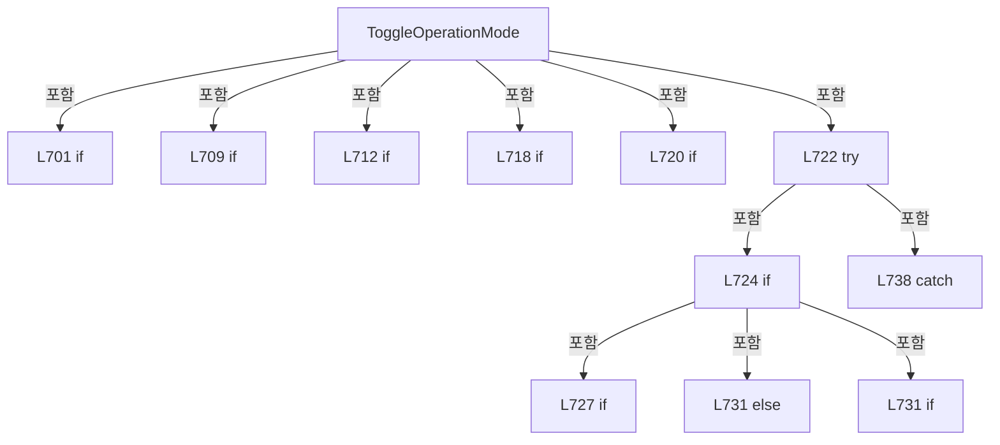

변경 전 점검: 입력/반환 타입, 위 호출자, 예외/취소 경로, 공유 상태와 저장·전송 소비자를 함께 확인합니다. 값의 단위나 물리 방향을 이름만으로 확정하지 않습니다.

### MethodDeclaration `InitializeAutoSequence` · L758–798

[Drilling.UI/CRootView.cs:758–798](https://github.com/kjuws10-rgb/A3Drilling/blob/0219666f9053b907d96d7e0aa7d0c6c1be3a73d4/Drilling.UI/CRootView.cs#L758-L798)

| 항목 | 실제 추출 값 |
| --- | --- |
| 서명 | System.Threading.Tasks.Task Drilling.UI.CRootView.InitializeAutoSequence() |
| 접근/수식자 | Private / private, async |
| 반환/값 타입 | System.Threading.Tasks.Task |
| 소속 타입 | NamedType:Drilling.UI.CRootView |

정적 호출자로 확인된 위치:

| 호출 파일/행 | 호출 표현식 | 런타임 분기 가능 |
| --- | --- | --- |
| [Drilling.UI/CRootView.cs:239–239](https://github.com/kjuws10-rgb/A3Drilling/blob/0219666f9053b907d96d7e0aa7d0c6c1be3a73d4/Drilling.UI/CRootView.cs#L239-L239) | InitializeAutoSequence | False |

호출하는 대상과 해석 범위:

| 원본 행 | 표현식 | 분석 상태 | 대상/소스 위치 |
| --- | --- | --- | --- |
| 769 | CRecipeConfirmDialog.ShowConfirmation | resolved | bool Drilling.UI.Popup.CRecipeConfirmDialog.ShowConfirmation(string, string, string, bool) · Drilling.UI/Popup/CRecipeConfirmDialog.xaml.cs:12 |
| 777 | NotifyOperationCommandStates | resolved | void Drilling.UI.CRootView.NotifyOperationCommandStates() · Drilling.UI/CRootView.cs:2226 |
| 781 | _stationManager.ResetStageRequestsAsync().ConfigureAwait | resolved | System.Runtime.CompilerServices.ConfiguredTaskAwaitable System.Threading.Tasks.Task.ConfigureAwait(bool) |
| 781 | _stationManager.ResetStageRequestsAsync | resolved | System.Threading.Tasks.Task Drilling.Common.Station.CStationManager.ResetStageRequestsAsync(System.Threading.CancellationToken) · Drilling.Common/Station/CStationManager.cs:31 |
| 783 | new InvalidOperationException | resolved | System.InvalidOperationException.InvalidOperationException(string?) |
| 785 | _stationManager.StartStageRequests | resolved | void Drilling.Common.Station.CStationManager.StartStageRequests(System.Func<System.Threading.CancellationToken, System.Threading.Tasks.Task<Drilling.Common.Station.ST_STAGE_PROCESS_REQUEST>>, Drilling.Common.Station.ST_STAGE_REVIEW_ACTIONS?, Drilling.Common.Station.ST_STAGE_TPM_ACTIONS?, Drilling.Common.Station.ST_STAGE_DISTORTION_ACTIONS?) · Drilling.Common/Station/CStationManager.cs:30 |
| 785 | CreateAutoReviewActions | resolved | Drilling.Common.Station.ST_STAGE_REVIEW_ACTIONS Drilling.UI.CRootView.CreateAutoReviewActions() · Drilling.UI/CRootView.cs:3179 |
| 785 | CreateAutoPowerActions | resolved | Drilling.Common.Station.ST_STAGE_TPM_ACTIONS Drilling.UI.CRootView.CreateAutoPowerActions() · Drilling.UI/CRootView.cs:3164 |
| 785 | CreateAutoDistortionActions | resolved | Drilling.Common.Station.ST_STAGE_DISTORTION_ACTIONS Drilling.UI.CRootView.CreateAutoDistortionActions() · Drilling.UI/CRootView.cs:3260 |
| 791 | CRecipeConfirmDialog.ShowWarning | resolved | void Drilling.UI.Popup.CRecipeConfirmDialog.ShowWarning(string, string, Window?) · Drilling.UI/Popup/CRecipeConfirmDialog.xaml.cs:110 |
| 796 | NotifyOperationCommandStates | resolved | void Drilling.UI.CRootView.NotifyOperationCommandStates() · Drilling.UI/CRootView.cs:2226 |

본문의 실제 연산·분기·예외·반환 순서(원문 위치 순):

| 원본 행 | 종류 | 주석 해설 |
| --- | --- | --- |
| 760 | if | 조건에 따라 분기합니다: if (_operationMode != EN_SYSTEM_MODE.Auto &#124;&#124; _autoCycleState != EN_AUTO_CYCLE_STATE.Ready &#124;&#124; _isAutoSequenceInitializing) |
| 761 | return | 호출자에게 값 또는 제어를 반환합니다: return; |
| 763 | local-declaration | 지역 변수를 선언합니다: const string message = "현재 진행 중인 AUTO 동작을 중지하고\n" + "Process PC Handshake 및 Action 상태를 모두 초기화합니다.\n\n" + "AUTO Mode는 그대로 유지됩니다.\n\n" + "상대쪽 Stage Handshake가 ON 상태인 경우,\n" + "초기화 완료 후 새 요청으로 인식되어 AUTO 시퀀스가 자동으로 시작될 수 있습니다.\n\n" + " |
| 763 | variable-initializer | 변수의 초기값을 지정합니다: message = "현재 진행 중인 AUTO 동작을 중지하고\n" + "Process PC Handshake 및 Action 상태를 모두 초기화합니다.\n\n" + "AUTO Mode는 그대로 유지됩니다.\n\n" + "상대쪽 Stage Handshake가 ON 상태인 경우,\n" + "초기화 완료 후 새 요청으로 인식되어 AUTO 시퀀스가 자동으로 시작될 수 있습니다.\n\n" + "초기화하시겠습니까?" |
| 769 | call | 함수·델리게이트 또는 객체 생성자를 호출합니다: CRecipeConfirmDialog.ShowConfirmation("AUTO SEQUENCE INIT", message, "INIT") |
| 769 | if | 조건에 따라 분기합니다: if (!CRecipeConfirmDialog.ShowConfirmation("AUTO SEQUENCE INIT", message, "INIT")) |
| 770 | return | 호출자에게 값 또는 제어를 반환합니다: return; |
| 773 | if | 조건에 따라 분기합니다: if (_operationMode != EN_SYSTEM_MODE.Auto &#124;&#124; _autoCycleState != EN_AUTO_CYCLE_STATE.Ready &#124;&#124; _isAutoSequenceInitializing) |
| 774 | return | 호출자에게 값 또는 제어를 반환합니다: return; |
| 776 | assignment | 값을 대상에 대입합니다: _isAutoSequenceInitializing = true |
| 777 | call | 함수·델리게이트 또는 객체 생성자를 호출합니다: NotifyOperationCommandStates() |
| 778 | assignment | 값을 대상에 대입합니다: StatusMessage = "AUTO sequence initialization in progress. Stopping operation and resetting Handshake/Action states." |
| 779 | try | 예외 처리 범위입니다: try |
| 781 | await | 비동기 완료를 기다립니다: await _stationManager.ResetStageRequestsAsync().ConfigureAwait(true) |
| 781 | call | 함수·델리게이트 또는 객체 생성자를 호출합니다: _stationManager.ResetStageRequestsAsync().ConfigureAwait(true) |
| 781 | call | 함수·델리게이트 또는 객체 생성자를 호출합니다: _stationManager.ResetStageRequestsAsync() |
| 782 | if | 조건에 따라 분기합니다: if (_operationMode != EN_SYSTEM_MODE.Auto) |
| 783 | call | 함수·델리게이트 또는 객체 생성자를 호출합니다: new InvalidOperationException("AUTO Mode가 해제되어 요청 감시를 다시 시작할 수 없습니다.") |
| 783 | throw | 예외를 발생/전달합니다: throw new InvalidOperationException("AUTO Mode가 해제되어 요청 감시를 다시 시작할 수 없습니다."); |
| 785 | call | 함수·델리게이트 또는 객체 생성자를 호출합니다: _stationManager.StartStageRequests(CreateStageProcessRequest, CreateAutoReviewActions(), CreateAutoPowerActions(), CreateAutoDistortionActions()) |
| 785 | call | 함수·델리게이트 또는 객체 생성자를 호출합니다: CreateAutoReviewActions() |
| 785 | call | 함수·델리게이트 또는 객체 생성자를 호출합니다: CreateAutoPowerActions() |
| 785 | call | 함수·델리게이트 또는 객체 생성자를 호출합니다: CreateAutoDistortionActions() |
| 786 | assignment | 값을 대상에 대입합니다: StatusMessage = "AUTO sequence initialization completed. Waiting for Stage PC request." |
| 788 | catch | 지정 예외를 처리합니다: catch (Exception error) |
| 790 | assignment | 값을 대상에 대입합니다: StatusMessage = $"AUTO sequence initialization failed: {error.Message}" |
| 791 | call | 함수·델리게이트 또는 객체 생성자를 호출합니다: CRecipeConfirmDialog.ShowWarning("AUTO SEQUENCE INIT 실패", $"초기화 또는 AUTO 요청 감시 재시작에 실패했습니다.\n\n{error.Message}") |
| 793 | finally | 종료 정리 구간입니다: finally |
| 795 | assignment | 값을 대상에 대입합니다: _isAutoSequenceInitializing = false |
| 796 | call | 함수·델리게이트 또는 객체 생성자를 호출합니다: NotifyOperationCommandStates() |

제어 구문의 포함 구조(실제 실행 순서/CFG가 아닌 구문 탐색 그림):

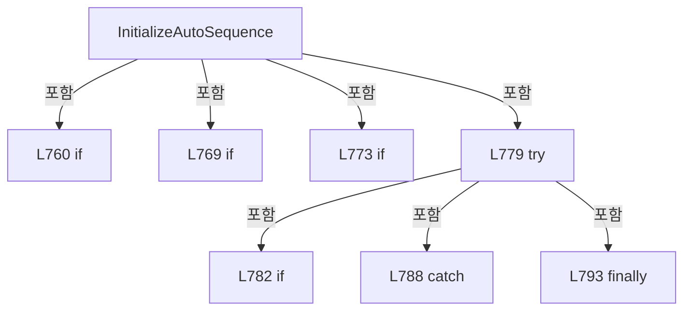

변경 전 점검: 입력/반환 타입, 위 호출자, 예외/취소 경로, 공유 상태와 저장·전송 소비자를 함께 확인합니다. 값의 단위나 물리 방향을 이름만으로 확정하지 않습니다.

### MethodDeclaration `CheckAutoModeInterlocks` · L800–826

[Drilling.UI/CRootView.cs:800–826](https://github.com/kjuws10-rgb/A3Drilling/blob/0219666f9053b907d96d7e0aa7d0c6c1be3a73d4/Drilling.UI/CRootView.cs#L800-L826)

| 항목 | 실제 추출 값 |
| --- | --- |
| 서명 | System.Threading.Tasks.Task<bool> Drilling.UI.CRootView.CheckAutoModeInterlocks(System.Action<string, string>) |
| 접근/수식자 | Private / private, async |
| 반환/값 타입 | System.Threading.Tasks.Task<bool> |
| 소속 타입 | NamedType:Drilling.UI.CRootView |

입력 계약:

| 이름 | 타입 | 전달 | 선택/기본값 |
| --- | --- | --- | --- |
| warn | System.Action<string, string> | None | False /  |

정적 호출자로 확인된 위치:

| 호출 파일/행 | 호출 표현식 | 런타임 분기 가능 |
| --- | --- | --- |
| [Drilling.UI/CRootView.cs:709–709](https://github.com/kjuws10-rgb/A3Drilling/blob/0219666f9053b907d96d7e0aa7d0c6c1be3a73d4/Drilling.UI/CRootView.cs#L709-L709) | CheckAutoModeInterlocks | False |
| [Drilling.UI/CRootView.cs:718–718](https://github.com/kjuws10-rgb/A3Drilling/blob/0219666f9053b907d96d7e0aa7d0c6c1be3a73d4/Drilling.UI/CRootView.cs#L718-L718) | CheckAutoModeInterlocks | False |
| [Drilling.UI/CRootView.cs:727–727](https://github.com/kjuws10-rgb/A3Drilling/blob/0219666f9053b907d96d7e0aa7d0c6c1be3a73d4/Drilling.UI/CRootView.cs#L727-L727) | CheckAutoModeInterlocks | False |

호출하는 대상과 해석 범위:

| 원본 행 | 표현식 | 분석 상태 | 대상/소스 위치 |
| --- | --- | --- | --- |
| 802 | _menus.TryGetValue | resolved · 동적 구현 선택 가능 | bool System.Collections.Generic.IReadOnlyDictionary<Drilling.UI.Menu.Menus.EN_MENU, Drilling.UI.Menu.Menus.CMenuBase>.TryGetValue(Drilling.UI.Menu.Menus.EN_MENU, out Drilling.UI.Menu.Menus.CMenuBase) |
| 804 | warn | resolved · 동적 구현 선택 가능 | void System.Action<string, string>.Invoke(string, string) |
| 807 | CheckHeavyAlarmForOperation | resolved | bool Drilling.UI.CRootView.CheckHeavyAlarmForOperation(string) · Drilling.UI/CRootView.cs:2960 |
| 809 | CheckStageMotionOwnership | resolved | bool Drilling.UI.CRootView.CheckStageMotionOwnership(System.Action<string, string>, string) · Drilling.UI/CRootView.cs:828 |
| 813 | ((CMenuMain)_menus[EN_MENU.Main]).GetAutoModeBlockers | resolved | System.Threading.Tasks.Task<System.Collections.Generic.IReadOnlyList<Drilling.Common.InterLock.ST_INTERLOCK_ITEM>> Drilling.UI.Menu.Menus.CMenuMain.GetAutoModeBlockers(System.Threading.CancellationToken) · Drilling.UI/Menu/Menus/CMenuMain.cs:773 |
| 816 | CheckStageMotionOwnership | resolved | bool Drilling.UI.CRootView.CheckStageMotionOwnership(System.Action<string, string>, string) · Drilling.UI/CRootView.cs:828 |
| 824 | warn | resolved · 동적 구현 선택 가능 | void System.Action<string, string>.Invoke(string, string) |

본문의 실제 연산·분기·예외·반환 순서(원문 위치 순):

| 원본 행 | 종류 | 주석 해설 |
| --- | --- | --- |
| 802 | call | 함수·델리게이트 또는 객체 생성자를 호출합니다: _menus.TryGetValue(EN_MENU.Correction, out var correction) |
| 802 | if | 조건에 따라 분기합니다: if (_menus.TryGetValue(EN_MENU.Correction, out var correction) && correction is CMenuCorrection { DefaultBlocksAuto: true }) |
| 804 | call | 함수·델리게이트 또는 객체 생성자를 호출합니다: warn("AUTO 전환 불가", "Default 보정 동작을 종료하고 새 가공 검증을 완료하거나 이전값을 복원해 주세요.") |
| 805 | return | 호출자에게 값 또는 제어를 반환합니다: return false; |
| 807 | call | 함수·델리게이트 또는 객체 생성자를 호출합니다: CheckHeavyAlarmForOperation("AUTO") |
| 807 | if | 조건에 따라 분기합니다: if (!CheckHeavyAlarmForOperation("AUTO")) |
| 808 | return | 호출자에게 값 또는 제어를 반환합니다: return false; |
| 809 | call | 함수·델리게이트 또는 객체 생성자를 호출합니다: CheckStageMotionOwnership(warn, "AUTO") |
| 809 | if | 조건에 따라 분기합니다: if (!CheckStageMotionOwnership(warn, "AUTO")) |
| 810 | return | 호출자에게 값 또는 제어를 반환합니다: return false; |
| 811 | try | 예외 처리 범위입니다: try |
| 813 | await | 비동기 완료를 기다립니다: await ((CMenuMain)_menus[EN_MENU.Main]).GetAutoModeBlockers() |
| 813 | call | 함수·델리게이트 또는 객체 생성자를 호출합니다: ((CMenuMain)_menus[EN_MENU.Main]).GetAutoModeBlockers() |
| 813 | local-declaration | 지역 변수를 선언합니다: var blockers = await ((CMenuMain)_menus[EN_MENU.Main]).GetAutoModeBlockers(); |
| 813 | variable-initializer | 변수의 초기값을 지정합니다: blockers = await ((CMenuMain)_menus[EN_MENU.Main]).GetAutoModeBlockers() |
| 814 | if | 조건에 따라 분기합니다: if (blockers.Count == 0) |
| 816 | call | 함수·델리게이트 또는 객체 생성자를 호출합니다: CheckStageMotionOwnership(warn, "AUTO") |
| 816 | return | 호출자에게 값 또는 제어를 반환합니다: return CheckStageMotionOwnership(warn, "AUTO"); |
| 818 | catch | 지정 예외를 처리합니다: catch (Exception) |
| 823 | assignment | 값을 대상에 대입합니다: StatusMessage = "AUTO mode change blocked by Interlock/Safety." |
| 824 | call | 함수·델리게이트 또는 객체 생성자를 호출합니다: warn("AUTO 전환 불가", "AUTO 모드로 전환할 수 없습니다.\nInterlock/Safety를 확인해 주세요.") |
| 825 | return | 호출자에게 값 또는 제어를 반환합니다: return false; |

제어 구문의 포함 구조(실제 실행 순서/CFG가 아닌 구문 탐색 그림):

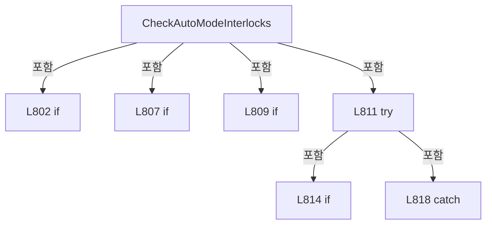

변경 전 점검: 입력/반환 타입, 위 호출자, 예외/취소 경로, 공유 상태와 저장·전송 소비자를 함께 확인합니다. 값의 단위나 물리 방향을 이름만으로 확정하지 않습니다.

### MethodDeclaration `CheckStageMotionOwnership` · L828–837

[Drilling.UI/CRootView.cs:828–837](https://github.com/kjuws10-rgb/A3Drilling/blob/0219666f9053b907d96d7e0aa7d0c6c1be3a73d4/Drilling.UI/CRootView.cs#L828-L837)

| 항목 | 실제 추출 값 |
| --- | --- |
| 서명 | bool Drilling.UI.CRootView.CheckStageMotionOwnership(System.Action<string, string>, string) |
| 접근/수식자 | Private / private |
| 반환/값 타입 | bool |
| 소속 타입 | NamedType:Drilling.UI.CRootView |

입력 계약:

| 이름 | 타입 | 전달 | 선택/기본값 |
| --- | --- | --- | --- |
| warn | System.Action<string, string> | None | False /  |
| operation | string | None | False /  |

정적 호출자로 확인된 위치:

| 호출 파일/행 | 호출 표현식 | 런타임 분기 가능 |
| --- | --- | --- |
| [Drilling.UI/CRootView.cs:809–809](https://github.com/kjuws10-rgb/A3Drilling/blob/0219666f9053b907d96d7e0aa7d0c6c1be3a73d4/Drilling.UI/CRootView.cs#L809-L809) | CheckStageMotionOwnership | False |
| [Drilling.UI/CRootView.cs:816–816](https://github.com/kjuws10-rgb/A3Drilling/blob/0219666f9053b907d96d7e0aa7d0c6c1be3a73d4/Drilling.UI/CRootView.cs#L816-L816) | CheckStageMotionOwnership | False |
| [Drilling.UI/CRootView.cs:1974–1974](https://github.com/kjuws10-rgb/A3Drilling/blob/0219666f9053b907d96d7e0aa7d0c6c1be3a73d4/Drilling.UI/CRootView.cs#L1974-L1974) | CheckStageMotionOwnership | False |
| [Drilling.UI/CRootView.cs:1983–1983](https://github.com/kjuws10-rgb/A3Drilling/blob/0219666f9053b907d96d7e0aa7d0c6c1be3a73d4/Drilling.UI/CRootView.cs#L1983-L1983) | CheckStageMotionOwnership | False |
| [Drilling.UI/CRootView.cs:2013–2013](https://github.com/kjuws10-rgb/A3Drilling/blob/0219666f9053b907d96d7e0aa7d0c6c1be3a73d4/Drilling.UI/CRootView.cs#L2013-L2013) | CheckStageMotionOwnership | False |

호출하는 대상과 해석 범위:

| 원본 행 | 표현식 | 분석 상태 | 대상/소스 위치 |
| --- | --- | --- | --- |
| 830 | _menus.TryGetValue | resolved · 동적 구현 선택 가능 | bool System.Collections.Generic.IReadOnlyDictionary<Drilling.UI.Menu.Menus.EN_MENU, Drilling.UI.Menu.Menus.CMenuBase>.TryGetValue(Drilling.UI.Menu.Menus.EN_MENU, out Drilling.UI.Menu.Menus.CMenuBase) |
| 835 | warn | resolved · 동적 구현 선택 가능 | void System.Action<string, string>.Invoke(string, string) |

본문의 실제 연산·분기·예외·반환 순서(원문 위치 순):

| 원본 행 | 종류 | 주석 해설 |
| --- | --- | --- |
| 830 | call | 함수·델리게이트 또는 객체 생성자를 호출합니다: _menus.TryGetValue(EN_MENU.Manual, out var menu) |
| 830 | local-declaration | 지역 변수를 선언합니다: var manualMovePending = _menus.TryGetValue(EN_MENU.Manual, out var menu) && menu is CMenuManual manual && manual.IsManualStageMovePending; |
| 830 | variable-initializer | 변수의 초기값을 지정합니다: manualMovePending = _menus.TryGetValue(EN_MENU.Manual, out var menu) && menu is CMenuManual manual && manual.IsManualStageMovePending |
| 832 | if | 조건에 따라 분기합니다: if (!manualMovePending && !_interfaceManager.StageReviewSequences.IsActive) |
| 833 | return | 호출자에게 값 또는 제어를 반환합니다: return true; |
| 834 | assignment | 값을 대상에 대입합니다: StatusMessage = $"{operation} blocked while Stage/Review motion or cleanup is active." |
| 835 | call | 함수·델리게이트 또는 객체 생성자를 호출합니다: warn(operation == "AUTO" ? "AUTO 전환 불가" : "공정 시작 불가", "Stage/Review 수동 이동 또는 공통 시퀀스 정리가 진행 중입니다.\n이동 완료 또는 STOP 후 신호 정리와 소유권 해제를 확인해 주세요.") |
| 835 | conditional-expression | 조건에 따라 결과식을 선택합니다: operation == "AUTO" ? "AUTO 전환 불가" : "공정 시작 불가" |
| 836 | return | 호출자에게 값 또는 제어를 반환합니다: return false; |

제어 구문의 포함 구조(실제 실행 순서/CFG가 아닌 구문 탐색 그림):


변경 전 점검: 입력/반환 타입, 위 호출자, 예외/취소 경로, 공유 상태와 저장·전송 소비자를 함께 확인합니다. 값의 단위나 물리 방향을 이름만으로 확정하지 않습니다.

### MethodDeclaration `CanAccessMenu` · L839–849

[Drilling.UI/CRootView.cs:839–849](https://github.com/kjuws10-rgb/A3Drilling/blob/0219666f9053b907d96d7e0aa7d0c6c1be3a73d4/Drilling.UI/CRootView.cs#L839-L849)

| 항목 | 실제 추출 값 |
| --- | --- |
| 서명 | bool Drilling.UI.CRootView.CanAccessMenu(Drilling.UI.Menu.Menus.EN_MENU) |
| 접근/수식자 | Private / private |
| 반환/값 타입 | bool |
| 소속 타입 | NamedType:Drilling.UI.CRootView |

입력 계약:

| 이름 | 타입 | 전달 | 선택/기본값 |
| --- | --- | --- | --- |
| menu | Drilling.UI.Menu.Menus.EN_MENU | None | False /  |

정적 호출자로 확인된 위치:

| 호출 파일/행 | 호출 표현식 | 런타임 분기 가능 |
| --- | --- | --- |
| [Drilling.UI/CRootView.cs:326–326](https://github.com/kjuws10-rgb/A3Drilling/blob/0219666f9053b907d96d7e0aa7d0c6c1be3a73d4/Drilling.UI/CRootView.cs#L326-L326) | CanAccessMenu | False |
| [Drilling.UI/CRootView.cs:875–875](https://github.com/kjuws10-rgb/A3Drilling/blob/0219666f9053b907d96d7e0aa7d0c6c1be3a73d4/Drilling.UI/CRootView.cs#L875-L875) | CanAccessMenu | False |
| [Drilling.UI/CRootView.cs:886–886](https://github.com/kjuws10-rgb/A3Drilling/blob/0219666f9053b907d96d7e0aa7d0c6c1be3a73d4/Drilling.UI/CRootView.cs#L886-L886) | CanAccessMenu | False |

호출하는 대상과 해석 범위:

| 원본 행 | 표현식 | 분석 상태 | 대상/소스 위치 |
| --- | --- | --- | --- |
| 848 | AutoModeMenus.Contains | resolved · 동적 구현 선택 가능 | bool System.Collections.Generic.IReadOnlySet<Drilling.UI.Menu.Menus.EN_MENU>.Contains(Drilling.UI.Menu.Menus.EN_MENU) |

본문의 실제 연산·분기·예외·반환 순서(원문 위치 순):

| 원본 행 | 종류 | 주석 해설 |
| --- | --- | --- |
| 841 | if | 조건에 따라 분기합니다: if (_pmLockStatus.IsLocked) |
| 842 | return | 호출자에게 값 또는 제어를 반환합니다: return true; |
| 843 | if | 조건에 따라 분기합니다: if (_autoCycleState != EN_AUTO_CYCLE_STATE.Ready) |
| 845 | return | 호출자에게 값 또는 제어를 반환합니다: return menu is EN_MENU.Main or EN_MENU.Alarm; |
| 848 | call | 함수·델리게이트 또는 객체 생성자를 호출합니다: AutoModeMenus.Contains(menu) |
| 848 | return | 호출자에게 값 또는 제어를 반환합니다: return _operationMode != EN_SYSTEM_MODE.Auto &#124;&#124; AutoModeMenus.Contains(menu); |

제어 구문의 포함 구조(실제 실행 순서/CFG가 아닌 구문 탐색 그림):

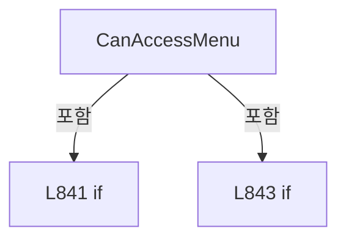

변경 전 점검: 입력/반환 타입, 위 호출자, 예외/취소 경로, 공유 상태와 저장·전송 소비자를 함께 확인합니다. 값의 단위나 물리 방향을 이름만으로 확정하지 않습니다.

### MethodDeclaration `IsReviewNavigationLocked` · L851–865

[Drilling.UI/CRootView.cs:851–865](https://github.com/kjuws10-rgb/A3Drilling/blob/0219666f9053b907d96d7e0aa7d0c6c1be3a73d4/Drilling.UI/CRootView.cs#L851-L865)

| 항목 | 실제 추출 값 |
| --- | --- |
| 서명 | bool Drilling.UI.CRootView.IsReviewNavigationLocked(Drilling.UI.Menu.Menus.EN_MENU) |
| 접근/수식자 | Private / private |
| 반환/값 타입 | bool |
| 소속 타입 | NamedType:Drilling.UI.CRootView |

입력 계약:

| 이름 | 타입 | 전달 | 선택/기본값 |
| --- | --- | --- | --- |
| targetMenu | Drilling.UI.Menu.Menus.EN_MENU | None | False /  |

정적 호출자로 확인된 위치:

| 호출 파일/행 | 호출 표현식 | 런타임 분기 가능 |
| --- | --- | --- |
| [Drilling.UI/CRootView.cs:318–318](https://github.com/kjuws10-rgb/A3Drilling/blob/0219666f9053b907d96d7e0aa7d0c6c1be3a73d4/Drilling.UI/CRootView.cs#L318-L318) | IsReviewNavigationLocked | False |

호출하는 대상과 해석 범위:

| 원본 행 | 표현식 | 분석 상태 | 대상/소스 위치 |
| --- | --- | --- | --- |
| 861 | _menus.TryGetValue | resolved · 동적 구현 선택 가능 | bool System.Collections.Generic.IReadOnlyDictionary<Drilling.UI.Menu.Menus.EN_MENU, Drilling.UI.Menu.Menus.CMenuBase>.TryGetValue(Drilling.UI.Menu.Menus.EN_MENU, out Drilling.UI.Menu.Menus.CMenuBase) |

본문의 실제 연산·분기·예외·반환 순서(원문 위치 순):

| 원본 행 | 종류 | 주석 해설 |
| --- | --- | --- |
| 855 | if | 조건에 따라 분기합니다: if (_operationMode != EN_SYSTEM_MODE.Manual &#124;&#124; targetMenu == _selectedMenu.Menu) |
| 856 | return | 호출자에게 값 또는 제어를 반환합니다: return false; |
| 859 | return | 호출자에게 값 또는 제어를 반환합니다: return _selectedMenu.Menu switch { EN_MENU.Correction => _menus.TryGetValue(EN_MENU.Correction, out var correction) && correction is CMenuCorrection { BlocksMenuNavigation: true }, _ => false }; |
| 859 | switch-expression | 값별 결과식을 선택합니다: _selectedMenu.Menu switch { EN_MENU.Correction => _menus.TryGetValue(EN_MENU.Correction, out var correction) && correction is CMenuCorrection { BlocksMenuNavigation: true }, _ => false } |
| 861 | call | 함수·델리게이트 또는 객체 생성자를 호출합니다: _menus.TryGetValue(EN_MENU.Correction, out var correction) |

제어 구문의 포함 구조(실제 실행 순서/CFG가 아닌 구문 탐색 그림):

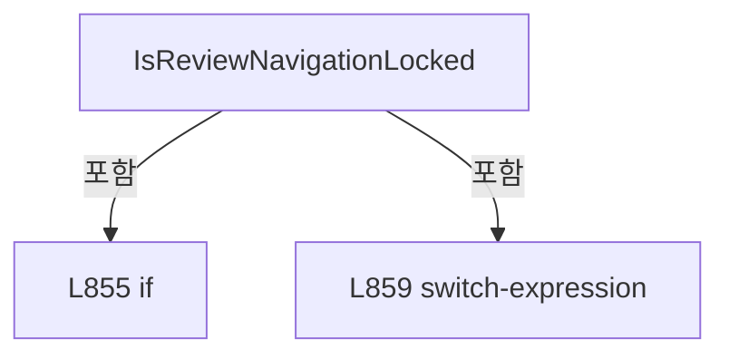

변경 전 점검: 입력/반환 타입, 위 호출자, 예외/취소 경로, 공유 상태와 저장·전송 소비자를 함께 확인합니다. 값의 단위나 물리 방향을 이름만으로 확정하지 않습니다.

### MethodDeclaration `ApplyMenuAccessForOperationMode` · L867–877

[Drilling.UI/CRootView.cs:867–877](https://github.com/kjuws10-rgb/A3Drilling/blob/0219666f9053b907d96d7e0aa7d0c6c1be3a73d4/Drilling.UI/CRootView.cs#L867-L877)

| 항목 | 실제 추출 값 |
| --- | --- |
| 서명 | void Drilling.UI.CRootView.ApplyMenuAccessForOperationMode() |
| 접근/수식자 | Private / private |
| 반환/값 타입 | void |
| 소속 타입 | NamedType:Drilling.UI.CRootView |

정적 호출자로 확인된 위치:

| 호출 파일/행 | 호출 표현식 | 런타임 분기 가능 |
| --- | --- | --- |
| [Drilling.UI/CRootView.cs:180–180](https://github.com/kjuws10-rgb/A3Drilling/blob/0219666f9053b907d96d7e0aa7d0c6c1be3a73d4/Drilling.UI/CRootView.cs#L180-L180) | ApplyMenuAccessForOperationMode | False |
| [Drilling.UI/CRootView.cs:378–378](https://github.com/kjuws10-rgb/A3Drilling/blob/0219666f9053b907d96d7e0aa7d0c6c1be3a73d4/Drilling.UI/CRootView.cs#L378-L378) | ApplyMenuAccessForOperationMode | False |
| [Drilling.UI/CRootView.cs:891–891](https://github.com/kjuws10-rgb/A3Drilling/blob/0219666f9053b907d96d7e0aa7d0c6c1be3a73d4/Drilling.UI/CRootView.cs#L891-L891) | ApplyMenuAccessForOperationMode | False |

호출하는 대상과 해석 범위:

| 원본 행 | 표현식 | 분석 상태 | 대상/소스 위치 |
| --- | --- | --- | --- |
| 875 | CanAccessMenu | resolved | bool Drilling.UI.CRootView.CanAccessMenu(Drilling.UI.Menu.Menus.EN_MENU) · Drilling.UI/CRootView.cs:839 |

본문의 실제 연산·분기·예외·반환 순서(원문 위치 순):

| 원본 행 | 종류 | 주석 해설 |
| --- | --- | --- |
| 869 | foreach | 컬렉션 요소를 순회합니다: foreach (var menu in Menus) |
| 873 | assignment | 값을 대상에 대입합니다: menu.IsEnabled = _pmLockStatus.IsLocked ? menu.Menu == EN_MENU.Pm : CanAccessMenu(menu.Menu) |
| 873 | conditional-expression | 조건에 따라 결과식을 선택합니다: _pmLockStatus.IsLocked ? menu.Menu == EN_MENU.Pm : CanAccessMenu(menu.Menu) |
| 875 | call | 함수·델리게이트 또는 객체 생성자를 호출합니다: CanAccessMenu(menu.Menu) |

제어 구문의 포함 구조(실제 실행 순서/CFG가 아닌 구문 탐색 그림):

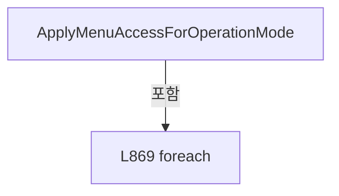

변경 전 점검: 입력/반환 타입, 위 호출자, 예외/취소 경로, 공유 상태와 저장·전송 소비자를 함께 확인합니다. 값의 단위나 물리 방향을 이름만으로 확정하지 않습니다.

### MethodDeclaration `RefreshOperationModeAccess` · L879–897

[Drilling.UI/CRootView.cs:879–897](https://github.com/kjuws10-rgb/A3Drilling/blob/0219666f9053b907d96d7e0aa7d0c6c1be3a73d4/Drilling.UI/CRootView.cs#L879-L897)

| 항목 | 실제 추출 값 |
| --- | --- |
| 서명 | void Drilling.UI.CRootView.RefreshOperationModeAccess() |
| 접근/수식자 | Private / private |
| 반환/값 타입 | void |
| 소속 타입 | NamedType:Drilling.UI.CRootView |

정적 호출자로 확인된 위치:

| 호출 파일/행 | 호출 표현식 | 런타임 분기 가능 |
| --- | --- | --- |
| [Drilling.UI/CRootView.cs:746–746](https://github.com/kjuws10-rgb/A3Drilling/blob/0219666f9053b907d96d7e0aa7d0c6c1be3a73d4/Drilling.UI/CRootView.cs#L746-L746) | RefreshOperationModeAccess | False |
| [Drilling.UI/CRootView.cs:1232–1232](https://github.com/kjuws10-rgb/A3Drilling/blob/0219666f9053b907d96d7e0aa7d0c6c1be3a73d4/Drilling.UI/CRootView.cs#L1232-L1232) | RefreshOperationModeAccess | False |
| [Drilling.UI/CRootView.cs:1261–1261](https://github.com/kjuws10-rgb/A3Drilling/blob/0219666f9053b907d96d7e0aa7d0c6c1be3a73d4/Drilling.UI/CRootView.cs#L1261-L1261) | RefreshOperationModeAccess | False |
| [Drilling.UI/CRootView.cs:1478–1478](https://github.com/kjuws10-rgb/A3Drilling/blob/0219666f9053b907d96d7e0aa7d0c6c1be3a73d4/Drilling.UI/CRootView.cs#L1478-L1478) | RefreshOperationModeAccess | False |
| [Drilling.UI/CRootView.cs:2222–2222](https://github.com/kjuws10-rgb/A3Drilling/blob/0219666f9053b907d96d7e0aa7d0c6c1be3a73d4/Drilling.UI/CRootView.cs#L2222-L2222) | RefreshOperationModeAccess | False |
| [Drilling.UI/CRootView.cs:3117–3117](https://github.com/kjuws10-rgb/A3Drilling/blob/0219666f9053b907d96d7e0aa7d0c6c1be3a73d4/Drilling.UI/CRootView.cs#L3117-L3117) | RefreshOperationModeAccess | False |

호출하는 대상과 해석 범위:

| 원본 행 | 표현식 | 분석 상태 | 대상/소스 위치 |
| --- | --- | --- | --- |
| 886 | CanAccessMenu | resolved | bool Drilling.UI.CRootView.CanAccessMenu(Drilling.UI.Menu.Menus.EN_MENU) · Drilling.UI/CRootView.cs:839 |
| 888 | Menus.First | resolved | Drilling.UI.Menu.Menus.CMenuItem System.Collections.Generic.IEnumerable<Drilling.UI.Menu.Menus.CMenuItem>.First<Drilling.UI.Menu.Menus.CMenuItem>(System.Func<Drilling.UI.Menu.Menus.CMenuItem, bool>) |
| 891 | ApplyMenuAccessForOperationMode | resolved | void Drilling.UI.CRootView.ApplyMenuAccessForOperationMode() · Drilling.UI/CRootView.cs:867 |
| 892 | OnPropertyChanged | resolved | void Drilling.UI.Menu.CBindingBase.OnPropertyChanged(string?) · Drilling.UI/Menu/CBindingBase.cs:790 |
| 892 | nameof | unresolved | None |
| 893 | StartCommand.NotifyCanExecuteChanged | resolved | void Drilling.UI.Menu.CButtonCommand.NotifyCanExecuteChanged() · Drilling.UI/Menu/CButtonCommand.cs:24 |
| 894 | ToggleOperationModeCommand.NotifyCanExecuteChanged | resolved | void Drilling.UI.Menu.CButtonCommand.NotifyCanExecuteChanged() · Drilling.UI/Menu/CButtonCommand.cs:24 |
| 895 | InitializeAutoSequenceCommand.NotifyCanExecuteChanged | resolved | void Drilling.UI.Menu.CButtonCommand.NotifyCanExecuteChanged() · Drilling.UI/Menu/CButtonCommand.cs:24 |
| 896 | OpenMelsecStageSimulationCommand.NotifyCanExecuteChanged | resolved | void Drilling.UI.Menu.CButtonCommand.NotifyCanExecuteChanged() · Drilling.UI/Menu/CButtonCommand.cs:24 |

본문의 실제 연산·분기·예외·반환 순서(원문 위치 순):

| 원본 행 | 종류 | 주석 해설 |
| --- | --- | --- |
| 886 | call | 함수·델리게이트 또는 객체 생성자를 호출합니다: CanAccessMenu(SelectedMenu.Menu) |
| 886 | if | 조건에 따라 분기합니다: if (!CanAccessMenu(SelectedMenu.Menu)) |
| 888 | assignment | 값을 대상에 대입합니다: SelectedMenu = Menus.First(MatchesItem) |
| 888 | call | 함수·델리게이트 또는 객체 생성자를 호출합니다: Menus.First(MatchesItem) |
| 891 | call | 함수·델리게이트 또는 객체 생성자를 호출합니다: ApplyMenuAccessForOperationMode() |
| 892 | call | 함수·델리게이트 또는 객체 생성자를 호출합니다: OnPropertyChanged(nameof(IsManualShiftOffsetVisible)) |
| 892 | call | 함수·델리게이트 또는 객체 생성자를 호출합니다: nameof(IsManualShiftOffsetVisible) |
| 893 | call | 함수·델리게이트 또는 객체 생성자를 호출합니다: StartCommand.NotifyCanExecuteChanged() |
| 894 | call | 함수·델리게이트 또는 객체 생성자를 호출합니다: ToggleOperationModeCommand.NotifyCanExecuteChanged() |
| 895 | call | 함수·델리게이트 또는 객체 생성자를 호출합니다: InitializeAutoSequenceCommand.NotifyCanExecuteChanged() |
| 896 | call | 함수·델리게이트 또는 객체 생성자를 호출합니다: OpenMelsecStageSimulationCommand.NotifyCanExecuteChanged() |

제어 구문의 포함 구조(실제 실행 순서/CFG가 아닌 구문 탐색 그림):

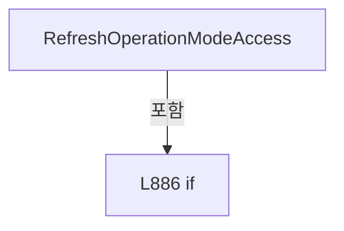

변경 전 점검: 입력/반환 타입, 위 호출자, 예외/취소 경로, 공유 상태와 저장·전송 소비자를 함께 확인합니다. 값의 단위나 물리 방향을 이름만으로 확정하지 않습니다.

### LocalFunctionStatement `MatchesItem` · L881–884

[Drilling.UI/CRootView.cs:881–884](https://github.com/kjuws10-rgb/A3Drilling/blob/0219666f9053b907d96d7e0aa7d0c6c1be3a73d4/Drilling.UI/CRootView.cs#L881-L884)

| 항목 | 실제 추출 값 |
| --- | --- |
| 서명 | bool MatchesItem(Drilling.UI.Menu.Menus.CMenuItem) |
| 접근/수식자 | Private /  |
| 반환/값 타입 | bool |
| 소속 타입 | NamedType:Drilling.UI.CRootView |

입력 계약:

| 이름 | 타입 | 전달 | 선택/기본값 |
| --- | --- | --- | --- |
| menu | Drilling.UI.Menu.Menus.CMenuItem | None | False /  |

현재 부분 분석에서 직접 연결된 호출자는 없습니다. XAML/이벤트/인터페이스·델리게이트·외부 진입을 추가 확인해야 하며, 미사용으로 판정한 것이 아닙니다.

본문의 실제 연산·분기·예외·반환 순서(원문 위치 순):

| 원본 행 | 종류 | 주석 해설 |
| --- | --- | --- |
| 883 | return | 호출자에게 값 또는 제어를 반환합니다: return menu.Menu == EN_MENU.Main; |

변경 전 점검: 입력/반환 타입, 위 호출자, 예외/취소 경로, 공유 상태와 저장·전송 소비자를 함께 확인합니다. 값의 단위나 물리 방향을 이름만으로 확정하지 않습니다.

### MethodDeclaration `RefreshShellStatusItems` · L899–910

[Drilling.UI/CRootView.cs:899–910](https://github.com/kjuws10-rgb/A3Drilling/blob/0219666f9053b907d96d7e0aa7d0c6c1be3a73d4/Drilling.UI/CRootView.cs#L899-L910)

| 항목 | 실제 추출 값 |
| --- | --- |
| 서명 | void Drilling.UI.CRootView.RefreshShellStatusItems() |
| 접근/수식자 | Private / private |
| 반환/값 타입 | void |
| 소속 타입 | NamedType:Drilling.UI.CRootView |

정적 호출자로 확인된 위치:

| 호출 파일/행 | 호출 표현식 | 런타임 분기 가능 |
| --- | --- | --- |
| [Drilling.UI/CRootView.cs:255–255](https://github.com/kjuws10-rgb/A3Drilling/blob/0219666f9053b907d96d7e0aa7d0c6c1be3a73d4/Drilling.UI/CRootView.cs#L255-L255) | RefreshShellStatusItems | False |
| [Drilling.UI/CRootView.cs:379–379](https://github.com/kjuws10-rgb/A3Drilling/blob/0219666f9053b907d96d7e0aa7d0c6c1be3a73d4/Drilling.UI/CRootView.cs#L379-L379) | RefreshShellStatusItems | False |
| [Drilling.UI/CRootView.cs:692–692](https://github.com/kjuws10-rgb/A3Drilling/blob/0219666f9053b907d96d7e0aa7d0c6c1be3a73d4/Drilling.UI/CRootView.cs#L692-L692) | RefreshShellStatusItems | False |
| [Drilling.UI/CRootView.cs:753–753](https://github.com/kjuws10-rgb/A3Drilling/blob/0219666f9053b907d96d7e0aa7d0c6c1be3a73d4/Drilling.UI/CRootView.cs#L753-L753) | RefreshShellStatusItems | False |
| [Drilling.UI/CRootView.cs:1233–1233](https://github.com/kjuws10-rgb/A3Drilling/blob/0219666f9053b907d96d7e0aa7d0c6c1be3a73d4/Drilling.UI/CRootView.cs#L1233-L1233) | RefreshShellStatusItems | False |
| [Drilling.UI/CRootView.cs:1264–1264](https://github.com/kjuws10-rgb/A3Drilling/blob/0219666f9053b907d96d7e0aa7d0c6c1be3a73d4/Drilling.UI/CRootView.cs#L1264-L1264) | RefreshShellStatusItems | False |
| [Drilling.UI/CRootView.cs:2251–2251](https://github.com/kjuws10-rgb/A3Drilling/blob/0219666f9053b907d96d7e0aa7d0c6c1be3a73d4/Drilling.UI/CRootView.cs#L2251-L2251) | RefreshShellStatusItems | False |
| [Drilling.UI/CRootView.cs:2258–2258](https://github.com/kjuws10-rgb/A3Drilling/blob/0219666f9053b907d96d7e0aa7d0c6c1be3a73d4/Drilling.UI/CRootView.cs#L2258-L2258) | RefreshShellStatusItems | False |
| [Drilling.UI/CRootView.cs:2864–2864](https://github.com/kjuws10-rgb/A3Drilling/blob/0219666f9053b907d96d7e0aa7d0c6c1be3a73d4/Drilling.UI/CRootView.cs#L2864-L2864) | RefreshShellStatusItems | False |
| [Drilling.UI/CRootView.cs:3119–3119](https://github.com/kjuws10-rgb/A3Drilling/blob/0219666f9053b907d96d7e0aa7d0c6c1be3a73d4/Drilling.UI/CRootView.cs#L3119-L3119) | RefreshShellStatusItems | False |
| [Drilling.UI/CRootView.cs:3136–3136](https://github.com/kjuws10-rgb/A3Drilling/blob/0219666f9053b907d96d7e0aa7d0c6c1be3a73d4/Drilling.UI/CRootView.cs#L3136-L3136) | RefreshShellStatusItems | False |

호출하는 대상과 해석 범위:

| 원본 행 | 표현식 | 분석 상태 | 대상/소스 위치 |
| --- | --- | --- | --- |
| 901 | RefreshMelsecSimulatorVisibility | resolved | void Drilling.UI.CRootView.RefreshMelsecSimulatorVisibility() · Drilling.UI/CRootView.cs:3300 |
| 903 | .Close | unresolved | None |
| 904 | CreateHeaderStatusItems | resolved | System.Collections.Generic.IReadOnlyList<Drilling.UI.Menu.Menus.ST_HEADER_STATUS_ITEM> Drilling.UI.CRootView.CreateHeaderStatusItems() · Drilling.UI/CRootView.cs:1512 |
| 905 | Replace | resolved | void Drilling.UI.CRootView.Replace<Drilling.UI.Menu.Menus.ST_HEADER_STATUS_ITEM>(System.Collections.ObjectModel.ObservableCollection<Drilling.UI.Menu.Menus.ST_HEADER_STATUS_ITEM>, System.Collections.Generic.IEnumerable<Drilling.UI.Menu.Menus.ST_HEADER_STATUS_ITEM>) · Drilling.UI/CRootView.cs:1497 |
| 906 | Replace | resolved | void Drilling.UI.CRootView.Replace<Drilling.UI.Menu.Menus.ST_HEADER_STATUS_ITEM>(System.Collections.ObjectModel.ObservableCollection<Drilling.UI.Menu.Menus.ST_HEADER_STATUS_ITEM>, System.Collections.Generic.IEnumerable<Drilling.UI.Menu.Menus.ST_HEADER_STATUS_ITEM>) · Drilling.UI/CRootView.cs:1497 |
| 906 | headerStatusItems.Where | resolved | System.Collections.Generic.IEnumerable<Drilling.UI.Menu.Menus.ST_HEADER_STATUS_ITEM> System.Collections.Generic.IEnumerable<Drilling.UI.Menu.Menus.ST_HEADER_STATUS_ITEM>.Where<Drilling.UI.Menu.Menus.ST_HEADER_STATUS_ITEM>(System.Func<Drilling.UI.Menu.Menus.ST_HEADER_STATUS_ITEM, bool>) |
| 907 | Replace | resolved | void Drilling.UI.CRootView.Replace<Drilling.UI.Menu.Menus.ST_HEADER_STATUS_ITEM>(System.Collections.ObjectModel.ObservableCollection<Drilling.UI.Menu.Menus.ST_HEADER_STATUS_ITEM>, System.Collections.Generic.IEnumerable<Drilling.UI.Menu.Menus.ST_HEADER_STATUS_ITEM>) · Drilling.UI/CRootView.cs:1497 |
| 907 | headerStatusItems.Where | resolved | System.Collections.Generic.IEnumerable<Drilling.UI.Menu.Menus.ST_HEADER_STATUS_ITEM> System.Collections.Generic.IEnumerable<Drilling.UI.Menu.Menus.ST_HEADER_STATUS_ITEM>.Where<Drilling.UI.Menu.Menus.ST_HEADER_STATUS_ITEM>(System.Func<Drilling.UI.Menu.Menus.ST_HEADER_STATUS_ITEM, bool>) |
| 907 | IsHeaderContextStatusItem | resolved | bool Drilling.UI.CRootView.IsHeaderContextStatusItem(Drilling.UI.Menu.Menus.ST_HEADER_STATUS_ITEM) · Drilling.UI/CRootView.cs:1531 |
| 908 | Replace | resolved | void Drilling.UI.CRootView.Replace<Drilling.UI.Menu.Menus.ST_HEADER_STATUS_ITEM>(System.Collections.ObjectModel.ObservableCollection<Drilling.UI.Menu.Menus.ST_HEADER_STATUS_ITEM>, System.Collections.Generic.IEnumerable<Drilling.UI.Menu.Menus.ST_HEADER_STATUS_ITEM>) · Drilling.UI/CRootView.cs:1497 |
| 908 | CreateFooterStatusItems | resolved | System.Collections.Generic.IReadOnlyList<Drilling.UI.Menu.Menus.ST_HEADER_STATUS_ITEM> Drilling.UI.CRootView.CreateFooterStatusItems(Drilling.UI.Menu.Menus.EN_MENU) · Drilling.UI/CRootView.cs:1536 |
| 909 | OnPropertyChanged | resolved | void Drilling.UI.Menu.CBindingBase.OnPropertyChanged(string?) · Drilling.UI/Menu/CBindingBase.cs:790 |
| 909 | nameof | unresolved | None |

본문의 실제 연산·분기·예외·반환 순서(원문 위치 순):

| 원본 행 | 종류 | 주석 해설 |
| --- | --- | --- |
| 901 | call | 함수·델리게이트 또는 객체 생성자를 호출합니다: RefreshMelsecSimulatorVisibility() |
| 902 | if | 조건에 따라 분기합니다: if (MelsecSimulatorVisibility != Visibility.Visible) |
| 903 | call | 함수·델리게이트 또는 객체 생성자를 호출합니다: .Close() |
| 904 | call | 함수·델리게이트 또는 객체 생성자를 호출합니다: CreateHeaderStatusItems() |
| 904 | local-declaration | 지역 변수를 선언합니다: var headerStatusItems = CreateHeaderStatusItems(); |
| 904 | variable-initializer | 변수의 초기값을 지정합니다: headerStatusItems = CreateHeaderStatusItems() |
| 905 | call | 함수·델리게이트 또는 객체 생성자를 호출합니다: Replace(HeaderStatusItems, headerStatusItems) |
| 906 | call | 함수·델리게이트 또는 객체 생성자를 호출합니다: Replace(HeaderContextStatusItems, headerStatusItems.Where(IsHeaderContextStatusItem)) |
| 906 | call | 함수·델리게이트 또는 객체 생성자를 호출합니다: headerStatusItems.Where(IsHeaderContextStatusItem) |
| 907 | call | 함수·델리게이트 또는 객체 생성자를 호출합니다: Replace(HeaderCommunicationStatusItems, headerStatusItems.Where(item => !IsHeaderContextStatusItem(item))) |
| 907 | call | 함수·델리게이트 또는 객체 생성자를 호출합니다: headerStatusItems.Where(item => !IsHeaderContextStatusItem(item)) |
| 907 | call | 함수·델리게이트 또는 객체 생성자를 호출합니다: IsHeaderContextStatusItem(item) |
| 908 | call | 함수·델리게이트 또는 객체 생성자를 호출합니다: Replace(FooterStatusItems, CreateFooterStatusItems(SelectedMenu.Menu)) |
| 908 | call | 함수·델리게이트 또는 객체 생성자를 호출합니다: CreateFooterStatusItems(SelectedMenu.Menu) |
| 909 | call | 함수·델리게이트 또는 객체 생성자를 호출합니다: OnPropertyChanged(nameof(CurrentUserText)) |
| 909 | call | 함수·델리게이트 또는 객체 생성자를 호출합니다: nameof(CurrentUserText) |

제어 구문의 포함 구조(실제 실행 순서/CFG가 아닌 구문 탐색 그림):

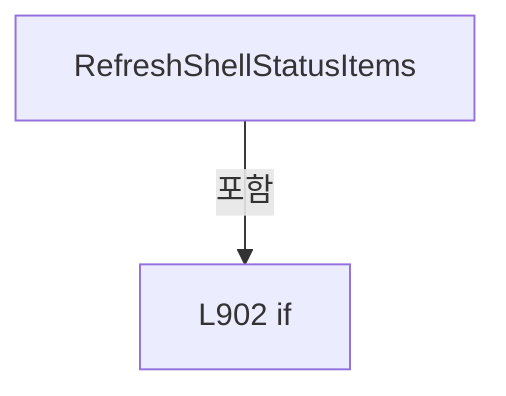

변경 전 점검: 입력/반환 타입, 위 호출자, 예외/취소 경로, 공유 상태와 저장·전송 소비자를 함께 확인합니다. 값의 단위나 물리 방향을 이름만으로 확정하지 않습니다.

### MethodDeclaration `RefreshSystemStatus` · L912–932

[Drilling.UI/CRootView.cs:912–932](https://github.com/kjuws10-rgb/A3Drilling/blob/0219666f9053b907d96d7e0aa7d0c6c1be3a73d4/Drilling.UI/CRootView.cs#L912-L932)

| 항목 | 실제 추출 값 |
| --- | --- |
| 서명 | System.Threading.Tasks.Task Drilling.UI.CRootView.RefreshSystemStatus() |
| 접근/수식자 | Private / private, async |
| 반환/값 타입 | System.Threading.Tasks.Task |
| 소속 타입 | NamedType:Drilling.UI.CRootView |

정적 호출자로 확인된 위치:

| 호출 파일/행 | 호출 표현식 | 런타임 분기 가능 |
| --- | --- | --- |
| [Drilling.UI/CRootView.cs:2327–2327](https://github.com/kjuws10-rgb/A3Drilling/blob/0219666f9053b907d96d7e0aa7d0c6c1be3a73d4/Drilling.UI/CRootView.cs#L2327-L2327) | RefreshSystemStatus | False |
| [Drilling.UI/CRootView.cs:2335–2335](https://github.com/kjuws10-rgb/A3Drilling/blob/0219666f9053b907d96d7e0aa7d0c6c1be3a73d4/Drilling.UI/CRootView.cs#L2335-L2335) | RefreshSystemStatus | False |
| [Drilling.UI/CRootView.cs:2346–2346](https://github.com/kjuws10-rgb/A3Drilling/blob/0219666f9053b907d96d7e0aa7d0c6c1be3a73d4/Drilling.UI/CRootView.cs#L2346-L2346) | RefreshSystemStatus | False |

호출하는 대상과 해석 범위:

| 원본 행 | 표현식 | 분석 상태 | 대상/소스 위치 |
| --- | --- | --- | --- |
| 922 | ApplySystemStatusSnapshot | resolved | void Drilling.UI.CRootView.ApplySystemStatusSnapshot(Drilling.UI.ST_SYSTEM_STATUS_SNAPSHOT, bool) · Drilling.UI/CRootView.cs:1255 |
| 922 | GetSystemStatusSnapshot | resolved | System.Threading.Tasks.Task<Drilling.UI.ST_SYSTEM_STATUS_SNAPSHOT> Drilling.UI.CRootView.GetSystemStatusSnapshot(System.Threading.CancellationToken) · Drilling.UI/CRootView.cs:1237 |

본문의 실제 연산·분기·예외·반환 순서(원문 위치 순):

| 원본 행 | 종류 | 주석 해설 |
| --- | --- | --- |
| 914 | if | 조건에 따라 분기합니다: if (_statusRefreshRunning) |
| 916 | return | 호출자에게 값 또는 제어를 반환합니다: return; |
| 919 | assignment | 값을 대상에 대입합니다: _statusRefreshRunning = true |
| 920 | try | 예외 처리 범위입니다: try |
| 922 | await | 비동기 완료를 기다립니다: await GetSystemStatusSnapshot() |
| 922 | call | 함수·델리게이트 또는 객체 생성자를 호출합니다: ApplySystemStatusSnapshot(await GetSystemStatusSnapshot()) |
| 922 | call | 함수·델리게이트 또는 객체 생성자를 호출합니다: GetSystemStatusSnapshot() |
| 924 | catch | 지정 예외를 처리합니다: catch  |
| 928 | finally | 종료 정리 구간입니다: finally |
| 930 | assignment | 값을 대상에 대입합니다: _statusRefreshRunning = false |

제어 구문의 포함 구조(실제 실행 순서/CFG가 아닌 구문 탐색 그림):

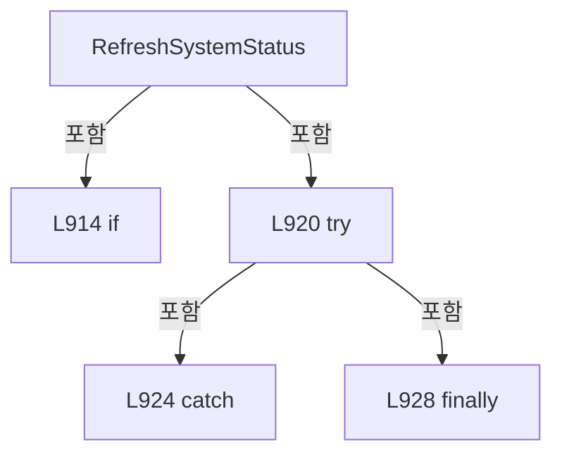

변경 전 점검: 입력/반환 타입, 위 호출자, 예외/취소 경로, 공유 상태와 저장·전송 소비자를 함께 확인합니다. 값의 단위나 물리 방향을 이름만으로 확정하지 않습니다.

### MethodDeclaration `WaitForInitialProcessModelPreparation` · L934–948

[Drilling.UI/CRootView.cs:934–948](https://github.com/kjuws10-rgb/A3Drilling/blob/0219666f9053b907d96d7e0aa7d0c6c1be3a73d4/Drilling.UI/CRootView.cs#L934-L948)

| 항목 | 실제 추출 값 |
| --- | --- |
| 서명 | System.Threading.Tasks.Task Drilling.UI.CRootView.WaitForInitialProcessModelPreparation(System.Threading.CancellationToken) |
| 접근/수식자 | Private / private, async |
| 반환/값 타입 | System.Threading.Tasks.Task |
| 소속 타입 | NamedType:Drilling.UI.CRootView |

입력 계약:

| 이름 | 타입 | 전달 | 선택/기본값 |
| --- | --- | --- | --- |
| cancellationToken | System.Threading.CancellationToken | None | False /  |

정적 호출자로 확인된 위치:

| 호출 파일/행 | 호출 표현식 | 런타임 분기 가능 |
| --- | --- | --- |
| [Drilling.UI/CRootView.cs:726–726](https://github.com/kjuws10-rgb/A3Drilling/blob/0219666f9053b907d96d7e0aa7d0c6c1be3a73d4/Drilling.UI/CRootView.cs#L726-L726) | WaitForInitialProcessModelPreparation | False |
| [Drilling.UI/CRootView.cs:2006–2006](https://github.com/kjuws10-rgb/A3Drilling/blob/0219666f9053b907d96d7e0aa7d0c6c1be3a73d4/Drilling.UI/CRootView.cs#L2006-L2006) | WaitForInitialProcessModelPreparation | False |

호출하는 대상과 해석 범위:

| 원본 행 | 표현식 | 분석 상태 | 대상/소스 위치 |
| --- | --- | --- | --- |
| 938 | _initialProcessModelTask.WaitAsync | resolved | System.Threading.Tasks.Task System.Threading.Tasks.Task.WaitAsync(System.Threading.CancellationToken) |
| 946 | Debug.WriteLine | resolved | void System.Diagnostics.Debug.WriteLine(string?) |

본문의 실제 연산·분기·예외·반환 순서(원문 위치 순):

| 원본 행 | 종류 | 주석 해설 |
| --- | --- | --- |
| 936 | try | 예외 처리 범위입니다: try |
| 938 | await | 비동기 완료를 기다립니다: await _initialProcessModelTask.WaitAsync(cancellationToken) |
| 938 | call | 함수·델리게이트 또는 객체 생성자를 호출합니다: _initialProcessModelTask.WaitAsync(cancellationToken) |
| 940 | catch | 지정 예외를 처리합니다: catch (OperationCanceledException) when (cancellationToken.IsCancellationRequested) |
| 942 | throw | 예외를 발생/전달합니다: throw; |
| 944 | catch | 지정 예외를 처리합니다: catch (Exception exception) |
| 946 | call | 함수·델리게이트 또는 객체 생성자를 호출합니다: Debug.WriteLine("Initial process model preparation did not complete before Start. A fresh preparation will be attempted. " + exception) |

제어 구문의 포함 구조(실제 실행 순서/CFG가 아닌 구문 탐색 그림):

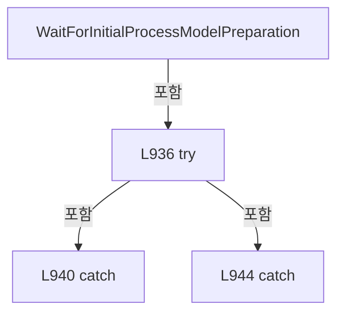

변경 전 점검: 입력/반환 타입, 위 호출자, 예외/취소 경로, 공유 상태와 저장·전송 소비자를 함께 확인합니다. 값의 단위나 물리 방향을 이름만으로 확정하지 않습니다.

### MethodDeclaration `RefreshMonitorLiveData` · L950–980

[Drilling.UI/CRootView.cs:950–980](https://github.com/kjuws10-rgb/A3Drilling/blob/0219666f9053b907d96d7e0aa7d0c6c1be3a73d4/Drilling.UI/CRootView.cs#L950-L980)

| 항목 | 실제 추출 값 |
| --- | --- |
| 서명 | System.Threading.Tasks.Task Drilling.UI.CRootView.RefreshMonitorLiveData() |
| 접근/수식자 | Private / private, async |
| 반환/값 타입 | System.Threading.Tasks.Task |
| 소속 타입 | NamedType:Drilling.UI.CRootView |

정적 호출자로 확인된 위치:

| 호출 파일/행 | 호출 표현식 | 런타임 분기 가능 |
| --- | --- | --- |
| [Drilling.UI/CRootView.cs:2320–2320](https://github.com/kjuws10-rgb/A3Drilling/blob/0219666f9053b907d96d7e0aa7d0c6c1be3a73d4/Drilling.UI/CRootView.cs#L2320-L2320) | RefreshMonitorLiveData | False |

호출하는 대상과 해석 범위:

| 원본 행 | 표현식 | 분석 상태 | 대상/소스 위치 |
| --- | --- | --- | --- |
| 960 | _menus.TryGetValue | resolved · 동적 구현 선택 가능 | bool System.Collections.Generic.IReadOnlyDictionary<Drilling.UI.Menu.Menus.EN_MENU, Drilling.UI.Menu.Menus.CMenuBase>.TryGetValue(Drilling.UI.Menu.Menus.EN_MENU, out Drilling.UI.Menu.Menus.CMenuBase) |
| 962 | monitor.RefreshLiveData | resolved | System.Threading.Tasks.Task Drilling.UI.Menu.Menus.CMenuMonitor.RefreshLiveData(System.Threading.CancellationToken) · Drilling.UI/Menu/Menus/CMenuMonitor.cs:888 |
| 965 | Stopwatch.GetTimestamp | resolved | long System.Diagnostics.Stopwatch.GetTimestamp() |
| 966 | HasElapsed | resolved | bool Drilling.UI.CRootView.HasElapsed(long, long, System.TimeSpan) · Drilling.UI/CRootView.cs:1210 |
| 969 | RefreshShellCommunicationStatus | resolved | System.Threading.Tasks.Task Drilling.UI.CRootView.RefreshShellCommunicationStatus(System.Threading.CancellationToken) · Drilling.UI/CRootView.cs:1222 |

본문의 실제 연산·분기·예외·반환 순서(원문 위치 순):

| 원본 행 | 종류 | 주석 해설 |
| --- | --- | --- |
| 952 | if | 조건에 따라 분기합니다: if (_monitorLiveRefreshRunning) |
| 954 | return | 호출자에게 값 또는 제어를 반환합니다: return; |
| 957 | assignment | 값을 대상에 대입합니다: _monitorLiveRefreshRunning = true |
| 958 | try | 예외 처리 범위입니다: try |
| 960 | call | 함수·델리게이트 또는 객체 생성자를 호출합니다: _menus.TryGetValue(EN_MENU.Monitor, out var menu) |
| 960 | if | 조건에 따라 분기합니다: if (_menus.TryGetValue(EN_MENU.Monitor, out var menu) && menu is CMenuMonitor monitor) |
| 962 | await | 비동기 완료를 기다립니다: await monitor.RefreshLiveData() |
| 962 | call | 함수·델리게이트 또는 객체 생성자를 호출합니다: monitor.RefreshLiveData() |
| 965 | call | 함수·델리게이트 또는 객체 생성자를 호출합니다: Stopwatch.GetTimestamp() |
| 965 | local-declaration | 지역 변수를 선언합니다: var nowTimestamp = Stopwatch.GetTimestamp(); |
| 965 | variable-initializer | 변수의 초기값을 지정합니다: nowTimestamp = Stopwatch.GetTimestamp() |
| 966 | call | 함수·델리게이트 또는 객체 생성자를 호출합니다: HasElapsed(_lastMonitorShellStatusRefreshTimestamp, nowTimestamp, MonitorShellStatusRefreshInterval) |
| 966 | if | 조건에 따라 분기합니다: if (HasElapsed(_lastMonitorShellStatusRefreshTimestamp, nowTimestamp, MonitorShellStatusRefreshInterval)) |
| 968 | assignment | 값을 대상에 대입합니다: _lastMonitorShellStatusRefreshTimestamp = nowTimestamp |
| 969 | await | 비동기 완료를 기다립니다: await RefreshShellCommunicationStatus() |
| 969 | call | 함수·델리게이트 또는 객체 생성자를 호출합니다: RefreshShellCommunicationStatus() |
| 972 | catch | 지정 예외를 처리합니다: catch  |
| 976 | finally | 종료 정리 구간입니다: finally |
| 978 | assignment | 값을 대상에 대입합니다: _monitorLiveRefreshRunning = false |

제어 구문의 포함 구조(실제 실행 순서/CFG가 아닌 구문 탐색 그림):

```mermaid
flowchart TD
 M["RefreshMonitorLiveData"]
 N0["L952 if"]
 M -->|포함| N0
 N1["L958 try"]
 M -->|포함| N1
 N2["L960 if"]
 N1 -->|포함| N2
 N3["L966 if"]
 N1 -->|포함| N3
 N4["L972 catch"]
 N1 -->|포함| N4
 N5["L976 finally"]
 N1 -->|포함| N5
```

변경 전 점검: 입력/반환 타입, 위 호출자, 예외/취소 경로, 공유 상태와 저장·전송 소비자를 함께 확인합니다. 값의 단위나 물리 방향을 이름만으로 확정하지 않습니다.

### MethodDeclaration `RefreshMainLiveStatus` · L982–1034

[Drilling.UI/CRootView.cs:982–1034](https://github.com/kjuws10-rgb/A3Drilling/blob/0219666f9053b907d96d7e0aa7d0c6c1be3a73d4/Drilling.UI/CRootView.cs#L982-L1034)

| 항목 | 실제 추출 값 |
| --- | --- |
| 서명 | System.Threading.Tasks.Task Drilling.UI.CRootView.RefreshMainLiveStatus() |
| 접근/수식자 | Private / private, async |
| 반환/값 타입 | System.Threading.Tasks.Task |
| 소속 타입 | NamedType:Drilling.UI.CRootView |

정적 호출자로 확인된 위치:

| 호출 파일/행 | 호출 표현식 | 런타임 분기 가능 |
| --- | --- | --- |
| [Drilling.UI/CRootView.cs:2334–2334](https://github.com/kjuws10-rgb/A3Drilling/blob/0219666f9053b907d96d7e0aa7d0c6c1be3a73d4/Drilling.UI/CRootView.cs#L2334-L2334) | RefreshMainLiveStatus | False |

호출하는 대상과 해석 범위:

| 원본 행 | 표현식 | 분석 상태 | 대상/소스 위치 |
| --- | --- | --- | --- |
| 1000 | new CancellationTokenSource | resolved | System.Threading.CancellationTokenSource.CancellationTokenSource(System.TimeSpan) |
| 1002 | startedMainOperating.RefreshLiveStatus | resolved | System.Threading.Tasks.Task Drilling.UI.Menu.Menus.CMenuMain.RefreshLiveStatus(System.Threading.CancellationToken) · Drilling.UI/Menu/Menus/CMenuMain.cs:783 |
| 1003 | IsMainLiveStatusTargetCurrent | resolved | bool Drilling.UI.CRootView.IsMainLiveStatusTargetCurrent(Drilling.UI.Menu.Menus.CScreenViewModel, Drilling.UI.Menu.Menus.CMenuMain?) · Drilling.UI/CRootView.cs:1130 |
| 1005 | ReportMainLiveStatusRestored | resolved | void Drilling.UI.CRootView.ReportMainLiveStatusRestored() · Drilling.UI/CRootView.cs:1163 |
| 1008 | IsMainLiveStatusTargetCurrent | resolved | bool Drilling.UI.CRootView.IsMainLiveStatusTargetCurrent(Drilling.UI.Menu.Menus.CScreenViewModel, Drilling.UI.Menu.Menus.CMenuMain?) · Drilling.UI/CRootView.cs:1130 |
| 1012 | IsMainLiveStatusTargetCurrent | resolved | bool Drilling.UI.CRootView.IsMainLiveStatusTargetCurrent(Drilling.UI.Menu.Menus.CScreenViewModel, Drilling.UI.Menu.Menus.CMenuMain?) · Drilling.UI/CRootView.cs:1130 |
| 1014 | ReportMainLiveStatusError | resolved | void Drilling.UI.CRootView.ReportMainLiveStatusError(System.Exception) · Drilling.UI/CRootView.cs:1135 |
| 1018 | ReportStaleMainLiveStatusError | resolved | void Drilling.UI.CRootView.ReportStaleMainLiveStatusError(System.Exception) · Drilling.UI/CRootView.cs:1152 |
| 1024 | ReferenceEquals | resolved | bool object.ReferenceEquals(object?, object?) |
| 1029 | refreshCts.Dispose | resolved | void System.Threading.CancellationTokenSource.Dispose() |

본문의 실제 연산·분기·예외·반환 순서(원문 위치 순):

| 원본 행 | 종류 | 주석 해설 |
| --- | --- | --- |
| 984 | if | 조건에 따라 분기합니다: if (_mainLiveRefreshRunning) |
| 986 | return | 호출자에게 값 또는 제어를 반환합니다: return; |
| 989 | local-declaration | 지역 변수를 선언합니다: var startedScreen = CurrentScreen; |
| 989 | variable-initializer | 변수의 초기값을 지정합니다: startedScreen = CurrentScreen |
| 990 | local-declaration | 지역 변수를 선언합니다: var startedMainOperating = startedScreen.MainOperating; |
| 990 | variable-initializer | 변수의 초기값을 지정합니다: startedMainOperating = startedScreen.MainOperating |
| 991 | if | 조건에 따라 분기합니다: if (SelectedMenu.Menu != EN_MENU.Main &#124;&#124; startedMainOperating is null) |
| 993 | return | 호출자에게 값 또는 제어를 반환합니다: return; |
| 996 | assignment | 값을 대상에 대입합니다: _mainLiveRefreshRunning = true |
| 997 | local-declaration | 지역 변수를 선언합니다: CancellationTokenSource? refreshCts = null; |
| 997 | variable-initializer | 변수의 초기값을 지정합니다: refreshCts = null |
| 998 | try | 예외 처리 범위입니다: try |
| 1000 | assignment | 값을 대상에 대입합니다: refreshCts = new CancellationTokenSource(MainLiveStatusTimeout) |
| 1000 | call | 함수·델리게이트 또는 객체 생성자를 호출합니다: new CancellationTokenSource(MainLiveStatusTimeout) |
| 1001 | assignment | 값을 대상에 대입합니다: _mainLiveStatusRefreshCts = refreshCts |
| 1002 | await | 비동기 완료를 기다립니다: await startedMainOperating.RefreshLiveStatus(refreshCts.Token) |
| 1002 | call | 함수·델리게이트 또는 객체 생성자를 호출합니다: startedMainOperating.RefreshLiveStatus(refreshCts.Token) |
| 1003 | call | 함수·델리게이트 또는 객체 생성자를 호출합니다: IsMainLiveStatusTargetCurrent(startedScreen, startedMainOperating) |
| 1003 | if | 조건에 따라 분기합니다: if (IsMainLiveStatusTargetCurrent(startedScreen, startedMainOperating)) |
| 1005 | call | 함수·델리게이트 또는 객체 생성자를 호출합니다: ReportMainLiveStatusRestored() |
| 1008 | call | 함수·델리게이트 또는 객체 생성자를 호출합니다: IsMainLiveStatusTargetCurrent(startedScreen, startedMainOperating) |
| 1008 | catch | 지정 예외를 처리합니다: catch (OperationCanceledException) when (!IsMainLiveStatusTargetCurrent(startedScreen, startedMainOperating)) |
| 1012 | call | 함수·델리게이트 또는 객체 생성자를 호출합니다: IsMainLiveStatusTargetCurrent(startedScreen, startedMainOperating) |
| 1012 | catch | 지정 예외를 처리합니다: catch (Exception exception) when (IsMainLiveStatusTargetCurrent(startedScreen, startedMainOperating)) |
| 1014 | call | 함수·델리게이트 또는 객체 생성자를 호출합니다: ReportMainLiveStatusError(exception) |
| 1016 | catch | 지정 예외를 처리합니다: catch (Exception exception) |
| 1018 | call | 함수·델리게이트 또는 객체 생성자를 호출합니다: ReportStaleMainLiveStatusError(exception) |
| 1020 | finally | 종료 정리 구간입니다: finally |
| 1022 | if | 조건에 따라 분기합니다: if (refreshCts is not null) |
| 1024 | call | 함수·델리게이트 또는 객체 생성자를 호출합니다: ReferenceEquals(_mainLiveStatusRefreshCts, refreshCts) |
| 1024 | if | 조건에 따라 분기합니다: if (ReferenceEquals(_mainLiveStatusRefreshCts, refreshCts)) |
| 1026 | assignment | 값을 대상에 대입합니다: _mainLiveStatusRefreshCts = null |
| 1029 | call | 함수·델리게이트 또는 객체 생성자를 호출합니다: refreshCts.Dispose() |
| 1032 | assignment | 값을 대상에 대입합니다: _mainLiveRefreshRunning = false |

제어 구문의 포함 구조(실제 실행 순서/CFG가 아닌 구문 탐색 그림):

```mermaid
flowchart TD
 M["RefreshMainLiveStatus"]
 N0["L984 if"]
 M -->|포함| N0
 N1["L991 if"]
 M -->|포함| N1
 N2["L998 try"]
 M -->|포함| N2
 N3["L1003 if"]
 N2 -->|포함| N3
 N4["L1008 catch"]
 N2 -->|포함| N4
 N5["L1012 catch"]
 N2 -->|포함| N5
 N6["L1016 catch"]
 N2 -->|포함| N6
 N7["L1020 finally"]
 N2 -->|포함| N7
 N8["L1022 if"]
 N7 -->|포함| N8
 N9["L1024 if"]
 N8 -->|포함| N9
```

변경 전 점검: 입력/반환 타입, 위 호출자, 예외/취소 경로, 공유 상태와 저장·전송 소비자를 함께 확인합니다. 값의 단위나 물리 방향을 이름만으로 확정하지 않습니다.

### MethodDeclaration `RefreshManualScannerStatus` · L1036–1062

[Drilling.UI/CRootView.cs:1036–1062](https://github.com/kjuws10-rgb/A3Drilling/blob/0219666f9053b907d96d7e0aa7d0c6c1be3a73d4/Drilling.UI/CRootView.cs#L1036-L1062)

| 항목 | 실제 추출 값 |
| --- | --- |
| 서명 | void Drilling.UI.CRootView.RefreshManualScannerStatus() |
| 접근/수식자 | Private / private |
| 반환/값 타입 | void |
| 소속 타입 | NamedType:Drilling.UI.CRootView |

정적 호출자로 확인된 위치:

| 호출 파일/행 | 호출 표현식 | 런타임 분기 가능 |
| --- | --- | --- |
| [Drilling.UI/CRootView.cs:2326–2326](https://github.com/kjuws10-rgb/A3Drilling/blob/0219666f9053b907d96d7e0aa7d0c6c1be3a73d4/Drilling.UI/CRootView.cs#L2326-L2326) | RefreshManualScannerStatus | False |

호출하는 대상과 해석 범위:

| 원본 행 | 표현식 | 분석 상태 | 대상/소스 위치 |
| --- | --- | --- | --- |
| 1052 | manualMenu.RefreshScannerStatusSnapshot | resolved | void Drilling.UI.Menu.Menus.CMenuManual.RefreshScannerStatusSnapshot() · Drilling.UI/Menu/Menus/CMenuManual.cs:2094 |

본문의 실제 연산·분기·예외·반환 순서(원문 위치 순):

| 원본 행 | 종류 | 주석 해설 |
| --- | --- | --- |
| 1038 | if | 조건에 따라 분기합니다: if (_manualScannerStatusRefreshRunning) |
| 1040 | return | 호출자에게 값 또는 제어를 반환합니다: return; |
| 1043 | local-declaration | 지역 변수를 선언합니다: var manualMenu = CurrentScreen.Manual; |
| 1043 | variable-initializer | 변수의 초기값을 지정합니다: manualMenu = CurrentScreen.Manual |
| 1044 | if | 조건에 따라 분기합니다: if (SelectedMenu.Menu != EN_MENU.Manual &#124;&#124; manualMenu is null) |
| 1046 | return | 호출자에게 값 또는 제어를 반환합니다: return; |
| 1049 | assignment | 값을 대상에 대입합니다: _manualScannerStatusRefreshRunning = true |
| 1050 | try | 예외 처리 범위입니다: try |
| 1052 | call | 함수·델리게이트 또는 객체 생성자를 호출합니다: manualMenu.RefreshScannerStatusSnapshot() |
| 1054 | catch | 지정 예외를 처리합니다: catch  |
| 1058 | finally | 종료 정리 구간입니다: finally |
| 1060 | assignment | 값을 대상에 대입합니다: _manualScannerStatusRefreshRunning = false |

제어 구문의 포함 구조(실제 실행 순서/CFG가 아닌 구문 탐색 그림):

```mermaid
flowchart TD
 M["RefreshManualScannerStatus"]
 N0["L1038 if"]
 M -->|포함| N0
 N1["L1044 if"]
 M -->|포함| N1
 N2["L1050 try"]
 M -->|포함| N2
 N3["L1054 catch"]
 N2 -->|포함| N3
 N4["L1058 finally"]
 N2 -->|포함| N4
```

변경 전 점검: 입력/반환 타입, 위 호출자, 예외/취소 경로, 공유 상태와 저장·전송 소비자를 함께 확인합니다. 값의 단위나 물리 방향을 이름만으로 확정하지 않습니다.

### MethodDeclaration `CancelMainLiveStatusRefresh` · L1064–1074

[Drilling.UI/CRootView.cs:1064–1074](https://github.com/kjuws10-rgb/A3Drilling/blob/0219666f9053b907d96d7e0aa7d0c6c1be3a73d4/Drilling.UI/CRootView.cs#L1064-L1074)

| 항목 | 실제 추출 값 |
| --- | --- |
| 서명 | void Drilling.UI.CRootView.CancelMainLiveStatusRefresh() |
| 접근/수식자 | Private / private |
| 반환/값 타입 | void |
| 소속 타입 | NamedType:Drilling.UI.CRootView |

정적 호출자로 확인된 위치:

| 호출 파일/행 | 호출 표현식 | 런타임 분기 가능 |
| --- | --- | --- |
| [Drilling.UI/CRootView.cs:350–350](https://github.com/kjuws10-rgb/A3Drilling/blob/0219666f9053b907d96d7e0aa7d0c6c1be3a73d4/Drilling.UI/CRootView.cs#L350-L350) | CancelMainLiveStatusRefresh | False |

호출하는 대상과 해석 범위:

| 원본 행 | 표현식 | 분석 상태 | 대상/소스 위치 |
| --- | --- | --- | --- |
| 1068 | .Cancel | resolved | void System.Threading.CancellationTokenSource.Cancel() |

본문의 실제 연산·분기·예외·반환 순서(원문 위치 순):

| 원본 행 | 종류 | 주석 해설 |
| --- | --- | --- |
| 1066 | try | 예외 처리 범위입니다: try |
| 1068 | call | 함수·델리게이트 또는 객체 생성자를 호출합니다: .Cancel() |
| 1070 | catch | 지정 예외를 처리합니다: catch (ObjectDisposedException) |

제어 구문의 포함 구조(실제 실행 순서/CFG가 아닌 구문 탐색 그림):

```mermaid
flowchart TD
 M["CancelMainLiveStatusRefresh"]
 N0["L1066 try"]
 M -->|포함| N0
 N1["L1070 catch"]
 N0 -->|포함| N1
```

변경 전 점검: 입력/반환 타입, 위 호출자, 예외/취소 경로, 공유 상태와 저장·전송 소비자를 함께 확인합니다. 값의 단위나 물리 방향을 이름만으로 확정하지 않습니다.

### MethodDeclaration `StopMainScannerStatusPolling` · L1076–1084

[Drilling.UI/CRootView.cs:1076–1084](https://github.com/kjuws10-rgb/A3Drilling/blob/0219666f9053b907d96d7e0aa7d0c6c1be3a73d4/Drilling.UI/CRootView.cs#L1076-L1084)

| 항목 | 실제 추출 값 |
| --- | --- |
| 서명 | void Drilling.UI.CRootView.StopMainScannerStatusPolling() |
| 접근/수식자 | Private / private |
| 반환/값 타입 | void |
| 소속 타입 | NamedType:Drilling.UI.CRootView |

정적 호출자로 확인된 위치:

| 호출 파일/행 | 호출 표현식 | 런타임 분기 가능 |
| --- | --- | --- |
| [Drilling.UI/CRootView.cs:1092–1092](https://github.com/kjuws10-rgb/A3Drilling/blob/0219666f9053b907d96d7e0aa7d0c6c1be3a73d4/Drilling.UI/CRootView.cs#L1092-L1092) | StopMainScannerStatusPolling | False |

호출하는 대상과 해석 범위:

| 원본 행 | 표현식 | 분석 상태 | 대상/소스 위치 |
| --- | --- | --- | --- |
| 1078 | _menus.TryGetValue | resolved · 동적 구현 선택 가능 | bool System.Collections.Generic.IReadOnlyDictionary<Drilling.UI.Menu.Menus.EN_MENU, Drilling.UI.Menu.Menus.CMenuBase>.TryGetValue(Drilling.UI.Menu.Menus.EN_MENU, out Drilling.UI.Menu.Menus.CMenuBase) |
| 1083 | mainMenu.StopScannerStatusPolling | resolved | void Drilling.UI.Menu.Menus.CMenuMain.StopScannerStatusPolling() · Drilling.UI/Menu/Menus/CMenuMain.cs:1077 |

본문의 실제 연산·분기·예외·반환 순서(원문 위치 순):

| 원본 행 | 종류 | 주석 해설 |
| --- | --- | --- |
| 1078 | call | 함수·델리게이트 또는 객체 생성자를 호출합니다: _menus.TryGetValue(EN_MENU.Main, out var menu) |
| 1078 | if | 조건에 따라 분기합니다: if (!_menus.TryGetValue(EN_MENU.Main, out var menu) &#124;&#124; menu is not CMenuMain mainMenu) |
| 1080 | return | 호출자에게 값 또는 제어를 반환합니다: return; |
| 1083 | call | 함수·델리게이트 또는 객체 생성자를 호출합니다: mainMenu.StopScannerStatusPolling() |

제어 구문의 포함 구조(실제 실행 순서/CFG가 아닌 구문 탐색 그림):

```mermaid
flowchart TD
 M["StopMainScannerStatusPolling"]
 N0["L1078 if"]
 M -->|포함| N0
```

변경 전 점검: 입력/반환 타입, 위 호출자, 예외/취소 경로, 공유 상태와 저장·전송 소비자를 함께 확인합니다. 값의 단위나 물리 방향을 이름만으로 확정하지 않습니다.

### MethodDeclaration `QueueMainScannerStatusPollingStop` · L1086–1101

[Drilling.UI/CRootView.cs:1086–1101](https://github.com/kjuws10-rgb/A3Drilling/blob/0219666f9053b907d96d7e0aa7d0c6c1be3a73d4/Drilling.UI/CRootView.cs#L1086-L1101)

| 항목 | 실제 추출 값 |
| --- | --- |
| 서명 | void Drilling.UI.CRootView.QueueMainScannerStatusPollingStop() |
| 접근/수식자 | Private / private |
| 반환/값 타입 | void |
| 소속 타입 | NamedType:Drilling.UI.CRootView |

정적 호출자로 확인된 위치:

| 호출 파일/행 | 호출 표현식 | 런타임 분기 가능 |
| --- | --- | --- |
| [Drilling.UI/CRootView.cs:351–351](https://github.com/kjuws10-rgb/A3Drilling/blob/0219666f9053b907d96d7e0aa7d0c6c1be3a73d4/Drilling.UI/CRootView.cs#L351-L351) | QueueMainScannerStatusPollingStop | False |

호출하는 대상과 해석 범위:

| 원본 행 | 표현식 | 분석 상태 | 대상/소스 위치 |
| --- | --- | --- | --- |
| 1100 | Task.Run | resolved | System.Threading.Tasks.Task System.Threading.Tasks.Task.Run(System.Action) |

본문의 실제 연산·분기·예외·반환 순서(원문 위치 순):

| 원본 행 | 종류 | 주석 해설 |
| --- | --- | --- |
| 1100 | assignment | 값을 대상에 대입합니다: _ = Task.Run(StopPolling) |
| 1100 | call | 함수·델리게이트 또는 객체 생성자를 호출합니다: Task.Run(StopPolling) |

변경 전 점검: 입력/반환 타입, 위 호출자, 예외/취소 경로, 공유 상태와 저장·전송 소비자를 함께 확인합니다. 값의 단위나 물리 방향을 이름만으로 확정하지 않습니다.

### LocalFunctionStatement `StopPolling` · L1088–1098

[Drilling.UI/CRootView.cs:1088–1098](https://github.com/kjuws10-rgb/A3Drilling/blob/0219666f9053b907d96d7e0aa7d0c6c1be3a73d4/Drilling.UI/CRootView.cs#L1088-L1098)

| 항목 | 실제 추출 값 |
| --- | --- |
| 서명 | void StopPolling() |
| 접근/수식자 | Private /  |
| 반환/값 타입 | void |
| 소속 타입 | NamedType:Drilling.UI.CRootView |

현재 부분 분석에서 직접 연결된 호출자는 없습니다. XAML/이벤트/인터페이스·델리게이트·외부 진입을 추가 확인해야 하며, 미사용으로 판정한 것이 아닙니다.

호출하는 대상과 해석 범위:

| 원본 행 | 표현식 | 분석 상태 | 대상/소스 위치 |
| --- | --- | --- | --- |
| 1092 | StopMainScannerStatusPolling | resolved | void Drilling.UI.CRootView.StopMainScannerStatusPolling() · Drilling.UI/CRootView.cs:1076 |
| 1096 | Debug.WriteLine | resolved | void System.Diagnostics.Debug.WriteLine(string?) |

본문의 실제 연산·분기·예외·반환 순서(원문 위치 순):

| 원본 행 | 종류 | 주석 해설 |
| --- | --- | --- |
| 1090 | try | 예외 처리 범위입니다: try |
| 1092 | call | 함수·델리게이트 또는 객체 생성자를 호출합니다: StopMainScannerStatusPolling() |
| 1094 | catch | 지정 예외를 처리합니다: catch (Exception exception) |
| 1096 | call | 함수·델리게이트 또는 객체 생성자를 호출합니다: Debug.WriteLine($"Main scanner polling stop failed. {exception}") |

제어 구문의 포함 구조(실제 실행 순서/CFG가 아닌 구문 탐색 그림):

```mermaid
flowchart TD
 M["StopPolling"]
 N0["L1090 try"]
 M -->|포함| N0
 N1["L1094 catch"]
 N0 -->|포함| N1
```

변경 전 점검: 입력/반환 타입, 위 호출자, 예외/취소 경로, 공유 상태와 저장·전송 소비자를 함께 확인합니다. 값의 단위나 물리 방향을 이름만으로 확정하지 않습니다.

### MethodDeclaration `StopManualScannerStatusPolling` · L1103–1111

[Drilling.UI/CRootView.cs:1103–1111](https://github.com/kjuws10-rgb/A3Drilling/blob/0219666f9053b907d96d7e0aa7d0c6c1be3a73d4/Drilling.UI/CRootView.cs#L1103-L1111)

| 항목 | 실제 추출 값 |
| --- | --- |
| 서명 | void Drilling.UI.CRootView.StopManualScannerStatusPolling() |
| 접근/수식자 | Private / private |
| 반환/값 타입 | void |
| 소속 타입 | NamedType:Drilling.UI.CRootView |

정적 호출자로 확인된 위치:

| 호출 파일/행 | 호출 표현식 | 런타임 분기 가능 |
| --- | --- | --- |
| [Drilling.UI/CRootView.cs:1119–1119](https://github.com/kjuws10-rgb/A3Drilling/blob/0219666f9053b907d96d7e0aa7d0c6c1be3a73d4/Drilling.UI/CRootView.cs#L1119-L1119) | StopManualScannerStatusPolling | False |

호출하는 대상과 해석 범위:

| 원본 행 | 표현식 | 분석 상태 | 대상/소스 위치 |
| --- | --- | --- | --- |
| 1105 | _menus.TryGetValue | resolved · 동적 구현 선택 가능 | bool System.Collections.Generic.IReadOnlyDictionary<Drilling.UI.Menu.Menus.EN_MENU, Drilling.UI.Menu.Menus.CMenuBase>.TryGetValue(Drilling.UI.Menu.Menus.EN_MENU, out Drilling.UI.Menu.Menus.CMenuBase) |
| 1110 | manualMenu.StopScannerStatusPolling | resolved | void Drilling.UI.Menu.Menus.CMenuManual.StopScannerStatusPolling() · Drilling.UI/Menu/Menus/CMenuManual.cs:444 |

본문의 실제 연산·분기·예외·반환 순서(원문 위치 순):

| 원본 행 | 종류 | 주석 해설 |
| --- | --- | --- |
| 1105 | call | 함수·델리게이트 또는 객체 생성자를 호출합니다: _menus.TryGetValue(EN_MENU.Manual, out var menu) |
| 1105 | if | 조건에 따라 분기합니다: if (!_menus.TryGetValue(EN_MENU.Manual, out var menu) &#124;&#124; menu is not CMenuManual manualMenu) |
| 1107 | return | 호출자에게 값 또는 제어를 반환합니다: return; |
| 1110 | call | 함수·델리게이트 또는 객체 생성자를 호출합니다: manualMenu.StopScannerStatusPolling() |

제어 구문의 포함 구조(실제 실행 순서/CFG가 아닌 구문 탐색 그림):

```mermaid
flowchart TD
 M["StopManualScannerStatusPolling"]
 N0["L1105 if"]
 M -->|포함| N0
```

변경 전 점검: 입력/반환 타입, 위 호출자, 예외/취소 경로, 공유 상태와 저장·전송 소비자를 함께 확인합니다. 값의 단위나 물리 방향을 이름만으로 확정하지 않습니다.

### MethodDeclaration `QueueManualScannerStatusPollingStop` · L1113–1128

[Drilling.UI/CRootView.cs:1113–1128](https://github.com/kjuws10-rgb/A3Drilling/blob/0219666f9053b907d96d7e0aa7d0c6c1be3a73d4/Drilling.UI/CRootView.cs#L1113-L1128)

| 항목 | 실제 추출 값 |
| --- | --- |
| 서명 | void Drilling.UI.CRootView.QueueManualScannerStatusPollingStop() |
| 접근/수식자 | Private / private |
| 반환/값 타입 | void |
| 소속 타입 | NamedType:Drilling.UI.CRootView |

정적 호출자로 확인된 위치:

| 호출 파일/행 | 호출 표현식 | 런타임 분기 가능 |
| --- | --- | --- |
| [Drilling.UI/CRootView.cs:356–356](https://github.com/kjuws10-rgb/A3Drilling/blob/0219666f9053b907d96d7e0aa7d0c6c1be3a73d4/Drilling.UI/CRootView.cs#L356-L356) | QueueManualScannerStatusPollingStop | False |

호출하는 대상과 해석 범위:

| 원본 행 | 표현식 | 분석 상태 | 대상/소스 위치 |
| --- | --- | --- | --- |
| 1127 | Task.Run | resolved | System.Threading.Tasks.Task System.Threading.Tasks.Task.Run(System.Action) |

본문의 실제 연산·분기·예외·반환 순서(원문 위치 순):

| 원본 행 | 종류 | 주석 해설 |
| --- | --- | --- |
| 1127 | assignment | 값을 대상에 대입합니다: _ = Task.Run(StopPolling) |
| 1127 | call | 함수·델리게이트 또는 객체 생성자를 호출합니다: Task.Run(StopPolling) |

변경 전 점검: 입력/반환 타입, 위 호출자, 예외/취소 경로, 공유 상태와 저장·전송 소비자를 함께 확인합니다. 값의 단위나 물리 방향을 이름만으로 확정하지 않습니다.

### LocalFunctionStatement `StopPolling` · L1115–1125

[Drilling.UI/CRootView.cs:1115–1125](https://github.com/kjuws10-rgb/A3Drilling/blob/0219666f9053b907d96d7e0aa7d0c6c1be3a73d4/Drilling.UI/CRootView.cs#L1115-L1125)

| 항목 | 실제 추출 값 |
| --- | --- |
| 서명 | void StopPolling() |
| 접근/수식자 | Private /  |
| 반환/값 타입 | void |
| 소속 타입 | NamedType:Drilling.UI.CRootView |

현재 부분 분석에서 직접 연결된 호출자는 없습니다. XAML/이벤트/인터페이스·델리게이트·외부 진입을 추가 확인해야 하며, 미사용으로 판정한 것이 아닙니다.

호출하는 대상과 해석 범위:

| 원본 행 | 표현식 | 분석 상태 | 대상/소스 위치 |
| --- | --- | --- | --- |
| 1119 | StopManualScannerStatusPolling | resolved | void Drilling.UI.CRootView.StopManualScannerStatusPolling() · Drilling.UI/CRootView.cs:1103 |
| 1123 | Debug.WriteLine | resolved | void System.Diagnostics.Debug.WriteLine(string?) |

본문의 실제 연산·분기·예외·반환 순서(원문 위치 순):

| 원본 행 | 종류 | 주석 해설 |
| --- | --- | --- |
| 1117 | try | 예외 처리 범위입니다: try |
| 1119 | call | 함수·델리게이트 또는 객체 생성자를 호출합니다: StopManualScannerStatusPolling() |
| 1121 | catch | 지정 예외를 처리합니다: catch (Exception exception) |
| 1123 | call | 함수·델리게이트 또는 객체 생성자를 호출합니다: Debug.WriteLine($"Manual scanner polling stop failed. {exception}") |

제어 구문의 포함 구조(실제 실행 순서/CFG가 아닌 구문 탐색 그림):

```mermaid
flowchart TD
 M["StopPolling"]
 N0["L1117 try"]
 M -->|포함| N0
 N1["L1121 catch"]
 N0 -->|포함| N1
```

변경 전 점검: 입력/반환 타입, 위 호출자, 예외/취소 경로, 공유 상태와 저장·전송 소비자를 함께 확인합니다. 값의 단위나 물리 방향을 이름만으로 확정하지 않습니다.

### MethodDeclaration `IsMainLiveStatusTargetCurrent` · L1130–1133

[Drilling.UI/CRootView.cs:1130–1133](https://github.com/kjuws10-rgb/A3Drilling/blob/0219666f9053b907d96d7e0aa7d0c6c1be3a73d4/Drilling.UI/CRootView.cs#L1130-L1133)

| 항목 | 실제 추출 값 |
| --- | --- |
| 서명 | bool Drilling.UI.CRootView.IsMainLiveStatusTargetCurrent(Drilling.UI.Menu.Menus.CScreenViewModel, Drilling.UI.Menu.Menus.CMenuMain?) |
| 접근/수식자 | Private / private |
| 반환/값 타입 | bool |
| 소속 타입 | NamedType:Drilling.UI.CRootView |

입력 계약:

| 이름 | 타입 | 전달 | 선택/기본값 |
| --- | --- | --- | --- |
| startedScreen | Drilling.UI.Menu.Menus.CScreenViewModel | None | False /  |
| startedMainOperating | Drilling.UI.Menu.Menus.CMenuMain? | None | False /  |

정적 호출자로 확인된 위치:

| 호출 파일/행 | 호출 표현식 | 런타임 분기 가능 |
| --- | --- | --- |
| [Drilling.UI/CRootView.cs:1003–1003](https://github.com/kjuws10-rgb/A3Drilling/blob/0219666f9053b907d96d7e0aa7d0c6c1be3a73d4/Drilling.UI/CRootView.cs#L1003-L1003) | IsMainLiveStatusTargetCurrent | False |
| [Drilling.UI/CRootView.cs:1008–1008](https://github.com/kjuws10-rgb/A3Drilling/blob/0219666f9053b907d96d7e0aa7d0c6c1be3a73d4/Drilling.UI/CRootView.cs#L1008-L1008) | IsMainLiveStatusTargetCurrent | False |
| [Drilling.UI/CRootView.cs:1012–1012](https://github.com/kjuws10-rgb/A3Drilling/blob/0219666f9053b907d96d7e0aa7d0c6c1be3a73d4/Drilling.UI/CRootView.cs#L1012-L1012) | IsMainLiveStatusTargetCurrent | False |

호출하는 대상과 해석 범위:

| 원본 행 | 표현식 | 분석 상태 | 대상/소스 위치 |
| --- | --- | --- | --- |
| 1132 | ReferenceEquals | resolved | bool object.ReferenceEquals(object?, object?) |
| 1132 | ReferenceEquals | resolved | bool object.ReferenceEquals(object?, object?) |

본문의 실제 연산·분기·예외·반환 순서(원문 위치 순):

| 원본 행 | 종류 | 주석 해설 |
| --- | --- | --- |
| 1132 | call | 함수·델리게이트 또는 객체 생성자를 호출합니다: ReferenceEquals(CurrentScreen, startedScreen) |
| 1132 | call | 함수·델리게이트 또는 객체 생성자를 호출합니다: ReferenceEquals(CurrentScreen.MainOperating, startedMainOperating) |
| 1132 | return | 호출자에게 값 또는 제어를 반환합니다: return SelectedMenu.Menu == EN_MENU.Main && ReferenceEquals(CurrentScreen, startedScreen) && ReferenceEquals(CurrentScreen.MainOperating, startedMainOperating); |

변경 전 점검: 입력/반환 타입, 위 호출자, 예외/취소 경로, 공유 상태와 저장·전송 소비자를 함께 확인합니다. 값의 단위나 물리 방향을 이름만으로 확정하지 않습니다.

### MethodDeclaration `ReportMainLiveStatusError` · L1135–1150

[Drilling.UI/CRootView.cs:1135–1150](https://github.com/kjuws10-rgb/A3Drilling/blob/0219666f9053b907d96d7e0aa7d0c6c1be3a73d4/Drilling.UI/CRootView.cs#L1135-L1150)

| 항목 | 실제 추출 값 |
| --- | --- |
| 서명 | void Drilling.UI.CRootView.ReportMainLiveStatusError(System.Exception) |
| 접근/수식자 | Private / private |
| 반환/값 타입 | void |
| 소속 타입 | NamedType:Drilling.UI.CRootView |

입력 계약:

| 이름 | 타입 | 전달 | 선택/기본값 |
| --- | --- | --- | --- |
| exception | System.Exception | None | False /  |

정적 호출자로 확인된 위치:

| 호출 파일/행 | 호출 표현식 | 런타임 분기 가능 |
| --- | --- | --- |
| [Drilling.UI/CRootView.cs:1014–1014](https://github.com/kjuws10-rgb/A3Drilling/blob/0219666f9053b907d96d7e0aa7d0c6c1be3a73d4/Drilling.UI/CRootView.cs#L1014-L1014) | ReportMainLiveStatusError | False |

호출하는 대상과 해석 범위:

| 원본 행 | 표현식 | 분석 상태 | 대상/소스 위치 |
| --- | --- | --- | --- |
| 1137 | Stopwatch.GetTimestamp | resolved | long System.Diagnostics.Stopwatch.GetTimestamp() |
| 1138 | exception.GetType | resolved | System.Type System.Exception.GetType() |
| 1139 | detail.Equals | resolved | bool string.Equals(string?, System.StringComparison) |
| 1139 | HasElapsed | resolved | bool Drilling.UI.CRootView.HasElapsed(long, long, System.TimeSpan) · Drilling.UI/CRootView.cs:1210 |
| 1149 | QueueStationStateLog | resolved | void Drilling.UI.CRootView.QueueStationStateLog(string, string, string) · Drilling.UI/CRootView.cs:1192 |

본문의 실제 연산·분기·예외·반환 순서(원문 위치 순):

| 원본 행 | 종류 | 주석 해설 |
| --- | --- | --- |
| 1137 | call | 함수·델리게이트 또는 객체 생성자를 호출합니다: Stopwatch.GetTimestamp() |
| 1137 | local-declaration | 지역 변수를 선언합니다: var nowTimestamp = Stopwatch.GetTimestamp(); |
| 1137 | variable-initializer | 변수의 초기값을 지정합니다: nowTimestamp = Stopwatch.GetTimestamp() |
| 1138 | call | 함수·델리게이트 또는 객체 생성자를 호출합니다: exception.GetType() |
| 1138 | local-declaration | 지역 변수를 선언합니다: var detail = $"{exception.GetType().Name}: {exception.Message}"; |
| 1138 | variable-initializer | 변수의 초기값을 지정합니다: detail = $"{exception.GetType().Name}: {exception.Message}" |
| 1139 | call | 함수·델리게이트 또는 객체 생성자를 호출합니다: detail.Equals(_lastMainLiveStatusError, StringComparison.Ordinal) |
| 1139 | call | 함수·델리게이트 또는 객체 생성자를 호출합니다: HasElapsed(_lastMainLiveStatusErrorReportTimestamp, nowTimestamp, ErrorReportInterval) |
| 1139 | local-declaration | 지역 변수를 선언합니다: var shouldLog = !detail.Equals(_lastMainLiveStatusError, StringComparison.Ordinal) &#124;&#124; HasElapsed(_lastMainLiveStatusErrorReportTimestamp, nowTimestamp, ErrorReportInterval); |
| 1139 | variable-initializer | 변수의 초기값을 지정합니다: shouldLog = !detail.Equals(_lastMainLiveStatusError, StringComparison.Ordinal) &#124;&#124; HasElapsed(_lastMainLiveStatusErrorReportTimestamp, nowTimestamp, ErrorReportInterval) |
| 1140 | assignment | 값을 대상에 대입합니다: _mainLiveStatusErrorActive = true |
| 1141 | assignment | 값을 대상에 대입합니다: StatusMessage = $"Main live status refresh failed. {detail}" |
| 1142 | if | 조건에 따라 분기합니다: if (!shouldLog) |
| 1144 | return | 호출자에게 값 또는 제어를 반환합니다: return; |
| 1147 | assignment | 값을 대상에 대입합니다: _lastMainLiveStatusError = detail |
| 1148 | assignment | 값을 대상에 대입합니다: _lastMainLiveStatusErrorReportTimestamp = nowTimestamp |
| 1149 | call | 함수·델리게이트 또는 객체 생성자를 호출합니다: QueueStationStateLog("MAIN_LIVE_STATUS", "ERROR", detail) |

제어 구문의 포함 구조(실제 실행 순서/CFG가 아닌 구문 탐색 그림):

```mermaid
flowchart TD
 M["ReportMainLiveStatusError"]
 N0["L1142 if"]
 M -->|포함| N0
```

변경 전 점검: 입력/반환 타입, 위 호출자, 예외/취소 경로, 공유 상태와 저장·전송 소비자를 함께 확인합니다. 값의 단위나 물리 방향을 이름만으로 확정하지 않습니다.

### MethodDeclaration `ReportStaleMainLiveStatusError` · L1152–1161

[Drilling.UI/CRootView.cs:1152–1161](https://github.com/kjuws10-rgb/A3Drilling/blob/0219666f9053b907d96d7e0aa7d0c6c1be3a73d4/Drilling.UI/CRootView.cs#L1152-L1161)

| 항목 | 실제 추출 값 |
| --- | --- |
| 서명 | void Drilling.UI.CRootView.ReportStaleMainLiveStatusError(System.Exception) |
| 접근/수식자 | Private / private |
| 반환/값 타입 | void |
| 소속 타입 | NamedType:Drilling.UI.CRootView |

입력 계약:

| 이름 | 타입 | 전달 | 선택/기본값 |
| --- | --- | --- | --- |
| exception | System.Exception | None | False /  |

정적 호출자로 확인된 위치:

| 호출 파일/행 | 호출 표현식 | 런타임 분기 가능 |
| --- | --- | --- |
| [Drilling.UI/CRootView.cs:1018–1018](https://github.com/kjuws10-rgb/A3Drilling/blob/0219666f9053b907d96d7e0aa7d0c6c1be3a73d4/Drilling.UI/CRootView.cs#L1018-L1018) | ReportStaleMainLiveStatusError | False |

호출하는 대상과 해석 범위:

| 원본 행 | 표현식 | 분석 상태 | 대상/소스 위치 |
| --- | --- | --- | --- |
| 1159 | exception.GetType | resolved | System.Type System.Exception.GetType() |
| 1160 | QueueStationStateLog | resolved | void Drilling.UI.CRootView.QueueStationStateLog(string, string, string) · Drilling.UI/CRootView.cs:1192 |

본문의 실제 연산·분기·예외·반환 순서(원문 위치 순):

| 원본 행 | 종류 | 주석 해설 |
| --- | --- | --- |
| 1154 | if | 조건에 따라 분기합니다: if (exception is OperationCanceledException) |
| 1156 | return | 호출자에게 값 또는 제어를 반환합니다: return; |
| 1159 | call | 함수·델리게이트 또는 객체 생성자를 호출합니다: exception.GetType() |
| 1159 | local-declaration | 지역 변수를 선언합니다: var detail = $"{exception.GetType().Name}: {exception.Message}"; |
| 1159 | variable-initializer | 변수의 초기값을 지정합니다: detail = $"{exception.GetType().Name}: {exception.Message}" |
| 1160 | call | 함수·델리게이트 또는 객체 생성자를 호출합니다: QueueStationStateLog("MAIN_LIVE_STATUS", "STALE_ERROR", $"Stale Main live status failure ignored for UI. {detail}") |

제어 구문의 포함 구조(실제 실행 순서/CFG가 아닌 구문 탐색 그림):

```mermaid
flowchart TD
 M["ReportStaleMainLiveStatusError"]
 N0["L1154 if"]
 M -->|포함| N0
```

변경 전 점검: 입력/반환 타입, 위 호출자, 예외/취소 경로, 공유 상태와 저장·전송 소비자를 함께 확인합니다. 값의 단위나 물리 방향을 이름만으로 확정하지 않습니다.

### MethodDeclaration `ReportMainLiveStatusRestored` · L1163–1174

[Drilling.UI/CRootView.cs:1163–1174](https://github.com/kjuws10-rgb/A3Drilling/blob/0219666f9053b907d96d7e0aa7d0c6c1be3a73d4/Drilling.UI/CRootView.cs#L1163-L1174)

| 항목 | 실제 추출 값 |
| --- | --- |
| 서명 | void Drilling.UI.CRootView.ReportMainLiveStatusRestored() |
| 접근/수식자 | Private / private |
| 반환/값 타입 | void |
| 소속 타입 | NamedType:Drilling.UI.CRootView |

정적 호출자로 확인된 위치:

| 호출 파일/행 | 호출 표현식 | 런타임 분기 가능 |
| --- | --- | --- |
| [Drilling.UI/CRootView.cs:1005–1005](https://github.com/kjuws10-rgb/A3Drilling/blob/0219666f9053b907d96d7e0aa7d0c6c1be3a73d4/Drilling.UI/CRootView.cs#L1005-L1005) | ReportMainLiveStatusRestored | False |

호출하는 대상과 해석 범위:

| 원본 행 | 표현식 | 분석 상태 | 대상/소스 위치 |
| --- | --- | --- | --- |
| 1173 | QueueStationStateLog | resolved | void Drilling.UI.CRootView.QueueStationStateLog(string, string, string) · Drilling.UI/CRootView.cs:1192 |

본문의 실제 연산·분기·예외·반환 순서(원문 위치 순):

| 원본 행 | 종류 | 주석 해설 |
| --- | --- | --- |
| 1165 | if | 조건에 따라 분기합니다: if (!_mainLiveStatusErrorActive) |
| 1167 | return | 호출자에게 값 또는 제어를 반환합니다: return; |
| 1170 | assignment | 값을 대상에 대입합니다: _mainLiveStatusErrorActive = false |
| 1171 | assignment | 값을 대상에 대입합니다: _lastMainLiveStatusError = "" |
| 1172 | assignment | 값을 대상에 대입합니다: StatusMessage = "Main live status refresh restored." |
| 1173 | call | 함수·델리게이트 또는 객체 생성자를 호출합니다: QueueStationStateLog("MAIN_LIVE_STATUS", "INFO", "Main live status refresh restored.") |

제어 구문의 포함 구조(실제 실행 순서/CFG가 아닌 구문 탐색 그림):

```mermaid
flowchart TD
 M["ReportMainLiveStatusRestored"]
 N0["L1165 if"]
 M -->|포함| N0
```

변경 전 점검: 입력/반환 타입, 위 호출자, 예외/취소 경로, 공유 상태와 저장·전송 소비자를 함께 확인합니다. 값의 단위나 물리 방향을 이름만으로 확정하지 않습니다.

### MethodDeclaration `ReportClockTickError` · L1176–1190

[Drilling.UI/CRootView.cs:1176–1190](https://github.com/kjuws10-rgb/A3Drilling/blob/0219666f9053b907d96d7e0aa7d0c6c1be3a73d4/Drilling.UI/CRootView.cs#L1176-L1190)

| 항목 | 실제 추출 값 |
| --- | --- |
| 서명 | void Drilling.UI.CRootView.ReportClockTickError(System.Exception) |
| 접근/수식자 | Private / private |
| 반환/값 타입 | void |
| 소속 타입 | NamedType:Drilling.UI.CRootView |

입력 계약:

| 이름 | 타입 | 전달 | 선택/기본값 |
| --- | --- | --- | --- |
| exception | System.Exception | None | False /  |

정적 호출자로 확인된 위치:

| 호출 파일/행 | 호출 표현식 | 런타임 분기 가능 |
| --- | --- | --- |
| [Drilling.UI/CRootView.cs:2350–2350](https://github.com/kjuws10-rgb/A3Drilling/blob/0219666f9053b907d96d7e0aa7d0c6c1be3a73d4/Drilling.UI/CRootView.cs#L2350-L2350) | ReportClockTickError | False |

호출하는 대상과 해석 범위:

| 원본 행 | 표현식 | 분석 상태 | 대상/소스 위치 |
| --- | --- | --- | --- |
| 1178 | Stopwatch.GetTimestamp | resolved | long System.Diagnostics.Stopwatch.GetTimestamp() |
| 1179 | exception.GetType | resolved | System.Type System.Exception.GetType() |
| 1180 | detail.Equals | resolved | bool string.Equals(string?, System.StringComparison) |
| 1180 | HasElapsed | resolved | bool Drilling.UI.CRootView.HasElapsed(long, long, System.TimeSpan) · Drilling.UI/CRootView.cs:1210 |
| 1189 | QueueStationStateLog | resolved | void Drilling.UI.CRootView.QueueStationStateLog(string, string, string) · Drilling.UI/CRootView.cs:1192 |

본문의 실제 연산·분기·예외·반환 순서(원문 위치 순):

| 원본 행 | 종류 | 주석 해설 |
| --- | --- | --- |
| 1178 | call | 함수·델리게이트 또는 객체 생성자를 호출합니다: Stopwatch.GetTimestamp() |
| 1178 | local-declaration | 지역 변수를 선언합니다: var nowTimestamp = Stopwatch.GetTimestamp(); |
| 1178 | variable-initializer | 변수의 초기값을 지정합니다: nowTimestamp = Stopwatch.GetTimestamp() |
| 1179 | call | 함수·델리게이트 또는 객체 생성자를 호출합니다: exception.GetType() |
| 1179 | local-declaration | 지역 변수를 선언합니다: var detail = $"{exception.GetType().Name}: {exception.Message}"; |
| 1179 | variable-initializer | 변수의 초기값을 지정합니다: detail = $"{exception.GetType().Name}: {exception.Message}" |
| 1180 | call | 함수·델리게이트 또는 객체 생성자를 호출합니다: detail.Equals(_lastClockTickError, StringComparison.Ordinal) |
| 1180 | call | 함수·델리게이트 또는 객체 생성자를 호출합니다: HasElapsed(_lastClockTickErrorReportTimestamp, nowTimestamp, ErrorReportInterval) |
| 1180 | local-declaration | 지역 변수를 선언합니다: var shouldLog = !detail.Equals(_lastClockTickError, StringComparison.Ordinal) &#124;&#124; HasElapsed(_lastClockTickErrorReportTimestamp, nowTimestamp, ErrorReportInterval); |
| 1180 | variable-initializer | 변수의 초기값을 지정합니다: shouldLog = !detail.Equals(_lastClockTickError, StringComparison.Ordinal) &#124;&#124; HasElapsed(_lastClockTickErrorReportTimestamp, nowTimestamp, ErrorReportInterval) |
| 1181 | assignment | 값을 대상에 대입합니다: StatusMessage = $"UI timer refresh failed. {detail}" |
| 1182 | if | 조건에 따라 분기합니다: if (!shouldLog) |
| 1184 | return | 호출자에게 값 또는 제어를 반환합니다: return; |
| 1187 | assignment | 값을 대상에 대입합니다: _lastClockTickError = detail |
| 1188 | assignment | 값을 대상에 대입합니다: _lastClockTickErrorReportTimestamp = nowTimestamp |
| 1189 | call | 함수·델리게이트 또는 객체 생성자를 호출합니다: QueueStationStateLog("UI_CLOCK", "ERROR", detail) |

제어 구문의 포함 구조(실제 실행 순서/CFG가 아닌 구문 탐색 그림):

```mermaid
flowchart TD
 M["ReportClockTickError"]
 N0["L1182 if"]
 M -->|포함| N0
```

변경 전 점검: 입력/반환 타입, 위 호출자, 예외/취소 경로, 공유 상태와 저장·전송 소비자를 함께 확인합니다. 값의 단위나 물리 방향을 이름만으로 확정하지 않습니다.

### MethodDeclaration `QueueStationStateLog` · L1192–1208

[Drilling.UI/CRootView.cs:1192–1208](https://github.com/kjuws10-rgb/A3Drilling/blob/0219666f9053b907d96d7e0aa7d0c6c1be3a73d4/Drilling.UI/CRootView.cs#L1192-L1208)

| 항목 | 실제 추출 값 |
| --- | --- |
| 서명 | void Drilling.UI.CRootView.QueueStationStateLog(string, string, string) |
| 접근/수식자 | Private / private |
| 반환/값 타입 | void |
| 소속 타입 | NamedType:Drilling.UI.CRootView |

입력 계약:

| 이름 | 타입 | 전달 | 선택/기본값 |
| --- | --- | --- | --- |
| stateName | string | None | False /  |
| action | string | None | False /  |
| detail | string | None | False /  |

정적 호출자로 확인된 위치:

| 호출 파일/행 | 호출 표현식 | 런타임 분기 가능 |
| --- | --- | --- |
| [Drilling.UI/CRootView.cs:1149–1149](https://github.com/kjuws10-rgb/A3Drilling/blob/0219666f9053b907d96d7e0aa7d0c6c1be3a73d4/Drilling.UI/CRootView.cs#L1149-L1149) | QueueStationStateLog | False |
| [Drilling.UI/CRootView.cs:1160–1160](https://github.com/kjuws10-rgb/A3Drilling/blob/0219666f9053b907d96d7e0aa7d0c6c1be3a73d4/Drilling.UI/CRootView.cs#L1160-L1160) | QueueStationStateLog | False |
| [Drilling.UI/CRootView.cs:1173–1173](https://github.com/kjuws10-rgb/A3Drilling/blob/0219666f9053b907d96d7e0aa7d0c6c1be3a73d4/Drilling.UI/CRootView.cs#L1173-L1173) | QueueStationStateLog | False |
| [Drilling.UI/CRootView.cs:1189–1189](https://github.com/kjuws10-rgb/A3Drilling/blob/0219666f9053b907d96d7e0aa7d0c6c1be3a73d4/Drilling.UI/CRootView.cs#L1189-L1189) | QueueStationStateLog | False |

호출하는 대상과 해석 범위:

| 원본 행 | 표현식 | 분석 상태 | 대상/소스 위치 |
| --- | --- | --- | --- |
| 1194 | _manager.Log | resolved | Drilling.Common.Log.CLogManager Drilling.Common.Managers.CManager.Log() · Drilling.Common/Managers/CManager.cs:388 |
| 1207 | Task.Run | resolved | System.Threading.Tasks.Task System.Threading.Tasks.Task.Run(System.Action) |

본문의 실제 연산·분기·예외·반환 순서(원문 위치 순):

| 원본 행 | 종류 | 주석 해설 |
| --- | --- | --- |
| 1194 | call | 함수·델리게이트 또는 객체 생성자를 호출합니다: _manager.Log() |
| 1194 | local-declaration | 지역 변수를 선언합니다: var logManager = _manager.Log(); |
| 1194 | variable-initializer | 변수의 초기값을 지정합니다: logManager = _manager.Log() |
| 1207 | assignment | 값을 대상에 대입합니다: _ = Task.Run(WriteStationStateLog) |
| 1207 | call | 함수·델리게이트 또는 객체 생성자를 호출합니다: Task.Run(WriteStationStateLog) |

변경 전 점검: 입력/반환 타입, 위 호출자, 예외/취소 경로, 공유 상태와 저장·전송 소비자를 함께 확인합니다. 값의 단위나 물리 방향을 이름만으로 확정하지 않습니다.

### LocalFunctionStatement `WriteStationStateLog` · L1195–1205

[Drilling.UI/CRootView.cs:1195–1205](https://github.com/kjuws10-rgb/A3Drilling/blob/0219666f9053b907d96d7e0aa7d0c6c1be3a73d4/Drilling.UI/CRootView.cs#L1195-L1205)

| 항목 | 실제 추출 값 |
| --- | --- |
| 서명 | void WriteStationStateLog() |
| 접근/수식자 | Private /  |
| 반환/값 타입 | void |
| 소속 타입 | NamedType:Drilling.UI.CRootView |

현재 부분 분석에서 직접 연결된 호출자는 없습니다. XAML/이벤트/인터페이스·델리게이트·외부 진입을 추가 확인해야 하며, 미사용으로 판정한 것이 아닙니다.

호출하는 대상과 해석 범위:

| 원본 행 | 표현식 | 분석 상태 | 대상/소스 위치 |
| --- | --- | --- | --- |
| 1199 | logManager.WriteStationState | resolved | void Drilling.Common.Log.CLogManager.WriteStationState(string, string, string, string) · Drilling.Common/Log/CLogManager.cs:175 |
| 1203 | Debug.WriteLine | resolved | void System.Diagnostics.Debug.WriteLine(string?) |

본문의 실제 연산·분기·예외·반환 순서(원문 위치 순):

| 원본 행 | 종류 | 주석 해설 |
| --- | --- | --- |
| 1197 | try | 예외 처리 범위입니다: try |
| 1199 | call | 함수·델리게이트 또는 객체 생성자를 호출합니다: logManager.WriteStationState("UI", stateName, action, detail) |
| 1201 | catch | 지정 예외를 처리합니다: catch (Exception exception) |
| 1203 | call | 함수·델리게이트 또는 객체 생성자를 호출합니다: Debug.WriteLine($"Station state log failed. {exception}") |

제어 구문의 포함 구조(실제 실행 순서/CFG가 아닌 구문 탐색 그림):

```mermaid
flowchart TD
 M["WriteStationStateLog"]
 N0["L1197 try"]
 M -->|포함| N0
 N1["L1201 catch"]
 N0 -->|포함| N1
```

변경 전 점검: 입력/반환 타입, 위 호출자, 예외/취소 경로, 공유 상태와 저장·전송 소비자를 함께 확인합니다. 값의 단위나 물리 방향을 이름만으로 확정하지 않습니다.

### MethodDeclaration `HasElapsed` · L1210–1220

[Drilling.UI/CRootView.cs:1210–1220](https://github.com/kjuws10-rgb/A3Drilling/blob/0219666f9053b907d96d7e0aa7d0c6c1be3a73d4/Drilling.UI/CRootView.cs#L1210-L1220)

| 항목 | 실제 추출 값 |
| --- | --- |
| 서명 | bool Drilling.UI.CRootView.HasElapsed(long, long, System.TimeSpan) |
| 접근/수식자 | Private / private, static |
| 반환/값 타입 | bool |
| 소속 타입 | NamedType:Drilling.UI.CRootView |

입력 계약:

| 이름 | 타입 | 전달 | 선택/기본값 |
| --- | --- | --- | --- |
| lastTimestamp | long | None | False /  |
| currentTimestamp | long | None | False /  |
| interval | System.TimeSpan | None | False /  |

정적 호출자로 확인된 위치:

| 호출 파일/행 | 호출 표현식 | 런타임 분기 가능 |
| --- | --- | --- |
| [Drilling.UI/CRootView.cs:966–966](https://github.com/kjuws10-rgb/A3Drilling/blob/0219666f9053b907d96d7e0aa7d0c6c1be3a73d4/Drilling.UI/CRootView.cs#L966-L966) | HasElapsed | False |
| [Drilling.UI/CRootView.cs:1139–1139](https://github.com/kjuws10-rgb/A3Drilling/blob/0219666f9053b907d96d7e0aa7d0c6c1be3a73d4/Drilling.UI/CRootView.cs#L1139-L1139) | HasElapsed | False |
| [Drilling.UI/CRootView.cs:1180–1180](https://github.com/kjuws10-rgb/A3Drilling/blob/0219666f9053b907d96d7e0aa7d0c6c1be3a73d4/Drilling.UI/CRootView.cs#L1180-L1180) | HasElapsed | False |
| [Drilling.UI/CRootView.cs:2313–2313](https://github.com/kjuws10-rgb/A3Drilling/blob/0219666f9053b907d96d7e0aa7d0c6c1be3a73d4/Drilling.UI/CRootView.cs#L2313-L2313) | HasElapsed | False |
| [Drilling.UI/CRootView.cs:2315–2315](https://github.com/kjuws10-rgb/A3Drilling/blob/0219666f9053b907d96d7e0aa7d0c6c1be3a73d4/Drilling.UI/CRootView.cs#L2315-L2315) | HasElapsed | False |
| [Drilling.UI/CRootView.cs:2316–2316](https://github.com/kjuws10-rgb/A3Drilling/blob/0219666f9053b907d96d7e0aa7d0c6c1be3a73d4/Drilling.UI/CRootView.cs#L2316-L2316) | HasElapsed | False |

본문의 실제 연산·분기·예외·반환 순서(원문 위치 순):

| 원본 행 | 종류 | 주석 해설 |
| --- | --- | --- |
| 1212 | if | 조건에 따라 분기합니다: if (lastTimestamp <= 0) |
| 1214 | return | 호출자에게 값 또는 제어를 반환합니다: return true; |
| 1217 | local-declaration | 지역 변수를 선언합니다: var elapsedTicks = currentTimestamp - lastTimestamp; |
| 1217 | variable-initializer | 변수의 초기값을 지정합니다: elapsedTicks = currentTimestamp - lastTimestamp |
| 1218 | local-declaration | 지역 변수를 선언합니다: var requiredTicks = interval.TotalSeconds * Stopwatch.Frequency; |
| 1218 | variable-initializer | 변수의 초기값을 지정합니다: requiredTicks = interval.TotalSeconds * Stopwatch.Frequency |
| 1219 | return | 호출자에게 값 또는 제어를 반환합니다: return elapsedTicks >= requiredTicks; |

제어 구문의 포함 구조(실제 실행 순서/CFG가 아닌 구문 탐색 그림):

```mermaid
flowchart TD
 M["HasElapsed"]
 N0["L1212 if"]
 M -->|포함| N0
```

변경 전 점검: 입력/반환 타입, 위 호출자, 예외/취소 경로, 공유 상태와 저장·전송 소비자를 함께 확인합니다. 값의 단위나 물리 방향을 이름만으로 확정하지 않습니다.

### MethodDeclaration `RefreshShellCommunicationStatus` · L1222–1235

[Drilling.UI/CRootView.cs:1222–1235](https://github.com/kjuws10-rgb/A3Drilling/blob/0219666f9053b907d96d7e0aa7d0c6c1be3a73d4/Drilling.UI/CRootView.cs#L1222-L1235)

| 항목 | 실제 추출 값 |
| --- | --- |
| 서명 | System.Threading.Tasks.Task Drilling.UI.CRootView.RefreshShellCommunicationStatus(System.Threading.CancellationToken) |
| 접근/수식자 | Private / private |
| 반환/값 타입 | System.Threading.Tasks.Task |
| 소속 타입 | NamedType:Drilling.UI.CRootView |

입력 계약:

| 이름 | 타입 | 전달 | 선택/기본값 |
| --- | --- | --- | --- |
| cancellationToken | System.Threading.CancellationToken | None | True / null |

정적 호출자로 확인된 위치:

| 호출 파일/행 | 호출 표현식 | 런타임 분기 가능 |
| --- | --- | --- |
| [Drilling.UI/CRootView.cs:969–969](https://github.com/kjuws10-rgb/A3Drilling/blob/0219666f9053b907d96d7e0aa7d0c6c1be3a73d4/Drilling.UI/CRootView.cs#L969-L969) | RefreshShellCommunicationStatus | False |

호출하는 대상과 해석 범위:

| 원본 행 | 표현식 | 분석 상태 | 대상/소스 위치 |
| --- | --- | --- | --- |
| 1224 | _interfaceManager.GetCommunicationStatus | resolved | System.Collections.Generic.IReadOnlyList<Drilling.Common.Interface.ST_DEVICE_COMM_STATUS> Drilling.Common.Interface.CInterfaceManager.GetCommunicationStatus(System.Threading.CancellationToken) · Drilling.Common/Interface/CInterfaceManager.cs:502 |
| 1225 | _interfaceManager.GetInterfaceCommunicationList | resolved | System.Collections.Generic.IReadOnlyList<Drilling.Common.Interface.ST_INTERFACE_COMM_STATUS> Drilling.Common.Interface.CInterfaceManager.GetInterfaceCommunicationList(Drilling.Common.Interface.EN_EQP_MODULE?) · Drilling.Common/Interface/CInterfaceManager.cs:472 |
| 1228 | string.IsNullOrWhiteSpace | resolved | bool string.IsNullOrWhiteSpace(string?) |
| 1230 | NormalizeCommunicationStatuses | resolved | System.Collections.Generic.IReadOnlyList<Drilling.Common.Interface.ST_DEVICE_COMM_STATUS> Drilling.UI.CRootView.NormalizeCommunicationStatuses(System.Collections.Generic.IReadOnlyList<Drilling.Common.Interface.ST_DEVICE_COMM_STATUS>) · Drilling.UI/CRootView.cs:2748 |
| 1232 | RefreshOperationModeAccess | resolved | void Drilling.UI.CRootView.RefreshOperationModeAccess() · Drilling.UI/CRootView.cs:879 |
| 1233 | RefreshShellStatusItems | resolved | void Drilling.UI.CRootView.RefreshShellStatusItems() · Drilling.UI/CRootView.cs:899 |

본문의 실제 연산·분기·예외·반환 순서(원문 위치 순):

| 원본 행 | 종류 | 주석 해설 |
| --- | --- | --- |
| 1224 | call | 함수·델리게이트 또는 객체 생성자를 호출합니다: _interfaceManager.GetCommunicationStatus(cancellationToken) |
| 1224 | local-declaration | 지역 변수를 선언합니다: var modules = _interfaceManager.GetCommunicationStatus(cancellationToken); |
| 1224 | variable-initializer | 변수의 초기값을 지정합니다: modules = _interfaceManager.GetCommunicationStatus(cancellationToken) |
| 1225 | assignment | 값을 대상에 대입합니다: _interfaceCommStatuses = _interfaceManager.GetInterfaceCommunicationList() |
| 1225 | call | 함수·델리게이트 또는 객체 생성자를 호출합니다: _interfaceManager.GetInterfaceCommunicationList() |
| 1226 | assignment | 값을 대상에 대입합니다: _systemStatus = _systemStatus with { CurrentRecipeId = string.IsNullOrWhiteSpace(_selectedRecipeId) ? DefaultRecipeId : _selectedRecipeId, OperationMode = _operationMode, Modules = NormalizeCommunicationStatuses(modules) } |
| 1228 | assignment | 값을 대상에 대입합니다: CurrentRecipeId = string.IsNullOrWhiteSpace(_selectedRecipeId) ? DefaultRecipeId : _selectedRecipeId |
| 1228 | call | 함수·델리게이트 또는 객체 생성자를 호출합니다: string.IsNullOrWhiteSpace(_selectedRecipeId) |
| 1228 | conditional-expression | 조건에 따라 결과식을 선택합니다: string.IsNullOrWhiteSpace(_selectedRecipeId) ? DefaultRecipeId : _selectedRecipeId |
| 1229 | assignment | 값을 대상에 대입합니다: OperationMode = _operationMode |
| 1230 | assignment | 값을 대상에 대입합니다: Modules = NormalizeCommunicationStatuses(modules) |
| 1230 | call | 함수·델리게이트 또는 객체 생성자를 호출합니다: NormalizeCommunicationStatuses(modules) |
| 1232 | call | 함수·델리게이트 또는 객체 생성자를 호출합니다: RefreshOperationModeAccess() |
| 1233 | call | 함수·델리게이트 또는 객체 생성자를 호출합니다: RefreshShellStatusItems() |
| 1234 | return | 호출자에게 값 또는 제어를 반환합니다: return Task.CompletedTask; |

변경 전 점검: 입력/반환 타입, 위 호출자, 예외/취소 경로, 공유 상태와 저장·전송 소비자를 함께 확인합니다. 값의 단위나 물리 방향을 이름만으로 확정하지 않습니다.

### MethodDeclaration `GetSystemStatusSnapshot` · L1237–1253

[Drilling.UI/CRootView.cs:1237–1253](https://github.com/kjuws10-rgb/A3Drilling/blob/0219666f9053b907d96d7e0aa7d0c6c1be3a73d4/Drilling.UI/CRootView.cs#L1237-L1253)

| 항목 | 실제 추출 값 |
| --- | --- |
| 서명 | System.Threading.Tasks.Task<Drilling.UI.ST_SYSTEM_STATUS_SNAPSHOT> Drilling.UI.CRootView.GetSystemStatusSnapshot(System.Threading.CancellationToken) |
| 접근/수식자 | Private / private, async |
| 반환/값 타입 | System.Threading.Tasks.Task<Drilling.UI.ST_SYSTEM_STATUS_SNAPSHOT> |
| 소속 타입 | NamedType:Drilling.UI.CRootView |

입력 계약:

| 이름 | 타입 | 전달 | 선택/기본값 |
| --- | --- | --- | --- |
| cancellationToken | System.Threading.CancellationToken | None | True / null |

정적 호출자로 확인된 위치:

| 호출 파일/행 | 호출 표현식 | 런타임 분기 가능 |
| --- | --- | --- |
| [Drilling.UI/CRootView.cs:603–603](https://github.com/kjuws10-rgb/A3Drilling/blob/0219666f9053b907d96d7e0aa7d0c6c1be3a73d4/Drilling.UI/CRootView.cs#L603-L603) | GetSystemStatusSnapshot | False |
| [Drilling.UI/CRootView.cs:922–922](https://github.com/kjuws10-rgb/A3Drilling/blob/0219666f9053b907d96d7e0aa7d0c6c1be3a73d4/Drilling.UI/CRootView.cs#L922-L922) | GetSystemStatusSnapshot | False |

호출하는 대상과 해석 범위:

| 원본 행 | 표현식 | 분석 상태 | 대상/소스 위치 |
| --- | --- | --- | --- |
| 1239 | string.IsNullOrWhiteSpace | resolved | bool string.IsNullOrWhiteSpace(string?) |
| 1249 | Task.Run | resolved | System.Threading.Tasks.Task<Drilling.UI.ST_SYSTEM_STATUS_SOURCE> System.Threading.Tasks.Task.Run<Drilling.UI.ST_SYSTEM_STATUS_SOURCE>(System.Func<Drilling.UI.ST_SYSTEM_STATUS_SOURCE>, System.Threading.CancellationToken) |
| 1251 | new ST_SYSTEM_STATUS | resolved | Drilling.Common.Managers.ST_SYSTEM_STATUS.ST_SYSTEM_STATUS(string, Drilling.Common.Managers.EN_SYSTEM_MODE, Drilling.Common.Alarm.EN_ALARM_STATE, Drilling.Common.Managers.EN_PM_LOCK_STATE, System.Collections.Generic.IReadOnlyList<Drilling.Common.Interface.ST_DEVICE_COMM_STATUS>) · Drilling.Common/Managers/CManager.cs:746 |
| 1252 | new ST_SYSTEM_STATUS_SNAPSHOT | resolved | Drilling.UI.ST_SYSTEM_STATUS_SNAPSHOT.ST_SYSTEM_STATUS_SNAPSHOT(Drilling.Common.Managers.ST_SYSTEM_STATUS, System.Collections.Generic.IReadOnlyList<Drilling.Common.Interface.ST_INTERFACE_COMM_STATUS>) · Drilling.UI/CRootView.cs:3354 |

본문의 실제 연산·분기·예외·반환 순서(원문 위치 순):

| 원본 행 | 종류 | 주석 해설 |
| --- | --- | --- |
| 1239 | call | 함수·델리게이트 또는 객체 생성자를 호출합니다: string.IsNullOrWhiteSpace(_selectedRecipeId) |
| 1239 | conditional-expression | 조건에 따라 결과식을 선택합니다: string.IsNullOrWhiteSpace(_selectedRecipeId) ? DefaultRecipeId : _selectedRecipeId |
| 1239 | local-declaration | 지역 변수를 선언합니다: var currentRecipeId = string.IsNullOrWhiteSpace(_selectedRecipeId) ? DefaultRecipeId : _selectedRecipeId; |
| 1239 | variable-initializer | 변수의 초기값을 지정합니다: currentRecipeId = string.IsNullOrWhiteSpace(_selectedRecipeId) ? DefaultRecipeId : _selectedRecipeId |
| 1240 | local-declaration | 지역 변수를 선언합니다: var operationMode = _operationMode; |
| 1240 | variable-initializer | 변수의 초기값을 지정합니다: operationMode = _operationMode |
| 1241 | conditional-expression | 조건에 따라 결과식을 선택합니다: _pmLockStatus.IsLocked ? EN_PM_LOCK_STATE.Locked : EN_PM_LOCK_STATE.Released |
| 1241 | local-declaration | 지역 변수를 선언합니다: var pmLockState = _pmLockStatus.IsLocked ? EN_PM_LOCK_STATE.Locked : EN_PM_LOCK_STATE.Released; |
| 1241 | variable-initializer | 변수의 초기값을 지정합니다: pmLockState = _pmLockStatus.IsLocked ? EN_PM_LOCK_STATE.Locked : EN_PM_LOCK_STATE.Released |
| 1249 | await | 비동기 완료를 기다립니다: await Task.Run(ReadSystemStatusSource, cancellationToken) |
| 1249 | call | 함수·델리게이트 또는 객체 생성자를 호출합니다: Task.Run(ReadSystemStatusSource, cancellationToken) |
| 1249 | local-declaration | 지역 변수를 선언합니다: var source = await Task.Run(ReadSystemStatusSource, cancellationToken); |
| 1249 | variable-initializer | 변수의 초기값을 지정합니다: source = await Task.Run(ReadSystemStatusSource, cancellationToken) |
| 1250 | local-declaration | 지역 변수를 선언합니다: var alarms = _alarmManager.CurAlarm; |
| 1250 | variable-initializer | 변수의 초기값을 지정합니다: alarms = _alarmManager.CurAlarm |
| 1251 | call | 함수·델리게이트 또는 객체 생성자를 호출합니다: new ST_SYSTEM_STATUS(source.CurrentRecipeId, source.OperationMode, alarms.Count > 0 ? EN_ALARM_STATE.Occur : EN_ALARM_STATE.Clear, source.PmLockState, source.Modules) |
| 1251 | conditional-expression | 조건에 따라 결과식을 선택합니다: alarms.Count > 0 ? EN_ALARM_STATE.Occur : EN_ALARM_STATE.Clear |
| 1251 | local-declaration | 지역 변수를 선언합니다: var status = new ST_SYSTEM_STATUS(source.CurrentRecipeId, source.OperationMode, alarms.Count > 0 ? EN_ALARM_STATE.Occur : EN_ALARM_STATE.Clear, source.PmLockState, source.Modules); |
| 1251 | variable-initializer | 변수의 초기값을 지정합니다: status = new ST_SYSTEM_STATUS(source.CurrentRecipeId, source.OperationMode, alarms.Count > 0 ? EN_ALARM_STATE.Occur : EN_ALARM_STATE.Clear, source.PmLockState, source.Modules) |
| 1252 | call | 함수·델리게이트 또는 객체 생성자를 호출합니다: new ST_SYSTEM_STATUS_SNAPSHOT(status, source.InterfaceCommunicationStatuses) |
| 1252 | return | 호출자에게 값 또는 제어를 반환합니다: return new ST_SYSTEM_STATUS_SNAPSHOT(status, source.InterfaceCommunicationStatuses); |

변경 전 점검: 입력/반환 타입, 위 호출자, 예외/취소 경로, 공유 상태와 저장·전송 소비자를 함께 확인합니다. 값의 단위나 물리 방향을 이름만으로 확정하지 않습니다.

### LocalFunctionStatement `ReadSystemStatusSource` · L1242–1247

[Drilling.UI/CRootView.cs:1242–1247](https://github.com/kjuws10-rgb/A3Drilling/blob/0219666f9053b907d96d7e0aa7d0c6c1be3a73d4/Drilling.UI/CRootView.cs#L1242-L1247)

| 항목 | 실제 추출 값 |
| --- | --- |
| 서명 | Drilling.UI.ST_SYSTEM_STATUS_SOURCE ReadSystemStatusSource() |
| 접근/수식자 | Private /  |
| 반환/값 타입 | Drilling.UI.ST_SYSTEM_STATUS_SOURCE |
| 소속 타입 | NamedType:Drilling.UI.CRootView |

현재 부분 분석에서 직접 연결된 호출자는 없습니다. XAML/이벤트/인터페이스·델리게이트·외부 진입을 추가 확인해야 하며, 미사용으로 판정한 것이 아닙니다.

호출하는 대상과 해석 범위:

| 원본 행 | 표현식 | 분석 상태 | 대상/소스 위치 |
| --- | --- | --- | --- |
| 1244 | _interfaceManager.GetCommunicationStatus | resolved | System.Collections.Generic.IReadOnlyList<Drilling.Common.Interface.ST_DEVICE_COMM_STATUS> Drilling.Common.Interface.CInterfaceManager.GetCommunicationStatus(System.Threading.CancellationToken) · Drilling.Common/Interface/CInterfaceManager.cs:502 |
| 1245 | _interfaceManager.GetInterfaceCommunicationList | resolved | System.Collections.Generic.IReadOnlyList<Drilling.Common.Interface.ST_INTERFACE_COMM_STATUS> Drilling.Common.Interface.CInterfaceManager.GetInterfaceCommunicationList(Drilling.Common.Interface.EN_EQP_MODULE?) · Drilling.Common/Interface/CInterfaceManager.cs:472 |
| 1246 | new ST_SYSTEM_STATUS_SOURCE | resolved | Drilling.UI.ST_SYSTEM_STATUS_SOURCE.ST_SYSTEM_STATUS_SOURCE(string, Drilling.Common.Managers.EN_SYSTEM_MODE, Drilling.Common.Managers.EN_PM_LOCK_STATE, System.Collections.Generic.IReadOnlyList<Drilling.Common.Interface.ST_DEVICE_COMM_STATUS>, System.Collections.Generic.IReadOnlyList<Drilling.Common.Interface.ST_INTERFACE_COMM_STATUS>) · Drilling.UI/CRootView.cs:3347 |
| 1246 | NormalizeCommunicationStatuses | resolved | System.Collections.Generic.IReadOnlyList<Drilling.Common.Interface.ST_DEVICE_COMM_STATUS> Drilling.UI.CRootView.NormalizeCommunicationStatuses(System.Collections.Generic.IReadOnlyList<Drilling.Common.Interface.ST_DEVICE_COMM_STATUS>) · Drilling.UI/CRootView.cs:2748 |

본문의 실제 연산·분기·예외·반환 순서(원문 위치 순):

| 원본 행 | 종류 | 주석 해설 |
| --- | --- | --- |
| 1244 | call | 함수·델리게이트 또는 객체 생성자를 호출합니다: _interfaceManager.GetCommunicationStatus(cancellationToken) |
| 1244 | local-declaration | 지역 변수를 선언합니다: var modules = _interfaceManager.GetCommunicationStatus(cancellationToken); |
| 1244 | variable-initializer | 변수의 초기값을 지정합니다: modules = _interfaceManager.GetCommunicationStatus(cancellationToken) |
| 1245 | call | 함수·델리게이트 또는 객체 생성자를 호출합니다: _interfaceManager.GetInterfaceCommunicationList() |
| 1245 | local-declaration | 지역 변수를 선언합니다: var interfaceCommStatuses = _interfaceManager.GetInterfaceCommunicationList(); |
| 1245 | variable-initializer | 변수의 초기값을 지정합니다: interfaceCommStatuses = _interfaceManager.GetInterfaceCommunicationList() |
| 1246 | call | 함수·델리게이트 또는 객체 생성자를 호출합니다: new ST_SYSTEM_STATUS_SOURCE(currentRecipeId, operationMode, pmLockState, NormalizeCommunicationStatuses(modules), interfaceCommStatuses) |
| 1246 | call | 함수·델리게이트 또는 객체 생성자를 호출합니다: NormalizeCommunicationStatuses(modules) |
| 1246 | return | 호출자에게 값 또는 제어를 반환합니다: return new ST_SYSTEM_STATUS_SOURCE(currentRecipeId, operationMode, pmLockState, NormalizeCommunicationStatuses(modules), interfaceCommStatuses); |

변경 전 점검: 입력/반환 타입, 위 호출자, 예외/취소 경로, 공유 상태와 저장·전송 소비자를 함께 확인합니다. 값의 단위나 물리 방향을 이름만으로 확정하지 않습니다.

### MethodDeclaration `ApplySystemStatusSnapshot` · L1255–1265

[Drilling.UI/CRootView.cs:1255–1265](https://github.com/kjuws10-rgb/A3Drilling/blob/0219666f9053b907d96d7e0aa7d0c6c1be3a73d4/Drilling.UI/CRootView.cs#L1255-L1265)

| 항목 | 실제 추출 값 |
| --- | --- |
| 서명 | void Drilling.UI.CRootView.ApplySystemStatusSnapshot(Drilling.UI.ST_SYSTEM_STATUS_SNAPSHOT, bool) |
| 접근/수식자 | Private / private |
| 반환/값 타입 | void |
| 소속 타입 | NamedType:Drilling.UI.CRootView |

입력 계약:

| 이름 | 타입 | 전달 | 선택/기본값 |
| --- | --- | --- | --- |
| snapshot | Drilling.UI.ST_SYSTEM_STATUS_SNAPSHOT | None | False /  |
| refreshOperationModeAccess | bool | None | True / true |

정적 호출자로 확인된 위치:

| 호출 파일/행 | 호출 표현식 | 런타임 분기 가능 |
| --- | --- | --- |
| [Drilling.UI/CRootView.cs:603–603](https://github.com/kjuws10-rgb/A3Drilling/blob/0219666f9053b907d96d7e0aa7d0c6c1be3a73d4/Drilling.UI/CRootView.cs#L603-L603) | ApplySystemStatusSnapshot | False |
| [Drilling.UI/CRootView.cs:922–922](https://github.com/kjuws10-rgb/A3Drilling/blob/0219666f9053b907d96d7e0aa7d0c6c1be3a73d4/Drilling.UI/CRootView.cs#L922-L922) | ApplySystemStatusSnapshot | False |

호출하는 대상과 해석 범위:

| 원본 행 | 표현식 | 분석 상태 | 대상/소스 위치 |
| --- | --- | --- | --- |
| 1261 | RefreshOperationModeAccess | resolved | void Drilling.UI.CRootView.RefreshOperationModeAccess() · Drilling.UI/CRootView.cs:879 |
| 1264 | RefreshShellStatusItems | resolved | void Drilling.UI.CRootView.RefreshShellStatusItems() · Drilling.UI/CRootView.cs:899 |

본문의 실제 연산·분기·예외·반환 순서(원문 위치 순):

| 원본 행 | 종류 | 주석 해설 |
| --- | --- | --- |
| 1257 | assignment | 값을 대상에 대입합니다: _systemStatus = snapshot.Status |
| 1258 | assignment | 값을 대상에 대입합니다: _interfaceCommStatuses = snapshot.InterfaceCommunicationStatuses |
| 1259 | if | 조건에 따라 분기합니다: if (refreshOperationModeAccess) |
| 1261 | call | 함수·델리게이트 또는 객체 생성자를 호출합니다: RefreshOperationModeAccess() |
| 1264 | call | 함수·델리게이트 또는 객체 생성자를 호출합니다: RefreshShellStatusItems() |

제어 구문의 포함 구조(실제 실행 순서/CFG가 아닌 구문 탐색 그림):

```mermaid
flowchart TD
 M["ApplySystemStatusSnapshot"]
 N0["L1259 if"]
 M -->|포함| N0
```

변경 전 점검: 입력/반환 타입, 위 호출자, 예외/취소 경로, 공유 상태와 저장·전송 소비자를 함께 확인합니다. 값의 단위나 물리 방향을 이름만으로 확정하지 않습니다.

### MethodDeclaration `GetPMLockStatus` · L1267–1270

[Drilling.UI/CRootView.cs:1267–1270](https://github.com/kjuws10-rgb/A3Drilling/blob/0219666f9053b907d96d7e0aa7d0c6c1be3a73d4/Drilling.UI/CRootView.cs#L1267-L1270)

| 항목 | 실제 추출 값 |
| --- | --- |
| 서명 | Drilling.Common.Managers.ST_PM_LOCK_STATUS Drilling.UI.CRootView.GetPMLockStatus() |
| 접근/수식자 | Private / private |
| 반환/값 타입 | Drilling.Common.Managers.ST_PM_LOCK_STATUS |
| 소속 타입 | NamedType:Drilling.UI.CRootView |

현재 부분 분석에서 직접 연결된 호출자는 없습니다. XAML/이벤트/인터페이스·델리게이트·외부 진입을 추가 확인해야 하며, 미사용으로 판정한 것이 아닙니다.

본문의 실제 연산·분기·예외·반환 순서(원문 위치 순):

| 원본 행 | 종류 | 주석 해설 |
| --- | --- | --- |
| 1269 | return | 호출자에게 값 또는 제어를 반환합니다: return _pmLockStatus; |

변경 전 점검: 입력/반환 타입, 위 호출자, 예외/취소 경로, 공유 상태와 저장·전송 소비자를 함께 확인합니다. 값의 단위나 물리 방향을 이름만으로 확정하지 않습니다.

### MethodDeclaration `TryEnterPmLock` · L1272–1322

[Drilling.UI/CRootView.cs:1272–1322](https://github.com/kjuws10-rgb/A3Drilling/blob/0219666f9053b907d96d7e0aa7d0c6c1be3a73d4/Drilling.UI/CRootView.cs#L1272-L1322)

| 항목 | 실제 추출 값 |
| --- | --- |
| 서명 | bool Drilling.UI.CRootView.TryEnterPmLock() |
| 접근/수식자 | Private / private |
| 반환/값 타입 | bool |
| 소속 타입 | NamedType:Drilling.UI.CRootView |

정적 호출자로 확인된 위치:

| 호출 파일/행 | 호출 표현식 | 런타임 분기 가능 |
| --- | --- | --- |
| [Drilling.UI/CRootView.cs:312–312](https://github.com/kjuws10-rgb/A3Drilling/blob/0219666f9053b907d96d7e0aa7d0c6c1be3a73d4/Drilling.UI/CRootView.cs#L312-L312) | TryEnterPmLock | False |

호출하는 대상과 해석 범위:

| 원본 행 | 표현식 | 분석 상태 | 대상/소스 위치 |
| --- | --- | --- | --- |
| 1277 | CRecipeConfirmDialog.ShowWarning | resolved | void Drilling.UI.Popup.CRecipeConfirmDialog.ShowWarning(string, string, Window?) · Drilling.UI/Popup/CRecipeConfirmDialog.xaml.cs:110 |
| 1281 | TryGetManualOperationBlocker | resolved | bool Drilling.UI.CRootView.TryGetManualOperationBlocker(out string) · Drilling.UI/CRootView.cs:1324 |
| 1284 | CRecipeConfirmDialog.ShowWarning | resolved | void Drilling.UI.Popup.CRecipeConfirmDialog.ShowWarning(string, string, Window?) · Drilling.UI/Popup/CRecipeConfirmDialog.xaml.cs:110 |
| 1288 | new CRecipeNameDialog | resolved | Drilling.UI.Popup.CRecipeNameDialog.CRecipeNameDialog(string, string, string, System.Func<string, string>?) · Drilling.UI/Popup/CRecipeNameDialog.xaml.cs:9 |
| 1296 | dialog.ShowDialog | unresolved | None |
| 1300 | TryGetManualOperationBlocker | resolved | bool Drilling.UI.CRootView.TryGetManualOperationBlocker(out string) · Drilling.UI/CRootView.cs:1324 |
| 1303 | CRecipeConfirmDialog.ShowWarning | resolved | void Drilling.UI.Popup.CRecipeConfirmDialog.ShowWarning(string, string, Window?) · Drilling.UI/Popup/CRecipeConfirmDialog.xaml.cs:110 |
| 1309 | _manager.Log().StartPmSession | resolved | Drilling.Common.Log.ST_PM_HISTORY_ENTRY Drilling.Common.Log.CLogManager.StartPmSession(string, string) · Drilling.Common/Log/CLogManager.cs:72 |
| 1309 | _manager.Log | resolved | Drilling.Common.Log.CLogManager Drilling.Common.Managers.CManager.Log() · Drilling.Common/Managers/CManager.cs:388 |
| 1310 | new ST_PM_LOCK_STATUS | resolved | Drilling.Common.Managers.ST_PM_LOCK_STATUS.ST_PM_LOCK_STATUS(bool, System.DateTimeOffset?) · Drilling.Common/Managers/CManager.cs:762 |
| 1319 | CRecipeConfirmDialog.ShowWarning | resolved | void Drilling.UI.Popup.CRecipeConfirmDialog.ShowWarning(string, string, Window?) · Drilling.UI/Popup/CRecipeConfirmDialog.xaml.cs:110 |

본문의 실제 연산·분기·예외·반환 순서(원문 위치 순):

| 원본 행 | 종류 | 주석 해설 |
| --- | --- | --- |
| 1274 | if | 조건에 따라 분기합니다: if (_operationMode != EN_SYSTEM_MODE.Manual) |
| 1276 | assignment | 값을 대상에 대입합니다: StatusMessage = "PM은 MANUAL Mode에서만 진입할 수 있습니다." |
| 1277 | call | 함수·델리게이트 또는 객체 생성자를 호출합니다: CRecipeConfirmDialog.ShowWarning("PM 진입 불가", "PM은 MANUAL MODE에서만 진입할 수 있습니다.\nAUTO 운전을 정지하고 MANUAL MODE로 전환한 후 다시 시도해 주세요.") |
| 1278 | return | 호출자에게 값 또는 제어를 반환합니다: return false; |
| 1281 | call | 함수·델리게이트 또는 객체 생성자를 호출합니다: TryGetManualOperationBlocker(out var blocker) |
| 1281 | if | 조건에 따라 분기합니다: if (TryGetManualOperationBlocker(out var blocker)) |
| 1283 | assignment | 값을 대상에 대입합니다: StatusMessage = $"PM 진입 불가: {blocker}" |
| 1284 | call | 함수·델리게이트 또는 객체 생성자를 호출합니다: CRecipeConfirmDialog.ShowWarning("PM 진입 불가", $"진행 중인 Manual 동작이 있습니다.\n동작을 중지한 후 다시 시도해 주세요.\n\n{blocker}") |
| 1285 | return | 호출자에게 값 또는 제어를 반환합니다: return false; |
| 1288 | call | 함수·델리게이트 또는 객체 생성자를 호출합니다: new CRecipeNameDialog( "PM 진입", "PM LOCK에 진입하면 다른 메뉴 이동과 장비 조작이 제한됩니다.\nPM 진행 사유를 입력해 주세요.", "", ValidatePmReason) { Owner = Application.Current?.MainWindow } |
| 1288 | local-declaration | 지역 변수를 선언합니다: var dialog = new CRecipeNameDialog( "PM 진입", "PM LOCK에 진입하면 다른 메뉴 이동과 장비 조작이 제한됩니다.\nPM 진행 사유를 입력해 주세요.", "", ValidatePmReason) { Owner = Application.Current?.MainWindow }; |
| 1288 | variable-initializer | 변수의 초기값을 지정합니다: dialog = new CRecipeNameDialog( "PM 진입", "PM LOCK에 진입하면 다른 메뉴 이동과 장비 조작이 제한됩니다.\nPM 진행 사유를 입력해 주세요.", "", ValidatePmReason) { Owner = Application.Current?.MainWindow } |
| 1294 | assignment | 값을 대상에 대입합니다: Owner = Application.Current?.MainWindow |
| 1296 | call | 함수·델리게이트 또는 객체 생성자를 호출합니다: dialog.ShowDialog() |
| 1296 | if | 조건에 따라 분기합니다: if (dialog.ShowDialog() != true) |
| 1297 | return | 호출자에게 값 또는 제어를 반환합니다: return false; |
| 1300 | call | 함수·델리게이트 또는 객체 생성자를 호출합니다: TryGetManualOperationBlocker(out blocker) |
| 1300 | if | 조건에 따라 분기합니다: if (_operationMode != EN_SYSTEM_MODE.Manual &#124;&#124; TryGetManualOperationBlocker(out blocker)) |
| 1302 | assignment | 값을 대상에 대입합니다: StatusMessage = "PM 사유 입력 중 장비 상태가 변경되어 진입을 취소했습니다." |
| 1303 | call | 함수·델리게이트 또는 객체 생성자를 호출합니다: CRecipeConfirmDialog.ShowWarning("PM 진입 취소", "MODE 또는 Manual 동작 상태가 변경되었습니다.\n현재 상태를 확인한 후 다시 시도해 주세요.") |
| 1304 | return | 호출자에게 값 또는 제어를 반환합니다: return false; |
| 1307 | try | 예외 처리 범위입니다: try |
| 1309 | assignment | 값을 대상에 대입합니다: _activePmSession = _manager.Log().StartPmSession(dialog.RecipeName, CurrentUserText) |
| 1309 | call | 함수·델리게이트 또는 객체 생성자를 호출합니다: _manager.Log().StartPmSession(dialog.RecipeName, CurrentUserText) |
| 1309 | call | 함수·델리게이트 또는 객체 생성자를 호출합니다: _manager.Log() |
| 1310 | assignment | 값을 대상에 대입합니다: _pmLockStatus = new ST_PM_LOCK_STATUS(true, _activePmSession.LockedAt) |
| 1310 | call | 함수·델리게이트 또는 객체 생성자를 호출합니다: new ST_PM_LOCK_STATUS(true, _activePmSession.LockedAt) |
| 1311 | assignment | 값을 대상에 대입합니다: _systemStatus = _systemStatus with { PMLockState = EN_PM_LOCK_STATE.Locked } |
| 1311 | assignment | 값을 대상에 대입합니다: PMLockState = EN_PM_LOCK_STATE.Locked |
| 1312 | assignment | 값을 대상에 대입합니다: StatusMessage = "PM LOCK entered. Operation commands are blocked." |
| 1313 | return | 호출자에게 값 또는 제어를 반환합니다: return true; |
| 1315 | catch | 지정 예외를 처리합니다: catch (Exception exception) when (exception is IOException or UnauthorizedAccessException or ArgumentException) |
| 1317 | assignment | 값을 대상에 대입합니다: _activePmSession = null |
| 1318 | assignment | 값을 대상에 대입합니다: StatusMessage = $"PM 이력 저장 실패: {exception.Message}" |
| 1319 | call | 함수·델리게이트 또는 객체 생성자를 호출합니다: CRecipeConfirmDialog.ShowWarning("PM 진입 실패", $"PM 이력을 저장하지 못해 LOCK 진입을 취소했습니다.\n\n{exception.Message}") |
| 1320 | return | 호출자에게 값 또는 제어를 반환합니다: return false; |

제어 구문의 포함 구조(실제 실행 순서/CFG가 아닌 구문 탐색 그림):

```mermaid
flowchart TD
 M["TryEnterPmLock"]
 N0["L1274 if"]
 M -->|포함| N0
 N1["L1281 if"]
 M -->|포함| N1
 N2["L1296 if"]
 M -->|포함| N2
 N3["L1300 if"]
 M -->|포함| N3
 N4["L1307 try"]
 M -->|포함| N4
 N5["L1315 catch"]
 N4 -->|포함| N5
```

변경 전 점검: 입력/반환 타입, 위 호출자, 예외/취소 경로, 공유 상태와 저장·전송 소비자를 함께 확인합니다. 값의 단위나 물리 방향을 이름만으로 확정하지 않습니다.

### MethodDeclaration `TryGetManualOperationBlocker` · L1324–1377

[Drilling.UI/CRootView.cs:1324–1377](https://github.com/kjuws10-rgb/A3Drilling/blob/0219666f9053b907d96d7e0aa7d0c6c1be3a73d4/Drilling.UI/CRootView.cs#L1324-L1377)

| 항목 | 실제 추출 값 |
| --- | --- |
| 서명 | bool Drilling.UI.CRootView.TryGetManualOperationBlocker(out string) |
| 접근/수식자 | Private / private |
| 반환/값 타입 | bool |
| 소속 타입 | NamedType:Drilling.UI.CRootView |

입력 계약:

| 이름 | 타입 | 전달 | 선택/기본값 |
| --- | --- | --- | --- |
| blocker | string | Out | False /  |

정적 호출자로 확인된 위치:

| 호출 파일/행 | 호출 표현식 | 런타임 분기 가능 |
| --- | --- | --- |
| [Drilling.UI/CRootView.cs:1281–1281](https://github.com/kjuws10-rgb/A3Drilling/blob/0219666f9053b907d96d7e0aa7d0c6c1be3a73d4/Drilling.UI/CRootView.cs#L1281-L1281) | TryGetManualOperationBlocker | False |
| [Drilling.UI/CRootView.cs:1300–1300](https://github.com/kjuws10-rgb/A3Drilling/blob/0219666f9053b907d96d7e0aa7d0c6c1be3a73d4/Drilling.UI/CRootView.cs#L1300-L1300) | TryGetManualOperationBlocker | False |

호출하는 대상과 해석 범위:

| 원본 행 | 표현식 | 분석 상태 | 대상/소스 위치 |
| --- | --- | --- | --- |
| 1351 | _manager.PowerMeasure.GetSnapshot | resolved | Drilling.Common.Interface.ST_POWER_MEASURE_SNAPSHOT Drilling.Common.Interface.CPowerMeasureService.GetSnapshot() · Drilling.Common/Interface/CPowerMeasureService.cs:12 |
| 1356 | _menus.TryGetValue | resolved · 동적 구현 선택 가능 | bool System.Collections.Generic.IReadOnlyDictionary<Drilling.UI.Menu.Menus.EN_MENU, Drilling.UI.Menu.Menus.CMenuBase>.TryGetValue(Drilling.UI.Menu.Menus.EN_MENU, out Drilling.UI.Menu.Menus.CMenuBase) |
| 1362 | _menus.TryGetValue | resolved · 동적 구현 선택 가능 | bool System.Collections.Generic.IReadOnlyDictionary<Drilling.UI.Menu.Menus.EN_MENU, Drilling.UI.Menu.Menus.CMenuBase>.TryGetValue(Drilling.UI.Menu.Menus.EN_MENU, out Drilling.UI.Menu.Menus.CMenuBase) |
| 1368 | _menus.TryGetValue | resolved · 동적 구현 선택 가능 | bool System.Collections.Generic.IReadOnlyDictionary<Drilling.UI.Menu.Menus.EN_MENU, Drilling.UI.Menu.Menus.CMenuBase>.TryGetValue(Drilling.UI.Menu.Menus.EN_MENU, out Drilling.UI.Menu.Menus.CMenuBase) |

본문의 실제 연산·분기·예외·반환 순서(원문 위치 순):

| 원본 행 | 종류 | 주석 해설 |
| --- | --- | --- |
| 1326 | if | 조건에 따라 분기합니다: if (_autoCycleState != EN_AUTO_CYCLE_STATE.Ready) |
| 1328 | assignment | 값을 대상에 대입합니다: blocker = $"MAIN Cycle 상태: {_autoCycleState}" |
| 1329 | return | 호출자에게 값 또는 제어를 반환합니다: return true; |
| 1331 | if | 조건에 따라 분기합니다: if (_stationManager.StageRequests.IsRunning &#124;&#124; _stationManager.StageRequests.NeedsCleanup) |
| 1333 | assignment | 값을 대상에 대입합니다: blocker = "Stage 요청 동작 또는 정리 작업 진행 중" |
| 1334 | return | 호출자에게 값 또는 제어를 반환합니다: return true; |
| 1336 | if | 조건에 따라 분기합니다: if (_stationManager.ManualMofStatus is { IsRunning: true } or { RequiresStop: true }) |
| 1338 | assignment | 값을 대상에 대입합니다: blocker = "Manual MOF 동작 또는 정지 확인 진행 중" |
| 1339 | return | 호출자에게 값 또는 제어를 반환합니다: return true; |
| 1341 | if | 조건에 따라 분기합니다: if (_interfaceManager.StageReviewSequences.IsActive) |
| 1343 | assignment | 값을 대상에 대입합니다: blocker = "Stage/Review 이동 또는 정리 작업 진행 중" |
| 1344 | return | 호출자에게 값 또는 제어를 반환합니다: return true; |
| 1346 | if | 조건에 따라 분기합니다: if (_reviewManager.SequenceState is EN_REVIEW_SEQUENCE_STATE.Running or EN_REVIEW_SEQUENCE_STATE.Stopping) |
| 1348 | assignment | 값을 대상에 대입합니다: blocker = "Review 검사 또는 정지 처리 진행 중" |
| 1349 | return | 호출자에게 값 또는 제어를 반환합니다: return true; |
| 1351 | call | 함수·델리게이트 또는 객체 생성자를 호출합니다: _manager.PowerMeasure.GetSnapshot() |
| 1351 | if | 조건에 따라 분기합니다: if (_manager.PowerMeasure.GetSnapshot().IsRunning) |
| 1353 | assignment | 값을 대상에 대입합니다: blocker = "Power Measure 진행 중" |
| 1354 | return | 호출자에게 값 또는 제어를 반환합니다: return true; |
| 1356 | call | 함수·델리게이트 또는 객체 생성자를 호출합니다: _menus.TryGetValue(EN_MENU.Manual, out var manualMenu) |
| 1356 | if | 조건에 따라 분기합니다: if (_menus.TryGetValue(EN_MENU.Manual, out var manualMenu) && manualMenu is CMenuManual { HasActiveOperation: true }) |
| 1359 | assignment | 값을 대상에 대입합니다: blocker = "Manual 화면 동작 진행 중" |
| 1360 | return | 호출자에게 값 또는 제어를 반환합니다: return true; |
| 1362 | call | 함수·델리게이트 또는 객체 생성자를 호출합니다: _menus.TryGetValue(EN_MENU.Correction, out var correctionMenu) |
| 1362 | if | 조건에 따라 분기합니다: if (_menus.TryGetValue(EN_MENU.Correction, out var correctionMenu) && correctionMenu is CMenuCorrection { BlocksMenuNavigation: true }) |
| 1365 | assignment | 값을 대상에 대입합니다: blocker = "Correction/Review 동작 진행 중" |
| 1366 | return | 호출자에게 값 또는 제어를 반환합니다: return true; |
| 1368 | call | 함수·델리게이트 또는 객체 생성자를 호출합니다: _menus.TryGetValue(EN_MENU.Monitor, out var monitorMenu) |
| 1368 | if | 조건에 따라 분기합니다: if (_menus.TryGetValue(EN_MENU.Monitor, out var monitorMenu) && monitorMenu is CMenuMonitor { IsPowerMeterTuneRunning: true }) |
| 1371 | assignment | 값을 대상에 대입합니다: blocker = "Monitor Power Meter Tune 진행 중" |
| 1372 | return | 호출자에게 값 또는 제어를 반환합니다: return true; |
| 1375 | assignment | 값을 대상에 대입합니다: blocker = "" |
| 1376 | return | 호출자에게 값 또는 제어를 반환합니다: return false; |

제어 구문의 포함 구조(실제 실행 순서/CFG가 아닌 구문 탐색 그림):

```mermaid
flowchart TD
 M["TryGetManualOperationBlocker"]
 N0["L1326 if"]
 M -->|포함| N0
 N1["L1331 if"]
 M -->|포함| N1
 N2["L1336 if"]
 M -->|포함| N2
 N3["L1341 if"]
 M -->|포함| N3
 N4["L1346 if"]
 M -->|포함| N4
 N5["L1351 if"]
 M -->|포함| N5
 N6["L1356 if"]
 M -->|포함| N6
 N7["L1362 if"]
 M -->|포함| N7
 N8["L1368 if"]
 M -->|포함| N8
```

변경 전 점검: 입력/반환 타입, 위 호출자, 예외/취소 경로, 공유 상태와 저장·전송 소비자를 함께 확인합니다. 값의 단위나 물리 방향을 이름만으로 확정하지 않습니다.

### MethodDeclaration `ValidatePmReason` · L1379–1386

[Drilling.UI/CRootView.cs:1379–1386](https://github.com/kjuws10-rgb/A3Drilling/blob/0219666f9053b907d96d7e0aa7d0c6c1be3a73d4/Drilling.UI/CRootView.cs#L1379-L1386)

| 항목 | 실제 추출 값 |
| --- | --- |
| 서명 | string Drilling.UI.CRootView.ValidatePmReason(string) |
| 접근/수식자 | Private / private, static |
| 반환/값 타입 | string |
| 소속 타입 | NamedType:Drilling.UI.CRootView |

입력 계약:

| 이름 | 타입 | 전달 | 선택/기본값 |
| --- | --- | --- | --- |
| reason | string | None | False /  |

현재 부분 분석에서 직접 연결된 호출자는 없습니다. XAML/이벤트/인터페이스·델리게이트·외부 진입을 추가 확인해야 하며, 미사용으로 판정한 것이 아닙니다.

호출하는 대상과 해석 범위:

| 원본 행 | 표현식 | 분석 상태 | 대상/소스 위치 |
| --- | --- | --- | --- |
| 1381 | string.IsNullOrWhiteSpace | resolved | bool string.IsNullOrWhiteSpace(string?) |
| 1385 | reason.Any | resolved | bool System.Collections.Generic.IEnumerable<char>.Any<char>(System.Func<char, bool>) |

본문의 실제 연산·분기·예외·반환 순서(원문 위치 순):

| 원본 행 | 종류 | 주석 해설 |
| --- | --- | --- |
| 1381 | call | 함수·델리게이트 또는 객체 생성자를 호출합니다: string.IsNullOrWhiteSpace(reason) |
| 1381 | if | 조건에 따라 분기합니다: if (string.IsNullOrWhiteSpace(reason)) |
| 1382 | return | 호출자에게 값 또는 제어를 반환합니다: return "PM 사유를 입력해 주세요."; |
| 1383 | if | 조건에 따라 분기합니다: if (reason.Length > 200) |
| 1384 | return | 호출자에게 값 또는 제어를 반환합니다: return "PM 사유는 200자 이하로 입력해 주세요."; |
| 1385 | call | 함수·델리게이트 또는 객체 생성자를 호출합니다: reason.Any(char.IsControl) |
| 1385 | conditional-expression | 조건에 따라 결과식을 선택합니다: reason.Any(char.IsControl) ? "PM 사유에는 줄바꿈이나 제어문자를 사용할 수 없습니다." : "" |
| 1385 | return | 호출자에게 값 또는 제어를 반환합니다: return reason.Any(char.IsControl) ? "PM 사유에는 줄바꿈이나 제어문자를 사용할 수 없습니다." : ""; |

제어 구문의 포함 구조(실제 실행 순서/CFG가 아닌 구문 탐색 그림):

```mermaid
flowchart TD
 M["ValidatePmReason"]
 N0["L1381 if"]
 M -->|포함| N0
 N1["L1383 if"]
 M -->|포함| N1
```

변경 전 점검: 입력/반환 타입, 위 호출자, 예외/취소 경로, 공유 상태와 저장·전송 소비자를 함께 확인합니다. 값의 단위나 물리 방향을 이름만으로 확정하지 않습니다.

### MethodDeclaration `RequestPmUnlockForNavigation` · L1388–1412

[Drilling.UI/CRootView.cs:1388–1412](https://github.com/kjuws10-rgb/A3Drilling/blob/0219666f9053b907d96d7e0aa7d0c6c1be3a73d4/Drilling.UI/CRootView.cs#L1388-L1412)

| 항목 | 실제 추출 값 |
| --- | --- |
| 서명 | void Drilling.UI.CRootView.RequestPmUnlockForNavigation(Drilling.UI.Menu.Menus.CMenuItem) |
| 접근/수식자 | Private / private, async |
| 반환/값 타입 | void |
| 소속 타입 | NamedType:Drilling.UI.CRootView |

입력 계약:

| 이름 | 타입 | 전달 | 선택/기본값 |
| --- | --- | --- | --- |
| targetMenu | Drilling.UI.Menu.Menus.CMenuItem | None | False /  |

정적 호출자로 확인된 위치:

| 호출 파일/행 | 호출 표현식 | 런타임 분기 가능 |
| --- | --- | --- |
| [Drilling.UI/CRootView.cs:304–304](https://github.com/kjuws10-rgb/A3Drilling/blob/0219666f9053b907d96d7e0aa7d0c6c1be3a73d4/Drilling.UI/CRootView.cs#L304-L304) | RequestPmUnlockForNavigation | False |

호출하는 대상과 해석 범위:

| 원본 행 | 표현식 | 분석 상태 | 대상/소스 위치 |
| --- | --- | --- | --- |
| 1396 | new CPasswordInputDialog | resolved | Drilling.UI.Popup.CPasswordInputDialog.CPasswordInputDialog(string) · Drilling.UI/Popup/CPasswordInputDialog.xaml.cs:13 |
| 1400 | dialog.ShowDialog | unresolved | None |
| 1406 | UnlockPm | resolved | System.Threading.Tasks.Task<bool> Drilling.UI.CRootView.UnlockPm(string, Drilling.UI.Menu.Menus.CMenuItem?) · Drilling.UI/CRootView.cs:1445 |

본문의 실제 연산·분기·예외·반환 순서(원문 위치 순):

| 원본 행 | 종류 | 주석 해설 |
| --- | --- | --- |
| 1390 | if | 조건에 따라 분기합니다: if (_isPmNavigationUnlockPromptOpen &#124;&#124; _isPmUnlocking &#124;&#124; !_pmLockStatus.IsLocked) |
| 1391 | return | 호출자에게 값 또는 제어를 반환합니다: return; |
| 1393 | assignment | 값을 대상에 대입합니다: _isPmNavigationUnlockPromptOpen = true |
| 1394 | try | 예외 처리 범위입니다: try |
| 1396 | call | 함수·델리게이트 또는 객체 생성자를 호출합니다: new CPasswordInputDialog { Owner = Application.Current?.MainWindow } |
| 1396 | local-declaration | 지역 변수를 선언합니다: var dialog = new CPasswordInputDialog { Owner = Application.Current?.MainWindow }; |
| 1396 | variable-initializer | 변수의 초기값을 지정합니다: dialog = new CPasswordInputDialog { Owner = Application.Current?.MainWindow } |
| 1398 | assignment | 값을 대상에 대입합니다: Owner = Application.Current?.MainWindow |
| 1400 | call | 함수·델리게이트 또는 객체 생성자를 호출합니다: dialog.ShowDialog() |
| 1400 | if | 조건에 따라 분기합니다: if (dialog.ShowDialog() != true) |
| 1402 | assignment | 값을 대상에 대입합니다: StatusMessage = "PM LOCK remains active." |
| 1403 | return | 호출자에게 값 또는 제어를 반환합니다: return; |
| 1406 | await | 비동기 완료를 기다립니다: await UnlockPm(dialog.ResultPassword, targetMenu) |
| 1406 | call | 함수·델리게이트 또는 객체 생성자를 호출합니다: UnlockPm(dialog.ResultPassword, targetMenu) |
| 1408 | finally | 종료 정리 구간입니다: finally |
| 1410 | assignment | 값을 대상에 대입합니다: _isPmNavigationUnlockPromptOpen = false |

제어 구문의 포함 구조(실제 실행 순서/CFG가 아닌 구문 탐색 그림):

```mermaid
flowchart TD
 M["RequestPmUnlockForNavigation"]
 N0["L1390 if"]
 M -->|포함| N0
 N1["L1394 try"]
 M -->|포함| N1
 N2["L1400 if"]
 N1 -->|포함| N2
 N3["L1408 finally"]
 N1 -->|포함| N3
```

변경 전 점검: 입력/반환 타입, 위 호출자, 예외/취소 경로, 공유 상태와 저장·전송 소비자를 함께 확인합니다. 값의 단위나 물리 방향을 이름만으로 확정하지 않습니다.

### MethodDeclaration `QueueNavigationMenuSelectionSync` · L1414–1435

[Drilling.UI/CRootView.cs:1414–1435](https://github.com/kjuws10-rgb/A3Drilling/blob/0219666f9053b907d96d7e0aa7d0c6c1be3a73d4/Drilling.UI/CRootView.cs#L1414-L1435)

| 항목 | 실제 추출 값 |
| --- | --- |
| 서명 | void Drilling.UI.CRootView.QueueNavigationMenuSelectionSync() |
| 접근/수식자 | Private / private |
| 반환/값 타입 | void |
| 소속 타입 | NamedType:Drilling.UI.CRootView |

정적 호출자로 확인된 위치:

| 호출 파일/행 | 호출 표현식 | 런타임 분기 가능 |
| --- | --- | --- |
| [Drilling.UI/CRootView.cs:398–398](https://github.com/kjuws10-rgb/A3Drilling/blob/0219666f9053b907d96d7e0aa7d0c6c1be3a73d4/Drilling.UI/CRootView.cs#L398-L398) | QueueNavigationMenuSelectionSync | False |

호출하는 대상과 해석 범위:

| 원본 행 | 표현식 | 분석 상태 | 대상/소스 위치 |
| --- | --- | --- | --- |
| 1419 | SyncNavigationMenuSelection | resolved | void Drilling.UI.CRootView.SyncNavigationMenuSelection() · Drilling.UI/CRootView.cs:1437 |
| 1425 | dispatcher.BeginInvoke | unresolved | None |
| 1427 | new Action | unresolved | None |
| 1430 | OnPropertyChanged | resolved | void Drilling.UI.Menu.CBindingBase.OnPropertyChanged(string?) · Drilling.UI/Menu/CBindingBase.cs:790 |
| 1430 | nameof | unresolved | None |
| 1431 | dispatcher.BeginInvoke | unresolved | None |
| 1433 | new Action | unresolved | None |

본문의 실제 연산·분기·예외·반환 순서(원문 위치 순):

| 원본 행 | 종류 | 주석 해설 |
| --- | --- | --- |
| 1416 | local-declaration | 지역 변수를 선언합니다: var dispatcher = Application.Current?.Dispatcher; |
| 1416 | variable-initializer | 변수의 초기값을 지정합니다: dispatcher = Application.Current?.Dispatcher |
| 1417 | if | 조건에 따라 분기합니다: if (dispatcher is null) |
| 1419 | call | 함수·델리게이트 또는 객체 생성자를 호출합니다: SyncNavigationMenuSelection() |
| 1420 | return | 호출자에게 값 또는 제어를 반환합니다: return; |
| 1425 | assignment | 값을 대상에 대입합니다: _ = dispatcher.BeginInvoke( DispatcherPriority.Background, new Action(() => { _navigationSelectedMenu = null; OnPropertyChanged(nameof(NavigationSelectedMenu)); _ = dispatcher.BeginInvoke( DispatcherPriority.Background, new Action |
| 1425 | call | 함수·델리게이트 또는 객체 생성자를 호출합니다: dispatcher.BeginInvoke( DispatcherPriority.Background, new Action(() => { _navigationSelectedMenu = null; OnPropertyChanged(nameof(NavigationSelectedMenu)); _ = dispatcher.BeginInvoke( DispatcherPriority.Background, new … |
| 1427 | call | 함수·델리게이트 또는 객체 생성자를 호출합니다: new Action(() => { _navigationSelectedMenu = null; OnPropertyChanged(nameof(NavigationSelectedMenu)); _ = dispatcher.BeginInvoke( DispatcherPriority.Background, new Action(SyncNavigationMenuSelection)); }) |
| 1429 | assignment | 값을 대상에 대입합니다: _navigationSelectedMenu = null |
| 1430 | call | 함수·델리게이트 또는 객체 생성자를 호출합니다: OnPropertyChanged(nameof(NavigationSelectedMenu)) |
| 1430 | call | 함수·델리게이트 또는 객체 생성자를 호출합니다: nameof(NavigationSelectedMenu) |
| 1431 | assignment | 값을 대상에 대입합니다: _ = dispatcher.BeginInvoke( DispatcherPriority.Background, new Action(SyncNavigationMenuSelection)) |
| 1431 | call | 함수·델리게이트 또는 객체 생성자를 호출합니다: dispatcher.BeginInvoke( DispatcherPriority.Background, new Action(SyncNavigationMenuSelection)) |
| 1433 | call | 함수·델리게이트 또는 객체 생성자를 호출합니다: new Action(SyncNavigationMenuSelection) |

제어 구문의 포함 구조(실제 실행 순서/CFG가 아닌 구문 탐색 그림):

```mermaid
flowchart TD
 M["QueueNavigationMenuSelectionSync"]
 N0["L1417 if"]
 M -->|포함| N0
```

변경 전 점검: 입력/반환 타입, 위 호출자, 예외/취소 경로, 공유 상태와 저장·전송 소비자를 함께 확인합니다. 값의 단위나 물리 방향을 이름만으로 확정하지 않습니다.

### MethodDeclaration `SyncNavigationMenuSelection` · L1437–1443

[Drilling.UI/CRootView.cs:1437–1443](https://github.com/kjuws10-rgb/A3Drilling/blob/0219666f9053b907d96d7e0aa7d0c6c1be3a73d4/Drilling.UI/CRootView.cs#L1437-L1443)

| 항목 | 실제 추출 값 |
| --- | --- |
| 서명 | void Drilling.UI.CRootView.SyncNavigationMenuSelection() |
| 접근/수식자 | Private / private |
| 반환/값 타입 | void |
| 소속 타입 | NamedType:Drilling.UI.CRootView |

정적 호출자로 확인된 위치:

| 호출 파일/행 | 호출 표현식 | 런타임 분기 가능 |
| --- | --- | --- |
| [Drilling.UI/CRootView.cs:343–343](https://github.com/kjuws10-rgb/A3Drilling/blob/0219666f9053b907d96d7e0aa7d0c6c1be3a73d4/Drilling.UI/CRootView.cs#L343-L343) | SyncNavigationMenuSelection | False |
| [Drilling.UI/CRootView.cs:1419–1419](https://github.com/kjuws10-rgb/A3Drilling/blob/0219666f9053b907d96d7e0aa7d0c6c1be3a73d4/Drilling.UI/CRootView.cs#L1419-L1419) | SyncNavigationMenuSelection | False |

호출하는 대상과 해석 범위:

| 원본 행 | 표현식 | 분석 상태 | 대상/소스 위치 |
| --- | --- | --- | --- |
| 1439 | SetProperty | resolved | bool Drilling.UI.Menu.CBindingBase.SetProperty<Drilling.UI.Menu.Menus.CMenuItem?>(ref Drilling.UI.Menu.Menus.CMenuItem?, Drilling.UI.Menu.Menus.CMenuItem?, string?) · Drilling.UI/Menu/CBindingBase.cs:766 |
| 1442 | nameof | unresolved | None |

본문의 실제 연산·분기·예외·반환 순서(원문 위치 순):

| 원본 행 | 종류 | 주석 해설 |
| --- | --- | --- |
| 1439 | call | 함수·델리게이트 또는 객체 생성자를 호출합니다: SetProperty( ref _navigationSelectedMenu, _selectedMenu, nameof(NavigationSelectedMenu)) |
| 1442 | call | 함수·델리게이트 또는 객체 생성자를 호출합니다: nameof(NavigationSelectedMenu) |

변경 전 점검: 입력/반환 타입, 위 호출자, 예외/취소 경로, 공유 상태와 저장·전송 소비자를 함께 확인합니다. 값의 단위나 물리 방향을 이름만으로 확정하지 않습니다.

### MethodDeclaration `UnlockPm` · L1445–1495

[Drilling.UI/CRootView.cs:1445–1495](https://github.com/kjuws10-rgb/A3Drilling/blob/0219666f9053b907d96d7e0aa7d0c6c1be3a73d4/Drilling.UI/CRootView.cs#L1445-L1495)

| 항목 | 실제 추출 값 |
| --- | --- |
| 서명 | System.Threading.Tasks.Task<bool> Drilling.UI.CRootView.UnlockPm(string, Drilling.UI.Menu.Menus.CMenuItem?) |
| 접근/수식자 | Public / public, async |
| 반환/값 타입 | System.Threading.Tasks.Task<bool> |
| 소속 타입 | NamedType:Drilling.UI.CRootView |

입력 계약:

| 이름 | 타입 | 전달 | 선택/기본값 |
| --- | --- | --- | --- |
| password | string | None | False /  |
| targetMenu | Drilling.UI.Menu.Menus.CMenuItem? | None | True / null |

정적 호출자로 확인된 위치:

| 호출 파일/행 | 호출 표현식 | 런타임 분기 가능 |
| --- | --- | --- |
| [Drilling.UI/CRootView.cs:1406–1406](https://github.com/kjuws10-rgb/A3Drilling/blob/0219666f9053b907d96d7e0aa7d0c6c1be3a73d4/Drilling.UI/CRootView.cs#L1406-L1406) | UnlockPm | False |

호출하는 대상과 해석 범위:

| 원본 행 | 표현식 | 분석 상태 | 대상/소스 위치 |
| --- | --- | --- | --- |
| 1455 | _manager.Setting().GetValue | resolved | string Drilling.Common.Managers.CSettingManager.GetValue(Drilling.Common.Managers.EN_SETTING_TAB, string, string, System.Threading.CancellationToken) · Drilling.Common/Managers/CSettingManager.cs:60 |
| 1455 | _manager.Setting | resolved | Drilling.Common.Managers.CSettingManager Drilling.Common.Managers.CManager.Setting() · Drilling.Common/Managers/CManager.cs:340 |
| 1456 | string.IsNullOrEmpty | resolved | bool string.IsNullOrEmpty(string?) |
| 1458 | CRecipeConfirmDialog.ShowWarning | resolved | void Drilling.UI.Popup.CRecipeConfirmDialog.ShowWarning(string, string, Window?) · Drilling.UI/Popup/CRecipeConfirmDialog.xaml.cs:110 |
| 1461 | string.Equals | resolved | bool string.Equals(string?, string?, System.StringComparison) |
| 1464 | CRecipeConfirmDialog.ShowWarning | resolved | void Drilling.UI.Popup.CRecipeConfirmDialog.ShowWarning(string, string, Window?) · Drilling.UI/Popup/CRecipeConfirmDialog.xaml.cs:110 |
| 1469 | CRecipeConfirmDialog.ShowWarning | resolved | void Drilling.UI.Popup.CRecipeConfirmDialog.ShowWarning(string, string, Window?) · Drilling.UI/Popup/CRecipeConfirmDialog.xaml.cs:110 |
| 1473 | _manager.Log().CompletePmSession | resolved | Drilling.Common.Log.ST_PM_HISTORY_ENTRY Drilling.Common.Log.CLogManager.CompletePmSession(Drilling.Common.Log.ST_PM_HISTORY_ENTRY) · Drilling.Common/Log/CLogManager.cs:92 |
| 1473 | _manager.Log | resolved | Drilling.Common.Log.CLogManager Drilling.Common.Managers.CManager.Log() · Drilling.Common/Managers/CManager.cs:388 |
| 1474 | new ST_PM_LOCK_STATUS | resolved | Drilling.Common.Managers.ST_PM_LOCK_STATUS.ST_PM_LOCK_STATUS(bool, System.DateTimeOffset?) · Drilling.Common/Managers/CManager.cs:762 |
| 1478 | RefreshOperationModeAccess | resolved | void Drilling.UI.CRootView.RefreshOperationModeAccess() · Drilling.UI/CRootView.cs:879 |
| 1479 | Menus.Contains | resolved | bool System.Collections.ObjectModel.Collection<Drilling.UI.Menu.Menus.CMenuItem>.Contains(Drilling.UI.Menu.Menus.CMenuItem) |
| 1481 | Menus.First | resolved | Drilling.UI.Menu.Menus.CMenuItem System.Collections.Generic.IEnumerable<Drilling.UI.Menu.Menus.CMenuItem>.First<Drilling.UI.Menu.Menus.CMenuItem>(System.Func<Drilling.UI.Menu.Menus.CMenuItem, bool>) |
| 1482 | RefreshCurrentScreen | resolved | System.Threading.Tasks.Task Drilling.UI.CRootView.RefreshCurrentScreen() · Drilling.UI/CRootView.cs:552 |
| 1488 | CRecipeConfirmDialog.ShowWarning | resolved | void Drilling.UI.Popup.CRecipeConfirmDialog.ShowWarning(string, string, Window?) · Drilling.UI/Popup/CRecipeConfirmDialog.xaml.cs:110 |

본문의 실제 연산·분기·예외·반환 순서(원문 위치 순):

| 원본 행 | 종류 | 주석 해설 |
| --- | --- | --- |
| 1447 | if | 조건에 따라 분기합니다: if (_isPmUnlocking) |
| 1448 | return | 호출자에게 값 또는 제어를 반환합니다: return false; |
| 1449 | if | 조건에 따라 분기합니다: if (!_pmLockStatus.IsLocked &#124;&#124; SelectedMenu.Menu != EN_MENU.Pm) |
| 1450 | return | 호출자에게 값 또는 제어를 반환합니다: return false; |
| 1452 | assignment | 값을 대상에 대입합니다: _isPmUnlocking = true |
| 1453 | try | 예외 처리 범위입니다: try |
| 1455 | call | 함수·델리게이트 또는 객체 생성자를 호출합니다: _manager.Setting().GetValue(EN_SETTING_TAB.Option, PmUnlockPasswordKey, "") |
| 1455 | call | 함수·델리게이트 또는 객체 생성자를 호출합니다: _manager.Setting() |
| 1455 | local-declaration | 지역 변수를 선언합니다: var expectedPassword = _manager.Setting().GetValue(EN_SETTING_TAB.Option, PmUnlockPasswordKey, ""); |
| 1455 | variable-initializer | 변수의 초기값을 지정합니다: expectedPassword = _manager.Setting().GetValue(EN_SETTING_TAB.Option, PmUnlockPasswordKey, "") |
| 1456 | call | 함수·델리게이트 또는 객체 생성자를 호출합니다: string.IsNullOrEmpty(expectedPassword) |
| 1456 | if | 조건에 따라 분기합니다: if (string.IsNullOrEmpty(expectedPassword)) |
| 1458 | call | 함수·델리게이트 또는 객체 생성자를 호출합니다: CRecipeConfirmDialog.ShowWarning("PM UNLOCK 불가", "Setting의 PM_UNLOCK_PASSWORD가 설정되어 있지 않습니다.") |
| 1459 | return | 호출자에게 값 또는 제어를 반환합니다: return false; |
| 1461 | call | 함수·델리게이트 또는 객체 생성자를 호출합니다: string.Equals(password, expectedPassword, StringComparison.Ordinal) |
| 1461 | if | 조건에 따라 분기합니다: if (!string.Equals(password, expectedPassword, StringComparison.Ordinal)) |
| 1463 | assignment | 값을 대상에 대입합니다: StatusMessage = "PM UNLOCK password mismatch." |
| 1464 | call | 함수·델리게이트 또는 객체 생성자를 호출합니다: CRecipeConfirmDialog.ShowWarning("PM UNLOCK 실패", "입력한 비밀번호가 일치하지 않습니다.") |
| 1465 | return | 호출자에게 값 또는 제어를 반환합니다: return false; |
| 1467 | if | 조건에 따라 분기합니다: if (_activePmSession is null) |
| 1469 | call | 함수·델리게이트 또는 객체 생성자를 호출합니다: CRecipeConfirmDialog.ShowWarning("PM UNLOCK 불가", "현재 PM LOCK 세션 이력을 찾을 수 없습니다.") |
| 1470 | return | 호출자에게 값 또는 제어를 반환합니다: return false; |
| 1473 | assignment | 값을 대상에 대입합니다: _activePmSession = _manager.Log().CompletePmSession(_activePmSession) |
| 1473 | call | 함수·델리게이트 또는 객체 생성자를 호출합니다: _manager.Log().CompletePmSession(_activePmSession) |
| 1473 | call | 함수·델리게이트 또는 객체 생성자를 호출합니다: _manager.Log() |
| 1474 | assignment | 값을 대상에 대입합니다: _pmLockStatus = new ST_PM_LOCK_STATUS(false, null) |
| 1474 | call | 함수·델리게이트 또는 객체 생성자를 호출합니다: new ST_PM_LOCK_STATUS(false, null) |
| 1475 | assignment | 값을 대상에 대입합니다: _activePmSession = null |
| 1476 | assignment | 값을 대상에 대입합니다: _systemStatus = _systemStatus with { PMLockState = EN_PM_LOCK_STATE.Released } |
| 1476 | assignment | 값을 대상에 대입합니다: PMLockState = EN_PM_LOCK_STATE.Released |
| 1477 | assignment | 값을 대상에 대입합니다: StatusMessage = "PM UNLOCK completed. PM history was updated." |
| 1478 | call | 함수·델리게이트 또는 객체 생성자를 호출합니다: RefreshOperationModeAccess() |
| 1479 | call | 함수·델리게이트 또는 객체 생성자를 호출합니다: Menus.Contains(targetMenu) |
| 1479 | assignment | 값을 대상에 대입합니다: SelectedMenu = targetMenu is not null && Menus.Contains(targetMenu) ? targetMenu : Menus.First(item => item.Menu == EN_MENU.Main) |
| 1479 | conditional-expression | 조건에 따라 결과식을 선택합니다: targetMenu is not null && Menus.Contains(targetMenu) ? targetMenu : Menus.First(item => item.Menu == EN_MENU.Main) |
| 1481 | call | 함수·델리게이트 또는 객체 생성자를 호출합니다: Menus.First(item => item.Menu == EN_MENU.Main) |
| 1482 | await | 비동기 완료를 기다립니다: await RefreshCurrentScreen() |
| 1482 | call | 함수·델리게이트 또는 객체 생성자를 호출합니다: RefreshCurrentScreen() |
| 1483 | return | 호출자에게 값 또는 제어를 반환합니다: return true; |
| 1485 | catch | 지정 예외를 처리합니다: catch (Exception exception) when (exception is IOException or UnauthorizedAccessException or InvalidDataException) |
| 1487 | assignment | 값을 대상에 대입합니다: StatusMessage = $"PM UNLOCK 이력 저장 실패: {exception.Message}" |
| 1488 | call | 함수·델리게이트 또는 객체 생성자를 호출합니다: CRecipeConfirmDialog.ShowWarning("PM UNLOCK 실패", $"UNLOCK 이력을 저장하지 못했습니다. PM LOCK을 유지합니다.\n\n{exception.Message}") |
| 1489 | return | 호출자에게 값 또는 제어를 반환합니다: return false; |
| 1491 | finally | 종료 정리 구간입니다: finally |
| 1493 | assignment | 값을 대상에 대입합니다: _isPmUnlocking = false |

제어 구문의 포함 구조(실제 실행 순서/CFG가 아닌 구문 탐색 그림):

```mermaid
flowchart TD
 M["UnlockPm"]
 N0["L1447 if"]
 M -->|포함| N0
 N1["L1449 if"]
 M -->|포함| N1
 N2["L1453 try"]
 M -->|포함| N2
 N3["L1456 if"]
 N2 -->|포함| N3
 N4["L1461 if"]
 N2 -->|포함| N4
 N5["L1467 if"]
 N2 -->|포함| N5
 N6["L1485 catch"]
 N2 -->|포함| N6
 N7["L1491 finally"]
 N2 -->|포함| N7
```

변경 전 점검: 입력/반환 타입, 위 호출자, 예외/취소 경로, 공유 상태와 저장·전송 소비자를 함께 확인합니다. 값의 단위나 물리 방향을 이름만으로 확정하지 않습니다.

### MethodDeclaration `Replace` · L1497–1510

[Drilling.UI/CRootView.cs:1497–1510](https://github.com/kjuws10-rgb/A3Drilling/blob/0219666f9053b907d96d7e0aa7d0c6c1be3a73d4/Drilling.UI/CRootView.cs#L1497-L1510)

| 항목 | 실제 추출 값 |
| --- | --- |
| 서명 | void Drilling.UI.CRootView.Replace<T>(System.Collections.ObjectModel.ObservableCollection<T>, System.Collections.Generic.IEnumerable<T>) |
| 접근/수식자 | Private / private, static |
| 반환/값 타입 | void |
| 소속 타입 | NamedType:Drilling.UI.CRootView |

입력 계약:

| 이름 | 타입 | 전달 | 선택/기본값 |
| --- | --- | --- | --- |
| target | System.Collections.ObjectModel.ObservableCollection<T> | None | False /  |
| items | System.Collections.Generic.IEnumerable<T> | None | False /  |

정적 호출자로 확인된 위치:

| 호출 파일/행 | 호출 표현식 | 런타임 분기 가능 |
| --- | --- | --- |
| [Drilling.UI/CRootView.cs:905–905](https://github.com/kjuws10-rgb/A3Drilling/blob/0219666f9053b907d96d7e0aa7d0c6c1be3a73d4/Drilling.UI/CRootView.cs#L905-L905) | Replace | False |
| [Drilling.UI/CRootView.cs:906–906](https://github.com/kjuws10-rgb/A3Drilling/blob/0219666f9053b907d96d7e0aa7d0c6c1be3a73d4/Drilling.UI/CRootView.cs#L906-L906) | Replace | False |
| [Drilling.UI/CRootView.cs:907–907](https://github.com/kjuws10-rgb/A3Drilling/blob/0219666f9053b907d96d7e0aa7d0c6c1be3a73d4/Drilling.UI/CRootView.cs#L907-L907) | Replace | False |
| [Drilling.UI/CRootView.cs:908–908](https://github.com/kjuws10-rgb/A3Drilling/blob/0219666f9053b907d96d7e0aa7d0c6c1be3a73d4/Drilling.UI/CRootView.cs#L908-L908) | Replace | False |

호출하는 대상과 해석 범위:

| 원본 행 | 표현식 | 분석 상태 | 대상/소스 위치 |
| --- | --- | --- | --- |
| 1499 | items.ToArray | resolved | T[] System.Collections.Generic.IEnumerable<T>.ToArray<T>() |
| 1500 | target.SequenceEqual | resolved | bool System.Collections.Generic.IEnumerable<T>.SequenceEqual<T>(System.Collections.Generic.IEnumerable<T>) |
| 1505 | target.Clear | resolved | void System.Collections.ObjectModel.Collection<T>.Clear() |
| 1508 | target.Add | resolved | void System.Collections.ObjectModel.Collection<T>.Add(T) |

본문의 실제 연산·분기·예외·반환 순서(원문 위치 순):

| 원본 행 | 종류 | 주석 해설 |
| --- | --- | --- |
| 1499 | call | 함수·델리게이트 또는 객체 생성자를 호출합니다: items.ToArray() |
| 1499 | local-declaration | 지역 변수를 선언합니다: var replacement = items as IReadOnlyList<T> ?? items.ToArray(); |
| 1499 | variable-initializer | 변수의 초기값을 지정합니다: replacement = items as IReadOnlyList<T> ?? items.ToArray() |
| 1500 | call | 함수·델리게이트 또는 객체 생성자를 호출합니다: target.SequenceEqual(replacement) |
| 1500 | if | 조건에 따라 분기합니다: if (target.SequenceEqual(replacement)) |
| 1502 | return | 호출자에게 값 또는 제어를 반환합니다: return; |
| 1505 | call | 함수·델리게이트 또는 객체 생성자를 호출합니다: target.Clear() |
| 1506 | foreach | 컬렉션 요소를 순회합니다: foreach (var item in replacement) |
| 1508 | call | 함수·델리게이트 또는 객체 생성자를 호출합니다: target.Add(item) |

제어 구문의 포함 구조(실제 실행 순서/CFG가 아닌 구문 탐색 그림):

```mermaid
flowchart TD
 M["Replace"]
 N0["L1500 if"]
 M -->|포함| N0
 N1["L1506 foreach"]
 M -->|포함| N1
```

변경 전 점검: 입력/반환 타입, 위 호출자, 예외/취소 경로, 공유 상태와 저장·전송 소비자를 함께 확인합니다. 값의 단위나 물리 방향을 이름만으로 확정하지 않습니다.

### MethodDeclaration `CreateHeaderStatusItems` · L1512–1529

[Drilling.UI/CRootView.cs:1512–1529](https://github.com/kjuws10-rgb/A3Drilling/blob/0219666f9053b907d96d7e0aa7d0c6c1be3a73d4/Drilling.UI/CRootView.cs#L1512-L1529)

| 항목 | 실제 추출 값 |
| --- | --- |
| 서명 | System.Collections.Generic.IReadOnlyList<Drilling.UI.Menu.Menus.ST_HEADER_STATUS_ITEM> Drilling.UI.CRootView.CreateHeaderStatusItems() |
| 접근/수식자 | Private / private |
| 반환/값 타입 | System.Collections.Generic.IReadOnlyList<Drilling.UI.Menu.Menus.ST_HEADER_STATUS_ITEM> |
| 소속 타입 | NamedType:Drilling.UI.CRootView |

정적 호출자로 확인된 위치:

| 호출 파일/행 | 호출 표현식 | 런타임 분기 가능 |
| --- | --- | --- |
| [Drilling.UI/CRootView.cs:904–904](https://github.com/kjuws10-rgb/A3Drilling/blob/0219666f9053b907d96d7e0aa7d0c6c1be3a73d4/Drilling.UI/CRootView.cs#L904-L904) | CreateHeaderStatusItems | False |

호출하는 대상과 해석 범위:

| 원본 행 | 표현식 | 분석 상태 | 대상/소스 위치 |
| --- | --- | --- | --- |
| 1515 | AlarmStateValue | resolved | string Drilling.UI.CRootView.AlarmStateValue(Drilling.Common.Alarm.EN_ALARM_STATE) · Drilling.UI/CRootView.cs:2933 |
| 1516 | new List<ST_HEADER_STATUS_ITEM> | resolved | System.Collections.Generic.List<Drilling.UI.Menu.Menus.ST_HEADER_STATUS_ITEM>.List() |
| 1518 | new | resolved | Drilling.UI.Menu.Menus.ST_HEADER_STATUS_ITEM.ST_HEADER_STATUS_ITEM(string, string, string, bool, string, Drilling.UI.Menu.CButtonCommand?, Drilling.UI.Menu.CButtonCommand?, Drilling.UI.Menu.CButtonCommand?) · Drilling.UI/Menu/Menus/CMenuBase.cs:338 |
| 1518 | OperationModeHeaderValue | resolved | string Drilling.UI.CRootView.OperationModeHeaderValue(Drilling.Common.Managers.EN_SYSTEM_MODE, bool) · Drilling.UI/CRootView.cs:2922 |
| 1518 | OperationModeState | resolved | string Drilling.UI.CRootView.OperationModeState(bool) · Drilling.UI/CRootView.cs:2928 |
| 1519 | new | resolved | Drilling.UI.Menu.Menus.ST_HEADER_STATUS_ITEM.ST_HEADER_STATUS_ITEM(string, string, string, bool, string, Drilling.UI.Menu.CButtonCommand?, Drilling.UI.Menu.CButtonCommand?, Drilling.UI.Menu.CButtonCommand?) · Drilling.UI/Menu/Menus/CMenuBase.cs:338 |
| 1519 | GetHeaderRecipeId | resolved | string Drilling.UI.CRootView.GetHeaderRecipeId(Drilling.Common.Managers.ST_SYSTEM_STATUS) · Drilling.UI/CRootView.cs:2657 |
| 1526 | items.AddRange | resolved | void System.Collections.Generic.List<Drilling.UI.Menu.Menus.ST_HEADER_STATUS_ITEM>.AddRange(System.Collections.Generic.IEnumerable<Drilling.UI.Menu.Menus.ST_HEADER_STATUS_ITEM>) |
| 1526 | HeaderModules.Select | resolved | System.Collections.Generic.IEnumerable<Drilling.UI.Menu.Menus.ST_HEADER_STATUS_ITEM> System.Collections.Generic.IEnumerable<Drilling.Common.Interface.EN_EQP_MODULE>.Select<Drilling.Common.Interface.EN_EQP_MODULE, Drilling.UI.Menu.Menus.ST_HEADER_STATUS_ITEM>(System.Func<Drilling.Common.Interface.EN_EQP_MODULE, Drilling.UI.Menu.Menus.ST_HEADER_STATUS_ITEM>) |
| 1527 | items.Add | resolved | void System.Collections.Generic.List<Drilling.UI.Menu.Menus.ST_HEADER_STATUS_ITEM>.Add(Drilling.UI.Menu.Menus.ST_HEADER_STATUS_ITEM) |
| 1527 | new ST_HEADER_STATUS_ITEM | resolved | Drilling.UI.Menu.Menus.ST_HEADER_STATUS_ITEM.ST_HEADER_STATUS_ITEM(string, string, string, bool, string, Drilling.UI.Menu.CButtonCommand?, Drilling.UI.Menu.CButtonCommand?, Drilling.UI.Menu.CButtonCommand?) · Drilling.UI/Menu/Menus/CMenuBase.cs:338 |

본문의 실제 연산·분기·예외·반환 순서(원문 위치 순):

| 원본 행 | 종류 | 주석 해설 |
| --- | --- | --- |
| 1514 | local-declaration | 지역 변수를 선언합니다: var status = _systemStatus; |
| 1514 | variable-initializer | 변수의 초기값을 지정합니다: status = _systemStatus |
| 1515 | call | 함수·델리게이트 또는 객체 생성자를 호출합니다: AlarmStateValue(_alarmManager.CurAlarm.Count > 0 ? EN_ALARM_STATE.Occur : EN_ALARM_STATE.Clear) |
| 1515 | conditional-expression | 조건에 따라 결과식을 선택합니다: _alarmManager.CurAlarm.Count > 0 ? EN_ALARM_STATE.Occur : EN_ALARM_STATE.Clear |
| 1515 | local-declaration | 지역 변수를 선언합니다: var alarmState = AlarmStateValue(_alarmManager.CurAlarm.Count > 0 ? EN_ALARM_STATE.Occur : EN_ALARM_STATE.Clear); |
| 1515 | variable-initializer | 변수의 초기값을 지정합니다: alarmState = AlarmStateValue(_alarmManager.CurAlarm.Count > 0 ? EN_ALARM_STATE.Occur : EN_ALARM_STATE.Clear) |
| 1516 | call | 함수·델리게이트 또는 객체 생성자를 호출합니다: new List<ST_HEADER_STATUS_ITEM> { new("MODE", OperationModeHeaderValue(status.OperationMode, IsSimulationEnvironment), OperationModeState(IsSimulationEnvironment), OpenCommand: ToggleOperationModeCommand), new("RECIPE", … |
| 1516 | local-declaration | 지역 변수를 선언합니다: var items = new List<ST_HEADER_STATUS_ITEM> { new("MODE", OperationModeHeaderValue(status.OperationMode, IsSimulationEnvironment), OperationModeState(IsSimulationEnvironment), OpenCommand: ToggleOperationModeCommand), new("RECIPE" |
| 1516 | variable-initializer | 변수의 초기값을 지정합니다: items = new List<ST_HEADER_STATUS_ITEM> { new("MODE", OperationModeHeaderValue(status.OperationMode, IsSimulationEnvironment), OperationModeState(IsSimulationEnvironment), OpenCommand: ToggleOperationModeCommand), new("RECIPE", Ge |
| 1518 | call | 함수·델리게이트 또는 객체 생성자를 호출합니다: new("MODE", OperationModeHeaderValue(status.OperationMode, IsSimulationEnvironment), OperationModeState(IsSimulationEnvironment), OpenCommand: ToggleOperationModeCommand) |
| 1518 | call | 함수·델리게이트 또는 객체 생성자를 호출합니다: OperationModeHeaderValue(status.OperationMode, IsSimulationEnvironment) |
| 1518 | call | 함수·델리게이트 또는 객체 생성자를 호출합니다: OperationModeState(IsSimulationEnvironment) |
| 1519 | call | 함수·델리게이트 또는 객체 생성자를 호출합니다: new("RECIPE", GetHeaderRecipeId(status), "RECIPE") |
| 1519 | call | 함수·델리게이트 또는 객체 생성자를 호출합니다: GetHeaderRecipeId(status) |
| 1526 | call | 함수·델리게이트 또는 객체 생성자를 호출합니다: items.AddRange(HeaderModules.Select(SelectItem)) |
| 1526 | call | 함수·델리게이트 또는 객체 생성자를 호출합니다: HeaderModules.Select(SelectItem) |
| 1527 | call | 함수·델리게이트 또는 객체 생성자를 호출합니다: items.Add(new ST_HEADER_STATUS_ITEM("ALARM", alarmState, alarmState, OpenCommand: HeaderAlarmResetCommand)) |
| 1527 | call | 함수·델리게이트 또는 객체 생성자를 호출합니다: new ST_HEADER_STATUS_ITEM("ALARM", alarmState, alarmState, OpenCommand: HeaderAlarmResetCommand) |
| 1528 | return | 호출자에게 값 또는 제어를 반환합니다: return items; |

변경 전 점검: 입력/반환 타입, 위 호출자, 예외/취소 경로, 공유 상태와 저장·전송 소비자를 함께 확인합니다. 값의 단위나 물리 방향을 이름만으로 확정하지 않습니다.

### LocalFunctionStatement `SelectItem` · L1521–1524

[Drilling.UI/CRootView.cs:1521–1524](https://github.com/kjuws10-rgb/A3Drilling/blob/0219666f9053b907d96d7e0aa7d0c6c1be3a73d4/Drilling.UI/CRootView.cs#L1521-L1524)

| 항목 | 실제 추출 값 |
| --- | --- |
| 서명 | Drilling.UI.Menu.Menus.ST_HEADER_STATUS_ITEM SelectItem(Drilling.Common.Interface.EN_EQP_MODULE) |
| 접근/수식자 | Private /  |
| 반환/값 타입 | Drilling.UI.Menu.Menus.ST_HEADER_STATUS_ITEM |
| 소속 타입 | NamedType:Drilling.UI.CRootView |

입력 계약:

| 이름 | 타입 | 전달 | 선택/기본값 |
| --- | --- | --- | --- |
| module | Drilling.Common.Interface.EN_EQP_MODULE | None | False /  |

현재 부분 분석에서 직접 연결된 호출자는 없습니다. XAML/이벤트/인터페이스·델리게이트·외부 진입을 추가 확인해야 하며, 미사용으로 판정한 것이 아닙니다.

호출하는 대상과 해석 범위:

| 원본 행 | 표현식 | 분석 상태 | 대상/소스 위치 |
| --- | --- | --- | --- |
| 1523 | ModuleHeader | resolved | Drilling.UI.Menu.Menus.ST_HEADER_STATUS_ITEM Drilling.UI.CRootView.ModuleHeader(Drilling.Common.Managers.ST_SYSTEM_STATUS, Drilling.Common.Interface.EN_EQP_MODULE) · Drilling.UI/CRootView.cs:2763 |

본문의 실제 연산·분기·예외·반환 순서(원문 위치 순):

| 원본 행 | 종류 | 주석 해설 |
| --- | --- | --- |
| 1523 | call | 함수·델리게이트 또는 객체 생성자를 호출합니다: ModuleHeader(status, module) |
| 1523 | return | 호출자에게 값 또는 제어를 반환합니다: return ModuleHeader(status, module); |

변경 전 점검: 입력/반환 타입, 위 호출자, 예외/취소 경로, 공유 상태와 저장·전송 소비자를 함께 확인합니다. 값의 단위나 물리 방향을 이름만으로 확정하지 않습니다.

### MethodDeclaration `IsHeaderContextStatusItem` · L1531–1534

[Drilling.UI/CRootView.cs:1531–1534](https://github.com/kjuws10-rgb/A3Drilling/blob/0219666f9053b907d96d7e0aa7d0c6c1be3a73d4/Drilling.UI/CRootView.cs#L1531-L1534)

| 항목 | 실제 추출 값 |
| --- | --- |
| 서명 | bool Drilling.UI.CRootView.IsHeaderContextStatusItem(Drilling.UI.Menu.Menus.ST_HEADER_STATUS_ITEM) |
| 접근/수식자 | Private / private, static |
| 반환/값 타입 | bool |
| 소속 타입 | NamedType:Drilling.UI.CRootView |

입력 계약:

| 이름 | 타입 | 전달 | 선택/기본값 |
| --- | --- | --- | --- |
| item | Drilling.UI.Menu.Menus.ST_HEADER_STATUS_ITEM | None | False /  |

정적 호출자로 확인된 위치:

| 호출 파일/행 | 호출 표현식 | 런타임 분기 가능 |
| --- | --- | --- |
| [Drilling.UI/CRootView.cs:907–907](https://github.com/kjuws10-rgb/A3Drilling/blob/0219666f9053b907d96d7e0aa7d0c6c1be3a73d4/Drilling.UI/CRootView.cs#L907-L907) | IsHeaderContextStatusItem | False |

호출하는 대상과 해석 범위:

| 원본 행 | 표현식 | 분석 상태 | 대상/소스 위치 |
| --- | --- | --- | --- |
| 1533 | item.Name.Equals | resolved | bool string.Equals(string?, System.StringComparison) |
| 1533 | item.Name.Equals | resolved | bool string.Equals(string?, System.StringComparison) |

본문의 실제 연산·분기·예외·반환 순서(원문 위치 순):

| 원본 행 | 종류 | 주석 해설 |
| --- | --- | --- |
| 1533 | call | 함수·델리게이트 또는 객체 생성자를 호출합니다: item.Name.Equals("MODE", StringComparison.OrdinalIgnoreCase) |
| 1533 | call | 함수·델리게이트 또는 객체 생성자를 호출합니다: item.Name.Equals("RECIPE", StringComparison.OrdinalIgnoreCase) |
| 1533 | return | 호출자에게 값 또는 제어를 반환합니다: return item.Name.Equals("MODE", StringComparison.OrdinalIgnoreCase) &#124;&#124; item.Name.Equals("RECIPE", StringComparison.OrdinalIgnoreCase); |

변경 전 점검: 입력/반환 타입, 위 호출자, 예외/취소 경로, 공유 상태와 저장·전송 소비자를 함께 확인합니다. 값의 단위나 물리 방향을 이름만으로 확정하지 않습니다.

### MethodDeclaration `CreateFooterStatusItems` · L1536–1607

[Drilling.UI/CRootView.cs:1536–1607](https://github.com/kjuws10-rgb/A3Drilling/blob/0219666f9053b907d96d7e0aa7d0c6c1be3a73d4/Drilling.UI/CRootView.cs#L1536-L1607)

| 항목 | 실제 추출 값 |
| --- | --- |
| 서명 | System.Collections.Generic.IReadOnlyList<Drilling.UI.Menu.Menus.ST_HEADER_STATUS_ITEM> Drilling.UI.CRootView.CreateFooterStatusItems(Drilling.UI.Menu.Menus.EN_MENU) |
| 접근/수식자 | Private / private |
| 반환/값 타입 | System.Collections.Generic.IReadOnlyList<Drilling.UI.Menu.Menus.ST_HEADER_STATUS_ITEM> |
| 소속 타입 | NamedType:Drilling.UI.CRootView |

입력 계약:

| 이름 | 타입 | 전달 | 선택/기본값 |
| --- | --- | --- | --- |
| menu | Drilling.UI.Menu.Menus.EN_MENU | None | False /  |

정적 호출자로 확인된 위치:

| 호출 파일/행 | 호출 표현식 | 런타임 분기 가능 |
| --- | --- | --- |
| [Drilling.UI/CRootView.cs:908–908](https://github.com/kjuws10-rgb/A3Drilling/blob/0219666f9053b907d96d7e0aa7d0c6c1be3a73d4/Drilling.UI/CRootView.cs#L908-L908) | CreateFooterStatusItems | False |

호출하는 대상과 해석 범위:

| 원본 행 | 표현식 | 분석 상태 | 대상/소스 위치 |
| --- | --- | --- | --- |
| 1541 | new | resolved | Drilling.UI.Menu.Menus.ST_HEADER_STATUS_ITEM.ST_HEADER_STATUS_ITEM(string, string, string, bool, string, Drilling.UI.Menu.CButtonCommand?, Drilling.UI.Menu.CButtonCommand?, Drilling.UI.Menu.CButtonCommand?) · Drilling.UI/Menu/Menus/CMenuBase.cs:338 |
| 1542 | new | resolved | Drilling.UI.Menu.Menus.ST_HEADER_STATUS_ITEM.ST_HEADER_STATUS_ITEM(string, string, string, bool, string, Drilling.UI.Menu.CButtonCommand?, Drilling.UI.Menu.CButtonCommand?, Drilling.UI.Menu.CButtonCommand?) · Drilling.UI/Menu/Menus/CMenuBase.cs:338 |
| 1543 | new | resolved | Drilling.UI.Menu.Menus.ST_HEADER_STATUS_ITEM.ST_HEADER_STATUS_ITEM(string, string, string, bool, string, Drilling.UI.Menu.CButtonCommand?, Drilling.UI.Menu.CButtonCommand?, Drilling.UI.Menu.CButtonCommand?) · Drilling.UI/Menu/Menus/CMenuBase.cs:338 |
| 1544 | new | resolved | Drilling.UI.Menu.Menus.ST_HEADER_STATUS_ITEM.ST_HEADER_STATUS_ITEM(string, string, string, bool, string, Drilling.UI.Menu.CButtonCommand?, Drilling.UI.Menu.CButtonCommand?, Drilling.UI.Menu.CButtonCommand?) · Drilling.UI/Menu/Menus/CMenuBase.cs:338 |
| 1545 | new | resolved | Drilling.UI.Menu.Menus.ST_HEADER_STATUS_ITEM.ST_HEADER_STATUS_ITEM(string, string, string, bool, string, Drilling.UI.Menu.CButtonCommand?, Drilling.UI.Menu.CButtonCommand?, Drilling.UI.Menu.CButtonCommand?) · Drilling.UI/Menu/Menus/CMenuBase.cs:338 |
| 1556 | .AllManagedItems.Any | resolved | bool System.Collections.Generic.IEnumerable<Drilling.UI.Menu.Menus.ST_RECIPE_PARAMETER_EDITOR_ITEM>.Any<Drilling.UI.Menu.Menus.ST_RECIPE_PARAMETER_EDITOR_ITEM>(System.Func<Drilling.UI.Menu.Menus.ST_RECIPE_PARAMETER_EDITOR_ITEM, bool>) |
| 1558 | new | resolved | Drilling.UI.Menu.Menus.ST_HEADER_STATUS_ITEM.ST_HEADER_STATUS_ITEM(string, string, string, bool, string, Drilling.UI.Menu.CButtonCommand?, Drilling.UI.Menu.CButtonCommand?, Drilling.UI.Menu.CButtonCommand?) · Drilling.UI/Menu/Menus/CMenuBase.cs:338 |
| 1559 | new | resolved | Drilling.UI.Menu.Menus.ST_HEADER_STATUS_ITEM.ST_HEADER_STATUS_ITEM(string, string, string, bool, string, Drilling.UI.Menu.CButtonCommand?, Drilling.UI.Menu.CButtonCommand?, Drilling.UI.Menu.CButtonCommand?) · Drilling.UI/Menu/Menus/CMenuBase.cs:338 |
| 1559 | GetSelectedRecipeFileText | resolved | string Drilling.UI.CRootView.GetSelectedRecipeFileText() · Drilling.UI/CRootView.cs:2682 |
| 1560 | new | resolved | Drilling.UI.Menu.Menus.ST_HEADER_STATUS_ITEM.ST_HEADER_STATUS_ITEM(string, string, string, bool, string, Drilling.UI.Menu.CButtonCommand?, Drilling.UI.Menu.CButtonCommand?, Drilling.UI.Menu.CButtonCommand?) · Drilling.UI/Menu/Menus/CMenuBase.cs:338 |
| 1571 | .AllParameterRows.Count | resolved | int System.Collections.Generic.IEnumerable<Drilling.UI.Menu.Menus.ST_SYSTEM_PARAMETER_ROW>.Count<Drilling.UI.Menu.Menus.ST_SYSTEM_PARAMETER_ROW>(System.Func<Drilling.UI.Menu.Menus.ST_SYSTEM_PARAMETER_ROW, bool>) |
| 1573 | new | resolved | Drilling.UI.Menu.Menus.ST_HEADER_STATUS_ITEM.ST_HEADER_STATUS_ITEM(string, string, string, bool, string, Drilling.UI.Menu.CButtonCommand?, Drilling.UI.Menu.CButtonCommand?, Drilling.UI.Menu.CButtonCommand?) · Drilling.UI/Menu/Menus/CMenuBase.cs:338 |
| 1574 | new | resolved | Drilling.UI.Menu.Menus.ST_HEADER_STATUS_ITEM.ST_HEADER_STATUS_ITEM(string, string, string, bool, string, Drilling.UI.Menu.CButtonCommand?, Drilling.UI.Menu.CButtonCommand?, Drilling.UI.Menu.CButtonCommand?) · Drilling.UI/Menu/Menus/CMenuBase.cs:338 |
| 1575 | new | resolved | Drilling.UI.Menu.Menus.ST_HEADER_STATUS_ITEM.ST_HEADER_STATUS_ITEM(string, string, string, bool, string, Drilling.UI.Menu.CButtonCommand?, Drilling.UI.Menu.CButtonCommand?, Drilling.UI.Menu.CButtonCommand?) · Drilling.UI/Menu/Menus/CMenuBase.cs:338 |
| 1581 | AlarmStateValue | resolved | string Drilling.UI.CRootView.AlarmStateValue(Drilling.Common.Alarm.EN_ALARM_STATE) · Drilling.UI/CRootView.cs:2933 |
| 1582 | new | resolved | Drilling.UI.Menu.Menus.ST_HEADER_STATUS_ITEM.ST_HEADER_STATUS_ITEM(string, string, string, bool, string, Drilling.UI.Menu.CButtonCommand?, Drilling.UI.Menu.CButtonCommand?, Drilling.UI.Menu.CButtonCommand?) · Drilling.UI/Menu/Menus/CMenuBase.cs:338 |
| 1582 | new | resolved | Drilling.UI.Menu.Menus.ST_HEADER_STATUS_ITEM.ST_HEADER_STATUS_ITEM(string, string, string, bool, string, Drilling.UI.Menu.CButtonCommand?, Drilling.UI.Menu.CButtonCommand?, Drilling.UI.Menu.CButtonCommand?) · Drilling.UI/Menu/Menus/CMenuBase.cs:338 |
| 1582 | new | resolved | Drilling.UI.Menu.Menus.ST_HEADER_STATUS_ITEM.ST_HEADER_STATUS_ITEM(string, string, string, bool, string, Drilling.UI.Menu.CButtonCommand?, Drilling.UI.Menu.CButtonCommand?, Drilling.UI.Menu.CButtonCommand?) · Drilling.UI/Menu/Menus/CMenuBase.cs:338 |
| 1587 | CreateMonitorFooterStatusItems | resolved | System.Collections.Generic.IReadOnlyList<Drilling.UI.Menu.Menus.ST_HEADER_STATUS_ITEM> Drilling.UI.CRootView.CreateMonitorFooterStatusItems() · Drilling.UI/CRootView.cs:2697 |
| 1592 | new | resolved | Drilling.UI.Menu.Menus.ST_HEADER_STATUS_ITEM.ST_HEADER_STATUS_ITEM(string, string, string, bool, string, Drilling.UI.Menu.CButtonCommand?, Drilling.UI.Menu.CButtonCommand?, Drilling.UI.Menu.CButtonCommand?) · Drilling.UI/Menu/Menus/CMenuBase.cs:338 |
| 1592 | new | resolved | Drilling.UI.Menu.Menus.ST_HEADER_STATUS_ITEM.ST_HEADER_STATUS_ITEM(string, string, string, bool, string, Drilling.UI.Menu.CButtonCommand?, Drilling.UI.Menu.CButtonCommand?, Drilling.UI.Menu.CButtonCommand?) · Drilling.UI/Menu/Menus/CMenuBase.cs:338 |
| 1592 | new | resolved | Drilling.UI.Menu.Menus.ST_HEADER_STATUS_ITEM.ST_HEADER_STATUS_ITEM(string, string, string, bool, string, Drilling.UI.Menu.CButtonCommand?, Drilling.UI.Menu.CButtonCommand?, Drilling.UI.Menu.CButtonCommand?) · Drilling.UI/Menu/Menus/CMenuBase.cs:338 |
| 1597 | new | resolved | Drilling.UI.Menu.Menus.ST_HEADER_STATUS_ITEM.ST_HEADER_STATUS_ITEM(string, string, string, bool, string, Drilling.UI.Menu.CButtonCommand?, Drilling.UI.Menu.CButtonCommand?, Drilling.UI.Menu.CButtonCommand?) · Drilling.UI/Menu/Menus/CMenuBase.cs:338 |
| 1597 | new | resolved | Drilling.UI.Menu.Menus.ST_HEADER_STATUS_ITEM.ST_HEADER_STATUS_ITEM(string, string, string, bool, string, Drilling.UI.Menu.CButtonCommand?, Drilling.UI.Menu.CButtonCommand?, Drilling.UI.Menu.CButtonCommand?) · Drilling.UI/Menu/Menus/CMenuBase.cs:338 |
| 1597 | new | resolved | Drilling.UI.Menu.Menus.ST_HEADER_STATUS_ITEM.ST_HEADER_STATUS_ITEM(string, string, string, bool, string, Drilling.UI.Menu.CButtonCommand?, Drilling.UI.Menu.CButtonCommand?, Drilling.UI.Menu.CButtonCommand?) · Drilling.UI/Menu/Menus/CMenuBase.cs:338 |
| 1603 | new | resolved | Drilling.UI.Menu.Menus.ST_HEADER_STATUS_ITEM.ST_HEADER_STATUS_ITEM(string, string, string, bool, string, Drilling.UI.Menu.CButtonCommand?, Drilling.UI.Menu.CButtonCommand?, Drilling.UI.Menu.CButtonCommand?) · Drilling.UI/Menu/Menus/CMenuBase.cs:338 |
| 1603 | new | resolved | Drilling.UI.Menu.Menus.ST_HEADER_STATUS_ITEM.ST_HEADER_STATUS_ITEM(string, string, string, bool, string, Drilling.UI.Menu.CButtonCommand?, Drilling.UI.Menu.CButtonCommand?, Drilling.UI.Menu.CButtonCommand?) · Drilling.UI/Menu/Menus/CMenuBase.cs:338 |
| 1606 | new | resolved | Drilling.UI.Menu.Menus.ST_HEADER_STATUS_ITEM.ST_HEADER_STATUS_ITEM(string, string, string, bool, string, Drilling.UI.Menu.CButtonCommand?, Drilling.UI.Menu.CButtonCommand?, Drilling.UI.Menu.CButtonCommand?) · Drilling.UI/Menu/Menus/CMenuBase.cs:338 |
| 1606 | new | resolved | Drilling.UI.Menu.Menus.ST_HEADER_STATUS_ITEM.ST_HEADER_STATUS_ITEM(string, string, string, bool, string, Drilling.UI.Menu.CButtonCommand?, Drilling.UI.Menu.CButtonCommand?, Drilling.UI.Menu.CButtonCommand?) · Drilling.UI/Menu/Menus/CMenuBase.cs:338 |
| 1606 | new | resolved | Drilling.UI.Menu.Menus.ST_HEADER_STATUS_ITEM.ST_HEADER_STATUS_ITEM(string, string, string, bool, string, Drilling.UI.Menu.CButtonCommand?, Drilling.UI.Menu.CButtonCommand?, Drilling.UI.Menu.CButtonCommand?) · Drilling.UI/Menu/Menus/CMenuBase.cs:338 |
| 1606 | new | resolved | Drilling.UI.Menu.Menus.ST_HEADER_STATUS_ITEM.ST_HEADER_STATUS_ITEM(string, string, string, bool, string, Drilling.UI.Menu.CButtonCommand?, Drilling.UI.Menu.CButtonCommand?, Drilling.UI.Menu.CButtonCommand?) · Drilling.UI/Menu/Menus/CMenuBase.cs:338 |

본문의 실제 연산·분기·예외·반환 순서(원문 위치 순):

| 원본 행 | 종류 | 주석 해설 |
| --- | --- | --- |
| 1538 | if | 조건에 따라 분기합니다: if (menu == EN_MENU.Manual) |
| 1540 | return | 호출자에게 값 또는 제어를 반환합니다: return[ new("STATE", "Manual Setting Loaded", "SIM"), new("HEAD", $"H{_selectedHeadNo:00} Selected", "SIM"), new("SCRIPT", "Script Created", "ONLINE"), new("TASK", "Task Running", "WAIT"), new("SIM", "Simulation PASS", "ONLINE") ] |
| 1541 | call | 함수·델리게이트 또는 객체 생성자를 호출합니다: new("STATE", "Manual Setting Loaded", "SIM") |
| 1542 | call | 함수·델리게이트 또는 객체 생성자를 호출합니다: new("HEAD", $"H{_selectedHeadNo:00} Selected", "SIM") |
| 1543 | call | 함수·델리게이트 또는 객체 생성자를 호출합니다: new("SCRIPT", "Script Created", "ONLINE") |
| 1544 | call | 함수·델리게이트 또는 객체 생성자를 호출합니다: new("TASK", "Task Running", "WAIT") |
| 1545 | call | 함수·델리게이트 또는 객체 생성자를 호출합니다: new("SIM", "Simulation PASS", "ONLINE") |
| 1554 | if | 조건에 따라 분기합니다: if (menu == EN_MENU.Recipe) |
| 1556 | call | 함수·델리게이트 또는 객체 생성자를 호출합니다: .AllManagedItems.Any(IsIsEdited) |
| 1556 | local-declaration | 지역 변수를 선언합니다: var hasRecipeChanges = CurrentScreen.Recipe?.AllManagedItems.Any(IsIsEdited) == true; |
| 1556 | variable-initializer | 변수의 초기값을 지정합니다: hasRecipeChanges = CurrentScreen.Recipe?.AllManagedItems.Any(IsIsEdited) == true |
| 1557 | return | 호출자에게 값 또는 제어를 반환합니다: return[ new("STATE", hasRecipeChanges ? "Recipe Modified" : "Recipe Loaded", hasRecipeChanges ? "WAIT" : "ONLINE"), new("RECIPE", GetSelectedRecipeFileText(), "SIM"), new("SIM", "Simulation PASS", "ONLINE") ]; |
| 1558 | call | 함수·델리게이트 또는 객체 생성자를 호출합니다: new("STATE", hasRecipeChanges ? "Recipe Modified" : "Recipe Loaded", hasRecipeChanges ? "WAIT" : "ONLINE") |
| 1558 | conditional-expression | 조건에 따라 결과식을 선택합니다: hasRecipeChanges ? "Recipe Modified" : "Recipe Loaded" |
| 1558 | conditional-expression | 조건에 따라 결과식을 선택합니다: hasRecipeChanges ? "WAIT" : "ONLINE" |
| 1559 | call | 함수·델리게이트 또는 객체 생성자를 호출합니다: new("RECIPE", GetSelectedRecipeFileText(), "SIM") |
| 1559 | call | 함수·델리게이트 또는 객체 생성자를 호출합니다: GetSelectedRecipeFileText() |
| 1560 | call | 함수·델리게이트 또는 객체 생성자를 호출합니다: new("SIM", "Simulation PASS", "ONLINE") |
| 1569 | if | 조건에 따라 분기합니다: if (menu == EN_MENU.Setting) |
| 1571 | call | 함수·델리게이트 또는 객체 생성자를 호출합니다: .AllParameterRows.Count(IsIsModified) |
| 1571 | local-declaration | 지역 변수를 선언합니다: var modifiedCount = CurrentScreen.Setting?.AllParameterRows.Count(IsIsModified) ?? 0; |
| 1571 | variable-initializer | 변수의 초기값을 지정합니다: modifiedCount = CurrentScreen.Setting?.AllParameterRows.Count(IsIsModified) ?? 0 |
| 1572 | return | 호출자에게 값 또는 제어를 반환합니다: return[ new("STATE", modifiedCount > 0 ? "SETTING Modified" : "SETTING Loaded", modifiedCount > 0 ? "WAIT" : "ONLINE"), new("GROUP", $"{_selectedSettingTab} / {_selectedSettingGroup}", "SIM"), new("SIM", "Simulation PASS", "ONLINE |
| 1573 | call | 함수·델리게이트 또는 객체 생성자를 호출합니다: new("STATE", modifiedCount > 0 ? "SETTING Modified" : "SETTING Loaded", modifiedCount > 0 ? "WAIT" : "ONLINE") |
| 1573 | conditional-expression | 조건에 따라 결과식을 선택합니다: modifiedCount > 0 ? "SETTING Modified" : "SETTING Loaded" |
| 1573 | conditional-expression | 조건에 따라 결과식을 선택합니다: modifiedCount > 0 ? "WAIT" : "ONLINE" |
| 1574 | call | 함수·델리게이트 또는 객체 생성자를 호출합니다: new("GROUP", $"{_selectedSettingTab} / {_selectedSettingGroup}", "SIM") |
| 1575 | call | 함수·델리게이트 또는 객체 생성자를 호출합니다: new("SIM", "Simulation PASS", "ONLINE") |
| 1579 | if | 조건에 따라 분기합니다: if (menu == EN_MENU.Alarm) |
| 1581 | call | 함수·델리게이트 또는 객체 생성자를 호출합니다: AlarmStateValue(_systemStatus.AlarmState) |
| 1581 | local-declaration | 지역 변수를 선언합니다: var alarmState = AlarmStateValue(_systemStatus.AlarmState); |
| 1581 | variable-initializer | 변수의 초기값을 지정합니다: alarmState = AlarmStateValue(_systemStatus.AlarmState) |
| 1582 | call | 함수·델리게이트 또는 객체 생성자를 호출합니다: new("STATE", $"Alarm {alarmState}", alarmState) |
| 1582 | call | 함수·델리게이트 또는 객체 생성자를 호출합니다: new("BUZZER", "Buzzer OFF", "SIM") |
| 1582 | call | 함수·델리게이트 또는 객체 생성자를 호출합니다: new("SIM", "Simulation PASS", "ONLINE") |
| 1582 | return | 호출자에게 값 또는 제어를 반환합니다: return[new("STATE", $"Alarm {alarmState}", alarmState), new("BUZZER", "Buzzer OFF", "SIM"), new("SIM", "Simulation PASS", "ONLINE")]; |
| 1585 | if | 조건에 따라 분기합니다: if (menu == EN_MENU.Monitor) |
| 1587 | call | 함수·델리게이트 또는 객체 생성자를 호출합니다: CreateMonitorFooterStatusItems() |
| 1587 | return | 호출자에게 값 또는 제어를 반환합니다: return CreateMonitorFooterStatusItems(); |
| 1590 | if | 조건에 따라 분기합니다: if (menu == EN_MENU.Review) |
| 1592 | call | 함수·델리게이트 또는 객체 생성자를 호출합니다: new("SCREEN", "REVIEW / INSPECTION", "SIM") |
| 1592 | call | 함수·델리게이트 또는 객체 생성자를 호출합니다: new("POINT", "Review Standby", "WAIT") |
| 1592 | call | 함수·델리게이트 또는 객체 생성자를 호출합니다: new("SIM", "Simulation PASS", "ONLINE") |
| 1592 | return | 호출자에게 값 또는 제어를 반환합니다: return[new("SCREEN", "REVIEW / INSPECTION", "SIM"), new("POINT", "Review Standby", "WAIT"), new("SIM", "Simulation PASS", "ONLINE")]; |
| 1595 | if | 조건에 따라 분기합니다: if (menu == EN_MENU.Correction) |
| 1597 | call | 함수·델리게이트 또는 객체 생성자를 호출합니다: new("SCREEN", "CORRECTION / OFFSET", "SIM") |
| 1597 | call | 함수·델리게이트 또는 객체 생성자를 호출합니다: new("TABLE", "Correction Standby", "WAIT") |
| 1597 | call | 함수·델리게이트 또는 객체 생성자를 호출합니다: new("SIM", "Simulation PASS", "ONLINE") |
| 1597 | return | 호출자에게 값 또는 제어를 반환합니다: return[new("SCREEN", "CORRECTION / OFFSET", "SIM"), new("TABLE", "Correction Standby", "WAIT"), new("SIM", "Simulation PASS", "ONLINE")]; |
| 1600 | if | 조건에 따라 분기합니다: if (menu == EN_MENU.Pm) |
| 1602 | local-declaration | 지역 변수를 선언합니다: var isLocked = _systemStatus.PMLockState == EN_PM_LOCK_STATE.Locked; |
| 1602 | variable-initializer | 변수의 초기값을 지정합니다: isLocked = _systemStatus.PMLockState == EN_PM_LOCK_STATE.Locked |
| 1603 | call | 함수·델리게이트 또는 객체 생성자를 호출합니다: new("PM", isLocked ? "PM Lock Active" : "PM Lock Ready", isLocked ? "WARN" : "ONLINE") |
| 1603 | call | 함수·델리게이트 또는 객체 생성자를 호출합니다: new("OPERATION", isLocked ? "Operation Disabled" : "Operation Enabled", isLocked ? "OCCUR" : "ONLINE") |
| 1603 | conditional-expression | 조건에 따라 결과식을 선택합니다: isLocked ? "PM Lock Active" : "PM Lock Ready" |
| 1603 | conditional-expression | 조건에 따라 결과식을 선택합니다: isLocked ? "WARN" : "ONLINE" |
| 1603 | conditional-expression | 조건에 따라 결과식을 선택합니다: isLocked ? "Operation Disabled" : "Operation Enabled" |
| 1603 | conditional-expression | 조건에 따라 결과식을 선택합니다: isLocked ? "OCCUR" : "ONLINE" |
| 1603 | return | 호출자에게 값 또는 제어를 반환합니다: return[new("PM", isLocked ? "PM Lock Active" : "PM Lock Ready", isLocked ? "WARN" : "ONLINE"), new("OPERATION", isLocked ? "Operation Disabled" : "Operation Enabled", isLocked ? "OCCUR" : "ONLINE")]; |
| 1606 | call | 함수·델리게이트 또는 객체 생성자를 호출합니다: new("SCRIPT", "Script Created", "ONLINE") |
| 1606 | call | 함수·델리게이트 또는 객체 생성자를 호출합니다: new("TASK", "Task Running", "SIM") |
| 1606 | call | 함수·델리게이트 또는 객체 생성자를 호출합니다: new("SIM", "Simulation PASS", "ONLINE") |
| 1606 | call | 함수·델리게이트 또는 객체 생성자를 호출합니다: new("MODE", "Auto Mode", "READY") |
| 1606 | return | 호출자에게 값 또는 제어를 반환합니다: return[new("SCRIPT", "Script Created", "ONLINE"), new("TASK", "Task Running", "SIM"), new("SIM", "Simulation PASS", "ONLINE"), new("MODE", "Auto Mode", "READY")]; |

제어 구문의 포함 구조(실제 실행 순서/CFG가 아닌 구문 탐색 그림):

```mermaid
flowchart TD
 M["CreateFooterStatusItems"]
 N0["L1538 if"]
 M -->|포함| N0
 N1["L1554 if"]
 M -->|포함| N1
 N2["L1569 if"]
 M -->|포함| N2
 N3["L1579 if"]
 M -->|포함| N3
 N4["L1585 if"]
 M -->|포함| N4
 N5["L1590 if"]
 M -->|포함| N5
 N6["L1595 if"]
 M -->|포함| N6
 N7["L1600 if"]
 M -->|포함| N7
```

변경 전 점검: 입력/반환 타입, 위 호출자, 예외/취소 경로, 공유 상태와 저장·전송 소비자를 함께 확인합니다. 값의 단위나 물리 방향을 이름만으로 확정하지 않습니다.

### LocalFunctionStatement `IsIsEdited` · L1549–1552

[Drilling.UI/CRootView.cs:1549–1552](https://github.com/kjuws10-rgb/A3Drilling/blob/0219666f9053b907d96d7e0aa7d0c6c1be3a73d4/Drilling.UI/CRootView.cs#L1549-L1552)

| 항목 | 실제 추출 값 |
| --- | --- |
| 서명 | bool IsIsEdited(Drilling.UI.Menu.Menus.ST_RECIPE_PARAMETER_EDITOR_ITEM) |
| 접근/수식자 | Private /  |
| 반환/값 타입 | bool |
| 소속 타입 | NamedType:Drilling.UI.CRootView |

입력 계약:

| 이름 | 타입 | 전달 | 선택/기본값 |
| --- | --- | --- | --- |
| item | Drilling.UI.Menu.Menus.ST_RECIPE_PARAMETER_EDITOR_ITEM | None | False /  |

현재 부분 분석에서 직접 연결된 호출자는 없습니다. XAML/이벤트/인터페이스·델리게이트·외부 진입을 추가 확인해야 하며, 미사용으로 판정한 것이 아닙니다.

본문의 실제 연산·분기·예외·반환 순서(원문 위치 순):

| 원본 행 | 종류 | 주석 해설 |
| --- | --- | --- |
| 1551 | return | 호출자에게 값 또는 제어를 반환합니다: return item.IsEdited; |

변경 전 점검: 입력/반환 타입, 위 호출자, 예외/취소 경로, 공유 상태와 저장·전송 소비자를 함께 확인합니다. 값의 단위나 물리 방향을 이름만으로 확정하지 않습니다.

### LocalFunctionStatement `IsIsModified` · L1564–1567

[Drilling.UI/CRootView.cs:1564–1567](https://github.com/kjuws10-rgb/A3Drilling/blob/0219666f9053b907d96d7e0aa7d0c6c1be3a73d4/Drilling.UI/CRootView.cs#L1564-L1567)

| 항목 | 실제 추출 값 |
| --- | --- |
| 서명 | bool IsIsModified(Drilling.UI.Menu.Menus.ST_SYSTEM_PARAMETER_ROW) |
| 접근/수식자 | Private /  |
| 반환/값 타입 | bool |
| 소속 타입 | NamedType:Drilling.UI.CRootView |

입력 계약:

| 이름 | 타입 | 전달 | 선택/기본값 |
| --- | --- | --- | --- |
| item | Drilling.UI.Menu.Menus.ST_SYSTEM_PARAMETER_ROW | None | False /  |

현재 부분 분석에서 직접 연결된 호출자는 없습니다. XAML/이벤트/인터페이스·델리게이트·외부 진입을 추가 확인해야 하며, 미사용으로 판정한 것이 아닙니다.

본문의 실제 연산·분기·예외·반환 순서(원문 위치 순):

| 원본 행 | 종류 | 주석 해설 |
| --- | --- | --- |
| 1566 | return | 호출자에게 값 또는 제어를 반환합니다: return item.IsModified; |

변경 전 점검: 입력/반환 타입, 위 호출자, 예외/취소 경로, 공유 상태와 저장·전송 소비자를 함께 확인합니다. 값의 단위나 물리 방향을 이름만으로 확정하지 않습니다.

### MethodDeclaration `InitializeProcessModel` · L1609–1625

[Drilling.UI/CRootView.cs:1609–1625](https://github.com/kjuws10-rgb/A3Drilling/blob/0219666f9053b907d96d7e0aa7d0c6c1be3a73d4/Drilling.UI/CRootView.cs#L1609-L1625)

| 항목 | 실제 추출 값 |
| --- | --- |
| 서명 | System.Threading.Tasks.Task Drilling.UI.CRootView.InitializeProcessModel(System.Threading.CancellationToken) |
| 접근/수식자 | Private / private, async |
| 반환/값 타입 | System.Threading.Tasks.Task |
| 소속 타입 | NamedType:Drilling.UI.CRootView |

입력 계약:

| 이름 | 타입 | 전달 | 선택/기본값 |
| --- | --- | --- | --- |
| cancellationToken | System.Threading.CancellationToken | None | False /  |

정적 호출자로 확인된 위치:

| 호출 파일/행 | 호출 표현식 | 런타임 분기 가능 |
| --- | --- | --- |
| [Drilling.UI/CRootView.cs:261–261](https://github.com/kjuws10-rgb/A3Drilling/blob/0219666f9053b907d96d7e0aa7d0c6c1be3a73d4/Drilling.UI/CRootView.cs#L261-L261) | InitializeProcessModel | False |

호출하는 대상과 해석 범위:

| 원본 행 | 표현식 | 분석 상태 | 대상/소스 위치 |
| --- | --- | --- | --- |
| 1613 | PrepareInitialProcess | resolved | System.Threading.Tasks.Task Drilling.UI.CRootView.PrepareInitialProcess(bool, System.Threading.CancellationToken) · Drilling.UI/CRootView.cs:1627 |
| 1623 | .Dispatcher.BeginInvoke | unresolved | None |
| 1623 | new Action | unresolved | None |
| 1623 | CRecipeConfirmDialog.ShowWarning | resolved | void Drilling.UI.Popup.CRecipeConfirmDialog.ShowWarning(string, string, Window?) · Drilling.UI/Popup/CRecipeConfirmDialog.xaml.cs:110 |

본문의 실제 연산·분기·예외·반환 순서(원문 위치 순):

| 원본 행 | 종류 | 주석 해설 |
| --- | --- | --- |
| 1611 | try | 예외 처리 범위입니다: try |
| 1613 | await | 비동기 완료를 기다립니다: await PrepareInitialProcess(cancellationToken: cancellationToken) |
| 1613 | call | 함수·델리게이트 또는 객체 생성자를 호출합니다: PrepareInitialProcess(cancellationToken: cancellationToken) |
| 1615 | catch | 지정 예외를 처리합니다: catch (OperationCanceledException) when (cancellationToken.IsCancellationRequested) |
| 1617 | assignment | 값을 대상에 대입합니다: StatusMessage = "Initial process model preparation was canceled." |
| 1619 | catch | 지정 예외를 처리합니다: catch (Exception ex) |
| 1621 | assignment | 값을 대상에 대입합니다: StatusMessage = $"Initial process model preparation failed: {ex.Message}" |
| 1622 | if | 조건에 따라 분기합니다: if (ex is CReviewOffsetValidationException) |
| 1623 | call | 함수·델리게이트 또는 객체 생성자를 호출합니다: .Dispatcher.BeginInvoke(new Action(() => CRecipeConfirmDialog.ShowWarning("Review Offset 확인", ex.Message))) |
| 1623 | call | 함수·델리게이트 또는 객체 생성자를 호출합니다: new Action(() => CRecipeConfirmDialog.ShowWarning("Review Offset 확인", ex.Message)) |
| 1623 | call | 함수·델리게이트 또는 객체 생성자를 호출합니다: CRecipeConfirmDialog.ShowWarning("Review Offset 확인", ex.Message) |

제어 구문의 포함 구조(실제 실행 순서/CFG가 아닌 구문 탐색 그림):

```mermaid
flowchart TD
 M["InitializeProcessModel"]
 N0["L1611 try"]
 M -->|포함| N0
 N1["L1615 catch"]
 N0 -->|포함| N1
 N2["L1619 catch"]
 N0 -->|포함| N2
 N3["L1622 if"]
 N2 -->|포함| N3
```

변경 전 점검: 입력/반환 타입, 위 호출자, 예외/취소 경로, 공유 상태와 저장·전송 소비자를 함께 확인합니다. 값의 단위나 물리 방향을 이름만으로 확정하지 않습니다.

### MethodDeclaration `PrepareInitialProcess` · L1627–1661

[Drilling.UI/CRootView.cs:1627–1661](https://github.com/kjuws10-rgb/A3Drilling/blob/0219666f9053b907d96d7e0aa7d0c6c1be3a73d4/Drilling.UI/CRootView.cs#L1627-L1661)

| 항목 | 실제 추출 값 |
| --- | --- |
| 서명 | System.Threading.Tasks.Task Drilling.UI.CRootView.PrepareInitialProcess(bool, System.Threading.CancellationToken) |
| 접근/수식자 | Private / private, async |
| 반환/값 타입 | System.Threading.Tasks.Task |
| 소속 타입 | NamedType:Drilling.UI.CRootView |

입력 계약:

| 이름 | 타입 | 전달 | 선택/기본값 |
| --- | --- | --- | --- |
| applyShiftOffset | bool | None | True / false |
| cancellationToken | System.Threading.CancellationToken | None | True / null |

정적 호출자로 확인된 위치:

| 호출 파일/행 | 호출 표현식 | 런타임 분기 가능 |
| --- | --- | --- |
| [Drilling.UI/CRootView.cs:1613–1613](https://github.com/kjuws10-rgb/A3Drilling/blob/0219666f9053b907d96d7e0aa7d0c6c1be3a73d4/Drilling.UI/CRootView.cs#L1613-L1613) | PrepareInitialProcess | False |
| [Drilling.UI/CRootView.cs:2007–2007](https://github.com/kjuws10-rgb/A3Drilling/blob/0219666f9053b907d96d7e0aa7d0c6c1be3a73d4/Drilling.UI/CRootView.cs#L2007-L2007) | PrepareInitialProcess | False |

호출하는 대상과 해석 범위:

| 원본 행 | 표현식 | 분석 상태 | 대상/소스 위치 |
| --- | --- | --- | --- |
| 1629 | _processPreparationGate.WaitAsync | resolved | System.Threading.Tasks.Task System.Threading.SemaphoreSlim.WaitAsync(System.Threading.CancellationToken) |
| 1632 | _recipeManager.LoadRecipes | resolved | System.Threading.Tasks.Task<System.Collections.Generic.IReadOnlyList<Drilling.Common.Managers.ST_RECIPE_DEFINITION>> Drilling.Common.Managers.CRecipeManager.LoadRecipes(System.Threading.CancellationToken) · Drilling.Common/Managers/CRecipeManager.cs:40 |
| 1633 | cancellationToken.ThrowIfCancellationRequested | resolved | void System.Threading.CancellationToken.ThrowIfCancellationRequested() |
| 1634 | FindSelectedRecipe | resolved | Drilling.Common.Managers.ST_RECIPE_DEFINITION? Drilling.UI.CRootView.FindSelectedRecipe(System.Collections.Generic.IReadOnlyList<Drilling.Common.Managers.ST_RECIPE_DEFINITION>) · Drilling.UI/CRootView.cs:1663 |
| 1635 | string.IsNullOrWhiteSpace | resolved | bool string.IsNullOrWhiteSpace(string?) |
| 1637 | string.IsNullOrWhiteSpace | resolved | bool string.IsNullOrWhiteSpace(string?) |
| 1643 | Guid.NewGuid | resolved | System.Guid System.Guid.NewGuid() |
| 1647 | string.IsNullOrWhiteSpace | resolved | bool string.IsNullOrWhiteSpace(string?) |
| 1648 | .Trim | resolved | string string.Trim() |
| 1649 | IsManualStartEligible | resolved | bool Drilling.UI.CRootView.IsManualStartEligible() · Drilling.UI/CRootView.cs:547 |
| 1649 | ReadShiftOffset | resolved | (double X, double Y) Drilling.UI.CRootView.ReadShiftOffset() · Drilling.UI/CRootView.cs:1724 |
| 1650 | CreateProcessParameters | resolved | System.Collections.Generic.IReadOnlyDictionary<string, string> Drilling.UI.CRootView.CreateProcessParameters(Drilling.Common.Managers.ST_RECIPE_DEFINITION?, string, string, double, double) · Drilling.UI/CRootView.cs:1692 |
| 1651 | _stationManager.PrepareProcess | resolved | Drilling.Common.Station.ST_STATION_PROCESS_STATUS Drilling.Common.Station.CStationManager.PrepareProcess(string, string, string, string, System.Collections.Generic.IReadOnlyDictionary<string, string>, System.Threading.CancellationToken) · Drilling.Common/Station/CStationManager.cs:91 |
| 1652 | cancellationToken.ThrowIfCancellationRequested | resolved | void System.Threading.CancellationToken.ThrowIfCancellationRequested() |
| 1654 | RefreshCurrentScreen | resolved | System.Threading.Tasks.Task Drilling.UI.CRootView.RefreshCurrentScreen() · Drilling.UI/CRootView.cs:552 |
| 1655 | cancellationToken.ThrowIfCancellationRequested | resolved | void System.Threading.CancellationToken.ThrowIfCancellationRequested() |
| 1659 | _processPreparationGate.Release | resolved | int System.Threading.SemaphoreSlim.Release() |

본문의 실제 연산·분기·예외·반환 순서(원문 위치 순):

| 원본 행 | 종류 | 주석 해설 |
| --- | --- | --- |
| 1629 | await | 비동기 완료를 기다립니다: await _processPreparationGate.WaitAsync(cancellationToken) |
| 1629 | call | 함수·델리게이트 또는 객체 생성자를 호출합니다: _processPreparationGate.WaitAsync(cancellationToken) |
| 1630 | try | 예외 처리 범위입니다: try |
| 1632 | await | 비동기 완료를 기다립니다: await _recipeManager.LoadRecipes(cancellationToken) |
| 1632 | call | 함수·델리게이트 또는 객체 생성자를 호출합니다: _recipeManager.LoadRecipes(cancellationToken) |
| 1632 | local-declaration | 지역 변수를 선언합니다: var recipes = await _recipeManager.LoadRecipes(cancellationToken); |
| 1632 | variable-initializer | 변수의 초기값을 지정합니다: recipes = await _recipeManager.LoadRecipes(cancellationToken) |
| 1633 | call | 함수·델리게이트 또는 객체 생성자를 호출합니다: cancellationToken.ThrowIfCancellationRequested() |
| 1634 | call | 함수·델리게이트 또는 객체 생성자를 호출합니다: FindSelectedRecipe(recipes) |
| 1634 | local-declaration | 지역 변수를 선언합니다: var selectedRecipe = FindSelectedRecipe(recipes); |
| 1634 | variable-initializer | 변수의 초기값을 지정합니다: selectedRecipe = FindSelectedRecipe(recipes) |
| 1635 | call | 함수·델리게이트 또는 객체 생성자를 호출합니다: string.IsNullOrWhiteSpace(_selectedRecipeId) |
| 1635 | conditional-expression | 조건에 따라 결과식을 선택합니다: string.IsNullOrWhiteSpace(_selectedRecipeId) ? DefaultRecipeId : _selectedRecipeId |
| 1635 | local-declaration | 지역 변수를 선언합니다: var recipeId = selectedRecipe?.Id ?? (string.IsNullOrWhiteSpace(_selectedRecipeId) ? DefaultRecipeId : _selectedRecipeId); |
| 1635 | variable-initializer | 변수의 초기값을 지정합니다: recipeId = selectedRecipe?.Id ?? (string.IsNullOrWhiteSpace(_selectedRecipeId) ? DefaultRecipeId : _selectedRecipeId) |
| 1636 | assignment | 값을 대상에 대입합니다: _selectedRecipeId = recipeId |
| 1637 | call | 함수·델리게이트 또는 객체 생성자를 호출합니다: string.IsNullOrWhiteSpace(_viewRecipeId) |
| 1637 | if | 조건에 따라 분기합니다: if (string.IsNullOrWhiteSpace(_viewRecipeId)) |
| 1639 | assignment | 값을 대상에 대입합니다: _viewRecipeId = recipeId |
| 1642 | local-declaration | 지역 변수를 선언합니다: var preparedAt = DateTime.Now; |
| 1642 | variable-initializer | 변수의 초기값을 지정합니다: preparedAt = DateTime.Now |
| 1643 | call | 함수·델리게이트 또는 객체 생성자를 호출합니다: Guid.NewGuid() |
| 1643 | local-declaration | 지역 변수를 선언합니다: var processId = $"SCAN-{preparedAt:yyyyMMddHHmmssfff}-{Guid.NewGuid():N}"; |
| 1643 | variable-initializer | 변수의 초기값을 지정합니다: processId = $"SCAN-{preparedAt:yyyyMMddHHmmssfff}-{Guid.NewGuid():N}" |
| 1644 | local-declaration | 지역 변수를 선언합니다: var activeProduct = _productManager.Current; |
| 1644 | variable-initializer | 변수의 초기값을 지정합니다: activeProduct = _productManager.Current |
| 1645 | conditional-expression | 조건에 따라 결과식을 선택합니다: activeProduct?.State == EN_PRODUCT_STATE.Completed ? null : activeProduct |
| 1645 | local-declaration | 지역 변수를 선언합니다: var reusableProduct = activeProduct?.State == EN_PRODUCT_STATE.Completed ? null : activeProduct; |
| 1645 | variable-initializer | 변수의 초기값을 지정합니다: reusableProduct = activeProduct?.State == EN_PRODUCT_STATE.Completed ? null : activeProduct |
| 1646 | conditional-expression | 조건에 따라 결과식을 선택합니다: IsSimulationEnvironment ? "SIM" : "DUMMY" |
| 1646 | local-declaration | 지역 변수를 선언합니다: var fallbackGlassId = $"{(IsSimulationEnvironment ? "SIM" : "DUMMY")}_{preparedAt:yyyyMMdd_HHmmssfff}"; |
| 1646 | variable-initializer | 변수의 초기값을 지정합니다: fallbackGlassId = $"{(IsSimulationEnvironment ? "SIM" : "DUMMY")}_{preparedAt:yyyyMMdd_HHmmssfff}" |
| 1647 | call | 함수·델리게이트 또는 객체 생성자를 호출합니다: string.IsNullOrWhiteSpace(reusableProduct?.GlassId) |
| 1647 | conditional-expression | 조건에 따라 결과식을 선택합니다: string.IsNullOrWhiteSpace(reusableProduct?.GlassId) ? fallbackGlassId : reusableProduct.GlassId |
| 1647 | local-declaration | 지역 변수를 선언합니다: var glassId = string.IsNullOrWhiteSpace(reusableProduct?.GlassId) ? fallbackGlassId : reusableProduct.GlassId; |
| 1647 | variable-initializer | 변수의 초기값을 지정합니다: glassId = string.IsNullOrWhiteSpace(reusableProduct?.GlassId) ? fallbackGlassId : reusableProduct.GlassId |
| 1648 | call | 함수·델리게이트 또는 객체 생성자를 호출합니다: .Trim() |
| 1648 | local-declaration | 지역 변수를 선언합니다: var lotId = reusableProduct?.LotId?.Trim() ?? string.Empty; |
| 1648 | variable-initializer | 변수의 초기값을 지정합니다: lotId = reusableProduct?.LotId?.Trim() ?? string.Empty |
| 1649 | call | 함수·델리게이트 또는 객체 생성자를 호출합니다: IsManualStartEligible() |
| 1649 | call | 함수·델리게이트 또는 객체 생성자를 호출합니다: ReadShiftOffset() |
| 1649 | conditional-expression | 조건에 따라 결과식을 선택합니다: applyShiftOffset && IsManualStartEligible() ? ReadShiftOffset() : (X: 0.0, Y: 0.0) |
| 1649 | local-declaration | 지역 변수를 선언합니다: var shiftOffset = applyShiftOffset && IsManualStartEligible() ? ReadShiftOffset() : (X: 0.0, Y: 0.0); |
| 1649 | variable-initializer | 변수의 초기값을 지정합니다: shiftOffset = applyShiftOffset && IsManualStartEligible() ? ReadShiftOffset() : (X: 0.0, Y: 0.0) |
| 1650 | call | 함수·델리게이트 또는 객체 생성자를 호출합니다: CreateProcessParameters(selectedRecipe, glassId, lotId, shiftOffset.X, shiftOffset.Y) |
| 1650 | local-declaration | 지역 변수를 선언합니다: var parameters = CreateProcessParameters(selectedRecipe, glassId, lotId, shiftOffset.X, shiftOffset.Y); |
| 1650 | variable-initializer | 변수의 초기값을 지정합니다: parameters = CreateProcessParameters(selectedRecipe, glassId, lotId, shiftOffset.X, shiftOffset.Y) |
| 1651 | call | 함수·델리게이트 또는 객체 생성자를 호출합니다: _stationManager.PrepareProcess(processId, recipeId, glassId, lotId, parameters, cancellationToken) |
| 1652 | call | 함수·델리게이트 또는 객체 생성자를 호출합니다: cancellationToken.ThrowIfCancellationRequested() |
| 1653 | assignment | 값을 대상에 대입합니다: StatusMessage = selectedRecipe is null ? "Process model prepared with fallback data." : $"Process model prepared from {recipeId}.csv." |
| 1653 | conditional-expression | 조건에 따라 결과식을 선택합니다: selectedRecipe is null ? "Process model prepared with fallback data." : $"Process model prepared from {recipeId}.csv." |
| 1654 | await | 비동기 완료를 기다립니다: await RefreshCurrentScreen() |
| 1654 | call | 함수·델리게이트 또는 객체 생성자를 호출합니다: RefreshCurrentScreen() |
| 1655 | call | 함수·델리게이트 또는 객체 생성자를 호출합니다: cancellationToken.ThrowIfCancellationRequested() |
| 1657 | finally | 종료 정리 구간입니다: finally |
| 1659 | call | 함수·델리게이트 또는 객체 생성자를 호출합니다: _processPreparationGate.Release() |

제어 구문의 포함 구조(실제 실행 순서/CFG가 아닌 구문 탐색 그림):

```mermaid
flowchart TD
 M["PrepareInitialProcess"]
 N0["L1630 try"]
 M -->|포함| N0
 N1["L1637 if"]
 N0 -->|포함| N1
 N2["L1657 finally"]
 N0 -->|포함| N2
```

변경 전 점검: 입력/반환 타입, 위 호출자, 예외/취소 경로, 공유 상태와 저장·전송 소비자를 함께 확인합니다. 값의 단위나 물리 방향을 이름만으로 확정하지 않습니다.

### MethodDeclaration `FindSelectedRecipe` · L1663–1690

[Drilling.UI/CRootView.cs:1663–1690](https://github.com/kjuws10-rgb/A3Drilling/blob/0219666f9053b907d96d7e0aa7d0c6c1be3a73d4/Drilling.UI/CRootView.cs#L1663-L1690)

| 항목 | 실제 추출 값 |
| --- | --- |
| 서명 | Drilling.Common.Managers.ST_RECIPE_DEFINITION? Drilling.UI.CRootView.FindSelectedRecipe(System.Collections.Generic.IReadOnlyList<Drilling.Common.Managers.ST_RECIPE_DEFINITION>) |
| 접근/수식자 | Private / private |
| 반환/값 타입 | Drilling.Common.Managers.ST_RECIPE_DEFINITION? |
| 소속 타입 | NamedType:Drilling.UI.CRootView |

입력 계약:

| 이름 | 타입 | 전달 | 선택/기본값 |
| --- | --- | --- | --- |
| recipes | System.Collections.Generic.IReadOnlyList<Drilling.Common.Managers.ST_RECIPE_DEFINITION> | None | False /  |

정적 호출자로 확인된 위치:

| 호출 파일/행 | 호출 표현식 | 런타임 분기 가능 |
| --- | --- | --- |
| [Drilling.UI/CRootView.cs:1634–1634](https://github.com/kjuws10-rgb/A3Drilling/blob/0219666f9053b907d96d7e0aa7d0c6c1be3a73d4/Drilling.UI/CRootView.cs#L1634-L1634) | FindSelectedRecipe | False |
| [Drilling.UI/CRootView.cs:1734–1734](https://github.com/kjuws10-rgb/A3Drilling/blob/0219666f9053b907d96d7e0aa7d0c6c1be3a73d4/Drilling.UI/CRootView.cs#L1734-L1734) | FindSelectedRecipe | False |

호출하는 대상과 해석 범위:

| 원본 행 | 표현식 | 분석 상태 | 대상/소스 위치 |
| --- | --- | --- | --- |
| 1675 | string.IsNullOrWhiteSpace | resolved | bool string.IsNullOrWhiteSpace(string?) |
| 1677 | recipes.FirstOrDefault | resolved | Drilling.Common.Managers.ST_RECIPE_DEFINITION? System.Collections.Generic.IEnumerable<Drilling.Common.Managers.ST_RECIPE_DEFINITION>.FirstOrDefault<Drilling.Common.Managers.ST_RECIPE_DEFINITION>(System.Func<Drilling.Common.Managers.ST_RECIPE_DEFINITION, bool>) |
| 1689 | recipes.FirstOrDefault | resolved | Drilling.Common.Managers.ST_RECIPE_DEFINITION? System.Collections.Generic.IEnumerable<Drilling.Common.Managers.ST_RECIPE_DEFINITION>.FirstOrDefault<Drilling.Common.Managers.ST_RECIPE_DEFINITION>(System.Func<Drilling.Common.Managers.ST_RECIPE_DEFINITION, bool>) |

본문의 실제 연산·분기·예외·반환 순서(원문 위치 순):

| 원본 행 | 종류 | 주석 해설 |
| --- | --- | --- |
| 1665 | if | 조건에 따라 분기합니다: if (recipes.Count == 0) |
| 1667 | return | 호출자에게 값 또는 제어를 반환합니다: return null; |
| 1675 | call | 함수·델리게이트 또는 객체 생성자를 호출합니다: string.IsNullOrWhiteSpace(_selectedRecipeId) |
| 1675 | if | 조건에 따라 분기합니다: if (!string.IsNullOrWhiteSpace(_selectedRecipeId)) |
| 1677 | call | 함수·델리게이트 또는 객체 생성자를 호출합니다: recipes.FirstOrDefault(MatchesItem) |
| 1677 | local-declaration | 지역 변수를 선언합니다: var selectedRecipe = recipes.FirstOrDefault(MatchesItem); |
| 1677 | variable-initializer | 변수의 초기값을 지정합니다: selectedRecipe = recipes.FirstOrDefault(MatchesItem) |
| 1678 | if | 조건에 따라 분기합니다: if (selectedRecipe is not null) |
| 1680 | return | 호출자에게 값 또는 제어를 반환합니다: return selectedRecipe; |
| 1689 | call | 함수·델리게이트 또는 객체 생성자를 호출합니다: recipes.FirstOrDefault(MatchesItem2) |
| 1689 | return | 호출자에게 값 또는 제어를 반환합니다: return recipes.FirstOrDefault(MatchesItem2) ?? recipes[0]; |

제어 구문의 포함 구조(실제 실행 순서/CFG가 아닌 구문 탐색 그림):

```mermaid
flowchart TD
 M["FindSelectedRecipe"]
 N0["L1665 if"]
 M -->|포함| N0
 N1["L1675 if"]
 M -->|포함| N1
 N2["L1678 if"]
 N1 -->|포함| N2
```

변경 전 점검: 입력/반환 타입, 위 호출자, 예외/취소 경로, 공유 상태와 저장·전송 소비자를 함께 확인합니다. 값의 단위나 물리 방향을 이름만으로 확정하지 않습니다.

### LocalFunctionStatement `MatchesItem` · L1670–1673

[Drilling.UI/CRootView.cs:1670–1673](https://github.com/kjuws10-rgb/A3Drilling/blob/0219666f9053b907d96d7e0aa7d0c6c1be3a73d4/Drilling.UI/CRootView.cs#L1670-L1673)

| 항목 | 실제 추출 값 |
| --- | --- |
| 서명 | bool MatchesItem(Drilling.Common.Managers.ST_RECIPE_DEFINITION) |
| 접근/수식자 | Private /  |
| 반환/값 타입 | bool |
| 소속 타입 | NamedType:Drilling.UI.CRootView |

입력 계약:

| 이름 | 타입 | 전달 | 선택/기본값 |
| --- | --- | --- | --- |
| recipe | Drilling.Common.Managers.ST_RECIPE_DEFINITION | None | False /  |

현재 부분 분석에서 직접 연결된 호출자는 없습니다. XAML/이벤트/인터페이스·델리게이트·외부 진입을 추가 확인해야 하며, 미사용으로 판정한 것이 아닙니다.

호출하는 대상과 해석 범위:

| 원본 행 | 표현식 | 분석 상태 | 대상/소스 위치 |
| --- | --- | --- | --- |
| 1672 | recipe.Id.Equals | resolved | bool string.Equals(string?, System.StringComparison) |

본문의 실제 연산·분기·예외·반환 순서(원문 위치 순):

| 원본 행 | 종류 | 주석 해설 |
| --- | --- | --- |
| 1672 | call | 함수·델리게이트 또는 객체 생성자를 호출합니다: recipe.Id.Equals(_selectedRecipeId, StringComparison.OrdinalIgnoreCase) |
| 1672 | return | 호출자에게 값 또는 제어를 반환합니다: return recipe.Id.Equals(_selectedRecipeId, StringComparison.OrdinalIgnoreCase); |

변경 전 점검: 입력/반환 타입, 위 호출자, 예외/취소 경로, 공유 상태와 저장·전송 소비자를 함께 확인합니다. 값의 단위나 물리 방향을 이름만으로 확정하지 않습니다.

### LocalFunctionStatement `MatchesItem2` · L1684–1687

[Drilling.UI/CRootView.cs:1684–1687](https://github.com/kjuws10-rgb/A3Drilling/blob/0219666f9053b907d96d7e0aa7d0c6c1be3a73d4/Drilling.UI/CRootView.cs#L1684-L1687)

| 항목 | 실제 추출 값 |
| --- | --- |
| 서명 | bool MatchesItem2(Drilling.Common.Managers.ST_RECIPE_DEFINITION) |
| 접근/수식자 | Private /  |
| 반환/값 타입 | bool |
| 소속 타입 | NamedType:Drilling.UI.CRootView |

입력 계약:

| 이름 | 타입 | 전달 | 선택/기본값 |
| --- | --- | --- | --- |
| recipe | Drilling.Common.Managers.ST_RECIPE_DEFINITION | None | False /  |

현재 부분 분석에서 직접 연결된 호출자는 없습니다. XAML/이벤트/인터페이스·델리게이트·외부 진입을 추가 확인해야 하며, 미사용으로 판정한 것이 아닙니다.

호출하는 대상과 해석 범위:

| 원본 행 | 표현식 | 분석 상태 | 대상/소스 위치 |
| --- | --- | --- | --- |
| 1686 | recipe.Id.Equals | resolved | bool string.Equals(string?, System.StringComparison) |

본문의 실제 연산·분기·예외·반환 순서(원문 위치 순):

| 원본 행 | 종류 | 주석 해설 |
| --- | --- | --- |
| 1686 | call | 함수·델리게이트 또는 객체 생성자를 호출합니다: recipe.Id.Equals(DefaultRecipeId, StringComparison.OrdinalIgnoreCase) |
| 1686 | return | 호출자에게 값 또는 제어를 반환합니다: return recipe.Id.Equals(DefaultRecipeId, StringComparison.OrdinalIgnoreCase); |

변경 전 점검: 입력/반환 타입, 위 호출자, 예외/취소 경로, 공유 상태와 저장·전송 소비자를 함께 확인합니다. 값의 단위나 물리 방향을 이름만으로 확정하지 않습니다.

### MethodDeclaration `CreateProcessParameters` · L1692–1722

[Drilling.UI/CRootView.cs:1692–1722](https://github.com/kjuws10-rgb/A3Drilling/blob/0219666f9053b907d96d7e0aa7d0c6c1be3a73d4/Drilling.UI/CRootView.cs#L1692-L1722)

| 항목 | 실제 추출 값 |
| --- | --- |
| 서명 | System.Collections.Generic.IReadOnlyDictionary<string, string> Drilling.UI.CRootView.CreateProcessParameters(Drilling.Common.Managers.ST_RECIPE_DEFINITION?, string, string, double, double) |
| 접근/수식자 | Private / private, static |
| 반환/값 타입 | System.Collections.Generic.IReadOnlyDictionary<string, string> |
| 소속 타입 | NamedType:Drilling.UI.CRootView |

입력 계약:

| 이름 | 타입 | 전달 | 선택/기본값 |
| --- | --- | --- | --- |
| recipe | Drilling.Common.Managers.ST_RECIPE_DEFINITION? | None | False /  |
| glassId | string | None | False /  |
| lotId | string | None | False /  |
| shiftOffsetX | double | None | False /  |
| shiftOffsetY | double | None | False /  |

정적 호출자로 확인된 위치:

| 호출 파일/행 | 호출 표현식 | 런타임 분기 가능 |
| --- | --- | --- |
| [Drilling.UI/CRootView.cs:1650–1650](https://github.com/kjuws10-rgb/A3Drilling/blob/0219666f9053b907d96d7e0aa7d0c6c1be3a73d4/Drilling.UI/CRootView.cs#L1650-L1650) | CreateProcessParameters | False |
| [Drilling.UI/CRootView.cs:3276–3276](https://github.com/kjuws10-rgb/A3Drilling/blob/0219666f9053b907d96d7e0aa7d0c6c1be3a73d4/Drilling.UI/CRootView.cs#L3276-L3276) | CreateProcessParameters | False |
| [Drilling.UI/CRootView.cs:3291–3291](https://github.com/kjuws10-rgb/A3Drilling/blob/0219666f9053b907d96d7e0aa7d0c6c1be3a73d4/Drilling.UI/CRootView.cs#L3291-L3291) | CreateProcessParameters | False |

호출하는 대상과 해석 범위:

| 원본 행 | 표현식 | 분석 상태 | 대상/소스 위치 |
| --- | --- | --- | --- |
| 1714 | .Parameters.Where(HasRecipeParameterKey).GroupBy(SelectKey, StringComparer.OrdinalIgnoreCase).ToDictionary | resolved | System.Collections.Generic.Dictionary<string, string> System.Collections.Generic.IEnumerable<System.Linq.IGrouping<string, Drilling.Common.Managers.ST_RECIPE_PARAMETER>>.ToDictionary<System.Linq.IGrouping<string, Drilling.Common.Managers.ST_RECIPE_PARAMETER>, string, string>(System.Func<System.Linq.IGrouping<string, Drilling.Common.Managers.ST_RECIPE_PARAMETER>, string>, System.Func<System.Linq.IGrouping<string, Drilling.Common.Managers.ST_RECIPE_PARAMETER>, string>, System.Collections.Generic.IEqualityComparer<string>?) |
| 1714 | .Parameters.Where(HasRecipeParameterKey).GroupBy | resolved | System.Collections.Generic.IEnumerable<System.Linq.IGrouping<string, Drilling.Common.Managers.ST_RECIPE_PARAMETER>> System.Collections.Generic.IEnumerable<Drilling.Common.Managers.ST_RECIPE_PARAMETER>.GroupBy<Drilling.Common.Managers.ST_RECIPE_PARAMETER, string>(System.Func<Drilling.Common.Managers.ST_RECIPE_PARAMETER, string>, System.Collections.Generic.IEqualityComparer<string>?) |
| 1714 | .Parameters.Where | resolved | System.Collections.Generic.IEnumerable<Drilling.Common.Managers.ST_RECIPE_PARAMETER> System.Collections.Generic.IEnumerable<Drilling.Common.Managers.ST_RECIPE_PARAMETER>.Where<Drilling.Common.Managers.ST_RECIPE_PARAMETER>(System.Func<Drilling.Common.Managers.ST_RECIPE_PARAMETER, bool>) |
| 1714 | new Dictionary<string, string> | resolved | System.Collections.Generic.Dictionary<string, string>.Dictionary(System.Collections.Generic.IEqualityComparer<string>?) |
| 1717 | shiftOffsetX.ToString | resolved | string double.ToString(string?, System.IFormatProvider?) |
| 1718 | shiftOffsetY.ToString | resolved | string double.ToString(string?, System.IFormatProvider?) |
| 1719 | parameters.TryAdd | resolved | bool System.Collections.Generic.Dictionary<string, string>.TryAdd(string, string) |
| 1720 | parameters.TryAdd | resolved | bool System.Collections.Generic.Dictionary<string, string>.TryAdd(string, string) |

본문의 실제 연산·분기·예외·반환 순서(원문 위치 순):

| 원본 행 | 종류 | 주석 해설 |
| --- | --- | --- |
| 1714 | call | 함수·델리게이트 또는 객체 생성자를 호출합니다: .Parameters.Where(HasRecipeParameterKey).GroupBy(SelectKey, StringComparer.OrdinalIgnoreCase).ToDictionary(SelectRecipeParameterGroupKey, SelectValue, StringComparer.OrdinalIgnoreCase) |
| 1714 | call | 함수·델리게이트 또는 객체 생성자를 호출합니다: .Parameters.Where(HasRecipeParameterKey).GroupBy(SelectKey, StringComparer.OrdinalIgnoreCase) |
| 1714 | call | 함수·델리게이트 또는 객체 생성자를 호출합니다: .Parameters.Where(HasRecipeParameterKey) |
| 1714 | call | 함수·델리게이트 또는 객체 생성자를 호출합니다: new Dictionary<string, string>(StringComparer.OrdinalIgnoreCase) |
| 1714 | local-declaration | 지역 변수를 선언합니다: var parameters = recipe?.Parameters.Where(HasRecipeParameterKey).GroupBy(SelectKey, StringComparer.OrdinalIgnoreCase).ToDictionary(SelectRecipeParameterGroupKey, SelectValue, StringComparer.OrdinalIgnoreCase) ?? new Dictionary<str |
| 1714 | variable-initializer | 변수의 초기값을 지정합니다: parameters = recipe?.Parameters.Where(HasRecipeParameterKey).GroupBy(SelectKey, StringComparer.OrdinalIgnoreCase).ToDictionary(SelectRecipeParameterGroupKey, SelectValue, StringComparer.OrdinalIgnoreCase) ?? new Dictionary<string, |
| 1715 | assignment | 값을 대상에 대입합니다: parameters["GlassId"] = glassId |
| 1716 | assignment | 값을 대상에 대입합니다: parameters["LotId"] = lotId |
| 1717 | assignment | 값을 대상에 대입합니다: parameters[ShiftOffsetXKey] = shiftOffsetX.ToString("0.000000", CultureInfo.InvariantCulture) |
| 1717 | call | 함수·델리게이트 또는 객체 생성자를 호출합니다: shiftOffsetX.ToString("0.000000", CultureInfo.InvariantCulture) |
| 1718 | assignment | 값을 대상에 대입합니다: parameters[ShiftOffsetYKey] = shiftOffsetY.ToString("0.000000", CultureInfo.InvariantCulture) |
| 1718 | call | 함수·델리게이트 또는 객체 생성자를 호출합니다: shiftOffsetY.ToString("0.000000", CultureInfo.InvariantCulture) |
| 1719 | call | 함수·델리게이트 또는 객체 생성자를 호출합니다: parameters.TryAdd("DIAMETER", "0.350") |
| 1720 | call | 함수·델리게이트 또는 객체 생성자를 호출합니다: parameters.TryAdd("HEAD_COUNT", "8") |
| 1721 | return | 호출자에게 값 또는 제어를 반환합니다: return parameters; |

변경 전 점검: 입력/반환 타입, 위 호출자, 예외/취소 경로, 공유 상태와 저장·전송 소비자를 함께 확인합니다. 값의 단위나 물리 방향을 이름만으로 확정하지 않습니다.

### LocalFunctionStatement `HasRecipeParameterKey` · L1694–1697

[Drilling.UI/CRootView.cs:1694–1697](https://github.com/kjuws10-rgb/A3Drilling/blob/0219666f9053b907d96d7e0aa7d0c6c1be3a73d4/Drilling.UI/CRootView.cs#L1694-L1697)

| 항목 | 실제 추출 값 |
| --- | --- |
| 서명 | bool HasRecipeParameterKey(Drilling.Common.Managers.ST_RECIPE_PARAMETER) |
| 접근/수식자 | Private /  |
| 반환/값 타입 | bool |
| 소속 타입 | NamedType:Drilling.UI.CRootView |

입력 계약:

| 이름 | 타입 | 전달 | 선택/기본값 |
| --- | --- | --- | --- |
| parameter | Drilling.Common.Managers.ST_RECIPE_PARAMETER | None | False /  |

현재 부분 분석에서 직접 연결된 호출자는 없습니다. XAML/이벤트/인터페이스·델리게이트·외부 진입을 추가 확인해야 하며, 미사용으로 판정한 것이 아닙니다.

호출하는 대상과 해석 범위:

| 원본 행 | 표현식 | 분석 상태 | 대상/소스 위치 |
| --- | --- | --- | --- |
| 1696 | string.IsNullOrWhiteSpace | resolved | bool string.IsNullOrWhiteSpace(string?) |

본문의 실제 연산·분기·예외·반환 순서(원문 위치 순):

| 원본 행 | 종류 | 주석 해설 |
| --- | --- | --- |
| 1696 | call | 함수·델리게이트 또는 객체 생성자를 호출합니다: string.IsNullOrWhiteSpace(parameter.Key) |
| 1696 | return | 호출자에게 값 또는 제어를 반환합니다: return !string.IsNullOrWhiteSpace(parameter.Key); |

변경 전 점검: 입력/반환 타입, 위 호출자, 예외/취소 경로, 공유 상태와 저장·전송 소비자를 함께 확인합니다. 값의 단위나 물리 방향을 이름만으로 확정하지 않습니다.

### LocalFunctionStatement `SelectKey` · L1699–1702

[Drilling.UI/CRootView.cs:1699–1702](https://github.com/kjuws10-rgb/A3Drilling/blob/0219666f9053b907d96d7e0aa7d0c6c1be3a73d4/Drilling.UI/CRootView.cs#L1699-L1702)

| 항목 | 실제 추출 값 |
| --- | --- |
| 서명 | string SelectKey(Drilling.Common.Managers.ST_RECIPE_PARAMETER) |
| 접근/수식자 | Private /  |
| 반환/값 타입 | string |
| 소속 타입 | NamedType:Drilling.UI.CRootView |

입력 계약:

| 이름 | 타입 | 전달 | 선택/기본값 |
| --- | --- | --- | --- |
| parameter | Drilling.Common.Managers.ST_RECIPE_PARAMETER | None | False /  |

현재 부분 분석에서 직접 연결된 호출자는 없습니다. XAML/이벤트/인터페이스·델리게이트·외부 진입을 추가 확인해야 하며, 미사용으로 판정한 것이 아닙니다.

본문의 실제 연산·분기·예외·반환 순서(원문 위치 순):

| 원본 행 | 종류 | 주석 해설 |
| --- | --- | --- |
| 1701 | return | 호출자에게 값 또는 제어를 반환합니다: return parameter.Key; |

변경 전 점검: 입력/반환 타입, 위 호출자, 예외/취소 경로, 공유 상태와 저장·전송 소비자를 함께 확인합니다. 값의 단위나 물리 방향을 이름만으로 확정하지 않습니다.

### LocalFunctionStatement `SelectRecipeParameterGroupKey` · L1704–1707

[Drilling.UI/CRootView.cs:1704–1707](https://github.com/kjuws10-rgb/A3Drilling/blob/0219666f9053b907d96d7e0aa7d0c6c1be3a73d4/Drilling.UI/CRootView.cs#L1704-L1707)

| 항목 | 실제 추출 값 |
| --- | --- |
| 서명 | string SelectRecipeParameterGroupKey(System.Linq.IGrouping<string, Drilling.Common.Managers.ST_RECIPE_PARAMETER>) |
| 접근/수식자 | Private /  |
| 반환/값 타입 | string |
| 소속 타입 | NamedType:Drilling.UI.CRootView |

입력 계약:

| 이름 | 타입 | 전달 | 선택/기본값 |
| --- | --- | --- | --- |
| group | System.Linq.IGrouping<string, Drilling.Common.Managers.ST_RECIPE_PARAMETER> | None | False /  |

현재 부분 분석에서 직접 연결된 호출자는 없습니다. XAML/이벤트/인터페이스·델리게이트·외부 진입을 추가 확인해야 하며, 미사용으로 판정한 것이 아닙니다.

본문의 실제 연산·분기·예외·반환 순서(원문 위치 순):

| 원본 행 | 종류 | 주석 해설 |
| --- | --- | --- |
| 1706 | return | 호출자에게 값 또는 제어를 반환합니다: return group.Key; |

변경 전 점검: 입력/반환 타입, 위 호출자, 예외/취소 경로, 공유 상태와 저장·전송 소비자를 함께 확인합니다. 값의 단위나 물리 방향을 이름만으로 확정하지 않습니다.

### LocalFunctionStatement `SelectValue` · L1709–1712

[Drilling.UI/CRootView.cs:1709–1712](https://github.com/kjuws10-rgb/A3Drilling/blob/0219666f9053b907d96d7e0aa7d0c6c1be3a73d4/Drilling.UI/CRootView.cs#L1709-L1712)

| 항목 | 실제 추출 값 |
| --- | --- |
| 서명 | string SelectValue(System.Linq.IGrouping<string, Drilling.Common.Managers.ST_RECIPE_PARAMETER>) |
| 접근/수식자 | Private /  |
| 반환/값 타입 | string |
| 소속 타입 | NamedType:Drilling.UI.CRootView |

입력 계약:

| 이름 | 타입 | 전달 | 선택/기본값 |
| --- | --- | --- | --- |
| group | System.Linq.IGrouping<string, Drilling.Common.Managers.ST_RECIPE_PARAMETER> | None | False /  |

현재 부분 분석에서 직접 연결된 호출자는 없습니다. XAML/이벤트/인터페이스·델리게이트·외부 진입을 추가 확인해야 하며, 미사용으로 판정한 것이 아닙니다.

호출하는 대상과 해석 범위:

| 원본 행 | 표현식 | 분석 상태 | 대상/소스 위치 |
| --- | --- | --- | --- |
| 1711 | group.Last | resolved | Drilling.Common.Managers.ST_RECIPE_PARAMETER System.Collections.Generic.IEnumerable<Drilling.Common.Managers.ST_RECIPE_PARAMETER>.Last<Drilling.Common.Managers.ST_RECIPE_PARAMETER>() |

본문의 실제 연산·분기·예외·반환 순서(원문 위치 순):

| 원본 행 | 종류 | 주석 해설 |
| --- | --- | --- |
| 1711 | call | 함수·델리게이트 또는 객체 생성자를 호출합니다: group.Last() |
| 1711 | return | 호출자에게 값 또는 제어를 반환합니다: return group.Last().Value; |

변경 전 점검: 입력/반환 타입, 위 호출자, 예외/취소 경로, 공유 상태와 저장·전송 소비자를 함께 확인합니다. 값의 단위나 물리 방향을 이름만으로 확정하지 않습니다.

### MethodDeclaration `ReadShiftOffset` · L1724–1727

[Drilling.UI/CRootView.cs:1724–1727](https://github.com/kjuws10-rgb/A3Drilling/blob/0219666f9053b907d96d7e0aa7d0c6c1be3a73d4/Drilling.UI/CRootView.cs#L1724-L1727)

| 항목 | 실제 추출 값 |
| --- | --- |
| 서명 | (double X, double Y) Drilling.UI.CRootView.ReadShiftOffset() |
| 접근/수식자 | Private / private |
| 반환/값 타입 | (double X, double Y) |
| 소속 타입 | NamedType:Drilling.UI.CRootView |

정적 호출자로 확인된 위치:

| 호출 파일/행 | 호출 표현식 | 런타임 분기 가능 |
| --- | --- | --- |
| [Drilling.UI/CRootView.cs:1649–1649](https://github.com/kjuws10-rgb/A3Drilling/blob/0219666f9053b907d96d7e0aa7d0c6c1be3a73d4/Drilling.UI/CRootView.cs#L1649-L1649) | ReadShiftOffset | False |
| [Drilling.UI/CRootView.cs:1977–1977](https://github.com/kjuws10-rgb/A3Drilling/blob/0219666f9053b907d96d7e0aa7d0c6c1be3a73d4/Drilling.UI/CRootView.cs#L1977-L1977) | ReadShiftOffset | False |

호출하는 대상과 해석 범위:

| 원본 행 | 표현식 | 분석 상태 | 대상/소스 위치 |
| --- | --- | --- | --- |
| 1726 | ReadShiftOffsetValue | resolved | double Drilling.UI.CRootView.ReadShiftOffsetValue(string) · Drilling.UI/CRootView.cs:1955 |
| 1726 | ReadShiftOffsetValue | resolved | double Drilling.UI.CRootView.ReadShiftOffsetValue(string) · Drilling.UI/CRootView.cs:1955 |

본문의 실제 연산·분기·예외·반환 순서(원문 위치 순):

| 원본 행 | 종류 | 주석 해설 |
| --- | --- | --- |
| 1726 | call | 함수·델리게이트 또는 객체 생성자를 호출합니다: ReadShiftOffsetValue(ShiftOffsetX) |
| 1726 | call | 함수·델리게이트 또는 객체 생성자를 호출합니다: ReadShiftOffsetValue(ShiftOffsetY) |
| 1726 | return | 호출자에게 값 또는 제어를 반환합니다: return (ReadShiftOffsetValue(ShiftOffsetX), ReadShiftOffsetValue(ShiftOffsetY)); |

변경 전 점검: 입력/반환 타입, 위 호출자, 예외/취소 경로, 공유 상태와 저장·전송 소비자를 함께 확인합니다. 값의 단위나 물리 방향을 이름만으로 확정하지 않습니다.

### MethodDeclaration `OpenShiftOffsetDialog` · L1729–1762

[Drilling.UI/CRootView.cs:1729–1762](https://github.com/kjuws10-rgb/A3Drilling/blob/0219666f9053b907d96d7e0aa7d0c6c1be3a73d4/Drilling.UI/CRootView.cs#L1729-L1762)

| 항목 | 실제 추출 값 |
| --- | --- |
| 서명 | System.Threading.Tasks.Task Drilling.UI.CRootView.OpenShiftOffsetDialog(Window?) |
| 접근/수식자 | Public / public, async |
| 반환/값 타입 | System.Threading.Tasks.Task |
| 소속 타입 | NamedType:Drilling.UI.CRootView |

입력 계약:

| 이름 | 타입 | 전달 | 선택/기본값 |
| --- | --- | --- | --- |
| owner | Window? | None | False /  |

현재 부분 분석에서 직접 연결된 호출자는 없습니다. XAML/이벤트/인터페이스·델리게이트·외부 진입을 추가 확인해야 하며, 미사용으로 판정한 것이 아닙니다.

호출하는 대상과 해석 범위:

| 원본 행 | 표현식 | 분석 상태 | 대상/소스 위치 |
| --- | --- | --- | --- |
| 1733 | _recipeManager.LoadRecipes | resolved | System.Threading.Tasks.Task<System.Collections.Generic.IReadOnlyList<Drilling.Common.Managers.ST_RECIPE_DEFINITION>> Drilling.Common.Managers.CRecipeManager.LoadRecipes(System.Threading.CancellationToken) · Drilling.Common/Managers/CRecipeManager.cs:40 |
| 1734 | FindSelectedRecipe | resolved | Drilling.Common.Managers.ST_RECIPE_DEFINITION? Drilling.UI.CRootView.FindSelectedRecipe(System.Collections.Generic.IReadOnlyList<Drilling.Common.Managers.ST_RECIPE_DEFINITION>) · Drilling.UI/CRootView.cs:1663 |
| 1735 | CreateShiftOffsetPreviewParameters | resolved | System.Collections.Generic.IReadOnlyDictionary<string, string> Drilling.UI.CRootView.CreateShiftOffsetPreviewParameters(Drilling.Common.Managers.ST_RECIPE_DEFINITION?) · Drilling.UI/CRootView.cs:1764 |
| 1746 | new CShiftOffsetDialog | resolved | Drilling.UI.Popup.CShiftOffsetDialog.CShiftOffsetDialog(string, string, System.Func<double, double, System.Collections.Generic.IReadOnlyList<Drilling.UI.Popup.ST_SHIFT_OFFSET_HEAD_ROW>>, System.Func<double, double, string?>) · Drilling.UI/Popup/CShiftOffsetDialog.xaml.cs:14 |
| 1750 | dialog.ShowDialog | unresolved | None |
| 1760 | CRecipeConfirmDialog.ShowWarning | resolved | void Drilling.UI.Popup.CRecipeConfirmDialog.ShowWarning(string, string, Window?) · Drilling.UI/Popup/CRecipeConfirmDialog.xaml.cs:110 |

본문의 실제 연산·분기·예외·반환 순서(원문 위치 순):

| 원본 행 | 종류 | 주석 해설 |
| --- | --- | --- |
| 1731 | try | 예외 처리 범위입니다: try |
| 1733 | await | 비동기 완료를 기다립니다: await _recipeManager.LoadRecipes() |
| 1733 | call | 함수·델리게이트 또는 객체 생성자를 호출합니다: _recipeManager.LoadRecipes() |
| 1733 | local-declaration | 지역 변수를 선언합니다: var recipes = await _recipeManager.LoadRecipes(); |
| 1733 | variable-initializer | 변수의 초기값을 지정합니다: recipes = await _recipeManager.LoadRecipes() |
| 1734 | call | 함수·델리게이트 또는 객체 생성자를 호출합니다: FindSelectedRecipe(recipes) |
| 1734 | local-declaration | 지역 변수를 선언합니다: var selectedRecipe = FindSelectedRecipe(recipes); |
| 1734 | variable-initializer | 변수의 초기값을 지정합니다: selectedRecipe = FindSelectedRecipe(recipes) |
| 1735 | call | 함수·델리게이트 또는 객체 생성자를 호출합니다: CreateShiftOffsetPreviewParameters(selectedRecipe) |
| 1735 | local-declaration | 지역 변수를 선언합니다: var baseParameters = CreateShiftOffsetPreviewParameters(selectedRecipe); |
| 1735 | variable-initializer | 변수의 초기값을 지정합니다: baseParameters = CreateShiftOffsetPreviewParameters(selectedRecipe) |
| 1746 | call | 함수·델리게이트 또는 객체 생성자를 호출합니다: new CShiftOffsetDialog(ShiftOffsetX, ShiftOffsetY, BuildRows, ValidateApply) { Owner = owner } |
| 1746 | local-declaration | 지역 변수를 선언합니다: var dialog = new CShiftOffsetDialog(ShiftOffsetX, ShiftOffsetY, BuildRows, ValidateApply) { Owner = owner }; |
| 1746 | variable-initializer | 변수의 초기값을 지정합니다: dialog = new CShiftOffsetDialog(ShiftOffsetX, ShiftOffsetY, BuildRows, ValidateApply) { Owner = owner } |
| 1748 | assignment | 값을 대상에 대입합니다: Owner = owner |
| 1750 | call | 함수·델리게이트 또는 객체 생성자를 호출합니다: dialog.ShowDialog() |
| 1750 | if | 조건에 따라 분기합니다: if (dialog.ShowDialog() != true) |
| 1752 | return | 호출자에게 값 또는 제어를 반환합니다: return; |
| 1755 | assignment | 값을 대상에 대입합니다: ShiftOffsetX = dialog.ResultShiftOffsetX |
| 1756 | assignment | 값을 대상에 대입합니다: ShiftOffsetY = dialog.ResultShiftOffsetY |
| 1758 | catch | 지정 예외를 처리합니다: catch (Exception ex) |
| 1760 | call | 함수·델리게이트 또는 객체 생성자를 호출합니다: CRecipeConfirmDialog.ShowWarning("Shift Offset 설정 실패", ex.Message) |

제어 구문의 포함 구조(실제 실행 순서/CFG가 아닌 구문 탐색 그림):

```mermaid
flowchart TD
 M["OpenShiftOffsetDialog"]
 N0["L1731 try"]
 M -->|포함| N0
 N1["L1750 if"]
 N0 -->|포함| N1
 N2["L1758 catch"]
 N0 -->|포함| N2
```

변경 전 점검: 입력/반환 타입, 위 호출자, 예외/취소 경로, 공유 상태와 저장·전송 소비자를 함께 확인합니다. 값의 단위나 물리 방향을 이름만으로 확정하지 않습니다.

### LocalFunctionStatement `BuildRows` · L1736–1739

[Drilling.UI/CRootView.cs:1736–1739](https://github.com/kjuws10-rgb/A3Drilling/blob/0219666f9053b907d96d7e0aa7d0c6c1be3a73d4/Drilling.UI/CRootView.cs#L1736-L1739)

| 항목 | 실제 추출 값 |
| --- | --- |
| 서명 | System.Collections.Generic.IReadOnlyList<Drilling.UI.Popup.ST_SHIFT_OFFSET_HEAD_ROW> BuildRows(double, double) |
| 접근/수식자 | Private /  |
| 반환/값 타입 | System.Collections.Generic.IReadOnlyList<Drilling.UI.Popup.ST_SHIFT_OFFSET_HEAD_ROW> |
| 소속 타입 | NamedType:Drilling.UI.CRootView |

입력 계약:

| 이름 | 타입 | 전달 | 선택/기본값 |
| --- | --- | --- | --- |
| shiftOffsetX | double | None | False /  |
| shiftOffsetY | double | None | False /  |

현재 부분 분석에서 직접 연결된 호출자는 없습니다. XAML/이벤트/인터페이스·델리게이트·외부 진입을 추가 확인해야 하며, 미사용으로 판정한 것이 아닙니다.

호출하는 대상과 해석 범위:

| 원본 행 | 표현식 | 분석 상태 | 대상/소스 위치 |
| --- | --- | --- | --- |
| 1738 | BuildShiftOffsetHeadRows | resolved | System.Collections.Generic.IReadOnlyList<Drilling.UI.Popup.ST_SHIFT_OFFSET_HEAD_ROW> Drilling.UI.CRootView.BuildShiftOffsetHeadRows(System.Collections.Generic.IReadOnlyDictionary<string, string>, double, double) · Drilling.UI/CRootView.cs:1798 |

본문의 실제 연산·분기·예외·반환 순서(원문 위치 순):

| 원본 행 | 종류 | 주석 해설 |
| --- | --- | --- |
| 1738 | call | 함수·델리게이트 또는 객체 생성자를 호출합니다: BuildShiftOffsetHeadRows(baseParameters, shiftOffsetX, shiftOffsetY) |
| 1738 | return | 호출자에게 값 또는 제어를 반환합니다: return BuildShiftOffsetHeadRows(baseParameters, shiftOffsetX, shiftOffsetY); |

변경 전 점검: 입력/반환 타입, 위 호출자, 예외/취소 경로, 공유 상태와 저장·전송 소비자를 함께 확인합니다. 값의 단위나 물리 방향을 이름만으로 확정하지 않습니다.

### LocalFunctionStatement `ValidateApply` · L1741–1744

[Drilling.UI/CRootView.cs:1741–1744](https://github.com/kjuws10-rgb/A3Drilling/blob/0219666f9053b907d96d7e0aa7d0c6c1be3a73d4/Drilling.UI/CRootView.cs#L1741-L1744)

| 항목 | 실제 추출 값 |
| --- | --- |
| 서명 | string? ValidateApply(double, double) |
| 접근/수식자 | Private /  |
| 반환/값 타입 | string? |
| 소속 타입 | NamedType:Drilling.UI.CRootView |

입력 계약:

| 이름 | 타입 | 전달 | 선택/기본값 |
| --- | --- | --- | --- |
| shiftOffsetX | double | None | False /  |
| shiftOffsetY | double | None | False /  |

현재 부분 분석에서 직접 연결된 호출자는 없습니다. XAML/이벤트/인터페이스·델리게이트·외부 진입을 추가 확인해야 하며, 미사용으로 판정한 것이 아닙니다.

호출하는 대상과 해석 범위:

| 원본 행 | 표현식 | 분석 상태 | 대상/소스 위치 |
| --- | --- | --- | --- |
| 1743 | ValidateShiftOffsetApply | resolved | string? Drilling.UI.CRootView.ValidateShiftOffsetApply(System.Collections.Generic.IReadOnlyDictionary<string, string>, double, double) · Drilling.UI/CRootView.cs:1825 |

본문의 실제 연산·분기·예외·반환 순서(원문 위치 순):

| 원본 행 | 종류 | 주석 해설 |
| --- | --- | --- |
| 1743 | call | 함수·델리게이트 또는 객체 생성자를 호출합니다: ValidateShiftOffsetApply(baseParameters, shiftOffsetX, shiftOffsetY) |
| 1743 | return | 호출자에게 값 또는 제어를 반환합니다: return ValidateShiftOffsetApply(baseParameters, shiftOffsetX, shiftOffsetY); |

변경 전 점검: 입력/반환 타입, 위 호출자, 예외/취소 경로, 공유 상태와 저장·전송 소비자를 함께 확인합니다. 값의 단위나 물리 방향을 이름만으로 확정하지 않습니다.

### MethodDeclaration `CreateShiftOffsetPreviewParameters` · L1764–1796

[Drilling.UI/CRootView.cs:1764–1796](https://github.com/kjuws10-rgb/A3Drilling/blob/0219666f9053b907d96d7e0aa7d0c6c1be3a73d4/Drilling.UI/CRootView.cs#L1764-L1796)

| 항목 | 실제 추출 값 |
| --- | --- |
| 서명 | System.Collections.Generic.IReadOnlyDictionary<string, string> Drilling.UI.CRootView.CreateShiftOffsetPreviewParameters(Drilling.Common.Managers.ST_RECIPE_DEFINITION?) |
| 접근/수식자 | Private / private |
| 반환/값 타입 | System.Collections.Generic.IReadOnlyDictionary<string, string> |
| 소속 타입 | NamedType:Drilling.UI.CRootView |

입력 계약:

| 이름 | 타입 | 전달 | 선택/기본값 |
| --- | --- | --- | --- |
| recipe | Drilling.Common.Managers.ST_RECIPE_DEFINITION? | None | False /  |

정적 호출자로 확인된 위치:

| 호출 파일/행 | 호출 표현식 | 런타임 분기 가능 |
| --- | --- | --- |
| [Drilling.UI/CRootView.cs:1735–1735](https://github.com/kjuws10-rgb/A3Drilling/blob/0219666f9053b907d96d7e0aa7d0c6c1be3a73d4/Drilling.UI/CRootView.cs#L1735-L1735) | CreateShiftOffsetPreviewParameters | False |

호출하는 대상과 해석 범위:

| 원본 행 | 표현식 | 분석 상태 | 대상/소스 위치 |
| --- | --- | --- | --- |
| 1766 | new Dictionary<string, string> | resolved | System.Collections.Generic.Dictionary<string, string>.Dictionary(System.Collections.Generic.IEqualityComparer<string>?) |
| 1771 | string.IsNullOrWhiteSpace | resolved | bool string.IsNullOrWhiteSpace(string?) |
| 1778 | _manager.Setting().LoadSection | resolved | System.Collections.Generic.IReadOnlyList<Drilling.Common.Managers.ST_SYSTEM_PARAMETER> Drilling.Common.Managers.CSettingManager.LoadSection(Drilling.Common.Managers.EN_SETTING_TAB, System.Threading.CancellationToken) · Drilling.Common/Managers/CSettingManager.cs:26 |
| 1778 | _manager.Setting | resolved | Drilling.Common.Managers.CSettingManager Drilling.Common.Managers.CManager.Setting() · Drilling.Common/Managers/CManager.cs:340 |
| 1780 | string.IsNullOrWhiteSpace | resolved | bool string.IsNullOrWhiteSpace(string?) |
| 1786 | _manager.Setting().LoadSection | resolved | System.Collections.Generic.IReadOnlyList<Drilling.Common.Managers.ST_SYSTEM_PARAMETER> Drilling.Common.Managers.CSettingManager.LoadSection(Drilling.Common.Managers.EN_SETTING_TAB, System.Threading.CancellationToken) · Drilling.Common/Managers/CSettingManager.cs:26 |
| 1786 | _manager.Setting | resolved | Drilling.Common.Managers.CSettingManager Drilling.Common.Managers.CManager.Setting() · Drilling.Common/Managers/CManager.cs:340 |
| 1788 | string.IsNullOrWhiteSpace | resolved | bool string.IsNullOrWhiteSpace(string?) |
| 1794 | parameters.TryAdd | resolved | bool System.Collections.Generic.Dictionary<string, string>.TryAdd(string, string) |

본문의 실제 연산·분기·예외·반환 순서(원문 위치 순):

| 원본 행 | 종류 | 주석 해설 |
| --- | --- | --- |
| 1766 | call | 함수·델리게이트 또는 객체 생성자를 호출합니다: new Dictionary<string, string>(StringComparer.OrdinalIgnoreCase) |
| 1766 | local-declaration | 지역 변수를 선언합니다: var parameters = new Dictionary<string, string>(StringComparer.OrdinalIgnoreCase); |
| 1766 | variable-initializer | 변수의 초기값을 지정합니다: parameters = new Dictionary<string, string>(StringComparer.OrdinalIgnoreCase) |
| 1767 | if | 조건에 따라 분기합니다: if (recipe is not null) |
| 1769 | foreach | 컬렉션 요소를 순회합니다: foreach (var parameter in recipe.Parameters) |
| 1771 | call | 함수·델리게이트 또는 객체 생성자를 호출합니다: string.IsNullOrWhiteSpace(parameter.Key) |
| 1771 | if | 조건에 따라 분기합니다: if (!string.IsNullOrWhiteSpace(parameter.Key)) |
| 1773 | assignment | 값을 대상에 대입합니다: parameters[parameter.Key] = parameter.Value |
| 1778 | call | 함수·델리게이트 또는 객체 생성자를 호출합니다: _manager.Setting().LoadSection(EN_SETTING_TAB.Option) |
| 1778 | call | 함수·델리게이트 또는 객체 생성자를 호출합니다: _manager.Setting() |
| 1778 | foreach | 컬렉션 요소를 순회합니다: foreach (var setting in _manager.Setting().LoadSection(EN_SETTING_TAB.Option)) |
| 1780 | call | 함수·델리게이트 또는 객체 생성자를 호출합니다: string.IsNullOrWhiteSpace(setting.Key) |
| 1780 | if | 조건에 따라 분기합니다: if (!string.IsNullOrWhiteSpace(setting.Key)) |
| 1782 | assignment | 값을 대상에 대입합니다: parameters[setting.Key] = setting.Value |
| 1786 | call | 함수·델리게이트 또는 객체 생성자를 호출합니다: _manager.Setting().LoadSection(EN_SETTING_TAB.Motor) |
| 1786 | call | 함수·델리게이트 또는 객체 생성자를 호출합니다: _manager.Setting() |
| 1786 | foreach | 컬렉션 요소를 순회합니다: foreach (var setting in _manager.Setting().LoadSection(EN_SETTING_TAB.Motor)) |
| 1788 | call | 함수·델리게이트 또는 객체 생성자를 호출합니다: string.IsNullOrWhiteSpace(setting.Key) |
| 1788 | if | 조건에 따라 분기합니다: if (!string.IsNullOrWhiteSpace(setting.Key)) |
| 1790 | assignment | 값을 대상에 대입합니다: parameters[setting.Key] = setting.Value |
| 1794 | call | 함수·델리게이트 또는 객체 생성자를 호출합니다: parameters.TryAdd("HEAD_COUNT", "8") |
| 1795 | return | 호출자에게 값 또는 제어를 반환합니다: return parameters; |

제어 구문의 포함 구조(실제 실행 순서/CFG가 아닌 구문 탐색 그림):

```mermaid
flowchart TD
 M["CreateShiftOffsetPreviewParameters"]
 N0["L1767 if"]
 M -->|포함| N0
 N1["L1769 foreach"]
 N0 -->|포함| N1
 N2["L1771 if"]
 N1 -->|포함| N2
 N3["L1778 foreach"]
 M -->|포함| N3
 N4["L1780 if"]
 N3 -->|포함| N4
 N5["L1786 foreach"]
 M -->|포함| N5
 N6["L1788 if"]
 N5 -->|포함| N6
```

변경 전 점검: 입력/반환 타입, 위 호출자, 예외/취소 경로, 공유 상태와 저장·전송 소비자를 함께 확인합니다. 값의 단위나 물리 방향을 이름만으로 확정하지 않습니다.

### MethodDeclaration `BuildShiftOffsetHeadRows` · L1798–1814

[Drilling.UI/CRootView.cs:1798–1814](https://github.com/kjuws10-rgb/A3Drilling/blob/0219666f9053b907d96d7e0aa7d0c6c1be3a73d4/Drilling.UI/CRootView.cs#L1798-L1814)

| 항목 | 실제 추출 값 |
| --- | --- |
| 서명 | System.Collections.Generic.IReadOnlyList<Drilling.UI.Popup.ST_SHIFT_OFFSET_HEAD_ROW> Drilling.UI.CRootView.BuildShiftOffsetHeadRows(System.Collections.Generic.IReadOnlyDictionary<string, string>, double, double) |
| 접근/수식자 | Private / private, static |
| 반환/값 타입 | System.Collections.Generic.IReadOnlyList<Drilling.UI.Popup.ST_SHIFT_OFFSET_HEAD_ROW> |
| 소속 타입 | NamedType:Drilling.UI.CRootView |

입력 계약:

| 이름 | 타입 | 전달 | 선택/기본값 |
| --- | --- | --- | --- |
| parameters | System.Collections.Generic.IReadOnlyDictionary<string, string> | None | False /  |
| shiftOffsetX | double | None | False /  |
| shiftOffsetY | double | None | False /  |

정적 호출자로 확인된 위치:

| 호출 파일/행 | 호출 표현식 | 런타임 분기 가능 |
| --- | --- | --- |
| [Drilling.UI/CRootView.cs:1738–1738](https://github.com/kjuws10-rgb/A3Drilling/blob/0219666f9053b907d96d7e0aa7d0c6c1be3a73d4/Drilling.UI/CRootView.cs#L1738-L1738) | BuildShiftOffsetHeadRows | False |

호출하는 대상과 해석 범위:

| 원본 행 | 표현식 | 분석 상태 | 대상/소스 위치 |
| --- | --- | --- | --- |
| 1800 | Math.Clamp | resolved | int System.Math.Clamp(int, int, int) |
| 1800 | ReadShiftOffsetPreviewInt | resolved | int Drilling.UI.CRootView.ReadShiftOffsetPreviewInt(System.Collections.Generic.IReadOnlyDictionary<string, string>, int, params string[]) · Drilling.UI/CRootView.cs:1924 |
| 1801 | new List<ST_SHIFT_OFFSET_HEAD_ROW> | resolved | System.Collections.Generic.List<Drilling.UI.Popup.ST_SHIFT_OFFSET_HEAD_ROW>.List(int) |
| 1805 | CScannerAxisTransform.DesignOffsetToScanner | resolved | (double X, double Y) Drilling.Common.Recipe.CScannerAxisTransform.DesignOffsetToScanner(System.Collections.Generic.IReadOnlyDictionary<string, string>, int, double, double) · Drilling.Common/Recipe/CShotCoordinatePlanBuilder.cs:1283 |
| 1806 | rows.Add | resolved | void System.Collections.Generic.List<Drilling.UI.Popup.ST_SHIFT_OFFSET_HEAD_ROW>.Add(Drilling.UI.Popup.ST_SHIFT_OFFSET_HEAD_ROW) |
| 1806 | new ST_SHIFT_OFFSET_HEAD_ROW | resolved | Drilling.UI.Popup.ST_SHIFT_OFFSET_HEAD_ROW.ST_SHIFT_OFFSET_HEAD_ROW(int, string, string, string) · Drilling.UI/Popup/CShiftOffsetDialog.xaml.cs:289 |
| 1809 | FormatShiftOffsetPreviewValue | resolved | string Drilling.UI.CRootView.FormatShiftOffsetPreviewValue(double) · Drilling.UI/CRootView.cs:1950 |
| 1810 | FormatShiftOffsetPreviewValue | resolved | string Drilling.UI.CRootView.FormatShiftOffsetPreviewValue(double) · Drilling.UI/CRootView.cs:1950 |

본문의 실제 연산·분기·예외·반환 순서(원문 위치 순):

| 원본 행 | 종류 | 주석 해설 |
| --- | --- | --- |
| 1800 | call | 함수·델리게이트 또는 객체 생성자를 호출합니다: Math.Clamp(ReadShiftOffsetPreviewInt(parameters, 8, "HEAD_COUNT"), 1, 8) |
| 1800 | call | 함수·델리게이트 또는 객체 생성자를 호출합니다: ReadShiftOffsetPreviewInt(parameters, 8, "HEAD_COUNT") |
| 1800 | local-declaration | 지역 변수를 선언합니다: var headCount = Math.Clamp(ReadShiftOffsetPreviewInt(parameters, 8, "HEAD_COUNT"), 1, 8); |
| 1800 | variable-initializer | 변수의 초기값을 지정합니다: headCount = Math.Clamp(ReadShiftOffsetPreviewInt(parameters, 8, "HEAD_COUNT"), 1, 8) |
| 1801 | call | 함수·델리게이트 또는 객체 생성자를 호출합니다: new List<ST_SHIFT_OFFSET_HEAD_ROW>(headCount) |
| 1801 | local-declaration | 지역 변수를 선언합니다: var rows = new List<ST_SHIFT_OFFSET_HEAD_ROW>(headCount); |
| 1801 | variable-initializer | 변수의 초기값을 지정합니다: rows = new List<ST_SHIFT_OFFSET_HEAD_ROW>(headCount) |
| 1802 | variable-initializer | 변수의 초기값을 지정합니다: headNo = 1 |
| 1802 | for | 초기화·조건·증감이 있는 반복입니다: for (var headNo = 1; headNo <= headCount; headNo++) |
| 1805 | call | 함수·델리게이트 또는 객체 생성자를 호출합니다: CScannerAxisTransform.DesignOffsetToScanner(parameters, headNo, shiftOffsetX, shiftOffsetY) |
| 1805 | local-declaration | 지역 변수를 선언합니다: var scannerShift = CScannerAxisTransform.DesignOffsetToScanner(parameters, headNo, shiftOffsetX, shiftOffsetY); |
| 1805 | variable-initializer | 변수의 초기값을 지정합니다: scannerShift = CScannerAxisTransform.DesignOffsetToScanner(parameters, headNo, shiftOffsetX, shiftOffsetY) |
| 1806 | call | 함수·델리게이트 또는 객체 생성자를 호출합니다: rows.Add(new ST_SHIFT_OFFSET_HEAD_ROW( headNo, $"H{headNo:00}", FormatShiftOffsetPreviewValue(scannerShift.X), FormatShiftOffsetPreviewValue(scannerShift.Y))) |
| 1806 | call | 함수·델리게이트 또는 객체 생성자를 호출합니다: new ST_SHIFT_OFFSET_HEAD_ROW( headNo, $"H{headNo:00}", FormatShiftOffsetPreviewValue(scannerShift.X), FormatShiftOffsetPreviewValue(scannerShift.Y)) |
| 1809 | call | 함수·델리게이트 또는 객체 생성자를 호출합니다: FormatShiftOffsetPreviewValue(scannerShift.X) |
| 1810 | call | 함수·델리게이트 또는 객체 생성자를 호출합니다: FormatShiftOffsetPreviewValue(scannerShift.Y) |
| 1813 | return | 호출자에게 값 또는 제어를 반환합니다: return rows; |

제어 구문의 포함 구조(실제 실행 순서/CFG가 아닌 구문 탐색 그림):

```mermaid
flowchart TD
 M["BuildShiftOffsetHeadRows"]
 N0["L1802 for"]
 M -->|포함| N0
```

변경 전 점검: 입력/반환 타입, 위 호출자, 예외/취소 경로, 공유 상태와 저장·전송 소비자를 함께 확인합니다. 값의 단위나 물리 방향을 이름만으로 확정하지 않습니다.

### MethodDeclaration `CreateShiftOffsetParameters` · L1816–1823

[Drilling.UI/CRootView.cs:1816–1823](https://github.com/kjuws10-rgb/A3Drilling/blob/0219666f9053b907d96d7e0aa7d0c6c1be3a73d4/Drilling.UI/CRootView.cs#L1816-L1823)

| 항목 | 실제 추출 값 |
| --- | --- |
| 서명 | System.Collections.Generic.Dictionary<string, string> Drilling.UI.CRootView.CreateShiftOffsetParameters(System.Collections.Generic.IReadOnlyDictionary<string, string>, double, double) |
| 접근/수식자 | Private / private, static |
| 반환/값 타입 | System.Collections.Generic.Dictionary<string, string> |
| 소속 타입 | NamedType:Drilling.UI.CRootView |

입력 계약:

| 이름 | 타입 | 전달 | 선택/기본값 |
| --- | --- | --- | --- |
| source | System.Collections.Generic.IReadOnlyDictionary<string, string> | None | False /  |
| shiftOffsetX | double | None | False /  |
| shiftOffsetY | double | None | False /  |

정적 호출자로 확인된 위치:

| 호출 파일/행 | 호출 표현식 | 런타임 분기 가능 |
| --- | --- | --- |
| [Drilling.UI/CRootView.cs:1829–1829](https://github.com/kjuws10-rgb/A3Drilling/blob/0219666f9053b907d96d7e0aa7d0c6c1be3a73d4/Drilling.UI/CRootView.cs#L1829-L1829) | CreateShiftOffsetParameters | False |

호출하는 대상과 해석 범위:

| 원본 행 | 표현식 | 분석 상태 | 대상/소스 위치 |
| --- | --- | --- | --- |
| 1818 | new Dictionary<string, string> | resolved | System.Collections.Generic.Dictionary<string, string>.Dictionary(System.Collections.Generic.IEnumerable<System.Collections.Generic.KeyValuePair<string, string>>, System.Collections.Generic.IEqualityComparer<string>?) |
| 1820 | shiftOffsetX.ToString | resolved | string double.ToString(string?, System.IFormatProvider?) |
| 1821 | shiftOffsetY.ToString | resolved | string double.ToString(string?, System.IFormatProvider?) |

본문의 실제 연산·분기·예외·반환 순서(원문 위치 순):

| 원본 행 | 종류 | 주석 해설 |
| --- | --- | --- |
| 1818 | call | 함수·델리게이트 또는 객체 생성자를 호출합니다: new Dictionary<string, string>(source, StringComparer.OrdinalIgnoreCase) { [ShiftOffsetXKey] = shiftOffsetX.ToString("0.000000", CultureInfo.InvariantCulture), [ShiftOffsetYKey] = shiftOffsetY.ToString("0.000000", Cultur… |
| 1818 | return | 호출자에게 값 또는 제어를 반환합니다: return new Dictionary<string, string>(source, StringComparer.OrdinalIgnoreCase) { [ShiftOffsetXKey] = shiftOffsetX.ToString("0.000000", CultureInfo.InvariantCulture), [ShiftOffsetYKey] = shiftOffsetY.ToString("0.000000", CultureIn |
| 1820 | assignment | 값을 대상에 대입합니다: [ShiftOffsetXKey] = shiftOffsetX.ToString("0.000000", CultureInfo.InvariantCulture) |
| 1820 | call | 함수·델리게이트 또는 객체 생성자를 호출합니다: shiftOffsetX.ToString("0.000000", CultureInfo.InvariantCulture) |
| 1821 | assignment | 값을 대상에 대입합니다: [ShiftOffsetYKey] = shiftOffsetY.ToString("0.000000", CultureInfo.InvariantCulture) |
| 1821 | call | 함수·델리게이트 또는 객체 생성자를 호출합니다: shiftOffsetY.ToString("0.000000", CultureInfo.InvariantCulture) |

변경 전 점검: 입력/반환 타입, 위 호출자, 예외/취소 경로, 공유 상태와 저장·전송 소비자를 함께 확인합니다. 값의 단위나 물리 방향을 이름만으로 확정하지 않습니다.

### MethodDeclaration `ValidateShiftOffsetApply` · L1825–1876

[Drilling.UI/CRootView.cs:1825–1876](https://github.com/kjuws10-rgb/A3Drilling/blob/0219666f9053b907d96d7e0aa7d0c6c1be3a73d4/Drilling.UI/CRootView.cs#L1825-L1876)

| 항목 | 실제 추출 값 |
| --- | --- |
| 서명 | string? Drilling.UI.CRootView.ValidateShiftOffsetApply(System.Collections.Generic.IReadOnlyDictionary<string, string>, double, double) |
| 접근/수식자 | Private / private, static |
| 반환/값 타입 | string? |
| 소속 타입 | NamedType:Drilling.UI.CRootView |

입력 계약:

| 이름 | 타입 | 전달 | 선택/기본값 |
| --- | --- | --- | --- |
| baseParameters | System.Collections.Generic.IReadOnlyDictionary<string, string> | None | False /  |
| shiftOffsetX | double | None | False /  |
| shiftOffsetY | double | None | False /  |

정적 호출자로 확인된 위치:

| 호출 파일/행 | 호출 표현식 | 런타임 분기 가능 |
| --- | --- | --- |
| [Drilling.UI/CRootView.cs:1743–1743](https://github.com/kjuws10-rgb/A3Drilling/blob/0219666f9053b907d96d7e0aa7d0c6c1be3a73d4/Drilling.UI/CRootView.cs#L1743-L1743) | ValidateShiftOffsetApply | False |

호출하는 대상과 해석 범위:

| 원본 행 | 표현식 | 분석 상태 | 대상/소스 위치 |
| --- | --- | --- | --- |
| 1829 | CreateShiftOffsetParameters | resolved | System.Collections.Generic.Dictionary<string, string> Drilling.UI.CRootView.CreateShiftOffsetParameters(System.Collections.Generic.IReadOnlyDictionary<string, string>, double, double) · Drilling.UI/CRootView.cs:1816 |
| 1830 | CShotCoordinatePlanBuilder.Build | resolved | Drilling.Common.Recipe.ST_SHOT_COORDINATE_PLAN Drilling.Common.Recipe.CShotCoordinatePlanBuilder.Build(System.Collections.Generic.IReadOnlyDictionary<string, string>) · Drilling.Common/Recipe/CShotCoordinatePlanBuilder.cs:11 |
| 1831 | CRecipeShotMaskingPlan.Build | resolved | Drilling.Common.Recipe.CRecipeShotMaskingPlan Drilling.Common.Recipe.CRecipeShotMaskingPlan.Build(System.Collections.Generic.IReadOnlyDictionary<string, string>) · Drilling.Common/Recipe/CShotCoordinatePlanBuilder.cs:836 |
| 1834 | ReadShiftOffsetScannerReferenceOffsetX | resolved | double Drilling.UI.CRootView.ReadShiftOffsetScannerReferenceOffsetX(System.Collections.Generic.IReadOnlyDictionary<string, string>) · Drilling.UI/CRootView.cs:1917 |
| 1835 | new List<string> | resolved | System.Collections.Generic.List<string>.List() |
| 1839 | maskingPlan.EvaluateShot | resolved | Drilling.Common.Recipe.ST_RECIPE_SHOT_MASKING_RESULT Drilling.Common.Recipe.CRecipeShotMaskingPlan.EvaluateShot(Drilling.Common.Recipe.ST_HEAD_SHOT_POINT) · Drilling.Common/Recipe/CShotCoordinatePlanBuilder.cs:876 |
| 1846 | IsOutsideRange | resolved | bool Drilling.UI.CRootView.IsOutsideRange(double, double, double, double) · Drilling.UI/CRootView.cs:1886 |
| 1846 | IsOutsideRange | resolved | bool Drilling.UI.CRootView.IsOutsideRange(double, double, double, double) · Drilling.UI/CRootView.cs:1886 |
| 1849 | AddShiftOffsetIssue | resolved | void Drilling.UI.CRootView.AddShiftOffsetIssue(System.Collections.Generic.ICollection<string>, string) · Drilling.UI/CRootView.cs:1878 |
| 1849 | FormatShiftOffsetShot | resolved | string Drilling.UI.CRootView.FormatShiftOffsetShot(Drilling.Common.Recipe.ST_HEAD_SHOT_POINT) · Drilling.UI/CRootView.cs:1891 |
| 1849 | FormatShiftOffsetPreviewValue | resolved | string Drilling.UI.CRootView.FormatShiftOffsetPreviewValue(double) · Drilling.UI/CRootView.cs:1950 |
| 1849 | FormatShiftOffsetPreviewValue | resolved | string Drilling.UI.CRootView.FormatShiftOffsetPreviewValue(double) · Drilling.UI/CRootView.cs:1950 |
| 1853 | ReadShiftOffsetHeadCenterX | resolved | double Drilling.UI.CRootView.ReadShiftOffsetHeadCenterX(System.Collections.Generic.IReadOnlyDictionary<string, string>, int) · Drilling.UI/CRootView.cs:1896 |
| 1854 | ReadShiftOffsetHeadScanFieldHalfWidth | resolved | double Drilling.UI.CRootView.ReadShiftOffsetHeadScanFieldHalfWidth(System.Collections.Generic.IReadOnlyDictionary<string, string>, int) · Drilling.UI/CRootView.cs:1906 |
| 1856 | IsOutsideRange | resolved | bool Drilling.UI.CRootView.IsOutsideRange(double, double, double, double) · Drilling.UI/CRootView.cs:1886 |
| 1859 | AddShiftOffsetIssue | resolved | void Drilling.UI.CRootView.AddShiftOffsetIssue(System.Collections.Generic.ICollection<string>, string) · Drilling.UI/CRootView.cs:1878 |
| 1859 | FormatShiftOffsetShot | resolved | string Drilling.UI.CRootView.FormatShiftOffsetShot(Drilling.Common.Recipe.ST_HEAD_SHOT_POINT) · Drilling.UI/CRootView.cs:1891 |
| 1859 | FormatShiftOffsetPreviewValue | resolved | string Drilling.UI.CRootView.FormatShiftOffsetPreviewValue(double) · Drilling.UI/CRootView.cs:1950 |
| 1869 | string.Join | resolved | string string.Join(string?, System.Collections.Generic.IEnumerable<string?>) |

본문의 실제 연산·분기·예외·반환 순서(원문 위치 순):

| 원본 행 | 종류 | 주석 해설 |
| --- | --- | --- |
| 1828 | local-declaration | 지역 변수를 선언합니다: const double tolerance = 0.000001; |
| 1828 | variable-initializer | 변수의 초기값을 지정합니다: tolerance = 0.000001 |
| 1829 | call | 함수·델리게이트 또는 객체 생성자를 호출합니다: CreateShiftOffsetParameters(baseParameters, shiftOffsetX, shiftOffsetY) |
| 1829 | local-declaration | 지역 변수를 선언합니다: var parameters = CreateShiftOffsetParameters(baseParameters, shiftOffsetX, shiftOffsetY); |
| 1829 | variable-initializer | 변수의 초기값을 지정합니다: parameters = CreateShiftOffsetParameters(baseParameters, shiftOffsetX, shiftOffsetY) |
| 1830 | call | 함수·델리게이트 또는 객체 생성자를 호출합니다: CShotCoordinatePlanBuilder.Build(parameters) |
| 1830 | local-declaration | 지역 변수를 선언합니다: var coordinatePlan = CShotCoordinatePlanBuilder.Build(parameters); |
| 1830 | variable-initializer | 변수의 초기값을 지정합니다: coordinatePlan = CShotCoordinatePlanBuilder.Build(parameters) |
| 1831 | call | 함수·델리게이트 또는 객체 생성자를 호출합니다: CRecipeShotMaskingPlan.Build(parameters) |
| 1831 | local-declaration | 지역 변수를 선언합니다: var maskingPlan = CRecipeShotMaskingPlan.Build(parameters); |
| 1831 | variable-initializer | 변수의 초기값을 지정합니다: maskingPlan = CRecipeShotMaskingPlan.Build(parameters) |
| 1832 | local-declaration | 지역 변수를 선언합니다: var glassSizeX = coordinatePlan.GlassSizeX; |
| 1832 | variable-initializer | 변수의 초기값을 지정합니다: glassSizeX = coordinatePlan.GlassSizeX |
| 1833 | local-declaration | 지역 변수를 선언합니다: var glassSizeY = coordinatePlan.GlassSizeY; |
| 1833 | variable-initializer | 변수의 초기값을 지정합니다: glassSizeY = coordinatePlan.GlassSizeY |
| 1834 | call | 함수·델리게이트 또는 객체 생성자를 호출합니다: ReadShiftOffsetScannerReferenceOffsetX(parameters) |
| 1834 | local-declaration | 지역 변수를 선언합니다: var scannerReferenceOffsetX = ReadShiftOffsetScannerReferenceOffsetX(parameters); |
| 1834 | variable-initializer | 변수의 초기값을 지정합니다: scannerReferenceOffsetX = ReadShiftOffsetScannerReferenceOffsetX(parameters) |
| 1835 | call | 함수·델리게이트 또는 객체 생성자를 호출합니다: new List<string>() |
| 1835 | local-declaration | 지역 변수를 선언합니다: var issues = new List<string>(); |
| 1835 | variable-initializer | 변수의 초기값을 지정합니다: issues = new List<string>() |
| 1836 | local-declaration | 지역 변수를 선언합니다: var totalIssueCount = 0; |
| 1836 | variable-initializer | 변수의 초기값을 지정합니다: totalIssueCount = 0 |
| 1837 | foreach | 컬렉션 요소를 순회합니다: foreach (var shot in coordinatePlan.Shots) |
| 1839 | call | 함수·델리게이트 또는 객체 생성자를 호출합니다: maskingPlan.EvaluateShot(shot) |
| 1839 | if | 조건에 따라 분기합니다: if (maskingPlan.EvaluateShot(shot).ShouldSkipLaser) |
| 1841 | continue | 다음 반복으로 진행합니다: continue; |
| 1844 | local-declaration | 지역 변수를 선언합니다: var shiftedGlassX = shot.DesignX + shiftOffsetX; |
| 1844 | variable-initializer | 변수의 초기값을 지정합니다: shiftedGlassX = shot.DesignX + shiftOffsetX |
| 1845 | local-declaration | 지역 변수를 선언합니다: var shiftedGlassY = shot.DesignY - shiftOffsetY; |
| 1845 | variable-initializer | 변수의 초기값을 지정합니다: shiftedGlassY = shot.DesignY - shiftOffsetY |
| 1846 | call | 함수·델리게이트 또는 객체 생성자를 호출합니다: IsOutsideRange(shiftedGlassX, 0.0, glassSizeX, tolerance) |
| 1846 | call | 함수·델리게이트 또는 객체 생성자를 호출합니다: IsOutsideRange(shiftedGlassY, 0.0, glassSizeY, tolerance) |
| 1846 | if | 조건에 따라 분기합니다: if (IsOutsideRange(shiftedGlassX, 0.0, glassSizeX, tolerance) &#124;&#124; IsOutsideRange(shiftedGlassY, 0.0, glassSizeY, tolerance)) |
| 1849 | call | 함수·델리게이트 또는 객체 생성자를 호출합니다: AddShiftOffsetIssue(issues, $"{FormatShiftOffsetShot(shot)}: Glass 영역 밖 X {FormatShiftOffsetPreviewValue(shiftedGlassX)} / Y {FormatShiftOffsetPreviewValue(shiftedGlassY)}") |
| 1849 | call | 함수·델리게이트 또는 객체 생성자를 호출합니다: FormatShiftOffsetShot(shot) |
| 1849 | call | 함수·델리게이트 또는 객체 생성자를 호출합니다: FormatShiftOffsetPreviewValue(shiftedGlassX) |
| 1849 | call | 함수·델리게이트 또는 객체 생성자를 호출합니다: FormatShiftOffsetPreviewValue(shiftedGlassY) |
| 1850 | continue | 다음 반복으로 진행합니다: continue; |
| 1853 | call | 함수·델리게이트 또는 객체 생성자를 호출합니다: ReadShiftOffsetHeadCenterX(parameters, shot.HeadNo) |
| 1853 | local-declaration | 지역 변수를 선언합니다: var headCenterX = ReadShiftOffsetHeadCenterX(parameters, shot.HeadNo); |
| 1853 | variable-initializer | 변수의 초기값을 지정합니다: headCenterX = ReadShiftOffsetHeadCenterX(parameters, shot.HeadNo) |
| 1854 | call | 함수·델리게이트 또는 객체 생성자를 호출합니다: ReadShiftOffsetHeadScanFieldHalfWidth(parameters, shot.HeadNo) |
| 1854 | local-declaration | 지역 변수를 선언합니다: var halfScanFieldX = ReadShiftOffsetHeadScanFieldHalfWidth(parameters, shot.HeadNo); |
| 1854 | variable-initializer | 변수의 초기값을 지정합니다: halfScanFieldX = ReadShiftOffsetHeadScanFieldHalfWidth(parameters, shot.HeadNo) |
| 1855 | local-declaration | 지역 변수를 선언합니다: var shiftedReferenceX = shiftedGlassX + scannerReferenceOffsetX; |
| 1855 | variable-initializer | 변수의 초기값을 지정합니다: shiftedReferenceX = shiftedGlassX + scannerReferenceOffsetX |
| 1856 | call | 함수·델리게이트 또는 객체 생성자를 호출합니다: IsOutsideRange(shiftedReferenceX, headCenterX - halfScanFieldX, headCenterX + halfScanFieldX, tolerance) |
| 1856 | if | 조건에 따라 분기합니다: if (IsOutsideRange(shiftedReferenceX, headCenterX - halfScanFieldX, headCenterX + halfScanFieldX, tolerance)) |
| 1859 | call | 함수·델리게이트 또는 객체 생성자를 호출합니다: AddShiftOffsetIssue(issues, $"{FormatShiftOffsetShot(shot)}: H{shot.HeadNo:00} Scan Field X 초과 ({FormatShiftOffsetPreviewValue(shiftedReferenceX)})") |
| 1859 | call | 함수·델리게이트 또는 객체 생성자를 호출합니다: FormatShiftOffsetShot(shot) |
| 1859 | call | 함수·델리게이트 또는 객체 생성자를 호출합니다: FormatShiftOffsetPreviewValue(shiftedReferenceX) |
| 1863 | if | 조건에 따라 분기합니다: if (totalIssueCount == 0) |
| 1865 | return | 호출자에게 값 또는 제어를 반환합니다: return null; |
| 1868 | local-declaration | 지역 변수를 선언합니다: var hiddenCount = totalIssueCount - issues.Count; |
| 1868 | variable-initializer | 변수의 초기값을 지정합니다: hiddenCount = totalIssueCount - issues.Count |
| 1869 | call | 함수·델리게이트 또는 객체 생성자를 호출합니다: string.Join("\n", issues) |
| 1869 | local-declaration | 지역 변수를 선언합니다: var message = "Shift Offset 적용 시 일부 Laser ON 샷이 가공 가능 영역을 벗어납니다.\n" + "값을 적용하지 않았습니다.\n\n" + string.Join("\n", issues); |
| 1869 | variable-initializer | 변수의 초기값을 지정합니다: message = "Shift Offset 적용 시 일부 Laser ON 샷이 가공 가능 영역을 벗어납니다.\n" + "값을 적용하지 않았습니다.\n\n" + string.Join("\n", issues) |
| 1870 | if | 조건에 따라 분기합니다: if (hiddenCount > 0) |
| 1872 | compound-assignment-or-event-subscription | 복합 대입 또는 이벤트 구독/해지 표현입니다: message += $"\n... 외 {hiddenCount:N0}건" |
| 1875 | return | 호출자에게 값 또는 제어를 반환합니다: return message; |

제어 구문의 포함 구조(실제 실행 순서/CFG가 아닌 구문 탐색 그림):

```mermaid
flowchart TD
 M["ValidateShiftOffsetApply"]
 N0["L1837 foreach"]
 M -->|포함| N0
 N1["L1839 if"]
 N0 -->|포함| N1
 N2["L1846 if"]
 N0 -->|포함| N2
 N3["L1856 if"]
 N0 -->|포함| N3
 N4["L1863 if"]
 M -->|포함| N4
 N5["L1870 if"]
 M -->|포함| N5
```

변경 전 점검: 입력/반환 타입, 위 호출자, 예외/취소 경로, 공유 상태와 저장·전송 소비자를 함께 확인합니다. 값의 단위나 물리 방향을 이름만으로 확정하지 않습니다.

### MethodDeclaration `AddShiftOffsetIssue` · L1878–1884

[Drilling.UI/CRootView.cs:1878–1884](https://github.com/kjuws10-rgb/A3Drilling/blob/0219666f9053b907d96d7e0aa7d0c6c1be3a73d4/Drilling.UI/CRootView.cs#L1878-L1884)

| 항목 | 실제 추출 값 |
| --- | --- |
| 서명 | void Drilling.UI.CRootView.AddShiftOffsetIssue(System.Collections.Generic.ICollection<string>, string) |
| 접근/수식자 | Private / private, static |
| 반환/값 타입 | void |
| 소속 타입 | NamedType:Drilling.UI.CRootView |

입력 계약:

| 이름 | 타입 | 전달 | 선택/기본값 |
| --- | --- | --- | --- |
| issues | System.Collections.Generic.ICollection<string> | None | False /  |
| issue | string | None | False /  |

정적 호출자로 확인된 위치:

| 호출 파일/행 | 호출 표현식 | 런타임 분기 가능 |
| --- | --- | --- |
| [Drilling.UI/CRootView.cs:1849–1849](https://github.com/kjuws10-rgb/A3Drilling/blob/0219666f9053b907d96d7e0aa7d0c6c1be3a73d4/Drilling.UI/CRootView.cs#L1849-L1849) | AddShiftOffsetIssue | False |
| [Drilling.UI/CRootView.cs:1859–1859](https://github.com/kjuws10-rgb/A3Drilling/blob/0219666f9053b907d96d7e0aa7d0c6c1be3a73d4/Drilling.UI/CRootView.cs#L1859-L1859) | AddShiftOffsetIssue | False |

호출하는 대상과 해석 범위:

| 원본 행 | 표현식 | 분석 상태 | 대상/소스 위치 |
| --- | --- | --- | --- |
| 1882 | issues.Add | resolved · 동적 구현 선택 가능 | void System.Collections.Generic.ICollection<string>.Add(string) |

본문의 실제 연산·분기·예외·반환 순서(원문 위치 순):

| 원본 행 | 종류 | 주석 해설 |
| --- | --- | --- |
| 1880 | if | 조건에 따라 분기합니다: if (issues.Count < 8) |
| 1882 | call | 함수·델리게이트 또는 객체 생성자를 호출합니다: issues.Add(issue) |

제어 구문의 포함 구조(실제 실행 순서/CFG가 아닌 구문 탐색 그림):

```mermaid
flowchart TD
 M["AddShiftOffsetIssue"]
 N0["L1880 if"]
 M -->|포함| N0
```

변경 전 점검: 입력/반환 타입, 위 호출자, 예외/취소 경로, 공유 상태와 저장·전송 소비자를 함께 확인합니다. 값의 단위나 물리 방향을 이름만으로 확정하지 않습니다.

### MethodDeclaration `IsOutsideRange` · L1886–1889

[Drilling.UI/CRootView.cs:1886–1889](https://github.com/kjuws10-rgb/A3Drilling/blob/0219666f9053b907d96d7e0aa7d0c6c1be3a73d4/Drilling.UI/CRootView.cs#L1886-L1889)

| 항목 | 실제 추출 값 |
| --- | --- |
| 서명 | bool Drilling.UI.CRootView.IsOutsideRange(double, double, double, double) |
| 접근/수식자 | Private / private, static |
| 반환/값 타입 | bool |
| 소속 타입 | NamedType:Drilling.UI.CRootView |

입력 계약:

| 이름 | 타입 | 전달 | 선택/기본값 |
| --- | --- | --- | --- |
| value | double | None | False /  |
| minimum | double | None | False /  |
| maximum | double | None | False /  |
| tolerance | double | None | False /  |

정적 호출자로 확인된 위치:

| 호출 파일/행 | 호출 표현식 | 런타임 분기 가능 |
| --- | --- | --- |
| [Drilling.UI/CRootView.cs:1846–1846](https://github.com/kjuws10-rgb/A3Drilling/blob/0219666f9053b907d96d7e0aa7d0c6c1be3a73d4/Drilling.UI/CRootView.cs#L1846-L1846) | IsOutsideRange | False |
| [Drilling.UI/CRootView.cs:1846–1846](https://github.com/kjuws10-rgb/A3Drilling/blob/0219666f9053b907d96d7e0aa7d0c6c1be3a73d4/Drilling.UI/CRootView.cs#L1846-L1846) | IsOutsideRange | False |
| [Drilling.UI/CRootView.cs:1856–1856](https://github.com/kjuws10-rgb/A3Drilling/blob/0219666f9053b907d96d7e0aa7d0c6c1be3a73d4/Drilling.UI/CRootView.cs#L1856-L1856) | IsOutsideRange | False |

본문의 실제 연산·분기·예외·반환 순서(원문 위치 순):

| 원본 행 | 종류 | 주석 해설 |
| --- | --- | --- |
| 1888 | return | 호출자에게 값 또는 제어를 반환합니다: return value < minimum - tolerance &#124;&#124; value > maximum + tolerance; |

변경 전 점검: 입력/반환 타입, 위 호출자, 예외/취소 경로, 공유 상태와 저장·전송 소비자를 함께 확인합니다. 값의 단위나 물리 방향을 이름만으로 확정하지 않습니다.

### MethodDeclaration `FormatShiftOffsetShot` · L1891–1894

[Drilling.UI/CRootView.cs:1891–1894](https://github.com/kjuws10-rgb/A3Drilling/blob/0219666f9053b907d96d7e0aa7d0c6c1be3a73d4/Drilling.UI/CRootView.cs#L1891-L1894)

| 항목 | 실제 추출 값 |
| --- | --- |
| 서명 | string Drilling.UI.CRootView.FormatShiftOffsetShot(Drilling.Common.Recipe.ST_HEAD_SHOT_POINT) |
| 접근/수식자 | Private / private, static |
| 반환/값 타입 | string |
| 소속 타입 | NamedType:Drilling.UI.CRootView |

입력 계약:

| 이름 | 타입 | 전달 | 선택/기본값 |
| --- | --- | --- | --- |
| shot | Drilling.Common.Recipe.ST_HEAD_SHOT_POINT | None | False /  |

정적 호출자로 확인된 위치:

| 호출 파일/행 | 호출 표현식 | 런타임 분기 가능 |
| --- | --- | --- |
| [Drilling.UI/CRootView.cs:1849–1849](https://github.com/kjuws10-rgb/A3Drilling/blob/0219666f9053b907d96d7e0aa7d0c6c1be3a73d4/Drilling.UI/CRootView.cs#L1849-L1849) | FormatShiftOffsetShot | False |
| [Drilling.UI/CRootView.cs:1859–1859](https://github.com/kjuws10-rgb/A3Drilling/blob/0219666f9053b907d96d7e0aa7d0c6c1be3a73d4/Drilling.UI/CRootView.cs#L1859-L1859) | FormatShiftOffsetShot | False |

본문의 실제 연산·분기·예외·반환 순서(원문 위치 순):

| 원본 행 | 종류 | 주석 해설 |
| --- | --- | --- |
| 1893 | return | 호출자에게 값 또는 제어를 반환합니다: return $"H{shot.HeadNo:00} CELL{shot.CellNo} {shot.ShotKey}"; |

변경 전 점검: 입력/반환 타입, 위 호출자, 예외/취소 경로, 공유 상태와 저장·전송 소비자를 함께 확인합니다. 값의 단위나 물리 방향을 이름만으로 확정하지 않습니다.

### MethodDeclaration `ReadShiftOffsetHeadCenterX` · L1896–1904

[Drilling.UI/CRootView.cs:1896–1904](https://github.com/kjuws10-rgb/A3Drilling/blob/0219666f9053b907d96d7e0aa7d0c6c1be3a73d4/Drilling.UI/CRootView.cs#L1896-L1904)

| 항목 | 실제 추출 값 |
| --- | --- |
| 서명 | double Drilling.UI.CRootView.ReadShiftOffsetHeadCenterX(System.Collections.Generic.IReadOnlyDictionary<string, string>, int) |
| 접근/수식자 | Private / private, static |
| 반환/값 타입 | double |
| 소속 타입 | NamedType:Drilling.UI.CRootView |

입력 계약:

| 이름 | 타입 | 전달 | 선택/기본값 |
| --- | --- | --- | --- |
| parameters | System.Collections.Generic.IReadOnlyDictionary<string, string> | None | False /  |
| headNo | int | None | False /  |

정적 호출자로 확인된 위치:

| 호출 파일/행 | 호출 표현식 | 런타임 분기 가능 |
| --- | --- | --- |
| [Drilling.UI/CRootView.cs:1853–1853](https://github.com/kjuws10-rgb/A3Drilling/blob/0219666f9053b907d96d7e0aa7d0c6c1be3a73d4/Drilling.UI/CRootView.cs#L1853-L1853) | ReadShiftOffsetHeadCenterX | False |

호출하는 대상과 해석 범위:

| 원본 행 | 표현식 | 분석 상태 | 대상/소스 위치 |
| --- | --- | --- | --- |
| 1900 | ReadShiftOffsetPreviewDouble | resolved | double Drilling.UI.CRootView.ReadShiftOffsetPreviewDouble(System.Collections.Generic.IReadOnlyDictionary<string, string>, double, params string[]) · Drilling.UI/CRootView.cs:1937 |
| 1901 | ReadShiftOffsetPreviewDouble | resolved | double Drilling.UI.CRootView.ReadShiftOffsetPreviewDouble(System.Collections.Generic.IReadOnlyDictionary<string, string>, double, params string[]) · Drilling.UI/CRootView.cs:1937 |
| 1902 | ReadShiftOffsetPreviewDouble | resolved | double Drilling.UI.CRootView.ReadShiftOffsetPreviewDouble(System.Collections.Generic.IReadOnlyDictionary<string, string>, double, params string[]) · Drilling.UI/CRootView.cs:1937 |

본문의 실제 연산·분기·예외·반환 순서(원문 위치 순):

| 원본 행 | 종류 | 주석 해설 |
| --- | --- | --- |
| 1898 | local-declaration | 지역 변수를 선언합니다: const double fallbackHead1PositionX = -5.0; |
| 1898 | variable-initializer | 변수의 초기값을 지정합니다: fallbackHead1PositionX = -5.0 |
| 1899 | local-declaration | 지역 변수를 선언합니다: const double fallbackHeadGapX = 200.0; |
| 1899 | variable-initializer | 변수의 초기값을 지정합니다: fallbackHeadGapX = 200.0 |
| 1900 | call | 함수·델리게이트 또는 객체 생성자를 호출합니다: ReadShiftOffsetPreviewDouble(parameters, fallbackHead1PositionX, "H01_AK_POSITION_X") |
| 1900 | local-declaration | 지역 변수를 선언합니다: var head1PositionX = ReadShiftOffsetPreviewDouble(parameters, fallbackHead1PositionX, "H01_AK_POSITION_X"); |
| 1900 | variable-initializer | 변수의 초기값을 지정합니다: head1PositionX = ReadShiftOffsetPreviewDouble(parameters, fallbackHead1PositionX, "H01_AK_POSITION_X") |
| 1901 | call | 함수·델리게이트 또는 객체 생성자를 호출합니다: ReadShiftOffsetPreviewDouble(parameters, fallbackHeadGapX, "HeadGapX") |
| 1901 | local-declaration | 지역 변수를 선언합니다: var headGapX = ReadShiftOffsetPreviewDouble(parameters, fallbackHeadGapX, "HeadGapX"); |
| 1901 | variable-initializer | 변수의 초기값을 지정합니다: headGapX = ReadShiftOffsetPreviewDouble(parameters, fallbackHeadGapX, "HeadGapX") |
| 1902 | call | 함수·델리게이트 또는 객체 생성자를 호출합니다: ReadShiftOffsetPreviewDouble(parameters, 0.0, "AK_MARGIN_X") |
| 1902 | local-declaration | 지역 변수를 선언합니다: var akMarginX = ReadShiftOffsetPreviewDouble(parameters, 0.0, "AK_MARGIN_X"); |
| 1902 | variable-initializer | 변수의 초기값을 지정합니다: akMarginX = ReadShiftOffsetPreviewDouble(parameters, 0.0, "AK_MARGIN_X") |
| 1903 | return | 호출자에게 값 또는 제어를 반환합니다: return akMarginX + head1PositionX + ((headNo - 1) * headGapX); |

변경 전 점검: 입력/반환 타입, 위 호출자, 예외/취소 경로, 공유 상태와 저장·전송 소비자를 함께 확인합니다. 값의 단위나 물리 방향을 이름만으로 확정하지 않습니다.

### MethodDeclaration `ReadShiftOffsetHeadScanFieldHalfWidth` · L1906–1915

[Drilling.UI/CRootView.cs:1906–1915](https://github.com/kjuws10-rgb/A3Drilling/blob/0219666f9053b907d96d7e0aa7d0c6c1be3a73d4/Drilling.UI/CRootView.cs#L1906-L1915)

| 항목 | 실제 추출 값 |
| --- | --- |
| 서명 | double Drilling.UI.CRootView.ReadShiftOffsetHeadScanFieldHalfWidth(System.Collections.Generic.IReadOnlyDictionary<string, string>, int) |
| 접근/수식자 | Private / private, static |
| 반환/값 타입 | double |
| 소속 타입 | NamedType:Drilling.UI.CRootView |

입력 계약:

| 이름 | 타입 | 전달 | 선택/기본값 |
| --- | --- | --- | --- |
| parameters | System.Collections.Generic.IReadOnlyDictionary<string, string> | None | False /  |
| headNo | int | None | False /  |

정적 호출자로 확인된 위치:

| 호출 파일/행 | 호출 표현식 | 런타임 분기 가능 |
| --- | --- | --- |
| [Drilling.UI/CRootView.cs:1854–1854](https://github.com/kjuws10-rgb/A3Drilling/blob/0219666f9053b907d96d7e0aa7d0c6c1be3a73d4/Drilling.UI/CRootView.cs#L1854-L1854) | ReadShiftOffsetHeadScanFieldHalfWidth | False |

호출하는 대상과 해석 범위:

| 원본 행 | 표현식 | 분석 상태 | 대상/소스 위치 |
| --- | --- | --- | --- |
| 1908 | Math.Abs | resolved | double System.Math.Abs(double) |
| 1908 | ReadShiftOffsetPreviewDouble | resolved | double Drilling.UI.CRootView.ReadShiftOffsetPreviewDouble(System.Collections.Generic.IReadOnlyDictionary<string, string>, double, params string[]) · Drilling.UI/CRootView.cs:1937 |

본문의 실제 연산·분기·예외·반환 순서(원문 위치 순):

| 원본 행 | 종류 | 주석 해설 |
| --- | --- | --- |
| 1908 | call | 함수·델리게이트 또는 객체 생성자를 호출합니다: Math.Abs(ReadShiftOffsetPreviewDouble(parameters, 110.0, $"H{headNo:00}_SCAN_FIELD_WIDTH_X", $"H{headNo:00}_HEAD_FIELD_WIDTH_X")) |
| 1908 | call | 함수·델리게이트 또는 객체 생성자를 호출합니다: ReadShiftOffsetPreviewDouble(parameters, 110.0, $"H{headNo:00}_SCAN_FIELD_WIDTH_X", $"H{headNo:00}_HEAD_FIELD_WIDTH_X") |
| 1908 | local-declaration | 지역 변수를 선언합니다: var width = Math.Abs(ReadShiftOffsetPreviewDouble(parameters, 110.0, $"H{headNo:00}_SCAN_FIELD_WIDTH_X", $"H{headNo:00}_HEAD_FIELD_WIDTH_X")); |
| 1908 | variable-initializer | 변수의 초기값을 지정합니다: width = Math.Abs(ReadShiftOffsetPreviewDouble(parameters, 110.0, $"H{headNo:00}_SCAN_FIELD_WIDTH_X", $"H{headNo:00}_HEAD_FIELD_WIDTH_X")) |
| 1909 | if | 조건에 따라 분기합니다: if (width <= 0.000001) |
| 1911 | assignment | 값을 대상에 대입합니다: width = 110.0 |
| 1914 | return | 호출자에게 값 또는 제어를 반환합니다: return width / 2.0; |

제어 구문의 포함 구조(실제 실행 순서/CFG가 아닌 구문 탐색 그림):

```mermaid
flowchart TD
 M["ReadShiftOffsetHeadScanFieldHalfWidth"]
 N0["L1909 if"]
 M -->|포함| N0
```

변경 전 점검: 입력/반환 타입, 위 호출자, 예외/취소 경로, 공유 상태와 저장·전송 소비자를 함께 확인합니다. 값의 단위나 물리 방향을 이름만으로 확정하지 않습니다.

### MethodDeclaration `ReadShiftOffsetScannerReferenceOffsetX` · L1917–1922

[Drilling.UI/CRootView.cs:1917–1922](https://github.com/kjuws10-rgb/A3Drilling/blob/0219666f9053b907d96d7e0aa7d0c6c1be3a73d4/Drilling.UI/CRootView.cs#L1917-L1922)

| 항목 | 실제 추출 값 |
| --- | --- |
| 서명 | double Drilling.UI.CRootView.ReadShiftOffsetScannerReferenceOffsetX(System.Collections.Generic.IReadOnlyDictionary<string, string>) |
| 접근/수식자 | Private / private, static |
| 반환/값 타입 | double |
| 소속 타입 | NamedType:Drilling.UI.CRootView |

입력 계약:

| 이름 | 타입 | 전달 | 선택/기본값 |
| --- | --- | --- | --- |
| parameters | System.Collections.Generic.IReadOnlyDictionary<string, string> | None | False /  |

정적 호출자로 확인된 위치:

| 호출 파일/행 | 호출 표현식 | 런타임 분기 가능 |
| --- | --- | --- |
| [Drilling.UI/CRootView.cs:1834–1834](https://github.com/kjuws10-rgb/A3Drilling/blob/0219666f9053b907d96d7e0aa7d0c6c1be3a73d4/Drilling.UI/CRootView.cs#L1834-L1834) | ReadShiftOffsetScannerReferenceOffsetX | False |

호출하는 대상과 해석 범위:

| 원본 행 | 표현식 | 분석 상태 | 대상/소스 위치 |
| --- | --- | --- | --- |
| 1919 | ReadShiftOffsetPreviewDouble | resolved | double Drilling.UI.CRootView.ReadShiftOffsetPreviewDouble(System.Collections.Generic.IReadOnlyDictionary<string, string>, double, params string[]) · Drilling.UI/CRootView.cs:1937 |
| 1920 | ReadShiftOffsetPreviewDouble | resolved | double Drilling.UI.CRootView.ReadShiftOffsetPreviewDouble(System.Collections.Generic.IReadOnlyDictionary<string, string>, double, params string[]) · Drilling.UI/CRootView.cs:1937 |

본문의 실제 연산·분기·예외·반환 순서(원문 위치 순):

| 원본 행 | 종류 | 주석 해설 |
| --- | --- | --- |
| 1919 | call | 함수·델리게이트 또는 객체 생성자를 호출합니다: ReadShiftOffsetPreviewDouble(parameters, 0.0, "ESC_EDGE_TO_GLASS_EDGE", "ESC_EDGE_TO_GLASS_EDGE_X") |
| 1919 | local-declaration | 지역 변수를 선언합니다: var escEdgeToGlassEdge = ReadShiftOffsetPreviewDouble(parameters, 0.0, "ESC_EDGE_TO_GLASS_EDGE", "ESC_EDGE_TO_GLASS_EDGE_X"); |
| 1919 | variable-initializer | 변수의 초기값을 지정합니다: escEdgeToGlassEdge = ReadShiftOffsetPreviewDouble(parameters, 0.0, "ESC_EDGE_TO_GLASS_EDGE", "ESC_EDGE_TO_GLASS_EDGE_X") |
| 1920 | call | 함수·델리게이트 또는 객체 생성자를 호출합니다: ReadShiftOffsetPreviewDouble(parameters, 0.0, "GLASS_CENTER_TO_SCANNER_CENTER", "GLASS_CENTER_TO_SCANNER_CENTER_X") |
| 1920 | local-declaration | 지역 변수를 선언합니다: var glassCenterToScannerCenter = ReadShiftOffsetPreviewDouble(parameters, 0.0, "GLASS_CENTER_TO_SCANNER_CENTER", "GLASS_CENTER_TO_SCANNER_CENTER_X"); |
| 1920 | variable-initializer | 변수의 초기값을 지정합니다: glassCenterToScannerCenter = ReadShiftOffsetPreviewDouble(parameters, 0.0, "GLASS_CENTER_TO_SCANNER_CENTER", "GLASS_CENTER_TO_SCANNER_CENTER_X") |
| 1921 | return | 호출자에게 값 또는 제어를 반환합니다: return escEdgeToGlassEdge + glassCenterToScannerCenter; |

변경 전 점검: 입력/반환 타입, 위 호출자, 예외/취소 경로, 공유 상태와 저장·전송 소비자를 함께 확인합니다. 값의 단위나 물리 방향을 이름만으로 확정하지 않습니다.

### MethodDeclaration `ReadShiftOffsetPreviewInt` · L1924–1935

[Drilling.UI/CRootView.cs:1924–1935](https://github.com/kjuws10-rgb/A3Drilling/blob/0219666f9053b907d96d7e0aa7d0c6c1be3a73d4/Drilling.UI/CRootView.cs#L1924-L1935)

| 항목 | 실제 추출 값 |
| --- | --- |
| 서명 | int Drilling.UI.CRootView.ReadShiftOffsetPreviewInt(System.Collections.Generic.IReadOnlyDictionary<string, string>, int, params string[]) |
| 접근/수식자 | Private / private, static |
| 반환/값 타입 | int |
| 소속 타입 | NamedType:Drilling.UI.CRootView |

입력 계약:

| 이름 | 타입 | 전달 | 선택/기본값 |
| --- | --- | --- | --- |
| parameters | System.Collections.Generic.IReadOnlyDictionary<string, string> | None | False /  |
| defaultValue | int | None | False /  |
| keys | string[] | None | False /  |

정적 호출자로 확인된 위치:

| 호출 파일/행 | 호출 표현식 | 런타임 분기 가능 |
| --- | --- | --- |
| [Drilling.UI/CRootView.cs:1800–1800](https://github.com/kjuws10-rgb/A3Drilling/blob/0219666f9053b907d96d7e0aa7d0c6c1be3a73d4/Drilling.UI/CRootView.cs#L1800-L1800) | ReadShiftOffsetPreviewInt | False |

호출하는 대상과 해석 범위:

| 원본 행 | 표현식 | 분석 상태 | 대상/소스 위치 |
| --- | --- | --- | --- |
| 1928 | parameters.TryGetValue | resolved · 동적 구현 선택 가능 | bool System.Collections.Generic.IReadOnlyDictionary<string, string>.TryGetValue(string, out string) |
| 1928 | int.TryParse | resolved | bool int.TryParse(string?, System.Globalization.NumberStyles, System.IFormatProvider?, out int) |

본문의 실제 연산·분기·예외·반환 순서(원문 위치 순):

| 원본 행 | 종류 | 주석 해설 |
| --- | --- | --- |
| 1926 | foreach | 컬렉션 요소를 순회합니다: foreach (var key in keys) |
| 1928 | call | 함수·델리게이트 또는 객체 생성자를 호출합니다: parameters.TryGetValue(key, out var value) |
| 1928 | call | 함수·델리게이트 또는 객체 생성자를 호출합니다: int.TryParse(value, NumberStyles.Integer, CultureInfo.InvariantCulture, out var parsed) |
| 1928 | if | 조건에 따라 분기합니다: if (parameters.TryGetValue(key, out var value) && int.TryParse(value, NumberStyles.Integer, CultureInfo.InvariantCulture, out var parsed)) |
| 1930 | return | 호출자에게 값 또는 제어를 반환합니다: return parsed; |
| 1934 | return | 호출자에게 값 또는 제어를 반환합니다: return defaultValue; |

제어 구문의 포함 구조(실제 실행 순서/CFG가 아닌 구문 탐색 그림):

```mermaid
flowchart TD
 M["ReadShiftOffsetPreviewInt"]
 N0["L1926 foreach"]
 M -->|포함| N0
 N1["L1928 if"]
 N0 -->|포함| N1
```

변경 전 점검: 입력/반환 타입, 위 호출자, 예외/취소 경로, 공유 상태와 저장·전송 소비자를 함께 확인합니다. 값의 단위나 물리 방향을 이름만으로 확정하지 않습니다.

### MethodDeclaration `ReadShiftOffsetPreviewDouble` · L1937–1948

[Drilling.UI/CRootView.cs:1937–1948](https://github.com/kjuws10-rgb/A3Drilling/blob/0219666f9053b907d96d7e0aa7d0c6c1be3a73d4/Drilling.UI/CRootView.cs#L1937-L1948)

| 항목 | 실제 추출 값 |
| --- | --- |
| 서명 | double Drilling.UI.CRootView.ReadShiftOffsetPreviewDouble(System.Collections.Generic.IReadOnlyDictionary<string, string>, double, params string[]) |
| 접근/수식자 | Private / private, static |
| 반환/값 타입 | double |
| 소속 타입 | NamedType:Drilling.UI.CRootView |

입력 계약:

| 이름 | 타입 | 전달 | 선택/기본값 |
| --- | --- | --- | --- |
| parameters | System.Collections.Generic.IReadOnlyDictionary<string, string> | None | False /  |
| defaultValue | double | None | False /  |
| keys | string[] | None | False /  |

정적 호출자로 확인된 위치:

| 호출 파일/행 | 호출 표현식 | 런타임 분기 가능 |
| --- | --- | --- |
| [Drilling.UI/CRootView.cs:1900–1900](https://github.com/kjuws10-rgb/A3Drilling/blob/0219666f9053b907d96d7e0aa7d0c6c1be3a73d4/Drilling.UI/CRootView.cs#L1900-L1900) | ReadShiftOffsetPreviewDouble | False |
| [Drilling.UI/CRootView.cs:1901–1901](https://github.com/kjuws10-rgb/A3Drilling/blob/0219666f9053b907d96d7e0aa7d0c6c1be3a73d4/Drilling.UI/CRootView.cs#L1901-L1901) | ReadShiftOffsetPreviewDouble | False |
| [Drilling.UI/CRootView.cs:1902–1902](https://github.com/kjuws10-rgb/A3Drilling/blob/0219666f9053b907d96d7e0aa7d0c6c1be3a73d4/Drilling.UI/CRootView.cs#L1902-L1902) | ReadShiftOffsetPreviewDouble | False |
| [Drilling.UI/CRootView.cs:1908–1908](https://github.com/kjuws10-rgb/A3Drilling/blob/0219666f9053b907d96d7e0aa7d0c6c1be3a73d4/Drilling.UI/CRootView.cs#L1908-L1908) | ReadShiftOffsetPreviewDouble | False |
| [Drilling.UI/CRootView.cs:1919–1919](https://github.com/kjuws10-rgb/A3Drilling/blob/0219666f9053b907d96d7e0aa7d0c6c1be3a73d4/Drilling.UI/CRootView.cs#L1919-L1919) | ReadShiftOffsetPreviewDouble | False |
| [Drilling.UI/CRootView.cs:1920–1920](https://github.com/kjuws10-rgb/A3Drilling/blob/0219666f9053b907d96d7e0aa7d0c6c1be3a73d4/Drilling.UI/CRootView.cs#L1920-L1920) | ReadShiftOffsetPreviewDouble | False |

호출하는 대상과 해석 범위:

| 원본 행 | 표현식 | 분석 상태 | 대상/소스 위치 |
| --- | --- | --- | --- |
| 1941 | parameters.TryGetValue | resolved · 동적 구현 선택 가능 | bool System.Collections.Generic.IReadOnlyDictionary<string, string>.TryGetValue(string, out string) |
| 1941 | double.TryParse | resolved | bool double.TryParse(string?, System.Globalization.NumberStyles, System.IFormatProvider?, out double) |

본문의 실제 연산·분기·예외·반환 순서(원문 위치 순):

| 원본 행 | 종류 | 주석 해설 |
| --- | --- | --- |
| 1939 | foreach | 컬렉션 요소를 순회합니다: foreach (var key in keys) |
| 1941 | call | 함수·델리게이트 또는 객체 생성자를 호출합니다: parameters.TryGetValue(key, out var value) |
| 1941 | call | 함수·델리게이트 또는 객체 생성자를 호출합니다: double.TryParse(value, NumberStyles.Float, CultureInfo.InvariantCulture, out var parsed) |
| 1941 | if | 조건에 따라 분기합니다: if (parameters.TryGetValue(key, out var value) && double.TryParse(value, NumberStyles.Float, CultureInfo.InvariantCulture, out var parsed)) |
| 1943 | return | 호출자에게 값 또는 제어를 반환합니다: return parsed; |
| 1947 | return | 호출자에게 값 또는 제어를 반환합니다: return defaultValue; |

제어 구문의 포함 구조(실제 실행 순서/CFG가 아닌 구문 탐색 그림):

```mermaid
flowchart TD
 M["ReadShiftOffsetPreviewDouble"]
 N0["L1939 foreach"]
 M -->|포함| N0
 N1["L1941 if"]
 N0 -->|포함| N1
```

변경 전 점검: 입력/반환 타입, 위 호출자, 예외/취소 경로, 공유 상태와 저장·전송 소비자를 함께 확인합니다. 값의 단위나 물리 방향을 이름만으로 확정하지 않습니다.

### MethodDeclaration `FormatShiftOffsetPreviewValue` · L1950–1953

[Drilling.UI/CRootView.cs:1950–1953](https://github.com/kjuws10-rgb/A3Drilling/blob/0219666f9053b907d96d7e0aa7d0c6c1be3a73d4/Drilling.UI/CRootView.cs#L1950-L1953)

| 항목 | 실제 추출 값 |
| --- | --- |
| 서명 | string Drilling.UI.CRootView.FormatShiftOffsetPreviewValue(double) |
| 접근/수식자 | Private / private, static |
| 반환/값 타입 | string |
| 소속 타입 | NamedType:Drilling.UI.CRootView |

입력 계약:

| 이름 | 타입 | 전달 | 선택/기본값 |
| --- | --- | --- | --- |
| value | double | None | False /  |

정적 호출자로 확인된 위치:

| 호출 파일/행 | 호출 표현식 | 런타임 분기 가능 |
| --- | --- | --- |
| [Drilling.UI/CRootView.cs:1809–1809](https://github.com/kjuws10-rgb/A3Drilling/blob/0219666f9053b907d96d7e0aa7d0c6c1be3a73d4/Drilling.UI/CRootView.cs#L1809-L1809) | FormatShiftOffsetPreviewValue | False |
| [Drilling.UI/CRootView.cs:1810–1810](https://github.com/kjuws10-rgb/A3Drilling/blob/0219666f9053b907d96d7e0aa7d0c6c1be3a73d4/Drilling.UI/CRootView.cs#L1810-L1810) | FormatShiftOffsetPreviewValue | False |
| [Drilling.UI/CRootView.cs:1849–1849](https://github.com/kjuws10-rgb/A3Drilling/blob/0219666f9053b907d96d7e0aa7d0c6c1be3a73d4/Drilling.UI/CRootView.cs#L1849-L1849) | FormatShiftOffsetPreviewValue | False |
| [Drilling.UI/CRootView.cs:1849–1849](https://github.com/kjuws10-rgb/A3Drilling/blob/0219666f9053b907d96d7e0aa7d0c6c1be3a73d4/Drilling.UI/CRootView.cs#L1849-L1849) | FormatShiftOffsetPreviewValue | False |
| [Drilling.UI/CRootView.cs:1859–1859](https://github.com/kjuws10-rgb/A3Drilling/blob/0219666f9053b907d96d7e0aa7d0c6c1be3a73d4/Drilling.UI/CRootView.cs#L1859-L1859) | FormatShiftOffsetPreviewValue | False |

호출하는 대상과 해석 범위:

| 원본 행 | 표현식 | 분석 상태 | 대상/소스 위치 |
| --- | --- | --- | --- |
| 1952 | value.ToString | resolved | string double.ToString(string?, System.IFormatProvider?) |

본문의 실제 연산·분기·예외·반환 순서(원문 위치 순):

| 원본 행 | 종류 | 주석 해설 |
| --- | --- | --- |
| 1952 | call | 함수·델리게이트 또는 객체 생성자를 호출합니다: value.ToString("0.###", CultureInfo.InvariantCulture) |
| 1952 | return | 호출자에게 값 또는 제어를 반환합니다: return value.ToString("0.###", CultureInfo.InvariantCulture); |

변경 전 점검: 입력/반환 타입, 위 호출자, 예외/취소 경로, 공유 상태와 저장·전송 소비자를 함께 확인합니다. 값의 단위나 물리 방향을 이름만으로 확정하지 않습니다.

### MethodDeclaration `ReadShiftOffsetValue` · L1955–1958

[Drilling.UI/CRootView.cs:1955–1958](https://github.com/kjuws10-rgb/A3Drilling/blob/0219666f9053b907d96d7e0aa7d0c6c1be3a73d4/Drilling.UI/CRootView.cs#L1955-L1958)

| 항목 | 실제 추출 값 |
| --- | --- |
| 서명 | double Drilling.UI.CRootView.ReadShiftOffsetValue(string) |
| 접근/수식자 | Private / private, static |
| 반환/값 타입 | double |
| 소속 타입 | NamedType:Drilling.UI.CRootView |

입력 계약:

| 이름 | 타입 | 전달 | 선택/기본값 |
| --- | --- | --- | --- |
| value | string | None | False /  |

정적 호출자로 확인된 위치:

| 호출 파일/행 | 호출 표현식 | 런타임 분기 가능 |
| --- | --- | --- |
| [Drilling.UI/CRootView.cs:1726–1726](https://github.com/kjuws10-rgb/A3Drilling/blob/0219666f9053b907d96d7e0aa7d0c6c1be3a73d4/Drilling.UI/CRootView.cs#L1726-L1726) | ReadShiftOffsetValue | False |
| [Drilling.UI/CRootView.cs:1726–1726](https://github.com/kjuws10-rgb/A3Drilling/blob/0219666f9053b907d96d7e0aa7d0c6c1be3a73d4/Drilling.UI/CRootView.cs#L1726-L1726) | ReadShiftOffsetValue | False |

호출하는 대상과 해석 범위:

| 원본 행 | 표현식 | 분석 상태 | 대상/소스 위치 |
| --- | --- | --- | --- |
| 1957 | double.TryParse | resolved | bool double.TryParse(string?, System.Globalization.NumberStyles, System.IFormatProvider?, out double) |

본문의 실제 연산·분기·예외·반환 순서(원문 위치 순):

| 원본 행 | 종류 | 주석 해설 |
| --- | --- | --- |
| 1957 | call | 함수·델리게이트 또는 객체 생성자를 호출합니다: double.TryParse(value, NumberStyles.Float, CultureInfo.InvariantCulture, out var parsed) |
| 1957 | conditional-expression | 조건에 따라 결과식을 선택합니다: double.TryParse(value, NumberStyles.Float, CultureInfo.InvariantCulture, out var parsed) ? parsed : 0.0 |
| 1957 | return | 호출자에게 값 또는 제어를 반환합니다: return double.TryParse(value, NumberStyles.Float, CultureInfo.InvariantCulture, out var parsed) ? parsed : 0.0; |

변경 전 점검: 입력/반환 타입, 위 호출자, 예외/취소 경로, 공유 상태와 저장·전송 소비자를 함께 확인합니다. 값의 단위나 물리 방향을 이름만으로 확정하지 않습니다.

### MethodDeclaration `NormalizeShiftOffsetText` · L1960–1968

[Drilling.UI/CRootView.cs:1960–1968](https://github.com/kjuws10-rgb/A3Drilling/blob/0219666f9053b907d96d7e0aa7d0c6c1be3a73d4/Drilling.UI/CRootView.cs#L1960-L1968)

| 항목 | 실제 추출 값 |
| --- | --- |
| 서명 | string Drilling.UI.CRootView.NormalizeShiftOffsetText(string?) |
| 접근/수식자 | Private / private, static |
| 반환/값 타입 | string |
| 소속 타입 | NamedType:Drilling.UI.CRootView |

입력 계약:

| 이름 | 타입 | 전달 | 선택/기본값 |
| --- | --- | --- | --- |
| value | string? | None | False /  |

정적 호출자로 확인된 위치:

| 호출 파일/행 | 호출 표현식 | 런타임 분기 가능 |
| --- | --- | --- |
| [Drilling.UI/CRootView.cs:494–494](https://github.com/kjuws10-rgb/A3Drilling/blob/0219666f9053b907d96d7e0aa7d0c6c1be3a73d4/Drilling.UI/CRootView.cs#L494-L494) | NormalizeShiftOffsetText | False |
| [Drilling.UI/CRootView.cs:507–507](https://github.com/kjuws10-rgb/A3Drilling/blob/0219666f9053b907d96d7e0aa7d0c6c1be3a73d4/Drilling.UI/CRootView.cs#L507-L507) | NormalizeShiftOffsetText | False |

호출하는 대상과 해석 범위:

| 원본 행 | 표현식 | 분석 상태 | 대상/소스 위치 |
| --- | --- | --- | --- |
| 1962 | string.IsNullOrWhiteSpace | resolved | bool string.IsNullOrWhiteSpace(string?) |
| 1967 | double.TryParse | resolved | bool double.TryParse(string?, System.Globalization.NumberStyles, System.IFormatProvider?, out double) |
| 1967 | value.Trim | resolved | string string.Trim() |
| 1967 | parsed.ToString | resolved | string double.ToString(string?, System.IFormatProvider?) |
| 1967 | value.Trim | resolved | string string.Trim() |

본문의 실제 연산·분기·예외·반환 순서(원문 위치 순):

| 원본 행 | 종류 | 주석 해설 |
| --- | --- | --- |
| 1962 | call | 함수·델리게이트 또는 객체 생성자를 호출합니다: string.IsNullOrWhiteSpace(value) |
| 1962 | if | 조건에 따라 분기합니다: if (string.IsNullOrWhiteSpace(value)) |
| 1964 | return | 호출자에게 값 또는 제어를 반환합니다: return "0"; |
| 1967 | call | 함수·델리게이트 또는 객체 생성자를 호출합니다: double.TryParse(value.Trim(), NumberStyles.Float, CultureInfo.InvariantCulture, out var parsed) |
| 1967 | call | 함수·델리게이트 또는 객체 생성자를 호출합니다: value.Trim() |
| 1967 | call | 함수·델리게이트 또는 객체 생성자를 호출합니다: parsed.ToString("0.###", CultureInfo.InvariantCulture) |
| 1967 | call | 함수·델리게이트 또는 객체 생성자를 호출합니다: value.Trim() |
| 1967 | conditional-expression | 조건에 따라 결과식을 선택합니다: double.TryParse(value.Trim(), NumberStyles.Float, CultureInfo.InvariantCulture, out var parsed) ? parsed.ToString("0.###", CultureInfo.InvariantCulture) : value.Trim() |
| 1967 | return | 호출자에게 값 또는 제어를 반환합니다: return double.TryParse(value.Trim(), NumberStyles.Float, CultureInfo.InvariantCulture, out var parsed) ? parsed.ToString("0.###", CultureInfo.InvariantCulture) : value.Trim(); |

제어 구문의 포함 구조(실제 실행 순서/CFG가 아닌 구문 탐색 그림):

```mermaid
flowchart TD
 M["NormalizeShiftOffsetText"]
 N0["L1962 if"]
 M -->|포함| N0
```

변경 전 점검: 입력/반환 타입, 위 호출자, 예외/취소 경로, 공유 상태와 저장·전송 소비자를 함께 확인합니다. 값의 단위나 물리 방향을 이름만으로 확정하지 않습니다.

### MethodDeclaration `StartCycle` · L1970–2071

[Drilling.UI/CRootView.cs:1970–2071](https://github.com/kjuws10-rgb/A3Drilling/blob/0219666f9053b907d96d7e0aa7d0c6c1be3a73d4/Drilling.UI/CRootView.cs#L1970-L2071)

| 항목 | 실제 추출 값 |
| --- | --- |
| 서명 | System.Threading.Tasks.Task Drilling.UI.CRootView.StartCycle() |
| 접근/수식자 | Private / private, async |
| 반환/값 타입 | System.Threading.Tasks.Task |
| 소속 타입 | NamedType:Drilling.UI.CRootView |

정적 호출자로 확인된 위치:

| 호출 파일/행 | 호출 표현식 | 런타임 분기 가능 |
| --- | --- | --- |
| [Drilling.UI/CRootView.cs:188–188](https://github.com/kjuws10-rgb/A3Drilling/blob/0219666f9053b907d96d7e0aa7d0c6c1be3a73d4/Drilling.UI/CRootView.cs#L188-L188) | StartCycle | False |

호출하는 대상과 해석 범위:

| 원본 행 | 표현식 | 분석 상태 | 대상/소스 위치 |
| --- | --- | --- | --- |
| 1972 | CheckHeavyAlarmForOperation | resolved | bool Drilling.UI.CRootView.CheckHeavyAlarmForOperation(string) · Drilling.UI/CRootView.cs:2960 |
| 1974 | CheckStageMotionOwnership | resolved | bool Drilling.UI.CRootView.CheckStageMotionOwnership(System.Action<string, string>, string) · Drilling.UI/CRootView.cs:828 |
| 1974 | CRecipeConfirmDialog.ShowWarning | resolved | void Drilling.UI.Popup.CRecipeConfirmDialog.ShowWarning(string, string, Window?) · Drilling.UI/Popup/CRecipeConfirmDialog.xaml.cs:110 |
| 1976 | GetSelectedRecipeFileText | resolved | string Drilling.UI.CRootView.GetSelectedRecipeFileText() · Drilling.UI/CRootView.cs:2682 |
| 1977 | IsManualStartEligible | resolved | bool Drilling.UI.CRootView.IsManualStartEligible() · Drilling.UI/CRootView.cs:547 |
| 1977 | ReadShiftOffset | resolved | (double X, double Y) Drilling.UI.CRootView.ReadShiftOffset() · Drilling.UI/CRootView.cs:1724 |
| 1978 | confirmShiftOffset.X.ToString | resolved | string double.ToString(string?, System.IFormatProvider?) |
| 1978 | confirmShiftOffset.Y.ToString | resolved | string double.ToString(string?, System.IFormatProvider?) |
| 1979 | CRecipeConfirmDialog.ShowConfirmation | resolved | bool Drilling.UI.Popup.CRecipeConfirmDialog.ShowConfirmation(string, string, string, bool) · Drilling.UI/Popup/CRecipeConfirmDialog.xaml.cs:12 |
| 1983 | CheckStageMotionOwnership | resolved | bool Drilling.UI.CRootView.CheckStageMotionOwnership(System.Action<string, string>, string) · Drilling.UI/CRootView.cs:828 |
| 1983 | CRecipeConfirmDialog.ShowWarning | resolved | void Drilling.UI.Popup.CRecipeConfirmDialog.ShowWarning(string, string, Window?) · Drilling.UI/Popup/CRecipeConfirmDialog.xaml.cs:110 |
| 1992 | IsManualStartEligible | resolved | bool Drilling.UI.CRootView.IsManualStartEligible() · Drilling.UI/CRootView.cs:547 |
| 1995 | CRecipeConfirmDialog.ShowWarning | resolved | void Drilling.UI.Popup.CRecipeConfirmDialog.ShowWarning(string, string, Window?) · Drilling.UI/Popup/CRecipeConfirmDialog.xaml.cs:110 |
| 1999 | new CancellationTokenSource | resolved | System.Threading.CancellationTokenSource.CancellationTokenSource() |
| 2000 | new TaskCompletionSource<bool> | resolved | System.Threading.Tasks.TaskCompletionSource<bool>.TaskCompletionSource(System.Threading.Tasks.TaskCreationOptions) |
| 2003 | SetAutoCycleState | resolved | void Drilling.UI.CRootView.SetAutoCycleState(Drilling.UI.CRootView.EN_AUTO_CYCLE_STATE) · Drilling.UI/CRootView.cs:2214 |
| 2006 | WaitForInitialProcessModelPreparation | resolved | System.Threading.Tasks.Task Drilling.UI.CRootView.WaitForInitialProcessModelPreparation(System.Threading.CancellationToken) · Drilling.UI/CRootView.cs:934 |
| 2007 | PrepareInitialProcess | resolved | System.Threading.Tasks.Task Drilling.UI.CRootView.PrepareInitialProcess(bool, System.Threading.CancellationToken) · Drilling.UI/CRootView.cs:1627 |
| 2008 | IsManualStartEligible | resolved | bool Drilling.UI.CRootView.IsManualStartEligible() · Drilling.UI/CRootView.cs:547 |
| 2013 | CheckStageMotionOwnership | resolved | bool Drilling.UI.CRootView.CheckStageMotionOwnership(System.Action<string, string>, string) · Drilling.UI/CRootView.cs:828 |
| 2013 | CRecipeConfirmDialog.ShowWarning | resolved | void Drilling.UI.Popup.CRecipeConfirmDialog.ShowWarning(string, string, Window?) · Drilling.UI/Popup/CRecipeConfirmDialog.xaml.cs:110 |
| 2016 | cycleCts.Token.ThrowIfCancellationRequested | resolved | void System.Threading.CancellationToken.ThrowIfCancellationRequested() |
| 2017 | SetAutoCycleState | resolved | void Drilling.UI.CRootView.SetAutoCycleState(Drilling.UI.CRootView.EN_AUTO_CYCLE_STATE) · Drilling.UI/CRootView.cs:2214 |
| 2018 | _stationManager.Start | resolved | Drilling.Common.Station.ST_STATION_PROCESS_STATUS Drilling.Common.Station.CStationManager.Start(System.Threading.CancellationToken) · Drilling.Common/Station/CStationManager.cs:98 |
| 2019 | WaitForStationCycleFinished | resolved | System.Threading.Tasks.Task<Drilling.Common.Station.ST_STATION_STATUS> Drilling.UI.CRootView.WaitForStationCycleFinished(System.Threading.CancellationToken) · Drilling.UI/CRootView.cs:2184 |
| 2020 | cycleCts.Token.ThrowIfCancellationRequested | resolved | void System.Threading.CancellationToken.ThrowIfCancellationRequested() |
| 2024 | finalStatus.LastMessage.Contains | resolved | bool string.Contains(string, System.StringComparison) |
| 2026 | CRecipeConfirmDialog.ShowWarning | resolved | void Drilling.UI.Popup.CRecipeConfirmDialog.ShowWarning(string, string, Window?) · Drilling.UI/Popup/CRecipeConfirmDialog.xaml.cs:110 |
| 2039 | SetAutoCycleState | resolved | void Drilling.UI.CRootView.SetAutoCycleState(Drilling.UI.CRootView.EN_AUTO_CYCLE_STATE) · Drilling.UI/CRootView.cs:2214 |
| 2040 | RefreshCurrentScreen | resolved | System.Threading.Tasks.Task Drilling.UI.CRootView.RefreshCurrentScreen() · Drilling.UI/CRootView.cs:552 |
| 2049 | ex.Message.StartsWith | resolved | bool string.StartsWith(string, System.StringComparison) |
| 2050 | CRecipeConfirmDialog.ShowWarning | resolved | void Drilling.UI.Popup.CRecipeConfirmDialog.ShowWarning(string, string, Window?) · Drilling.UI/Popup/CRecipeConfirmDialog.xaml.cs:110 |
| 2054 | ReferenceEquals | resolved | bool object.ReferenceEquals(object?, object?) |
| 2059 | cycleCts.Dispose | resolved | void System.Threading.CancellationTokenSource.Dispose() |
| 2062 | SetAutoCycleState | resolved | void Drilling.UI.CRootView.SetAutoCycleState(Drilling.UI.CRootView.EN_AUTO_CYCLE_STATE) · Drilling.UI/CRootView.cs:2214 |
| 2065 | cycleCompletion.TrySetResult | resolved | bool System.Threading.Tasks.TaskCompletionSource<bool>.TrySetResult(bool) |
| 2066 | ReferenceEquals | resolved | bool object.ReferenceEquals(object?, object?) |

본문의 실제 연산·분기·예외·반환 순서(원문 위치 순):

| 원본 행 | 종류 | 주석 해설 |
| --- | --- | --- |
| 1972 | call | 함수·델리게이트 또는 객체 생성자를 호출합니다: CheckHeavyAlarmForOperation("START") |
| 1972 | if | 조건에 따라 분기합니다: if (!CheckHeavyAlarmForOperation("START")) |
| 1973 | return | 호출자에게 값 또는 제어를 반환합니다: return; |
| 1974 | call | 함수·델리게이트 또는 객체 생성자를 호출합니다: CheckStageMotionOwnership((title, message) => CRecipeConfirmDialog.ShowWarning(title, message), "START") |
| 1974 | call | 함수·델리게이트 또는 객체 생성자를 호출합니다: CRecipeConfirmDialog.ShowWarning(title, message) |
| 1974 | if | 조건에 따라 분기합니다: if (!CheckStageMotionOwnership((title, message) => CRecipeConfirmDialog.ShowWarning(title, message), "START")) |
| 1975 | return | 호출자에게 값 또는 제어를 반환합니다: return; |
| 1976 | call | 함수·델리게이트 또는 객체 생성자를 호출합니다: GetSelectedRecipeFileText() |
| 1976 | local-declaration | 지역 변수를 선언합니다: var recipeFileText = GetSelectedRecipeFileText(); |
| 1976 | variable-initializer | 변수의 초기값을 지정합니다: recipeFileText = GetSelectedRecipeFileText() |
| 1977 | call | 함수·델리게이트 또는 객체 생성자를 호출합니다: IsManualStartEligible() |
| 1977 | call | 함수·델리게이트 또는 객체 생성자를 호출합니다: ReadShiftOffset() |
| 1977 | conditional-expression | 조건에 따라 결과식을 선택합니다: IsManualStartEligible() ? ReadShiftOffset() : (X: 0.0, Y: 0.0) |
| 1977 | local-declaration | 지역 변수를 선언합니다: var confirmShiftOffset = IsManualStartEligible() ? ReadShiftOffset() : (X: 0.0, Y: 0.0); |
| 1977 | variable-initializer | 변수의 초기값을 지정합니다: confirmShiftOffset = IsManualStartEligible() ? ReadShiftOffset() : (X: 0.0, Y: 0.0) |
| 1978 | call | 함수·델리게이트 또는 객체 생성자를 호출합니다: confirmShiftOffset.X.ToString("0.###", CultureInfo.InvariantCulture) |
| 1978 | call | 함수·델리게이트 또는 객체 생성자를 호출합니다: confirmShiftOffset.Y.ToString("0.###", CultureInfo.InvariantCulture) |
| 1978 | local-declaration | 지역 변수를 선언합니다: var confirmMessage = $"현재 레시피 : {recipeFileText}\n" + $"Shift Offset X : {confirmShiftOffset.X.ToString("0.###", CultureInfo.InvariantCulture)} mm\n" + $"Shift Offset Y : {confirmShiftOffset.Y.ToString("0.###", CultureInfo.Invaria |
| 1978 | variable-initializer | 변수의 초기값을 지정합니다: confirmMessage = $"현재 레시피 : {recipeFileText}\n" + $"Shift Offset X : {confirmShiftOffset.X.ToString("0.###", CultureInfo.InvariantCulture)} mm\n" + $"Shift Offset Y : {confirmShiftOffset.Y.ToString("0.###", CultureInfo.InvariantCu |
| 1979 | call | 함수·델리게이트 또는 객체 생성자를 호출합니다: CRecipeConfirmDialog.ShowConfirmation("공정 시작", confirmMessage) |
| 1979 | if | 조건에 따라 분기합니다: if (!CRecipeConfirmDialog.ShowConfirmation("공정 시작", confirmMessage)) |
| 1981 | return | 호출자에게 값 또는 제어를 반환합니다: return; |
| 1983 | call | 함수·델리게이트 또는 객체 생성자를 호출합니다: CheckStageMotionOwnership((title, message) => CRecipeConfirmDialog.ShowWarning(title, message), "START") |
| 1983 | call | 함수·델리게이트 또는 객체 생성자를 호출합니다: CRecipeConfirmDialog.ShowWarning(title, message) |
| 1983 | if | 조건에 따라 분기합니다: if (!CheckStageMotionOwnership((title, message) => CRecipeConfirmDialog.ShowWarning(title, message), "START")) |
| 1984 | return | 호출자에게 값 또는 제어를 반환합니다: return; |
| 1986 | if | 조건에 따라 분기합니다: if (_autoCycleState != EN_AUTO_CYCLE_STATE.Ready) |
| 1988 | assignment | 값을 대상에 대입합니다: StatusMessage = "Semi Auto Run is already running or stopping." |
| 1989 | return | 호출자에게 값 또는 제어를 반환합니다: return; |
| 1992 | call | 함수·델리게이트 또는 객체 생성자를 호출합니다: IsManualStartEligible() |
| 1992 | if | 조건에 따라 분기합니다: if (!IsManualStartEligible()) |
| 1994 | assignment | 값을 대상에 대입합니다: StatusMessage = "Main START is available in MANUAL mode only." |
| 1995 | call | 함수·델리게이트 또는 객체 생성자를 호출합니다: CRecipeConfirmDialog.ShowWarning("공정 시작 불가", "MAIN START는 MANUAL 모드에서만 사용할 수 있습니다.\nAUTO 모드는 Stage PC 요청을 대기합니다.") |
| 1996 | return | 호출자에게 값 또는 제어를 반환합니다: return; |
| 1999 | call | 함수·델리게이트 또는 객체 생성자를 호출합니다: new CancellationTokenSource() |
| 1999 | local-declaration | 지역 변수를 선언합니다: var cycleCts = new CancellationTokenSource(); |
| 1999 | variable-initializer | 변수의 초기값을 지정합니다: cycleCts = new CancellationTokenSource() |
| 2000 | call | 함수·델리게이트 또는 객체 생성자를 호출합니다: new TaskCompletionSource<bool>(TaskCreationOptions.RunContinuationsAsynchronously) |
| 2000 | local-declaration | 지역 변수를 선언합니다: var cycleCompletion = new TaskCompletionSource<bool>(TaskCreationOptions.RunContinuationsAsynchronously); |
| 2000 | variable-initializer | 변수의 초기값을 지정합니다: cycleCompletion = new TaskCompletionSource<bool>(TaskCreationOptions.RunContinuationsAsynchronously) |
| 2001 | assignment | 값을 대상에 대입합니다: _autoCycleCts = cycleCts |
| 2002 | assignment | 값을 대상에 대입합니다: _autoCycleCompletion = cycleCompletion |
| 2003 | call | 함수·델리게이트 또는 객체 생성자를 호출합니다: SetAutoCycleState(EN_AUTO_CYCLE_STATE.Preparing) |
| 2004 | try | 예외 처리 범위입니다: try |
| 2006 | await | 비동기 완료를 기다립니다: await WaitForInitialProcessModelPreparation(cycleCts.Token) |
| 2006 | call | 함수·델리게이트 또는 객체 생성자를 호출합니다: WaitForInitialProcessModelPreparation(cycleCts.Token) |
| 2007 | await | 비동기 완료를 기다립니다: await PrepareInitialProcess(applyShiftOffset: true, cancellationToken: cycleCts.Token) |
| 2007 | call | 함수·델리게이트 또는 객체 생성자를 호출합니다: PrepareInitialProcess(applyShiftOffset: true, cancellationToken: cycleCts.Token) |
| 2008 | call | 함수·델리게이트 또는 객체 생성자를 호출합니다: IsManualStartEligible() |
| 2008 | if | 조건에 따라 분기합니다: if (!IsManualStartEligible()) |
| 2010 | assignment | 값을 대상에 대입합니다: StatusMessage = "Main START was canceled because AUTO mode was selected." |
| 2011 | return | 호출자에게 값 또는 제어를 반환합니다: return; |
| 2013 | call | 함수·델리게이트 또는 객체 생성자를 호출합니다: CheckStageMotionOwnership((title, message) => CRecipeConfirmDialog.ShowWarning(title, message), "START") |
| 2013 | call | 함수·델리게이트 또는 객체 생성자를 호출합니다: CRecipeConfirmDialog.ShowWarning(title, message) |
| 2013 | if | 조건에 따라 분기합니다: if (!CheckStageMotionOwnership((title, message) => CRecipeConfirmDialog.ShowWarning(title, message), "START")) |
| 2014 | return | 호출자에게 값 또는 제어를 반환합니다: return; |
| 2016 | call | 함수·델리게이트 또는 객체 생성자를 호출합니다: cycleCts.Token.ThrowIfCancellationRequested() |
| 2017 | call | 함수·델리게이트 또는 객체 생성자를 호출합니다: SetAutoCycleState(EN_AUTO_CYCLE_STATE.Running) |
| 2018 | call | 함수·델리게이트 또는 객체 생성자를 호출합니다: _stationManager.Start(cycleCts.Token) |
| 2019 | await | 비동기 완료를 기다립니다: await WaitForStationCycleFinished(cycleCts.Token) |
| 2019 | call | 함수·델리게이트 또는 객체 생성자를 호출합니다: WaitForStationCycleFinished(cycleCts.Token) |
| 2019 | local-declaration | 지역 변수를 선언합니다: var finalStatus = await WaitForStationCycleFinished(cycleCts.Token); |
| 2019 | variable-initializer | 변수의 초기값을 지정합니다: finalStatus = await WaitForStationCycleFinished(cycleCts.Token) |
| 2020 | call | 함수·델리게이트 또는 객체 생성자를 호출합니다: cycleCts.Token.ThrowIfCancellationRequested() |
| 2021 | if | 조건에 따라 분기합니다: if (finalStatus.State == EN_STATION_STATE.Alarm &#124;&#124; finalStatus.SequenceState == EN_STATION_SEQUENCE.Error) |
| 2023 | assignment | 값을 대상에 대입합니다: StatusMessage = $"Semi Auto Run failed: {finalStatus.LastMessage}" |
| 2024 | call | 함수·델리게이트 또는 객체 생성자를 호출합니다: finalStatus.LastMessage.Contains("Glass 정보를 생성하지 못해", StringComparison.Ordinal) |
| 2024 | if | 조건에 따라 분기합니다: if (finalStatus.LastMessage.Contains("Glass 정보를 생성하지 못해", StringComparison.Ordinal)) |
| 2026 | call | 함수·델리게이트 또는 객체 생성자를 호출합니다: CRecipeConfirmDialog.ShowWarning("공정 시작 불가", finalStatus.LastMessage) |
| 2029 | return | 호출자에게 값 또는 제어를 반환합니다: return; |
| 2032 | if | 조건에 따라 분기합니다: if (finalStatus.State == EN_STATION_STATE.Stopped &#124;&#124; finalStatus.SequenceState == EN_STATION_SEQUENCE.Stop) |
| 2034 | assignment | 값을 대상에 대입합니다: StatusMessage = "Semi Auto Run stopped." |
| 2035 | return | 호출자에게 값 또는 제어를 반환합니다: return; |
| 2038 | assignment | 값을 대상에 대입합니다: StatusMessage = IsSimulationEnvironment ? "Cycle completed in simulation mode." : "Cycle completed." |
| 2038 | conditional-expression | 조건에 따라 결과식을 선택합니다: IsSimulationEnvironment ? "Cycle completed in simulation mode." : "Cycle completed." |
| 2039 | call | 함수·델리게이트 또는 객체 생성자를 호출합니다: SetAutoCycleState(EN_AUTO_CYCLE_STATE.Ready) |
| 2040 | await | 비동기 완료를 기다립니다: await RefreshCurrentScreen() |
| 2040 | call | 함수·델리게이트 또는 객체 생성자를 호출합니다: RefreshCurrentScreen() |
| 2042 | catch | 지정 예외를 처리합니다: catch (OperationCanceledException) when (cycleCts.IsCancellationRequested) |
| 2044 | assignment | 값을 대상에 대입합니다: StatusMessage = "Semi Auto Run was canceled by Stop." |
| 2046 | catch | 지정 예외를 처리합니다: catch (Exception ex) |
| 2048 | assignment | 값을 대상에 대입합니다: StatusMessage = $"Semi Auto Run failed: {ex.Message}" |
| 2049 | call | 함수·델리게이트 또는 객체 생성자를 호출합니다: ex.Message.StartsWith("공정 시작에 실패했습니다.", StringComparison.Ordinal) |
| 2049 | conditional-expression | 조건에 따라 결과식을 선택합니다: ex.Message.StartsWith("공정 시작에 실패했습니다.", StringComparison.Ordinal) ? ex.Message : $"공정 시작에 실패했습니다.\n{ex.Message}" |
| 2049 | local-declaration | 지역 변수를 선언합니다: var message = ex.Message.StartsWith("공정 시작에 실패했습니다.", StringComparison.Ordinal) ? ex.Message : $"공정 시작에 실패했습니다.\n{ex.Message}"; |
| 2049 | variable-initializer | 변수의 초기값을 지정합니다: message = ex.Message.StartsWith("공정 시작에 실패했습니다.", StringComparison.Ordinal) ? ex.Message : $"공정 시작에 실패했습니다.\n{ex.Message}" |
| 2050 | call | 함수·델리게이트 또는 객체 생성자를 호출합니다: CRecipeConfirmDialog.ShowWarning("공정 시작 오류", message) |
| 2052 | finally | 종료 정리 구간입니다: finally |
| 2054 | call | 함수·델리게이트 또는 객체 생성자를 호출합니다: ReferenceEquals(_autoCycleCts, cycleCts) |
| 2054 | if | 조건에 따라 분기합니다: if (ReferenceEquals(_autoCycleCts, cycleCts)) |
| 2056 | assignment | 값을 대상에 대입합니다: _autoCycleCts = null |
| 2059 | call | 함수·델리게이트 또는 객체 생성자를 호출합니다: cycleCts.Dispose() |
| 2060 | if | 조건에 따라 분기합니다: if (_autoCycleState is not EN_AUTO_CYCLE_STATE.Stopping) |
| 2062 | call | 함수·델리게이트 또는 객체 생성자를 호출합니다: SetAutoCycleState(EN_AUTO_CYCLE_STATE.Ready) |
| 2065 | call | 함수·델리게이트 또는 객체 생성자를 호출합니다: cycleCompletion.TrySetResult(true) |
| 2066 | call | 함수·델리게이트 또는 객체 생성자를 호출합니다: ReferenceEquals(_autoCycleCompletion, cycleCompletion) |
| 2066 | if | 조건에 따라 분기합니다: if (ReferenceEquals(_autoCycleCompletion, cycleCompletion)) |
| 2068 | assignment | 값을 대상에 대입합니다: _autoCycleCompletion = null |

제어 구문의 포함 구조(실제 실행 순서/CFG가 아닌 구문 탐색 그림):

```mermaid
flowchart TD
 M["StartCycle"]
 N0["L1972 if"]
 M -->|포함| N0
 N1["L1974 if"]
 M -->|포함| N1
 N2["L1979 if"]
 M -->|포함| N2
 N3["L1983 if"]
 M -->|포함| N3
 N4["L1986 if"]
 M -->|포함| N4
 N5["L1992 if"]
 M -->|포함| N5
 N6["L2004 try"]
 M -->|포함| N6
 N7["L2008 if"]
 N6 -->|포함| N7
 N8["L2013 if"]
 N6 -->|포함| N8
 N9["L2021 if"]
 N6 -->|포함| N9
 N10["L2024 if"]
 N9 -->|포함| N10
 N11["L2032 if"]
 N6 -->|포함| N11
 N12["L2042 catch"]
 N6 -->|포함| N12
 N13["L2046 catch"]
 N6 -->|포함| N13
 N14["L2052 finally"]
 N6 -->|포함| N14
 N15["L2054 if"]
 N14 -->|포함| N15
 N16["L2060 if"]
 N14 -->|포함| N16
 N17["L2066 if"]
 N14 -->|포함| N17
```

변경 전 점검: 입력/반환 타입, 위 호출자, 예외/취소 경로, 공유 상태와 저장·전송 소비자를 함께 확인합니다. 값의 단위나 물리 방향을 이름만으로 확정하지 않습니다.

### MethodDeclaration `StopCycle` · L2073–2138

[Drilling.UI/CRootView.cs:2073–2138](https://github.com/kjuws10-rgb/A3Drilling/blob/0219666f9053b907d96d7e0aa7d0c6c1be3a73d4/Drilling.UI/CRootView.cs#L2073-L2138)

| 항목 | 실제 추출 값 |
| --- | --- |
| 서명 | System.Threading.Tasks.Task Drilling.UI.CRootView.StopCycle() |
| 접근/수식자 | Private / private, async |
| 반환/값 타입 | System.Threading.Tasks.Task |
| 소속 타입 | NamedType:Drilling.UI.CRootView |

정적 호출자로 확인된 위치:

| 호출 파일/행 | 호출 표현식 | 런타임 분기 가능 |
| --- | --- | --- |
| [Drilling.UI/CRootView.cs:199–199](https://github.com/kjuws10-rgb/A3Drilling/blob/0219666f9053b907d96d7e0aa7d0c6c1be3a73d4/Drilling.UI/CRootView.cs#L199-L199) | StopCycle | False |

호출하는 대상과 해석 범위:

| 원본 행 | 표현식 | 분석 상태 | 대상/소스 위치 |
| --- | --- | --- | --- |
| 2077 | _stationManager.StageRequests.StopAsync | resolved | System.Threading.Tasks.Task<bool> Drilling.Common.Station.CStageRequestSequence.StopAsync() · Drilling.Common/Station/CStationProcess.cs:5127 |
| 2078 | StopCommand.NotifyCanExecuteChanged | resolved | void Drilling.UI.Menu.CButtonCommand.NotifyCanExecuteChanged() · Drilling.UI/Menu/CButtonCommand.cs:24 |
| 2079 | RefreshCurrentScreen | resolved | System.Threading.Tasks.Task Drilling.UI.CRootView.RefreshCurrentScreen() · Drilling.UI/CRootView.cs:552 |
| 2083 | CanStopAutoCycle | resolved | bool Drilling.UI.CRootView.CanStopAutoCycle() · Drilling.UI/CRootView.cs:540 |
| 2088 | SetAutoCycleState | resolved | void Drilling.UI.CRootView.SetAutoCycleState(Drilling.UI.CRootView.EN_AUTO_CYCLE_STATE) · Drilling.UI/CRootView.cs:2214 |
| 2095 | _stationManager.Stop | resolved | Drilling.Common.Station.ST_STATION_PROCESS_STATUS Drilling.Common.Station.CStationManager.Stop(System.Threading.CancellationToken) · Drilling.Common/Station/CStationManager.cs:105 |
| 2099 | .Cancel | resolved | void System.Threading.CancellationTokenSource.Cancel() |
| 2102 | WaitForStationCycleFinished | resolved | System.Threading.Tasks.Task<Drilling.Common.Station.ST_STATION_STATUS> Drilling.UI.CRootView.WaitForStationCycleFinished(System.TimeSpan) · Drilling.UI/CRootView.cs:2171 |
| 2105 | cycleCompletion.Task.WaitAsync | resolved | System.Threading.Tasks.Task<bool> System.Threading.Tasks.Task<bool>.WaitAsync(System.TimeSpan) |
| 2109 | SetAutoCycleState | resolved | void Drilling.UI.CRootView.SetAutoCycleState(Drilling.UI.CRootView.EN_AUTO_CYCLE_STATE) · Drilling.UI/CRootView.cs:2214 |
| 2114 | SetAutoCycleState | resolved | void Drilling.UI.CRootView.SetAutoCycleState(Drilling.UI.CRootView.EN_AUTO_CYCLE_STATE) · Drilling.UI/CRootView.cs:2214 |
| 2115 | CompleteStopAfterTimeout | resolved | System.Threading.Tasks.Task Drilling.UI.CRootView.CompleteStopAfterTimeout(System.Threading.Tasks.TaskCompletionSource<bool>?) · Drilling.UI/CRootView.cs:2140 |
| 2119 | SetAutoCycleState | resolved | void Drilling.UI.CRootView.SetAutoCycleState(Drilling.UI.CRootView.EN_AUTO_CYCLE_STATE) · Drilling.UI/CRootView.cs:2214 |
| 2121 | MessageBox.Show | unresolved | None |
| 2128 | RefreshCurrentScreen | resolved | System.Threading.Tasks.Task Drilling.UI.CRootView.RefreshCurrentScreen() · Drilling.UI/CRootView.cs:552 |

본문의 실제 연산·분기·예외·반환 순서(원문 위치 순):

| 원본 행 | 종류 | 주석 해설 |
| --- | --- | --- |
| 2075 | if | 조건에 따라 분기합니다: if (_operationMode == EN_SYSTEM_MODE.Auto && (_stationManager.StageRequests.IsRunning &#124;&#124; _stationManager.StageRequests.NeedsCleanup)) |
| 2077 | assignment | 값을 대상에 대입합니다: StatusMessage = await _stationManager.StageRequests.StopAsync() ? "Stage sequence stopped. Switch MANUAL → AUTO to resume request monitoring." : "Stage operation is still stopping. Restart remains blocked." |
| 2077 | await | 비동기 완료를 기다립니다: await _stationManager.StageRequests.StopAsync() |
| 2077 | call | 함수·델리게이트 또는 객체 생성자를 호출합니다: _stationManager.StageRequests.StopAsync() |
| 2077 | conditional-expression | 조건에 따라 결과식을 선택합니다: await _stationManager.StageRequests.StopAsync() ? "Stage sequence stopped. Switch MANUAL → AUTO to resume request monitoring." : "Stage operation is still stopping. Restart remains blocked." |
| 2078 | call | 함수·델리게이트 또는 객체 생성자를 호출합니다: StopCommand.NotifyCanExecuteChanged() |
| 2079 | await | 비동기 완료를 기다립니다: await RefreshCurrentScreen() |
| 2079 | call | 함수·델리게이트 또는 객체 생성자를 호출합니다: RefreshCurrentScreen() |
| 2080 | return | 호출자에게 값 또는 제어를 반환합니다: return; |
| 2083 | call | 함수·델리게이트 또는 객체 생성자를 호출합니다: CanStopAutoCycle() |
| 2083 | if | 조건에 따라 분기합니다: if (!CanStopAutoCycle()) |
| 2085 | return | 호출자에게 값 또는 제어를 반환합니다: return; |
| 2088 | call | 함수·델리게이트 또는 객체 생성자를 호출합니다: SetAutoCycleState(EN_AUTO_CYCLE_STATE.Stopping) |
| 2089 | local-declaration | 지역 변수를 선언합니다: var cycleCts = _autoCycleCts; |
| 2089 | variable-initializer | 변수의 초기값을 지정합니다: cycleCts = _autoCycleCts |
| 2090 | local-declaration | 지역 변수를 선언합니다: var cycleCompletion = _autoCycleCompletion; |
| 2090 | variable-initializer | 변수의 초기값을 지정합니다: cycleCompletion = _autoCycleCompletion |
| 2091 | try | 예외 처리 범위입니다: try |
| 2093 | try | 예외 처리 범위입니다: try |
| 2095 | call | 함수·델리게이트 또는 객체 생성자를 호출합니다: _stationManager.Stop() |
| 2097 | finally | 종료 정리 구간입니다: finally |
| 2099 | call | 함수·델리게이트 또는 객체 생성자를 호출합니다: .Cancel() |
| 2102 | await | 비동기 완료를 기다립니다: await WaitForStationCycleFinished(AutoCycleStopTimeout) |
| 2102 | call | 함수·델리게이트 또는 객체 생성자를 호출합니다: WaitForStationCycleFinished(AutoCycleStopTimeout) |
| 2103 | if | 조건에 따라 분기합니다: if (cycleCompletion is not null) |
| 2105 | await | 비동기 완료를 기다립니다: await cycleCompletion.Task.WaitAsync(AutoCycleStopTimeout) |
| 2105 | call | 함수·델리게이트 또는 객체 생성자를 호출합니다: cycleCompletion.Task.WaitAsync(AutoCycleStopTimeout) |
| 2108 | assignment | 값을 대상에 대입합니다: StatusMessage = "Cycle stopped." |
| 2109 | call | 함수·델리게이트 또는 객체 생성자를 호출합니다: SetAutoCycleState(EN_AUTO_CYCLE_STATE.Ready) |
| 2111 | catch | 지정 예외를 처리합니다: catch (TimeoutException) |
| 2113 | assignment | 값을 대상에 대입합니다: StatusMessage = "Stop confirmation timed out. Start has been re-enabled. Verify station status before restarting." |
| 2114 | call | 함수·델리게이트 또는 객체 생성자를 호출합니다: SetAutoCycleState(EN_AUTO_CYCLE_STATE.Ready) |
| 2115 | assignment | 값을 대상에 대입합니다: _ = CompleteStopAfterTimeout(cycleCompletion) |
| 2115 | call | 함수·델리게이트 또는 객체 생성자를 호출합니다: CompleteStopAfterTimeout(cycleCompletion) |
| 2117 | catch | 지정 예외를 처리합니다: catch (Exception ex) |
| 2119 | call | 함수·델리게이트 또는 객체 생성자를 호출합니다: SetAutoCycleState(EN_AUTO_CYCLE_STATE.Ready) |
| 2120 | assignment | 값을 대상에 대입합니다: StatusMessage = $"Cycle stop failed: {ex.Message}" |
| 2121 | call | 함수·델리게이트 또는 객체 생성자를 호출합니다: MessageBox.Show(Application.Current?.MainWindow, $"정지 명령에 실패했습니다. Start는 다시 활성화됩니다. 재시작 전 장비 상태를 확인하세요.\n{ex.Message}", "정지 오류", MessageBoxButton.OK, MessageBoxImage.Error) |
| 2124 | if | 조건에 따라 분기합니다: if (_autoCycleState == EN_AUTO_CYCLE_STATE.Ready) |
| 2126 | try | 예외 처리 범위입니다: try |
| 2128 | await | 비동기 완료를 기다립니다: await RefreshCurrentScreen() |
| 2128 | call | 함수·델리게이트 또는 객체 생성자를 호출합니다: RefreshCurrentScreen() |
| 2130 | catch | 지정 예외를 처리합니다: catch (Exception ex) |
| 2132 | if | 조건에 따라 분기합니다: if (_autoCycleState == EN_AUTO_CYCLE_STATE.Ready) |
| 2134 | assignment | 값을 대상에 대입합니다: StatusMessage = $"Cycle state updated, but screen refresh failed: {ex.Message}" |

제어 구문의 포함 구조(실제 실행 순서/CFG가 아닌 구문 탐색 그림):

```mermaid
flowchart TD
 M["StopCycle"]
 N0["L2075 if"]
 M -->|포함| N0
 N1["L2083 if"]
 M -->|포함| N1
 N2["L2091 try"]
 M -->|포함| N2
 N3["L2093 try"]
 N2 -->|포함| N3
 N4["L2097 finally"]
 N3 -->|포함| N4
 N5["L2103 if"]
 N2 -->|포함| N5
 N6["L2111 catch"]
 N2 -->|포함| N6
 N7["L2117 catch"]
 N2 -->|포함| N7
 N8["L2124 if"]
 M -->|포함| N8
 N9["L2126 try"]
 N8 -->|포함| N9
 N10["L2130 catch"]
 N9 -->|포함| N10
 N11["L2132 if"]
 N10 -->|포함| N11
```

변경 전 점검: 입력/반환 타입, 위 호출자, 예외/취소 경로, 공유 상태와 저장·전송 소비자를 함께 확인합니다. 값의 단위나 물리 방향을 이름만으로 확정하지 않습니다.

### MethodDeclaration `CompleteStopAfterTimeout` · L2140–2169

[Drilling.UI/CRootView.cs:2140–2169](https://github.com/kjuws10-rgb/A3Drilling/blob/0219666f9053b907d96d7e0aa7d0c6c1be3a73d4/Drilling.UI/CRootView.cs#L2140-L2169)

| 항목 | 실제 추출 값 |
| --- | --- |
| 서명 | System.Threading.Tasks.Task Drilling.UI.CRootView.CompleteStopAfterTimeout(System.Threading.Tasks.TaskCompletionSource<bool>?) |
| 접근/수식자 | Private / private, async |
| 반환/값 타입 | System.Threading.Tasks.Task |
| 소속 타입 | NamedType:Drilling.UI.CRootView |

입력 계약:

| 이름 | 타입 | 전달 | 선택/기본값 |
| --- | --- | --- | --- |
| cycleCompletion | System.Threading.Tasks.TaskCompletionSource<bool>? | None | False /  |

정적 호출자로 확인된 위치:

| 호출 파일/행 | 호출 표현식 | 런타임 분기 가능 |
| --- | --- | --- |
| [Drilling.UI/CRootView.cs:2115–2115](https://github.com/kjuws10-rgb/A3Drilling/blob/0219666f9053b907d96d7e0aa7d0c6c1be3a73d4/Drilling.UI/CRootView.cs#L2115-L2115) | CompleteStopAfterTimeout | False |

호출하는 대상과 해석 범위:

| 원본 행 | 표현식 | 분석 상태 | 대상/소스 위치 |
| --- | --- | --- | --- |
| 2144 | WaitForStationCycleFinished | resolved | System.Threading.Tasks.Task<Drilling.Common.Station.ST_STATION_STATUS> Drilling.UI.CRootView.WaitForStationCycleFinished(System.Threading.CancellationToken) · Drilling.UI/CRootView.cs:2184 |
| 2151 | SetAutoCycleState | resolved | void Drilling.UI.CRootView.SetAutoCycleState(Drilling.UI.CRootView.EN_AUTO_CYCLE_STATE) · Drilling.UI/CRootView.cs:2214 |
| 2155 | SetAutoCycleState | resolved | void Drilling.UI.CRootView.SetAutoCycleState(Drilling.UI.CRootView.EN_AUTO_CYCLE_STATE) · Drilling.UI/CRootView.cs:2214 |
| 2162 | RefreshCurrentScreen | resolved | System.Threading.Tasks.Task Drilling.UI.CRootView.RefreshCurrentScreen() · Drilling.UI/CRootView.cs:552 |

본문의 실제 연산·분기·예외·반환 순서(원문 위치 순):

| 원본 행 | 종류 | 주석 해설 |
| --- | --- | --- |
| 2142 | try | 예외 처리 범위입니다: try |
| 2144 | await | 비동기 완료를 기다립니다: await WaitForStationCycleFinished(CancellationToken.None) |
| 2144 | call | 함수·델리게이트 또는 객체 생성자를 호출합니다: WaitForStationCycleFinished(CancellationToken.None) |
| 2145 | if | 조건에 따라 분기합니다: if (cycleCompletion is not null) |
| 2147 | await | 비동기 완료를 기다립니다: await cycleCompletion.Task |
| 2150 | assignment | 값을 대상에 대입합니다: StatusMessage = "Cycle stop and termination confirmed." |
| 2151 | call | 함수·델리게이트 또는 객체 생성자를 호출합니다: SetAutoCycleState(EN_AUTO_CYCLE_STATE.Ready) |
| 2153 | catch | 지정 예외를 처리합니다: catch (Exception ex) |
| 2155 | call | 함수·델리게이트 또는 객체 생성자를 호출합니다: SetAutoCycleState(EN_AUTO_CYCLE_STATE.Ready) |
| 2156 | assignment | 값을 대상에 대입합니다: StatusMessage = $"Stop confirmation failed: {ex.Message}" |
| 2158 | finally | 종료 정리 구간입니다: finally |
| 2160 | try | 예외 처리 범위입니다: try |
| 2162 | await | 비동기 완료를 기다립니다: await RefreshCurrentScreen() |
| 2162 | call | 함수·델리게이트 또는 객체 생성자를 호출합니다: RefreshCurrentScreen() |
| 2164 | catch | 지정 예외를 처리합니다: catch (Exception ex) |
| 2166 | assignment | 값을 대상에 대입합니다: StatusMessage = $"Stop confirmation completed, but screen refresh failed: {ex.Message}" |

제어 구문의 포함 구조(실제 실행 순서/CFG가 아닌 구문 탐색 그림):

```mermaid
flowchart TD
 M["CompleteStopAfterTimeout"]
 N0["L2142 try"]
 M -->|포함| N0
 N1["L2145 if"]
 N0 -->|포함| N1
 N2["L2153 catch"]
 N0 -->|포함| N2
 N3["L2158 finally"]
 N0 -->|포함| N3
 N4["L2160 try"]
 N3 -->|포함| N4
 N5["L2164 catch"]
 N4 -->|포함| N5
```

변경 전 점검: 입력/반환 타입, 위 호출자, 예외/취소 경로, 공유 상태와 저장·전송 소비자를 함께 확인합니다. 값의 단위나 물리 방향을 이름만으로 확정하지 않습니다.

### MethodDeclaration `WaitForStationCycleFinished` · L2171–2182

[Drilling.UI/CRootView.cs:2171–2182](https://github.com/kjuws10-rgb/A3Drilling/blob/0219666f9053b907d96d7e0aa7d0c6c1be3a73d4/Drilling.UI/CRootView.cs#L2171-L2182)

| 항목 | 실제 추출 값 |
| --- | --- |
| 서명 | System.Threading.Tasks.Task<Drilling.Common.Station.ST_STATION_STATUS> Drilling.UI.CRootView.WaitForStationCycleFinished(System.TimeSpan) |
| 접근/수식자 | Private / private, async |
| 반환/값 타입 | System.Threading.Tasks.Task<Drilling.Common.Station.ST_STATION_STATUS> |
| 소속 타입 | NamedType:Drilling.UI.CRootView |

입력 계약:

| 이름 | 타입 | 전달 | 선택/기본값 |
| --- | --- | --- | --- |
| timeout | System.TimeSpan | None | False /  |

정적 호출자로 확인된 위치:

| 호출 파일/행 | 호출 표현식 | 런타임 분기 가능 |
| --- | --- | --- |
| [Drilling.UI/CRootView.cs:2102–2102](https://github.com/kjuws10-rgb/A3Drilling/blob/0219666f9053b907d96d7e0aa7d0c6c1be3a73d4/Drilling.UI/CRootView.cs#L2102-L2102) | WaitForStationCycleFinished | False |

호출하는 대상과 해석 범위:

| 원본 행 | 표현식 | 분석 상태 | 대상/소스 위치 |
| --- | --- | --- | --- |
| 2173 | new CancellationTokenSource | resolved | System.Threading.CancellationTokenSource.CancellationTokenSource(System.TimeSpan) |
| 2176 | WaitForStationCycleFinished | resolved | System.Threading.Tasks.Task<Drilling.Common.Station.ST_STATION_STATUS> Drilling.UI.CRootView.WaitForStationCycleFinished(System.Threading.CancellationToken) · Drilling.UI/CRootView.cs:2184 |
| 2180 | new TimeoutException | resolved | System.TimeoutException.TimeoutException(string?) |

본문의 실제 연산·분기·예외·반환 순서(원문 위치 순):

| 원본 행 | 종류 | 주석 해설 |
| --- | --- | --- |
| 2173 | call | 함수·델리게이트 또는 객체 생성자를 호출합니다: new CancellationTokenSource(timeout) |
| 2173 | using-declaration | 정리할 자원을 선언합니다: using var timeoutCts = new CancellationTokenSource(timeout); |
| 2173 | variable-initializer | 변수의 초기값을 지정합니다: timeoutCts = new CancellationTokenSource(timeout) |
| 2174 | try | 예외 처리 범위입니다: try |
| 2176 | await | 비동기 완료를 기다립니다: await WaitForStationCycleFinished(timeoutCts.Token) |
| 2176 | call | 함수·델리게이트 또는 객체 생성자를 호출합니다: WaitForStationCycleFinished(timeoutCts.Token) |
| 2176 | return | 호출자에게 값 또는 제어를 반환합니다: return await WaitForStationCycleFinished(timeoutCts.Token); |
| 2178 | catch | 지정 예외를 처리합니다: catch (OperationCanceledException) when (timeoutCts.IsCancellationRequested) |
| 2180 | call | 함수·델리게이트 또는 객체 생성자를 호출합니다: new TimeoutException("Station sequence did not reach a terminal state within the timeout.") |
| 2180 | throw | 예외를 발생/전달합니다: throw new TimeoutException("Station sequence did not reach a terminal state within the timeout."); |

제어 구문의 포함 구조(실제 실행 순서/CFG가 아닌 구문 탐색 그림):

```mermaid
flowchart TD
 M["WaitForStationCycleFinished"]
 N0["L2174 try"]
 M -->|포함| N0
 N1["L2178 catch"]
 N0 -->|포함| N1
```

변경 전 점검: 입력/반환 타입, 위 호출자, 예외/취소 경로, 공유 상태와 저장·전송 소비자를 함께 확인합니다. 값의 단위나 물리 방향을 이름만으로 확정하지 않습니다.

### MethodDeclaration `WaitForStationCycleFinished` · L2184–2197

[Drilling.UI/CRootView.cs:2184–2197](https://github.com/kjuws10-rgb/A3Drilling/blob/0219666f9053b907d96d7e0aa7d0c6c1be3a73d4/Drilling.UI/CRootView.cs#L2184-L2197)

| 항목 | 실제 추출 값 |
| --- | --- |
| 서명 | System.Threading.Tasks.Task<Drilling.Common.Station.ST_STATION_STATUS> Drilling.UI.CRootView.WaitForStationCycleFinished(System.Threading.CancellationToken) |
| 접근/수식자 | Private / private, async |
| 반환/값 타입 | System.Threading.Tasks.Task<Drilling.Common.Station.ST_STATION_STATUS> |
| 소속 타입 | NamedType:Drilling.UI.CRootView |

입력 계약:

| 이름 | 타입 | 전달 | 선택/기본값 |
| --- | --- | --- | --- |
| cancellationToken | System.Threading.CancellationToken | None | False /  |

정적 호출자로 확인된 위치:

| 호출 파일/행 | 호출 표현식 | 런타임 분기 가능 |
| --- | --- | --- |
| [Drilling.UI/CRootView.cs:2019–2019](https://github.com/kjuws10-rgb/A3Drilling/blob/0219666f9053b907d96d7e0aa7d0c6c1be3a73d4/Drilling.UI/CRootView.cs#L2019-L2019) | WaitForStationCycleFinished | False |
| [Drilling.UI/CRootView.cs:2144–2144](https://github.com/kjuws10-rgb/A3Drilling/blob/0219666f9053b907d96d7e0aa7d0c6c1be3a73d4/Drilling.UI/CRootView.cs#L2144-L2144) | WaitForStationCycleFinished | False |
| [Drilling.UI/CRootView.cs:2176–2176](https://github.com/kjuws10-rgb/A3Drilling/blob/0219666f9053b907d96d7e0aa7d0c6c1be3a73d4/Drilling.UI/CRootView.cs#L2176-L2176) | WaitForStationCycleFinished | False |

호출하는 대상과 해석 범위:

| 원본 행 | 표현식 | 분석 상태 | 대상/소스 위치 |
| --- | --- | --- | --- |
| 2188 | cancellationToken.ThrowIfCancellationRequested | resolved | void System.Threading.CancellationToken.ThrowIfCancellationRequested() |
| 2189 | _stationManager.GetStationStatus(CancellationToken.None).FirstOrDefault | resolved | Drilling.Common.Station.ST_STATION_STATUS? System.Collections.Generic.IEnumerable<Drilling.Common.Station.ST_STATION_STATUS>.FirstOrDefault<Drilling.Common.Station.ST_STATION_STATUS>() |
| 2189 | _stationManager.GetStationStatus | resolved | System.Collections.Generic.IReadOnlyList<Drilling.Common.Station.ST_STATION_STATUS> Drilling.Common.Station.CStationManager.GetStationStatus(System.Threading.CancellationToken) · Drilling.Common/Station/CStationManager.cs:80 |
| 2190 | IsStationCycleFinished | resolved | bool Drilling.UI.CRootView.IsStationCycleFinished(Drilling.Common.Station.ST_STATION_STATUS?) · Drilling.UI/CRootView.cs:2199 |
| 2195 | Task.Delay | resolved | System.Threading.Tasks.Task System.Threading.Tasks.Task.Delay(int, System.Threading.CancellationToken) |

본문의 실제 연산·분기·예외·반환 순서(원문 위치 순):

| 원본 행 | 종류 | 주석 해설 |
| --- | --- | --- |
| 2186 | while | 조건을 먼저 확인하며 반복합니다: while (true) |
| 2188 | call | 함수·델리게이트 또는 객체 생성자를 호출합니다: cancellationToken.ThrowIfCancellationRequested() |
| 2189 | call | 함수·델리게이트 또는 객체 생성자를 호출합니다: _stationManager.GetStationStatus(CancellationToken.None).FirstOrDefault() |
| 2189 | call | 함수·델리게이트 또는 객체 생성자를 호출합니다: _stationManager.GetStationStatus(CancellationToken.None) |
| 2189 | local-declaration | 지역 변수를 선언합니다: var status = _stationManager.GetStationStatus(CancellationToken.None).FirstOrDefault(); |
| 2189 | variable-initializer | 변수의 초기값을 지정합니다: status = _stationManager.GetStationStatus(CancellationToken.None).FirstOrDefault() |
| 2190 | call | 함수·델리게이트 또는 객체 생성자를 호출합니다: IsStationCycleFinished(status) |
| 2190 | if | 조건에 따라 분기합니다: if (IsStationCycleFinished(status)) |
| 2192 | return | 호출자에게 값 또는 제어를 반환합니다: return status!; |
| 2195 | await | 비동기 완료를 기다립니다: await Task.Delay(200, cancellationToken) |
| 2195 | call | 함수·델리게이트 또는 객체 생성자를 호출합니다: Task.Delay(200, cancellationToken) |

제어 구문의 포함 구조(실제 실행 순서/CFG가 아닌 구문 탐색 그림):

```mermaid
flowchart TD
 M["WaitForStationCycleFinished"]
 N0["L2186 while"]
 M -->|포함| N0
 N1["L2190 if"]
 N0 -->|포함| N1
```

변경 전 점검: 입력/반환 타입, 위 호출자, 예외/취소 경로, 공유 상태와 저장·전송 소비자를 함께 확인합니다. 값의 단위나 물리 방향을 이름만으로 확정하지 않습니다.

### MethodDeclaration `IsStationCycleFinished` · L2199–2212

[Drilling.UI/CRootView.cs:2199–2212](https://github.com/kjuws10-rgb/A3Drilling/blob/0219666f9053b907d96d7e0aa7d0c6c1be3a73d4/Drilling.UI/CRootView.cs#L2199-L2212)

| 항목 | 실제 추출 값 |
| --- | --- |
| 서명 | bool Drilling.UI.CRootView.IsStationCycleFinished(Drilling.Common.Station.ST_STATION_STATUS?) |
| 접근/수식자 | Private / private, static |
| 반환/값 타입 | bool |
| 소속 타입 | NamedType:Drilling.UI.CRootView |

입력 계약:

| 이름 | 타입 | 전달 | 선택/기본값 |
| --- | --- | --- | --- |
| status | Drilling.Common.Station.ST_STATION_STATUS? | None | False /  |

정적 호출자로 확인된 위치:

| 호출 파일/행 | 호출 표현식 | 런타임 분기 가능 |
| --- | --- | --- |
| [Drilling.UI/CRootView.cs:2190–2190](https://github.com/kjuws10-rgb/A3Drilling/blob/0219666f9053b907d96d7e0aa7d0c6c1be3a73d4/Drilling.UI/CRootView.cs#L2190-L2190) | IsStationCycleFinished | False |

본문의 실제 연산·분기·예외·반환 순서(원문 위치 순):

| 원본 행 | 종류 | 주석 해설 |
| --- | --- | --- |
| 2201 | if | 조건에 따라 분기합니다: if (status is null) |
| 2203 | return | 호출자에게 값 또는 제어를 반환합니다: return false; |
| 2206 | if | 조건에 따라 분기합니다: if (status.SequenceState == EN_STATION_SEQUENCE.Ready) |
| 2208 | return | 호출자에게 값 또는 제어를 반환합니다: return true; |
| 2211 | return | 호출자에게 값 또는 제어를 반환합니다: return status.State is EN_STATION_STATE.Complete or EN_STATION_STATE.Stopped or EN_STATION_STATE.Alarm; |

제어 구문의 포함 구조(실제 실행 순서/CFG가 아닌 구문 탐색 그림):

```mermaid
flowchart TD
 M["IsStationCycleFinished"]
 N0["L2201 if"]
 M -->|포함| N0
 N1["L2206 if"]
 M -->|포함| N1
```

변경 전 점검: 입력/반환 타입, 위 호출자, 예외/취소 경로, 공유 상태와 저장·전송 소비자를 함께 확인합니다. 값의 단위나 물리 방향을 이름만으로 확정하지 않습니다.

### MethodDeclaration `SetAutoCycleState` · L2214–2224

[Drilling.UI/CRootView.cs:2214–2224](https://github.com/kjuws10-rgb/A3Drilling/blob/0219666f9053b907d96d7e0aa7d0c6c1be3a73d4/Drilling.UI/CRootView.cs#L2214-L2224)

| 항목 | 실제 추출 값 |
| --- | --- |
| 서명 | void Drilling.UI.CRootView.SetAutoCycleState(Drilling.UI.CRootView.EN_AUTO_CYCLE_STATE) |
| 접근/수식자 | Private / private |
| 반환/값 타입 | void |
| 소속 타입 | NamedType:Drilling.UI.CRootView |

입력 계약:

| 이름 | 타입 | 전달 | 선택/기본값 |
| --- | --- | --- | --- |
| state | Drilling.UI.CRootView.EN_AUTO_CYCLE_STATE | None | False /  |

정적 호출자로 확인된 위치:

| 호출 파일/행 | 호출 표현식 | 런타임 분기 가능 |
| --- | --- | --- |
| [Drilling.UI/CRootView.cs:2003–2003](https://github.com/kjuws10-rgb/A3Drilling/blob/0219666f9053b907d96d7e0aa7d0c6c1be3a73d4/Drilling.UI/CRootView.cs#L2003-L2003) | SetAutoCycleState | False |
| [Drilling.UI/CRootView.cs:2017–2017](https://github.com/kjuws10-rgb/A3Drilling/blob/0219666f9053b907d96d7e0aa7d0c6c1be3a73d4/Drilling.UI/CRootView.cs#L2017-L2017) | SetAutoCycleState | False |
| [Drilling.UI/CRootView.cs:2039–2039](https://github.com/kjuws10-rgb/A3Drilling/blob/0219666f9053b907d96d7e0aa7d0c6c1be3a73d4/Drilling.UI/CRootView.cs#L2039-L2039) | SetAutoCycleState | False |
| [Drilling.UI/CRootView.cs:2062–2062](https://github.com/kjuws10-rgb/A3Drilling/blob/0219666f9053b907d96d7e0aa7d0c6c1be3a73d4/Drilling.UI/CRootView.cs#L2062-L2062) | SetAutoCycleState | False |
| [Drilling.UI/CRootView.cs:2088–2088](https://github.com/kjuws10-rgb/A3Drilling/blob/0219666f9053b907d96d7e0aa7d0c6c1be3a73d4/Drilling.UI/CRootView.cs#L2088-L2088) | SetAutoCycleState | False |
| [Drilling.UI/CRootView.cs:2109–2109](https://github.com/kjuws10-rgb/A3Drilling/blob/0219666f9053b907d96d7e0aa7d0c6c1be3a73d4/Drilling.UI/CRootView.cs#L2109-L2109) | SetAutoCycleState | False |
| [Drilling.UI/CRootView.cs:2114–2114](https://github.com/kjuws10-rgb/A3Drilling/blob/0219666f9053b907d96d7e0aa7d0c6c1be3a73d4/Drilling.UI/CRootView.cs#L2114-L2114) | SetAutoCycleState | False |
| [Drilling.UI/CRootView.cs:2119–2119](https://github.com/kjuws10-rgb/A3Drilling/blob/0219666f9053b907d96d7e0aa7d0c6c1be3a73d4/Drilling.UI/CRootView.cs#L2119-L2119) | SetAutoCycleState | False |
| [Drilling.UI/CRootView.cs:2151–2151](https://github.com/kjuws10-rgb/A3Drilling/blob/0219666f9053b907d96d7e0aa7d0c6c1be3a73d4/Drilling.UI/CRootView.cs#L2151-L2151) | SetAutoCycleState | False |
| [Drilling.UI/CRootView.cs:2155–2155](https://github.com/kjuws10-rgb/A3Drilling/blob/0219666f9053b907d96d7e0aa7d0c6c1be3a73d4/Drilling.UI/CRootView.cs#L2155-L2155) | SetAutoCycleState | False |
| [Drilling.UI/CRootView.cs:3116–3116](https://github.com/kjuws10-rgb/A3Drilling/blob/0219666f9053b907d96d7e0aa7d0c6c1be3a73d4/Drilling.UI/CRootView.cs#L3116-L3116) | SetAutoCycleState | False |

호출하는 대상과 해석 범위:

| 원본 행 | 표현식 | 분석 상태 | 대상/소스 위치 |
| --- | --- | --- | --- |
| 2222 | RefreshOperationModeAccess | resolved | void Drilling.UI.CRootView.RefreshOperationModeAccess() · Drilling.UI/CRootView.cs:879 |
| 2223 | NotifyOperationCommandStates | resolved | void Drilling.UI.CRootView.NotifyOperationCommandStates() · Drilling.UI/CRootView.cs:2226 |

본문의 실제 연산·분기·예외·반환 순서(원문 위치 순):

| 원본 행 | 종류 | 주석 해설 |
| --- | --- | --- |
| 2216 | if | 조건에 따라 분기합니다: if (_autoCycleState == state) |
| 2218 | return | 호출자에게 값 또는 제어를 반환합니다: return; |
| 2221 | assignment | 값을 대상에 대입합니다: _autoCycleState = state |
| 2222 | call | 함수·델리게이트 또는 객체 생성자를 호출합니다: RefreshOperationModeAccess() |
| 2223 | call | 함수·델리게이트 또는 객체 생성자를 호출합니다: NotifyOperationCommandStates() |

제어 구문의 포함 구조(실제 실행 순서/CFG가 아닌 구문 탐색 그림):

```mermaid
flowchart TD
 M["SetAutoCycleState"]
 N0["L2216 if"]
 M -->|포함| N0
```

변경 전 점검: 입력/반환 타입, 위 호출자, 예외/취소 경로, 공유 상태와 저장·전송 소비자를 함께 확인합니다. 값의 단위나 물리 방향을 이름만으로 확정하지 않습니다.

### MethodDeclaration `NotifyOperationCommandStates` · L2226–2232

[Drilling.UI/CRootView.cs:2226–2232](https://github.com/kjuws10-rgb/A3Drilling/blob/0219666f9053b907d96d7e0aa7d0c6c1be3a73d4/Drilling.UI/CRootView.cs#L2226-L2232)

| 항목 | 실제 추출 값 |
| --- | --- |
| 서명 | void Drilling.UI.CRootView.NotifyOperationCommandStates() |
| 접근/수식자 | Private / private |
| 반환/값 타입 | void |
| 소속 타입 | NamedType:Drilling.UI.CRootView |

정적 호출자로 확인된 위치:

| 호출 파일/행 | 호출 표현식 | 런타임 분기 가능 |
| --- | --- | --- |
| [Drilling.UI/CRootView.cs:777–777](https://github.com/kjuws10-rgb/A3Drilling/blob/0219666f9053b907d96d7e0aa7d0c6c1be3a73d4/Drilling.UI/CRootView.cs#L777-L777) | NotifyOperationCommandStates | False |
| [Drilling.UI/CRootView.cs:796–796](https://github.com/kjuws10-rgb/A3Drilling/blob/0219666f9053b907d96d7e0aa7d0c6c1be3a73d4/Drilling.UI/CRootView.cs#L796-L796) | NotifyOperationCommandStates | False |
| [Drilling.UI/CRootView.cs:2223–2223](https://github.com/kjuws10-rgb/A3Drilling/blob/0219666f9053b907d96d7e0aa7d0c6c1be3a73d4/Drilling.UI/CRootView.cs#L2223-L2223) | NotifyOperationCommandStates | False |

호출하는 대상과 해석 범위:

| 원본 행 | 표현식 | 분석 상태 | 대상/소스 위치 |
| --- | --- | --- | --- |
| 2228 | StartCommand.NotifyCanExecuteChanged | resolved | void Drilling.UI.Menu.CButtonCommand.NotifyCanExecuteChanged() · Drilling.UI/Menu/CButtonCommand.cs:24 |
| 2229 | StopCommand.NotifyCanExecuteChanged | resolved | void Drilling.UI.Menu.CButtonCommand.NotifyCanExecuteChanged() · Drilling.UI/Menu/CButtonCommand.cs:24 |
| 2230 | ToggleOperationModeCommand.NotifyCanExecuteChanged | resolved | void Drilling.UI.Menu.CButtonCommand.NotifyCanExecuteChanged() · Drilling.UI/Menu/CButtonCommand.cs:24 |
| 2231 | InitializeAutoSequenceCommand.NotifyCanExecuteChanged | resolved | void Drilling.UI.Menu.CButtonCommand.NotifyCanExecuteChanged() · Drilling.UI/Menu/CButtonCommand.cs:24 |

본문의 실제 연산·분기·예외·반환 순서(원문 위치 순):

| 원본 행 | 종류 | 주석 해설 |
| --- | --- | --- |
| 2228 | call | 함수·델리게이트 또는 객체 생성자를 호출합니다: StartCommand.NotifyCanExecuteChanged() |
| 2229 | call | 함수·델리게이트 또는 객체 생성자를 호출합니다: StopCommand.NotifyCanExecuteChanged() |
| 2230 | call | 함수·델리게이트 또는 객체 생성자를 호출합니다: ToggleOperationModeCommand.NotifyCanExecuteChanged() |
| 2231 | call | 함수·델리게이트 또는 객체 생성자를 호출합니다: InitializeAutoSequenceCommand.NotifyCanExecuteChanged() |

변경 전 점검: 입력/반환 타입, 위 호출자, 예외/취소 경로, 공유 상태와 저장·전송 소비자를 함께 확인합니다. 값의 단위나 물리 방향을 이름만으로 확정하지 않습니다.

### MethodDeclaration `SelectHead` · L2234–2260

[Drilling.UI/CRootView.cs:2234–2260](https://github.com/kjuws10-rgb/A3Drilling/blob/0219666f9053b907d96d7e0aa7d0c6c1be3a73d4/Drilling.UI/CRootView.cs#L2234-L2260)

| 항목 | 실제 추출 값 |
| --- | --- |
| 서명 | System.Threading.Tasks.Task Drilling.UI.CRootView.SelectHead(object?) |
| 접근/수식자 | Private / private, async |
| 반환/값 타입 | System.Threading.Tasks.Task |
| 소속 타입 | NamedType:Drilling.UI.CRootView |

입력 계약:

| 이름 | 타입 | 전달 | 선택/기본값 |
| --- | --- | --- | --- |
| parameter | object? | None | False /  |

정적 호출자로 확인된 위치:

| 호출 파일/행 | 호출 표현식 | 런타임 분기 가능 |
| --- | --- | --- |
| [Drilling.UI/CRootView.cs:210–210](https://github.com/kjuws10-rgb/A3Drilling/blob/0219666f9053b907d96d7e0aa7d0c6c1be3a73d4/Drilling.UI/CRootView.cs#L210-L210) | SelectHead | False |

호출하는 대상과 해석 범위:

| 원본 행 | 표현식 | 분석 상태 | 대상/소스 위치 |
| --- | --- | --- | --- |
| 2239 | int.TryParse | resolved | bool int.TryParse(string?, out int) |
| 2248 | IsHeadEnabled | resolved | bool Drilling.UI.CRootView.IsHeadEnabled(int) · Drilling.UI/CRootView.cs:2274 |
| 2251 | RefreshShellStatusItems | resolved | void Drilling.UI.CRootView.RefreshShellStatusItems() · Drilling.UI/CRootView.cs:899 |
| 2252 | RefreshCurrentScreen | resolved | System.Threading.Tasks.Task Drilling.UI.CRootView.RefreshCurrentScreen() · Drilling.UI/CRootView.cs:552 |
| 2258 | RefreshShellStatusItems | resolved | void Drilling.UI.CRootView.RefreshShellStatusItems() · Drilling.UI/CRootView.cs:899 |
| 2259 | RefreshCurrentScreen | resolved | System.Threading.Tasks.Task Drilling.UI.CRootView.RefreshCurrentScreen() · Drilling.UI/CRootView.cs:552 |

본문의 실제 연산·분기·예외·반환 순서(원문 위치 순):

| 원본 행 | 종류 | 주석 해설 |
| --- | --- | --- |
| 2236 | local-declaration | 지역 변수를 선언합니다: var headNo = parameter switch { int value => value, string text when int.TryParse(text, out var parsed) => parsed, ST_HEAD_PREVIEW head => head.HeadNo, _ => _selectedHeadNo }; |
| 2236 | switch-expression | 값별 결과식을 선택합니다: parameter switch { int value => value, string text when int.TryParse(text, out var parsed) => parsed, ST_HEAD_PREVIEW head => head.HeadNo, _ => _selectedHeadNo } |
| 2236 | variable-initializer | 변수의 초기값을 지정합니다: headNo = parameter switch { int value => value, string text when int.TryParse(text, out var parsed) => parsed, ST_HEAD_PREVIEW head => head.HeadNo, _ => _selectedHeadNo } |
| 2239 | call | 함수·델리게이트 또는 객체 생성자를 호출합니다: int.TryParse(text, out var parsed) |
| 2243 | if | 조건에 따라 분기합니다: if (headNo <= 0) |
| 2245 | return | 호출자에게 값 또는 제어를 반환합니다: return; |
| 2248 | call | 함수·델리게이트 또는 객체 생성자를 호출합니다: IsHeadEnabled(headNo) |
| 2248 | if | 조건에 따라 분기합니다: if (!IsHeadEnabled(headNo)) |
| 2250 | assignment | 값을 대상에 대입합니다: StatusMessage = $"HEAD {headNo:00} is disabled by H{headNo:00}_USE." |
| 2251 | call | 함수·델리게이트 또는 객체 생성자를 호출합니다: RefreshShellStatusItems() |
| 2252 | await | 비동기 완료를 기다립니다: await RefreshCurrentScreen() |
| 2252 | call | 함수·델리게이트 또는 객체 생성자를 호출합니다: RefreshCurrentScreen() |
| 2253 | return | 호출자에게 값 또는 제어를 반환합니다: return; |
| 2256 | assignment | 값을 대상에 대입합니다: _selectedHeadNo = headNo |
| 2257 | assignment | 값을 대상에 대입합니다: StatusMessage = $"HEAD {headNo:00} selected. Preview updated." |
| 2258 | call | 함수·델리게이트 또는 객체 생성자를 호출합니다: RefreshShellStatusItems() |
| 2259 | await | 비동기 완료를 기다립니다: await RefreshCurrentScreen() |
| 2259 | call | 함수·델리게이트 또는 객체 생성자를 호출합니다: RefreshCurrentScreen() |

제어 구문의 포함 구조(실제 실행 순서/CFG가 아닌 구문 탐색 그림):

```mermaid
flowchart TD
 M["SelectHead"]
 N0["L2236 switch-expression"]
 M -->|포함| N0
 N1["L2243 if"]
 M -->|포함| N1
 N2["L2248 if"]
 M -->|포함| N2
```

변경 전 점검: 입력/반환 타입, 위 호출자, 예외/취소 경로, 공유 상태와 저장·전송 소비자를 함께 확인합니다. 값의 단위나 물리 방향을 이름만으로 확정하지 않습니다.

### MethodDeclaration `CanSelectHeadParameter` · L2262–2272

[Drilling.UI/CRootView.cs:2262–2272](https://github.com/kjuws10-rgb/A3Drilling/blob/0219666f9053b907d96d7e0aa7d0c6c1be3a73d4/Drilling.UI/CRootView.cs#L2262-L2272)

| 항목 | 실제 추출 값 |
| --- | --- |
| 서명 | bool Drilling.UI.CRootView.CanSelectHeadParameter(object?) |
| 접근/수식자 | Private / private |
| 반환/값 타입 | bool |
| 소속 타입 | NamedType:Drilling.UI.CRootView |

입력 계약:

| 이름 | 타입 | 전달 | 선택/기본값 |
| --- | --- | --- | --- |
| parameter | object? | None | False /  |

정적 호출자로 확인된 위치:

| 호출 파일/행 | 호출 표현식 | 런타임 분기 가능 |
| --- | --- | --- |
| [Drilling.UI/CRootView.cs:215–215](https://github.com/kjuws10-rgb/A3Drilling/blob/0219666f9053b907d96d7e0aa7d0c6c1be3a73d4/Drilling.UI/CRootView.cs#L215-L215) | CanSelectHeadParameter | False |

호출하는 대상과 해석 범위:

| 원본 행 | 표현식 | 분석 상태 | 대상/소스 위치 |
| --- | --- | --- | --- |
| 2267 | int.TryParse | resolved | bool int.TryParse(string?, out int) |
| 2271 | IsHeadEnabled | resolved | bool Drilling.UI.CRootView.IsHeadEnabled(int) · Drilling.UI/CRootView.cs:2274 |

본문의 실제 연산·분기·예외·반환 순서(원문 위치 순):

| 원본 행 | 종류 | 주석 해설 |
| --- | --- | --- |
| 2264 | local-declaration | 지역 변수를 선언합니다: var headNo = parameter switch { int value => value, string text when int.TryParse(text, out var parsed) => parsed, ST_HEAD_PREVIEW head => head.HeadNo, _ => _selectedHeadNo }; |
| 2264 | switch-expression | 값별 결과식을 선택합니다: parameter switch { int value => value, string text when int.TryParse(text, out var parsed) => parsed, ST_HEAD_PREVIEW head => head.HeadNo, _ => _selectedHeadNo } |
| 2264 | variable-initializer | 변수의 초기값을 지정합니다: headNo = parameter switch { int value => value, string text when int.TryParse(text, out var parsed) => parsed, ST_HEAD_PREVIEW head => head.HeadNo, _ => _selectedHeadNo } |
| 2267 | call | 함수·델리게이트 또는 객체 생성자를 호출합니다: int.TryParse(text, out var parsed) |
| 2271 | call | 함수·델리게이트 또는 객체 생성자를 호출합니다: IsHeadEnabled(headNo) |
| 2271 | return | 호출자에게 값 또는 제어를 반환합니다: return headNo > 0 && IsHeadEnabled(headNo); |

제어 구문의 포함 구조(실제 실행 순서/CFG가 아닌 구문 탐색 그림):

```mermaid
flowchart TD
 M["CanSelectHeadParameter"]
 N0["L2264 switch-expression"]
 M -->|포함| N0
```

변경 전 점검: 입력/반환 타입, 위 호출자, 예외/취소 경로, 공유 상태와 저장·전송 소비자를 함께 확인합니다. 값의 단위나 물리 방향을 이름만으로 확정하지 않습니다.

### MethodDeclaration `IsHeadEnabled` · L2274–2290

[Drilling.UI/CRootView.cs:2274–2290](https://github.com/kjuws10-rgb/A3Drilling/blob/0219666f9053b907d96d7e0aa7d0c6c1be3a73d4/Drilling.UI/CRootView.cs#L2274-L2290)

| 항목 | 실제 추출 값 |
| --- | --- |
| 서명 | bool Drilling.UI.CRootView.IsHeadEnabled(int) |
| 접근/수식자 | Private / private |
| 반환/값 타입 | bool |
| 소속 타입 | NamedType:Drilling.UI.CRootView |

입력 계약:

| 이름 | 타입 | 전달 | 선택/기본값 |
| --- | --- | --- | --- |
| headNo | int | None | False /  |

정적 호출자로 확인된 위치:

| 호출 파일/행 | 호출 표현식 | 런타임 분기 가능 |
| --- | --- | --- |
| [Drilling.UI/CRootView.cs:2248–2248](https://github.com/kjuws10-rgb/A3Drilling/blob/0219666f9053b907d96d7e0aa7d0c6c1be3a73d4/Drilling.UI/CRootView.cs#L2248-L2248) | IsHeadEnabled | False |
| [Drilling.UI/CRootView.cs:2271–2271](https://github.com/kjuws10-rgb/A3Drilling/blob/0219666f9053b907d96d7e0aa7d0c6c1be3a73d4/Drilling.UI/CRootView.cs#L2271-L2271) | IsHeadEnabled | False |

호출하는 대상과 해석 범위:

| 원본 행 | 표현식 | 분석 상태 | 대상/소스 위치 |
| --- | --- | --- | --- |
| 2283 | _manager.Setting().LoadSection | resolved | System.Collections.Generic.IReadOnlyList<Drilling.Common.Managers.ST_SYSTEM_PARAMETER> Drilling.Common.Managers.CSettingManager.LoadSection(Drilling.Common.Managers.EN_SETTING_TAB, System.Threading.CancellationToken) · Drilling.Common/Managers/CSettingManager.cs:26 |
| 2283 | _manager.Setting | resolved | Drilling.Common.Managers.CSettingManager Drilling.Common.Managers.CManager.Setting() · Drilling.Common/Managers/CManager.cs:340 |
| 2284 | CScannerStatusSnapshotReader.IsHeadEnabled | resolved | bool Drilling.UI.Menu.Menus.CScannerStatusSnapshotReader.IsHeadEnabled(System.Collections.Generic.IReadOnlyList<Drilling.Common.Managers.ST_SYSTEM_PARAMETER>, int) · Drilling.UI/Menu/Menus/CScannerStatusSnapshotReader.cs:129 |

본문의 실제 연산·분기·예외·반환 순서(원문 위치 순):

| 원본 행 | 종류 | 주석 해설 |
| --- | --- | --- |
| 2276 | if | 조건에 따라 분기합니다: if (headNo is < 1 or > 8) |
| 2278 | return | 호출자에게 값 또는 제어를 반환합니다: return false; |
| 2281 | try | 예외 처리 범위입니다: try |
| 2283 | call | 함수·델리게이트 또는 객체 생성자를 호출합니다: _manager.Setting().LoadSection(EN_SETTING_TAB.Option, CancellationToken.None) |
| 2283 | call | 함수·델리게이트 또는 객체 생성자를 호출합니다: _manager.Setting() |
| 2283 | local-declaration | 지역 변수를 선언합니다: var settings = _manager.Setting().LoadSection(EN_SETTING_TAB.Option, CancellationToken.None); |
| 2283 | variable-initializer | 변수의 초기값을 지정합니다: settings = _manager.Setting().LoadSection(EN_SETTING_TAB.Option, CancellationToken.None) |
| 2284 | call | 함수·델리게이트 또는 객체 생성자를 호출합니다: CScannerStatusSnapshotReader.IsHeadEnabled(settings, headNo) |
| 2284 | return | 호출자에게 값 또는 제어를 반환합니다: return CScannerStatusSnapshotReader.IsHeadEnabled(settings, headNo); |
| 2286 | catch | 지정 예외를 처리합니다: catch (Exception exception) when (exception is InvalidDataException or IOException) |
| 2288 | return | 호출자에게 값 또는 제어를 반환합니다: return true; |

제어 구문의 포함 구조(실제 실행 순서/CFG가 아닌 구문 탐색 그림):

```mermaid
flowchart TD
 M["IsHeadEnabled"]
 N0["L2276 if"]
 M -->|포함| N0
 N1["L2281 try"]
 M -->|포함| N1
 N2["L2286 catch"]
 N1 -->|포함| N2
```

변경 전 점검: 입력/반환 타입, 위 호출자, 예외/취소 경로, 공유 상태와 저장·전송 소비자를 함께 확인합니다. 값의 단위나 물리 방향을 이름만으로 확정하지 않습니다.

### MethodDeclaration `StartClock` · L2292–2354

[Drilling.UI/CRootView.cs:2292–2354](https://github.com/kjuws10-rgb/A3Drilling/blob/0219666f9053b907d96d7e0aa7d0c6c1be3a73d4/Drilling.UI/CRootView.cs#L2292-L2354)

| 항목 | 실제 추출 값 |
| --- | --- |
| 서명 | void Drilling.UI.CRootView.StartClock() |
| 접근/수식자 | Private / private |
| 반환/값 타입 | void |
| 소속 타입 | NamedType:Drilling.UI.CRootView |

정적 호출자로 확인된 위치:

| 호출 파일/행 | 호출 표현식 | 런타임 분기 가능 |
| --- | --- | --- |
| [Drilling.UI/CRootView.cs:260–260](https://github.com/kjuws10-rgb/A3Drilling/blob/0219666f9053b907d96d7e0aa7d0c6c1be3a73d4/Drilling.UI/CRootView.cs#L260-L260) | StartClock | False |

호출하는 대상과 해석 범위:

| 원본 행 | 표현식 | 분석 상태 | 대상/소스 위치 |
| --- | --- | --- | --- |
| 2294 | new DispatcherTimer | unresolved | None |
| 2296 | TimeSpan.FromSeconds | resolved | System.TimeSpan System.TimeSpan.FromSeconds(long) |
| 2302 | DateTime.Now.ToString | resolved | string System.DateTime.ToString(string?) |
| 2303 | DateTime.Now.ToString | resolved | string System.DateTime.ToString(string?) |
| 2308 | StopCommand.NotifyCanExecuteChanged | resolved | void Drilling.UI.Menu.CButtonCommand.NotifyCanExecuteChanged() · Drilling.UI/Menu/CButtonCommand.cs:24 |
| 2311 | Stopwatch.GetTimestamp | resolved | long System.Diagnostics.Stopwatch.GetTimestamp() |
| 2313 | HasElapsed | resolved | bool Drilling.UI.CRootView.HasElapsed(long, long, System.TimeSpan) · Drilling.UI/CRootView.cs:1210 |
| 2315 | HasElapsed | resolved | bool Drilling.UI.CRootView.HasElapsed(long, long, System.TimeSpan) · Drilling.UI/CRootView.cs:1210 |
| 2316 | HasElapsed | resolved | bool Drilling.UI.CRootView.HasElapsed(long, long, System.TimeSpan) · Drilling.UI/CRootView.cs:1210 |
| 2320 | RefreshMonitorLiveData | resolved | System.Threading.Tasks.Task Drilling.UI.CRootView.RefreshMonitorLiveData() · Drilling.UI/CRootView.cs:950 |
| 2326 | RefreshManualScannerStatus | resolved | void Drilling.UI.CRootView.RefreshManualScannerStatus() · Drilling.UI/CRootView.cs:1036 |
| 2327 | RefreshSystemStatus | resolved | System.Threading.Tasks.Task Drilling.UI.CRootView.RefreshSystemStatus() · Drilling.UI/CRootView.cs:912 |
| 2334 | RefreshMainLiveStatus | resolved | System.Threading.Tasks.Task Drilling.UI.CRootView.RefreshMainLiveStatus() · Drilling.UI/CRootView.cs:982 |
| 2335 | RefreshSystemStatus | resolved | System.Threading.Tasks.Task Drilling.UI.CRootView.RefreshSystemStatus() · Drilling.UI/CRootView.cs:912 |
| 2342 | RefreshCurrentScreen | resolved | System.Threading.Tasks.Task Drilling.UI.CRootView.RefreshCurrentScreen() · Drilling.UI/CRootView.cs:552 |
| 2346 | RefreshSystemStatus | resolved | System.Threading.Tasks.Task Drilling.UI.CRootView.RefreshSystemStatus() · Drilling.UI/CRootView.cs:912 |
| 2350 | ReportClockTickError | resolved | void Drilling.UI.CRootView.ReportClockTickError(System.Exception) · Drilling.UI/CRootView.cs:1176 |
| 2353 | timer.Start | unresolved | None |

본문의 실제 연산·분기·예외·반환 순서(원문 위치 순):

| 원본 행 | 종류 | 주석 해설 |
| --- | --- | --- |
| 2294 | call | 함수·델리게이트 또는 객체 생성자를 호출합니다: new DispatcherTimer { Interval = TimeSpan.FromSeconds(1) } |
| 2294 | local-declaration | 지역 변수를 선언합니다: var timer = new DispatcherTimer { Interval = TimeSpan.FromSeconds(1) }; |
| 2294 | variable-initializer | 변수의 초기값을 지정합니다: timer = new DispatcherTimer { Interval = TimeSpan.FromSeconds(1) } |
| 2296 | assignment | 값을 대상에 대입합니다: Interval = TimeSpan.FromSeconds(1) |
| 2296 | call | 함수·델리게이트 또는 객체 생성자를 호출합니다: TimeSpan.FromSeconds(1) |
| 2298 | compound-assignment-or-event-subscription | 복합 대입 또는 이벤트 구독/해지 표현입니다: timer.Tick += async (_, _) => { try { CurrentDateText = DateTime.Now.ToString("yyyy-MM-dd"); CurrentTimeText = DateTime.Now.ToString("HH:mm:ss"); if (_operationMode == EN_SYSTEM_MODE.Auto) { var stage = _stationManager.StageReques |
| 2300 | try | 예외 처리 범위입니다: try |
| 2302 | assignment | 값을 대상에 대입합니다: CurrentDateText = DateTime.Now.ToString("yyyy-MM-dd") |
| 2302 | call | 함수·델리게이트 또는 객체 생성자를 호출합니다: DateTime.Now.ToString("yyyy-MM-dd") |
| 2303 | assignment | 값을 대상에 대입합니다: CurrentTimeText = DateTime.Now.ToString("HH:mm:ss") |
| 2303 | call | 함수·델리게이트 또는 객체 생성자를 호출합니다: DateTime.Now.ToString("HH:mm:ss") |
| 2304 | if | 조건에 따라 분기합니다: if (_operationMode == EN_SYSTEM_MODE.Auto) |
| 2306 | local-declaration | 지역 변수를 선언합니다: var stage = _stationManager.StageRequests.Status; |
| 2306 | variable-initializer | 변수의 초기값을 지정합니다: stage = _stationManager.StageRequests.Status |
| 2307 | assignment | 값을 대상에 대입합니다: StatusMessage = $"AUTO / {stage.State}: {stage.Detail}" |
| 2308 | call | 함수·델리게이트 또는 객체 생성자를 호출합니다: StopCommand.NotifyCanExecuteChanged() |
| 2311 | call | 함수·델리게이트 또는 객체 생성자를 호출합니다: Stopwatch.GetTimestamp() |
| 2311 | local-declaration | 지역 변수를 선언합니다: var nowTimestamp = Stopwatch.GetTimestamp(); |
| 2311 | variable-initializer | 변수의 초기값을 지정합니다: nowTimestamp = Stopwatch.GetTimestamp() |
| 2312 | local-declaration | 지역 변수를 선언합니다: var monitorRefreshInterval = MonitorDefaultRefreshInterval; |
| 2312 | variable-initializer | 변수의 초기값을 지정합니다: monitorRefreshInterval = MonitorDefaultRefreshInterval |
| 2313 | call | 함수·델리게이트 또는 객체 생성자를 호출합니다: HasElapsed(_lastMonitorScreenRefreshTimestamp, nowTimestamp, monitorRefreshInterval) |
| 2313 | local-declaration | 지역 변수를 선언합니다: var shouldRefreshMonitorScreen = SelectedMenu.Menu == EN_MENU.Monitor && HasElapsed(_lastMonitorScreenRefreshTimestamp, nowTimestamp, monitorRefreshInterval); |
| 2313 | variable-initializer | 변수의 초기값을 지정합니다: shouldRefreshMonitorScreen = SelectedMenu.Menu == EN_MENU.Monitor && HasElapsed(_lastMonitorScreenRefreshTimestamp, nowTimestamp, monitorRefreshInterval) |
| 2314 | local-declaration | 지역 변수를 선언합니다: var shouldRefreshManualScannerStatus = SelectedMenu.Menu == EN_MENU.Manual && CurrentScreen.Manual is not null; |
| 2314 | variable-initializer | 변수의 초기값을 지정합니다: shouldRefreshManualScannerStatus = SelectedMenu.Menu == EN_MENU.Manual && CurrentScreen.Manual is not null |
| 2315 | call | 함수·델리게이트 또는 객체 생성자를 호출합니다: HasElapsed(_lastMainLiveStatusRefreshTimestamp, nowTimestamp, MainLiveStatusRefreshInterval) |
| 2315 | local-declaration | 지역 변수를 선언합니다: var shouldRefreshMainLiveStatus = SelectedMenu.Menu == EN_MENU.Main && HasElapsed(_lastMainLiveStatusRefreshTimestamp, nowTimestamp, MainLiveStatusRefreshInterval); |
| 2315 | variable-initializer | 변수의 초기값을 지정합니다: shouldRefreshMainLiveStatus = SelectedMenu.Menu == EN_MENU.Main && HasElapsed(_lastMainLiveStatusRefreshTimestamp, nowTimestamp, MainLiveStatusRefreshInterval) |
| 2316 | call | 함수·델리게이트 또는 객체 생성자를 호출합니다: HasElapsed(_lastPmLifeStatusRefreshTimestamp, nowTimestamp, PmLifeStatusRefreshInterval) |
| 2316 | local-declaration | 지역 변수를 선언합니다: var shouldRefreshPmLifeStatus = SelectedMenu.Menu == EN_MENU.Pm && HasElapsed(_lastPmLifeStatusRefreshTimestamp, nowTimestamp, PmLifeStatusRefreshInterval); |
| 2316 | variable-initializer | 변수의 초기값을 지정합니다: shouldRefreshPmLifeStatus = SelectedMenu.Menu == EN_MENU.Pm && HasElapsed(_lastPmLifeStatusRefreshTimestamp, nowTimestamp, PmLifeStatusRefreshInterval) |
| 2317 | if | 조건에 따라 분기합니다: if (shouldRefreshMonitorScreen) |
| 2319 | assignment | 값을 대상에 대입합니다: _lastMonitorScreenRefreshTimestamp = nowTimestamp |
| 2320 | await | 비동기 완료를 기다립니다: await RefreshMonitorLiveData() |
| 2320 | call | 함수·델리게이트 또는 객체 생성자를 호출합니다: RefreshMonitorLiveData() |
| 2321 | return | 호출자에게 값 또는 제어를 반환합니다: return; |
| 2324 | if | 조건에 따라 분기합니다: if (shouldRefreshManualScannerStatus) |
| 2326 | call | 함수·델리게이트 또는 객체 생성자를 호출합니다: RefreshManualScannerStatus() |
| 2327 | await | 비동기 완료를 기다립니다: await RefreshSystemStatus() |
| 2327 | call | 함수·델리게이트 또는 객체 생성자를 호출합니다: RefreshSystemStatus() |
| 2328 | return | 호출자에게 값 또는 제어를 반환합니다: return; |
| 2331 | if | 조건에 따라 분기합니다: if (shouldRefreshMainLiveStatus) |
| 2333 | assignment | 값을 대상에 대입합니다: _lastMainLiveStatusRefreshTimestamp = nowTimestamp |
| 2334 | await | 비동기 완료를 기다립니다: await RefreshMainLiveStatus() |
| 2334 | call | 함수·델리게이트 또는 객체 생성자를 호출합니다: RefreshMainLiveStatus() |
| 2335 | await | 비동기 완료를 기다립니다: await RefreshSystemStatus() |
| 2335 | call | 함수·델리게이트 또는 객체 생성자를 호출합니다: RefreshSystemStatus() |
| 2336 | return | 호출자에게 값 또는 제어를 반환합니다: return; |
| 2339 | if | 조건에 따라 분기합니다: if (shouldRefreshPmLifeStatus) |
| 2341 | assignment | 값을 대상에 대입합니다: _lastPmLifeStatusRefreshTimestamp = nowTimestamp |
| 2342 | await | 비동기 완료를 기다립니다: await RefreshCurrentScreen() |
| 2342 | call | 함수·델리게이트 또는 객체 생성자를 호출합니다: RefreshCurrentScreen() |
| 2343 | return | 호출자에게 값 또는 제어를 반환합니다: return; |
| 2346 | await | 비동기 완료를 기다립니다: await RefreshSystemStatus() |
| 2346 | call | 함수·델리게이트 또는 객체 생성자를 호출합니다: RefreshSystemStatus() |
| 2348 | catch | 지정 예외를 처리합니다: catch (Exception exception) |
| 2350 | call | 함수·델리게이트 또는 객체 생성자를 호출합니다: ReportClockTickError(exception) |
| 2353 | call | 함수·델리게이트 또는 객체 생성자를 호출합니다: timer.Start() |

제어 구문의 포함 구조(실제 실행 순서/CFG가 아닌 구문 탐색 그림):

```mermaid
flowchart TD
 M["StartClock"]
 N0["L2300 try"]
 M -->|포함| N0
 N1["L2304 if"]
 N0 -->|포함| N1
 N2["L2317 if"]
 N0 -->|포함| N2
 N3["L2324 if"]
 N0 -->|포함| N3
 N4["L2331 if"]
 N0 -->|포함| N4
 N5["L2339 if"]
 N0 -->|포함| N5
 N6["L2348 catch"]
 N0 -->|포함| N6
```

변경 전 점검: 입력/반환 타입, 위 호출자, 예외/취소 경로, 공유 상태와 저장·전송 소비자를 함께 확인합니다. 값의 단위나 물리 방향을 이름만으로 확정하지 않습니다.

### MethodDeclaration `CreateMenus` · L2356–2650

[Drilling.UI/CRootView.cs:2356–2650](https://github.com/kjuws10-rgb/A3Drilling/blob/0219666f9053b907d96d7e0aa7d0c6c1be3a73d4/Drilling.UI/CRootView.cs#L2356-L2650)

| 항목 | 실제 추출 값 |
| --- | --- |
| 서명 | System.Collections.Generic.IReadOnlyDictionary<Drilling.UI.Menu.Menus.EN_MENU, Drilling.UI.Menu.Menus.CMenuBase> Drilling.UI.CRootView.CreateMenus(Drilling.Common.Station.CStationManager, Drilling.Common.Interface.CInterfaceManager, Drilling.Common.Motion.CMotionManager, Drilling.Common.Alarm.CAlarmManager, Drilling.Common.InterLock.CInterLockManager, Drilling.Common.Managers.CManualScanFileBase, Drilling.Common.Managers.CRecipeManager, Drilling.Common.Managers.CSettingManager, Drilling.Common.Product.CProductManager, Drilling.Common.Review.CReviewManager, Drilling.Common.Station.CAutomationScriptFileBase) |
| 접근/수식자 | Private / private |
| 반환/값 타입 | System.Collections.Generic.IReadOnlyDictionary<Drilling.UI.Menu.Menus.EN_MENU, Drilling.UI.Menu.Menus.CMenuBase> |
| 소속 타입 | NamedType:Drilling.UI.CRootView |

입력 계약:

| 이름 | 타입 | 전달 | 선택/기본값 |
| --- | --- | --- | --- |
| stationManager | Drilling.Common.Station.CStationManager | None | False /  |
| interfaceManager | Drilling.Common.Interface.CInterfaceManager | None | False /  |
| motionManager | Drilling.Common.Motion.CMotionManager | None | False /  |
| alarmManager | Drilling.Common.Alarm.CAlarmManager | None | False /  |
| interLockManager | Drilling.Common.InterLock.CInterLockManager | None | False /  |
| manualScanFile | Drilling.Common.Managers.CManualScanFileBase | None | False /  |
| recipeManager | Drilling.Common.Managers.CRecipeManager | None | False /  |
| settingManager | Drilling.Common.Managers.CSettingManager | None | False /  |
| productManager | Drilling.Common.Product.CProductManager | None | False /  |
| reviewManager | Drilling.Common.Review.CReviewManager | None | False /  |
| automationScriptFile | Drilling.Common.Station.CAutomationScriptFileBase | None | False /  |

정적 호출자로 확인된 위치:

| 호출 파일/행 | 호출 표현식 | 런타임 분기 가능 |
| --- | --- | --- |
| [Drilling.UI/CRootView.cs:256–256](https://github.com/kjuws10-rgb/A3Drilling/blob/0219666f9053b907d96d7e0aa7d0c6c1be3a73d4/Drilling.UI/CRootView.cs#L256-L256) | CreateMenus | False |

호출하는 대상과 해석 범위:

| 원본 행 | 표현식 | 분석 상태 | 대상/소스 위치 |
| --- | --- | --- | --- |
| 2535 | new CMenuCorrection | resolved | Drilling.UI.Menu.Menus.CMenuCorrection.CMenuCorrection(Drilling.Common.Review.CReviewResultFileBase, Drilling.Common.Review.CReviewOffsetFileBase, Drilling.Common.Review.CReviewManager, Drilling.Common.Managers.CRecipeManager, Drilling.Common.Managers.CSettingManager, System.Func<string>, System.Action<string>, System.Func<System.Threading.Tasks.Task>, Drilling.Common.Interface.CInterfaceManager?, Drilling.Common.Correction.CAlignOffsetLogFileBase?, Drilling.Common.Managers.CManager?, Drilling.Common.Station.CAutomationScriptFileBase?) · Drilling.UI/Menu/Menus/CMenuCorrection.cs:115 |
| 2536 | _manager.ReviewResultFile | resolved | Drilling.Common.Review.CReviewResultFileBase Drilling.Common.Managers.CManager.ReviewResultFile() · Drilling.Common/Managers/CManager.cs:433 |
| 2537 | _manager.ReviewOffsetFile | resolved | Drilling.Common.Review.CReviewOffsetFileBase Drilling.Common.Managers.CManager.ReviewOffsetFile() · Drilling.Common/Managers/CManager.cs:438 |
| 2545 | new Drilling.File.Correction.CAlignOffsetLogFile | resolved | Drilling.File.Correction.CAlignOffsetLogFile.CAlignOffsetLogFile(string) · Drilling.File/Correction/CAlignOffsetLogFile.cs:40 |
| 2547 | new Drilling.File.Script.CAutomation1ScriptFile | resolved | Drilling.File.Script.CAutomation1ScriptFile.CAutomation1ScriptFile(string?) · Drilling.File/Script/CAutomation1ScriptFile.cs:27 |
| 2547 | Path.Combine | resolved | string System.IO.Path.Combine(string, string, string, string) |
| 2547 | Directory.GetParent | resolved | System.IO.DirectoryInfo? System.IO.Directory.GetParent(string) |
| 2547 | Path.GetFullPath | resolved | string System.IO.Path.GetFullPath(string) |
| 2561 | new CMenuReview | resolved | Drilling.UI.Menu.Menus.CMenuReview.CMenuReview(Drilling.Common.Review.CReviewManager, Drilling.Common.Managers.CRecipeManager, Drilling.Common.Station.CStationManager, Drilling.Common.Product.CProductManager, System.Func<string>, System.Action<string>, System.Action, System.Action, Drilling.Common.Interface.CInterfaceManager?, Drilling.Common.Managers.CSettingManager?, System.Action?) · Drilling.UI/Menu/Menus/CMenuReview.cs:178 |
| 2575 | new CMenuMain | resolved | Drilling.UI.Menu.Menus.CMenuMain.CMenuMain(Drilling.Common.Station.CStationManager, Drilling.Common.Interface.CInterfaceManager, Drilling.Common.Automation.CAutomationManager, Drilling.Common.Managers.CRecipeManager, Drilling.Common.Managers.CSettingManager, Drilling.Common.Review.CReviewManager, System.Func<string>, System.Action<string>, System.Func<System.Threading.Tasks.Task>, Drilling.Common.Interface.CPowerMeasureService?) · Drilling.UI/Menu/Menus/CMenuMain.cs:25 |
| 2575 | _manager.Automation | resolved | Drilling.Common.Automation.CAutomationManager Drilling.Common.Managers.CManager.Automation() · Drilling.Common/Managers/CManager.cs:360 |
| 2576 | new CMenuManual | resolved | Drilling.UI.Menu.Menus.CMenuManual.CMenuManual(Drilling.Common.Managers.CManager, Drilling.Common.Managers.CManualScanFileBase, Drilling.Common.Station.CAutomationScriptFileBase, System.Func<int>, System.Func<string>, System.Func<string>, System.Action<string>, Drilling.UI.Menu.CButtonCommand, System.Action<string>, System.Action, System.Func<System.Threading.Tasks.Task>, System.Func<(double X, double Y)>?) · Drilling.UI/Menu/Menus/CMenuManual.cs:172 |
| 2590 | new CMenuRecipe | resolved | Drilling.UI.Menu.Menus.CMenuRecipe.CMenuRecipe(Drilling.Common.Managers.CRecipeManager, Drilling.Common.Managers.CSettingManager, System.Func<string>, System.Action<string>, System.Func<string>, System.Action<string>, System.Func<string>, System.Action<string>, System.Func<Drilling.UI.Menu.Menus.CMenuRecipe?>, System.Action<string>, System.Action<Drilling.UI.Menu.Menus.EN_MENU, string>, System.Action, System.Func<System.Threading.Tasks.Task>) · Drilling.UI/Menu/Menus/CMenuRecipe.cs:71 |
| 2605 | new CMenuSetting | resolved | Drilling.UI.Menu.Menus.CMenuSetting.CMenuSetting(Drilling.Common.Managers.CSettingManager, System.Func<string>, System.Action<string>, System.Func<string>, System.Action<string>, System.Func<Drilling.UI.Menu.Menus.CMenuSetting?>, System.Action<string>, System.Action<Drilling.UI.Menu.Menus.EN_MENU, string>, System.Action, System.Func<System.Threading.Tasks.Task>) · Drilling.UI/Menu/Menus/CMenuSetting.cs:30 |
| 2617 | new CMenuAlarm | resolved | Drilling.UI.Menu.Menus.CMenuAlarm.CMenuAlarm(Drilling.Common.Alarm.CAlarmManager, Drilling.Common.Station.CStationManager, System.Action<string>, System.Action, System.Func<System.Threading.Tasks.Task>, string) · Drilling.UI/Menu/Menus/CMenuAlarm.cs:17 |
| 2617 | _manager.Log | resolved | Drilling.Common.Log.CLogManager Drilling.Common.Managers.CManager.Log() · Drilling.Common/Managers/CManager.cs:388 |
| 2618 | new CMenuMonitor | resolved | Drilling.UI.Menu.Menus.CMenuMonitor.CMenuMonitor(Drilling.Common.Interface.CInterfaceManager, Drilling.Common.Motion.CMotionManager, Drilling.Common.InterLock.CInterLockManager, Drilling.Common.Product.CProductManager, Drilling.Common.Managers.CRecipeManager, Drilling.Common.Managers.CSettingManager, Drilling.Common.Review.CReviewOffsetFileBase, System.Func<string>, System.Func<string>, System.Action<string>, System.Action<string>, System.Action, System.Func<System.Threading.Tasks.Task>, System.Func<bool>, string?) · Drilling.UI/Menu/Menus/CMenuMonitor.cs:195 |
| 2625 | _manager.ReviewOffsetFile | resolved | Drilling.Common.Review.CReviewOffsetFileBase Drilling.Common.Managers.CManager.ReviewOffsetFile() · Drilling.Common/Managers/CManager.cs:438 |
| 2633 | _manager.Log | resolved | Drilling.Common.Log.CLogManager Drilling.Common.Managers.CManager.Log() · Drilling.Common/Managers/CManager.cs:388 |
| 2636 | new CMenuPm | resolved | Drilling.UI.Menu.Menus.CMenuPm.CMenuPm(Drilling.Common.Interface.CInterfaceManager, Drilling.Common.Managers.CRecipeManager, Drilling.Common.Managers.CSettingManager, Drilling.Common.Log.CLogManager, System.Func<string>, System.Func<Drilling.Common.Managers.ST_PM_LOCK_STATUS>) · Drilling.UI/Menu/Menus/CMenuPm.cs:9 |
| 2636 | _manager.Log | resolved | Drilling.Common.Log.CLogManager Drilling.Common.Managers.CManager.Log() · Drilling.Common/Managers/CManager.cs:388 |
| 2643 | correctionMenu.ConfigureReview | resolved | void Drilling.UI.Menu.Menus.CMenuCorrection.ConfigureReview(Drilling.UI.Menu.Menus.CMenuReview) · Drilling.UI/Menu/Menus/CMenuCorrection.cs:403 |
| 2647 | menus.OfType<CMenuMain>().Single | resolved | Drilling.UI.Menu.Menus.CMenuMain System.Collections.Generic.IEnumerable<Drilling.UI.Menu.Menus.CMenuMain>.Single<Drilling.UI.Menu.Menus.CMenuMain>() |
| 2647 | menus.OfType<CMenuMain> | resolved | System.Collections.Generic.IEnumerable<Drilling.UI.Menu.Menus.CMenuMain> System.Collections.IEnumerable.OfType<Drilling.UI.Menu.Menus.CMenuMain>() |
| 2648 | menus.OfType<CMenuManual>().Single().ConfigureAutomationStatusReader | resolved | void Drilling.UI.Menu.Menus.CMenuManual.ConfigureAutomationStatusReader(System.Func<Drilling.Common.Station.ST_STATION_PROCESS_STATUS, System.Collections.Generic.IReadOnlyDictionary<string, string>, System.Threading.CancellationToken, System.Collections.Generic.IReadOnlyList<Drilling.UI.Menu.Menus.ST_AUTOMATION_CONTROLLER_STATUS_ITEM>>) · Drilling.UI/Menu/Menus/CMenuManual.cs:1893 |
| 2648 | menus.OfType<CMenuManual>().Single | resolved | Drilling.UI.Menu.Menus.CMenuManual System.Collections.Generic.IEnumerable<Drilling.UI.Menu.Menus.CMenuManual>.Single<Drilling.UI.Menu.Menus.CMenuManual>() |
| 2648 | menus.OfType<CMenuManual> | resolved | System.Collections.Generic.IEnumerable<Drilling.UI.Menu.Menus.CMenuManual> System.Collections.IEnumerable.OfType<Drilling.UI.Menu.Menus.CMenuManual>() |
| 2649 | menus.ToDictionary | resolved | System.Collections.Generic.Dictionary<Drilling.UI.Menu.Menus.EN_MENU, Drilling.UI.Menu.Menus.CMenuBase> System.Collections.Generic.IEnumerable<Drilling.UI.Menu.Menus.CMenuBase>.ToDictionary<Drilling.UI.Menu.Menus.CMenuBase, Drilling.UI.Menu.Menus.EN_MENU>(System.Func<Drilling.UI.Menu.Menus.CMenuBase, Drilling.UI.Menu.Menus.EN_MENU>) |

본문의 실제 연산·분기·예외·반환 순서(원문 위치 순):

| 원본 행 | 종류 | 주석 해설 |
| --- | --- | --- |
| 2535 | call | 함수·델리게이트 또는 객체 생성자를 호출합니다: new CMenuCorrection( _manager.ReviewResultFile(), _manager.ReviewOffsetFile(), reviewManager, recipeManager, settingManager, SelectSelectedRecipeId5, SetCorrectionStatusMessage, RefreshCurrentScreen, interfaceManager, ne… |
| 2535 | local-declaration | 지역 변수를 선언합니다: var correctionMenu = new CMenuCorrection( _manager.ReviewResultFile(), _manager.ReviewOffsetFile(), reviewManager, recipeManager, settingManager, SelectSelectedRecipeId5, SetCorrectionStatusMessage, RefreshCurrentScreen, interface |
| 2535 | variable-initializer | 변수의 초기값을 지정합니다: correctionMenu = new CMenuCorrection( _manager.ReviewResultFile(), _manager.ReviewOffsetFile(), reviewManager, recipeManager, settingManager, SelectSelectedRecipeId5, SetCorrectionStatusMessage, RefreshCurrentScreen, interfaceMana |
| 2536 | call | 함수·델리게이트 또는 객체 생성자를 호출합니다: _manager.ReviewResultFile() |
| 2537 | call | 함수·델리게이트 또는 객체 생성자를 호출합니다: _manager.ReviewOffsetFile() |
| 2545 | call | 함수·델리게이트 또는 객체 생성자를 호출합니다: new Drilling.File.Correction.CAlignOffsetLogFile(_manager.ConfigRoot) |
| 2547 | call | 함수·델리게이트 또는 객체 생성자를 호출합니다: new Drilling.File.Script.CAutomation1ScriptFile(Path.Combine(Directory.GetParent(Path.GetFullPath(_manager.ConfigRoot))!.FullName, "Data", "Script", "DefaultOffset")) |
| 2547 | call | 함수·델리게이트 또는 객체 생성자를 호출합니다: Path.Combine(Directory.GetParent(Path.GetFullPath(_manager.ConfigRoot))!.FullName, "Data", "Script", "DefaultOffset") |
| 2547 | call | 함수·델리게이트 또는 객체 생성자를 호출합니다: Directory.GetParent(Path.GetFullPath(_manager.ConfigRoot)) |
| 2547 | call | 함수·델리게이트 또는 객체 생성자를 호출합니다: Path.GetFullPath(_manager.ConfigRoot) |
| 2561 | call | 함수·델리게이트 또는 객체 생성자를 호출합니다: new CMenuReview( reviewManager, recipeManager, stationManager, productManager, SelectSelectedRecipeId4, SetReviewStatusMessage, RefreshMenuAccessAfterReview, ApplyMenuAccessForOperationMode, interfaceManager, settingMana… |
| 2561 | local-declaration | 지역 변수를 선언합니다: var reviewMenu = new CMenuReview( reviewManager, recipeManager, stationManager, productManager, SelectSelectedRecipeId4, SetReviewStatusMessage, RefreshMenuAccessAfterReview, ApplyMenuAccessForOperationMode, interfaceManager, sett |
| 2561 | variable-initializer | 변수의 초기값을 지정합니다: reviewMenu = new CMenuReview( reviewManager, recipeManager, stationManager, productManager, SelectSelectedRecipeId4, SetReviewStatusMessage, RefreshMenuAccessAfterReview, ApplyMenuAccessForOperationMode, interfaceManager, settingM |
| 2574 | local-declaration | 지역 변수를 선언합니다: CMenuBase[] menus = [ new CMenuMain(stationManager, interfaceManager, _manager.Automation(), recipeManager, settingManager, reviewManager, SelectSelectedRecipeId, SetMainStatusMessage, RefreshCurrentScreen, _manager.PowerMeasure), |
| 2574 | variable-initializer | 변수의 초기값을 지정합니다: menus = [ new CMenuMain(stationManager, interfaceManager, _manager.Automation(), recipeManager, settingManager, reviewManager, SelectSelectedRecipeId, SetMainStatusMessage, RefreshCurrentScreen, _manager.PowerMeasure), new CMenuMa |
| 2575 | call | 함수·델리게이트 또는 객체 생성자를 호출합니다: new CMenuMain(stationManager, interfaceManager, _manager.Automation(), recipeManager, settingManager, reviewManager, SelectSelectedRecipeId, SetMainStatusMessage, RefreshCurrentScreen, _manager.PowerMeasure) |
| 2575 | call | 함수·델리게이트 또는 객체 생성자를 호출합니다: _manager.Automation() |
| 2576 | call | 함수·델리게이트 또는 객체 생성자를 호출합니다: new CMenuManual( _manager, manualScanFile, automationScriptFile, SelectSelectedHeadNo, SelectSelectedRecipeId2, SelectSelectedManualSettingName, SetSelectedManualSettingName, SelectHeadCommand, SetManualStatusMessage, Re… |
| 2590 | call | 함수·델리게이트 또는 객체 생성자를 호출합니다: new CMenuRecipe( recipeManager, settingManager, SelectSelectedRecipeId2, SetSelectedRecipeId, SelectViewRecipeId, SetViewRecipeId, SelectSelectedRecipeCategory, SetSelectedRecipeCategory, SelectRecipe, SetRecipeStatusMes… |
| 2605 | call | 함수·델리게이트 또는 객체 생성자를 호출합니다: new CMenuSetting( settingManager, SelectSelectedSettingTab, SetSelectedSettingTab, SelectSelectedSettingGroup, SetSelectedSettingGroup, SelectSetting, SetSettingStatusMessage, ShowSettingLoadingScreen, RefreshShellStatus… |
| 2617 | call | 함수·델리게이트 또는 객체 생성자를 호출합니다: new CMenuAlarm(alarmManager, stationManager, SetAlarmStatusMessage, RefreshShellStatusItems, RefreshCurrentScreen, _manager.Log().LogDirectory) |
| 2617 | call | 함수·델리게이트 또는 객체 생성자를 호출합니다: _manager.Log() |
| 2618 | call | 함수·델리게이트 또는 객체 생성자를 호출합니다: new CMenuMonitor( interfaceManager, motionManager, interLockManager, productManager, recipeManager, settingManager, _manager.ReviewOffsetFile(), SelectSelectedRecipeId3, SelectSelectedMonitorTab, SetSelectedMonitorTab, S… |
| 2625 | call | 함수·델리게이트 또는 객체 생성자를 호출합니다: _manager.ReviewOffsetFile() |
| 2633 | call | 함수·델리게이트 또는 객체 생성자를 호출합니다: _manager.Log() |
| 2636 | call | 함수·델리게이트 또는 객체 생성자를 호출합니다: new CMenuPm(interfaceManager, recipeManager, settingManager, _manager.Log(), SelectSelectedRecipeId, GetPMLockStatus) |
| 2636 | call | 함수·델리게이트 또는 객체 생성자를 호출합니다: _manager.Log() |
| 2643 | call | 함수·델리게이트 또는 객체 생성자를 호출합니다: correctionMenu.ConfigureReview(reviewMenu) |
| 2644 | foreach | 컬렉션 요소를 순회합니다: foreach (var menu in menus) |
| 2645 | assignment | 값을 대상에 대입합니다: menu.OperationAllowed = CheckHeavyAlarmForOperation |
| 2646 | assignment | 값을 대상에 대입합니다: reviewMenu.OperationAllowed = CheckHeavyAlarmForOperation |
| 2647 | call | 함수·델리게이트 또는 객체 생성자를 호출합니다: menus.OfType<CMenuMain>().Single() |
| 2647 | call | 함수·델리게이트 또는 객체 생성자를 호출합니다: menus.OfType<CMenuMain>() |
| 2647 | local-declaration | 지역 변수를 선언합니다: var mainStatus = menus.OfType<CMenuMain>().Single(); |
| 2647 | variable-initializer | 변수의 초기값을 지정합니다: mainStatus = menus.OfType<CMenuMain>().Single() |
| 2648 | call | 함수·델리게이트 또는 객체 생성자를 호출합니다: menus.OfType<CMenuManual>().Single().ConfigureAutomationStatusReader(mainStatus.ReadAutomationControllerStatusSnapshot) |
| 2648 | call | 함수·델리게이트 또는 객체 생성자를 호출합니다: menus.OfType<CMenuManual>().Single() |
| 2648 | call | 함수·델리게이트 또는 객체 생성자를 호출합니다: menus.OfType<CMenuManual>() |
| 2649 | call | 함수·델리게이트 또는 객체 생성자를 호출합니다: menus.ToDictionary(SelectMenu) |
| 2649 | return | 호출자에게 값 또는 제어를 반환합니다: return menus.ToDictionary(SelectMenu); |

제어 구문의 포함 구조(실제 실행 순서/CFG가 아닌 구문 탐색 그림):

```mermaid
flowchart TD
 M["CreateMenus"]
 N0["L2644 foreach"]
 M -->|포함| N0
```

변경 전 점검: 입력/반환 타입, 위 호출자, 예외/취소 경로, 공유 상태와 저장·전송 소비자를 함께 확인합니다. 값의 단위나 물리 방향을 이름만으로 확정하지 않습니다.

### LocalFunctionStatement `SelectSelectedRecipeId` · L2370–2373

[Drilling.UI/CRootView.cs:2370–2373](https://github.com/kjuws10-rgb/A3Drilling/blob/0219666f9053b907d96d7e0aa7d0c6c1be3a73d4/Drilling.UI/CRootView.cs#L2370-L2373)

| 항목 | 실제 추출 값 |
| --- | --- |
| 서명 | string SelectSelectedRecipeId() |
| 접근/수식자 | Private /  |
| 반환/값 타입 | string |
| 소속 타입 | NamedType:Drilling.UI.CRootView |

현재 부분 분석에서 직접 연결된 호출자는 없습니다. XAML/이벤트/인터페이스·델리게이트·외부 진입을 추가 확인해야 하며, 미사용으로 판정한 것이 아닙니다.

본문의 실제 연산·분기·예외·반환 순서(원문 위치 순):

| 원본 행 | 종류 | 주석 해설 |
| --- | --- | --- |
| 2372 | return | 호출자에게 값 또는 제어를 반환합니다: return _selectedRecipeId; |

변경 전 점검: 입력/반환 타입, 위 호출자, 예외/취소 경로, 공유 상태와 저장·전송 소비자를 함께 확인합니다. 값의 단위나 물리 방향을 이름만으로 확정하지 않습니다.

### LocalFunctionStatement `SetMainStatusMessage` · L2375–2378

[Drilling.UI/CRootView.cs:2375–2378](https://github.com/kjuws10-rgb/A3Drilling/blob/0219666f9053b907d96d7e0aa7d0c6c1be3a73d4/Drilling.UI/CRootView.cs#L2375-L2378)

| 항목 | 실제 추출 값 |
| --- | --- |
| 서명 | void SetMainStatusMessage(string) |
| 접근/수식자 | Private /  |
| 반환/값 타입 | void |
| 소속 타입 | NamedType:Drilling.UI.CRootView |

입력 계약:

| 이름 | 타입 | 전달 | 선택/기본값 |
| --- | --- | --- | --- |
| message | string | None | False /  |

현재 부분 분석에서 직접 연결된 호출자는 없습니다. XAML/이벤트/인터페이스·델리게이트·외부 진입을 추가 확인해야 하며, 미사용으로 판정한 것이 아닙니다.

본문의 실제 연산·분기·예외·반환 순서(원문 위치 순):

| 원본 행 | 종류 | 주석 해설 |
| --- | --- | --- |
| 2377 | assignment | 값을 대상에 대입합니다: StatusMessage = message |

변경 전 점검: 입력/반환 타입, 위 호출자, 예외/취소 경로, 공유 상태와 저장·전송 소비자를 함께 확인합니다. 값의 단위나 물리 방향을 이름만으로 확정하지 않습니다.

### LocalFunctionStatement `SelectSelectedHeadNo` · L2380–2383

[Drilling.UI/CRootView.cs:2380–2383](https://github.com/kjuws10-rgb/A3Drilling/blob/0219666f9053b907d96d7e0aa7d0c6c1be3a73d4/Drilling.UI/CRootView.cs#L2380-L2383)

| 항목 | 실제 추출 값 |
| --- | --- |
| 서명 | int SelectSelectedHeadNo() |
| 접근/수식자 | Private /  |
| 반환/값 타입 | int |
| 소속 타입 | NamedType:Drilling.UI.CRootView |

현재 부분 분석에서 직접 연결된 호출자는 없습니다. XAML/이벤트/인터페이스·델리게이트·외부 진입을 추가 확인해야 하며, 미사용으로 판정한 것이 아닙니다.

본문의 실제 연산·분기·예외·반환 순서(원문 위치 순):

| 원본 행 | 종류 | 주석 해설 |
| --- | --- | --- |
| 2382 | return | 호출자에게 값 또는 제어를 반환합니다: return _selectedHeadNo; |

변경 전 점검: 입력/반환 타입, 위 호출자, 예외/취소 경로, 공유 상태와 저장·전송 소비자를 함께 확인합니다. 값의 단위나 물리 방향을 이름만으로 확정하지 않습니다.

### LocalFunctionStatement `SelectSelectedManualSettingName` · L2385–2388

[Drilling.UI/CRootView.cs:2385–2388](https://github.com/kjuws10-rgb/A3Drilling/blob/0219666f9053b907d96d7e0aa7d0c6c1be3a73d4/Drilling.UI/CRootView.cs#L2385-L2388)

| 항목 | 실제 추출 값 |
| --- | --- |
| 서명 | string SelectSelectedManualSettingName() |
| 접근/수식자 | Private /  |
| 반환/값 타입 | string |
| 소속 타입 | NamedType:Drilling.UI.CRootView |

현재 부분 분석에서 직접 연결된 호출자는 없습니다. XAML/이벤트/인터페이스·델리게이트·외부 진입을 추가 확인해야 하며, 미사용으로 판정한 것이 아닙니다.

본문의 실제 연산·분기·예외·반환 순서(원문 위치 순):

| 원본 행 | 종류 | 주석 해설 |
| --- | --- | --- |
| 2387 | return | 호출자에게 값 또는 제어를 반환합니다: return _selectedManualSettingName; |

변경 전 점검: 입력/반환 타입, 위 호출자, 예외/취소 경로, 공유 상태와 저장·전송 소비자를 함께 확인합니다. 값의 단위나 물리 방향을 이름만으로 확정하지 않습니다.

### LocalFunctionStatement `SetSelectedManualSettingName` · L2390–2393

[Drilling.UI/CRootView.cs:2390–2393](https://github.com/kjuws10-rgb/A3Drilling/blob/0219666f9053b907d96d7e0aa7d0c6c1be3a73d4/Drilling.UI/CRootView.cs#L2390-L2393)

| 항목 | 실제 추출 값 |
| --- | --- |
| 서명 | void SetSelectedManualSettingName(string) |
| 접근/수식자 | Private /  |
| 반환/값 타입 | void |
| 소속 타입 | NamedType:Drilling.UI.CRootView |

입력 계약:

| 이름 | 타입 | 전달 | 선택/기본값 |
| --- | --- | --- | --- |
| value | string | None | False /  |

현재 부분 분석에서 직접 연결된 호출자는 없습니다. XAML/이벤트/인터페이스·델리게이트·외부 진입을 추가 확인해야 하며, 미사용으로 판정한 것이 아닙니다.

본문의 실제 연산·분기·예외·반환 순서(원문 위치 순):

| 원본 행 | 종류 | 주석 해설 |
| --- | --- | --- |
| 2392 | assignment | 값을 대상에 대입합니다: _selectedManualSettingName = value |

변경 전 점검: 입력/반환 타입, 위 호출자, 예외/취소 경로, 공유 상태와 저장·전송 소비자를 함께 확인합니다. 값의 단위나 물리 방향을 이름만으로 확정하지 않습니다.

### LocalFunctionStatement `SetManualStatusMessage` · L2395–2398

[Drilling.UI/CRootView.cs:2395–2398](https://github.com/kjuws10-rgb/A3Drilling/blob/0219666f9053b907d96d7e0aa7d0c6c1be3a73d4/Drilling.UI/CRootView.cs#L2395-L2398)

| 항목 | 실제 추출 값 |
| --- | --- |
| 서명 | void SetManualStatusMessage(string) |
| 접근/수식자 | Private /  |
| 반환/값 타입 | void |
| 소속 타입 | NamedType:Drilling.UI.CRootView |

입력 계약:

| 이름 | 타입 | 전달 | 선택/기본값 |
| --- | --- | --- | --- |
| message | string | None | False /  |

현재 부분 분석에서 직접 연결된 호출자는 없습니다. XAML/이벤트/인터페이스·델리게이트·외부 진입을 추가 확인해야 하며, 미사용으로 판정한 것이 아닙니다.

본문의 실제 연산·분기·예외·반환 순서(원문 위치 순):

| 원본 행 | 종류 | 주석 해설 |
| --- | --- | --- |
| 2397 | assignment | 값을 대상에 대입합니다: StatusMessage = message |

변경 전 점검: 입력/반환 타입, 위 호출자, 예외/취소 경로, 공유 상태와 저장·전송 소비자를 함께 확인합니다. 값의 단위나 물리 방향을 이름만으로 확정하지 않습니다.

### LocalFunctionStatement `SelectSelectedRecipeId2` · L2400–2403

[Drilling.UI/CRootView.cs:2400–2403](https://github.com/kjuws10-rgb/A3Drilling/blob/0219666f9053b907d96d7e0aa7d0c6c1be3a73d4/Drilling.UI/CRootView.cs#L2400-L2403)

| 항목 | 실제 추출 값 |
| --- | --- |
| 서명 | string SelectSelectedRecipeId2() |
| 접근/수식자 | Private /  |
| 반환/값 타입 | string |
| 소속 타입 | NamedType:Drilling.UI.CRootView |

현재 부분 분석에서 직접 연결된 호출자는 없습니다. XAML/이벤트/인터페이스·델리게이트·외부 진입을 추가 확인해야 하며, 미사용으로 판정한 것이 아닙니다.

본문의 실제 연산·분기·예외·반환 순서(원문 위치 순):

| 원본 행 | 종류 | 주석 해설 |
| --- | --- | --- |
| 2402 | return | 호출자에게 값 또는 제어를 반환합니다: return _selectedRecipeId; |

변경 전 점검: 입력/반환 타입, 위 호출자, 예외/취소 경로, 공유 상태와 저장·전송 소비자를 함께 확인합니다. 값의 단위나 물리 방향을 이름만으로 확정하지 않습니다.

### LocalFunctionStatement `SetSelectedRecipeId` · L2405–2408

[Drilling.UI/CRootView.cs:2405–2408](https://github.com/kjuws10-rgb/A3Drilling/blob/0219666f9053b907d96d7e0aa7d0c6c1be3a73d4/Drilling.UI/CRootView.cs#L2405-L2408)

| 항목 | 실제 추출 값 |
| --- | --- |
| 서명 | void SetSelectedRecipeId(string) |
| 접근/수식자 | Private /  |
| 반환/값 타입 | void |
| 소속 타입 | NamedType:Drilling.UI.CRootView |

입력 계약:

| 이름 | 타입 | 전달 | 선택/기본값 |
| --- | --- | --- | --- |
| value | string | None | False /  |

현재 부분 분석에서 직접 연결된 호출자는 없습니다. XAML/이벤트/인터페이스·델리게이트·외부 진입을 추가 확인해야 하며, 미사용으로 판정한 것이 아닙니다.

호출하는 대상과 해석 범위:

| 원본 행 | 표현식 | 분석 상태 | 대상/소스 위치 |
| --- | --- | --- | --- |
| 2407 | NormalizeRecipeId | resolved | string Drilling.UI.CRootView.NormalizeRecipeId(string) · Drilling.UI/CRootView.cs:2692 |

본문의 실제 연산·분기·예외·반환 순서(원문 위치 순):

| 원본 행 | 종류 | 주석 해설 |
| --- | --- | --- |
| 2407 | assignment | 값을 대상에 대입합니다: _selectedRecipeId = NormalizeRecipeId(value) |
| 2407 | call | 함수·델리게이트 또는 객체 생성자를 호출합니다: NormalizeRecipeId(value) |

변경 전 점검: 입력/반환 타입, 위 호출자, 예외/취소 경로, 공유 상태와 저장·전송 소비자를 함께 확인합니다. 값의 단위나 물리 방향을 이름만으로 확정하지 않습니다.

### LocalFunctionStatement `SelectViewRecipeId` · L2410–2413

[Drilling.UI/CRootView.cs:2410–2413](https://github.com/kjuws10-rgb/A3Drilling/blob/0219666f9053b907d96d7e0aa7d0c6c1be3a73d4/Drilling.UI/CRootView.cs#L2410-L2413)

| 항목 | 실제 추출 값 |
| --- | --- |
| 서명 | string SelectViewRecipeId() |
| 접근/수식자 | Private /  |
| 반환/값 타입 | string |
| 소속 타입 | NamedType:Drilling.UI.CRootView |

현재 부분 분석에서 직접 연결된 호출자는 없습니다. XAML/이벤트/인터페이스·델리게이트·외부 진입을 추가 확인해야 하며, 미사용으로 판정한 것이 아닙니다.

본문의 실제 연산·분기·예외·반환 순서(원문 위치 순):

| 원본 행 | 종류 | 주석 해설 |
| --- | --- | --- |
| 2412 | return | 호출자에게 값 또는 제어를 반환합니다: return _viewRecipeId; |

변경 전 점검: 입력/반환 타입, 위 호출자, 예외/취소 경로, 공유 상태와 저장·전송 소비자를 함께 확인합니다. 값의 단위나 물리 방향을 이름만으로 확정하지 않습니다.

### LocalFunctionStatement `SetViewRecipeId` · L2415–2418

[Drilling.UI/CRootView.cs:2415–2418](https://github.com/kjuws10-rgb/A3Drilling/blob/0219666f9053b907d96d7e0aa7d0c6c1be3a73d4/Drilling.UI/CRootView.cs#L2415-L2418)

| 항목 | 실제 추출 값 |
| --- | --- |
| 서명 | void SetViewRecipeId(string) |
| 접근/수식자 | Private /  |
| 반환/값 타입 | void |
| 소속 타입 | NamedType:Drilling.UI.CRootView |

입력 계약:

| 이름 | 타입 | 전달 | 선택/기본값 |
| --- | --- | --- | --- |
| value | string | None | False /  |

현재 부분 분석에서 직접 연결된 호출자는 없습니다. XAML/이벤트/인터페이스·델리게이트·외부 진입을 추가 확인해야 하며, 미사용으로 판정한 것이 아닙니다.

호출하는 대상과 해석 범위:

| 원본 행 | 표현식 | 분석 상태 | 대상/소스 위치 |
| --- | --- | --- | --- |
| 2417 | NormalizeRecipeId | resolved | string Drilling.UI.CRootView.NormalizeRecipeId(string) · Drilling.UI/CRootView.cs:2692 |

본문의 실제 연산·분기·예외·반환 순서(원문 위치 순):

| 원본 행 | 종류 | 주석 해설 |
| --- | --- | --- |
| 2417 | assignment | 값을 대상에 대입합니다: _viewRecipeId = NormalizeRecipeId(value) |
| 2417 | call | 함수·델리게이트 또는 객체 생성자를 호출합니다: NormalizeRecipeId(value) |

변경 전 점검: 입력/반환 타입, 위 호출자, 예외/취소 경로, 공유 상태와 저장·전송 소비자를 함께 확인합니다. 값의 단위나 물리 방향을 이름만으로 확정하지 않습니다.

### LocalFunctionStatement `SelectRecipe` · L2420–2423

[Drilling.UI/CRootView.cs:2420–2423](https://github.com/kjuws10-rgb/A3Drilling/blob/0219666f9053b907d96d7e0aa7d0c6c1be3a73d4/Drilling.UI/CRootView.cs#L2420-L2423)

| 항목 | 실제 추출 값 |
| --- | --- |
| 서명 | Drilling.UI.Menu.Menus.CMenuRecipe? SelectRecipe() |
| 접근/수식자 | Private /  |
| 반환/값 타입 | Drilling.UI.Menu.Menus.CMenuRecipe? |
| 소속 타입 | NamedType:Drilling.UI.CRootView |

현재 부분 분석에서 직접 연결된 호출자는 없습니다. XAML/이벤트/인터페이스·델리게이트·외부 진입을 추가 확인해야 하며, 미사용으로 판정한 것이 아닙니다.

본문의 실제 연산·분기·예외·반환 순서(원문 위치 순):

| 원본 행 | 종류 | 주석 해설 |
| --- | --- | --- |
| 2422 | return | 호출자에게 값 또는 제어를 반환합니다: return CurrentScreen.Recipe; |

변경 전 점검: 입력/반환 타입, 위 호출자, 예외/취소 경로, 공유 상태와 저장·전송 소비자를 함께 확인합니다. 값의 단위나 물리 방향을 이름만으로 확정하지 않습니다.

### LocalFunctionStatement `SelectSelectedRecipeCategory` · L2425–2428

[Drilling.UI/CRootView.cs:2425–2428](https://github.com/kjuws10-rgb/A3Drilling/blob/0219666f9053b907d96d7e0aa7d0c6c1be3a73d4/Drilling.UI/CRootView.cs#L2425-L2428)

| 항목 | 실제 추출 값 |
| --- | --- |
| 서명 | string SelectSelectedRecipeCategory() |
| 접근/수식자 | Private /  |
| 반환/값 타입 | string |
| 소속 타입 | NamedType:Drilling.UI.CRootView |

현재 부분 분석에서 직접 연결된 호출자는 없습니다. XAML/이벤트/인터페이스·델리게이트·외부 진입을 추가 확인해야 하며, 미사용으로 판정한 것이 아닙니다.

본문의 실제 연산·분기·예외·반환 순서(원문 위치 순):

| 원본 행 | 종류 | 주석 해설 |
| --- | --- | --- |
| 2427 | return | 호출자에게 값 또는 제어를 반환합니다: return _selectedRecipeCategory; |

변경 전 점검: 입력/반환 타입, 위 호출자, 예외/취소 경로, 공유 상태와 저장·전송 소비자를 함께 확인합니다. 값의 단위나 물리 방향을 이름만으로 확정하지 않습니다.

### LocalFunctionStatement `SetSelectedRecipeCategory` · L2430–2433

[Drilling.UI/CRootView.cs:2430–2433](https://github.com/kjuws10-rgb/A3Drilling/blob/0219666f9053b907d96d7e0aa7d0c6c1be3a73d4/Drilling.UI/CRootView.cs#L2430-L2433)

| 항목 | 실제 추출 값 |
| --- | --- |
| 서명 | void SetSelectedRecipeCategory(string) |
| 접근/수식자 | Private /  |
| 반환/값 타입 | void |
| 소속 타입 | NamedType:Drilling.UI.CRootView |

입력 계약:

| 이름 | 타입 | 전달 | 선택/기본값 |
| --- | --- | --- | --- |
| value | string | None | False /  |

현재 부분 분석에서 직접 연결된 호출자는 없습니다. XAML/이벤트/인터페이스·델리게이트·외부 진입을 추가 확인해야 하며, 미사용으로 판정한 것이 아닙니다.

본문의 실제 연산·분기·예외·반환 순서(원문 위치 순):

| 원본 행 | 종류 | 주석 해설 |
| --- | --- | --- |
| 2432 | assignment | 값을 대상에 대입합니다: _selectedRecipeCategory = value |

변경 전 점검: 입력/반환 타입, 위 호출자, 예외/취소 경로, 공유 상태와 저장·전송 소비자를 함께 확인합니다. 값의 단위나 물리 방향을 이름만으로 확정하지 않습니다.

### LocalFunctionStatement `SetRecipeStatusMessage` · L2435–2438

[Drilling.UI/CRootView.cs:2435–2438](https://github.com/kjuws10-rgb/A3Drilling/blob/0219666f9053b907d96d7e0aa7d0c6c1be3a73d4/Drilling.UI/CRootView.cs#L2435-L2438)

| 항목 | 실제 추출 값 |
| --- | --- |
| 서명 | void SetRecipeStatusMessage(string) |
| 접근/수식자 | Private /  |
| 반환/값 타입 | void |
| 소속 타입 | NamedType:Drilling.UI.CRootView |

입력 계약:

| 이름 | 타입 | 전달 | 선택/기본값 |
| --- | --- | --- | --- |
| message | string | None | False /  |

현재 부분 분석에서 직접 연결된 호출자는 없습니다. XAML/이벤트/인터페이스·델리게이트·외부 진입을 추가 확인해야 하며, 미사용으로 판정한 것이 아닙니다.

본문의 실제 연산·분기·예외·반환 순서(원문 위치 순):

| 원본 행 | 종류 | 주석 해설 |
| --- | --- | --- |
| 2437 | assignment | 값을 대상에 대입합니다: StatusMessage = message |

변경 전 점검: 입력/반환 타입, 위 호출자, 예외/취소 경로, 공유 상태와 저장·전송 소비자를 함께 확인합니다. 값의 단위나 물리 방향을 이름만으로 확정하지 않습니다.

### LocalFunctionStatement `ShowRecipeLoadingScreen` · L2440–2443

[Drilling.UI/CRootView.cs:2440–2443](https://github.com/kjuws10-rgb/A3Drilling/blob/0219666f9053b907d96d7e0aa7d0c6c1be3a73d4/Drilling.UI/CRootView.cs#L2440-L2443)

| 항목 | 실제 추출 값 |
| --- | --- |
| 서명 | void ShowRecipeLoadingScreen(Drilling.UI.Menu.Menus.EN_MENU, string) |
| 접근/수식자 | Private /  |
| 반환/값 타입 | void |
| 소속 타입 | NamedType:Drilling.UI.CRootView |

입력 계약:

| 이름 | 타입 | 전달 | 선택/기본값 |
| --- | --- | --- | --- |
| menu | Drilling.UI.Menu.Menus.EN_MENU | None | False /  |
| title | string | None | False /  |

현재 부분 분석에서 직접 연결된 호출자는 없습니다. XAML/이벤트/인터페이스·델리게이트·외부 진입을 추가 확인해야 하며, 미사용으로 판정한 것이 아닙니다.

호출하는 대상과 해석 범위:

| 원본 행 | 표현식 | 분석 상태 | 대상/소스 위치 |
| --- | --- | --- | --- |
| 2442 | CreateLoadingScreen | resolved | Drilling.UI.Menu.Menus.CScreenViewModel Drilling.UI.CRootView.CreateLoadingScreen(Drilling.UI.Menu.Menus.EN_MENU, string) · Drilling.UI/CRootView.cs:2652 |

본문의 실제 연산·분기·예외·반환 순서(원문 위치 순):

| 원본 행 | 종류 | 주석 해설 |
| --- | --- | --- |
| 2442 | assignment | 값을 대상에 대입합니다: CurrentScreen = CreateLoadingScreen(menu, title) |
| 2442 | call | 함수·델리게이트 또는 객체 생성자를 호출합니다: CreateLoadingScreen(menu, title) |

변경 전 점검: 입력/반환 타입, 위 호출자, 예외/취소 경로, 공유 상태와 저장·전송 소비자를 함께 확인합니다. 값의 단위나 물리 방향을 이름만으로 확정하지 않습니다.

### LocalFunctionStatement `SelectSelectedSettingTab` · L2445–2448

[Drilling.UI/CRootView.cs:2445–2448](https://github.com/kjuws10-rgb/A3Drilling/blob/0219666f9053b907d96d7e0aa7d0c6c1be3a73d4/Drilling.UI/CRootView.cs#L2445-L2448)

| 항목 | 실제 추출 값 |
| --- | --- |
| 서명 | string SelectSelectedSettingTab() |
| 접근/수식자 | Private /  |
| 반환/값 타입 | string |
| 소속 타입 | NamedType:Drilling.UI.CRootView |

현재 부분 분석에서 직접 연결된 호출자는 없습니다. XAML/이벤트/인터페이스·델리게이트·외부 진입을 추가 확인해야 하며, 미사용으로 판정한 것이 아닙니다.

본문의 실제 연산·분기·예외·반환 순서(원문 위치 순):

| 원본 행 | 종류 | 주석 해설 |
| --- | --- | --- |
| 2447 | return | 호출자에게 값 또는 제어를 반환합니다: return _selectedSettingTab; |

변경 전 점검: 입력/반환 타입, 위 호출자, 예외/취소 경로, 공유 상태와 저장·전송 소비자를 함께 확인합니다. 값의 단위나 물리 방향을 이름만으로 확정하지 않습니다.

### LocalFunctionStatement `SetSelectedSettingTab` · L2450–2453

[Drilling.UI/CRootView.cs:2450–2453](https://github.com/kjuws10-rgb/A3Drilling/blob/0219666f9053b907d96d7e0aa7d0c6c1be3a73d4/Drilling.UI/CRootView.cs#L2450-L2453)

| 항목 | 실제 추출 값 |
| --- | --- |
| 서명 | void SetSelectedSettingTab(string) |
| 접근/수식자 | Private /  |
| 반환/값 타입 | void |
| 소속 타입 | NamedType:Drilling.UI.CRootView |

입력 계약:

| 이름 | 타입 | 전달 | 선택/기본값 |
| --- | --- | --- | --- |
| value | string | None | False /  |

현재 부분 분석에서 직접 연결된 호출자는 없습니다. XAML/이벤트/인터페이스·델리게이트·외부 진입을 추가 확인해야 하며, 미사용으로 판정한 것이 아닙니다.

본문의 실제 연산·분기·예외·반환 순서(원문 위치 순):

| 원본 행 | 종류 | 주석 해설 |
| --- | --- | --- |
| 2452 | assignment | 값을 대상에 대입합니다: _selectedSettingTab = value |

변경 전 점검: 입력/반환 타입, 위 호출자, 예외/취소 경로, 공유 상태와 저장·전송 소비자를 함께 확인합니다. 값의 단위나 물리 방향을 이름만으로 확정하지 않습니다.

### LocalFunctionStatement `SelectSelectedSettingGroup` · L2455–2458

[Drilling.UI/CRootView.cs:2455–2458](https://github.com/kjuws10-rgb/A3Drilling/blob/0219666f9053b907d96d7e0aa7d0c6c1be3a73d4/Drilling.UI/CRootView.cs#L2455-L2458)

| 항목 | 실제 추출 값 |
| --- | --- |
| 서명 | string SelectSelectedSettingGroup() |
| 접근/수식자 | Private /  |
| 반환/값 타입 | string |
| 소속 타입 | NamedType:Drilling.UI.CRootView |

현재 부분 분석에서 직접 연결된 호출자는 없습니다. XAML/이벤트/인터페이스·델리게이트·외부 진입을 추가 확인해야 하며, 미사용으로 판정한 것이 아닙니다.

본문의 실제 연산·분기·예외·반환 순서(원문 위치 순):

| 원본 행 | 종류 | 주석 해설 |
| --- | --- | --- |
| 2457 | return | 호출자에게 값 또는 제어를 반환합니다: return _selectedSettingGroup; |

변경 전 점검: 입력/반환 타입, 위 호출자, 예외/취소 경로, 공유 상태와 저장·전송 소비자를 함께 확인합니다. 값의 단위나 물리 방향을 이름만으로 확정하지 않습니다.

### LocalFunctionStatement `SetSelectedSettingGroup` · L2460–2463

[Drilling.UI/CRootView.cs:2460–2463](https://github.com/kjuws10-rgb/A3Drilling/blob/0219666f9053b907d96d7e0aa7d0c6c1be3a73d4/Drilling.UI/CRootView.cs#L2460-L2463)

| 항목 | 실제 추출 값 |
| --- | --- |
| 서명 | void SetSelectedSettingGroup(string) |
| 접근/수식자 | Private /  |
| 반환/값 타입 | void |
| 소속 타입 | NamedType:Drilling.UI.CRootView |

입력 계약:

| 이름 | 타입 | 전달 | 선택/기본값 |
| --- | --- | --- | --- |
| value | string | None | False /  |

현재 부분 분석에서 직접 연결된 호출자는 없습니다. XAML/이벤트/인터페이스·델리게이트·외부 진입을 추가 확인해야 하며, 미사용으로 판정한 것이 아닙니다.

본문의 실제 연산·분기·예외·반환 순서(원문 위치 순):

| 원본 행 | 종류 | 주석 해설 |
| --- | --- | --- |
| 2462 | assignment | 값을 대상에 대입합니다: _selectedSettingGroup = value |

변경 전 점검: 입력/반환 타입, 위 호출자, 예외/취소 경로, 공유 상태와 저장·전송 소비자를 함께 확인합니다. 값의 단위나 물리 방향을 이름만으로 확정하지 않습니다.

### LocalFunctionStatement `SelectSetting` · L2465–2468

[Drilling.UI/CRootView.cs:2465–2468](https://github.com/kjuws10-rgb/A3Drilling/blob/0219666f9053b907d96d7e0aa7d0c6c1be3a73d4/Drilling.UI/CRootView.cs#L2465-L2468)

| 항목 | 실제 추출 값 |
| --- | --- |
| 서명 | Drilling.UI.Menu.Menus.CMenuSetting? SelectSetting() |
| 접근/수식자 | Private /  |
| 반환/값 타입 | Drilling.UI.Menu.Menus.CMenuSetting? |
| 소속 타입 | NamedType:Drilling.UI.CRootView |

현재 부분 분석에서 직접 연결된 호출자는 없습니다. XAML/이벤트/인터페이스·델리게이트·외부 진입을 추가 확인해야 하며, 미사용으로 판정한 것이 아닙니다.

본문의 실제 연산·분기·예외·반환 순서(원문 위치 순):

| 원본 행 | 종류 | 주석 해설 |
| --- | --- | --- |
| 2467 | return | 호출자에게 값 또는 제어를 반환합니다: return CurrentScreen.Setting; |

변경 전 점검: 입력/반환 타입, 위 호출자, 예외/취소 경로, 공유 상태와 저장·전송 소비자를 함께 확인합니다. 값의 단위나 물리 방향을 이름만으로 확정하지 않습니다.

### LocalFunctionStatement `SetSettingStatusMessage` · L2470–2473

[Drilling.UI/CRootView.cs:2470–2473](https://github.com/kjuws10-rgb/A3Drilling/blob/0219666f9053b907d96d7e0aa7d0c6c1be3a73d4/Drilling.UI/CRootView.cs#L2470-L2473)

| 항목 | 실제 추출 값 |
| --- | --- |
| 서명 | void SetSettingStatusMessage(string) |
| 접근/수식자 | Private /  |
| 반환/값 타입 | void |
| 소속 타입 | NamedType:Drilling.UI.CRootView |

입력 계약:

| 이름 | 타입 | 전달 | 선택/기본값 |
| --- | --- | --- | --- |
| message | string | None | False /  |

현재 부분 분석에서 직접 연결된 호출자는 없습니다. XAML/이벤트/인터페이스·델리게이트·외부 진입을 추가 확인해야 하며, 미사용으로 판정한 것이 아닙니다.

본문의 실제 연산·분기·예외·반환 순서(원문 위치 순):

| 원본 행 | 종류 | 주석 해설 |
| --- | --- | --- |
| 2472 | assignment | 값을 대상에 대입합니다: StatusMessage = message |

변경 전 점검: 입력/반환 타입, 위 호출자, 예외/취소 경로, 공유 상태와 저장·전송 소비자를 함께 확인합니다. 값의 단위나 물리 방향을 이름만으로 확정하지 않습니다.

### LocalFunctionStatement `ShowSettingLoadingScreen` · L2475–2478

[Drilling.UI/CRootView.cs:2475–2478](https://github.com/kjuws10-rgb/A3Drilling/blob/0219666f9053b907d96d7e0aa7d0c6c1be3a73d4/Drilling.UI/CRootView.cs#L2475-L2478)

| 항목 | 실제 추출 값 |
| --- | --- |
| 서명 | void ShowSettingLoadingScreen(Drilling.UI.Menu.Menus.EN_MENU, string) |
| 접근/수식자 | Private /  |
| 반환/값 타입 | void |
| 소속 타입 | NamedType:Drilling.UI.CRootView |

입력 계약:

| 이름 | 타입 | 전달 | 선택/기본값 |
| --- | --- | --- | --- |
| menu | Drilling.UI.Menu.Menus.EN_MENU | None | False /  |
| title | string | None | False /  |

현재 부분 분석에서 직접 연결된 호출자는 없습니다. XAML/이벤트/인터페이스·델리게이트·외부 진입을 추가 확인해야 하며, 미사용으로 판정한 것이 아닙니다.

호출하는 대상과 해석 범위:

| 원본 행 | 표현식 | 분석 상태 | 대상/소스 위치 |
| --- | --- | --- | --- |
| 2477 | CreateLoadingScreen | resolved | Drilling.UI.Menu.Menus.CScreenViewModel Drilling.UI.CRootView.CreateLoadingScreen(Drilling.UI.Menu.Menus.EN_MENU, string) · Drilling.UI/CRootView.cs:2652 |

본문의 실제 연산·분기·예외·반환 순서(원문 위치 순):

| 원본 행 | 종류 | 주석 해설 |
| --- | --- | --- |
| 2477 | assignment | 값을 대상에 대입합니다: CurrentScreen = CreateLoadingScreen(menu, title) |
| 2477 | call | 함수·델리게이트 또는 객체 생성자를 호출합니다: CreateLoadingScreen(menu, title) |

변경 전 점검: 입력/반환 타입, 위 호출자, 예외/취소 경로, 공유 상태와 저장·전송 소비자를 함께 확인합니다. 값의 단위나 물리 방향을 이름만으로 확정하지 않습니다.

### LocalFunctionStatement `SetAlarmStatusMessage` · L2480–2483

[Drilling.UI/CRootView.cs:2480–2483](https://github.com/kjuws10-rgb/A3Drilling/blob/0219666f9053b907d96d7e0aa7d0c6c1be3a73d4/Drilling.UI/CRootView.cs#L2480-L2483)

| 항목 | 실제 추출 값 |
| --- | --- |
| 서명 | void SetAlarmStatusMessage(string) |
| 접근/수식자 | Private /  |
| 반환/값 타입 | void |
| 소속 타입 | NamedType:Drilling.UI.CRootView |

입력 계약:

| 이름 | 타입 | 전달 | 선택/기본값 |
| --- | --- | --- | --- |
| message | string | None | False /  |

현재 부분 분석에서 직접 연결된 호출자는 없습니다. XAML/이벤트/인터페이스·델리게이트·외부 진입을 추가 확인해야 하며, 미사용으로 판정한 것이 아닙니다.

본문의 실제 연산·분기·예외·반환 순서(원문 위치 순):

| 원본 행 | 종류 | 주석 해설 |
| --- | --- | --- |
| 2482 | assignment | 값을 대상에 대입합니다: StatusMessage = message |

변경 전 점검: 입력/반환 타입, 위 호출자, 예외/취소 경로, 공유 상태와 저장·전송 소비자를 함께 확인합니다. 값의 단위나 물리 방향을 이름만으로 확정하지 않습니다.

### LocalFunctionStatement `SelectSelectedRecipeId3` · L2485–2488

[Drilling.UI/CRootView.cs:2485–2488](https://github.com/kjuws10-rgb/A3Drilling/blob/0219666f9053b907d96d7e0aa7d0c6c1be3a73d4/Drilling.UI/CRootView.cs#L2485-L2488)

| 항목 | 실제 추출 값 |
| --- | --- |
| 서명 | string SelectSelectedRecipeId3() |
| 접근/수식자 | Private /  |
| 반환/값 타입 | string |
| 소속 타입 | NamedType:Drilling.UI.CRootView |

현재 부분 분석에서 직접 연결된 호출자는 없습니다. XAML/이벤트/인터페이스·델리게이트·외부 진입을 추가 확인해야 하며, 미사용으로 판정한 것이 아닙니다.

본문의 실제 연산·분기·예외·반환 순서(원문 위치 순):

| 원본 행 | 종류 | 주석 해설 |
| --- | --- | --- |
| 2487 | return | 호출자에게 값 또는 제어를 반환합니다: return _selectedRecipeId; |

변경 전 점검: 입력/반환 타입, 위 호출자, 예외/취소 경로, 공유 상태와 저장·전송 소비자를 함께 확인합니다. 값의 단위나 물리 방향을 이름만으로 확정하지 않습니다.

### LocalFunctionStatement `SelectSelectedMonitorTab` · L2490–2493

[Drilling.UI/CRootView.cs:2490–2493](https://github.com/kjuws10-rgb/A3Drilling/blob/0219666f9053b907d96d7e0aa7d0c6c1be3a73d4/Drilling.UI/CRootView.cs#L2490-L2493)

| 항목 | 실제 추출 값 |
| --- | --- |
| 서명 | string SelectSelectedMonitorTab() |
| 접근/수식자 | Private /  |
| 반환/값 타입 | string |
| 소속 타입 | NamedType:Drilling.UI.CRootView |

현재 부분 분석에서 직접 연결된 호출자는 없습니다. XAML/이벤트/인터페이스·델리게이트·외부 진입을 추가 확인해야 하며, 미사용으로 판정한 것이 아닙니다.

본문의 실제 연산·분기·예외·반환 순서(원문 위치 순):

| 원본 행 | 종류 | 주석 해설 |
| --- | --- | --- |
| 2492 | return | 호출자에게 값 또는 제어를 반환합니다: return _selectedMonitorTab; |

변경 전 점검: 입력/반환 타입, 위 호출자, 예외/취소 경로, 공유 상태와 저장·전송 소비자를 함께 확인합니다. 값의 단위나 물리 방향을 이름만으로 확정하지 않습니다.

### LocalFunctionStatement `SetSelectedMonitorTab` · L2495–2498

[Drilling.UI/CRootView.cs:2495–2498](https://github.com/kjuws10-rgb/A3Drilling/blob/0219666f9053b907d96d7e0aa7d0c6c1be3a73d4/Drilling.UI/CRootView.cs#L2495-L2498)

| 항목 | 실제 추출 값 |
| --- | --- |
| 서명 | void SetSelectedMonitorTab(string) |
| 접근/수식자 | Private /  |
| 반환/값 타입 | void |
| 소속 타입 | NamedType:Drilling.UI.CRootView |

입력 계약:

| 이름 | 타입 | 전달 | 선택/기본값 |
| --- | --- | --- | --- |
| value | string | None | False /  |

현재 부분 분석에서 직접 연결된 호출자는 없습니다. XAML/이벤트/인터페이스·델리게이트·외부 진입을 추가 확인해야 하며, 미사용으로 판정한 것이 아닙니다.

호출하는 대상과 해석 범위:

| 원본 행 | 표현식 | 분석 상태 | 대상/소스 위치 |
| --- | --- | --- | --- |
| 2497 | NormalizeMonitorTab | resolved | string Drilling.UI.CRootView.NormalizeMonitorTab(string) · Drilling.UI/CRootView.cs:2714 |

본문의 실제 연산·분기·예외·반환 순서(원문 위치 순):

| 원본 행 | 종류 | 주석 해설 |
| --- | --- | --- |
| 2497 | assignment | 값을 대상에 대입합니다: _selectedMonitorTab = NormalizeMonitorTab(value) |
| 2497 | call | 함수·델리게이트 또는 객체 생성자를 호출합니다: NormalizeMonitorTab(value) |

변경 전 점검: 입력/반환 타입, 위 호출자, 예외/취소 경로, 공유 상태와 저장·전송 소비자를 함께 확인합니다. 값의 단위나 물리 방향을 이름만으로 확정하지 않습니다.

### LocalFunctionStatement `SetMonitorStatusMessage` · L2500–2503

[Drilling.UI/CRootView.cs:2500–2503](https://github.com/kjuws10-rgb/A3Drilling/blob/0219666f9053b907d96d7e0aa7d0c6c1be3a73d4/Drilling.UI/CRootView.cs#L2500-L2503)

| 항목 | 실제 추출 값 |
| --- | --- |
| 서명 | void SetMonitorStatusMessage(string) |
| 접근/수식자 | Private /  |
| 반환/값 타입 | void |
| 소속 타입 | NamedType:Drilling.UI.CRootView |

입력 계약:

| 이름 | 타입 | 전달 | 선택/기본값 |
| --- | --- | --- | --- |
| message | string | None | False /  |

현재 부분 분석에서 직접 연결된 호출자는 없습니다. XAML/이벤트/인터페이스·델리게이트·외부 진입을 추가 확인해야 하며, 미사용으로 판정한 것이 아닙니다.

본문의 실제 연산·분기·예외·반환 순서(원문 위치 순):

| 원본 행 | 종류 | 주석 해설 |
| --- | --- | --- |
| 2502 | assignment | 값을 대상에 대입합니다: StatusMessage = message |

변경 전 점검: 입력/반환 타입, 위 호출자, 예외/취소 경로, 공유 상태와 저장·전송 소비자를 함께 확인합니다. 값의 단위나 물리 방향을 이름만으로 확정하지 않습니다.

### LocalFunctionStatement `CanExecuteMonitorWriteCommand` · L2505–2508

[Drilling.UI/CRootView.cs:2505–2508](https://github.com/kjuws10-rgb/A3Drilling/blob/0219666f9053b907d96d7e0aa7d0c6c1be3a73d4/Drilling.UI/CRootView.cs#L2505-L2508)

| 항목 | 실제 추출 값 |
| --- | --- |
| 서명 | bool CanExecuteMonitorWriteCommand() |
| 접근/수식자 | Private /  |
| 반환/값 타입 | bool |
| 소속 타입 | NamedType:Drilling.UI.CRootView |

현재 부분 분석에서 직접 연결된 호출자는 없습니다. XAML/이벤트/인터페이스·델리게이트·외부 진입을 추가 확인해야 하며, 미사용으로 판정한 것이 아닙니다.

본문의 실제 연산·분기·예외·반환 순서(원문 위치 순):

| 원본 행 | 종류 | 주석 해설 |
| --- | --- | --- |
| 2507 | return | 호출자에게 값 또는 제어를 반환합니다: return _operationMode == EN_SYSTEM_MODE.Manual; |

변경 전 점검: 입력/반환 타입, 위 호출자, 예외/취소 경로, 공유 상태와 저장·전송 소비자를 함께 확인합니다. 값의 단위나 물리 방향을 이름만으로 확정하지 않습니다.

### LocalFunctionStatement `SelectSelectedRecipeId4` · L2510–2513

[Drilling.UI/CRootView.cs:2510–2513](https://github.com/kjuws10-rgb/A3Drilling/blob/0219666f9053b907d96d7e0aa7d0c6c1be3a73d4/Drilling.UI/CRootView.cs#L2510-L2513)

| 항목 | 실제 추출 값 |
| --- | --- |
| 서명 | string SelectSelectedRecipeId4() |
| 접근/수식자 | Private /  |
| 반환/값 타입 | string |
| 소속 타입 | NamedType:Drilling.UI.CRootView |

현재 부분 분석에서 직접 연결된 호출자는 없습니다. XAML/이벤트/인터페이스·델리게이트·외부 진입을 추가 확인해야 하며, 미사용으로 판정한 것이 아닙니다.

본문의 실제 연산·분기·예외·반환 순서(원문 위치 순):

| 원본 행 | 종류 | 주석 해설 |
| --- | --- | --- |
| 2512 | return | 호출자에게 값 또는 제어를 반환합니다: return _selectedRecipeId; |

변경 전 점검: 입력/반환 타입, 위 호출자, 예외/취소 경로, 공유 상태와 저장·전송 소비자를 함께 확인합니다. 값의 단위나 물리 방향을 이름만으로 확정하지 않습니다.

### LocalFunctionStatement `SetReviewStatusMessage` · L2515–2518

[Drilling.UI/CRootView.cs:2515–2518](https://github.com/kjuws10-rgb/A3Drilling/blob/0219666f9053b907d96d7e0aa7d0c6c1be3a73d4/Drilling.UI/CRootView.cs#L2515-L2518)

| 항목 | 실제 추출 값 |
| --- | --- |
| 서명 | void SetReviewStatusMessage(string) |
| 접근/수식자 | Private /  |
| 반환/값 타입 | void |
| 소속 타입 | NamedType:Drilling.UI.CRootView |

입력 계약:

| 이름 | 타입 | 전달 | 선택/기본값 |
| --- | --- | --- | --- |
| message | string | None | False /  |

현재 부분 분석에서 직접 연결된 호출자는 없습니다. XAML/이벤트/인터페이스·델리게이트·외부 진입을 추가 확인해야 하며, 미사용으로 판정한 것이 아닙니다.

본문의 실제 연산·분기·예외·반환 순서(원문 위치 순):

| 원본 행 | 종류 | 주석 해설 |
| --- | --- | --- |
| 2517 | assignment | 값을 대상에 대입합니다: StatusMessage = message |

변경 전 점검: 입력/반환 타입, 위 호출자, 예외/취소 경로, 공유 상태와 저장·전송 소비자를 함께 확인합니다. 값의 단위나 물리 방향을 이름만으로 확정하지 않습니다.

### LocalFunctionStatement `RefreshMenuAccessAfterReview` · L2520–2523

[Drilling.UI/CRootView.cs:2520–2523](https://github.com/kjuws10-rgb/A3Drilling/blob/0219666f9053b907d96d7e0aa7d0c6c1be3a73d4/Drilling.UI/CRootView.cs#L2520-L2523)

| 항목 | 실제 추출 값 |
| --- | --- |
| 서명 | void RefreshMenuAccessAfterReview() |
| 접근/수식자 | Private /  |
| 반환/값 타입 | void |
| 소속 타입 | NamedType:Drilling.UI.CRootView |

현재 부분 분석에서 직접 연결된 호출자는 없습니다. XAML/이벤트/인터페이스·델리게이트·외부 진입을 추가 확인해야 하며, 미사용으로 판정한 것이 아닙니다.

호출하는 대상과 해석 범위:

| 원본 행 | 표현식 | 분석 상태 | 대상/소스 위치 |
| --- | --- | --- | --- |
| 2522 | RefreshCurrentScreen | resolved | System.Threading.Tasks.Task Drilling.UI.CRootView.RefreshCurrentScreen() · Drilling.UI/CRootView.cs:552 |

본문의 실제 연산·분기·예외·반환 순서(원문 위치 순):

| 원본 행 | 종류 | 주석 해설 |
| --- | --- | --- |
| 2522 | assignment | 값을 대상에 대입합니다: _ = RefreshCurrentScreen() |
| 2522 | call | 함수·델리게이트 또는 객체 생성자를 호출합니다: RefreshCurrentScreen() |

변경 전 점검: 입력/반환 타입, 위 호출자, 예외/취소 경로, 공유 상태와 저장·전송 소비자를 함께 확인합니다. 값의 단위나 물리 방향을 이름만으로 확정하지 않습니다.

### LocalFunctionStatement `SelectSelectedRecipeId5` · L2525–2528

[Drilling.UI/CRootView.cs:2525–2528](https://github.com/kjuws10-rgb/A3Drilling/blob/0219666f9053b907d96d7e0aa7d0c6c1be3a73d4/Drilling.UI/CRootView.cs#L2525-L2528)

| 항목 | 실제 추출 값 |
| --- | --- |
| 서명 | string SelectSelectedRecipeId5() |
| 접근/수식자 | Private /  |
| 반환/값 타입 | string |
| 소속 타입 | NamedType:Drilling.UI.CRootView |

현재 부분 분석에서 직접 연결된 호출자는 없습니다. XAML/이벤트/인터페이스·델리게이트·외부 진입을 추가 확인해야 하며, 미사용으로 판정한 것이 아닙니다.

본문의 실제 연산·분기·예외·반환 순서(원문 위치 순):

| 원본 행 | 종류 | 주석 해설 |
| --- | --- | --- |
| 2527 | return | 호출자에게 값 또는 제어를 반환합니다: return _selectedRecipeId; |

변경 전 점검: 입력/반환 타입, 위 호출자, 예외/취소 경로, 공유 상태와 저장·전송 소비자를 함께 확인합니다. 값의 단위나 물리 방향을 이름만으로 확정하지 않습니다.

### LocalFunctionStatement `SetCorrectionStatusMessage` · L2530–2533

[Drilling.UI/CRootView.cs:2530–2533](https://github.com/kjuws10-rgb/A3Drilling/blob/0219666f9053b907d96d7e0aa7d0c6c1be3a73d4/Drilling.UI/CRootView.cs#L2530-L2533)

| 항목 | 실제 추출 값 |
| --- | --- |
| 서명 | void SetCorrectionStatusMessage(string) |
| 접근/수식자 | Private /  |
| 반환/값 타입 | void |
| 소속 타입 | NamedType:Drilling.UI.CRootView |

입력 계약:

| 이름 | 타입 | 전달 | 선택/기본값 |
| --- | --- | --- | --- |
| message | string | None | False /  |

현재 부분 분석에서 직접 연결된 호출자는 없습니다. XAML/이벤트/인터페이스·델리게이트·외부 진입을 추가 확인해야 하며, 미사용으로 판정한 것이 아닙니다.

본문의 실제 연산·분기·예외·반환 순서(원문 위치 순):

| 원본 행 | 종류 | 주석 해설 |
| --- | --- | --- |
| 2532 | assignment | 값을 대상에 대입합니다: StatusMessage = message |

변경 전 점검: 입력/반환 타입, 위 호출자, 예외/취소 경로, 공유 상태와 저장·전송 소비자를 함께 확인합니다. 값의 단위나 물리 방향을 이름만으로 확정하지 않습니다.

### LocalFunctionStatement `IsCorrectionMenuItem` · L2549–2552

[Drilling.UI/CRootView.cs:2549–2552](https://github.com/kjuws10-rgb/A3Drilling/blob/0219666f9053b907d96d7e0aa7d0c6c1be3a73d4/Drilling.UI/CRootView.cs#L2549-L2552)

| 항목 | 실제 추출 값 |
| --- | --- |
| 서명 | bool IsCorrectionMenuItem(Drilling.UI.Menu.Menus.CMenuItem) |
| 접근/수식자 | Private /  |
| 반환/값 타입 | bool |
| 소속 타입 | NamedType:Drilling.UI.CRootView |

입력 계약:

| 이름 | 타입 | 전달 | 선택/기본값 |
| --- | --- | --- | --- |
| menu | Drilling.UI.Menu.Menus.CMenuItem | None | False /  |

현재 부분 분석에서 직접 연결된 호출자는 없습니다. XAML/이벤트/인터페이스·델리게이트·외부 진입을 추가 확인해야 하며, 미사용으로 판정한 것이 아닙니다.

본문의 실제 연산·분기·예외·반환 순서(원문 위치 순):

| 원본 행 | 종류 | 주석 해설 |
| --- | --- | --- |
| 2551 | return | 호출자에게 값 또는 제어를 반환합니다: return menu.Menu == EN_MENU.Correction; |

변경 전 점검: 입력/반환 타입, 위 호출자, 예외/취소 경로, 공유 상태와 저장·전송 소비자를 함께 확인합니다. 값의 단위나 물리 방향을 이름만으로 확정하지 않습니다.

### LocalFunctionStatement `OpenCorrectionReview` · L2554–2559

[Drilling.UI/CRootView.cs:2554–2559](https://github.com/kjuws10-rgb/A3Drilling/blob/0219666f9053b907d96d7e0aa7d0c6c1be3a73d4/Drilling.UI/CRootView.cs#L2554-L2559)

| 항목 | 실제 추출 값 |
| --- | --- |
| 서명 | void OpenCorrectionReview() |
| 접근/수식자 | Private /  |
| 반환/값 타입 | void |
| 소속 타입 | NamedType:Drilling.UI.CRootView |

현재 부분 분석에서 직접 연결된 호출자는 없습니다. XAML/이벤트/인터페이스·델리게이트·외부 진입을 추가 확인해야 하며, 미사용으로 판정한 것이 아닙니다.

호출하는 대상과 해석 범위:

| 원본 행 | 표현식 | 분석 상태 | 대상/소스 위치 |
| --- | --- | --- | --- |
| 2556 | Menus.First | resolved | Drilling.UI.Menu.Menus.CMenuItem System.Collections.Generic.IEnumerable<Drilling.UI.Menu.Menus.CMenuItem>.First<Drilling.UI.Menu.Menus.CMenuItem>(System.Func<Drilling.UI.Menu.Menus.CMenuItem, bool>) |
| 2558 | correctionMenu.SelectTabCommand.Execute | resolved | void Drilling.UI.Menu.CButtonCommand.Execute(object?) · Drilling.UI/Menu/CButtonCommand.cs:19 |

본문의 실제 연산·분기·예외·반환 순서(원문 위치 순):

| 원본 행 | 종류 | 주석 해설 |
| --- | --- | --- |
| 2556 | assignment | 값을 대상에 대입합니다: SelectedMenu = Menus.First(IsCorrectionMenuItem) |
| 2556 | call | 함수·델리게이트 또는 객체 생성자를 호출합니다: Menus.First(IsCorrectionMenuItem) |
| 2557 | if | 조건에 따라 분기합니다: if (SelectedMenu.Menu == EN_MENU.Correction) |
| 2558 | call | 함수·델리게이트 또는 객체 생성자를 호출합니다: correctionMenu.SelectTabCommand.Execute("REVIEW") |

제어 구문의 포함 구조(실제 실행 순서/CFG가 아닌 구문 탐색 그림):

```mermaid
flowchart TD
 M["OpenCorrectionReview"]
 N0["L2557 if"]
 M -->|포함| N0
```

변경 전 점검: 입력/반환 타입, 위 호출자, 예외/취소 경로, 공유 상태와 저장·전송 소비자를 함께 확인합니다. 값의 단위나 물리 방향을 이름만으로 확정하지 않습니다.

### LocalFunctionStatement `SelectMenu` · L2638–2641

[Drilling.UI/CRootView.cs:2638–2641](https://github.com/kjuws10-rgb/A3Drilling/blob/0219666f9053b907d96d7e0aa7d0c6c1be3a73d4/Drilling.UI/CRootView.cs#L2638-L2641)

| 항목 | 실제 추출 값 |
| --- | --- |
| 서명 | Drilling.UI.Menu.Menus.EN_MENU SelectMenu(Drilling.UI.Menu.Menus.CMenuBase) |
| 접근/수식자 | Private /  |
| 반환/값 타입 | Drilling.UI.Menu.Menus.EN_MENU |
| 소속 타입 | NamedType:Drilling.UI.CRootView |

입력 계약:

| 이름 | 타입 | 전달 | 선택/기본값 |
| --- | --- | --- | --- |
| menu | Drilling.UI.Menu.Menus.CMenuBase | None | False /  |

현재 부분 분석에서 직접 연결된 호출자는 없습니다. XAML/이벤트/인터페이스·델리게이트·외부 진입을 추가 확인해야 하며, 미사용으로 판정한 것이 아닙니다.

본문의 실제 연산·분기·예외·반환 순서(원문 위치 순):

| 원본 행 | 종류 | 주석 해설 |
| --- | --- | --- |
| 2640 | return | 호출자에게 값 또는 제어를 반환합니다: return menu.Menu; |

변경 전 점검: 입력/반환 타입, 위 호출자, 예외/취소 경로, 공유 상태와 저장·전송 소비자를 함께 확인합니다. 값의 단위나 물리 방향을 이름만으로 확정하지 않습니다.

### MethodDeclaration `CreateLoadingScreen` · L2652–2655

[Drilling.UI/CRootView.cs:2652–2655](https://github.com/kjuws10-rgb/A3Drilling/blob/0219666f9053b907d96d7e0aa7d0c6c1be3a73d4/Drilling.UI/CRootView.cs#L2652-L2655)

| 항목 | 실제 추출 값 |
| --- | --- |
| 서명 | Drilling.UI.Menu.Menus.CScreenViewModel Drilling.UI.CRootView.CreateLoadingScreen(Drilling.UI.Menu.Menus.EN_MENU, string) |
| 접근/수식자 | Private / private, static |
| 반환/값 타입 | Drilling.UI.Menu.Menus.CScreenViewModel |
| 소속 타입 | NamedType:Drilling.UI.CRootView |

입력 계약:

| 이름 | 타입 | 전달 | 선택/기본값 |
| --- | --- | --- | --- |
| menu | Drilling.UI.Menu.Menus.EN_MENU | None | False /  |
| title | string | None | False /  |

정적 호출자로 확인된 위치:

| 호출 파일/행 | 호출 표현식 | 런타임 분기 가능 |
| --- | --- | --- |
| [Drilling.UI/CRootView.cs:185–185](https://github.com/kjuws10-rgb/A3Drilling/blob/0219666f9053b907d96d7e0aa7d0c6c1be3a73d4/Drilling.UI/CRootView.cs#L185-L185) | CreateLoadingScreen | False |
| [Drilling.UI/CRootView.cs:572–572](https://github.com/kjuws10-rgb/A3Drilling/blob/0219666f9053b907d96d7e0aa7d0c6c1be3a73d4/Drilling.UI/CRootView.cs#L572-L572) | CreateLoadingScreen | False |
| [Drilling.UI/CRootView.cs:631–631](https://github.com/kjuws10-rgb/A3Drilling/blob/0219666f9053b907d96d7e0aa7d0c6c1be3a73d4/Drilling.UI/CRootView.cs#L631-L631) | CreateLoadingScreen | False |
| [Drilling.UI/CRootView.cs:2442–2442](https://github.com/kjuws10-rgb/A3Drilling/blob/0219666f9053b907d96d7e0aa7d0c6c1be3a73d4/Drilling.UI/CRootView.cs#L2442-L2442) | CreateLoadingScreen | False |
| [Drilling.UI/CRootView.cs:2477–2477](https://github.com/kjuws10-rgb/A3Drilling/blob/0219666f9053b907d96d7e0aa7d0c6c1be3a73d4/Drilling.UI/CRootView.cs#L2477-L2477) | CreateLoadingScreen | False |

호출하는 대상과 해석 범위:

| 원본 행 | 표현식 | 분석 상태 | 대상/소스 위치 |
| --- | --- | --- | --- |
| 2654 | new CScreenViewModel | resolved | Drilling.UI.Menu.Menus.CScreenViewModel.CScreenViewModel(Drilling.UI.Menu.Menus.EN_MENU, string, string, System.Collections.Generic.IReadOnlyList<Drilling.UI.Menu.Menus.ST_DISPLAY_ITEM>, System.Collections.Generic.IReadOnlyList<Drilling.UI.Menu.Menus.ST_SCREEN_SECTION>, bool, Drilling.UI.Menu.Menus.CMenuMain?, Drilling.UI.Menu.Menus.CMenuManual?, Drilling.UI.Menu.Menus.CMenuRecipe?, Drilling.UI.Menu.Menus.CMenuSetting?, Drilling.UI.Menu.Menus.CMenuAlarm?, Drilling.UI.Menu.Menus.CMenuMonitor?, Drilling.UI.Menu.Menus.CMenuReview?, Drilling.UI.Menu.Menus.CMenuCorrection?, Drilling.UI.Menu.Menus.CMenuPm?) · Drilling.UI/Menu/Menus/CMenuBase.cs:411 |

본문의 실제 연산·분기·예외·반환 순서(원문 위치 순):

| 원본 행 | 종류 | 주석 해설 |
| --- | --- | --- |
| 2654 | call | 함수·델리게이트 또는 객체 생성자를 호출합니다: new CScreenViewModel(menu, title, "Loading screen state.", [], []) |
| 2654 | return | 호출자에게 값 또는 제어를 반환합니다: return new CScreenViewModel(menu, title, "Loading screen state.", [], []); |

변경 전 점검: 입력/반환 타입, 위 호출자, 예외/취소 경로, 공유 상태와 저장·전송 소비자를 함께 확인합니다. 값의 단위나 물리 방향을 이름만으로 확정하지 않습니다.

### MethodDeclaration `GetHeaderRecipeId` · L2657–2660

[Drilling.UI/CRootView.cs:2657–2660](https://github.com/kjuws10-rgb/A3Drilling/blob/0219666f9053b907d96d7e0aa7d0c6c1be3a73d4/Drilling.UI/CRootView.cs#L2657-L2660)

| 항목 | 실제 추출 값 |
| --- | --- |
| 서명 | string Drilling.UI.CRootView.GetHeaderRecipeId(Drilling.Common.Managers.ST_SYSTEM_STATUS) |
| 접근/수식자 | Private / private |
| 반환/값 타입 | string |
| 소속 타입 | NamedType:Drilling.UI.CRootView |

입력 계약:

| 이름 | 타입 | 전달 | 선택/기본값 |
| --- | --- | --- | --- |
| status | Drilling.Common.Managers.ST_SYSTEM_STATUS | None | False /  |

정적 호출자로 확인된 위치:

| 호출 파일/행 | 호출 표현식 | 런타임 분기 가능 |
| --- | --- | --- |
| [Drilling.UI/CRootView.cs:1519–1519](https://github.com/kjuws10-rgb/A3Drilling/blob/0219666f9053b907d96d7e0aa7d0c6c1be3a73d4/Drilling.UI/CRootView.cs#L1519-L1519) | GetHeaderRecipeId | False |

호출하는 대상과 해석 범위:

| 원본 행 | 표현식 | 분석 상태 | 대상/소스 위치 |
| --- | --- | --- | --- |
| 2659 | string.IsNullOrWhiteSpace | resolved | bool string.IsNullOrWhiteSpace(string?) |

본문의 실제 연산·분기·예외·반환 순서(원문 위치 순):

| 원본 행 | 종류 | 주석 해설 |
| --- | --- | --- |
| 2659 | call | 함수·델리게이트 또는 객체 생성자를 호출합니다: string.IsNullOrWhiteSpace(_selectedRecipeId) |
| 2659 | conditional-expression | 조건에 따라 결과식을 선택합니다: string.IsNullOrWhiteSpace(_selectedRecipeId) ? status.CurrentRecipeId : _selectedRecipeId |
| 2659 | return | 호출자에게 값 또는 제어를 반환합니다: return string.IsNullOrWhiteSpace(_selectedRecipeId) ? status.CurrentRecipeId : _selectedRecipeId; |

변경 전 점검: 입력/반환 타입, 위 호출자, 예외/취소 경로, 공유 상태와 저장·전송 소비자를 함께 확인합니다. 값의 단위나 물리 방향을 이름만으로 확정하지 않습니다.

### MethodDeclaration `SyncSelectedManualSettingFromScreen` · L2662–2669

[Drilling.UI/CRootView.cs:2662–2669](https://github.com/kjuws10-rgb/A3Drilling/blob/0219666f9053b907d96d7e0aa7d0c6c1be3a73d4/Drilling.UI/CRootView.cs#L2662-L2669)

| 항목 | 실제 추출 값 |
| --- | --- |
| 서명 | void Drilling.UI.CRootView.SyncSelectedManualSettingFromScreen() |
| 접근/수식자 | Private / private |
| 반환/값 타입 | void |
| 소속 타입 | NamedType:Drilling.UI.CRootView |

정적 호출자로 확인된 위치:

| 호출 파일/행 | 호출 표현식 | 런타임 분기 가능 |
| --- | --- | --- |
| [Drilling.UI/CRootView.cs:595–595](https://github.com/kjuws10-rgb/A3Drilling/blob/0219666f9053b907d96d7e0aa7d0c6c1be3a73d4/Drilling.UI/CRootView.cs#L595-L595) | SyncSelectedManualSettingFromScreen | False |

호출하는 대상과 해석 범위:

| 원본 행 | 표현식 | 분석 상태 | 대상/소스 위치 |
| --- | --- | --- | --- |
| 2664 | .Trim | resolved | string string.Trim() |
| 2665 | string.IsNullOrWhiteSpace | resolved | bool string.IsNullOrWhiteSpace(string?) |

본문의 실제 연산·분기·예외·반환 순서(원문 위치 순):

| 원본 행 | 종류 | 주석 해설 |
| --- | --- | --- |
| 2664 | call | 함수·델리게이트 또는 객체 생성자를 호출합니다: .Trim() |
| 2664 | local-declaration | 지역 변수를 선언합니다: var settingName = CurrentScreen.Manual?.LoadedSettingName?.Trim() ?? ""; |
| 2664 | variable-initializer | 변수의 초기값을 지정합니다: settingName = CurrentScreen.Manual?.LoadedSettingName?.Trim() ?? "" |
| 2665 | call | 함수·델리게이트 또는 객체 생성자를 호출합니다: string.IsNullOrWhiteSpace(settingName) |
| 2665 | if | 조건에 따라 분기합니다: if (!string.IsNullOrWhiteSpace(settingName)) |
| 2667 | assignment | 값을 대상에 대입합니다: _selectedManualSettingName = settingName |

제어 구문의 포함 구조(실제 실행 순서/CFG가 아닌 구문 탐색 그림):

```mermaid
flowchart TD
 M["SyncSelectedManualSettingFromScreen"]
 N0["L2665 if"]
 M -->|포함| N0
```

변경 전 점검: 입력/반환 타입, 위 호출자, 예외/취소 경로, 공유 상태와 저장·전송 소비자를 함께 확인합니다. 값의 단위나 물리 방향을 이름만으로 확정하지 않습니다.

### MethodDeclaration `SyncSelectedSettingSelectionFromScreen` · L2671–2680

[Drilling.UI/CRootView.cs:2671–2680](https://github.com/kjuws10-rgb/A3Drilling/blob/0219666f9053b907d96d7e0aa7d0c6c1be3a73d4/Drilling.UI/CRootView.cs#L2671-L2680)

| 항목 | 실제 추출 값 |
| --- | --- |
| 서명 | void Drilling.UI.CRootView.SyncSelectedSettingSelectionFromScreen() |
| 접근/수식자 | Private / private |
| 반환/값 타입 | void |
| 소속 타입 | NamedType:Drilling.UI.CRootView |

정적 호출자로 확인된 위치:

| 호출 파일/행 | 호출 표현식 | 런타임 분기 가능 |
| --- | --- | --- |
| [Drilling.UI/CRootView.cs:600–600](https://github.com/kjuws10-rgb/A3Drilling/blob/0219666f9053b907d96d7e0aa7d0c6c1be3a73d4/Drilling.UI/CRootView.cs#L600-L600) | SyncSelectedSettingSelectionFromScreen | False |

본문의 실제 연산·분기·예외·반환 순서(원문 위치 순):

| 원본 행 | 종류 | 주석 해설 |
| --- | --- | --- |
| 2673 | if | 조건에 따라 분기합니다: if (CurrentScreen.Setting is null) |
| 2675 | return | 호출자에게 값 또는 제어를 반환합니다: return; |
| 2678 | assignment | 값을 대상에 대입합니다: _selectedSettingTab = CurrentScreen.Setting.SelectedTab |
| 2679 | assignment | 값을 대상에 대입합니다: _selectedSettingGroup = CurrentScreen.Setting.SelectedGroup |

제어 구문의 포함 구조(실제 실행 순서/CFG가 아닌 구문 탐색 그림):

```mermaid
flowchart TD
 M["SyncSelectedSettingSelectionFromScreen"]
 N0["L2673 if"]
 M -->|포함| N0
```

변경 전 점검: 입력/반환 타입, 위 호출자, 예외/취소 경로, 공유 상태와 저장·전송 소비자를 함께 확인합니다. 값의 단위나 물리 방향을 이름만으로 확정하지 않습니다.

### MethodDeclaration `GetSelectedRecipeFileText` · L2682–2690

[Drilling.UI/CRootView.cs:2682–2690](https://github.com/kjuws10-rgb/A3Drilling/blob/0219666f9053b907d96d7e0aa7d0c6c1be3a73d4/Drilling.UI/CRootView.cs#L2682-L2690)

| 항목 | 실제 추출 값 |
| --- | --- |
| 서명 | string Drilling.UI.CRootView.GetSelectedRecipeFileText() |
| 접근/수식자 | Private / private |
| 반환/값 타입 | string |
| 소속 타입 | NamedType:Drilling.UI.CRootView |

정적 호출자로 확인된 위치:

| 호출 파일/행 | 호출 표현식 | 런타임 분기 가능 |
| --- | --- | --- |
| [Drilling.UI/CRootView.cs:1559–1559](https://github.com/kjuws10-rgb/A3Drilling/blob/0219666f9053b907d96d7e0aa7d0c6c1be3a73d4/Drilling.UI/CRootView.cs#L1559-L1559) | GetSelectedRecipeFileText | False |
| [Drilling.UI/CRootView.cs:1976–1976](https://github.com/kjuws10-rgb/A3Drilling/blob/0219666f9053b907d96d7e0aa7d0c6c1be3a73d4/Drilling.UI/CRootView.cs#L1976-L1976) | GetSelectedRecipeFileText | False |

호출하는 대상과 해석 범위:

| 원본 행 | 표현식 | 분석 상태 | 대상/소스 위치 |
| --- | --- | --- | --- |
| 2689 | string.IsNullOrWhiteSpace | resolved | bool string.IsNullOrWhiteSpace(string?) |

본문의 실제 연산·분기·예외·반환 순서(원문 위치 순):

| 원본 행 | 종류 | 주석 해설 |
| --- | --- | --- |
| 2684 | if | 조건에 따라 분기합니다: if (CurrentScreen.Recipe is not null) |
| 2686 | return | 호출자에게 값 또는 제어를 반환합니다: return CurrentScreen.Recipe.RecipeSelectionSummaryText; |
| 2689 | call | 함수·델리게이트 또는 객체 생성자를 호출합니다: string.IsNullOrWhiteSpace(_selectedRecipeId) |
| 2689 | conditional-expression | 조건에 따라 결과식을 선택합니다: string.IsNullOrWhiteSpace(_selectedRecipeId) ? "-" : $"{_selectedRecipeId}.csv" |
| 2689 | return | 호출자에게 값 또는 제어를 반환합니다: return string.IsNullOrWhiteSpace(_selectedRecipeId) ? "-" : $"{_selectedRecipeId}.csv"; |

제어 구문의 포함 구조(실제 실행 순서/CFG가 아닌 구문 탐색 그림):

```mermaid
flowchart TD
 M["GetSelectedRecipeFileText"]
 N0["L2684 if"]
 M -->|포함| N0
```

변경 전 점검: 입력/반환 타입, 위 호출자, 예외/취소 경로, 공유 상태와 저장·전송 소비자를 함께 확인합니다. 값의 단위나 물리 방향을 이름만으로 확정하지 않습니다.

### MethodDeclaration `NormalizeRecipeId` · L2692–2695

[Drilling.UI/CRootView.cs:2692–2695](https://github.com/kjuws10-rgb/A3Drilling/blob/0219666f9053b907d96d7e0aa7d0c6c1be3a73d4/Drilling.UI/CRootView.cs#L2692-L2695)

| 항목 | 실제 추출 값 |
| --- | --- |
| 서명 | string Drilling.UI.CRootView.NormalizeRecipeId(string) |
| 접근/수식자 | Private / private, static |
| 반환/값 타입 | string |
| 소속 타입 | NamedType:Drilling.UI.CRootView |

입력 계약:

| 이름 | 타입 | 전달 | 선택/기본값 |
| --- | --- | --- | --- |
| value | string | None | False /  |

정적 호출자로 확인된 위치:

| 호출 파일/행 | 호출 표현식 | 런타임 분기 가능 |
| --- | --- | --- |
| [Drilling.UI/CRootView.cs:164–164](https://github.com/kjuws10-rgb/A3Drilling/blob/0219666f9053b907d96d7e0aa7d0c6c1be3a73d4/Drilling.UI/CRootView.cs#L164-L164) | NormalizeRecipeId | False |
| [Drilling.UI/CRootView.cs:2407–2407](https://github.com/kjuws10-rgb/A3Drilling/blob/0219666f9053b907d96d7e0aa7d0c6c1be3a73d4/Drilling.UI/CRootView.cs#L2407-L2407) | NormalizeRecipeId | False |
| [Drilling.UI/CRootView.cs:2417–2417](https://github.com/kjuws10-rgb/A3Drilling/blob/0219666f9053b907d96d7e0aa7d0c6c1be3a73d4/Drilling.UI/CRootView.cs#L2417-L2417) | NormalizeRecipeId | False |

호출하는 대상과 해석 범위:

| 원본 행 | 표현식 | 분석 상태 | 대상/소스 위치 |
| --- | --- | --- | --- |
| 2694 | Path.GetFileNameWithoutExtension | resolved | string? System.IO.Path.GetFileNameWithoutExtension(string?) |
| 2694 | (value ?? "").Trim | resolved | string string.Trim() |

본문의 실제 연산·분기·예외·반환 순서(원문 위치 순):

| 원본 행 | 종류 | 주석 해설 |
| --- | --- | --- |
| 2694 | call | 함수·델리게이트 또는 객체 생성자를 호출합니다: Path.GetFileNameWithoutExtension((value ?? "").Trim()) |
| 2694 | call | 함수·델리게이트 또는 객체 생성자를 호출합니다: (value ?? "").Trim() |
| 2694 | return | 호출자에게 값 또는 제어를 반환합니다: return Path.GetFileNameWithoutExtension((value ?? "").Trim()); |

변경 전 점검: 입력/반환 타입, 위 호출자, 예외/취소 경로, 공유 상태와 저장·전송 소비자를 함께 확인합니다. 값의 단위나 물리 방향을 이름만으로 확정하지 않습니다.

### MethodDeclaration `CreateMonitorFooterStatusItems` · L2697–2712

[Drilling.UI/CRootView.cs:2697–2712](https://github.com/kjuws10-rgb/A3Drilling/blob/0219666f9053b907d96d7e0aa7d0c6c1be3a73d4/Drilling.UI/CRootView.cs#L2697-L2712)

| 항목 | 실제 추출 값 |
| --- | --- |
| 서명 | System.Collections.Generic.IReadOnlyList<Drilling.UI.Menu.Menus.ST_HEADER_STATUS_ITEM> Drilling.UI.CRootView.CreateMonitorFooterStatusItems() |
| 접근/수식자 | Private / private |
| 반환/값 타입 | System.Collections.Generic.IReadOnlyList<Drilling.UI.Menu.Menus.ST_HEADER_STATUS_ITEM> |
| 소속 타입 | NamedType:Drilling.UI.CRootView |

정적 호출자로 확인된 위치:

| 호출 파일/행 | 호출 표현식 | 런타임 분기 가능 |
| --- | --- | --- |
| [Drilling.UI/CRootView.cs:1587–1587](https://github.com/kjuws10-rgb/A3Drilling/blob/0219666f9053b907d96d7e0aa7d0c6c1be3a73d4/Drilling.UI/CRootView.cs#L1587-L1587) | CreateMonitorFooterStatusItems | False |

호출하는 대상과 해석 범위:

| 원본 행 | 표현식 | 분석 상태 | 대상/소스 위치 |
| --- | --- | --- | --- |
| 2701 | new | resolved | Drilling.UI.Menu.Menus.ST_HEADER_STATUS_ITEM.ST_HEADER_STATUS_ITEM(string, string, string, bool, string, Drilling.UI.Menu.CButtonCommand?, Drilling.UI.Menu.CButtonCommand?, Drilling.UI.Menu.CButtonCommand?) · Drilling.UI/Menu/Menus/CMenuBase.cs:338 |
| 2701 | new | resolved | Drilling.UI.Menu.Menus.ST_HEADER_STATUS_ITEM.ST_HEADER_STATUS_ITEM(string, string, string, bool, string, Drilling.UI.Menu.CButtonCommand?, Drilling.UI.Menu.CButtonCommand?, Drilling.UI.Menu.CButtonCommand?) · Drilling.UI/Menu/Menus/CMenuBase.cs:338 |
| 2701 | new | resolved | Drilling.UI.Menu.Menus.ST_HEADER_STATUS_ITEM.ST_HEADER_STATUS_ITEM(string, string, string, bool, string, Drilling.UI.Menu.CButtonCommand?, Drilling.UI.Menu.CButtonCommand?, Drilling.UI.Menu.CButtonCommand?) · Drilling.UI/Menu/Menus/CMenuBase.cs:338 |
| 2702 | new | resolved | Drilling.UI.Menu.Menus.ST_HEADER_STATUS_ITEM.ST_HEADER_STATUS_ITEM(string, string, string, bool, string, Drilling.UI.Menu.CButtonCommand?, Drilling.UI.Menu.CButtonCommand?, Drilling.UI.Menu.CButtonCommand?) · Drilling.UI/Menu/Menus/CMenuBase.cs:338 |
| 2702 | new | resolved | Drilling.UI.Menu.Menus.ST_HEADER_STATUS_ITEM.ST_HEADER_STATUS_ITEM(string, string, string, bool, string, Drilling.UI.Menu.CButtonCommand?, Drilling.UI.Menu.CButtonCommand?, Drilling.UI.Menu.CButtonCommand?) · Drilling.UI/Menu/Menus/CMenuBase.cs:338 |
| 2702 | new | resolved | Drilling.UI.Menu.Menus.ST_HEADER_STATUS_ITEM.ST_HEADER_STATUS_ITEM(string, string, string, bool, string, Drilling.UI.Menu.CButtonCommand?, Drilling.UI.Menu.CButtonCommand?, Drilling.UI.Menu.CButtonCommand?) · Drilling.UI/Menu/Menus/CMenuBase.cs:338 |
| 2703 | new | resolved | Drilling.UI.Menu.Menus.ST_HEADER_STATUS_ITEM.ST_HEADER_STATUS_ITEM(string, string, string, bool, string, Drilling.UI.Menu.CButtonCommand?, Drilling.UI.Menu.CButtonCommand?, Drilling.UI.Menu.CButtonCommand?) · Drilling.UI/Menu/Menus/CMenuBase.cs:338 |
| 2703 | new | resolved | Drilling.UI.Menu.Menus.ST_HEADER_STATUS_ITEM.ST_HEADER_STATUS_ITEM(string, string, string, bool, string, Drilling.UI.Menu.CButtonCommand?, Drilling.UI.Menu.CButtonCommand?, Drilling.UI.Menu.CButtonCommand?) · Drilling.UI/Menu/Menus/CMenuBase.cs:338 |
| 2703 | new | resolved | Drilling.UI.Menu.Menus.ST_HEADER_STATUS_ITEM.ST_HEADER_STATUS_ITEM(string, string, string, bool, string, Drilling.UI.Menu.CButtonCommand?, Drilling.UI.Menu.CButtonCommand?, Drilling.UI.Menu.CButtonCommand?) · Drilling.UI/Menu/Menus/CMenuBase.cs:338 |
| 2704 | new | resolved | Drilling.UI.Menu.Menus.ST_HEADER_STATUS_ITEM.ST_HEADER_STATUS_ITEM(string, string, string, bool, string, Drilling.UI.Menu.CButtonCommand?, Drilling.UI.Menu.CButtonCommand?, Drilling.UI.Menu.CButtonCommand?) · Drilling.UI/Menu/Menus/CMenuBase.cs:338 |
| 2704 | new | resolved | Drilling.UI.Menu.Menus.ST_HEADER_STATUS_ITEM.ST_HEADER_STATUS_ITEM(string, string, string, bool, string, Drilling.UI.Menu.CButtonCommand?, Drilling.UI.Menu.CButtonCommand?, Drilling.UI.Menu.CButtonCommand?) · Drilling.UI/Menu/Menus/CMenuBase.cs:338 |
| 2704 | new | resolved | Drilling.UI.Menu.Menus.ST_HEADER_STATUS_ITEM.ST_HEADER_STATUS_ITEM(string, string, string, bool, string, Drilling.UI.Menu.CButtonCommand?, Drilling.UI.Menu.CButtonCommand?, Drilling.UI.Menu.CButtonCommand?) · Drilling.UI/Menu/Menus/CMenuBase.cs:338 |
| 2705 | new | resolved | Drilling.UI.Menu.Menus.ST_HEADER_STATUS_ITEM.ST_HEADER_STATUS_ITEM(string, string, string, bool, string, Drilling.UI.Menu.CButtonCommand?, Drilling.UI.Menu.CButtonCommand?, Drilling.UI.Menu.CButtonCommand?) · Drilling.UI/Menu/Menus/CMenuBase.cs:338 |
| 2705 | new | resolved | Drilling.UI.Menu.Menus.ST_HEADER_STATUS_ITEM.ST_HEADER_STATUS_ITEM(string, string, string, bool, string, Drilling.UI.Menu.CButtonCommand?, Drilling.UI.Menu.CButtonCommand?, Drilling.UI.Menu.CButtonCommand?) · Drilling.UI/Menu/Menus/CMenuBase.cs:338 |
| 2705 | new | resolved | Drilling.UI.Menu.Menus.ST_HEADER_STATUS_ITEM.ST_HEADER_STATUS_ITEM(string, string, string, bool, string, Drilling.UI.Menu.CButtonCommand?, Drilling.UI.Menu.CButtonCommand?, Drilling.UI.Menu.CButtonCommand?) · Drilling.UI/Menu/Menus/CMenuBase.cs:338 |
| 2706 | new | resolved | Drilling.UI.Menu.Menus.ST_HEADER_STATUS_ITEM.ST_HEADER_STATUS_ITEM(string, string, string, bool, string, Drilling.UI.Menu.CButtonCommand?, Drilling.UI.Menu.CButtonCommand?, Drilling.UI.Menu.CButtonCommand?) · Drilling.UI/Menu/Menus/CMenuBase.cs:338 |
| 2706 | new | resolved | Drilling.UI.Menu.Menus.ST_HEADER_STATUS_ITEM.ST_HEADER_STATUS_ITEM(string, string, string, bool, string, Drilling.UI.Menu.CButtonCommand?, Drilling.UI.Menu.CButtonCommand?, Drilling.UI.Menu.CButtonCommand?) · Drilling.UI/Menu/Menus/CMenuBase.cs:338 |
| 2706 | new | resolved | Drilling.UI.Menu.Menus.ST_HEADER_STATUS_ITEM.ST_HEADER_STATUS_ITEM(string, string, string, bool, string, Drilling.UI.Menu.CButtonCommand?, Drilling.UI.Menu.CButtonCommand?, Drilling.UI.Menu.CButtonCommand?) · Drilling.UI/Menu/Menus/CMenuBase.cs:338 |
| 2707 | new | resolved | Drilling.UI.Menu.Menus.ST_HEADER_STATUS_ITEM.ST_HEADER_STATUS_ITEM(string, string, string, bool, string, Drilling.UI.Menu.CButtonCommand?, Drilling.UI.Menu.CButtonCommand?, Drilling.UI.Menu.CButtonCommand?) · Drilling.UI/Menu/Menus/CMenuBase.cs:338 |
| 2707 | new | resolved | Drilling.UI.Menu.Menus.ST_HEADER_STATUS_ITEM.ST_HEADER_STATUS_ITEM(string, string, string, bool, string, Drilling.UI.Menu.CButtonCommand?, Drilling.UI.Menu.CButtonCommand?, Drilling.UI.Menu.CButtonCommand?) · Drilling.UI/Menu/Menus/CMenuBase.cs:338 |
| 2707 | new | resolved | Drilling.UI.Menu.Menus.ST_HEADER_STATUS_ITEM.ST_HEADER_STATUS_ITEM(string, string, string, bool, string, Drilling.UI.Menu.CButtonCommand?, Drilling.UI.Menu.CButtonCommand?, Drilling.UI.Menu.CButtonCommand?) · Drilling.UI/Menu/Menus/CMenuBase.cs:338 |
| 2708 | new | resolved | Drilling.UI.Menu.Menus.ST_HEADER_STATUS_ITEM.ST_HEADER_STATUS_ITEM(string, string, string, bool, string, Drilling.UI.Menu.CButtonCommand?, Drilling.UI.Menu.CButtonCommand?, Drilling.UI.Menu.CButtonCommand?) · Drilling.UI/Menu/Menus/CMenuBase.cs:338 |
| 2708 | new | resolved | Drilling.UI.Menu.Menus.ST_HEADER_STATUS_ITEM.ST_HEADER_STATUS_ITEM(string, string, string, bool, string, Drilling.UI.Menu.CButtonCommand?, Drilling.UI.Menu.CButtonCommand?, Drilling.UI.Menu.CButtonCommand?) · Drilling.UI/Menu/Menus/CMenuBase.cs:338 |
| 2708 | new | resolved | Drilling.UI.Menu.Menus.ST_HEADER_STATUS_ITEM.ST_HEADER_STATUS_ITEM(string, string, string, bool, string, Drilling.UI.Menu.CButtonCommand?, Drilling.UI.Menu.CButtonCommand?, Drilling.UI.Menu.CButtonCommand?) · Drilling.UI/Menu/Menus/CMenuBase.cs:338 |
| 2709 | new | resolved | Drilling.UI.Menu.Menus.ST_HEADER_STATUS_ITEM.ST_HEADER_STATUS_ITEM(string, string, string, bool, string, Drilling.UI.Menu.CButtonCommand?, Drilling.UI.Menu.CButtonCommand?, Drilling.UI.Menu.CButtonCommand?) · Drilling.UI/Menu/Menus/CMenuBase.cs:338 |
| 2709 | new | resolved | Drilling.UI.Menu.Menus.ST_HEADER_STATUS_ITEM.ST_HEADER_STATUS_ITEM(string, string, string, bool, string, Drilling.UI.Menu.CButtonCommand?, Drilling.UI.Menu.CButtonCommand?, Drilling.UI.Menu.CButtonCommand?) · Drilling.UI/Menu/Menus/CMenuBase.cs:338 |
| 2709 | new | resolved | Drilling.UI.Menu.Menus.ST_HEADER_STATUS_ITEM.ST_HEADER_STATUS_ITEM(string, string, string, bool, string, Drilling.UI.Menu.CButtonCommand?, Drilling.UI.Menu.CButtonCommand?, Drilling.UI.Menu.CButtonCommand?) · Drilling.UI/Menu/Menus/CMenuBase.cs:338 |
| 2710 | new | resolved | Drilling.UI.Menu.Menus.ST_HEADER_STATUS_ITEM.ST_HEADER_STATUS_ITEM(string, string, string, bool, string, Drilling.UI.Menu.CButtonCommand?, Drilling.UI.Menu.CButtonCommand?, Drilling.UI.Menu.CButtonCommand?) · Drilling.UI/Menu/Menus/CMenuBase.cs:338 |
| 2710 | new | resolved | Drilling.UI.Menu.Menus.ST_HEADER_STATUS_ITEM.ST_HEADER_STATUS_ITEM(string, string, string, bool, string, Drilling.UI.Menu.CButtonCommand?, Drilling.UI.Menu.CButtonCommand?, Drilling.UI.Menu.CButtonCommand?) · Drilling.UI/Menu/Menus/CMenuBase.cs:338 |
| 2710 | new | resolved | Drilling.UI.Menu.Menus.ST_HEADER_STATUS_ITEM.ST_HEADER_STATUS_ITEM(string, string, string, bool, string, Drilling.UI.Menu.CButtonCommand?, Drilling.UI.Menu.CButtonCommand?, Drilling.UI.Menu.CButtonCommand?) · Drilling.UI/Menu/Menus/CMenuBase.cs:338 |

본문의 실제 연산·분기·예외·반환 순서(원문 위치 순):

| 원본 행 | 종류 | 주석 해설 |
| --- | --- | --- |
| 2699 | return | 호출자에게 값 또는 제어를 반환합니다: return _selectedMonitorTab switch { "XPS" => [new("SCREEN", "MONITOR / SCANNER TILT", "SIM"), new("AXIS", "Selected Axis GX", "SIM"), new("SIM", "Simulation PASS", "ONLINE")], "LASER" => [new("SCREEN", "MONITOR / LASER/POWERMETER" |
| 2699 | switch-expression | 값별 결과식을 선택합니다: _selectedMonitorTab switch { "XPS" => [new("SCREEN", "MONITOR / SCANNER TILT", "SIM"), new("AXIS", "Selected Axis GX", "SIM"), new("SIM", "Simulation PASS", "ONLINE")], "LASER" => [new("SCREEN", "MONITOR / LASER/POWERMETER", "SIM" |
| 2701 | call | 함수·델리게이트 또는 객체 생성자를 호출합니다: new("SCREEN", "MONITOR / SCANNER TILT", "SIM") |
| 2701 | call | 함수·델리게이트 또는 객체 생성자를 호출합니다: new("AXIS", "Selected Axis GX", "SIM") |
| 2701 | call | 함수·델리게이트 또는 객체 생성자를 호출합니다: new("SIM", "Simulation PASS", "ONLINE") |
| 2702 | call | 함수·델리게이트 또는 객체 생성자를 호출합니다: new("SCREEN", "MONITOR / LASER/POWERMETER", "SIM") |
| 2702 | call | 함수·델리게이트 또는 객체 생성자를 호출합니다: new("LASER", "Laser SAFE", "ONLINE") |
| 2702 | call | 함수·델리게이트 또는 객체 생성자를 호출합니다: new("SIM", "Simulation PASS", "ONLINE") |
| 2703 | call | 함수·델리게이트 또는 객체 생성자를 호출합니다: new("SCREEN", "MONITOR / ATTENUATOR", "SIM") |
| 2703 | call | 함수·델리게이트 또는 객체 생성자를 호출합니다: new("POSITION", "Position 55.000", "WARN") |
| 2703 | call | 함수·델리게이트 또는 객체 생성자를 호출합니다: new("SIM", "Simulation PASS", "ONLINE") |
| 2704 | call | 함수·델리게이트 또는 객체 생성자를 호출합니다: new("SCREEN", "MONITOR / BET", "SIM") |
| 2704 | call | 함수·델리게이트 또는 객체 생성자를 호출합니다: new("BET", "MAG 1.000 / DIV 1.000", "ONLINE") |
| 2704 | call | 함수·델리게이트 또는 객체 생성자를 호출합니다: new("SIM", "Simulation PASS", "ONLINE") |
| 2705 | call | 함수·델리게이트 또는 객체 생성자를 호출합니다: new("SCREEN", "MONITOR / POWERMETER", "SIM") |
| 2705 | call | 함수·델리게이트 또는 객체 생성자를 호출합니다: new("POWER", "Power Meter", "ONLINE") |
| 2705 | call | 함수·델리게이트 또는 객체 생성자를 호출합니다: new("SIM", "Simulation PASS", "ONLINE") |
| 2706 | call | 함수·델리게이트 또는 객체 생성자를 호출합니다: new("SCREEN", "MONITOR / DOE TILT", "SIM") |
| 2706 | call | 함수·델리게이트 또는 객체 생성자를 호출합니다: new("MOTOR", "PicoMotor", "ONLINE") |
| 2706 | call | 함수·델리게이트 또는 객체 생성자를 호출합니다: new("SIM", "Simulation PASS", "ONLINE") |
| 2707 | call | 함수·델리게이트 또는 객체 생성자를 호출합니다: new("SCREEN", "MONITOR / PRODUCT", "SIM") |
| 2707 | call | 함수·델리게이트 또는 객체 생성자를 호출합니다: new("PRODUCT", "Product Tracking", "ONLINE") |
| 2707 | call | 함수·델리게이트 또는 객체 생성자를 호출합니다: new("SIM", "Simulation PASS", "ONLINE") |
| 2708 | call | 함수·델리게이트 또는 객체 생성자를 호출합니다: new("SCREEN", "MONITOR / MELSEC", "SIM") |
| 2708 | call | 함수·델리게이트 또는 객체 생성자를 호출합니다: new("PLC", "Read / Write Map", "WARN") |
| 2708 | call | 함수·델리게이트 또는 객체 생성자를 호출합니다: new("SIM", "Simulation PASS", "ONLINE") |
| 2709 | call | 함수·델리게이트 또는 객체 생성자를 호출합니다: new("SCREEN", "MONITOR / COORDINATE VIEWER", "SIM") |
| 2709 | call | 함수·델리게이트 또는 객체 생성자를 호출합니다: new("VIEWER", "Coordinate Viewer", "SIM") |
| 2709 | call | 함수·델리게이트 또는 객체 생성자를 호출합니다: new("SIM", "Simulation PASS", "ONLINE") |
| 2710 | call | 함수·델리게이트 또는 객체 생성자를 호출합니다: new("SCREEN", $"MONITOR / {_selectedMonitorTab}", "SIM") |
| 2710 | call | 함수·델리게이트 또는 객체 생성자를 호출합니다: new("CONTROL", "Status Monitor", "WARN") |
| 2710 | call | 함수·델리게이트 또는 객체 생성자를 호출합니다: new("SIM", "Simulation PASS", "ONLINE") |

제어 구문의 포함 구조(실제 실행 순서/CFG가 아닌 구문 탐색 그림):

```mermaid
flowchart TD
 M["CreateMonitorFooterStatusItems"]
 N0["L2699 switch-expression"]
 M -->|포함| N0
```

변경 전 점검: 입력/반환 타입, 위 호출자, 예외/취소 경로, 공유 상태와 저장·전송 소비자를 함께 확인합니다. 값의 단위나 물리 방향을 이름만으로 확정하지 않습니다.

### MethodDeclaration `NormalizeMonitorTab` · L2714–2727

[Drilling.UI/CRootView.cs:2714–2727](https://github.com/kjuws10-rgb/A3Drilling/blob/0219666f9053b907d96d7e0aa7d0c6c1be3a73d4/Drilling.UI/CRootView.cs#L2714-L2727)

| 항목 | 실제 추출 값 |
| --- | --- |
| 서명 | string Drilling.UI.CRootView.NormalizeMonitorTab(string) |
| 접근/수식자 | Private / private, static |
| 반환/값 타입 | string |
| 소속 타입 | NamedType:Drilling.UI.CRootView |

입력 계약:

| 이름 | 타입 | 전달 | 선택/기본값 |
| --- | --- | --- | --- |
| tab | string | None | False /  |

정적 호출자로 확인된 위치:

| 호출 파일/행 | 호출 표현식 | 런타임 분기 가능 |
| --- | --- | --- |
| [Drilling.UI/CRootView.cs:2497–2497](https://github.com/kjuws10-rgb/A3Drilling/blob/0219666f9053b907d96d7e0aa7d0c6c1be3a73d4/Drilling.UI/CRootView.cs#L2497-L2497) | NormalizeMonitorTab | False |

호출하는 대상과 해석 범위:

| 원본 행 | 표현식 | 분석 상태 | 대상/소스 위치 |
| --- | --- | --- | --- |
| 2716 | string.IsNullOrWhiteSpace | resolved | bool string.IsNullOrWhiteSpace(string?) |
| 2716 | tab.Trim().ToUpperInvariant | resolved | string string.ToUpperInvariant() |
| 2716 | tab.Trim | resolved | string string.Trim() |

본문의 실제 연산·분기·예외·반환 순서(원문 위치 순):

| 원본 행 | 종류 | 주석 해설 |
| --- | --- | --- |
| 2716 | call | 함수·델리게이트 또는 객체 생성자를 호출합니다: string.IsNullOrWhiteSpace(tab) |
| 2716 | call | 함수·델리게이트 또는 객체 생성자를 호출합니다: tab.Trim().ToUpperInvariant() |
| 2716 | call | 함수·델리게이트 또는 객체 생성자를 호출합니다: tab.Trim() |
| 2716 | conditional-expression | 조건에 따라 결과식을 선택합니다: string.IsNullOrWhiteSpace(tab) ? "PRODUCT" : tab.Trim().ToUpperInvariant() |
| 2716 | local-declaration | 지역 변수를 선언합니다: var normalized = string.IsNullOrWhiteSpace(tab) ? "PRODUCT" : tab.Trim().ToUpperInvariant(); |
| 2716 | variable-initializer | 변수의 초기값을 지정합니다: normalized = string.IsNullOrWhiteSpace(tab) ? "PRODUCT" : tab.Trim().ToUpperInvariant() |
| 2717 | return | 호출자에게 값 또는 제어를 반환합니다: return normalized switch { "ATT" => "ATTENUATOR", "MOTOR" or "XPS" or "SCANNERTILT" or "SCANNER TILT" or "SCANNER_TILT" => "XPS", "POWER" or "POWERMETER" or "POWER_METER" or "POWER METER" or "LASER/POWERMETER" => "LASER", "PICO" o |
| 2717 | switch-expression | 값별 결과식을 선택합니다: normalized switch { "ATT" => "ATTENUATOR", "MOTOR" or "XPS" or "SCANNERTILT" or "SCANNER TILT" or "SCANNER_TILT" => "XPS", "POWER" or "POWERMETER" or "POWER_METER" or "POWER METER" or "LASER/POWERMETER" => "LASER", "PICO" or "PICO |

제어 구문의 포함 구조(실제 실행 순서/CFG가 아닌 구문 탐색 그림):

```mermaid
flowchart TD
 M["NormalizeMonitorTab"]
 N0["L2717 switch-expression"]
 M -->|포함| N0
```

변경 전 점검: 입력/반환 타입, 위 호출자, 예외/취소 경로, 공유 상태와 저장·전송 소비자를 함께 확인합니다. 값의 단위나 물리 방향을 이름만으로 확정하지 않습니다.

### MethodDeclaration `CreateFallbackST_SYSTEM_STATUS` · L2729–2746

[Drilling.UI/CRootView.cs:2729–2746](https://github.com/kjuws10-rgb/A3Drilling/blob/0219666f9053b907d96d7e0aa7d0c6c1be3a73d4/Drilling.UI/CRootView.cs#L2729-L2746)

| 항목 | 실제 추출 값 |
| --- | --- |
| 서명 | Drilling.Common.Managers.ST_SYSTEM_STATUS Drilling.UI.CRootView.CreateFallbackST_SYSTEM_STATUS() |
| 접근/수식자 | Private / private, static |
| 반환/값 타입 | Drilling.Common.Managers.ST_SYSTEM_STATUS |
| 소속 타입 | NamedType:Drilling.UI.CRootView |

정적 호출자로 확인된 위치:

| 호출 파일/행 | 호출 표현식 | 런타임 분기 가능 |
| --- | --- | --- |
| [Drilling.UI/CRootView.cs:89–89](https://github.com/kjuws10-rgb/A3Drilling/blob/0219666f9053b907d96d7e0aa7d0c6c1be3a73d4/Drilling.UI/CRootView.cs#L89-L89) | CreateFallbackST_SYSTEM_STATUS | False |

호출하는 대상과 해석 범위:

| 원본 행 | 표현식 | 분석 상태 | 대상/소스 위치 |
| --- | --- | --- | --- |
| 2731 | new ST_SYSTEM_STATUS | resolved | Drilling.Common.Managers.ST_SYSTEM_STATUS.ST_SYSTEM_STATUS(string, Drilling.Common.Managers.EN_SYSTEM_MODE, Drilling.Common.Alarm.EN_ALARM_STATE, Drilling.Common.Managers.EN_PM_LOCK_STATE, System.Collections.Generic.IReadOnlyList<Drilling.Common.Interface.ST_DEVICE_COMM_STATUS>) · Drilling.Common/Managers/CManager.cs:746 |
| 2737 | new | resolved | Drilling.Common.Interface.ST_DEVICE_COMM_STATUS.ST_DEVICE_COMM_STATUS(Drilling.Common.Interface.EN_EQP_MODULE, Drilling.Common.Interface.EN_COMM_STATE) · Drilling.Common/Interface/CInterfaceManager.cs:2891 |
| 2738 | new | resolved | Drilling.Common.Interface.ST_DEVICE_COMM_STATUS.ST_DEVICE_COMM_STATUS(Drilling.Common.Interface.EN_EQP_MODULE, Drilling.Common.Interface.EN_COMM_STATE) · Drilling.Common/Interface/CInterfaceManager.cs:2891 |
| 2739 | new | resolved | Drilling.Common.Interface.ST_DEVICE_COMM_STATUS.ST_DEVICE_COMM_STATUS(Drilling.Common.Interface.EN_EQP_MODULE, Drilling.Common.Interface.EN_COMM_STATE) · Drilling.Common/Interface/CInterfaceManager.cs:2891 |
| 2740 | new | resolved | Drilling.Common.Interface.ST_DEVICE_COMM_STATUS.ST_DEVICE_COMM_STATUS(Drilling.Common.Interface.EN_EQP_MODULE, Drilling.Common.Interface.EN_COMM_STATE) · Drilling.Common/Interface/CInterfaceManager.cs:2891 |
| 2741 | new | resolved | Drilling.Common.Interface.ST_DEVICE_COMM_STATUS.ST_DEVICE_COMM_STATUS(Drilling.Common.Interface.EN_EQP_MODULE, Drilling.Common.Interface.EN_COMM_STATE) · Drilling.Common/Interface/CInterfaceManager.cs:2891 |
| 2742 | new | resolved | Drilling.Common.Interface.ST_DEVICE_COMM_STATUS.ST_DEVICE_COMM_STATUS(Drilling.Common.Interface.EN_EQP_MODULE, Drilling.Common.Interface.EN_COMM_STATE) · Drilling.Common/Interface/CInterfaceManager.cs:2891 |
| 2743 | new | resolved | Drilling.Common.Interface.ST_DEVICE_COMM_STATUS.ST_DEVICE_COMM_STATUS(Drilling.Common.Interface.EN_EQP_MODULE, Drilling.Common.Interface.EN_COMM_STATE) · Drilling.Common/Interface/CInterfaceManager.cs:2891 |

본문의 실제 연산·분기·예외·반환 순서(원문 위치 순):

| 원본 행 | 종류 | 주석 해설 |
| --- | --- | --- |
| 2731 | call | 함수·델리게이트 또는 객체 생성자를 호출합니다: new ST_SYSTEM_STATUS( "DRILL_A01", EN_SYSTEM_MODE.Auto, EN_ALARM_STATE.Clear, EN_PM_LOCK_STATE.Released, [ new(EN_EQP_MODULE.WonikCtrl, EN_COMM_STATE.Simulation), new(EN_EQP_MODULE.Vision, EN_COMM_STATE.Simulation), new(… |
| 2731 | return | 호출자에게 값 또는 제어를 반환합니다: return new ST_SYSTEM_STATUS( "DRILL_A01", EN_SYSTEM_MODE.Auto, EN_ALARM_STATE.Clear, EN_PM_LOCK_STATE.Released, [ new(EN_EQP_MODULE.WonikCtrl, EN_COMM_STATE.Simulation), new(EN_EQP_MODULE.Vision, EN_COMM_STATE.Simulation), new(EN_ |
| 2737 | call | 함수·델리게이트 또는 객체 생성자를 호출합니다: new(EN_EQP_MODULE.WonikCtrl, EN_COMM_STATE.Simulation) |
| 2738 | call | 함수·델리게이트 또는 객체 생성자를 호출합니다: new(EN_EQP_MODULE.Vision, EN_COMM_STATE.Simulation) |
| 2739 | call | 함수·델리게이트 또는 객체 생성자를 호출합니다: new(EN_EQP_MODULE.Automation1, EN_COMM_STATE.Simulation) |
| 2740 | call | 함수·델리게이트 또는 객체 생성자를 호출합니다: new(EN_EQP_MODULE.Motion, EN_COMM_STATE.Simulation) |
| 2741 | call | 함수·델리게이트 또는 객체 생성자를 호출합니다: new(EN_EQP_MODULE.TalonLaser, EN_COMM_STATE.Simulation) |
| 2742 | call | 함수·델리게이트 또는 객체 생성자를 호출합니다: new(EN_EQP_MODULE.Attenuator, EN_COMM_STATE.Simulation) |
| 2743 | call | 함수·델리게이트 또는 객체 생성자를 호출합니다: new(EN_EQP_MODULE.Bet, EN_COMM_STATE.Simulation) |

변경 전 점검: 입력/반환 타입, 위 호출자, 예외/취소 경로, 공유 상태와 저장·전송 소비자를 함께 확인합니다. 값의 단위나 물리 방향을 이름만으로 확정하지 않습니다.

### MethodDeclaration `NormalizeCommunicationStatuses` · L2748–2761

[Drilling.UI/CRootView.cs:2748–2761](https://github.com/kjuws10-rgb/A3Drilling/blob/0219666f9053b907d96d7e0aa7d0c6c1be3a73d4/Drilling.UI/CRootView.cs#L2748-L2761)

| 항목 | 실제 추출 값 |
| --- | --- |
| 서명 | System.Collections.Generic.IReadOnlyList<Drilling.Common.Interface.ST_DEVICE_COMM_STATUS> Drilling.UI.CRootView.NormalizeCommunicationStatuses(System.Collections.Generic.IReadOnlyList<Drilling.Common.Interface.ST_DEVICE_COMM_STATUS>) |
| 접근/수식자 | Private / private, static |
| 반환/값 타입 | System.Collections.Generic.IReadOnlyList<Drilling.Common.Interface.ST_DEVICE_COMM_STATUS> |
| 소속 타입 | NamedType:Drilling.UI.CRootView |

입력 계약:

| 이름 | 타입 | 전달 | 선택/기본값 |
| --- | --- | --- | --- |
| modules | System.Collections.Generic.IReadOnlyList<Drilling.Common.Interface.ST_DEVICE_COMM_STATUS> | None | False /  |

정적 호출자로 확인된 위치:

| 호출 파일/행 | 호출 표현식 | 런타임 분기 가능 |
| --- | --- | --- |
| [Drilling.UI/CRootView.cs:1230–1230](https://github.com/kjuws10-rgb/A3Drilling/blob/0219666f9053b907d96d7e0aa7d0c6c1be3a73d4/Drilling.UI/CRootView.cs#L1230-L1230) | NormalizeCommunicationStatuses | False |
| [Drilling.UI/CRootView.cs:1246–1246](https://github.com/kjuws10-rgb/A3Drilling/blob/0219666f9053b907d96d7e0aa7d0c6c1be3a73d4/Drilling.UI/CRootView.cs#L1246-L1246) | NormalizeCommunicationStatuses | False |

호출하는 대상과 해석 범위:

| 원본 행 | 표현식 | 분석 상태 | 대상/소스 위치 |
| --- | --- | --- | --- |
| 2760 | Enum.GetValues<EN_EQP_MODULE>().Select(SelectItem).ToArray | resolved | Drilling.Common.Interface.ST_DEVICE_COMM_STATUS[] System.Collections.Generic.IEnumerable<Drilling.Common.Interface.ST_DEVICE_COMM_STATUS>.ToArray<Drilling.Common.Interface.ST_DEVICE_COMM_STATUS>() |
| 2760 | Enum.GetValues<EN_EQP_MODULE>().Select | resolved | System.Collections.Generic.IEnumerable<Drilling.Common.Interface.ST_DEVICE_COMM_STATUS> System.Collections.Generic.IEnumerable<Drilling.Common.Interface.EN_EQP_MODULE>.Select<Drilling.Common.Interface.EN_EQP_MODULE, Drilling.Common.Interface.ST_DEVICE_COMM_STATUS>(System.Func<Drilling.Common.Interface.EN_EQP_MODULE, Drilling.Common.Interface.ST_DEVICE_COMM_STATUS>) |
| 2760 | Enum.GetValues<EN_EQP_MODULE> | resolved | Drilling.Common.Interface.EN_EQP_MODULE[] System.Enum.GetValues<Drilling.Common.Interface.EN_EQP_MODULE>() |

본문의 실제 연산·분기·예외·반환 순서(원문 위치 순):

| 원본 행 | 종류 | 주석 해설 |
| --- | --- | --- |
| 2760 | call | 함수·델리게이트 또는 객체 생성자를 호출합니다: Enum.GetValues<EN_EQP_MODULE>().Select(SelectItem).ToArray() |
| 2760 | call | 함수·델리게이트 또는 객체 생성자를 호출합니다: Enum.GetValues<EN_EQP_MODULE>().Select(SelectItem) |
| 2760 | call | 함수·델리게이트 또는 객체 생성자를 호출합니다: Enum.GetValues<EN_EQP_MODULE>() |
| 2760 | return | 호출자에게 값 또는 제어를 반환합니다: return Enum.GetValues<EN_EQP_MODULE>().Select(SelectItem).ToArray(); |

변경 전 점검: 입력/반환 타입, 위 호출자, 예외/취소 경로, 공유 상태와 저장·전송 소비자를 함께 확인합니다. 값의 단위나 물리 방향을 이름만으로 확정하지 않습니다.

### LocalFunctionStatement `SelectItem` · L2750–2758

[Drilling.UI/CRootView.cs:2750–2758](https://github.com/kjuws10-rgb/A3Drilling/blob/0219666f9053b907d96d7e0aa7d0c6c1be3a73d4/Drilling.UI/CRootView.cs#L2750-L2758)

| 항목 | 실제 추출 값 |
| --- | --- |
| 서명 | Drilling.Common.Interface.ST_DEVICE_COMM_STATUS SelectItem(Drilling.Common.Interface.EN_EQP_MODULE) |
| 접근/수식자 | Private /  |
| 반환/값 타입 | Drilling.Common.Interface.ST_DEVICE_COMM_STATUS |
| 소속 타입 | NamedType:Drilling.UI.CRootView |

입력 계약:

| 이름 | 타입 | 전달 | 선택/기본값 |
| --- | --- | --- | --- |
| module | Drilling.Common.Interface.EN_EQP_MODULE | None | False /  |

현재 부분 분석에서 직접 연결된 호출자는 없습니다. XAML/이벤트/인터페이스·델리게이트·외부 진입을 추가 확인해야 하며, 미사용으로 판정한 것이 아닙니다.

호출하는 대상과 해석 범위:

| 원본 행 | 표현식 | 분석 상태 | 대상/소스 위치 |
| --- | --- | --- | --- |
| 2757 | modules.FirstOrDefault | resolved | Drilling.Common.Interface.ST_DEVICE_COMM_STATUS? System.Collections.Generic.IEnumerable<Drilling.Common.Interface.ST_DEVICE_COMM_STATUS>.FirstOrDefault<Drilling.Common.Interface.ST_DEVICE_COMM_STATUS>(System.Func<Drilling.Common.Interface.ST_DEVICE_COMM_STATUS, bool>) |
| 2757 | new ST_DEVICE_COMM_STATUS | resolved | Drilling.Common.Interface.ST_DEVICE_COMM_STATUS.ST_DEVICE_COMM_STATUS(Drilling.Common.Interface.EN_EQP_MODULE, Drilling.Common.Interface.EN_COMM_STATE) · Drilling.Common/Interface/CInterfaceManager.cs:2891 |

본문의 실제 연산·분기·예외·반환 순서(원문 위치 순):

| 원본 행 | 종류 | 주석 해설 |
| --- | --- | --- |
| 2757 | call | 함수·델리게이트 또는 객체 생성자를 호출합니다: modules.FirstOrDefault(MatchesItem) |
| 2757 | call | 함수·델리게이트 또는 객체 생성자를 호출합니다: new ST_DEVICE_COMM_STATUS(module, EN_COMM_STATE.Offline) |
| 2757 | return | 호출자에게 값 또는 제어를 반환합니다: return modules.FirstOrDefault(MatchesItem) ?? new ST_DEVICE_COMM_STATUS(module, EN_COMM_STATE.Offline); |

변경 전 점검: 입력/반환 타입, 위 호출자, 예외/취소 경로, 공유 상태와 저장·전송 소비자를 함께 확인합니다. 값의 단위나 물리 방향을 이름만으로 확정하지 않습니다.

### LocalFunctionStatement `MatchesItem` · L2752–2755

[Drilling.UI/CRootView.cs:2752–2755](https://github.com/kjuws10-rgb/A3Drilling/blob/0219666f9053b907d96d7e0aa7d0c6c1be3a73d4/Drilling.UI/CRootView.cs#L2752-L2755)

| 항목 | 실제 추출 값 |
| --- | --- |
| 서명 | bool MatchesItem(Drilling.Common.Interface.ST_DEVICE_COMM_STATUS) |
| 접근/수식자 | Private /  |
| 반환/값 타입 | bool |
| 소속 타입 | NamedType:Drilling.UI.CRootView |

입력 계약:

| 이름 | 타입 | 전달 | 선택/기본값 |
| --- | --- | --- | --- |
| status | Drilling.Common.Interface.ST_DEVICE_COMM_STATUS | None | False /  |

현재 부분 분석에서 직접 연결된 호출자는 없습니다. XAML/이벤트/인터페이스·델리게이트·외부 진입을 추가 확인해야 하며, 미사용으로 판정한 것이 아닙니다.

본문의 실제 연산·분기·예외·반환 순서(원문 위치 순):

| 원본 행 | 종류 | 주석 해설 |
| --- | --- | --- |
| 2754 | return | 호출자에게 값 또는 제어를 반환합니다: return status.Module == module; |

변경 전 점검: 입력/반환 타입, 위 호출자, 예외/취소 경로, 공유 상태와 저장·전송 소비자를 함께 확인합니다. 값의 단위나 물리 방향을 이름만으로 확정하지 않습니다.

### MethodDeclaration `ModuleHeader` · L2763–2805

[Drilling.UI/CRootView.cs:2763–2805](https://github.com/kjuws10-rgb/A3Drilling/blob/0219666f9053b907d96d7e0aa7d0c6c1be3a73d4/Drilling.UI/CRootView.cs#L2763-L2805)

| 항목 | 실제 추출 값 |
| --- | --- |
| 서명 | Drilling.UI.Menu.Menus.ST_HEADER_STATUS_ITEM Drilling.UI.CRootView.ModuleHeader(Drilling.Common.Managers.ST_SYSTEM_STATUS, Drilling.Common.Interface.EN_EQP_MODULE) |
| 접근/수식자 | Private / private |
| 반환/값 타입 | Drilling.UI.Menu.Menus.ST_HEADER_STATUS_ITEM |
| 소속 타입 | NamedType:Drilling.UI.CRootView |

입력 계약:

| 이름 | 타입 | 전달 | 선택/기본값 |
| --- | --- | --- | --- |
| status | Drilling.Common.Managers.ST_SYSTEM_STATUS | None | False /  |
| module | Drilling.Common.Interface.EN_EQP_MODULE | None | False /  |

정적 호출자로 확인된 위치:

| 호출 파일/행 | 호출 표현식 | 런타임 분기 가능 |
| --- | --- | --- |
| [Drilling.UI/CRootView.cs:1523–1523](https://github.com/kjuws10-rgb/A3Drilling/blob/0219666f9053b907d96d7e0aa7d0c6c1be3a73d4/Drilling.UI/CRootView.cs#L1523-L1523) | ModuleHeader | False |

호출하는 대상과 해석 범위:

| 원본 행 | 표현식 | 분석 상태 | 대상/소스 위치 |
| --- | --- | --- | --- |
| 2765 | GetModuleCommunicationStatuses | resolved | System.Collections.Generic.IReadOnlyList<Drilling.Common.Interface.ST_INTERFACE_COMM_STATUS> Drilling.UI.CRootView.GetModuleCommunicationStatuses(Drilling.Common.Interface.EN_EQP_MODULE) · Drilling.UI/CRootView.cs:2807 |
| 2768 | status.GetModule | resolved | Drilling.Common.Interface.ST_DEVICE_COMM_STATUS Drilling.Common.Managers.ST_SYSTEM_STATUS.GetModule(Drilling.Common.Interface.EN_EQP_MODULE) · Drilling.Common/Managers/CManager.cs:748 |
| 2769 | ConnectionStateValue | resolved | string Drilling.UI.CRootView.ConnectionStateValue(Drilling.Common.Interface.EN_COMM_STATE) · Drilling.UI/CRootView.cs:2902 |
| 2770 | new ST_HEADER_STATUS_ITEM | resolved | Drilling.UI.Menu.Menus.ST_HEADER_STATUS_ITEM.ST_HEADER_STATUS_ITEM(string, string, string, bool, string, Drilling.UI.Menu.CButtonCommand?, Drilling.UI.Menu.CButtonCommand?, Drilling.UI.Menu.CButtonCommand?) · Drilling.UI/Menu/Menus/CMenuBase.cs:338 |
| 2770 | ModuleDisplayName | resolved | string Drilling.UI.CRootView.ModuleDisplayName(Drilling.Common.Interface.EN_EQP_MODULE) · Drilling.UI/CRootView.cs:2885 |
| 2773 | GetSelectedModuleIndex | resolved | int Drilling.UI.CRootView.GetSelectedModuleIndex(Drilling.Common.Interface.EN_EQP_MODULE, int) · Drilling.UI/CRootView.cs:2827 |
| 2776 | ConnectionStateValue | resolved | string Drilling.UI.CRootView.ConnectionStateValue(Drilling.Common.Interface.EN_COMM_STATE) · Drilling.UI/CRootView.cs:2902 |
| 2795 | new ST_HEADER_STATUS_ITEM | resolved | Drilling.UI.Menu.Menus.ST_HEADER_STATUS_ITEM.ST_HEADER_STATUS_ITEM(string, string, string, bool, string, Drilling.UI.Menu.CButtonCommand?, Drilling.UI.Menu.CButtonCommand?, Drilling.UI.Menu.CButtonCommand?) · Drilling.UI/Menu/Menus/CMenuBase.cs:338 |
| 2796 | ModuleDisplayName | resolved | string Drilling.UI.CRootView.ModuleDisplayName(Drilling.Common.Interface.EN_EQP_MODULE) · Drilling.UI/CRootView.cs:2885 |
| 2801 | new CButtonCommand | resolved | Drilling.UI.Menu.CButtonCommand.CButtonCommand(System.Action<object?>, System.Predicate<object?>?) · Drilling.UI/Menu/CButtonCommand.cs:9 |
| 2802 | new CButtonCommand | resolved | Drilling.UI.Menu.CButtonCommand.CButtonCommand(System.Action<object?>, System.Predicate<object?>?) · Drilling.UI/Menu/CButtonCommand.cs:9 |
| 2803 | new CButtonCommand | resolved | Drilling.UI.Menu.CButtonCommand.CButtonCommand(System.Action<object?>, System.Predicate<object?>?) · Drilling.UI/Menu/CButtonCommand.cs:9 |

본문의 실제 연산·분기·예외·반환 순서(원문 위치 순):

| 원본 행 | 종류 | 주석 해설 |
| --- | --- | --- |
| 2765 | call | 함수·델리게이트 또는 객체 생성자를 호출합니다: GetModuleCommunicationStatuses(module) |
| 2765 | local-declaration | 지역 변수를 선언합니다: var moduleStatuses = GetModuleCommunicationStatuses(module); |
| 2765 | variable-initializer | 변수의 초기값을 지정합니다: moduleStatuses = GetModuleCommunicationStatuses(module) |
| 2766 | if | 조건에 따라 분기합니다: if (moduleStatuses.Count == 0) |
| 2768 | call | 함수·델리게이트 또는 객체 생성자를 호출합니다: status.GetModule(module) |
| 2768 | local-declaration | 지역 변수를 선언합니다: var fallbackConnection = status.GetModule(module).ConnectionState; |
| 2768 | variable-initializer | 변수의 초기값을 지정합니다: fallbackConnection = status.GetModule(module).ConnectionState |
| 2769 | call | 함수·델리게이트 또는 객체 생성자를 호출합니다: ConnectionStateValue(fallbackConnection) |
| 2769 | local-declaration | 지역 변수를 선언합니다: var fallbackValue = ConnectionStateValue(fallbackConnection); |
| 2769 | variable-initializer | 변수의 초기값을 지정합니다: fallbackValue = ConnectionStateValue(fallbackConnection) |
| 2770 | call | 함수·델리게이트 또는 객체 생성자를 호출합니다: new ST_HEADER_STATUS_ITEM(ModuleDisplayName(module), fallbackValue, fallbackValue) |
| 2770 | call | 함수·델리게이트 또는 객체 생성자를 호출합니다: ModuleDisplayName(module) |
| 2770 | return | 호출자에게 값 또는 제어를 반환합니다: return new ST_HEADER_STATUS_ITEM(ModuleDisplayName(module), fallbackValue, fallbackValue); |
| 2773 | call | 함수·델리게이트 또는 객체 생성자를 호출합니다: GetSelectedModuleIndex(module, moduleStatuses.Count) |
| 2773 | local-declaration | 지역 변수를 선언합니다: var selectedIndex = GetSelectedModuleIndex(module, moduleStatuses.Count); |
| 2773 | variable-initializer | 변수의 초기값을 지정합니다: selectedIndex = GetSelectedModuleIndex(module, moduleStatuses.Count) |
| 2774 | local-declaration | 지역 변수를 선언합니다: var selectedStatus = moduleStatuses[selectedIndex]; |
| 2774 | variable-initializer | 변수의 초기값을 지정합니다: selectedStatus = moduleStatuses[selectedIndex] |
| 2775 | local-declaration | 지역 변수를 선언합니다: var connection = selectedStatus.ConnectionState; |
| 2775 | variable-initializer | 변수의 초기값을 지정합니다: connection = selectedStatus.ConnectionState |
| 2776 | call | 함수·델리게이트 또는 객체 생성자를 호출합니다: ConnectionStateValue(connection) |
| 2776 | local-declaration | 지역 변수를 선언합니다: var value = ConnectionStateValue(connection); |
| 2776 | variable-initializer | 변수의 초기값을 지정합니다: value = ConnectionStateValue(connection) |
| 2777 | local-declaration | 지역 변수를 선언합니다: var displayNumber = selectedStatus.Number + 1; |
| 2777 | variable-initializer | 변수의 초기값을 지정합니다: displayNumber = selectedStatus.Number + 1 |
| 2778 | conditional-expression | 조건에 따라 결과식을 선택합니다: moduleStatuses.Count > 1 ? $"{displayNumber}: {selectedStatus.ConnectionText}" : selectedStatus.ConnectionText |
| 2778 | local-declaration | 지역 변수를 선언합니다: var displayValue = moduleStatuses.Count > 1 ? $"{displayNumber}: {selectedStatus.ConnectionText}" : selectedStatus.ConnectionText; |
| 2778 | variable-initializer | 변수의 초기값을 지정합니다: displayValue = moduleStatuses.Count > 1 ? $"{displayNumber}: {selectedStatus.ConnectionText}" : selectedStatus.ConnectionText |
| 2779 | conditional-expression | 조건에 따라 결과식을 선택합니다: moduleStatuses.Count > 1 ? $"{displayNumber}/{moduleStatuses.Count}" : "" |
| 2779 | local-declaration | 지역 변수를 선언합니다: var pageText = moduleStatuses.Count > 1 ? $"{displayNumber}/{moduleStatuses.Count}" : ""; |
| 2779 | variable-initializer | 변수의 초기값을 지정합니다: pageText = moduleStatuses.Count > 1 ? $"{displayNumber}/{moduleStatuses.Count}" : "" |
| 2795 | call | 함수·델리게이트 또는 객체 생성자를 호출합니다: new ST_HEADER_STATUS_ITEM( ModuleDisplayName(module), displayValue, value, moduleStatuses.Count > 1, pageText, new CButtonCommand(SelectPreviousModuleStatusCallback), new CButtonCommand(SelectNextModuleStatusCallback), n… |
| 2795 | return | 호출자에게 값 또는 제어를 반환합니다: return new ST_HEADER_STATUS_ITEM( ModuleDisplayName(module), displayValue, value, moduleStatuses.Count > 1, pageText, new CButtonCommand(SelectPreviousModuleStatusCallback), new CButtonCommand(SelectNextModuleStatusCallback), new  |
| 2796 | call | 함수·델리게이트 또는 객체 생성자를 호출합니다: ModuleDisplayName(module) |
| 2801 | call | 함수·델리게이트 또는 객체 생성자를 호출합니다: new CButtonCommand(SelectPreviousModuleStatusCallback) |
| 2802 | call | 함수·델리게이트 또는 객체 생성자를 호출합니다: new CButtonCommand(SelectNextModuleStatusCallback) |
| 2803 | call | 함수·델리게이트 또는 객체 생성자를 호출합니다: new CButtonCommand(ShowModuleStatusPopupCallback) |

제어 구문의 포함 구조(실제 실행 순서/CFG가 아닌 구문 탐색 그림):

```mermaid
flowchart TD
 M["ModuleHeader"]
 N0["L2766 if"]
 M -->|포함| N0
```

변경 전 점검: 입력/반환 타입, 위 호출자, 예외/취소 경로, 공유 상태와 저장·전송 소비자를 함께 확인합니다. 값의 단위나 물리 방향을 이름만으로 확정하지 않습니다.

### LocalFunctionStatement `SelectPreviousModuleStatusCallback` · L2780–2783

[Drilling.UI/CRootView.cs:2780–2783](https://github.com/kjuws10-rgb/A3Drilling/blob/0219666f9053b907d96d7e0aa7d0c6c1be3a73d4/Drilling.UI/CRootView.cs#L2780-L2783)

| 항목 | 실제 추출 값 |
| --- | --- |
| 서명 | void SelectPreviousModuleStatusCallback(object?) |
| 접근/수식자 | Private /  |
| 반환/값 타입 | void |
| 소속 타입 | NamedType:Drilling.UI.CRootView |

입력 계약:

| 이름 | 타입 | 전달 | 선택/기본값 |
| --- | --- | --- | --- |
| arg0 | object? | None | False /  |

현재 부분 분석에서 직접 연결된 호출자는 없습니다. XAML/이벤트/인터페이스·델리게이트·외부 진입을 추가 확인해야 하며, 미사용으로 판정한 것이 아닙니다.

호출하는 대상과 해석 범위:

| 원본 행 | 표현식 | 분석 상태 | 대상/소스 위치 |
| --- | --- | --- | --- |
| 2782 | SelectPreviousModuleStatus | resolved | void Drilling.UI.CRootView.SelectPreviousModuleStatus(Drilling.Common.Interface.EN_EQP_MODULE) · Drilling.UI/CRootView.cs:2844 |

본문의 실제 연산·분기·예외·반환 순서(원문 위치 순):

| 원본 행 | 종류 | 주석 해설 |
| --- | --- | --- |
| 2782 | call | 함수·델리게이트 또는 객체 생성자를 호출합니다: SelectPreviousModuleStatus(module) |

변경 전 점검: 입력/반환 타입, 위 호출자, 예외/취소 경로, 공유 상태와 저장·전송 소비자를 함께 확인합니다. 값의 단위나 물리 방향을 이름만으로 확정하지 않습니다.

### LocalFunctionStatement `SelectNextModuleStatusCallback` · L2785–2788

[Drilling.UI/CRootView.cs:2785–2788](https://github.com/kjuws10-rgb/A3Drilling/blob/0219666f9053b907d96d7e0aa7d0c6c1be3a73d4/Drilling.UI/CRootView.cs#L2785-L2788)

| 항목 | 실제 추출 값 |
| --- | --- |
| 서명 | void SelectNextModuleStatusCallback(object?) |
| 접근/수식자 | Private /  |
| 반환/값 타입 | void |
| 소속 타입 | NamedType:Drilling.UI.CRootView |

입력 계약:

| 이름 | 타입 | 전달 | 선택/기본값 |
| --- | --- | --- | --- |
| arg0 | object? | None | False /  |

현재 부분 분석에서 직접 연결된 호출자는 없습니다. XAML/이벤트/인터페이스·델리게이트·외부 진입을 추가 확인해야 하며, 미사용으로 판정한 것이 아닙니다.

호출하는 대상과 해석 범위:

| 원본 행 | 표현식 | 분석 상태 | 대상/소스 위치 |
| --- | --- | --- | --- |
| 2787 | SelectNextModuleStatus | resolved | void Drilling.UI.CRootView.SelectNextModuleStatus(Drilling.Common.Interface.EN_EQP_MODULE) · Drilling.UI/CRootView.cs:2849 |

본문의 실제 연산·분기·예외·반환 순서(원문 위치 순):

| 원본 행 | 종류 | 주석 해설 |
| --- | --- | --- |
| 2787 | call | 함수·델리게이트 또는 객체 생성자를 호출합니다: SelectNextModuleStatus(module) |

변경 전 점검: 입력/반환 타입, 위 호출자, 예외/취소 경로, 공유 상태와 저장·전송 소비자를 함께 확인합니다. 값의 단위나 물리 방향을 이름만으로 확정하지 않습니다.

### LocalFunctionStatement `ShowModuleStatusPopupCallback` · L2790–2793

[Drilling.UI/CRootView.cs:2790–2793](https://github.com/kjuws10-rgb/A3Drilling/blob/0219666f9053b907d96d7e0aa7d0c6c1be3a73d4/Drilling.UI/CRootView.cs#L2790-L2793)

| 항목 | 실제 추출 값 |
| --- | --- |
| 서명 | void ShowModuleStatusPopupCallback(object?) |
| 접근/수식자 | Private /  |
| 반환/값 타입 | void |
| 소속 타입 | NamedType:Drilling.UI.CRootView |

입력 계약:

| 이름 | 타입 | 전달 | 선택/기본값 |
| --- | --- | --- | --- |
| arg0 | object? | None | False /  |

현재 부분 분석에서 직접 연결된 호출자는 없습니다. XAML/이벤트/인터페이스·델리게이트·외부 진입을 추가 확인해야 하며, 미사용으로 판정한 것이 아닙니다.

호출하는 대상과 해석 범위:

| 원본 행 | 표현식 | 분석 상태 | 대상/소스 위치 |
| --- | --- | --- | --- |
| 2792 | ShowModuleStatusPopup | resolved | void Drilling.UI.CRootView.ShowModuleStatusPopup(Drilling.Common.Interface.EN_EQP_MODULE) · Drilling.UI/CRootView.cs:2867 |

본문의 실제 연산·분기·예외·반환 순서(원문 위치 순):

| 원본 행 | 종류 | 주석 해설 |
| --- | --- | --- |
| 2792 | call | 함수·델리게이트 또는 객체 생성자를 호출합니다: ShowModuleStatusPopup(module) |

변경 전 점검: 입력/반환 타입, 위 호출자, 예외/취소 경로, 공유 상태와 저장·전송 소비자를 함께 확인합니다. 값의 단위나 물리 방향을 이름만으로 확정하지 않습니다.

### MethodDeclaration `GetModuleCommunicationStatuses` · L2807–2825

[Drilling.UI/CRootView.cs:2807–2825](https://github.com/kjuws10-rgb/A3Drilling/blob/0219666f9053b907d96d7e0aa7d0c6c1be3a73d4/Drilling.UI/CRootView.cs#L2807-L2825)

| 항목 | 실제 추출 값 |
| --- | --- |
| 서명 | System.Collections.Generic.IReadOnlyList<Drilling.Common.Interface.ST_INTERFACE_COMM_STATUS> Drilling.UI.CRootView.GetModuleCommunicationStatuses(Drilling.Common.Interface.EN_EQP_MODULE) |
| 접근/수식자 | Private / private |
| 반환/값 타입 | System.Collections.Generic.IReadOnlyList<Drilling.Common.Interface.ST_INTERFACE_COMM_STATUS> |
| 소속 타입 | NamedType:Drilling.UI.CRootView |

입력 계약:

| 이름 | 타입 | 전달 | 선택/기본값 |
| --- | --- | --- | --- |
| module | Drilling.Common.Interface.EN_EQP_MODULE | None | False /  |

정적 호출자로 확인된 위치:

| 호출 파일/행 | 호출 표현식 | 런타임 분기 가능 |
| --- | --- | --- |
| [Drilling.UI/CRootView.cs:2765–2765](https://github.com/kjuws10-rgb/A3Drilling/blob/0219666f9053b907d96d7e0aa7d0c6c1be3a73d4/Drilling.UI/CRootView.cs#L2765-L2765) | GetModuleCommunicationStatuses | False |
| [Drilling.UI/CRootView.cs:2856–2856](https://github.com/kjuws10-rgb/A3Drilling/blob/0219666f9053b907d96d7e0aa7d0c6c1be3a73d4/Drilling.UI/CRootView.cs#L2856-L2856) | GetModuleCommunicationStatuses | False |
| [Drilling.UI/CRootView.cs:2869–2869](https://github.com/kjuws10-rgb/A3Drilling/blob/0219666f9053b907d96d7e0aa7d0c6c1be3a73d4/Drilling.UI/CRootView.cs#L2869-L2869) | GetModuleCommunicationStatuses | False |

호출하는 대상과 해석 범위:

| 원본 행 | 표현식 | 분석 상태 | 대상/소스 위치 |
| --- | --- | --- | --- |
| 2824 | _interfaceCommStatuses.Where(ShouldIncludeItem).OrderBy(SelectNumber).ThenBy(SelectNickName, StringComparer.OrdinalIgnoreCase).ToArray | resolved | Drilling.Common.Interface.ST_INTERFACE_COMM_STATUS[] System.Collections.Generic.IEnumerable<Drilling.Common.Interface.ST_INTERFACE_COMM_STATUS>.ToArray<Drilling.Common.Interface.ST_INTERFACE_COMM_STATUS>() |
| 2824 | _interfaceCommStatuses.Where(ShouldIncludeItem).OrderBy(SelectNumber).ThenBy | resolved | System.Linq.IOrderedEnumerable<Drilling.Common.Interface.ST_INTERFACE_COMM_STATUS> System.Linq.IOrderedEnumerable<Drilling.Common.Interface.ST_INTERFACE_COMM_STATUS>.ThenBy<Drilling.Common.Interface.ST_INTERFACE_COMM_STATUS, string>(System.Func<Drilling.Common.Interface.ST_INTERFACE_COMM_STATUS, string>, System.Collections.Generic.IComparer<string>?) |
| 2824 | _interfaceCommStatuses.Where(ShouldIncludeItem).OrderBy | resolved | System.Linq.IOrderedEnumerable<Drilling.Common.Interface.ST_INTERFACE_COMM_STATUS> System.Collections.Generic.IEnumerable<Drilling.Common.Interface.ST_INTERFACE_COMM_STATUS>.OrderBy<Drilling.Common.Interface.ST_INTERFACE_COMM_STATUS, int>(System.Func<Drilling.Common.Interface.ST_INTERFACE_COMM_STATUS, int>) |
| 2824 | _interfaceCommStatuses.Where | resolved | System.Collections.Generic.IEnumerable<Drilling.Common.Interface.ST_INTERFACE_COMM_STATUS> System.Collections.Generic.IEnumerable<Drilling.Common.Interface.ST_INTERFACE_COMM_STATUS>.Where<Drilling.Common.Interface.ST_INTERFACE_COMM_STATUS>(System.Func<Drilling.Common.Interface.ST_INTERFACE_COMM_STATUS, bool>) |

본문의 실제 연산·분기·예외·반환 순서(원문 위치 순):

| 원본 행 | 종류 | 주석 해설 |
| --- | --- | --- |
| 2824 | call | 함수·델리게이트 또는 객체 생성자를 호출합니다: _interfaceCommStatuses.Where(ShouldIncludeItem).OrderBy(SelectNumber).ThenBy(SelectNickName, StringComparer.OrdinalIgnoreCase).ToArray() |
| 2824 | call | 함수·델리게이트 또는 객체 생성자를 호출합니다: _interfaceCommStatuses.Where(ShouldIncludeItem).OrderBy(SelectNumber).ThenBy(SelectNickName, StringComparer.OrdinalIgnoreCase) |
| 2824 | call | 함수·델리게이트 또는 객체 생성자를 호출합니다: _interfaceCommStatuses.Where(ShouldIncludeItem).OrderBy(SelectNumber) |
| 2824 | call | 함수·델리게이트 또는 객체 생성자를 호출합니다: _interfaceCommStatuses.Where(ShouldIncludeItem) |
| 2824 | return | 호출자에게 값 또는 제어를 반환합니다: return _interfaceCommStatuses.Where(ShouldIncludeItem).OrderBy(SelectNumber).ThenBy(SelectNickName, StringComparer.OrdinalIgnoreCase).ToArray(); |

변경 전 점검: 입력/반환 타입, 위 호출자, 예외/취소 경로, 공유 상태와 저장·전송 소비자를 함께 확인합니다. 값의 단위나 물리 방향을 이름만으로 확정하지 않습니다.

### LocalFunctionStatement `ShouldIncludeItem` · L2809–2812

[Drilling.UI/CRootView.cs:2809–2812](https://github.com/kjuws10-rgb/A3Drilling/blob/0219666f9053b907d96d7e0aa7d0c6c1be3a73d4/Drilling.UI/CRootView.cs#L2809-L2812)

| 항목 | 실제 추출 값 |
| --- | --- |
| 서명 | bool ShouldIncludeItem(Drilling.Common.Interface.ST_INTERFACE_COMM_STATUS) |
| 접근/수식자 | Private /  |
| 반환/값 타입 | bool |
| 소속 타입 | NamedType:Drilling.UI.CRootView |

입력 계약:

| 이름 | 타입 | 전달 | 선택/기본값 |
| --- | --- | --- | --- |
| status | Drilling.Common.Interface.ST_INTERFACE_COMM_STATUS | None | False /  |

현재 부분 분석에서 직접 연결된 호출자는 없습니다. XAML/이벤트/인터페이스·델리게이트·외부 진입을 추가 확인해야 하며, 미사용으로 판정한 것이 아닙니다.

본문의 실제 연산·분기·예외·반환 순서(원문 위치 순):

| 원본 행 | 종류 | 주석 해설 |
| --- | --- | --- |
| 2811 | return | 호출자에게 값 또는 제어를 반환합니다: return status.Module == module; |

변경 전 점검: 입력/반환 타입, 위 호출자, 예외/취소 경로, 공유 상태와 저장·전송 소비자를 함께 확인합니다. 값의 단위나 물리 방향을 이름만으로 확정하지 않습니다.

### LocalFunctionStatement `SelectNumber` · L2814–2817

[Drilling.UI/CRootView.cs:2814–2817](https://github.com/kjuws10-rgb/A3Drilling/blob/0219666f9053b907d96d7e0aa7d0c6c1be3a73d4/Drilling.UI/CRootView.cs#L2814-L2817)

| 항목 | 실제 추출 값 |
| --- | --- |
| 서명 | int SelectNumber(Drilling.Common.Interface.ST_INTERFACE_COMM_STATUS) |
| 접근/수식자 | Private /  |
| 반환/값 타입 | int |
| 소속 타입 | NamedType:Drilling.UI.CRootView |

입력 계약:

| 이름 | 타입 | 전달 | 선택/기본값 |
| --- | --- | --- | --- |
| status | Drilling.Common.Interface.ST_INTERFACE_COMM_STATUS | None | False /  |

현재 부분 분석에서 직접 연결된 호출자는 없습니다. XAML/이벤트/인터페이스·델리게이트·외부 진입을 추가 확인해야 하며, 미사용으로 판정한 것이 아닙니다.

본문의 실제 연산·분기·예외·반환 순서(원문 위치 순):

| 원본 행 | 종류 | 주석 해설 |
| --- | --- | --- |
| 2816 | return | 호출자에게 값 또는 제어를 반환합니다: return status.Number; |

변경 전 점검: 입력/반환 타입, 위 호출자, 예외/취소 경로, 공유 상태와 저장·전송 소비자를 함께 확인합니다. 값의 단위나 물리 방향을 이름만으로 확정하지 않습니다.

### LocalFunctionStatement `SelectNickName` · L2819–2822

[Drilling.UI/CRootView.cs:2819–2822](https://github.com/kjuws10-rgb/A3Drilling/blob/0219666f9053b907d96d7e0aa7d0c6c1be3a73d4/Drilling.UI/CRootView.cs#L2819-L2822)

| 항목 | 실제 추출 값 |
| --- | --- |
| 서명 | string SelectNickName(Drilling.Common.Interface.ST_INTERFACE_COMM_STATUS) |
| 접근/수식자 | Private /  |
| 반환/값 타입 | string |
| 소속 타입 | NamedType:Drilling.UI.CRootView |

입력 계약:

| 이름 | 타입 | 전달 | 선택/기본값 |
| --- | --- | --- | --- |
| status | Drilling.Common.Interface.ST_INTERFACE_COMM_STATUS | None | False /  |

현재 부분 분석에서 직접 연결된 호출자는 없습니다. XAML/이벤트/인터페이스·델리게이트·외부 진입을 추가 확인해야 하며, 미사용으로 판정한 것이 아닙니다.

본문의 실제 연산·분기·예외·반환 순서(원문 위치 순):

| 원본 행 | 종류 | 주석 해설 |
| --- | --- | --- |
| 2821 | return | 호출자에게 값 또는 제어를 반환합니다: return status.NickName; |

변경 전 점검: 입력/반환 타입, 위 호출자, 예외/취소 경로, 공유 상태와 저장·전송 소비자를 함께 확인합니다. 값의 단위나 물리 방향을 이름만으로 확정하지 않습니다.

### MethodDeclaration `GetSelectedModuleIndex` · L2827–2842

[Drilling.UI/CRootView.cs:2827–2842](https://github.com/kjuws10-rgb/A3Drilling/blob/0219666f9053b907d96d7e0aa7d0c6c1be3a73d4/Drilling.UI/CRootView.cs#L2827-L2842)

| 항목 | 실제 추출 값 |
| --- | --- |
| 서명 | int Drilling.UI.CRootView.GetSelectedModuleIndex(Drilling.Common.Interface.EN_EQP_MODULE, int) |
| 접근/수식자 | Private / private |
| 반환/값 타입 | int |
| 소속 타입 | NamedType:Drilling.UI.CRootView |

입력 계약:

| 이름 | 타입 | 전달 | 선택/기본값 |
| --- | --- | --- | --- |
| module | Drilling.Common.Interface.EN_EQP_MODULE | None | False /  |
| count | int | None | False /  |

정적 호출자로 확인된 위치:

| 호출 파일/행 | 호출 표현식 | 런타임 분기 가능 |
| --- | --- | --- |
| [Drilling.UI/CRootView.cs:2773–2773](https://github.com/kjuws10-rgb/A3Drilling/blob/0219666f9053b907d96d7e0aa7d0c6c1be3a73d4/Drilling.UI/CRootView.cs#L2773-L2773) | GetSelectedModuleIndex | False |
| [Drilling.UI/CRootView.cs:2862–2862](https://github.com/kjuws10-rgb/A3Drilling/blob/0219666f9053b907d96d7e0aa7d0c6c1be3a73d4/Drilling.UI/CRootView.cs#L2862-L2862) | GetSelectedModuleIndex | False |

호출하는 대상과 해석 범위:

| 원본 행 | 표현식 | 분석 상태 | 대상/소스 위치 |
| --- | --- | --- | --- |
| 2834 | _selectedHeaderModuleIndexes.TryGetValue | resolved | bool System.Collections.Generic.Dictionary<Drilling.Common.Interface.EN_EQP_MODULE, int>.TryGetValue(Drilling.Common.Interface.EN_EQP_MODULE, out int) |
| 2839 | Math.Clamp | resolved | int System.Math.Clamp(int, int, int) |

본문의 실제 연산·분기·예외·반환 순서(원문 위치 순):

| 원본 행 | 종류 | 주석 해설 |
| --- | --- | --- |
| 2829 | if | 조건에 따라 분기합니다: if (count <= 0) |
| 2831 | return | 호출자에게 값 또는 제어를 반환합니다: return 0; |
| 2834 | call | 함수·델리게이트 또는 객체 생성자를 호출합니다: _selectedHeaderModuleIndexes.TryGetValue(module, out var selectedIndex) |
| 2834 | if | 조건에 따라 분기합니다: if (!_selectedHeaderModuleIndexes.TryGetValue(module, out var selectedIndex)) |
| 2836 | assignment | 값을 대상에 대입합니다: selectedIndex = 0 |
| 2839 | assignment | 값을 대상에 대입합니다: selectedIndex = Math.Clamp(selectedIndex, 0, count - 1) |
| 2839 | call | 함수·델리게이트 또는 객체 생성자를 호출합니다: Math.Clamp(selectedIndex, 0, count - 1) |
| 2840 | assignment | 값을 대상에 대입합니다: _selectedHeaderModuleIndexes[module] = selectedIndex |
| 2841 | return | 호출자에게 값 또는 제어를 반환합니다: return selectedIndex; |

제어 구문의 포함 구조(실제 실행 순서/CFG가 아닌 구문 탐색 그림):

```mermaid
flowchart TD
 M["GetSelectedModuleIndex"]
 N0["L2829 if"]
 M -->|포함| N0
 N1["L2834 if"]
 M -->|포함| N1
```

변경 전 점검: 입력/반환 타입, 위 호출자, 예외/취소 경로, 공유 상태와 저장·전송 소비자를 함께 확인합니다. 값의 단위나 물리 방향을 이름만으로 확정하지 않습니다.

### MethodDeclaration `SelectPreviousModuleStatus` · L2844–2847

[Drilling.UI/CRootView.cs:2844–2847](https://github.com/kjuws10-rgb/A3Drilling/blob/0219666f9053b907d96d7e0aa7d0c6c1be3a73d4/Drilling.UI/CRootView.cs#L2844-L2847)

| 항목 | 실제 추출 값 |
| --- | --- |
| 서명 | void Drilling.UI.CRootView.SelectPreviousModuleStatus(Drilling.Common.Interface.EN_EQP_MODULE) |
| 접근/수식자 | Private / private |
| 반환/값 타입 | void |
| 소속 타입 | NamedType:Drilling.UI.CRootView |

입력 계약:

| 이름 | 타입 | 전달 | 선택/기본값 |
| --- | --- | --- | --- |
| module | Drilling.Common.Interface.EN_EQP_MODULE | None | False /  |

정적 호출자로 확인된 위치:

| 호출 파일/행 | 호출 표현식 | 런타임 분기 가능 |
| --- | --- | --- |
| [Drilling.UI/CRootView.cs:2782–2782](https://github.com/kjuws10-rgb/A3Drilling/blob/0219666f9053b907d96d7e0aa7d0c6c1be3a73d4/Drilling.UI/CRootView.cs#L2782-L2782) | SelectPreviousModuleStatus | False |

호출하는 대상과 해석 범위:

| 원본 행 | 표현식 | 분석 상태 | 대상/소스 위치 |
| --- | --- | --- | --- |
| 2846 | SelectModuleStatus | resolved | void Drilling.UI.CRootView.SelectModuleStatus(Drilling.Common.Interface.EN_EQP_MODULE, int) · Drilling.UI/CRootView.cs:2854 |

본문의 실제 연산·분기·예외·반환 순서(원문 위치 순):

| 원본 행 | 종류 | 주석 해설 |
| --- | --- | --- |
| 2846 | call | 함수·델리게이트 또는 객체 생성자를 호출합니다: SelectModuleStatus(module, -1) |

변경 전 점검: 입력/반환 타입, 위 호출자, 예외/취소 경로, 공유 상태와 저장·전송 소비자를 함께 확인합니다. 값의 단위나 물리 방향을 이름만으로 확정하지 않습니다.

### MethodDeclaration `SelectNextModuleStatus` · L2849–2852

[Drilling.UI/CRootView.cs:2849–2852](https://github.com/kjuws10-rgb/A3Drilling/blob/0219666f9053b907d96d7e0aa7d0c6c1be3a73d4/Drilling.UI/CRootView.cs#L2849-L2852)

| 항목 | 실제 추출 값 |
| --- | --- |
| 서명 | void Drilling.UI.CRootView.SelectNextModuleStatus(Drilling.Common.Interface.EN_EQP_MODULE) |
| 접근/수식자 | Private / private |
| 반환/값 타입 | void |
| 소속 타입 | NamedType:Drilling.UI.CRootView |

입력 계약:

| 이름 | 타입 | 전달 | 선택/기본값 |
| --- | --- | --- | --- |
| module | Drilling.Common.Interface.EN_EQP_MODULE | None | False /  |

정적 호출자로 확인된 위치:

| 호출 파일/행 | 호출 표현식 | 런타임 분기 가능 |
| --- | --- | --- |
| [Drilling.UI/CRootView.cs:2787–2787](https://github.com/kjuws10-rgb/A3Drilling/blob/0219666f9053b907d96d7e0aa7d0c6c1be3a73d4/Drilling.UI/CRootView.cs#L2787-L2787) | SelectNextModuleStatus | False |

호출하는 대상과 해석 범위:

| 원본 행 | 표현식 | 분석 상태 | 대상/소스 위치 |
| --- | --- | --- | --- |
| 2851 | SelectModuleStatus | resolved | void Drilling.UI.CRootView.SelectModuleStatus(Drilling.Common.Interface.EN_EQP_MODULE, int) · Drilling.UI/CRootView.cs:2854 |

본문의 실제 연산·분기·예외·반환 순서(원문 위치 순):

| 원본 행 | 종류 | 주석 해설 |
| --- | --- | --- |
| 2851 | call | 함수·델리게이트 또는 객체 생성자를 호출합니다: SelectModuleStatus(module, 1) |

변경 전 점검: 입력/반환 타입, 위 호출자, 예외/취소 경로, 공유 상태와 저장·전송 소비자를 함께 확인합니다. 값의 단위나 물리 방향을 이름만으로 확정하지 않습니다.

### MethodDeclaration `SelectModuleStatus` · L2854–2865

[Drilling.UI/CRootView.cs:2854–2865](https://github.com/kjuws10-rgb/A3Drilling/blob/0219666f9053b907d96d7e0aa7d0c6c1be3a73d4/Drilling.UI/CRootView.cs#L2854-L2865)

| 항목 | 실제 추출 값 |
| --- | --- |
| 서명 | void Drilling.UI.CRootView.SelectModuleStatus(Drilling.Common.Interface.EN_EQP_MODULE, int) |
| 접근/수식자 | Private / private |
| 반환/값 타입 | void |
| 소속 타입 | NamedType:Drilling.UI.CRootView |

입력 계약:

| 이름 | 타입 | 전달 | 선택/기본값 |
| --- | --- | --- | --- |
| module | Drilling.Common.Interface.EN_EQP_MODULE | None | False /  |
| offset | int | None | False /  |

정적 호출자로 확인된 위치:

| 호출 파일/행 | 호출 표현식 | 런타임 분기 가능 |
| --- | --- | --- |
| [Drilling.UI/CRootView.cs:2846–2846](https://github.com/kjuws10-rgb/A3Drilling/blob/0219666f9053b907d96d7e0aa7d0c6c1be3a73d4/Drilling.UI/CRootView.cs#L2846-L2846) | SelectModuleStatus | False |
| [Drilling.UI/CRootView.cs:2851–2851](https://github.com/kjuws10-rgb/A3Drilling/blob/0219666f9053b907d96d7e0aa7d0c6c1be3a73d4/Drilling.UI/CRootView.cs#L2851-L2851) | SelectModuleStatus | False |

호출하는 대상과 해석 범위:

| 원본 행 | 표현식 | 분석 상태 | 대상/소스 위치 |
| --- | --- | --- | --- |
| 2856 | GetModuleCommunicationStatuses | resolved | System.Collections.Generic.IReadOnlyList<Drilling.Common.Interface.ST_INTERFACE_COMM_STATUS> Drilling.UI.CRootView.GetModuleCommunicationStatuses(Drilling.Common.Interface.EN_EQP_MODULE) · Drilling.UI/CRootView.cs:2807 |
| 2862 | GetSelectedModuleIndex | resolved | int Drilling.UI.CRootView.GetSelectedModuleIndex(Drilling.Common.Interface.EN_EQP_MODULE, int) · Drilling.UI/CRootView.cs:2827 |
| 2864 | RefreshShellStatusItems | resolved | void Drilling.UI.CRootView.RefreshShellStatusItems() · Drilling.UI/CRootView.cs:899 |

본문의 실제 연산·분기·예외·반환 순서(원문 위치 순):

| 원본 행 | 종류 | 주석 해설 |
| --- | --- | --- |
| 2856 | call | 함수·델리게이트 또는 객체 생성자를 호출합니다: GetModuleCommunicationStatuses(module) |
| 2856 | local-declaration | 지역 변수를 선언합니다: var moduleStatuses = GetModuleCommunicationStatuses(module); |
| 2856 | variable-initializer | 변수의 초기값을 지정합니다: moduleStatuses = GetModuleCommunicationStatuses(module) |
| 2857 | if | 조건에 따라 분기합니다: if (moduleStatuses.Count <= 1) |
| 2859 | return | 호출자에게 값 또는 제어를 반환합니다: return; |
| 2862 | call | 함수·델리게이트 또는 객체 생성자를 호출합니다: GetSelectedModuleIndex(module, moduleStatuses.Count) |
| 2862 | local-declaration | 지역 변수를 선언합니다: var selectedIndex = GetSelectedModuleIndex(module, moduleStatuses.Count); |
| 2862 | variable-initializer | 변수의 초기값을 지정합니다: selectedIndex = GetSelectedModuleIndex(module, moduleStatuses.Count) |
| 2863 | assignment | 값을 대상에 대입합니다: _selectedHeaderModuleIndexes[module] = (selectedIndex + offset + moduleStatuses.Count) % moduleStatuses.Count |
| 2864 | call | 함수·델리게이트 또는 객체 생성자를 호출합니다: RefreshShellStatusItems() |

제어 구문의 포함 구조(실제 실행 순서/CFG가 아닌 구문 탐색 그림):

```mermaid
flowchart TD
 M["SelectModuleStatus"]
 N0["L2857 if"]
 M -->|포함| N0
```

변경 전 점검: 입력/반환 타입, 위 호출자, 예외/취소 경로, 공유 상태와 저장·전송 소비자를 함께 확인합니다. 값의 단위나 물리 방향을 이름만으로 확정하지 않습니다.

### MethodDeclaration `ShowModuleStatusPopup` · L2867–2883

[Drilling.UI/CRootView.cs:2867–2883](https://github.com/kjuws10-rgb/A3Drilling/blob/0219666f9053b907d96d7e0aa7d0c6c1be3a73d4/Drilling.UI/CRootView.cs#L2867-L2883)

| 항목 | 실제 추출 값 |
| --- | --- |
| 서명 | void Drilling.UI.CRootView.ShowModuleStatusPopup(Drilling.Common.Interface.EN_EQP_MODULE) |
| 접근/수식자 | Private / private |
| 반환/값 타입 | void |
| 소속 타입 | NamedType:Drilling.UI.CRootView |

입력 계약:

| 이름 | 타입 | 전달 | 선택/기본값 |
| --- | --- | --- | --- |
| module | Drilling.Common.Interface.EN_EQP_MODULE | None | False /  |

정적 호출자로 확인된 위치:

| 호출 파일/행 | 호출 표현식 | 런타임 분기 가능 |
| --- | --- | --- |
| [Drilling.UI/CRootView.cs:2792–2792](https://github.com/kjuws10-rgb/A3Drilling/blob/0219666f9053b907d96d7e0aa7d0c6c1be3a73d4/Drilling.UI/CRootView.cs#L2792-L2792) | ShowModuleStatusPopup | False |

호출하는 대상과 해석 범위:

| 원본 행 | 표현식 | 분석 상태 | 대상/소스 위치 |
| --- | --- | --- | --- |
| 2869 | GetModuleCommunicationStatuses | resolved | System.Collections.Generic.IReadOnlyList<Drilling.Common.Interface.ST_INTERFACE_COMM_STATUS> Drilling.UI.CRootView.GetModuleCommunicationStatuses(Drilling.Common.Interface.EN_EQP_MODULE) · Drilling.UI/CRootView.cs:2807 |
| 2875 | new CInterfaceStatusDialog | resolved | Drilling.UI.Popup.CInterfaceStatusDialog.CInterfaceStatusDialog(string, System.Collections.Generic.IReadOnlyList<Drilling.Common.Interface.ST_INTERFACE_COMM_STATUS>) · Drilling.UI/Popup/CInterfaceStatusDialog.xaml.cs:9 |
| 2875 | ModuleDisplayName | resolved | string Drilling.UI.CRootView.ModuleDisplayName(Drilling.Common.Interface.EN_EQP_MODULE) · Drilling.UI/CRootView.cs:2885 |
| 2876 | Application.Current.Windows.OfType<Window>().FirstOrDefault | unresolved | None |
| 2876 | Application.Current.Windows.OfType<Window> | unresolved | None |
| 2877 | ReferenceEquals | candidate | OverloadResolutionFailure |
| 2882 | dialog.ShowDialog | unresolved | None |

본문의 실제 연산·분기·예외·반환 순서(원문 위치 순):

| 원본 행 | 종류 | 주석 해설 |
| --- | --- | --- |
| 2869 | call | 함수·델리게이트 또는 객체 생성자를 호출합니다: GetModuleCommunicationStatuses(module) |
| 2869 | local-declaration | 지역 변수를 선언합니다: var moduleStatuses = GetModuleCommunicationStatuses(module); |
| 2869 | variable-initializer | 변수의 초기값을 지정합니다: moduleStatuses = GetModuleCommunicationStatuses(module) |
| 2870 | if | 조건에 따라 분기합니다: if (moduleStatuses.Count == 0) |
| 2872 | return | 호출자에게 값 또는 제어를 반환합니다: return; |
| 2875 | call | 함수·델리게이트 또는 객체 생성자를 호출합니다: new CInterfaceStatusDialog(ModuleDisplayName(module), moduleStatuses) |
| 2875 | call | 함수·델리게이트 또는 객체 생성자를 호출합니다: ModuleDisplayName(module) |
| 2875 | local-declaration | 지역 변수를 선언합니다: var dialog = new CInterfaceStatusDialog(ModuleDisplayName(module), moduleStatuses); |
| 2875 | variable-initializer | 변수의 초기값을 지정합니다: dialog = new CInterfaceStatusDialog(ModuleDisplayName(module), moduleStatuses) |
| 2876 | call | 함수·델리게이트 또는 객체 생성자를 호출합니다: Application.Current.Windows.OfType<Window>().FirstOrDefault(window => window.IsActive) |
| 2876 | call | 함수·델리게이트 또는 객체 생성자를 호출합니다: Application.Current.Windows.OfType<Window>() |
| 2876 | local-declaration | 지역 변수를 선언합니다: var owner = Application.Current.Windows.OfType<Window>().FirstOrDefault(window => window.IsActive) ?? Application.Current.MainWindow; |
| 2876 | variable-initializer | 변수의 초기값을 지정합니다: owner = Application.Current.Windows.OfType<Window>().FirstOrDefault(window => window.IsActive) ?? Application.Current.MainWindow |
| 2877 | call | 함수·델리게이트 또는 객체 생성자를 호출합니다: ReferenceEquals(owner, dialog) |
| 2877 | if | 조건에 따라 분기합니다: if (owner is not null && !ReferenceEquals(owner, dialog)) |
| 2879 | assignment | 값을 대상에 대입합니다: dialog.Owner = owner |
| 2882 | call | 함수·델리게이트 또는 객체 생성자를 호출합니다: dialog.ShowDialog() |

제어 구문의 포함 구조(실제 실행 순서/CFG가 아닌 구문 탐색 그림):

```mermaid
flowchart TD
 M["ShowModuleStatusPopup"]
 N0["L2870 if"]
 M -->|포함| N0
 N1["L2877 if"]
 M -->|포함| N1
```

변경 전 점검: 입력/반환 타입, 위 호출자, 예외/취소 경로, 공유 상태와 저장·전송 소비자를 함께 확인합니다. 값의 단위나 물리 방향을 이름만으로 확정하지 않습니다.

### MethodDeclaration `ModuleDisplayName` · L2885–2900

[Drilling.UI/CRootView.cs:2885–2900](https://github.com/kjuws10-rgb/A3Drilling/blob/0219666f9053b907d96d7e0aa7d0c6c1be3a73d4/Drilling.UI/CRootView.cs#L2885-L2900)

| 항목 | 실제 추출 값 |
| --- | --- |
| 서명 | string Drilling.UI.CRootView.ModuleDisplayName(Drilling.Common.Interface.EN_EQP_MODULE) |
| 접근/수식자 | Private / private, static |
| 반환/값 타입 | string |
| 소속 타입 | NamedType:Drilling.UI.CRootView |

입력 계약:

| 이름 | 타입 | 전달 | 선택/기본값 |
| --- | --- | --- | --- |
| module | Drilling.Common.Interface.EN_EQP_MODULE | None | False /  |

정적 호출자로 확인된 위치:

| 호출 파일/행 | 호출 표현식 | 런타임 분기 가능 |
| --- | --- | --- |
| [Drilling.UI/CRootView.cs:2770–2770](https://github.com/kjuws10-rgb/A3Drilling/blob/0219666f9053b907d96d7e0aa7d0c6c1be3a73d4/Drilling.UI/CRootView.cs#L2770-L2770) | ModuleDisplayName | False |
| [Drilling.UI/CRootView.cs:2796–2796](https://github.com/kjuws10-rgb/A3Drilling/blob/0219666f9053b907d96d7e0aa7d0c6c1be3a73d4/Drilling.UI/CRootView.cs#L2796-L2796) | ModuleDisplayName | False |
| [Drilling.UI/CRootView.cs:2875–2875](https://github.com/kjuws10-rgb/A3Drilling/blob/0219666f9053b907d96d7e0aa7d0c6c1be3a73d4/Drilling.UI/CRootView.cs#L2875-L2875) | ModuleDisplayName | False |

호출하는 대상과 해석 범위:

| 원본 행 | 표현식 | 분석 상태 | 대상/소스 위치 |
| --- | --- | --- | --- |
| 2899 | module.ToString().ToUpperInvariant | resolved | string string.ToUpperInvariant() |
| 2899 | module.ToString | resolved · 동적 구현 선택 가능 | string System.Enum.ToString() |

본문의 실제 연산·분기·예외·반환 순서(원문 위치 순):

| 원본 행 | 종류 | 주석 해설 |
| --- | --- | --- |
| 2887 | return | 호출자에게 값 또는 제어를 반환합니다: return module switch { EN_EQP_MODULE.WonikCtrl => "WONIK CTRL", EN_EQP_MODULE.Vision => "VISION", EN_EQP_MODULE.Automation1 => "AUTOMATION", EN_EQP_MODULE.Motion => "SCANNER TILT", EN_EQP_MODULE.TalonLaser => "LASER", EN_EQP_MODUL |
| 2887 | switch-expression | 값별 결과식을 선택합니다: module switch { EN_EQP_MODULE.WonikCtrl => "WONIK CTRL", EN_EQP_MODULE.Vision => "VISION", EN_EQP_MODULE.Automation1 => "AUTOMATION", EN_EQP_MODULE.Motion => "SCANNER TILT", EN_EQP_MODULE.TalonLaser => "LASER", EN_EQP_MODULE.Atten |
| 2899 | call | 함수·델리게이트 또는 객체 생성자를 호출합니다: module.ToString().ToUpperInvariant() |
| 2899 | call | 함수·델리게이트 또는 객체 생성자를 호출합니다: module.ToString() |

제어 구문의 포함 구조(실제 실행 순서/CFG가 아닌 구문 탐색 그림):

```mermaid
flowchart TD
 M["ModuleDisplayName"]
 N0["L2887 switch-expression"]
 M -->|포함| N0
```

변경 전 점검: 입력/반환 타입, 위 호출자, 예외/취소 경로, 공유 상태와 저장·전송 소비자를 함께 확인합니다. 값의 단위나 물리 방향을 이름만으로 확정하지 않습니다.

### MethodDeclaration `ConnectionStateValue` · L2902–2910

[Drilling.UI/CRootView.cs:2902–2910](https://github.com/kjuws10-rgb/A3Drilling/blob/0219666f9053b907d96d7e0aa7d0c6c1be3a73d4/Drilling.UI/CRootView.cs#L2902-L2910)

| 항목 | 실제 추출 값 |
| --- | --- |
| 서명 | string Drilling.UI.CRootView.ConnectionStateValue(Drilling.Common.Interface.EN_COMM_STATE) |
| 접근/수식자 | Private / private, static |
| 반환/값 타입 | string |
| 소속 타입 | NamedType:Drilling.UI.CRootView |

입력 계약:

| 이름 | 타입 | 전달 | 선택/기본값 |
| --- | --- | --- | --- |
| state | Drilling.Common.Interface.EN_COMM_STATE | None | False /  |

정적 호출자로 확인된 위치:

| 호출 파일/행 | 호출 표현식 | 런타임 분기 가능 |
| --- | --- | --- |
| [Drilling.UI/CRootView.cs:2769–2769](https://github.com/kjuws10-rgb/A3Drilling/blob/0219666f9053b907d96d7e0aa7d0c6c1be3a73d4/Drilling.UI/CRootView.cs#L2769-L2769) | ConnectionStateValue | False |
| [Drilling.UI/CRootView.cs:2776–2776](https://github.com/kjuws10-rgb/A3Drilling/blob/0219666f9053b907d96d7e0aa7d0c6c1be3a73d4/Drilling.UI/CRootView.cs#L2776-L2776) | ConnectionStateValue | False |

본문의 실제 연산·분기·예외·반환 순서(원문 위치 순):

| 원본 행 | 종류 | 주석 해설 |
| --- | --- | --- |
| 2904 | return | 호출자에게 값 또는 제어를 반환합니다: return state switch { EN_COMM_STATE.Online => "ONLINE", EN_COMM_STATE.Offline => "OFFLINE", _ => "SIMULATION" }; |
| 2904 | switch-expression | 값별 결과식을 선택합니다: state switch { EN_COMM_STATE.Online => "ONLINE", EN_COMM_STATE.Offline => "OFFLINE", _ => "SIMULATION" } |

제어 구문의 포함 구조(실제 실행 순서/CFG가 아닌 구문 탐색 그림):

```mermaid
flowchart TD
 M["ConnectionStateValue"]
 N0["L2904 switch-expression"]
 M -->|포함| N0
```

변경 전 점검: 입력/반환 타입, 위 호출자, 예외/취소 경로, 공유 상태와 저장·전송 소비자를 함께 확인합니다. 값의 단위나 물리 방향을 이름만으로 확정하지 않습니다.

### MethodDeclaration `OperationModeValue` · L2912–2920

[Drilling.UI/CRootView.cs:2912–2920](https://github.com/kjuws10-rgb/A3Drilling/blob/0219666f9053b907d96d7e0aa7d0c6c1be3a73d4/Drilling.UI/CRootView.cs#L2912-L2920)

| 항목 | 실제 추출 값 |
| --- | --- |
| 서명 | string Drilling.UI.CRootView.OperationModeValue(Drilling.Common.Managers.EN_SYSTEM_MODE) |
| 접근/수식자 | Private / private, static |
| 반환/값 타입 | string |
| 소속 타입 | NamedType:Drilling.UI.CRootView |

입력 계약:

| 이름 | 타입 | 전달 | 선택/기본값 |
| --- | --- | --- | --- |
| mode | Drilling.Common.Managers.EN_SYSTEM_MODE | None | False /  |

정적 호출자로 확인된 위치:

| 호출 파일/행 | 호출 표현식 | 런타임 분기 가능 |
| --- | --- | --- |
| [Drilling.UI/CRootView.cs:711–711](https://github.com/kjuws10-rgb/A3Drilling/blob/0219666f9053b907d96d7e0aa7d0c6c1be3a73d4/Drilling.UI/CRootView.cs#L711-L711) | OperationModeValue | False |
| [Drilling.UI/CRootView.cs:2924–2924](https://github.com/kjuws10-rgb/A3Drilling/blob/0219666f9053b907d96d7e0aa7d0c6c1be3a73d4/Drilling.UI/CRootView.cs#L2924-L2924) | OperationModeValue | False |

본문의 실제 연산·분기·예외·반환 순서(원문 위치 순):

| 원본 행 | 종류 | 주석 해설 |
| --- | --- | --- |
| 2914 | return | 호출자에게 값 또는 제어를 반환합니다: return mode switch { EN_SYSTEM_MODE.Auto => "Auto", EN_SYSTEM_MODE.Manual => "Manual", _ => "Simulation" }; |
| 2914 | switch-expression | 값별 결과식을 선택합니다: mode switch { EN_SYSTEM_MODE.Auto => "Auto", EN_SYSTEM_MODE.Manual => "Manual", _ => "Simulation" } |

제어 구문의 포함 구조(실제 실행 순서/CFG가 아닌 구문 탐색 그림):

```mermaid
flowchart TD
 M["OperationModeValue"]
 N0["L2914 switch-expression"]
 M -->|포함| N0
```

변경 전 점검: 입력/반환 타입, 위 호출자, 예외/취소 경로, 공유 상태와 저장·전송 소비자를 함께 확인합니다. 값의 단위나 물리 방향을 이름만으로 확정하지 않습니다.

### MethodDeclaration `OperationModeHeaderValue` · L2922–2926

[Drilling.UI/CRootView.cs:2922–2926](https://github.com/kjuws10-rgb/A3Drilling/blob/0219666f9053b907d96d7e0aa7d0c6c1be3a73d4/Drilling.UI/CRootView.cs#L2922-L2926)

| 항목 | 실제 추출 값 |
| --- | --- |
| 서명 | string Drilling.UI.CRootView.OperationModeHeaderValue(Drilling.Common.Managers.EN_SYSTEM_MODE, bool) |
| 접근/수식자 | Private / private, static |
| 반환/값 타입 | string |
| 소속 타입 | NamedType:Drilling.UI.CRootView |

입력 계약:

| 이름 | 타입 | 전달 | 선택/기본값 |
| --- | --- | --- | --- |
| mode | Drilling.Common.Managers.EN_SYSTEM_MODE | None | False /  |
| isSimulationEnvironment | bool | None | False /  |

정적 호출자로 확인된 위치:

| 호출 파일/행 | 호출 표현식 | 런타임 분기 가능 |
| --- | --- | --- |
| [Drilling.UI/CRootView.cs:1518–1518](https://github.com/kjuws10-rgb/A3Drilling/blob/0219666f9053b907d96d7e0aa7d0c6c1be3a73d4/Drilling.UI/CRootView.cs#L1518-L1518) | OperationModeHeaderValue | False |

호출하는 대상과 해석 범위:

| 원본 행 | 표현식 | 분석 상태 | 대상/소스 위치 |
| --- | --- | --- | --- |
| 2924 | OperationModeValue | resolved | string Drilling.UI.CRootView.OperationModeValue(Drilling.Common.Managers.EN_SYSTEM_MODE) · Drilling.UI/CRootView.cs:2912 |

본문의 실제 연산·분기·예외·반환 순서(원문 위치 순):

| 원본 행 | 종류 | 주석 해설 |
| --- | --- | --- |
| 2924 | call | 함수·델리게이트 또는 객체 생성자를 호출합니다: OperationModeValue(mode) |
| 2924 | local-declaration | 지역 변수를 선언합니다: var modeText = OperationModeValue(mode); |
| 2924 | variable-initializer | 변수의 초기값을 지정합니다: modeText = OperationModeValue(mode) |
| 2925 | conditional-expression | 조건에 따라 결과식을 선택합니다: isSimulationEnvironment ? $"{modeText}\n(Simulation)" : modeText |
| 2925 | return | 호출자에게 값 또는 제어를 반환합니다: return isSimulationEnvironment ? $"{modeText}\n(Simulation)" : modeText; |

변경 전 점검: 입력/반환 타입, 위 호출자, 예외/취소 경로, 공유 상태와 저장·전송 소비자를 함께 확인합니다. 값의 단위나 물리 방향을 이름만으로 확정하지 않습니다.

### MethodDeclaration `OperationModeState` · L2928–2931

[Drilling.UI/CRootView.cs:2928–2931](https://github.com/kjuws10-rgb/A3Drilling/blob/0219666f9053b907d96d7e0aa7d0c6c1be3a73d4/Drilling.UI/CRootView.cs#L2928-L2931)

| 항목 | 실제 추출 값 |
| --- | --- |
| 서명 | string Drilling.UI.CRootView.OperationModeState(bool) |
| 접근/수식자 | Private / private, static |
| 반환/값 타입 | string |
| 소속 타입 | NamedType:Drilling.UI.CRootView |

입력 계약:

| 이름 | 타입 | 전달 | 선택/기본값 |
| --- | --- | --- | --- |
| isSimulationEnvironment | bool | None | False /  |

정적 호출자로 확인된 위치:

| 호출 파일/행 | 호출 표현식 | 런타임 분기 가능 |
| --- | --- | --- |
| [Drilling.UI/CRootView.cs:1518–1518](https://github.com/kjuws10-rgb/A3Drilling/blob/0219666f9053b907d96d7e0aa7d0c6c1be3a73d4/Drilling.UI/CRootView.cs#L1518-L1518) | OperationModeState | False |

본문의 실제 연산·분기·예외·반환 순서(원문 위치 순):

| 원본 행 | 종류 | 주석 해설 |
| --- | --- | --- |
| 2930 | conditional-expression | 조건에 따라 결과식을 선택합니다: isSimulationEnvironment ? "SIMULATION" : "ONLINE" |
| 2930 | return | 호출자에게 값 또는 제어를 반환합니다: return isSimulationEnvironment ? "SIMULATION" : "ONLINE"; |

변경 전 점검: 입력/반환 타입, 위 호출자, 예외/취소 경로, 공유 상태와 저장·전송 소비자를 함께 확인합니다. 값의 단위나 물리 방향을 이름만으로 확정하지 않습니다.

### MethodDeclaration `AlarmStateValue` · L2933–2936

[Drilling.UI/CRootView.cs:2933–2936](https://github.com/kjuws10-rgb/A3Drilling/blob/0219666f9053b907d96d7e0aa7d0c6c1be3a73d4/Drilling.UI/CRootView.cs#L2933-L2936)

| 항목 | 실제 추출 값 |
| --- | --- |
| 서명 | string Drilling.UI.CRootView.AlarmStateValue(Drilling.Common.Alarm.EN_ALARM_STATE) |
| 접근/수식자 | Private / private, static |
| 반환/값 타입 | string |
| 소속 타입 | NamedType:Drilling.UI.CRootView |

입력 계약:

| 이름 | 타입 | 전달 | 선택/기본값 |
| --- | --- | --- | --- |
| state | Drilling.Common.Alarm.EN_ALARM_STATE | None | False /  |

정적 호출자로 확인된 위치:

| 호출 파일/행 | 호출 표현식 | 런타임 분기 가능 |
| --- | --- | --- |
| [Drilling.UI/CRootView.cs:1515–1515](https://github.com/kjuws10-rgb/A3Drilling/blob/0219666f9053b907d96d7e0aa7d0c6c1be3a73d4/Drilling.UI/CRootView.cs#L1515-L1515) | AlarmStateValue | False |
| [Drilling.UI/CRootView.cs:1581–1581](https://github.com/kjuws10-rgb/A3Drilling/blob/0219666f9053b907d96d7e0aa7d0c6c1be3a73d4/Drilling.UI/CRootView.cs#L1581-L1581) | AlarmStateValue | False |

본문의 실제 연산·분기·예외·반환 순서(원문 위치 순):

| 원본 행 | 종류 | 주석 해설 |
| --- | --- | --- |
| 2935 | conditional-expression | 조건에 따라 결과식을 선택합니다: state == EN_ALARM_STATE.Occur ? "OCCUR" : "CLEAR" |
| 2935 | return | 호출자에게 값 또는 제어를 반환합니다: return state == EN_ALARM_STATE.Occur ? "OCCUR" : "CLEAR"; |

변경 전 점검: 입력/반환 타입, 위 호출자, 예외/취소 경로, 공유 상태와 저장·전송 소비자를 함께 확인합니다. 값의 단위나 물리 방향을 이름만으로 확정하지 않습니다.

### MethodDeclaration `GetMenuDisplayName` · L2938–2953

[Drilling.UI/CRootView.cs:2938–2953](https://github.com/kjuws10-rgb/A3Drilling/blob/0219666f9053b907d96d7e0aa7d0c6c1be3a73d4/Drilling.UI/CRootView.cs#L2938-L2953)

| 항목 | 실제 추출 값 |
| --- | --- |
| 서명 | string Drilling.UI.CRootView.GetMenuDisplayName(Drilling.UI.Menu.Menus.EN_MENU) |
| 접근/수식자 | Private / private, static |
| 반환/값 타입 | string |
| 소속 타입 | NamedType:Drilling.UI.CRootView |

입력 계약:

| 이름 | 타입 | 전달 | 선택/기본값 |
| --- | --- | --- | --- |
| menu | Drilling.UI.Menu.Menus.EN_MENU | None | False /  |

정적 호출자로 확인된 위치:

| 호출 파일/행 | 호출 표현식 | 런타임 분기 가능 |
| --- | --- | --- |
| [Drilling.UI/CRootView.cs:174–174](https://github.com/kjuws10-rgb/A3Drilling/blob/0219666f9053b907d96d7e0aa7d0c6c1be3a73d4/Drilling.UI/CRootView.cs#L174-L174) | GetMenuDisplayName | False |

호출하는 대상과 해석 범위:

| 원본 행 | 표현식 | 분석 상태 | 대상/소스 위치 |
| --- | --- | --- | --- |
| 2952 | menu.ToString | resolved · 동적 구현 선택 가능 | string System.Enum.ToString() |

본문의 실제 연산·분기·예외·반환 순서(원문 위치 순):

| 원본 행 | 종류 | 주석 해설 |
| --- | --- | --- |
| 2940 | return | 호출자에게 값 또는 제어를 반환합니다: return menu switch { EN_MENU.Main => "MAIN", EN_MENU.Manual => "MANUAL", EN_MENU.Recipe => "RECIPE", EN_MENU.Setting => "SETTING", EN_MENU.Alarm => "ALARM", EN_MENU.Monitor => "MONITOR", EN_MENU.Review => "REVIEW", EN_MENU.Correct |
| 2940 | switch-expression | 값별 결과식을 선택합니다: menu switch { EN_MENU.Main => "MAIN", EN_MENU.Manual => "MANUAL", EN_MENU.Recipe => "RECIPE", EN_MENU.Setting => "SETTING", EN_MENU.Alarm => "ALARM", EN_MENU.Monitor => "MONITOR", EN_MENU.Review => "REVIEW", EN_MENU.Correction =>  |
| 2952 | call | 함수·델리게이트 또는 객체 생성자를 호출합니다: menu.ToString() |

제어 구문의 포함 구조(실제 실행 순서/CFG가 아닌 구문 탐색 그림):

```mermaid
flowchart TD
 M["GetMenuDisplayName"]
 N0["L2940 switch-expression"]
 M -->|포함| N0
```

변경 전 점검: 입력/반환 타입, 위 호출자, 예외/취소 경로, 공유 상태와 저장·전송 소비자를 함께 확인합니다. 값의 단위나 물리 방향을 이름만으로 확정하지 않습니다.

### MethodDeclaration `EnsureHeavyAlarmRecovery` · L2957–2957

[Drilling.UI/CRootView.cs:2957–2957](https://github.com/kjuws10-rgb/A3Drilling/blob/0219666f9053b907d96d7e0aa7d0c6c1be3a73d4/Drilling.UI/CRootView.cs#L2957-L2957)

| 항목 | 실제 추출 값 |
| --- | --- |
| 서명 | System.Threading.Tasks.Task Drilling.UI.CRootView.EnsureHeavyAlarmRecovery() |
| 접근/수식자 | Private / private |
| 반환/값 타입 | System.Threading.Tasks.Task |
| 소속 타입 | NamedType:Drilling.UI.CRootView |

정적 호출자로 확인된 위치:

| 호출 파일/행 | 호출 표현식 | 런타임 분기 가능 |
| --- | --- | --- |
| [Drilling.UI/CRootView.cs:3008–3008](https://github.com/kjuws10-rgb/A3Drilling/blob/0219666f9053b907d96d7e0aa7d0c6c1be3a73d4/Drilling.UI/CRootView.cs#L3008-L3008) | EnsureHeavyAlarmRecovery | False |
| [Drilling.UI/CRootView.cs:3147–3147](https://github.com/kjuws10-rgb/A3Drilling/blob/0219666f9053b907d96d7e0aa7d0c6c1be3a73d4/Drilling.UI/CRootView.cs#L3147-L3147) | EnsureHeavyAlarmRecovery | False |

호출하는 대상과 해석 범위:

| 원본 행 | 표현식 | 분석 상태 | 대상/소스 위치 |
| --- | --- | --- | --- |
| 2957 | RecoverHeavyAlarm | resolved | System.Threading.Tasks.Task Drilling.UI.CRootView.RecoverHeavyAlarm() · Drilling.UI/CRootView.cs:3026 |

본문의 실제 연산·분기·예외·반환 순서(원문 위치 순):

| 원본 행 | 종류 | 주석 해설 |
| --- | --- | --- |
| 2957 | assignment | 값을 대상에 대입합니다: _heavyAlarmRecoveryTask = RecoverHeavyAlarm() |
| 2957 | call | 함수·델리게이트 또는 객체 생성자를 호출합니다: RecoverHeavyAlarm() |
| 2957 | conditional-expression | 조건에 따라 결과식을 선택합니다: _heavyAlarmRecoveryTask is { IsCompleted: false } running ? running : _heavyAlarmRecoveryTask = RecoverHeavyAlarm() |

변경 전 점검: 입력/반환 타입, 위 호출자, 예외/취소 경로, 공유 상태와 저장·전송 소비자를 함께 확인합니다. 값의 단위나 물리 방향을 이름만으로 확정하지 않습니다.

### PropertyDeclaration `HeaderAlarmResetCommand` · L2958–2958

[Drilling.UI/CRootView.cs:2958–2958](https://github.com/kjuws10-rgb/A3Drilling/blob/0219666f9053b907d96d7e0aa7d0c6c1be3a73d4/Drilling.UI/CRootView.cs#L2958-L2958)

| 항목 | 실제 추출 값 |
| --- | --- |
| 서명 | Drilling.UI.Menu.CButtonCommand Drilling.UI.CRootView.HeaderAlarmResetCommand |
| 접근/수식자 | Private / private |
| 반환/값 타입 | Drilling.UI.Menu.CButtonCommand |
| 소속 타입 | NamedType:Drilling.UI.CRootView |

현재 부분 분석에서 직접 연결된 호출자는 없습니다. XAML/이벤트/인터페이스·델리게이트·외부 진입을 추가 확인해야 하며, 미사용으로 판정한 것이 아닙니다.

호출하는 대상과 해석 범위:

| 원본 행 | 표현식 | 분석 상태 | 대상/소스 위치 |
| --- | --- | --- | --- |
| 2958 | new | resolved | Drilling.UI.Menu.CButtonCommand.CButtonCommand(System.Action<object?>, System.Predicate<object?>?) · Drilling.UI/Menu/CButtonCommand.cs:9 |
| 2958 | ShowAlarmPopup | resolved | void Drilling.UI.CRootView.ShowAlarmPopup() · Drilling.UI/CRootView.cs:2975 |

본문의 실제 연산·분기·예외·반환 순서(원문 위치 순):

| 원본 행 | 종류 | 주석 해설 |
| --- | --- | --- |
| 2958 | assignment | 값을 대상에 대입합니다: _headerAlarmResetCommand ??= new(_ => ShowAlarmPopup()) |
| 2958 | call | 함수·델리게이트 또는 객체 생성자를 호출합니다: new(_ => ShowAlarmPopup()) |
| 2958 | call | 함수·델리게이트 또는 객체 생성자를 호출합니다: ShowAlarmPopup() |

변경 전 점검: 입력/반환 타입, 위 호출자, 예외/취소 경로, 공유 상태와 저장·전송 소비자를 함께 확인합니다. 값의 단위나 물리 방향을 이름만으로 확정하지 않습니다.

### MethodDeclaration `CheckHeavyAlarmForOperation` · L2960–2973

[Drilling.UI/CRootView.cs:2960–2973](https://github.com/kjuws10-rgb/A3Drilling/blob/0219666f9053b907d96d7e0aa7d0c6c1be3a73d4/Drilling.UI/CRootView.cs#L2960-L2973)

| 항목 | 실제 추출 값 |
| --- | --- |
| 서명 | bool Drilling.UI.CRootView.CheckHeavyAlarmForOperation(string) |
| 접근/수식자 | Private / private |
| 반환/값 타입 | bool |
| 소속 타입 | NamedType:Drilling.UI.CRootView |

입력 계약:

| 이름 | 타입 | 전달 | 선택/기본값 |
| --- | --- | --- | --- |
| operation | string | None | False /  |

정적 호출자로 확인된 위치:

| 호출 파일/행 | 호출 표현식 | 런타임 분기 가능 |
| --- | --- | --- |
| [Drilling.UI/CRootView.cs:807–807](https://github.com/kjuws10-rgb/A3Drilling/blob/0219666f9053b907d96d7e0aa7d0c6c1be3a73d4/Drilling.UI/CRootView.cs#L807-L807) | CheckHeavyAlarmForOperation | False |
| [Drilling.UI/CRootView.cs:1972–1972](https://github.com/kjuws10-rgb/A3Drilling/blob/0219666f9053b907d96d7e0aa7d0c6c1be3a73d4/Drilling.UI/CRootView.cs#L1972-L1972) | CheckHeavyAlarmForOperation | False |

호출하는 대상과 해석 범위:

| 원본 행 | 표현식 | 분석 상태 | 대상/소스 위치 |
| --- | --- | --- | --- |
| 2965 | CRecipeConfirmDialog.ShowWarning | resolved | void Drilling.UI.Popup.CRecipeConfirmDialog.ShowWarning(string, string, Window?) · Drilling.UI/Popup/CRecipeConfirmDialog.xaml.cs:110 |
| 2968 | _alarmManager.CurAlarm.Any | resolved | bool System.Collections.Generic.IEnumerable<Drilling.Common.Alarm.ST_ALARM_DATA>.Any<Drilling.Common.Alarm.ST_ALARM_DATA>(System.Func<Drilling.Common.Alarm.ST_ALARM_DATA, bool>) |
| 2971 | ShowAlarmPopup | resolved | void Drilling.UI.CRootView.ShowAlarmPopup() · Drilling.UI/CRootView.cs:2975 |

본문의 실제 연산·분기·예외·반환 순서(원문 위치 순):

| 원본 행 | 종류 | 주석 해설 |
| --- | --- | --- |
| 2962 | if | 조건에 따라 분기합니다: if (_pmLockStatus.IsLocked) |
| 2964 | assignment | 값을 대상에 대입합니다: StatusMessage = $"PM LOCK으로 {operation} 동작이 차단되었습니다." |
| 2965 | call | 함수·델리게이트 또는 객체 생성자를 호출합니다: CRecipeConfirmDialog.ShowWarning("PM LOCK", "PM UNLOCK 후 장비를 조작해 주세요.") |
| 2966 | return | 호출자에게 값 또는 제어를 반환합니다: return false; |
| 2968 | call | 함수·델리게이트 또는 객체 생성자를 호출합니다: _alarmManager.CurAlarm.Any(row => row.Severity == EN_ALARM_LEVEL.Critical) |
| 2968 | if | 조건에 따라 분기합니다: if (!_heavyRecoveryBlocked && !_alarmManager.CurAlarm.Any(row => row.Severity == EN_ALARM_LEVEL.Critical)) |
| 2969 | return | 호출자에게 값 또는 제어를 반환합니다: return true; |
| 2970 | assignment | 값을 대상에 대입합니다: StatusMessage = $"HEAVY 알람으로 {operation} 동작이 차단되었습니다." |
| 2971 | call | 함수·델리게이트 또는 객체 생성자를 호출합니다: ShowAlarmPopup() |
| 2972 | return | 호출자에게 값 또는 제어를 반환합니다: return false; |

제어 구문의 포함 구조(실제 실행 순서/CFG가 아닌 구문 탐색 그림):

```mermaid
flowchart TD
 M["CheckHeavyAlarmForOperation"]
 N0["L2962 if"]
 M -->|포함| N0
 N1["L2968 if"]
 M -->|포함| N1
```

변경 전 점검: 입력/반환 타입, 위 호출자, 예외/취소 경로, 공유 상태와 저장·전송 소비자를 함께 확인합니다. 값의 단위나 물리 방향을 이름만으로 확정하지 않습니다.

### MethodDeclaration `ShowAlarmPopup` · L2975–2994

[Drilling.UI/CRootView.cs:2975–2994](https://github.com/kjuws10-rgb/A3Drilling/blob/0219666f9053b907d96d7e0aa7d0c6c1be3a73d4/Drilling.UI/CRootView.cs#L2975-L2994)

| 항목 | 실제 추출 값 |
| --- | --- |
| 서명 | void Drilling.UI.CRootView.ShowAlarmPopup() |
| 접근/수식자 | Private / private |
| 반환/값 타입 | void |
| 소속 타입 | NamedType:Drilling.UI.CRootView |

정적 호출자로 확인된 위치:

| 호출 파일/행 | 호출 표현식 | 런타임 분기 가능 |
| --- | --- | --- |
| [Drilling.UI/CRootView.cs:2958–2958](https://github.com/kjuws10-rgb/A3Drilling/blob/0219666f9053b907d96d7e0aa7d0c6c1be3a73d4/Drilling.UI/CRootView.cs#L2958-L2958) | ShowAlarmPopup | False |
| [Drilling.UI/CRootView.cs:2971–2971](https://github.com/kjuws10-rgb/A3Drilling/blob/0219666f9053b907d96d7e0aa7d0c6c1be3a73d4/Drilling.UI/CRootView.cs#L2971-L2971) | ShowAlarmPopup | False |
| [Drilling.UI/CRootView.cs:3145–3145](https://github.com/kjuws10-rgb/A3Drilling/blob/0219666f9053b907d96d7e0aa7d0c6c1be3a73d4/Drilling.UI/CRootView.cs#L3145-L3145) | ShowAlarmPopup | False |

호출하는 대상과 해석 범위:

| 원본 행 | 표현식 | 분석 상태 | 대상/소스 위치 |
| --- | --- | --- | --- |
| 2979 | open.Panel.Refresh | resolved | void Drilling.UI.Popup.CAlarmPopupPanel.Refresh() · Drilling.UI/Popup/CAlarmPopupDialog.xaml.cs:91 |
| 2982 | open.Activate | unresolved | None |
| 2986 | new CAlarmPopupPanel | resolved | Drilling.UI.Popup.CAlarmPopupPanel.CAlarmPopupPanel(Drilling.Common.Alarm.CAlarmManager, System.Func<System.Threading.Tasks.Task>) · Drilling.UI/Popup/CAlarmPopupDialog.xaml.cs:51 |
| 2987 | panel.SetRecoveryStatus | resolved | void Drilling.UI.Popup.CAlarmPopupPanel.SetRecoveryStatus(string) · Drilling.UI/Popup/CAlarmPopupDialog.xaml.cs:83 |
| 2988 | new CAlarmPopupDialog | resolved | Drilling.UI.Popup.CAlarmPopupDialog.CAlarmPopupDialog(Drilling.UI.Popup.CAlarmPopupPanel) · Drilling.UI/Popup/CAlarmPopupDialog.xaml.cs:14 |
| 2993 | window.Show | unresolved | None |

본문의 실제 연산·분기·예외·반환 순서(원문 위치 순):

| 원본 행 | 종류 | 주석 해설 |
| --- | --- | --- |
| 2977 | if | 조건에 따라 분기합니다: if (_alarmPopup is { } open) |
| 2979 | call | 함수·델리게이트 또는 객체 생성자를 호출합니다: open.Panel.Refresh() |
| 2980 | if | 조건에 따라 분기합니다: if (open.WindowState == WindowState.Minimized) |
| 2981 | assignment | 값을 대상에 대입합니다: open.WindowState = WindowState.Normal |
| 2982 | call | 함수·델리게이트 또는 객체 생성자를 호출합니다: open.Activate() |
| 2983 | return | 호출자에게 값 또는 제어를 반환합니다: return; |
| 2986 | call | 함수·델리게이트 또는 객체 생성자를 호출합니다: new CAlarmPopupPanel(_alarmManager, ConfirmHeaderAlarmReset) |
| 2986 | local-declaration | 지역 변수를 선언합니다: var panel = new CAlarmPopupPanel(_alarmManager, ConfirmHeaderAlarmReset); |
| 2986 | variable-initializer | 변수의 초기값을 지정합니다: panel = new CAlarmPopupPanel(_alarmManager, ConfirmHeaderAlarmReset) |
| 2987 | call | 함수·델리게이트 또는 객체 생성자를 호출합니다: panel.SetRecoveryStatus(_alarmRecoveryStatus) |
| 2988 | call | 함수·델리게이트 또는 객체 생성자를 호출합니다: new CAlarmPopupDialog(panel) |
| 2988 | local-declaration | 지역 변수를 선언합니다: var window = new CAlarmPopupDialog(panel); |
| 2988 | variable-initializer | 변수의 초기값을 지정합니다: window = new CAlarmPopupDialog(panel) |
| 2989 | if | 조건에 따라 분기합니다: if (Application.Current?.MainWindow is { IsVisible: true } owner) |
| 2990 | assignment | 값을 대상에 대입합니다: window.Owner = owner |
| 2991 | assignment | 값을 대상에 대입합니다: _alarmPopup = window |
| 2992 | assignment | 값을 대상에 대입합니다: _alarmPopup = null |
| 2992 | compound-assignment-or-event-subscription | 복합 대입 또는 이벤트 구독/해지 표현입니다: window.Closed += (_, _) => _alarmPopup = null |
| 2993 | call | 함수·델리게이트 또는 객체 생성자를 호출합니다: window.Show() |

제어 구문의 포함 구조(실제 실행 순서/CFG가 아닌 구문 탐색 그림):

```mermaid
flowchart TD
 M["ShowAlarmPopup"]
 N0["L2977 if"]
 M -->|포함| N0
 N1["L2980 if"]
 N0 -->|포함| N1
 N2["L2989 if"]
 M -->|포함| N2
```

변경 전 점검: 입력/반환 타입, 위 호출자, 예외/취소 경로, 공유 상태와 저장·전송 소비자를 함께 확인합니다. 값의 단위나 물리 방향을 이름만으로 확정하지 않습니다.

### MethodDeclaration `ConfirmHeaderAlarmReset` · L2996–3018

[Drilling.UI/CRootView.cs:2996–3018](https://github.com/kjuws10-rgb/A3Drilling/blob/0219666f9053b907d96d7e0aa7d0c6c1be3a73d4/Drilling.UI/CRootView.cs#L2996-L3018)

| 항목 | 실제 추출 값 |
| --- | --- |
| 서명 | System.Threading.Tasks.Task Drilling.UI.CRootView.ConfirmHeaderAlarmReset() |
| 접근/수식자 | Private / private, async |
| 반환/값 타입 | System.Threading.Tasks.Task |
| 소속 타입 | NamedType:Drilling.UI.CRootView |

현재 부분 분석에서 직접 연결된 호출자는 없습니다. XAML/이벤트/인터페이스·델리게이트·외부 진입을 추가 확인해야 하며, 미사용으로 판정한 것이 아닙니다.

호출하는 대상과 해석 범위:

| 원본 행 | 표현식 | 분석 상태 | 대상/소스 위치 |
| --- | --- | --- | --- |
| 3003 | CRecipeConfirmDialog.ShowConfirmation | resolved | bool Drilling.UI.Popup.CRecipeConfirmDialog.ShowConfirmation(string, string, string, bool) · Drilling.UI/Popup/CRecipeConfirmDialog.xaml.cs:12 |
| 3008 | EnsureHeavyAlarmRecovery | resolved | System.Threading.Tasks.Task Drilling.UI.CRootView.EnsureHeavyAlarmRecovery() · Drilling.UI/CRootView.cs:2957 |
| 3011 | ((CMenuAlarm)_menus[EN_MENU.Alarm]).ResetAlarmAsync | resolved | System.Threading.Tasks.Task Drilling.UI.Menu.Menus.CMenuAlarm.ResetAlarmAsync() · Drilling.UI/Menu/Menus/CMenuAlarm.cs:119 |
| 3012 | .Panel.Refresh | resolved | void Drilling.UI.Popup.CAlarmPopupPanel.Refresh() · Drilling.UI/Popup/CAlarmPopupDialog.xaml.cs:91 |

본문의 실제 연산·분기·예외·반환 순서(원문 위치 순):

| 원본 행 | 종류 | 주석 해설 |
| --- | --- | --- |
| 2998 | if | 조건에 따라 분기합니다: if (_isHeaderAlarmResetRunning) |
| 2999 | return | 호출자에게 값 또는 제어를 반환합니다: return; |
| 3000 | assignment | 값을 대상에 대입합니다: _isHeaderAlarmResetRunning = true |
| 3001 | try | 예외 처리 범위입니다: try |
| 3003 | call | 함수·델리게이트 또는 객체 생성자를 호출합니다: CRecipeConfirmDialog.ShowConfirmation("ALARM RESET", "현재 발생한 알람을 RESET하시겠습니까?", "RESET", useDangerStyle: true) |
| 3003 | if | 조건에 따라 분기합니다: if (!CRecipeConfirmDialog.ShowConfirmation("ALARM RESET", "현재 발생한 알람을 RESET하시겠습니까?", "RESET", useDangerStyle: true)) |
| 3004 | return | 호출자에게 값 또는 제어를 반환합니다: return; |
| 3005 | if | 조건에 따라 분기합니다: if (_heavyAlarmRecoveryTask is { IsCompleted: false } pending) |
| 3006 | await | 비동기 완료를 기다립니다: await pending |
| 3007 | if | 조건에 따라 분기합니다: if (_heavyRecoveryBlocked) |
| 3008 | await | 비동기 완료를 기다립니다: await EnsureHeavyAlarmRecovery() |
| 3008 | call | 함수·델리게이트 또는 객체 생성자를 호출합니다: EnsureHeavyAlarmRecovery() |
| 3009 | if | 조건에 따라 분기합니다: if (_heavyRecoveryBlocked) |
| 3010 | return | 호출자에게 값 또는 제어를 반환합니다: return; |
| 3011 | await | 비동기 완료를 기다립니다: await ((CMenuAlarm)_menus[EN_MENU.Alarm]).ResetAlarmAsync() |
| 3011 | call | 함수·델리게이트 또는 객체 생성자를 호출합니다: ((CMenuAlarm)_menus[EN_MENU.Alarm]).ResetAlarmAsync() |
| 3012 | call | 함수·델리게이트 또는 객체 생성자를 호출합니다: .Panel.Refresh() |
| 3014 | finally | 종료 정리 구간입니다: finally |
| 3016 | assignment | 값을 대상에 대입합니다: _isHeaderAlarmResetRunning = false |

제어 구문의 포함 구조(실제 실행 순서/CFG가 아닌 구문 탐색 그림):

```mermaid
flowchart TD
 M["ConfirmHeaderAlarmReset"]
 N0["L2998 if"]
 M -->|포함| N0
 N1["L3001 try"]
 M -->|포함| N1
 N2["L3003 if"]
 N1 -->|포함| N2
 N3["L3005 if"]
 N1 -->|포함| N3
 N4["L3007 if"]
 N1 -->|포함| N4
 N5["L3009 if"]
 N1 -->|포함| N5
 N6["L3014 finally"]
 N1 -->|포함| N6
```

변경 전 점검: 입력/반환 타입, 위 호출자, 예외/취소 경로, 공유 상태와 저장·전송 소비자를 함께 확인합니다. 값의 단위나 물리 방향을 이름만으로 확정하지 않습니다.

### MethodDeclaration `SetAlarmRecoveryStatus` · L3020–3024

[Drilling.UI/CRootView.cs:3020–3024](https://github.com/kjuws10-rgb/A3Drilling/blob/0219666f9053b907d96d7e0aa7d0c6c1be3a73d4/Drilling.UI/CRootView.cs#L3020-L3024)

| 항목 | 실제 추출 값 |
| --- | --- |
| 서명 | void Drilling.UI.CRootView.SetAlarmRecoveryStatus(string) |
| 접근/수식자 | Private / private |
| 반환/값 타입 | void |
| 소속 타입 | NamedType:Drilling.UI.CRootView |

입력 계약:

| 이름 | 타입 | 전달 | 선택/기본값 |
| --- | --- | --- | --- |
| text | string | None | False /  |

정적 호출자로 확인된 위치:

| 호출 파일/행 | 호출 표현식 | 런타임 분기 가능 |
| --- | --- | --- |
| [Drilling.UI/CRootView.cs:3034–3034](https://github.com/kjuws10-rgb/A3Drilling/blob/0219666f9053b907d96d7e0aa7d0c6c1be3a73d4/Drilling.UI/CRootView.cs#L3034-L3034) | SetAlarmRecoveryStatus | False |
| [Drilling.UI/CRootView.cs:3095–3095](https://github.com/kjuws10-rgb/A3Drilling/blob/0219666f9053b907d96d7e0aa7d0c6c1be3a73d4/Drilling.UI/CRootView.cs#L3095-L3095) | SetAlarmRecoveryStatus | False |
| [Drilling.UI/CRootView.cs:3099–3099](https://github.com/kjuws10-rgb/A3Drilling/blob/0219666f9053b907d96d7e0aa7d0c6c1be3a73d4/Drilling.UI/CRootView.cs#L3099-L3099) | SetAlarmRecoveryStatus | False |

호출하는 대상과 해석 범위:

| 원본 행 | 표현식 | 분석 상태 | 대상/소스 위치 |
| --- | --- | --- | --- |
| 3023 | .Panel.SetRecoveryStatus | resolved | void Drilling.UI.Popup.CAlarmPopupPanel.SetRecoveryStatus(string) · Drilling.UI/Popup/CAlarmPopupDialog.xaml.cs:83 |

본문의 실제 연산·분기·예외·반환 순서(원문 위치 순):

| 원본 행 | 종류 | 주석 해설 |
| --- | --- | --- |
| 3022 | assignment | 값을 대상에 대입합니다: _alarmRecoveryStatus = text |
| 3023 | call | 함수·델리게이트 또는 객체 생성자를 호출합니다: .Panel.SetRecoveryStatus(text) |

변경 전 점검: 입력/반환 타입, 위 호출자, 예외/취소 경로, 공유 상태와 저장·전송 소비자를 함께 확인합니다. 값의 단위나 물리 방향을 이름만으로 확정하지 않습니다.

### MethodDeclaration `RecoverHeavyAlarm` · L3026–3122

[Drilling.UI/CRootView.cs:3026–3122](https://github.com/kjuws10-rgb/A3Drilling/blob/0219666f9053b907d96d7e0aa7d0c6c1be3a73d4/Drilling.UI/CRootView.cs#L3026-L3122)

| 항목 | 실제 추출 값 |
| --- | --- |
| 서명 | System.Threading.Tasks.Task Drilling.UI.CRootView.RecoverHeavyAlarm() |
| 접근/수식자 | Private / private, async |
| 반환/값 타입 | System.Threading.Tasks.Task |
| 소속 타입 | NamedType:Drilling.UI.CRootView |

정적 호출자로 확인된 위치:

| 호출 파일/행 | 호출 표현식 | 런타임 분기 가능 |
| --- | --- | --- |
| [Drilling.UI/CRootView.cs:2957–2957](https://github.com/kjuws10-rgb/A3Drilling/blob/0219666f9053b907d96d7e0aa7d0c6c1be3a73d4/Drilling.UI/CRootView.cs#L2957-L2957) | RecoverHeavyAlarm | False |

호출하는 대상과 해석 범위:

| 원본 행 | 표현식 | 분석 상태 | 대상/소스 위치 |
| --- | --- | --- | --- |
| 3034 | SetAlarmRecoveryStatus | resolved | void Drilling.UI.CRootView.SetAlarmRecoveryStatus(string) · Drilling.UI/CRootView.cs:3020 |
| 3037 | .Cancel | resolved | void System.Threading.CancellationTokenSource.Cancel() |
| 3038 | new List<Exception> | resolved | System.Collections.Generic.List<System.Exception>.List() |
| 3052 | _menus.Values.Select(async menu => await menu.StopForHeavyAlarm()).ToArray | resolved | System.Threading.Tasks.Task[] System.Collections.Generic.IEnumerable<System.Threading.Tasks.Task>.ToArray<System.Threading.Tasks.Task>() |
| 3052 | _menus.Values.Select | resolved | System.Collections.Generic.IEnumerable<System.Threading.Tasks.Task> System.Collections.Generic.IEnumerable<Drilling.UI.Menu.Menus.CMenuBase>.Select<Drilling.UI.Menu.Menus.CMenuBase, System.Threading.Tasks.Task>(System.Func<Drilling.UI.Menu.Menus.CMenuBase, System.Threading.Tasks.Task>) |
| 3052 | menu.StopForHeavyAlarm | resolved · 동적 구현 선택 가능 | System.Threading.Tasks.Task Drilling.UI.Menu.Menus.CMenuBase.StopForHeavyAlarm() · Drilling.UI/Menu/Menus/CMenuBase.cs:16 |
| 3053 | Stop | resolved | System.Threading.Tasks.Task Stop(System.Func<System.Threading.Tasks.Task>) · Drilling.UI/CRootView.cs:3039 |
| 3055 | _stationManager.StageRequests.StopAsync | resolved | System.Threading.Tasks.Task<bool> Drilling.Common.Station.CStageRequestSequence.StopAsync() · Drilling.Common/Station/CStationProcess.cs:5127 |
| 3056 | new InvalidOperationException | resolved | System.InvalidOperationException.InvalidOperationException(string?) |
| 3059 | Stop | resolved | System.Threading.Tasks.Task Stop(System.Func<System.Threading.Tasks.Task>) · Drilling.UI/CRootView.cs:3039 |
| 3061 | failures.Add | resolved | void System.Collections.Generic.List<System.Exception>.Add(System.Exception) |
| 3061 | new InvalidOperationException | resolved | System.InvalidOperationException.InvalidOperationException(string?) |
| 3063 | Stop | resolved | System.Threading.Tasks.Task Stop(System.Func<System.Threading.Tasks.Task>) · Drilling.UI/CRootView.cs:3039 |
| 3065 | _stationManager.Stop | resolved | Drilling.Common.Station.ST_STATION_PROCESS_STATUS Drilling.Common.Station.CStationManager.Stop(System.Threading.CancellationToken) · Drilling.Common/Station/CStationManager.cs:105 |
| 3066 | cycle.Task.WaitAsync | resolved | System.Threading.Tasks.Task<bool> System.Threading.Tasks.Task<bool>.WaitAsync(System.TimeSpan) |
| 3066 | TimeSpan.FromSeconds | resolved | System.TimeSpan System.TimeSpan.FromSeconds(long) |
| 3068 | Stop | resolved | System.Threading.Tasks.Task Stop(System.Func<System.Threading.Tasks.Task>) · Drilling.UI/CRootView.cs:3039 |
| 3068 | Task.WhenAll | resolved | System.Threading.Tasks.Task System.Threading.Tasks.Task.WhenAll(params System.Threading.Tasks.Task[]) |
| 3069 | _reviewManager.Stop | resolved | void Drilling.Common.Review.CReviewManager.Stop() · Drilling.Common/Review/CReviewManager.cs:446 |
| 3070 | Stop | resolved | System.Threading.Tasks.Task Stop(System.Func<System.Threading.Tasks.Task>) · Drilling.UI/CRootView.cs:3039 |
| 3072 | DateTimeOffset.UtcNow.AddSeconds | resolved | System.DateTimeOffset System.DateTimeOffset.AddSeconds(double) |
| 3076 | new TimeoutException | resolved | System.TimeoutException.TimeoutException(string?) |
| 3077 | Task.Delay | resolved | System.Threading.Tasks.Task System.Threading.Tasks.Task.Delay(int) |
| 3081 | new AggregateException | resolved | System.AggregateException.AggregateException(string?, System.Collections.Generic.IEnumerable<System.Exception>) |
| 3082 | _interfaceManager.StageReviewSequences.RecoverIdleCleanup | resolved | System.Threading.Tasks.Task Drilling.Common.Station.CStageReviewSequences.RecoverIdleCleanup(System.Threading.CancellationToken) · Drilling.Common/Station/CStageReviewSequences.cs:64 |
| 3083 | CHandshakeOutputReset.Reset | resolved | System.Threading.Tasks.Task Drilling.Common.Station.CHandshakeOutputReset.Reset(Drilling.Common.Interface.CInterfaceManager, System.Threading.CancellationToken, string?) · Drilling.Common/Station/CStationProcess.cs:4343 |
| 3086 | _stationManager.Stop | resolved | Drilling.Common.Station.ST_STATION_PROCESS_STATUS Drilling.Common.Station.CStationManager.Stop(System.Threading.CancellationToken) · Drilling.Common/Station/CStationManager.cs:105 |
| 3087 | DateTimeOffset.UtcNow.AddSeconds | resolved | System.DateTimeOffset System.DateTimeOffset.AddSeconds(double) |
| 3088 | _stationManager.GetStationStatus().All | resolved | bool System.Collections.Generic.IEnumerable<Drilling.Common.Station.ST_STATION_STATUS>.All<Drilling.Common.Station.ST_STATION_STATUS>(System.Func<Drilling.Common.Station.ST_STATION_STATUS, bool>) |
| 3088 | _stationManager.GetStationStatus | resolved | System.Collections.Generic.IReadOnlyList<Drilling.Common.Station.ST_STATION_STATUS> Drilling.Common.Station.CStationManager.GetStationStatus(System.Threading.CancellationToken) · Drilling.Common/Station/CStationManager.cs:80 |
| 3091 | new TimeoutException | resolved | System.TimeoutException.TimeoutException(string?) |
| 3092 | Task.Delay | resolved | System.Threading.Tasks.Task System.Threading.Tasks.Task.Delay(int) |
| 3095 | SetAlarmRecoveryStatus | resolved | void Drilling.UI.CRootView.SetAlarmRecoveryStatus(string) · Drilling.UI/CRootView.cs:3020 |
| 3099 | SetAlarmRecoveryStatus | resolved | void Drilling.UI.CRootView.SetAlarmRecoveryStatus(string) · Drilling.UI/CRootView.cs:3020 |
| 3102 | _manager.Log().WriteStationState | resolved | void Drilling.Common.Log.CLogManager.WriteStationState(string, string, string, string) · Drilling.Common/Log/CLogManager.cs:175 |
| 3102 | _manager.Log | resolved | Drilling.Common.Log.CLogManager Drilling.Common.Managers.CManager.Log() · Drilling.Common/Managers/CManager.cs:388 |
| 3106 | System.Diagnostics.Trace.TraceError | resolved | void System.Diagnostics.Trace.TraceError(string?) |
| 3106 | logError.ToString | resolved · 동적 구현 선택 가능 | string System.Exception.ToString() |
| 3116 | SetAutoCycleState | resolved | void Drilling.UI.CRootView.SetAutoCycleState(Drilling.UI.CRootView.EN_AUTO_CYCLE_STATE) · Drilling.UI/CRootView.cs:2214 |
| 3117 | RefreshOperationModeAccess | resolved | void Drilling.UI.CRootView.RefreshOperationModeAccess() · Drilling.UI/CRootView.cs:879 |
| 3118 | OnPropertyChanged | resolved | void Drilling.UI.Menu.CBindingBase.OnPropertyChanged(string?) · Drilling.UI/Menu/CBindingBase.cs:790 |
| 3118 | nameof | unresolved | None |
| 3119 | RefreshShellStatusItems | resolved | void Drilling.UI.CRootView.RefreshShellStatusItems() · Drilling.UI/CRootView.cs:899 |
| 3120 | StopCommand.NotifyCanExecuteChanged | resolved | void Drilling.UI.Menu.CButtonCommand.NotifyCanExecuteChanged() · Drilling.UI/Menu/CButtonCommand.cs:24 |

본문의 실제 연산·분기·예외·반환 순서(원문 위치 순):

| 원본 행 | 종류 | 주석 해설 |
| --- | --- | --- |
| 3029 | local-declaration | 지역 변수를 선언합니다: var stageRequest = _stationManager.StageRequests; |
| 3029 | variable-initializer | 변수의 초기값을 지정합니다: stageRequest = _stationManager.StageRequests |
| 3030 | conditional-expression | 조건에 따라 결과식을 선택합니다: _operationMode == EN_SYSTEM_MODE.Auto && (stageRequest.IsRunning &#124;&#124; stageRequest.NeedsCleanup &#124;&#124; stageRequest.Status.State == "ERROR") ? stageRequest.Status.Scenario : null |
| 3030 | local-declaration | 지역 변수를 선언합니다: var cleanupScenario = _operationMode == EN_SYSTEM_MODE.Auto && (stageRequest.IsRunning &#124;&#124; stageRequest.NeedsCleanup &#124;&#124; stageRequest.Status.State == "ERROR") ? stageRequest.Status.Scenario : null; |
| 3030 | variable-initializer | 변수의 초기값을 지정합니다: cleanupScenario = _operationMode == EN_SYSTEM_MODE.Auto && (stageRequest.IsRunning &#124;&#124; stageRequest.NeedsCleanup &#124;&#124; stageRequest.Status.State == "ERROR") ? stageRequest.Status.Scenario : null |
| 3033 | assignment | 값을 대상에 대입합니다: _heavyRecoveryBlocked = true |
| 3034 | call | 함수·델리게이트 또는 객체 생성자를 호출합니다: SetAlarmRecoveryStatus("HEAVY · 진행 동작 정지 및 우리 측 Handshake OFF 확인 중") |
| 3035 | try | 예외 처리 범위입니다: try |
| 3037 | call | 함수·델리게이트 또는 객체 생성자를 호출합니다: .Cancel() |
| 3038 | call | 함수·델리게이트 또는 객체 생성자를 호출합니다: new List<Exception>() |
| 3038 | local-declaration | 지역 변수를 선언합니다: var failures = new List<Exception>(); |
| 3038 | variable-initializer | 변수의 초기값을 지정합니다: failures = new List<Exception>() |
| 3052 | await | 비동기 완료를 기다립니다: await menu.StopForHeavyAlarm() |
| 3052 | call | 함수·델리게이트 또는 객체 생성자를 호출합니다: _menus.Values.Select(async menu => await menu.StopForHeavyAlarm()).ToArray() |
| 3052 | call | 함수·델리게이트 또는 객체 생성자를 호출합니다: _menus.Values.Select(async menu => await menu.StopForHeavyAlarm()) |
| 3052 | call | 함수·델리게이트 또는 객체 생성자를 호출합니다: menu.StopForHeavyAlarm() |
| 3052 | local-declaration | 지역 변수를 선언합니다: var menuStops = _menus.Values.Select(async menu => await menu.StopForHeavyAlarm()).ToArray(); |
| 3052 | variable-initializer | 변수의 초기값을 지정합니다: menuStops = _menus.Values.Select(async menu => await menu.StopForHeavyAlarm()).ToArray() |
| 3053 | await | 비동기 완료를 기다립니다: await Stop(async () => { if (!await _stationManager.StageRequests.StopAsync()) throw new InvalidOperationException("Stage 시퀀스의 정지가 아직 확인되지 않았습니다."); }) |
| 3053 | call | 함수·델리게이트 또는 객체 생성자를 호출합니다: Stop(async () => { if (!await _stationManager.StageRequests.StopAsync()) throw new InvalidOperationException("Stage 시퀀스의 정지가 아직 확인되지 않았습니다."); }) |
| 3055 | await | 비동기 완료를 기다립니다: await _stationManager.StageRequests.StopAsync() |
| 3055 | call | 함수·델리게이트 또는 객체 생성자를 호출합니다: _stationManager.StageRequests.StopAsync() |
| 3055 | if | 조건에 따라 분기합니다: if (!await _stationManager.StageRequests.StopAsync()) |
| 3056 | call | 함수·델리게이트 또는 객체 생성자를 호출합니다: new InvalidOperationException("Stage 시퀀스의 정지가 아직 확인되지 않았습니다.") |
| 3056 | throw | 예외를 발생/전달합니다: throw new InvalidOperationException("Stage 시퀀스의 정지가 아직 확인되지 않았습니다."); |
| 3058 | if | 조건에 따라 분기합니다: if (_stationManager.ManualMofStatus is { IsRunning: true } or { RequiresStop: true }) |
| 3059 | await | 비동기 완료를 기다립니다: await Stop(_stationManager.StopManualMofAsync) |
| 3059 | call | 함수·델리게이트 또는 객체 생성자를 호출합니다: Stop(_stationManager.StopManualMofAsync) |
| 3060 | if | 조건에 따라 분기합니다: if (_stationManager.ManualMofStatus.RequiresStop) |
| 3061 | call | 함수·델리게이트 또는 객체 생성자를 호출합니다: failures.Add(new InvalidOperationException("Manual MOF 정지가 확인되지 않았습니다.")) |
| 3061 | call | 함수·델리게이트 또는 객체 생성자를 호출합니다: new InvalidOperationException("Manual MOF 정지가 확인되지 않았습니다.") |
| 3062 | if | 조건에 따라 분기합니다: if (_autoCycleCompletion is { } cycle) |
| 3063 | await | 비동기 완료를 기다립니다: await Stop(async () => { _stationManager.Stop(); await cycle.Task.WaitAsync(TimeSpan.FromSeconds(15)); }) |
| 3063 | call | 함수·델리게이트 또는 객체 생성자를 호출합니다: Stop(async () => { _stationManager.Stop(); await cycle.Task.WaitAsync(TimeSpan.FromSeconds(15)); }) |
| 3065 | call | 함수·델리게이트 또는 객체 생성자를 호출합니다: _stationManager.Stop() |
| 3066 | await | 비동기 완료를 기다립니다: await cycle.Task.WaitAsync(TimeSpan.FromSeconds(15)) |
| 3066 | call | 함수·델리게이트 또는 객체 생성자를 호출합니다: cycle.Task.WaitAsync(TimeSpan.FromSeconds(15)) |
| 3066 | call | 함수·델리게이트 또는 객체 생성자를 호출합니다: TimeSpan.FromSeconds(15) |
| 3068 | await | 비동기 완료를 기다립니다: await Stop(() => Task.WhenAll(menuStops)) |
| 3068 | call | 함수·델리게이트 또는 객체 생성자를 호출합니다: Stop(() => Task.WhenAll(menuStops)) |
| 3068 | call | 함수·델리게이트 또는 객체 생성자를 호출합니다: Task.WhenAll(menuStops) |
| 3069 | call | 함수·델리게이트 또는 객체 생성자를 호출합니다: _reviewManager.Stop() |
| 3070 | await | 비동기 완료를 기다립니다: await Stop(async () => { var until = DateTimeOffset.UtcNow.AddSeconds(15); while (_reviewManager.SequenceState is EN_REVIEW_SEQUENCE_STATE.Running or EN_REVIEW_SEQUENCE_STATE.Stopping &#124;&#124; _interfaceManager.StageReviewSequences.HasR |
| 3070 | call | 함수·델리게이트 또는 객체 생성자를 호출합니다: Stop(async () => { var until = DateTimeOffset.UtcNow.AddSeconds(15); while (_reviewManager.SequenceState is EN_REVIEW_SEQUENCE_STATE.Running or EN_REVIEW_SEQUENCE_STATE.Stopping &#124;&#124; _interfaceManager.StageReviewSequences.… |
| 3072 | call | 함수·델리게이트 또는 객체 생성자를 호출합니다: DateTimeOffset.UtcNow.AddSeconds(15) |
| 3072 | local-declaration | 지역 변수를 선언합니다: var until = DateTimeOffset.UtcNow.AddSeconds(15); |
| 3072 | variable-initializer | 변수의 초기값을 지정합니다: until = DateTimeOffset.UtcNow.AddSeconds(15) |
| 3073 | while | 조건을 먼저 확인하며 반복합니다: while (_reviewManager.SequenceState is EN_REVIEW_SEQUENCE_STATE.Running or EN_REVIEW_SEQUENCE_STATE.Stopping &#124;&#124; _interfaceManager.StageReviewSequences.HasRunningSession) |
| 3075 | if | 조건에 따라 분기합니다: if (DateTimeOffset.UtcNow >= until) |
| 3076 | call | 함수·델리게이트 또는 객체 생성자를 호출합니다: new TimeoutException("Review/Stage 공통 동작 정지 확인 시간 초과") |
| 3076 | throw | 예외를 발생/전달합니다: throw new TimeoutException("Review/Stage 공통 동작 정지 확인 시간 초과"); |
| 3077 | await | 비동기 완료를 기다립니다: await Task.Delay(50) |
| 3077 | call | 함수·델리게이트 또는 객체 생성자를 호출합니다: Task.Delay(50) |
| 3080 | if | 조건에 따라 분기합니다: if (failures.Count > 0) |
| 3081 | call | 함수·델리게이트 또는 객체 생성자를 호출합니다: new AggregateException("동작 정지 확인 실패", failures) |
| 3081 | throw | 예외를 발생/전달합니다: throw new AggregateException("동작 정지 확인 실패", failures); |
| 3082 | await | 비동기 완료를 기다립니다: await _interfaceManager.StageReviewSequences.RecoverIdleCleanup() |
| 3082 | call | 함수·델리게이트 또는 객체 생성자를 호출합니다: _interfaceManager.StageReviewSequences.RecoverIdleCleanup() |
| 3083 | await | 비동기 완료를 기다립니다: await CHandshakeOutputReset.Reset(_interfaceManager, scenario: cleanupScenario) |
| 3083 | call | 함수·델리게이트 또는 객체 생성자를 호출합니다: CHandshakeOutputReset.Reset(_interfaceManager, scenario: cleanupScenario) |
| 3086 | call | 함수·델리게이트 또는 객체 생성자를 호출합니다: _stationManager.Stop() |
| 3087 | call | 함수·델리게이트 또는 객체 생성자를 호출합니다: DateTimeOffset.UtcNow.AddSeconds(15) |
| 3087 | local-declaration | 지역 변수를 선언합니다: var stationStopDeadline = DateTimeOffset.UtcNow.AddSeconds(15); |
| 3087 | variable-initializer | 변수의 초기값을 지정합니다: stationStopDeadline = DateTimeOffset.UtcNow.AddSeconds(15) |
| 3088 | call | 함수·델리게이트 또는 객체 생성자를 호출합니다: _stationManager.GetStationStatus().All(station => station.State == EN_STATION_STATE.Stopped && station.SequenceState == EN_STATION_SEQUENCE.Ready) |
| 3088 | call | 함수·델리게이트 또는 객체 생성자를 호출합니다: _stationManager.GetStationStatus() |
| 3088 | while | 조건을 먼저 확인하며 반복합니다: while (!_stationManager.GetStationStatus().All(station => station.State == EN_STATION_STATE.Stopped && station.SequenceState == EN_STATION_SEQUENCE.Ready)) |
| 3090 | if | 조건에 따라 분기합니다: if (DateTimeOffset.UtcNow >= stationStopDeadline) |
| 3091 | call | 함수·델리게이트 또는 객체 생성자를 호출합니다: new TimeoutException("Station 정지 상태 복귀 확인 시간 초과") |
| 3091 | throw | 예외를 발생/전달합니다: throw new TimeoutException("Station 정지 상태 복귀 확인 시간 초과"); |
| 3092 | await | 비동기 완료를 기다립니다: await Task.Delay(20) |
| 3092 | call | 함수·델리게이트 또는 객체 생성자를 호출합니다: Task.Delay(20) |
| 3094 | assignment | 값을 대상에 대입합니다: _heavyRecoveryBlocked = false |
| 3095 | call | 함수·델리게이트 또는 객체 생성자를 호출합니다: SetAlarmRecoveryStatus("HEAVY · 동작 정지 / Handshake OFF 확인 완료 · MANUAL") |
| 3097 | catch | 지정 예외를 처리합니다: catch (Exception error) |
| 3099 | call | 함수·델리게이트 또는 객체 생성자를 호출합니다: SetAlarmRecoveryStatus("정지 또는 Handshake OFF 확인 실패 · 재시작 차단: " + error.Message) |
| 3100 | try | 예외 처리 범위입니다: try |
| 3102 | call | 함수·델리게이트 또는 객체 생성자를 호출합니다: _manager.Log().WriteStationState("PROCESS", "ALARM", "HEAVY_ALARM_RECOVERY", error.Message) |
| 3102 | call | 함수·델리게이트 또는 객체 생성자를 호출합니다: _manager.Log() |
| 3104 | catch | 지정 예외를 처리합니다: catch (Exception logError) |
| 3106 | call | 함수·델리게이트 또는 객체 생성자를 호출합니다: System.Diagnostics.Trace.TraceError(logError.ToString()) |
| 3106 | call | 함수·델리게이트 또는 객체 생성자를 호출합니다: logError.ToString() |
| 3109 | finally | 종료 정리 구간입니다: finally |
| 3111 | assignment | 값을 대상에 대입합니다: _operationMode = EN_SYSTEM_MODE.Manual |
| 3112 | assignment | 값을 대상에 대입합니다: _systemStatus = _systemStatus with { OperationMode = EN_SYSTEM_MODE.Manual } |
| 3114 | assignment | 값을 대상에 대입합니다: OperationMode = EN_SYSTEM_MODE.Manual |
| 3116 | call | 함수·델리게이트 또는 객체 생성자를 호출합니다: SetAutoCycleState(EN_AUTO_CYCLE_STATE.Ready) |
| 3117 | call | 함수·델리게이트 또는 객체 생성자를 호출합니다: RefreshOperationModeAccess() |
| 3118 | call | 함수·델리게이트 또는 객체 생성자를 호출합니다: OnPropertyChanged(nameof(IsManualShiftOffsetVisible)) |
| 3118 | call | 함수·델리게이트 또는 객체 생성자를 호출합니다: nameof(IsManualShiftOffsetVisible) |
| 3119 | call | 함수·델리게이트 또는 객체 생성자를 호출합니다: RefreshShellStatusItems() |
| 3120 | call | 함수·델리게이트 또는 객체 생성자를 호출합니다: StopCommand.NotifyCanExecuteChanged() |

제어 구문의 포함 구조(실제 실행 순서/CFG가 아닌 구문 탐색 그림):

```mermaid
flowchart TD
 M["RecoverHeavyAlarm"]
 N0["L3035 try"]
 M -->|포함| N0
 N1["L3055 if"]
 N0 -->|포함| N1
 N2["L3058 if"]
 N0 -->|포함| N2
 N3["L3060 if"]
 N0 -->|포함| N3
 N4["L3062 if"]
 N0 -->|포함| N4
 N5["L3073 while"]
 N0 -->|포함| N5
 N6["L3075 if"]
 N5 -->|포함| N6
 N7["L3080 if"]
 N0 -->|포함| N7
 N8["L3088 while"]
 N0 -->|포함| N8
 N9["L3090 if"]
 N8 -->|포함| N9
 N10["L3097 catch"]
 N0 -->|포함| N10
 N11["L3100 try"]
 N10 -->|포함| N11
 N12["L3104 catch"]
 N11 -->|포함| N12
 N13["L3109 finally"]
 N0 -->|포함| N13
```

변경 전 점검: 입력/반환 타입, 위 호출자, 예외/취소 경로, 공유 상태와 저장·전송 소비자를 함께 확인합니다. 값의 단위나 물리 방향을 이름만으로 확정하지 않습니다.

### LocalFunctionStatement `Stop` · L3039–3049

[Drilling.UI/CRootView.cs:3039–3049](https://github.com/kjuws10-rgb/A3Drilling/blob/0219666f9053b907d96d7e0aa7d0c6c1be3a73d4/Drilling.UI/CRootView.cs#L3039-L3049)

| 항목 | 실제 추출 값 |
| --- | --- |
| 서명 | System.Threading.Tasks.Task Stop(System.Func<System.Threading.Tasks.Task>) |
| 접근/수식자 | Private / async |
| 반환/값 타입 | System.Threading.Tasks.Task |
| 소속 타입 | NamedType:Drilling.UI.CRootView |

입력 계약:

| 이름 | 타입 | 전달 | 선택/기본값 |
| --- | --- | --- | --- |
| action | System.Func<System.Threading.Tasks.Task> | None | False /  |

정적 호출자로 확인된 위치:

| 호출 파일/행 | 호출 표현식 | 런타임 분기 가능 |
| --- | --- | --- |
| [Drilling.UI/CRootView.cs:3053–3057](https://github.com/kjuws10-rgb/A3Drilling/blob/0219666f9053b907d96d7e0aa7d0c6c1be3a73d4/Drilling.UI/CRootView.cs#L3053-L3057) | Stop | False |
| [Drilling.UI/CRootView.cs:3059–3059](https://github.com/kjuws10-rgb/A3Drilling/blob/0219666f9053b907d96d7e0aa7d0c6c1be3a73d4/Drilling.UI/CRootView.cs#L3059-L3059) | Stop | False |
| [Drilling.UI/CRootView.cs:3063–3067](https://github.com/kjuws10-rgb/A3Drilling/blob/0219666f9053b907d96d7e0aa7d0c6c1be3a73d4/Drilling.UI/CRootView.cs#L3063-L3067) | Stop | False |
| [Drilling.UI/CRootView.cs:3068–3068](https://github.com/kjuws10-rgb/A3Drilling/blob/0219666f9053b907d96d7e0aa7d0c6c1be3a73d4/Drilling.UI/CRootView.cs#L3068-L3068) | Stop | False |
| [Drilling.UI/CRootView.cs:3070–3079](https://github.com/kjuws10-rgb/A3Drilling/blob/0219666f9053b907d96d7e0aa7d0c6c1be3a73d4/Drilling.UI/CRootView.cs#L3070-L3079) | Stop | False |

호출하는 대상과 해석 범위:

| 원본 행 | 표현식 | 분석 상태 | 대상/소스 위치 |
| --- | --- | --- | --- |
| 3043 | action | resolved · 동적 구현 선택 가능 | System.Threading.Tasks.Task System.Func<System.Threading.Tasks.Task>.Invoke() |
| 3047 | failures.Add | resolved | void System.Collections.Generic.List<System.Exception>.Add(System.Exception) |

본문의 실제 연산·분기·예외·반환 순서(원문 위치 순):

| 원본 행 | 종류 | 주석 해설 |
| --- | --- | --- |
| 3041 | try | 예외 처리 범위입니다: try |
| 3043 | await | 비동기 완료를 기다립니다: await action() |
| 3043 | call | 함수·델리게이트 또는 객체 생성자를 호출합니다: action() |
| 3045 | catch | 지정 예외를 처리합니다: catch (Exception error) |
| 3047 | call | 함수·델리게이트 또는 객체 생성자를 호출합니다: failures.Add(error) |

제어 구문의 포함 구조(실제 실행 순서/CFG가 아닌 구문 탐색 그림):

```mermaid
flowchart TD
 M["Stop"]
 N0["L3041 try"]
 M -->|포함| N0
 N1["L3045 catch"]
 N0 -->|포함| N1
```

변경 전 점검: 입력/반환 타입, 위 호출자, 예외/취소 경로, 공유 상태와 저장·전송 소비자를 함께 확인합니다. 값의 단위나 물리 방향을 이름만으로 확정하지 않습니다.

### MethodDeclaration `OnCurrentAlarmsChanged` · L3124–3151

[Drilling.UI/CRootView.cs:3124–3151](https://github.com/kjuws10-rgb/A3Drilling/blob/0219666f9053b907d96d7e0aa7d0c6c1be3a73d4/Drilling.UI/CRootView.cs#L3124-L3151)

| 항목 | 실제 추출 값 |
| --- | --- |
| 서명 | void Drilling.UI.CRootView.OnCurrentAlarmsChanged() |
| 접근/수식자 | Private / private |
| 반환/값 타입 | void |
| 소속 타입 | NamedType:Drilling.UI.CRootView |

정적 호출자로 확인된 위치:

| 호출 파일/행 | 호출 표현식 | 런타임 분기 가능 |
| --- | --- | --- |
| [Drilling.UI/CRootView.cs:259–259](https://github.com/kjuws10-rgb/A3Drilling/blob/0219666f9053b907d96d7e0aa7d0c6c1be3a73d4/Drilling.UI/CRootView.cs#L259-L259) | OnCurrentAlarmsChanged | False |

호출하는 대상과 해석 범위:

| 원본 행 | 표현식 | 분석 상태 | 대상/소스 위치 |
| --- | --- | --- | --- |
| 3126 | Interlocked.Exchange | resolved | int System.Threading.Interlocked.Exchange(ref int, int) |
| 3128 | _alarmDispatcher.BeginInvoke | unresolved | None |
| 3128 | new Action | unresolved | None |
| 3130 | Interlocked.Exchange | resolved | int System.Threading.Interlocked.Exchange(ref int, int) |
| 3131 | _alarmManager.GetCurrentSnapshot | resolved | Drilling.Common.Alarm.ST_CURRENT_ALARM_SNAPSHOT Drilling.Common.Alarm.CAlarmManager.GetCurrentSnapshot() · Drilling.Common/Alarm/CAlarmManager.cs:223 |
| 3136 | RefreshShellStatusItems | resolved | void Drilling.UI.CRootView.RefreshShellStatusItems() · Drilling.UI/CRootView.cs:899 |
| 3137 | snapshot.Rows.Where(row => row.Severity == EN_ALARM_LEVEL.Critical).Select(row => (row.Code, row.OccurredAt)).ToHashSet | resolved | System.Collections.Generic.HashSet<(int Code, System.DateTimeOffset OccurredAt)> System.Collections.Generic.IEnumerable<(int Code, System.DateTimeOffset OccurredAt)>.ToHashSet<(int Code, System.DateTimeOffset OccurredAt)>() |
| 3137 | snapshot.Rows.Where(row => row.Severity == EN_ALARM_LEVEL.Critical).Select | resolved | System.Collections.Generic.IEnumerable<(int Code, System.DateTimeOffset OccurredAt)> System.Collections.Generic.IEnumerable<Drilling.Common.Alarm.ST_ALARM_DATA>.Select<Drilling.Common.Alarm.ST_ALARM_DATA, (int Code, System.DateTimeOffset OccurredAt)>(System.Func<Drilling.Common.Alarm.ST_ALARM_DATA, (int Code, System.DateTimeOffset OccurredAt)>) |
| 3137 | snapshot.Rows.Where | resolved | System.Collections.Generic.IEnumerable<Drilling.Common.Alarm.ST_ALARM_DATA> System.Collections.Generic.IEnumerable<Drilling.Common.Alarm.ST_ALARM_DATA>.Where<Drilling.Common.Alarm.ST_ALARM_DATA>(System.Func<Drilling.Common.Alarm.ST_ALARM_DATA, bool>) |
| 3138 | _heavyOccurrences.IntersectWith | resolved | void System.Collections.Generic.HashSet<(int Code, System.DateTimeOffset Time)>.IntersectWith(System.Collections.Generic.IEnumerable<(int Code, System.DateTimeOffset Time)>) |
| 3141 | _heavyOccurrences.Add | resolved | bool System.Collections.Generic.HashSet<(int Code, System.DateTimeOffset Time)>.Add((int Code, System.DateTimeOffset Time)) |
| 3143 | .Panel.Refresh | resolved | void Drilling.UI.Popup.CAlarmPopupPanel.Refresh() · Drilling.UI/Popup/CAlarmPopupDialog.xaml.cs:91 |
| 3144 | _alarmNavigation.ShouldNavigate | resolved | bool Drilling.UI.CAlarmNavigationTracker.ShouldNavigate(Drilling.Common.Alarm.ST_CURRENT_ALARM_SNAPSHOT) · Drilling.UI/CRootView.cs:3338 |
| 3145 | ShowAlarmPopup | resolved | void Drilling.UI.CRootView.ShowAlarmPopup() · Drilling.UI/CRootView.cs:2975 |
| 3147 | EnsureHeavyAlarmRecovery | resolved | System.Threading.Tasks.Task Drilling.UI.CRootView.EnsureHeavyAlarmRecovery() · Drilling.UI/CRootView.cs:2957 |
| 3149 | RefreshCurrentScreen | resolved | System.Threading.Tasks.Task Drilling.UI.CRootView.RefreshCurrentScreen() · Drilling.UI/CRootView.cs:552 |

본문의 실제 연산·분기·예외·반환 순서(원문 위치 순):

| 원본 행 | 종류 | 주석 해설 |
| --- | --- | --- |
| 3126 | call | 함수·델리게이트 또는 객체 생성자를 호출합니다: Interlocked.Exchange(ref _alarmRefreshQueued, 1) |
| 3126 | if | 조건에 따라 분기합니다: if (_alarmDispatcher.HasShutdownStarted &#124;&#124; Interlocked.Exchange(ref _alarmRefreshQueued, 1) != 0) |
| 3127 | return | 호출자에게 값 또는 제어를 반환합니다: return; |
| 3128 | call | 함수·델리게이트 또는 객체 생성자를 호출합니다: _alarmDispatcher.BeginInvoke(DispatcherPriority.Normal, new Action(() => { Interlocked.Exchange(ref _alarmRefreshQueued, 0); var snapshot = _alarmManager.GetCurrentSnapshot(); _systemStatus = _systemStatus with { AlarmSt… |
| 3128 | call | 함수·델리게이트 또는 객체 생성자를 호출합니다: new Action(() => { Interlocked.Exchange(ref _alarmRefreshQueued, 0); var snapshot = _alarmManager.GetCurrentSnapshot(); _systemStatus = _systemStatus with { AlarmState = snapshot.Rows.Count > 0 ? EN_ALARM_STATE.Occur : E… |
| 3130 | call | 함수·델리게이트 또는 객체 생성자를 호출합니다: Interlocked.Exchange(ref _alarmRefreshQueued, 0) |
| 3131 | call | 함수·델리게이트 또는 객체 생성자를 호출합니다: _alarmManager.GetCurrentSnapshot() |
| 3131 | local-declaration | 지역 변수를 선언합니다: var snapshot = _alarmManager.GetCurrentSnapshot(); |
| 3131 | variable-initializer | 변수의 초기값을 지정합니다: snapshot = _alarmManager.GetCurrentSnapshot() |
| 3132 | assignment | 값을 대상에 대입합니다: _systemStatus = _systemStatus with { AlarmState = snapshot.Rows.Count > 0 ? EN_ALARM_STATE.Occur : EN_ALARM_STATE.Clear } |
| 3134 | assignment | 값을 대상에 대입합니다: AlarmState = snapshot.Rows.Count > 0 ? EN_ALARM_STATE.Occur : EN_ALARM_STATE.Clear |
| 3134 | conditional-expression | 조건에 따라 결과식을 선택합니다: snapshot.Rows.Count > 0 ? EN_ALARM_STATE.Occur : EN_ALARM_STATE.Clear |
| 3136 | call | 함수·델리게이트 또는 객체 생성자를 호출합니다: RefreshShellStatusItems() |
| 3137 | call | 함수·델리게이트 또는 객체 생성자를 호출합니다: snapshot.Rows.Where(row => row.Severity == EN_ALARM_LEVEL.Critical).Select(row => (row.Code, row.OccurredAt)).ToHashSet() |
| 3137 | call | 함수·델리게이트 또는 객체 생성자를 호출합니다: snapshot.Rows.Where(row => row.Severity == EN_ALARM_LEVEL.Critical).Select(row => (row.Code, row.OccurredAt)) |
| 3137 | call | 함수·델리게이트 또는 객체 생성자를 호출합니다: snapshot.Rows.Where(row => row.Severity == EN_ALARM_LEVEL.Critical) |
| 3137 | local-declaration | 지역 변수를 선언합니다: var currentHeavy = snapshot.Rows.Where(row => row.Severity == EN_ALARM_LEVEL.Critical).Select(row => (row.Code, row.OccurredAt)).ToHashSet(); |
| 3137 | variable-initializer | 변수의 초기값을 지정합니다: currentHeavy = snapshot.Rows.Where(row => row.Severity == EN_ALARM_LEVEL.Critical).Select(row => (row.Code, row.OccurredAt)).ToHashSet() |
| 3138 | call | 함수·델리게이트 또는 객체 생성자를 호출합니다: _heavyOccurrences.IntersectWith(currentHeavy) |
| 3139 | local-declaration | 지역 변수를 선언합니다: var newHeavy = false; |
| 3139 | variable-initializer | 변수의 초기값을 지정합니다: newHeavy = false |
| 3140 | foreach | 컬렉션 요소를 순회합니다: foreach (var occurrence in currentHeavy) |
| 3141 | call | 함수·델리게이트 또는 객체 생성자를 호출합니다: _heavyOccurrences.Add(occurrence) |
| 3141 | if | 조건에 따라 분기합니다: if (_heavyOccurrences.Add(occurrence)) |
| 3142 | assignment | 값을 대상에 대입합니다: newHeavy = true |
| 3143 | call | 함수·델리게이트 또는 객체 생성자를 호출합니다: .Panel.Refresh() |
| 3144 | call | 함수·델리게이트 또는 객체 생성자를 호출합니다: _alarmNavigation.ShouldNavigate(snapshot) |
| 3144 | if | 조건에 따라 분기합니다: if (_alarmNavigation.ShouldNavigate(snapshot)) |
| 3145 | call | 함수·델리게이트 또는 객체 생성자를 호출합니다: ShowAlarmPopup() |
| 3146 | if | 조건에 따라 분기합니다: if (newHeavy) |
| 3147 | assignment | 값을 대상에 대입합니다: _ = EnsureHeavyAlarmRecovery() |
| 3147 | call | 함수·델리게이트 또는 객체 생성자를 호출합니다: EnsureHeavyAlarmRecovery() |
| 3148 | if | 조건에 따라 분기합니다: if (SelectedMenu.Menu == EN_MENU.Alarm) |
| 3149 | assignment | 값을 대상에 대입합니다: _ = RefreshCurrentScreen() |
| 3149 | call | 함수·델리게이트 또는 객체 생성자를 호출합니다: RefreshCurrentScreen() |

제어 구문의 포함 구조(실제 실행 순서/CFG가 아닌 구문 탐색 그림):

```mermaid
flowchart TD
 M["OnCurrentAlarmsChanged"]
 N0["L3126 if"]
 M -->|포함| N0
 N1["L3140 foreach"]
 M -->|포함| N1
 N2["L3141 if"]
 N1 -->|포함| N2
 N3["L3144 if"]
 M -->|포함| N3
 N4["L3146 if"]
 M -->|포함| N4
 N5["L3148 if"]
 M -->|포함| N5
```

변경 전 점검: 입력/반환 타입, 위 호출자, 예외/취소 경로, 공유 상태와 저장·전송 소비자를 함께 확인합니다. 값의 단위나 물리 방향을 이름만으로 확정하지 않습니다.

### MethodDeclaration `StartProtectWindowRequestNotice` · L3155–3160

[Drilling.UI/CRootView.cs:3155–3160](https://github.com/kjuws10-rgb/A3Drilling/blob/0219666f9053b907d96d7e0aa7d0c6c1be3a73d4/Drilling.UI/CRootView.cs#L3155-L3160)

| 항목 | 실제 추출 값 |
| --- | --- |
| 서명 | void Drilling.UI.CRootView.StartProtectWindowRequestNotice(Window) |
| 접근/수식자 | Public / public |
| 반환/값 타입 | void |
| 소속 타입 | NamedType:Drilling.UI.CRootView |

입력 계약:

| 이름 | 타입 | 전달 | 선택/기본값 |
| --- | --- | --- | --- |
| owner | Window | None | False /  |

정적 호출자로 확인된 위치:

| 호출 파일/행 | 호출 표현식 | 런타임 분기 가능 |
| --- | --- | --- |
| [Drilling.UI/CApp.xaml.cs:36–36](https://github.com/kjuws10-rgb/A3Drilling/blob/0219666f9053b907d96d7e0aa7d0c6c1be3a73d4/Drilling.UI/CApp.xaml.cs#L36-L36) | _rootView.StartProtectWindowRequestNotice | False |

호출하는 대상과 해석 범위:

| 원본 행 | 표현식 | 분석 상태 | 대상/소스 위치 |
| --- | --- | --- | --- |
| 3157 | .Dispose | resolved | void Drilling.UI.Popup.CProtectWindowRequestNotice.Dispose() · Drilling.UI/Popup/CProtectWindowRequestDialog.xaml.cs:110 |
| 3158 | new | resolved | Drilling.UI.Popup.CProtectWindowRequestNotice.CProtectWindowRequestNotice(Drilling.Common.Interface.CInterfaceManager, Window, System.Func<Drilling.UI.Menu.Menus.CMainProtectWindowPanel, Drilling.UI.Popup.CProtectWindowRequestDialog>?) · Drilling.UI/Popup/CProtectWindowRequestDialog.xaml.cs:37 |
| 3159 | _protectWindowNotice.Start | resolved | void Drilling.UI.Popup.CProtectWindowRequestNotice.Start() · Drilling.UI/Popup/CProtectWindowRequestDialog.xaml.cs:50 |

본문의 실제 연산·분기·예외·반환 순서(원문 위치 순):

| 원본 행 | 종류 | 주석 해설 |
| --- | --- | --- |
| 3157 | call | 함수·델리게이트 또는 객체 생성자를 호출합니다: .Dispose() |
| 3158 | assignment | 값을 대상에 대입합니다: _protectWindowNotice = new(_interfaceManager, owner) |
| 3158 | call | 함수·델리게이트 또는 객체 생성자를 호출합니다: new(_interfaceManager, owner) |
| 3159 | call | 함수·델리게이트 또는 객체 생성자를 호출합니다: _protectWindowNotice.Start() |

변경 전 점검: 입력/반환 타입, 위 호출자, 예외/취소 경로, 공유 상태와 저장·전송 소비자를 함께 확인합니다. 값의 단위나 물리 방향을 이름만으로 확정하지 않습니다.

### MethodDeclaration `CreateAutoPowerActions` · L3164–3176

[Drilling.UI/CRootView.cs:3164–3176](https://github.com/kjuws10-rgb/A3Drilling/blob/0219666f9053b907d96d7e0aa7d0c6c1be3a73d4/Drilling.UI/CRootView.cs#L3164-L3176)

| 항목 | 실제 추출 값 |
| --- | --- |
| 서명 | Drilling.Common.Station.ST_STAGE_TPM_ACTIONS Drilling.UI.CRootView.CreateAutoPowerActions() |
| 접근/수식자 | Private / private |
| 반환/값 타입 | Drilling.Common.Station.ST_STAGE_TPM_ACTIONS |
| 소속 타입 | NamedType:Drilling.UI.CRootView |

정적 호출자로 확인된 위치:

| 호출 파일/행 | 호출 표현식 | 런타임 분기 가능 |
| --- | --- | --- |
| [Drilling.UI/CRootView.cs:729–729](https://github.com/kjuws10-rgb/A3Drilling/blob/0219666f9053b907d96d7e0aa7d0c6c1be3a73d4/Drilling.UI/CRootView.cs#L729-L729) | CreateAutoPowerActions | False |
| [Drilling.UI/CRootView.cs:785–785](https://github.com/kjuws10-rgb/A3Drilling/blob/0219666f9053b907d96d7e0aa7d0c6c1be3a73d4/Drilling.UI/CRootView.cs#L785-L785) | CreateAutoPowerActions | False |

호출하는 대상과 해석 범위:

| 원본 행 | 표현식 | 분석 상태 | 대상/소스 위치 |
| --- | --- | --- | --- |
| 3167 | new | resolved | Drilling.Common.Station.ST_STAGE_TPM_ACTIONS.ST_STAGE_TPM_ACTIONS(System.Func<System.Threading.CancellationToken, System.Threading.Tasks.Task>, System.Func<System.Threading.CancellationToken, System.Threading.Tasks.Task>, System.Func<System.Threading.CancellationToken, System.Threading.Tasks.Task>, System.Func<System.Threading.Tasks.Task>) · Drilling.Common/Station/CStationProcess.cs:6006 |
| 3169 | run.DisposeAsync().ConfigureAwait | resolved | System.Runtime.CompilerServices.ConfiguredValueTaskAwaitable System.Threading.Tasks.ValueTask.ConfigureAwait(bool) |
| 3169 | run.DisposeAsync | resolved | System.Threading.Tasks.ValueTask Drilling.Common.Interface.CPowerMeasureRun.DisposeAsync() · Drilling.Common/Interface/CPowerMeasureRun.cs:127 |
| 3170 | _recipeManager.RefreshRecipe(_selectedRecipeId, token).ConfigureAwait | resolved | System.Runtime.CompilerServices.ConfiguredTaskAwaitable<Drilling.Common.Managers.ST_RECIPE_DEFINITION?> System.Threading.Tasks.Task<Drilling.Common.Managers.ST_RECIPE_DEFINITION?>.ConfigureAwait(bool) |
| 3170 | _recipeManager.RefreshRecipe | resolved | System.Threading.Tasks.Task<Drilling.Common.Managers.ST_RECIPE_DEFINITION?> Drilling.Common.Managers.CRecipeManager.RefreshRecipe(string, System.Threading.CancellationToken) · Drilling.Common/Managers/CRecipeManager.cs:161 |
| 3170 | new InvalidOperationException | resolved | System.InvalidOperationException.InvalidOperationException(string?) |
| 3171 | Drilling.File.PowerTable.CPowerTableFile.CreateRun | resolved | Drilling.Common.Interface.CPowerMeasureRun Drilling.File.PowerTable.CPowerTableFile.CreateRun(Drilling.Common.Managers.CManager, Drilling.Common.Managers.ST_RECIPE_DEFINITION, System.Collections.Generic.IReadOnlyList<Drilling.Common.Interface.ST_POWER_MEASURE_TARGET>, bool) · Drilling.File/PowerTable/CPowerTableFile.cs:32 |
| 3171 | CPowerMeasureRun.AutoTargets | resolved | System.Collections.Generic.IReadOnlyList<Drilling.Common.Interface.ST_POWER_MEASURE_TARGET> Drilling.Common.Interface.CPowerMeasureRun.AutoTargets(Drilling.Common.Managers.CSettingManager) · Drilling.Common/Interface/CPowerMeasureRun.cs:20 |
| 3171 | _manager.Setting | resolved | Drilling.Common.Managers.CSettingManager Drilling.Common.Managers.CManager.Setting() · Drilling.Common/Managers/CManager.cs:340 |
| 3172 | run.Prepare(token).ConfigureAwait | resolved | System.Runtime.CompilerServices.ConfiguredTaskAwaitable System.Threading.Tasks.Task.ConfigureAwait(bool) |
| 3172 | run.Prepare | resolved | System.Threading.Tasks.Task Drilling.Common.Interface.CPowerMeasureRun.Prepare(System.Threading.CancellationToken) · Drilling.Common/Interface/CPowerMeasureRun.cs:47 |
| 3173 | (run ?? throw new InvalidOperationException("TPM 준비가 필요합니다.")).Measure | resolved | System.Threading.Tasks.Task Drilling.Common.Interface.CPowerMeasureRun.Measure(System.Threading.CancellationToken) · Drilling.Common/Interface/CPowerMeasureRun.cs:60 |
| 3173 | new InvalidOperationException | resolved | System.InvalidOperationException.InvalidOperationException(string?) |
| 3174 | (run ?? throw new InvalidOperationException("TPM 측정이 필요합니다.")).Save | resolved | System.Threading.Tasks.Task Drilling.Common.Interface.CPowerMeasureRun.Save(System.Threading.CancellationToken) · Drilling.Common/Interface/CPowerMeasureRun.cs:109 |
| 3174 | new InvalidOperationException | resolved | System.InvalidOperationException.InvalidOperationException(string?) |
| 3175 | run.DisposeAsync().ConfigureAwait | resolved | System.Runtime.CompilerServices.ConfiguredValueTaskAwaitable System.Threading.Tasks.ValueTask.ConfigureAwait(bool) |
| 3175 | run.DisposeAsync | resolved | System.Threading.Tasks.ValueTask Drilling.Common.Interface.CPowerMeasureRun.DisposeAsync() · Drilling.Common/Interface/CPowerMeasureRun.cs:127 |

본문의 실제 연산·분기·예외·반환 순서(원문 위치 순):

| 원본 행 | 종류 | 주석 해설 |
| --- | --- | --- |
| 3166 | local-declaration | 지역 변수를 선언합니다: CPowerMeasureRun? run = null; |
| 3166 | variable-initializer | 변수의 초기값을 지정합니다: run = null |
| 3167 | call | 함수·델리게이트 또는 객체 생성자를 호출합니다: new(async token => { if (run is not null) await run.DisposeAsync().ConfigureAwait(false); var recipe = await _recipeManager.RefreshRecipe(_selectedRecipeId, token).ConfigureAwait(false) ?? throw new InvalidOperationExcep… |
| 3167 | return | 호출자에게 값 또는 제어를 반환합니다: return new(async token => { if (run is not null) await run.DisposeAsync().ConfigureAwait(false); var recipe = await _recipeManager.RefreshRecipe(_selectedRecipeId, token).ConfigureAwait(false) ?? throw new InvalidOperationExceptio |
| 3169 | await | 비동기 완료를 기다립니다: await run.DisposeAsync().ConfigureAwait(false) |
| 3169 | call | 함수·델리게이트 또는 객체 생성자를 호출합니다: run.DisposeAsync().ConfigureAwait(false) |
| 3169 | call | 함수·델리게이트 또는 객체 생성자를 호출합니다: run.DisposeAsync() |
| 3169 | if | 조건에 따라 분기합니다: if (run is not null) |
| 3170 | await | 비동기 완료를 기다립니다: await _recipeManager.RefreshRecipe(_selectedRecipeId, token).ConfigureAwait(false) |
| 3170 | call | 함수·델리게이트 또는 객체 생성자를 호출합니다: _recipeManager.RefreshRecipe(_selectedRecipeId, token).ConfigureAwait(false) |
| 3170 | call | 함수·델리게이트 또는 객체 생성자를 호출합니다: _recipeManager.RefreshRecipe(_selectedRecipeId, token) |
| 3170 | call | 함수·델리게이트 또는 객체 생성자를 호출합니다: new InvalidOperationException("선택된 Recipe가 없습니다.") |
| 3170 | local-declaration | 지역 변수를 선언합니다: var recipe = await _recipeManager.RefreshRecipe(_selectedRecipeId, token).ConfigureAwait(false) ?? throw new InvalidOperationException("선택된 Recipe가 없습니다."); |
| 3170 | throw | 예외를 발생/전달합니다: throw new InvalidOperationException("선택된 Recipe가 없습니다.") |
| 3170 | variable-initializer | 변수의 초기값을 지정합니다: recipe = await _recipeManager.RefreshRecipe(_selectedRecipeId, token).ConfigureAwait(false) ?? throw new InvalidOperationException("선택된 Recipe가 없습니다.") |
| 3171 | assignment | 값을 대상에 대입합니다: run = Drilling.File.PowerTable.CPowerTableFile.CreateRun(_manager, recipe, CPowerMeasureRun.AutoTargets(_manager.Setting()), automatic: true) |
| 3171 | call | 함수·델리게이트 또는 객체 생성자를 호출합니다: Drilling.File.PowerTable.CPowerTableFile.CreateRun(_manager, recipe, CPowerMeasureRun.AutoTargets(_manager.Setting()), automatic: true) |
| 3171 | call | 함수·델리게이트 또는 객체 생성자를 호출합니다: CPowerMeasureRun.AutoTargets(_manager.Setting()) |
| 3171 | call | 함수·델리게이트 또는 객체 생성자를 호출합니다: _manager.Setting() |
| 3172 | await | 비동기 완료를 기다립니다: await run.Prepare(token).ConfigureAwait(false) |
| 3172 | call | 함수·델리게이트 또는 객체 생성자를 호출합니다: run.Prepare(token).ConfigureAwait(false) |
| 3172 | call | 함수·델리게이트 또는 객체 생성자를 호출합니다: run.Prepare(token) |
| 3173 | call | 함수·델리게이트 또는 객체 생성자를 호출합니다: (run ?? throw new InvalidOperationException("TPM 준비가 필요합니다.")).Measure(token) |
| 3173 | call | 함수·델리게이트 또는 객체 생성자를 호출합니다: new InvalidOperationException("TPM 준비가 필요합니다.") |
| 3173 | throw | 예외를 발생/전달합니다: throw new InvalidOperationException("TPM 준비가 필요합니다.") |
| 3174 | call | 함수·델리게이트 또는 객체 생성자를 호출합니다: (run ?? throw new InvalidOperationException("TPM 측정이 필요합니다.")).Save(token) |
| 3174 | call | 함수·델리게이트 또는 객체 생성자를 호출합니다: new InvalidOperationException("TPM 측정이 필요합니다.") |
| 3174 | throw | 예외를 발생/전달합니다: throw new InvalidOperationException("TPM 측정이 필요합니다.") |
| 3175 | await | 비동기 완료를 기다립니다: await run.DisposeAsync().ConfigureAwait(false) |
| 3175 | call | 함수·델리게이트 또는 객체 생성자를 호출합니다: run.DisposeAsync().ConfigureAwait(false) |
| 3175 | call | 함수·델리게이트 또는 객체 생성자를 호출합니다: run.DisposeAsync() |
| 3175 | if | 조건에 따라 분기합니다: if (run is not null) |

제어 구문의 포함 구조(실제 실행 순서/CFG가 아닌 구문 탐색 그림):

```mermaid
flowchart TD
 M["CreateAutoPowerActions"]
 N0["L3169 if"]
 M -->|포함| N0
 N1["L3175 if"]
 M -->|포함| N1
```

변경 전 점검: 입력/반환 타입, 위 호출자, 예외/취소 경로, 공유 상태와 저장·전송 소비자를 함께 확인합니다. 값의 단위나 물리 방향을 이름만으로 확정하지 않습니다.

### FieldDeclaration `_autoReviewZeroLineRunId` · L3178–3178

[Drilling.UI/CRootView.cs:3178–3178](https://github.com/kjuws10-rgb/A3Drilling/blob/0219666f9053b907d96d7e0aa7d0c6c1be3a73d4/Drilling.UI/CRootView.cs#L3178-L3178)

| 항목 | 실제 추출 값 |
| --- | --- |
| 서명 | System.Guid? Drilling.UI.CRootView._autoReviewZeroLineRunId |
| 접근/수식자 | Private / private |
| 반환/값 타입 | System.Guid? |
| 소속 타입 | NamedType:Drilling.UI.CRootView |

현재 부분 분석에서 직접 연결된 호출자는 없습니다. XAML/이벤트/인터페이스·델리게이트·외부 진입을 추가 확인해야 하며, 미사용으로 판정한 것이 아닙니다.

변경 전 점검: 입력/반환 타입, 위 호출자, 예외/취소 경로, 공유 상태와 저장·전송 소비자를 함께 확인합니다. 값의 단위나 물리 방향을 이름만으로 확정하지 않습니다.

### MethodDeclaration `CreateAutoReviewActions` · L3179–3220

[Drilling.UI/CRootView.cs:3179–3220](https://github.com/kjuws10-rgb/A3Drilling/blob/0219666f9053b907d96d7e0aa7d0c6c1be3a73d4/Drilling.UI/CRootView.cs#L3179-L3220)

| 항목 | 실제 추출 값 |
| --- | --- |
| 서명 | Drilling.Common.Station.ST_STAGE_REVIEW_ACTIONS Drilling.UI.CRootView.CreateAutoReviewActions() |
| 접근/수식자 | Private / private |
| 반환/값 타입 | Drilling.Common.Station.ST_STAGE_REVIEW_ACTIONS |
| 소속 타입 | NamedType:Drilling.UI.CRootView |

정적 호출자로 확인된 위치:

| 호출 파일/행 | 호출 표현식 | 런타임 분기 가능 |
| --- | --- | --- |
| [Drilling.UI/CRootView.cs:729–729](https://github.com/kjuws10-rgb/A3Drilling/blob/0219666f9053b907d96d7e0aa7d0c6c1be3a73d4/Drilling.UI/CRootView.cs#L729-L729) | CreateAutoReviewActions | False |
| [Drilling.UI/CRootView.cs:785–785](https://github.com/kjuws10-rgb/A3Drilling/blob/0219666f9053b907d96d7e0aa7d0c6c1be3a73d4/Drilling.UI/CRootView.cs#L785-L785) | CreateAutoReviewActions | False |

호출하는 대상과 해석 범위:

| 원본 행 | 표현식 | 분석 상태 | 대상/소스 위치 |
| --- | --- | --- | --- |
| 3191 | new | resolved | Drilling.Common.Review.CAutoFineReviewCoordinator.CAutoFineReviewCoordinator(Drilling.Common.Review.CReviewManager, Drilling.Common.Review.CReviewOffsetFileBase, System.Func<System.Threading.CancellationToken, System.Threading.Tasks.Task<Drilling.Common.Review.ST_AUTO_REVIEW_INPUT>>, System.Func<System.Collections.Generic.IReadOnlyList<Drilling.Common.Review.ST_REVIEW_PLAN_POINT>, System.Threading.CancellationToken, System.Threading.Tasks.Task<System.Collections.Generic.IReadOnlyList<Drilling.Common.Interface.Vision.ST_VISION_MARK_FIND>>>?, System.Action<Drilling.Common.Review.CReviewOffsetDuplicateSourceException>?) · Drilling.Common/Review/CAutoFineReviewCoordinator.cs:10 |
| 3193 | _manager.ReviewOffsetFile | resolved | Drilling.Common.Review.CReviewOffsetFileBase Drilling.Common.Managers.CManager.ReviewOffsetFile() · Drilling.Common/Managers/CManager.cs:438 |
| 3197 | new | resolved | Drilling.Common.Station.ST_STAGE_REVIEW_ACTIONS.ST_STAGE_REVIEW_ACTIONS(System.Func<System.Threading.CancellationToken, System.Threading.Tasks.Task>, System.Func<System.Threading.CancellationToken, System.Threading.Tasks.Task>, System.Func<System.Threading.CancellationToken, System.Threading.Tasks.Task>) · Drilling.Common/Station/CStationProcess.cs:6007 |
| 3201 | _autoFineReview.Measure(token).ConfigureAwait | resolved | System.Runtime.CompilerServices.ConfiguredTaskAwaitable System.Threading.Tasks.Task.ConfigureAwait(bool) |
| 3201 | _autoFineReview.Measure | resolved | System.Threading.Tasks.Task Drilling.Common.Review.CAutoFineReviewCoordinator.Measure(System.Threading.CancellationToken) · Drilling.Common/Review/CAutoFineReviewCoordinator.cs:43 |
| 3207 | _stationManager.CompleteZeroLineFollowUp(_autoReviewZeroLineRunId.Value, token).ConfigureAwait | resolved | System.Runtime.CompilerServices.ConfiguredTaskAwaitable System.Threading.Tasks.Task.ConfigureAwait(bool) |
| 3207 | _stationManager.CompleteZeroLineFollowUp | resolved | System.Threading.Tasks.Task Drilling.Common.Station.CStationManager.CompleteZeroLineFollowUp(System.Guid, System.Threading.CancellationToken) · Drilling.Common/Station/CStationManager.cs:19 |
| 3213 | _autoFineReview.Save(token).ConfigureAwait | resolved | System.Runtime.CompilerServices.ConfiguredTaskAwaitable System.Threading.Tasks.Task.ConfigureAwait(bool) |
| 3213 | _autoFineReview.Save | resolved | System.Threading.Tasks.Task Drilling.Common.Review.CAutoFineReviewCoordinator.Save(System.Threading.CancellationToken) · Drilling.Common/Review/CAutoFineReviewCoordinator.cs:79 |
| 3216 | _stationManager.CompleteZeroLineFollowUp(runId, token).ConfigureAwait | resolved | System.Runtime.CompilerServices.ConfiguredTaskAwaitable System.Threading.Tasks.Task.ConfigureAwait(bool) |
| 3216 | _stationManager.CompleteZeroLineFollowUp | resolved | System.Threading.Tasks.Task Drilling.Common.Station.CStationManager.CompleteZeroLineFollowUp(System.Guid, System.Threading.CancellationToken) · Drilling.Common/Station/CStationManager.cs:19 |

본문의 실제 연산·분기·예외·반환 순서(원문 위치 순):

| 원본 행 | 종류 | 주석 해설 |
| --- | --- | --- |
| 3191 | assignment | 값을 대상에 대입합니다: _autoFineReview ??= new( _reviewManager, _manager.ReviewOffsetFile(), CreateStageReviewInput, simulationMeasurement: null, duplicateSourceDetected: RaiseDuplicateSourceAlarm) |
| 3191 | call | 함수·델리게이트 또는 객체 생성자를 호출합니다: new( _reviewManager, _manager.ReviewOffsetFile(), CreateStageReviewInput, simulationMeasurement: null, duplicateSourceDetected: RaiseDuplicateSourceAlarm) |
| 3193 | call | 함수·델리게이트 또는 객체 생성자를 호출합니다: _manager.ReviewOffsetFile() |
| 3197 | call | 함수·델리게이트 또는 객체 생성자를 호출합니다: new(_autoFineReview.Prepare, async token => { try { await _autoFineReview.Measure(token).ConfigureAwait(false); } catch (InvalidDataException) when (_autoReviewZeroLineRunId is not null && _autoFineReview.FollowUpInspect… |
| 3197 | return | 호출자에게 값 또는 제어를 반환합니다: return new(_autoFineReview.Prepare, async token => { try { await _autoFineReview.Measure(token).ConfigureAwait(false); } catch (InvalidDataException) when (_autoReviewZeroLineRunId is not null && _autoFineReview.FollowUpInspection |
| 3199 | try | 예외 처리 범위입니다: try |
| 3201 | await | 비동기 완료를 기다립니다: await _autoFineReview.Measure(token).ConfigureAwait(false) |
| 3201 | call | 함수·델리게이트 또는 객체 생성자를 호출합니다: _autoFineReview.Measure(token).ConfigureAwait(false) |
| 3201 | call | 함수·델리게이트 또는 객체 생성자를 호출합니다: _autoFineReview.Measure(token) |
| 3203 | catch | 지정 예외를 처리합니다: catch (InvalidDataException) when (_autoReviewZeroLineRunId is not null && _autoFineReview.FollowUpInspectionCompleted) |
| 3207 | await | 비동기 완료를 기다립니다: await _stationManager.CompleteZeroLineFollowUp(_autoReviewZeroLineRunId.Value, token).ConfigureAwait(false) |
| 3207 | call | 함수·델리게이트 또는 객체 생성자를 호출합니다: _stationManager.CompleteZeroLineFollowUp(_autoReviewZeroLineRunId.Value, token).ConfigureAwait(false) |
| 3207 | call | 함수·델리게이트 또는 객체 생성자를 호출합니다: _stationManager.CompleteZeroLineFollowUp(_autoReviewZeroLineRunId.Value, token) |
| 3208 | assignment | 값을 대상에 대입합니다: _autoReviewZeroLineRunId = null |
| 3209 | throw | 예외를 발생/전달합니다: throw; |
| 3213 | await | 비동기 완료를 기다립니다: await _autoFineReview.Save(token).ConfigureAwait(false) |
| 3213 | call | 함수·델리게이트 또는 객체 생성자를 호출합니다: _autoFineReview.Save(token).ConfigureAwait(false) |
| 3213 | call | 함수·델리게이트 또는 객체 생성자를 호출합니다: _autoFineReview.Save(token) |
| 3214 | if | 조건에 따라 분기합니다: if (_autoReviewZeroLineRunId is { } runId) |
| 3216 | await | 비동기 완료를 기다립니다: await _stationManager.CompleteZeroLineFollowUp(runId, token).ConfigureAwait(false) |
| 3216 | call | 함수·델리게이트 또는 객체 생성자를 호출합니다: _stationManager.CompleteZeroLineFollowUp(runId, token).ConfigureAwait(false) |
| 3216 | call | 함수·델리게이트 또는 객체 생성자를 호출합니다: _stationManager.CompleteZeroLineFollowUp(runId, token) |
| 3217 | assignment | 값을 대상에 대입합니다: _autoReviewZeroLineRunId = null |

제어 구문의 포함 구조(실제 실행 순서/CFG가 아닌 구문 탐색 그림):

```mermaid
flowchart TD
 M["CreateAutoReviewActions"]
 N0["L3199 try"]
 M -->|포함| N0
 N1["L3203 catch"]
 N0 -->|포함| N1
 N2["L3214 if"]
 M -->|포함| N2
```

변경 전 점검: 입력/반환 타입, 위 호출자, 예외/취소 경로, 공유 상태와 저장·전송 소비자를 함께 확인합니다. 값의 단위나 물리 방향을 이름만으로 확정하지 않습니다.

### LocalFunctionStatement `RaiseDuplicateSourceAlarm` · L3181–3189

[Drilling.UI/CRootView.cs:3181–3189](https://github.com/kjuws10-rgb/A3Drilling/blob/0219666f9053b907d96d7e0aa7d0c6c1be3a73d4/Drilling.UI/CRootView.cs#L3181-L3189)

| 항목 | 실제 추출 값 |
| --- | --- |
| 서명 | void RaiseDuplicateSourceAlarm(Drilling.Common.Review.CReviewOffsetDuplicateSourceException) |
| 접근/수식자 | Private /  |
| 반환/값 타입 | void |
| 소속 타입 | NamedType:Drilling.UI.CRootView |

입력 계약:

| 이름 | 타입 | 전달 | 선택/기본값 |
| --- | --- | --- | --- |
| duplicate | Drilling.Common.Review.CReviewOffsetDuplicateSourceException | None | False /  |

현재 부분 분석에서 직접 연결된 호출자는 없습니다. XAML/이벤트/인터페이스·델리게이트·외부 진입을 추가 확인해야 하며, 미사용으로 판정한 것이 아닙니다.

호출하는 대상과 해석 범위:

| 원본 행 | 표현식 | 분석 상태 | 대상/소스 위치 |
| --- | --- | --- | --- |
| 3183 | _alarmManager.SetAlarm | resolved | bool Drilling.Common.Alarm.CAlarmManager.SetAlarm(string) · Drilling.Common/Alarm/CAlarmManager.cs:239 |
| 3184 | _manager.Log().WriteStationState | resolved | void Drilling.Common.Log.CLogManager.WriteStationState(string, string, string, string) · Drilling.Common/Log/CLogManager.cs:175 |
| 3184 | _manager.Log | resolved | Drilling.Common.Log.CLogManager Drilling.Common.Managers.CManager.Log() · Drilling.Common/Managers/CManager.cs:388 |

본문의 실제 연산·분기·예외·반환 순서(원문 위치 순):

| 원본 행 | 종류 | 주석 해설 |
| --- | --- | --- |
| 3183 | call | 함수·델리게이트 또는 객체 생성자를 호출합니다: _alarmManager.SetAlarm("AUTO_REVIEW_OFFSET_DUPLICATE_SOURCE") |
| 3184 | call | 함수·델리게이트 또는 객체 생성자를 호출합니다: _manager.Log() |
| 3184 | call | 함수·델리게이트 또는 객체 생성자를 호출합니다: _manager.Log().WriteStationState( "REVIEW", "ALARM", "AUTO_REVIEW_OFFSET_DUPLICATE_SOURCE", duplicate.Message) |

변경 전 점검: 입력/반환 타입, 위 호출자, 예외/취소 경로, 공유 상태와 저장·전송 소비자를 함께 확인합니다. 값의 단위나 물리 방향을 이름만으로 확정하지 않습니다.

### MethodDeclaration `CreateStageReviewInput` · L3222–3258

[Drilling.UI/CRootView.cs:3222–3258](https://github.com/kjuws10-rgb/A3Drilling/blob/0219666f9053b907d96d7e0aa7d0c6c1be3a73d4/Drilling.UI/CRootView.cs#L3222-L3258)

| 항목 | 실제 추출 값 |
| --- | --- |
| 서명 | System.Threading.Tasks.Task<Drilling.Common.Review.ST_AUTO_REVIEW_INPUT> Drilling.UI.CRootView.CreateStageReviewInput(System.Threading.CancellationToken) |
| 접근/수식자 | Private / private, async |
| 반환/값 타입 | System.Threading.Tasks.Task<Drilling.Common.Review.ST_AUTO_REVIEW_INPUT> |
| 소속 타입 | NamedType:Drilling.UI.CRootView |

입력 계약:

| 이름 | 타입 | 전달 | 선택/기본값 |
| --- | --- | --- | --- |
| token | System.Threading.CancellationToken | None | False /  |

현재 부분 분석에서 직접 연결된 호출자는 없습니다. XAML/이벤트/인터페이스·델리게이트·외부 진입을 추가 확인해야 하며, 미사용으로 판정한 것이 아닙니다.

호출하는 대상과 해석 범위:

| 원본 행 | 표현식 | 분석 상태 | 대상/소스 위치 |
| --- | --- | --- | --- |
| 3226 | ((CMenuMain)_menus[EN_MENU.Main]).RunOptions.CaptureReviewOptions | resolved | Drilling.Common.Review.ST_AUTO_REVIEW_OPTIONS Drilling.UI.Menu.Menus.CMainRunOptionPanel.CaptureReviewOptions() · Drilling.UI/Menu/Menus/CMenuMain.cs:2862 |
| 3227 | _stationManager.GetStatus | resolved | Drilling.Common.Station.ST_STATION_PROCESS_STATUS Drilling.Common.Station.CStationManager.GetStatus(System.Threading.CancellationToken) · Drilling.Common/Station/CStationManager.cs:66 |
| 3230 | (await _recipeManager.LoadRecipes(token).ConfigureAwait(false)).SingleOrDefault | resolved | Drilling.Common.Managers.ST_RECIPE_DEFINITION? System.Collections.Generic.IEnumerable<Drilling.Common.Managers.ST_RECIPE_DEFINITION>.SingleOrDefault<Drilling.Common.Managers.ST_RECIPE_DEFINITION>(System.Func<Drilling.Common.Managers.ST_RECIPE_DEFINITION, bool>) |
| 3230 | _recipeManager.LoadRecipes(token).ConfigureAwait | resolved | System.Runtime.CompilerServices.ConfiguredTaskAwaitable<System.Collections.Generic.IReadOnlyList<Drilling.Common.Managers.ST_RECIPE_DEFINITION>> System.Threading.Tasks.Task<System.Collections.Generic.IReadOnlyList<Drilling.Common.Managers.ST_RECIPE_DEFINITION>>.ConfigureAwait(bool) |
| 3230 | _recipeManager.LoadRecipes | resolved | System.Threading.Tasks.Task<System.Collections.Generic.IReadOnlyList<Drilling.Common.Managers.ST_RECIPE_DEFINITION>> Drilling.Common.Managers.CRecipeManager.LoadRecipes(System.Threading.CancellationToken) · Drilling.Common/Managers/CRecipeManager.cs:40 |
| 3230 | item.Id.Equals | resolved | bool string.Equals(string?, System.StringComparison) |
| 3230 | new InvalidOperationException | resolved | System.InvalidOperationException.InvalidOperationException(string?) |
| 3234 | current.Parameters.Select(pair => new ST_RECIPE_PARAMETER(pair.Key, pair.Value, "", "", pair.Value, Key: pair.Key)).ToArray | resolved | Drilling.Common.Managers.ST_RECIPE_PARAMETER[] System.Collections.Generic.IEnumerable<Drilling.Common.Managers.ST_RECIPE_PARAMETER>.ToArray<Drilling.Common.Managers.ST_RECIPE_PARAMETER>() |
| 3234 | current.Parameters.Select | resolved | System.Collections.Generic.IEnumerable<Drilling.Common.Managers.ST_RECIPE_PARAMETER> System.Collections.Generic.IEnumerable<System.Collections.Generic.KeyValuePair<string, string>>.Select<System.Collections.Generic.KeyValuePair<string, string>, Drilling.Common.Managers.ST_RECIPE_PARAMETER>(System.Func<System.Collections.Generic.KeyValuePair<string, string>, Drilling.Common.Managers.ST_RECIPE_PARAMETER>) |
| 3234 | new ST_RECIPE_PARAMETER | resolved | Drilling.Common.Managers.ST_RECIPE_PARAMETER.ST_RECIPE_PARAMETER(string, string, string, string, string, string, string, string, string, bool, bool, int, Drilling.Common.Managers.EN_RECIPE_DATA_TYPE, double, double, double, System.Collections.Generic.IReadOnlyDictionary<string, string>?) · Drilling.Common/Managers/CRecipeManager.cs:357 |
| 3237 | string.IsNullOrWhiteSpace | resolved | bool string.IsNullOrWhiteSpace(string?) |
| 3238 | CreateStageProcessRequestCore(token).ConfigureAwait | resolved | System.Runtime.CompilerServices.ConfiguredTaskAwaitable<Drilling.Common.Station.ST_STAGE_PROCESS_REQUEST> System.Threading.Tasks.Task<Drilling.Common.Station.ST_STAGE_PROCESS_REQUEST>.ConfigureAwait(bool) |
| 3238 | CreateStageProcessRequestCore | resolved | System.Threading.Tasks.Task<Drilling.Common.Station.ST_STAGE_PROCESS_REQUEST> Drilling.UI.CRootView.CreateStageProcessRequestCore(System.Threading.CancellationToken) · Drilling.UI/CRootView.cs:3280 |
| 3245 | plan.RecipeId.Equals | resolved | bool string.Equals(string?, System.StringComparison) |
| 3245 | plan.GlassId.Equals | resolved | bool string.Equals(string?, System.StringComparison) |
| 3246 | new InvalidOperationException | resolved | System.InvalidOperationException.InvalidOperationException(string?) |
| 3250 | new InvalidOperationException | resolved | System.InvalidOperationException.InvalidOperationException(string?) |
| 3252 | new | resolved | Drilling.Common.Review.ST_AUTO_REVIEW_INPUT.ST_AUTO_REVIEW_INPUT(Drilling.Common.Managers.ST_RECIPE_DEFINITION, string, Drilling.Common.Review.ST_AUTO_REVIEW_OPTIONS) · Drilling.Common/Review/CAutoFineReviewCoordinator.cs:349 |

본문의 실제 연산·분기·예외·반환 순서(원문 위치 순):

| 원본 행 | 종류 | 주석 해설 |
| --- | --- | --- |
| 3224 | assignment | 값을 대상에 대입합니다: _autoReviewZeroLineRunId = null |
| 3226 | call | 함수·델리게이트 또는 객체 생성자를 호출합니다: ((CMenuMain)_menus[EN_MENU.Main]).RunOptions.CaptureReviewOptions() |
| 3226 | local-declaration | 지역 변수를 선언합니다: var options = ((CMenuMain)_menus[EN_MENU.Main]).RunOptions.CaptureReviewOptions(); |
| 3226 | variable-initializer | 변수의 초기값을 지정합니다: options = ((CMenuMain)_menus[EN_MENU.Main]).RunOptions.CaptureReviewOptions() |
| 3227 | call | 함수·델리게이트 또는 객체 생성자를 호출합니다: _stationManager.GetStatus(token) |
| 3227 | local-declaration | 지역 변수를 선언합니다: var station = _stationManager.GetStatus(token); |
| 3227 | variable-initializer | 변수의 초기값을 지정합니다: station = _stationManager.GetStatus(token) |
| 3228 | local-declaration | 지역 변수를 선언합니다: var current = station.ProcessModel; |
| 3228 | variable-initializer | 변수의 초기값을 지정합니다: current = station.ProcessModel |
| 3229 | local-declaration | 지역 변수를 선언합니다: var recipeId = current?.RecipeId ?? _selectedRecipeId; |
| 3229 | variable-initializer | 변수의 초기값을 지정합니다: recipeId = current?.RecipeId ?? _selectedRecipeId |
| 3230 | await | 비동기 완료를 기다립니다: await _recipeManager.LoadRecipes(token).ConfigureAwait(false) |
| 3230 | call | 함수·델리게이트 또는 객체 생성자를 호출합니다: (await _recipeManager.LoadRecipes(token).ConfigureAwait(false)).SingleOrDefault(item => item.Id.Equals(recipeId, StringComparison.OrdinalIgnoreCase)) |
| 3230 | call | 함수·델리게이트 또는 객체 생성자를 호출합니다: _recipeManager.LoadRecipes(token).ConfigureAwait(false) |
| 3230 | call | 함수·델리게이트 또는 객체 생성자를 호출합니다: _recipeManager.LoadRecipes(token) |
| 3230 | call | 함수·델리게이트 또는 객체 생성자를 호출합니다: item.Id.Equals(recipeId, StringComparison.OrdinalIgnoreCase) |
| 3230 | call | 함수·델리게이트 또는 객체 생성자를 호출합니다: new InvalidOperationException($"Review Recipe를 찾을 수 없습니다: {recipeId}") |
| 3230 | local-declaration | 지역 변수를 선언합니다: var recipe = (await _recipeManager.LoadRecipes(token).ConfigureAwait(false)).SingleOrDefault(item => item.Id.Equals(recipeId, StringComparison.OrdinalIgnoreCase)) ?? throw new InvalidOperationException($"Review Recipe를 찾을 수 없습니다:  |
| 3230 | throw | 예외를 발생/전달합니다: throw new InvalidOperationException($"Review Recipe를 찾을 수 없습니다: {recipeId}") |
| 3230 | variable-initializer | 변수의 초기값을 지정합니다: recipe = (await _recipeManager.LoadRecipes(token).ConfigureAwait(false)).SingleOrDefault(item => item.Id.Equals(recipeId, StringComparison.OrdinalIgnoreCase)) ?? throw new InvalidOperationException($"Review Recipe를 찾을 수 없습니다: {rec |
| 3231 | if | 조건에 따라 분기합니다: if (current is not null) |
| 3232 | assignment | 값을 대상에 대입합니다: recipe = recipe with { Parameters = current.Parameters.Select(pair => new ST_RECIPE_PARAMETER(pair.Key, pair.Value, "", "", pair.Value, Key: pair.Key)).ToArray() } |
| 3234 | assignment | 값을 대상에 대입합니다: Parameters = current.Parameters.Select(pair => new ST_RECIPE_PARAMETER(pair.Key, pair.Value, "", "", pair.Value, Key: pair.Key)).ToArray() |
| 3234 | call | 함수·델리게이트 또는 객체 생성자를 호출합니다: current.Parameters.Select(pair => new ST_RECIPE_PARAMETER(pair.Key, pair.Value, "", "", pair.Value, Key: pair.Key)).ToArray() |
| 3234 | call | 함수·델리게이트 또는 객체 생성자를 호출합니다: current.Parameters.Select(pair => new ST_RECIPE_PARAMETER(pair.Key, pair.Value, "", "", pair.Value, Key: pair.Key)) |
| 3234 | call | 함수·델리게이트 또는 객체 생성자를 호출합니다: new ST_RECIPE_PARAMETER(pair.Key, pair.Value, "", "", pair.Value, Key: pair.Key) |
| 3236 | local-declaration | 지역 변수를 선언합니다: var glass = current?.GlassId; |
| 3236 | variable-initializer | 변수의 초기값을 지정합니다: glass = current?.GlassId |
| 3237 | call | 함수·델리게이트 또는 객체 생성자를 호출합니다: string.IsNullOrWhiteSpace(glass) |
| 3237 | if | 조건에 따라 분기합니다: if (string.IsNullOrWhiteSpace(glass)) |
| 3238 | assignment | 값을 대상에 대입합니다: glass = (await CreateStageProcessRequestCore(token).ConfigureAwait(false)).GlassId |
| 3238 | await | 비동기 완료를 기다립니다: await CreateStageProcessRequestCore(token).ConfigureAwait(false) |
| 3238 | call | 함수·델리게이트 또는 객체 생성자를 호출합니다: CreateStageProcessRequestCore(token).ConfigureAwait(false) |
| 3238 | call | 함수·델리게이트 또는 객체 생성자를 호출합니다: CreateStageProcessRequestCore(token) |
| 3239 | local-declaration | 지역 변수를 선언합니다: var followUp = station.ZeroLine is { FollowUpRequested: true, Plan: not null }; |
| 3239 | variable-initializer | 변수의 초기값을 지정합니다: followUp = station.ZeroLine is { FollowUpRequested: true, Plan: not null } |
| 3240 | local-declaration | 지역 변수를 선언합니다: Guid? zeroLineRunId = null; |
| 3240 | variable-initializer | 변수의 초기값을 지정합니다: zeroLineRunId = null |
| 3241 | local-declaration | 지역 변수를 선언합니다: DateTimeOffset? zeroLineSavedAt = null; |
| 3241 | variable-initializer | 변수의 초기값을 지정합니다: zeroLineSavedAt = null |
| 3242 | if | 조건에 따라 분기합니다: if (followUp) |
| 3244 | local-declaration | 지역 변수를 선언합니다: var plan = station.ZeroLine!.Plan!; |
| 3244 | variable-initializer | 변수의 초기값을 지정합니다: plan = station.ZeroLine!.Plan! |
| 3245 | call | 함수·델리게이트 또는 객체 생성자를 호출합니다: plan.RecipeId.Equals(recipe.Id, StringComparison.OrdinalIgnoreCase) |
| 3245 | call | 함수·델리게이트 또는 객체 생성자를 호출합니다: plan.GlassId.Equals(glass, StringComparison.Ordinal) |
| 3245 | if | 조건에 따라 분기합니다: if (!plan.RecipeId.Equals(recipe.Id, StringComparison.OrdinalIgnoreCase) &#124;&#124; !plan.GlassId.Equals(glass, StringComparison.Ordinal)) |
| 3246 | call | 함수·델리게이트 또는 객체 생성자를 호출합니다: new InvalidOperationException("0선 후속 검사 대상의 Glass/Recipe가 현재 Review와 다릅니다.") |
| 3246 | throw | 예외를 발생/전달합니다: throw new InvalidOperationException("0선 후속 검사 대상의 Glass/Recipe가 현재 Review와 다릅니다."); |
| 3247 | assignment | 값을 대상에 대입합니다: _autoReviewZeroLineRunId = plan.RunId |
| 3248 | assignment | 값을 대상에 대입합니다: zeroLineRunId = plan.RunId |
| 3249 | assignment | 값을 대상에 대입합니다: zeroLineSavedAt = station.ZeroLine.ResultSavedAt ?? throw new InvalidOperationException("0선 후속 검사 대상의 최초 결과 저장 시각이 없습니다.") |
| 3250 | call | 함수·델리게이트 또는 객체 생성자를 호출합니다: new InvalidOperationException("0선 후속 검사 대상의 최초 결과 저장 시각이 없습니다.") |
| 3250 | throw | 예외를 발생/전달합니다: throw new InvalidOperationException("0선 후속 검사 대상의 최초 결과 저장 시각이 없습니다.") |
| 3252 | call | 함수·델리게이트 또는 객체 생성자를 호출합니다: new(recipe, glass, options) { ZeroLineFollowUp = followUp, ZeroLineRunId = zeroLineRunId, ZeroLineSavedAt = zeroLineSavedAt } |
| 3252 | return | 호출자에게 값 또는 제어를 반환합니다: return new(recipe, glass, options) { ZeroLineFollowUp = followUp, ZeroLineRunId = zeroLineRunId, ZeroLineSavedAt = zeroLineSavedAt }; |
| 3254 | assignment | 값을 대상에 대입합니다: ZeroLineFollowUp = followUp |
| 3255 | assignment | 값을 대상에 대입합니다: ZeroLineRunId = zeroLineRunId |
| 3256 | assignment | 값을 대상에 대입합니다: ZeroLineSavedAt = zeroLineSavedAt |

제어 구문의 포함 구조(실제 실행 순서/CFG가 아닌 구문 탐색 그림):

```mermaid
flowchart TD
 M["CreateStageReviewInput"]
 N0["L3231 if"]
 M -->|포함| N0
 N1["L3237 if"]
 M -->|포함| N1
 N2["L3242 if"]
 M -->|포함| N2
 N3["L3245 if"]
 N2 -->|포함| N3
```

변경 전 점검: 입력/반환 타입, 위 호출자, 예외/취소 경로, 공유 상태와 저장·전송 소비자를 함께 확인합니다. 값의 단위나 물리 방향을 이름만으로 확정하지 않습니다.

### MethodDeclaration `CreateAutoDistortionActions` · L3260–3268

[Drilling.UI/CRootView.cs:3260–3268](https://github.com/kjuws10-rgb/A3Drilling/blob/0219666f9053b907d96d7e0aa7d0c6c1be3a73d4/Drilling.UI/CRootView.cs#L3260-L3268)

| 항목 | 실제 추출 값 |
| --- | --- |
| 서명 | Drilling.Common.Station.ST_STAGE_DISTORTION_ACTIONS Drilling.UI.CRootView.CreateAutoDistortionActions() |
| 접근/수식자 | Private / private |
| 반환/값 타입 | Drilling.Common.Station.ST_STAGE_DISTORTION_ACTIONS |
| 소속 타입 | NamedType:Drilling.UI.CRootView |

정적 호출자로 확인된 위치:

| 호출 파일/행 | 호출 표현식 | 런타임 분기 가능 |
| --- | --- | --- |
| [Drilling.UI/CRootView.cs:729–729](https://github.com/kjuws10-rgb/A3Drilling/blob/0219666f9053b907d96d7e0aa7d0c6c1be3a73d4/Drilling.UI/CRootView.cs#L729-L729) | CreateAutoDistortionActions | False |
| [Drilling.UI/CRootView.cs:785–785](https://github.com/kjuws10-rgb/A3Drilling/blob/0219666f9053b907d96d7e0aa7d0c6c1be3a73d4/Drilling.UI/CRootView.cs#L785-L785) | CreateAutoDistortionActions | False |

호출하는 대상과 해석 범위:

| 원본 행 | 표현식 | 분석 상태 | 대상/소스 위치 |
| --- | --- | --- | --- |
| 3262 | new | resolved | Drilling.Common.Correction.CAlignDistortionCycle.CAlignDistortionCycle(Drilling.Common.Interface.CInterfaceManager, Drilling.Common.Managers.CSettingManager, Drilling.Common.Managers.CRecipeManager, Drilling.Common.Correction.CAlignOffsetLogFileBase, System.Func<System.Threading.CancellationToken, System.Threading.Tasks.Task<Drilling.Common.Station.ST_STAGE_PROCESS_REQUEST>>, System.Action<string>?) · Drilling.Common/Correction/CAlignInterpolation.cs:227 |
| 3262 | _manager.Setting | resolved | Drilling.Common.Managers.CSettingManager Drilling.Common.Managers.CManager.Setting() · Drilling.Common/Managers/CManager.cs:340 |
| 3263 | new Drilling.File.Correction.CAlignOffsetLogFile | resolved | Drilling.File.Correction.CAlignOffsetLogFile.CAlignOffsetLogFile(string) · Drilling.File/Correction/CAlignOffsetLogFile.cs:40 |
| 3264 | _manager.Log().WriteSequence | resolved | void Drilling.Common.Log.CLogManager.WriteSequence(string, string, string, string) · Drilling.Common/Log/CLogManager.cs:805 |
| 3264 | _manager.Log | resolved | Drilling.Common.Log.CLogManager Drilling.Common.Managers.CManager.Log() · Drilling.Common/Managers/CManager.cs:388 |
| 3266 | new | resolved | Drilling.Common.Station.ST_STAGE_DISTORTION_ACTIONS.ST_STAGE_DISTORTION_ACTIONS(System.Func<System.Threading.CancellationToken, System.Threading.Tasks.Task>, System.Func<System.Threading.CancellationToken, System.Threading.Tasks.Task>, System.Func<System.Threading.CancellationToken, System.Threading.Tasks.Task>, System.Func<System.Threading.CancellationToken, System.Threading.Tasks.Task>) · Drilling.Common/Station/CStationProcess.cs:6001 |

본문의 실제 연산·분기·예외·반환 순서(원문 위치 순):

| 원본 행 | 종류 | 주석 해설 |
| --- | --- | --- |
| 3262 | call | 함수·델리게이트 또는 객체 생성자를 호출합니다: _manager.Setting() |
| 3262 | assignment | 값을 대상에 대입합니다: _autoDistortion = new(_interfaceManager, _manager.Setting(), _recipeManager, new Drilling.File.Correction.CAlignOffsetLogFile(_manager.ConfigRoot), CreateStageProcessRequestCore, text => _manager.Log().WriteSequence("INFO", "DISTO |
| 3262 | call | 함수·델리게이트 또는 객체 생성자를 호출합니다: new(_interfaceManager, _manager.Setting(), _recipeManager, new Drilling.File.Correction.CAlignOffsetLogFile(_manager.ConfigRoot), CreateStageProcessRequestCore, text => _manager.Log().WriteSequence("INFO", "DISTORTION", … |
| 3263 | call | 함수·델리게이트 또는 객체 생성자를 호출합니다: new Drilling.File.Correction.CAlignOffsetLogFile(_manager.ConfigRoot) |
| 3264 | call | 함수·델리게이트 또는 객체 생성자를 호출합니다: _manager.Log() |
| 3264 | call | 함수·델리게이트 또는 객체 생성자를 호출합니다: _manager.Log().WriteSequence("INFO", "DISTORTION", text, $"Cycle={_stationManager.StageRequests.LogCycleId}; Glass={_autoDistortion?.GlassId}; Recipe={_selectedRecipeId}") |
| 3266 | call | 함수·델리게이트 또는 객체 생성자를 호출합니다: new(_autoDistortion.Prepare, _autoDistortion.LoadResults, _autoDistortion.Calculate, _autoDistortion.Save) { GlassId = () => _autoDistortion.GlassId, Snapshot = () => _autoDistortion.Snapshot } |
| 3266 | return | 호출자에게 값 또는 제어를 반환합니다: return new(_autoDistortion.Prepare, _autoDistortion.LoadResults, _autoDistortion.Calculate, _autoDistortion.Save) { GlassId = () => _autoDistortion.GlassId, Snapshot = () => _autoDistortion.Snapshot }; |
| 3267 | assignment | 값을 대상에 대입합니다: GlassId = () => _autoDistortion.GlassId |
| 3267 | assignment | 값을 대상에 대입합니다: Snapshot = () => _autoDistortion.Snapshot |

변경 전 점검: 입력/반환 타입, 위 호출자, 예외/취소 경로, 공유 상태와 저장·전송 소비자를 함께 확인합니다. 값의 단위나 물리 방향을 이름만으로 확정하지 않습니다.

### MethodDeclaration `CreateStageProcessRequest` · L3271–3277

[Drilling.UI/CRootView.cs:3271–3277](https://github.com/kjuws10-rgb/A3Drilling/blob/0219666f9053b907d96d7e0aa7d0c6c1be3a73d4/Drilling.UI/CRootView.cs#L3271-L3277)

| 항목 | 실제 추출 값 |
| --- | --- |
| 서명 | System.Threading.Tasks.Task<Drilling.Common.Station.ST_STAGE_PROCESS_REQUEST> Drilling.UI.CRootView.CreateStageProcessRequest(System.Threading.CancellationToken) |
| 접근/수식자 | Private / private, async |
| 반환/값 타입 | System.Threading.Tasks.Task<Drilling.Common.Station.ST_STAGE_PROCESS_REQUEST> |
| 소속 타입 | NamedType:Drilling.UI.CRootView |

입력 계약:

| 이름 | 타입 | 전달 | 선택/기본값 |
| --- | --- | --- | --- |
| token | System.Threading.CancellationToken | None | False /  |

현재 부분 분석에서 직접 연결된 호출자는 없습니다. XAML/이벤트/인터페이스·델리게이트·외부 진입을 추가 확인해야 하며, 미사용으로 판정한 것이 아닙니다.

호출하는 대상과 해석 범위:

| 원본 행 | 표현식 | 분석 상태 | 대상/소스 위치 |
| --- | --- | --- | --- |
| 3273 | .TakePreparedRequest | resolved | Drilling.Common.Station.ST_STAGE_PROCESS_REQUEST? Drilling.Common.Correction.CAlignDistortionCycle.TakePreparedRequest(string) · Drilling.Common/Correction/CAlignInterpolation.cs:372 |
| 3274 | CreateStageProcessRequestCore(token).ConfigureAwait | resolved | System.Runtime.CompilerServices.ConfiguredTaskAwaitable<Drilling.Common.Station.ST_STAGE_PROCESS_REQUEST> System.Threading.Tasks.Task<Drilling.Common.Station.ST_STAGE_PROCESS_REQUEST>.ConfigureAwait(bool) |
| 3274 | CreateStageProcessRequestCore | resolved | System.Threading.Tasks.Task<Drilling.Common.Station.ST_STAGE_PROCESS_REQUEST> Drilling.UI.CRootView.CreateStageProcessRequestCore(System.Threading.CancellationToken) · Drilling.UI/CRootView.cs:3280 |
| 3275 | (await _recipeManager.LoadRecipes(token).ConfigureAwait(false)).Single | resolved | Drilling.Common.Managers.ST_RECIPE_DEFINITION System.Collections.Generic.IEnumerable<Drilling.Common.Managers.ST_RECIPE_DEFINITION>.Single<Drilling.Common.Managers.ST_RECIPE_DEFINITION>(System.Func<Drilling.Common.Managers.ST_RECIPE_DEFINITION, bool>) |
| 3275 | _recipeManager.LoadRecipes(token).ConfigureAwait | resolved | System.Runtime.CompilerServices.ConfiguredTaskAwaitable<System.Collections.Generic.IReadOnlyList<Drilling.Common.Managers.ST_RECIPE_DEFINITION>> System.Threading.Tasks.Task<System.Collections.Generic.IReadOnlyList<Drilling.Common.Managers.ST_RECIPE_DEFINITION>>.ConfigureAwait(bool) |
| 3275 | _recipeManager.LoadRecipes | resolved | System.Threading.Tasks.Task<System.Collections.Generic.IReadOnlyList<Drilling.Common.Managers.ST_RECIPE_DEFINITION>> Drilling.Common.Managers.CRecipeManager.LoadRecipes(System.Threading.CancellationToken) · Drilling.Common/Managers/CRecipeManager.cs:40 |
| 3275 | item.Id.Equals | resolved | bool string.Equals(string?, System.StringComparison) |
| 3276 | CreateProcessParameters | resolved | System.Collections.Generic.IReadOnlyDictionary<string, string> Drilling.UI.CRootView.CreateProcessParameters(Drilling.Common.Managers.ST_RECIPE_DEFINITION?, string, string, double, double) · Drilling.UI/CRootView.cs:1692 |

본문의 실제 연산·분기·예외·반환 순서(원문 위치 순):

| 원본 행 | 종류 | 주석 해설 |
| --- | --- | --- |
| 3273 | call | 함수·델리게이트 또는 객체 생성자를 호출합니다: .TakePreparedRequest(_selectedRecipeId) |
| 3273 | local-declaration | 지역 변수를 선언합니다: var prepared = _autoDistortion?.TakePreparedRequest(_selectedRecipeId); |
| 3273 | variable-initializer | 변수의 초기값을 지정합니다: prepared = _autoDistortion?.TakePreparedRequest(_selectedRecipeId) |
| 3274 | await | 비동기 완료를 기다립니다: await CreateStageProcessRequestCore(token).ConfigureAwait(false) |
| 3274 | call | 함수·델리게이트 또는 객체 생성자를 호출합니다: CreateStageProcessRequestCore(token).ConfigureAwait(false) |
| 3274 | call | 함수·델리게이트 또는 객체 생성자를 호출합니다: CreateStageProcessRequestCore(token) |
| 3274 | if | 조건에 따라 분기합니다: if (prepared is null) |
| 3274 | return | 호출자에게 값 또는 제어를 반환합니다: return await CreateStageProcessRequestCore(token).ConfigureAwait(false); |
| 3275 | await | 비동기 완료를 기다립니다: await _recipeManager.LoadRecipes(token).ConfigureAwait(false) |
| 3275 | call | 함수·델리게이트 또는 객체 생성자를 호출합니다: (await _recipeManager.LoadRecipes(token).ConfigureAwait(false)).Single(item => item.Id.Equals(prepared.RecipeId, StringComparison.OrdinalIgnoreCase)) |
| 3275 | call | 함수·델리게이트 또는 객체 생성자를 호출합니다: _recipeManager.LoadRecipes(token).ConfigureAwait(false) |
| 3275 | call | 함수·델리게이트 또는 객체 생성자를 호출합니다: _recipeManager.LoadRecipes(token) |
| 3275 | call | 함수·델리게이트 또는 객체 생성자를 호출합니다: item.Id.Equals(prepared.RecipeId, StringComparison.OrdinalIgnoreCase) |
| 3275 | local-declaration | 지역 변수를 선언합니다: var recipe = (await _recipeManager.LoadRecipes(token).ConfigureAwait(false)).Single(item => item.Id.Equals(prepared.RecipeId, StringComparison.OrdinalIgnoreCase)); |
| 3275 | variable-initializer | 변수의 초기값을 지정합니다: recipe = (await _recipeManager.LoadRecipes(token).ConfigureAwait(false)).Single(item => item.Id.Equals(prepared.RecipeId, StringComparison.OrdinalIgnoreCase)) |
| 3276 | assignment | 값을 대상에 대입합니다: Parameters = CreateProcessParameters(recipe, prepared.GlassId, prepared.LotId, 0, 0) |
| 3276 | call | 함수·델리게이트 또는 객체 생성자를 호출합니다: CreateProcessParameters(recipe, prepared.GlassId, prepared.LotId, 0, 0) |
| 3276 | return | 호출자에게 값 또는 제어를 반환합니다: return prepared with { Parameters = CreateProcessParameters(recipe, prepared.GlassId, prepared.LotId, 0, 0) }; |

제어 구문의 포함 구조(실제 실행 순서/CFG가 아닌 구문 탐색 그림):

```mermaid
flowchart TD
 M["CreateStageProcessRequest"]
 N0["L3274 if"]
 M -->|포함| N0
```

변경 전 점검: 입력/반환 타입, 위 호출자, 예외/취소 경로, 공유 상태와 저장·전송 소비자를 함께 확인합니다. 값의 단위나 물리 방향을 이름만으로 확정하지 않습니다.

### MethodDeclaration `CreateStageProcessRequestCore` · L3280–3294

[Drilling.UI/CRootView.cs:3280–3294](https://github.com/kjuws10-rgb/A3Drilling/blob/0219666f9053b907d96d7e0aa7d0c6c1be3a73d4/Drilling.UI/CRootView.cs#L3280-L3294)

| 항목 | 실제 추출 값 |
| --- | --- |
| 서명 | System.Threading.Tasks.Task<Drilling.Common.Station.ST_STAGE_PROCESS_REQUEST> Drilling.UI.CRootView.CreateStageProcessRequestCore(System.Threading.CancellationToken) |
| 접근/수식자 | Private / private, async |
| 반환/값 타입 | System.Threading.Tasks.Task<Drilling.Common.Station.ST_STAGE_PROCESS_REQUEST> |
| 소속 타입 | NamedType:Drilling.UI.CRootView |

입력 계약:

| 이름 | 타입 | 전달 | 선택/기본값 |
| --- | --- | --- | --- |
| token | System.Threading.CancellationToken | None | False /  |

정적 호출자로 확인된 위치:

| 호출 파일/행 | 호출 표현식 | 런타임 분기 가능 |
| --- | --- | --- |
| [Drilling.UI/CRootView.cs:3238–3238](https://github.com/kjuws10-rgb/A3Drilling/blob/0219666f9053b907d96d7e0aa7d0c6c1be3a73d4/Drilling.UI/CRootView.cs#L3238-L3238) | CreateStageProcessRequestCore | False |
| [Drilling.UI/CRootView.cs:3274–3274](https://github.com/kjuws10-rgb/A3Drilling/blob/0219666f9053b907d96d7e0aa7d0c6c1be3a73d4/Drilling.UI/CRootView.cs#L3274-L3274) | CreateStageProcessRequestCore | False |

호출하는 대상과 해석 범위:

| 원본 행 | 표현식 | 분석 상태 | 대상/소스 위치 |
| --- | --- | --- | --- |
| 3283 | _recipeManager.LoadRecipes(token).ConfigureAwait | resolved | System.Runtime.CompilerServices.ConfiguredTaskAwaitable<System.Collections.Generic.IReadOnlyList<Drilling.Common.Managers.ST_RECIPE_DEFINITION>> System.Threading.Tasks.Task<System.Collections.Generic.IReadOnlyList<Drilling.Common.Managers.ST_RECIPE_DEFINITION>>.ConfigureAwait(bool) |
| 3283 | _recipeManager.LoadRecipes | resolved | System.Threading.Tasks.Task<System.Collections.Generic.IReadOnlyList<Drilling.Common.Managers.ST_RECIPE_DEFINITION>> Drilling.Common.Managers.CRecipeManager.LoadRecipes(System.Threading.CancellationToken) · Drilling.Common/Managers/CRecipeManager.cs:40 |
| 3284 | recipes.SingleOrDefault | resolved | Drilling.Common.Managers.ST_RECIPE_DEFINITION? System.Collections.Generic.IEnumerable<Drilling.Common.Managers.ST_RECIPE_DEFINITION>.SingleOrDefault<Drilling.Common.Managers.ST_RECIPE_DEFINITION>(System.Func<Drilling.Common.Managers.ST_RECIPE_DEFINITION, bool>) |
| 3284 | value.Id.Equals | resolved | bool string.Equals(string?, System.StringComparison) |
| 3284 | new InvalidOperationException | resolved | System.InvalidOperationException.InvalidOperationException(string?) |
| 3289 | string.IsNullOrWhiteSpace | resolved | bool string.IsNullOrWhiteSpace(string?) |
| 3290 | .Trim | resolved | string string.Trim() |
| 3291 | CreateProcessParameters | resolved | System.Collections.Generic.IReadOnlyDictionary<string, string> Drilling.UI.CRootView.CreateProcessParameters(Drilling.Common.Managers.ST_RECIPE_DEFINITION?, string, string, double, double) · Drilling.UI/CRootView.cs:1692 |
| 3293 | new | resolved | Drilling.Common.Station.ST_STAGE_PROCESS_REQUEST.ST_STAGE_PROCESS_REQUEST(string, string, string, string, System.Collections.Generic.IReadOnlyDictionary<string, string>) · Drilling.Common/Station/CStationProcess.cs:6019 |
| 3293 | Guid.NewGuid | resolved | System.Guid System.Guid.NewGuid() |

본문의 실제 연산·분기·예외·반환 순서(원문 위치 순):

| 원본 행 | 종류 | 주석 해설 |
| --- | --- | --- |
| 3282 | local-declaration | 지역 변수를 선언합니다: var recipeId = _selectedRecipeId; |
| 3282 | variable-initializer | 변수의 초기값을 지정합니다: recipeId = _selectedRecipeId |
| 3283 | await | 비동기 완료를 기다립니다: await _recipeManager.LoadRecipes(token).ConfigureAwait(false) |
| 3283 | call | 함수·델리게이트 또는 객체 생성자를 호출합니다: _recipeManager.LoadRecipes(token).ConfigureAwait(false) |
| 3283 | call | 함수·델리게이트 또는 객체 생성자를 호출합니다: _recipeManager.LoadRecipes(token) |
| 3283 | local-declaration | 지역 변수를 선언합니다: var recipes = await _recipeManager.LoadRecipes(token).ConfigureAwait(false); |
| 3283 | variable-initializer | 변수의 초기값을 지정합니다: recipes = await _recipeManager.LoadRecipes(token).ConfigureAwait(false) |
| 3284 | call | 함수·델리게이트 또는 객체 생성자를 호출합니다: recipes.SingleOrDefault(value => value.Id.Equals(recipeId, StringComparison.OrdinalIgnoreCase)) |
| 3284 | call | 함수·델리게이트 또는 객체 생성자를 호출합니다: value.Id.Equals(recipeId, StringComparison.OrdinalIgnoreCase) |
| 3284 | call | 함수·델리게이트 또는 객체 생성자를 호출합니다: new InvalidOperationException($"Selected recipe does not exist: {recipeId}.") |
| 3284 | local-declaration | 지역 변수를 선언합니다: var recipe = recipes.SingleOrDefault(value => value.Id.Equals(recipeId, StringComparison.OrdinalIgnoreCase)) ?? throw new InvalidOperationException($"Selected recipe does not exist: {recipeId}."); |
| 3284 | throw | 예외를 발생/전달합니다: throw new InvalidOperationException($"Selected recipe does not exist: {recipeId}.") |
| 3284 | variable-initializer | 변수의 초기값을 지정합니다: recipe = recipes.SingleOrDefault(value => value.Id.Equals(recipeId, StringComparison.OrdinalIgnoreCase)) ?? throw new InvalidOperationException($"Selected recipe does not exist: {recipeId}.") |
| 3285 | local-declaration | 지역 변수를 선언합니다: var now = DateTime.Now; |
| 3285 | variable-initializer | 변수의 초기값을 지정합니다: now = DateTime.Now |
| 3286 | local-declaration | 지역 변수를 선언합니다: var product = _productManager.Current; |
| 3286 | variable-initializer | 변수의 초기값을 지정합니다: product = _productManager.Current |
| 3287 | if | 조건에 따라 분기합니다: if (product?.State == EN_PRODUCT_STATE.Completed) |
| 3288 | assignment | 값을 대상에 대입합니다: product = null |
| 3289 | call | 함수·델리게이트 또는 객체 생성자를 호출합니다: string.IsNullOrWhiteSpace(product?.GlassId) |
| 3289 | conditional-expression | 조건에 따라 결과식을 선택합니다: string.IsNullOrWhiteSpace(product?.GlassId) ? $"{(IsSimulationEnvironment ? "SIM" : "DUMMY")}_{now:yyyyMMdd_HHmmssfff}" : product.GlassId |
| 3289 | conditional-expression | 조건에 따라 결과식을 선택합니다: IsSimulationEnvironment ? "SIM" : "DUMMY" |
| 3289 | local-declaration | 지역 변수를 선언합니다: var glassId = string.IsNullOrWhiteSpace(product?.GlassId) ? $"{(IsSimulationEnvironment ? "SIM" : "DUMMY")}_{now:yyyyMMdd_HHmmssfff}" : product.GlassId; |
| 3289 | variable-initializer | 변수의 초기값을 지정합니다: glassId = string.IsNullOrWhiteSpace(product?.GlassId) ? $"{(IsSimulationEnvironment ? "SIM" : "DUMMY")}_{now:yyyyMMdd_HHmmssfff}" : product.GlassId |
| 3290 | call | 함수·델리게이트 또는 객체 생성자를 호출합니다: .Trim() |
| 3290 | local-declaration | 지역 변수를 선언합니다: var lotId = product?.LotId?.Trim() ?? ""; |
| 3290 | variable-initializer | 변수의 초기값을 지정합니다: lotId = product?.LotId?.Trim() ?? "" |
| 3291 | call | 함수·델리게이트 또는 객체 생성자를 호출합니다: CreateProcessParameters(recipe, glassId, lotId, 0, 0) |
| 3291 | local-declaration | 지역 변수를 선언합니다: var parameters = CreateProcessParameters(recipe, glassId, lotId, 0, 0); |
| 3291 | variable-initializer | 변수의 초기값을 지정합니다: parameters = CreateProcessParameters(recipe, glassId, lotId, 0, 0) |
| 3293 | call | 함수·델리게이트 또는 객체 생성자를 호출합니다: new($"AUTO-{now:yyyyMMddHHmmssfff}-{Guid.NewGuid():N}", recipe.Id, glassId, lotId, parameters) |
| 3293 | call | 함수·델리게이트 또는 객체 생성자를 호출합니다: Guid.NewGuid() |
| 3293 | return | 호출자에게 값 또는 제어를 반환합니다: return new($"AUTO-{now:yyyyMMddHHmmssfff}-{Guid.NewGuid():N}", recipe.Id, glassId, lotId, parameters); |

제어 구문의 포함 구조(실제 실행 순서/CFG가 아닌 구문 탐색 그림):

```mermaid
flowchart TD
 M["CreateStageProcessRequestCore"]
 N0["L3287 if"]
 M -->|포함| N0
```

변경 전 점검: 입력/반환 타입, 위 호출자, 예외/취소 경로, 공유 상태와 저장·전송 소비자를 함께 확인합니다. 값의 단위나 물리 방향을 이름만으로 확정하지 않습니다.

### PropertyDeclaration `OpenMelsecStageSimulationCommand` · L3298–3298

[Drilling.UI/CRootView.cs:3298–3298](https://github.com/kjuws10-rgb/A3Drilling/blob/0219666f9053b907d96d7e0aa7d0c6c1be3a73d4/Drilling.UI/CRootView.cs#L3298-L3298)

| 항목 | 실제 추출 값 |
| --- | --- |
| 서명 | Drilling.UI.Menu.CButtonCommand Drilling.UI.CRootView.OpenMelsecStageSimulationCommand |
| 접근/수식자 | Public / public |
| 반환/값 타입 | Drilling.UI.Menu.CButtonCommand |
| 소속 타입 | NamedType:Drilling.UI.CRootView |

현재 부분 분석에서 직접 연결된 호출자는 없습니다. XAML/이벤트/인터페이스·델리게이트·외부 진입을 추가 확인해야 하며, 미사용으로 판정한 것이 아닙니다.

변경 전 점검: 입력/반환 타입, 위 호출자, 예외/취소 경로, 공유 상태와 저장·전송 소비자를 함께 확인합니다. 값의 단위나 물리 방향을 이름만으로 확정하지 않습니다.

### GetAccessorDeclaration `get_OpenMelsecStageSimulationCommand` · L3298–3298

[Drilling.UI/CRootView.cs:3298–3298](https://github.com/kjuws10-rgb/A3Drilling/blob/0219666f9053b907d96d7e0aa7d0c6c1be3a73d4/Drilling.UI/CRootView.cs#L3298-L3298)

| 항목 | 실제 추출 값 |
| --- | --- |
| 서명 | Drilling.UI.Menu.CButtonCommand Drilling.UI.CRootView.OpenMelsecStageSimulationCommand.get |
| 접근/수식자 | Public / get |
| 반환/값 타입 | Drilling.UI.Menu.CButtonCommand |
| 소속 타입 | NamedType:Drilling.UI.CRootView |

현재 부분 분석에서 직접 연결된 호출자는 없습니다. XAML/이벤트/인터페이스·델리게이트·외부 진입을 추가 확인해야 하며, 미사용으로 판정한 것이 아닙니다.

변경 전 점검: 입력/반환 타입, 위 호출자, 예외/취소 경로, 공유 상태와 저장·전송 소비자를 함께 확인합니다. 값의 단위나 물리 방향을 이름만으로 확정하지 않습니다.

### MethodDeclaration `RefreshMelsecSimulatorVisibility` · L3300–3307

[Drilling.UI/CRootView.cs:3300–3307](https://github.com/kjuws10-rgb/A3Drilling/blob/0219666f9053b907d96d7e0aa7d0c6c1be3a73d4/Drilling.UI/CRootView.cs#L3300-L3307)

| 항목 | 실제 추출 값 |
| --- | --- |
| 서명 | void Drilling.UI.CRootView.RefreshMelsecSimulatorVisibility() |
| 접근/수식자 | Private / private |
| 반환/값 타입 | void |
| 소속 타입 | NamedType:Drilling.UI.CRootView |

정적 호출자로 확인된 위치:

| 호출 파일/행 | 호출 표현식 | 런타임 분기 가능 |
| --- | --- | --- |
| [Drilling.UI/CRootView.cs:901–901](https://github.com/kjuws10-rgb/A3Drilling/blob/0219666f9053b907d96d7e0aa7d0c6c1be3a73d4/Drilling.UI/CRootView.cs#L901-L901) | RefreshMelsecSimulatorVisibility | False |

호출하는 대상과 해석 범위:

| 원본 행 | 표현식 | 분석 상태 | 대상/소스 위치 |
| --- | --- | --- | --- |
| 3306 | .Invoke | resolved · 동적 구현 선택 가능 | void System.EventHandler.Invoke(object?, System.EventArgs) |

본문의 실제 연산·분기·예외·반환 순서(원문 위치 순):

| 원본 행 | 종류 | 주석 해설 |
| --- | --- | --- |
| 3302 | local-declaration | 지역 변수를 선언합니다: var value = MelsecSimulatorVisibility; |
| 3302 | variable-initializer | 변수의 초기값을 지정합니다: value = MelsecSimulatorVisibility |
| 3303 | if | 조건에 따라 분기합니다: if (_lastSimulatorVisibility == value) |
| 3304 | return | 호출자에게 값 또는 제어를 반환합니다: return; |
| 3305 | assignment | 값을 대상에 대입합니다: _lastSimulatorVisibility = value |
| 3306 | call | 함수·델리게이트 또는 객체 생성자를 호출합니다: .Invoke(this, EventArgs.Empty) |

제어 구문의 포함 구조(실제 실행 순서/CFG가 아닌 구문 탐색 그림):

```mermaid
flowchart TD
 M["RefreshMelsecSimulatorVisibility"]
 N0["L3303 if"]
 M -->|포함| N0
```

변경 전 점검: 입력/반환 타입, 위 호출자, 예외/취소 경로, 공유 상태와 저장·전송 소비자를 함께 확인합니다. 값의 단위나 물리 방향을 이름만으로 확정하지 않습니다.

### PropertyDeclaration `MelsecSimulatorVisibility` · L3309–3309

[Drilling.UI/CRootView.cs:3309–3309](https://github.com/kjuws10-rgb/A3Drilling/blob/0219666f9053b907d96d7e0aa7d0c6c1be3a73d4/Drilling.UI/CRootView.cs#L3309-L3309)

| 항목 | 실제 추출 값 |
| --- | --- |
| 서명 | Visibility Drilling.UI.CRootView.MelsecSimulatorVisibility |
| 접근/수식자 | Public / public |
| 반환/값 타입 | Visibility |
| 소속 타입 | NamedType:Drilling.UI.CRootView |

현재 부분 분석에서 직접 연결된 호출자는 없습니다. XAML/이벤트/인터페이스·델리게이트·외부 진입을 추가 확인해야 하며, 미사용으로 판정한 것이 아닙니다.

호출하는 대상과 해석 범위:

| 원본 행 | 표현식 | 분석 상태 | 대상/소스 위치 |
| --- | --- | --- | --- |
| 3309 | _interfaceManager.GetInterfaceCommunicationList(Drilling.Common.Interface.EN_EQP_MODULE.Melsec).Any | resolved | bool System.Collections.Generic.IEnumerable<Drilling.Common.Interface.ST_INTERFACE_COMM_STATUS>.Any<Drilling.Common.Interface.ST_INTERFACE_COMM_STATUS>(System.Func<Drilling.Common.Interface.ST_INTERFACE_COMM_STATUS, bool>) |
| 3309 | _interfaceManager.GetInterfaceCommunicationList | resolved | System.Collections.Generic.IReadOnlyList<Drilling.Common.Interface.ST_INTERFACE_COMM_STATUS> Drilling.Common.Interface.CInterfaceManager.GetInterfaceCommunicationList(Drilling.Common.Interface.EN_EQP_MODULE?) · Drilling.Common/Interface/CInterfaceManager.cs:472 |

본문의 실제 연산·분기·예외·반환 순서(원문 위치 순):

| 원본 행 | 종류 | 주석 해설 |
| --- | --- | --- |
| 3309 | call | 함수·델리게이트 또는 객체 생성자를 호출합니다: _interfaceManager.GetInterfaceCommunicationList(Drilling.Common.Interface.EN_EQP_MODULE.Melsec).Any(device => device.IsSimulation) |
| 3309 | call | 함수·델리게이트 또는 객체 생성자를 호출합니다: _interfaceManager.GetInterfaceCommunicationList(Drilling.Common.Interface.EN_EQP_MODULE.Melsec) |
| 3309 | conditional-expression | 조건에 따라 결과식을 선택합니다: _interfaceManager.GetInterfaceCommunicationList(Drilling.Common.Interface.EN_EQP_MODULE.Melsec).Any(device => device.IsSimulation) ? Visibility.Visible : Visibility.Collapsed |

변경 전 점검: 입력/반환 타입, 위 호출자, 예외/취소 경로, 공유 상태와 저장·전송 소비자를 함께 확인합니다. 값의 단위나 물리 방향을 이름만으로 확정하지 않습니다.

### MethodDeclaration `OpenMelsecStageSimulation` · L3311–3330

[Drilling.UI/CRootView.cs:3311–3330](https://github.com/kjuws10-rgb/A3Drilling/blob/0219666f9053b907d96d7e0aa7d0c6c1be3a73d4/Drilling.UI/CRootView.cs#L3311-L3330)

| 항목 | 실제 추출 값 |
| --- | --- |
| 서명 | void Drilling.UI.CRootView.OpenMelsecStageSimulation() |
| 접근/수식자 | Private / private |
| 반환/값 타입 | void |
| 소속 타입 | NamedType:Drilling.UI.CRootView |

정적 호출자로 확인된 위치:

| 호출 파일/행 | 호출 표현식 | 런타임 분기 가능 |
| --- | --- | --- |
| [Drilling.UI/CRootView.cs:225–225](https://github.com/kjuws10-rgb/A3Drilling/blob/0219666f9053b907d96d7e0aa7d0c6c1be3a73d4/Drilling.UI/CRootView.cs#L225-L225) | OpenMelsecStageSimulation | False |

호출하는 대상과 해석 범위:

| 원본 행 | 표현식 | 분석 상태 | 대상/소스 위치 |
| --- | --- | --- | --- |
| 3319 | _stageSimulationDialog.Activate | unresolved | None |
| 3323 | new CMelsecStageSimulationDialog | resolved | Drilling.UI.Popup.CMelsecStageSimulationDialog.CMelsecStageSimulationDialog(Drilling.Common.Interface.CInterfaceManager, System.Func<System.Threading.CancellationToken, System.Threading.Tasks.Task<Drilling.Common.Managers.ST_RECIPE_DEFINITION?>>?) · Drilling.UI/Popup/CMelsecStageSimulationDialog.xaml.cs:20 |
| 3323 | _recipeManager.RefreshRecipe | resolved | System.Threading.Tasks.Task<Drilling.Common.Managers.ST_RECIPE_DEFINITION?> Drilling.Common.Managers.CRecipeManager.RefreshRecipe(string, System.Threading.CancellationToken) · Drilling.Common/Managers/CRecipeManager.cs:161 |
| 3329 | dialog.Show | unresolved | None |

본문의 실제 연산·분기·예외·반환 순서(원문 위치 순):

| 원본 행 | 종류 | 주석 해설 |
| --- | --- | --- |
| 3313 | if | 조건에 따라 분기합니다: if (MelsecSimulatorVisibility != Visibility.Visible) |
| 3314 | return | 호출자에게 값 또는 제어를 반환합니다: return; |
| 3315 | if | 조건에 따라 분기합니다: if (_stageSimulationDialog is not null) |
| 3317 | if | 조건에 따라 분기합니다: if (_stageSimulationDialog.WindowState == WindowState.Minimized) |
| 3318 | assignment | 값을 대상에 대입합니다: _stageSimulationDialog.WindowState = WindowState.Normal |
| 3319 | call | 함수·델리게이트 또는 객체 생성자를 호출합니다: _stageSimulationDialog.Activate() |
| 3320 | return | 호출자에게 값 또는 제어를 반환합니다: return; |
| 3323 | call | 함수·델리게이트 또는 객체 생성자를 호출합니다: _recipeManager.RefreshRecipe(_selectedRecipeId, token) |
| 3323 | call | 함수·델리게이트 또는 객체 생성자를 호출합니다: new CMelsecStageSimulationDialog(_interfaceManager, token => _recipeManager.RefreshRecipe(_selectedRecipeId, token)) { Owner = Application.Current?.MainWindow } |
| 3323 | local-declaration | 지역 변수를 선언합니다: var dialog = new CMelsecStageSimulationDialog(_interfaceManager, token => _recipeManager.RefreshRecipe(_selectedRecipeId, token)) { Owner = Application.Current?.MainWindow }; |
| 3323 | variable-initializer | 변수의 초기값을 지정합니다: dialog = new CMelsecStageSimulationDialog(_interfaceManager, token => _recipeManager.RefreshRecipe(_selectedRecipeId, token)) { Owner = Application.Current?.MainWindow } |
| 3325 | assignment | 값을 대상에 대입합니다: Owner = Application.Current?.MainWindow |
| 3327 | assignment | 값을 대상에 대입합니다: _stageSimulationDialog = dialog |
| 3328 | assignment | 값을 대상에 대입합니다: _stageSimulationDialog = null |
| 3328 | compound-assignment-or-event-subscription | 복합 대입 또는 이벤트 구독/해지 표현입니다: dialog.Closed += (_, _) => _stageSimulationDialog = null |
| 3329 | call | 함수·델리게이트 또는 객체 생성자를 호출합니다: dialog.Show() |

제어 구문의 포함 구조(실제 실행 순서/CFG가 아닌 구문 탐색 그림):

```mermaid
flowchart TD
 M["OpenMelsecStageSimulation"]
 N0["L3313 if"]
 M -->|포함| N0
 N1["L3315 if"]
 M -->|포함| N1
 N2["L3317 if"]
 N1 -->|포함| N2
```

변경 전 점검: 입력/반환 타입, 위 호출자, 예외/취소 경로, 공유 상태와 저장·전송 소비자를 함께 확인합니다. 값의 단위나 물리 방향을 이름만으로 확정하지 않습니다.

### FieldDeclaration `_handledOccurrence` · L3337–3337

[Drilling.UI/CRootView.cs:3337–3337](https://github.com/kjuws10-rgb/A3Drilling/blob/0219666f9053b907d96d7e0aa7d0c6c1be3a73d4/Drilling.UI/CRootView.cs#L3337-L3337)

| 항목 | 실제 추출 값 |
| --- | --- |
| 서명 | long Drilling.UI.CAlarmNavigationTracker._handledOccurrence |
| 접근/수식자 | Private / private |
| 반환/값 타입 | long |
| 소속 타입 | NamedType:Drilling.UI.CAlarmNavigationTracker |

현재 부분 분석에서 직접 연결된 호출자는 없습니다. XAML/이벤트/인터페이스·델리게이트·외부 진입을 추가 확인해야 하며, 미사용으로 판정한 것이 아닙니다.

변경 전 점검: 입력/반환 타입, 위 호출자, 예외/취소 경로, 공유 상태와 저장·전송 소비자를 함께 확인합니다. 값의 단위나 물리 방향을 이름만으로 확정하지 않습니다.

### MethodDeclaration `ShouldNavigate` · L3338–3344

[Drilling.UI/CRootView.cs:3338–3344](https://github.com/kjuws10-rgb/A3Drilling/blob/0219666f9053b907d96d7e0aa7d0c6c1be3a73d4/Drilling.UI/CRootView.cs#L3338-L3344)

| 항목 | 실제 추출 값 |
| --- | --- |
| 서명 | bool Drilling.UI.CAlarmNavigationTracker.ShouldNavigate(Drilling.Common.Alarm.ST_CURRENT_ALARM_SNAPSHOT) |
| 접근/수식자 | Public / public |
| 반환/값 타입 | bool |
| 소속 타입 | NamedType:Drilling.UI.CAlarmNavigationTracker |

입력 계약:

| 이름 | 타입 | 전달 | 선택/기본값 |
| --- | --- | --- | --- |
| snapshot | Drilling.Common.Alarm.ST_CURRENT_ALARM_SNAPSHOT | None | False /  |

정적 호출자로 확인된 위치:

| 호출 파일/행 | 호출 표현식 | 런타임 분기 가능 |
| --- | --- | --- |
| [Drilling.UI/CRootView.cs:3144–3144](https://github.com/kjuws10-rgb/A3Drilling/blob/0219666f9053b907d96d7e0aa7d0c6c1be3a73d4/Drilling.UI/CRootView.cs#L3144-L3144) | _alarmNavigation.ShouldNavigate | False |

본문의 실제 연산·분기·예외·반환 순서(원문 위치 순):

| 원본 행 | 종류 | 주석 해설 |
| --- | --- | --- |
| 3340 | if | 조건에 따라 분기합니다: if (snapshot.OccurrenceVersion <= _handledOccurrence) |
| 3341 | return | 호출자에게 값 또는 제어를 반환합니다: return false; |
| 3342 | assignment | 값을 대상에 대입합니다: _handledOccurrence = snapshot.OccurrenceVersion |
| 3343 | return | 호출자에게 값 또는 제어를 반환합니다: return snapshot.Rows.Count > 0; |

제어 구문의 포함 구조(실제 실행 순서/CFG가 아닌 구문 탐색 그림):

```mermaid
flowchart TD
 M["ShouldNavigate"]
 N0["L3340 if"]
 M -->|포함| N0
```

변경 전 점검: 입력/반환 타입, 위 호출자, 예외/취소 경로, 공유 상태와 저장·전송 소비자를 함께 확인합니다. 값의 단위나 물리 방향을 이름만으로 확정하지 않습니다.

## 구문·바인딩 한계

전체 WPF/벤더 SDK/프로젝트별 빌드 조건을 로드한 정식 빌드가 아닙니다. `resolved`는 이 부분 컴파일에서의 심볼 연결이며 virtual/interface/delegate/이벤트/Reflection/XAML의 실제 런타임 구현을 확정하지 않습니다. `candidate`와 `unresolved`는 후속 확인 대상으로 남깁니다.

## 원문 전체 주석 해설본

[원본 모든 행과 행별 해설 보기](../../annotated/Drilling.UI/CRootView.cs.annotated.txt)

원본을 빠뜨리거나 임의로 줄이지 않았습니다. `L000001 |` 표시는 원본 행 번호, `// 해설`은 별도 설명입니다. 실행용 소스가 아닌 문서입니다.

## 수정·재검증 체크

- 원본 Commit과 현재 작업 파일 SHA가 같은지 먼저 확인합니다. 다르면 이 문서를 과거 버전 자료로 취급합니다.
- 선언·직접 호출·이벤트/인터페이스 경계·설정 소비를 함께 확인합니다. 정적 연결의 빈 곳을 정상 경로로 추정하지 않습니다.
- 저장 형식/단위/식별자·재시도·취소·예외·롤백에 영향을 주는 변경은 상세 해설장과 호출자를 다시 검토합니다.
- 도구의 구문 추출과 별도 정적 추적 해설, 실제 빌드·시뮬레이션·실장비 검증 결과를 분리합니다.
