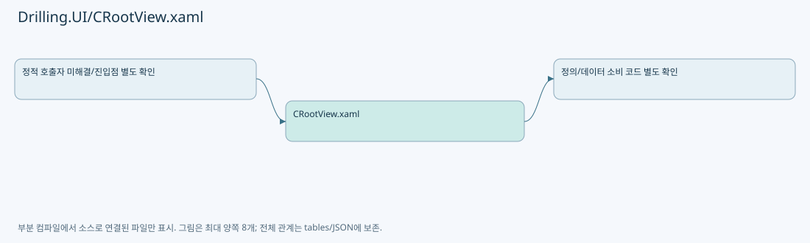

# Drilling.UI/CRootView.xaml

| 항목 | 내용 |
| --- | --- |
| 원본 저장소 | https://github.com/kjuws10-rgb/A3Drilling.git |
| 원본 Commit | 96e22cd027c84bf302b23f2949b98985d7f301bb |
| 원본 SHA256 | 198669b5a772ed96adac011aa14691f0a554e86fdf0c2ca345dcf05aecf14651 |
| 파일 분류 | code |
| 원본 크기/행 | 26,606 bytes / 441 physical lines |
| 인코딩 | utf-8-sig |
| 검토 범위 | 구문/부분 의미 분석에서 추출한 사실. 동작·물리 단위·실장비 합격을 보증하지 않습니다. |
| 원본 링크 | [고정 Commit 원본](https://github.com/kjuws10-rgb/A3Drilling/blob/96e22cd027c84bf302b23f2949b98985d7f301bb/Drilling.UI/CRootView.xaml) |

## 파일의 역할과 읽는 순서

WPF 화면·사용자 명령·표시 상태를 구성합니다. XAML 이벤트와 코드 비하인드, RootView의 조립 경로를 함께 추적합니다.

## 화면 구성과 코드 비하인드 연결

| 항목 | 추출 값 |
| --- | --- |
| 코드 비하인드 후보 | Drilling.UI/CRootView.xaml.cs |
| 이름 있는 요소 | HeaderStatusCard, HeaderStatusName, HeaderStatusValueBadge, HeaderStatusValue, HeaderStatusAccent, StageSimulationButton |
| 이벤트 개수 | 0 |
| Binding 표현 개수 | 47 |

이름 있는 요소는 WPF가 필드를 생성할 수 있는 XAML 선언입니다. 문서 추출기는 WPF 생성 코드를 만들거나 로드하지 않으므로 C# 원문 멤버 수에 합산하지 않습니다.

| 요소 이름 | 원본 범위 |
| --- | --- |
| HeaderStatusCard | L89–89 |
| HeaderStatusName | L104–104 |
| HeaderStatusValueBadge | L111–111 |
| HeaderStatusValue | L116–116 |
| HeaderStatusAccent | L150–150 |
| StageSimulationButton | L274–274 |

| 이벤트 | 핸들러 이름 | 원본 범위 | 해석 |
| --- | --- | --- | --- |

| Binding 표현 | 원본 범위 |
| --- | --- |
| {Binding CardBrush} | L93–93 |
| {Binding Open} | L96–96 |
| {Binding Name} | L105–105 |
| {Binding CardTextBrush} | L107–107 |
| {Binding DisplayValue} | L117–117 |
| {Binding CardTextBrush} | L120–120 |
| {Binding CanNavigate, Converter={StaticResource BooleanToVisibilityConverter}} | L128–128 |
| {Binding Previous} | L136–136 |
| {Binding PageText} | L139–139 |
| {Binding CardTextBrush} | L142–142 |
| {Binding Next} | L147–147 |
| {Binding AccentBrush} | L152–152 |
| {Binding Name} | L157–157 |
| {Binding Name} | L160–160 |
| {Binding Name} | L163–163 |
| {Binding SoftwareVersion, Mode=OneTime} | L211–211 |
| {Binding HeaderContextStatusItems} | L218–218 |
| {Binding HeaderCommunicationStatusItems} | L230–230 |
| {Binding ThemeToggleText} | L244–244 |
| {Binding ToggleThemeCommand} | L245–245 |
| {Binding ThemeModeText} | L249–249 |
| {Binding CurrentDateText} | L250–250 |
| {Binding CurrentTimeText} | L254–254 |
| {Binding MelsecSimulatorVisibility} | L275–275 |
| {Binding OpenMelsecStageSimulationCommand} | L280–280 |
| {Binding Menus} | L290–290 |
| {Binding SelectedMenu} | L291–291 |
| {Binding IsEnabled} | L305–305 |
| {Binding RelativeSource={RelativeSource AncestorType=ListBoxItem}, Path=Background} | L319–319 |
| {Binding RelativeSource={RelativeSource AncestorType=ListBoxItem}, Path=IsSelected} | L325–325 |
| {Binding RelativeSource={RelativeSource AncestorType=ListBoxItem}, Path=IsSelected} | L342–342 |
| {Binding IconGeometry} | L355–355 |
| {Binding RelativeSource={RelativeSource AncestorType=ListBoxItem}, Path=Foreground} | L356–356 |
| {Binding Name} | L364–364 |
| {Binding RelativeSource={RelativeSource AncestorType=ListBoxItem}, Path=Foreground} | L367–367 |
| {Binding CurrentScreen.IsMainLayout, Converter={StaticResource BooleanToVisibilityConverter}} | L379–379 |
| {Binding CurrentScreen.IsManualLayout, Converter={StaticResource BooleanToVisibilityConverter}} | L380–380 |
| {Binding CurrentScreen.IsRecipeLayout, Converter={StaticResource BooleanToVisibilityConverter}} | L381–381 |
| {Binding CurrentScreen.IsSettingLayout, Converter={StaticResource BooleanToVisibilityConverter}} | L382–382 |
| {Binding CurrentScreen.IsAlarmLayout, Converter={StaticResource BooleanToVisibilityConverter}} | L383–383 |
| {Binding CurrentScreen.IsMonitorLayout, Converter={StaticResource BooleanToVisibilityConverter}} | L384–384 |
| {Binding CurrentScreen.IsCorrectionLayout, Converter={StaticResource BooleanToVisibilityConverter}} | L385–385 |
| {Binding CurrentScreen.IsPmLayout, Converter={StaticResource BooleanToVisibilityConverter}} | L386–386 |
| {Binding CurrentScreen.IsGenericLayout, Converter={StaticResource BooleanToVisibilityConverter}} | L387–387 |
| {Binding FooterStatusItems} | L414–414 |
| {Binding Value} | L424–424 |
| {Binding AccentBrush} | L425–425 |

## 원문 전체 주석 해설본

[원본 모든 행과 행별 해설 보기](../../annotated/Drilling.UI/CRootView.xaml.annotated.txt)

원본을 빠뜨리거나 임의로 줄이지 않았습니다. `L000001 |` 표시는 원본 행 번호, `// 해설`은 별도 설명입니다. 실행용 소스가 아닌 문서입니다.

## 수정·재검증 체크

- 원본 Commit과 현재 작업 파일 SHA가 같은지 먼저 확인합니다. 다르면 이 문서를 과거 버전 자료로 취급합니다.
- 선언·직접 호출·이벤트/인터페이스 경계·설정 소비를 함께 확인합니다. 정적 연결의 빈 곳을 정상 경로로 추정하지 않습니다.
- 저장 형식/단위/식별자·재시도·취소·예외·롤백에 영향을 주는 변경은 상세 해설장과 호출자를 다시 검토합니다.
- 도구의 구문 추출과 별도 정적 추적 해설, 실제 빌드·시뮬레이션·실장비 검증 결과를 분리합니다.
