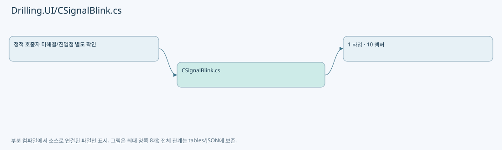
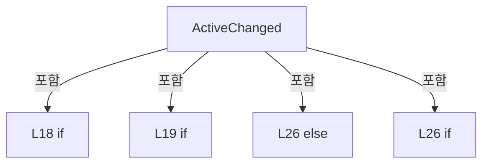
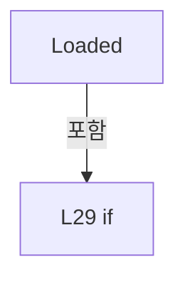
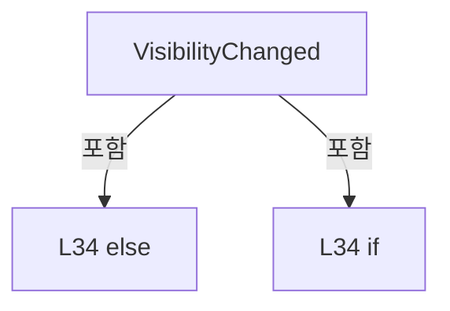

# Drilling.UI/CSignalBlink.cs

| 항목 | 내용 |
| --- | --- |
| 원본 저장소 | https://github.com/kjuws10-rgb/A3Drilling.git |
| 원본 Commit | 5aee8e58439c9b455cae7c9593c9be986c3e682e |
| 원본 SHA256 | ef65f7a39d9a9b3b61ec94acf6d473c4a53b6a86e10302d4d5c85b81d03aa325 |
| 파일 분류 | code |
| 원본 크기/행 | 2,333 bytes / 43 physical lines |
| 인코딩 | utf-8-sig |
| 검토 범위 | 구문/부분 의미 분석에서 추출한 사실. 동작·물리 단위·실장비 합격을 보증하지 않습니다. |
| 원본 링크 | [고정 Commit 원본](https://github.com/kjuws10-rgb/A3Drilling/blob/5aee8e58439c9b455cae7c9593c9be986c3e682e/Drilling.UI/CSignalBlink.cs) |

## 파일의 역할과 읽는 순서

WPF 화면·사용자 명령·표시 상태를 구성합니다. XAML 이벤트와 코드 비하인드, RootView의 조립 경로를 함께 추적합니다.

## 네임스페이스·타입·상속

| 타입 | 구분 | 원본 범위 | 선언/상속 |
| --- | --- | --- | --- |
| CSignalBlink | ClassDeclaration | 7–43 | CSignalBlink |

## 멤버 빠른 목록

| 이름 | 종류 | 범위 | 서명 |
| --- | --- | --- | --- |
| IsActiveProperty | FieldDeclaration | L9–10 | DependencyProperty Drilling.UI.CSignalBlink.IsActiveProperty |
| IsHookedProperty | FieldDeclaration | L11–12 | DependencyProperty Drilling.UI.CSignalBlink.IsHookedProperty |
| GetIsActive | MethodDeclaration | L13–13 | bool Drilling.UI.CSignalBlink.GetIsActive(DependencyObject) |
| SetIsActive | MethodDeclaration | L14–14 | void Drilling.UI.CSignalBlink.SetIsActive(DependencyObject, bool) |
| ActiveChanged | MethodDeclaration | L16–27 | void Drilling.UI.CSignalBlink.ActiveChanged(DependencyObject, DependencyPropertyChangedEventArgs) |
| Loaded | MethodDeclaration | L28–29 | void Drilling.UI.CSignalBlink.Loaded(object, RoutedEventArgs) |
| Unloaded | MethodDeclaration | L30–30 | void Drilling.UI.CSignalBlink.Unloaded(object, RoutedEventArgs) |
| VisibilityChanged | MethodDeclaration | L31–35 | void Drilling.UI.CSignalBlink.VisibilityChanged(object, DependencyPropertyChangedEventArgs) |
| Start | MethodDeclaration | L36–37 | void Drilling.UI.CSignalBlink.Start(FrameworkElement) |
| Stop | MethodDeclaration | L38–42 | void Drilling.UI.CSignalBlink.Stop(FrameworkElement) |

## 멤버별 상세 계약·호출·처리 해설

### FieldDeclaration `IsActiveProperty` · L9–10

[Drilling.UI/CSignalBlink.cs:9–10](https://github.com/kjuws10-rgb/A3Drilling/blob/5aee8e58439c9b455cae7c9593c9be986c3e682e/Drilling.UI/CSignalBlink.cs#L9-L10)

| 항목 | 실제 추출 값 |
| --- | --- |
| 서명 | DependencyProperty Drilling.UI.CSignalBlink.IsActiveProperty |
| 접근/수식자 | Public / public, static, readonly |
| 반환/값 타입 | DependencyProperty |
| 소속 타입 | NamedType:Drilling.UI.CSignalBlink |

현재 부분 분석에서 직접 연결된 호출자는 없습니다. XAML/이벤트/인터페이스·델리게이트·외부 진입을 추가 확인해야 하며, 미사용으로 판정한 것이 아닙니다.

호출하는 대상과 해석 범위:

| 원본 행 | 표현식 | 분석 상태 | 대상/소스 위치 |
| --- | --- | --- | --- |
| 9 | DependencyProperty.RegisterAttached | unresolved | None |
| 10 | new PropertyMetadata | unresolved | None |

본문의 실제 연산·분기·예외·반환 순서(원문 위치 순):

| 원본 행 | 종류 | 주석 해설 |
| --- | --- | --- |
| 9 | call | 함수·델리게이트 또는 객체 생성자를 호출합니다: DependencyProperty.RegisterAttached( "IsActive", typeof(bool), typeof(CSignalBlink), new PropertyMetadata(false, ActiveChanged)) |
| 9 | variable-initializer | 변수의 초기값을 지정합니다: IsActiveProperty = DependencyProperty.RegisterAttached( "IsActive", typeof(bool), typeof(CSignalBlink), new PropertyMetadata(false, ActiveChanged)) |
| 10 | call | 함수·델리게이트 또는 객체 생성자를 호출합니다: new PropertyMetadata(false, ActiveChanged) |

변경 전 점검: 입력/반환 타입, 위 호출자, 예외/취소 경로, 공유 상태와 저장·전송 소비자를 함께 확인합니다. 값의 단위나 물리 방향을 이름만으로 확정하지 않습니다.

### FieldDeclaration `IsHookedProperty` · L11–12

[Drilling.UI/CSignalBlink.cs:11–12](https://github.com/kjuws10-rgb/A3Drilling/blob/5aee8e58439c9b455cae7c9593c9be986c3e682e/Drilling.UI/CSignalBlink.cs#L11-L12)

| 항목 | 실제 추출 값 |
| --- | --- |
| 서명 | DependencyProperty Drilling.UI.CSignalBlink.IsHookedProperty |
| 접근/수식자 | Private / private, static, readonly |
| 반환/값 타입 | DependencyProperty |
| 소속 타입 | NamedType:Drilling.UI.CSignalBlink |

현재 부분 분석에서 직접 연결된 호출자는 없습니다. XAML/이벤트/인터페이스·델리게이트·외부 진입을 추가 확인해야 하며, 미사용으로 판정한 것이 아닙니다.

호출하는 대상과 해석 범위:

| 원본 행 | 표현식 | 분석 상태 | 대상/소스 위치 |
| --- | --- | --- | --- |
| 11 | DependencyProperty.RegisterAttached | unresolved | None |
| 12 | new PropertyMetadata | unresolved | None |

본문의 실제 연산·분기·예외·반환 순서(원문 위치 순):

| 원본 행 | 종류 | 주석 해설 |
| --- | --- | --- |
| 11 | call | 함수·델리게이트 또는 객체 생성자를 호출합니다: DependencyProperty.RegisterAttached( "IsHooked", typeof(bool), typeof(CSignalBlink), new PropertyMetadata(false)) |
| 11 | variable-initializer | 변수의 초기값을 지정합니다: IsHookedProperty = DependencyProperty.RegisterAttached( "IsHooked", typeof(bool), typeof(CSignalBlink), new PropertyMetadata(false)) |
| 12 | call | 함수·델리게이트 또는 객체 생성자를 호출합니다: new PropertyMetadata(false) |

변경 전 점검: 입력/반환 타입, 위 호출자, 예외/취소 경로, 공유 상태와 저장·전송 소비자를 함께 확인합니다. 값의 단위나 물리 방향을 이름만으로 확정하지 않습니다.

### MethodDeclaration `GetIsActive` · L13–13

[Drilling.UI/CSignalBlink.cs:13–13](https://github.com/kjuws10-rgb/A3Drilling/blob/5aee8e58439c9b455cae7c9593c9be986c3e682e/Drilling.UI/CSignalBlink.cs#L13-L13)

| 항목 | 실제 추출 값 |
| --- | --- |
| 서명 | bool Drilling.UI.CSignalBlink.GetIsActive(DependencyObject) |
| 접근/수식자 | Public / public, static |
| 반환/값 타입 | bool |
| 소속 타입 | NamedType:Drilling.UI.CSignalBlink |

입력 계약:

| 이름 | 타입 | 전달 | 선택/기본값 |
| --- | --- | --- | --- |
| target | DependencyObject | None | False /  |

현재 부분 분석에서 직접 연결된 호출자는 없습니다. XAML/이벤트/인터페이스·델리게이트·외부 진입을 추가 확인해야 하며, 미사용으로 판정한 것이 아닙니다.

호출하는 대상과 해석 범위:

| 원본 행 | 표현식 | 분석 상태 | 대상/소스 위치 |
| --- | --- | --- | --- |
| 13 | target.GetValue | unresolved | None |

본문의 실제 연산·분기·예외·반환 순서(원문 위치 순):

| 원본 행 | 종류 | 주석 해설 |
| --- | --- | --- |
| 13 | call | 함수·델리게이트 또는 객체 생성자를 호출합니다: target.GetValue(IsActiveProperty) |

변경 전 점검: 입력/반환 타입, 위 호출자, 예외/취소 경로, 공유 상태와 저장·전송 소비자를 함께 확인합니다. 값의 단위나 물리 방향을 이름만으로 확정하지 않습니다.

### MethodDeclaration `SetIsActive` · L14–14

[Drilling.UI/CSignalBlink.cs:14–14](https://github.com/kjuws10-rgb/A3Drilling/blob/5aee8e58439c9b455cae7c9593c9be986c3e682e/Drilling.UI/CSignalBlink.cs#L14-L14)

| 항목 | 실제 추출 값 |
| --- | --- |
| 서명 | void Drilling.UI.CSignalBlink.SetIsActive(DependencyObject, bool) |
| 접근/수식자 | Public / public, static |
| 반환/값 타입 | void |
| 소속 타입 | NamedType:Drilling.UI.CSignalBlink |

입력 계약:

| 이름 | 타입 | 전달 | 선택/기본값 |
| --- | --- | --- | --- |
| target | DependencyObject | None | False /  |
| value | bool | None | False /  |

현재 부분 분석에서 직접 연결된 호출자는 없습니다. XAML/이벤트/인터페이스·델리게이트·외부 진입을 추가 확인해야 하며, 미사용으로 판정한 것이 아닙니다.

호출하는 대상과 해석 범위:

| 원본 행 | 표현식 | 분석 상태 | 대상/소스 위치 |
| --- | --- | --- | --- |
| 14 | target.SetValue | unresolved | None |

본문의 실제 연산·분기·예외·반환 순서(원문 위치 순):

| 원본 행 | 종류 | 주석 해설 |
| --- | --- | --- |
| 14 | call | 함수·델리게이트 또는 객체 생성자를 호출합니다: target.SetValue(IsActiveProperty, value) |

변경 전 점검: 입력/반환 타입, 위 호출자, 예외/취소 경로, 공유 상태와 저장·전송 소비자를 함께 확인합니다. 값의 단위나 물리 방향을 이름만으로 확정하지 않습니다.

### MethodDeclaration `ActiveChanged` · L16–27

[Drilling.UI/CSignalBlink.cs:16–27](https://github.com/kjuws10-rgb/A3Drilling/blob/5aee8e58439c9b455cae7c9593c9be986c3e682e/Drilling.UI/CSignalBlink.cs#L16-L27)

| 항목 | 실제 추출 값 |
| --- | --- |
| 서명 | void Drilling.UI.CSignalBlink.ActiveChanged(DependencyObject, DependencyPropertyChangedEventArgs) |
| 접근/수식자 | Private / private, static |
| 반환/값 타입 | void |
| 소속 타입 | NamedType:Drilling.UI.CSignalBlink |

입력 계약:

| 이름 | 타입 | 전달 | 선택/기본값 |
| --- | --- | --- | --- |
| target | DependencyObject | None | False /  |
| e | DependencyPropertyChangedEventArgs | None | False /  |

현재 부분 분석에서 직접 연결된 호출자는 없습니다. XAML/이벤트/인터페이스·델리게이트·외부 진입을 추가 확인해야 하며, 미사용으로 판정한 것이 아닙니다.

호출하는 대상과 해석 범위:

| 원본 행 | 표현식 | 분석 상태 | 대상/소스 위치 |
| --- | --- | --- | --- |
| 19 | element.GetValue | unresolved | None |
| 21 | element.SetValue | unresolved | None |
| 26 | Start | resolved | void Drilling.UI.CSignalBlink.Start(FrameworkElement) · Drilling.UI/CSignalBlink.cs:36 |
| 26 | Stop | resolved | void Drilling.UI.CSignalBlink.Stop(FrameworkElement) · Drilling.UI/CSignalBlink.cs:38 |

본문의 실제 연산·분기·예외·반환 순서(원문 위치 순):

| 원본 행 | 종류 | 주석 해설 |
| --- | --- | --- |
| 18 | if | 조건에 따라 분기합니다: if (target is not FrameworkElement element) |
| 18 | return | 호출자에게 값 또는 제어를 반환합니다: return; |
| 19 | call | 함수·델리게이트 또는 객체 생성자를 호출합니다: element.GetValue(IsHookedProperty) |
| 19 | if | 조건에 따라 분기합니다: if (!(bool)element.GetValue(IsHookedProperty)) |
| 21 | call | 함수·델리게이트 또는 객체 생성자를 호출합니다: element.SetValue(IsHookedProperty, true) |
| 22 | compound-assignment-or-event-subscription | 복합 대입 또는 이벤트 구독/해지 표현입니다: element.Loaded += Loaded |
| 23 | compound-assignment-or-event-subscription | 복합 대입 또는 이벤트 구독/해지 표현입니다: element.Unloaded += Unloaded |
| 24 | compound-assignment-or-event-subscription | 복합 대입 또는 이벤트 구독/해지 표현입니다: element.IsVisibleChanged += VisibilityChanged |
| 26 | call | 함수·델리게이트 또는 객체 생성자를 호출합니다: Start(element) |
| 26 | call | 함수·델리게이트 또는 객체 생성자를 호출합니다: Stop(element) |
| 26 | else | 앞 조건이 거짓인 경로입니다: else |
| 26 | if | 조건에 따라 분기합니다: if ((bool)e.NewValue) |

제어 구문의 포함 구조(실제 실행 순서/CFG가 아닌 구문 탐색 그림):

변경 전 점검: 입력/반환 타입, 위 호출자, 예외/취소 경로, 공유 상태와 저장·전송 소비자를 함께 확인합니다. 값의 단위나 물리 방향을 이름만으로 확정하지 않습니다.

### MethodDeclaration `Loaded` · L28–29

[Drilling.UI/CSignalBlink.cs:28–29](https://github.com/kjuws10-rgb/A3Drilling/blob/5aee8e58439c9b455cae7c9593c9be986c3e682e/Drilling.UI/CSignalBlink.cs#L28-L29)

| 항목 | 실제 추출 값 |
| --- | --- |
| 서명 | void Drilling.UI.CSignalBlink.Loaded(object, RoutedEventArgs) |
| 접근/수식자 | Private / private, static |
| 반환/값 타입 | void |
| 소속 타입 | NamedType:Drilling.UI.CSignalBlink |

입력 계약:

| 이름 | 타입 | 전달 | 선택/기본값 |
| --- | --- | --- | --- |
| sender | object | None | False /  |
| e | RoutedEventArgs | None | False /  |

현재 부분 분석에서 직접 연결된 호출자는 없습니다. XAML/이벤트/인터페이스·델리게이트·외부 진입을 추가 확인해야 하며, 미사용으로 판정한 것이 아닙니다.

호출하는 대상과 해석 범위:

| 원본 행 | 표현식 | 분석 상태 | 대상/소스 위치 |
| --- | --- | --- | --- |
| 29 | GetIsActive | candidate | OverloadResolutionFailure |
| 29 | Start | resolved | void Drilling.UI.CSignalBlink.Start(FrameworkElement) · Drilling.UI/CSignalBlink.cs:36 |

본문의 실제 연산·분기·예외·반환 순서(원문 위치 순):

| 원본 행 | 종류 | 주석 해설 |
| --- | --- | --- |
| 29 | call | 함수·델리게이트 또는 객체 생성자를 호출합니다: GetIsActive((FrameworkElement)sender) |
| 29 | call | 함수·델리게이트 또는 객체 생성자를 호출합니다: Start((FrameworkElement)sender) |
| 29 | if | 조건에 따라 분기합니다: if (GetIsActive((FrameworkElement)sender)) |

제어 구문의 포함 구조(실제 실행 순서/CFG가 아닌 구문 탐색 그림):

변경 전 점검: 입력/반환 타입, 위 호출자, 예외/취소 경로, 공유 상태와 저장·전송 소비자를 함께 확인합니다. 값의 단위나 물리 방향을 이름만으로 확정하지 않습니다.

### MethodDeclaration `Unloaded` · L30–30

[Drilling.UI/CSignalBlink.cs:30–30](https://github.com/kjuws10-rgb/A3Drilling/blob/5aee8e58439c9b455cae7c9593c9be986c3e682e/Drilling.UI/CSignalBlink.cs#L30-L30)

| 항목 | 실제 추출 값 |
| --- | --- |
| 서명 | void Drilling.UI.CSignalBlink.Unloaded(object, RoutedEventArgs) |
| 접근/수식자 | Private / private, static |
| 반환/값 타입 | void |
| 소속 타입 | NamedType:Drilling.UI.CSignalBlink |

입력 계약:

| 이름 | 타입 | 전달 | 선택/기본값 |
| --- | --- | --- | --- |
| sender | object | None | False /  |
| e | RoutedEventArgs | None | False /  |

현재 부분 분석에서 직접 연결된 호출자는 없습니다. XAML/이벤트/인터페이스·델리게이트·외부 진입을 추가 확인해야 하며, 미사용으로 판정한 것이 아닙니다.

호출하는 대상과 해석 범위:

| 원본 행 | 표현식 | 분석 상태 | 대상/소스 위치 |
| --- | --- | --- | --- |
| 30 | Stop | resolved | void Drilling.UI.CSignalBlink.Stop(FrameworkElement) · Drilling.UI/CSignalBlink.cs:38 |

본문의 실제 연산·분기·예외·반환 순서(원문 위치 순):

| 원본 행 | 종류 | 주석 해설 |
| --- | --- | --- |
| 30 | call | 함수·델리게이트 또는 객체 생성자를 호출합니다: Stop((FrameworkElement)sender) |

변경 전 점검: 입력/반환 타입, 위 호출자, 예외/취소 경로, 공유 상태와 저장·전송 소비자를 함께 확인합니다. 값의 단위나 물리 방향을 이름만으로 확정하지 않습니다.

### MethodDeclaration `VisibilityChanged` · L31–35

[Drilling.UI/CSignalBlink.cs:31–35](https://github.com/kjuws10-rgb/A3Drilling/blob/5aee8e58439c9b455cae7c9593c9be986c3e682e/Drilling.UI/CSignalBlink.cs#L31-L35)

| 항목 | 실제 추출 값 |
| --- | --- |
| 서명 | void Drilling.UI.CSignalBlink.VisibilityChanged(object, DependencyPropertyChangedEventArgs) |
| 접근/수식자 | Private / private, static |
| 반환/값 타입 | void |
| 소속 타입 | NamedType:Drilling.UI.CSignalBlink |

입력 계약:

| 이름 | 타입 | 전달 | 선택/기본값 |
| --- | --- | --- | --- |
| sender | object | None | False /  |
| e | DependencyPropertyChangedEventArgs | None | False /  |

현재 부분 분석에서 직접 연결된 호출자는 없습니다. XAML/이벤트/인터페이스·델리게이트·외부 진입을 추가 확인해야 하며, 미사용으로 판정한 것이 아닙니다.

호출하는 대상과 해석 범위:

| 원본 행 | 표현식 | 분석 상태 | 대상/소스 위치 |
| --- | --- | --- | --- |
| 34 | GetIsActive | candidate | OverloadResolutionFailure |
| 34 | Start | resolved | void Drilling.UI.CSignalBlink.Start(FrameworkElement) · Drilling.UI/CSignalBlink.cs:36 |
| 34 | Stop | resolved | void Drilling.UI.CSignalBlink.Stop(FrameworkElement) · Drilling.UI/CSignalBlink.cs:38 |

본문의 실제 연산·분기·예외·반환 순서(원문 위치 순):

| 원본 행 | 종류 | 주석 해설 |
| --- | --- | --- |
| 33 | local-declaration | 지역 변수를 선언합니다: var element = (FrameworkElement)sender; |
| 33 | variable-initializer | 변수의 초기값을 지정합니다: element = (FrameworkElement)sender |
| 34 | call | 함수·델리게이트 또는 객체 생성자를 호출합니다: GetIsActive(element) |
| 34 | call | 함수·델리게이트 또는 객체 생성자를 호출합니다: Start(element) |
| 34 | call | 함수·델리게이트 또는 객체 생성자를 호출합니다: Stop(element) |
| 34 | else | 앞 조건이 거짓인 경로입니다: else |
| 34 | if | 조건에 따라 분기합니다: if ((bool)e.NewValue && GetIsActive(element)) |

제어 구문의 포함 구조(실제 실행 순서/CFG가 아닌 구문 탐색 그림):

변경 전 점검: 입력/반환 타입, 위 호출자, 예외/취소 경로, 공유 상태와 저장·전송 소비자를 함께 확인합니다. 값의 단위나 물리 방향을 이름만으로 확정하지 않습니다.

### MethodDeclaration `Start` · L36–37

[Drilling.UI/CSignalBlink.cs:36–37](https://github.com/kjuws10-rgb/A3Drilling/blob/5aee8e58439c9b455cae7c9593c9be986c3e682e/Drilling.UI/CSignalBlink.cs#L36-L37)

| 항목 | 실제 추출 값 |
| --- | --- |
| 서명 | void Drilling.UI.CSignalBlink.Start(FrameworkElement) |
| 접근/수식자 | Private / private, static |
| 반환/값 타입 | void |
| 소속 타입 | NamedType:Drilling.UI.CSignalBlink |

입력 계약:

| 이름 | 타입 | 전달 | 선택/기본값 |
| --- | --- | --- | --- |
| element | FrameworkElement | None | False /  |

정적 호출자로 확인된 위치:

| 호출 파일/행 | 호출 표현식 | 런타임 분기 가능 |
| --- | --- | --- |
| [Drilling.UI/CSignalBlink.cs:26–26](https://github.com/kjuws10-rgb/A3Drilling/blob/5aee8e58439c9b455cae7c9593c9be986c3e682e/Drilling.UI/CSignalBlink.cs#L26-L26) | Start | False |
| [Drilling.UI/CSignalBlink.cs:29–29](https://github.com/kjuws10-rgb/A3Drilling/blob/5aee8e58439c9b455cae7c9593c9be986c3e682e/Drilling.UI/CSignalBlink.cs#L29-L29) | Start | False |
| [Drilling.UI/CSignalBlink.cs:34–34](https://github.com/kjuws10-rgb/A3Drilling/blob/5aee8e58439c9b455cae7c9593c9be986c3e682e/Drilling.UI/CSignalBlink.cs#L34-L34) | Start | False |

호출하는 대상과 해석 범위:

| 원본 행 | 표현식 | 분석 상태 | 대상/소스 위치 |
| --- | --- | --- | --- |
| 36 | element.BeginAnimation | unresolved | None |
| 37 | new DoubleAnimation | unresolved | None |
| 37 | TimeSpan.FromSeconds | resolved | System.TimeSpan System.TimeSpan.FromSeconds(double) |

본문의 실제 연산·분기·예외·반환 순서(원문 위치 순):

| 원본 행 | 종류 | 주석 해설 |
| --- | --- | --- |
| 36 | call | 함수·델리게이트 또는 객체 생성자를 호출합니다: element.BeginAnimation(UIElement.OpacityProperty, new DoubleAnimation(0, 0.6, TimeSpan.FromSeconds(0.5)) { AutoReverse = true, RepeatBehavior = RepeatBehavior.Forever }) |
| 37 | assignment | 값을 대상에 대입합니다: AutoReverse = true |
| 37 | assignment | 값을 대상에 대입합니다: RepeatBehavior = RepeatBehavior.Forever |
| 37 | call | 함수·델리게이트 또는 객체 생성자를 호출합니다: new DoubleAnimation(0, 0.6, TimeSpan.FromSeconds(0.5)) { AutoReverse = true, RepeatBehavior = RepeatBehavior.Forever } |
| 37 | call | 함수·델리게이트 또는 객체 생성자를 호출합니다: TimeSpan.FromSeconds(0.5) |

변경 전 점검: 입력/반환 타입, 위 호출자, 예외/취소 경로, 공유 상태와 저장·전송 소비자를 함께 확인합니다. 값의 단위나 물리 방향을 이름만으로 확정하지 않습니다.

### MethodDeclaration `Stop` · L38–42

[Drilling.UI/CSignalBlink.cs:38–42](https://github.com/kjuws10-rgb/A3Drilling/blob/5aee8e58439c9b455cae7c9593c9be986c3e682e/Drilling.UI/CSignalBlink.cs#L38-L42)

| 항목 | 실제 추출 값 |
| --- | --- |
| 서명 | void Drilling.UI.CSignalBlink.Stop(FrameworkElement) |
| 접근/수식자 | Private / private, static |
| 반환/값 타입 | void |
| 소속 타입 | NamedType:Drilling.UI.CSignalBlink |

입력 계약:

| 이름 | 타입 | 전달 | 선택/기본값 |
| --- | --- | --- | --- |
| element | FrameworkElement | None | False /  |

정적 호출자로 확인된 위치:

| 호출 파일/행 | 호출 표현식 | 런타임 분기 가능 |
| --- | --- | --- |
| [Drilling.UI/CSignalBlink.cs:26–26](https://github.com/kjuws10-rgb/A3Drilling/blob/5aee8e58439c9b455cae7c9593c9be986c3e682e/Drilling.UI/CSignalBlink.cs#L26-L26) | Stop | False |
| [Drilling.UI/CSignalBlink.cs:30–30](https://github.com/kjuws10-rgb/A3Drilling/blob/5aee8e58439c9b455cae7c9593c9be986c3e682e/Drilling.UI/CSignalBlink.cs#L30-L30) | Stop | False |
| [Drilling.UI/CSignalBlink.cs:34–34](https://github.com/kjuws10-rgb/A3Drilling/blob/5aee8e58439c9b455cae7c9593c9be986c3e682e/Drilling.UI/CSignalBlink.cs#L34-L34) | Stop | False |

호출하는 대상과 해석 범위:

| 원본 행 | 표현식 | 분석 상태 | 대상/소스 위치 |
| --- | --- | --- | --- |
| 40 | element.BeginAnimation | unresolved | None |
| 41 | element.SetCurrentValue | unresolved | None |

본문의 실제 연산·분기·예외·반환 순서(원문 위치 순):

| 원본 행 | 종류 | 주석 해설 |
| --- | --- | --- |
| 40 | call | 함수·델리게이트 또는 객체 생성자를 호출합니다: element.BeginAnimation(UIElement.OpacityProperty, null) |
| 41 | call | 함수·델리게이트 또는 객체 생성자를 호출합니다: element.SetCurrentValue(UIElement.OpacityProperty, 0d) |

변경 전 점검: 입력/반환 타입, 위 호출자, 예외/취소 경로, 공유 상태와 저장·전송 소비자를 함께 확인합니다. 값의 단위나 물리 방향을 이름만으로 확정하지 않습니다.

## 구문·바인딩 한계

전체 WPF/벤더 SDK/프로젝트별 빌드 조건을 로드한 정식 빌드가 아닙니다. `resolved`는 이 부분 컴파일에서의 심볼 연결이며 virtual/interface/delegate/이벤트/Reflection/XAML의 실제 런타임 구현을 확정하지 않습니다. `candidate`와 `unresolved`는 후속 확인 대상으로 남깁니다.

## 원문 전체 주석 해설본

[원본 모든 행과 행별 해설 보기](../../annotated/Drilling.UI/CSignalBlink.cs.annotated.txt)

원본을 빠뜨리거나 임의로 줄이지 않았습니다. `L000001 |` 표시는 원본 행 번호, `// 해설`은 별도 설명입니다. 실행용 소스가 아닌 문서입니다.

## 수정·재검증 체크

- 원본 Commit과 현재 작업 파일 SHA가 같은지 먼저 확인합니다. 다르면 이 문서를 과거 버전 자료로 취급합니다.
- 선언·직접 호출·이벤트/인터페이스 경계·설정 소비를 함께 확인합니다. 정적 연결의 빈 곳을 정상 경로로 추정하지 않습니다.
- 저장 형식/단위/식별자·재시도·취소·예외·롤백에 영향을 주는 변경은 상세 해설장과 호출자를 다시 검토합니다.
- 도구의 구문 추출과 별도 정적 추적 해설, 실제 빌드·시뮬레이션·실장비 검증 결과를 분리합니다.
