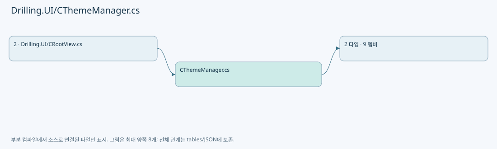
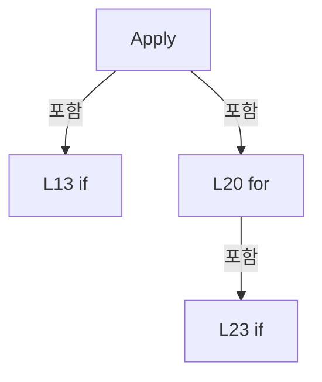

# Drilling.UI/CThemeManager.cs

| 항목 | 내용 |
| --- | --- |
| 원본 저장소 | https://github.com/kjuws10-rgb/A3Drilling.git |
| 원본 Commit | 5aee8e58439c9b455cae7c9593c9be986c3e682e |
| 원본 SHA256 | 62cfa74dec098d8e3ce6ead2d3fc803b88fa20ede22e2871cd394e70f66c1931 |
| 파일 분류 | code |
| 원본 크기/행 | 1,503 bytes / 45 physical lines |
| 인코딩 | utf-8-sig |
| 검토 범위 | 구문/부분 의미 분석에서 추출한 사실. 동작·물리 단위·실장비 합격을 보증하지 않습니다. |
| 원본 링크 | [고정 Commit 원본](https://github.com/kjuws10-rgb/A3Drilling/blob/5aee8e58439c9b455cae7c9593c9be986c3e682e/Drilling.UI/CThemeManager.cs) |

## 파일의 역할과 읽는 순서

WPF 화면·사용자 명령·표시 상태를 구성합니다. XAML 이벤트와 코드 비하인드, RootView의 조립 경로를 함께 추적합니다.

## 네임스페이스·타입·상속

| 타입 | 구분 | 원본 범위 | 선언/상속 |
| --- | --- | --- | --- |
| CThemeManager | ClassDeclaration | 4–39 | CThemeManager |
| EN_UI_THEME | EnumDeclaration | 41–45 | EN_UI_THEME |

## 멤버 빠른 목록

| 이름 | 종류 | 범위 | 서명 |
| --- | --- | --- | --- |
| LightThemeSource | FieldDeclaration | L6–6 | string Drilling.UI.CThemeManager.LightThemeSource |
| DarkThemeSource | FieldDeclaration | L7–7 | string Drilling.UI.CThemeManager.DarkThemeSource |
| CurrentTheme | PropertyDeclaration | L8–8 | Drilling.UI.EN_UI_THEME Drilling.UI.CThemeManager.CurrentTheme |
| get_CurrentTheme | GetAccessorDeclaration | L8–8 | Drilling.UI.EN_UI_THEME Drilling.UI.CThemeManager.CurrentTheme.get |
| set_CurrentTheme | SetAccessorDeclaration | L8–8 | void Drilling.UI.CThemeManager.CurrentTheme.set |
| Apply | MethodDeclaration | L10–31 | void Drilling.UI.CThemeManager.Apply(Drilling.UI.EN_UI_THEME) |
| Toggle | MethodDeclaration | L33–38 | Drilling.UI.EN_UI_THEME Drilling.UI.CThemeManager.Toggle() |
| Light | EnumMemberDeclaration | L43–43 | Drilling.UI.EN_UI_THEME.Light |
| Dark | EnumMemberDeclaration | L44–44 | Drilling.UI.EN_UI_THEME.Dark |

## 멤버별 상세 계약·호출·처리 해설

### FieldDeclaration `LightThemeSource` · L6–6

[Drilling.UI/CThemeManager.cs:6–6](https://github.com/kjuws10-rgb/A3Drilling/blob/5aee8e58439c9b455cae7c9593c9be986c3e682e/Drilling.UI/CThemeManager.cs#L6-L6)

| 항목 | 실제 추출 값 |
| --- | --- |
| 서명 | string Drilling.UI.CThemeManager.LightThemeSource |
| 접근/수식자 | Private / private, const |
| 반환/값 타입 | string |
| 소속 타입 | NamedType:Drilling.UI.CThemeManager |

현재 부분 분석에서 직접 연결된 호출자는 없습니다. XAML/이벤트/인터페이스·델리게이트·외부 진입을 추가 확인해야 하며, 미사용으로 판정한 것이 아닙니다.

본문의 실제 연산·분기·예외·반환 순서(원문 위치 순):

| 원본 행 | 종류 | 주석 해설 |
| --- | --- | --- |
| 6 | variable-initializer | 변수의 초기값을 지정합니다: LightThemeSource = "Themes/ThemeLight.xaml" |

변경 전 점검: 입력/반환 타입, 위 호출자, 예외/취소 경로, 공유 상태와 저장·전송 소비자를 함께 확인합니다. 값의 단위나 물리 방향을 이름만으로 확정하지 않습니다.

### FieldDeclaration `DarkThemeSource` · L7–7

[Drilling.UI/CThemeManager.cs:7–7](https://github.com/kjuws10-rgb/A3Drilling/blob/5aee8e58439c9b455cae7c9593c9be986c3e682e/Drilling.UI/CThemeManager.cs#L7-L7)

| 항목 | 실제 추출 값 |
| --- | --- |
| 서명 | string Drilling.UI.CThemeManager.DarkThemeSource |
| 접근/수식자 | Private / private, const |
| 반환/값 타입 | string |
| 소속 타입 | NamedType:Drilling.UI.CThemeManager |

현재 부분 분석에서 직접 연결된 호출자는 없습니다. XAML/이벤트/인터페이스·델리게이트·외부 진입을 추가 확인해야 하며, 미사용으로 판정한 것이 아닙니다.

본문의 실제 연산·분기·예외·반환 순서(원문 위치 순):

| 원본 행 | 종류 | 주석 해설 |
| --- | --- | --- |
| 7 | variable-initializer | 변수의 초기값을 지정합니다: DarkThemeSource = "Themes/ThemeDark.xaml" |

변경 전 점검: 입력/반환 타입, 위 호출자, 예외/취소 경로, 공유 상태와 저장·전송 소비자를 함께 확인합니다. 값의 단위나 물리 방향을 이름만으로 확정하지 않습니다.

### PropertyDeclaration `CurrentTheme` · L8–8

[Drilling.UI/CThemeManager.cs:8–8](https://github.com/kjuws10-rgb/A3Drilling/blob/5aee8e58439c9b455cae7c9593c9be986c3e682e/Drilling.UI/CThemeManager.cs#L8-L8)

| 항목 | 실제 추출 값 |
| --- | --- |
| 서명 | Drilling.UI.EN_UI_THEME Drilling.UI.CThemeManager.CurrentTheme |
| 접근/수식자 | Public / public, static |
| 반환/값 타입 | Drilling.UI.EN_UI_THEME |
| 소속 타입 | NamedType:Drilling.UI.CThemeManager |

현재 부분 분석에서 직접 연결된 호출자는 없습니다. XAML/이벤트/인터페이스·델리게이트·외부 진입을 추가 확인해야 하며, 미사용으로 판정한 것이 아닙니다.

변경 전 점검: 입력/반환 타입, 위 호출자, 예외/취소 경로, 공유 상태와 저장·전송 소비자를 함께 확인합니다. 값의 단위나 물리 방향을 이름만으로 확정하지 않습니다.

### GetAccessorDeclaration `get_CurrentTheme` · L8–8

[Drilling.UI/CThemeManager.cs:8–8](https://github.com/kjuws10-rgb/A3Drilling/blob/5aee8e58439c9b455cae7c9593c9be986c3e682e/Drilling.UI/CThemeManager.cs#L8-L8)

| 항목 | 실제 추출 값 |
| --- | --- |
| 서명 | Drilling.UI.EN_UI_THEME Drilling.UI.CThemeManager.CurrentTheme.get |
| 접근/수식자 | Public / get |
| 반환/값 타입 | Drilling.UI.EN_UI_THEME |
| 소속 타입 | NamedType:Drilling.UI.CThemeManager |

현재 부분 분석에서 직접 연결된 호출자는 없습니다. XAML/이벤트/인터페이스·델리게이트·외부 진입을 추가 확인해야 하며, 미사용으로 판정한 것이 아닙니다.

변경 전 점검: 입력/반환 타입, 위 호출자, 예외/취소 경로, 공유 상태와 저장·전송 소비자를 함께 확인합니다. 값의 단위나 물리 방향을 이름만으로 확정하지 않습니다.

### SetAccessorDeclaration `set_CurrentTheme` · L8–8

[Drilling.UI/CThemeManager.cs:8–8](https://github.com/kjuws10-rgb/A3Drilling/blob/5aee8e58439c9b455cae7c9593c9be986c3e682e/Drilling.UI/CThemeManager.cs#L8-L8)

| 항목 | 실제 추출 값 |
| --- | --- |
| 서명 | void Drilling.UI.CThemeManager.CurrentTheme.set |
| 접근/수식자 | Private / private, set |
| 반환/값 타입 | void |
| 소속 타입 | NamedType:Drilling.UI.CThemeManager |

입력 계약:

| 이름 | 타입 | 전달 | 선택/기본값 |
| --- | --- | --- | --- |
| value | Drilling.UI.EN_UI_THEME | None | False /  |

현재 부분 분석에서 직접 연결된 호출자는 없습니다. XAML/이벤트/인터페이스·델리게이트·외부 진입을 추가 확인해야 하며, 미사용으로 판정한 것이 아닙니다.

변경 전 점검: 입력/반환 타입, 위 호출자, 예외/취소 경로, 공유 상태와 저장·전송 소비자를 함께 확인합니다. 값의 단위나 물리 방향을 이름만으로 확정하지 않습니다.

### MethodDeclaration `Apply` · L10–31

[Drilling.UI/CThemeManager.cs:10–31](https://github.com/kjuws10-rgb/A3Drilling/blob/5aee8e58439c9b455cae7c9593c9be986c3e682e/Drilling.UI/CThemeManager.cs#L10-L31)

| 항목 | 실제 추출 값 |
| --- | --- |
| 서명 | void Drilling.UI.CThemeManager.Apply(Drilling.UI.EN_UI_THEME) |
| 접근/수식자 | Public / public, static |
| 반환/값 타입 | void |
| 소속 타입 | NamedType:Drilling.UI.CThemeManager |

입력 계약:

| 이름 | 타입 | 전달 | 선택/기본값 |
| --- | --- | --- | --- |
| theme | Drilling.UI.EN_UI_THEME | None | False /  |

정적 호출자로 확인된 위치:

| 호출 파일/행 | 호출 표현식 | 런타임 분기 가능 |
| --- | --- | --- |
| [Drilling.UI/CRootView.cs:159–159](https://github.com/kjuws10-rgb/A3Drilling/blob/5aee8e58439c9b455cae7c9593c9be986c3e682e/Drilling.UI/CRootView.cs#L159-L159) | CThemeManager.Apply | False |
| [Drilling.UI/CThemeManager.cs:36–36](https://github.com/kjuws10-rgb/A3Drilling/blob/5aee8e58439c9b455cae7c9593c9be986c3e682e/Drilling.UI/CThemeManager.cs#L36-L36) | Apply | False |

호출하는 대상과 해석 범위:

| 원본 행 | 표현식 | 분석 상태 | 대상/소스 위치 |
| --- | --- | --- | --- |
| 23 | dictionarySource.Contains | unresolved | None |
| 23 | dictionarySource.Contains | unresolved | None |
| 25 | dictionaries.RemoveAt | unresolved | None |
| 29 | dictionaries.Insert | unresolved | None |
| 29 | new ResourceDictionary | unresolved | None |
| 29 | new Uri | resolved | System.Uri.Uri(string, System.UriKind) |

본문의 실제 연산·분기·예외·반환 순서(원문 위치 순):

| 원본 행 | 종류 | 주석 해설 |
| --- | --- | --- |
| 12 | local-declaration | 지역 변수를 선언합니다: var resources = Application.Current?.Resources; |
| 12 | variable-initializer | 변수의 초기값을 지정합니다: resources = Application.Current?.Resources |
| 13 | if | 조건에 따라 분기합니다: if (resources is null) |
| 15 | return | 호출자에게 값 또는 제어를 반환합니다: return; |
| 18 | conditional-expression | 조건에 따라 결과식을 선택합니다: theme == EN_UI_THEME.Light ? LightThemeSource : DarkThemeSource |
| 18 | local-declaration | 지역 변수를 선언합니다: var source = theme == EN_UI_THEME.Light ? LightThemeSource : DarkThemeSource; |
| 18 | variable-initializer | 변수의 초기값을 지정합니다: source = theme == EN_UI_THEME.Light ? LightThemeSource : DarkThemeSource |
| 19 | local-declaration | 지역 변수를 선언합니다: var dictionaries = resources.MergedDictionaries; |
| 19 | variable-initializer | 변수의 초기값을 지정합니다: dictionaries = resources.MergedDictionaries |
| 20 | variable-initializer | 변수의 초기값을 지정합니다: index = dictionaries.Count - 1 |
| 20 | for | 초기화·조건·증감이 있는 반복입니다: for (var index = dictionaries.Count - 1; index >= 0; index--) |
| 22 | local-declaration | 지역 변수를 선언합니다: var dictionarySource = dictionaries[index].Source?.OriginalString ?? ""; |
| 22 | variable-initializer | 변수의 초기값을 지정합니다: dictionarySource = dictionaries[index].Source?.OriginalString ?? "" |
| 23 | call | 함수·델리게이트 또는 객체 생성자를 호출합니다: dictionarySource.Contains("ThemeLight.xaml", StringComparison.OrdinalIgnoreCase) |
| 23 | call | 함수·델리게이트 또는 객체 생성자를 호출합니다: dictionarySource.Contains("ThemeDark.xaml", StringComparison.OrdinalIgnoreCase) |
| 23 | if | 조건에 따라 분기합니다: if (dictionarySource.Contains("ThemeLight.xaml", StringComparison.OrdinalIgnoreCase) &#124;&#124; dictionarySource.Contains("ThemeDark.xaml", StringComparison.OrdinalIgnoreCase)) |
| 25 | call | 함수·델리게이트 또는 객체 생성자를 호출합니다: dictionaries.RemoveAt(index) |
| 29 | assignment | 값을 대상에 대입합니다: Source = new Uri(source, UriKind.Relative) |
| 29 | call | 함수·델리게이트 또는 객체 생성자를 호출합니다: dictionaries.Insert(0, new ResourceDictionary { Source = new Uri(source, UriKind.Relative) }) |
| 29 | call | 함수·델리게이트 또는 객체 생성자를 호출합니다: new ResourceDictionary { Source = new Uri(source, UriKind.Relative) } |
| 29 | call | 함수·델리게이트 또는 객체 생성자를 호출합니다: new Uri(source, UriKind.Relative) |
| 30 | assignment | 값을 대상에 대입합니다: CurrentTheme = theme |

제어 구문의 포함 구조(실제 실행 순서/CFG가 아닌 구문 탐색 그림):

변경 전 점검: 입력/반환 타입, 위 호출자, 예외/취소 경로, 공유 상태와 저장·전송 소비자를 함께 확인합니다. 값의 단위나 물리 방향을 이름만으로 확정하지 않습니다.

### MethodDeclaration `Toggle` · L33–38

[Drilling.UI/CThemeManager.cs:33–38](https://github.com/kjuws10-rgb/A3Drilling/blob/5aee8e58439c9b455cae7c9593c9be986c3e682e/Drilling.UI/CThemeManager.cs#L33-L38)

| 항목 | 실제 추출 값 |
| --- | --- |
| 서명 | Drilling.UI.EN_UI_THEME Drilling.UI.CThemeManager.Toggle() |
| 접근/수식자 | Public / public, static |
| 반환/값 타입 | Drilling.UI.EN_UI_THEME |
| 소속 타입 | NamedType:Drilling.UI.CThemeManager |

정적 호출자로 확인된 위치:

| 호출 파일/행 | 호출 표현식 | 런타임 분기 가능 |
| --- | --- | --- |
| [Drilling.UI/CRootView.cs:573–573](https://github.com/kjuws10-rgb/A3Drilling/blob/5aee8e58439c9b455cae7c9593c9be986c3e682e/Drilling.UI/CRootView.cs#L573-L573) | CThemeManager.Toggle | False |

호출하는 대상과 해석 범위:

| 원본 행 | 표현식 | 분석 상태 | 대상/소스 위치 |
| --- | --- | --- | --- |
| 36 | Apply | resolved | void Drilling.UI.CThemeManager.Apply(Drilling.UI.EN_UI_THEME) · Drilling.UI/CThemeManager.cs:10 |

본문의 실제 연산·분기·예외·반환 순서(원문 위치 순):

| 원본 행 | 종류 | 주석 해설 |
| --- | --- | --- |
| 35 | conditional-expression | 조건에 따라 결과식을 선택합니다: CurrentTheme == EN_UI_THEME.Light ? EN_UI_THEME.Dark : EN_UI_THEME.Light |
| 35 | local-declaration | 지역 변수를 선언합니다: var nextTheme = CurrentTheme == EN_UI_THEME.Light ? EN_UI_THEME.Dark : EN_UI_THEME.Light; |
| 35 | variable-initializer | 변수의 초기값을 지정합니다: nextTheme = CurrentTheme == EN_UI_THEME.Light ? EN_UI_THEME.Dark : EN_UI_THEME.Light |
| 36 | call | 함수·델리게이트 또는 객체 생성자를 호출합니다: Apply(nextTheme) |
| 37 | return | 호출자에게 값 또는 제어를 반환합니다: return nextTheme; |

변경 전 점검: 입력/반환 타입, 위 호출자, 예외/취소 경로, 공유 상태와 저장·전송 소비자를 함께 확인합니다. 값의 단위나 물리 방향을 이름만으로 확정하지 않습니다.

### EnumMemberDeclaration `Light` · L43–43

[Drilling.UI/CThemeManager.cs:43–43](https://github.com/kjuws10-rgb/A3Drilling/blob/5aee8e58439c9b455cae7c9593c9be986c3e682e/Drilling.UI/CThemeManager.cs#L43-L43)

| 항목 | 실제 추출 값 |
| --- | --- |
| 서명 | Drilling.UI.EN_UI_THEME.Light |
| 접근/수식자 | Public /  |
| 반환/값 타입 | Drilling.UI.EN_UI_THEME |
| 소속 타입 | NamedType:Drilling.UI.EN_UI_THEME |

현재 부분 분석에서 직접 연결된 호출자는 없습니다. XAML/이벤트/인터페이스·델리게이트·외부 진입을 추가 확인해야 하며, 미사용으로 판정한 것이 아닙니다.

변경 전 점검: 입력/반환 타입, 위 호출자, 예외/취소 경로, 공유 상태와 저장·전송 소비자를 함께 확인합니다. 값의 단위나 물리 방향을 이름만으로 확정하지 않습니다.

### EnumMemberDeclaration `Dark` · L44–44

[Drilling.UI/CThemeManager.cs:44–44](https://github.com/kjuws10-rgb/A3Drilling/blob/5aee8e58439c9b455cae7c9593c9be986c3e682e/Drilling.UI/CThemeManager.cs#L44-L44)

| 항목 | 실제 추출 값 |
| --- | --- |
| 서명 | Drilling.UI.EN_UI_THEME.Dark |
| 접근/수식자 | Public /  |
| 반환/값 타입 | Drilling.UI.EN_UI_THEME |
| 소속 타입 | NamedType:Drilling.UI.EN_UI_THEME |

현재 부분 분석에서 직접 연결된 호출자는 없습니다. XAML/이벤트/인터페이스·델리게이트·외부 진입을 추가 확인해야 하며, 미사용으로 판정한 것이 아닙니다.

변경 전 점검: 입력/반환 타입, 위 호출자, 예외/취소 경로, 공유 상태와 저장·전송 소비자를 함께 확인합니다. 값의 단위나 물리 방향을 이름만으로 확정하지 않습니다.

## 구문·바인딩 한계

전체 WPF/벤더 SDK/프로젝트별 빌드 조건을 로드한 정식 빌드가 아닙니다. `resolved`는 이 부분 컴파일에서의 심볼 연결이며 virtual/interface/delegate/이벤트/Reflection/XAML의 실제 런타임 구현을 확정하지 않습니다. `candidate`와 `unresolved`는 후속 확인 대상으로 남깁니다.

## 원문 전체 주석 해설본

[원본 모든 행과 행별 해설 보기](../../annotated/Drilling.UI/CThemeManager.cs.annotated.txt)

원본을 빠뜨리거나 임의로 줄이지 않았습니다. `L000001 |` 표시는 원본 행 번호, `// 해설`은 별도 설명입니다. 실행용 소스가 아닌 문서입니다.

## 수정·재검증 체크

- 원본 Commit과 현재 작업 파일 SHA가 같은지 먼저 확인합니다. 다르면 이 문서를 과거 버전 자료로 취급합니다.
- 선언·직접 호출·이벤트/인터페이스 경계·설정 소비를 함께 확인합니다. 정적 연결의 빈 곳을 정상 경로로 추정하지 않습니다.
- 저장 형식/단위/식별자·재시도·취소·예외·롤백에 영향을 주는 변경은 상세 해설장과 호출자를 다시 검토합니다.
- 도구의 구문 추출과 별도 정적 추적 해설, 실제 빌드·시뮬레이션·실장비 검증 결과를 분리합니다.
