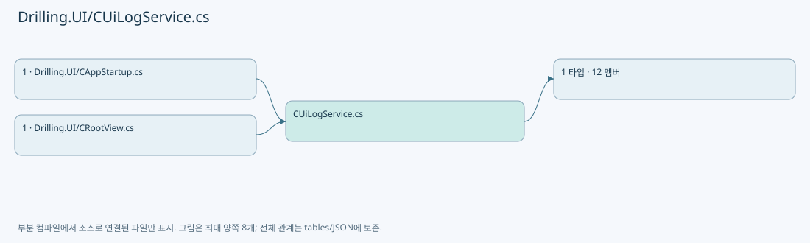
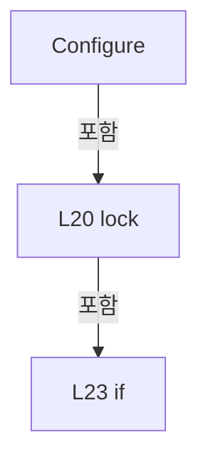
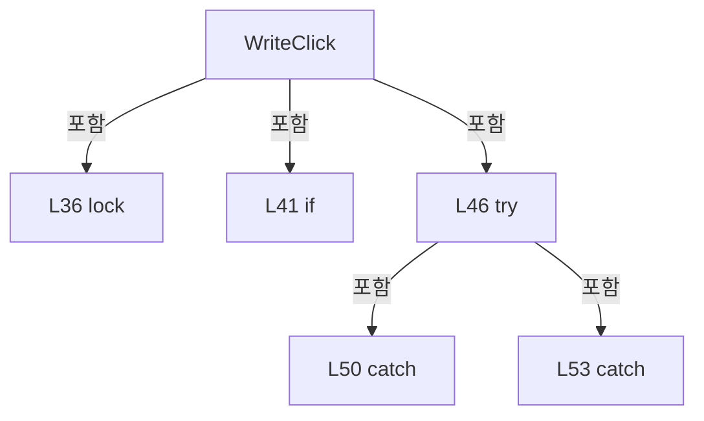
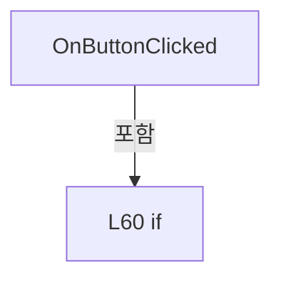
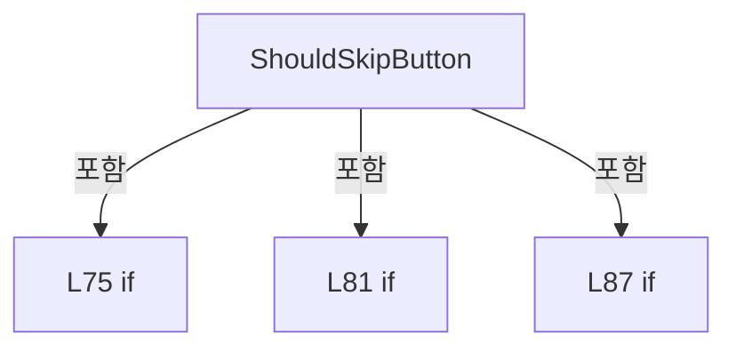
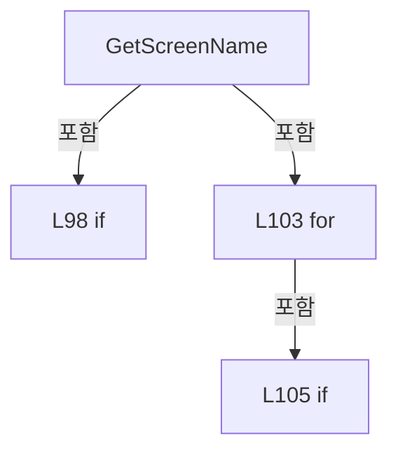
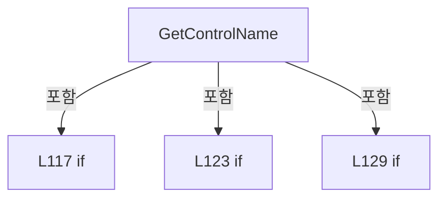
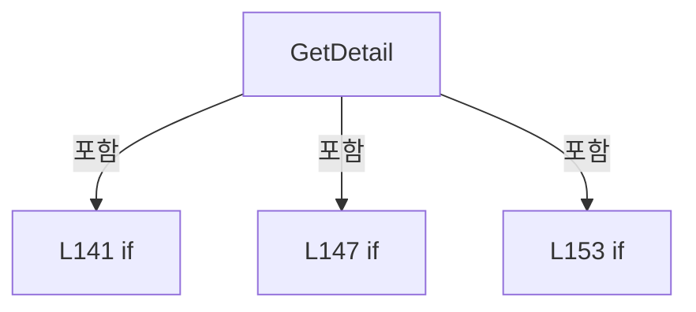
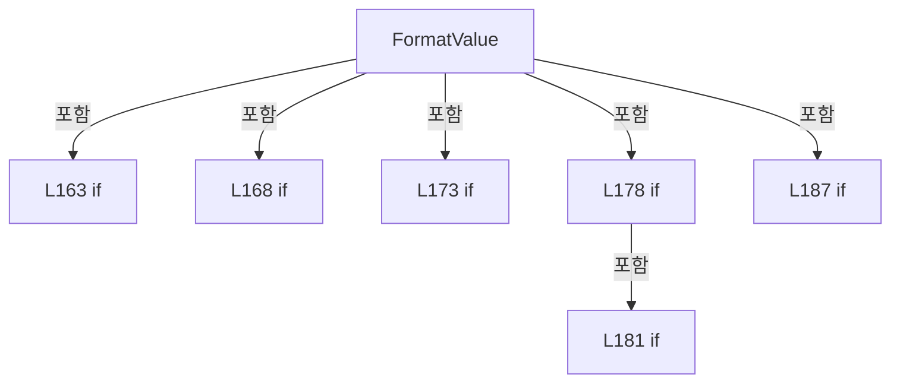

# Drilling.UI/CUiLogService.cs

| 항목 | 내용 |
| --- | --- |
| 원본 저장소 | https://github.com/kjuws10-rgb/A3Drilling.git |
| 원본 Commit | 5aee8e58439c9b455cae7c9593c9be986c3e682e |
| 원본 SHA256 | e26730fb54b010598ad048992b59d5537b05e268bf8f8b7e3a478a0e8d633cf7 |
| 파일 분류 | code |
| 원본 크기/행 | 5,904 bytes / 200 physical lines |
| 인코딩 | utf-8-sig |
| 검토 범위 | 구문/부분 의미 분석에서 추출한 사실. 동작·물리 단위·실장비 합격을 보증하지 않습니다. |
| 원본 링크 | [고정 Commit 원본](https://github.com/kjuws10-rgb/A3Drilling/blob/5aee8e58439c9b455cae7c9593c9be986c3e682e/Drilling.UI/CUiLogService.cs) |

## 파일의 역할과 읽는 순서

WPF 화면·사용자 명령·표시 상태를 구성합니다. XAML 이벤트와 코드 비하인드, RootView의 조립 경로를 함께 추적합니다.

## 네임스페이스·타입·상속

| 타입 | 구분 | 원본 범위 | 선언/상속 |
| --- | --- | --- | --- |
| CUiLogService | ClassDeclaration | 11–200 | CUiLogService |

## 멤버 빠른 목록

| 이름 | 종류 | 범위 | 서명 |
| --- | --- | --- | --- |
| SyncRoot | FieldDeclaration | L13–13 | object Drilling.UI.CUiLogService.SyncRoot |
| _logManager | FieldDeclaration | L14–14 | CLogManager? Drilling.UI.CUiLogService._logManager |
| _isRegistered | FieldDeclaration | L15–15 | bool Drilling.UI.CUiLogService._isRegistered |
| Configure | MethodDeclaration | L17–31 | void Drilling.UI.CUiLogService.Configure(CLogManager) |
| WriteClick | MethodDeclaration | L33–56 | void Drilling.UI.CUiLogService.WriteClick(string, string, string, string) |
| OnButtonClicked | MethodDeclaration | L58–70 | void Drilling.UI.CUiLogService.OnButtonClicked(object, RoutedEventArgs) |
| ShouldSkipButton | MethodDeclaration | L72–93 | bool Drilling.UI.CUiLogService.ShouldSkipButton(ButtonBase) |
| GetScreenName | MethodDeclaration | L95–112 | string Drilling.UI.CUiLogService.GetScreenName(FrameworkElement) |
| GetControlName | MethodDeclaration | L114–135 | string Drilling.UI.CUiLogService.GetControlName(ButtonBase) |
| GetDetail | MethodDeclaration | L137–159 | string Drilling.UI.CUiLogService.GetDetail(ButtonBase) |
| FormatValue | MethodDeclaration | L161–193 | string Drilling.UI.CUiLogService.FormatValue(object?) |
| Normalize | MethodDeclaration | L195–199 | string Drilling.UI.CUiLogService.Normalize(string, string) |

## 멤버별 상세 계약·호출·처리 해설

### FieldDeclaration `SyncRoot` · L13–13

[Drilling.UI/CUiLogService.cs:13–13](https://github.com/kjuws10-rgb/A3Drilling/blob/5aee8e58439c9b455cae7c9593c9be986c3e682e/Drilling.UI/CUiLogService.cs#L13-L13)

| 항목 | 실제 추출 값 |
| --- | --- |
| 서명 | object Drilling.UI.CUiLogService.SyncRoot |
| 접근/수식자 | Private / private, static, readonly |
| 반환/값 타입 | object |
| 소속 타입 | NamedType:Drilling.UI.CUiLogService |

현재 부분 분석에서 직접 연결된 호출자는 없습니다. XAML/이벤트/인터페이스·델리게이트·외부 진입을 추가 확인해야 하며, 미사용으로 판정한 것이 아닙니다.

호출하는 대상과 해석 범위:

| 원본 행 | 표현식 | 분석 상태 | 대상/소스 위치 |
| --- | --- | --- | --- |
| 13 | new | resolved | object.Object() |

본문의 실제 연산·분기·예외·반환 순서(원문 위치 순):

| 원본 행 | 종류 | 주석 해설 |
| --- | --- | --- |
| 13 | call | 함수·델리게이트 또는 객체 생성자를 호출합니다: new() |
| 13 | variable-initializer | 변수의 초기값을 지정합니다: SyncRoot = new() |

변경 전 점검: 입력/반환 타입, 위 호출자, 예외/취소 경로, 공유 상태와 저장·전송 소비자를 함께 확인합니다. 값의 단위나 물리 방향을 이름만으로 확정하지 않습니다.

### FieldDeclaration `_logManager` · L14–14

[Drilling.UI/CUiLogService.cs:14–14](https://github.com/kjuws10-rgb/A3Drilling/blob/5aee8e58439c9b455cae7c9593c9be986c3e682e/Drilling.UI/CUiLogService.cs#L14-L14)

| 항목 | 실제 추출 값 |
| --- | --- |
| 서명 | CLogManager? Drilling.UI.CUiLogService._logManager |
| 접근/수식자 | Private / private, static |
| 반환/값 타입 | CLogManager? |
| 소속 타입 | NamedType:Drilling.UI.CUiLogService |

현재 부분 분석에서 직접 연결된 호출자는 없습니다. XAML/이벤트/인터페이스·델리게이트·외부 진입을 추가 확인해야 하며, 미사용으로 판정한 것이 아닙니다.

변경 전 점검: 입력/반환 타입, 위 호출자, 예외/취소 경로, 공유 상태와 저장·전송 소비자를 함께 확인합니다. 값의 단위나 물리 방향을 이름만으로 확정하지 않습니다.

### FieldDeclaration `_isRegistered` · L15–15

[Drilling.UI/CUiLogService.cs:15–15](https://github.com/kjuws10-rgb/A3Drilling/blob/5aee8e58439c9b455cae7c9593c9be986c3e682e/Drilling.UI/CUiLogService.cs#L15-L15)

| 항목 | 실제 추출 값 |
| --- | --- |
| 서명 | bool Drilling.UI.CUiLogService._isRegistered |
| 접근/수식자 | Private / private, static |
| 반환/값 타입 | bool |
| 소속 타입 | NamedType:Drilling.UI.CUiLogService |

현재 부분 분석에서 직접 연결된 호출자는 없습니다. XAML/이벤트/인터페이스·델리게이트·외부 진입을 추가 확인해야 하며, 미사용으로 판정한 것이 아닙니다.

변경 전 점검: 입력/반환 타입, 위 호출자, 예외/취소 경로, 공유 상태와 저장·전송 소비자를 함께 확인합니다. 값의 단위나 물리 방향을 이름만으로 확정하지 않습니다.

### MethodDeclaration `Configure` · L17–31

[Drilling.UI/CUiLogService.cs:17–31](https://github.com/kjuws10-rgb/A3Drilling/blob/5aee8e58439c9b455cae7c9593c9be986c3e682e/Drilling.UI/CUiLogService.cs#L17-L31)

| 항목 | 실제 추출 값 |
| --- | --- |
| 서명 | void Drilling.UI.CUiLogService.Configure(CLogManager) |
| 접근/수식자 | Public / public, static |
| 반환/값 타입 | void |
| 소속 타입 | NamedType:Drilling.UI.CUiLogService |

입력 계약:

| 이름 | 타입 | 전달 | 선택/기본값 |
| --- | --- | --- | --- |
| logManager | CLogManager | None | False /  |

정적 호출자로 확인된 위치:

| 호출 파일/행 | 호출 표현식 | 런타임 분기 가능 |
| --- | --- | --- |
| [Drilling.UI/CAppStartup.cs:36–36](https://github.com/kjuws10-rgb/A3Drilling/blob/5aee8e58439c9b455cae7c9593c9be986c3e682e/Drilling.UI/CAppStartup.cs#L36-L36) | CUiLogService.Configure | False |

호출하는 대상과 해석 범위:

| 원본 행 | 표현식 | 분석 상태 | 대상/소스 위치 |
| --- | --- | --- | --- |
| 19 | ArgumentNullException.ThrowIfNull | candidate | OverloadResolutionFailure |
| 28 | EventManager.RegisterClassHandler | unresolved | None |
| 28 | new RoutedEventHandler | unresolved | None |

본문의 실제 연산·분기·예외·반환 순서(원문 위치 순):

| 원본 행 | 종류 | 주석 해설 |
| --- | --- | --- |
| 19 | call | 함수·델리게이트 또는 객체 생성자를 호출합니다: ArgumentNullException.ThrowIfNull(logManager) |
| 20 | lock | 공유 상태의 임계 구역에 진입합니다: lock (SyncRoot) |
| 22 | assignment | 값을 대상에 대입합니다: _logManager = logManager |
| 23 | if | 조건에 따라 분기합니다: if (_isRegistered) |
| 25 | return | 호출자에게 값 또는 제어를 반환합니다: return; |
| 28 | call | 함수·델리게이트 또는 객체 생성자를 호출합니다: EventManager.RegisterClassHandler(typeof(ButtonBase), ButtonBase.ClickEvent, new RoutedEventHandler(OnButtonClicked), true) |
| 28 | call | 함수·델리게이트 또는 객체 생성자를 호출합니다: new RoutedEventHandler(OnButtonClicked) |
| 29 | assignment | 값을 대상에 대입합니다: _isRegistered = true |

제어 구문의 포함 구조(실제 실행 순서/CFG가 아닌 구문 탐색 그림):

변경 전 점검: 입력/반환 타입, 위 호출자, 예외/취소 경로, 공유 상태와 저장·전송 소비자를 함께 확인합니다. 값의 단위나 물리 방향을 이름만으로 확정하지 않습니다.

### MethodDeclaration `WriteClick` · L33–56

[Drilling.UI/CUiLogService.cs:33–56](https://github.com/kjuws10-rgb/A3Drilling/blob/5aee8e58439c9b455cae7c9593c9be986c3e682e/Drilling.UI/CUiLogService.cs#L33-L56)

| 항목 | 실제 추출 값 |
| --- | --- |
| 서명 | void Drilling.UI.CUiLogService.WriteClick(string, string, string, string) |
| 접근/수식자 | Public / public, static |
| 반환/값 타입 | void |
| 소속 타입 | NamedType:Drilling.UI.CUiLogService |

입력 계약:

| 이름 | 타입 | 전달 | 선택/기본값 |
| --- | --- | --- | --- |
| screenName | string | None | False /  |
| controlName | string | None | False /  |
| parameter | string | None | True / "" |
| detail | string | None | True / "" |

정적 호출자로 확인된 위치:

| 호출 파일/행 | 호출 표현식 | 런타임 분기 가능 |
| --- | --- | --- |
| [Drilling.UI/CRootView.cs:298–298](https://github.com/kjuws10-rgb/A3Drilling/blob/5aee8e58439c9b455cae7c9593c9be986c3e682e/Drilling.UI/CRootView.cs#L298-L298) | CUiLogService.WriteClick | False |
| [Drilling.UI/CUiLogService.cs:69–69](https://github.com/kjuws10-rgb/A3Drilling/blob/5aee8e58439c9b455cae7c9593c9be986c3e682e/Drilling.UI/CUiLogService.cs#L69-L69) | WriteClick | False |

호출하는 대상과 해석 범위:

| 원본 행 | 표현식 | 분석 상태 | 대상/소스 위치 |
| --- | --- | --- | --- |
| 48 | logManager.WriteUiClick | unresolved | None |
| 48 | Normalize | resolved | string Drilling.UI.CUiLogService.Normalize(string, string) · Drilling.UI/CUiLogService.cs:195 |
| 48 | Normalize | resolved | string Drilling.UI.CUiLogService.Normalize(string, string) · Drilling.UI/CUiLogService.cs:195 |
| 48 | Normalize | resolved | string Drilling.UI.CUiLogService.Normalize(string, string) · Drilling.UI/CUiLogService.cs:195 |
| 48 | Normalize | resolved | string Drilling.UI.CUiLogService.Normalize(string, string) · Drilling.UI/CUiLogService.cs:195 |

본문의 실제 연산·분기·예외·반환 순서(원문 위치 순):

| 원본 행 | 종류 | 주석 해설 |
| --- | --- | --- |
| 35 | local-declaration | 지역 변수를 선언합니다: CLogManager? logManager; |
| 36 | lock | 공유 상태의 임계 구역에 진입합니다: lock (SyncRoot) |
| 38 | assignment | 값을 대상에 대입합니다: logManager = _logManager |
| 41 | if | 조건에 따라 분기합니다: if (logManager is null) |
| 43 | return | 호출자에게 값 또는 제어를 반환합니다: return; |
| 46 | try | 예외 처리 범위입니다: try |
| 48 | call | 함수·델리게이트 또는 객체 생성자를 호출합니다: logManager.WriteUiClick(Normalize(screenName, "UNKNOWN"), Normalize(controlName, "UNKNOWN"), Normalize(parameter, "-"), Normalize(detail, "-")) |
| 48 | call | 함수·델리게이트 또는 객체 생성자를 호출합니다: Normalize(screenName, "UNKNOWN") |
| 48 | call | 함수·델리게이트 또는 객체 생성자를 호출합니다: Normalize(controlName, "UNKNOWN") |
| 48 | call | 함수·델리게이트 또는 객체 생성자를 호출합니다: Normalize(parameter, "-") |
| 48 | call | 함수·델리게이트 또는 객체 생성자를 호출합니다: Normalize(detail, "-") |
| 50 | catch | 지정 예외를 처리합니다: catch (IOException) |
| 53 | catch | 지정 예외를 처리합니다: catch (UnauthorizedAccessException) |

제어 구문의 포함 구조(실제 실행 순서/CFG가 아닌 구문 탐색 그림):

변경 전 점검: 입력/반환 타입, 위 호출자, 예외/취소 경로, 공유 상태와 저장·전송 소비자를 함께 확인합니다. 값의 단위나 물리 방향을 이름만으로 확정하지 않습니다.

### MethodDeclaration `OnButtonClicked` · L58–70

[Drilling.UI/CUiLogService.cs:58–70](https://github.com/kjuws10-rgb/A3Drilling/blob/5aee8e58439c9b455cae7c9593c9be986c3e682e/Drilling.UI/CUiLogService.cs#L58-L70)

| 항목 | 실제 추출 값 |
| --- | --- |
| 서명 | void Drilling.UI.CUiLogService.OnButtonClicked(object, RoutedEventArgs) |
| 접근/수식자 | Private / private, static |
| 반환/값 타입 | void |
| 소속 타입 | NamedType:Drilling.UI.CUiLogService |

입력 계약:

| 이름 | 타입 | 전달 | 선택/기본값 |
| --- | --- | --- | --- |
| sender | object | None | False /  |
| eventArgs | RoutedEventArgs | None | False /  |

현재 부분 분석에서 직접 연결된 호출자는 없습니다. XAML/이벤트/인터페이스·델리게이트·외부 진입을 추가 확인해야 하며, 미사용으로 판정한 것이 아닙니다.

호출하는 대상과 해석 범위:

| 원본 행 | 표현식 | 분석 상태 | 대상/소스 위치 |
| --- | --- | --- | --- |
| 60 | ShouldSkipButton | resolved | bool Drilling.UI.CUiLogService.ShouldSkipButton(ButtonBase) · Drilling.UI/CUiLogService.cs:72 |
| 65 | GetScreenName | candidate | OverloadResolutionFailure |
| 66 | GetControlName | resolved | string Drilling.UI.CUiLogService.GetControlName(ButtonBase) · Drilling.UI/CUiLogService.cs:114 |
| 67 | FormatValue | candidate | OverloadResolutionFailure |
| 68 | GetDetail | resolved | string Drilling.UI.CUiLogService.GetDetail(ButtonBase) · Drilling.UI/CUiLogService.cs:137 |
| 69 | WriteClick | resolved | void Drilling.UI.CUiLogService.WriteClick(string, string, string, string) · Drilling.UI/CUiLogService.cs:33 |

본문의 실제 연산·분기·예외·반환 순서(원문 위치 순):

| 원본 행 | 종류 | 주석 해설 |
| --- | --- | --- |
| 60 | call | 함수·델리게이트 또는 객체 생성자를 호출합니다: ShouldSkipButton(button) |
| 60 | if | 조건에 따라 분기합니다: if (sender is not ButtonBase button &#124;&#124; ShouldSkipButton(button)) |
| 62 | return | 호출자에게 값 또는 제어를 반환합니다: return; |
| 65 | call | 함수·델리게이트 또는 객체 생성자를 호출합니다: GetScreenName(button) |
| 65 | local-declaration | 지역 변수를 선언합니다: var screenName = GetScreenName(button); |
| 65 | variable-initializer | 변수의 초기값을 지정합니다: screenName = GetScreenName(button) |
| 66 | call | 함수·델리게이트 또는 객체 생성자를 호출합니다: GetControlName(button) |
| 66 | local-declaration | 지역 변수를 선언합니다: var controlName = GetControlName(button); |
| 66 | variable-initializer | 변수의 초기값을 지정합니다: controlName = GetControlName(button) |
| 67 | call | 함수·델리게이트 또는 객체 생성자를 호출합니다: FormatValue(button.CommandParameter) |
| 67 | local-declaration | 지역 변수를 선언합니다: var parameter = FormatValue(button.CommandParameter); |
| 67 | variable-initializer | 변수의 초기값을 지정합니다: parameter = FormatValue(button.CommandParameter) |
| 68 | call | 함수·델리게이트 또는 객체 생성자를 호출합니다: GetDetail(button) |
| 68 | local-declaration | 지역 변수를 선언합니다: var detail = GetDetail(button); |
| 68 | variable-initializer | 변수의 초기값을 지정합니다: detail = GetDetail(button) |
| 69 | call | 함수·델리게이트 또는 객체 생성자를 호출합니다: WriteClick(screenName, controlName, parameter, detail) |

제어 구문의 포함 구조(실제 실행 순서/CFG가 아닌 구문 탐색 그림):

변경 전 점검: 입력/반환 타입, 위 호출자, 예외/취소 경로, 공유 상태와 저장·전송 소비자를 함께 확인합니다. 값의 단위나 물리 방향을 이름만으로 확정하지 않습니다.

### MethodDeclaration `ShouldSkipButton` · L72–93

[Drilling.UI/CUiLogService.cs:72–93](https://github.com/kjuws10-rgb/A3Drilling/blob/5aee8e58439c9b455cae7c9593c9be986c3e682e/Drilling.UI/CUiLogService.cs#L72-L93)

| 항목 | 실제 추출 값 |
| --- | --- |
| 서명 | bool Drilling.UI.CUiLogService.ShouldSkipButton(ButtonBase) |
| 접근/수식자 | Private / private, static |
| 반환/값 타입 | bool |
| 소속 타입 | NamedType:Drilling.UI.CUiLogService |

입력 계약:

| 이름 | 타입 | 전달 | 선택/기본값 |
| --- | --- | --- | --- |
| button | ButtonBase | None | False /  |

정적 호출자로 확인된 위치:

| 호출 파일/행 | 호출 표현식 | 런타임 분기 가능 |
| --- | --- | --- |
| [Drilling.UI/CUiLogService.cs:60–60](https://github.com/kjuws10-rgb/A3Drilling/blob/5aee8e58439c9b455cae7c9593c9be986c3e682e/Drilling.UI/CUiLogService.cs#L60-L60) | ShouldSkipButton | False |

호출하는 대상과 해석 범위:

| 원본 행 | 표현식 | 분석 상태 | 대상/소스 위치 |
| --- | --- | --- | --- |
| 74 | Window.GetWindow | unresolved | None |
| 80 | window.GetType | unresolved | None |
| 81 | windowTypeName.Equals | unresolved | None |
| 81 | windowTypeName.Equals | unresolved | None |
| 86 | FormatValue | candidate | OverloadResolutionFailure |
| 87 | content.Equals | resolved | bool string.Equals(string?, System.StringComparison) |
| 87 | content.Equals | resolved | bool string.Equals(string?, System.StringComparison) |
| 87 | content.Equals | resolved | bool string.Equals(string?, System.StringComparison) |

본문의 실제 연산·분기·예외·반환 순서(원문 위치 순):

| 원본 행 | 종류 | 주석 해설 |
| --- | --- | --- |
| 74 | call | 함수·델리게이트 또는 객체 생성자를 호출합니다: Window.GetWindow(button) |
| 74 | local-declaration | 지역 변수를 선언합니다: var window = Window.GetWindow(button); |
| 74 | variable-initializer | 변수의 초기값을 지정합니다: window = Window.GetWindow(button) |
| 75 | if | 조건에 따라 분기합니다: if (window is null) |
| 77 | return | 호출자에게 값 또는 제어를 반환합니다: return false; |
| 80 | call | 함수·델리게이트 또는 객체 생성자를 호출합니다: window.GetType() |
| 80 | local-declaration | 지역 변수를 선언합니다: var windowTypeName = window.GetType().Name; |
| 80 | variable-initializer | 변수의 초기값을 지정합니다: windowTypeName = window.GetType().Name |
| 81 | call | 함수·델리게이트 또는 객체 생성자를 호출합니다: windowTypeName.Equals("CValueInputDialog", StringComparison.Ordinal) |
| 81 | call | 함수·델리게이트 또는 객체 생성자를 호출합니다: windowTypeName.Equals("CPasswordInputDialog", StringComparison.Ordinal) |
| 81 | if | 조건에 따라 분기합니다: if (!windowTypeName.Equals("CValueInputDialog", StringComparison.Ordinal) && !windowTypeName.Equals("CPasswordInputDialog", StringComparison.Ordinal)) |
| 83 | return | 호출자에게 값 또는 제어를 반환합니다: return false; |
| 86 | call | 함수·델리게이트 또는 객체 생성자를 호출합니다: FormatValue(button.Content) |
| 86 | local-declaration | 지역 변수를 선언합니다: var content = FormatValue(button.Content); |
| 86 | variable-initializer | 변수의 초기값을 지정합니다: content = FormatValue(button.Content) |
| 87 | call | 함수·델리게이트 또는 객체 생성자를 호출합니다: content.Equals("SPACE", StringComparison.OrdinalIgnoreCase) |
| 87 | call | 함수·델리게이트 또는 객체 생성자를 호출합니다: content.Equals("BACK", StringComparison.OrdinalIgnoreCase) |
| 87 | call | 함수·델리게이트 또는 객체 생성자를 호출합니다: content.Equals("CLEAR", StringComparison.OrdinalIgnoreCase) |
| 87 | if | 조건에 따라 분기합니다: if (content.Length == 1 &#124;&#124; content.Equals("SPACE", StringComparison.OrdinalIgnoreCase) &#124;&#124; content.Equals("BACK", StringComparison.OrdinalIgnoreCase) &#124;&#124; content.Equals("CLEAR", StringComparison.OrdinalIgnoreCase)) |
| 89 | return | 호출자에게 값 또는 제어를 반환합니다: return true; |
| 92 | return | 호출자에게 값 또는 제어를 반환합니다: return false; |

제어 구문의 포함 구조(실제 실행 순서/CFG가 아닌 구문 탐색 그림):

변경 전 점검: 입력/반환 타입, 위 호출자, 예외/취소 경로, 공유 상태와 저장·전송 소비자를 함께 확인합니다. 값의 단위나 물리 방향을 이름만으로 확정하지 않습니다.

### MethodDeclaration `GetScreenName` · L95–112

[Drilling.UI/CUiLogService.cs:95–112](https://github.com/kjuws10-rgb/A3Drilling/blob/5aee8e58439c9b455cae7c9593c9be986c3e682e/Drilling.UI/CUiLogService.cs#L95-L112)

| 항목 | 실제 추출 값 |
| --- | --- |
| 서명 | string Drilling.UI.CUiLogService.GetScreenName(FrameworkElement) |
| 접근/수식자 | Private / private, static |
| 반환/값 타입 | string |
| 소속 타입 | NamedType:Drilling.UI.CUiLogService |

입력 계약:

| 이름 | 타입 | 전달 | 선택/기본값 |
| --- | --- | --- | --- |
| element | FrameworkElement | None | False /  |

현재 부분 분석에서 직접 연결된 호출자는 없습니다. XAML/이벤트/인터페이스·델리게이트·외부 진입을 추가 확인해야 하며, 미사용으로 판정한 것이 아닙니다.

호출하는 대상과 해석 범위:

| 원본 행 | 표현식 | 분석 상태 | 대상/소스 위치 |
| --- | --- | --- | --- |
| 97 | Window.GetWindow | unresolved | None |
| 98 | window.GetType().Name.Equals | unresolved | None |
| 98 | window.GetType | unresolved | None |
| 100 | window.GetType | unresolved | None |
| 103 | VisualTreeHelper.GetParent | unresolved | None |
| 107 | control.GetType | unresolved | None |
| 111 | .GetType | unresolved | None |

본문의 실제 연산·분기·예외·반환 순서(원문 위치 순):

| 원본 행 | 종류 | 주석 해설 |
| --- | --- | --- |
| 97 | call | 함수·델리게이트 또는 객체 생성자를 호출합니다: Window.GetWindow(element) |
| 97 | local-declaration | 지역 변수를 선언합니다: var window = Window.GetWindow(element); |
| 97 | variable-initializer | 변수의 초기값을 지정합니다: window = Window.GetWindow(element) |
| 98 | call | 함수·델리게이트 또는 객체 생성자를 호출합니다: window.GetType().Name.Equals("CRootView", StringComparison.Ordinal) |
| 98 | call | 함수·델리게이트 또는 객체 생성자를 호출합니다: window.GetType() |
| 98 | if | 조건에 따라 분기합니다: if (window is not null && !window.GetType().Name.Equals("CRootView", StringComparison.Ordinal)) |
| 100 | call | 함수·델리게이트 또는 객체 생성자를 호출합니다: window.GetType() |
| 100 | return | 호출자에게 값 또는 제어를 반환합니다: return window.GetType().Name; |
| 103 | assignment | 값을 대상에 대입합니다: current = VisualTreeHelper.GetParent(current) |
| 103 | call | 함수·델리게이트 또는 객체 생성자를 호출합니다: VisualTreeHelper.GetParent(current) |
| 103 | variable-initializer | 변수의 초기값을 지정합니다: current = element |
| 103 | for | 초기화·조건·증감이 있는 반복입니다: for (DependencyObject? current = element; current is not null; current = VisualTreeHelper.GetParent(current)) |
| 105 | if | 조건에 따라 분기합니다: if (current is UserControl control) |
| 107 | call | 함수·델리게이트 또는 객체 생성자를 호출합니다: control.GetType() |
| 107 | return | 호출자에게 값 또는 제어를 반환합니다: return control.GetType().Name; |
| 111 | call | 함수·델리게이트 또는 객체 생성자를 호출합니다: .GetType() |
| 111 | return | 호출자에게 값 또는 제어를 반환합니다: return window?.GetType().Name ?? "UNKNOWN"; |

제어 구문의 포함 구조(실제 실행 순서/CFG가 아닌 구문 탐색 그림):

변경 전 점검: 입력/반환 타입, 위 호출자, 예외/취소 경로, 공유 상태와 저장·전송 소비자를 함께 확인합니다. 값의 단위나 물리 방향을 이름만으로 확정하지 않습니다.

### MethodDeclaration `GetControlName` · L114–135

[Drilling.UI/CUiLogService.cs:114–135](https://github.com/kjuws10-rgb/A3Drilling/blob/5aee8e58439c9b455cae7c9593c9be986c3e682e/Drilling.UI/CUiLogService.cs#L114-L135)

| 항목 | 실제 추출 값 |
| --- | --- |
| 서명 | string Drilling.UI.CUiLogService.GetControlName(ButtonBase) |
| 접근/수식자 | Private / private, static |
| 반환/값 타입 | string |
| 소속 타입 | NamedType:Drilling.UI.CUiLogService |

입력 계약:

| 이름 | 타입 | 전달 | 선택/기본값 |
| --- | --- | --- | --- |
| button | ButtonBase | None | False /  |

정적 호출자로 확인된 위치:

| 호출 파일/행 | 호출 표현식 | 런타임 분기 가능 |
| --- | --- | --- |
| [Drilling.UI/CUiLogService.cs:66–66](https://github.com/kjuws10-rgb/A3Drilling/blob/5aee8e58439c9b455cae7c9593c9be986c3e682e/Drilling.UI/CUiLogService.cs#L66-L66) | GetControlName | False |

호출하는 대상과 해석 범위:

| 원본 행 | 표현식 | 분석 상태 | 대상/소스 위치 |
| --- | --- | --- | --- |
| 116 | Normalize | candidate | OverloadResolutionFailure |
| 117 | string.IsNullOrWhiteSpace | resolved | bool string.IsNullOrWhiteSpace(string?) |
| 122 | Normalize | candidate | OverloadResolutionFailure |
| 123 | string.IsNullOrWhiteSpace | resolved | bool string.IsNullOrWhiteSpace(string?) |
| 128 | FormatValue | candidate | OverloadResolutionFailure |
| 129 | string.IsNullOrWhiteSpace | resolved | bool string.IsNullOrWhiteSpace(string?) |
| 134 | button.GetType | unresolved | None |

본문의 실제 연산·분기·예외·반환 순서(원문 위치 순):

| 원본 행 | 종류 | 주석 해설 |
| --- | --- | --- |
| 116 | call | 함수·델리게이트 또는 객체 생성자를 호출합니다: Normalize(button.Name, "") |
| 116 | local-declaration | 지역 변수를 선언합니다: var name = Normalize(button.Name, ""); |
| 116 | variable-initializer | 변수의 초기값을 지정합니다: name = Normalize(button.Name, "") |
| 117 | call | 함수·델리게이트 또는 객체 생성자를 호출합니다: string.IsNullOrWhiteSpace(name) |
| 117 | if | 조건에 따라 분기합니다: if (!string.IsNullOrWhiteSpace(name)) |
| 119 | return | 호출자에게 값 또는 제어를 반환합니다: return name; |
| 122 | call | 함수·델리게이트 또는 객체 생성자를 호출합니다: Normalize(button.Uid, "") |
| 122 | local-declaration | 지역 변수를 선언합니다: var uid = Normalize(button.Uid, ""); |
| 122 | variable-initializer | 변수의 초기값을 지정합니다: uid = Normalize(button.Uid, "") |
| 123 | call | 함수·델리게이트 또는 객체 생성자를 호출합니다: string.IsNullOrWhiteSpace(uid) |
| 123 | if | 조건에 따라 분기합니다: if (!string.IsNullOrWhiteSpace(uid)) |
| 125 | return | 호출자에게 값 또는 제어를 반환합니다: return uid; |
| 128 | call | 함수·델리게이트 또는 객체 생성자를 호출합니다: FormatValue(button.Content) |
| 128 | local-declaration | 지역 변수를 선언합니다: var content = FormatValue(button.Content); |
| 128 | variable-initializer | 변수의 초기값을 지정합니다: content = FormatValue(button.Content) |
| 129 | call | 함수·델리게이트 또는 객체 생성자를 호출합니다: string.IsNullOrWhiteSpace(content) |
| 129 | if | 조건에 따라 분기합니다: if (!string.IsNullOrWhiteSpace(content)) |
| 131 | return | 호출자에게 값 또는 제어를 반환합니다: return content; |
| 134 | call | 함수·델리게이트 또는 객체 생성자를 호출합니다: button.GetType() |
| 134 | return | 호출자에게 값 또는 제어를 반환합니다: return button.GetType().Name; |

제어 구문의 포함 구조(실제 실행 순서/CFG가 아닌 구문 탐색 그림):

변경 전 점검: 입력/반환 타입, 위 호출자, 예외/취소 경로, 공유 상태와 저장·전송 소비자를 함께 확인합니다. 값의 단위나 물리 방향을 이름만으로 확정하지 않습니다.

### MethodDeclaration `GetDetail` · L137–159

[Drilling.UI/CUiLogService.cs:137–159](https://github.com/kjuws10-rgb/A3Drilling/blob/5aee8e58439c9b455cae7c9593c9be986c3e682e/Drilling.UI/CUiLogService.cs#L137-L159)

| 항목 | 실제 추출 값 |
| --- | --- |
| 서명 | string Drilling.UI.CUiLogService.GetDetail(ButtonBase) |
| 접근/수식자 | Private / private, static |
| 반환/값 타입 | string |
| 소속 타입 | NamedType:Drilling.UI.CUiLogService |

입력 계약:

| 이름 | 타입 | 전달 | 선택/기본값 |
| --- | --- | --- | --- |
| button | ButtonBase | None | False /  |

정적 호출자로 확인된 위치:

| 호출 파일/행 | 호출 표현식 | 런타임 분기 가능 |
| --- | --- | --- |
| [Drilling.UI/CUiLogService.cs:68–68](https://github.com/kjuws10-rgb/A3Drilling/blob/5aee8e58439c9b455cae7c9593c9be986c3e682e/Drilling.UI/CUiLogService.cs#L68-L68) | GetDetail | False |

호출하는 대상과 해석 범위:

| 원본 행 | 표현식 | 분석 상태 | 대상/소스 위치 |
| --- | --- | --- | --- |
| 139 | new List<string> | resolved | System.Collections.Generic.List<string>.List() |
| 140 | FormatValue | candidate | OverloadResolutionFailure |
| 141 | string.IsNullOrWhiteSpace | resolved | bool string.IsNullOrWhiteSpace(string?) |
| 143 | values.Add | resolved | void System.Collections.Generic.List<string>.Add(string) |
| 146 | FormatValue | candidate | OverloadResolutionFailure |
| 147 | string.IsNullOrWhiteSpace | resolved | bool string.IsNullOrWhiteSpace(string?) |
| 149 | values.Add | resolved | void System.Collections.Generic.List<string>.Add(string) |
| 152 | .GetType | unresolved | None |
| 153 | string.IsNullOrWhiteSpace | candidate | OverloadResolutionFailure |
| 153 | dataContext.Equals | unresolved | None |
| 155 | values.Add | resolved | void System.Collections.Generic.List<string>.Add(string) |
| 158 | string.Join | resolved | string string.Join(string?, System.Collections.Generic.IEnumerable<string?>) |

본문의 실제 연산·분기·예외·반환 순서(원문 위치 순):

| 원본 행 | 종류 | 주석 해설 |
| --- | --- | --- |
| 139 | call | 함수·델리게이트 또는 객체 생성자를 호출합니다: new List<string>() |
| 139 | local-declaration | 지역 변수를 선언합니다: var values = new List<string>(); |
| 139 | variable-initializer | 변수의 초기값을 지정합니다: values = new List<string>() |
| 140 | call | 함수·델리게이트 또는 객체 생성자를 호출합니다: FormatValue(button.Tag) |
| 140 | local-declaration | 지역 변수를 선언합니다: var tag = FormatValue(button.Tag); |
| 140 | variable-initializer | 변수의 초기값을 지정합니다: tag = FormatValue(button.Tag) |
| 141 | call | 함수·델리게이트 또는 객체 생성자를 호출합니다: string.IsNullOrWhiteSpace(tag) |
| 141 | if | 조건에 따라 분기합니다: if (!string.IsNullOrWhiteSpace(tag)) |
| 143 | call | 함수·델리게이트 또는 객체 생성자를 호출합니다: values.Add($"Tag={tag}") |
| 146 | call | 함수·델리게이트 또는 객체 생성자를 호출합니다: FormatValue(button.ToolTip) |
| 146 | local-declaration | 지역 변수를 선언합니다: var toolTip = FormatValue(button.ToolTip); |
| 146 | variable-initializer | 변수의 초기값을 지정합니다: toolTip = FormatValue(button.ToolTip) |
| 147 | call | 함수·델리게이트 또는 객체 생성자를 호출합니다: string.IsNullOrWhiteSpace(toolTip) |
| 147 | if | 조건에 따라 분기합니다: if (!string.IsNullOrWhiteSpace(toolTip)) |
| 149 | call | 함수·델리게이트 또는 객체 생성자를 호출합니다: values.Add($"ToolTip={toolTip}") |
| 152 | call | 함수·델리게이트 또는 객체 생성자를 호출합니다: .GetType() |
| 152 | local-declaration | 지역 변수를 선언합니다: var dataContext = button.DataContext?.GetType().Name ?? ""; |
| 152 | variable-initializer | 변수의 초기값을 지정합니다: dataContext = button.DataContext?.GetType().Name ?? "" |
| 153 | call | 함수·델리게이트 또는 객체 생성자를 호출합니다: string.IsNullOrWhiteSpace(dataContext) |
| 153 | call | 함수·델리게이트 또는 객체 생성자를 호출합니다: dataContext.Equals("String", StringComparison.Ordinal) |
| 153 | if | 조건에 따라 분기합니다: if (!string.IsNullOrWhiteSpace(dataContext) && !dataContext.Equals("String", StringComparison.Ordinal)) |
| 155 | call | 함수·델리게이트 또는 객체 생성자를 호출합니다: values.Add($"DataContext={dataContext}") |
| 158 | call | 함수·델리게이트 또는 객체 생성자를 호출합니다: string.Join(", ", values) |
| 158 | conditional-expression | 조건에 따라 결과식을 선택합니다: values.Count == 0 ? "-" : string.Join(", ", values) |
| 158 | return | 호출자에게 값 또는 제어를 반환합니다: return values.Count == 0 ? "-" : string.Join(", ", values); |

제어 구문의 포함 구조(실제 실행 순서/CFG가 아닌 구문 탐색 그림):

변경 전 점검: 입력/반환 타입, 위 호출자, 예외/취소 경로, 공유 상태와 저장·전송 소비자를 함께 확인합니다. 값의 단위나 물리 방향을 이름만으로 확정하지 않습니다.

### MethodDeclaration `FormatValue` · L161–193

[Drilling.UI/CUiLogService.cs:161–193](https://github.com/kjuws10-rgb/A3Drilling/blob/5aee8e58439c9b455cae7c9593c9be986c3e682e/Drilling.UI/CUiLogService.cs#L161-L193)

| 항목 | 실제 추출 값 |
| --- | --- |
| 서명 | string Drilling.UI.CUiLogService.FormatValue(object?) |
| 접근/수식자 | Private / private, static |
| 반환/값 타입 | string |
| 소속 타입 | NamedType:Drilling.UI.CUiLogService |

입력 계약:

| 이름 | 타입 | 전달 | 선택/기본값 |
| --- | --- | --- | --- |
| value | object? | None | False /  |

현재 부분 분석에서 직접 연결된 호출자는 없습니다. XAML/이벤트/인터페이스·델리게이트·외부 진입을 추가 확인해야 하며, 미사용으로 판정한 것이 아닙니다.

호출하는 대상과 해석 범위:

| 원본 행 | 표현식 | 분석 상태 | 대상/소스 위치 |
| --- | --- | --- | --- |
| 170 | Normalize | resolved | string Drilling.UI.CUiLogService.Normalize(string, string) · Drilling.UI/CUiLogService.cs:195 |
| 175 | Normalize | candidate | OverloadResolutionFailure |
| 180 | Normalize | candidate | OverloadResolutionFailure |
| 181 | string.IsNullOrWhiteSpace | resolved | bool string.IsNullOrWhiteSpace(string?) |
| 189 | Normalize | resolved | string Drilling.UI.CUiLogService.Normalize(string, string) · Drilling.UI/CUiLogService.cs:195 |
| 189 | formattable.ToString | resolved · 동적 구현 선택 가능 | string System.IFormattable.ToString(string?, System.IFormatProvider?) |
| 192 | Normalize | resolved | string Drilling.UI.CUiLogService.Normalize(string, string) · Drilling.UI/CUiLogService.cs:195 |
| 192 | value.ToString | resolved · 동적 구현 선택 가능 | string? object.ToString() |

본문의 실제 연산·분기·예외·반환 순서(원문 위치 순):

| 원본 행 | 종류 | 주석 해설 |
| --- | --- | --- |
| 163 | if | 조건에 따라 분기합니다: if (value is null) |
| 165 | return | 호출자에게 값 또는 제어를 반환합니다: return ""; |
| 168 | if | 조건에 따라 분기합니다: if (value is string text) |
| 170 | call | 함수·델리게이트 또는 객체 생성자를 호출합니다: Normalize(text, "") |
| 170 | return | 호출자에게 값 또는 제어를 반환합니다: return Normalize(text, ""); |
| 173 | if | 조건에 따라 분기합니다: if (value is TextBlock textBlock) |
| 175 | call | 함수·델리게이트 또는 객체 생성자를 호출합니다: Normalize(textBlock.Text, "") |
| 175 | return | 호출자에게 값 또는 제어를 반환합니다: return Normalize(textBlock.Text, ""); |
| 178 | if | 조건에 따라 분기합니다: if (value is FrameworkElement frameworkElement) |
| 180 | call | 함수·델리게이트 또는 객체 생성자를 호출합니다: Normalize(frameworkElement.Name, "") |
| 180 | local-declaration | 지역 변수를 선언합니다: var elementName = Normalize(frameworkElement.Name, ""); |
| 180 | variable-initializer | 변수의 초기값을 지정합니다: elementName = Normalize(frameworkElement.Name, "") |
| 181 | call | 함수·델리게이트 또는 객체 생성자를 호출합니다: string.IsNullOrWhiteSpace(elementName) |
| 181 | if | 조건에 따라 분기합니다: if (!string.IsNullOrWhiteSpace(elementName)) |
| 183 | return | 호출자에게 값 또는 제어를 반환합니다: return elementName; |
| 187 | if | 조건에 따라 분기합니다: if (value is IFormattable formattable) |
| 189 | call | 함수·델리게이트 또는 객체 생성자를 호출합니다: Normalize(formattable.ToString(null, CultureInfo.InvariantCulture) ?? "", "") |
| 189 | call | 함수·델리게이트 또는 객체 생성자를 호출합니다: formattable.ToString(null, CultureInfo.InvariantCulture) |
| 189 | return | 호출자에게 값 또는 제어를 반환합니다: return Normalize(formattable.ToString(null, CultureInfo.InvariantCulture) ?? "", ""); |
| 192 | call | 함수·델리게이트 또는 객체 생성자를 호출합니다: Normalize(value.ToString() ?? "", "") |
| 192 | call | 함수·델리게이트 또는 객체 생성자를 호출합니다: value.ToString() |
| 192 | return | 호출자에게 값 또는 제어를 반환합니다: return Normalize(value.ToString() ?? "", ""); |

제어 구문의 포함 구조(실제 실행 순서/CFG가 아닌 구문 탐색 그림):

변경 전 점검: 입력/반환 타입, 위 호출자, 예외/취소 경로, 공유 상태와 저장·전송 소비자를 함께 확인합니다. 값의 단위나 물리 방향을 이름만으로 확정하지 않습니다.

### MethodDeclaration `Normalize` · L195–199

[Drilling.UI/CUiLogService.cs:195–199](https://github.com/kjuws10-rgb/A3Drilling/blob/5aee8e58439c9b455cae7c9593c9be986c3e682e/Drilling.UI/CUiLogService.cs#L195-L199)

| 항목 | 실제 추출 값 |
| --- | --- |
| 서명 | string Drilling.UI.CUiLogService.Normalize(string, string) |
| 접근/수식자 | Private / private, static |
| 반환/값 타입 | string |
| 소속 타입 | NamedType:Drilling.UI.CUiLogService |

입력 계약:

| 이름 | 타입 | 전달 | 선택/기본값 |
| --- | --- | --- | --- |
| value | string | None | False /  |
| defaultValue | string | None | False /  |

정적 호출자로 확인된 위치:

| 호출 파일/행 | 호출 표현식 | 런타임 분기 가능 |
| --- | --- | --- |
| [Drilling.UI/CUiLogService.cs:48–48](https://github.com/kjuws10-rgb/A3Drilling/blob/5aee8e58439c9b455cae7c9593c9be986c3e682e/Drilling.UI/CUiLogService.cs#L48-L48) | Normalize | False |
| [Drilling.UI/CUiLogService.cs:48–48](https://github.com/kjuws10-rgb/A3Drilling/blob/5aee8e58439c9b455cae7c9593c9be986c3e682e/Drilling.UI/CUiLogService.cs#L48-L48) | Normalize | False |
| [Drilling.UI/CUiLogService.cs:48–48](https://github.com/kjuws10-rgb/A3Drilling/blob/5aee8e58439c9b455cae7c9593c9be986c3e682e/Drilling.UI/CUiLogService.cs#L48-L48) | Normalize | False |
| [Drilling.UI/CUiLogService.cs:48–48](https://github.com/kjuws10-rgb/A3Drilling/blob/5aee8e58439c9b455cae7c9593c9be986c3e682e/Drilling.UI/CUiLogService.cs#L48-L48) | Normalize | False |
| [Drilling.UI/CUiLogService.cs:170–170](https://github.com/kjuws10-rgb/A3Drilling/blob/5aee8e58439c9b455cae7c9593c9be986c3e682e/Drilling.UI/CUiLogService.cs#L170-L170) | Normalize | False |
| [Drilling.UI/CUiLogService.cs:189–189](https://github.com/kjuws10-rgb/A3Drilling/blob/5aee8e58439c9b455cae7c9593c9be986c3e682e/Drilling.UI/CUiLogService.cs#L189-L189) | Normalize | False |
| [Drilling.UI/CUiLogService.cs:192–192](https://github.com/kjuws10-rgb/A3Drilling/blob/5aee8e58439c9b455cae7c9593c9be986c3e682e/Drilling.UI/CUiLogService.cs#L192-L192) | Normalize | False |

호출하는 대상과 해석 범위:

| 원본 행 | 표현식 | 분석 상태 | 대상/소스 위치 |
| --- | --- | --- | --- |
| 197 | value.Replace("\r", " ").Replace("\n", " ").Trim | resolved | string string.Trim() |
| 197 | value.Replace("\r", " ").Replace | resolved | string string.Replace(string, string?) |
| 197 | value.Replace | resolved | string string.Replace(string, string?) |
| 198 | string.IsNullOrWhiteSpace | resolved | bool string.IsNullOrWhiteSpace(string?) |

본문의 실제 연산·분기·예외·반환 순서(원문 위치 순):

| 원본 행 | 종류 | 주석 해설 |
| --- | --- | --- |
| 197 | call | 함수·델리게이트 또는 객체 생성자를 호출합니다: value.Replace("\r", " ").Replace("\n", " ").Trim() |
| 197 | call | 함수·델리게이트 또는 객체 생성자를 호출합니다: value.Replace("\r", " ").Replace("\n", " ") |
| 197 | call | 함수·델리게이트 또는 객체 생성자를 호출합니다: value.Replace("\r", " ") |
| 197 | local-declaration | 지역 변수를 선언합니다: var normalized = value.Replace("\r", " ").Replace("\n", " ").Trim(); |
| 197 | variable-initializer | 변수의 초기값을 지정합니다: normalized = value.Replace("\r", " ").Replace("\n", " ").Trim() |
| 198 | call | 함수·델리게이트 또는 객체 생성자를 호출합니다: string.IsNullOrWhiteSpace(normalized) |
| 198 | conditional-expression | 조건에 따라 결과식을 선택합니다: string.IsNullOrWhiteSpace(normalized) ? defaultValue : normalized |
| 198 | return | 호출자에게 값 또는 제어를 반환합니다: return string.IsNullOrWhiteSpace(normalized) ? defaultValue : normalized; |

변경 전 점검: 입력/반환 타입, 위 호출자, 예외/취소 경로, 공유 상태와 저장·전송 소비자를 함께 확인합니다. 값의 단위나 물리 방향을 이름만으로 확정하지 않습니다.

## 구문·바인딩 한계

전체 WPF/벤더 SDK/프로젝트별 빌드 조건을 로드한 정식 빌드가 아닙니다. `resolved`는 이 부분 컴파일에서의 심볼 연결이며 virtual/interface/delegate/이벤트/Reflection/XAML의 실제 런타임 구현을 확정하지 않습니다. `candidate`와 `unresolved`는 후속 확인 대상으로 남깁니다.

## 원문 전체 주석 해설본

[원본 모든 행과 행별 해설 보기](../../annotated/Drilling.UI/CUiLogService.cs.annotated.txt)

원본을 빠뜨리거나 임의로 줄이지 않았습니다. `L000001 |` 표시는 원본 행 번호, `// 해설`은 별도 설명입니다. 실행용 소스가 아닌 문서입니다.

## 수정·재검증 체크

- 원본 Commit과 현재 작업 파일 SHA가 같은지 먼저 확인합니다. 다르면 이 문서를 과거 버전 자료로 취급합니다.
- 선언·직접 호출·이벤트/인터페이스 경계·설정 소비를 함께 확인합니다. 정적 연결의 빈 곳을 정상 경로로 추정하지 않습니다.
- 저장 형식/단위/식별자·재시도·취소·예외·롤백에 영향을 주는 변경은 상세 해설장과 호출자를 다시 검토합니다.
- 도구의 구문 추출과 별도 정적 추적 해설, 실제 빌드·시뮬레이션·실장비 검증 결과를 분리합니다.
