# Drilling.UI/Menu/CButtonCommand.cs

| 항목 | 내용 |
| --- | --- |
| 원본 저장소 | https://github.com/kjuws10-rgb/A3Drilling.git |
| 원본 Commit | 0219666f9053b907d96d7e0aa7d0c6c1be3a73d4 |
| 원본 SHA256 | 0670811aea72aaf0eec286af14a298c5308ded85f4c7677e4953c85f46ecc856 |
| 파일 분류 | code |
| 원본 크기/행 | 8,209 bytes / 231 physical lines |
| 인코딩 | utf-8-sig |
| 검토 범위 | 구문/부분 의미 분석에서 추출한 사실. 동작·물리 단위·실장비 합격을 보증하지 않습니다. |
| 원본 링크 | [고정 Commit 원본](https://github.com/kjuws10-rgb/A3Drilling/blob/0219666f9053b907d96d7e0aa7d0c6c1be3a73d4/Drilling.UI/Menu/CButtonCommand.cs) |

## 파일의 역할과 읽는 순서

WPF 화면·사용자 명령·표시 상태를 구성합니다. XAML 이벤트와 코드 비하인드, RootView의 조립 경로를 함께 추적합니다.

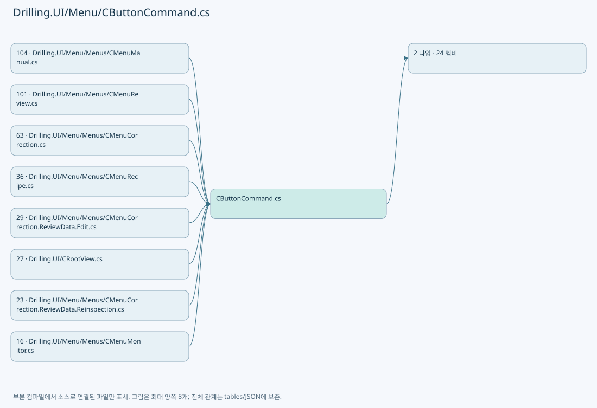

## 네임스페이스·타입·상속

| 타입 | 구분 | 원본 범위 | 선언/상속 |
| --- | --- | --- | --- |
| CButtonCommand | ClassDeclaration | 9–32 | CButtonCommand: ICommand |
| CButtonCommandBehavior | ClassDeclaration | 34–230 | CButtonCommandBehavior |

## 멤버 빠른 목록

| 이름 | 종류 | 범위 | 서명 |
| --- | --- | --- | --- |
| NoOp | PropertyDeclaration | L11–11 | Drilling.UI.Menu.CButtonCommand Drilling.UI.Menu.CButtonCommand.NoOp |
| get_NoOp | GetAccessorDeclaration | L11–11 | Drilling.UI.Menu.CButtonCommand Drilling.UI.Menu.CButtonCommand.NoOp.get |
| CanExecuteChanged | EventFieldDeclaration | L13–13 | System.EventHandler? Drilling.UI.Menu.CButtonCommand.CanExecuteChanged |
| CanExecute | MethodDeclaration | L14–17 | bool Drilling.UI.Menu.CButtonCommand.CanExecute(object?) |
| Execute | MethodDeclaration | L19–22 | void Drilling.UI.Menu.CButtonCommand.Execute(object?) |
| NotifyCanExecuteChanged | MethodDeclaration | L24–27 | void Drilling.UI.Menu.CButtonCommand.NotifyCanExecuteChanged() |
| DoNothing | MethodDeclaration | L29–31 | void Drilling.UI.Menu.CButtonCommand.DoNothing(object?) |
| RegisteredTargets | FieldDeclaration | L36–36 | System.Collections.Generic.Dictionary<Drilling.UI.Menu.CButtonCommand, System.Collections.Generic.HashSet<UIElement>> Drilling.UI.Menu.CButtonCommandBehavior.RegisteredTargets |
| CommandParameterDescriptor | FieldDeclaration | L37–37 | DependencyPropertyDescriptor Drilling.UI.Menu.CButtonCommandBehavior.CommandParameterDescriptor |
| CommandProperty | FieldDeclaration | L38–38 | DependencyProperty Drilling.UI.Menu.CButtonCommandBehavior.CommandProperty |
| GetCommand | MethodDeclaration | L39–42 | Drilling.UI.Menu.CButtonCommand? Drilling.UI.Menu.CButtonCommandBehavior.GetCommand(DependencyObject) |
| SetCommand | MethodDeclaration | L44–47 | void Drilling.UI.Menu.CButtonCommandBehavior.SetCommand(DependencyObject, Drilling.UI.Menu.CButtonCommand?) |
| OnCommandChanged | MethodDeclaration | L49–73 | void Drilling.UI.Menu.CButtonCommandBehavior.OnCommandChanged(DependencyObject, DependencyPropertyChangedEventArgs) |
| Element_Loaded | MethodDeclaration | L75–88 | void Drilling.UI.Menu.CButtonCommandBehavior.Element_Loaded(object, RoutedEventArgs) |
| Element_Unloaded | MethodDeclaration | L90–96 | void Drilling.UI.Menu.CButtonCommandBehavior.Element_Unloaded(object, RoutedEventArgs) |
| AttachElement | MethodDeclaration | L98–113 | void Drilling.UI.Menu.CButtonCommandBehavior.AttachElement(UIElement, Drilling.UI.Menu.CButtonCommand) |
| DetachElement | MethodDeclaration | L115–131 | void Drilling.UI.Menu.CButtonCommandBehavior.DetachElement(UIElement, Drilling.UI.Menu.CButtonCommand?) |
| RegisterTarget | MethodDeclaration | L133–143 | void Drilling.UI.Menu.CButtonCommandBehavior.RegisterTarget(Drilling.UI.Menu.CButtonCommand, UIElement) |
| UnregisterTarget | MethodDeclaration | L145–158 | void Drilling.UI.Menu.CButtonCommandBehavior.UnregisterTarget(Drilling.UI.Menu.CButtonCommand, UIElement) |
| Element_MouseLeftButtonDown | MethodDeclaration | L160–180 | void Drilling.UI.Menu.CButtonCommandBehavior.Element_MouseLeftButtonDown(object, RoutedEventArgs) |
| Button_Click | MethodDeclaration | L182–195 | void Drilling.UI.Menu.CButtonCommandBehavior.Button_Click(object, RoutedEventArgs) |
| Command_CanExecuteChanged | MethodDeclaration | L197–208 | void Drilling.UI.Menu.CButtonCommandBehavior.Command_CanExecuteChanged(object?, System.EventArgs) |
| ButtonCommandParameterChanged | MethodDeclaration | L210–222 | void Drilling.UI.Menu.CButtonCommandBehavior.ButtonCommandParameterChanged(object?, System.EventArgs) |
| UpdateTargetState | MethodDeclaration | L224–229 | void Drilling.UI.Menu.CButtonCommandBehavior.UpdateTargetState(UIElement, Drilling.UI.Menu.CButtonCommand) |

## 멤버별 상세 계약·호출·처리 해설

### PropertyDeclaration `NoOp` · L11–11

[Drilling.UI/Menu/CButtonCommand.cs:11–11](https://github.com/kjuws10-rgb/A3Drilling/blob/0219666f9053b907d96d7e0aa7d0c6c1be3a73d4/Drilling.UI/Menu/CButtonCommand.cs#L11-L11)

| 항목 | 실제 추출 값 |
| --- | --- |
| 서명 | Drilling.UI.Menu.CButtonCommand Drilling.UI.Menu.CButtonCommand.NoOp |
| 접근/수식자 | Public / public, static |
| 반환/값 타입 | Drilling.UI.Menu.CButtonCommand |
| 소속 타입 | NamedType:Drilling.UI.Menu.CButtonCommand |

현재 부분 분석에서 직접 연결된 호출자는 없습니다. XAML/이벤트/인터페이스·델리게이트·외부 진입을 추가 확인해야 하며, 미사용으로 판정한 것이 아닙니다.

호출하는 대상과 해석 범위:

| 원본 행 | 표현식 | 분석 상태 | 대상/소스 위치 |
| --- | --- | --- | --- |
| 11 | new | resolved | Drilling.UI.Menu.CButtonCommand.CButtonCommand(System.Action<object?>, System.Predicate<object?>?) · Drilling.UI/Menu/CButtonCommand.cs:9 |

본문의 실제 연산·분기·예외·반환 순서(원문 위치 순):

| 원본 행 | 종류 | 주석 해설 |
| --- | --- | --- |
| 11 | call | 함수·델리게이트 또는 객체 생성자를 호출합니다: new(DoNothing) |

변경 전 점검: 입력/반환 타입, 위 호출자, 예외/취소 경로, 공유 상태와 저장·전송 소비자를 함께 확인합니다. 값의 단위나 물리 방향을 이름만으로 확정하지 않습니다.

### GetAccessorDeclaration `get_NoOp` · L11–11

[Drilling.UI/Menu/CButtonCommand.cs:11–11](https://github.com/kjuws10-rgb/A3Drilling/blob/0219666f9053b907d96d7e0aa7d0c6c1be3a73d4/Drilling.UI/Menu/CButtonCommand.cs#L11-L11)

| 항목 | 실제 추출 값 |
| --- | --- |
| 서명 | Drilling.UI.Menu.CButtonCommand Drilling.UI.Menu.CButtonCommand.NoOp.get |
| 접근/수식자 | Public / get |
| 반환/값 타입 | Drilling.UI.Menu.CButtonCommand |
| 소속 타입 | NamedType:Drilling.UI.Menu.CButtonCommand |

현재 부분 분석에서 직접 연결된 호출자는 없습니다. XAML/이벤트/인터페이스·델리게이트·외부 진입을 추가 확인해야 하며, 미사용으로 판정한 것이 아닙니다.

변경 전 점검: 입력/반환 타입, 위 호출자, 예외/취소 경로, 공유 상태와 저장·전송 소비자를 함께 확인합니다. 값의 단위나 물리 방향을 이름만으로 확정하지 않습니다.

### EventFieldDeclaration `CanExecuteChanged` · L13–13

[Drilling.UI/Menu/CButtonCommand.cs:13–13](https://github.com/kjuws10-rgb/A3Drilling/blob/0219666f9053b907d96d7e0aa7d0c6c1be3a73d4/Drilling.UI/Menu/CButtonCommand.cs#L13-L13)

| 항목 | 실제 추출 값 |
| --- | --- |
| 서명 | System.EventHandler? Drilling.UI.Menu.CButtonCommand.CanExecuteChanged |
| 접근/수식자 | Public / public, event |
| 반환/값 타입 | System.EventHandler? |
| 소속 타입 | NamedType:Drilling.UI.Menu.CButtonCommand |

현재 부분 분석에서 직접 연결된 호출자는 없습니다. XAML/이벤트/인터페이스·델리게이트·외부 진입을 추가 확인해야 하며, 미사용으로 판정한 것이 아닙니다.

변경 전 점검: 입력/반환 타입, 위 호출자, 예외/취소 경로, 공유 상태와 저장·전송 소비자를 함께 확인합니다. 값의 단위나 물리 방향을 이름만으로 확정하지 않습니다.

### MethodDeclaration `CanExecute` · L14–17

[Drilling.UI/Menu/CButtonCommand.cs:14–17](https://github.com/kjuws10-rgb/A3Drilling/blob/0219666f9053b907d96d7e0aa7d0c6c1be3a73d4/Drilling.UI/Menu/CButtonCommand.cs#L14-L17)

| 항목 | 실제 추출 값 |
| --- | --- |
| 서명 | bool Drilling.UI.Menu.CButtonCommand.CanExecute(object?) |
| 접근/수식자 | Public / public |
| 반환/값 타입 | bool |
| 소속 타입 | NamedType:Drilling.UI.Menu.CButtonCommand |

입력 계약:

| 이름 | 타입 | 전달 | 선택/기본값 |
| --- | --- | --- | --- |
| parameter | object? | None | False /  |

정적 호출자로 확인된 위치:

| 호출 파일/행 | 호출 표현식 | 런타임 분기 가능 |
| --- | --- | --- |
| [Drilling.UI/Menu/CButtonCommand.cs:176–176](https://github.com/kjuws10-rgb/A3Drilling/blob/0219666f9053b907d96d7e0aa7d0c6c1be3a73d4/Drilling.UI/Menu/CButtonCommand.cs#L176-L176) | command.CanExecute | False |
| [Drilling.UI/Menu/Menus/CMenuCorrection.cs:5100–5100](https://github.com/kjuws10-rgb/A3Drilling/blob/0219666f9053b907d96d7e0aa7d0c6c1be3a73d4/Drilling.UI/Menu/Menus/CMenuCorrection.cs#L5100-L5100) | BaseActionCommand.CanExecute | False |
| [Drilling.UI/Menu/Menus/CMenuCorrection.cs:6403–6403](https://github.com/kjuws10-rgb/A3Drilling/blob/0219666f9053b907d96d7e0aa7d0c6c1be3a73d4/Drilling.UI/Menu/Menus/CMenuCorrection.cs#L6403-L6403) | ActionCommand.CanExecute | False |
| [Drilling.UI/Menu/Menus/CMenuCorrection.cs:7932–7932](https://github.com/kjuws10-rgb/A3Drilling/blob/0219666f9053b907d96d7e0aa7d0c6c1be3a73d4/Drilling.UI/Menu/Menus/CMenuCorrection.cs#L7932-L7932) | OffsetActionCommand.CanExecute | False |
| [Drilling.UI/Menu/Menus/CMenuManual.cs:202–202](https://github.com/kjuws10-rgb/A3Drilling/blob/0219666f9053b907d96d7e0aa7d0c6c1be3a73d4/Drilling.UI/Menu/Menus/CMenuManual.cs#L202-L202) | selectHeadCommand.CanExecute | False |
| [Drilling.UI/Menu/Menus/CMenuManual.cs:203–203](https://github.com/kjuws10-rgb/A3Drilling/blob/0219666f9053b907d96d7e0aa7d0c6c1be3a73d4/Drilling.UI/Menu/Menus/CMenuManual.cs#L203-L203) | selectHeadCommand.CanExecute | False |
| [Drilling.UI/Menu/Menus/CMenuManual.cs:6229–6229](https://github.com/kjuws10-rgb/A3Drilling/blob/0219666f9053b907d96d7e0aa7d0c6c1be3a73d4/Drilling.UI/Menu/Menus/CMenuManual.cs#L6229-L6229) | _selectFocusedHeadCommand.CanExecute | False |
| [Drilling.UI/Menu/Menus/CMenuManual.cs:6231–6231](https://github.com/kjuws10-rgb/A3Drilling/blob/0219666f9053b907d96d7e0aa7d0c6c1be3a73d4/Drilling.UI/Menu/Menus/CMenuManual.cs#L6231-L6231) | _selectFocusedHeadCommand.CanExecute | False |
| [Drilling.UI/Menu/Menus/CMenuManual.cs:6247–6247](https://github.com/kjuws10-rgb/A3Drilling/blob/0219666f9053b907d96d7e0aa7d0c6c1be3a73d4/Drilling.UI/Menu/Menus/CMenuManual.cs#L6247-L6247) | _selectFocusedHeadCommand.CanExecute | False |
| [Drilling.UI/Menu/Menus/CMenuReview.cs:2497–2497](https://github.com/kjuws10-rgb/A3Drilling/blob/0219666f9053b907d96d7e0aa7d0c6c1be3a73d4/Drilling.UI/Menu/Menus/CMenuReview.cs#L2497-L2497) | OpenCorrectionReviewCommand.CanExecute | False |
| [Drilling.UI/Menu/Menus/CMenuReview.cs:2500–2500](https://github.com/kjuws10-rgb/A3Drilling/blob/0219666f9053b907d96d7e0aa7d0c6c1be3a73d4/Drilling.UI/Menu/Menus/CMenuReview.cs#L2500-L2500) | OpenCorrectionReviewCommand.CanExecute | False |
| [Drilling.UI/Menu/Menus/CMenuReview.cs:2531–2531](https://github.com/kjuws10-rgb/A3Drilling/blob/0219666f9053b907d96d7e0aa7d0c6c1be3a73d4/Drilling.UI/Menu/Menus/CMenuReview.cs#L2531-L2531) | StartCommand.CanExecute | False |
| [Drilling.UI/Menu/Menus/CMenuReview.cs:2566–2566](https://github.com/kjuws10-rgb/A3Drilling/blob/0219666f9053b907d96d7e0aa7d0c6c1be3a73d4/Drilling.UI/Menu/Menus/CMenuReview.cs#L2566-L2566) | StopCommand.CanExecute | False |
| [Drilling.UI/Menu/Menus/CMenuReview.cs:3838–3838](https://github.com/kjuws10-rgb/A3Drilling/blob/0219666f9053b907d96d7e0aa7d0c6c1be3a73d4/Drilling.UI/Menu/Menus/CMenuReview.cs#L3838-L3838) | OneShotActionCommand.CanExecute | False |
| [Drilling.UI/Views/CReviewShotMapControl.cs:160–160](https://github.com/kjuws10-rgb/A3Drilling/blob/0219666f9053b907d96d7e0aa7d0c6c1be3a73d4/Drilling.UI/Views/CReviewShotMapControl.cs#L160-L160) | shot.SelectCommand.CanExecute | False |
| [Drilling.UI/Views/CReviewShotMapControl.cs:172–172](https://github.com/kjuws10-rgb/A3Drilling/blob/0219666f9053b907d96d7e0aa7d0c6c1be3a73d4/Drilling.UI/Views/CReviewShotMapControl.cs#L172-L172) | command.CanExecute | False |
| [Drilling.UI/Views/CSimpleCorrectionView.xaml.cs:16–16](https://github.com/kjuws10-rgb/A3Drilling/blob/0219666f9053b907d96d7e0aa7d0c6c1be3a73d4/Drilling.UI/Views/CSimpleCorrectionView.xaml.cs#L16-L16) | panel.SelectCorrectionShotCommand.CanExecute | False |

호출하는 대상과 해석 범위:

| 원본 행 | 표현식 | 분석 상태 | 대상/소스 위치 |
| --- | --- | --- | --- |
| 16 | .Invoke | resolved · 동적 구현 선택 가능 | bool System.Predicate<object?>.Invoke(object?) |

본문의 실제 연산·분기·예외·반환 순서(원문 위치 순):

| 원본 행 | 종류 | 주석 해설 |
| --- | --- | --- |
| 16 | call | 함수·델리게이트 또는 객체 생성자를 호출합니다: .Invoke(parameter) |
| 16 | return | 호출자에게 값 또는 제어를 반환합니다: return canExecute?.Invoke(parameter) ?? true; |

변경 전 점검: 입력/반환 타입, 위 호출자, 예외/취소 경로, 공유 상태와 저장·전송 소비자를 함께 확인합니다. 값의 단위나 물리 방향을 이름만으로 확정하지 않습니다.

### MethodDeclaration `Execute` · L19–22

[Drilling.UI/Menu/CButtonCommand.cs:19–22](https://github.com/kjuws10-rgb/A3Drilling/blob/0219666f9053b907d96d7e0aa7d0c6c1be3a73d4/Drilling.UI/Menu/CButtonCommand.cs#L19-L22)

| 항목 | 실제 추출 값 |
| --- | --- |
| 서명 | void Drilling.UI.Menu.CButtonCommand.Execute(object?) |
| 접근/수식자 | Public / public |
| 반환/값 타입 | void |
| 소속 타입 | NamedType:Drilling.UI.Menu.CButtonCommand |

입력 계약:

| 이름 | 타입 | 전달 | 선택/기본값 |
| --- | --- | --- | --- |
| parameter | object? | None | False /  |

정적 호출자로 확인된 위치:

| 호출 파일/행 | 호출 표현식 | 런타임 분기 가능 |
| --- | --- | --- |
| [Drilling.UI/CRootView.cs:2558–2558](https://github.com/kjuws10-rgb/A3Drilling/blob/0219666f9053b907d96d7e0aa7d0c6c1be3a73d4/Drilling.UI/CRootView.cs#L2558-L2558) | correctionMenu.SelectTabCommand.Execute | False |
| [Drilling.UI/Menu/CButtonCommand.cs:178–178](https://github.com/kjuws10-rgb/A3Drilling/blob/0219666f9053b907d96d7e0aa7d0c6c1be3a73d4/Drilling.UI/Menu/CButtonCommand.cs#L178-L178) | command.Execute | False |
| [Drilling.UI/Menu/Menus/CMenuCorrection.cs:4067–4067](https://github.com/kjuws10-rgb/A3Drilling/blob/0219666f9053b907d96d7e0aa7d0c6c1be3a73d4/Drilling.UI/Menu/Menus/CMenuCorrection.cs#L4067-L4067) | Rough.BackToGlassCommand.Execute | False |
| [Drilling.UI/Menu/Menus/CMenuManual.cs:6240–6240](https://github.com/kjuws10-rgb/A3Drilling/blob/0219666f9053b907d96d7e0aa7d0c6c1be3a73d4/Drilling.UI/Menu/Menus/CMenuManual.cs#L6240-L6240) | _selectFocusedHeadCommand.Execute | False |
| [Drilling.UI/Menu/Menus/CMenuManual.cs:6257–6257](https://github.com/kjuws10-rgb/A3Drilling/blob/0219666f9053b907d96d7e0aa7d0c6c1be3a73d4/Drilling.UI/Menu/Menus/CMenuManual.cs#L6257-L6257) | _selectFocusedHeadCommand.Execute | False |
| [Drilling.UI/Menu/Menus/CMenuManual.cs:6259–6259](https://github.com/kjuws10-rgb/A3Drilling/blob/0219666f9053b907d96d7e0aa7d0c6c1be3a73d4/Drilling.UI/Menu/Menus/CMenuManual.cs#L6259-L6259) | _selectFocusedHeadCommand.Execute | False |
| [Drilling.UI/Views/CPicoMotorMonitorView.xaml.cs:144–144](https://github.com/kjuws10-rgb/A3Drilling/blob/0219666f9053b907d96d7e0aa7d0c6c1be3a73d4/Drilling.UI/Views/CPicoMotorMonitorView.xaml.cs#L144-L144) | monitor.PicoJogStopCommand.Execute | False |
| [Drilling.UI/Views/CReviewShotMapControl.cs:163–163](https://github.com/kjuws10-rgb/A3Drilling/blob/0219666f9053b907d96d7e0aa7d0c6c1be3a73d4/Drilling.UI/Views/CReviewShotMapControl.cs#L163-L163) | shot.SelectCommand.Execute | False |
| [Drilling.UI/Views/CReviewShotMapControl.cs:175–175](https://github.com/kjuws10-rgb/A3Drilling/blob/0219666f9053b907d96d7e0aa7d0c6c1be3a73d4/Drilling.UI/Views/CReviewShotMapControl.cs#L175-L175) | command.Execute | False |
| [Drilling.UI/Views/CSimpleCorrectionView.xaml.cs:17–17](https://github.com/kjuws10-rgb/A3Drilling/blob/0219666f9053b907d96d7e0aa7d0c6c1be3a73d4/Drilling.UI/Views/CSimpleCorrectionView.xaml.cs#L17-L17) | panel.SelectCorrectionShotCommand.Execute | False |

호출하는 대상과 해석 범위:

| 원본 행 | 표현식 | 분석 상태 | 대상/소스 위치 |
| --- | --- | --- | --- |
| 21 | execute | resolved · 동적 구현 선택 가능 | void System.Action<object?>.Invoke(object?) |

본문의 실제 연산·분기·예외·반환 순서(원문 위치 순):

| 원본 행 | 종류 | 주석 해설 |
| --- | --- | --- |
| 21 | call | 함수·델리게이트 또는 객체 생성자를 호출합니다: execute(parameter) |

변경 전 점검: 입력/반환 타입, 위 호출자, 예외/취소 경로, 공유 상태와 저장·전송 소비자를 함께 확인합니다. 값의 단위나 물리 방향을 이름만으로 확정하지 않습니다.

### MethodDeclaration `NotifyCanExecuteChanged` · L24–27

[Drilling.UI/Menu/CButtonCommand.cs:24–27](https://github.com/kjuws10-rgb/A3Drilling/blob/0219666f9053b907d96d7e0aa7d0c6c1be3a73d4/Drilling.UI/Menu/CButtonCommand.cs#L24-L27)

| 항목 | 실제 추출 값 |
| --- | --- |
| 서명 | void Drilling.UI.Menu.CButtonCommand.NotifyCanExecuteChanged() |
| 접근/수식자 | Public / public |
| 반환/값 타입 | void |
| 소속 타입 | NamedType:Drilling.UI.Menu.CButtonCommand |

정적 호출자로 확인된 위치:

| 호출 파일/행 | 호출 표현식 | 런타임 분기 가능 |
| --- | --- | --- |
| [Drilling.UI/CRootView.cs:375–375](https://github.com/kjuws10-rgb/A3Drilling/blob/0219666f9053b907d96d7e0aa7d0c6c1be3a73d4/Drilling.UI/CRootView.cs#L375-L375) | StartCommand.NotifyCanExecuteChanged | False |
| [Drilling.UI/CRootView.cs:376–376](https://github.com/kjuws10-rgb/A3Drilling/blob/0219666f9053b907d96d7e0aa7d0c6c1be3a73d4/Drilling.UI/CRootView.cs#L376-L376) | StopCommand.NotifyCanExecuteChanged | False |
| [Drilling.UI/CRootView.cs:377–377](https://github.com/kjuws10-rgb/A3Drilling/blob/0219666f9053b907d96d7e0aa7d0c6c1be3a73d4/Drilling.UI/CRootView.cs#L377-L377) | SelectHeadCommand.NotifyCanExecuteChanged | False |
| [Drilling.UI/CRootView.cs:747–747](https://github.com/kjuws10-rgb/A3Drilling/blob/0219666f9053b907d96d7e0aa7d0c6c1be3a73d4/Drilling.UI/CRootView.cs#L747-L747) | StopCommand.NotifyCanExecuteChanged | False |
| [Drilling.UI/CRootView.cs:893–893](https://github.com/kjuws10-rgb/A3Drilling/blob/0219666f9053b907d96d7e0aa7d0c6c1be3a73d4/Drilling.UI/CRootView.cs#L893-L893) | StartCommand.NotifyCanExecuteChanged | False |
| [Drilling.UI/CRootView.cs:894–894](https://github.com/kjuws10-rgb/A3Drilling/blob/0219666f9053b907d96d7e0aa7d0c6c1be3a73d4/Drilling.UI/CRootView.cs#L894-L894) | ToggleOperationModeCommand.NotifyCanExecuteChanged | False |
| [Drilling.UI/CRootView.cs:895–895](https://github.com/kjuws10-rgb/A3Drilling/blob/0219666f9053b907d96d7e0aa7d0c6c1be3a73d4/Drilling.UI/CRootView.cs#L895-L895) | InitializeAutoSequenceCommand.NotifyCanExecuteChanged | False |
| [Drilling.UI/CRootView.cs:896–896](https://github.com/kjuws10-rgb/A3Drilling/blob/0219666f9053b907d96d7e0aa7d0c6c1be3a73d4/Drilling.UI/CRootView.cs#L896-L896) | OpenMelsecStageSimulationCommand.NotifyCanExecuteChanged | False |
| [Drilling.UI/CRootView.cs:2078–2078](https://github.com/kjuws10-rgb/A3Drilling/blob/0219666f9053b907d96d7e0aa7d0c6c1be3a73d4/Drilling.UI/CRootView.cs#L2078-L2078) | StopCommand.NotifyCanExecuteChanged | False |
| [Drilling.UI/CRootView.cs:2228–2228](https://github.com/kjuws10-rgb/A3Drilling/blob/0219666f9053b907d96d7e0aa7d0c6c1be3a73d4/Drilling.UI/CRootView.cs#L2228-L2228) | StartCommand.NotifyCanExecuteChanged | False |
| [Drilling.UI/CRootView.cs:2229–2229](https://github.com/kjuws10-rgb/A3Drilling/blob/0219666f9053b907d96d7e0aa7d0c6c1be3a73d4/Drilling.UI/CRootView.cs#L2229-L2229) | StopCommand.NotifyCanExecuteChanged | False |
| [Drilling.UI/CRootView.cs:2230–2230](https://github.com/kjuws10-rgb/A3Drilling/blob/0219666f9053b907d96d7e0aa7d0c6c1be3a73d4/Drilling.UI/CRootView.cs#L2230-L2230) | ToggleOperationModeCommand.NotifyCanExecuteChanged | False |
| [Drilling.UI/CRootView.cs:2231–2231](https://github.com/kjuws10-rgb/A3Drilling/blob/0219666f9053b907d96d7e0aa7d0c6c1be3a73d4/Drilling.UI/CRootView.cs#L2231-L2231) | InitializeAutoSequenceCommand.NotifyCanExecuteChanged | False |
| [Drilling.UI/CRootView.cs:2308–2308](https://github.com/kjuws10-rgb/A3Drilling/blob/0219666f9053b907d96d7e0aa7d0c6c1be3a73d4/Drilling.UI/CRootView.cs#L2308-L2308) | StopCommand.NotifyCanExecuteChanged | False |
| [Drilling.UI/CRootView.cs:3120–3120](https://github.com/kjuws10-rgb/A3Drilling/blob/0219666f9053b907d96d7e0aa7d0c6c1be3a73d4/Drilling.UI/CRootView.cs#L3120-L3120) | StopCommand.NotifyCanExecuteChanged | False |
| [Drilling.UI/Menu/Menus/CAlarmCauseAnalysis.cs:86–86](https://github.com/kjuws10-rgb/A3Drilling/blob/0219666f9053b907d96d7e0aa7d0c6c1be3a73d4/Drilling.UI/Menu/Menus/CAlarmCauseAnalysis.cs#L86-L86) | LoadCommand.NotifyCanExecuteChanged | False |
| [Drilling.UI/Menu/Menus/CManualPowerMeasurePanel.cs:214–214](https://github.com/kjuws10-rgb/A3Drilling/blob/0219666f9053b907d96d7e0aa7d0c6c1be3a73d4/Drilling.UI/Menu/Menus/CManualPowerMeasurePanel.cs#L214-L214) | StartCommand.NotifyCanExecuteChanged | False |
| [Drilling.UI/Menu/Menus/CManualPowerMeasurePanel.cs:214–214](https://github.com/kjuws10-rgb/A3Drilling/blob/0219666f9053b907d96d7e0aa7d0c6c1be3a73d4/Drilling.UI/Menu/Menus/CManualPowerMeasurePanel.cs#L214-L214) | StopCommand.NotifyCanExecuteChanged | False |
| [Drilling.UI/Menu/Menus/CManualPowerStagePanel.cs:263–263](https://github.com/kjuws10-rgb/A3Drilling/blob/0219666f9053b907d96d7e0aa7d0c6c1be3a73d4/Drilling.UI/Menu/Menus/CManualPowerStagePanel.cs#L263-L263) | axis.AbsoluteCommand.NotifyCanExecuteChanged | False |
| [Drilling.UI/Menu/Menus/CManualPowerStagePanel.cs:263–263](https://github.com/kjuws10-rgb/A3Drilling/blob/0219666f9053b907d96d7e0aa7d0c6c1be3a73d4/Drilling.UI/Menu/Menus/CManualPowerStagePanel.cs#L263-L263) | axis.RelativeCommand.NotifyCanExecuteChanged | False |
| [Drilling.UI/Menu/Menus/CManualPowerStagePanel.cs:264–264](https://github.com/kjuws10-rgb/A3Drilling/blob/0219666f9053b907d96d7e0aa7d0c6c1be3a73d4/Drilling.UI/Menu/Menus/CManualPowerStagePanel.cs#L264-L264) | StopCommand.NotifyCanExecuteChanged | False |
| [Drilling.UI/Menu/Menus/CMenuAlarm.cs:301–301](https://github.com/kjuws10-rgb/A3Drilling/blob/0219666f9053b907d96d7e0aa7d0c6c1be3a73d4/Drilling.UI/Menu/Menus/CMenuAlarm.cs#L301-L301) | CauseAnalysisCommand.NotifyCanExecuteChanged | False |
| [Drilling.UI/Menu/Menus/CMenuAlarm.cs:408–408](https://github.com/kjuws10-rgb/A3Drilling/blob/0219666f9053b907d96d7e0aa7d0c6c1be3a73d4/Drilling.UI/Menu/Menus/CMenuAlarm.cs#L408-L408) | SearchCommand.NotifyCanExecuteChanged | False |
| [Drilling.UI/Menu/Menus/CMenuAlarm.cs:409–409](https://github.com/kjuws10-rgb/A3Drilling/blob/0219666f9053b907d96d7e0aa7d0c6c1be3a73d4/Drilling.UI/Menu/Menus/CMenuAlarm.cs#L409-L409) | Last24HoursCommand.NotifyCanExecuteChanged | False |
| [Drilling.UI/Menu/Menus/CMenuAlarm.cs:457–457](https://github.com/kjuws10-rgb/A3Drilling/blob/0219666f9053b907d96d7e0aa7d0c6c1be3a73d4/Drilling.UI/Menu/Menus/CMenuAlarm.cs#L457-L457) | SearchCommand.NotifyCanExecuteChanged | False |
| [Drilling.UI/Menu/Menus/CMenuAlarm.cs:458–458](https://github.com/kjuws10-rgb/A3Drilling/blob/0219666f9053b907d96d7e0aa7d0c6c1be3a73d4/Drilling.UI/Menu/Menus/CMenuAlarm.cs#L458-L458) | Last24HoursCommand.NotifyCanExecuteChanged | False |
| [Drilling.UI/Menu/Menus/CMenuAlarm.cs:459–459](https://github.com/kjuws10-rgb/A3Drilling/blob/0219666f9053b907d96d7e0aa7d0c6c1be3a73d4/Drilling.UI/Menu/Menus/CMenuAlarm.cs#L459-L459) | CauseAnalysisCommand.NotifyCanExecuteChanged | False |
| [Drilling.UI/Menu/Menus/CMenuCorrection.ReviewData.Display.cs:1391–1391](https://github.com/kjuws10-rgb/A3Drilling/blob/0219666f9053b907d96d7e0aa7d0c6c1be3a73d4/Drilling.UI/Menu/Menus/CMenuCorrection.ReviewData.Display.cs#L1391-L1391) | LoadDataCommand.NotifyCanExecuteChanged | False |
| [Drilling.UI/Menu/Menus/CMenuCorrection.ReviewData.Display.cs:1392–1392](https://github.com/kjuws10-rgb/A3Drilling/blob/0219666f9053b907d96d7e0aa7d0c6c1be3a73d4/Drilling.UI/Menu/Menus/CMenuCorrection.ReviewData.Display.cs#L1392-L1392) | OffsetApplyCommand.NotifyCanExecuteChanged | False |
| [Drilling.UI/Menu/Menus/CMenuCorrection.ReviewData.Display.cs:1393–1393](https://github.com/kjuws10-rgb/A3Drilling/blob/0219666f9053b907d96d7e0aa7d0c6c1be3a73d4/Drilling.UI/Menu/Menus/CMenuCorrection.ReviewData.Display.cs#L1393-L1393) | OffsetRollbackCommand.NotifyCanExecuteChanged | False |
| [Drilling.UI/Menu/Menus/CMenuCorrection.ReviewData.Display.cs:1394–1394](https://github.com/kjuws10-rgb/A3Drilling/blob/0219666f9053b907d96d7e0aa7d0c6c1be3a73d4/Drilling.UI/Menu/Menus/CMenuCorrection.ReviewData.Display.cs#L1394-L1394) | OffsetInitCommand.NotifyCanExecuteChanged | False |
| [Drilling.UI/Menu/Menus/CMenuCorrection.ReviewData.Display.cs:1395–1395](https://github.com/kjuws10-rgb/A3Drilling/blob/0219666f9053b907d96d7e0aa7d0c6c1be3a73d4/Drilling.UI/Menu/Menus/CMenuCorrection.ReviewData.Display.cs#L1395-L1395) | OffsetViewCommand.NotifyCanExecuteChanged | False |
| [Drilling.UI/Menu/Menus/CMenuCorrection.ReviewData.Display.cs:1426–1426](https://github.com/kjuws10-rgb/A3Drilling/blob/0219666f9053b907d96d7e0aa7d0c6c1be3a73d4/Drilling.UI/Menu/Menus/CMenuCorrection.ReviewData.Display.cs#L1426-L1426) | ToggleResultEditModeCommand.NotifyCanExecuteChanged | False |
| [Drilling.UI/Menu/Menus/CMenuCorrection.ReviewData.Edit.cs:614–614](https://github.com/kjuws10-rgb/A3Drilling/blob/0219666f9053b907d96d7e0aa7d0c6c1be3a73d4/Drilling.UI/Menu/Menus/CMenuCorrection.ReviewData.Edit.cs#L614-L614) | .NotifyCanExecuteChanged | False |
| [Drilling.UI/Menu/Menus/CMenuCorrection.ReviewData.Edit.cs:615–615](https://github.com/kjuws10-rgb/A3Drilling/blob/0219666f9053b907d96d7e0aa7d0c6c1be3a73d4/Drilling.UI/Menu/Menus/CMenuCorrection.ReviewData.Edit.cs#L615-L615) | .NotifyCanExecuteChanged | False |
| [Drilling.UI/Menu/Menus/CMenuCorrection.ReviewData.Edit.cs:616–616](https://github.com/kjuws10-rgb/A3Drilling/blob/0219666f9053b907d96d7e0aa7d0c6c1be3a73d4/Drilling.UI/Menu/Menus/CMenuCorrection.ReviewData.Edit.cs#L616-L616) | .NotifyCanExecuteChanged | False |
| [Drilling.UI/Menu/Menus/CMenuCorrection.ReviewData.Edit.cs:617–617](https://github.com/kjuws10-rgb/A3Drilling/blob/0219666f9053b907d96d7e0aa7d0c6c1be3a73d4/Drilling.UI/Menu/Menus/CMenuCorrection.ReviewData.Edit.cs#L617-L617) | .NotifyCanExecuteChanged | False |
| [Drilling.UI/Menu/Menus/CMenuCorrection.ReviewData.Edit.cs:618–618](https://github.com/kjuws10-rgb/A3Drilling/blob/0219666f9053b907d96d7e0aa7d0c6c1be3a73d4/Drilling.UI/Menu/Menus/CMenuCorrection.ReviewData.Edit.cs#L618-L618) | .NotifyCanExecuteChanged | False |
| [Drilling.UI/Menu/Menus/CMenuCorrection.ReviewData.Edit.cs:619–619](https://github.com/kjuws10-rgb/A3Drilling/blob/0219666f9053b907d96d7e0aa7d0c6c1be3a73d4/Drilling.UI/Menu/Menus/CMenuCorrection.ReviewData.Edit.cs#L619-L619) | .NotifyCanExecuteChanged | False |
| [Drilling.UI/Menu/Menus/CMenuCorrection.ReviewData.Edit.cs:620–620](https://github.com/kjuws10-rgb/A3Drilling/blob/0219666f9053b907d96d7e0aa7d0c6c1be3a73d4/Drilling.UI/Menu/Menus/CMenuCorrection.ReviewData.Edit.cs#L620-L620) | .NotifyCanExecuteChanged | False |
| [Drilling.UI/Menu/Menus/CMenuCorrection.ReviewData.Edit.cs:621–621](https://github.com/kjuws10-rgb/A3Drilling/blob/0219666f9053b907d96d7e0aa7d0c6c1be3a73d4/Drilling.UI/Menu/Menus/CMenuCorrection.ReviewData.Edit.cs#L621-L621) | .NotifyCanExecuteChanged | False |
| [Drilling.UI/Menu/Menus/CMenuCorrection.ReviewData.Edit.cs:622–622](https://github.com/kjuws10-rgb/A3Drilling/blob/0219666f9053b907d96d7e0aa7d0c6c1be3a73d4/Drilling.UI/Menu/Menus/CMenuCorrection.ReviewData.Edit.cs#L622-L622) | .NotifyCanExecuteChanged | False |
| [Drilling.UI/Menu/Menus/CMenuCorrection.ReviewData.Edit.cs:623–623](https://github.com/kjuws10-rgb/A3Drilling/blob/0219666f9053b907d96d7e0aa7d0c6c1be3a73d4/Drilling.UI/Menu/Menus/CMenuCorrection.ReviewData.Edit.cs#L623-L623) | .NotifyCanExecuteChanged | False |
| [Drilling.UI/Menu/Menus/CMenuCorrection.ReviewData.Edit.cs:624–624](https://github.com/kjuws10-rgb/A3Drilling/blob/0219666f9053b907d96d7e0aa7d0c6c1be3a73d4/Drilling.UI/Menu/Menus/CMenuCorrection.ReviewData.Edit.cs#L624-L624) | .NotifyCanExecuteChanged | False |
| [Drilling.UI/Menu/Menus/CMenuCorrection.ReviewData.Edit.cs:625–625](https://github.com/kjuws10-rgb/A3Drilling/blob/0219666f9053b907d96d7e0aa7d0c6c1be3a73d4/Drilling.UI/Menu/Menus/CMenuCorrection.ReviewData.Edit.cs#L625-L625) | .NotifyCanExecuteChanged | False |
| [Drilling.UI/Menu/Menus/CMenuCorrection.ReviewData.Edit.cs:626–626](https://github.com/kjuws10-rgb/A3Drilling/blob/0219666f9053b907d96d7e0aa7d0c6c1be3a73d4/Drilling.UI/Menu/Menus/CMenuCorrection.ReviewData.Edit.cs#L626-L626) | .NotifyCanExecuteChanged | False |
| [Drilling.UI/Menu/Menus/CMenuCorrection.ReviewData.Edit.cs:627–627](https://github.com/kjuws10-rgb/A3Drilling/blob/0219666f9053b907d96d7e0aa7d0c6c1be3a73d4/Drilling.UI/Menu/Menus/CMenuCorrection.ReviewData.Edit.cs#L627-L627) | .NotifyCanExecuteChanged | False |
| [Drilling.UI/Menu/Menus/CMenuCorrection.ReviewData.Reinspection.cs:716–716](https://github.com/kjuws10-rgb/A3Drilling/blob/0219666f9053b907d96d7e0aa7d0c6c1be3a73d4/Drilling.UI/Menu/Menus/CMenuCorrection.ReviewData.Reinspection.cs#L716-L716) | .NotifyCanExecuteChanged | False |
| [Drilling.UI/Menu/Menus/CMenuCorrection.ReviewData.Reinspection.cs:717–717](https://github.com/kjuws10-rgb/A3Drilling/blob/0219666f9053b907d96d7e0aa7d0c6c1be3a73d4/Drilling.UI/Menu/Menus/CMenuCorrection.ReviewData.Reinspection.cs#L717-L717) | .NotifyCanExecuteChanged | False |
| [Drilling.UI/Menu/Menus/CMenuCorrection.ReviewData.Reinspection.cs:718–718](https://github.com/kjuws10-rgb/A3Drilling/blob/0219666f9053b907d96d7e0aa7d0c6c1be3a73d4/Drilling.UI/Menu/Menus/CMenuCorrection.ReviewData.Reinspection.cs#L718-L718) | .NotifyCanExecuteChanged | False |
| [Drilling.UI/Menu/Menus/CMenuCorrection.ReviewData.Reinspection.cs:719–719](https://github.com/kjuws10-rgb/A3Drilling/blob/0219666f9053b907d96d7e0aa7d0c6c1be3a73d4/Drilling.UI/Menu/Menus/CMenuCorrection.ReviewData.Reinspection.cs#L719-L719) | .NotifyCanExecuteChanged | False |
| [Drilling.UI/Menu/Menus/CMenuCorrection.ReviewData.Reinspection.cs:720–720](https://github.com/kjuws10-rgb/A3Drilling/blob/0219666f9053b907d96d7e0aa7d0c6c1be3a73d4/Drilling.UI/Menu/Menus/CMenuCorrection.ReviewData.Reinspection.cs#L720-L720) | .NotifyCanExecuteChanged | False |
| [Drilling.UI/Menu/Menus/CMenuCorrection.ReviewData.Reinspection.cs:721–721](https://github.com/kjuws10-rgb/A3Drilling/blob/0219666f9053b907d96d7e0aa7d0c6c1be3a73d4/Drilling.UI/Menu/Menus/CMenuCorrection.ReviewData.Reinspection.cs#L721-L721) | .NotifyCanExecuteChanged | False |
| [Drilling.UI/Menu/Menus/CMenuCorrection.ReviewData.Reinspection.cs:722–722](https://github.com/kjuws10-rgb/A3Drilling/blob/0219666f9053b907d96d7e0aa7d0c6c1be3a73d4/Drilling.UI/Menu/Menus/CMenuCorrection.ReviewData.Reinspection.cs#L722-L722) | .NotifyCanExecuteChanged | False |
| [Drilling.UI/Menu/Menus/CMenuCorrection.ReviewData.Reinspection.cs:723–723](https://github.com/kjuws10-rgb/A3Drilling/blob/0219666f9053b907d96d7e0aa7d0c6c1be3a73d4/Drilling.UI/Menu/Menus/CMenuCorrection.ReviewData.Reinspection.cs#L723-L723) | .NotifyCanExecuteChanged | False |
| [Drilling.UI/Menu/Menus/CMenuCorrection.ReviewData.Reinspection.cs:724–724](https://github.com/kjuws10-rgb/A3Drilling/blob/0219666f9053b907d96d7e0aa7d0c6c1be3a73d4/Drilling.UI/Menu/Menus/CMenuCorrection.ReviewData.Reinspection.cs#L724-L724) | .NotifyCanExecuteChanged | False |
| [Drilling.UI/Menu/Menus/CMenuCorrection.ReviewData.Reinspection.cs:725–725](https://github.com/kjuws10-rgb/A3Drilling/blob/0219666f9053b907d96d7e0aa7d0c6c1be3a73d4/Drilling.UI/Menu/Menus/CMenuCorrection.ReviewData.Reinspection.cs#L725-L725) | .NotifyCanExecuteChanged | False |
| [Drilling.UI/Menu/Menus/CMenuCorrection.ReviewData.Reinspection.cs:726–726](https://github.com/kjuws10-rgb/A3Drilling/blob/0219666f9053b907d96d7e0aa7d0c6c1be3a73d4/Drilling.UI/Menu/Menus/CMenuCorrection.ReviewData.Reinspection.cs#L726-L726) | .NotifyCanExecuteChanged | False |
| [Drilling.UI/Menu/Menus/CMenuCorrection.ReviewData.Reinspection.cs:727–727](https://github.com/kjuws10-rgb/A3Drilling/blob/0219666f9053b907d96d7e0aa7d0c6c1be3a73d4/Drilling.UI/Menu/Menus/CMenuCorrection.ReviewData.Reinspection.cs#L727-L727) | .NotifyCanExecuteChanged | False |
| [Drilling.UI/Menu/Menus/CMenuCorrection.ReviewData.cs:112–112](https://github.com/kjuws10-rgb/A3Drilling/blob/0219666f9053b907d96d7e0aa7d0c6c1be3a73d4/Drilling.UI/Menu/Menus/CMenuCorrection.ReviewData.cs#L112-L112) | RefreshCommand.NotifyCanExecuteChanged | False |
| [Drilling.UI/Menu/Menus/CMenuCorrection.ReviewData.cs:245–245](https://github.com/kjuws10-rgb/A3Drilling/blob/0219666f9053b907d96d7e0aa7d0c6c1be3a73d4/Drilling.UI/Menu/Menus/CMenuCorrection.ReviewData.cs#L245-L245) | ToggleResultEditModeCommand.NotifyCanExecuteChanged | False |
| [Drilling.UI/Menu/Menus/CMenuCorrection.cs:1581–1581](https://github.com/kjuws10-rgb/A3Drilling/blob/0219666f9053b907d96d7e0aa7d0c6c1be3a73d4/Drilling.UI/Menu/Menus/CMenuCorrection.cs#L1581-L1581) | ExecuteCommand.NotifyCanExecuteChanged | False |
| [Drilling.UI/Menu/Menus/CMenuCorrection.cs:1636–1636](https://github.com/kjuws10-rgb/A3Drilling/blob/0219666f9053b907d96d7e0aa7d0c6c1be3a73d4/Drilling.UI/Menu/Menus/CMenuCorrection.cs#L1636-L1636) | ExecuteCommand.NotifyCanExecuteChanged | False |
| [Drilling.UI/Menu/Menus/CMenuCorrection.cs:1821–1821](https://github.com/kjuws10-rgb/A3Drilling/blob/0219666f9053b907d96d7e0aa7d0c6c1be3a73d4/Drilling.UI/Menu/Menus/CMenuCorrection.cs#L1821-L1821) | ExecuteCommand.NotifyCanExecuteChanged | False |
| [Drilling.UI/Menu/Menus/CMenuCorrection.cs:1870–1870](https://github.com/kjuws10-rgb/A3Drilling/blob/0219666f9053b907d96d7e0aa7d0c6c1be3a73d4/Drilling.UI/Menu/Menus/CMenuCorrection.cs#L1870-L1870) | ExecuteCommand.NotifyCanExecuteChanged | False |
| [Drilling.UI/Menu/Menus/CMenuCorrection.cs:2803–2803](https://github.com/kjuws10-rgb/A3Drilling/blob/0219666f9053b907d96d7e0aa7d0c6c1be3a73d4/Drilling.UI/Menu/Menus/CMenuCorrection.cs#L2803-L2803) | AlignDistortion.BaseActionCommand.NotifyCanExecuteChanged | False |
| [Drilling.UI/Menu/Menus/CMenuCorrection.cs:3058–3058](https://github.com/kjuws10-rgb/A3Drilling/blob/0219666f9053b907d96d7e0aa7d0c6c1be3a73d4/Drilling.UI/Menu/Menus/CMenuCorrection.cs#L3058-L3058) | ExecuteCommand.NotifyCanExecuteChanged | False |
| [Drilling.UI/Menu/Menus/CMenuCorrection.cs:3140–3140](https://github.com/kjuws10-rgb/A3Drilling/blob/0219666f9053b907d96d7e0aa7d0c6c1be3a73d4/Drilling.UI/Menu/Menus/CMenuCorrection.cs#L3140-L3140) | ExecuteCommand.NotifyCanExecuteChanged | False |
| [Drilling.UI/Menu/Menus/CMenuCorrection.cs:3173–3173](https://github.com/kjuws10-rgb/A3Drilling/blob/0219666f9053b907d96d7e0aa7d0c6c1be3a73d4/Drilling.UI/Menu/Menus/CMenuCorrection.cs#L3173-L3173) | ExecuteCommand.NotifyCanExecuteChanged | False |
| [Drilling.UI/Menu/Menus/CMenuCorrection.cs:3251–3251](https://github.com/kjuws10-rgb/A3Drilling/blob/0219666f9053b907d96d7e0aa7d0c6c1be3a73d4/Drilling.UI/Menu/Menus/CMenuCorrection.cs#L3251-L3251) | ExecuteCommand.NotifyCanExecuteChanged | False |
| [Drilling.UI/Menu/Menus/CMenuCorrection.cs:3455–3455](https://github.com/kjuws10-rgb/A3Drilling/blob/0219666f9053b907d96d7e0aa7d0c6c1be3a73d4/Drilling.UI/Menu/Menus/CMenuCorrection.cs#L3455-L3455) | ExecuteCommand.NotifyCanExecuteChanged | False |
| [Drilling.UI/Menu/Menus/CMenuCorrection.cs:4031–4031](https://github.com/kjuws10-rgb/A3Drilling/blob/0219666f9053b907d96d7e0aa7d0c6c1be3a73d4/Drilling.UI/Menu/Menus/CMenuCorrection.cs#L4031-L4031) | ExecuteCommand.NotifyCanExecuteChanged | False |
| [Drilling.UI/Menu/Menus/CMenuCorrection.cs:4157–4157](https://github.com/kjuws10-rgb/A3Drilling/blob/0219666f9053b907d96d7e0aa7d0c6c1be3a73d4/Drilling.UI/Menu/Menus/CMenuCorrection.cs#L4157-L4157) | ExecuteCommand.NotifyCanExecuteChanged | False |
| [Drilling.UI/Menu/Menus/CMenuCorrection.cs:4186–4186](https://github.com/kjuws10-rgb/A3Drilling/blob/0219666f9053b907d96d7e0aa7d0c6c1be3a73d4/Drilling.UI/Menu/Menus/CMenuCorrection.cs#L4186-L4186) | ExecuteCommand.NotifyCanExecuteChanged | False |
| [Drilling.UI/Menu/Menus/CMenuCorrection.cs:4247–4247](https://github.com/kjuws10-rgb/A3Drilling/blob/0219666f9053b907d96d7e0aa7d0c6c1be3a73d4/Drilling.UI/Menu/Menus/CMenuCorrection.cs#L4247-L4247) | ExecuteCommand.NotifyCanExecuteChanged | False |
| [Drilling.UI/Menu/Menus/CMenuCorrection.cs:4277–4277](https://github.com/kjuws10-rgb/A3Drilling/blob/0219666f9053b907d96d7e0aa7d0c6c1be3a73d4/Drilling.UI/Menu/Menus/CMenuCorrection.cs#L4277-L4277) | ExecuteCommand.NotifyCanExecuteChanged | False |
| [Drilling.UI/Menu/Menus/CMenuCorrection.cs:4343–4343](https://github.com/kjuws10-rgb/A3Drilling/blob/0219666f9053b907d96d7e0aa7d0c6c1be3a73d4/Drilling.UI/Menu/Menus/CMenuCorrection.cs#L4343-L4343) | ExecuteCommand.NotifyCanExecuteChanged | False |
| [Drilling.UI/Menu/Menus/CMenuCorrection.cs:4485–4485](https://github.com/kjuws10-rgb/A3Drilling/blob/0219666f9053b907d96d7e0aa7d0c6c1be3a73d4/Drilling.UI/Menu/Menus/CMenuCorrection.cs#L4485-L4485) | ActionCommand.NotifyCanExecuteChanged | False |
| [Drilling.UI/Menu/Menus/CMenuCorrection.cs:4554–4554](https://github.com/kjuws10-rgb/A3Drilling/blob/0219666f9053b907d96d7e0aa7d0c6c1be3a73d4/Drilling.UI/Menu/Menus/CMenuCorrection.cs#L4554-L4554) | ActionCommand.NotifyCanExecuteChanged | False |
| [Drilling.UI/Menu/Menus/CMenuCorrection.cs:4618–4618](https://github.com/kjuws10-rgb/A3Drilling/blob/0219666f9053b907d96d7e0aa7d0c6c1be3a73d4/Drilling.UI/Menu/Menus/CMenuCorrection.cs#L4618-L4618) | ActionCommand.NotifyCanExecuteChanged | False |
| [Drilling.UI/Menu/Menus/CMenuCorrection.cs:4658–4658](https://github.com/kjuws10-rgb/A3Drilling/blob/0219666f9053b907d96d7e0aa7d0c6c1be3a73d4/Drilling.UI/Menu/Menus/CMenuCorrection.cs#L4658-L4658) | SelectHeadCommand.NotifyCanExecuteChanged | False |
| [Drilling.UI/Menu/Menus/CMenuCorrection.cs:4658–4658](https://github.com/kjuws10-rgb/A3Drilling/blob/0219666f9053b907d96d7e0aa7d0c6c1be3a73d4/Drilling.UI/Menu/Menus/CMenuCorrection.cs#L4658-L4658) | ActionCommand.NotifyCanExecuteChanged | False |
| [Drilling.UI/Menu/Menus/CMenuCorrection.cs:4695–4695](https://github.com/kjuws10-rgb/A3Drilling/blob/0219666f9053b907d96d7e0aa7d0c6c1be3a73d4/Drilling.UI/Menu/Menus/CMenuCorrection.cs#L4695-L4695) | .NotifyCanExecuteChanged | False |
| [Drilling.UI/Menu/Menus/CMenuCorrection.cs:5103–5103](https://github.com/kjuws10-rgb/A3Drilling/blob/0219666f9053b907d96d7e0aa7d0c6c1be3a73d4/Drilling.UI/Menu/Menus/CMenuCorrection.cs#L5103-L5103) | BaseActionCommand.NotifyCanExecuteChanged | False |
| [Drilling.UI/Menu/Menus/CMenuCorrection.cs:5111–5111](https://github.com/kjuws10-rgb/A3Drilling/blob/0219666f9053b907d96d7e0aa7d0c6c1be3a73d4/Drilling.UI/Menu/Menus/CMenuCorrection.cs#L5111-L5111) | BaseActionCommand.NotifyCanExecuteChanged | False |
| [Drilling.UI/Menu/Menus/CMenuCorrection.cs:5249–5249](https://github.com/kjuws10-rgb/A3Drilling/blob/0219666f9053b907d96d7e0aa7d0c6c1be3a73d4/Drilling.UI/Menu/Menus/CMenuCorrection.cs#L5249-L5249) | BaseActionCommand.NotifyCanExecuteChanged | False |
| [Drilling.UI/Menu/Menus/CMenuCorrection.cs:5391–5391](https://github.com/kjuws10-rgb/A3Drilling/blob/0219666f9053b907d96d7e0aa7d0c6c1be3a73d4/Drilling.UI/Menu/Menus/CMenuCorrection.cs#L5391-L5391) | BaseActionCommand.NotifyCanExecuteChanged | False |
| [Drilling.UI/Menu/Menus/CMenuCorrection.cs:6679–6679](https://github.com/kjuws10-rgb/A3Drilling/blob/0219666f9053b907d96d7e0aa7d0c6c1be3a73d4/Drilling.UI/Menu/Menus/CMenuCorrection.cs#L6679-L6679) | SelectLineCountCommand.NotifyCanExecuteChanged | False |
| [Drilling.UI/Menu/Menus/CMenuCorrection.cs:6680–6680](https://github.com/kjuws10-rgb/A3Drilling/blob/0219666f9053b907d96d7e0aa7d0c6c1be3a73d4/Drilling.UI/Menu/Menus/CMenuCorrection.cs#L6680-L6680) | SelectMethodCommand.NotifyCanExecuteChanged | False |
| [Drilling.UI/Menu/Menus/CMenuCorrection.cs:6681–6681](https://github.com/kjuws10-rgb/A3Drilling/blob/0219666f9053b907d96d7e0aa7d0c6c1be3a73d4/Drilling.UI/Menu/Menus/CMenuCorrection.cs#L6681-L6681) | ActionCommand.NotifyCanExecuteChanged | False |
| [Drilling.UI/Menu/Menus/CMenuCorrection.cs:7552–7552](https://github.com/kjuws10-rgb/A3Drilling/blob/0219666f9053b907d96d7e0aa7d0c6c1be3a73d4/Drilling.UI/Menu/Menus/CMenuCorrection.cs#L7552-L7552) | owner.OffsetActionCommand.NotifyCanExecuteChanged | False |
| [Drilling.UI/Menu/Menus/CMenuCorrection.cs:7967–7967](https://github.com/kjuws10-rgb/A3Drilling/blob/0219666f9053b907d96d7e0aa7d0c6c1be3a73d4/Drilling.UI/Menu/Menus/CMenuCorrection.cs#L7967-L7967) | SelectCellCommand.NotifyCanExecuteChanged | False |
| [Drilling.UI/Menu/Menus/CMenuCorrection.cs:7968–7968](https://github.com/kjuws10-rgb/A3Drilling/blob/0219666f9053b907d96d7e0aa7d0c6c1be3a73d4/Drilling.UI/Menu/Menus/CMenuCorrection.cs#L7968-L7968) | SelectHeadCommand.NotifyCanExecuteChanged | False |
| [Drilling.UI/Menu/Menus/CMenuCorrection.cs:7969–7969](https://github.com/kjuws10-rgb/A3Drilling/blob/0219666f9053b907d96d7e0aa7d0c6c1be3a73d4/Drilling.UI/Menu/Menus/CMenuCorrection.cs#L7969-L7969) | SelectScopeCommand.NotifyCanExecuteChanged | False |
| [Drilling.UI/Menu/Menus/CMenuCorrection.cs:7970–7970](https://github.com/kjuws10-rgb/A3Drilling/blob/0219666f9053b907d96d7e0aa7d0c6c1be3a73d4/Drilling.UI/Menu/Menus/CMenuCorrection.cs#L7970-L7970) | SelectCorrectionShotCommand.NotifyCanExecuteChanged | False |
| [Drilling.UI/Menu/Menus/CMenuCorrection.cs:7971–7971](https://github.com/kjuws10-rgb/A3Drilling/blob/0219666f9053b907d96d7e0aa7d0c6c1be3a73d4/Drilling.UI/Menu/Menus/CMenuCorrection.cs#L7971-L7971) | OffsetActionCommand.NotifyCanExecuteChanged | False |
| [Drilling.UI/Menu/Menus/CMenuCorrection.cs:8076–8076](https://github.com/kjuws10-rgb/A3Drilling/blob/0219666f9053b907d96d7e0aa7d0c6c1be3a73d4/Drilling.UI/Menu/Menus/CMenuCorrection.cs#L8076-L8076) | OffsetActionCommand.NotifyCanExecuteChanged | False |
| [Drilling.UI/Menu/Menus/CMenuCorrection.cs:8081–8081](https://github.com/kjuws10-rgb/A3Drilling/blob/0219666f9053b907d96d7e0aa7d0c6c1be3a73d4/Drilling.UI/Menu/Menus/CMenuCorrection.cs#L8081-L8081) | OffsetActionCommand.NotifyCanExecuteChanged | False |
| [Drilling.UI/Menu/Menus/CMenuCorrection.cs:8254–8254](https://github.com/kjuws10-rgb/A3Drilling/blob/0219666f9053b907d96d7e0aa7d0c6c1be3a73d4/Drilling.UI/Menu/Menus/CMenuCorrection.cs#L8254-L8254) | OffsetActionCommand.NotifyCanExecuteChanged | False |
| [Drilling.UI/Menu/Menus/CMenuMain.cs:3025–3025](https://github.com/kjuws10-rgb/A3Drilling/blob/0219666f9053b907d96d7e0aa7d0c6c1be3a73d4/Drilling.UI/Menu/Menus/CMenuMain.cs#L3025-L3025) | command.NotifyCanExecuteChanged | False |
| [Drilling.UI/Menu/Menus/CMenuManual.cs:204–204](https://github.com/kjuws10-rgb/A3Drilling/blob/0219666f9053b907d96d7e0aa7d0c6c1be3a73d4/Drilling.UI/Menu/Menus/CMenuManual.cs#L204-L204) | SelectManualHeadsCommand.NotifyCanExecuteChanged | False |
| [Drilling.UI/Menu/Menus/CMenuManual.cs:1009–1009](https://github.com/kjuws10-rgb/A3Drilling/blob/0219666f9053b907d96d7e0aa7d0c6c1be3a73d4/Drilling.UI/Menu/Menus/CMenuManual.cs#L1009-L1009) | VisionProtocolSendCommand.NotifyCanExecuteChanged | False |
| [Drilling.UI/Menu/Menus/CMenuManual.cs:1784–1784](https://github.com/kjuws10-rgb/A3Drilling/blob/0219666f9053b907d96d7e0aa7d0c6c1be3a73d4/Drilling.UI/Menu/Menus/CMenuManual.cs#L1784-L1784) | ScannerAxisClearFaultCommand.NotifyCanExecuteChanged | False |
| [Drilling.UI/Menu/Menus/CMenuManual.cs:1822–1822](https://github.com/kjuws10-rgb/A3Drilling/blob/0219666f9053b907d96d7e0aa7d0c6c1be3a73d4/Drilling.UI/Menu/Menus/CMenuManual.cs#L1822-L1822) | ScannerAxisClearFaultCommand.NotifyCanExecuteChanged | False |
| [Drilling.UI/Menu/Menus/CMenuManual.cs:1853–1853](https://github.com/kjuws10-rgb/A3Drilling/blob/0219666f9053b907d96d7e0aa7d0c6c1be3a73d4/Drilling.UI/Menu/Menus/CMenuManual.cs#L1853-L1853) | OpenHomeSpeedSettingsCommand.NotifyCanExecuteChanged | False |
| [Drilling.UI/Menu/Menus/CMenuManual.cs:1861–1861](https://github.com/kjuws10-rgb/A3Drilling/blob/0219666f9053b907d96d7e0aa7d0c6c1be3a73d4/Drilling.UI/Menu/Menus/CMenuManual.cs#L1861-L1861) | OpenHomeSpeedSettingsCommand.NotifyCanExecuteChanged | False |
| [Drilling.UI/Menu/Menus/CMenuManual.cs:1867–1867](https://github.com/kjuws10-rgb/A3Drilling/blob/0219666f9053b907d96d7e0aa7d0c6c1be3a73d4/Drilling.UI/Menu/Menus/CMenuManual.cs#L1867-L1867) | .NotifyCanExecuteChanged | False |
| [Drilling.UI/Menu/Menus/CMenuManual.cs:3348–3348](https://github.com/kjuws10-rgb/A3Drilling/blob/0219666f9053b907d96d7e0aa7d0c6c1be3a73d4/Drilling.UI/Menu/Menus/CMenuManual.cs#L3348-L3348) | SelectHeadCommand.NotifyCanExecuteChanged | False |
| [Drilling.UI/Menu/Menus/CMenuManual.cs:3349–3349](https://github.com/kjuws10-rgb/A3Drilling/blob/0219666f9053b907d96d7e0aa7d0c6c1be3a73d4/Drilling.UI/Menu/Menus/CMenuManual.cs#L3349-L3349) | SelectManualHeadsCommand.NotifyCanExecuteChanged | False |
| [Drilling.UI/Menu/Menus/CMenuManual.cs:3389–3389](https://github.com/kjuws10-rgb/A3Drilling/blob/0219666f9053b907d96d7e0aa7d0c6c1be3a73d4/Drilling.UI/Menu/Menus/CMenuManual.cs#L3389-L3389) | SelectHeadCommand.NotifyCanExecuteChanged | False |
| [Drilling.UI/Menu/Menus/CMenuManual.cs:3390–3390](https://github.com/kjuws10-rgb/A3Drilling/blob/0219666f9053b907d96d7e0aa7d0c6c1be3a73d4/Drilling.UI/Menu/Menus/CMenuManual.cs#L3390-L3390) | SelectManualHeadsCommand.NotifyCanExecuteChanged | False |
| [Drilling.UI/Menu/Menus/CMenuManual.cs:4982–4982](https://github.com/kjuws10-rgb/A3Drilling/blob/0219666f9053b907d96d7e0aa7d0c6c1be3a73d4/Drilling.UI/Menu/Menus/CMenuManual.cs#L4982-L4982) | PreviousSettingPageCommand.NotifyCanExecuteChanged | False |
| [Drilling.UI/Menu/Menus/CMenuManual.cs:4983–4983](https://github.com/kjuws10-rgb/A3Drilling/blob/0219666f9053b907d96d7e0aa7d0c6c1be3a73d4/Drilling.UI/Menu/Menus/CMenuManual.cs#L4983-L4983) | NextSettingPageCommand.NotifyCanExecuteChanged | False |
| [Drilling.UI/Menu/Menus/CMenuManual.cs:6318–6318](https://github.com/kjuws10-rgb/A3Drilling/blob/0219666f9053b907d96d7e0aa7d0c6c1be3a73d4/Drilling.UI/Menu/Menus/CMenuManual.cs#L6318-L6318) | SelectHeadCommand.NotifyCanExecuteChanged | False |
| [Drilling.UI/Menu/Menus/CMenuManual.cs:6319–6319](https://github.com/kjuws10-rgb/A3Drilling/blob/0219666f9053b907d96d7e0aa7d0c6c1be3a73d4/Drilling.UI/Menu/Menus/CMenuManual.cs#L6319-L6319) | SelectManualHeadsCommand.NotifyCanExecuteChanged | False |
| [Drilling.UI/Menu/Menus/CMenuManual.cs:6518–6518](https://github.com/kjuws10-rgb/A3Drilling/blob/0219666f9053b907d96d7e0aa7d0c6c1be3a73d4/Drilling.UI/Menu/Menus/CMenuManual.cs#L6518-L6518) | VisionProtocolAddMarkCommand.NotifyCanExecuteChanged | False |
| [Drilling.UI/Menu/Menus/CMenuManual.cs:6519–6519](https://github.com/kjuws10-rgb/A3Drilling/blob/0219666f9053b907d96d7e0aa7d0c6c1be3a73d4/Drilling.UI/Menu/Menus/CMenuManual.cs#L6519-L6519) | VisionProtocolRemoveMarkCommand.NotifyCanExecuteChanged | False |
| [Drilling.UI/Menu/Menus/CMenuManual.cs:6893–6893](https://github.com/kjuws10-rgb/A3Drilling/blob/0219666f9053b907d96d7e0aa7d0c6c1be3a73d4/Drilling.UI/Menu/Menus/CMenuManual.cs#L6893-L6893) | RequestCommand.NotifyCanExecuteChanged | False |
| [Drilling.UI/Menu/Menus/CMenuManual.cs:6993–6993](https://github.com/kjuws10-rgb/A3Drilling/blob/0219666f9053b907d96d7e0aa7d0c6c1be3a73d4/Drilling.UI/Menu/Menus/CMenuManual.cs#L6993-L6993) | RequestCommand.NotifyCanExecuteChanged | False |
| [Drilling.UI/Menu/Menus/CMenuManual.cs:6994–6994](https://github.com/kjuws10-rgb/A3Drilling/blob/0219666f9053b907d96d7e0aa7d0c6c1be3a73d4/Drilling.UI/Menu/Menus/CMenuManual.cs#L6994-L6994) | CancelRequestCommand.NotifyCanExecuteChanged | False |
| [Drilling.UI/Menu/Menus/CMenuManual.cs:7221–7221](https://github.com/kjuws10-rgb/A3Drilling/blob/0219666f9053b907d96d7e0aa7d0c6c1be3a73d4/Drilling.UI/Menu/Menus/CMenuManual.cs#L7221-L7221) | RunCommand.NotifyCanExecuteChanged | False |
| [Drilling.UI/Menu/Menus/CMenuManual.cs:7222–7222](https://github.com/kjuws10-rgb/A3Drilling/blob/0219666f9053b907d96d7e0aa7d0c6c1be3a73d4/Drilling.UI/Menu/Menus/CMenuManual.cs#L7222-L7222) | StopCommand.NotifyCanExecuteChanged | False |
| [Drilling.UI/Menu/Menus/CMenuManual.cs:7392–7392](https://github.com/kjuws10-rgb/A3Drilling/blob/0219666f9053b907d96d7e0aa7d0c6c1be3a73d4/Drilling.UI/Menu/Menus/CMenuManual.cs#L7392-L7392) | MoveCommand.NotifyCanExecuteChanged | False |
| [Drilling.UI/Menu/Menus/CMenuManual.cs:7393–7393](https://github.com/kjuws10-rgb/A3Drilling/blob/0219666f9053b907d96d7e0aa7d0c6c1be3a73d4/Drilling.UI/Menu/Menus/CMenuManual.cs#L7393-L7393) | StopCommand.NotifyCanExecuteChanged | False |
| [Drilling.UI/Menu/Menus/CMenuManual.cs:7950–7950](https://github.com/kjuws10-rgb/A3Drilling/blob/0219666f9053b907d96d7e0aa7d0c6c1be3a73d4/Drilling.UI/Menu/Menus/CMenuManual.cs#L7950-L7950) | ReadDioCommand.NotifyCanExecuteChanged | False |
| [Drilling.UI/Menu/Menus/CMenuManual.cs:7951–7951](https://github.com/kjuws10-rgb/A3Drilling/blob/0219666f9053b907d96d7e0aa7d0c6c1be3a73d4/Drilling.UI/Menu/Menus/CMenuManual.cs#L7951-L7951) | DioOnCommand.NotifyCanExecuteChanged | False |
| [Drilling.UI/Menu/Menus/CMenuManual.cs:7952–7952](https://github.com/kjuws10-rgb/A3Drilling/blob/0219666f9053b907d96d7e0aa7d0c6c1be3a73d4/Drilling.UI/Menu/Menus/CMenuManual.cs#L7952-L7952) | DioOffCommand.NotifyCanExecuteChanged | False |
| [Drilling.UI/Menu/Menus/CMenuManual.cs:8009–8009](https://github.com/kjuws10-rgb/A3Drilling/blob/0219666f9053b907d96d7e0aa7d0c6c1be3a73d4/Drilling.UI/Menu/Menus/CMenuManual.cs#L8009-L8009) | RefreshCommand.NotifyCanExecuteChanged | False |
| [Drilling.UI/Menu/Menus/CMenuManual.cs:8020–8020](https://github.com/kjuws10-rgb/A3Drilling/blob/0219666f9053b907d96d7e0aa7d0c6c1be3a73d4/Drilling.UI/Menu/Menus/CMenuManual.cs#L8020-L8020) | RefreshCommand.NotifyCanExecuteChanged | False |
| [Drilling.UI/Menu/Menus/CMenuManual.cs:8071–8071](https://github.com/kjuws10-rgb/A3Drilling/blob/0219666f9053b907d96d7e0aa7d0c6c1be3a73d4/Drilling.UI/Menu/Menus/CMenuManual.cs#L8071-L8071) | RefreshCommand.NotifyCanExecuteChanged | False |
| [Drilling.UI/Menu/Menus/CMenuManual.cs:8089–8089](https://github.com/kjuws10-rgb/A3Drilling/blob/0219666f9053b907d96d7e0aa7d0c6c1be3a73d4/Drilling.UI/Menu/Menus/CMenuManual.cs#L8089-L8089) | RefreshCommand.NotifyCanExecuteChanged | False |
| [Drilling.UI/Menu/Menus/CMenuManual.cs:8190–8190](https://github.com/kjuws10-rgb/A3Drilling/blob/0219666f9053b907d96d7e0aa7d0c6c1be3a73d4/Drilling.UI/Menu/Menus/CMenuManual.cs#L8190-L8190) | SetCommand.NotifyCanExecuteChanged | False |
| [Drilling.UI/Menu/Menus/CMenuManual.cs:8713–8713](https://github.com/kjuws10-rgb/A3Drilling/blob/0219666f9053b907d96d7e0aa7d0c6c1be3a73d4/Drilling.UI/Menu/Menus/CMenuManual.cs#L8713-L8713) | CenterCommand.NotifyCanExecuteChanged | False |
| [Drilling.UI/Menu/Menus/CMenuManual.cs:8714–8714](https://github.com/kjuws10-rgb/A3Drilling/blob/0219666f9053b907d96d7e0aa7d0c6c1be3a73d4/Drilling.UI/Menu/Menus/CMenuManual.cs#L8714-L8714) | RecipeCommand.NotifyCanExecuteChanged | False |
| [Drilling.UI/Menu/Menus/CMenuManual.cs:8764–8764](https://github.com/kjuws10-rgb/A3Drilling/blob/0219666f9053b907d96d7e0aa7d0c6c1be3a73d4/Drilling.UI/Menu/Menus/CMenuManual.cs#L8764-L8764) | AbsoluteCommand.NotifyCanExecuteChanged | False |
| [Drilling.UI/Menu/Menus/CMenuManual.cs:8765–8765](https://github.com/kjuws10-rgb/A3Drilling/blob/0219666f9053b907d96d7e0aa7d0c6c1be3a73d4/Drilling.UI/Menu/Menus/CMenuManual.cs#L8765-L8765) | RelativeCommand.NotifyCanExecuteChanged | False |
| [Drilling.UI/Menu/Menus/CMenuRecipe.cs:319–319](https://github.com/kjuws10-rgb/A3Drilling/blob/0219666f9053b907d96d7e0aa7d0c6c1be3a73d4/Drilling.UI/Menu/Menus/CMenuRecipe.cs#L319-L319) | NavigateShotGroupCommand.NotifyCanExecuteChanged | False |
| [Drilling.UI/Menu/Menus/CMenuRecipe.cs:606–606](https://github.com/kjuws10-rgb/A3Drilling/blob/0219666f9053b907d96d7e0aa7d0c6c1be3a73d4/Drilling.UI/Menu/Menus/CMenuRecipe.cs#L606-L606) | PreviousCellCommand.NotifyCanExecuteChanged | False |
| [Drilling.UI/Menu/Menus/CMenuRecipe.cs:607–607](https://github.com/kjuws10-rgb/A3Drilling/blob/0219666f9053b907d96d7e0aa7d0c6c1be3a73d4/Drilling.UI/Menu/Menus/CMenuRecipe.cs#L607-L607) | NextCellCommand.NotifyCanExecuteChanged | False |
| [Drilling.UI/Menu/Menus/CMenuRecipe.cs:729–729](https://github.com/kjuws10-rgb/A3Drilling/blob/0219666f9053b907d96d7e0aa7d0c6c1be3a73d4/Drilling.UI/Menu/Menus/CMenuRecipe.cs#L729-L729) | PreviousRecipePageCommand.NotifyCanExecuteChanged | False |
| [Drilling.UI/Menu/Menus/CMenuRecipe.cs:730–730](https://github.com/kjuws10-rgb/A3Drilling/blob/0219666f9053b907d96d7e0aa7d0c6c1be3a73d4/Drilling.UI/Menu/Menus/CMenuRecipe.cs#L730-L730) | NextRecipePageCommand.NotifyCanExecuteChanged | False |
| [Drilling.UI/Menu/Menus/CMenuRecipe.cs:826–826](https://github.com/kjuws10-rgb/A3Drilling/blob/0219666f9053b907d96d7e0aa7d0c6c1be3a73d4/Drilling.UI/Menu/Menus/CMenuRecipe.cs#L826-L826) | PreviousCellCommand.NotifyCanExecuteChanged | False |
| [Drilling.UI/Menu/Menus/CMenuRecipe.cs:827–827](https://github.com/kjuws10-rgb/A3Drilling/blob/0219666f9053b907d96d7e0aa7d0c6c1be3a73d4/Drilling.UI/Menu/Menus/CMenuRecipe.cs#L827-L827) | NextCellCommand.NotifyCanExecuteChanged | False |
| [Drilling.UI/Menu/Menus/CMenuRecipe.cs:1297–1297](https://github.com/kjuws10-rgb/A3Drilling/blob/0219666f9053b907d96d7e0aa7d0c6c1be3a73d4/Drilling.UI/Menu/Menus/CMenuRecipe.cs#L1297-L1297) | SelectCommand.NotifyCanExecuteChanged | False |
| [Drilling.UI/Menu/Menus/CMenuRecipe.cs:1298–1298](https://github.com/kjuws10-rgb/A3Drilling/blob/0219666f9053b907d96d7e0aa7d0c6c1be3a73d4/Drilling.UI/Menu/Menus/CMenuRecipe.cs#L1298-L1298) | SaveCommand.NotifyCanExecuteChanged | False |
| [Drilling.UI/Menu/Menus/CMenuRecipe.cs:1299–1299](https://github.com/kjuws10-rgb/A3Drilling/blob/0219666f9053b907d96d7e0aa7d0c6c1be3a73d4/Drilling.UI/Menu/Menus/CMenuRecipe.cs#L1299-L1299) | ModifyCommand.NotifyCanExecuteChanged | False |
| [Drilling.UI/Menu/Menus/CMenuRecipe.cs:1300–1300](https://github.com/kjuws10-rgb/A3Drilling/blob/0219666f9053b907d96d7e0aa7d0c6c1be3a73d4/Drilling.UI/Menu/Menus/CMenuRecipe.cs#L1300-L1300) | DeleteCommand.NotifyCanExecuteChanged | False |
| [Drilling.UI/Menu/Menus/CMenuRecipe.cs:4688–4688](https://github.com/kjuws10-rgb/A3Drilling/blob/0219666f9053b907d96d7e0aa7d0c6c1be3a73d4/Drilling.UI/Menu/Menus/CMenuRecipe.cs#L4688-L4688) | command.NotifyCanExecuteChanged | False |
| [Drilling.UI/Menu/Menus/CMenuReview.cs:505–505](https://github.com/kjuws10-rgb/A3Drilling/blob/0219666f9053b907d96d7e0aa7d0c6c1be3a73d4/Drilling.UI/Menu/Menus/CMenuReview.cs#L505-L505) | StartCommand.NotifyCanExecuteChanged | False |
| [Drilling.UI/Menu/Menus/CMenuReview.cs:516–516](https://github.com/kjuws10-rgb/A3Drilling/blob/0219666f9053b907d96d7e0aa7d0c6c1be3a73d4/Drilling.UI/Menu/Menus/CMenuReview.cs#L516-L516) | StartCommand.NotifyCanExecuteChanged | False |
| [Drilling.UI/Menu/Menus/CMenuReview.cs:793–793](https://github.com/kjuws10-rgb/A3Drilling/blob/0219666f9053b907d96d7e0aa7d0c6c1be3a73d4/Drilling.UI/Menu/Menus/CMenuReview.cs#L793-L793) | SelectWorkspaceCommand.NotifyCanExecuteChanged | False |
| [Drilling.UI/Menu/Menus/CMenuReview.cs:900–900](https://github.com/kjuws10-rgb/A3Drilling/blob/0219666f9053b907d96d7e0aa7d0c6c1be3a73d4/Drilling.UI/Menu/Menus/CMenuReview.cs#L900-L900) | SelectRunCellCommand.NotifyCanExecuteChanged | False |
| [Drilling.UI/Menu/Menus/CMenuReview.cs:1116–1116](https://github.com/kjuws10-rgb/A3Drilling/blob/0219666f9053b907d96d7e0aa7d0c6c1be3a73d4/Drilling.UI/Menu/Menus/CMenuReview.cs#L1116-L1116) | TogglePointCommand.NotifyCanExecuteChanged | False |
| [Drilling.UI/Menu/Menus/CMenuReview.cs:1117–1117](https://github.com/kjuws10-rgb/A3Drilling/blob/0219666f9053b907d96d7e0aa7d0c6c1be3a73d4/Drilling.UI/Menu/Menus/CMenuReview.cs#L1117-L1117) | SetSampleShotSelectionCommand.NotifyCanExecuteChanged | False |
| [Drilling.UI/Menu/Menus/CMenuReview.cs:1368–1368](https://github.com/kjuws10-rgb/A3Drilling/blob/0219666f9053b907d96d7e0aa7d0c6c1be3a73d4/Drilling.UI/Menu/Menus/CMenuReview.cs#L1368-L1368) | StartCommand.NotifyCanExecuteChanged | False |
| [Drilling.UI/Menu/Menus/CMenuReview.cs:1464–1464](https://github.com/kjuws10-rgb/A3Drilling/blob/0219666f9053b907d96d7e0aa7d0c6c1be3a73d4/Drilling.UI/Menu/Menus/CMenuReview.cs#L1464-L1464) | StartCommand.NotifyCanExecuteChanged | False |
| [Drilling.UI/Menu/Menus/CMenuReview.cs:2903–2903](https://github.com/kjuws10-rgb/A3Drilling/blob/0219666f9053b907d96d7e0aa7d0c6c1be3a73d4/Drilling.UI/Menu/Menus/CMenuReview.cs#L2903-L2903) | .NotifyCanExecuteChanged | False |
| [Drilling.UI/Menu/Menus/CMenuReview.cs:2904–2904](https://github.com/kjuws10-rgb/A3Drilling/blob/0219666f9053b907d96d7e0aa7d0c6c1be3a73d4/Drilling.UI/Menu/Menus/CMenuReview.cs#L2904-L2904) | .NotifyCanExecuteChanged | False |
| [Drilling.UI/Menu/Menus/CMenuReview.cs:2905–2905](https://github.com/kjuws10-rgb/A3Drilling/blob/0219666f9053b907d96d7e0aa7d0c6c1be3a73d4/Drilling.UI/Menu/Menus/CMenuReview.cs#L2905-L2905) | .NotifyCanExecuteChanged | False |
| [Drilling.UI/Menu/Menus/CMenuReview.cs:2906–2906](https://github.com/kjuws10-rgb/A3Drilling/blob/0219666f9053b907d96d7e0aa7d0c6c1be3a73d4/Drilling.UI/Menu/Menus/CMenuReview.cs#L2906-L2906) | .NotifyCanExecuteChanged | False |
| [Drilling.UI/Menu/Menus/CMenuReview.cs:2907–2907](https://github.com/kjuws10-rgb/A3Drilling/blob/0219666f9053b907d96d7e0aa7d0c6c1be3a73d4/Drilling.UI/Menu/Menus/CMenuReview.cs#L2907-L2907) | .NotifyCanExecuteChanged | False |
| [Drilling.UI/Menu/Menus/CMenuReview.cs:2908–2908](https://github.com/kjuws10-rgb/A3Drilling/blob/0219666f9053b907d96d7e0aa7d0c6c1be3a73d4/Drilling.UI/Menu/Menus/CMenuReview.cs#L2908-L2908) | .NotifyCanExecuteChanged | False |
| [Drilling.UI/Menu/Menus/CMenuReview.cs:2909–2909](https://github.com/kjuws10-rgb/A3Drilling/blob/0219666f9053b907d96d7e0aa7d0c6c1be3a73d4/Drilling.UI/Menu/Menus/CMenuReview.cs#L2909-L2909) | .NotifyCanExecuteChanged | False |
| [Drilling.UI/Menu/Menus/CMenuReview.cs:2910–2910](https://github.com/kjuws10-rgb/A3Drilling/blob/0219666f9053b907d96d7e0aa7d0c6c1be3a73d4/Drilling.UI/Menu/Menus/CMenuReview.cs#L2910-L2910) | .NotifyCanExecuteChanged | False |
| [Drilling.UI/Menu/Menus/CMenuReview.cs:3009–3009](https://github.com/kjuws10-rgb/A3Drilling/blob/0219666f9053b907d96d7e0aa7d0c6c1be3a73d4/Drilling.UI/Menu/Menus/CMenuReview.cs#L3009-L3009) | .NotifyCanExecuteChanged | False |
| [Drilling.UI/Menu/Menus/CMenuReview.cs:3010–3010](https://github.com/kjuws10-rgb/A3Drilling/blob/0219666f9053b907d96d7e0aa7d0c6c1be3a73d4/Drilling.UI/Menu/Menus/CMenuReview.cs#L3010-L3010) | .NotifyCanExecuteChanged | False |
| [Drilling.UI/Menu/Menus/CMenuReview.cs:3011–3011](https://github.com/kjuws10-rgb/A3Drilling/blob/0219666f9053b907d96d7e0aa7d0c6c1be3a73d4/Drilling.UI/Menu/Menus/CMenuReview.cs#L3011-L3011) | .NotifyCanExecuteChanged | False |
| [Drilling.UI/Menu/Menus/CMenuReview.cs:3012–3012](https://github.com/kjuws10-rgb/A3Drilling/blob/0219666f9053b907d96d7e0aa7d0c6c1be3a73d4/Drilling.UI/Menu/Menus/CMenuReview.cs#L3012-L3012) | .NotifyCanExecuteChanged | False |
| [Drilling.UI/Menu/Menus/CMenuReview.cs:3013–3013](https://github.com/kjuws10-rgb/A3Drilling/blob/0219666f9053b907d96d7e0aa7d0c6c1be3a73d4/Drilling.UI/Menu/Menus/CMenuReview.cs#L3013-L3013) | .NotifyCanExecuteChanged | False |
| [Drilling.UI/Menu/Menus/CMenuReview.cs:3014–3014](https://github.com/kjuws10-rgb/A3Drilling/blob/0219666f9053b907d96d7e0aa7d0c6c1be3a73d4/Drilling.UI/Menu/Menus/CMenuReview.cs#L3014-L3014) | .NotifyCanExecuteChanged | False |
| [Drilling.UI/Menu/Menus/CMenuReview.cs:3015–3015](https://github.com/kjuws10-rgb/A3Drilling/blob/0219666f9053b907d96d7e0aa7d0c6c1be3a73d4/Drilling.UI/Menu/Menus/CMenuReview.cs#L3015-L3015) | .NotifyCanExecuteChanged | False |
| [Drilling.UI/Menu/Menus/CMenuReview.cs:3016–3016](https://github.com/kjuws10-rgb/A3Drilling/blob/0219666f9053b907d96d7e0aa7d0c6c1be3a73d4/Drilling.UI/Menu/Menus/CMenuReview.cs#L3016-L3016) | .NotifyCanExecuteChanged | False |
| [Drilling.UI/Menu/Menus/CMenuReview.cs:3017–3017](https://github.com/kjuws10-rgb/A3Drilling/blob/0219666f9053b907d96d7e0aa7d0c6c1be3a73d4/Drilling.UI/Menu/Menus/CMenuReview.cs#L3017-L3017) | .NotifyCanExecuteChanged | False |
| [Drilling.UI/Menu/Menus/CMenuReview.cs:3018–3018](https://github.com/kjuws10-rgb/A3Drilling/blob/0219666f9053b907d96d7e0aa7d0c6c1be3a73d4/Drilling.UI/Menu/Menus/CMenuReview.cs#L3018-L3018) | .NotifyCanExecuteChanged | False |
| [Drilling.UI/Menu/Menus/CMenuReview.cs:3019–3019](https://github.com/kjuws10-rgb/A3Drilling/blob/0219666f9053b907d96d7e0aa7d0c6c1be3a73d4/Drilling.UI/Menu/Menus/CMenuReview.cs#L3019-L3019) | .NotifyCanExecuteChanged | False |
| [Drilling.UI/Menu/Menus/CMenuReview.cs:3020–3020](https://github.com/kjuws10-rgb/A3Drilling/blob/0219666f9053b907d96d7e0aa7d0c6c1be3a73d4/Drilling.UI/Menu/Menus/CMenuReview.cs#L3020-L3020) | .NotifyCanExecuteChanged | False |
| [Drilling.UI/Menu/Menus/CMenuReview.cs:3155–3155](https://github.com/kjuws10-rgb/A3Drilling/blob/0219666f9053b907d96d7e0aa7d0c6c1be3a73d4/Drilling.UI/Menu/Menus/CMenuReview.cs#L3155-L3155) | StartCommand.NotifyCanExecuteChanged | False |
| [Drilling.UI/Menu/Menus/CMenuReview.cs:3156–3156](https://github.com/kjuws10-rgb/A3Drilling/blob/0219666f9053b907d96d7e0aa7d0c6c1be3a73d4/Drilling.UI/Menu/Menus/CMenuReview.cs#L3156-L3156) | SelectAllInspectionBeamsCommand.NotifyCanExecuteChanged | False |
| [Drilling.UI/Menu/Menus/CMenuReview.cs:3157–3157](https://github.com/kjuws10-rgb/A3Drilling/blob/0219666f9053b907d96d7e0aa7d0c6c1be3a73d4/Drilling.UI/Menu/Menus/CMenuReview.cs#L3157-L3157) | ClearInspectionBeamsCommand.NotifyCanExecuteChanged | False |
| [Drilling.UI/Menu/Menus/CMenuReview.cs:3158–3158](https://github.com/kjuws10-rgb/A3Drilling/blob/0219666f9053b907d96d7e0aa7d0c6c1be3a73d4/Drilling.UI/Menu/Menus/CMenuReview.cs#L3158-L3158) | AddInspectionShotCommand.NotifyCanExecuteChanged | False |
| [Drilling.UI/Menu/Menus/CMenuReview.cs:3159–3159](https://github.com/kjuws10-rgb/A3Drilling/blob/0219666f9053b907d96d7e0aa7d0c6c1be3a73d4/Drilling.UI/Menu/Menus/CMenuReview.cs#L3159-L3159) | DeleteInspectionShotCommand.NotifyCanExecuteChanged | False |
| [Drilling.UI/Menu/Menus/CMenuReview.cs:3748–3748](https://github.com/kjuws10-rgb/A3Drilling/blob/0219666f9053b907d96d7e0aa7d0c6c1be3a73d4/Drilling.UI/Menu/Menus/CMenuReview.cs#L3748-L3748) | .NotifyCanExecuteChanged | False |
| [Drilling.UI/Menu/Menus/CMenuReview.cs:4400–4400](https://github.com/kjuws10-rgb/A3Drilling/blob/0219666f9053b907d96d7e0aa7d0c6c1be3a73d4/Drilling.UI/Menu/Menus/CMenuReview.cs#L4400-L4400) | .NotifyCanExecuteChanged | False |
| [Drilling.UI/Menu/Menus/CMenuReview.cs:4401–4401](https://github.com/kjuws10-rgb/A3Drilling/blob/0219666f9053b907d96d7e0aa7d0c6c1be3a73d4/Drilling.UI/Menu/Menus/CMenuReview.cs#L4401-L4401) | StartCommand.NotifyCanExecuteChanged | False |
| [Drilling.UI/Menu/Menus/CMenuReview.cs:4402–4402](https://github.com/kjuws10-rgb/A3Drilling/blob/0219666f9053b907d96d7e0aa7d0c6c1be3a73d4/Drilling.UI/Menu/Menus/CMenuReview.cs#L4402-L4402) | StopCommand.NotifyCanExecuteChanged | False |
| [Drilling.UI/Menu/Menus/CMenuReview.cs:4403–4403](https://github.com/kjuws10-rgb/A3Drilling/blob/0219666f9053b907d96d7e0aa7d0c6c1be3a73d4/Drilling.UI/Menu/Menus/CMenuReview.cs#L4403-L4403) | RetryCommand.NotifyCanExecuteChanged | False |
| [Drilling.UI/Menu/Menus/CMenuReview.cs:4404–4404](https://github.com/kjuws10-rgb/A3Drilling/blob/0219666f9053b907d96d7e0aa7d0c6c1be3a73d4/Drilling.UI/Menu/Menus/CMenuReview.cs#L4404-L4404) | SelectTabCommand.NotifyCanExecuteChanged | False |
| [Drilling.UI/Menu/Menus/CMenuReview.cs:4405–4405](https://github.com/kjuws10-rgb/A3Drilling/blob/0219666f9053b907d96d7e0aa7d0c6c1be3a73d4/Drilling.UI/Menu/Menus/CMenuReview.cs#L4405-L4405) | SelectWorkspaceCommand.NotifyCanExecuteChanged | False |
| [Drilling.UI/Menu/Menus/CMenuReview.cs:4406–4406](https://github.com/kjuws10-rgb/A3Drilling/blob/0219666f9053b907d96d7e0aa7d0c6c1be3a73d4/Drilling.UI/Menu/Menus/CMenuReview.cs#L4406-L4406) | SelectModeCommand.NotifyCanExecuteChanged | False |
| [Drilling.UI/Menu/Menus/CMenuReview.cs:4407–4407](https://github.com/kjuws10-rgb/A3Drilling/blob/0219666f9053b907d96d7e0aa7d0c6c1be3a73d4/Drilling.UI/Menu/Menus/CMenuReview.cs#L4407-L4407) | OpenCorrectionReviewCommand.NotifyCanExecuteChanged | False |
| [Drilling.UI/Menu/Menus/CMenuReview.cs:4408–4408](https://github.com/kjuws10-rgb/A3Drilling/blob/0219666f9053b907d96d7e0aa7d0c6c1be3a73d4/Drilling.UI/Menu/Menus/CMenuReview.cs#L4408-L4408) | SelectRunBeamCommand.NotifyCanExecuteChanged | False |
| [Drilling.UI/Menu/Menus/CMenuReview.cs:4409–4409](https://github.com/kjuws10-rgb/A3Drilling/blob/0219666f9053b907d96d7e0aa7d0c6c1be3a73d4/Drilling.UI/Menu/Menus/CMenuReview.cs#L4409-L4409) | SelectAllInspectionBeamsCommand.NotifyCanExecuteChanged | False |
| [Drilling.UI/Menu/Menus/CMenuReview.cs:4410–4410](https://github.com/kjuws10-rgb/A3Drilling/blob/0219666f9053b907d96d7e0aa7d0c6c1be3a73d4/Drilling.UI/Menu/Menus/CMenuReview.cs#L4410-L4410) | ClearInspectionBeamsCommand.NotifyCanExecuteChanged | False |
| [Drilling.UI/Menu/Menus/CMenuReview.cs:4411–4411](https://github.com/kjuws10-rgb/A3Drilling/blob/0219666f9053b907d96d7e0aa7d0c6c1be3a73d4/Drilling.UI/Menu/Menus/CMenuReview.cs#L4411-L4411) | AddInspectionShotCommand.NotifyCanExecuteChanged | False |
| [Drilling.UI/Menu/Menus/CMenuReview.cs:4412–4412](https://github.com/kjuws10-rgb/A3Drilling/blob/0219666f9053b907d96d7e0aa7d0c6c1be3a73d4/Drilling.UI/Menu/Menus/CMenuReview.cs#L4412-L4412) | DeleteInspectionShotCommand.NotifyCanExecuteChanged | False |
| [Drilling.UI/Menu/Menus/CMenuReview.cs:4413–4413](https://github.com/kjuws10-rgb/A3Drilling/blob/0219666f9053b907d96d7e0aa7d0c6c1be3a73d4/Drilling.UI/Menu/Menus/CMenuReview.cs#L4413-L4413) | ShowSelectedInspectionShotsCommand.NotifyCanExecuteChanged | False |
| [Drilling.UI/Menu/Menus/CMenuReview.cs:4414–4414](https://github.com/kjuws10-rgb/A3Drilling/blob/0219666f9053b907d96d7e0aa7d0c6c1be3a73d4/Drilling.UI/Menu/Menus/CMenuReview.cs#L4414-L4414) | ClearInspectionShotsCommand.NotifyCanExecuteChanged | False |
| [Drilling.UI/Menu/Menus/CMenuReview.cs:4415–4415](https://github.com/kjuws10-rgb/A3Drilling/blob/0219666f9053b907d96d7e0aa7d0c6c1be3a73d4/Drilling.UI/Menu/Menus/CMenuReview.cs#L4415-L4415) | ShowShotBeamPositionsCommand.NotifyCanExecuteChanged | False |
| [Drilling.UI/Menu/Menus/CMenuReview.cs:4416–4416](https://github.com/kjuws10-rgb/A3Drilling/blob/0219666f9053b907d96d7e0aa7d0c6c1be3a73d4/Drilling.UI/Menu/Menus/CMenuReview.cs#L4416-L4416) | SelectRunShotCommand.NotifyCanExecuteChanged | False |
| [Drilling.UI/Menu/Menus/CMenuReview.cs:4417–4417](https://github.com/kjuws10-rgb/A3Drilling/blob/0219666f9053b907d96d7e0aa7d0c6c1be3a73d4/Drilling.UI/Menu/Menus/CMenuReview.cs#L4417-L4417) | SelectRunCellCommand.NotifyCanExecuteChanged | False |
| [Drilling.UI/Menu/Menus/CMenuReview.cs:4418–4418](https://github.com/kjuws10-rgb/A3Drilling/blob/0219666f9053b907d96d7e0aa7d0c6c1be3a73d4/Drilling.UI/Menu/Menus/CMenuReview.cs#L4418-L4418) | PreviousInspectionShotCommand.NotifyCanExecuteChanged | False |
| [Drilling.UI/Menu/Menus/CMenuReview.cs:4419–4419](https://github.com/kjuws10-rgb/A3Drilling/blob/0219666f9053b907d96d7e0aa7d0c6c1be3a73d4/Drilling.UI/Menu/Menus/CMenuReview.cs#L4419-L4419) | NextInspectionShotCommand.NotifyCanExecuteChanged | False |
| [Drilling.UI/Menu/Menus/CMenuReview.cs:4420–4420](https://github.com/kjuws10-rgb/A3Drilling/blob/0219666f9053b907d96d7e0aa7d0c6c1be3a73d4/Drilling.UI/Menu/Menus/CMenuReview.cs#L4420-L4420) | LoadLastRunReviewResultCommand.NotifyCanExecuteChanged | False |
| [Drilling.UI/Menu/Menus/CMenuReview.cs:4421–4421](https://github.com/kjuws10-rgb/A3Drilling/blob/0219666f9053b907d96d7e0aa7d0c6c1be3a73d4/Drilling.UI/Menu/Menus/CMenuReview.cs#L4421-L4421) | ClearLoadedRunReviewResultCommand.NotifyCanExecuteChanged | False |
| [Drilling.UI/Menu/Menus/CMenuReview.cs:4437–4437](https://github.com/kjuws10-rgb/A3Drilling/blob/0219666f9053b907d96d7e0aa7d0c6c1be3a73d4/Drilling.UI/Menu/Menus/CMenuReview.cs#L4437-L4437) | SelectInspectionMethodCommand.NotifyCanExecuteChanged | False |
| [Drilling.UI/Menu/Menus/CMenuReview.cs:4439–4439](https://github.com/kjuws10-rgb/A3Drilling/blob/0219666f9053b907d96d7e0aa7d0c6c1be3a73d4/Drilling.UI/Menu/Menus/CMenuReview.cs#L4439-L4439) | TogglePointCommand.NotifyCanExecuteChanged | False |
| [Drilling.UI/Menu/Menus/CMenuReview.cs:4440–4440](https://github.com/kjuws10-rgb/A3Drilling/blob/0219666f9053b907d96d7e0aa7d0c6c1be3a73d4/Drilling.UI/Menu/Menus/CMenuReview.cs#L4440-L4440) | SetSampleShotSelectionCommand.NotifyCanExecuteChanged | False |
| [Drilling.UI/Menu/Menus/CMenuReview.cs:4565–4565](https://github.com/kjuws10-rgb/A3Drilling/blob/0219666f9053b907d96d7e0aa7d0c6c1be3a73d4/Drilling.UI/Menu/Menus/CMenuReview.cs#L4565-L4565) | StartCommand.NotifyCanExecuteChanged | False |
| [Drilling.UI/Menu/Menus/CMenuSetting.cs:626–626](https://github.com/kjuws10-rgb/A3Drilling/blob/0219666f9053b907d96d7e0aa7d0c6c1be3a73d4/Drilling.UI/Menu/Menus/CMenuSetting.cs#L626-L626) | ConnectInterfaceCommand.NotifyCanExecuteChanged | False |
| [Drilling.UI/Menu/Menus/CMenuSetting.cs:627–627](https://github.com/kjuws10-rgb/A3Drilling/blob/0219666f9053b907d96d7e0aa7d0c6c1be3a73d4/Drilling.UI/Menu/Menus/CMenuSetting.cs#L627-L627) | DisconnectInterfaceCommand.NotifyCanExecuteChanged | False |
| [Drilling.UI/Menu/Menus/CMonitorLogViewerPanel.cs:101–101](https://github.com/kjuws10-rgb/A3Drilling/blob/0219666f9053b907d96d7e0aa7d0c6c1be3a73d4/Drilling.UI/Menu/Menus/CMonitorLogViewerPanel.cs#L101-L101) | RefreshTreeCommand.NotifyCanExecuteChanged | False |
| [Drilling.UI/Menu/Menus/CMonitorLogViewerPanel.cs:110–110](https://github.com/kjuws10-rgb/A3Drilling/blob/0219666f9053b907d96d7e0aa7d0c6c1be3a73d4/Drilling.UI/Menu/Menus/CMonitorLogViewerPanel.cs#L110-L110) | RefreshTreeCommand.NotifyCanExecuteChanged | False |
| [Drilling.UI/Popup/CAlarmPopupDialog.xaml.cs:64–64](https://github.com/kjuws10-rgb/A3Drilling/blob/0219666f9053b907d96d7e0aa7d0c6c1be3a73d4/Drilling.UI/Popup/CAlarmPopupDialog.xaml.cs#L64-L64) | .NotifyCanExecuteChanged | False |
| [Drilling.UI/Popup/CAlarmPopupDialog.xaml.cs:78–78](https://github.com/kjuws10-rgb/A3Drilling/blob/0219666f9053b907d96d7e0aa7d0c6c1be3a73d4/Drilling.UI/Popup/CAlarmPopupDialog.xaml.cs#L78-L78) | .NotifyCanExecuteChanged | False |
| [Drilling.UI/Popup/CAlarmPopupDialog.xaml.cs:107–107](https://github.com/kjuws10-rgb/A3Drilling/blob/0219666f9053b907d96d7e0aa7d0c6c1be3a73d4/Drilling.UI/Popup/CAlarmPopupDialog.xaml.cs#L107-L107) | .NotifyCanExecuteChanged | False |
| [Drilling.UI/Popup/CMelsecStageSimulationDialog.xaml.cs:65–65](https://github.com/kjuws10-rgb/A3Drilling/blob/0219666f9053b907d96d7e0aa7d0c6c1be3a73d4/Drilling.UI/Popup/CMelsecStageSimulationDialog.xaml.cs#L65-L65) | .NotifyCanExecuteChanged | False |
| [Drilling.UI/Popup/CMelsecStageSimulationDialog.xaml.cs:86–86](https://github.com/kjuws10-rgb/A3Drilling/blob/0219666f9053b907d96d7e0aa7d0c6c1be3a73d4/Drilling.UI/Popup/CMelsecStageSimulationDialog.xaml.cs#L86-L86) | .NotifyCanExecuteChanged | False |
| [Drilling.UI/Popup/CMelsecStageSimulationDialog.xaml.cs:155–155](https://github.com/kjuws10-rgb/A3Drilling/blob/0219666f9053b907d96d7e0aa7d0c6c1be3a73d4/Drilling.UI/Popup/CMelsecStageSimulationDialog.xaml.cs#L155-L155) | .NotifyCanExecuteChanged | False |
| [Drilling.UI/Popup/CMelsecStageSimulationDialog.xaml.cs:205–205](https://github.com/kjuws10-rgb/A3Drilling/blob/0219666f9053b907d96d7e0aa7d0c6c1be3a73d4/Drilling.UI/Popup/CMelsecStageSimulationDialog.xaml.cs#L205-L205) | .NotifyCanExecuteChanged | False |
| [Drilling.UI/Popup/CMelsecStageSimulationDialog.xaml.cs:384–384](https://github.com/kjuws10-rgb/A3Drilling/blob/0219666f9053b907d96d7e0aa7d0c6c1be3a73d4/Drilling.UI/Popup/CMelsecStageSimulationDialog.xaml.cs#L384-L384) | SetOnCommand.NotifyCanExecuteChanged | False |
| [Drilling.UI/Popup/CMelsecStageSimulationDialog.xaml.cs:385–385](https://github.com/kjuws10-rgb/A3Drilling/blob/0219666f9053b907d96d7e0aa7d0c6c1be3a73d4/Drilling.UI/Popup/CMelsecStageSimulationDialog.xaml.cs#L385-L385) | SetOffCommand.NotifyCanExecuteChanged | False |
| [Drilling.UI/Popup/CMelsecStageSimulationDialog.xaml.cs:386–386](https://github.com/kjuws10-rgb/A3Drilling/blob/0219666f9053b907d96d7e0aa7d0c6c1be3a73d4/Drilling.UI/Popup/CMelsecStageSimulationDialog.xaml.cs#L386-L386) | SetValueCommand.NotifyCanExecuteChanged | False |

호출하는 대상과 해석 범위:

| 원본 행 | 표현식 | 분석 상태 | 대상/소스 위치 |
| --- | --- | --- | --- |
| 26 | .Invoke | resolved · 동적 구현 선택 가능 | void System.EventHandler.Invoke(object?, System.EventArgs) |

본문의 실제 연산·분기·예외·반환 순서(원문 위치 순):

| 원본 행 | 종류 | 주석 해설 |
| --- | --- | --- |
| 26 | call | 함수·델리게이트 또는 객체 생성자를 호출합니다: .Invoke(this, EventArgs.Empty) |

변경 전 점검: 입력/반환 타입, 위 호출자, 예외/취소 경로, 공유 상태와 저장·전송 소비자를 함께 확인합니다. 값의 단위나 물리 방향을 이름만으로 확정하지 않습니다.

### MethodDeclaration `DoNothing` · L29–31

[Drilling.UI/Menu/CButtonCommand.cs:29–31](https://github.com/kjuws10-rgb/A3Drilling/blob/0219666f9053b907d96d7e0aa7d0c6c1be3a73d4/Drilling.UI/Menu/CButtonCommand.cs#L29-L31)

| 항목 | 실제 추출 값 |
| --- | --- |
| 서명 | void Drilling.UI.Menu.CButtonCommand.DoNothing(object?) |
| 접근/수식자 | Private / private, static |
| 반환/값 타입 | void |
| 소속 타입 | NamedType:Drilling.UI.Menu.CButtonCommand |

입력 계약:

| 이름 | 타입 | 전달 | 선택/기본값 |
| --- | --- | --- | --- |
| parameter | object? | None | False /  |

현재 부분 분석에서 직접 연결된 호출자는 없습니다. XAML/이벤트/인터페이스·델리게이트·외부 진입을 추가 확인해야 하며, 미사용으로 판정한 것이 아닙니다.

변경 전 점검: 입력/반환 타입, 위 호출자, 예외/취소 경로, 공유 상태와 저장·전송 소비자를 함께 확인합니다. 값의 단위나 물리 방향을 이름만으로 확정하지 않습니다.

### FieldDeclaration `RegisteredTargets` · L36–36

[Drilling.UI/Menu/CButtonCommand.cs:36–36](https://github.com/kjuws10-rgb/A3Drilling/blob/0219666f9053b907d96d7e0aa7d0c6c1be3a73d4/Drilling.UI/Menu/CButtonCommand.cs#L36-L36)

| 항목 | 실제 추출 값 |
| --- | --- |
| 서명 | System.Collections.Generic.Dictionary<Drilling.UI.Menu.CButtonCommand, System.Collections.Generic.HashSet<UIElement>> Drilling.UI.Menu.CButtonCommandBehavior.RegisteredTargets |
| 접근/수식자 | Private / private, static, readonly |
| 반환/값 타입 | System.Collections.Generic.Dictionary<Drilling.UI.Menu.CButtonCommand, System.Collections.Generic.HashSet<UIElement>> |
| 소속 타입 | NamedType:Drilling.UI.Menu.CButtonCommandBehavior |

현재 부분 분석에서 직접 연결된 호출자는 없습니다. XAML/이벤트/인터페이스·델리게이트·외부 진입을 추가 확인해야 하며, 미사용으로 판정한 것이 아닙니다.

본문의 실제 연산·분기·예외·반환 순서(원문 위치 순):

| 원본 행 | 종류 | 주석 해설 |
| --- | --- | --- |
| 36 | variable-initializer | 변수의 초기값을 지정합니다: RegisteredTargets = [] |

변경 전 점검: 입력/반환 타입, 위 호출자, 예외/취소 경로, 공유 상태와 저장·전송 소비자를 함께 확인합니다. 값의 단위나 물리 방향을 이름만으로 확정하지 않습니다.

### FieldDeclaration `CommandParameterDescriptor` · L37–37

[Drilling.UI/Menu/CButtonCommand.cs:37–37](https://github.com/kjuws10-rgb/A3Drilling/blob/0219666f9053b907d96d7e0aa7d0c6c1be3a73d4/Drilling.UI/Menu/CButtonCommand.cs#L37-L37)

| 항목 | 실제 추출 값 |
| --- | --- |
| 서명 | DependencyPropertyDescriptor Drilling.UI.Menu.CButtonCommandBehavior.CommandParameterDescriptor |
| 접근/수식자 | Private / private, static, readonly |
| 반환/값 타입 | DependencyPropertyDescriptor |
| 소속 타입 | NamedType:Drilling.UI.Menu.CButtonCommandBehavior |

현재 부분 분석에서 직접 연결된 호출자는 없습니다. XAML/이벤트/인터페이스·델리게이트·외부 진입을 추가 확인해야 하며, 미사용으로 판정한 것이 아닙니다.

호출하는 대상과 해석 범위:

| 원본 행 | 표현식 | 분석 상태 | 대상/소스 위치 |
| --- | --- | --- | --- |
| 37 | DependencyPropertyDescriptor.FromProperty | unresolved | None |

본문의 실제 연산·분기·예외·반환 순서(원문 위치 순):

| 원본 행 | 종류 | 주석 해설 |
| --- | --- | --- |
| 37 | call | 함수·델리게이트 또는 객체 생성자를 호출합니다: DependencyPropertyDescriptor.FromProperty(ButtonBase.CommandParameterProperty, typeof(ButtonBase)) |
| 37 | variable-initializer | 변수의 초기값을 지정합니다: CommandParameterDescriptor = DependencyPropertyDescriptor.FromProperty(ButtonBase.CommandParameterProperty, typeof(ButtonBase)) |

변경 전 점검: 입력/반환 타입, 위 호출자, 예외/취소 경로, 공유 상태와 저장·전송 소비자를 함께 확인합니다. 값의 단위나 물리 방향을 이름만으로 확정하지 않습니다.

### FieldDeclaration `CommandProperty` · L38–38

[Drilling.UI/Menu/CButtonCommand.cs:38–38](https://github.com/kjuws10-rgb/A3Drilling/blob/0219666f9053b907d96d7e0aa7d0c6c1be3a73d4/Drilling.UI/Menu/CButtonCommand.cs#L38-L38)

| 항목 | 실제 추출 값 |
| --- | --- |
| 서명 | DependencyProperty Drilling.UI.Menu.CButtonCommandBehavior.CommandProperty |
| 접근/수식자 | Public / public, static, readonly |
| 반환/값 타입 | DependencyProperty |
| 소속 타입 | NamedType:Drilling.UI.Menu.CButtonCommandBehavior |

현재 부분 분석에서 직접 연결된 호출자는 없습니다. XAML/이벤트/인터페이스·델리게이트·외부 진입을 추가 확인해야 하며, 미사용으로 판정한 것이 아닙니다.

호출하는 대상과 해석 범위:

| 원본 행 | 표현식 | 분석 상태 | 대상/소스 위치 |
| --- | --- | --- | --- |
| 38 | DependencyProperty.RegisterAttached | unresolved | None |
| 38 | new PropertyMetadata | unresolved | None |

본문의 실제 연산·분기·예외·반환 순서(원문 위치 순):

| 원본 행 | 종류 | 주석 해설 |
| --- | --- | --- |
| 38 | call | 함수·델리게이트 또는 객체 생성자를 호출합니다: DependencyProperty.RegisterAttached("Command", typeof(CButtonCommand), typeof(CButtonCommandBehavior), new PropertyMetadata(null, OnCommandChanged)) |
| 38 | call | 함수·델리게이트 또는 객체 생성자를 호출합니다: new PropertyMetadata(null, OnCommandChanged) |
| 38 | variable-initializer | 변수의 초기값을 지정합니다: CommandProperty = DependencyProperty.RegisterAttached("Command", typeof(CButtonCommand), typeof(CButtonCommandBehavior), new PropertyMetadata(null, OnCommandChanged)) |

변경 전 점검: 입력/반환 타입, 위 호출자, 예외/취소 경로, 공유 상태와 저장·전송 소비자를 함께 확인합니다. 값의 단위나 물리 방향을 이름만으로 확정하지 않습니다.

### MethodDeclaration `GetCommand` · L39–42

[Drilling.UI/Menu/CButtonCommand.cs:39–42](https://github.com/kjuws10-rgb/A3Drilling/blob/0219666f9053b907d96d7e0aa7d0c6c1be3a73d4/Drilling.UI/Menu/CButtonCommand.cs#L39-L42)

| 항목 | 실제 추출 값 |
| --- | --- |
| 서명 | Drilling.UI.Menu.CButtonCommand? Drilling.UI.Menu.CButtonCommandBehavior.GetCommand(DependencyObject) |
| 접근/수식자 | Public / public, static |
| 반환/값 타입 | Drilling.UI.Menu.CButtonCommand? |
| 소속 타입 | NamedType:Drilling.UI.Menu.CButtonCommandBehavior |

입력 계약:

| 이름 | 타입 | 전달 | 선택/기본값 |
| --- | --- | --- | --- |
| target | DependencyObject | None | False /  |

현재 부분 분석에서 직접 연결된 호출자는 없습니다. XAML/이벤트/인터페이스·델리게이트·외부 진입을 추가 확인해야 하며, 미사용으로 판정한 것이 아닙니다.

호출하는 대상과 해석 범위:

| 원본 행 | 표현식 | 분석 상태 | 대상/소스 위치 |
| --- | --- | --- | --- |
| 41 | target.GetValue | unresolved | None |

본문의 실제 연산·분기·예외·반환 순서(원문 위치 순):

| 원본 행 | 종류 | 주석 해설 |
| --- | --- | --- |
| 41 | call | 함수·델리게이트 또는 객체 생성자를 호출합니다: target.GetValue(CommandProperty) |
| 41 | return | 호출자에게 값 또는 제어를 반환합니다: return (CButtonCommand? )target.GetValue(CommandProperty); |

변경 전 점검: 입력/반환 타입, 위 호출자, 예외/취소 경로, 공유 상태와 저장·전송 소비자를 함께 확인합니다. 값의 단위나 물리 방향을 이름만으로 확정하지 않습니다.

### MethodDeclaration `SetCommand` · L44–47

[Drilling.UI/Menu/CButtonCommand.cs:44–47](https://github.com/kjuws10-rgb/A3Drilling/blob/0219666f9053b907d96d7e0aa7d0c6c1be3a73d4/Drilling.UI/Menu/CButtonCommand.cs#L44-L47)

| 항목 | 실제 추출 값 |
| --- | --- |
| 서명 | void Drilling.UI.Menu.CButtonCommandBehavior.SetCommand(DependencyObject, Drilling.UI.Menu.CButtonCommand?) |
| 접근/수식자 | Public / public, static |
| 반환/값 타입 | void |
| 소속 타입 | NamedType:Drilling.UI.Menu.CButtonCommandBehavior |

입력 계약:

| 이름 | 타입 | 전달 | 선택/기본값 |
| --- | --- | --- | --- |
| target | DependencyObject | None | False /  |
| value | Drilling.UI.Menu.CButtonCommand? | None | False /  |

현재 부분 분석에서 직접 연결된 호출자는 없습니다. XAML/이벤트/인터페이스·델리게이트·외부 진입을 추가 확인해야 하며, 미사용으로 판정한 것이 아닙니다.

호출하는 대상과 해석 범위:

| 원본 행 | 표현식 | 분석 상태 | 대상/소스 위치 |
| --- | --- | --- | --- |
| 46 | target.SetValue | unresolved | None |

본문의 실제 연산·분기·예외·반환 순서(원문 위치 순):

| 원본 행 | 종류 | 주석 해설 |
| --- | --- | --- |
| 46 | call | 함수·델리게이트 또는 객체 생성자를 호출합니다: target.SetValue(CommandProperty, value) |

변경 전 점검: 입력/반환 타입, 위 호출자, 예외/취소 경로, 공유 상태와 저장·전송 소비자를 함께 확인합니다. 값의 단위나 물리 방향을 이름만으로 확정하지 않습니다.

### MethodDeclaration `OnCommandChanged` · L49–73

[Drilling.UI/Menu/CButtonCommand.cs:49–73](https://github.com/kjuws10-rgb/A3Drilling/blob/0219666f9053b907d96d7e0aa7d0c6c1be3a73d4/Drilling.UI/Menu/CButtonCommand.cs#L49-L73)

| 항목 | 실제 추출 값 |
| --- | --- |
| 서명 | void Drilling.UI.Menu.CButtonCommandBehavior.OnCommandChanged(DependencyObject, DependencyPropertyChangedEventArgs) |
| 접근/수식자 | Private / private, static |
| 반환/값 타입 | void |
| 소속 타입 | NamedType:Drilling.UI.Menu.CButtonCommandBehavior |

입력 계약:

| 이름 | 타입 | 전달 | 선택/기본값 |
| --- | --- | --- | --- |
| target | DependencyObject | None | False /  |
| eventArgs | DependencyPropertyChangedEventArgs | None | False /  |

현재 부분 분석에서 직접 연결된 호출자는 없습니다. XAML/이벤트/인터페이스·델리게이트·외부 진입을 추가 확인해야 하며, 미사용으로 판정한 것이 아닙니다.

호출하는 대상과 해석 범위:

| 원본 행 | 표현식 | 분석 상태 | 대상/소스 위치 |
| --- | --- | --- | --- |
| 58 | DetachElement | candidate | OverloadResolutionFailure |
| 66 | AttachElement | candidate | OverloadResolutionFailure |
| 67 | UpdateTargetState | candidate | OverloadResolutionFailure |
| 71 | element.SetCurrentValue | unresolved | None |

본문의 실제 연산·분기·예외·반환 순서(원문 위치 순):

| 원본 행 | 종류 | 주석 해설 |
| --- | --- | --- |
| 51 | if | 조건에 따라 분기합니다: if (target is not FrameworkElement element) |
| 53 | return | 호출자에게 값 또는 제어를 반환합니다: return; |
| 56 | compound-assignment-or-event-subscription | 복합 대입 또는 이벤트 구독/해지 표현입니다: element.Loaded -= Element_Loaded |
| 57 | compound-assignment-or-event-subscription | 복합 대입 또는 이벤트 구독/해지 표현입니다: element.Unloaded -= Element_Unloaded |
| 58 | call | 함수·델리게이트 또는 객체 생성자를 호출합니다: DetachElement(element, eventArgs.OldValue as CButtonCommand) |
| 59 | if | 조건에 따라 분기합니다: if (eventArgs.NewValue is CButtonCommand newCommand) |
| 61 | compound-assignment-or-event-subscription | 복합 대입 또는 이벤트 구독/해지 표현입니다: element.Loaded += Element_Loaded |
| 62 | compound-assignment-or-event-subscription | 복합 대입 또는 이벤트 구독/해지 표현입니다: element.Unloaded += Element_Unloaded |
| 66 | call | 함수·델리게이트 또는 객체 생성자를 호출합니다: AttachElement(element, newCommand) |
| 67 | call | 함수·델리게이트 또는 객체 생성자를 호출합니다: UpdateTargetState(element, newCommand) |
| 69 | else | 앞 조건이 거짓인 경로입니다: else |
| 71 | call | 함수·델리게이트 또는 객체 생성자를 호출합니다: element.SetCurrentValue(UIElement.IsEnabledProperty, true) |

제어 구문의 포함 구조(실제 실행 순서/CFG가 아닌 구문 탐색 그림):

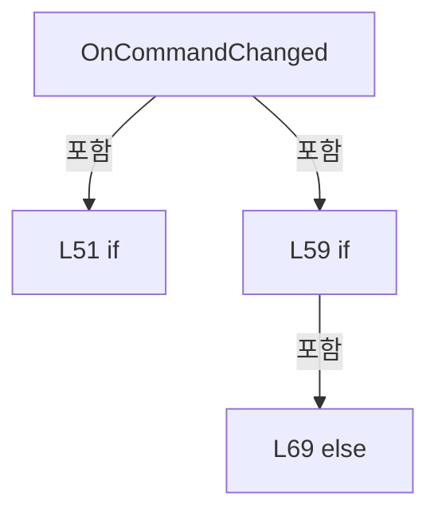

변경 전 점검: 입력/반환 타입, 위 호출자, 예외/취소 경로, 공유 상태와 저장·전송 소비자를 함께 확인합니다. 값의 단위나 물리 방향을 이름만으로 확정하지 않습니다.

### MethodDeclaration `Element_Loaded` · L75–88

[Drilling.UI/Menu/CButtonCommand.cs:75–88](https://github.com/kjuws10-rgb/A3Drilling/blob/0219666f9053b907d96d7e0aa7d0c6c1be3a73d4/Drilling.UI/Menu/CButtonCommand.cs#L75-L88)

| 항목 | 실제 추출 값 |
| --- | --- |
| 서명 | void Drilling.UI.Menu.CButtonCommandBehavior.Element_Loaded(object, RoutedEventArgs) |
| 접근/수식자 | Private / private, static |
| 반환/값 타입 | void |
| 소속 타입 | NamedType:Drilling.UI.Menu.CButtonCommandBehavior |

입력 계약:

| 이름 | 타입 | 전달 | 선택/기본값 |
| --- | --- | --- | --- |
| sender | object | None | False /  |
| eventArgs | RoutedEventArgs | None | False /  |

현재 부분 분석에서 직접 연결된 호출자는 없습니다. XAML/이벤트/인터페이스·델리게이트·외부 진입을 추가 확인해야 하며, 미사용으로 판정한 것이 아닙니다.

호출하는 대상과 해석 범위:

| 원본 행 | 표현식 | 분석 상태 | 대상/소스 위치 |
| --- | --- | --- | --- |
| 82 | GetCommand | candidate | OverloadResolutionFailure |
| 85 | AttachElement | candidate | OverloadResolutionFailure |
| 86 | UpdateTargetState | candidate | OverloadResolutionFailure |

본문의 실제 연산·분기·예외·반환 순서(원문 위치 순):

| 원본 행 | 종류 | 주석 해설 |
| --- | --- | --- |
| 77 | if | 조건에 따라 분기합니다: if (sender is not FrameworkElement element) |
| 79 | return | 호출자에게 값 또는 제어를 반환합니다: return; |
| 82 | call | 함수·델리게이트 또는 객체 생성자를 호출합니다: GetCommand(element) |
| 82 | local-declaration | 지역 변수를 선언합니다: var command = GetCommand(element); |
| 82 | variable-initializer | 변수의 초기값을 지정합니다: command = GetCommand(element) |
| 83 | if | 조건에 따라 분기합니다: if (command is not null) |
| 85 | call | 함수·델리게이트 또는 객체 생성자를 호출합니다: AttachElement(element, command) |
| 86 | call | 함수·델리게이트 또는 객체 생성자를 호출합니다: UpdateTargetState(element, command) |

제어 구문의 포함 구조(실제 실행 순서/CFG가 아닌 구문 탐색 그림):

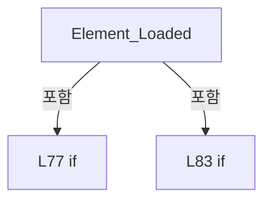

변경 전 점검: 입력/반환 타입, 위 호출자, 예외/취소 경로, 공유 상태와 저장·전송 소비자를 함께 확인합니다. 값의 단위나 물리 방향을 이름만으로 확정하지 않습니다.

### MethodDeclaration `Element_Unloaded` · L90–96

[Drilling.UI/Menu/CButtonCommand.cs:90–96](https://github.com/kjuws10-rgb/A3Drilling/blob/0219666f9053b907d96d7e0aa7d0c6c1be3a73d4/Drilling.UI/Menu/CButtonCommand.cs#L90-L96)

| 항목 | 실제 추출 값 |
| --- | --- |
| 서명 | void Drilling.UI.Menu.CButtonCommandBehavior.Element_Unloaded(object, RoutedEventArgs) |
| 접근/수식자 | Private / private, static |
| 반환/값 타입 | void |
| 소속 타입 | NamedType:Drilling.UI.Menu.CButtonCommandBehavior |

입력 계약:

| 이름 | 타입 | 전달 | 선택/기본값 |
| --- | --- | --- | --- |
| sender | object | None | False /  |
| eventArgs | RoutedEventArgs | None | False /  |

현재 부분 분석에서 직접 연결된 호출자는 없습니다. XAML/이벤트/인터페이스·델리게이트·외부 진입을 추가 확인해야 하며, 미사용으로 판정한 것이 아닙니다.

호출하는 대상과 해석 범위:

| 원본 행 | 표현식 | 분석 상태 | 대상/소스 위치 |
| --- | --- | --- | --- |
| 94 | DetachElement | candidate | OverloadResolutionFailure |
| 94 | GetCommand | candidate | OverloadResolutionFailure |

본문의 실제 연산·분기·예외·반환 순서(원문 위치 순):

| 원본 행 | 종류 | 주석 해설 |
| --- | --- | --- |
| 92 | if | 조건에 따라 분기합니다: if (sender is FrameworkElement element) |
| 94 | call | 함수·델리게이트 또는 객체 생성자를 호출합니다: DetachElement(element, GetCommand(element)) |
| 94 | call | 함수·델리게이트 또는 객체 생성자를 호출합니다: GetCommand(element) |

제어 구문의 포함 구조(실제 실행 순서/CFG가 아닌 구문 탐색 그림):

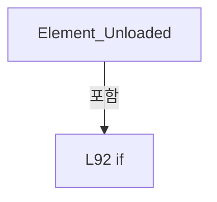

변경 전 점검: 입력/반환 타입, 위 호출자, 예외/취소 경로, 공유 상태와 저장·전송 소비자를 함께 확인합니다. 값의 단위나 물리 방향을 이름만으로 확정하지 않습니다.

### MethodDeclaration `AttachElement` · L98–113

[Drilling.UI/Menu/CButtonCommand.cs:98–113](https://github.com/kjuws10-rgb/A3Drilling/blob/0219666f9053b907d96d7e0aa7d0c6c1be3a73d4/Drilling.UI/Menu/CButtonCommand.cs#L98-L113)

| 항목 | 실제 추출 값 |
| --- | --- |
| 서명 | void Drilling.UI.Menu.CButtonCommandBehavior.AttachElement(UIElement, Drilling.UI.Menu.CButtonCommand) |
| 접근/수식자 | Private / private, static |
| 반환/값 타입 | void |
| 소속 타입 | NamedType:Drilling.UI.Menu.CButtonCommandBehavior |

입력 계약:

| 이름 | 타입 | 전달 | 선택/기본값 |
| --- | --- | --- | --- |
| element | UIElement | None | False /  |
| command | Drilling.UI.Menu.CButtonCommand | None | False /  |

현재 부분 분석에서 직접 연결된 호출자는 없습니다. XAML/이벤트/인터페이스·델리게이트·외부 진입을 추가 확인해야 하며, 미사용으로 판정한 것이 아닙니다.

호출하는 대상과 해석 범위:

| 원본 행 | 표현식 | 분석 상태 | 대상/소스 위치 |
| --- | --- | --- | --- |
| 100 | RegisterTarget | resolved | void Drilling.UI.Menu.CButtonCommandBehavior.RegisterTarget(Drilling.UI.Menu.CButtonCommand, UIElement) · Drilling.UI/Menu/CButtonCommand.cs:133 |
| 105 | CommandParameterDescriptor.RemoveValueChanged | unresolved | None |
| 106 | CommandParameterDescriptor.AddValueChanged | unresolved | None |

본문의 실제 연산·분기·예외·반환 순서(원문 위치 순):

| 원본 행 | 종류 | 주석 해설 |
| --- | --- | --- |
| 100 | call | 함수·델리게이트 또는 객체 생성자를 호출합니다: RegisterTarget(command, element) |
| 101 | if | 조건에 따라 분기합니다: if (element is ButtonBase button) |
| 103 | compound-assignment-or-event-subscription | 복합 대입 또는 이벤트 구독/해지 표현입니다: button.Click -= Button_Click |
| 104 | compound-assignment-or-event-subscription | 복합 대입 또는 이벤트 구독/해지 표현입니다: button.Click += Button_Click |
| 105 | call | 함수·델리게이트 또는 객체 생성자를 호출합니다: CommandParameterDescriptor.RemoveValueChanged(button, ButtonCommandParameterChanged) |
| 106 | call | 함수·델리게이트 또는 객체 생성자를 호출합니다: CommandParameterDescriptor.AddValueChanged(button, ButtonCommandParameterChanged) |
| 108 | else | 앞 조건이 거짓인 경로입니다: else |
| 110 | compound-assignment-or-event-subscription | 복합 대입 또는 이벤트 구독/해지 표현입니다: element.MouseLeftButtonDown -= Element_MouseLeftButtonDown |
| 111 | compound-assignment-or-event-subscription | 복합 대입 또는 이벤트 구독/해지 표현입니다: element.MouseLeftButtonDown += Element_MouseLeftButtonDown |

제어 구문의 포함 구조(실제 실행 순서/CFG가 아닌 구문 탐색 그림):

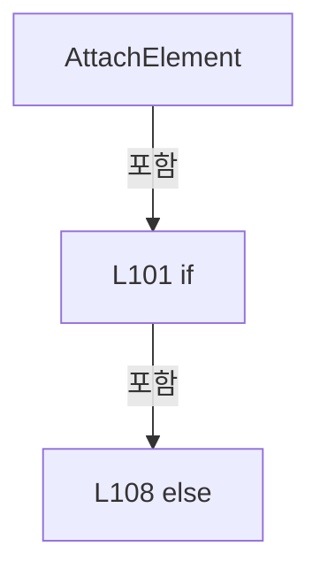

변경 전 점검: 입력/반환 타입, 위 호출자, 예외/취소 경로, 공유 상태와 저장·전송 소비자를 함께 확인합니다. 값의 단위나 물리 방향을 이름만으로 확정하지 않습니다.

### MethodDeclaration `DetachElement` · L115–131

[Drilling.UI/Menu/CButtonCommand.cs:115–131](https://github.com/kjuws10-rgb/A3Drilling/blob/0219666f9053b907d96d7e0aa7d0c6c1be3a73d4/Drilling.UI/Menu/CButtonCommand.cs#L115-L131)

| 항목 | 실제 추출 값 |
| --- | --- |
| 서명 | void Drilling.UI.Menu.CButtonCommandBehavior.DetachElement(UIElement, Drilling.UI.Menu.CButtonCommand?) |
| 접근/수식자 | Private / private, static |
| 반환/값 타입 | void |
| 소속 타입 | NamedType:Drilling.UI.Menu.CButtonCommandBehavior |

입력 계약:

| 이름 | 타입 | 전달 | 선택/기본값 |
| --- | --- | --- | --- |
| element | UIElement | None | False /  |
| command | Drilling.UI.Menu.CButtonCommand? | None | False /  |

현재 부분 분석에서 직접 연결된 호출자는 없습니다. XAML/이벤트/인터페이스·델리게이트·외부 진입을 추가 확인해야 하며, 미사용으로 판정한 것이 아닙니다.

호출하는 대상과 해석 범위:

| 원본 행 | 표현식 | 분석 상태 | 대상/소스 위치 |
| --- | --- | --- | --- |
| 120 | CommandParameterDescriptor.RemoveValueChanged | unresolved | None |
| 129 | UnregisterTarget | resolved | void Drilling.UI.Menu.CButtonCommandBehavior.UnregisterTarget(Drilling.UI.Menu.CButtonCommand, UIElement) · Drilling.UI/Menu/CButtonCommand.cs:145 |

본문의 실제 연산·분기·예외·반환 순서(원문 위치 순):

| 원본 행 | 종류 | 주석 해설 |
| --- | --- | --- |
| 117 | if | 조건에 따라 분기합니다: if (element is ButtonBase button) |
| 119 | compound-assignment-or-event-subscription | 복합 대입 또는 이벤트 구독/해지 표현입니다: button.Click -= Button_Click |
| 120 | call | 함수·델리게이트 또는 객체 생성자를 호출합니다: CommandParameterDescriptor.RemoveValueChanged(button, ButtonCommandParameterChanged) |
| 122 | else | 앞 조건이 거짓인 경로입니다: else |
| 124 | compound-assignment-or-event-subscription | 복합 대입 또는 이벤트 구독/해지 표현입니다: element.MouseLeftButtonDown -= Element_MouseLeftButtonDown |
| 127 | if | 조건에 따라 분기합니다: if (command is not null) |
| 129 | call | 함수·델리게이트 또는 객체 생성자를 호출합니다: UnregisterTarget(command, element) |

제어 구문의 포함 구조(실제 실행 순서/CFG가 아닌 구문 탐색 그림):

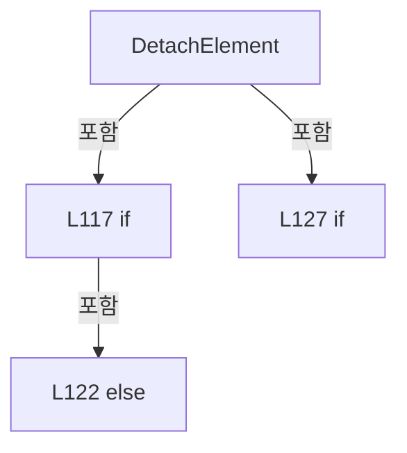

변경 전 점검: 입력/반환 타입, 위 호출자, 예외/취소 경로, 공유 상태와 저장·전송 소비자를 함께 확인합니다. 값의 단위나 물리 방향을 이름만으로 확정하지 않습니다.

### MethodDeclaration `RegisterTarget` · L133–143

[Drilling.UI/Menu/CButtonCommand.cs:133–143](https://github.com/kjuws10-rgb/A3Drilling/blob/0219666f9053b907d96d7e0aa7d0c6c1be3a73d4/Drilling.UI/Menu/CButtonCommand.cs#L133-L143)

| 항목 | 실제 추출 값 |
| --- | --- |
| 서명 | void Drilling.UI.Menu.CButtonCommandBehavior.RegisterTarget(Drilling.UI.Menu.CButtonCommand, UIElement) |
| 접근/수식자 | Private / private, static |
| 반환/값 타입 | void |
| 소속 타입 | NamedType:Drilling.UI.Menu.CButtonCommandBehavior |

입력 계약:

| 이름 | 타입 | 전달 | 선택/기본값 |
| --- | --- | --- | --- |
| command | Drilling.UI.Menu.CButtonCommand | None | False /  |
| element | UIElement | None | False /  |

정적 호출자로 확인된 위치:

| 호출 파일/행 | 호출 표현식 | 런타임 분기 가능 |
| --- | --- | --- |
| [Drilling.UI/Menu/CButtonCommand.cs:100–100](https://github.com/kjuws10-rgb/A3Drilling/blob/0219666f9053b907d96d7e0aa7d0c6c1be3a73d4/Drilling.UI/Menu/CButtonCommand.cs#L100-L100) | RegisterTarget | False |

호출하는 대상과 해석 범위:

| 원본 행 | 표현식 | 분석 상태 | 대상/소스 위치 |
| --- | --- | --- | --- |
| 135 | RegisteredTargets.TryGetValue | resolved | bool System.Collections.Generic.Dictionary<Drilling.UI.Menu.CButtonCommand, System.Collections.Generic.HashSet<UIElement>>.TryGetValue(Drilling.UI.Menu.CButtonCommand, out System.Collections.Generic.HashSet<UIElement>) |
| 138 | RegisteredTargets.Add | resolved | void System.Collections.Generic.Dictionary<Drilling.UI.Menu.CButtonCommand, System.Collections.Generic.HashSet<UIElement>>.Add(Drilling.UI.Menu.CButtonCommand, System.Collections.Generic.HashSet<UIElement>) |
| 142 | targets.Add | resolved | bool System.Collections.Generic.HashSet<UIElement>.Add(UIElement) |

본문의 실제 연산·분기·예외·반환 순서(원문 위치 순):

| 원본 행 | 종류 | 주석 해설 |
| --- | --- | --- |
| 135 | call | 함수·델리게이트 또는 객체 생성자를 호출합니다: RegisteredTargets.TryGetValue(command, out var targets) |
| 135 | if | 조건에 따라 분기합니다: if (!RegisteredTargets.TryGetValue(command, out var targets)) |
| 137 | assignment | 값을 대상에 대입합니다: targets = [] |
| 138 | call | 함수·델리게이트 또는 객체 생성자를 호출합니다: RegisteredTargets.Add(command, targets) |
| 139 | compound-assignment-or-event-subscription | 복합 대입 또는 이벤트 구독/해지 표현입니다: command.CanExecuteChanged += Command_CanExecuteChanged |
| 142 | call | 함수·델리게이트 또는 객체 생성자를 호출합니다: targets.Add(element) |

제어 구문의 포함 구조(실제 실행 순서/CFG가 아닌 구문 탐색 그림):

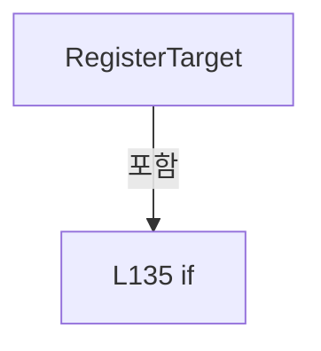

변경 전 점검: 입력/반환 타입, 위 호출자, 예외/취소 경로, 공유 상태와 저장·전송 소비자를 함께 확인합니다. 값의 단위나 물리 방향을 이름만으로 확정하지 않습니다.

### MethodDeclaration `UnregisterTarget` · L145–158

[Drilling.UI/Menu/CButtonCommand.cs:145–158](https://github.com/kjuws10-rgb/A3Drilling/blob/0219666f9053b907d96d7e0aa7d0c6c1be3a73d4/Drilling.UI/Menu/CButtonCommand.cs#L145-L158)

| 항목 | 실제 추출 값 |
| --- | --- |
| 서명 | void Drilling.UI.Menu.CButtonCommandBehavior.UnregisterTarget(Drilling.UI.Menu.CButtonCommand, UIElement) |
| 접근/수식자 | Private / private, static |
| 반환/값 타입 | void |
| 소속 타입 | NamedType:Drilling.UI.Menu.CButtonCommandBehavior |

입력 계약:

| 이름 | 타입 | 전달 | 선택/기본값 |
| --- | --- | --- | --- |
| command | Drilling.UI.Menu.CButtonCommand | None | False /  |
| element | UIElement | None | False /  |

정적 호출자로 확인된 위치:

| 호출 파일/행 | 호출 표현식 | 런타임 분기 가능 |
| --- | --- | --- |
| [Drilling.UI/Menu/CButtonCommand.cs:129–129](https://github.com/kjuws10-rgb/A3Drilling/blob/0219666f9053b907d96d7e0aa7d0c6c1be3a73d4/Drilling.UI/Menu/CButtonCommand.cs#L129-L129) | UnregisterTarget | False |

호출하는 대상과 해석 범위:

| 원본 행 | 표현식 | 분석 상태 | 대상/소스 위치 |
| --- | --- | --- | --- |
| 147 | RegisteredTargets.TryGetValue | resolved | bool System.Collections.Generic.Dictionary<Drilling.UI.Menu.CButtonCommand, System.Collections.Generic.HashSet<UIElement>>.TryGetValue(Drilling.UI.Menu.CButtonCommand, out System.Collections.Generic.HashSet<UIElement>) |
| 152 | targets.Remove | resolved | bool System.Collections.Generic.HashSet<UIElement>.Remove(UIElement) |
| 156 | RegisteredTargets.Remove | resolved | bool System.Collections.Generic.Dictionary<Drilling.UI.Menu.CButtonCommand, System.Collections.Generic.HashSet<UIElement>>.Remove(Drilling.UI.Menu.CButtonCommand) |

본문의 실제 연산·분기·예외·반환 순서(원문 위치 순):

| 원본 행 | 종류 | 주석 해설 |
| --- | --- | --- |
| 147 | call | 함수·델리게이트 또는 객체 생성자를 호출합니다: RegisteredTargets.TryGetValue(command, out var targets) |
| 147 | if | 조건에 따라 분기합니다: if (!RegisteredTargets.TryGetValue(command, out var targets)) |
| 149 | return | 호출자에게 값 또는 제어를 반환합니다: return; |
| 152 | call | 함수·델리게이트 또는 객체 생성자를 호출합니다: targets.Remove(element) |
| 153 | if | 조건에 따라 분기합니다: if (targets.Count == 0) |
| 155 | compound-assignment-or-event-subscription | 복합 대입 또는 이벤트 구독/해지 표현입니다: command.CanExecuteChanged -= Command_CanExecuteChanged |
| 156 | call | 함수·델리게이트 또는 객체 생성자를 호출합니다: RegisteredTargets.Remove(command) |

제어 구문의 포함 구조(실제 실행 순서/CFG가 아닌 구문 탐색 그림):

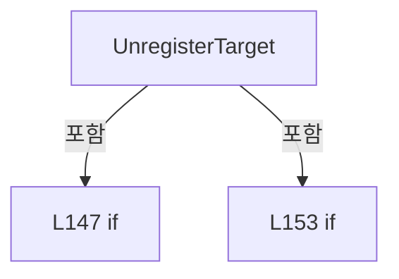

변경 전 점검: 입력/반환 타입, 위 호출자, 예외/취소 경로, 공유 상태와 저장·전송 소비자를 함께 확인합니다. 값의 단위나 물리 방향을 이름만으로 확정하지 않습니다.

### MethodDeclaration `Element_MouseLeftButtonDown` · L160–180

[Drilling.UI/Menu/CButtonCommand.cs:160–180](https://github.com/kjuws10-rgb/A3Drilling/blob/0219666f9053b907d96d7e0aa7d0c6c1be3a73d4/Drilling.UI/Menu/CButtonCommand.cs#L160-L180)

| 항목 | 실제 추출 값 |
| --- | --- |
| 서명 | void Drilling.UI.Menu.CButtonCommandBehavior.Element_MouseLeftButtonDown(object, RoutedEventArgs) |
| 접근/수식자 | Private / private, static |
| 반환/값 타입 | void |
| 소속 타입 | NamedType:Drilling.UI.Menu.CButtonCommandBehavior |

입력 계약:

| 이름 | 타입 | 전달 | 선택/기본값 |
| --- | --- | --- | --- |
| sender | object | None | False /  |
| eventArgs | RoutedEventArgs | None | False /  |

현재 부분 분석에서 직접 연결된 호출자는 없습니다. XAML/이벤트/인터페이스·델리게이트·외부 진입을 추가 확인해야 하며, 미사용으로 판정한 것이 아닙니다.

호출하는 대상과 해석 범위:

| 원본 행 | 표현식 | 분석 상태 | 대상/소스 위치 |
| --- | --- | --- | --- |
| 167 | ReferenceEquals | candidate | OverloadResolutionFailure |
| 167 | VisualTreeHelper.GetParent | unresolved | None |
| 175 | GetCommand | candidate | OverloadResolutionFailure |
| 176 | command.CanExecute | resolved | bool Drilling.UI.Menu.CButtonCommand.CanExecute(object?) · Drilling.UI/Menu/CButtonCommand.cs:14 |
| 178 | command.Execute | resolved | void Drilling.UI.Menu.CButtonCommand.Execute(object?) · Drilling.UI/Menu/CButtonCommand.cs:19 |

본문의 실제 연산·분기·예외·반환 순서(원문 위치 순):

| 원본 행 | 종류 | 주석 해설 |
| --- | --- | --- |
| 162 | if | 조건에 따라 분기합니다: if (sender is not UIElement element) |
| 164 | return | 호출자에게 값 또는 제어를 반환합니다: return; |
| 167 | assignment | 값을 대상에 대입합니다: source = VisualTreeHelper.GetParent(source) |
| 167 | call | 함수·델리게이트 또는 객체 생성자를 호출합니다: ReferenceEquals(source, element) |
| 167 | call | 함수·델리게이트 또는 객체 생성자를 호출합니다: VisualTreeHelper.GetParent(source) |
| 167 | variable-initializer | 변수의 초기값을 지정합니다: source = eventArgs.OriginalSource as DependencyObject |
| 167 | for | 초기화·조건·증감이 있는 반복입니다: for (var source = eventArgs.OriginalSource as DependencyObject; source is not null && !ReferenceEquals(source, element); source = VisualTreeHelper.GetParent(source)) |
| 169 | if | 조건에 따라 분기합니다: if (source is ButtonBase) |
| 171 | return | 호출자에게 값 또는 제어를 반환합니다: return; |
| 175 | call | 함수·델리게이트 또는 객체 생성자를 호출합니다: GetCommand(element) |
| 175 | local-declaration | 지역 변수를 선언합니다: var command = GetCommand(element); |
| 175 | variable-initializer | 변수의 초기값을 지정합니다: command = GetCommand(element) |
| 176 | call | 함수·델리게이트 또는 객체 생성자를 호출합니다: command.CanExecute(null) |
| 176 | if | 조건에 따라 분기합니다: if (command is not null && command.CanExecute(null)) |
| 178 | call | 함수·델리게이트 또는 객체 생성자를 호출합니다: command.Execute(null) |

제어 구문의 포함 구조(실제 실행 순서/CFG가 아닌 구문 탐색 그림):

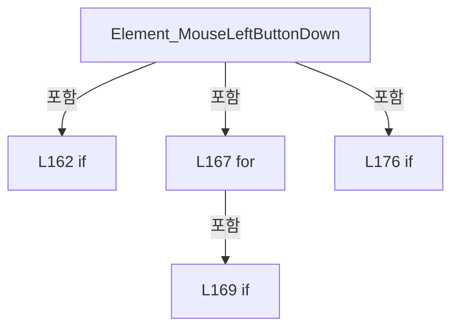

변경 전 점검: 입력/반환 타입, 위 호출자, 예외/취소 경로, 공유 상태와 저장·전송 소비자를 함께 확인합니다. 값의 단위나 물리 방향을 이름만으로 확정하지 않습니다.

### MethodDeclaration `Button_Click` · L182–195

[Drilling.UI/Menu/CButtonCommand.cs:182–195](https://github.com/kjuws10-rgb/A3Drilling/blob/0219666f9053b907d96d7e0aa7d0c6c1be3a73d4/Drilling.UI/Menu/CButtonCommand.cs#L182-L195)

| 항목 | 실제 추출 값 |
| --- | --- |
| 서명 | void Drilling.UI.Menu.CButtonCommandBehavior.Button_Click(object, RoutedEventArgs) |
| 접근/수식자 | Private / private, static |
| 반환/값 타입 | void |
| 소속 타입 | NamedType:Drilling.UI.Menu.CButtonCommandBehavior |

입력 계약:

| 이름 | 타입 | 전달 | 선택/기본값 |
| --- | --- | --- | --- |
| sender | object | None | False /  |
| eventArgs | RoutedEventArgs | None | False /  |

현재 부분 분석에서 직접 연결된 호출자는 없습니다. XAML/이벤트/인터페이스·델리게이트·외부 진입을 추가 확인해야 하며, 미사용으로 판정한 것이 아닙니다.

호출하는 대상과 해석 범위:

| 원본 행 | 표현식 | 분석 상태 | 대상/소스 위치 |
| --- | --- | --- | --- |
| 189 | GetCommand | candidate | OverloadResolutionFailure |
| 191 | command.CanExecute | candidate | OverloadResolutionFailure |
| 193 | command.Execute | candidate | OverloadResolutionFailure |

본문의 실제 연산·분기·예외·반환 순서(원문 위치 순):

| 원본 행 | 종류 | 주석 해설 |
| --- | --- | --- |
| 184 | if | 조건에 따라 분기합니다: if (sender is not ButtonBase button) |
| 186 | return | 호출자에게 값 또는 제어를 반환합니다: return; |
| 189 | call | 함수·델리게이트 또는 객체 생성자를 호출합니다: GetCommand(button) |
| 189 | local-declaration | 지역 변수를 선언합니다: var command = GetCommand(button); |
| 189 | variable-initializer | 변수의 초기값을 지정합니다: command = GetCommand(button) |
| 190 | local-declaration | 지역 변수를 선언합니다: var parameter = button.CommandParameter; |
| 190 | variable-initializer | 변수의 초기값을 지정합니다: parameter = button.CommandParameter |
| 191 | call | 함수·델리게이트 또는 객체 생성자를 호출합니다: command.CanExecute(parameter) |
| 191 | if | 조건에 따라 분기합니다: if (command is not null && command.CanExecute(parameter)) |
| 193 | call | 함수·델리게이트 또는 객체 생성자를 호출합니다: command.Execute(parameter) |

제어 구문의 포함 구조(실제 실행 순서/CFG가 아닌 구문 탐색 그림):

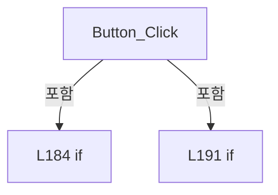

변경 전 점검: 입력/반환 타입, 위 호출자, 예외/취소 경로, 공유 상태와 저장·전송 소비자를 함께 확인합니다. 값의 단위나 물리 방향을 이름만으로 확정하지 않습니다.

### MethodDeclaration `Command_CanExecuteChanged` · L197–208

[Drilling.UI/Menu/CButtonCommand.cs:197–208](https://github.com/kjuws10-rgb/A3Drilling/blob/0219666f9053b907d96d7e0aa7d0c6c1be3a73d4/Drilling.UI/Menu/CButtonCommand.cs#L197-L208)

| 항목 | 실제 추출 값 |
| --- | --- |
| 서명 | void Drilling.UI.Menu.CButtonCommandBehavior.Command_CanExecuteChanged(object?, System.EventArgs) |
| 접근/수식자 | Private / private, static |
| 반환/값 타입 | void |
| 소속 타입 | NamedType:Drilling.UI.Menu.CButtonCommandBehavior |

입력 계약:

| 이름 | 타입 | 전달 | 선택/기본값 |
| --- | --- | --- | --- |
| sender | object? | None | False /  |
| eventArgs | System.EventArgs | None | False /  |

현재 부분 분석에서 직접 연결된 호출자는 없습니다. XAML/이벤트/인터페이스·델리게이트·외부 진입을 추가 확인해야 하며, 미사용으로 판정한 것이 아닙니다.

호출하는 대상과 해석 범위:

| 원본 행 | 표현식 | 분석 상태 | 대상/소스 위치 |
| --- | --- | --- | --- |
| 199 | RegisteredTargets.TryGetValue | resolved | bool System.Collections.Generic.Dictionary<Drilling.UI.Menu.CButtonCommand, System.Collections.Generic.HashSet<UIElement>>.TryGetValue(Drilling.UI.Menu.CButtonCommand, out System.Collections.Generic.HashSet<UIElement>) |
| 206 | UpdateTargetState | resolved | void Drilling.UI.Menu.CButtonCommandBehavior.UpdateTargetState(UIElement, Drilling.UI.Menu.CButtonCommand) · Drilling.UI/Menu/CButtonCommand.cs:224 |

본문의 실제 연산·분기·예외·반환 순서(원문 위치 순):

| 원본 행 | 종류 | 주석 해설 |
| --- | --- | --- |
| 199 | call | 함수·델리게이트 또는 객체 생성자를 호출합니다: RegisteredTargets.TryGetValue(command, out var targets) |
| 199 | if | 조건에 따라 분기합니다: if (sender is not CButtonCommand command &#124;&#124; !RegisteredTargets.TryGetValue(command, out var targets)) |
| 201 | return | 호출자에게 값 또는 제어를 반환합니다: return; |
| 204 | foreach | 컬렉션 요소를 순회합니다: foreach (var element in targets) |
| 206 | call | 함수·델리게이트 또는 객체 생성자를 호출합니다: UpdateTargetState(element, command) |

제어 구문의 포함 구조(실제 실행 순서/CFG가 아닌 구문 탐색 그림):

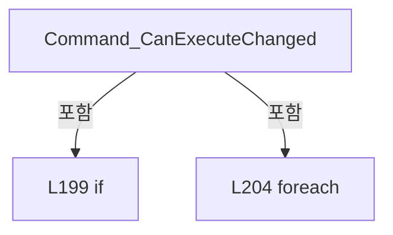

변경 전 점검: 입력/반환 타입, 위 호출자, 예외/취소 경로, 공유 상태와 저장·전송 소비자를 함께 확인합니다. 값의 단위나 물리 방향을 이름만으로 확정하지 않습니다.

### MethodDeclaration `ButtonCommandParameterChanged` · L210–222

[Drilling.UI/Menu/CButtonCommand.cs:210–222](https://github.com/kjuws10-rgb/A3Drilling/blob/0219666f9053b907d96d7e0aa7d0c6c1be3a73d4/Drilling.UI/Menu/CButtonCommand.cs#L210-L222)

| 항목 | 실제 추출 값 |
| --- | --- |
| 서명 | void Drilling.UI.Menu.CButtonCommandBehavior.ButtonCommandParameterChanged(object?, System.EventArgs) |
| 접근/수식자 | Private / private, static |
| 반환/값 타입 | void |
| 소속 타입 | NamedType:Drilling.UI.Menu.CButtonCommandBehavior |

입력 계약:

| 이름 | 타입 | 전달 | 선택/기본값 |
| --- | --- | --- | --- |
| sender | object? | None | False /  |
| eventArgs | System.EventArgs | None | False /  |

현재 부분 분석에서 직접 연결된 호출자는 없습니다. XAML/이벤트/인터페이스·델리게이트·외부 진입을 추가 확인해야 하며, 미사용으로 판정한 것이 아닙니다.

호출하는 대상과 해석 범위:

| 원본 행 | 표현식 | 분석 상태 | 대상/소스 위치 |
| --- | --- | --- | --- |
| 217 | GetCommand | candidate | OverloadResolutionFailure |
| 220 | UpdateTargetState | candidate | OverloadResolutionFailure |

본문의 실제 연산·분기·예외·반환 순서(원문 위치 순):

| 원본 행 | 종류 | 주석 해설 |
| --- | --- | --- |
| 212 | if | 조건에 따라 분기합니다: if (sender is not ButtonBase button) |
| 214 | return | 호출자에게 값 또는 제어를 반환합니다: return; |
| 217 | call | 함수·델리게이트 또는 객체 생성자를 호출합니다: GetCommand(button) |
| 217 | local-declaration | 지역 변수를 선언합니다: var command = GetCommand(button); |
| 217 | variable-initializer | 변수의 초기값을 지정합니다: command = GetCommand(button) |
| 218 | if | 조건에 따라 분기합니다: if (command is not null) |
| 220 | call | 함수·델리게이트 또는 객체 생성자를 호출합니다: UpdateTargetState(button, command) |

제어 구문의 포함 구조(실제 실행 순서/CFG가 아닌 구문 탐색 그림):

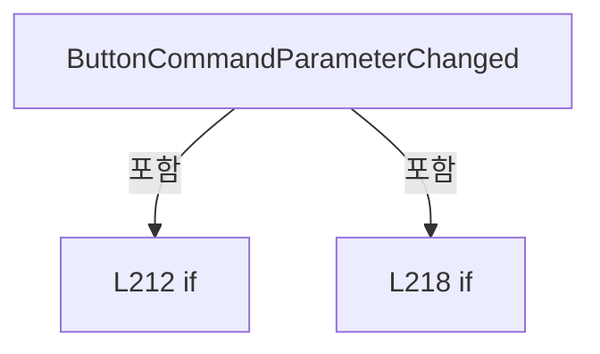

변경 전 점검: 입력/반환 타입, 위 호출자, 예외/취소 경로, 공유 상태와 저장·전송 소비자를 함께 확인합니다. 값의 단위나 물리 방향을 이름만으로 확정하지 않습니다.

### MethodDeclaration `UpdateTargetState` · L224–229

[Drilling.UI/Menu/CButtonCommand.cs:224–229](https://github.com/kjuws10-rgb/A3Drilling/blob/0219666f9053b907d96d7e0aa7d0c6c1be3a73d4/Drilling.UI/Menu/CButtonCommand.cs#L224-L229)

| 항목 | 실제 추출 값 |
| --- | --- |
| 서명 | void Drilling.UI.Menu.CButtonCommandBehavior.UpdateTargetState(UIElement, Drilling.UI.Menu.CButtonCommand) |
| 접근/수식자 | Private / private, static |
| 반환/값 타입 | void |
| 소속 타입 | NamedType:Drilling.UI.Menu.CButtonCommandBehavior |

입력 계약:

| 이름 | 타입 | 전달 | 선택/기본값 |
| --- | --- | --- | --- |
| element | UIElement | None | False /  |
| command | Drilling.UI.Menu.CButtonCommand | None | False /  |

정적 호출자로 확인된 위치:

| 호출 파일/행 | 호출 표현식 | 런타임 분기 가능 |
| --- | --- | --- |
| [Drilling.UI/Menu/CButtonCommand.cs:206–206](https://github.com/kjuws10-rgb/A3Drilling/blob/0219666f9053b907d96d7e0aa7d0c6c1be3a73d4/Drilling.UI/Menu/CButtonCommand.cs#L206-L206) | UpdateTargetState | False |

호출하는 대상과 해석 범위:

| 원본 행 | 표현식 | 분석 상태 | 대상/소스 위치 |
| --- | --- | --- | --- |
| 227 | command.CanExecute | candidate | OverloadResolutionFailure |
| 228 | element.SetCurrentValue | unresolved | None |

본문의 실제 연산·분기·예외·반환 순서(원문 위치 순):

| 원본 행 | 종류 | 주석 해설 |
| --- | --- | --- |
| 226 | conditional-expression | 조건에 따라 결과식을 선택합니다: element is ButtonBase button ? button.CommandParameter : null |
| 226 | local-declaration | 지역 변수를 선언합니다: var parameter = element is ButtonBase button ? button.CommandParameter : null; |
| 226 | variable-initializer | 변수의 초기값을 지정합니다: parameter = element is ButtonBase button ? button.CommandParameter : null |
| 227 | call | 함수·델리게이트 또는 객체 생성자를 호출합니다: command.CanExecute(parameter) |
| 227 | local-declaration | 지역 변수를 선언합니다: var canExecute = command.CanExecute(parameter); |
| 227 | variable-initializer | 변수의 초기값을 지정합니다: canExecute = command.CanExecute(parameter) |
| 228 | call | 함수·델리게이트 또는 객체 생성자를 호출합니다: element.SetCurrentValue(UIElement.IsEnabledProperty, canExecute) |

변경 전 점검: 입력/반환 타입, 위 호출자, 예외/취소 경로, 공유 상태와 저장·전송 소비자를 함께 확인합니다. 값의 단위나 물리 방향을 이름만으로 확정하지 않습니다.

## 구문·바인딩 한계

전체 WPF/벤더 SDK/프로젝트별 빌드 조건을 로드한 정식 빌드가 아닙니다. `resolved`는 이 부분 컴파일에서의 심볼 연결이며 virtual/interface/delegate/이벤트/Reflection/XAML의 실제 런타임 구현을 확정하지 않습니다. `candidate`와 `unresolved`는 후속 확인 대상으로 남깁니다.

## 원문 전체 주석 해설본

[원본 모든 행과 행별 해설 보기](../../../annotated/Drilling.UI/Menu/CButtonCommand.cs.annotated.txt)

원본을 빠뜨리거나 임의로 줄이지 않았습니다. `L000001 |` 표시는 원본 행 번호, `// 해설`은 별도 설명입니다. 실행용 소스가 아닌 문서입니다.

## 수정·재검증 체크

- 원본 Commit과 현재 작업 파일 SHA가 같은지 먼저 확인합니다. 다르면 이 문서를 과거 버전 자료로 취급합니다.
- 선언·직접 호출·이벤트/인터페이스 경계·설정 소비를 함께 확인합니다. 정적 연결의 빈 곳을 정상 경로로 추정하지 않습니다.
- 저장 형식/단위/식별자·재시도·취소·예외·롤백에 영향을 주는 변경은 상세 해설장과 호출자를 다시 검토합니다.
- 도구의 구문 추출과 별도 정적 추적 해설, 실제 빌드·시뮬레이션·실장비 검증 결과를 분리합니다.
