# Drilling.UI/Menu/CButtonCommand.cs

| 항목 | 내용 |
| --- | --- |
| 원본 저장소 | https://github.com/kjuws10-rgb/A3Drilling.git |
| 원본 Commit | 5aee8e58439c9b455cae7c9593c9be986c3e682e |
| 원본 SHA256 | 0670811aea72aaf0eec286af14a298c5308ded85f4c7677e4953c85f46ecc856 |
| 파일 분류 | code |
| 원본 크기/행 | 8,209 bytes / 231 physical lines |
| 인코딩 | utf-8-sig |
| 검토 범위 | 구문/부분 의미 분석에서 추출한 사실. 동작·물리 단위·실장비 합격을 보증하지 않습니다. |
| 원본 링크 | [고정 Commit 원본](https://github.com/kjuws10-rgb/A3Drilling/blob/5aee8e58439c9b455cae7c9593c9be986c3e682e/Drilling.UI/Menu/CButtonCommand.cs) |

## 파일의 역할과 읽는 순서

WPF 화면·사용자 명령·표시 상태를 구성합니다. XAML 이벤트와 코드 비하인드, RootView의 조립 경로를 함께 추적합니다.

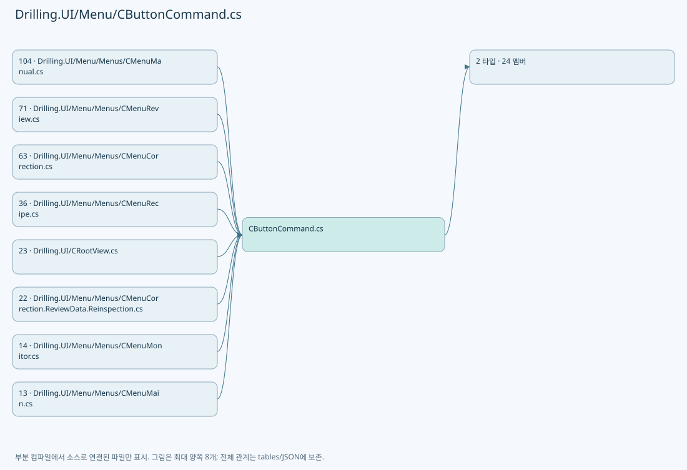

## 네임스페이스·타입·상속

| 타입 | 구분 | 원본 범위 | 선언/상속 |
| --- | --- | --- | --- |
| CButtonCommand | ClassDeclaration | 9–32 | CButtonCommand: ICommand |
| CButtonCommandBehavior | ClassDeclaration | 34–230 | CButtonCommandBehavior |

## 멤버 빠른 목록

| 이름 | 종류 | 범위 | 서명 |
| --- | --- | --- | --- |
| NoOp | PropertyDeclaration | L11–11 | Drilling.UI.Menu.CButtonCommand Drilling.UI.Menu.CButtonCommand.NoOp |
| get_NoOp | GetAccessorDeclaration | L11–11 | Drilling.UI.Menu.CButtonCommand Drilling.UI.Menu.CButtonCommand.NoOp.get |
| CanExecuteChanged | EventFieldDeclaration | L13–13 | System.EventHandler? Drilling.UI.Menu.CButtonCommand.CanExecuteChanged |
| CanExecute | MethodDeclaration | L14–17 | bool Drilling.UI.Menu.CButtonCommand.CanExecute(object?) |
| Execute | MethodDeclaration | L19–22 | void Drilling.UI.Menu.CButtonCommand.Execute(object?) |
| NotifyCanExecuteChanged | MethodDeclaration | L24–27 | void Drilling.UI.Menu.CButtonCommand.NotifyCanExecuteChanged() |
| DoNothing | MethodDeclaration | L29–31 | void Drilling.UI.Menu.CButtonCommand.DoNothing(object?) |
| RegisteredTargets | FieldDeclaration | L36–36 | System.Collections.Generic.Dictionary<Drilling.UI.Menu.CButtonCommand, System.Collections.Generic.HashSet<UIElement>> Drilling.UI.Menu.CButtonCommandBehavior.RegisteredTargets |
| CommandParameterDescriptor | FieldDeclaration | L37–37 | DependencyPropertyDescriptor Drilling.UI.Menu.CButtonCommandBehavior.CommandParameterDescriptor |
| CommandProperty | FieldDeclaration | L38–38 | DependencyProperty Drilling.UI.Menu.CButtonCommandBehavior.CommandProperty |
| GetCommand | MethodDeclaration | L39–42 | Drilling.UI.Menu.CButtonCommand? Drilling.UI.Menu.CButtonCommandBehavior.GetCommand(DependencyObject) |
| SetCommand | MethodDeclaration | L44–47 | void Drilling.UI.Menu.CButtonCommandBehavior.SetCommand(DependencyObject, Drilling.UI.Menu.CButtonCommand?) |
| OnCommandChanged | MethodDeclaration | L49–73 | void Drilling.UI.Menu.CButtonCommandBehavior.OnCommandChanged(DependencyObject, DependencyPropertyChangedEventArgs) |
| Element_Loaded | MethodDeclaration | L75–88 | void Drilling.UI.Menu.CButtonCommandBehavior.Element_Loaded(object, RoutedEventArgs) |
| Element_Unloaded | MethodDeclaration | L90–96 | void Drilling.UI.Menu.CButtonCommandBehavior.Element_Unloaded(object, RoutedEventArgs) |
| AttachElement | MethodDeclaration | L98–113 | void Drilling.UI.Menu.CButtonCommandBehavior.AttachElement(UIElement, Drilling.UI.Menu.CButtonCommand) |
| DetachElement | MethodDeclaration | L115–131 | void Drilling.UI.Menu.CButtonCommandBehavior.DetachElement(UIElement, Drilling.UI.Menu.CButtonCommand?) |
| RegisterTarget | MethodDeclaration | L133–143 | void Drilling.UI.Menu.CButtonCommandBehavior.RegisterTarget(Drilling.UI.Menu.CButtonCommand, UIElement) |
| UnregisterTarget | MethodDeclaration | L145–158 | void Drilling.UI.Menu.CButtonCommandBehavior.UnregisterTarget(Drilling.UI.Menu.CButtonCommand, UIElement) |
| Element_MouseLeftButtonDown | MethodDeclaration | L160–180 | void Drilling.UI.Menu.CButtonCommandBehavior.Element_MouseLeftButtonDown(object, RoutedEventArgs) |
| Button_Click | MethodDeclaration | L182–195 | void Drilling.UI.Menu.CButtonCommandBehavior.Button_Click(object, RoutedEventArgs) |
| Command_CanExecuteChanged | MethodDeclaration | L197–208 | void Drilling.UI.Menu.CButtonCommandBehavior.Command_CanExecuteChanged(object?, System.EventArgs) |
| ButtonCommandParameterChanged | MethodDeclaration | L210–222 | void Drilling.UI.Menu.CButtonCommandBehavior.ButtonCommandParameterChanged(object?, System.EventArgs) |
| UpdateTargetState | MethodDeclaration | L224–229 | void Drilling.UI.Menu.CButtonCommandBehavior.UpdateTargetState(UIElement, Drilling.UI.Menu.CButtonCommand) |

## 멤버별 상세 계약·호출·처리 해설

### PropertyDeclaration `NoOp` · L11–11

[Drilling.UI/Menu/CButtonCommand.cs:11–11](https://github.com/kjuws10-rgb/A3Drilling/blob/5aee8e58439c9b455cae7c9593c9be986c3e682e/Drilling.UI/Menu/CButtonCommand.cs#L11-L11)

| 항목 | 실제 추출 값 |
| --- | --- |
| 서명 | Drilling.UI.Menu.CButtonCommand Drilling.UI.Menu.CButtonCommand.NoOp |
| 접근/수식자 | Public / public, static |
| 반환/값 타입 | Drilling.UI.Menu.CButtonCommand |
| 소속 타입 | NamedType:Drilling.UI.Menu.CButtonCommand |

현재 부분 분석에서 직접 연결된 호출자는 없습니다. XAML/이벤트/인터페이스·델리게이트·외부 진입을 추가 확인해야 하며, 미사용으로 판정한 것이 아닙니다.

호출하는 대상과 해석 범위:

| 원본 행 | 표현식 | 분석 상태 | 대상/소스 위치 |
| --- | --- | --- | --- |
| 11 | new | resolved | Drilling.UI.Menu.CButtonCommand.CButtonCommand(System.Action<object?>, System.Predicate<object?>?) · Drilling.UI/Menu/CButtonCommand.cs:9 |

본문의 실제 연산·분기·예외·반환 순서(원문 위치 순):

| 원본 행 | 종류 | 주석 해설 |
| --- | --- | --- |
| 11 | call | 함수·델리게이트 또는 객체 생성자를 호출합니다: new(DoNothing) |

변경 전 점검: 입력/반환 타입, 위 호출자, 예외/취소 경로, 공유 상태와 저장·전송 소비자를 함께 확인합니다. 값의 단위나 물리 방향을 이름만으로 확정하지 않습니다.

### GetAccessorDeclaration `get_NoOp` · L11–11

[Drilling.UI/Menu/CButtonCommand.cs:11–11](https://github.com/kjuws10-rgb/A3Drilling/blob/5aee8e58439c9b455cae7c9593c9be986c3e682e/Drilling.UI/Menu/CButtonCommand.cs#L11-L11)

| 항목 | 실제 추출 값 |
| --- | --- |
| 서명 | Drilling.UI.Menu.CButtonCommand Drilling.UI.Menu.CButtonCommand.NoOp.get |
| 접근/수식자 | Public / get |
| 반환/값 타입 | Drilling.UI.Menu.CButtonCommand |
| 소속 타입 | NamedType:Drilling.UI.Menu.CButtonCommand |

현재 부분 분석에서 직접 연결된 호출자는 없습니다. XAML/이벤트/인터페이스·델리게이트·외부 진입을 추가 확인해야 하며, 미사용으로 판정한 것이 아닙니다.

변경 전 점검: 입력/반환 타입, 위 호출자, 예외/취소 경로, 공유 상태와 저장·전송 소비자를 함께 확인합니다. 값의 단위나 물리 방향을 이름만으로 확정하지 않습니다.

### EventFieldDeclaration `CanExecuteChanged` · L13–13

[Drilling.UI/Menu/CButtonCommand.cs:13–13](https://github.com/kjuws10-rgb/A3Drilling/blob/5aee8e58439c9b455cae7c9593c9be986c3e682e/Drilling.UI/Menu/CButtonCommand.cs#L13-L13)

| 항목 | 실제 추출 값 |
| --- | --- |
| 서명 | System.EventHandler? Drilling.UI.Menu.CButtonCommand.CanExecuteChanged |
| 접근/수식자 | Public / public, event |
| 반환/값 타입 | System.EventHandler? |
| 소속 타입 | NamedType:Drilling.UI.Menu.CButtonCommand |

현재 부분 분석에서 직접 연결된 호출자는 없습니다. XAML/이벤트/인터페이스·델리게이트·외부 진입을 추가 확인해야 하며, 미사용으로 판정한 것이 아닙니다.

변경 전 점검: 입력/반환 타입, 위 호출자, 예외/취소 경로, 공유 상태와 저장·전송 소비자를 함께 확인합니다. 값의 단위나 물리 방향을 이름만으로 확정하지 않습니다.

### MethodDeclaration `CanExecute` · L14–17

[Drilling.UI/Menu/CButtonCommand.cs:14–17](https://github.com/kjuws10-rgb/A3Drilling/blob/5aee8e58439c9b455cae7c9593c9be986c3e682e/Drilling.UI/Menu/CButtonCommand.cs#L14-L17)

| 항목 | 실제 추출 값 |
| --- | --- |
| 서명 | bool Drilling.UI.Menu.CButtonCommand.CanExecute(object?) |
| 접근/수식자 | Public / public |
| 반환/값 타입 | bool |
| 소속 타입 | NamedType:Drilling.UI.Menu.CButtonCommand |

입력 계약:

| 이름 | 타입 | 전달 | 선택/기본값 |
| --- | --- | --- | --- |
| parameter | object? | None | False /  |

정적 호출자로 확인된 위치:

| 호출 파일/행 | 호출 표현식 | 런타임 분기 가능 |
| --- | --- | --- |
| [Drilling.UI/Menu/CButtonCommand.cs:176–176](https://github.com/kjuws10-rgb/A3Drilling/blob/5aee8e58439c9b455cae7c9593c9be986c3e682e/Drilling.UI/Menu/CButtonCommand.cs#L176-L176) | command.CanExecute | False |
| [Drilling.UI/Menu/Menus/CMenuCorrection.cs:4856–4856](https://github.com/kjuws10-rgb/A3Drilling/blob/5aee8e58439c9b455cae7c9593c9be986c3e682e/Drilling.UI/Menu/Menus/CMenuCorrection.cs#L4856-L4856) | BaseActionCommand.CanExecute | False |
| [Drilling.UI/Menu/Menus/CMenuCorrection.cs:6149–6149](https://github.com/kjuws10-rgb/A3Drilling/blob/5aee8e58439c9b455cae7c9593c9be986c3e682e/Drilling.UI/Menu/Menus/CMenuCorrection.cs#L6149-L6149) | ActionCommand.CanExecute | False |
| [Drilling.UI/Menu/Menus/CMenuCorrection.cs:7673–7673](https://github.com/kjuws10-rgb/A3Drilling/blob/5aee8e58439c9b455cae7c9593c9be986c3e682e/Drilling.UI/Menu/Menus/CMenuCorrection.cs#L7673-L7673) | OffsetActionCommand.CanExecute | False |
| [Drilling.UI/Menu/Menus/CMenuManual.cs:195–195](https://github.com/kjuws10-rgb/A3Drilling/blob/5aee8e58439c9b455cae7c9593c9be986c3e682e/Drilling.UI/Menu/Menus/CMenuManual.cs#L195-L195) | selectHeadCommand.CanExecute | False |
| [Drilling.UI/Menu/Menus/CMenuManual.cs:196–196](https://github.com/kjuws10-rgb/A3Drilling/blob/5aee8e58439c9b455cae7c9593c9be986c3e682e/Drilling.UI/Menu/Menus/CMenuManual.cs#L196-L196) | selectHeadCommand.CanExecute | False |
| [Drilling.UI/Menu/Menus/CMenuManual.cs:6233–6233](https://github.com/kjuws10-rgb/A3Drilling/blob/5aee8e58439c9b455cae7c9593c9be986c3e682e/Drilling.UI/Menu/Menus/CMenuManual.cs#L6233-L6233) | _selectFocusedHeadCommand.CanExecute | False |
| [Drilling.UI/Menu/Menus/CMenuManual.cs:6235–6235](https://github.com/kjuws10-rgb/A3Drilling/blob/5aee8e58439c9b455cae7c9593c9be986c3e682e/Drilling.UI/Menu/Menus/CMenuManual.cs#L6235-L6235) | _selectFocusedHeadCommand.CanExecute | False |
| [Drilling.UI/Menu/Menus/CMenuManual.cs:6251–6251](https://github.com/kjuws10-rgb/A3Drilling/blob/5aee8e58439c9b455cae7c9593c9be986c3e682e/Drilling.UI/Menu/Menus/CMenuManual.cs#L6251-L6251) | _selectFocusedHeadCommand.CanExecute | False |
| [Drilling.UI/Menu/Menus/CMenuReview.cs:2020–2020](https://github.com/kjuws10-rgb/A3Drilling/blob/5aee8e58439c9b455cae7c9593c9be986c3e682e/Drilling.UI/Menu/Menus/CMenuReview.cs#L2020-L2020) | OpenCorrectionReviewCommand.CanExecute | False |
| [Drilling.UI/Menu/Menus/CMenuReview.cs:2023–2023](https://github.com/kjuws10-rgb/A3Drilling/blob/5aee8e58439c9b455cae7c9593c9be986c3e682e/Drilling.UI/Menu/Menus/CMenuReview.cs#L2023-L2023) | OpenCorrectionReviewCommand.CanExecute | False |
| [Drilling.UI/Menu/Menus/CMenuReview.cs:2031–2031](https://github.com/kjuws10-rgb/A3Drilling/blob/5aee8e58439c9b455cae7c9593c9be986c3e682e/Drilling.UI/Menu/Menus/CMenuReview.cs#L2031-L2031) | StartCommand.CanExecute | False |
| [Drilling.UI/Menu/Menus/CMenuReview.cs:2061–2061](https://github.com/kjuws10-rgb/A3Drilling/blob/5aee8e58439c9b455cae7c9593c9be986c3e682e/Drilling.UI/Menu/Menus/CMenuReview.cs#L2061-L2061) | StopCommand.CanExecute | False |
| [Drilling.UI/Menu/Menus/CMenuReview.cs:2615–2615](https://github.com/kjuws10-rgb/A3Drilling/blob/5aee8e58439c9b455cae7c9593c9be986c3e682e/Drilling.UI/Menu/Menus/CMenuReview.cs#L2615-L2615) | OneShotActionCommand.CanExecute | False |
| [Drilling.UI/Views/CSimpleCorrectionView.xaml.cs:16–16](https://github.com/kjuws10-rgb/A3Drilling/blob/5aee8e58439c9b455cae7c9593c9be986c3e682e/Drilling.UI/Views/CSimpleCorrectionView.xaml.cs#L16-L16) | panel.SelectCorrectionShotCommand.CanExecute | False |

호출하는 대상과 해석 범위:

| 원본 행 | 표현식 | 분석 상태 | 대상/소스 위치 |
| --- | --- | --- | --- |
| 16 | .Invoke | resolved · 동적 구현 선택 가능 | bool System.Predicate<object?>.Invoke(object?) |

본문의 실제 연산·분기·예외·반환 순서(원문 위치 순):

| 원본 행 | 종류 | 주석 해설 |
| --- | --- | --- |
| 16 | call | 함수·델리게이트 또는 객체 생성자를 호출합니다: .Invoke(parameter) |
| 16 | return | 호출자에게 값 또는 제어를 반환합니다: return canExecute?.Invoke(parameter) ?? true; |

변경 전 점검: 입력/반환 타입, 위 호출자, 예외/취소 경로, 공유 상태와 저장·전송 소비자를 함께 확인합니다. 값의 단위나 물리 방향을 이름만으로 확정하지 않습니다.

### MethodDeclaration `Execute` · L19–22

[Drilling.UI/Menu/CButtonCommand.cs:19–22](https://github.com/kjuws10-rgb/A3Drilling/blob/5aee8e58439c9b455cae7c9593c9be986c3e682e/Drilling.UI/Menu/CButtonCommand.cs#L19-L22)

| 항목 | 실제 추출 값 |
| --- | --- |
| 서명 | void Drilling.UI.Menu.CButtonCommand.Execute(object?) |
| 접근/수식자 | Public / public |
| 반환/값 타입 | void |
| 소속 타입 | NamedType:Drilling.UI.Menu.CButtonCommand |

입력 계약:

| 이름 | 타입 | 전달 | 선택/기본값 |
| --- | --- | --- | --- |
| parameter | object? | None | False /  |

정적 호출자로 확인된 위치:

| 호출 파일/행 | 호출 표현식 | 런타임 분기 가능 |
| --- | --- | --- |
| [Drilling.UI/CRootView.cs:2178–2178](https://github.com/kjuws10-rgb/A3Drilling/blob/5aee8e58439c9b455cae7c9593c9be986c3e682e/Drilling.UI/CRootView.cs#L2178-L2178) | correctionMenu.SelectTabCommand.Execute | False |
| [Drilling.UI/Menu/CButtonCommand.cs:178–178](https://github.com/kjuws10-rgb/A3Drilling/blob/5aee8e58439c9b455cae7c9593c9be986c3e682e/Drilling.UI/Menu/CButtonCommand.cs#L178-L178) | command.Execute | False |
| [Drilling.UI/Menu/Menus/CMenuCorrection.cs:3907–3907](https://github.com/kjuws10-rgb/A3Drilling/blob/5aee8e58439c9b455cae7c9593c9be986c3e682e/Drilling.UI/Menu/Menus/CMenuCorrection.cs#L3907-L3907) | Rough.BackToGlassCommand.Execute | False |
| [Drilling.UI/Menu/Menus/CMenuManual.cs:6244–6244](https://github.com/kjuws10-rgb/A3Drilling/blob/5aee8e58439c9b455cae7c9593c9be986c3e682e/Drilling.UI/Menu/Menus/CMenuManual.cs#L6244-L6244) | _selectFocusedHeadCommand.Execute | False |
| [Drilling.UI/Menu/Menus/CMenuManual.cs:6261–6261](https://github.com/kjuws10-rgb/A3Drilling/blob/5aee8e58439c9b455cae7c9593c9be986c3e682e/Drilling.UI/Menu/Menus/CMenuManual.cs#L6261-L6261) | _selectFocusedHeadCommand.Execute | False |
| [Drilling.UI/Menu/Menus/CMenuManual.cs:6263–6263](https://github.com/kjuws10-rgb/A3Drilling/blob/5aee8e58439c9b455cae7c9593c9be986c3e682e/Drilling.UI/Menu/Menus/CMenuManual.cs#L6263-L6263) | _selectFocusedHeadCommand.Execute | False |
| [Drilling.UI/Views/CPicoMotorMonitorView.xaml.cs:144–144](https://github.com/kjuws10-rgb/A3Drilling/blob/5aee8e58439c9b455cae7c9593c9be986c3e682e/Drilling.UI/Views/CPicoMotorMonitorView.xaml.cs#L144-L144) | monitor.PicoJogStopCommand.Execute | False |
| [Drilling.UI/Views/CSimpleCorrectionView.xaml.cs:17–17](https://github.com/kjuws10-rgb/A3Drilling/blob/5aee8e58439c9b455cae7c9593c9be986c3e682e/Drilling.UI/Views/CSimpleCorrectionView.xaml.cs#L17-L17) | panel.SelectCorrectionShotCommand.Execute | False |

호출하는 대상과 해석 범위:

| 원본 행 | 표현식 | 분석 상태 | 대상/소스 위치 |
| --- | --- | --- | --- |
| 21 | execute | resolved · 동적 구현 선택 가능 | void System.Action<object?>.Invoke(object?) |

본문의 실제 연산·분기·예외·반환 순서(원문 위치 순):

| 원본 행 | 종류 | 주석 해설 |
| --- | --- | --- |
| 21 | call | 함수·델리게이트 또는 객체 생성자를 호출합니다: execute(parameter) |

변경 전 점검: 입력/반환 타입, 위 호출자, 예외/취소 경로, 공유 상태와 저장·전송 소비자를 함께 확인합니다. 값의 단위나 물리 방향을 이름만으로 확정하지 않습니다.

### MethodDeclaration `NotifyCanExecuteChanged` · L24–27

[Drilling.UI/Menu/CButtonCommand.cs:24–27](https://github.com/kjuws10-rgb/A3Drilling/blob/5aee8e58439c9b455cae7c9593c9be986c3e682e/Drilling.UI/Menu/CButtonCommand.cs#L24-L27)

| 항목 | 실제 추출 값 |
| --- | --- |
| 서명 | void Drilling.UI.Menu.CButtonCommand.NotifyCanExecuteChanged() |
| 접근/수식자 | Public / public |
| 반환/값 타입 | void |
| 소속 타입 | NamedType:Drilling.UI.Menu.CButtonCommand |

정적 호출자로 확인된 위치:

| 호출 파일/행 | 호출 표현식 | 런타임 분기 가능 |
| --- | --- | --- |
| [Drilling.UI/CRootView.cs:326–326](https://github.com/kjuws10-rgb/A3Drilling/blob/5aee8e58439c9b455cae7c9593c9be986c3e682e/Drilling.UI/CRootView.cs#L326-L326) | StartCommand.NotifyCanExecuteChanged | False |
| [Drilling.UI/CRootView.cs:327–327](https://github.com/kjuws10-rgb/A3Drilling/blob/5aee8e58439c9b455cae7c9593c9be986c3e682e/Drilling.UI/CRootView.cs#L327-L327) | StopCommand.NotifyCanExecuteChanged | False |
| [Drilling.UI/CRootView.cs:328–328](https://github.com/kjuws10-rgb/A3Drilling/blob/5aee8e58439c9b455cae7c9593c9be986c3e682e/Drilling.UI/CRootView.cs#L328-L328) | SelectHeadCommand.NotifyCanExecuteChanged | False |
| [Drilling.UI/CRootView.cs:631–631](https://github.com/kjuws10-rgb/A3Drilling/blob/5aee8e58439c9b455cae7c9593c9be986c3e682e/Drilling.UI/CRootView.cs#L631-L631) | StopCommand.NotifyCanExecuteChanged | False |
| [Drilling.UI/CRootView.cs:731–731](https://github.com/kjuws10-rgb/A3Drilling/blob/5aee8e58439c9b455cae7c9593c9be986c3e682e/Drilling.UI/CRootView.cs#L731-L731) | StartCommand.NotifyCanExecuteChanged | False |
| [Drilling.UI/CRootView.cs:732–732](https://github.com/kjuws10-rgb/A3Drilling/blob/5aee8e58439c9b455cae7c9593c9be986c3e682e/Drilling.UI/CRootView.cs#L732-L732) | ToggleOperationModeCommand.NotifyCanExecuteChanged | False |
| [Drilling.UI/CRootView.cs:1707–1707](https://github.com/kjuws10-rgb/A3Drilling/blob/5aee8e58439c9b455cae7c9593c9be986c3e682e/Drilling.UI/CRootView.cs#L1707-L1707) | StopCommand.NotifyCanExecuteChanged | False |
| [Drilling.UI/CRootView.cs:1857–1857](https://github.com/kjuws10-rgb/A3Drilling/blob/5aee8e58439c9b455cae7c9593c9be986c3e682e/Drilling.UI/CRootView.cs#L1857-L1857) | StartCommand.NotifyCanExecuteChanged | False |
| [Drilling.UI/CRootView.cs:1858–1858](https://github.com/kjuws10-rgb/A3Drilling/blob/5aee8e58439c9b455cae7c9593c9be986c3e682e/Drilling.UI/CRootView.cs#L1858-L1858) | StopCommand.NotifyCanExecuteChanged | False |
| [Drilling.UI/CRootView.cs:1859–1859](https://github.com/kjuws10-rgb/A3Drilling/blob/5aee8e58439c9b455cae7c9593c9be986c3e682e/Drilling.UI/CRootView.cs#L1859-L1859) | ToggleOperationModeCommand.NotifyCanExecuteChanged | False |
| [Drilling.UI/CRootView.cs:1936–1936](https://github.com/kjuws10-rgb/A3Drilling/blob/5aee8e58439c9b455cae7c9593c9be986c3e682e/Drilling.UI/CRootView.cs#L1936-L1936) | StopCommand.NotifyCanExecuteChanged | False |
| [Drilling.UI/CRootView.cs:2732–2732](https://github.com/kjuws10-rgb/A3Drilling/blob/5aee8e58439c9b455cae7c9593c9be986c3e682e/Drilling.UI/CRootView.cs#L2732-L2732) | StopCommand.NotifyCanExecuteChanged | False |
| [Drilling.UI/Menu/Menus/CManualPowerMeasurePanel.cs:214–214](https://github.com/kjuws10-rgb/A3Drilling/blob/5aee8e58439c9b455cae7c9593c9be986c3e682e/Drilling.UI/Menu/Menus/CManualPowerMeasurePanel.cs#L214-L214) | StartCommand.NotifyCanExecuteChanged | False |
| [Drilling.UI/Menu/Menus/CManualPowerMeasurePanel.cs:214–214](https://github.com/kjuws10-rgb/A3Drilling/blob/5aee8e58439c9b455cae7c9593c9be986c3e682e/Drilling.UI/Menu/Menus/CManualPowerMeasurePanel.cs#L214-L214) | StopCommand.NotifyCanExecuteChanged | False |
| [Drilling.UI/Menu/Menus/CManualPowerStagePanel.cs:263–263](https://github.com/kjuws10-rgb/A3Drilling/blob/5aee8e58439c9b455cae7c9593c9be986c3e682e/Drilling.UI/Menu/Menus/CManualPowerStagePanel.cs#L263-L263) | axis.AbsoluteCommand.NotifyCanExecuteChanged | False |
| [Drilling.UI/Menu/Menus/CManualPowerStagePanel.cs:263–263](https://github.com/kjuws10-rgb/A3Drilling/blob/5aee8e58439c9b455cae7c9593c9be986c3e682e/Drilling.UI/Menu/Menus/CManualPowerStagePanel.cs#L263-L263) | axis.RelativeCommand.NotifyCanExecuteChanged | False |
| [Drilling.UI/Menu/Menus/CManualPowerStagePanel.cs:264–264](https://github.com/kjuws10-rgb/A3Drilling/blob/5aee8e58439c9b455cae7c9593c9be986c3e682e/Drilling.UI/Menu/Menus/CManualPowerStagePanel.cs#L264-L264) | StopCommand.NotifyCanExecuteChanged | False |
| [Drilling.UI/Menu/Menus/CMenuAlarm.cs:380–380](https://github.com/kjuws10-rgb/A3Drilling/blob/5aee8e58439c9b455cae7c9593c9be986c3e682e/Drilling.UI/Menu/Menus/CMenuAlarm.cs#L380-L380) | SearchCommand.NotifyCanExecuteChanged | False |
| [Drilling.UI/Menu/Menus/CMenuAlarm.cs:381–381](https://github.com/kjuws10-rgb/A3Drilling/blob/5aee8e58439c9b455cae7c9593c9be986c3e682e/Drilling.UI/Menu/Menus/CMenuAlarm.cs#L381-L381) | Last24HoursCommand.NotifyCanExecuteChanged | False |
| [Drilling.UI/Menu/Menus/CMenuAlarm.cs:427–427](https://github.com/kjuws10-rgb/A3Drilling/blob/5aee8e58439c9b455cae7c9593c9be986c3e682e/Drilling.UI/Menu/Menus/CMenuAlarm.cs#L427-L427) | SearchCommand.NotifyCanExecuteChanged | False |
| [Drilling.UI/Menu/Menus/CMenuAlarm.cs:428–428](https://github.com/kjuws10-rgb/A3Drilling/blob/5aee8e58439c9b455cae7c9593c9be986c3e682e/Drilling.UI/Menu/Menus/CMenuAlarm.cs#L428-L428) | Last24HoursCommand.NotifyCanExecuteChanged | False |
| [Drilling.UI/Menu/Menus/CMenuCorrection.ReviewData.Display.cs:950–950](https://github.com/kjuws10-rgb/A3Drilling/blob/5aee8e58439c9b455cae7c9593c9be986c3e682e/Drilling.UI/Menu/Menus/CMenuCorrection.ReviewData.Display.cs#L950-L950) | LoadDataCommand.NotifyCanExecuteChanged | False |
| [Drilling.UI/Menu/Menus/CMenuCorrection.ReviewData.Display.cs:951–951](https://github.com/kjuws10-rgb/A3Drilling/blob/5aee8e58439c9b455cae7c9593c9be986c3e682e/Drilling.UI/Menu/Menus/CMenuCorrection.ReviewData.Display.cs#L951-L951) | OffsetApplyCommand.NotifyCanExecuteChanged | False |
| [Drilling.UI/Menu/Menus/CMenuCorrection.ReviewData.Display.cs:952–952](https://github.com/kjuws10-rgb/A3Drilling/blob/5aee8e58439c9b455cae7c9593c9be986c3e682e/Drilling.UI/Menu/Menus/CMenuCorrection.ReviewData.Display.cs#L952-L952) | OffsetRollbackCommand.NotifyCanExecuteChanged | False |
| [Drilling.UI/Menu/Menus/CMenuCorrection.ReviewData.Display.cs:953–953](https://github.com/kjuws10-rgb/A3Drilling/blob/5aee8e58439c9b455cae7c9593c9be986c3e682e/Drilling.UI/Menu/Menus/CMenuCorrection.ReviewData.Display.cs#L953-L953) | OffsetInitCommand.NotifyCanExecuteChanged | False |
| [Drilling.UI/Menu/Menus/CMenuCorrection.ReviewData.Display.cs:954–954](https://github.com/kjuws10-rgb/A3Drilling/blob/5aee8e58439c9b455cae7c9593c9be986c3e682e/Drilling.UI/Menu/Menus/CMenuCorrection.ReviewData.Display.cs#L954-L954) | OffsetViewCommand.NotifyCanExecuteChanged | False |
| [Drilling.UI/Menu/Menus/CMenuCorrection.ReviewData.Reinspection.cs:713–713](https://github.com/kjuws10-rgb/A3Drilling/blob/5aee8e58439c9b455cae7c9593c9be986c3e682e/Drilling.UI/Menu/Menus/CMenuCorrection.ReviewData.Reinspection.cs#L713-L713) | .NotifyCanExecuteChanged | False |
| [Drilling.UI/Menu/Menus/CMenuCorrection.ReviewData.Reinspection.cs:714–714](https://github.com/kjuws10-rgb/A3Drilling/blob/5aee8e58439c9b455cae7c9593c9be986c3e682e/Drilling.UI/Menu/Menus/CMenuCorrection.ReviewData.Reinspection.cs#L714-L714) | .NotifyCanExecuteChanged | False |
| [Drilling.UI/Menu/Menus/CMenuCorrection.ReviewData.Reinspection.cs:715–715](https://github.com/kjuws10-rgb/A3Drilling/blob/5aee8e58439c9b455cae7c9593c9be986c3e682e/Drilling.UI/Menu/Menus/CMenuCorrection.ReviewData.Reinspection.cs#L715-L715) | .NotifyCanExecuteChanged | False |
| [Drilling.UI/Menu/Menus/CMenuCorrection.ReviewData.Reinspection.cs:716–716](https://github.com/kjuws10-rgb/A3Drilling/blob/5aee8e58439c9b455cae7c9593c9be986c3e682e/Drilling.UI/Menu/Menus/CMenuCorrection.ReviewData.Reinspection.cs#L716-L716) | .NotifyCanExecuteChanged | False |
| [Drilling.UI/Menu/Menus/CMenuCorrection.ReviewData.Reinspection.cs:717–717](https://github.com/kjuws10-rgb/A3Drilling/blob/5aee8e58439c9b455cae7c9593c9be986c3e682e/Drilling.UI/Menu/Menus/CMenuCorrection.ReviewData.Reinspection.cs#L717-L717) | .NotifyCanExecuteChanged | False |
| [Drilling.UI/Menu/Menus/CMenuCorrection.ReviewData.Reinspection.cs:718–718](https://github.com/kjuws10-rgb/A3Drilling/blob/5aee8e58439c9b455cae7c9593c9be986c3e682e/Drilling.UI/Menu/Menus/CMenuCorrection.ReviewData.Reinspection.cs#L718-L718) | .NotifyCanExecuteChanged | False |
| [Drilling.UI/Menu/Menus/CMenuCorrection.ReviewData.Reinspection.cs:719–719](https://github.com/kjuws10-rgb/A3Drilling/blob/5aee8e58439c9b455cae7c9593c9be986c3e682e/Drilling.UI/Menu/Menus/CMenuCorrection.ReviewData.Reinspection.cs#L719-L719) | .NotifyCanExecuteChanged | False |
| [Drilling.UI/Menu/Menus/CMenuCorrection.ReviewData.Reinspection.cs:720–720](https://github.com/kjuws10-rgb/A3Drilling/blob/5aee8e58439c9b455cae7c9593c9be986c3e682e/Drilling.UI/Menu/Menus/CMenuCorrection.ReviewData.Reinspection.cs#L720-L720) | .NotifyCanExecuteChanged | False |
| [Drilling.UI/Menu/Menus/CMenuCorrection.ReviewData.Reinspection.cs:721–721](https://github.com/kjuws10-rgb/A3Drilling/blob/5aee8e58439c9b455cae7c9593c9be986c3e682e/Drilling.UI/Menu/Menus/CMenuCorrection.ReviewData.Reinspection.cs#L721-L721) | .NotifyCanExecuteChanged | False |
| [Drilling.UI/Menu/Menus/CMenuCorrection.ReviewData.Reinspection.cs:722–722](https://github.com/kjuws10-rgb/A3Drilling/blob/5aee8e58439c9b455cae7c9593c9be986c3e682e/Drilling.UI/Menu/Menus/CMenuCorrection.ReviewData.Reinspection.cs#L722-L722) | .NotifyCanExecuteChanged | False |
| [Drilling.UI/Menu/Menus/CMenuCorrection.ReviewData.Reinspection.cs:723–723](https://github.com/kjuws10-rgb/A3Drilling/blob/5aee8e58439c9b455cae7c9593c9be986c3e682e/Drilling.UI/Menu/Menus/CMenuCorrection.ReviewData.Reinspection.cs#L723-L723) | .NotifyCanExecuteChanged | False |
| [Drilling.UI/Menu/Menus/CMenuCorrection.ReviewData.cs:88–88](https://github.com/kjuws10-rgb/A3Drilling/blob/5aee8e58439c9b455cae7c9593c9be986c3e682e/Drilling.UI/Menu/Menus/CMenuCorrection.ReviewData.cs#L88-L88) | RefreshCommand.NotifyCanExecuteChanged | False |
| [Drilling.UI/Menu/Menus/CMenuCorrection.cs:1429–1429](https://github.com/kjuws10-rgb/A3Drilling/blob/5aee8e58439c9b455cae7c9593c9be986c3e682e/Drilling.UI/Menu/Menus/CMenuCorrection.cs#L1429-L1429) | ExecuteCommand.NotifyCanExecuteChanged | False |
| [Drilling.UI/Menu/Menus/CMenuCorrection.cs:1484–1484](https://github.com/kjuws10-rgb/A3Drilling/blob/5aee8e58439c9b455cae7c9593c9be986c3e682e/Drilling.UI/Menu/Menus/CMenuCorrection.cs#L1484-L1484) | ExecuteCommand.NotifyCanExecuteChanged | False |
| [Drilling.UI/Menu/Menus/CMenuCorrection.cs:1669–1669](https://github.com/kjuws10-rgb/A3Drilling/blob/5aee8e58439c9b455cae7c9593c9be986c3e682e/Drilling.UI/Menu/Menus/CMenuCorrection.cs#L1669-L1669) | ExecuteCommand.NotifyCanExecuteChanged | False |
| [Drilling.UI/Menu/Menus/CMenuCorrection.cs:1718–1718](https://github.com/kjuws10-rgb/A3Drilling/blob/5aee8e58439c9b455cae7c9593c9be986c3e682e/Drilling.UI/Menu/Menus/CMenuCorrection.cs#L1718-L1718) | ExecuteCommand.NotifyCanExecuteChanged | False |
| [Drilling.UI/Menu/Menus/CMenuCorrection.cs:2648–2648](https://github.com/kjuws10-rgb/A3Drilling/blob/5aee8e58439c9b455cae7c9593c9be986c3e682e/Drilling.UI/Menu/Menus/CMenuCorrection.cs#L2648-L2648) | AlignDistortion.BaseActionCommand.NotifyCanExecuteChanged | False |
| [Drilling.UI/Menu/Menus/CMenuCorrection.cs:2898–2898](https://github.com/kjuws10-rgb/A3Drilling/blob/5aee8e58439c9b455cae7c9593c9be986c3e682e/Drilling.UI/Menu/Menus/CMenuCorrection.cs#L2898-L2898) | ExecuteCommand.NotifyCanExecuteChanged | False |
| [Drilling.UI/Menu/Menus/CMenuCorrection.cs:2980–2980](https://github.com/kjuws10-rgb/A3Drilling/blob/5aee8e58439c9b455cae7c9593c9be986c3e682e/Drilling.UI/Menu/Menus/CMenuCorrection.cs#L2980-L2980) | ExecuteCommand.NotifyCanExecuteChanged | False |
| [Drilling.UI/Menu/Menus/CMenuCorrection.cs:3013–3013](https://github.com/kjuws10-rgb/A3Drilling/blob/5aee8e58439c9b455cae7c9593c9be986c3e682e/Drilling.UI/Menu/Menus/CMenuCorrection.cs#L3013-L3013) | ExecuteCommand.NotifyCanExecuteChanged | False |
| [Drilling.UI/Menu/Menus/CMenuCorrection.cs:3091–3091](https://github.com/kjuws10-rgb/A3Drilling/blob/5aee8e58439c9b455cae7c9593c9be986c3e682e/Drilling.UI/Menu/Menus/CMenuCorrection.cs#L3091-L3091) | ExecuteCommand.NotifyCanExecuteChanged | False |
| [Drilling.UI/Menu/Menus/CMenuCorrection.cs:3290–3290](https://github.com/kjuws10-rgb/A3Drilling/blob/5aee8e58439c9b455cae7c9593c9be986c3e682e/Drilling.UI/Menu/Menus/CMenuCorrection.cs#L3290-L3290) | ExecuteCommand.NotifyCanExecuteChanged | False |
| [Drilling.UI/Menu/Menus/CMenuCorrection.cs:3871–3871](https://github.com/kjuws10-rgb/A3Drilling/blob/5aee8e58439c9b455cae7c9593c9be986c3e682e/Drilling.UI/Menu/Menus/CMenuCorrection.cs#L3871-L3871) | ExecuteCommand.NotifyCanExecuteChanged | False |
| [Drilling.UI/Menu/Menus/CMenuCorrection.cs:3997–3997](https://github.com/kjuws10-rgb/A3Drilling/blob/5aee8e58439c9b455cae7c9593c9be986c3e682e/Drilling.UI/Menu/Menus/CMenuCorrection.cs#L3997-L3997) | ExecuteCommand.NotifyCanExecuteChanged | False |
| [Drilling.UI/Menu/Menus/CMenuCorrection.cs:4026–4026](https://github.com/kjuws10-rgb/A3Drilling/blob/5aee8e58439c9b455cae7c9593c9be986c3e682e/Drilling.UI/Menu/Menus/CMenuCorrection.cs#L4026-L4026) | ExecuteCommand.NotifyCanExecuteChanged | False |
| [Drilling.UI/Menu/Menus/CMenuCorrection.cs:4086–4086](https://github.com/kjuws10-rgb/A3Drilling/blob/5aee8e58439c9b455cae7c9593c9be986c3e682e/Drilling.UI/Menu/Menus/CMenuCorrection.cs#L4086-L4086) | ExecuteCommand.NotifyCanExecuteChanged | False |
| [Drilling.UI/Menu/Menus/CMenuCorrection.cs:4116–4116](https://github.com/kjuws10-rgb/A3Drilling/blob/5aee8e58439c9b455cae7c9593c9be986c3e682e/Drilling.UI/Menu/Menus/CMenuCorrection.cs#L4116-L4116) | ExecuteCommand.NotifyCanExecuteChanged | False |
| [Drilling.UI/Menu/Menus/CMenuCorrection.cs:4182–4182](https://github.com/kjuws10-rgb/A3Drilling/blob/5aee8e58439c9b455cae7c9593c9be986c3e682e/Drilling.UI/Menu/Menus/CMenuCorrection.cs#L4182-L4182) | ExecuteCommand.NotifyCanExecuteChanged | False |
| [Drilling.UI/Menu/Menus/CMenuCorrection.cs:4324–4324](https://github.com/kjuws10-rgb/A3Drilling/blob/5aee8e58439c9b455cae7c9593c9be986c3e682e/Drilling.UI/Menu/Menus/CMenuCorrection.cs#L4324-L4324) | ActionCommand.NotifyCanExecuteChanged | False |
| [Drilling.UI/Menu/Menus/CMenuCorrection.cs:4392–4392](https://github.com/kjuws10-rgb/A3Drilling/blob/5aee8e58439c9b455cae7c9593c9be986c3e682e/Drilling.UI/Menu/Menus/CMenuCorrection.cs#L4392-L4392) | ActionCommand.NotifyCanExecuteChanged | False |
| [Drilling.UI/Menu/Menus/CMenuCorrection.cs:4455–4455](https://github.com/kjuws10-rgb/A3Drilling/blob/5aee8e58439c9b455cae7c9593c9be986c3e682e/Drilling.UI/Menu/Menus/CMenuCorrection.cs#L4455-L4455) | ActionCommand.NotifyCanExecuteChanged | False |
| [Drilling.UI/Menu/Menus/CMenuCorrection.cs:4495–4495](https://github.com/kjuws10-rgb/A3Drilling/blob/5aee8e58439c9b455cae7c9593c9be986c3e682e/Drilling.UI/Menu/Menus/CMenuCorrection.cs#L4495-L4495) | SelectHeadCommand.NotifyCanExecuteChanged | False |
| [Drilling.UI/Menu/Menus/CMenuCorrection.cs:4495–4495](https://github.com/kjuws10-rgb/A3Drilling/blob/5aee8e58439c9b455cae7c9593c9be986c3e682e/Drilling.UI/Menu/Menus/CMenuCorrection.cs#L4495-L4495) | ActionCommand.NotifyCanExecuteChanged | False |
| [Drilling.UI/Menu/Menus/CMenuCorrection.cs:4532–4532](https://github.com/kjuws10-rgb/A3Drilling/blob/5aee8e58439c9b455cae7c9593c9be986c3e682e/Drilling.UI/Menu/Menus/CMenuCorrection.cs#L4532-L4532) | .NotifyCanExecuteChanged | False |
| [Drilling.UI/Menu/Menus/CMenuCorrection.cs:4859–4859](https://github.com/kjuws10-rgb/A3Drilling/blob/5aee8e58439c9b455cae7c9593c9be986c3e682e/Drilling.UI/Menu/Menus/CMenuCorrection.cs#L4859-L4859) | BaseActionCommand.NotifyCanExecuteChanged | False |
| [Drilling.UI/Menu/Menus/CMenuCorrection.cs:4867–4867](https://github.com/kjuws10-rgb/A3Drilling/blob/5aee8e58439c9b455cae7c9593c9be986c3e682e/Drilling.UI/Menu/Menus/CMenuCorrection.cs#L4867-L4867) | BaseActionCommand.NotifyCanExecuteChanged | False |
| [Drilling.UI/Menu/Menus/CMenuCorrection.cs:4999–4999](https://github.com/kjuws10-rgb/A3Drilling/blob/5aee8e58439c9b455cae7c9593c9be986c3e682e/Drilling.UI/Menu/Menus/CMenuCorrection.cs#L4999-L4999) | BaseActionCommand.NotifyCanExecuteChanged | False |
| [Drilling.UI/Menu/Menus/CMenuCorrection.cs:5141–5141](https://github.com/kjuws10-rgb/A3Drilling/blob/5aee8e58439c9b455cae7c9593c9be986c3e682e/Drilling.UI/Menu/Menus/CMenuCorrection.cs#L5141-L5141) | BaseActionCommand.NotifyCanExecuteChanged | False |
| [Drilling.UI/Menu/Menus/CMenuCorrection.cs:6425–6425](https://github.com/kjuws10-rgb/A3Drilling/blob/5aee8e58439c9b455cae7c9593c9be986c3e682e/Drilling.UI/Menu/Menus/CMenuCorrection.cs#L6425-L6425) | SelectLineCountCommand.NotifyCanExecuteChanged | False |
| [Drilling.UI/Menu/Menus/CMenuCorrection.cs:6426–6426](https://github.com/kjuws10-rgb/A3Drilling/blob/5aee8e58439c9b455cae7c9593c9be986c3e682e/Drilling.UI/Menu/Menus/CMenuCorrection.cs#L6426-L6426) | SelectMethodCommand.NotifyCanExecuteChanged | False |
| [Drilling.UI/Menu/Menus/CMenuCorrection.cs:6427–6427](https://github.com/kjuws10-rgb/A3Drilling/blob/5aee8e58439c9b455cae7c9593c9be986c3e682e/Drilling.UI/Menu/Menus/CMenuCorrection.cs#L6427-L6427) | ActionCommand.NotifyCanExecuteChanged | False |
| [Drilling.UI/Menu/Menus/CMenuCorrection.cs:7293–7293](https://github.com/kjuws10-rgb/A3Drilling/blob/5aee8e58439c9b455cae7c9593c9be986c3e682e/Drilling.UI/Menu/Menus/CMenuCorrection.cs#L7293-L7293) | owner.OffsetActionCommand.NotifyCanExecuteChanged | False |
| [Drilling.UI/Menu/Menus/CMenuCorrection.cs:7708–7708](https://github.com/kjuws10-rgb/A3Drilling/blob/5aee8e58439c9b455cae7c9593c9be986c3e682e/Drilling.UI/Menu/Menus/CMenuCorrection.cs#L7708-L7708) | SelectCellCommand.NotifyCanExecuteChanged | False |
| [Drilling.UI/Menu/Menus/CMenuCorrection.cs:7709–7709](https://github.com/kjuws10-rgb/A3Drilling/blob/5aee8e58439c9b455cae7c9593c9be986c3e682e/Drilling.UI/Menu/Menus/CMenuCorrection.cs#L7709-L7709) | SelectHeadCommand.NotifyCanExecuteChanged | False |
| [Drilling.UI/Menu/Menus/CMenuCorrection.cs:7710–7710](https://github.com/kjuws10-rgb/A3Drilling/blob/5aee8e58439c9b455cae7c9593c9be986c3e682e/Drilling.UI/Menu/Menus/CMenuCorrection.cs#L7710-L7710) | SelectScopeCommand.NotifyCanExecuteChanged | False |
| [Drilling.UI/Menu/Menus/CMenuCorrection.cs:7711–7711](https://github.com/kjuws10-rgb/A3Drilling/blob/5aee8e58439c9b455cae7c9593c9be986c3e682e/Drilling.UI/Menu/Menus/CMenuCorrection.cs#L7711-L7711) | SelectCorrectionShotCommand.NotifyCanExecuteChanged | False |
| [Drilling.UI/Menu/Menus/CMenuCorrection.cs:7712–7712](https://github.com/kjuws10-rgb/A3Drilling/blob/5aee8e58439c9b455cae7c9593c9be986c3e682e/Drilling.UI/Menu/Menus/CMenuCorrection.cs#L7712-L7712) | OffsetActionCommand.NotifyCanExecuteChanged | False |
| [Drilling.UI/Menu/Menus/CMenuCorrection.cs:7817–7817](https://github.com/kjuws10-rgb/A3Drilling/blob/5aee8e58439c9b455cae7c9593c9be986c3e682e/Drilling.UI/Menu/Menus/CMenuCorrection.cs#L7817-L7817) | OffsetActionCommand.NotifyCanExecuteChanged | False |
| [Drilling.UI/Menu/Menus/CMenuCorrection.cs:7822–7822](https://github.com/kjuws10-rgb/A3Drilling/blob/5aee8e58439c9b455cae7c9593c9be986c3e682e/Drilling.UI/Menu/Menus/CMenuCorrection.cs#L7822-L7822) | OffsetActionCommand.NotifyCanExecuteChanged | False |
| [Drilling.UI/Menu/Menus/CMenuCorrection.cs:7995–7995](https://github.com/kjuws10-rgb/A3Drilling/blob/5aee8e58439c9b455cae7c9593c9be986c3e682e/Drilling.UI/Menu/Menus/CMenuCorrection.cs#L7995-L7995) | OffsetActionCommand.NotifyCanExecuteChanged | False |
| [Drilling.UI/Menu/Menus/CMenuMain.cs:2928–2928](https://github.com/kjuws10-rgb/A3Drilling/blob/5aee8e58439c9b455cae7c9593c9be986c3e682e/Drilling.UI/Menu/Menus/CMenuMain.cs#L2928-L2928) | command.NotifyCanExecuteChanged | False |
| [Drilling.UI/Menu/Menus/CMenuManual.cs:197–197](https://github.com/kjuws10-rgb/A3Drilling/blob/5aee8e58439c9b455cae7c9593c9be986c3e682e/Drilling.UI/Menu/Menus/CMenuManual.cs#L197-L197) | SelectManualHeadsCommand.NotifyCanExecuteChanged | False |
| [Drilling.UI/Menu/Menus/CMenuManual.cs:1005–1005](https://github.com/kjuws10-rgb/A3Drilling/blob/5aee8e58439c9b455cae7c9593c9be986c3e682e/Drilling.UI/Menu/Menus/CMenuManual.cs#L1005-L1005) | VisionProtocolSendCommand.NotifyCanExecuteChanged | False |
| [Drilling.UI/Menu/Menus/CMenuManual.cs:1786–1786](https://github.com/kjuws10-rgb/A3Drilling/blob/5aee8e58439c9b455cae7c9593c9be986c3e682e/Drilling.UI/Menu/Menus/CMenuManual.cs#L1786-L1786) | ScannerAxisClearFaultCommand.NotifyCanExecuteChanged | False |
| [Drilling.UI/Menu/Menus/CMenuManual.cs:1824–1824](https://github.com/kjuws10-rgb/A3Drilling/blob/5aee8e58439c9b455cae7c9593c9be986c3e682e/Drilling.UI/Menu/Menus/CMenuManual.cs#L1824-L1824) | ScannerAxisClearFaultCommand.NotifyCanExecuteChanged | False |
| [Drilling.UI/Menu/Menus/CMenuManual.cs:1855–1855](https://github.com/kjuws10-rgb/A3Drilling/blob/5aee8e58439c9b455cae7c9593c9be986c3e682e/Drilling.UI/Menu/Menus/CMenuManual.cs#L1855-L1855) | OpenHomeSpeedSettingsCommand.NotifyCanExecuteChanged | False |
| [Drilling.UI/Menu/Menus/CMenuManual.cs:1863–1863](https://github.com/kjuws10-rgb/A3Drilling/blob/5aee8e58439c9b455cae7c9593c9be986c3e682e/Drilling.UI/Menu/Menus/CMenuManual.cs#L1863-L1863) | OpenHomeSpeedSettingsCommand.NotifyCanExecuteChanged | False |
| [Drilling.UI/Menu/Menus/CMenuManual.cs:1869–1869](https://github.com/kjuws10-rgb/A3Drilling/blob/5aee8e58439c9b455cae7c9593c9be986c3e682e/Drilling.UI/Menu/Menus/CMenuManual.cs#L1869-L1869) | .NotifyCanExecuteChanged | False |
| [Drilling.UI/Menu/Menus/CMenuManual.cs:3352–3352](https://github.com/kjuws10-rgb/A3Drilling/blob/5aee8e58439c9b455cae7c9593c9be986c3e682e/Drilling.UI/Menu/Menus/CMenuManual.cs#L3352-L3352) | SelectHeadCommand.NotifyCanExecuteChanged | False |
| [Drilling.UI/Menu/Menus/CMenuManual.cs:3353–3353](https://github.com/kjuws10-rgb/A3Drilling/blob/5aee8e58439c9b455cae7c9593c9be986c3e682e/Drilling.UI/Menu/Menus/CMenuManual.cs#L3353-L3353) | SelectManualHeadsCommand.NotifyCanExecuteChanged | False |
| [Drilling.UI/Menu/Menus/CMenuManual.cs:3393–3393](https://github.com/kjuws10-rgb/A3Drilling/blob/5aee8e58439c9b455cae7c9593c9be986c3e682e/Drilling.UI/Menu/Menus/CMenuManual.cs#L3393-L3393) | SelectHeadCommand.NotifyCanExecuteChanged | False |
| [Drilling.UI/Menu/Menus/CMenuManual.cs:3394–3394](https://github.com/kjuws10-rgb/A3Drilling/blob/5aee8e58439c9b455cae7c9593c9be986c3e682e/Drilling.UI/Menu/Menus/CMenuManual.cs#L3394-L3394) | SelectManualHeadsCommand.NotifyCanExecuteChanged | False |
| [Drilling.UI/Menu/Menus/CMenuManual.cs:4986–4986](https://github.com/kjuws10-rgb/A3Drilling/blob/5aee8e58439c9b455cae7c9593c9be986c3e682e/Drilling.UI/Menu/Menus/CMenuManual.cs#L4986-L4986) | PreviousSettingPageCommand.NotifyCanExecuteChanged | False |
| [Drilling.UI/Menu/Menus/CMenuManual.cs:4987–4987](https://github.com/kjuws10-rgb/A3Drilling/blob/5aee8e58439c9b455cae7c9593c9be986c3e682e/Drilling.UI/Menu/Menus/CMenuManual.cs#L4987-L4987) | NextSettingPageCommand.NotifyCanExecuteChanged | False |
| [Drilling.UI/Menu/Menus/CMenuManual.cs:6322–6322](https://github.com/kjuws10-rgb/A3Drilling/blob/5aee8e58439c9b455cae7c9593c9be986c3e682e/Drilling.UI/Menu/Menus/CMenuManual.cs#L6322-L6322) | SelectHeadCommand.NotifyCanExecuteChanged | False |
| [Drilling.UI/Menu/Menus/CMenuManual.cs:6323–6323](https://github.com/kjuws10-rgb/A3Drilling/blob/5aee8e58439c9b455cae7c9593c9be986c3e682e/Drilling.UI/Menu/Menus/CMenuManual.cs#L6323-L6323) | SelectManualHeadsCommand.NotifyCanExecuteChanged | False |
| [Drilling.UI/Menu/Menus/CMenuManual.cs:6535–6535](https://github.com/kjuws10-rgb/A3Drilling/blob/5aee8e58439c9b455cae7c9593c9be986c3e682e/Drilling.UI/Menu/Menus/CMenuManual.cs#L6535-L6535) | VisionProtocolAddMarkCommand.NotifyCanExecuteChanged | False |
| [Drilling.UI/Menu/Menus/CMenuManual.cs:6536–6536](https://github.com/kjuws10-rgb/A3Drilling/blob/5aee8e58439c9b455cae7c9593c9be986c3e682e/Drilling.UI/Menu/Menus/CMenuManual.cs#L6536-L6536) | VisionProtocolRemoveMarkCommand.NotifyCanExecuteChanged | False |
| [Drilling.UI/Menu/Menus/CMenuManual.cs:6910–6910](https://github.com/kjuws10-rgb/A3Drilling/blob/5aee8e58439c9b455cae7c9593c9be986c3e682e/Drilling.UI/Menu/Menus/CMenuManual.cs#L6910-L6910) | RequestCommand.NotifyCanExecuteChanged | False |
| [Drilling.UI/Menu/Menus/CMenuManual.cs:7010–7010](https://github.com/kjuws10-rgb/A3Drilling/blob/5aee8e58439c9b455cae7c9593c9be986c3e682e/Drilling.UI/Menu/Menus/CMenuManual.cs#L7010-L7010) | RequestCommand.NotifyCanExecuteChanged | False |
| [Drilling.UI/Menu/Menus/CMenuManual.cs:7011–7011](https://github.com/kjuws10-rgb/A3Drilling/blob/5aee8e58439c9b455cae7c9593c9be986c3e682e/Drilling.UI/Menu/Menus/CMenuManual.cs#L7011-L7011) | CancelRequestCommand.NotifyCanExecuteChanged | False |
| [Drilling.UI/Menu/Menus/CMenuManual.cs:7238–7238](https://github.com/kjuws10-rgb/A3Drilling/blob/5aee8e58439c9b455cae7c9593c9be986c3e682e/Drilling.UI/Menu/Menus/CMenuManual.cs#L7238-L7238) | RunCommand.NotifyCanExecuteChanged | False |
| [Drilling.UI/Menu/Menus/CMenuManual.cs:7239–7239](https://github.com/kjuws10-rgb/A3Drilling/blob/5aee8e58439c9b455cae7c9593c9be986c3e682e/Drilling.UI/Menu/Menus/CMenuManual.cs#L7239-L7239) | StopCommand.NotifyCanExecuteChanged | False |
| [Drilling.UI/Menu/Menus/CMenuManual.cs:7409–7409](https://github.com/kjuws10-rgb/A3Drilling/blob/5aee8e58439c9b455cae7c9593c9be986c3e682e/Drilling.UI/Menu/Menus/CMenuManual.cs#L7409-L7409) | MoveCommand.NotifyCanExecuteChanged | False |
| [Drilling.UI/Menu/Menus/CMenuManual.cs:7410–7410](https://github.com/kjuws10-rgb/A3Drilling/blob/5aee8e58439c9b455cae7c9593c9be986c3e682e/Drilling.UI/Menu/Menus/CMenuManual.cs#L7410-L7410) | StopCommand.NotifyCanExecuteChanged | False |
| [Drilling.UI/Menu/Menus/CMenuManual.cs:7967–7967](https://github.com/kjuws10-rgb/A3Drilling/blob/5aee8e58439c9b455cae7c9593c9be986c3e682e/Drilling.UI/Menu/Menus/CMenuManual.cs#L7967-L7967) | ReadDioCommand.NotifyCanExecuteChanged | False |
| [Drilling.UI/Menu/Menus/CMenuManual.cs:7968–7968](https://github.com/kjuws10-rgb/A3Drilling/blob/5aee8e58439c9b455cae7c9593c9be986c3e682e/Drilling.UI/Menu/Menus/CMenuManual.cs#L7968-L7968) | DioOnCommand.NotifyCanExecuteChanged | False |
| [Drilling.UI/Menu/Menus/CMenuManual.cs:7969–7969](https://github.com/kjuws10-rgb/A3Drilling/blob/5aee8e58439c9b455cae7c9593c9be986c3e682e/Drilling.UI/Menu/Menus/CMenuManual.cs#L7969-L7969) | DioOffCommand.NotifyCanExecuteChanged | False |
| [Drilling.UI/Menu/Menus/CMenuManual.cs:8026–8026](https://github.com/kjuws10-rgb/A3Drilling/blob/5aee8e58439c9b455cae7c9593c9be986c3e682e/Drilling.UI/Menu/Menus/CMenuManual.cs#L8026-L8026) | RefreshCommand.NotifyCanExecuteChanged | False |
| [Drilling.UI/Menu/Menus/CMenuManual.cs:8037–8037](https://github.com/kjuws10-rgb/A3Drilling/blob/5aee8e58439c9b455cae7c9593c9be986c3e682e/Drilling.UI/Menu/Menus/CMenuManual.cs#L8037-L8037) | RefreshCommand.NotifyCanExecuteChanged | False |
| [Drilling.UI/Menu/Menus/CMenuManual.cs:8088–8088](https://github.com/kjuws10-rgb/A3Drilling/blob/5aee8e58439c9b455cae7c9593c9be986c3e682e/Drilling.UI/Menu/Menus/CMenuManual.cs#L8088-L8088) | RefreshCommand.NotifyCanExecuteChanged | False |
| [Drilling.UI/Menu/Menus/CMenuManual.cs:8106–8106](https://github.com/kjuws10-rgb/A3Drilling/blob/5aee8e58439c9b455cae7c9593c9be986c3e682e/Drilling.UI/Menu/Menus/CMenuManual.cs#L8106-L8106) | RefreshCommand.NotifyCanExecuteChanged | False |
| [Drilling.UI/Menu/Menus/CMenuManual.cs:8207–8207](https://github.com/kjuws10-rgb/A3Drilling/blob/5aee8e58439c9b455cae7c9593c9be986c3e682e/Drilling.UI/Menu/Menus/CMenuManual.cs#L8207-L8207) | SetCommand.NotifyCanExecuteChanged | False |
| [Drilling.UI/Menu/Menus/CMenuManual.cs:8730–8730](https://github.com/kjuws10-rgb/A3Drilling/blob/5aee8e58439c9b455cae7c9593c9be986c3e682e/Drilling.UI/Menu/Menus/CMenuManual.cs#L8730-L8730) | CenterCommand.NotifyCanExecuteChanged | False |
| [Drilling.UI/Menu/Menus/CMenuManual.cs:8731–8731](https://github.com/kjuws10-rgb/A3Drilling/blob/5aee8e58439c9b455cae7c9593c9be986c3e682e/Drilling.UI/Menu/Menus/CMenuManual.cs#L8731-L8731) | RecipeCommand.NotifyCanExecuteChanged | False |
| [Drilling.UI/Menu/Menus/CMenuManual.cs:8781–8781](https://github.com/kjuws10-rgb/A3Drilling/blob/5aee8e58439c9b455cae7c9593c9be986c3e682e/Drilling.UI/Menu/Menus/CMenuManual.cs#L8781-L8781) | AbsoluteCommand.NotifyCanExecuteChanged | False |
| [Drilling.UI/Menu/Menus/CMenuManual.cs:8782–8782](https://github.com/kjuws10-rgb/A3Drilling/blob/5aee8e58439c9b455cae7c9593c9be986c3e682e/Drilling.UI/Menu/Menus/CMenuManual.cs#L8782-L8782) | RelativeCommand.NotifyCanExecuteChanged | False |
| [Drilling.UI/Menu/Menus/CMenuRecipe.cs:315–315](https://github.com/kjuws10-rgb/A3Drilling/blob/5aee8e58439c9b455cae7c9593c9be986c3e682e/Drilling.UI/Menu/Menus/CMenuRecipe.cs#L315-L315) | NavigateShotGroupCommand.NotifyCanExecuteChanged | False |
| [Drilling.UI/Menu/Menus/CMenuRecipe.cs:600–600](https://github.com/kjuws10-rgb/A3Drilling/blob/5aee8e58439c9b455cae7c9593c9be986c3e682e/Drilling.UI/Menu/Menus/CMenuRecipe.cs#L600-L600) | PreviousCellCommand.NotifyCanExecuteChanged | False |
| [Drilling.UI/Menu/Menus/CMenuRecipe.cs:601–601](https://github.com/kjuws10-rgb/A3Drilling/blob/5aee8e58439c9b455cae7c9593c9be986c3e682e/Drilling.UI/Menu/Menus/CMenuRecipe.cs#L601-L601) | NextCellCommand.NotifyCanExecuteChanged | False |
| [Drilling.UI/Menu/Menus/CMenuRecipe.cs:723–723](https://github.com/kjuws10-rgb/A3Drilling/blob/5aee8e58439c9b455cae7c9593c9be986c3e682e/Drilling.UI/Menu/Menus/CMenuRecipe.cs#L723-L723) | PreviousRecipePageCommand.NotifyCanExecuteChanged | False |
| [Drilling.UI/Menu/Menus/CMenuRecipe.cs:724–724](https://github.com/kjuws10-rgb/A3Drilling/blob/5aee8e58439c9b455cae7c9593c9be986c3e682e/Drilling.UI/Menu/Menus/CMenuRecipe.cs#L724-L724) | NextRecipePageCommand.NotifyCanExecuteChanged | False |
| [Drilling.UI/Menu/Menus/CMenuRecipe.cs:820–820](https://github.com/kjuws10-rgb/A3Drilling/blob/5aee8e58439c9b455cae7c9593c9be986c3e682e/Drilling.UI/Menu/Menus/CMenuRecipe.cs#L820-L820) | PreviousCellCommand.NotifyCanExecuteChanged | False |
| [Drilling.UI/Menu/Menus/CMenuRecipe.cs:821–821](https://github.com/kjuws10-rgb/A3Drilling/blob/5aee8e58439c9b455cae7c9593c9be986c3e682e/Drilling.UI/Menu/Menus/CMenuRecipe.cs#L821-L821) | NextCellCommand.NotifyCanExecuteChanged | False |
| [Drilling.UI/Menu/Menus/CMenuRecipe.cs:1291–1291](https://github.com/kjuws10-rgb/A3Drilling/blob/5aee8e58439c9b455cae7c9593c9be986c3e682e/Drilling.UI/Menu/Menus/CMenuRecipe.cs#L1291-L1291) | SelectCommand.NotifyCanExecuteChanged | False |
| [Drilling.UI/Menu/Menus/CMenuRecipe.cs:1292–1292](https://github.com/kjuws10-rgb/A3Drilling/blob/5aee8e58439c9b455cae7c9593c9be986c3e682e/Drilling.UI/Menu/Menus/CMenuRecipe.cs#L1292-L1292) | SaveCommand.NotifyCanExecuteChanged | False |
| [Drilling.UI/Menu/Menus/CMenuRecipe.cs:1293–1293](https://github.com/kjuws10-rgb/A3Drilling/blob/5aee8e58439c9b455cae7c9593c9be986c3e682e/Drilling.UI/Menu/Menus/CMenuRecipe.cs#L1293-L1293) | ModifyCommand.NotifyCanExecuteChanged | False |
| [Drilling.UI/Menu/Menus/CMenuRecipe.cs:1294–1294](https://github.com/kjuws10-rgb/A3Drilling/blob/5aee8e58439c9b455cae7c9593c9be986c3e682e/Drilling.UI/Menu/Menus/CMenuRecipe.cs#L1294-L1294) | DeleteCommand.NotifyCanExecuteChanged | False |
| [Drilling.UI/Menu/Menus/CMenuRecipe.cs:4671–4671](https://github.com/kjuws10-rgb/A3Drilling/blob/5aee8e58439c9b455cae7c9593c9be986c3e682e/Drilling.UI/Menu/Menus/CMenuRecipe.cs#L4671-L4671) | command.NotifyCanExecuteChanged | False |
| [Drilling.UI/Menu/Menus/CMenuReview.cs:402–402](https://github.com/kjuws10-rgb/A3Drilling/blob/5aee8e58439c9b455cae7c9593c9be986c3e682e/Drilling.UI/Menu/Menus/CMenuReview.cs#L402-L402) | StartCommand.NotifyCanExecuteChanged | False |
| [Drilling.UI/Menu/Menus/CMenuReview.cs:413–413](https://github.com/kjuws10-rgb/A3Drilling/blob/5aee8e58439c9b455cae7c9593c9be986c3e682e/Drilling.UI/Menu/Menus/CMenuReview.cs#L413-L413) | StartCommand.NotifyCanExecuteChanged | False |
| [Drilling.UI/Menu/Menus/CMenuReview.cs:865–865](https://github.com/kjuws10-rgb/A3Drilling/blob/5aee8e58439c9b455cae7c9593c9be986c3e682e/Drilling.UI/Menu/Menus/CMenuReview.cs#L865-L865) | TogglePointCommand.NotifyCanExecuteChanged | False |
| [Drilling.UI/Menu/Menus/CMenuReview.cs:866–866](https://github.com/kjuws10-rgb/A3Drilling/blob/5aee8e58439c9b455cae7c9593c9be986c3e682e/Drilling.UI/Menu/Menus/CMenuReview.cs#L866-L866) | SetSampleShotSelectionCommand.NotifyCanExecuteChanged | False |
| [Drilling.UI/Menu/Menus/CMenuReview.cs:2160–2160](https://github.com/kjuws10-rgb/A3Drilling/blob/5aee8e58439c9b455cae7c9593c9be986c3e682e/Drilling.UI/Menu/Menus/CMenuReview.cs#L2160-L2160) | .NotifyCanExecuteChanged | False |
| [Drilling.UI/Menu/Menus/CMenuReview.cs:2161–2161](https://github.com/kjuws10-rgb/A3Drilling/blob/5aee8e58439c9b455cae7c9593c9be986c3e682e/Drilling.UI/Menu/Menus/CMenuReview.cs#L2161-L2161) | .NotifyCanExecuteChanged | False |
| [Drilling.UI/Menu/Menus/CMenuReview.cs:2162–2162](https://github.com/kjuws10-rgb/A3Drilling/blob/5aee8e58439c9b455cae7c9593c9be986c3e682e/Drilling.UI/Menu/Menus/CMenuReview.cs#L2162-L2162) | .NotifyCanExecuteChanged | False |
| [Drilling.UI/Menu/Menus/CMenuReview.cs:2163–2163](https://github.com/kjuws10-rgb/A3Drilling/blob/5aee8e58439c9b455cae7c9593c9be986c3e682e/Drilling.UI/Menu/Menus/CMenuReview.cs#L2163-L2163) | .NotifyCanExecuteChanged | False |
| [Drilling.UI/Menu/Menus/CMenuReview.cs:2164–2164](https://github.com/kjuws10-rgb/A3Drilling/blob/5aee8e58439c9b455cae7c9593c9be986c3e682e/Drilling.UI/Menu/Menus/CMenuReview.cs#L2164-L2164) | .NotifyCanExecuteChanged | False |
| [Drilling.UI/Menu/Menus/CMenuReview.cs:2165–2165](https://github.com/kjuws10-rgb/A3Drilling/blob/5aee8e58439c9b455cae7c9593c9be986c3e682e/Drilling.UI/Menu/Menus/CMenuReview.cs#L2165-L2165) | .NotifyCanExecuteChanged | False |
| [Drilling.UI/Menu/Menus/CMenuReview.cs:2166–2166](https://github.com/kjuws10-rgb/A3Drilling/blob/5aee8e58439c9b455cae7c9593c9be986c3e682e/Drilling.UI/Menu/Menus/CMenuReview.cs#L2166-L2166) | .NotifyCanExecuteChanged | False |
| [Drilling.UI/Menu/Menus/CMenuReview.cs:2167–2167](https://github.com/kjuws10-rgb/A3Drilling/blob/5aee8e58439c9b455cae7c9593c9be986c3e682e/Drilling.UI/Menu/Menus/CMenuReview.cs#L2167-L2167) | .NotifyCanExecuteChanged | False |
| [Drilling.UI/Menu/Menus/CMenuReview.cs:2168–2168](https://github.com/kjuws10-rgb/A3Drilling/blob/5aee8e58439c9b455cae7c9593c9be986c3e682e/Drilling.UI/Menu/Menus/CMenuReview.cs#L2168-L2168) | .NotifyCanExecuteChanged | False |
| [Drilling.UI/Menu/Menus/CMenuReview.cs:2169–2169](https://github.com/kjuws10-rgb/A3Drilling/blob/5aee8e58439c9b455cae7c9593c9be986c3e682e/Drilling.UI/Menu/Menus/CMenuReview.cs#L2169-L2169) | .NotifyCanExecuteChanged | False |
| [Drilling.UI/Menu/Menus/CMenuReview.cs:2550–2550](https://github.com/kjuws10-rgb/A3Drilling/blob/5aee8e58439c9b455cae7c9593c9be986c3e682e/Drilling.UI/Menu/Menus/CMenuReview.cs#L2550-L2550) | .NotifyCanExecuteChanged | False |
| [Drilling.UI/Menu/Menus/CMenuReview.cs:3122–3122](https://github.com/kjuws10-rgb/A3Drilling/blob/5aee8e58439c9b455cae7c9593c9be986c3e682e/Drilling.UI/Menu/Menus/CMenuReview.cs#L3122-L3122) | .NotifyCanExecuteChanged | False |
| [Drilling.UI/Menu/Menus/CMenuReview.cs:3123–3123](https://github.com/kjuws10-rgb/A3Drilling/blob/5aee8e58439c9b455cae7c9593c9be986c3e682e/Drilling.UI/Menu/Menus/CMenuReview.cs#L3123-L3123) | StartCommand.NotifyCanExecuteChanged | False |
| [Drilling.UI/Menu/Menus/CMenuReview.cs:3124–3124](https://github.com/kjuws10-rgb/A3Drilling/blob/5aee8e58439c9b455cae7c9593c9be986c3e682e/Drilling.UI/Menu/Menus/CMenuReview.cs#L3124-L3124) | StopCommand.NotifyCanExecuteChanged | False |
| [Drilling.UI/Menu/Menus/CMenuReview.cs:3125–3125](https://github.com/kjuws10-rgb/A3Drilling/blob/5aee8e58439c9b455cae7c9593c9be986c3e682e/Drilling.UI/Menu/Menus/CMenuReview.cs#L3125-L3125) | RetryCommand.NotifyCanExecuteChanged | False |
| [Drilling.UI/Menu/Menus/CMenuReview.cs:3126–3126](https://github.com/kjuws10-rgb/A3Drilling/blob/5aee8e58439c9b455cae7c9593c9be986c3e682e/Drilling.UI/Menu/Menus/CMenuReview.cs#L3126-L3126) | SelectTabCommand.NotifyCanExecuteChanged | False |
| [Drilling.UI/Menu/Menus/CMenuReview.cs:3127–3127](https://github.com/kjuws10-rgb/A3Drilling/blob/5aee8e58439c9b455cae7c9593c9be986c3e682e/Drilling.UI/Menu/Menus/CMenuReview.cs#L3127-L3127) | SelectModeCommand.NotifyCanExecuteChanged | False |
| [Drilling.UI/Menu/Menus/CMenuReview.cs:3128–3128](https://github.com/kjuws10-rgb/A3Drilling/blob/5aee8e58439c9b455cae7c9593c9be986c3e682e/Drilling.UI/Menu/Menus/CMenuReview.cs#L3128-L3128) | OpenCorrectionReviewCommand.NotifyCanExecuteChanged | False |
| [Drilling.UI/Menu/Menus/CMenuReview.cs:3129–3129](https://github.com/kjuws10-rgb/A3Drilling/blob/5aee8e58439c9b455cae7c9593c9be986c3e682e/Drilling.UI/Menu/Menus/CMenuReview.cs#L3129-L3129) | SelectRunBeamCommand.NotifyCanExecuteChanged | False |
| [Drilling.UI/Menu/Menus/CMenuReview.cs:3130–3130](https://github.com/kjuws10-rgb/A3Drilling/blob/5aee8e58439c9b455cae7c9593c9be986c3e682e/Drilling.UI/Menu/Menus/CMenuReview.cs#L3130-L3130) | SelectAllInspectionBeamsCommand.NotifyCanExecuteChanged | False |
| [Drilling.UI/Menu/Menus/CMenuReview.cs:3131–3131](https://github.com/kjuws10-rgb/A3Drilling/blob/5aee8e58439c9b455cae7c9593c9be986c3e682e/Drilling.UI/Menu/Menus/CMenuReview.cs#L3131-L3131) | ClearInspectionBeamsCommand.NotifyCanExecuteChanged | False |
| [Drilling.UI/Menu/Menus/CMenuReview.cs:3132–3132](https://github.com/kjuws10-rgb/A3Drilling/blob/5aee8e58439c9b455cae7c9593c9be986c3e682e/Drilling.UI/Menu/Menus/CMenuReview.cs#L3132-L3132) | ShowSelectedInspectionShotsCommand.NotifyCanExecuteChanged | False |
| [Drilling.UI/Menu/Menus/CMenuReview.cs:3133–3133](https://github.com/kjuws10-rgb/A3Drilling/blob/5aee8e58439c9b455cae7c9593c9be986c3e682e/Drilling.UI/Menu/Menus/CMenuReview.cs#L3133-L3133) | ClearInspectionShotsCommand.NotifyCanExecuteChanged | False |
| [Drilling.UI/Menu/Menus/CMenuReview.cs:3134–3134](https://github.com/kjuws10-rgb/A3Drilling/blob/5aee8e58439c9b455cae7c9593c9be986c3e682e/Drilling.UI/Menu/Menus/CMenuReview.cs#L3134-L3134) | ShowShotBeamPositionsCommand.NotifyCanExecuteChanged | False |
| [Drilling.UI/Menu/Menus/CMenuReview.cs:3135–3135](https://github.com/kjuws10-rgb/A3Drilling/blob/5aee8e58439c9b455cae7c9593c9be986c3e682e/Drilling.UI/Menu/Menus/CMenuReview.cs#L3135-L3135) | SelectRunShotCommand.NotifyCanExecuteChanged | False |
| [Drilling.UI/Menu/Menus/CMenuReview.cs:3136–3136](https://github.com/kjuws10-rgb/A3Drilling/blob/5aee8e58439c9b455cae7c9593c9be986c3e682e/Drilling.UI/Menu/Menus/CMenuReview.cs#L3136-L3136) | PreviousInspectionShotCommand.NotifyCanExecuteChanged | False |
| [Drilling.UI/Menu/Menus/CMenuReview.cs:3137–3137](https://github.com/kjuws10-rgb/A3Drilling/blob/5aee8e58439c9b455cae7c9593c9be986c3e682e/Drilling.UI/Menu/Menus/CMenuReview.cs#L3137-L3137) | NextInspectionShotCommand.NotifyCanExecuteChanged | False |
| [Drilling.UI/Menu/Menus/CMenuReview.cs:3141–3141](https://github.com/kjuws10-rgb/A3Drilling/blob/5aee8e58439c9b455cae7c9593c9be986c3e682e/Drilling.UI/Menu/Menus/CMenuReview.cs#L3141-L3141) | SelectInspectionMethodCommand.NotifyCanExecuteChanged | False |
| [Drilling.UI/Menu/Menus/CMenuReview.cs:3143–3143](https://github.com/kjuws10-rgb/A3Drilling/blob/5aee8e58439c9b455cae7c9593c9be986c3e682e/Drilling.UI/Menu/Menus/CMenuReview.cs#L3143-L3143) | TogglePointCommand.NotifyCanExecuteChanged | False |
| [Drilling.UI/Menu/Menus/CMenuReview.cs:3144–3144](https://github.com/kjuws10-rgb/A3Drilling/blob/5aee8e58439c9b455cae7c9593c9be986c3e682e/Drilling.UI/Menu/Menus/CMenuReview.cs#L3144-L3144) | SetSampleShotSelectionCommand.NotifyCanExecuteChanged | False |
| [Drilling.UI/Menu/Menus/CMenuReview.cs:3265–3265](https://github.com/kjuws10-rgb/A3Drilling/blob/5aee8e58439c9b455cae7c9593c9be986c3e682e/Drilling.UI/Menu/Menus/CMenuReview.cs#L3265-L3265) | StartCommand.NotifyCanExecuteChanged | False |
| [Drilling.UI/Menu/Menus/CMenuSetting.cs:622–622](https://github.com/kjuws10-rgb/A3Drilling/blob/5aee8e58439c9b455cae7c9593c9be986c3e682e/Drilling.UI/Menu/Menus/CMenuSetting.cs#L622-L622) | ConnectInterfaceCommand.NotifyCanExecuteChanged | False |
| [Drilling.UI/Menu/Menus/CMenuSetting.cs:623–623](https://github.com/kjuws10-rgb/A3Drilling/blob/5aee8e58439c9b455cae7c9593c9be986c3e682e/Drilling.UI/Menu/Menus/CMenuSetting.cs#L623-L623) | DisconnectInterfaceCommand.NotifyCanExecuteChanged | False |
| [Drilling.UI/Menu/Menus/CMonitorLogViewerPanel.cs:101–101](https://github.com/kjuws10-rgb/A3Drilling/blob/5aee8e58439c9b455cae7c9593c9be986c3e682e/Drilling.UI/Menu/Menus/CMonitorLogViewerPanel.cs#L101-L101) | RefreshTreeCommand.NotifyCanExecuteChanged | False |
| [Drilling.UI/Menu/Menus/CMonitorLogViewerPanel.cs:110–110](https://github.com/kjuws10-rgb/A3Drilling/blob/5aee8e58439c9b455cae7c9593c9be986c3e682e/Drilling.UI/Menu/Menus/CMonitorLogViewerPanel.cs#L110-L110) | RefreshTreeCommand.NotifyCanExecuteChanged | False |
| [Drilling.UI/Popup/CAlarmPopupDialog.xaml.cs:39–39](https://github.com/kjuws10-rgb/A3Drilling/blob/5aee8e58439c9b455cae7c9593c9be986c3e682e/Drilling.UI/Popup/CAlarmPopupDialog.xaml.cs#L39-L39) | .NotifyCanExecuteChanged | False |
| [Drilling.UI/Popup/CAlarmPopupDialog.xaml.cs:53–53](https://github.com/kjuws10-rgb/A3Drilling/blob/5aee8e58439c9b455cae7c9593c9be986c3e682e/Drilling.UI/Popup/CAlarmPopupDialog.xaml.cs#L53-L53) | .NotifyCanExecuteChanged | False |
| [Drilling.UI/Popup/CAlarmPopupDialog.xaml.cs:82–82](https://github.com/kjuws10-rgb/A3Drilling/blob/5aee8e58439c9b455cae7c9593c9be986c3e682e/Drilling.UI/Popup/CAlarmPopupDialog.xaml.cs#L82-L82) | .NotifyCanExecuteChanged | False |
| [Drilling.UI/Popup/CMelsecStageSimulationDialog.xaml.cs:65–65](https://github.com/kjuws10-rgb/A3Drilling/blob/5aee8e58439c9b455cae7c9593c9be986c3e682e/Drilling.UI/Popup/CMelsecStageSimulationDialog.xaml.cs#L65-L65) | .NotifyCanExecuteChanged | False |
| [Drilling.UI/Popup/CMelsecStageSimulationDialog.xaml.cs:86–86](https://github.com/kjuws10-rgb/A3Drilling/blob/5aee8e58439c9b455cae7c9593c9be986c3e682e/Drilling.UI/Popup/CMelsecStageSimulationDialog.xaml.cs#L86-L86) | .NotifyCanExecuteChanged | False |
| [Drilling.UI/Popup/CMelsecStageSimulationDialog.xaml.cs:155–155](https://github.com/kjuws10-rgb/A3Drilling/blob/5aee8e58439c9b455cae7c9593c9be986c3e682e/Drilling.UI/Popup/CMelsecStageSimulationDialog.xaml.cs#L155-L155) | .NotifyCanExecuteChanged | False |
| [Drilling.UI/Popup/CMelsecStageSimulationDialog.xaml.cs:202–202](https://github.com/kjuws10-rgb/A3Drilling/blob/5aee8e58439c9b455cae7c9593c9be986c3e682e/Drilling.UI/Popup/CMelsecStageSimulationDialog.xaml.cs#L202-L202) | .NotifyCanExecuteChanged | False |
| [Drilling.UI/Popup/CMelsecStageSimulationDialog.xaml.cs:365–365](https://github.com/kjuws10-rgb/A3Drilling/blob/5aee8e58439c9b455cae7c9593c9be986c3e682e/Drilling.UI/Popup/CMelsecStageSimulationDialog.xaml.cs#L365-L365) | SetOnCommand.NotifyCanExecuteChanged | False |
| [Drilling.UI/Popup/CMelsecStageSimulationDialog.xaml.cs:366–366](https://github.com/kjuws10-rgb/A3Drilling/blob/5aee8e58439c9b455cae7c9593c9be986c3e682e/Drilling.UI/Popup/CMelsecStageSimulationDialog.xaml.cs#L366-L366) | SetOffCommand.NotifyCanExecuteChanged | False |
| [Drilling.UI/Popup/CMelsecStageSimulationDialog.xaml.cs:367–367](https://github.com/kjuws10-rgb/A3Drilling/blob/5aee8e58439c9b455cae7c9593c9be986c3e682e/Drilling.UI/Popup/CMelsecStageSimulationDialog.xaml.cs#L367-L367) | SetValueCommand.NotifyCanExecuteChanged | False |

호출하는 대상과 해석 범위:

| 원본 행 | 표현식 | 분석 상태 | 대상/소스 위치 |
| --- | --- | --- | --- |
| 26 | .Invoke | resolved · 동적 구현 선택 가능 | void System.EventHandler.Invoke(object?, System.EventArgs) |

본문의 실제 연산·분기·예외·반환 순서(원문 위치 순):

| 원본 행 | 종류 | 주석 해설 |
| --- | --- | --- |
| 26 | call | 함수·델리게이트 또는 객체 생성자를 호출합니다: .Invoke(this, EventArgs.Empty) |

변경 전 점검: 입력/반환 타입, 위 호출자, 예외/취소 경로, 공유 상태와 저장·전송 소비자를 함께 확인합니다. 값의 단위나 물리 방향을 이름만으로 확정하지 않습니다.

### MethodDeclaration `DoNothing` · L29–31

[Drilling.UI/Menu/CButtonCommand.cs:29–31](https://github.com/kjuws10-rgb/A3Drilling/blob/5aee8e58439c9b455cae7c9593c9be986c3e682e/Drilling.UI/Menu/CButtonCommand.cs#L29-L31)

| 항목 | 실제 추출 값 |
| --- | --- |
| 서명 | void Drilling.UI.Menu.CButtonCommand.DoNothing(object?) |
| 접근/수식자 | Private / private, static |
| 반환/값 타입 | void |
| 소속 타입 | NamedType:Drilling.UI.Menu.CButtonCommand |

입력 계약:

| 이름 | 타입 | 전달 | 선택/기본값 |
| --- | --- | --- | --- |
| parameter | object? | None | False /  |

현재 부분 분석에서 직접 연결된 호출자는 없습니다. XAML/이벤트/인터페이스·델리게이트·외부 진입을 추가 확인해야 하며, 미사용으로 판정한 것이 아닙니다.

변경 전 점검: 입력/반환 타입, 위 호출자, 예외/취소 경로, 공유 상태와 저장·전송 소비자를 함께 확인합니다. 값의 단위나 물리 방향을 이름만으로 확정하지 않습니다.

### FieldDeclaration `RegisteredTargets` · L36–36

[Drilling.UI/Menu/CButtonCommand.cs:36–36](https://github.com/kjuws10-rgb/A3Drilling/blob/5aee8e58439c9b455cae7c9593c9be986c3e682e/Drilling.UI/Menu/CButtonCommand.cs#L36-L36)

| 항목 | 실제 추출 값 |
| --- | --- |
| 서명 | System.Collections.Generic.Dictionary<Drilling.UI.Menu.CButtonCommand, System.Collections.Generic.HashSet<UIElement>> Drilling.UI.Menu.CButtonCommandBehavior.RegisteredTargets |
| 접근/수식자 | Private / private, static, readonly |
| 반환/값 타입 | System.Collections.Generic.Dictionary<Drilling.UI.Menu.CButtonCommand, System.Collections.Generic.HashSet<UIElement>> |
| 소속 타입 | NamedType:Drilling.UI.Menu.CButtonCommandBehavior |

현재 부분 분석에서 직접 연결된 호출자는 없습니다. XAML/이벤트/인터페이스·델리게이트·외부 진입을 추가 확인해야 하며, 미사용으로 판정한 것이 아닙니다.

본문의 실제 연산·분기·예외·반환 순서(원문 위치 순):

| 원본 행 | 종류 | 주석 해설 |
| --- | --- | --- |
| 36 | variable-initializer | 변수의 초기값을 지정합니다: RegisteredTargets = [] |

변경 전 점검: 입력/반환 타입, 위 호출자, 예외/취소 경로, 공유 상태와 저장·전송 소비자를 함께 확인합니다. 값의 단위나 물리 방향을 이름만으로 확정하지 않습니다.

### FieldDeclaration `CommandParameterDescriptor` · L37–37

[Drilling.UI/Menu/CButtonCommand.cs:37–37](https://github.com/kjuws10-rgb/A3Drilling/blob/5aee8e58439c9b455cae7c9593c9be986c3e682e/Drilling.UI/Menu/CButtonCommand.cs#L37-L37)

| 항목 | 실제 추출 값 |
| --- | --- |
| 서명 | DependencyPropertyDescriptor Drilling.UI.Menu.CButtonCommandBehavior.CommandParameterDescriptor |
| 접근/수식자 | Private / private, static, readonly |
| 반환/값 타입 | DependencyPropertyDescriptor |
| 소속 타입 | NamedType:Drilling.UI.Menu.CButtonCommandBehavior |

현재 부분 분석에서 직접 연결된 호출자는 없습니다. XAML/이벤트/인터페이스·델리게이트·외부 진입을 추가 확인해야 하며, 미사용으로 판정한 것이 아닙니다.

호출하는 대상과 해석 범위:

| 원본 행 | 표현식 | 분석 상태 | 대상/소스 위치 |
| --- | --- | --- | --- |
| 37 | DependencyPropertyDescriptor.FromProperty | unresolved | None |

본문의 실제 연산·분기·예외·반환 순서(원문 위치 순):

| 원본 행 | 종류 | 주석 해설 |
| --- | --- | --- |
| 37 | call | 함수·델리게이트 또는 객체 생성자를 호출합니다: DependencyPropertyDescriptor.FromProperty(ButtonBase.CommandParameterProperty, typeof(ButtonBase)) |
| 37 | variable-initializer | 변수의 초기값을 지정합니다: CommandParameterDescriptor = DependencyPropertyDescriptor.FromProperty(ButtonBase.CommandParameterProperty, typeof(ButtonBase)) |

변경 전 점검: 입력/반환 타입, 위 호출자, 예외/취소 경로, 공유 상태와 저장·전송 소비자를 함께 확인합니다. 값의 단위나 물리 방향을 이름만으로 확정하지 않습니다.

### FieldDeclaration `CommandProperty` · L38–38

[Drilling.UI/Menu/CButtonCommand.cs:38–38](https://github.com/kjuws10-rgb/A3Drilling/blob/5aee8e58439c9b455cae7c9593c9be986c3e682e/Drilling.UI/Menu/CButtonCommand.cs#L38-L38)

| 항목 | 실제 추출 값 |
| --- | --- |
| 서명 | DependencyProperty Drilling.UI.Menu.CButtonCommandBehavior.CommandProperty |
| 접근/수식자 | Public / public, static, readonly |
| 반환/값 타입 | DependencyProperty |
| 소속 타입 | NamedType:Drilling.UI.Menu.CButtonCommandBehavior |

현재 부분 분석에서 직접 연결된 호출자는 없습니다. XAML/이벤트/인터페이스·델리게이트·외부 진입을 추가 확인해야 하며, 미사용으로 판정한 것이 아닙니다.

호출하는 대상과 해석 범위:

| 원본 행 | 표현식 | 분석 상태 | 대상/소스 위치 |
| --- | --- | --- | --- |
| 38 | DependencyProperty.RegisterAttached | unresolved | None |
| 38 | new PropertyMetadata | unresolved | None |

본문의 실제 연산·분기·예외·반환 순서(원문 위치 순):

| 원본 행 | 종류 | 주석 해설 |
| --- | --- | --- |
| 38 | call | 함수·델리게이트 또는 객체 생성자를 호출합니다: DependencyProperty.RegisterAttached("Command", typeof(CButtonCommand), typeof(CButtonCommandBehavior), new PropertyMetadata(null, OnCommandChanged)) |
| 38 | call | 함수·델리게이트 또는 객체 생성자를 호출합니다: new PropertyMetadata(null, OnCommandChanged) |
| 38 | variable-initializer | 변수의 초기값을 지정합니다: CommandProperty = DependencyProperty.RegisterAttached("Command", typeof(CButtonCommand), typeof(CButtonCommandBehavior), new PropertyMetadata(null, OnCommandChanged)) |

변경 전 점검: 입력/반환 타입, 위 호출자, 예외/취소 경로, 공유 상태와 저장·전송 소비자를 함께 확인합니다. 값의 단위나 물리 방향을 이름만으로 확정하지 않습니다.

### MethodDeclaration `GetCommand` · L39–42

[Drilling.UI/Menu/CButtonCommand.cs:39–42](https://github.com/kjuws10-rgb/A3Drilling/blob/5aee8e58439c9b455cae7c9593c9be986c3e682e/Drilling.UI/Menu/CButtonCommand.cs#L39-L42)

| 항목 | 실제 추출 값 |
| --- | --- |
| 서명 | Drilling.UI.Menu.CButtonCommand? Drilling.UI.Menu.CButtonCommandBehavior.GetCommand(DependencyObject) |
| 접근/수식자 | Public / public, static |
| 반환/값 타입 | Drilling.UI.Menu.CButtonCommand? |
| 소속 타입 | NamedType:Drilling.UI.Menu.CButtonCommandBehavior |

입력 계약:

| 이름 | 타입 | 전달 | 선택/기본값 |
| --- | --- | --- | --- |
| target | DependencyObject | None | False /  |

현재 부분 분석에서 직접 연결된 호출자는 없습니다. XAML/이벤트/인터페이스·델리게이트·외부 진입을 추가 확인해야 하며, 미사용으로 판정한 것이 아닙니다.

호출하는 대상과 해석 범위:

| 원본 행 | 표현식 | 분석 상태 | 대상/소스 위치 |
| --- | --- | --- | --- |
| 41 | target.GetValue | unresolved | None |

본문의 실제 연산·분기·예외·반환 순서(원문 위치 순):

| 원본 행 | 종류 | 주석 해설 |
| --- | --- | --- |
| 41 | call | 함수·델리게이트 또는 객체 생성자를 호출합니다: target.GetValue(CommandProperty) |
| 41 | return | 호출자에게 값 또는 제어를 반환합니다: return (CButtonCommand? )target.GetValue(CommandProperty); |

변경 전 점검: 입력/반환 타입, 위 호출자, 예외/취소 경로, 공유 상태와 저장·전송 소비자를 함께 확인합니다. 값의 단위나 물리 방향을 이름만으로 확정하지 않습니다.

### MethodDeclaration `SetCommand` · L44–47

[Drilling.UI/Menu/CButtonCommand.cs:44–47](https://github.com/kjuws10-rgb/A3Drilling/blob/5aee8e58439c9b455cae7c9593c9be986c3e682e/Drilling.UI/Menu/CButtonCommand.cs#L44-L47)

| 항목 | 실제 추출 값 |
| --- | --- |
| 서명 | void Drilling.UI.Menu.CButtonCommandBehavior.SetCommand(DependencyObject, Drilling.UI.Menu.CButtonCommand?) |
| 접근/수식자 | Public / public, static |
| 반환/값 타입 | void |
| 소속 타입 | NamedType:Drilling.UI.Menu.CButtonCommandBehavior |

입력 계약:

| 이름 | 타입 | 전달 | 선택/기본값 |
| --- | --- | --- | --- |
| target | DependencyObject | None | False /  |
| value | Drilling.UI.Menu.CButtonCommand? | None | False /  |

현재 부분 분석에서 직접 연결된 호출자는 없습니다. XAML/이벤트/인터페이스·델리게이트·외부 진입을 추가 확인해야 하며, 미사용으로 판정한 것이 아닙니다.

호출하는 대상과 해석 범위:

| 원본 행 | 표현식 | 분석 상태 | 대상/소스 위치 |
| --- | --- | --- | --- |
| 46 | target.SetValue | unresolved | None |

본문의 실제 연산·분기·예외·반환 순서(원문 위치 순):

| 원본 행 | 종류 | 주석 해설 |
| --- | --- | --- |
| 46 | call | 함수·델리게이트 또는 객체 생성자를 호출합니다: target.SetValue(CommandProperty, value) |

변경 전 점검: 입력/반환 타입, 위 호출자, 예외/취소 경로, 공유 상태와 저장·전송 소비자를 함께 확인합니다. 값의 단위나 물리 방향을 이름만으로 확정하지 않습니다.

### MethodDeclaration `OnCommandChanged` · L49–73

[Drilling.UI/Menu/CButtonCommand.cs:49–73](https://github.com/kjuws10-rgb/A3Drilling/blob/5aee8e58439c9b455cae7c9593c9be986c3e682e/Drilling.UI/Menu/CButtonCommand.cs#L49-L73)

| 항목 | 실제 추출 값 |
| --- | --- |
| 서명 | void Drilling.UI.Menu.CButtonCommandBehavior.OnCommandChanged(DependencyObject, DependencyPropertyChangedEventArgs) |
| 접근/수식자 | Private / private, static |
| 반환/값 타입 | void |
| 소속 타입 | NamedType:Drilling.UI.Menu.CButtonCommandBehavior |

입력 계약:

| 이름 | 타입 | 전달 | 선택/기본값 |
| --- | --- | --- | --- |
| target | DependencyObject | None | False /  |
| eventArgs | DependencyPropertyChangedEventArgs | None | False /  |

현재 부분 분석에서 직접 연결된 호출자는 없습니다. XAML/이벤트/인터페이스·델리게이트·외부 진입을 추가 확인해야 하며, 미사용으로 판정한 것이 아닙니다.

호출하는 대상과 해석 범위:

| 원본 행 | 표현식 | 분석 상태 | 대상/소스 위치 |
| --- | --- | --- | --- |
| 58 | DetachElement | candidate | OverloadResolutionFailure |
| 66 | AttachElement | candidate | OverloadResolutionFailure |
| 67 | UpdateTargetState | candidate | OverloadResolutionFailure |
| 71 | element.SetCurrentValue | unresolved | None |

본문의 실제 연산·분기·예외·반환 순서(원문 위치 순):

| 원본 행 | 종류 | 주석 해설 |
| --- | --- | --- |
| 51 | if | 조건에 따라 분기합니다: if (target is not FrameworkElement element) |
| 53 | return | 호출자에게 값 또는 제어를 반환합니다: return; |
| 56 | compound-assignment-or-event-subscription | 복합 대입 또는 이벤트 구독/해지 표현입니다: element.Loaded -= Element_Loaded |
| 57 | compound-assignment-or-event-subscription | 복합 대입 또는 이벤트 구독/해지 표현입니다: element.Unloaded -= Element_Unloaded |
| 58 | call | 함수·델리게이트 또는 객체 생성자를 호출합니다: DetachElement(element, eventArgs.OldValue as CButtonCommand) |
| 59 | if | 조건에 따라 분기합니다: if (eventArgs.NewValue is CButtonCommand newCommand) |
| 61 | compound-assignment-or-event-subscription | 복합 대입 또는 이벤트 구독/해지 표현입니다: element.Loaded += Element_Loaded |
| 62 | compound-assignment-or-event-subscription | 복합 대입 또는 이벤트 구독/해지 표현입니다: element.Unloaded += Element_Unloaded |
| 66 | call | 함수·델리게이트 또는 객체 생성자를 호출합니다: AttachElement(element, newCommand) |
| 67 | call | 함수·델리게이트 또는 객체 생성자를 호출합니다: UpdateTargetState(element, newCommand) |
| 69 | else | 앞 조건이 거짓인 경로입니다: else |
| 71 | call | 함수·델리게이트 또는 객체 생성자를 호출합니다: element.SetCurrentValue(UIElement.IsEnabledProperty, true) |

제어 구문의 포함 구조(실제 실행 순서/CFG가 아닌 구문 탐색 그림):

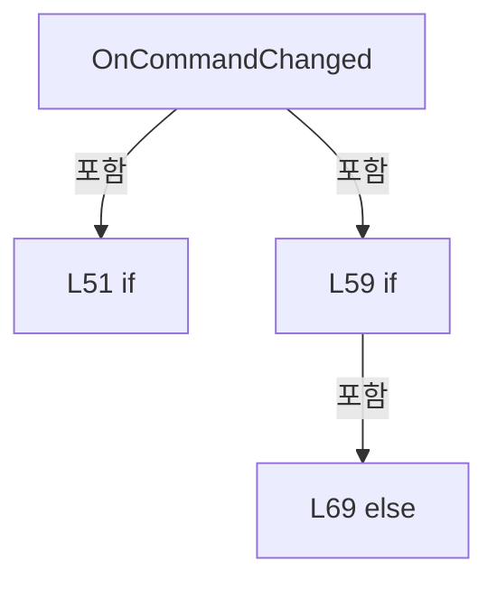

변경 전 점검: 입력/반환 타입, 위 호출자, 예외/취소 경로, 공유 상태와 저장·전송 소비자를 함께 확인합니다. 값의 단위나 물리 방향을 이름만으로 확정하지 않습니다.

### MethodDeclaration `Element_Loaded` · L75–88

[Drilling.UI/Menu/CButtonCommand.cs:75–88](https://github.com/kjuws10-rgb/A3Drilling/blob/5aee8e58439c9b455cae7c9593c9be986c3e682e/Drilling.UI/Menu/CButtonCommand.cs#L75-L88)

| 항목 | 실제 추출 값 |
| --- | --- |
| 서명 | void Drilling.UI.Menu.CButtonCommandBehavior.Element_Loaded(object, RoutedEventArgs) |
| 접근/수식자 | Private / private, static |
| 반환/값 타입 | void |
| 소속 타입 | NamedType:Drilling.UI.Menu.CButtonCommandBehavior |

입력 계약:

| 이름 | 타입 | 전달 | 선택/기본값 |
| --- | --- | --- | --- |
| sender | object | None | False /  |
| eventArgs | RoutedEventArgs | None | False /  |

현재 부분 분석에서 직접 연결된 호출자는 없습니다. XAML/이벤트/인터페이스·델리게이트·외부 진입을 추가 확인해야 하며, 미사용으로 판정한 것이 아닙니다.

호출하는 대상과 해석 범위:

| 원본 행 | 표현식 | 분석 상태 | 대상/소스 위치 |
| --- | --- | --- | --- |
| 82 | GetCommand | candidate | OverloadResolutionFailure |
| 85 | AttachElement | candidate | OverloadResolutionFailure |
| 86 | UpdateTargetState | candidate | OverloadResolutionFailure |

본문의 실제 연산·분기·예외·반환 순서(원문 위치 순):

| 원본 행 | 종류 | 주석 해설 |
| --- | --- | --- |
| 77 | if | 조건에 따라 분기합니다: if (sender is not FrameworkElement element) |
| 79 | return | 호출자에게 값 또는 제어를 반환합니다: return; |
| 82 | call | 함수·델리게이트 또는 객체 생성자를 호출합니다: GetCommand(element) |
| 82 | local-declaration | 지역 변수를 선언합니다: var command = GetCommand(element); |
| 82 | variable-initializer | 변수의 초기값을 지정합니다: command = GetCommand(element) |
| 83 | if | 조건에 따라 분기합니다: if (command is not null) |
| 85 | call | 함수·델리게이트 또는 객체 생성자를 호출합니다: AttachElement(element, command) |
| 86 | call | 함수·델리게이트 또는 객체 생성자를 호출합니다: UpdateTargetState(element, command) |

제어 구문의 포함 구조(실제 실행 순서/CFG가 아닌 구문 탐색 그림):

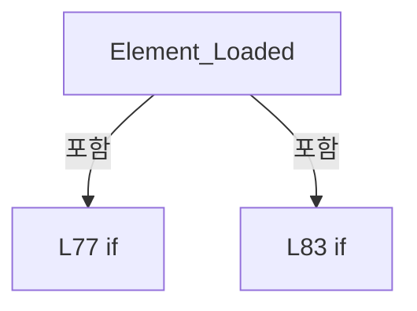

변경 전 점검: 입력/반환 타입, 위 호출자, 예외/취소 경로, 공유 상태와 저장·전송 소비자를 함께 확인합니다. 값의 단위나 물리 방향을 이름만으로 확정하지 않습니다.

### MethodDeclaration `Element_Unloaded` · L90–96

[Drilling.UI/Menu/CButtonCommand.cs:90–96](https://github.com/kjuws10-rgb/A3Drilling/blob/5aee8e58439c9b455cae7c9593c9be986c3e682e/Drilling.UI/Menu/CButtonCommand.cs#L90-L96)

| 항목 | 실제 추출 값 |
| --- | --- |
| 서명 | void Drilling.UI.Menu.CButtonCommandBehavior.Element_Unloaded(object, RoutedEventArgs) |
| 접근/수식자 | Private / private, static |
| 반환/값 타입 | void |
| 소속 타입 | NamedType:Drilling.UI.Menu.CButtonCommandBehavior |

입력 계약:

| 이름 | 타입 | 전달 | 선택/기본값 |
| --- | --- | --- | --- |
| sender | object | None | False /  |
| eventArgs | RoutedEventArgs | None | False /  |

현재 부분 분석에서 직접 연결된 호출자는 없습니다. XAML/이벤트/인터페이스·델리게이트·외부 진입을 추가 확인해야 하며, 미사용으로 판정한 것이 아닙니다.

호출하는 대상과 해석 범위:

| 원본 행 | 표현식 | 분석 상태 | 대상/소스 위치 |
| --- | --- | --- | --- |
| 94 | DetachElement | candidate | OverloadResolutionFailure |
| 94 | GetCommand | candidate | OverloadResolutionFailure |

본문의 실제 연산·분기·예외·반환 순서(원문 위치 순):

| 원본 행 | 종류 | 주석 해설 |
| --- | --- | --- |
| 92 | if | 조건에 따라 분기합니다: if (sender is FrameworkElement element) |
| 94 | call | 함수·델리게이트 또는 객체 생성자를 호출합니다: DetachElement(element, GetCommand(element)) |
| 94 | call | 함수·델리게이트 또는 객체 생성자를 호출합니다: GetCommand(element) |

제어 구문의 포함 구조(실제 실행 순서/CFG가 아닌 구문 탐색 그림):

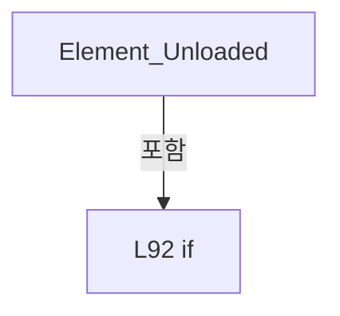

변경 전 점검: 입력/반환 타입, 위 호출자, 예외/취소 경로, 공유 상태와 저장·전송 소비자를 함께 확인합니다. 값의 단위나 물리 방향을 이름만으로 확정하지 않습니다.

### MethodDeclaration `AttachElement` · L98–113

[Drilling.UI/Menu/CButtonCommand.cs:98–113](https://github.com/kjuws10-rgb/A3Drilling/blob/5aee8e58439c9b455cae7c9593c9be986c3e682e/Drilling.UI/Menu/CButtonCommand.cs#L98-L113)

| 항목 | 실제 추출 값 |
| --- | --- |
| 서명 | void Drilling.UI.Menu.CButtonCommandBehavior.AttachElement(UIElement, Drilling.UI.Menu.CButtonCommand) |
| 접근/수식자 | Private / private, static |
| 반환/값 타입 | void |
| 소속 타입 | NamedType:Drilling.UI.Menu.CButtonCommandBehavior |

입력 계약:

| 이름 | 타입 | 전달 | 선택/기본값 |
| --- | --- | --- | --- |
| element | UIElement | None | False /  |
| command | Drilling.UI.Menu.CButtonCommand | None | False /  |

현재 부분 분석에서 직접 연결된 호출자는 없습니다. XAML/이벤트/인터페이스·델리게이트·외부 진입을 추가 확인해야 하며, 미사용으로 판정한 것이 아닙니다.

호출하는 대상과 해석 범위:

| 원본 행 | 표현식 | 분석 상태 | 대상/소스 위치 |
| --- | --- | --- | --- |
| 100 | RegisterTarget | resolved | void Drilling.UI.Menu.CButtonCommandBehavior.RegisterTarget(Drilling.UI.Menu.CButtonCommand, UIElement) · Drilling.UI/Menu/CButtonCommand.cs:133 |
| 105 | CommandParameterDescriptor.RemoveValueChanged | unresolved | None |
| 106 | CommandParameterDescriptor.AddValueChanged | unresolved | None |

본문의 실제 연산·분기·예외·반환 순서(원문 위치 순):

| 원본 행 | 종류 | 주석 해설 |
| --- | --- | --- |
| 100 | call | 함수·델리게이트 또는 객체 생성자를 호출합니다: RegisterTarget(command, element) |
| 101 | if | 조건에 따라 분기합니다: if (element is ButtonBase button) |
| 103 | compound-assignment-or-event-subscription | 복합 대입 또는 이벤트 구독/해지 표현입니다: button.Click -= Button_Click |
| 104 | compound-assignment-or-event-subscription | 복합 대입 또는 이벤트 구독/해지 표현입니다: button.Click += Button_Click |
| 105 | call | 함수·델리게이트 또는 객체 생성자를 호출합니다: CommandParameterDescriptor.RemoveValueChanged(button, ButtonCommandParameterChanged) |
| 106 | call | 함수·델리게이트 또는 객체 생성자를 호출합니다: CommandParameterDescriptor.AddValueChanged(button, ButtonCommandParameterChanged) |
| 108 | else | 앞 조건이 거짓인 경로입니다: else |
| 110 | compound-assignment-or-event-subscription | 복합 대입 또는 이벤트 구독/해지 표현입니다: element.MouseLeftButtonDown -= Element_MouseLeftButtonDown |
| 111 | compound-assignment-or-event-subscription | 복합 대입 또는 이벤트 구독/해지 표현입니다: element.MouseLeftButtonDown += Element_MouseLeftButtonDown |

제어 구문의 포함 구조(실제 실행 순서/CFG가 아닌 구문 탐색 그림):

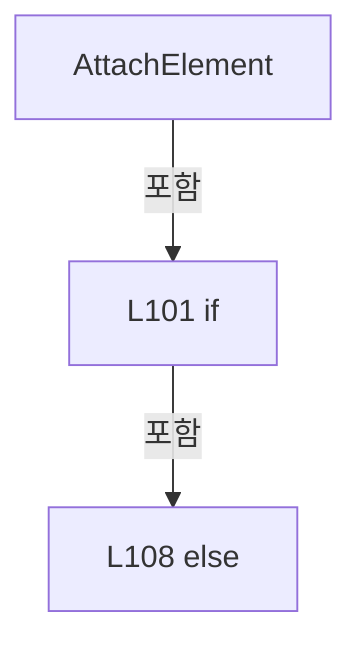

변경 전 점검: 입력/반환 타입, 위 호출자, 예외/취소 경로, 공유 상태와 저장·전송 소비자를 함께 확인합니다. 값의 단위나 물리 방향을 이름만으로 확정하지 않습니다.

### MethodDeclaration `DetachElement` · L115–131

[Drilling.UI/Menu/CButtonCommand.cs:115–131](https://github.com/kjuws10-rgb/A3Drilling/blob/5aee8e58439c9b455cae7c9593c9be986c3e682e/Drilling.UI/Menu/CButtonCommand.cs#L115-L131)

| 항목 | 실제 추출 값 |
| --- | --- |
| 서명 | void Drilling.UI.Menu.CButtonCommandBehavior.DetachElement(UIElement, Drilling.UI.Menu.CButtonCommand?) |
| 접근/수식자 | Private / private, static |
| 반환/값 타입 | void |
| 소속 타입 | NamedType:Drilling.UI.Menu.CButtonCommandBehavior |

입력 계약:

| 이름 | 타입 | 전달 | 선택/기본값 |
| --- | --- | --- | --- |
| element | UIElement | None | False /  |
| command | Drilling.UI.Menu.CButtonCommand? | None | False /  |

현재 부분 분석에서 직접 연결된 호출자는 없습니다. XAML/이벤트/인터페이스·델리게이트·외부 진입을 추가 확인해야 하며, 미사용으로 판정한 것이 아닙니다.

호출하는 대상과 해석 범위:

| 원본 행 | 표현식 | 분석 상태 | 대상/소스 위치 |
| --- | --- | --- | --- |
| 120 | CommandParameterDescriptor.RemoveValueChanged | unresolved | None |
| 129 | UnregisterTarget | resolved | void Drilling.UI.Menu.CButtonCommandBehavior.UnregisterTarget(Drilling.UI.Menu.CButtonCommand, UIElement) · Drilling.UI/Menu/CButtonCommand.cs:145 |

본문의 실제 연산·분기·예외·반환 순서(원문 위치 순):

| 원본 행 | 종류 | 주석 해설 |
| --- | --- | --- |
| 117 | if | 조건에 따라 분기합니다: if (element is ButtonBase button) |
| 119 | compound-assignment-or-event-subscription | 복합 대입 또는 이벤트 구독/해지 표현입니다: button.Click -= Button_Click |
| 120 | call | 함수·델리게이트 또는 객체 생성자를 호출합니다: CommandParameterDescriptor.RemoveValueChanged(button, ButtonCommandParameterChanged) |
| 122 | else | 앞 조건이 거짓인 경로입니다: else |
| 124 | compound-assignment-or-event-subscription | 복합 대입 또는 이벤트 구독/해지 표현입니다: element.MouseLeftButtonDown -= Element_MouseLeftButtonDown |
| 127 | if | 조건에 따라 분기합니다: if (command is not null) |
| 129 | call | 함수·델리게이트 또는 객체 생성자를 호출합니다: UnregisterTarget(command, element) |

제어 구문의 포함 구조(실제 실행 순서/CFG가 아닌 구문 탐색 그림):

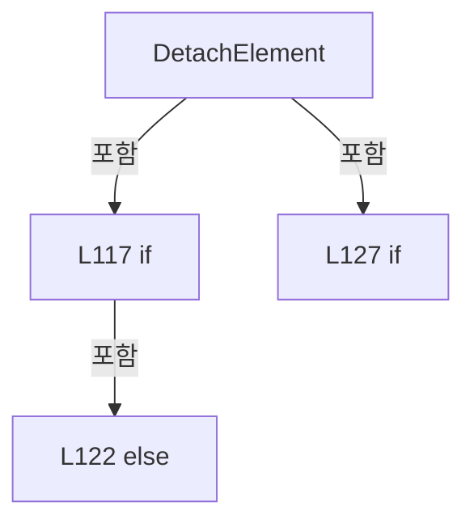

변경 전 점검: 입력/반환 타입, 위 호출자, 예외/취소 경로, 공유 상태와 저장·전송 소비자를 함께 확인합니다. 값의 단위나 물리 방향을 이름만으로 확정하지 않습니다.

### MethodDeclaration `RegisterTarget` · L133–143

[Drilling.UI/Menu/CButtonCommand.cs:133–143](https://github.com/kjuws10-rgb/A3Drilling/blob/5aee8e58439c9b455cae7c9593c9be986c3e682e/Drilling.UI/Menu/CButtonCommand.cs#L133-L143)

| 항목 | 실제 추출 값 |
| --- | --- |
| 서명 | void Drilling.UI.Menu.CButtonCommandBehavior.RegisterTarget(Drilling.UI.Menu.CButtonCommand, UIElement) |
| 접근/수식자 | Private / private, static |
| 반환/값 타입 | void |
| 소속 타입 | NamedType:Drilling.UI.Menu.CButtonCommandBehavior |

입력 계약:

| 이름 | 타입 | 전달 | 선택/기본값 |
| --- | --- | --- | --- |
| command | Drilling.UI.Menu.CButtonCommand | None | False /  |
| element | UIElement | None | False /  |

정적 호출자로 확인된 위치:

| 호출 파일/행 | 호출 표현식 | 런타임 분기 가능 |
| --- | --- | --- |
| [Drilling.UI/Menu/CButtonCommand.cs:100–100](https://github.com/kjuws10-rgb/A3Drilling/blob/5aee8e58439c9b455cae7c9593c9be986c3e682e/Drilling.UI/Menu/CButtonCommand.cs#L100-L100) | RegisterTarget | False |

호출하는 대상과 해석 범위:

| 원본 행 | 표현식 | 분석 상태 | 대상/소스 위치 |
| --- | --- | --- | --- |
| 135 | RegisteredTargets.TryGetValue | resolved | bool System.Collections.Generic.Dictionary<Drilling.UI.Menu.CButtonCommand, System.Collections.Generic.HashSet<UIElement>>.TryGetValue(Drilling.UI.Menu.CButtonCommand, out System.Collections.Generic.HashSet<UIElement>) |
| 138 | RegisteredTargets.Add | resolved | void System.Collections.Generic.Dictionary<Drilling.UI.Menu.CButtonCommand, System.Collections.Generic.HashSet<UIElement>>.Add(Drilling.UI.Menu.CButtonCommand, System.Collections.Generic.HashSet<UIElement>) |
| 142 | targets.Add | resolved | bool System.Collections.Generic.HashSet<UIElement>.Add(UIElement) |

본문의 실제 연산·분기·예외·반환 순서(원문 위치 순):

| 원본 행 | 종류 | 주석 해설 |
| --- | --- | --- |
| 135 | call | 함수·델리게이트 또는 객체 생성자를 호출합니다: RegisteredTargets.TryGetValue(command, out var targets) |
| 135 | if | 조건에 따라 분기합니다: if (!RegisteredTargets.TryGetValue(command, out var targets)) |
| 137 | assignment | 값을 대상에 대입합니다: targets = [] |
| 138 | call | 함수·델리게이트 또는 객체 생성자를 호출합니다: RegisteredTargets.Add(command, targets) |
| 139 | compound-assignment-or-event-subscription | 복합 대입 또는 이벤트 구독/해지 표현입니다: command.CanExecuteChanged += Command_CanExecuteChanged |
| 142 | call | 함수·델리게이트 또는 객체 생성자를 호출합니다: targets.Add(element) |

제어 구문의 포함 구조(실제 실행 순서/CFG가 아닌 구문 탐색 그림):

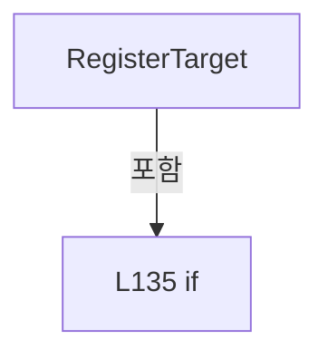

변경 전 점검: 입력/반환 타입, 위 호출자, 예외/취소 경로, 공유 상태와 저장·전송 소비자를 함께 확인합니다. 값의 단위나 물리 방향을 이름만으로 확정하지 않습니다.

### MethodDeclaration `UnregisterTarget` · L145–158

[Drilling.UI/Menu/CButtonCommand.cs:145–158](https://github.com/kjuws10-rgb/A3Drilling/blob/5aee8e58439c9b455cae7c9593c9be986c3e682e/Drilling.UI/Menu/CButtonCommand.cs#L145-L158)

| 항목 | 실제 추출 값 |
| --- | --- |
| 서명 | void Drilling.UI.Menu.CButtonCommandBehavior.UnregisterTarget(Drilling.UI.Menu.CButtonCommand, UIElement) |
| 접근/수식자 | Private / private, static |
| 반환/값 타입 | void |
| 소속 타입 | NamedType:Drilling.UI.Menu.CButtonCommandBehavior |

입력 계약:

| 이름 | 타입 | 전달 | 선택/기본값 |
| --- | --- | --- | --- |
| command | Drilling.UI.Menu.CButtonCommand | None | False /  |
| element | UIElement | None | False /  |

정적 호출자로 확인된 위치:

| 호출 파일/행 | 호출 표현식 | 런타임 분기 가능 |
| --- | --- | --- |
| [Drilling.UI/Menu/CButtonCommand.cs:129–129](https://github.com/kjuws10-rgb/A3Drilling/blob/5aee8e58439c9b455cae7c9593c9be986c3e682e/Drilling.UI/Menu/CButtonCommand.cs#L129-L129) | UnregisterTarget | False |

호출하는 대상과 해석 범위:

| 원본 행 | 표현식 | 분석 상태 | 대상/소스 위치 |
| --- | --- | --- | --- |
| 147 | RegisteredTargets.TryGetValue | resolved | bool System.Collections.Generic.Dictionary<Drilling.UI.Menu.CButtonCommand, System.Collections.Generic.HashSet<UIElement>>.TryGetValue(Drilling.UI.Menu.CButtonCommand, out System.Collections.Generic.HashSet<UIElement>) |
| 152 | targets.Remove | resolved | bool System.Collections.Generic.HashSet<UIElement>.Remove(UIElement) |
| 156 | RegisteredTargets.Remove | resolved | bool System.Collections.Generic.Dictionary<Drilling.UI.Menu.CButtonCommand, System.Collections.Generic.HashSet<UIElement>>.Remove(Drilling.UI.Menu.CButtonCommand) |

본문의 실제 연산·분기·예외·반환 순서(원문 위치 순):

| 원본 행 | 종류 | 주석 해설 |
| --- | --- | --- |
| 147 | call | 함수·델리게이트 또는 객체 생성자를 호출합니다: RegisteredTargets.TryGetValue(command, out var targets) |
| 147 | if | 조건에 따라 분기합니다: if (!RegisteredTargets.TryGetValue(command, out var targets)) |
| 149 | return | 호출자에게 값 또는 제어를 반환합니다: return; |
| 152 | call | 함수·델리게이트 또는 객체 생성자를 호출합니다: targets.Remove(element) |
| 153 | if | 조건에 따라 분기합니다: if (targets.Count == 0) |
| 155 | compound-assignment-or-event-subscription | 복합 대입 또는 이벤트 구독/해지 표현입니다: command.CanExecuteChanged -= Command_CanExecuteChanged |
| 156 | call | 함수·델리게이트 또는 객체 생성자를 호출합니다: RegisteredTargets.Remove(command) |

제어 구문의 포함 구조(실제 실행 순서/CFG가 아닌 구문 탐색 그림):

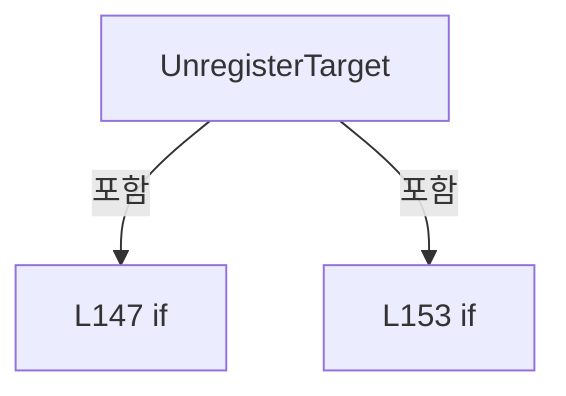

변경 전 점검: 입력/반환 타입, 위 호출자, 예외/취소 경로, 공유 상태와 저장·전송 소비자를 함께 확인합니다. 값의 단위나 물리 방향을 이름만으로 확정하지 않습니다.

### MethodDeclaration `Element_MouseLeftButtonDown` · L160–180

[Drilling.UI/Menu/CButtonCommand.cs:160–180](https://github.com/kjuws10-rgb/A3Drilling/blob/5aee8e58439c9b455cae7c9593c9be986c3e682e/Drilling.UI/Menu/CButtonCommand.cs#L160-L180)

| 항목 | 실제 추출 값 |
| --- | --- |
| 서명 | void Drilling.UI.Menu.CButtonCommandBehavior.Element_MouseLeftButtonDown(object, RoutedEventArgs) |
| 접근/수식자 | Private / private, static |
| 반환/값 타입 | void |
| 소속 타입 | NamedType:Drilling.UI.Menu.CButtonCommandBehavior |

입력 계약:

| 이름 | 타입 | 전달 | 선택/기본값 |
| --- | --- | --- | --- |
| sender | object | None | False /  |
| eventArgs | RoutedEventArgs | None | False /  |

현재 부분 분석에서 직접 연결된 호출자는 없습니다. XAML/이벤트/인터페이스·델리게이트·외부 진입을 추가 확인해야 하며, 미사용으로 판정한 것이 아닙니다.

호출하는 대상과 해석 범위:

| 원본 행 | 표현식 | 분석 상태 | 대상/소스 위치 |
| --- | --- | --- | --- |
| 167 | ReferenceEquals | candidate | OverloadResolutionFailure |
| 167 | VisualTreeHelper.GetParent | unresolved | None |
| 175 | GetCommand | candidate | OverloadResolutionFailure |
| 176 | command.CanExecute | resolved | bool Drilling.UI.Menu.CButtonCommand.CanExecute(object?) · Drilling.UI/Menu/CButtonCommand.cs:14 |
| 178 | command.Execute | resolved | void Drilling.UI.Menu.CButtonCommand.Execute(object?) · Drilling.UI/Menu/CButtonCommand.cs:19 |

본문의 실제 연산·분기·예외·반환 순서(원문 위치 순):

| 원본 행 | 종류 | 주석 해설 |
| --- | --- | --- |
| 162 | if | 조건에 따라 분기합니다: if (sender is not UIElement element) |
| 164 | return | 호출자에게 값 또는 제어를 반환합니다: return; |
| 167 | assignment | 값을 대상에 대입합니다: source = VisualTreeHelper.GetParent(source) |
| 167 | call | 함수·델리게이트 또는 객체 생성자를 호출합니다: ReferenceEquals(source, element) |
| 167 | call | 함수·델리게이트 또는 객체 생성자를 호출합니다: VisualTreeHelper.GetParent(source) |
| 167 | variable-initializer | 변수의 초기값을 지정합니다: source = eventArgs.OriginalSource as DependencyObject |
| 167 | for | 초기화·조건·증감이 있는 반복입니다: for (var source = eventArgs.OriginalSource as DependencyObject; source is not null && !ReferenceEquals(source, element); source = VisualTreeHelper.GetParent(source)) |
| 169 | if | 조건에 따라 분기합니다: if (source is ButtonBase) |
| 171 | return | 호출자에게 값 또는 제어를 반환합니다: return; |
| 175 | call | 함수·델리게이트 또는 객체 생성자를 호출합니다: GetCommand(element) |
| 175 | local-declaration | 지역 변수를 선언합니다: var command = GetCommand(element); |
| 175 | variable-initializer | 변수의 초기값을 지정합니다: command = GetCommand(element) |
| 176 | call | 함수·델리게이트 또는 객체 생성자를 호출합니다: command.CanExecute(null) |
| 176 | if | 조건에 따라 분기합니다: if (command is not null && command.CanExecute(null)) |
| 178 | call | 함수·델리게이트 또는 객체 생성자를 호출합니다: command.Execute(null) |

제어 구문의 포함 구조(실제 실행 순서/CFG가 아닌 구문 탐색 그림):

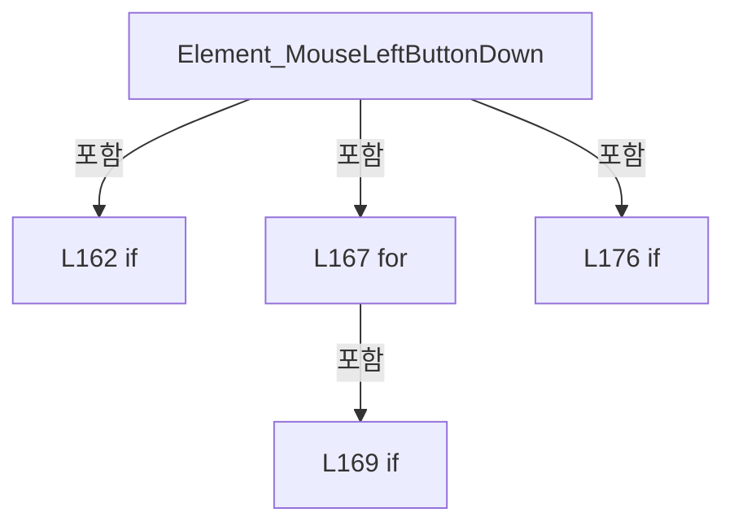

변경 전 점검: 입력/반환 타입, 위 호출자, 예외/취소 경로, 공유 상태와 저장·전송 소비자를 함께 확인합니다. 값의 단위나 물리 방향을 이름만으로 확정하지 않습니다.

### MethodDeclaration `Button_Click` · L182–195

[Drilling.UI/Menu/CButtonCommand.cs:182–195](https://github.com/kjuws10-rgb/A3Drilling/blob/5aee8e58439c9b455cae7c9593c9be986c3e682e/Drilling.UI/Menu/CButtonCommand.cs#L182-L195)

| 항목 | 실제 추출 값 |
| --- | --- |
| 서명 | void Drilling.UI.Menu.CButtonCommandBehavior.Button_Click(object, RoutedEventArgs) |
| 접근/수식자 | Private / private, static |
| 반환/값 타입 | void |
| 소속 타입 | NamedType:Drilling.UI.Menu.CButtonCommandBehavior |

입력 계약:

| 이름 | 타입 | 전달 | 선택/기본값 |
| --- | --- | --- | --- |
| sender | object | None | False /  |
| eventArgs | RoutedEventArgs | None | False /  |

현재 부분 분석에서 직접 연결된 호출자는 없습니다. XAML/이벤트/인터페이스·델리게이트·외부 진입을 추가 확인해야 하며, 미사용으로 판정한 것이 아닙니다.

호출하는 대상과 해석 범위:

| 원본 행 | 표현식 | 분석 상태 | 대상/소스 위치 |
| --- | --- | --- | --- |
| 189 | GetCommand | candidate | OverloadResolutionFailure |
| 191 | command.CanExecute | candidate | OverloadResolutionFailure |
| 193 | command.Execute | candidate | OverloadResolutionFailure |

본문의 실제 연산·분기·예외·반환 순서(원문 위치 순):

| 원본 행 | 종류 | 주석 해설 |
| --- | --- | --- |
| 184 | if | 조건에 따라 분기합니다: if (sender is not ButtonBase button) |
| 186 | return | 호출자에게 값 또는 제어를 반환합니다: return; |
| 189 | call | 함수·델리게이트 또는 객체 생성자를 호출합니다: GetCommand(button) |
| 189 | local-declaration | 지역 변수를 선언합니다: var command = GetCommand(button); |
| 189 | variable-initializer | 변수의 초기값을 지정합니다: command = GetCommand(button) |
| 190 | local-declaration | 지역 변수를 선언합니다: var parameter = button.CommandParameter; |
| 190 | variable-initializer | 변수의 초기값을 지정합니다: parameter = button.CommandParameter |
| 191 | call | 함수·델리게이트 또는 객체 생성자를 호출합니다: command.CanExecute(parameter) |
| 191 | if | 조건에 따라 분기합니다: if (command is not null && command.CanExecute(parameter)) |
| 193 | call | 함수·델리게이트 또는 객체 생성자를 호출합니다: command.Execute(parameter) |

제어 구문의 포함 구조(실제 실행 순서/CFG가 아닌 구문 탐색 그림):

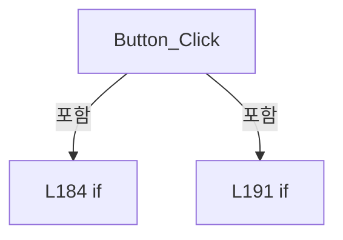

변경 전 점검: 입력/반환 타입, 위 호출자, 예외/취소 경로, 공유 상태와 저장·전송 소비자를 함께 확인합니다. 값의 단위나 물리 방향을 이름만으로 확정하지 않습니다.

### MethodDeclaration `Command_CanExecuteChanged` · L197–208

[Drilling.UI/Menu/CButtonCommand.cs:197–208](https://github.com/kjuws10-rgb/A3Drilling/blob/5aee8e58439c9b455cae7c9593c9be986c3e682e/Drilling.UI/Menu/CButtonCommand.cs#L197-L208)

| 항목 | 실제 추출 값 |
| --- | --- |
| 서명 | void Drilling.UI.Menu.CButtonCommandBehavior.Command_CanExecuteChanged(object?, System.EventArgs) |
| 접근/수식자 | Private / private, static |
| 반환/값 타입 | void |
| 소속 타입 | NamedType:Drilling.UI.Menu.CButtonCommandBehavior |

입력 계약:

| 이름 | 타입 | 전달 | 선택/기본값 |
| --- | --- | --- | --- |
| sender | object? | None | False /  |
| eventArgs | System.EventArgs | None | False /  |

현재 부분 분석에서 직접 연결된 호출자는 없습니다. XAML/이벤트/인터페이스·델리게이트·외부 진입을 추가 확인해야 하며, 미사용으로 판정한 것이 아닙니다.

호출하는 대상과 해석 범위:

| 원본 행 | 표현식 | 분석 상태 | 대상/소스 위치 |
| --- | --- | --- | --- |
| 199 | RegisteredTargets.TryGetValue | resolved | bool System.Collections.Generic.Dictionary<Drilling.UI.Menu.CButtonCommand, System.Collections.Generic.HashSet<UIElement>>.TryGetValue(Drilling.UI.Menu.CButtonCommand, out System.Collections.Generic.HashSet<UIElement>) |
| 206 | UpdateTargetState | resolved | void Drilling.UI.Menu.CButtonCommandBehavior.UpdateTargetState(UIElement, Drilling.UI.Menu.CButtonCommand) · Drilling.UI/Menu/CButtonCommand.cs:224 |

본문의 실제 연산·분기·예외·반환 순서(원문 위치 순):

| 원본 행 | 종류 | 주석 해설 |
| --- | --- | --- |
| 199 | call | 함수·델리게이트 또는 객체 생성자를 호출합니다: RegisteredTargets.TryGetValue(command, out var targets) |
| 199 | if | 조건에 따라 분기합니다: if (sender is not CButtonCommand command &#124;&#124; !RegisteredTargets.TryGetValue(command, out var targets)) |
| 201 | return | 호출자에게 값 또는 제어를 반환합니다: return; |
| 204 | foreach | 컬렉션 요소를 순회합니다: foreach (var element in targets) |
| 206 | call | 함수·델리게이트 또는 객체 생성자를 호출합니다: UpdateTargetState(element, command) |

제어 구문의 포함 구조(실제 실행 순서/CFG가 아닌 구문 탐색 그림):

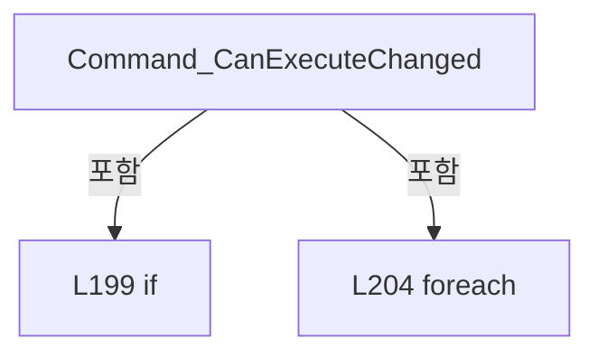

변경 전 점검: 입력/반환 타입, 위 호출자, 예외/취소 경로, 공유 상태와 저장·전송 소비자를 함께 확인합니다. 값의 단위나 물리 방향을 이름만으로 확정하지 않습니다.

### MethodDeclaration `ButtonCommandParameterChanged` · L210–222

[Drilling.UI/Menu/CButtonCommand.cs:210–222](https://github.com/kjuws10-rgb/A3Drilling/blob/5aee8e58439c9b455cae7c9593c9be986c3e682e/Drilling.UI/Menu/CButtonCommand.cs#L210-L222)

| 항목 | 실제 추출 값 |
| --- | --- |
| 서명 | void Drilling.UI.Menu.CButtonCommandBehavior.ButtonCommandParameterChanged(object?, System.EventArgs) |
| 접근/수식자 | Private / private, static |
| 반환/값 타입 | void |
| 소속 타입 | NamedType:Drilling.UI.Menu.CButtonCommandBehavior |

입력 계약:

| 이름 | 타입 | 전달 | 선택/기본값 |
| --- | --- | --- | --- |
| sender | object? | None | False /  |
| eventArgs | System.EventArgs | None | False /  |

현재 부분 분석에서 직접 연결된 호출자는 없습니다. XAML/이벤트/인터페이스·델리게이트·외부 진입을 추가 확인해야 하며, 미사용으로 판정한 것이 아닙니다.

호출하는 대상과 해석 범위:

| 원본 행 | 표현식 | 분석 상태 | 대상/소스 위치 |
| --- | --- | --- | --- |
| 217 | GetCommand | candidate | OverloadResolutionFailure |
| 220 | UpdateTargetState | candidate | OverloadResolutionFailure |

본문의 실제 연산·분기·예외·반환 순서(원문 위치 순):

| 원본 행 | 종류 | 주석 해설 |
| --- | --- | --- |
| 212 | if | 조건에 따라 분기합니다: if (sender is not ButtonBase button) |
| 214 | return | 호출자에게 값 또는 제어를 반환합니다: return; |
| 217 | call | 함수·델리게이트 또는 객체 생성자를 호출합니다: GetCommand(button) |
| 217 | local-declaration | 지역 변수를 선언합니다: var command = GetCommand(button); |
| 217 | variable-initializer | 변수의 초기값을 지정합니다: command = GetCommand(button) |
| 218 | if | 조건에 따라 분기합니다: if (command is not null) |
| 220 | call | 함수·델리게이트 또는 객체 생성자를 호출합니다: UpdateTargetState(button, command) |

제어 구문의 포함 구조(실제 실행 순서/CFG가 아닌 구문 탐색 그림):

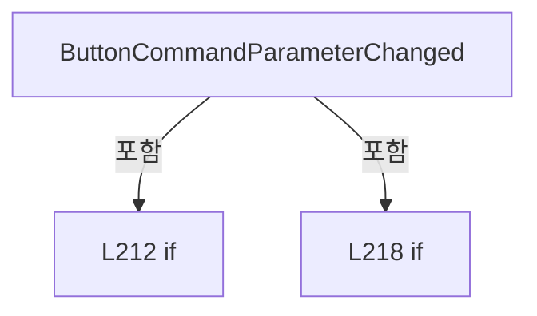

변경 전 점검: 입력/반환 타입, 위 호출자, 예외/취소 경로, 공유 상태와 저장·전송 소비자를 함께 확인합니다. 값의 단위나 물리 방향을 이름만으로 확정하지 않습니다.

### MethodDeclaration `UpdateTargetState` · L224–229

[Drilling.UI/Menu/CButtonCommand.cs:224–229](https://github.com/kjuws10-rgb/A3Drilling/blob/5aee8e58439c9b455cae7c9593c9be986c3e682e/Drilling.UI/Menu/CButtonCommand.cs#L224-L229)

| 항목 | 실제 추출 값 |
| --- | --- |
| 서명 | void Drilling.UI.Menu.CButtonCommandBehavior.UpdateTargetState(UIElement, Drilling.UI.Menu.CButtonCommand) |
| 접근/수식자 | Private / private, static |
| 반환/값 타입 | void |
| 소속 타입 | NamedType:Drilling.UI.Menu.CButtonCommandBehavior |

입력 계약:

| 이름 | 타입 | 전달 | 선택/기본값 |
| --- | --- | --- | --- |
| element | UIElement | None | False /  |
| command | Drilling.UI.Menu.CButtonCommand | None | False /  |

정적 호출자로 확인된 위치:

| 호출 파일/행 | 호출 표현식 | 런타임 분기 가능 |
| --- | --- | --- |
| [Drilling.UI/Menu/CButtonCommand.cs:206–206](https://github.com/kjuws10-rgb/A3Drilling/blob/5aee8e58439c9b455cae7c9593c9be986c3e682e/Drilling.UI/Menu/CButtonCommand.cs#L206-L206) | UpdateTargetState | False |

호출하는 대상과 해석 범위:

| 원본 행 | 표현식 | 분석 상태 | 대상/소스 위치 |
| --- | --- | --- | --- |
| 227 | command.CanExecute | candidate | OverloadResolutionFailure |
| 228 | element.SetCurrentValue | unresolved | None |

본문의 실제 연산·분기·예외·반환 순서(원문 위치 순):

| 원본 행 | 종류 | 주석 해설 |
| --- | --- | --- |
| 226 | conditional-expression | 조건에 따라 결과식을 선택합니다: element is ButtonBase button ? button.CommandParameter : null |
| 226 | local-declaration | 지역 변수를 선언합니다: var parameter = element is ButtonBase button ? button.CommandParameter : null; |
| 226 | variable-initializer | 변수의 초기값을 지정합니다: parameter = element is ButtonBase button ? button.CommandParameter : null |
| 227 | call | 함수·델리게이트 또는 객체 생성자를 호출합니다: command.CanExecute(parameter) |
| 227 | local-declaration | 지역 변수를 선언합니다: var canExecute = command.CanExecute(parameter); |
| 227 | variable-initializer | 변수의 초기값을 지정합니다: canExecute = command.CanExecute(parameter) |
| 228 | call | 함수·델리게이트 또는 객체 생성자를 호출합니다: element.SetCurrentValue(UIElement.IsEnabledProperty, canExecute) |

변경 전 점검: 입력/반환 타입, 위 호출자, 예외/취소 경로, 공유 상태와 저장·전송 소비자를 함께 확인합니다. 값의 단위나 물리 방향을 이름만으로 확정하지 않습니다.

## 구문·바인딩 한계

전체 WPF/벤더 SDK/프로젝트별 빌드 조건을 로드한 정식 빌드가 아닙니다. `resolved`는 이 부분 컴파일에서의 심볼 연결이며 virtual/interface/delegate/이벤트/Reflection/XAML의 실제 런타임 구현을 확정하지 않습니다. `candidate`와 `unresolved`는 후속 확인 대상으로 남깁니다.

## 원문 전체 주석 해설본

[원본 모든 행과 행별 해설 보기](../../../annotated/Drilling.UI/Menu/CButtonCommand.cs.annotated.txt)

원본을 빠뜨리거나 임의로 줄이지 않았습니다. `L000001 |` 표시는 원본 행 번호, `// 해설`은 별도 설명입니다. 실행용 소스가 아닌 문서입니다.

## 수정·재검증 체크

- 원본 Commit과 현재 작업 파일 SHA가 같은지 먼저 확인합니다. 다르면 이 문서를 과거 버전 자료로 취급합니다.
- 선언·직접 호출·이벤트/인터페이스 경계·설정 소비를 함께 확인합니다. 정적 연결의 빈 곳을 정상 경로로 추정하지 않습니다.
- 저장 형식/단위/식별자·재시도·취소·예외·롤백에 영향을 주는 변경은 상세 해설장과 호출자를 다시 검토합니다.
- 도구의 구문 추출과 별도 정적 추적 해설, 실제 빌드·시뮬레이션·실장비 검증 결과를 분리합니다.
