# Drilling.UI/Menu/Menus/CAlarmCauseAnalysis.cs

| 항목 | 내용 |
| --- | --- |
| 원본 저장소 | https://github.com/kjuws10-rgb/A3Drilling.git |
| 원본 Commit | dfa5920e6301d9ec4b0eab1452ae59521aafc986 |
| 원본 SHA256 | fb9a8f1f07a8aa9c53c455b2db44e2dd39ace8b00cc33f5efab5736239555dd9 |
| 파일 분류 | code |
| 원본 크기/행 | 65,954 bytes / 1,625 physical lines |
| 인코딩 | utf-8-sig |
| 검토 범위 | 구문/부분 의미 분석에서 추출한 사실. 동작·물리 단위·실장비 합격을 보증하지 않습니다. |
| 원본 링크 | [고정 Commit 원본](https://github.com/kjuws10-rgb/A3Drilling/blob/dfa5920e6301d9ec4b0eab1452ae59521aafc986/Drilling.UI/Menu/Menus/CAlarmCauseAnalysis.cs) |

## 파일의 역할과 읽는 순서

WPF 화면·사용자 명령·표시 상태를 구성합니다. XAML 이벤트와 코드 비하인드, RootView의 조립 경로를 함께 추적합니다.

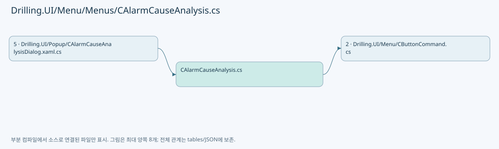

## 네임스페이스·타입·상속

| 타입 | 구분 | 원본 범위 | 선언/상속 |
| --- | --- | --- | --- |
| CAlarmCauseAnalysisPanel | ClassDeclaration | 12–323 | CAlarmCauseAnalysisPanel: INotifyPropertyChanged, IDisposable |
| ST_ALARM_ANALYSIS_LOG_ROW | RecordDeclaration | 325–333 | ST_ALARM_ANALYSIS_LOG_ROW |
| ST_ALARM_ANALYSIS_PANE | RecordDeclaration | 335–340 | ST_ALARM_ANALYSIS_PANE |
| ST_ALARM_CAUSE_CANDIDATE | RecordDeclaration | 342–352 | ST_ALARM_CAUSE_CANDIDATE |
| ST_ALARM_FAILURE_SUMMARY_ITEM | RecordDeclaration | 354–354 | ST_ALARM_FAILURE_SUMMARY_ITEM |
| ST_ALARM_FAILURE_SUMMARY | RecordDeclaration | 356–362 | ST_ALARM_FAILURE_SUMMARY |
| ST_ALARM_TIMELINE_ITEM | RecordDeclaration | 364–374 | ST_ALARM_TIMELINE_ITEM |
| ST_ALARM_ANALYSIS_RESULT | RecordDeclaration | 376–384 | ST_ALARM_ANALYSIS_RESULT |
| ST_ALARM_REFERENCE_INFO | RecordDeclaration | 386–392 | ST_ALARM_REFERENCE_INFO |
| CAlarmIncidentLogReader | ClassDeclaration | 394–960 | CAlarmIncidentLogReader |
| MelsecPollingBucket | RecordDeclaration | 949–949 | MelsecPollingBucket |
| RangeReadResult | RecordDeclaration | 950–953 | RangeReadResult |
| ReferenceReadResult | RecordDeclaration | 954–958 | ReferenceReadResult |
| LogFile | RecordDeclaration | 959–959 | LogFile |
| CAlarmFailureSummaryAnalyzer | ClassDeclaration | 962–1246 | CAlarmFailureSummaryAnalyzer |
| VisionResultSample | RecordDeclaration | 1245–1245 | VisionResultSample |
| CAlarmCauseCandidateAnalyzer | ClassDeclaration | 1248–1473 | CAlarmCauseCandidateAnalyzer |
| PaneRow | RecordDeclaration | 1465–1465 | PaneRow |
| CandidateSeed | RecordDeclaration | 1466–1472 | CandidateSeed |
| CAlarmIncidentTimelineBuilder | ClassDeclaration | 1475–1625 | CAlarmIncidentTimelineBuilder |
| TimelineKey | RecordDeclaration | 1623–1623 | TimelineKey |
| TimelineSeed | RecordDeclaration | 1624–1624 | TimelineSeed |

## 멤버 빠른 목록

| 이름 | 종류 | 범위 | 서명 |
| --- | --- | --- | --- |
| MaximumRangeSeconds | FieldDeclaration | L14–14 | int Drilling.UI.Menu.Menus.CAlarmCauseAnalysisPanel.MaximumRangeSeconds |
| _reader | FieldDeclaration | L15–15 | Drilling.UI.Menu.Menus.CAlarmIncidentLogReader Drilling.UI.Menu.Menus.CAlarmCauseAnalysisPanel._reader |
| _alarm | FieldDeclaration | L16–16 | Drilling.UI.Menu.Menus.ST_ALARM_HISTORY_ROW Drilling.UI.Menu.Menus.CAlarmCauseAnalysisPanel._alarm |
| _loadCancellation | FieldDeclaration | L17–17 | System.Threading.CancellationTokenSource? Drilling.UI.Menu.Menus.CAlarmCauseAnalysisPanel._loadCancellation |
| _beforeSeconds | FieldDeclaration | L18–18 | string Drilling.UI.Menu.Menus.CAlarmCauseAnalysisPanel._beforeSeconds |
| _afterSeconds | FieldDeclaration | L19–19 | string Drilling.UI.Menu.Menus.CAlarmCauseAnalysisPanel._afterSeconds |
| _isBusy | FieldDeclaration | L20–20 | bool Drilling.UI.Menu.Menus.CAlarmCauseAnalysisPanel._isBusy |
| _status | FieldDeclaration | L21–21 | string Drilling.UI.Menu.Menus.CAlarmCauseAnalysisPanel._status |
| _interval | FieldDeclaration | L22–22 | string Drilling.UI.Menu.Menus.CAlarmCauseAnalysisPanel._interval |
| _cursorTime | FieldDeclaration | L23–23 | string Drilling.UI.Menu.Menus.CAlarmCauseAnalysisPanel._cursorTime |
| _cursorOccurredAt | FieldDeclaration | L24–24 | System.DateTimeOffset? Drilling.UI.Menu.Menus.CAlarmCauseAnalysisPanel._cursorOccurredAt |
| _panes | FieldDeclaration | L25–25 | System.Collections.Generic.IReadOnlyList<Drilling.UI.Menu.Menus.ST_ALARM_ANALYSIS_PANE> Drilling.UI.Menu.Menus.CAlarmCauseAnalysisPanel._panes |
| _candidates | FieldDeclaration | L26–26 | System.Collections.Generic.IReadOnlyList<Drilling.UI.Menu.Menus.ST_ALARM_CAUSE_CANDIDATE> Drilling.UI.Menu.Menus.CAlarmCauseAnalysisPanel._candidates |
| _timeline | FieldDeclaration | L27–27 | System.Collections.Generic.IReadOnlyList<Drilling.UI.Menu.Menus.ST_ALARM_TIMELINE_ITEM> Drilling.UI.Menu.Menus.CAlarmCauseAnalysisPanel._timeline |
| _failureSummary | FieldDeclaration | L28–28 | Drilling.UI.Menu.Menus.ST_ALARM_FAILURE_SUMMARY Drilling.UI.Menu.Menus.CAlarmCauseAnalysisPanel._failureSummary |
| _loadedResult | FieldDeclaration | L29–29 | Drilling.UI.Menu.Menus.ST_ALARM_ANALYSIS_RESULT? Drilling.UI.Menu.Menus.CAlarmCauseAnalysisPanel._loadedResult |
| _showStateChangesOnly | FieldDeclaration | L30–30 | bool Drilling.UI.Menu.Menus.CAlarmCauseAnalysisPanel._showStateChangesOnly |
| _compareWithReference | FieldDeclaration | L31–31 | bool Drilling.UI.Menu.Menus.CAlarmCauseAnalysisPanel._compareWithReference |
| _referenceSummary | FieldDeclaration | L32–32 | string Drilling.UI.Menu.Menus.CAlarmCauseAnalysisPanel._referenceSummary |
| .ctor | ConstructorDeclaration | L34–44 | Drilling.UI.Menu.Menus.CAlarmCauseAnalysisPanel.CAlarmCauseAnalysisPanel(string, Drilling.UI.Menu.Menus.ST_ALARM_HISTORY_ROW) |
| PropertyChanged | EventFieldDeclaration | L46–46 | System.ComponentModel.PropertyChangedEventHandler? Drilling.UI.Menu.Menus.CAlarmCauseAnalysisPanel.PropertyChanged |
| AnalysisLoaded | EventFieldDeclaration | L47–47 | System.Action<System.DateTimeOffset>? Drilling.UI.Menu.Menus.CAlarmCauseAnalysisPanel.AnalysisLoaded |
| AlarmHeading | PropertyDeclaration | L48–48 | string Drilling.UI.Menu.Menus.CAlarmCauseAnalysisPanel.AlarmHeading |
| get_AlarmHeading | GetAccessorDeclaration | L48–48 | string Drilling.UI.Menu.Menus.CAlarmCauseAnalysisPanel.AlarmHeading.get |
| AlarmCause | PropertyDeclaration | L49–49 | string Drilling.UI.Menu.Menus.CAlarmCauseAnalysisPanel.AlarmCause |
| get_AlarmCause | GetAccessorDeclaration | L49–49 | string Drilling.UI.Menu.Menus.CAlarmCauseAnalysisPanel.AlarmCause.get |
| AlarmTime | PropertyDeclaration | L50–50 | string Drilling.UI.Menu.Menus.CAlarmCauseAnalysisPanel.AlarmTime |
| get_AlarmTime | GetAccessorDeclaration | L50–50 | string Drilling.UI.Menu.Menus.CAlarmCauseAnalysisPanel.AlarmTime.get |
| LoadCommand | PropertyDeclaration | L51–51 | Drilling.UI.Menu.CButtonCommand Drilling.UI.Menu.Menus.CAlarmCauseAnalysisPanel.LoadCommand |
| get_LoadCommand | GetAccessorDeclaration | L51–51 | Drilling.UI.Menu.CButtonCommand Drilling.UI.Menu.Menus.CAlarmCauseAnalysisPanel.LoadCommand.get |
| BeforeSeconds | PropertyDeclaration | L52–62 | string Drilling.UI.Menu.Menus.CAlarmCauseAnalysisPanel.BeforeSeconds |
| get_BeforeSeconds | GetAccessorDeclaration | L54–54 | string Drilling.UI.Menu.Menus.CAlarmCauseAnalysisPanel.BeforeSeconds.get |
| set_BeforeSeconds | SetAccessorDeclaration | L55–61 | void Drilling.UI.Menu.Menus.CAlarmCauseAnalysisPanel.BeforeSeconds.set |
| AfterSeconds | PropertyDeclaration | L64–74 | string Drilling.UI.Menu.Menus.CAlarmCauseAnalysisPanel.AfterSeconds |
| get_AfterSeconds | GetAccessorDeclaration | L66–66 | string Drilling.UI.Menu.Menus.CAlarmCauseAnalysisPanel.AfterSeconds.get |
| set_AfterSeconds | SetAccessorDeclaration | L67–73 | void Drilling.UI.Menu.Menus.CAlarmCauseAnalysisPanel.AfterSeconds.set |
| IsBusy | PropertyDeclaration | L76–88 | bool Drilling.UI.Menu.Menus.CAlarmCauseAnalysisPanel.IsBusy |
| get_IsBusy | GetAccessorDeclaration | L78–78 | bool Drilling.UI.Menu.Menus.CAlarmCauseAnalysisPanel.IsBusy.get |
| set_IsBusy | SetAccessorDeclaration | L79–87 | void Drilling.UI.Menu.Menus.CAlarmCauseAnalysisPanel.IsBusy.set |
| CanEdit | PropertyDeclaration | L89–89 | bool Drilling.UI.Menu.Menus.CAlarmCauseAnalysisPanel.CanEdit |
| Status | PropertyDeclaration | L91–101 | string Drilling.UI.Menu.Menus.CAlarmCauseAnalysisPanel.Status |
| get_Status | GetAccessorDeclaration | L93–93 | string Drilling.UI.Menu.Menus.CAlarmCauseAnalysisPanel.Status.get |
| set_Status | SetAccessorDeclaration | L94–100 | void Drilling.UI.Menu.Menus.CAlarmCauseAnalysisPanel.Status.set |
| Interval | PropertyDeclaration | L103–113 | string Drilling.UI.Menu.Menus.CAlarmCauseAnalysisPanel.Interval |
| get_Interval | GetAccessorDeclaration | L105–105 | string Drilling.UI.Menu.Menus.CAlarmCauseAnalysisPanel.Interval.get |
| set_Interval | SetAccessorDeclaration | L106–112 | void Drilling.UI.Menu.Menus.CAlarmCauseAnalysisPanel.Interval.set |
| CursorTime | PropertyDeclaration | L115–125 | string Drilling.UI.Menu.Menus.CAlarmCauseAnalysisPanel.CursorTime |
| get_CursorTime | GetAccessorDeclaration | L117–117 | string Drilling.UI.Menu.Menus.CAlarmCauseAnalysisPanel.CursorTime.get |
| set_CursorTime | SetAccessorDeclaration | L118–124 | void Drilling.UI.Menu.Menus.CAlarmCauseAnalysisPanel.CursorTime.set |
| CursorOccurredAt | PropertyDeclaration | L127–127 | System.DateTimeOffset? Drilling.UI.Menu.Menus.CAlarmCauseAnalysisPanel.CursorOccurredAt |
| ShowStateChangesOnly | PropertyDeclaration | L129–140 | bool Drilling.UI.Menu.Menus.CAlarmCauseAnalysisPanel.ShowStateChangesOnly |
| get_ShowStateChangesOnly | GetAccessorDeclaration | L131–131 | bool Drilling.UI.Menu.Menus.CAlarmCauseAnalysisPanel.ShowStateChangesOnly.get |
| set_ShowStateChangesOnly | SetAccessorDeclaration | L132–139 | void Drilling.UI.Menu.Menus.CAlarmCauseAnalysisPanel.ShowStateChangesOnly.set |
| CompareWithReference | PropertyDeclaration | L142–153 | bool Drilling.UI.Menu.Menus.CAlarmCauseAnalysisPanel.CompareWithReference |
| get_CompareWithReference | GetAccessorDeclaration | L144–144 | bool Drilling.UI.Menu.Menus.CAlarmCauseAnalysisPanel.CompareWithReference.get |
| set_CompareWithReference | SetAccessorDeclaration | L145–152 | void Drilling.UI.Menu.Menus.CAlarmCauseAnalysisPanel.CompareWithReference.set |
| HasReference | PropertyDeclaration | L155–155 | bool Drilling.UI.Menu.Menus.CAlarmCauseAnalysisPanel.HasReference |
| ReferenceSummary | PropertyDeclaration | L157–167 | string Drilling.UI.Menu.Menus.CAlarmCauseAnalysisPanel.ReferenceSummary |
| get_ReferenceSummary | GetAccessorDeclaration | L159–159 | string Drilling.UI.Menu.Menus.CAlarmCauseAnalysisPanel.ReferenceSummary.get |
| set_ReferenceSummary | SetAccessorDeclaration | L160–166 | void Drilling.UI.Menu.Menus.CAlarmCauseAnalysisPanel.ReferenceSummary.set |
| Panes | PropertyDeclaration | L169–177 | System.Collections.Generic.IReadOnlyList<Drilling.UI.Menu.Menus.ST_ALARM_ANALYSIS_PANE> Drilling.UI.Menu.Menus.CAlarmCauseAnalysisPanel.Panes |
| get_Panes | GetAccessorDeclaration | L171–171 | System.Collections.Generic.IReadOnlyList<Drilling.UI.Menu.Menus.ST_ALARM_ANALYSIS_PANE> Drilling.UI.Menu.Menus.CAlarmCauseAnalysisPanel.Panes.get |
| set_Panes | SetAccessorDeclaration | L172–176 | void Drilling.UI.Menu.Menus.CAlarmCauseAnalysisPanel.Panes.set |
| Candidates | PropertyDeclaration | L179–187 | System.Collections.Generic.IReadOnlyList<Drilling.UI.Menu.Menus.ST_ALARM_CAUSE_CANDIDATE> Drilling.UI.Menu.Menus.CAlarmCauseAnalysisPanel.Candidates |
| get_Candidates | GetAccessorDeclaration | L181–181 | System.Collections.Generic.IReadOnlyList<Drilling.UI.Menu.Menus.ST_ALARM_CAUSE_CANDIDATE> Drilling.UI.Menu.Menus.CAlarmCauseAnalysisPanel.Candidates.get |
| set_Candidates | SetAccessorDeclaration | L182–186 | void Drilling.UI.Menu.Menus.CAlarmCauseAnalysisPanel.Candidates.set |
| Timeline | PropertyDeclaration | L189–197 | System.Collections.Generic.IReadOnlyList<Drilling.UI.Menu.Menus.ST_ALARM_TIMELINE_ITEM> Drilling.UI.Menu.Menus.CAlarmCauseAnalysisPanel.Timeline |
| get_Timeline | GetAccessorDeclaration | L191–191 | System.Collections.Generic.IReadOnlyList<Drilling.UI.Menu.Menus.ST_ALARM_TIMELINE_ITEM> Drilling.UI.Menu.Menus.CAlarmCauseAnalysisPanel.Timeline.get |
| set_Timeline | SetAccessorDeclaration | L192–196 | void Drilling.UI.Menu.Menus.CAlarmCauseAnalysisPanel.Timeline.set |
| FailureSummary | PropertyDeclaration | L199–207 | Drilling.UI.Menu.Menus.ST_ALARM_FAILURE_SUMMARY Drilling.UI.Menu.Menus.CAlarmCauseAnalysisPanel.FailureSummary |
| get_FailureSummary | GetAccessorDeclaration | L201–201 | Drilling.UI.Menu.Menus.ST_ALARM_FAILURE_SUMMARY Drilling.UI.Menu.Menus.CAlarmCauseAnalysisPanel.FailureSummary.get |
| set_FailureSummary | SetAccessorDeclaration | L202–206 | void Drilling.UI.Menu.Menus.CAlarmCauseAnalysisPanel.FailureSummary.set |
| LoadAsync | MethodDeclaration | L209–264 | System.Threading.Tasks.Task Drilling.UI.Menu.Menus.CAlarmCauseAnalysisPanel.LoadAsync() |
| Dispose | MethodDeclaration | L266–271 | void Drilling.UI.Menu.Menus.CAlarmCauseAnalysisPanel.Dispose() |
| SetCursor | MethodDeclaration | L273–277 | void Drilling.UI.Menu.Menus.CAlarmCauseAnalysisPanel.SetCursor(System.DateTimeOffset) |
| ApplyVisiblePanes | MethodDeclaration | L279–300 | void Drilling.UI.Menu.Menus.CAlarmCauseAnalysisPanel.ApplyVisiblePanes(bool) |
| UpdateStatus | MethodDeclaration | L302–314 | void Drilling.UI.Menu.Menus.CAlarmCauseAnalysisPanel.UpdateStatus() |
| TryReadSeconds | MethodDeclaration | L316–320 | bool Drilling.UI.Menu.Menus.CAlarmCauseAnalysisPanel.TryReadSeconds(string, out int) |
| Notify | MethodDeclaration | L322–322 | void Drilling.UI.Menu.Menus.CAlarmCauseAnalysisPanel.Notify(string?) |
| RankLabel | PropertyDeclaration | L350–350 | string Drilling.UI.Menu.Menus.ST_ALARM_CAUSE_CANDIDATE.RankLabel |
| EvidenceCaption | PropertyDeclaration | L351–351 | string Drilling.UI.Menu.Menus.ST_ALARM_CAUSE_CANDIDATE.EvidenceCaption |
| FullMessage | PropertyDeclaration | L373–373 | string Drilling.UI.Menu.Menus.ST_ALARM_TIMELINE_ITEM.FullMessage |
| MaximumRowsPerPane | FieldDeclaration | L396–396 | int Drilling.UI.Menu.Menus.CAlarmIncidentLogReader.MaximumRowsPerPane |
| MaximumReferenceSearchWindows | FieldDeclaration | L397–397 | int Drilling.UI.Menu.Menus.CAlarmIncidentLogReader.MaximumReferenceSearchWindows |
| MinimumReferenceRows | FieldDeclaration | L398–398 | int Drilling.UI.Menu.Menus.CAlarmIncidentLogReader.MinimumReferenceRows |
| PaneOrder | FieldDeclaration | L399–399 | string[] Drilling.UI.Menu.Menus.CAlarmIncidentLogReader.PaneOrder |
| PaneTitles | FieldDeclaration | L400–406 | System.Collections.Generic.IReadOnlyDictionary<string, string> Drilling.UI.Menu.Menus.CAlarmIncidentLogReader.PaneTitles |
| ImportantTerms | FieldDeclaration | L407–411 | string[] Drilling.UI.Menu.Menus.CAlarmIncidentLogReader.ImportantTerms |
| TransitionTerms | FieldDeclaration | L412–418 | string[] Drilling.UI.Menu.Menus.CAlarmIncidentLogReader.TransitionTerms |
| DiscreteMelsecIdTerms | FieldDeclaration | L419–423 | string[] Drilling.UI.Menu.Menus.CAlarmIncidentLogReader.DiscreteMelsecIdTerms |
| ComparisonGuidRegex | FieldDeclaration | L424–426 | System.Text.RegularExpressions.Regex Drilling.UI.Menu.Menus.CAlarmIncidentLogReader.ComparisonGuidRegex |
| ComparisonDateTimeRegex | FieldDeclaration | L427–429 | System.Text.RegularExpressions.Regex Drilling.UI.Menu.Menus.CAlarmIncidentLogReader.ComparisonDateTimeRegex |
| ComparisonNumberRegex | FieldDeclaration | L430–432 | System.Text.RegularExpressions.Regex Drilling.UI.Menu.Menus.CAlarmIncidentLogReader.ComparisonNumberRegex |
| ComparisonWhitespaceRegex | FieldDeclaration | L433–435 | System.Text.RegularExpressions.Regex Drilling.UI.Menu.Menus.CAlarmIncidentLogReader.ComparisonWhitespaceRegex |
| _logRoot | FieldDeclaration | L436–436 | string Drilling.UI.Menu.Menus.CAlarmIncidentLogReader._logRoot |
| .ctor | ConstructorDeclaration | L438–441 | Drilling.UI.Menu.Menus.CAlarmIncidentLogReader.CAlarmIncidentLogReader(string) |
| Read | MethodDeclaration | L443–478 | Drilling.UI.Menu.Menus.ST_ALARM_ANALYSIS_RESULT Drilling.UI.Menu.Menus.CAlarmIncidentLogReader.Read(System.DateTimeOffset, System.DateTimeOffset, Drilling.UI.Menu.Menus.ST_ALARM_HISTORY_ROW, System.Threading.CancellationToken) |
| EmptyPanes | MethodDeclaration | L480–483 | System.Collections.Generic.IReadOnlyList<Drilling.UI.Menu.Menus.ST_ALARM_ANALYSIS_PANE> Drilling.UI.Menu.Menus.CAlarmIncidentLogReader.EmptyPanes(string) |
| BuildPane | MethodDeclaration | L485–519 | Drilling.UI.Menu.Menus.ST_ALARM_ANALYSIS_PANE Drilling.UI.Menu.Menus.CAlarmIncidentLogReader.BuildPane(string, System.Collections.Generic.List<Drilling.UI.Menu.Menus.ST_ALARM_ANALYSIS_LOG_ROW>, System.DateTimeOffset, bool) |
| ReadRange | MethodDeclaration | L521–543 | Drilling.UI.Menu.Menus.CAlarmIncidentLogReader.RangeReadResult Drilling.UI.Menu.Menus.CAlarmIncidentLogReader.ReadRange(System.DateTimeOffset, System.DateTimeOffset, System.DateTimeOffset?, System.Threading.CancellationToken) |
| TryReadReference | MethodDeclaration | L545–569 | Drilling.UI.Menu.Menus.CAlarmIncidentLogReader.ReferenceReadResult? Drilling.UI.Menu.Menus.CAlarmIncidentLogReader.TryReadReference(System.DateTimeOffset, System.DateTimeOffset, System.Threading.CancellationToken) |
| HasAlarmInRange | MethodDeclaration | L571–612 | bool Drilling.UI.Menu.Menus.CAlarmIncidentLogReader.HasAlarmInRange(System.DateTimeOffset, System.DateTimeOffset, System.Threading.CancellationToken) |
| BuildReferenceInfo | MethodDeclaration | L614–631 | Drilling.UI.Menu.Menus.ST_ALARM_REFERENCE_INFO Drilling.UI.Menu.Menus.CAlarmIncidentLogReader.BuildReferenceInfo(Drilling.UI.Menu.Menus.CAlarmIncidentLogReader.ReferenceReadResult?, int) |
| BuildComparisonSignatures | MethodDeclaration | L633–643 | System.Collections.Generic.HashSet<string> Drilling.UI.Menu.Menus.CAlarmIncidentLogReader.BuildComparisonSignatures(System.Collections.Generic.IReadOnlyDictionary<string, System.Collections.Generic.List<Drilling.UI.Menu.Menus.ST_ALARM_ANALYSIS_LOG_ROW>>) |
| BuildComparisonSignature | MethodDeclaration | L645–662 | string Drilling.UI.Menu.Menus.CAlarmIncidentLogReader.BuildComparisonSignature(string, Drilling.UI.Menu.Menus.ST_ALARM_ANALYSIS_LOG_ROW) |
| ClassifyStateChanges | MethodDeclaration | L664–699 | System.Collections.Generic.List<Drilling.UI.Menu.Menus.ST_ALARM_ANALYSIS_LOG_ROW> Drilling.UI.Menu.Menus.CAlarmIncidentLogReader.ClassifyStateChanges(string, System.Collections.Generic.IEnumerable<Drilling.UI.Menu.Menus.ST_ALARM_ANALYSIS_LOG_ROW>) |
| IsDiscreteMelsecSignal | MethodDeclaration | L701–704 | bool Drilling.UI.Menu.Menus.CAlarmIncidentLogReader.IsDiscreteMelsecSignal(string) |
| ContainsTransitionTerm | MethodDeclaration | L706–709 | bool Drilling.UI.Menu.Menus.CAlarmIncidentLogReader.ContainsTransitionTerm(string) |
| CondenseMelsecPollingRows | MethodDeclaration | L711–761 | System.Collections.Generic.IReadOnlyList<Drilling.UI.Menu.Menus.ST_ALARM_ANALYSIS_LOG_ROW> Drilling.UI.Menu.Menus.CAlarmIncidentLogReader.CondenseMelsecPollingRows(System.Collections.Generic.IEnumerable<Drilling.UI.Menu.Menus.ST_ALARM_ANALYSIS_LOG_ROW>) |
| TryGetNormalMelsecPollingId | MethodDeclaration | L763–775 | bool Drilling.UI.Menu.Menus.CAlarmIncidentLogReader.TryGetNormalMelsecPollingId(Drilling.UI.Menu.Menus.ST_ALARM_ANALYSIS_LOG_ROW, out string) |
| ReadDelimitedField | MethodDeclaration | L777–788 | string? Drilling.UI.Menu.Menus.CAlarmIncidentLogReader.ReadDelimitedField(string, string) |
| EnumerateFiles | MethodDeclaration | L790–810 | System.Collections.Generic.IEnumerable<Drilling.UI.Menu.Menus.CAlarmIncidentLogReader.LogFile> Drilling.UI.Menu.Menus.CAlarmIncidentLogReader.EnumerateFiles(System.DateTime, System.DateTime) |
| EnumerateDayDirectory | MethodDeclaration | L812–819 | System.Collections.Generic.IEnumerable<Drilling.UI.Menu.Menus.CAlarmIncidentLogReader.LogFile> Drilling.UI.Menu.Menus.CAlarmIncidentLogReader.EnumerateDayDirectory(string, string, string, string, System.DateTime) |
| EnumerateInterfaceFiles | MethodDeclaration | L821–836 | System.Collections.Generic.IEnumerable<Drilling.UI.Menu.Menus.CAlarmIncidentLogReader.LogFile> Drilling.UI.Menu.Menus.CAlarmIncidentLogReader.EnumerateInterfaceFiles(string, System.DateTime) |
| EnumerateProgramOpenFiles | MethodDeclaration | L838–845 | System.Collections.Generic.IEnumerable<Drilling.UI.Menu.Menus.CAlarmIncidentLogReader.LogFile> Drilling.UI.Menu.Menus.CAlarmIncidentLogReader.EnumerateProgramOpenFiles(string, System.DateTime) |
| IsSupportedLogFile | MethodDeclaration | L847–850 | bool Drilling.UI.Menu.Menus.CAlarmIncidentLogReader.IsSupportedLogFile(string) |
| ReadFile | MethodDeclaration | L852–889 | void Drilling.UI.Menu.Menus.CAlarmIncidentLogReader.ReadFile(Drilling.UI.Menu.Menus.CAlarmIncidentLogReader.LogFile, System.DateTimeOffset, System.DateTimeOffset, System.DateTimeOffset?, System.Collections.Generic.List<Drilling.UI.Menu.Menus.ST_ALARM_ANALYSIS_LOG_ROW>, System.Threading.CancellationToken) |
| TryParseAlarmLine | MethodDeclaration | L891–907 | bool Drilling.UI.Menu.Menus.CAlarmIncidentLogReader.TryParseAlarmLine(string, out System.DateTimeOffset, out string) |
| ReadJsonText | MethodDeclaration | L909–914 | string Drilling.UI.Menu.Menus.CAlarmIncidentLogReader.ReadJsonText(System.Text.Json.JsonElement, string) |
| TryParsePlainLine | MethodDeclaration | L916–938 | bool Drilling.UI.Menu.Menus.CAlarmIncidentLogReader.TryParsePlainLine(string, System.DateTime, out System.DateTimeOffset, out string) |
| TryParsePrefix | MethodDeclaration | L940–947 | bool Drilling.UI.Menu.Menus.CAlarmIncidentLogReader.TryParsePrefix(string, int, string[], out System.DateTimeOffset) |
| LegacyVisionLookbackSeconds | FieldDeclaration | L964–964 | double Drilling.UI.Menu.Menus.CAlarmFailureSummaryAnalyzer.LegacyVisionLookbackSeconds |
| NgSummaryMarker | FieldDeclaration | L965–965 | string Drilling.UI.Menu.Menus.CAlarmFailureSummaryAnalyzer.NgSummaryMarker |
| VisionResultRegex | FieldDeclaration | L966–968 | System.Text.RegularExpressions.Regex Drilling.UI.Menu.Menus.CAlarmFailureSummaryAnalyzer.VisionResultRegex |
| CreatePending | MethodDeclaration | L970–979 | Drilling.UI.Menu.Menus.ST_ALARM_FAILURE_SUMMARY Drilling.UI.Menu.Menus.CAlarmFailureSummaryAnalyzer.CreatePending(Drilling.UI.Menu.Menus.ST_ALARM_HISTORY_ROW) |
| CreateLoadFailure | MethodDeclaration | L981–990 | Drilling.UI.Menu.Menus.ST_ALARM_FAILURE_SUMMARY Drilling.UI.Menu.Menus.CAlarmFailureSummaryAnalyzer.CreateLoadFailure(Drilling.UI.Menu.Menus.ST_ALARM_HISTORY_ROW, string) |
| Analyze | MethodDeclaration | L992–1020 | Drilling.UI.Menu.Menus.ST_ALARM_FAILURE_SUMMARY Drilling.UI.Menu.Menus.CAlarmFailureSummaryAnalyzer.Analyze(System.Collections.Generic.IReadOnlyDictionary<string, System.Collections.Generic.List<Drilling.UI.Menu.Menus.ST_ALARM_ANALYSIS_LOG_ROW>>, System.Collections.Generic.IReadOnlyList<Drilling.UI.Menu.Menus.ST_ALARM_CAUSE_CANDIDATE>, Drilling.UI.Menu.Menus.ST_ALARM_HISTORY_ROW) |
| IsVisionFailureMessage | MethodDeclaration | L1022–1031 | bool Drilling.UI.Menu.Menus.CAlarmFailureSummaryAnalyzer.IsVisionFailureMessage(string) |
| TryCreateReviewSummary | MethodDeclaration | L1033–1108 | bool Drilling.UI.Menu.Menus.CAlarmFailureSummaryAnalyzer.TryCreateReviewSummary(System.Collections.Generic.IReadOnlyDictionary<string, System.Collections.Generic.List<Drilling.UI.Menu.Menus.ST_ALARM_ANALYSIS_LOG_ROW>>, Drilling.UI.Menu.Menus.ST_ALARM_HISTORY_ROW, out Drilling.UI.Menu.Menus.ST_ALARM_FAILURE_SUMMARY) |
| CreateReviewSummary | MethodDeclaration | L1110–1143 | Drilling.UI.Menu.Menus.ST_ALARM_FAILURE_SUMMARY Drilling.UI.Menu.Menus.CAlarmFailureSummaryAnalyzer.CreateReviewSummary(Drilling.UI.Menu.Menus.ST_ALARM_HISTORY_ROW, Drilling.UI.Menu.Menus.ST_ALARM_ANALYSIS_LOG_ROW, int, int, int, int, int, int, int, int, string, string, string) |
| ReadLatestVisionBatch | MethodDeclaration | L1145–1166 | System.Collections.Generic.IReadOnlyList<Drilling.UI.Menu.Menus.CAlarmFailureSummaryAnalyzer.VisionResultSample> Drilling.UI.Menu.Menus.CAlarmFailureSummaryAnalyzer.ReadLatestVisionBatch(System.Collections.Generic.IReadOnlyList<Drilling.UI.Menu.Menus.ST_ALARM_ANALYSIS_LOG_ROW>, System.DateTimeOffset) |
| TryParseNgSummary | MethodDeclaration | L1168–1183 | bool Drilling.UI.Menu.Menus.CAlarmFailureSummaryAnalyzer.TryParseNgSummary(string, out System.Collections.Generic.Dictionary<string, string>) |
| ReadInt | MethodDeclaration | L1185–1191 | int Drilling.UI.Menu.Menus.CAlarmFailureSummaryAnalyzer.ReadInt(System.Collections.Generic.IReadOnlyDictionary<string, string>, string) |
| ReadText | MethodDeclaration | L1193–1196 | string Drilling.UI.Menu.Menus.CAlarmFailureSummaryAnalyzer.ReadText(System.Collections.Generic.IReadOnlyDictionary<string, string>, string, string) |
| IsReviewAlarm | MethodDeclaration | L1198–1205 | bool Drilling.UI.Menu.Menus.CAlarmFailureSummaryAnalyzer.IsReviewAlarm(Drilling.UI.Menu.Menus.ST_ALARM_HISTORY_ROW) |
| CreateAlarmItems | MethodDeclaration | L1207–1222 | System.Collections.Generic.IReadOnlyList<Drilling.UI.Menu.Menus.ST_ALARM_FAILURE_SUMMARY_ITEM> Drilling.UI.Menu.Menus.CAlarmFailureSummaryAnalyzer.CreateAlarmItems(Drilling.UI.Menu.Menus.ST_ALARM_HISTORY_ROW, string, string, string) |
| ResolveCategory | MethodDeclaration | L1224–1237 | string Drilling.UI.Menu.Menus.CAlarmFailureSummaryAnalyzer.ResolveCategory(string) |
| FormatLeadTime | MethodDeclaration | L1239–1243 | string Drilling.UI.Menu.Menus.CAlarmFailureSummaryAnalyzer.FormatLeadTime(System.DateTimeOffset, System.DateTimeOffset) |
| NgTokenRegex | FieldDeclaration | L1250–1252 | System.Text.RegularExpressions.Regex Drilling.UI.Menu.Menus.CAlarmCauseCandidateAnalyzer.NgTokenRegex |
| FailureTerms | FieldDeclaration | L1253–1257 | string[] Drilling.UI.Menu.Menus.CAlarmCauseCandidateAnalyzer.FailureTerms |
| CommunicationTerms | FieldDeclaration | L1258–1262 | string[] Drilling.UI.Menu.Menus.CAlarmCauseCandidateAnalyzer.CommunicationTerms |
| StateChangeTerms | FieldDeclaration | L1263–1267 | string[] Drilling.UI.Menu.Menus.CAlarmCauseCandidateAnalyzer.StateChangeTerms |
| InterlockTerms | FieldDeclaration | L1268–1272 | string[] Drilling.UI.Menu.Menus.CAlarmCauseCandidateAnalyzer.InterlockTerms |
| OperatorTerms | FieldDeclaration | L1273–1273 | string[] Drilling.UI.Menu.Menus.CAlarmCauseCandidateAnalyzer.OperatorTerms |
| Analyze | MethodDeclaration | L1275–1316 | System.Collections.Generic.IReadOnlyList<Drilling.UI.Menu.Menus.ST_ALARM_CAUSE_CANDIDATE> Drilling.UI.Menu.Menus.CAlarmCauseCandidateAnalyzer.Analyze(System.Collections.Generic.IReadOnlyList<Drilling.UI.Menu.Menus.ST_ALARM_ANALYSIS_PANE>, Drilling.UI.Menu.Menus.ST_ALARM_HISTORY_ROW) |
| EnumeratePrecedingRows | MethodDeclaration | L1318–1333 | System.Collections.Generic.IReadOnlyList<Drilling.UI.Menu.Menus.CAlarmCauseCandidateAnalyzer.PaneRow> Drilling.UI.Menu.Menus.CAlarmCauseCandidateAnalyzer.EnumeratePrecedingRows(System.Collections.Generic.IReadOnlyList<Drilling.UI.Menu.Menus.ST_ALARM_ANALYSIS_PANE>, System.DateTimeOffset) |
| ComparePaneRows | MethodDeclaration | L1335–1341 | int Drilling.UI.Menu.Menus.CAlarmCauseCandidateAnalyzer.ComparePaneRows(Drilling.UI.Menu.Menus.CAlarmCauseCandidateAnalyzer.PaneRow, Drilling.UI.Menu.Menus.CAlarmCauseCandidateAnalyzer.PaneRow) |
| AddFirstAbnormalCandidate | MethodDeclaration | L1343–1360 | void Drilling.UI.Menu.Menus.CAlarmCauseCandidateAnalyzer.AddFirstAbnormalCandidate(System.Collections.Generic.ICollection<Drilling.UI.Menu.Menus.CAlarmCauseCandidateAnalyzer.CandidateSeed>, System.Collections.Generic.IReadOnlyList<Drilling.UI.Menu.Menus.CAlarmCauseCandidateAnalyzer.PaneRow>) |
| AddLatestCandidate | MethodDeclaration | L1362–1372 | void Drilling.UI.Menu.Menus.CAlarmCauseCandidateAnalyzer.AddLatestCandidate(System.Collections.Generic.ICollection<Drilling.UI.Menu.Menus.CAlarmCauseCandidateAnalyzer.CandidateSeed>, System.Collections.Generic.IReadOnlyList<Drilling.UI.Menu.Menus.CAlarmCauseCandidateAnalyzer.PaneRow>, string, string, string, int, System.Func<Drilling.UI.Menu.Menus.CAlarmCauseCandidateAnalyzer.PaneRow, bool>) |
| AddLatestCandidate | MethodDeclaration | L1374–1392 | void Drilling.UI.Menu.Menus.CAlarmCauseCandidateAnalyzer.AddLatestCandidate(System.Collections.Generic.ICollection<Drilling.UI.Menu.Menus.CAlarmCauseCandidateAnalyzer.CandidateSeed>, System.Collections.Generic.IReadOnlyList<Drilling.UI.Menu.Menus.CAlarmCauseCandidateAnalyzer.PaneRow>, System.DateTimeOffset, string, string, string, int, System.Func<Drilling.UI.Menu.Menus.CAlarmCauseCandidateAnalyzer.PaneRow, bool>) |
| IsAbnormal | MethodDeclaration | L1394–1397 | bool Drilling.UI.Menu.Menus.CAlarmCauseCandidateAnalyzer.IsAbnormal(Drilling.UI.Menu.Menus.CAlarmCauseCandidateAnalyzer.PaneRow) |
| IsDirectFailure | MethodDeclaration | L1399–1405 | bool Drilling.UI.Menu.Menus.CAlarmCauseCandidateAnalyzer.IsDirectFailure(Drilling.UI.Menu.Menus.CAlarmCauseCandidateAnalyzer.PaneRow) |
| IsInterlockFailure | MethodDeclaration | L1407–1410 | bool Drilling.UI.Menu.Menus.CAlarmCauseCandidateAnalyzer.IsInterlockFailure(Drilling.UI.Menu.Menus.CAlarmCauseCandidateAnalyzer.PaneRow) |
| IsSequenceFailure | MethodDeclaration | L1412–1416 | bool Drilling.UI.Menu.Menus.CAlarmCauseCandidateAnalyzer.IsSequenceFailure(Drilling.UI.Menu.Menus.CAlarmCauseCandidateAnalyzer.PaneRow) |
| IsCommunicationIssue | MethodDeclaration | L1418–1423 | bool Drilling.UI.Menu.Menus.CAlarmCauseCandidateAnalyzer.IsCommunicationIssue(Drilling.UI.Menu.Menus.CAlarmCauseCandidateAnalyzer.PaneRow) |
| IsEquipmentStateChange | MethodDeclaration | L1425–1431 | bool Drilling.UI.Menu.Menus.CAlarmCauseCandidateAnalyzer.IsEquipmentStateChange(Drilling.UI.Menu.Menus.CAlarmCauseCandidateAnalyzer.PaneRow) |
| IsOperatorAction | MethodDeclaration | L1433–1438 | bool Drilling.UI.Menu.Menus.CAlarmCauseCandidateAnalyzer.IsOperatorAction(Drilling.UI.Menu.Menus.CAlarmCauseCandidateAnalyzer.PaneRow) |
| ContainsAny | MethodDeclaration | L1440–1448 | bool Drilling.UI.Menu.Menus.CAlarmCauseCandidateAnalyzer.ContainsAny(string, System.Collections.Generic.IEnumerable<string>) |
| IsSameEvidence | MethodDeclaration | L1450–1455 | bool Drilling.UI.Menu.Menus.CAlarmCauseCandidateAnalyzer.IsSameEvidence(Drilling.UI.Menu.Menus.CAlarmCauseCandidateAnalyzer.CandidateSeed, Drilling.UI.Menu.Menus.CAlarmCauseCandidateAnalyzer.CandidateSeed) |
| AppendLeadTime | MethodDeclaration | L1457–1463 | string Drilling.UI.Menu.Menus.CAlarmCauseCandidateAnalyzer.AppendLeadTime(string, System.DateTimeOffset, System.DateTimeOffset) |
| MaximumEvidenceItems | FieldDeclaration | L1477–1477 | int Drilling.UI.Menu.Menus.CAlarmIncidentTimelineBuilder.MaximumEvidenceItems |
| MaximumSummaryLength | FieldDeclaration | L1478–1478 | int Drilling.UI.Menu.Menus.CAlarmIncidentTimelineBuilder.MaximumSummaryLength |
| TimelineTerms | FieldDeclaration | L1479–1483 | string[] Drilling.UI.Menu.Menus.CAlarmIncidentTimelineBuilder.TimelineTerms |
| Build | MethodDeclaration | L1485–1535 | System.Collections.Generic.IReadOnlyList<Drilling.UI.Menu.Menus.ST_ALARM_TIMELINE_ITEM> Drilling.UI.Menu.Menus.CAlarmIncidentTimelineBuilder.Build(System.Collections.Generic.IReadOnlyList<Drilling.UI.Menu.Menus.ST_ALARM_ANALYSIS_PANE>, System.Collections.Generic.IReadOnlyList<Drilling.UI.Menu.Menus.ST_ALARM_CAUSE_CANDIDATE>, Drilling.UI.Menu.Menus.ST_ALARM_HISTORY_ROW) |
| AddSeed | MethodDeclaration | L1537–1546 | void Drilling.UI.Menu.Menus.CAlarmIncidentTimelineBuilder.AddSeed(System.Collections.Generic.IDictionary<Drilling.UI.Menu.Menus.CAlarmIncidentTimelineBuilder.TimelineKey, Drilling.UI.Menu.Menus.CAlarmIncidentTimelineBuilder.TimelineSeed>, string, Drilling.UI.Menu.Menus.ST_ALARM_ANALYSIS_LOG_ROW, int) |
| GetPriority | MethodDeclaration | L1548–1559 | int Drilling.UI.Menu.Menus.CAlarmIncidentTimelineBuilder.GetPriority(string, Drilling.UI.Menu.Menus.ST_ALARM_ANALYSIS_LOG_ROW) |
| ContainsTimelineTerm | MethodDeclaration | L1561–1569 | bool Drilling.UI.Menu.Menus.CAlarmIncidentTimelineBuilder.ContainsTimelineTerm(string) |
| CreateItem | MethodDeclaration | L1571–1586 | Drilling.UI.Menu.Menus.ST_ALARM_TIMELINE_ITEM Drilling.UI.Menu.Menus.CAlarmIncidentTimelineBuilder.CreateItem(string, Drilling.UI.Menu.Menus.ST_ALARM_ANALYSIS_LOG_ROW, System.DateTimeOffset) |
| Summarize | MethodDeclaration | L1588–1621 | string Drilling.UI.Menu.Menus.CAlarmIncidentTimelineBuilder.Summarize(string, string) |

## 멤버별 상세 계약·호출·처리 해설

### FieldDeclaration `MaximumRangeSeconds` · L14–14

[Drilling.UI/Menu/Menus/CAlarmCauseAnalysis.cs:14–14](https://github.com/kjuws10-rgb/A3Drilling/blob/dfa5920e6301d9ec4b0eab1452ae59521aafc986/Drilling.UI/Menu/Menus/CAlarmCauseAnalysis.cs#L14-L14)

| 항목 | 실제 추출 값 |
| --- | --- |
| 서명 | int Drilling.UI.Menu.Menus.CAlarmCauseAnalysisPanel.MaximumRangeSeconds |
| 접근/수식자 | Private / private, const |
| 반환/값 타입 | int |
| 소속 타입 | NamedType:Drilling.UI.Menu.Menus.CAlarmCauseAnalysisPanel |

현재 부분 분석에서 직접 연결된 호출자는 없습니다. XAML/이벤트/인터페이스·델리게이트·외부 진입을 추가 확인해야 하며, 미사용으로 판정한 것이 아닙니다.

본문의 실제 연산·분기·예외·반환 순서(원문 위치 순):

| 원본 행 | 종류 | 주석 해설 |
| --- | --- | --- |
| 14 | variable-initializer | 변수의 초기값을 지정합니다: MaximumRangeSeconds = 3600 |

변경 전 점검: 입력/반환 타입, 위 호출자, 예외/취소 경로, 공유 상태와 저장·전송 소비자를 함께 확인합니다. 값의 단위나 물리 방향을 이름만으로 확정하지 않습니다.

### FieldDeclaration `_reader` · L15–15

[Drilling.UI/Menu/Menus/CAlarmCauseAnalysis.cs:15–15](https://github.com/kjuws10-rgb/A3Drilling/blob/dfa5920e6301d9ec4b0eab1452ae59521aafc986/Drilling.UI/Menu/Menus/CAlarmCauseAnalysis.cs#L15-L15)

| 항목 | 실제 추출 값 |
| --- | --- |
| 서명 | Drilling.UI.Menu.Menus.CAlarmIncidentLogReader Drilling.UI.Menu.Menus.CAlarmCauseAnalysisPanel._reader |
| 접근/수식자 | Private / private, readonly |
| 반환/값 타입 | Drilling.UI.Menu.Menus.CAlarmIncidentLogReader |
| 소속 타입 | NamedType:Drilling.UI.Menu.Menus.CAlarmCauseAnalysisPanel |

현재 부분 분석에서 직접 연결된 호출자는 없습니다. XAML/이벤트/인터페이스·델리게이트·외부 진입을 추가 확인해야 하며, 미사용으로 판정한 것이 아닙니다.

변경 전 점검: 입력/반환 타입, 위 호출자, 예외/취소 경로, 공유 상태와 저장·전송 소비자를 함께 확인합니다. 값의 단위나 물리 방향을 이름만으로 확정하지 않습니다.

### FieldDeclaration `_alarm` · L16–16

[Drilling.UI/Menu/Menus/CAlarmCauseAnalysis.cs:16–16](https://github.com/kjuws10-rgb/A3Drilling/blob/dfa5920e6301d9ec4b0eab1452ae59521aafc986/Drilling.UI/Menu/Menus/CAlarmCauseAnalysis.cs#L16-L16)

| 항목 | 실제 추출 값 |
| --- | --- |
| 서명 | Drilling.UI.Menu.Menus.ST_ALARM_HISTORY_ROW Drilling.UI.Menu.Menus.CAlarmCauseAnalysisPanel._alarm |
| 접근/수식자 | Private / private, readonly |
| 반환/값 타입 | Drilling.UI.Menu.Menus.ST_ALARM_HISTORY_ROW |
| 소속 타입 | NamedType:Drilling.UI.Menu.Menus.CAlarmCauseAnalysisPanel |

현재 부분 분석에서 직접 연결된 호출자는 없습니다. XAML/이벤트/인터페이스·델리게이트·외부 진입을 추가 확인해야 하며, 미사용으로 판정한 것이 아닙니다.

변경 전 점검: 입력/반환 타입, 위 호출자, 예외/취소 경로, 공유 상태와 저장·전송 소비자를 함께 확인합니다. 값의 단위나 물리 방향을 이름만으로 확정하지 않습니다.

### FieldDeclaration `_loadCancellation` · L17–17

[Drilling.UI/Menu/Menus/CAlarmCauseAnalysis.cs:17–17](https://github.com/kjuws10-rgb/A3Drilling/blob/dfa5920e6301d9ec4b0eab1452ae59521aafc986/Drilling.UI/Menu/Menus/CAlarmCauseAnalysis.cs#L17-L17)

| 항목 | 실제 추출 값 |
| --- | --- |
| 서명 | System.Threading.CancellationTokenSource? Drilling.UI.Menu.Menus.CAlarmCauseAnalysisPanel._loadCancellation |
| 접근/수식자 | Private / private |
| 반환/값 타입 | System.Threading.CancellationTokenSource? |
| 소속 타입 | NamedType:Drilling.UI.Menu.Menus.CAlarmCauseAnalysisPanel |

현재 부분 분석에서 직접 연결된 호출자는 없습니다. XAML/이벤트/인터페이스·델리게이트·외부 진입을 추가 확인해야 하며, 미사용으로 판정한 것이 아닙니다.

변경 전 점검: 입력/반환 타입, 위 호출자, 예외/취소 경로, 공유 상태와 저장·전송 소비자를 함께 확인합니다. 값의 단위나 물리 방향을 이름만으로 확정하지 않습니다.

### FieldDeclaration `_beforeSeconds` · L18–18

[Drilling.UI/Menu/Menus/CAlarmCauseAnalysis.cs:18–18](https://github.com/kjuws10-rgb/A3Drilling/blob/dfa5920e6301d9ec4b0eab1452ae59521aafc986/Drilling.UI/Menu/Menus/CAlarmCauseAnalysis.cs#L18-L18)

| 항목 | 실제 추출 값 |
| --- | --- |
| 서명 | string Drilling.UI.Menu.Menus.CAlarmCauseAnalysisPanel._beforeSeconds |
| 접근/수식자 | Private / private |
| 반환/값 타입 | string |
| 소속 타입 | NamedType:Drilling.UI.Menu.Menus.CAlarmCauseAnalysisPanel |

현재 부분 분석에서 직접 연결된 호출자는 없습니다. XAML/이벤트/인터페이스·델리게이트·외부 진입을 추가 확인해야 하며, 미사용으로 판정한 것이 아닙니다.

본문의 실제 연산·분기·예외·반환 순서(원문 위치 순):

| 원본 행 | 종류 | 주석 해설 |
| --- | --- | --- |
| 18 | variable-initializer | 변수의 초기값을 지정합니다: _beforeSeconds = "60" |

변경 전 점검: 입력/반환 타입, 위 호출자, 예외/취소 경로, 공유 상태와 저장·전송 소비자를 함께 확인합니다. 값의 단위나 물리 방향을 이름만으로 확정하지 않습니다.

### FieldDeclaration `_afterSeconds` · L19–19

[Drilling.UI/Menu/Menus/CAlarmCauseAnalysis.cs:19–19](https://github.com/kjuws10-rgb/A3Drilling/blob/dfa5920e6301d9ec4b0eab1452ae59521aafc986/Drilling.UI/Menu/Menus/CAlarmCauseAnalysis.cs#L19-L19)

| 항목 | 실제 추출 값 |
| --- | --- |
| 서명 | string Drilling.UI.Menu.Menus.CAlarmCauseAnalysisPanel._afterSeconds |
| 접근/수식자 | Private / private |
| 반환/값 타입 | string |
| 소속 타입 | NamedType:Drilling.UI.Menu.Menus.CAlarmCauseAnalysisPanel |

현재 부분 분석에서 직접 연결된 호출자는 없습니다. XAML/이벤트/인터페이스·델리게이트·외부 진입을 추가 확인해야 하며, 미사용으로 판정한 것이 아닙니다.

본문의 실제 연산·분기·예외·반환 순서(원문 위치 순):

| 원본 행 | 종류 | 주석 해설 |
| --- | --- | --- |
| 19 | variable-initializer | 변수의 초기값을 지정합니다: _afterSeconds = "30" |

변경 전 점검: 입력/반환 타입, 위 호출자, 예외/취소 경로, 공유 상태와 저장·전송 소비자를 함께 확인합니다. 값의 단위나 물리 방향을 이름만으로 확정하지 않습니다.

### FieldDeclaration `_isBusy` · L20–20

[Drilling.UI/Menu/Menus/CAlarmCauseAnalysis.cs:20–20](https://github.com/kjuws10-rgb/A3Drilling/blob/dfa5920e6301d9ec4b0eab1452ae59521aafc986/Drilling.UI/Menu/Menus/CAlarmCauseAnalysis.cs#L20-L20)

| 항목 | 실제 추출 값 |
| --- | --- |
| 서명 | bool Drilling.UI.Menu.Menus.CAlarmCauseAnalysisPanel._isBusy |
| 접근/수식자 | Private / private |
| 반환/값 타입 | bool |
| 소속 타입 | NamedType:Drilling.UI.Menu.Menus.CAlarmCauseAnalysisPanel |

현재 부분 분석에서 직접 연결된 호출자는 없습니다. XAML/이벤트/인터페이스·델리게이트·외부 진입을 추가 확인해야 하며, 미사용으로 판정한 것이 아닙니다.

변경 전 점검: 입력/반환 타입, 위 호출자, 예외/취소 경로, 공유 상태와 저장·전송 소비자를 함께 확인합니다. 값의 단위나 물리 방향을 이름만으로 확정하지 않습니다.

### FieldDeclaration `_status` · L21–21

[Drilling.UI/Menu/Menus/CAlarmCauseAnalysis.cs:21–21](https://github.com/kjuws10-rgb/A3Drilling/blob/dfa5920e6301d9ec4b0eab1452ae59521aafc986/Drilling.UI/Menu/Menus/CAlarmCauseAnalysis.cs#L21-L21)

| 항목 | 실제 추출 값 |
| --- | --- |
| 서명 | string Drilling.UI.Menu.Menus.CAlarmCauseAnalysisPanel._status |
| 접근/수식자 | Private / private |
| 반환/값 타입 | string |
| 소속 타입 | NamedType:Drilling.UI.Menu.Menus.CAlarmCauseAnalysisPanel |

현재 부분 분석에서 직접 연결된 호출자는 없습니다. XAML/이벤트/인터페이스·델리게이트·외부 진입을 추가 확인해야 하며, 미사용으로 판정한 것이 아닙니다.

본문의 실제 연산·분기·예외·반환 순서(원문 위치 순):

| 원본 행 | 종류 | 주석 해설 |
| --- | --- | --- |
| 21 | variable-initializer | 변수의 초기값을 지정합니다: _status = "알람 전후 로그를 불러올 준비가 되었습니다." |

변경 전 점검: 입력/반환 타입, 위 호출자, 예외/취소 경로, 공유 상태와 저장·전송 소비자를 함께 확인합니다. 값의 단위나 물리 방향을 이름만으로 확정하지 않습니다.

### FieldDeclaration `_interval` · L22–22

[Drilling.UI/Menu/Menus/CAlarmCauseAnalysis.cs:22–22](https://github.com/kjuws10-rgb/A3Drilling/blob/dfa5920e6301d9ec4b0eab1452ae59521aafc986/Drilling.UI/Menu/Menus/CAlarmCauseAnalysis.cs#L22-L22)

| 항목 | 실제 추출 값 |
| --- | --- |
| 서명 | string Drilling.UI.Menu.Menus.CAlarmCauseAnalysisPanel._interval |
| 접근/수식자 | Private / private |
| 반환/값 타입 | string |
| 소속 타입 | NamedType:Drilling.UI.Menu.Menus.CAlarmCauseAnalysisPanel |

현재 부분 분석에서 직접 연결된 호출자는 없습니다. XAML/이벤트/인터페이스·델리게이트·외부 진입을 추가 확인해야 하며, 미사용으로 판정한 것이 아닙니다.

본문의 실제 연산·분기·예외·반환 순서(원문 위치 순):

| 원본 행 | 종류 | 주석 해설 |
| --- | --- | --- |
| 22 | variable-initializer | 변수의 초기값을 지정합니다: _interval = "" |

변경 전 점검: 입력/반환 타입, 위 호출자, 예외/취소 경로, 공유 상태와 저장·전송 소비자를 함께 확인합니다. 값의 단위나 물리 방향을 이름만으로 확정하지 않습니다.

### FieldDeclaration `_cursorTime` · L23–23

[Drilling.UI/Menu/Menus/CAlarmCauseAnalysis.cs:23–23](https://github.com/kjuws10-rgb/A3Drilling/blob/dfa5920e6301d9ec4b0eab1452ae59521aafc986/Drilling.UI/Menu/Menus/CAlarmCauseAnalysis.cs#L23-L23)

| 항목 | 실제 추출 값 |
| --- | --- |
| 서명 | string Drilling.UI.Menu.Menus.CAlarmCauseAnalysisPanel._cursorTime |
| 접근/수식자 | Private / private |
| 반환/값 타입 | string |
| 소속 타입 | NamedType:Drilling.UI.Menu.Menus.CAlarmCauseAnalysisPanel |

현재 부분 분석에서 직접 연결된 호출자는 없습니다. XAML/이벤트/인터페이스·델리게이트·외부 진입을 추가 확인해야 하며, 미사용으로 판정한 것이 아닙니다.

본문의 실제 연산·분기·예외·반환 순서(원문 위치 순):

| 원본 행 | 종류 | 주석 해설 |
| --- | --- | --- |
| 23 | variable-initializer | 변수의 초기값을 지정합니다: _cursorTime = "" |

변경 전 점검: 입력/반환 타입, 위 호출자, 예외/취소 경로, 공유 상태와 저장·전송 소비자를 함께 확인합니다. 값의 단위나 물리 방향을 이름만으로 확정하지 않습니다.

### FieldDeclaration `_cursorOccurredAt` · L24–24

[Drilling.UI/Menu/Menus/CAlarmCauseAnalysis.cs:24–24](https://github.com/kjuws10-rgb/A3Drilling/blob/dfa5920e6301d9ec4b0eab1452ae59521aafc986/Drilling.UI/Menu/Menus/CAlarmCauseAnalysis.cs#L24-L24)

| 항목 | 실제 추출 값 |
| --- | --- |
| 서명 | System.DateTimeOffset? Drilling.UI.Menu.Menus.CAlarmCauseAnalysisPanel._cursorOccurredAt |
| 접근/수식자 | Private / private |
| 반환/값 타입 | System.DateTimeOffset? |
| 소속 타입 | NamedType:Drilling.UI.Menu.Menus.CAlarmCauseAnalysisPanel |

현재 부분 분석에서 직접 연결된 호출자는 없습니다. XAML/이벤트/인터페이스·델리게이트·외부 진입을 추가 확인해야 하며, 미사용으로 판정한 것이 아닙니다.

변경 전 점검: 입력/반환 타입, 위 호출자, 예외/취소 경로, 공유 상태와 저장·전송 소비자를 함께 확인합니다. 값의 단위나 물리 방향을 이름만으로 확정하지 않습니다.

### FieldDeclaration `_panes` · L25–25

[Drilling.UI/Menu/Menus/CAlarmCauseAnalysis.cs:25–25](https://github.com/kjuws10-rgb/A3Drilling/blob/dfa5920e6301d9ec4b0eab1452ae59521aafc986/Drilling.UI/Menu/Menus/CAlarmCauseAnalysis.cs#L25-L25)

| 항목 | 실제 추출 값 |
| --- | --- |
| 서명 | System.Collections.Generic.IReadOnlyList<Drilling.UI.Menu.Menus.ST_ALARM_ANALYSIS_PANE> Drilling.UI.Menu.Menus.CAlarmCauseAnalysisPanel._panes |
| 접근/수식자 | Private / private |
| 반환/값 타입 | System.Collections.Generic.IReadOnlyList<Drilling.UI.Menu.Menus.ST_ALARM_ANALYSIS_PANE> |
| 소속 타입 | NamedType:Drilling.UI.Menu.Menus.CAlarmCauseAnalysisPanel |

현재 부분 분석에서 직접 연결된 호출자는 없습니다. XAML/이벤트/인터페이스·델리게이트·외부 진입을 추가 확인해야 하며, 미사용으로 판정한 것이 아닙니다.

호출하는 대상과 해석 범위:

| 원본 행 | 표현식 | 분석 상태 | 대상/소스 위치 |
| --- | --- | --- | --- |
| 25 | CAlarmIncidentLogReader.EmptyPanes | resolved | System.Collections.Generic.IReadOnlyList<Drilling.UI.Menu.Menus.ST_ALARM_ANALYSIS_PANE> Drilling.UI.Menu.Menus.CAlarmIncidentLogReader.EmptyPanes(string) · Drilling.UI/Menu/Menus/CAlarmCauseAnalysis.cs:480 |

본문의 실제 연산·분기·예외·반환 순서(원문 위치 순):

| 원본 행 | 종류 | 주석 해설 |
| --- | --- | --- |
| 25 | call | 함수·델리게이트 또는 객체 생성자를 호출합니다: CAlarmIncidentLogReader.EmptyPanes() |
| 25 | variable-initializer | 변수의 초기값을 지정합니다: _panes = CAlarmIncidentLogReader.EmptyPanes() |

변경 전 점검: 입력/반환 타입, 위 호출자, 예외/취소 경로, 공유 상태와 저장·전송 소비자를 함께 확인합니다. 값의 단위나 물리 방향을 이름만으로 확정하지 않습니다.

### FieldDeclaration `_candidates` · L26–26

[Drilling.UI/Menu/Menus/CAlarmCauseAnalysis.cs:26–26](https://github.com/kjuws10-rgb/A3Drilling/blob/dfa5920e6301d9ec4b0eab1452ae59521aafc986/Drilling.UI/Menu/Menus/CAlarmCauseAnalysis.cs#L26-L26)

| 항목 | 실제 추출 값 |
| --- | --- |
| 서명 | System.Collections.Generic.IReadOnlyList<Drilling.UI.Menu.Menus.ST_ALARM_CAUSE_CANDIDATE> Drilling.UI.Menu.Menus.CAlarmCauseAnalysisPanel._candidates |
| 접근/수식자 | Private / private |
| 반환/값 타입 | System.Collections.Generic.IReadOnlyList<Drilling.UI.Menu.Menus.ST_ALARM_CAUSE_CANDIDATE> |
| 소속 타입 | NamedType:Drilling.UI.Menu.Menus.CAlarmCauseAnalysisPanel |

현재 부분 분석에서 직접 연결된 호출자는 없습니다. XAML/이벤트/인터페이스·델리게이트·외부 진입을 추가 확인해야 하며, 미사용으로 판정한 것이 아닙니다.

본문의 실제 연산·분기·예외·반환 순서(원문 위치 순):

| 원본 행 | 종류 | 주석 해설 |
| --- | --- | --- |
| 26 | variable-initializer | 변수의 초기값을 지정합니다: _candidates = [] |

변경 전 점검: 입력/반환 타입, 위 호출자, 예외/취소 경로, 공유 상태와 저장·전송 소비자를 함께 확인합니다. 값의 단위나 물리 방향을 이름만으로 확정하지 않습니다.

### FieldDeclaration `_timeline` · L27–27

[Drilling.UI/Menu/Menus/CAlarmCauseAnalysis.cs:27–27](https://github.com/kjuws10-rgb/A3Drilling/blob/dfa5920e6301d9ec4b0eab1452ae59521aafc986/Drilling.UI/Menu/Menus/CAlarmCauseAnalysis.cs#L27-L27)

| 항목 | 실제 추출 값 |
| --- | --- |
| 서명 | System.Collections.Generic.IReadOnlyList<Drilling.UI.Menu.Menus.ST_ALARM_TIMELINE_ITEM> Drilling.UI.Menu.Menus.CAlarmCauseAnalysisPanel._timeline |
| 접근/수식자 | Private / private |
| 반환/값 타입 | System.Collections.Generic.IReadOnlyList<Drilling.UI.Menu.Menus.ST_ALARM_TIMELINE_ITEM> |
| 소속 타입 | NamedType:Drilling.UI.Menu.Menus.CAlarmCauseAnalysisPanel |

현재 부분 분석에서 직접 연결된 호출자는 없습니다. XAML/이벤트/인터페이스·델리게이트·외부 진입을 추가 확인해야 하며, 미사용으로 판정한 것이 아닙니다.

본문의 실제 연산·분기·예외·반환 순서(원문 위치 순):

| 원본 행 | 종류 | 주석 해설 |
| --- | --- | --- |
| 27 | variable-initializer | 변수의 초기값을 지정합니다: _timeline = [] |

변경 전 점검: 입력/반환 타입, 위 호출자, 예외/취소 경로, 공유 상태와 저장·전송 소비자를 함께 확인합니다. 값의 단위나 물리 방향을 이름만으로 확정하지 않습니다.

### FieldDeclaration `_failureSummary` · L28–28

[Drilling.UI/Menu/Menus/CAlarmCauseAnalysis.cs:28–28](https://github.com/kjuws10-rgb/A3Drilling/blob/dfa5920e6301d9ec4b0eab1452ae59521aafc986/Drilling.UI/Menu/Menus/CAlarmCauseAnalysis.cs#L28-L28)

| 항목 | 실제 추출 값 |
| --- | --- |
| 서명 | Drilling.UI.Menu.Menus.ST_ALARM_FAILURE_SUMMARY Drilling.UI.Menu.Menus.CAlarmCauseAnalysisPanel._failureSummary |
| 접근/수식자 | Private / private |
| 반환/값 타입 | Drilling.UI.Menu.Menus.ST_ALARM_FAILURE_SUMMARY |
| 소속 타입 | NamedType:Drilling.UI.Menu.Menus.CAlarmCauseAnalysisPanel |

현재 부분 분석에서 직접 연결된 호출자는 없습니다. XAML/이벤트/인터페이스·델리게이트·외부 진입을 추가 확인해야 하며, 미사용으로 판정한 것이 아닙니다.

변경 전 점검: 입력/반환 타입, 위 호출자, 예외/취소 경로, 공유 상태와 저장·전송 소비자를 함께 확인합니다. 값의 단위나 물리 방향을 이름만으로 확정하지 않습니다.

### FieldDeclaration `_loadedResult` · L29–29

[Drilling.UI/Menu/Menus/CAlarmCauseAnalysis.cs:29–29](https://github.com/kjuws10-rgb/A3Drilling/blob/dfa5920e6301d9ec4b0eab1452ae59521aafc986/Drilling.UI/Menu/Menus/CAlarmCauseAnalysis.cs#L29-L29)

| 항목 | 실제 추출 값 |
| --- | --- |
| 서명 | Drilling.UI.Menu.Menus.ST_ALARM_ANALYSIS_RESULT? Drilling.UI.Menu.Menus.CAlarmCauseAnalysisPanel._loadedResult |
| 접근/수식자 | Private / private |
| 반환/값 타입 | Drilling.UI.Menu.Menus.ST_ALARM_ANALYSIS_RESULT? |
| 소속 타입 | NamedType:Drilling.UI.Menu.Menus.CAlarmCauseAnalysisPanel |

현재 부분 분석에서 직접 연결된 호출자는 없습니다. XAML/이벤트/인터페이스·델리게이트·외부 진입을 추가 확인해야 하며, 미사용으로 판정한 것이 아닙니다.

변경 전 점검: 입력/반환 타입, 위 호출자, 예외/취소 경로, 공유 상태와 저장·전송 소비자를 함께 확인합니다. 값의 단위나 물리 방향을 이름만으로 확정하지 않습니다.

### FieldDeclaration `_showStateChangesOnly` · L30–30

[Drilling.UI/Menu/Menus/CAlarmCauseAnalysis.cs:30–30](https://github.com/kjuws10-rgb/A3Drilling/blob/dfa5920e6301d9ec4b0eab1452ae59521aafc986/Drilling.UI/Menu/Menus/CAlarmCauseAnalysis.cs#L30-L30)

| 항목 | 실제 추출 값 |
| --- | --- |
| 서명 | bool Drilling.UI.Menu.Menus.CAlarmCauseAnalysisPanel._showStateChangesOnly |
| 접근/수식자 | Private / private |
| 반환/값 타입 | bool |
| 소속 타입 | NamedType:Drilling.UI.Menu.Menus.CAlarmCauseAnalysisPanel |

현재 부분 분석에서 직접 연결된 호출자는 없습니다. XAML/이벤트/인터페이스·델리게이트·외부 진입을 추가 확인해야 하며, 미사용으로 판정한 것이 아닙니다.

본문의 실제 연산·분기·예외·반환 순서(원문 위치 순):

| 원본 행 | 종류 | 주석 해설 |
| --- | --- | --- |
| 30 | variable-initializer | 변수의 초기값을 지정합니다: _showStateChangesOnly = true |

변경 전 점검: 입력/반환 타입, 위 호출자, 예외/취소 경로, 공유 상태와 저장·전송 소비자를 함께 확인합니다. 값의 단위나 물리 방향을 이름만으로 확정하지 않습니다.

### FieldDeclaration `_compareWithReference` · L31–31

[Drilling.UI/Menu/Menus/CAlarmCauseAnalysis.cs:31–31](https://github.com/kjuws10-rgb/A3Drilling/blob/dfa5920e6301d9ec4b0eab1452ae59521aafc986/Drilling.UI/Menu/Menus/CAlarmCauseAnalysis.cs#L31-L31)

| 항목 | 실제 추출 값 |
| --- | --- |
| 서명 | bool Drilling.UI.Menu.Menus.CAlarmCauseAnalysisPanel._compareWithReference |
| 접근/수식자 | Private / private |
| 반환/값 타입 | bool |
| 소속 타입 | NamedType:Drilling.UI.Menu.Menus.CAlarmCauseAnalysisPanel |

현재 부분 분석에서 직접 연결된 호출자는 없습니다. XAML/이벤트/인터페이스·델리게이트·외부 진입을 추가 확인해야 하며, 미사용으로 판정한 것이 아닙니다.

본문의 실제 연산·분기·예외·반환 순서(원문 위치 순):

| 원본 행 | 종류 | 주석 해설 |
| --- | --- | --- |
| 31 | variable-initializer | 변수의 초기값을 지정합니다: _compareWithReference = true |

변경 전 점검: 입력/반환 타입, 위 호출자, 예외/취소 경로, 공유 상태와 저장·전송 소비자를 함께 확인합니다. 값의 단위나 물리 방향을 이름만으로 확정하지 않습니다.

### FieldDeclaration `_referenceSummary` · L32–32

[Drilling.UI/Menu/Menus/CAlarmCauseAnalysis.cs:32–32](https://github.com/kjuws10-rgb/A3Drilling/blob/dfa5920e6301d9ec4b0eab1452ae59521aafc986/Drilling.UI/Menu/Menus/CAlarmCauseAnalysis.cs#L32-L32)

| 항목 | 실제 추출 값 |
| --- | --- |
| 서명 | string Drilling.UI.Menu.Menus.CAlarmCauseAnalysisPanel._referenceSummary |
| 접근/수식자 | Private / private |
| 반환/값 타입 | string |
| 소속 타입 | NamedType:Drilling.UI.Menu.Menus.CAlarmCauseAnalysisPanel |

현재 부분 분석에서 직접 연결된 호출자는 없습니다. XAML/이벤트/인터페이스·델리게이트·외부 진입을 추가 확인해야 하며, 미사용으로 판정한 것이 아닙니다.

본문의 실제 연산·분기·예외·반환 순서(원문 위치 순):

| 원본 행 | 종류 | 주석 해설 |
| --- | --- | --- |
| 32 | variable-initializer | 변수의 초기값을 지정합니다: _referenceSummary = "비교 기준은 로그를 불러온 뒤 자동으로 찾습니다." |

변경 전 점검: 입력/반환 타입, 위 호출자, 예외/취소 경로, 공유 상태와 저장·전송 소비자를 함께 확인합니다. 값의 단위나 물리 방향을 이름만으로 확정하지 않습니다.

### ConstructorDeclaration `.ctor` · L34–44

[Drilling.UI/Menu/Menus/CAlarmCauseAnalysis.cs:34–44](https://github.com/kjuws10-rgb/A3Drilling/blob/dfa5920e6301d9ec4b0eab1452ae59521aafc986/Drilling.UI/Menu/Menus/CAlarmCauseAnalysis.cs#L34-L44)

| 항목 | 실제 추출 값 |
| --- | --- |
| 서명 | Drilling.UI.Menu.Menus.CAlarmCauseAnalysisPanel.CAlarmCauseAnalysisPanel(string, Drilling.UI.Menu.Menus.ST_ALARM_HISTORY_ROW) |
| 접근/수식자 | Public / public |
| 반환/값 타입 | void |
| 소속 타입 | NamedType:Drilling.UI.Menu.Menus.CAlarmCauseAnalysisPanel |

입력 계약:

| 이름 | 타입 | 전달 | 선택/기본값 |
| --- | --- | --- | --- |
| logDirectory | string | None | False /  |
| alarm | Drilling.UI.Menu.Menus.ST_ALARM_HISTORY_ROW | None | False /  |

정적 호출자로 확인된 위치:

| 호출 파일/행 | 호출 표현식 | 런타임 분기 가능 |
| --- | --- | --- |
| [Drilling.UI/Popup/CAlarmCauseAnalysisDialog.xaml.cs:18–18](https://github.com/kjuws10-rgb/A3Drilling/blob/dfa5920e6301d9ec4b0eab1452ae59521aafc986/Drilling.UI/Popup/CAlarmCauseAnalysisDialog.xaml.cs#L18-L18) | new | False |

호출하는 대상과 해석 범위:

| 원본 행 | 표현식 | 분석 상태 | 대상/소스 위치 |
| --- | --- | --- | --- |
| 36 | new | resolved | Drilling.UI.Menu.Menus.CAlarmIncidentLogReader.CAlarmIncidentLogReader(string) · Drilling.UI/Menu/Menus/CAlarmCauseAnalysis.cs:438 |
| 40 | alarm.OccurredAt.LocalDateTime.ToString | resolved | string System.DateTime.ToString(string?, System.IFormatProvider?) |
| 41 | CAlarmFailureSummaryAnalyzer.CreatePending | resolved | Drilling.UI.Menu.Menus.ST_ALARM_FAILURE_SUMMARY Drilling.UI.Menu.Menus.CAlarmFailureSummaryAnalyzer.CreatePending(Drilling.UI.Menu.Menus.ST_ALARM_HISTORY_ROW) · Drilling.UI/Menu/Menus/CAlarmCauseAnalysis.cs:970 |
| 42 | new | resolved | Drilling.UI.Menu.CButtonCommand.CButtonCommand(System.Action<object?>, System.Predicate<object?>?) · Drilling.UI/Menu/CButtonCommand.cs:9 |
| 42 | LoadAsync | resolved | System.Threading.Tasks.Task Drilling.UI.Menu.Menus.CAlarmCauseAnalysisPanel.LoadAsync() · Drilling.UI/Menu/Menus/CAlarmCauseAnalysis.cs:209 |
| 43 | SetCursor | resolved | void Drilling.UI.Menu.Menus.CAlarmCauseAnalysisPanel.SetCursor(System.DateTimeOffset) · Drilling.UI/Menu/Menus/CAlarmCauseAnalysis.cs:273 |

본문의 실제 연산·분기·예외·반환 순서(원문 위치 순):

| 원본 행 | 종류 | 주석 해설 |
| --- | --- | --- |
| 36 | assignment | 값을 대상에 대입합니다: _reader = new(logDirectory) |
| 36 | call | 함수·델리게이트 또는 객체 생성자를 호출합니다: new(logDirectory) |
| 37 | assignment | 값을 대상에 대입합니다: _alarm = alarm |
| 38 | assignment | 값을 대상에 대입합니다: AlarmHeading = $"ALARM {alarm.Code} · {alarm.Level} · {alarm.Group}" |
| 39 | assignment | 값을 대상에 대입합니다: AlarmCause = alarm.Cause |
| 40 | assignment | 값을 대상에 대입합니다: AlarmTime = alarm.OccurredAt.LocalDateTime.ToString("yyyy-MM-dd HH:mm:ss.fff", CultureInfo.InvariantCulture) |
| 40 | call | 함수·델리게이트 또는 객체 생성자를 호출합니다: alarm.OccurredAt.LocalDateTime.ToString("yyyy-MM-dd HH:mm:ss.fff", CultureInfo.InvariantCulture) |
| 41 | assignment | 값을 대상에 대입합니다: _failureSummary = CAlarmFailureSummaryAnalyzer.CreatePending(alarm) |
| 41 | call | 함수·델리게이트 또는 객체 생성자를 호출합니다: CAlarmFailureSummaryAnalyzer.CreatePending(alarm) |
| 42 | assignment | 값을 대상에 대입합니다: LoadCommand = new(async _ => await LoadAsync(), _ => !IsBusy) |
| 42 | await | 비동기 완료를 기다립니다: await LoadAsync() |
| 42 | call | 함수·델리게이트 또는 객체 생성자를 호출합니다: new(async _ => await LoadAsync(), _ => !IsBusy) |
| 42 | call | 함수·델리게이트 또는 객체 생성자를 호출합니다: LoadAsync() |
| 43 | call | 함수·델리게이트 또는 객체 생성자를 호출합니다: SetCursor(alarm.OccurredAt) |

변경 전 점검: 입력/반환 타입, 위 호출자, 예외/취소 경로, 공유 상태와 저장·전송 소비자를 함께 확인합니다. 값의 단위나 물리 방향을 이름만으로 확정하지 않습니다.

### EventFieldDeclaration `PropertyChanged` · L46–46

[Drilling.UI/Menu/Menus/CAlarmCauseAnalysis.cs:46–46](https://github.com/kjuws10-rgb/A3Drilling/blob/dfa5920e6301d9ec4b0eab1452ae59521aafc986/Drilling.UI/Menu/Menus/CAlarmCauseAnalysis.cs#L46-L46)

| 항목 | 실제 추출 값 |
| --- | --- |
| 서명 | System.ComponentModel.PropertyChangedEventHandler? Drilling.UI.Menu.Menus.CAlarmCauseAnalysisPanel.PropertyChanged |
| 접근/수식자 | Public / public, event |
| 반환/값 타입 | System.ComponentModel.PropertyChangedEventHandler? |
| 소속 타입 | NamedType:Drilling.UI.Menu.Menus.CAlarmCauseAnalysisPanel |

현재 부분 분석에서 직접 연결된 호출자는 없습니다. XAML/이벤트/인터페이스·델리게이트·외부 진입을 추가 확인해야 하며, 미사용으로 판정한 것이 아닙니다.

변경 전 점검: 입력/반환 타입, 위 호출자, 예외/취소 경로, 공유 상태와 저장·전송 소비자를 함께 확인합니다. 값의 단위나 물리 방향을 이름만으로 확정하지 않습니다.

### EventFieldDeclaration `AnalysisLoaded` · L47–47

[Drilling.UI/Menu/Menus/CAlarmCauseAnalysis.cs:47–47](https://github.com/kjuws10-rgb/A3Drilling/blob/dfa5920e6301d9ec4b0eab1452ae59521aafc986/Drilling.UI/Menu/Menus/CAlarmCauseAnalysis.cs#L47-L47)

| 항목 | 실제 추출 값 |
| --- | --- |
| 서명 | System.Action<System.DateTimeOffset>? Drilling.UI.Menu.Menus.CAlarmCauseAnalysisPanel.AnalysisLoaded |
| 접근/수식자 | Public / public, event |
| 반환/값 타입 | System.Action<System.DateTimeOffset>? |
| 소속 타입 | NamedType:Drilling.UI.Menu.Menus.CAlarmCauseAnalysisPanel |

현재 부분 분석에서 직접 연결된 호출자는 없습니다. XAML/이벤트/인터페이스·델리게이트·외부 진입을 추가 확인해야 하며, 미사용으로 판정한 것이 아닙니다.

변경 전 점검: 입력/반환 타입, 위 호출자, 예외/취소 경로, 공유 상태와 저장·전송 소비자를 함께 확인합니다. 값의 단위나 물리 방향을 이름만으로 확정하지 않습니다.

### PropertyDeclaration `AlarmHeading` · L48–48

[Drilling.UI/Menu/Menus/CAlarmCauseAnalysis.cs:48–48](https://github.com/kjuws10-rgb/A3Drilling/blob/dfa5920e6301d9ec4b0eab1452ae59521aafc986/Drilling.UI/Menu/Menus/CAlarmCauseAnalysis.cs#L48-L48)

| 항목 | 실제 추출 값 |
| --- | --- |
| 서명 | string Drilling.UI.Menu.Menus.CAlarmCauseAnalysisPanel.AlarmHeading |
| 접근/수식자 | Public / public |
| 반환/값 타입 | string |
| 소속 타입 | NamedType:Drilling.UI.Menu.Menus.CAlarmCauseAnalysisPanel |

현재 부분 분석에서 직접 연결된 호출자는 없습니다. XAML/이벤트/인터페이스·델리게이트·외부 진입을 추가 확인해야 하며, 미사용으로 판정한 것이 아닙니다.

변경 전 점검: 입력/반환 타입, 위 호출자, 예외/취소 경로, 공유 상태와 저장·전송 소비자를 함께 확인합니다. 값의 단위나 물리 방향을 이름만으로 확정하지 않습니다.

### GetAccessorDeclaration `get_AlarmHeading` · L48–48

[Drilling.UI/Menu/Menus/CAlarmCauseAnalysis.cs:48–48](https://github.com/kjuws10-rgb/A3Drilling/blob/dfa5920e6301d9ec4b0eab1452ae59521aafc986/Drilling.UI/Menu/Menus/CAlarmCauseAnalysis.cs#L48-L48)

| 항목 | 실제 추출 값 |
| --- | --- |
| 서명 | string Drilling.UI.Menu.Menus.CAlarmCauseAnalysisPanel.AlarmHeading.get |
| 접근/수식자 | Public / get |
| 반환/값 타입 | string |
| 소속 타입 | NamedType:Drilling.UI.Menu.Menus.CAlarmCauseAnalysisPanel |

현재 부분 분석에서 직접 연결된 호출자는 없습니다. XAML/이벤트/인터페이스·델리게이트·외부 진입을 추가 확인해야 하며, 미사용으로 판정한 것이 아닙니다.

변경 전 점검: 입력/반환 타입, 위 호출자, 예외/취소 경로, 공유 상태와 저장·전송 소비자를 함께 확인합니다. 값의 단위나 물리 방향을 이름만으로 확정하지 않습니다.

### PropertyDeclaration `AlarmCause` · L49–49

[Drilling.UI/Menu/Menus/CAlarmCauseAnalysis.cs:49–49](https://github.com/kjuws10-rgb/A3Drilling/blob/dfa5920e6301d9ec4b0eab1452ae59521aafc986/Drilling.UI/Menu/Menus/CAlarmCauseAnalysis.cs#L49-L49)

| 항목 | 실제 추출 값 |
| --- | --- |
| 서명 | string Drilling.UI.Menu.Menus.CAlarmCauseAnalysisPanel.AlarmCause |
| 접근/수식자 | Public / public |
| 반환/값 타입 | string |
| 소속 타입 | NamedType:Drilling.UI.Menu.Menus.CAlarmCauseAnalysisPanel |

현재 부분 분석에서 직접 연결된 호출자는 없습니다. XAML/이벤트/인터페이스·델리게이트·외부 진입을 추가 확인해야 하며, 미사용으로 판정한 것이 아닙니다.

변경 전 점검: 입력/반환 타입, 위 호출자, 예외/취소 경로, 공유 상태와 저장·전송 소비자를 함께 확인합니다. 값의 단위나 물리 방향을 이름만으로 확정하지 않습니다.

### GetAccessorDeclaration `get_AlarmCause` · L49–49

[Drilling.UI/Menu/Menus/CAlarmCauseAnalysis.cs:49–49](https://github.com/kjuws10-rgb/A3Drilling/blob/dfa5920e6301d9ec4b0eab1452ae59521aafc986/Drilling.UI/Menu/Menus/CAlarmCauseAnalysis.cs#L49-L49)

| 항목 | 실제 추출 값 |
| --- | --- |
| 서명 | string Drilling.UI.Menu.Menus.CAlarmCauseAnalysisPanel.AlarmCause.get |
| 접근/수식자 | Public / get |
| 반환/값 타입 | string |
| 소속 타입 | NamedType:Drilling.UI.Menu.Menus.CAlarmCauseAnalysisPanel |

현재 부분 분석에서 직접 연결된 호출자는 없습니다. XAML/이벤트/인터페이스·델리게이트·외부 진입을 추가 확인해야 하며, 미사용으로 판정한 것이 아닙니다.

변경 전 점검: 입력/반환 타입, 위 호출자, 예외/취소 경로, 공유 상태와 저장·전송 소비자를 함께 확인합니다. 값의 단위나 물리 방향을 이름만으로 확정하지 않습니다.

### PropertyDeclaration `AlarmTime` · L50–50

[Drilling.UI/Menu/Menus/CAlarmCauseAnalysis.cs:50–50](https://github.com/kjuws10-rgb/A3Drilling/blob/dfa5920e6301d9ec4b0eab1452ae59521aafc986/Drilling.UI/Menu/Menus/CAlarmCauseAnalysis.cs#L50-L50)

| 항목 | 실제 추출 값 |
| --- | --- |
| 서명 | string Drilling.UI.Menu.Menus.CAlarmCauseAnalysisPanel.AlarmTime |
| 접근/수식자 | Public / public |
| 반환/값 타입 | string |
| 소속 타입 | NamedType:Drilling.UI.Menu.Menus.CAlarmCauseAnalysisPanel |

현재 부분 분석에서 직접 연결된 호출자는 없습니다. XAML/이벤트/인터페이스·델리게이트·외부 진입을 추가 확인해야 하며, 미사용으로 판정한 것이 아닙니다.

변경 전 점검: 입력/반환 타입, 위 호출자, 예외/취소 경로, 공유 상태와 저장·전송 소비자를 함께 확인합니다. 값의 단위나 물리 방향을 이름만으로 확정하지 않습니다.

### GetAccessorDeclaration `get_AlarmTime` · L50–50

[Drilling.UI/Menu/Menus/CAlarmCauseAnalysis.cs:50–50](https://github.com/kjuws10-rgb/A3Drilling/blob/dfa5920e6301d9ec4b0eab1452ae59521aafc986/Drilling.UI/Menu/Menus/CAlarmCauseAnalysis.cs#L50-L50)

| 항목 | 실제 추출 값 |
| --- | --- |
| 서명 | string Drilling.UI.Menu.Menus.CAlarmCauseAnalysisPanel.AlarmTime.get |
| 접근/수식자 | Public / get |
| 반환/값 타입 | string |
| 소속 타입 | NamedType:Drilling.UI.Menu.Menus.CAlarmCauseAnalysisPanel |

현재 부분 분석에서 직접 연결된 호출자는 없습니다. XAML/이벤트/인터페이스·델리게이트·외부 진입을 추가 확인해야 하며, 미사용으로 판정한 것이 아닙니다.

변경 전 점검: 입력/반환 타입, 위 호출자, 예외/취소 경로, 공유 상태와 저장·전송 소비자를 함께 확인합니다. 값의 단위나 물리 방향을 이름만으로 확정하지 않습니다.

### PropertyDeclaration `LoadCommand` · L51–51

[Drilling.UI/Menu/Menus/CAlarmCauseAnalysis.cs:51–51](https://github.com/kjuws10-rgb/A3Drilling/blob/dfa5920e6301d9ec4b0eab1452ae59521aafc986/Drilling.UI/Menu/Menus/CAlarmCauseAnalysis.cs#L51-L51)

| 항목 | 실제 추출 값 |
| --- | --- |
| 서명 | Drilling.UI.Menu.CButtonCommand Drilling.UI.Menu.Menus.CAlarmCauseAnalysisPanel.LoadCommand |
| 접근/수식자 | Public / public |
| 반환/값 타입 | Drilling.UI.Menu.CButtonCommand |
| 소속 타입 | NamedType:Drilling.UI.Menu.Menus.CAlarmCauseAnalysisPanel |

현재 부분 분석에서 직접 연결된 호출자는 없습니다. XAML/이벤트/인터페이스·델리게이트·외부 진입을 추가 확인해야 하며, 미사용으로 판정한 것이 아닙니다.

변경 전 점검: 입력/반환 타입, 위 호출자, 예외/취소 경로, 공유 상태와 저장·전송 소비자를 함께 확인합니다. 값의 단위나 물리 방향을 이름만으로 확정하지 않습니다.

### GetAccessorDeclaration `get_LoadCommand` · L51–51

[Drilling.UI/Menu/Menus/CAlarmCauseAnalysis.cs:51–51](https://github.com/kjuws10-rgb/A3Drilling/blob/dfa5920e6301d9ec4b0eab1452ae59521aafc986/Drilling.UI/Menu/Menus/CAlarmCauseAnalysis.cs#L51-L51)

| 항목 | 실제 추출 값 |
| --- | --- |
| 서명 | Drilling.UI.Menu.CButtonCommand Drilling.UI.Menu.Menus.CAlarmCauseAnalysisPanel.LoadCommand.get |
| 접근/수식자 | Public / get |
| 반환/값 타입 | Drilling.UI.Menu.CButtonCommand |
| 소속 타입 | NamedType:Drilling.UI.Menu.Menus.CAlarmCauseAnalysisPanel |

현재 부분 분석에서 직접 연결된 호출자는 없습니다. XAML/이벤트/인터페이스·델리게이트·외부 진입을 추가 확인해야 하며, 미사용으로 판정한 것이 아닙니다.

변경 전 점검: 입력/반환 타입, 위 호출자, 예외/취소 경로, 공유 상태와 저장·전송 소비자를 함께 확인합니다. 값의 단위나 물리 방향을 이름만으로 확정하지 않습니다.

### PropertyDeclaration `BeforeSeconds` · L52–62

[Drilling.UI/Menu/Menus/CAlarmCauseAnalysis.cs:52–62](https://github.com/kjuws10-rgb/A3Drilling/blob/dfa5920e6301d9ec4b0eab1452ae59521aafc986/Drilling.UI/Menu/Menus/CAlarmCauseAnalysis.cs#L52-L62)

| 항목 | 실제 추출 값 |
| --- | --- |
| 서명 | string Drilling.UI.Menu.Menus.CAlarmCauseAnalysisPanel.BeforeSeconds |
| 접근/수식자 | Public / public |
| 반환/값 타입 | string |
| 소속 타입 | NamedType:Drilling.UI.Menu.Menus.CAlarmCauseAnalysisPanel |

현재 부분 분석에서 직접 연결된 호출자는 없습니다. XAML/이벤트/인터페이스·델리게이트·외부 진입을 추가 확인해야 하며, 미사용으로 판정한 것이 아닙니다.

변경 전 점검: 입력/반환 타입, 위 호출자, 예외/취소 경로, 공유 상태와 저장·전송 소비자를 함께 확인합니다. 값의 단위나 물리 방향을 이름만으로 확정하지 않습니다.

### GetAccessorDeclaration `get_BeforeSeconds` · L54–54

[Drilling.UI/Menu/Menus/CAlarmCauseAnalysis.cs:54–54](https://github.com/kjuws10-rgb/A3Drilling/blob/dfa5920e6301d9ec4b0eab1452ae59521aafc986/Drilling.UI/Menu/Menus/CAlarmCauseAnalysis.cs#L54-L54)

| 항목 | 실제 추출 값 |
| --- | --- |
| 서명 | string Drilling.UI.Menu.Menus.CAlarmCauseAnalysisPanel.BeforeSeconds.get |
| 접근/수식자 | Public / get |
| 반환/값 타입 | string |
| 소속 타입 | NamedType:Drilling.UI.Menu.Menus.CAlarmCauseAnalysisPanel |

현재 부분 분석에서 직접 연결된 호출자는 없습니다. XAML/이벤트/인터페이스·델리게이트·외부 진입을 추가 확인해야 하며, 미사용으로 판정한 것이 아닙니다.

변경 전 점검: 입력/반환 타입, 위 호출자, 예외/취소 경로, 공유 상태와 저장·전송 소비자를 함께 확인합니다. 값의 단위나 물리 방향을 이름만으로 확정하지 않습니다.

### SetAccessorDeclaration `set_BeforeSeconds` · L55–61

[Drilling.UI/Menu/Menus/CAlarmCauseAnalysis.cs:55–61](https://github.com/kjuws10-rgb/A3Drilling/blob/dfa5920e6301d9ec4b0eab1452ae59521aafc986/Drilling.UI/Menu/Menus/CAlarmCauseAnalysis.cs#L55-L61)

| 항목 | 실제 추출 값 |
| --- | --- |
| 서명 | void Drilling.UI.Menu.Menus.CAlarmCauseAnalysisPanel.BeforeSeconds.set |
| 접근/수식자 | Public / set |
| 반환/값 타입 | void |
| 소속 타입 | NamedType:Drilling.UI.Menu.Menus.CAlarmCauseAnalysisPanel |

입력 계약:

| 이름 | 타입 | 전달 | 선택/기본값 |
| --- | --- | --- | --- |
| value | string | None | False /  |

현재 부분 분석에서 직접 연결된 호출자는 없습니다. XAML/이벤트/인터페이스·델리게이트·외부 진입을 추가 확인해야 하며, 미사용으로 판정한 것이 아닙니다.

호출하는 대상과 해석 범위:

| 원본 행 | 표현식 | 분석 상태 | 대상/소스 위치 |
| --- | --- | --- | --- |
| 60 | Notify | resolved | void Drilling.UI.Menu.Menus.CAlarmCauseAnalysisPanel.Notify(string?) · Drilling.UI/Menu/Menus/CAlarmCauseAnalysis.cs:322 |

본문의 실제 연산·분기·예외·반환 순서(원문 위치 순):

| 원본 행 | 종류 | 주석 해설 |
| --- | --- | --- |
| 57 | if | 조건에 따라 분기합니다: if (_beforeSeconds == value) |
| 58 | return | 호출자에게 값 또는 제어를 반환합니다: return; |
| 59 | assignment | 값을 대상에 대입합니다: _beforeSeconds = value |
| 60 | call | 함수·델리게이트 또는 객체 생성자를 호출합니다: Notify() |

제어 구문의 포함 구조(실제 실행 순서/CFG가 아닌 구문 탐색 그림):

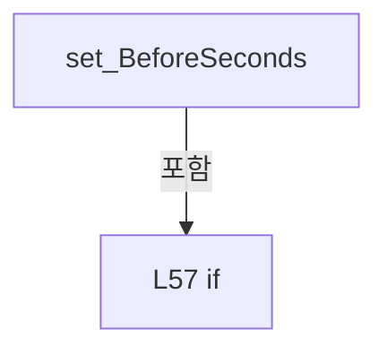

변경 전 점검: 입력/반환 타입, 위 호출자, 예외/취소 경로, 공유 상태와 저장·전송 소비자를 함께 확인합니다. 값의 단위나 물리 방향을 이름만으로 확정하지 않습니다.

### PropertyDeclaration `AfterSeconds` · L64–74

[Drilling.UI/Menu/Menus/CAlarmCauseAnalysis.cs:64–74](https://github.com/kjuws10-rgb/A3Drilling/blob/dfa5920e6301d9ec4b0eab1452ae59521aafc986/Drilling.UI/Menu/Menus/CAlarmCauseAnalysis.cs#L64-L74)

| 항목 | 실제 추출 값 |
| --- | --- |
| 서명 | string Drilling.UI.Menu.Menus.CAlarmCauseAnalysisPanel.AfterSeconds |
| 접근/수식자 | Public / public |
| 반환/값 타입 | string |
| 소속 타입 | NamedType:Drilling.UI.Menu.Menus.CAlarmCauseAnalysisPanel |

현재 부분 분석에서 직접 연결된 호출자는 없습니다. XAML/이벤트/인터페이스·델리게이트·외부 진입을 추가 확인해야 하며, 미사용으로 판정한 것이 아닙니다.

변경 전 점검: 입력/반환 타입, 위 호출자, 예외/취소 경로, 공유 상태와 저장·전송 소비자를 함께 확인합니다. 값의 단위나 물리 방향을 이름만으로 확정하지 않습니다.

### GetAccessorDeclaration `get_AfterSeconds` · L66–66

[Drilling.UI/Menu/Menus/CAlarmCauseAnalysis.cs:66–66](https://github.com/kjuws10-rgb/A3Drilling/blob/dfa5920e6301d9ec4b0eab1452ae59521aafc986/Drilling.UI/Menu/Menus/CAlarmCauseAnalysis.cs#L66-L66)

| 항목 | 실제 추출 값 |
| --- | --- |
| 서명 | string Drilling.UI.Menu.Menus.CAlarmCauseAnalysisPanel.AfterSeconds.get |
| 접근/수식자 | Public / get |
| 반환/값 타입 | string |
| 소속 타입 | NamedType:Drilling.UI.Menu.Menus.CAlarmCauseAnalysisPanel |

현재 부분 분석에서 직접 연결된 호출자는 없습니다. XAML/이벤트/인터페이스·델리게이트·외부 진입을 추가 확인해야 하며, 미사용으로 판정한 것이 아닙니다.

변경 전 점검: 입력/반환 타입, 위 호출자, 예외/취소 경로, 공유 상태와 저장·전송 소비자를 함께 확인합니다. 값의 단위나 물리 방향을 이름만으로 확정하지 않습니다.

### SetAccessorDeclaration `set_AfterSeconds` · L67–73

[Drilling.UI/Menu/Menus/CAlarmCauseAnalysis.cs:67–73](https://github.com/kjuws10-rgb/A3Drilling/blob/dfa5920e6301d9ec4b0eab1452ae59521aafc986/Drilling.UI/Menu/Menus/CAlarmCauseAnalysis.cs#L67-L73)

| 항목 | 실제 추출 값 |
| --- | --- |
| 서명 | void Drilling.UI.Menu.Menus.CAlarmCauseAnalysisPanel.AfterSeconds.set |
| 접근/수식자 | Public / set |
| 반환/값 타입 | void |
| 소속 타입 | NamedType:Drilling.UI.Menu.Menus.CAlarmCauseAnalysisPanel |

입력 계약:

| 이름 | 타입 | 전달 | 선택/기본값 |
| --- | --- | --- | --- |
| value | string | None | False /  |

현재 부분 분석에서 직접 연결된 호출자는 없습니다. XAML/이벤트/인터페이스·델리게이트·외부 진입을 추가 확인해야 하며, 미사용으로 판정한 것이 아닙니다.

호출하는 대상과 해석 범위:

| 원본 행 | 표현식 | 분석 상태 | 대상/소스 위치 |
| --- | --- | --- | --- |
| 72 | Notify | resolved | void Drilling.UI.Menu.Menus.CAlarmCauseAnalysisPanel.Notify(string?) · Drilling.UI/Menu/Menus/CAlarmCauseAnalysis.cs:322 |

본문의 실제 연산·분기·예외·반환 순서(원문 위치 순):

| 원본 행 | 종류 | 주석 해설 |
| --- | --- | --- |
| 69 | if | 조건에 따라 분기합니다: if (_afterSeconds == value) |
| 70 | return | 호출자에게 값 또는 제어를 반환합니다: return; |
| 71 | assignment | 값을 대상에 대입합니다: _afterSeconds = value |
| 72 | call | 함수·델리게이트 또는 객체 생성자를 호출합니다: Notify() |

제어 구문의 포함 구조(실제 실행 순서/CFG가 아닌 구문 탐색 그림):

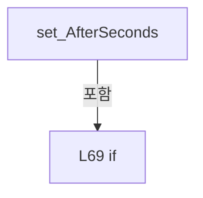

변경 전 점검: 입력/반환 타입, 위 호출자, 예외/취소 경로, 공유 상태와 저장·전송 소비자를 함께 확인합니다. 값의 단위나 물리 방향을 이름만으로 확정하지 않습니다.

### PropertyDeclaration `IsBusy` · L76–88

[Drilling.UI/Menu/Menus/CAlarmCauseAnalysis.cs:76–88](https://github.com/kjuws10-rgb/A3Drilling/blob/dfa5920e6301d9ec4b0eab1452ae59521aafc986/Drilling.UI/Menu/Menus/CAlarmCauseAnalysis.cs#L76-L88)

| 항목 | 실제 추출 값 |
| --- | --- |
| 서명 | bool Drilling.UI.Menu.Menus.CAlarmCauseAnalysisPanel.IsBusy |
| 접근/수식자 | Public / public |
| 반환/값 타입 | bool |
| 소속 타입 | NamedType:Drilling.UI.Menu.Menus.CAlarmCauseAnalysisPanel |

현재 부분 분석에서 직접 연결된 호출자는 없습니다. XAML/이벤트/인터페이스·델리게이트·외부 진입을 추가 확인해야 하며, 미사용으로 판정한 것이 아닙니다.

변경 전 점검: 입력/반환 타입, 위 호출자, 예외/취소 경로, 공유 상태와 저장·전송 소비자를 함께 확인합니다. 값의 단위나 물리 방향을 이름만으로 확정하지 않습니다.

### GetAccessorDeclaration `get_IsBusy` · L78–78

[Drilling.UI/Menu/Menus/CAlarmCauseAnalysis.cs:78–78](https://github.com/kjuws10-rgb/A3Drilling/blob/dfa5920e6301d9ec4b0eab1452ae59521aafc986/Drilling.UI/Menu/Menus/CAlarmCauseAnalysis.cs#L78-L78)

| 항목 | 실제 추출 값 |
| --- | --- |
| 서명 | bool Drilling.UI.Menu.Menus.CAlarmCauseAnalysisPanel.IsBusy.get |
| 접근/수식자 | Public / get |
| 반환/값 타입 | bool |
| 소속 타입 | NamedType:Drilling.UI.Menu.Menus.CAlarmCauseAnalysisPanel |

현재 부분 분석에서 직접 연결된 호출자는 없습니다. XAML/이벤트/인터페이스·델리게이트·외부 진입을 추가 확인해야 하며, 미사용으로 판정한 것이 아닙니다.

변경 전 점검: 입력/반환 타입, 위 호출자, 예외/취소 경로, 공유 상태와 저장·전송 소비자를 함께 확인합니다. 값의 단위나 물리 방향을 이름만으로 확정하지 않습니다.

### SetAccessorDeclaration `set_IsBusy` · L79–87

[Drilling.UI/Menu/Menus/CAlarmCauseAnalysis.cs:79–87](https://github.com/kjuws10-rgb/A3Drilling/blob/dfa5920e6301d9ec4b0eab1452ae59521aafc986/Drilling.UI/Menu/Menus/CAlarmCauseAnalysis.cs#L79-L87)

| 항목 | 실제 추출 값 |
| --- | --- |
| 서명 | void Drilling.UI.Menu.Menus.CAlarmCauseAnalysisPanel.IsBusy.set |
| 접근/수식자 | Private / private, set |
| 반환/값 타입 | void |
| 소속 타입 | NamedType:Drilling.UI.Menu.Menus.CAlarmCauseAnalysisPanel |

입력 계약:

| 이름 | 타입 | 전달 | 선택/기본값 |
| --- | --- | --- | --- |
| value | bool | None | False /  |

현재 부분 분석에서 직접 연결된 호출자는 없습니다. XAML/이벤트/인터페이스·델리게이트·외부 진입을 추가 확인해야 하며, 미사용으로 판정한 것이 아닙니다.

호출하는 대상과 해석 범위:

| 원본 행 | 표현식 | 분석 상태 | 대상/소스 위치 |
| --- | --- | --- | --- |
| 84 | Notify | resolved | void Drilling.UI.Menu.Menus.CAlarmCauseAnalysisPanel.Notify(string?) · Drilling.UI/Menu/Menus/CAlarmCauseAnalysis.cs:322 |
| 85 | Notify | resolved | void Drilling.UI.Menu.Menus.CAlarmCauseAnalysisPanel.Notify(string?) · Drilling.UI/Menu/Menus/CAlarmCauseAnalysis.cs:322 |
| 85 | nameof | unresolved | None |
| 86 | LoadCommand.NotifyCanExecuteChanged | resolved | void Drilling.UI.Menu.CButtonCommand.NotifyCanExecuteChanged() · Drilling.UI/Menu/CButtonCommand.cs:24 |

본문의 실제 연산·분기·예외·반환 순서(원문 위치 순):

| 원본 행 | 종류 | 주석 해설 |
| --- | --- | --- |
| 81 | if | 조건에 따라 분기합니다: if (_isBusy == value) |
| 82 | return | 호출자에게 값 또는 제어를 반환합니다: return; |
| 83 | assignment | 값을 대상에 대입합니다: _isBusy = value |
| 84 | call | 함수·델리게이트 또는 객체 생성자를 호출합니다: Notify() |
| 85 | call | 함수·델리게이트 또는 객체 생성자를 호출합니다: Notify(nameof(CanEdit)) |
| 85 | call | 함수·델리게이트 또는 객체 생성자를 호출합니다: nameof(CanEdit) |
| 86 | call | 함수·델리게이트 또는 객체 생성자를 호출합니다: LoadCommand.NotifyCanExecuteChanged() |

제어 구문의 포함 구조(실제 실행 순서/CFG가 아닌 구문 탐색 그림):

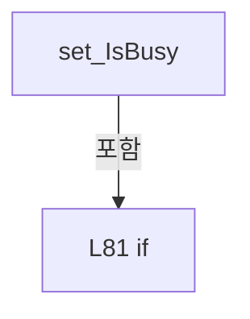

변경 전 점검: 입력/반환 타입, 위 호출자, 예외/취소 경로, 공유 상태와 저장·전송 소비자를 함께 확인합니다. 값의 단위나 물리 방향을 이름만으로 확정하지 않습니다.

### PropertyDeclaration `CanEdit` · L89–89

[Drilling.UI/Menu/Menus/CAlarmCauseAnalysis.cs:89–89](https://github.com/kjuws10-rgb/A3Drilling/blob/dfa5920e6301d9ec4b0eab1452ae59521aafc986/Drilling.UI/Menu/Menus/CAlarmCauseAnalysis.cs#L89-L89)

| 항목 | 실제 추출 값 |
| --- | --- |
| 서명 | bool Drilling.UI.Menu.Menus.CAlarmCauseAnalysisPanel.CanEdit |
| 접근/수식자 | Public / public |
| 반환/값 타입 | bool |
| 소속 타입 | NamedType:Drilling.UI.Menu.Menus.CAlarmCauseAnalysisPanel |

현재 부분 분석에서 직접 연결된 호출자는 없습니다. XAML/이벤트/인터페이스·델리게이트·외부 진입을 추가 확인해야 하며, 미사용으로 판정한 것이 아닙니다.

변경 전 점검: 입력/반환 타입, 위 호출자, 예외/취소 경로, 공유 상태와 저장·전송 소비자를 함께 확인합니다. 값의 단위나 물리 방향을 이름만으로 확정하지 않습니다.

### PropertyDeclaration `Status` · L91–101

[Drilling.UI/Menu/Menus/CAlarmCauseAnalysis.cs:91–101](https://github.com/kjuws10-rgb/A3Drilling/blob/dfa5920e6301d9ec4b0eab1452ae59521aafc986/Drilling.UI/Menu/Menus/CAlarmCauseAnalysis.cs#L91-L101)

| 항목 | 실제 추출 값 |
| --- | --- |
| 서명 | string Drilling.UI.Menu.Menus.CAlarmCauseAnalysisPanel.Status |
| 접근/수식자 | Public / public |
| 반환/값 타입 | string |
| 소속 타입 | NamedType:Drilling.UI.Menu.Menus.CAlarmCauseAnalysisPanel |

현재 부분 분석에서 직접 연결된 호출자는 없습니다. XAML/이벤트/인터페이스·델리게이트·외부 진입을 추가 확인해야 하며, 미사용으로 판정한 것이 아닙니다.

변경 전 점검: 입력/반환 타입, 위 호출자, 예외/취소 경로, 공유 상태와 저장·전송 소비자를 함께 확인합니다. 값의 단위나 물리 방향을 이름만으로 확정하지 않습니다.

### GetAccessorDeclaration `get_Status` · L93–93

[Drilling.UI/Menu/Menus/CAlarmCauseAnalysis.cs:93–93](https://github.com/kjuws10-rgb/A3Drilling/blob/dfa5920e6301d9ec4b0eab1452ae59521aafc986/Drilling.UI/Menu/Menus/CAlarmCauseAnalysis.cs#L93-L93)

| 항목 | 실제 추출 값 |
| --- | --- |
| 서명 | string Drilling.UI.Menu.Menus.CAlarmCauseAnalysisPanel.Status.get |
| 접근/수식자 | Public / get |
| 반환/값 타입 | string |
| 소속 타입 | NamedType:Drilling.UI.Menu.Menus.CAlarmCauseAnalysisPanel |

현재 부분 분석에서 직접 연결된 호출자는 없습니다. XAML/이벤트/인터페이스·델리게이트·외부 진입을 추가 확인해야 하며, 미사용으로 판정한 것이 아닙니다.

변경 전 점검: 입력/반환 타입, 위 호출자, 예외/취소 경로, 공유 상태와 저장·전송 소비자를 함께 확인합니다. 값의 단위나 물리 방향을 이름만으로 확정하지 않습니다.

### SetAccessorDeclaration `set_Status` · L94–100

[Drilling.UI/Menu/Menus/CAlarmCauseAnalysis.cs:94–100](https://github.com/kjuws10-rgb/A3Drilling/blob/dfa5920e6301d9ec4b0eab1452ae59521aafc986/Drilling.UI/Menu/Menus/CAlarmCauseAnalysis.cs#L94-L100)

| 항목 | 실제 추출 값 |
| --- | --- |
| 서명 | void Drilling.UI.Menu.Menus.CAlarmCauseAnalysisPanel.Status.set |
| 접근/수식자 | Private / private, set |
| 반환/값 타입 | void |
| 소속 타입 | NamedType:Drilling.UI.Menu.Menus.CAlarmCauseAnalysisPanel |

입력 계약:

| 이름 | 타입 | 전달 | 선택/기본값 |
| --- | --- | --- | --- |
| value | string | None | False /  |

현재 부분 분석에서 직접 연결된 호출자는 없습니다. XAML/이벤트/인터페이스·델리게이트·외부 진입을 추가 확인해야 하며, 미사용으로 판정한 것이 아닙니다.

호출하는 대상과 해석 범위:

| 원본 행 | 표현식 | 분석 상태 | 대상/소스 위치 |
| --- | --- | --- | --- |
| 99 | Notify | resolved | void Drilling.UI.Menu.Menus.CAlarmCauseAnalysisPanel.Notify(string?) · Drilling.UI/Menu/Menus/CAlarmCauseAnalysis.cs:322 |

본문의 실제 연산·분기·예외·반환 순서(원문 위치 순):

| 원본 행 | 종류 | 주석 해설 |
| --- | --- | --- |
| 96 | if | 조건에 따라 분기합니다: if (_status == value) |
| 97 | return | 호출자에게 값 또는 제어를 반환합니다: return; |
| 98 | assignment | 값을 대상에 대입합니다: _status = value |
| 99 | call | 함수·델리게이트 또는 객체 생성자를 호출합니다: Notify() |

제어 구문의 포함 구조(실제 실행 순서/CFG가 아닌 구문 탐색 그림):

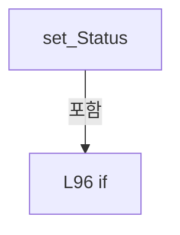

변경 전 점검: 입력/반환 타입, 위 호출자, 예외/취소 경로, 공유 상태와 저장·전송 소비자를 함께 확인합니다. 값의 단위나 물리 방향을 이름만으로 확정하지 않습니다.

### PropertyDeclaration `Interval` · L103–113

[Drilling.UI/Menu/Menus/CAlarmCauseAnalysis.cs:103–113](https://github.com/kjuws10-rgb/A3Drilling/blob/dfa5920e6301d9ec4b0eab1452ae59521aafc986/Drilling.UI/Menu/Menus/CAlarmCauseAnalysis.cs#L103-L113)

| 항목 | 실제 추출 값 |
| --- | --- |
| 서명 | string Drilling.UI.Menu.Menus.CAlarmCauseAnalysisPanel.Interval |
| 접근/수식자 | Public / public |
| 반환/값 타입 | string |
| 소속 타입 | NamedType:Drilling.UI.Menu.Menus.CAlarmCauseAnalysisPanel |

현재 부분 분석에서 직접 연결된 호출자는 없습니다. XAML/이벤트/인터페이스·델리게이트·외부 진입을 추가 확인해야 하며, 미사용으로 판정한 것이 아닙니다.

변경 전 점검: 입력/반환 타입, 위 호출자, 예외/취소 경로, 공유 상태와 저장·전송 소비자를 함께 확인합니다. 값의 단위나 물리 방향을 이름만으로 확정하지 않습니다.

### GetAccessorDeclaration `get_Interval` · L105–105

[Drilling.UI/Menu/Menus/CAlarmCauseAnalysis.cs:105–105](https://github.com/kjuws10-rgb/A3Drilling/blob/dfa5920e6301d9ec4b0eab1452ae59521aafc986/Drilling.UI/Menu/Menus/CAlarmCauseAnalysis.cs#L105-L105)

| 항목 | 실제 추출 값 |
| --- | --- |
| 서명 | string Drilling.UI.Menu.Menus.CAlarmCauseAnalysisPanel.Interval.get |
| 접근/수식자 | Public / get |
| 반환/값 타입 | string |
| 소속 타입 | NamedType:Drilling.UI.Menu.Menus.CAlarmCauseAnalysisPanel |

현재 부분 분석에서 직접 연결된 호출자는 없습니다. XAML/이벤트/인터페이스·델리게이트·외부 진입을 추가 확인해야 하며, 미사용으로 판정한 것이 아닙니다.

변경 전 점검: 입력/반환 타입, 위 호출자, 예외/취소 경로, 공유 상태와 저장·전송 소비자를 함께 확인합니다. 값의 단위나 물리 방향을 이름만으로 확정하지 않습니다.

### SetAccessorDeclaration `set_Interval` · L106–112

[Drilling.UI/Menu/Menus/CAlarmCauseAnalysis.cs:106–112](https://github.com/kjuws10-rgb/A3Drilling/blob/dfa5920e6301d9ec4b0eab1452ae59521aafc986/Drilling.UI/Menu/Menus/CAlarmCauseAnalysis.cs#L106-L112)

| 항목 | 실제 추출 값 |
| --- | --- |
| 서명 | void Drilling.UI.Menu.Menus.CAlarmCauseAnalysisPanel.Interval.set |
| 접근/수식자 | Private / private, set |
| 반환/값 타입 | void |
| 소속 타입 | NamedType:Drilling.UI.Menu.Menus.CAlarmCauseAnalysisPanel |

입력 계약:

| 이름 | 타입 | 전달 | 선택/기본값 |
| --- | --- | --- | --- |
| value | string | None | False /  |

현재 부분 분석에서 직접 연결된 호출자는 없습니다. XAML/이벤트/인터페이스·델리게이트·외부 진입을 추가 확인해야 하며, 미사용으로 판정한 것이 아닙니다.

호출하는 대상과 해석 범위:

| 원본 행 | 표현식 | 분석 상태 | 대상/소스 위치 |
| --- | --- | --- | --- |
| 111 | Notify | resolved | void Drilling.UI.Menu.Menus.CAlarmCauseAnalysisPanel.Notify(string?) · Drilling.UI/Menu/Menus/CAlarmCauseAnalysis.cs:322 |

본문의 실제 연산·분기·예외·반환 순서(원문 위치 순):

| 원본 행 | 종류 | 주석 해설 |
| --- | --- | --- |
| 108 | if | 조건에 따라 분기합니다: if (_interval == value) |
| 109 | return | 호출자에게 값 또는 제어를 반환합니다: return; |
| 110 | assignment | 값을 대상에 대입합니다: _interval = value |
| 111 | call | 함수·델리게이트 또는 객체 생성자를 호출합니다: Notify() |

제어 구문의 포함 구조(실제 실행 순서/CFG가 아닌 구문 탐색 그림):

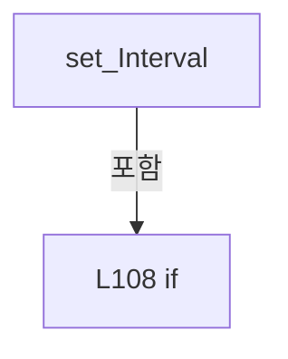

변경 전 점검: 입력/반환 타입, 위 호출자, 예외/취소 경로, 공유 상태와 저장·전송 소비자를 함께 확인합니다. 값의 단위나 물리 방향을 이름만으로 확정하지 않습니다.

### PropertyDeclaration `CursorTime` · L115–125

[Drilling.UI/Menu/Menus/CAlarmCauseAnalysis.cs:115–125](https://github.com/kjuws10-rgb/A3Drilling/blob/dfa5920e6301d9ec4b0eab1452ae59521aafc986/Drilling.UI/Menu/Menus/CAlarmCauseAnalysis.cs#L115-L125)

| 항목 | 실제 추출 값 |
| --- | --- |
| 서명 | string Drilling.UI.Menu.Menus.CAlarmCauseAnalysisPanel.CursorTime |
| 접근/수식자 | Public / public |
| 반환/값 타입 | string |
| 소속 타입 | NamedType:Drilling.UI.Menu.Menus.CAlarmCauseAnalysisPanel |

현재 부분 분석에서 직접 연결된 호출자는 없습니다. XAML/이벤트/인터페이스·델리게이트·외부 진입을 추가 확인해야 하며, 미사용으로 판정한 것이 아닙니다.

변경 전 점검: 입력/반환 타입, 위 호출자, 예외/취소 경로, 공유 상태와 저장·전송 소비자를 함께 확인합니다. 값의 단위나 물리 방향을 이름만으로 확정하지 않습니다.

### GetAccessorDeclaration `get_CursorTime` · L117–117

[Drilling.UI/Menu/Menus/CAlarmCauseAnalysis.cs:117–117](https://github.com/kjuws10-rgb/A3Drilling/blob/dfa5920e6301d9ec4b0eab1452ae59521aafc986/Drilling.UI/Menu/Menus/CAlarmCauseAnalysis.cs#L117-L117)

| 항목 | 실제 추출 값 |
| --- | --- |
| 서명 | string Drilling.UI.Menu.Menus.CAlarmCauseAnalysisPanel.CursorTime.get |
| 접근/수식자 | Public / get |
| 반환/값 타입 | string |
| 소속 타입 | NamedType:Drilling.UI.Menu.Menus.CAlarmCauseAnalysisPanel |

현재 부분 분석에서 직접 연결된 호출자는 없습니다. XAML/이벤트/인터페이스·델리게이트·외부 진입을 추가 확인해야 하며, 미사용으로 판정한 것이 아닙니다.

변경 전 점검: 입력/반환 타입, 위 호출자, 예외/취소 경로, 공유 상태와 저장·전송 소비자를 함께 확인합니다. 값의 단위나 물리 방향을 이름만으로 확정하지 않습니다.

### SetAccessorDeclaration `set_CursorTime` · L118–124

[Drilling.UI/Menu/Menus/CAlarmCauseAnalysis.cs:118–124](https://github.com/kjuws10-rgb/A3Drilling/blob/dfa5920e6301d9ec4b0eab1452ae59521aafc986/Drilling.UI/Menu/Menus/CAlarmCauseAnalysis.cs#L118-L124)

| 항목 | 실제 추출 값 |
| --- | --- |
| 서명 | void Drilling.UI.Menu.Menus.CAlarmCauseAnalysisPanel.CursorTime.set |
| 접근/수식자 | Private / private, set |
| 반환/값 타입 | void |
| 소속 타입 | NamedType:Drilling.UI.Menu.Menus.CAlarmCauseAnalysisPanel |

입력 계약:

| 이름 | 타입 | 전달 | 선택/기본값 |
| --- | --- | --- | --- |
| value | string | None | False /  |

현재 부분 분석에서 직접 연결된 호출자는 없습니다. XAML/이벤트/인터페이스·델리게이트·외부 진입을 추가 확인해야 하며, 미사용으로 판정한 것이 아닙니다.

호출하는 대상과 해석 범위:

| 원본 행 | 표현식 | 분석 상태 | 대상/소스 위치 |
| --- | --- | --- | --- |
| 123 | Notify | resolved | void Drilling.UI.Menu.Menus.CAlarmCauseAnalysisPanel.Notify(string?) · Drilling.UI/Menu/Menus/CAlarmCauseAnalysis.cs:322 |

본문의 실제 연산·분기·예외·반환 순서(원문 위치 순):

| 원본 행 | 종류 | 주석 해설 |
| --- | --- | --- |
| 120 | if | 조건에 따라 분기합니다: if (_cursorTime == value) |
| 121 | return | 호출자에게 값 또는 제어를 반환합니다: return; |
| 122 | assignment | 값을 대상에 대입합니다: _cursorTime = value |
| 123 | call | 함수·델리게이트 또는 객체 생성자를 호출합니다: Notify() |

제어 구문의 포함 구조(실제 실행 순서/CFG가 아닌 구문 탐색 그림):

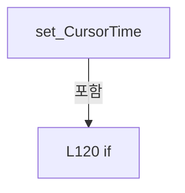

변경 전 점검: 입력/반환 타입, 위 호출자, 예외/취소 경로, 공유 상태와 저장·전송 소비자를 함께 확인합니다. 값의 단위나 물리 방향을 이름만으로 확정하지 않습니다.

### PropertyDeclaration `CursorOccurredAt` · L127–127

[Drilling.UI/Menu/Menus/CAlarmCauseAnalysis.cs:127–127](https://github.com/kjuws10-rgb/A3Drilling/blob/dfa5920e6301d9ec4b0eab1452ae59521aafc986/Drilling.UI/Menu/Menus/CAlarmCauseAnalysis.cs#L127-L127)

| 항목 | 실제 추출 값 |
| --- | --- |
| 서명 | System.DateTimeOffset? Drilling.UI.Menu.Menus.CAlarmCauseAnalysisPanel.CursorOccurredAt |
| 접근/수식자 | Public / public |
| 반환/값 타입 | System.DateTimeOffset? |
| 소속 타입 | NamedType:Drilling.UI.Menu.Menus.CAlarmCauseAnalysisPanel |

현재 부분 분석에서 직접 연결된 호출자는 없습니다. XAML/이벤트/인터페이스·델리게이트·외부 진입을 추가 확인해야 하며, 미사용으로 판정한 것이 아닙니다.

변경 전 점검: 입력/반환 타입, 위 호출자, 예외/취소 경로, 공유 상태와 저장·전송 소비자를 함께 확인합니다. 값의 단위나 물리 방향을 이름만으로 확정하지 않습니다.

### PropertyDeclaration `ShowStateChangesOnly` · L129–140

[Drilling.UI/Menu/Menus/CAlarmCauseAnalysis.cs:129–140](https://github.com/kjuws10-rgb/A3Drilling/blob/dfa5920e6301d9ec4b0eab1452ae59521aafc986/Drilling.UI/Menu/Menus/CAlarmCauseAnalysis.cs#L129-L140)

| 항목 | 실제 추출 값 |
| --- | --- |
| 서명 | bool Drilling.UI.Menu.Menus.CAlarmCauseAnalysisPanel.ShowStateChangesOnly |
| 접근/수식자 | Public / public |
| 반환/값 타입 | bool |
| 소속 타입 | NamedType:Drilling.UI.Menu.Menus.CAlarmCauseAnalysisPanel |

현재 부분 분석에서 직접 연결된 호출자는 없습니다. XAML/이벤트/인터페이스·델리게이트·외부 진입을 추가 확인해야 하며, 미사용으로 판정한 것이 아닙니다.

변경 전 점검: 입력/반환 타입, 위 호출자, 예외/취소 경로, 공유 상태와 저장·전송 소비자를 함께 확인합니다. 값의 단위나 물리 방향을 이름만으로 확정하지 않습니다.

### GetAccessorDeclaration `get_ShowStateChangesOnly` · L131–131

[Drilling.UI/Menu/Menus/CAlarmCauseAnalysis.cs:131–131](https://github.com/kjuws10-rgb/A3Drilling/blob/dfa5920e6301d9ec4b0eab1452ae59521aafc986/Drilling.UI/Menu/Menus/CAlarmCauseAnalysis.cs#L131-L131)

| 항목 | 실제 추출 값 |
| --- | --- |
| 서명 | bool Drilling.UI.Menu.Menus.CAlarmCauseAnalysisPanel.ShowStateChangesOnly.get |
| 접근/수식자 | Public / get |
| 반환/값 타입 | bool |
| 소속 타입 | NamedType:Drilling.UI.Menu.Menus.CAlarmCauseAnalysisPanel |

현재 부분 분석에서 직접 연결된 호출자는 없습니다. XAML/이벤트/인터페이스·델리게이트·외부 진입을 추가 확인해야 하며, 미사용으로 판정한 것이 아닙니다.

변경 전 점검: 입력/반환 타입, 위 호출자, 예외/취소 경로, 공유 상태와 저장·전송 소비자를 함께 확인합니다. 값의 단위나 물리 방향을 이름만으로 확정하지 않습니다.

### SetAccessorDeclaration `set_ShowStateChangesOnly` · L132–139

[Drilling.UI/Menu/Menus/CAlarmCauseAnalysis.cs:132–139](https://github.com/kjuws10-rgb/A3Drilling/blob/dfa5920e6301d9ec4b0eab1452ae59521aafc986/Drilling.UI/Menu/Menus/CAlarmCauseAnalysis.cs#L132-L139)

| 항목 | 실제 추출 값 |
| --- | --- |
| 서명 | void Drilling.UI.Menu.Menus.CAlarmCauseAnalysisPanel.ShowStateChangesOnly.set |
| 접근/수식자 | Public / set |
| 반환/값 타입 | void |
| 소속 타입 | NamedType:Drilling.UI.Menu.Menus.CAlarmCauseAnalysisPanel |

입력 계약:

| 이름 | 타입 | 전달 | 선택/기본값 |
| --- | --- | --- | --- |
| value | bool | None | False /  |

현재 부분 분석에서 직접 연결된 호출자는 없습니다. XAML/이벤트/인터페이스·델리게이트·외부 진입을 추가 확인해야 하며, 미사용으로 판정한 것이 아닙니다.

호출하는 대상과 해석 범위:

| 원본 행 | 표현식 | 분석 상태 | 대상/소스 위치 |
| --- | --- | --- | --- |
| 137 | Notify | resolved | void Drilling.UI.Menu.Menus.CAlarmCauseAnalysisPanel.Notify(string?) · Drilling.UI/Menu/Menus/CAlarmCauseAnalysis.cs:322 |
| 138 | ApplyVisiblePanes | resolved | void Drilling.UI.Menu.Menus.CAlarmCauseAnalysisPanel.ApplyVisiblePanes(bool) · Drilling.UI/Menu/Menus/CAlarmCauseAnalysis.cs:279 |

본문의 실제 연산·분기·예외·반환 순서(원문 위치 순):

| 원본 행 | 종류 | 주석 해설 |
| --- | --- | --- |
| 134 | if | 조건에 따라 분기합니다: if (_showStateChangesOnly == value) |
| 135 | return | 호출자에게 값 또는 제어를 반환합니다: return; |
| 136 | assignment | 값을 대상에 대입합니다: _showStateChangesOnly = value |
| 137 | call | 함수·델리게이트 또는 객체 생성자를 호출합니다: Notify() |
| 138 | call | 함수·델리게이트 또는 객체 생성자를 호출합니다: ApplyVisiblePanes() |

제어 구문의 포함 구조(실제 실행 순서/CFG가 아닌 구문 탐색 그림):

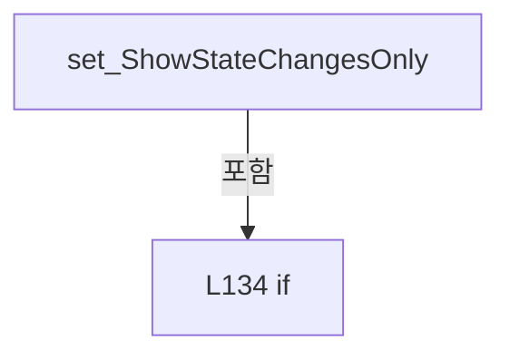

변경 전 점검: 입력/반환 타입, 위 호출자, 예외/취소 경로, 공유 상태와 저장·전송 소비자를 함께 확인합니다. 값의 단위나 물리 방향을 이름만으로 확정하지 않습니다.

### PropertyDeclaration `CompareWithReference` · L142–153

[Drilling.UI/Menu/Menus/CAlarmCauseAnalysis.cs:142–153](https://github.com/kjuws10-rgb/A3Drilling/blob/dfa5920e6301d9ec4b0eab1452ae59521aafc986/Drilling.UI/Menu/Menus/CAlarmCauseAnalysis.cs#L142-L153)

| 항목 | 실제 추출 값 |
| --- | --- |
| 서명 | bool Drilling.UI.Menu.Menus.CAlarmCauseAnalysisPanel.CompareWithReference |
| 접근/수식자 | Public / public |
| 반환/값 타입 | bool |
| 소속 타입 | NamedType:Drilling.UI.Menu.Menus.CAlarmCauseAnalysisPanel |

현재 부분 분석에서 직접 연결된 호출자는 없습니다. XAML/이벤트/인터페이스·델리게이트·외부 진입을 추가 확인해야 하며, 미사용으로 판정한 것이 아닙니다.

변경 전 점검: 입력/반환 타입, 위 호출자, 예외/취소 경로, 공유 상태와 저장·전송 소비자를 함께 확인합니다. 값의 단위나 물리 방향을 이름만으로 확정하지 않습니다.

### GetAccessorDeclaration `get_CompareWithReference` · L144–144

[Drilling.UI/Menu/Menus/CAlarmCauseAnalysis.cs:144–144](https://github.com/kjuws10-rgb/A3Drilling/blob/dfa5920e6301d9ec4b0eab1452ae59521aafc986/Drilling.UI/Menu/Menus/CAlarmCauseAnalysis.cs#L144-L144)

| 항목 | 실제 추출 값 |
| --- | --- |
| 서명 | bool Drilling.UI.Menu.Menus.CAlarmCauseAnalysisPanel.CompareWithReference.get |
| 접근/수식자 | Public / get |
| 반환/값 타입 | bool |
| 소속 타입 | NamedType:Drilling.UI.Menu.Menus.CAlarmCauseAnalysisPanel |

현재 부분 분석에서 직접 연결된 호출자는 없습니다. XAML/이벤트/인터페이스·델리게이트·외부 진입을 추가 확인해야 하며, 미사용으로 판정한 것이 아닙니다.

변경 전 점검: 입력/반환 타입, 위 호출자, 예외/취소 경로, 공유 상태와 저장·전송 소비자를 함께 확인합니다. 값의 단위나 물리 방향을 이름만으로 확정하지 않습니다.

### SetAccessorDeclaration `set_CompareWithReference` · L145–152

[Drilling.UI/Menu/Menus/CAlarmCauseAnalysis.cs:145–152](https://github.com/kjuws10-rgb/A3Drilling/blob/dfa5920e6301d9ec4b0eab1452ae59521aafc986/Drilling.UI/Menu/Menus/CAlarmCauseAnalysis.cs#L145-L152)

| 항목 | 실제 추출 값 |
| --- | --- |
| 서명 | void Drilling.UI.Menu.Menus.CAlarmCauseAnalysisPanel.CompareWithReference.set |
| 접근/수식자 | Public / set |
| 반환/값 타입 | void |
| 소속 타입 | NamedType:Drilling.UI.Menu.Menus.CAlarmCauseAnalysisPanel |

입력 계약:

| 이름 | 타입 | 전달 | 선택/기본값 |
| --- | --- | --- | --- |
| value | bool | None | False /  |

현재 부분 분석에서 직접 연결된 호출자는 없습니다. XAML/이벤트/인터페이스·델리게이트·외부 진입을 추가 확인해야 하며, 미사용으로 판정한 것이 아닙니다.

호출하는 대상과 해석 범위:

| 원본 행 | 표현식 | 분석 상태 | 대상/소스 위치 |
| --- | --- | --- | --- |
| 150 | Notify | resolved | void Drilling.UI.Menu.Menus.CAlarmCauseAnalysisPanel.Notify(string?) · Drilling.UI/Menu/Menus/CAlarmCauseAnalysis.cs:322 |
| 151 | ApplyVisiblePanes | resolved | void Drilling.UI.Menu.Menus.CAlarmCauseAnalysisPanel.ApplyVisiblePanes(bool) · Drilling.UI/Menu/Menus/CAlarmCauseAnalysis.cs:279 |

본문의 실제 연산·분기·예외·반환 순서(원문 위치 순):

| 원본 행 | 종류 | 주석 해설 |
| --- | --- | --- |
| 147 | if | 조건에 따라 분기합니다: if (_compareWithReference == value) |
| 148 | return | 호출자에게 값 또는 제어를 반환합니다: return; |
| 149 | assignment | 값을 대상에 대입합니다: _compareWithReference = value |
| 150 | call | 함수·델리게이트 또는 객체 생성자를 호출합니다: Notify() |
| 151 | call | 함수·델리게이트 또는 객체 생성자를 호출합니다: ApplyVisiblePanes() |

제어 구문의 포함 구조(실제 실행 순서/CFG가 아닌 구문 탐색 그림):

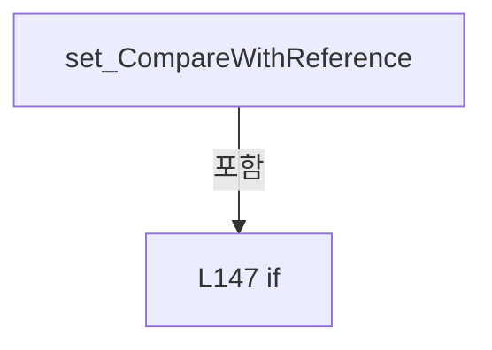

변경 전 점검: 입력/반환 타입, 위 호출자, 예외/취소 경로, 공유 상태와 저장·전송 소비자를 함께 확인합니다. 값의 단위나 물리 방향을 이름만으로 확정하지 않습니다.

### PropertyDeclaration `HasReference` · L155–155

[Drilling.UI/Menu/Menus/CAlarmCauseAnalysis.cs:155–155](https://github.com/kjuws10-rgb/A3Drilling/blob/dfa5920e6301d9ec4b0eab1452ae59521aafc986/Drilling.UI/Menu/Menus/CAlarmCauseAnalysis.cs#L155-L155)

| 항목 | 실제 추출 값 |
| --- | --- |
| 서명 | bool Drilling.UI.Menu.Menus.CAlarmCauseAnalysisPanel.HasReference |
| 접근/수식자 | Public / public |
| 반환/값 타입 | bool |
| 소속 타입 | NamedType:Drilling.UI.Menu.Menus.CAlarmCauseAnalysisPanel |

현재 부분 분석에서 직접 연결된 호출자는 없습니다. XAML/이벤트/인터페이스·델리게이트·외부 진입을 추가 확인해야 하며, 미사용으로 판정한 것이 아닙니다.

변경 전 점검: 입력/반환 타입, 위 호출자, 예외/취소 경로, 공유 상태와 저장·전송 소비자를 함께 확인합니다. 값의 단위나 물리 방향을 이름만으로 확정하지 않습니다.

### PropertyDeclaration `ReferenceSummary` · L157–167

[Drilling.UI/Menu/Menus/CAlarmCauseAnalysis.cs:157–167](https://github.com/kjuws10-rgb/A3Drilling/blob/dfa5920e6301d9ec4b0eab1452ae59521aafc986/Drilling.UI/Menu/Menus/CAlarmCauseAnalysis.cs#L157-L167)

| 항목 | 실제 추출 값 |
| --- | --- |
| 서명 | string Drilling.UI.Menu.Menus.CAlarmCauseAnalysisPanel.ReferenceSummary |
| 접근/수식자 | Public / public |
| 반환/값 타입 | string |
| 소속 타입 | NamedType:Drilling.UI.Menu.Menus.CAlarmCauseAnalysisPanel |

현재 부분 분석에서 직접 연결된 호출자는 없습니다. XAML/이벤트/인터페이스·델리게이트·외부 진입을 추가 확인해야 하며, 미사용으로 판정한 것이 아닙니다.

변경 전 점검: 입력/반환 타입, 위 호출자, 예외/취소 경로, 공유 상태와 저장·전송 소비자를 함께 확인합니다. 값의 단위나 물리 방향을 이름만으로 확정하지 않습니다.

### GetAccessorDeclaration `get_ReferenceSummary` · L159–159

[Drilling.UI/Menu/Menus/CAlarmCauseAnalysis.cs:159–159](https://github.com/kjuws10-rgb/A3Drilling/blob/dfa5920e6301d9ec4b0eab1452ae59521aafc986/Drilling.UI/Menu/Menus/CAlarmCauseAnalysis.cs#L159-L159)

| 항목 | 실제 추출 값 |
| --- | --- |
| 서명 | string Drilling.UI.Menu.Menus.CAlarmCauseAnalysisPanel.ReferenceSummary.get |
| 접근/수식자 | Public / get |
| 반환/값 타입 | string |
| 소속 타입 | NamedType:Drilling.UI.Menu.Menus.CAlarmCauseAnalysisPanel |

현재 부분 분석에서 직접 연결된 호출자는 없습니다. XAML/이벤트/인터페이스·델리게이트·외부 진입을 추가 확인해야 하며, 미사용으로 판정한 것이 아닙니다.

변경 전 점검: 입력/반환 타입, 위 호출자, 예외/취소 경로, 공유 상태와 저장·전송 소비자를 함께 확인합니다. 값의 단위나 물리 방향을 이름만으로 확정하지 않습니다.

### SetAccessorDeclaration `set_ReferenceSummary` · L160–166

[Drilling.UI/Menu/Menus/CAlarmCauseAnalysis.cs:160–166](https://github.com/kjuws10-rgb/A3Drilling/blob/dfa5920e6301d9ec4b0eab1452ae59521aafc986/Drilling.UI/Menu/Menus/CAlarmCauseAnalysis.cs#L160-L166)

| 항목 | 실제 추출 값 |
| --- | --- |
| 서명 | void Drilling.UI.Menu.Menus.CAlarmCauseAnalysisPanel.ReferenceSummary.set |
| 접근/수식자 | Private / private, set |
| 반환/값 타입 | void |
| 소속 타입 | NamedType:Drilling.UI.Menu.Menus.CAlarmCauseAnalysisPanel |

입력 계약:

| 이름 | 타입 | 전달 | 선택/기본값 |
| --- | --- | --- | --- |
| value | string | None | False /  |

현재 부분 분석에서 직접 연결된 호출자는 없습니다. XAML/이벤트/인터페이스·델리게이트·외부 진입을 추가 확인해야 하며, 미사용으로 판정한 것이 아닙니다.

호출하는 대상과 해석 범위:

| 원본 행 | 표현식 | 분석 상태 | 대상/소스 위치 |
| --- | --- | --- | --- |
| 165 | Notify | resolved | void Drilling.UI.Menu.Menus.CAlarmCauseAnalysisPanel.Notify(string?) · Drilling.UI/Menu/Menus/CAlarmCauseAnalysis.cs:322 |

본문의 실제 연산·분기·예외·반환 순서(원문 위치 순):

| 원본 행 | 종류 | 주석 해설 |
| --- | --- | --- |
| 162 | if | 조건에 따라 분기합니다: if (_referenceSummary == value) |
| 163 | return | 호출자에게 값 또는 제어를 반환합니다: return; |
| 164 | assignment | 값을 대상에 대입합니다: _referenceSummary = value |
| 165 | call | 함수·델리게이트 또는 객체 생성자를 호출합니다: Notify() |

제어 구문의 포함 구조(실제 실행 순서/CFG가 아닌 구문 탐색 그림):

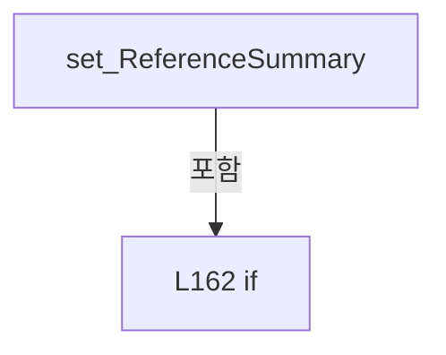

변경 전 점검: 입력/반환 타입, 위 호출자, 예외/취소 경로, 공유 상태와 저장·전송 소비자를 함께 확인합니다. 값의 단위나 물리 방향을 이름만으로 확정하지 않습니다.

### PropertyDeclaration `Panes` · L169–177

[Drilling.UI/Menu/Menus/CAlarmCauseAnalysis.cs:169–177](https://github.com/kjuws10-rgb/A3Drilling/blob/dfa5920e6301d9ec4b0eab1452ae59521aafc986/Drilling.UI/Menu/Menus/CAlarmCauseAnalysis.cs#L169-L177)

| 항목 | 실제 추출 값 |
| --- | --- |
| 서명 | System.Collections.Generic.IReadOnlyList<Drilling.UI.Menu.Menus.ST_ALARM_ANALYSIS_PANE> Drilling.UI.Menu.Menus.CAlarmCauseAnalysisPanel.Panes |
| 접근/수식자 | Public / public |
| 반환/값 타입 | System.Collections.Generic.IReadOnlyList<Drilling.UI.Menu.Menus.ST_ALARM_ANALYSIS_PANE> |
| 소속 타입 | NamedType:Drilling.UI.Menu.Menus.CAlarmCauseAnalysisPanel |

현재 부분 분석에서 직접 연결된 호출자는 없습니다. XAML/이벤트/인터페이스·델리게이트·외부 진입을 추가 확인해야 하며, 미사용으로 판정한 것이 아닙니다.

변경 전 점검: 입력/반환 타입, 위 호출자, 예외/취소 경로, 공유 상태와 저장·전송 소비자를 함께 확인합니다. 값의 단위나 물리 방향을 이름만으로 확정하지 않습니다.

### GetAccessorDeclaration `get_Panes` · L171–171

[Drilling.UI/Menu/Menus/CAlarmCauseAnalysis.cs:171–171](https://github.com/kjuws10-rgb/A3Drilling/blob/dfa5920e6301d9ec4b0eab1452ae59521aafc986/Drilling.UI/Menu/Menus/CAlarmCauseAnalysis.cs#L171-L171)

| 항목 | 실제 추출 값 |
| --- | --- |
| 서명 | System.Collections.Generic.IReadOnlyList<Drilling.UI.Menu.Menus.ST_ALARM_ANALYSIS_PANE> Drilling.UI.Menu.Menus.CAlarmCauseAnalysisPanel.Panes.get |
| 접근/수식자 | Public / get |
| 반환/값 타입 | System.Collections.Generic.IReadOnlyList<Drilling.UI.Menu.Menus.ST_ALARM_ANALYSIS_PANE> |
| 소속 타입 | NamedType:Drilling.UI.Menu.Menus.CAlarmCauseAnalysisPanel |

현재 부분 분석에서 직접 연결된 호출자는 없습니다. XAML/이벤트/인터페이스·델리게이트·외부 진입을 추가 확인해야 하며, 미사용으로 판정한 것이 아닙니다.

변경 전 점검: 입력/반환 타입, 위 호출자, 예외/취소 경로, 공유 상태와 저장·전송 소비자를 함께 확인합니다. 값의 단위나 물리 방향을 이름만으로 확정하지 않습니다.

### SetAccessorDeclaration `set_Panes` · L172–176

[Drilling.UI/Menu/Menus/CAlarmCauseAnalysis.cs:172–176](https://github.com/kjuws10-rgb/A3Drilling/blob/dfa5920e6301d9ec4b0eab1452ae59521aafc986/Drilling.UI/Menu/Menus/CAlarmCauseAnalysis.cs#L172-L176)

| 항목 | 실제 추출 값 |
| --- | --- |
| 서명 | void Drilling.UI.Menu.Menus.CAlarmCauseAnalysisPanel.Panes.set |
| 접근/수식자 | Private / private, set |
| 반환/값 타입 | void |
| 소속 타입 | NamedType:Drilling.UI.Menu.Menus.CAlarmCauseAnalysisPanel |

입력 계약:

| 이름 | 타입 | 전달 | 선택/기본값 |
| --- | --- | --- | --- |
| value | System.Collections.Generic.IReadOnlyList<Drilling.UI.Menu.Menus.ST_ALARM_ANALYSIS_PANE> | None | False /  |

현재 부분 분석에서 직접 연결된 호출자는 없습니다. XAML/이벤트/인터페이스·델리게이트·외부 진입을 추가 확인해야 하며, 미사용으로 판정한 것이 아닙니다.

호출하는 대상과 해석 범위:

| 원본 행 | 표현식 | 분석 상태 | 대상/소스 위치 |
| --- | --- | --- | --- |
| 175 | Notify | resolved | void Drilling.UI.Menu.Menus.CAlarmCauseAnalysisPanel.Notify(string?) · Drilling.UI/Menu/Menus/CAlarmCauseAnalysis.cs:322 |

본문의 실제 연산·분기·예외·반환 순서(원문 위치 순):

| 원본 행 | 종류 | 주석 해설 |
| --- | --- | --- |
| 174 | assignment | 값을 대상에 대입합니다: _panes = value |
| 175 | call | 함수·델리게이트 또는 객체 생성자를 호출합니다: Notify() |

변경 전 점검: 입력/반환 타입, 위 호출자, 예외/취소 경로, 공유 상태와 저장·전송 소비자를 함께 확인합니다. 값의 단위나 물리 방향을 이름만으로 확정하지 않습니다.

### PropertyDeclaration `Candidates` · L179–187

[Drilling.UI/Menu/Menus/CAlarmCauseAnalysis.cs:179–187](https://github.com/kjuws10-rgb/A3Drilling/blob/dfa5920e6301d9ec4b0eab1452ae59521aafc986/Drilling.UI/Menu/Menus/CAlarmCauseAnalysis.cs#L179-L187)

| 항목 | 실제 추출 값 |
| --- | --- |
| 서명 | System.Collections.Generic.IReadOnlyList<Drilling.UI.Menu.Menus.ST_ALARM_CAUSE_CANDIDATE> Drilling.UI.Menu.Menus.CAlarmCauseAnalysisPanel.Candidates |
| 접근/수식자 | Public / public |
| 반환/값 타입 | System.Collections.Generic.IReadOnlyList<Drilling.UI.Menu.Menus.ST_ALARM_CAUSE_CANDIDATE> |
| 소속 타입 | NamedType:Drilling.UI.Menu.Menus.CAlarmCauseAnalysisPanel |

현재 부분 분석에서 직접 연결된 호출자는 없습니다. XAML/이벤트/인터페이스·델리게이트·외부 진입을 추가 확인해야 하며, 미사용으로 판정한 것이 아닙니다.

변경 전 점검: 입력/반환 타입, 위 호출자, 예외/취소 경로, 공유 상태와 저장·전송 소비자를 함께 확인합니다. 값의 단위나 물리 방향을 이름만으로 확정하지 않습니다.

### GetAccessorDeclaration `get_Candidates` · L181–181

[Drilling.UI/Menu/Menus/CAlarmCauseAnalysis.cs:181–181](https://github.com/kjuws10-rgb/A3Drilling/blob/dfa5920e6301d9ec4b0eab1452ae59521aafc986/Drilling.UI/Menu/Menus/CAlarmCauseAnalysis.cs#L181-L181)

| 항목 | 실제 추출 값 |
| --- | --- |
| 서명 | System.Collections.Generic.IReadOnlyList<Drilling.UI.Menu.Menus.ST_ALARM_CAUSE_CANDIDATE> Drilling.UI.Menu.Menus.CAlarmCauseAnalysisPanel.Candidates.get |
| 접근/수식자 | Public / get |
| 반환/값 타입 | System.Collections.Generic.IReadOnlyList<Drilling.UI.Menu.Menus.ST_ALARM_CAUSE_CANDIDATE> |
| 소속 타입 | NamedType:Drilling.UI.Menu.Menus.CAlarmCauseAnalysisPanel |

현재 부분 분석에서 직접 연결된 호출자는 없습니다. XAML/이벤트/인터페이스·델리게이트·외부 진입을 추가 확인해야 하며, 미사용으로 판정한 것이 아닙니다.

변경 전 점검: 입력/반환 타입, 위 호출자, 예외/취소 경로, 공유 상태와 저장·전송 소비자를 함께 확인합니다. 값의 단위나 물리 방향을 이름만으로 확정하지 않습니다.

### SetAccessorDeclaration `set_Candidates` · L182–186

[Drilling.UI/Menu/Menus/CAlarmCauseAnalysis.cs:182–186](https://github.com/kjuws10-rgb/A3Drilling/blob/dfa5920e6301d9ec4b0eab1452ae59521aafc986/Drilling.UI/Menu/Menus/CAlarmCauseAnalysis.cs#L182-L186)

| 항목 | 실제 추출 값 |
| --- | --- |
| 서명 | void Drilling.UI.Menu.Menus.CAlarmCauseAnalysisPanel.Candidates.set |
| 접근/수식자 | Private / private, set |
| 반환/값 타입 | void |
| 소속 타입 | NamedType:Drilling.UI.Menu.Menus.CAlarmCauseAnalysisPanel |

입력 계약:

| 이름 | 타입 | 전달 | 선택/기본값 |
| --- | --- | --- | --- |
| value | System.Collections.Generic.IReadOnlyList<Drilling.UI.Menu.Menus.ST_ALARM_CAUSE_CANDIDATE> | None | False /  |

현재 부분 분석에서 직접 연결된 호출자는 없습니다. XAML/이벤트/인터페이스·델리게이트·외부 진입을 추가 확인해야 하며, 미사용으로 판정한 것이 아닙니다.

호출하는 대상과 해석 범위:

| 원본 행 | 표현식 | 분석 상태 | 대상/소스 위치 |
| --- | --- | --- | --- |
| 185 | Notify | resolved | void Drilling.UI.Menu.Menus.CAlarmCauseAnalysisPanel.Notify(string?) · Drilling.UI/Menu/Menus/CAlarmCauseAnalysis.cs:322 |

본문의 실제 연산·분기·예외·반환 순서(원문 위치 순):

| 원본 행 | 종류 | 주석 해설 |
| --- | --- | --- |
| 184 | assignment | 값을 대상에 대입합니다: _candidates = value |
| 185 | call | 함수·델리게이트 또는 객체 생성자를 호출합니다: Notify() |

변경 전 점검: 입력/반환 타입, 위 호출자, 예외/취소 경로, 공유 상태와 저장·전송 소비자를 함께 확인합니다. 값의 단위나 물리 방향을 이름만으로 확정하지 않습니다.

### PropertyDeclaration `Timeline` · L189–197

[Drilling.UI/Menu/Menus/CAlarmCauseAnalysis.cs:189–197](https://github.com/kjuws10-rgb/A3Drilling/blob/dfa5920e6301d9ec4b0eab1452ae59521aafc986/Drilling.UI/Menu/Menus/CAlarmCauseAnalysis.cs#L189-L197)

| 항목 | 실제 추출 값 |
| --- | --- |
| 서명 | System.Collections.Generic.IReadOnlyList<Drilling.UI.Menu.Menus.ST_ALARM_TIMELINE_ITEM> Drilling.UI.Menu.Menus.CAlarmCauseAnalysisPanel.Timeline |
| 접근/수식자 | Public / public |
| 반환/값 타입 | System.Collections.Generic.IReadOnlyList<Drilling.UI.Menu.Menus.ST_ALARM_TIMELINE_ITEM> |
| 소속 타입 | NamedType:Drilling.UI.Menu.Menus.CAlarmCauseAnalysisPanel |

현재 부분 분석에서 직접 연결된 호출자는 없습니다. XAML/이벤트/인터페이스·델리게이트·외부 진입을 추가 확인해야 하며, 미사용으로 판정한 것이 아닙니다.

변경 전 점검: 입력/반환 타입, 위 호출자, 예외/취소 경로, 공유 상태와 저장·전송 소비자를 함께 확인합니다. 값의 단위나 물리 방향을 이름만으로 확정하지 않습니다.

### GetAccessorDeclaration `get_Timeline` · L191–191

[Drilling.UI/Menu/Menus/CAlarmCauseAnalysis.cs:191–191](https://github.com/kjuws10-rgb/A3Drilling/blob/dfa5920e6301d9ec4b0eab1452ae59521aafc986/Drilling.UI/Menu/Menus/CAlarmCauseAnalysis.cs#L191-L191)

| 항목 | 실제 추출 값 |
| --- | --- |
| 서명 | System.Collections.Generic.IReadOnlyList<Drilling.UI.Menu.Menus.ST_ALARM_TIMELINE_ITEM> Drilling.UI.Menu.Menus.CAlarmCauseAnalysisPanel.Timeline.get |
| 접근/수식자 | Public / get |
| 반환/값 타입 | System.Collections.Generic.IReadOnlyList<Drilling.UI.Menu.Menus.ST_ALARM_TIMELINE_ITEM> |
| 소속 타입 | NamedType:Drilling.UI.Menu.Menus.CAlarmCauseAnalysisPanel |

현재 부분 분석에서 직접 연결된 호출자는 없습니다. XAML/이벤트/인터페이스·델리게이트·외부 진입을 추가 확인해야 하며, 미사용으로 판정한 것이 아닙니다.

변경 전 점검: 입력/반환 타입, 위 호출자, 예외/취소 경로, 공유 상태와 저장·전송 소비자를 함께 확인합니다. 값의 단위나 물리 방향을 이름만으로 확정하지 않습니다.

### SetAccessorDeclaration `set_Timeline` · L192–196

[Drilling.UI/Menu/Menus/CAlarmCauseAnalysis.cs:192–196](https://github.com/kjuws10-rgb/A3Drilling/blob/dfa5920e6301d9ec4b0eab1452ae59521aafc986/Drilling.UI/Menu/Menus/CAlarmCauseAnalysis.cs#L192-L196)

| 항목 | 실제 추출 값 |
| --- | --- |
| 서명 | void Drilling.UI.Menu.Menus.CAlarmCauseAnalysisPanel.Timeline.set |
| 접근/수식자 | Private / private, set |
| 반환/값 타입 | void |
| 소속 타입 | NamedType:Drilling.UI.Menu.Menus.CAlarmCauseAnalysisPanel |

입력 계약:

| 이름 | 타입 | 전달 | 선택/기본값 |
| --- | --- | --- | --- |
| value | System.Collections.Generic.IReadOnlyList<Drilling.UI.Menu.Menus.ST_ALARM_TIMELINE_ITEM> | None | False /  |

현재 부분 분석에서 직접 연결된 호출자는 없습니다. XAML/이벤트/인터페이스·델리게이트·외부 진입을 추가 확인해야 하며, 미사용으로 판정한 것이 아닙니다.

호출하는 대상과 해석 범위:

| 원본 행 | 표현식 | 분석 상태 | 대상/소스 위치 |
| --- | --- | --- | --- |
| 195 | Notify | resolved | void Drilling.UI.Menu.Menus.CAlarmCauseAnalysisPanel.Notify(string?) · Drilling.UI/Menu/Menus/CAlarmCauseAnalysis.cs:322 |

본문의 실제 연산·분기·예외·반환 순서(원문 위치 순):

| 원본 행 | 종류 | 주석 해설 |
| --- | --- | --- |
| 194 | assignment | 값을 대상에 대입합니다: _timeline = value |
| 195 | call | 함수·델리게이트 또는 객체 생성자를 호출합니다: Notify() |

변경 전 점검: 입력/반환 타입, 위 호출자, 예외/취소 경로, 공유 상태와 저장·전송 소비자를 함께 확인합니다. 값의 단위나 물리 방향을 이름만으로 확정하지 않습니다.

### PropertyDeclaration `FailureSummary` · L199–207

[Drilling.UI/Menu/Menus/CAlarmCauseAnalysis.cs:199–207](https://github.com/kjuws10-rgb/A3Drilling/blob/dfa5920e6301d9ec4b0eab1452ae59521aafc986/Drilling.UI/Menu/Menus/CAlarmCauseAnalysis.cs#L199-L207)

| 항목 | 실제 추출 값 |
| --- | --- |
| 서명 | Drilling.UI.Menu.Menus.ST_ALARM_FAILURE_SUMMARY Drilling.UI.Menu.Menus.CAlarmCauseAnalysisPanel.FailureSummary |
| 접근/수식자 | Public / public |
| 반환/값 타입 | Drilling.UI.Menu.Menus.ST_ALARM_FAILURE_SUMMARY |
| 소속 타입 | NamedType:Drilling.UI.Menu.Menus.CAlarmCauseAnalysisPanel |

현재 부분 분석에서 직접 연결된 호출자는 없습니다. XAML/이벤트/인터페이스·델리게이트·외부 진입을 추가 확인해야 하며, 미사용으로 판정한 것이 아닙니다.

변경 전 점검: 입력/반환 타입, 위 호출자, 예외/취소 경로, 공유 상태와 저장·전송 소비자를 함께 확인합니다. 값의 단위나 물리 방향을 이름만으로 확정하지 않습니다.

### GetAccessorDeclaration `get_FailureSummary` · L201–201

[Drilling.UI/Menu/Menus/CAlarmCauseAnalysis.cs:201–201](https://github.com/kjuws10-rgb/A3Drilling/blob/dfa5920e6301d9ec4b0eab1452ae59521aafc986/Drilling.UI/Menu/Menus/CAlarmCauseAnalysis.cs#L201-L201)

| 항목 | 실제 추출 값 |
| --- | --- |
| 서명 | Drilling.UI.Menu.Menus.ST_ALARM_FAILURE_SUMMARY Drilling.UI.Menu.Menus.CAlarmCauseAnalysisPanel.FailureSummary.get |
| 접근/수식자 | Public / get |
| 반환/값 타입 | Drilling.UI.Menu.Menus.ST_ALARM_FAILURE_SUMMARY |
| 소속 타입 | NamedType:Drilling.UI.Menu.Menus.CAlarmCauseAnalysisPanel |

현재 부분 분석에서 직접 연결된 호출자는 없습니다. XAML/이벤트/인터페이스·델리게이트·외부 진입을 추가 확인해야 하며, 미사용으로 판정한 것이 아닙니다.

변경 전 점검: 입력/반환 타입, 위 호출자, 예외/취소 경로, 공유 상태와 저장·전송 소비자를 함께 확인합니다. 값의 단위나 물리 방향을 이름만으로 확정하지 않습니다.

### SetAccessorDeclaration `set_FailureSummary` · L202–206

[Drilling.UI/Menu/Menus/CAlarmCauseAnalysis.cs:202–206](https://github.com/kjuws10-rgb/A3Drilling/blob/dfa5920e6301d9ec4b0eab1452ae59521aafc986/Drilling.UI/Menu/Menus/CAlarmCauseAnalysis.cs#L202-L206)

| 항목 | 실제 추출 값 |
| --- | --- |
| 서명 | void Drilling.UI.Menu.Menus.CAlarmCauseAnalysisPanel.FailureSummary.set |
| 접근/수식자 | Private / private, set |
| 반환/값 타입 | void |
| 소속 타입 | NamedType:Drilling.UI.Menu.Menus.CAlarmCauseAnalysisPanel |

입력 계약:

| 이름 | 타입 | 전달 | 선택/기본값 |
| --- | --- | --- | --- |
| value | Drilling.UI.Menu.Menus.ST_ALARM_FAILURE_SUMMARY | None | False /  |

현재 부분 분석에서 직접 연결된 호출자는 없습니다. XAML/이벤트/인터페이스·델리게이트·외부 진입을 추가 확인해야 하며, 미사용으로 판정한 것이 아닙니다.

호출하는 대상과 해석 범위:

| 원본 행 | 표현식 | 분석 상태 | 대상/소스 위치 |
| --- | --- | --- | --- |
| 205 | Notify | resolved | void Drilling.UI.Menu.Menus.CAlarmCauseAnalysisPanel.Notify(string?) · Drilling.UI/Menu/Menus/CAlarmCauseAnalysis.cs:322 |

본문의 실제 연산·분기·예외·반환 순서(원문 위치 순):

| 원본 행 | 종류 | 주석 해설 |
| --- | --- | --- |
| 204 | assignment | 값을 대상에 대입합니다: _failureSummary = value |
| 205 | call | 함수·델리게이트 또는 객체 생성자를 호출합니다: Notify() |

변경 전 점검: 입력/반환 타입, 위 호출자, 예외/취소 경로, 공유 상태와 저장·전송 소비자를 함께 확인합니다. 값의 단위나 물리 방향을 이름만으로 확정하지 않습니다.

### MethodDeclaration `LoadAsync` · L209–264

[Drilling.UI/Menu/Menus/CAlarmCauseAnalysis.cs:209–264](https://github.com/kjuws10-rgb/A3Drilling/blob/dfa5920e6301d9ec4b0eab1452ae59521aafc986/Drilling.UI/Menu/Menus/CAlarmCauseAnalysis.cs#L209-L264)

| 항목 | 실제 추출 값 |
| --- | --- |
| 서명 | System.Threading.Tasks.Task Drilling.UI.Menu.Menus.CAlarmCauseAnalysisPanel.LoadAsync() |
| 접근/수식자 | Public / public, async |
| 반환/값 타입 | System.Threading.Tasks.Task |
| 소속 타입 | NamedType:Drilling.UI.Menu.Menus.CAlarmCauseAnalysisPanel |

정적 호출자로 확인된 위치:

| 호출 파일/행 | 호출 표현식 | 런타임 분기 가능 |
| --- | --- | --- |
| [Drilling.UI/Menu/Menus/CAlarmCauseAnalysis.cs:42–42](https://github.com/kjuws10-rgb/A3Drilling/blob/dfa5920e6301d9ec4b0eab1452ae59521aafc986/Drilling.UI/Menu/Menus/CAlarmCauseAnalysis.cs#L42-L42) | LoadAsync | False |
| [Drilling.UI/Popup/CAlarmCauseAnalysisDialog.xaml.cs:30–30](https://github.com/kjuws10-rgb/A3Drilling/blob/dfa5920e6301d9ec4b0eab1452ae59521aafc986/Drilling.UI/Popup/CAlarmCauseAnalysisDialog.xaml.cs#L30-L30) | _panel.LoadAsync | False |
| [Drilling.UI/Popup/CAlarmCauseAnalysisDialog.xaml.cs:47–47](https://github.com/kjuws10-rgb/A3Drilling/blob/dfa5920e6301d9ec4b0eab1452ae59521aafc986/Drilling.UI/Popup/CAlarmCauseAnalysisDialog.xaml.cs#L47-L47) | _panel.LoadAsync | False |

호출하는 대상과 해석 범위:

| 원본 행 | 표현식 | 분석 상태 | 대상/소스 위치 |
| --- | --- | --- | --- |
| 213 | TryReadSeconds | resolved | bool Drilling.UI.Menu.Menus.CAlarmCauseAnalysisPanel.TryReadSeconds(string, out int) · Drilling.UI/Menu/Menus/CAlarmCauseAnalysis.cs:316 |
| 213 | TryReadSeconds | resolved | bool Drilling.UI.Menu.Menus.CAlarmCauseAnalysisPanel.TryReadSeconds(string, out int) · Drilling.UI/Menu/Menus/CAlarmCauseAnalysis.cs:316 |
| 219 | .Cancel | resolved | void System.Threading.CancellationTokenSource.Cancel() |
| 220 | .Dispose | resolved | void System.Threading.CancellationTokenSource.Dispose() |
| 221 | new | resolved | System.Threading.CancellationTokenSource.CancellationTokenSource() |
| 223 | _alarm.OccurredAt.AddSeconds | resolved | System.DateTimeOffset System.DateTimeOffset.AddSeconds(double) |
| 224 | _alarm.OccurredAt.AddSeconds | resolved | System.DateTimeOffset System.DateTimeOffset.AddSeconds(double) |
| 230 | Task.Run | resolved | System.Threading.Tasks.Task<Drilling.UI.Menu.Menus.ST_ALARM_ANALYSIS_RESULT> System.Threading.Tasks.Task.Run<Drilling.UI.Menu.Menus.ST_ALARM_ANALYSIS_RESULT>(System.Func<Drilling.UI.Menu.Menus.ST_ALARM_ANALYSIS_RESULT>, System.Threading.CancellationToken) |
| 230 | _reader.Read | resolved | Drilling.UI.Menu.Menus.ST_ALARM_ANALYSIS_RESULT Drilling.UI.Menu.Menus.CAlarmIncidentLogReader.Read(System.DateTimeOffset, System.DateTimeOffset, Drilling.UI.Menu.Menus.ST_ALARM_HISTORY_ROW, System.Threading.CancellationToken) · Drilling.UI/Menu/Menus/CAlarmCauseAnalysis.cs:443 |
| 231 | token.ThrowIfCancellationRequested | resolved | void System.Threading.CancellationToken.ThrowIfCancellationRequested() |
| 234 | Notify | resolved | void Drilling.UI.Menu.Menus.CAlarmCauseAnalysisPanel.Notify(string?) · Drilling.UI/Menu/Menus/CAlarmCauseAnalysis.cs:322 |
| 234 | nameof | unresolved | None |
| 235 | Notify | resolved | void Drilling.UI.Menu.Menus.CAlarmCauseAnalysisPanel.Notify(string?) · Drilling.UI/Menu/Menus/CAlarmCauseAnalysis.cs:322 |
| 235 | nameof | unresolved | None |
| 237 | ApplyVisiblePanes | resolved | void Drilling.UI.Menu.Menus.CAlarmCauseAnalysisPanel.ApplyVisiblePanes(bool) · Drilling.UI/Menu/Menus/CAlarmCauseAnalysis.cs:279 |
| 240 | CAlarmIncidentTimelineBuilder.Build | resolved | System.Collections.Generic.IReadOnlyList<Drilling.UI.Menu.Menus.ST_ALARM_TIMELINE_ITEM> Drilling.UI.Menu.Menus.CAlarmIncidentTimelineBuilder.Build(System.Collections.Generic.IReadOnlyList<Drilling.UI.Menu.Menus.ST_ALARM_ANALYSIS_PANE>, System.Collections.Generic.IReadOnlyList<Drilling.UI.Menu.Menus.ST_ALARM_CAUSE_CANDIDATE>, Drilling.UI.Menu.Menus.ST_ALARM_HISTORY_ROW) · Drilling.UI/Menu/Menus/CAlarmCauseAnalysis.cs:1485 |
| 241 | UpdateStatus | resolved | void Drilling.UI.Menu.Menus.CAlarmCauseAnalysisPanel.UpdateStatus() · Drilling.UI/Menu/Menus/CAlarmCauseAnalysis.cs:302 |
| 242 | SetCursor | resolved | void Drilling.UI.Menu.Menus.CAlarmCauseAnalysisPanel.SetCursor(System.DateTimeOffset) · Drilling.UI/Menu/Menus/CAlarmCauseAnalysis.cs:273 |
| 243 | .Invoke | resolved · 동적 구현 선택 가능 | void System.Action<System.DateTimeOffset>.Invoke(System.DateTimeOffset) |
| 251 | CAlarmIncidentLogReader.EmptyPanes | resolved | System.Collections.Generic.IReadOnlyList<Drilling.UI.Menu.Menus.ST_ALARM_ANALYSIS_PANE> Drilling.UI.Menu.Menus.CAlarmIncidentLogReader.EmptyPanes(string) · Drilling.UI/Menu/Menus/CAlarmCauseAnalysis.cs:480 |
| 253 | CAlarmFailureSummaryAnalyzer.CreateLoadFailure | resolved | Drilling.UI.Menu.Menus.ST_ALARM_FAILURE_SUMMARY Drilling.UI.Menu.Menus.CAlarmFailureSummaryAnalyzer.CreateLoadFailure(Drilling.UI.Menu.Menus.ST_ALARM_HISTORY_ROW, string) · Drilling.UI/Menu/Menus/CAlarmCauseAnalysis.cs:981 |
| 257 | Notify | resolved | void Drilling.UI.Menu.Menus.CAlarmCauseAnalysisPanel.Notify(string?) · Drilling.UI/Menu/Menus/CAlarmCauseAnalysis.cs:322 |
| 257 | nameof | unresolved | None |

본문의 실제 연산·분기·예외·반환 순서(원문 위치 순):

| 원본 행 | 종류 | 주석 해설 |
| --- | --- | --- |
| 211 | if | 조건에 따라 분기합니다: if (IsBusy) |
| 212 | return | 호출자에게 값 또는 제어를 반환합니다: return; |
| 213 | call | 함수·델리게이트 또는 객체 생성자를 호출합니다: TryReadSeconds(BeforeSeconds, out var before) |
| 213 | call | 함수·델리게이트 또는 객체 생성자를 호출합니다: TryReadSeconds(AfterSeconds, out var after) |
| 213 | if | 조건에 따라 분기합니다: if (!TryReadSeconds(BeforeSeconds, out var before) &#124;&#124; !TryReadSeconds(AfterSeconds, out var after)) |
| 215 | assignment | 값을 대상에 대입합니다: Status = $"전후 시간은 0~{MaximumRangeSeconds:N0}초 사이의 정수로 입력해 주세요." |
| 216 | return | 호출자에게 값 또는 제어를 반환합니다: return; |
| 219 | call | 함수·델리게이트 또는 객체 생성자를 호출합니다: .Cancel() |
| 220 | call | 함수·델리게이트 또는 객체 생성자를 호출합니다: .Dispose() |
| 221 | assignment | 값을 대상에 대입합니다: _loadCancellation = new() |
| 221 | call | 함수·델리게이트 또는 객체 생성자를 호출합니다: new() |
| 222 | local-declaration | 지역 변수를 선언합니다: var token = _loadCancellation.Token; |
| 222 | variable-initializer | 변수의 초기값을 지정합니다: token = _loadCancellation.Token |
| 223 | call | 함수·델리게이트 또는 객체 생성자를 호출합니다: _alarm.OccurredAt.AddSeconds(-before) |
| 223 | local-declaration | 지역 변수를 선언합니다: var from = _alarm.OccurredAt.AddSeconds(-before); |
| 223 | variable-initializer | 변수의 초기값을 지정합니다: from = _alarm.OccurredAt.AddSeconds(-before) |
| 224 | call | 함수·델리게이트 또는 객체 생성자를 호출합니다: _alarm.OccurredAt.AddSeconds(after) |
| 224 | local-declaration | 지역 변수를 선언합니다: var through = _alarm.OccurredAt.AddSeconds(after); |
| 224 | variable-initializer | 변수의 초기값을 지정합니다: through = _alarm.OccurredAt.AddSeconds(after) |
| 225 | assignment | 값을 대상에 대입합니다: Interval = $"{from.LocalDateTime:yyyy-MM-dd HH:mm:ss.fff} ~ {through.LocalDateTime:yyyy-MM-dd HH:mm:ss.fff}" |
| 226 | assignment | 값을 대상에 대입합니다: IsBusy = true |
| 227 | assignment | 값을 대상에 대입합니다: Status = "선택한 알람 전후의 로그를 분석하고 있습니다." |
| 228 | try | 예외 처리 범위입니다: try |
| 230 | await | 비동기 완료를 기다립니다: await Task.Run(() => _reader.Read(from, through, _alarm, token), token) |
| 230 | call | 함수·델리게이트 또는 객체 생성자를 호출합니다: Task.Run(() => _reader.Read(from, through, _alarm, token), token) |
| 230 | call | 함수·델리게이트 또는 객체 생성자를 호출합니다: _reader.Read(from, through, _alarm, token) |
| 230 | local-declaration | 지역 변수를 선언합니다: var result = await Task.Run(() => _reader.Read(from, through, _alarm, token), token); |
| 230 | variable-initializer | 변수의 초기값을 지정합니다: result = await Task.Run(() => _reader.Read(from, through, _alarm, token), token) |
| 231 | call | 함수·델리게이트 또는 객체 생성자를 호출합니다: token.ThrowIfCancellationRequested() |
| 232 | assignment | 값을 대상에 대입합니다: _loadedResult = result |
| 233 | assignment | 값을 대상에 대입합니다: _compareWithReference = result.Reference.IsAvailable |
| 234 | call | 함수·델리게이트 또는 객체 생성자를 호출합니다: Notify(nameof(CompareWithReference)) |
| 234 | call | 함수·델리게이트 또는 객체 생성자를 호출합니다: nameof(CompareWithReference) |
| 235 | call | 함수·델리게이트 또는 객체 생성자를 호출합니다: Notify(nameof(HasReference)) |
| 235 | call | 함수·델리게이트 또는 객체 생성자를 호출합니다: nameof(HasReference) |
| 236 | assignment | 값을 대상에 대입합니다: ReferenceSummary = result.Reference.Summary |
| 237 | call | 함수·델리게이트 또는 객체 생성자를 호출합니다: ApplyVisiblePanes(false) |
| 238 | assignment | 값을 대상에 대입합니다: Candidates = result.Candidates |
| 239 | assignment | 값을 대상에 대입합니다: FailureSummary = result.FailureSummary |
| 240 | assignment | 값을 대상에 대입합니다: Timeline = CAlarmIncidentTimelineBuilder.Build(result.Panes, result.Candidates, _alarm) |
| 240 | call | 함수·델리게이트 또는 객체 생성자를 호출합니다: CAlarmIncidentTimelineBuilder.Build(result.Panes, result.Candidates, _alarm) |
| 241 | call | 함수·델리게이트 또는 객체 생성자를 호출합니다: UpdateStatus() |
| 242 | call | 함수·델리게이트 또는 객체 생성자를 호출합니다: SetCursor(_alarm.OccurredAt) |
| 243 | call | 함수·델리게이트 또는 객체 생성자를 호출합니다: .Invoke(_alarm.OccurredAt) |
| 245 | catch | 지정 예외를 처리합니다: catch (OperationCanceledException) |
| 247 | assignment | 값을 대상에 대입합니다: Status = "로그 분석을 취소했습니다." |
| 249 | catch | 지정 예외를 처리합니다: catch (Exception exception) when (exception is IOException or UnauthorizedAccessException or ArgumentException or JsonException) |
| 251 | assignment | 값을 대상에 대입합니다: Panes = CAlarmIncidentLogReader.EmptyPanes("로그를 읽지 못했습니다.") |
| 251 | call | 함수·델리게이트 또는 객체 생성자를 호출합니다: CAlarmIncidentLogReader.EmptyPanes("로그를 읽지 못했습니다.") |
| 252 | assignment | 값을 대상에 대입합니다: Candidates = [] |
| 253 | assignment | 값을 대상에 대입합니다: FailureSummary = CAlarmFailureSummaryAnalyzer.CreateLoadFailure(_alarm, exception.Message) |
| 253 | call | 함수·델리게이트 또는 객체 생성자를 호출합니다: CAlarmFailureSummaryAnalyzer.CreateLoadFailure(_alarm, exception.Message) |
| 254 | assignment | 값을 대상에 대입합니다: Timeline = [] |
| 255 | assignment | 값을 대상에 대입합니다: _loadedResult = null |
| 256 | assignment | 값을 대상에 대입합니다: ReferenceSummary = "비교 기준을 만들지 못했습니다." |
| 257 | call | 함수·델리게이트 또는 객체 생성자를 호출합니다: Notify(nameof(HasReference)) |
| 257 | call | 함수·델리게이트 또는 객체 생성자를 호출합니다: nameof(HasReference) |
| 258 | assignment | 값을 대상에 대입합니다: Status = $"로그 분석 실패: {exception.Message}" |
| 260 | finally | 종료 정리 구간입니다: finally |
| 262 | assignment | 값을 대상에 대입합니다: IsBusy = false |

제어 구문의 포함 구조(실제 실행 순서/CFG가 아닌 구문 탐색 그림):

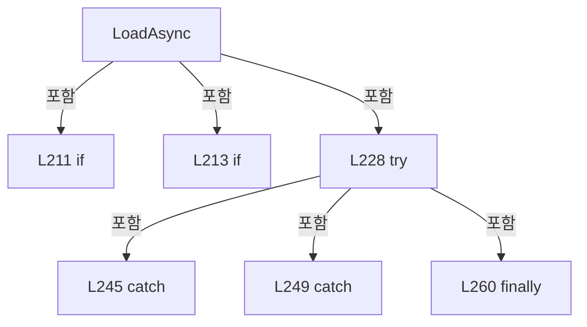

변경 전 점검: 입력/반환 타입, 위 호출자, 예외/취소 경로, 공유 상태와 저장·전송 소비자를 함께 확인합니다. 값의 단위나 물리 방향을 이름만으로 확정하지 않습니다.

### MethodDeclaration `Dispose` · L266–271

[Drilling.UI/Menu/Menus/CAlarmCauseAnalysis.cs:266–271](https://github.com/kjuws10-rgb/A3Drilling/blob/dfa5920e6301d9ec4b0eab1452ae59521aafc986/Drilling.UI/Menu/Menus/CAlarmCauseAnalysis.cs#L266-L271)

| 항목 | 실제 추출 값 |
| --- | --- |
| 서명 | void Drilling.UI.Menu.Menus.CAlarmCauseAnalysisPanel.Dispose() |
| 접근/수식자 | Public / public |
| 반환/값 타입 | void |
| 소속 타입 | NamedType:Drilling.UI.Menu.Menus.CAlarmCauseAnalysisPanel |

정적 호출자로 확인된 위치:

| 호출 파일/행 | 호출 표현식 | 런타임 분기 가능 |
| --- | --- | --- |
| [Drilling.UI/Popup/CAlarmCauseAnalysisDialog.xaml.cs:36–36](https://github.com/kjuws10-rgb/A3Drilling/blob/dfa5920e6301d9ec4b0eab1452ae59521aafc986/Drilling.UI/Popup/CAlarmCauseAnalysisDialog.xaml.cs#L36-L36) | _panel.Dispose | False |

호출하는 대상과 해석 범위:

| 원본 행 | 표현식 | 분석 상태 | 대상/소스 위치 |
| --- | --- | --- | --- |
| 268 | .Cancel | resolved | void System.Threading.CancellationTokenSource.Cancel() |
| 269 | .Dispose | resolved | void System.Threading.CancellationTokenSource.Dispose() |

본문의 실제 연산·분기·예외·반환 순서(원문 위치 순):

| 원본 행 | 종류 | 주석 해설 |
| --- | --- | --- |
| 268 | call | 함수·델리게이트 또는 객체 생성자를 호출합니다: .Cancel() |
| 269 | call | 함수·델리게이트 또는 객체 생성자를 호출합니다: .Dispose() |
| 270 | assignment | 값을 대상에 대입합니다: _loadCancellation = null |

변경 전 점검: 입력/반환 타입, 위 호출자, 예외/취소 경로, 공유 상태와 저장·전송 소비자를 함께 확인합니다. 값의 단위나 물리 방향을 이름만으로 확정하지 않습니다.

### MethodDeclaration `SetCursor` · L273–277

[Drilling.UI/Menu/Menus/CAlarmCauseAnalysis.cs:273–277](https://github.com/kjuws10-rgb/A3Drilling/blob/dfa5920e6301d9ec4b0eab1452ae59521aafc986/Drilling.UI/Menu/Menus/CAlarmCauseAnalysis.cs#L273-L277)

| 항목 | 실제 추출 값 |
| --- | --- |
| 서명 | void Drilling.UI.Menu.Menus.CAlarmCauseAnalysisPanel.SetCursor(System.DateTimeOffset) |
| 접근/수식자 | Public / public |
| 반환/값 타입 | void |
| 소속 타입 | NamedType:Drilling.UI.Menu.Menus.CAlarmCauseAnalysisPanel |

입력 계약:

| 이름 | 타입 | 전달 | 선택/기본값 |
| --- | --- | --- | --- |
| occurredAt | System.DateTimeOffset | None | False /  |

정적 호출자로 확인된 위치:

| 호출 파일/행 | 호출 표현식 | 런타임 분기 가능 |
| --- | --- | --- |
| [Drilling.UI/Menu/Menus/CAlarmCauseAnalysis.cs:43–43](https://github.com/kjuws10-rgb/A3Drilling/blob/dfa5920e6301d9ec4b0eab1452ae59521aafc986/Drilling.UI/Menu/Menus/CAlarmCauseAnalysis.cs#L43-L43) | SetCursor | False |
| [Drilling.UI/Menu/Menus/CAlarmCauseAnalysis.cs:242–242](https://github.com/kjuws10-rgb/A3Drilling/blob/dfa5920e6301d9ec4b0eab1452ae59521aafc986/Drilling.UI/Menu/Menus/CAlarmCauseAnalysis.cs#L242-L242) | SetCursor | False |
| [Drilling.UI/Popup/CAlarmCauseAnalysisDialog.xaml.cs:94–94](https://github.com/kjuws10-rgb/A3Drilling/blob/dfa5920e6301d9ec4b0eab1452ae59521aafc986/Drilling.UI/Popup/CAlarmCauseAnalysisDialog.xaml.cs#L94-L94) | _panel.SetCursor | False |

본문의 실제 연산·분기·예외·반환 순서(원문 위치 순):

| 원본 행 | 종류 | 주석 해설 |
| --- | --- | --- |
| 275 | assignment | 값을 대상에 대입합니다: _cursorOccurredAt = occurredAt |
| 276 | assignment | 값을 대상에 대입합니다: CursorTime = $"TIME CURSOR · {occurredAt.LocalDateTime:yyyy-MM-dd HH:mm:ss.fff} · 각 영역의 가장 가까운 로그" |

변경 전 점검: 입력/반환 타입, 위 호출자, 예외/취소 경로, 공유 상태와 저장·전송 소비자를 함께 확인합니다. 값의 단위나 물리 방향을 이름만으로 확정하지 않습니다.

### MethodDeclaration `ApplyVisiblePanes` · L279–300

[Drilling.UI/Menu/Menus/CAlarmCauseAnalysis.cs:279–300](https://github.com/kjuws10-rgb/A3Drilling/blob/dfa5920e6301d9ec4b0eab1452ae59521aafc986/Drilling.UI/Menu/Menus/CAlarmCauseAnalysis.cs#L279-L300)

| 항목 | 실제 추출 값 |
| --- | --- |
| 서명 | void Drilling.UI.Menu.Menus.CAlarmCauseAnalysisPanel.ApplyVisiblePanes(bool) |
| 접근/수식자 | Private / private |
| 반환/값 타입 | void |
| 소속 타입 | NamedType:Drilling.UI.Menu.Menus.CAlarmCauseAnalysisPanel |

입력 계약:

| 이름 | 타입 | 전달 | 선택/기본값 |
| --- | --- | --- | --- |
| synchronizeCursor | bool | None | True / true |

정적 호출자로 확인된 위치:

| 호출 파일/행 | 호출 표현식 | 런타임 분기 가능 |
| --- | --- | --- |
| [Drilling.UI/Menu/Menus/CAlarmCauseAnalysis.cs:138–138](https://github.com/kjuws10-rgb/A3Drilling/blob/dfa5920e6301d9ec4b0eab1452ae59521aafc986/Drilling.UI/Menu/Menus/CAlarmCauseAnalysis.cs#L138-L138) | ApplyVisiblePanes | False |
| [Drilling.UI/Menu/Menus/CAlarmCauseAnalysis.cs:151–151](https://github.com/kjuws10-rgb/A3Drilling/blob/dfa5920e6301d9ec4b0eab1452ae59521aafc986/Drilling.UI/Menu/Menus/CAlarmCauseAnalysis.cs#L151-L151) | ApplyVisiblePanes | False |
| [Drilling.UI/Menu/Menus/CAlarmCauseAnalysis.cs:237–237](https://github.com/kjuws10-rgb/A3Drilling/blob/dfa5920e6301d9ec4b0eab1452ae59521aafc986/Drilling.UI/Menu/Menus/CAlarmCauseAnalysis.cs#L237-L237) | ApplyVisiblePanes | False |

호출하는 대상과 해석 범위:

| 원본 행 | 표현식 | 분석 상태 | 대상/소스 위치 |
| --- | --- | --- | --- |
| 285 | source.Select(pane => { var rows = CompareWithReference ? pane.Rows : pane.Rows.Select(row => row.IsBaselineDifference ? row with { IsBaselineDifference = false } : row).ToArray(); var comparison = CompareWithReference && result.Reference.IsAvailable ? $" · 기준 대비 신규 {pane.ReferenceDifferenceCount:N0}건" : ""; return pane with { Summary = pane.Summar… | resolved | Drilling.UI.Menu.Menus.ST_ALARM_ANALYSIS_PANE[] System.Collections.Generic.IEnumerable<Drilling.UI.Menu.Menus.ST_ALARM_ANALYSIS_PANE>.ToArray<Drilling.UI.Menu.Menus.ST_ALARM_ANALYSIS_PANE>() |
| 285 | source.Select | resolved | System.Collections.Generic.IEnumerable<Drilling.UI.Menu.Menus.ST_ALARM_ANALYSIS_PANE> System.Collections.Generic.IEnumerable<Drilling.UI.Menu.Menus.ST_ALARM_ANALYSIS_PANE>.Select<Drilling.UI.Menu.Menus.ST_ALARM_ANALYSIS_PANE, Drilling.UI.Menu.Menus.ST_ALARM_ANALYSIS_PANE>(System.Func<Drilling.UI.Menu.Menus.ST_ALARM_ANALYSIS_PANE, Drilling.UI.Menu.Menus.ST_ALARM_ANALYSIS_PANE>) |
| 289 | pane.Rows.Select(row => row.IsBaselineDifference ? row with { IsBaselineDifference = false } : row).ToArray | resolved | Drilling.UI.Menu.Menus.ST_ALARM_ANALYSIS_LOG_ROW[] System.Collections.Generic.IEnumerable<Drilling.UI.Menu.Menus.ST_ALARM_ANALYSIS_LOG_ROW>.ToArray<Drilling.UI.Menu.Menus.ST_ALARM_ANALYSIS_LOG_ROW>() |
| 289 | pane.Rows.Select | resolved | System.Collections.Generic.IEnumerable<Drilling.UI.Menu.Menus.ST_ALARM_ANALYSIS_LOG_ROW> System.Collections.Generic.IEnumerable<Drilling.UI.Menu.Menus.ST_ALARM_ANALYSIS_LOG_ROW>.Select<Drilling.UI.Menu.Menus.ST_ALARM_ANALYSIS_LOG_ROW, Drilling.UI.Menu.Menus.ST_ALARM_ANALYSIS_LOG_ROW>(System.Func<Drilling.UI.Menu.Menus.ST_ALARM_ANALYSIS_LOG_ROW, Drilling.UI.Menu.Menus.ST_ALARM_ANALYSIS_LOG_ROW>) |
| 297 | UpdateStatus | resolved | void Drilling.UI.Menu.Menus.CAlarmCauseAnalysisPanel.UpdateStatus() · Drilling.UI/Menu/Menus/CAlarmCauseAnalysis.cs:302 |
| 299 | .Invoke | resolved · 동적 구현 선택 가능 | void System.Action<System.DateTimeOffset>.Invoke(System.DateTimeOffset) |

본문의 실제 연산·분기·예외·반환 순서(원문 위치 순):

| 원본 행 | 종류 | 주석 해설 |
| --- | --- | --- |
| 281 | if | 조건에 따라 분기합니다: if (_loadedResult is not { } result) |
| 282 | return | 호출자에게 값 또는 제어를 반환합니다: return; |
| 284 | conditional-expression | 조건에 따라 결과식을 선택합니다: ShowStateChangesOnly ? result.ChangePanes : result.Panes |
| 284 | local-declaration | 지역 변수를 선언합니다: var source = ShowStateChangesOnly ? result.ChangePanes : result.Panes; |
| 284 | variable-initializer | 변수의 초기값을 지정합니다: source = ShowStateChangesOnly ? result.ChangePanes : result.Panes |
| 285 | assignment | 값을 대상에 대입합니다: Panes = source.Select(pane => { var rows = CompareWithReference ? pane.Rows : pane.Rows.Select(row => row.IsBaselineDifference ? row with { IsBaselineDifference = false } : row).ToArray(); var comparison = CompareWithReference &&  |
| 285 | call | 함수·델리게이트 또는 객체 생성자를 호출합니다: source.Select(pane => { var rows = CompareWithReference ? pane.Rows : pane.Rows.Select(row => row.IsBaselineDifference ? row with { IsBaselineDifference = false } : row).ToArray(); var comparison = CompareWithReference &… |
| 285 | call | 함수·델리게이트 또는 객체 생성자를 호출합니다: source.Select(pane => { var rows = CompareWithReference ? pane.Rows : pane.Rows.Select(row => row.IsBaselineDifference ? row with { IsBaselineDifference = false } : row).ToArray(); var comparison = CompareWithReference &… |
| 287 | conditional-expression | 조건에 따라 결과식을 선택합니다: CompareWithReference ? pane.Rows : pane.Rows.Select(row => row.IsBaselineDifference ? row with { IsBaselineDifference = false } : row).ToArray() |
| 287 | local-declaration | 지역 변수를 선언합니다: var rows = CompareWithReference ? pane.Rows : pane.Rows.Select(row => row.IsBaselineDifference ? row with { IsBaselineDifference = false } : row).ToArray(); |
| 287 | variable-initializer | 변수의 초기값을 지정합니다: rows = CompareWithReference ? pane.Rows : pane.Rows.Select(row => row.IsBaselineDifference ? row with { IsBaselineDifference = false } : row).ToArray() |
| 289 | call | 함수·델리게이트 또는 객체 생성자를 호출합니다: pane.Rows.Select(row => row.IsBaselineDifference ? row with { IsBaselineDifference = false } : row).ToArray() |
| 289 | call | 함수·델리게이트 또는 객체 생성자를 호출합니다: pane.Rows.Select(row => row.IsBaselineDifference ? row with { IsBaselineDifference = false } : row) |
| 289 | conditional-expression | 조건에 따라 결과식을 선택합니다: row.IsBaselineDifference ? row with { IsBaselineDifference = false } : row |
| 290 | assignment | 값을 대상에 대입합니다: IsBaselineDifference = false |
| 292 | conditional-expression | 조건에 따라 결과식을 선택합니다: CompareWithReference && result.Reference.IsAvailable ? $" · 기준 대비 신규 {pane.ReferenceDifferenceCount:N0}건" : "" |
| 292 | local-declaration | 지역 변수를 선언합니다: var comparison = CompareWithReference && result.Reference.IsAvailable ? $" · 기준 대비 신규 {pane.ReferenceDifferenceCount:N0}건" : ""; |
| 292 | variable-initializer | 변수의 초기값을 지정합니다: comparison = CompareWithReference && result.Reference.IsAvailable ? $" · 기준 대비 신규 {pane.ReferenceDifferenceCount:N0}건" : "" |
| 295 | assignment | 값을 대상에 대입합니다: Summary = pane.Summary + comparison |
| 295 | assignment | 값을 대상에 대입합니다: Rows = rows |
| 295 | return | 호출자에게 값 또는 제어를 반환합니다: return pane with { Summary = pane.Summary + comparison, Rows = rows }; |
| 297 | call | 함수·델리게이트 또는 객체 생성자를 호출합니다: UpdateStatus() |
| 298 | if | 조건에 따라 분기합니다: if (synchronizeCursor) |
| 299 | call | 함수·델리게이트 또는 객체 생성자를 호출합니다: .Invoke(_cursorOccurredAt ?? _alarm.OccurredAt) |

제어 구문의 포함 구조(실제 실행 순서/CFG가 아닌 구문 탐색 그림):

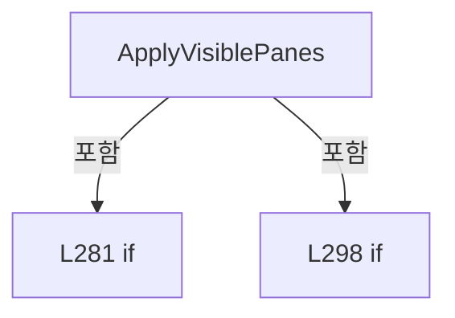

변경 전 점검: 입력/반환 타입, 위 호출자, 예외/취소 경로, 공유 상태와 저장·전송 소비자를 함께 확인합니다. 값의 단위나 물리 방향을 이름만으로 확정하지 않습니다.

### MethodDeclaration `UpdateStatus` · L302–314

[Drilling.UI/Menu/Menus/CAlarmCauseAnalysis.cs:302–314](https://github.com/kjuws10-rgb/A3Drilling/blob/dfa5920e6301d9ec4b0eab1452ae59521aafc986/Drilling.UI/Menu/Menus/CAlarmCauseAnalysis.cs#L302-L314)

| 항목 | 실제 추출 값 |
| --- | --- |
| 서명 | void Drilling.UI.Menu.Menus.CAlarmCauseAnalysisPanel.UpdateStatus() |
| 접근/수식자 | Private / private |
| 반환/값 타입 | void |
| 소속 타입 | NamedType:Drilling.UI.Menu.Menus.CAlarmCauseAnalysisPanel |

정적 호출자로 확인된 위치:

| 호출 파일/행 | 호출 표현식 | 런타임 분기 가능 |
| --- | --- | --- |
| [Drilling.UI/Menu/Menus/CAlarmCauseAnalysis.cs:241–241](https://github.com/kjuws10-rgb/A3Drilling/blob/dfa5920e6301d9ec4b0eab1452ae59521aafc986/Drilling.UI/Menu/Menus/CAlarmCauseAnalysis.cs#L241-L241) | UpdateStatus | False |
| [Drilling.UI/Menu/Menus/CAlarmCauseAnalysis.cs:297–297](https://github.com/kjuws10-rgb/A3Drilling/blob/dfa5920e6301d9ec4b0eab1452ae59521aafc986/Drilling.UI/Menu/Menus/CAlarmCauseAnalysis.cs#L297-L297) | UpdateStatus | False |

호출하는 대상과 해석 범위:

| 원본 행 | 표현식 | 분석 상태 | 대상/소스 위치 |
| --- | --- | --- | --- |
| 306 | Panes.Sum | resolved | int System.Collections.Generic.IEnumerable<Drilling.UI.Menu.Menus.ST_ALARM_ANALYSIS_PANE>.Sum<Drilling.UI.Menu.Menus.ST_ALARM_ANALYSIS_PANE>(System.Func<Drilling.UI.Menu.Menus.ST_ALARM_ANALYSIS_PANE, int>) |

본문의 실제 연산·분기·예외·반환 순서(원문 위치 순):

| 원본 행 | 종류 | 주석 해설 |
| --- | --- | --- |
| 304 | if | 조건에 따라 분기합니다: if (_loadedResult is not { } result) |
| 305 | return | 호출자에게 값 또는 제어를 반환합니다: return; |
| 306 | call | 함수·델리게이트 또는 객체 생성자를 호출합니다: Panes.Sum(pane => pane.Rows.Count) |
| 306 | local-declaration | 지역 변수를 선언합니다: var rowCount = Panes.Sum(pane => pane.Rows.Count); |
| 306 | variable-initializer | 변수의 초기값을 지정합니다: rowCount = Panes.Sum(pane => pane.Rows.Count) |
| 307 | conditional-expression | 조건에 따라 결과식을 선택합니다: ShowStateChangesOnly ? "변화 로그" : "전체 로그" |
| 307 | local-declaration | 지역 변수를 선언합니다: var mode = ShowStateChangesOnly ? "변화 로그" : "전체 로그"; |
| 307 | variable-initializer | 변수의 초기값을 지정합니다: mode = ShowStateChangesOnly ? "변화 로그" : "전체 로그" |
| 308 | conditional-expression | 조건에 따라 결과식을 선택합니다: CompareWithReference && result.Reference.IsAvailable ? $" 정상 후보 대비 신규 유형 {result.Reference.DifferenceTypeCount:N0}개." : "" |
| 308 | local-declaration | 지역 변수를 선언합니다: var comparison = CompareWithReference && result.Reference.IsAvailable ? $" 정상 후보 대비 신규 유형 {result.Reference.DifferenceTypeCount:N0}개." : ""; |
| 308 | variable-initializer | 변수의 초기값을 지정합니다: comparison = CompareWithReference && result.Reference.IsAvailable ? $" 정상 후보 대비 신규 유형 {result.Reference.DifferenceTypeCount:N0}개." : "" |
| 311 | assignment | 값을 대상에 대입합니다: Status = result.Warnings.Count == 0 ? $"{mode} {rowCount:N0}건 표시 / 원본 {result.RawRowCount:N0}건. 파일 {result.FileCount:N0}개 확인. 원인 후보 {result.Candidates.Count:N0}건.{comparison}" : $"{mode} {rowCount:N0}건 표시 / 원본 {result.RawRowCount: |
| 311 | conditional-expression | 조건에 따라 결과식을 선택합니다: result.Warnings.Count == 0 ? $"{mode} {rowCount:N0}건 표시 / 원본 {result.RawRowCount:N0}건. 파일 {result.FileCount:N0}개 확인. 원인 후보 {result.Candidates.Count:N0}건.{comparison}" : $"{mode} {rowCount:N0}건 표시 / 원본 {result.RawRowCount:N0}건. 읽기  |

제어 구문의 포함 구조(실제 실행 순서/CFG가 아닌 구문 탐색 그림):

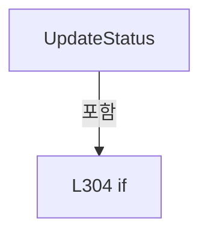

변경 전 점검: 입력/반환 타입, 위 호출자, 예외/취소 경로, 공유 상태와 저장·전송 소비자를 함께 확인합니다. 값의 단위나 물리 방향을 이름만으로 확정하지 않습니다.

### MethodDeclaration `TryReadSeconds` · L316–320

[Drilling.UI/Menu/Menus/CAlarmCauseAnalysis.cs:316–320](https://github.com/kjuws10-rgb/A3Drilling/blob/dfa5920e6301d9ec4b0eab1452ae59521aafc986/Drilling.UI/Menu/Menus/CAlarmCauseAnalysis.cs#L316-L320)

| 항목 | 실제 추출 값 |
| --- | --- |
| 서명 | bool Drilling.UI.Menu.Menus.CAlarmCauseAnalysisPanel.TryReadSeconds(string, out int) |
| 접근/수식자 | Private / private, static |
| 반환/값 타입 | bool |
| 소속 타입 | NamedType:Drilling.UI.Menu.Menus.CAlarmCauseAnalysisPanel |

입력 계약:

| 이름 | 타입 | 전달 | 선택/기본값 |
| --- | --- | --- | --- |
| value | string | None | False /  |
| seconds | int | Out | False /  |

정적 호출자로 확인된 위치:

| 호출 파일/행 | 호출 표현식 | 런타임 분기 가능 |
| --- | --- | --- |
| [Drilling.UI/Menu/Menus/CAlarmCauseAnalysis.cs:213–213](https://github.com/kjuws10-rgb/A3Drilling/blob/dfa5920e6301d9ec4b0eab1452ae59521aafc986/Drilling.UI/Menu/Menus/CAlarmCauseAnalysis.cs#L213-L213) | TryReadSeconds | False |
| [Drilling.UI/Menu/Menus/CAlarmCauseAnalysis.cs:213–213](https://github.com/kjuws10-rgb/A3Drilling/blob/dfa5920e6301d9ec4b0eab1452ae59521aafc986/Drilling.UI/Menu/Menus/CAlarmCauseAnalysis.cs#L213-L213) | TryReadSeconds | False |

호출하는 대상과 해석 범위:

| 원본 행 | 표현식 | 분석 상태 | 대상/소스 위치 |
| --- | --- | --- | --- |
| 318 | int.TryParse | resolved | bool int.TryParse(string?, System.Globalization.NumberStyles, System.IFormatProvider?, out int) |
| 318 | .Trim | resolved | string string.Trim() |

본문의 실제 연산·분기·예외·반환 순서(원문 위치 순):

| 원본 행 | 종류 | 주석 해설 |
| --- | --- | --- |
| 318 | call | 함수·델리게이트 또는 객체 생성자를 호출합니다: int.TryParse(value?.Trim(), NumberStyles.None, CultureInfo.InvariantCulture, out seconds) |
| 318 | call | 함수·델리게이트 또는 객체 생성자를 호출합니다: .Trim() |
| 318 | return | 호출자에게 값 또는 제어를 반환합니다: return int.TryParse(value?.Trim(), NumberStyles.None, CultureInfo.InvariantCulture, out seconds) && seconds is >= 0 and <= MaximumRangeSeconds; |

변경 전 점검: 입력/반환 타입, 위 호출자, 예외/취소 경로, 공유 상태와 저장·전송 소비자를 함께 확인합니다. 값의 단위나 물리 방향을 이름만으로 확정하지 않습니다.

### MethodDeclaration `Notify` · L322–322

[Drilling.UI/Menu/Menus/CAlarmCauseAnalysis.cs:322–322](https://github.com/kjuws10-rgb/A3Drilling/blob/dfa5920e6301d9ec4b0eab1452ae59521aafc986/Drilling.UI/Menu/Menus/CAlarmCauseAnalysis.cs#L322-L322)

| 항목 | 실제 추출 값 |
| --- | --- |
| 서명 | void Drilling.UI.Menu.Menus.CAlarmCauseAnalysisPanel.Notify(string?) |
| 접근/수식자 | Private / private |
| 반환/값 타입 | void |
| 소속 타입 | NamedType:Drilling.UI.Menu.Menus.CAlarmCauseAnalysisPanel |

입력 계약:

| 이름 | 타입 | 전달 | 선택/기본값 |
| --- | --- | --- | --- |
| name | string? | None | True / null |

정적 호출자로 확인된 위치:

| 호출 파일/행 | 호출 표현식 | 런타임 분기 가능 |
| --- | --- | --- |
| [Drilling.UI/Menu/Menus/CAlarmCauseAnalysis.cs:60–60](https://github.com/kjuws10-rgb/A3Drilling/blob/dfa5920e6301d9ec4b0eab1452ae59521aafc986/Drilling.UI/Menu/Menus/CAlarmCauseAnalysis.cs#L60-L60) | Notify | False |
| [Drilling.UI/Menu/Menus/CAlarmCauseAnalysis.cs:72–72](https://github.com/kjuws10-rgb/A3Drilling/blob/dfa5920e6301d9ec4b0eab1452ae59521aafc986/Drilling.UI/Menu/Menus/CAlarmCauseAnalysis.cs#L72-L72) | Notify | False |
| [Drilling.UI/Menu/Menus/CAlarmCauseAnalysis.cs:84–84](https://github.com/kjuws10-rgb/A3Drilling/blob/dfa5920e6301d9ec4b0eab1452ae59521aafc986/Drilling.UI/Menu/Menus/CAlarmCauseAnalysis.cs#L84-L84) | Notify | False |
| [Drilling.UI/Menu/Menus/CAlarmCauseAnalysis.cs:85–85](https://github.com/kjuws10-rgb/A3Drilling/blob/dfa5920e6301d9ec4b0eab1452ae59521aafc986/Drilling.UI/Menu/Menus/CAlarmCauseAnalysis.cs#L85-L85) | Notify | False |
| [Drilling.UI/Menu/Menus/CAlarmCauseAnalysis.cs:99–99](https://github.com/kjuws10-rgb/A3Drilling/blob/dfa5920e6301d9ec4b0eab1452ae59521aafc986/Drilling.UI/Menu/Menus/CAlarmCauseAnalysis.cs#L99-L99) | Notify | False |
| [Drilling.UI/Menu/Menus/CAlarmCauseAnalysis.cs:111–111](https://github.com/kjuws10-rgb/A3Drilling/blob/dfa5920e6301d9ec4b0eab1452ae59521aafc986/Drilling.UI/Menu/Menus/CAlarmCauseAnalysis.cs#L111-L111) | Notify | False |
| [Drilling.UI/Menu/Menus/CAlarmCauseAnalysis.cs:123–123](https://github.com/kjuws10-rgb/A3Drilling/blob/dfa5920e6301d9ec4b0eab1452ae59521aafc986/Drilling.UI/Menu/Menus/CAlarmCauseAnalysis.cs#L123-L123) | Notify | False |
| [Drilling.UI/Menu/Menus/CAlarmCauseAnalysis.cs:137–137](https://github.com/kjuws10-rgb/A3Drilling/blob/dfa5920e6301d9ec4b0eab1452ae59521aafc986/Drilling.UI/Menu/Menus/CAlarmCauseAnalysis.cs#L137-L137) | Notify | False |
| [Drilling.UI/Menu/Menus/CAlarmCauseAnalysis.cs:150–150](https://github.com/kjuws10-rgb/A3Drilling/blob/dfa5920e6301d9ec4b0eab1452ae59521aafc986/Drilling.UI/Menu/Menus/CAlarmCauseAnalysis.cs#L150-L150) | Notify | False |
| [Drilling.UI/Menu/Menus/CAlarmCauseAnalysis.cs:165–165](https://github.com/kjuws10-rgb/A3Drilling/blob/dfa5920e6301d9ec4b0eab1452ae59521aafc986/Drilling.UI/Menu/Menus/CAlarmCauseAnalysis.cs#L165-L165) | Notify | False |
| [Drilling.UI/Menu/Menus/CAlarmCauseAnalysis.cs:175–175](https://github.com/kjuws10-rgb/A3Drilling/blob/dfa5920e6301d9ec4b0eab1452ae59521aafc986/Drilling.UI/Menu/Menus/CAlarmCauseAnalysis.cs#L175-L175) | Notify | False |
| [Drilling.UI/Menu/Menus/CAlarmCauseAnalysis.cs:185–185](https://github.com/kjuws10-rgb/A3Drilling/blob/dfa5920e6301d9ec4b0eab1452ae59521aafc986/Drilling.UI/Menu/Menus/CAlarmCauseAnalysis.cs#L185-L185) | Notify | False |
| [Drilling.UI/Menu/Menus/CAlarmCauseAnalysis.cs:195–195](https://github.com/kjuws10-rgb/A3Drilling/blob/dfa5920e6301d9ec4b0eab1452ae59521aafc986/Drilling.UI/Menu/Menus/CAlarmCauseAnalysis.cs#L195-L195) | Notify | False |
| [Drilling.UI/Menu/Menus/CAlarmCauseAnalysis.cs:205–205](https://github.com/kjuws10-rgb/A3Drilling/blob/dfa5920e6301d9ec4b0eab1452ae59521aafc986/Drilling.UI/Menu/Menus/CAlarmCauseAnalysis.cs#L205-L205) | Notify | False |
| [Drilling.UI/Menu/Menus/CAlarmCauseAnalysis.cs:234–234](https://github.com/kjuws10-rgb/A3Drilling/blob/dfa5920e6301d9ec4b0eab1452ae59521aafc986/Drilling.UI/Menu/Menus/CAlarmCauseAnalysis.cs#L234-L234) | Notify | False |
| [Drilling.UI/Menu/Menus/CAlarmCauseAnalysis.cs:235–235](https://github.com/kjuws10-rgb/A3Drilling/blob/dfa5920e6301d9ec4b0eab1452ae59521aafc986/Drilling.UI/Menu/Menus/CAlarmCauseAnalysis.cs#L235-L235) | Notify | False |
| [Drilling.UI/Menu/Menus/CAlarmCauseAnalysis.cs:257–257](https://github.com/kjuws10-rgb/A3Drilling/blob/dfa5920e6301d9ec4b0eab1452ae59521aafc986/Drilling.UI/Menu/Menus/CAlarmCauseAnalysis.cs#L257-L257) | Notify | False |

호출하는 대상과 해석 범위:

| 원본 행 | 표현식 | 분석 상태 | 대상/소스 위치 |
| --- | --- | --- | --- |
| 322 | .Invoke | resolved · 동적 구현 선택 가능 | void System.ComponentModel.PropertyChangedEventHandler.Invoke(object?, System.ComponentModel.PropertyChangedEventArgs) |
| 322 | new | resolved | System.ComponentModel.PropertyChangedEventArgs.PropertyChangedEventArgs(string?) |

본문의 실제 연산·분기·예외·반환 순서(원문 위치 순):

| 원본 행 | 종류 | 주석 해설 |
| --- | --- | --- |
| 322 | call | 함수·델리게이트 또는 객체 생성자를 호출합니다: .Invoke(this, new(name)) |
| 322 | call | 함수·델리게이트 또는 객체 생성자를 호출합니다: new(name) |

변경 전 점검: 입력/반환 타입, 위 호출자, 예외/취소 경로, 공유 상태와 저장·전송 소비자를 함께 확인합니다. 값의 단위나 물리 방향을 이름만으로 확정하지 않습니다.

### PropertyDeclaration `RankLabel` · L350–350

[Drilling.UI/Menu/Menus/CAlarmCauseAnalysis.cs:350–350](https://github.com/kjuws10-rgb/A3Drilling/blob/dfa5920e6301d9ec4b0eab1452ae59521aafc986/Drilling.UI/Menu/Menus/CAlarmCauseAnalysis.cs#L350-L350)

| 항목 | 실제 추출 값 |
| --- | --- |
| 서명 | string Drilling.UI.Menu.Menus.ST_ALARM_CAUSE_CANDIDATE.RankLabel |
| 접근/수식자 | Public / public |
| 반환/값 타입 | string |
| 소속 타입 | NamedType:Drilling.UI.Menu.Menus.ST_ALARM_CAUSE_CANDIDATE |

현재 부분 분석에서 직접 연결된 호출자는 없습니다. XAML/이벤트/인터페이스·델리게이트·외부 진입을 추가 확인해야 하며, 미사용으로 판정한 것이 아닙니다.

변경 전 점검: 입력/반환 타입, 위 호출자, 예외/취소 경로, 공유 상태와 저장·전송 소비자를 함께 확인합니다. 값의 단위나 물리 방향을 이름만으로 확정하지 않습니다.

### PropertyDeclaration `EvidenceCaption` · L351–351

[Drilling.UI/Menu/Menus/CAlarmCauseAnalysis.cs:351–351](https://github.com/kjuws10-rgb/A3Drilling/blob/dfa5920e6301d9ec4b0eab1452ae59521aafc986/Drilling.UI/Menu/Menus/CAlarmCauseAnalysis.cs#L351-L351)

| 항목 | 실제 추출 값 |
| --- | --- |
| 서명 | string Drilling.UI.Menu.Menus.ST_ALARM_CAUSE_CANDIDATE.EvidenceCaption |
| 접근/수식자 | Public / public |
| 반환/값 타입 | string |
| 소속 타입 | NamedType:Drilling.UI.Menu.Menus.ST_ALARM_CAUSE_CANDIDATE |

현재 부분 분석에서 직접 연결된 호출자는 없습니다. XAML/이벤트/인터페이스·델리게이트·외부 진입을 추가 확인해야 하며, 미사용으로 판정한 것이 아닙니다.

변경 전 점검: 입력/반환 타입, 위 호출자, 예외/취소 경로, 공유 상태와 저장·전송 소비자를 함께 확인합니다. 값의 단위나 물리 방향을 이름만으로 확정하지 않습니다.

### PropertyDeclaration `FullMessage` · L373–373

[Drilling.UI/Menu/Menus/CAlarmCauseAnalysis.cs:373–373](https://github.com/kjuws10-rgb/A3Drilling/blob/dfa5920e6301d9ec4b0eab1452ae59521aafc986/Drilling.UI/Menu/Menus/CAlarmCauseAnalysis.cs#L373-L373)

| 항목 | 실제 추출 값 |
| --- | --- |
| 서명 | string Drilling.UI.Menu.Menus.ST_ALARM_TIMELINE_ITEM.FullMessage |
| 접근/수식자 | Public / public |
| 반환/값 타입 | string |
| 소속 타입 | NamedType:Drilling.UI.Menu.Menus.ST_ALARM_TIMELINE_ITEM |

현재 부분 분석에서 직접 연결된 호출자는 없습니다. XAML/이벤트/인터페이스·델리게이트·외부 진입을 추가 확인해야 하며, 미사용으로 판정한 것이 아닙니다.

변경 전 점검: 입력/반환 타입, 위 호출자, 예외/취소 경로, 공유 상태와 저장·전송 소비자를 함께 확인합니다. 값의 단위나 물리 방향을 이름만으로 확정하지 않습니다.

### FieldDeclaration `MaximumRowsPerPane` · L396–396

[Drilling.UI/Menu/Menus/CAlarmCauseAnalysis.cs:396–396](https://github.com/kjuws10-rgb/A3Drilling/blob/dfa5920e6301d9ec4b0eab1452ae59521aafc986/Drilling.UI/Menu/Menus/CAlarmCauseAnalysis.cs#L396-L396)

| 항목 | 실제 추출 값 |
| --- | --- |
| 서명 | int Drilling.UI.Menu.Menus.CAlarmIncidentLogReader.MaximumRowsPerPane |
| 접근/수식자 | Private / private, const |
| 반환/값 타입 | int |
| 소속 타입 | NamedType:Drilling.UI.Menu.Menus.CAlarmIncidentLogReader |

현재 부분 분석에서 직접 연결된 호출자는 없습니다. XAML/이벤트/인터페이스·델리게이트·외부 진입을 추가 확인해야 하며, 미사용으로 판정한 것이 아닙니다.

본문의 실제 연산·분기·예외·반환 순서(원문 위치 순):

| 원본 행 | 종류 | 주석 해설 |
| --- | --- | --- |
| 396 | variable-initializer | 변수의 초기값을 지정합니다: MaximumRowsPerPane = 1200 |

변경 전 점검: 입력/반환 타입, 위 호출자, 예외/취소 경로, 공유 상태와 저장·전송 소비자를 함께 확인합니다. 값의 단위나 물리 방향을 이름만으로 확정하지 않습니다.

### FieldDeclaration `MaximumReferenceSearchWindows` · L397–397

[Drilling.UI/Menu/Menus/CAlarmCauseAnalysis.cs:397–397](https://github.com/kjuws10-rgb/A3Drilling/blob/dfa5920e6301d9ec4b0eab1452ae59521aafc986/Drilling.UI/Menu/Menus/CAlarmCauseAnalysis.cs#L397-L397)

| 항목 | 실제 추출 값 |
| --- | --- |
| 서명 | int Drilling.UI.Menu.Menus.CAlarmIncidentLogReader.MaximumReferenceSearchWindows |
| 접근/수식자 | Private / private, const |
| 반환/값 타입 | int |
| 소속 타입 | NamedType:Drilling.UI.Menu.Menus.CAlarmIncidentLogReader |

현재 부분 분석에서 직접 연결된 호출자는 없습니다. XAML/이벤트/인터페이스·델리게이트·외부 진입을 추가 확인해야 하며, 미사용으로 판정한 것이 아닙니다.

본문의 실제 연산·분기·예외·반환 순서(원문 위치 순):

| 원본 행 | 종류 | 주석 해설 |
| --- | --- | --- |
| 397 | variable-initializer | 변수의 초기값을 지정합니다: MaximumReferenceSearchWindows = 8 |

변경 전 점검: 입력/반환 타입, 위 호출자, 예외/취소 경로, 공유 상태와 저장·전송 소비자를 함께 확인합니다. 값의 단위나 물리 방향을 이름만으로 확정하지 않습니다.

### FieldDeclaration `MinimumReferenceRows` · L398–398

[Drilling.UI/Menu/Menus/CAlarmCauseAnalysis.cs:398–398](https://github.com/kjuws10-rgb/A3Drilling/blob/dfa5920e6301d9ec4b0eab1452ae59521aafc986/Drilling.UI/Menu/Menus/CAlarmCauseAnalysis.cs#L398-L398)

| 항목 | 실제 추출 값 |
| --- | --- |
| 서명 | int Drilling.UI.Menu.Menus.CAlarmIncidentLogReader.MinimumReferenceRows |
| 접근/수식자 | Private / private, const |
| 반환/값 타입 | int |
| 소속 타입 | NamedType:Drilling.UI.Menu.Menus.CAlarmIncidentLogReader |

현재 부분 분석에서 직접 연결된 호출자는 없습니다. XAML/이벤트/인터페이스·델리게이트·외부 진입을 추가 확인해야 하며, 미사용으로 판정한 것이 아닙니다.

본문의 실제 연산·분기·예외·반환 순서(원문 위치 순):

| 원본 행 | 종류 | 주석 해설 |
| --- | --- | --- |
| 398 | variable-initializer | 변수의 초기값을 지정합니다: MinimumReferenceRows = 10 |

변경 전 점검: 입력/반환 타입, 위 호출자, 예외/취소 경로, 공유 상태와 저장·전송 소비자를 함께 확인합니다. 값의 단위나 물리 방향을 이름만으로 확정하지 않습니다.

### FieldDeclaration `PaneOrder` · L399–399

[Drilling.UI/Menu/Menus/CAlarmCauseAnalysis.cs:399–399](https://github.com/kjuws10-rgb/A3Drilling/blob/dfa5920e6301d9ec4b0eab1452ae59521aafc986/Drilling.UI/Menu/Menus/CAlarmCauseAnalysis.cs#L399-L399)

| 항목 | 실제 추출 값 |
| --- | --- |
| 서명 | string[] Drilling.UI.Menu.Menus.CAlarmIncidentLogReader.PaneOrder |
| 접근/수식자 | Private / private, static, readonly |
| 반환/값 타입 | string[] |
| 소속 타입 | NamedType:Drilling.UI.Menu.Menus.CAlarmIncidentLogReader |

현재 부분 분석에서 직접 연결된 호출자는 없습니다. XAML/이벤트/인터페이스·델리게이트·외부 진입을 추가 확인해야 하며, 미사용으로 판정한 것이 아닙니다.

본문의 실제 연산·분기·예외·반환 순서(원문 위치 순):

| 원본 행 | 종류 | 주석 해설 |
| --- | --- | --- |
| 399 | variable-initializer | 변수의 초기값을 지정합니다: PaneOrder = ["PROCESS", "MELSEC", "CONTEXT", "INTERFACE"] |

변경 전 점검: 입력/반환 타입, 위 호출자, 예외/취소 경로, 공유 상태와 저장·전송 소비자를 함께 확인합니다. 값의 단위나 물리 방향을 이름만으로 확정하지 않습니다.

### FieldDeclaration `PaneTitles` · L400–406

[Drilling.UI/Menu/Menus/CAlarmCauseAnalysis.cs:400–406](https://github.com/kjuws10-rgb/A3Drilling/blob/dfa5920e6301d9ec4b0eab1452ae59521aafc986/Drilling.UI/Menu/Menus/CAlarmCauseAnalysis.cs#L400-L406)

| 항목 | 실제 추출 값 |
| --- | --- |
| 서명 | System.Collections.Generic.IReadOnlyDictionary<string, string> Drilling.UI.Menu.Menus.CAlarmIncidentLogReader.PaneTitles |
| 접근/수식자 | Private / private, static, readonly |
| 반환/값 타입 | System.Collections.Generic.IReadOnlyDictionary<string, string> |
| 소속 타입 | NamedType:Drilling.UI.Menu.Menus.CAlarmIncidentLogReader |

현재 부분 분석에서 직접 연결된 호출자는 없습니다. XAML/이벤트/인터페이스·델리게이트·외부 진입을 추가 확인해야 하며, 미사용으로 판정한 것이 아닙니다.

호출하는 대상과 해석 범위:

| 원본 행 | 표현식 | 분석 상태 | 대상/소스 위치 |
| --- | --- | --- | --- |
| 400 | new Dictionary<string, string> | resolved | System.Collections.Generic.Dictionary<string, string>.Dictionary(System.Collections.Generic.IEqualityComparer<string>?) |

본문의 실제 연산·분기·예외·반환 순서(원문 위치 순):

| 원본 행 | 종류 | 주석 해설 |
| --- | --- | --- |
| 400 | call | 함수·델리게이트 또는 객체 생성자를 호출합니다: new Dictionary<string, string>(StringComparer.Ordinal) { ["PROCESS"] = "PROCESS FLOW · SEQUENCE / STATION", ["MELSEC"] = "MELSEC COMMUNICATION", ["CONTEXT"] = "UI / RECIPE / SETTING / PRODUCT", ["INTERFACE"] = "OTHER INT… |
| 400 | variable-initializer | 변수의 초기값을 지정합니다: PaneTitles = new Dictionary<string, string>(StringComparer.Ordinal) { ["PROCESS"] = "PROCESS FLOW · SEQUENCE / STATION", ["MELSEC"] = "MELSEC COMMUNICATION", ["CONTEXT"] = "UI / RECIPE / SETTING / PRODUCT", ["INTERFACE"] = "OTHER  |
| 402 | assignment | 값을 대상에 대입합니다: ["PROCESS"] = "PROCESS FLOW · SEQUENCE / STATION" |
| 403 | assignment | 값을 대상에 대입합니다: ["MELSEC"] = "MELSEC COMMUNICATION" |
| 404 | assignment | 값을 대상에 대입합니다: ["CONTEXT"] = "UI / RECIPE / SETTING / PRODUCT" |
| 405 | assignment | 값을 대상에 대입합니다: ["INTERFACE"] = "OTHER INTERFACE COMMUNICATION" |

변경 전 점검: 입력/반환 타입, 위 호출자, 예외/취소 경로, 공유 상태와 저장·전송 소비자를 함께 확인합니다. 값의 단위나 물리 방향을 이름만으로 확정하지 않습니다.

### FieldDeclaration `ImportantTerms` · L407–411

[Drilling.UI/Menu/Menus/CAlarmCauseAnalysis.cs:407–411](https://github.com/kjuws10-rgb/A3Drilling/blob/dfa5920e6301d9ec4b0eab1452ae59521aafc986/Drilling.UI/Menu/Menus/CAlarmCauseAnalysis.cs#L407-L411)

| 항목 | 실제 추출 값 |
| --- | --- |
| 서명 | string[] Drilling.UI.Menu.Menus.CAlarmIncidentLogReader.ImportantTerms |
| 접근/수식자 | Private / private, static, readonly |
| 반환/값 타입 | string[] |
| 소속 타입 | NamedType:Drilling.UI.Menu.Menus.CAlarmIncidentLogReader |

현재 부분 분석에서 직접 연결된 호출자는 없습니다. XAML/이벤트/인터페이스·델리게이트·외부 진입을 추가 확인해야 하며, 미사용으로 판정한 것이 아닙니다.

본문의 실제 연산·분기·예외·반환 순서(원문 위치 순):

| 원본 행 | 종류 | 주석 해설 |
| --- | --- | --- |
| 407 | variable-initializer | 변수의 초기값을 지정합니다: ImportantTerms = [ "ERROR", "FAIL", "FAILED", "NG", "ALARM", "TIMEOUT", "STOP", "BLOCK", "INTERLOCK", "DISCONNECT", "EXCEPTION", "HEAVY", "오류", "실패", "중지", "차단" ] |

변경 전 점검: 입력/반환 타입, 위 호출자, 예외/취소 경로, 공유 상태와 저장·전송 소비자를 함께 확인합니다. 값의 단위나 물리 방향을 이름만으로 확정하지 않습니다.

### FieldDeclaration `TransitionTerms` · L412–418

[Drilling.UI/Menu/Menus/CAlarmCauseAnalysis.cs:412–418](https://github.com/kjuws10-rgb/A3Drilling/blob/dfa5920e6301d9ec4b0eab1452ae59521aafc986/Drilling.UI/Menu/Menus/CAlarmCauseAnalysis.cs#L412-L418)

| 항목 | 실제 추출 값 |
| --- | --- |
| 서명 | string[] Drilling.UI.Menu.Menus.CAlarmIncidentLogReader.TransitionTerms |
| 접근/수식자 | Private / private, static, readonly |
| 반환/값 타입 | string[] |
| 소속 타입 | NamedType:Drilling.UI.Menu.Menus.CAlarmIncidentLogReader |

현재 부분 분석에서 직접 연결된 호출자는 없습니다. XAML/이벤트/인터페이스·델리게이트·외부 진입을 추가 확인해야 하며, 미사용으로 판정한 것이 아닙니다.

본문의 실제 연산·분기·예외·반환 순서(원문 위치 순):

| 원본 행 | 종류 | 주석 해설 |
| --- | --- | --- |
| 412 | variable-initializer | 변수의 초기값을 지정합니다: TransitionTerms = [ "START", "BEGIN", "COMPLETE", "DONE", "STOP", "RESET", "READY", "RUN", "IDLE", "ON", "OFF", "OPEN", "CLOSE", "CONNECT", "DISCONNECT", "ONLINE", "OFFLINE", "INTERLOCK", "ALARM", "STATE", "STATUS", "WRITE", "APPL |

변경 전 점검: 입력/반환 타입, 위 호출자, 예외/취소 경로, 공유 상태와 저장·전송 소비자를 함께 확인합니다. 값의 단위나 물리 방향을 이름만으로 확정하지 않습니다.

### FieldDeclaration `DiscreteMelsecIdTerms` · L419–423

[Drilling.UI/Menu/Menus/CAlarmCauseAnalysis.cs:419–423](https://github.com/kjuws10-rgb/A3Drilling/blob/dfa5920e6301d9ec4b0eab1452ae59521aafc986/Drilling.UI/Menu/Menus/CAlarmCauseAnalysis.cs#L419-L423)

| 항목 | 실제 추출 값 |
| --- | --- |
| 서명 | string[] Drilling.UI.Menu.Menus.CAlarmIncidentLogReader.DiscreteMelsecIdTerms |
| 접근/수식자 | Private / private, static, readonly |
| 반환/값 타입 | string[] |
| 소속 타입 | NamedType:Drilling.UI.Menu.Menus.CAlarmIncidentLogReader |

현재 부분 분석에서 직접 연결된 호출자는 없습니다. XAML/이벤트/인터페이스·델리게이트·외부 진입을 추가 확인해야 하며, 미사용으로 판정한 것이 아닙니다.

본문의 실제 연산·분기·예외·반환 순서(원문 위치 순):

| 원본 행 | 종류 | 주석 해설 |
| --- | --- | --- |
| 419 | variable-initializer | 변수의 초기값을 지정합니다: DiscreteMelsecIdTerms = [ "STATE", "STATUS", "ALARM", "READY", "START", "COMPLETE", "ABLE", "INTERLOCK", "RUN", "STOP", "ONLINE", "OPEN", "CLOSE", "SERVO", "HOME", "LIMIT", "ERROR" ] |

변경 전 점검: 입력/반환 타입, 위 호출자, 예외/취소 경로, 공유 상태와 저장·전송 소비자를 함께 확인합니다. 값의 단위나 물리 방향을 이름만으로 확정하지 않습니다.

### FieldDeclaration `ComparisonGuidRegex` · L424–426

[Drilling.UI/Menu/Menus/CAlarmCauseAnalysis.cs:424–426](https://github.com/kjuws10-rgb/A3Drilling/blob/dfa5920e6301d9ec4b0eab1452ae59521aafc986/Drilling.UI/Menu/Menus/CAlarmCauseAnalysis.cs#L424-L426)

| 항목 | 실제 추출 값 |
| --- | --- |
| 서명 | System.Text.RegularExpressions.Regex Drilling.UI.Menu.Menus.CAlarmIncidentLogReader.ComparisonGuidRegex |
| 접근/수식자 | Private / private, static, readonly |
| 반환/값 타입 | System.Text.RegularExpressions.Regex |
| 소속 타입 | NamedType:Drilling.UI.Menu.Menus.CAlarmIncidentLogReader |

현재 부분 분석에서 직접 연결된 호출자는 없습니다. XAML/이벤트/인터페이스·델리게이트·외부 진입을 추가 확인해야 하며, 미사용으로 판정한 것이 아닙니다.

호출하는 대상과 해석 범위:

| 원본 행 | 표현식 | 분석 상태 | 대상/소스 위치 |
| --- | --- | --- | --- |
| 424 | new | resolved | System.Text.RegularExpressions.Regex.Regex(string, System.Text.RegularExpressions.RegexOptions) |

본문의 실제 연산·분기·예외·반환 순서(원문 위치 순):

| 원본 행 | 종류 | 주석 해설 |
| --- | --- | --- |
| 424 | call | 함수·델리게이트 또는 객체 생성자를 호출합니다: new( @"\b[0-9a-fA-F]{8}(?:-[0-9a-fA-F]{4}){3}-[0-9a-fA-F]{12}\b", RegexOptions.Compiled &#124; RegexOptions.CultureInvariant) |
| 424 | variable-initializer | 변수의 초기값을 지정합니다: ComparisonGuidRegex = new( @"\b[0-9a-fA-F]{8}(?:-[0-9a-fA-F]{4}){3}-[0-9a-fA-F]{12}\b", RegexOptions.Compiled &#124; RegexOptions.CultureInvariant) |

변경 전 점검: 입력/반환 타입, 위 호출자, 예외/취소 경로, 공유 상태와 저장·전송 소비자를 함께 확인합니다. 값의 단위나 물리 방향을 이름만으로 확정하지 않습니다.

### FieldDeclaration `ComparisonDateTimeRegex` · L427–429

[Drilling.UI/Menu/Menus/CAlarmCauseAnalysis.cs:427–429](https://github.com/kjuws10-rgb/A3Drilling/blob/dfa5920e6301d9ec4b0eab1452ae59521aafc986/Drilling.UI/Menu/Menus/CAlarmCauseAnalysis.cs#L427-L429)

| 항목 | 실제 추출 값 |
| --- | --- |
| 서명 | System.Text.RegularExpressions.Regex Drilling.UI.Menu.Menus.CAlarmIncidentLogReader.ComparisonDateTimeRegex |
| 접근/수식자 | Private / private, static, readonly |
| 반환/값 타입 | System.Text.RegularExpressions.Regex |
| 소속 타입 | NamedType:Drilling.UI.Menu.Menus.CAlarmIncidentLogReader |

현재 부분 분석에서 직접 연결된 호출자는 없습니다. XAML/이벤트/인터페이스·델리게이트·외부 진입을 추가 확인해야 하며, 미사용으로 판정한 것이 아닙니다.

호출하는 대상과 해석 범위:

| 원본 행 | 표현식 | 분석 상태 | 대상/소스 위치 |
| --- | --- | --- | --- |
| 427 | new | resolved | System.Text.RegularExpressions.Regex.Regex(string, System.Text.RegularExpressions.RegexOptions) |

본문의 실제 연산·분기·예외·반환 순서(원문 위치 순):

| 원본 행 | 종류 | 주석 해설 |
| --- | --- | --- |
| 427 | call | 함수·델리게이트 또는 객체 생성자를 호출합니다: new( @"\b\d{2,4}[-/]\d{1,2}[-/]\d{1,2}[T ]\d{1,2}:\d{2}:\d{2}(?:\.\d+)?(?:[+-]\d{2}:?\d{2})?\b", RegexOptions.Compiled &#124; RegexOptions.CultureInvariant) |
| 427 | variable-initializer | 변수의 초기값을 지정합니다: ComparisonDateTimeRegex = new( @"\b\d{2,4}[-/]\d{1,2}[-/]\d{1,2}[T ]\d{1,2}:\d{2}:\d{2}(?:\.\d+)?(?:[+-]\d{2}:?\d{2})?\b", RegexOptions.Compiled &#124; RegexOptions.CultureInvariant) |

변경 전 점검: 입력/반환 타입, 위 호출자, 예외/취소 경로, 공유 상태와 저장·전송 소비자를 함께 확인합니다. 값의 단위나 물리 방향을 이름만으로 확정하지 않습니다.

### FieldDeclaration `ComparisonNumberRegex` · L430–432

[Drilling.UI/Menu/Menus/CAlarmCauseAnalysis.cs:430–432](https://github.com/kjuws10-rgb/A3Drilling/blob/dfa5920e6301d9ec4b0eab1452ae59521aafc986/Drilling.UI/Menu/Menus/CAlarmCauseAnalysis.cs#L430-L432)

| 항목 | 실제 추출 값 |
| --- | --- |
| 서명 | System.Text.RegularExpressions.Regex Drilling.UI.Menu.Menus.CAlarmIncidentLogReader.ComparisonNumberRegex |
| 접근/수식자 | Private / private, static, readonly |
| 반환/값 타입 | System.Text.RegularExpressions.Regex |
| 소속 타입 | NamedType:Drilling.UI.Menu.Menus.CAlarmIncidentLogReader |

현재 부분 분석에서 직접 연결된 호출자는 없습니다. XAML/이벤트/인터페이스·델리게이트·외부 진입을 추가 확인해야 하며, 미사용으로 판정한 것이 아닙니다.

호출하는 대상과 해석 범위:

| 원본 행 | 표현식 | 분석 상태 | 대상/소스 위치 |
| --- | --- | --- | --- |
| 430 | new | resolved | System.Text.RegularExpressions.Regex.Regex(string, System.Text.RegularExpressions.RegexOptions) |

본문의 실제 연산·분기·예외·반환 순서(원문 위치 순):

| 원본 행 | 종류 | 주석 해설 |
| --- | --- | --- |
| 430 | call | 함수·델리게이트 또는 객체 생성자를 호출합니다: new( @"(?<![A-Za-z])[-+]?\d+(?:\.\d+)?", RegexOptions.Compiled &#124; RegexOptions.CultureInvariant) |
| 430 | variable-initializer | 변수의 초기값을 지정합니다: ComparisonNumberRegex = new( @"(?<![A-Za-z])[-+]?\d+(?:\.\d+)?", RegexOptions.Compiled &#124; RegexOptions.CultureInvariant) |

변경 전 점검: 입력/반환 타입, 위 호출자, 예외/취소 경로, 공유 상태와 저장·전송 소비자를 함께 확인합니다. 값의 단위나 물리 방향을 이름만으로 확정하지 않습니다.

### FieldDeclaration `ComparisonWhitespaceRegex` · L433–435

[Drilling.UI/Menu/Menus/CAlarmCauseAnalysis.cs:433–435](https://github.com/kjuws10-rgb/A3Drilling/blob/dfa5920e6301d9ec4b0eab1452ae59521aafc986/Drilling.UI/Menu/Menus/CAlarmCauseAnalysis.cs#L433-L435)

| 항목 | 실제 추출 값 |
| --- | --- |
| 서명 | System.Text.RegularExpressions.Regex Drilling.UI.Menu.Menus.CAlarmIncidentLogReader.ComparisonWhitespaceRegex |
| 접근/수식자 | Private / private, static, readonly |
| 반환/값 타입 | System.Text.RegularExpressions.Regex |
| 소속 타입 | NamedType:Drilling.UI.Menu.Menus.CAlarmIncidentLogReader |

현재 부분 분석에서 직접 연결된 호출자는 없습니다. XAML/이벤트/인터페이스·델리게이트·외부 진입을 추가 확인해야 하며, 미사용으로 판정한 것이 아닙니다.

호출하는 대상과 해석 범위:

| 원본 행 | 표현식 | 분석 상태 | 대상/소스 위치 |
| --- | --- | --- | --- |
| 433 | new | resolved | System.Text.RegularExpressions.Regex.Regex(string, System.Text.RegularExpressions.RegexOptions) |

본문의 실제 연산·분기·예외·반환 순서(원문 위치 순):

| 원본 행 | 종류 | 주석 해설 |
| --- | --- | --- |
| 433 | call | 함수·델리게이트 또는 객체 생성자를 호출합니다: new( @"\s+", RegexOptions.Compiled &#124; RegexOptions.CultureInvariant) |
| 433 | variable-initializer | 변수의 초기값을 지정합니다: ComparisonWhitespaceRegex = new( @"\s+", RegexOptions.Compiled &#124; RegexOptions.CultureInvariant) |

변경 전 점검: 입력/반환 타입, 위 호출자, 예외/취소 경로, 공유 상태와 저장·전송 소비자를 함께 확인합니다. 값의 단위나 물리 방향을 이름만으로 확정하지 않습니다.

### FieldDeclaration `_logRoot` · L436–436

[Drilling.UI/Menu/Menus/CAlarmCauseAnalysis.cs:436–436](https://github.com/kjuws10-rgb/A3Drilling/blob/dfa5920e6301d9ec4b0eab1452ae59521aafc986/Drilling.UI/Menu/Menus/CAlarmCauseAnalysis.cs#L436-L436)

| 항목 | 실제 추출 값 |
| --- | --- |
| 서명 | string Drilling.UI.Menu.Menus.CAlarmIncidentLogReader._logRoot |
| 접근/수식자 | Private / private, readonly |
| 반환/값 타입 | string |
| 소속 타입 | NamedType:Drilling.UI.Menu.Menus.CAlarmIncidentLogReader |

현재 부분 분석에서 직접 연결된 호출자는 없습니다. XAML/이벤트/인터페이스·델리게이트·외부 진입을 추가 확인해야 하며, 미사용으로 판정한 것이 아닙니다.

변경 전 점검: 입력/반환 타입, 위 호출자, 예외/취소 경로, 공유 상태와 저장·전송 소비자를 함께 확인합니다. 값의 단위나 물리 방향을 이름만으로 확정하지 않습니다.

### ConstructorDeclaration `.ctor` · L438–441

[Drilling.UI/Menu/Menus/CAlarmCauseAnalysis.cs:438–441](https://github.com/kjuws10-rgb/A3Drilling/blob/dfa5920e6301d9ec4b0eab1452ae59521aafc986/Drilling.UI/Menu/Menus/CAlarmCauseAnalysis.cs#L438-L441)

| 항목 | 실제 추출 값 |
| --- | --- |
| 서명 | Drilling.UI.Menu.Menus.CAlarmIncidentLogReader.CAlarmIncidentLogReader(string) |
| 접근/수식자 | Public / public |
| 반환/값 타입 | void |
| 소속 타입 | NamedType:Drilling.UI.Menu.Menus.CAlarmIncidentLogReader |

입력 계약:

| 이름 | 타입 | 전달 | 선택/기본값 |
| --- | --- | --- | --- |
| logRoot | string | None | False /  |

정적 호출자로 확인된 위치:

| 호출 파일/행 | 호출 표현식 | 런타임 분기 가능 |
| --- | --- | --- |
| [Drilling.UI/Menu/Menus/CAlarmCauseAnalysis.cs:36–36](https://github.com/kjuws10-rgb/A3Drilling/blob/dfa5920e6301d9ec4b0eab1452ae59521aafc986/Drilling.UI/Menu/Menus/CAlarmCauseAnalysis.cs#L36-L36) | new | False |

호출하는 대상과 해석 범위:

| 원본 행 | 표현식 | 분석 상태 | 대상/소스 위치 |
| --- | --- | --- | --- |
| 440 | Path.GetFullPath | resolved | string System.IO.Path.GetFullPath(string) |

본문의 실제 연산·분기·예외·반환 순서(원문 위치 순):

| 원본 행 | 종류 | 주석 해설 |
| --- | --- | --- |
| 440 | assignment | 값을 대상에 대입합니다: _logRoot = Path.GetFullPath(logRoot) |
| 440 | call | 함수·델리게이트 또는 객체 생성자를 호출합니다: Path.GetFullPath(logRoot) |

변경 전 점검: 입력/반환 타입, 위 호출자, 예외/취소 경로, 공유 상태와 저장·전송 소비자를 함께 확인합니다. 값의 단위나 물리 방향을 이름만으로 확정하지 않습니다.

### MethodDeclaration `Read` · L443–478

[Drilling.UI/Menu/Menus/CAlarmCauseAnalysis.cs:443–478](https://github.com/kjuws10-rgb/A3Drilling/blob/dfa5920e6301d9ec4b0eab1452ae59521aafc986/Drilling.UI/Menu/Menus/CAlarmCauseAnalysis.cs#L443-L478)

| 항목 | 실제 추출 값 |
| --- | --- |
| 서명 | Drilling.UI.Menu.Menus.ST_ALARM_ANALYSIS_RESULT Drilling.UI.Menu.Menus.CAlarmIncidentLogReader.Read(System.DateTimeOffset, System.DateTimeOffset, Drilling.UI.Menu.Menus.ST_ALARM_HISTORY_ROW, System.Threading.CancellationToken) |
| 접근/수식자 | Public / public |
| 반환/값 타입 | Drilling.UI.Menu.Menus.ST_ALARM_ANALYSIS_RESULT |
| 소속 타입 | NamedType:Drilling.UI.Menu.Menus.CAlarmIncidentLogReader |

입력 계약:

| 이름 | 타입 | 전달 | 선택/기본값 |
| --- | --- | --- | --- |
| from | System.DateTimeOffset | None | False /  |
| through | System.DateTimeOffset | None | False /  |
| alarm | Drilling.UI.Menu.Menus.ST_ALARM_HISTORY_ROW | None | False /  |
| token | System.Threading.CancellationToken | None | False /  |

정적 호출자로 확인된 위치:

| 호출 파일/행 | 호출 표현식 | 런타임 분기 가능 |
| --- | --- | --- |
| [Drilling.UI/Menu/Menus/CAlarmCauseAnalysis.cs:230–230](https://github.com/kjuws10-rgb/A3Drilling/blob/dfa5920e6301d9ec4b0eab1452ae59521aafc986/Drilling.UI/Menu/Menus/CAlarmCauseAnalysis.cs#L230-L230) | _reader.Read | False |

호출하는 대상과 해석 범위:

| 원본 행 | 표현식 | 분석 상태 | 대상/소스 위치 |
| --- | --- | --- | --- |
| 447 | new ArgumentException | resolved | System.ArgumentException.ArgumentException(string?) |
| 448 | Directory.Exists | resolved | bool System.IO.Directory.Exists(string?) |
| 449 | new DirectoryNotFoundException | resolved | System.IO.DirectoryNotFoundException.DirectoryNotFoundException(string?) |
| 451 | ReadRange | resolved | Drilling.UI.Menu.Menus.CAlarmIncidentLogReader.RangeReadResult Drilling.UI.Menu.Menus.CAlarmIncidentLogReader.ReadRange(System.DateTimeOffset, System.DateTimeOffset, System.DateTimeOffset?, System.Threading.CancellationToken) · Drilling.UI/Menu/Menus/CAlarmCauseAnalysis.cs:521 |
| 452 | TryReadReference | resolved | Drilling.UI.Menu.Menus.CAlarmIncidentLogReader.ReferenceReadResult? Drilling.UI.Menu.Menus.CAlarmIncidentLogReader.TryReadReference(System.DateTimeOffset, System.DateTimeOffset, System.Threading.CancellationToken) · Drilling.UI/Menu/Menus/CAlarmCauseAnalysis.cs:545 |
| 455 | BuildComparisonSignatures | resolved | System.Collections.Generic.HashSet<string> Drilling.UI.Menu.Menus.CAlarmIncidentLogReader.BuildComparisonSignatures(System.Collections.Generic.IReadOnlyDictionary<string, System.Collections.Generic.List<Drilling.UI.Menu.Menus.ST_ALARM_ANALYSIS_LOG_ROW>>) · Drilling.UI/Menu/Menus/CAlarmCauseAnalysis.cs:633 |
| 456 | new HashSet<string> | resolved | System.Collections.Generic.HashSet<string>.HashSet(System.Collections.Generic.IEqualityComparer<string>?) |
| 459 | new List<ST_ALARM_ANALYSIS_LOG_ROW> | resolved | System.Collections.Generic.List<Drilling.UI.Menu.Menus.ST_ALARM_ANALYSIS_LOG_ROW>.List(int) |
| 462 | BuildComparisonSignature | resolved | string Drilling.UI.Menu.Menus.CAlarmIncidentLogReader.BuildComparisonSignature(string, Drilling.UI.Menu.Menus.ST_ALARM_ANALYSIS_LOG_ROW) · Drilling.UI/Menu/Menus/CAlarmCauseAnalysis.cs:645 |
| 463 | referenceSignatures.Contains | resolved | bool System.Collections.Generic.HashSet<string>.Contains(string) |
| 465 | differenceSignatures.Add | resolved | bool System.Collections.Generic.HashSet<string>.Add(string) |
| 466 | marked.Add | resolved | void System.Collections.Generic.List<Drilling.UI.Menu.Menus.ST_ALARM_ANALYSIS_LOG_ROW>.Add(Drilling.UI.Menu.Menus.ST_ALARM_ANALYSIS_LOG_ROW) |
| 468 | ClassifyStateChanges | resolved | System.Collections.Generic.List<Drilling.UI.Menu.Menus.ST_ALARM_ANALYSIS_LOG_ROW> Drilling.UI.Menu.Menus.CAlarmIncidentLogReader.ClassifyStateChanges(string, System.Collections.Generic.IEnumerable<Drilling.UI.Menu.Menus.ST_ALARM_ANALYSIS_LOG_ROW>) · Drilling.UI/Menu/Menus/CAlarmCauseAnalysis.cs:664 |
| 471 | current.Rows.Values.Sum | resolved | int System.Collections.Generic.IEnumerable<System.Collections.Generic.List<Drilling.UI.Menu.Menus.ST_ALARM_ANALYSIS_LOG_ROW>>.Sum<System.Collections.Generic.List<Drilling.UI.Menu.Menus.ST_ALARM_ANALYSIS_LOG_ROW>>(System.Func<System.Collections.Generic.List<Drilling.UI.Menu.Menus.ST_ALARM_ANALYSIS_LOG_ROW>, int>) |
| 472 | PaneOrder.Select(key => BuildPane(key, current.Rows[key], alarmTime, false)).ToArray | resolved | Drilling.UI.Menu.Menus.ST_ALARM_ANALYSIS_PANE[] System.Collections.Generic.IEnumerable<Drilling.UI.Menu.Menus.ST_ALARM_ANALYSIS_PANE>.ToArray<Drilling.UI.Menu.Menus.ST_ALARM_ANALYSIS_PANE>() |
| 472 | PaneOrder.Select | resolved | System.Collections.Generic.IEnumerable<Drilling.UI.Menu.Menus.ST_ALARM_ANALYSIS_PANE> System.Collections.Generic.IEnumerable<string>.Select<string, Drilling.UI.Menu.Menus.ST_ALARM_ANALYSIS_PANE>(System.Func<string, Drilling.UI.Menu.Menus.ST_ALARM_ANALYSIS_PANE>) |
| 472 | BuildPane | resolved | Drilling.UI.Menu.Menus.ST_ALARM_ANALYSIS_PANE Drilling.UI.Menu.Menus.CAlarmIncidentLogReader.BuildPane(string, System.Collections.Generic.List<Drilling.UI.Menu.Menus.ST_ALARM_ANALYSIS_LOG_ROW>, System.DateTimeOffset, bool) · Drilling.UI/Menu/Menus/CAlarmCauseAnalysis.cs:485 |
| 473 | PaneOrder.Select(key => BuildPane(key, current.Rows[key], alarmTime, true)).ToArray | resolved | Drilling.UI.Menu.Menus.ST_ALARM_ANALYSIS_PANE[] System.Collections.Generic.IEnumerable<Drilling.UI.Menu.Menus.ST_ALARM_ANALYSIS_PANE>.ToArray<Drilling.UI.Menu.Menus.ST_ALARM_ANALYSIS_PANE>() |
| 473 | PaneOrder.Select | resolved | System.Collections.Generic.IEnumerable<Drilling.UI.Menu.Menus.ST_ALARM_ANALYSIS_PANE> System.Collections.Generic.IEnumerable<string>.Select<string, Drilling.UI.Menu.Menus.ST_ALARM_ANALYSIS_PANE>(System.Func<string, Drilling.UI.Menu.Menus.ST_ALARM_ANALYSIS_PANE>) |
| 473 | BuildPane | resolved | Drilling.UI.Menu.Menus.ST_ALARM_ANALYSIS_PANE Drilling.UI.Menu.Menus.CAlarmIncidentLogReader.BuildPane(string, System.Collections.Generic.List<Drilling.UI.Menu.Menus.ST_ALARM_ANALYSIS_LOG_ROW>, System.DateTimeOffset, bool) · Drilling.UI/Menu/Menus/CAlarmCauseAnalysis.cs:485 |
| 474 | CAlarmCauseCandidateAnalyzer.Analyze | resolved | System.Collections.Generic.IReadOnlyList<Drilling.UI.Menu.Menus.ST_ALARM_CAUSE_CANDIDATE> Drilling.UI.Menu.Menus.CAlarmCauseCandidateAnalyzer.Analyze(System.Collections.Generic.IReadOnlyList<Drilling.UI.Menu.Menus.ST_ALARM_ANALYSIS_PANE>, Drilling.UI.Menu.Menus.ST_ALARM_HISTORY_ROW) · Drilling.UI/Menu/Menus/CAlarmCauseAnalysis.cs:1275 |
| 475 | CAlarmFailureSummaryAnalyzer.Analyze | resolved | Drilling.UI.Menu.Menus.ST_ALARM_FAILURE_SUMMARY Drilling.UI.Menu.Menus.CAlarmFailureSummaryAnalyzer.Analyze(System.Collections.Generic.IReadOnlyDictionary<string, System.Collections.Generic.List<Drilling.UI.Menu.Menus.ST_ALARM_ANALYSIS_LOG_ROW>>, System.Collections.Generic.IReadOnlyList<Drilling.UI.Menu.Menus.ST_ALARM_CAUSE_CANDIDATE>, Drilling.UI.Menu.Menus.ST_ALARM_HISTORY_ROW) · Drilling.UI/Menu/Menus/CAlarmCauseAnalysis.cs:992 |
| 476 | BuildReferenceInfo | resolved | Drilling.UI.Menu.Menus.ST_ALARM_REFERENCE_INFO Drilling.UI.Menu.Menus.CAlarmIncidentLogReader.BuildReferenceInfo(Drilling.UI.Menu.Menus.CAlarmIncidentLogReader.ReferenceReadResult?, int) · Drilling.UI/Menu/Menus/CAlarmCauseAnalysis.cs:614 |
| 477 | new | resolved | Drilling.UI.Menu.Menus.ST_ALARM_ANALYSIS_RESULT.ST_ALARM_ANALYSIS_RESULT(System.Collections.Generic.IReadOnlyList<Drilling.UI.Menu.Menus.ST_ALARM_ANALYSIS_PANE>, System.Collections.Generic.IReadOnlyList<Drilling.UI.Menu.Menus.ST_ALARM_ANALYSIS_PANE>, System.Collections.Generic.IReadOnlyList<Drilling.UI.Menu.Menus.ST_ALARM_CAUSE_CANDIDATE>, Drilling.UI.Menu.Menus.ST_ALARM_FAILURE_SUMMARY, int, int, Drilling.UI.Menu.Menus.ST_ALARM_REFERENCE_INFO, System.Collections.Generic.IReadOnlyList<string>) · Drilling.UI/Menu/Menus/CAlarmCauseAnalysis.cs:376 |

본문의 실제 연산·분기·예외·반환 순서(원문 위치 순):

| 원본 행 | 종류 | 주석 해설 |
| --- | --- | --- |
| 445 | local-declaration | 지역 변수를 선언합니다: var alarmTime = alarm.OccurredAt; |
| 445 | variable-initializer | 변수의 초기값을 지정합니다: alarmTime = alarm.OccurredAt |
| 446 | if | 조건에 따라 분기합니다: if (from > through) |
| 447 | call | 함수·델리게이트 또는 객체 생성자를 호출합니다: new ArgumentException("로그 분석 시작 시각은 종료 시각보다 늦을 수 없습니다.") |
| 447 | throw | 예외를 발생/전달합니다: throw new ArgumentException("로그 분석 시작 시각은 종료 시각보다 늦을 수 없습니다."); |
| 448 | call | 함수·델리게이트 또는 객체 생성자를 호출합니다: Directory.Exists(_logRoot) |
| 448 | if | 조건에 따라 분기합니다: if (!Directory.Exists(_logRoot)) |
| 449 | call | 함수·델리게이트 또는 객체 생성자를 호출합니다: new DirectoryNotFoundException($"로그 폴더를 찾을 수 없습니다: {_logRoot}") |
| 449 | throw | 예외를 발생/전달합니다: throw new DirectoryNotFoundException($"로그 폴더를 찾을 수 없습니다: {_logRoot}"); |
| 451 | call | 함수·델리게이트 또는 객체 생성자를 호출합니다: ReadRange(from, through, alarmTime, token) |
| 451 | local-declaration | 지역 변수를 선언합니다: var current = ReadRange(from, through, alarmTime, token); |
| 451 | variable-initializer | 변수의 초기값을 지정합니다: current = ReadRange(from, through, alarmTime, token) |
| 452 | call | 함수·델리게이트 또는 객체 생성자를 호출합니다: TryReadReference(from, through, token) |
| 452 | local-declaration | 지역 변수를 선언합니다: var referenceRead = TryReadReference(from, through, token); |
| 452 | variable-initializer | 변수의 초기값을 지정합니다: referenceRead = TryReadReference(from, through, token) |
| 453 | conditional-expression | 조건에 따라 결과식을 선택합니다: referenceRead is null ? null : BuildComparisonSignatures(referenceRead.Rows) |
| 453 | local-declaration | 지역 변수를 선언합니다: var referenceSignatures = referenceRead is null ? null : BuildComparisonSignatures(referenceRead.Rows); |
| 453 | variable-initializer | 변수의 초기값을 지정합니다: referenceSignatures = referenceRead is null ? null : BuildComparisonSignatures(referenceRead.Rows) |
| 455 | call | 함수·델리게이트 또는 객체 생성자를 호출합니다: BuildComparisonSignatures(referenceRead.Rows) |
| 456 | call | 함수·델리게이트 또는 객체 생성자를 호출합니다: new HashSet<string>(StringComparer.Ordinal) |
| 456 | local-declaration | 지역 변수를 선언합니다: var differenceSignatures = new HashSet<string>(StringComparer.Ordinal); |
| 456 | variable-initializer | 변수의 초기값을 지정합니다: differenceSignatures = new HashSet<string>(StringComparer.Ordinal) |
| 457 | foreach | 컬렉션 요소를 순회합니다: foreach (var key in PaneOrder) |
| 459 | call | 함수·델리게이트 또는 객체 생성자를 호출합니다: new List<ST_ALARM_ANALYSIS_LOG_ROW>(current.Rows[key].Count) |
| 459 | local-declaration | 지역 변수를 선언합니다: var marked = new List<ST_ALARM_ANALYSIS_LOG_ROW>(current.Rows[key].Count); |
| 459 | variable-initializer | 변수의 초기값을 지정합니다: marked = new List<ST_ALARM_ANALYSIS_LOG_ROW>(current.Rows[key].Count) |
| 460 | foreach | 컬렉션 요소를 순회합니다: foreach (var row in current.Rows[key]) |
| 462 | call | 함수·델리게이트 또는 객체 생성자를 호출합니다: BuildComparisonSignature(key, row) |
| 462 | local-declaration | 지역 변수를 선언합니다: var signature = BuildComparisonSignature(key, row); |
| 462 | variable-initializer | 변수의 초기값을 지정합니다: signature = BuildComparisonSignature(key, row) |
| 463 | call | 함수·델리게이트 또는 객체 생성자를 호출합니다: referenceSignatures.Contains(signature) |
| 463 | local-declaration | 지역 변수를 선언합니다: var isDifference = referenceSignatures is not null && !referenceSignatures.Contains(signature); |
| 463 | variable-initializer | 변수의 초기값을 지정합니다: isDifference = referenceSignatures is not null && !referenceSignatures.Contains(signature) |
| 464 | if | 조건에 따라 분기합니다: if (isDifference) |
| 465 | call | 함수·델리게이트 또는 객체 생성자를 호출합니다: differenceSignatures.Add(signature) |
| 466 | assignment | 값을 대상에 대입합니다: IsBaselineDifference = isDifference |
| 466 | call | 함수·델리게이트 또는 객체 생성자를 호출합니다: marked.Add(row with { IsBaselineDifference = isDifference }) |
| 468 | assignment | 값을 대상에 대입합니다: current.Rows[key] = ClassifyStateChanges(key, marked) |
| 468 | call | 함수·델리게이트 또는 객체 생성자를 호출합니다: ClassifyStateChanges(key, marked) |
| 471 | call | 함수·델리게이트 또는 객체 생성자를 호출합니다: current.Rows.Values.Sum(source => source.Count) |
| 471 | local-declaration | 지역 변수를 선언합니다: var rawRowCount = current.Rows.Values.Sum(source => source.Count); |
| 471 | variable-initializer | 변수의 초기값을 지정합니다: rawRowCount = current.Rows.Values.Sum(source => source.Count) |
| 472 | call | 함수·델리게이트 또는 객체 생성자를 호출합니다: PaneOrder.Select(key => BuildPane(key, current.Rows[key], alarmTime, false)).ToArray() |
| 472 | call | 함수·델리게이트 또는 객체 생성자를 호출합니다: PaneOrder.Select(key => BuildPane(key, current.Rows[key], alarmTime, false)) |
| 472 | call | 함수·델리게이트 또는 객체 생성자를 호출합니다: BuildPane(key, current.Rows[key], alarmTime, false) |
| 472 | local-declaration | 지역 변수를 선언합니다: var panes = PaneOrder.Select(key => BuildPane(key, current.Rows[key], alarmTime, false)).ToArray(); |
| 472 | variable-initializer | 변수의 초기값을 지정합니다: panes = PaneOrder.Select(key => BuildPane(key, current.Rows[key], alarmTime, false)).ToArray() |
| 473 | call | 함수·델리게이트 또는 객체 생성자를 호출합니다: PaneOrder.Select(key => BuildPane(key, current.Rows[key], alarmTime, true)).ToArray() |
| 473 | call | 함수·델리게이트 또는 객체 생성자를 호출합니다: PaneOrder.Select(key => BuildPane(key, current.Rows[key], alarmTime, true)) |
| 473 | call | 함수·델리게이트 또는 객체 생성자를 호출합니다: BuildPane(key, current.Rows[key], alarmTime, true) |
| 473 | local-declaration | 지역 변수를 선언합니다: var changePanes = PaneOrder.Select(key => BuildPane(key, current.Rows[key], alarmTime, true)).ToArray(); |
| 473 | variable-initializer | 변수의 초기값을 지정합니다: changePanes = PaneOrder.Select(key => BuildPane(key, current.Rows[key], alarmTime, true)).ToArray() |
| 474 | call | 함수·델리게이트 또는 객체 생성자를 호출합니다: CAlarmCauseCandidateAnalyzer.Analyze(panes, alarm) |
| 474 | local-declaration | 지역 변수를 선언합니다: var candidates = CAlarmCauseCandidateAnalyzer.Analyze(panes, alarm); |
| 474 | variable-initializer | 변수의 초기값을 지정합니다: candidates = CAlarmCauseCandidateAnalyzer.Analyze(panes, alarm) |
| 475 | call | 함수·델리게이트 또는 객체 생성자를 호출합니다: CAlarmFailureSummaryAnalyzer.Analyze(current.Rows, candidates, alarm) |
| 475 | local-declaration | 지역 변수를 선언합니다: var failureSummary = CAlarmFailureSummaryAnalyzer.Analyze(current.Rows, candidates, alarm); |
| 475 | variable-initializer | 변수의 초기값을 지정합니다: failureSummary = CAlarmFailureSummaryAnalyzer.Analyze(current.Rows, candidates, alarm) |
| 476 | call | 함수·델리게이트 또는 객체 생성자를 호출합니다: BuildReferenceInfo(referenceRead, differenceSignatures.Count) |
| 476 | local-declaration | 지역 변수를 선언합니다: var reference = BuildReferenceInfo(referenceRead, differenceSignatures.Count); |
| 476 | variable-initializer | 변수의 초기값을 지정합니다: reference = BuildReferenceInfo(referenceRead, differenceSignatures.Count) |
| 477 | call | 함수·델리게이트 또는 객체 생성자를 호출합니다: new(panes, changePanes, candidates, failureSummary, current.FileCount, rawRowCount, reference, current.Warnings) |
| 477 | return | 호출자에게 값 또는 제어를 반환합니다: return new(panes, changePanes, candidates, failureSummary, current.FileCount, rawRowCount, reference, current.Warnings); |

제어 구문의 포함 구조(실제 실행 순서/CFG가 아닌 구문 탐색 그림):

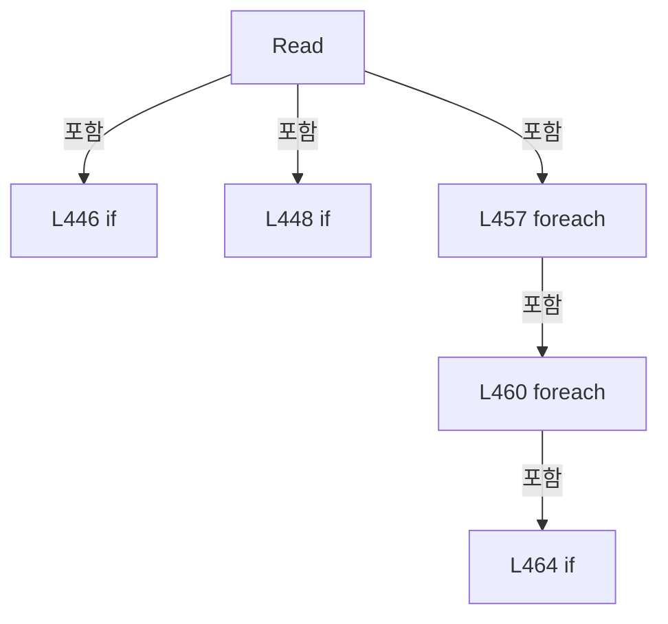

변경 전 점검: 입력/반환 타입, 위 호출자, 예외/취소 경로, 공유 상태와 저장·전송 소비자를 함께 확인합니다. 값의 단위나 물리 방향을 이름만으로 확정하지 않습니다.

### MethodDeclaration `EmptyPanes` · L480–483

[Drilling.UI/Menu/Menus/CAlarmCauseAnalysis.cs:480–483](https://github.com/kjuws10-rgb/A3Drilling/blob/dfa5920e6301d9ec4b0eab1452ae59521aafc986/Drilling.UI/Menu/Menus/CAlarmCauseAnalysis.cs#L480-L483)

| 항목 | 실제 추출 값 |
| --- | --- |
| 서명 | System.Collections.Generic.IReadOnlyList<Drilling.UI.Menu.Menus.ST_ALARM_ANALYSIS_PANE> Drilling.UI.Menu.Menus.CAlarmIncidentLogReader.EmptyPanes(string) |
| 접근/수식자 | Public / public, static |
| 반환/값 타입 | System.Collections.Generic.IReadOnlyList<Drilling.UI.Menu.Menus.ST_ALARM_ANALYSIS_PANE> |
| 소속 타입 | NamedType:Drilling.UI.Menu.Menus.CAlarmIncidentLogReader |

입력 계약:

| 이름 | 타입 | 전달 | 선택/기본값 |
| --- | --- | --- | --- |
| summary | string | None | True / "\uBD84\uC11D \uC804" |

정적 호출자로 확인된 위치:

| 호출 파일/행 | 호출 표현식 | 런타임 분기 가능 |
| --- | --- | --- |
| [Drilling.UI/Menu/Menus/CAlarmCauseAnalysis.cs:25–25](https://github.com/kjuws10-rgb/A3Drilling/blob/dfa5920e6301d9ec4b0eab1452ae59521aafc986/Drilling.UI/Menu/Menus/CAlarmCauseAnalysis.cs#L25-L25) | CAlarmIncidentLogReader.EmptyPanes | False |
| [Drilling.UI/Menu/Menus/CAlarmCauseAnalysis.cs:251–251](https://github.com/kjuws10-rgb/A3Drilling/blob/dfa5920e6301d9ec4b0eab1452ae59521aafc986/Drilling.UI/Menu/Menus/CAlarmCauseAnalysis.cs#L251-L251) | CAlarmIncidentLogReader.EmptyPanes | False |

호출하는 대상과 해석 범위:

| 원본 행 | 표현식 | 분석 상태 | 대상/소스 위치 |
| --- | --- | --- | --- |
| 482 | PaneOrder.Select(key => new ST_ALARM_ANALYSIS_PANE(key, PaneTitles[key], summary, [])).ToArray | resolved | Drilling.UI.Menu.Menus.ST_ALARM_ANALYSIS_PANE[] System.Collections.Generic.IEnumerable<Drilling.UI.Menu.Menus.ST_ALARM_ANALYSIS_PANE>.ToArray<Drilling.UI.Menu.Menus.ST_ALARM_ANALYSIS_PANE>() |
| 482 | PaneOrder.Select | resolved | System.Collections.Generic.IEnumerable<Drilling.UI.Menu.Menus.ST_ALARM_ANALYSIS_PANE> System.Collections.Generic.IEnumerable<string>.Select<string, Drilling.UI.Menu.Menus.ST_ALARM_ANALYSIS_PANE>(System.Func<string, Drilling.UI.Menu.Menus.ST_ALARM_ANALYSIS_PANE>) |
| 482 | new ST_ALARM_ANALYSIS_PANE | resolved | Drilling.UI.Menu.Menus.ST_ALARM_ANALYSIS_PANE.ST_ALARM_ANALYSIS_PANE(string, string, string, System.Collections.Generic.IReadOnlyList<Drilling.UI.Menu.Menus.ST_ALARM_ANALYSIS_LOG_ROW>, int) · Drilling.UI/Menu/Menus/CAlarmCauseAnalysis.cs:335 |

본문의 실제 연산·분기·예외·반환 순서(원문 위치 순):

| 원본 행 | 종류 | 주석 해설 |
| --- | --- | --- |
| 482 | call | 함수·델리게이트 또는 객체 생성자를 호출합니다: PaneOrder.Select(key => new ST_ALARM_ANALYSIS_PANE(key, PaneTitles[key], summary, [])).ToArray() |
| 482 | call | 함수·델리게이트 또는 객체 생성자를 호출합니다: PaneOrder.Select(key => new ST_ALARM_ANALYSIS_PANE(key, PaneTitles[key], summary, [])) |
| 482 | call | 함수·델리게이트 또는 객체 생성자를 호출합니다: new ST_ALARM_ANALYSIS_PANE(key, PaneTitles[key], summary, []) |
| 482 | return | 호출자에게 값 또는 제어를 반환합니다: return PaneOrder.Select(key => new ST_ALARM_ANALYSIS_PANE(key, PaneTitles[key], summary, [])).ToArray(); |

변경 전 점검: 입력/반환 타입, 위 호출자, 예외/취소 경로, 공유 상태와 저장·전송 소비자를 함께 확인합니다. 값의 단위나 물리 방향을 이름만으로 확정하지 않습니다.

### MethodDeclaration `BuildPane` · L485–519

[Drilling.UI/Menu/Menus/CAlarmCauseAnalysis.cs:485–519](https://github.com/kjuws10-rgb/A3Drilling/blob/dfa5920e6301d9ec4b0eab1452ae59521aafc986/Drilling.UI/Menu/Menus/CAlarmCauseAnalysis.cs#L485-L519)

| 항목 | 실제 추출 값 |
| --- | --- |
| 서명 | Drilling.UI.Menu.Menus.ST_ALARM_ANALYSIS_PANE Drilling.UI.Menu.Menus.CAlarmIncidentLogReader.BuildPane(string, System.Collections.Generic.List<Drilling.UI.Menu.Menus.ST_ALARM_ANALYSIS_LOG_ROW>, System.DateTimeOffset, bool) |
| 접근/수식자 | Private / private |
| 반환/값 타입 | Drilling.UI.Menu.Menus.ST_ALARM_ANALYSIS_PANE |
| 소속 타입 | NamedType:Drilling.UI.Menu.Menus.CAlarmIncidentLogReader |

입력 계약:

| 이름 | 타입 | 전달 | 선택/기본값 |
| --- | --- | --- | --- |
| key | string | None | False /  |
| source | System.Collections.Generic.List<Drilling.UI.Menu.Menus.ST_ALARM_ANALYSIS_LOG_ROW> | None | False /  |
| alarmTime | System.DateTimeOffset | None | False /  |
| stateChangesOnly | bool | None | False /  |

정적 호출자로 확인된 위치:

| 호출 파일/행 | 호출 표현식 | 런타임 분기 가능 |
| --- | --- | --- |
| [Drilling.UI/Menu/Menus/CAlarmCauseAnalysis.cs:472–472](https://github.com/kjuws10-rgb/A3Drilling/blob/dfa5920e6301d9ec4b0eab1452ae59521aafc986/Drilling.UI/Menu/Menus/CAlarmCauseAnalysis.cs#L472-L472) | BuildPane | False |
| [Drilling.UI/Menu/Menus/CAlarmCauseAnalysis.cs:473–473](https://github.com/kjuws10-rgb/A3Drilling/blob/dfa5920e6301d9ec4b0eab1452ae59521aafc986/Drilling.UI/Menu/Menus/CAlarmCauseAnalysis.cs#L473-L473) | BuildPane | False |

호출하는 대상과 해석 범위:

| 원본 행 | 표현식 | 분석 상태 | 대상/소스 위치 |
| --- | --- | --- | --- |
| 493 | source.Where | resolved | System.Collections.Generic.IEnumerable<Drilling.UI.Menu.Menus.ST_ALARM_ANALYSIS_LOG_ROW> System.Collections.Generic.IEnumerable<Drilling.UI.Menu.Menus.ST_ALARM_ANALYSIS_LOG_ROW>.Where<Drilling.UI.Menu.Menus.ST_ALARM_ANALYSIS_LOG_ROW>(System.Func<Drilling.UI.Menu.Menus.ST_ALARM_ANALYSIS_LOG_ROW, bool>) |
| 495 | key.Equals | resolved | bool string.Equals(string?, System.StringComparison) |
| 496 | CondenseMelsecPollingRows | resolved | System.Collections.Generic.IReadOnlyList<Drilling.UI.Menu.Menus.ST_ALARM_ANALYSIS_LOG_ROW> Drilling.UI.Menu.Menus.CAlarmIncidentLogReader.CondenseMelsecPollingRows(System.Collections.Generic.IEnumerable<Drilling.UI.Menu.Menus.ST_ALARM_ANALYSIS_LOG_ROW>) · Drilling.UI/Menu/Menus/CAlarmCauseAnalysis.cs:711 |
| 497 | filtered.ToArray | resolved | Drilling.UI.Menu.Menus.ST_ALARM_ANALYSIS_LOG_ROW[] System.Collections.Generic.IEnumerable<Drilling.UI.Menu.Menus.ST_ALARM_ANALYSIS_LOG_ROW>.ToArray<Drilling.UI.Menu.Menus.ST_ALARM_ANALYSIS_LOG_ROW>() |
| 502 | displaySource .OrderBy(row => Math.Abs((row.OccurredAt - alarmTime).TotalMilliseconds)) .Take | resolved | System.Collections.Generic.IEnumerable<Drilling.UI.Menu.Menus.ST_ALARM_ANALYSIS_LOG_ROW> System.Collections.Generic.IEnumerable<Drilling.UI.Menu.Menus.ST_ALARM_ANALYSIS_LOG_ROW>.Take<Drilling.UI.Menu.Menus.ST_ALARM_ANALYSIS_LOG_ROW>(int) |
| 502 | displaySource .OrderBy | resolved | System.Linq.IOrderedEnumerable<Drilling.UI.Menu.Menus.ST_ALARM_ANALYSIS_LOG_ROW> System.Collections.Generic.IEnumerable<Drilling.UI.Menu.Menus.ST_ALARM_ANALYSIS_LOG_ROW>.OrderBy<Drilling.UI.Menu.Menus.ST_ALARM_ANALYSIS_LOG_ROW, double>(System.Func<Drilling.UI.Menu.Menus.ST_ALARM_ANALYSIS_LOG_ROW, double>) |
| 503 | Math.Abs | resolved | double System.Math.Abs(double) |
| 507 | selected.OrderBy(row => row.OccurredAt).ThenBy(row => row.Source, StringComparer.OrdinalIgnoreCase).ToArray | resolved | Drilling.UI.Menu.Menus.ST_ALARM_ANALYSIS_LOG_ROW[] System.Collections.Generic.IEnumerable<Drilling.UI.Menu.Menus.ST_ALARM_ANALYSIS_LOG_ROW>.ToArray<Drilling.UI.Menu.Menus.ST_ALARM_ANALYSIS_LOG_ROW>() |
| 507 | selected.OrderBy(row => row.OccurredAt).ThenBy | resolved | System.Linq.IOrderedEnumerable<Drilling.UI.Menu.Menus.ST_ALARM_ANALYSIS_LOG_ROW> System.Linq.IOrderedEnumerable<Drilling.UI.Menu.Menus.ST_ALARM_ANALYSIS_LOG_ROW>.ThenBy<Drilling.UI.Menu.Menus.ST_ALARM_ANALYSIS_LOG_ROW, string>(System.Func<Drilling.UI.Menu.Menus.ST_ALARM_ANALYSIS_LOG_ROW, string>, System.Collections.Generic.IComparer<string>?) |
| 507 | selected.OrderBy | resolved | System.Linq.IOrderedEnumerable<Drilling.UI.Menu.Menus.ST_ALARM_ANALYSIS_LOG_ROW> System.Collections.Generic.IEnumerable<Drilling.UI.Menu.Menus.ST_ALARM_ANALYSIS_LOG_ROW>.OrderBy<Drilling.UI.Menu.Menus.ST_ALARM_ANALYSIS_LOG_ROW, System.DateTimeOffset>(System.Func<Drilling.UI.Menu.Menus.ST_ALARM_ANALYSIS_LOG_ROW, System.DateTimeOffset>) |
| 511 | key.Equals | resolved | bool string.Equals(string?, System.StringComparison) |
| 517 | rows.Count | resolved | int System.Collections.Generic.IEnumerable<Drilling.UI.Menu.Menus.ST_ALARM_ANALYSIS_LOG_ROW>.Count<Drilling.UI.Menu.Menus.ST_ALARM_ANALYSIS_LOG_ROW>(System.Func<Drilling.UI.Menu.Menus.ST_ALARM_ANALYSIS_LOG_ROW, bool>) |
| 518 | new | resolved | Drilling.UI.Menu.Menus.ST_ALARM_ANALYSIS_PANE.ST_ALARM_ANALYSIS_PANE(string, string, string, System.Collections.Generic.IReadOnlyList<Drilling.UI.Menu.Menus.ST_ALARM_ANALYSIS_LOG_ROW>, int) · Drilling.UI/Menu/Menus/CAlarmCauseAnalysis.cs:335 |

본문의 실제 연산·분기·예외·반환 순서(원문 위치 순):

| 원본 행 | 종류 | 주석 해설 |
| --- | --- | --- |
| 491 | local-declaration | 지역 변수를 선언합니다: var rawTotal = source.Count; |
| 491 | variable-initializer | 변수의 초기값을 지정합니다: rawTotal = source.Count |
| 492 | conditional-expression | 조건에 따라 결과식을 선택합니다: stateChangesOnly ? source.Where(row => row.IsStateChange) : source |
| 492 | local-declaration | 지역 변수를 선언합니다: IEnumerable<ST_ALARM_ANALYSIS_LOG_ROW> filtered = stateChangesOnly ? source.Where(row => row.IsStateChange) : source; |
| 492 | variable-initializer | 변수의 초기값을 지정합니다: filtered = stateChangesOnly ? source.Where(row => row.IsStateChange) : source |
| 493 | call | 함수·델리게이트 또는 객체 생성자를 호출합니다: source.Where(row => row.IsStateChange) |
| 495 | call | 함수·델리게이트 또는 객체 생성자를 호출합니다: key.Equals("MELSEC", StringComparison.Ordinal) |
| 495 | conditional-expression | 조건에 따라 결과식을 선택합니다: key.Equals("MELSEC", StringComparison.Ordinal) ? CondenseMelsecPollingRows(filtered) : filtered.ToArray() |
| 495 | local-declaration | 지역 변수를 선언합니다: var displaySource = key.Equals("MELSEC", StringComparison.Ordinal) ? CondenseMelsecPollingRows(filtered) : filtered.ToArray(); |
| 495 | variable-initializer | 변수의 초기값을 지정합니다: displaySource = key.Equals("MELSEC", StringComparison.Ordinal) ? CondenseMelsecPollingRows(filtered) : filtered.ToArray() |
| 496 | call | 함수·델리게이트 또는 객체 생성자를 호출합니다: CondenseMelsecPollingRows(filtered) |
| 497 | call | 함수·델리게이트 또는 객체 생성자를 호출합니다: filtered.ToArray() |
| 498 | local-declaration | 지역 변수를 선언합니다: var displayTotal = displaySource.Count; |
| 498 | variable-initializer | 변수의 초기값을 지정합니다: displayTotal = displaySource.Count |
| 499 | local-declaration | 지역 변수를 선언합니다: IEnumerable<ST_ALARM_ANALYSIS_LOG_ROW> selected = displaySource; |
| 499 | variable-initializer | 변수의 초기값을 지정합니다: selected = displaySource |
| 500 | if | 조건에 따라 분기합니다: if (displayTotal > MaximumRowsPerPane) |
| 502 | call | 함수·델리게이트 또는 객체 생성자를 호출합니다: displaySource .OrderBy(row => Math.Abs((row.OccurredAt - alarmTime).TotalMilliseconds)) |
| 502 | assignment | 값을 대상에 대입합니다: selected = displaySource .OrderBy(row => Math.Abs((row.OccurredAt - alarmTime).TotalMilliseconds)) .Take(MaximumRowsPerPane) |
| 502 | call | 함수·델리게이트 또는 객체 생성자를 호출합니다: displaySource .OrderBy(row => Math.Abs((row.OccurredAt - alarmTime).TotalMilliseconds)) .Take(MaximumRowsPerPane) |
| 503 | call | 함수·델리게이트 또는 객체 생성자를 호출합니다: Math.Abs((row.OccurredAt - alarmTime).TotalMilliseconds) |
| 507 | call | 함수·델리게이트 또는 객체 생성자를 호출합니다: selected.OrderBy(row => row.OccurredAt).ThenBy(row => row.Source, StringComparer.OrdinalIgnoreCase).ToArray() |
| 507 | call | 함수·델리게이트 또는 객체 생성자를 호출합니다: selected.OrderBy(row => row.OccurredAt).ThenBy(row => row.Source, StringComparer.OrdinalIgnoreCase) |
| 507 | call | 함수·델리게이트 또는 객체 생성자를 호출합니다: selected.OrderBy(row => row.OccurredAt) |
| 507 | local-declaration | 지역 변수를 선언합니다: var rows = selected.OrderBy(row => row.OccurredAt).ThenBy(row => row.Source, StringComparer.OrdinalIgnoreCase).ToArray(); |
| 507 | variable-initializer | 변수의 초기값을 지정합니다: rows = selected.OrderBy(row => row.OccurredAt).ThenBy(row => row.Source, StringComparer.OrdinalIgnoreCase).ToArray() |
| 508 | local-declaration | 지역 변수를 선언합니다: string summary; |
| 509 | if | 조건에 따라 분기합니다: if (stateChangesOnly) |
| 510 | assignment | 값을 대상에 대입합니다: summary = $"변화 {rows.Length:N0} / 원본 {rawTotal:N0}건" |
| 511 | call | 함수·델리게이트 또는 객체 생성자를 호출합니다: key.Equals("MELSEC", StringComparison.Ordinal) |
| 511 | else | 앞 조건이 거짓인 경로입니다: else |
| 511 | if | 조건에 따라 분기합니다: if (key.Equals("MELSEC", StringComparison.Ordinal) && rawTotal != displayTotal) |
| 512 | assignment | 값을 대상에 대입합니다: summary = $"표시 {rows.Length:N0} / 원본 {rawTotal:N0}건 · 정상 폴링 ID·1초 묶음" |
| 513 | else | 앞 조건이 거짓인 경로입니다: else |
| 514 | assignment | 값을 대상에 대입합니다: summary = displayTotal <= MaximumRowsPerPane ? $"{displayTotal:N0}건" : $"표시 {rows.Length:N0} / 전체 {displayTotal:N0}건 · 알람 시각 근접순 선별" |
| 514 | conditional-expression | 조건에 따라 결과식을 선택합니다: displayTotal <= MaximumRowsPerPane ? $"{displayTotal:N0}건" : $"표시 {rows.Length:N0} / 전체 {displayTotal:N0}건 · 알람 시각 근접순 선별" |
| 517 | call | 함수·델리게이트 또는 객체 생성자를 호출합니다: rows.Count(row => row.IsBaselineDifference) |
| 517 | local-declaration | 지역 변수를 선언합니다: var referenceDifferenceCount = rows.Count(row => row.IsBaselineDifference); |
| 517 | variable-initializer | 변수의 초기값을 지정합니다: referenceDifferenceCount = rows.Count(row => row.IsBaselineDifference) |
| 518 | call | 함수·델리게이트 또는 객체 생성자를 호출합니다: new(key, PaneTitles[key], summary, rows, referenceDifferenceCount) |
| 518 | return | 호출자에게 값 또는 제어를 반환합니다: return new(key, PaneTitles[key], summary, rows, referenceDifferenceCount); |

제어 구문의 포함 구조(실제 실행 순서/CFG가 아닌 구문 탐색 그림):

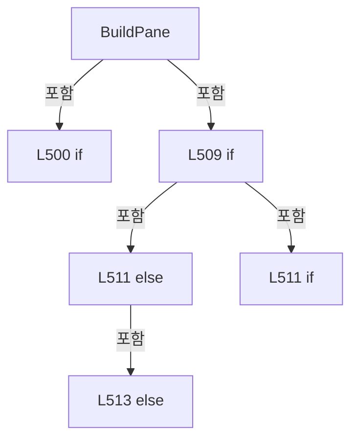

변경 전 점검: 입력/반환 타입, 위 호출자, 예외/취소 경로, 공유 상태와 저장·전송 소비자를 함께 확인합니다. 값의 단위나 물리 방향을 이름만으로 확정하지 않습니다.

### MethodDeclaration `ReadRange` · L521–543

[Drilling.UI/Menu/Menus/CAlarmCauseAnalysis.cs:521–543](https://github.com/kjuws10-rgb/A3Drilling/blob/dfa5920e6301d9ec4b0eab1452ae59521aafc986/Drilling.UI/Menu/Menus/CAlarmCauseAnalysis.cs#L521-L543)

| 항목 | 실제 추출 값 |
| --- | --- |
| 서명 | Drilling.UI.Menu.Menus.CAlarmIncidentLogReader.RangeReadResult Drilling.UI.Menu.Menus.CAlarmIncidentLogReader.ReadRange(System.DateTimeOffset, System.DateTimeOffset, System.DateTimeOffset?, System.Threading.CancellationToken) |
| 접근/수식자 | Private / private |
| 반환/값 타입 | Drilling.UI.Menu.Menus.CAlarmIncidentLogReader.RangeReadResult |
| 소속 타입 | NamedType:Drilling.UI.Menu.Menus.CAlarmIncidentLogReader |

입력 계약:

| 이름 | 타입 | 전달 | 선택/기본값 |
| --- | --- | --- | --- |
| from | System.DateTimeOffset | None | False /  |
| through | System.DateTimeOffset | None | False /  |
| alarmTime | System.DateTimeOffset? | None | False /  |
| token | System.Threading.CancellationToken | None | False /  |

정적 호출자로 확인된 위치:

| 호출 파일/행 | 호출 표현식 | 런타임 분기 가능 |
| --- | --- | --- |
| [Drilling.UI/Menu/Menus/CAlarmCauseAnalysis.cs:451–451](https://github.com/kjuws10-rgb/A3Drilling/blob/dfa5920e6301d9ec4b0eab1452ae59521aafc986/Drilling.UI/Menu/Menus/CAlarmCauseAnalysis.cs#L451-L451) | ReadRange | False |
| [Drilling.UI/Menu/Menus/CAlarmCauseAnalysis.cs:561–561](https://github.com/kjuws10-rgb/A3Drilling/blob/dfa5920e6301d9ec4b0eab1452ae59521aafc986/Drilling.UI/Menu/Menus/CAlarmCauseAnalysis.cs#L561-L561) | ReadRange | False |

호출하는 대상과 해석 범위:

| 원본 행 | 표현식 | 분석 상태 | 대상/소스 위치 |
| --- | --- | --- | --- |
| 527 | PaneOrder.ToDictionary | resolved | System.Collections.Generic.Dictionary<string, System.Collections.Generic.List<Drilling.UI.Menu.Menus.ST_ALARM_ANALYSIS_LOG_ROW>> System.Collections.Generic.IEnumerable<string>.ToDictionary<string, string, System.Collections.Generic.List<Drilling.UI.Menu.Menus.ST_ALARM_ANALYSIS_LOG_ROW>>(System.Func<string, string>, System.Func<string, System.Collections.Generic.List<Drilling.UI.Menu.Menus.ST_ALARM_ANALYSIS_LOG_ROW>>, System.Collections.Generic.IEqualityComparer<string>?) |
| 527 | new List<ST_ALARM_ANALYSIS_LOG_ROW> | resolved | System.Collections.Generic.List<Drilling.UI.Menu.Menus.ST_ALARM_ANALYSIS_LOG_ROW>.List() |
| 528 | new List<string> | resolved | System.Collections.Generic.List<string>.List() |
| 529 | EnumerateFiles(from.LocalDateTime.Date, through.LocalDateTime.Date).ToArray | resolved | Drilling.UI.Menu.Menus.CAlarmIncidentLogReader.LogFile[] System.Collections.Generic.IEnumerable<Drilling.UI.Menu.Menus.CAlarmIncidentLogReader.LogFile>.ToArray<Drilling.UI.Menu.Menus.CAlarmIncidentLogReader.LogFile>() |
| 529 | EnumerateFiles | resolved | System.Collections.Generic.IEnumerable<Drilling.UI.Menu.Menus.CAlarmIncidentLogReader.LogFile> Drilling.UI.Menu.Menus.CAlarmIncidentLogReader.EnumerateFiles(System.DateTime, System.DateTime) · Drilling.UI/Menu/Menus/CAlarmCauseAnalysis.cs:790 |
| 532 | token.ThrowIfCancellationRequested | resolved | void System.Threading.CancellationToken.ThrowIfCancellationRequested() |
| 535 | ReadFile | resolved | void Drilling.UI.Menu.Menus.CAlarmIncidentLogReader.ReadFile(Drilling.UI.Menu.Menus.CAlarmIncidentLogReader.LogFile, System.DateTimeOffset, System.DateTimeOffset, System.DateTimeOffset?, System.Collections.Generic.List<Drilling.UI.Menu.Menus.ST_ALARM_ANALYSIS_LOG_ROW>, System.Threading.CancellationToken) · Drilling.UI/Menu/Menus/CAlarmCauseAnalysis.cs:852 |
| 539 | warnings.Add | resolved | void System.Collections.Generic.List<string>.Add(string) |
| 539 | Path.GetFileName | resolved | string? System.IO.Path.GetFileName(string?) |
| 542 | new | resolved | Drilling.UI.Menu.Menus.CAlarmIncidentLogReader.RangeReadResult.RangeReadResult(System.Collections.Generic.Dictionary<string, System.Collections.Generic.List<Drilling.UI.Menu.Menus.ST_ALARM_ANALYSIS_LOG_ROW>>, int, System.Collections.Generic.IReadOnlyList<string>) · Drilling.UI/Menu/Menus/CAlarmCauseAnalysis.cs:950 |

본문의 실제 연산·분기·예외·반환 순서(원문 위치 순):

| 원본 행 | 종류 | 주석 해설 |
| --- | --- | --- |
| 527 | call | 함수·델리게이트 또는 객체 생성자를 호출합니다: PaneOrder.ToDictionary(key => key, _ => new List<ST_ALARM_ANALYSIS_LOG_ROW>(), StringComparer.Ordinal) |
| 527 | call | 함수·델리게이트 또는 객체 생성자를 호출합니다: new List<ST_ALARM_ANALYSIS_LOG_ROW>() |
| 527 | local-declaration | 지역 변수를 선언합니다: var rows = PaneOrder.ToDictionary(key => key, _ => new List<ST_ALARM_ANALYSIS_LOG_ROW>(), StringComparer.Ordinal); |
| 527 | variable-initializer | 변수의 초기값을 지정합니다: rows = PaneOrder.ToDictionary(key => key, _ => new List<ST_ALARM_ANALYSIS_LOG_ROW>(), StringComparer.Ordinal) |
| 528 | call | 함수·델리게이트 또는 객체 생성자를 호출합니다: new List<string>() |
| 528 | local-declaration | 지역 변수를 선언합니다: var warnings = new List<string>(); |
| 528 | variable-initializer | 변수의 초기값을 지정합니다: warnings = new List<string>() |
| 529 | call | 함수·델리게이트 또는 객체 생성자를 호출합니다: EnumerateFiles(from.LocalDateTime.Date, through.LocalDateTime.Date).ToArray() |
| 529 | call | 함수·델리게이트 또는 객체 생성자를 호출합니다: EnumerateFiles(from.LocalDateTime.Date, through.LocalDateTime.Date) |
| 529 | local-declaration | 지역 변수를 선언합니다: var files = EnumerateFiles(from.LocalDateTime.Date, through.LocalDateTime.Date).ToArray(); |
| 529 | variable-initializer | 변수의 초기값을 지정합니다: files = EnumerateFiles(from.LocalDateTime.Date, through.LocalDateTime.Date).ToArray() |
| 530 | foreach | 컬렉션 요소를 순회합니다: foreach (var file in files) |
| 532 | call | 함수·델리게이트 또는 객체 생성자를 호출합니다: token.ThrowIfCancellationRequested() |
| 533 | try | 예외 처리 범위입니다: try |
| 535 | call | 함수·델리게이트 또는 객체 생성자를 호출합니다: ReadFile(file, from, through, alarmTime, rows[file.Pane], token) |
| 537 | catch | 지정 예외를 처리합니다: catch (Exception exception) when (exception is IOException or UnauthorizedAccessException or JsonException) |
| 539 | call | 함수·델리게이트 또는 객체 생성자를 호출합니다: warnings.Add($"{Path.GetFileName(file.Path)}: {exception.Message}") |
| 539 | call | 함수·델리게이트 또는 객체 생성자를 호출합니다: Path.GetFileName(file.Path) |
| 542 | call | 함수·델리게이트 또는 객체 생성자를 호출합니다: new(rows, files.Length, warnings) |
| 542 | return | 호출자에게 값 또는 제어를 반환합니다: return new(rows, files.Length, warnings); |

제어 구문의 포함 구조(실제 실행 순서/CFG가 아닌 구문 탐색 그림):

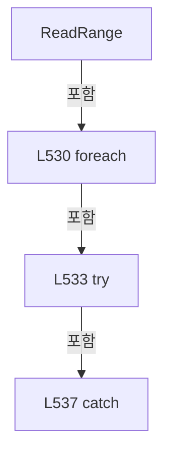

변경 전 점검: 입력/반환 타입, 위 호출자, 예외/취소 경로, 공유 상태와 저장·전송 소비자를 함께 확인합니다. 값의 단위나 물리 방향을 이름만으로 확정하지 않습니다.

### MethodDeclaration `TryReadReference` · L545–569

[Drilling.UI/Menu/Menus/CAlarmCauseAnalysis.cs:545–569](https://github.com/kjuws10-rgb/A3Drilling/blob/dfa5920e6301d9ec4b0eab1452ae59521aafc986/Drilling.UI/Menu/Menus/CAlarmCauseAnalysis.cs#L545-L569)

| 항목 | 실제 추출 값 |
| --- | --- |
| 서명 | Drilling.UI.Menu.Menus.CAlarmIncidentLogReader.ReferenceReadResult? Drilling.UI.Menu.Menus.CAlarmIncidentLogReader.TryReadReference(System.DateTimeOffset, System.DateTimeOffset, System.Threading.CancellationToken) |
| 접근/수식자 | Private / private |
| 반환/값 타입 | Drilling.UI.Menu.Menus.CAlarmIncidentLogReader.ReferenceReadResult? |
| 소속 타입 | NamedType:Drilling.UI.Menu.Menus.CAlarmIncidentLogReader |

입력 계약:

| 이름 | 타입 | 전달 | 선택/기본값 |
| --- | --- | --- | --- |
| analysisFrom | System.DateTimeOffset | None | False /  |
| analysisThrough | System.DateTimeOffset | None | False /  |
| token | System.Threading.CancellationToken | None | False /  |

정적 호출자로 확인된 위치:

| 호출 파일/행 | 호출 표현식 | 런타임 분기 가능 |
| --- | --- | --- |
| [Drilling.UI/Menu/Menus/CAlarmCauseAnalysis.cs:452–452](https://github.com/kjuws10-rgb/A3Drilling/blob/dfa5920e6301d9ec4b0eab1452ae59521aafc986/Drilling.UI/Menu/Menus/CAlarmCauseAnalysis.cs#L452-L452) | TryReadReference | False |

호출하는 대상과 해석 범위:

| 원본 행 | 표현식 | 분석 상태 | 대상/소스 위치 |
| --- | --- | --- | --- |
| 554 | analysisFrom.AddTicks | resolved | System.DateTimeOffset System.DateTimeOffset.AddTicks(long) |
| 557 | token.ThrowIfCancellationRequested | resolved | void System.Threading.CancellationToken.ThrowIfCancellationRequested() |
| 559 | HasAlarmInRange | resolved | bool Drilling.UI.Menu.Menus.CAlarmIncidentLogReader.HasAlarmInRange(System.DateTimeOffset, System.DateTimeOffset, System.Threading.CancellationToken) · Drilling.UI/Menu/Menus/CAlarmCauseAnalysis.cs:571 |
| 561 | ReadRange | resolved | Drilling.UI.Menu.Menus.CAlarmIncidentLogReader.RangeReadResult Drilling.UI.Menu.Menus.CAlarmIncidentLogReader.ReadRange(System.DateTimeOffset, System.DateTimeOffset, System.DateTimeOffset?, System.Threading.CancellationToken) · Drilling.UI/Menu/Menus/CAlarmCauseAnalysis.cs:521 |
| 562 | read.Rows.Values.Sum | resolved | int System.Collections.Generic.IEnumerable<System.Collections.Generic.List<Drilling.UI.Menu.Menus.ST_ALARM_ANALYSIS_LOG_ROW>>.Sum<System.Collections.Generic.List<Drilling.UI.Menu.Menus.ST_ALARM_ANALYSIS_LOG_ROW>>(System.Func<System.Collections.Generic.List<Drilling.UI.Menu.Menus.ST_ALARM_ANALYSIS_LOG_ROW>, int>) |
| 564 | new | resolved | Drilling.UI.Menu.Menus.CAlarmIncidentLogReader.ReferenceReadResult.ReferenceReadResult(System.DateTimeOffset, System.DateTimeOffset, System.Collections.Generic.Dictionary<string, System.Collections.Generic.List<Drilling.UI.Menu.Menus.ST_ALARM_ANALYSIS_LOG_ROW>>, int) · Drilling.UI/Menu/Menus/CAlarmCauseAnalysis.cs:954 |
| 566 | candidateFrom.AddTicks | resolved | System.DateTimeOffset System.DateTimeOffset.AddTicks(long) |

본문의 실제 연산·분기·예외·반환 순서(원문 위치 순):

| 원본 행 | 종류 | 주석 해설 |
| --- | --- | --- |
| 550 | local-declaration | 지역 변수를 선언합니다: var duration = analysisThrough - analysisFrom; |
| 550 | variable-initializer | 변수의 초기값을 지정합니다: duration = analysisThrough - analysisFrom |
| 551 | if | 조건에 따라 분기합니다: if (duration <= TimeSpan.Zero) |
| 552 | return | 호출자에게 값 또는 제어를 반환합니다: return null; |
| 554 | call | 함수·델리게이트 또는 객체 생성자를 호출합니다: analysisFrom.AddTicks(-1) |
| 554 | local-declaration | 지역 변수를 선언합니다: var candidateThrough = analysisFrom.AddTicks(-1); |
| 554 | variable-initializer | 변수의 초기값을 지정합니다: candidateThrough = analysisFrom.AddTicks(-1) |
| 555 | variable-initializer | 변수의 초기값을 지정합니다: attempt = 0 |
| 555 | for | 초기화·조건·증감이 있는 반복입니다: for (var attempt = 0; attempt < MaximumReferenceSearchWindows; attempt++) |
| 557 | call | 함수·델리게이트 또는 객체 생성자를 호출합니다: token.ThrowIfCancellationRequested() |
| 558 | local-declaration | 지역 변수를 선언합니다: var candidateFrom = candidateThrough - duration; |
| 558 | variable-initializer | 변수의 초기값을 지정합니다: candidateFrom = candidateThrough - duration |
| 559 | call | 함수·델리게이트 또는 객체 생성자를 호출합니다: HasAlarmInRange(candidateFrom, candidateThrough, token) |
| 559 | if | 조건에 따라 분기합니다: if (!HasAlarmInRange(candidateFrom, candidateThrough, token)) |
| 561 | call | 함수·델리게이트 또는 객체 생성자를 호출합니다: ReadRange(candidateFrom, candidateThrough, null, token) |
| 561 | local-declaration | 지역 변수를 선언합니다: var read = ReadRange(candidateFrom, candidateThrough, null, token); |
| 561 | variable-initializer | 변수의 초기값을 지정합니다: read = ReadRange(candidateFrom, candidateThrough, null, token) |
| 562 | call | 함수·델리게이트 또는 객체 생성자를 호출합니다: read.Rows.Values.Sum(rows => rows.Count) |
| 562 | local-declaration | 지역 변수를 선언합니다: var rowCount = read.Rows.Values.Sum(rows => rows.Count); |
| 562 | variable-initializer | 변수의 초기값을 지정합니다: rowCount = read.Rows.Values.Sum(rows => rows.Count) |
| 563 | if | 조건에 따라 분기합니다: if (rowCount >= MinimumReferenceRows) |
| 564 | call | 함수·델리게이트 또는 객체 생성자를 호출합니다: new(candidateFrom, candidateThrough, read.Rows, rowCount) |
| 564 | return | 호출자에게 값 또는 제어를 반환합니다: return new(candidateFrom, candidateThrough, read.Rows, rowCount); |
| 566 | assignment | 값을 대상에 대입합니다: candidateThrough = candidateFrom.AddTicks(-1) |
| 566 | call | 함수·델리게이트 또는 객체 생성자를 호출합니다: candidateFrom.AddTicks(-1) |
| 568 | return | 호출자에게 값 또는 제어를 반환합니다: return null; |

제어 구문의 포함 구조(실제 실행 순서/CFG가 아닌 구문 탐색 그림):

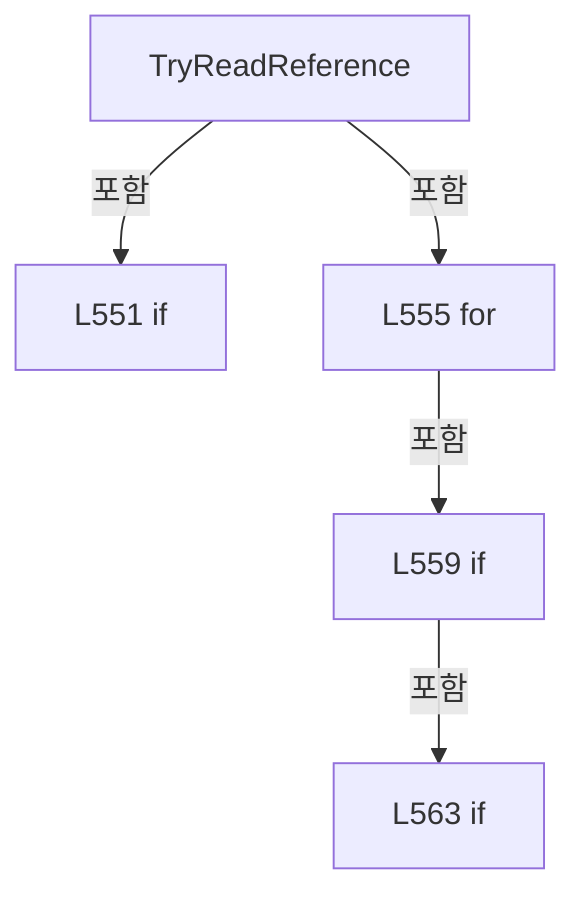

변경 전 점검: 입력/반환 타입, 위 호출자, 예외/취소 경로, 공유 상태와 저장·전송 소비자를 함께 확인합니다. 값의 단위나 물리 방향을 이름만으로 확정하지 않습니다.

### MethodDeclaration `HasAlarmInRange` · L571–612

[Drilling.UI/Menu/Menus/CAlarmCauseAnalysis.cs:571–612](https://github.com/kjuws10-rgb/A3Drilling/blob/dfa5920e6301d9ec4b0eab1452ae59521aafc986/Drilling.UI/Menu/Menus/CAlarmCauseAnalysis.cs#L571-L612)

| 항목 | 실제 추출 값 |
| --- | --- |
| 서명 | bool Drilling.UI.Menu.Menus.CAlarmIncidentLogReader.HasAlarmInRange(System.DateTimeOffset, System.DateTimeOffset, System.Threading.CancellationToken) |
| 접근/수식자 | Private / private |
| 반환/값 타입 | bool |
| 소속 타입 | NamedType:Drilling.UI.Menu.Menus.CAlarmIncidentLogReader |

입력 계약:

| 이름 | 타입 | 전달 | 선택/기본값 |
| --- | --- | --- | --- |
| from | System.DateTimeOffset | None | False /  |
| through | System.DateTimeOffset | None | False /  |
| token | System.Threading.CancellationToken | None | False /  |

정적 호출자로 확인된 위치:

| 호출 파일/행 | 호출 표현식 | 런타임 분기 가능 |
| --- | --- | --- |
| [Drilling.UI/Menu/Menus/CAlarmCauseAnalysis.cs:559–559](https://github.com/kjuws10-rgb/A3Drilling/blob/dfa5920e6301d9ec4b0eab1452ae59521aafc986/Drilling.UI/Menu/Menus/CAlarmCauseAnalysis.cs#L559-L559) | HasAlarmInRange | False |

호출하는 대상과 해석 범위:

| 원본 행 | 표현식 | 분석 상태 | 대상/소스 위치 |
| --- | --- | --- | --- |
| 573 | date.AddDays | resolved | System.DateTime System.DateTime.AddDays(double) |
| 575 | token.ThrowIfCancellationRequested | resolved | void System.Threading.CancellationToken.ThrowIfCancellationRequested() |
| 576 | date.ToString | resolved | string System.DateTime.ToString(string?, System.IFormatProvider?) |
| 577 | Path.Combine | resolved | string System.IO.Path.Combine(string, string, string, string) |
| 578 | File.Exists | resolved | bool System.IO.File.Exists(string?) |
| 582 | new FileStream | resolved | System.IO.FileStream.FileStream(string, System.IO.FileMode, System.IO.FileAccess, System.IO.FileShare) |
| 583 | new StreamReader | resolved | System.IO.StreamReader.StreamReader(System.IO.Stream, System.Text.Encoding?, bool) |
| 584 | reader.ReadLine | resolved · 동적 구현 선택 가능 | string? System.IO.StreamReader.ReadLine() |
| 586 | token.ThrowIfCancellationRequested | resolved | void System.Threading.CancellationToken.ThrowIfCancellationRequested() |
| 587 | string.IsNullOrWhiteSpace | resolved | bool string.IsNullOrWhiteSpace(string?) |
| 589 | JsonDocument.Parse | resolved | System.Text.Json.JsonDocument System.Text.Json.JsonDocument.Parse(string, System.Text.Json.JsonDocumentOptions) |
| 590 | document.RootElement.TryGetProperty | resolved | bool System.Text.Json.JsonElement.TryGetProperty(string, out System.Text.Json.JsonElement) |
| 591 | DateTimeOffset.TryParse | resolved | bool System.DateTimeOffset.TryParse(string?, System.IFormatProvider?, System.Globalization.DateTimeStyles, out System.DateTimeOffset) |
| 592 | occurredAtElement.GetString | resolved | string? System.Text.Json.JsonElement.GetString() |

본문의 실제 연산·분기·예외·반환 순서(원문 위치 순):

| 원본 행 | 종류 | 주석 해설 |
| --- | --- | --- |
| 573 | assignment | 값을 대상에 대입합니다: date = date.AddDays(1) |
| 573 | call | 함수·델리게이트 또는 객체 생성자를 호출합니다: date.AddDays(1) |
| 573 | variable-initializer | 변수의 초기값을 지정합니다: date = from.LocalDateTime.Date |
| 573 | for | 초기화·조건·증감이 있는 반복입니다: for (var date = from.LocalDateTime.Date; ; date = date.AddDays(1)) |
| 575 | call | 함수·델리게이트 또는 객체 생성자를 호출합니다: token.ThrowIfCancellationRequested() |
| 576 | call | 함수·델리게이트 또는 객체 생성자를 호출합니다: date.ToString("yyyyMMdd", CultureInfo.InvariantCulture) |
| 576 | local-declaration | 지역 변수를 선언합니다: var day = date.ToString("yyyyMMdd", CultureInfo.InvariantCulture); |
| 576 | variable-initializer | 변수의 초기값을 지정합니다: day = date.ToString("yyyyMMdd", CultureInfo.InvariantCulture) |
| 577 | call | 함수·델리게이트 또는 객체 생성자를 호출합니다: Path.Combine(_logRoot, "Alarm", day, $"Alarm_{day}.jsonl") |
| 577 | local-declaration | 지역 변수를 선언합니다: var path = Path.Combine(_logRoot, "Alarm", day, $"Alarm_{day}.jsonl"); |
| 577 | variable-initializer | 변수의 초기값을 지정합니다: path = Path.Combine(_logRoot, "Alarm", day, $"Alarm_{day}.jsonl") |
| 578 | call | 함수·델리게이트 또는 객체 생성자를 호출합니다: File.Exists(path) |
| 578 | if | 조건에 따라 분기합니다: if (File.Exists(path)) |
| 580 | try | 예외 처리 범위입니다: try |
| 582 | call | 함수·델리게이트 또는 객체 생성자를 호출합니다: new FileStream(path, FileMode.Open, FileAccess.Read, FileShare.ReadWrite &#124; FileShare.Delete) |
| 582 | using-declaration | 정리할 자원을 선언합니다: using var stream = new FileStream(path, FileMode.Open, FileAccess.Read, FileShare.ReadWrite &#124; FileShare.Delete); |
| 582 | variable-initializer | 변수의 초기값을 지정합니다: stream = new FileStream(path, FileMode.Open, FileAccess.Read, FileShare.ReadWrite &#124; FileShare.Delete) |
| 583 | call | 함수·델리게이트 또는 객체 생성자를 호출합니다: new StreamReader(stream, Encoding.UTF8, true) |
| 583 | using-declaration | 정리할 자원을 선언합니다: using var reader = new StreamReader(stream, Encoding.UTF8, true); |
| 583 | variable-initializer | 변수의 초기값을 지정합니다: reader = new StreamReader(stream, Encoding.UTF8, true) |
| 584 | call | 함수·델리게이트 또는 객체 생성자를 호출합니다: reader.ReadLine() |
| 584 | while | 조건을 먼저 확인하며 반복합니다: while (reader.ReadLine() is { } line) |
| 586 | call | 함수·델리게이트 또는 객체 생성자를 호출합니다: token.ThrowIfCancellationRequested() |
| 587 | call | 함수·델리게이트 또는 객체 생성자를 호출합니다: string.IsNullOrWhiteSpace(line) |
| 587 | if | 조건에 따라 분기합니다: if (string.IsNullOrWhiteSpace(line)) |
| 588 | continue | 다음 반복으로 진행합니다: continue; |
| 589 | call | 함수·델리게이트 또는 객체 생성자를 호출합니다: JsonDocument.Parse(line) |
| 589 | using-declaration | 정리할 자원을 선언합니다: using var document = JsonDocument.Parse(line); |
| 589 | variable-initializer | 변수의 초기값을 지정합니다: document = JsonDocument.Parse(line) |
| 590 | call | 함수·델리게이트 또는 객체 생성자를 호출합니다: document.RootElement.TryGetProperty("OccurredAt", out var occurredAtElement) |
| 590 | if | 조건에 따라 분기합니다: if (!document.RootElement.TryGetProperty("OccurredAt", out var occurredAtElement) &#124;&#124; !DateTimeOffset.TryParse( occurredAtElement.GetString(), CultureInfo.InvariantCulture, DateTimeStyles.RoundtripKind, out var occurredAt)) |
| 591 | call | 함수·델리게이트 또는 객체 생성자를 호출합니다: DateTimeOffset.TryParse( occurredAtElement.GetString(), CultureInfo.InvariantCulture, DateTimeStyles.RoundtripKind, out var occurredAt) |
| 592 | call | 함수·델리게이트 또는 객체 생성자를 호출합니다: occurredAtElement.GetString() |
| 596 | continue | 다음 반복으로 진행합니다: continue; |
| 597 | if | 조건에 따라 분기합니다: if (occurredAt > through) |
| 598 | break | 해당 반복/분기 구간을 종료합니다: break; |
| 599 | if | 조건에 따라 분기합니다: if (occurredAt >= from) |
| 600 | return | 호출자에게 값 또는 제어를 반환합니다: return true; |
| 603 | catch | 지정 예외를 처리합니다: catch (JsonException) |
| 605 | return | 호출자에게 값 또는 제어를 반환합니다: return true; |
| 608 | if | 조건에 따라 분기합니다: if (date == through.LocalDateTime.Date) |
| 609 | break | 해당 반복/분기 구간을 종료합니다: break; |
| 611 | return | 호출자에게 값 또는 제어를 반환합니다: return false; |

제어 구문의 포함 구조(실제 실행 순서/CFG가 아닌 구문 탐색 그림):

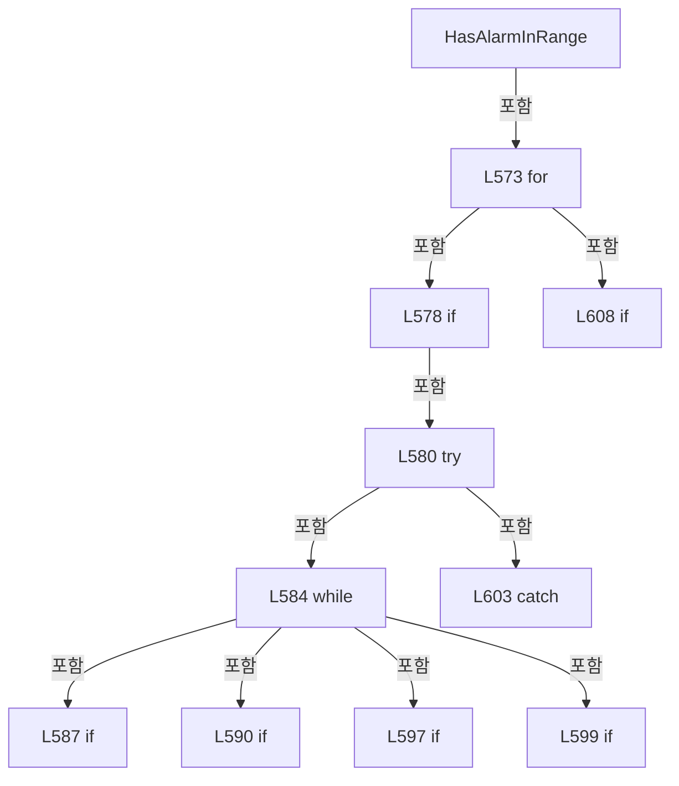

변경 전 점검: 입력/반환 타입, 위 호출자, 예외/취소 경로, 공유 상태와 저장·전송 소비자를 함께 확인합니다. 값의 단위나 물리 방향을 이름만으로 확정하지 않습니다.

### MethodDeclaration `BuildReferenceInfo` · L614–631

[Drilling.UI/Menu/Menus/CAlarmCauseAnalysis.cs:614–631](https://github.com/kjuws10-rgb/A3Drilling/blob/dfa5920e6301d9ec4b0eab1452ae59521aafc986/Drilling.UI/Menu/Menus/CAlarmCauseAnalysis.cs#L614-L631)

| 항목 | 실제 추출 값 |
| --- | --- |
| 서명 | Drilling.UI.Menu.Menus.ST_ALARM_REFERENCE_INFO Drilling.UI.Menu.Menus.CAlarmIncidentLogReader.BuildReferenceInfo(Drilling.UI.Menu.Menus.CAlarmIncidentLogReader.ReferenceReadResult?, int) |
| 접근/수식자 | Private / private, static |
| 반환/값 타입 | Drilling.UI.Menu.Menus.ST_ALARM_REFERENCE_INFO |
| 소속 타입 | NamedType:Drilling.UI.Menu.Menus.CAlarmIncidentLogReader |

입력 계약:

| 이름 | 타입 | 전달 | 선택/기본값 |
| --- | --- | --- | --- |
| reference | Drilling.UI.Menu.Menus.CAlarmIncidentLogReader.ReferenceReadResult? | None | False /  |
| differenceTypeCount | int | None | False /  |

정적 호출자로 확인된 위치:

| 호출 파일/행 | 호출 표현식 | 런타임 분기 가능 |
| --- | --- | --- |
| [Drilling.UI/Menu/Menus/CAlarmCauseAnalysis.cs:476–476](https://github.com/kjuws10-rgb/A3Drilling/blob/dfa5920e6301d9ec4b0eab1452ae59521aafc986/Drilling.UI/Menu/Menus/CAlarmCauseAnalysis.cs#L476-L476) | BuildReferenceInfo | False |

호출하는 대상과 해석 범위:

| 원본 행 | 표현식 | 분석 상태 | 대상/소스 위치 |
| --- | --- | --- | --- |
| 618 | new | resolved | Drilling.UI.Menu.Menus.ST_ALARM_REFERENCE_INFO.ST_ALARM_REFERENCE_INFO(bool, string, System.DateTimeOffset?, System.DateTimeOffset?, int, int) · Drilling.UI/Menu/Menus/CAlarmCauseAnalysis.cs:386 |
| 630 | new | resolved | Drilling.UI.Menu.Menus.ST_ALARM_REFERENCE_INFO.ST_ALARM_REFERENCE_INFO(bool, string, System.DateTimeOffset?, System.DateTimeOffset?, int, int) · Drilling.UI/Menu/Menus/CAlarmCauseAnalysis.cs:386 |

본문의 실제 연산·분기·예외·반환 순서(원문 위치 순):

| 원본 행 | 종류 | 주석 해설 |
| --- | --- | --- |
| 616 | if | 조건에 따라 분기합니다: if (reference is null) |
| 618 | call | 함수·델리게이트 또는 객체 생성자를 호출합니다: new( false, "정상 후보 구간을 찾지 못했습니다. 비교 강조 없이 현재 로그만 표시합니다.", null, null, 0, 0) |
| 618 | return | 호출자에게 값 또는 제어를 반환합니다: return new( false, "정상 후보 구간을 찾지 못했습니다. 비교 강조 없이 현재 로그만 표시합니다.", null, null, 0, 0); |
| 627 | local-declaration | 지역 변수를 선언합니다: var summary = $"정상 후보 {reference.From.LocalDateTime:yyyy-MM-dd HH:mm:ss.fff} ~ {reference.Through.LocalDateTime:HH:mm:ss.fff}" + $" · 알람 없는 이전 동일 길이 구간 · 로그 {reference.RowCount:N0}건 · 이번 구간 신규 유형 {differenceTypeCount:N0}개"; |
| 627 | variable-initializer | 변수의 초기값을 지정합니다: summary = $"정상 후보 {reference.From.LocalDateTime:yyyy-MM-dd HH:mm:ss.fff} ~ {reference.Through.LocalDateTime:HH:mm:ss.fff}" + $" · 알람 없는 이전 동일 길이 구간 · 로그 {reference.RowCount:N0}건 · 이번 구간 신규 유형 {differenceTypeCount:N0}개" |
| 630 | call | 함수·델리게이트 또는 객체 생성자를 호출합니다: new(true, summary, reference.From, reference.Through, reference.RowCount, differenceTypeCount) |
| 630 | return | 호출자에게 값 또는 제어를 반환합니다: return new(true, summary, reference.From, reference.Through, reference.RowCount, differenceTypeCount); |

제어 구문의 포함 구조(실제 실행 순서/CFG가 아닌 구문 탐색 그림):

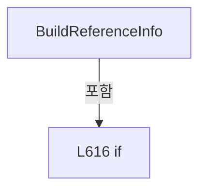

변경 전 점검: 입력/반환 타입, 위 호출자, 예외/취소 경로, 공유 상태와 저장·전송 소비자를 함께 확인합니다. 값의 단위나 물리 방향을 이름만으로 확정하지 않습니다.

### MethodDeclaration `BuildComparisonSignatures` · L633–643

[Drilling.UI/Menu/Menus/CAlarmCauseAnalysis.cs:633–643](https://github.com/kjuws10-rgb/A3Drilling/blob/dfa5920e6301d9ec4b0eab1452ae59521aafc986/Drilling.UI/Menu/Menus/CAlarmCauseAnalysis.cs#L633-L643)

| 항목 | 실제 추출 값 |
| --- | --- |
| 서명 | System.Collections.Generic.HashSet<string> Drilling.UI.Menu.Menus.CAlarmIncidentLogReader.BuildComparisonSignatures(System.Collections.Generic.IReadOnlyDictionary<string, System.Collections.Generic.List<Drilling.UI.Menu.Menus.ST_ALARM_ANALYSIS_LOG_ROW>>) |
| 접근/수식자 | Private / private, static |
| 반환/값 타입 | System.Collections.Generic.HashSet<string> |
| 소속 타입 | NamedType:Drilling.UI.Menu.Menus.CAlarmIncidentLogReader |

입력 계약:

| 이름 | 타입 | 전달 | 선택/기본값 |
| --- | --- | --- | --- |
| rows | System.Collections.Generic.IReadOnlyDictionary<string, System.Collections.Generic.List<Drilling.UI.Menu.Menus.ST_ALARM_ANALYSIS_LOG_ROW>> | None | False /  |

정적 호출자로 확인된 위치:

| 호출 파일/행 | 호출 표현식 | 런타임 분기 가능 |
| --- | --- | --- |
| [Drilling.UI/Menu/Menus/CAlarmCauseAnalysis.cs:455–455](https://github.com/kjuws10-rgb/A3Drilling/blob/dfa5920e6301d9ec4b0eab1452ae59521aafc986/Drilling.UI/Menu/Menus/CAlarmCauseAnalysis.cs#L455-L455) | BuildComparisonSignatures | False |

호출하는 대상과 해석 범위:

| 원본 행 | 표현식 | 분석 상태 | 대상/소스 위치 |
| --- | --- | --- | --- |
| 636 | new HashSet<string> | resolved | System.Collections.Generic.HashSet<string>.HashSet(System.Collections.Generic.IEqualityComparer<string>?) |
| 640 | signatures.Add | resolved | bool System.Collections.Generic.HashSet<string>.Add(string) |
| 640 | BuildComparisonSignature | resolved | string Drilling.UI.Menu.Menus.CAlarmIncidentLogReader.BuildComparisonSignature(string, Drilling.UI.Menu.Menus.ST_ALARM_ANALYSIS_LOG_ROW) · Drilling.UI/Menu/Menus/CAlarmCauseAnalysis.cs:645 |

본문의 실제 연산·분기·예외·반환 순서(원문 위치 순):

| 원본 행 | 종류 | 주석 해설 |
| --- | --- | --- |
| 636 | call | 함수·델리게이트 또는 객체 생성자를 호출합니다: new HashSet<string>(StringComparer.Ordinal) |
| 636 | local-declaration | 지역 변수를 선언합니다: var signatures = new HashSet<string>(StringComparer.Ordinal); |
| 636 | variable-initializer | 변수의 초기값을 지정합니다: signatures = new HashSet<string>(StringComparer.Ordinal) |
| 637 | foreach | 컬렉션 요소를 순회합니다: foreach (var key in PaneOrder) |
| 639 | foreach | 컬렉션 요소를 순회합니다: foreach (var row in rows[key]) |
| 640 | call | 함수·델리게이트 또는 객체 생성자를 호출합니다: signatures.Add(BuildComparisonSignature(key, row)) |
| 640 | call | 함수·델리게이트 또는 객체 생성자를 호출합니다: BuildComparisonSignature(key, row) |
| 642 | return | 호출자에게 값 또는 제어를 반환합니다: return signatures; |

제어 구문의 포함 구조(실제 실행 순서/CFG가 아닌 구문 탐색 그림):

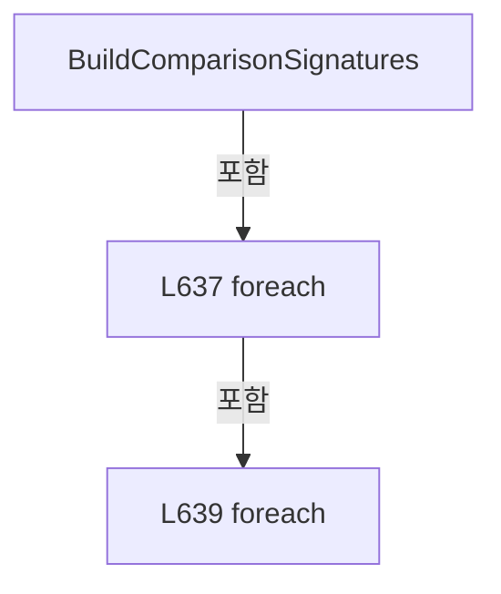

변경 전 점검: 입력/반환 타입, 위 호출자, 예외/취소 경로, 공유 상태와 저장·전송 소비자를 함께 확인합니다. 값의 단위나 물리 방향을 이름만으로 확정하지 않습니다.

### MethodDeclaration `BuildComparisonSignature` · L645–662

[Drilling.UI/Menu/Menus/CAlarmCauseAnalysis.cs:645–662](https://github.com/kjuws10-rgb/A3Drilling/blob/dfa5920e6301d9ec4b0eab1452ae59521aafc986/Drilling.UI/Menu/Menus/CAlarmCauseAnalysis.cs#L645-L662)

| 항목 | 실제 추출 값 |
| --- | --- |
| 서명 | string Drilling.UI.Menu.Menus.CAlarmIncidentLogReader.BuildComparisonSignature(string, Drilling.UI.Menu.Menus.ST_ALARM_ANALYSIS_LOG_ROW) |
| 접근/수식자 | Private / private, static |
| 반환/값 타입 | string |
| 소속 타입 | NamedType:Drilling.UI.Menu.Menus.CAlarmIncidentLogReader |

입력 계약:

| 이름 | 타입 | 전달 | 선택/기본값 |
| --- | --- | --- | --- |
| paneKey | string | None | False /  |
| row | Drilling.UI.Menu.Menus.ST_ALARM_ANALYSIS_LOG_ROW | None | False /  |

정적 호출자로 확인된 위치:

| 호출 파일/행 | 호출 표현식 | 런타임 분기 가능 |
| --- | --- | --- |
| [Drilling.UI/Menu/Menus/CAlarmCauseAnalysis.cs:462–462](https://github.com/kjuws10-rgb/A3Drilling/blob/dfa5920e6301d9ec4b0eab1452ae59521aafc986/Drilling.UI/Menu/Menus/CAlarmCauseAnalysis.cs#L462-L462) | BuildComparisonSignature | False |
| [Drilling.UI/Menu/Menus/CAlarmCauseAnalysis.cs:640–640](https://github.com/kjuws10-rgb/A3Drilling/blob/dfa5920e6301d9ec4b0eab1452ae59521aafc986/Drilling.UI/Menu/Menus/CAlarmCauseAnalysis.cs#L640-L640) | BuildComparisonSignature | False |

호출하는 대상과 해석 범위:

| 원본 행 | 표현식 | 분석 상태 | 대상/소스 위치 |
| --- | --- | --- | --- |
| 647 | paneKey.Equals | resolved | bool string.Equals(string?, System.StringComparison) |
| 648 | TryGetNormalMelsecPollingId | resolved | bool Drilling.UI.Menu.Menus.CAlarmIncidentLogReader.TryGetNormalMelsecPollingId(Drilling.UI.Menu.Menus.ST_ALARM_ANALYSIS_LOG_ROW, out string) · Drilling.UI/Menu/Menus/CAlarmCauseAnalysis.cs:763 |
| 650 | row.Message.Contains | resolved | bool string.Contains(string, System.StringComparison) |
| 651 | IsDiscreteMelsecSignal | resolved | bool Drilling.UI.Menu.Menus.CAlarmIncidentLogReader.IsDiscreteMelsecSignal(string) · Drilling.UI/Menu/Menus/CAlarmCauseAnalysis.cs:701 |
| 652 | ReadDelimitedField | resolved | string? Drilling.UI.Menu.Menus.CAlarmIncidentLogReader.ReadDelimitedField(string, string) · Drilling.UI/Menu/Menus/CAlarmCauseAnalysis.cs:777 |
| 654 | id.ToUpperInvariant | resolved | string string.ToUpperInvariant() |
| 654 | value.ToUpperInvariant | resolved | string string.ToUpperInvariant() |
| 657 | ComparisonGuidRegex.Replace | resolved | string System.Text.RegularExpressions.Regex.Replace(string, string) |
| 658 | ComparisonDateTimeRegex.Replace | resolved | string System.Text.RegularExpressions.Regex.Replace(string, string) |
| 659 | ComparisonNumberRegex.Replace | resolved | string System.Text.RegularExpressions.Regex.Replace(string, string) |
| 660 | ComparisonWhitespaceRegex.Replace(message, " ").Trim | resolved | string string.Trim() |
| 660 | ComparisonWhitespaceRegex.Replace | resolved | string System.Text.RegularExpressions.Regex.Replace(string, string) |
| 661 | row.Source.ToUpperInvariant | resolved | string string.ToUpperInvariant() |
| 661 | message.ToUpperInvariant | resolved | string string.ToUpperInvariant() |

본문의 실제 연산·분기·예외·반환 순서(원문 위치 순):

| 원본 행 | 종류 | 주석 해설 |
| --- | --- | --- |
| 647 | call | 함수·델리게이트 또는 객체 생성자를 호출합니다: paneKey.Equals("MELSEC", StringComparison.Ordinal) |
| 647 | if | 조건에 따라 분기합니다: if (paneKey.Equals("MELSEC", StringComparison.Ordinal) && TryGetNormalMelsecPollingId(row, out var id)) |
| 648 | call | 함수·델리게이트 또는 객체 생성자를 호출합니다: TryGetNormalMelsecPollingId(row, out var id) |
| 650 | call | 함수·델리게이트 또는 객체 생성자를 호출합니다: row.Message.Contains("[쓰기]", StringComparison.OrdinalIgnoreCase) |
| 650 | conditional-expression | 조건에 따라 결과식을 선택합니다: row.Message.Contains("[쓰기]", StringComparison.OrdinalIgnoreCase) ? "WRITE" : "POLL" |
| 650 | local-declaration | 지역 변수를 선언합니다: var operation = row.Message.Contains("[쓰기]", StringComparison.OrdinalIgnoreCase) ? "WRITE" : "POLL"; |
| 650 | variable-initializer | 변수의 초기값을 지정합니다: operation = row.Message.Contains("[쓰기]", StringComparison.OrdinalIgnoreCase) ? "WRITE" : "POLL" |
| 651 | call | 함수·델리게이트 또는 객체 생성자를 호출합니다: IsDiscreteMelsecSignal(id) |
| 651 | conditional-expression | 조건에 따라 결과식을 선택합니다: IsDiscreteMelsecSignal(id) ? ReadDelimitedField(row.Message, "값=") ?? "-" : "ANALOG" |
| 651 | local-declaration | 지역 변수를 선언합니다: var value = IsDiscreteMelsecSignal(id) ? ReadDelimitedField(row.Message, "값=") ?? "-" : "ANALOG"; |
| 651 | variable-initializer | 변수의 초기값을 지정합니다: value = IsDiscreteMelsecSignal(id) ? ReadDelimitedField(row.Message, "값=") ?? "-" : "ANALOG" |
| 652 | call | 함수·델리게이트 또는 객체 생성자를 호출합니다: ReadDelimitedField(row.Message, "값=") |
| 654 | call | 함수·델리게이트 또는 객체 생성자를 호출합니다: id.ToUpperInvariant() |
| 654 | call | 함수·델리게이트 또는 객체 생성자를 호출합니다: value.ToUpperInvariant() |
| 654 | return | 호출자에게 값 또는 제어를 반환합니다: return $"MELSEC&#124;{id.ToUpperInvariant()}&#124;{operation}&#124;{value.ToUpperInvariant()}"; |
| 657 | call | 함수·델리게이트 또는 객체 생성자를 호출합니다: ComparisonGuidRegex.Replace(row.Message, "#GUID") |
| 657 | local-declaration | 지역 변수를 선언합니다: var message = ComparisonGuidRegex.Replace(row.Message, "#GUID"); |
| 657 | variable-initializer | 변수의 초기값을 지정합니다: message = ComparisonGuidRegex.Replace(row.Message, "#GUID") |
| 658 | assignment | 값을 대상에 대입합니다: message = ComparisonDateTimeRegex.Replace(message, "#TIME") |
| 658 | call | 함수·델리게이트 또는 객체 생성자를 호출합니다: ComparisonDateTimeRegex.Replace(message, "#TIME") |
| 659 | assignment | 값을 대상에 대입합니다: message = ComparisonNumberRegex.Replace(message, "#") |
| 659 | call | 함수·델리게이트 또는 객체 생성자를 호출합니다: ComparisonNumberRegex.Replace(message, "#") |
| 660 | assignment | 값을 대상에 대입합니다: message = ComparisonWhitespaceRegex.Replace(message, " ").Trim() |
| 660 | call | 함수·델리게이트 또는 객체 생성자를 호출합니다: ComparisonWhitespaceRegex.Replace(message, " ").Trim() |
| 660 | call | 함수·델리게이트 또는 객체 생성자를 호출합니다: ComparisonWhitespaceRegex.Replace(message, " ") |
| 661 | call | 함수·델리게이트 또는 객체 생성자를 호출합니다: row.Source.ToUpperInvariant() |
| 661 | call | 함수·델리게이트 또는 객체 생성자를 호출합니다: message.ToUpperInvariant() |
| 661 | return | 호출자에게 값 또는 제어를 반환합니다: return $"{paneKey}&#124;{row.Source.ToUpperInvariant()}&#124;{message.ToUpperInvariant()}"; |

제어 구문의 포함 구조(실제 실행 순서/CFG가 아닌 구문 탐색 그림):

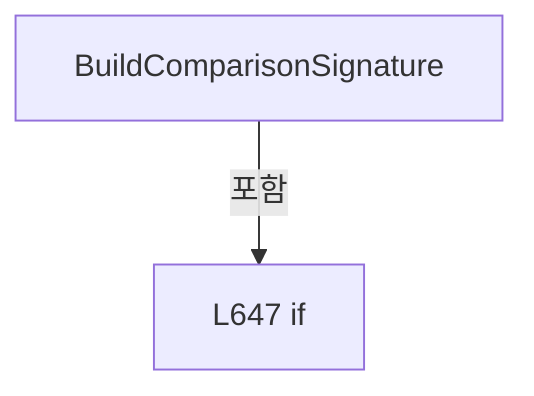

변경 전 점검: 입력/반환 타입, 위 호출자, 예외/취소 경로, 공유 상태와 저장·전송 소비자를 함께 확인합니다. 값의 단위나 물리 방향을 이름만으로 확정하지 않습니다.

### MethodDeclaration `ClassifyStateChanges` · L664–699

[Drilling.UI/Menu/Menus/CAlarmCauseAnalysis.cs:664–699](https://github.com/kjuws10-rgb/A3Drilling/blob/dfa5920e6301d9ec4b0eab1452ae59521aafc986/Drilling.UI/Menu/Menus/CAlarmCauseAnalysis.cs#L664-L699)

| 항목 | 실제 추출 값 |
| --- | --- |
| 서명 | System.Collections.Generic.List<Drilling.UI.Menu.Menus.ST_ALARM_ANALYSIS_LOG_ROW> Drilling.UI.Menu.Menus.CAlarmIncidentLogReader.ClassifyStateChanges(string, System.Collections.Generic.IEnumerable<Drilling.UI.Menu.Menus.ST_ALARM_ANALYSIS_LOG_ROW>) |
| 접근/수식자 | Private / private, static |
| 반환/값 타입 | System.Collections.Generic.List<Drilling.UI.Menu.Menus.ST_ALARM_ANALYSIS_LOG_ROW> |
| 소속 타입 | NamedType:Drilling.UI.Menu.Menus.CAlarmIncidentLogReader |

입력 계약:

| 이름 | 타입 | 전달 | 선택/기본값 |
| --- | --- | --- | --- |
| paneKey | string | None | False /  |
| source | System.Collections.Generic.IEnumerable<Drilling.UI.Menu.Menus.ST_ALARM_ANALYSIS_LOG_ROW> | None | False /  |

정적 호출자로 확인된 위치:

| 호출 파일/행 | 호출 표현식 | 런타임 분기 가능 |
| --- | --- | --- |
| [Drilling.UI/Menu/Menus/CAlarmCauseAnalysis.cs:468–468](https://github.com/kjuws10-rgb/A3Drilling/blob/dfa5920e6301d9ec4b0eab1452ae59521aafc986/Drilling.UI/Menu/Menus/CAlarmCauseAnalysis.cs#L468-L468) | ClassifyStateChanges | False |

호출하는 대상과 해석 범위:

| 원본 행 | 표현식 | 분석 상태 | 대상/소스 위치 |
| --- | --- | --- | --- |
| 668 | new List<ST_ALARM_ANALYSIS_LOG_ROW> | resolved | System.Collections.Generic.List<Drilling.UI.Menu.Menus.ST_ALARM_ANALYSIS_LOG_ROW>.List() |
| 669 | new Dictionary<string, string> | resolved | System.Collections.Generic.Dictionary<string, string>.Dictionary(System.Collections.Generic.IEqualityComparer<string>?) |
| 670 | source.OrderBy | resolved | System.Linq.IOrderedEnumerable<Drilling.UI.Menu.Menus.ST_ALARM_ANALYSIS_LOG_ROW> System.Collections.Generic.IEnumerable<Drilling.UI.Menu.Menus.ST_ALARM_ANALYSIS_LOG_ROW>.OrderBy<Drilling.UI.Menu.Menus.ST_ALARM_ANALYSIS_LOG_ROW, System.DateTimeOffset>(System.Func<Drilling.UI.Menu.Menus.ST_ALARM_ANALYSIS_LOG_ROW, System.DateTimeOffset>) |
| 675 | paneKey.Equals | resolved | bool string.Equals(string?, System.StringComparison) |
| 677 | TryGetNormalMelsecPollingId | resolved | bool Drilling.UI.Menu.Menus.CAlarmIncidentLogReader.TryGetNormalMelsecPollingId(Drilling.UI.Menu.Menus.ST_ALARM_ANALYSIS_LOG_ROW, out string) · Drilling.UI/Menu/Menus/CAlarmCauseAnalysis.cs:763 |
| 679 | IsDiscreteMelsecSignal | resolved | bool Drilling.UI.Menu.Menus.CAlarmIncidentLogReader.IsDiscreteMelsecSignal(string) · Drilling.UI/Menu/Menus/CAlarmCauseAnalysis.cs:701 |
| 681 | ReadDelimitedField | resolved | string? Drilling.UI.Menu.Menus.CAlarmIncidentLogReader.ReadDelimitedField(string, string) · Drilling.UI/Menu/Menus/CAlarmCauseAnalysis.cs:777 |
| 682 | previousMelsecValues.TryGetValue | resolved | bool System.Collections.Generic.Dictionary<string, string>.TryGetValue(string, out string) |
| 683 | string.Equals | resolved | bool string.Equals(string?, string?, System.StringComparison) |
| 688 | ContainsTransitionTerm | resolved | bool Drilling.UI.Menu.Menus.CAlarmIncidentLogReader.ContainsTransitionTerm(string) · Drilling.UI/Menu/Menus/CAlarmCauseAnalysis.cs:706 |
| 689 | row.Message.Contains | resolved | bool string.Contains(string, System.StringComparison) |
| 690 | row.Message.Contains | resolved | bool string.Contains(string, System.StringComparison) |
| 693 | ContainsTransitionTerm | resolved | bool Drilling.UI.Menu.Menus.CAlarmIncidentLogReader.ContainsTransitionTerm(string) · Drilling.UI/Menu/Menus/CAlarmCauseAnalysis.cs:706 |
| 696 | result.Add | resolved | void System.Collections.Generic.List<Drilling.UI.Menu.Menus.ST_ALARM_ANALYSIS_LOG_ROW>.Add(Drilling.UI.Menu.Menus.ST_ALARM_ANALYSIS_LOG_ROW) |

본문의 실제 연산·분기·예외·반환 순서(원문 위치 순):

| 원본 행 | 종류 | 주석 해설 |
| --- | --- | --- |
| 668 | call | 함수·델리게이트 또는 객체 생성자를 호출합니다: new List<ST_ALARM_ANALYSIS_LOG_ROW>() |
| 668 | local-declaration | 지역 변수를 선언합니다: var result = new List<ST_ALARM_ANALYSIS_LOG_ROW>(); |
| 668 | variable-initializer | 변수의 초기값을 지정합니다: result = new List<ST_ALARM_ANALYSIS_LOG_ROW>() |
| 669 | call | 함수·델리게이트 또는 객체 생성자를 호출합니다: new Dictionary<string, string>(StringComparer.OrdinalIgnoreCase) |
| 669 | local-declaration | 지역 변수를 선언합니다: var previousMelsecValues = new Dictionary<string, string>(StringComparer.OrdinalIgnoreCase); |
| 669 | variable-initializer | 변수의 초기값을 지정합니다: previousMelsecValues = new Dictionary<string, string>(StringComparer.OrdinalIgnoreCase) |
| 670 | call | 함수·델리게이트 또는 객체 생성자를 호출합니다: source.OrderBy(item => item.OccurredAt) |
| 670 | foreach | 컬렉션 요소를 순회합니다: foreach (var row in source.OrderBy(item => item.OccurredAt)) |
| 674 | local-declaration | 지역 변수를 선언합니다: var isChange = row.IsImportant &#124;&#124; row.IsBaselineDifference; |
| 674 | variable-initializer | 변수의 초기값을 지정합니다: isChange = row.IsImportant &#124;&#124; row.IsBaselineDifference |
| 675 | call | 함수·델리게이트 또는 객체 생성자를 호출합니다: paneKey.Equals("MELSEC", StringComparison.Ordinal) |
| 675 | if | 조건에 따라 분기합니다: if (paneKey.Equals("MELSEC", StringComparison.Ordinal)) |
| 677 | call | 함수·델리게이트 또는 객체 생성자를 호출합니다: TryGetNormalMelsecPollingId(row, out var id) |
| 677 | if | 조건에 따라 분기합니다: if (TryGetNormalMelsecPollingId(row, out var id)) |
| 679 | call | 함수·델리게이트 또는 객체 생성자를 호출합니다: IsDiscreteMelsecSignal(id) |
| 679 | if | 조건에 따라 분기합니다: if (IsDiscreteMelsecSignal(id)) |
| 681 | call | 함수·델리게이트 또는 객체 생성자를 호출합니다: ReadDelimitedField(row.Message, "값=") |
| 681 | local-declaration | 지역 변수를 선언합니다: var value = ReadDelimitedField(row.Message, "값=") ?? ""; |
| 681 | variable-initializer | 변수의 초기값을 지정합니다: value = ReadDelimitedField(row.Message, "값=") ?? "" |
| 682 | call | 함수·델리게이트 또는 객체 생성자를 호출합니다: previousMelsecValues.TryGetValue(id, out var previous) |
| 682 | if | 조건에 따라 분기합니다: if (previousMelsecValues.TryGetValue(id, out var previous) && !string.Equals(previous, value, StringComparison.OrdinalIgnoreCase)) |
| 683 | call | 함수·델리게이트 또는 객체 생성자를 호출합니다: string.Equals(previous, value, StringComparison.OrdinalIgnoreCase) |
| 684 | assignment | 값을 대상에 대입합니다: isChange = true |
| 685 | assignment | 값을 대상에 대입합니다: previousMelsecValues[id] = value |
| 688 | call | 함수·델리게이트 또는 객체 생성자를 호출합니다: ContainsTransitionTerm(row.Message) |
| 688 | else | 앞 조건이 거짓인 경로입니다: else |
| 688 | if | 조건에 따라 분기합니다: if (ContainsTransitionTerm(row.Message) &#124;&#124; row.Message.Contains("[쓰기]", StringComparison.OrdinalIgnoreCase) &#124;&#124; row.Message.Contains("지연 진단", StringComparison.OrdinalIgnoreCase)) |
| 689 | call | 함수·델리게이트 또는 객체 생성자를 호출합니다: row.Message.Contains("[쓰기]", StringComparison.OrdinalIgnoreCase) |
| 690 | call | 함수·델리게이트 또는 객체 생성자를 호출합니다: row.Message.Contains("지연 진단", StringComparison.OrdinalIgnoreCase) |
| 691 | assignment | 값을 대상에 대입합니다: isChange = true |
| 693 | call | 함수·델리게이트 또는 객체 생성자를 호출합니다: ContainsTransitionTerm(row.Message) |
| 693 | else | 앞 조건이 거짓인 경로입니다: else |
| 693 | if | 조건에 따라 분기합니다: if (ContainsTransitionTerm(row.Message)) |
| 694 | assignment | 값을 대상에 대입합니다: isChange = true |
| 696 | assignment | 값을 대상에 대입합니다: IsStateChange = isChange |
| 696 | call | 함수·델리게이트 또는 객체 생성자를 호출합니다: result.Add(row with { IsStateChange = isChange }) |
| 698 | return | 호출자에게 값 또는 제어를 반환합니다: return result; |

제어 구문의 포함 구조(실제 실행 순서/CFG가 아닌 구문 탐색 그림):

```mermaid
flowchart TD
 M["ClassifyStateChanges"]
 N0["L670 foreach"]
 M -->|포함| N0
 N1["L675 if"]
 N0 -->|포함| N1
 N2["L677 if"]
 N1 -->|포함| N2
 N3["L679 if"]
 N2 -->|포함| N3
 N4["L682 if"]
 N3 -->|포함| N4
 N5["L688 else"]
 N2 -->|포함| N5
 N6["L688 if"]
 N2 -->|포함| N6
 N7["L693 else"]
 N1 -->|포함| N7
 N8["L693 if"]
 N1 -->|포함| N8
```

변경 전 점검: 입력/반환 타입, 위 호출자, 예외/취소 경로, 공유 상태와 저장·전송 소비자를 함께 확인합니다. 값의 단위나 물리 방향을 이름만으로 확정하지 않습니다.

### MethodDeclaration `IsDiscreteMelsecSignal` · L701–704

[Drilling.UI/Menu/Menus/CAlarmCauseAnalysis.cs:701–704](https://github.com/kjuws10-rgb/A3Drilling/blob/dfa5920e6301d9ec4b0eab1452ae59521aafc986/Drilling.UI/Menu/Menus/CAlarmCauseAnalysis.cs#L701-L704)

| 항목 | 실제 추출 값 |
| --- | --- |
| 서명 | bool Drilling.UI.Menu.Menus.CAlarmIncidentLogReader.IsDiscreteMelsecSignal(string) |
| 접근/수식자 | Private / private, static |
| 반환/값 타입 | bool |
| 소속 타입 | NamedType:Drilling.UI.Menu.Menus.CAlarmIncidentLogReader |

입력 계약:

| 이름 | 타입 | 전달 | 선택/기본값 |
| --- | --- | --- | --- |
| id | string | None | False /  |

정적 호출자로 확인된 위치:

| 호출 파일/행 | 호출 표현식 | 런타임 분기 가능 |
| --- | --- | --- |
| [Drilling.UI/Menu/Menus/CAlarmCauseAnalysis.cs:651–651](https://github.com/kjuws10-rgb/A3Drilling/blob/dfa5920e6301d9ec4b0eab1452ae59521aafc986/Drilling.UI/Menu/Menus/CAlarmCauseAnalysis.cs#L651-L651) | IsDiscreteMelsecSignal | False |
| [Drilling.UI/Menu/Menus/CAlarmCauseAnalysis.cs:679–679](https://github.com/kjuws10-rgb/A3Drilling/blob/dfa5920e6301d9ec4b0eab1452ae59521aafc986/Drilling.UI/Menu/Menus/CAlarmCauseAnalysis.cs#L679-L679) | IsDiscreteMelsecSignal | False |

호출하는 대상과 해석 범위:

| 원본 행 | 표현식 | 분석 상태 | 대상/소스 위치 |
| --- | --- | --- | --- |
| 703 | DiscreteMelsecIdTerms.Any | resolved | bool System.Collections.Generic.IEnumerable<string>.Any<string>(System.Func<string, bool>) |
| 703 | id.Contains | resolved | bool string.Contains(string, System.StringComparison) |

본문의 실제 연산·분기·예외·반환 순서(원문 위치 순):

| 원본 행 | 종류 | 주석 해설 |
| --- | --- | --- |
| 703 | call | 함수·델리게이트 또는 객체 생성자를 호출합니다: DiscreteMelsecIdTerms.Any(term => id.Contains(term, StringComparison.OrdinalIgnoreCase)) |
| 703 | call | 함수·델리게이트 또는 객체 생성자를 호출합니다: id.Contains(term, StringComparison.OrdinalIgnoreCase) |
| 703 | return | 호출자에게 값 또는 제어를 반환합니다: return DiscreteMelsecIdTerms.Any(term => id.Contains(term, StringComparison.OrdinalIgnoreCase)); |

변경 전 점검: 입력/반환 타입, 위 호출자, 예외/취소 경로, 공유 상태와 저장·전송 소비자를 함께 확인합니다. 값의 단위나 물리 방향을 이름만으로 확정하지 않습니다.

### MethodDeclaration `ContainsTransitionTerm` · L706–709

[Drilling.UI/Menu/Menus/CAlarmCauseAnalysis.cs:706–709](https://github.com/kjuws10-rgb/A3Drilling/blob/dfa5920e6301d9ec4b0eab1452ae59521aafc986/Drilling.UI/Menu/Menus/CAlarmCauseAnalysis.cs#L706-L709)

| 항목 | 실제 추출 값 |
| --- | --- |
| 서명 | bool Drilling.UI.Menu.Menus.CAlarmIncidentLogReader.ContainsTransitionTerm(string) |
| 접근/수식자 | Private / private, static |
| 반환/값 타입 | bool |
| 소속 타입 | NamedType:Drilling.UI.Menu.Menus.CAlarmIncidentLogReader |

입력 계약:

| 이름 | 타입 | 전달 | 선택/기본값 |
| --- | --- | --- | --- |
| message | string | None | False /  |

정적 호출자로 확인된 위치:

| 호출 파일/행 | 호출 표현식 | 런타임 분기 가능 |
| --- | --- | --- |
| [Drilling.UI/Menu/Menus/CAlarmCauseAnalysis.cs:688–688](https://github.com/kjuws10-rgb/A3Drilling/blob/dfa5920e6301d9ec4b0eab1452ae59521aafc986/Drilling.UI/Menu/Menus/CAlarmCauseAnalysis.cs#L688-L688) | ContainsTransitionTerm | False |
| [Drilling.UI/Menu/Menus/CAlarmCauseAnalysis.cs:693–693](https://github.com/kjuws10-rgb/A3Drilling/blob/dfa5920e6301d9ec4b0eab1452ae59521aafc986/Drilling.UI/Menu/Menus/CAlarmCauseAnalysis.cs#L693-L693) | ContainsTransitionTerm | False |

호출하는 대상과 해석 범위:

| 원본 행 | 표현식 | 분석 상태 | 대상/소스 위치 |
| --- | --- | --- | --- |
| 708 | TransitionTerms.Any | resolved | bool System.Collections.Generic.IEnumerable<string>.Any<string>(System.Func<string, bool>) |
| 708 | message.Contains | resolved | bool string.Contains(string, System.StringComparison) |

본문의 실제 연산·분기·예외·반환 순서(원문 위치 순):

| 원본 행 | 종류 | 주석 해설 |
| --- | --- | --- |
| 708 | call | 함수·델리게이트 또는 객체 생성자를 호출합니다: TransitionTerms.Any(term => message.Contains(term, StringComparison.OrdinalIgnoreCase)) |
| 708 | call | 함수·델리게이트 또는 객체 생성자를 호출합니다: message.Contains(term, StringComparison.OrdinalIgnoreCase) |
| 708 | return | 호출자에게 값 또는 제어를 반환합니다: return TransitionTerms.Any(term => message.Contains(term, StringComparison.OrdinalIgnoreCase)); |

변경 전 점검: 입력/반환 타입, 위 호출자, 예외/취소 경로, 공유 상태와 저장·전송 소비자를 함께 확인합니다. 값의 단위나 물리 방향을 이름만으로 확정하지 않습니다.

### MethodDeclaration `CondenseMelsecPollingRows` · L711–761

[Drilling.UI/Menu/Menus/CAlarmCauseAnalysis.cs:711–761](https://github.com/kjuws10-rgb/A3Drilling/blob/dfa5920e6301d9ec4b0eab1452ae59521aafc986/Drilling.UI/Menu/Menus/CAlarmCauseAnalysis.cs#L711-L761)

| 항목 | 실제 추출 값 |
| --- | --- |
| 서명 | System.Collections.Generic.IReadOnlyList<Drilling.UI.Menu.Menus.ST_ALARM_ANALYSIS_LOG_ROW> Drilling.UI.Menu.Menus.CAlarmIncidentLogReader.CondenseMelsecPollingRows(System.Collections.Generic.IEnumerable<Drilling.UI.Menu.Menus.ST_ALARM_ANALYSIS_LOG_ROW>) |
| 접근/수식자 | Private / private, static |
| 반환/값 타입 | System.Collections.Generic.IReadOnlyList<Drilling.UI.Menu.Menus.ST_ALARM_ANALYSIS_LOG_ROW> |
| 소속 타입 | NamedType:Drilling.UI.Menu.Menus.CAlarmIncidentLogReader |

입력 계약:

| 이름 | 타입 | 전달 | 선택/기본값 |
| --- | --- | --- | --- |
| source | System.Collections.Generic.IEnumerable<Drilling.UI.Menu.Menus.ST_ALARM_ANALYSIS_LOG_ROW> | None | False /  |

정적 호출자로 확인된 위치:

| 호출 파일/행 | 호출 표현식 | 런타임 분기 가능 |
| --- | --- | --- |
| [Drilling.UI/Menu/Menus/CAlarmCauseAnalysis.cs:496–496](https://github.com/kjuws10-rgb/A3Drilling/blob/dfa5920e6301d9ec4b0eab1452ae59521aafc986/Drilling.UI/Menu/Menus/CAlarmCauseAnalysis.cs#L496-L496) | CondenseMelsecPollingRows | False |

호출하는 대상과 해석 범위:

| 원본 행 | 표현식 | 분석 상태 | 대상/소스 위치 |
| --- | --- | --- | --- |
| 714 | new List<ST_ALARM_ANALYSIS_LOG_ROW> | resolved | System.Collections.Generic.List<Drilling.UI.Menu.Menus.ST_ALARM_ANALYSIS_LOG_ROW>.List() |
| 715 | new Dictionary<MelsecPollingBucket, List<ST_ALARM_ANALYSIS_LOG_ROW>> | resolved | System.Collections.Generic.Dictionary<Drilling.UI.Menu.Menus.CAlarmIncidentLogReader.MelsecPollingBucket, System.Collections.Generic.List<Drilling.UI.Menu.Menus.ST_ALARM_ANALYSIS_LOG_ROW>>.Dictionary() |
| 718 | TryGetNormalMelsecPollingId | resolved | bool Drilling.UI.Menu.Menus.CAlarmIncidentLogReader.TryGetNormalMelsecPollingId(Drilling.UI.Menu.Menus.ST_ALARM_ANALYSIS_LOG_ROW, out string) · Drilling.UI/Menu/Menus/CAlarmCauseAnalysis.cs:763 |
| 720 | passthrough.Add | resolved | void System.Collections.Generic.List<Drilling.UI.Menu.Menus.ST_ALARM_ANALYSIS_LOG_ROW>.Add(Drilling.UI.Menu.Menus.ST_ALARM_ANALYSIS_LOG_ROW) |
| 725 | new MelsecPollingBucket | resolved | Drilling.UI.Menu.Menus.CAlarmIncidentLogReader.MelsecPollingBucket.MelsecPollingBucket(string, long) · Drilling.UI/Menu/Menus/CAlarmCauseAnalysis.cs:949 |
| 726 | buckets.TryGetValue | resolved | bool System.Collections.Generic.Dictionary<Drilling.UI.Menu.Menus.CAlarmIncidentLogReader.MelsecPollingBucket, System.Collections.Generic.List<Drilling.UI.Menu.Menus.ST_ALARM_ANALYSIS_LOG_ROW>>.TryGetValue(Drilling.UI.Menu.Menus.CAlarmIncidentLogReader.MelsecPollingBucket, out System.Collections.Generic.List<Drilling.UI.Menu.Menus.ST_ALARM_ANALYSIS_LOG_ROW>) |
| 729 | buckets.Add | resolved | void System.Collections.Generic.Dictionary<Drilling.UI.Menu.Menus.CAlarmIncidentLogReader.MelsecPollingBucket, System.Collections.Generic.List<Drilling.UI.Menu.Menus.ST_ALARM_ANALYSIS_LOG_ROW>>.Add(Drilling.UI.Menu.Menus.CAlarmIncidentLogReader.MelsecPollingBucket, System.Collections.Generic.List<Drilling.UI.Menu.Menus.ST_ALARM_ANALYSIS_LOG_ROW>) |
| 731 | rows.Add | resolved | void System.Collections.Generic.List<Drilling.UI.Menu.Menus.ST_ALARM_ANALYSIS_LOG_ROW>.Add(Drilling.UI.Menu.Menus.ST_ALARM_ANALYSIS_LOG_ROW) |
| 736 | bucket.Sort | resolved | void System.Collections.Generic.List<Drilling.UI.Menu.Menus.ST_ALARM_ANALYSIS_LOG_ROW>.Sort(System.Comparison<Drilling.UI.Menu.Menus.ST_ALARM_ANALYSIS_LOG_ROW>) |
| 736 | left.OccurredAt.CompareTo | resolved | int System.DateTimeOffset.CompareTo(System.DateTimeOffset) |
| 739 | passthrough.Add | resolved | void System.Collections.Generic.List<Drilling.UI.Menu.Menus.ST_ALARM_ANALYSIS_LOG_ROW>.Add(Drilling.UI.Menu.Menus.ST_ALARM_ANALYSIS_LOG_ROW) |
| 745 | ReadDelimitedField | resolved | string? Drilling.UI.Menu.Menus.CAlarmIncidentLogReader.ReadDelimitedField(string, string) · Drilling.UI/Menu/Menus/CAlarmCauseAnalysis.cs:777 |
| 746 | ReadDelimitedField | resolved | string? Drilling.UI.Menu.Menus.CAlarmIncidentLogReader.ReadDelimitedField(string, string) · Drilling.UI/Menu/Menus/CAlarmCauseAnalysis.cs:777 |
| 747 | ReadDelimitedField | resolved | string? Drilling.UI.Menu.Menus.CAlarmIncidentLogReader.ReadDelimitedField(string, string) · Drilling.UI/Menu/Menus/CAlarmCauseAnalysis.cs:777 |
| 749 | passthrough.Add | resolved | void System.Collections.Generic.List<Drilling.UI.Menu.Menus.ST_ALARM_ANALYSIS_LOG_ROW>.Add(Drilling.UI.Menu.Menus.ST_ALARM_ANALYSIS_LOG_ROW) |
| 749 | new | resolved | Drilling.UI.Menu.Menus.ST_ALARM_ANALYSIS_LOG_ROW.ST_ALARM_ANALYSIS_LOG_ROW(System.DateTimeOffset, string, string, string, bool, bool, bool, bool) · Drilling.UI/Menu/Menus/CAlarmCauseAnalysis.cs:325 |
| 755 | bucket.Any | resolved | bool System.Collections.Generic.IEnumerable<Drilling.UI.Menu.Menus.ST_ALARM_ANALYSIS_LOG_ROW>.Any<Drilling.UI.Menu.Menus.ST_ALARM_ANALYSIS_LOG_ROW>(System.Func<Drilling.UI.Menu.Menus.ST_ALARM_ANALYSIS_LOG_ROW, bool>) |
| 756 | bucket.Any | resolved | bool System.Collections.Generic.IEnumerable<Drilling.UI.Menu.Menus.ST_ALARM_ANALYSIS_LOG_ROW>.Any<Drilling.UI.Menu.Menus.ST_ALARM_ANALYSIS_LOG_ROW>(System.Func<Drilling.UI.Menu.Menus.ST_ALARM_ANALYSIS_LOG_ROW, bool>) |
| 757 | bucket.Any | resolved | bool System.Collections.Generic.IEnumerable<Drilling.UI.Menu.Menus.ST_ALARM_ANALYSIS_LOG_ROW>.Any<Drilling.UI.Menu.Menus.ST_ALARM_ANALYSIS_LOG_ROW>(System.Func<Drilling.UI.Menu.Menus.ST_ALARM_ANALYSIS_LOG_ROW, bool>) |

본문의 실제 연산·분기·예외·반환 순서(원문 위치 순):

| 원본 행 | 종류 | 주석 해설 |
| --- | --- | --- |
| 714 | call | 함수·델리게이트 또는 객체 생성자를 호출합니다: new List<ST_ALARM_ANALYSIS_LOG_ROW>() |
| 714 | local-declaration | 지역 변수를 선언합니다: var passthrough = new List<ST_ALARM_ANALYSIS_LOG_ROW>(); |
| 714 | variable-initializer | 변수의 초기값을 지정합니다: passthrough = new List<ST_ALARM_ANALYSIS_LOG_ROW>() |
| 715 | call | 함수·델리게이트 또는 객체 생성자를 호출합니다: new Dictionary<MelsecPollingBucket, List<ST_ALARM_ANALYSIS_LOG_ROW>>() |
| 715 | local-declaration | 지역 변수를 선언합니다: var buckets = new Dictionary<MelsecPollingBucket, List<ST_ALARM_ANALYSIS_LOG_ROW>>(); |
| 715 | variable-initializer | 변수의 초기값을 지정합니다: buckets = new Dictionary<MelsecPollingBucket, List<ST_ALARM_ANALYSIS_LOG_ROW>>() |
| 716 | foreach | 컬렉션 요소를 순회합니다: foreach (var row in source) |
| 718 | call | 함수·델리게이트 또는 객체 생성자를 호출합니다: TryGetNormalMelsecPollingId(row, out var id) |
| 718 | if | 조건에 따라 분기합니다: if (!TryGetNormalMelsecPollingId(row, out var id)) |
| 720 | call | 함수·델리게이트 또는 객체 생성자를 호출합니다: passthrough.Add(row) |
| 721 | continue | 다음 반복으로 진행합니다: continue; |
| 724 | local-declaration | 지역 변수를 선언합니다: var second = row.OccurredAt.UtcDateTime.Ticks / TimeSpan.TicksPerSecond; |
| 724 | variable-initializer | 변수의 초기값을 지정합니다: second = row.OccurredAt.UtcDateTime.Ticks / TimeSpan.TicksPerSecond |
| 725 | call | 함수·델리게이트 또는 객체 생성자를 호출합니다: new MelsecPollingBucket(id, second) |
| 725 | local-declaration | 지역 변수를 선언합니다: var key = new MelsecPollingBucket(id, second); |
| 725 | variable-initializer | 변수의 초기값을 지정합니다: key = new MelsecPollingBucket(id, second) |
| 726 | call | 함수·델리게이트 또는 객체 생성자를 호출합니다: buckets.TryGetValue(key, out var rows) |
| 726 | if | 조건에 따라 분기합니다: if (!buckets.TryGetValue(key, out var rows)) |
| 728 | assignment | 값을 대상에 대입합니다: rows = [] |
| 729 | call | 함수·델리게이트 또는 객체 생성자를 호출합니다: buckets.Add(key, rows) |
| 731 | call | 함수·델리게이트 또는 객체 생성자를 호출합니다: rows.Add(row) |
| 734 | foreach | 컬렉션 요소를 순회합니다: foreach (var bucket in buckets.Values) |
| 736 | call | 함수·델리게이트 또는 객체 생성자를 호출합니다: bucket.Sort((left, right) => left.OccurredAt.CompareTo(right.OccurredAt)) |
| 736 | call | 함수·델리게이트 또는 객체 생성자를 호출합니다: left.OccurredAt.CompareTo(right.OccurredAt) |
| 737 | if | 조건에 따라 분기합니다: if (bucket.Count == 1) |
| 739 | call | 함수·델리게이트 또는 객체 생성자를 호출합니다: passthrough.Add(bucket[0]) |
| 740 | continue | 다음 반복으로 진행합니다: continue; |
| 743 | local-declaration | 지역 변수를 선언합니다: var first = bucket[0]; |
| 743 | variable-initializer | 변수의 초기값을 지정합니다: first = bucket[0] |
| 744 | local-declaration | 지역 변수를 선언합니다: var last = bucket[^1]; |
| 744 | variable-initializer | 변수의 초기값을 지정합니다: last = bucket[^1] |
| 745 | call | 함수·델리게이트 또는 객체 생성자를 호출합니다: ReadDelimitedField(last.Message, "ID=") |
| 745 | local-declaration | 지역 변수를 선언합니다: var id = ReadDelimitedField(last.Message, "ID=") ?? "UNKNOWN"; |
| 745 | variable-initializer | 변수의 초기값을 지정합니다: id = ReadDelimitedField(last.Message, "ID=") ?? "UNKNOWN" |
| 746 | call | 함수·델리게이트 또는 객체 생성자를 호출합니다: ReadDelimitedField(first.Message, "값=") |
| 746 | local-declaration | 지역 변수를 선언합니다: var firstValue = ReadDelimitedField(first.Message, "값=") ?? "-"; |
| 746 | variable-initializer | 변수의 초기값을 지정합니다: firstValue = ReadDelimitedField(first.Message, "값=") ?? "-" |
| 747 | call | 함수·델리게이트 또는 객체 생성자를 호출합니다: ReadDelimitedField(last.Message, "값=") |
| 747 | local-declaration | 지역 변수를 선언합니다: var lastValue = ReadDelimitedField(last.Message, "값=") ?? "-"; |
| 747 | variable-initializer | 변수의 초기값을 지정합니다: lastValue = ReadDelimitedField(last.Message, "값=") ?? "-" |
| 748 | local-declaration | 지역 변수를 선언합니다: var message = $"[정상 폴링 {bucket.Count:N0}건 묶음] ID={id} &#124; {first.Time} ~ {last.Time} &#124; 값={firstValue} → {lastValue}"; |
| 748 | variable-initializer | 변수의 초기값을 지정합니다: message = $"[정상 폴링 {bucket.Count:N0}건 묶음] ID={id} &#124; {first.Time} ~ {last.Time} &#124; 값={firstValue} → {lastValue}" |
| 749 | call | 함수·델리게이트 또는 객체 생성자를 호출합니다: passthrough.Add(new( last.OccurredAt, last.Time, last.Source, message, false, bucket.Any(row => row.IsAlarmMoment), bucket.Any(row => row.IsStateChange), bucket.Any(row => row.IsBaselineDifference))) |
| 749 | call | 함수·델리게이트 또는 객체 생성자를 호출합니다: new( last.OccurredAt, last.Time, last.Source, message, false, bucket.Any(row => row.IsAlarmMoment), bucket.Any(row => row.IsStateChange), bucket.Any(row => row.IsBaselineDifference)) |
| 755 | call | 함수·델리게이트 또는 객체 생성자를 호출합니다: bucket.Any(row => row.IsAlarmMoment) |
| 756 | call | 함수·델리게이트 또는 객체 생성자를 호출합니다: bucket.Any(row => row.IsStateChange) |
| 757 | call | 함수·델리게이트 또는 객체 생성자를 호출합니다: bucket.Any(row => row.IsBaselineDifference) |
| 760 | return | 호출자에게 값 또는 제어를 반환합니다: return passthrough; |

제어 구문의 포함 구조(실제 실행 순서/CFG가 아닌 구문 탐색 그림):

```mermaid
flowchart TD
 M["CondenseMelsecPollingRows"]
 N0["L716 foreach"]
 M -->|포함| N0
 N1["L718 if"]
 N0 -->|포함| N1
 N2["L726 if"]
 N0 -->|포함| N2
 N3["L734 foreach"]
 M -->|포함| N3
 N4["L737 if"]
 N3 -->|포함| N4
```

변경 전 점검: 입력/반환 타입, 위 호출자, 예외/취소 경로, 공유 상태와 저장·전송 소비자를 함께 확인합니다. 값의 단위나 물리 방향을 이름만으로 확정하지 않습니다.

### MethodDeclaration `TryGetNormalMelsecPollingId` · L763–775

[Drilling.UI/Menu/Menus/CAlarmCauseAnalysis.cs:763–775](https://github.com/kjuws10-rgb/A3Drilling/blob/dfa5920e6301d9ec4b0eab1452ae59521aafc986/Drilling.UI/Menu/Menus/CAlarmCauseAnalysis.cs#L763-L775)

| 항목 | 실제 추출 값 |
| --- | --- |
| 서명 | bool Drilling.UI.Menu.Menus.CAlarmIncidentLogReader.TryGetNormalMelsecPollingId(Drilling.UI.Menu.Menus.ST_ALARM_ANALYSIS_LOG_ROW, out string) |
| 접근/수식자 | Private / private, static |
| 반환/값 타입 | bool |
| 소속 타입 | NamedType:Drilling.UI.Menu.Menus.CAlarmIncidentLogReader |

입력 계약:

| 이름 | 타입 | 전달 | 선택/기본값 |
| --- | --- | --- | --- |
| row | Drilling.UI.Menu.Menus.ST_ALARM_ANALYSIS_LOG_ROW | None | False /  |
| id | string | Out | False /  |

정적 호출자로 확인된 위치:

| 호출 파일/행 | 호출 표현식 | 런타임 분기 가능 |
| --- | --- | --- |
| [Drilling.UI/Menu/Menus/CAlarmCauseAnalysis.cs:648–648](https://github.com/kjuws10-rgb/A3Drilling/blob/dfa5920e6301d9ec4b0eab1452ae59521aafc986/Drilling.UI/Menu/Menus/CAlarmCauseAnalysis.cs#L648-L648) | TryGetNormalMelsecPollingId | False |
| [Drilling.UI/Menu/Menus/CAlarmCauseAnalysis.cs:677–677](https://github.com/kjuws10-rgb/A3Drilling/blob/dfa5920e6301d9ec4b0eab1452ae59521aafc986/Drilling.UI/Menu/Menus/CAlarmCauseAnalysis.cs#L677-L677) | TryGetNormalMelsecPollingId | False |
| [Drilling.UI/Menu/Menus/CAlarmCauseAnalysis.cs:718–718](https://github.com/kjuws10-rgb/A3Drilling/blob/dfa5920e6301d9ec4b0eab1452ae59521aafc986/Drilling.UI/Menu/Menus/CAlarmCauseAnalysis.cs#L718-L718) | TryGetNormalMelsecPollingId | False |

호출하는 대상과 해석 범위:

| 원본 행 | 표현식 | 분석 상태 | 대상/소스 위치 |
| --- | --- | --- | --- |
| 767 | row.Source.Equals | resolved | bool string.Equals(string?, System.StringComparison) |
| 768 | row.Message.Contains | resolved | bool string.Contains(string, System.StringComparison) |
| 769 | row.Message.Contains | resolved | bool string.Contains(string, System.StringComparison) |
| 770 | row.Message.Contains | resolved | bool string.Contains(string, System.StringComparison) |
| 773 | ReadDelimitedField | resolved | string? Drilling.UI.Menu.Menus.CAlarmIncidentLogReader.ReadDelimitedField(string, string) · Drilling.UI/Menu/Menus/CAlarmCauseAnalysis.cs:777 |

본문의 실제 연산·분기·예외·반환 순서(원문 위치 순):

| 원본 행 | 종류 | 주석 해설 |
| --- | --- | --- |
| 765 | assignment | 값을 대상에 대입합니다: id = "" |
| 766 | if | 조건에 따라 분기합니다: if (row.IsImportant &#124;&#124; !row.Source.Equals("MELSEC", StringComparison.OrdinalIgnoreCase) &#124;&#124; !row.Message.Contains("값 수신 완료", StringComparison.OrdinalIgnoreCase) &#124;&#124; !row.Message.Contains("품질=정상(VALID)", StringComparison.Ordina…) |
| 767 | call | 함수·델리게이트 또는 객체 생성자를 호출합니다: row.Source.Equals("MELSEC", StringComparison.OrdinalIgnoreCase) |
| 768 | call | 함수·델리게이트 또는 객체 생성자를 호출합니다: row.Message.Contains("값 수신 완료", StringComparison.OrdinalIgnoreCase) |
| 769 | call | 함수·델리게이트 또는 객체 생성자를 호출합니다: row.Message.Contains("품질=정상(VALID)", StringComparison.OrdinalIgnoreCase) |
| 770 | call | 함수·델리게이트 또는 객체 생성자를 호출합니다: row.Message.Contains("경로=중앙 폴링(POLL)", StringComparison.OrdinalIgnoreCase) |
| 771 | return | 호출자에게 값 또는 제어를 반환합니다: return false; |
| 773 | assignment | 값을 대상에 대입합니다: id = ReadDelimitedField(row.Message, "ID=") ?? "" |
| 773 | call | 함수·델리게이트 또는 객체 생성자를 호출합니다: ReadDelimitedField(row.Message, "ID=") |
| 774 | return | 호출자에게 값 또는 제어를 반환합니다: return id.Length > 0; |

제어 구문의 포함 구조(실제 실행 순서/CFG가 아닌 구문 탐색 그림):

```mermaid
flowchart TD
 M["TryGetNormalMelsecPollingId"]
 N0["L766 if"]
 M -->|포함| N0
```

변경 전 점검: 입력/반환 타입, 위 호출자, 예외/취소 경로, 공유 상태와 저장·전송 소비자를 함께 확인합니다. 값의 단위나 물리 방향을 이름만으로 확정하지 않습니다.

### MethodDeclaration `ReadDelimitedField` · L777–788

[Drilling.UI/Menu/Menus/CAlarmCauseAnalysis.cs:777–788](https://github.com/kjuws10-rgb/A3Drilling/blob/dfa5920e6301d9ec4b0eab1452ae59521aafc986/Drilling.UI/Menu/Menus/CAlarmCauseAnalysis.cs#L777-L788)

| 항목 | 실제 추출 값 |
| --- | --- |
| 서명 | string? Drilling.UI.Menu.Menus.CAlarmIncidentLogReader.ReadDelimitedField(string, string) |
| 접근/수식자 | Private / private, static |
| 반환/값 타입 | string? |
| 소속 타입 | NamedType:Drilling.UI.Menu.Menus.CAlarmIncidentLogReader |

입력 계약:

| 이름 | 타입 | 전달 | 선택/기본값 |
| --- | --- | --- | --- |
| message | string | None | False /  |
| marker | string | None | False /  |

정적 호출자로 확인된 위치:

| 호출 파일/행 | 호출 표현식 | 런타임 분기 가능 |
| --- | --- | --- |
| [Drilling.UI/Menu/Menus/CAlarmCauseAnalysis.cs:652–652](https://github.com/kjuws10-rgb/A3Drilling/blob/dfa5920e6301d9ec4b0eab1452ae59521aafc986/Drilling.UI/Menu/Menus/CAlarmCauseAnalysis.cs#L652-L652) | ReadDelimitedField | False |
| [Drilling.UI/Menu/Menus/CAlarmCauseAnalysis.cs:681–681](https://github.com/kjuws10-rgb/A3Drilling/blob/dfa5920e6301d9ec4b0eab1452ae59521aafc986/Drilling.UI/Menu/Menus/CAlarmCauseAnalysis.cs#L681-L681) | ReadDelimitedField | False |
| [Drilling.UI/Menu/Menus/CAlarmCauseAnalysis.cs:745–745](https://github.com/kjuws10-rgb/A3Drilling/blob/dfa5920e6301d9ec4b0eab1452ae59521aafc986/Drilling.UI/Menu/Menus/CAlarmCauseAnalysis.cs#L745-L745) | ReadDelimitedField | False |
| [Drilling.UI/Menu/Menus/CAlarmCauseAnalysis.cs:746–746](https://github.com/kjuws10-rgb/A3Drilling/blob/dfa5920e6301d9ec4b0eab1452ae59521aafc986/Drilling.UI/Menu/Menus/CAlarmCauseAnalysis.cs#L746-L746) | ReadDelimitedField | False |
| [Drilling.UI/Menu/Menus/CAlarmCauseAnalysis.cs:747–747](https://github.com/kjuws10-rgb/A3Drilling/blob/dfa5920e6301d9ec4b0eab1452ae59521aafc986/Drilling.UI/Menu/Menus/CAlarmCauseAnalysis.cs#L747-L747) | ReadDelimitedField | False |
| [Drilling.UI/Menu/Menus/CAlarmCauseAnalysis.cs:773–773](https://github.com/kjuws10-rgb/A3Drilling/blob/dfa5920e6301d9ec4b0eab1452ae59521aafc986/Drilling.UI/Menu/Menus/CAlarmCauseAnalysis.cs#L773-L773) | ReadDelimitedField | False |

호출하는 대상과 해석 범위:

| 원본 행 | 표현식 | 분석 상태 | 대상/소스 위치 |
| --- | --- | --- | --- |
| 779 | message.IndexOf | resolved | int string.IndexOf(string, System.StringComparison) |
| 783 | message.IndexOf | resolved | int string.IndexOf(string, int, System.StringComparison) |
| 786 | message[start..end].Trim | resolved | string string.Trim() |

본문의 실제 연산·분기·예외·반환 순서(원문 위치 순):

| 원본 행 | 종류 | 주석 해설 |
| --- | --- | --- |
| 779 | call | 함수·델리게이트 또는 객체 생성자를 호출합니다: message.IndexOf(marker, StringComparison.OrdinalIgnoreCase) |
| 779 | local-declaration | 지역 변수를 선언합니다: var start = message.IndexOf(marker, StringComparison.OrdinalIgnoreCase); |
| 779 | variable-initializer | 변수의 초기값을 지정합니다: start = message.IndexOf(marker, StringComparison.OrdinalIgnoreCase) |
| 780 | if | 조건에 따라 분기합니다: if (start < 0) |
| 781 | return | 호출자에게 값 또는 제어를 반환합니다: return null; |
| 782 | compound-assignment-or-event-subscription | 복합 대입 또는 이벤트 구독/해지 표현입니다: start += marker.Length |
| 783 | call | 함수·델리게이트 또는 객체 생성자를 호출합니다: message.IndexOf(" &#124;", start, StringComparison.Ordinal) |
| 783 | local-declaration | 지역 변수를 선언합니다: var end = message.IndexOf(" &#124;", start, StringComparison.Ordinal); |
| 783 | variable-initializer | 변수의 초기값을 지정합니다: end = message.IndexOf(" &#124;", start, StringComparison.Ordinal) |
| 784 | if | 조건에 따라 분기합니다: if (end < 0) |
| 785 | assignment | 값을 대상에 대입합니다: end = message.Length |
| 786 | call | 함수·델리게이트 또는 객체 생성자를 호출합니다: message[start..end].Trim() |
| 786 | local-declaration | 지역 변수를 선언합니다: var value = message[start..end].Trim(); |
| 786 | variable-initializer | 변수의 초기값을 지정합니다: value = message[start..end].Trim() |
| 787 | conditional-expression | 조건에 따라 결과식을 선택합니다: value.Length == 0 ? null : value |
| 787 | return | 호출자에게 값 또는 제어를 반환합니다: return value.Length == 0 ? null : value; |

제어 구문의 포함 구조(실제 실행 순서/CFG가 아닌 구문 탐색 그림):

```mermaid
flowchart TD
 M["ReadDelimitedField"]
 N0["L780 if"]
 M -->|포함| N0
 N1["L784 if"]
 M -->|포함| N1
```

변경 전 점검: 입력/반환 타입, 위 호출자, 예외/취소 경로, 공유 상태와 저장·전송 소비자를 함께 확인합니다. 값의 단위나 물리 방향을 이름만으로 확정하지 않습니다.

### MethodDeclaration `EnumerateFiles` · L790–810

[Drilling.UI/Menu/Menus/CAlarmCauseAnalysis.cs:790–810](https://github.com/kjuws10-rgb/A3Drilling/blob/dfa5920e6301d9ec4b0eab1452ae59521aafc986/Drilling.UI/Menu/Menus/CAlarmCauseAnalysis.cs#L790-L810)

| 항목 | 실제 추출 값 |
| --- | --- |
| 서명 | System.Collections.Generic.IEnumerable<Drilling.UI.Menu.Menus.CAlarmIncidentLogReader.LogFile> Drilling.UI.Menu.Menus.CAlarmIncidentLogReader.EnumerateFiles(System.DateTime, System.DateTime) |
| 접근/수식자 | Private / private |
| 반환/값 타입 | System.Collections.Generic.IEnumerable<Drilling.UI.Menu.Menus.CAlarmIncidentLogReader.LogFile> |
| 소속 타입 | NamedType:Drilling.UI.Menu.Menus.CAlarmIncidentLogReader |

입력 계약:

| 이름 | 타입 | 전달 | 선택/기본값 |
| --- | --- | --- | --- |
| from | System.DateTime | None | False /  |
| through | System.DateTime | None | False /  |

정적 호출자로 확인된 위치:

| 호출 파일/행 | 호출 표현식 | 런타임 분기 가능 |
| --- | --- | --- |
| [Drilling.UI/Menu/Menus/CAlarmCauseAnalysis.cs:529–529](https://github.com/kjuws10-rgb/A3Drilling/blob/dfa5920e6301d9ec4b0eab1452ae59521aafc986/Drilling.UI/Menu/Menus/CAlarmCauseAnalysis.cs#L529-L529) | EnumerateFiles | False |

호출하는 대상과 해석 범위:

| 원본 행 | 표현식 | 분석 상태 | 대상/소스 위치 |
| --- | --- | --- | --- |
| 792 | new HashSet<string> | resolved | System.Collections.Generic.HashSet<string>.HashSet(System.Collections.Generic.IEqualityComparer<string>?) |
| 793 | date.AddDays | resolved | System.DateTime System.DateTime.AddDays(double) |
| 795 | date.ToString | resolved | string System.DateTime.ToString(string?, System.IFormatProvider?) |
| 796 | EnumerateDayDirectory | resolved | System.Collections.Generic.IEnumerable<Drilling.UI.Menu.Menus.CAlarmIncidentLogReader.LogFile> Drilling.UI.Menu.Menus.CAlarmIncidentLogReader.EnumerateDayDirectory(string, string, string, string, System.DateTime) · Drilling.UI/Menu/Menus/CAlarmCauseAnalysis.cs:812 |
| 797 | paths.Add | resolved | bool System.Collections.Generic.HashSet<string>.Add(string) |
| 798 | EnumerateDayDirectory | resolved | System.Collections.Generic.IEnumerable<Drilling.UI.Menu.Menus.CAlarmIncidentLogReader.LogFile> Drilling.UI.Menu.Menus.CAlarmIncidentLogReader.EnumerateDayDirectory(string, string, string, string, System.DateTime) · Drilling.UI/Menu/Menus/CAlarmCauseAnalysis.cs:812 |
| 799 | paths.Add | resolved | bool System.Collections.Generic.HashSet<string>.Add(string) |
| 801 | EnumerateDayDirectory | resolved | System.Collections.Generic.IEnumerable<Drilling.UI.Menu.Menus.CAlarmIncidentLogReader.LogFile> Drilling.UI.Menu.Menus.CAlarmIncidentLogReader.EnumerateDayDirectory(string, string, string, string, System.DateTime) · Drilling.UI/Menu/Menus/CAlarmCauseAnalysis.cs:812 |
| 801 | category.ToUpperInvariant | resolved | string string.ToUpperInvariant() |
| 802 | paths.Add | resolved | bool System.Collections.Generic.HashSet<string>.Add(string) |
| 803 | EnumerateInterfaceFiles | resolved | System.Collections.Generic.IEnumerable<Drilling.UI.Menu.Menus.CAlarmIncidentLogReader.LogFile> Drilling.UI.Menu.Menus.CAlarmIncidentLogReader.EnumerateInterfaceFiles(string, System.DateTime) · Drilling.UI/Menu/Menus/CAlarmCauseAnalysis.cs:821 |
| 804 | paths.Add | resolved | bool System.Collections.Generic.HashSet<string>.Add(string) |
| 805 | EnumerateProgramOpenFiles | resolved | System.Collections.Generic.IEnumerable<Drilling.UI.Menu.Menus.CAlarmIncidentLogReader.LogFile> Drilling.UI.Menu.Menus.CAlarmIncidentLogReader.EnumerateProgramOpenFiles(string, System.DateTime) · Drilling.UI/Menu/Menus/CAlarmCauseAnalysis.cs:838 |
| 806 | paths.Add | resolved | bool System.Collections.Generic.HashSet<string>.Add(string) |

본문의 실제 연산·분기·예외·반환 순서(원문 위치 순):

| 원본 행 | 종류 | 주석 해설 |
| --- | --- | --- |
| 792 | call | 함수·델리게이트 또는 객체 생성자를 호출합니다: new HashSet<string>(StringComparer.OrdinalIgnoreCase) |
| 792 | local-declaration | 지역 변수를 선언합니다: var paths = new HashSet<string>(StringComparer.OrdinalIgnoreCase); |
| 792 | variable-initializer | 변수의 초기값을 지정합니다: paths = new HashSet<string>(StringComparer.OrdinalIgnoreCase) |
| 793 | assignment | 값을 대상에 대입합니다: date = date.AddDays(1) |
| 793 | call | 함수·델리게이트 또는 객체 생성자를 호출합니다: date.AddDays(1) |
| 793 | variable-initializer | 변수의 초기값을 지정합니다: date = from.Date |
| 793 | for | 초기화·조건·증감이 있는 반복입니다: for (var date = from.Date; ; date = date.AddDays(1)) |
| 795 | call | 함수·델리게이트 또는 객체 생성자를 호출합니다: date.ToString("yyyyMMdd", CultureInfo.InvariantCulture) |
| 795 | local-declaration | 지역 변수를 선언합니다: var day = date.ToString("yyyyMMdd", CultureInfo.InvariantCulture); |
| 795 | variable-initializer | 변수의 초기값을 지정합니다: day = date.ToString("yyyyMMdd", CultureInfo.InvariantCulture) |
| 796 | call | 함수·델리게이트 또는 객체 생성자를 호출합니다: EnumerateDayDirectory("Sequence", day, "PROCESS", "SEQUENCE", date) |
| 796 | foreach | 컬렉션 요소를 순회합니다: foreach (var file in EnumerateDayDirectory("Sequence", day, "PROCESS", "SEQUENCE", date)) |
| 797 | call | 함수·델리게이트 또는 객체 생성자를 호출합니다: paths.Add(file.Path) |
| 797 | if | 조건에 따라 분기합니다: if (paths.Add(file.Path)) |
| 797 | yield | 열거값/종료를 전달합니다: yield return file; |
| 798 | call | 함수·델리게이트 또는 객체 생성자를 호출합니다: EnumerateDayDirectory("Station", day, "PROCESS", "STATION", date) |
| 798 | foreach | 컬렉션 요소를 순회합니다: foreach (var file in EnumerateDayDirectory("Station", day, "PROCESS", "STATION", date)) |
| 799 | call | 함수·델리게이트 또는 객체 생성자를 호출합니다: paths.Add(file.Path) |
| 799 | if | 조건에 따라 분기합니다: if (paths.Add(file.Path)) |
| 799 | yield | 열거값/종료를 전달합니다: yield return file; |
| 800 | foreach | 컬렉션 요소를 순회합니다: foreach (var category in new[] { "UI", "Recipe", "Setting", "Product" }) |
| 801 | call | 함수·델리게이트 또는 객체 생성자를 호출합니다: EnumerateDayDirectory(category, day, "CONTEXT", category.ToUpperInvariant(), date) |
| 801 | call | 함수·델리게이트 또는 객체 생성자를 호출합니다: category.ToUpperInvariant() |
| 801 | foreach | 컬렉션 요소를 순회합니다: foreach (var file in EnumerateDayDirectory(category, day, "CONTEXT", category.ToUpperInvariant(), date)) |
| 802 | call | 함수·델리게이트 또는 객체 생성자를 호출합니다: paths.Add(file.Path) |
| 802 | if | 조건에 따라 분기합니다: if (paths.Add(file.Path)) |
| 802 | yield | 열거값/종료를 전달합니다: yield return file; |
| 803 | call | 함수·델리게이트 또는 객체 생성자를 호출합니다: EnumerateInterfaceFiles(day, date) |
| 803 | foreach | 컬렉션 요소를 순회합니다: foreach (var file in EnumerateInterfaceFiles(day, date)) |
| 804 | call | 함수·델리게이트 또는 객체 생성자를 호출합니다: paths.Add(file.Path) |
| 804 | if | 조건에 따라 분기합니다: if (paths.Add(file.Path)) |
| 804 | yield | 열거값/종료를 전달합니다: yield return file; |
| 805 | call | 함수·델리게이트 또는 객체 생성자를 호출합니다: EnumerateProgramOpenFiles(day, date) |
| 805 | foreach | 컬렉션 요소를 순회합니다: foreach (var file in EnumerateProgramOpenFiles(day, date)) |
| 806 | call | 함수·델리게이트 또는 객체 생성자를 호출합니다: paths.Add(file.Path) |
| 806 | if | 조건에 따라 분기합니다: if (paths.Add(file.Path)) |
| 806 | yield | 열거값/종료를 전달합니다: yield return file; |
| 807 | if | 조건에 따라 분기합니다: if (date == through.Date) |
| 808 | break | 해당 반복/분기 구간을 종료합니다: break; |

제어 구문의 포함 구조(실제 실행 순서/CFG가 아닌 구문 탐색 그림):

```mermaid
flowchart TD
 M["EnumerateFiles"]
 N0["L793 for"]
 M -->|포함| N0
 N1["L796 foreach"]
 N0 -->|포함| N1
 N2["L797 if"]
 N1 -->|포함| N2
 N3["L798 foreach"]
 N0 -->|포함| N3
 N4["L799 if"]
 N3 -->|포함| N4
 N5["L800 foreach"]
 N0 -->|포함| N5
 N6["L801 foreach"]
 N5 -->|포함| N6
 N7["L802 if"]
 N6 -->|포함| N7
 N8["L803 foreach"]
 N0 -->|포함| N8
 N9["L804 if"]
 N8 -->|포함| N9
 N10["L805 foreach"]
 N0 -->|포함| N10
 N11["L806 if"]
 N10 -->|포함| N11
 N12["L807 if"]
 N0 -->|포함| N12
```

변경 전 점검: 입력/반환 타입, 위 호출자, 예외/취소 경로, 공유 상태와 저장·전송 소비자를 함께 확인합니다. 값의 단위나 물리 방향을 이름만으로 확정하지 않습니다.

### MethodDeclaration `EnumerateDayDirectory` · L812–819

[Drilling.UI/Menu/Menus/CAlarmCauseAnalysis.cs:812–819](https://github.com/kjuws10-rgb/A3Drilling/blob/dfa5920e6301d9ec4b0eab1452ae59521aafc986/Drilling.UI/Menu/Menus/CAlarmCauseAnalysis.cs#L812-L819)

| 항목 | 실제 추출 값 |
| --- | --- |
| 서명 | System.Collections.Generic.IEnumerable<Drilling.UI.Menu.Menus.CAlarmIncidentLogReader.LogFile> Drilling.UI.Menu.Menus.CAlarmIncidentLogReader.EnumerateDayDirectory(string, string, string, string, System.DateTime) |
| 접근/수식자 | Private / private |
| 반환/값 타입 | System.Collections.Generic.IEnumerable<Drilling.UI.Menu.Menus.CAlarmIncidentLogReader.LogFile> |
| 소속 타입 | NamedType:Drilling.UI.Menu.Menus.CAlarmIncidentLogReader |

입력 계약:

| 이름 | 타입 | 전달 | 선택/기본값 |
| --- | --- | --- | --- |
| category | string | None | False /  |
| day | string | None | False /  |
| pane | string | None | False /  |
| source | string | None | False /  |
| date | System.DateTime | None | False /  |

정적 호출자로 확인된 위치:

| 호출 파일/행 | 호출 표현식 | 런타임 분기 가능 |
| --- | --- | --- |
| [Drilling.UI/Menu/Menus/CAlarmCauseAnalysis.cs:796–796](https://github.com/kjuws10-rgb/A3Drilling/blob/dfa5920e6301d9ec4b0eab1452ae59521aafc986/Drilling.UI/Menu/Menus/CAlarmCauseAnalysis.cs#L796-L796) | EnumerateDayDirectory | False |
| [Drilling.UI/Menu/Menus/CAlarmCauseAnalysis.cs:798–798](https://github.com/kjuws10-rgb/A3Drilling/blob/dfa5920e6301d9ec4b0eab1452ae59521aafc986/Drilling.UI/Menu/Menus/CAlarmCauseAnalysis.cs#L798-L798) | EnumerateDayDirectory | False |
| [Drilling.UI/Menu/Menus/CAlarmCauseAnalysis.cs:801–801](https://github.com/kjuws10-rgb/A3Drilling/blob/dfa5920e6301d9ec4b0eab1452ae59521aafc986/Drilling.UI/Menu/Menus/CAlarmCauseAnalysis.cs#L801-L801) | EnumerateDayDirectory | False |

호출하는 대상과 해석 범위:

| 원본 행 | 표현식 | 분석 상태 | 대상/소스 위치 |
| --- | --- | --- | --- |
| 814 | Path.Combine | resolved | string System.IO.Path.Combine(string, string, string) |
| 815 | Directory.Exists | resolved | bool System.IO.Directory.Exists(string?) |
| 817 | Directory.EnumerateFiles(directory).Where | resolved | System.Collections.Generic.IEnumerable<string> System.Collections.Generic.IEnumerable<string>.Where<string>(System.Func<string, bool>) |
| 817 | Directory.EnumerateFiles | resolved | System.Collections.Generic.IEnumerable<string> System.IO.Directory.EnumerateFiles(string) |
| 818 | new | resolved | Drilling.UI.Menu.Menus.CAlarmIncidentLogReader.LogFile.LogFile(string, string, string, System.DateTime, bool) · Drilling.UI/Menu/Menus/CAlarmCauseAnalysis.cs:959 |
| 818 | Path.GetExtension(path).Equals | resolved | bool string.Equals(string?, System.StringComparison) |
| 818 | Path.GetExtension | resolved | string? System.IO.Path.GetExtension(string?) |

본문의 실제 연산·분기·예외·반환 순서(원문 위치 순):

| 원본 행 | 종류 | 주석 해설 |
| --- | --- | --- |
| 814 | call | 함수·델리게이트 또는 객체 생성자를 호출합니다: Path.Combine(_logRoot, category, day) |
| 814 | local-declaration | 지역 변수를 선언합니다: var directory = Path.Combine(_logRoot, category, day); |
| 814 | variable-initializer | 변수의 초기값을 지정합니다: directory = Path.Combine(_logRoot, category, day) |
| 815 | call | 함수·델리게이트 또는 객체 생성자를 호출합니다: Directory.Exists(directory) |
| 815 | if | 조건에 따라 분기합니다: if (!Directory.Exists(directory)) |
| 816 | yield | 열거값/종료를 전달합니다: yield break; |
| 817 | call | 함수·델리게이트 또는 객체 생성자를 호출합니다: Directory.EnumerateFiles(directory).Where(IsSupportedLogFile) |
| 817 | call | 함수·델리게이트 또는 객체 생성자를 호출합니다: Directory.EnumerateFiles(directory) |
| 817 | foreach | 컬렉션 요소를 순회합니다: foreach (var path in Directory.EnumerateFiles(directory).Where(IsSupportedLogFile)) |
| 818 | call | 함수·델리게이트 또는 객체 생성자를 호출합니다: new(path, pane, source, date, Path.GetExtension(path).Equals(".jsonl", StringComparison.OrdinalIgnoreCase)) |
| 818 | call | 함수·델리게이트 또는 객체 생성자를 호출합니다: Path.GetExtension(path).Equals(".jsonl", StringComparison.OrdinalIgnoreCase) |
| 818 | call | 함수·델리게이트 또는 객체 생성자를 호출합니다: Path.GetExtension(path) |
| 818 | yield | 열거값/종료를 전달합니다: yield return new(path, pane, source, date, Path.GetExtension(path).Equals(".jsonl", StringComparison.OrdinalIgnoreCase)); |

제어 구문의 포함 구조(실제 실행 순서/CFG가 아닌 구문 탐색 그림):

```mermaid
flowchart TD
 M["EnumerateDayDirectory"]
 N0["L815 if"]
 M -->|포함| N0
 N1["L817 foreach"]
 M -->|포함| N1
```

변경 전 점검: 입력/반환 타입, 위 호출자, 예외/취소 경로, 공유 상태와 저장·전송 소비자를 함께 확인합니다. 값의 단위나 물리 방향을 이름만으로 확정하지 않습니다.

### MethodDeclaration `EnumerateInterfaceFiles` · L821–836

[Drilling.UI/Menu/Menus/CAlarmCauseAnalysis.cs:821–836](https://github.com/kjuws10-rgb/A3Drilling/blob/dfa5920e6301d9ec4b0eab1452ae59521aafc986/Drilling.UI/Menu/Menus/CAlarmCauseAnalysis.cs#L821-L836)

| 항목 | 실제 추출 값 |
| --- | --- |
| 서명 | System.Collections.Generic.IEnumerable<Drilling.UI.Menu.Menus.CAlarmIncidentLogReader.LogFile> Drilling.UI.Menu.Menus.CAlarmIncidentLogReader.EnumerateInterfaceFiles(string, System.DateTime) |
| 접근/수식자 | Private / private |
| 반환/값 타입 | System.Collections.Generic.IEnumerable<Drilling.UI.Menu.Menus.CAlarmIncidentLogReader.LogFile> |
| 소속 타입 | NamedType:Drilling.UI.Menu.Menus.CAlarmIncidentLogReader |

입력 계약:

| 이름 | 타입 | 전달 | 선택/기본값 |
| --- | --- | --- | --- |
| day | string | None | False /  |
| date | System.DateTime | None | False /  |

정적 호출자로 확인된 위치:

| 호출 파일/행 | 호출 표현식 | 런타임 분기 가능 |
| --- | --- | --- |
| [Drilling.UI/Menu/Menus/CAlarmCauseAnalysis.cs:803–803](https://github.com/kjuws10-rgb/A3Drilling/blob/dfa5920e6301d9ec4b0eab1452ae59521aafc986/Drilling.UI/Menu/Menus/CAlarmCauseAnalysis.cs#L803-L803) | EnumerateInterfaceFiles | False |

호출하는 대상과 해석 범위:

| 원본 행 | 표현식 | 분석 상태 | 대상/소스 위치 |
| --- | --- | --- | --- |
| 823 | Path.Combine | resolved | string System.IO.Path.Combine(string, string) |
| 824 | Directory.Exists | resolved | bool System.IO.Directory.Exists(string?) |
| 826 | Directory.EnumerateDirectories | resolved | System.Collections.Generic.IEnumerable<string> System.IO.Directory.EnumerateDirectories(string) |
| 828 | Path.Combine | resolved | string System.IO.Path.Combine(string, string) |
| 829 | Directory.Exists | resolved | bool System.IO.Directory.Exists(string?) |
| 831 | Path.GetFileName(moduleDirectory).ToUpperInvariant | resolved | string string.ToUpperInvariant() |
| 831 | Path.GetFileName | resolved | string? System.IO.Path.GetFileName(string?) |
| 832 | source.Equals | resolved | bool string.Equals(string?, System.StringComparison) |
| 833 | Directory.EnumerateFiles(directory).Where | resolved | System.Collections.Generic.IEnumerable<string> System.Collections.Generic.IEnumerable<string>.Where<string>(System.Func<string, bool>) |
| 833 | Directory.EnumerateFiles | resolved | System.Collections.Generic.IEnumerable<string> System.IO.Directory.EnumerateFiles(string) |
| 834 | new | resolved | Drilling.UI.Menu.Menus.CAlarmIncidentLogReader.LogFile.LogFile(string, string, string, System.DateTime, bool) · Drilling.UI/Menu/Menus/CAlarmCauseAnalysis.cs:959 |

본문의 실제 연산·분기·예외·반환 순서(원문 위치 순):

| 원본 행 | 종류 | 주석 해설 |
| --- | --- | --- |
| 823 | call | 함수·델리게이트 또는 객체 생성자를 호출합니다: Path.Combine(_logRoot, "Interface") |
| 823 | local-declaration | 지역 변수를 선언합니다: var root = Path.Combine(_logRoot, "Interface"); |
| 823 | variable-initializer | 변수의 초기값을 지정합니다: root = Path.Combine(_logRoot, "Interface") |
| 824 | call | 함수·델리게이트 또는 객체 생성자를 호출합니다: Directory.Exists(root) |
| 824 | if | 조건에 따라 분기합니다: if (!Directory.Exists(root)) |
| 825 | yield | 열거값/종료를 전달합니다: yield break; |
| 826 | call | 함수·델리게이트 또는 객체 생성자를 호출합니다: Directory.EnumerateDirectories(root) |
| 826 | foreach | 컬렉션 요소를 순회합니다: foreach (var moduleDirectory in Directory.EnumerateDirectories(root)) |
| 828 | call | 함수·델리게이트 또는 객체 생성자를 호출합니다: Path.Combine(moduleDirectory, day) |
| 828 | local-declaration | 지역 변수를 선언합니다: var directory = Path.Combine(moduleDirectory, day); |
| 828 | variable-initializer | 변수의 초기값을 지정합니다: directory = Path.Combine(moduleDirectory, day) |
| 829 | call | 함수·델리게이트 또는 객체 생성자를 호출합니다: Directory.Exists(directory) |
| 829 | if | 조건에 따라 분기합니다: if (!Directory.Exists(directory)) |
| 830 | continue | 다음 반복으로 진행합니다: continue; |
| 831 | call | 함수·델리게이트 또는 객체 생성자를 호출합니다: Path.GetFileName(moduleDirectory).ToUpperInvariant() |
| 831 | call | 함수·델리게이트 또는 객체 생성자를 호출합니다: Path.GetFileName(moduleDirectory) |
| 831 | local-declaration | 지역 변수를 선언합니다: var source = Path.GetFileName(moduleDirectory).ToUpperInvariant(); |
| 831 | variable-initializer | 변수의 초기값을 지정합니다: source = Path.GetFileName(moduleDirectory).ToUpperInvariant() |
| 832 | call | 함수·델리게이트 또는 객체 생성자를 호출합니다: source.Equals("MELSEC", StringComparison.OrdinalIgnoreCase) |
| 832 | conditional-expression | 조건에 따라 결과식을 선택합니다: source.Equals("MELSEC", StringComparison.OrdinalIgnoreCase) ? "MELSEC" : "INTERFACE" |
| 832 | local-declaration | 지역 변수를 선언합니다: var pane = source.Equals("MELSEC", StringComparison.OrdinalIgnoreCase) ? "MELSEC" : "INTERFACE"; |
| 832 | variable-initializer | 변수의 초기값을 지정합니다: pane = source.Equals("MELSEC", StringComparison.OrdinalIgnoreCase) ? "MELSEC" : "INTERFACE" |
| 833 | call | 함수·델리게이트 또는 객체 생성자를 호출합니다: Directory.EnumerateFiles(directory).Where(IsSupportedLogFile) |
| 833 | call | 함수·델리게이트 또는 객체 생성자를 호출합니다: Directory.EnumerateFiles(directory) |
| 833 | foreach | 컬렉션 요소를 순회합니다: foreach (var path in Directory.EnumerateFiles(directory).Where(IsSupportedLogFile)) |
| 834 | call | 함수·델리게이트 또는 객체 생성자를 호출합니다: new(path, pane, source, date, false) |
| 834 | yield | 열거값/종료를 전달합니다: yield return new(path, pane, source, date, false); |

제어 구문의 포함 구조(실제 실행 순서/CFG가 아닌 구문 탐색 그림):

```mermaid
flowchart TD
 M["EnumerateInterfaceFiles"]
 N0["L824 if"]
 M -->|포함| N0
 N1["L826 foreach"]
 M -->|포함| N1
 N2["L829 if"]
 N1 -->|포함| N2
 N3["L833 foreach"]
 N1 -->|포함| N3
```

변경 전 점검: 입력/반환 타입, 위 호출자, 예외/취소 경로, 공유 상태와 저장·전송 소비자를 함께 확인합니다. 값의 단위나 물리 방향을 이름만으로 확정하지 않습니다.

### MethodDeclaration `EnumerateProgramOpenFiles` · L838–845

[Drilling.UI/Menu/Menus/CAlarmCauseAnalysis.cs:838–845](https://github.com/kjuws10-rgb/A3Drilling/blob/dfa5920e6301d9ec4b0eab1452ae59521aafc986/Drilling.UI/Menu/Menus/CAlarmCauseAnalysis.cs#L838-L845)

| 항목 | 실제 추출 값 |
| --- | --- |
| 서명 | System.Collections.Generic.IEnumerable<Drilling.UI.Menu.Menus.CAlarmIncidentLogReader.LogFile> Drilling.UI.Menu.Menus.CAlarmIncidentLogReader.EnumerateProgramOpenFiles(string, System.DateTime) |
| 접근/수식자 | Private / private |
| 반환/값 타입 | System.Collections.Generic.IEnumerable<Drilling.UI.Menu.Menus.CAlarmIncidentLogReader.LogFile> |
| 소속 타입 | NamedType:Drilling.UI.Menu.Menus.CAlarmIncidentLogReader |

입력 계약:

| 이름 | 타입 | 전달 | 선택/기본값 |
| --- | --- | --- | --- |
| day | string | None | False /  |
| date | System.DateTime | None | False /  |

정적 호출자로 확인된 위치:

| 호출 파일/행 | 호출 표현식 | 런타임 분기 가능 |
| --- | --- | --- |
| [Drilling.UI/Menu/Menus/CAlarmCauseAnalysis.cs:805–805](https://github.com/kjuws10-rgb/A3Drilling/blob/dfa5920e6301d9ec4b0eab1452ae59521aafc986/Drilling.UI/Menu/Menus/CAlarmCauseAnalysis.cs#L805-L805) | EnumerateProgramOpenFiles | False |

호출하는 대상과 해석 범위:

| 원본 행 | 표현식 | 분석 상태 | 대상/소스 위치 |
| --- | --- | --- | --- |
| 840 | Path.Combine | resolved | string System.IO.Path.Combine(string, string) |
| 841 | Directory.Exists | resolved | bool System.IO.Directory.Exists(string?) |
| 843 | Directory.EnumerateFiles(root, $"*{day}*.*", SearchOption.TopDirectoryOnly).Where | resolved | System.Collections.Generic.IEnumerable<string> System.Collections.Generic.IEnumerable<string>.Where<string>(System.Func<string, bool>) |
| 843 | Directory.EnumerateFiles | resolved | System.Collections.Generic.IEnumerable<string> System.IO.Directory.EnumerateFiles(string, string, System.IO.SearchOption) |
| 844 | new | resolved | Drilling.UI.Menu.Menus.CAlarmIncidentLogReader.LogFile.LogFile(string, string, string, System.DateTime, bool) · Drilling.UI/Menu/Menus/CAlarmCauseAnalysis.cs:959 |

본문의 실제 연산·분기·예외·반환 순서(원문 위치 순):

| 원본 행 | 종류 | 주석 해설 |
| --- | --- | --- |
| 840 | call | 함수·델리게이트 또는 객체 생성자를 호출합니다: Path.Combine(_logRoot, "ProgramOpen") |
| 840 | local-declaration | 지역 변수를 선언합니다: var root = Path.Combine(_logRoot, "ProgramOpen"); |
| 840 | variable-initializer | 변수의 초기값을 지정합니다: root = Path.Combine(_logRoot, "ProgramOpen") |
| 841 | call | 함수·델리게이트 또는 객체 생성자를 호출합니다: Directory.Exists(root) |
| 841 | if | 조건에 따라 분기합니다: if (!Directory.Exists(root)) |
| 842 | yield | 열거값/종료를 전달합니다: yield break; |
| 843 | call | 함수·델리게이트 또는 객체 생성자를 호출합니다: Directory.EnumerateFiles(root, $"*{day}*.*", SearchOption.TopDirectoryOnly).Where(IsSupportedLogFile) |
| 843 | call | 함수·델리게이트 또는 객체 생성자를 호출합니다: Directory.EnumerateFiles(root, $"*{day}*.*", SearchOption.TopDirectoryOnly) |
| 843 | foreach | 컬렉션 요소를 순회합니다: foreach (var path in Directory.EnumerateFiles(root, $"*{day}*.*", SearchOption.TopDirectoryOnly).Where(IsSupportedLogFile)) |
| 844 | call | 함수·델리게이트 또는 객체 생성자를 호출합니다: new(path, "CONTEXT", "PROGRAM", date, false) |
| 844 | yield | 열거값/종료를 전달합니다: yield return new(path, "CONTEXT", "PROGRAM", date, false); |

제어 구문의 포함 구조(실제 실행 순서/CFG가 아닌 구문 탐색 그림):

```mermaid
flowchart TD
 M["EnumerateProgramOpenFiles"]
 N0["L841 if"]
 M -->|포함| N0
 N1["L843 foreach"]
 M -->|포함| N1
```

변경 전 점검: 입력/반환 타입, 위 호출자, 예외/취소 경로, 공유 상태와 저장·전송 소비자를 함께 확인합니다. 값의 단위나 물리 방향을 이름만으로 확정하지 않습니다.

### MethodDeclaration `IsSupportedLogFile` · L847–850

[Drilling.UI/Menu/Menus/CAlarmCauseAnalysis.cs:847–850](https://github.com/kjuws10-rgb/A3Drilling/blob/dfa5920e6301d9ec4b0eab1452ae59521aafc986/Drilling.UI/Menu/Menus/CAlarmCauseAnalysis.cs#L847-L850)

| 항목 | 실제 추출 값 |
| --- | --- |
| 서명 | bool Drilling.UI.Menu.Menus.CAlarmIncidentLogReader.IsSupportedLogFile(string) |
| 접근/수식자 | Private / private, static |
| 반환/값 타입 | bool |
| 소속 타입 | NamedType:Drilling.UI.Menu.Menus.CAlarmIncidentLogReader |

입력 계약:

| 이름 | 타입 | 전달 | 선택/기본값 |
| --- | --- | --- | --- |
| path | string | None | False /  |

현재 부분 분석에서 직접 연결된 호출자는 없습니다. XAML/이벤트/인터페이스·델리게이트·외부 진입을 추가 확인해야 하며, 미사용으로 판정한 것이 아닙니다.

호출하는 대상과 해석 범위:

| 원본 행 | 표현식 | 분석 상태 | 대상/소스 위치 |
| --- | --- | --- | --- |
| 849 | Path.GetExtension(path).ToLowerInvariant | resolved | string string.ToLowerInvariant() |
| 849 | Path.GetExtension | resolved | string? System.IO.Path.GetExtension(string?) |

본문의 실제 연산·분기·예외·반환 순서(원문 위치 순):

| 원본 행 | 종류 | 주석 해설 |
| --- | --- | --- |
| 849 | call | 함수·델리게이트 또는 객체 생성자를 호출합니다: Path.GetExtension(path).ToLowerInvariant() |
| 849 | call | 함수·델리게이트 또는 객체 생성자를 호출합니다: Path.GetExtension(path) |
| 849 | return | 호출자에게 값 또는 제어를 반환합니다: return Path.GetExtension(path).ToLowerInvariant() is ".txt" or ".log" or ".csv" or ".jsonl"; |

변경 전 점검: 입력/반환 타입, 위 호출자, 예외/취소 경로, 공유 상태와 저장·전송 소비자를 함께 확인합니다. 값의 단위나 물리 방향을 이름만으로 확정하지 않습니다.

### MethodDeclaration `ReadFile` · L852–889

[Drilling.UI/Menu/Menus/CAlarmCauseAnalysis.cs:852–889](https://github.com/kjuws10-rgb/A3Drilling/blob/dfa5920e6301d9ec4b0eab1452ae59521aafc986/Drilling.UI/Menu/Menus/CAlarmCauseAnalysis.cs#L852-L889)

| 항목 | 실제 추출 값 |
| --- | --- |
| 서명 | void Drilling.UI.Menu.Menus.CAlarmIncidentLogReader.ReadFile(Drilling.UI.Menu.Menus.CAlarmIncidentLogReader.LogFile, System.DateTimeOffset, System.DateTimeOffset, System.DateTimeOffset?, System.Collections.Generic.List<Drilling.UI.Menu.Menus.ST_ALARM_ANALYSIS_LOG_ROW>, System.Threading.CancellationToken) |
| 접근/수식자 | Private / private, static |
| 반환/값 타입 | void |
| 소속 타입 | NamedType:Drilling.UI.Menu.Menus.CAlarmIncidentLogReader |

입력 계약:

| 이름 | 타입 | 전달 | 선택/기본값 |
| --- | --- | --- | --- |
| file | Drilling.UI.Menu.Menus.CAlarmIncidentLogReader.LogFile | None | False /  |
| from | System.DateTimeOffset | None | False /  |
| through | System.DateTimeOffset | None | False /  |
| alarmTime | System.DateTimeOffset? | None | False /  |
| rows | System.Collections.Generic.List<Drilling.UI.Menu.Menus.ST_ALARM_ANALYSIS_LOG_ROW> | None | False /  |
| token | System.Threading.CancellationToken | None | False /  |

정적 호출자로 확인된 위치:

| 호출 파일/행 | 호출 표현식 | 런타임 분기 가능 |
| --- | --- | --- |
| [Drilling.UI/Menu/Menus/CAlarmCauseAnalysis.cs:535–535](https://github.com/kjuws10-rgb/A3Drilling/blob/dfa5920e6301d9ec4b0eab1452ae59521aafc986/Drilling.UI/Menu/Menus/CAlarmCauseAnalysis.cs#L535-L535) | ReadFile | False |

호출하는 대상과 해석 범위:

| 원본 행 | 표현식 | 분석 상태 | 대상/소스 위치 |
| --- | --- | --- | --- |
| 854 | new FileStream | resolved | System.IO.FileStream.FileStream(string, System.IO.FileMode, System.IO.FileAccess, System.IO.FileShare) |
| 855 | new StreamReader | resolved | System.IO.StreamReader.StreamReader(System.IO.Stream, System.Text.Encoding?, bool) |
| 857 | reader.ReadLine | resolved · 동적 구현 선택 가능 | string? System.IO.StreamReader.ReadLine() |
| 859 | token.ThrowIfCancellationRequested | resolved | void System.Threading.CancellationToken.ThrowIfCancellationRequested() |
| 860 | string.IsNullOrWhiteSpace | resolved | bool string.IsNullOrWhiteSpace(string?) |
| 866 | TryParseAlarmLine | resolved | bool Drilling.UI.Menu.Menus.CAlarmIncidentLogReader.TryParseAlarmLine(string, out System.DateTimeOffset, out string) · Drilling.UI/Menu/Menus/CAlarmCauseAnalysis.cs:891 |
| 867 | TryParsePlainLine | resolved | bool Drilling.UI.Menu.Menus.CAlarmIncidentLogReader.TryParsePlainLine(string, System.DateTime, out System.DateTimeOffset, out string) · Drilling.UI/Menu/Menus/CAlarmCauseAnalysis.cs:916 |
| 873 | line.Trim | resolved | string string.Trim() |
| 884 | ImportantTerms.Any | resolved | bool System.Collections.Generic.IEnumerable<string>.Any<string>(System.Func<string, bool>) |
| 884 | message.Contains | resolved | bool string.Contains(string, System.StringComparison) |
| 886 | Math.Abs | resolved | double System.Math.Abs(double) |
| 887 | rows.Add | resolved | void System.Collections.Generic.List<Drilling.UI.Menu.Menus.ST_ALARM_ANALYSIS_LOG_ROW>.Add(Drilling.UI.Menu.Menus.ST_ALARM_ANALYSIS_LOG_ROW) |
| 887 | new | resolved | Drilling.UI.Menu.Menus.ST_ALARM_ANALYSIS_LOG_ROW.ST_ALARM_ANALYSIS_LOG_ROW(System.DateTimeOffset, string, string, string, bool, bool, bool, bool) · Drilling.UI/Menu/Menus/CAlarmCauseAnalysis.cs:325 |
| 887 | occurredAt.LocalDateTime.ToString | resolved | string System.DateTime.ToString(string?, System.IFormatProvider?) |

본문의 실제 연산·분기·예외·반환 순서(원문 위치 순):

| 원본 행 | 종류 | 주석 해설 |
| --- | --- | --- |
| 854 | call | 함수·델리게이트 또는 객체 생성자를 호출합니다: new FileStream(file.Path, FileMode.Open, FileAccess.Read, FileShare.ReadWrite &#124; FileShare.Delete) |
| 854 | using-declaration | 정리할 자원을 선언합니다: using var stream = new FileStream(file.Path, FileMode.Open, FileAccess.Read, FileShare.ReadWrite &#124; FileShare.Delete); |
| 854 | variable-initializer | 변수의 초기값을 지정합니다: stream = new FileStream(file.Path, FileMode.Open, FileAccess.Read, FileShare.ReadWrite &#124; FileShare.Delete) |
| 855 | call | 함수·델리게이트 또는 객체 생성자를 호출합니다: new StreamReader(stream, Encoding.UTF8, true) |
| 855 | using-declaration | 정리할 자원을 선언합니다: using var reader = new StreamReader(stream, Encoding.UTF8, true); |
| 855 | variable-initializer | 변수의 초기값을 지정합니다: reader = new StreamReader(stream, Encoding.UTF8, true) |
| 856 | local-declaration | 지역 변수를 선언합니다: DateTimeOffset? previousTime = null; |
| 856 | variable-initializer | 변수의 초기값을 지정합니다: previousTime = null |
| 857 | call | 함수·델리게이트 또는 객체 생성자를 호출합니다: reader.ReadLine() |
| 857 | while | 조건을 먼저 확인하며 반복합니다: while (reader.ReadLine() is { } line) |
| 859 | call | 함수·델리게이트 또는 객체 생성자를 호출합니다: token.ThrowIfCancellationRequested() |
| 860 | call | 함수·델리게이트 또는 객체 생성자를 호출합니다: string.IsNullOrWhiteSpace(line) |
| 860 | if | 조건에 따라 분기합니다: if (string.IsNullOrWhiteSpace(line)) |
| 861 | continue | 다음 반복으로 진행합니다: continue; |
| 863 | local-declaration | 지역 변수를 선언합니다: DateTimeOffset occurredAt; |
| 864 | local-declaration | 지역 변수를 선언합니다: string message; |
| 865 | conditional-expression | 조건에 따라 결과식을 선택합니다: file.IsAlarmJson ? TryParseAlarmLine(line, out occurredAt, out message) : TryParsePlainLine(line, file.Date, out occurredAt, out message) |
| 865 | local-declaration | 지역 변수를 선언합니다: var parsed = file.IsAlarmJson ? TryParseAlarmLine(line, out occurredAt, out message) : TryParsePlainLine(line, file.Date, out occurredAt, out message); |
| 865 | variable-initializer | 변수의 초기값을 지정합니다: parsed = file.IsAlarmJson ? TryParseAlarmLine(line, out occurredAt, out message) : TryParsePlainLine(line, file.Date, out occurredAt, out message) |
| 866 | call | 함수·델리게이트 또는 객체 생성자를 호출합니다: TryParseAlarmLine(line, out occurredAt, out message) |
| 867 | call | 함수·델리게이트 또는 객체 생성자를 호출합니다: TryParsePlainLine(line, file.Date, out occurredAt, out message) |
| 868 | if | 조건에 따라 분기합니다: if (parsed) |
| 869 | assignment | 값을 대상에 대입합니다: previousTime = occurredAt |
| 870 | else | 앞 조건이 거짓인 경로입니다: else |
| 870 | if | 조건에 따라 분기합니다: if (previousTime is { } inherited) |
| 872 | assignment | 값을 대상에 대입합니다: occurredAt = inherited |
| 873 | assignment | 값을 대상에 대입합니다: message = line.Trim() |
| 873 | call | 함수·델리게이트 또는 객체 생성자를 호출합니다: line.Trim() |
| 875 | else | 앞 조건이 거짓인 경로입니다: else |
| 876 | continue | 다음 반복으로 진행합니다: continue; |
| 878 | if | 조건에 따라 분기합니다: if (occurredAt > through) |
| 879 | break | 해당 반복/분기 구간을 종료합니다: break; |
| 880 | if | 조건에 따라 분기합니다: if (occurredAt < from) |
| 881 | continue | 다음 반복으로 진행합니다: continue; |
| 882 | if | 조건에 따라 분기합니다: if (message.Length > 2000) |
| 883 | assignment | 값을 대상에 대입합니다: message = message[..2000] + "..." |
| 884 | call | 함수·델리게이트 또는 객체 생성자를 호출합니다: ImportantTerms.Any(term => message.Contains(term, StringComparison.OrdinalIgnoreCase)) |
| 884 | call | 함수·델리게이트 또는 객체 생성자를 호출합니다: message.Contains(term, StringComparison.OrdinalIgnoreCase) |
| 884 | local-declaration | 지역 변수를 선언합니다: var important = file.IsAlarmJson &#124;&#124; ImportantTerms.Any(term => message.Contains(term, StringComparison.OrdinalIgnoreCase)); |
| 884 | variable-initializer | 변수의 초기값을 지정합니다: important = file.IsAlarmJson &#124;&#124; ImportantTerms.Any(term => message.Contains(term, StringComparison.OrdinalIgnoreCase)) |
| 885 | local-declaration | 지역 변수를 선언합니다: var alarmMoment = alarmTime is { } selectedAlarm && Math.Abs((occurredAt - selectedAlarm).TotalMilliseconds) <= 500.0; |
| 885 | variable-initializer | 변수의 초기값을 지정합니다: alarmMoment = alarmTime is { } selectedAlarm && Math.Abs((occurredAt - selectedAlarm).TotalMilliseconds) <= 500.0 |
| 886 | call | 함수·델리게이트 또는 객체 생성자를 호출합니다: Math.Abs((occurredAt - selectedAlarm).TotalMilliseconds) |
| 887 | call | 함수·델리게이트 또는 객체 생성자를 호출합니다: rows.Add(new(occurredAt, occurredAt.LocalDateTime.ToString("MM-dd HH:mm:ss.fff", CultureInfo.InvariantCulture), file.Source, message, important, alarmMoment)) |
| 887 | call | 함수·델리게이트 또는 객체 생성자를 호출합니다: new(occurredAt, occurredAt.LocalDateTime.ToString("MM-dd HH:mm:ss.fff", CultureInfo.InvariantCulture), file.Source, message, important, alarmMoment) |
| 887 | call | 함수·델리게이트 또는 객체 생성자를 호출합니다: occurredAt.LocalDateTime.ToString("MM-dd HH:mm:ss.fff", CultureInfo.InvariantCulture) |

제어 구문의 포함 구조(실제 실행 순서/CFG가 아닌 구문 탐색 그림):

```mermaid
flowchart TD
 M["ReadFile"]
 N0["L857 while"]
 M -->|포함| N0
 N1["L860 if"]
 N0 -->|포함| N1
 N2["L868 if"]
 N0 -->|포함| N2
 N3["L870 else"]
 N2 -->|포함| N3
 N4["L870 if"]
 N2 -->|포함| N4
 N5["L875 else"]
 N3 -->|포함| N5
 N6["L878 if"]
 N0 -->|포함| N6
 N7["L880 if"]
 N0 -->|포함| N7
 N8["L882 if"]
 N0 -->|포함| N8
```

변경 전 점검: 입력/반환 타입, 위 호출자, 예외/취소 경로, 공유 상태와 저장·전송 소비자를 함께 확인합니다. 값의 단위나 물리 방향을 이름만으로 확정하지 않습니다.

### MethodDeclaration `TryParseAlarmLine` · L891–907

[Drilling.UI/Menu/Menus/CAlarmCauseAnalysis.cs:891–907](https://github.com/kjuws10-rgb/A3Drilling/blob/dfa5920e6301d9ec4b0eab1452ae59521aafc986/Drilling.UI/Menu/Menus/CAlarmCauseAnalysis.cs#L891-L907)

| 항목 | 실제 추출 값 |
| --- | --- |
| 서명 | bool Drilling.UI.Menu.Menus.CAlarmIncidentLogReader.TryParseAlarmLine(string, out System.DateTimeOffset, out string) |
| 접근/수식자 | Private / private, static |
| 반환/값 타입 | bool |
| 소속 타입 | NamedType:Drilling.UI.Menu.Menus.CAlarmIncidentLogReader |

입력 계약:

| 이름 | 타입 | 전달 | 선택/기본값 |
| --- | --- | --- | --- |
| line | string | None | False /  |
| occurredAt | System.DateTimeOffset | Out | False /  |
| message | string | Out | False /  |

정적 호출자로 확인된 위치:

| 호출 파일/행 | 호출 표현식 | 런타임 분기 가능 |
| --- | --- | --- |
| [Drilling.UI/Menu/Menus/CAlarmCauseAnalysis.cs:866–866](https://github.com/kjuws10-rgb/A3Drilling/blob/dfa5920e6301d9ec4b0eab1452ae59521aafc986/Drilling.UI/Menu/Menus/CAlarmCauseAnalysis.cs#L866-L866) | TryParseAlarmLine | False |

호출하는 대상과 해석 범위:

| 원본 행 | 표현식 | 분석 상태 | 대상/소스 위치 |
| --- | --- | --- | --- |
| 895 | JsonDocument.Parse | resolved | System.Text.Json.JsonDocument System.Text.Json.JsonDocument.Parse(string, System.Text.Json.JsonDocumentOptions) |
| 897 | root.TryGetProperty | resolved | bool System.Text.Json.JsonElement.TryGetProperty(string, out System.Text.Json.JsonElement) |
| 898 | DateTimeOffset.TryParse | resolved | bool System.DateTimeOffset.TryParse(string?, System.IFormatProvider?, System.Globalization.DateTimeStyles, out System.DateTimeOffset) |
| 898 | occurredAtElement.GetString | resolved | string? System.Text.Json.JsonElement.GetString() |
| 900 | ReadJsonText | resolved | string Drilling.UI.Menu.Menus.CAlarmIncidentLogReader.ReadJsonText(System.Text.Json.JsonElement, string) · Drilling.UI/Menu/Menus/CAlarmCauseAnalysis.cs:909 |
| 901 | ReadJsonText | resolved | string Drilling.UI.Menu.Menus.CAlarmIncidentLogReader.ReadJsonText(System.Text.Json.JsonElement, string) · Drilling.UI/Menu/Menus/CAlarmCauseAnalysis.cs:909 |
| 902 | ReadJsonText | resolved | string Drilling.UI.Menu.Menus.CAlarmIncidentLogReader.ReadJsonText(System.Text.Json.JsonElement, string) · Drilling.UI/Menu/Menus/CAlarmCauseAnalysis.cs:909 |
| 903 | ReadJsonText | resolved | string Drilling.UI.Menu.Menus.CAlarmIncidentLogReader.ReadJsonText(System.Text.Json.JsonElement, string) · Drilling.UI/Menu/Menus/CAlarmCauseAnalysis.cs:909 |
| 904 | ReadJsonText | resolved | string Drilling.UI.Menu.Menus.CAlarmIncidentLogReader.ReadJsonText(System.Text.Json.JsonElement, string) · Drilling.UI/Menu/Menus/CAlarmCauseAnalysis.cs:909 |

본문의 실제 연산·분기·예외·반환 순서(원문 위치 순):

| 원본 행 | 종류 | 주석 해설 |
| --- | --- | --- |
| 893 | assignment | 값을 대상에 대입합니다: occurredAt = default |
| 894 | assignment | 값을 대상에 대입합니다: message = "" |
| 895 | call | 함수·델리게이트 또는 객체 생성자를 호출합니다: JsonDocument.Parse(line) |
| 895 | using-declaration | 정리할 자원을 선언합니다: using var document = JsonDocument.Parse(line); |
| 895 | variable-initializer | 변수의 초기값을 지정합니다: document = JsonDocument.Parse(line) |
| 896 | local-declaration | 지역 변수를 선언합니다: var root = document.RootElement; |
| 896 | variable-initializer | 변수의 초기값을 지정합니다: root = document.RootElement |
| 897 | call | 함수·델리게이트 또는 객체 생성자를 호출합니다: root.TryGetProperty("OccurredAt", out var occurredAtElement) |
| 897 | if | 조건에 따라 분기합니다: if (!root.TryGetProperty("OccurredAt", out var occurredAtElement) &#124;&#124; !DateTimeOffset.TryParse(occurredAtElement.GetString(), CultureInfo.InvariantCulture, DateTimeStyles.RoundtripKind, out occurredAt)) |
| 898 | call | 함수·델리게이트 또는 객체 생성자를 호출합니다: DateTimeOffset.TryParse(occurredAtElement.GetString(), CultureInfo.InvariantCulture, DateTimeStyles.RoundtripKind, out occurredAt) |
| 898 | call | 함수·델리게이트 또는 객체 생성자를 호출합니다: occurredAtElement.GetString() |
| 899 | return | 호출자에게 값 또는 제어를 반환합니다: return false; |
| 900 | call | 함수·델리게이트 또는 객체 생성자를 호출합니다: ReadJsonText(root, "Code") |
| 900 | local-declaration | 지역 변수를 선언합니다: var code = ReadJsonText(root, "Code"); |
| 900 | variable-initializer | 변수의 초기값을 지정합니다: code = ReadJsonText(root, "Code") |
| 901 | call | 함수·델리게이트 또는 객체 생성자를 호출합니다: ReadJsonText(root, "Level") |
| 901 | local-declaration | 지역 변수를 선언합니다: var level = ReadJsonText(root, "Level"); |
| 901 | variable-initializer | 변수의 초기값을 지정합니다: level = ReadJsonText(root, "Level") |
| 902 | call | 함수·델리게이트 또는 객체 생성자를 호출합니다: ReadJsonText(root, "Group") |
| 902 | local-declaration | 지역 변수를 선언합니다: var group = ReadJsonText(root, "Group"); |
| 902 | variable-initializer | 변수의 초기값을 지정합니다: group = ReadJsonText(root, "Group") |
| 903 | call | 함수·델리게이트 또는 객체 생성자를 호출합니다: ReadJsonText(root, "Cause") |
| 903 | local-declaration | 지역 변수를 선언합니다: var cause = ReadJsonText(root, "Cause"); |
| 903 | variable-initializer | 변수의 초기값을 지정합니다: cause = ReadJsonText(root, "Cause") |
| 904 | call | 함수·델리게이트 또는 객체 생성자를 호출합니다: ReadJsonText(root, "Solution") |
| 904 | local-declaration | 지역 변수를 선언합니다: var solution = ReadJsonText(root, "Solution"); |
| 904 | variable-initializer | 변수의 초기값을 지정합니다: solution = ReadJsonText(root, "Solution") |
| 905 | assignment | 값을 대상에 대입합니다: message = $"[{code}] {level} · {group} · {cause}" + (solution.Length == 0 ? "" : $" / {solution}") |
| 905 | conditional-expression | 조건에 따라 결과식을 선택합니다: solution.Length == 0 ? "" : $" / {solution}" |
| 906 | return | 호출자에게 값 또는 제어를 반환합니다: return true; |

제어 구문의 포함 구조(실제 실행 순서/CFG가 아닌 구문 탐색 그림):

```mermaid
flowchart TD
 M["TryParseAlarmLine"]
 N0["L897 if"]
 M -->|포함| N0
```

변경 전 점검: 입력/반환 타입, 위 호출자, 예외/취소 경로, 공유 상태와 저장·전송 소비자를 함께 확인합니다. 값의 단위나 물리 방향을 이름만으로 확정하지 않습니다.

### MethodDeclaration `ReadJsonText` · L909–914

[Drilling.UI/Menu/Menus/CAlarmCauseAnalysis.cs:909–914](https://github.com/kjuws10-rgb/A3Drilling/blob/dfa5920e6301d9ec4b0eab1452ae59521aafc986/Drilling.UI/Menu/Menus/CAlarmCauseAnalysis.cs#L909-L914)

| 항목 | 실제 추출 값 |
| --- | --- |
| 서명 | string Drilling.UI.Menu.Menus.CAlarmIncidentLogReader.ReadJsonText(System.Text.Json.JsonElement, string) |
| 접근/수식자 | Private / private, static |
| 반환/값 타입 | string |
| 소속 타입 | NamedType:Drilling.UI.Menu.Menus.CAlarmIncidentLogReader |

입력 계약:

| 이름 | 타입 | 전달 | 선택/기본값 |
| --- | --- | --- | --- |
| root | System.Text.Json.JsonElement | None | False /  |
| property | string | None | False /  |

정적 호출자로 확인된 위치:

| 호출 파일/행 | 호출 표현식 | 런타임 분기 가능 |
| --- | --- | --- |
| [Drilling.UI/Menu/Menus/CAlarmCauseAnalysis.cs:900–900](https://github.com/kjuws10-rgb/A3Drilling/blob/dfa5920e6301d9ec4b0eab1452ae59521aafc986/Drilling.UI/Menu/Menus/CAlarmCauseAnalysis.cs#L900-L900) | ReadJsonText | False |
| [Drilling.UI/Menu/Menus/CAlarmCauseAnalysis.cs:901–901](https://github.com/kjuws10-rgb/A3Drilling/blob/dfa5920e6301d9ec4b0eab1452ae59521aafc986/Drilling.UI/Menu/Menus/CAlarmCauseAnalysis.cs#L901-L901) | ReadJsonText | False |
| [Drilling.UI/Menu/Menus/CAlarmCauseAnalysis.cs:902–902](https://github.com/kjuws10-rgb/A3Drilling/blob/dfa5920e6301d9ec4b0eab1452ae59521aafc986/Drilling.UI/Menu/Menus/CAlarmCauseAnalysis.cs#L902-L902) | ReadJsonText | False |
| [Drilling.UI/Menu/Menus/CAlarmCauseAnalysis.cs:903–903](https://github.com/kjuws10-rgb/A3Drilling/blob/dfa5920e6301d9ec4b0eab1452ae59521aafc986/Drilling.UI/Menu/Menus/CAlarmCauseAnalysis.cs#L903-L903) | ReadJsonText | False |
| [Drilling.UI/Menu/Menus/CAlarmCauseAnalysis.cs:904–904](https://github.com/kjuws10-rgb/A3Drilling/blob/dfa5920e6301d9ec4b0eab1452ae59521aafc986/Drilling.UI/Menu/Menus/CAlarmCauseAnalysis.cs#L904-L904) | ReadJsonText | False |

호출하는 대상과 해석 범위:

| 원본 행 | 표현식 | 분석 상태 | 대상/소스 위치 |
| --- | --- | --- | --- |
| 911 | root.TryGetProperty | resolved | bool System.Text.Json.JsonElement.TryGetProperty(string, out System.Text.Json.JsonElement) |
| 913 | element.GetString | resolved | string? System.Text.Json.JsonElement.GetString() |
| 913 | element.ToString | resolved · 동적 구현 선택 가능 | string System.Text.Json.JsonElement.ToString() |

본문의 실제 연산·분기·예외·반환 순서(원문 위치 순):

| 원본 행 | 종류 | 주석 해설 |
| --- | --- | --- |
| 911 | call | 함수·델리게이트 또는 객체 생성자를 호출합니다: root.TryGetProperty(property, out var element) |
| 911 | if | 조건에 따라 분기합니다: if (!root.TryGetProperty(property, out var element)) |
| 912 | return | 호출자에게 값 또는 제어를 반환합니다: return ""; |
| 913 | call | 함수·델리게이트 또는 객체 생성자를 호출합니다: element.GetString() |
| 913 | call | 함수·델리게이트 또는 객체 생성자를 호출합니다: element.ToString() |
| 913 | conditional-expression | 조건에 따라 결과식을 선택합니다: element.ValueKind == JsonValueKind.String ? element.GetString() ?? "" : element.ToString() |
| 913 | return | 호출자에게 값 또는 제어를 반환합니다: return element.ValueKind == JsonValueKind.String ? element.GetString() ?? "" : element.ToString(); |

제어 구문의 포함 구조(실제 실행 순서/CFG가 아닌 구문 탐색 그림):

```mermaid
flowchart TD
 M["ReadJsonText"]
 N0["L911 if"]
 M -->|포함| N0
```

변경 전 점검: 입력/반환 타입, 위 호출자, 예외/취소 경로, 공유 상태와 저장·전송 소비자를 함께 확인합니다. 값의 단위나 물리 방향을 이름만으로 확정하지 않습니다.

### MethodDeclaration `TryParsePlainLine` · L916–938

[Drilling.UI/Menu/Menus/CAlarmCauseAnalysis.cs:916–938](https://github.com/kjuws10-rgb/A3Drilling/blob/dfa5920e6301d9ec4b0eab1452ae59521aafc986/Drilling.UI/Menu/Menus/CAlarmCauseAnalysis.cs#L916-L938)

| 항목 | 실제 추출 값 |
| --- | --- |
| 서명 | bool Drilling.UI.Menu.Menus.CAlarmIncidentLogReader.TryParsePlainLine(string, System.DateTime, out System.DateTimeOffset, out string) |
| 접근/수식자 | Private / private, static |
| 반환/값 타입 | bool |
| 소속 타입 | NamedType:Drilling.UI.Menu.Menus.CAlarmIncidentLogReader |

입력 계약:

| 이름 | 타입 | 전달 | 선택/기본값 |
| --- | --- | --- | --- |
| line | string | None | False /  |
| fileDate | System.DateTime | None | False /  |
| occurredAt | System.DateTimeOffset | Out | False /  |
| message | string | Out | False /  |

정적 호출자로 확인된 위치:

| 호출 파일/행 | 호출 표현식 | 런타임 분기 가능 |
| --- | --- | --- |
| [Drilling.UI/Menu/Menus/CAlarmCauseAnalysis.cs:867–867](https://github.com/kjuws10-rgb/A3Drilling/blob/dfa5920e6301d9ec4b0eab1452ae59521aafc986/Drilling.UI/Menu/Menus/CAlarmCauseAnalysis.cs#L867-L867) | TryParsePlainLine | False |

호출하는 대상과 해석 범위:

| 원본 행 | 표현식 | 분석 상태 | 대상/소스 위치 |
| --- | --- | --- | --- |
| 918 | TryParsePrefix | resolved | bool Drilling.UI.Menu.Menus.CAlarmIncidentLogReader.TryParsePrefix(string, int, string[], out System.DateTimeOffset) · Drilling.UI/Menu/Menus/CAlarmCauseAnalysis.cs:940 |
| 920 | line[23..].Trim | resolved | string string.Trim() |
| 923 | TryParsePrefix | resolved | bool Drilling.UI.Menu.Menus.CAlarmIncidentLogReader.TryParsePrefix(string, int, string[], out System.DateTimeOffset) · Drilling.UI/Menu/Menus/CAlarmCauseAnalysis.cs:940 |
| 925 | line[21..].Trim | resolved | string string.Trim() |
| 928 | DateTime.TryParseExact | resolved | bool System.DateTime.TryParseExact(System.ReadOnlySpan<char>, System.ReadOnlySpan<char>, System.IFormatProvider?, System.Globalization.DateTimeStyles, out System.DateTime) |
| 928 | line.AsSpan | resolved | System.ReadOnlySpan<char> string?.AsSpan(int, int) |
| 930 | new DateTimeOffset | resolved | System.DateTimeOffset.DateTimeOffset(System.DateTime) |
| 930 | DateTime.SpecifyKind | resolved | System.DateTime System.DateTime.SpecifyKind(System.DateTime, System.DateTimeKind) |
| 930 | fileDate.Date.Add | resolved | System.DateTime System.DateTime.Add(System.TimeSpan) |
| 931 | line[12..].Trim | resolved | string string.Trim() |

본문의 실제 연산·분기·예외·반환 순서(원문 위치 순):

| 원본 행 | 종류 | 주석 해설 |
| --- | --- | --- |
| 918 | call | 함수·델리게이트 또는 객체 생성자를 호출합니다: TryParsePrefix(line, 23, ["yyyy-MM-dd HH:mm:ss.fff", "yyyy/MM/dd HH:mm:ss.fff"], out occurredAt) |
| 918 | if | 조건에 따라 분기합니다: if (TryParsePrefix(line, 23, ["yyyy-MM-dd HH:mm:ss.fff", "yyyy/MM/dd HH:mm:ss.fff"], out occurredAt)) |
| 920 | assignment | 값을 대상에 대입합니다: message = line[23..].Trim() |
| 920 | call | 함수·델리게이트 또는 객체 생성자를 호출합니다: line[23..].Trim() |
| 921 | return | 호출자에게 값 또는 제어를 반환합니다: return true; |
| 923 | call | 함수·델리게이트 또는 객체 생성자를 호출합니다: TryParsePrefix(line, 21, ["yy/MM/dd HH:mm:ss.fff", "yy-MM-dd HH:mm:ss.fff"], out occurredAt) |
| 923 | if | 조건에 따라 분기합니다: if (TryParsePrefix(line, 21, ["yy/MM/dd HH:mm:ss.fff", "yy-MM-dd HH:mm:ss.fff"], out occurredAt)) |
| 925 | assignment | 값을 대상에 대입합니다: message = line[21..].Trim() |
| 925 | call | 함수·델리게이트 또는 객체 생성자를 호출합니다: line[21..].Trim() |
| 926 | return | 호출자에게 값 또는 제어를 반환합니다: return true; |
| 928 | call | 함수·델리게이트 또는 객체 생성자를 호출합니다: DateTime.TryParseExact(line.AsSpan(0, 12), "HH:mm:ss.fff", CultureInfo.InvariantCulture, DateTimeStyles.None, out var time) |
| 928 | call | 함수·델리게이트 또는 객체 생성자를 호출합니다: line.AsSpan(0, 12) |
| 928 | if | 조건에 따라 분기합니다: if (line.Length >= 12 && DateTime.TryParseExact(line.AsSpan(0, 12), "HH:mm:ss.fff", CultureInfo.InvariantCulture, DateTimeStyles.None, out var time)) |
| 930 | assignment | 값을 대상에 대입합니다: occurredAt = new DateTimeOffset(DateTime.SpecifyKind(fileDate.Date.Add(time.TimeOfDay), DateTimeKind.Local)) |
| 930 | call | 함수·델리게이트 또는 객체 생성자를 호출합니다: new DateTimeOffset(DateTime.SpecifyKind(fileDate.Date.Add(time.TimeOfDay), DateTimeKind.Local)) |
| 930 | call | 함수·델리게이트 또는 객체 생성자를 호출합니다: DateTime.SpecifyKind(fileDate.Date.Add(time.TimeOfDay), DateTimeKind.Local) |
| 930 | call | 함수·델리게이트 또는 객체 생성자를 호출합니다: fileDate.Date.Add(time.TimeOfDay) |
| 931 | assignment | 값을 대상에 대입합니다: message = line[12..].Trim() |
| 931 | call | 함수·델리게이트 또는 객체 생성자를 호출합니다: line[12..].Trim() |
| 932 | return | 호출자에게 값 또는 제어를 반환합니다: return true; |
| 935 | assignment | 값을 대상에 대입합니다: occurredAt = default |
| 936 | assignment | 값을 대상에 대입합니다: message = "" |
| 937 | return | 호출자에게 값 또는 제어를 반환합니다: return false; |

제어 구문의 포함 구조(실제 실행 순서/CFG가 아닌 구문 탐색 그림):

```mermaid
flowchart TD
 M["TryParsePlainLine"]
 N0["L918 if"]
 M -->|포함| N0
 N1["L923 if"]
 M -->|포함| N1
 N2["L928 if"]
 M -->|포함| N2
```

변경 전 점검: 입력/반환 타입, 위 호출자, 예외/취소 경로, 공유 상태와 저장·전송 소비자를 함께 확인합니다. 값의 단위나 물리 방향을 이름만으로 확정하지 않습니다.

### MethodDeclaration `TryParsePrefix` · L940–947

[Drilling.UI/Menu/Menus/CAlarmCauseAnalysis.cs:940–947](https://github.com/kjuws10-rgb/A3Drilling/blob/dfa5920e6301d9ec4b0eab1452ae59521aafc986/Drilling.UI/Menu/Menus/CAlarmCauseAnalysis.cs#L940-L947)

| 항목 | 실제 추출 값 |
| --- | --- |
| 서명 | bool Drilling.UI.Menu.Menus.CAlarmIncidentLogReader.TryParsePrefix(string, int, string[], out System.DateTimeOffset) |
| 접근/수식자 | Private / private, static |
| 반환/값 타입 | bool |
| 소속 타입 | NamedType:Drilling.UI.Menu.Menus.CAlarmIncidentLogReader |

입력 계약:

| 이름 | 타입 | 전달 | 선택/기본값 |
| --- | --- | --- | --- |
| line | string | None | False /  |
| length | int | None | False /  |
| formats | string[] | None | False /  |
| occurredAt | System.DateTimeOffset | Out | False /  |

정적 호출자로 확인된 위치:

| 호출 파일/행 | 호출 표현식 | 런타임 분기 가능 |
| --- | --- | --- |
| [Drilling.UI/Menu/Menus/CAlarmCauseAnalysis.cs:918–918](https://github.com/kjuws10-rgb/A3Drilling/blob/dfa5920e6301d9ec4b0eab1452ae59521aafc986/Drilling.UI/Menu/Menus/CAlarmCauseAnalysis.cs#L918-L918) | TryParsePrefix | False |
| [Drilling.UI/Menu/Menus/CAlarmCauseAnalysis.cs:923–923](https://github.com/kjuws10-rgb/A3Drilling/blob/dfa5920e6301d9ec4b0eab1452ae59521aafc986/Drilling.UI/Menu/Menus/CAlarmCauseAnalysis.cs#L923-L923) | TryParsePrefix | False |

호출하는 대상과 해석 범위:

| 원본 행 | 표현식 | 분석 상태 | 대상/소스 위치 |
| --- | --- | --- | --- |
| 943 | DateTimeOffset.TryParseExact | resolved | bool System.DateTimeOffset.TryParseExact(System.ReadOnlySpan<char>, string?[]?, System.IFormatProvider?, System.Globalization.DateTimeStyles, out System.DateTimeOffset) |
| 943 | line.AsSpan | resolved | System.ReadOnlySpan<char> string?.AsSpan(int, int) |

본문의 실제 연산·분기·예외·반환 순서(원문 위치 순):

| 원본 행 | 종류 | 주석 해설 |
| --- | --- | --- |
| 942 | if | 조건에 따라 분기합니다: if (line.Length >= length && DateTimeOffset.TryParseExact(line.AsSpan(0, length), formats, CultureInfo.InvariantCulture, DateTimeStyles.AssumeLocal, out occurredAt)) |
| 943 | call | 함수·델리게이트 또는 객체 생성자를 호출합니다: DateTimeOffset.TryParseExact(line.AsSpan(0, length), formats, CultureInfo.InvariantCulture, DateTimeStyles.AssumeLocal, out occurredAt) |
| 943 | call | 함수·델리게이트 또는 객체 생성자를 호출합니다: line.AsSpan(0, length) |
| 944 | return | 호출자에게 값 또는 제어를 반환합니다: return true; |
| 945 | assignment | 값을 대상에 대입합니다: occurredAt = default |
| 946 | return | 호출자에게 값 또는 제어를 반환합니다: return false; |

제어 구문의 포함 구조(실제 실행 순서/CFG가 아닌 구문 탐색 그림):

```mermaid
flowchart TD
 M["TryParsePrefix"]
 N0["L942 if"]
 M -->|포함| N0
```

변경 전 점검: 입력/반환 타입, 위 호출자, 예외/취소 경로, 공유 상태와 저장·전송 소비자를 함께 확인합니다. 값의 단위나 물리 방향을 이름만으로 확정하지 않습니다.

### FieldDeclaration `LegacyVisionLookbackSeconds` · L964–964

[Drilling.UI/Menu/Menus/CAlarmCauseAnalysis.cs:964–964](https://github.com/kjuws10-rgb/A3Drilling/blob/dfa5920e6301d9ec4b0eab1452ae59521aafc986/Drilling.UI/Menu/Menus/CAlarmCauseAnalysis.cs#L964-L964)

| 항목 | 실제 추출 값 |
| --- | --- |
| 서명 | double Drilling.UI.Menu.Menus.CAlarmFailureSummaryAnalyzer.LegacyVisionLookbackSeconds |
| 접근/수식자 | Private / private, const |
| 반환/값 타입 | double |
| 소속 타입 | NamedType:Drilling.UI.Menu.Menus.CAlarmFailureSummaryAnalyzer |

현재 부분 분석에서 직접 연결된 호출자는 없습니다. XAML/이벤트/인터페이스·델리게이트·외부 진입을 추가 확인해야 하며, 미사용으로 판정한 것이 아닙니다.

본문의 실제 연산·분기·예외·반환 순서(원문 위치 순):

| 원본 행 | 종류 | 주석 해설 |
| --- | --- | --- |
| 964 | variable-initializer | 변수의 초기값을 지정합니다: LegacyVisionLookbackSeconds = 60.0 |

변경 전 점검: 입력/반환 타입, 위 호출자, 예외/취소 경로, 공유 상태와 저장·전송 소비자를 함께 확인합니다. 값의 단위나 물리 방향을 이름만으로 확정하지 않습니다.

### FieldDeclaration `NgSummaryMarker` · L965–965

[Drilling.UI/Menu/Menus/CAlarmCauseAnalysis.cs:965–965](https://github.com/kjuws10-rgb/A3Drilling/blob/dfa5920e6301d9ec4b0eab1452ae59521aafc986/Drilling.UI/Menu/Menus/CAlarmCauseAnalysis.cs#L965-L965)

| 항목 | 실제 추출 값 |
| --- | --- |
| 서명 | string Drilling.UI.Menu.Menus.CAlarmFailureSummaryAnalyzer.NgSummaryMarker |
| 접근/수식자 | Private / private, const |
| 반환/값 타입 | string |
| 소속 타입 | NamedType:Drilling.UI.Menu.Menus.CAlarmFailureSummaryAnalyzer |

현재 부분 분석에서 직접 연결된 호출자는 없습니다. XAML/이벤트/인터페이스·델리게이트·외부 진입을 추가 확인해야 하며, 미사용으로 판정한 것이 아닙니다.

본문의 실제 연산·분기·예외·반환 순서(원문 위치 순):

| 원본 행 | 종류 | 주석 해설 |
| --- | --- | --- |
| 965 | variable-initializer | 변수의 초기값을 지정합니다: NgSummaryMarker = "NG_SUMMARY &#124;" |

변경 전 점검: 입력/반환 타입, 위 호출자, 예외/취소 경로, 공유 상태와 저장·전송 소비자를 함께 확인합니다. 값의 단위나 물리 방향을 이름만으로 확정하지 않습니다.

### FieldDeclaration `VisionResultRegex` · L966–968

[Drilling.UI/Menu/Menus/CAlarmCauseAnalysis.cs:966–968](https://github.com/kjuws10-rgb/A3Drilling/blob/dfa5920e6301d9ec4b0eab1452ae59521aafc986/Drilling.UI/Menu/Menus/CAlarmCauseAnalysis.cs#L966-L968)

| 항목 | 실제 추출 값 |
| --- | --- |
| 서명 | System.Text.RegularExpressions.Regex Drilling.UI.Menu.Menus.CAlarmFailureSummaryAnalyzer.VisionResultRegex |
| 접근/수식자 | Private / private, static, readonly |
| 반환/값 타입 | System.Text.RegularExpressions.Regex |
| 소속 타입 | NamedType:Drilling.UI.Menu.Menus.CAlarmFailureSummaryAnalyzer |

현재 부분 분석에서 직접 연결된 호출자는 없습니다. XAML/이벤트/인터페이스·델리게이트·외부 진입을 추가 확인해야 하며, 미사용으로 판정한 것이 아닙니다.

호출하는 대상과 해석 범위:

| 원본 행 | 표현식 | 분석 상태 | 대상/소스 위치 |
| --- | --- | --- | --- |
| 966 | new | resolved | System.Text.RegularExpressions.Regex.Regex(string, System.Text.RegularExpressions.RegexOptions) |

본문의 실제 연산·분기·예외·반환 순서(원문 위치 순):

| 원본 행 | 종류 | 주석 해설 |
| --- | --- | --- |
| 966 | call | 함수·델리게이트 또는 객체 생성자를 호출합니다: new( @"Mark\[(?<mark>\d+)\]\s+Result\s*:\s*(?<result>-?\d+)", RegexOptions.Compiled &#124; RegexOptions.CultureInvariant &#124; RegexOptions.IgnoreCase) |
| 966 | variable-initializer | 변수의 초기값을 지정합니다: VisionResultRegex = new( @"Mark\[(?<mark>\d+)\]\s+Result\s*:\s*(?<result>-?\d+)", RegexOptions.Compiled &#124; RegexOptions.CultureInvariant &#124; RegexOptions.IgnoreCase) |

변경 전 점검: 입력/반환 타입, 위 호출자, 예외/취소 경로, 공유 상태와 저장·전송 소비자를 함께 확인합니다. 값의 단위나 물리 방향을 이름만으로 확정하지 않습니다.

### MethodDeclaration `CreatePending` · L970–979

[Drilling.UI/Menu/Menus/CAlarmCauseAnalysis.cs:970–979](https://github.com/kjuws10-rgb/A3Drilling/blob/dfa5920e6301d9ec4b0eab1452ae59521aafc986/Drilling.UI/Menu/Menus/CAlarmCauseAnalysis.cs#L970-L979)

| 항목 | 실제 추출 값 |
| --- | --- |
| 서명 | Drilling.UI.Menu.Menus.ST_ALARM_FAILURE_SUMMARY Drilling.UI.Menu.Menus.CAlarmFailureSummaryAnalyzer.CreatePending(Drilling.UI.Menu.Menus.ST_ALARM_HISTORY_ROW) |
| 접근/수식자 | Public / public, static |
| 반환/값 타입 | Drilling.UI.Menu.Menus.ST_ALARM_FAILURE_SUMMARY |
| 소속 타입 | NamedType:Drilling.UI.Menu.Menus.CAlarmFailureSummaryAnalyzer |

입력 계약:

| 이름 | 타입 | 전달 | 선택/기본값 |
| --- | --- | --- | --- |
| alarm | Drilling.UI.Menu.Menus.ST_ALARM_HISTORY_ROW | None | False /  |

정적 호출자로 확인된 위치:

| 호출 파일/행 | 호출 표현식 | 런타임 분기 가능 |
| --- | --- | --- |
| [Drilling.UI/Menu/Menus/CAlarmCauseAnalysis.cs:41–41](https://github.com/kjuws10-rgb/A3Drilling/blob/dfa5920e6301d9ec4b0eab1452ae59521aafc986/Drilling.UI/Menu/Menus/CAlarmCauseAnalysis.cs#L41-L41) | CAlarmFailureSummaryAnalyzer.CreatePending | False |

호출하는 대상과 해석 범위:

| 원본 행 | 표현식 | 분석 상태 | 대상/소스 위치 |
| --- | --- | --- | --- |
| 972 | new | resolved | Drilling.UI.Menu.Menus.ST_ALARM_FAILURE_SUMMARY.ST_ALARM_FAILURE_SUMMARY(string, string, string, string, string, System.Collections.Generic.IReadOnlyList<Drilling.UI.Menu.Menus.ST_ALARM_FAILURE_SUMMARY_ITEM>) · Drilling.UI/Menu/Menus/CAlarmCauseAnalysis.cs:356 |
| 978 | CreateAlarmItems | resolved | System.Collections.Generic.IReadOnlyList<Drilling.UI.Menu.Menus.ST_ALARM_FAILURE_SUMMARY_ITEM> Drilling.UI.Menu.Menus.CAlarmFailureSummaryAnalyzer.CreateAlarmItems(Drilling.UI.Menu.Menus.ST_ALARM_HISTORY_ROW, string, string, string) · Drilling.UI/Menu/Menus/CAlarmCauseAnalysis.cs:1207 |

본문의 실제 연산·분기·예외·반환 순서(원문 위치 순):

| 원본 행 | 종류 | 주석 해설 |
| --- | --- | --- |
| 972 | call | 함수·델리게이트 또는 객체 생성자를 호출합니다: new( "LOG ANALYSIS REQUIRED", "NOT LOADED", alarm.Group, "-", "LOAD LOGS를 누르면 실패 직전의 직접 근거와 관련 상태를 분석합니다.", CreateAlarmItems(alarm, "-", "-", "-")) |
| 972 | return | 호출자에게 값 또는 제어를 반환합니다: return new( "LOG ANALYSIS REQUIRED", "NOT LOADED", alarm.Group, "-", "LOAD LOGS를 누르면 실패 직전의 직접 근거와 관련 상태를 분석합니다.", CreateAlarmItems(alarm, "-", "-", "-")); |
| 978 | call | 함수·델리게이트 또는 객체 생성자를 호출합니다: CreateAlarmItems(alarm, "-", "-", "-") |

변경 전 점검: 입력/반환 타입, 위 호출자, 예외/취소 경로, 공유 상태와 저장·전송 소비자를 함께 확인합니다. 값의 단위나 물리 방향을 이름만으로 확정하지 않습니다.

### MethodDeclaration `CreateLoadFailure` · L981–990

[Drilling.UI/Menu/Menus/CAlarmCauseAnalysis.cs:981–990](https://github.com/kjuws10-rgb/A3Drilling/blob/dfa5920e6301d9ec4b0eab1452ae59521aafc986/Drilling.UI/Menu/Menus/CAlarmCauseAnalysis.cs#L981-L990)

| 항목 | 실제 추출 값 |
| --- | --- |
| 서명 | Drilling.UI.Menu.Menus.ST_ALARM_FAILURE_SUMMARY Drilling.UI.Menu.Menus.CAlarmFailureSummaryAnalyzer.CreateLoadFailure(Drilling.UI.Menu.Menus.ST_ALARM_HISTORY_ROW, string) |
| 접근/수식자 | Public / public, static |
| 반환/값 타입 | Drilling.UI.Menu.Menus.ST_ALARM_FAILURE_SUMMARY |
| 소속 타입 | NamedType:Drilling.UI.Menu.Menus.CAlarmFailureSummaryAnalyzer |

입력 계약:

| 이름 | 타입 | 전달 | 선택/기본값 |
| --- | --- | --- | --- |
| alarm | Drilling.UI.Menu.Menus.ST_ALARM_HISTORY_ROW | None | False /  |
| error | string | None | False /  |

정적 호출자로 확인된 위치:

| 호출 파일/행 | 호출 표현식 | 런타임 분기 가능 |
| --- | --- | --- |
| [Drilling.UI/Menu/Menus/CAlarmCauseAnalysis.cs:253–253](https://github.com/kjuws10-rgb/A3Drilling/blob/dfa5920e6301d9ec4b0eab1452ae59521aafc986/Drilling.UI/Menu/Menus/CAlarmCauseAnalysis.cs#L253-L253) | CAlarmFailureSummaryAnalyzer.CreateLoadFailure | False |

호출하는 대상과 해석 범위:

| 원본 행 | 표현식 | 분석 상태 | 대상/소스 위치 |
| --- | --- | --- | --- |
| 983 | new | resolved | Drilling.UI.Menu.Menus.ST_ALARM_FAILURE_SUMMARY.ST_ALARM_FAILURE_SUMMARY(string, string, string, string, string, System.Collections.Generic.IReadOnlyList<Drilling.UI.Menu.Menus.ST_ALARM_FAILURE_SUMMARY_ITEM>) · Drilling.UI/Menu/Menus/CAlarmCauseAnalysis.cs:356 |
| 989 | CreateAlarmItems | resolved | System.Collections.Generic.IReadOnlyList<Drilling.UI.Menu.Menus.ST_ALARM_FAILURE_SUMMARY_ITEM> Drilling.UI.Menu.Menus.CAlarmFailureSummaryAnalyzer.CreateAlarmItems(Drilling.UI.Menu.Menus.ST_ALARM_HISTORY_ROW, string, string, string) · Drilling.UI/Menu/Menus/CAlarmCauseAnalysis.cs:1207 |

본문의 실제 연산·분기·예외·반환 순서(원문 위치 순):

| 원본 행 | 종류 | 주석 해설 |
| --- | --- | --- |
| 983 | call | 함수·델리게이트 또는 객체 생성자를 호출합니다: new( "LOG ANALYSIS FAILED", "LOAD FAILURE", alarm.Group, "-", error, CreateAlarmItems(alarm, "-", "-", "-")) |
| 983 | return | 호출자에게 값 또는 제어를 반환합니다: return new( "LOG ANALYSIS FAILED", "LOAD FAILURE", alarm.Group, "-", error, CreateAlarmItems(alarm, "-", "-", "-")); |
| 989 | call | 함수·델리게이트 또는 객체 생성자를 호출합니다: CreateAlarmItems(alarm, "-", "-", "-") |

변경 전 점검: 입력/반환 타입, 위 호출자, 예외/취소 경로, 공유 상태와 저장·전송 소비자를 함께 확인합니다. 값의 단위나 물리 방향을 이름만으로 확정하지 않습니다.

### MethodDeclaration `Analyze` · L992–1020

[Drilling.UI/Menu/Menus/CAlarmCauseAnalysis.cs:992–1020](https://github.com/kjuws10-rgb/A3Drilling/blob/dfa5920e6301d9ec4b0eab1452ae59521aafc986/Drilling.UI/Menu/Menus/CAlarmCauseAnalysis.cs#L992-L1020)

| 항목 | 실제 추출 값 |
| --- | --- |
| 서명 | Drilling.UI.Menu.Menus.ST_ALARM_FAILURE_SUMMARY Drilling.UI.Menu.Menus.CAlarmFailureSummaryAnalyzer.Analyze(System.Collections.Generic.IReadOnlyDictionary<string, System.Collections.Generic.List<Drilling.UI.Menu.Menus.ST_ALARM_ANALYSIS_LOG_ROW>>, System.Collections.Generic.IReadOnlyList<Drilling.UI.Menu.Menus.ST_ALARM_CAUSE_CANDIDATE>, Drilling.UI.Menu.Menus.ST_ALARM_HISTORY_ROW) |
| 접근/수식자 | Public / public, static |
| 반환/값 타입 | Drilling.UI.Menu.Menus.ST_ALARM_FAILURE_SUMMARY |
| 소속 타입 | NamedType:Drilling.UI.Menu.Menus.CAlarmFailureSummaryAnalyzer |

입력 계약:

| 이름 | 타입 | 전달 | 선택/기본값 |
| --- | --- | --- | --- |
| rows | System.Collections.Generic.IReadOnlyDictionary<string, System.Collections.Generic.List<Drilling.UI.Menu.Menus.ST_ALARM_ANALYSIS_LOG_ROW>> | None | False /  |
| candidates | System.Collections.Generic.IReadOnlyList<Drilling.UI.Menu.Menus.ST_ALARM_CAUSE_CANDIDATE> | None | False /  |
| alarm | Drilling.UI.Menu.Menus.ST_ALARM_HISTORY_ROW | None | False /  |

정적 호출자로 확인된 위치:

| 호출 파일/행 | 호출 표현식 | 런타임 분기 가능 |
| --- | --- | --- |
| [Drilling.UI/Menu/Menus/CAlarmCauseAnalysis.cs:475–475](https://github.com/kjuws10-rgb/A3Drilling/blob/dfa5920e6301d9ec4b0eab1452ae59521aafc986/Drilling.UI/Menu/Menus/CAlarmCauseAnalysis.cs#L475-L475) | CAlarmFailureSummaryAnalyzer.Analyze | False |

호출하는 대상과 해석 범위:

| 원본 행 | 표현식 | 분석 상태 | 대상/소스 위치 |
| --- | --- | --- | --- |
| 997 | TryCreateReviewSummary | resolved | bool Drilling.UI.Menu.Menus.CAlarmFailureSummaryAnalyzer.TryCreateReviewSummary(System.Collections.Generic.IReadOnlyDictionary<string, System.Collections.Generic.List<Drilling.UI.Menu.Menus.ST_ALARM_ANALYSIS_LOG_ROW>>, Drilling.UI.Menu.Menus.ST_ALARM_HISTORY_ROW, out Drilling.UI.Menu.Menus.ST_ALARM_FAILURE_SUMMARY) · Drilling.UI/Menu/Menus/CAlarmCauseAnalysis.cs:1033 |
| 1000 | candidates.FirstOrDefault | resolved | Drilling.UI.Menu.Menus.ST_ALARM_CAUSE_CANDIDATE? System.Collections.Generic.IEnumerable<Drilling.UI.Menu.Menus.ST_ALARM_CAUSE_CANDIDATE>.FirstOrDefault<Drilling.UI.Menu.Menus.ST_ALARM_CAUSE_CANDIDATE>() |
| 1001 | rows .SelectMany(pair => pair.Value) .Where(row => row.OccurredAt <= alarm.OccurredAt && row.IsImportant) .OrderByDescending(row => row.OccurredAt) .FirstOrDefault | resolved | Drilling.UI.Menu.Menus.ST_ALARM_ANALYSIS_LOG_ROW? System.Collections.Generic.IEnumerable<Drilling.UI.Menu.Menus.ST_ALARM_ANALYSIS_LOG_ROW>.FirstOrDefault<Drilling.UI.Menu.Menus.ST_ALARM_ANALYSIS_LOG_ROW>() |
| 1001 | rows .SelectMany(pair => pair.Value) .Where(row => row.OccurredAt <= alarm.OccurredAt && row.IsImportant) .OrderByDescending | resolved | System.Linq.IOrderedEnumerable<Drilling.UI.Menu.Menus.ST_ALARM_ANALYSIS_LOG_ROW> System.Collections.Generic.IEnumerable<Drilling.UI.Menu.Menus.ST_ALARM_ANALYSIS_LOG_ROW>.OrderByDescending<Drilling.UI.Menu.Menus.ST_ALARM_ANALYSIS_LOG_ROW, System.DateTimeOffset>(System.Func<Drilling.UI.Menu.Menus.ST_ALARM_ANALYSIS_LOG_ROW, System.DateTimeOffset>) |
| 1001 | rows .SelectMany(pair => pair.Value) .Where | resolved | System.Collections.Generic.IEnumerable<Drilling.UI.Menu.Menus.ST_ALARM_ANALYSIS_LOG_ROW> System.Collections.Generic.IEnumerable<Drilling.UI.Menu.Menus.ST_ALARM_ANALYSIS_LOG_ROW>.Where<Drilling.UI.Menu.Menus.ST_ALARM_ANALYSIS_LOG_ROW>(System.Func<Drilling.UI.Menu.Menus.ST_ALARM_ANALYSIS_LOG_ROW, bool>) |
| 1001 | rows .SelectMany | resolved | System.Collections.Generic.IEnumerable<Drilling.UI.Menu.Menus.ST_ALARM_ANALYSIS_LOG_ROW> System.Collections.Generic.IEnumerable<System.Collections.Generic.KeyValuePair<string, System.Collections.Generic.List<Drilling.UI.Menu.Menus.ST_ALARM_ANALYSIS_LOG_ROW>>>.SelectMany<System.Collections.Generic.KeyValuePair<string, System.Collections.Generic.List<Drilling.UI.Menu.Menus.ST_ALARM_ANALYSIS_LOG_ROW>>, Drilling.UI.Menu.Menus.ST_ALARM_ANALYSIS_LOG_ROW>(System.Func<System.Collections.Generic.KeyValuePair<string, System.Collections.Generic.List<Drilling.UI.Menu.Menus.ST_ALARM_ANALYSIS_LOG_ROW>>, System.Collections.Generic.IEnumerable<Drilling.UI.Menu.Menus.ST_ALARM_ANALYSIS_LOG_ROW>>) |
| 1007 | FormatLeadTime | resolved | string Drilling.UI.Menu.Menus.CAlarmFailureSummaryAnalyzer.FormatLeadTime(System.DateTimeOffset, System.DateTimeOffset) · Drilling.UI/Menu/Menus/CAlarmCauseAnalysis.cs:1239 |
| 1009 | ResolveCategory | resolved | string Drilling.UI.Menu.Menus.CAlarmFailureSummaryAnalyzer.ResolveCategory(string) · Drilling.UI/Menu/Menus/CAlarmCauseAnalysis.cs:1224 |
| 1013 | new | resolved | Drilling.UI.Menu.Menus.ST_ALARM_FAILURE_SUMMARY.ST_ALARM_FAILURE_SUMMARY(string, string, string, string, string, System.Collections.Generic.IReadOnlyList<Drilling.UI.Menu.Menus.ST_ALARM_FAILURE_SUMMARY_ITEM>) · Drilling.UI/Menu/Menus/CAlarmCauseAnalysis.cs:356 |
| 1019 | CreateAlarmItems | resolved | System.Collections.Generic.IReadOnlyList<Drilling.UI.Menu.Menus.ST_ALARM_FAILURE_SUMMARY_ITEM> Drilling.UI.Menu.Menus.CAlarmFailureSummaryAnalyzer.CreateAlarmItems(Drilling.UI.Menu.Menus.ST_ALARM_HISTORY_ROW, string, string, string) · Drilling.UI/Menu/Menus/CAlarmCauseAnalysis.cs:1207 |

본문의 실제 연산·분기·예외·반환 순서(원문 위치 순):

| 원본 행 | 종류 | 주석 해설 |
| --- | --- | --- |
| 997 | call | 함수·델리게이트 또는 객체 생성자를 호출합니다: TryCreateReviewSummary(rows, alarm, out var reviewSummary) |
| 997 | if | 조건에 따라 분기합니다: if (TryCreateReviewSummary(rows, alarm, out var reviewSummary)) |
| 998 | return | 호출자에게 값 또는 제어를 반환합니다: return reviewSummary; |
| 1000 | call | 함수·델리게이트 또는 객체 생성자를 호출합니다: candidates.FirstOrDefault() |
| 1000 | local-declaration | 지역 변수를 선언합니다: var candidate = candidates.FirstOrDefault(); |
| 1000 | variable-initializer | 변수의 초기값을 지정합니다: candidate = candidates.FirstOrDefault() |
| 1001 | call | 함수·델리게이트 또는 객체 생성자를 호출합니다: rows .SelectMany(pair => pair.Value) |
| 1001 | call | 함수·델리게이트 또는 객체 생성자를 호출합니다: rows .SelectMany(pair => pair.Value) .Where(row => row.OccurredAt <= alarm.OccurredAt && row.IsImportant) |
| 1001 | call | 함수·델리게이트 또는 객체 생성자를 호출합니다: rows .SelectMany(pair => pair.Value) .Where(row => row.OccurredAt <= alarm.OccurredAt && row.IsImportant) .OrderByDescending(row => row.OccurredAt) |
| 1001 | call | 함수·델리게이트 또는 객체 생성자를 호출합니다: rows .SelectMany(pair => pair.Value) .Where(row => row.OccurredAt <= alarm.OccurredAt && row.IsImportant) .OrderByDescending(row => row.OccurredAt) .FirstOrDefault() |
| 1001 | local-declaration | 지역 변수를 선언합니다: var evidence = candidate?.Evidence ?? rows .SelectMany(pair => pair.Value) .Where(row => row.OccurredAt <= alarm.OccurredAt && row.IsImportant) .OrderByDescending(row => row.OccurredAt) .FirstOrDefault(); |
| 1001 | variable-initializer | 변수의 초기값을 지정합니다: evidence = candidate?.Evidence ?? rows .SelectMany(pair => pair.Value) .Where(row => row.OccurredAt <= alarm.OccurredAt && row.IsImportant) .OrderByDescending(row => row.OccurredAt) .FirstOrDefault() |
| 1006 | local-declaration | 지역 변수를 선언합니다: var source = evidence?.Source ?? alarm.Group; |
| 1006 | variable-initializer | 변수의 초기값을 지정합니다: source = evidence?.Source ?? alarm.Group |
| 1007 | call | 함수·델리게이트 또는 객체 생성자를 호출합니다: FormatLeadTime(evidence.OccurredAt, alarm.OccurredAt) |
| 1007 | conditional-expression | 조건에 따라 결과식을 선택합니다: evidence is null ? "-" : FormatLeadTime(evidence.OccurredAt, alarm.OccurredAt) |
| 1007 | local-declaration | 지역 변수를 선언합니다: var leadTime = evidence is null ? "-" : FormatLeadTime(evidence.OccurredAt, alarm.OccurredAt); |
| 1007 | variable-initializer | 변수의 초기값을 지정합니다: leadTime = evidence is null ? "-" : FormatLeadTime(evidence.OccurredAt, alarm.OccurredAt) |
| 1008 | local-declaration | 지역 변수를 선언합니다: var rule = candidate?.Rule ?? "NO_DIRECT_EVIDENCE"; |
| 1008 | variable-initializer | 변수의 초기값을 지정합니다: rule = candidate?.Rule ?? "NO_DIRECT_EVIDENCE" |
| 1009 | call | 함수·델리게이트 또는 객체 생성자를 호출합니다: ResolveCategory(rule) |
| 1009 | local-declaration | 지역 변수를 선언합니다: var category = ResolveCategory(rule); |
| 1009 | variable-initializer | 변수의 초기값을 지정합니다: category = ResolveCategory(rule) |
| 1010 | local-declaration | 지역 변수를 선언합니다: var title = candidate?.Title ?? "직접 실패 근거 미확인"; |
| 1010 | variable-initializer | 변수의 초기값을 지정합니다: title = candidate?.Title ?? "직접 실패 근거 미확인" |
| 1011 | local-declaration | 지역 변수를 선언합니다: var detail = evidence?.Message ?? $"분석 범위 안에서 직접 실패 로그를 찾지 못했습니다. 알람 내용: {alarm.Cause}"; |
| 1011 | variable-initializer | 변수의 초기값을 지정합니다: detail = evidence?.Message ?? $"분석 범위 안에서 직접 실패 로그를 찾지 못했습니다. 알람 내용: {alarm.Cause}" |
| 1013 | call | 함수·델리게이트 또는 객체 생성자를 호출합니다: new( title, category, source, leadTime, detail, CreateAlarmItems(alarm, source, rule, leadTime)) |
| 1013 | return | 호출자에게 값 또는 제어를 반환합니다: return new( title, category, source, leadTime, detail, CreateAlarmItems(alarm, source, rule, leadTime)); |
| 1019 | call | 함수·델리게이트 또는 객체 생성자를 호출합니다: CreateAlarmItems(alarm, source, rule, leadTime) |

제어 구문의 포함 구조(실제 실행 순서/CFG가 아닌 구문 탐색 그림):

```mermaid
flowchart TD
 M["Analyze"]
 N0["L997 if"]
 M -->|포함| N0
```

변경 전 점검: 입력/반환 타입, 위 호출자, 예외/취소 경로, 공유 상태와 저장·전송 소비자를 함께 확인합니다. 값의 단위나 물리 방향을 이름만으로 확정하지 않습니다.

### MethodDeclaration `IsVisionFailureMessage` · L1022–1031

[Drilling.UI/Menu/Menus/CAlarmCauseAnalysis.cs:1022–1031](https://github.com/kjuws10-rgb/A3Drilling/blob/dfa5920e6301d9ec4b0eab1452ae59521aafc986/Drilling.UI/Menu/Menus/CAlarmCauseAnalysis.cs#L1022-L1031)

| 항목 | 실제 추출 값 |
| --- | --- |
| 서명 | bool Drilling.UI.Menu.Menus.CAlarmFailureSummaryAnalyzer.IsVisionFailureMessage(string) |
| 접근/수식자 | Public / public, static |
| 반환/값 타입 | bool |
| 소속 타입 | NamedType:Drilling.UI.Menu.Menus.CAlarmFailureSummaryAnalyzer |

입력 계약:

| 이름 | 타입 | 전달 | 선택/기본값 |
| --- | --- | --- | --- |
| message | string | None | False /  |

정적 호출자로 확인된 위치:

| 호출 파일/행 | 호출 표현식 | 런타임 분기 가능 |
| --- | --- | --- |
| [Drilling.UI/Menu/Menus/CAlarmCauseAnalysis.cs:1402–1402](https://github.com/kjuws10-rgb/A3Drilling/blob/dfa5920e6301d9ec4b0eab1452ae59521aafc986/Drilling.UI/Menu/Menus/CAlarmCauseAnalysis.cs#L1402-L1402) | CAlarmFailureSummaryAnalyzer.IsVisionFailureMessage | False |

호출하는 대상과 해석 범위:

| 원본 행 | 표현식 | 분석 상태 | 대상/소스 위치 |
| --- | --- | --- | --- |
| 1024 | VisionResultRegex.Matches | resolved | System.Text.RegularExpressions.MatchCollection System.Text.RegularExpressions.Regex.Matches(string) |
| 1026 | int.TryParse | resolved | bool int.TryParse(string?, System.Globalization.NumberStyles, System.IFormatProvider?, out int) |

본문의 실제 연산·분기·예외·반환 순서(원문 위치 순):

| 원본 행 | 종류 | 주석 해설 |
| --- | --- | --- |
| 1024 | call | 함수·델리게이트 또는 객체 생성자를 호출합니다: VisionResultRegex.Matches(message) |
| 1024 | foreach | 컬렉션 요소를 순회합니다: foreach (Match match in VisionResultRegex.Matches(message)) |
| 1026 | call | 함수·델리게이트 또는 객체 생성자를 호출합니다: int.TryParse(match.Groups["result"].Value, NumberStyles.Integer, CultureInfo.InvariantCulture, out var result) |
| 1026 | if | 조건에 따라 분기합니다: if (int.TryParse(match.Groups["result"].Value, NumberStyles.Integer, CultureInfo.InvariantCulture, out var result) && result != 0) |
| 1028 | return | 호출자에게 값 또는 제어를 반환합니다: return true; |
| 1030 | return | 호출자에게 값 또는 제어를 반환합니다: return false; |

제어 구문의 포함 구조(실제 실행 순서/CFG가 아닌 구문 탐색 그림):

```mermaid
flowchart TD
 M["IsVisionFailureMessage"]
 N0["L1024 foreach"]
 M -->|포함| N0
 N1["L1026 if"]
 N0 -->|포함| N1
```

변경 전 점검: 입력/반환 타입, 위 호출자, 예외/취소 경로, 공유 상태와 저장·전송 소비자를 함께 확인합니다. 값의 단위나 물리 방향을 이름만으로 확정하지 않습니다.

### MethodDeclaration `TryCreateReviewSummary` · L1033–1108

[Drilling.UI/Menu/Menus/CAlarmCauseAnalysis.cs:1033–1108](https://github.com/kjuws10-rgb/A3Drilling/blob/dfa5920e6301d9ec4b0eab1452ae59521aafc986/Drilling.UI/Menu/Menus/CAlarmCauseAnalysis.cs#L1033-L1108)

| 항목 | 실제 추출 값 |
| --- | --- |
| 서명 | bool Drilling.UI.Menu.Menus.CAlarmFailureSummaryAnalyzer.TryCreateReviewSummary(System.Collections.Generic.IReadOnlyDictionary<string, System.Collections.Generic.List<Drilling.UI.Menu.Menus.ST_ALARM_ANALYSIS_LOG_ROW>>, Drilling.UI.Menu.Menus.ST_ALARM_HISTORY_ROW, out Drilling.UI.Menu.Menus.ST_ALARM_FAILURE_SUMMARY) |
| 접근/수식자 | Private / private, static |
| 반환/값 타입 | bool |
| 소속 타입 | NamedType:Drilling.UI.Menu.Menus.CAlarmFailureSummaryAnalyzer |

입력 계약:

| 이름 | 타입 | 전달 | 선택/기본값 |
| --- | --- | --- | --- |
| rows | System.Collections.Generic.IReadOnlyDictionary<string, System.Collections.Generic.List<Drilling.UI.Menu.Menus.ST_ALARM_ANALYSIS_LOG_ROW>> | None | False /  |
| alarm | Drilling.UI.Menu.Menus.ST_ALARM_HISTORY_ROW | None | False /  |
| summary | Drilling.UI.Menu.Menus.ST_ALARM_FAILURE_SUMMARY | Out | False /  |

정적 호출자로 확인된 위치:

| 호출 파일/행 | 호출 표현식 | 런타임 분기 가능 |
| --- | --- | --- |
| [Drilling.UI/Menu/Menus/CAlarmCauseAnalysis.cs:997–997](https://github.com/kjuws10-rgb/A3Drilling/blob/dfa5920e6301d9ec4b0eab1452ae59521aafc986/Drilling.UI/Menu/Menus/CAlarmCauseAnalysis.cs#L997-L997) | TryCreateReviewSummary | False |

호출하는 대상과 해석 범위:

| 원본 행 | 표현식 | 분석 상태 | 대상/소스 위치 |
| --- | --- | --- | --- |
| 1038 | rows.SelectMany(pair => pair.Value) .Where(row => row.OccurredAt <= alarm.OccurredAt) .OrderBy(row => row.OccurredAt) .ToArray | resolved | Drilling.UI.Menu.Menus.ST_ALARM_ANALYSIS_LOG_ROW[] System.Collections.Generic.IEnumerable<Drilling.UI.Menu.Menus.ST_ALARM_ANALYSIS_LOG_ROW>.ToArray<Drilling.UI.Menu.Menus.ST_ALARM_ANALYSIS_LOG_ROW>() |
| 1038 | rows.SelectMany(pair => pair.Value) .Where(row => row.OccurredAt <= alarm.OccurredAt) .OrderBy | resolved | System.Linq.IOrderedEnumerable<Drilling.UI.Menu.Menus.ST_ALARM_ANALYSIS_LOG_ROW> System.Collections.Generic.IEnumerable<Drilling.UI.Menu.Menus.ST_ALARM_ANALYSIS_LOG_ROW>.OrderBy<Drilling.UI.Menu.Menus.ST_ALARM_ANALYSIS_LOG_ROW, System.DateTimeOffset>(System.Func<Drilling.UI.Menu.Menus.ST_ALARM_ANALYSIS_LOG_ROW, System.DateTimeOffset>) |
| 1038 | rows.SelectMany(pair => pair.Value) .Where | resolved | System.Collections.Generic.IEnumerable<Drilling.UI.Menu.Menus.ST_ALARM_ANALYSIS_LOG_ROW> System.Collections.Generic.IEnumerable<Drilling.UI.Menu.Menus.ST_ALARM_ANALYSIS_LOG_ROW>.Where<Drilling.UI.Menu.Menus.ST_ALARM_ANALYSIS_LOG_ROW>(System.Func<Drilling.UI.Menu.Menus.ST_ALARM_ANALYSIS_LOG_ROW, bool>) |
| 1038 | rows.SelectMany | resolved | System.Collections.Generic.IEnumerable<Drilling.UI.Menu.Menus.ST_ALARM_ANALYSIS_LOG_ROW> System.Collections.Generic.IEnumerable<System.Collections.Generic.KeyValuePair<string, System.Collections.Generic.List<Drilling.UI.Menu.Menus.ST_ALARM_ANALYSIS_LOG_ROW>>>.SelectMany<System.Collections.Generic.KeyValuePair<string, System.Collections.Generic.List<Drilling.UI.Menu.Menus.ST_ALARM_ANALYSIS_LOG_ROW>>, Drilling.UI.Menu.Menus.ST_ALARM_ANALYSIS_LOG_ROW>(System.Func<System.Collections.Generic.KeyValuePair<string, System.Collections.Generic.List<Drilling.UI.Menu.Menus.ST_ALARM_ANALYSIS_LOG_ROW>>, System.Collections.Generic.IEnumerable<Drilling.UI.Menu.Menus.ST_ALARM_ANALYSIS_LOG_ROW>>) |
| 1042 | allRows.LastOrDefault | resolved | Drilling.UI.Menu.Menus.ST_ALARM_ANALYSIS_LOG_ROW? System.Collections.Generic.IEnumerable<Drilling.UI.Menu.Menus.ST_ALARM_ANALYSIS_LOG_ROW>.LastOrDefault<Drilling.UI.Menu.Menus.ST_ALARM_ANALYSIS_LOG_ROW>(System.Func<Drilling.UI.Menu.Menus.ST_ALARM_ANALYSIS_LOG_ROW, bool>) |
| 1042 | row.Message.Contains | resolved | bool string.Contains(string, System.StringComparison) |
| 1043 | TryParseNgSummary | resolved | bool Drilling.UI.Menu.Menus.CAlarmFailureSummaryAnalyzer.TryParseNgSummary(string, out System.Collections.Generic.Dictionary<string, string>) · Drilling.UI/Menu/Menus/CAlarmCauseAnalysis.cs:1168 |
| 1045 | ReadInt | resolved | int Drilling.UI.Menu.Menus.CAlarmFailureSummaryAnalyzer.ReadInt(System.Collections.Generic.IReadOnlyDictionary<string, string>, string) · Drilling.UI/Menu/Menus/CAlarmCauseAnalysis.cs:1185 |
| 1046 | ReadInt | resolved | int Drilling.UI.Menu.Menus.CAlarmFailureSummaryAnalyzer.ReadInt(System.Collections.Generic.IReadOnlyDictionary<string, string>, string) · Drilling.UI/Menu/Menus/CAlarmCauseAnalysis.cs:1185 |
| 1047 | ReadInt | resolved | int Drilling.UI.Menu.Menus.CAlarmFailureSummaryAnalyzer.ReadInt(System.Collections.Generic.IReadOnlyDictionary<string, string>, string) · Drilling.UI/Menu/Menus/CAlarmCauseAnalysis.cs:1185 |
| 1048 | ReadInt | resolved | int Drilling.UI.Menu.Menus.CAlarmFailureSummaryAnalyzer.ReadInt(System.Collections.Generic.IReadOnlyDictionary<string, string>, string) · Drilling.UI/Menu/Menus/CAlarmCauseAnalysis.cs:1185 |
| 1049 | ReadInt | resolved | int Drilling.UI.Menu.Menus.CAlarmFailureSummaryAnalyzer.ReadInt(System.Collections.Generic.IReadOnlyDictionary<string, string>, string) · Drilling.UI/Menu/Menus/CAlarmCauseAnalysis.cs:1185 |
| 1050 | ReadInt | resolved | int Drilling.UI.Menu.Menus.CAlarmFailureSummaryAnalyzer.ReadInt(System.Collections.Generic.IReadOnlyDictionary<string, string>, string) · Drilling.UI/Menu/Menus/CAlarmCauseAnalysis.cs:1185 |
| 1051 | ReadInt | resolved | int Drilling.UI.Menu.Menus.CAlarmFailureSummaryAnalyzer.ReadInt(System.Collections.Generic.IReadOnlyDictionary<string, string>, string) · Drilling.UI/Menu/Menus/CAlarmCauseAnalysis.cs:1185 |
| 1052 | ReadInt | resolved | int Drilling.UI.Menu.Menus.CAlarmFailureSummaryAnalyzer.ReadInt(System.Collections.Generic.IReadOnlyDictionary<string, string>, string) · Drilling.UI/Menu/Menus/CAlarmCauseAnalysis.cs:1185 |
| 1053 | ReadText | resolved | string Drilling.UI.Menu.Menus.CAlarmFailureSummaryAnalyzer.ReadText(System.Collections.Generic.IReadOnlyDictionary<string, string>, string, string) · Drilling.UI/Menu/Menus/CAlarmCauseAnalysis.cs:1193 |
| 1054 | ReadText | resolved | string Drilling.UI.Menu.Menus.CAlarmFailureSummaryAnalyzer.ReadText(System.Collections.Generic.IReadOnlyDictionary<string, string>, string, string) · Drilling.UI/Menu/Menus/CAlarmCauseAnalysis.cs:1193 |
| 1055 | CreateReviewSummary | resolved | Drilling.UI.Menu.Menus.ST_ALARM_FAILURE_SUMMARY Drilling.UI.Menu.Menus.CAlarmFailureSummaryAnalyzer.CreateReviewSummary(Drilling.UI.Menu.Menus.ST_ALARM_HISTORY_ROW, Drilling.UI.Menu.Menus.ST_ALARM_ANALYSIS_LOG_ROW, int, int, int, int, int, int, int, int, string, string, string) · Drilling.UI/Menu/Menus/CAlarmCauseAnalysis.cs:1110 |
| 1071 | IsReviewAlarm | resolved | bool Drilling.UI.Menu.Menus.CAlarmFailureSummaryAnalyzer.IsReviewAlarm(Drilling.UI.Menu.Menus.ST_ALARM_HISTORY_ROW) · Drilling.UI/Menu/Menus/CAlarmCauseAnalysis.cs:1198 |
| 1077 | ReadLatestVisionBatch | resolved | System.Collections.Generic.IReadOnlyList<Drilling.UI.Menu.Menus.CAlarmFailureSummaryAnalyzer.VisionResultSample> Drilling.UI.Menu.Menus.CAlarmFailureSummaryAnalyzer.ReadLatestVisionBatch(System.Collections.Generic.IReadOnlyList<Drilling.UI.Menu.Menus.ST_ALARM_ANALYSIS_LOG_ROW>, System.DateTimeOffset) · Drilling.UI/Menu/Menus/CAlarmCauseAnalysis.cs:1145 |
| 1084 | string.Join | resolved | string string.Join(string?, System.Collections.Generic.IEnumerable<string?>) |
| 1084 | rawResults .GroupBy(sample => sample.Result) .OrderBy(group => group.Key) .Select | resolved | System.Collections.Generic.IEnumerable<string> System.Collections.Generic.IEnumerable<System.Linq.IGrouping<int, Drilling.UI.Menu.Menus.CAlarmFailureSummaryAnalyzer.VisionResultSample>>.Select<System.Linq.IGrouping<int, Drilling.UI.Menu.Menus.CAlarmFailureSummaryAnalyzer.VisionResultSample>, string>(System.Func<System.Linq.IGrouping<int, Drilling.UI.Menu.Menus.CAlarmFailureSummaryAnalyzer.VisionResultSample>, string>) |
| 1084 | rawResults .GroupBy(sample => sample.Result) .OrderBy | resolved | System.Linq.IOrderedEnumerable<System.Linq.IGrouping<int, Drilling.UI.Menu.Menus.CAlarmFailureSummaryAnalyzer.VisionResultSample>> System.Collections.Generic.IEnumerable<System.Linq.IGrouping<int, Drilling.UI.Menu.Menus.CAlarmFailureSummaryAnalyzer.VisionResultSample>>.OrderBy<System.Linq.IGrouping<int, Drilling.UI.Menu.Menus.CAlarmFailureSummaryAnalyzer.VisionResultSample>, int>(System.Func<System.Linq.IGrouping<int, Drilling.UI.Menu.Menus.CAlarmFailureSummaryAnalyzer.VisionResultSample>, int>) |
| 1084 | rawResults .GroupBy | resolved | System.Collections.Generic.IEnumerable<System.Linq.IGrouping<int, Drilling.UI.Menu.Menus.CAlarmFailureSummaryAnalyzer.VisionResultSample>> System.Collections.Generic.IEnumerable<Drilling.UI.Menu.Menus.CAlarmFailureSummaryAnalyzer.VisionResultSample>.GroupBy<Drilling.UI.Menu.Menus.CAlarmFailureSummaryAnalyzer.VisionResultSample, int>(System.Func<Drilling.UI.Menu.Menus.CAlarmFailureSummaryAnalyzer.VisionResultSample, int>) |
| 1087 | group.Count | resolved | int System.Collections.Generic.IEnumerable<Drilling.UI.Menu.Menus.CAlarmFailureSummaryAnalyzer.VisionResultSample>.Count<Drilling.UI.Menu.Menus.CAlarmFailureSummaryAnalyzer.VisionResultSample>() |
| 1088 | rawResults.Where(sample => sample.Result != 0).ToArray | resolved | Drilling.UI.Menu.Menus.CAlarmFailureSummaryAnalyzer.VisionResultSample[] System.Collections.Generic.IEnumerable<Drilling.UI.Menu.Menus.CAlarmFailureSummaryAnalyzer.VisionResultSample>.ToArray<Drilling.UI.Menu.Menus.CAlarmFailureSummaryAnalyzer.VisionResultSample>() |
| 1088 | rawResults.Where | resolved | System.Collections.Generic.IEnumerable<Drilling.UI.Menu.Menus.CAlarmFailureSummaryAnalyzer.VisionResultSample> System.Collections.Generic.IEnumerable<Drilling.UI.Menu.Menus.CAlarmFailureSummaryAnalyzer.VisionResultSample>.Where<Drilling.UI.Menu.Menus.CAlarmFailureSummaryAnalyzer.VisionResultSample>(System.Func<Drilling.UI.Menu.Menus.CAlarmFailureSummaryAnalyzer.VisionResultSample, bool>) |
| 1089 | allRows.Last | resolved | Drilling.UI.Menu.Menus.ST_ALARM_ANALYSIS_LOG_ROW System.Collections.Generic.IEnumerable<Drilling.UI.Menu.Menus.ST_ALARM_ANALYSIS_LOG_ROW>.Last<Drilling.UI.Menu.Menus.ST_ALARM_ANALYSIS_LOG_ROW>(System.Func<Drilling.UI.Menu.Menus.ST_ALARM_ANALYSIS_LOG_ROW, bool>) |
| 1089 | VisionResultRegex.IsMatch | resolved | bool System.Text.RegularExpressions.Regex.IsMatch(string) |
| 1093 | CreateReviewSummary | resolved | Drilling.UI.Menu.Menus.ST_ALARM_FAILURE_SUMMARY Drilling.UI.Menu.Menus.CAlarmFailureSummaryAnalyzer.CreateReviewSummary(Drilling.UI.Menu.Menus.ST_ALARM_HISTORY_ROW, Drilling.UI.Menu.Menus.ST_ALARM_ANALYSIS_LOG_ROW, int, int, int, int, int, int, int, int, string, string, string) · Drilling.UI/Menu/Menus/CAlarmCauseAnalysis.cs:1110 |

본문의 실제 연산·분기·예외·반환 순서(원문 위치 순):

| 원본 행 | 종류 | 주석 해설 |
| --- | --- | --- |
| 1038 | call | 함수·델리게이트 또는 객체 생성자를 호출합니다: rows.SelectMany(pair => pair.Value) |
| 1038 | call | 함수·델리게이트 또는 객체 생성자를 호출합니다: rows.SelectMany(pair => pair.Value) .Where(row => row.OccurredAt <= alarm.OccurredAt) |
| 1038 | call | 함수·델리게이트 또는 객체 생성자를 호출합니다: rows.SelectMany(pair => pair.Value) .Where(row => row.OccurredAt <= alarm.OccurredAt) .OrderBy(row => row.OccurredAt) |
| 1038 | call | 함수·델리게이트 또는 객체 생성자를 호출합니다: rows.SelectMany(pair => pair.Value) .Where(row => row.OccurredAt <= alarm.OccurredAt) .OrderBy(row => row.OccurredAt) .ToArray() |
| 1038 | local-declaration | 지역 변수를 선언합니다: var allRows = rows.SelectMany(pair => pair.Value) .Where(row => row.OccurredAt <= alarm.OccurredAt) .OrderBy(row => row.OccurredAt) .ToArray(); |
| 1038 | variable-initializer | 변수의 초기값을 지정합니다: allRows = rows.SelectMany(pair => pair.Value) .Where(row => row.OccurredAt <= alarm.OccurredAt) .OrderBy(row => row.OccurredAt) .ToArray() |
| 1042 | call | 함수·델리게이트 또는 객체 생성자를 호출합니다: allRows.LastOrDefault(row => row.Message.Contains(NgSummaryMarker, StringComparison.OrdinalIgnoreCase)) |
| 1042 | call | 함수·델리게이트 또는 객체 생성자를 호출합니다: row.Message.Contains(NgSummaryMarker, StringComparison.OrdinalIgnoreCase) |
| 1042 | local-declaration | 지역 변수를 선언합니다: var structured = allRows.LastOrDefault(row => row.Message.Contains(NgSummaryMarker, StringComparison.OrdinalIgnoreCase)); |
| 1042 | variable-initializer | 변수의 초기값을 지정합니다: structured = allRows.LastOrDefault(row => row.Message.Contains(NgSummaryMarker, StringComparison.OrdinalIgnoreCase)) |
| 1043 | call | 함수·델리게이트 또는 객체 생성자를 호출합니다: TryParseNgSummary(structured.Message, out var values) |
| 1043 | if | 조건에 따라 분기합니다: if (structured is not null && TryParseNgSummary(structured.Message, out var values)) |
| 1045 | call | 함수·델리게이트 또는 객체 생성자를 호출합니다: ReadInt(values, "Total") |
| 1045 | local-declaration | 지역 변수를 선언합니다: var total = ReadInt(values, "Total"); |
| 1045 | variable-initializer | 변수의 초기값을 지정합니다: total = ReadInt(values, "Total") |
| 1046 | call | 함수·델리게이트 또는 객체 생성자를 호출합니다: ReadInt(values, "OK") |
| 1046 | local-declaration | 지역 변수를 선언합니다: var ok = ReadInt(values, "OK"); |
| 1046 | variable-initializer | 변수의 초기값을 지정합니다: ok = ReadInt(values, "OK") |
| 1047 | call | 함수·델리게이트 또는 객체 생성자를 호출합니다: ReadInt(values, "NG") |
| 1047 | local-declaration | 지역 변수를 선언합니다: var ng = ReadInt(values, "NG"); |
| 1047 | variable-initializer | 변수의 초기값을 지정합니다: ng = ReadInt(values, "NG") |
| 1048 | call | 함수·델리게이트 또는 객체 생성자를 호출합니다: ReadInt(values, "VisionFindNG") |
| 1048 | local-declaration | 지역 변수를 선언합니다: var vision = ReadInt(values, "VisionFindNG"); |
| 1048 | variable-initializer | 변수의 초기값을 지정합니다: vision = ReadInt(values, "VisionFindNG") |
| 1049 | call | 함수·델리게이트 또는 객체 생성자를 호출합니다: ReadInt(values, "ToleranceXNG") |
| 1049 | local-declaration | 지역 변수를 선언합니다: var toleranceX = ReadInt(values, "ToleranceXNG"); |
| 1049 | variable-initializer | 변수의 초기값을 지정합니다: toleranceX = ReadInt(values, "ToleranceXNG") |
| 1050 | call | 함수·델리게이트 또는 객체 생성자를 호출합니다: ReadInt(values, "ToleranceYNG") |
| 1050 | local-declaration | 지역 변수를 선언합니다: var toleranceY = ReadInt(values, "ToleranceYNG"); |
| 1050 | variable-initializer | 변수의 초기값을 지정합니다: toleranceY = ReadInt(values, "ToleranceYNG") |
| 1051 | call | 함수·델리게이트 또는 객체 생성자를 호출합니다: ReadInt(values, "ToleranceXYNG") |
| 1051 | local-declaration | 지역 변수를 선언합니다: var toleranceXy = ReadInt(values, "ToleranceXYNG"); |
| 1051 | variable-initializer | 변수의 초기값을 지정합니다: toleranceXy = ReadInt(values, "ToleranceXYNG") |
| 1052 | call | 함수·델리게이트 또는 객체 생성자를 호출합니다: ReadInt(values, "OtherNG") |
| 1052 | local-declaration | 지역 변수를 선언합니다: var other = ReadInt(values, "OtherNG"); |
| 1052 | variable-initializer | 변수의 초기값을 지정합니다: other = ReadInt(values, "OtherNG") |
| 1053 | call | 함수·델리게이트 또는 객체 생성자를 호출합니다: ReadText(values, "ResultCodes", "-") |
| 1053 | local-declaration | 지역 변수를 선언합니다: var resultCodes = ReadText(values, "ResultCodes", "-"); |
| 1053 | variable-initializer | 변수의 초기값을 지정합니다: resultCodes = ReadText(values, "ResultCodes", "-") |
| 1054 | call | 함수·델리게이트 또는 객체 생성자를 호출합니다: ReadText(values, "FirstNG", "-") |
| 1054 | local-declaration | 지역 변수를 선언합니다: var firstNg = ReadText(values, "FirstNG", "-"); |
| 1054 | variable-initializer | 변수의 초기값을 지정합니다: firstNg = ReadText(values, "FirstNG", "-") |
| 1055 | assignment | 값을 대상에 대입합니다: summary = CreateReviewSummary( alarm, structured, total, ok, ng, vision, toleranceX, toleranceY, toleranceXy, other, resultCodes, firstNg) |
| 1055 | call | 함수·델리게이트 또는 객체 생성자를 호출합니다: CreateReviewSummary( alarm, structured, total, ok, ng, vision, toleranceX, toleranceY, toleranceXy, other, resultCodes, firstNg) |
| 1068 | return | 호출자에게 값 또는 제어를 반환합니다: return true; |
| 1071 | call | 함수·델리게이트 또는 객체 생성자를 호출합니다: IsReviewAlarm(alarm) |
| 1071 | if | 조건에 따라 분기합니다: if (!IsReviewAlarm(alarm)) |
| 1073 | assignment | 값을 대상에 대입합니다: summary = null! |
| 1074 | return | 호출자에게 값 또는 제어를 반환합니다: return false; |
| 1077 | call | 함수·델리게이트 또는 객체 생성자를 호출합니다: ReadLatestVisionBatch(allRows, alarm.OccurredAt) |
| 1077 | local-declaration | 지역 변수를 선언합니다: var rawResults = ReadLatestVisionBatch(allRows, alarm.OccurredAt); |
| 1077 | variable-initializer | 변수의 초기값을 지정합니다: rawResults = ReadLatestVisionBatch(allRows, alarm.OccurredAt) |
| 1078 | if | 조건에 따라 분기합니다: if (rawResults.Count == 0) |
| 1080 | assignment | 값을 대상에 대입합니다: summary = null! |
| 1081 | return | 호출자에게 값 또는 제어를 반환합니다: return false; |
| 1084 | call | 함수·델리게이트 또는 객체 생성자를 호출합니다: rawResults .GroupBy(sample => sample.Result) |
| 1084 | call | 함수·델리게이트 또는 객체 생성자를 호출합니다: rawResults .GroupBy(sample => sample.Result) .OrderBy(group => group.Key) |
| 1084 | call | 함수·델리게이트 또는 객체 생성자를 호출합니다: string.Join(",", rawResults .GroupBy(sample => sample.Result) .OrderBy(group => group.Key) .Select(group => $"{group.Key}:{group.Count()}")) |
| 1084 | call | 함수·델리게이트 또는 객체 생성자를 호출합니다: rawResults .GroupBy(sample => sample.Result) .OrderBy(group => group.Key) .Select(group => $"{group.Key}:{group.Count()}") |
| 1084 | local-declaration | 지역 변수를 선언합니다: var resultCodeText = string.Join(",", rawResults .GroupBy(sample => sample.Result) .OrderBy(group => group.Key) .Select(group => $"{group.Key}:{group.Count()}")); |
| 1084 | variable-initializer | 변수의 초기값을 지정합니다: resultCodeText = string.Join(",", rawResults .GroupBy(sample => sample.Result) .OrderBy(group => group.Key) .Select(group => $"{group.Key}:{group.Count()}")) |
| 1087 | call | 함수·델리게이트 또는 객체 생성자를 호출합니다: group.Count() |
| 1088 | call | 함수·델리게이트 또는 객체 생성자를 호출합니다: rawResults.Where(sample => sample.Result != 0).ToArray() |
| 1088 | call | 함수·델리게이트 또는 객체 생성자를 호출합니다: rawResults.Where(sample => sample.Result != 0) |
| 1088 | local-declaration | 지역 변수를 선언합니다: var ngResults = rawResults.Where(sample => sample.Result != 0).ToArray(); |
| 1088 | variable-initializer | 변수의 초기값을 지정합니다: ngResults = rawResults.Where(sample => sample.Result != 0).ToArray() |
| 1089 | call | 함수·델리게이트 또는 객체 생성자를 호출합니다: allRows.Last(row => VisionResultRegex.IsMatch(row.Message)) |
| 1089 | call | 함수·델리게이트 또는 객체 생성자를 호출합니다: VisionResultRegex.IsMatch(row.Message) |
| 1089 | local-declaration | 지역 변수를 선언합니다: var evidence = allRows.Last(row => VisionResultRegex.IsMatch(row.Message)); |
| 1089 | variable-initializer | 변수의 초기값을 지정합니다: evidence = allRows.Last(row => VisionResultRegex.IsMatch(row.Message)) |
| 1090 | conditional-expression | 조건에 따라 결과식을 선택합니다: ngResults.Length == 0 ? "-" : $"Mark[{ngResults[0].Mark}] / Vision Result={ngResults[0].Result}" |
| 1090 | local-declaration | 지역 변수를 선언합니다: var rawFirstNg = ngResults.Length == 0 ? "-" : $"Mark[{ngResults[0].Mark}] / Vision Result={ngResults[0].Result}"; |
| 1090 | variable-initializer | 변수의 초기값을 지정합니다: rawFirstNg = ngResults.Length == 0 ? "-" : $"Mark[{ngResults[0].Mark}] / Vision Result={ngResults[0].Result}" |
| 1093 | assignment | 값을 대상에 대입합니다: summary = CreateReviewSummary( alarm, evidence, rawResults.Count, rawResults.Count - ngResults.Length, ngResults.Length, ngResults.Length, 0, 0, 0, 0, resultCodeText, rawFirstNg, "기존 로그에는 허용오차별 NG 사유가 없어 Vision Result 기준으로 집계했습니다. |
| 1093 | call | 함수·델리게이트 또는 객체 생성자를 호출합니다: CreateReviewSummary( alarm, evidence, rawResults.Count, rawResults.Count - ngResults.Length, ngResults.Length, ngResults.Length, 0, 0, 0, 0, resultCodeText, rawFirstNg, "기존 로그에는 허용오차별 NG 사유가 없어 Vision Result 기준으로 집계했습니다.… |
| 1107 | return | 호출자에게 값 또는 제어를 반환합니다: return true; |

제어 구문의 포함 구조(실제 실행 순서/CFG가 아닌 구문 탐색 그림):

```mermaid
flowchart TD
 M["TryCreateReviewSummary"]
 N0["L1043 if"]
 M -->|포함| N0
 N1["L1071 if"]
 M -->|포함| N1
 N2["L1078 if"]
 M -->|포함| N2
```

변경 전 점검: 입력/반환 타입, 위 호출자, 예외/취소 경로, 공유 상태와 저장·전송 소비자를 함께 확인합니다. 값의 단위나 물리 방향을 이름만으로 확정하지 않습니다.

### MethodDeclaration `CreateReviewSummary` · L1110–1143

[Drilling.UI/Menu/Menus/CAlarmCauseAnalysis.cs:1110–1143](https://github.com/kjuws10-rgb/A3Drilling/blob/dfa5920e6301d9ec4b0eab1452ae59521aafc986/Drilling.UI/Menu/Menus/CAlarmCauseAnalysis.cs#L1110-L1143)

| 항목 | 실제 추출 값 |
| --- | --- |
| 서명 | Drilling.UI.Menu.Menus.ST_ALARM_FAILURE_SUMMARY Drilling.UI.Menu.Menus.CAlarmFailureSummaryAnalyzer.CreateReviewSummary(Drilling.UI.Menu.Menus.ST_ALARM_HISTORY_ROW, Drilling.UI.Menu.Menus.ST_ALARM_ANALYSIS_LOG_ROW, int, int, int, int, int, int, int, int, string, string, string) |
| 접근/수식자 | Private / private, static |
| 반환/값 타입 | Drilling.UI.Menu.Menus.ST_ALARM_FAILURE_SUMMARY |
| 소속 타입 | NamedType:Drilling.UI.Menu.Menus.CAlarmFailureSummaryAnalyzer |

입력 계약:

| 이름 | 타입 | 전달 | 선택/기본값 |
| --- | --- | --- | --- |
| alarm | Drilling.UI.Menu.Menus.ST_ALARM_HISTORY_ROW | None | False /  |
| evidence | Drilling.UI.Menu.Menus.ST_ALARM_ANALYSIS_LOG_ROW | None | False /  |
| total | int | None | False /  |
| ok | int | None | False /  |
| ng | int | None | False /  |
| vision | int | None | False /  |
| toleranceX | int | None | False /  |
| toleranceY | int | None | False /  |
| toleranceXy | int | None | False /  |
| other | int | None | False /  |
| resultCodes | string | None | False /  |
| firstNg | string | None | False /  |
| note | string | None | True / "" |

정적 호출자로 확인된 위치:

| 호출 파일/행 | 호출 표현식 | 런타임 분기 가능 |
| --- | --- | --- |
| [Drilling.UI/Menu/Menus/CAlarmCauseAnalysis.cs:1055–1067](https://github.com/kjuws10-rgb/A3Drilling/blob/dfa5920e6301d9ec4b0eab1452ae59521aafc986/Drilling.UI/Menu/Menus/CAlarmCauseAnalysis.cs#L1055-L1067) | CreateReviewSummary | False |
| [Drilling.UI/Menu/Menus/CAlarmCauseAnalysis.cs:1093–1106](https://github.com/kjuws10-rgb/A3Drilling/blob/dfa5920e6301d9ec4b0eab1452ae59521aafc986/Drilling.UI/Menu/Menus/CAlarmCauseAnalysis.cs#L1093-L1106) | CreateReviewSummary | False |

호출하는 대상과 해석 범위:

| 원본 행 | 표현식 | 분석 상태 | 대상/소스 위치 |
| --- | --- | --- | --- |
| 1127 | string.IsNullOrWhiteSpace | resolved | bool string.IsNullOrWhiteSpace(string?) |
| 1129 | new | resolved | Drilling.UI.Menu.Menus.ST_ALARM_FAILURE_SUMMARY.ST_ALARM_FAILURE_SUMMARY(string, string, string, string, string, System.Collections.Generic.IReadOnlyList<Drilling.UI.Menu.Menus.ST_ALARM_FAILURE_SUMMARY_ITEM>) · Drilling.UI/Menu/Menus/CAlarmCauseAnalysis.cs:356 |
| 1133 | FormatLeadTime | resolved | string Drilling.UI.Menu.Menus.CAlarmFailureSummaryAnalyzer.FormatLeadTime(System.DateTimeOffset, System.DateTimeOffset) · Drilling.UI/Menu/Menus/CAlarmCauseAnalysis.cs:1239 |
| 1136 | new | resolved | Drilling.UI.Menu.Menus.ST_ALARM_FAILURE_SUMMARY_ITEM.ST_ALARM_FAILURE_SUMMARY_ITEM(string, string) · Drilling.UI/Menu/Menus/CAlarmCauseAnalysis.cs:354 |
| 1136 | total.ToString | resolved | string int.ToString(string?, System.IFormatProvider?) |
| 1137 | new | resolved | Drilling.UI.Menu.Menus.ST_ALARM_FAILURE_SUMMARY_ITEM.ST_ALARM_FAILURE_SUMMARY_ITEM(string, string) · Drilling.UI/Menu/Menus/CAlarmCauseAnalysis.cs:354 |
| 1137 | ok.ToString | resolved | string int.ToString(string?, System.IFormatProvider?) |
| 1138 | new | resolved | Drilling.UI.Menu.Menus.ST_ALARM_FAILURE_SUMMARY_ITEM.ST_ALARM_FAILURE_SUMMARY_ITEM(string, string) · Drilling.UI/Menu/Menus/CAlarmCauseAnalysis.cs:354 |
| 1138 | ng.ToString | resolved | string int.ToString(string?, System.IFormatProvider?) |
| 1139 | new | resolved | Drilling.UI.Menu.Menus.ST_ALARM_FAILURE_SUMMARY_ITEM.ST_ALARM_FAILURE_SUMMARY_ITEM(string, string) · Drilling.UI/Menu/Menus/CAlarmCauseAnalysis.cs:354 |
| 1139 | vision.ToString | resolved | string int.ToString(string?, System.IFormatProvider?) |
| 1140 | new | resolved | Drilling.UI.Menu.Menus.ST_ALARM_FAILURE_SUMMARY_ITEM.ST_ALARM_FAILURE_SUMMARY_ITEM(string, string) · Drilling.UI/Menu/Menus/CAlarmCauseAnalysis.cs:354 |
| 1141 | new | resolved | Drilling.UI.Menu.Menus.ST_ALARM_FAILURE_SUMMARY_ITEM.ST_ALARM_FAILURE_SUMMARY_ITEM(string, string) · Drilling.UI/Menu/Menus/CAlarmCauseAnalysis.cs:354 |
| 1141 | other.ToString | resolved | string int.ToString(string?, System.IFormatProvider?) |

본문의 실제 연산·분기·예외·반환 순서(원문 위치 순):

| 원본 행 | 종류 | 주석 해설 |
| --- | --- | --- |
| 1125 | local-declaration | 지역 변수를 선언합니다: var tolerance = $"X {toleranceX:N0} / Y {toleranceY:N0} / XY {toleranceXy:N0}"; |
| 1125 | variable-initializer | 변수의 초기값을 지정합니다: tolerance = $"X {toleranceX:N0} / Y {toleranceY:N0} / XY {toleranceXy:N0}" |
| 1126 | local-declaration | 지역 변수를 선언합니다: var detail = $"Result Code {resultCodes} · First NG {firstNg}"; |
| 1126 | variable-initializer | 변수의 초기값을 지정합니다: detail = $"Result Code {resultCodes} · First NG {firstNg}" |
| 1127 | call | 함수·델리게이트 또는 객체 생성자를 호출합니다: string.IsNullOrWhiteSpace(note) |
| 1127 | if | 조건에 따라 분기합니다: if (!string.IsNullOrWhiteSpace(note)) |
| 1128 | compound-assignment-or-event-subscription | 복합 대입 또는 이벤트 구독/해지 표현입니다: detail += $" · {note}" |
| 1129 | call | 함수·델리게이트 또는 객체 생성자를 호출합니다: new( "REVIEW INSPECTION NG", "VISION / TOLERANCE", evidence.Source, FormatLeadTime(evidence.OccurredAt, alarm.OccurredAt), detail, [ new("TOTAL", total.ToString("N0", CultureInfo.InvariantCulture)), new("OK", ok.ToString… |
| 1129 | return | 호출자에게 값 또는 제어를 반환합니다: return new( "REVIEW INSPECTION NG", "VISION / TOLERANCE", evidence.Source, FormatLeadTime(evidence.OccurredAt, alarm.OccurredAt), detail, [ new("TOTAL", total.ToString("N0", CultureInfo.InvariantCulture)), new("OK", ok.ToString("N |
| 1133 | call | 함수·델리게이트 또는 객체 생성자를 호출합니다: FormatLeadTime(evidence.OccurredAt, alarm.OccurredAt) |
| 1136 | call | 함수·델리게이트 또는 객체 생성자를 호출합니다: new("TOTAL", total.ToString("N0", CultureInfo.InvariantCulture)) |
| 1136 | call | 함수·델리게이트 또는 객체 생성자를 호출합니다: total.ToString("N0", CultureInfo.InvariantCulture) |
| 1137 | call | 함수·델리게이트 또는 객체 생성자를 호출합니다: new("OK", ok.ToString("N0", CultureInfo.InvariantCulture)) |
| 1137 | call | 함수·델리게이트 또는 객체 생성자를 호출합니다: ok.ToString("N0", CultureInfo.InvariantCulture) |
| 1138 | call | 함수·델리게이트 또는 객체 생성자를 호출합니다: new("NG", ng.ToString("N0", CultureInfo.InvariantCulture)) |
| 1138 | call | 함수·델리게이트 또는 객체 생성자를 호출합니다: ng.ToString("N0", CultureInfo.InvariantCulture) |
| 1139 | call | 함수·델리게이트 또는 객체 생성자를 호출합니다: new("VISION FIND", vision.ToString("N0", CultureInfo.InvariantCulture)) |
| 1139 | call | 함수·델리게이트 또는 객체 생성자를 호출합니다: vision.ToString("N0", CultureInfo.InvariantCulture) |
| 1140 | call | 함수·델리게이트 또는 객체 생성자를 호출합니다: new("TOLERANCE", tolerance) |
| 1141 | call | 함수·델리게이트 또는 객체 생성자를 호출합니다: new("OTHER NG", other.ToString("N0", CultureInfo.InvariantCulture)) |
| 1141 | call | 함수·델리게이트 또는 객체 생성자를 호출합니다: other.ToString("N0", CultureInfo.InvariantCulture) |

제어 구문의 포함 구조(실제 실행 순서/CFG가 아닌 구문 탐색 그림):

```mermaid
flowchart TD
 M["CreateReviewSummary"]
 N0["L1127 if"]
 M -->|포함| N0
```

변경 전 점검: 입력/반환 타입, 위 호출자, 예외/취소 경로, 공유 상태와 저장·전송 소비자를 함께 확인합니다. 값의 단위나 물리 방향을 이름만으로 확정하지 않습니다.

### MethodDeclaration `ReadLatestVisionBatch` · L1145–1166

[Drilling.UI/Menu/Menus/CAlarmCauseAnalysis.cs:1145–1166](https://github.com/kjuws10-rgb/A3Drilling/blob/dfa5920e6301d9ec4b0eab1452ae59521aafc986/Drilling.UI/Menu/Menus/CAlarmCauseAnalysis.cs#L1145-L1166)

| 항목 | 실제 추출 값 |
| --- | --- |
| 서명 | System.Collections.Generic.IReadOnlyList<Drilling.UI.Menu.Menus.CAlarmFailureSummaryAnalyzer.VisionResultSample> Drilling.UI.Menu.Menus.CAlarmFailureSummaryAnalyzer.ReadLatestVisionBatch(System.Collections.Generic.IReadOnlyList<Drilling.UI.Menu.Menus.ST_ALARM_ANALYSIS_LOG_ROW>, System.DateTimeOffset) |
| 접근/수식자 | Private / private, static |
| 반환/값 타입 | System.Collections.Generic.IReadOnlyList<Drilling.UI.Menu.Menus.CAlarmFailureSummaryAnalyzer.VisionResultSample> |
| 소속 타입 | NamedType:Drilling.UI.Menu.Menus.CAlarmFailureSummaryAnalyzer |

입력 계약:

| 이름 | 타입 | 전달 | 선택/기본값 |
| --- | --- | --- | --- |
| rows | System.Collections.Generic.IReadOnlyList<Drilling.UI.Menu.Menus.ST_ALARM_ANALYSIS_LOG_ROW> | None | False /  |
| alarmTime | System.DateTimeOffset | None | False /  |

정적 호출자로 확인된 위치:

| 호출 파일/행 | 호출 표현식 | 런타임 분기 가능 |
| --- | --- | --- |
| [Drilling.UI/Menu/Menus/CAlarmCauseAnalysis.cs:1077–1077](https://github.com/kjuws10-rgb/A3Drilling/blob/dfa5920e6301d9ec4b0eab1452ae59521aafc986/Drilling.UI/Menu/Menus/CAlarmCauseAnalysis.cs#L1077-L1077) | ReadLatestVisionBatch | False |

호출하는 대상과 해석 범위:

| 원본 행 | 표현식 | 분석 상태 | 대상/소스 위치 |
| --- | --- | --- | --- |
| 1149 | rows .Where(row => row.OccurredAt <= alarmTime && VisionResultRegex.IsMatch(row.Message)) .ToArray | resolved | Drilling.UI.Menu.Menus.ST_ALARM_ANALYSIS_LOG_ROW[] System.Collections.Generic.IEnumerable<Drilling.UI.Menu.Menus.ST_ALARM_ANALYSIS_LOG_ROW>.ToArray<Drilling.UI.Menu.Menus.ST_ALARM_ANALYSIS_LOG_ROW>() |
| 1149 | rows .Where | resolved | System.Collections.Generic.IEnumerable<Drilling.UI.Menu.Menus.ST_ALARM_ANALYSIS_LOG_ROW> System.Collections.Generic.IEnumerable<Drilling.UI.Menu.Menus.ST_ALARM_ANALYSIS_LOG_ROW>.Where<Drilling.UI.Menu.Menus.ST_ALARM_ANALYSIS_LOG_ROW>(System.Func<Drilling.UI.Menu.Menus.ST_ALARM_ANALYSIS_LOG_ROW, bool>) |
| 1150 | VisionResultRegex.IsMatch | resolved | bool System.Text.RegularExpressions.Regex.IsMatch(string) |
| 1154 | new List<VisionResultSample> | resolved | System.Collections.Generic.List<Drilling.UI.Menu.Menus.CAlarmFailureSummaryAnalyzer.VisionResultSample>.List() |
| 1155 | matchingRows.Where | resolved | System.Collections.Generic.IEnumerable<Drilling.UI.Menu.Menus.ST_ALARM_ANALYSIS_LOG_ROW> System.Collections.Generic.IEnumerable<Drilling.UI.Menu.Menus.ST_ALARM_ANALYSIS_LOG_ROW>.Where<Drilling.UI.Menu.Menus.ST_ALARM_ANALYSIS_LOG_ROW>(System.Func<Drilling.UI.Menu.Menus.ST_ALARM_ANALYSIS_LOG_ROW, bool>) |
| 1157 | VisionResultRegex.Matches | resolved | System.Text.RegularExpressions.MatchCollection System.Text.RegularExpressions.Regex.Matches(string) |
| 1159 | int.TryParse | resolved | bool int.TryParse(string?, System.Globalization.NumberStyles, System.IFormatProvider?, out int) |
| 1160 | int.TryParse | resolved | bool int.TryParse(string?, System.Globalization.NumberStyles, System.IFormatProvider?, out int) |
| 1162 | results.Add | resolved | void System.Collections.Generic.List<Drilling.UI.Menu.Menus.CAlarmFailureSummaryAnalyzer.VisionResultSample>.Add(Drilling.UI.Menu.Menus.CAlarmFailureSummaryAnalyzer.VisionResultSample) |
| 1162 | new | resolved | Drilling.UI.Menu.Menus.CAlarmFailureSummaryAnalyzer.VisionResultSample.VisionResultSample(System.DateTimeOffset, int, int) · Drilling.UI/Menu/Menus/CAlarmCauseAnalysis.cs:1245 |

본문의 실제 연산·분기·예외·반환 순서(원문 위치 순):

| 원본 행 | 종류 | 주석 해설 |
| --- | --- | --- |
| 1149 | call | 함수·델리게이트 또는 객체 생성자를 호출합니다: rows .Where(row => row.OccurredAt <= alarmTime && VisionResultRegex.IsMatch(row.Message)) |
| 1149 | call | 함수·델리게이트 또는 객체 생성자를 호출합니다: rows .Where(row => row.OccurredAt <= alarmTime && VisionResultRegex.IsMatch(row.Message)) .ToArray() |
| 1149 | local-declaration | 지역 변수를 선언합니다: var matchingRows = rows .Where(row => row.OccurredAt <= alarmTime && VisionResultRegex.IsMatch(row.Message)) .ToArray(); |
| 1149 | variable-initializer | 변수의 초기값을 지정합니다: matchingRows = rows .Where(row => row.OccurredAt <= alarmTime && VisionResultRegex.IsMatch(row.Message)) .ToArray() |
| 1150 | call | 함수·델리게이트 또는 객체 생성자를 호출합니다: VisionResultRegex.IsMatch(row.Message) |
| 1152 | if | 조건에 따라 분기합니다: if (matchingRows.Length == 0) |
| 1153 | return | 호출자에게 값 또는 제어를 반환합니다: return []; |
| 1154 | call | 함수·델리게이트 또는 객체 생성자를 호출합니다: new List<VisionResultSample>() |
| 1154 | local-declaration | 지역 변수를 선언합니다: var results = new List<VisionResultSample>(); |
| 1154 | variable-initializer | 변수의 초기값을 지정합니다: results = new List<VisionResultSample>() |
| 1155 | call | 함수·델리게이트 또는 객체 생성자를 호출합니다: matchingRows.Where(row => (alarmTime - row.OccurredAt).TotalSeconds <= LegacyVisionLookbackSeconds) |
| 1155 | foreach | 컬렉션 요소를 순회합니다: foreach (var row in matchingRows.Where(row => (alarmTime - row.OccurredAt).TotalSeconds <= LegacyVisionLookbackSeconds)) |
| 1157 | call | 함수·델리게이트 또는 객체 생성자를 호출합니다: VisionResultRegex.Matches(row.Message) |
| 1157 | foreach | 컬렉션 요소를 순회합니다: foreach (Match match in VisionResultRegex.Matches(row.Message)) |
| 1159 | call | 함수·델리게이트 또는 객체 생성자를 호출합니다: int.TryParse(match.Groups["mark"].Value, NumberStyles.None, CultureInfo.InvariantCulture, out var mark) |
| 1159 | if | 조건에 따라 분기합니다: if (!int.TryParse(match.Groups["mark"].Value, NumberStyles.None, CultureInfo.InvariantCulture, out var mark) &#124;&#124; !int.TryParse(match.Groups["result"].Value, NumberStyles.Integer, CultureInfo.InvariantCulture, out var result)) |
| 1160 | call | 함수·델리게이트 또는 객체 생성자를 호출합니다: int.TryParse(match.Groups["result"].Value, NumberStyles.Integer, CultureInfo.InvariantCulture, out var result) |
| 1161 | continue | 다음 반복으로 진행합니다: continue; |
| 1162 | call | 함수·델리게이트 또는 객체 생성자를 호출합니다: results.Add(new(row.OccurredAt, mark, result)) |
| 1162 | call | 함수·델리게이트 또는 객체 생성자를 호출합니다: new(row.OccurredAt, mark, result) |
| 1165 | return | 호출자에게 값 또는 제어를 반환합니다: return results; |

제어 구문의 포함 구조(실제 실행 순서/CFG가 아닌 구문 탐색 그림):

```mermaid
flowchart TD
 M["ReadLatestVisionBatch"]
 N0["L1152 if"]
 M -->|포함| N0
 N1["L1155 foreach"]
 M -->|포함| N1
 N2["L1157 foreach"]
 N1 -->|포함| N2
 N3["L1159 if"]
 N2 -->|포함| N3
```

변경 전 점검: 입력/반환 타입, 위 호출자, 예외/취소 경로, 공유 상태와 저장·전송 소비자를 함께 확인합니다. 값의 단위나 물리 방향을 이름만으로 확정하지 않습니다.

### MethodDeclaration `TryParseNgSummary` · L1168–1183

[Drilling.UI/Menu/Menus/CAlarmCauseAnalysis.cs:1168–1183](https://github.com/kjuws10-rgb/A3Drilling/blob/dfa5920e6301d9ec4b0eab1452ae59521aafc986/Drilling.UI/Menu/Menus/CAlarmCauseAnalysis.cs#L1168-L1183)

| 항목 | 실제 추출 값 |
| --- | --- |
| 서명 | bool Drilling.UI.Menu.Menus.CAlarmFailureSummaryAnalyzer.TryParseNgSummary(string, out System.Collections.Generic.Dictionary<string, string>) |
| 접근/수식자 | Private / private, static |
| 반환/값 타입 | bool |
| 소속 타입 | NamedType:Drilling.UI.Menu.Menus.CAlarmFailureSummaryAnalyzer |

입력 계약:

| 이름 | 타입 | 전달 | 선택/기본값 |
| --- | --- | --- | --- |
| message | string | None | False /  |
| values | System.Collections.Generic.Dictionary<string, string> | Out | False /  |

정적 호출자로 확인된 위치:

| 호출 파일/행 | 호출 표현식 | 런타임 분기 가능 |
| --- | --- | --- |
| [Drilling.UI/Menu/Menus/CAlarmCauseAnalysis.cs:1043–1043](https://github.com/kjuws10-rgb/A3Drilling/blob/dfa5920e6301d9ec4b0eab1452ae59521aafc986/Drilling.UI/Menu/Menus/CAlarmCauseAnalysis.cs#L1043-L1043) | TryParseNgSummary | False |

호출하는 대상과 해석 범위:

| 원본 행 | 표현식 | 분석 상태 | 대상/소스 위치 |
| --- | --- | --- | --- |
| 1170 | new | resolved | System.Collections.Generic.Dictionary<string, string>.Dictionary(System.Collections.Generic.IEqualityComparer<string>?) |
| 1171 | message.IndexOf | resolved | int string.IndexOf(string, System.StringComparison) |
| 1175 | payload.Split | resolved | string[] string.Split(char, System.StringSplitOptions) |
| 1177 | field.IndexOf | resolved | int string.IndexOf(char) |
| 1180 | field[..separator].Trim | resolved | string string.Trim() |
| 1180 | field[(separator + 1)..].Trim | resolved | string string.Trim() |

본문의 실제 연산·분기·예외·반환 순서(원문 위치 순):

| 원본 행 | 종류 | 주석 해설 |
| --- | --- | --- |
| 1170 | assignment | 값을 대상에 대입합니다: values = new(StringComparer.OrdinalIgnoreCase) |
| 1170 | call | 함수·델리게이트 또는 객체 생성자를 호출합니다: new(StringComparer.OrdinalIgnoreCase) |
| 1171 | call | 함수·델리게이트 또는 객체 생성자를 호출합니다: message.IndexOf(NgSummaryMarker, StringComparison.OrdinalIgnoreCase) |
| 1171 | local-declaration | 지역 변수를 선언합니다: var marker = message.IndexOf(NgSummaryMarker, StringComparison.OrdinalIgnoreCase); |
| 1171 | variable-initializer | 변수의 초기값을 지정합니다: marker = message.IndexOf(NgSummaryMarker, StringComparison.OrdinalIgnoreCase) |
| 1172 | if | 조건에 따라 분기합니다: if (marker < 0) |
| 1173 | return | 호출자에게 값 또는 제어를 반환합니다: return false; |
| 1174 | local-declaration | 지역 변수를 선언합니다: var payload = message[(marker + NgSummaryMarker.Length)..]; |
| 1174 | variable-initializer | 변수의 초기값을 지정합니다: payload = message[(marker + NgSummaryMarker.Length)..] |
| 1175 | call | 함수·델리게이트 또는 객체 생성자를 호출합니다: payload.Split(';', StringSplitOptions.RemoveEmptyEntries &#124; StringSplitOptions.TrimEntries) |
| 1175 | foreach | 컬렉션 요소를 순회합니다: foreach (var field in payload.Split(';', StringSplitOptions.RemoveEmptyEntries &#124; StringSplitOptions.TrimEntries)) |
| 1177 | call | 함수·델리게이트 또는 객체 생성자를 호출합니다: field.IndexOf('=') |
| 1177 | local-declaration | 지역 변수를 선언합니다: var separator = field.IndexOf('='); |
| 1177 | variable-initializer | 변수의 초기값을 지정합니다: separator = field.IndexOf('=') |
| 1178 | if | 조건에 따라 분기합니다: if (separator <= 0) |
| 1179 | continue | 다음 반복으로 진행합니다: continue; |
| 1180 | assignment | 값을 대상에 대입합니다: values[field[..separator].Trim()] = field[(separator + 1)..].Trim() |
| 1180 | call | 함수·델리게이트 또는 객체 생성자를 호출합니다: field[..separator].Trim() |
| 1180 | call | 함수·델리게이트 또는 객체 생성자를 호출합니다: field[(separator + 1)..].Trim() |
| 1182 | return | 호출자에게 값 또는 제어를 반환합니다: return values.Count > 0; |

제어 구문의 포함 구조(실제 실행 순서/CFG가 아닌 구문 탐색 그림):

```mermaid
flowchart TD
 M["TryParseNgSummary"]
 N0["L1172 if"]
 M -->|포함| N0
 N1["L1175 foreach"]
 M -->|포함| N1
 N2["L1178 if"]
 N1 -->|포함| N2
```

변경 전 점검: 입력/반환 타입, 위 호출자, 예외/취소 경로, 공유 상태와 저장·전송 소비자를 함께 확인합니다. 값의 단위나 물리 방향을 이름만으로 확정하지 않습니다.

### MethodDeclaration `ReadInt` · L1185–1191

[Drilling.UI/Menu/Menus/CAlarmCauseAnalysis.cs:1185–1191](https://github.com/kjuws10-rgb/A3Drilling/blob/dfa5920e6301d9ec4b0eab1452ae59521aafc986/Drilling.UI/Menu/Menus/CAlarmCauseAnalysis.cs#L1185-L1191)

| 항목 | 실제 추출 값 |
| --- | --- |
| 서명 | int Drilling.UI.Menu.Menus.CAlarmFailureSummaryAnalyzer.ReadInt(System.Collections.Generic.IReadOnlyDictionary<string, string>, string) |
| 접근/수식자 | Private / private, static |
| 반환/값 타입 | int |
| 소속 타입 | NamedType:Drilling.UI.Menu.Menus.CAlarmFailureSummaryAnalyzer |

입력 계약:

| 이름 | 타입 | 전달 | 선택/기본값 |
| --- | --- | --- | --- |
| values | System.Collections.Generic.IReadOnlyDictionary<string, string> | None | False /  |
| key | string | None | False /  |

정적 호출자로 확인된 위치:

| 호출 파일/행 | 호출 표현식 | 런타임 분기 가능 |
| --- | --- | --- |
| [Drilling.UI/Menu/Menus/CAlarmCauseAnalysis.cs:1045–1045](https://github.com/kjuws10-rgb/A3Drilling/blob/dfa5920e6301d9ec4b0eab1452ae59521aafc986/Drilling.UI/Menu/Menus/CAlarmCauseAnalysis.cs#L1045-L1045) | ReadInt | False |
| [Drilling.UI/Menu/Menus/CAlarmCauseAnalysis.cs:1046–1046](https://github.com/kjuws10-rgb/A3Drilling/blob/dfa5920e6301d9ec4b0eab1452ae59521aafc986/Drilling.UI/Menu/Menus/CAlarmCauseAnalysis.cs#L1046-L1046) | ReadInt | False |
| [Drilling.UI/Menu/Menus/CAlarmCauseAnalysis.cs:1047–1047](https://github.com/kjuws10-rgb/A3Drilling/blob/dfa5920e6301d9ec4b0eab1452ae59521aafc986/Drilling.UI/Menu/Menus/CAlarmCauseAnalysis.cs#L1047-L1047) | ReadInt | False |
| [Drilling.UI/Menu/Menus/CAlarmCauseAnalysis.cs:1048–1048](https://github.com/kjuws10-rgb/A3Drilling/blob/dfa5920e6301d9ec4b0eab1452ae59521aafc986/Drilling.UI/Menu/Menus/CAlarmCauseAnalysis.cs#L1048-L1048) | ReadInt | False |
| [Drilling.UI/Menu/Menus/CAlarmCauseAnalysis.cs:1049–1049](https://github.com/kjuws10-rgb/A3Drilling/blob/dfa5920e6301d9ec4b0eab1452ae59521aafc986/Drilling.UI/Menu/Menus/CAlarmCauseAnalysis.cs#L1049-L1049) | ReadInt | False |
| [Drilling.UI/Menu/Menus/CAlarmCauseAnalysis.cs:1050–1050](https://github.com/kjuws10-rgb/A3Drilling/blob/dfa5920e6301d9ec4b0eab1452ae59521aafc986/Drilling.UI/Menu/Menus/CAlarmCauseAnalysis.cs#L1050-L1050) | ReadInt | False |
| [Drilling.UI/Menu/Menus/CAlarmCauseAnalysis.cs:1051–1051](https://github.com/kjuws10-rgb/A3Drilling/blob/dfa5920e6301d9ec4b0eab1452ae59521aafc986/Drilling.UI/Menu/Menus/CAlarmCauseAnalysis.cs#L1051-L1051) | ReadInt | False |
| [Drilling.UI/Menu/Menus/CAlarmCauseAnalysis.cs:1052–1052](https://github.com/kjuws10-rgb/A3Drilling/blob/dfa5920e6301d9ec4b0eab1452ae59521aafc986/Drilling.UI/Menu/Menus/CAlarmCauseAnalysis.cs#L1052-L1052) | ReadInt | False |

호출하는 대상과 해석 범위:

| 원본 행 | 표현식 | 분석 상태 | 대상/소스 위치 |
| --- | --- | --- | --- |
| 1187 | values.TryGetValue | resolved · 동적 구현 선택 가능 | bool System.Collections.Generic.IReadOnlyDictionary<string, string>.TryGetValue(string, out string) |
| 1188 | int.TryParse | resolved | bool int.TryParse(string?, System.Globalization.NumberStyles, System.IFormatProvider?, out int) |

본문의 실제 연산·분기·예외·반환 순서(원문 위치 순):

| 원본 행 | 종류 | 주석 해설 |
| --- | --- | --- |
| 1187 | call | 함수·델리게이트 또는 객체 생성자를 호출합니다: values.TryGetValue(key, out var text) |
| 1187 | conditional-expression | 조건에 따라 결과식을 선택합니다: values.TryGetValue(key, out var text) && int.TryParse(text, NumberStyles.Integer, CultureInfo.InvariantCulture, out var value) ? value : 0 |
| 1187 | return | 호출자에게 값 또는 제어를 반환합니다: return values.TryGetValue(key, out var text) && int.TryParse(text, NumberStyles.Integer, CultureInfo.InvariantCulture, out var value) ? value : 0; |
| 1188 | call | 함수·델리게이트 또는 객체 생성자를 호출합니다: int.TryParse(text, NumberStyles.Integer, CultureInfo.InvariantCulture, out var value) |

변경 전 점검: 입력/반환 타입, 위 호출자, 예외/취소 경로, 공유 상태와 저장·전송 소비자를 함께 확인합니다. 값의 단위나 물리 방향을 이름만으로 확정하지 않습니다.

### MethodDeclaration `ReadText` · L1193–1196

[Drilling.UI/Menu/Menus/CAlarmCauseAnalysis.cs:1193–1196](https://github.com/kjuws10-rgb/A3Drilling/blob/dfa5920e6301d9ec4b0eab1452ae59521aafc986/Drilling.UI/Menu/Menus/CAlarmCauseAnalysis.cs#L1193-L1196)

| 항목 | 실제 추출 값 |
| --- | --- |
| 서명 | string Drilling.UI.Menu.Menus.CAlarmFailureSummaryAnalyzer.ReadText(System.Collections.Generic.IReadOnlyDictionary<string, string>, string, string) |
| 접근/수식자 | Private / private, static |
| 반환/값 타입 | string |
| 소속 타입 | NamedType:Drilling.UI.Menu.Menus.CAlarmFailureSummaryAnalyzer |

입력 계약:

| 이름 | 타입 | 전달 | 선택/기본값 |
| --- | --- | --- | --- |
| values | System.Collections.Generic.IReadOnlyDictionary<string, string> | None | False /  |
| key | string | None | False /  |
| fallback | string | None | False /  |

정적 호출자로 확인된 위치:

| 호출 파일/행 | 호출 표현식 | 런타임 분기 가능 |
| --- | --- | --- |
| [Drilling.UI/Menu/Menus/CAlarmCauseAnalysis.cs:1053–1053](https://github.com/kjuws10-rgb/A3Drilling/blob/dfa5920e6301d9ec4b0eab1452ae59521aafc986/Drilling.UI/Menu/Menus/CAlarmCauseAnalysis.cs#L1053-L1053) | ReadText | False |
| [Drilling.UI/Menu/Menus/CAlarmCauseAnalysis.cs:1054–1054](https://github.com/kjuws10-rgb/A3Drilling/blob/dfa5920e6301d9ec4b0eab1452ae59521aafc986/Drilling.UI/Menu/Menus/CAlarmCauseAnalysis.cs#L1054-L1054) | ReadText | False |

호출하는 대상과 해석 범위:

| 원본 행 | 표현식 | 분석 상태 | 대상/소스 위치 |
| --- | --- | --- | --- |
| 1195 | values.TryGetValue | resolved · 동적 구현 선택 가능 | bool System.Collections.Generic.IReadOnlyDictionary<string, string>.TryGetValue(string, out string) |
| 1195 | string.IsNullOrWhiteSpace | resolved | bool string.IsNullOrWhiteSpace(string?) |

본문의 실제 연산·분기·예외·반환 순서(원문 위치 순):

| 원본 행 | 종류 | 주석 해설 |
| --- | --- | --- |
| 1195 | call | 함수·델리게이트 또는 객체 생성자를 호출합니다: values.TryGetValue(key, out var value) |
| 1195 | call | 함수·델리게이트 또는 객체 생성자를 호출합니다: string.IsNullOrWhiteSpace(value) |
| 1195 | conditional-expression | 조건에 따라 결과식을 선택합니다: values.TryGetValue(key, out var value) && !string.IsNullOrWhiteSpace(value) ? value : fallback |
| 1195 | return | 호출자에게 값 또는 제어를 반환합니다: return values.TryGetValue(key, out var value) && !string.IsNullOrWhiteSpace(value) ? value : fallback; |

변경 전 점검: 입력/반환 타입, 위 호출자, 예외/취소 경로, 공유 상태와 저장·전송 소비자를 함께 확인합니다. 값의 단위나 물리 방향을 이름만으로 확정하지 않습니다.

### MethodDeclaration `IsReviewAlarm` · L1198–1205

[Drilling.UI/Menu/Menus/CAlarmCauseAnalysis.cs:1198–1205](https://github.com/kjuws10-rgb/A3Drilling/blob/dfa5920e6301d9ec4b0eab1452ae59521aafc986/Drilling.UI/Menu/Menus/CAlarmCauseAnalysis.cs#L1198-L1205)

| 항목 | 실제 추출 값 |
| --- | --- |
| 서명 | bool Drilling.UI.Menu.Menus.CAlarmFailureSummaryAnalyzer.IsReviewAlarm(Drilling.UI.Menu.Menus.ST_ALARM_HISTORY_ROW) |
| 접근/수식자 | Private / private, static |
| 반환/값 타입 | bool |
| 소속 타입 | NamedType:Drilling.UI.Menu.Menus.CAlarmFailureSummaryAnalyzer |

입력 계약:

| 이름 | 타입 | 전달 | 선택/기본값 |
| --- | --- | --- | --- |
| alarm | Drilling.UI.Menu.Menus.ST_ALARM_HISTORY_ROW | None | False /  |

정적 호출자로 확인된 위치:

| 호출 파일/행 | 호출 표현식 | 런타임 분기 가능 |
| --- | --- | --- |
| [Drilling.UI/Menu/Menus/CAlarmCauseAnalysis.cs:1071–1071](https://github.com/kjuws10-rgb/A3Drilling/blob/dfa5920e6301d9ec4b0eab1452ae59521aafc986/Drilling.UI/Menu/Menus/CAlarmCauseAnalysis.cs#L1071-L1071) | IsReviewAlarm | False |

호출하는 대상과 해석 범위:

| 원본 행 | 표현식 | 분석 상태 | 대상/소스 위치 |
| --- | --- | --- | --- |
| 1201 | text.Contains | resolved | bool string.Contains(string, System.StringComparison) |
| 1202 | text.Contains | resolved | bool string.Contains(string, System.StringComparison) |
| 1203 | text.Contains | resolved | bool string.Contains(string, System.StringComparison) |
| 1204 | text.Contains | resolved | bool string.Contains(string, System.StringComparison) |

본문의 실제 연산·분기·예외·반환 순서(원문 위치 순):

| 원본 행 | 종류 | 주석 해설 |
| --- | --- | --- |
| 1200 | local-declaration | 지역 변수를 선언합니다: var text = $"{alarm.Group} {alarm.Cause} {alarm.Solution}"; |
| 1200 | variable-initializer | 변수의 초기값을 지정합니다: text = $"{alarm.Group} {alarm.Cause} {alarm.Solution}" |
| 1201 | call | 함수·델리게이트 또는 객체 생성자를 호출합니다: text.Contains("REVIEW", StringComparison.OrdinalIgnoreCase) |
| 1201 | return | 호출자에게 값 또는 제어를 반환합니다: return text.Contains("REVIEW", StringComparison.OrdinalIgnoreCase) &#124;&#124; text.Contains("VISION", StringComparison.OrdinalIgnoreCase) &#124;&#124; text.Contains("INSPECTION", StringComparison.OrdinalIgnoreCase) &#124;&#124; text.Contains("검사", StringComp |
| 1202 | call | 함수·델리게이트 또는 객체 생성자를 호출합니다: text.Contains("VISION", StringComparison.OrdinalIgnoreCase) |
| 1203 | call | 함수·델리게이트 또는 객체 생성자를 호출합니다: text.Contains("INSPECTION", StringComparison.OrdinalIgnoreCase) |
| 1204 | call | 함수·델리게이트 또는 객체 생성자를 호출합니다: text.Contains("검사", StringComparison.OrdinalIgnoreCase) |

변경 전 점검: 입력/반환 타입, 위 호출자, 예외/취소 경로, 공유 상태와 저장·전송 소비자를 함께 확인합니다. 값의 단위나 물리 방향을 이름만으로 확정하지 않습니다.

### MethodDeclaration `CreateAlarmItems` · L1207–1222

[Drilling.UI/Menu/Menus/CAlarmCauseAnalysis.cs:1207–1222](https://github.com/kjuws10-rgb/A3Drilling/blob/dfa5920e6301d9ec4b0eab1452ae59521aafc986/Drilling.UI/Menu/Menus/CAlarmCauseAnalysis.cs#L1207-L1222)

| 항목 | 실제 추출 값 |
| --- | --- |
| 서명 | System.Collections.Generic.IReadOnlyList<Drilling.UI.Menu.Menus.ST_ALARM_FAILURE_SUMMARY_ITEM> Drilling.UI.Menu.Menus.CAlarmFailureSummaryAnalyzer.CreateAlarmItems(Drilling.UI.Menu.Menus.ST_ALARM_HISTORY_ROW, string, string, string) |
| 접근/수식자 | Private / private, static |
| 반환/값 타입 | System.Collections.Generic.IReadOnlyList<Drilling.UI.Menu.Menus.ST_ALARM_FAILURE_SUMMARY_ITEM> |
| 소속 타입 | NamedType:Drilling.UI.Menu.Menus.CAlarmFailureSummaryAnalyzer |

입력 계약:

| 이름 | 타입 | 전달 | 선택/기본값 |
| --- | --- | --- | --- |
| alarm | Drilling.UI.Menu.Menus.ST_ALARM_HISTORY_ROW | None | False /  |
| source | string | None | False /  |
| rule | string | None | False /  |
| leadTime | string | None | False /  |

정적 호출자로 확인된 위치:

| 호출 파일/행 | 호출 표현식 | 런타임 분기 가능 |
| --- | --- | --- |
| [Drilling.UI/Menu/Menus/CAlarmCauseAnalysis.cs:978–978](https://github.com/kjuws10-rgb/A3Drilling/blob/dfa5920e6301d9ec4b0eab1452ae59521aafc986/Drilling.UI/Menu/Menus/CAlarmCauseAnalysis.cs#L978-L978) | CreateAlarmItems | False |
| [Drilling.UI/Menu/Menus/CAlarmCauseAnalysis.cs:989–989](https://github.com/kjuws10-rgb/A3Drilling/blob/dfa5920e6301d9ec4b0eab1452ae59521aafc986/Drilling.UI/Menu/Menus/CAlarmCauseAnalysis.cs#L989-L989) | CreateAlarmItems | False |
| [Drilling.UI/Menu/Menus/CAlarmCauseAnalysis.cs:1019–1019](https://github.com/kjuws10-rgb/A3Drilling/blob/dfa5920e6301d9ec4b0eab1452ae59521aafc986/Drilling.UI/Menu/Menus/CAlarmCauseAnalysis.cs#L1019-L1019) | CreateAlarmItems | False |

호출하는 대상과 해석 범위:

| 원본 행 | 표현식 | 분석 상태 | 대상/소스 위치 |
| --- | --- | --- | --- |
| 1215 | new | resolved | Drilling.UI.Menu.Menus.ST_ALARM_FAILURE_SUMMARY_ITEM.ST_ALARM_FAILURE_SUMMARY_ITEM(string, string) · Drilling.UI/Menu/Menus/CAlarmCauseAnalysis.cs:354 |
| 1216 | new | resolved | Drilling.UI.Menu.Menus.ST_ALARM_FAILURE_SUMMARY_ITEM.ST_ALARM_FAILURE_SUMMARY_ITEM(string, string) · Drilling.UI/Menu/Menus/CAlarmCauseAnalysis.cs:354 |
| 1217 | new | resolved | Drilling.UI.Menu.Menus.ST_ALARM_FAILURE_SUMMARY_ITEM.ST_ALARM_FAILURE_SUMMARY_ITEM(string, string) · Drilling.UI/Menu/Menus/CAlarmCauseAnalysis.cs:354 |
| 1218 | new | resolved | Drilling.UI.Menu.Menus.ST_ALARM_FAILURE_SUMMARY_ITEM.ST_ALARM_FAILURE_SUMMARY_ITEM(string, string) · Drilling.UI/Menu/Menus/CAlarmCauseAnalysis.cs:354 |
| 1219 | new | resolved | Drilling.UI.Menu.Menus.ST_ALARM_FAILURE_SUMMARY_ITEM.ST_ALARM_FAILURE_SUMMARY_ITEM(string, string) · Drilling.UI/Menu/Menus/CAlarmCauseAnalysis.cs:354 |
| 1220 | new | resolved | Drilling.UI.Menu.Menus.ST_ALARM_FAILURE_SUMMARY_ITEM.ST_ALARM_FAILURE_SUMMARY_ITEM(string, string) · Drilling.UI/Menu/Menus/CAlarmCauseAnalysis.cs:354 |

본문의 실제 연산·분기·예외·반환 순서(원문 위치 순):

| 원본 행 | 종류 | 주석 해설 |
| --- | --- | --- |
| 1213 | return | 호출자에게 값 또는 제어를 반환합니다: return [ new("ALARM CODE", alarm.Code), new("LEVEL", alarm.Level), new("GROUP", alarm.Group), new("SOURCE", source), new("RULE", rule), new("LEAD TIME", leadTime) ]; |
| 1215 | call | 함수·델리게이트 또는 객체 생성자를 호출합니다: new("ALARM CODE", alarm.Code) |
| 1216 | call | 함수·델리게이트 또는 객체 생성자를 호출합니다: new("LEVEL", alarm.Level) |
| 1217 | call | 함수·델리게이트 또는 객체 생성자를 호출합니다: new("GROUP", alarm.Group) |
| 1218 | call | 함수·델리게이트 또는 객체 생성자를 호출합니다: new("SOURCE", source) |
| 1219 | call | 함수·델리게이트 또는 객체 생성자를 호출합니다: new("RULE", rule) |
| 1220 | call | 함수·델리게이트 또는 객체 생성자를 호출합니다: new("LEAD TIME", leadTime) |

변경 전 점검: 입력/반환 타입, 위 호출자, 예외/취소 경로, 공유 상태와 저장·전송 소비자를 함께 확인합니다. 값의 단위나 물리 방향을 이름만으로 확정하지 않습니다.

### MethodDeclaration `ResolveCategory` · L1224–1237

[Drilling.UI/Menu/Menus/CAlarmCauseAnalysis.cs:1224–1237](https://github.com/kjuws10-rgb/A3Drilling/blob/dfa5920e6301d9ec4b0eab1452ae59521aafc986/Drilling.UI/Menu/Menus/CAlarmCauseAnalysis.cs#L1224-L1237)

| 항목 | 실제 추출 값 |
| --- | --- |
| 서명 | string Drilling.UI.Menu.Menus.CAlarmFailureSummaryAnalyzer.ResolveCategory(string) |
| 접근/수식자 | Private / private, static |
| 반환/값 타입 | string |
| 소속 타입 | NamedType:Drilling.UI.Menu.Menus.CAlarmFailureSummaryAnalyzer |

입력 계약:

| 이름 | 타입 | 전달 | 선택/기본값 |
| --- | --- | --- | --- |
| rule | string | None | False /  |

정적 호출자로 확인된 위치:

| 호출 파일/행 | 호출 표현식 | 런타임 분기 가능 |
| --- | --- | --- |
| [Drilling.UI/Menu/Menus/CAlarmCauseAnalysis.cs:1009–1009](https://github.com/kjuws10-rgb/A3Drilling/blob/dfa5920e6301d9ec4b0eab1452ae59521aafc986/Drilling.UI/Menu/Menus/CAlarmCauseAnalysis.cs#L1009-L1009) | ResolveCategory | False |

본문의 실제 연산·분기·예외·반환 순서(원문 위치 순):

| 원본 행 | 종류 | 주석 해설 |
| --- | --- | --- |
| 1226 | return | 호출자에게 값 또는 제어를 반환합니다: return rule switch { "DIRECT_FAILURE" => "DIRECT FAILURE", "INTERLOCK" => "INTERLOCK / BLOCK", "SEQUENCE_FAILURE" => "SEQUENCE FAILURE", "COMMUNICATION" => "COMMUNICATION FAILURE", "STATE_CHANGE" => "STATE CHANGE", "OPERATOR_ACTIO |
| 1226 | switch-expression | 값별 결과식을 선택합니다: rule switch { "DIRECT_FAILURE" => "DIRECT FAILURE", "INTERLOCK" => "INTERLOCK / BLOCK", "SEQUENCE_FAILURE" => "SEQUENCE FAILURE", "COMMUNICATION" => "COMMUNICATION FAILURE", "STATE_CHANGE" => "STATE CHANGE", "OPERATOR_ACTION" => " |

제어 구문의 포함 구조(실제 실행 순서/CFG가 아닌 구문 탐색 그림):

```mermaid
flowchart TD
 M["ResolveCategory"]
 N0["L1226 switch-expression"]
 M -->|포함| N0
```

변경 전 점검: 입력/반환 타입, 위 호출자, 예외/취소 경로, 공유 상태와 저장·전송 소비자를 함께 확인합니다. 값의 단위나 물리 방향을 이름만으로 확정하지 않습니다.

### MethodDeclaration `FormatLeadTime` · L1239–1243

[Drilling.UI/Menu/Menus/CAlarmCauseAnalysis.cs:1239–1243](https://github.com/kjuws10-rgb/A3Drilling/blob/dfa5920e6301d9ec4b0eab1452ae59521aafc986/Drilling.UI/Menu/Menus/CAlarmCauseAnalysis.cs#L1239-L1243)

| 항목 | 실제 추출 값 |
| --- | --- |
| 서명 | string Drilling.UI.Menu.Menus.CAlarmFailureSummaryAnalyzer.FormatLeadTime(System.DateTimeOffset, System.DateTimeOffset) |
| 접근/수식자 | Private / private, static |
| 반환/값 타입 | string |
| 소속 타입 | NamedType:Drilling.UI.Menu.Menus.CAlarmFailureSummaryAnalyzer |

입력 계약:

| 이름 | 타입 | 전달 | 선택/기본값 |
| --- | --- | --- | --- |
| evidenceTime | System.DateTimeOffset | None | False /  |
| alarmTime | System.DateTimeOffset | None | False /  |

정적 호출자로 확인된 위치:

| 호출 파일/행 | 호출 표현식 | 런타임 분기 가능 |
| --- | --- | --- |
| [Drilling.UI/Menu/Menus/CAlarmCauseAnalysis.cs:1007–1007](https://github.com/kjuws10-rgb/A3Drilling/blob/dfa5920e6301d9ec4b0eab1452ae59521aafc986/Drilling.UI/Menu/Menus/CAlarmCauseAnalysis.cs#L1007-L1007) | FormatLeadTime | False |
| [Drilling.UI/Menu/Menus/CAlarmCauseAnalysis.cs:1133–1133](https://github.com/kjuws10-rgb/A3Drilling/blob/dfa5920e6301d9ec4b0eab1452ae59521aafc986/Drilling.UI/Menu/Menus/CAlarmCauseAnalysis.cs#L1133-L1133) | FormatLeadTime | False |

호출하는 대상과 해석 범위:

| 원본 행 | 표현식 | 분석 상태 | 대상/소스 위치 |
| --- | --- | --- | --- |
| 1241 | Math.Max(0.0, (alarmTime - evidenceTime).TotalSeconds) .ToString | resolved | string double.ToString(string?, System.IFormatProvider?) |
| 1241 | Math.Max | resolved | double System.Math.Max(double, double) |

본문의 실제 연산·분기·예외·반환 순서(원문 위치 순):

| 원본 행 | 종류 | 주석 해설 |
| --- | --- | --- |
| 1241 | call | 함수·델리게이트 또는 객체 생성자를 호출합니다: Math.Max(0.0, (alarmTime - evidenceTime).TotalSeconds) |
| 1241 | call | 함수·델리게이트 또는 객체 생성자를 호출합니다: Math.Max(0.0, (alarmTime - evidenceTime).TotalSeconds) .ToString("0.###", CultureInfo.InvariantCulture) |
| 1241 | return | 호출자에게 값 또는 제어를 반환합니다: return Math.Max(0.0, (alarmTime - evidenceTime).TotalSeconds) .ToString("0.###", CultureInfo.InvariantCulture) + " sec before"; |

변경 전 점검: 입력/반환 타입, 위 호출자, 예외/취소 경로, 공유 상태와 저장·전송 소비자를 함께 확인합니다. 값의 단위나 물리 방향을 이름만으로 확정하지 않습니다.

### FieldDeclaration `NgTokenRegex` · L1250–1252

[Drilling.UI/Menu/Menus/CAlarmCauseAnalysis.cs:1250–1252](https://github.com/kjuws10-rgb/A3Drilling/blob/dfa5920e6301d9ec4b0eab1452ae59521aafc986/Drilling.UI/Menu/Menus/CAlarmCauseAnalysis.cs#L1250-L1252)

| 항목 | 실제 추출 값 |
| --- | --- |
| 서명 | System.Text.RegularExpressions.Regex Drilling.UI.Menu.Menus.CAlarmCauseCandidateAnalyzer.NgTokenRegex |
| 접근/수식자 | Private / private, static, readonly |
| 반환/값 타입 | System.Text.RegularExpressions.Regex |
| 소속 타입 | NamedType:Drilling.UI.Menu.Menus.CAlarmCauseCandidateAnalyzer |

현재 부분 분석에서 직접 연결된 호출자는 없습니다. XAML/이벤트/인터페이스·델리게이트·외부 진입을 추가 확인해야 하며, 미사용으로 판정한 것이 아닙니다.

호출하는 대상과 해석 범위:

| 원본 행 | 표현식 | 분석 상태 | 대상/소스 위치 |
| --- | --- | --- | --- |
| 1250 | new | resolved | System.Text.RegularExpressions.Regex.Regex(string, System.Text.RegularExpressions.RegexOptions) |

본문의 실제 연산·분기·예외·반환 순서(원문 위치 순):

| 원본 행 | 종류 | 주석 해설 |
| --- | --- | --- |
| 1250 | call | 함수·델리게이트 또는 객체 생성자를 호출합니다: new( @"(^&#124;[^A-Z0-9])NG([^A-Z0-9]&#124;$)", RegexOptions.Compiled &#124; RegexOptions.CultureInvariant &#124; RegexOptions.IgnoreCase) |
| 1250 | variable-initializer | 변수의 초기값을 지정합니다: NgTokenRegex = new( @"(^&#124;[^A-Z0-9])NG([^A-Z0-9]&#124;$)", RegexOptions.Compiled &#124; RegexOptions.CultureInvariant &#124; RegexOptions.IgnoreCase) |

변경 전 점검: 입력/반환 타입, 위 호출자, 예외/취소 경로, 공유 상태와 저장·전송 소비자를 함께 확인합니다. 값의 단위나 물리 방향을 이름만으로 확정하지 않습니다.

### FieldDeclaration `FailureTerms` · L1253–1257

[Drilling.UI/Menu/Menus/CAlarmCauseAnalysis.cs:1253–1257](https://github.com/kjuws10-rgb/A3Drilling/blob/dfa5920e6301d9ec4b0eab1452ae59521aafc986/Drilling.UI/Menu/Menus/CAlarmCauseAnalysis.cs#L1253-L1257)

| 항목 | 실제 추출 값 |
| --- | --- |
| 서명 | string[] Drilling.UI.Menu.Menus.CAlarmCauseCandidateAnalyzer.FailureTerms |
| 접근/수식자 | Private / private, static, readonly |
| 반환/값 타입 | string[] |
| 소속 타입 | NamedType:Drilling.UI.Menu.Menus.CAlarmCauseCandidateAnalyzer |

현재 부분 분석에서 직접 연결된 호출자는 없습니다. XAML/이벤트/인터페이스·델리게이트·외부 진입을 추가 확인해야 하며, 미사용으로 판정한 것이 아닙니다.

본문의 실제 연산·분기·예외·반환 순서(원문 위치 순):

| 원본 행 | 종류 | 주석 해설 |
| --- | --- | --- |
| 1253 | variable-initializer | 변수의 초기값을 지정합니다: FailureTerms = [ "FAIL", "FAILED", "ERROR", "EXCEPTION", "TIMEOUT", "NACK", "NAK", "실패", "오류", "예외", "타임아웃", "확인 NG" ] |

변경 전 점검: 입력/반환 타입, 위 호출자, 예외/취소 경로, 공유 상태와 저장·전송 소비자를 함께 확인합니다. 값의 단위나 물리 방향을 이름만으로 확정하지 않습니다.

### FieldDeclaration `CommunicationTerms` · L1258–1262

[Drilling.UI/Menu/Menus/CAlarmCauseAnalysis.cs:1258–1262](https://github.com/kjuws10-rgb/A3Drilling/blob/dfa5920e6301d9ec4b0eab1452ae59521aafc986/Drilling.UI/Menu/Menus/CAlarmCauseAnalysis.cs#L1258-L1262)

| 항목 | 실제 추출 값 |
| --- | --- |
| 서명 | string[] Drilling.UI.Menu.Menus.CAlarmCauseCandidateAnalyzer.CommunicationTerms |
| 접근/수식자 | Private / private, static, readonly |
| 반환/값 타입 | string[] |
| 소속 타입 | NamedType:Drilling.UI.Menu.Menus.CAlarmCauseCandidateAnalyzer |

현재 부분 분석에서 직접 연결된 호출자는 없습니다. XAML/이벤트/인터페이스·델리게이트·외부 진입을 추가 확인해야 하며, 미사용으로 판정한 것이 아닙니다.

본문의 실제 연산·분기·예외·반환 순서(원문 위치 순):

| 원본 행 | 종류 | 주석 해설 |
| --- | --- | --- |
| 1258 | variable-initializer | 변수의 초기값을 지정합니다: CommunicationTerms = [ "TIMEOUT", "POLL_GAP", "DELAY", "LATENCY", "DISCONNECT", "OFFLINE", "RETRY", "NACK", "NAK", "지연", "타임아웃", "응답 없음", "연결 끊", "통신 실패" ] |

변경 전 점검: 입력/반환 타입, 위 호출자, 예외/취소 경로, 공유 상태와 저장·전송 소비자를 함께 확인합니다. 값의 단위나 물리 방향을 이름만으로 확정하지 않습니다.

### FieldDeclaration `StateChangeTerms` · L1263–1267

[Drilling.UI/Menu/Menus/CAlarmCauseAnalysis.cs:1263–1267](https://github.com/kjuws10-rgb/A3Drilling/blob/dfa5920e6301d9ec4b0eab1452ae59521aafc986/Drilling.UI/Menu/Menus/CAlarmCauseAnalysis.cs#L1263-L1267)

| 항목 | 실제 추출 값 |
| --- | --- |
| 서명 | string[] Drilling.UI.Menu.Menus.CAlarmCauseCandidateAnalyzer.StateChangeTerms |
| 접근/수식자 | Private / private, static, readonly |
| 반환/값 타입 | string[] |
| 소속 타입 | NamedType:Drilling.UI.Menu.Menus.CAlarmCauseCandidateAnalyzer |

현재 부분 분석에서 직접 연결된 호출자는 없습니다. XAML/이벤트/인터페이스·델리게이트·외부 진입을 추가 확인해야 하며, 미사용으로 판정한 것이 아닙니다.

본문의 실제 연산·분기·예외·반환 순서(원문 위치 순):

| 원본 행 | 종류 | 주석 해설 |
| --- | --- | --- |
| 1263 | variable-initializer | 변수의 초기값을 지정합니다: StateChangeTerms = [ " ON", " OFF", "STATE", "STATUS", "SERVO", "INTERLOCK", "LIMIT", "READY", "HOME", "MODE", "상태 변경", "모드 변경", "전환", "허가 ON", "허가 OFF" ] |

변경 전 점검: 입력/반환 타입, 위 호출자, 예외/취소 경로, 공유 상태와 저장·전송 소비자를 함께 확인합니다. 값의 단위나 물리 방향을 이름만으로 확정하지 않습니다.

### FieldDeclaration `InterlockTerms` · L1268–1272

[Drilling.UI/Menu/Menus/CAlarmCauseAnalysis.cs:1268–1272](https://github.com/kjuws10-rgb/A3Drilling/blob/dfa5920e6301d9ec4b0eab1452ae59521aafc986/Drilling.UI/Menu/Menus/CAlarmCauseAnalysis.cs#L1268-L1272)

| 항목 | 실제 추출 값 |
| --- | --- |
| 서명 | string[] Drilling.UI.Menu.Menus.CAlarmCauseCandidateAnalyzer.InterlockTerms |
| 접근/수식자 | Private / private, static, readonly |
| 반환/값 타입 | string[] |
| 소속 타입 | NamedType:Drilling.UI.Menu.Menus.CAlarmCauseCandidateAnalyzer |

현재 부분 분석에서 직접 연결된 호출자는 없습니다. XAML/이벤트/인터페이스·델리게이트·외부 진입을 추가 확인해야 하며, 미사용으로 판정한 것이 아닙니다.

본문의 실제 연산·분기·예외·반환 순서(원문 위치 순):

| 원본 행 | 종류 | 주석 해설 |
| --- | --- | --- |
| 1268 | variable-initializer | 변수의 초기값을 지정합니다: InterlockTerms = [ "INTERLOCK", "BLOCK", "DENIED", "NOT READY", "PERMISSION", "LIMIT", "인터록", "차단", "허가 없음", "준비 안", "리미트" ] |

변경 전 점검: 입력/반환 타입, 위 호출자, 예외/취소 경로, 공유 상태와 저장·전송 소비자를 함께 확인합니다. 값의 단위나 물리 방향을 이름만으로 확정하지 않습니다.

### FieldDeclaration `OperatorTerms` · L1273–1273

[Drilling.UI/Menu/Menus/CAlarmCauseAnalysis.cs:1273–1273](https://github.com/kjuws10-rgb/A3Drilling/blob/dfa5920e6301d9ec4b0eab1452ae59521aafc986/Drilling.UI/Menu/Menus/CAlarmCauseAnalysis.cs#L1273-L1273)

| 항목 | 실제 추출 값 |
| --- | --- |
| 서명 | string[] Drilling.UI.Menu.Menus.CAlarmCauseCandidateAnalyzer.OperatorTerms |
| 접근/수식자 | Private / private, static, readonly |
| 반환/값 타입 | string[] |
| 소속 타입 | NamedType:Drilling.UI.Menu.Menus.CAlarmCauseCandidateAnalyzer |

현재 부분 분석에서 직접 연결된 호출자는 없습니다. XAML/이벤트/인터페이스·델리게이트·외부 진입을 추가 확인해야 하며, 미사용으로 판정한 것이 아닙니다.

본문의 실제 연산·분기·예외·반환 순서(원문 위치 순):

| 원본 행 | 종류 | 주석 해설 |
| --- | --- | --- |
| 1273 | variable-initializer | 변수의 초기값을 지정합니다: OperatorTerms = ["CLICK", "BUTTON", "COMMAND"] |

변경 전 점검: 입력/반환 타입, 위 호출자, 예외/취소 경로, 공유 상태와 저장·전송 소비자를 함께 확인합니다. 값의 단위나 물리 방향을 이름만으로 확정하지 않습니다.

### MethodDeclaration `Analyze` · L1275–1316

[Drilling.UI/Menu/Menus/CAlarmCauseAnalysis.cs:1275–1316](https://github.com/kjuws10-rgb/A3Drilling/blob/dfa5920e6301d9ec4b0eab1452ae59521aafc986/Drilling.UI/Menu/Menus/CAlarmCauseAnalysis.cs#L1275-L1316)

| 항목 | 실제 추출 값 |
| --- | --- |
| 서명 | System.Collections.Generic.IReadOnlyList<Drilling.UI.Menu.Menus.ST_ALARM_CAUSE_CANDIDATE> Drilling.UI.Menu.Menus.CAlarmCauseCandidateAnalyzer.Analyze(System.Collections.Generic.IReadOnlyList<Drilling.UI.Menu.Menus.ST_ALARM_ANALYSIS_PANE>, Drilling.UI.Menu.Menus.ST_ALARM_HISTORY_ROW) |
| 접근/수식자 | Public / public, static |
| 반환/값 타입 | System.Collections.Generic.IReadOnlyList<Drilling.UI.Menu.Menus.ST_ALARM_CAUSE_CANDIDATE> |
| 소속 타입 | NamedType:Drilling.UI.Menu.Menus.CAlarmCauseCandidateAnalyzer |

입력 계약:

| 이름 | 타입 | 전달 | 선택/기본값 |
| --- | --- | --- | --- |
| panes | System.Collections.Generic.IReadOnlyList<Drilling.UI.Menu.Menus.ST_ALARM_ANALYSIS_PANE> | None | False /  |
| alarm | Drilling.UI.Menu.Menus.ST_ALARM_HISTORY_ROW | None | False /  |

정적 호출자로 확인된 위치:

| 호출 파일/행 | 호출 표현식 | 런타임 분기 가능 |
| --- | --- | --- |
| [Drilling.UI/Menu/Menus/CAlarmCauseAnalysis.cs:474–474](https://github.com/kjuws10-rgb/A3Drilling/blob/dfa5920e6301d9ec4b0eab1452ae59521aafc986/Drilling.UI/Menu/Menus/CAlarmCauseAnalysis.cs#L474-L474) | CAlarmCauseCandidateAnalyzer.Analyze | False |

호출하는 대상과 해석 범위:

| 원본 행 | 표현식 | 분석 상태 | 대상/소스 위치 |
| --- | --- | --- | --- |
| 1280 | new List<CandidateSeed> | resolved | System.Collections.Generic.List<Drilling.UI.Menu.Menus.CAlarmCauseCandidateAnalyzer.CandidateSeed>.List() |
| 1281 | EnumeratePrecedingRows | resolved | System.Collections.Generic.IReadOnlyList<Drilling.UI.Menu.Menus.CAlarmCauseCandidateAnalyzer.PaneRow> Drilling.UI.Menu.Menus.CAlarmCauseCandidateAnalyzer.EnumeratePrecedingRows(System.Collections.Generic.IReadOnlyList<Drilling.UI.Menu.Menus.ST_ALARM_ANALYSIS_PANE>, System.DateTimeOffset) · Drilling.UI/Menu/Menus/CAlarmCauseAnalysis.cs:1318 |
| 1283 | AddLatestCandidate | resolved | void Drilling.UI.Menu.Menus.CAlarmCauseCandidateAnalyzer.AddLatestCandidate(System.Collections.Generic.ICollection<Drilling.UI.Menu.Menus.CAlarmCauseCandidateAnalyzer.CandidateSeed>, System.Collections.Generic.IReadOnlyList<Drilling.UI.Menu.Menus.CAlarmCauseCandidateAnalyzer.PaneRow>, string, string, string, int, System.Func<Drilling.UI.Menu.Menus.CAlarmCauseCandidateAnalyzer.PaneRow, bool>) · Drilling.UI/Menu/Menus/CAlarmCauseAnalysis.cs:1362 |
| 1285 | AddLatestCandidate | resolved | void Drilling.UI.Menu.Menus.CAlarmCauseCandidateAnalyzer.AddLatestCandidate(System.Collections.Generic.ICollection<Drilling.UI.Menu.Menus.CAlarmCauseCandidateAnalyzer.CandidateSeed>, System.Collections.Generic.IReadOnlyList<Drilling.UI.Menu.Menus.CAlarmCauseCandidateAnalyzer.PaneRow>, string, string, string, int, System.Func<Drilling.UI.Menu.Menus.CAlarmCauseCandidateAnalyzer.PaneRow, bool>) · Drilling.UI/Menu/Menus/CAlarmCauseAnalysis.cs:1362 |
| 1287 | AddLatestCandidate | resolved | void Drilling.UI.Menu.Menus.CAlarmCauseCandidateAnalyzer.AddLatestCandidate(System.Collections.Generic.ICollection<Drilling.UI.Menu.Menus.CAlarmCauseCandidateAnalyzer.CandidateSeed>, System.Collections.Generic.IReadOnlyList<Drilling.UI.Menu.Menus.CAlarmCauseCandidateAnalyzer.PaneRow>, System.DateTimeOffset, string, string, string, int, System.Func<Drilling.UI.Menu.Menus.CAlarmCauseCandidateAnalyzer.PaneRow, bool>) · Drilling.UI/Menu/Menus/CAlarmCauseAnalysis.cs:1374 |
| 1289 | AddLatestCandidate | resolved | void Drilling.UI.Menu.Menus.CAlarmCauseCandidateAnalyzer.AddLatestCandidate(System.Collections.Generic.ICollection<Drilling.UI.Menu.Menus.CAlarmCauseCandidateAnalyzer.CandidateSeed>, System.Collections.Generic.IReadOnlyList<Drilling.UI.Menu.Menus.CAlarmCauseCandidateAnalyzer.PaneRow>, System.DateTimeOffset, string, string, string, int, System.Func<Drilling.UI.Menu.Menus.CAlarmCauseCandidateAnalyzer.PaneRow, bool>) · Drilling.UI/Menu/Menus/CAlarmCauseAnalysis.cs:1374 |
| 1291 | AddLatestCandidate | resolved | void Drilling.UI.Menu.Menus.CAlarmCauseCandidateAnalyzer.AddLatestCandidate(System.Collections.Generic.ICollection<Drilling.UI.Menu.Menus.CAlarmCauseCandidateAnalyzer.CandidateSeed>, System.Collections.Generic.IReadOnlyList<Drilling.UI.Menu.Menus.CAlarmCauseCandidateAnalyzer.PaneRow>, System.DateTimeOffset, string, string, string, int, System.Func<Drilling.UI.Menu.Menus.CAlarmCauseCandidateAnalyzer.PaneRow, bool>) · Drilling.UI/Menu/Menus/CAlarmCauseAnalysis.cs:1374 |
| 1293 | AddLatestCandidate | resolved | void Drilling.UI.Menu.Menus.CAlarmCauseCandidateAnalyzer.AddLatestCandidate(System.Collections.Generic.ICollection<Drilling.UI.Menu.Menus.CAlarmCauseCandidateAnalyzer.CandidateSeed>, System.Collections.Generic.IReadOnlyList<Drilling.UI.Menu.Menus.CAlarmCauseCandidateAnalyzer.PaneRow>, System.DateTimeOffset, string, string, string, int, System.Func<Drilling.UI.Menu.Menus.CAlarmCauseCandidateAnalyzer.PaneRow, bool>) · Drilling.UI/Menu/Menus/CAlarmCauseAnalysis.cs:1374 |
| 1295 | AddFirstAbnormalCandidate | resolved | void Drilling.UI.Menu.Menus.CAlarmCauseCandidateAnalyzer.AddFirstAbnormalCandidate(System.Collections.Generic.ICollection<Drilling.UI.Menu.Menus.CAlarmCauseCandidateAnalyzer.CandidateSeed>, System.Collections.Generic.IReadOnlyList<Drilling.UI.Menu.Menus.CAlarmCauseCandidateAnalyzer.PaneRow>) · Drilling.UI/Menu/Menus/CAlarmCauseAnalysis.cs:1343 |
| 1297 | new List<CandidateSeed> | resolved | System.Collections.Generic.List<Drilling.UI.Menu.Menus.CAlarmCauseCandidateAnalyzer.CandidateSeed>.List(int) |
| 1298 | evidence.OrderByDescending(item => item.Priority).ThenByDescending | resolved | System.Linq.IOrderedEnumerable<Drilling.UI.Menu.Menus.CAlarmCauseCandidateAnalyzer.CandidateSeed> System.Linq.IOrderedEnumerable<Drilling.UI.Menu.Menus.CAlarmCauseCandidateAnalyzer.CandidateSeed>.ThenByDescending<Drilling.UI.Menu.Menus.CAlarmCauseCandidateAnalyzer.CandidateSeed, System.DateTimeOffset>(System.Func<Drilling.UI.Menu.Menus.CAlarmCauseCandidateAnalyzer.CandidateSeed, System.DateTimeOffset>) |
| 1298 | evidence.OrderByDescending | resolved | System.Linq.IOrderedEnumerable<Drilling.UI.Menu.Menus.CAlarmCauseCandidateAnalyzer.CandidateSeed> System.Collections.Generic.IEnumerable<Drilling.UI.Menu.Menus.CAlarmCauseCandidateAnalyzer.CandidateSeed>.OrderByDescending<Drilling.UI.Menu.Menus.CAlarmCauseCandidateAnalyzer.CandidateSeed, int>(System.Func<Drilling.UI.Menu.Menus.CAlarmCauseCandidateAnalyzer.CandidateSeed, int>) |
| 1300 | selected.Any | resolved | bool System.Collections.Generic.IEnumerable<Drilling.UI.Menu.Menus.CAlarmCauseCandidateAnalyzer.CandidateSeed>.Any<Drilling.UI.Menu.Menus.CAlarmCauseCandidateAnalyzer.CandidateSeed>(System.Func<Drilling.UI.Menu.Menus.CAlarmCauseCandidateAnalyzer.CandidateSeed, bool>) |
| 1300 | IsSameEvidence | resolved | bool Drilling.UI.Menu.Menus.CAlarmCauseCandidateAnalyzer.IsSameEvidence(Drilling.UI.Menu.Menus.CAlarmCauseCandidateAnalyzer.CandidateSeed, Drilling.UI.Menu.Menus.CAlarmCauseCandidateAnalyzer.CandidateSeed) · Drilling.UI/Menu/Menus/CAlarmCauseAnalysis.cs:1450 |
| 1302 | selected.Add | resolved | void System.Collections.Generic.List<Drilling.UI.Menu.Menus.CAlarmCauseCandidateAnalyzer.CandidateSeed>.Add(Drilling.UI.Menu.Menus.CAlarmCauseCandidateAnalyzer.CandidateSeed) |
| 1307 | selected .Select((candidate, index) => new ST_ALARM_CAUSE_CANDIDATE( index + 1, candidate.Rule, candidate.Title, AppendLeadTime(candidate.Reason, candidate.Evidence.OccurredAt, alarmTime), candidate.PaneKey, candidate.Evidence)) .ToArray | resolved | Drilling.UI.Menu.Menus.ST_ALARM_CAUSE_CANDIDATE[] System.Collections.Generic.IEnumerable<Drilling.UI.Menu.Menus.ST_ALARM_CAUSE_CANDIDATE>.ToArray<Drilling.UI.Menu.Menus.ST_ALARM_CAUSE_CANDIDATE>() |
| 1307 | selected .Select | resolved | System.Collections.Generic.IEnumerable<Drilling.UI.Menu.Menus.ST_ALARM_CAUSE_CANDIDATE> System.Collections.Generic.IEnumerable<Drilling.UI.Menu.Menus.CAlarmCauseCandidateAnalyzer.CandidateSeed>.Select<Drilling.UI.Menu.Menus.CAlarmCauseCandidateAnalyzer.CandidateSeed, Drilling.UI.Menu.Menus.ST_ALARM_CAUSE_CANDIDATE>(System.Func<Drilling.UI.Menu.Menus.CAlarmCauseCandidateAnalyzer.CandidateSeed, int, Drilling.UI.Menu.Menus.ST_ALARM_CAUSE_CANDIDATE>) |
| 1308 | new ST_ALARM_CAUSE_CANDIDATE | resolved | Drilling.UI.Menu.Menus.ST_ALARM_CAUSE_CANDIDATE.ST_ALARM_CAUSE_CANDIDATE(int, string, string, string, string, Drilling.UI.Menu.Menus.ST_ALARM_ANALYSIS_LOG_ROW) · Drilling.UI/Menu/Menus/CAlarmCauseAnalysis.cs:342 |
| 1312 | AppendLeadTime | resolved | string Drilling.UI.Menu.Menus.CAlarmCauseCandidateAnalyzer.AppendLeadTime(string, System.DateTimeOffset, System.DateTimeOffset) · Drilling.UI/Menu/Menus/CAlarmCauseAnalysis.cs:1457 |

본문의 실제 연산·분기·예외·반환 순서(원문 위치 순):

| 원본 행 | 종류 | 주석 해설 |
| --- | --- | --- |
| 1279 | local-declaration | 지역 변수를 선언합니다: var alarmTime = alarm.OccurredAt; |
| 1279 | variable-initializer | 변수의 초기값을 지정합니다: alarmTime = alarm.OccurredAt |
| 1280 | call | 함수·델리게이트 또는 객체 생성자를 호출합니다: new List<CandidateSeed>() |
| 1280 | local-declaration | 지역 변수를 선언합니다: var evidence = new List<CandidateSeed>(); |
| 1280 | variable-initializer | 변수의 초기값을 지정합니다: evidence = new List<CandidateSeed>() |
| 1281 | call | 함수·델리게이트 또는 객체 생성자를 호출합니다: EnumeratePrecedingRows(panes, alarmTime) |
| 1281 | local-declaration | 지역 변수를 선언합니다: var precedingRows = EnumeratePrecedingRows(panes, alarmTime); |
| 1281 | variable-initializer | 변수의 초기값을 지정합니다: precedingRows = EnumeratePrecedingRows(panes, alarmTime) |
| 1283 | call | 함수·델리게이트 또는 객체 생성자를 호출합니다: AddLatestCandidate(evidence, precedingRows, "DIRECT_FAILURE", "직접 실패 로그", "알람과 직접 연결되는 실패, NG 또는 예외 로그가 기록되었습니다.", 150, IsDirectFailure) |
| 1285 | call | 함수·델리게이트 또는 객체 생성자를 호출합니다: AddLatestCandidate(evidence, precedingRows, "INTERLOCK", "인터록 / 동작 차단", "인터록, 준비 조건 또는 리미트에 의해 동작이 차단된 기록이 있습니다.", 130, IsInterlockFailure) |
| 1287 | call | 함수·델리게이트 또는 객체 생성자를 호출합니다: AddLatestCandidate(evidence, precedingRows, alarmTime, "SEQUENCE_FAILURE", "SEQUENCE 실패", "Sequence 또는 Station 처리에서 실패 조건이 기록되었습니다.", 120, IsSequenceFailure) |
| 1289 | call | 함수·델리게이트 또는 객체 생성자를 호출합니다: AddLatestCandidate(evidence, precedingRows, alarmTime, "COMMUNICATION", "통신 지연 / Timeout", "통신 지연, Timeout 또는 연결 이상 표현이 기록되었습니다.", 100, IsCommunicationIssue) |
| 1291 | call | 함수·델리게이트 또는 객체 생성자를 호출합니다: AddLatestCandidate(evidence, precedingRows, alarmTime, "STATE_CHANGE", "장비 상태 변경", "알람 이전에 장비 또는 제어 신호의 상태 변경이 기록되었습니다.", 80, IsEquipmentStateChange) |
| 1293 | call | 함수·델리게이트 또는 객체 생성자를 호출합니다: AddLatestCandidate(evidence, precedingRows, alarmTime, "OPERATOR_ACTION", "작업자 조작", "알람 이전에 작업자 UI 조작이 기록되었습니다.", 60, IsOperatorAction) |
| 1295 | call | 함수·델리게이트 또는 객체 생성자를 호출합니다: AddFirstAbnormalCandidate(evidence, precedingRows) |
| 1297 | call | 함수·델리게이트 또는 객체 생성자를 호출합니다: new List<CandidateSeed>(3) |
| 1297 | local-declaration | 지역 변수를 선언합니다: var selected = new List<CandidateSeed>(3); |
| 1297 | variable-initializer | 변수의 초기값을 지정합니다: selected = new List<CandidateSeed>(3) |
| 1298 | call | 함수·델리게이트 또는 객체 생성자를 호출합니다: evidence.OrderByDescending(item => item.Priority).ThenByDescending(item => item.Evidence.OccurredAt) |
| 1298 | call | 함수·델리게이트 또는 객체 생성자를 호출합니다: evidence.OrderByDescending(item => item.Priority) |
| 1298 | foreach | 컬렉션 요소를 순회합니다: foreach (var candidate in evidence.OrderByDescending(item => item.Priority).ThenByDescending(item => item.Evidence.OccurredAt)) |
| 1300 | call | 함수·델리게이트 또는 객체 생성자를 호출합니다: selected.Any(item => IsSameEvidence(item, candidate)) |
| 1300 | call | 함수·델리게이트 또는 객체 생성자를 호출합니다: IsSameEvidence(item, candidate) |
| 1300 | if | 조건에 따라 분기합니다: if (selected.Any(item => IsSameEvidence(item, candidate))) |
| 1301 | continue | 다음 반복으로 진행합니다: continue; |
| 1302 | call | 함수·델리게이트 또는 객체 생성자를 호출합니다: selected.Add(candidate) |
| 1303 | if | 조건에 따라 분기합니다: if (selected.Count == 3) |
| 1304 | break | 해당 반복/분기 구간을 종료합니다: break; |
| 1307 | call | 함수·델리게이트 또는 객체 생성자를 호출합니다: selected .Select((candidate, index) => new ST_ALARM_CAUSE_CANDIDATE( index + 1, candidate.Rule, candidate.Title, AppendLeadTime(candidate.Reason, candidate.Evidence.OccurredAt, alarmTime), candidate.PaneKey, candidate.Ev… |
| 1307 | call | 함수·델리게이트 또는 객체 생성자를 호출합니다: selected .Select((candidate, index) => new ST_ALARM_CAUSE_CANDIDATE( index + 1, candidate.Rule, candidate.Title, AppendLeadTime(candidate.Reason, candidate.Evidence.OccurredAt, alarmTime), candidate.PaneKey, candidate.Ev… |
| 1307 | return | 호출자에게 값 또는 제어를 반환합니다: return selected .Select((candidate, index) => new ST_ALARM_CAUSE_CANDIDATE( index + 1, candidate.Rule, candidate.Title, AppendLeadTime(candidate.Reason, candidate.Evidence.OccurredAt, alarmTime), candidate.PaneKey, candidate.Evide |
| 1308 | call | 함수·델리게이트 또는 객체 생성자를 호출합니다: new ST_ALARM_CAUSE_CANDIDATE( index + 1, candidate.Rule, candidate.Title, AppendLeadTime(candidate.Reason, candidate.Evidence.OccurredAt, alarmTime), candidate.PaneKey, candidate.Evidence) |
| 1312 | call | 함수·델리게이트 또는 객체 생성자를 호출합니다: AppendLeadTime(candidate.Reason, candidate.Evidence.OccurredAt, alarmTime) |

제어 구문의 포함 구조(실제 실행 순서/CFG가 아닌 구문 탐색 그림):

```mermaid
flowchart TD
 M["Analyze"]
 N0["L1298 foreach"]
 M -->|포함| N0
 N1["L1300 if"]
 N0 -->|포함| N1
 N2["L1303 if"]
 N0 -->|포함| N2
```

변경 전 점검: 입력/반환 타입, 위 호출자, 예외/취소 경로, 공유 상태와 저장·전송 소비자를 함께 확인합니다. 값의 단위나 물리 방향을 이름만으로 확정하지 않습니다.

### MethodDeclaration `EnumeratePrecedingRows` · L1318–1333

[Drilling.UI/Menu/Menus/CAlarmCauseAnalysis.cs:1318–1333](https://github.com/kjuws10-rgb/A3Drilling/blob/dfa5920e6301d9ec4b0eab1452ae59521aafc986/Drilling.UI/Menu/Menus/CAlarmCauseAnalysis.cs#L1318-L1333)

| 항목 | 실제 추출 값 |
| --- | --- |
| 서명 | System.Collections.Generic.IReadOnlyList<Drilling.UI.Menu.Menus.CAlarmCauseCandidateAnalyzer.PaneRow> Drilling.UI.Menu.Menus.CAlarmCauseCandidateAnalyzer.EnumeratePrecedingRows(System.Collections.Generic.IReadOnlyList<Drilling.UI.Menu.Menus.ST_ALARM_ANALYSIS_PANE>, System.DateTimeOffset) |
| 접근/수식자 | Private / private, static |
| 반환/값 타입 | System.Collections.Generic.IReadOnlyList<Drilling.UI.Menu.Menus.CAlarmCauseCandidateAnalyzer.PaneRow> |
| 소속 타입 | NamedType:Drilling.UI.Menu.Menus.CAlarmCauseCandidateAnalyzer |

입력 계약:

| 이름 | 타입 | 전달 | 선택/기본값 |
| --- | --- | --- | --- |
| panes | System.Collections.Generic.IReadOnlyList<Drilling.UI.Menu.Menus.ST_ALARM_ANALYSIS_PANE> | None | False /  |
| alarmTime | System.DateTimeOffset | None | False /  |

정적 호출자로 확인된 위치:

| 호출 파일/행 | 호출 표현식 | 런타임 분기 가능 |
| --- | --- | --- |
| [Drilling.UI/Menu/Menus/CAlarmCauseAnalysis.cs:1281–1281](https://github.com/kjuws10-rgb/A3Drilling/blob/dfa5920e6301d9ec4b0eab1452ae59521aafc986/Drilling.UI/Menu/Menus/CAlarmCauseAnalysis.cs#L1281-L1281) | EnumeratePrecedingRows | False |

호출하는 대상과 해석 범위:

| 원본 행 | 표현식 | 분석 상태 | 대상/소스 위치 |
| --- | --- | --- | --- |
| 1322 | new List<PaneRow> | resolved | System.Collections.Generic.List<Drilling.UI.Menu.Menus.CAlarmCauseCandidateAnalyzer.PaneRow>.List() |
| 1327 | pane.Key.Equals | resolved | bool string.Equals(string?, System.StringComparison) |
| 1328 | rows.Add | resolved | void System.Collections.Generic.List<Drilling.UI.Menu.Menus.CAlarmCauseCandidateAnalyzer.PaneRow>.Add(Drilling.UI.Menu.Menus.CAlarmCauseCandidateAnalyzer.PaneRow) |
| 1328 | new | resolved | Drilling.UI.Menu.Menus.CAlarmCauseCandidateAnalyzer.PaneRow.PaneRow(string, Drilling.UI.Menu.Menus.ST_ALARM_ANALYSIS_LOG_ROW) · Drilling.UI/Menu/Menus/CAlarmCauseAnalysis.cs:1465 |
| 1331 | rows.Sort | resolved | void System.Collections.Generic.List<Drilling.UI.Menu.Menus.CAlarmCauseCandidateAnalyzer.PaneRow>.Sort(System.Comparison<Drilling.UI.Menu.Menus.CAlarmCauseCandidateAnalyzer.PaneRow>) |

본문의 실제 연산·분기·예외·반환 순서(원문 위치 순):

| 원본 행 | 종류 | 주석 해설 |
| --- | --- | --- |
| 1322 | call | 함수·델리게이트 또는 객체 생성자를 호출합니다: new List<PaneRow>() |
| 1322 | local-declaration | 지역 변수를 선언합니다: var rows = new List<PaneRow>(); |
| 1322 | variable-initializer | 변수의 초기값을 지정합니다: rows = new List<PaneRow>() |
| 1323 | foreach | 컬렉션 요소를 순회합니다: foreach (var pane in panes) |
| 1325 | foreach | 컬렉션 요소를 순회합니다: foreach (var row in pane.Rows) |
| 1327 | call | 함수·델리게이트 또는 객체 생성자를 호출합니다: pane.Key.Equals("SYSTEM", StringComparison.Ordinal) |
| 1327 | if | 조건에 따라 분기합니다: if (row.OccurredAt <= alarmTime && !pane.Key.Equals("SYSTEM", StringComparison.Ordinal)) |
| 1328 | call | 함수·델리게이트 또는 객체 생성자를 호출합니다: rows.Add(new(pane.Key, row)) |
| 1328 | call | 함수·델리게이트 또는 객체 생성자를 호출합니다: new(pane.Key, row) |
| 1331 | call | 함수·델리게이트 또는 객체 생성자를 호출합니다: rows.Sort(ComparePaneRows) |
| 1332 | return | 호출자에게 값 또는 제어를 반환합니다: return rows; |

제어 구문의 포함 구조(실제 실행 순서/CFG가 아닌 구문 탐색 그림):

```mermaid
flowchart TD
 M["EnumeratePrecedingRows"]
 N0["L1323 foreach"]
 M -->|포함| N0
 N1["L1325 foreach"]
 N0 -->|포함| N1
 N2["L1327 if"]
 N1 -->|포함| N2
```

변경 전 점검: 입력/반환 타입, 위 호출자, 예외/취소 경로, 공유 상태와 저장·전송 소비자를 함께 확인합니다. 값의 단위나 물리 방향을 이름만으로 확정하지 않습니다.

### MethodDeclaration `ComparePaneRows` · L1335–1341

[Drilling.UI/Menu/Menus/CAlarmCauseAnalysis.cs:1335–1341](https://github.com/kjuws10-rgb/A3Drilling/blob/dfa5920e6301d9ec4b0eab1452ae59521aafc986/Drilling.UI/Menu/Menus/CAlarmCauseAnalysis.cs#L1335-L1341)

| 항목 | 실제 추출 값 |
| --- | --- |
| 서명 | int Drilling.UI.Menu.Menus.CAlarmCauseCandidateAnalyzer.ComparePaneRows(Drilling.UI.Menu.Menus.CAlarmCauseCandidateAnalyzer.PaneRow, Drilling.UI.Menu.Menus.CAlarmCauseCandidateAnalyzer.PaneRow) |
| 접근/수식자 | Private / private, static |
| 반환/값 타입 | int |
| 소속 타입 | NamedType:Drilling.UI.Menu.Menus.CAlarmCauseCandidateAnalyzer |

입력 계약:

| 이름 | 타입 | 전달 | 선택/기본값 |
| --- | --- | --- | --- |
| left | Drilling.UI.Menu.Menus.CAlarmCauseCandidateAnalyzer.PaneRow | None | False /  |
| right | Drilling.UI.Menu.Menus.CAlarmCauseCandidateAnalyzer.PaneRow | None | False /  |

현재 부분 분석에서 직접 연결된 호출자는 없습니다. XAML/이벤트/인터페이스·델리게이트·외부 진입을 추가 확인해야 하며, 미사용으로 판정한 것이 아닙니다.

호출하는 대상과 해석 범위:

| 원본 행 | 표현식 | 분석 상태 | 대상/소스 위치 |
| --- | --- | --- | --- |
| 1337 | left.Row.OccurredAt.CompareTo | resolved | int System.DateTimeOffset.CompareTo(System.DateTimeOffset) |
| 1340 | string.Compare | resolved | int string.Compare(string?, string?, System.StringComparison) |

본문의 실제 연산·분기·예외·반환 순서(원문 위치 순):

| 원본 행 | 종류 | 주석 해설 |
| --- | --- | --- |
| 1337 | call | 함수·델리게이트 또는 객체 생성자를 호출합니다: left.Row.OccurredAt.CompareTo(right.Row.OccurredAt) |
| 1337 | local-declaration | 지역 변수를 선언합니다: var timeComparison = left.Row.OccurredAt.CompareTo(right.Row.OccurredAt); |
| 1337 | variable-initializer | 변수의 초기값을 지정합니다: timeComparison = left.Row.OccurredAt.CompareTo(right.Row.OccurredAt) |
| 1338 | conditional-expression | 조건에 따라 결과식을 선택합니다: timeComparison != 0 ? timeComparison : string.Compare(left.Row.Source, right.Row.Source, StringComparison.OrdinalIgnoreCase) |
| 1338 | return | 호출자에게 값 또는 제어를 반환합니다: return timeComparison != 0 ? timeComparison : string.Compare(left.Row.Source, right.Row.Source, StringComparison.OrdinalIgnoreCase); |
| 1340 | call | 함수·델리게이트 또는 객체 생성자를 호출합니다: string.Compare(left.Row.Source, right.Row.Source, StringComparison.OrdinalIgnoreCase) |

변경 전 점검: 입력/반환 타입, 위 호출자, 예외/취소 경로, 공유 상태와 저장·전송 소비자를 함께 확인합니다. 값의 단위나 물리 방향을 이름만으로 확정하지 않습니다.

### MethodDeclaration `AddFirstAbnormalCandidate` · L1343–1360

[Drilling.UI/Menu/Menus/CAlarmCauseAnalysis.cs:1343–1360](https://github.com/kjuws10-rgb/A3Drilling/blob/dfa5920e6301d9ec4b0eab1452ae59521aafc986/Drilling.UI/Menu/Menus/CAlarmCauseAnalysis.cs#L1343-L1360)

| 항목 | 실제 추출 값 |
| --- | --- |
| 서명 | void Drilling.UI.Menu.Menus.CAlarmCauseCandidateAnalyzer.AddFirstAbnormalCandidate(System.Collections.Generic.ICollection<Drilling.UI.Menu.Menus.CAlarmCauseCandidateAnalyzer.CandidateSeed>, System.Collections.Generic.IReadOnlyList<Drilling.UI.Menu.Menus.CAlarmCauseCandidateAnalyzer.PaneRow>) |
| 접근/수식자 | Private / private, static |
| 반환/값 타입 | void |
| 소속 타입 | NamedType:Drilling.UI.Menu.Menus.CAlarmCauseCandidateAnalyzer |

입력 계약:

| 이름 | 타입 | 전달 | 선택/기본값 |
| --- | --- | --- | --- |
| candidates | System.Collections.Generic.ICollection<Drilling.UI.Menu.Menus.CAlarmCauseCandidateAnalyzer.CandidateSeed> | None | False /  |
| rows | System.Collections.Generic.IReadOnlyList<Drilling.UI.Menu.Menus.CAlarmCauseCandidateAnalyzer.PaneRow> | None | False /  |

정적 호출자로 확인된 위치:

| 호출 파일/행 | 호출 표현식 | 런타임 분기 가능 |
| --- | --- | --- |
| [Drilling.UI/Menu/Menus/CAlarmCauseAnalysis.cs:1295–1295](https://github.com/kjuws10-rgb/A3Drilling/blob/dfa5920e6301d9ec4b0eab1452ae59521aafc986/Drilling.UI/Menu/Menus/CAlarmCauseAnalysis.cs#L1295-L1295) | AddFirstAbnormalCandidate | False |

호출하는 대상과 해석 범위:

| 원본 행 | 표현식 | 분석 상태 | 대상/소스 위치 |
| --- | --- | --- | --- |
| 1349 | IsAbnormal | resolved | bool Drilling.UI.Menu.Menus.CAlarmCauseCandidateAnalyzer.IsAbnormal(Drilling.UI.Menu.Menus.CAlarmCauseCandidateAnalyzer.PaneRow) · Drilling.UI/Menu/Menus/CAlarmCauseAnalysis.cs:1394 |
| 1351 | candidates.Add | resolved · 동적 구현 선택 가능 | void System.Collections.Generic.ICollection<Drilling.UI.Menu.Menus.CAlarmCauseCandidateAnalyzer.CandidateSeed>.Add(Drilling.UI.Menu.Menus.CAlarmCauseCandidateAnalyzer.CandidateSeed) |
| 1351 | new | resolved | Drilling.UI.Menu.Menus.CAlarmCauseCandidateAnalyzer.CandidateSeed.CandidateSeed(string, string, string, string, Drilling.UI.Menu.Menus.ST_ALARM_ANALYSIS_LOG_ROW, int) · Drilling.UI/Menu/Menus/CAlarmCauseAnalysis.cs:1466 |

본문의 실제 연산·분기·예외·반환 순서(원문 위치 순):

| 원본 행 | 종류 | 주석 해설 |
| --- | --- | --- |
| 1347 | foreach | 컬렉션 요소를 순회합니다: foreach (var row in rows) |
| 1349 | call | 함수·델리게이트 또는 객체 생성자를 호출합니다: IsAbnormal(row) |
| 1349 | if | 조건에 따라 분기합니다: if (!IsAbnormal(row)) |
| 1350 | continue | 다음 반복으로 진행합니다: continue; |
| 1351 | call | 함수·델리게이트 또는 객체 생성자를 호출합니다: candidates.Add(new( "FIRST_ABNORMAL", "최초 이상 징후", "분석 구간에서 가장 먼저 확인된 오류 또는 지연 로그입니다.", row.PaneKey, row.Row, 40)) |
| 1351 | call | 함수·델리게이트 또는 객체 생성자를 호출합니다: new( "FIRST_ABNORMAL", "최초 이상 징후", "분석 구간에서 가장 먼저 확인된 오류 또는 지연 로그입니다.", row.PaneKey, row.Row, 40) |
| 1358 | return | 호출자에게 값 또는 제어를 반환합니다: return; |

제어 구문의 포함 구조(실제 실행 순서/CFG가 아닌 구문 탐색 그림):

```mermaid
flowchart TD
 M["AddFirstAbnormalCandidate"]
 N0["L1347 foreach"]
 M -->|포함| N0
 N1["L1349 if"]
 N0 -->|포함| N1
```

변경 전 점검: 입력/반환 타입, 위 호출자, 예외/취소 경로, 공유 상태와 저장·전송 소비자를 함께 확인합니다. 값의 단위나 물리 방향을 이름만으로 확정하지 않습니다.

### MethodDeclaration `AddLatestCandidate` · L1362–1372

[Drilling.UI/Menu/Menus/CAlarmCauseAnalysis.cs:1362–1372](https://github.com/kjuws10-rgb/A3Drilling/blob/dfa5920e6301d9ec4b0eab1452ae59521aafc986/Drilling.UI/Menu/Menus/CAlarmCauseAnalysis.cs#L1362-L1372)

| 항목 | 실제 추출 값 |
| --- | --- |
| 서명 | void Drilling.UI.Menu.Menus.CAlarmCauseCandidateAnalyzer.AddLatestCandidate(System.Collections.Generic.ICollection<Drilling.UI.Menu.Menus.CAlarmCauseCandidateAnalyzer.CandidateSeed>, System.Collections.Generic.IReadOnlyList<Drilling.UI.Menu.Menus.CAlarmCauseCandidateAnalyzer.PaneRow>, string, string, string, int, System.Func<Drilling.UI.Menu.Menus.CAlarmCauseCandidateAnalyzer.PaneRow, bool>) |
| 접근/수식자 | Private / private, static |
| 반환/값 타입 | void |
| 소속 타입 | NamedType:Drilling.UI.Menu.Menus.CAlarmCauseCandidateAnalyzer |

입력 계약:

| 이름 | 타입 | 전달 | 선택/기본값 |
| --- | --- | --- | --- |
| candidates | System.Collections.Generic.ICollection<Drilling.UI.Menu.Menus.CAlarmCauseCandidateAnalyzer.CandidateSeed> | None | False /  |
| rows | System.Collections.Generic.IReadOnlyList<Drilling.UI.Menu.Menus.CAlarmCauseCandidateAnalyzer.PaneRow> | None | False /  |
| rule | string | None | False /  |
| title | string | None | False /  |
| reason | string | None | False /  |
| priority | int | None | False /  |
| predicate | System.Func<Drilling.UI.Menu.Menus.CAlarmCauseCandidateAnalyzer.PaneRow, bool> | None | False /  |

정적 호출자로 확인된 위치:

| 호출 파일/행 | 호출 표현식 | 런타임 분기 가능 |
| --- | --- | --- |
| [Drilling.UI/Menu/Menus/CAlarmCauseAnalysis.cs:1283–1284](https://github.com/kjuws10-rgb/A3Drilling/blob/dfa5920e6301d9ec4b0eab1452ae59521aafc986/Drilling.UI/Menu/Menus/CAlarmCauseAnalysis.cs#L1283-L1284) | AddLatestCandidate | False |
| [Drilling.UI/Menu/Menus/CAlarmCauseAnalysis.cs:1285–1286](https://github.com/kjuws10-rgb/A3Drilling/blob/dfa5920e6301d9ec4b0eab1452ae59521aafc986/Drilling.UI/Menu/Menus/CAlarmCauseAnalysis.cs#L1285-L1286) | AddLatestCandidate | False |

호출하는 대상과 해석 범위:

| 원본 행 | 표현식 | 분석 상태 | 대상/소스 위치 |
| --- | --- | --- | --- |
| 1371 | AddLatestCandidate | resolved | void Drilling.UI.Menu.Menus.CAlarmCauseCandidateAnalyzer.AddLatestCandidate(System.Collections.Generic.ICollection<Drilling.UI.Menu.Menus.CAlarmCauseCandidateAnalyzer.CandidateSeed>, System.Collections.Generic.IReadOnlyList<Drilling.UI.Menu.Menus.CAlarmCauseCandidateAnalyzer.PaneRow>, System.DateTimeOffset, string, string, string, int, System.Func<Drilling.UI.Menu.Menus.CAlarmCauseCandidateAnalyzer.PaneRow, bool>) · Drilling.UI/Menu/Menus/CAlarmCauseAnalysis.cs:1374 |

본문의 실제 연산·분기·예외·반환 순서(원문 위치 순):

| 원본 행 | 종류 | 주석 해설 |
| --- | --- | --- |
| 1371 | call | 함수·델리게이트 또는 객체 생성자를 호출합니다: AddLatestCandidate(candidates, rows, default, rule, title, reason, priority, predicate) |

변경 전 점검: 입력/반환 타입, 위 호출자, 예외/취소 경로, 공유 상태와 저장·전송 소비자를 함께 확인합니다. 값의 단위나 물리 방향을 이름만으로 확정하지 않습니다.

### MethodDeclaration `AddLatestCandidate` · L1374–1392

[Drilling.UI/Menu/Menus/CAlarmCauseAnalysis.cs:1374–1392](https://github.com/kjuws10-rgb/A3Drilling/blob/dfa5920e6301d9ec4b0eab1452ae59521aafc986/Drilling.UI/Menu/Menus/CAlarmCauseAnalysis.cs#L1374-L1392)

| 항목 | 실제 추출 값 |
| --- | --- |
| 서명 | void Drilling.UI.Menu.Menus.CAlarmCauseCandidateAnalyzer.AddLatestCandidate(System.Collections.Generic.ICollection<Drilling.UI.Menu.Menus.CAlarmCauseCandidateAnalyzer.CandidateSeed>, System.Collections.Generic.IReadOnlyList<Drilling.UI.Menu.Menus.CAlarmCauseCandidateAnalyzer.PaneRow>, System.DateTimeOffset, string, string, string, int, System.Func<Drilling.UI.Menu.Menus.CAlarmCauseCandidateAnalyzer.PaneRow, bool>) |
| 접근/수식자 | Private / private, static |
| 반환/값 타입 | void |
| 소속 타입 | NamedType:Drilling.UI.Menu.Menus.CAlarmCauseCandidateAnalyzer |

입력 계약:

| 이름 | 타입 | 전달 | 선택/기본값 |
| --- | --- | --- | --- |
| candidates | System.Collections.Generic.ICollection<Drilling.UI.Menu.Menus.CAlarmCauseCandidateAnalyzer.CandidateSeed> | None | False /  |
| rows | System.Collections.Generic.IReadOnlyList<Drilling.UI.Menu.Menus.CAlarmCauseCandidateAnalyzer.PaneRow> | None | False /  |
| alarmTime | System.DateTimeOffset | None | False /  |
| rule | string | None | False /  |
| title | string | None | False /  |
| reason | string | None | False /  |
| priority | int | None | False /  |
| predicate | System.Func<Drilling.UI.Menu.Menus.CAlarmCauseCandidateAnalyzer.PaneRow, bool> | None | False /  |

정적 호출자로 확인된 위치:

| 호출 파일/행 | 호출 표현식 | 런타임 분기 가능 |
| --- | --- | --- |
| [Drilling.UI/Menu/Menus/CAlarmCauseAnalysis.cs:1287–1288](https://github.com/kjuws10-rgb/A3Drilling/blob/dfa5920e6301d9ec4b0eab1452ae59521aafc986/Drilling.UI/Menu/Menus/CAlarmCauseAnalysis.cs#L1287-L1288) | AddLatestCandidate | False |
| [Drilling.UI/Menu/Menus/CAlarmCauseAnalysis.cs:1289–1290](https://github.com/kjuws10-rgb/A3Drilling/blob/dfa5920e6301d9ec4b0eab1452ae59521aafc986/Drilling.UI/Menu/Menus/CAlarmCauseAnalysis.cs#L1289-L1290) | AddLatestCandidate | False |
| [Drilling.UI/Menu/Menus/CAlarmCauseAnalysis.cs:1291–1292](https://github.com/kjuws10-rgb/A3Drilling/blob/dfa5920e6301d9ec4b0eab1452ae59521aafc986/Drilling.UI/Menu/Menus/CAlarmCauseAnalysis.cs#L1291-L1292) | AddLatestCandidate | False |
| [Drilling.UI/Menu/Menus/CAlarmCauseAnalysis.cs:1293–1294](https://github.com/kjuws10-rgb/A3Drilling/blob/dfa5920e6301d9ec4b0eab1452ae59521aafc986/Drilling.UI/Menu/Menus/CAlarmCauseAnalysis.cs#L1293-L1294) | AddLatestCandidate | False |
| [Drilling.UI/Menu/Menus/CAlarmCauseAnalysis.cs:1371–1371](https://github.com/kjuws10-rgb/A3Drilling/blob/dfa5920e6301d9ec4b0eab1452ae59521aafc986/Drilling.UI/Menu/Menus/CAlarmCauseAnalysis.cs#L1371-L1371) | AddLatestCandidate | False |

호출하는 대상과 해석 범위:

| 원본 행 | 표현식 | 분석 상태 | 대상/소스 위치 |
| --- | --- | --- | --- |
| 1387 | predicate | resolved · 동적 구현 선택 가능 | bool System.Func<Drilling.UI.Menu.Menus.CAlarmCauseCandidateAnalyzer.PaneRow, bool>.Invoke(Drilling.UI.Menu.Menus.CAlarmCauseCandidateAnalyzer.PaneRow) |
| 1389 | candidates.Add | resolved · 동적 구현 선택 가능 | void System.Collections.Generic.ICollection<Drilling.UI.Menu.Menus.CAlarmCauseCandidateAnalyzer.CandidateSeed>.Add(Drilling.UI.Menu.Menus.CAlarmCauseCandidateAnalyzer.CandidateSeed) |
| 1389 | new | resolved | Drilling.UI.Menu.Menus.CAlarmCauseCandidateAnalyzer.CandidateSeed.CandidateSeed(string, string, string, string, Drilling.UI.Menu.Menus.ST_ALARM_ANALYSIS_LOG_ROW, int) · Drilling.UI/Menu/Menus/CAlarmCauseAnalysis.cs:1466 |

본문의 실제 연산·분기·예외·반환 순서(원문 위치 순):

| 원본 행 | 종류 | 주석 해설 |
| --- | --- | --- |
| 1384 | variable-initializer | 변수의 초기값을 지정합니다: index = rows.Count - 1 |
| 1384 | for | 초기화·조건·증감이 있는 반복입니다: for (var index = rows.Count - 1; index >= 0; index--) |
| 1386 | local-declaration | 지역 변수를 선언합니다: var row = rows[index]; |
| 1386 | variable-initializer | 변수의 초기값을 지정합니다: row = rows[index] |
| 1387 | call | 함수·델리게이트 또는 객체 생성자를 호출합니다: predicate(row) |
| 1387 | if | 조건에 따라 분기합니다: if (!predicate(row)) |
| 1388 | continue | 다음 반복으로 진행합니다: continue; |
| 1389 | call | 함수·델리게이트 또는 객체 생성자를 호출합니다: candidates.Add(new(rule, title, reason, row.PaneKey, row.Row, priority)) |
| 1389 | call | 함수·델리게이트 또는 객체 생성자를 호출합니다: new(rule, title, reason, row.PaneKey, row.Row, priority) |
| 1390 | return | 호출자에게 값 또는 제어를 반환합니다: return; |

제어 구문의 포함 구조(실제 실행 순서/CFG가 아닌 구문 탐색 그림):

```mermaid
flowchart TD
 M["AddLatestCandidate"]
 N0["L1384 for"]
 M -->|포함| N0
 N1["L1387 if"]
 N0 -->|포함| N1
```

변경 전 점검: 입력/반환 타입, 위 호출자, 예외/취소 경로, 공유 상태와 저장·전송 소비자를 함께 확인합니다. 값의 단위나 물리 방향을 이름만으로 확정하지 않습니다.

### MethodDeclaration `IsAbnormal` · L1394–1397

[Drilling.UI/Menu/Menus/CAlarmCauseAnalysis.cs:1394–1397](https://github.com/kjuws10-rgb/A3Drilling/blob/dfa5920e6301d9ec4b0eab1452ae59521aafc986/Drilling.UI/Menu/Menus/CAlarmCauseAnalysis.cs#L1394-L1397)

| 항목 | 실제 추출 값 |
| --- | --- |
| 서명 | bool Drilling.UI.Menu.Menus.CAlarmCauseCandidateAnalyzer.IsAbnormal(Drilling.UI.Menu.Menus.CAlarmCauseCandidateAnalyzer.PaneRow) |
| 접근/수식자 | Private / private, static |
| 반환/값 타입 | bool |
| 소속 타입 | NamedType:Drilling.UI.Menu.Menus.CAlarmCauseCandidateAnalyzer |

입력 계약:

| 이름 | 타입 | 전달 | 선택/기본값 |
| --- | --- | --- | --- |
| row | Drilling.UI.Menu.Menus.CAlarmCauseCandidateAnalyzer.PaneRow | None | False /  |

정적 호출자로 확인된 위치:

| 호출 파일/행 | 호출 표현식 | 런타임 분기 가능 |
| --- | --- | --- |
| [Drilling.UI/Menu/Menus/CAlarmCauseAnalysis.cs:1349–1349](https://github.com/kjuws10-rgb/A3Drilling/blob/dfa5920e6301d9ec4b0eab1452ae59521aafc986/Drilling.UI/Menu/Menus/CAlarmCauseAnalysis.cs#L1349-L1349) | IsAbnormal | False |

호출하는 대상과 해석 범위:

| 원본 행 | 표현식 | 분석 상태 | 대상/소스 위치 |
| --- | --- | --- | --- |
| 1396 | IsDirectFailure | resolved | bool Drilling.UI.Menu.Menus.CAlarmCauseCandidateAnalyzer.IsDirectFailure(Drilling.UI.Menu.Menus.CAlarmCauseCandidateAnalyzer.PaneRow) · Drilling.UI/Menu/Menus/CAlarmCauseAnalysis.cs:1399 |
| 1396 | IsInterlockFailure | resolved | bool Drilling.UI.Menu.Menus.CAlarmCauseCandidateAnalyzer.IsInterlockFailure(Drilling.UI.Menu.Menus.CAlarmCauseCandidateAnalyzer.PaneRow) · Drilling.UI/Menu/Menus/CAlarmCauseAnalysis.cs:1407 |
| 1396 | IsCommunicationIssue | resolved | bool Drilling.UI.Menu.Menus.CAlarmCauseCandidateAnalyzer.IsCommunicationIssue(Drilling.UI.Menu.Menus.CAlarmCauseCandidateAnalyzer.PaneRow) · Drilling.UI/Menu/Menus/CAlarmCauseAnalysis.cs:1418 |

본문의 실제 연산·분기·예외·반환 순서(원문 위치 순):

| 원본 행 | 종류 | 주석 해설 |
| --- | --- | --- |
| 1396 | call | 함수·델리게이트 또는 객체 생성자를 호출합니다: IsDirectFailure(row) |
| 1396 | call | 함수·델리게이트 또는 객체 생성자를 호출합니다: IsInterlockFailure(row) |
| 1396 | call | 함수·델리게이트 또는 객체 생성자를 호출합니다: IsCommunicationIssue(row) |
| 1396 | return | 호출자에게 값 또는 제어를 반환합니다: return IsDirectFailure(row) &#124;&#124; IsInterlockFailure(row) &#124;&#124; IsCommunicationIssue(row); |

변경 전 점검: 입력/반환 타입, 위 호출자, 예외/취소 경로, 공유 상태와 저장·전송 소비자를 함께 확인합니다. 값의 단위나 물리 방향을 이름만으로 확정하지 않습니다.

### MethodDeclaration `IsDirectFailure` · L1399–1405

[Drilling.UI/Menu/Menus/CAlarmCauseAnalysis.cs:1399–1405](https://github.com/kjuws10-rgb/A3Drilling/blob/dfa5920e6301d9ec4b0eab1452ae59521aafc986/Drilling.UI/Menu/Menus/CAlarmCauseAnalysis.cs#L1399-L1405)

| 항목 | 실제 추출 값 |
| --- | --- |
| 서명 | bool Drilling.UI.Menu.Menus.CAlarmCauseCandidateAnalyzer.IsDirectFailure(Drilling.UI.Menu.Menus.CAlarmCauseCandidateAnalyzer.PaneRow) |
| 접근/수식자 | Private / private, static |
| 반환/값 타입 | bool |
| 소속 타입 | NamedType:Drilling.UI.Menu.Menus.CAlarmCauseCandidateAnalyzer |

입력 계약:

| 이름 | 타입 | 전달 | 선택/기본값 |
| --- | --- | --- | --- |
| row | Drilling.UI.Menu.Menus.CAlarmCauseCandidateAnalyzer.PaneRow | None | False /  |

정적 호출자로 확인된 위치:

| 호출 파일/행 | 호출 표현식 | 런타임 분기 가능 |
| --- | --- | --- |
| [Drilling.UI/Menu/Menus/CAlarmCauseAnalysis.cs:1396–1396](https://github.com/kjuws10-rgb/A3Drilling/blob/dfa5920e6301d9ec4b0eab1452ae59521aafc986/Drilling.UI/Menu/Menus/CAlarmCauseAnalysis.cs#L1396-L1396) | IsDirectFailure | False |
| [Drilling.UI/Menu/Menus/CAlarmCauseAnalysis.cs:1415–1415](https://github.com/kjuws10-rgb/A3Drilling/blob/dfa5920e6301d9ec4b0eab1452ae59521aafc986/Drilling.UI/Menu/Menus/CAlarmCauseAnalysis.cs#L1415-L1415) | IsDirectFailure | False |

호출하는 대상과 해석 범위:

| 원본 행 | 표현식 | 분석 상태 | 대상/소스 위치 |
| --- | --- | --- | --- |
| 1401 | row.Row.Message.Contains | resolved | bool string.Contains(string, System.StringComparison) |
| 1402 | CAlarmFailureSummaryAnalyzer.IsVisionFailureMessage | resolved | bool Drilling.UI.Menu.Menus.CAlarmFailureSummaryAnalyzer.IsVisionFailureMessage(string) · Drilling.UI/Menu/Menus/CAlarmCauseAnalysis.cs:1022 |
| 1403 | ContainsAny | resolved | bool Drilling.UI.Menu.Menus.CAlarmCauseCandidateAnalyzer.ContainsAny(string, System.Collections.Generic.IEnumerable<string>) · Drilling.UI/Menu/Menus/CAlarmCauseAnalysis.cs:1440 |
| 1404 | NgTokenRegex.IsMatch | resolved | bool System.Text.RegularExpressions.Regex.IsMatch(string) |

본문의 실제 연산·분기·예외·반환 순서(원문 위치 순):

| 원본 행 | 종류 | 주석 해설 |
| --- | --- | --- |
| 1401 | call | 함수·델리게이트 또는 객체 생성자를 호출합니다: row.Row.Message.Contains("NG_SUMMARY &#124;", StringComparison.OrdinalIgnoreCase) |
| 1401 | return | 호출자에게 값 또는 제어를 반환합니다: return row.Row.Message.Contains("NG_SUMMARY &#124;", StringComparison.OrdinalIgnoreCase) &#124;&#124; CAlarmFailureSummaryAnalyzer.IsVisionFailureMessage(row.Row.Message) &#124;&#124; ContainsAny(row.Row.Message, FailureTerms) &#124;&#124; NgTokenRegex.IsMatch(row. |
| 1402 | call | 함수·델리게이트 또는 객체 생성자를 호출합니다: CAlarmFailureSummaryAnalyzer.IsVisionFailureMessage(row.Row.Message) |
| 1403 | call | 함수·델리게이트 또는 객체 생성자를 호출합니다: ContainsAny(row.Row.Message, FailureTerms) |
| 1404 | call | 함수·델리게이트 또는 객체 생성자를 호출합니다: NgTokenRegex.IsMatch(row.Row.Message) |

변경 전 점검: 입력/반환 타입, 위 호출자, 예외/취소 경로, 공유 상태와 저장·전송 소비자를 함께 확인합니다. 값의 단위나 물리 방향을 이름만으로 확정하지 않습니다.

### MethodDeclaration `IsInterlockFailure` · L1407–1410

[Drilling.UI/Menu/Menus/CAlarmCauseAnalysis.cs:1407–1410](https://github.com/kjuws10-rgb/A3Drilling/blob/dfa5920e6301d9ec4b0eab1452ae59521aafc986/Drilling.UI/Menu/Menus/CAlarmCauseAnalysis.cs#L1407-L1410)

| 항목 | 실제 추출 값 |
| --- | --- |
| 서명 | bool Drilling.UI.Menu.Menus.CAlarmCauseCandidateAnalyzer.IsInterlockFailure(Drilling.UI.Menu.Menus.CAlarmCauseCandidateAnalyzer.PaneRow) |
| 접근/수식자 | Private / private, static |
| 반환/값 타입 | bool |
| 소속 타입 | NamedType:Drilling.UI.Menu.Menus.CAlarmCauseCandidateAnalyzer |

입력 계약:

| 이름 | 타입 | 전달 | 선택/기본값 |
| --- | --- | --- | --- |
| row | Drilling.UI.Menu.Menus.CAlarmCauseCandidateAnalyzer.PaneRow | None | False /  |

정적 호출자로 확인된 위치:

| 호출 파일/행 | 호출 표현식 | 런타임 분기 가능 |
| --- | --- | --- |
| [Drilling.UI/Menu/Menus/CAlarmCauseAnalysis.cs:1396–1396](https://github.com/kjuws10-rgb/A3Drilling/blob/dfa5920e6301d9ec4b0eab1452ae59521aafc986/Drilling.UI/Menu/Menus/CAlarmCauseAnalysis.cs#L1396-L1396) | IsInterlockFailure | False |

호출하는 대상과 해석 범위:

| 원본 행 | 표현식 | 분석 상태 | 대상/소스 위치 |
| --- | --- | --- | --- |
| 1409 | ContainsAny | resolved | bool Drilling.UI.Menu.Menus.CAlarmCauseCandidateAnalyzer.ContainsAny(string, System.Collections.Generic.IEnumerable<string>) · Drilling.UI/Menu/Menus/CAlarmCauseAnalysis.cs:1440 |

본문의 실제 연산·분기·예외·반환 순서(원문 위치 순):

| 원본 행 | 종류 | 주석 해설 |
| --- | --- | --- |
| 1409 | call | 함수·델리게이트 또는 객체 생성자를 호출합니다: ContainsAny(row.Row.Message, InterlockTerms) |
| 1409 | return | 호출자에게 값 또는 제어를 반환합니다: return ContainsAny(row.Row.Message, InterlockTerms); |

변경 전 점검: 입력/반환 타입, 위 호출자, 예외/취소 경로, 공유 상태와 저장·전송 소비자를 함께 확인합니다. 값의 단위나 물리 방향을 이름만으로 확정하지 않습니다.

### MethodDeclaration `IsSequenceFailure` · L1412–1416

[Drilling.UI/Menu/Menus/CAlarmCauseAnalysis.cs:1412–1416](https://github.com/kjuws10-rgb/A3Drilling/blob/dfa5920e6301d9ec4b0eab1452ae59521aafc986/Drilling.UI/Menu/Menus/CAlarmCauseAnalysis.cs#L1412-L1416)

| 항목 | 실제 추출 값 |
| --- | --- |
| 서명 | bool Drilling.UI.Menu.Menus.CAlarmCauseCandidateAnalyzer.IsSequenceFailure(Drilling.UI.Menu.Menus.CAlarmCauseCandidateAnalyzer.PaneRow) |
| 접근/수식자 | Private / private, static |
| 반환/값 타입 | bool |
| 소속 타입 | NamedType:Drilling.UI.Menu.Menus.CAlarmCauseCandidateAnalyzer |

입력 계약:

| 이름 | 타입 | 전달 | 선택/기본값 |
| --- | --- | --- | --- |
| row | Drilling.UI.Menu.Menus.CAlarmCauseCandidateAnalyzer.PaneRow | None | False /  |

현재 부분 분석에서 직접 연결된 호출자는 없습니다. XAML/이벤트/인터페이스·델리게이트·외부 진입을 추가 확인해야 하며, 미사용으로 판정한 것이 아닙니다.

호출하는 대상과 해석 범위:

| 원본 행 | 표현식 | 분석 상태 | 대상/소스 위치 |
| --- | --- | --- | --- |
| 1414 | row.PaneKey.Equals | resolved | bool string.Equals(string?, System.StringComparison) |
| 1415 | IsDirectFailure | resolved | bool Drilling.UI.Menu.Menus.CAlarmCauseCandidateAnalyzer.IsDirectFailure(Drilling.UI.Menu.Menus.CAlarmCauseCandidateAnalyzer.PaneRow) · Drilling.UI/Menu/Menus/CAlarmCauseAnalysis.cs:1399 |

본문의 실제 연산·분기·예외·반환 순서(원문 위치 순):

| 원본 행 | 종류 | 주석 해설 |
| --- | --- | --- |
| 1414 | call | 함수·델리게이트 또는 객체 생성자를 호출합니다: row.PaneKey.Equals("PROCESS", StringComparison.Ordinal) |
| 1414 | return | 호출자에게 값 또는 제어를 반환합니다: return row.PaneKey.Equals("PROCESS", StringComparison.Ordinal) && IsDirectFailure(row); |
| 1415 | call | 함수·델리게이트 또는 객체 생성자를 호출합니다: IsDirectFailure(row) |

변경 전 점검: 입력/반환 타입, 위 호출자, 예외/취소 경로, 공유 상태와 저장·전송 소비자를 함께 확인합니다. 값의 단위나 물리 방향을 이름만으로 확정하지 않습니다.

### MethodDeclaration `IsCommunicationIssue` · L1418–1423

[Drilling.UI/Menu/Menus/CAlarmCauseAnalysis.cs:1418–1423](https://github.com/kjuws10-rgb/A3Drilling/blob/dfa5920e6301d9ec4b0eab1452ae59521aafc986/Drilling.UI/Menu/Menus/CAlarmCauseAnalysis.cs#L1418-L1423)

| 항목 | 실제 추출 값 |
| --- | --- |
| 서명 | bool Drilling.UI.Menu.Menus.CAlarmCauseCandidateAnalyzer.IsCommunicationIssue(Drilling.UI.Menu.Menus.CAlarmCauseCandidateAnalyzer.PaneRow) |
| 접근/수식자 | Private / private, static |
| 반환/값 타입 | bool |
| 소속 타입 | NamedType:Drilling.UI.Menu.Menus.CAlarmCauseCandidateAnalyzer |

입력 계약:

| 이름 | 타입 | 전달 | 선택/기본값 |
| --- | --- | --- | --- |
| row | Drilling.UI.Menu.Menus.CAlarmCauseCandidateAnalyzer.PaneRow | None | False /  |

정적 호출자로 확인된 위치:

| 호출 파일/행 | 호출 표현식 | 런타임 분기 가능 |
| --- | --- | --- |
| [Drilling.UI/Menu/Menus/CAlarmCauseAnalysis.cs:1396–1396](https://github.com/kjuws10-rgb/A3Drilling/blob/dfa5920e6301d9ec4b0eab1452ae59521aafc986/Drilling.UI/Menu/Menus/CAlarmCauseAnalysis.cs#L1396-L1396) | IsCommunicationIssue | False |

호출하는 대상과 해석 범위:

| 원본 행 | 표현식 | 분석 상태 | 대상/소스 위치 |
| --- | --- | --- | --- |
| 1420 | row.PaneKey.Equals | resolved | bool string.Equals(string?, System.StringComparison) |
| 1421 | row.PaneKey.Equals | resolved | bool string.Equals(string?, System.StringComparison) |
| 1422 | ContainsAny | resolved | bool Drilling.UI.Menu.Menus.CAlarmCauseCandidateAnalyzer.ContainsAny(string, System.Collections.Generic.IEnumerable<string>) · Drilling.UI/Menu/Menus/CAlarmCauseAnalysis.cs:1440 |

본문의 실제 연산·분기·예외·반환 순서(원문 위치 순):

| 원본 행 | 종류 | 주석 해설 |
| --- | --- | --- |
| 1420 | call | 함수·델리게이트 또는 객체 생성자를 호출합니다: row.PaneKey.Equals("MELSEC", StringComparison.Ordinal) |
| 1420 | return | 호출자에게 값 또는 제어를 반환합니다: return (row.PaneKey.Equals("MELSEC", StringComparison.Ordinal) &#124;&#124; row.PaneKey.Equals("INTERFACE", StringComparison.Ordinal)) && ContainsAny(row.Row.Message, CommunicationTerms); |
| 1421 | call | 함수·델리게이트 또는 객체 생성자를 호출합니다: row.PaneKey.Equals("INTERFACE", StringComparison.Ordinal) |
| 1422 | call | 함수·델리게이트 또는 객체 생성자를 호출합니다: ContainsAny(row.Row.Message, CommunicationTerms) |

변경 전 점검: 입력/반환 타입, 위 호출자, 예외/취소 경로, 공유 상태와 저장·전송 소비자를 함께 확인합니다. 값의 단위나 물리 방향을 이름만으로 확정하지 않습니다.

### MethodDeclaration `IsEquipmentStateChange` · L1425–1431

[Drilling.UI/Menu/Menus/CAlarmCauseAnalysis.cs:1425–1431](https://github.com/kjuws10-rgb/A3Drilling/blob/dfa5920e6301d9ec4b0eab1452ae59521aafc986/Drilling.UI/Menu/Menus/CAlarmCauseAnalysis.cs#L1425-L1431)

| 항목 | 실제 추출 값 |
| --- | --- |
| 서명 | bool Drilling.UI.Menu.Menus.CAlarmCauseCandidateAnalyzer.IsEquipmentStateChange(Drilling.UI.Menu.Menus.CAlarmCauseCandidateAnalyzer.PaneRow) |
| 접근/수식자 | Private / private, static |
| 반환/값 타입 | bool |
| 소속 타입 | NamedType:Drilling.UI.Menu.Menus.CAlarmCauseCandidateAnalyzer |

입력 계약:

| 이름 | 타입 | 전달 | 선택/기본값 |
| --- | --- | --- | --- |
| row | Drilling.UI.Menu.Menus.CAlarmCauseCandidateAnalyzer.PaneRow | None | False /  |

현재 부분 분석에서 직접 연결된 호출자는 없습니다. XAML/이벤트/인터페이스·델리게이트·외부 진입을 추가 확인해야 하며, 미사용으로 판정한 것이 아닙니다.

호출하는 대상과 해석 범위:

| 원본 행 | 표현식 | 분석 상태 | 대상/소스 위치 |
| --- | --- | --- | --- |
| 1427 | row.PaneKey.Equals | resolved | bool string.Equals(string?, System.StringComparison) |
| 1429 | ContainsAny | resolved | bool Drilling.UI.Menu.Menus.CAlarmCauseCandidateAnalyzer.ContainsAny(string, System.Collections.Generic.IEnumerable<string>) · Drilling.UI/Menu/Menus/CAlarmCauseAnalysis.cs:1440 |
| 1430 | row.Row.Message.Contains | resolved | bool string.Contains(string, System.StringComparison) |

본문의 실제 연산·분기·예외·반환 순서(원문 위치 순):

| 원본 행 | 종류 | 주석 해설 |
| --- | --- | --- |
| 1427 | call | 함수·델리게이트 또는 객체 생성자를 호출합니다: row.PaneKey.Equals("CONTEXT", StringComparison.Ordinal) |
| 1427 | if | 조건에 따라 분기합니다: if (row.PaneKey.Equals("CONTEXT", StringComparison.Ordinal)) |
| 1428 | return | 호출자에게 값 또는 제어를 반환합니다: return false; |
| 1429 | call | 함수·델리게이트 또는 객체 생성자를 호출합니다: ContainsAny(row.Row.Message, StateChangeTerms) |
| 1429 | return | 호출자에게 값 또는 제어를 반환합니다: return ContainsAny(row.Row.Message, StateChangeTerms) && !row.Row.Message.Contains("값 수신 완료", StringComparison.OrdinalIgnoreCase); |
| 1430 | call | 함수·델리게이트 또는 객체 생성자를 호출합니다: row.Row.Message.Contains("값 수신 완료", StringComparison.OrdinalIgnoreCase) |

제어 구문의 포함 구조(실제 실행 순서/CFG가 아닌 구문 탐색 그림):

```mermaid
flowchart TD
 M["IsEquipmentStateChange"]
 N0["L1427 if"]
 M -->|포함| N0
```

변경 전 점검: 입력/반환 타입, 위 호출자, 예외/취소 경로, 공유 상태와 저장·전송 소비자를 함께 확인합니다. 값의 단위나 물리 방향을 이름만으로 확정하지 않습니다.

### MethodDeclaration `IsOperatorAction` · L1433–1438

[Drilling.UI/Menu/Menus/CAlarmCauseAnalysis.cs:1433–1438](https://github.com/kjuws10-rgb/A3Drilling/blob/dfa5920e6301d9ec4b0eab1452ae59521aafc986/Drilling.UI/Menu/Menus/CAlarmCauseAnalysis.cs#L1433-L1438)

| 항목 | 실제 추출 값 |
| --- | --- |
| 서명 | bool Drilling.UI.Menu.Menus.CAlarmCauseCandidateAnalyzer.IsOperatorAction(Drilling.UI.Menu.Menus.CAlarmCauseCandidateAnalyzer.PaneRow) |
| 접근/수식자 | Private / private, static |
| 반환/값 타입 | bool |
| 소속 타입 | NamedType:Drilling.UI.Menu.Menus.CAlarmCauseCandidateAnalyzer |

입력 계약:

| 이름 | 타입 | 전달 | 선택/기본값 |
| --- | --- | --- | --- |
| row | Drilling.UI.Menu.Menus.CAlarmCauseCandidateAnalyzer.PaneRow | None | False /  |

현재 부분 분석에서 직접 연결된 호출자는 없습니다. XAML/이벤트/인터페이스·델리게이트·외부 진입을 추가 확인해야 하며, 미사용으로 판정한 것이 아닙니다.

호출하는 대상과 해석 범위:

| 원본 행 | 표현식 | 분석 상태 | 대상/소스 위치 |
| --- | --- | --- | --- |
| 1435 | row.PaneKey.Equals | resolved | bool string.Equals(string?, System.StringComparison) |
| 1436 | row.Row.Source.Equals | resolved | bool string.Equals(string?, System.StringComparison) |
| 1437 | ContainsAny | resolved | bool Drilling.UI.Menu.Menus.CAlarmCauseCandidateAnalyzer.ContainsAny(string, System.Collections.Generic.IEnumerable<string>) · Drilling.UI/Menu/Menus/CAlarmCauseAnalysis.cs:1440 |

본문의 실제 연산·분기·예외·반환 순서(원문 위치 순):

| 원본 행 | 종류 | 주석 해설 |
| --- | --- | --- |
| 1435 | call | 함수·델리게이트 또는 객체 생성자를 호출합니다: row.PaneKey.Equals("CONTEXT", StringComparison.Ordinal) |
| 1435 | return | 호출자에게 값 또는 제어를 반환합니다: return row.PaneKey.Equals("CONTEXT", StringComparison.Ordinal) && row.Row.Source.Equals("UI", StringComparison.OrdinalIgnoreCase) && ContainsAny(row.Row.Message, OperatorTerms); |
| 1436 | call | 함수·델리게이트 또는 객체 생성자를 호출합니다: row.Row.Source.Equals("UI", StringComparison.OrdinalIgnoreCase) |
| 1437 | call | 함수·델리게이트 또는 객체 생성자를 호출합니다: ContainsAny(row.Row.Message, OperatorTerms) |

변경 전 점검: 입력/반환 타입, 위 호출자, 예외/취소 경로, 공유 상태와 저장·전송 소비자를 함께 확인합니다. 값의 단위나 물리 방향을 이름만으로 확정하지 않습니다.

### MethodDeclaration `ContainsAny` · L1440–1448

[Drilling.UI/Menu/Menus/CAlarmCauseAnalysis.cs:1440–1448](https://github.com/kjuws10-rgb/A3Drilling/blob/dfa5920e6301d9ec4b0eab1452ae59521aafc986/Drilling.UI/Menu/Menus/CAlarmCauseAnalysis.cs#L1440-L1448)

| 항목 | 실제 추출 값 |
| --- | --- |
| 서명 | bool Drilling.UI.Menu.Menus.CAlarmCauseCandidateAnalyzer.ContainsAny(string, System.Collections.Generic.IEnumerable<string>) |
| 접근/수식자 | Private / private, static |
| 반환/값 타입 | bool |
| 소속 타입 | NamedType:Drilling.UI.Menu.Menus.CAlarmCauseCandidateAnalyzer |

입력 계약:

| 이름 | 타입 | 전달 | 선택/기본값 |
| --- | --- | --- | --- |
| value | string | None | False /  |
| terms | System.Collections.Generic.IEnumerable<string> | None | False /  |

정적 호출자로 확인된 위치:

| 호출 파일/행 | 호출 표현식 | 런타임 분기 가능 |
| --- | --- | --- |
| [Drilling.UI/Menu/Menus/CAlarmCauseAnalysis.cs:1403–1403](https://github.com/kjuws10-rgb/A3Drilling/blob/dfa5920e6301d9ec4b0eab1452ae59521aafc986/Drilling.UI/Menu/Menus/CAlarmCauseAnalysis.cs#L1403-L1403) | ContainsAny | False |
| [Drilling.UI/Menu/Menus/CAlarmCauseAnalysis.cs:1409–1409](https://github.com/kjuws10-rgb/A3Drilling/blob/dfa5920e6301d9ec4b0eab1452ae59521aafc986/Drilling.UI/Menu/Menus/CAlarmCauseAnalysis.cs#L1409-L1409) | ContainsAny | False |
| [Drilling.UI/Menu/Menus/CAlarmCauseAnalysis.cs:1422–1422](https://github.com/kjuws10-rgb/A3Drilling/blob/dfa5920e6301d9ec4b0eab1452ae59521aafc986/Drilling.UI/Menu/Menus/CAlarmCauseAnalysis.cs#L1422-L1422) | ContainsAny | False |
| [Drilling.UI/Menu/Menus/CAlarmCauseAnalysis.cs:1429–1429](https://github.com/kjuws10-rgb/A3Drilling/blob/dfa5920e6301d9ec4b0eab1452ae59521aafc986/Drilling.UI/Menu/Menus/CAlarmCauseAnalysis.cs#L1429-L1429) | ContainsAny | False |
| [Drilling.UI/Menu/Menus/CAlarmCauseAnalysis.cs:1437–1437](https://github.com/kjuws10-rgb/A3Drilling/blob/dfa5920e6301d9ec4b0eab1452ae59521aafc986/Drilling.UI/Menu/Menus/CAlarmCauseAnalysis.cs#L1437-L1437) | ContainsAny | False |

호출하는 대상과 해석 범위:

| 원본 행 | 표현식 | 분석 상태 | 대상/소스 위치 |
| --- | --- | --- | --- |
| 1444 | value.Contains | resolved | bool string.Contains(string, System.StringComparison) |

본문의 실제 연산·분기·예외·반환 순서(원문 위치 순):

| 원본 행 | 종류 | 주석 해설 |
| --- | --- | --- |
| 1442 | foreach | 컬렉션 요소를 순회합니다: foreach (var term in terms) |
| 1444 | call | 함수·델리게이트 또는 객체 생성자를 호출합니다: value.Contains(term, StringComparison.OrdinalIgnoreCase) |
| 1444 | if | 조건에 따라 분기합니다: if (value.Contains(term, StringComparison.OrdinalIgnoreCase)) |
| 1445 | return | 호출자에게 값 또는 제어를 반환합니다: return true; |
| 1447 | return | 호출자에게 값 또는 제어를 반환합니다: return false; |

제어 구문의 포함 구조(실제 실행 순서/CFG가 아닌 구문 탐색 그림):

```mermaid
flowchart TD
 M["ContainsAny"]
 N0["L1442 foreach"]
 M -->|포함| N0
 N1["L1444 if"]
 N0 -->|포함| N1
```

변경 전 점검: 입력/반환 타입, 위 호출자, 예외/취소 경로, 공유 상태와 저장·전송 소비자를 함께 확인합니다. 값의 단위나 물리 방향을 이름만으로 확정하지 않습니다.

### MethodDeclaration `IsSameEvidence` · L1450–1455

[Drilling.UI/Menu/Menus/CAlarmCauseAnalysis.cs:1450–1455](https://github.com/kjuws10-rgb/A3Drilling/blob/dfa5920e6301d9ec4b0eab1452ae59521aafc986/Drilling.UI/Menu/Menus/CAlarmCauseAnalysis.cs#L1450-L1455)

| 항목 | 실제 추출 값 |
| --- | --- |
| 서명 | bool Drilling.UI.Menu.Menus.CAlarmCauseCandidateAnalyzer.IsSameEvidence(Drilling.UI.Menu.Menus.CAlarmCauseCandidateAnalyzer.CandidateSeed, Drilling.UI.Menu.Menus.CAlarmCauseCandidateAnalyzer.CandidateSeed) |
| 접근/수식자 | Private / private, static |
| 반환/값 타입 | bool |
| 소속 타입 | NamedType:Drilling.UI.Menu.Menus.CAlarmCauseCandidateAnalyzer |

입력 계약:

| 이름 | 타입 | 전달 | 선택/기본값 |
| --- | --- | --- | --- |
| left | Drilling.UI.Menu.Menus.CAlarmCauseCandidateAnalyzer.CandidateSeed | None | False /  |
| right | Drilling.UI.Menu.Menus.CAlarmCauseCandidateAnalyzer.CandidateSeed | None | False /  |

정적 호출자로 확인된 위치:

| 호출 파일/행 | 호출 표현식 | 런타임 분기 가능 |
| --- | --- | --- |
| [Drilling.UI/Menu/Menus/CAlarmCauseAnalysis.cs:1300–1300](https://github.com/kjuws10-rgb/A3Drilling/blob/dfa5920e6301d9ec4b0eab1452ae59521aafc986/Drilling.UI/Menu/Menus/CAlarmCauseAnalysis.cs#L1300-L1300) | IsSameEvidence | False |

호출하는 대상과 해석 범위:

| 원본 행 | 표현식 | 분석 상태 | 대상/소스 위치 |
| --- | --- | --- | --- |
| 1453 | left.Evidence.Source.Equals | resolved | bool string.Equals(string?, System.StringComparison) |
| 1454 | left.Evidence.Message.Equals | resolved | bool string.Equals(string?, System.StringComparison) |

본문의 실제 연산·분기·예외·반환 순서(원문 위치 순):

| 원본 행 | 종류 | 주석 해설 |
| --- | --- | --- |
| 1452 | return | 호출자에게 값 또는 제어를 반환합니다: return left.Evidence.OccurredAt == right.Evidence.OccurredAt && left.Evidence.Source.Equals(right.Evidence.Source, StringComparison.OrdinalIgnoreCase) && left.Evidence.Message.Equals(right.Evidence.Message, StringComparison.Ordina |
| 1453 | call | 함수·델리게이트 또는 객체 생성자를 호출합니다: left.Evidence.Source.Equals(right.Evidence.Source, StringComparison.OrdinalIgnoreCase) |
| 1454 | call | 함수·델리게이트 또는 객체 생성자를 호출합니다: left.Evidence.Message.Equals(right.Evidence.Message, StringComparison.Ordinal) |

변경 전 점검: 입력/반환 타입, 위 호출자, 예외/취소 경로, 공유 상태와 저장·전송 소비자를 함께 확인합니다. 값의 단위나 물리 방향을 이름만으로 확정하지 않습니다.

### MethodDeclaration `AppendLeadTime` · L1457–1463

[Drilling.UI/Menu/Menus/CAlarmCauseAnalysis.cs:1457–1463](https://github.com/kjuws10-rgb/A3Drilling/blob/dfa5920e6301d9ec4b0eab1452ae59521aafc986/Drilling.UI/Menu/Menus/CAlarmCauseAnalysis.cs#L1457-L1463)

| 항목 | 실제 추출 값 |
| --- | --- |
| 서명 | string Drilling.UI.Menu.Menus.CAlarmCauseCandidateAnalyzer.AppendLeadTime(string, System.DateTimeOffset, System.DateTimeOffset) |
| 접근/수식자 | Private / private, static |
| 반환/값 타입 | string |
| 소속 타입 | NamedType:Drilling.UI.Menu.Menus.CAlarmCauseCandidateAnalyzer |

입력 계약:

| 이름 | 타입 | 전달 | 선택/기본값 |
| --- | --- | --- | --- |
| reason | string | None | False /  |
| evidenceTime | System.DateTimeOffset | None | False /  |
| alarmTime | System.DateTimeOffset | None | False /  |

정적 호출자로 확인된 위치:

| 호출 파일/행 | 호출 표현식 | 런타임 분기 가능 |
| --- | --- | --- |
| [Drilling.UI/Menu/Menus/CAlarmCauseAnalysis.cs:1312–1312](https://github.com/kjuws10-rgb/A3Drilling/blob/dfa5920e6301d9ec4b0eab1452ae59521aafc986/Drilling.UI/Menu/Menus/CAlarmCauseAnalysis.cs#L1312-L1312) | AppendLeadTime | False |

호출하는 대상과 해석 범위:

| 원본 행 | 표현식 | 분석 상태 | 대상/소스 위치 |
| --- | --- | --- | --- |
| 1460 | Math.Max(0.0, lead.TotalSeconds) .ToString | resolved | string double.ToString(string?, System.IFormatProvider?) |
| 1460 | Math.Max | resolved | double System.Math.Max(double, double) |

본문의 실제 연산·분기·예외·반환 순서(원문 위치 순):

| 원본 행 | 종류 | 주석 해설 |
| --- | --- | --- |
| 1459 | local-declaration | 지역 변수를 선언합니다: var lead = alarmTime - evidenceTime; |
| 1459 | variable-initializer | 변수의 초기값을 지정합니다: lead = alarmTime - evidenceTime |
| 1460 | call | 함수·델리게이트 또는 객체 생성자를 호출합니다: Math.Max(0.0, lead.TotalSeconds) |
| 1460 | call | 함수·델리게이트 또는 객체 생성자를 호출합니다: Math.Max(0.0, lead.TotalSeconds) .ToString("0.###", CultureInfo.InvariantCulture) |
| 1460 | local-declaration | 지역 변수를 선언합니다: var timeText = Math.Max(0.0, lead.TotalSeconds) .ToString("0.###", CultureInfo.InvariantCulture) + " sec"; |
| 1460 | variable-initializer | 변수의 초기값을 지정합니다: timeText = Math.Max(0.0, lead.TotalSeconds) .ToString("0.###", CultureInfo.InvariantCulture) + " sec" |
| 1462 | return | 호출자에게 값 또는 제어를 반환합니다: return $"{reason} 알람 {timeText} 전."; |

변경 전 점검: 입력/반환 타입, 위 호출자, 예외/취소 경로, 공유 상태와 저장·전송 소비자를 함께 확인합니다. 값의 단위나 물리 방향을 이름만으로 확정하지 않습니다.

### FieldDeclaration `MaximumEvidenceItems` · L1477–1477

[Drilling.UI/Menu/Menus/CAlarmCauseAnalysis.cs:1477–1477](https://github.com/kjuws10-rgb/A3Drilling/blob/dfa5920e6301d9ec4b0eab1452ae59521aafc986/Drilling.UI/Menu/Menus/CAlarmCauseAnalysis.cs#L1477-L1477)

| 항목 | 실제 추출 값 |
| --- | --- |
| 서명 | int Drilling.UI.Menu.Menus.CAlarmIncidentTimelineBuilder.MaximumEvidenceItems |
| 접근/수식자 | Private / private, const |
| 반환/값 타입 | int |
| 소속 타입 | NamedType:Drilling.UI.Menu.Menus.CAlarmIncidentTimelineBuilder |

현재 부분 분석에서 직접 연결된 호출자는 없습니다. XAML/이벤트/인터페이스·델리게이트·외부 진입을 추가 확인해야 하며, 미사용으로 판정한 것이 아닙니다.

본문의 실제 연산·분기·예외·반환 순서(원문 위치 순):

| 원본 행 | 종류 | 주석 해설 |
| --- | --- | --- |
| 1477 | variable-initializer | 변수의 초기값을 지정합니다: MaximumEvidenceItems = 7 |

변경 전 점검: 입력/반환 타입, 위 호출자, 예외/취소 경로, 공유 상태와 저장·전송 소비자를 함께 확인합니다. 값의 단위나 물리 방향을 이름만으로 확정하지 않습니다.

### FieldDeclaration `MaximumSummaryLength` · L1478–1478

[Drilling.UI/Menu/Menus/CAlarmCauseAnalysis.cs:1478–1478](https://github.com/kjuws10-rgb/A3Drilling/blob/dfa5920e6301d9ec4b0eab1452ae59521aafc986/Drilling.UI/Menu/Menus/CAlarmCauseAnalysis.cs#L1478-L1478)

| 항목 | 실제 추출 값 |
| --- | --- |
| 서명 | int Drilling.UI.Menu.Menus.CAlarmIncidentTimelineBuilder.MaximumSummaryLength |
| 접근/수식자 | Private / private, const |
| 반환/값 타입 | int |
| 소속 타입 | NamedType:Drilling.UI.Menu.Menus.CAlarmIncidentTimelineBuilder |

현재 부분 분석에서 직접 연결된 호출자는 없습니다. XAML/이벤트/인터페이스·델리게이트·외부 진입을 추가 확인해야 하며, 미사용으로 판정한 것이 아닙니다.

본문의 실제 연산·분기·예외·반환 순서(원문 위치 순):

| 원본 행 | 종류 | 주석 해설 |
| --- | --- | --- |
| 1478 | variable-initializer | 변수의 초기값을 지정합니다: MaximumSummaryLength = 86 |

변경 전 점검: 입력/반환 타입, 위 호출자, 예외/취소 경로, 공유 상태와 저장·전송 소비자를 함께 확인합니다. 값의 단위나 물리 방향을 이름만으로 확정하지 않습니다.

### FieldDeclaration `TimelineTerms` · L1479–1483

[Drilling.UI/Menu/Menus/CAlarmCauseAnalysis.cs:1479–1483](https://github.com/kjuws10-rgb/A3Drilling/blob/dfa5920e6301d9ec4b0eab1452ae59521aafc986/Drilling.UI/Menu/Menus/CAlarmCauseAnalysis.cs#L1479-L1483)

| 항목 | 실제 추출 값 |
| --- | --- |
| 서명 | string[] Drilling.UI.Menu.Menus.CAlarmIncidentTimelineBuilder.TimelineTerms |
| 접근/수식자 | Private / private, static, readonly |
| 반환/값 타입 | string[] |
| 소속 타입 | NamedType:Drilling.UI.Menu.Menus.CAlarmIncidentTimelineBuilder |

현재 부분 분석에서 직접 연결된 호출자는 없습니다. XAML/이벤트/인터페이스·델리게이트·외부 진입을 추가 확인해야 하며, 미사용으로 판정한 것이 아닙니다.

본문의 실제 연산·분기·예외·반환 순서(원문 위치 순):

| 원본 행 | 종류 | 주석 해설 |
| --- | --- | --- |
| 1479 | variable-initializer | 변수의 초기값을 지정합니다: TimelineTerms = [ "START", "BEGIN", "COMPLETE", "DONE", "FAIL", "FAILED", "NG", "TIMEOUT", "STOP", "INTERLOCK", "CLICK", "시작", "완료", "실패", "지연", "중지", "차단", "이동" ] |

변경 전 점검: 입력/반환 타입, 위 호출자, 예외/취소 경로, 공유 상태와 저장·전송 소비자를 함께 확인합니다. 값의 단위나 물리 방향을 이름만으로 확정하지 않습니다.

### MethodDeclaration `Build` · L1485–1535

[Drilling.UI/Menu/Menus/CAlarmCauseAnalysis.cs:1485–1535](https://github.com/kjuws10-rgb/A3Drilling/blob/dfa5920e6301d9ec4b0eab1452ae59521aafc986/Drilling.UI/Menu/Menus/CAlarmCauseAnalysis.cs#L1485-L1535)

| 항목 | 실제 추출 값 |
| --- | --- |
| 서명 | System.Collections.Generic.IReadOnlyList<Drilling.UI.Menu.Menus.ST_ALARM_TIMELINE_ITEM> Drilling.UI.Menu.Menus.CAlarmIncidentTimelineBuilder.Build(System.Collections.Generic.IReadOnlyList<Drilling.UI.Menu.Menus.ST_ALARM_ANALYSIS_PANE>, System.Collections.Generic.IReadOnlyList<Drilling.UI.Menu.Menus.ST_ALARM_CAUSE_CANDIDATE>, Drilling.UI.Menu.Menus.ST_ALARM_HISTORY_ROW) |
| 접근/수식자 | Public / public, static |
| 반환/값 타입 | System.Collections.Generic.IReadOnlyList<Drilling.UI.Menu.Menus.ST_ALARM_TIMELINE_ITEM> |
| 소속 타입 | NamedType:Drilling.UI.Menu.Menus.CAlarmIncidentTimelineBuilder |

입력 계약:

| 이름 | 타입 | 전달 | 선택/기본값 |
| --- | --- | --- | --- |
| panes | System.Collections.Generic.IReadOnlyList<Drilling.UI.Menu.Menus.ST_ALARM_ANALYSIS_PANE> | None | False /  |
| candidates | System.Collections.Generic.IReadOnlyList<Drilling.UI.Menu.Menus.ST_ALARM_CAUSE_CANDIDATE> | None | False /  |
| alarm | Drilling.UI.Menu.Menus.ST_ALARM_HISTORY_ROW | None | False /  |

정적 호출자로 확인된 위치:

| 호출 파일/행 | 호출 표현식 | 런타임 분기 가능 |
| --- | --- | --- |
| [Drilling.UI/Menu/Menus/CAlarmCauseAnalysis.cs:240–240](https://github.com/kjuws10-rgb/A3Drilling/blob/dfa5920e6301d9ec4b0eab1452ae59521aafc986/Drilling.UI/Menu/Menus/CAlarmCauseAnalysis.cs#L240-L240) | CAlarmIncidentTimelineBuilder.Build | False |

호출하는 대상과 해석 범위:

| 원본 행 | 표현식 | 분석 상태 | 대상/소스 위치 |
| --- | --- | --- | --- |
| 1490 | new Dictionary<TimelineKey, TimelineSeed> | resolved | System.Collections.Generic.Dictionary<Drilling.UI.Menu.Menus.CAlarmIncidentTimelineBuilder.TimelineKey, Drilling.UI.Menu.Menus.CAlarmIncidentTimelineBuilder.TimelineSeed>.Dictionary() |
| 1492 | AddSeed | resolved | void Drilling.UI.Menu.Menus.CAlarmIncidentTimelineBuilder.AddSeed(System.Collections.Generic.IDictionary<Drilling.UI.Menu.Menus.CAlarmIncidentTimelineBuilder.TimelineKey, Drilling.UI.Menu.Menus.CAlarmIncidentTimelineBuilder.TimelineSeed>, string, Drilling.UI.Menu.Menus.ST_ALARM_ANALYSIS_LOG_ROW, int) · Drilling.UI/Menu/Menus/CAlarmCauseAnalysis.cs:1537 |
| 1498 | GetPriority | resolved | int Drilling.UI.Menu.Menus.CAlarmIncidentTimelineBuilder.GetPriority(string, Drilling.UI.Menu.Menus.ST_ALARM_ANALYSIS_LOG_ROW) · Drilling.UI/Menu/Menus/CAlarmCauseAnalysis.cs:1548 |
| 1500 | AddSeed | resolved | void Drilling.UI.Menu.Menus.CAlarmIncidentTimelineBuilder.AddSeed(System.Collections.Generic.IDictionary<Drilling.UI.Menu.Menus.CAlarmIncidentTimelineBuilder.TimelineKey, Drilling.UI.Menu.Menus.CAlarmIncidentTimelineBuilder.TimelineSeed>, string, Drilling.UI.Menu.Menus.ST_ALARM_ANALYSIS_LOG_ROW, int) · Drilling.UI/Menu/Menus/CAlarmCauseAnalysis.cs:1537 |
| 1504 | new List<TimelineSeed> | resolved | System.Collections.Generic.List<Drilling.UI.Menu.Menus.CAlarmIncidentTimelineBuilder.TimelineSeed>.List(int) |
| 1505 | new Dictionary<string, int> | resolved | System.Collections.Generic.Dictionary<string, int>.Dictionary(System.Collections.Generic.IEqualityComparer<string>?) |
| 1506 | seeds.Values .OrderByDescending(item => item.Priority) .ThenBy | resolved | System.Linq.IOrderedEnumerable<Drilling.UI.Menu.Menus.CAlarmIncidentTimelineBuilder.TimelineSeed> System.Linq.IOrderedEnumerable<Drilling.UI.Menu.Menus.CAlarmIncidentTimelineBuilder.TimelineSeed>.ThenBy<Drilling.UI.Menu.Menus.CAlarmIncidentTimelineBuilder.TimelineSeed, double>(System.Func<Drilling.UI.Menu.Menus.CAlarmIncidentTimelineBuilder.TimelineSeed, double>) |
| 1506 | seeds.Values .OrderByDescending | resolved | System.Linq.IOrderedEnumerable<Drilling.UI.Menu.Menus.CAlarmIncidentTimelineBuilder.TimelineSeed> System.Collections.Generic.IEnumerable<Drilling.UI.Menu.Menus.CAlarmIncidentTimelineBuilder.TimelineSeed>.OrderByDescending<Drilling.UI.Menu.Menus.CAlarmIncidentTimelineBuilder.TimelineSeed, int>(System.Func<Drilling.UI.Menu.Menus.CAlarmIncidentTimelineBuilder.TimelineSeed, int>) |
| 1508 | Math.Abs | resolved | double System.Math.Abs(double) |
| 1510 | paneCounts.TryGetValue | resolved | bool System.Collections.Generic.Dictionary<string, int>.TryGetValue(string, out int) |
| 1511 | seed.PaneKey.Equals | resolved | bool string.Equals(string?, System.StringComparison) |
| 1514 | selected.Add | resolved | void System.Collections.Generic.List<Drilling.UI.Menu.Menus.CAlarmIncidentTimelineBuilder.TimelineSeed>.Add(Drilling.UI.Menu.Menus.CAlarmIncidentTimelineBuilder.TimelineSeed) |
| 1520 | selected .Select(seed => CreateItem(seed.PaneKey, seed.Row, alarm.OccurredAt)) .ToList | resolved | System.Collections.Generic.List<Drilling.UI.Menu.Menus.ST_ALARM_TIMELINE_ITEM> System.Collections.Generic.IEnumerable<Drilling.UI.Menu.Menus.ST_ALARM_TIMELINE_ITEM>.ToList<Drilling.UI.Menu.Menus.ST_ALARM_TIMELINE_ITEM>() |
| 1520 | selected .Select | resolved | System.Collections.Generic.IEnumerable<Drilling.UI.Menu.Menus.ST_ALARM_TIMELINE_ITEM> System.Collections.Generic.IEnumerable<Drilling.UI.Menu.Menus.CAlarmIncidentTimelineBuilder.TimelineSeed>.Select<Drilling.UI.Menu.Menus.CAlarmIncidentTimelineBuilder.TimelineSeed, Drilling.UI.Menu.Menus.ST_ALARM_TIMELINE_ITEM>(System.Func<Drilling.UI.Menu.Menus.CAlarmIncidentTimelineBuilder.TimelineSeed, Drilling.UI.Menu.Menus.ST_ALARM_TIMELINE_ITEM>) |
| 1521 | CreateItem | resolved | Drilling.UI.Menu.Menus.ST_ALARM_TIMELINE_ITEM Drilling.UI.Menu.Menus.CAlarmIncidentTimelineBuilder.CreateItem(string, Drilling.UI.Menu.Menus.ST_ALARM_ANALYSIS_LOG_ROW, System.DateTimeOffset) · Drilling.UI/Menu/Menus/CAlarmCauseAnalysis.cs:1571 |
| 1523 | timeline.Add | resolved | void System.Collections.Generic.List<Drilling.UI.Menu.Menus.ST_ALARM_TIMELINE_ITEM>.Add(Drilling.UI.Menu.Menus.ST_ALARM_TIMELINE_ITEM) |
| 1523 | new | resolved | Drilling.UI.Menu.Menus.ST_ALARM_TIMELINE_ITEM.ST_ALARM_TIMELINE_ITEM(System.DateTimeOffset, string, string, string, string, Drilling.UI.Menu.Menus.ST_ALARM_ANALYSIS_LOG_ROW?, bool) · Drilling.UI/Menu/Menus/CAlarmCauseAnalysis.cs:364 |
| 1531 | timeline .OrderBy(item => item.OccurredAt) .ThenBy(item => item.IsAlarm ? 1 : 0) .ToArray | resolved | Drilling.UI.Menu.Menus.ST_ALARM_TIMELINE_ITEM[] System.Collections.Generic.IEnumerable<Drilling.UI.Menu.Menus.ST_ALARM_TIMELINE_ITEM>.ToArray<Drilling.UI.Menu.Menus.ST_ALARM_TIMELINE_ITEM>() |
| 1531 | timeline .OrderBy(item => item.OccurredAt) .ThenBy | resolved | System.Linq.IOrderedEnumerable<Drilling.UI.Menu.Menus.ST_ALARM_TIMELINE_ITEM> System.Linq.IOrderedEnumerable<Drilling.UI.Menu.Menus.ST_ALARM_TIMELINE_ITEM>.ThenBy<Drilling.UI.Menu.Menus.ST_ALARM_TIMELINE_ITEM, int>(System.Func<Drilling.UI.Menu.Menus.ST_ALARM_TIMELINE_ITEM, int>) |
| 1531 | timeline .OrderBy | resolved | System.Linq.IOrderedEnumerable<Drilling.UI.Menu.Menus.ST_ALARM_TIMELINE_ITEM> System.Collections.Generic.IEnumerable<Drilling.UI.Menu.Menus.ST_ALARM_TIMELINE_ITEM>.OrderBy<Drilling.UI.Menu.Menus.ST_ALARM_TIMELINE_ITEM, System.DateTimeOffset>(System.Func<Drilling.UI.Menu.Menus.ST_ALARM_TIMELINE_ITEM, System.DateTimeOffset>) |

본문의 실제 연산·분기·예외·반환 순서(원문 위치 순):

| 원본 행 | 종류 | 주석 해설 |
| --- | --- | --- |
| 1490 | call | 함수·델리게이트 또는 객체 생성자를 호출합니다: new Dictionary<TimelineKey, TimelineSeed>() |
| 1490 | local-declaration | 지역 변수를 선언합니다: var seeds = new Dictionary<TimelineKey, TimelineSeed>(); |
| 1490 | variable-initializer | 변수의 초기값을 지정합니다: seeds = new Dictionary<TimelineKey, TimelineSeed>() |
| 1491 | foreach | 컬렉션 요소를 순회합니다: foreach (var candidate in candidates) |
| 1492 | call | 함수·델리게이트 또는 객체 생성자를 호출합니다: AddSeed(seeds, candidate.PaneKey, candidate.Evidence, 130 - candidate.Rank) |
| 1494 | foreach | 컬렉션 요소를 순회합니다: foreach (var pane in panes) |
| 1496 | foreach | 컬렉션 요소를 순회합니다: foreach (var row in pane.Rows) |
| 1498 | call | 함수·델리게이트 또는 객체 생성자를 호출합니다: GetPriority(pane.Key, row) |
| 1498 | local-declaration | 지역 변수를 선언합니다: var priority = GetPriority(pane.Key, row); |
| 1498 | variable-initializer | 변수의 초기값을 지정합니다: priority = GetPriority(pane.Key, row) |
| 1499 | if | 조건에 따라 분기합니다: if (priority > 0) |
| 1500 | call | 함수·델리게이트 또는 객체 생성자를 호출합니다: AddSeed(seeds, pane.Key, row, priority) |
| 1504 | call | 함수·델리게이트 또는 객체 생성자를 호출합니다: new List<TimelineSeed>(MaximumEvidenceItems) |
| 1504 | local-declaration | 지역 변수를 선언합니다: var selected = new List<TimelineSeed>(MaximumEvidenceItems); |
| 1504 | variable-initializer | 변수의 초기값을 지정합니다: selected = new List<TimelineSeed>(MaximumEvidenceItems) |
| 1505 | call | 함수·델리게이트 또는 객체 생성자를 호출합니다: new Dictionary<string, int>(StringComparer.Ordinal) |
| 1505 | local-declaration | 지역 변수를 선언합니다: var paneCounts = new Dictionary<string, int>(StringComparer.Ordinal); |
| 1505 | variable-initializer | 변수의 초기값을 지정합니다: paneCounts = new Dictionary<string, int>(StringComparer.Ordinal) |
| 1506 | call | 함수·델리게이트 또는 객체 생성자를 호출합니다: seeds.Values .OrderByDescending(item => item.Priority) |
| 1506 | call | 함수·델리게이트 또는 객체 생성자를 호출합니다: seeds.Values .OrderByDescending(item => item.Priority) .ThenBy(item => Math.Abs((item.Row.OccurredAt - alarm.OccurredAt).TotalMilliseconds)) |
| 1506 | foreach | 컬렉션 요소를 순회합니다: foreach (var seed in seeds.Values .OrderByDescending(item => item.Priority) .ThenBy(item => Math.Abs((item.Row.OccurredAt - alarm.OccurredAt).TotalMilliseconds))) |
| 1508 | call | 함수·델리게이트 또는 객체 생성자를 호출합니다: Math.Abs((item.Row.OccurredAt - alarm.OccurredAt).TotalMilliseconds) |
| 1510 | call | 함수·델리게이트 또는 객체 생성자를 호출합니다: paneCounts.TryGetValue(seed.PaneKey, out var paneCount) |
| 1511 | call | 함수·델리게이트 또는 객체 생성자를 호출합니다: seed.PaneKey.Equals("PROCESS", StringComparison.Ordinal) |
| 1511 | conditional-expression | 조건에 따라 결과식을 선택합니다: seed.PaneKey.Equals("PROCESS", StringComparison.Ordinal) ? 3 : 2 |
| 1511 | local-declaration | 지역 변수를 선언합니다: var paneLimit = seed.PaneKey.Equals("PROCESS", StringComparison.Ordinal) ? 3 : 2; |
| 1511 | variable-initializer | 변수의 초기값을 지정합니다: paneLimit = seed.PaneKey.Equals("PROCESS", StringComparison.Ordinal) ? 3 : 2 |
| 1512 | if | 조건에 따라 분기합니다: if (paneCount >= paneLimit) |
| 1513 | continue | 다음 반복으로 진행합니다: continue; |
| 1514 | call | 함수·델리게이트 또는 객체 생성자를 호출합니다: selected.Add(seed) |
| 1515 | assignment | 값을 대상에 대입합니다: paneCounts[seed.PaneKey] = paneCount + 1 |
| 1516 | if | 조건에 따라 분기합니다: if (selected.Count == MaximumEvidenceItems) |
| 1517 | break | 해당 반복/분기 구간을 종료합니다: break; |
| 1520 | call | 함수·델리게이트 또는 객체 생성자를 호출합니다: selected .Select(seed => CreateItem(seed.PaneKey, seed.Row, alarm.OccurredAt)) |
| 1520 | call | 함수·델리게이트 또는 객체 생성자를 호출합니다: selected .Select(seed => CreateItem(seed.PaneKey, seed.Row, alarm.OccurredAt)) .ToList() |
| 1520 | local-declaration | 지역 변수를 선언합니다: var timeline = selected .Select(seed => CreateItem(seed.PaneKey, seed.Row, alarm.OccurredAt)) .ToList(); |
| 1520 | variable-initializer | 변수의 초기값을 지정합니다: timeline = selected .Select(seed => CreateItem(seed.PaneKey, seed.Row, alarm.OccurredAt)) .ToList() |
| 1521 | call | 함수·델리게이트 또는 객체 생성자를 호출합니다: CreateItem(seed.PaneKey, seed.Row, alarm.OccurredAt) |
| 1523 | call | 함수·델리게이트 또는 객체 생성자를 호출합니다: timeline.Add(new( alarm.OccurredAt, "0.000 sec", "ALARM", $"[{alarm.Code}] {alarm.Cause}", "", null, true)) |
| 1523 | call | 함수·델리게이트 또는 객체 생성자를 호출합니다: new( alarm.OccurredAt, "0.000 sec", "ALARM", $"[{alarm.Code}] {alarm.Cause}", "", null, true) |
| 1531 | call | 함수·델리게이트 또는 객체 생성자를 호출합니다: timeline .OrderBy(item => item.OccurredAt) |
| 1531 | call | 함수·델리게이트 또는 객체 생성자를 호출합니다: timeline .OrderBy(item => item.OccurredAt) .ThenBy(item => item.IsAlarm ? 1 : 0) |
| 1531 | call | 함수·델리게이트 또는 객체 생성자를 호출합니다: timeline .OrderBy(item => item.OccurredAt) .ThenBy(item => item.IsAlarm ? 1 : 0) .ToArray() |
| 1531 | return | 호출자에게 값 또는 제어를 반환합니다: return timeline .OrderBy(item => item.OccurredAt) .ThenBy(item => item.IsAlarm ? 1 : 0) .ToArray(); |
| 1533 | conditional-expression | 조건에 따라 결과식을 선택합니다: item.IsAlarm ? 1 : 0 |

제어 구문의 포함 구조(실제 실행 순서/CFG가 아닌 구문 탐색 그림):

```mermaid
flowchart TD
 M["Build"]
 N0["L1491 foreach"]
 M -->|포함| N0
 N1["L1494 foreach"]
 M -->|포함| N1
 N2["L1496 foreach"]
 N1 -->|포함| N2
 N3["L1499 if"]
 N2 -->|포함| N3
 N4["L1506 foreach"]
 M -->|포함| N4
 N5["L1512 if"]
 N4 -->|포함| N5
 N6["L1516 if"]
 N4 -->|포함| N6
```

변경 전 점검: 입력/반환 타입, 위 호출자, 예외/취소 경로, 공유 상태와 저장·전송 소비자를 함께 확인합니다. 값의 단위나 물리 방향을 이름만으로 확정하지 않습니다.

### MethodDeclaration `AddSeed` · L1537–1546

[Drilling.UI/Menu/Menus/CAlarmCauseAnalysis.cs:1537–1546](https://github.com/kjuws10-rgb/A3Drilling/blob/dfa5920e6301d9ec4b0eab1452ae59521aafc986/Drilling.UI/Menu/Menus/CAlarmCauseAnalysis.cs#L1537-L1546)

| 항목 | 실제 추출 값 |
| --- | --- |
| 서명 | void Drilling.UI.Menu.Menus.CAlarmIncidentTimelineBuilder.AddSeed(System.Collections.Generic.IDictionary<Drilling.UI.Menu.Menus.CAlarmIncidentTimelineBuilder.TimelineKey, Drilling.UI.Menu.Menus.CAlarmIncidentTimelineBuilder.TimelineSeed>, string, Drilling.UI.Menu.Menus.ST_ALARM_ANALYSIS_LOG_ROW, int) |
| 접근/수식자 | Private / private, static |
| 반환/값 타입 | void |
| 소속 타입 | NamedType:Drilling.UI.Menu.Menus.CAlarmIncidentTimelineBuilder |

입력 계약:

| 이름 | 타입 | 전달 | 선택/기본값 |
| --- | --- | --- | --- |
| seeds | System.Collections.Generic.IDictionary<Drilling.UI.Menu.Menus.CAlarmIncidentTimelineBuilder.TimelineKey, Drilling.UI.Menu.Menus.CAlarmIncidentTimelineBuilder.TimelineSeed> | None | False /  |
| paneKey | string | None | False /  |
| row | Drilling.UI.Menu.Menus.ST_ALARM_ANALYSIS_LOG_ROW | None | False /  |
| priority | int | None | False /  |

정적 호출자로 확인된 위치:

| 호출 파일/행 | 호출 표현식 | 런타임 분기 가능 |
| --- | --- | --- |
| [Drilling.UI/Menu/Menus/CAlarmCauseAnalysis.cs:1492–1492](https://github.com/kjuws10-rgb/A3Drilling/blob/dfa5920e6301d9ec4b0eab1452ae59521aafc986/Drilling.UI/Menu/Menus/CAlarmCauseAnalysis.cs#L1492-L1492) | AddSeed | False |
| [Drilling.UI/Menu/Menus/CAlarmCauseAnalysis.cs:1500–1500](https://github.com/kjuws10-rgb/A3Drilling/blob/dfa5920e6301d9ec4b0eab1452ae59521aafc986/Drilling.UI/Menu/Menus/CAlarmCauseAnalysis.cs#L1500-L1500) | AddSeed | False |

호출하는 대상과 해석 범위:

| 원본 행 | 표현식 | 분석 상태 | 대상/소스 위치 |
| --- | --- | --- | --- |
| 1543 | new TimelineKey | resolved | Drilling.UI.Menu.Menus.CAlarmIncidentTimelineBuilder.TimelineKey.TimelineKey(System.DateTimeOffset, string, string) · Drilling.UI/Menu/Menus/CAlarmCauseAnalysis.cs:1623 |
| 1544 | seeds.TryGetValue | resolved · 동적 구현 선택 가능 | bool System.Collections.Generic.IDictionary<Drilling.UI.Menu.Menus.CAlarmIncidentTimelineBuilder.TimelineKey, Drilling.UI.Menu.Menus.CAlarmIncidentTimelineBuilder.TimelineSeed>.TryGetValue(Drilling.UI.Menu.Menus.CAlarmIncidentTimelineBuilder.TimelineKey, out Drilling.UI.Menu.Menus.CAlarmIncidentTimelineBuilder.TimelineSeed) |
| 1545 | new | resolved | Drilling.UI.Menu.Menus.CAlarmIncidentTimelineBuilder.TimelineSeed.TimelineSeed(string, Drilling.UI.Menu.Menus.ST_ALARM_ANALYSIS_LOG_ROW, int) · Drilling.UI/Menu/Menus/CAlarmCauseAnalysis.cs:1624 |

본문의 실제 연산·분기·예외·반환 순서(원문 위치 순):

| 원본 행 | 종류 | 주석 해설 |
| --- | --- | --- |
| 1543 | call | 함수·델리게이트 또는 객체 생성자를 호출합니다: new TimelineKey(row.OccurredAt, row.Source, row.Message) |
| 1543 | local-declaration | 지역 변수를 선언합니다: var key = new TimelineKey(row.OccurredAt, row.Source, row.Message); |
| 1543 | variable-initializer | 변수의 초기값을 지정합니다: key = new TimelineKey(row.OccurredAt, row.Source, row.Message) |
| 1544 | call | 함수·델리게이트 또는 객체 생성자를 호출합니다: seeds.TryGetValue(key, out var current) |
| 1544 | if | 조건에 따라 분기합니다: if (!seeds.TryGetValue(key, out var current) &#124;&#124; current.Priority < priority) |
| 1545 | assignment | 값을 대상에 대입합니다: seeds[key] = new(paneKey, row, priority) |
| 1545 | call | 함수·델리게이트 또는 객체 생성자를 호출합니다: new(paneKey, row, priority) |

제어 구문의 포함 구조(실제 실행 순서/CFG가 아닌 구문 탐색 그림):

```mermaid
flowchart TD
 M["AddSeed"]
 N0["L1544 if"]
 M -->|포함| N0
```

변경 전 점검: 입력/반환 타입, 위 호출자, 예외/취소 경로, 공유 상태와 저장·전송 소비자를 함께 확인합니다. 값의 단위나 물리 방향을 이름만으로 확정하지 않습니다.

### MethodDeclaration `GetPriority` · L1548–1559

[Drilling.UI/Menu/Menus/CAlarmCauseAnalysis.cs:1548–1559](https://github.com/kjuws10-rgb/A3Drilling/blob/dfa5920e6301d9ec4b0eab1452ae59521aafc986/Drilling.UI/Menu/Menus/CAlarmCauseAnalysis.cs#L1548-L1559)

| 항목 | 실제 추출 값 |
| --- | --- |
| 서명 | int Drilling.UI.Menu.Menus.CAlarmIncidentTimelineBuilder.GetPriority(string, Drilling.UI.Menu.Menus.ST_ALARM_ANALYSIS_LOG_ROW) |
| 접근/수식자 | Private / private, static |
| 반환/값 타입 | int |
| 소속 타입 | NamedType:Drilling.UI.Menu.Menus.CAlarmIncidentTimelineBuilder |

입력 계약:

| 이름 | 타입 | 전달 | 선택/기본값 |
| --- | --- | --- | --- |
| paneKey | string | None | False /  |
| row | Drilling.UI.Menu.Menus.ST_ALARM_ANALYSIS_LOG_ROW | None | False /  |

정적 호출자로 확인된 위치:

| 호출 파일/행 | 호출 표현식 | 런타임 분기 가능 |
| --- | --- | --- |
| [Drilling.UI/Menu/Menus/CAlarmCauseAnalysis.cs:1498–1498](https://github.com/kjuws10-rgb/A3Drilling/blob/dfa5920e6301d9ec4b0eab1452ae59521aafc986/Drilling.UI/Menu/Menus/CAlarmCauseAnalysis.cs#L1498-L1498) | GetPriority | False |

호출하는 대상과 해석 범위:

| 원본 행 | 표현식 | 분석 상태 | 대상/소스 위치 |
| --- | --- | --- | --- |
| 1552 | paneKey.Equals | resolved | bool string.Equals(string?, System.StringComparison) |
| 1552 | ContainsTimelineTerm | resolved | bool Drilling.UI.Menu.Menus.CAlarmIncidentTimelineBuilder.ContainsTimelineTerm(string) · Drilling.UI/Menu/Menus/CAlarmCauseAnalysis.cs:1561 |
| 1554 | paneKey.Equals | resolved | bool string.Equals(string?, System.StringComparison) |
| 1555 | row.Source.Equals | resolved | bool string.Equals(string?, System.StringComparison) |
| 1556 | row.Message.Contains | resolved | bool string.Contains(string, System.StringComparison) |

본문의 실제 연산·분기·예외·반환 순서(원문 위치 순):

| 원본 행 | 종류 | 주석 해설 |
| --- | --- | --- |
| 1550 | if | 조건에 따라 분기합니다: if (row.IsImportant) |
| 1551 | return | 호출자에게 값 또는 제어를 반환합니다: return 90; |
| 1552 | call | 함수·델리게이트 또는 객체 생성자를 호출합니다: paneKey.Equals("PROCESS", StringComparison.Ordinal) |
| 1552 | call | 함수·델리게이트 또는 객체 생성자를 호출합니다: ContainsTimelineTerm(row.Message) |
| 1552 | if | 조건에 따라 분기합니다: if (paneKey.Equals("PROCESS", StringComparison.Ordinal) && ContainsTimelineTerm(row.Message)) |
| 1553 | return | 호출자에게 값 또는 제어를 반환합니다: return 75; |
| 1554 | call | 함수·델리게이트 또는 객체 생성자를 호출합니다: paneKey.Equals("CONTEXT", StringComparison.Ordinal) |
| 1554 | if | 조건에 따라 분기합니다: if (paneKey.Equals("CONTEXT", StringComparison.Ordinal) && row.Source.Equals("UI", StringComparison.OrdinalIgnoreCase) && row.Message.Contains("CLICK", StringComparison.OrdinalIgnoreCase)) |
| 1555 | call | 함수·델리게이트 또는 객체 생성자를 호출합니다: row.Source.Equals("UI", StringComparison.OrdinalIgnoreCase) |
| 1556 | call | 함수·델리게이트 또는 객체 생성자를 호출합니다: row.Message.Contains("CLICK", StringComparison.OrdinalIgnoreCase) |
| 1557 | return | 호출자에게 값 또는 제어를 반환합니다: return 65; |
| 1558 | return | 호출자에게 값 또는 제어를 반환합니다: return 0; |

제어 구문의 포함 구조(실제 실행 순서/CFG가 아닌 구문 탐색 그림):

```mermaid
flowchart TD
 M["GetPriority"]
 N0["L1550 if"]
 M -->|포함| N0
 N1["L1552 if"]
 M -->|포함| N1
 N2["L1554 if"]
 M -->|포함| N2
```

변경 전 점검: 입력/반환 타입, 위 호출자, 예외/취소 경로, 공유 상태와 저장·전송 소비자를 함께 확인합니다. 값의 단위나 물리 방향을 이름만으로 확정하지 않습니다.

### MethodDeclaration `ContainsTimelineTerm` · L1561–1569

[Drilling.UI/Menu/Menus/CAlarmCauseAnalysis.cs:1561–1569](https://github.com/kjuws10-rgb/A3Drilling/blob/dfa5920e6301d9ec4b0eab1452ae59521aafc986/Drilling.UI/Menu/Menus/CAlarmCauseAnalysis.cs#L1561-L1569)

| 항목 | 실제 추출 값 |
| --- | --- |
| 서명 | bool Drilling.UI.Menu.Menus.CAlarmIncidentTimelineBuilder.ContainsTimelineTerm(string) |
| 접근/수식자 | Private / private, static |
| 반환/값 타입 | bool |
| 소속 타입 | NamedType:Drilling.UI.Menu.Menus.CAlarmIncidentTimelineBuilder |

입력 계약:

| 이름 | 타입 | 전달 | 선택/기본값 |
| --- | --- | --- | --- |
| message | string | None | False /  |

정적 호출자로 확인된 위치:

| 호출 파일/행 | 호출 표현식 | 런타임 분기 가능 |
| --- | --- | --- |
| [Drilling.UI/Menu/Menus/CAlarmCauseAnalysis.cs:1552–1552](https://github.com/kjuws10-rgb/A3Drilling/blob/dfa5920e6301d9ec4b0eab1452ae59521aafc986/Drilling.UI/Menu/Menus/CAlarmCauseAnalysis.cs#L1552-L1552) | ContainsTimelineTerm | False |

호출하는 대상과 해석 범위:

| 원본 행 | 표현식 | 분석 상태 | 대상/소스 위치 |
| --- | --- | --- | --- |
| 1565 | message.Contains | resolved | bool string.Contains(string, System.StringComparison) |

본문의 실제 연산·분기·예외·반환 순서(원문 위치 순):

| 원본 행 | 종류 | 주석 해설 |
| --- | --- | --- |
| 1563 | foreach | 컬렉션 요소를 순회합니다: foreach (var term in TimelineTerms) |
| 1565 | call | 함수·델리게이트 또는 객체 생성자를 호출합니다: message.Contains(term, StringComparison.OrdinalIgnoreCase) |
| 1565 | if | 조건에 따라 분기합니다: if (message.Contains(term, StringComparison.OrdinalIgnoreCase)) |
| 1566 | return | 호출자에게 값 또는 제어를 반환합니다: return true; |
| 1568 | return | 호출자에게 값 또는 제어를 반환합니다: return false; |

제어 구문의 포함 구조(실제 실행 순서/CFG가 아닌 구문 탐색 그림):

```mermaid
flowchart TD
 M["ContainsTimelineTerm"]
 N0["L1563 foreach"]
 M -->|포함| N0
 N1["L1565 if"]
 N0 -->|포함| N1
```

변경 전 점검: 입력/반환 타입, 위 호출자, 예외/취소 경로, 공유 상태와 저장·전송 소비자를 함께 확인합니다. 값의 단위나 물리 방향을 이름만으로 확정하지 않습니다.

### MethodDeclaration `CreateItem` · L1571–1586

[Drilling.UI/Menu/Menus/CAlarmCauseAnalysis.cs:1571–1586](https://github.com/kjuws10-rgb/A3Drilling/blob/dfa5920e6301d9ec4b0eab1452ae59521aafc986/Drilling.UI/Menu/Menus/CAlarmCauseAnalysis.cs#L1571-L1586)

| 항목 | 실제 추출 값 |
| --- | --- |
| 서명 | Drilling.UI.Menu.Menus.ST_ALARM_TIMELINE_ITEM Drilling.UI.Menu.Menus.CAlarmIncidentTimelineBuilder.CreateItem(string, Drilling.UI.Menu.Menus.ST_ALARM_ANALYSIS_LOG_ROW, System.DateTimeOffset) |
| 접근/수식자 | Private / private, static |
| 반환/값 타입 | Drilling.UI.Menu.Menus.ST_ALARM_TIMELINE_ITEM |
| 소속 타입 | NamedType:Drilling.UI.Menu.Menus.CAlarmIncidentTimelineBuilder |

입력 계약:

| 이름 | 타입 | 전달 | 선택/기본값 |
| --- | --- | --- | --- |
| paneKey | string | None | False /  |
| row | Drilling.UI.Menu.Menus.ST_ALARM_ANALYSIS_LOG_ROW | None | False /  |
| alarmTime | System.DateTimeOffset | None | False /  |

정적 호출자로 확인된 위치:

| 호출 파일/행 | 호출 표현식 | 런타임 분기 가능 |
| --- | --- | --- |
| [Drilling.UI/Menu/Menus/CAlarmCauseAnalysis.cs:1521–1521](https://github.com/kjuws10-rgb/A3Drilling/blob/dfa5920e6301d9ec4b0eab1452ae59521aafc986/Drilling.UI/Menu/Menus/CAlarmCauseAnalysis.cs#L1521-L1521) | CreateItem | False |

호출하는 대상과 해석 범위:

| 원본 행 | 표현식 | 분석 상태 | 대상/소스 위치 |
| --- | --- | --- | --- |
| 1577 | seconds.ToString | resolved | string double.ToString(string?, System.IFormatProvider?) |
| 1578 | new | resolved | Drilling.UI.Menu.Menus.ST_ALARM_TIMELINE_ITEM.ST_ALARM_TIMELINE_ITEM(System.DateTimeOffset, string, string, string, string, Drilling.UI.Menu.Menus.ST_ALARM_ANALYSIS_LOG_ROW?, bool) · Drilling.UI/Menu/Menus/CAlarmCauseAnalysis.cs:364 |
| 1582 | Summarize | resolved | string Drilling.UI.Menu.Menus.CAlarmIncidentTimelineBuilder.Summarize(string, string) · Drilling.UI/Menu/Menus/CAlarmCauseAnalysis.cs:1588 |

본문의 실제 연산·분기·예외·반환 순서(원문 위치 순):

| 원본 행 | 종류 | 주석 해설 |
| --- | --- | --- |
| 1576 | local-declaration | 지역 변수를 선언합니다: var seconds = (row.OccurredAt - alarmTime).TotalSeconds; |
| 1576 | variable-initializer | 변수의 초기값을 지정합니다: seconds = (row.OccurredAt - alarmTime).TotalSeconds |
| 1577 | call | 함수·델리게이트 또는 객체 생성자를 호출합니다: seconds.ToString("+0.000;-0.000;0.000", CultureInfo.InvariantCulture) |
| 1577 | local-declaration | 지역 변수를 선언합니다: var offset = seconds.ToString("+0.000;-0.000;0.000", CultureInfo.InvariantCulture) + " sec"; |
| 1577 | variable-initializer | 변수의 초기값을 지정합니다: offset = seconds.ToString("+0.000;-0.000;0.000", CultureInfo.InvariantCulture) + " sec" |
| 1578 | call | 함수·델리게이트 또는 객체 생성자를 호출합니다: new( row.OccurredAt, offset, row.Source, Summarize(row.Message, row.Source), paneKey, row, false) |
| 1578 | return | 호출자에게 값 또는 제어를 반환합니다: return new( row.OccurredAt, offset, row.Source, Summarize(row.Message, row.Source), paneKey, row, false); |
| 1582 | call | 함수·델리게이트 또는 객체 생성자를 호출합니다: Summarize(row.Message, row.Source) |

변경 전 점검: 입력/반환 타입, 위 호출자, 예외/취소 경로, 공유 상태와 저장·전송 소비자를 함께 확인합니다. 값의 단위나 물리 방향을 이름만으로 확정하지 않습니다.

### MethodDeclaration `Summarize` · L1588–1621

[Drilling.UI/Menu/Menus/CAlarmCauseAnalysis.cs:1588–1621](https://github.com/kjuws10-rgb/A3Drilling/blob/dfa5920e6301d9ec4b0eab1452ae59521aafc986/Drilling.UI/Menu/Menus/CAlarmCauseAnalysis.cs#L1588-L1621)

| 항목 | 실제 추출 값 |
| --- | --- |
| 서명 | string Drilling.UI.Menu.Menus.CAlarmIncidentTimelineBuilder.Summarize(string, string) |
| 접근/수식자 | Private / private, static |
| 반환/값 타입 | string |
| 소속 타입 | NamedType:Drilling.UI.Menu.Menus.CAlarmIncidentTimelineBuilder |

입력 계약:

| 이름 | 타입 | 전달 | 선택/기본값 |
| --- | --- | --- | --- |
| message | string | None | False /  |
| source | string | None | False /  |

정적 호출자로 확인된 위치:

| 호출 파일/행 | 호출 표현식 | 런타임 분기 가능 |
| --- | --- | --- |
| [Drilling.UI/Menu/Menus/CAlarmCauseAnalysis.cs:1582–1582](https://github.com/kjuws10-rgb/A3Drilling/blob/dfa5920e6301d9ec4b0eab1452ae59521aafc986/Drilling.UI/Menu/Menus/CAlarmCauseAnalysis.cs#L1582-L1582) | Summarize | False |

호출하는 대상과 해석 범위:

| 원본 행 | 표현식 | 분석 상태 | 대상/소스 위치 |
| --- | --- | --- | --- |
| 1590 | message.Trim | resolved | string string.Trim() |
| 1591 | source.Equals | resolved | bool string.Equals(string?, System.StringComparison) |
| 1593 | summary.LastIndexOf | resolved | int string.LastIndexOf(char) |
| 1594 | summary.IndexOf | resolved | int string.IndexOf(char, int) |
| 1598 | source.Equals | resolved | bool string.Equals(string?, System.StringComparison) |
| 1600 | summary.IndexOf | resolved | int string.IndexOf(string, System.StringComparison) |
| 1606 | summary.IndexOf | resolved | int string.IndexOf(string, System.StringComparison) |
| 1609 | source.Equals | resolved | bool string.Equals(string?, System.StringComparison) |
| 1611 | summary.IndexOf | resolved | int string.IndexOf(string, System.StringComparison) |
| 1617 | summary.Replace('\\', ' ').Trim | resolved | string string.Trim() |
| 1617 | summary.Replace | resolved | string string.Replace(char, char) |

본문의 실제 연산·분기·예외·반환 순서(원문 위치 순):

| 원본 행 | 종류 | 주석 해설 |
| --- | --- | --- |
| 1590 | call | 함수·델리게이트 또는 객체 생성자를 호출합니다: message.Trim() |
| 1590 | local-declaration | 지역 변수를 선언합니다: var summary = message.Trim(); |
| 1590 | variable-initializer | 변수의 초기값을 지정합니다: summary = message.Trim() |
| 1591 | call | 함수·델리게이트 또는 객체 생성자를 호출합니다: source.Equals("SEQUENCE", StringComparison.OrdinalIgnoreCase) |
| 1591 | if | 조건에 따라 분기합니다: if (source.Equals("SEQUENCE", StringComparison.OrdinalIgnoreCase)) |
| 1593 | call | 함수·델리게이트 또는 객체 생성자를 호출합니다: summary.LastIndexOf('[') |
| 1593 | local-declaration | 지역 변수를 선언합니다: var open = summary.LastIndexOf('['); |
| 1593 | variable-initializer | 변수의 초기값을 지정합니다: open = summary.LastIndexOf('[') |
| 1594 | call | 함수·델리게이트 또는 객체 생성자를 호출합니다: summary.IndexOf(']', open + 1) |
| 1594 | conditional-expression | 조건에 따라 결과식을 선택합니다: open >= 0 ? summary.IndexOf(']', open + 1) : -1 |
| 1594 | local-declaration | 지역 변수를 선언합니다: var close = open >= 0 ? summary.IndexOf(']', open + 1) : -1; |
| 1594 | variable-initializer | 변수의 초기값을 지정합니다: close = open >= 0 ? summary.IndexOf(']', open + 1) : -1 |
| 1595 | if | 조건에 따라 분기합니다: if (open >= 0 && close > open) |
| 1596 | assignment | 값을 대상에 대입합니다: summary = summary[(open + 1)..close] |
| 1598 | call | 함수·델리게이트 또는 객체 생성자를 호출합니다: source.Equals("MELSEC", StringComparison.OrdinalIgnoreCase) |
| 1598 | else | 앞 조건이 거짓인 경로입니다: else |
| 1598 | if | 조건에 따라 분기합니다: if (source.Equals("MELSEC", StringComparison.OrdinalIgnoreCase)) |
| 1600 | call | 함수·델리게이트 또는 객체 생성자를 호출합니다: summary.IndexOf("[MELSEC]", StringComparison.OrdinalIgnoreCase) |
| 1600 | local-declaration | 지역 변수를 선언합니다: var marker = summary.IndexOf("[MELSEC]", StringComparison.OrdinalIgnoreCase); |
| 1600 | variable-initializer | 변수의 초기값을 지정합니다: marker = summary.IndexOf("[MELSEC]", StringComparison.OrdinalIgnoreCase) |
| 1601 | if | 조건에 따라 분기합니다: if (marker >= 0) |
| 1602 | assignment | 값을 대상에 대입합니다: summary = summary[marker..] |
| 1604 | else | 앞 조건이 거짓인 경로입니다: else |
| 1606 | call | 함수·델리게이트 또는 객체 생성자를 호출합니다: summary.IndexOf("\\COMMAND\\", StringComparison.OrdinalIgnoreCase) |
| 1606 | local-declaration | 지역 변수를 선언합니다: var command = summary.IndexOf("\\COMMAND\\", StringComparison.OrdinalIgnoreCase); |
| 1606 | variable-initializer | 변수의 초기값을 지정합니다: command = summary.IndexOf("\\COMMAND\\", StringComparison.OrdinalIgnoreCase) |
| 1607 | if | 조건에 따라 분기합니다: if (command >= 0) |
| 1608 | assignment | 값을 대상에 대입합니다: summary = summary[(command + "\\COMMAND\\".Length)..] |
| 1609 | call | 함수·델리게이트 또는 객체 생성자를 호출합니다: source.Equals("UI", StringComparison.OrdinalIgnoreCase) |
| 1609 | else | 앞 조건이 거짓인 경로입니다: else |
| 1609 | if | 조건에 따라 분기합니다: if (source.Equals("UI", StringComparison.OrdinalIgnoreCase)) |
| 1611 | call | 함수·델리게이트 또는 객체 생성자를 호출합니다: summary.IndexOf("\\CLICK\\", StringComparison.OrdinalIgnoreCase) |
| 1611 | local-declaration | 지역 변수를 선언합니다: var click = summary.IndexOf("\\CLICK\\", StringComparison.OrdinalIgnoreCase); |
| 1611 | variable-initializer | 변수의 초기값을 지정합니다: click = summary.IndexOf("\\CLICK\\", StringComparison.OrdinalIgnoreCase) |
| 1612 | if | 조건에 따라 분기합니다: if (click >= 0) |
| 1613 | assignment | 값을 대상에 대입합니다: summary = summary[(click + "\\CLICK\\".Length)..] |
| 1617 | assignment | 값을 대상에 대입합니다: summary = summary.Replace('\\', ' ').Trim() |
| 1617 | call | 함수·델리게이트 또는 객체 생성자를 호출합니다: summary.Replace('\\', ' ').Trim() |
| 1617 | call | 함수·델리게이트 또는 객체 생성자를 호출합니다: summary.Replace('\\', ' ') |
| 1618 | conditional-expression | 조건에 따라 결과식을 선택합니다: summary.Length <= MaximumSummaryLength ? summary : summary[..(MaximumSummaryLength - 3)] + "..." |
| 1618 | return | 호출자에게 값 또는 제어를 반환합니다: return summary.Length <= MaximumSummaryLength ? summary : summary[..(MaximumSummaryLength - 3)] + "..."; |

제어 구문의 포함 구조(실제 실행 순서/CFG가 아닌 구문 탐색 그림):

```mermaid
flowchart TD
 M["Summarize"]
 N0["L1591 if"]
 M -->|포함| N0
 N1["L1595 if"]
 N0 -->|포함| N1
 N2["L1598 else"]
 N0 -->|포함| N2
 N3["L1598 if"]
 N0 -->|포함| N3
 N4["L1601 if"]
 N2 -->|포함| N4
 N5["L1604 else"]
 N2 -->|포함| N5
 N6["L1607 if"]
 N5 -->|포함| N6
 N7["L1609 else"]
 N6 -->|포함| N7
 N8["L1609 if"]
 N6 -->|포함| N8
 N9["L1612 if"]
 N7 -->|포함| N9
```

변경 전 점검: 입력/반환 타입, 위 호출자, 예외/취소 경로, 공유 상태와 저장·전송 소비자를 함께 확인합니다. 값의 단위나 물리 방향을 이름만으로 확정하지 않습니다.

## 구문·바인딩 한계

전체 WPF/벤더 SDK/프로젝트별 빌드 조건을 로드한 정식 빌드가 아닙니다. `resolved`는 이 부분 컴파일에서의 심볼 연결이며 virtual/interface/delegate/이벤트/Reflection/XAML의 실제 런타임 구현을 확정하지 않습니다. `candidate`와 `unresolved`는 후속 확인 대상으로 남깁니다.

## 원문 전체 주석 해설본

[원본 모든 행과 행별 해설 보기](../../../../annotated/Drilling.UI/Menu/Menus/CAlarmCauseAnalysis.cs.annotated.txt)

원본을 빠뜨리거나 임의로 줄이지 않았습니다. `L000001 |` 표시는 원본 행 번호, `// 해설`은 별도 설명입니다. 실행용 소스가 아닌 문서입니다.

## 수정·재검증 체크

- 원본 Commit과 현재 작업 파일 SHA가 같은지 먼저 확인합니다. 다르면 이 문서를 과거 버전 자료로 취급합니다.
- 선언·직접 호출·이벤트/인터페이스 경계·설정 소비를 함께 확인합니다. 정적 연결의 빈 곳을 정상 경로로 추정하지 않습니다.
- 저장 형식/단위/식별자·재시도·취소·예외·롤백에 영향을 주는 변경은 상세 해설장과 호출자를 다시 검토합니다.
- 도구의 구문 추출과 별도 정적 추적 해설, 실제 빌드·시뮬레이션·실장비 검증 결과를 분리합니다.
