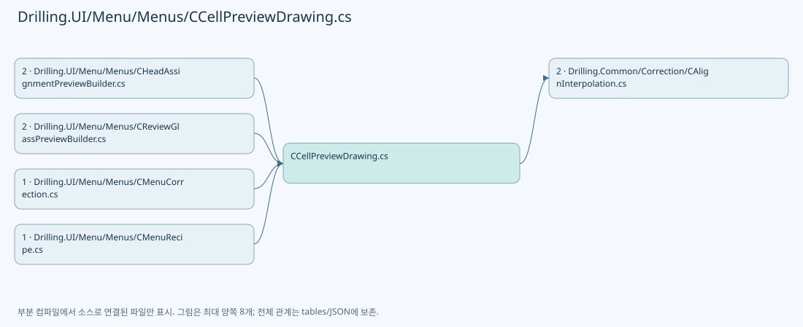
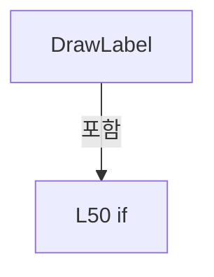
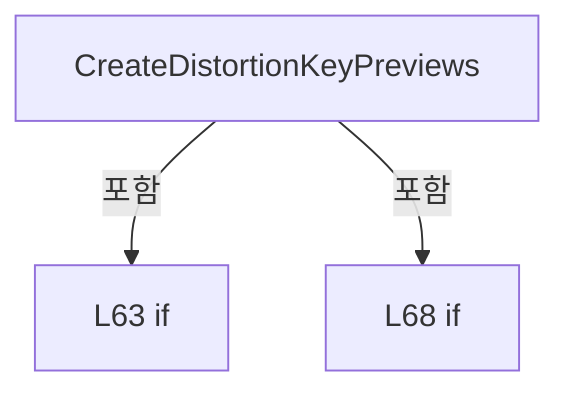
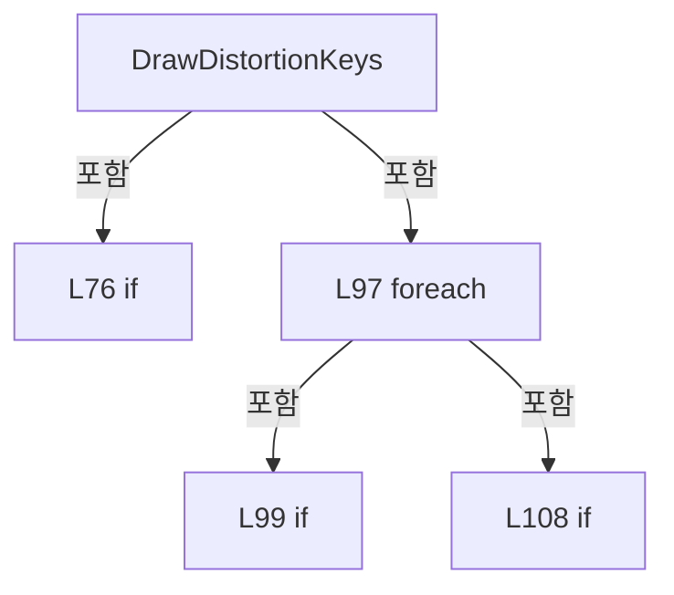
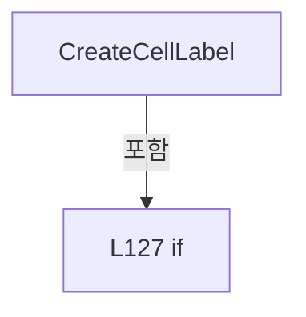
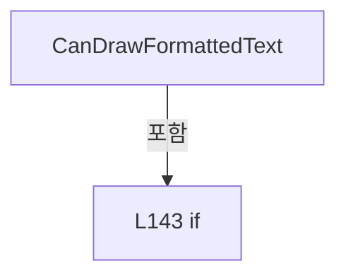

# Drilling.UI/Menu/Menus/CCellPreviewDrawing.cs

| 항목 | 내용 |
| --- | --- |
| 원본 저장소 | https://github.com/kjuws10-rgb/A3Drilling.git |
| 원본 Commit | 5aee8e58439c9b455cae7c9593c9be986c3e682e |
| 원본 SHA256 | a77d6f93acf13f045473ef78010db693f9cc768f17769a00b87a0e8041642b27 |
| 파일 분류 | code |
| 원본 크기/행 | 8,453 bytes / 187 physical lines |
| 인코딩 | utf-8-sig |
| 검토 범위 | 구문/부분 의미 분석에서 추출한 사실. 동작·물리 단위·실장비 합격을 보증하지 않습니다. |
| 원본 링크 | [고정 Commit 원본](https://github.com/kjuws10-rgb/A3Drilling/blob/5aee8e58439c9b455cae7c9593c9be986c3e682e/Drilling.UI/Menu/Menus/CCellPreviewDrawing.cs) |

## 파일의 역할과 읽는 순서

WPF 화면·사용자 명령·표시 상태를 구성합니다. XAML 이벤트와 코드 비하인드, RootView의 조립 경로를 함께 추적합니다.

## 네임스페이스·타입·상속

| 타입 | 구분 | 원본 범위 | 선언/상속 |
| --- | --- | --- | --- |
| CCellPreviewDrawing | ClassDeclaration | 7–156 | CCellPreviewDrawing |
| ST_CELL_PREVIEW_LABEL | RecordDeclaration | 158–176 | ST_CELL_PREVIEW_LABEL |
| ST_DISTORTION_KEY_PREVIEW | RecordDeclaration | 178–187 | ST_DISTORTION_KEY_PREVIEW |

## 멤버 빠른 목록

| 이름 | 종류 | 범위 | 서명 |
| --- | --- | --- | --- |
| DrawAlignKeys | MethodDeclaration | L9–59 | void Drilling.UI.Menu.Menus.CCellPreviewDrawing.DrawAlignKeys(DrawingContext, Drilling.UI.Menu.Menus.ST_GLASS_PREVIEW_FRAME, double, double, double, double) |
| DrawKey | LocalFunctionStatement | L36–40 | void DrawKey(string, double, double, bool, bool) |
| DrawCross | LocalFunctionStatement | L42–46 | void DrawCross(double, double) |
| DrawLabel | LocalFunctionStatement | L48–58 | void DrawLabel(string, double, double, bool) |
| CreateDistortionKeyPreviews | MethodDeclaration | L61–72 | System.Collections.Generic.IReadOnlyList<Drilling.UI.Menu.Menus.ST_DISTORTION_KEY_PREVIEW> Drilling.UI.Menu.Menus.CCellPreviewDrawing.CreateDistortionKeyPreviews(double, double, double, double, System.Func<string, double?>) |
| DrawDistortionKeys | MethodDeclaration | L74–118 | void Drilling.UI.Menu.Menus.CCellPreviewDrawing.DrawDistortionKeys(DrawingContext, Drilling.UI.Menu.Menus.ST_GLASS_PREVIEW_FRAME, double, double, System.Collections.Generic.IReadOnlyList<Drilling.UI.Menu.Menus.ST_DISTORTION_KEY_PREVIEW>) |
| ClampToRange | MethodDeclaration | L120–123 | double Drilling.UI.Menu.Menus.CCellPreviewDrawing.ClampToRange(double, double, double) |
| CreateCellLabel | MethodDeclaration | L125–139 | Drilling.UI.Menu.Menus.ST_CELL_PREVIEW_LABEL? Drilling.UI.Menu.Menus.CCellPreviewDrawing.CreateCellLabel(int, Rect, double, double, bool) |
| CanDrawFormattedText | MethodDeclaration | L141–150 | bool Drilling.UI.Menu.Menus.CCellPreviewDrawing.CanDrawFormattedText() |
| EstimateTextWidth | MethodDeclaration | L152–155 | double Drilling.UI.Menu.Menus.CCellPreviewDrawing.EstimateTextWidth(string) |
| CellBounds | PropertyDeclaration | L160–160 | Rect Drilling.UI.Menu.Menus.ST_CELL_PREVIEW_LABEL.CellBounds |
| get_CellBounds | GetAccessorDeclaration | L160–160 | Rect Drilling.UI.Menu.Menus.ST_CELL_PREVIEW_LABEL.CellBounds.get |
| set_CellBounds | InitAccessorDeclaration | L160–160 | void Drilling.UI.Menu.Menus.ST_CELL_PREVIEW_LABEL.CellBounds.init |
| DisplayText | PropertyDeclaration | L161–167 | string Drilling.UI.Menu.Menus.ST_CELL_PREVIEW_LABEL.DisplayText |
| get_DisplayText | GetAccessorDeclaration | L163–166 | string Drilling.UI.Menu.Menus.ST_CELL_PREVIEW_LABEL.DisplayText.get |
| Height | PropertyDeclaration | L169–175 | double Drilling.UI.Menu.Menus.ST_CELL_PREVIEW_LABEL.Height |
| get_Height | GetAccessorDeclaration | L171–174 | double Drilling.UI.Menu.Menus.ST_CELL_PREVIEW_LABEL.Height.get |
| DisplayText | PropertyDeclaration | L180–186 | string Drilling.UI.Menu.Menus.ST_DISTORTION_KEY_PREVIEW.DisplayText |
| get_DisplayText | GetAccessorDeclaration | L182–185 | string Drilling.UI.Menu.Menus.ST_DISTORTION_KEY_PREVIEW.DisplayText.get |

## 멤버별 상세 계약·호출·처리 해설

### MethodDeclaration `DrawAlignKeys` · L9–59

[Drilling.UI/Menu/Menus/CCellPreviewDrawing.cs:9–59](https://github.com/kjuws10-rgb/A3Drilling/blob/5aee8e58439c9b455cae7c9593c9be986c3e682e/Drilling.UI/Menu/Menus/CCellPreviewDrawing.cs#L9-L59)

| 항목 | 실제 추출 값 |
| --- | --- |
| 서명 | void Drilling.UI.Menu.Menus.CCellPreviewDrawing.DrawAlignKeys(DrawingContext, Drilling.UI.Menu.Menus.ST_GLASS_PREVIEW_FRAME, double, double, double, double) |
| 접근/수식자 | Public / public, static |
| 반환/값 타입 | void |
| 소속 타입 | NamedType:Drilling.UI.Menu.Menus.CCellPreviewDrawing |

입력 계약:

| 이름 | 타입 | 전달 | 선택/기본값 |
| --- | --- | --- | --- |
| context | DrawingContext | None | False /  |
| frame | Drilling.UI.Menu.Menus.ST_GLASS_PREVIEW_FRAME | None | False /  |
| glassWidth | double | None | False /  |
| glassHeight | double | None | False /  |
| marginX | double | None | False /  |
| marginY | double | None | False /  |

현재 부분 분석에서 직접 연결된 호출자는 없습니다. XAML/이벤트/인터페이스·델리게이트·외부 진입을 추가 확인해야 하며, 미사용으로 판정한 것이 아닙니다.

호출하는 대상과 해석 범위:

| 원본 행 | 표현식 | 분석 상태 | 대상/소스 위치 |
| --- | --- | --- | --- |
| 11 | new SolidColorBrush | unresolved | None |
| 11 | Color.FromRgb | unresolved | None |
| 12 | brush.Freeze | unresolved | None |
| 13 | CanDrawFormattedText | resolved | bool Drilling.UI.Menu.Menus.CCellPreviewDrawing.CanDrawFormattedText() · Drilling.UI/Menu/Menus/CCellPreviewDrawing.cs:141 |
| 14 | new Typeface | unresolved | None |
| 14 | new FontFamily | unresolved | None |
| 15 | new Pen | unresolved | None |
| 20 | crossPen.Freeze | unresolved | None |
| 23 | Math.Max | resolved | double System.Math.Max(double, double) |
| 24 | Math.Max | resolved | double System.Math.Max(double, double) |
| 25 | Math.Clamp | resolved | double System.Math.Clamp(double, double, double) |
| 26 | Math.Clamp | resolved | double System.Math.Clamp(double, double, double) |
| 31 | DrawKey | resolved | void DrawKey(string, double, double, bool, bool) · Drilling.UI/Menu/Menus/CCellPreviewDrawing.cs:36 |
| 32 | DrawKey | resolved | void DrawKey(string, double, double, bool, bool) · Drilling.UI/Menu/Menus/CCellPreviewDrawing.cs:36 |
| 33 | DrawKey | resolved | void DrawKey(string, double, double, bool, bool) · Drilling.UI/Menu/Menus/CCellPreviewDrawing.cs:36 |
| 34 | DrawKey | resolved | void DrawKey(string, double, double, bool, bool) · Drilling.UI/Menu/Menus/CCellPreviewDrawing.cs:36 |

본문의 실제 연산·분기·예외·반환 순서(원문 위치 순):

| 원본 행 | 종류 | 주석 해설 |
| --- | --- | --- |
| 11 | call | 함수·델리게이트 또는 객체 생성자를 호출합니다: new SolidColorBrush(Color.FromRgb(251, 191, 36)) |
| 11 | call | 함수·델리게이트 또는 객체 생성자를 호출합니다: Color.FromRgb(251, 191, 36) |
| 11 | local-declaration | 지역 변수를 선언합니다: var brush = new SolidColorBrush(Color.FromRgb(251, 191, 36)); |
| 11 | variable-initializer | 변수의 초기값을 지정합니다: brush = new SolidColorBrush(Color.FromRgb(251, 191, 36)) |
| 12 | call | 함수·델리게이트 또는 객체 생성자를 호출합니다: brush.Freeze() |
| 13 | call | 함수·델리게이트 또는 객체 생성자를 호출합니다: CanDrawFormattedText() |
| 13 | local-declaration | 지역 변수를 선언합니다: var canDrawText = CanDrawFormattedText(); |
| 13 | variable-initializer | 변수의 초기값을 지정합니다: canDrawText = CanDrawFormattedText() |
| 14 | call | 함수·델리게이트 또는 객체 생성자를 호출합니다: new Typeface(new FontFamily("Segoe UI"), FontStyles.Normal, FontWeights.SemiBold, FontStretches.Normal) |
| 14 | call | 함수·델리게이트 또는 객체 생성자를 호출합니다: new FontFamily("Segoe UI") |
| 14 | conditional-expression | 조건에 따라 결과식을 선택합니다: canDrawText ? new Typeface(new FontFamily("Segoe UI"), FontStyles.Normal, FontWeights.SemiBold, FontStretches.Normal) : null |
| 14 | local-declaration | 지역 변수를 선언합니다: var typeface = canDrawText ? new Typeface(new FontFamily("Segoe UI"), FontStyles.Normal, FontWeights.SemiBold, FontStretches.Normal) : null; |
| 14 | variable-initializer | 변수의 초기값을 지정합니다: typeface = canDrawText ? new Typeface(new FontFamily("Segoe UI"), FontStyles.Normal, FontWeights.SemiBold, FontStretches.Normal) : null |
| 15 | call | 함수·델리게이트 또는 객체 생성자를 호출합니다: new Pen(brush, 1.6) { StartLineCap = PenLineCap.Square, EndLineCap = PenLineCap.Square } |
| 15 | local-declaration | 지역 변수를 선언합니다: var crossPen = new Pen(brush, 1.6) { StartLineCap = PenLineCap.Square, EndLineCap = PenLineCap.Square }; |
| 15 | variable-initializer | 변수의 초기값을 지정합니다: crossPen = new Pen(brush, 1.6) { StartLineCap = PenLineCap.Square, EndLineCap = PenLineCap.Square } |
| 17 | assignment | 값을 대상에 대입합니다: StartLineCap = PenLineCap.Square |
| 18 | assignment | 값을 대상에 대입합니다: EndLineCap = PenLineCap.Square |
| 20 | call | 함수·델리게이트 또는 객체 생성자를 호출합니다: crossPen.Freeze() |
| 21 | local-declaration | 지역 변수를 선언합니다: const double crossHalfLength = 4.0; |
| 21 | variable-initializer | 변수의 초기값을 지정합니다: crossHalfLength = 4.0 |
| 22 | local-declaration | 지역 변수를 선언합니다: const double labelGap = 6.0; |
| 22 | variable-initializer | 변수의 초기값을 지정합니다: labelGap = 6.0 |
| 23 | call | 함수·델리게이트 또는 객체 생성자를 호출합니다: Math.Max(1.0, glassWidth) |
| 23 | local-declaration | 지역 변수를 선언합니다: var safeGlassWidth = Math.Max(1.0, glassWidth); |
| 23 | variable-initializer | 변수의 초기값을 지정합니다: safeGlassWidth = Math.Max(1.0, glassWidth) |
| 24 | call | 함수·델리게이트 또는 객체 생성자를 호출합니다: Math.Max(1.0, glassHeight) |
| 24 | local-declaration | 지역 변수를 선언합니다: var safeGlassHeight = Math.Max(1.0, glassHeight); |
| 24 | variable-initializer | 변수의 초기값을 지정합니다: safeGlassHeight = Math.Max(1.0, glassHeight) |
| 25 | call | 함수·델리게이트 또는 객체 생성자를 호출합니다: Math.Clamp(marginX, 0.0, safeGlassWidth / 2.0) |
| 25 | local-declaration | 지역 변수를 선언합니다: var safeMarginX = Math.Clamp(marginX, 0.0, safeGlassWidth / 2.0); |
| 25 | variable-initializer | 변수의 초기값을 지정합니다: safeMarginX = Math.Clamp(marginX, 0.0, safeGlassWidth / 2.0) |
| 26 | call | 함수·델리게이트 또는 객체 생성자를 호출합니다: Math.Clamp(marginY, 0.0, safeGlassHeight / 2.0) |
| 26 | local-declaration | 지역 변수를 선언합니다: var safeMarginY = Math.Clamp(marginY, 0.0, safeGlassHeight / 2.0); |
| 26 | variable-initializer | 변수의 초기값을 지정합니다: safeMarginY = Math.Clamp(marginY, 0.0, safeGlassHeight / 2.0) |
| 27 | local-declaration | 지역 변수를 선언합니다: var leftX = frame.CanvasLeft + (safeMarginX / safeGlassWidth * frame.Width); |
| 27 | variable-initializer | 변수의 초기값을 지정합니다: leftX = frame.CanvasLeft + (safeMarginX / safeGlassWidth * frame.Width) |
| 28 | local-declaration | 지역 변수를 선언합니다: var rightX = frame.CanvasLeft + frame.Width - (safeMarginX / safeGlassWidth * frame.Width); |
| 28 | variable-initializer | 변수의 초기값을 지정합니다: rightX = frame.CanvasLeft + frame.Width - (safeMarginX / safeGlassWidth * frame.Width) |
| 29 | local-declaration | 지역 변수를 선언합니다: var topY = frame.CanvasTop + (safeMarginY / safeGlassHeight * frame.Height); |
| 29 | variable-initializer | 변수의 초기값을 지정합니다: topY = frame.CanvasTop + (safeMarginY / safeGlassHeight * frame.Height) |
| 30 | local-declaration | 지역 변수를 선언합니다: var bottomY = frame.CanvasTop + frame.Height - (safeMarginY / safeGlassHeight * frame.Height); |
| 30 | variable-initializer | 변수의 초기값을 지정합니다: bottomY = frame.CanvasTop + frame.Height - (safeMarginY / safeGlassHeight * frame.Height) |
| 31 | call | 함수·델리게이트 또는 객체 생성자를 호출합니다: DrawKey("AK1", leftX, topY, false, false) |
| 32 | call | 함수·델리게이트 또는 객체 생성자를 호출합니다: DrawKey("AK2", leftX, bottomY, false, true) |
| 33 | call | 함수·델리게이트 또는 객체 생성자를 호출합니다: DrawKey("AK3", rightX, topY, true, false) |
| 34 | call | 함수·델리게이트 또는 객체 생성자를 호출합니다: DrawKey("AK4", rightX, bottomY, true, true) |
| 35 | return | 호출자에게 값 또는 제어를 반환합니다: return; |

변경 전 점검: 입력/반환 타입, 위 호출자, 예외/취소 경로, 공유 상태와 저장·전송 소비자를 함께 확인합니다. 값의 단위나 물리 방향을 이름만으로 확정하지 않습니다.

### LocalFunctionStatement `DrawKey` · L36–40

[Drilling.UI/Menu/Menus/CCellPreviewDrawing.cs:36–40](https://github.com/kjuws10-rgb/A3Drilling/blob/5aee8e58439c9b455cae7c9593c9be986c3e682e/Drilling.UI/Menu/Menus/CCellPreviewDrawing.cs#L36-L40)

| 항목 | 실제 추출 값 |
| --- | --- |
| 서명 | void DrawKey(string, double, double, bool, bool) |
| 접근/수식자 | Private /  |
| 반환/값 타입 | void |
| 소속 타입 | NamedType:Drilling.UI.Menu.Menus.CCellPreviewDrawing |

입력 계약:

| 이름 | 타입 | 전달 | 선택/기본값 |
| --- | --- | --- | --- |
| name | string | None | False /  |
| centerX | double | None | False /  |
| centerY | double | None | False /  |
| alignRight | bool | None | False /  |
| alignBelow | bool | None | False /  |

정적 호출자로 확인된 위치:

| 호출 파일/행 | 호출 표현식 | 런타임 분기 가능 |
| --- | --- | --- |
| [Drilling.UI/Menu/Menus/CCellPreviewDrawing.cs:31–31](https://github.com/kjuws10-rgb/A3Drilling/blob/5aee8e58439c9b455cae7c9593c9be986c3e682e/Drilling.UI/Menu/Menus/CCellPreviewDrawing.cs#L31-L31) | DrawKey | False |
| [Drilling.UI/Menu/Menus/CCellPreviewDrawing.cs:32–32](https://github.com/kjuws10-rgb/A3Drilling/blob/5aee8e58439c9b455cae7c9593c9be986c3e682e/Drilling.UI/Menu/Menus/CCellPreviewDrawing.cs#L32-L32) | DrawKey | False |
| [Drilling.UI/Menu/Menus/CCellPreviewDrawing.cs:33–33](https://github.com/kjuws10-rgb/A3Drilling/blob/5aee8e58439c9b455cae7c9593c9be986c3e682e/Drilling.UI/Menu/Menus/CCellPreviewDrawing.cs#L33-L33) | DrawKey | False |
| [Drilling.UI/Menu/Menus/CCellPreviewDrawing.cs:34–34](https://github.com/kjuws10-rgb/A3Drilling/blob/5aee8e58439c9b455cae7c9593c9be986c3e682e/Drilling.UI/Menu/Menus/CCellPreviewDrawing.cs#L34-L34) | DrawKey | False |

호출하는 대상과 해석 범위:

| 원본 행 | 표현식 | 분석 상태 | 대상/소스 위치 |
| --- | --- | --- | --- |
| 38 | DrawCross | resolved | void DrawCross(double, double) · Drilling.UI/Menu/Menus/CCellPreviewDrawing.cs:42 |
| 39 | DrawLabel | resolved | void DrawLabel(string, double, double, bool) · Drilling.UI/Menu/Menus/CCellPreviewDrawing.cs:48 |

본문의 실제 연산·분기·예외·반환 순서(원문 위치 순):

| 원본 행 | 종류 | 주석 해설 |
| --- | --- | --- |
| 38 | call | 함수·델리게이트 또는 객체 생성자를 호출합니다: DrawCross(centerX, centerY) |
| 39 | call | 함수·델리게이트 또는 객체 생성자를 호출합니다: DrawLabel(name, centerX, alignBelow ? centerY + 2.0 : centerY - 15.0, alignRight) |
| 39 | conditional-expression | 조건에 따라 결과식을 선택합니다: alignBelow ? centerY + 2.0 : centerY - 15.0 |

변경 전 점검: 입력/반환 타입, 위 호출자, 예외/취소 경로, 공유 상태와 저장·전송 소비자를 함께 확인합니다. 값의 단위나 물리 방향을 이름만으로 확정하지 않습니다.

### LocalFunctionStatement `DrawCross` · L42–46

[Drilling.UI/Menu/Menus/CCellPreviewDrawing.cs:42–46](https://github.com/kjuws10-rgb/A3Drilling/blob/5aee8e58439c9b455cae7c9593c9be986c3e682e/Drilling.UI/Menu/Menus/CCellPreviewDrawing.cs#L42-L46)

| 항목 | 실제 추출 값 |
| --- | --- |
| 서명 | void DrawCross(double, double) |
| 접근/수식자 | Private /  |
| 반환/값 타입 | void |
| 소속 타입 | NamedType:Drilling.UI.Menu.Menus.CCellPreviewDrawing |

입력 계약:

| 이름 | 타입 | 전달 | 선택/기본값 |
| --- | --- | --- | --- |
| centerX | double | None | False /  |
| centerY | double | None | False /  |

정적 호출자로 확인된 위치:

| 호출 파일/행 | 호출 표현식 | 런타임 분기 가능 |
| --- | --- | --- |
| [Drilling.UI/Menu/Menus/CCellPreviewDrawing.cs:38–38](https://github.com/kjuws10-rgb/A3Drilling/blob/5aee8e58439c9b455cae7c9593c9be986c3e682e/Drilling.UI/Menu/Menus/CCellPreviewDrawing.cs#L38-L38) | DrawCross | False |

호출하는 대상과 해석 범위:

| 원본 행 | 표현식 | 분석 상태 | 대상/소스 위치 |
| --- | --- | --- | --- |
| 44 | context.DrawLine | unresolved | None |
| 44 | new Point | unresolved | None |
| 44 | new Point | unresolved | None |
| 45 | context.DrawLine | unresolved | None |
| 45 | new Point | unresolved | None |
| 45 | new Point | unresolved | None |

본문의 실제 연산·분기·예외·반환 순서(원문 위치 순):

| 원본 행 | 종류 | 주석 해설 |
| --- | --- | --- |
| 44 | call | 함수·델리게이트 또는 객체 생성자를 호출합니다: context.DrawLine(crossPen, new Point(centerX - crossHalfLength, centerY), new Point(centerX + crossHalfLength, centerY)) |
| 44 | call | 함수·델리게이트 또는 객체 생성자를 호출합니다: new Point(centerX - crossHalfLength, centerY) |
| 44 | call | 함수·델리게이트 또는 객체 생성자를 호출합니다: new Point(centerX + crossHalfLength, centerY) |
| 45 | call | 함수·델리게이트 또는 객체 생성자를 호출합니다: context.DrawLine(crossPen, new Point(centerX, centerY - crossHalfLength), new Point(centerX, centerY + crossHalfLength)) |
| 45 | call | 함수·델리게이트 또는 객체 생성자를 호출합니다: new Point(centerX, centerY - crossHalfLength) |
| 45 | call | 함수·델리게이트 또는 객체 생성자를 호출합니다: new Point(centerX, centerY + crossHalfLength) |

변경 전 점검: 입력/반환 타입, 위 호출자, 예외/취소 경로, 공유 상태와 저장·전송 소비자를 함께 확인합니다. 값의 단위나 물리 방향을 이름만으로 확정하지 않습니다.

### LocalFunctionStatement `DrawLabel` · L48–58

[Drilling.UI/Menu/Menus/CCellPreviewDrawing.cs:48–58](https://github.com/kjuws10-rgb/A3Drilling/blob/5aee8e58439c9b455cae7c9593c9be986c3e682e/Drilling.UI/Menu/Menus/CCellPreviewDrawing.cs#L48-L58)

| 항목 | 실제 추출 값 |
| --- | --- |
| 서명 | void DrawLabel(string, double, double, bool) |
| 접근/수식자 | Private /  |
| 반환/값 타입 | void |
| 소속 타입 | NamedType:Drilling.UI.Menu.Menus.CCellPreviewDrawing |

입력 계약:

| 이름 | 타입 | 전달 | 선택/기본값 |
| --- | --- | --- | --- |
| name | string | None | False /  |
| dotX | double | None | False /  |
| top | double | None | False /  |
| alignRight | bool | None | False /  |

정적 호출자로 확인된 위치:

| 호출 파일/행 | 호출 표현식 | 런타임 분기 가능 |
| --- | --- | --- |
| [Drilling.UI/Menu/Menus/CCellPreviewDrawing.cs:39–39](https://github.com/kjuws10-rgb/A3Drilling/blob/5aee8e58439c9b455cae7c9593c9be986c3e682e/Drilling.UI/Menu/Menus/CCellPreviewDrawing.cs#L39-L39) | DrawLabel | False |

호출하는 대상과 해석 범위:

| 원본 행 | 표현식 | 분석 상태 | 대상/소스 위치 |
| --- | --- | --- | --- |
| 55 | new FormattedText | unresolved | None |
| 57 | context.DrawText | unresolved | None |
| 57 | new Point | unresolved | None |

본문의 실제 연산·분기·예외·반환 순서(원문 위치 순):

| 원본 행 | 종류 | 주석 해설 |
| --- | --- | --- |
| 50 | if | 조건에 따라 분기합니다: if (!canDrawText &#124;&#124; typeface is null) |
| 52 | return | 호출자에게 값 또는 제어를 반환합니다: return; |
| 55 | call | 함수·델리게이트 또는 객체 생성자를 호출합니다: new FormattedText(name, CultureInfo.InvariantCulture, FlowDirection.LeftToRight, typeface, 10.0, brush, 1.0) |
| 55 | local-declaration | 지역 변수를 선언합니다: var text = new FormattedText(name, CultureInfo.InvariantCulture, FlowDirection.LeftToRight, typeface, 10.0, brush, 1.0); |
| 55 | variable-initializer | 변수의 초기값을 지정합니다: text = new FormattedText(name, CultureInfo.InvariantCulture, FlowDirection.LeftToRight, typeface, 10.0, brush, 1.0) |
| 56 | conditional-expression | 조건에 따라 결과식을 선택합니다: alignRight ? dotX - labelGap - text.Width : dotX + labelGap |
| 56 | local-declaration | 지역 변수를 선언합니다: var left = alignRight ? dotX - labelGap - text.Width : dotX + labelGap; |
| 56 | variable-initializer | 변수의 초기값을 지정합니다: left = alignRight ? dotX - labelGap - text.Width : dotX + labelGap |
| 57 | call | 함수·델리게이트 또는 객체 생성자를 호출합니다: context.DrawText(text, new Point(left, top)) |
| 57 | call | 함수·델리게이트 또는 객체 생성자를 호출합니다: new Point(left, top) |

제어 구문의 포함 구조(실제 실행 순서/CFG가 아닌 구문 탐색 그림):

변경 전 점검: 입력/반환 타입, 위 호출자, 예외/취소 경로, 공유 상태와 저장·전송 소비자를 함께 확인합니다. 값의 단위나 물리 방향을 이름만으로 확정하지 않습니다.

### MethodDeclaration `CreateDistortionKeyPreviews` · L61–72

[Drilling.UI/Menu/Menus/CCellPreviewDrawing.cs:61–72](https://github.com/kjuws10-rgb/A3Drilling/blob/5aee8e58439c9b455cae7c9593c9be986c3e682e/Drilling.UI/Menu/Menus/CCellPreviewDrawing.cs#L61-L72)

| 항목 | 실제 추출 값 |
| --- | --- |
| 서명 | System.Collections.Generic.IReadOnlyList<Drilling.UI.Menu.Menus.ST_DISTORTION_KEY_PREVIEW> Drilling.UI.Menu.Menus.CCellPreviewDrawing.CreateDistortionKeyPreviews(double, double, double, double, System.Func<string, double?>) |
| 접근/수식자 | Public / public, static |
| 반환/값 타입 | System.Collections.Generic.IReadOnlyList<Drilling.UI.Menu.Menus.ST_DISTORTION_KEY_PREVIEW> |
| 소속 타입 | NamedType:Drilling.UI.Menu.Menus.CCellPreviewDrawing |

입력 계약:

| 이름 | 타입 | 전달 | 선택/기본값 |
| --- | --- | --- | --- |
| glassWidth | double | None | False /  |
| glassHeight | double | None | False /  |
| akMarginX | double | None | False /  |
| akMarginY | double | None | False /  |
| readValue | System.Func<string, double?> | None | False /  |

정적 호출자로 확인된 위치:

| 호출 파일/행 | 호출 표현식 | 런타임 분기 가능 |
| --- | --- | --- |
| [Drilling.UI/Menu/Menus/CHeadAssignmentPreviewBuilder.cs:110–110](https://github.com/kjuws10-rgb/A3Drilling/blob/5aee8e58439c9b455cae7c9593c9be986c3e682e/Drilling.UI/Menu/Menus/CHeadAssignmentPreviewBuilder.cs#L110-L110) | CCellPreviewDrawing.CreateDistortionKeyPreviews | False |
| [Drilling.UI/Menu/Menus/CMenuCorrection.cs:1001–1001](https://github.com/kjuws10-rgb/A3Drilling/blob/5aee8e58439c9b455cae7c9593c9be986c3e682e/Drilling.UI/Menu/Menus/CMenuCorrection.cs#L1001-L1001) | CCellPreviewDrawing.CreateDistortionKeyPreviews | False |
| [Drilling.UI/Menu/Menus/CMenuRecipe.cs:2142–2142](https://github.com/kjuws10-rgb/A3Drilling/blob/5aee8e58439c9b455cae7c9593c9be986c3e682e/Drilling.UI/Menu/Menus/CMenuRecipe.cs#L2142-L2142) | CCellPreviewDrawing.CreateDistortionKeyPreviews | False |
| [Drilling.UI/Menu/Menus/CReviewGlassPreviewBuilder.cs:130–139](https://github.com/kjuws10-rgb/A3Drilling/blob/5aee8e58439c9b455cae7c9593c9be986c3e682e/Drilling.UI/Menu/Menus/CReviewGlassPreviewBuilder.cs#L130-L139) | CCellPreviewDrawing.CreateDistortionKeyPreviews | False |

호출하는 대상과 해석 범위:

| 원본 행 | 표현식 | 분석 상태 | 대상/소스 위치 |
| --- | --- | --- | --- |
| 63 | double.IsFinite | resolved | bool double.IsFinite(double) |
| 63 | double.IsFinite | resolved | bool double.IsFinite(double) |
| 65 | Enumerable.Range(0, 3).SelectMany(index => { var stageY = readValue(Drilling.Common.Correction.CAlignKeyGeometry.StagePositionKey(index)); if (stageY is not { } position &#124;&#124; !double.IsFinite(position)) return Array.Empty<ST_DISTORTION_KEY_PREVIEW>(); var y = Drilling.Common.Correction.CAlignKeyGeometry.DesignY(glassHeight, akMarginY, position); retu… | resolved | Drilling.UI.Menu.Menus.ST_DISTORTION_KEY_PREVIEW[] System.Collections.Generic.IEnumerable<Drilling.UI.Menu.Menus.ST_DISTORTION_KEY_PREVIEW>.ToArray<Drilling.UI.Menu.Menus.ST_DISTORTION_KEY_PREVIEW>() |
| 65 | Enumerable.Range(0, 3).SelectMany | resolved | System.Collections.Generic.IEnumerable<Drilling.UI.Menu.Menus.ST_DISTORTION_KEY_PREVIEW> System.Collections.Generic.IEnumerable<int>.SelectMany<int, Drilling.UI.Menu.Menus.ST_DISTORTION_KEY_PREVIEW>(System.Func<int, System.Collections.Generic.IEnumerable<Drilling.UI.Menu.Menus.ST_DISTORTION_KEY_PREVIEW>>) |
| 65 | Enumerable.Range | resolved | System.Collections.Generic.IEnumerable<int> System.Linq.Enumerable.Range(int, int) |
| 67 | readValue | resolved · 동적 구현 선택 가능 | double? System.Func<string, double?>.Invoke(string) |
| 67 | Drilling.Common.Correction.CAlignKeyGeometry.StagePositionKey | resolved | string Drilling.Common.Correction.CAlignKeyGeometry.StagePositionKey(int) · Drilling.Common/Correction/CAlignInterpolation.cs:182 |
| 68 | double.IsFinite | resolved | bool double.IsFinite(double) |
| 68 | Array.Empty<ST_DISTORTION_KEY_PREVIEW> | resolved | Drilling.UI.Menu.Menus.ST_DISTORTION_KEY_PREVIEW[] System.Array.Empty<Drilling.UI.Menu.Menus.ST_DISTORTION_KEY_PREVIEW>() |
| 69 | Drilling.Common.Correction.CAlignKeyGeometry.DesignY | resolved | double Drilling.Common.Correction.CAlignKeyGeometry.DesignY(double, double, double) · Drilling.Common/Correction/CAlignInterpolation.cs:183 |
| 70 | new ST_DISTORTION_KEY_PREVIEW | resolved | Drilling.UI.Menu.Menus.ST_DISTORTION_KEY_PREVIEW.ST_DISTORTION_KEY_PREVIEW(int, double, double) · Drilling.UI/Menu/Menus/CCellPreviewDrawing.cs:178 |
| 70 | new ST_DISTORTION_KEY_PREVIEW | resolved | Drilling.UI.Menu.Menus.ST_DISTORTION_KEY_PREVIEW.ST_DISTORTION_KEY_PREVIEW(int, double, double) · Drilling.UI/Menu/Menus/CCellPreviewDrawing.cs:178 |

본문의 실제 연산·분기·예외·반환 순서(원문 위치 순):

| 원본 행 | 종류 | 주석 해설 |
| --- | --- | --- |
| 63 | call | 함수·델리게이트 또는 객체 생성자를 호출합니다: double.IsFinite(glassWidth) |
| 63 | call | 함수·델리게이트 또는 객체 생성자를 호출합니다: double.IsFinite(glassHeight) |
| 63 | if | 조건에 따라 분기합니다: if (!double.IsFinite(glassWidth) &#124;&#124; !double.IsFinite(glassHeight) &#124;&#124; glassWidth <= 0 &#124;&#124; glassHeight <= 0) |
| 63 | return | 호출자에게 값 또는 제어를 반환합니다: return []; |
| 65 | call | 함수·델리게이트 또는 객체 생성자를 호출합니다: Enumerable.Range(0, 3) |
| 65 | call | 함수·델리게이트 또는 객체 생성자를 호출합니다: Enumerable.Range(0, 3).SelectMany(index => { var stageY = readValue(Drilling.Common.Correction.CAlignKeyGeometry.StagePositionKey(index)); if (stageY is not { } position &#124;&#124; !double.IsFinite(position)) return Array.Empty<… |
| 65 | call | 함수·델리게이트 또는 객체 생성자를 호출합니다: Enumerable.Range(0, 3).SelectMany(index => { var stageY = readValue(Drilling.Common.Correction.CAlignKeyGeometry.StagePositionKey(index)); if (stageY is not { } position &#124;&#124; !double.IsFinite(position)) return Array.Empty<… |
| 65 | return | 호출자에게 값 또는 제어를 반환합니다: return Enumerable.Range(0, 3).SelectMany(index => { var stageY = readValue(Drilling.Common.Correction.CAlignKeyGeometry.StagePositionKey(index)); if (stageY is not { } position &#124;&#124; !double.IsFinite(position)) return Array.Empty<ST_ |
| 67 | call | 함수·델리게이트 또는 객체 생성자를 호출합니다: readValue(Drilling.Common.Correction.CAlignKeyGeometry.StagePositionKey(index)) |
| 67 | call | 함수·델리게이트 또는 객체 생성자를 호출합니다: Drilling.Common.Correction.CAlignKeyGeometry.StagePositionKey(index) |
| 67 | local-declaration | 지역 변수를 선언합니다: var stageY = readValue(Drilling.Common.Correction.CAlignKeyGeometry.StagePositionKey(index)); |
| 67 | variable-initializer | 변수의 초기값을 지정합니다: stageY = readValue(Drilling.Common.Correction.CAlignKeyGeometry.StagePositionKey(index)) |
| 68 | call | 함수·델리게이트 또는 객체 생성자를 호출합니다: double.IsFinite(position) |
| 68 | call | 함수·델리게이트 또는 객체 생성자를 호출합니다: Array.Empty<ST_DISTORTION_KEY_PREVIEW>() |
| 68 | if | 조건에 따라 분기합니다: if (stageY is not { } position &#124;&#124; !double.IsFinite(position)) |
| 68 | return | 호출자에게 값 또는 제어를 반환합니다: return Array.Empty<ST_DISTORTION_KEY_PREVIEW>(); |
| 69 | call | 함수·델리게이트 또는 객체 생성자를 호출합니다: Drilling.Common.Correction.CAlignKeyGeometry.DesignY(glassHeight, akMarginY, position) |
| 69 | local-declaration | 지역 변수를 선언합니다: var y = Drilling.Common.Correction.CAlignKeyGeometry.DesignY(glassHeight, akMarginY, position); |
| 69 | variable-initializer | 변수의 초기값을 지정합니다: y = Drilling.Common.Correction.CAlignKeyGeometry.DesignY(glassHeight, akMarginY, position) |
| 70 | call | 함수·델리게이트 또는 객체 생성자를 호출합니다: new ST_DISTORTION_KEY_PREVIEW(index * 2 + 1, akMarginX, y) |
| 70 | call | 함수·델리게이트 또는 객체 생성자를 호출합니다: new ST_DISTORTION_KEY_PREVIEW(index * 2 + 2, glassWidth - akMarginX, y) |
| 70 | return | 호출자에게 값 또는 제어를 반환합니다: return new[] { new ST_DISTORTION_KEY_PREVIEW(index * 2 + 1, akMarginX, y), new ST_DISTORTION_KEY_PREVIEW(index * 2 + 2, glassWidth - akMarginX, y) }; |

제어 구문의 포함 구조(실제 실행 순서/CFG가 아닌 구문 탐색 그림):

변경 전 점검: 입력/반환 타입, 위 호출자, 예외/취소 경로, 공유 상태와 저장·전송 소비자를 함께 확인합니다. 값의 단위나 물리 방향을 이름만으로 확정하지 않습니다.

### MethodDeclaration `DrawDistortionKeys` · L74–118

[Drilling.UI/Menu/Menus/CCellPreviewDrawing.cs:74–118](https://github.com/kjuws10-rgb/A3Drilling/blob/5aee8e58439c9b455cae7c9593c9be986c3e682e/Drilling.UI/Menu/Menus/CCellPreviewDrawing.cs#L74-L118)

| 항목 | 실제 추출 값 |
| --- | --- |
| 서명 | void Drilling.UI.Menu.Menus.CCellPreviewDrawing.DrawDistortionKeys(DrawingContext, Drilling.UI.Menu.Menus.ST_GLASS_PREVIEW_FRAME, double, double, System.Collections.Generic.IReadOnlyList<Drilling.UI.Menu.Menus.ST_DISTORTION_KEY_PREVIEW>) |
| 접근/수식자 | Public / public, static |
| 반환/값 타입 | void |
| 소속 타입 | NamedType:Drilling.UI.Menu.Menus.CCellPreviewDrawing |

입력 계약:

| 이름 | 타입 | 전달 | 선택/기본값 |
| --- | --- | --- | --- |
| context | DrawingContext | None | False /  |
| frame | Drilling.UI.Menu.Menus.ST_GLASS_PREVIEW_FRAME | None | False /  |
| glassWidth | double | None | False /  |
| glassHeight | double | None | False /  |
| distortionKeys | System.Collections.Generic.IReadOnlyList<Drilling.UI.Menu.Menus.ST_DISTORTION_KEY_PREVIEW> | None | False /  |

현재 부분 분석에서 직접 연결된 호출자는 없습니다. XAML/이벤트/인터페이스·델리게이트·외부 진입을 추가 확인해야 하며, 미사용으로 판정한 것이 아닙니다.

호출하는 대상과 해석 범위:

| 원본 행 | 표현식 | 분석 상태 | 대상/소스 위치 |
| --- | --- | --- | --- |
| 81 | new SolidColorBrush | unresolved | None |
| 81 | Color.FromRgb | unresolved | None |
| 82 | brush.Freeze | unresolved | None |
| 83 | CanDrawFormattedText | resolved | bool Drilling.UI.Menu.Menus.CCellPreviewDrawing.CanDrawFormattedText() · Drilling.UI/Menu/Menus/CCellPreviewDrawing.cs:141 |
| 84 | new Typeface | unresolved | None |
| 84 | new FontFamily | unresolved | None |
| 85 | new Pen | unresolved | None |
| 90 | crossPen.Freeze | unresolved | None |
| 91 | Math.Max | resolved | double System.Math.Max(double, double) |
| 92 | Math.Max | resolved | double System.Math.Max(double, double) |
| 99 | double.IsFinite | resolved | bool double.IsFinite(double) |
| 99 | double.IsFinite | resolved | bool double.IsFinite(double) |
| 106 | context.DrawLine | unresolved | None |
| 106 | new Point | unresolved | None |
| 106 | new Point | unresolved | None |
| 107 | context.DrawLine | unresolved | None |
| 107 | new Point | unresolved | None |
| 107 | new Point | unresolved | None |
| 113 | new FormattedText | unresolved | None |
| 114 | ClampToRange | candidate | OverloadResolutionFailure |
| 115 | ClampToRange | candidate | OverloadResolutionFailure |
| 116 | context.DrawText | unresolved | None |
| 116 | new Point | unresolved | None |

본문의 실제 연산·분기·예외·반환 순서(원문 위치 순):

| 원본 행 | 종류 | 주석 해설 |
| --- | --- | --- |
| 76 | if | 조건에 따라 분기합니다: if (distortionKeys.Count == 0) |
| 78 | return | 호출자에게 값 또는 제어를 반환합니다: return; |
| 81 | call | 함수·델리게이트 또는 객체 생성자를 호출합니다: new SolidColorBrush(Color.FromRgb(34, 197, 94)) |
| 81 | call | 함수·델리게이트 또는 객체 생성자를 호출합니다: Color.FromRgb(34, 197, 94) |
| 81 | local-declaration | 지역 변수를 선언합니다: var brush = new SolidColorBrush(Color.FromRgb(34, 197, 94)); |
| 81 | variable-initializer | 변수의 초기값을 지정합니다: brush = new SolidColorBrush(Color.FromRgb(34, 197, 94)) |
| 82 | call | 함수·델리게이트 또는 객체 생성자를 호출합니다: brush.Freeze() |
| 83 | call | 함수·델리게이트 또는 객체 생성자를 호출합니다: CanDrawFormattedText() |
| 83 | local-declaration | 지역 변수를 선언합니다: var canDrawText = CanDrawFormattedText(); |
| 83 | variable-initializer | 변수의 초기값을 지정합니다: canDrawText = CanDrawFormattedText() |
| 84 | call | 함수·델리게이트 또는 객체 생성자를 호출합니다: new Typeface(new FontFamily("Segoe UI"), FontStyles.Normal, FontWeights.SemiBold, FontStretches.Normal) |
| 84 | call | 함수·델리게이트 또는 객체 생성자를 호출합니다: new FontFamily("Segoe UI") |
| 84 | conditional-expression | 조건에 따라 결과식을 선택합니다: canDrawText ? new Typeface(new FontFamily("Segoe UI"), FontStyles.Normal, FontWeights.SemiBold, FontStretches.Normal) : null |
| 84 | local-declaration | 지역 변수를 선언합니다: var typeface = canDrawText ? new Typeface(new FontFamily("Segoe UI"), FontStyles.Normal, FontWeights.SemiBold, FontStretches.Normal) : null; |
| 84 | variable-initializer | 변수의 초기값을 지정합니다: typeface = canDrawText ? new Typeface(new FontFamily("Segoe UI"), FontStyles.Normal, FontWeights.SemiBold, FontStretches.Normal) : null |
| 85 | call | 함수·델리게이트 또는 객체 생성자를 호출합니다: new Pen(brush, 2.0) { StartLineCap = PenLineCap.Square, EndLineCap = PenLineCap.Square } |
| 85 | local-declaration | 지역 변수를 선언합니다: var crossPen = new Pen(brush, 2.0) { StartLineCap = PenLineCap.Square, EndLineCap = PenLineCap.Square }; |
| 85 | variable-initializer | 변수의 초기값을 지정합니다: crossPen = new Pen(brush, 2.0) { StartLineCap = PenLineCap.Square, EndLineCap = PenLineCap.Square } |
| 87 | assignment | 값을 대상에 대입합니다: StartLineCap = PenLineCap.Square |
| 88 | assignment | 값을 대상에 대입합니다: EndLineCap = PenLineCap.Square |
| 90 | call | 함수·델리게이트 또는 객체 생성자를 호출합니다: crossPen.Freeze() |
| 91 | call | 함수·델리게이트 또는 객체 생성자를 호출합니다: Math.Max(1.0, glassWidth) |
| 91 | local-declaration | 지역 변수를 선언합니다: var safeGlassWidth = Math.Max(1.0, glassWidth); |
| 91 | variable-initializer | 변수의 초기값을 지정합니다: safeGlassWidth = Math.Max(1.0, glassWidth) |
| 92 | call | 함수·델리게이트 또는 객체 생성자를 호출합니다: Math.Max(1.0, glassHeight) |
| 92 | local-declaration | 지역 변수를 선언합니다: var safeGlassHeight = Math.Max(1.0, glassHeight); |
| 92 | variable-initializer | 변수의 초기값을 지정합니다: safeGlassHeight = Math.Max(1.0, glassHeight) |
| 93 | local-declaration | 지역 변수를 선언합니다: var scaleX = frame.Width / safeGlassWidth; |
| 93 | variable-initializer | 변수의 초기값을 지정합니다: scaleX = frame.Width / safeGlassWidth |
| 94 | local-declaration | 지역 변수를 선언합니다: var scaleY = frame.Height / safeGlassHeight; |
| 94 | variable-initializer | 변수의 초기값을 지정합니다: scaleY = frame.Height / safeGlassHeight |
| 95 | local-declaration | 지역 변수를 선언합니다: const double crossHalfLength = 6.0; |
| 95 | variable-initializer | 변수의 초기값을 지정합니다: crossHalfLength = 6.0 |
| 96 | local-declaration | 지역 변수를 선언합니다: const double labelGap = 7.0; |
| 96 | variable-initializer | 변수의 초기값을 지정합니다: labelGap = 7.0 |
| 97 | foreach | 컬렉션 요소를 순회합니다: foreach (var key in distortionKeys) |
| 99 | call | 함수·델리게이트 또는 객체 생성자를 호출합니다: double.IsFinite(key.GlassX) |
| 99 | call | 함수·델리게이트 또는 객체 생성자를 호출합니다: double.IsFinite(key.GlassY) |
| 99 | if | 조건에 따라 분기합니다: if (!double.IsFinite(key.GlassX) &#124;&#124; !double.IsFinite(key.GlassY) &#124;&#124; key.GlassX < 0.0 &#124;&#124; key.GlassX > safeGlassWidth &#124;&#124; key.GlassY < 0.0 &#124;&#124; key.GlassY > safeGlassHeight) |
| 101 | continue | 다음 반복으로 진행합니다: continue; |
| 104 | local-declaration | 지역 변수를 선언합니다: var centerX = frame.CanvasLeft + (key.GlassX * scaleX); |
| 104 | variable-initializer | 변수의 초기값을 지정합니다: centerX = frame.CanvasLeft + (key.GlassX * scaleX) |
| 105 | local-declaration | 지역 변수를 선언합니다: var centerY = frame.CanvasTop + (key.GlassY * scaleY); |
| 105 | variable-initializer | 변수의 초기값을 지정합니다: centerY = frame.CanvasTop + (key.GlassY * scaleY) |
| 106 | call | 함수·델리게이트 또는 객체 생성자를 호출합니다: context.DrawLine(crossPen, new Point(centerX - crossHalfLength, centerY), new Point(centerX + crossHalfLength, centerY)) |
| 106 | call | 함수·델리게이트 또는 객체 생성자를 호출합니다: new Point(centerX - crossHalfLength, centerY) |
| 106 | call | 함수·델리게이트 또는 객체 생성자를 호출합니다: new Point(centerX + crossHalfLength, centerY) |
| 107 | call | 함수·델리게이트 또는 객체 생성자를 호출합니다: context.DrawLine(crossPen, new Point(centerX, centerY - crossHalfLength), new Point(centerX, centerY + crossHalfLength)) |
| 107 | call | 함수·델리게이트 또는 객체 생성자를 호출합니다: new Point(centerX, centerY - crossHalfLength) |
| 107 | call | 함수·델리게이트 또는 객체 생성자를 호출합니다: new Point(centerX, centerY + crossHalfLength) |
| 108 | if | 조건에 따라 분기합니다: if (!canDrawText &#124;&#124; typeface is null) |
| 110 | continue | 다음 반복으로 진행합니다: continue; |
| 113 | call | 함수·델리게이트 또는 객체 생성자를 호출합니다: new FormattedText(key.DisplayText, CultureInfo.InvariantCulture, FlowDirection.LeftToRight, typeface, 10.0, brush, 1.0) |
| 113 | local-declaration | 지역 변수를 선언합니다: var text = new FormattedText(key.DisplayText, CultureInfo.InvariantCulture, FlowDirection.LeftToRight, typeface, 10.0, brush, 1.0); |
| 113 | variable-initializer | 변수의 초기값을 지정합니다: text = new FormattedText(key.DisplayText, CultureInfo.InvariantCulture, FlowDirection.LeftToRight, typeface, 10.0, brush, 1.0) |
| 114 | call | 함수·델리게이트 또는 객체 생성자를 호출합니다: ClampToRange(centerX + labelGap, frame.CanvasLeft + 2.0, frame.CanvasLeft + frame.Width - text.Width - 2.0) |
| 114 | local-declaration | 지역 변수를 선언합니다: var left = ClampToRange(centerX + labelGap, frame.CanvasLeft + 2.0, frame.CanvasLeft + frame.Width - text.Width - 2.0); |
| 114 | variable-initializer | 변수의 초기값을 지정합니다: left = ClampToRange(centerX + labelGap, frame.CanvasLeft + 2.0, frame.CanvasLeft + frame.Width - text.Width - 2.0) |
| 115 | call | 함수·델리게이트 또는 객체 생성자를 호출합니다: ClampToRange(centerY - text.Height - 2.0, frame.CanvasTop + 2.0, frame.CanvasTop + frame.Height - text.Height - 2.0) |
| 115 | local-declaration | 지역 변수를 선언합니다: var top = ClampToRange(centerY - text.Height - 2.0, frame.CanvasTop + 2.0, frame.CanvasTop + frame.Height - text.Height - 2.0); |
| 115 | variable-initializer | 변수의 초기값을 지정합니다: top = ClampToRange(centerY - text.Height - 2.0, frame.CanvasTop + 2.0, frame.CanvasTop + frame.Height - text.Height - 2.0) |
| 116 | call | 함수·델리게이트 또는 객체 생성자를 호출합니다: context.DrawText(text, new Point(left, top)) |
| 116 | call | 함수·델리게이트 또는 객체 생성자를 호출합니다: new Point(left, top) |

제어 구문의 포함 구조(실제 실행 순서/CFG가 아닌 구문 탐색 그림):

변경 전 점검: 입력/반환 타입, 위 호출자, 예외/취소 경로, 공유 상태와 저장·전송 소비자를 함께 확인합니다. 값의 단위나 물리 방향을 이름만으로 확정하지 않습니다.

### MethodDeclaration `ClampToRange` · L120–123

[Drilling.UI/Menu/Menus/CCellPreviewDrawing.cs:120–123](https://github.com/kjuws10-rgb/A3Drilling/blob/5aee8e58439c9b455cae7c9593c9be986c3e682e/Drilling.UI/Menu/Menus/CCellPreviewDrawing.cs#L120-L123)

| 항목 | 실제 추출 값 |
| --- | --- |
| 서명 | double Drilling.UI.Menu.Menus.CCellPreviewDrawing.ClampToRange(double, double, double) |
| 접근/수식자 | Private / private, static |
| 반환/값 타입 | double |
| 소속 타입 | NamedType:Drilling.UI.Menu.Menus.CCellPreviewDrawing |

입력 계약:

| 이름 | 타입 | 전달 | 선택/기본값 |
| --- | --- | --- | --- |
| value | double | None | False /  |
| min | double | None | False /  |
| max | double | None | False /  |

현재 부분 분석에서 직접 연결된 호출자는 없습니다. XAML/이벤트/인터페이스·델리게이트·외부 진입을 추가 확인해야 하며, 미사용으로 판정한 것이 아닙니다.

호출하는 대상과 해석 범위:

| 원본 행 | 표현식 | 분석 상태 | 대상/소스 위치 |
| --- | --- | --- | --- |
| 122 | Math.Clamp | resolved | double System.Math.Clamp(double, double, double) |

본문의 실제 연산·분기·예외·반환 순서(원문 위치 순):

| 원본 행 | 종류 | 주석 해설 |
| --- | --- | --- |
| 122 | call | 함수·델리게이트 또는 객체 생성자를 호출합니다: Math.Clamp(value, min, max) |
| 122 | conditional-expression | 조건에 따라 결과식을 선택합니다: max < min ? min : Math.Clamp(value, min, max) |
| 122 | return | 호출자에게 값 또는 제어를 반환합니다: return max < min ? min : Math.Clamp(value, min, max); |

변경 전 점검: 입력/반환 타입, 위 호출자, 예외/취소 경로, 공유 상태와 저장·전송 소비자를 함께 확인합니다. 값의 단위나 물리 방향을 이름만으로 확정하지 않습니다.

### MethodDeclaration `CreateCellLabel` · L125–139

[Drilling.UI/Menu/Menus/CCellPreviewDrawing.cs:125–139](https://github.com/kjuws10-rgb/A3Drilling/blob/5aee8e58439c9b455cae7c9593c9be986c3e682e/Drilling.UI/Menu/Menus/CCellPreviewDrawing.cs#L125-L139)

| 항목 | 실제 추출 값 |
| --- | --- |
| 서명 | Drilling.UI.Menu.Menus.ST_CELL_PREVIEW_LABEL? Drilling.UI.Menu.Menus.CCellPreviewDrawing.CreateCellLabel(int, Rect, double, double, bool) |
| 접근/수식자 | Public / public, static |
| 반환/값 타입 | Drilling.UI.Menu.Menus.ST_CELL_PREVIEW_LABEL? |
| 소속 타입 | NamedType:Drilling.UI.Menu.Menus.CCellPreviewDrawing |

입력 계약:

| 이름 | 타입 | 전달 | 선택/기본값 |
| --- | --- | --- | --- |
| cellNo | int | None | False /  |
| cellBounds | Rect | None | False /  |
| designWidth | double | None | False /  |
| designHeight | double | None | False /  |
| isSelected | bool | None | True / false |

정적 호출자로 확인된 위치:

| 호출 파일/행 | 호출 표현식 | 런타임 분기 가능 |
| --- | --- | --- |
| [Drilling.UI/Menu/Menus/CHeadAssignmentPreviewBuilder.cs:218–218](https://github.com/kjuws10-rgb/A3Drilling/blob/5aee8e58439c9b455cae7c9593c9be986c3e682e/Drilling.UI/Menu/Menus/CHeadAssignmentPreviewBuilder.cs#L218-L218) | CCellPreviewDrawing.CreateCellLabel | False |
| [Drilling.UI/Menu/Menus/CReviewGlassPreviewBuilder.cs:628–639](https://github.com/kjuws10-rgb/A3Drilling/blob/5aee8e58439c9b455cae7c9593c9be986c3e682e/Drilling.UI/Menu/Menus/CReviewGlassPreviewBuilder.cs#L628-L639) | CCellPreviewDrawing.CreateCellLabel | False |

호출하는 대상과 해석 범위:

| 원본 행 | 표현식 | 분석 상태 | 대상/소스 위치 |
| --- | --- | --- | --- |
| 132 | Math.Max | resolved | double System.Math.Max(double, double) |
| 132 | EstimateTextWidth | resolved | double Drilling.UI.Menu.Menus.CCellPreviewDrawing.EstimateTextWidth(string) · Drilling.UI/Menu/Menus/CCellPreviewDrawing.cs:152 |
| 135 | Math.Max | resolved | double System.Math.Max(double, double) |
| 136 | Math.Clamp | candidate | OverloadResolutionFailure |
| 137 | Math.Clamp | candidate | OverloadResolutionFailure |
| 137 | Math.Max | resolved | double System.Math.Max(double, double) |
| 138 | new ST_CELL_PREVIEW_LABEL | candidate | OverloadResolutionFailure |

본문의 실제 연산·분기·예외·반환 순서(원문 위치 순):

| 원본 행 | 종류 | 주석 해설 |
| --- | --- | --- |
| 127 | if | 조건에 따라 분기합니다: if (cellBounds.IsEmpty) |
| 129 | return | 호출자에게 값 또는 제어를 반환합니다: return null; |
| 132 | call | 함수·델리게이트 또는 객체 생성자를 호출합니다: Math.Max(34.0, EstimateTextWidth($"Cell{cellNo}") + 10.0) |
| 132 | call | 함수·델리게이트 또는 객체 생성자를 호출합니다: EstimateTextWidth($"Cell{cellNo}") |
| 132 | local-declaration | 지역 변수를 선언합니다: var badgeWidth = Math.Max(34.0, EstimateTextWidth($"Cell{cellNo}") + 10.0); |
| 132 | variable-initializer | 변수의 초기값을 지정합니다: badgeWidth = Math.Max(34.0, EstimateTextWidth($"Cell{cellNo}") + 10.0) |
| 133 | local-declaration | 지역 변수를 선언합니다: const double labelHalfHeight = 8.0; |
| 133 | variable-initializer | 변수의 초기값을 지정합니다: labelHalfHeight = 8.0 |
| 134 | local-declaration | 지역 변수를 선언합니다: var labelHalfWidth = badgeWidth / 2.0; |
| 134 | variable-initializer | 변수의 초기값을 지정합니다: labelHalfWidth = badgeWidth / 2.0 |
| 135 | call | 함수·델리게이트 또는 객체 생성자를 호출합니다: Math.Max(labelHalfWidth, designWidth - labelHalfWidth) |
| 135 | local-declaration | 지역 변수를 선언합니다: var maxCenterX = Math.Max(labelHalfWidth, designWidth - labelHalfWidth); |
| 135 | variable-initializer | 변수의 초기값을 지정합니다: maxCenterX = Math.Max(labelHalfWidth, designWidth - labelHalfWidth) |
| 136 | call | 함수·델리게이트 또는 객체 생성자를 호출합니다: Math.Clamp(cellBounds.Left + (cellBounds.Width / 2.0), labelHalfWidth, maxCenterX) |
| 136 | local-declaration | 지역 변수를 선언합니다: var centerX = Math.Clamp(cellBounds.Left + (cellBounds.Width / 2.0), labelHalfWidth, maxCenterX); |
| 136 | variable-initializer | 변수의 초기값을 지정합니다: centerX = Math.Clamp(cellBounds.Left + (cellBounds.Width / 2.0), labelHalfWidth, maxCenterX) |
| 137 | call | 함수·델리게이트 또는 객체 생성자를 호출합니다: Math.Clamp(cellBounds.Top + (cellBounds.Height / 2.0), labelHalfHeight, Math.Max(labelHalfHeight, designHeight - labelHalfHeight)) |
| 137 | call | 함수·델리게이트 또는 객체 생성자를 호출합니다: Math.Max(labelHalfHeight, designHeight - labelHalfHeight) |
| 137 | local-declaration | 지역 변수를 선언합니다: var centerY = Math.Clamp(cellBounds.Top + (cellBounds.Height / 2.0), labelHalfHeight, Math.Max(labelHalfHeight, designHeight - labelHalfHeight)); |
| 137 | variable-initializer | 변수의 초기값을 지정합니다: centerY = Math.Clamp(cellBounds.Top + (cellBounds.Height / 2.0), labelHalfHeight, Math.Max(labelHalfHeight, designHeight - labelHalfHeight)) |
| 138 | call | 함수·델리게이트 또는 객체 생성자를 호출합니다: new ST_CELL_PREVIEW_LABEL(cellNo, centerX, centerY, badgeWidth, designWidth, designHeight, isSelected) |
| 138 | return | 호출자에게 값 또는 제어를 반환합니다: return new ST_CELL_PREVIEW_LABEL(cellNo, centerX, centerY, badgeWidth, designWidth, designHeight, isSelected); |

제어 구문의 포함 구조(실제 실행 순서/CFG가 아닌 구문 탐색 그림):

변경 전 점검: 입력/반환 타입, 위 호출자, 예외/취소 경로, 공유 상태와 저장·전송 소비자를 함께 확인합니다. 값의 단위나 물리 방향을 이름만으로 확정하지 않습니다.

### MethodDeclaration `CanDrawFormattedText` · L141–150

[Drilling.UI/Menu/Menus/CCellPreviewDrawing.cs:141–150](https://github.com/kjuws10-rgb/A3Drilling/blob/5aee8e58439c9b455cae7c9593c9be986c3e682e/Drilling.UI/Menu/Menus/CCellPreviewDrawing.cs#L141-L150)

| 항목 | 실제 추출 값 |
| --- | --- |
| 서명 | bool Drilling.UI.Menu.Menus.CCellPreviewDrawing.CanDrawFormattedText() |
| 접근/수식자 | Private / private, static |
| 반환/값 타입 | bool |
| 소속 타입 | NamedType:Drilling.UI.Menu.Menus.CCellPreviewDrawing |

정적 호출자로 확인된 위치:

| 호출 파일/행 | 호출 표현식 | 런타임 분기 가능 |
| --- | --- | --- |
| [Drilling.UI/Menu/Menus/CCellPreviewDrawing.cs:13–13](https://github.com/kjuws10-rgb/A3Drilling/blob/5aee8e58439c9b455cae7c9593c9be986c3e682e/Drilling.UI/Menu/Menus/CCellPreviewDrawing.cs#L13-L13) | CanDrawFormattedText | False |
| [Drilling.UI/Menu/Menus/CCellPreviewDrawing.cs:83–83](https://github.com/kjuws10-rgb/A3Drilling/blob/5aee8e58439c9b455cae7c9593c9be986c3e682e/Drilling.UI/Menu/Menus/CCellPreviewDrawing.cs#L83-L83) | CanDrawFormattedText | False |

호출하는 대상과 해석 범위:

| 원본 행 | 표현식 | 분석 상태 | 대상/소스 위치 |
| --- | --- | --- | --- |
| 143 | Thread.CurrentThread.GetApartmentState | resolved | System.Threading.ApartmentState System.Threading.Thread.GetApartmentState() |
| 149 | dispatcher.CheckAccess | unresolved | None |

본문의 실제 연산·분기·예외·반환 순서(원문 위치 순):

| 원본 행 | 종류 | 주석 해설 |
| --- | --- | --- |
| 143 | call | 함수·델리게이트 또는 객체 생성자를 호출합니다: Thread.CurrentThread.GetApartmentState() |
| 143 | if | 조건에 따라 분기합니다: if (Thread.CurrentThread.GetApartmentState() != ApartmentState.STA) |
| 145 | return | 호출자에게 값 또는 제어를 반환합니다: return false; |
| 148 | local-declaration | 지역 변수를 선언합니다: var dispatcher = Application.Current?.Dispatcher; |
| 148 | variable-initializer | 변수의 초기값을 지정합니다: dispatcher = Application.Current?.Dispatcher |
| 149 | call | 함수·델리게이트 또는 객체 생성자를 호출합니다: dispatcher.CheckAccess() |
| 149 | return | 호출자에게 값 또는 제어를 반환합니다: return dispatcher is null &#124;&#124; dispatcher.CheckAccess(); |

제어 구문의 포함 구조(실제 실행 순서/CFG가 아닌 구문 탐색 그림):

변경 전 점검: 입력/반환 타입, 위 호출자, 예외/취소 경로, 공유 상태와 저장·전송 소비자를 함께 확인합니다. 값의 단위나 물리 방향을 이름만으로 확정하지 않습니다.

### MethodDeclaration `EstimateTextWidth` · L152–155

[Drilling.UI/Menu/Menus/CCellPreviewDrawing.cs:152–155](https://github.com/kjuws10-rgb/A3Drilling/blob/5aee8e58439c9b455cae7c9593c9be986c3e682e/Drilling.UI/Menu/Menus/CCellPreviewDrawing.cs#L152-L155)

| 항목 | 실제 추출 값 |
| --- | --- |
| 서명 | double Drilling.UI.Menu.Menus.CCellPreviewDrawing.EstimateTextWidth(string) |
| 접근/수식자 | Private / private, static |
| 반환/값 타입 | double |
| 소속 타입 | NamedType:Drilling.UI.Menu.Menus.CCellPreviewDrawing |

입력 계약:

| 이름 | 타입 | 전달 | 선택/기본값 |
| --- | --- | --- | --- |
| text | string | None | False /  |

정적 호출자로 확인된 위치:

| 호출 파일/행 | 호출 표현식 | 런타임 분기 가능 |
| --- | --- | --- |
| [Drilling.UI/Menu/Menus/CCellPreviewDrawing.cs:132–132](https://github.com/kjuws10-rgb/A3Drilling/blob/5aee8e58439c9b455cae7c9593c9be986c3e682e/Drilling.UI/Menu/Menus/CCellPreviewDrawing.cs#L132-L132) | EstimateTextWidth | False |

본문의 실제 연산·분기·예외·반환 순서(원문 위치 순):

| 원본 행 | 종류 | 주석 해설 |
| --- | --- | --- |
| 154 | return | 호출자에게 값 또는 제어를 반환합니다: return text.Length * 6.2; |

변경 전 점검: 입력/반환 타입, 위 호출자, 예외/취소 경로, 공유 상태와 저장·전송 소비자를 함께 확인합니다. 값의 단위나 물리 방향을 이름만으로 확정하지 않습니다.

### PropertyDeclaration `CellBounds` · L160–160

[Drilling.UI/Menu/Menus/CCellPreviewDrawing.cs:160–160](https://github.com/kjuws10-rgb/A3Drilling/blob/5aee8e58439c9b455cae7c9593c9be986c3e682e/Drilling.UI/Menu/Menus/CCellPreviewDrawing.cs#L160-L160)

| 항목 | 실제 추출 값 |
| --- | --- |
| 서명 | Rect Drilling.UI.Menu.Menus.ST_CELL_PREVIEW_LABEL.CellBounds |
| 접근/수식자 | Public / public |
| 반환/값 타입 | Rect |
| 소속 타입 | NamedType:Drilling.UI.Menu.Menus.ST_CELL_PREVIEW_LABEL |

현재 부분 분석에서 직접 연결된 호출자는 없습니다. XAML/이벤트/인터페이스·델리게이트·외부 진입을 추가 확인해야 하며, 미사용으로 판정한 것이 아닙니다.

변경 전 점검: 입력/반환 타입, 위 호출자, 예외/취소 경로, 공유 상태와 저장·전송 소비자를 함께 확인합니다. 값의 단위나 물리 방향을 이름만으로 확정하지 않습니다.

### GetAccessorDeclaration `get_CellBounds` · L160–160

[Drilling.UI/Menu/Menus/CCellPreviewDrawing.cs:160–160](https://github.com/kjuws10-rgb/A3Drilling/blob/5aee8e58439c9b455cae7c9593c9be986c3e682e/Drilling.UI/Menu/Menus/CCellPreviewDrawing.cs#L160-L160)

| 항목 | 실제 추출 값 |
| --- | --- |
| 서명 | Rect Drilling.UI.Menu.Menus.ST_CELL_PREVIEW_LABEL.CellBounds.get |
| 접근/수식자 | Public / get |
| 반환/값 타입 | Rect |
| 소속 타입 | NamedType:Drilling.UI.Menu.Menus.ST_CELL_PREVIEW_LABEL |

현재 부분 분석에서 직접 연결된 호출자는 없습니다. XAML/이벤트/인터페이스·델리게이트·외부 진입을 추가 확인해야 하며, 미사용으로 판정한 것이 아닙니다.

변경 전 점검: 입력/반환 타입, 위 호출자, 예외/취소 경로, 공유 상태와 저장·전송 소비자를 함께 확인합니다. 값의 단위나 물리 방향을 이름만으로 확정하지 않습니다.

### InitAccessorDeclaration `set_CellBounds` · L160–160

[Drilling.UI/Menu/Menus/CCellPreviewDrawing.cs:160–160](https://github.com/kjuws10-rgb/A3Drilling/blob/5aee8e58439c9b455cae7c9593c9be986c3e682e/Drilling.UI/Menu/Menus/CCellPreviewDrawing.cs#L160-L160)

| 항목 | 실제 추출 값 |
| --- | --- |
| 서명 | void Drilling.UI.Menu.Menus.ST_CELL_PREVIEW_LABEL.CellBounds.init |
| 접근/수식자 | Public / init |
| 반환/값 타입 | void |
| 소속 타입 | NamedType:Drilling.UI.Menu.Menus.ST_CELL_PREVIEW_LABEL |

입력 계약:

| 이름 | 타입 | 전달 | 선택/기본값 |
| --- | --- | --- | --- |
| value | Rect | None | False /  |

현재 부분 분석에서 직접 연결된 호출자는 없습니다. XAML/이벤트/인터페이스·델리게이트·외부 진입을 추가 확인해야 하며, 미사용으로 판정한 것이 아닙니다.

변경 전 점검: 입력/반환 타입, 위 호출자, 예외/취소 경로, 공유 상태와 저장·전송 소비자를 함께 확인합니다. 값의 단위나 물리 방향을 이름만으로 확정하지 않습니다.

### PropertyDeclaration `DisplayText` · L161–167

[Drilling.UI/Menu/Menus/CCellPreviewDrawing.cs:161–167](https://github.com/kjuws10-rgb/A3Drilling/blob/5aee8e58439c9b455cae7c9593c9be986c3e682e/Drilling.UI/Menu/Menus/CCellPreviewDrawing.cs#L161-L167)

| 항목 | 실제 추출 값 |
| --- | --- |
| 서명 | string Drilling.UI.Menu.Menus.ST_CELL_PREVIEW_LABEL.DisplayText |
| 접근/수식자 | Public / public |
| 반환/값 타입 | string |
| 소속 타입 | NamedType:Drilling.UI.Menu.Menus.ST_CELL_PREVIEW_LABEL |

현재 부분 분석에서 직접 연결된 호출자는 없습니다. XAML/이벤트/인터페이스·델리게이트·외부 진입을 추가 확인해야 하며, 미사용으로 판정한 것이 아닙니다.

변경 전 점검: 입력/반환 타입, 위 호출자, 예외/취소 경로, 공유 상태와 저장·전송 소비자를 함께 확인합니다. 값의 단위나 물리 방향을 이름만으로 확정하지 않습니다.

### GetAccessorDeclaration `get_DisplayText` · L163–166

[Drilling.UI/Menu/Menus/CCellPreviewDrawing.cs:163–166](https://github.com/kjuws10-rgb/A3Drilling/blob/5aee8e58439c9b455cae7c9593c9be986c3e682e/Drilling.UI/Menu/Menus/CCellPreviewDrawing.cs#L163-L166)

| 항목 | 실제 추출 값 |
| --- | --- |
| 서명 | string Drilling.UI.Menu.Menus.ST_CELL_PREVIEW_LABEL.DisplayText.get |
| 접근/수식자 | Public / get |
| 반환/값 타입 | string |
| 소속 타입 | NamedType:Drilling.UI.Menu.Menus.ST_CELL_PREVIEW_LABEL |

현재 부분 분석에서 직접 연결된 호출자는 없습니다. XAML/이벤트/인터페이스·델리게이트·외부 진입을 추가 확인해야 하며, 미사용으로 판정한 것이 아닙니다.

본문의 실제 연산·분기·예외·반환 순서(원문 위치 순):

| 원본 행 | 종류 | 주석 해설 |
| --- | --- | --- |
| 165 | return | 호출자에게 값 또는 제어를 반환합니다: return $"Cell{CellNo}"; |

변경 전 점검: 입력/반환 타입, 위 호출자, 예외/취소 경로, 공유 상태와 저장·전송 소비자를 함께 확인합니다. 값의 단위나 물리 방향을 이름만으로 확정하지 않습니다.

### PropertyDeclaration `Height` · L169–175

[Drilling.UI/Menu/Menus/CCellPreviewDrawing.cs:169–175](https://github.com/kjuws10-rgb/A3Drilling/blob/5aee8e58439c9b455cae7c9593c9be986c3e682e/Drilling.UI/Menu/Menus/CCellPreviewDrawing.cs#L169-L175)

| 항목 | 실제 추출 값 |
| --- | --- |
| 서명 | double Drilling.UI.Menu.Menus.ST_CELL_PREVIEW_LABEL.Height |
| 접근/수식자 | Public / public |
| 반환/값 타입 | double |
| 소속 타입 | NamedType:Drilling.UI.Menu.Menus.ST_CELL_PREVIEW_LABEL |

현재 부분 분석에서 직접 연결된 호출자는 없습니다. XAML/이벤트/인터페이스·델리게이트·외부 진입을 추가 확인해야 하며, 미사용으로 판정한 것이 아닙니다.

변경 전 점검: 입력/반환 타입, 위 호출자, 예외/취소 경로, 공유 상태와 저장·전송 소비자를 함께 확인합니다. 값의 단위나 물리 방향을 이름만으로 확정하지 않습니다.

### GetAccessorDeclaration `get_Height` · L171–174

[Drilling.UI/Menu/Menus/CCellPreviewDrawing.cs:171–174](https://github.com/kjuws10-rgb/A3Drilling/blob/5aee8e58439c9b455cae7c9593c9be986c3e682e/Drilling.UI/Menu/Menus/CCellPreviewDrawing.cs#L171-L174)

| 항목 | 실제 추출 값 |
| --- | --- |
| 서명 | double Drilling.UI.Menu.Menus.ST_CELL_PREVIEW_LABEL.Height.get |
| 접근/수식자 | Public / get |
| 반환/값 타입 | double |
| 소속 타입 | NamedType:Drilling.UI.Menu.Menus.ST_CELL_PREVIEW_LABEL |

현재 부분 분석에서 직접 연결된 호출자는 없습니다. XAML/이벤트/인터페이스·델리게이트·외부 진입을 추가 확인해야 하며, 미사용으로 판정한 것이 아닙니다.

본문의 실제 연산·분기·예외·반환 순서(원문 위치 순):

| 원본 행 | 종류 | 주석 해설 |
| --- | --- | --- |
| 173 | return | 호출자에게 값 또는 제어를 반환합니다: return 16.0; |

변경 전 점검: 입력/반환 타입, 위 호출자, 예외/취소 경로, 공유 상태와 저장·전송 소비자를 함께 확인합니다. 값의 단위나 물리 방향을 이름만으로 확정하지 않습니다.

### PropertyDeclaration `DisplayText` · L180–186

[Drilling.UI/Menu/Menus/CCellPreviewDrawing.cs:180–186](https://github.com/kjuws10-rgb/A3Drilling/blob/5aee8e58439c9b455cae7c9593c9be986c3e682e/Drilling.UI/Menu/Menus/CCellPreviewDrawing.cs#L180-L186)

| 항목 | 실제 추출 값 |
| --- | --- |
| 서명 | string Drilling.UI.Menu.Menus.ST_DISTORTION_KEY_PREVIEW.DisplayText |
| 접근/수식자 | Public / public |
| 반환/값 타입 | string |
| 소속 타입 | NamedType:Drilling.UI.Menu.Menus.ST_DISTORTION_KEY_PREVIEW |

현재 부분 분석에서 직접 연결된 호출자는 없습니다. XAML/이벤트/인터페이스·델리게이트·외부 진입을 추가 확인해야 하며, 미사용으로 판정한 것이 아닙니다.

변경 전 점검: 입력/반환 타입, 위 호출자, 예외/취소 경로, 공유 상태와 저장·전송 소비자를 함께 확인합니다. 값의 단위나 물리 방향을 이름만으로 확정하지 않습니다.

### GetAccessorDeclaration `get_DisplayText` · L182–185

[Drilling.UI/Menu/Menus/CCellPreviewDrawing.cs:182–185](https://github.com/kjuws10-rgb/A3Drilling/blob/5aee8e58439c9b455cae7c9593c9be986c3e682e/Drilling.UI/Menu/Menus/CCellPreviewDrawing.cs#L182-L185)

| 항목 | 실제 추출 값 |
| --- | --- |
| 서명 | string Drilling.UI.Menu.Menus.ST_DISTORTION_KEY_PREVIEW.DisplayText.get |
| 접근/수식자 | Public / get |
| 반환/값 타입 | string |
| 소속 타입 | NamedType:Drilling.UI.Menu.Menus.ST_DISTORTION_KEY_PREVIEW |

현재 부분 분석에서 직접 연결된 호출자는 없습니다. XAML/이벤트/인터페이스·델리게이트·외부 진입을 추가 확인해야 하며, 미사용으로 판정한 것이 아닙니다.

본문의 실제 연산·분기·예외·반환 순서(원문 위치 순):

| 원본 행 | 종류 | 주석 해설 |
| --- | --- | --- |
| 184 | return | 호출자에게 값 또는 제어를 반환합니다: return $"DK{KeyNo}"; |

변경 전 점검: 입력/반환 타입, 위 호출자, 예외/취소 경로, 공유 상태와 저장·전송 소비자를 함께 확인합니다. 값의 단위나 물리 방향을 이름만으로 확정하지 않습니다.

## 구문·바인딩 한계

전체 WPF/벤더 SDK/프로젝트별 빌드 조건을 로드한 정식 빌드가 아닙니다. `resolved`는 이 부분 컴파일에서의 심볼 연결이며 virtual/interface/delegate/이벤트/Reflection/XAML의 실제 런타임 구현을 확정하지 않습니다. `candidate`와 `unresolved`는 후속 확인 대상으로 남깁니다.

## 원문 전체 주석 해설본

[원본 모든 행과 행별 해설 보기](../../../../annotated/Drilling.UI/Menu/Menus/CCellPreviewDrawing.cs.annotated.txt)

원본을 빠뜨리거나 임의로 줄이지 않았습니다. `L000001 |` 표시는 원본 행 번호, `// 해설`은 별도 설명입니다. 실행용 소스가 아닌 문서입니다.

## 수정·재검증 체크

- 원본 Commit과 현재 작업 파일 SHA가 같은지 먼저 확인합니다. 다르면 이 문서를 과거 버전 자료로 취급합니다.
- 선언·직접 호출·이벤트/인터페이스 경계·설정 소비를 함께 확인합니다. 정적 연결의 빈 곳을 정상 경로로 추정하지 않습니다.
- 저장 형식/단위/식별자·재시도·취소·예외·롤백에 영향을 주는 변경은 상세 해설장과 호출자를 다시 검토합니다.
- 도구의 구문 추출과 별도 정적 추적 해설, 실제 빌드·시뮬레이션·실장비 검증 결과를 분리합니다.
