# Drilling.UI/Menu/Menus/CCoordinateOffsetPreviewDrawing.cs

| 항목 | 내용 |
| --- | --- |
| 원본 저장소 | https://github.com/kjuws10-rgb/A3Drilling.git |
| 원본 Commit | 28764c91d521777b8ee068dd7aaf2d3902ce9fe2 |
| 원본 SHA256 | 8d2a3f1e2aa8de3a7f87950633058eb294c7145af6ddfcbceb2b0904dde75439 |
| 파일 분류 | code |
| 원본 크기/행 | 20,344 bytes / 418 physical lines |
| 인코딩 | utf-8-sig |
| 검토 범위 | 구문/부분 의미 분석에서 추출한 사실. 동작·물리 단위·실장비 합격을 보증하지 않습니다. |
| 원본 링크 | [고정 Commit 원본](https://github.com/kjuws10-rgb/A3Drilling/blob/28764c91d521777b8ee068dd7aaf2d3902ce9fe2/Drilling.UI/Menu/Menus/CCoordinateOffsetPreviewDrawing.cs) |

## 파일의 역할과 읽는 순서

WPF 화면·사용자 명령·표시 상태를 구성합니다. XAML 이벤트와 코드 비하인드, RootView의 조립 경로를 함께 추적합니다.

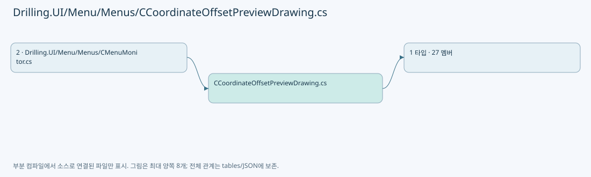

## 네임스페이스·타입·상속

| 타입 | 구분 | 원본 범위 | 선언/상속 |
| --- | --- | --- | --- |
| CCoordinateOffsetPreviewDrawing | ClassDeclaration | 7–418 | CCoordinateOffsetPreviewDrawing |

## 멤버 빠른 목록

| 이름 | 종류 | 범위 | 서명 |
| --- | --- | --- | --- |
| DesignWidth | FieldDeclaration | L9–9 | double Drilling.UI.Menu.Menus.CCoordinateOffsetPreviewDrawing.DesignWidth |
| DesignHeight | FieldDeclaration | L10–10 | double Drilling.UI.Menu.Menus.CCoordinateOffsetPreviewDrawing.DesignHeight |
| GridDivisionCount | FieldDeclaration | L11–11 | int Drilling.UI.Menu.Menus.CCoordinateOffsetPreviewDrawing.GridDivisionCount |
| DefaultMinimum | FieldDeclaration | L12–12 | double Drilling.UI.Menu.Menus.CCoordinateOffsetPreviewDrawing.DefaultMinimum |
| DefaultMaximum | FieldDeclaration | L13–13 | double Drilling.UI.Menu.Menus.CCoordinateOffsetPreviewDrawing.DefaultMaximum |
| PlotRect | FieldDeclaration | L14–14 | Rect Drilling.UI.Menu.Menus.CCoordinateOffsetPreviewDrawing.PlotRect |
| Create | MethodDeclaration | L16–84 | ImageSource Drilling.UI.Menu.Menus.CCoordinateOffsetPreviewDrawing.Create(string, string, double, double, Vector, Vector, double, double) |
| CreateReviewCamera | MethodDeclaration | L86–168 | ImageSource Drilling.UI.Menu.Menus.CCoordinateOffsetPreviewDrawing.CreateReviewCamera(string, string, double, double, double, double, Vector, Vector, double, double) |
| DrawInspectionMarker | MethodDeclaration | L170–178 | void Drilling.UI.Menu.Menus.CCoordinateOffsetPreviewDrawing.DrawInspectionMarker(DrawingContext, Point, Brush) |
| GetMarkerLabelOrigin | MethodDeclaration | L180–192 | Point Drilling.UI.Menu.Menus.CCoordinateOffsetPreviewDrawing.GetMarkerLabelOrigin(Point, bool) |
| GetAppliedLabelOrigin | MethodDeclaration | L194–203 | Point Drilling.UI.Menu.Menus.CCoordinateOffsetPreviewDrawing.GetAppliedLabelOrigin(Point) |
| CalculateOrigin | MethodDeclaration | L205–211 | Point Drilling.UI.Menu.Menus.CCoordinateOffsetPreviewDrawing.CalculateOrigin(double, double, Vector, Vector) |
| SetAxisOrigin | MethodDeclaration | L213–226 | void Drilling.UI.Menu.Menus.CCoordinateOffsetPreviewDrawing.SetAxisOrigin(ref Point, Vector, double, double) |
| ClipToPlot | MethodDeclaration | L228–246 | Point Drilling.UI.Menu.Menus.CCoordinateOffsetPreviewDrawing.ClipToPlot(Point, Point) |
| NormalizeDirection | MethodDeclaration | L248–259 | Vector Drilling.UI.Menu.Menus.CCoordinateOffsetPreviewDrawing.NormalizeDirection(Vector, Vector) |
| GetDirectionalScale | MethodDeclaration | L261–264 | double Drilling.UI.Menu.Menus.CCoordinateOffsetPreviewDrawing.GetDirectionalScale(Vector, double, double) |
| DrawPositiveAxis | MethodDeclaration | L266–298 | void Drilling.UI.Menu.Menus.CCoordinateOffsetPreviewDrawing.DrawPositiveAxis(DrawingContext, Point, Vector, string, Pen, Brush) |
| DrawGrid | MethodDeclaration | L300–342 | void Drilling.UI.Menu.Menus.CCoordinateOffsetPreviewDrawing.DrawGrid(DrawingContext, Point, double, double, Vector, Vector) |
| GetScreenTickValue | MethodDeclaration | L344–350 | double Drilling.UI.Menu.Menus.CCoordinateOffsetPreviewDrawing.GetScreenTickValue(int, bool, double, double) |
| FormatTick | MethodDeclaration | L352–358 | string Drilling.UI.Menu.Menus.CCoordinateOffsetPreviewDrawing.FormatTick(double, double) |
| DrawArrowHead | MethodDeclaration | L360–373 | void Drilling.UI.Menu.Menus.CCoordinateOffsetPreviewDrawing.DrawArrowHead(DrawingContext, Pen, Point, Point) |
| DrawText | MethodDeclaration | L375–378 | void Drilling.UI.Menu.Menus.CCoordinateOffsetPreviewDrawing.DrawText(DrawingContext, string, Point, double, Brush) |
| DrawCenteredText | MethodDeclaration | L380–384 | void Drilling.UI.Menu.Menus.CCoordinateOffsetPreviewDrawing.DrawCenteredText(DrawingContext, string, Point, double, Brush) |
| DrawRightAlignedText | MethodDeclaration | L386–390 | void Drilling.UI.Menu.Menus.CCoordinateOffsetPreviewDrawing.DrawRightAlignedText(DrawingContext, string, Point, double, Brush) |
| DrawTextWithin | MethodDeclaration | L392–398 | void Drilling.UI.Menu.Menus.CCoordinateOffsetPreviewDrawing.DrawTextWithin(DrawingContext, string, Point, double, Brush, Rect) |
| CreateText | MethodDeclaration | L400–410 | FormattedText Drilling.UI.Menu.Menus.CCoordinateOffsetPreviewDrawing.CreateText(string, double, Brush) |
| CreateBrush | MethodDeclaration | L412–417 | SolidColorBrush Drilling.UI.Menu.Menus.CCoordinateOffsetPreviewDrawing.CreateBrush(byte, byte, byte) |

## 멤버별 상세 계약·호출·처리 해설

### FieldDeclaration `DesignWidth` · L9–9

[Drilling.UI/Menu/Menus/CCoordinateOffsetPreviewDrawing.cs:9–9](https://github.com/kjuws10-rgb/A3Drilling/blob/28764c91d521777b8ee068dd7aaf2d3902ce9fe2/Drilling.UI/Menu/Menus/CCoordinateOffsetPreviewDrawing.cs#L9-L9)

| 항목 | 실제 추출 값 |
| --- | --- |
| 서명 | double Drilling.UI.Menu.Menus.CCoordinateOffsetPreviewDrawing.DesignWidth |
| 접근/수식자 | Public / public, const |
| 반환/값 타입 | double |
| 소속 타입 | NamedType:Drilling.UI.Menu.Menus.CCoordinateOffsetPreviewDrawing |

현재 부분 분석에서 직접 연결된 호출자는 없습니다. XAML/이벤트/인터페이스·델리게이트·외부 진입을 추가 확인해야 하며, 미사용으로 판정한 것이 아닙니다.

본문의 실제 연산·분기·예외·반환 순서(원문 위치 순):

| 원본 행 | 종류 | 주석 해설 |
| --- | --- | --- |
| 9 | variable-initializer | 변수의 초기값을 지정합니다: DesignWidth = 520.0 |

변경 전 점검: 입력/반환 타입, 위 호출자, 예외/취소 경로, 공유 상태와 저장·전송 소비자를 함께 확인합니다. 값의 단위나 물리 방향을 이름만으로 확정하지 않습니다.

### FieldDeclaration `DesignHeight` · L10–10

[Drilling.UI/Menu/Menus/CCoordinateOffsetPreviewDrawing.cs:10–10](https://github.com/kjuws10-rgb/A3Drilling/blob/28764c91d521777b8ee068dd7aaf2d3902ce9fe2/Drilling.UI/Menu/Menus/CCoordinateOffsetPreviewDrawing.cs#L10-L10)

| 항목 | 실제 추출 값 |
| --- | --- |
| 서명 | double Drilling.UI.Menu.Menus.CCoordinateOffsetPreviewDrawing.DesignHeight |
| 접근/수식자 | Public / public, const |
| 반환/값 타입 | double |
| 소속 타입 | NamedType:Drilling.UI.Menu.Menus.CCoordinateOffsetPreviewDrawing |

현재 부분 분석에서 직접 연결된 호출자는 없습니다. XAML/이벤트/인터페이스·델리게이트·외부 진입을 추가 확인해야 하며, 미사용으로 판정한 것이 아닙니다.

본문의 실제 연산·분기·예외·반환 순서(원문 위치 순):

| 원본 행 | 종류 | 주석 해설 |
| --- | --- | --- |
| 10 | variable-initializer | 변수의 초기값을 지정합니다: DesignHeight = 280.0 |

변경 전 점검: 입력/반환 타입, 위 호출자, 예외/취소 경로, 공유 상태와 저장·전송 소비자를 함께 확인합니다. 값의 단위나 물리 방향을 이름만으로 확정하지 않습니다.

### FieldDeclaration `GridDivisionCount` · L11–11

[Drilling.UI/Menu/Menus/CCoordinateOffsetPreviewDrawing.cs:11–11](https://github.com/kjuws10-rgb/A3Drilling/blob/28764c91d521777b8ee068dd7aaf2d3902ce9fe2/Drilling.UI/Menu/Menus/CCoordinateOffsetPreviewDrawing.cs#L11-L11)

| 항목 | 실제 추출 값 |
| --- | --- |
| 서명 | int Drilling.UI.Menu.Menus.CCoordinateOffsetPreviewDrawing.GridDivisionCount |
| 접근/수식자 | Public / public, const |
| 반환/값 타입 | int |
| 소속 타입 | NamedType:Drilling.UI.Menu.Menus.CCoordinateOffsetPreviewDrawing |

현재 부분 분석에서 직접 연결된 호출자는 없습니다. XAML/이벤트/인터페이스·델리게이트·외부 진입을 추가 확인해야 하며, 미사용으로 판정한 것이 아닙니다.

본문의 실제 연산·분기·예외·반환 순서(원문 위치 순):

| 원본 행 | 종류 | 주석 해설 |
| --- | --- | --- |
| 11 | variable-initializer | 변수의 초기값을 지정합니다: GridDivisionCount = 20 |

변경 전 점검: 입력/반환 타입, 위 호출자, 예외/취소 경로, 공유 상태와 저장·전송 소비자를 함께 확인합니다. 값의 단위나 물리 방향을 이름만으로 확정하지 않습니다.

### FieldDeclaration `DefaultMinimum` · L12–12

[Drilling.UI/Menu/Menus/CCoordinateOffsetPreviewDrawing.cs:12–12](https://github.com/kjuws10-rgb/A3Drilling/blob/28764c91d521777b8ee068dd7aaf2d3902ce9fe2/Drilling.UI/Menu/Menus/CCoordinateOffsetPreviewDrawing.cs#L12-L12)

| 항목 | 실제 추출 값 |
| --- | --- |
| 서명 | double Drilling.UI.Menu.Menus.CCoordinateOffsetPreviewDrawing.DefaultMinimum |
| 접근/수식자 | Private / private, const |
| 반환/값 타입 | double |
| 소속 타입 | NamedType:Drilling.UI.Menu.Menus.CCoordinateOffsetPreviewDrawing |

현재 부분 분석에서 직접 연결된 호출자는 없습니다. XAML/이벤트/인터페이스·델리게이트·외부 진입을 추가 확인해야 하며, 미사용으로 판정한 것이 아닙니다.

본문의 실제 연산·분기·예외·반환 순서(원문 위치 순):

| 원본 행 | 종류 | 주석 해설 |
| --- | --- | --- |
| 12 | variable-initializer | 변수의 초기값을 지정합니다: DefaultMinimum = -5.0 |

변경 전 점검: 입력/반환 타입, 위 호출자, 예외/취소 경로, 공유 상태와 저장·전송 소비자를 함께 확인합니다. 값의 단위나 물리 방향을 이름만으로 확정하지 않습니다.

### FieldDeclaration `DefaultMaximum` · L13–13

[Drilling.UI/Menu/Menus/CCoordinateOffsetPreviewDrawing.cs:13–13](https://github.com/kjuws10-rgb/A3Drilling/blob/28764c91d521777b8ee068dd7aaf2d3902ce9fe2/Drilling.UI/Menu/Menus/CCoordinateOffsetPreviewDrawing.cs#L13-L13)

| 항목 | 실제 추출 값 |
| --- | --- |
| 서명 | double Drilling.UI.Menu.Menus.CCoordinateOffsetPreviewDrawing.DefaultMaximum |
| 접근/수식자 | Private / private, const |
| 반환/값 타입 | double |
| 소속 타입 | NamedType:Drilling.UI.Menu.Menus.CCoordinateOffsetPreviewDrawing |

현재 부분 분석에서 직접 연결된 호출자는 없습니다. XAML/이벤트/인터페이스·델리게이트·외부 진입을 추가 확인해야 하며, 미사용으로 판정한 것이 아닙니다.

본문의 실제 연산·분기·예외·반환 순서(원문 위치 순):

| 원본 행 | 종류 | 주석 해설 |
| --- | --- | --- |
| 13 | variable-initializer | 변수의 초기값을 지정합니다: DefaultMaximum = 5.0 |

변경 전 점검: 입력/반환 타입, 위 호출자, 예외/취소 경로, 공유 상태와 저장·전송 소비자를 함께 확인합니다. 값의 단위나 물리 방향을 이름만으로 확정하지 않습니다.

### FieldDeclaration `PlotRect` · L14–14

[Drilling.UI/Menu/Menus/CCoordinateOffsetPreviewDrawing.cs:14–14](https://github.com/kjuws10-rgb/A3Drilling/blob/28764c91d521777b8ee068dd7aaf2d3902ce9fe2/Drilling.UI/Menu/Menus/CCoordinateOffsetPreviewDrawing.cs#L14-L14)

| 항목 | 실제 추출 값 |
| --- | --- |
| 서명 | Rect Drilling.UI.Menu.Menus.CCoordinateOffsetPreviewDrawing.PlotRect |
| 접근/수식자 | Private / private, static, readonly |
| 반환/값 타입 | Rect |
| 소속 타입 | NamedType:Drilling.UI.Menu.Menus.CCoordinateOffsetPreviewDrawing |

현재 부분 분석에서 직접 연결된 호출자는 없습니다. XAML/이벤트/인터페이스·델리게이트·외부 진입을 추가 확인해야 하며, 미사용으로 판정한 것이 아닙니다.

호출하는 대상과 해석 범위:

| 원본 행 | 표현식 | 분석 상태 | 대상/소스 위치 |
| --- | --- | --- | --- |
| 14 | new | unresolved | None |

본문의 실제 연산·분기·예외·반환 순서(원문 위치 순):

| 원본 행 | 종류 | 주석 해설 |
| --- | --- | --- |
| 14 | call | 함수·델리게이트 또는 객체 생성자를 호출합니다: new(58.0, 24.0, 406.0, 210.0) |
| 14 | variable-initializer | 변수의 초기값을 지정합니다: PlotRect = new(58.0, 24.0, 406.0, 210.0) |

변경 전 점검: 입력/반환 타입, 위 호출자, 예외/취소 경로, 공유 상태와 저장·전송 소비자를 함께 확인합니다. 값의 단위나 물리 방향을 이름만으로 확정하지 않습니다.

### MethodDeclaration `Create` · L16–84

[Drilling.UI/Menu/Menus/CCoordinateOffsetPreviewDrawing.cs:16–84](https://github.com/kjuws10-rgb/A3Drilling/blob/28764c91d521777b8ee068dd7aaf2d3902ce9fe2/Drilling.UI/Menu/Menus/CCoordinateOffsetPreviewDrawing.cs#L16-L84)

| 항목 | 실제 추출 값 |
| --- | --- |
| 서명 | ImageSource Drilling.UI.Menu.Menus.CCoordinateOffsetPreviewDrawing.Create(string, string, double, double, Vector, Vector, double, double) |
| 접근/수식자 | Public / public, static |
| 반환/값 타입 | ImageSource |
| 소속 타입 | NamedType:Drilling.UI.Menu.Menus.CCoordinateOffsetPreviewDrawing |

입력 계약:

| 이름 | 타입 | 전달 | 선택/기본값 |
| --- | --- | --- | --- |
| xAxisLabel | string | None | False /  |
| yAxisLabel | string | None | False /  |
| offsetX | double | None | False /  |
| offsetY | double | None | False /  |
| xPositiveDirection | Vector | None | False /  |
| yPositiveDirection | Vector | None | False /  |
| minimum | double | None | True / -5 |
| maximum | double | None | True / 5 |

정적 호출자로 확인된 위치:

| 호출 파일/행 | 호출 표현식 | 런타임 분기 가능 |
| --- | --- | --- |
| [Drilling.UI/Menu/Menus/CMenuMonitor.cs:3256–3264](https://github.com/kjuws10-rgb/A3Drilling/blob/28764c91d521777b8ee068dd7aaf2d3902ce9fe2/Drilling.UI/Menu/Menus/CMenuMonitor.cs#L3256-L3264) | CCoordinateOffsetPreviewDrawing.Create | False |

호출하는 대상과 해석 범위:

| 원본 행 | 표현식 | 분석 상태 | 대상/소스 위치 |
| --- | --- | --- | --- |
| 26 | string.IsNullOrWhiteSpace | resolved | bool string.IsNullOrWhiteSpace(string?) |
| 26 | xAxisLabel.Trim().ToUpperInvariant | resolved | string string.ToUpperInvariant() |
| 26 | xAxisLabel.Trim | resolved | string string.Trim() |
| 27 | string.IsNullOrWhiteSpace | resolved | bool string.IsNullOrWhiteSpace(string?) |
| 27 | yAxisLabel.Trim().ToUpperInvariant | resolved | string string.ToUpperInvariant() |
| 27 | yAxisLabel.Trim | resolved | string string.Trim() |
| 28 | NormalizeDirection | resolved | Vector Drilling.UI.Menu.Menus.CCoordinateOffsetPreviewDrawing.NormalizeDirection(Vector, Vector) · Drilling.UI/Menu/Menus/CCoordinateOffsetPreviewDrawing.cs:248 |
| 28 | new Vector | unresolved | None |
| 29 | NormalizeDirection | resolved | Vector Drilling.UI.Menu.Menus.CCoordinateOffsetPreviewDrawing.NormalizeDirection(Vector, Vector) · Drilling.UI/Menu/Menus/CCoordinateOffsetPreviewDrawing.cs:248 |
| 29 | new Vector | unresolved | None |
| 30 | double.IsFinite | resolved | bool double.IsFinite(double) |
| 30 | double.IsFinite | resolved | bool double.IsFinite(double) |
| 38 | CalculateOrigin | resolved | Point Drilling.UI.Menu.Menus.CCoordinateOffsetPreviewDrawing.CalculateOrigin(double, double, Vector, Vector) · Drilling.UI/Menu/Menus/CCoordinateOffsetPreviewDrawing.cs:205 |
| 39 | GetDirectionalScale | candidate | OverloadResolutionFailure |
| 40 | GetDirectionalScale | candidate | OverloadResolutionFailure |
| 43 | ClipToPlot | candidate | OverloadResolutionFailure |
| 44 | new DrawingGroup | unresolved | None |
| 45 | drawing.Open | unresolved | None |
| 47 | context.DrawRectangle | unresolved | None |
| 47 | CreateBrush | resolved | SolidColorBrush Drilling.UI.Menu.Menus.CCoordinateOffsetPreviewDrawing.CreateBrush(byte, byte, byte) · Drilling.UI/Menu/Menus/CCoordinateOffsetPreviewDrawing.cs:412 |
| 47 | new Rect | unresolved | None |
| 48 | DrawGrid | candidate | OverloadResolutionFailure |
| 50 | CreateBrush | resolved | SolidColorBrush Drilling.UI.Menu.Menus.CCoordinateOffsetPreviewDrawing.CreateBrush(byte, byte, byte) · Drilling.UI/Menu/Menus/CCoordinateOffsetPreviewDrawing.cs:412 |
| 51 | DrawText | candidate | OverloadResolutionFailure |
| 51 | gridStep.ToString | resolved | string double.ToString(string?, System.IFormatProvider?) |
| 51 | new Point | unresolved | None |
| 52 | CreateBrush | resolved | SolidColorBrush Drilling.UI.Menu.Menus.CCoordinateOffsetPreviewDrawing.CreateBrush(byte, byte, byte) · Drilling.UI/Menu/Menus/CCoordinateOffsetPreviewDrawing.cs:412 |
| 53 | CreateBrush | resolved | SolidColorBrush Drilling.UI.Menu.Menus.CCoordinateOffsetPreviewDrawing.CreateBrush(byte, byte, byte) · Drilling.UI/Menu/Menus/CCoordinateOffsetPreviewDrawing.cs:412 |
| 55 | new Pen | unresolved | None |
| 56 | vectorPen.Freeze | unresolved | None |
| 57 | context.DrawLine | unresolved | None |
| 58 | DrawArrowHead | candidate | OverloadResolutionFailure |
| 60 | CreateBrush | resolved | SolidColorBrush Drilling.UI.Menu.Menus.CCoordinateOffsetPreviewDrawing.CreateBrush(byte, byte, byte) · Drilling.UI/Menu/Menus/CCoordinateOffsetPreviewDrawing.cs:412 |
| 61 | new Pen | unresolved | None |
| 62 | designPen.Freeze | unresolved | None |
| 63 | context.DrawEllipse | unresolved | None |
| 63 | CreateBrush | resolved | SolidColorBrush Drilling.UI.Menu.Menus.CCoordinateOffsetPreviewDrawing.CreateBrush(byte, byte, byte) · Drilling.UI/Menu/Menus/CCoordinateOffsetPreviewDrawing.cs:412 |
| 65 | new Pen | unresolved | None |
| 65 | CreateBrush | resolved | SolidColorBrush Drilling.UI.Menu.Menus.CCoordinateOffsetPreviewDrawing.CreateBrush(byte, byte, byte) · Drilling.UI/Menu/Menus/CCoordinateOffsetPreviewDrawing.cs:412 |
| 66 | appliedPen.Freeze | unresolved | None |
| 67 | context.DrawEllipse | unresolved | None |
| 69 | DrawTextWithin | candidate | OverloadResolutionFailure |
| 69 | new Point | unresolved | None |
| 70 | offsetX.ToString | resolved | string double.ToString(string?, System.IFormatProvider?) |
| 70 | offsetY.ToString | resolved | string double.ToString(string?, System.IFormatProvider?) |
| 71 | DrawTextWithin | candidate | OverloadResolutionFailure |
| 71 | GetAppliedLabelOrigin | resolved | Point Drilling.UI.Menu.Menus.CCoordinateOffsetPreviewDrawing.GetAppliedLabelOrigin(Point) · Drilling.UI/Menu/Menus/CCoordinateOffsetPreviewDrawing.cs:194 |
| 72 | CreateBrush | resolved | SolidColorBrush Drilling.UI.Menu.Menus.CCoordinateOffsetPreviewDrawing.CreateBrush(byte, byte, byte) · Drilling.UI/Menu/Menus/CCoordinateOffsetPreviewDrawing.cs:412 |
| 73 | new Pen | unresolved | None |
| 74 | axisPen.Freeze | unresolved | None |
| 75 | DrawPositiveAxis | candidate | OverloadResolutionFailure |
| 76 | DrawPositiveAxis | candidate | OverloadResolutionFailure |
| 77 | context.DrawRectangle | unresolved | None |
| 77 | new Pen | unresolved | None |
| 77 | CreateBrush | resolved | SolidColorBrush Drilling.UI.Menu.Menus.CCoordinateOffsetPreviewDrawing.CreateBrush(byte, byte, byte) · Drilling.UI/Menu/Menus/CCoordinateOffsetPreviewDrawing.cs:412 |
| 80 | drawing.Freeze | unresolved | None |
| 81 | new DrawingImage | unresolved | None |
| 82 | image.Freeze | unresolved | None |

본문의 실제 연산·분기·예외·반환 순서(원문 위치 순):

| 원본 행 | 종류 | 주석 해설 |
| --- | --- | --- |
| 26 | assignment | 값을 대상에 대입합니다: xAxisLabel = string.IsNullOrWhiteSpace(xAxisLabel) ? "X" : xAxisLabel.Trim().ToUpperInvariant() |
| 26 | call | 함수·델리게이트 또는 객체 생성자를 호출합니다: string.IsNullOrWhiteSpace(xAxisLabel) |
| 26 | call | 함수·델리게이트 또는 객체 생성자를 호출합니다: xAxisLabel.Trim().ToUpperInvariant() |
| 26 | call | 함수·델리게이트 또는 객체 생성자를 호출합니다: xAxisLabel.Trim() |
| 26 | conditional-expression | 조건에 따라 결과식을 선택합니다: string.IsNullOrWhiteSpace(xAxisLabel) ? "X" : xAxisLabel.Trim().ToUpperInvariant() |
| 27 | assignment | 값을 대상에 대입합니다: yAxisLabel = string.IsNullOrWhiteSpace(yAxisLabel) ? "Y" : yAxisLabel.Trim().ToUpperInvariant() |
| 27 | call | 함수·델리게이트 또는 객체 생성자를 호출합니다: string.IsNullOrWhiteSpace(yAxisLabel) |
| 27 | call | 함수·델리게이트 또는 객체 생성자를 호출합니다: yAxisLabel.Trim().ToUpperInvariant() |
| 27 | call | 함수·델리게이트 또는 객체 생성자를 호출합니다: yAxisLabel.Trim() |
| 27 | conditional-expression | 조건에 따라 결과식을 선택합니다: string.IsNullOrWhiteSpace(yAxisLabel) ? "Y" : yAxisLabel.Trim().ToUpperInvariant() |
| 28 | assignment | 값을 대상에 대입합니다: xPositiveDirection = NormalizeDirection(xPositiveDirection, new Vector(1.0, 0.0)) |
| 28 | call | 함수·델리게이트 또는 객체 생성자를 호출합니다: NormalizeDirection(xPositiveDirection, new Vector(1.0, 0.0)) |
| 28 | call | 함수·델리게이트 또는 객체 생성자를 호출합니다: new Vector(1.0, 0.0) |
| 29 | assignment | 값을 대상에 대입합니다: yPositiveDirection = NormalizeDirection(yPositiveDirection, new Vector(0.0, 1.0)) |
| 29 | call | 함수·델리게이트 또는 객체 생성자를 호출합니다: NormalizeDirection(yPositiveDirection, new Vector(0.0, 1.0)) |
| 29 | call | 함수·델리게이트 또는 객체 생성자를 호출합니다: new Vector(0.0, 1.0) |
| 30 | call | 함수·델리게이트 또는 객체 생성자를 호출합니다: double.IsFinite(minimum) |
| 30 | call | 함수·델리게이트 또는 객체 생성자를 호출합니다: double.IsFinite(maximum) |
| 30 | if | 조건에 따라 분기합니다: if (!double.IsFinite(minimum) &#124;&#124; !double.IsFinite(maximum) &#124;&#124; minimum >= 0.0 &#124;&#124; maximum <= 0.0 &#124;&#124; minimum >= maximum) |
| 32 | assignment | 값을 대상에 대입합니다: minimum = DefaultMinimum |
| 33 | assignment | 값을 대상에 대입합니다: maximum = DefaultMaximum |
| 36 | local-declaration | 지역 변수를 선언합니다: var span = maximum - minimum; |
| 36 | variable-initializer | 변수의 초기값을 지정합니다: span = maximum - minimum |
| 37 | local-declaration | 지역 변수를 선언합니다: var gridStep = span / GridDivisionCount; |
| 37 | variable-initializer | 변수의 초기값을 지정합니다: gridStep = span / GridDivisionCount |
| 38 | call | 함수·델리게이트 또는 객체 생성자를 호출합니다: CalculateOrigin(minimum, maximum, xPositiveDirection, yPositiveDirection) |
| 38 | local-declaration | 지역 변수를 선언합니다: var origin = CalculateOrigin(minimum, maximum, xPositiveDirection, yPositiveDirection); |
| 38 | variable-initializer | 변수의 초기값을 지정합니다: origin = CalculateOrigin(minimum, maximum, xPositiveDirection, yPositiveDirection) |
| 39 | call | 함수·델리게이트 또는 객체 생성자를 호출합니다: GetDirectionalScale(xPositiveDirection, PlotRect.Width / span, PlotRect.Height / span) |
| 39 | local-declaration | 지역 변수를 선언합니다: var xScale = GetDirectionalScale(xPositiveDirection, PlotRect.Width / span, PlotRect.Height / span); |
| 39 | variable-initializer | 변수의 초기값을 지정합니다: xScale = GetDirectionalScale(xPositiveDirection, PlotRect.Width / span, PlotRect.Height / span) |
| 40 | call | 함수·델리게이트 또는 객체 생성자를 호출합니다: GetDirectionalScale(yPositiveDirection, PlotRect.Width / span, PlotRect.Height / span) |
| 40 | local-declaration | 지역 변수를 선언합니다: var yScale = GetDirectionalScale(yPositiveDirection, PlotRect.Width / span, PlotRect.Height / span); |
| 40 | variable-initializer | 변수의 초기값을 지정합니다: yScale = GetDirectionalScale(yPositiveDirection, PlotRect.Width / span, PlotRect.Height / span) |
| 41 | local-declaration | 지역 변수를 선언합니다: var rawApplied = origin + (xPositiveDirection * (offsetX * xScale)) + (yPositiveDirection * (offsetY * yScale)); |
| 41 | variable-initializer | 변수의 초기값을 지정합니다: rawApplied = origin + (xPositiveDirection * (offsetX * xScale)) + (yPositiveDirection * (offsetY * yScale)) |
| 42 | local-declaration | 지역 변수를 선언합니다: var outOfRange = offsetX < minimum &#124;&#124; offsetX > maximum &#124;&#124; offsetY < minimum &#124;&#124; offsetY > maximum; |
| 42 | variable-initializer | 변수의 초기값을 지정합니다: outOfRange = offsetX < minimum &#124;&#124; offsetX > maximum &#124;&#124; offsetY < minimum &#124;&#124; offsetY > maximum |
| 43 | call | 함수·델리게이트 또는 객체 생성자를 호출합니다: ClipToPlot(origin, rawApplied) |
| 43 | local-declaration | 지역 변수를 선언합니다: var applied = ClipToPlot(origin, rawApplied); |
| 43 | variable-initializer | 변수의 초기값을 지정합니다: applied = ClipToPlot(origin, rawApplied) |
| 44 | call | 함수·델리게이트 또는 객체 생성자를 호출합니다: new DrawingGroup() |
| 44 | local-declaration | 지역 변수를 선언합니다: var drawing = new DrawingGroup(); |
| 44 | variable-initializer | 변수의 초기값을 지정합니다: drawing = new DrawingGroup() |
| 45 | call | 함수·델리게이트 또는 객체 생성자를 호출합니다: drawing.Open() |
| 45 | variable-initializer | 변수의 초기값을 지정합니다: context = drawing.Open() |
| 45 | using | 자원 사용과 정리 범위를 지정합니다: using (var context = drawing.Open()) |
| 47 | call | 함수·델리게이트 또는 객체 생성자를 호출합니다: context.DrawRectangle(CreateBrush(17, 24, 32), null, new Rect(0.0, 0.0, DesignWidth, DesignHeight)) |
| 47 | call | 함수·델리게이트 또는 객체 생성자를 호출합니다: CreateBrush(17, 24, 32) |
| 47 | call | 함수·델리게이트 또는 객체 생성자를 호출합니다: new Rect(0.0, 0.0, DesignWidth, DesignHeight) |
| 48 | call | 함수·델리게이트 또는 객체 생성자를 호출합니다: DrawGrid(context, origin, minimum, maximum, xPositiveDirection, yPositiveDirection) |
| 50 | call | 함수·델리게이트 또는 객체 생성자를 호출합니다: CreateBrush(148, 163, 184) |
| 50 | local-declaration | 지역 변수를 선언합니다: var scaleBrush = CreateBrush(148, 163, 184); |
| 50 | variable-initializer | 변수의 초기값을 지정합니다: scaleBrush = CreateBrush(148, 163, 184) |
| 51 | call | 함수·델리게이트 또는 객체 생성자를 호출합니다: DrawText(context, $"GRID {gridStep.ToString("0.###", CultureInfo.InvariantCulture)} mm / DIV", new Point(PlotRect.Left, 4.0), 9.0, scaleBrush) |
| 51 | call | 함수·델리게이트 또는 객체 생성자를 호출합니다: gridStep.ToString("0.###", CultureInfo.InvariantCulture) |
| 51 | call | 함수·델리게이트 또는 객체 생성자를 호출합니다: new Point(PlotRect.Left, 4.0) |
| 52 | call | 함수·델리게이트 또는 객체 생성자를 호출합니다: CreateBrush(74, 222, 128) |
| 52 | local-declaration | 지역 변수를 선언합니다: var appliedBrush = CreateBrush(74, 222, 128); |
| 52 | variable-initializer | 변수의 초기값을 지정합니다: appliedBrush = CreateBrush(74, 222, 128) |
| 53 | call | 함수·델리게이트 또는 객체 생성자를 호출합니다: CreateBrush(248, 113, 113) |
| 53 | conditional-expression | 조건에 따라 결과식을 선택합니다: outOfRange ? CreateBrush(248, 113, 113) : appliedBrush |
| 53 | local-declaration | 지역 변수를 선언합니다: var deltaBrush = outOfRange ? CreateBrush(248, 113, 113) : appliedBrush; |
| 53 | variable-initializer | 변수의 초기값을 지정합니다: deltaBrush = outOfRange ? CreateBrush(248, 113, 113) : appliedBrush |
| 55 | call | 함수·델리게이트 또는 객체 생성자를 호출합니다: new Pen(appliedBrush, 1.6) |
| 55 | local-declaration | 지역 변수를 선언합니다: var vectorPen = new Pen(appliedBrush, 1.6); |
| 55 | variable-initializer | 변수의 초기값을 지정합니다: vectorPen = new Pen(appliedBrush, 1.6) |
| 56 | call | 함수·델리게이트 또는 객체 생성자를 호출합니다: vectorPen.Freeze() |
| 57 | call | 함수·델리게이트 또는 객체 생성자를 호출합니다: context.DrawLine(vectorPen, origin, applied) |
| 58 | call | 함수·델리게이트 또는 객체 생성자를 호출합니다: DrawArrowHead(context, vectorPen, origin, applied) |
| 60 | call | 함수·델리게이트 또는 객체 생성자를 호출합니다: CreateBrush(203, 213, 225) |
| 60 | local-declaration | 지역 변수를 선언합니다: var designBrush = CreateBrush(203, 213, 225); |
| 60 | variable-initializer | 변수의 초기값을 지정합니다: designBrush = CreateBrush(203, 213, 225) |
| 61 | call | 함수·델리게이트 또는 객체 생성자를 호출합니다: new Pen(designBrush, 1.8) |
| 61 | local-declaration | 지역 변수를 선언합니다: var designPen = new Pen(designBrush, 1.8); |
| 61 | variable-initializer | 변수의 초기값을 지정합니다: designPen = new Pen(designBrush, 1.8) |
| 62 | call | 함수·델리게이트 또는 객체 생성자를 호출합니다: designPen.Freeze() |
| 63 | call | 함수·델리게이트 또는 객체 생성자를 호출합니다: context.DrawEllipse(CreateBrush(30, 41, 59), designPen, origin, 6.0, 6.0) |
| 63 | call | 함수·델리게이트 또는 객체 생성자를 호출합니다: CreateBrush(30, 41, 59) |
| 65 | call | 함수·델리게이트 또는 객체 생성자를 호출합니다: new Pen(CreateBrush(187, 247, 208), 1.0) |
| 65 | call | 함수·델리게이트 또는 객체 생성자를 호출합니다: CreateBrush(187, 247, 208) |
| 65 | local-declaration | 지역 변수를 선언합니다: var appliedPen = new Pen(CreateBrush(187, 247, 208), 1.0); |
| 65 | variable-initializer | 변수의 초기값을 지정합니다: appliedPen = new Pen(CreateBrush(187, 247, 208), 1.0) |
| 66 | call | 함수·델리게이트 또는 객체 생성자를 호출합니다: appliedPen.Freeze() |
| 67 | call | 함수·델리게이트 또는 객체 생성자를 호출합니다: context.DrawEllipse(appliedBrush, appliedPen, applied, 4.5, 4.5) |
| 69 | call | 함수·델리게이트 또는 객체 생성자를 호출합니다: DrawTextWithin(context, "BASE", new Point(origin.X + 9.0, origin.Y + 7.0), 10.0, designBrush, PlotRect) |
| 69 | call | 함수·델리게이트 또는 객체 생성자를 호출합니다: new Point(origin.X + 9.0, origin.Y + 7.0) |
| 70 | call | 함수·델리게이트 또는 객체 생성자를 호출합니다: offsetX.ToString("0.000", CultureInfo.InvariantCulture) |
| 70 | call | 함수·델리게이트 또는 객체 생성자를 호출합니다: offsetY.ToString("0.000", CultureInfo.InvariantCulture) |
| 70 | conditional-expression | 조건에 따라 결과식을 선택합니다: outOfRange ? "APPLIED · OUT" : "APPLIED" |
| 70 | local-declaration | 지역 변수를 선언합니다: var appliedLabel = $"{(outOfRange ? "APPLIED · OUT" : "APPLIED")}\nΔX {offsetX.ToString("0.000", CultureInfo.InvariantCulture)} / ΔY {offsetY.ToString("0.000", CultureInfo.InvariantCulture)} mm"; |
| 70 | variable-initializer | 변수의 초기값을 지정합니다: appliedLabel = $"{(outOfRange ? "APPLIED · OUT" : "APPLIED")}\nΔX {offsetX.ToString("0.000", CultureInfo.InvariantCulture)} / ΔY {offsetY.ToString("0.000", CultureInfo.InvariantCulture)} mm" |
| 71 | call | 함수·델리게이트 또는 객체 생성자를 호출합니다: DrawTextWithin(context, appliedLabel, GetAppliedLabelOrigin(applied), 9.0, deltaBrush, PlotRect) |
| 71 | call | 함수·델리게이트 또는 객체 생성자를 호출합니다: GetAppliedLabelOrigin(applied) |
| 72 | call | 함수·델리게이트 또는 객체 생성자를 호출합니다: CreateBrush(125, 211, 252) |
| 72 | local-declaration | 지역 변수를 선언합니다: var axisBrush = CreateBrush(125, 211, 252); |
| 72 | variable-initializer | 변수의 초기값을 지정합니다: axisBrush = CreateBrush(125, 211, 252) |
| 73 | call | 함수·델리게이트 또는 객체 생성자를 호출합니다: new Pen(axisBrush, 1.4) |
| 73 | local-declaration | 지역 변수를 선언합니다: var axisPen = new Pen(axisBrush, 1.4); |
| 73 | variable-initializer | 변수의 초기값을 지정합니다: axisPen = new Pen(axisBrush, 1.4) |
| 74 | call | 함수·델리게이트 또는 객체 생성자를 호출합니다: axisPen.Freeze() |
| 75 | call | 함수·델리게이트 또는 객체 생성자를 호출합니다: DrawPositiveAxis(context, origin, xPositiveDirection, xAxisLabel, axisPen, axisBrush) |
| 76 | call | 함수·델리게이트 또는 객체 생성자를 호출합니다: DrawPositiveAxis(context, origin, yPositiveDirection, yAxisLabel, axisPen, axisBrush) |
| 77 | call | 함수·델리게이트 또는 객체 생성자를 호출합니다: context.DrawRectangle(null, new Pen(CreateBrush(71, 85, 105), 1.0), PlotRect) |
| 77 | call | 함수·델리게이트 또는 객체 생성자를 호출합니다: new Pen(CreateBrush(71, 85, 105), 1.0) |
| 77 | call | 함수·델리게이트 또는 객체 생성자를 호출합니다: CreateBrush(71, 85, 105) |
| 80 | call | 함수·델리게이트 또는 객체 생성자를 호출합니다: drawing.Freeze() |
| 81 | call | 함수·델리게이트 또는 객체 생성자를 호출합니다: new DrawingImage(drawing) |
| 81 | local-declaration | 지역 변수를 선언합니다: var image = new DrawingImage(drawing); |
| 81 | variable-initializer | 변수의 초기값을 지정합니다: image = new DrawingImage(drawing) |
| 82 | call | 함수·델리게이트 또는 객체 생성자를 호출합니다: image.Freeze() |
| 83 | return | 호출자에게 값 또는 제어를 반환합니다: return image; |

제어 구문의 포함 구조(실제 실행 순서/CFG가 아닌 구문 탐색 그림):

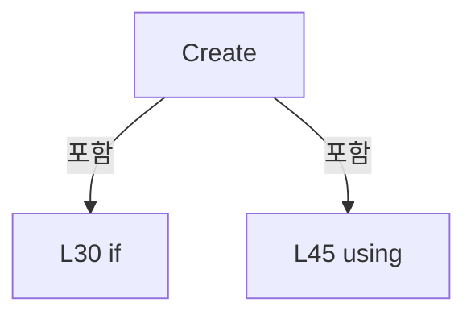

변경 전 점검: 입력/반환 타입, 위 호출자, 예외/취소 경로, 공유 상태와 저장·전송 소비자를 함께 확인합니다. 값의 단위나 물리 방향을 이름만으로 확정하지 않습니다.

### MethodDeclaration `CreateReviewCamera` · L86–168

[Drilling.UI/Menu/Menus/CCoordinateOffsetPreviewDrawing.cs:86–168](https://github.com/kjuws10-rgb/A3Drilling/blob/28764c91d521777b8ee068dd7aaf2d3902ce9fe2/Drilling.UI/Menu/Menus/CCoordinateOffsetPreviewDrawing.cs#L86-L168)

| 항목 | 실제 추출 값 |
| --- | --- |
| 서명 | ImageSource Drilling.UI.Menu.Menus.CCoordinateOffsetPreviewDrawing.CreateReviewCamera(string, string, double, double, double, double, Vector, Vector, double, double) |
| 접근/수식자 | Public / public, static |
| 반환/값 타입 | ImageSource |
| 소속 타입 | NamedType:Drilling.UI.Menu.Menus.CCoordinateOffsetPreviewDrawing |

입력 계약:

| 이름 | 타입 | 전달 | 선택/기본값 |
| --- | --- | --- | --- |
| xAxisLabel | string | None | False /  |
| yAxisLabel | string | None | False /  |
| machiningOffsetX | double | None | False /  |
| machiningOffsetY | double | None | False /  |
| inspectionOffsetX | double | None | False /  |
| inspectionOffsetY | double | None | False /  |
| xPositiveDirection | Vector | None | False /  |
| yPositiveDirection | Vector | None | False /  |
| minimum | double | None | True / -5 |
| maximum | double | None | True / 5 |

정적 호출자로 확인된 위치:

| 호출 파일/행 | 호출 표현식 | 런타임 분기 가능 |
| --- | --- | --- |
| [Drilling.UI/Menu/Menus/CMenuMonitor.cs:3241–3251](https://github.com/kjuws10-rgb/A3Drilling/blob/28764c91d521777b8ee068dd7aaf2d3902ce9fe2/Drilling.UI/Menu/Menus/CMenuMonitor.cs#L3241-L3251) | CCoordinateOffsetPreviewDrawing.CreateReviewCamera | False |

호출하는 대상과 해석 범위:

| 원본 행 | 표현식 | 분석 상태 | 대상/소스 위치 |
| --- | --- | --- | --- |
| 98 | string.IsNullOrWhiteSpace | resolved | bool string.IsNullOrWhiteSpace(string?) |
| 98 | xAxisLabel.Trim().ToUpperInvariant | resolved | string string.ToUpperInvariant() |
| 98 | xAxisLabel.Trim | resolved | string string.Trim() |
| 99 | string.IsNullOrWhiteSpace | resolved | bool string.IsNullOrWhiteSpace(string?) |
| 99 | yAxisLabel.Trim().ToUpperInvariant | resolved | string string.ToUpperInvariant() |
| 99 | yAxisLabel.Trim | resolved | string string.Trim() |
| 100 | NormalizeDirection | resolved | Vector Drilling.UI.Menu.Menus.CCoordinateOffsetPreviewDrawing.NormalizeDirection(Vector, Vector) · Drilling.UI/Menu/Menus/CCoordinateOffsetPreviewDrawing.cs:248 |
| 100 | new Vector | unresolved | None |
| 101 | NormalizeDirection | resolved | Vector Drilling.UI.Menu.Menus.CCoordinateOffsetPreviewDrawing.NormalizeDirection(Vector, Vector) · Drilling.UI/Menu/Menus/CCoordinateOffsetPreviewDrawing.cs:248 |
| 101 | new Vector | unresolved | None |
| 102 | double.IsFinite | resolved | bool double.IsFinite(double) |
| 102 | double.IsFinite | resolved | bool double.IsFinite(double) |
| 110 | CalculateOrigin | resolved | Point Drilling.UI.Menu.Menus.CCoordinateOffsetPreviewDrawing.CalculateOrigin(double, double, Vector, Vector) · Drilling.UI/Menu/Menus/CCoordinateOffsetPreviewDrawing.cs:205 |
| 111 | GetDirectionalScale | candidate | OverloadResolutionFailure |
| 112 | GetDirectionalScale | candidate | OverloadResolutionFailure |
| 117 | ClipToPlot | candidate | OverloadResolutionFailure |
| 118 | ClipToPlot | candidate | OverloadResolutionFailure |
| 119 | new DrawingGroup | unresolved | None |
| 120 | drawing.Open | unresolved | None |
| 122 | context.DrawRectangle | unresolved | None |
| 122 | CreateBrush | resolved | SolidColorBrush Drilling.UI.Menu.Menus.CCoordinateOffsetPreviewDrawing.CreateBrush(byte, byte, byte) · Drilling.UI/Menu/Menus/CCoordinateOffsetPreviewDrawing.cs:412 |
| 122 | new Rect | unresolved | None |
| 123 | DrawGrid | candidate | OverloadResolutionFailure |
| 125 | CreateBrush | resolved | SolidColorBrush Drilling.UI.Menu.Menus.CCoordinateOffsetPreviewDrawing.CreateBrush(byte, byte, byte) · Drilling.UI/Menu/Menus/CCoordinateOffsetPreviewDrawing.cs:412 |
| 126 | DrawText | candidate | OverloadResolutionFailure |
| 126 | gridStep.ToString | resolved | string double.ToString(string?, System.IFormatProvider?) |
| 126 | new Point | unresolved | None |
| 128 | CreateBrush | resolved | SolidColorBrush Drilling.UI.Menu.Menus.CCoordinateOffsetPreviewDrawing.CreateBrush(byte, byte, byte) · Drilling.UI/Menu/Menus/CCoordinateOffsetPreviewDrawing.cs:412 |
| 129 | CreateBrush | resolved | SolidColorBrush Drilling.UI.Menu.Menus.CCoordinateOffsetPreviewDrawing.CreateBrush(byte, byte, byte) · Drilling.UI/Menu/Menus/CCoordinateOffsetPreviewDrawing.cs:412 |
| 130 | new Pen | unresolved | None |
| 131 | machiningVectorPen.Freeze | unresolved | None |
| 132 | context.DrawLine | unresolved | None |
| 134 | CreateBrush | resolved | SolidColorBrush Drilling.UI.Menu.Menus.CCoordinateOffsetPreviewDrawing.CreateBrush(byte, byte, byte) · Drilling.UI/Menu/Menus/CCoordinateOffsetPreviewDrawing.cs:412 |
| 135 | CreateBrush | resolved | SolidColorBrush Drilling.UI.Menu.Menus.CCoordinateOffsetPreviewDrawing.CreateBrush(byte, byte, byte) · Drilling.UI/Menu/Menus/CCoordinateOffsetPreviewDrawing.cs:412 |
| 136 | new Pen | unresolved | None |
| 137 | inspectionVectorPen.Freeze | unresolved | None |
| 138 | context.DrawLine | unresolved | None |
| 140 | CreateBrush | resolved | SolidColorBrush Drilling.UI.Menu.Menus.CCoordinateOffsetPreviewDrawing.CreateBrush(byte, byte, byte) · Drilling.UI/Menu/Menus/CCoordinateOffsetPreviewDrawing.cs:412 |
| 141 | new Pen | unresolved | None |
| 142 | designPen.Freeze | unresolved | None |
| 143 | context.DrawEllipse | unresolved | None |
| 143 | CreateBrush | resolved | SolidColorBrush Drilling.UI.Menu.Menus.CCoordinateOffsetPreviewDrawing.CreateBrush(byte, byte, byte) · Drilling.UI/Menu/Menus/CCoordinateOffsetPreviewDrawing.cs:412 |
| 144 | DrawTextWithin | candidate | OverloadResolutionFailure |
| 144 | new Point | unresolved | None |
| 146 | DrawInspectionMarker | candidate | OverloadResolutionFailure |
| 147 | new Pen | unresolved | None |
| 147 | CreateBrush | resolved | SolidColorBrush Drilling.UI.Menu.Menus.CCoordinateOffsetPreviewDrawing.CreateBrush(byte, byte, byte) · Drilling.UI/Menu/Menus/CCoordinateOffsetPreviewDrawing.cs:412 |
| 148 | machiningPen.Freeze | unresolved | None |
| 149 | context.DrawEllipse | unresolved | None |
| 151 | machiningOffsetX.ToString | resolved | string double.ToString(string?, System.IFormatProvider?) |
| 151 | machiningOffsetY.ToString | resolved | string double.ToString(string?, System.IFormatProvider?) |
| 152 | inspectionOffsetX.ToString | resolved | string double.ToString(string?, System.IFormatProvider?) |
| 152 | inspectionOffsetY.ToString | resolved | string double.ToString(string?, System.IFormatProvider?) |
| 153 | DrawTextWithin | candidate | OverloadResolutionFailure |
| 153 | GetMarkerLabelOrigin | resolved | Point Drilling.UI.Menu.Menus.CCoordinateOffsetPreviewDrawing.GetMarkerLabelOrigin(Point, bool) · Drilling.UI/Menu/Menus/CCoordinateOffsetPreviewDrawing.cs:180 |
| 154 | DrawTextWithin | candidate | OverloadResolutionFailure |
| 154 | GetMarkerLabelOrigin | resolved | Point Drilling.UI.Menu.Menus.CCoordinateOffsetPreviewDrawing.GetMarkerLabelOrigin(Point, bool) · Drilling.UI/Menu/Menus/CCoordinateOffsetPreviewDrawing.cs:180 |
| 156 | CreateBrush | resolved | SolidColorBrush Drilling.UI.Menu.Menus.CCoordinateOffsetPreviewDrawing.CreateBrush(byte, byte, byte) · Drilling.UI/Menu/Menus/CCoordinateOffsetPreviewDrawing.cs:412 |
| 157 | new Pen | unresolved | None |
| 158 | axisPen.Freeze | unresolved | None |
| 159 | DrawPositiveAxis | candidate | OverloadResolutionFailure |
| 160 | DrawPositiveAxis | candidate | OverloadResolutionFailure |
| 161 | context.DrawRectangle | unresolved | None |
| 161 | new Pen | unresolved | None |
| 161 | CreateBrush | resolved | SolidColorBrush Drilling.UI.Menu.Menus.CCoordinateOffsetPreviewDrawing.CreateBrush(byte, byte, byte) · Drilling.UI/Menu/Menus/CCoordinateOffsetPreviewDrawing.cs:412 |
| 164 | drawing.Freeze | unresolved | None |
| 165 | new DrawingImage | unresolved | None |
| 166 | image.Freeze | unresolved | None |

본문의 실제 연산·분기·예외·반환 순서(원문 위치 순):

| 원본 행 | 종류 | 주석 해설 |
| --- | --- | --- |
| 98 | assignment | 값을 대상에 대입합니다: xAxisLabel = string.IsNullOrWhiteSpace(xAxisLabel) ? "X" : xAxisLabel.Trim().ToUpperInvariant() |
| 98 | call | 함수·델리게이트 또는 객체 생성자를 호출합니다: string.IsNullOrWhiteSpace(xAxisLabel) |
| 98 | call | 함수·델리게이트 또는 객체 생성자를 호출합니다: xAxisLabel.Trim().ToUpperInvariant() |
| 98 | call | 함수·델리게이트 또는 객체 생성자를 호출합니다: xAxisLabel.Trim() |
| 98 | conditional-expression | 조건에 따라 결과식을 선택합니다: string.IsNullOrWhiteSpace(xAxisLabel) ? "X" : xAxisLabel.Trim().ToUpperInvariant() |
| 99 | assignment | 값을 대상에 대입합니다: yAxisLabel = string.IsNullOrWhiteSpace(yAxisLabel) ? "Y" : yAxisLabel.Trim().ToUpperInvariant() |
| 99 | call | 함수·델리게이트 또는 객체 생성자를 호출합니다: string.IsNullOrWhiteSpace(yAxisLabel) |
| 99 | call | 함수·델리게이트 또는 객체 생성자를 호출합니다: yAxisLabel.Trim().ToUpperInvariant() |
| 99 | call | 함수·델리게이트 또는 객체 생성자를 호출합니다: yAxisLabel.Trim() |
| 99 | conditional-expression | 조건에 따라 결과식을 선택합니다: string.IsNullOrWhiteSpace(yAxisLabel) ? "Y" : yAxisLabel.Trim().ToUpperInvariant() |
| 100 | assignment | 값을 대상에 대입합니다: xPositiveDirection = NormalizeDirection(xPositiveDirection, new Vector(1.0, 0.0)) |
| 100 | call | 함수·델리게이트 또는 객체 생성자를 호출합니다: NormalizeDirection(xPositiveDirection, new Vector(1.0, 0.0)) |
| 100 | call | 함수·델리게이트 또는 객체 생성자를 호출합니다: new Vector(1.0, 0.0) |
| 101 | assignment | 값을 대상에 대입합니다: yPositiveDirection = NormalizeDirection(yPositiveDirection, new Vector(0.0, 1.0)) |
| 101 | call | 함수·델리게이트 또는 객체 생성자를 호출합니다: NormalizeDirection(yPositiveDirection, new Vector(0.0, 1.0)) |
| 101 | call | 함수·델리게이트 또는 객체 생성자를 호출합니다: new Vector(0.0, 1.0) |
| 102 | call | 함수·델리게이트 또는 객체 생성자를 호출합니다: double.IsFinite(minimum) |
| 102 | call | 함수·델리게이트 또는 객체 생성자를 호출합니다: double.IsFinite(maximum) |
| 102 | if | 조건에 따라 분기합니다: if (!double.IsFinite(minimum) &#124;&#124; !double.IsFinite(maximum) &#124;&#124; minimum >= 0.0 &#124;&#124; maximum <= 0.0 &#124;&#124; minimum >= maximum) |
| 104 | assignment | 값을 대상에 대입합니다: minimum = DefaultMinimum |
| 105 | assignment | 값을 대상에 대입합니다: maximum = DefaultMaximum |
| 108 | local-declaration | 지역 변수를 선언합니다: var span = maximum - minimum; |
| 108 | variable-initializer | 변수의 초기값을 지정합니다: span = maximum - minimum |
| 109 | local-declaration | 지역 변수를 선언합니다: var gridStep = span / GridDivisionCount; |
| 109 | variable-initializer | 변수의 초기값을 지정합니다: gridStep = span / GridDivisionCount |
| 110 | call | 함수·델리게이트 또는 객체 생성자를 호출합니다: CalculateOrigin(minimum, maximum, xPositiveDirection, yPositiveDirection) |
| 110 | local-declaration | 지역 변수를 선언합니다: var origin = CalculateOrigin(minimum, maximum, xPositiveDirection, yPositiveDirection); |
| 110 | variable-initializer | 변수의 초기값을 지정합니다: origin = CalculateOrigin(minimum, maximum, xPositiveDirection, yPositiveDirection) |
| 111 | call | 함수·델리게이트 또는 객체 생성자를 호출합니다: GetDirectionalScale(xPositiveDirection, PlotRect.Width / span, PlotRect.Height / span) |
| 111 | local-declaration | 지역 변수를 선언합니다: var xScale = GetDirectionalScale(xPositiveDirection, PlotRect.Width / span, PlotRect.Height / span); |
| 111 | variable-initializer | 변수의 초기값을 지정합니다: xScale = GetDirectionalScale(xPositiveDirection, PlotRect.Width / span, PlotRect.Height / span) |
| 112 | call | 함수·델리게이트 또는 객체 생성자를 호출합니다: GetDirectionalScale(yPositiveDirection, PlotRect.Width / span, PlotRect.Height / span) |
| 112 | local-declaration | 지역 변수를 선언합니다: var yScale = GetDirectionalScale(yPositiveDirection, PlotRect.Width / span, PlotRect.Height / span); |
| 112 | variable-initializer | 변수의 초기값을 지정합니다: yScale = GetDirectionalScale(yPositiveDirection, PlotRect.Width / span, PlotRect.Height / span) |
| 113 | local-declaration | 지역 변수를 선언합니다: var rawMachining = origin + (xPositiveDirection * (machiningOffsetX * xScale)) + (yPositiveDirection * (machiningOffsetY * yScale)); |
| 113 | variable-initializer | 변수의 초기값을 지정합니다: rawMachining = origin + (xPositiveDirection * (machiningOffsetX * xScale)) + (yPositiveDirection * (machiningOffsetY * yScale)) |
| 114 | local-declaration | 지역 변수를 선언합니다: var rawInspection = origin + (xPositiveDirection * (inspectionOffsetX * xScale)) + (yPositiveDirection * (inspectionOffsetY * yScale)); |
| 114 | variable-initializer | 변수의 초기값을 지정합니다: rawInspection = origin + (xPositiveDirection * (inspectionOffsetX * xScale)) + (yPositiveDirection * (inspectionOffsetY * yScale)) |
| 115 | local-declaration | 지역 변수를 선언합니다: var machiningOutOfRange = machiningOffsetX < minimum &#124;&#124; machiningOffsetX > maximum &#124;&#124; machiningOffsetY < minimum &#124;&#124; machiningOffsetY > maximum; |
| 115 | variable-initializer | 변수의 초기값을 지정합니다: machiningOutOfRange = machiningOffsetX < minimum &#124;&#124; machiningOffsetX > maximum &#124;&#124; machiningOffsetY < minimum &#124;&#124; machiningOffsetY > maximum |
| 116 | local-declaration | 지역 변수를 선언합니다: var inspectionOutOfRange = inspectionOffsetX < minimum &#124;&#124; inspectionOffsetX > maximum &#124;&#124; inspectionOffsetY < minimum &#124;&#124; inspectionOffsetY > maximum; |
| 116 | variable-initializer | 변수의 초기값을 지정합니다: inspectionOutOfRange = inspectionOffsetX < minimum &#124;&#124; inspectionOffsetX > maximum &#124;&#124; inspectionOffsetY < minimum &#124;&#124; inspectionOffsetY > maximum |
| 117 | call | 함수·델리게이트 또는 객체 생성자를 호출합니다: ClipToPlot(origin, rawMachining) |
| 117 | local-declaration | 지역 변수를 선언합니다: var machining = ClipToPlot(origin, rawMachining); |
| 117 | variable-initializer | 변수의 초기값을 지정합니다: machining = ClipToPlot(origin, rawMachining) |
| 118 | call | 함수·델리게이트 또는 객체 생성자를 호출합니다: ClipToPlot(origin, rawInspection) |
| 118 | local-declaration | 지역 변수를 선언합니다: var inspection = ClipToPlot(origin, rawInspection); |
| 118 | variable-initializer | 변수의 초기값을 지정합니다: inspection = ClipToPlot(origin, rawInspection) |
| 119 | call | 함수·델리게이트 또는 객체 생성자를 호출합니다: new DrawingGroup() |
| 119 | local-declaration | 지역 변수를 선언합니다: var drawing = new DrawingGroup(); |
| 119 | variable-initializer | 변수의 초기값을 지정합니다: drawing = new DrawingGroup() |
| 120 | call | 함수·델리게이트 또는 객체 생성자를 호출합니다: drawing.Open() |
| 120 | variable-initializer | 변수의 초기값을 지정합니다: context = drawing.Open() |
| 120 | using | 자원 사용과 정리 범위를 지정합니다: using (var context = drawing.Open()) |
| 122 | call | 함수·델리게이트 또는 객체 생성자를 호출합니다: context.DrawRectangle(CreateBrush(17, 24, 32), null, new Rect(0.0, 0.0, DesignWidth, DesignHeight)) |
| 122 | call | 함수·델리게이트 또는 객체 생성자를 호출합니다: CreateBrush(17, 24, 32) |
| 122 | call | 함수·델리게이트 또는 객체 생성자를 호출합니다: new Rect(0.0, 0.0, DesignWidth, DesignHeight) |
| 123 | call | 함수·델리게이트 또는 객체 생성자를 호출합니다: DrawGrid(context, origin, minimum, maximum, xPositiveDirection, yPositiveDirection) |
| 125 | call | 함수·델리게이트 또는 객체 생성자를 호출합니다: CreateBrush(148, 163, 184) |
| 125 | local-declaration | 지역 변수를 선언합니다: var scaleBrush = CreateBrush(148, 163, 184); |
| 125 | variable-initializer | 변수의 초기값을 지정합니다: scaleBrush = CreateBrush(148, 163, 184) |
| 126 | call | 함수·델리게이트 또는 객체 생성자를 호출합니다: DrawText(context, $"GRID {gridStep.ToString("0.###", CultureInfo.InvariantCulture)} mm / DIV", new Point(PlotRect.Left, 4.0), 9.0, scaleBrush) |
| 126 | call | 함수·델리게이트 또는 객체 생성자를 호출합니다: gridStep.ToString("0.###", CultureInfo.InvariantCulture) |
| 126 | call | 함수·델리게이트 또는 객체 생성자를 호출합니다: new Point(PlotRect.Left, 4.0) |
| 128 | call | 함수·델리게이트 또는 객체 생성자를 호출합니다: CreateBrush(74, 222, 128) |
| 128 | local-declaration | 지역 변수를 선언합니다: var machiningBrush = CreateBrush(74, 222, 128); |
| 128 | variable-initializer | 변수의 초기값을 지정합니다: machiningBrush = CreateBrush(74, 222, 128) |
| 129 | call | 함수·델리게이트 또는 객체 생성자를 호출합니다: CreateBrush(248, 113, 113) |
| 129 | conditional-expression | 조건에 따라 결과식을 선택합니다: machiningOutOfRange ? CreateBrush(248, 113, 113) : machiningBrush |
| 129 | local-declaration | 지역 변수를 선언합니다: var machiningLabelBrush = machiningOutOfRange ? CreateBrush(248, 113, 113) : machiningBrush; |
| 129 | variable-initializer | 변수의 초기값을 지정합니다: machiningLabelBrush = machiningOutOfRange ? CreateBrush(248, 113, 113) : machiningBrush |
| 130 | call | 함수·델리게이트 또는 객체 생성자를 호출합니다: new Pen(machiningBrush, 1.4) |
| 130 | local-declaration | 지역 변수를 선언합니다: var machiningVectorPen = new Pen(machiningBrush, 1.4); |
| 130 | variable-initializer | 변수의 초기값을 지정합니다: machiningVectorPen = new Pen(machiningBrush, 1.4) |
| 131 | call | 함수·델리게이트 또는 객체 생성자를 호출합니다: machiningVectorPen.Freeze() |
| 132 | call | 함수·델리게이트 또는 객체 생성자를 호출합니다: context.DrawLine(machiningVectorPen, origin, machining) |
| 134 | call | 함수·델리게이트 또는 객체 생성자를 호출합니다: CreateBrush(251, 191, 36) |
| 134 | local-declaration | 지역 변수를 선언합니다: var inspectionBrush = CreateBrush(251, 191, 36); |
| 134 | variable-initializer | 변수의 초기값을 지정합니다: inspectionBrush = CreateBrush(251, 191, 36) |
| 135 | call | 함수·델리게이트 또는 객체 생성자를 호출합니다: CreateBrush(248, 113, 113) |
| 135 | conditional-expression | 조건에 따라 결과식을 선택합니다: inspectionOutOfRange ? CreateBrush(248, 113, 113) : inspectionBrush |
| 135 | local-declaration | 지역 변수를 선언합니다: var inspectionLabelBrush = inspectionOutOfRange ? CreateBrush(248, 113, 113) : inspectionBrush; |
| 135 | variable-initializer | 변수의 초기값을 지정합니다: inspectionLabelBrush = inspectionOutOfRange ? CreateBrush(248, 113, 113) : inspectionBrush |
| 136 | assignment | 값을 대상에 대입합니다: DashStyle = DashStyles.Dash |
| 136 | call | 함수·델리게이트 또는 객체 생성자를 호출합니다: new Pen(inspectionBrush, 1.2) { DashStyle = DashStyles.Dash } |
| 136 | local-declaration | 지역 변수를 선언합니다: var inspectionVectorPen = new Pen(inspectionBrush, 1.2) { DashStyle = DashStyles.Dash }; |
| 136 | variable-initializer | 변수의 초기값을 지정합니다: inspectionVectorPen = new Pen(inspectionBrush, 1.2) { DashStyle = DashStyles.Dash } |
| 137 | call | 함수·델리게이트 또는 객체 생성자를 호출합니다: inspectionVectorPen.Freeze() |
| 138 | call | 함수·델리게이트 또는 객체 생성자를 호출합니다: context.DrawLine(inspectionVectorPen, origin, inspection) |
| 140 | call | 함수·델리게이트 또는 객체 생성자를 호출합니다: CreateBrush(203, 213, 225) |
| 140 | local-declaration | 지역 변수를 선언합니다: var designBrush = CreateBrush(203, 213, 225); |
| 140 | variable-initializer | 변수의 초기값을 지정합니다: designBrush = CreateBrush(203, 213, 225) |
| 141 | call | 함수·델리게이트 또는 객체 생성자를 호출합니다: new Pen(designBrush, 1.5) |
| 141 | local-declaration | 지역 변수를 선언합니다: var designPen = new Pen(designBrush, 1.5); |
| 141 | variable-initializer | 변수의 초기값을 지정합니다: designPen = new Pen(designBrush, 1.5) |
| 142 | call | 함수·델리게이트 또는 객체 생성자를 호출합니다: designPen.Freeze() |
| 143 | call | 함수·델리게이트 또는 객체 생성자를 호출합니다: context.DrawEllipse(CreateBrush(30, 41, 59), designPen, origin, 4.0, 4.0) |
| 143 | call | 함수·델리게이트 또는 객체 생성자를 호출합니다: CreateBrush(30, 41, 59) |
| 144 | call | 함수·델리게이트 또는 객체 생성자를 호출합니다: DrawTextWithin(context, "BASE", new Point(origin.X + 8.0, origin.Y + 6.0), 9.0, designBrush, PlotRect) |
| 144 | call | 함수·델리게이트 또는 객체 생성자를 호출합니다: new Point(origin.X + 8.0, origin.Y + 6.0) |
| 146 | call | 함수·델리게이트 또는 객체 생성자를 호출합니다: DrawInspectionMarker(context, inspection, inspectionBrush) |
| 147 | call | 함수·델리게이트 또는 객체 생성자를 호출합니다: new Pen(CreateBrush(187, 247, 208), 1.0) |
| 147 | call | 함수·델리게이트 또는 객체 생성자를 호출합니다: CreateBrush(187, 247, 208) |
| 147 | local-declaration | 지역 변수를 선언합니다: var machiningPen = new Pen(CreateBrush(187, 247, 208), 1.0); |
| 147 | variable-initializer | 변수의 초기값을 지정합니다: machiningPen = new Pen(CreateBrush(187, 247, 208), 1.0) |
| 148 | call | 함수·델리게이트 또는 객체 생성자를 호출합니다: machiningPen.Freeze() |
| 149 | call | 함수·델리게이트 또는 객체 생성자를 호출합니다: context.DrawEllipse(machiningBrush, machiningPen, machining, 4.5, 4.5) |
| 151 | call | 함수·델리게이트 또는 객체 생성자를 호출합니다: machiningOffsetX.ToString("0.000", CultureInfo.InvariantCulture) |
| 151 | call | 함수·델리게이트 또는 객체 생성자를 호출합니다: machiningOffsetY.ToString("0.000", CultureInfo.InvariantCulture) |
| 151 | conditional-expression | 조건에 따라 결과식을 선택합니다: machiningOutOfRange ? "MACHINING · OUT" : "MACHINING" |
| 151 | local-declaration | 지역 변수를 선언합니다: var machiningLabel = $"{(machiningOutOfRange ? "MACHINING · OUT" : "MACHINING")}\nΔX {machiningOffsetX.ToString("0.000", CultureInfo.InvariantCulture)} / ΔY {machiningOffsetY.ToString("0.000", CultureInfo.InvariantCulture)} mm"; |
| 151 | variable-initializer | 변수의 초기값을 지정합니다: machiningLabel = $"{(machiningOutOfRange ? "MACHINING · OUT" : "MACHINING")}\nΔX {machiningOffsetX.ToString("0.000", CultureInfo.InvariantCulture)} / ΔY {machiningOffsetY.ToString("0.000", CultureInfo.InvariantCulture)} mm" |
| 152 | call | 함수·델리게이트 또는 객체 생성자를 호출합니다: inspectionOffsetX.ToString("0.000", CultureInfo.InvariantCulture) |
| 152 | call | 함수·델리게이트 또는 객체 생성자를 호출합니다: inspectionOffsetY.ToString("0.000", CultureInfo.InvariantCulture) |
| 152 | conditional-expression | 조건에 따라 결과식을 선택합니다: inspectionOutOfRange ? "INSPECTION · OUT" : "INSPECTION" |
| 152 | local-declaration | 지역 변수를 선언합니다: var inspectionLabel = $"{(inspectionOutOfRange ? "INSPECTION · OUT" : "INSPECTION")}\nΔX {inspectionOffsetX.ToString("0.000", CultureInfo.InvariantCulture)} / ΔY {inspectionOffsetY.ToString("0.000", CultureInfo.InvariantCulture)}  |
| 152 | variable-initializer | 변수의 초기값을 지정합니다: inspectionLabel = $"{(inspectionOutOfRange ? "INSPECTION · OUT" : "INSPECTION")}\nΔX {inspectionOffsetX.ToString("0.000", CultureInfo.InvariantCulture)} / ΔY {inspectionOffsetY.ToString("0.000", CultureInfo.InvariantCulture)} mm" |
| 153 | call | 함수·델리게이트 또는 객체 생성자를 호출합니다: DrawTextWithin(context, machiningLabel, GetMarkerLabelOrigin(machining, above: true), 8.5, machiningLabelBrush, PlotRect) |
| 153 | call | 함수·델리게이트 또는 객체 생성자를 호출합니다: GetMarkerLabelOrigin(machining, above: true) |
| 154 | call | 함수·델리게이트 또는 객체 생성자를 호출합니다: DrawTextWithin(context, inspectionLabel, GetMarkerLabelOrigin(inspection, above: false), 8.5, inspectionLabelBrush, PlotRect) |
| 154 | call | 함수·델리게이트 또는 객체 생성자를 호출합니다: GetMarkerLabelOrigin(inspection, above: false) |
| 156 | call | 함수·델리게이트 또는 객체 생성자를 호출합니다: CreateBrush(125, 211, 252) |
| 156 | local-declaration | 지역 변수를 선언합니다: var axisBrush = CreateBrush(125, 211, 252); |
| 156 | variable-initializer | 변수의 초기값을 지정합니다: axisBrush = CreateBrush(125, 211, 252) |
| 157 | call | 함수·델리게이트 또는 객체 생성자를 호출합니다: new Pen(axisBrush, 1.4) |
| 157 | local-declaration | 지역 변수를 선언합니다: var axisPen = new Pen(axisBrush, 1.4); |
| 157 | variable-initializer | 변수의 초기값을 지정합니다: axisPen = new Pen(axisBrush, 1.4) |
| 158 | call | 함수·델리게이트 또는 객체 생성자를 호출합니다: axisPen.Freeze() |
| 159 | call | 함수·델리게이트 또는 객체 생성자를 호출합니다: DrawPositiveAxis(context, origin, xPositiveDirection, xAxisLabel, axisPen, axisBrush) |
| 160 | call | 함수·델리게이트 또는 객체 생성자를 호출합니다: DrawPositiveAxis(context, origin, yPositiveDirection, yAxisLabel, axisPen, axisBrush) |
| 161 | call | 함수·델리게이트 또는 객체 생성자를 호출합니다: context.DrawRectangle(null, new Pen(CreateBrush(71, 85, 105), 1.0), PlotRect) |
| 161 | call | 함수·델리게이트 또는 객체 생성자를 호출합니다: new Pen(CreateBrush(71, 85, 105), 1.0) |
| 161 | call | 함수·델리게이트 또는 객체 생성자를 호출합니다: CreateBrush(71, 85, 105) |
| 164 | call | 함수·델리게이트 또는 객체 생성자를 호출합니다: drawing.Freeze() |
| 165 | call | 함수·델리게이트 또는 객체 생성자를 호출합니다: new DrawingImage(drawing) |
| 165 | local-declaration | 지역 변수를 선언합니다: var image = new DrawingImage(drawing); |
| 165 | variable-initializer | 변수의 초기값을 지정합니다: image = new DrawingImage(drawing) |
| 166 | call | 함수·델리게이트 또는 객체 생성자를 호출합니다: image.Freeze() |
| 167 | return | 호출자에게 값 또는 제어를 반환합니다: return image; |

제어 구문의 포함 구조(실제 실행 순서/CFG가 아닌 구문 탐색 그림):

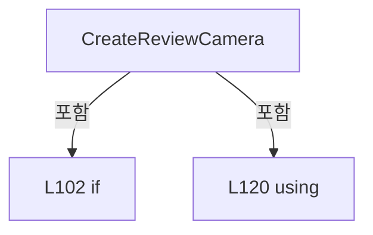

변경 전 점검: 입력/반환 타입, 위 호출자, 예외/취소 경로, 공유 상태와 저장·전송 소비자를 함께 확인합니다. 값의 단위나 물리 방향을 이름만으로 확정하지 않습니다.

### MethodDeclaration `DrawInspectionMarker` · L170–178

[Drilling.UI/Menu/Menus/CCoordinateOffsetPreviewDrawing.cs:170–178](https://github.com/kjuws10-rgb/A3Drilling/blob/28764c91d521777b8ee068dd7aaf2d3902ce9fe2/Drilling.UI/Menu/Menus/CCoordinateOffsetPreviewDrawing.cs#L170-L178)

| 항목 | 실제 추출 값 |
| --- | --- |
| 서명 | void Drilling.UI.Menu.Menus.CCoordinateOffsetPreviewDrawing.DrawInspectionMarker(DrawingContext, Point, Brush) |
| 접근/수식자 | Private / private, static |
| 반환/값 타입 | void |
| 소속 타입 | NamedType:Drilling.UI.Menu.Menus.CCoordinateOffsetPreviewDrawing |

입력 계약:

| 이름 | 타입 | 전달 | 선택/기본값 |
| --- | --- | --- | --- |
| context | DrawingContext | None | False /  |
| position | Point | None | False /  |
| brush | Brush | None | False /  |

현재 부분 분석에서 직접 연결된 호출자는 없습니다. XAML/이벤트/인터페이스·델리게이트·외부 진입을 추가 확인해야 하며, 미사용으로 판정한 것이 아닙니다.

호출하는 대상과 해석 범위:

| 원본 행 | 표현식 | 분석 상태 | 대상/소스 위치 |
| --- | --- | --- | --- |
| 172 | new Pen | unresolved | None |
| 173 | pen.Freeze | unresolved | None |
| 175 | context.DrawRectangle | unresolved | None |
| 175 | CreateBrush | resolved | SolidColorBrush Drilling.UI.Menu.Menus.CCoordinateOffsetPreviewDrawing.CreateBrush(byte, byte, byte) · Drilling.UI/Menu/Menus/CCoordinateOffsetPreviewDrawing.cs:412 |
| 175 | new Rect | unresolved | None |
| 176 | context.DrawLine | unresolved | None |
| 176 | new Point | unresolved | None |
| 176 | new Point | unresolved | None |
| 177 | context.DrawLine | unresolved | None |
| 177 | new Point | unresolved | None |
| 177 | new Point | unresolved | None |

본문의 실제 연산·분기·예외·반환 순서(원문 위치 순):

| 원본 행 | 종류 | 주석 해설 |
| --- | --- | --- |
| 172 | call | 함수·델리게이트 또는 객체 생성자를 호출합니다: new Pen(brush, 1.8) |
| 172 | local-declaration | 지역 변수를 선언합니다: var pen = new Pen(brush, 1.8); |
| 172 | variable-initializer | 변수의 초기값을 지정합니다: pen = new Pen(brush, 1.8) |
| 173 | call | 함수·델리게이트 또는 객체 생성자를 호출합니다: pen.Freeze() |
| 174 | local-declaration | 지역 변수를 선언합니다: const double halfSize = 7.0; |
| 174 | variable-initializer | 변수의 초기값을 지정합니다: halfSize = 7.0 |
| 175 | call | 함수·델리게이트 또는 객체 생성자를 호출합니다: context.DrawRectangle(CreateBrush(17, 24, 32), pen, new Rect(position.X - halfSize, position.Y - halfSize, halfSize * 2.0, halfSize * 2.0)) |
| 175 | call | 함수·델리게이트 또는 객체 생성자를 호출합니다: CreateBrush(17, 24, 32) |
| 175 | call | 함수·델리게이트 또는 객체 생성자를 호출합니다: new Rect(position.X - halfSize, position.Y - halfSize, halfSize * 2.0, halfSize * 2.0) |
| 176 | call | 함수·델리게이트 또는 객체 생성자를 호출합니다: context.DrawLine(pen, new Point(position.X - 5.0, position.Y), new Point(position.X + 5.0, position.Y)) |
| 176 | call | 함수·델리게이트 또는 객체 생성자를 호출합니다: new Point(position.X - 5.0, position.Y) |
| 176 | call | 함수·델리게이트 또는 객체 생성자를 호출합니다: new Point(position.X + 5.0, position.Y) |
| 177 | call | 함수·델리게이트 또는 객체 생성자를 호출합니다: context.DrawLine(pen, new Point(position.X, position.Y - 5.0), new Point(position.X, position.Y + 5.0)) |
| 177 | call | 함수·델리게이트 또는 객체 생성자를 호출합니다: new Point(position.X, position.Y - 5.0) |
| 177 | call | 함수·델리게이트 또는 객체 생성자를 호출합니다: new Point(position.X, position.Y + 5.0) |

변경 전 점검: 입력/반환 타입, 위 호출자, 예외/취소 경로, 공유 상태와 저장·전송 소비자를 함께 확인합니다. 값의 단위나 물리 방향을 이름만으로 확정하지 않습니다.

### MethodDeclaration `GetMarkerLabelOrigin` · L180–192

[Drilling.UI/Menu/Menus/CCoordinateOffsetPreviewDrawing.cs:180–192](https://github.com/kjuws10-rgb/A3Drilling/blob/28764c91d521777b8ee068dd7aaf2d3902ce9fe2/Drilling.UI/Menu/Menus/CCoordinateOffsetPreviewDrawing.cs#L180-L192)

| 항목 | 실제 추출 값 |
| --- | --- |
| 서명 | Point Drilling.UI.Menu.Menus.CCoordinateOffsetPreviewDrawing.GetMarkerLabelOrigin(Point, bool) |
| 접근/수식자 | Private / private, static |
| 반환/값 타입 | Point |
| 소속 타입 | NamedType:Drilling.UI.Menu.Menus.CCoordinateOffsetPreviewDrawing |

입력 계약:

| 이름 | 타입 | 전달 | 선택/기본값 |
| --- | --- | --- | --- |
| position | Point | None | False /  |
| above | bool | None | False /  |

정적 호출자로 확인된 위치:

| 호출 파일/행 | 호출 표현식 | 런타임 분기 가능 |
| --- | --- | --- |
| [Drilling.UI/Menu/Menus/CCoordinateOffsetPreviewDrawing.cs:153–153](https://github.com/kjuws10-rgb/A3Drilling/blob/28764c91d521777b8ee068dd7aaf2d3902ce9fe2/Drilling.UI/Menu/Menus/CCoordinateOffsetPreviewDrawing.cs#L153-L153) | GetMarkerLabelOrigin | False |
| [Drilling.UI/Menu/Menus/CCoordinateOffsetPreviewDrawing.cs:154–154](https://github.com/kjuws10-rgb/A3Drilling/blob/28764c91d521777b8ee068dd7aaf2d3902ce9fe2/Drilling.UI/Menu/Menus/CCoordinateOffsetPreviewDrawing.cs#L154-L154) | GetMarkerLabelOrigin | False |

호출하는 대상과 해석 범위:

| 원본 행 | 표현식 | 분석 상태 | 대상/소스 위치 |
| --- | --- | --- | --- |
| 185 | new Point | unresolved | None |
| 186 | new Point | unresolved | None |
| 190 | new Point | unresolved | None |
| 191 | new Point | unresolved | None |

본문의 실제 연산·분기·예외·반환 순서(원문 위치 순):

| 원본 행 | 종류 | 주석 해설 |
| --- | --- | --- |
| 182 | if | 조건에 따라 분기합니다: if (above) |
| 184 | conditional-expression | 조건에 따라 결과식을 선택합니다: position.Y <= PlotRect.Top + 32.0 ? new Point(position.X + 11.0, position.Y + 10.0) : new Point(position.X + 11.0, position.Y - 32.0) |
| 184 | return | 호출자에게 값 또는 제어를 반환합니다: return position.Y <= PlotRect.Top + 32.0 ? new Point(position.X + 11.0, position.Y + 10.0) : new Point(position.X + 11.0, position.Y - 32.0); |
| 185 | call | 함수·델리게이트 또는 객체 생성자를 호출합니다: new Point(position.X + 11.0, position.Y + 10.0) |
| 186 | call | 함수·델리게이트 또는 객체 생성자를 호출합니다: new Point(position.X + 11.0, position.Y - 32.0) |
| 189 | conditional-expression | 조건에 따라 결과식을 선택합니다: position.Y >= PlotRect.Bottom - 32.0 ? new Point(position.X + 11.0, position.Y - 32.0) : new Point(position.X + 11.0, position.Y + 10.0) |
| 189 | return | 호출자에게 값 또는 제어를 반환합니다: return position.Y >= PlotRect.Bottom - 32.0 ? new Point(position.X + 11.0, position.Y - 32.0) : new Point(position.X + 11.0, position.Y + 10.0); |
| 190 | call | 함수·델리게이트 또는 객체 생성자를 호출합니다: new Point(position.X + 11.0, position.Y - 32.0) |
| 191 | call | 함수·델리게이트 또는 객체 생성자를 호출합니다: new Point(position.X + 11.0, position.Y + 10.0) |

제어 구문의 포함 구조(실제 실행 순서/CFG가 아닌 구문 탐색 그림):

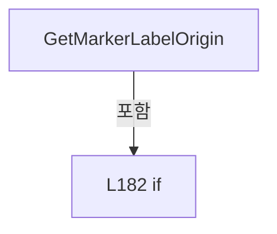

변경 전 점검: 입력/반환 타입, 위 호출자, 예외/취소 경로, 공유 상태와 저장·전송 소비자를 함께 확인합니다. 값의 단위나 물리 방향을 이름만으로 확정하지 않습니다.

### MethodDeclaration `GetAppliedLabelOrigin` · L194–203

[Drilling.UI/Menu/Menus/CCoordinateOffsetPreviewDrawing.cs:194–203](https://github.com/kjuws10-rgb/A3Drilling/blob/28764c91d521777b8ee068dd7aaf2d3902ce9fe2/Drilling.UI/Menu/Menus/CCoordinateOffsetPreviewDrawing.cs#L194-L203)

| 항목 | 실제 추출 값 |
| --- | --- |
| 서명 | Point Drilling.UI.Menu.Menus.CCoordinateOffsetPreviewDrawing.GetAppliedLabelOrigin(Point) |
| 접근/수식자 | Private / private, static |
| 반환/값 타입 | Point |
| 소속 타입 | NamedType:Drilling.UI.Menu.Menus.CCoordinateOffsetPreviewDrawing |

입력 계약:

| 이름 | 타입 | 전달 | 선택/기본값 |
| --- | --- | --- | --- |
| applied | Point | None | False /  |

정적 호출자로 확인된 위치:

| 호출 파일/행 | 호출 표현식 | 런타임 분기 가능 |
| --- | --- | --- |
| [Drilling.UI/Menu/Menus/CCoordinateOffsetPreviewDrawing.cs:71–71](https://github.com/kjuws10-rgb/A3Drilling/blob/28764c91d521777b8ee068dd7aaf2d3902ce9fe2/Drilling.UI/Menu/Menus/CCoordinateOffsetPreviewDrawing.cs#L71-L71) | GetAppliedLabelOrigin | False |

호출하는 대상과 해석 범위:

| 원본 행 | 표현식 | 분석 상태 | 대상/소스 위치 |
| --- | --- | --- | --- |
| 197 | new Point | unresolved | None |
| 199 | new Point | unresolved | None |
| 201 | new Point | unresolved | None |
| 202 | new Point | unresolved | None |

본문의 실제 연산·분기·예외·반환 순서(원문 위치 순):

| 원본 행 | 종류 | 주석 해설 |
| --- | --- | --- |
| 196 | if | 조건에 따라 분기합니다: if (applied.Y >= PlotRect.Bottom - 12.0) |
| 197 | call | 함수·델리게이트 또는 객체 생성자를 호출합니다: new Point(applied.X + 12.0, applied.Y - 36.0) |
| 197 | return | 호출자에게 값 또는 제어를 반환합니다: return new Point(applied.X + 12.0, applied.Y - 36.0); |
| 198 | if | 조건에 따라 분기합니다: if (applied.Y <= PlotRect.Top + 12.0) |
| 199 | call | 함수·델리게이트 또는 객체 생성자를 호출합니다: new Point(applied.X + 12.0, applied.Y + 12.0) |
| 199 | return | 호출자에게 값 또는 제어를 반환합니다: return new Point(applied.X + 12.0, applied.Y + 12.0); |
| 200 | if | 조건에 따라 분기합니다: if (applied.X >= PlotRect.Right - 12.0) |
| 201 | call | 함수·델리게이트 또는 객체 생성자를 호출합니다: new Point(applied.X - 86.0, applied.Y - 18.0) |
| 201 | return | 호출자에게 값 또는 제어를 반환합니다: return new Point(applied.X - 86.0, applied.Y - 18.0); |
| 202 | call | 함수·델리게이트 또는 객체 생성자를 호출합니다: new Point(applied.X + 12.0, applied.Y - 18.0) |
| 202 | return | 호출자에게 값 또는 제어를 반환합니다: return new Point(applied.X + 12.0, applied.Y - 18.0); |

제어 구문의 포함 구조(실제 실행 순서/CFG가 아닌 구문 탐색 그림):

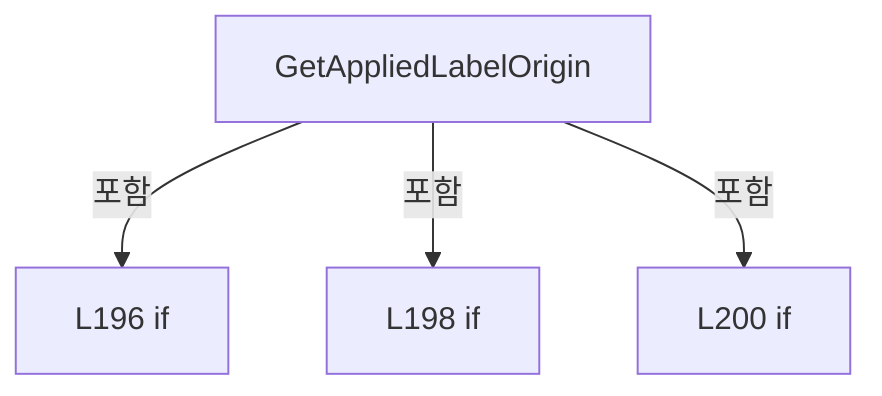

변경 전 점검: 입력/반환 타입, 위 호출자, 예외/취소 경로, 공유 상태와 저장·전송 소비자를 함께 확인합니다. 값의 단위나 물리 방향을 이름만으로 확정하지 않습니다.

### MethodDeclaration `CalculateOrigin` · L205–211

[Drilling.UI/Menu/Menus/CCoordinateOffsetPreviewDrawing.cs:205–211](https://github.com/kjuws10-rgb/A3Drilling/blob/28764c91d521777b8ee068dd7aaf2d3902ce9fe2/Drilling.UI/Menu/Menus/CCoordinateOffsetPreviewDrawing.cs#L205-L211)

| 항목 | 실제 추출 값 |
| --- | --- |
| 서명 | Point Drilling.UI.Menu.Menus.CCoordinateOffsetPreviewDrawing.CalculateOrigin(double, double, Vector, Vector) |
| 접근/수식자 | Private / private, static |
| 반환/값 타입 | Point |
| 소속 타입 | NamedType:Drilling.UI.Menu.Menus.CCoordinateOffsetPreviewDrawing |

입력 계약:

| 이름 | 타입 | 전달 | 선택/기본값 |
| --- | --- | --- | --- |
| minimum | double | None | False /  |
| maximum | double | None | False /  |
| xDirection | Vector | None | False /  |
| yDirection | Vector | None | False /  |

정적 호출자로 확인된 위치:

| 호출 파일/행 | 호출 표현식 | 런타임 분기 가능 |
| --- | --- | --- |
| [Drilling.UI/Menu/Menus/CCoordinateOffsetPreviewDrawing.cs:38–38](https://github.com/kjuws10-rgb/A3Drilling/blob/28764c91d521777b8ee068dd7aaf2d3902ce9fe2/Drilling.UI/Menu/Menus/CCoordinateOffsetPreviewDrawing.cs#L38-L38) | CalculateOrigin | False |
| [Drilling.UI/Menu/Menus/CCoordinateOffsetPreviewDrawing.cs:110–110](https://github.com/kjuws10-rgb/A3Drilling/blob/28764c91d521777b8ee068dd7aaf2d3902ce9fe2/Drilling.UI/Menu/Menus/CCoordinateOffsetPreviewDrawing.cs#L110-L110) | CalculateOrigin | False |

호출하는 대상과 해석 범위:

| 원본 행 | 표현식 | 분석 상태 | 대상/소스 위치 |
| --- | --- | --- | --- |
| 207 | new Point | unresolved | None |
| 208 | SetAxisOrigin | resolved | void Drilling.UI.Menu.Menus.CCoordinateOffsetPreviewDrawing.SetAxisOrigin(ref Point, Vector, double, double) · Drilling.UI/Menu/Menus/CCoordinateOffsetPreviewDrawing.cs:213 |
| 209 | SetAxisOrigin | resolved | void Drilling.UI.Menu.Menus.CCoordinateOffsetPreviewDrawing.SetAxisOrigin(ref Point, Vector, double, double) · Drilling.UI/Menu/Menus/CCoordinateOffsetPreviewDrawing.cs:213 |

본문의 실제 연산·분기·예외·반환 순서(원문 위치 순):

| 원본 행 | 종류 | 주석 해설 |
| --- | --- | --- |
| 207 | call | 함수·델리게이트 또는 객체 생성자를 호출합니다: new Point(PlotRect.Left + (PlotRect.Width / 2.0), PlotRect.Top + (PlotRect.Height / 2.0)) |
| 207 | local-declaration | 지역 변수를 선언합니다: var origin = new Point(PlotRect.Left + (PlotRect.Width / 2.0), PlotRect.Top + (PlotRect.Height / 2.0)); |
| 207 | variable-initializer | 변수의 초기값을 지정합니다: origin = new Point(PlotRect.Left + (PlotRect.Width / 2.0), PlotRect.Top + (PlotRect.Height / 2.0)) |
| 208 | call | 함수·델리게이트 또는 객체 생성자를 호출합니다: SetAxisOrigin(ref origin, xDirection, minimum, maximum) |
| 209 | call | 함수·델리게이트 또는 객체 생성자를 호출합니다: SetAxisOrigin(ref origin, yDirection, minimum, maximum) |
| 210 | return | 호출자에게 값 또는 제어를 반환합니다: return origin; |

변경 전 점검: 입력/반환 타입, 위 호출자, 예외/취소 경로, 공유 상태와 저장·전송 소비자를 함께 확인합니다. 값의 단위나 물리 방향을 이름만으로 확정하지 않습니다.

### MethodDeclaration `SetAxisOrigin` · L213–226

[Drilling.UI/Menu/Menus/CCoordinateOffsetPreviewDrawing.cs:213–226](https://github.com/kjuws10-rgb/A3Drilling/blob/28764c91d521777b8ee068dd7aaf2d3902ce9fe2/Drilling.UI/Menu/Menus/CCoordinateOffsetPreviewDrawing.cs#L213-L226)

| 항목 | 실제 추출 값 |
| --- | --- |
| 서명 | void Drilling.UI.Menu.Menus.CCoordinateOffsetPreviewDrawing.SetAxisOrigin(ref Point, Vector, double, double) |
| 접근/수식자 | Private / private, static |
| 반환/값 타입 | void |
| 소속 타입 | NamedType:Drilling.UI.Menu.Menus.CCoordinateOffsetPreviewDrawing |

입력 계약:

| 이름 | 타입 | 전달 | 선택/기본값 |
| --- | --- | --- | --- |
| origin | Point | Ref | False /  |
| direction | Vector | None | False /  |
| minimum | double | None | False /  |
| maximum | double | None | False /  |

정적 호출자로 확인된 위치:

| 호출 파일/행 | 호출 표현식 | 런타임 분기 가능 |
| --- | --- | --- |
| [Drilling.UI/Menu/Menus/CCoordinateOffsetPreviewDrawing.cs:208–208](https://github.com/kjuws10-rgb/A3Drilling/blob/28764c91d521777b8ee068dd7aaf2d3902ce9fe2/Drilling.UI/Menu/Menus/CCoordinateOffsetPreviewDrawing.cs#L208-L208) | SetAxisOrigin | False |
| [Drilling.UI/Menu/Menus/CCoordinateOffsetPreviewDrawing.cs:209–209](https://github.com/kjuws10-rgb/A3Drilling/blob/28764c91d521777b8ee068dd7aaf2d3902ce9fe2/Drilling.UI/Menu/Menus/CCoordinateOffsetPreviewDrawing.cs#L209-L209) | SetAxisOrigin | False |

호출하는 대상과 해석 범위:

| 원본 행 | 표현식 | 분석 상태 | 대상/소스 위치 |
| --- | --- | --- | --- |
| 216 | Math.Abs | candidate | OverloadResolutionFailure |
| 216 | Math.Abs | candidate | OverloadResolutionFailure |

본문의 실제 연산·분기·예외·반환 순서(원문 위치 순):

| 원본 행 | 종류 | 주석 해설 |
| --- | --- | --- |
| 215 | local-declaration | 지역 변수를 선언합니다: var span = maximum - minimum; |
| 215 | variable-initializer | 변수의 초기값을 지정합니다: span = maximum - minimum |
| 216 | call | 함수·델리게이트 또는 객체 생성자를 호출합니다: Math.Abs(direction.X) |
| 216 | call | 함수·델리게이트 또는 객체 생성자를 호출합니다: Math.Abs(direction.Y) |
| 216 | if | 조건에 따라 분기합니다: if (Math.Abs(direction.X) >= Math.Abs(direction.Y)) |
| 218 | conditional-expression | 조건에 따라 결과식을 선택합니다: direction.X >= 0.0 ? -minimum / span : maximum / span |
| 218 | local-declaration | 지역 변수를 선언합니다: var fraction = direction.X >= 0.0 ? -minimum / span : maximum / span; |
| 218 | variable-initializer | 변수의 초기값을 지정합니다: fraction = direction.X >= 0.0 ? -minimum / span : maximum / span |
| 219 | assignment | 값을 대상에 대입합니다: origin.X = PlotRect.Left + (PlotRect.Width * fraction) |
| 221 | else | 앞 조건이 거짓인 경로입니다: else |
| 223 | conditional-expression | 조건에 따라 결과식을 선택합니다: direction.Y >= 0.0 ? -minimum / span : maximum / span |
| 223 | local-declaration | 지역 변수를 선언합니다: var fraction = direction.Y >= 0.0 ? -minimum / span : maximum / span; |
| 223 | variable-initializer | 변수의 초기값을 지정합니다: fraction = direction.Y >= 0.0 ? -minimum / span : maximum / span |
| 224 | assignment | 값을 대상에 대입합니다: origin.Y = PlotRect.Top + (PlotRect.Height * fraction) |

제어 구문의 포함 구조(실제 실행 순서/CFG가 아닌 구문 탐색 그림):

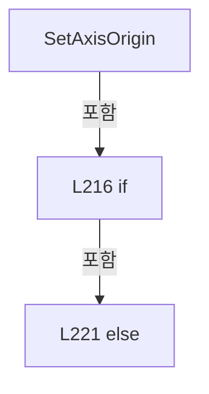

변경 전 점검: 입력/반환 타입, 위 호출자, 예외/취소 경로, 공유 상태와 저장·전송 소비자를 함께 확인합니다. 값의 단위나 물리 방향을 이름만으로 확정하지 않습니다.

### MethodDeclaration `ClipToPlot` · L228–246

[Drilling.UI/Menu/Menus/CCoordinateOffsetPreviewDrawing.cs:228–246](https://github.com/kjuws10-rgb/A3Drilling/blob/28764c91d521777b8ee068dd7aaf2d3902ce9fe2/Drilling.UI/Menu/Menus/CCoordinateOffsetPreviewDrawing.cs#L228-L246)

| 항목 | 실제 추출 값 |
| --- | --- |
| 서명 | Point Drilling.UI.Menu.Menus.CCoordinateOffsetPreviewDrawing.ClipToPlot(Point, Point) |
| 접근/수식자 | Private / private, static |
| 반환/값 타입 | Point |
| 소속 타입 | NamedType:Drilling.UI.Menu.Menus.CCoordinateOffsetPreviewDrawing |

입력 계약:

| 이름 | 타입 | 전달 | 선택/기본값 |
| --- | --- | --- | --- |
| origin | Point | None | False /  |
| target | Point | None | False /  |

현재 부분 분석에서 직접 연결된 호출자는 없습니다. XAML/이벤트/인터페이스·델리게이트·외부 진입을 추가 확인해야 하며, 미사용으로 판정한 것이 아닙니다.

호출하는 대상과 해석 범위:

| 원본 행 | 표현식 | 분석 상태 | 대상/소스 위치 |
| --- | --- | --- | --- |
| 230 | PlotRect.Contains | unresolved | None |
| 238 | Math.Min | candidate | OverloadResolutionFailure |
| 240 | Math.Min | candidate | OverloadResolutionFailure |
| 242 | Math.Min | candidate | OverloadResolutionFailure |
| 244 | Math.Min | candidate | OverloadResolutionFailure |
| 245 | Math.Clamp | resolved | double System.Math.Clamp(double, double, double) |

본문의 실제 연산·분기·예외·반환 순서(원문 위치 순):

| 원본 행 | 종류 | 주석 해설 |
| --- | --- | --- |
| 230 | call | 함수·델리게이트 또는 객체 생성자를 호출합니다: PlotRect.Contains(target) |
| 230 | if | 조건에 따라 분기합니다: if (PlotRect.Contains(target)) |
| 232 | return | 호출자에게 값 또는 제어를 반환합니다: return target; |
| 235 | local-declaration | 지역 변수를 선언합니다: var delta = target - origin; |
| 235 | variable-initializer | 변수의 초기값을 지정합니다: delta = target - origin |
| 236 | local-declaration | 지역 변수를 선언합니다: var scale = 1.0; |
| 236 | variable-initializer | 변수의 초기값을 지정합니다: scale = 1.0 |
| 237 | if | 조건에 따라 분기합니다: if (delta.X > 0.0) |
| 238 | assignment | 값을 대상에 대입합니다: scale = Math.Min(scale, (PlotRect.Right - origin.X) / delta.X) |
| 238 | call | 함수·델리게이트 또는 객체 생성자를 호출합니다: Math.Min(scale, (PlotRect.Right - origin.X) / delta.X) |
| 239 | else | 앞 조건이 거짓인 경로입니다: else |
| 239 | if | 조건에 따라 분기합니다: if (delta.X < 0.0) |
| 240 | assignment | 값을 대상에 대입합니다: scale = Math.Min(scale, (PlotRect.Left - origin.X) / delta.X) |
| 240 | call | 함수·델리게이트 또는 객체 생성자를 호출합니다: Math.Min(scale, (PlotRect.Left - origin.X) / delta.X) |
| 241 | if | 조건에 따라 분기합니다: if (delta.Y > 0.0) |
| 242 | assignment | 값을 대상에 대입합니다: scale = Math.Min(scale, (PlotRect.Bottom - origin.Y) / delta.Y) |
| 242 | call | 함수·델리게이트 또는 객체 생성자를 호출합니다: Math.Min(scale, (PlotRect.Bottom - origin.Y) / delta.Y) |
| 243 | else | 앞 조건이 거짓인 경로입니다: else |
| 243 | if | 조건에 따라 분기합니다: if (delta.Y < 0.0) |
| 244 | assignment | 값을 대상에 대입합니다: scale = Math.Min(scale, (PlotRect.Top - origin.Y) / delta.Y) |
| 244 | call | 함수·델리게이트 또는 객체 생성자를 호출합니다: Math.Min(scale, (PlotRect.Top - origin.Y) / delta.Y) |
| 245 | call | 함수·델리게이트 또는 객체 생성자를 호출합니다: Math.Clamp(scale, 0.0, 1.0) |
| 245 | return | 호출자에게 값 또는 제어를 반환합니다: return origin + (delta * Math.Clamp(scale, 0.0, 1.0)); |

제어 구문의 포함 구조(실제 실행 순서/CFG가 아닌 구문 탐색 그림):

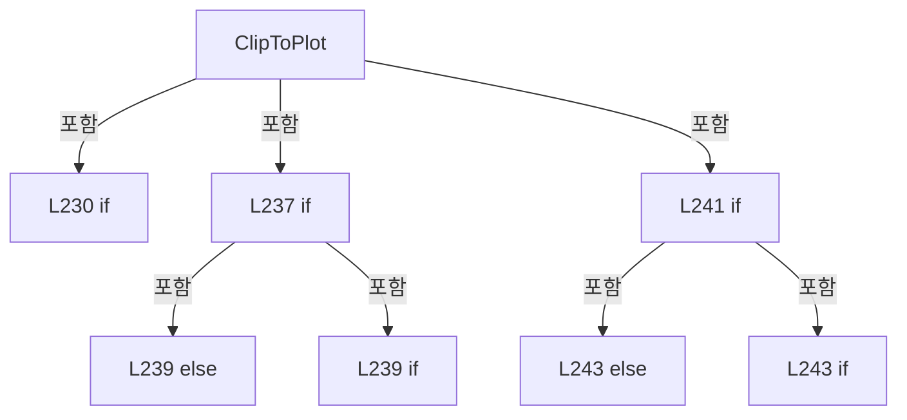

변경 전 점검: 입력/반환 타입, 위 호출자, 예외/취소 경로, 공유 상태와 저장·전송 소비자를 함께 확인합니다. 값의 단위나 물리 방향을 이름만으로 확정하지 않습니다.

### MethodDeclaration `NormalizeDirection` · L248–259

[Drilling.UI/Menu/Menus/CCoordinateOffsetPreviewDrawing.cs:248–259](https://github.com/kjuws10-rgb/A3Drilling/blob/28764c91d521777b8ee068dd7aaf2d3902ce9fe2/Drilling.UI/Menu/Menus/CCoordinateOffsetPreviewDrawing.cs#L248-L259)

| 항목 | 실제 추출 값 |
| --- | --- |
| 서명 | Vector Drilling.UI.Menu.Menus.CCoordinateOffsetPreviewDrawing.NormalizeDirection(Vector, Vector) |
| 접근/수식자 | Private / private, static |
| 반환/값 타입 | Vector |
| 소속 타입 | NamedType:Drilling.UI.Menu.Menus.CCoordinateOffsetPreviewDrawing |

입력 계약:

| 이름 | 타입 | 전달 | 선택/기본값 |
| --- | --- | --- | --- |
| direction | Vector | None | False /  |
| fallback | Vector | None | False /  |

정적 호출자로 확인된 위치:

| 호출 파일/행 | 호출 표현식 | 런타임 분기 가능 |
| --- | --- | --- |
| [Drilling.UI/Menu/Menus/CCoordinateOffsetPreviewDrawing.cs:28–28](https://github.com/kjuws10-rgb/A3Drilling/blob/28764c91d521777b8ee068dd7aaf2d3902ce9fe2/Drilling.UI/Menu/Menus/CCoordinateOffsetPreviewDrawing.cs#L28-L28) | NormalizeDirection | False |
| [Drilling.UI/Menu/Menus/CCoordinateOffsetPreviewDrawing.cs:29–29](https://github.com/kjuws10-rgb/A3Drilling/blob/28764c91d521777b8ee068dd7aaf2d3902ce9fe2/Drilling.UI/Menu/Menus/CCoordinateOffsetPreviewDrawing.cs#L29-L29) | NormalizeDirection | False |
| [Drilling.UI/Menu/Menus/CCoordinateOffsetPreviewDrawing.cs:100–100](https://github.com/kjuws10-rgb/A3Drilling/blob/28764c91d521777b8ee068dd7aaf2d3902ce9fe2/Drilling.UI/Menu/Menus/CCoordinateOffsetPreviewDrawing.cs#L100-L100) | NormalizeDirection | False |
| [Drilling.UI/Menu/Menus/CCoordinateOffsetPreviewDrawing.cs:101–101](https://github.com/kjuws10-rgb/A3Drilling/blob/28764c91d521777b8ee068dd7aaf2d3902ce9fe2/Drilling.UI/Menu/Menus/CCoordinateOffsetPreviewDrawing.cs#L101-L101) | NormalizeDirection | False |

호출하는 대상과 해석 범위:

| 원본 행 | 표현식 | 분석 상태 | 대상/소스 위치 |
| --- | --- | --- | --- |
| 250 | double.IsFinite | candidate | OverloadResolutionFailure |
| 251 | double.IsFinite | candidate | OverloadResolutionFailure |
| 257 | direction.Normalize | unresolved | None |

본문의 실제 연산·분기·예외·반환 순서(원문 위치 순):

| 원본 행 | 종류 | 주석 해설 |
| --- | --- | --- |
| 250 | call | 함수·델리게이트 또는 객체 생성자를 호출합니다: double.IsFinite(direction.X) |
| 250 | if | 조건에 따라 분기합니다: if (!double.IsFinite(direction.X) &#124;&#124; !double.IsFinite(direction.Y) &#124;&#124; direction.LengthSquared <= double.Epsilon) |
| 251 | call | 함수·델리게이트 또는 객체 생성자를 호출합니다: double.IsFinite(direction.Y) |
| 254 | assignment | 값을 대상에 대입합니다: direction = fallback |
| 257 | call | 함수·델리게이트 또는 객체 생성자를 호출합니다: direction.Normalize() |
| 258 | return | 호출자에게 값 또는 제어를 반환합니다: return direction; |

제어 구문의 포함 구조(실제 실행 순서/CFG가 아닌 구문 탐색 그림):

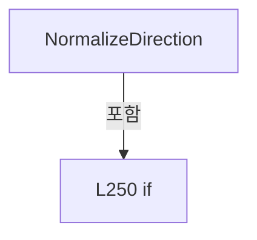

변경 전 점검: 입력/반환 타입, 위 호출자, 예외/취소 경로, 공유 상태와 저장·전송 소비자를 함께 확인합니다. 값의 단위나 물리 방향을 이름만으로 확정하지 않습니다.

### MethodDeclaration `GetDirectionalScale` · L261–264

[Drilling.UI/Menu/Menus/CCoordinateOffsetPreviewDrawing.cs:261–264](https://github.com/kjuws10-rgb/A3Drilling/blob/28764c91d521777b8ee068dd7aaf2d3902ce9fe2/Drilling.UI/Menu/Menus/CCoordinateOffsetPreviewDrawing.cs#L261-L264)

| 항목 | 실제 추출 값 |
| --- | --- |
| 서명 | double Drilling.UI.Menu.Menus.CCoordinateOffsetPreviewDrawing.GetDirectionalScale(Vector, double, double) |
| 접근/수식자 | Private / private, static |
| 반환/값 타입 | double |
| 소속 타입 | NamedType:Drilling.UI.Menu.Menus.CCoordinateOffsetPreviewDrawing |

입력 계약:

| 이름 | 타입 | 전달 | 선택/기본값 |
| --- | --- | --- | --- |
| direction | Vector | None | False /  |
| horizontalScale | double | None | False /  |
| verticalScale | double | None | False /  |

현재 부분 분석에서 직접 연결된 호출자는 없습니다. XAML/이벤트/인터페이스·델리게이트·외부 진입을 추가 확인해야 하며, 미사용으로 판정한 것이 아닙니다.

호출하는 대상과 해석 범위:

| 원본 행 | 표현식 | 분석 상태 | 대상/소스 위치 |
| --- | --- | --- | --- |
| 263 | Math.Abs | candidate | OverloadResolutionFailure |
| 263 | Math.Abs | candidate | OverloadResolutionFailure |

본문의 실제 연산·분기·예외·반환 순서(원문 위치 순):

| 원본 행 | 종류 | 주석 해설 |
| --- | --- | --- |
| 263 | call | 함수·델리게이트 또는 객체 생성자를 호출합니다: Math.Abs(direction.X) |
| 263 | call | 함수·델리게이트 또는 객체 생성자를 호출합니다: Math.Abs(direction.Y) |
| 263 | conditional-expression | 조건에 따라 결과식을 선택합니다: Math.Abs(direction.X) >= Math.Abs(direction.Y) ? horizontalScale : verticalScale |
| 263 | return | 호출자에게 값 또는 제어를 반환합니다: return Math.Abs(direction.X) >= Math.Abs(direction.Y) ? horizontalScale : verticalScale; |

변경 전 점검: 입력/반환 타입, 위 호출자, 예외/취소 경로, 공유 상태와 저장·전송 소비자를 함께 확인합니다. 값의 단위나 물리 방향을 이름만으로 확정하지 않습니다.

### MethodDeclaration `DrawPositiveAxis` · L266–298

[Drilling.UI/Menu/Menus/CCoordinateOffsetPreviewDrawing.cs:266–298](https://github.com/kjuws10-rgb/A3Drilling/blob/28764c91d521777b8ee068dd7aaf2d3902ce9fe2/Drilling.UI/Menu/Menus/CCoordinateOffsetPreviewDrawing.cs#L266-L298)

| 항목 | 실제 추출 값 |
| --- | --- |
| 서명 | void Drilling.UI.Menu.Menus.CCoordinateOffsetPreviewDrawing.DrawPositiveAxis(DrawingContext, Point, Vector, string, Pen, Brush) |
| 접근/수식자 | Private / private, static |
| 반환/값 타입 | void |
| 소속 타입 | NamedType:Drilling.UI.Menu.Menus.CCoordinateOffsetPreviewDrawing |

입력 계약:

| 이름 | 타입 | 전달 | 선택/기본값 |
| --- | --- | --- | --- |
| context | DrawingContext | None | False /  |
| origin | Point | None | False /  |
| direction | Vector | None | False /  |
| label | string | None | False /  |
| pen | Pen | None | False /  |
| brush | Brush | None | False /  |

현재 부분 분석에서 직접 연결된 호출자는 없습니다. XAML/이벤트/인터페이스·델리게이트·외부 진입을 추가 확인해야 하며, 미사용으로 판정한 것이 아닙니다.

호출하는 대상과 해석 범위:

| 원본 행 | 표현식 | 분석 상태 | 대상/소스 위치 |
| --- | --- | --- | --- |
| 274 | Math.Abs | candidate | OverloadResolutionFailure |
| 274 | Math.Abs | candidate | OverloadResolutionFailure |
| 278 | Math.Max | candidate | OverloadResolutionFailure |
| 279 | DrawArrowHead | candidate | OverloadResolutionFailure |
| 285 | Math.Max | resolved | double System.Math.Max(double, double) |
| 287 | new Point | unresolved | None |
| 288 | new Point | unresolved | None |
| 293 | new Point | unresolved | None |
| 294 | new Point | unresolved | None |
| 297 | DrawTextWithin | resolved | void Drilling.UI.Menu.Menus.CCoordinateOffsetPreviewDrawing.DrawTextWithin(DrawingContext, string, Point, double, Brush, Rect) · Drilling.UI/Menu/Menus/CCoordinateOffsetPreviewDrawing.cs:392 |

본문의 실제 연산·분기·예외·반환 순서(원문 위치 순):

| 원본 행 | 종류 | 주석 해설 |
| --- | --- | --- |
| 274 | call | 함수·델리게이트 또는 객체 생성자를 호출합니다: Math.Abs(direction.X) |
| 274 | call | 함수·델리게이트 또는 객체 생성자를 호출합니다: Math.Abs(direction.Y) |
| 274 | local-declaration | 지역 변수를 선언합니다: var horizontal = Math.Abs(direction.X) >= Math.Abs(direction.Y); |
| 274 | variable-initializer | 변수의 초기값을 지정합니다: horizontal = Math.Abs(direction.X) >= Math.Abs(direction.Y) |
| 275 | conditional-expression | 조건에 따라 결과식을 선택합니다: horizontal ? direction.X >= 0.0 ? PlotRect.Right - origin.X - 8.0 : origin.X - PlotRect.Left - 8.0 : direction.Y >= 0.0 ? PlotRect.Bottom - origin.Y - 8.0 : origin.Y - PlotRect.Top - 8.0 |
| 275 | local-declaration | 지역 변수를 선언합니다: var length = horizontal ? direction.X >= 0.0 ? PlotRect.Right - origin.X - 8.0 : origin.X - PlotRect.Left - 8.0 : direction.Y >= 0.0 ? PlotRect.Bottom - origin.Y - 8.0 : origin.Y - PlotRect.Top - 8.0; |
| 275 | variable-initializer | 변수의 초기값을 지정합니다: length = horizontal ? direction.X >= 0.0 ? PlotRect.Right - origin.X - 8.0 : origin.X - PlotRect.Left - 8.0 : direction.Y >= 0.0 ? PlotRect.Bottom - origin.Y - 8.0 : origin.Y - PlotRect.Top - 8.0 |
| 276 | conditional-expression | 조건에 따라 결과식을 선택합니다: direction.X >= 0.0 ? PlotRect.Right - origin.X - 8.0 : origin.X - PlotRect.Left - 8.0 |
| 277 | conditional-expression | 조건에 따라 결과식을 선택합니다: direction.Y >= 0.0 ? PlotRect.Bottom - origin.Y - 8.0 : origin.Y - PlotRect.Top - 8.0 |
| 278 | call | 함수·델리게이트 또는 객체 생성자를 호출합니다: Math.Max(0.0, length) |
| 278 | local-declaration | 지역 변수를 선언합니다: var end = origin + (direction * Math.Max(0.0, length)); |
| 278 | variable-initializer | 변수의 초기값을 지정합니다: end = origin + (direction * Math.Max(0.0, length)) |
| 279 | call | 함수·델리게이트 또는 객체 생성자를 호출합니다: DrawArrowHead(context, pen, origin, end) |
| 281 | local-declaration | 지역 변수를 선언합니다: var displayText = $"{label}+"; |
| 281 | variable-initializer | 변수의 초기값을 지정합니다: displayText = $"{label}+" |
| 282 | local-declaration | 지역 변수를 선언합니다: Point labelPoint; |
| 283 | if | 조건에 따라 분기합니다: if (horizontal) |
| 285 | call | 함수·델리게이트 또는 객체 생성자를 호출합니다: Math.Max(48.0, displayText.Length * 6.4) |
| 285 | local-declaration | 지역 변수를 선언합니다: var estimatedWidth = Math.Max(48.0, displayText.Length * 6.4); |
| 285 | variable-initializer | 변수의 초기값을 지정합니다: estimatedWidth = Math.Max(48.0, displayText.Length * 6.4) |
| 286 | assignment | 값을 대상에 대입합니다: labelPoint = direction.X >= 0.0 ? new Point(PlotRect.Right - estimatedWidth - 4.0, origin.Y + 6.0) : new Point(PlotRect.Left + 6.0, origin.Y + 6.0) |
| 286 | conditional-expression | 조건에 따라 결과식을 선택합니다: direction.X >= 0.0 ? new Point(PlotRect.Right - estimatedWidth - 4.0, origin.Y + 6.0) : new Point(PlotRect.Left + 6.0, origin.Y + 6.0) |
| 287 | call | 함수·델리게이트 또는 객체 생성자를 호출합니다: new Point(PlotRect.Right - estimatedWidth - 4.0, origin.Y + 6.0) |
| 288 | call | 함수·델리게이트 또는 객체 생성자를 호출합니다: new Point(PlotRect.Left + 6.0, origin.Y + 6.0) |
| 290 | else | 앞 조건이 거짓인 경로입니다: else |
| 292 | assignment | 값을 대상에 대입합니다: labelPoint = direction.Y >= 0.0 ? new Point(origin.X + 7.0, PlotRect.Bottom - 18.0) : new Point(origin.X + 7.0, PlotRect.Top + 2.0) |
| 292 | conditional-expression | 조건에 따라 결과식을 선택합니다: direction.Y >= 0.0 ? new Point(origin.X + 7.0, PlotRect.Bottom - 18.0) : new Point(origin.X + 7.0, PlotRect.Top + 2.0) |
| 293 | call | 함수·델리게이트 또는 객체 생성자를 호출합니다: new Point(origin.X + 7.0, PlotRect.Bottom - 18.0) |
| 294 | call | 함수·델리게이트 또는 객체 생성자를 호출합니다: new Point(origin.X + 7.0, PlotRect.Top + 2.0) |
| 297 | call | 함수·델리게이트 또는 객체 생성자를 호출합니다: DrawTextWithin(context, displayText, labelPoint, 10.0, brush, PlotRect) |

제어 구문의 포함 구조(실제 실행 순서/CFG가 아닌 구문 탐색 그림):

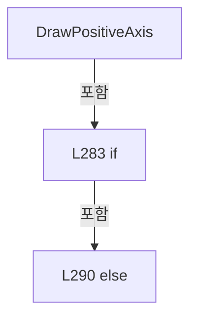

변경 전 점검: 입력/반환 타입, 위 호출자, 예외/취소 경로, 공유 상태와 저장·전송 소비자를 함께 확인합니다. 값의 단위나 물리 방향을 이름만으로 확정하지 않습니다.

### MethodDeclaration `DrawGrid` · L300–342

[Drilling.UI/Menu/Menus/CCoordinateOffsetPreviewDrawing.cs:300–342](https://github.com/kjuws10-rgb/A3Drilling/blob/28764c91d521777b8ee068dd7aaf2d3902ce9fe2/Drilling.UI/Menu/Menus/CCoordinateOffsetPreviewDrawing.cs#L300-L342)

| 항목 | 실제 추출 값 |
| --- | --- |
| 서명 | void Drilling.UI.Menu.Menus.CCoordinateOffsetPreviewDrawing.DrawGrid(DrawingContext, Point, double, double, Vector, Vector) |
| 접근/수식자 | Private / private, static |
| 반환/값 타입 | void |
| 소속 타입 | NamedType:Drilling.UI.Menu.Menus.CCoordinateOffsetPreviewDrawing |

입력 계약:

| 이름 | 타입 | 전달 | 선택/기본값 |
| --- | --- | --- | --- |
| context | DrawingContext | None | False /  |
| origin | Point | None | False /  |
| minimum | double | None | False /  |
| maximum | double | None | False /  |
| xDirection | Vector | None | False /  |
| yDirection | Vector | None | False /  |

현재 부분 분석에서 직접 연결된 호출자는 없습니다. XAML/이벤트/인터페이스·델리게이트·외부 진입을 추가 확인해야 하며, 미사용으로 판정한 것이 아닙니다.

호출하는 대상과 해석 범위:

| 원본 행 | 표현식 | 분석 상태 | 대상/소스 위치 |
| --- | --- | --- | --- |
| 308 | new Pen | unresolved | None |
| 308 | CreateBrush | resolved | SolidColorBrush Drilling.UI.Menu.Menus.CCoordinateOffsetPreviewDrawing.CreateBrush(byte, byte, byte) · Drilling.UI/Menu/Menus/CCoordinateOffsetPreviewDrawing.cs:412 |
| 309 | new Pen | unresolved | None |
| 309 | CreateBrush | resolved | SolidColorBrush Drilling.UI.Menu.Menus.CCoordinateOffsetPreviewDrawing.CreateBrush(byte, byte, byte) · Drilling.UI/Menu/Menus/CCoordinateOffsetPreviewDrawing.cs:412 |
| 310 | minorPen.Freeze | unresolved | None |
| 311 | majorPen.Freeze | unresolved | None |
| 312 | Math.Abs | candidate | OverloadResolutionFailure |
| 312 | Math.Abs | candidate | OverloadResolutionFailure |
| 313 | Math.Abs | candidate | OverloadResolutionFailure |
| 313 | Math.Abs | candidate | OverloadResolutionFailure |
| 314 | CreateBrush | resolved | SolidColorBrush Drilling.UI.Menu.Menus.CCoordinateOffsetPreviewDrawing.CreateBrush(byte, byte, byte) · Drilling.UI/Menu/Menus/CCoordinateOffsetPreviewDrawing.cs:412 |
| 323 | context.DrawLine | unresolved | None |
| 323 | new Point | unresolved | None |
| 323 | new Point | unresolved | None |
| 324 | context.DrawLine | unresolved | None |
| 324 | new Point | unresolved | None |
| 324 | new Point | unresolved | None |
| 332 | GetScreenTickValue | resolved | double Drilling.UI.Menu.Menus.CCoordinateOffsetPreviewDrawing.GetScreenTickValue(int, bool, double, double) · Drilling.UI/Menu/Menus/CCoordinateOffsetPreviewDrawing.cs:344 |
| 333 | GetScreenTickValue | resolved | double Drilling.UI.Menu.Menus.CCoordinateOffsetPreviewDrawing.GetScreenTickValue(int, bool, double, double) · Drilling.UI/Menu/Menus/CCoordinateOffsetPreviewDrawing.cs:344 |
| 334 | DrawCenteredText | candidate | OverloadResolutionFailure |
| 334 | FormatTick | resolved | string Drilling.UI.Menu.Menus.CCoordinateOffsetPreviewDrawing.FormatTick(double, double) · Drilling.UI/Menu/Menus/CCoordinateOffsetPreviewDrawing.cs:352 |
| 334 | new Point | unresolved | None |
| 335 | DrawRightAlignedText | candidate | OverloadResolutionFailure |
| 335 | FormatTick | resolved | string Drilling.UI.Menu.Menus.CCoordinateOffsetPreviewDrawing.FormatTick(double, double) · Drilling.UI/Menu/Menus/CCoordinateOffsetPreviewDrawing.cs:352 |
| 335 | new Point | unresolved | None |
| 338 | new Pen | unresolved | None |
| 338 | CreateBrush | resolved | SolidColorBrush Drilling.UI.Menu.Menus.CCoordinateOffsetPreviewDrawing.CreateBrush(byte, byte, byte) · Drilling.UI/Menu/Menus/CCoordinateOffsetPreviewDrawing.cs:412 |
| 339 | axisPen.Freeze | unresolved | None |
| 340 | context.DrawLine | unresolved | None |
| 340 | new Point | unresolved | None |
| 340 | new Point | unresolved | None |
| 341 | context.DrawLine | unresolved | None |
| 341 | new Point | unresolved | None |
| 341 | new Point | unresolved | None |

본문의 실제 연산·분기·예외·반환 순서(원문 위치 순):

| 원본 행 | 종류 | 주석 해설 |
| --- | --- | --- |
| 308 | call | 함수·델리게이트 또는 객체 생성자를 호출합니다: new Pen(CreateBrush(43, 56, 74), 0.55) |
| 308 | call | 함수·델리게이트 또는 객체 생성자를 호출합니다: CreateBrush(43, 56, 74) |
| 308 | local-declaration | 지역 변수를 선언합니다: var minorPen = new Pen(CreateBrush(43, 56, 74), 0.55); |
| 308 | variable-initializer | 변수의 초기값을 지정합니다: minorPen = new Pen(CreateBrush(43, 56, 74), 0.55) |
| 309 | call | 함수·델리게이트 또는 객체 생성자를 호출합니다: new Pen(CreateBrush(57, 74, 96), 0.85) |
| 309 | call | 함수·델리게이트 또는 객체 생성자를 호출합니다: CreateBrush(57, 74, 96) |
| 309 | local-declaration | 지역 변수를 선언합니다: var majorPen = new Pen(CreateBrush(57, 74, 96), 0.85); |
| 309 | variable-initializer | 변수의 초기값을 지정합니다: majorPen = new Pen(CreateBrush(57, 74, 96), 0.85) |
| 310 | call | 함수·델리게이트 또는 객체 생성자를 호출합니다: minorPen.Freeze() |
| 311 | call | 함수·델리게이트 또는 객체 생성자를 호출합니다: majorPen.Freeze() |
| 312 | call | 함수·델리게이트 또는 객체 생성자를 호출합니다: Math.Abs(xDirection.X) |
| 312 | call | 함수·델리게이트 또는 객체 생성자를 호출합니다: Math.Abs(xDirection.Y) |
| 312 | conditional-expression | 조건에 따라 결과식을 선택합니다: Math.Abs(xDirection.X) >= Math.Abs(xDirection.Y) ? xDirection : yDirection |
| 312 | local-declaration | 지역 변수를 선언합니다: var horizontalDirection = Math.Abs(xDirection.X) >= Math.Abs(xDirection.Y) ? xDirection : yDirection; |
| 312 | variable-initializer | 변수의 초기값을 지정합니다: horizontalDirection = Math.Abs(xDirection.X) >= Math.Abs(xDirection.Y) ? xDirection : yDirection |
| 313 | call | 함수·델리게이트 또는 객체 생성자를 호출합니다: Math.Abs(xDirection.Y) |
| 313 | call | 함수·델리게이트 또는 객체 생성자를 호출합니다: Math.Abs(xDirection.X) |
| 313 | conditional-expression | 조건에 따라 결과식을 선택합니다: Math.Abs(xDirection.Y) > Math.Abs(xDirection.X) ? xDirection : yDirection |
| 313 | local-declaration | 지역 변수를 선언합니다: var verticalDirection = Math.Abs(xDirection.Y) > Math.Abs(xDirection.X) ? xDirection : yDirection; |
| 313 | variable-initializer | 변수의 초기값을 지정합니다: verticalDirection = Math.Abs(xDirection.Y) > Math.Abs(xDirection.X) ? xDirection : yDirection |
| 314 | call | 함수·델리게이트 또는 객체 생성자를 호출합니다: CreateBrush(126, 145, 166) |
| 314 | local-declaration | 지역 변수를 선언합니다: var tickBrush = CreateBrush(126, 145, 166); |
| 314 | variable-initializer | 변수의 초기값을 지정합니다: tickBrush = CreateBrush(126, 145, 166) |
| 315 | local-declaration | 지역 변수를 선언합니다: var step = (maximum - minimum) / GridDivisionCount; |
| 315 | variable-initializer | 변수의 초기값을 지정합니다: step = (maximum - minimum) / GridDivisionCount |
| 316 | variable-initializer | 변수의 초기값을 지정합니다: index = 0 |
| 316 | for | 초기화·조건·증감이 있는 반복입니다: for (var index = 0; index <= GridDivisionCount; index++) |
| 318 | local-declaration | 지역 변수를 선언합니다: var x = PlotRect.Left + (PlotRect.Width * index / GridDivisionCount); |
| 318 | variable-initializer | 변수의 초기값을 지정합니다: x = PlotRect.Left + (PlotRect.Width * index / GridDivisionCount) |
| 319 | local-declaration | 지역 변수를 선언합니다: var y = PlotRect.Top + (PlotRect.Height * index / GridDivisionCount); |
| 319 | variable-initializer | 변수의 초기값을 지정합니다: y = PlotRect.Top + (PlotRect.Height * index / GridDivisionCount) |
| 320 | if | 조건에 따라 분기합니다: if (index is > 0 and < GridDivisionCount) |
| 322 | conditional-expression | 조건에 따라 결과식을 선택합니다: index % 2 == 0 ? majorPen : minorPen |
| 322 | local-declaration | 지역 변수를 선언합니다: var pen = index % 2 == 0 ? majorPen : minorPen; |
| 322 | variable-initializer | 변수의 초기값을 지정합니다: pen = index % 2 == 0 ? majorPen : minorPen |
| 323 | call | 함수·델리게이트 또는 객체 생성자를 호출합니다: context.DrawLine(pen, new Point(x, PlotRect.Top), new Point(x, PlotRect.Bottom)) |
| 323 | call | 함수·델리게이트 또는 객체 생성자를 호출합니다: new Point(x, PlotRect.Top) |
| 323 | call | 함수·델리게이트 또는 객체 생성자를 호출합니다: new Point(x, PlotRect.Bottom) |
| 324 | call | 함수·델리게이트 또는 객체 생성자를 호출합니다: context.DrawLine(pen, new Point(PlotRect.Left, y), new Point(PlotRect.Right, y)) |
| 324 | call | 함수·델리게이트 또는 객체 생성자를 호출합니다: new Point(PlotRect.Left, y) |
| 324 | call | 함수·델리게이트 또는 객체 생성자를 호출합니다: new Point(PlotRect.Right, y) |
| 327 | if | 조건에 따라 분기합니다: if (index % 2 != 0) |
| 329 | continue | 다음 반복으로 진행합니다: continue; |
| 332 | call | 함수·델리게이트 또는 객체 생성자를 호출합니다: GetScreenTickValue(index, horizontalDirection.X >= 0.0, minimum, maximum) |
| 332 | local-declaration | 지역 변수를 선언합니다: var horizontalValue = GetScreenTickValue(index, horizontalDirection.X >= 0.0, minimum, maximum); |
| 332 | variable-initializer | 변수의 초기값을 지정합니다: horizontalValue = GetScreenTickValue(index, horizontalDirection.X >= 0.0, minimum, maximum) |
| 333 | call | 함수·델리게이트 또는 객체 생성자를 호출합니다: GetScreenTickValue(index, verticalDirection.Y >= 0.0, minimum, maximum) |
| 333 | local-declaration | 지역 변수를 선언합니다: var verticalValue = GetScreenTickValue(index, verticalDirection.Y >= 0.0, minimum, maximum); |
| 333 | variable-initializer | 변수의 초기값을 지정합니다: verticalValue = GetScreenTickValue(index, verticalDirection.Y >= 0.0, minimum, maximum) |
| 334 | call | 함수·델리게이트 또는 객체 생성자를 호출합니다: DrawCenteredText(context, FormatTick(horizontalValue, step), new Point(x, PlotRect.Bottom + 3.0), 7.5, tickBrush) |
| 334 | call | 함수·델리게이트 또는 객체 생성자를 호출합니다: FormatTick(horizontalValue, step) |
| 334 | call | 함수·델리게이트 또는 객체 생성자를 호출합니다: new Point(x, PlotRect.Bottom + 3.0) |
| 335 | call | 함수·델리게이트 또는 객체 생성자를 호출합니다: DrawRightAlignedText(context, FormatTick(verticalValue, step), new Point(PlotRect.Left - 5.0, y - 4.5), 7.5, tickBrush) |
| 335 | call | 함수·델리게이트 또는 객체 생성자를 호출합니다: FormatTick(verticalValue, step) |
| 335 | call | 함수·델리게이트 또는 객체 생성자를 호출합니다: new Point(PlotRect.Left - 5.0, y - 4.5) |
| 338 | call | 함수·델리게이트 또는 객체 생성자를 호출합니다: new Pen(CreateBrush(102, 136, 164), 1.3) |
| 338 | call | 함수·델리게이트 또는 객체 생성자를 호출합니다: CreateBrush(102, 136, 164) |
| 338 | local-declaration | 지역 변수를 선언합니다: var axisPen = new Pen(CreateBrush(102, 136, 164), 1.3); |
| 338 | variable-initializer | 변수의 초기값을 지정합니다: axisPen = new Pen(CreateBrush(102, 136, 164), 1.3) |
| 339 | call | 함수·델리게이트 또는 객체 생성자를 호출합니다: axisPen.Freeze() |
| 340 | call | 함수·델리게이트 또는 객체 생성자를 호출합니다: context.DrawLine(axisPen, new Point(PlotRect.Left, origin.Y), new Point(PlotRect.Right, origin.Y)) |
| 340 | call | 함수·델리게이트 또는 객체 생성자를 호출합니다: new Point(PlotRect.Left, origin.Y) |
| 340 | call | 함수·델리게이트 또는 객체 생성자를 호출합니다: new Point(PlotRect.Right, origin.Y) |
| 341 | call | 함수·델리게이트 또는 객체 생성자를 호출합니다: context.DrawLine(axisPen, new Point(origin.X, PlotRect.Top), new Point(origin.X, PlotRect.Bottom)) |
| 341 | call | 함수·델리게이트 또는 객체 생성자를 호출합니다: new Point(origin.X, PlotRect.Top) |
| 341 | call | 함수·델리게이트 또는 객체 생성자를 호출합니다: new Point(origin.X, PlotRect.Bottom) |

제어 구문의 포함 구조(실제 실행 순서/CFG가 아닌 구문 탐색 그림):

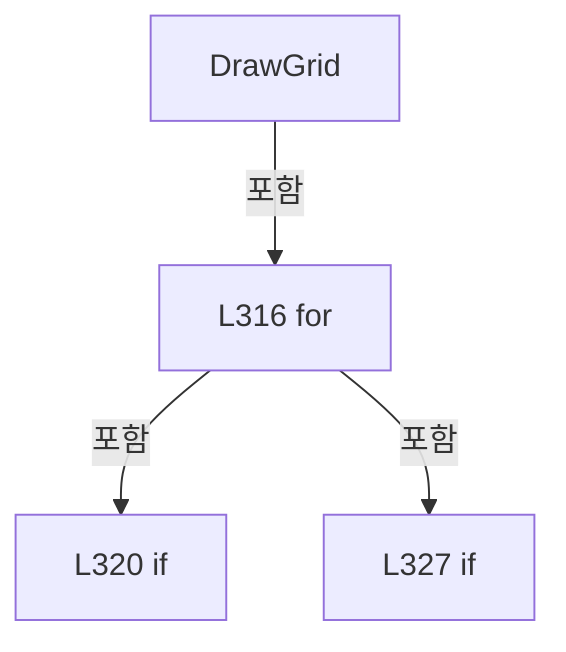

변경 전 점검: 입력/반환 타입, 위 호출자, 예외/취소 경로, 공유 상태와 저장·전송 소비자를 함께 확인합니다. 값의 단위나 물리 방향을 이름만으로 확정하지 않습니다.

### MethodDeclaration `GetScreenTickValue` · L344–350

[Drilling.UI/Menu/Menus/CCoordinateOffsetPreviewDrawing.cs:344–350](https://github.com/kjuws10-rgb/A3Drilling/blob/28764c91d521777b8ee068dd7aaf2d3902ce9fe2/Drilling.UI/Menu/Menus/CCoordinateOffsetPreviewDrawing.cs#L344-L350)

| 항목 | 실제 추출 값 |
| --- | --- |
| 서명 | double Drilling.UI.Menu.Menus.CCoordinateOffsetPreviewDrawing.GetScreenTickValue(int, bool, double, double) |
| 접근/수식자 | Private / private, static |
| 반환/값 타입 | double |
| 소속 타입 | NamedType:Drilling.UI.Menu.Menus.CCoordinateOffsetPreviewDrawing |

입력 계약:

| 이름 | 타입 | 전달 | 선택/기본값 |
| --- | --- | --- | --- |
| index | int | None | False /  |
| positiveTowardsIncreasingScreen | bool | None | False /  |
| minimum | double | None | False /  |
| maximum | double | None | False /  |

정적 호출자로 확인된 위치:

| 호출 파일/행 | 호출 표현식 | 런타임 분기 가능 |
| --- | --- | --- |
| [Drilling.UI/Menu/Menus/CCoordinateOffsetPreviewDrawing.cs:332–332](https://github.com/kjuws10-rgb/A3Drilling/blob/28764c91d521777b8ee068dd7aaf2d3902ce9fe2/Drilling.UI/Menu/Menus/CCoordinateOffsetPreviewDrawing.cs#L332-L332) | GetScreenTickValue | False |
| [Drilling.UI/Menu/Menus/CCoordinateOffsetPreviewDrawing.cs:333–333](https://github.com/kjuws10-rgb/A3Drilling/blob/28764c91d521777b8ee068dd7aaf2d3902ce9fe2/Drilling.UI/Menu/Menus/CCoordinateOffsetPreviewDrawing.cs#L333-L333) | GetScreenTickValue | False |

본문의 실제 연산·분기·예외·반환 순서(원문 위치 순):

| 원본 행 | 종류 | 주석 해설 |
| --- | --- | --- |
| 346 | local-declaration | 지역 변수를 선언합니다: var fraction = (double)index / GridDivisionCount; |
| 346 | variable-initializer | 변수의 초기값을 지정합니다: fraction = (double)index / GridDivisionCount |
| 347 | conditional-expression | 조건에 따라 결과식을 선택합니다: positiveTowardsIncreasingScreen ? minimum + ((maximum - minimum) * fraction) : maximum - ((maximum - minimum) * fraction) |
| 347 | return | 호출자에게 값 또는 제어를 반환합니다: return positiveTowardsIncreasingScreen ? minimum + ((maximum - minimum) * fraction) : maximum - ((maximum - minimum) * fraction); |

변경 전 점검: 입력/반환 타입, 위 호출자, 예외/취소 경로, 공유 상태와 저장·전송 소비자를 함께 확인합니다. 값의 단위나 물리 방향을 이름만으로 확정하지 않습니다.

### MethodDeclaration `FormatTick` · L352–358

[Drilling.UI/Menu/Menus/CCoordinateOffsetPreviewDrawing.cs:352–358](https://github.com/kjuws10-rgb/A3Drilling/blob/28764c91d521777b8ee068dd7aaf2d3902ce9fe2/Drilling.UI/Menu/Menus/CCoordinateOffsetPreviewDrawing.cs#L352-L358)

| 항목 | 실제 추출 값 |
| --- | --- |
| 서명 | string Drilling.UI.Menu.Menus.CCoordinateOffsetPreviewDrawing.FormatTick(double, double) |
| 접근/수식자 | Private / private, static |
| 반환/값 타입 | string |
| 소속 타입 | NamedType:Drilling.UI.Menu.Menus.CCoordinateOffsetPreviewDrawing |

입력 계약:

| 이름 | 타입 | 전달 | 선택/기본값 |
| --- | --- | --- | --- |
| value | double | None | False /  |
| step | double | None | False /  |

정적 호출자로 확인된 위치:

| 호출 파일/행 | 호출 표현식 | 런타임 분기 가능 |
| --- | --- | --- |
| [Drilling.UI/Menu/Menus/CCoordinateOffsetPreviewDrawing.cs:334–334](https://github.com/kjuws10-rgb/A3Drilling/blob/28764c91d521777b8ee068dd7aaf2d3902ce9fe2/Drilling.UI/Menu/Menus/CCoordinateOffsetPreviewDrawing.cs#L334-L334) | FormatTick | False |
| [Drilling.UI/Menu/Menus/CCoordinateOffsetPreviewDrawing.cs:335–335](https://github.com/kjuws10-rgb/A3Drilling/blob/28764c91d521777b8ee068dd7aaf2d3902ce9fe2/Drilling.UI/Menu/Menus/CCoordinateOffsetPreviewDrawing.cs#L335-L335) | FormatTick | False |

호출하는 대상과 해석 범위:

| 원본 행 | 표현식 | 분석 상태 | 대상/소스 위치 |
| --- | --- | --- | --- |
| 354 | Math.Abs | resolved | double System.Math.Abs(double) |
| 354 | Math.Abs | resolved | double System.Math.Abs(double) |
| 356 | Math.Abs | resolved | double System.Math.Abs(double) |
| 356 | Math.Abs | resolved | double System.Math.Abs(double) |
| 356 | Math.Abs | resolved | double System.Math.Abs(double) |
| 357 | value.ToString | resolved | string double.ToString(string?, System.IFormatProvider?) |

본문의 실제 연산·분기·예외·반환 순서(원문 위치 순):

| 원본 행 | 종류 | 주석 해설 |
| --- | --- | --- |
| 354 | call | 함수·델리게이트 또는 객체 생성자를 호출합니다: Math.Abs(value) |
| 354 | call | 함수·델리게이트 또는 객체 생성자를 호출합니다: Math.Abs(step) |
| 354 | if | 조건에 따라 분기합니다: if (Math.Abs(value) < Math.Abs(step) * 1e-6) |
| 355 | assignment | 값을 대상에 대입합니다: value = 0.0 |
| 356 | call | 함수·델리게이트 또는 객체 생성자를 호출합니다: Math.Abs(step) |
| 356 | call | 함수·델리게이트 또는 객체 생성자를 호출합니다: Math.Abs(step) |
| 356 | call | 함수·델리게이트 또는 객체 생성자를 호출합니다: Math.Abs(step) |
| 356 | conditional-expression | 조건에 따라 결과식을 선택합니다: Math.Abs(step) < 0.01 ? "0.000" : Math.Abs(step) < 0.1 ? "0.00" : Math.Abs(step) < 1.0 ? "0.0" : "0.##" |
| 356 | conditional-expression | 조건에 따라 결과식을 선택합니다: Math.Abs(step) < 0.1 ? "0.00" : Math.Abs(step) < 1.0 ? "0.0" : "0.##" |
| 356 | conditional-expression | 조건에 따라 결과식을 선택합니다: Math.Abs(step) < 1.0 ? "0.0" : "0.##" |
| 356 | local-declaration | 지역 변수를 선언합니다: var format = Math.Abs(step) < 0.01 ? "0.000" : Math.Abs(step) < 0.1 ? "0.00" : Math.Abs(step) < 1.0 ? "0.0" : "0.##"; |
| 356 | variable-initializer | 변수의 초기값을 지정합니다: format = Math.Abs(step) < 0.01 ? "0.000" : Math.Abs(step) < 0.1 ? "0.00" : Math.Abs(step) < 1.0 ? "0.0" : "0.##" |
| 357 | call | 함수·델리게이트 또는 객체 생성자를 호출합니다: value.ToString(format, CultureInfo.InvariantCulture) |
| 357 | return | 호출자에게 값 또는 제어를 반환합니다: return value.ToString(format, CultureInfo.InvariantCulture); |

제어 구문의 포함 구조(실제 실행 순서/CFG가 아닌 구문 탐색 그림):

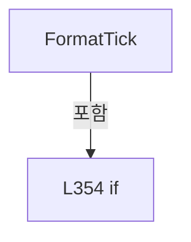

변경 전 점검: 입력/반환 타입, 위 호출자, 예외/취소 경로, 공유 상태와 저장·전송 소비자를 함께 확인합니다. 값의 단위나 물리 방향을 이름만으로 확정하지 않습니다.

### MethodDeclaration `DrawArrowHead` · L360–373

[Drilling.UI/Menu/Menus/CCoordinateOffsetPreviewDrawing.cs:360–373](https://github.com/kjuws10-rgb/A3Drilling/blob/28764c91d521777b8ee068dd7aaf2d3902ce9fe2/Drilling.UI/Menu/Menus/CCoordinateOffsetPreviewDrawing.cs#L360-L373)

| 항목 | 실제 추출 값 |
| --- | --- |
| 서명 | void Drilling.UI.Menu.Menus.CCoordinateOffsetPreviewDrawing.DrawArrowHead(DrawingContext, Pen, Point, Point) |
| 접근/수식자 | Private / private, static |
| 반환/값 타입 | void |
| 소속 타입 | NamedType:Drilling.UI.Menu.Menus.CCoordinateOffsetPreviewDrawing |

입력 계약:

| 이름 | 타입 | 전달 | 선택/기본값 |
| --- | --- | --- | --- |
| context | DrawingContext | None | False /  |
| pen | Pen | None | False /  |
| start | Point | None | False /  |
| end | Point | None | False /  |

현재 부분 분석에서 직접 연결된 호출자는 없습니다. XAML/이벤트/인터페이스·델리게이트·외부 진입을 추가 확인해야 하며, 미사용으로 판정한 것이 아닙니다.

호출하는 대상과 해석 범위:

| 원본 행 | 표현식 | 분석 상태 | 대상/소스 위치 |
| --- | --- | --- | --- |
| 368 | delta.Normalize | unresolved | None |
| 369 | new Vector | unresolved | None |
| 371 | context.DrawLine | unresolved | None |
| 372 | context.DrawLine | unresolved | None |

본문의 실제 연산·분기·예외·반환 순서(원문 위치 순):

| 원본 행 | 종류 | 주석 해설 |
| --- | --- | --- |
| 362 | local-declaration | 지역 변수를 선언합니다: var delta = end - start; |
| 362 | variable-initializer | 변수의 초기값을 지정합니다: delta = end - start |
| 363 | if | 조건에 따라 분기합니다: if (delta.Length < 5.0) |
| 365 | return | 호출자에게 값 또는 제어를 반환합니다: return; |
| 368 | call | 함수·델리게이트 또는 객체 생성자를 호출합니다: delta.Normalize() |
| 369 | call | 함수·델리게이트 또는 객체 생성자를 호출합니다: new Vector(-delta.Y, delta.X) |
| 369 | local-declaration | 지역 변수를 선언합니다: var normal = new Vector(-delta.Y, delta.X); |
| 369 | variable-initializer | 변수의 초기값을 지정합니다: normal = new Vector(-delta.Y, delta.X) |
| 370 | local-declaration | 지역 변수를 선언합니다: var basePoint = end - (delta * 9.0); |
| 370 | variable-initializer | 변수의 초기값을 지정합니다: basePoint = end - (delta * 9.0) |
| 371 | call | 함수·델리게이트 또는 객체 생성자를 호출합니다: context.DrawLine(pen, end, basePoint + (normal * 4.0)) |
| 372 | call | 함수·델리게이트 또는 객체 생성자를 호출합니다: context.DrawLine(pen, end, basePoint - (normal * 4.0)) |

제어 구문의 포함 구조(실제 실행 순서/CFG가 아닌 구문 탐색 그림):

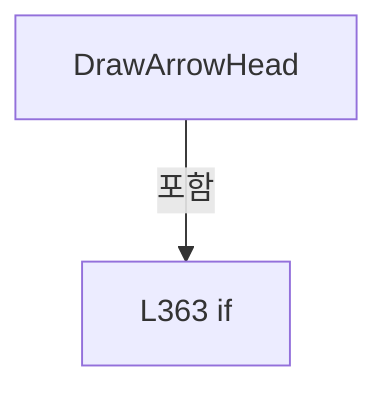

변경 전 점검: 입력/반환 타입, 위 호출자, 예외/취소 경로, 공유 상태와 저장·전송 소비자를 함께 확인합니다. 값의 단위나 물리 방향을 이름만으로 확정하지 않습니다.

### MethodDeclaration `DrawText` · L375–378

[Drilling.UI/Menu/Menus/CCoordinateOffsetPreviewDrawing.cs:375–378](https://github.com/kjuws10-rgb/A3Drilling/blob/28764c91d521777b8ee068dd7aaf2d3902ce9fe2/Drilling.UI/Menu/Menus/CCoordinateOffsetPreviewDrawing.cs#L375-L378)

| 항목 | 실제 추출 값 |
| --- | --- |
| 서명 | void Drilling.UI.Menu.Menus.CCoordinateOffsetPreviewDrawing.DrawText(DrawingContext, string, Point, double, Brush) |
| 접근/수식자 | Private / private, static |
| 반환/값 타입 | void |
| 소속 타입 | NamedType:Drilling.UI.Menu.Menus.CCoordinateOffsetPreviewDrawing |

입력 계약:

| 이름 | 타입 | 전달 | 선택/기본값 |
| --- | --- | --- | --- |
| context | DrawingContext | None | False /  |
| text | string | None | False /  |
| origin | Point | None | False /  |
| fontSize | double | None | False /  |
| brush | Brush | None | False /  |

현재 부분 분석에서 직접 연결된 호출자는 없습니다. XAML/이벤트/인터페이스·델리게이트·외부 진입을 추가 확인해야 하며, 미사용으로 판정한 것이 아닙니다.

호출하는 대상과 해석 범위:

| 원본 행 | 표현식 | 분석 상태 | 대상/소스 위치 |
| --- | --- | --- | --- |
| 377 | context.DrawText | unresolved | None |
| 377 | CreateText | resolved | FormattedText Drilling.UI.Menu.Menus.CCoordinateOffsetPreviewDrawing.CreateText(string, double, Brush) · Drilling.UI/Menu/Menus/CCoordinateOffsetPreviewDrawing.cs:400 |

본문의 실제 연산·분기·예외·반환 순서(원문 위치 순):

| 원본 행 | 종류 | 주석 해설 |
| --- | --- | --- |
| 377 | call | 함수·델리게이트 또는 객체 생성자를 호출합니다: context.DrawText(CreateText(text, fontSize, brush), origin) |
| 377 | call | 함수·델리게이트 또는 객체 생성자를 호출합니다: CreateText(text, fontSize, brush) |

변경 전 점검: 입력/반환 타입, 위 호출자, 예외/취소 경로, 공유 상태와 저장·전송 소비자를 함께 확인합니다. 값의 단위나 물리 방향을 이름만으로 확정하지 않습니다.

### MethodDeclaration `DrawCenteredText` · L380–384

[Drilling.UI/Menu/Menus/CCoordinateOffsetPreviewDrawing.cs:380–384](https://github.com/kjuws10-rgb/A3Drilling/blob/28764c91d521777b8ee068dd7aaf2d3902ce9fe2/Drilling.UI/Menu/Menus/CCoordinateOffsetPreviewDrawing.cs#L380-L384)

| 항목 | 실제 추출 값 |
| --- | --- |
| 서명 | void Drilling.UI.Menu.Menus.CCoordinateOffsetPreviewDrawing.DrawCenteredText(DrawingContext, string, Point, double, Brush) |
| 접근/수식자 | Private / private, static |
| 반환/값 타입 | void |
| 소속 타입 | NamedType:Drilling.UI.Menu.Menus.CCoordinateOffsetPreviewDrawing |

입력 계약:

| 이름 | 타입 | 전달 | 선택/기본값 |
| --- | --- | --- | --- |
| context | DrawingContext | None | False /  |
| text | string | None | False /  |
| origin | Point | None | False /  |
| fontSize | double | None | False /  |
| brush | Brush | None | False /  |

현재 부분 분석에서 직접 연결된 호출자는 없습니다. XAML/이벤트/인터페이스·델리게이트·외부 진입을 추가 확인해야 하며, 미사용으로 판정한 것이 아닙니다.

호출하는 대상과 해석 범위:

| 원본 행 | 표현식 | 분석 상태 | 대상/소스 위치 |
| --- | --- | --- | --- |
| 382 | CreateText | resolved | FormattedText Drilling.UI.Menu.Menus.CCoordinateOffsetPreviewDrawing.CreateText(string, double, Brush) · Drilling.UI/Menu/Menus/CCoordinateOffsetPreviewDrawing.cs:400 |
| 383 | context.DrawText | unresolved | None |
| 383 | new Point | unresolved | None |

본문의 실제 연산·분기·예외·반환 순서(원문 위치 순):

| 원본 행 | 종류 | 주석 해설 |
| --- | --- | --- |
| 382 | call | 함수·델리게이트 또는 객체 생성자를 호출합니다: CreateText(text, fontSize, brush) |
| 382 | local-declaration | 지역 변수를 선언합니다: var formatted = CreateText(text, fontSize, brush); |
| 382 | variable-initializer | 변수의 초기값을 지정합니다: formatted = CreateText(text, fontSize, brush) |
| 383 | call | 함수·델리게이트 또는 객체 생성자를 호출합니다: context.DrawText(formatted, new Point(origin.X - (formatted.Width / 2.0), origin.Y)) |
| 383 | call | 함수·델리게이트 또는 객체 생성자를 호출합니다: new Point(origin.X - (formatted.Width / 2.0), origin.Y) |

변경 전 점검: 입력/반환 타입, 위 호출자, 예외/취소 경로, 공유 상태와 저장·전송 소비자를 함께 확인합니다. 값의 단위나 물리 방향을 이름만으로 확정하지 않습니다.

### MethodDeclaration `DrawRightAlignedText` · L386–390

[Drilling.UI/Menu/Menus/CCoordinateOffsetPreviewDrawing.cs:386–390](https://github.com/kjuws10-rgb/A3Drilling/blob/28764c91d521777b8ee068dd7aaf2d3902ce9fe2/Drilling.UI/Menu/Menus/CCoordinateOffsetPreviewDrawing.cs#L386-L390)

| 항목 | 실제 추출 값 |
| --- | --- |
| 서명 | void Drilling.UI.Menu.Menus.CCoordinateOffsetPreviewDrawing.DrawRightAlignedText(DrawingContext, string, Point, double, Brush) |
| 접근/수식자 | Private / private, static |
| 반환/값 타입 | void |
| 소속 타입 | NamedType:Drilling.UI.Menu.Menus.CCoordinateOffsetPreviewDrawing |

입력 계약:

| 이름 | 타입 | 전달 | 선택/기본값 |
| --- | --- | --- | --- |
| context | DrawingContext | None | False /  |
| text | string | None | False /  |
| origin | Point | None | False /  |
| fontSize | double | None | False /  |
| brush | Brush | None | False /  |

현재 부분 분석에서 직접 연결된 호출자는 없습니다. XAML/이벤트/인터페이스·델리게이트·외부 진입을 추가 확인해야 하며, 미사용으로 판정한 것이 아닙니다.

호출하는 대상과 해석 범위:

| 원본 행 | 표현식 | 분석 상태 | 대상/소스 위치 |
| --- | --- | --- | --- |
| 388 | CreateText | resolved | FormattedText Drilling.UI.Menu.Menus.CCoordinateOffsetPreviewDrawing.CreateText(string, double, Brush) · Drilling.UI/Menu/Menus/CCoordinateOffsetPreviewDrawing.cs:400 |
| 389 | context.DrawText | unresolved | None |
| 389 | new Point | unresolved | None |

본문의 실제 연산·분기·예외·반환 순서(원문 위치 순):

| 원본 행 | 종류 | 주석 해설 |
| --- | --- | --- |
| 388 | call | 함수·델리게이트 또는 객체 생성자를 호출합니다: CreateText(text, fontSize, brush) |
| 388 | local-declaration | 지역 변수를 선언합니다: var formatted = CreateText(text, fontSize, brush); |
| 388 | variable-initializer | 변수의 초기값을 지정합니다: formatted = CreateText(text, fontSize, brush) |
| 389 | call | 함수·델리게이트 또는 객체 생성자를 호출합니다: context.DrawText(formatted, new Point(origin.X - formatted.Width, origin.Y)) |
| 389 | call | 함수·델리게이트 또는 객체 생성자를 호출합니다: new Point(origin.X - formatted.Width, origin.Y) |

변경 전 점검: 입력/반환 타입, 위 호출자, 예외/취소 경로, 공유 상태와 저장·전송 소비자를 함께 확인합니다. 값의 단위나 물리 방향을 이름만으로 확정하지 않습니다.

### MethodDeclaration `DrawTextWithin` · L392–398

[Drilling.UI/Menu/Menus/CCoordinateOffsetPreviewDrawing.cs:392–398](https://github.com/kjuws10-rgb/A3Drilling/blob/28764c91d521777b8ee068dd7aaf2d3902ce9fe2/Drilling.UI/Menu/Menus/CCoordinateOffsetPreviewDrawing.cs#L392-L398)

| 항목 | 실제 추출 값 |
| --- | --- |
| 서명 | void Drilling.UI.Menu.Menus.CCoordinateOffsetPreviewDrawing.DrawTextWithin(DrawingContext, string, Point, double, Brush, Rect) |
| 접근/수식자 | Private / private, static |
| 반환/값 타입 | void |
| 소속 타입 | NamedType:Drilling.UI.Menu.Menus.CCoordinateOffsetPreviewDrawing |

입력 계약:

| 이름 | 타입 | 전달 | 선택/기본값 |
| --- | --- | --- | --- |
| context | DrawingContext | None | False /  |
| text | string | None | False /  |
| origin | Point | None | False /  |
| fontSize | double | None | False /  |
| brush | Brush | None | False /  |
| bounds | Rect | None | False /  |

정적 호출자로 확인된 위치:

| 호출 파일/행 | 호출 표현식 | 런타임 분기 가능 |
| --- | --- | --- |
| [Drilling.UI/Menu/Menus/CCoordinateOffsetPreviewDrawing.cs:297–297](https://github.com/kjuws10-rgb/A3Drilling/blob/28764c91d521777b8ee068dd7aaf2d3902ce9fe2/Drilling.UI/Menu/Menus/CCoordinateOffsetPreviewDrawing.cs#L297-L297) | DrawTextWithin | False |

호출하는 대상과 해석 범위:

| 원본 행 | 표현식 | 분석 상태 | 대상/소스 위치 |
| --- | --- | --- | --- |
| 394 | CreateText | resolved | FormattedText Drilling.UI.Menu.Menus.CCoordinateOffsetPreviewDrawing.CreateText(string, double, Brush) · Drilling.UI/Menu/Menus/CCoordinateOffsetPreviewDrawing.cs:400 |
| 395 | Math.Clamp | candidate | OverloadResolutionFailure |
| 395 | Math.Max | candidate | OverloadResolutionFailure |
| 396 | Math.Clamp | candidate | OverloadResolutionFailure |
| 396 | Math.Max | candidate | OverloadResolutionFailure |
| 397 | context.DrawText | unresolved | None |
| 397 | new Point | unresolved | None |

본문의 실제 연산·분기·예외·반환 순서(원문 위치 순):

| 원본 행 | 종류 | 주석 해설 |
| --- | --- | --- |
| 394 | call | 함수·델리게이트 또는 객체 생성자를 호출합니다: CreateText(text, fontSize, brush) |
| 394 | local-declaration | 지역 변수를 선언합니다: var formatted = CreateText(text, fontSize, brush); |
| 394 | variable-initializer | 변수의 초기값을 지정합니다: formatted = CreateText(text, fontSize, brush) |
| 395 | call | 함수·델리게이트 또는 객체 생성자를 호출합니다: Math.Clamp(origin.X, bounds.Left + 2.0, Math.Max(bounds.Left + 2.0, bounds.Right - formatted.Width - 2.0)) |
| 395 | call | 함수·델리게이트 또는 객체 생성자를 호출합니다: Math.Max(bounds.Left + 2.0, bounds.Right - formatted.Width - 2.0) |
| 395 | local-declaration | 지역 변수를 선언합니다: var x = Math.Clamp(origin.X, bounds.Left + 2.0, Math.Max(bounds.Left + 2.0, bounds.Right - formatted.Width - 2.0)); |
| 395 | variable-initializer | 변수의 초기값을 지정합니다: x = Math.Clamp(origin.X, bounds.Left + 2.0, Math.Max(bounds.Left + 2.0, bounds.Right - formatted.Width - 2.0)) |
| 396 | call | 함수·델리게이트 또는 객체 생성자를 호출합니다: Math.Clamp(origin.Y, bounds.Top + 2.0, Math.Max(bounds.Top + 2.0, bounds.Bottom - formatted.Height - 2.0)) |
| 396 | call | 함수·델리게이트 또는 객체 생성자를 호출합니다: Math.Max(bounds.Top + 2.0, bounds.Bottom - formatted.Height - 2.0) |
| 396 | local-declaration | 지역 변수를 선언합니다: var y = Math.Clamp(origin.Y, bounds.Top + 2.0, Math.Max(bounds.Top + 2.0, bounds.Bottom - formatted.Height - 2.0)); |
| 396 | variable-initializer | 변수의 초기값을 지정합니다: y = Math.Clamp(origin.Y, bounds.Top + 2.0, Math.Max(bounds.Top + 2.0, bounds.Bottom - formatted.Height - 2.0)) |
| 397 | call | 함수·델리게이트 또는 객체 생성자를 호출합니다: context.DrawText(formatted, new Point(x, y)) |
| 397 | call | 함수·델리게이트 또는 객체 생성자를 호출합니다: new Point(x, y) |

변경 전 점검: 입력/반환 타입, 위 호출자, 예외/취소 경로, 공유 상태와 저장·전송 소비자를 함께 확인합니다. 값의 단위나 물리 방향을 이름만으로 확정하지 않습니다.

### MethodDeclaration `CreateText` · L400–410

[Drilling.UI/Menu/Menus/CCoordinateOffsetPreviewDrawing.cs:400–410](https://github.com/kjuws10-rgb/A3Drilling/blob/28764c91d521777b8ee068dd7aaf2d3902ce9fe2/Drilling.UI/Menu/Menus/CCoordinateOffsetPreviewDrawing.cs#L400-L410)

| 항목 | 실제 추출 값 |
| --- | --- |
| 서명 | FormattedText Drilling.UI.Menu.Menus.CCoordinateOffsetPreviewDrawing.CreateText(string, double, Brush) |
| 접근/수식자 | Private / private, static |
| 반환/값 타입 | FormattedText |
| 소속 타입 | NamedType:Drilling.UI.Menu.Menus.CCoordinateOffsetPreviewDrawing |

입력 계약:

| 이름 | 타입 | 전달 | 선택/기본값 |
| --- | --- | --- | --- |
| text | string | None | False /  |
| fontSize | double | None | False /  |
| brush | Brush | None | False /  |

정적 호출자로 확인된 위치:

| 호출 파일/행 | 호출 표현식 | 런타임 분기 가능 |
| --- | --- | --- |
| [Drilling.UI/Menu/Menus/CCoordinateOffsetPreviewDrawing.cs:377–377](https://github.com/kjuws10-rgb/A3Drilling/blob/28764c91d521777b8ee068dd7aaf2d3902ce9fe2/Drilling.UI/Menu/Menus/CCoordinateOffsetPreviewDrawing.cs#L377-L377) | CreateText | False |
| [Drilling.UI/Menu/Menus/CCoordinateOffsetPreviewDrawing.cs:382–382](https://github.com/kjuws10-rgb/A3Drilling/blob/28764c91d521777b8ee068dd7aaf2d3902ce9fe2/Drilling.UI/Menu/Menus/CCoordinateOffsetPreviewDrawing.cs#L382-L382) | CreateText | False |
| [Drilling.UI/Menu/Menus/CCoordinateOffsetPreviewDrawing.cs:388–388](https://github.com/kjuws10-rgb/A3Drilling/blob/28764c91d521777b8ee068dd7aaf2d3902ce9fe2/Drilling.UI/Menu/Menus/CCoordinateOffsetPreviewDrawing.cs#L388-L388) | CreateText | False |
| [Drilling.UI/Menu/Menus/CCoordinateOffsetPreviewDrawing.cs:394–394](https://github.com/kjuws10-rgb/A3Drilling/blob/28764c91d521777b8ee068dd7aaf2d3902ce9fe2/Drilling.UI/Menu/Menus/CCoordinateOffsetPreviewDrawing.cs#L394-L394) | CreateText | False |

호출하는 대상과 해석 범위:

| 원본 행 | 표현식 | 분석 상태 | 대상/소스 위치 |
| --- | --- | --- | --- |
| 402 | new FormattedText | unresolved | None |
| 406 | new Typeface | unresolved | None |

본문의 실제 연산·분기·예외·반환 순서(원문 위치 순):

| 원본 행 | 종류 | 주석 해설 |
| --- | --- | --- |
| 402 | call | 함수·델리게이트 또는 객체 생성자를 호출합니다: new FormattedText( text, CultureInfo.InvariantCulture, FlowDirection.LeftToRight, new Typeface("Segoe UI"), fontSize, brush, 1.0) |
| 402 | return | 호출자에게 값 또는 제어를 반환합니다: return new FormattedText( text, CultureInfo.InvariantCulture, FlowDirection.LeftToRight, new Typeface("Segoe UI"), fontSize, brush, 1.0); |
| 406 | call | 함수·델리게이트 또는 객체 생성자를 호출합니다: new Typeface("Segoe UI") |

변경 전 점검: 입력/반환 타입, 위 호출자, 예외/취소 경로, 공유 상태와 저장·전송 소비자를 함께 확인합니다. 값의 단위나 물리 방향을 이름만으로 확정하지 않습니다.

### MethodDeclaration `CreateBrush` · L412–417

[Drilling.UI/Menu/Menus/CCoordinateOffsetPreviewDrawing.cs:412–417](https://github.com/kjuws10-rgb/A3Drilling/blob/28764c91d521777b8ee068dd7aaf2d3902ce9fe2/Drilling.UI/Menu/Menus/CCoordinateOffsetPreviewDrawing.cs#L412-L417)

| 항목 | 실제 추출 값 |
| --- | --- |
| 서명 | SolidColorBrush Drilling.UI.Menu.Menus.CCoordinateOffsetPreviewDrawing.CreateBrush(byte, byte, byte) |
| 접근/수식자 | Private / private, static |
| 반환/값 타입 | SolidColorBrush |
| 소속 타입 | NamedType:Drilling.UI.Menu.Menus.CCoordinateOffsetPreviewDrawing |

입력 계약:

| 이름 | 타입 | 전달 | 선택/기본값 |
| --- | --- | --- | --- |
| red | byte | None | False /  |
| green | byte | None | False /  |
| blue | byte | None | False /  |

정적 호출자로 확인된 위치:

| 호출 파일/행 | 호출 표현식 | 런타임 분기 가능 |
| --- | --- | --- |
| [Drilling.UI/Menu/Menus/CCoordinateOffsetPreviewDrawing.cs:47–47](https://github.com/kjuws10-rgb/A3Drilling/blob/28764c91d521777b8ee068dd7aaf2d3902ce9fe2/Drilling.UI/Menu/Menus/CCoordinateOffsetPreviewDrawing.cs#L47-L47) | CreateBrush | False |
| [Drilling.UI/Menu/Menus/CCoordinateOffsetPreviewDrawing.cs:50–50](https://github.com/kjuws10-rgb/A3Drilling/blob/28764c91d521777b8ee068dd7aaf2d3902ce9fe2/Drilling.UI/Menu/Menus/CCoordinateOffsetPreviewDrawing.cs#L50-L50) | CreateBrush | False |
| [Drilling.UI/Menu/Menus/CCoordinateOffsetPreviewDrawing.cs:52–52](https://github.com/kjuws10-rgb/A3Drilling/blob/28764c91d521777b8ee068dd7aaf2d3902ce9fe2/Drilling.UI/Menu/Menus/CCoordinateOffsetPreviewDrawing.cs#L52-L52) | CreateBrush | False |
| [Drilling.UI/Menu/Menus/CCoordinateOffsetPreviewDrawing.cs:53–53](https://github.com/kjuws10-rgb/A3Drilling/blob/28764c91d521777b8ee068dd7aaf2d3902ce9fe2/Drilling.UI/Menu/Menus/CCoordinateOffsetPreviewDrawing.cs#L53-L53) | CreateBrush | False |
| [Drilling.UI/Menu/Menus/CCoordinateOffsetPreviewDrawing.cs:60–60](https://github.com/kjuws10-rgb/A3Drilling/blob/28764c91d521777b8ee068dd7aaf2d3902ce9fe2/Drilling.UI/Menu/Menus/CCoordinateOffsetPreviewDrawing.cs#L60-L60) | CreateBrush | False |
| [Drilling.UI/Menu/Menus/CCoordinateOffsetPreviewDrawing.cs:63–63](https://github.com/kjuws10-rgb/A3Drilling/blob/28764c91d521777b8ee068dd7aaf2d3902ce9fe2/Drilling.UI/Menu/Menus/CCoordinateOffsetPreviewDrawing.cs#L63-L63) | CreateBrush | False |
| [Drilling.UI/Menu/Menus/CCoordinateOffsetPreviewDrawing.cs:65–65](https://github.com/kjuws10-rgb/A3Drilling/blob/28764c91d521777b8ee068dd7aaf2d3902ce9fe2/Drilling.UI/Menu/Menus/CCoordinateOffsetPreviewDrawing.cs#L65-L65) | CreateBrush | False |
| [Drilling.UI/Menu/Menus/CCoordinateOffsetPreviewDrawing.cs:72–72](https://github.com/kjuws10-rgb/A3Drilling/blob/28764c91d521777b8ee068dd7aaf2d3902ce9fe2/Drilling.UI/Menu/Menus/CCoordinateOffsetPreviewDrawing.cs#L72-L72) | CreateBrush | False |
| [Drilling.UI/Menu/Menus/CCoordinateOffsetPreviewDrawing.cs:77–77](https://github.com/kjuws10-rgb/A3Drilling/blob/28764c91d521777b8ee068dd7aaf2d3902ce9fe2/Drilling.UI/Menu/Menus/CCoordinateOffsetPreviewDrawing.cs#L77-L77) | CreateBrush | False |
| [Drilling.UI/Menu/Menus/CCoordinateOffsetPreviewDrawing.cs:122–122](https://github.com/kjuws10-rgb/A3Drilling/blob/28764c91d521777b8ee068dd7aaf2d3902ce9fe2/Drilling.UI/Menu/Menus/CCoordinateOffsetPreviewDrawing.cs#L122-L122) | CreateBrush | False |
| [Drilling.UI/Menu/Menus/CCoordinateOffsetPreviewDrawing.cs:125–125](https://github.com/kjuws10-rgb/A3Drilling/blob/28764c91d521777b8ee068dd7aaf2d3902ce9fe2/Drilling.UI/Menu/Menus/CCoordinateOffsetPreviewDrawing.cs#L125-L125) | CreateBrush | False |
| [Drilling.UI/Menu/Menus/CCoordinateOffsetPreviewDrawing.cs:128–128](https://github.com/kjuws10-rgb/A3Drilling/blob/28764c91d521777b8ee068dd7aaf2d3902ce9fe2/Drilling.UI/Menu/Menus/CCoordinateOffsetPreviewDrawing.cs#L128-L128) | CreateBrush | False |
| [Drilling.UI/Menu/Menus/CCoordinateOffsetPreviewDrawing.cs:129–129](https://github.com/kjuws10-rgb/A3Drilling/blob/28764c91d521777b8ee068dd7aaf2d3902ce9fe2/Drilling.UI/Menu/Menus/CCoordinateOffsetPreviewDrawing.cs#L129-L129) | CreateBrush | False |
| [Drilling.UI/Menu/Menus/CCoordinateOffsetPreviewDrawing.cs:134–134](https://github.com/kjuws10-rgb/A3Drilling/blob/28764c91d521777b8ee068dd7aaf2d3902ce9fe2/Drilling.UI/Menu/Menus/CCoordinateOffsetPreviewDrawing.cs#L134-L134) | CreateBrush | False |
| [Drilling.UI/Menu/Menus/CCoordinateOffsetPreviewDrawing.cs:135–135](https://github.com/kjuws10-rgb/A3Drilling/blob/28764c91d521777b8ee068dd7aaf2d3902ce9fe2/Drilling.UI/Menu/Menus/CCoordinateOffsetPreviewDrawing.cs#L135-L135) | CreateBrush | False |
| [Drilling.UI/Menu/Menus/CCoordinateOffsetPreviewDrawing.cs:140–140](https://github.com/kjuws10-rgb/A3Drilling/blob/28764c91d521777b8ee068dd7aaf2d3902ce9fe2/Drilling.UI/Menu/Menus/CCoordinateOffsetPreviewDrawing.cs#L140-L140) | CreateBrush | False |
| [Drilling.UI/Menu/Menus/CCoordinateOffsetPreviewDrawing.cs:143–143](https://github.com/kjuws10-rgb/A3Drilling/blob/28764c91d521777b8ee068dd7aaf2d3902ce9fe2/Drilling.UI/Menu/Menus/CCoordinateOffsetPreviewDrawing.cs#L143-L143) | CreateBrush | False |
| [Drilling.UI/Menu/Menus/CCoordinateOffsetPreviewDrawing.cs:147–147](https://github.com/kjuws10-rgb/A3Drilling/blob/28764c91d521777b8ee068dd7aaf2d3902ce9fe2/Drilling.UI/Menu/Menus/CCoordinateOffsetPreviewDrawing.cs#L147-L147) | CreateBrush | False |
| [Drilling.UI/Menu/Menus/CCoordinateOffsetPreviewDrawing.cs:156–156](https://github.com/kjuws10-rgb/A3Drilling/blob/28764c91d521777b8ee068dd7aaf2d3902ce9fe2/Drilling.UI/Menu/Menus/CCoordinateOffsetPreviewDrawing.cs#L156-L156) | CreateBrush | False |
| [Drilling.UI/Menu/Menus/CCoordinateOffsetPreviewDrawing.cs:161–161](https://github.com/kjuws10-rgb/A3Drilling/blob/28764c91d521777b8ee068dd7aaf2d3902ce9fe2/Drilling.UI/Menu/Menus/CCoordinateOffsetPreviewDrawing.cs#L161-L161) | CreateBrush | False |
| [Drilling.UI/Menu/Menus/CCoordinateOffsetPreviewDrawing.cs:175–175](https://github.com/kjuws10-rgb/A3Drilling/blob/28764c91d521777b8ee068dd7aaf2d3902ce9fe2/Drilling.UI/Menu/Menus/CCoordinateOffsetPreviewDrawing.cs#L175-L175) | CreateBrush | False |
| [Drilling.UI/Menu/Menus/CCoordinateOffsetPreviewDrawing.cs:308–308](https://github.com/kjuws10-rgb/A3Drilling/blob/28764c91d521777b8ee068dd7aaf2d3902ce9fe2/Drilling.UI/Menu/Menus/CCoordinateOffsetPreviewDrawing.cs#L308-L308) | CreateBrush | False |
| [Drilling.UI/Menu/Menus/CCoordinateOffsetPreviewDrawing.cs:309–309](https://github.com/kjuws10-rgb/A3Drilling/blob/28764c91d521777b8ee068dd7aaf2d3902ce9fe2/Drilling.UI/Menu/Menus/CCoordinateOffsetPreviewDrawing.cs#L309-L309) | CreateBrush | False |
| [Drilling.UI/Menu/Menus/CCoordinateOffsetPreviewDrawing.cs:314–314](https://github.com/kjuws10-rgb/A3Drilling/blob/28764c91d521777b8ee068dd7aaf2d3902ce9fe2/Drilling.UI/Menu/Menus/CCoordinateOffsetPreviewDrawing.cs#L314-L314) | CreateBrush | False |
| [Drilling.UI/Menu/Menus/CCoordinateOffsetPreviewDrawing.cs:338–338](https://github.com/kjuws10-rgb/A3Drilling/blob/28764c91d521777b8ee068dd7aaf2d3902ce9fe2/Drilling.UI/Menu/Menus/CCoordinateOffsetPreviewDrawing.cs#L338-L338) | CreateBrush | False |

호출하는 대상과 해석 범위:

| 원본 행 | 표현식 | 분석 상태 | 대상/소스 위치 |
| --- | --- | --- | --- |
| 414 | new SolidColorBrush | unresolved | None |
| 414 | Color.FromRgb | unresolved | None |
| 415 | brush.Freeze | unresolved | None |

본문의 실제 연산·분기·예외·반환 순서(원문 위치 순):

| 원본 행 | 종류 | 주석 해설 |
| --- | --- | --- |
| 414 | call | 함수·델리게이트 또는 객체 생성자를 호출합니다: new SolidColorBrush(Color.FromRgb(red, green, blue)) |
| 414 | call | 함수·델리게이트 또는 객체 생성자를 호출합니다: Color.FromRgb(red, green, blue) |
| 414 | local-declaration | 지역 변수를 선언합니다: var brush = new SolidColorBrush(Color.FromRgb(red, green, blue)); |
| 414 | variable-initializer | 변수의 초기값을 지정합니다: brush = new SolidColorBrush(Color.FromRgb(red, green, blue)) |
| 415 | call | 함수·델리게이트 또는 객체 생성자를 호출합니다: brush.Freeze() |
| 416 | return | 호출자에게 값 또는 제어를 반환합니다: return brush; |

변경 전 점검: 입력/반환 타입, 위 호출자, 예외/취소 경로, 공유 상태와 저장·전송 소비자를 함께 확인합니다. 값의 단위나 물리 방향을 이름만으로 확정하지 않습니다.

## 구문·바인딩 한계

전체 WPF/벤더 SDK/프로젝트별 빌드 조건을 로드한 정식 빌드가 아닙니다. `resolved`는 이 부분 컴파일에서의 심볼 연결이며 virtual/interface/delegate/이벤트/Reflection/XAML의 실제 런타임 구현을 확정하지 않습니다. `candidate`와 `unresolved`는 후속 확인 대상으로 남깁니다.

## 원문 전체 주석 해설본

[원본 모든 행과 행별 해설 보기](../../../../annotated/Drilling.UI/Menu/Menus/CCoordinateOffsetPreviewDrawing.cs.annotated.txt)

원본을 빠뜨리거나 임의로 줄이지 않았습니다. `L000001 |` 표시는 원본 행 번호, `// 해설`은 별도 설명입니다. 실행용 소스가 아닌 문서입니다.

## 수정·재검증 체크

- 원본 Commit과 현재 작업 파일 SHA가 같은지 먼저 확인합니다. 다르면 이 문서를 과거 버전 자료로 취급합니다.
- 선언·직접 호출·이벤트/인터페이스 경계·설정 소비를 함께 확인합니다. 정적 연결의 빈 곳을 정상 경로로 추정하지 않습니다.
- 저장 형식/단위/식별자·재시도·취소·예외·롤백에 영향을 주는 변경은 상세 해설장과 호출자를 다시 검토합니다.
- 도구의 구문 추출과 별도 정적 추적 해설, 실제 빌드·시뮬레이션·실장비 검증 결과를 분리합니다.
