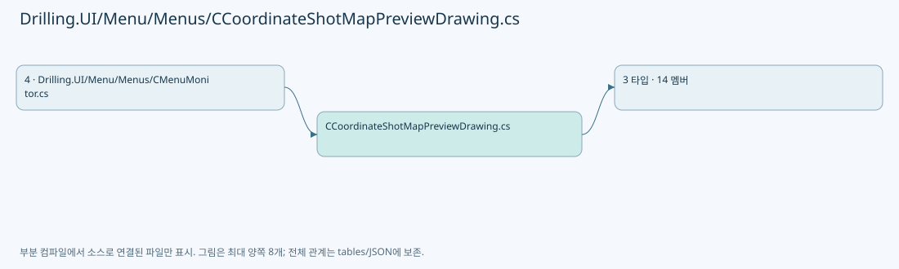
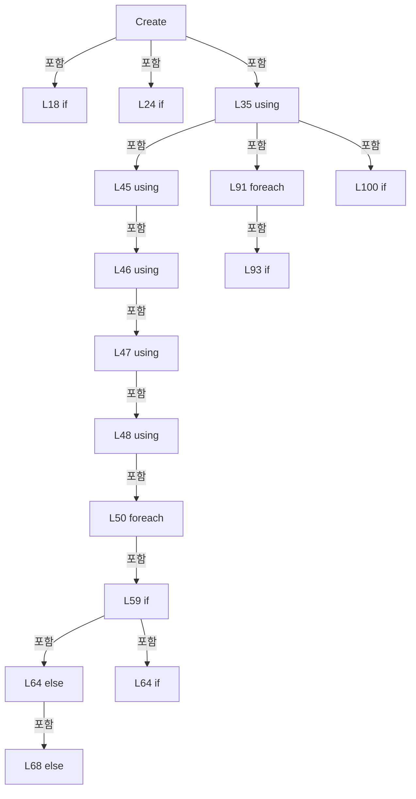
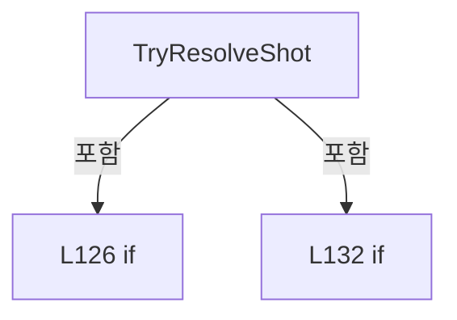
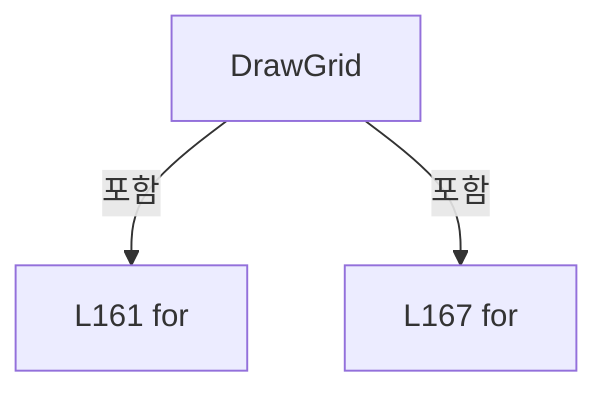

# Drilling.UI/Menu/Menus/CCoordinateShotMapPreviewDrawing.cs

| 항목 | 내용 |
| --- | --- |
| 원본 저장소 | https://github.com/kjuws10-rgb/A3Drilling.git |
| 원본 Commit | 28764c91d521777b8ee068dd7aaf2d3902ce9fe2 |
| 원본 SHA256 | d3b041057f97f293e1e40e189c5e655ae966c8c8430c73148b6cb20c0fedc931 |
| 파일 분류 | code |
| 원본 크기/행 | 9,912 bytes / 230 physical lines |
| 인코딩 | utf-8-sig |
| 검토 범위 | 구문/부분 의미 분석에서 추출한 사실. 동작·물리 단위·실장비 합격을 보증하지 않습니다. |
| 원본 링크 | [고정 Commit 원본](https://github.com/kjuws10-rgb/A3Drilling/blob/28764c91d521777b8ee068dd7aaf2d3902ce9fe2/Drilling.UI/Menu/Menus/CCoordinateShotMapPreviewDrawing.cs) |

## 파일의 역할과 읽는 순서

WPF 화면·사용자 명령·표시 상태를 구성합니다. XAML 이벤트와 코드 비하인드, RootView의 조립 경로를 함께 추적합니다.

## 네임스페이스·타입·상속

| 타입 | 구분 | 원본 범위 | 선언/상속 |
| --- | --- | --- | --- |
| CCoordinateShotMapPreviewDrawing | ClassDeclaration | 6–219 | CCoordinateShotMapPreviewDrawing |
| ST_COORDINATE_SHOT_MAP_POINT | RecordDeclaration | 221–228 | ST_COORDINATE_SHOT_MAP_POINT |
| ST_COORDINATE_SHOT_MAP_RENDER | RecordDeclaration | 230–230 | ST_COORDINATE_SHOT_MAP_RENDER |

## 멤버 빠른 목록

| 이름 | 종류 | 범위 | 서명 |
| --- | --- | --- | --- |
| LandscapeWidth | FieldDeclaration | L8–8 | double Drilling.UI.Menu.Menus.CCoordinateShotMapPreviewDrawing.LandscapeWidth |
| LandscapeHeight | FieldDeclaration | L9–9 | double Drilling.UI.Menu.Menus.CCoordinateShotMapPreviewDrawing.LandscapeHeight |
| PortraitWidth | FieldDeclaration | L10–10 | double Drilling.UI.Menu.Menus.CCoordinateShotMapPreviewDrawing.PortraitWidth |
| PortraitHeight | FieldDeclaration | L11–11 | double Drilling.UI.Menu.Menus.CCoordinateShotMapPreviewDrawing.PortraitHeight |
| MapMargin | FieldDeclaration | L12–12 | double Drilling.UI.Menu.Menus.CCoordinateShotMapPreviewDrawing.MapMargin |
| Create | MethodDeclaration | L14–114 | Drilling.UI.Menu.Menus.ST_COORDINATE_SHOT_MAP_RENDER Drilling.UI.Menu.Menus.CCoordinateShotMapPreviewDrawing.Create(System.Collections.Generic.IReadOnlyList<Drilling.UI.Menu.Menus.ST_COORDINATE_SHOT_MAP_POINT>, string) |
| TryResolveShot | MethodDeclaration | L116–140 | bool Drilling.UI.Menu.Menus.CCoordinateShotMapPreviewDrawing.TryResolveShot(double, double, int, int, out int, out int) |
| GetSurfaceSize | MethodDeclaration | L142–147 | Size Drilling.UI.Menu.Menus.CCoordinateShotMapPreviewDrawing.GetSurfaceSize(int, int) |
| GetMapRect | MethodDeclaration | L149–153 | Rect Drilling.UI.Menu.Menus.CCoordinateShotMapPreviewDrawing.GetMapRect(int, int) |
| DrawGrid | MethodDeclaration | L155–172 | void Drilling.UI.Menu.Menus.CCoordinateShotMapPreviewDrawing.DrawGrid(DrawingContext, Rect, int, int) |
| DrawSelectedShot | MethodDeclaration | L174–195 | void Drilling.UI.Menu.Menus.CCoordinateShotMapPreviewDrawing.DrawSelectedShot(DrawingContext, Rect, double, double, Drilling.UI.Menu.Menus.ST_COORDINATE_SHOT_MAP_POINT) |
| AddRectangle | MethodDeclaration | L197–203 | void Drilling.UI.Menu.Menus.CCoordinateShotMapPreviewDrawing.AddRectangle(StreamGeometryContext, Rect) |
| AddMaskCross | MethodDeclaration | L205–211 | void Drilling.UI.Menu.Menus.CCoordinateShotMapPreviewDrawing.AddMaskCross(StreamGeometryContext, double, double, double) |
| CreateBrush | MethodDeclaration | L213–218 | SolidColorBrush Drilling.UI.Menu.Menus.CCoordinateShotMapPreviewDrawing.CreateBrush(byte, byte, byte) |

## 멤버별 상세 계약·호출·처리 해설

### FieldDeclaration `LandscapeWidth` · L8–8

[Drilling.UI/Menu/Menus/CCoordinateShotMapPreviewDrawing.cs:8–8](https://github.com/kjuws10-rgb/A3Drilling/blob/28764c91d521777b8ee068dd7aaf2d3902ce9fe2/Drilling.UI/Menu/Menus/CCoordinateShotMapPreviewDrawing.cs#L8-L8)

| 항목 | 실제 추출 값 |
| --- | --- |
| 서명 | double Drilling.UI.Menu.Menus.CCoordinateShotMapPreviewDrawing.LandscapeWidth |
| 접근/수식자 | Private / private, const |
| 반환/값 타입 | double |
| 소속 타입 | NamedType:Drilling.UI.Menu.Menus.CCoordinateShotMapPreviewDrawing |

현재 부분 분석에서 직접 연결된 호출자는 없습니다. XAML/이벤트/인터페이스·델리게이트·외부 진입을 추가 확인해야 하며, 미사용으로 판정한 것이 아닙니다.

본문의 실제 연산·분기·예외·반환 순서(원문 위치 순):

| 원본 행 | 종류 | 주석 해설 |
| --- | --- | --- |
| 8 | variable-initializer | 변수의 초기값을 지정합니다: LandscapeWidth = 680.0 |

변경 전 점검: 입력/반환 타입, 위 호출자, 예외/취소 경로, 공유 상태와 저장·전송 소비자를 함께 확인합니다. 값의 단위나 물리 방향을 이름만으로 확정하지 않습니다.

### FieldDeclaration `LandscapeHeight` · L9–9

[Drilling.UI/Menu/Menus/CCoordinateShotMapPreviewDrawing.cs:9–9](https://github.com/kjuws10-rgb/A3Drilling/blob/28764c91d521777b8ee068dd7aaf2d3902ce9fe2/Drilling.UI/Menu/Menus/CCoordinateShotMapPreviewDrawing.cs#L9-L9)

| 항목 | 실제 추출 값 |
| --- | --- |
| 서명 | double Drilling.UI.Menu.Menus.CCoordinateShotMapPreviewDrawing.LandscapeHeight |
| 접근/수식자 | Private / private, const |
| 반환/값 타입 | double |
| 소속 타입 | NamedType:Drilling.UI.Menu.Menus.CCoordinateShotMapPreviewDrawing |

현재 부분 분석에서 직접 연결된 호출자는 없습니다. XAML/이벤트/인터페이스·델리게이트·외부 진입을 추가 확인해야 하며, 미사용으로 판정한 것이 아닙니다.

본문의 실제 연산·분기·예외·반환 순서(원문 위치 순):

| 원본 행 | 종류 | 주석 해설 |
| --- | --- | --- |
| 9 | variable-initializer | 변수의 초기값을 지정합니다: LandscapeHeight = 420.0 |

변경 전 점검: 입력/반환 타입, 위 호출자, 예외/취소 경로, 공유 상태와 저장·전송 소비자를 함께 확인합니다. 값의 단위나 물리 방향을 이름만으로 확정하지 않습니다.

### FieldDeclaration `PortraitWidth` · L10–10

[Drilling.UI/Menu/Menus/CCoordinateShotMapPreviewDrawing.cs:10–10](https://github.com/kjuws10-rgb/A3Drilling/blob/28764c91d521777b8ee068dd7aaf2d3902ce9fe2/Drilling.UI/Menu/Menus/CCoordinateShotMapPreviewDrawing.cs#L10-L10)

| 항목 | 실제 추출 값 |
| --- | --- |
| 서명 | double Drilling.UI.Menu.Menus.CCoordinateShotMapPreviewDrawing.PortraitWidth |
| 접근/수식자 | Private / private, const |
| 반환/값 타입 | double |
| 소속 타입 | NamedType:Drilling.UI.Menu.Menus.CCoordinateShotMapPreviewDrawing |

현재 부분 분석에서 직접 연결된 호출자는 없습니다. XAML/이벤트/인터페이스·델리게이트·외부 진입을 추가 확인해야 하며, 미사용으로 판정한 것이 아닙니다.

본문의 실제 연산·분기·예외·반환 순서(원문 위치 순):

| 원본 행 | 종류 | 주석 해설 |
| --- | --- | --- |
| 10 | variable-initializer | 변수의 초기값을 지정합니다: PortraitWidth = 420.0 |

변경 전 점검: 입력/반환 타입, 위 호출자, 예외/취소 경로, 공유 상태와 저장·전송 소비자를 함께 확인합니다. 값의 단위나 물리 방향을 이름만으로 확정하지 않습니다.

### FieldDeclaration `PortraitHeight` · L11–11

[Drilling.UI/Menu/Menus/CCoordinateShotMapPreviewDrawing.cs:11–11](https://github.com/kjuws10-rgb/A3Drilling/blob/28764c91d521777b8ee068dd7aaf2d3902ce9fe2/Drilling.UI/Menu/Menus/CCoordinateShotMapPreviewDrawing.cs#L11-L11)

| 항목 | 실제 추출 값 |
| --- | --- |
| 서명 | double Drilling.UI.Menu.Menus.CCoordinateShotMapPreviewDrawing.PortraitHeight |
| 접근/수식자 | Private / private, const |
| 반환/값 타입 | double |
| 소속 타입 | NamedType:Drilling.UI.Menu.Menus.CCoordinateShotMapPreviewDrawing |

현재 부분 분석에서 직접 연결된 호출자는 없습니다. XAML/이벤트/인터페이스·델리게이트·외부 진입을 추가 확인해야 하며, 미사용으로 판정한 것이 아닙니다.

본문의 실제 연산·분기·예외·반환 순서(원문 위치 순):

| 원본 행 | 종류 | 주석 해설 |
| --- | --- | --- |
| 11 | variable-initializer | 변수의 초기값을 지정합니다: PortraitHeight = 680.0 |

변경 전 점검: 입력/반환 타입, 위 호출자, 예외/취소 경로, 공유 상태와 저장·전송 소비자를 함께 확인합니다. 값의 단위나 물리 방향을 이름만으로 확정하지 않습니다.

### FieldDeclaration `MapMargin` · L12–12

[Drilling.UI/Menu/Menus/CCoordinateShotMapPreviewDrawing.cs:12–12](https://github.com/kjuws10-rgb/A3Drilling/blob/28764c91d521777b8ee068dd7aaf2d3902ce9fe2/Drilling.UI/Menu/Menus/CCoordinateShotMapPreviewDrawing.cs#L12-L12)

| 항목 | 실제 추출 값 |
| --- | --- |
| 서명 | double Drilling.UI.Menu.Menus.CCoordinateShotMapPreviewDrawing.MapMargin |
| 접근/수식자 | Private / private, const |
| 반환/값 타입 | double |
| 소속 타입 | NamedType:Drilling.UI.Menu.Menus.CCoordinateShotMapPreviewDrawing |

현재 부분 분석에서 직접 연결된 호출자는 없습니다. XAML/이벤트/인터페이스·델리게이트·외부 진입을 추가 확인해야 하며, 미사용으로 판정한 것이 아닙니다.

본문의 실제 연산·분기·예외·반환 순서(원문 위치 순):

| 원본 행 | 종류 | 주석 해설 |
| --- | --- | --- |
| 12 | variable-initializer | 변수의 초기값을 지정합니다: MapMargin = 28.0 |

변경 전 점검: 입력/반환 타입, 위 호출자, 예외/취소 경로, 공유 상태와 저장·전송 소비자를 함께 확인합니다. 값의 단위나 물리 방향을 이름만으로 확정하지 않습니다.

### MethodDeclaration `Create` · L14–114

[Drilling.UI/Menu/Menus/CCoordinateShotMapPreviewDrawing.cs:14–114](https://github.com/kjuws10-rgb/A3Drilling/blob/28764c91d521777b8ee068dd7aaf2d3902ce9fe2/Drilling.UI/Menu/Menus/CCoordinateShotMapPreviewDrawing.cs#L14-L114)

| 항목 | 실제 추출 값 |
| --- | --- |
| 서명 | Drilling.UI.Menu.Menus.ST_COORDINATE_SHOT_MAP_RENDER Drilling.UI.Menu.Menus.CCoordinateShotMapPreviewDrawing.Create(System.Collections.Generic.IReadOnlyList<Drilling.UI.Menu.Menus.ST_COORDINATE_SHOT_MAP_POINT>, string) |
| 접근/수식자 | Public / public, static |
| 반환/값 타입 | Drilling.UI.Menu.Menus.ST_COORDINATE_SHOT_MAP_RENDER |
| 소속 타입 | NamedType:Drilling.UI.Menu.Menus.CCoordinateShotMapPreviewDrawing |

입력 계약:

| 이름 | 타입 | 전달 | 선택/기본값 |
| --- | --- | --- | --- |
| shots | System.Collections.Generic.IReadOnlyList<Drilling.UI.Menu.Menus.ST_COORDINATE_SHOT_MAP_POINT> | None | False /  |
| selectedShotKey | string | None | False /  |

정적 호출자로 확인된 위치:

| 호출 파일/행 | 호출 표현식 | 런타임 분기 가능 |
| --- | --- | --- |
| [Drilling.UI/Menu/Menus/CMenuMonitor.cs:3712–3712](https://github.com/kjuws10-rgb/A3Drilling/blob/28764c91d521777b8ee068dd7aaf2d3902ce9fe2/Drilling.UI/Menu/Menus/CMenuMonitor.cs#L3712-L3712) | CCoordinateShotMapPreviewDrawing.Create | False |

호출하는 대상과 해석 범위:

| 원본 행 | 표현식 | 분석 상태 | 대상/소스 위치 |
| --- | --- | --- | --- |
| 20 | new ST_COORDINATE_SHOT_MAP_RENDER | resolved | Drilling.UI.Menu.Menus.ST_COORDINATE_SHOT_MAP_RENDER.ST_COORDINATE_SHOT_MAP_RENDER(ImageSource?, double, double) · Drilling.UI/Menu/Menus/CCoordinateShotMapPreviewDrawing.cs:230 |
| 26 | new ST_COORDINATE_SHOT_MAP_RENDER | resolved | Drilling.UI.Menu.Menus.ST_COORDINATE_SHOT_MAP_RENDER.ST_COORDINATE_SHOT_MAP_RENDER(ImageSource?, double, double) · Drilling.UI/Menu/Menus/CCoordinateShotMapPreviewDrawing.cs:230 |
| 29 | GetSurfaceSize | resolved | Size Drilling.UI.Menu.Menus.CCoordinateShotMapPreviewDrawing.GetSurfaceSize(int, int) · Drilling.UI/Menu/Menus/CCoordinateShotMapPreviewDrawing.cs:142 |
| 30 | GetMapRect | resolved | Rect Drilling.UI.Menu.Menus.CCoordinateShotMapPreviewDrawing.GetMapRect(int, int) · Drilling.UI/Menu/Menus/CCoordinateShotMapPreviewDrawing.cs:149 |
| 33 | Math.Clamp | candidate | OverloadResolutionFailure |
| 33 | Math.Min | candidate | OverloadResolutionFailure |
| 34 | new DrawingGroup | unresolved | None |
| 35 | drawing.Open | unresolved | None |
| 37 | context.DrawRectangle | unresolved | None |
| 37 | new SolidColorBrush | unresolved | None |
| 37 | Color.FromArgb | unresolved | None |
| 37 | new Rect | unresolved | None |
| 38 | context.DrawRectangle | unresolved | None |
| 38 | new SolidColorBrush | unresolved | None |
| 38 | Color.FromArgb | unresolved | None |
| 39 | DrawGrid | candidate | OverloadResolutionFailure |
| 41 | new StreamGeometry | unresolved | None |
| 42 | new StreamGeometry | unresolved | None |
| 43 | new StreamGeometry | unresolved | None |
| 44 | new StreamGeometry | unresolved | None |
| 45 | normalGeometry.Open | unresolved | None |
| 46 | maskingCellGeometry.Open | unresolved | None |
| 47 | maskingGeometry.Open | unresolved | None |
| 48 | chessGeometry.Open | unresolved | None |
| 54 | new Rect | unresolved | None |
| 57 | Math.Max | candidate | OverloadResolutionFailure |
| 58 | Math.Max | candidate | OverloadResolutionFailure |
| 61 | AddRectangle | candidate | OverloadResolutionFailure |
| 62 | AddMaskCross | candidate | OverloadResolutionFailure |
| 62 | Math.Max | candidate | OverloadResolutionFailure |
| 62 | Math.Min | candidate | OverloadResolutionFailure |
| 66 | AddRectangle | candidate | OverloadResolutionFailure |
| 70 | AddRectangle | candidate | OverloadResolutionFailure |
| 75 | normalGeometry.Freeze | unresolved | None |
| 76 | maskingCellGeometry.Freeze | unresolved | None |
| 77 | maskingGeometry.Freeze | unresolved | None |
| 78 | chessGeometry.Freeze | unresolved | None |
| 79 | CreateBrush | resolved | SolidColorBrush Drilling.UI.Menu.Menus.CCoordinateShotMapPreviewDrawing.CreateBrush(byte, byte, byte) · Drilling.UI/Menu/Menus/CCoordinateShotMapPreviewDrawing.cs:213 |
| 80 | CreateBrush | resolved | SolidColorBrush Drilling.UI.Menu.Menus.CCoordinateShotMapPreviewDrawing.CreateBrush(byte, byte, byte) · Drilling.UI/Menu/Menus/CCoordinateShotMapPreviewDrawing.cs:213 |
| 81 | new Pen | unresolved | None |
| 82 | new Pen | unresolved | None |
| 83 | maskingPen.Freeze | unresolved | None |
| 84 | chessPen.Freeze | unresolved | None |
| 85 | context.DrawGeometry | unresolved | None |
| 85 | new SolidColorBrush | unresolved | None |
| 85 | Color.FromArgb | unresolved | None |
| 86 | context.DrawGeometry | unresolved | None |
| 86 | new SolidColorBrush | unresolved | None |
| 86 | Color.FromArgb | unresolved | None |
| 87 | context.DrawGeometry | unresolved | None |
| 88 | context.DrawGeometry | unresolved | None |
| 88 | new SolidColorBrush | unresolved | None |
| 88 | Color.FromArgb | unresolved | None |
| 93 | shot.ShotKey.Equals | resolved | bool string.Equals(string?, System.StringComparison) |
| 102 | DrawSelectedShot | candidate | OverloadResolutionFailure |
| 105 | new Pen | unresolved | None |
| 105 | CreateBrush | resolved | SolidColorBrush Drilling.UI.Menu.Menus.CCoordinateShotMapPreviewDrawing.CreateBrush(byte, byte, byte) · Drilling.UI/Menu/Menus/CCoordinateShotMapPreviewDrawing.cs:213 |
| 106 | framePen.Freeze | unresolved | None |
| 107 | context.DrawRectangle | unresolved | None |
| 110 | drawing.Freeze | unresolved | None |
| 111 | new DrawingImage | unresolved | None |
| 112 | image.Freeze | unresolved | None |
| 113 | new ST_COORDINATE_SHOT_MAP_RENDER | candidate | OverloadResolutionFailure |

본문의 실제 연산·분기·예외·반환 순서(원문 위치 순):

| 원본 행 | 종류 | 주석 해설 |
| --- | --- | --- |
| 18 | if | 조건에 따라 분기합니다: if (shots.Count == 0) |
| 20 | call | 함수·델리게이트 또는 객체 생성자를 호출합니다: new ST_COORDINATE_SHOT_MAP_RENDER(null, LandscapeWidth, LandscapeHeight) |
| 20 | return | 호출자에게 값 또는 제어를 반환합니다: return new ST_COORDINATE_SHOT_MAP_RENDER(null, LandscapeWidth, LandscapeHeight); |
| 23 | local-declaration | 지역 변수를 선언합니다: var first = shots[0]; |
| 23 | variable-initializer | 변수의 초기값을 지정합니다: first = shots[0] |
| 24 | if | 조건에 따라 분기합니다: if (first.GroupCountX <= 0 &#124;&#124; first.GroupCountY <= 0) |
| 26 | call | 함수·델리게이트 또는 객체 생성자를 호출합니다: new ST_COORDINATE_SHOT_MAP_RENDER(null, LandscapeWidth, LandscapeHeight) |
| 26 | return | 호출자에게 값 또는 제어를 반환합니다: return new ST_COORDINATE_SHOT_MAP_RENDER(null, LandscapeWidth, LandscapeHeight); |
| 29 | call | 함수·델리게이트 또는 객체 생성자를 호출합니다: GetSurfaceSize(first.GroupCountX, first.GroupCountY) |
| 29 | local-declaration | 지역 변수를 선언합니다: var size = GetSurfaceSize(first.GroupCountX, first.GroupCountY); |
| 29 | variable-initializer | 변수의 초기값을 지정합니다: size = GetSurfaceSize(first.GroupCountX, first.GroupCountY) |
| 30 | call | 함수·델리게이트 또는 객체 생성자를 호출합니다: GetMapRect(first.GroupCountX, first.GroupCountY) |
| 30 | local-declaration | 지역 변수를 선언합니다: var mapRect = GetMapRect(first.GroupCountX, first.GroupCountY); |
| 30 | variable-initializer | 변수의 초기값을 지정합니다: mapRect = GetMapRect(first.GroupCountX, first.GroupCountY) |
| 31 | local-declaration | 지역 변수를 선언합니다: var cellWidth = mapRect.Width / first.GroupCountX; |
| 31 | variable-initializer | 변수의 초기값을 지정합니다: cellWidth = mapRect.Width / first.GroupCountX |
| 32 | local-declaration | 지역 변수를 선언합니다: var cellHeight = mapRect.Height / first.GroupCountY; |
| 32 | variable-initializer | 변수의 초기값을 지정합니다: cellHeight = mapRect.Height / first.GroupCountY |
| 33 | call | 함수·델리게이트 또는 객체 생성자를 호출합니다: Math.Clamp(Math.Min(cellWidth, cellHeight) * 0.07, 0.15, 1.1) |
| 33 | call | 함수·델리게이트 또는 객체 생성자를 호출합니다: Math.Min(cellWidth, cellHeight) |
| 33 | local-declaration | 지역 변수를 선언합니다: var cellInset = Math.Clamp(Math.Min(cellWidth, cellHeight) * 0.07, 0.15, 1.1); |
| 33 | variable-initializer | 변수의 초기값을 지정합니다: cellInset = Math.Clamp(Math.Min(cellWidth, cellHeight) * 0.07, 0.15, 1.1) |
| 34 | call | 함수·델리게이트 또는 객체 생성자를 호출합니다: new DrawingGroup() |
| 34 | local-declaration | 지역 변수를 선언합니다: var drawing = new DrawingGroup(); |
| 34 | variable-initializer | 변수의 초기값을 지정합니다: drawing = new DrawingGroup() |
| 35 | call | 함수·델리게이트 또는 객체 생성자를 호출합니다: drawing.Open() |
| 35 | variable-initializer | 변수의 초기값을 지정합니다: context = drawing.Open() |
| 35 | using | 자원 사용과 정리 범위를 지정합니다: using (var context = drawing.Open()) |
| 37 | call | 함수·델리게이트 또는 객체 생성자를 호출합니다: context.DrawRectangle(new SolidColorBrush(Color.FromArgb(1, 0, 0, 0)), null, new Rect(0.0, 0.0, size.Width, size.Height)) |
| 37 | call | 함수·델리게이트 또는 객체 생성자를 호출합니다: new SolidColorBrush(Color.FromArgb(1, 0, 0, 0)) |
| 37 | call | 함수·델리게이트 또는 객체 생성자를 호출합니다: Color.FromArgb(1, 0, 0, 0) |
| 37 | call | 함수·델리게이트 또는 객체 생성자를 호출합니다: new Rect(0.0, 0.0, size.Width, size.Height) |
| 38 | call | 함수·델리게이트 또는 객체 생성자를 호출합니다: context.DrawRectangle(new SolidColorBrush(Color.FromArgb(12, 102, 136, 164)), null, mapRect) |
| 38 | call | 함수·델리게이트 또는 객체 생성자를 호출합니다: new SolidColorBrush(Color.FromArgb(12, 102, 136, 164)) |
| 38 | call | 함수·델리게이트 또는 객체 생성자를 호출합니다: Color.FromArgb(12, 102, 136, 164) |
| 39 | call | 함수·델리게이트 또는 객체 생성자를 호출합니다: DrawGrid(context, mapRect, first.GroupCountX, first.GroupCountY) |
| 41 | call | 함수·델리게이트 또는 객체 생성자를 호출합니다: new StreamGeometry() |
| 41 | local-declaration | 지역 변수를 선언합니다: var normalGeometry = new StreamGeometry(); |
| 41 | variable-initializer | 변수의 초기값을 지정합니다: normalGeometry = new StreamGeometry() |
| 42 | call | 함수·델리게이트 또는 객체 생성자를 호출합니다: new StreamGeometry() |
| 42 | local-declaration | 지역 변수를 선언합니다: var maskingCellGeometry = new StreamGeometry(); |
| 42 | variable-initializer | 변수의 초기값을 지정합니다: maskingCellGeometry = new StreamGeometry() |
| 43 | call | 함수·델리게이트 또는 객체 생성자를 호출합니다: new StreamGeometry() |
| 43 | local-declaration | 지역 변수를 선언합니다: var maskingGeometry = new StreamGeometry(); |
| 43 | variable-initializer | 변수의 초기값을 지정합니다: maskingGeometry = new StreamGeometry() |
| 44 | call | 함수·델리게이트 또는 객체 생성자를 호출합니다: new StreamGeometry() |
| 44 | local-declaration | 지역 변수를 선언합니다: var chessGeometry = new StreamGeometry(); |
| 44 | variable-initializer | 변수의 초기값을 지정합니다: chessGeometry = new StreamGeometry() |
| 45 | call | 함수·델리게이트 또는 객체 생성자를 호출합니다: normalGeometry.Open() |
| 45 | variable-initializer | 변수의 초기값을 지정합니다: normalContext = normalGeometry.Open() |
| 45 | using | 자원 사용과 정리 범위를 지정합니다: using (var normalContext = normalGeometry.Open()) |
| 46 | call | 함수·델리게이트 또는 객체 생성자를 호출합니다: maskingCellGeometry.Open() |
| 46 | variable-initializer | 변수의 초기값을 지정합니다: maskingCellContext = maskingCellGeometry.Open() |
| 46 | using | 자원 사용과 정리 범위를 지정합니다: using (var maskingCellContext = maskingCellGeometry.Open()) |
| 47 | call | 함수·델리게이트 또는 객체 생성자를 호출합니다: maskingGeometry.Open() |
| 47 | variable-initializer | 변수의 초기값을 지정합니다: maskingContext = maskingGeometry.Open() |
| 47 | using | 자원 사용과 정리 범위를 지정합니다: using (var maskingContext = maskingGeometry.Open()) |
| 48 | call | 함수·델리게이트 또는 객체 생성자를 호출합니다: chessGeometry.Open() |
| 48 | variable-initializer | 변수의 초기값을 지정합니다: chessContext = chessGeometry.Open() |
| 48 | using | 자원 사용과 정리 범위를 지정합니다: using (var chessContext = chessGeometry.Open()) |
| 50 | foreach | 컬렉션 요소를 순회합니다: foreach (var shot in shots) |
| 52 | local-declaration | 지역 변수를 선언합니다: var x = mapRect.Left + ((shot.GroupColumn + 0.5) * cellWidth); |
| 52 | variable-initializer | 변수의 초기값을 지정합니다: x = mapRect.Left + ((shot.GroupColumn + 0.5) * cellWidth) |
| 53 | local-declaration | 지역 변수를 선언합니다: var y = mapRect.Top + ((shot.GroupRow + 0.5) * cellHeight); |
| 53 | variable-initializer | 변수의 초기값을 지정합니다: y = mapRect.Top + ((shot.GroupRow + 0.5) * cellHeight) |
| 54 | call | 함수·델리게이트 또는 객체 생성자를 호출합니다: new Rect( mapRect.Left + (shot.GroupColumn * cellWidth) + cellInset, mapRect.Top + (shot.GroupRow * cellHeight) + cellInset, Math.Max(0.1, cellWidth - (cellInset * 2.0)), Math.Max(0.1, cellHeight - (cellInset * 2.0))) |
| 54 | local-declaration | 지역 변수를 선언합니다: var cellRect = new Rect( mapRect.Left + (shot.GroupColumn * cellWidth) + cellInset, mapRect.Top + (shot.GroupRow * cellHeight) + cellInset, Math.Max(0.1, cellWidth - (cellInset * 2.0)), Math.Max(0.1, cellHeight - (cellInset * 2.0) |
| 54 | variable-initializer | 변수의 초기값을 지정합니다: cellRect = new Rect( mapRect.Left + (shot.GroupColumn * cellWidth) + cellInset, mapRect.Top + (shot.GroupRow * cellHeight) + cellInset, Math.Max(0.1, cellWidth - (cellInset * 2.0)), Math.Max(0.1, cellHeight - (cellInset * 2.0))) |
| 57 | call | 함수·델리게이트 또는 객체 생성자를 호출합니다: Math.Max(0.1, cellWidth - (cellInset * 2.0)) |
| 58 | call | 함수·델리게이트 또는 객체 생성자를 호출합니다: Math.Max(0.1, cellHeight - (cellInset * 2.0)) |
| 59 | if | 조건에 따라 분기합니다: if (shot.IsMasked) |
| 61 | call | 함수·델리게이트 또는 객체 생성자를 호출합니다: AddRectangle(maskingCellContext, cellRect) |
| 62 | call | 함수·델리게이트 또는 객체 생성자를 호출합니다: AddMaskCross(maskingContext, x, y, Math.Max(1.8, Math.Min(cellWidth, cellHeight) * 0.28)) |
| 62 | call | 함수·델리게이트 또는 객체 생성자를 호출합니다: Math.Max(1.8, Math.Min(cellWidth, cellHeight) * 0.28) |
| 62 | call | 함수·델리게이트 또는 객체 생성자를 호출합니다: Math.Min(cellWidth, cellHeight) |
| 64 | else | 앞 조건이 거짓인 경로입니다: else |
| 64 | if | 조건에 따라 분기합니다: if (shot.IsChessSkipped) |
| 66 | call | 함수·델리게이트 또는 객체 생성자를 호출합니다: AddRectangle(chessContext, cellRect) |
| 68 | else | 앞 조건이 거짓인 경로입니다: else |
| 70 | call | 함수·델리게이트 또는 객체 생성자를 호출합니다: AddRectangle(normalContext, cellRect) |
| 75 | call | 함수·델리게이트 또는 객체 생성자를 호출합니다: normalGeometry.Freeze() |
| 76 | call | 함수·델리게이트 또는 객체 생성자를 호출합니다: maskingCellGeometry.Freeze() |
| 77 | call | 함수·델리게이트 또는 객체 생성자를 호출합니다: maskingGeometry.Freeze() |
| 78 | call | 함수·델리게이트 또는 객체 생성자를 호출합니다: chessGeometry.Freeze() |
| 79 | call | 함수·델리게이트 또는 객체 생성자를 호출합니다: CreateBrush(239, 68, 68) |
| 79 | local-declaration | 지역 변수를 선언합니다: var maskingBrush = CreateBrush(239, 68, 68); |
| 79 | variable-initializer | 변수의 초기값을 지정합니다: maskingBrush = CreateBrush(239, 68, 68) |
| 80 | call | 함수·델리게이트 또는 객체 생성자를 호출합니다: CreateBrush(168, 85, 247) |
| 80 | local-declaration | 지역 변수를 선언합니다: var chessBrush = CreateBrush(168, 85, 247); |
| 80 | variable-initializer | 변수의 초기값을 지정합니다: chessBrush = CreateBrush(168, 85, 247) |
| 81 | call | 함수·델리게이트 또는 객체 생성자를 호출합니다: new Pen(maskingBrush, 1.8) |
| 81 | local-declaration | 지역 변수를 선언합니다: var maskingPen = new Pen(maskingBrush, 1.8); |
| 81 | variable-initializer | 변수의 초기값을 지정합니다: maskingPen = new Pen(maskingBrush, 1.8) |
| 82 | call | 함수·델리게이트 또는 객체 생성자를 호출합니다: new Pen(chessBrush, 1.5) |
| 82 | local-declaration | 지역 변수를 선언합니다: var chessPen = new Pen(chessBrush, 1.5); |
| 82 | variable-initializer | 변수의 초기값을 지정합니다: chessPen = new Pen(chessBrush, 1.5) |
| 83 | call | 함수·델리게이트 또는 객체 생성자를 호출합니다: maskingPen.Freeze() |
| 84 | call | 함수·델리게이트 또는 객체 생성자를 호출합니다: chessPen.Freeze() |
| 85 | call | 함수·델리게이트 또는 객체 생성자를 호출합니다: context.DrawGeometry(new SolidColorBrush(Color.FromArgb(78, 100, 116, 139)), null, normalGeometry) |
| 85 | call | 함수·델리게이트 또는 객체 생성자를 호출합니다: new SolidColorBrush(Color.FromArgb(78, 100, 116, 139)) |
| 85 | call | 함수·델리게이트 또는 객체 생성자를 호출합니다: Color.FromArgb(78, 100, 116, 139) |
| 86 | call | 함수·델리게이트 또는 객체 생성자를 호출합니다: context.DrawGeometry(new SolidColorBrush(Color.FromArgb(90, 239, 68, 68)), null, maskingCellGeometry) |
| 86 | call | 함수·델리게이트 또는 객체 생성자를 호출합니다: new SolidColorBrush(Color.FromArgb(90, 239, 68, 68)) |
| 86 | call | 함수·델리게이트 또는 객체 생성자를 호출합니다: Color.FromArgb(90, 239, 68, 68) |
| 87 | call | 함수·델리게이트 또는 객체 생성자를 호출합니다: context.DrawGeometry(null, maskingPen, maskingGeometry) |
| 88 | call | 함수·델리게이트 또는 객체 생성자를 호출합니다: context.DrawGeometry(new SolidColorBrush(Color.FromArgb(105, 168, 85, 247)), chessPen, chessGeometry) |
| 88 | call | 함수·델리게이트 또는 객체 생성자를 호출합니다: new SolidColorBrush(Color.FromArgb(105, 168, 85, 247)) |
| 88 | call | 함수·델리게이트 또는 객체 생성자를 호출합니다: Color.FromArgb(105, 168, 85, 247) |
| 90 | local-declaration | 지역 변수를 선언합니다: ST_COORDINATE_SHOT_MAP_POINT? selectedShot = null; |
| 90 | variable-initializer | 변수의 초기값을 지정합니다: selectedShot = null |
| 91 | foreach | 컬렉션 요소를 순회합니다: foreach (var shot in shots) |
| 93 | call | 함수·델리게이트 또는 객체 생성자를 호출합니다: shot.ShotKey.Equals(selectedShotKey, StringComparison.OrdinalIgnoreCase) |
| 93 | if | 조건에 따라 분기합니다: if (shot.ShotKey.Equals(selectedShotKey, StringComparison.OrdinalIgnoreCase)) |
| 95 | assignment | 값을 대상에 대입합니다: selectedShot = shot |
| 96 | break | 해당 반복/분기 구간을 종료합니다: break; |
| 100 | if | 조건에 따라 분기합니다: if (selectedShot is not null) |
| 102 | call | 함수·델리게이트 또는 객체 생성자를 호출합니다: DrawSelectedShot(context, mapRect, cellWidth, cellHeight, selectedShot) |
| 105 | call | 함수·델리게이트 또는 객체 생성자를 호출합니다: new Pen(CreateBrush(102, 136, 164), 1.4) |
| 105 | call | 함수·델리게이트 또는 객체 생성자를 호출합니다: CreateBrush(102, 136, 164) |
| 105 | local-declaration | 지역 변수를 선언합니다: var framePen = new Pen(CreateBrush(102, 136, 164), 1.4); |
| 105 | variable-initializer | 변수의 초기값을 지정합니다: framePen = new Pen(CreateBrush(102, 136, 164), 1.4) |
| 106 | call | 함수·델리게이트 또는 객체 생성자를 호출합니다: framePen.Freeze() |
| 107 | call | 함수·델리게이트 또는 객체 생성자를 호출합니다: context.DrawRectangle(null, framePen, mapRect) |
| 110 | call | 함수·델리게이트 또는 객체 생성자를 호출합니다: drawing.Freeze() |
| 111 | call | 함수·델리게이트 또는 객체 생성자를 호출합니다: new DrawingImage(drawing) |
| 111 | local-declaration | 지역 변수를 선언합니다: var image = new DrawingImage(drawing); |
| 111 | variable-initializer | 변수의 초기값을 지정합니다: image = new DrawingImage(drawing) |
| 112 | call | 함수·델리게이트 또는 객체 생성자를 호출합니다: image.Freeze() |
| 113 | call | 함수·델리게이트 또는 객체 생성자를 호출합니다: new ST_COORDINATE_SHOT_MAP_RENDER(image, size.Width, size.Height) |
| 113 | return | 호출자에게 값 또는 제어를 반환합니다: return new ST_COORDINATE_SHOT_MAP_RENDER(image, size.Width, size.Height); |

제어 구문의 포함 구조(실제 실행 순서/CFG가 아닌 구문 탐색 그림):

변경 전 점검: 입력/반환 타입, 위 호출자, 예외/취소 경로, 공유 상태와 저장·전송 소비자를 함께 확인합니다. 값의 단위나 물리 방향을 이름만으로 확정하지 않습니다.

### MethodDeclaration `TryResolveShot` · L116–140

[Drilling.UI/Menu/Menus/CCoordinateShotMapPreviewDrawing.cs:116–140](https://github.com/kjuws10-rgb/A3Drilling/blob/28764c91d521777b8ee068dd7aaf2d3902ce9fe2/Drilling.UI/Menu/Menus/CCoordinateShotMapPreviewDrawing.cs#L116-L140)

| 항목 | 실제 추출 값 |
| --- | --- |
| 서명 | bool Drilling.UI.Menu.Menus.CCoordinateShotMapPreviewDrawing.TryResolveShot(double, double, int, int, out int, out int) |
| 접근/수식자 | Public / public, static |
| 반환/값 타입 | bool |
| 소속 타입 | NamedType:Drilling.UI.Menu.Menus.CCoordinateShotMapPreviewDrawing |

입력 계약:

| 이름 | 타입 | 전달 | 선택/기본값 |
| --- | --- | --- | --- |
| x | double | None | False /  |
| y | double | None | False /  |
| groupCountX | int | None | False /  |
| groupCountY | int | None | False /  |
| groupColumn | int | Out | False /  |
| groupRow | int | Out | False /  |

정적 호출자로 확인된 위치:

| 호출 파일/행 | 호출 표현식 | 런타임 분기 가능 |
| --- | --- | --- |
| [Drilling.UI/Menu/Menus/CMenuMonitor.cs:2805–2805](https://github.com/kjuws10-rgb/A3Drilling/blob/28764c91d521777b8ee068dd7aaf2d3902ce9fe2/Drilling.UI/Menu/Menus/CMenuMonitor.cs#L2805-L2805) | CCoordinateShotMapPreviewDrawing.TryResolveShot | False |

호출하는 대상과 해석 범위:

| 원본 행 | 표현식 | 분석 상태 | 대상/소스 위치 |
| --- | --- | --- | --- |
| 131 | GetMapRect | resolved | Rect Drilling.UI.Menu.Menus.CCoordinateShotMapPreviewDrawing.GetMapRect(int, int) · Drilling.UI/Menu/Menus/CCoordinateShotMapPreviewDrawing.cs:149 |
| 132 | mapRect.Contains | unresolved | None |
| 132 | new Point | unresolved | None |
| 137 | Math.Clamp | resolved | int System.Math.Clamp(int, int, int) |
| 138 | Math.Clamp | resolved | int System.Math.Clamp(int, int, int) |

본문의 실제 연산·분기·예외·반환 순서(원문 위치 순):

| 원본 행 | 종류 | 주석 해설 |
| --- | --- | --- |
| 124 | assignment | 값을 대상에 대입합니다: groupColumn = -1 |
| 125 | assignment | 값을 대상에 대입합니다: groupRow = -1 |
| 126 | if | 조건에 따라 분기합니다: if (groupCountX <= 0 &#124;&#124; groupCountY <= 0) |
| 128 | return | 호출자에게 값 또는 제어를 반환합니다: return false; |
| 131 | call | 함수·델리게이트 또는 객체 생성자를 호출합니다: GetMapRect(groupCountX, groupCountY) |
| 131 | local-declaration | 지역 변수를 선언합니다: var mapRect = GetMapRect(groupCountX, groupCountY); |
| 131 | variable-initializer | 변수의 초기값을 지정합니다: mapRect = GetMapRect(groupCountX, groupCountY) |
| 132 | call | 함수·델리게이트 또는 객체 생성자를 호출합니다: mapRect.Contains(new Point(x, y)) |
| 132 | call | 함수·델리게이트 또는 객체 생성자를 호출합니다: new Point(x, y) |
| 132 | if | 조건에 따라 분기합니다: if (!mapRect.Contains(new Point(x, y))) |
| 134 | return | 호출자에게 값 또는 제어를 반환합니다: return false; |
| 137 | assignment | 값을 대상에 대입합니다: groupColumn = Math.Clamp((int)((x - mapRect.Left) / mapRect.Width * groupCountX), 0, groupCountX - 1) |
| 137 | call | 함수·델리게이트 또는 객체 생성자를 호출합니다: Math.Clamp((int)((x - mapRect.Left) / mapRect.Width * groupCountX), 0, groupCountX - 1) |
| 138 | assignment | 값을 대상에 대입합니다: groupRow = Math.Clamp((int)((y - mapRect.Top) / mapRect.Height * groupCountY), 0, groupCountY - 1) |
| 138 | call | 함수·델리게이트 또는 객체 생성자를 호출합니다: Math.Clamp((int)((y - mapRect.Top) / mapRect.Height * groupCountY), 0, groupCountY - 1) |
| 139 | return | 호출자에게 값 또는 제어를 반환합니다: return true; |

제어 구문의 포함 구조(실제 실행 순서/CFG가 아닌 구문 탐색 그림):

변경 전 점검: 입력/반환 타입, 위 호출자, 예외/취소 경로, 공유 상태와 저장·전송 소비자를 함께 확인합니다. 값의 단위나 물리 방향을 이름만으로 확정하지 않습니다.

### MethodDeclaration `GetSurfaceSize` · L142–147

[Drilling.UI/Menu/Menus/CCoordinateShotMapPreviewDrawing.cs:142–147](https://github.com/kjuws10-rgb/A3Drilling/blob/28764c91d521777b8ee068dd7aaf2d3902ce9fe2/Drilling.UI/Menu/Menus/CCoordinateShotMapPreviewDrawing.cs#L142-L147)

| 항목 | 실제 추출 값 |
| --- | --- |
| 서명 | Size Drilling.UI.Menu.Menus.CCoordinateShotMapPreviewDrawing.GetSurfaceSize(int, int) |
| 접근/수식자 | Private / private, static |
| 반환/값 타입 | Size |
| 소속 타입 | NamedType:Drilling.UI.Menu.Menus.CCoordinateShotMapPreviewDrawing |

입력 계약:

| 이름 | 타입 | 전달 | 선택/기본값 |
| --- | --- | --- | --- |
| groupCountX | int | None | False /  |
| groupCountY | int | None | False /  |

정적 호출자로 확인된 위치:

| 호출 파일/행 | 호출 표현식 | 런타임 분기 가능 |
| --- | --- | --- |
| [Drilling.UI/Menu/Menus/CCoordinateShotMapPreviewDrawing.cs:29–29](https://github.com/kjuws10-rgb/A3Drilling/blob/28764c91d521777b8ee068dd7aaf2d3902ce9fe2/Drilling.UI/Menu/Menus/CCoordinateShotMapPreviewDrawing.cs#L29-L29) | GetSurfaceSize | False |
| [Drilling.UI/Menu/Menus/CCoordinateShotMapPreviewDrawing.cs:151–151](https://github.com/kjuws10-rgb/A3Drilling/blob/28764c91d521777b8ee068dd7aaf2d3902ce9fe2/Drilling.UI/Menu/Menus/CCoordinateShotMapPreviewDrawing.cs#L151-L151) | GetSurfaceSize | False |

호출하는 대상과 해석 범위:

| 원본 행 | 표현식 | 분석 상태 | 대상/소스 위치 |
| --- | --- | --- | --- |
| 145 | new Size | unresolved | None |
| 146 | new Size | unresolved | None |

본문의 실제 연산·분기·예외·반환 순서(원문 위치 순):

| 원본 행 | 종류 | 주석 해설 |
| --- | --- | --- |
| 144 | conditional-expression | 조건에 따라 결과식을 선택합니다: groupCountX > groupCountY ? new Size(LandscapeWidth, LandscapeHeight) : new Size(PortraitWidth, PortraitHeight) |
| 144 | return | 호출자에게 값 또는 제어를 반환합니다: return groupCountX > groupCountY ? new Size(LandscapeWidth, LandscapeHeight) : new Size(PortraitWidth, PortraitHeight); |
| 145 | call | 함수·델리게이트 또는 객체 생성자를 호출합니다: new Size(LandscapeWidth, LandscapeHeight) |
| 146 | call | 함수·델리게이트 또는 객체 생성자를 호출합니다: new Size(PortraitWidth, PortraitHeight) |

변경 전 점검: 입력/반환 타입, 위 호출자, 예외/취소 경로, 공유 상태와 저장·전송 소비자를 함께 확인합니다. 값의 단위나 물리 방향을 이름만으로 확정하지 않습니다.

### MethodDeclaration `GetMapRect` · L149–153

[Drilling.UI/Menu/Menus/CCoordinateShotMapPreviewDrawing.cs:149–153](https://github.com/kjuws10-rgb/A3Drilling/blob/28764c91d521777b8ee068dd7aaf2d3902ce9fe2/Drilling.UI/Menu/Menus/CCoordinateShotMapPreviewDrawing.cs#L149-L153)

| 항목 | 실제 추출 값 |
| --- | --- |
| 서명 | Rect Drilling.UI.Menu.Menus.CCoordinateShotMapPreviewDrawing.GetMapRect(int, int) |
| 접근/수식자 | Private / private, static |
| 반환/값 타입 | Rect |
| 소속 타입 | NamedType:Drilling.UI.Menu.Menus.CCoordinateShotMapPreviewDrawing |

입력 계약:

| 이름 | 타입 | 전달 | 선택/기본값 |
| --- | --- | --- | --- |
| groupCountX | int | None | False /  |
| groupCountY | int | None | False /  |

정적 호출자로 확인된 위치:

| 호출 파일/행 | 호출 표현식 | 런타임 분기 가능 |
| --- | --- | --- |
| [Drilling.UI/Menu/Menus/CCoordinateShotMapPreviewDrawing.cs:30–30](https://github.com/kjuws10-rgb/A3Drilling/blob/28764c91d521777b8ee068dd7aaf2d3902ce9fe2/Drilling.UI/Menu/Menus/CCoordinateShotMapPreviewDrawing.cs#L30-L30) | GetMapRect | False |
| [Drilling.UI/Menu/Menus/CCoordinateShotMapPreviewDrawing.cs:131–131](https://github.com/kjuws10-rgb/A3Drilling/blob/28764c91d521777b8ee068dd7aaf2d3902ce9fe2/Drilling.UI/Menu/Menus/CCoordinateShotMapPreviewDrawing.cs#L131-L131) | GetMapRect | False |

호출하는 대상과 해석 범위:

| 원본 행 | 표현식 | 분석 상태 | 대상/소스 위치 |
| --- | --- | --- | --- |
| 151 | GetSurfaceSize | resolved | Size Drilling.UI.Menu.Menus.CCoordinateShotMapPreviewDrawing.GetSurfaceSize(int, int) · Drilling.UI/Menu/Menus/CCoordinateShotMapPreviewDrawing.cs:142 |
| 152 | new Rect | unresolved | None |

본문의 실제 연산·분기·예외·반환 순서(원문 위치 순):

| 원본 행 | 종류 | 주석 해설 |
| --- | --- | --- |
| 151 | call | 함수·델리게이트 또는 객체 생성자를 호출합니다: GetSurfaceSize(groupCountX, groupCountY) |
| 151 | local-declaration | 지역 변수를 선언합니다: var size = GetSurfaceSize(groupCountX, groupCountY); |
| 151 | variable-initializer | 변수의 초기값을 지정합니다: size = GetSurfaceSize(groupCountX, groupCountY) |
| 152 | call | 함수·델리게이트 또는 객체 생성자를 호출합니다: new Rect(MapMargin, MapMargin, size.Width - (MapMargin * 2.0), size.Height - (MapMargin * 2.0)) |
| 152 | return | 호출자에게 값 또는 제어를 반환합니다: return new Rect(MapMargin, MapMargin, size.Width - (MapMargin * 2.0), size.Height - (MapMargin * 2.0)); |

변경 전 점검: 입력/반환 타입, 위 호출자, 예외/취소 경로, 공유 상태와 저장·전송 소비자를 함께 확인합니다. 값의 단위나 물리 방향을 이름만으로 확정하지 않습니다.

### MethodDeclaration `DrawGrid` · L155–172

[Drilling.UI/Menu/Menus/CCoordinateShotMapPreviewDrawing.cs:155–172](https://github.com/kjuws10-rgb/A3Drilling/blob/28764c91d521777b8ee068dd7aaf2d3902ce9fe2/Drilling.UI/Menu/Menus/CCoordinateShotMapPreviewDrawing.cs#L155-L172)

| 항목 | 실제 추출 값 |
| --- | --- |
| 서명 | void Drilling.UI.Menu.Menus.CCoordinateShotMapPreviewDrawing.DrawGrid(DrawingContext, Rect, int, int) |
| 접근/수식자 | Private / private, static |
| 반환/값 타입 | void |
| 소속 타입 | NamedType:Drilling.UI.Menu.Menus.CCoordinateShotMapPreviewDrawing |

입력 계약:

| 이름 | 타입 | 전달 | 선택/기본값 |
| --- | --- | --- | --- |
| context | DrawingContext | None | False /  |
| mapRect | Rect | None | False /  |
| groupCountX | int | None | False /  |
| groupCountY | int | None | False /  |

현재 부분 분석에서 직접 연결된 호출자는 없습니다. XAML/이벤트/인터페이스·델리게이트·외부 진입을 추가 확인해야 하며, 미사용으로 판정한 것이 아닙니다.

호출하는 대상과 해석 범위:

| 원본 행 | 표현식 | 분석 상태 | 대상/소스 위치 |
| --- | --- | --- | --- |
| 157 | new Pen | unresolved | None |
| 157 | new SolidColorBrush | unresolved | None |
| 157 | Color.FromArgb | unresolved | None |
| 158 | gridPen.Freeze | unresolved | None |
| 159 | Math.Max | resolved | int System.Math.Max(int, int) |
| 160 | Math.Max | resolved | int System.Math.Max(int, int) |
| 164 | context.DrawLine | unresolved | None |
| 164 | new Point | unresolved | None |
| 164 | new Point | unresolved | None |
| 170 | context.DrawLine | unresolved | None |
| 170 | new Point | unresolved | None |
| 170 | new Point | unresolved | None |

본문의 실제 연산·분기·예외·반환 순서(원문 위치 순):

| 원본 행 | 종류 | 주석 해설 |
| --- | --- | --- |
| 157 | call | 함수·델리게이트 또는 객체 생성자를 호출합니다: new Pen(new SolidColorBrush(Color.FromArgb(55, 100, 116, 139)), 0.8) |
| 157 | call | 함수·델리게이트 또는 객체 생성자를 호출합니다: new SolidColorBrush(Color.FromArgb(55, 100, 116, 139)) |
| 157 | call | 함수·델리게이트 또는 객체 생성자를 호출합니다: Color.FromArgb(55, 100, 116, 139) |
| 157 | local-declaration | 지역 변수를 선언합니다: var gridPen = new Pen(new SolidColorBrush(Color.FromArgb(55, 100, 116, 139)), 0.8); |
| 157 | variable-initializer | 변수의 초기값을 지정합니다: gridPen = new Pen(new SolidColorBrush(Color.FromArgb(55, 100, 116, 139)), 0.8) |
| 158 | call | 함수·델리게이트 또는 객체 생성자를 호출합니다: gridPen.Freeze() |
| 159 | call | 함수·델리게이트 또는 객체 생성자를 호출합니다: Math.Max(1, groupCountX / 40) |
| 159 | conditional-expression | 조건에 따라 결과식을 선택합니다: mapRect.Width / groupCountX >= 1.25 ? 1 : Math.Max(1, groupCountX / 40) |
| 159 | local-declaration | 지역 변수를 선언합니다: var columnStep = mapRect.Width / groupCountX >= 1.25 ? 1 : Math.Max(1, groupCountX / 40); |
| 159 | variable-initializer | 변수의 초기값을 지정합니다: columnStep = mapRect.Width / groupCountX >= 1.25 ? 1 : Math.Max(1, groupCountX / 40) |
| 160 | call | 함수·델리게이트 또는 객체 생성자를 호출합니다: Math.Max(1, groupCountY / 60) |
| 160 | conditional-expression | 조건에 따라 결과식을 선택합니다: mapRect.Height / groupCountY >= 1.25 ? 1 : Math.Max(1, groupCountY / 60) |
| 160 | local-declaration | 지역 변수를 선언합니다: var rowStep = mapRect.Height / groupCountY >= 1.25 ? 1 : Math.Max(1, groupCountY / 60); |
| 160 | variable-initializer | 변수의 초기값을 지정합니다: rowStep = mapRect.Height / groupCountY >= 1.25 ? 1 : Math.Max(1, groupCountY / 60) |
| 161 | compound-assignment-or-event-subscription | 복합 대입 또는 이벤트 구독/해지 표현입니다: column += columnStep |
| 161 | variable-initializer | 변수의 초기값을 지정합니다: column = columnStep |
| 161 | for | 초기화·조건·증감이 있는 반복입니다: for (var column = columnStep; column < groupCountX; column += columnStep) |
| 163 | local-declaration | 지역 변수를 선언합니다: var x = mapRect.Left + (mapRect.Width * column / groupCountX); |
| 163 | variable-initializer | 변수의 초기값을 지정합니다: x = mapRect.Left + (mapRect.Width * column / groupCountX) |
| 164 | call | 함수·델리게이트 또는 객체 생성자를 호출합니다: context.DrawLine(gridPen, new Point(x, mapRect.Top), new Point(x, mapRect.Bottom)) |
| 164 | call | 함수·델리게이트 또는 객체 생성자를 호출합니다: new Point(x, mapRect.Top) |
| 164 | call | 함수·델리게이트 또는 객체 생성자를 호출합니다: new Point(x, mapRect.Bottom) |
| 167 | compound-assignment-or-event-subscription | 복합 대입 또는 이벤트 구독/해지 표현입니다: row += rowStep |
| 167 | variable-initializer | 변수의 초기값을 지정합니다: row = rowStep |
| 167 | for | 초기화·조건·증감이 있는 반복입니다: for (var row = rowStep; row < groupCountY; row += rowStep) |
| 169 | local-declaration | 지역 변수를 선언합니다: var y = mapRect.Top + (mapRect.Height * row / groupCountY); |
| 169 | variable-initializer | 변수의 초기값을 지정합니다: y = mapRect.Top + (mapRect.Height * row / groupCountY) |
| 170 | call | 함수·델리게이트 또는 객체 생성자를 호출합니다: context.DrawLine(gridPen, new Point(mapRect.Left, y), new Point(mapRect.Right, y)) |
| 170 | call | 함수·델리게이트 또는 객체 생성자를 호출합니다: new Point(mapRect.Left, y) |
| 170 | call | 함수·델리게이트 또는 객체 생성자를 호출합니다: new Point(mapRect.Right, y) |

제어 구문의 포함 구조(실제 실행 순서/CFG가 아닌 구문 탐색 그림):

변경 전 점검: 입력/반환 타입, 위 호출자, 예외/취소 경로, 공유 상태와 저장·전송 소비자를 함께 확인합니다. 값의 단위나 물리 방향을 이름만으로 확정하지 않습니다.

### MethodDeclaration `DrawSelectedShot` · L174–195

[Drilling.UI/Menu/Menus/CCoordinateShotMapPreviewDrawing.cs:174–195](https://github.com/kjuws10-rgb/A3Drilling/blob/28764c91d521777b8ee068dd7aaf2d3902ce9fe2/Drilling.UI/Menu/Menus/CCoordinateShotMapPreviewDrawing.cs#L174-L195)

| 항목 | 실제 추출 값 |
| --- | --- |
| 서명 | void Drilling.UI.Menu.Menus.CCoordinateShotMapPreviewDrawing.DrawSelectedShot(DrawingContext, Rect, double, double, Drilling.UI.Menu.Menus.ST_COORDINATE_SHOT_MAP_POINT) |
| 접근/수식자 | Private / private, static |
| 반환/값 타입 | void |
| 소속 타입 | NamedType:Drilling.UI.Menu.Menus.CCoordinateShotMapPreviewDrawing |

입력 계약:

| 이름 | 타입 | 전달 | 선택/기본값 |
| --- | --- | --- | --- |
| context | DrawingContext | None | False /  |
| mapRect | Rect | None | False /  |
| cellWidth | double | None | False /  |
| cellHeight | double | None | False /  |
| selectedShot | Drilling.UI.Menu.Menus.ST_COORDINATE_SHOT_MAP_POINT | None | False /  |

현재 부분 분석에서 직접 연결된 호출자는 없습니다. XAML/이벤트/인터페이스·델리게이트·외부 진입을 추가 확인해야 하며, 미사용으로 판정한 것이 아닙니다.

호출하는 대상과 해석 범위:

| 원본 행 | 표현식 | 분석 상태 | 대상/소스 위치 |
| --- | --- | --- | --- |
| 183 | new Rect | unresolved | None |
| 186 | Math.Max | resolved | double System.Math.Max(double, double) |
| 187 | Math.Max | resolved | double System.Math.Max(double, double) |
| 188 | CreateBrush | resolved | SolidColorBrush Drilling.UI.Menu.Menus.CCoordinateShotMapPreviewDrawing.CreateBrush(byte, byte, byte) · Drilling.UI/Menu/Menus/CCoordinateShotMapPreviewDrawing.cs:213 |
| 189 | new Pen | unresolved | None |
| 190 | selectedPen.Freeze | unresolved | None |
| 191 | context.DrawRectangle | unresolved | None |
| 191 | new SolidColorBrush | unresolved | None |
| 191 | Color.FromArgb | unresolved | None |
| 192 | Math.Clamp | resolved | double System.Math.Clamp(double, double, double) |
| 192 | Math.Min | resolved | double System.Math.Min(double, double) |
| 193 | context.DrawLine | unresolved | None |
| 193 | new Point | unresolved | None |
| 193 | new Point | unresolved | None |
| 194 | context.DrawLine | unresolved | None |
| 194 | new Point | unresolved | None |
| 194 | new Point | unresolved | None |

본문의 실제 연산·분기·예외·반환 순서(원문 위치 순):

| 원본 행 | 종류 | 주석 해설 |
| --- | --- | --- |
| 181 | local-declaration | 지역 변수를 선언합니다: var x = mapRect.Left + ((selectedShot.GroupColumn + 0.5) * cellWidth); |
| 181 | variable-initializer | 변수의 초기값을 지정합니다: x = mapRect.Left + ((selectedShot.GroupColumn + 0.5) * cellWidth) |
| 182 | local-declaration | 지역 변수를 선언합니다: var y = mapRect.Top + ((selectedShot.GroupRow + 0.5) * cellHeight); |
| 182 | variable-initializer | 변수의 초기값을 지정합니다: y = mapRect.Top + ((selectedShot.GroupRow + 0.5) * cellHeight) |
| 183 | call | 함수·델리게이트 또는 객체 생성자를 호출합니다: new Rect( mapRect.Left + (selectedShot.GroupColumn * cellWidth) + 0.6, mapRect.Top + (selectedShot.GroupRow * cellHeight) + 0.6, Math.Max(0.1, cellWidth - 1.2), Math.Max(0.1, cellHeight - 1.2)) |
| 183 | local-declaration | 지역 변수를 선언합니다: var selectedRect = new Rect( mapRect.Left + (selectedShot.GroupColumn * cellWidth) + 0.6, mapRect.Top + (selectedShot.GroupRow * cellHeight) + 0.6, Math.Max(0.1, cellWidth - 1.2), Math.Max(0.1, cellHeight - 1.2)); |
| 183 | variable-initializer | 변수의 초기값을 지정합니다: selectedRect = new Rect( mapRect.Left + (selectedShot.GroupColumn * cellWidth) + 0.6, mapRect.Top + (selectedShot.GroupRow * cellHeight) + 0.6, Math.Max(0.1, cellWidth - 1.2), Math.Max(0.1, cellHeight - 1.2)) |
| 186 | call | 함수·델리게이트 또는 객체 생성자를 호출합니다: Math.Max(0.1, cellWidth - 1.2) |
| 187 | call | 함수·델리게이트 또는 객체 생성자를 호출합니다: Math.Max(0.1, cellHeight - 1.2) |
| 188 | call | 함수·델리게이트 또는 객체 생성자를 호출합니다: CreateBrush(246, 196, 83) |
| 188 | local-declaration | 지역 변수를 선언합니다: var selectedBrush = CreateBrush(246, 196, 83); |
| 188 | variable-initializer | 변수의 초기값을 지정합니다: selectedBrush = CreateBrush(246, 196, 83) |
| 189 | call | 함수·델리게이트 또는 객체 생성자를 호출합니다: new Pen(selectedBrush, 2.2) |
| 189 | local-declaration | 지역 변수를 선언합니다: var selectedPen = new Pen(selectedBrush, 2.2); |
| 189 | variable-initializer | 변수의 초기값을 지정합니다: selectedPen = new Pen(selectedBrush, 2.2) |
| 190 | call | 함수·델리게이트 또는 객체 생성자를 호출합니다: selectedPen.Freeze() |
| 191 | call | 함수·델리게이트 또는 객체 생성자를 호출합니다: context.DrawRectangle(new SolidColorBrush(Color.FromArgb(92, 246, 196, 83)), selectedPen, selectedRect) |
| 191 | call | 함수·델리게이트 또는 객체 생성자를 호출합니다: new SolidColorBrush(Color.FromArgb(92, 246, 196, 83)) |
| 191 | call | 함수·델리게이트 또는 객체 생성자를 호출합니다: Color.FromArgb(92, 246, 196, 83) |
| 192 | call | 함수·델리게이트 또는 객체 생성자를 호출합니다: Math.Clamp(Math.Min(cellWidth, cellHeight) * 0.28, 1.5, 6.0) |
| 192 | call | 함수·델리게이트 또는 객체 생성자를 호출합니다: Math.Min(cellWidth, cellHeight) |
| 192 | local-declaration | 지역 변수를 선언합니다: var crossRadius = Math.Clamp(Math.Min(cellWidth, cellHeight) * 0.28, 1.5, 6.0); |
| 192 | variable-initializer | 변수의 초기값을 지정합니다: crossRadius = Math.Clamp(Math.Min(cellWidth, cellHeight) * 0.28, 1.5, 6.0) |
| 193 | call | 함수·델리게이트 또는 객체 생성자를 호출합니다: context.DrawLine(selectedPen, new Point(x - crossRadius, y), new Point(x + crossRadius, y)) |
| 193 | call | 함수·델리게이트 또는 객체 생성자를 호출합니다: new Point(x - crossRadius, y) |
| 193 | call | 함수·델리게이트 또는 객체 생성자를 호출합니다: new Point(x + crossRadius, y) |
| 194 | call | 함수·델리게이트 또는 객체 생성자를 호출합니다: context.DrawLine(selectedPen, new Point(x, y - crossRadius), new Point(x, y + crossRadius)) |
| 194 | call | 함수·델리게이트 또는 객체 생성자를 호출합니다: new Point(x, y - crossRadius) |
| 194 | call | 함수·델리게이트 또는 객체 생성자를 호출합니다: new Point(x, y + crossRadius) |

변경 전 점검: 입력/반환 타입, 위 호출자, 예외/취소 경로, 공유 상태와 저장·전송 소비자를 함께 확인합니다. 값의 단위나 물리 방향을 이름만으로 확정하지 않습니다.

### MethodDeclaration `AddRectangle` · L197–203

[Drilling.UI/Menu/Menus/CCoordinateShotMapPreviewDrawing.cs:197–203](https://github.com/kjuws10-rgb/A3Drilling/blob/28764c91d521777b8ee068dd7aaf2d3902ce9fe2/Drilling.UI/Menu/Menus/CCoordinateShotMapPreviewDrawing.cs#L197-L203)

| 항목 | 실제 추출 값 |
| --- | --- |
| 서명 | void Drilling.UI.Menu.Menus.CCoordinateShotMapPreviewDrawing.AddRectangle(StreamGeometryContext, Rect) |
| 접근/수식자 | Private / private, static |
| 반환/값 타입 | void |
| 소속 타입 | NamedType:Drilling.UI.Menu.Menus.CCoordinateShotMapPreviewDrawing |

입력 계약:

| 이름 | 타입 | 전달 | 선택/기본값 |
| --- | --- | --- | --- |
| context | StreamGeometryContext | None | False /  |
| rect | Rect | None | False /  |

현재 부분 분석에서 직접 연결된 호출자는 없습니다. XAML/이벤트/인터페이스·델리게이트·외부 진입을 추가 확인해야 하며, 미사용으로 판정한 것이 아닙니다.

호출하는 대상과 해석 범위:

| 원본 행 | 표현식 | 분석 상태 | 대상/소스 위치 |
| --- | --- | --- | --- |
| 199 | context.BeginFigure | unresolved | None |
| 200 | context.LineTo | unresolved | None |
| 201 | context.LineTo | unresolved | None |
| 202 | context.LineTo | unresolved | None |

본문의 실제 연산·분기·예외·반환 순서(원문 위치 순):

| 원본 행 | 종류 | 주석 해설 |
| --- | --- | --- |
| 199 | call | 함수·델리게이트 또는 객체 생성자를 호출합니다: context.BeginFigure(rect.TopLeft, true, true) |
| 200 | call | 함수·델리게이트 또는 객체 생성자를 호출합니다: context.LineTo(rect.TopRight, true, false) |
| 201 | call | 함수·델리게이트 또는 객체 생성자를 호출합니다: context.LineTo(rect.BottomRight, true, false) |
| 202 | call | 함수·델리게이트 또는 객체 생성자를 호출합니다: context.LineTo(rect.BottomLeft, true, false) |

변경 전 점검: 입력/반환 타입, 위 호출자, 예외/취소 경로, 공유 상태와 저장·전송 소비자를 함께 확인합니다. 값의 단위나 물리 방향을 이름만으로 확정하지 않습니다.

### MethodDeclaration `AddMaskCross` · L205–211

[Drilling.UI/Menu/Menus/CCoordinateShotMapPreviewDrawing.cs:205–211](https://github.com/kjuws10-rgb/A3Drilling/blob/28764c91d521777b8ee068dd7aaf2d3902ce9fe2/Drilling.UI/Menu/Menus/CCoordinateShotMapPreviewDrawing.cs#L205-L211)

| 항목 | 실제 추출 값 |
| --- | --- |
| 서명 | void Drilling.UI.Menu.Menus.CCoordinateShotMapPreviewDrawing.AddMaskCross(StreamGeometryContext, double, double, double) |
| 접근/수식자 | Private / private, static |
| 반환/값 타입 | void |
| 소속 타입 | NamedType:Drilling.UI.Menu.Menus.CCoordinateShotMapPreviewDrawing |

입력 계약:

| 이름 | 타입 | 전달 | 선택/기본값 |
| --- | --- | --- | --- |
| context | StreamGeometryContext | None | False /  |
| centerX | double | None | False /  |
| centerY | double | None | False /  |
| radius | double | None | False /  |

현재 부분 분석에서 직접 연결된 호출자는 없습니다. XAML/이벤트/인터페이스·델리게이트·외부 진입을 추가 확인해야 하며, 미사용으로 판정한 것이 아닙니다.

호출하는 대상과 해석 범위:

| 원본 행 | 표현식 | 분석 상태 | 대상/소스 위치 |
| --- | --- | --- | --- |
| 207 | context.BeginFigure | unresolved | None |
| 207 | new Point | unresolved | None |
| 208 | context.LineTo | unresolved | None |
| 208 | new Point | unresolved | None |
| 209 | context.BeginFigure | unresolved | None |
| 209 | new Point | unresolved | None |
| 210 | context.LineTo | unresolved | None |
| 210 | new Point | unresolved | None |

본문의 실제 연산·분기·예외·반환 순서(원문 위치 순):

| 원본 행 | 종류 | 주석 해설 |
| --- | --- | --- |
| 207 | call | 함수·델리게이트 또는 객체 생성자를 호출합니다: context.BeginFigure(new Point(centerX - radius, centerY - radius), false, false) |
| 207 | call | 함수·델리게이트 또는 객체 생성자를 호출합니다: new Point(centerX - radius, centerY - radius) |
| 208 | call | 함수·델리게이트 또는 객체 생성자를 호출합니다: context.LineTo(new Point(centerX + radius, centerY + radius), true, false) |
| 208 | call | 함수·델리게이트 또는 객체 생성자를 호출합니다: new Point(centerX + radius, centerY + radius) |
| 209 | call | 함수·델리게이트 또는 객체 생성자를 호출합니다: context.BeginFigure(new Point(centerX - radius, centerY + radius), false, false) |
| 209 | call | 함수·델리게이트 또는 객체 생성자를 호출합니다: new Point(centerX - radius, centerY + radius) |
| 210 | call | 함수·델리게이트 또는 객체 생성자를 호출합니다: context.LineTo(new Point(centerX + radius, centerY - radius), true, false) |
| 210 | call | 함수·델리게이트 또는 객체 생성자를 호출합니다: new Point(centerX + radius, centerY - radius) |

변경 전 점검: 입력/반환 타입, 위 호출자, 예외/취소 경로, 공유 상태와 저장·전송 소비자를 함께 확인합니다. 값의 단위나 물리 방향을 이름만으로 확정하지 않습니다.

### MethodDeclaration `CreateBrush` · L213–218

[Drilling.UI/Menu/Menus/CCoordinateShotMapPreviewDrawing.cs:213–218](https://github.com/kjuws10-rgb/A3Drilling/blob/28764c91d521777b8ee068dd7aaf2d3902ce9fe2/Drilling.UI/Menu/Menus/CCoordinateShotMapPreviewDrawing.cs#L213-L218)

| 항목 | 실제 추출 값 |
| --- | --- |
| 서명 | SolidColorBrush Drilling.UI.Menu.Menus.CCoordinateShotMapPreviewDrawing.CreateBrush(byte, byte, byte) |
| 접근/수식자 | Private / private, static |
| 반환/값 타입 | SolidColorBrush |
| 소속 타입 | NamedType:Drilling.UI.Menu.Menus.CCoordinateShotMapPreviewDrawing |

입력 계약:

| 이름 | 타입 | 전달 | 선택/기본값 |
| --- | --- | --- | --- |
| red | byte | None | False /  |
| green | byte | None | False /  |
| blue | byte | None | False /  |

정적 호출자로 확인된 위치:

| 호출 파일/행 | 호출 표현식 | 런타임 분기 가능 |
| --- | --- | --- |
| [Drilling.UI/Menu/Menus/CCoordinateShotMapPreviewDrawing.cs:79–79](https://github.com/kjuws10-rgb/A3Drilling/blob/28764c91d521777b8ee068dd7aaf2d3902ce9fe2/Drilling.UI/Menu/Menus/CCoordinateShotMapPreviewDrawing.cs#L79-L79) | CreateBrush | False |
| [Drilling.UI/Menu/Menus/CCoordinateShotMapPreviewDrawing.cs:80–80](https://github.com/kjuws10-rgb/A3Drilling/blob/28764c91d521777b8ee068dd7aaf2d3902ce9fe2/Drilling.UI/Menu/Menus/CCoordinateShotMapPreviewDrawing.cs#L80-L80) | CreateBrush | False |
| [Drilling.UI/Menu/Menus/CCoordinateShotMapPreviewDrawing.cs:105–105](https://github.com/kjuws10-rgb/A3Drilling/blob/28764c91d521777b8ee068dd7aaf2d3902ce9fe2/Drilling.UI/Menu/Menus/CCoordinateShotMapPreviewDrawing.cs#L105-L105) | CreateBrush | False |
| [Drilling.UI/Menu/Menus/CCoordinateShotMapPreviewDrawing.cs:188–188](https://github.com/kjuws10-rgb/A3Drilling/blob/28764c91d521777b8ee068dd7aaf2d3902ce9fe2/Drilling.UI/Menu/Menus/CCoordinateShotMapPreviewDrawing.cs#L188-L188) | CreateBrush | False |

호출하는 대상과 해석 범위:

| 원본 행 | 표현식 | 분석 상태 | 대상/소스 위치 |
| --- | --- | --- | --- |
| 215 | new SolidColorBrush | unresolved | None |
| 215 | Color.FromRgb | unresolved | None |
| 216 | brush.Freeze | unresolved | None |

본문의 실제 연산·분기·예외·반환 순서(원문 위치 순):

| 원본 행 | 종류 | 주석 해설 |
| --- | --- | --- |
| 215 | call | 함수·델리게이트 또는 객체 생성자를 호출합니다: new SolidColorBrush(Color.FromRgb(red, green, blue)) |
| 215 | call | 함수·델리게이트 또는 객체 생성자를 호출합니다: Color.FromRgb(red, green, blue) |
| 215 | local-declaration | 지역 변수를 선언합니다: var brush = new SolidColorBrush(Color.FromRgb(red, green, blue)); |
| 215 | variable-initializer | 변수의 초기값을 지정합니다: brush = new SolidColorBrush(Color.FromRgb(red, green, blue)) |
| 216 | call | 함수·델리게이트 또는 객체 생성자를 호출합니다: brush.Freeze() |
| 217 | return | 호출자에게 값 또는 제어를 반환합니다: return brush; |

변경 전 점검: 입력/반환 타입, 위 호출자, 예외/취소 경로, 공유 상태와 저장·전송 소비자를 함께 확인합니다. 값의 단위나 물리 방향을 이름만으로 확정하지 않습니다.

## 구문·바인딩 한계

전체 WPF/벤더 SDK/프로젝트별 빌드 조건을 로드한 정식 빌드가 아닙니다. `resolved`는 이 부분 컴파일에서의 심볼 연결이며 virtual/interface/delegate/이벤트/Reflection/XAML의 실제 런타임 구현을 확정하지 않습니다. `candidate`와 `unresolved`는 후속 확인 대상으로 남깁니다.

## 원문 전체 주석 해설본

[원본 모든 행과 행별 해설 보기](../../../../annotated/Drilling.UI/Menu/Menus/CCoordinateShotMapPreviewDrawing.cs.annotated.txt)

원본을 빠뜨리거나 임의로 줄이지 않았습니다. `L000001 |` 표시는 원본 행 번호, `// 해설`은 별도 설명입니다. 실행용 소스가 아닌 문서입니다.

## 수정·재검증 체크

- 원본 Commit과 현재 작업 파일 SHA가 같은지 먼저 확인합니다. 다르면 이 문서를 과거 버전 자료로 취급합니다.
- 선언·직접 호출·이벤트/인터페이스 경계·설정 소비를 함께 확인합니다. 정적 연결의 빈 곳을 정상 경로로 추정하지 않습니다.
- 저장 형식/단위/식별자·재시도·취소·예외·롤백에 영향을 주는 변경은 상세 해설장과 호출자를 다시 검토합니다.
- 도구의 구문 추출과 별도 정적 추적 해설, 실제 빌드·시뮬레이션·실장비 검증 결과를 분리합니다.
