# Drilling.UI/Menu/Menus/CHeadAssignmentPreviewBuilder.cs

| 항목 | 내용 |
| --- | --- |
| 원본 저장소 | https://github.com/kjuws10-rgb/A3Drilling.git |
| 원본 Commit | 5aee8e58439c9b455cae7c9593c9be986c3e682e |
| 원본 SHA256 | 865af8dc5eb3003e913c780485f57e746b39ca946e7673a84a9a2868f1989249 |
| 파일 분류 | code |
| 원본 크기/행 | 27,354 bytes / 594 physical lines |
| 인코딩 | utf-8-sig |
| 검토 범위 | 구문/부분 의미 분석에서 추출한 사실. 동작·물리 단위·실장비 합격을 보증하지 않습니다. |
| 원본 링크 | [고정 Commit 원본](https://github.com/kjuws10-rgb/A3Drilling/blob/5aee8e58439c9b455cae7c9593c9be986c3e682e/Drilling.UI/Menu/Menus/CHeadAssignmentPreviewBuilder.cs) |

## 파일의 역할과 읽는 순서

WPF 화면·사용자 명령·표시 상태를 구성합니다. XAML 이벤트와 코드 비하인드, RootView의 조립 경로를 함께 추적합니다.

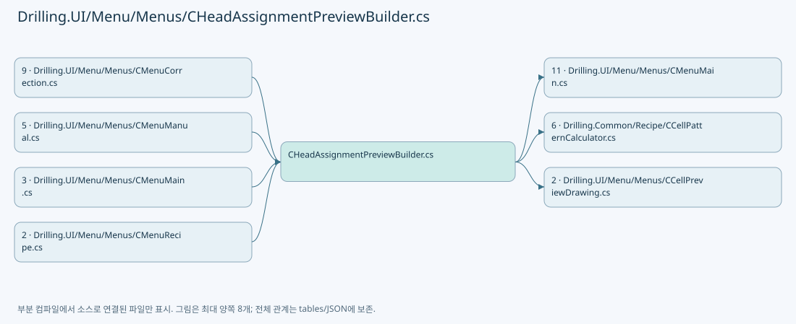

## 네임스페이스·타입·상속

| 타입 | 구분 | 원본 범위 | 선언/상속 |
| --- | --- | --- | --- |
| CHeadAssignmentPreviewBuilder | ClassDeclaration | 9–594 | CHeadAssignmentPreviewBuilder |

## 멤버 빠른 목록

| 이름 | 종류 | 범위 | 서명 |
| --- | --- | --- | --- |
| MinimumPreviewCellAreaWidth | FieldDeclaration | L11–11 | double Drilling.UI.Menu.Menus.CHeadAssignmentPreviewBuilder.MinimumPreviewCellAreaWidth |
| MinimumPreviewCellAreaHeight | FieldDeclaration | L12–12 | double Drilling.UI.Menu.Menus.CHeadAssignmentPreviewBuilder.MinimumPreviewCellAreaHeight |
| BuildEnabledHeadNumbers | MethodDeclaration | L13–26 | System.Collections.Generic.IReadOnlyList<int> Drilling.UI.Menu.Menus.CHeadAssignmentPreviewBuilder.BuildEnabledHeadNumbers(System.Collections.Generic.IReadOnlyDictionary<string, string>, int) |
| IsHeadEnabled | MethodDeclaration | L28–31 | bool Drilling.UI.Menu.Menus.CHeadAssignmentPreviewBuilder.IsHeadEnabled(System.Collections.Generic.IReadOnlyDictionary<string, string>, int) |
| ReadBoolOption | MethodDeclaration | L33–46 | bool Drilling.UI.Menu.Menus.CHeadAssignmentPreviewBuilder.ReadBoolOption(string, bool) |
| ReadIntAny | MethodDeclaration | L48–59 | int Drilling.UI.Menu.Menus.CHeadAssignmentPreviewBuilder.ReadIntAny(System.Collections.Generic.IReadOnlyDictionary<string, string>, int, params string[]) |
| ReadDoubleAny | MethodDeclaration | L61–72 | double Drilling.UI.Menu.Menus.CHeadAssignmentPreviewBuilder.ReadDoubleAny(System.Collections.Generic.IReadOnlyDictionary<string, string>, double, params string[]) |
| BuildRecipePreview | MethodDeclaration | L74–242 | Drilling.UI.Menu.Menus.ST_MAIN_RECIPE_PREVIEW Drilling.UI.Menu.Menus.CHeadAssignmentPreviewBuilder.BuildRecipePreview(System.Collections.Generic.IReadOnlyDictionary<string, string>, System.Collections.Generic.IReadOnlySet<int>, Drilling.UI.Menu.Menus.ST_PREVIEW_HEAD_LAYOUT, bool, System.Collections.Generic.IReadOnlySet<int>?) |
| SelectValue | LocalFunctionStatement | L105–108 | double? SelectValue(string) |
| SelectHeadNo | LocalFunctionStatement | L127–130 | int SelectHeadNo(int) |
| SelectLong | LocalFunctionStatement | L132–135 | long SelectLong(int) |
| CreateRecipePreviewError | MethodDeclaration | L244–247 | Drilling.UI.Menu.Menus.ST_MAIN_RECIPE_PREVIEW Drilling.UI.Menu.Menus.CHeadAssignmentPreviewBuilder.CreateRecipePreviewError(Drilling.UI.Menu.Menus.ST_GLASS_PREVIEW_FRAME, string) |
| ResolveCellPreviewHead | MethodDeclaration | L249–271 | int Drilling.UI.Menu.Menus.CHeadAssignmentPreviewBuilder.ResolveCellPreviewHead(System.Collections.Generic.IReadOnlyDictionary<int, long>, System.Collections.Generic.IReadOnlyList<int>, int) |
| ShouldUseExpandedPreviewBounds | MethodDeclaration | L273–276 | bool Drilling.UI.Menu.Menus.CHeadAssignmentPreviewBuilder.ShouldUseExpandedPreviewBounds(Rect, Rect) |
| ExpandPreviewBounds | MethodDeclaration | L278–287 | Rect Drilling.UI.Menu.Menus.CHeadAssignmentPreviewBuilder.ExpandPreviewBounds(Rect, double, double, Rect) |
| ClampPreviewCoordinate | MethodDeclaration | L289–293 | double Drilling.UI.Menu.Menus.CHeadAssignmentPreviewBuilder.ClampPreviewCoordinate(double, double, double) |
| AssignPreviewHead | MethodDeclaration | L295–340 | int Drilling.UI.Menu.Menus.CHeadAssignmentPreviewBuilder.AssignPreviewHead(double, System.Collections.Generic.IReadOnlyList<int>, Drilling.UI.Menu.Menus.ST_PREVIEW_HEAD_LAYOUT, double, System.Collections.Generic.IReadOnlyDictionary<int, long>) |
| BuildPreview | LocalFunctionStatement | L302–311 | Drilling.UI.Menu.Menus.ST_PREVIEW_HEAD_ASSIGNMENT_CANDIDATE? BuildPreview(int) |
| IsHasValue | LocalFunctionStatement | L313–316 | bool IsHasValue(Drilling.UI.Menu.Menus.ST_PREVIEW_HEAD_ASSIGNMENT_CANDIDATE?) |
| SelectItem | LocalFunctionStatement | L318–321 | Drilling.UI.Menu.Menus.ST_PREVIEW_HEAD_ASSIGNMENT_CANDIDATE SelectItem(Drilling.UI.Menu.Menus.ST_PREVIEW_HEAD_ASSIGNMENT_CANDIDATE?) |
| SelectDistance | LocalFunctionStatement | L324–327 | double SelectDistance(Drilling.UI.Menu.Menus.ST_PREVIEW_HEAD_ASSIGNMENT_CANDIDATE) |
| SelectValue | LocalFunctionStatement | L329–332 | long SelectValue(Drilling.UI.Menu.Menus.ST_PREVIEW_HEAD_ASSIGNMENT_CANDIDATE) |
| SelectHeadNo | LocalFunctionStatement | L334–337 | int SelectHeadNo(Drilling.UI.Menu.Menus.ST_PREVIEW_HEAD_ASSIGNMENT_CANDIDATE) |
| GetPreviewHeadRange | MethodDeclaration | L342–348 | (double StartX, double EndX, double CenterX) Drilling.UI.Menu.Menus.CHeadAssignmentPreviewBuilder.GetPreviewHeadRange(int, Drilling.UI.Menu.Menus.ST_PREVIEW_HEAD_LAYOUT, double) |
| TryProjectRecipePreviewPixel | MethodDeclaration | L350–371 | bool Drilling.UI.Menu.Menus.CHeadAssignmentPreviewBuilder.TryProjectRecipePreviewPixel(double, double, Drilling.UI.Menu.Menus.ST_GLASS_PREVIEW_FRAME, double, out double, out double, out int, out int) |
| TryBuildRecipeCellBoundary | MethodDeclaration | L373–423 | bool Drilling.UI.Menu.Menus.CHeadAssignmentPreviewBuilder.TryBuildRecipeCellBoundary(double, double, double, int, int, double, double, double, Drilling.UI.Menu.Menus.ST_GLASS_PREVIEW_FRAME, double, out StreamGeometry) |
| BuildHeadAssignmentMap | MethodDeclaration | L425–485 | Drilling.UI.Menu.Menus.ST_HEAD_ASSIGNMENT_MAP Drilling.UI.Menu.Menus.CHeadAssignmentPreviewBuilder.BuildHeadAssignmentMap(System.Collections.Generic.IReadOnlyDictionary<string, string>, System.Collections.Generic.IReadOnlySet<int>, Drilling.UI.Menu.Menus.ST_PREVIEW_HEAD_LAYOUT) |
| GetHeadRect | LocalFunctionStatement | L433–457 | (double Left, double Top, double Width, double Height, double LabelLeft, double LabelWidth) GetHeadRect(int) |
| ReadHeadPositionX | MethodDeclaration | L487–494 | double Drilling.UI.Menu.Menus.CHeadAssignmentPreviewBuilder.ReadHeadPositionX(System.Collections.Generic.IReadOnlyList<Drilling.Common.Managers.ST_SYSTEM_PARAMETER>, int) |
| ReadSettingDouble | MethodDeclaration | L496–517 | double Drilling.UI.Menu.Menus.CHeadAssignmentPreviewBuilder.ReadSettingDouble(System.Collections.Generic.IReadOnlyList<Drilling.Common.Managers.ST_SYSTEM_PARAMETER>, double, params string[]) |
| MatchesItem | LocalFunctionStatement | L500–503 | bool MatchesItem(string) |
| ReadNullableDoubleAny | MethodDeclaration | L519–522 | double? Drilling.UI.Menu.Menus.CHeadAssignmentPreviewBuilder.ReadNullableDoubleAny(System.Collections.Generic.IReadOnlyDictionary<string, string>, string) |
| CreateGlassFrame | MethodDeclaration | L524–548 | Drilling.UI.Menu.Menus.ST_GLASS_PREVIEW_FRAME Drilling.UI.Menu.Menus.CHeadAssignmentPreviewBuilder.CreateGlassFrame(System.Collections.Generic.IReadOnlyDictionary<string, string>) |
| FormatGlassSizeText | MethodDeclaration | L550–555 | string Drilling.UI.Menu.Menus.CHeadAssignmentPreviewBuilder.FormatGlassSizeText(System.Collections.Generic.IReadOnlyDictionary<string, string>) |
| CreateHeadBrush | MethodDeclaration | L557–572 | Brush Drilling.UI.Menu.Menus.CHeadAssignmentPreviewBuilder.CreateHeadBrush(int, byte) |
| CreateBrush | MethodDeclaration | L574–579 | Brush Drilling.UI.Menu.Menus.CHeadAssignmentPreviewBuilder.CreateBrush(byte, byte, byte, byte) |
| BuildHeadLayout | MethodDeclaration | L581–593 | Drilling.UI.Menu.Menus.ST_PREVIEW_HEAD_LAYOUT Drilling.UI.Menu.Menus.CHeadAssignmentPreviewBuilder.BuildHeadLayout(System.Collections.Generic.IReadOnlyList<Drilling.Common.Managers.ST_SYSTEM_PARAMETER>) |
| BuildPreview | LocalFunctionStatement | L583–589 | Drilling.UI.Menu.Menus.ST_PREVIEW_HEAD_FIELD BuildPreview(int) |

## 멤버별 상세 계약·호출·처리 해설

### FieldDeclaration `MinimumPreviewCellAreaWidth` · L11–11

[Drilling.UI/Menu/Menus/CHeadAssignmentPreviewBuilder.cs:11–11](https://github.com/kjuws10-rgb/A3Drilling/blob/5aee8e58439c9b455cae7c9593c9be986c3e682e/Drilling.UI/Menu/Menus/CHeadAssignmentPreviewBuilder.cs#L11-L11)

| 항목 | 실제 추출 값 |
| --- | --- |
| 서명 | double Drilling.UI.Menu.Menus.CHeadAssignmentPreviewBuilder.MinimumPreviewCellAreaWidth |
| 접근/수식자 | Private / private, const |
| 반환/값 타입 | double |
| 소속 타입 | NamedType:Drilling.UI.Menu.Menus.CHeadAssignmentPreviewBuilder |

현재 부분 분석에서 직접 연결된 호출자는 없습니다. XAML/이벤트/인터페이스·델리게이트·외부 진입을 추가 확인해야 하며, 미사용으로 판정한 것이 아닙니다.

본문의 실제 연산·분기·예외·반환 순서(원문 위치 순):

| 원본 행 | 종류 | 주석 해설 |
| --- | --- | --- |
| 11 | variable-initializer | 변수의 초기값을 지정합니다: MinimumPreviewCellAreaWidth = 18.0 |

변경 전 점검: 입력/반환 타입, 위 호출자, 예외/취소 경로, 공유 상태와 저장·전송 소비자를 함께 확인합니다. 값의 단위나 물리 방향을 이름만으로 확정하지 않습니다.

### FieldDeclaration `MinimumPreviewCellAreaHeight` · L12–12

[Drilling.UI/Menu/Menus/CHeadAssignmentPreviewBuilder.cs:12–12](https://github.com/kjuws10-rgb/A3Drilling/blob/5aee8e58439c9b455cae7c9593c9be986c3e682e/Drilling.UI/Menu/Menus/CHeadAssignmentPreviewBuilder.cs#L12-L12)

| 항목 | 실제 추출 값 |
| --- | --- |
| 서명 | double Drilling.UI.Menu.Menus.CHeadAssignmentPreviewBuilder.MinimumPreviewCellAreaHeight |
| 접근/수식자 | Private / private, const |
| 반환/값 타입 | double |
| 소속 타입 | NamedType:Drilling.UI.Menu.Menus.CHeadAssignmentPreviewBuilder |

현재 부분 분석에서 직접 연결된 호출자는 없습니다. XAML/이벤트/인터페이스·델리게이트·외부 진입을 추가 확인해야 하며, 미사용으로 판정한 것이 아닙니다.

본문의 실제 연산·분기·예외·반환 순서(원문 위치 순):

| 원본 행 | 종류 | 주석 해설 |
| --- | --- | --- |
| 12 | variable-initializer | 변수의 초기값을 지정합니다: MinimumPreviewCellAreaHeight = 32.0 |

변경 전 점검: 입력/반환 타입, 위 호출자, 예외/취소 경로, 공유 상태와 저장·전송 소비자를 함께 확인합니다. 값의 단위나 물리 방향을 이름만으로 확정하지 않습니다.

### MethodDeclaration `BuildEnabledHeadNumbers` · L13–26

[Drilling.UI/Menu/Menus/CHeadAssignmentPreviewBuilder.cs:13–26](https://github.com/kjuws10-rgb/A3Drilling/blob/5aee8e58439c9b455cae7c9593c9be986c3e682e/Drilling.UI/Menu/Menus/CHeadAssignmentPreviewBuilder.cs#L13-L26)

| 항목 | 실제 추출 값 |
| --- | --- |
| 서명 | System.Collections.Generic.IReadOnlyList<int> Drilling.UI.Menu.Menus.CHeadAssignmentPreviewBuilder.BuildEnabledHeadNumbers(System.Collections.Generic.IReadOnlyDictionary<string, string>, int) |
| 접근/수식자 | Internal / internal, static |
| 반환/값 타입 | System.Collections.Generic.IReadOnlyList<int> |
| 소속 타입 | NamedType:Drilling.UI.Menu.Menus.CHeadAssignmentPreviewBuilder |

입력 계약:

| 이름 | 타입 | 전달 | 선택/기본값 |
| --- | --- | --- | --- |
| parameters | System.Collections.Generic.IReadOnlyDictionary<string, string> | None | False /  |
| headCount | int | None | True / 8 |

정적 호출자로 확인된 위치:

| 호출 파일/행 | 호출 표현식 | 런타임 분기 가능 |
| --- | --- | --- |
| [Drilling.UI/Menu/Menus/CHeadAssignmentPreviewBuilder.cs:116–116](https://github.com/kjuws10-rgb/A3Drilling/blob/5aee8e58439c9b455cae7c9593c9be986c3e682e/Drilling.UI/Menu/Menus/CHeadAssignmentPreviewBuilder.cs#L116-L116) | BuildEnabledHeadNumbers | False |
| [Drilling.UI/Menu/Menus/CHeadAssignmentPreviewBuilder.cs:431–431](https://github.com/kjuws10-rgb/A3Drilling/blob/5aee8e58439c9b455cae7c9593c9be986c3e682e/Drilling.UI/Menu/Menus/CHeadAssignmentPreviewBuilder.cs#L431-L431) | BuildEnabledHeadNumbers | False |
| [Drilling.UI/Menu/Menus/CMenuCorrection.cs:5991–5991](https://github.com/kjuws10-rgb/A3Drilling/blob/5aee8e58439c9b455cae7c9593c9be986c3e682e/Drilling.UI/Menu/Menus/CMenuCorrection.cs#L5991-L5991) | CHeadAssignmentPreviewBuilder.BuildEnabledHeadNumbers | False |
| [Drilling.UI/Menu/Menus/CMenuCorrection.cs:7532–7532](https://github.com/kjuws10-rgb/A3Drilling/blob/5aee8e58439c9b455cae7c9593c9be986c3e682e/Drilling.UI/Menu/Menus/CMenuCorrection.cs#L7532-L7532) | CHeadAssignmentPreviewBuilder.BuildEnabledHeadNumbers | False |
| [Drilling.UI/Menu/Menus/CMenuManual.cs:7057–7057](https://github.com/kjuws10-rgb/A3Drilling/blob/5aee8e58439c9b455cae7c9593c9be986c3e682e/Drilling.UI/Menu/Menus/CMenuManual.cs#L7057-L7057) | CHeadAssignmentPreviewBuilder.BuildEnabledHeadNumbers | False |

호출하는 대상과 해석 범위:

| 원본 행 | 표현식 | 분석 상태 | 대상/소스 위치 |
| --- | --- | --- | --- |
| 15 | Math.Clamp | resolved | int System.Math.Clamp(int, int, int) |
| 16 | new List<int> | resolved | System.Collections.Generic.List<int>.List(int) |
| 19 | IsHeadEnabled | resolved | bool Drilling.UI.Menu.Menus.CHeadAssignmentPreviewBuilder.IsHeadEnabled(System.Collections.Generic.IReadOnlyDictionary<string, string>, int) · Drilling.UI/Menu/Menus/CHeadAssignmentPreviewBuilder.cs:28 |
| 21 | heads.Add | resolved | void System.Collections.Generic.List<int>.Add(int) |

본문의 실제 연산·분기·예외·반환 순서(원문 위치 순):

| 원본 행 | 종류 | 주석 해설 |
| --- | --- | --- |
| 15 | call | 함수·델리게이트 또는 객체 생성자를 호출합니다: Math.Clamp(headCount, 1, 8) |
| 15 | local-declaration | 지역 변수를 선언합니다: var normalizedHeadCount = Math.Clamp(headCount, 1, 8); |
| 15 | variable-initializer | 변수의 초기값을 지정합니다: normalizedHeadCount = Math.Clamp(headCount, 1, 8) |
| 16 | call | 함수·델리게이트 또는 객체 생성자를 호출합니다: new List<int>(normalizedHeadCount) |
| 16 | local-declaration | 지역 변수를 선언합니다: var heads = new List<int>(normalizedHeadCount); |
| 16 | variable-initializer | 변수의 초기값을 지정합니다: heads = new List<int>(normalizedHeadCount) |
| 17 | variable-initializer | 변수의 초기값을 지정합니다: headNo = 1 |
| 17 | for | 초기화·조건·증감이 있는 반복입니다: for (var headNo = 1; headNo <= normalizedHeadCount; headNo++) |
| 19 | call | 함수·델리게이트 또는 객체 생성자를 호출합니다: IsHeadEnabled(parameters, headNo) |
| 19 | if | 조건에 따라 분기합니다: if (IsHeadEnabled(parameters, headNo)) |
| 21 | call | 함수·델리게이트 또는 객체 생성자를 호출합니다: heads.Add(headNo) |
| 25 | return | 호출자에게 값 또는 제어를 반환합니다: return heads; |

제어 구문의 포함 구조(실제 실행 순서/CFG가 아닌 구문 탐색 그림):

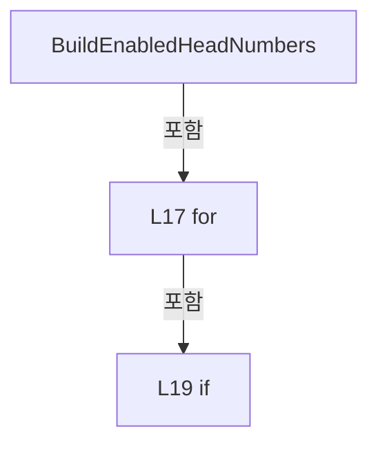

변경 전 점검: 입력/반환 타입, 위 호출자, 예외/취소 경로, 공유 상태와 저장·전송 소비자를 함께 확인합니다. 값의 단위나 물리 방향을 이름만으로 확정하지 않습니다.

### MethodDeclaration `IsHeadEnabled` · L28–31

[Drilling.UI/Menu/Menus/CHeadAssignmentPreviewBuilder.cs:28–31](https://github.com/kjuws10-rgb/A3Drilling/blob/5aee8e58439c9b455cae7c9593c9be986c3e682e/Drilling.UI/Menu/Menus/CHeadAssignmentPreviewBuilder.cs#L28-L31)

| 항목 | 실제 추출 값 |
| --- | --- |
| 서명 | bool Drilling.UI.Menu.Menus.CHeadAssignmentPreviewBuilder.IsHeadEnabled(System.Collections.Generic.IReadOnlyDictionary<string, string>, int) |
| 접근/수식자 | Private / private, static |
| 반환/값 타입 | bool |
| 소속 타입 | NamedType:Drilling.UI.Menu.Menus.CHeadAssignmentPreviewBuilder |

입력 계약:

| 이름 | 타입 | 전달 | 선택/기본값 |
| --- | --- | --- | --- |
| parameters | System.Collections.Generic.IReadOnlyDictionary<string, string> | None | False /  |
| headNo | int | None | False /  |

정적 호출자로 확인된 위치:

| 호출 파일/행 | 호출 표현식 | 런타임 분기 가능 |
| --- | --- | --- |
| [Drilling.UI/Menu/Menus/CHeadAssignmentPreviewBuilder.cs:19–19](https://github.com/kjuws10-rgb/A3Drilling/blob/5aee8e58439c9b455cae7c9593c9be986c3e682e/Drilling.UI/Menu/Menus/CHeadAssignmentPreviewBuilder.cs#L19-L19) | IsHeadEnabled | False |

호출하는 대상과 해석 범위:

| 원본 행 | 표현식 | 분석 상태 | 대상/소스 위치 |
| --- | --- | --- | --- |
| 30 | parameters.TryGetValue | resolved · 동적 구현 선택 가능 | bool System.Collections.Generic.IReadOnlyDictionary<string, string>.TryGetValue(string, out string) |
| 30 | ReadBoolOption | resolved | bool Drilling.UI.Menu.Menus.CHeadAssignmentPreviewBuilder.ReadBoolOption(string, bool) · Drilling.UI/Menu/Menus/CHeadAssignmentPreviewBuilder.cs:33 |

본문의 실제 연산·분기·예외·반환 순서(원문 위치 순):

| 원본 행 | 종류 | 주석 해설 |
| --- | --- | --- |
| 30 | call | 함수·델리게이트 또는 객체 생성자를 호출합니다: parameters.TryGetValue($"H{headNo:00}_USE", out var value) |
| 30 | call | 함수·델리게이트 또는 객체 생성자를 호출합니다: ReadBoolOption(value, true) |
| 30 | conditional-expression | 조건에 따라 결과식을 선택합니다: parameters.TryGetValue($"H{headNo:00}_USE", out var value) ? ReadBoolOption(value, true) : true |
| 30 | return | 호출자에게 값 또는 제어를 반환합니다: return parameters.TryGetValue($"H{headNo:00}_USE", out var value) ? ReadBoolOption(value, true) : true; |

변경 전 점검: 입력/반환 타입, 위 호출자, 예외/취소 경로, 공유 상태와 저장·전송 소비자를 함께 확인합니다. 값의 단위나 물리 방향을 이름만으로 확정하지 않습니다.

### MethodDeclaration `ReadBoolOption` · L33–46

[Drilling.UI/Menu/Menus/CHeadAssignmentPreviewBuilder.cs:33–46](https://github.com/kjuws10-rgb/A3Drilling/blob/5aee8e58439c9b455cae7c9593c9be986c3e682e/Drilling.UI/Menu/Menus/CHeadAssignmentPreviewBuilder.cs#L33-L46)

| 항목 | 실제 추출 값 |
| --- | --- |
| 서명 | bool Drilling.UI.Menu.Menus.CHeadAssignmentPreviewBuilder.ReadBoolOption(string, bool) |
| 접근/수식자 | Private / private, static |
| 반환/값 타입 | bool |
| 소속 타입 | NamedType:Drilling.UI.Menu.Menus.CHeadAssignmentPreviewBuilder |

입력 계약:

| 이름 | 타입 | 전달 | 선택/기본값 |
| --- | --- | --- | --- |
| value | string | None | False /  |
| defaultValue | bool | None | False /  |

정적 호출자로 확인된 위치:

| 호출 파일/행 | 호출 표현식 | 런타임 분기 가능 |
| --- | --- | --- |
| [Drilling.UI/Menu/Menus/CHeadAssignmentPreviewBuilder.cs:30–30](https://github.com/kjuws10-rgb/A3Drilling/blob/5aee8e58439c9b455cae7c9593c9be986c3e682e/Drilling.UI/Menu/Menus/CHeadAssignmentPreviewBuilder.cs#L30-L30) | ReadBoolOption | False |

호출하는 대상과 해석 범위:

| 원본 행 | 표현식 | 분석 상태 | 대상/소스 위치 |
| --- | --- | --- | --- |
| 35 | string.IsNullOrWhiteSpace | resolved | bool string.IsNullOrWhiteSpace(string?) |
| 40 | value.Trim().ToUpperInvariant | resolved | string string.ToUpperInvariant() |
| 40 | value.Trim | resolved | string string.Trim() |

본문의 실제 연산·분기·예외·반환 순서(원문 위치 순):

| 원본 행 | 종류 | 주석 해설 |
| --- | --- | --- |
| 35 | call | 함수·델리게이트 또는 객체 생성자를 호출합니다: string.IsNullOrWhiteSpace(value) |
| 35 | if | 조건에 따라 분기합니다: if (string.IsNullOrWhiteSpace(value)) |
| 37 | return | 호출자에게 값 또는 제어를 반환합니다: return defaultValue; |
| 40 | call | 함수·델리게이트 또는 객체 생성자를 호출합니다: value.Trim().ToUpperInvariant() |
| 40 | call | 함수·델리게이트 또는 객체 생성자를 호출합니다: value.Trim() |
| 40 | return | 호출자에게 값 또는 제어를 반환합니다: return value.Trim().ToUpperInvariant() switch { "1" or "Y" or "YES" or "TRUE" or "ON" or "USE" => true, "0" or "N" or "NO" or "FALSE" or "OFF" or "SKIP" or "UNUSE" => false, _ => defaultValue }; |
| 40 | switch-expression | 값별 결과식을 선택합니다: value.Trim().ToUpperInvariant() switch { "1" or "Y" or "YES" or "TRUE" or "ON" or "USE" => true, "0" or "N" or "NO" or "FALSE" or "OFF" or "SKIP" or "UNUSE" => false, _ => defaultValue } |

제어 구문의 포함 구조(실제 실행 순서/CFG가 아닌 구문 탐색 그림):

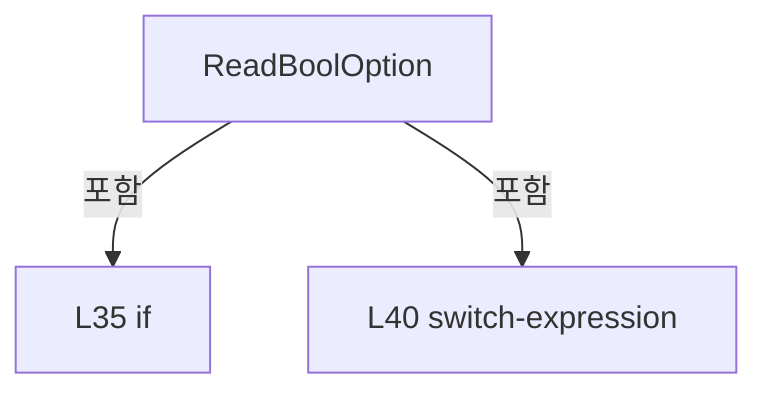

변경 전 점검: 입력/반환 타입, 위 호출자, 예외/취소 경로, 공유 상태와 저장·전송 소비자를 함께 확인합니다. 값의 단위나 물리 방향을 이름만으로 확정하지 않습니다.

### MethodDeclaration `ReadIntAny` · L48–59

[Drilling.UI/Menu/Menus/CHeadAssignmentPreviewBuilder.cs:48–59](https://github.com/kjuws10-rgb/A3Drilling/blob/5aee8e58439c9b455cae7c9593c9be986c3e682e/Drilling.UI/Menu/Menus/CHeadAssignmentPreviewBuilder.cs#L48-L59)

| 항목 | 실제 추출 값 |
| --- | --- |
| 서명 | int Drilling.UI.Menu.Menus.CHeadAssignmentPreviewBuilder.ReadIntAny(System.Collections.Generic.IReadOnlyDictionary<string, string>, int, params string[]) |
| 접근/수식자 | Private / private, static |
| 반환/값 타입 | int |
| 소속 타입 | NamedType:Drilling.UI.Menu.Menus.CHeadAssignmentPreviewBuilder |

입력 계약:

| 이름 | 타입 | 전달 | 선택/기본값 |
| --- | --- | --- | --- |
| parameters | System.Collections.Generic.IReadOnlyDictionary<string, string> | None | False /  |
| defaultValue | int | None | False /  |
| keys | string[] | None | False /  |

정적 호출자로 확인된 위치:

| 호출 파일/행 | 호출 표현식 | 런타임 분기 가능 |
| --- | --- | --- |
| [Drilling.UI/Menu/Menus/CHeadAssignmentPreviewBuilder.cs:112–112](https://github.com/kjuws10-rgb/A3Drilling/blob/5aee8e58439c9b455cae7c9593c9be986c3e682e/Drilling.UI/Menu/Menus/CHeadAssignmentPreviewBuilder.cs#L112-L112) | ReadIntAny | False |

호출하는 대상과 해석 범위:

| 원본 행 | 표현식 | 분석 상태 | 대상/소스 위치 |
| --- | --- | --- | --- |
| 52 | parameters.TryGetValue | resolved · 동적 구현 선택 가능 | bool System.Collections.Generic.IReadOnlyDictionary<string, string>.TryGetValue(string, out string) |
| 52 | int.TryParse | resolved | bool int.TryParse(string?, System.Globalization.NumberStyles, System.IFormatProvider?, out int) |

본문의 실제 연산·분기·예외·반환 순서(원문 위치 순):

| 원본 행 | 종류 | 주석 해설 |
| --- | --- | --- |
| 50 | foreach | 컬렉션 요소를 순회합니다: foreach (var key in keys) |
| 52 | call | 함수·델리게이트 또는 객체 생성자를 호출합니다: parameters.TryGetValue(key, out var value) |
| 52 | call | 함수·델리게이트 또는 객체 생성자를 호출합니다: int.TryParse(value, NumberStyles.Integer, CultureInfo.InvariantCulture, out var parsed) |
| 52 | if | 조건에 따라 분기합니다: if (parameters.TryGetValue(key, out var value) && int.TryParse(value, NumberStyles.Integer, CultureInfo.InvariantCulture, out var parsed)) |
| 54 | return | 호출자에게 값 또는 제어를 반환합니다: return parsed; |
| 58 | return | 호출자에게 값 또는 제어를 반환합니다: return defaultValue; |

제어 구문의 포함 구조(실제 실행 순서/CFG가 아닌 구문 탐색 그림):

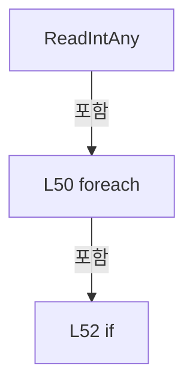

변경 전 점검: 입력/반환 타입, 위 호출자, 예외/취소 경로, 공유 상태와 저장·전송 소비자를 함께 확인합니다. 값의 단위나 물리 방향을 이름만으로 확정하지 않습니다.

### MethodDeclaration `ReadDoubleAny` · L61–72

[Drilling.UI/Menu/Menus/CHeadAssignmentPreviewBuilder.cs:61–72](https://github.com/kjuws10-rgb/A3Drilling/blob/5aee8e58439c9b455cae7c9593c9be986c3e682e/Drilling.UI/Menu/Menus/CHeadAssignmentPreviewBuilder.cs#L61-L72)

| 항목 | 실제 추출 값 |
| --- | --- |
| 서명 | double Drilling.UI.Menu.Menus.CHeadAssignmentPreviewBuilder.ReadDoubleAny(System.Collections.Generic.IReadOnlyDictionary<string, string>, double, params string[]) |
| 접근/수식자 | Private / private, static |
| 반환/값 타입 | double |
| 소속 타입 | NamedType:Drilling.UI.Menu.Menus.CHeadAssignmentPreviewBuilder |

입력 계약:

| 이름 | 타입 | 전달 | 선택/기본값 |
| --- | --- | --- | --- |
| parameters | System.Collections.Generic.IReadOnlyDictionary<string, string> | None | False /  |
| defaultValue | double | None | False /  |
| keys | string[] | None | False /  |

정적 호출자로 확인된 위치:

| 호출 파일/행 | 호출 표현식 | 런타임 분기 가능 |
| --- | --- | --- |
| [Drilling.UI/Menu/Menus/CHeadAssignmentPreviewBuilder.cs:85–85](https://github.com/kjuws10-rgb/A3Drilling/blob/5aee8e58439c9b455cae7c9593c9be986c3e682e/Drilling.UI/Menu/Menus/CHeadAssignmentPreviewBuilder.cs#L85-L85) | ReadDoubleAny | False |
| [Drilling.UI/Menu/Menus/CHeadAssignmentPreviewBuilder.cs:86–86](https://github.com/kjuws10-rgb/A3Drilling/blob/5aee8e58439c9b455cae7c9593c9be986c3e682e/Drilling.UI/Menu/Menus/CHeadAssignmentPreviewBuilder.cs#L86-L86) | ReadDoubleAny | False |
| [Drilling.UI/Menu/Menus/CHeadAssignmentPreviewBuilder.cs:87–87](https://github.com/kjuws10-rgb/A3Drilling/blob/5aee8e58439c9b455cae7c9593c9be986c3e682e/Drilling.UI/Menu/Menus/CHeadAssignmentPreviewBuilder.cs#L87-L87) | ReadDoubleAny | False |
| [Drilling.UI/Menu/Menus/CHeadAssignmentPreviewBuilder.cs:88–88](https://github.com/kjuws10-rgb/A3Drilling/blob/5aee8e58439c9b455cae7c9593c9be986c3e682e/Drilling.UI/Menu/Menus/CHeadAssignmentPreviewBuilder.cs#L88-L88) | ReadDoubleAny | False |
| [Drilling.UI/Menu/Menus/CHeadAssignmentPreviewBuilder.cs:111–111](https://github.com/kjuws10-rgb/A3Drilling/blob/5aee8e58439c9b455cae7c9593c9be986c3e682e/Drilling.UI/Menu/Menus/CHeadAssignmentPreviewBuilder.cs#L111-L111) | ReadDoubleAny | False |
| [Drilling.UI/Menu/Menus/CHeadAssignmentPreviewBuilder.cs:114–114](https://github.com/kjuws10-rgb/A3Drilling/blob/5aee8e58439c9b455cae7c9593c9be986c3e682e/Drilling.UI/Menu/Menus/CHeadAssignmentPreviewBuilder.cs#L114-L114) | ReadDoubleAny | False |
| [Drilling.UI/Menu/Menus/CHeadAssignmentPreviewBuilder.cs:114–114](https://github.com/kjuws10-rgb/A3Drilling/blob/5aee8e58439c9b455cae7c9593c9be986c3e682e/Drilling.UI/Menu/Menus/CHeadAssignmentPreviewBuilder.cs#L114-L114) | ReadDoubleAny | False |
| [Drilling.UI/Menu/Menus/CHeadAssignmentPreviewBuilder.cs:149–149](https://github.com/kjuws10-rgb/A3Drilling/blob/5aee8e58439c9b455cae7c9593c9be986c3e682e/Drilling.UI/Menu/Menus/CHeadAssignmentPreviewBuilder.cs#L149-L149) | ReadDoubleAny | False |
| [Drilling.UI/Menu/Menus/CHeadAssignmentPreviewBuilder.cs:150–150](https://github.com/kjuws10-rgb/A3Drilling/blob/5aee8e58439c9b455cae7c9593c9be986c3e682e/Drilling.UI/Menu/Menus/CHeadAssignmentPreviewBuilder.cs#L150-L150) | ReadDoubleAny | False |
| [Drilling.UI/Menu/Menus/CHeadAssignmentPreviewBuilder.cs:151–151](https://github.com/kjuws10-rgb/A3Drilling/blob/5aee8e58439c9b455cae7c9593c9be986c3e682e/Drilling.UI/Menu/Menus/CHeadAssignmentPreviewBuilder.cs#L151-L151) | ReadDoubleAny | False |
| [Drilling.UI/Menu/Menus/CHeadAssignmentPreviewBuilder.cs:429–429](https://github.com/kjuws10-rgb/A3Drilling/blob/5aee8e58439c9b455cae7c9593c9be986c3e682e/Drilling.UI/Menu/Menus/CHeadAssignmentPreviewBuilder.cs#L429-L429) | ReadDoubleAny | False |
| [Drilling.UI/Menu/Menus/CHeadAssignmentPreviewBuilder.cs:430–430](https://github.com/kjuws10-rgb/A3Drilling/blob/5aee8e58439c9b455cae7c9593c9be986c3e682e/Drilling.UI/Menu/Menus/CHeadAssignmentPreviewBuilder.cs#L430-L430) | ReadDoubleAny | False |
| [Drilling.UI/Menu/Menus/CHeadAssignmentPreviewBuilder.cs:530–530](https://github.com/kjuws10-rgb/A3Drilling/blob/5aee8e58439c9b455cae7c9593c9be986c3e682e/Drilling.UI/Menu/Menus/CHeadAssignmentPreviewBuilder.cs#L530-L530) | ReadDoubleAny | False |
| [Drilling.UI/Menu/Menus/CHeadAssignmentPreviewBuilder.cs:531–531](https://github.com/kjuws10-rgb/A3Drilling/blob/5aee8e58439c9b455cae7c9593c9be986c3e682e/Drilling.UI/Menu/Menus/CHeadAssignmentPreviewBuilder.cs#L531-L531) | ReadDoubleAny | False |
| [Drilling.UI/Menu/Menus/CHeadAssignmentPreviewBuilder.cs:552–552](https://github.com/kjuws10-rgb/A3Drilling/blob/5aee8e58439c9b455cae7c9593c9be986c3e682e/Drilling.UI/Menu/Menus/CHeadAssignmentPreviewBuilder.cs#L552-L552) | ReadDoubleAny | False |
| [Drilling.UI/Menu/Menus/CHeadAssignmentPreviewBuilder.cs:553–553](https://github.com/kjuws10-rgb/A3Drilling/blob/5aee8e58439c9b455cae7c9593c9be986c3e682e/Drilling.UI/Menu/Menus/CHeadAssignmentPreviewBuilder.cs#L553-L553) | ReadDoubleAny | False |

호출하는 대상과 해석 범위:

| 원본 행 | 표현식 | 분석 상태 | 대상/소스 위치 |
| --- | --- | --- | --- |
| 65 | parameters.TryGetValue | resolved · 동적 구현 선택 가능 | bool System.Collections.Generic.IReadOnlyDictionary<string, string>.TryGetValue(string, out string) |
| 65 | double.TryParse | resolved | bool double.TryParse(string?, System.Globalization.NumberStyles, System.IFormatProvider?, out double) |

본문의 실제 연산·분기·예외·반환 순서(원문 위치 순):

| 원본 행 | 종류 | 주석 해설 |
| --- | --- | --- |
| 63 | foreach | 컬렉션 요소를 순회합니다: foreach (var key in keys) |
| 65 | call | 함수·델리게이트 또는 객체 생성자를 호출합니다: parameters.TryGetValue(key, out var value) |
| 65 | call | 함수·델리게이트 또는 객체 생성자를 호출합니다: double.TryParse(value, NumberStyles.Float, CultureInfo.InvariantCulture, out var parsed) |
| 65 | if | 조건에 따라 분기합니다: if (parameters.TryGetValue(key, out var value) && double.TryParse(value, NumberStyles.Float, CultureInfo.InvariantCulture, out var parsed)) |
| 67 | return | 호출자에게 값 또는 제어를 반환합니다: return parsed; |
| 71 | return | 호출자에게 값 또는 제어를 반환합니다: return defaultValue; |

제어 구문의 포함 구조(실제 실행 순서/CFG가 아닌 구문 탐색 그림):

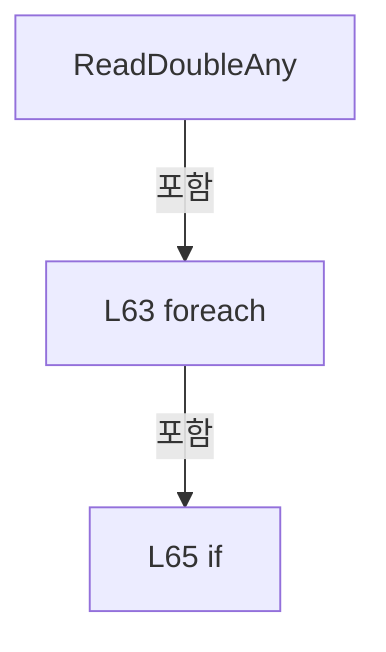

변경 전 점검: 입력/반환 타입, 위 호출자, 예외/취소 경로, 공유 상태와 저장·전송 소비자를 함께 확인합니다. 값의 단위나 물리 방향을 이름만으로 확정하지 않습니다.

### MethodDeclaration `BuildRecipePreview` · L74–242

[Drilling.UI/Menu/Menus/CHeadAssignmentPreviewBuilder.cs:74–242](https://github.com/kjuws10-rgb/A3Drilling/blob/5aee8e58439c9b455cae7c9593c9be986c3e682e/Drilling.UI/Menu/Menus/CHeadAssignmentPreviewBuilder.cs#L74-L242)

| 항목 | 실제 추출 값 |
| --- | --- |
| 서명 | Drilling.UI.Menu.Menus.ST_MAIN_RECIPE_PREVIEW Drilling.UI.Menu.Menus.CHeadAssignmentPreviewBuilder.BuildRecipePreview(System.Collections.Generic.IReadOnlyDictionary<string, string>, System.Collections.Generic.IReadOnlySet<int>, Drilling.UI.Menu.Menus.ST_PREVIEW_HEAD_LAYOUT, bool, System.Collections.Generic.IReadOnlySet<int>?) |
| 접근/수식자 | Internal / internal, static |
| 반환/값 타입 | Drilling.UI.Menu.Menus.ST_MAIN_RECIPE_PREVIEW |
| 소속 타입 | NamedType:Drilling.UI.Menu.Menus.CHeadAssignmentPreviewBuilder |

입력 계약:

| 이름 | 타입 | 전달 | 선택/기본값 |
| --- | --- | --- | --- |
| parameters | System.Collections.Generic.IReadOnlyDictionary<string, string> | None | False /  |
| selectedHeadNos | System.Collections.Generic.IReadOnlySet<int> | None | False /  |
| headLayout | Drilling.UI.Menu.Menus.ST_PREVIEW_HEAD_LAYOUT | None | False /  |
| showKeys | bool | None | True / true |
| visibleCellNos | System.Collections.Generic.IReadOnlySet<int>? | None | True / null |

정적 호출자로 확인된 위치:

| 호출 파일/행 | 호출 표현식 | 런타임 분기 가능 |
| --- | --- | --- |
| [Drilling.UI/Menu/Menus/CMenuCorrection.cs:6023–6023](https://github.com/kjuws10-rgb/A3Drilling/blob/5aee8e58439c9b455cae7c9593c9be986c3e682e/Drilling.UI/Menu/Menus/CMenuCorrection.cs#L6023-L6023) | CHeadAssignmentPreviewBuilder.BuildRecipePreview | False |
| [Drilling.UI/Menu/Menus/CMenuCorrection.cs:6490–6490](https://github.com/kjuws10-rgb/A3Drilling/blob/5aee8e58439c9b455cae7c9593c9be986c3e682e/Drilling.UI/Menu/Menus/CMenuCorrection.cs#L6490-L6490) | CHeadAssignmentPreviewBuilder.BuildRecipePreview | False |
| [Drilling.UI/Menu/Menus/CMenuCorrection.cs:7920–7920](https://github.com/kjuws10-rgb/A3Drilling/blob/5aee8e58439c9b455cae7c9593c9be986c3e682e/Drilling.UI/Menu/Menus/CMenuCorrection.cs#L7920-L7920) | CHeadAssignmentPreviewBuilder.BuildRecipePreview | False |
| [Drilling.UI/Menu/Menus/CMenuMain.cs:725–725](https://github.com/kjuws10-rgb/A3Drilling/blob/5aee8e58439c9b455cae7c9593c9be986c3e682e/Drilling.UI/Menu/Menus/CMenuMain.cs#L725-L725) | CHeadAssignmentPreviewBuilder.BuildRecipePreview | False |
| [Drilling.UI/Menu/Menus/CMenuManual.cs:7076–7076](https://github.com/kjuws10-rgb/A3Drilling/blob/5aee8e58439c9b455cae7c9593c9be986c3e682e/Drilling.UI/Menu/Menus/CMenuManual.cs#L7076-L7076) | CHeadAssignmentPreviewBuilder.BuildRecipePreview | False |
| [Drilling.UI/Menu/Menus/CMenuRecipe.cs:4596–4596](https://github.com/kjuws10-rgb/A3Drilling/blob/5aee8e58439c9b455cae7c9593c9be986c3e682e/Drilling.UI/Menu/Menus/CMenuRecipe.cs#L4596-L4596) | CHeadAssignmentPreviewBuilder.BuildRecipePreview | False |

호출하는 대상과 해석 범위:

| 원본 행 | 표현식 | 분석 상태 | 대상/소스 위치 |
| --- | --- | --- | --- |
| 84 | CreateGlassFrame | resolved | Drilling.UI.Menu.Menus.ST_GLASS_PREVIEW_FRAME Drilling.UI.Menu.Menus.CHeadAssignmentPreviewBuilder.CreateGlassFrame(System.Collections.Generic.IReadOnlyDictionary<string, string>) · Drilling.UI/Menu/Menus/CHeadAssignmentPreviewBuilder.cs:524 |
| 85 | ReadDoubleAny | resolved | double Drilling.UI.Menu.Menus.CHeadAssignmentPreviewBuilder.ReadDoubleAny(System.Collections.Generic.IReadOnlyDictionary<string, string>, double, params string[]) · Drilling.UI/Menu/Menus/CHeadAssignmentPreviewBuilder.cs:61 |
| 86 | ReadDoubleAny | resolved | double Drilling.UI.Menu.Menus.CHeadAssignmentPreviewBuilder.ReadDoubleAny(System.Collections.Generic.IReadOnlyDictionary<string, string>, double, params string[]) · Drilling.UI/Menu/Menus/CHeadAssignmentPreviewBuilder.cs:61 |
| 87 | ReadDoubleAny | resolved | double Drilling.UI.Menu.Menus.CHeadAssignmentPreviewBuilder.ReadDoubleAny(System.Collections.Generic.IReadOnlyDictionary<string, string>, double, params string[]) · Drilling.UI/Menu/Menus/CHeadAssignmentPreviewBuilder.cs:61 |
| 88 | ReadDoubleAny | resolved | double Drilling.UI.Menu.Menus.CHeadAssignmentPreviewBuilder.ReadDoubleAny(System.Collections.Generic.IReadOnlyDictionary<string, string>, double, params string[]) · Drilling.UI/Menu/Menus/CHeadAssignmentPreviewBuilder.cs:61 |
| 89 | double.IsFinite | resolved | bool double.IsFinite(double) |
| 89 | double.IsFinite | resolved | bool double.IsFinite(double) |
| 91 | CreateRecipePreviewError | resolved | Drilling.UI.Menu.Menus.ST_MAIN_RECIPE_PREVIEW Drilling.UI.Menu.Menus.CHeadAssignmentPreviewBuilder.CreateRecipePreviewError(Drilling.UI.Menu.Menus.ST_GLASS_PREVIEW_FRAME, string) · Drilling.UI/Menu/Menus/CHeadAssignmentPreviewBuilder.cs:244 |
| 94 | double.IsFinite | resolved | bool double.IsFinite(double) |
| 94 | double.IsFinite | resolved | bool double.IsFinite(double) |
| 96 | CreateRecipePreviewError | resolved | Drilling.UI.Menu.Menus.ST_MAIN_RECIPE_PREVIEW Drilling.UI.Menu.Menus.CHeadAssignmentPreviewBuilder.CreateRecipePreviewError(Drilling.UI.Menu.Menus.ST_GLASS_PREVIEW_FRAME, string) · Drilling.UI/Menu/Menus/CHeadAssignmentPreviewBuilder.cs:244 |
| 99 | parameters.TryGetValue | resolved · 동적 구현 선택 가능 | bool System.Collections.Generic.IReadOnlyDictionary<string, string>.TryGetValue(string, out string) |
| 100 | CCellPatternCalculator.TryParseCellCount | resolved | bool Drilling.Common.Recipe.CCellPatternCalculator.TryParseCellCount(string?, out int, out string) · Drilling.Common/Recipe/CCellPatternCalculator.cs:30 |
| 102 | CreateRecipePreviewError | resolved | Drilling.UI.Menu.Menus.ST_MAIN_RECIPE_PREVIEW Drilling.UI.Menu.Menus.CHeadAssignmentPreviewBuilder.CreateRecipePreviewError(Drilling.UI.Menu.Menus.ST_GLASS_PREVIEW_FRAME, string) · Drilling.UI/Menu/Menus/CHeadAssignmentPreviewBuilder.cs:244 |
| 110 | CCellPreviewDrawing.CreateDistortionKeyPreviews | resolved | System.Collections.Generic.IReadOnlyList<Drilling.UI.Menu.Menus.ST_DISTORTION_KEY_PREVIEW> Drilling.UI.Menu.Menus.CCellPreviewDrawing.CreateDistortionKeyPreviews(double, double, double, double, System.Func<string, double?>) · Drilling.UI/Menu/Menus/CCellPreviewDrawing.cs:61 |
| 111 | ReadDoubleAny | resolved | double Drilling.UI.Menu.Menus.CHeadAssignmentPreviewBuilder.ReadDoubleAny(System.Collections.Generic.IReadOnlyDictionary<string, string>, double, params string[]) · Drilling.UI/Menu/Menus/CHeadAssignmentPreviewBuilder.cs:61 |
| 112 | ReadIntAny | resolved | int Drilling.UI.Menu.Menus.CHeadAssignmentPreviewBuilder.ReadIntAny(System.Collections.Generic.IReadOnlyDictionary<string, string>, int, params string[]) · Drilling.UI/Menu/Menus/CHeadAssignmentPreviewBuilder.cs:48 |
| 113 | CRecipeModelPixelCountReader.ReadModelTypeCount | resolved | int Drilling.Common.Recipe.CRecipeModelPixelCountReader.ReadModelTypeCount(System.Collections.Generic.IReadOnlyDictionary<string, string>) · Drilling.Common/Recipe/CCellPatternCalculator.cs:428 |
| 114 | ReadDoubleAny | resolved | double Drilling.UI.Menu.Menus.CHeadAssignmentPreviewBuilder.ReadDoubleAny(System.Collections.Generic.IReadOnlyDictionary<string, string>, double, params string[]) · Drilling.UI/Menu/Menus/CHeadAssignmentPreviewBuilder.cs:61 |
| 114 | ReadDoubleAny | resolved | double Drilling.UI.Menu.Menus.CHeadAssignmentPreviewBuilder.ReadDoubleAny(System.Collections.Generic.IReadOnlyDictionary<string, string>, double, params string[]) · Drilling.UI/Menu/Menus/CHeadAssignmentPreviewBuilder.cs:61 |
| 116 | BuildEnabledHeadNumbers | resolved | System.Collections.Generic.IReadOnlyList<int> Drilling.UI.Menu.Menus.CHeadAssignmentPreviewBuilder.BuildEnabledHeadNumbers(System.Collections.Generic.IReadOnlyDictionary<string, string>, int) · Drilling.UI/Menu/Menus/CHeadAssignmentPreviewBuilder.cs:13 |
| 117 | activeHeadNos.ToHashSet | resolved | System.Collections.Generic.HashSet<int> System.Collections.Generic.IEnumerable<int>.ToHashSet<int>() |
| 118 | Enumerable.Range(1, headCount).ToArray | resolved | int[] System.Collections.Generic.IEnumerable<int>.ToArray<int>() |
| 118 | Enumerable.Range | resolved | System.Collections.Generic.IEnumerable<int> System.Linq.Enumerable.Range(int, int) |
| 119 | Math.Min | resolved | double System.Math.Min(double, double) |
| 120 | double.IsFinite | resolved | bool double.IsFinite(double) |
| 122 | CreateRecipePreviewError | resolved | Drilling.UI.Menu.Menus.ST_MAIN_RECIPE_PREVIEW Drilling.UI.Menu.Menus.CHeadAssignmentPreviewBuilder.CreateRecipePreviewError(Drilling.UI.Menu.Menus.ST_GLASS_PREVIEW_FRAME, string) · Drilling.UI/Menu/Menus/CHeadAssignmentPreviewBuilder.cs:244 |
| 125 | new DrawingGroup | unresolved | None |
| 126 | new Rect | unresolved | None |
| 137 | activeHeadNos.ToDictionary | resolved | System.Collections.Generic.Dictionary<int, long> System.Collections.Generic.IEnumerable<int>.ToDictionary<int, int, long>(System.Func<int, int>, System.Func<int, long>) |
| 138 | new List<ST_CELL_PREVIEW_LABEL> | resolved | System.Collections.Generic.List<Drilling.UI.Menu.Menus.ST_CELL_PREVIEW_LABEL>.List() |
| 139 | new List<(StreamGeometry Boundary, Pen Pen)> | resolved | System.Collections.Generic.List<(StreamGeometry Boundary, Pen Pen)>.List() |
| 142 | drawing.Open | unresolved | None |
| 144 | context.DrawRectangle | unresolved | None |
| 144 | new SolidColorBrush | unresolved | None |
| 144 | Color.FromArgb | unresolved | None |
| 144 | new Rect | unresolved | None |
| 145 | context.PushClip | unresolved | None |
| 145 | new RectangleGeometry | unresolved | None |
| 148 | visibleCellNos.Contains | resolved · 동적 구현 선택 가능 | bool System.Collections.Generic.IReadOnlySet<int>.Contains(int) |
| 149 | ReadDoubleAny | resolved | double Drilling.UI.Menu.Menus.CHeadAssignmentPreviewBuilder.ReadDoubleAny(System.Collections.Generic.IReadOnlyDictionary<string, string>, double, params string[]) · Drilling.UI/Menu/Menus/CHeadAssignmentPreviewBuilder.cs:61 |
| 150 | ReadDoubleAny | resolved | double Drilling.UI.Menu.Menus.CHeadAssignmentPreviewBuilder.ReadDoubleAny(System.Collections.Generic.IReadOnlyDictionary<string, string>, double, params string[]) · Drilling.UI/Menu/Menus/CHeadAssignmentPreviewBuilder.cs:61 |
| 151 | ReadDoubleAny | resolved | double Drilling.UI.Menu.Menus.CHeadAssignmentPreviewBuilder.ReadDoubleAny(System.Collections.Generic.IReadOnlyDictionary<string, string>, double, params string[]) · Drilling.UI/Menu/Menus/CHeadAssignmentPreviewBuilder.cs:61 |
| 152 | CRecipeModelPixelCountReader.ReadCellModelType | resolved | int Drilling.Common.Recipe.CRecipeModelPixelCountReader.ReadCellModelType(System.Collections.Generic.IReadOnlyDictionary<string, string>, int, int) · Drilling.Common/Recipe/CCellPatternCalculator.cs:433 |
| 153 | CRecipeModelPixelCountReader.ReadPatternForModel | resolved | Drilling.Common.Recipe.ST_RECIPE_MODEL_PATTERN Drilling.Common.Recipe.CRecipeModelPixelCountReader.ReadPatternForModel(System.Collections.Generic.IReadOnlyDictionary<string, string>, int) · Drilling.Common/Recipe/CCellPatternCalculator.cs:455 |
| 154 | CCellPatternCalculator.Calculate | resolved | Drilling.Common.Recipe.ST_CELL_PATTERN_LAYOUT Drilling.Common.Recipe.CCellPatternCalculator.Calculate(Drilling.Common.Recipe.ST_CELL_PATTERN_DEFINITION) · Drilling.Common/Recipe/CCellPatternCalculator.cs:65 |
| 154 | new ST_CELL_PATTERN_DEFINITION | resolved | Drilling.Common.Recipe.ST_CELL_PATTERN_DEFINITION.ST_CELL_PATTERN_DEFINITION(int, double, double, double, double, int, int, int, int, double, double) · Drilling.Common/Recipe/CCellPatternCalculator.cs:277 |
| 157 | CreateRecipePreviewError | resolved | Drilling.UI.Menu.Menus.ST_MAIN_RECIPE_PREVIEW Drilling.UI.Menu.Menus.CHeadAssignmentPreviewBuilder.CreateRecipePreviewError(Drilling.UI.Menu.Menus.ST_GLASS_PREVIEW_FRAME, string) · Drilling.UI/Menu/Menus/CHeadAssignmentPreviewBuilder.cs:244 |
| 163 | CreateRecipePreviewError | resolved | Drilling.UI.Menu.Menus.ST_MAIN_RECIPE_PREVIEW Drilling.UI.Menu.Menus.CHeadAssignmentPreviewBuilder.CreateRecipePreviewError(Drilling.UI.Menu.Menus.ST_GLASS_PREVIEW_FRAME, string) · Drilling.UI/Menu/Menus/CHeadAssignmentPreviewBuilder.cs:244 |
| 168 | double.IsFinite | resolved | bool double.IsFinite(double) |
| 170 | CreateRecipePreviewError | resolved | Drilling.UI.Menu.Menus.ST_MAIN_RECIPE_PREVIEW Drilling.UI.Menu.Menus.CHeadAssignmentPreviewBuilder.CreateRecipePreviewError(Drilling.UI.Menu.Menus.ST_GLASS_PREVIEW_FRAME, string) · Drilling.UI/Menu/Menus/CHeadAssignmentPreviewBuilder.cs:244 |
| 173 | activeHeadNos.ToDictionary | resolved | System.Collections.Generic.Dictionary<int, long> System.Collections.Generic.IEnumerable<int>.ToDictionary<int, int, long>(System.Func<int, int>, System.Func<int, long>) |
| 183 | AssignPreviewHead | resolved | int Drilling.UI.Menu.Menus.CHeadAssignmentPreviewBuilder.AssignPreviewHead(double, System.Collections.Generic.IReadOnlyList<int>, Drilling.UI.Menu.Menus.ST_PREVIEW_HEAD_LAYOUT, double, System.Collections.Generic.IReadOnlyDictionary<int, long>) · Drilling.UI/Menu/Menus/CHeadAssignmentPreviewBuilder.cs:295 |
| 184 | activeHeadSet.Contains | resolved | bool System.Collections.Generic.HashSet<int>.Contains(int) |
| 195 | double.IsFinite | resolved | bool double.IsFinite(double) |
| 195 | TryBuildRecipeCellBoundary | resolved | bool Drilling.UI.Menu.Menus.CHeadAssignmentPreviewBuilder.TryBuildRecipeCellBoundary(double, double, double, int, int, double, double, double, Drilling.UI.Menu.Menus.ST_GLASS_PREVIEW_FRAME, double, out StreamGeometry) · Drilling.UI/Menu/Menus/CHeadAssignmentPreviewBuilder.cs:373 |
| 197 | CreateRecipePreviewError | resolved | Drilling.UI.Menu.Menus.ST_MAIN_RECIPE_PREVIEW Drilling.UI.Menu.Menus.CHeadAssignmentPreviewBuilder.CreateRecipePreviewError(Drilling.UI.Menu.Menus.ST_GLASS_PREVIEW_FRAME, string) · Drilling.UI/Menu/Menus/CHeadAssignmentPreviewBuilder.cs:244 |
| 201 | ExpandPreviewBounds | candidate | OverloadResolutionFailure |
| 202 | ShouldUseExpandedPreviewBounds | candidate | OverloadResolutionFailure |
| 203 | ResolveCellPreviewHead | resolved | int Drilling.UI.Menu.Menus.CHeadAssignmentPreviewBuilder.ResolveCellPreviewHead(System.Collections.Generic.IReadOnlyDictionary<int, long>, System.Collections.Generic.IReadOnlyList<int>, int) · Drilling.UI/Menu/Menus/CHeadAssignmentPreviewBuilder.cs:249 |
| 204 | selectedHeadNos.Contains | resolved · 동적 구현 선택 가능 | bool System.Collections.Generic.IReadOnlySet<int>.Contains(int) |
| 206 | CreateBrush | resolved | Brush Drilling.UI.Menu.Menus.CHeadAssignmentPreviewBuilder.CreateBrush(byte, byte, byte, byte) · Drilling.UI/Menu/Menus/CHeadAssignmentPreviewBuilder.cs:574 |
| 207 | CreateHeadBrush | resolved | Brush Drilling.UI.Menu.Menus.CHeadAssignmentPreviewBuilder.CreateHeadBrush(int, byte) · Drilling.UI/Menu/Menus/CHeadAssignmentPreviewBuilder.cs:557 |
| 209 | CreateBrush | resolved | Brush Drilling.UI.Menu.Menus.CHeadAssignmentPreviewBuilder.CreateBrush(byte, byte, byte, byte) · Drilling.UI/Menu/Menus/CHeadAssignmentPreviewBuilder.cs:574 |
| 210 | CreateHeadBrush | resolved | Brush Drilling.UI.Menu.Menus.CHeadAssignmentPreviewBuilder.CreateHeadBrush(int, byte) · Drilling.UI/Menu/Menus/CHeadAssignmentPreviewBuilder.cs:557 |
| 211 | new Pen | unresolved | None |
| 212 | boundaryPen.Freeze | unresolved | None |
| 213 | context.DrawGeometry | unresolved | None |
| 214 | context.DrawGeometry | unresolved | None |
| 215 | drawnCellBoundaries.Add | resolved | void System.Collections.Generic.List<(StreamGeometry Boundary, Pen Pen)>.Add((StreamGeometry Boundary, Pen Pen)) |
| 218 | CCellPreviewDrawing.CreateCellLabel | resolved | Drilling.UI.Menu.Menus.ST_CELL_PREVIEW_LABEL? Drilling.UI.Menu.Menus.CCellPreviewDrawing.CreateCellLabel(int, Rect, double, double, bool) · Drilling.UI/Menu/Menus/CCellPreviewDrawing.cs:125 |
| 221 | labels.Add | resolved | void System.Collections.Generic.List<Drilling.UI.Menu.Menus.ST_CELL_PREVIEW_LABEL>.Add(Drilling.UI.Menu.Menus.ST_CELL_PREVIEW_LABEL) |
| 227 | context.DrawGeometry | unresolved | None |
| 230 | context.Pop | unresolved | None |
| 233 | CCellPreviewDrawing.DrawAlignKeys | candidate | OverloadResolutionFailure |
| 234 | CCellPreviewDrawing.DrawDistortionKeys | candidate | OverloadResolutionFailure |
| 238 | drawing.Freeze | unresolved | None |
| 239 | new DrawingImage | unresolved | None |
| 240 | image.Freeze | unresolved | None |
| 241 | new ST_MAIN_RECIPE_PREVIEW | candidate | OverloadResolutionFailure |

본문의 실제 연산·분기·예외·반환 순서(원문 위치 순):

| 원본 행 | 종류 | 주석 해설 |
| --- | --- | --- |
| 82 | local-declaration | 지역 변수를 선언합니다: const double canvasWidth = 860.0; |
| 82 | variable-initializer | 변수의 초기값을 지정합니다: canvasWidth = 860.0 |
| 83 | local-declaration | 지역 변수를 선언합니다: const double canvasHeight = 520.0; |
| 83 | variable-initializer | 변수의 초기값을 지정합니다: canvasHeight = 520.0 |
| 84 | call | 함수·델리게이트 또는 객체 생성자를 호출합니다: CreateGlassFrame(parameters) |
| 84 | local-declaration | 지역 변수를 선언합니다: var frame = CreateGlassFrame(parameters); |
| 84 | variable-initializer | 변수의 초기값을 지정합니다: frame = CreateGlassFrame(parameters) |
| 85 | call | 함수·델리게이트 또는 객체 생성자를 호출합니다: ReadDoubleAny(parameters, 0.0, "GLASS_SIZE_X") |
| 85 | local-declaration | 지역 변수를 선언합니다: var glassWidth = ReadDoubleAny(parameters, 0.0, "GLASS_SIZE_X"); |
| 85 | variable-initializer | 변수의 초기값을 지정합니다: glassWidth = ReadDoubleAny(parameters, 0.0, "GLASS_SIZE_X") |
| 86 | call | 함수·델리게이트 또는 객체 생성자를 호출합니다: ReadDoubleAny(parameters, 0.0, "GLASS_SIZE_Y") |
| 86 | local-declaration | 지역 변수를 선언합니다: var glassHeight = ReadDoubleAny(parameters, 0.0, "GLASS_SIZE_Y"); |
| 86 | variable-initializer | 변수의 초기값을 지정합니다: glassHeight = ReadDoubleAny(parameters, 0.0, "GLASS_SIZE_Y") |
| 87 | call | 함수·델리게이트 또는 객체 생성자를 호출합니다: ReadDoubleAny(parameters, 55.0, "AK_MARGIN_X") |
| 87 | local-declaration | 지역 변수를 선언합니다: var akMarginX = ReadDoubleAny(parameters, 55.0, "AK_MARGIN_X"); |
| 87 | variable-initializer | 변수의 초기값을 지정합니다: akMarginX = ReadDoubleAny(parameters, 55.0, "AK_MARGIN_X") |
| 88 | call | 함수·델리게이트 또는 객체 생성자를 호출합니다: ReadDoubleAny(parameters, 45.0, "AK_MARGIN_Y") |
| 88 | local-declaration | 지역 변수를 선언합니다: var akMarginY = ReadDoubleAny(parameters, 45.0, "AK_MARGIN_Y"); |
| 88 | variable-initializer | 변수의 초기값을 지정합니다: akMarginY = ReadDoubleAny(parameters, 45.0, "AK_MARGIN_Y") |
| 89 | call | 함수·델리게이트 또는 객체 생성자를 호출합니다: double.IsFinite(glassWidth) |
| 89 | call | 함수·델리게이트 또는 객체 생성자를 호출합니다: double.IsFinite(glassHeight) |
| 89 | if | 조건에 따라 분기합니다: if (!double.IsFinite(glassWidth) &#124;&#124; !double.IsFinite(glassHeight) &#124;&#124; glassWidth <= 0.0 &#124;&#124; glassHeight <= 0.0) |
| 91 | call | 함수·델리게이트 또는 객체 생성자를 호출합니다: CreateRecipePreviewError(frame, $"GLASS_SIZE_X/Y must be finite values greater than 0. " + $"Current value: {glassWidth} x {glassHeight}") |
| 91 | return | 호출자에게 값 또는 제어를 반환합니다: return CreateRecipePreviewError(frame, $"GLASS_SIZE_X/Y must be finite values greater than 0. " + $"Current value: {glassWidth} x {glassHeight}"); |
| 94 | call | 함수·델리게이트 또는 객체 생성자를 호출합니다: double.IsFinite(akMarginX) |
| 94 | call | 함수·델리게이트 또는 객체 생성자를 호출합니다: double.IsFinite(akMarginY) |
| 94 | if | 조건에 따라 분기합니다: if (!double.IsFinite(akMarginX) &#124;&#124; !double.IsFinite(akMarginY)) |
| 96 | call | 함수·델리게이트 또는 객체 생성자를 호출합니다: CreateRecipePreviewError(frame, $"AK_MARGIN_X/Y must be finite values. Current value: {akMarginX} x {akMarginY}") |
| 96 | return | 호출자에게 값 또는 제어를 반환합니다: return CreateRecipePreviewError(frame, $"AK_MARGIN_X/Y must be finite values. Current value: {akMarginX} x {akMarginY}"); |
| 99 | call | 함수·델리게이트 또는 객체 생성자를 호출합니다: parameters.TryGetValue("MAX_CELL_NUMBER", out var configuredCellCount) |
| 99 | conditional-expression | 조건에 따라 결과식을 선택합니다: parameters.TryGetValue("MAX_CELL_NUMBER", out var configuredCellCount) ? configuredCellCount : "1" |
| 99 | local-declaration | 지역 변수를 선언합니다: var cellCountText = parameters.TryGetValue("MAX_CELL_NUMBER", out var configuredCellCount) ? configuredCellCount : "1"; |
| 99 | variable-initializer | 변수의 초기값을 지정합니다: cellCountText = parameters.TryGetValue("MAX_CELL_NUMBER", out var configuredCellCount) ? configuredCellCount : "1" |
| 100 | call | 함수·델리게이트 또는 객체 생성자를 호출합니다: CCellPatternCalculator.TryParseCellCount(cellCountText, out var cellCount, out var cellCountValidationMessage) |
| 100 | if | 조건에 따라 분기합니다: if (!CCellPatternCalculator.TryParseCellCount(cellCountText, out var cellCount, out var cellCountValidationMessage)) |
| 102 | call | 함수·델리게이트 또는 객체 생성자를 호출합니다: CreateRecipePreviewError(frame, cellCountValidationMessage) |
| 102 | return | 호출자에게 값 또는 제어를 반환합니다: return CreateRecipePreviewError(frame, cellCountValidationMessage); |
| 110 | call | 함수·델리게이트 또는 객체 생성자를 호출합니다: CCellPreviewDrawing.CreateDistortionKeyPreviews(glassWidth, glassHeight, akMarginX, akMarginY, SelectValue) |
| 110 | local-declaration | 지역 변수를 선언합니다: var distortionKeys = CCellPreviewDrawing.CreateDistortionKeyPreviews(glassWidth, glassHeight, akMarginX, akMarginY, SelectValue); |
| 110 | variable-initializer | 변수의 초기값을 지정합니다: distortionKeys = CCellPreviewDrawing.CreateDistortionKeyPreviews(glassWidth, glassHeight, akMarginX, akMarginY, SelectValue) |
| 111 | call | 함수·델리게이트 또는 객체 생성자를 호출합니다: ReadDoubleAny(parameters, 0.0, "PIXEL_SIZE") |
| 111 | local-declaration | 지역 변수를 선언합니다: var pixelSize = ReadDoubleAny(parameters, 0.0, "PIXEL_SIZE"); |
| 111 | variable-initializer | 변수의 초기값을 지정합니다: pixelSize = ReadDoubleAny(parameters, 0.0, "PIXEL_SIZE") |
| 112 | call | 함수·델리게이트 또는 객체 생성자를 호출합니다: ReadIntAny(parameters, 0, "SPLITED_BEAM_COUNT") |
| 112 | local-declaration | 지역 변수를 선언합니다: var splitBeamCount = ReadIntAny(parameters, 0, "SPLITED_BEAM_COUNT"); |
| 112 | variable-initializer | 변수의 초기값을 지정합니다: splitBeamCount = ReadIntAny(parameters, 0, "SPLITED_BEAM_COUNT") |
| 113 | call | 함수·델리게이트 또는 객체 생성자를 호출합니다: CRecipeModelPixelCountReader.ReadModelTypeCount(parameters) |
| 113 | local-declaration | 지역 변수를 선언합니다: var modelTypeCount = CRecipeModelPixelCountReader.ReadModelTypeCount(parameters); |
| 113 | variable-initializer | 변수의 초기값을 지정합니다: modelTypeCount = CRecipeModelPixelCountReader.ReadModelTypeCount(parameters) |
| 114 | call | 함수·델리게이트 또는 객체 생성자를 호출합니다: ReadDoubleAny(parameters, 0.0, "ESC_EDGE_TO_GLASS_EDGE", "ESC_EDGE_TO_GLASS_EDGE_X") |
| 114 | call | 함수·델리게이트 또는 객체 생성자를 호출합니다: ReadDoubleAny(parameters, 0.0, "GLASS_CENTER_TO_SCANNER_CENTER", "GLASS_CENTER_TO_SCANNER_CENTER_X") |
| 114 | local-declaration | 지역 변수를 선언합니다: var scannerReferenceOffsetX = ReadDoubleAny(parameters, 0.0, "ESC_EDGE_TO_GLASS_EDGE", "ESC_EDGE_TO_GLASS_EDGE_X") + ReadDoubleAny(parameters, 0.0, "GLASS_CENTER_TO_SCANNER_CENTER", "GLASS_CENTER_TO_SCANNER_CENTER_X"); |
| 114 | variable-initializer | 변수의 초기값을 지정합니다: scannerReferenceOffsetX = ReadDoubleAny(parameters, 0.0, "ESC_EDGE_TO_GLASS_EDGE", "ESC_EDGE_TO_GLASS_EDGE_X") + ReadDoubleAny(parameters, 0.0, "GLASS_CENTER_TO_SCANNER_CENTER", "GLASS_CENTER_TO_SCANNER_CENTER_X") |
| 115 | local-declaration | 지역 변수를 선언합니다: const int headCount = 8; |
| 115 | variable-initializer | 변수의 초기값을 지정합니다: headCount = 8 |
| 116 | call | 함수·델리게이트 또는 객체 생성자를 호출합니다: BuildEnabledHeadNumbers(parameters, headCount) |
| 116 | local-declaration | 지역 변수를 선언합니다: var activeHeadNos = BuildEnabledHeadNumbers(parameters, headCount); |
| 116 | variable-initializer | 변수의 초기값을 지정합니다: activeHeadNos = BuildEnabledHeadNumbers(parameters, headCount) |
| 117 | call | 함수·델리게이트 또는 객체 생성자를 호출합니다: activeHeadNos.ToHashSet() |
| 117 | local-declaration | 지역 변수를 선언합니다: var activeHeadSet = activeHeadNos.ToHashSet(); |
| 117 | variable-initializer | 변수의 초기값을 지정합니다: activeHeadSet = activeHeadNos.ToHashSet() |
| 118 | call | 함수·델리게이트 또는 객체 생성자를 호출합니다: Enumerable.Range(1, headCount).ToArray() |
| 118 | call | 함수·델리게이트 또는 객체 생성자를 호출합니다: Enumerable.Range(1, headCount) |
| 118 | local-declaration | 지역 변수를 선언합니다: var assignmentHeadNos = Enumerable.Range(1, headCount).ToArray(); |
| 118 | variable-initializer | 변수의 초기값을 지정합니다: assignmentHeadNos = Enumerable.Range(1, headCount).ToArray() |
| 119 | call | 함수·델리게이트 또는 객체 생성자를 호출합니다: Math.Min(frame.Width / glassWidth, frame.Height / glassHeight) |
| 119 | local-declaration | 지역 변수를 선언합니다: var scale = Math.Min(frame.Width / glassWidth, frame.Height / glassHeight); |
| 119 | variable-initializer | 변수의 초기값을 지정합니다: scale = Math.Min(frame.Width / glassWidth, frame.Height / glassHeight) |
| 120 | call | 함수·델리게이트 또는 객체 생성자를 호출합니다: double.IsFinite(scale) |
| 120 | if | 조건에 따라 분기합니다: if (!double.IsFinite(scale) &#124;&#124; scale <= 0.0) |
| 122 | call | 함수·델리게이트 또는 객체 생성자를 호출합니다: CreateRecipePreviewError(frame, $"Preview scale must be a finite value greater than 0. Current value: {scale}") |
| 122 | return | 호출자에게 값 또는 제어를 반환합니다: return CreateRecipePreviewError(frame, $"Preview scale must be a finite value greater than 0. Current value: {scale}"); |
| 125 | call | 함수·델리게이트 또는 객체 생성자를 호출합니다: new DrawingGroup() |
| 125 | local-declaration | 지역 변수를 선언합니다: var drawing = new DrawingGroup(); |
| 125 | variable-initializer | 변수의 초기값을 지정합니다: drawing = new DrawingGroup() |
| 126 | call | 함수·델리게이트 또는 객체 생성자를 호출합니다: new Rect(frame.CanvasLeft, frame.CanvasTop, frame.Width, frame.Height) |
| 126 | local-declaration | 지역 변수를 선언합니다: var frameBounds = new Rect(frame.CanvasLeft, frame.CanvasTop, frame.Width, frame.Height); |
| 126 | variable-initializer | 변수의 초기값을 지정합니다: frameBounds = new Rect(frame.CanvasLeft, frame.CanvasTop, frame.Width, frame.Height) |
| 137 | call | 함수·델리게이트 또는 객체 생성자를 호출합니다: activeHeadNos.ToDictionary(SelectHeadNo, SelectLong) |
| 137 | local-declaration | 지역 변수를 선언합니다: var headPointCounts = activeHeadNos.ToDictionary(SelectHeadNo, SelectLong); |
| 137 | variable-initializer | 변수의 초기값을 지정합니다: headPointCounts = activeHeadNos.ToDictionary(SelectHeadNo, SelectLong) |
| 138 | call | 함수·델리게이트 또는 객체 생성자를 호출합니다: new List<ST_CELL_PREVIEW_LABEL>() |
| 138 | local-declaration | 지역 변수를 선언합니다: var labels = new List<ST_CELL_PREVIEW_LABEL>(); |
| 138 | variable-initializer | 변수의 초기값을 지정합니다: labels = new List<ST_CELL_PREVIEW_LABEL>() |
| 139 | call | 함수·델리게이트 또는 객체 생성자를 호출합니다: new List<(StreamGeometry Boundary, Pen Pen)>() |
| 139 | local-declaration | 지역 변수를 선언합니다: var drawnCellBoundaries = new List<(StreamGeometry Boundary, Pen Pen)>(); |
| 139 | variable-initializer | 변수의 초기값을 지정합니다: drawnCellBoundaries = new List<(StreamGeometry Boundary, Pen Pen)>() |
| 140 | local-declaration | 지역 변수를 선언합니다: long unassignedPointCount = 0; |
| 140 | variable-initializer | 변수의 초기값을 지정합니다: unassignedPointCount = 0 |
| 141 | local-declaration | 지역 변수를 선언합니다: long totalShotGroups = 0; |
| 141 | variable-initializer | 변수의 초기값을 지정합니다: totalShotGroups = 0 |
| 142 | call | 함수·델리게이트 또는 객체 생성자를 호출합니다: drawing.Open() |
| 142 | variable-initializer | 변수의 초기값을 지정합니다: context = drawing.Open() |
| 142 | using | 자원 사용과 정리 범위를 지정합니다: using (var context = drawing.Open()) |
| 144 | call | 함수·델리게이트 또는 객체 생성자를 호출합니다: context.DrawRectangle(new SolidColorBrush(Color.FromArgb(1, 0, 0, 0)), null, new Rect(0, 0, canvasWidth, canvasHeight)) |
| 144 | call | 함수·델리게이트 또는 객체 생성자를 호출합니다: new SolidColorBrush(Color.FromArgb(1, 0, 0, 0)) |
| 144 | call | 함수·델리게이트 또는 객체 생성자를 호출합니다: Color.FromArgb(1, 0, 0, 0) |
| 144 | call | 함수·델리게이트 또는 객체 생성자를 호출합니다: new Rect(0, 0, canvasWidth, canvasHeight) |
| 145 | call | 함수·델리게이트 또는 객체 생성자를 호출합니다: context.PushClip(new RectangleGeometry(frameBounds)) |
| 145 | call | 함수·델리게이트 또는 객체 생성자를 호출합니다: new RectangleGeometry(frameBounds) |
| 146 | variable-initializer | 변수의 초기값을 지정합니다: cellNo = 1 |
| 146 | for | 초기화·조건·증감이 있는 반복입니다: for (var cellNo = 1; cellNo <= cellCount; cellNo++) |
| 148 | call | 함수·델리게이트 또는 객체 생성자를 호출합니다: visibleCellNos.Contains(cellNo) |
| 148 | continue | 다음 반복으로 진행합니다: continue; |
| 148 | if | 조건에 따라 분기합니다: if (visibleCellNos is not null && !visibleCellNos.Contains(cellNo)) |
| 149 | call | 함수·델리게이트 또는 객체 생성자를 호출합니다: ReadDoubleAny(parameters, 0.0, $"CELL{cellNo}_ALIGN_TO_1ST_PIXEL_X") |
| 149 | local-declaration | 지역 변수를 선언합니다: var firstX = ReadDoubleAny(parameters, 0.0, $"CELL{cellNo}_ALIGN_TO_1ST_PIXEL_X"); |
| 149 | variable-initializer | 변수의 초기값을 지정합니다: firstX = ReadDoubleAny(parameters, 0.0, $"CELL{cellNo}_ALIGN_TO_1ST_PIXEL_X") |
| 150 | call | 함수·델리게이트 또는 객체 생성자를 호출합니다: ReadDoubleAny(parameters, 0.0, $"CELL{cellNo}_ALIGN_TO_1ST_PIXEL_Y") |
| 150 | local-declaration | 지역 변수를 선언합니다: var firstY = ReadDoubleAny(parameters, 0.0, $"CELL{cellNo}_ALIGN_TO_1ST_PIXEL_Y"); |
| 150 | variable-initializer | 변수의 초기값을 지정합니다: firstY = ReadDoubleAny(parameters, 0.0, $"CELL{cellNo}_ALIGN_TO_1ST_PIXEL_Y") |
| 151 | call | 함수·델리게이트 또는 객체 생성자를 호출합니다: ReadDoubleAny(parameters, 0.0, $"CELL{cellNo}_ROTATION") |
| 151 | local-declaration | 지역 변수를 선언합니다: var rotation = ReadDoubleAny(parameters, 0.0, $"CELL{cellNo}_ROTATION"); |
| 151 | variable-initializer | 변수의 초기값을 지정합니다: rotation = ReadDoubleAny(parameters, 0.0, $"CELL{cellNo}_ROTATION") |
| 152 | call | 함수·델리게이트 또는 객체 생성자를 호출합니다: CRecipeModelPixelCountReader.ReadCellModelType(parameters, cellNo, modelTypeCount) |
| 152 | local-declaration | 지역 변수를 선언합니다: var modelType = CRecipeModelPixelCountReader.ReadCellModelType(parameters, cellNo, modelTypeCount); |
| 152 | variable-initializer | 변수의 초기값을 지정합니다: modelType = CRecipeModelPixelCountReader.ReadCellModelType(parameters, cellNo, modelTypeCount) |
| 153 | call | 함수·델리게이트 또는 객체 생성자를 호출합니다: CRecipeModelPixelCountReader.ReadPatternForModel(parameters, modelType) |
| 153 | local-declaration | 지역 변수를 선언합니다: var modelPattern = CRecipeModelPixelCountReader.ReadPatternForModel(parameters, modelType); |
| 153 | variable-initializer | 변수의 초기값을 지정합니다: modelPattern = CRecipeModelPixelCountReader.ReadPatternForModel(parameters, modelType) |
| 154 | call | 함수·델리게이트 또는 객체 생성자를 호출합니다: CCellPatternCalculator.Calculate(new ST_CELL_PATTERN_DEFINITION(cellNo, firstX, firstY, rotation, pixelSize, modelPattern.PixelCountX, modelPattern.PixelCountY, modelPattern.ProcessPitch, splitBeamCount, akMarginX, akMar… |
| 154 | call | 함수·델리게이트 또는 객체 생성자를 호출합니다: new ST_CELL_PATTERN_DEFINITION(cellNo, firstX, firstY, rotation, pixelSize, modelPattern.PixelCountX, modelPattern.PixelCountY, modelPattern.ProcessPitch, splitBeamCount, akMarginX, akMarginY) |
| 154 | local-declaration | 지역 변수를 선언합니다: var result = CCellPatternCalculator.Calculate(new ST_CELL_PATTERN_DEFINITION(cellNo, firstX, firstY, rotation, pixelSize, modelPattern.PixelCountX, modelPattern.PixelCountY, modelPattern.ProcessPitch, splitBeamCount, akMarginX, ak |
| 154 | variable-initializer | 변수의 초기값을 지정합니다: result = CCellPatternCalculator.Calculate(new ST_CELL_PATTERN_DEFINITION(cellNo, firstX, firstY, rotation, pixelSize, modelPattern.PixelCountX, modelPattern.PixelCountY, modelPattern.ProcessPitch, splitBeamCount, akMarginX, akMarg |
| 155 | if | 조건에 따라 분기합니다: if (!result.IsValid) |
| 157 | call | 함수·델리게이트 또는 객체 생성자를 호출합니다: CreateRecipePreviewError(frame, result.ValidationMessage) |
| 157 | return | 호출자에게 값 또는 제어를 반환합니다: return CreateRecipePreviewError(frame, result.ValidationMessage); |
| 160 | local-declaration | 지역 변수를 선언합니다: var nextTotalShotGroups = totalShotGroups + result.ShotCenters.Count; |
| 160 | variable-initializer | 변수의 초기값을 지정합니다: nextTotalShotGroups = totalShotGroups + result.ShotCenters.Count |
| 161 | if | 조건에 따라 분기합니다: if (nextTotalShotGroups > CCellPatternCalculator.MaxTotalShotGroupCount) |
| 163 | call | 함수·델리게이트 또는 객체 생성자를 호출합니다: CreateRecipePreviewError(frame, $"Shot Center count {nextTotalShotGroups:N0} exceeds the total limit " + $"{CCellPatternCalculator.MaxTotalShotGroupCount:N0}.") |
| 163 | return | 호출자에게 값 또는 제어를 반환합니다: return CreateRecipePreviewError(frame, $"Shot Center count {nextTotalShotGroups:N0} exceeds the total limit " + $"{CCellPatternCalculator.MaxTotalShotGroupCount:N0}."); |
| 166 | assignment | 값을 대상에 대입합니다: totalShotGroups = nextTotalShotGroups |
| 167 | local-declaration | 지역 변수를 선언합니다: var radius = result.BeamHalfSpanMillimeters + (pixelSize / 2.0); |
| 167 | variable-initializer | 변수의 초기값을 지정합니다: radius = result.BeamHalfSpanMillimeters + (pixelSize / 2.0) |
| 168 | call | 함수·델리게이트 또는 객체 생성자를 호출합니다: double.IsFinite(radius) |
| 168 | if | 조건에 따라 분기합니다: if (!double.IsFinite(radius) &#124;&#124; radius < 0.0) |
| 170 | call | 함수·델리게이트 또는 객체 생성자를 호출합니다: CreateRecipePreviewError(frame, $"Cell{cellNo} preview radius must be a finite value greater than or equal to 0. " + $"Current value: {radius}") |
| 170 | return | 호출자에게 값 또는 제어를 반환합니다: return CreateRecipePreviewError(frame, $"Cell{cellNo} preview radius must be a finite value greater than or equal to 0. " + $"Current value: {radius}"); |
| 173 | call | 함수·델리게이트 또는 객체 생성자를 호출합니다: activeHeadNos.ToDictionary(SelectHeadNo, SelectLong) |
| 173 | local-declaration | 지역 변수를 선언합니다: var cellHeadCounts = activeHeadNos.ToDictionary(SelectHeadNo, SelectLong); |
| 173 | variable-initializer | 변수의 초기값을 지정합니다: cellHeadCounts = activeHeadNos.ToDictionary(SelectHeadNo, SelectLong) |
| 174 | foreach | 컬렉션 요소를 순회합니다: foreach (var shotCenter in result.ShotCenters) |
| 176 | local-declaration | 지역 변수를 선언합니다: var inside = shotCenter.DesignX - radius >= 0 && shotCenter.DesignX + radius <= glassWidth && shotCenter.DesignY - radius >= 0 && shotCenter.DesignY + radius <= glassHeight; |
| 176 | variable-initializer | 변수의 초기값을 지정합니다: inside = shotCenter.DesignX - radius >= 0 && shotCenter.DesignX + radius <= glassWidth && shotCenter.DesignY - radius >= 0 && shotCenter.DesignY + radius <= glassHeight |
| 177 | if | 조건에 따라 분기합니다: if (!inside) |
| 179 | continue | 다음 반복으로 진행합니다: continue; |
| 182 | local-declaration | 지역 변수를 선언합니다: var scannerReferenceX = shotCenter.DesignX + scannerReferenceOffsetX; |
| 182 | variable-initializer | 변수의 초기값을 지정합니다: scannerReferenceX = shotCenter.DesignX + scannerReferenceOffsetX |
| 183 | call | 함수·델리게이트 또는 객체 생성자를 호출합니다: AssignPreviewHead(scannerReferenceX, assignmentHeadNos, headLayout, akMarginX, headPointCounts) |
| 183 | local-declaration | 지역 변수를 선언합니다: var headNo = AssignPreviewHead(scannerReferenceX, assignmentHeadNos, headLayout, akMarginX, headPointCounts); |
| 183 | variable-initializer | 변수의 초기값을 지정합니다: headNo = AssignPreviewHead(scannerReferenceX, assignmentHeadNos, headLayout, akMarginX, headPointCounts) |
| 184 | call | 함수·델리게이트 또는 객체 생성자를 호출합니다: activeHeadSet.Contains(headNo) |
| 184 | if | 조건에 따라 분기합니다: if (headNo <= 0 &#124;&#124; !activeHeadSet.Contains(headNo)) |
| 187 | continue | 다음 반복으로 진행합니다: continue; |
| 194 | local-declaration | 지역 변수를 선언합니다: var boundaryPadding = pixelSize / 2.0; |
| 194 | variable-initializer | 변수의 초기값을 지정합니다: boundaryPadding = pixelSize / 2.0 |
| 195 | call | 함수·델리게이트 또는 객체 생성자를 호출합니다: double.IsFinite(boundaryPadding) |
| 195 | call | 함수·델리게이트 또는 객체 생성자를 호출합니다: TryBuildRecipeCellBoundary(akMarginX + firstX, akMarginY + firstY, rotation, modelPattern.PixelCountX, modelPattern.PixelCountY, pixelSize, pixelSize, boundaryPadding, frame, scale, out var boundary) |
| 195 | if | 조건에 따라 분기합니다: if (!double.IsFinite(boundaryPadding) &#124;&#124; boundaryPadding < 0.0 &#124;&#124; !TryBuildRecipeCellBoundary(akMarginX + firstX, akMarginY + firstY, rotation, modelPattern.PixelCountX, modelPattern.PixelCountY, pixelSize, pixelSize, bounda…) |
| 197 | call | 함수·델리게이트 또는 객체 생성자를 호출합니다: CreateRecipePreviewError(frame, $"Cell{cellNo} boundary produces an invalid preview coordinate.") |
| 197 | return | 호출자에게 값 또는 제어를 반환합니다: return CreateRecipePreviewError(frame, $"Cell{cellNo} boundary produces an invalid preview coordinate."); |
| 200 | local-declaration | 지역 변수를 선언합니다: var boundaryBounds = boundary.Bounds; |
| 200 | variable-initializer | 변수의 초기값을 지정합니다: boundaryBounds = boundary.Bounds |
| 201 | call | 함수·델리게이트 또는 객체 생성자를 호출합니다: ExpandPreviewBounds(boundaryBounds, MinimumPreviewCellAreaWidth, MinimumPreviewCellAreaHeight, frameBounds) |
| 201 | local-declaration | 지역 변수를 선언합니다: var displayBounds = ExpandPreviewBounds(boundaryBounds, MinimumPreviewCellAreaWidth, MinimumPreviewCellAreaHeight, frameBounds); |
| 201 | variable-initializer | 변수의 초기값을 지정합니다: displayBounds = ExpandPreviewBounds(boundaryBounds, MinimumPreviewCellAreaWidth, MinimumPreviewCellAreaHeight, frameBounds) |
| 202 | call | 함수·델리게이트 또는 객체 생성자를 호출합니다: ShouldUseExpandedPreviewBounds(boundaryBounds, displayBounds) |
| 202 | local-declaration | 지역 변수를 선언합니다: var useDisplayBounds = ShouldUseExpandedPreviewBounds(boundaryBounds, displayBounds); |
| 202 | variable-initializer | 변수의 초기값을 지정합니다: useDisplayBounds = ShouldUseExpandedPreviewBounds(boundaryBounds, displayBounds) |
| 203 | call | 함수·델리게이트 또는 객체 생성자를 호출합니다: ResolveCellPreviewHead(cellHeadCounts, activeHeadNos, cellNo) |
| 203 | local-declaration | 지역 변수를 선언합니다: var cellHeadNo = ResolveCellPreviewHead(cellHeadCounts, activeHeadNos, cellNo); |
| 203 | variable-initializer | 변수의 초기값을 지정합니다: cellHeadNo = ResolveCellPreviewHead(cellHeadCounts, activeHeadNos, cellNo) |
| 204 | call | 함수·델리게이트 또는 객체 생성자를 호출합니다: selectedHeadNos.Contains(cellHeadNo) |
| 204 | local-declaration | 지역 변수를 선언합니다: var isSelectedHead = cellHeadNo <= 0 &#124;&#124; selectedHeadNos.Count == 0 &#124;&#124; selectedHeadNos.Contains(cellHeadNo); |
| 204 | variable-initializer | 변수의 초기값을 지정합니다: isSelectedHead = cellHeadNo <= 0 &#124;&#124; selectedHeadNos.Count == 0 &#124;&#124; selectedHeadNos.Contains(cellHeadNo) |
| 205 | conditional-expression | 조건에 따라 결과식을 선택합니다: cellHeadNo <= 0 ? CreateBrush(230, 33, 33, isSelectedHead ? (byte)120 : (byte)55) : CreateHeadBrush(cellHeadNo, isSelectedHead ? (byte)145 : (byte)62) |
| 205 | local-declaration | 지역 변수를 선언합니다: var fillBrush = cellHeadNo <= 0 ? CreateBrush(230, 33, 33, isSelectedHead ? (byte)120 : (byte)55) : CreateHeadBrush(cellHeadNo, isSelectedHead ? (byte)145 : (byte)62); |
| 205 | variable-initializer | 변수의 초기값을 지정합니다: fillBrush = cellHeadNo <= 0 ? CreateBrush(230, 33, 33, isSelectedHead ? (byte)120 : (byte)55) : CreateHeadBrush(cellHeadNo, isSelectedHead ? (byte)145 : (byte)62) |
| 206 | call | 함수·델리게이트 또는 객체 생성자를 호출합니다: CreateBrush(230, 33, 33, isSelectedHead ? (byte)120 : (byte)55) |
| 206 | conditional-expression | 조건에 따라 결과식을 선택합니다: isSelectedHead ? (byte)120 : (byte)55 |
| 207 | call | 함수·델리게이트 또는 객체 생성자를 호출합니다: CreateHeadBrush(cellHeadNo, isSelectedHead ? (byte)145 : (byte)62) |
| 207 | conditional-expression | 조건에 따라 결과식을 선택합니다: isSelectedHead ? (byte)145 : (byte)62 |
| 208 | conditional-expression | 조건에 따라 결과식을 선택합니다: cellHeadNo <= 0 ? CreateBrush(176, 0, 0, isSelectedHead ? (byte)240 : (byte)120) : CreateHeadBrush(cellHeadNo, isSelectedHead ? (byte)250 : (byte)135) |
| 208 | local-declaration | 지역 변수를 선언합니다: var borderBrush = cellHeadNo <= 0 ? CreateBrush(176, 0, 0, isSelectedHead ? (byte)240 : (byte)120) : CreateHeadBrush(cellHeadNo, isSelectedHead ? (byte)250 : (byte)135); |
| 208 | variable-initializer | 변수의 초기값을 지정합니다: borderBrush = cellHeadNo <= 0 ? CreateBrush(176, 0, 0, isSelectedHead ? (byte)240 : (byte)120) : CreateHeadBrush(cellHeadNo, isSelectedHead ? (byte)250 : (byte)135) |
| 209 | call | 함수·델리게이트 또는 객체 생성자를 호출합니다: CreateBrush(176, 0, 0, isSelectedHead ? (byte)240 : (byte)120) |
| 209 | conditional-expression | 조건에 따라 결과식을 선택합니다: isSelectedHead ? (byte)240 : (byte)120 |
| 210 | call | 함수·델리게이트 또는 객체 생성자를 호출합니다: CreateHeadBrush(cellHeadNo, isSelectedHead ? (byte)250 : (byte)135) |
| 210 | conditional-expression | 조건에 따라 결과식을 선택합니다: isSelectedHead ? (byte)250 : (byte)135 |
| 211 | call | 함수·델리게이트 또는 객체 생성자를 호출합니다: new Pen(borderBrush, isSelectedHead ? 2.0 : 1.25) |
| 211 | conditional-expression | 조건에 따라 결과식을 선택합니다: isSelectedHead ? 2.0 : 1.25 |
| 211 | local-declaration | 지역 변수를 선언합니다: var boundaryPen = new Pen(borderBrush, isSelectedHead ? 2.0 : 1.25); |
| 211 | variable-initializer | 변수의 초기값을 지정합니다: boundaryPen = new Pen(borderBrush, isSelectedHead ? 2.0 : 1.25) |
| 212 | call | 함수·델리게이트 또는 객체 생성자를 호출합니다: boundaryPen.Freeze() |
| 213 | call | 함수·델리게이트 또는 객체 생성자를 호출합니다: context.DrawGeometry(fillBrush, null, boundary) |
| 214 | call | 함수·델리게이트 또는 객체 생성자를 호출합니다: context.DrawGeometry(null, boundaryPen, boundary) |
| 215 | call | 함수·델리게이트 또는 객체 생성자를 호출합니다: drawnCellBoundaries.Add((boundary, boundaryPen)) |
| 218 | call | 함수·델리게이트 또는 객체 생성자를 호출합니다: CCellPreviewDrawing.CreateCellLabel(cellNo, visibleCellNos is null && useDisplayBounds ? displayBounds : boundaryBounds, canvasWidth, canvasHeight) |
| 218 | conditional-expression | 조건에 따라 결과식을 선택합니다: visibleCellNos is null && useDisplayBounds ? displayBounds : boundaryBounds |
| 218 | local-declaration | 지역 변수를 선언합니다: var label = CCellPreviewDrawing.CreateCellLabel(cellNo, visibleCellNos is null && useDisplayBounds ? displayBounds : boundaryBounds, canvasWidth, canvasHeight); |
| 218 | variable-initializer | 변수의 초기값을 지정합니다: label = CCellPreviewDrawing.CreateCellLabel(cellNo, visibleCellNos is null && useDisplayBounds ? displayBounds : boundaryBounds, canvasWidth, canvasHeight) |
| 219 | if | 조건에 따라 분기합니다: if (label is not null) |
| 221 | assignment | 값을 대상에 대입합니다: CellBounds = boundaryBounds |
| 221 | call | 함수·델리게이트 또는 객체 생성자를 호출합니다: labels.Add(label with { CellBounds = boundaryBounds }) |
| 225 | foreach | 컬렉션 요소를 순회합니다: foreach (var drawnCell in drawnCellBoundaries) |
| 227 | call | 함수·델리게이트 또는 객체 생성자를 호출합니다: context.DrawGeometry(null, drawnCell.Pen, drawnCell.Boundary) |
| 230 | call | 함수·델리게이트 또는 객체 생성자를 호출합니다: context.Pop() |
| 231 | if | 조건에 따라 분기합니다: if (showKeys) |
| 233 | call | 함수·델리게이트 또는 객체 생성자를 호출합니다: CCellPreviewDrawing.DrawAlignKeys(context, frame, glassWidth, glassHeight, akMarginX, akMarginY) |
| 234 | call | 함수·델리게이트 또는 객체 생성자를 호출합니다: CCellPreviewDrawing.DrawDistortionKeys(context, frame, glassWidth, glassHeight, distortionKeys) |
| 238 | call | 함수·델리게이트 또는 객체 생성자를 호출합니다: drawing.Freeze() |
| 239 | call | 함수·델리게이트 또는 객체 생성자를 호출합니다: new DrawingImage(drawing) |
| 239 | local-declaration | 지역 변수를 선언합니다: var image = new DrawingImage(drawing); |
| 239 | variable-initializer | 변수의 초기값을 지정합니다: image = new DrawingImage(drawing) |
| 240 | call | 함수·델리게이트 또는 객체 생성자를 호출합니다: image.Freeze() |
| 241 | call | 함수·델리게이트 또는 객체 생성자를 호출합니다: new ST_MAIN_RECIPE_PREVIEW(image, frame, headPointCounts, totalShotGroups, unassignedPointCount, labels) |
| 241 | return | 호출자에게 값 또는 제어를 반환합니다: return new ST_MAIN_RECIPE_PREVIEW(image, frame, headPointCounts, totalShotGroups, unassignedPointCount, labels); |

제어 구문의 포함 구조(실제 실행 순서/CFG가 아닌 구문 탐색 그림):

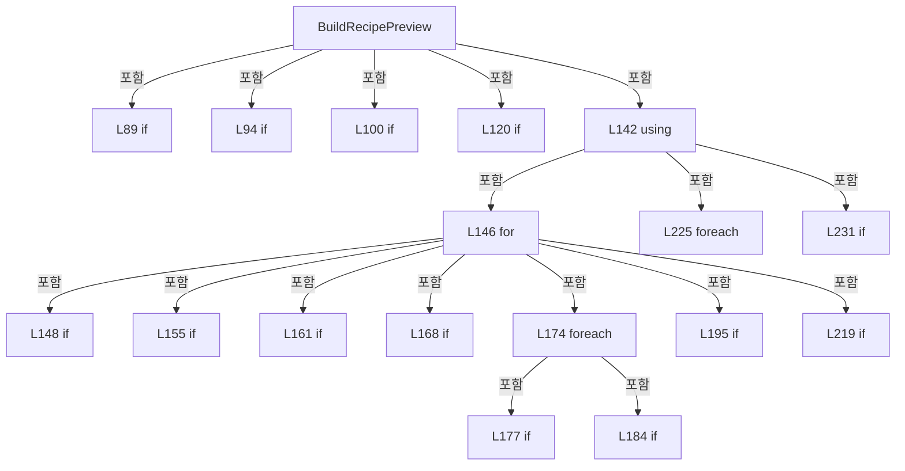

변경 전 점검: 입력/반환 타입, 위 호출자, 예외/취소 경로, 공유 상태와 저장·전송 소비자를 함께 확인합니다. 값의 단위나 물리 방향을 이름만으로 확정하지 않습니다.

### LocalFunctionStatement `SelectValue` · L105–108

[Drilling.UI/Menu/Menus/CHeadAssignmentPreviewBuilder.cs:105–108](https://github.com/kjuws10-rgb/A3Drilling/blob/5aee8e58439c9b455cae7c9593c9be986c3e682e/Drilling.UI/Menu/Menus/CHeadAssignmentPreviewBuilder.cs#L105-L108)

| 항목 | 실제 추출 값 |
| --- | --- |
| 서명 | double? SelectValue(string) |
| 접근/수식자 | Private /  |
| 반환/값 타입 | double? |
| 소속 타입 | NamedType:Drilling.UI.Menu.Menus.CHeadAssignmentPreviewBuilder |

입력 계약:

| 이름 | 타입 | 전달 | 선택/기본값 |
| --- | --- | --- | --- |
| key | string | None | False /  |

현재 부분 분석에서 직접 연결된 호출자는 없습니다. XAML/이벤트/인터페이스·델리게이트·외부 진입을 추가 확인해야 하며, 미사용으로 판정한 것이 아닙니다.

호출하는 대상과 해석 범위:

| 원본 행 | 표현식 | 분석 상태 | 대상/소스 위치 |
| --- | --- | --- | --- |
| 107 | ReadNullableDoubleAny | resolved | double? Drilling.UI.Menu.Menus.CHeadAssignmentPreviewBuilder.ReadNullableDoubleAny(System.Collections.Generic.IReadOnlyDictionary<string, string>, string) · Drilling.UI/Menu/Menus/CHeadAssignmentPreviewBuilder.cs:519 |

본문의 실제 연산·분기·예외·반환 순서(원문 위치 순):

| 원본 행 | 종류 | 주석 해설 |
| --- | --- | --- |
| 107 | call | 함수·델리게이트 또는 객체 생성자를 호출합니다: ReadNullableDoubleAny(parameters, key) |
| 107 | return | 호출자에게 값 또는 제어를 반환합니다: return ReadNullableDoubleAny(parameters, key); |

변경 전 점검: 입력/반환 타입, 위 호출자, 예외/취소 경로, 공유 상태와 저장·전송 소비자를 함께 확인합니다. 값의 단위나 물리 방향을 이름만으로 확정하지 않습니다.

### LocalFunctionStatement `SelectHeadNo` · L127–130

[Drilling.UI/Menu/Menus/CHeadAssignmentPreviewBuilder.cs:127–130](https://github.com/kjuws10-rgb/A3Drilling/blob/5aee8e58439c9b455cae7c9593c9be986c3e682e/Drilling.UI/Menu/Menus/CHeadAssignmentPreviewBuilder.cs#L127-L130)

| 항목 | 실제 추출 값 |
| --- | --- |
| 서명 | int SelectHeadNo(int) |
| 접근/수식자 | Private /  |
| 반환/값 타입 | int |
| 소속 타입 | NamedType:Drilling.UI.Menu.Menus.CHeadAssignmentPreviewBuilder |

입력 계약:

| 이름 | 타입 | 전달 | 선택/기본값 |
| --- | --- | --- | --- |
| headNo | int | None | False /  |

현재 부분 분석에서 직접 연결된 호출자는 없습니다. XAML/이벤트/인터페이스·델리게이트·외부 진입을 추가 확인해야 하며, 미사용으로 판정한 것이 아닙니다.

본문의 실제 연산·분기·예외·반환 순서(원문 위치 순):

| 원본 행 | 종류 | 주석 해설 |
| --- | --- | --- |
| 129 | return | 호출자에게 값 또는 제어를 반환합니다: return headNo; |

변경 전 점검: 입력/반환 타입, 위 호출자, 예외/취소 경로, 공유 상태와 저장·전송 소비자를 함께 확인합니다. 값의 단위나 물리 방향을 이름만으로 확정하지 않습니다.

### LocalFunctionStatement `SelectLong` · L132–135

[Drilling.UI/Menu/Menus/CHeadAssignmentPreviewBuilder.cs:132–135](https://github.com/kjuws10-rgb/A3Drilling/blob/5aee8e58439c9b455cae7c9593c9be986c3e682e/Drilling.UI/Menu/Menus/CHeadAssignmentPreviewBuilder.cs#L132-L135)

| 항목 | 실제 추출 값 |
| --- | --- |
| 서명 | long SelectLong(int) |
| 접근/수식자 | Private /  |
| 반환/값 타입 | long |
| 소속 타입 | NamedType:Drilling.UI.Menu.Menus.CHeadAssignmentPreviewBuilder |

입력 계약:

| 이름 | 타입 | 전달 | 선택/기본값 |
| --- | --- | --- | --- |
| arg0 | int | None | False /  |

현재 부분 분석에서 직접 연결된 호출자는 없습니다. XAML/이벤트/인터페이스·델리게이트·외부 진입을 추가 확인해야 하며, 미사용으로 판정한 것이 아닙니다.

본문의 실제 연산·분기·예외·반환 순서(원문 위치 순):

| 원본 행 | 종류 | 주석 해설 |
| --- | --- | --- |
| 134 | return | 호출자에게 값 또는 제어를 반환합니다: return 0L; |

변경 전 점검: 입력/반환 타입, 위 호출자, 예외/취소 경로, 공유 상태와 저장·전송 소비자를 함께 확인합니다. 값의 단위나 물리 방향을 이름만으로 확정하지 않습니다.

### MethodDeclaration `CreateRecipePreviewError` · L244–247

[Drilling.UI/Menu/Menus/CHeadAssignmentPreviewBuilder.cs:244–247](https://github.com/kjuws10-rgb/A3Drilling/blob/5aee8e58439c9b455cae7c9593c9be986c3e682e/Drilling.UI/Menu/Menus/CHeadAssignmentPreviewBuilder.cs#L244-L247)

| 항목 | 실제 추출 값 |
| --- | --- |
| 서명 | Drilling.UI.Menu.Menus.ST_MAIN_RECIPE_PREVIEW Drilling.UI.Menu.Menus.CHeadAssignmentPreviewBuilder.CreateRecipePreviewError(Drilling.UI.Menu.Menus.ST_GLASS_PREVIEW_FRAME, string) |
| 접근/수식자 | Private / private, static |
| 반환/값 타입 | Drilling.UI.Menu.Menus.ST_MAIN_RECIPE_PREVIEW |
| 소속 타입 | NamedType:Drilling.UI.Menu.Menus.CHeadAssignmentPreviewBuilder |

입력 계약:

| 이름 | 타입 | 전달 | 선택/기본값 |
| --- | --- | --- | --- |
| frame | Drilling.UI.Menu.Menus.ST_GLASS_PREVIEW_FRAME | None | False /  |
| message | string | None | False /  |

정적 호출자로 확인된 위치:

| 호출 파일/행 | 호출 표현식 | 런타임 분기 가능 |
| --- | --- | --- |
| [Drilling.UI/Menu/Menus/CHeadAssignmentPreviewBuilder.cs:91–91](https://github.com/kjuws10-rgb/A3Drilling/blob/5aee8e58439c9b455cae7c9593c9be986c3e682e/Drilling.UI/Menu/Menus/CHeadAssignmentPreviewBuilder.cs#L91-L91) | CreateRecipePreviewError | False |
| [Drilling.UI/Menu/Menus/CHeadAssignmentPreviewBuilder.cs:96–96](https://github.com/kjuws10-rgb/A3Drilling/blob/5aee8e58439c9b455cae7c9593c9be986c3e682e/Drilling.UI/Menu/Menus/CHeadAssignmentPreviewBuilder.cs#L96-L96) | CreateRecipePreviewError | False |
| [Drilling.UI/Menu/Menus/CHeadAssignmentPreviewBuilder.cs:102–102](https://github.com/kjuws10-rgb/A3Drilling/blob/5aee8e58439c9b455cae7c9593c9be986c3e682e/Drilling.UI/Menu/Menus/CHeadAssignmentPreviewBuilder.cs#L102-L102) | CreateRecipePreviewError | False |
| [Drilling.UI/Menu/Menus/CHeadAssignmentPreviewBuilder.cs:122–122](https://github.com/kjuws10-rgb/A3Drilling/blob/5aee8e58439c9b455cae7c9593c9be986c3e682e/Drilling.UI/Menu/Menus/CHeadAssignmentPreviewBuilder.cs#L122-L122) | CreateRecipePreviewError | False |
| [Drilling.UI/Menu/Menus/CHeadAssignmentPreviewBuilder.cs:157–157](https://github.com/kjuws10-rgb/A3Drilling/blob/5aee8e58439c9b455cae7c9593c9be986c3e682e/Drilling.UI/Menu/Menus/CHeadAssignmentPreviewBuilder.cs#L157-L157) | CreateRecipePreviewError | False |
| [Drilling.UI/Menu/Menus/CHeadAssignmentPreviewBuilder.cs:163–163](https://github.com/kjuws10-rgb/A3Drilling/blob/5aee8e58439c9b455cae7c9593c9be986c3e682e/Drilling.UI/Menu/Menus/CHeadAssignmentPreviewBuilder.cs#L163-L163) | CreateRecipePreviewError | False |
| [Drilling.UI/Menu/Menus/CHeadAssignmentPreviewBuilder.cs:170–170](https://github.com/kjuws10-rgb/A3Drilling/blob/5aee8e58439c9b455cae7c9593c9be986c3e682e/Drilling.UI/Menu/Menus/CHeadAssignmentPreviewBuilder.cs#L170-L170) | CreateRecipePreviewError | False |
| [Drilling.UI/Menu/Menus/CHeadAssignmentPreviewBuilder.cs:197–197](https://github.com/kjuws10-rgb/A3Drilling/blob/5aee8e58439c9b455cae7c9593c9be986c3e682e/Drilling.UI/Menu/Menus/CHeadAssignmentPreviewBuilder.cs#L197-L197) | CreateRecipePreviewError | False |

호출하는 대상과 해석 범위:

| 원본 행 | 표현식 | 분석 상태 | 대상/소스 위치 |
| --- | --- | --- | --- |
| 246 | new ST_MAIN_RECIPE_PREVIEW | resolved | Drilling.UI.Menu.Menus.ST_MAIN_RECIPE_PREVIEW.ST_MAIN_RECIPE_PREVIEW(ImageSource?, Drilling.UI.Menu.Menus.ST_GLASS_PREVIEW_FRAME, System.Collections.Generic.IReadOnlyDictionary<int, long>, long, long, System.Collections.Generic.IReadOnlyList<Drilling.UI.Menu.Menus.ST_CELL_PREVIEW_LABEL>, string, int) · Drilling.UI/Menu/Menus/CMenuMain.cs:3437 |
| 246 | new Dictionary<int, long> | resolved | System.Collections.Generic.Dictionary<int, long>.Dictionary() |

본문의 실제 연산·분기·예외·반환 순서(원문 위치 순):

| 원본 행 | 종류 | 주석 해설 |
| --- | --- | --- |
| 246 | call | 함수·델리게이트 또는 객체 생성자를 호출합니다: new ST_MAIN_RECIPE_PREVIEW(null, frame, new Dictionary<int, long>(), 0, 0, [], $"PREVIEW ERROR / {message}") |
| 246 | call | 함수·델리게이트 또는 객체 생성자를 호출합니다: new Dictionary<int, long>() |
| 246 | return | 호출자에게 값 또는 제어를 반환합니다: return new ST_MAIN_RECIPE_PREVIEW(null, frame, new Dictionary<int, long>(), 0, 0, [], $"PREVIEW ERROR / {message}"); |

변경 전 점검: 입력/반환 타입, 위 호출자, 예외/취소 경로, 공유 상태와 저장·전송 소비자를 함께 확인합니다. 값의 단위나 물리 방향을 이름만으로 확정하지 않습니다.

### MethodDeclaration `ResolveCellPreviewHead` · L249–271

[Drilling.UI/Menu/Menus/CHeadAssignmentPreviewBuilder.cs:249–271](https://github.com/kjuws10-rgb/A3Drilling/blob/5aee8e58439c9b455cae7c9593c9be986c3e682e/Drilling.UI/Menu/Menus/CHeadAssignmentPreviewBuilder.cs#L249-L271)

| 항목 | 실제 추출 값 |
| --- | --- |
| 서명 | int Drilling.UI.Menu.Menus.CHeadAssignmentPreviewBuilder.ResolveCellPreviewHead(System.Collections.Generic.IReadOnlyDictionary<int, long>, System.Collections.Generic.IReadOnlyList<int>, int) |
| 접근/수식자 | Private / private, static |
| 반환/값 타입 | int |
| 소속 타입 | NamedType:Drilling.UI.Menu.Menus.CHeadAssignmentPreviewBuilder |

입력 계약:

| 이름 | 타입 | 전달 | 선택/기본값 |
| --- | --- | --- | --- |
| cellHeadCounts | System.Collections.Generic.IReadOnlyDictionary<int, long> | None | False /  |
| activeHeadNos | System.Collections.Generic.IReadOnlyList<int> | None | False /  |
| cellNo | int | None | False /  |

정적 호출자로 확인된 위치:

| 호출 파일/행 | 호출 표현식 | 런타임 분기 가능 |
| --- | --- | --- |
| [Drilling.UI/Menu/Menus/CHeadAssignmentPreviewBuilder.cs:203–203](https://github.com/kjuws10-rgb/A3Drilling/blob/5aee8e58439c9b455cae7c9593c9be986c3e682e/Drilling.UI/Menu/Menus/CHeadAssignmentPreviewBuilder.cs#L203-L203) | ResolveCellPreviewHead | False |

호출하는 대상과 해석 범위:

| 원본 행 | 표현식 | 분석 상태 | 대상/소스 위치 |
| --- | --- | --- | --- |
| 255 | cellHeadCounts.TryGetValue | resolved · 동적 구현 선택 가능 | bool System.Collections.Generic.IReadOnlyDictionary<int, long>.TryGetValue(int, out long) |

본문의 실제 연산·분기·예외·반환 순서(원문 위치 순):

| 원본 행 | 종류 | 주석 해설 |
| --- | --- | --- |
| 251 | local-declaration | 지역 변수를 선언합니다: var selectedHeadNo = 0; |
| 251 | variable-initializer | 변수의 초기값을 지정합니다: selectedHeadNo = 0 |
| 252 | local-declaration | 지역 변수를 선언합니다: var selectedCount = 0L; |
| 252 | variable-initializer | 변수의 초기값을 지정합니다: selectedCount = 0L |
| 253 | foreach | 컬렉션 요소를 순회합니다: foreach (var headNo in activeHeadNos) |
| 255 | call | 함수·델리게이트 또는 객체 생성자를 호출합니다: cellHeadCounts.TryGetValue(headNo, out var value) |
| 255 | conditional-expression | 조건에 따라 결과식을 선택합니다: cellHeadCounts.TryGetValue(headNo, out var value) ? value : 0L |
| 255 | local-declaration | 지역 변수를 선언합니다: var count = cellHeadCounts.TryGetValue(headNo, out var value) ? value : 0L; |
| 255 | variable-initializer | 변수의 초기값을 지정합니다: count = cellHeadCounts.TryGetValue(headNo, out var value) ? value : 0L |
| 256 | if | 조건에 따라 분기합니다: if (count <= selectedCount) |
| 258 | continue | 다음 반복으로 진행합니다: continue; |
| 261 | assignment | 값을 대상에 대입합니다: selectedHeadNo = headNo |
| 262 | assignment | 값을 대상에 대입합니다: selectedCount = count |
| 265 | if | 조건에 따라 분기합니다: if (selectedHeadNo > 0) |
| 267 | return | 호출자에게 값 또는 제어를 반환합니다: return selectedHeadNo; |
| 270 | return | 호출자에게 값 또는 제어를 반환합니다: return 0; |

제어 구문의 포함 구조(실제 실행 순서/CFG가 아닌 구문 탐색 그림):

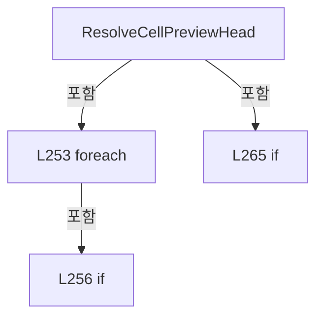

변경 전 점검: 입력/반환 타입, 위 호출자, 예외/취소 경로, 공유 상태와 저장·전송 소비자를 함께 확인합니다. 값의 단위나 물리 방향을 이름만으로 확정하지 않습니다.

### MethodDeclaration `ShouldUseExpandedPreviewBounds` · L273–276

[Drilling.UI/Menu/Menus/CHeadAssignmentPreviewBuilder.cs:273–276](https://github.com/kjuws10-rgb/A3Drilling/blob/5aee8e58439c9b455cae7c9593c9be986c3e682e/Drilling.UI/Menu/Menus/CHeadAssignmentPreviewBuilder.cs#L273-L276)

| 항목 | 실제 추출 값 |
| --- | --- |
| 서명 | bool Drilling.UI.Menu.Menus.CHeadAssignmentPreviewBuilder.ShouldUseExpandedPreviewBounds(Rect, Rect) |
| 접근/수식자 | Private / private, static |
| 반환/값 타입 | bool |
| 소속 타입 | NamedType:Drilling.UI.Menu.Menus.CHeadAssignmentPreviewBuilder |

입력 계약:

| 이름 | 타입 | 전달 | 선택/기본값 |
| --- | --- | --- | --- |
| actualBounds | Rect | None | False /  |
| displayBounds | Rect | None | False /  |

현재 부분 분석에서 직접 연결된 호출자는 없습니다. XAML/이벤트/인터페이스·델리게이트·외부 진입을 추가 확인해야 하며, 미사용으로 판정한 것이 아닙니다.

호출하는 대상과 해석 범위:

| 원본 행 | 표현식 | 분석 상태 | 대상/소스 위치 |
| --- | --- | --- | --- |
| 275 | Math.Abs | candidate | OverloadResolutionFailure |
| 275 | Math.Abs | candidate | OverloadResolutionFailure |

본문의 실제 연산·분기·예외·반환 순서(원문 위치 순):

| 원본 행 | 종류 | 주석 해설 |
| --- | --- | --- |
| 275 | call | 함수·델리게이트 또는 객체 생성자를 호출합니다: Math.Abs(actualBounds.Width - displayBounds.Width) |
| 275 | call | 함수·델리게이트 또는 객체 생성자를 호출합니다: Math.Abs(actualBounds.Height - displayBounds.Height) |
| 275 | return | 호출자에게 값 또는 제어를 반환합니다: return !actualBounds.IsEmpty && (Math.Abs(actualBounds.Width - displayBounds.Width) > 0.001 &#124;&#124; Math.Abs(actualBounds.Height - displayBounds.Height) > 0.001); |

변경 전 점검: 입력/반환 타입, 위 호출자, 예외/취소 경로, 공유 상태와 저장·전송 소비자를 함께 확인합니다. 값의 단위나 물리 방향을 이름만으로 확정하지 않습니다.

### MethodDeclaration `ExpandPreviewBounds` · L278–287

[Drilling.UI/Menu/Menus/CHeadAssignmentPreviewBuilder.cs:278–287](https://github.com/kjuws10-rgb/A3Drilling/blob/5aee8e58439c9b455cae7c9593c9be986c3e682e/Drilling.UI/Menu/Menus/CHeadAssignmentPreviewBuilder.cs#L278-L287)

| 항목 | 실제 추출 값 |
| --- | --- |
| 서명 | Rect Drilling.UI.Menu.Menus.CHeadAssignmentPreviewBuilder.ExpandPreviewBounds(Rect, double, double, Rect) |
| 접근/수식자 | Private / private, static |
| 반환/값 타입 | Rect |
| 소속 타입 | NamedType:Drilling.UI.Menu.Menus.CHeadAssignmentPreviewBuilder |

입력 계약:

| 이름 | 타입 | 전달 | 선택/기본값 |
| --- | --- | --- | --- |
| bounds | Rect | None | False /  |
| minimumWidth | double | None | False /  |
| minimumHeight | double | None | False /  |
| limitBounds | Rect | None | False /  |

현재 부분 분석에서 직접 연결된 호출자는 없습니다. XAML/이벤트/인터페이스·델리게이트·외부 진입을 추가 확인해야 하며, 미사용으로 판정한 것이 아닙니다.

호출하는 대상과 해석 범위:

| 원본 행 | 표현식 | 분석 상태 | 대상/소스 위치 |
| --- | --- | --- | --- |
| 280 | ClampPreviewCoordinate | candidate | OverloadResolutionFailure |
| 281 | ClampPreviewCoordinate | candidate | OverloadResolutionFailure |
| 282 | Math.Max | candidate | OverloadResolutionFailure |
| 283 | Math.Max | candidate | OverloadResolutionFailure |
| 284 | Math.Min | candidate | OverloadResolutionFailure |
| 284 | Math.Max | candidate | OverloadResolutionFailure |
| 285 | Math.Min | candidate | OverloadResolutionFailure |
| 285 | Math.Max | candidate | OverloadResolutionFailure |
| 286 | new Rect | unresolved | None |

본문의 실제 연산·분기·예외·반환 순서(원문 위치 순):

| 원본 행 | 종류 | 주석 해설 |
| --- | --- | --- |
| 280 | call | 함수·델리게이트 또는 객체 생성자를 호출합니다: ClampPreviewCoordinate(bounds.Left, limitBounds.Left, limitBounds.Right) |
| 280 | local-declaration | 지역 변수를 선언합니다: var left = ClampPreviewCoordinate(bounds.Left, limitBounds.Left, limitBounds.Right); |
| 280 | variable-initializer | 변수의 초기값을 지정합니다: left = ClampPreviewCoordinate(bounds.Left, limitBounds.Left, limitBounds.Right) |
| 281 | call | 함수·델리게이트 또는 객체 생성자를 호출합니다: ClampPreviewCoordinate(bounds.Top, limitBounds.Top, limitBounds.Bottom) |
| 281 | local-declaration | 지역 변수를 선언합니다: var top = ClampPreviewCoordinate(bounds.Top, limitBounds.Top, limitBounds.Bottom); |
| 281 | variable-initializer | 변수의 초기값을 지정합니다: top = ClampPreviewCoordinate(bounds.Top, limitBounds.Top, limitBounds.Bottom) |
| 282 | call | 함수·델리게이트 또는 객체 생성자를 호출합니다: Math.Max(1.0, limitBounds.Right - left) |
| 282 | local-declaration | 지역 변수를 선언합니다: var maximumWidth = Math.Max(1.0, limitBounds.Right - left); |
| 282 | variable-initializer | 변수의 초기값을 지정합니다: maximumWidth = Math.Max(1.0, limitBounds.Right - left) |
| 283 | call | 함수·델리게이트 또는 객체 생성자를 호출합니다: Math.Max(1.0, limitBounds.Bottom - top) |
| 283 | local-declaration | 지역 변수를 선언합니다: var maximumHeight = Math.Max(1.0, limitBounds.Bottom - top); |
| 283 | variable-initializer | 변수의 초기값을 지정합니다: maximumHeight = Math.Max(1.0, limitBounds.Bottom - top) |
| 284 | call | 함수·델리게이트 또는 객체 생성자를 호출합니다: Math.Min(Math.Max(bounds.Width, minimumWidth), maximumWidth) |
| 284 | call | 함수·델리게이트 또는 객체 생성자를 호출합니다: Math.Max(bounds.Width, minimumWidth) |
| 284 | local-declaration | 지역 변수를 선언합니다: var width = Math.Min(Math.Max(bounds.Width, minimumWidth), maximumWidth); |
| 284 | variable-initializer | 변수의 초기값을 지정합니다: width = Math.Min(Math.Max(bounds.Width, minimumWidth), maximumWidth) |
| 285 | call | 함수·델리게이트 또는 객체 생성자를 호출합니다: Math.Min(Math.Max(bounds.Height, minimumHeight), maximumHeight) |
| 285 | call | 함수·델리게이트 또는 객체 생성자를 호출합니다: Math.Max(bounds.Height, minimumHeight) |
| 285 | local-declaration | 지역 변수를 선언합니다: var height = Math.Min(Math.Max(bounds.Height, minimumHeight), maximumHeight); |
| 285 | variable-initializer | 변수의 초기값을 지정합니다: height = Math.Min(Math.Max(bounds.Height, minimumHeight), maximumHeight) |
| 286 | call | 함수·델리게이트 또는 객체 생성자를 호출합니다: new Rect(left, top, width, height) |
| 286 | return | 호출자에게 값 또는 제어를 반환합니다: return new Rect(left, top, width, height); |

변경 전 점검: 입력/반환 타입, 위 호출자, 예외/취소 경로, 공유 상태와 저장·전송 소비자를 함께 확인합니다. 값의 단위나 물리 방향을 이름만으로 확정하지 않습니다.

### MethodDeclaration `ClampPreviewCoordinate` · L289–293

[Drilling.UI/Menu/Menus/CHeadAssignmentPreviewBuilder.cs:289–293](https://github.com/kjuws10-rgb/A3Drilling/blob/5aee8e58439c9b455cae7c9593c9be986c3e682e/Drilling.UI/Menu/Menus/CHeadAssignmentPreviewBuilder.cs#L289-L293)

| 항목 | 실제 추출 값 |
| --- | --- |
| 서명 | double Drilling.UI.Menu.Menus.CHeadAssignmentPreviewBuilder.ClampPreviewCoordinate(double, double, double) |
| 접근/수식자 | Private / private, static |
| 반환/값 타입 | double |
| 소속 타입 | NamedType:Drilling.UI.Menu.Menus.CHeadAssignmentPreviewBuilder |

입력 계약:

| 이름 | 타입 | 전달 | 선택/기본값 |
| --- | --- | --- | --- |
| value | double | None | False /  |
| minimum | double | None | False /  |
| maximum | double | None | False /  |

현재 부분 분석에서 직접 연결된 호출자는 없습니다. XAML/이벤트/인터페이스·델리게이트·외부 진입을 추가 확인해야 하며, 미사용으로 판정한 것이 아닙니다.

호출하는 대상과 해석 범위:

| 원본 행 | 표현식 | 분석 상태 | 대상/소스 위치 |
| --- | --- | --- | --- |
| 291 | Math.Max | resolved | double System.Math.Max(double, double) |
| 292 | Math.Clamp | resolved | double System.Math.Clamp(double, double, double) |

본문의 실제 연산·분기·예외·반환 순서(원문 위치 순):

| 원본 행 | 종류 | 주석 해설 |
| --- | --- | --- |
| 291 | call | 함수·델리게이트 또는 객체 생성자를 호출합니다: Math.Max(minimum, maximum) |
| 291 | local-declaration | 지역 변수를 선언합니다: var safeMaximum = Math.Max(minimum, maximum); |
| 291 | variable-initializer | 변수의 초기값을 지정합니다: safeMaximum = Math.Max(minimum, maximum) |
| 292 | call | 함수·델리게이트 또는 객체 생성자를 호출합니다: Math.Clamp(value, minimum, safeMaximum) |
| 292 | return | 호출자에게 값 또는 제어를 반환합니다: return Math.Clamp(value, minimum, safeMaximum); |

변경 전 점검: 입력/반환 타입, 위 호출자, 예외/취소 경로, 공유 상태와 저장·전송 소비자를 함께 확인합니다. 값의 단위나 물리 방향을 이름만으로 확정하지 않습니다.

### MethodDeclaration `AssignPreviewHead` · L295–340

[Drilling.UI/Menu/Menus/CHeadAssignmentPreviewBuilder.cs:295–340](https://github.com/kjuws10-rgb/A3Drilling/blob/5aee8e58439c9b455cae7c9593c9be986c3e682e/Drilling.UI/Menu/Menus/CHeadAssignmentPreviewBuilder.cs#L295-L340)

| 항목 | 실제 추출 값 |
| --- | --- |
| 서명 | int Drilling.UI.Menu.Menus.CHeadAssignmentPreviewBuilder.AssignPreviewHead(double, System.Collections.Generic.IReadOnlyList<int>, Drilling.UI.Menu.Menus.ST_PREVIEW_HEAD_LAYOUT, double, System.Collections.Generic.IReadOnlyDictionary<int, long>) |
| 접근/수식자 | Private / private, static |
| 반환/값 타입 | int |
| 소속 타입 | NamedType:Drilling.UI.Menu.Menus.CHeadAssignmentPreviewBuilder |

입력 계약:

| 이름 | 타입 | 전달 | 선택/기본값 |
| --- | --- | --- | --- |
| x | double | None | False /  |
| assignmentHeadNos | System.Collections.Generic.IReadOnlyList<int> | None | False /  |
| headLayout | Drilling.UI.Menu.Menus.ST_PREVIEW_HEAD_LAYOUT | None | False /  |
| akMarginX | double | None | False /  |
| assignedHeadCounts | System.Collections.Generic.IReadOnlyDictionary<int, long> | None | False /  |

정적 호출자로 확인된 위치:

| 호출 파일/행 | 호출 표현식 | 런타임 분기 가능 |
| --- | --- | --- |
| [Drilling.UI/Menu/Menus/CHeadAssignmentPreviewBuilder.cs:183–183](https://github.com/kjuws10-rgb/A3Drilling/blob/5aee8e58439c9b455cae7c9593c9be986c3e682e/Drilling.UI/Menu/Menus/CHeadAssignmentPreviewBuilder.cs#L183-L183) | AssignPreviewHead | False |

호출하는 대상과 해석 범위:

| 원본 행 | 표현식 | 분석 상태 | 대상/소스 위치 |
| --- | --- | --- | --- |
| 323 | assignmentHeadNos.Select(BuildPreview).Where(IsHasValue).Select(SelectItem).ToArray | resolved | Drilling.UI.Menu.Menus.ST_PREVIEW_HEAD_ASSIGNMENT_CANDIDATE[] System.Collections.Generic.IEnumerable<Drilling.UI.Menu.Menus.ST_PREVIEW_HEAD_ASSIGNMENT_CANDIDATE>.ToArray<Drilling.UI.Menu.Menus.ST_PREVIEW_HEAD_ASSIGNMENT_CANDIDATE>() |
| 323 | assignmentHeadNos.Select(BuildPreview).Where(IsHasValue).Select | resolved | System.Collections.Generic.IEnumerable<Drilling.UI.Menu.Menus.ST_PREVIEW_HEAD_ASSIGNMENT_CANDIDATE> System.Collections.Generic.IEnumerable<Drilling.UI.Menu.Menus.ST_PREVIEW_HEAD_ASSIGNMENT_CANDIDATE?>.Select<Drilling.UI.Menu.Menus.ST_PREVIEW_HEAD_ASSIGNMENT_CANDIDATE?, Drilling.UI.Menu.Menus.ST_PREVIEW_HEAD_ASSIGNMENT_CANDIDATE>(System.Func<Drilling.UI.Menu.Menus.ST_PREVIEW_HEAD_ASSIGNMENT_CANDIDATE?, Drilling.UI.Menu.Menus.ST_PREVIEW_HEAD_ASSIGNMENT_CANDIDATE>) |
| 323 | assignmentHeadNos.Select(BuildPreview).Where | resolved | System.Collections.Generic.IEnumerable<Drilling.UI.Menu.Menus.ST_PREVIEW_HEAD_ASSIGNMENT_CANDIDATE?> System.Collections.Generic.IEnumerable<Drilling.UI.Menu.Menus.ST_PREVIEW_HEAD_ASSIGNMENT_CANDIDATE?>.Where<Drilling.UI.Menu.Menus.ST_PREVIEW_HEAD_ASSIGNMENT_CANDIDATE?>(System.Func<Drilling.UI.Menu.Menus.ST_PREVIEW_HEAD_ASSIGNMENT_CANDIDATE?, bool>) |
| 323 | assignmentHeadNos.Select | resolved | System.Collections.Generic.IEnumerable<Drilling.UI.Menu.Menus.ST_PREVIEW_HEAD_ASSIGNMENT_CANDIDATE?> System.Collections.Generic.IEnumerable<int>.Select<int, Drilling.UI.Menu.Menus.ST_PREVIEW_HEAD_ASSIGNMENT_CANDIDATE?>(System.Func<int, Drilling.UI.Menu.Menus.ST_PREVIEW_HEAD_ASSIGNMENT_CANDIDATE?>) |
| 339 | candidates.OrderBy(SelectDistance).ThenBy(SelectValue).ThenBy(SelectHeadNo).First | resolved | Drilling.UI.Menu.Menus.ST_PREVIEW_HEAD_ASSIGNMENT_CANDIDATE System.Collections.Generic.IEnumerable<Drilling.UI.Menu.Menus.ST_PREVIEW_HEAD_ASSIGNMENT_CANDIDATE>.First<Drilling.UI.Menu.Menus.ST_PREVIEW_HEAD_ASSIGNMENT_CANDIDATE>() |
| 339 | candidates.OrderBy(SelectDistance).ThenBy(SelectValue).ThenBy | resolved | System.Linq.IOrderedEnumerable<Drilling.UI.Menu.Menus.ST_PREVIEW_HEAD_ASSIGNMENT_CANDIDATE> System.Linq.IOrderedEnumerable<Drilling.UI.Menu.Menus.ST_PREVIEW_HEAD_ASSIGNMENT_CANDIDATE>.ThenBy<Drilling.UI.Menu.Menus.ST_PREVIEW_HEAD_ASSIGNMENT_CANDIDATE, int>(System.Func<Drilling.UI.Menu.Menus.ST_PREVIEW_HEAD_ASSIGNMENT_CANDIDATE, int>) |
| 339 | candidates.OrderBy(SelectDistance).ThenBy | resolved | System.Linq.IOrderedEnumerable<Drilling.UI.Menu.Menus.ST_PREVIEW_HEAD_ASSIGNMENT_CANDIDATE> System.Linq.IOrderedEnumerable<Drilling.UI.Menu.Menus.ST_PREVIEW_HEAD_ASSIGNMENT_CANDIDATE>.ThenBy<Drilling.UI.Menu.Menus.ST_PREVIEW_HEAD_ASSIGNMENT_CANDIDATE, long>(System.Func<Drilling.UI.Menu.Menus.ST_PREVIEW_HEAD_ASSIGNMENT_CANDIDATE, long>) |
| 339 | candidates.OrderBy | resolved | System.Linq.IOrderedEnumerable<Drilling.UI.Menu.Menus.ST_PREVIEW_HEAD_ASSIGNMENT_CANDIDATE> System.Collections.Generic.IEnumerable<Drilling.UI.Menu.Menus.ST_PREVIEW_HEAD_ASSIGNMENT_CANDIDATE>.OrderBy<Drilling.UI.Menu.Menus.ST_PREVIEW_HEAD_ASSIGNMENT_CANDIDATE, double>(System.Func<Drilling.UI.Menu.Menus.ST_PREVIEW_HEAD_ASSIGNMENT_CANDIDATE, double>) |

본문의 실제 연산·분기·예외·반환 순서(원문 위치 순):

| 원본 행 | 종류 | 주석 해설 |
| --- | --- | --- |
| 297 | if | 조건에 따라 분기합니다: if (assignmentHeadNos.Count == 0) |
| 299 | return | 호출자에게 값 또는 제어를 반환합니다: return 0; |
| 323 | call | 함수·델리게이트 또는 객체 생성자를 호출합니다: assignmentHeadNos.Select(BuildPreview).Where(IsHasValue).Select(SelectItem).ToArray() |
| 323 | call | 함수·델리게이트 또는 객체 생성자를 호출합니다: assignmentHeadNos.Select(BuildPreview).Where(IsHasValue).Select(SelectItem) |
| 323 | call | 함수·델리게이트 또는 객체 생성자를 호출합니다: assignmentHeadNos.Select(BuildPreview).Where(IsHasValue) |
| 323 | call | 함수·델리게이트 또는 객체 생성자를 호출합니다: assignmentHeadNos.Select(BuildPreview) |
| 323 | local-declaration | 지역 변수를 선언합니다: var candidates = assignmentHeadNos.Select(BuildPreview).Where(IsHasValue).Select(SelectItem).ToArray(); |
| 323 | variable-initializer | 변수의 초기값을 지정합니다: candidates = assignmentHeadNos.Select(BuildPreview).Where(IsHasValue).Select(SelectItem).ToArray() |
| 339 | call | 함수·델리게이트 또는 객체 생성자를 호출합니다: candidates.OrderBy(SelectDistance).ThenBy(SelectValue).ThenBy(SelectHeadNo).First() |
| 339 | call | 함수·델리게이트 또는 객체 생성자를 호출합니다: candidates.OrderBy(SelectDistance).ThenBy(SelectValue).ThenBy(SelectHeadNo) |
| 339 | call | 함수·델리게이트 또는 객체 생성자를 호출합니다: candidates.OrderBy(SelectDistance).ThenBy(SelectValue) |
| 339 | call | 함수·델리게이트 또는 객체 생성자를 호출합니다: candidates.OrderBy(SelectDistance) |
| 339 | conditional-expression | 조건에 따라 결과식을 선택합니다: candidates.Length == 0 ? 0 : candidates.OrderBy(SelectDistance).ThenBy(SelectValue).ThenBy(SelectHeadNo).First().HeadNo |
| 339 | return | 호출자에게 값 또는 제어를 반환합니다: return candidates.Length == 0 ? 0 : candidates.OrderBy(SelectDistance).ThenBy(SelectValue).ThenBy(SelectHeadNo).First().HeadNo; |

제어 구문의 포함 구조(실제 실행 순서/CFG가 아닌 구문 탐색 그림):

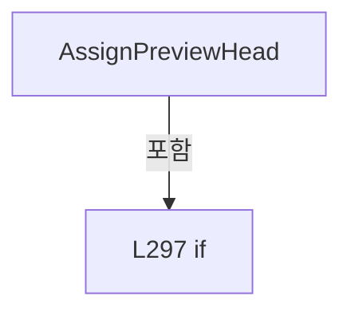

변경 전 점검: 입력/반환 타입, 위 호출자, 예외/취소 경로, 공유 상태와 저장·전송 소비자를 함께 확인합니다. 값의 단위나 물리 방향을 이름만으로 확정하지 않습니다.

### LocalFunctionStatement `BuildPreview` · L302–311

[Drilling.UI/Menu/Menus/CHeadAssignmentPreviewBuilder.cs:302–311](https://github.com/kjuws10-rgb/A3Drilling/blob/5aee8e58439c9b455cae7c9593c9be986c3e682e/Drilling.UI/Menu/Menus/CHeadAssignmentPreviewBuilder.cs#L302-L311)

| 항목 | 실제 추출 값 |
| --- | --- |
| 서명 | Drilling.UI.Menu.Menus.ST_PREVIEW_HEAD_ASSIGNMENT_CANDIDATE? BuildPreview(int) |
| 접근/수식자 | Private /  |
| 반환/값 타입 | Drilling.UI.Menu.Menus.ST_PREVIEW_HEAD_ASSIGNMENT_CANDIDATE? |
| 소속 타입 | NamedType:Drilling.UI.Menu.Menus.CHeadAssignmentPreviewBuilder |

입력 계약:

| 이름 | 타입 | 전달 | 선택/기본값 |
| --- | --- | --- | --- |
| headNo | int | None | False /  |

현재 부분 분석에서 직접 연결된 호출자는 없습니다. XAML/이벤트/인터페이스·델리게이트·외부 진입을 추가 확인해야 하며, 미사용으로 판정한 것이 아닙니다.

호출하는 대상과 해석 범위:

| 원본 행 | 표현식 | 분석 상태 | 대상/소스 위치 |
| --- | --- | --- | --- |
| 304 | GetPreviewHeadRange | resolved | (double StartX, double EndX, double CenterX) Drilling.UI.Menu.Menus.CHeadAssignmentPreviewBuilder.GetPreviewHeadRange(int, Drilling.UI.Menu.Menus.ST_PREVIEW_HEAD_LAYOUT, double) · Drilling.UI/Menu/Menus/CHeadAssignmentPreviewBuilder.cs:342 |
| 310 | new ST_PREVIEW_HEAD_ASSIGNMENT_CANDIDATE | resolved | Drilling.UI.Menu.Menus.ST_PREVIEW_HEAD_ASSIGNMENT_CANDIDATE.ST_PREVIEW_HEAD_ASSIGNMENT_CANDIDATE(int, double) · Drilling.UI/Menu/Menus/CMenuMain.cs:3533 |
| 310 | Math.Abs | resolved | double System.Math.Abs(double) |

본문의 실제 연산·분기·예외·반환 순서(원문 위치 순):

| 원본 행 | 종류 | 주석 해설 |
| --- | --- | --- |
| 304 | call | 함수·델리게이트 또는 객체 생성자를 호출합니다: GetPreviewHeadRange(headNo, headLayout, akMarginX) |
| 304 | local-declaration | 지역 변수를 선언합니다: var range = GetPreviewHeadRange(headNo, headLayout, akMarginX); |
| 304 | variable-initializer | 변수의 초기값을 지정합니다: range = GetPreviewHeadRange(headNo, headLayout, akMarginX) |
| 305 | if | 조건에 따라 분기합니다: if (x < range.StartX &#124;&#124; x > range.EndX) |
| 307 | return | 호출자에게 값 또는 제어를 반환합니다: return (ST_PREVIEW_HEAD_ASSIGNMENT_CANDIDATE? )null; |
| 310 | call | 함수·델리게이트 또는 객체 생성자를 호출합니다: new ST_PREVIEW_HEAD_ASSIGNMENT_CANDIDATE(headNo, Math.Abs(x - range.CenterX)) |
| 310 | call | 함수·델리게이트 또는 객체 생성자를 호출합니다: Math.Abs(x - range.CenterX) |
| 310 | return | 호출자에게 값 또는 제어를 반환합니다: return new ST_PREVIEW_HEAD_ASSIGNMENT_CANDIDATE(headNo, Math.Abs(x - range.CenterX)); |

제어 구문의 포함 구조(실제 실행 순서/CFG가 아닌 구문 탐색 그림):

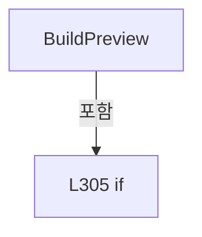

변경 전 점검: 입력/반환 타입, 위 호출자, 예외/취소 경로, 공유 상태와 저장·전송 소비자를 함께 확인합니다. 값의 단위나 물리 방향을 이름만으로 확정하지 않습니다.

### LocalFunctionStatement `IsHasValue` · L313–316

[Drilling.UI/Menu/Menus/CHeadAssignmentPreviewBuilder.cs:313–316](https://github.com/kjuws10-rgb/A3Drilling/blob/5aee8e58439c9b455cae7c9593c9be986c3e682e/Drilling.UI/Menu/Menus/CHeadAssignmentPreviewBuilder.cs#L313-L316)

| 항목 | 실제 추출 값 |
| --- | --- |
| 서명 | bool IsHasValue(Drilling.UI.Menu.Menus.ST_PREVIEW_HEAD_ASSIGNMENT_CANDIDATE?) |
| 접근/수식자 | Private /  |
| 반환/값 타입 | bool |
| 소속 타입 | NamedType:Drilling.UI.Menu.Menus.CHeadAssignmentPreviewBuilder |

입력 계약:

| 이름 | 타입 | 전달 | 선택/기본값 |
| --- | --- | --- | --- |
| candidate | Drilling.UI.Menu.Menus.ST_PREVIEW_HEAD_ASSIGNMENT_CANDIDATE? | None | False /  |

현재 부분 분석에서 직접 연결된 호출자는 없습니다. XAML/이벤트/인터페이스·델리게이트·외부 진입을 추가 확인해야 하며, 미사용으로 판정한 것이 아닙니다.

본문의 실제 연산·분기·예외·반환 순서(원문 위치 순):

| 원본 행 | 종류 | 주석 해설 |
| --- | --- | --- |
| 315 | return | 호출자에게 값 또는 제어를 반환합니다: return candidate.HasValue; |

변경 전 점검: 입력/반환 타입, 위 호출자, 예외/취소 경로, 공유 상태와 저장·전송 소비자를 함께 확인합니다. 값의 단위나 물리 방향을 이름만으로 확정하지 않습니다.

### LocalFunctionStatement `SelectItem` · L318–321

[Drilling.UI/Menu/Menus/CHeadAssignmentPreviewBuilder.cs:318–321](https://github.com/kjuws10-rgb/A3Drilling/blob/5aee8e58439c9b455cae7c9593c9be986c3e682e/Drilling.UI/Menu/Menus/CHeadAssignmentPreviewBuilder.cs#L318-L321)

| 항목 | 실제 추출 값 |
| --- | --- |
| 서명 | Drilling.UI.Menu.Menus.ST_PREVIEW_HEAD_ASSIGNMENT_CANDIDATE SelectItem(Drilling.UI.Menu.Menus.ST_PREVIEW_HEAD_ASSIGNMENT_CANDIDATE?) |
| 접근/수식자 | Private /  |
| 반환/값 타입 | Drilling.UI.Menu.Menus.ST_PREVIEW_HEAD_ASSIGNMENT_CANDIDATE |
| 소속 타입 | NamedType:Drilling.UI.Menu.Menus.CHeadAssignmentPreviewBuilder |

입력 계약:

| 이름 | 타입 | 전달 | 선택/기본값 |
| --- | --- | --- | --- |
| candidate | Drilling.UI.Menu.Menus.ST_PREVIEW_HEAD_ASSIGNMENT_CANDIDATE? | None | False /  |

현재 부분 분석에서 직접 연결된 호출자는 없습니다. XAML/이벤트/인터페이스·델리게이트·외부 진입을 추가 확인해야 하며, 미사용으로 판정한 것이 아닙니다.

본문의 실제 연산·분기·예외·반환 순서(원문 위치 순):

| 원본 행 | 종류 | 주석 해설 |
| --- | --- | --- |
| 320 | return | 호출자에게 값 또는 제어를 반환합니다: return candidate!.Value; |

변경 전 점검: 입력/반환 타입, 위 호출자, 예외/취소 경로, 공유 상태와 저장·전송 소비자를 함께 확인합니다. 값의 단위나 물리 방향을 이름만으로 확정하지 않습니다.

### LocalFunctionStatement `SelectDistance` · L324–327

[Drilling.UI/Menu/Menus/CHeadAssignmentPreviewBuilder.cs:324–327](https://github.com/kjuws10-rgb/A3Drilling/blob/5aee8e58439c9b455cae7c9593c9be986c3e682e/Drilling.UI/Menu/Menus/CHeadAssignmentPreviewBuilder.cs#L324-L327)

| 항목 | 실제 추출 값 |
| --- | --- |
| 서명 | double SelectDistance(Drilling.UI.Menu.Menus.ST_PREVIEW_HEAD_ASSIGNMENT_CANDIDATE) |
| 접근/수식자 | Private /  |
| 반환/값 타입 | double |
| 소속 타입 | NamedType:Drilling.UI.Menu.Menus.CHeadAssignmentPreviewBuilder |

입력 계약:

| 이름 | 타입 | 전달 | 선택/기본값 |
| --- | --- | --- | --- |
| candidate | Drilling.UI.Menu.Menus.ST_PREVIEW_HEAD_ASSIGNMENT_CANDIDATE | None | False /  |

현재 부분 분석에서 직접 연결된 호출자는 없습니다. XAML/이벤트/인터페이스·델리게이트·외부 진입을 추가 확인해야 하며, 미사용으로 판정한 것이 아닙니다.

본문의 실제 연산·분기·예외·반환 순서(원문 위치 순):

| 원본 행 | 종류 | 주석 해설 |
| --- | --- | --- |
| 326 | return | 호출자에게 값 또는 제어를 반환합니다: return candidate.Distance; |

변경 전 점검: 입력/반환 타입, 위 호출자, 예외/취소 경로, 공유 상태와 저장·전송 소비자를 함께 확인합니다. 값의 단위나 물리 방향을 이름만으로 확정하지 않습니다.

### LocalFunctionStatement `SelectValue` · L329–332

[Drilling.UI/Menu/Menus/CHeadAssignmentPreviewBuilder.cs:329–332](https://github.com/kjuws10-rgb/A3Drilling/blob/5aee8e58439c9b455cae7c9593c9be986c3e682e/Drilling.UI/Menu/Menus/CHeadAssignmentPreviewBuilder.cs#L329-L332)

| 항목 | 실제 추출 값 |
| --- | --- |
| 서명 | long SelectValue(Drilling.UI.Menu.Menus.ST_PREVIEW_HEAD_ASSIGNMENT_CANDIDATE) |
| 접근/수식자 | Private /  |
| 반환/값 타입 | long |
| 소속 타입 | NamedType:Drilling.UI.Menu.Menus.CHeadAssignmentPreviewBuilder |

입력 계약:

| 이름 | 타입 | 전달 | 선택/기본값 |
| --- | --- | --- | --- |
| candidate | Drilling.UI.Menu.Menus.ST_PREVIEW_HEAD_ASSIGNMENT_CANDIDATE | None | False /  |

현재 부분 분석에서 직접 연결된 호출자는 없습니다. XAML/이벤트/인터페이스·델리게이트·외부 진입을 추가 확인해야 하며, 미사용으로 판정한 것이 아닙니다.

호출하는 대상과 해석 범위:

| 원본 행 | 표현식 | 분석 상태 | 대상/소스 위치 |
| --- | --- | --- | --- |
| 331 | assignedHeadCounts.TryGetValue | resolved · 동적 구현 선택 가능 | bool System.Collections.Generic.IReadOnlyDictionary<int, long>.TryGetValue(int, out long) |

본문의 실제 연산·분기·예외·반환 순서(원문 위치 순):

| 원본 행 | 종류 | 주석 해설 |
| --- | --- | --- |
| 331 | call | 함수·델리게이트 또는 객체 생성자를 호출합니다: assignedHeadCounts.TryGetValue(candidate.HeadNo, out var count) |
| 331 | conditional-expression | 조건에 따라 결과식을 선택합니다: assignedHeadCounts.TryGetValue(candidate.HeadNo, out var count) ? count : 0 |
| 331 | return | 호출자에게 값 또는 제어를 반환합니다: return assignedHeadCounts.TryGetValue(candidate.HeadNo, out var count) ? count : 0; |

변경 전 점검: 입력/반환 타입, 위 호출자, 예외/취소 경로, 공유 상태와 저장·전송 소비자를 함께 확인합니다. 값의 단위나 물리 방향을 이름만으로 확정하지 않습니다.

### LocalFunctionStatement `SelectHeadNo` · L334–337

[Drilling.UI/Menu/Menus/CHeadAssignmentPreviewBuilder.cs:334–337](https://github.com/kjuws10-rgb/A3Drilling/blob/5aee8e58439c9b455cae7c9593c9be986c3e682e/Drilling.UI/Menu/Menus/CHeadAssignmentPreviewBuilder.cs#L334-L337)

| 항목 | 실제 추출 값 |
| --- | --- |
| 서명 | int SelectHeadNo(Drilling.UI.Menu.Menus.ST_PREVIEW_HEAD_ASSIGNMENT_CANDIDATE) |
| 접근/수식자 | Private /  |
| 반환/값 타입 | int |
| 소속 타입 | NamedType:Drilling.UI.Menu.Menus.CHeadAssignmentPreviewBuilder |

입력 계약:

| 이름 | 타입 | 전달 | 선택/기본값 |
| --- | --- | --- | --- |
| candidate | Drilling.UI.Menu.Menus.ST_PREVIEW_HEAD_ASSIGNMENT_CANDIDATE | None | False /  |

현재 부분 분석에서 직접 연결된 호출자는 없습니다. XAML/이벤트/인터페이스·델리게이트·외부 진입을 추가 확인해야 하며, 미사용으로 판정한 것이 아닙니다.

본문의 실제 연산·분기·예외·반환 순서(원문 위치 순):

| 원본 행 | 종류 | 주석 해설 |
| --- | --- | --- |
| 336 | return | 호출자에게 값 또는 제어를 반환합니다: return candidate.HeadNo; |

변경 전 점검: 입력/반환 타입, 위 호출자, 예외/취소 경로, 공유 상태와 저장·전송 소비자를 함께 확인합니다. 값의 단위나 물리 방향을 이름만으로 확정하지 않습니다.

### MethodDeclaration `GetPreviewHeadRange` · L342–348

[Drilling.UI/Menu/Menus/CHeadAssignmentPreviewBuilder.cs:342–348](https://github.com/kjuws10-rgb/A3Drilling/blob/5aee8e58439c9b455cae7c9593c9be986c3e682e/Drilling.UI/Menu/Menus/CHeadAssignmentPreviewBuilder.cs#L342-L348)

| 항목 | 실제 추출 값 |
| --- | --- |
| 서명 | (double StartX, double EndX, double CenterX) Drilling.UI.Menu.Menus.CHeadAssignmentPreviewBuilder.GetPreviewHeadRange(int, Drilling.UI.Menu.Menus.ST_PREVIEW_HEAD_LAYOUT, double) |
| 접근/수식자 | Private / private, static |
| 반환/값 타입 | (double StartX, double EndX, double CenterX) |
| 소속 타입 | NamedType:Drilling.UI.Menu.Menus.CHeadAssignmentPreviewBuilder |

입력 계약:

| 이름 | 타입 | 전달 | 선택/기본값 |
| --- | --- | --- | --- |
| headNo | int | None | False /  |
| headLayout | Drilling.UI.Menu.Menus.ST_PREVIEW_HEAD_LAYOUT | None | False /  |
| akMarginX | double | None | False /  |

정적 호출자로 확인된 위치:

| 호출 파일/행 | 호출 표현식 | 런타임 분기 가능 |
| --- | --- | --- |
| [Drilling.UI/Menu/Menus/CHeadAssignmentPreviewBuilder.cs:304–304](https://github.com/kjuws10-rgb/A3Drilling/blob/5aee8e58439c9b455cae7c9593c9be986c3e682e/Drilling.UI/Menu/Menus/CHeadAssignmentPreviewBuilder.cs#L304-L304) | GetPreviewHeadRange | False |
| [Drilling.UI/Menu/Menus/CHeadAssignmentPreviewBuilder.cs:446–446](https://github.com/kjuws10-rgb/A3Drilling/blob/5aee8e58439c9b455cae7c9593c9be986c3e682e/Drilling.UI/Menu/Menus/CHeadAssignmentPreviewBuilder.cs#L446-L446) | GetPreviewHeadRange | False |

호출하는 대상과 해석 범위:

| 원본 행 | 표현식 | 분석 상태 | 대상/소스 위치 |
| --- | --- | --- | --- |
| 344 | headLayout.GetField | resolved | Drilling.UI.Menu.Menus.ST_PREVIEW_HEAD_FIELD Drilling.UI.Menu.Menus.ST_PREVIEW_HEAD_LAYOUT.GetField(int) · Drilling.UI/Menu/Menus/CMenuMain.cs:3449 |

본문의 실제 연산·분기·예외·반환 순서(원문 위치 순):

| 원본 행 | 종류 | 주석 해설 |
| --- | --- | --- |
| 344 | call | 함수·델리게이트 또는 객체 생성자를 호출합니다: headLayout.GetField(headNo) |
| 344 | local-declaration | 지역 변수를 선언합니다: var field = headLayout.GetField(headNo); |
| 344 | variable-initializer | 변수의 초기값을 지정합니다: field = headLayout.GetField(headNo) |
| 345 | local-declaration | 지역 변수를 선언합니다: var centerX = akMarginX + field.PositionX; |
| 345 | variable-initializer | 변수의 초기값을 지정합니다: centerX = akMarginX + field.PositionX |
| 346 | local-declaration | 지역 변수를 선언합니다: var halfWidth = field.ScanFieldWidthX / 2.0; |
| 346 | variable-initializer | 변수의 초기값을 지정합니다: halfWidth = field.ScanFieldWidthX / 2.0 |
| 347 | return | 호출자에게 값 또는 제어를 반환합니다: return (centerX - halfWidth, centerX + halfWidth, centerX); |

변경 전 점검: 입력/반환 타입, 위 호출자, 예외/취소 경로, 공유 상태와 저장·전송 소비자를 함께 확인합니다. 값의 단위나 물리 방향을 이름만으로 확정하지 않습니다.

### MethodDeclaration `TryProjectRecipePreviewPixel` · L350–371

[Drilling.UI/Menu/Menus/CHeadAssignmentPreviewBuilder.cs:350–371](https://github.com/kjuws10-rgb/A3Drilling/blob/5aee8e58439c9b455cae7c9593c9be986c3e682e/Drilling.UI/Menu/Menus/CHeadAssignmentPreviewBuilder.cs#L350-L371)

| 항목 | 실제 추출 값 |
| --- | --- |
| 서명 | bool Drilling.UI.Menu.Menus.CHeadAssignmentPreviewBuilder.TryProjectRecipePreviewPixel(double, double, Drilling.UI.Menu.Menus.ST_GLASS_PREVIEW_FRAME, double, out double, out double, out int, out int) |
| 접근/수식자 | Private / private, static |
| 반환/값 타입 | bool |
| 소속 타입 | NamedType:Drilling.UI.Menu.Menus.CHeadAssignmentPreviewBuilder |

입력 계약:

| 이름 | 타입 | 전달 | 선택/기본값 |
| --- | --- | --- | --- |
| designX | double | None | False /  |
| designY | double | None | False /  |
| frame | Drilling.UI.Menu.Menus.ST_GLASS_PREVIEW_FRAME | None | False /  |
| scale | double | None | False /  |
| canvasX | double | Out | False /  |
| canvasY | double | Out | False /  |
| pixelX | int | Out | False /  |
| pixelY | int | Out | False /  |

현재 부분 분석에서 직접 연결된 호출자는 없습니다. XAML/이벤트/인터페이스·델리게이트·외부 진입을 추가 확인해야 하며, 미사용으로 판정한 것이 아닙니다.

호출하는 대상과 해석 범위:

| 원본 행 | 표현식 | 분석 상태 | 대상/소스 위치 |
| --- | --- | --- | --- |
| 356 | double.IsFinite | resolved | bool double.IsFinite(double) |
| 356 | double.IsFinite | resolved | bool double.IsFinite(double) |
| 356 | double.IsFinite | resolved | bool double.IsFinite(double) |
| 356 | double.IsFinite | resolved | bool double.IsFinite(double) |
| 356 | double.IsFinite | resolved | bool double.IsFinite(double) |
| 361 | Math.Round | resolved | double System.Math.Round(double) |
| 362 | Math.Round | resolved | double System.Math.Round(double) |
| 363 | double.IsFinite | resolved | bool double.IsFinite(double) |
| 363 | double.IsFinite | resolved | bool double.IsFinite(double) |

본문의 실제 연산·분기·예외·반환 순서(원문 위치 순):

| 원본 행 | 종류 | 주석 해설 |
| --- | --- | --- |
| 352 | assignment | 값을 대상에 대입합니다: canvasX = frame.CanvasLeft + (designX * scale) |
| 353 | assignment | 값을 대상에 대입합니다: canvasY = frame.CanvasTop + (designY * scale) |
| 354 | assignment | 값을 대상에 대입합니다: pixelX = 0 |
| 355 | assignment | 값을 대상에 대입합니다: pixelY = 0 |
| 356 | call | 함수·델리게이트 또는 객체 생성자를 호출합니다: double.IsFinite(designX) |
| 356 | call | 함수·델리게이트 또는 객체 생성자를 호출합니다: double.IsFinite(designY) |
| 356 | call | 함수·델리게이트 또는 객체 생성자를 호출합니다: double.IsFinite(scale) |
| 356 | call | 함수·델리게이트 또는 객체 생성자를 호출합니다: double.IsFinite(canvasX) |
| 356 | call | 함수·델리게이트 또는 객체 생성자를 호출합니다: double.IsFinite(canvasY) |
| 356 | if | 조건에 따라 분기합니다: if (!double.IsFinite(designX) &#124;&#124; !double.IsFinite(designY) &#124;&#124; !double.IsFinite(scale) &#124;&#124; scale <= 0.0 &#124;&#124; !double.IsFinite(canvasX) &#124;&#124; !double.IsFinite(canvasY)) |
| 358 | return | 호출자에게 값 또는 제어를 반환합니다: return false; |
| 361 | call | 함수·델리게이트 또는 객체 생성자를 호출합니다: Math.Round(canvasX) |
| 361 | local-declaration | 지역 변수를 선언합니다: var roundedX = Math.Round(canvasX); |
| 361 | variable-initializer | 변수의 초기값을 지정합니다: roundedX = Math.Round(canvasX) |
| 362 | call | 함수·델리게이트 또는 객체 생성자를 호출합니다: Math.Round(canvasY) |
| 362 | local-declaration | 지역 변수를 선언합니다: var roundedY = Math.Round(canvasY); |
| 362 | variable-initializer | 변수의 초기값을 지정합니다: roundedY = Math.Round(canvasY) |
| 363 | call | 함수·델리게이트 또는 객체 생성자를 호출합니다: double.IsFinite(roundedX) |
| 363 | call | 함수·델리게이트 또는 객체 생성자를 호출합니다: double.IsFinite(roundedY) |
| 363 | if | 조건에 따라 분기합니다: if (!double.IsFinite(roundedX) &#124;&#124; !double.IsFinite(roundedY) &#124;&#124; roundedX < int.MinValue &#124;&#124; roundedX > int.MaxValue &#124;&#124; roundedY < int.MinValue &#124;&#124; roundedY > int.MaxValue) |
| 365 | return | 호출자에게 값 또는 제어를 반환합니다: return false; |
| 368 | assignment | 값을 대상에 대입합니다: pixelX = (int)roundedX |
| 369 | assignment | 값을 대상에 대입합니다: pixelY = (int)roundedY |
| 370 | return | 호출자에게 값 또는 제어를 반환합니다: return true; |

제어 구문의 포함 구조(실제 실행 순서/CFG가 아닌 구문 탐색 그림):

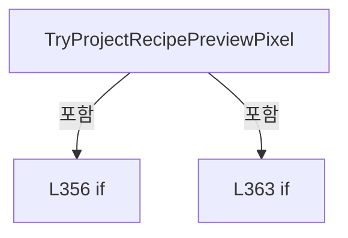

변경 전 점검: 입력/반환 타입, 위 호출자, 예외/취소 경로, 공유 상태와 저장·전송 소비자를 함께 확인합니다. 값의 단위나 물리 방향을 이름만으로 확정하지 않습니다.

### MethodDeclaration `TryBuildRecipeCellBoundary` · L373–423

[Drilling.UI/Menu/Menus/CHeadAssignmentPreviewBuilder.cs:373–423](https://github.com/kjuws10-rgb/A3Drilling/blob/5aee8e58439c9b455cae7c9593c9be986c3e682e/Drilling.UI/Menu/Menus/CHeadAssignmentPreviewBuilder.cs#L373-L423)

| 항목 | 실제 추출 값 |
| --- | --- |
| 서명 | bool Drilling.UI.Menu.Menus.CHeadAssignmentPreviewBuilder.TryBuildRecipeCellBoundary(double, double, double, int, int, double, double, double, Drilling.UI.Menu.Menus.ST_GLASS_PREVIEW_FRAME, double, out StreamGeometry) |
| 접근/수식자 | Private / private, static |
| 반환/값 타입 | bool |
| 소속 타입 | NamedType:Drilling.UI.Menu.Menus.CHeadAssignmentPreviewBuilder |

입력 계약:

| 이름 | 타입 | 전달 | 선택/기본값 |
| --- | --- | --- | --- |
| firstX | double | None | False /  |
| firstY | double | None | False /  |
| rotation | double | None | False /  |
| countX | int | None | False /  |
| countY | int | None | False /  |
| pitchX | double | None | False /  |
| pitchY | double | None | False /  |
| padding | double | None | False /  |
| frame | Drilling.UI.Menu.Menus.ST_GLASS_PREVIEW_FRAME | None | False /  |
| scale | double | None | False /  |
| geometry | StreamGeometry | Out | False /  |

정적 호출자로 확인된 위치:

| 호출 파일/행 | 호출 표현식 | 런타임 분기 가능 |
| --- | --- | --- |
| [Drilling.UI/Menu/Menus/CHeadAssignmentPreviewBuilder.cs:195–195](https://github.com/kjuws10-rgb/A3Drilling/blob/5aee8e58439c9b455cae7c9593c9be986c3e682e/Drilling.UI/Menu/Menus/CHeadAssignmentPreviewBuilder.cs#L195-L195) | TryBuildRecipeCellBoundary | False |

호출하는 대상과 해석 범위:

| 원본 행 | 표현식 | 분석 상태 | 대상/소스 위치 |
| --- | --- | --- | --- |
| 388 | Math.Cos | resolved | double System.Math.Cos(double) |
| 389 | Math.Sin | resolved | double System.Math.Sin(double) |
| 394 | new Point | unresolved | None |
| 395 | new Point | unresolved | None |
| 396 | new Point | unresolved | None |
| 397 | new Point | unresolved | None |
| 405 | TryProjectRecipePreviewPixel | candidate | OverloadResolutionFailure |
| 407 | new StreamGeometry | unresolved | None |
| 411 | new Point | unresolved | None |
| 414 | new StreamGeometry | unresolved | None |
| 415 | geometry.Open | unresolved | None |
| 417 | context.BeginFigure | unresolved | None |
| 418 | context.PolyLineTo | unresolved | None |
| 418 | corners.Skip(1).ToArray | resolved | Point[] System.Collections.Generic.IEnumerable<Point>.ToArray<Point>() |
| 418 | corners.Skip | resolved | System.Collections.Generic.IEnumerable<Point> System.Collections.Generic.IEnumerable<Point>.Skip<Point>(int) |
| 421 | geometry.Freeze | unresolved | None |

본문의 실제 연산·분기·예외·반환 순서(원문 위치 순):

| 원본 행 | 종류 | 주석 해설 |
| --- | --- | --- |
| 387 | local-declaration | 지역 변수를 선언합니다: var radians = rotation * Math.PI / 180.0; |
| 387 | variable-initializer | 변수의 초기값을 지정합니다: radians = rotation * Math.PI / 180.0 |
| 388 | call | 함수·델리게이트 또는 객체 생성자를 호출합니다: Math.Cos(radians) |
| 388 | local-declaration | 지역 변수를 선언합니다: var cos = Math.Cos(radians); |
| 388 | variable-initializer | 변수의 초기값을 지정합니다: cos = Math.Cos(radians) |
| 389 | call | 함수·델리게이트 또는 객체 생성자를 호출합니다: Math.Sin(radians) |
| 389 | local-declaration | 지역 변수를 선언합니다: var sin = Math.Sin(radians); |
| 389 | variable-initializer | 변수의 초기값을 지정합니다: sin = Math.Sin(radians) |
| 390 | local-declaration | 지역 변수를 선언합니다: var maxX = ((countX - 1) * pitchX) + padding; |
| 390 | variable-initializer | 변수의 초기값을 지정합니다: maxX = ((countX - 1) * pitchX) + padding |
| 391 | local-declaration | 지역 변수를 선언합니다: var maxY = ((countY - 1) * pitchY) + padding; |
| 391 | variable-initializer | 변수의 초기값을 지정합니다: maxY = ((countY - 1) * pitchY) + padding |
| 392 | local-declaration | 지역 변수를 선언합니다: var localCorners = new[] { new Point(-padding, -padding), new Point(maxX, -padding), new Point(maxX, maxY), new Point(-padding, maxY) }; |
| 392 | variable-initializer | 변수의 초기값을 지정합니다: localCorners = new[] { new Point(-padding, -padding), new Point(maxX, -padding), new Point(maxX, maxY), new Point(-padding, maxY) } |
| 394 | call | 함수·델리게이트 또는 객체 생성자를 호출합니다: new Point(-padding, -padding) |
| 395 | call | 함수·델리게이트 또는 객체 생성자를 호출합니다: new Point(maxX, -padding) |
| 396 | call | 함수·델리게이트 또는 객체 생성자를 호출합니다: new Point(maxX, maxY) |
| 397 | call | 함수·델리게이트 또는 객체 생성자를 호출합니다: new Point(-padding, maxY) |
| 399 | local-declaration | 지역 변수를 선언합니다: var corners = new Point[localCorners.Length]; |
| 399 | variable-initializer | 변수의 초기값을 지정합니다: corners = new Point[localCorners.Length] |
| 400 | variable-initializer | 변수의 초기값을 지정합니다: index = 0 |
| 400 | for | 초기화·조건·증감이 있는 반복입니다: for (var index = 0; index < localCorners.Length; index++) |
| 402 | local-declaration | 지역 변수를 선언합니다: var local = localCorners[index]; |
| 402 | variable-initializer | 변수의 초기값을 지정합니다: local = localCorners[index] |
| 403 | local-declaration | 지역 변수를 선언합니다: var x = firstX + (local.X * cos) - (local.Y * sin); |
| 403 | variable-initializer | 변수의 초기값을 지정합니다: x = firstX + (local.X * cos) - (local.Y * sin) |
| 404 | local-declaration | 지역 변수를 선언합니다: var y = firstY + (local.X * sin) + (local.Y * cos); |
| 404 | variable-initializer | 변수의 초기값을 지정합니다: y = firstY + (local.X * sin) + (local.Y * cos) |
| 405 | call | 함수·델리게이트 또는 객체 생성자를 호출합니다: TryProjectRecipePreviewPixel(x, y, frame, scale, out var canvasX, out var canvasY, out _, out _) |
| 405 | if | 조건에 따라 분기합니다: if (!TryProjectRecipePreviewPixel(x, y, frame, scale, out var canvasX, out var canvasY, out _, out _)) |
| 407 | assignment | 값을 대상에 대입합니다: geometry = new StreamGeometry() |
| 407 | call | 함수·델리게이트 또는 객체 생성자를 호출합니다: new StreamGeometry() |
| 408 | return | 호출자에게 값 또는 제어를 반환합니다: return false; |
| 411 | assignment | 값을 대상에 대입합니다: corners[index] = new Point(canvasX, canvasY) |
| 411 | call | 함수·델리게이트 또는 객체 생성자를 호출합니다: new Point(canvasX, canvasY) |
| 414 | assignment | 값을 대상에 대입합니다: geometry = new StreamGeometry() |
| 414 | call | 함수·델리게이트 또는 객체 생성자를 호출합니다: new StreamGeometry() |
| 415 | call | 함수·델리게이트 또는 객체 생성자를 호출합니다: geometry.Open() |
| 415 | variable-initializer | 변수의 초기값을 지정합니다: context = geometry.Open() |
| 415 | using | 자원 사용과 정리 범위를 지정합니다: using (var context = geometry.Open()) |
| 417 | call | 함수·델리게이트 또는 객체 생성자를 호출합니다: context.BeginFigure(corners[0], false, true) |
| 418 | call | 함수·델리게이트 또는 객체 생성자를 호출합니다: context.PolyLineTo(corners.Skip(1).ToArray(), true, false) |
| 418 | call | 함수·델리게이트 또는 객체 생성자를 호출합니다: corners.Skip(1).ToArray() |
| 418 | call | 함수·델리게이트 또는 객체 생성자를 호출합니다: corners.Skip(1) |
| 421 | call | 함수·델리게이트 또는 객체 생성자를 호출합니다: geometry.Freeze() |
| 422 | return | 호출자에게 값 또는 제어를 반환합니다: return true; |

제어 구문의 포함 구조(실제 실행 순서/CFG가 아닌 구문 탐색 그림):

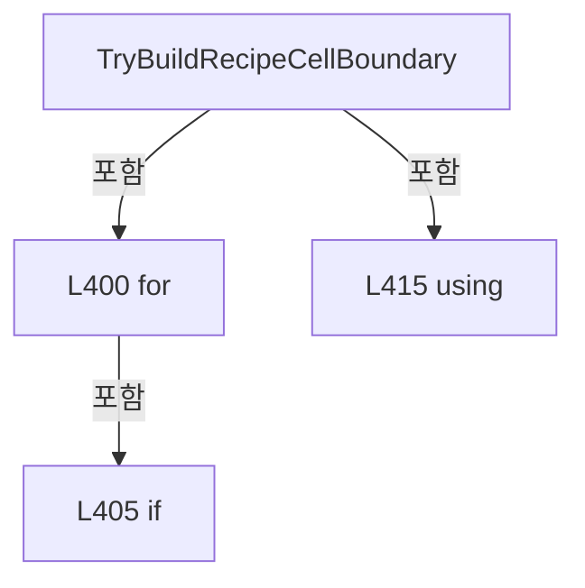

변경 전 점검: 입력/반환 타입, 위 호출자, 예외/취소 경로, 공유 상태와 저장·전송 소비자를 함께 확인합니다. 값의 단위나 물리 방향을 이름만으로 확정하지 않습니다.

### MethodDeclaration `BuildHeadAssignmentMap` · L425–485

[Drilling.UI/Menu/Menus/CHeadAssignmentPreviewBuilder.cs:425–485](https://github.com/kjuws10-rgb/A3Drilling/blob/5aee8e58439c9b455cae7c9593c9be986c3e682e/Drilling.UI/Menu/Menus/CHeadAssignmentPreviewBuilder.cs#L425-L485)

| 항목 | 실제 추출 값 |
| --- | --- |
| 서명 | Drilling.UI.Menu.Menus.ST_HEAD_ASSIGNMENT_MAP Drilling.UI.Menu.Menus.CHeadAssignmentPreviewBuilder.BuildHeadAssignmentMap(System.Collections.Generic.IReadOnlyDictionary<string, string>, System.Collections.Generic.IReadOnlySet<int>, Drilling.UI.Menu.Menus.ST_PREVIEW_HEAD_LAYOUT) |
| 접근/수식자 | Internal / internal, static |
| 반환/값 타입 | Drilling.UI.Menu.Menus.ST_HEAD_ASSIGNMENT_MAP |
| 소속 타입 | NamedType:Drilling.UI.Menu.Menus.CHeadAssignmentPreviewBuilder |

입력 계약:

| 이름 | 타입 | 전달 | 선택/기본값 |
| --- | --- | --- | --- |
| parameters | System.Collections.Generic.IReadOnlyDictionary<string, string> | None | False /  |
| selectedHeadNos | System.Collections.Generic.IReadOnlySet<int> | None | False /  |
| headLayout | Drilling.UI.Menu.Menus.ST_PREVIEW_HEAD_LAYOUT | None | False /  |

정적 호출자로 확인된 위치:

| 호출 파일/행 | 호출 표현식 | 런타임 분기 가능 |
| --- | --- | --- |
| [Drilling.UI/Menu/Menus/CMenuManual.cs:7080–7080](https://github.com/kjuws10-rgb/A3Drilling/blob/5aee8e58439c9b455cae7c9593c9be986c3e682e/Drilling.UI/Menu/Menus/CMenuManual.cs#L7080-L7080) | CHeadAssignmentPreviewBuilder.BuildHeadAssignmentMap | False |

호출하는 대상과 해석 범위:

| 원본 행 | 표현식 | 분석 상태 | 대상/소스 위치 |
| --- | --- | --- | --- |
| 428 | CreateGlassFrame | resolved | Drilling.UI.Menu.Menus.ST_GLASS_PREVIEW_FRAME Drilling.UI.Menu.Menus.CHeadAssignmentPreviewBuilder.CreateGlassFrame(System.Collections.Generic.IReadOnlyDictionary<string, string>) · Drilling.UI/Menu/Menus/CHeadAssignmentPreviewBuilder.cs:524 |
| 429 | ReadDoubleAny | resolved | double Drilling.UI.Menu.Menus.CHeadAssignmentPreviewBuilder.ReadDoubleAny(System.Collections.Generic.IReadOnlyDictionary<string, string>, double, params string[]) · Drilling.UI/Menu/Menus/CHeadAssignmentPreviewBuilder.cs:61 |
| 430 | ReadDoubleAny | resolved | double Drilling.UI.Menu.Menus.CHeadAssignmentPreviewBuilder.ReadDoubleAny(System.Collections.Generic.IReadOnlyDictionary<string, string>, double, params string[]) · Drilling.UI/Menu/Menus/CHeadAssignmentPreviewBuilder.cs:61 |
| 431 | BuildEnabledHeadNumbers | resolved | System.Collections.Generic.IReadOnlyList<int> Drilling.UI.Menu.Menus.CHeadAssignmentPreviewBuilder.BuildEnabledHeadNumbers(System.Collections.Generic.IReadOnlyDictionary<string, string>, int) · Drilling.UI/Menu/Menus/CHeadAssignmentPreviewBuilder.cs:13 |
| 432 | new List<ST_HEAD_ASSIGNMENT_AREA> | resolved | System.Collections.Generic.List<Drilling.UI.Menu.Menus.ST_HEAD_ASSIGNMENT_AREA>.List(int) |
| 461 | selectedHeadNos.Contains | resolved · 동적 구현 선택 가능 | bool System.Collections.Generic.IReadOnlySet<int>.Contains(int) |
| 465 | GetHeadRect | resolved | (double Left, double Top, double Width, double Height, double LabelLeft, double LabelWidth) GetHeadRect(int) · Drilling.UI/Menu/Menus/CHeadAssignmentPreviewBuilder.cs:433 |
| 466 | areas.Add | resolved | void System.Collections.Generic.List<Drilling.UI.Menu.Menus.ST_HEAD_ASSIGNMENT_AREA>.Add(Drilling.UI.Menu.Menus.ST_HEAD_ASSIGNMENT_AREA) |
| 466 | new ST_HEAD_ASSIGNMENT_AREA | resolved | Drilling.UI.Menu.Menus.ST_HEAD_ASSIGNMENT_AREA.ST_HEAD_ASSIGNMENT_AREA(int, string, double, double, double, double, double, double, bool, int, Brush, Brush, Thickness, double) · Drilling.UI/Menu/Menus/CMenuMain.cs:3491 |
| 477 | CreateHeadBrush | resolved | Brush Drilling.UI.Menu.Menus.CHeadAssignmentPreviewBuilder.CreateHeadBrush(int, byte) · Drilling.UI/Menu/Menus/CHeadAssignmentPreviewBuilder.cs:557 |
| 478 | CreateHeadBrush | resolved | Brush Drilling.UI.Menu.Menus.CHeadAssignmentPreviewBuilder.CreateHeadBrush(int, byte) · Drilling.UI/Menu/Menus/CHeadAssignmentPreviewBuilder.cs:557 |
| 479 | new Thickness | unresolved | None |
| 484 | new ST_HEAD_ASSIGNMENT_MAP | resolved | Drilling.UI.Menu.Menus.ST_HEAD_ASSIGNMENT_MAP.ST_HEAD_ASSIGNMENT_MAP(System.Collections.Generic.IReadOnlyList<Drilling.UI.Menu.Menus.ST_HEAD_ASSIGNMENT_AREA>) · Drilling.UI/Menu/Menus/CMenuMain.cs:3436 |

본문의 실제 연산·분기·예외·반환 순서(원문 위치 순):

| 원본 행 | 종류 | 주석 해설 |
| --- | --- | --- |
| 427 | local-declaration | 지역 변수를 선언합니다: const int headCount = 8; |
| 427 | variable-initializer | 변수의 초기값을 지정합니다: headCount = 8 |
| 428 | call | 함수·델리게이트 또는 객체 생성자를 호출합니다: CreateGlassFrame(parameters) |
| 428 | local-declaration | 지역 변수를 선언합니다: var frame = CreateGlassFrame(parameters); |
| 428 | variable-initializer | 변수의 초기값을 지정합니다: frame = CreateGlassFrame(parameters) |
| 429 | call | 함수·델리게이트 또는 객체 생성자를 호출합니다: ReadDoubleAny(parameters, 0.0, "GLASS_SIZE_X") |
| 429 | local-declaration | 지역 변수를 선언합니다: var glassWidth = ReadDoubleAny(parameters, 0.0, "GLASS_SIZE_X"); |
| 429 | variable-initializer | 변수의 초기값을 지정합니다: glassWidth = ReadDoubleAny(parameters, 0.0, "GLASS_SIZE_X") |
| 430 | call | 함수·델리게이트 또는 객체 생성자를 호출합니다: ReadDoubleAny(parameters, 55.0, "AK_MARGIN_X") |
| 430 | local-declaration | 지역 변수를 선언합니다: var akMarginX = ReadDoubleAny(parameters, 55.0, "AK_MARGIN_X"); |
| 430 | variable-initializer | 변수의 초기값을 지정합니다: akMarginX = ReadDoubleAny(parameters, 55.0, "AK_MARGIN_X") |
| 431 | call | 함수·델리게이트 또는 객체 생성자를 호출합니다: BuildEnabledHeadNumbers(parameters, headCount) |
| 431 | local-declaration | 지역 변수를 선언합니다: var activeHeadNos = BuildEnabledHeadNumbers(parameters, headCount); |
| 431 | variable-initializer | 변수의 초기값을 지정합니다: activeHeadNos = BuildEnabledHeadNumbers(parameters, headCount) |
| 432 | call | 함수·델리게이트 또는 객체 생성자를 호출합니다: new List<ST_HEAD_ASSIGNMENT_AREA>(activeHeadNos.Count) |
| 432 | local-declaration | 지역 변수를 선언합니다: var areas = new List<ST_HEAD_ASSIGNMENT_AREA>(activeHeadNos.Count); |
| 432 | variable-initializer | 변수의 초기값을 지정합니다: areas = new List<ST_HEAD_ASSIGNMENT_AREA>(activeHeadNos.Count) |
| 459 | foreach | 컬렉션 요소를 순회합니다: foreach (var headNo in activeHeadNos) |
| 461 | call | 함수·델리게이트 또는 객체 생성자를 호출합니다: selectedHeadNos.Contains(headNo) |
| 461 | local-declaration | 지역 변수를 선언합니다: var isSelected = selectedHeadNos.Contains(headNo); |
| 461 | variable-initializer | 변수의 초기값을 지정합니다: isSelected = selectedHeadNos.Contains(headNo) |
| 462 | local-declaration | 지역 변수를 선언합니다: var hasSelectedHead = selectedHeadNos.Count > 0; |
| 462 | variable-initializer | 변수의 초기값을 지정합니다: hasSelectedHead = selectedHeadNos.Count > 0 |
| 463 | conditional-expression | 조건에 따라 결과식을 선택합니다: hasSelectedHead ? isSelected ? (byte)48 : (byte)8 : (byte)18 |
| 463 | conditional-expression | 조건에 따라 결과식을 선택합니다: isSelected ? (byte)48 : (byte)8 |
| 463 | local-declaration | 지역 변수를 선언합니다: var fillAlpha = hasSelectedHead ? isSelected ? (byte)48 : (byte)8 : (byte)18; |
| 463 | variable-initializer | 변수의 초기값을 지정합니다: fillAlpha = hasSelectedHead ? isSelected ? (byte)48 : (byte)8 : (byte)18 |
| 464 | conditional-expression | 조건에 따라 결과식을 선택합니다: hasSelectedHead ? isSelected ? (byte)255 : (byte)105 : (byte)180 |
| 464 | conditional-expression | 조건에 따라 결과식을 선택합니다: isSelected ? (byte)255 : (byte)105 |
| 464 | local-declaration | 지역 변수를 선언합니다: var strokeAlpha = hasSelectedHead ? isSelected ? (byte)255 : (byte)105 : (byte)180; |
| 464 | variable-initializer | 변수의 초기값을 지정합니다: strokeAlpha = hasSelectedHead ? isSelected ? (byte)255 : (byte)105 : (byte)180 |
| 465 | call | 함수·델리게이트 또는 객체 생성자를 호출합니다: GetHeadRect(headNo) |
| 465 | local-declaration | 지역 변수를 선언합니다: var rect = GetHeadRect(headNo); |
| 465 | variable-initializer | 변수의 초기값을 지정합니다: rect = GetHeadRect(headNo) |
| 466 | call | 함수·델리게이트 또는 객체 생성자를 호출합니다: areas.Add(new ST_HEAD_ASSIGNMENT_AREA( headNo, $"HEAD {headNo:00}", rect.Left, rect.Top, rect.Width, rect.Height, rect.LabelLeft, rect.LabelWidth, isSelected, 0, CreateHeadBrush(headNo, fillAlpha), CreateHeadBrush(headNo… |
| 466 | call | 함수·델리게이트 또는 객체 생성자를 호출합니다: new ST_HEAD_ASSIGNMENT_AREA( headNo, $"HEAD {headNo:00}", rect.Left, rect.Top, rect.Width, rect.Height, rect.LabelLeft, rect.LabelWidth, isSelected, 0, CreateHeadBrush(headNo, fillAlpha), CreateHeadBrush(headNo, strokeAl… |
| 477 | call | 함수·델리게이트 또는 객체 생성자를 호출합니다: CreateHeadBrush(headNo, fillAlpha) |
| 478 | call | 함수·델리게이트 또는 객체 생성자를 호출합니다: CreateHeadBrush(headNo, strokeAlpha) |
| 479 | call | 함수·델리게이트 또는 객체 생성자를 호출합니다: new Thickness(isSelected ? 2.3 : 1.1) |
| 479 | conditional-expression | 조건에 따라 결과식을 선택합니다: isSelected ? 2.3 : 1.1 |
| 484 | call | 함수·델리게이트 또는 객체 생성자를 호출합니다: new ST_HEAD_ASSIGNMENT_MAP(areas) |
| 484 | return | 호출자에게 값 또는 제어를 반환합니다: return new ST_HEAD_ASSIGNMENT_MAP(areas); |

제어 구문의 포함 구조(실제 실행 순서/CFG가 아닌 구문 탐색 그림):

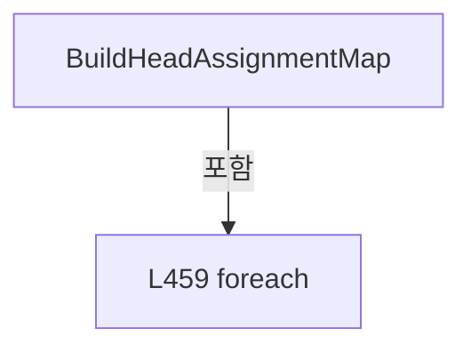

변경 전 점검: 입력/반환 타입, 위 호출자, 예외/취소 경로, 공유 상태와 저장·전송 소비자를 함께 확인합니다. 값의 단위나 물리 방향을 이름만으로 확정하지 않습니다.

### LocalFunctionStatement `GetHeadRect` · L433–457

[Drilling.UI/Menu/Menus/CHeadAssignmentPreviewBuilder.cs:433–457](https://github.com/kjuws10-rgb/A3Drilling/blob/5aee8e58439c9b455cae7c9593c9be986c3e682e/Drilling.UI/Menu/Menus/CHeadAssignmentPreviewBuilder.cs#L433-L457)

| 항목 | 실제 추출 값 |
| --- | --- |
| 서명 | (double Left, double Top, double Width, double Height, double LabelLeft, double LabelWidth) GetHeadRect(int) |
| 접근/수식자 | Private /  |
| 반환/값 타입 | (double Left, double Top, double Width, double Height, double LabelLeft, double LabelWidth) |
| 소속 타입 | NamedType:Drilling.UI.Menu.Menus.CHeadAssignmentPreviewBuilder |

입력 계약:

| 이름 | 타입 | 전달 | 선택/기본값 |
| --- | --- | --- | --- |
| headNo | int | None | False /  |

정적 호출자로 확인된 위치:

| 호출 파일/행 | 호출 표현식 | 런타임 분기 가능 |
| --- | --- | --- |
| [Drilling.UI/Menu/Menus/CHeadAssignmentPreviewBuilder.cs:465–465](https://github.com/kjuws10-rgb/A3Drilling/blob/5aee8e58439c9b455cae7c9593c9be986c3e682e/Drilling.UI/Menu/Menus/CHeadAssignmentPreviewBuilder.cs#L465-L465) | GetHeadRect | False |

호출하는 대상과 해석 범위:

| 원본 행 | 표현식 | 분석 상태 | 대상/소스 위치 |
| --- | --- | --- | --- |
| 435 | double.IsFinite | resolved | bool double.IsFinite(double) |
| 435 | double.IsFinite | resolved | bool double.IsFinite(double) |
| 441 | double.IsFinite | resolved | bool double.IsFinite(double) |
| 446 | GetPreviewHeadRange | resolved | (double StartX, double EndX, double CenterX) Drilling.UI.Menu.Menus.CHeadAssignmentPreviewBuilder.GetPreviewHeadRange(int, Drilling.UI.Menu.Menus.ST_PREVIEW_HEAD_LAYOUT, double) · Drilling.UI/Menu/Menus/CHeadAssignmentPreviewBuilder.cs:342 |
| 451 | Math.Max | resolved | double System.Math.Max(double, double) |
| 452 | headLayout.GetField | resolved | Drilling.UI.Menu.Menus.ST_PREVIEW_HEAD_FIELD Drilling.UI.Menu.Menus.ST_PREVIEW_HEAD_LAYOUT.GetField(int) · Drilling.UI/Menu/Menus/CMenuMain.cs:3449 |
| 454 | Math.Clamp | resolved | double System.Math.Clamp(double, double, double) |
| 455 | Math.Clamp | resolved | double System.Math.Clamp(double, double, double) |
| 456 | Math.Max | resolved | double System.Math.Max(double, double) |

본문의 실제 연산·분기·예외·반환 순서(원문 위치 순):

| 원본 행 | 종류 | 주석 해설 |
| --- | --- | --- |
| 435 | call | 함수·델리게이트 또는 객체 생성자를 호출합니다: double.IsFinite(glassWidth) |
| 435 | call | 함수·델리게이트 또는 객체 생성자를 호출합니다: double.IsFinite(akMarginX) |
| 435 | if | 조건에 따라 분기합니다: if (!double.IsFinite(glassWidth) &#124;&#124; !double.IsFinite(akMarginX) &#124;&#124; glassWidth <= 0.0) |
| 437 | return | 호출자에게 값 또는 제어를 반환합니다: return (frame.CanvasLeft, frame.CanvasTop, 0.0, frame.Height, frame.CanvasLeft, 0.0); |
| 440 | local-declaration | 지역 변수를 선언합니다: var scale = frame.Width / glassWidth; |
| 440 | variable-initializer | 변수의 초기값을 지정합니다: scale = frame.Width / glassWidth |
| 441 | call | 함수·델리게이트 또는 객체 생성자를 호출합니다: double.IsFinite(scale) |
| 441 | if | 조건에 따라 분기합니다: if (!double.IsFinite(scale) &#124;&#124; scale <= 0.0) |
| 443 | return | 호출자에게 값 또는 제어를 반환합니다: return (frame.CanvasLeft, frame.CanvasTop, 0.0, frame.Height, frame.CanvasLeft, 0.0); |
| 446 | call | 함수·델리게이트 또는 객체 생성자를 호출합니다: GetPreviewHeadRange(headNo, headLayout, akMarginX) |
| 446 | local-declaration | 지역 변수를 선언합니다: var range = GetPreviewHeadRange(headNo, headLayout, akMarginX); |
| 446 | variable-initializer | 변수의 초기값을 지정합니다: range = GetPreviewHeadRange(headNo, headLayout, akMarginX) |
| 449 | local-declaration | 지역 변수를 선언합니다: var left = frame.CanvasLeft + (range.StartX * scale); |
| 449 | variable-initializer | 변수의 초기값을 지정합니다: left = frame.CanvasLeft + (range.StartX * scale) |
| 450 | local-declaration | 지역 변수를 선언합니다: var top = frame.CanvasTop; |
| 450 | variable-initializer | 변수의 초기값을 지정합니다: top = frame.CanvasTop |
| 451 | call | 함수·델리게이트 또는 객체 생성자를 호출합니다: Math.Max(0.0, (range.EndX - range.StartX) * scale) |
| 451 | local-declaration | 지역 변수를 선언합니다: var width = Math.Max(0.0, (range.EndX - range.StartX) * scale); |
| 451 | variable-initializer | 변수의 초기값을 지정합니다: width = Math.Max(0.0, (range.EndX - range.StartX) * scale) |
| 452 | call | 함수·델리게이트 또는 객체 생성자를 호출합니다: headLayout.GetField(headNo) |
| 452 | local-declaration | 지역 변수를 선언합니다: var centerX = akMarginX + headLayout.GetField(headNo).PositionX; |
| 452 | variable-initializer | 변수의 초기값을 지정합니다: centerX = akMarginX + headLayout.GetField(headNo).PositionX |
| 453 | local-declaration | 지역 변수를 선언합니다: var centerCanvasX = frame.CanvasLeft + (centerX * scale); |
| 453 | variable-initializer | 변수의 초기값을 지정합니다: centerCanvasX = frame.CanvasLeft + (centerX * scale) |
| 454 | call | 함수·델리게이트 또는 객체 생성자를 호출합니다: Math.Clamp((range.EndX - range.StartX) * scale, 36.0, 96.0) |
| 454 | local-declaration | 지역 변수를 선언합니다: var labelWidth = Math.Clamp((range.EndX - range.StartX) * scale, 36.0, 96.0); |
| 454 | variable-initializer | 변수의 초기값을 지정합니다: labelWidth = Math.Clamp((range.EndX - range.StartX) * scale, 36.0, 96.0) |
| 455 | call | 함수·델리게이트 또는 객체 생성자를 호출합니다: Math.Clamp(centerCanvasX - (labelWidth / 2.0), 0.0, 860.0 - labelWidth) |
| 455 | local-declaration | 지역 변수를 선언합니다: var labelLeft = Math.Clamp(centerCanvasX - (labelWidth / 2.0), 0.0, 860.0 - labelWidth); |
| 455 | variable-initializer | 변수의 초기값을 지정합니다: labelLeft = Math.Clamp(centerCanvasX - (labelWidth / 2.0), 0.0, 860.0 - labelWidth) |
| 456 | call | 함수·델리게이트 또는 객체 생성자를 호출합니다: Math.Max(4.0, frame.Height) |
| 456 | return | 호출자에게 값 또는 제어를 반환합니다: return (left, top, width, Math.Max(4.0, frame.Height), labelLeft, labelWidth); |

제어 구문의 포함 구조(실제 실행 순서/CFG가 아닌 구문 탐색 그림):

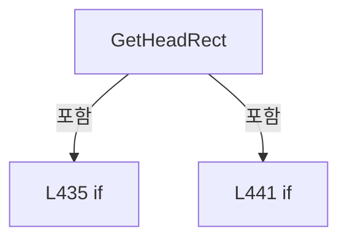

변경 전 점검: 입력/반환 타입, 위 호출자, 예외/취소 경로, 공유 상태와 저장·전송 소비자를 함께 확인합니다. 값의 단위나 물리 방향을 이름만으로 확정하지 않습니다.

### MethodDeclaration `ReadHeadPositionX` · L487–494

[Drilling.UI/Menu/Menus/CHeadAssignmentPreviewBuilder.cs:487–494](https://github.com/kjuws10-rgb/A3Drilling/blob/5aee8e58439c9b455cae7c9593c9be986c3e682e/Drilling.UI/Menu/Menus/CHeadAssignmentPreviewBuilder.cs#L487-L494)

| 항목 | 실제 추출 값 |
| --- | --- |
| 서명 | double Drilling.UI.Menu.Menus.CHeadAssignmentPreviewBuilder.ReadHeadPositionX(System.Collections.Generic.IReadOnlyList<Drilling.Common.Managers.ST_SYSTEM_PARAMETER>, int) |
| 접근/수식자 | Private / private, static |
| 반환/값 타입 | double |
| 소속 타입 | NamedType:Drilling.UI.Menu.Menus.CHeadAssignmentPreviewBuilder |

입력 계약:

| 이름 | 타입 | 전달 | 선택/기본값 |
| --- | --- | --- | --- |
| settings | System.Collections.Generic.IReadOnlyList<Drilling.Common.Managers.ST_SYSTEM_PARAMETER> | None | False /  |
| headNo | int | None | False /  |

정적 호출자로 확인된 위치:

| 호출 파일/행 | 호출 표현식 | 런타임 분기 가능 |
| --- | --- | --- |
| [Drilling.UI/Menu/Menus/CHeadAssignmentPreviewBuilder.cs:585–585](https://github.com/kjuws10-rgb/A3Drilling/blob/5aee8e58439c9b455cae7c9593c9be986c3e682e/Drilling.UI/Menu/Menus/CHeadAssignmentPreviewBuilder.cs#L585-L585) | ReadHeadPositionX | False |

호출하는 대상과 해석 범위:

| 원본 행 | 표현식 | 분석 상태 | 대상/소스 위치 |
| --- | --- | --- | --- |
| 491 | ReadSettingDouble | resolved | double Drilling.UI.Menu.Menus.CHeadAssignmentPreviewBuilder.ReadSettingDouble(System.Collections.Generic.IReadOnlyList<Drilling.Common.Managers.ST_SYSTEM_PARAMETER>, double, params string[]) · Drilling.UI/Menu/Menus/CHeadAssignmentPreviewBuilder.cs:496 |
| 492 | ReadSettingDouble | resolved | double Drilling.UI.Menu.Menus.CHeadAssignmentPreviewBuilder.ReadSettingDouble(System.Collections.Generic.IReadOnlyList<Drilling.Common.Managers.ST_SYSTEM_PARAMETER>, double, params string[]) · Drilling.UI/Menu/Menus/CHeadAssignmentPreviewBuilder.cs:496 |

본문의 실제 연산·분기·예외·반환 순서(원문 위치 순):

| 원본 행 | 종류 | 주석 해설 |
| --- | --- | --- |
| 489 | local-declaration | 지역 변수를 선언합니다: const double fallbackHead1PositionX = -5.0; |
| 489 | variable-initializer | 변수의 초기값을 지정합니다: fallbackHead1PositionX = -5.0 |
| 490 | local-declaration | 지역 변수를 선언합니다: const double fallbackHeadGapX = 200.0; |
| 490 | variable-initializer | 변수의 초기값을 지정합니다: fallbackHeadGapX = 200.0 |
| 491 | call | 함수·델리게이트 또는 객체 생성자를 호출합니다: ReadSettingDouble(settings, fallbackHead1PositionX, "H01_AK_POSITION_X") |
| 491 | local-declaration | 지역 변수를 선언합니다: var head1PositionX = ReadSettingDouble(settings, fallbackHead1PositionX, "H01_AK_POSITION_X"); |
| 491 | variable-initializer | 변수의 초기값을 지정합니다: head1PositionX = ReadSettingDouble(settings, fallbackHead1PositionX, "H01_AK_POSITION_X") |
| 492 | call | 함수·델리게이트 또는 객체 생성자를 호출합니다: ReadSettingDouble(settings, fallbackHeadGapX, "HeadGapX") |
| 492 | local-declaration | 지역 변수를 선언합니다: var headGapX = ReadSettingDouble(settings, fallbackHeadGapX, "HeadGapX"); |
| 492 | variable-initializer | 변수의 초기값을 지정합니다: headGapX = ReadSettingDouble(settings, fallbackHeadGapX, "HeadGapX") |
| 493 | return | 호출자에게 값 또는 제어를 반환합니다: return head1PositionX + ((headNo - 1) * headGapX); |

변경 전 점검: 입력/반환 타입, 위 호출자, 예외/취소 경로, 공유 상태와 저장·전송 소비자를 함께 확인합니다. 값의 단위나 물리 방향을 이름만으로 확정하지 않습니다.

### MethodDeclaration `ReadSettingDouble` · L496–517

[Drilling.UI/Menu/Menus/CHeadAssignmentPreviewBuilder.cs:496–517](https://github.com/kjuws10-rgb/A3Drilling/blob/5aee8e58439c9b455cae7c9593c9be986c3e682e/Drilling.UI/Menu/Menus/CHeadAssignmentPreviewBuilder.cs#L496-L517)

| 항목 | 실제 추출 값 |
| --- | --- |
| 서명 | double Drilling.UI.Menu.Menus.CHeadAssignmentPreviewBuilder.ReadSettingDouble(System.Collections.Generic.IReadOnlyList<Drilling.Common.Managers.ST_SYSTEM_PARAMETER>, double, params string[]) |
| 접근/수식자 | Private / private, static |
| 반환/값 타입 | double |
| 소속 타입 | NamedType:Drilling.UI.Menu.Menus.CHeadAssignmentPreviewBuilder |

입력 계약:

| 이름 | 타입 | 전달 | 선택/기본값 |
| --- | --- | --- | --- |
| settings | System.Collections.Generic.IReadOnlyList<Drilling.Common.Managers.ST_SYSTEM_PARAMETER> | None | False /  |
| defaultValue | double | None | False /  |
| keys | string[] | None | False /  |

정적 호출자로 확인된 위치:

| 호출 파일/행 | 호출 표현식 | 런타임 분기 가능 |
| --- | --- | --- |
| [Drilling.UI/Menu/Menus/CHeadAssignmentPreviewBuilder.cs:491–491](https://github.com/kjuws10-rgb/A3Drilling/blob/5aee8e58439c9b455cae7c9593c9be986c3e682e/Drilling.UI/Menu/Menus/CHeadAssignmentPreviewBuilder.cs#L491-L491) | ReadSettingDouble | False |
| [Drilling.UI/Menu/Menus/CHeadAssignmentPreviewBuilder.cs:492–492](https://github.com/kjuws10-rgb/A3Drilling/blob/5aee8e58439c9b455cae7c9593c9be986c3e682e/Drilling.UI/Menu/Menus/CHeadAssignmentPreviewBuilder.cs#L492-L492) | ReadSettingDouble | False |
| [Drilling.UI/Menu/Menus/CHeadAssignmentPreviewBuilder.cs:587–587](https://github.com/kjuws10-rgb/A3Drilling/blob/5aee8e58439c9b455cae7c9593c9be986c3e682e/Drilling.UI/Menu/Menus/CHeadAssignmentPreviewBuilder.cs#L587-L587) | ReadSettingDouble | False |

호출하는 대상과 해석 범위:

| 원본 행 | 표현식 | 분석 상태 | 대상/소스 위치 |
| --- | --- | --- | --- |
| 505 | keys.Any | resolved | bool System.Collections.Generic.IEnumerable<string>.Any<string>(System.Func<string, bool>) |
| 510 | double.TryParse | resolved | bool double.TryParse(string?, System.Globalization.NumberStyles, System.IFormatProvider?, out double) |

본문의 실제 연산·분기·예외·반환 순서(원문 위치 순):

| 원본 행 | 종류 | 주석 해설 |
| --- | --- | --- |
| 498 | foreach | 컬렉션 요소를 순회합니다: foreach (var setting in settings) |
| 505 | call | 함수·델리게이트 또는 객체 생성자를 호출합니다: keys.Any(MatchesItem) |
| 505 | if | 조건에 따라 분기합니다: if (!keys.Any(MatchesItem)) |
| 507 | continue | 다음 반복으로 진행합니다: continue; |
| 510 | call | 함수·델리게이트 또는 객체 생성자를 호출합니다: double.TryParse(setting.Value, NumberStyles.Float, CultureInfo.InvariantCulture, out var parsed) |
| 510 | if | 조건에 따라 분기합니다: if (double.TryParse(setting.Value, NumberStyles.Float, CultureInfo.InvariantCulture, out var parsed)) |
| 512 | return | 호출자에게 값 또는 제어를 반환합니다: return parsed; |
| 516 | return | 호출자에게 값 또는 제어를 반환합니다: return defaultValue; |

제어 구문의 포함 구조(실제 실행 순서/CFG가 아닌 구문 탐색 그림):

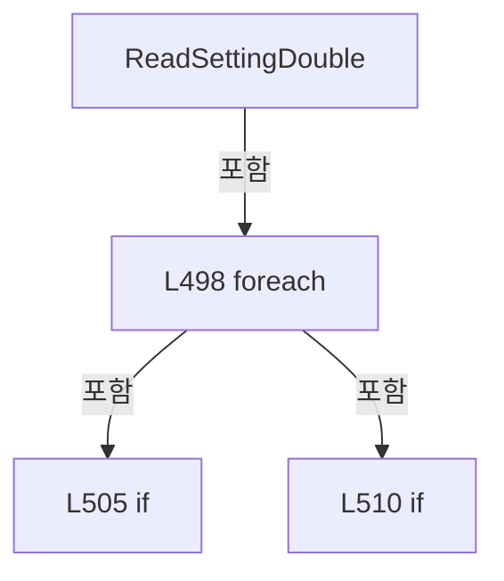

변경 전 점검: 입력/반환 타입, 위 호출자, 예외/취소 경로, 공유 상태와 저장·전송 소비자를 함께 확인합니다. 값의 단위나 물리 방향을 이름만으로 확정하지 않습니다.

### LocalFunctionStatement `MatchesItem` · L500–503

[Drilling.UI/Menu/Menus/CHeadAssignmentPreviewBuilder.cs:500–503](https://github.com/kjuws10-rgb/A3Drilling/blob/5aee8e58439c9b455cae7c9593c9be986c3e682e/Drilling.UI/Menu/Menus/CHeadAssignmentPreviewBuilder.cs#L500-L503)

| 항목 | 실제 추출 값 |
| --- | --- |
| 서명 | bool MatchesItem(string) |
| 접근/수식자 | Private /  |
| 반환/값 타입 | bool |
| 소속 타입 | NamedType:Drilling.UI.Menu.Menus.CHeadAssignmentPreviewBuilder |

입력 계약:

| 이름 | 타입 | 전달 | 선택/기본값 |
| --- | --- | --- | --- |
| key | string | None | False /  |

현재 부분 분석에서 직접 연결된 호출자는 없습니다. XAML/이벤트/인터페이스·델리게이트·외부 진입을 추가 확인해야 하며, 미사용으로 판정한 것이 아닙니다.

호출하는 대상과 해석 범위:

| 원본 행 | 표현식 | 분석 상태 | 대상/소스 위치 |
| --- | --- | --- | --- |
| 502 | key.Equals | resolved | bool string.Equals(string?, System.StringComparison) |
| 502 | key.Equals | resolved | bool string.Equals(string?, System.StringComparison) |

본문의 실제 연산·분기·예외·반환 순서(원문 위치 순):

| 원본 행 | 종류 | 주석 해설 |
| --- | --- | --- |
| 502 | call | 함수·델리게이트 또는 객체 생성자를 호출합니다: key.Equals(setting.Key, StringComparison.OrdinalIgnoreCase) |
| 502 | call | 함수·델리게이트 또는 객체 생성자를 호출합니다: key.Equals(setting.Name, StringComparison.OrdinalIgnoreCase) |
| 502 | return | 호출자에게 값 또는 제어를 반환합니다: return key.Equals(setting.Key, StringComparison.OrdinalIgnoreCase) &#124;&#124; key.Equals(setting.Name, StringComparison.OrdinalIgnoreCase); |

변경 전 점검: 입력/반환 타입, 위 호출자, 예외/취소 경로, 공유 상태와 저장·전송 소비자를 함께 확인합니다. 값의 단위나 물리 방향을 이름만으로 확정하지 않습니다.

### MethodDeclaration `ReadNullableDoubleAny` · L519–522

[Drilling.UI/Menu/Menus/CHeadAssignmentPreviewBuilder.cs:519–522](https://github.com/kjuws10-rgb/A3Drilling/blob/5aee8e58439c9b455cae7c9593c9be986c3e682e/Drilling.UI/Menu/Menus/CHeadAssignmentPreviewBuilder.cs#L519-L522)

| 항목 | 실제 추출 값 |
| --- | --- |
| 서명 | double? Drilling.UI.Menu.Menus.CHeadAssignmentPreviewBuilder.ReadNullableDoubleAny(System.Collections.Generic.IReadOnlyDictionary<string, string>, string) |
| 접근/수식자 | Private / private, static |
| 반환/값 타입 | double? |
| 소속 타입 | NamedType:Drilling.UI.Menu.Menus.CHeadAssignmentPreviewBuilder |

입력 계약:

| 이름 | 타입 | 전달 | 선택/기본값 |
| --- | --- | --- | --- |
| parameters | System.Collections.Generic.IReadOnlyDictionary<string, string> | None | False /  |
| key | string | None | False /  |

정적 호출자로 확인된 위치:

| 호출 파일/행 | 호출 표현식 | 런타임 분기 가능 |
| --- | --- | --- |
| [Drilling.UI/Menu/Menus/CHeadAssignmentPreviewBuilder.cs:107–107](https://github.com/kjuws10-rgb/A3Drilling/blob/5aee8e58439c9b455cae7c9593c9be986c3e682e/Drilling.UI/Menu/Menus/CHeadAssignmentPreviewBuilder.cs#L107-L107) | ReadNullableDoubleAny | False |

호출하는 대상과 해석 범위:

| 원본 행 | 표현식 | 분석 상태 | 대상/소스 위치 |
| --- | --- | --- | --- |
| 521 | parameters.TryGetValue | resolved · 동적 구현 선택 가능 | bool System.Collections.Generic.IReadOnlyDictionary<string, string>.TryGetValue(string, out string) |
| 521 | double.TryParse | resolved | bool double.TryParse(string?, System.Globalization.NumberStyles, System.IFormatProvider?, out double) |

본문의 실제 연산·분기·예외·반환 순서(원문 위치 순):

| 원본 행 | 종류 | 주석 해설 |
| --- | --- | --- |
| 521 | call | 함수·델리게이트 또는 객체 생성자를 호출합니다: parameters.TryGetValue(key, out var value) |
| 521 | call | 함수·델리게이트 또는 객체 생성자를 호출합니다: double.TryParse(value, NumberStyles.Float, CultureInfo.InvariantCulture, out var parsed) |
| 521 | conditional-expression | 조건에 따라 결과식을 선택합니다: parameters.TryGetValue(key, out var value) && double.TryParse(value, NumberStyles.Float, CultureInfo.InvariantCulture, out var parsed) ? parsed : null |
| 521 | return | 호출자에게 값 또는 제어를 반환합니다: return parameters.TryGetValue(key, out var value) && double.TryParse(value, NumberStyles.Float, CultureInfo.InvariantCulture, out var parsed) ? parsed : null; |

변경 전 점검: 입력/반환 타입, 위 호출자, 예외/취소 경로, 공유 상태와 저장·전송 소비자를 함께 확인합니다. 값의 단위나 물리 방향을 이름만으로 확정하지 않습니다.

### MethodDeclaration `CreateGlassFrame` · L524–548

[Drilling.UI/Menu/Menus/CHeadAssignmentPreviewBuilder.cs:524–548](https://github.com/kjuws10-rgb/A3Drilling/blob/5aee8e58439c9b455cae7c9593c9be986c3e682e/Drilling.UI/Menu/Menus/CHeadAssignmentPreviewBuilder.cs#L524-L548)

| 항목 | 실제 추출 값 |
| --- | --- |
| 서명 | Drilling.UI.Menu.Menus.ST_GLASS_PREVIEW_FRAME Drilling.UI.Menu.Menus.CHeadAssignmentPreviewBuilder.CreateGlassFrame(System.Collections.Generic.IReadOnlyDictionary<string, string>) |
| 접근/수식자 | Private / private, static |
| 반환/값 타입 | Drilling.UI.Menu.Menus.ST_GLASS_PREVIEW_FRAME |
| 소속 타입 | NamedType:Drilling.UI.Menu.Menus.CHeadAssignmentPreviewBuilder |

입력 계약:

| 이름 | 타입 | 전달 | 선택/기본값 |
| --- | --- | --- | --- |
| parameters | System.Collections.Generic.IReadOnlyDictionary<string, string> | None | False /  |

정적 호출자로 확인된 위치:

| 호출 파일/행 | 호출 표현식 | 런타임 분기 가능 |
| --- | --- | --- |
| [Drilling.UI/Menu/Menus/CHeadAssignmentPreviewBuilder.cs:84–84](https://github.com/kjuws10-rgb/A3Drilling/blob/5aee8e58439c9b455cae7c9593c9be986c3e682e/Drilling.UI/Menu/Menus/CHeadAssignmentPreviewBuilder.cs#L84-L84) | CreateGlassFrame | False |
| [Drilling.UI/Menu/Menus/CHeadAssignmentPreviewBuilder.cs:428–428](https://github.com/kjuws10-rgb/A3Drilling/blob/5aee8e58439c9b455cae7c9593c9be986c3e682e/Drilling.UI/Menu/Menus/CHeadAssignmentPreviewBuilder.cs#L428-L428) | CreateGlassFrame | False |

호출하는 대상과 해석 범위:

| 원본 행 | 표현식 | 분석 상태 | 대상/소스 위치 |
| --- | --- | --- | --- |
| 530 | ReadDoubleAny | resolved | double Drilling.UI.Menu.Menus.CHeadAssignmentPreviewBuilder.ReadDoubleAny(System.Collections.Generic.IReadOnlyDictionary<string, string>, double, params string[]) · Drilling.UI/Menu/Menus/CHeadAssignmentPreviewBuilder.cs:61 |
| 531 | ReadDoubleAny | resolved | double Drilling.UI.Menu.Menus.CHeadAssignmentPreviewBuilder.ReadDoubleAny(System.Collections.Generic.IReadOnlyDictionary<string, string>, double, params string[]) · Drilling.UI/Menu/Menus/CHeadAssignmentPreviewBuilder.cs:61 |
| 532 | double.IsFinite | resolved | bool double.IsFinite(double) |
| 532 | double.IsFinite | resolved | bool double.IsFinite(double) |
| 534 | new ST_GLASS_PREVIEW_FRAME | resolved | Drilling.UI.Menu.Menus.ST_GLASS_PREVIEW_FRAME.ST_GLASS_PREVIEW_FRAME(double, double, double, double) · Drilling.UI/Menu/Menus/CMenuMain.cs:3462 |
| 537 | Math.Min | resolved | double System.Math.Min(double, double) |
| 542 | double.IsFinite | resolved | bool double.IsFinite(double) |
| 542 | double.IsFinite | resolved | bool double.IsFinite(double) |
| 542 | double.IsFinite | resolved | bool double.IsFinite(double) |
| 542 | double.IsFinite | resolved | bool double.IsFinite(double) |
| 542 | double.IsFinite | resolved | bool double.IsFinite(double) |
| 544 | new ST_GLASS_PREVIEW_FRAME | resolved | Drilling.UI.Menu.Menus.ST_GLASS_PREVIEW_FRAME.ST_GLASS_PREVIEW_FRAME(double, double, double, double) · Drilling.UI/Menu/Menus/CMenuMain.cs:3462 |
| 547 | new ST_GLASS_PREVIEW_FRAME | resolved | Drilling.UI.Menu.Menus.ST_GLASS_PREVIEW_FRAME.ST_GLASS_PREVIEW_FRAME(double, double, double, double) · Drilling.UI/Menu/Menus/CMenuMain.cs:3462 |

본문의 실제 연산·분기·예외·반환 순서(원문 위치 순):

| 원본 행 | 종류 | 주석 해설 |
| --- | --- | --- |
| 526 | local-declaration | 지역 변수를 선언합니다: const double maxLeft = 44.0; |
| 526 | variable-initializer | 변수의 초기값을 지정합니다: maxLeft = 44.0 |
| 527 | local-declaration | 지역 변수를 선언합니다: const double maxTop = 62.0; |
| 527 | variable-initializer | 변수의 초기값을 지정합니다: maxTop = 62.0 |
| 528 | local-declaration | 지역 변수를 선언합니다: const double maxWidth = 772.0; |
| 528 | variable-initializer | 변수의 초기값을 지정합니다: maxWidth = 772.0 |
| 529 | local-declaration | 지역 변수를 선언합니다: const double maxHeight = 420.0; |
| 529 | variable-initializer | 변수의 초기값을 지정합니다: maxHeight = 420.0 |
| 530 | call | 함수·델리게이트 또는 객체 생성자를 호출합니다: ReadDoubleAny(parameters, 0.0, "GLASS_SIZE_X") |
| 530 | local-declaration | 지역 변수를 선언합니다: var glassSizeX = ReadDoubleAny(parameters, 0.0, "GLASS_SIZE_X"); |
| 530 | variable-initializer | 변수의 초기값을 지정합니다: glassSizeX = ReadDoubleAny(parameters, 0.0, "GLASS_SIZE_X") |
| 531 | call | 함수·델리게이트 또는 객체 생성자를 호출합니다: ReadDoubleAny(parameters, 0.0, "GLASS_SIZE_Y") |
| 531 | local-declaration | 지역 변수를 선언합니다: var glassSizeY = ReadDoubleAny(parameters, 0.0, "GLASS_SIZE_Y"); |
| 531 | variable-initializer | 변수의 초기값을 지정합니다: glassSizeY = ReadDoubleAny(parameters, 0.0, "GLASS_SIZE_Y") |
| 532 | call | 함수·델리게이트 또는 객체 생성자를 호출합니다: double.IsFinite(glassSizeX) |
| 532 | call | 함수·델리게이트 또는 객체 생성자를 호출합니다: double.IsFinite(glassSizeY) |
| 532 | if | 조건에 따라 분기합니다: if (!double.IsFinite(glassSizeX) &#124;&#124; !double.IsFinite(glassSizeY) &#124;&#124; glassSizeX <= 0.0 &#124;&#124; glassSizeY <= 0.0) |
| 534 | call | 함수·델리게이트 또는 객체 생성자를 호출합니다: new ST_GLASS_PREVIEW_FRAME(maxLeft, maxTop, maxWidth, maxHeight) |
| 534 | return | 호출자에게 값 또는 제어를 반환합니다: return new ST_GLASS_PREVIEW_FRAME(maxLeft, maxTop, maxWidth, maxHeight); |
| 537 | call | 함수·델리게이트 또는 객체 생성자를 호출합니다: Math.Min(maxWidth / glassSizeX, maxHeight / glassSizeY) |
| 537 | local-declaration | 지역 변수를 선언합니다: var scale = Math.Min(maxWidth / glassSizeX, maxHeight / glassSizeY); |
| 537 | variable-initializer | 변수의 초기값을 지정합니다: scale = Math.Min(maxWidth / glassSizeX, maxHeight / glassSizeY) |
| 538 | local-declaration | 지역 변수를 선언합니다: var width = glassSizeX * scale; |
| 538 | variable-initializer | 변수의 초기값을 지정합니다: width = glassSizeX * scale |
| 539 | local-declaration | 지역 변수를 선언합니다: var height = glassSizeY * scale; |
| 539 | variable-initializer | 변수의 초기값을 지정합니다: height = glassSizeY * scale |
| 540 | local-declaration | 지역 변수를 선언합니다: var left = maxLeft + (maxWidth - width) / 2.0; |
| 540 | variable-initializer | 변수의 초기값을 지정합니다: left = maxLeft + (maxWidth - width) / 2.0 |
| 541 | local-declaration | 지역 변수를 선언합니다: var top = maxTop + (maxHeight - height) / 2.0; |
| 541 | variable-initializer | 변수의 초기값을 지정합니다: top = maxTop + (maxHeight - height) / 2.0 |
| 542 | call | 함수·델리게이트 또는 객체 생성자를 호출합니다: double.IsFinite(scale) |
| 542 | call | 함수·델리게이트 또는 객체 생성자를 호출합니다: double.IsFinite(width) |
| 542 | call | 함수·델리게이트 또는 객체 생성자를 호출합니다: double.IsFinite(height) |
| 542 | call | 함수·델리게이트 또는 객체 생성자를 호출합니다: double.IsFinite(left) |
| 542 | call | 함수·델리게이트 또는 객체 생성자를 호출합니다: double.IsFinite(top) |
| 542 | if | 조건에 따라 분기합니다: if (!double.IsFinite(scale) &#124;&#124; scale <= 0.0 &#124;&#124; !double.IsFinite(width) &#124;&#124; !double.IsFinite(height) &#124;&#124; !double.IsFinite(left) &#124;&#124; !double.IsFinite(top) &#124;&#124; width <= 0.0 &#124;&#124; height <= 0.0) |
| 544 | call | 함수·델리게이트 또는 객체 생성자를 호출합니다: new ST_GLASS_PREVIEW_FRAME(maxLeft, maxTop, maxWidth, maxHeight) |
| 544 | return | 호출자에게 값 또는 제어를 반환합니다: return new ST_GLASS_PREVIEW_FRAME(maxLeft, maxTop, maxWidth, maxHeight); |
| 547 | call | 함수·델리게이트 또는 객체 생성자를 호출합니다: new ST_GLASS_PREVIEW_FRAME(left, top, width, height) |
| 547 | return | 호출자에게 값 또는 제어를 반환합니다: return new ST_GLASS_PREVIEW_FRAME(left, top, width, height); |

제어 구문의 포함 구조(실제 실행 순서/CFG가 아닌 구문 탐색 그림):

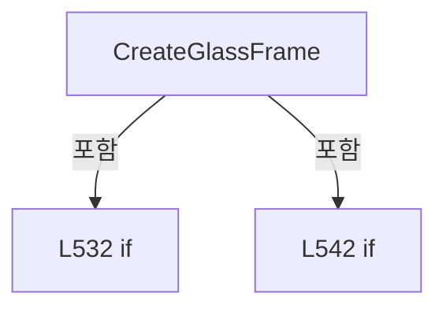

변경 전 점검: 입력/반환 타입, 위 호출자, 예외/취소 경로, 공유 상태와 저장·전송 소비자를 함께 확인합니다. 값의 단위나 물리 방향을 이름만으로 확정하지 않습니다.

### MethodDeclaration `FormatGlassSizeText` · L550–555

[Drilling.UI/Menu/Menus/CHeadAssignmentPreviewBuilder.cs:550–555](https://github.com/kjuws10-rgb/A3Drilling/blob/5aee8e58439c9b455cae7c9593c9be986c3e682e/Drilling.UI/Menu/Menus/CHeadAssignmentPreviewBuilder.cs#L550-L555)

| 항목 | 실제 추출 값 |
| --- | --- |
| 서명 | string Drilling.UI.Menu.Menus.CHeadAssignmentPreviewBuilder.FormatGlassSizeText(System.Collections.Generic.IReadOnlyDictionary<string, string>) |
| 접근/수식자 | Internal / internal, static |
| 반환/값 타입 | string |
| 소속 타입 | NamedType:Drilling.UI.Menu.Menus.CHeadAssignmentPreviewBuilder |

입력 계약:

| 이름 | 타입 | 전달 | 선택/기본값 |
| --- | --- | --- | --- |
| parameters | System.Collections.Generic.IReadOnlyDictionary<string, string> | None | False /  |

정적 호출자로 확인된 위치:

| 호출 파일/행 | 호출 표현식 | 런타임 분기 가능 |
| --- | --- | --- |
| [Drilling.UI/Menu/Menus/CMenuManual.cs:7081–7081](https://github.com/kjuws10-rgb/A3Drilling/blob/5aee8e58439c9b455cae7c9593c9be986c3e682e/Drilling.UI/Menu/Menus/CMenuManual.cs#L7081-L7081) | CHeadAssignmentPreviewBuilder.FormatGlassSizeText | False |

호출하는 대상과 해석 범위:

| 원본 행 | 표현식 | 분석 상태 | 대상/소스 위치 |
| --- | --- | --- | --- |
| 552 | ReadDoubleAny | resolved | double Drilling.UI.Menu.Menus.CHeadAssignmentPreviewBuilder.ReadDoubleAny(System.Collections.Generic.IReadOnlyDictionary<string, string>, double, params string[]) · Drilling.UI/Menu/Menus/CHeadAssignmentPreviewBuilder.cs:61 |
| 553 | ReadDoubleAny | resolved | double Drilling.UI.Menu.Menus.CHeadAssignmentPreviewBuilder.ReadDoubleAny(System.Collections.Generic.IReadOnlyDictionary<string, string>, double, params string[]) · Drilling.UI/Menu/Menus/CHeadAssignmentPreviewBuilder.cs:61 |
| 554 | double.IsFinite | resolved | bool double.IsFinite(double) |
| 554 | double.IsFinite | resolved | bool double.IsFinite(double) |

본문의 실제 연산·분기·예외·반환 순서(원문 위치 순):

| 원본 행 | 종류 | 주석 해설 |
| --- | --- | --- |
| 552 | call | 함수·델리게이트 또는 객체 생성자를 호출합니다: ReadDoubleAny(parameters, 0.0, "GLASS_SIZE_X") |
| 552 | local-declaration | 지역 변수를 선언합니다: var glassSizeX = ReadDoubleAny(parameters, 0.0, "GLASS_SIZE_X"); |
| 552 | variable-initializer | 변수의 초기값을 지정합니다: glassSizeX = ReadDoubleAny(parameters, 0.0, "GLASS_SIZE_X") |
| 553 | call | 함수·델리게이트 또는 객체 생성자를 호출합니다: ReadDoubleAny(parameters, 0.0, "GLASS_SIZE_Y") |
| 553 | local-declaration | 지역 변수를 선언합니다: var glassSizeY = ReadDoubleAny(parameters, 0.0, "GLASS_SIZE_Y"); |
| 553 | variable-initializer | 변수의 초기값을 지정합니다: glassSizeY = ReadDoubleAny(parameters, 0.0, "GLASS_SIZE_Y") |
| 554 | call | 함수·델리게이트 또는 객체 생성자를 호출합니다: double.IsFinite(glassSizeX) |
| 554 | call | 함수·델리게이트 또는 객체 생성자를 호출합니다: double.IsFinite(glassSizeY) |
| 554 | conditional-expression | 조건에 따라 결과식을 선택합니다: double.IsFinite(glassSizeX) && double.IsFinite(glassSizeY) && glassSizeX > 0.0 && glassSizeY > 0.0 ? $"Glass {glassSizeX:0.#} x {glassSizeY:0.#} mm" : "Glass size fallback" |
| 554 | return | 호출자에게 값 또는 제어를 반환합니다: return double.IsFinite(glassSizeX) && double.IsFinite(glassSizeY) && glassSizeX > 0.0 && glassSizeY > 0.0 ? $"Glass {glassSizeX:0.#} x {glassSizeY:0.#} mm" : "Glass size fallback"; |

변경 전 점검: 입력/반환 타입, 위 호출자, 예외/취소 경로, 공유 상태와 저장·전송 소비자를 함께 확인합니다. 값의 단위나 물리 방향을 이름만으로 확정하지 않습니다.

### MethodDeclaration `CreateHeadBrush` · L557–572

[Drilling.UI/Menu/Menus/CHeadAssignmentPreviewBuilder.cs:557–572](https://github.com/kjuws10-rgb/A3Drilling/blob/5aee8e58439c9b455cae7c9593c9be986c3e682e/Drilling.UI/Menu/Menus/CHeadAssignmentPreviewBuilder.cs#L557-L572)

| 항목 | 실제 추출 값 |
| --- | --- |
| 서명 | Brush Drilling.UI.Menu.Menus.CHeadAssignmentPreviewBuilder.CreateHeadBrush(int, byte) |
| 접근/수식자 | Public / public, static |
| 반환/값 타입 | Brush |
| 소속 타입 | NamedType:Drilling.UI.Menu.Menus.CHeadAssignmentPreviewBuilder |

입력 계약:

| 이름 | 타입 | 전달 | 선택/기본값 |
| --- | --- | --- | --- |
| headNo | int | None | False /  |
| alpha | byte | None | True / 255 |

정적 호출자로 확인된 위치:

| 호출 파일/행 | 호출 표현식 | 런타임 분기 가능 |
| --- | --- | --- |
| [Drilling.UI/Menu/Menus/CHeadAssignmentPreviewBuilder.cs:207–207](https://github.com/kjuws10-rgb/A3Drilling/blob/5aee8e58439c9b455cae7c9593c9be986c3e682e/Drilling.UI/Menu/Menus/CHeadAssignmentPreviewBuilder.cs#L207-L207) | CreateHeadBrush | False |
| [Drilling.UI/Menu/Menus/CHeadAssignmentPreviewBuilder.cs:210–210](https://github.com/kjuws10-rgb/A3Drilling/blob/5aee8e58439c9b455cae7c9593c9be986c3e682e/Drilling.UI/Menu/Menus/CHeadAssignmentPreviewBuilder.cs#L210-L210) | CreateHeadBrush | False |
| [Drilling.UI/Menu/Menus/CHeadAssignmentPreviewBuilder.cs:477–477](https://github.com/kjuws10-rgb/A3Drilling/blob/5aee8e58439c9b455cae7c9593c9be986c3e682e/Drilling.UI/Menu/Menus/CHeadAssignmentPreviewBuilder.cs#L477-L477) | CreateHeadBrush | False |
| [Drilling.UI/Menu/Menus/CHeadAssignmentPreviewBuilder.cs:478–478](https://github.com/kjuws10-rgb/A3Drilling/blob/5aee8e58439c9b455cae7c9593c9be986c3e682e/Drilling.UI/Menu/Menus/CHeadAssignmentPreviewBuilder.cs#L478-L478) | CreateHeadBrush | False |
| [Drilling.UI/Menu/Menus/CMenuMain.cs:2246–2246](https://github.com/kjuws10-rgb/A3Drilling/blob/5aee8e58439c9b455cae7c9593c9be986c3e682e/Drilling.UI/Menu/Menus/CMenuMain.cs#L2246-L2246) | CHeadAssignmentPreviewBuilder.CreateHeadBrush | False |

호출하는 대상과 해석 범위:

| 원본 행 | 표현식 | 분석 상태 | 대상/소스 위치 |
| --- | --- | --- | --- |
| 561 | Color.FromRgb | unresolved | None |
| 562 | Color.FromRgb | unresolved | None |
| 563 | Color.FromRgb | unresolved | None |
| 564 | Color.FromRgb | unresolved | None |
| 565 | Color.FromRgb | unresolved | None |
| 566 | Color.FromRgb | unresolved | None |
| 567 | Color.FromRgb | unresolved | None |
| 568 | Color.FromRgb | unresolved | None |
| 570 | Math.Clamp | resolved | int System.Math.Clamp(int, int, int) |
| 571 | CreateBrush | candidate | OverloadResolutionFailure |

본문의 실제 연산·분기·예외·반환 순서(원문 위치 순):

| 원본 행 | 종류 | 주석 해설 |
| --- | --- | --- |
| 559 | local-declaration | 지역 변수를 선언합니다: var palette = new[] { Color.FromRgb(96, 132, 164), Color.FromRgb(105, 150, 126), Color.FromRgb(161, 132, 83), Color.FromRgb(151, 105, 123), Color.FromRgb(95, 142, 140), Color.FromRgb(131, 123, 164), Color.FromRgb(151, 116, 86), Co |
| 559 | variable-initializer | 변수의 초기값을 지정합니다: palette = new[] { Color.FromRgb(96, 132, 164), Color.FromRgb(105, 150, 126), Color.FromRgb(161, 132, 83), Color.FromRgb(151, 105, 123), Color.FromRgb(95, 142, 140), Color.FromRgb(131, 123, 164), Color.FromRgb(151, 116, 86), Color. |
| 561 | call | 함수·델리게이트 또는 객체 생성자를 호출합니다: Color.FromRgb(96, 132, 164) |
| 562 | call | 함수·델리게이트 또는 객체 생성자를 호출합니다: Color.FromRgb(105, 150, 126) |
| 563 | call | 함수·델리게이트 또는 객체 생성자를 호출합니다: Color.FromRgb(161, 132, 83) |
| 564 | call | 함수·델리게이트 또는 객체 생성자를 호출합니다: Color.FromRgb(151, 105, 123) |
| 565 | call | 함수·델리게이트 또는 객체 생성자를 호출합니다: Color.FromRgb(95, 142, 140) |
| 566 | call | 함수·델리게이트 또는 객체 생성자를 호출합니다: Color.FromRgb(131, 123, 164) |
| 567 | call | 함수·델리게이트 또는 객체 생성자를 호출합니다: Color.FromRgb(151, 116, 86) |
| 568 | call | 함수·델리게이트 또는 객체 생성자를 호출합니다: Color.FromRgb(92, 119, 156) |
| 570 | call | 함수·델리게이트 또는 객체 생성자를 호출합니다: Math.Clamp(headNo, 1, palette.Length) |
| 570 | local-declaration | 지역 변수를 선언합니다: var color = palette[Math.Clamp(headNo, 1, palette.Length) - 1]; |
| 570 | variable-initializer | 변수의 초기값을 지정합니다: color = palette[Math.Clamp(headNo, 1, palette.Length) - 1] |
| 571 | call | 함수·델리게이트 또는 객체 생성자를 호출합니다: CreateBrush(color.R, color.G, color.B, alpha) |
| 571 | return | 호출자에게 값 또는 제어를 반환합니다: return CreateBrush(color.R, color.G, color.B, alpha); |

변경 전 점검: 입력/반환 타입, 위 호출자, 예외/취소 경로, 공유 상태와 저장·전송 소비자를 함께 확인합니다. 값의 단위나 물리 방향을 이름만으로 확정하지 않습니다.

### MethodDeclaration `CreateBrush` · L574–579

[Drilling.UI/Menu/Menus/CHeadAssignmentPreviewBuilder.cs:574–579](https://github.com/kjuws10-rgb/A3Drilling/blob/5aee8e58439c9b455cae7c9593c9be986c3e682e/Drilling.UI/Menu/Menus/CHeadAssignmentPreviewBuilder.cs#L574-L579)

| 항목 | 실제 추출 값 |
| --- | --- |
| 서명 | Brush Drilling.UI.Menu.Menus.CHeadAssignmentPreviewBuilder.CreateBrush(byte, byte, byte, byte) |
| 접근/수식자 | Private / private, static |
| 반환/값 타입 | Brush |
| 소속 타입 | NamedType:Drilling.UI.Menu.Menus.CHeadAssignmentPreviewBuilder |

입력 계약:

| 이름 | 타입 | 전달 | 선택/기본값 |
| --- | --- | --- | --- |
| red | byte | None | False /  |
| green | byte | None | False /  |
| blue | byte | None | False /  |
| alpha | byte | None | True / 255 |

정적 호출자로 확인된 위치:

| 호출 파일/행 | 호출 표현식 | 런타임 분기 가능 |
| --- | --- | --- |
| [Drilling.UI/Menu/Menus/CHeadAssignmentPreviewBuilder.cs:206–206](https://github.com/kjuws10-rgb/A3Drilling/blob/5aee8e58439c9b455cae7c9593c9be986c3e682e/Drilling.UI/Menu/Menus/CHeadAssignmentPreviewBuilder.cs#L206-L206) | CreateBrush | False |
| [Drilling.UI/Menu/Menus/CHeadAssignmentPreviewBuilder.cs:209–209](https://github.com/kjuws10-rgb/A3Drilling/blob/5aee8e58439c9b455cae7c9593c9be986c3e682e/Drilling.UI/Menu/Menus/CHeadAssignmentPreviewBuilder.cs#L209-L209) | CreateBrush | False |

호출하는 대상과 해석 범위:

| 원본 행 | 표현식 | 분석 상태 | 대상/소스 위치 |
| --- | --- | --- | --- |
| 576 | new SolidColorBrush | unresolved | None |
| 576 | Color.FromArgb | unresolved | None |
| 577 | brush.Freeze | unresolved | None |

본문의 실제 연산·분기·예외·반환 순서(원문 위치 순):

| 원본 행 | 종류 | 주석 해설 |
| --- | --- | --- |
| 576 | call | 함수·델리게이트 또는 객체 생성자를 호출합니다: new SolidColorBrush(Color.FromArgb(alpha, red, green, blue)) |
| 576 | call | 함수·델리게이트 또는 객체 생성자를 호출합니다: Color.FromArgb(alpha, red, green, blue) |
| 576 | local-declaration | 지역 변수를 선언합니다: var brush = new SolidColorBrush(Color.FromArgb(alpha, red, green, blue)); |
| 576 | variable-initializer | 변수의 초기값을 지정합니다: brush = new SolidColorBrush(Color.FromArgb(alpha, red, green, blue)) |
| 577 | call | 함수·델리게이트 또는 객체 생성자를 호출합니다: brush.Freeze() |
| 578 | return | 호출자에게 값 또는 제어를 반환합니다: return brush; |

변경 전 점검: 입력/반환 타입, 위 호출자, 예외/취소 경로, 공유 상태와 저장·전송 소비자를 함께 확인합니다. 값의 단위나 물리 방향을 이름만으로 확정하지 않습니다.

### MethodDeclaration `BuildHeadLayout` · L581–593

[Drilling.UI/Menu/Menus/CHeadAssignmentPreviewBuilder.cs:581–593](https://github.com/kjuws10-rgb/A3Drilling/blob/5aee8e58439c9b455cae7c9593c9be986c3e682e/Drilling.UI/Menu/Menus/CHeadAssignmentPreviewBuilder.cs#L581-L593)

| 항목 | 실제 추출 값 |
| --- | --- |
| 서명 | Drilling.UI.Menu.Menus.ST_PREVIEW_HEAD_LAYOUT Drilling.UI.Menu.Menus.CHeadAssignmentPreviewBuilder.BuildHeadLayout(System.Collections.Generic.IReadOnlyList<Drilling.Common.Managers.ST_SYSTEM_PARAMETER>) |
| 접근/수식자 | Internal / internal, static |
| 반환/값 타입 | Drilling.UI.Menu.Menus.ST_PREVIEW_HEAD_LAYOUT |
| 소속 타입 | NamedType:Drilling.UI.Menu.Menus.CHeadAssignmentPreviewBuilder |

입력 계약:

| 이름 | 타입 | 전달 | 선택/기본값 |
| --- | --- | --- | --- |
| settings | System.Collections.Generic.IReadOnlyList<Drilling.Common.Managers.ST_SYSTEM_PARAMETER> | None | False /  |

정적 호출자로 확인된 위치:

| 호출 파일/행 | 호출 표현식 | 런타임 분기 가능 |
| --- | --- | --- |
| [Drilling.UI/Menu/Menus/CMenuCorrection.cs:6023–6023](https://github.com/kjuws10-rgb/A3Drilling/blob/5aee8e58439c9b455cae7c9593c9be986c3e682e/Drilling.UI/Menu/Menus/CMenuCorrection.cs#L6023-L6023) | CHeadAssignmentPreviewBuilder.BuildHeadLayout | False |
| [Drilling.UI/Menu/Menus/CMenuCorrection.cs:6490–6490](https://github.com/kjuws10-rgb/A3Drilling/blob/5aee8e58439c9b455cae7c9593c9be986c3e682e/Drilling.UI/Menu/Menus/CMenuCorrection.cs#L6490-L6490) | CHeadAssignmentPreviewBuilder.BuildHeadLayout | False |
| [Drilling.UI/Menu/Menus/CMenuCorrection.cs:7425–7425](https://github.com/kjuws10-rgb/A3Drilling/blob/5aee8e58439c9b455cae7c9593c9be986c3e682e/Drilling.UI/Menu/Menus/CMenuCorrection.cs#L7425-L7425) | CHeadAssignmentPreviewBuilder.BuildHeadLayout | False |
| [Drilling.UI/Menu/Menus/CMenuCorrection.cs:7591–7591](https://github.com/kjuws10-rgb/A3Drilling/blob/5aee8e58439c9b455cae7c9593c9be986c3e682e/Drilling.UI/Menu/Menus/CMenuCorrection.cs#L7591-L7591) | CHeadAssignmentPreviewBuilder.BuildHeadLayout | False |
| [Drilling.UI/Menu/Menus/CMenuMain.cs:2211–2211](https://github.com/kjuws10-rgb/A3Drilling/blob/5aee8e58439c9b455cae7c9593c9be986c3e682e/Drilling.UI/Menu/Menus/CMenuMain.cs#L2211-L2211) | CHeadAssignmentPreviewBuilder.BuildHeadLayout | False |
| [Drilling.UI/Menu/Menus/CMenuManual.cs:7052–7052](https://github.com/kjuws10-rgb/A3Drilling/blob/5aee8e58439c9b455cae7c9593c9be986c3e682e/Drilling.UI/Menu/Menus/CMenuManual.cs#L7052-L7052) | CHeadAssignmentPreviewBuilder.BuildHeadLayout | False |
| [Drilling.UI/Menu/Menus/CMenuRecipe.cs:4596–4596](https://github.com/kjuws10-rgb/A3Drilling/blob/5aee8e58439c9b455cae7c9593c9be986c3e682e/Drilling.UI/Menu/Menus/CMenuRecipe.cs#L4596-L4596) | CHeadAssignmentPreviewBuilder.BuildHeadLayout | False |

호출하는 대상과 해석 범위:

| 원본 행 | 표현식 | 분석 상태 | 대상/소스 위치 |
| --- | --- | --- | --- |
| 591 | Enumerable.Range(1, 8).Select(BuildPreview).ToArray | resolved | Drilling.UI.Menu.Menus.ST_PREVIEW_HEAD_FIELD[] System.Collections.Generic.IEnumerable<Drilling.UI.Menu.Menus.ST_PREVIEW_HEAD_FIELD>.ToArray<Drilling.UI.Menu.Menus.ST_PREVIEW_HEAD_FIELD>() |
| 591 | Enumerable.Range(1, 8).Select | resolved | System.Collections.Generic.IEnumerable<Drilling.UI.Menu.Menus.ST_PREVIEW_HEAD_FIELD> System.Collections.Generic.IEnumerable<int>.Select<int, Drilling.UI.Menu.Menus.ST_PREVIEW_HEAD_FIELD>(System.Func<int, Drilling.UI.Menu.Menus.ST_PREVIEW_HEAD_FIELD>) |
| 591 | Enumerable.Range | resolved | System.Collections.Generic.IEnumerable<int> System.Linq.Enumerable.Range(int, int) |
| 592 | new ST_PREVIEW_HEAD_LAYOUT | resolved | Drilling.UI.Menu.Menus.ST_PREVIEW_HEAD_LAYOUT.ST_PREVIEW_HEAD_LAYOUT(System.Collections.Generic.IReadOnlyList<Drilling.UI.Menu.Menus.ST_PREVIEW_HEAD_FIELD>) · Drilling.UI/Menu/Menus/CMenuMain.cs:3447 |

본문의 실제 연산·분기·예외·반환 순서(원문 위치 순):

| 원본 행 | 종류 | 주석 해설 |
| --- | --- | --- |
| 591 | call | 함수·델리게이트 또는 객체 생성자를 호출합니다: Enumerable.Range(1, 8).Select(BuildPreview).ToArray() |
| 591 | call | 함수·델리게이트 또는 객체 생성자를 호출합니다: Enumerable.Range(1, 8).Select(BuildPreview) |
| 591 | call | 함수·델리게이트 또는 객체 생성자를 호출합니다: Enumerable.Range(1, 8) |
| 591 | local-declaration | 지역 변수를 선언합니다: var fields = Enumerable.Range(1, 8).Select(BuildPreview).ToArray(); |
| 591 | variable-initializer | 변수의 초기값을 지정합니다: fields = Enumerable.Range(1, 8).Select(BuildPreview).ToArray() |
| 592 | call | 함수·델리게이트 또는 객체 생성자를 호출합니다: new ST_PREVIEW_HEAD_LAYOUT(fields) |
| 592 | return | 호출자에게 값 또는 제어를 반환합니다: return new ST_PREVIEW_HEAD_LAYOUT(fields); |

변경 전 점검: 입력/반환 타입, 위 호출자, 예외/취소 경로, 공유 상태와 저장·전송 소비자를 함께 확인합니다. 값의 단위나 물리 방향을 이름만으로 확정하지 않습니다.

### LocalFunctionStatement `BuildPreview` · L583–589

[Drilling.UI/Menu/Menus/CHeadAssignmentPreviewBuilder.cs:583–589](https://github.com/kjuws10-rgb/A3Drilling/blob/5aee8e58439c9b455cae7c9593c9be986c3e682e/Drilling.UI/Menu/Menus/CHeadAssignmentPreviewBuilder.cs#L583-L589)

| 항목 | 실제 추출 값 |
| --- | --- |
| 서명 | Drilling.UI.Menu.Menus.ST_PREVIEW_HEAD_FIELD BuildPreview(int) |
| 접근/수식자 | Private /  |
| 반환/값 타입 | Drilling.UI.Menu.Menus.ST_PREVIEW_HEAD_FIELD |
| 소속 타입 | NamedType:Drilling.UI.Menu.Menus.CHeadAssignmentPreviewBuilder |

입력 계약:

| 이름 | 타입 | 전달 | 선택/기본값 |
| --- | --- | --- | --- |
| headNo | int | None | False /  |

현재 부분 분석에서 직접 연결된 호출자는 없습니다. XAML/이벤트/인터페이스·델리게이트·외부 진입을 추가 확인해야 하며, 미사용으로 판정한 것이 아닙니다.

호출하는 대상과 해석 범위:

| 원본 행 | 표현식 | 분석 상태 | 대상/소스 위치 |
| --- | --- | --- | --- |
| 585 | ReadHeadPositionX | resolved | double Drilling.UI.Menu.Menus.CHeadAssignmentPreviewBuilder.ReadHeadPositionX(System.Collections.Generic.IReadOnlyList<Drilling.Common.Managers.ST_SYSTEM_PARAMETER>, int) · Drilling.UI/Menu/Menus/CHeadAssignmentPreviewBuilder.cs:487 |
| 587 | ReadSettingDouble | resolved | double Drilling.UI.Menu.Menus.CHeadAssignmentPreviewBuilder.ReadSettingDouble(System.Collections.Generic.IReadOnlyList<Drilling.Common.Managers.ST_SYSTEM_PARAMETER>, double, params string[]) · Drilling.UI/Menu/Menus/CHeadAssignmentPreviewBuilder.cs:496 |
| 588 | new ST_PREVIEW_HEAD_FIELD | resolved | Drilling.UI.Menu.Menus.ST_PREVIEW_HEAD_FIELD.ST_PREVIEW_HEAD_FIELD(int, double, double) · Drilling.UI/Menu/Menus/CMenuMain.cs:3461 |

본문의 실제 연산·분기·예외·반환 순서(원문 위치 순):

| 원본 행 | 종류 | 주석 해설 |
| --- | --- | --- |
| 585 | call | 함수·델리게이트 또는 객체 생성자를 호출합니다: ReadHeadPositionX(settings, headNo) |
| 585 | local-declaration | 지역 변수를 선언합니다: var position = ReadHeadPositionX(settings, headNo); |
| 585 | variable-initializer | 변수의 초기값을 지정합니다: position = ReadHeadPositionX(settings, headNo) |
| 586 | local-declaration | 지역 변수를 선언합니다: const double fallbackWidthX = 110.0; |
| 586 | variable-initializer | 변수의 초기값을 지정합니다: fallbackWidthX = 110.0 |
| 587 | call | 함수·델리게이트 또는 객체 생성자를 호출합니다: ReadSettingDouble(settings, fallbackWidthX, $"H{headNo:00}_SCAN_FIELD_WIDTH_X", $"H{headNo:00}_HEAD_FIELD_WIDTH_X") |
| 587 | local-declaration | 지역 변수를 선언합니다: var widthX = ReadSettingDouble(settings, fallbackWidthX, $"H{headNo:00}_SCAN_FIELD_WIDTH_X", $"H{headNo:00}_HEAD_FIELD_WIDTH_X"); |
| 587 | variable-initializer | 변수의 초기값을 지정합니다: widthX = ReadSettingDouble(settings, fallbackWidthX, $"H{headNo:00}_SCAN_FIELD_WIDTH_X", $"H{headNo:00}_HEAD_FIELD_WIDTH_X") |
| 588 | call | 함수·델리게이트 또는 객체 생성자를 호출합니다: new ST_PREVIEW_HEAD_FIELD(headNo, position, widthX > 0.0 ? widthX : fallbackWidthX) |
| 588 | conditional-expression | 조건에 따라 결과식을 선택합니다: widthX > 0.0 ? widthX : fallbackWidthX |
| 588 | return | 호출자에게 값 또는 제어를 반환합니다: return new ST_PREVIEW_HEAD_FIELD(headNo, position, widthX > 0.0 ? widthX : fallbackWidthX); |

변경 전 점검: 입력/반환 타입, 위 호출자, 예외/취소 경로, 공유 상태와 저장·전송 소비자를 함께 확인합니다. 값의 단위나 물리 방향을 이름만으로 확정하지 않습니다.

## 구문·바인딩 한계

전체 WPF/벤더 SDK/프로젝트별 빌드 조건을 로드한 정식 빌드가 아닙니다. `resolved`는 이 부분 컴파일에서의 심볼 연결이며 virtual/interface/delegate/이벤트/Reflection/XAML의 실제 런타임 구현을 확정하지 않습니다. `candidate`와 `unresolved`는 후속 확인 대상으로 남깁니다.

## 원문 전체 주석 해설본

[원본 모든 행과 행별 해설 보기](../../../../annotated/Drilling.UI/Menu/Menus/CHeadAssignmentPreviewBuilder.cs.annotated.txt)

원본을 빠뜨리거나 임의로 줄이지 않았습니다. `L000001 |` 표시는 원본 행 번호, `// 해설`은 별도 설명입니다. 실행용 소스가 아닌 문서입니다.

## 수정·재검증 체크

- 원본 Commit과 현재 작업 파일 SHA가 같은지 먼저 확인합니다. 다르면 이 문서를 과거 버전 자료로 취급합니다.
- 선언·직접 호출·이벤트/인터페이스 경계·설정 소비를 함께 확인합니다. 정적 연결의 빈 곳을 정상 경로로 추정하지 않습니다.
- 저장 형식/단위/식별자·재시도·취소·예외·롤백에 영향을 주는 변경은 상세 해설장과 호출자를 다시 검토합니다.
- 도구의 구문 추출과 별도 정적 추적 해설, 실제 빌드·시뮬레이션·실장비 검증 결과를 분리합니다.
