# Drilling.UI/Menu/Menus/CManualPowerMeasurePanel.cs

| 항목 | 내용 |
| --- | --- |
| 원본 저장소 | https://github.com/kjuws10-rgb/A3Drilling.git |
| 원본 Commit | 5aee8e58439c9b455cae7c9593c9be986c3e682e |
| 원본 SHA256 | 7d6454fd95114d882d16a1e517b791bf2abb8cc8f7d0469db433271f4127246b |
| 파일 분류 | code |
| 원본 크기/행 | 19,471 bytes / 334 physical lines |
| 인코딩 | utf-8-sig |
| 검토 범위 | 구문/부분 의미 분석에서 추출한 사실. 동작·물리 단위·실장비 합격을 보증하지 않습니다. |
| 원본 링크 | [고정 Commit 원본](https://github.com/kjuws10-rgb/A3Drilling/blob/5aee8e58439c9b455cae7c9593c9be986c3e682e/Drilling.UI/Menu/Menus/CManualPowerMeasurePanel.cs) |

## 파일의 역할과 읽는 순서

WPF 화면·사용자 명령·표시 상태를 구성합니다. XAML 이벤트와 코드 비하인드, RootView의 조립 경로를 함께 추적합니다.

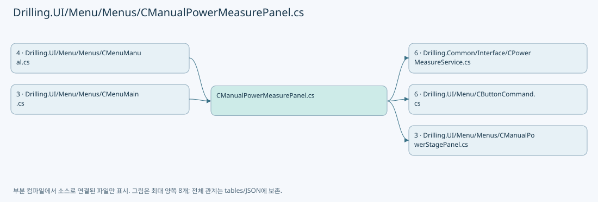

## 네임스페이스·타입·상속

| 타입 | 구분 | 원본 범위 | 선언/상속 |
| --- | --- | --- | --- |
| CManualPowerMeasurePanel | ClassDeclaration | 11–220 | CManualPowerMeasurePanel: INotifyPropertyChanged |
| CPowerMeasureRow | ClassDeclaration | 222–315 | CPowerMeasureRow: INotifyPropertyChanged |
| CPowerMeasureGraph | RecordDeclaration | 317–332 | CPowerMeasureGraph |
| ST_MANUAL_POWER_METER_OPTION | RecordDeclaration | 334–334 | ST_MANUAL_POWER_METER_OPTION |

## 멤버 빠른 목록

| 이름 | 종류 | 범위 | 서명 |
| --- | --- | --- | --- |
| _service | FieldDeclaration | L13–13 | Drilling.Common.Interface.CPowerMeasureService Drilling.UI.Menu.Menus.CManualPowerMeasurePanel._service |
| _getPowerMeters | FieldDeclaration | L14–14 | System.Func<System.Collections.Generic.IReadOnlyList<Drilling.Common.Interface.ST_INTERFACE_DATA>> Drilling.UI.Menu.Menus.CManualPowerMeasurePanel._getPowerMeters |
| _runMeasurement | FieldDeclaration | L15–15 | System.Func<System.Collections.Generic.IReadOnlyList<Drilling.Common.Interface.ST_POWER_MEASURE_TARGET>, System.Threading.CancellationToken, System.Threading.Tasks.Task>? Drilling.UI.Menu.Menus.CManualPowerMeasurePanel._runMeasurement |
| _runCancellation | FieldDeclaration | L16–16 | System.Threading.CancellationTokenSource? Drilling.UI.Menu.Menus.CManualPowerMeasurePanel._runCancellation |
| _warn | FieldDeclaration | L17–17 | System.Action<string> Drilling.UI.Menu.Menus.CManualPowerMeasurePanel._warn |
| _confirm | FieldDeclaration | L18–18 | System.Func<string, bool> Drilling.UI.Menu.Menus.CManualPowerMeasurePanel._confirm |
| _rows | FieldDeclaration | L19–19 | System.Collections.Generic.Dictionary<int, Drilling.UI.Menu.Menus.CPowerMeasureRow> Drilling.UI.Menu.Menus.CManualPowerMeasurePanel._rows |
| _selectedHead | FieldDeclaration | L20–20 | Drilling.UI.Menu.Menus.CPowerMeasureRow? Drilling.UI.Menu.Menus.CManualPowerMeasurePanel._selectedHead |
| _busy | FieldDeclaration | L21–21 | bool Drilling.UI.Menu.Menus.CManualPowerMeasurePanel._busy |
| _stopping | FieldDeclaration | L22–22 | bool Drilling.UI.Menu.Menus.CManualPowerMeasurePanel._stopping |
| _isGraphView | FieldDeclaration | L23–23 | bool Drilling.UI.Menu.Menus.CManualPowerMeasurePanel._isGraphView |
| _mode | FieldDeclaration | L24–24 | string Drilling.UI.Menu.Menus.CManualPowerMeasurePanel._mode |
| PropertyChanged | EventFieldDeclaration | L25–25 | System.ComponentModel.PropertyChangedEventHandler? Drilling.UI.Menu.Menus.CManualPowerMeasurePanel.PropertyChanged |
| RunningChanged | EventFieldDeclaration | L26–26 | System.Action? Drilling.UI.Menu.Menus.CManualPowerMeasurePanel.RunningChanged |
| Heads | PropertyDeclaration | L27–27 | System.Collections.Generic.IReadOnlyList<Drilling.UI.Menu.Menus.CPowerMeasureRow> Drilling.UI.Menu.Menus.CManualPowerMeasurePanel.Heads |
| get_Heads | GetAccessorDeclaration | L27–27 | System.Collections.Generic.IReadOnlyList<Drilling.UI.Menu.Menus.CPowerMeasureRow> Drilling.UI.Menu.Menus.CManualPowerMeasurePanel.Heads.get |
| set_Heads | SetAccessorDeclaration | L27–27 | void Drilling.UI.Menu.Menus.CManualPowerMeasurePanel.Heads.set |
| Modes | PropertyDeclaration | L28–28 | System.Collections.Generic.IReadOnlyList<string> Drilling.UI.Menu.Menus.CManualPowerMeasurePanel.Modes |
| get_Modes | GetAccessorDeclaration | L28–28 | System.Collections.Generic.IReadOnlyList<string> Drilling.UI.Menu.Menus.CManualPowerMeasurePanel.Modes.get |
| Mode | PropertyDeclaration | L29–29 | string Drilling.UI.Menu.Menus.CManualPowerMeasurePanel.Mode |
| get_Mode | GetAccessorDeclaration | L29–29 | string Drilling.UI.Menu.Menus.CManualPowerMeasurePanel.Mode.get |
| set_Mode | SetAccessorDeclaration | L29–29 | void Drilling.UI.Menu.Menus.CManualPowerMeasurePanel.Mode.set |
| ToleranceText | PropertyDeclaration | L30–32 | string Drilling.UI.Menu.Menus.CManualPowerMeasurePanel.ToleranceText |
| IsRunning | PropertyDeclaration | L33–33 | bool Drilling.UI.Menu.Menus.CManualPowerMeasurePanel.IsRunning |
| StartAllowed | PropertyDeclaration | L34–34 | System.Func<bool>? Drilling.UI.Menu.Menus.CManualPowerMeasurePanel.StartAllowed |
| get_StartAllowed | GetAccessorDeclaration | L34–34 | System.Func<bool>? Drilling.UI.Menu.Menus.CManualPowerMeasurePanel.StartAllowed.get |
| set_StartAllowed | SetAccessorDeclaration | L34–34 | void Drilling.UI.Menu.Menus.CManualPowerMeasurePanel.StartAllowed.set |
| IsReadOnly | PropertyDeclaration | L35–35 | bool Drilling.UI.Menu.Menus.CManualPowerMeasurePanel.IsReadOnly |
| get_IsReadOnly | GetAccessorDeclaration | L35–35 | bool Drilling.UI.Menu.Menus.CManualPowerMeasurePanel.IsReadOnly.get |
| CanEdit | PropertyDeclaration | L36–36 | bool Drilling.UI.Menu.Menus.CManualPowerMeasurePanel.CanEdit |
| RunControlsVisibility | PropertyDeclaration | L37–37 | Visibility Drilling.UI.Menu.Menus.CManualPowerMeasurePanel.RunControlsVisibility |
| AutoSettingsVisibility | PropertyDeclaration | L38–38 | Visibility Drilling.UI.Menu.Menus.CManualPowerMeasurePanel.AutoSettingsVisibility |
| HasHeads | PropertyDeclaration | L39–39 | bool Drilling.UI.Menu.Menus.CManualPowerMeasurePanel.HasHeads |
| GraphViewVisibility | PropertyDeclaration | L40–40 | Visibility Drilling.UI.Menu.Menus.CManualPowerMeasurePanel.GraphViewVisibility |
| GridViewVisibility | PropertyDeclaration | L41–41 | Visibility Drilling.UI.Menu.Menus.CManualPowerMeasurePanel.GridViewVisibility |
| ViewToggleText | PropertyDeclaration | L42–42 | string Drilling.UI.Menu.Menus.CManualPowerMeasurePanel.ViewToggleText |
| GraphColumns | PropertyDeclaration | L43–43 | int Drilling.UI.Menu.Menus.CManualPowerMeasurePanel.GraphColumns |
| Summary | PropertyDeclaration | L44–44 | string Drilling.UI.Menu.Menus.CManualPowerMeasurePanel.Summary |
| get_Summary | GetAccessorDeclaration | L44–44 | string Drilling.UI.Menu.Menus.CManualPowerMeasurePanel.Summary.get |
| set_Summary | SetAccessorDeclaration | L44–44 | void Drilling.UI.Menu.Menus.CManualPowerMeasurePanel.Summary.set |
| QueueText | PropertyDeclaration | L45–45 | string Drilling.UI.Menu.Menus.CManualPowerMeasurePanel.QueueText |
| get_QueueText | GetAccessorDeclaration | L45–45 | string Drilling.UI.Menu.Menus.CManualPowerMeasurePanel.QueueText.get |
| set_QueueText | SetAccessorDeclaration | L45–45 | void Drilling.UI.Menu.Menus.CManualPowerMeasurePanel.QueueText.set |
| StageText | PropertyDeclaration | L46–46 | string Drilling.UI.Menu.Menus.CManualPowerMeasurePanel.StageText |
| get_StageText | GetAccessorDeclaration | L46–46 | string Drilling.UI.Menu.Menus.CManualPowerMeasurePanel.StageText.get |
| set_StageText | SetAccessorDeclaration | L46–46 | void Drilling.UI.Menu.Menus.CManualPowerMeasurePanel.StageText.set |
| Graph | PropertyDeclaration | L47–47 | Drilling.UI.Menu.Menus.CPowerMeasureGraph Drilling.UI.Menu.Menus.CManualPowerMeasurePanel.Graph |
| GraphPoints | PropertyDeclaration | L48–48 | PointCollection Drilling.UI.Menu.Menus.CManualPowerMeasurePanel.GraphPoints |
| DetailTitle | PropertyDeclaration | L49–49 | string Drilling.UI.Menu.Menus.CManualPowerMeasurePanel.DetailTitle |
| Samples | PropertyDeclaration | L50–50 | System.Collections.Generic.IReadOnlyList<Drilling.Common.Interface.ST_POWER_MEASURE_SAMPLE> Drilling.UI.Menu.Menus.CManualPowerMeasurePanel.Samples |
| DetailMessage | PropertyDeclaration | L51–52 | string Drilling.UI.Menu.Menus.CManualPowerMeasurePanel.DetailMessage |
| SelectedHead | PropertyDeclaration | L53–64 | Drilling.UI.Menu.Menus.CPowerMeasureRow? Drilling.UI.Menu.Menus.CManualPowerMeasurePanel.SelectedHead |
| get_SelectedHead | GetAccessorDeclaration | L55–55 | Drilling.UI.Menu.Menus.CPowerMeasureRow? Drilling.UI.Menu.Menus.CManualPowerMeasurePanel.SelectedHead.get |
| set_SelectedHead | SetAccessorDeclaration | L56–63 | void Drilling.UI.Menu.Menus.CManualPowerMeasurePanel.SelectedHead.set |
| StartCommand | PropertyDeclaration | L65–65 | Drilling.UI.Menu.CButtonCommand Drilling.UI.Menu.Menus.CManualPowerMeasurePanel.StartCommand |
| get_StartCommand | GetAccessorDeclaration | L65–65 | Drilling.UI.Menu.CButtonCommand Drilling.UI.Menu.Menus.CManualPowerMeasurePanel.StartCommand.get |
| StopCommand | PropertyDeclaration | L66–66 | Drilling.UI.Menu.CButtonCommand Drilling.UI.Menu.Menus.CManualPowerMeasurePanel.StopCommand |
| get_StopCommand | GetAccessorDeclaration | L66–66 | Drilling.UI.Menu.CButtonCommand Drilling.UI.Menu.Menus.CManualPowerMeasurePanel.StopCommand.get |
| ToggleViewCommand | PropertyDeclaration | L67–67 | Drilling.UI.Menu.CButtonCommand Drilling.UI.Menu.Menus.CManualPowerMeasurePanel.ToggleViewCommand |
| get_ToggleViewCommand | GetAccessorDeclaration | L67–67 | Drilling.UI.Menu.CButtonCommand Drilling.UI.Menu.Menus.CManualPowerMeasurePanel.ToggleViewCommand.get |
| SelectGraphHeadCommand | PropertyDeclaration | L68–68 | Drilling.UI.Menu.CButtonCommand Drilling.UI.Menu.Menus.CManualPowerMeasurePanel.SelectGraphHeadCommand |
| get_SelectGraphHeadCommand | GetAccessorDeclaration | L68–68 | Drilling.UI.Menu.CButtonCommand Drilling.UI.Menu.Menus.CManualPowerMeasurePanel.SelectGraphHeadCommand.get |
| StageMotion | PropertyDeclaration | L69–69 | Drilling.UI.Menu.Menus.CManualPowerStagePanel Drilling.UI.Menu.Menus.CManualPowerMeasurePanel.StageMotion |
| get_StageMotion | GetAccessorDeclaration | L69–69 | Drilling.UI.Menu.Menus.CManualPowerStagePanel Drilling.UI.Menu.Menus.CManualPowerMeasurePanel.StageMotion.get |
| .ctor | ConstructorDeclaration | L71–101 | Drilling.UI.Menu.Menus.CManualPowerMeasurePanel.CManualPowerMeasurePanel(Drilling.Common.Interface.CPowerMeasureService, System.Func<System.Collections.Generic.IReadOnlyList<Drilling.Common.Interface.ST_INTERFACE_DATA>>, Drilling.Common.Interface.IPowerMeasureTable?, System.Action<string>, System.Func<string, bool>, System.Func<System.Collections.Generic.IReadOnlyList<Drilling.UI.Menu.Menus.ST_MOTOR_STATUS_ITEM>>?, System.Func<Drilling.Common.Interface.EN_COMM_STATE>?, Drilling.Common.Motion.CManualStageMotionSimulation?, Drilling.UI.Menu.Menus.CManualStageMoveOperation?, System.Func<System.Collections.Generic.IReadOnlyList<Drilling.Common.Interface.ST_POWER_MEASURE_TARGET>, System.Threading.CancellationToken, System.Threading.Tasks.Task>?, bool) |
| UpdateHeads | MethodDeclaration | L103–125 | void Drilling.UI.Menu.Menus.CManualPowerMeasurePanel.UpdateHeads(System.Collections.Generic.IReadOnlyList<int>) |
| GetPowerMeterOptions | MethodDeclaration | L127–131 | System.Collections.Generic.IReadOnlyList<Drilling.UI.Menu.Menus.ST_MANUAL_POWER_METER_OPTION> Drilling.UI.Menu.Menus.CManualPowerMeasurePanel.GetPowerMeterOptions() |
| ApplySnapshot | MethodDeclaration | L133–155 | void Drilling.UI.Menu.Menus.CManualPowerMeasurePanel.ApplySnapshot() |
| Start | MethodDeclaration | L157–195 | System.Threading.Tasks.Task Drilling.UI.Menu.Menus.CManualPowerMeasurePanel.Start() |
| Stop | MethodDeclaration | L197–203 | System.Threading.Tasks.Task Drilling.UI.Menu.Menus.CManualPowerMeasurePanel.Stop() |
| ParsePower | MethodDeclaration | L205–206 | double Drilling.UI.Menu.Menus.CManualPowerMeasurePanel.ParsePower(string) |
| ParseInt | MethodDeclaration | L207–208 | int Drilling.UI.Menu.Menus.CManualPowerMeasurePanel.ParseInt(string, int, int, string) |
| SetBusy | MethodDeclaration | L209–213 | void Drilling.UI.Menu.Menus.CManualPowerMeasurePanel.SetBusy(bool) |
| NotifyCommands | MethodDeclaration | L214–214 | void Drilling.UI.Menu.Menus.CManualPowerMeasurePanel.NotifyCommands() |
| RefreshDetail | MethodDeclaration | L215–218 | void Drilling.UI.Menu.Menus.CManualPowerMeasurePanel.RefreshDetail() |
| Notify | MethodDeclaration | L219–219 | void Drilling.UI.Menu.Menus.CManualPowerMeasurePanel.Notify(string?) |
| _target | FieldDeclaration | L224–224 | string Drilling.UI.Menu.Menus.CPowerMeasureRow._target |
| _settleTime | FieldDeclaration | L224–224 | string Drilling.UI.Menu.Menus.CPowerMeasureRow._settleTime |
| _measureCount | FieldDeclaration | L224–224 | string Drilling.UI.Menu.Menus.CPowerMeasureRow._measureCount |
| _measureInterval | FieldDeclaration | L224–224 | string Drilling.UI.Menu.Menus.CPowerMeasureRow._measureInterval |
| _selectedPowerMeter | FieldDeclaration | L225–225 | Drilling.UI.Menu.Menus.ST_MANUAL_POWER_METER_OPTION? Drilling.UI.Menu.Menus.CPowerMeasureRow._selectedPowerMeter |
| _metersInitialized | FieldDeclaration | L226–226 | bool Drilling.UI.Menu.Menus.CPowerMeasureRow._metersInitialized |
| _updatingPowerMeters | FieldDeclaration | L227–227 | bool Drilling.UI.Menu.Menus.CPowerMeasureRow._updatingPowerMeters |
| _isGraphSelected | FieldDeclaration | L228–228 | bool Drilling.UI.Menu.Menus.CPowerMeasureRow._isGraphSelected |
| PropertyChanged | EventFieldDeclaration | L229–229 | System.ComponentModel.PropertyChangedEventHandler? Drilling.UI.Menu.Menus.CPowerMeasureRow.PropertyChanged |
| InputChanged | EventFieldDeclaration | L230–230 | System.Action? Drilling.UI.Menu.Menus.CPowerMeasureRow.InputChanged |
| HeadNo | PropertyDeclaration | L231–231 | int Drilling.UI.Menu.Menus.CPowerMeasureRow.HeadNo |
| get_HeadNo | GetAccessorDeclaration | L231–231 | int Drilling.UI.Menu.Menus.CPowerMeasureRow.HeadNo.get |
| HeadName | PropertyDeclaration | L232–232 | string Drilling.UI.Menu.Menus.CPowerMeasureRow.HeadName |
| IsGraphSelected | PropertyDeclaration | L233–233 | bool Drilling.UI.Menu.Menus.CPowerMeasureRow.IsGraphSelected |
| Graph | PropertyDeclaration | L234–234 | Drilling.UI.Menu.Menus.CPowerMeasureGraph Drilling.UI.Menu.Menus.CPowerMeasureRow.Graph |
| get_Graph | GetAccessorDeclaration | L234–234 | Drilling.UI.Menu.Menus.CPowerMeasureGraph Drilling.UI.Menu.Menus.CPowerMeasureRow.Graph.get |
| set_Graph | SetAccessorDeclaration | L234–234 | void Drilling.UI.Menu.Menus.CPowerMeasureRow.Graph.set |
| SetGraphSelected | MethodDeclaration | L235–239 | void Drilling.UI.Menu.Menus.CPowerMeasureRow.SetGraphSelected(bool) |
| PowerMeters | PropertyDeclaration | L240–240 | System.Collections.Generic.IReadOnlyList<Drilling.UI.Menu.Menus.ST_MANUAL_POWER_METER_OPTION> Drilling.UI.Menu.Menus.CPowerMeasureRow.PowerMeters |
| get_PowerMeters | GetAccessorDeclaration | L240–240 | System.Collections.Generic.IReadOnlyList<Drilling.UI.Menu.Menus.ST_MANUAL_POWER_METER_OPTION> Drilling.UI.Menu.Menus.CPowerMeasureRow.PowerMeters.get |
| set_PowerMeters | SetAccessorDeclaration | L240–240 | void Drilling.UI.Menu.Menus.CPowerMeasureRow.PowerMeters.set |
| SelectedPowerMeter | PropertyDeclaration | L241–245 | Drilling.UI.Menu.Menus.ST_MANUAL_POWER_METER_OPTION? Drilling.UI.Menu.Menus.CPowerMeasureRow.SelectedPowerMeter |
| get_SelectedPowerMeter | GetAccessorDeclaration | L243–243 | Drilling.UI.Menu.Menus.ST_MANUAL_POWER_METER_OPTION? Drilling.UI.Menu.Menus.CPowerMeasureRow.SelectedPowerMeter.get |
| set_SelectedPowerMeter | SetAccessorDeclaration | L244–244 | void Drilling.UI.Menu.Menus.CPowerMeasureRow.SelectedPowerMeter.set |
| Target | PropertyDeclaration | L246–246 | string Drilling.UI.Menu.Menus.CPowerMeasureRow.Target |
| get_Target | GetAccessorDeclaration | L246–246 | string Drilling.UI.Menu.Menus.CPowerMeasureRow.Target.get |
| set_Target | SetAccessorDeclaration | L246–246 | void Drilling.UI.Menu.Menus.CPowerMeasureRow.Target.set |
| SettleTime | PropertyDeclaration | L247–247 | string Drilling.UI.Menu.Menus.CPowerMeasureRow.SettleTime |
| get_SettleTime | GetAccessorDeclaration | L247–247 | string Drilling.UI.Menu.Menus.CPowerMeasureRow.SettleTime.get |
| set_SettleTime | SetAccessorDeclaration | L247–247 | void Drilling.UI.Menu.Menus.CPowerMeasureRow.SettleTime.set |
| MeasureCount | PropertyDeclaration | L248–248 | string Drilling.UI.Menu.Menus.CPowerMeasureRow.MeasureCount |
| get_MeasureCount | GetAccessorDeclaration | L248–248 | string Drilling.UI.Menu.Menus.CPowerMeasureRow.MeasureCount.get |
| set_MeasureCount | SetAccessorDeclaration | L248–248 | void Drilling.UI.Menu.Menus.CPowerMeasureRow.MeasureCount.set |
| MeasureInterval | PropertyDeclaration | L249–249 | string Drilling.UI.Menu.Menus.CPowerMeasureRow.MeasureInterval |
| get_MeasureInterval | GetAccessorDeclaration | L249–249 | string Drilling.UI.Menu.Menus.CPowerMeasureRow.MeasureInterval.get |
| set_MeasureInterval | SetAccessorDeclaration | L249–249 | void Drilling.UI.Menu.Menus.CPowerMeasureRow.MeasureInterval.set |
| UpdatePowerMeters | MethodDeclaration | L250–265 | void Drilling.UI.Menu.Menus.CPowerMeasureRow.UpdatePowerMeters(System.Collections.Generic.IReadOnlyList<Drilling.UI.Menu.Menus.ST_MANUAL_POWER_METER_OPTION>) |
| ApplyTarget | MethodDeclaration | L266–274 | void Drilling.UI.Menu.Menus.CPowerMeasureRow.ApplyTarget(Drilling.Common.Interface.ST_POWER_MEASURE_TARGET) |
| Matches | MethodDeclaration | L275–280 | bool Drilling.UI.Menu.Menus.CPowerMeasureRow.Matches(Drilling.Common.Interface.ST_POWER_MEASURE_TARGET, string) |
| SetInput | MethodDeclaration | L281–285 | void Drilling.UI.Menu.Menus.CPowerMeasureRow.SetInput(ref string, string, string?) |
| Notify | MethodDeclaration | L286–286 | void Drilling.UI.Menu.Menus.CPowerMeasureRow.Notify(string?) |
| Snapshot | PropertyDeclaration | L287–287 | Drilling.Common.Interface.ST_POWER_MEASURE_HEAD? Drilling.UI.Menu.Menus.CPowerMeasureRow.Snapshot |
| get_Snapshot | GetAccessorDeclaration | L287–287 | Drilling.Common.Interface.ST_POWER_MEASURE_HEAD? Drilling.UI.Menu.Menus.CPowerMeasureRow.Snapshot.get |
| set_Snapshot | SetAccessorDeclaration | L287–287 | void Drilling.UI.Menu.Menus.CPowerMeasureRow.Snapshot.set |
| Measured | PropertyDeclaration | L288–288 | string Drilling.UI.Menu.Menus.CPowerMeasureRow.Measured |
| Error | PropertyDeclaration | L289–289 | string Drilling.UI.Menu.Menus.CPowerMeasureRow.Error |
| Angle | PropertyDeclaration | L290–290 | string Drilling.UI.Menu.Menus.CPowerMeasureRow.Angle |
| Tolerance | PropertyDeclaration | L291–291 | string Drilling.UI.Menu.Menus.CPowerMeasureRow.Tolerance |
| AttemptProgress | PropertyDeclaration | L292–292 | string Drilling.UI.Menu.Menus.CPowerMeasureRow.AttemptProgress |
| GraphSummary | PropertyDeclaration | L293–293 | string Drilling.UI.Menu.Menus.CPowerMeasureRow.GraphSummary |
| State | PropertyDeclaration | L294–294 | string Drilling.UI.Menu.Menus.CPowerMeasureRow.State |
| StateBackground | PropertyDeclaration | L295–300 | Brush Drilling.UI.Menu.Menus.CPowerMeasureRow.StateBackground |
| Apply | MethodDeclaration | L301–307 | void Drilling.UI.Menu.Menus.CPowerMeasureRow.Apply(Drilling.Common.Interface.ST_POWER_MEASURE_HEAD?) |
| RefreshGraph | MethodDeclaration | L308–314 | void Drilling.UI.Menu.Menus.CPowerMeasureRow.RefreshGraph() |
| Empty | PropertyDeclaration | L319–319 | Drilling.UI.Menu.Menus.CPowerMeasureGraph Drilling.UI.Menu.Menus.CPowerMeasureGraph.Empty |
| get_Empty | GetAccessorDeclaration | L319–319 | Drilling.UI.Menu.Menus.CPowerMeasureGraph Drilling.UI.Menu.Menus.CPowerMeasureGraph.Empty.get |
| LastPointVisibility | PropertyDeclaration | L320–320 | Visibility Drilling.UI.Menu.Menus.CPowerMeasureGraph.LastPointVisibility |
| LastPointLeft | PropertyDeclaration | L321–321 | double Drilling.UI.Menu.Menus.CPowerMeasureGraph.LastPointLeft |
| LastPointTop | PropertyDeclaration | L322–322 | double Drilling.UI.Menu.Menus.CPowerMeasureGraph.LastPointTop |
| Create | MethodDeclaration | L323–331 | Drilling.UI.Menu.Menus.CPowerMeasureGraph Drilling.UI.Menu.Menus.CPowerMeasureGraph.Create(System.Collections.Generic.IReadOnlyList<Drilling.Common.Interface.ST_POWER_MEASURE_SAMPLE>, double) |
| Y | LocalFunctionStatement | L326–326 | double Y(double) |

## 멤버별 상세 계약·호출·처리 해설

### FieldDeclaration `_service` · L13–13

[Drilling.UI/Menu/Menus/CManualPowerMeasurePanel.cs:13–13](https://github.com/kjuws10-rgb/A3Drilling/blob/5aee8e58439c9b455cae7c9593c9be986c3e682e/Drilling.UI/Menu/Menus/CManualPowerMeasurePanel.cs#L13-L13)

| 항목 | 실제 추출 값 |
| --- | --- |
| 서명 | Drilling.Common.Interface.CPowerMeasureService Drilling.UI.Menu.Menus.CManualPowerMeasurePanel._service |
| 접근/수식자 | Private / private, readonly |
| 반환/값 타입 | Drilling.Common.Interface.CPowerMeasureService |
| 소속 타입 | NamedType:Drilling.UI.Menu.Menus.CManualPowerMeasurePanel |

현재 부분 분석에서 직접 연결된 호출자는 없습니다. XAML/이벤트/인터페이스·델리게이트·외부 진입을 추가 확인해야 하며, 미사용으로 판정한 것이 아닙니다.

변경 전 점검: 입력/반환 타입, 위 호출자, 예외/취소 경로, 공유 상태와 저장·전송 소비자를 함께 확인합니다. 값의 단위나 물리 방향을 이름만으로 확정하지 않습니다.

### FieldDeclaration `_getPowerMeters` · L14–14

[Drilling.UI/Menu/Menus/CManualPowerMeasurePanel.cs:14–14](https://github.com/kjuws10-rgb/A3Drilling/blob/5aee8e58439c9b455cae7c9593c9be986c3e682e/Drilling.UI/Menu/Menus/CManualPowerMeasurePanel.cs#L14-L14)

| 항목 | 실제 추출 값 |
| --- | --- |
| 서명 | System.Func<System.Collections.Generic.IReadOnlyList<Drilling.Common.Interface.ST_INTERFACE_DATA>> Drilling.UI.Menu.Menus.CManualPowerMeasurePanel._getPowerMeters |
| 접근/수식자 | Private / private, readonly |
| 반환/값 타입 | System.Func<System.Collections.Generic.IReadOnlyList<Drilling.Common.Interface.ST_INTERFACE_DATA>> |
| 소속 타입 | NamedType:Drilling.UI.Menu.Menus.CManualPowerMeasurePanel |

현재 부분 분석에서 직접 연결된 호출자는 없습니다. XAML/이벤트/인터페이스·델리게이트·외부 진입을 추가 확인해야 하며, 미사용으로 판정한 것이 아닙니다.

변경 전 점검: 입력/반환 타입, 위 호출자, 예외/취소 경로, 공유 상태와 저장·전송 소비자를 함께 확인합니다. 값의 단위나 물리 방향을 이름만으로 확정하지 않습니다.

### FieldDeclaration `_runMeasurement` · L15–15

[Drilling.UI/Menu/Menus/CManualPowerMeasurePanel.cs:15–15](https://github.com/kjuws10-rgb/A3Drilling/blob/5aee8e58439c9b455cae7c9593c9be986c3e682e/Drilling.UI/Menu/Menus/CManualPowerMeasurePanel.cs#L15-L15)

| 항목 | 실제 추출 값 |
| --- | --- |
| 서명 | System.Func<System.Collections.Generic.IReadOnlyList<Drilling.Common.Interface.ST_POWER_MEASURE_TARGET>, System.Threading.CancellationToken, System.Threading.Tasks.Task>? Drilling.UI.Menu.Menus.CManualPowerMeasurePanel._runMeasurement |
| 접근/수식자 | Private / private, readonly |
| 반환/값 타입 | System.Func<System.Collections.Generic.IReadOnlyList<Drilling.Common.Interface.ST_POWER_MEASURE_TARGET>, System.Threading.CancellationToken, System.Threading.Tasks.Task>? |
| 소속 타입 | NamedType:Drilling.UI.Menu.Menus.CManualPowerMeasurePanel |

현재 부분 분석에서 직접 연결된 호출자는 없습니다. XAML/이벤트/인터페이스·델리게이트·외부 진입을 추가 확인해야 하며, 미사용으로 판정한 것이 아닙니다.

변경 전 점검: 입력/반환 타입, 위 호출자, 예외/취소 경로, 공유 상태와 저장·전송 소비자를 함께 확인합니다. 값의 단위나 물리 방향을 이름만으로 확정하지 않습니다.

### FieldDeclaration `_runCancellation` · L16–16

[Drilling.UI/Menu/Menus/CManualPowerMeasurePanel.cs:16–16](https://github.com/kjuws10-rgb/A3Drilling/blob/5aee8e58439c9b455cae7c9593c9be986c3e682e/Drilling.UI/Menu/Menus/CManualPowerMeasurePanel.cs#L16-L16)

| 항목 | 실제 추출 값 |
| --- | --- |
| 서명 | System.Threading.CancellationTokenSource? Drilling.UI.Menu.Menus.CManualPowerMeasurePanel._runCancellation |
| 접근/수식자 | Private / private |
| 반환/값 타입 | System.Threading.CancellationTokenSource? |
| 소속 타입 | NamedType:Drilling.UI.Menu.Menus.CManualPowerMeasurePanel |

현재 부분 분석에서 직접 연결된 호출자는 없습니다. XAML/이벤트/인터페이스·델리게이트·외부 진입을 추가 확인해야 하며, 미사용으로 판정한 것이 아닙니다.

변경 전 점검: 입력/반환 타입, 위 호출자, 예외/취소 경로, 공유 상태와 저장·전송 소비자를 함께 확인합니다. 값의 단위나 물리 방향을 이름만으로 확정하지 않습니다.

### FieldDeclaration `_warn` · L17–17

[Drilling.UI/Menu/Menus/CManualPowerMeasurePanel.cs:17–17](https://github.com/kjuws10-rgb/A3Drilling/blob/5aee8e58439c9b455cae7c9593c9be986c3e682e/Drilling.UI/Menu/Menus/CManualPowerMeasurePanel.cs#L17-L17)

| 항목 | 실제 추출 값 |
| --- | --- |
| 서명 | System.Action<string> Drilling.UI.Menu.Menus.CManualPowerMeasurePanel._warn |
| 접근/수식자 | Private / private, readonly |
| 반환/값 타입 | System.Action<string> |
| 소속 타입 | NamedType:Drilling.UI.Menu.Menus.CManualPowerMeasurePanel |

현재 부분 분석에서 직접 연결된 호출자는 없습니다. XAML/이벤트/인터페이스·델리게이트·외부 진입을 추가 확인해야 하며, 미사용으로 판정한 것이 아닙니다.

변경 전 점검: 입력/반환 타입, 위 호출자, 예외/취소 경로, 공유 상태와 저장·전송 소비자를 함께 확인합니다. 값의 단위나 물리 방향을 이름만으로 확정하지 않습니다.

### FieldDeclaration `_confirm` · L18–18

[Drilling.UI/Menu/Menus/CManualPowerMeasurePanel.cs:18–18](https://github.com/kjuws10-rgb/A3Drilling/blob/5aee8e58439c9b455cae7c9593c9be986c3e682e/Drilling.UI/Menu/Menus/CManualPowerMeasurePanel.cs#L18-L18)

| 항목 | 실제 추출 값 |
| --- | --- |
| 서명 | System.Func<string, bool> Drilling.UI.Menu.Menus.CManualPowerMeasurePanel._confirm |
| 접근/수식자 | Private / private, readonly |
| 반환/값 타입 | System.Func<string, bool> |
| 소속 타입 | NamedType:Drilling.UI.Menu.Menus.CManualPowerMeasurePanel |

현재 부분 분석에서 직접 연결된 호출자는 없습니다. XAML/이벤트/인터페이스·델리게이트·외부 진입을 추가 확인해야 하며, 미사용으로 판정한 것이 아닙니다.

변경 전 점검: 입력/반환 타입, 위 호출자, 예외/취소 경로, 공유 상태와 저장·전송 소비자를 함께 확인합니다. 값의 단위나 물리 방향을 이름만으로 확정하지 않습니다.

### FieldDeclaration `_rows` · L19–19

[Drilling.UI/Menu/Menus/CManualPowerMeasurePanel.cs:19–19](https://github.com/kjuws10-rgb/A3Drilling/blob/5aee8e58439c9b455cae7c9593c9be986c3e682e/Drilling.UI/Menu/Menus/CManualPowerMeasurePanel.cs#L19-L19)

| 항목 | 실제 추출 값 |
| --- | --- |
| 서명 | System.Collections.Generic.Dictionary<int, Drilling.UI.Menu.Menus.CPowerMeasureRow> Drilling.UI.Menu.Menus.CManualPowerMeasurePanel._rows |
| 접근/수식자 | Private / private, readonly |
| 반환/값 타입 | System.Collections.Generic.Dictionary<int, Drilling.UI.Menu.Menus.CPowerMeasureRow> |
| 소속 타입 | NamedType:Drilling.UI.Menu.Menus.CManualPowerMeasurePanel |

현재 부분 분석에서 직접 연결된 호출자는 없습니다. XAML/이벤트/인터페이스·델리게이트·외부 진입을 추가 확인해야 하며, 미사용으로 판정한 것이 아닙니다.

본문의 실제 연산·분기·예외·반환 순서(원문 위치 순):

| 원본 행 | 종류 | 주석 해설 |
| --- | --- | --- |
| 19 | variable-initializer | 변수의 초기값을 지정합니다: _rows = [] |

변경 전 점검: 입력/반환 타입, 위 호출자, 예외/취소 경로, 공유 상태와 저장·전송 소비자를 함께 확인합니다. 값의 단위나 물리 방향을 이름만으로 확정하지 않습니다.

### FieldDeclaration `_selectedHead` · L20–20

[Drilling.UI/Menu/Menus/CManualPowerMeasurePanel.cs:20–20](https://github.com/kjuws10-rgb/A3Drilling/blob/5aee8e58439c9b455cae7c9593c9be986c3e682e/Drilling.UI/Menu/Menus/CManualPowerMeasurePanel.cs#L20-L20)

| 항목 | 실제 추출 값 |
| --- | --- |
| 서명 | Drilling.UI.Menu.Menus.CPowerMeasureRow? Drilling.UI.Menu.Menus.CManualPowerMeasurePanel._selectedHead |
| 접근/수식자 | Private / private |
| 반환/값 타입 | Drilling.UI.Menu.Menus.CPowerMeasureRow? |
| 소속 타입 | NamedType:Drilling.UI.Menu.Menus.CManualPowerMeasurePanel |

현재 부분 분석에서 직접 연결된 호출자는 없습니다. XAML/이벤트/인터페이스·델리게이트·외부 진입을 추가 확인해야 하며, 미사용으로 판정한 것이 아닙니다.

변경 전 점검: 입력/반환 타입, 위 호출자, 예외/취소 경로, 공유 상태와 저장·전송 소비자를 함께 확인합니다. 값의 단위나 물리 방향을 이름만으로 확정하지 않습니다.

### FieldDeclaration `_busy` · L21–21

[Drilling.UI/Menu/Menus/CManualPowerMeasurePanel.cs:21–21](https://github.com/kjuws10-rgb/A3Drilling/blob/5aee8e58439c9b455cae7c9593c9be986c3e682e/Drilling.UI/Menu/Menus/CManualPowerMeasurePanel.cs#L21-L21)

| 항목 | 실제 추출 값 |
| --- | --- |
| 서명 | bool Drilling.UI.Menu.Menus.CManualPowerMeasurePanel._busy |
| 접근/수식자 | Private / private |
| 반환/값 타입 | bool |
| 소속 타입 | NamedType:Drilling.UI.Menu.Menus.CManualPowerMeasurePanel |

현재 부분 분석에서 직접 연결된 호출자는 없습니다. XAML/이벤트/인터페이스·델리게이트·외부 진입을 추가 확인해야 하며, 미사용으로 판정한 것이 아닙니다.

변경 전 점검: 입력/반환 타입, 위 호출자, 예외/취소 경로, 공유 상태와 저장·전송 소비자를 함께 확인합니다. 값의 단위나 물리 방향을 이름만으로 확정하지 않습니다.

### FieldDeclaration `_stopping` · L22–22

[Drilling.UI/Menu/Menus/CManualPowerMeasurePanel.cs:22–22](https://github.com/kjuws10-rgb/A3Drilling/blob/5aee8e58439c9b455cae7c9593c9be986c3e682e/Drilling.UI/Menu/Menus/CManualPowerMeasurePanel.cs#L22-L22)

| 항목 | 실제 추출 값 |
| --- | --- |
| 서명 | bool Drilling.UI.Menu.Menus.CManualPowerMeasurePanel._stopping |
| 접근/수식자 | Private / private |
| 반환/값 타입 | bool |
| 소속 타입 | NamedType:Drilling.UI.Menu.Menus.CManualPowerMeasurePanel |

현재 부분 분석에서 직접 연결된 호출자는 없습니다. XAML/이벤트/인터페이스·델리게이트·외부 진입을 추가 확인해야 하며, 미사용으로 판정한 것이 아닙니다.

변경 전 점검: 입력/반환 타입, 위 호출자, 예외/취소 경로, 공유 상태와 저장·전송 소비자를 함께 확인합니다. 값의 단위나 물리 방향을 이름만으로 확정하지 않습니다.

### FieldDeclaration `_isGraphView` · L23–23

[Drilling.UI/Menu/Menus/CManualPowerMeasurePanel.cs:23–23](https://github.com/kjuws10-rgb/A3Drilling/blob/5aee8e58439c9b455cae7c9593c9be986c3e682e/Drilling.UI/Menu/Menus/CManualPowerMeasurePanel.cs#L23-L23)

| 항목 | 실제 추출 값 |
| --- | --- |
| 서명 | bool Drilling.UI.Menu.Menus.CManualPowerMeasurePanel._isGraphView |
| 접근/수식자 | Private / private |
| 반환/값 타입 | bool |
| 소속 타입 | NamedType:Drilling.UI.Menu.Menus.CManualPowerMeasurePanel |

현재 부분 분석에서 직접 연결된 호출자는 없습니다. XAML/이벤트/인터페이스·델리게이트·외부 진입을 추가 확인해야 하며, 미사용으로 판정한 것이 아닙니다.

변경 전 점검: 입력/반환 타입, 위 호출자, 예외/취소 경로, 공유 상태와 저장·전송 소비자를 함께 확인합니다. 값의 단위나 물리 방향을 이름만으로 확정하지 않습니다.

### FieldDeclaration `_mode` · L24–24

[Drilling.UI/Menu/Menus/CManualPowerMeasurePanel.cs:24–24](https://github.com/kjuws10-rgb/A3Drilling/blob/5aee8e58439c9b455cae7c9593c9be986c3e682e/Drilling.UI/Menu/Menus/CManualPowerMeasurePanel.cs#L24-L24)

| 항목 | 실제 추출 값 |
| --- | --- |
| 서명 | string Drilling.UI.Menu.Menus.CManualPowerMeasurePanel._mode |
| 접근/수식자 | Private / private |
| 반환/값 타입 | string |
| 소속 타입 | NamedType:Drilling.UI.Menu.Menus.CManualPowerMeasurePanel |

현재 부분 분석에서 직접 연결된 호출자는 없습니다. XAML/이벤트/인터페이스·델리게이트·외부 진입을 추가 확인해야 하며, 미사용으로 판정한 것이 아닙니다.

본문의 실제 연산·분기·예외·반환 순서(원문 위치 순):

| 원본 행 | 종류 | 주석 해설 |
| --- | --- | --- |
| 24 | variable-initializer | 변수의 초기값을 지정합니다: _mode = "FINE" |

변경 전 점검: 입력/반환 타입, 위 호출자, 예외/취소 경로, 공유 상태와 저장·전송 소비자를 함께 확인합니다. 값의 단위나 물리 방향을 이름만으로 확정하지 않습니다.

### EventFieldDeclaration `PropertyChanged` · L25–25

[Drilling.UI/Menu/Menus/CManualPowerMeasurePanel.cs:25–25](https://github.com/kjuws10-rgb/A3Drilling/blob/5aee8e58439c9b455cae7c9593c9be986c3e682e/Drilling.UI/Menu/Menus/CManualPowerMeasurePanel.cs#L25-L25)

| 항목 | 실제 추출 값 |
| --- | --- |
| 서명 | System.ComponentModel.PropertyChangedEventHandler? Drilling.UI.Menu.Menus.CManualPowerMeasurePanel.PropertyChanged |
| 접근/수식자 | Public / public, event |
| 반환/값 타입 | System.ComponentModel.PropertyChangedEventHandler? |
| 소속 타입 | NamedType:Drilling.UI.Menu.Menus.CManualPowerMeasurePanel |

현재 부분 분석에서 직접 연결된 호출자는 없습니다. XAML/이벤트/인터페이스·델리게이트·외부 진입을 추가 확인해야 하며, 미사용으로 판정한 것이 아닙니다.

변경 전 점검: 입력/반환 타입, 위 호출자, 예외/취소 경로, 공유 상태와 저장·전송 소비자를 함께 확인합니다. 값의 단위나 물리 방향을 이름만으로 확정하지 않습니다.

### EventFieldDeclaration `RunningChanged` · L26–26

[Drilling.UI/Menu/Menus/CManualPowerMeasurePanel.cs:26–26](https://github.com/kjuws10-rgb/A3Drilling/blob/5aee8e58439c9b455cae7c9593c9be986c3e682e/Drilling.UI/Menu/Menus/CManualPowerMeasurePanel.cs#L26-L26)

| 항목 | 실제 추출 값 |
| --- | --- |
| 서명 | System.Action? Drilling.UI.Menu.Menus.CManualPowerMeasurePanel.RunningChanged |
| 접근/수식자 | Public / public, event |
| 반환/값 타입 | System.Action? |
| 소속 타입 | NamedType:Drilling.UI.Menu.Menus.CManualPowerMeasurePanel |

현재 부분 분석에서 직접 연결된 호출자는 없습니다. XAML/이벤트/인터페이스·델리게이트·외부 진입을 추가 확인해야 하며, 미사용으로 판정한 것이 아닙니다.

변경 전 점검: 입력/반환 타입, 위 호출자, 예외/취소 경로, 공유 상태와 저장·전송 소비자를 함께 확인합니다. 값의 단위나 물리 방향을 이름만으로 확정하지 않습니다.

### PropertyDeclaration `Heads` · L27–27

[Drilling.UI/Menu/Menus/CManualPowerMeasurePanel.cs:27–27](https://github.com/kjuws10-rgb/A3Drilling/blob/5aee8e58439c9b455cae7c9593c9be986c3e682e/Drilling.UI/Menu/Menus/CManualPowerMeasurePanel.cs#L27-L27)

| 항목 | 실제 추출 값 |
| --- | --- |
| 서명 | System.Collections.Generic.IReadOnlyList<Drilling.UI.Menu.Menus.CPowerMeasureRow> Drilling.UI.Menu.Menus.CManualPowerMeasurePanel.Heads |
| 접근/수식자 | Public / public |
| 반환/값 타입 | System.Collections.Generic.IReadOnlyList<Drilling.UI.Menu.Menus.CPowerMeasureRow> |
| 소속 타입 | NamedType:Drilling.UI.Menu.Menus.CManualPowerMeasurePanel |

현재 부분 분석에서 직접 연결된 호출자는 없습니다. XAML/이벤트/인터페이스·델리게이트·외부 진입을 추가 확인해야 하며, 미사용으로 판정한 것이 아닙니다.

변경 전 점검: 입력/반환 타입, 위 호출자, 예외/취소 경로, 공유 상태와 저장·전송 소비자를 함께 확인합니다. 값의 단위나 물리 방향을 이름만으로 확정하지 않습니다.

### GetAccessorDeclaration `get_Heads` · L27–27

[Drilling.UI/Menu/Menus/CManualPowerMeasurePanel.cs:27–27](https://github.com/kjuws10-rgb/A3Drilling/blob/5aee8e58439c9b455cae7c9593c9be986c3e682e/Drilling.UI/Menu/Menus/CManualPowerMeasurePanel.cs#L27-L27)

| 항목 | 실제 추출 값 |
| --- | --- |
| 서명 | System.Collections.Generic.IReadOnlyList<Drilling.UI.Menu.Menus.CPowerMeasureRow> Drilling.UI.Menu.Menus.CManualPowerMeasurePanel.Heads.get |
| 접근/수식자 | Public / get |
| 반환/값 타입 | System.Collections.Generic.IReadOnlyList<Drilling.UI.Menu.Menus.CPowerMeasureRow> |
| 소속 타입 | NamedType:Drilling.UI.Menu.Menus.CManualPowerMeasurePanel |

현재 부분 분석에서 직접 연결된 호출자는 없습니다. XAML/이벤트/인터페이스·델리게이트·외부 진입을 추가 확인해야 하며, 미사용으로 판정한 것이 아닙니다.

변경 전 점검: 입력/반환 타입, 위 호출자, 예외/취소 경로, 공유 상태와 저장·전송 소비자를 함께 확인합니다. 값의 단위나 물리 방향을 이름만으로 확정하지 않습니다.

### SetAccessorDeclaration `set_Heads` · L27–27

[Drilling.UI/Menu/Menus/CManualPowerMeasurePanel.cs:27–27](https://github.com/kjuws10-rgb/A3Drilling/blob/5aee8e58439c9b455cae7c9593c9be986c3e682e/Drilling.UI/Menu/Menus/CManualPowerMeasurePanel.cs#L27-L27)

| 항목 | 실제 추출 값 |
| --- | --- |
| 서명 | void Drilling.UI.Menu.Menus.CManualPowerMeasurePanel.Heads.set |
| 접근/수식자 | Private / private, set |
| 반환/값 타입 | void |
| 소속 타입 | NamedType:Drilling.UI.Menu.Menus.CManualPowerMeasurePanel |

입력 계약:

| 이름 | 타입 | 전달 | 선택/기본값 |
| --- | --- | --- | --- |
| value | System.Collections.Generic.IReadOnlyList<Drilling.UI.Menu.Menus.CPowerMeasureRow> | None | False /  |

현재 부분 분석에서 직접 연결된 호출자는 없습니다. XAML/이벤트/인터페이스·델리게이트·외부 진입을 추가 확인해야 하며, 미사용으로 판정한 것이 아닙니다.

변경 전 점검: 입력/반환 타입, 위 호출자, 예외/취소 경로, 공유 상태와 저장·전송 소비자를 함께 확인합니다. 값의 단위나 물리 방향을 이름만으로 확정하지 않습니다.

### PropertyDeclaration `Modes` · L28–28

[Drilling.UI/Menu/Menus/CManualPowerMeasurePanel.cs:28–28](https://github.com/kjuws10-rgb/A3Drilling/blob/5aee8e58439c9b455cae7c9593c9be986c3e682e/Drilling.UI/Menu/Menus/CManualPowerMeasurePanel.cs#L28-L28)

| 항목 | 실제 추출 값 |
| --- | --- |
| 서명 | System.Collections.Generic.IReadOnlyList<string> Drilling.UI.Menu.Menus.CManualPowerMeasurePanel.Modes |
| 접근/수식자 | Public / public |
| 반환/값 타입 | System.Collections.Generic.IReadOnlyList<string> |
| 소속 타입 | NamedType:Drilling.UI.Menu.Menus.CManualPowerMeasurePanel |

현재 부분 분석에서 직접 연결된 호출자는 없습니다. XAML/이벤트/인터페이스·델리게이트·외부 진입을 추가 확인해야 하며, 미사용으로 판정한 것이 아닙니다.

변경 전 점검: 입력/반환 타입, 위 호출자, 예외/취소 경로, 공유 상태와 저장·전송 소비자를 함께 확인합니다. 값의 단위나 물리 방향을 이름만으로 확정하지 않습니다.

### GetAccessorDeclaration `get_Modes` · L28–28

[Drilling.UI/Menu/Menus/CManualPowerMeasurePanel.cs:28–28](https://github.com/kjuws10-rgb/A3Drilling/blob/5aee8e58439c9b455cae7c9593c9be986c3e682e/Drilling.UI/Menu/Menus/CManualPowerMeasurePanel.cs#L28-L28)

| 항목 | 실제 추출 값 |
| --- | --- |
| 서명 | System.Collections.Generic.IReadOnlyList<string> Drilling.UI.Menu.Menus.CManualPowerMeasurePanel.Modes.get |
| 접근/수식자 | Public / get |
| 반환/값 타입 | System.Collections.Generic.IReadOnlyList<string> |
| 소속 타입 | NamedType:Drilling.UI.Menu.Menus.CManualPowerMeasurePanel |

현재 부분 분석에서 직접 연결된 호출자는 없습니다. XAML/이벤트/인터페이스·델리게이트·외부 진입을 추가 확인해야 하며, 미사용으로 판정한 것이 아닙니다.

변경 전 점검: 입력/반환 타입, 위 호출자, 예외/취소 경로, 공유 상태와 저장·전송 소비자를 함께 확인합니다. 값의 단위나 물리 방향을 이름만으로 확정하지 않습니다.

### PropertyDeclaration `Mode` · L29–29

[Drilling.UI/Menu/Menus/CManualPowerMeasurePanel.cs:29–29](https://github.com/kjuws10-rgb/A3Drilling/blob/5aee8e58439c9b455cae7c9593c9be986c3e682e/Drilling.UI/Menu/Menus/CManualPowerMeasurePanel.cs#L29-L29)

| 항목 | 실제 추출 값 |
| --- | --- |
| 서명 | string Drilling.UI.Menu.Menus.CManualPowerMeasurePanel.Mode |
| 접근/수식자 | Public / public |
| 반환/값 타입 | string |
| 소속 타입 | NamedType:Drilling.UI.Menu.Menus.CManualPowerMeasurePanel |

현재 부분 분석에서 직접 연결된 호출자는 없습니다. XAML/이벤트/인터페이스·델리게이트·외부 진입을 추가 확인해야 하며, 미사용으로 판정한 것이 아닙니다.

변경 전 점검: 입력/반환 타입, 위 호출자, 예외/취소 경로, 공유 상태와 저장·전송 소비자를 함께 확인합니다. 값의 단위나 물리 방향을 이름만으로 확정하지 않습니다.

### GetAccessorDeclaration `get_Mode` · L29–29

[Drilling.UI/Menu/Menus/CManualPowerMeasurePanel.cs:29–29](https://github.com/kjuws10-rgb/A3Drilling/blob/5aee8e58439c9b455cae7c9593c9be986c3e682e/Drilling.UI/Menu/Menus/CManualPowerMeasurePanel.cs#L29-L29)

| 항목 | 실제 추출 값 |
| --- | --- |
| 서명 | string Drilling.UI.Menu.Menus.CManualPowerMeasurePanel.Mode.get |
| 접근/수식자 | Public / get |
| 반환/값 타입 | string |
| 소속 타입 | NamedType:Drilling.UI.Menu.Menus.CManualPowerMeasurePanel |

현재 부분 분석에서 직접 연결된 호출자는 없습니다. XAML/이벤트/인터페이스·델리게이트·외부 진입을 추가 확인해야 하며, 미사용으로 판정한 것이 아닙니다.

변경 전 점검: 입력/반환 타입, 위 호출자, 예외/취소 경로, 공유 상태와 저장·전송 소비자를 함께 확인합니다. 값의 단위나 물리 방향을 이름만으로 확정하지 않습니다.

### SetAccessorDeclaration `set_Mode` · L29–29

[Drilling.UI/Menu/Menus/CManualPowerMeasurePanel.cs:29–29](https://github.com/kjuws10-rgb/A3Drilling/blob/5aee8e58439c9b455cae7c9593c9be986c3e682e/Drilling.UI/Menu/Menus/CManualPowerMeasurePanel.cs#L29-L29)

| 항목 | 실제 추출 값 |
| --- | --- |
| 서명 | void Drilling.UI.Menu.Menus.CManualPowerMeasurePanel.Mode.set |
| 접근/수식자 | Public / set |
| 반환/값 타입 | void |
| 소속 타입 | NamedType:Drilling.UI.Menu.Menus.CManualPowerMeasurePanel |

입력 계약:

| 이름 | 타입 | 전달 | 선택/기본값 |
| --- | --- | --- | --- |
| value | string | None | False /  |

현재 부분 분석에서 직접 연결된 호출자는 없습니다. XAML/이벤트/인터페이스·델리게이트·외부 진입을 추가 확인해야 하며, 미사용으로 판정한 것이 아닙니다.

호출하는 대상과 해석 범위:

| 원본 행 | 표현식 | 분석 상태 | 대상/소스 위치 |
| --- | --- | --- | --- |
| 29 | Notify | resolved | void Drilling.UI.Menu.Menus.CManualPowerMeasurePanel.Notify(string?) · Drilling.UI/Menu/Menus/CManualPowerMeasurePanel.cs:219 |
| 29 | Notify | resolved | void Drilling.UI.Menu.Menus.CManualPowerMeasurePanel.Notify(string?) · Drilling.UI/Menu/Menus/CManualPowerMeasurePanel.cs:219 |
| 29 | nameof | unresolved | None |
| 29 | ApplySnapshot | resolved | void Drilling.UI.Menu.Menus.CManualPowerMeasurePanel.ApplySnapshot() · Drilling.UI/Menu/Menus/CManualPowerMeasurePanel.cs:133 |

본문의 실제 연산·분기·예외·반환 순서(원문 위치 순):

| 원본 행 | 종류 | 주석 해설 |
| --- | --- | --- |
| 29 | assignment | 값을 대상에 대입합니다: _mode = value |
| 29 | call | 함수·델리게이트 또는 객체 생성자를 호출합니다: Notify() |
| 29 | call | 함수·델리게이트 또는 객체 생성자를 호출합니다: Notify(nameof(ToleranceText)) |
| 29 | call | 함수·델리게이트 또는 객체 생성자를 호출합니다: nameof(ToleranceText) |
| 29 | call | 함수·델리게이트 또는 객체 생성자를 호출합니다: ApplySnapshot() |

변경 전 점검: 입력/반환 타입, 위 호출자, 예외/취소 경로, 공유 상태와 저장·전송 소비자를 함께 확인합니다. 값의 단위나 물리 방향을 이름만으로 확정하지 않습니다.

### PropertyDeclaration `ToleranceText` · L30–32

[Drilling.UI/Menu/Menus/CManualPowerMeasurePanel.cs:30–32](https://github.com/kjuws10-rgb/A3Drilling/blob/5aee8e58439c9b455cae7c9593c9be986c3e682e/Drilling.UI/Menu/Menus/CManualPowerMeasurePanel.cs#L30-L32)

| 항목 | 실제 추출 값 |
| --- | --- |
| 서명 | string Drilling.UI.Menu.Menus.CManualPowerMeasurePanel.ToleranceText |
| 접근/수식자 | Public / public |
| 반환/값 타입 | string |
| 소속 타입 | NamedType:Drilling.UI.Menu.Menus.CManualPowerMeasurePanel |

현재 부분 분석에서 직접 연결된 호출자는 없습니다. XAML/이벤트/인터페이스·델리게이트·외부 진입을 추가 확인해야 하며, 미사용으로 판정한 것이 아닙니다.

호출하는 대상과 해석 범위:

| 원본 행 | 표현식 | 분석 상태 | 대상/소스 위치 |
| --- | --- | --- | --- |
| 30 | _service.GetSnapshot().Heads.FirstOrDefault | resolved | Drilling.Common.Interface.ST_POWER_MEASURE_HEAD? System.Collections.Generic.IEnumerable<Drilling.Common.Interface.ST_POWER_MEASURE_HEAD>.FirstOrDefault<Drilling.Common.Interface.ST_POWER_MEASURE_HEAD>() |
| 30 | _service.GetSnapshot | resolved | Drilling.Common.Interface.ST_POWER_MEASURE_SNAPSHOT Drilling.Common.Interface.CPowerMeasureService.GetSnapshot() · Drilling.Common/Interface/CPowerMeasureService.cs:12 |

본문의 실제 연산·분기·예외·반환 순서(원문 위치 순):

| 원본 행 | 종류 | 주석 해설 |
| --- | --- | --- |
| 30 | call | 함수·델리게이트 또는 객체 생성자를 호출합니다: _service.GetSnapshot().Heads.FirstOrDefault() |
| 30 | call | 함수·델리게이트 또는 객체 생성자를 호출합니다: _service.GetSnapshot() |
| 30 | conditional-expression | 조건에 따라 결과식을 선택합니다: IsReadOnly && _service.GetSnapshot().Heads.FirstOrDefault() is { } head ? $"±{head.Target.Options.Tolerance:0.0000} W / {head.Target.Options.MaxAttempts} attempts" : Mode switch { "ROUGH" => "±0.0500 W / 8 attempts", "DETAIL" => " |
| 32 | switch-expression | 값별 결과식을 선택합니다: Mode switch { "ROUGH" => "±0.0500 W / 8 attempts", "DETAIL" => "±0.0030 W / 18 attempts", _ => "±0.0100 W / 12 attempts" } |

제어 구문의 포함 구조(실제 실행 순서/CFG가 아닌 구문 탐색 그림):

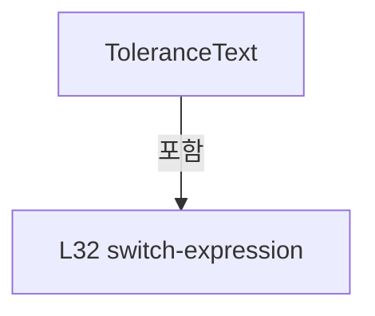

변경 전 점검: 입력/반환 타입, 위 호출자, 예외/취소 경로, 공유 상태와 저장·전송 소비자를 함께 확인합니다. 값의 단위나 물리 방향을 이름만으로 확정하지 않습니다.

### PropertyDeclaration `IsRunning` · L33–33

[Drilling.UI/Menu/Menus/CManualPowerMeasurePanel.cs:33–33](https://github.com/kjuws10-rgb/A3Drilling/blob/5aee8e58439c9b455cae7c9593c9be986c3e682e/Drilling.UI/Menu/Menus/CManualPowerMeasurePanel.cs#L33-L33)

| 항목 | 실제 추출 값 |
| --- | --- |
| 서명 | bool Drilling.UI.Menu.Menus.CManualPowerMeasurePanel.IsRunning |
| 접근/수식자 | Public / public |
| 반환/값 타입 | bool |
| 소속 타입 | NamedType:Drilling.UI.Menu.Menus.CManualPowerMeasurePanel |

현재 부분 분석에서 직접 연결된 호출자는 없습니다. XAML/이벤트/인터페이스·델리게이트·외부 진입을 추가 확인해야 하며, 미사용으로 판정한 것이 아닙니다.

변경 전 점검: 입력/반환 타입, 위 호출자, 예외/취소 경로, 공유 상태와 저장·전송 소비자를 함께 확인합니다. 값의 단위나 물리 방향을 이름만으로 확정하지 않습니다.

### PropertyDeclaration `StartAllowed` · L34–34

[Drilling.UI/Menu/Menus/CManualPowerMeasurePanel.cs:34–34](https://github.com/kjuws10-rgb/A3Drilling/blob/5aee8e58439c9b455cae7c9593c9be986c3e682e/Drilling.UI/Menu/Menus/CManualPowerMeasurePanel.cs#L34-L34)

| 항목 | 실제 추출 값 |
| --- | --- |
| 서명 | System.Func<bool>? Drilling.UI.Menu.Menus.CManualPowerMeasurePanel.StartAllowed |
| 접근/수식자 | Public / public |
| 반환/값 타입 | System.Func<bool>? |
| 소속 타입 | NamedType:Drilling.UI.Menu.Menus.CManualPowerMeasurePanel |

현재 부분 분석에서 직접 연결된 호출자는 없습니다. XAML/이벤트/인터페이스·델리게이트·외부 진입을 추가 확인해야 하며, 미사용으로 판정한 것이 아닙니다.

변경 전 점검: 입력/반환 타입, 위 호출자, 예외/취소 경로, 공유 상태와 저장·전송 소비자를 함께 확인합니다. 값의 단위나 물리 방향을 이름만으로 확정하지 않습니다.

### GetAccessorDeclaration `get_StartAllowed` · L34–34

[Drilling.UI/Menu/Menus/CManualPowerMeasurePanel.cs:34–34](https://github.com/kjuws10-rgb/A3Drilling/blob/5aee8e58439c9b455cae7c9593c9be986c3e682e/Drilling.UI/Menu/Menus/CManualPowerMeasurePanel.cs#L34-L34)

| 항목 | 실제 추출 값 |
| --- | --- |
| 서명 | System.Func<bool>? Drilling.UI.Menu.Menus.CManualPowerMeasurePanel.StartAllowed.get |
| 접근/수식자 | Public / get |
| 반환/값 타입 | System.Func<bool>? |
| 소속 타입 | NamedType:Drilling.UI.Menu.Menus.CManualPowerMeasurePanel |

현재 부분 분석에서 직접 연결된 호출자는 없습니다. XAML/이벤트/인터페이스·델리게이트·외부 진입을 추가 확인해야 하며, 미사용으로 판정한 것이 아닙니다.

변경 전 점검: 입력/반환 타입, 위 호출자, 예외/취소 경로, 공유 상태와 저장·전송 소비자를 함께 확인합니다. 값의 단위나 물리 방향을 이름만으로 확정하지 않습니다.

### SetAccessorDeclaration `set_StartAllowed` · L34–34

[Drilling.UI/Menu/Menus/CManualPowerMeasurePanel.cs:34–34](https://github.com/kjuws10-rgb/A3Drilling/blob/5aee8e58439c9b455cae7c9593c9be986c3e682e/Drilling.UI/Menu/Menus/CManualPowerMeasurePanel.cs#L34-L34)

| 항목 | 실제 추출 값 |
| --- | --- |
| 서명 | void Drilling.UI.Menu.Menus.CManualPowerMeasurePanel.StartAllowed.set |
| 접근/수식자 | Public / set |
| 반환/값 타입 | void |
| 소속 타입 | NamedType:Drilling.UI.Menu.Menus.CManualPowerMeasurePanel |

입력 계약:

| 이름 | 타입 | 전달 | 선택/기본값 |
| --- | --- | --- | --- |
| value | System.Func<bool>? | None | False /  |

현재 부분 분석에서 직접 연결된 호출자는 없습니다. XAML/이벤트/인터페이스·델리게이트·외부 진입을 추가 확인해야 하며, 미사용으로 판정한 것이 아닙니다.

변경 전 점검: 입력/반환 타입, 위 호출자, 예외/취소 경로, 공유 상태와 저장·전송 소비자를 함께 확인합니다. 값의 단위나 물리 방향을 이름만으로 확정하지 않습니다.

### PropertyDeclaration `IsReadOnly` · L35–35

[Drilling.UI/Menu/Menus/CManualPowerMeasurePanel.cs:35–35](https://github.com/kjuws10-rgb/A3Drilling/blob/5aee8e58439c9b455cae7c9593c9be986c3e682e/Drilling.UI/Menu/Menus/CManualPowerMeasurePanel.cs#L35-L35)

| 항목 | 실제 추출 값 |
| --- | --- |
| 서명 | bool Drilling.UI.Menu.Menus.CManualPowerMeasurePanel.IsReadOnly |
| 접근/수식자 | Public / public |
| 반환/값 타입 | bool |
| 소속 타입 | NamedType:Drilling.UI.Menu.Menus.CManualPowerMeasurePanel |

현재 부분 분석에서 직접 연결된 호출자는 없습니다. XAML/이벤트/인터페이스·델리게이트·외부 진입을 추가 확인해야 하며, 미사용으로 판정한 것이 아닙니다.

변경 전 점검: 입력/반환 타입, 위 호출자, 예외/취소 경로, 공유 상태와 저장·전송 소비자를 함께 확인합니다. 값의 단위나 물리 방향을 이름만으로 확정하지 않습니다.

### GetAccessorDeclaration `get_IsReadOnly` · L35–35

[Drilling.UI/Menu/Menus/CManualPowerMeasurePanel.cs:35–35](https://github.com/kjuws10-rgb/A3Drilling/blob/5aee8e58439c9b455cae7c9593c9be986c3e682e/Drilling.UI/Menu/Menus/CManualPowerMeasurePanel.cs#L35-L35)

| 항목 | 실제 추출 값 |
| --- | --- |
| 서명 | bool Drilling.UI.Menu.Menus.CManualPowerMeasurePanel.IsReadOnly.get |
| 접근/수식자 | Public / get |
| 반환/값 타입 | bool |
| 소속 타입 | NamedType:Drilling.UI.Menu.Menus.CManualPowerMeasurePanel |

현재 부분 분석에서 직접 연결된 호출자는 없습니다. XAML/이벤트/인터페이스·델리게이트·외부 진입을 추가 확인해야 하며, 미사용으로 판정한 것이 아닙니다.

변경 전 점검: 입력/반환 타입, 위 호출자, 예외/취소 경로, 공유 상태와 저장·전송 소비자를 함께 확인합니다. 값의 단위나 물리 방향을 이름만으로 확정하지 않습니다.

### PropertyDeclaration `CanEdit` · L36–36

[Drilling.UI/Menu/Menus/CManualPowerMeasurePanel.cs:36–36](https://github.com/kjuws10-rgb/A3Drilling/blob/5aee8e58439c9b455cae7c9593c9be986c3e682e/Drilling.UI/Menu/Menus/CManualPowerMeasurePanel.cs#L36-L36)

| 항목 | 실제 추출 값 |
| --- | --- |
| 서명 | bool Drilling.UI.Menu.Menus.CManualPowerMeasurePanel.CanEdit |
| 접근/수식자 | Public / public |
| 반환/값 타입 | bool |
| 소속 타입 | NamedType:Drilling.UI.Menu.Menus.CManualPowerMeasurePanel |

현재 부분 분석에서 직접 연결된 호출자는 없습니다. XAML/이벤트/인터페이스·델리게이트·외부 진입을 추가 확인해야 하며, 미사용으로 판정한 것이 아닙니다.

변경 전 점검: 입력/반환 타입, 위 호출자, 예외/취소 경로, 공유 상태와 저장·전송 소비자를 함께 확인합니다. 값의 단위나 물리 방향을 이름만으로 확정하지 않습니다.

### PropertyDeclaration `RunControlsVisibility` · L37–37

[Drilling.UI/Menu/Menus/CManualPowerMeasurePanel.cs:37–37](https://github.com/kjuws10-rgb/A3Drilling/blob/5aee8e58439c9b455cae7c9593c9be986c3e682e/Drilling.UI/Menu/Menus/CManualPowerMeasurePanel.cs#L37-L37)

| 항목 | 실제 추출 값 |
| --- | --- |
| 서명 | Visibility Drilling.UI.Menu.Menus.CManualPowerMeasurePanel.RunControlsVisibility |
| 접근/수식자 | Public / public |
| 반환/값 타입 | Visibility |
| 소속 타입 | NamedType:Drilling.UI.Menu.Menus.CManualPowerMeasurePanel |

현재 부분 분석에서 직접 연결된 호출자는 없습니다. XAML/이벤트/인터페이스·델리게이트·외부 진입을 추가 확인해야 하며, 미사용으로 판정한 것이 아닙니다.

본문의 실제 연산·분기·예외·반환 순서(원문 위치 순):

| 원본 행 | 종류 | 주석 해설 |
| --- | --- | --- |
| 37 | conditional-expression | 조건에 따라 결과식을 선택합니다: IsReadOnly ? Visibility.Collapsed : Visibility.Visible |

변경 전 점검: 입력/반환 타입, 위 호출자, 예외/취소 경로, 공유 상태와 저장·전송 소비자를 함께 확인합니다. 값의 단위나 물리 방향을 이름만으로 확정하지 않습니다.

### PropertyDeclaration `AutoSettingsVisibility` · L38–38

[Drilling.UI/Menu/Menus/CManualPowerMeasurePanel.cs:38–38](https://github.com/kjuws10-rgb/A3Drilling/blob/5aee8e58439c9b455cae7c9593c9be986c3e682e/Drilling.UI/Menu/Menus/CManualPowerMeasurePanel.cs#L38-L38)

| 항목 | 실제 추출 값 |
| --- | --- |
| 서명 | Visibility Drilling.UI.Menu.Menus.CManualPowerMeasurePanel.AutoSettingsVisibility |
| 접근/수식자 | Public / public |
| 반환/값 타입 | Visibility |
| 소속 타입 | NamedType:Drilling.UI.Menu.Menus.CManualPowerMeasurePanel |

현재 부분 분석에서 직접 연결된 호출자는 없습니다. XAML/이벤트/인터페이스·델리게이트·외부 진입을 추가 확인해야 하며, 미사용으로 판정한 것이 아닙니다.

본문의 실제 연산·분기·예외·반환 순서(원문 위치 순):

| 원본 행 | 종류 | 주석 해설 |
| --- | --- | --- |
| 38 | conditional-expression | 조건에 따라 결과식을 선택합니다: IsReadOnly ? Visibility.Visible : Visibility.Collapsed |

변경 전 점검: 입력/반환 타입, 위 호출자, 예외/취소 경로, 공유 상태와 저장·전송 소비자를 함께 확인합니다. 값의 단위나 물리 방향을 이름만으로 확정하지 않습니다.

### PropertyDeclaration `HasHeads` · L39–39

[Drilling.UI/Menu/Menus/CManualPowerMeasurePanel.cs:39–39](https://github.com/kjuws10-rgb/A3Drilling/blob/5aee8e58439c9b455cae7c9593c9be986c3e682e/Drilling.UI/Menu/Menus/CManualPowerMeasurePanel.cs#L39-L39)

| 항목 | 실제 추출 값 |
| --- | --- |
| 서명 | bool Drilling.UI.Menu.Menus.CManualPowerMeasurePanel.HasHeads |
| 접근/수식자 | Public / public |
| 반환/값 타입 | bool |
| 소속 타입 | NamedType:Drilling.UI.Menu.Menus.CManualPowerMeasurePanel |

현재 부분 분석에서 직접 연결된 호출자는 없습니다. XAML/이벤트/인터페이스·델리게이트·외부 진입을 추가 확인해야 하며, 미사용으로 판정한 것이 아닙니다.

변경 전 점검: 입력/반환 타입, 위 호출자, 예외/취소 경로, 공유 상태와 저장·전송 소비자를 함께 확인합니다. 값의 단위나 물리 방향을 이름만으로 확정하지 않습니다.

### PropertyDeclaration `GraphViewVisibility` · L40–40

[Drilling.UI/Menu/Menus/CManualPowerMeasurePanel.cs:40–40](https://github.com/kjuws10-rgb/A3Drilling/blob/5aee8e58439c9b455cae7c9593c9be986c3e682e/Drilling.UI/Menu/Menus/CManualPowerMeasurePanel.cs#L40-L40)

| 항목 | 실제 추출 값 |
| --- | --- |
| 서명 | Visibility Drilling.UI.Menu.Menus.CManualPowerMeasurePanel.GraphViewVisibility |
| 접근/수식자 | Public / public |
| 반환/값 타입 | Visibility |
| 소속 타입 | NamedType:Drilling.UI.Menu.Menus.CManualPowerMeasurePanel |

현재 부분 분석에서 직접 연결된 호출자는 없습니다. XAML/이벤트/인터페이스·델리게이트·외부 진입을 추가 확인해야 하며, 미사용으로 판정한 것이 아닙니다.

본문의 실제 연산·분기·예외·반환 순서(원문 위치 순):

| 원본 행 | 종류 | 주석 해설 |
| --- | --- | --- |
| 40 | conditional-expression | 조건에 따라 결과식을 선택합니다: _isGraphView ? Visibility.Visible : Visibility.Collapsed |

변경 전 점검: 입력/반환 타입, 위 호출자, 예외/취소 경로, 공유 상태와 저장·전송 소비자를 함께 확인합니다. 값의 단위나 물리 방향을 이름만으로 확정하지 않습니다.

### PropertyDeclaration `GridViewVisibility` · L41–41

[Drilling.UI/Menu/Menus/CManualPowerMeasurePanel.cs:41–41](https://github.com/kjuws10-rgb/A3Drilling/blob/5aee8e58439c9b455cae7c9593c9be986c3e682e/Drilling.UI/Menu/Menus/CManualPowerMeasurePanel.cs#L41-L41)

| 항목 | 실제 추출 값 |
| --- | --- |
| 서명 | Visibility Drilling.UI.Menu.Menus.CManualPowerMeasurePanel.GridViewVisibility |
| 접근/수식자 | Public / public |
| 반환/값 타입 | Visibility |
| 소속 타입 | NamedType:Drilling.UI.Menu.Menus.CManualPowerMeasurePanel |

현재 부분 분석에서 직접 연결된 호출자는 없습니다. XAML/이벤트/인터페이스·델리게이트·외부 진입을 추가 확인해야 하며, 미사용으로 판정한 것이 아닙니다.

본문의 실제 연산·분기·예외·반환 순서(원문 위치 순):

| 원본 행 | 종류 | 주석 해설 |
| --- | --- | --- |
| 41 | conditional-expression | 조건에 따라 결과식을 선택합니다: _isGraphView ? Visibility.Collapsed : Visibility.Visible |

변경 전 점검: 입력/반환 타입, 위 호출자, 예외/취소 경로, 공유 상태와 저장·전송 소비자를 함께 확인합니다. 값의 단위나 물리 방향을 이름만으로 확정하지 않습니다.

### PropertyDeclaration `ViewToggleText` · L42–42

[Drilling.UI/Menu/Menus/CManualPowerMeasurePanel.cs:42–42](https://github.com/kjuws10-rgb/A3Drilling/blob/5aee8e58439c9b455cae7c9593c9be986c3e682e/Drilling.UI/Menu/Menus/CManualPowerMeasurePanel.cs#L42-L42)

| 항목 | 실제 추출 값 |
| --- | --- |
| 서명 | string Drilling.UI.Menu.Menus.CManualPowerMeasurePanel.ViewToggleText |
| 접근/수식자 | Public / public |
| 반환/값 타입 | string |
| 소속 타입 | NamedType:Drilling.UI.Menu.Menus.CManualPowerMeasurePanel |

현재 부분 분석에서 직접 연결된 호출자는 없습니다. XAML/이벤트/인터페이스·델리게이트·외부 진입을 추가 확인해야 하며, 미사용으로 판정한 것이 아닙니다.

본문의 실제 연산·분기·예외·반환 순서(원문 위치 순):

| 원본 행 | 종류 | 주석 해설 |
| --- | --- | --- |
| 42 | conditional-expression | 조건에 따라 결과식을 선택합니다: _isGraphView ? "GRID VIEW" : "GRAPH VIEW" |

변경 전 점검: 입력/반환 타입, 위 호출자, 예외/취소 경로, 공유 상태와 저장·전송 소비자를 함께 확인합니다. 값의 단위나 물리 방향을 이름만으로 확정하지 않습니다.

### PropertyDeclaration `GraphColumns` · L43–43

[Drilling.UI/Menu/Menus/CManualPowerMeasurePanel.cs:43–43](https://github.com/kjuws10-rgb/A3Drilling/blob/5aee8e58439c9b455cae7c9593c9be986c3e682e/Drilling.UI/Menu/Menus/CManualPowerMeasurePanel.cs#L43-L43)

| 항목 | 실제 추출 값 |
| --- | --- |
| 서명 | int Drilling.UI.Menu.Menus.CManualPowerMeasurePanel.GraphColumns |
| 접근/수식자 | Public / public |
| 반환/값 타입 | int |
| 소속 타입 | NamedType:Drilling.UI.Menu.Menus.CManualPowerMeasurePanel |

현재 부분 분석에서 직접 연결된 호출자는 없습니다. XAML/이벤트/인터페이스·델리게이트·외부 진입을 추가 확인해야 하며, 미사용으로 판정한 것이 아닙니다.

본문의 실제 연산·분기·예외·반환 순서(원문 위치 순):

| 원본 행 | 종류 | 주석 해설 |
| --- | --- | --- |
| 43 | conditional-expression | 조건에 따라 결과식을 선택합니다: Heads.Count <= 1 ? 1 : Heads.Count <= 4 ? 2 : 4 |
| 43 | conditional-expression | 조건에 따라 결과식을 선택합니다: Heads.Count <= 4 ? 2 : 4 |

변경 전 점검: 입력/반환 타입, 위 호출자, 예외/취소 경로, 공유 상태와 저장·전송 소비자를 함께 확인합니다. 값의 단위나 물리 방향을 이름만으로 확정하지 않습니다.

### PropertyDeclaration `Summary` · L44–44

[Drilling.UI/Menu/Menus/CManualPowerMeasurePanel.cs:44–44](https://github.com/kjuws10-rgb/A3Drilling/blob/5aee8e58439c9b455cae7c9593c9be986c3e682e/Drilling.UI/Menu/Menus/CManualPowerMeasurePanel.cs#L44-L44)

| 항목 | 실제 추출 값 |
| --- | --- |
| 서명 | string Drilling.UI.Menu.Menus.CManualPowerMeasurePanel.Summary |
| 접근/수식자 | Public / public |
| 반환/값 타입 | string |
| 소속 타입 | NamedType:Drilling.UI.Menu.Menus.CManualPowerMeasurePanel |

현재 부분 분석에서 직접 연결된 호출자는 없습니다. XAML/이벤트/인터페이스·델리게이트·외부 진입을 추가 확인해야 하며, 미사용으로 판정한 것이 아닙니다.

변경 전 점검: 입력/반환 타입, 위 호출자, 예외/취소 경로, 공유 상태와 저장·전송 소비자를 함께 확인합니다. 값의 단위나 물리 방향을 이름만으로 확정하지 않습니다.

### GetAccessorDeclaration `get_Summary` · L44–44

[Drilling.UI/Menu/Menus/CManualPowerMeasurePanel.cs:44–44](https://github.com/kjuws10-rgb/A3Drilling/blob/5aee8e58439c9b455cae7c9593c9be986c3e682e/Drilling.UI/Menu/Menus/CManualPowerMeasurePanel.cs#L44-L44)

| 항목 | 실제 추출 값 |
| --- | --- |
| 서명 | string Drilling.UI.Menu.Menus.CManualPowerMeasurePanel.Summary.get |
| 접근/수식자 | Public / get |
| 반환/값 타입 | string |
| 소속 타입 | NamedType:Drilling.UI.Menu.Menus.CManualPowerMeasurePanel |

현재 부분 분석에서 직접 연결된 호출자는 없습니다. XAML/이벤트/인터페이스·델리게이트·외부 진입을 추가 확인해야 하며, 미사용으로 판정한 것이 아닙니다.

변경 전 점검: 입력/반환 타입, 위 호출자, 예외/취소 경로, 공유 상태와 저장·전송 소비자를 함께 확인합니다. 값의 단위나 물리 방향을 이름만으로 확정하지 않습니다.

### SetAccessorDeclaration `set_Summary` · L44–44

[Drilling.UI/Menu/Menus/CManualPowerMeasurePanel.cs:44–44](https://github.com/kjuws10-rgb/A3Drilling/blob/5aee8e58439c9b455cae7c9593c9be986c3e682e/Drilling.UI/Menu/Menus/CManualPowerMeasurePanel.cs#L44-L44)

| 항목 | 실제 추출 값 |
| --- | --- |
| 서명 | void Drilling.UI.Menu.Menus.CManualPowerMeasurePanel.Summary.set |
| 접근/수식자 | Private / private, set |
| 반환/값 타입 | void |
| 소속 타입 | NamedType:Drilling.UI.Menu.Menus.CManualPowerMeasurePanel |

입력 계약:

| 이름 | 타입 | 전달 | 선택/기본값 |
| --- | --- | --- | --- |
| value | string | None | False /  |

현재 부분 분석에서 직접 연결된 호출자는 없습니다. XAML/이벤트/인터페이스·델리게이트·외부 진입을 추가 확인해야 하며, 미사용으로 판정한 것이 아닙니다.

변경 전 점검: 입력/반환 타입, 위 호출자, 예외/취소 경로, 공유 상태와 저장·전송 소비자를 함께 확인합니다. 값의 단위나 물리 방향을 이름만으로 확정하지 않습니다.

### PropertyDeclaration `QueueText` · L45–45

[Drilling.UI/Menu/Menus/CManualPowerMeasurePanel.cs:45–45](https://github.com/kjuws10-rgb/A3Drilling/blob/5aee8e58439c9b455cae7c9593c9be986c3e682e/Drilling.UI/Menu/Menus/CManualPowerMeasurePanel.cs#L45-L45)

| 항목 | 실제 추출 값 |
| --- | --- |
| 서명 | string Drilling.UI.Menu.Menus.CManualPowerMeasurePanel.QueueText |
| 접근/수식자 | Public / public |
| 반환/값 타입 | string |
| 소속 타입 | NamedType:Drilling.UI.Menu.Menus.CManualPowerMeasurePanel |

현재 부분 분석에서 직접 연결된 호출자는 없습니다. XAML/이벤트/인터페이스·델리게이트·외부 진입을 추가 확인해야 하며, 미사용으로 판정한 것이 아닙니다.

변경 전 점검: 입력/반환 타입, 위 호출자, 예외/취소 경로, 공유 상태와 저장·전송 소비자를 함께 확인합니다. 값의 단위나 물리 방향을 이름만으로 확정하지 않습니다.

### GetAccessorDeclaration `get_QueueText` · L45–45

[Drilling.UI/Menu/Menus/CManualPowerMeasurePanel.cs:45–45](https://github.com/kjuws10-rgb/A3Drilling/blob/5aee8e58439c9b455cae7c9593c9be986c3e682e/Drilling.UI/Menu/Menus/CManualPowerMeasurePanel.cs#L45-L45)

| 항목 | 실제 추출 값 |
| --- | --- |
| 서명 | string Drilling.UI.Menu.Menus.CManualPowerMeasurePanel.QueueText.get |
| 접근/수식자 | Public / get |
| 반환/값 타입 | string |
| 소속 타입 | NamedType:Drilling.UI.Menu.Menus.CManualPowerMeasurePanel |

현재 부분 분석에서 직접 연결된 호출자는 없습니다. XAML/이벤트/인터페이스·델리게이트·외부 진입을 추가 확인해야 하며, 미사용으로 판정한 것이 아닙니다.

변경 전 점검: 입력/반환 타입, 위 호출자, 예외/취소 경로, 공유 상태와 저장·전송 소비자를 함께 확인합니다. 값의 단위나 물리 방향을 이름만으로 확정하지 않습니다.

### SetAccessorDeclaration `set_QueueText` · L45–45

[Drilling.UI/Menu/Menus/CManualPowerMeasurePanel.cs:45–45](https://github.com/kjuws10-rgb/A3Drilling/blob/5aee8e58439c9b455cae7c9593c9be986c3e682e/Drilling.UI/Menu/Menus/CManualPowerMeasurePanel.cs#L45-L45)

| 항목 | 실제 추출 값 |
| --- | --- |
| 서명 | void Drilling.UI.Menu.Menus.CManualPowerMeasurePanel.QueueText.set |
| 접근/수식자 | Private / private, set |
| 반환/값 타입 | void |
| 소속 타입 | NamedType:Drilling.UI.Menu.Menus.CManualPowerMeasurePanel |

입력 계약:

| 이름 | 타입 | 전달 | 선택/기본값 |
| --- | --- | --- | --- |
| value | string | None | False /  |

현재 부분 분석에서 직접 연결된 호출자는 없습니다. XAML/이벤트/인터페이스·델리게이트·외부 진입을 추가 확인해야 하며, 미사용으로 판정한 것이 아닙니다.

변경 전 점검: 입력/반환 타입, 위 호출자, 예외/취소 경로, 공유 상태와 저장·전송 소비자를 함께 확인합니다. 값의 단위나 물리 방향을 이름만으로 확정하지 않습니다.

### PropertyDeclaration `StageText` · L46–46

[Drilling.UI/Menu/Menus/CManualPowerMeasurePanel.cs:46–46](https://github.com/kjuws10-rgb/A3Drilling/blob/5aee8e58439c9b455cae7c9593c9be986c3e682e/Drilling.UI/Menu/Menus/CManualPowerMeasurePanel.cs#L46-L46)

| 항목 | 실제 추출 값 |
| --- | --- |
| 서명 | string Drilling.UI.Menu.Menus.CManualPowerMeasurePanel.StageText |
| 접근/수식자 | Public / public |
| 반환/값 타입 | string |
| 소속 타입 | NamedType:Drilling.UI.Menu.Menus.CManualPowerMeasurePanel |

현재 부분 분석에서 직접 연결된 호출자는 없습니다. XAML/이벤트/인터페이스·델리게이트·외부 진입을 추가 확인해야 하며, 미사용으로 판정한 것이 아닙니다.

변경 전 점검: 입력/반환 타입, 위 호출자, 예외/취소 경로, 공유 상태와 저장·전송 소비자를 함께 확인합니다. 값의 단위나 물리 방향을 이름만으로 확정하지 않습니다.

### GetAccessorDeclaration `get_StageText` · L46–46

[Drilling.UI/Menu/Menus/CManualPowerMeasurePanel.cs:46–46](https://github.com/kjuws10-rgb/A3Drilling/blob/5aee8e58439c9b455cae7c9593c9be986c3e682e/Drilling.UI/Menu/Menus/CManualPowerMeasurePanel.cs#L46-L46)

| 항목 | 실제 추출 값 |
| --- | --- |
| 서명 | string Drilling.UI.Menu.Menus.CManualPowerMeasurePanel.StageText.get |
| 접근/수식자 | Public / get |
| 반환/값 타입 | string |
| 소속 타입 | NamedType:Drilling.UI.Menu.Menus.CManualPowerMeasurePanel |

현재 부분 분석에서 직접 연결된 호출자는 없습니다. XAML/이벤트/인터페이스·델리게이트·외부 진입을 추가 확인해야 하며, 미사용으로 판정한 것이 아닙니다.

변경 전 점검: 입력/반환 타입, 위 호출자, 예외/취소 경로, 공유 상태와 저장·전송 소비자를 함께 확인합니다. 값의 단위나 물리 방향을 이름만으로 확정하지 않습니다.

### SetAccessorDeclaration `set_StageText` · L46–46

[Drilling.UI/Menu/Menus/CManualPowerMeasurePanel.cs:46–46](https://github.com/kjuws10-rgb/A3Drilling/blob/5aee8e58439c9b455cae7c9593c9be986c3e682e/Drilling.UI/Menu/Menus/CManualPowerMeasurePanel.cs#L46-L46)

| 항목 | 실제 추출 값 |
| --- | --- |
| 서명 | void Drilling.UI.Menu.Menus.CManualPowerMeasurePanel.StageText.set |
| 접근/수식자 | Private / private, set |
| 반환/값 타입 | void |
| 소속 타입 | NamedType:Drilling.UI.Menu.Menus.CManualPowerMeasurePanel |

입력 계약:

| 이름 | 타입 | 전달 | 선택/기본값 |
| --- | --- | --- | --- |
| value | string | None | False /  |

현재 부분 분석에서 직접 연결된 호출자는 없습니다. XAML/이벤트/인터페이스·델리게이트·외부 진입을 추가 확인해야 하며, 미사용으로 판정한 것이 아닙니다.

변경 전 점검: 입력/반환 타입, 위 호출자, 예외/취소 경로, 공유 상태와 저장·전송 소비자를 함께 확인합니다. 값의 단위나 물리 방향을 이름만으로 확정하지 않습니다.

### PropertyDeclaration `Graph` · L47–47

[Drilling.UI/Menu/Menus/CManualPowerMeasurePanel.cs:47–47](https://github.com/kjuws10-rgb/A3Drilling/blob/5aee8e58439c9b455cae7c9593c9be986c3e682e/Drilling.UI/Menu/Menus/CManualPowerMeasurePanel.cs#L47-L47)

| 항목 | 실제 추출 값 |
| --- | --- |
| 서명 | Drilling.UI.Menu.Menus.CPowerMeasureGraph Drilling.UI.Menu.Menus.CManualPowerMeasurePanel.Graph |
| 접근/수식자 | Public / public |
| 반환/값 타입 | Drilling.UI.Menu.Menus.CPowerMeasureGraph |
| 소속 타입 | NamedType:Drilling.UI.Menu.Menus.CManualPowerMeasurePanel |

현재 부분 분석에서 직접 연결된 호출자는 없습니다. XAML/이벤트/인터페이스·델리게이트·외부 진입을 추가 확인해야 하며, 미사용으로 판정한 것이 아닙니다.

변경 전 점검: 입력/반환 타입, 위 호출자, 예외/취소 경로, 공유 상태와 저장·전송 소비자를 함께 확인합니다. 값의 단위나 물리 방향을 이름만으로 확정하지 않습니다.

### PropertyDeclaration `GraphPoints` · L48–48

[Drilling.UI/Menu/Menus/CManualPowerMeasurePanel.cs:48–48](https://github.com/kjuws10-rgb/A3Drilling/blob/5aee8e58439c9b455cae7c9593c9be986c3e682e/Drilling.UI/Menu/Menus/CManualPowerMeasurePanel.cs#L48-L48)

| 항목 | 실제 추출 값 |
| --- | --- |
| 서명 | PointCollection Drilling.UI.Menu.Menus.CManualPowerMeasurePanel.GraphPoints |
| 접근/수식자 | Public / public |
| 반환/값 타입 | PointCollection |
| 소속 타입 | NamedType:Drilling.UI.Menu.Menus.CManualPowerMeasurePanel |

현재 부분 분석에서 직접 연결된 호출자는 없습니다. XAML/이벤트/인터페이스·델리게이트·외부 진입을 추가 확인해야 하며, 미사용으로 판정한 것이 아닙니다.

변경 전 점검: 입력/반환 타입, 위 호출자, 예외/취소 경로, 공유 상태와 저장·전송 소비자를 함께 확인합니다. 값의 단위나 물리 방향을 이름만으로 확정하지 않습니다.

### PropertyDeclaration `DetailTitle` · L49–49

[Drilling.UI/Menu/Menus/CManualPowerMeasurePanel.cs:49–49](https://github.com/kjuws10-rgb/A3Drilling/blob/5aee8e58439c9b455cae7c9593c9be986c3e682e/Drilling.UI/Menu/Menus/CManualPowerMeasurePanel.cs#L49-L49)

| 항목 | 실제 추출 값 |
| --- | --- |
| 서명 | string Drilling.UI.Menu.Menus.CManualPowerMeasurePanel.DetailTitle |
| 접근/수식자 | Public / public |
| 반환/값 타입 | string |
| 소속 타입 | NamedType:Drilling.UI.Menu.Menus.CManualPowerMeasurePanel |

현재 부분 분석에서 직접 연결된 호출자는 없습니다. XAML/이벤트/인터페이스·델리게이트·외부 진입을 추가 확인해야 하며, 미사용으로 판정한 것이 아닙니다.

본문의 실제 연산·분기·예외·반환 순서(원문 위치 순):

| 원본 행 | 종류 | 주석 해설 |
| --- | --- | --- |
| 49 | conditional-expression | 조건에 따라 결과식을 선택합니다: SelectedHead is null ? "Head를 선택하면 측정 이력을 표시합니다." : $"{SelectedHead.HeadName} / {SelectedHead.SelectedPowerMeter?.DisplayText ?? "미선택"} · Target {SelectedHead.Target} W" |

변경 전 점검: 입력/반환 타입, 위 호출자, 예외/취소 경로, 공유 상태와 저장·전송 소비자를 함께 확인합니다. 값의 단위나 물리 방향을 이름만으로 확정하지 않습니다.

### PropertyDeclaration `Samples` · L50–50

[Drilling.UI/Menu/Menus/CManualPowerMeasurePanel.cs:50–50](https://github.com/kjuws10-rgb/A3Drilling/blob/5aee8e58439c9b455cae7c9593c9be986c3e682e/Drilling.UI/Menu/Menus/CManualPowerMeasurePanel.cs#L50-L50)

| 항목 | 실제 추출 값 |
| --- | --- |
| 서명 | System.Collections.Generic.IReadOnlyList<Drilling.Common.Interface.ST_POWER_MEASURE_SAMPLE> Drilling.UI.Menu.Menus.CManualPowerMeasurePanel.Samples |
| 접근/수식자 | Public / public |
| 반환/값 타입 | System.Collections.Generic.IReadOnlyList<Drilling.Common.Interface.ST_POWER_MEASURE_SAMPLE> |
| 소속 타입 | NamedType:Drilling.UI.Menu.Menus.CManualPowerMeasurePanel |

현재 부분 분석에서 직접 연결된 호출자는 없습니다. XAML/이벤트/인터페이스·델리게이트·외부 진입을 추가 확인해야 하며, 미사용으로 판정한 것이 아닙니다.

변경 전 점검: 입력/반환 타입, 위 호출자, 예외/취소 경로, 공유 상태와 저장·전송 소비자를 함께 확인합니다. 값의 단위나 물리 방향을 이름만으로 확정하지 않습니다.

### PropertyDeclaration `DetailMessage` · L51–52

[Drilling.UI/Menu/Menus/CManualPowerMeasurePanel.cs:51–52](https://github.com/kjuws10-rgb/A3Drilling/blob/5aee8e58439c9b455cae7c9593c9be986c3e682e/Drilling.UI/Menu/Menus/CManualPowerMeasurePanel.cs#L51-L52)

| 항목 | 실제 추출 값 |
| --- | --- |
| 서명 | string Drilling.UI.Menu.Menus.CManualPowerMeasurePanel.DetailMessage |
| 접근/수식자 | Public / public |
| 반환/값 타입 | string |
| 소속 타입 | NamedType:Drilling.UI.Menu.Menus.CManualPowerMeasurePanel |

현재 부분 분석에서 직접 연결된 호출자는 없습니다. XAML/이벤트/인터페이스·델리게이트·외부 진입을 추가 확인해야 하며, 미사용으로 판정한 것이 아닙니다.

본문의 실제 연산·분기·예외·반환 순서(원문 위치 순):

| 원본 행 | 종류 | 주석 해설 |
| --- | --- | --- |
| 51 | conditional-expression | 조건에 따라 결과식을 선택합니다: SelectedHead?.Snapshot is { } snapshot ? $"{snapshot.Message} · {snapshot.StartDetail}" : "아직 측정한 값이 없습니다." |

변경 전 점검: 입력/반환 타입, 위 호출자, 예외/취소 경로, 공유 상태와 저장·전송 소비자를 함께 확인합니다. 값의 단위나 물리 방향을 이름만으로 확정하지 않습니다.

### PropertyDeclaration `SelectedHead` · L53–64

[Drilling.UI/Menu/Menus/CManualPowerMeasurePanel.cs:53–64](https://github.com/kjuws10-rgb/A3Drilling/blob/5aee8e58439c9b455cae7c9593c9be986c3e682e/Drilling.UI/Menu/Menus/CManualPowerMeasurePanel.cs#L53-L64)

| 항목 | 실제 추출 값 |
| --- | --- |
| 서명 | Drilling.UI.Menu.Menus.CPowerMeasureRow? Drilling.UI.Menu.Menus.CManualPowerMeasurePanel.SelectedHead |
| 접근/수식자 | Public / public |
| 반환/값 타입 | Drilling.UI.Menu.Menus.CPowerMeasureRow? |
| 소속 타입 | NamedType:Drilling.UI.Menu.Menus.CManualPowerMeasurePanel |

현재 부분 분석에서 직접 연결된 호출자는 없습니다. XAML/이벤트/인터페이스·델리게이트·외부 진입을 추가 확인해야 하며, 미사용으로 판정한 것이 아닙니다.

변경 전 점검: 입력/반환 타입, 위 호출자, 예외/취소 경로, 공유 상태와 저장·전송 소비자를 함께 확인합니다. 값의 단위나 물리 방향을 이름만으로 확정하지 않습니다.

### GetAccessorDeclaration `get_SelectedHead` · L55–55

[Drilling.UI/Menu/Menus/CManualPowerMeasurePanel.cs:55–55](https://github.com/kjuws10-rgb/A3Drilling/blob/5aee8e58439c9b455cae7c9593c9be986c3e682e/Drilling.UI/Menu/Menus/CManualPowerMeasurePanel.cs#L55-L55)

| 항목 | 실제 추출 값 |
| --- | --- |
| 서명 | Drilling.UI.Menu.Menus.CPowerMeasureRow? Drilling.UI.Menu.Menus.CManualPowerMeasurePanel.SelectedHead.get |
| 접근/수식자 | Public / get |
| 반환/값 타입 | Drilling.UI.Menu.Menus.CPowerMeasureRow? |
| 소속 타입 | NamedType:Drilling.UI.Menu.Menus.CManualPowerMeasurePanel |

현재 부분 분석에서 직접 연결된 호출자는 없습니다. XAML/이벤트/인터페이스·델리게이트·외부 진입을 추가 확인해야 하며, 미사용으로 판정한 것이 아닙니다.

변경 전 점검: 입력/반환 타입, 위 호출자, 예외/취소 경로, 공유 상태와 저장·전송 소비자를 함께 확인합니다. 값의 단위나 물리 방향을 이름만으로 확정하지 않습니다.

### SetAccessorDeclaration `set_SelectedHead` · L56–63

[Drilling.UI/Menu/Menus/CManualPowerMeasurePanel.cs:56–63](https://github.com/kjuws10-rgb/A3Drilling/blob/5aee8e58439c9b455cae7c9593c9be986c3e682e/Drilling.UI/Menu/Menus/CManualPowerMeasurePanel.cs#L56-L63)

| 항목 | 실제 추출 값 |
| --- | --- |
| 서명 | void Drilling.UI.Menu.Menus.CManualPowerMeasurePanel.SelectedHead.set |
| 접근/수식자 | Public / set |
| 반환/값 타입 | void |
| 소속 타입 | NamedType:Drilling.UI.Menu.Menus.CManualPowerMeasurePanel |

입력 계약:

| 이름 | 타입 | 전달 | 선택/기본값 |
| --- | --- | --- | --- |
| value | Drilling.UI.Menu.Menus.CPowerMeasureRow? | None | False /  |

현재 부분 분석에서 직접 연결된 호출자는 없습니다. XAML/이벤트/인터페이스·델리게이트·외부 진입을 추가 확인해야 하며, 미사용으로 판정한 것이 아닙니다.

호출하는 대상과 해석 범위:

| 원본 행 | 표현식 | 분석 상태 | 대상/소스 위치 |
| --- | --- | --- | --- |
| 58 | ReferenceEquals | resolved | bool object.ReferenceEquals(object?, object?) |
| 59 | .SetGraphSelected | resolved | void Drilling.UI.Menu.Menus.CPowerMeasureRow.SetGraphSelected(bool) · Drilling.UI/Menu/Menus/CManualPowerMeasurePanel.cs:235 |
| 61 | .SetGraphSelected | resolved | void Drilling.UI.Menu.Menus.CPowerMeasureRow.SetGraphSelected(bool) · Drilling.UI/Menu/Menus/CManualPowerMeasurePanel.cs:235 |
| 62 | Notify | resolved | void Drilling.UI.Menu.Menus.CManualPowerMeasurePanel.Notify(string?) · Drilling.UI/Menu/Menus/CManualPowerMeasurePanel.cs:219 |
| 62 | RefreshDetail | resolved | void Drilling.UI.Menu.Menus.CManualPowerMeasurePanel.RefreshDetail() · Drilling.UI/Menu/Menus/CManualPowerMeasurePanel.cs:215 |

본문의 실제 연산·분기·예외·반환 순서(원문 위치 순):

| 원본 행 | 종류 | 주석 해설 |
| --- | --- | --- |
| 58 | call | 함수·델리게이트 또는 객체 생성자를 호출합니다: ReferenceEquals(_selectedHead, value) |
| 58 | if | 조건에 따라 분기합니다: if (ReferenceEquals(_selectedHead, value)) |
| 58 | return | 호출자에게 값 또는 제어를 반환합니다: return; |
| 59 | call | 함수·델리게이트 또는 객체 생성자를 호출합니다: .SetGraphSelected(false) |
| 60 | assignment | 값을 대상에 대입합니다: _selectedHead = value |
| 61 | call | 함수·델리게이트 또는 객체 생성자를 호출합니다: .SetGraphSelected(true) |
| 62 | call | 함수·델리게이트 또는 객체 생성자를 호출합니다: Notify() |
| 62 | call | 함수·델리게이트 또는 객체 생성자를 호출합니다: RefreshDetail() |

제어 구문의 포함 구조(실제 실행 순서/CFG가 아닌 구문 탐색 그림):

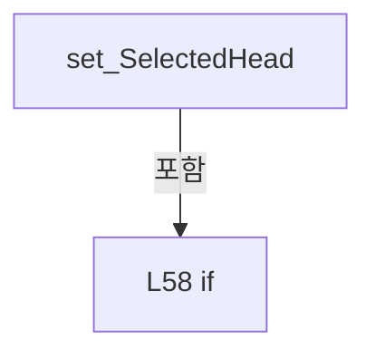

변경 전 점검: 입력/반환 타입, 위 호출자, 예외/취소 경로, 공유 상태와 저장·전송 소비자를 함께 확인합니다. 값의 단위나 물리 방향을 이름만으로 확정하지 않습니다.

### PropertyDeclaration `StartCommand` · L65–65

[Drilling.UI/Menu/Menus/CManualPowerMeasurePanel.cs:65–65](https://github.com/kjuws10-rgb/A3Drilling/blob/5aee8e58439c9b455cae7c9593c9be986c3e682e/Drilling.UI/Menu/Menus/CManualPowerMeasurePanel.cs#L65-L65)

| 항목 | 실제 추출 값 |
| --- | --- |
| 서명 | Drilling.UI.Menu.CButtonCommand Drilling.UI.Menu.Menus.CManualPowerMeasurePanel.StartCommand |
| 접근/수식자 | Public / public |
| 반환/값 타입 | Drilling.UI.Menu.CButtonCommand |
| 소속 타입 | NamedType:Drilling.UI.Menu.Menus.CManualPowerMeasurePanel |

현재 부분 분석에서 직접 연결된 호출자는 없습니다. XAML/이벤트/인터페이스·델리게이트·외부 진입을 추가 확인해야 하며, 미사용으로 판정한 것이 아닙니다.

변경 전 점검: 입력/반환 타입, 위 호출자, 예외/취소 경로, 공유 상태와 저장·전송 소비자를 함께 확인합니다. 값의 단위나 물리 방향을 이름만으로 확정하지 않습니다.

### GetAccessorDeclaration `get_StartCommand` · L65–65

[Drilling.UI/Menu/Menus/CManualPowerMeasurePanel.cs:65–65](https://github.com/kjuws10-rgb/A3Drilling/blob/5aee8e58439c9b455cae7c9593c9be986c3e682e/Drilling.UI/Menu/Menus/CManualPowerMeasurePanel.cs#L65-L65)

| 항목 | 실제 추출 값 |
| --- | --- |
| 서명 | Drilling.UI.Menu.CButtonCommand Drilling.UI.Menu.Menus.CManualPowerMeasurePanel.StartCommand.get |
| 접근/수식자 | Public / get |
| 반환/값 타입 | Drilling.UI.Menu.CButtonCommand |
| 소속 타입 | NamedType:Drilling.UI.Menu.Menus.CManualPowerMeasurePanel |

현재 부분 분석에서 직접 연결된 호출자는 없습니다. XAML/이벤트/인터페이스·델리게이트·외부 진입을 추가 확인해야 하며, 미사용으로 판정한 것이 아닙니다.

변경 전 점검: 입력/반환 타입, 위 호출자, 예외/취소 경로, 공유 상태와 저장·전송 소비자를 함께 확인합니다. 값의 단위나 물리 방향을 이름만으로 확정하지 않습니다.

### PropertyDeclaration `StopCommand` · L66–66

[Drilling.UI/Menu/Menus/CManualPowerMeasurePanel.cs:66–66](https://github.com/kjuws10-rgb/A3Drilling/blob/5aee8e58439c9b455cae7c9593c9be986c3e682e/Drilling.UI/Menu/Menus/CManualPowerMeasurePanel.cs#L66-L66)

| 항목 | 실제 추출 값 |
| --- | --- |
| 서명 | Drilling.UI.Menu.CButtonCommand Drilling.UI.Menu.Menus.CManualPowerMeasurePanel.StopCommand |
| 접근/수식자 | Public / public |
| 반환/값 타입 | Drilling.UI.Menu.CButtonCommand |
| 소속 타입 | NamedType:Drilling.UI.Menu.Menus.CManualPowerMeasurePanel |

현재 부분 분석에서 직접 연결된 호출자는 없습니다. XAML/이벤트/인터페이스·델리게이트·외부 진입을 추가 확인해야 하며, 미사용으로 판정한 것이 아닙니다.

변경 전 점검: 입력/반환 타입, 위 호출자, 예외/취소 경로, 공유 상태와 저장·전송 소비자를 함께 확인합니다. 값의 단위나 물리 방향을 이름만으로 확정하지 않습니다.

### GetAccessorDeclaration `get_StopCommand` · L66–66

[Drilling.UI/Menu/Menus/CManualPowerMeasurePanel.cs:66–66](https://github.com/kjuws10-rgb/A3Drilling/blob/5aee8e58439c9b455cae7c9593c9be986c3e682e/Drilling.UI/Menu/Menus/CManualPowerMeasurePanel.cs#L66-L66)

| 항목 | 실제 추출 값 |
| --- | --- |
| 서명 | Drilling.UI.Menu.CButtonCommand Drilling.UI.Menu.Menus.CManualPowerMeasurePanel.StopCommand.get |
| 접근/수식자 | Public / get |
| 반환/값 타입 | Drilling.UI.Menu.CButtonCommand |
| 소속 타입 | NamedType:Drilling.UI.Menu.Menus.CManualPowerMeasurePanel |

현재 부분 분석에서 직접 연결된 호출자는 없습니다. XAML/이벤트/인터페이스·델리게이트·외부 진입을 추가 확인해야 하며, 미사용으로 판정한 것이 아닙니다.

변경 전 점검: 입력/반환 타입, 위 호출자, 예외/취소 경로, 공유 상태와 저장·전송 소비자를 함께 확인합니다. 값의 단위나 물리 방향을 이름만으로 확정하지 않습니다.

### PropertyDeclaration `ToggleViewCommand` · L67–67

[Drilling.UI/Menu/Menus/CManualPowerMeasurePanel.cs:67–67](https://github.com/kjuws10-rgb/A3Drilling/blob/5aee8e58439c9b455cae7c9593c9be986c3e682e/Drilling.UI/Menu/Menus/CManualPowerMeasurePanel.cs#L67-L67)

| 항목 | 실제 추출 값 |
| --- | --- |
| 서명 | Drilling.UI.Menu.CButtonCommand Drilling.UI.Menu.Menus.CManualPowerMeasurePanel.ToggleViewCommand |
| 접근/수식자 | Public / public |
| 반환/값 타입 | Drilling.UI.Menu.CButtonCommand |
| 소속 타입 | NamedType:Drilling.UI.Menu.Menus.CManualPowerMeasurePanel |

현재 부분 분석에서 직접 연결된 호출자는 없습니다. XAML/이벤트/인터페이스·델리게이트·외부 진입을 추가 확인해야 하며, 미사용으로 판정한 것이 아닙니다.

변경 전 점검: 입력/반환 타입, 위 호출자, 예외/취소 경로, 공유 상태와 저장·전송 소비자를 함께 확인합니다. 값의 단위나 물리 방향을 이름만으로 확정하지 않습니다.

### GetAccessorDeclaration `get_ToggleViewCommand` · L67–67

[Drilling.UI/Menu/Menus/CManualPowerMeasurePanel.cs:67–67](https://github.com/kjuws10-rgb/A3Drilling/blob/5aee8e58439c9b455cae7c9593c9be986c3e682e/Drilling.UI/Menu/Menus/CManualPowerMeasurePanel.cs#L67-L67)

| 항목 | 실제 추출 값 |
| --- | --- |
| 서명 | Drilling.UI.Menu.CButtonCommand Drilling.UI.Menu.Menus.CManualPowerMeasurePanel.ToggleViewCommand.get |
| 접근/수식자 | Public / get |
| 반환/값 타입 | Drilling.UI.Menu.CButtonCommand |
| 소속 타입 | NamedType:Drilling.UI.Menu.Menus.CManualPowerMeasurePanel |

현재 부분 분석에서 직접 연결된 호출자는 없습니다. XAML/이벤트/인터페이스·델리게이트·외부 진입을 추가 확인해야 하며, 미사용으로 판정한 것이 아닙니다.

변경 전 점검: 입력/반환 타입, 위 호출자, 예외/취소 경로, 공유 상태와 저장·전송 소비자를 함께 확인합니다. 값의 단위나 물리 방향을 이름만으로 확정하지 않습니다.

### PropertyDeclaration `SelectGraphHeadCommand` · L68–68

[Drilling.UI/Menu/Menus/CManualPowerMeasurePanel.cs:68–68](https://github.com/kjuws10-rgb/A3Drilling/blob/5aee8e58439c9b455cae7c9593c9be986c3e682e/Drilling.UI/Menu/Menus/CManualPowerMeasurePanel.cs#L68-L68)

| 항목 | 실제 추출 값 |
| --- | --- |
| 서명 | Drilling.UI.Menu.CButtonCommand Drilling.UI.Menu.Menus.CManualPowerMeasurePanel.SelectGraphHeadCommand |
| 접근/수식자 | Public / public |
| 반환/값 타입 | Drilling.UI.Menu.CButtonCommand |
| 소속 타입 | NamedType:Drilling.UI.Menu.Menus.CManualPowerMeasurePanel |

현재 부분 분석에서 직접 연결된 호출자는 없습니다. XAML/이벤트/인터페이스·델리게이트·외부 진입을 추가 확인해야 하며, 미사용으로 판정한 것이 아닙니다.

변경 전 점검: 입력/반환 타입, 위 호출자, 예외/취소 경로, 공유 상태와 저장·전송 소비자를 함께 확인합니다. 값의 단위나 물리 방향을 이름만으로 확정하지 않습니다.

### GetAccessorDeclaration `get_SelectGraphHeadCommand` · L68–68

[Drilling.UI/Menu/Menus/CManualPowerMeasurePanel.cs:68–68](https://github.com/kjuws10-rgb/A3Drilling/blob/5aee8e58439c9b455cae7c9593c9be986c3e682e/Drilling.UI/Menu/Menus/CManualPowerMeasurePanel.cs#L68-L68)

| 항목 | 실제 추출 값 |
| --- | --- |
| 서명 | Drilling.UI.Menu.CButtonCommand Drilling.UI.Menu.Menus.CManualPowerMeasurePanel.SelectGraphHeadCommand.get |
| 접근/수식자 | Public / get |
| 반환/값 타입 | Drilling.UI.Menu.CButtonCommand |
| 소속 타입 | NamedType:Drilling.UI.Menu.Menus.CManualPowerMeasurePanel |

현재 부분 분석에서 직접 연결된 호출자는 없습니다. XAML/이벤트/인터페이스·델리게이트·외부 진입을 추가 확인해야 하며, 미사용으로 판정한 것이 아닙니다.

변경 전 점검: 입력/반환 타입, 위 호출자, 예외/취소 경로, 공유 상태와 저장·전송 소비자를 함께 확인합니다. 값의 단위나 물리 방향을 이름만으로 확정하지 않습니다.

### PropertyDeclaration `StageMotion` · L69–69

[Drilling.UI/Menu/Menus/CManualPowerMeasurePanel.cs:69–69](https://github.com/kjuws10-rgb/A3Drilling/blob/5aee8e58439c9b455cae7c9593c9be986c3e682e/Drilling.UI/Menu/Menus/CManualPowerMeasurePanel.cs#L69-L69)

| 항목 | 실제 추출 값 |
| --- | --- |
| 서명 | Drilling.UI.Menu.Menus.CManualPowerStagePanel Drilling.UI.Menu.Menus.CManualPowerMeasurePanel.StageMotion |
| 접근/수식자 | Public / public |
| 반환/값 타입 | Drilling.UI.Menu.Menus.CManualPowerStagePanel |
| 소속 타입 | NamedType:Drilling.UI.Menu.Menus.CManualPowerMeasurePanel |

현재 부분 분석에서 직접 연결된 호출자는 없습니다. XAML/이벤트/인터페이스·델리게이트·외부 진입을 추가 확인해야 하며, 미사용으로 판정한 것이 아닙니다.

변경 전 점검: 입력/반환 타입, 위 호출자, 예외/취소 경로, 공유 상태와 저장·전송 소비자를 함께 확인합니다. 값의 단위나 물리 방향을 이름만으로 확정하지 않습니다.

### GetAccessorDeclaration `get_StageMotion` · L69–69

[Drilling.UI/Menu/Menus/CManualPowerMeasurePanel.cs:69–69](https://github.com/kjuws10-rgb/A3Drilling/blob/5aee8e58439c9b455cae7c9593c9be986c3e682e/Drilling.UI/Menu/Menus/CManualPowerMeasurePanel.cs#L69-L69)

| 항목 | 실제 추출 값 |
| --- | --- |
| 서명 | Drilling.UI.Menu.Menus.CManualPowerStagePanel Drilling.UI.Menu.Menus.CManualPowerMeasurePanel.StageMotion.get |
| 접근/수식자 | Public / get |
| 반환/값 타입 | Drilling.UI.Menu.Menus.CManualPowerStagePanel |
| 소속 타입 | NamedType:Drilling.UI.Menu.Menus.CManualPowerMeasurePanel |

현재 부분 분석에서 직접 연결된 호출자는 없습니다. XAML/이벤트/인터페이스·델리게이트·외부 진입을 추가 확인해야 하며, 미사용으로 판정한 것이 아닙니다.

변경 전 점검: 입력/반환 타입, 위 호출자, 예외/취소 경로, 공유 상태와 저장·전송 소비자를 함께 확인합니다. 값의 단위나 물리 방향을 이름만으로 확정하지 않습니다.

### ConstructorDeclaration `.ctor` · L71–101

[Drilling.UI/Menu/Menus/CManualPowerMeasurePanel.cs:71–101](https://github.com/kjuws10-rgb/A3Drilling/blob/5aee8e58439c9b455cae7c9593c9be986c3e682e/Drilling.UI/Menu/Menus/CManualPowerMeasurePanel.cs#L71-L101)

| 항목 | 실제 추출 값 |
| --- | --- |
| 서명 | Drilling.UI.Menu.Menus.CManualPowerMeasurePanel.CManualPowerMeasurePanel(Drilling.Common.Interface.CPowerMeasureService, System.Func<System.Collections.Generic.IReadOnlyList<Drilling.Common.Interface.ST_INTERFACE_DATA>>, Drilling.Common.Interface.IPowerMeasureTable?, System.Action<string>, System.Func<string, bool>, System.Func<System.Collections.Generic.IReadOnlyList<Drilling.UI.Menu.Menus.ST_MOTOR_STATUS_ITEM>>?, System.Func<Drilling.Common.Interface.EN_COMM_STATE>?, Drilling.Common.Motion.CManualStageMotionSimulation?, Drilling.UI.Menu.Menus.CManualStageMoveOperation?, System.Func<System.Collections.Generic.IReadOnlyList<Drilling.Common.Interface.ST_POWER_MEASURE_TARGET>, System.Threading.CancellationToken, System.Threading.Tasks.Task>?, bool) |
| 접근/수식자 | Public / public |
| 반환/값 타입 | void |
| 소속 타입 | NamedType:Drilling.UI.Menu.Menus.CManualPowerMeasurePanel |

입력 계약:

| 이름 | 타입 | 전달 | 선택/기본값 |
| --- | --- | --- | --- |
| service | Drilling.Common.Interface.CPowerMeasureService | None | False /  |
| getPowerMeters | System.Func<System.Collections.Generic.IReadOnlyList<Drilling.Common.Interface.ST_INTERFACE_DATA>> | None | False /  |
| powerTable | Drilling.Common.Interface.IPowerMeasureTable? | None | False /  |
| warn | System.Action<string> | None | False /  |
| confirm | System.Func<string, bool> | None | False /  |
| readStageSnapshot | System.Func<System.Collections.Generic.IReadOnlyList<Drilling.UI.Menu.Menus.ST_MOTOR_STATUS_ITEM>>? | None | True / null |
| readStageConnectionState | System.Func<Drilling.Common.Interface.EN_COMM_STATE>? | None | True / null |
| stageSimulation | Drilling.Common.Motion.CManualStageMotionSimulation? | None | True / null |
| stageMove | Drilling.UI.Menu.Menus.CManualStageMoveOperation? | None | True / null |
| runMeasurement | System.Func<System.Collections.Generic.IReadOnlyList<Drilling.Common.Interface.ST_POWER_MEASURE_TARGET>, System.Threading.CancellationToken, System.Threading.Tasks.Task>? | None | True / null |
| readOnly | bool | None | True / false |

정적 호출자로 확인된 위치:

| 호출 파일/행 | 호출 표현식 | 런타임 분기 가능 |
| --- | --- | --- |
| [Drilling.UI/Menu/Menus/CMenuMain.cs:2303–2305](https://github.com/kjuws10-rgb/A3Drilling/blob/5aee8e58439c9b455cae7c9593c9be986c3e682e/Drilling.UI/Menu/Menus/CMenuMain.cs#L2303-L2305) | new CManualPowerMeasurePanel | False |
| [Drilling.UI/Menu/Menus/CMenuManual.cs:6294–6309](https://github.com/kjuws10-rgb/A3Drilling/blob/5aee8e58439c9b455cae7c9593c9be986c3e682e/Drilling.UI/Menu/Menus/CMenuManual.cs#L6294-L6309) | new | False |

호출하는 대상과 해석 범위:

| 원본 행 | 표현식 | 분석 상태 | 대상/소스 위치 |
| --- | --- | --- | --- |
| 89 | new | resolved | Drilling.UI.Menu.Menus.CManualPowerStagePanel.CManualPowerStagePanel(System.Func<System.Collections.Generic.IReadOnlyList<Drilling.UI.Menu.Menus.ST_MOTOR_STATUS_ITEM>>, System.Action<string>, System.Func<string, bool>, Drilling.Common.Motion.CManualStageMotionSimulation?, System.Func<Drilling.Common.Interface.EN_COMM_STATE>?, Drilling.UI.Menu.Menus.CManualStageMoveOperation?) · Drilling.UI/Menu/Menus/CManualPowerStagePanel.cs:109 |
| 90 | new | resolved | Drilling.UI.Menu.CButtonCommand.CButtonCommand(System.Action<object?>, System.Predicate<object?>?) · Drilling.UI/Menu/CButtonCommand.cs:9 |
| 90 | Start | resolved | System.Threading.Tasks.Task Drilling.UI.Menu.Menus.CManualPowerMeasurePanel.Start() · Drilling.UI/Menu/Menus/CManualPowerMeasurePanel.cs:157 |
| 91 | new | resolved | Drilling.UI.Menu.CButtonCommand.CButtonCommand(System.Action<object?>, System.Predicate<object?>?) · Drilling.UI/Menu/CButtonCommand.cs:9 |
| 91 | Stop | resolved | System.Threading.Tasks.Task Drilling.UI.Menu.Menus.CManualPowerMeasurePanel.Stop() · Drilling.UI/Menu/Menus/CManualPowerMeasurePanel.cs:197 |
| 92 | new | resolved | Drilling.UI.Menu.CButtonCommand.CButtonCommand(System.Action<object?>, System.Predicate<object?>?) · Drilling.UI/Menu/CButtonCommand.cs:9 |
| 95 | Notify | resolved | void Drilling.UI.Menu.Menus.CManualPowerMeasurePanel.Notify(string?) · Drilling.UI/Menu/Menus/CManualPowerMeasurePanel.cs:219 |
| 95 | nameof | unresolved | None |
| 95 | Notify | resolved | void Drilling.UI.Menu.Menus.CManualPowerMeasurePanel.Notify(string?) · Drilling.UI/Menu/Menus/CManualPowerMeasurePanel.cs:219 |
| 95 | nameof | unresolved | None |
| 95 | Notify | resolved | void Drilling.UI.Menu.Menus.CManualPowerMeasurePanel.Notify(string?) · Drilling.UI/Menu/Menus/CManualPowerMeasurePanel.cs:219 |
| 95 | nameof | unresolved | None |
| 97 | new | resolved | Drilling.UI.Menu.CButtonCommand.CButtonCommand(System.Action<object?>, System.Predicate<object?>?) · Drilling.UI/Menu/CButtonCommand.cs:9 |
| 99 | Heads.Contains | resolved | bool System.Collections.Generic.IEnumerable<Drilling.UI.Menu.Menus.CPowerMeasureRow>.Contains<Drilling.UI.Menu.Menus.CPowerMeasureRow>(Drilling.UI.Menu.Menus.CPowerMeasureRow) |

본문의 실제 연산·분기·예외·반환 순서(원문 위치 순):

| 원본 행 | 종류 | 주석 해설 |
| --- | --- | --- |
| 87 | assignment | 값을 대상에 대입합니다: _service = service |
| 87 | assignment | 값을 대상에 대입합니다: _getPowerMeters = getPowerMeters |
| 87 | assignment | 값을 대상에 대입합니다: _warn = warn |
| 87 | assignment | 값을 대상에 대입합니다: _confirm = confirm |
| 88 | assignment | 값을 대상에 대입합니다: _runMeasurement = runMeasurement |
| 88 | assignment | 값을 대상에 대입합니다: IsReadOnly = readOnly |
| 89 | assignment | 값을 대상에 대입합니다: StageMotion = new(readStageSnapshot ?? (() => []), warn, confirm, stageSimulation, readStageConnectionState, stageMove) |
| 89 | call | 함수·델리게이트 또는 객체 생성자를 호출합니다: new(readStageSnapshot ?? (() => []), warn, confirm, stageSimulation, readStageConnectionState, stageMove) |
| 90 | assignment | 값을 대상에 대입합니다: StartCommand = new(async _ => await Start(), _ => CanEdit && Heads.Count > 0) |
| 90 | await | 비동기 완료를 기다립니다: await Start() |
| 90 | call | 함수·델리게이트 또는 객체 생성자를 호출합니다: new(async _ => await Start(), _ => CanEdit && Heads.Count > 0) |
| 90 | call | 함수·델리게이트 또는 객체 생성자를 호출합니다: Start() |
| 91 | assignment | 값을 대상에 대입합니다: StopCommand = new(async _ => await Stop(), _ => _busy && !_stopping) |
| 91 | await | 비동기 완료를 기다립니다: await Stop() |
| 91 | call | 함수·델리게이트 또는 객체 생성자를 호출합니다: new(async _ => await Stop(), _ => _busy && !_stopping) |
| 91 | call | 함수·델리게이트 또는 객체 생성자를 호출합니다: Stop() |
| 92 | assignment | 값을 대상에 대입합니다: ToggleViewCommand = new(_ => { _isGraphView = !_isGraphView; Notify(nameof(GraphViewVisibility)); Notify(nameof(GridViewVisibility)); Notify(nameof(ViewToggleText)); }) |
| 92 | call | 함수·델리게이트 또는 객체 생성자를 호출합니다: new(_ => { _isGraphView = !_isGraphView; Notify(nameof(GraphViewVisibility)); Notify(nameof(GridViewVisibility)); Notify(nameof(ViewToggleText)); }) |
| 94 | assignment | 값을 대상에 대입합니다: _isGraphView = !_isGraphView |
| 95 | call | 함수·델리게이트 또는 객체 생성자를 호출합니다: Notify(nameof(GraphViewVisibility)) |
| 95 | call | 함수·델리게이트 또는 객체 생성자를 호출합니다: nameof(GraphViewVisibility) |
| 95 | call | 함수·델리게이트 또는 객체 생성자를 호출합니다: Notify(nameof(GridViewVisibility)) |
| 95 | call | 함수·델리게이트 또는 객체 생성자를 호출합니다: nameof(GridViewVisibility) |
| 95 | call | 함수·델리게이트 또는 객체 생성자를 호출합니다: Notify(nameof(ViewToggleText)) |
| 95 | call | 함수·델리게이트 또는 객체 생성자를 호출합니다: nameof(ViewToggleText) |
| 97 | assignment | 값을 대상에 대입합니다: SelectGraphHeadCommand = new(value => { if (value is CPowerMeasureRow row && Heads.Contains(row)) SelectedHead = row; }) |
| 97 | call | 함수·델리게이트 또는 객체 생성자를 호출합니다: new(value => { if (value is CPowerMeasureRow row && Heads.Contains(row)) SelectedHead = row; }) |
| 99 | assignment | 값을 대상에 대입합니다: SelectedHead = row |
| 99 | call | 함수·델리게이트 또는 객체 생성자를 호출합니다: Heads.Contains(row) |
| 99 | if | 조건에 따라 분기합니다: if (value is CPowerMeasureRow row && Heads.Contains(row)) |

제어 구문의 포함 구조(실제 실행 순서/CFG가 아닌 구문 탐색 그림):

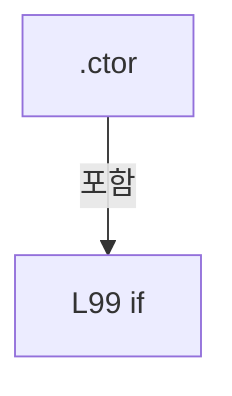

변경 전 점검: 입력/반환 타입, 위 호출자, 예외/취소 경로, 공유 상태와 저장·전송 소비자를 함께 확인합니다. 값의 단위나 물리 방향을 이름만으로 확정하지 않습니다.

### MethodDeclaration `UpdateHeads` · L103–125

[Drilling.UI/Menu/Menus/CManualPowerMeasurePanel.cs:103–125](https://github.com/kjuws10-rgb/A3Drilling/blob/5aee8e58439c9b455cae7c9593c9be986c3e682e/Drilling.UI/Menu/Menus/CManualPowerMeasurePanel.cs#L103-L125)

| 항목 | 실제 추출 값 |
| --- | --- |
| 서명 | void Drilling.UI.Menu.Menus.CManualPowerMeasurePanel.UpdateHeads(System.Collections.Generic.IReadOnlyList<int>) |
| 접근/수식자 | Public / public |
| 반환/값 타입 | void |
| 소속 타입 | NamedType:Drilling.UI.Menu.Menus.CManualPowerMeasurePanel |

입력 계약:

| 이름 | 타입 | 전달 | 선택/기본값 |
| --- | --- | --- | --- |
| selectedHeads | System.Collections.Generic.IReadOnlyList<int> | None | False /  |

정적 호출자로 확인된 위치:

| 호출 파일/행 | 호출 표현식 | 런타임 분기 가능 |
| --- | --- | --- |
| [Drilling.UI/Menu/Menus/CMenuMain.cs:2306–2306](https://github.com/kjuws10-rgb/A3Drilling/blob/5aee8e58439c9b455cae7c9593c9be986c3e682e/Drilling.UI/Menu/Menus/CMenuMain.cs#L2306-L2306) | panel.UpdateHeads | False |
| [Drilling.UI/Menu/Menus/CMenuManual.cs:6220–6220](https://github.com/kjuws10-rgb/A3Drilling/blob/5aee8e58439c9b455cae7c9593c9be986c3e682e/Drilling.UI/Menu/Menus/CMenuManual.cs#L6220-L6220) | PowerMeasurePanel.UpdateHeads | False |
| [Drilling.UI/Menu/Menus/CMenuManual.cs:6325–6325](https://github.com/kjuws10-rgb/A3Drilling/blob/5aee8e58439c9b455cae7c9593c9be986c3e682e/Drilling.UI/Menu/Menus/CMenuManual.cs#L6325-L6325) | _powerMeasurePanel.UpdateHeads | False |
| [Drilling.UI/Menu/Menus/CMenuManual.cs:6330–6330](https://github.com/kjuws10-rgb/A3Drilling/blob/5aee8e58439c9b455cae7c9593c9be986c3e682e/Drilling.UI/Menu/Menus/CMenuManual.cs#L6330-L6330) | .UpdateHeads | False |

호출하는 대상과 해석 범위:

| 원본 행 | 표현식 | 분석 상태 | 대상/소스 위치 |
| --- | --- | --- | --- |
| 105 | ApplySnapshot | resolved | void Drilling.UI.Menu.Menus.CManualPowerMeasurePanel.ApplySnapshot() · Drilling.UI/Menu/Menus/CManualPowerMeasurePanel.cs:133 |
| 106 | GetPowerMeterOptions | resolved | System.Collections.Generic.IReadOnlyList<Drilling.UI.Menu.Menus.ST_MANUAL_POWER_METER_OPTION> Drilling.UI.Menu.Menus.CManualPowerMeasurePanel.GetPowerMeterOptions() · Drilling.UI/Menu/Menus/CManualPowerMeasurePanel.cs:127 |
| 107 | selectedHeads.Distinct().Order().Select(head => { if (!_rows.TryGetValue(head, out var row)) { _rows[head] = row = new(head); row.InputChanged += ApplySnapshot; } row.UpdatePowerMeters(meters); return row; }).ToArray | resolved | Drilling.UI.Menu.Menus.CPowerMeasureRow[] System.Collections.Generic.IEnumerable<Drilling.UI.Menu.Menus.CPowerMeasureRow>.ToArray<Drilling.UI.Menu.Menus.CPowerMeasureRow>() |
| 107 | selectedHeads.Distinct().Order().Select | resolved | System.Collections.Generic.IEnumerable<Drilling.UI.Menu.Menus.CPowerMeasureRow> System.Collections.Generic.IEnumerable<int>.Select<int, Drilling.UI.Menu.Menus.CPowerMeasureRow>(System.Func<int, Drilling.UI.Menu.Menus.CPowerMeasureRow>) |
| 107 | selectedHeads.Distinct().Order | resolved | System.Linq.IOrderedEnumerable<int> System.Collections.Generic.IEnumerable<int>.Order<int>() |
| 107 | selectedHeads.Distinct | resolved | System.Collections.Generic.IEnumerable<int> System.Collections.Generic.IEnumerable<int>.Distinct<int>() |
| 109 | _rows.TryGetValue | resolved | bool System.Collections.Generic.Dictionary<int, Drilling.UI.Menu.Menus.CPowerMeasureRow>.TryGetValue(int, out Drilling.UI.Menu.Menus.CPowerMeasureRow) |
| 111 | new | resolved | Drilling.UI.Menu.Menus.CPowerMeasureRow.CPowerMeasureRow(int) · Drilling.UI/Menu/Menus/CManualPowerMeasurePanel.cs:222 |
| 114 | row.UpdatePowerMeters | resolved | void Drilling.UI.Menu.Menus.CPowerMeasureRow.UpdatePowerMeters(System.Collections.Generic.IReadOnlyList<Drilling.UI.Menu.Menus.ST_MANUAL_POWER_METER_OPTION>) · Drilling.UI/Menu/Menus/CManualPowerMeasurePanel.cs:250 |
| 117 | Heads.SequenceEqual | resolved | bool System.Collections.Generic.IEnumerable<Drilling.UI.Menu.Menus.CPowerMeasureRow>.SequenceEqual<Drilling.UI.Menu.Menus.CPowerMeasureRow>(System.Collections.Generic.IEnumerable<Drilling.UI.Menu.Menus.CPowerMeasureRow>) |
| 120 | Notify | resolved | void Drilling.UI.Menu.Menus.CManualPowerMeasurePanel.Notify(string?) · Drilling.UI/Menu/Menus/CManualPowerMeasurePanel.cs:219 |
| 120 | nameof | unresolved | None |
| 120 | Notify | resolved | void Drilling.UI.Menu.Menus.CManualPowerMeasurePanel.Notify(string?) · Drilling.UI/Menu/Menus/CManualPowerMeasurePanel.cs:219 |
| 120 | nameof | unresolved | None |
| 120 | Notify | resolved | void Drilling.UI.Menu.Menus.CManualPowerMeasurePanel.Notify(string?) · Drilling.UI/Menu/Menus/CManualPowerMeasurePanel.cs:219 |
| 120 | nameof | unresolved | None |
| 121 | Heads.Contains | resolved | bool System.Collections.Generic.IEnumerable<Drilling.UI.Menu.Menus.CPowerMeasureRow>.Contains<Drilling.UI.Menu.Menus.CPowerMeasureRow>(Drilling.UI.Menu.Menus.CPowerMeasureRow) |
| 121 | Heads.FirstOrDefault | resolved | Drilling.UI.Menu.Menus.CPowerMeasureRow? System.Collections.Generic.IEnumerable<Drilling.UI.Menu.Menus.CPowerMeasureRow>.FirstOrDefault<Drilling.UI.Menu.Menus.CPowerMeasureRow>() |
| 123 | ApplySnapshot | resolved | void Drilling.UI.Menu.Menus.CManualPowerMeasurePanel.ApplySnapshot() · Drilling.UI/Menu/Menus/CManualPowerMeasurePanel.cs:133 |
| 124 | NotifyCommands | resolved | void Drilling.UI.Menu.Menus.CManualPowerMeasurePanel.NotifyCommands() · Drilling.UI/Menu/Menus/CManualPowerMeasurePanel.cs:214 |

본문의 실제 연산·분기·예외·반환 순서(원문 위치 순):

| 원본 행 | 종류 | 주석 해설 |
| --- | --- | --- |
| 105 | call | 함수·델리게이트 또는 객체 생성자를 호출합니다: ApplySnapshot() |
| 105 | if | 조건에 따라 분기합니다: if (_busy) |
| 105 | return | 호출자에게 값 또는 제어를 반환합니다: return; |
| 106 | call | 함수·델리게이트 또는 객체 생성자를 호출합니다: GetPowerMeterOptions() |
| 106 | local-declaration | 지역 변수를 선언합니다: var meters = GetPowerMeterOptions(); |
| 106 | variable-initializer | 변수의 초기값을 지정합니다: meters = GetPowerMeterOptions() |
| 107 | call | 함수·델리게이트 또는 객체 생성자를 호출합니다: selectedHeads.Distinct().Order() |
| 107 | call | 함수·델리게이트 또는 객체 생성자를 호출합니다: selectedHeads.Distinct() |
| 107 | call | 함수·델리게이트 또는 객체 생성자를 호출합니다: selectedHeads.Distinct().Order().Select(head => { if (!_rows.TryGetValue(head, out var row)) { _rows[head] = row = new(head); row.InputChanged += ApplySnapshot; } row.UpdatePowerMeters(meters); return row; }).ToArray() |
| 107 | call | 함수·델리게이트 또는 객체 생성자를 호출합니다: selectedHeads.Distinct().Order().Select(head => { if (!_rows.TryGetValue(head, out var row)) { _rows[head] = row = new(head); row.InputChanged += ApplySnapshot; } row.UpdatePowerMeters(meters); return row; }) |
| 107 | local-declaration | 지역 변수를 선언합니다: var rows = selectedHeads.Distinct().Order().Select(head => { if (!_rows.TryGetValue(head, out var row)) { _rows[head] = row = new(head); row.InputChanged += ApplySnapshot; } row.UpdatePowerMeters(meters); return row; }).ToArray(); |
| 107 | variable-initializer | 변수의 초기값을 지정합니다: rows = selectedHeads.Distinct().Order().Select(head => { if (!_rows.TryGetValue(head, out var row)) { _rows[head] = row = new(head); row.InputChanged += ApplySnapshot; } row.UpdatePowerMeters(meters); return row; }).ToArray() |
| 109 | call | 함수·델리게이트 또는 객체 생성자를 호출합니다: _rows.TryGetValue(head, out var row) |
| 109 | if | 조건에 따라 분기합니다: if (!_rows.TryGetValue(head, out var row)) |
| 111 | assignment | 값을 대상에 대입합니다: _rows[head] = row = new(head) |
| 111 | assignment | 값을 대상에 대입합니다: row = new(head) |
| 111 | call | 함수·델리게이트 또는 객체 생성자를 호출합니다: new(head) |
| 112 | compound-assignment-or-event-subscription | 복합 대입 또는 이벤트 구독/해지 표현입니다: row.InputChanged += ApplySnapshot |
| 114 | call | 함수·델리게이트 또는 객체 생성자를 호출합니다: row.UpdatePowerMeters(meters) |
| 115 | return | 호출자에게 값 또는 제어를 반환합니다: return row; |
| 117 | call | 함수·델리게이트 또는 객체 생성자를 호출합니다: Heads.SequenceEqual(rows) |
| 117 | if | 조건에 따라 분기합니다: if (!Heads.SequenceEqual(rows)) |
| 119 | assignment | 값을 대상에 대입합니다: Heads = rows |
| 120 | call | 함수·델리게이트 또는 객체 생성자를 호출합니다: Notify(nameof(Heads)) |
| 120 | call | 함수·델리게이트 또는 객체 생성자를 호출합니다: nameof(Heads) |
| 120 | call | 함수·델리게이트 또는 객체 생성자를 호출합니다: Notify(nameof(HasHeads)) |
| 120 | call | 함수·델리게이트 또는 객체 생성자를 호출합니다: nameof(HasHeads) |
| 120 | call | 함수·델리게이트 또는 객체 생성자를 호출합니다: Notify(nameof(GraphColumns)) |
| 120 | call | 함수·델리게이트 또는 객체 생성자를 호출합니다: nameof(GraphColumns) |
| 121 | assignment | 값을 대상에 대입합니다: SelectedHead = Heads.FirstOrDefault() |
| 121 | call | 함수·델리게이트 또는 객체 생성자를 호출합니다: Heads.Contains(SelectedHead) |
| 121 | call | 함수·델리게이트 또는 객체 생성자를 호출합니다: Heads.FirstOrDefault() |
| 121 | if | 조건에 따라 분기합니다: if (SelectedHead is null &#124;&#124; !Heads.Contains(SelectedHead)) |
| 123 | call | 함수·델리게이트 또는 객체 생성자를 호출합니다: ApplySnapshot() |
| 124 | call | 함수·델리게이트 또는 객체 생성자를 호출합니다: NotifyCommands() |

제어 구문의 포함 구조(실제 실행 순서/CFG가 아닌 구문 탐색 그림):

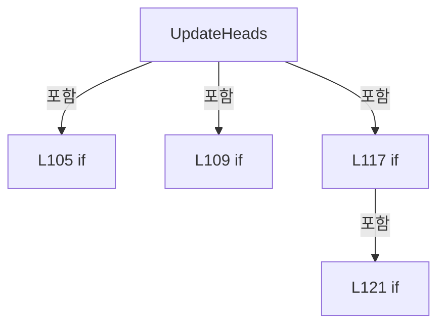

변경 전 점검: 입력/반환 타입, 위 호출자, 예외/취소 경로, 공유 상태와 저장·전송 소비자를 함께 확인합니다. 값의 단위나 물리 방향을 이름만으로 확정하지 않습니다.

### MethodDeclaration `GetPowerMeterOptions` · L127–131

[Drilling.UI/Menu/Menus/CManualPowerMeasurePanel.cs:127–131](https://github.com/kjuws10-rgb/A3Drilling/blob/5aee8e58439c9b455cae7c9593c9be986c3e682e/Drilling.UI/Menu/Menus/CManualPowerMeasurePanel.cs#L127-L131)

| 항목 | 실제 추출 값 |
| --- | --- |
| 서명 | System.Collections.Generic.IReadOnlyList<Drilling.UI.Menu.Menus.ST_MANUAL_POWER_METER_OPTION> Drilling.UI.Menu.Menus.CManualPowerMeasurePanel.GetPowerMeterOptions() |
| 접근/수식자 | Private / private |
| 반환/값 타입 | System.Collections.Generic.IReadOnlyList<Drilling.UI.Menu.Menus.ST_MANUAL_POWER_METER_OPTION> |
| 소속 타입 | NamedType:Drilling.UI.Menu.Menus.CManualPowerMeasurePanel |

정적 호출자로 확인된 위치:

| 호출 파일/행 | 호출 표현식 | 런타임 분기 가능 |
| --- | --- | --- |
| [Drilling.UI/Menu/Menus/CManualPowerMeasurePanel.cs:106–106](https://github.com/kjuws10-rgb/A3Drilling/blob/5aee8e58439c9b455cae7c9593c9be986c3e682e/Drilling.UI/Menu/Menus/CManualPowerMeasurePanel.cs#L106-L106) | GetPowerMeterOptions | False |
| [Drilling.UI/Menu/Menus/CManualPowerMeasurePanel.cs:163–163](https://github.com/kjuws10-rgb/A3Drilling/blob/5aee8e58439c9b455cae7c9593c9be986c3e682e/Drilling.UI/Menu/Menus/CManualPowerMeasurePanel.cs#L163-L163) | GetPowerMeterOptions | False |

호출하는 대상과 해석 범위:

| 원본 행 | 표현식 | 분석 상태 | 대상/소스 위치 |
| --- | --- | --- | --- |
| 127 | _getPowerMeters() .Where(m => m.Device == EN_EQP_MODULE.PowerMeter && m.Number >= 0) .DistinctBy(m => m.Number).OrderBy(m => m.Number) .Select(m => new ST_MANUAL_POWER_METER_OPTION(m.Number, $"{(string.IsNullOrWhiteSpace(m.NickName) ? "PowerMeter" : m.NickName)} [{m.Number}]")).ToArray | resolved | Drilling.UI.Menu.Menus.ST_MANUAL_POWER_METER_OPTION[] System.Collections.Generic.IEnumerable<Drilling.UI.Menu.Menus.ST_MANUAL_POWER_METER_OPTION>.ToArray<Drilling.UI.Menu.Menus.ST_MANUAL_POWER_METER_OPTION>() |
| 127 | _getPowerMeters() .Where(m => m.Device == EN_EQP_MODULE.PowerMeter && m.Number >= 0) .DistinctBy(m => m.Number).OrderBy(m => m.Number) .Select | resolved | System.Collections.Generic.IEnumerable<Drilling.UI.Menu.Menus.ST_MANUAL_POWER_METER_OPTION> System.Collections.Generic.IEnumerable<Drilling.Common.Interface.ST_INTERFACE_DATA>.Select<Drilling.Common.Interface.ST_INTERFACE_DATA, Drilling.UI.Menu.Menus.ST_MANUAL_POWER_METER_OPTION>(System.Func<Drilling.Common.Interface.ST_INTERFACE_DATA, Drilling.UI.Menu.Menus.ST_MANUAL_POWER_METER_OPTION>) |
| 127 | _getPowerMeters() .Where(m => m.Device == EN_EQP_MODULE.PowerMeter && m.Number >= 0) .DistinctBy(m => m.Number).OrderBy | resolved | System.Linq.IOrderedEnumerable<Drilling.Common.Interface.ST_INTERFACE_DATA> System.Collections.Generic.IEnumerable<Drilling.Common.Interface.ST_INTERFACE_DATA>.OrderBy<Drilling.Common.Interface.ST_INTERFACE_DATA, int>(System.Func<Drilling.Common.Interface.ST_INTERFACE_DATA, int>) |
| 127 | _getPowerMeters() .Where(m => m.Device == EN_EQP_MODULE.PowerMeter && m.Number >= 0) .DistinctBy | resolved | System.Collections.Generic.IEnumerable<Drilling.Common.Interface.ST_INTERFACE_DATA> System.Collections.Generic.IEnumerable<Drilling.Common.Interface.ST_INTERFACE_DATA>.DistinctBy<Drilling.Common.Interface.ST_INTERFACE_DATA, int>(System.Func<Drilling.Common.Interface.ST_INTERFACE_DATA, int>) |
| 127 | _getPowerMeters() .Where | resolved | System.Collections.Generic.IEnumerable<Drilling.Common.Interface.ST_INTERFACE_DATA> System.Collections.Generic.IEnumerable<Drilling.Common.Interface.ST_INTERFACE_DATA>.Where<Drilling.Common.Interface.ST_INTERFACE_DATA>(System.Func<Drilling.Common.Interface.ST_INTERFACE_DATA, bool>) |
| 127 | _getPowerMeters | resolved · 동적 구현 선택 가능 | System.Collections.Generic.IReadOnlyList<Drilling.Common.Interface.ST_INTERFACE_DATA> System.Func<System.Collections.Generic.IReadOnlyList<Drilling.Common.Interface.ST_INTERFACE_DATA>>.Invoke() |
| 130 | new ST_MANUAL_POWER_METER_OPTION | resolved | Drilling.UI.Menu.Menus.ST_MANUAL_POWER_METER_OPTION.ST_MANUAL_POWER_METER_OPTION(int, string) · Drilling.UI/Menu/Menus/CManualPowerMeasurePanel.cs:334 |
| 131 | string.IsNullOrWhiteSpace | resolved | bool string.IsNullOrWhiteSpace(string?) |

본문의 실제 연산·분기·예외·반환 순서(원문 위치 순):

| 원본 행 | 종류 | 주석 해설 |
| --- | --- | --- |
| 127 | call | 함수·델리게이트 또는 객체 생성자를 호출합니다: _getPowerMeters() |
| 127 | call | 함수·델리게이트 또는 객체 생성자를 호출합니다: _getPowerMeters() .Where(m => m.Device == EN_EQP_MODULE.PowerMeter && m.Number >= 0) |
| 127 | call | 함수·델리게이트 또는 객체 생성자를 호출합니다: _getPowerMeters() .Where(m => m.Device == EN_EQP_MODULE.PowerMeter && m.Number >= 0) .DistinctBy(m => m.Number).OrderBy(m => m.Number) |
| 127 | call | 함수·델리게이트 또는 객체 생성자를 호출합니다: _getPowerMeters() .Where(m => m.Device == EN_EQP_MODULE.PowerMeter && m.Number >= 0) .DistinctBy(m => m.Number) |
| 127 | call | 함수·델리게이트 또는 객체 생성자를 호출합니다: _getPowerMeters() .Where(m => m.Device == EN_EQP_MODULE.PowerMeter && m.Number >= 0) .DistinctBy(m => m.Number).OrderBy(m => m.Number) .Select(m => new ST_MANUAL_POWER_METER_OPTION(m.Number, $"{(string.IsNullOrWhiteSpace… |
| 127 | call | 함수·델리게이트 또는 객체 생성자를 호출합니다: _getPowerMeters() .Where(m => m.Device == EN_EQP_MODULE.PowerMeter && m.Number >= 0) .DistinctBy(m => m.Number).OrderBy(m => m.Number) .Select(m => new ST_MANUAL_POWER_METER_OPTION(m.Number, $"{(string.IsNullOrWhiteSpace… |
| 130 | call | 함수·델리게이트 또는 객체 생성자를 호출합니다: new ST_MANUAL_POWER_METER_OPTION(m.Number, $"{(string.IsNullOrWhiteSpace(m.NickName) ? "PowerMeter" : m.NickName)} [{m.Number}]") |
| 131 | call | 함수·델리게이트 또는 객체 생성자를 호출합니다: string.IsNullOrWhiteSpace(m.NickName) |
| 131 | conditional-expression | 조건에 따라 결과식을 선택합니다: string.IsNullOrWhiteSpace(m.NickName) ? "PowerMeter" : m.NickName |

변경 전 점검: 입력/반환 타입, 위 호출자, 예외/취소 경로, 공유 상태와 저장·전송 소비자를 함께 확인합니다. 값의 단위나 물리 방향을 이름만으로 확정하지 않습니다.

### MethodDeclaration `ApplySnapshot` · L133–155

[Drilling.UI/Menu/Menus/CManualPowerMeasurePanel.cs:133–155](https://github.com/kjuws10-rgb/A3Drilling/blob/5aee8e58439c9b455cae7c9593c9be986c3e682e/Drilling.UI/Menu/Menus/CManualPowerMeasurePanel.cs#L133-L155)

| 항목 | 실제 추출 값 |
| --- | --- |
| 서명 | void Drilling.UI.Menu.Menus.CManualPowerMeasurePanel.ApplySnapshot() |
| 접근/수식자 | Public / public |
| 반환/값 타입 | void |
| 소속 타입 | NamedType:Drilling.UI.Menu.Menus.CManualPowerMeasurePanel |

정적 호출자로 확인된 위치:

| 호출 파일/행 | 호출 표현식 | 런타임 분기 가능 |
| --- | --- | --- |
| [Drilling.UI/Menu/Menus/CManualPowerMeasurePanel.cs:29–29](https://github.com/kjuws10-rgb/A3Drilling/blob/5aee8e58439c9b455cae7c9593c9be986c3e682e/Drilling.UI/Menu/Menus/CManualPowerMeasurePanel.cs#L29-L29) | ApplySnapshot | False |
| [Drilling.UI/Menu/Menus/CManualPowerMeasurePanel.cs:105–105](https://github.com/kjuws10-rgb/A3Drilling/blob/5aee8e58439c9b455cae7c9593c9be986c3e682e/Drilling.UI/Menu/Menus/CManualPowerMeasurePanel.cs#L105-L105) | ApplySnapshot | False |
| [Drilling.UI/Menu/Menus/CManualPowerMeasurePanel.cs:123–123](https://github.com/kjuws10-rgb/A3Drilling/blob/5aee8e58439c9b455cae7c9593c9be986c3e682e/Drilling.UI/Menu/Menus/CManualPowerMeasurePanel.cs#L123-L123) | ApplySnapshot | False |
| [Drilling.UI/Menu/Menus/CManualPowerMeasurePanel.cs:187–187](https://github.com/kjuws10-rgb/A3Drilling/blob/5aee8e58439c9b455cae7c9593c9be986c3e682e/Drilling.UI/Menu/Menus/CManualPowerMeasurePanel.cs#L187-L187) | ApplySnapshot | False |
| [Drilling.UI/Menu/Menus/CManualPowerMeasurePanel.cs:194–194](https://github.com/kjuws10-rgb/A3Drilling/blob/5aee8e58439c9b455cae7c9593c9be986c3e682e/Drilling.UI/Menu/Menus/CManualPowerMeasurePanel.cs#L194-L194) | ApplySnapshot | False |
| [Drilling.UI/Menu/Menus/CManualPowerMeasurePanel.cs:200–200](https://github.com/kjuws10-rgb/A3Drilling/blob/5aee8e58439c9b455cae7c9593c9be986c3e682e/Drilling.UI/Menu/Menus/CManualPowerMeasurePanel.cs#L200-L200) | ApplySnapshot | False |
| [Drilling.UI/Menu/Menus/CManualPowerMeasurePanel.cs:202–202](https://github.com/kjuws10-rgb/A3Drilling/blob/5aee8e58439c9b455cae7c9593c9be986c3e682e/Drilling.UI/Menu/Menus/CManualPowerMeasurePanel.cs#L202-L202) | ApplySnapshot | False |
| [Drilling.UI/Menu/Menus/CMenuMain.cs:2313–2313](https://github.com/kjuws10-rgb/A3Drilling/blob/5aee8e58439c9b455cae7c9593c9be986c3e682e/Drilling.UI/Menu/Menus/CMenuMain.cs#L2313-L2313) | panel.ApplySnapshot | False |

호출하는 대상과 해석 범위:

| 원본 행 | 표현식 | 분석 상태 | 대상/소스 위치 |
| --- | --- | --- | --- |
| 135 | StageMotion.Refresh | resolved | void Drilling.UI.Menu.Menus.CManualPowerStagePanel.Refresh() · Drilling.UI/Menu/Menus/CManualPowerStagePanel.cs:164 |
| 136 | _service.GetSnapshot | resolved | Drilling.Common.Interface.ST_POWER_MEASURE_SNAPSHOT Drilling.Common.Interface.CPowerMeasureService.GetSnapshot() · Drilling.Common/Interface/CPowerMeasureService.cs:12 |
| 140 | snapshot.Heads.FirstOrDefault | resolved | Drilling.Common.Interface.ST_POWER_MEASURE_HEAD? System.Collections.Generic.IEnumerable<Drilling.Common.Interface.ST_POWER_MEASURE_HEAD>.FirstOrDefault<Drilling.Common.Interface.ST_POWER_MEASURE_HEAD>(System.Func<Drilling.Common.Interface.ST_POWER_MEASURE_HEAD, bool>) |
| 141 | row.ApplyTarget | resolved | void Drilling.UI.Menu.Menus.CPowerMeasureRow.ApplyTarget(Drilling.Common.Interface.ST_POWER_MEASURE_TARGET) · Drilling.UI/Menu/Menus/CManualPowerMeasurePanel.cs:266 |
| 142 | row.Matches | resolved | bool Drilling.UI.Menu.Menus.CPowerMeasureRow.Matches(Drilling.Common.Interface.ST_POWER_MEASURE_TARGET, string) · Drilling.UI/Menu/Menus/CManualPowerMeasurePanel.cs:275 |
| 143 | row.Apply | resolved | void Drilling.UI.Menu.Menus.CPowerMeasureRow.Apply(Drilling.Common.Interface.ST_POWER_MEASURE_HEAD?) · Drilling.UI/Menu/Menus/CManualPowerMeasurePanel.cs:301 |
| 145 | Heads.Where(h => h.SelectedPowerMeter is not null).GroupBy | resolved | System.Collections.Generic.IEnumerable<System.Linq.IGrouping<int, Drilling.UI.Menu.Menus.CPowerMeasureRow>> System.Collections.Generic.IEnumerable<Drilling.UI.Menu.Menus.CPowerMeasureRow>.GroupBy<Drilling.UI.Menu.Menus.CPowerMeasureRow, int>(System.Func<Drilling.UI.Menu.Menus.CPowerMeasureRow, int>) |
| 145 | Heads.Where | resolved | System.Collections.Generic.IEnumerable<Drilling.UI.Menu.Menus.CPowerMeasureRow> System.Collections.Generic.IEnumerable<Drilling.UI.Menu.Menus.CPowerMeasureRow>.Where<Drilling.UI.Menu.Menus.CPowerMeasureRow>(System.Func<Drilling.UI.Menu.Menus.CPowerMeasureRow, bool>) |
| 146 | string.Join | resolved | string string.Join(string?, System.Collections.Generic.IEnumerable<string?>) |
| 146 | queues.Select | resolved | System.Collections.Generic.IEnumerable<string> System.Collections.Generic.IEnumerable<System.Linq.IGrouping<int, Drilling.UI.Menu.Menus.CPowerMeasureRow>>.Select<System.Linq.IGrouping<int, Drilling.UI.Menu.Menus.CPowerMeasureRow>, string>(System.Func<System.Linq.IGrouping<int, Drilling.UI.Menu.Menus.CPowerMeasureRow>, string>) |
| 147 | q.First | resolved | Drilling.UI.Menu.Menus.CPowerMeasureRow System.Collections.Generic.IEnumerable<Drilling.UI.Menu.Menus.CPowerMeasureRow>.First<Drilling.UI.Menu.Menus.CPowerMeasureRow>() |
| 147 | string.Join | resolved | string string.Join(string?, System.Collections.Generic.IEnumerable<string?>) |
| 147 | q.Select | resolved | System.Collections.Generic.IEnumerable<string> System.Collections.Generic.IEnumerable<Drilling.UI.Menu.Menus.CPowerMeasureRow>.Select<Drilling.UI.Menu.Menus.CPowerMeasureRow, string>(System.Func<Drilling.UI.Menu.Menus.CPowerMeasureRow, string>) |
| 149 | Heads.Count | resolved | int System.Collections.Generic.IEnumerable<Drilling.UI.Menu.Menus.CPowerMeasureRow>.Count<Drilling.UI.Menu.Menus.CPowerMeasureRow>(System.Func<Drilling.UI.Menu.Menus.CPowerMeasureRow, bool>) |
| 153 | nameof | unresolved | None |
| 153 | nameof | unresolved | None |
| 153 | nameof | unresolved | None |
| 153 | nameof | unresolved | None |
| 153 | Notify | resolved | void Drilling.UI.Menu.Menus.CManualPowerMeasurePanel.Notify(string?) · Drilling.UI/Menu/Menus/CManualPowerMeasurePanel.cs:219 |
| 154 | RefreshDetail | resolved | void Drilling.UI.Menu.Menus.CManualPowerMeasurePanel.RefreshDetail() · Drilling.UI/Menu/Menus/CManualPowerMeasurePanel.cs:215 |

본문의 실제 연산·분기·예외·반환 순서(원문 위치 순):

| 원본 행 | 종류 | 주석 해설 |
| --- | --- | --- |
| 135 | call | 함수·델리게이트 또는 객체 생성자를 호출합니다: StageMotion.Refresh() |
| 136 | call | 함수·델리게이트 또는 객체 생성자를 호출합니다: _service.GetSnapshot() |
| 136 | local-declaration | 지역 변수를 선언합니다: var snapshot = _service.GetSnapshot(); |
| 136 | variable-initializer | 변수의 초기값을 지정합니다: snapshot = _service.GetSnapshot() |
| 137 | assignment | 값을 대상에 대입합니다: StageText = $"Stage Y 0 mm · {snapshot.StageState}" |
| 138 | foreach | 컬렉션 요소를 순회합니다: foreach (var row in Heads) |
| 140 | call | 함수·델리게이트 또는 객체 생성자를 호출합니다: snapshot.Heads.FirstOrDefault(h => h.Target.HeadNo == row.HeadNo) |
| 140 | local-declaration | 지역 변수를 선언합니다: var state = snapshot.Heads.FirstOrDefault(h => h.Target.HeadNo == row.HeadNo); |
| 140 | variable-initializer | 변수의 초기값을 지정합니다: state = snapshot.Heads.FirstOrDefault(h => h.Target.HeadNo == row.HeadNo) |
| 141 | call | 함수·델리게이트 또는 객체 생성자를 호출합니다: row.ApplyTarget(state.Target) |
| 141 | if | 조건에 따라 분기합니다: if (IsReadOnly && state is not null) |
| 142 | call | 함수·델리게이트 또는 객체 생성자를 호출합니다: row.Matches(state.Target, Mode) |
| 142 | local-declaration | 지역 변수를 선언합니다: var matches = state is not null && (IsReadOnly &#124;&#124; row.Matches(state.Target, Mode)); |
| 142 | variable-initializer | 변수의 초기값을 지정합니다: matches = state is not null && (IsReadOnly &#124;&#124; row.Matches(state.Target, Mode)) |
| 143 | call | 함수·델리게이트 또는 객체 생성자를 호출합니다: row.Apply(matches ? state : null) |
| 143 | conditional-expression | 조건에 따라 결과식을 선택합니다: matches ? state : null |
| 145 | call | 함수·델리게이트 또는 객체 생성자를 호출합니다: Heads.Where(h => h.SelectedPowerMeter is not null).GroupBy(h => h.SelectedPowerMeter!.Number) |
| 145 | call | 함수·델리게이트 또는 객체 생성자를 호출합니다: Heads.Where(h => h.SelectedPowerMeter is not null) |
| 145 | local-declaration | 지역 변수를 선언합니다: var queues = Heads.Where(h => h.SelectedPowerMeter is not null).GroupBy(h => h.SelectedPowerMeter!.Number); |
| 145 | variable-initializer | 변수의 초기값을 지정합니다: queues = Heads.Where(h => h.SelectedPowerMeter is not null).GroupBy(h => h.SelectedPowerMeter!.Number) |
| 146 | assignment | 값을 대상에 대입합니다: QueueText = string.Join(" &#124; ", queues.Select(q => $"{q.First().SelectedPowerMeter!.DisplayText}: {string.Join(" / ", q.Select(h => $"H{h.HeadNo:00}"))}")) |
| 146 | call | 함수·델리게이트 또는 객체 생성자를 호출합니다: string.Join(" &#124; ", queues.Select(q => $"{q.First().SelectedPowerMeter!.DisplayText}: {string.Join(" / ", q.Select(h => $"H{h.HeadNo:00}"))}")) |
| 146 | call | 함수·델리게이트 또는 객체 생성자를 호출합니다: queues.Select(q => $"{q.First().SelectedPowerMeter!.DisplayText}: {string.Join(" / ", q.Select(h => $"H{h.HeadNo:00}"))}") |
| 147 | call | 함수·델리게이트 또는 객체 생성자를 호출합니다: q.First() |
| 147 | call | 함수·델리게이트 또는 객체 생성자를 호출합니다: string.Join(" / ", q.Select(h => $"H{h.HeadNo:00}")) |
| 147 | call | 함수·델리게이트 또는 객체 생성자를 호출합니다: q.Select(h => $"H{h.HeadNo:00}") |
| 148 | assignment | 값을 대상에 대입합니다: QueueText = "INTERFACE에 Head별 전용 PowerMeter를 등록해 주세요." |
| 148 | if | 조건에 따라 분기합니다: if (QueueText.Length == 0) |
| 149 | call | 함수·델리게이트 또는 객체 생성자를 호출합니다: Heads.Count(h => h.Snapshot?.State is "OK" or "NG" or "ERROR" or "STOPPED") |
| 149 | local-declaration | 지역 변수를 선언합니다: var done = Heads.Count(h => h.Snapshot?.State is "OK" or "NG" or "ERROR" or "STOPPED"); |
| 149 | variable-initializer | 변수의 초기값을 지정합니다: done = Heads.Count(h => h.Snapshot?.State is "OK" or "NG" or "ERROR" or "STOPPED") |
| 150 | assignment | 값을 대상에 대입합니다: Summary = !HasHeads ? "Head Select에서 측정할 Head를 선택해 주세요." : _stopping ? "STOPPING · 진행 중인 측정과 대기 작업을 정리하고 있습니다." : $"{snapshot.Origin} · {(snapshot.IsRunning ? "측정 중" : "측정 현황")} · {done} / {Heads.Count} Heads 완료" |
| 150 | conditional-expression | 조건에 따라 결과식을 선택합니다: !HasHeads ? "Head Select에서 측정할 Head를 선택해 주세요." : _stopping ? "STOPPING · 진행 중인 측정과 대기 작업을 정리하고 있습니다." : $"{snapshot.Origin} · {(snapshot.IsRunning ? "측정 중" : "측정 현황")} · {done} / {Heads.Count} Heads 완료" |
| 151 | conditional-expression | 조건에 따라 결과식을 선택합니다: _stopping ? "STOPPING · 진행 중인 측정과 대기 작업을 정리하고 있습니다." : $"{snapshot.Origin} · {(snapshot.IsRunning ? "측정 중" : "측정 현황")} · {done} / {Heads.Count} Heads 완료" |
| 152 | conditional-expression | 조건에 따라 결과식을 선택합니다: snapshot.IsRunning ? "측정 중" : "측정 현황" |
| 153 | call | 함수·델리게이트 또는 객체 생성자를 호출합니다: nameof(QueueText) |
| 153 | call | 함수·델리게이트 또는 객체 생성자를 호출합니다: nameof(Summary) |
| 153 | call | 함수·델리게이트 또는 객체 생성자를 호출합니다: nameof(StageText) |
| 153 | call | 함수·델리게이트 또는 객체 생성자를 호출합니다: nameof(ToleranceText) |
| 153 | call | 함수·델리게이트 또는 객체 생성자를 호출합니다: Notify(name) |
| 153 | foreach | 컬렉션 요소를 순회합니다: foreach (var name in new[] { nameof(QueueText), nameof(Summary), nameof(StageText), nameof(ToleranceText) }) |
| 154 | call | 함수·델리게이트 또는 객체 생성자를 호출합니다: RefreshDetail() |

제어 구문의 포함 구조(실제 실행 순서/CFG가 아닌 구문 탐색 그림):

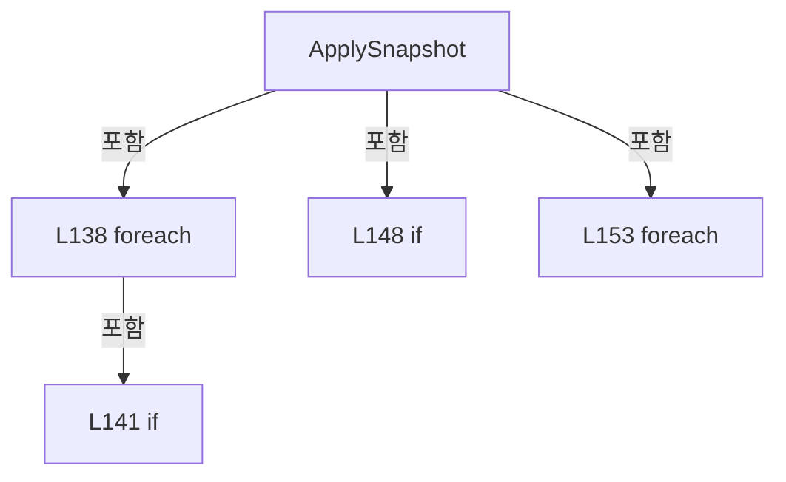

변경 전 점검: 입력/반환 타입, 위 호출자, 예외/취소 경로, 공유 상태와 저장·전송 소비자를 함께 확인합니다. 값의 단위나 물리 방향을 이름만으로 확정하지 않습니다.

### MethodDeclaration `Start` · L157–195

[Drilling.UI/Menu/Menus/CManualPowerMeasurePanel.cs:157–195](https://github.com/kjuws10-rgb/A3Drilling/blob/5aee8e58439c9b455cae7c9593c9be986c3e682e/Drilling.UI/Menu/Menus/CManualPowerMeasurePanel.cs#L157-L195)

| 항목 | 실제 추출 값 |
| --- | --- |
| 서명 | System.Threading.Tasks.Task Drilling.UI.Menu.Menus.CManualPowerMeasurePanel.Start() |
| 접근/수식자 | Public / public, async |
| 반환/값 타입 | System.Threading.Tasks.Task |
| 소속 타입 | NamedType:Drilling.UI.Menu.Menus.CManualPowerMeasurePanel |

정적 호출자로 확인된 위치:

| 호출 파일/행 | 호출 표현식 | 런타임 분기 가능 |
| --- | --- | --- |
| [Drilling.UI/Menu/Menus/CManualPowerMeasurePanel.cs:90–90](https://github.com/kjuws10-rgb/A3Drilling/blob/5aee8e58439c9b455cae7c9593c9be986c3e682e/Drilling.UI/Menu/Menus/CManualPowerMeasurePanel.cs#L90-L90) | Start | False |

호출하는 대상과 해석 범위:

| 원본 행 | 표현식 | 분석 상태 | 대상/소스 위치 |
| --- | --- | --- | --- |
| 159 | .Invoke | resolved · 동적 구현 선택 가능 | bool System.Func<bool>.Invoke() |
| 163 | GetPowerMeterOptions().Select(m => m.Number).ToHashSet | resolved | System.Collections.Generic.HashSet<int> System.Collections.Generic.IEnumerable<int>.ToHashSet<int>() |
| 163 | GetPowerMeterOptions().Select | resolved | System.Collections.Generic.IEnumerable<int> System.Collections.Generic.IEnumerable<Drilling.UI.Menu.Menus.ST_MANUAL_POWER_METER_OPTION>.Select<Drilling.UI.Menu.Menus.ST_MANUAL_POWER_METER_OPTION, int>(System.Func<Drilling.UI.Menu.Menus.ST_MANUAL_POWER_METER_OPTION, int>) |
| 163 | GetPowerMeterOptions | resolved | System.Collections.Generic.IReadOnlyList<Drilling.UI.Menu.Menus.ST_MANUAL_POWER_METER_OPTION> Drilling.UI.Menu.Menus.CManualPowerMeasurePanel.GetPowerMeterOptions() · Drilling.UI/Menu/Menus/CManualPowerMeasurePanel.cs:127 |
| 164 | Heads.Select(h => { if (h.SelectedPowerMeter is not { } meter &#124;&#124; !registered.Contains(meter.Number)) throw new ArgumentException($"{h.HeadName}: INTERFACE에 등록된 PowerMeter를 선택해 주세요."); try { return new ST_POWER_MEASURE_TARGET( h.HeadNo, meter.Number, ParsePower(h.Target), new(Mode, ParseInt(h.SettleTime, 0, 60000, "Settle Time"), ParseInt(h.MeasureC… | resolved | Drilling.Common.Interface.ST_POWER_MEASURE_TARGET[] System.Collections.Generic.IEnumerable<Drilling.Common.Interface.ST_POWER_MEASURE_TARGET>.ToArray<Drilling.Common.Interface.ST_POWER_MEASURE_TARGET>() |
| 164 | Heads.Select | resolved | System.Collections.Generic.IEnumerable<Drilling.Common.Interface.ST_POWER_MEASURE_TARGET> System.Collections.Generic.IEnumerable<Drilling.UI.Menu.Menus.CPowerMeasureRow>.Select<Drilling.UI.Menu.Menus.CPowerMeasureRow, Drilling.Common.Interface.ST_POWER_MEASURE_TARGET>(System.Func<Drilling.UI.Menu.Menus.CPowerMeasureRow, Drilling.Common.Interface.ST_POWER_MEASURE_TARGET>) |
| 166 | registered.Contains | resolved | bool System.Collections.Generic.HashSet<int>.Contains(int) |
| 167 | new ArgumentException | resolved | System.ArgumentException.ArgumentException(string?) |
| 170 | new ST_POWER_MEASURE_TARGET | resolved | Drilling.Common.Interface.ST_POWER_MEASURE_TARGET.ST_POWER_MEASURE_TARGET(int, int, double, Drilling.Common.Interface.ST_POWER_MEASURE_OPTIONS) · Drilling.Common/Interface/CPowerMeasureService.cs:267 |
| 173 | ParsePower | resolved | double Drilling.UI.Menu.Menus.CManualPowerMeasurePanel.ParsePower(string) · Drilling.UI/Menu/Menus/CManualPowerMeasurePanel.cs:205 |
| 175 | new | resolved | Drilling.Common.Interface.ST_POWER_MEASURE_OPTIONS.ST_POWER_MEASURE_OPTIONS(string, int, int, int) · Drilling.Common/Interface/CPowerMeasureService.cs:268 |
| 175 | ParseInt | resolved | int Drilling.UI.Menu.Menus.CManualPowerMeasurePanel.ParseInt(string, int, int, string) · Drilling.UI/Menu/Menus/CManualPowerMeasurePanel.cs:207 |
| 176 | ParseInt | resolved | int Drilling.UI.Menu.Menus.CManualPowerMeasurePanel.ParseInt(string, int, int, string) · Drilling.UI/Menu/Menus/CManualPowerMeasurePanel.cs:207 |
| 176 | ParseInt | resolved | int Drilling.UI.Menu.Menus.CManualPowerMeasurePanel.ParseInt(string, int, int, string) · Drilling.UI/Menu/Menus/CManualPowerMeasurePanel.cs:207 |
| 179 | new ArgumentException | resolved | System.ArgumentException.ArgumentException(string?) |
| 181 | new ArgumentException | resolved | System.ArgumentException.ArgumentException(string?) |
| 182 | _confirm | resolved · 동적 구현 선택 가능 | bool System.Func<string, bool>.Invoke(string) |
| 183 | .Invoke | resolved · 동적 구현 선택 가능 | bool System.Func<bool>.Invoke() |
| 184 | SetBusy | resolved | void Drilling.UI.Menu.Menus.CManualPowerMeasurePanel.SetBusy(bool) · Drilling.UI/Menu/Menus/CManualPowerMeasurePanel.cs:209 |
| 185 | new | resolved | System.Threading.CancellationTokenSource.CancellationTokenSource() |
| 186 | (_runMeasurement ?? throw new InvalidOperationException("PowerMeasure 장치 실행이 연결되지 않았습니다.")) | resolved · 동적 구현 선택 가능 | System.Threading.Tasks.Task System.Func<System.Collections.Generic.IReadOnlyList<Drilling.Common.Interface.ST_POWER_MEASURE_TARGET>, System.Threading.CancellationToken, System.Threading.Tasks.Task>.Invoke(System.Collections.Generic.IReadOnlyList<Drilling.Common.Interface.ST_POWER_MEASURE_TARGET>, System.Threading.CancellationToken) |
| 186 | new InvalidOperationException | resolved | System.InvalidOperationException.InvalidOperationException(string?) |
| 187 | ApplySnapshot | resolved | void Drilling.UI.Menu.Menus.CManualPowerMeasurePanel.ApplySnapshot() · Drilling.UI/Menu/Menus/CManualPowerMeasurePanel.cs:133 |
| 189 | _service.GetSnapshot().Heads.Where(h => h.TableState == "ERROR") .Select(h => $"HEAD {h.Target.HeadNo:00}: {h.Message}").ToArray | resolved | string[] System.Collections.Generic.IEnumerable<string>.ToArray<string>() |
| 189 | _service.GetSnapshot().Heads.Where(h => h.TableState == "ERROR") .Select | resolved | System.Collections.Generic.IEnumerable<string> System.Collections.Generic.IEnumerable<Drilling.Common.Interface.ST_POWER_MEASURE_HEAD>.Select<Drilling.Common.Interface.ST_POWER_MEASURE_HEAD, string>(System.Func<Drilling.Common.Interface.ST_POWER_MEASURE_HEAD, string>) |
| 189 | _service.GetSnapshot().Heads.Where | resolved | System.Collections.Generic.IEnumerable<Drilling.Common.Interface.ST_POWER_MEASURE_HEAD> System.Collections.Generic.IEnumerable<Drilling.Common.Interface.ST_POWER_MEASURE_HEAD>.Where<Drilling.Common.Interface.ST_POWER_MEASURE_HEAD>(System.Func<Drilling.Common.Interface.ST_POWER_MEASURE_HEAD, bool>) |
| 189 | _service.GetSnapshot | resolved | Drilling.Common.Interface.ST_POWER_MEASURE_SNAPSHOT Drilling.Common.Interface.CPowerMeasureService.GetSnapshot() · Drilling.Common/Interface/CPowerMeasureService.cs:12 |
| 191 | _warn | resolved · 동적 구현 선택 가능 | void System.Action<string>.Invoke(string) |
| 191 | string.Join | resolved | string string.Join(string?, params string?[]) |
| 193 | _warn | resolved · 동적 구현 선택 가능 | void System.Action<string>.Invoke(string) |
| 194 | .Dispose | resolved | void System.Threading.CancellationTokenSource.Dispose() |
| 194 | SetBusy | resolved | void Drilling.UI.Menu.Menus.CManualPowerMeasurePanel.SetBusy(bool) · Drilling.UI/Menu/Menus/CManualPowerMeasurePanel.cs:209 |
| 194 | ApplySnapshot | resolved | void Drilling.UI.Menu.Menus.CManualPowerMeasurePanel.ApplySnapshot() · Drilling.UI/Menu/Menus/CManualPowerMeasurePanel.cs:133 |

본문의 실제 연산·분기·예외·반환 순서(원문 위치 순):

| 원본 행 | 종류 | 주석 해설 |
| --- | --- | --- |
| 159 | call | 함수·델리게이트 또는 객체 생성자를 호출합니다: .Invoke() |
| 159 | if | 조건에 따라 분기합니다: if (IsReadOnly &#124;&#124; StartAllowed?.Invoke() == false) |
| 159 | return | 호출자에게 값 또는 제어를 반환합니다: return; |
| 160 | if | 조건에 따라 분기합니다: if (_busy) |
| 160 | return | 호출자에게 값 또는 제어를 반환합니다: return; |
| 161 | try | 예외 처리 범위입니다: try |
| 163 | call | 함수·델리게이트 또는 객체 생성자를 호출합니다: GetPowerMeterOptions().Select(m => m.Number).ToHashSet() |
| 163 | call | 함수·델리게이트 또는 객체 생성자를 호출합니다: GetPowerMeterOptions().Select(m => m.Number) |
| 163 | call | 함수·델리게이트 또는 객체 생성자를 호출합니다: GetPowerMeterOptions() |
| 163 | local-declaration | 지역 변수를 선언합니다: var registered = GetPowerMeterOptions().Select(m => m.Number).ToHashSet(); |
| 163 | variable-initializer | 변수의 초기값을 지정합니다: registered = GetPowerMeterOptions().Select(m => m.Number).ToHashSet() |
| 164 | call | 함수·델리게이트 또는 객체 생성자를 호출합니다: Heads.Select(h => { if (h.SelectedPowerMeter is not { } meter &#124;&#124; !registered.Contains(meter.Number)) throw new ArgumentException($"{h.HeadName}: INTERFACE에 등록된 PowerMeter를 선택해 주세요."); try { return new ST_POWER_MEASURE_TA… |
| 164 | call | 함수·델리게이트 또는 객체 생성자를 호출합니다: Heads.Select(h => { if (h.SelectedPowerMeter is not { } meter &#124;&#124; !registered.Contains(meter.Number)) throw new ArgumentException($"{h.HeadName}: INTERFACE에 등록된 PowerMeter를 선택해 주세요."); try { return new ST_POWER_MEASURE_TA… |
| 164 | local-declaration | 지역 변수를 선언합니다: var targets = Heads.Select(h => { if (h.SelectedPowerMeter is not { } meter &#124;&#124; !registered.Contains(meter.Number)) throw new ArgumentException($"{h.HeadName}: INTERFACE에 등록된 PowerMeter를 선택해 주세요."); try { return new ST_POWER_MEASUR |
| 164 | variable-initializer | 변수의 초기값을 지정합니다: targets = Heads.Select(h => { if (h.SelectedPowerMeter is not { } meter &#124;&#124; !registered.Contains(meter.Number)) throw new ArgumentException($"{h.HeadName}: INTERFACE에 등록된 PowerMeter를 선택해 주세요."); try { return new ST_POWER_MEASURE_TA |
| 166 | call | 함수·델리게이트 또는 객체 생성자를 호출합니다: registered.Contains(meter.Number) |
| 166 | if | 조건에 따라 분기합니다: if (h.SelectedPowerMeter is not { } meter &#124;&#124; !registered.Contains(meter.Number)) |
| 167 | call | 함수·델리게이트 또는 객체 생성자를 호출합니다: new ArgumentException($"{h.HeadName}: INTERFACE에 등록된 PowerMeter를 선택해 주세요.") |
| 167 | throw | 예외를 발생/전달합니다: throw new ArgumentException($"{h.HeadName}: INTERFACE에 등록된 PowerMeter를 선택해 주세요."); |
| 168 | try | 예외 처리 범위입니다: try |
| 170 | call | 함수·델리게이트 또는 객체 생성자를 호출합니다: new ST_POWER_MEASURE_TARGET( h.HeadNo, meter.Number, ParsePower(h.Target), new(Mode, ParseInt(h.SettleTime, 0, 60000, "Settle Time"), ParseInt(h.MeasureCount, 1, 1000, "Measure Count"), ParseInt(h.MeasureInterval, 0, 600… |
| 170 | return | 호출자에게 값 또는 제어를 반환합니다: return new ST_POWER_MEASURE_TARGET( h.HeadNo, meter.Number, ParsePower(h.Target), new(Mode, ParseInt(h.SettleTime, 0, 60000, "Settle Time"), ParseInt(h.MeasureCount, 1, 1000, "Measure Count"), ParseInt(h.MeasureInterval, 0, 60000, |
| 173 | call | 함수·델리게이트 또는 객체 생성자를 호출합니다: ParsePower(h.Target) |
| 175 | call | 함수·델리게이트 또는 객체 생성자를 호출합니다: ParseInt(h.SettleTime, 0, 60000, "Settle Time") |
| 175 | call | 함수·델리게이트 또는 객체 생성자를 호출합니다: new(Mode, ParseInt(h.SettleTime, 0, 60000, "Settle Time"), ParseInt(h.MeasureCount, 1, 1000, "Measure Count"), ParseInt(h.MeasureInterval, 0, 60000, "Interval")) |
| 176 | call | 함수·델리게이트 또는 객체 생성자를 호출합니다: ParseInt(h.MeasureCount, 1, 1000, "Measure Count") |
| 176 | call | 함수·델리게이트 또는 객체 생성자를 호출합니다: ParseInt(h.MeasureInterval, 0, 60000, "Interval") |
| 179 | call | 함수·델리게이트 또는 객체 생성자를 호출합니다: new ArgumentException($"{h.HeadName}: {error.Message}") |
| 179 | catch | 지정 예외를 처리합니다: catch (ArgumentException error) |
| 179 | throw | 예외를 발생/전달합니다: throw new ArgumentException($"{h.HeadName}: {error.Message}"); |
| 181 | call | 함수·델리게이트 또는 객체 생성자를 호출합니다: new ArgumentException("측정할 Head를 선택해 주세요.") |
| 181 | if | 조건에 따라 분기합니다: if (targets.Length == 0) |
| 181 | throw | 예외를 발생/전달합니다: throw new ArgumentException("측정할 Head를 선택해 주세요."); |
| 182 | call | 함수·델리게이트 또는 객체 생성자를 호출합니다: _confirm($"선택한 {targets.Length}개 Head의 파워 측정을 시작하시겠습니까?\nStage Y가 0 mm에서 정지해 있어야 합니다.\n각 Head를 CENTER(0,0)로 이동한 뒤 전용 센서로 동시에 측정합니다.\n목표 W에 도달하면 최종 ATT 각도를 Recipe에도 저장합니다.") |
| 182 | if | 조건에 따라 분기합니다: if (!_confirm($"선택한 {targets.Length}개 Head의 파워 측정을 시작하시겠습니까?\nStage Y가 0 mm에서 정지해 있어야 합니다.\n각 Head를 CENTER(0,0)로 이동한 뒤 전용 센서로 동시에 측정합니다.\n목표 W에 도달하면 최종 ATT 각도를 Recipe에도 저장합니다.")) |
| 182 | return | 호출자에게 값 또는 제어를 반환합니다: return; |
| 183 | call | 함수·델리게이트 또는 객체 생성자를 호출합니다: .Invoke() |
| 183 | if | 조건에 따라 분기합니다: if (StartAllowed?.Invoke() == false) |
| 183 | return | 호출자에게 값 또는 제어를 반환합니다: return; |
| 184 | call | 함수·델리게이트 또는 객체 생성자를 호출합니다: SetBusy(true) |
| 185 | assignment | 값을 대상에 대입합니다: _runCancellation = new() |
| 185 | call | 함수·델리게이트 또는 객체 생성자를 호출합니다: new() |
| 186 | call | 함수·델리게이트 또는 객체 생성자를 호출합니다: (_runMeasurement ?? throw new InvalidOperationException("PowerMeasure 장치 실행이 연결되지 않았습니다."))(targets, _runCancellation.Token) |
| 186 | call | 함수·델리게이트 또는 객체 생성자를 호출합니다: new InvalidOperationException("PowerMeasure 장치 실행이 연결되지 않았습니다.") |
| 186 | local-declaration | 지역 변수를 선언합니다: var run = (_runMeasurement ?? throw new InvalidOperationException("PowerMeasure 장치 실행이 연결되지 않았습니다."))(targets, _runCancellation.Token); |
| 186 | throw | 예외를 발생/전달합니다: throw new InvalidOperationException("PowerMeasure 장치 실행이 연결되지 않았습니다.") |
| 186 | variable-initializer | 변수의 초기값을 지정합니다: run = (_runMeasurement ?? throw new InvalidOperationException("PowerMeasure 장치 실행이 연결되지 않았습니다."))(targets, _runCancellation.Token) |
| 187 | call | 함수·델리게이트 또는 객체 생성자를 호출합니다: ApplySnapshot() |
| 188 | await | 비동기 완료를 기다립니다: await run |
| 189 | call | 함수·델리게이트 또는 객체 생성자를 호출합니다: _service.GetSnapshot().Heads.Where(h => h.TableState == "ERROR") |
| 189 | call | 함수·델리게이트 또는 객체 생성자를 호출합니다: _service.GetSnapshot() |
| 189 | call | 함수·델리게이트 또는 객체 생성자를 호출합니다: _service.GetSnapshot().Heads.Where(h => h.TableState == "ERROR") .Select(h => $"HEAD {h.Target.HeadNo:00}: {h.Message}").ToArray() |
| 189 | call | 함수·델리게이트 또는 객체 생성자를 호출합니다: _service.GetSnapshot().Heads.Where(h => h.TableState == "ERROR") .Select(h => $"HEAD {h.Target.HeadNo:00}: {h.Message}") |
| 189 | local-declaration | 지역 변수를 선언합니다: var saveErrors = _service.GetSnapshot().Heads.Where(h => h.TableState == "ERROR") .Select(h => $"HEAD {h.Target.HeadNo:00}: {h.Message}").ToArray(); |
| 189 | variable-initializer | 변수의 초기값을 지정합니다: saveErrors = _service.GetSnapshot().Heads.Where(h => h.TableState == "ERROR") .Select(h => $"HEAD {h.Target.HeadNo:00}: {h.Message}").ToArray() |
| 191 | call | 함수·델리게이트 또는 객체 생성자를 호출합니다: _warn(string.Join("\n", saveErrors)) |
| 191 | call | 함수·델리게이트 또는 객체 생성자를 호출합니다: string.Join("\n", saveErrors) |
| 191 | if | 조건에 따라 분기합니다: if (saveErrors.Length > 0) |
| 193 | call | 함수·델리게이트 또는 객체 생성자를 호출합니다: _warn(error.Message) |
| 193 | catch | 지정 예외를 처리합니다: catch (Exception error) |
| 194 | assignment | 값을 대상에 대입합니다: _runCancellation = null |
| 194 | call | 함수·델리게이트 또는 객체 생성자를 호출합니다: .Dispose() |
| 194 | call | 함수·델리게이트 또는 객체 생성자를 호출합니다: SetBusy(false) |
| 194 | call | 함수·델리게이트 또는 객체 생성자를 호출합니다: ApplySnapshot() |
| 194 | finally | 종료 정리 구간입니다: finally |

제어 구문의 포함 구조(실제 실행 순서/CFG가 아닌 구문 탐색 그림):

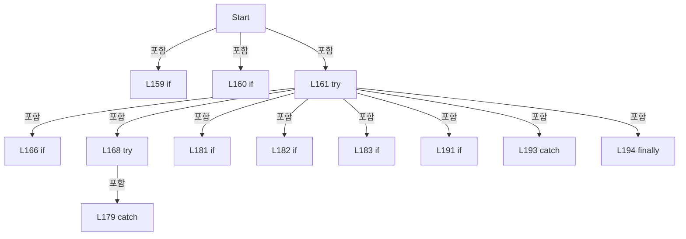

변경 전 점검: 입력/반환 타입, 위 호출자, 예외/취소 경로, 공유 상태와 저장·전송 소비자를 함께 확인합니다. 값의 단위나 물리 방향을 이름만으로 확정하지 않습니다.

### MethodDeclaration `Stop` · L197–203

[Drilling.UI/Menu/Menus/CManualPowerMeasurePanel.cs:197–203](https://github.com/kjuws10-rgb/A3Drilling/blob/5aee8e58439c9b455cae7c9593c9be986c3e682e/Drilling.UI/Menu/Menus/CManualPowerMeasurePanel.cs#L197-L203)

| 항목 | 실제 추출 값 |
| --- | --- |
| 서명 | System.Threading.Tasks.Task Drilling.UI.Menu.Menus.CManualPowerMeasurePanel.Stop() |
| 접근/수식자 | Public / public, async |
| 반환/값 타입 | System.Threading.Tasks.Task |
| 소속 타입 | NamedType:Drilling.UI.Menu.Menus.CManualPowerMeasurePanel |

정적 호출자로 확인된 위치:

| 호출 파일/행 | 호출 표현식 | 런타임 분기 가능 |
| --- | --- | --- |
| [Drilling.UI/Menu/Menus/CManualPowerMeasurePanel.cs:91–91](https://github.com/kjuws10-rgb/A3Drilling/blob/5aee8e58439c9b455cae7c9593c9be986c3e682e/Drilling.UI/Menu/Menus/CManualPowerMeasurePanel.cs#L91-L91) | Stop | False |

호출하는 대상과 해석 범위:

| 원본 행 | 표현식 | 분석 상태 | 대상/소스 위치 |
| --- | --- | --- | --- |
| 200 | NotifyCommands | resolved | void Drilling.UI.Menu.Menus.CManualPowerMeasurePanel.NotifyCommands() · Drilling.UI/Menu/Menus/CManualPowerMeasurePanel.cs:214 |
| 200 | ApplySnapshot | resolved | void Drilling.UI.Menu.Menus.CManualPowerMeasurePanel.ApplySnapshot() · Drilling.UI/Menu/Menus/CManualPowerMeasurePanel.cs:133 |
| 201 | .Cancel | resolved | void System.Threading.CancellationTokenSource.Cancel() |
| 201 | _service.Stop | resolved | System.Threading.Tasks.Task Drilling.Common.Interface.CPowerMeasureService.Stop() · Drilling.Common/Interface/CPowerMeasureService.cs:49 |
| 202 | ApplySnapshot | resolved | void Drilling.UI.Menu.Menus.CManualPowerMeasurePanel.ApplySnapshot() · Drilling.UI/Menu/Menus/CManualPowerMeasurePanel.cs:133 |
| 202 | NotifyCommands | resolved | void Drilling.UI.Menu.Menus.CManualPowerMeasurePanel.NotifyCommands() · Drilling.UI/Menu/Menus/CManualPowerMeasurePanel.cs:214 |

본문의 실제 연산·분기·예외·반환 순서(원문 위치 순):

| 원본 행 | 종류 | 주석 해설 |
| --- | --- | --- |
| 199 | if | 조건에 따라 분기합니다: if (!_busy &#124;&#124; _stopping) |
| 199 | return | 호출자에게 값 또는 제어를 반환합니다: return; |
| 200 | assignment | 값을 대상에 대입합니다: _stopping = true |
| 200 | call | 함수·델리게이트 또는 객체 생성자를 호출합니다: NotifyCommands() |
| 200 | call | 함수·델리게이트 또는 객체 생성자를 호출합니다: ApplySnapshot() |
| 201 | await | 비동기 완료를 기다립니다: await _service.Stop() |
| 201 | call | 함수·델리게이트 또는 객체 생성자를 호출합니다: .Cancel() |
| 201 | call | 함수·델리게이트 또는 객체 생성자를 호출합니다: _service.Stop() |
| 201 | try | 예외 처리 범위입니다: try |
| 202 | assignment | 값을 대상에 대입합니다: _stopping = false |
| 202 | call | 함수·델리게이트 또는 객체 생성자를 호출합니다: ApplySnapshot() |
| 202 | call | 함수·델리게이트 또는 객체 생성자를 호출합니다: NotifyCommands() |
| 202 | finally | 종료 정리 구간입니다: finally |

제어 구문의 포함 구조(실제 실행 순서/CFG가 아닌 구문 탐색 그림):

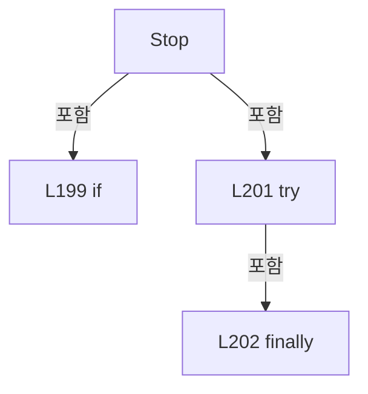

변경 전 점검: 입력/반환 타입, 위 호출자, 예외/취소 경로, 공유 상태와 저장·전송 소비자를 함께 확인합니다. 값의 단위나 물리 방향을 이름만으로 확정하지 않습니다.

### MethodDeclaration `ParsePower` · L205–206

[Drilling.UI/Menu/Menus/CManualPowerMeasurePanel.cs:205–206](https://github.com/kjuws10-rgb/A3Drilling/blob/5aee8e58439c9b455cae7c9593c9be986c3e682e/Drilling.UI/Menu/Menus/CManualPowerMeasurePanel.cs#L205-L206)

| 항목 | 실제 추출 값 |
| --- | --- |
| 서명 | double Drilling.UI.Menu.Menus.CManualPowerMeasurePanel.ParsePower(string) |
| 접근/수식자 | Private / private, static |
| 반환/값 타입 | double |
| 소속 타입 | NamedType:Drilling.UI.Menu.Menus.CManualPowerMeasurePanel |

입력 계약:

| 이름 | 타입 | 전달 | 선택/기본값 |
| --- | --- | --- | --- |
| text | string | None | False /  |

정적 호출자로 확인된 위치:

| 호출 파일/행 | 호출 표현식 | 런타임 분기 가능 |
| --- | --- | --- |
| [Drilling.UI/Menu/Menus/CManualPowerMeasurePanel.cs:173–173](https://github.com/kjuws10-rgb/A3Drilling/blob/5aee8e58439c9b455cae7c9593c9be986c3e682e/Drilling.UI/Menu/Menus/CManualPowerMeasurePanel.cs#L173-L173) | ParsePower | False |

호출하는 대상과 해석 범위:

| 원본 행 | 표현식 | 분석 상태 | 대상/소스 위치 |
| --- | --- | --- | --- |
| 205 | double.TryParse | resolved | bool double.TryParse(string?, System.Globalization.NumberStyles, System.IFormatProvider?, out double) |
| 206 | double.IsFinite | resolved | bool double.IsFinite(double) |
| 206 | new ArgumentException | resolved | System.ArgumentException.ArgumentException(string?) |

본문의 실제 연산·분기·예외·반환 순서(원문 위치 순):

| 원본 행 | 종류 | 주석 해설 |
| --- | --- | --- |
| 205 | call | 함수·델리게이트 또는 객체 생성자를 호출합니다: double.TryParse(text, NumberStyles.Float, CultureInfo.InvariantCulture, out var value) |
| 205 | conditional-expression | 조건에 따라 결과식을 선택합니다: double.TryParse(text, NumberStyles.Float, CultureInfo.InvariantCulture, out var value) && double.IsFinite(value) && value > 0 ? value : throw new ArgumentException("Target Power는 0보다 큰 숫자로 입력해 주세요.") |
| 206 | call | 함수·델리게이트 또는 객체 생성자를 호출합니다: double.IsFinite(value) |
| 206 | call | 함수·델리게이트 또는 객체 생성자를 호출합니다: new ArgumentException("Target Power는 0보다 큰 숫자로 입력해 주세요.") |
| 206 | throw | 예외를 발생/전달합니다: throw new ArgumentException("Target Power는 0보다 큰 숫자로 입력해 주세요.") |

변경 전 점검: 입력/반환 타입, 위 호출자, 예외/취소 경로, 공유 상태와 저장·전송 소비자를 함께 확인합니다. 값의 단위나 물리 방향을 이름만으로 확정하지 않습니다.

### MethodDeclaration `ParseInt` · L207–208

[Drilling.UI/Menu/Menus/CManualPowerMeasurePanel.cs:207–208](https://github.com/kjuws10-rgb/A3Drilling/blob/5aee8e58439c9b455cae7c9593c9be986c3e682e/Drilling.UI/Menu/Menus/CManualPowerMeasurePanel.cs#L207-L208)

| 항목 | 실제 추출 값 |
| --- | --- |
| 서명 | int Drilling.UI.Menu.Menus.CManualPowerMeasurePanel.ParseInt(string, int, int, string) |
| 접근/수식자 | Private / private, static |
| 반환/값 타입 | int |
| 소속 타입 | NamedType:Drilling.UI.Menu.Menus.CManualPowerMeasurePanel |

입력 계약:

| 이름 | 타입 | 전달 | 선택/기본값 |
| --- | --- | --- | --- |
| text | string | None | False /  |
| min | int | None | False /  |
| max | int | None | False /  |
| name | string | None | False /  |

정적 호출자로 확인된 위치:

| 호출 파일/행 | 호출 표현식 | 런타임 분기 가능 |
| --- | --- | --- |
| [Drilling.UI/Menu/Menus/CManualPowerMeasurePanel.cs:175–175](https://github.com/kjuws10-rgb/A3Drilling/blob/5aee8e58439c9b455cae7c9593c9be986c3e682e/Drilling.UI/Menu/Menus/CManualPowerMeasurePanel.cs#L175-L175) | ParseInt | False |
| [Drilling.UI/Menu/Menus/CManualPowerMeasurePanel.cs:176–176](https://github.com/kjuws10-rgb/A3Drilling/blob/5aee8e58439c9b455cae7c9593c9be986c3e682e/Drilling.UI/Menu/Menus/CManualPowerMeasurePanel.cs#L176-L176) | ParseInt | False |
| [Drilling.UI/Menu/Menus/CManualPowerMeasurePanel.cs:176–176](https://github.com/kjuws10-rgb/A3Drilling/blob/5aee8e58439c9b455cae7c9593c9be986c3e682e/Drilling.UI/Menu/Menus/CManualPowerMeasurePanel.cs#L176-L176) | ParseInt | False |

호출하는 대상과 해석 범위:

| 원본 행 | 표현식 | 분석 상태 | 대상/소스 위치 |
| --- | --- | --- | --- |
| 207 | int.TryParse | resolved | bool int.TryParse(string?, out int) |
| 208 | new ArgumentException | resolved | System.ArgumentException.ArgumentException(string?) |

본문의 실제 연산·분기·예외·반환 순서(원문 위치 순):

| 원본 행 | 종류 | 주석 해설 |
| --- | --- | --- |
| 207 | call | 함수·델리게이트 또는 객체 생성자를 호출합니다: int.TryParse(text, out var value) |
| 207 | conditional-expression | 조건에 따라 결과식을 선택합니다: int.TryParse(text, out var value) && value >= min && value <= max ? value : throw new ArgumentException($"{name}: {min}~{max} 범위의 정수를 입력해 주세요.") |
| 208 | call | 함수·델리게이트 또는 객체 생성자를 호출합니다: new ArgumentException($"{name}: {min}~{max} 범위의 정수를 입력해 주세요.") |
| 208 | throw | 예외를 발생/전달합니다: throw new ArgumentException($"{name}: {min}~{max} 범위의 정수를 입력해 주세요.") |

변경 전 점검: 입력/반환 타입, 위 호출자, 예외/취소 경로, 공유 상태와 저장·전송 소비자를 함께 확인합니다. 값의 단위나 물리 방향을 이름만으로 확정하지 않습니다.

### MethodDeclaration `SetBusy` · L209–213

[Drilling.UI/Menu/Menus/CManualPowerMeasurePanel.cs:209–213](https://github.com/kjuws10-rgb/A3Drilling/blob/5aee8e58439c9b455cae7c9593c9be986c3e682e/Drilling.UI/Menu/Menus/CManualPowerMeasurePanel.cs#L209-L213)

| 항목 | 실제 추출 값 |
| --- | --- |
| 서명 | void Drilling.UI.Menu.Menus.CManualPowerMeasurePanel.SetBusy(bool) |
| 접근/수식자 | Private / private |
| 반환/값 타입 | void |
| 소속 타입 | NamedType:Drilling.UI.Menu.Menus.CManualPowerMeasurePanel |

입력 계약:

| 이름 | 타입 | 전달 | 선택/기본값 |
| --- | --- | --- | --- |
| busy | bool | None | False /  |

정적 호출자로 확인된 위치:

| 호출 파일/행 | 호출 표현식 | 런타임 분기 가능 |
| --- | --- | --- |
| [Drilling.UI/Menu/Menus/CManualPowerMeasurePanel.cs:184–184](https://github.com/kjuws10-rgb/A3Drilling/blob/5aee8e58439c9b455cae7c9593c9be986c3e682e/Drilling.UI/Menu/Menus/CManualPowerMeasurePanel.cs#L184-L184) | SetBusy | False |
| [Drilling.UI/Menu/Menus/CManualPowerMeasurePanel.cs:194–194](https://github.com/kjuws10-rgb/A3Drilling/blob/5aee8e58439c9b455cae7c9593c9be986c3e682e/Drilling.UI/Menu/Menus/CManualPowerMeasurePanel.cs#L194-L194) | SetBusy | False |

호출하는 대상과 해석 범위:

| 원본 행 | 표현식 | 분석 상태 | 대상/소스 위치 |
| --- | --- | --- | --- |
| 211 | StageMotion.SetMeasurementRunning | resolved | void Drilling.UI.Menu.Menus.CManualPowerStagePanel.SetMeasurementRunning(bool) · Drilling.UI/Menu/Menus/CManualPowerStagePanel.cs:156 |
| 212 | Notify | resolved | void Drilling.UI.Menu.Menus.CManualPowerMeasurePanel.Notify(string?) · Drilling.UI/Menu/Menus/CManualPowerMeasurePanel.cs:219 |
| 212 | nameof | unresolved | None |
| 212 | Notify | resolved | void Drilling.UI.Menu.Menus.CManualPowerMeasurePanel.Notify(string?) · Drilling.UI/Menu/Menus/CManualPowerMeasurePanel.cs:219 |
| 212 | nameof | unresolved | None |
| 212 | NotifyCommands | resolved | void Drilling.UI.Menu.Menus.CManualPowerMeasurePanel.NotifyCommands() · Drilling.UI/Menu/Menus/CManualPowerMeasurePanel.cs:214 |
| 212 | .Invoke | resolved · 동적 구현 선택 가능 | void System.Action.Invoke() |

본문의 실제 연산·분기·예외·반환 순서(원문 위치 순):

| 원본 행 | 종류 | 주석 해설 |
| --- | --- | --- |
| 211 | call | 함수·델리게이트 또는 객체 생성자를 호출합니다: StageMotion.SetMeasurementRunning(busy) |
| 212 | assignment | 값을 대상에 대입합니다: _busy = busy |
| 212 | call | 함수·델리게이트 또는 객체 생성자를 호출합니다: Notify(nameof(IsRunning)) |
| 212 | call | 함수·델리게이트 또는 객체 생성자를 호출합니다: nameof(IsRunning) |
| 212 | call | 함수·델리게이트 또는 객체 생성자를 호출합니다: Notify(nameof(CanEdit)) |
| 212 | call | 함수·델리게이트 또는 객체 생성자를 호출합니다: nameof(CanEdit) |
| 212 | call | 함수·델리게이트 또는 객체 생성자를 호출합니다: NotifyCommands() |
| 212 | call | 함수·델리게이트 또는 객체 생성자를 호출합니다: .Invoke() |

변경 전 점검: 입력/반환 타입, 위 호출자, 예외/취소 경로, 공유 상태와 저장·전송 소비자를 함께 확인합니다. 값의 단위나 물리 방향을 이름만으로 확정하지 않습니다.

### MethodDeclaration `NotifyCommands` · L214–214

[Drilling.UI/Menu/Menus/CManualPowerMeasurePanel.cs:214–214](https://github.com/kjuws10-rgb/A3Drilling/blob/5aee8e58439c9b455cae7c9593c9be986c3e682e/Drilling.UI/Menu/Menus/CManualPowerMeasurePanel.cs#L214-L214)

| 항목 | 실제 추출 값 |
| --- | --- |
| 서명 | void Drilling.UI.Menu.Menus.CManualPowerMeasurePanel.NotifyCommands() |
| 접근/수식자 | Private / private |
| 반환/값 타입 | void |
| 소속 타입 | NamedType:Drilling.UI.Menu.Menus.CManualPowerMeasurePanel |

정적 호출자로 확인된 위치:

| 호출 파일/행 | 호출 표현식 | 런타임 분기 가능 |
| --- | --- | --- |
| [Drilling.UI/Menu/Menus/CManualPowerMeasurePanel.cs:124–124](https://github.com/kjuws10-rgb/A3Drilling/blob/5aee8e58439c9b455cae7c9593c9be986c3e682e/Drilling.UI/Menu/Menus/CManualPowerMeasurePanel.cs#L124-L124) | NotifyCommands | False |
| [Drilling.UI/Menu/Menus/CManualPowerMeasurePanel.cs:200–200](https://github.com/kjuws10-rgb/A3Drilling/blob/5aee8e58439c9b455cae7c9593c9be986c3e682e/Drilling.UI/Menu/Menus/CManualPowerMeasurePanel.cs#L200-L200) | NotifyCommands | False |
| [Drilling.UI/Menu/Menus/CManualPowerMeasurePanel.cs:202–202](https://github.com/kjuws10-rgb/A3Drilling/blob/5aee8e58439c9b455cae7c9593c9be986c3e682e/Drilling.UI/Menu/Menus/CManualPowerMeasurePanel.cs#L202-L202) | NotifyCommands | False |
| [Drilling.UI/Menu/Menus/CManualPowerMeasurePanel.cs:212–212](https://github.com/kjuws10-rgb/A3Drilling/blob/5aee8e58439c9b455cae7c9593c9be986c3e682e/Drilling.UI/Menu/Menus/CManualPowerMeasurePanel.cs#L212-L212) | NotifyCommands | False |

호출하는 대상과 해석 범위:

| 원본 행 | 표현식 | 분석 상태 | 대상/소스 위치 |
| --- | --- | --- | --- |
| 214 | StartCommand.NotifyCanExecuteChanged | resolved | void Drilling.UI.Menu.CButtonCommand.NotifyCanExecuteChanged() · Drilling.UI/Menu/CButtonCommand.cs:24 |
| 214 | StopCommand.NotifyCanExecuteChanged | resolved | void Drilling.UI.Menu.CButtonCommand.NotifyCanExecuteChanged() · Drilling.UI/Menu/CButtonCommand.cs:24 |

본문의 실제 연산·분기·예외·반환 순서(원문 위치 순):

| 원본 행 | 종류 | 주석 해설 |
| --- | --- | --- |
| 214 | call | 함수·델리게이트 또는 객체 생성자를 호출합니다: StartCommand.NotifyCanExecuteChanged() |
| 214 | call | 함수·델리게이트 또는 객체 생성자를 호출합니다: StopCommand.NotifyCanExecuteChanged() |

변경 전 점검: 입력/반환 타입, 위 호출자, 예외/취소 경로, 공유 상태와 저장·전송 소비자를 함께 확인합니다. 값의 단위나 물리 방향을 이름만으로 확정하지 않습니다.

### MethodDeclaration `RefreshDetail` · L215–218

[Drilling.UI/Menu/Menus/CManualPowerMeasurePanel.cs:215–218](https://github.com/kjuws10-rgb/A3Drilling/blob/5aee8e58439c9b455cae7c9593c9be986c3e682e/Drilling.UI/Menu/Menus/CManualPowerMeasurePanel.cs#L215-L218)

| 항목 | 실제 추출 값 |
| --- | --- |
| 서명 | void Drilling.UI.Menu.Menus.CManualPowerMeasurePanel.RefreshDetail() |
| 접근/수식자 | Private / private |
| 반환/값 타입 | void |
| 소속 타입 | NamedType:Drilling.UI.Menu.Menus.CManualPowerMeasurePanel |

정적 호출자로 확인된 위치:

| 호출 파일/행 | 호출 표현식 | 런타임 분기 가능 |
| --- | --- | --- |
| [Drilling.UI/Menu/Menus/CManualPowerMeasurePanel.cs:62–62](https://github.com/kjuws10-rgb/A3Drilling/blob/5aee8e58439c9b455cae7c9593c9be986c3e682e/Drilling.UI/Menu/Menus/CManualPowerMeasurePanel.cs#L62-L62) | RefreshDetail | False |
| [Drilling.UI/Menu/Menus/CManualPowerMeasurePanel.cs:154–154](https://github.com/kjuws10-rgb/A3Drilling/blob/5aee8e58439c9b455cae7c9593c9be986c3e682e/Drilling.UI/Menu/Menus/CManualPowerMeasurePanel.cs#L154-L154) | RefreshDetail | False |

호출하는 대상과 해석 범위:

| 원본 행 | 표현식 | 분석 상태 | 대상/소스 위치 |
| --- | --- | --- | --- |
| 217 | nameof | unresolved | None |
| 217 | nameof | unresolved | None |
| 217 | nameof | unresolved | None |
| 217 | nameof | unresolved | None |
| 217 | nameof | unresolved | None |
| 217 | Notify | resolved | void Drilling.UI.Menu.Menus.CManualPowerMeasurePanel.Notify(string?) · Drilling.UI/Menu/Menus/CManualPowerMeasurePanel.cs:219 |

본문의 실제 연산·분기·예외·반환 순서(원문 위치 순):

| 원본 행 | 종류 | 주석 해설 |
| --- | --- | --- |
| 217 | call | 함수·델리게이트 또는 객체 생성자를 호출합니다: nameof(Samples) |
| 217 | call | 함수·델리게이트 또는 객체 생성자를 호출합니다: nameof(DetailTitle) |
| 217 | call | 함수·델리게이트 또는 객체 생성자를 호출합니다: nameof(DetailMessage) |
| 217 | call | 함수·델리게이트 또는 객체 생성자를 호출합니다: nameof(Graph) |
| 217 | call | 함수·델리게이트 또는 객체 생성자를 호출합니다: nameof(GraphPoints) |
| 217 | call | 함수·델리게이트 또는 객체 생성자를 호출합니다: Notify(name) |
| 217 | foreach | 컬렉션 요소를 순회합니다: foreach (var name in new[] { nameof(Samples), nameof(DetailTitle), nameof(DetailMessage), nameof(Graph), nameof(GraphPoints) }) |

제어 구문의 포함 구조(실제 실행 순서/CFG가 아닌 구문 탐색 그림):

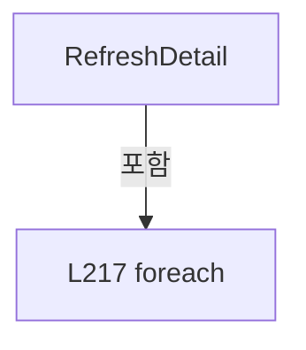

변경 전 점검: 입력/반환 타입, 위 호출자, 예외/취소 경로, 공유 상태와 저장·전송 소비자를 함께 확인합니다. 값의 단위나 물리 방향을 이름만으로 확정하지 않습니다.

### MethodDeclaration `Notify` · L219–219

[Drilling.UI/Menu/Menus/CManualPowerMeasurePanel.cs:219–219](https://github.com/kjuws10-rgb/A3Drilling/blob/5aee8e58439c9b455cae7c9593c9be986c3e682e/Drilling.UI/Menu/Menus/CManualPowerMeasurePanel.cs#L219-L219)

| 항목 | 실제 추출 값 |
| --- | --- |
| 서명 | void Drilling.UI.Menu.Menus.CManualPowerMeasurePanel.Notify(string?) |
| 접근/수식자 | Private / private |
| 반환/값 타입 | void |
| 소속 타입 | NamedType:Drilling.UI.Menu.Menus.CManualPowerMeasurePanel |

입력 계약:

| 이름 | 타입 | 전달 | 선택/기본값 |
| --- | --- | --- | --- |
| name | string? | None | True / null |

정적 호출자로 확인된 위치:

| 호출 파일/행 | 호출 표현식 | 런타임 분기 가능 |
| --- | --- | --- |
| [Drilling.UI/Menu/Menus/CManualPowerMeasurePanel.cs:29–29](https://github.com/kjuws10-rgb/A3Drilling/blob/5aee8e58439c9b455cae7c9593c9be986c3e682e/Drilling.UI/Menu/Menus/CManualPowerMeasurePanel.cs#L29-L29) | Notify | False |
| [Drilling.UI/Menu/Menus/CManualPowerMeasurePanel.cs:29–29](https://github.com/kjuws10-rgb/A3Drilling/blob/5aee8e58439c9b455cae7c9593c9be986c3e682e/Drilling.UI/Menu/Menus/CManualPowerMeasurePanel.cs#L29-L29) | Notify | False |
| [Drilling.UI/Menu/Menus/CManualPowerMeasurePanel.cs:62–62](https://github.com/kjuws10-rgb/A3Drilling/blob/5aee8e58439c9b455cae7c9593c9be986c3e682e/Drilling.UI/Menu/Menus/CManualPowerMeasurePanel.cs#L62-L62) | Notify | False |
| [Drilling.UI/Menu/Menus/CManualPowerMeasurePanel.cs:95–95](https://github.com/kjuws10-rgb/A3Drilling/blob/5aee8e58439c9b455cae7c9593c9be986c3e682e/Drilling.UI/Menu/Menus/CManualPowerMeasurePanel.cs#L95-L95) | Notify | False |
| [Drilling.UI/Menu/Menus/CManualPowerMeasurePanel.cs:95–95](https://github.com/kjuws10-rgb/A3Drilling/blob/5aee8e58439c9b455cae7c9593c9be986c3e682e/Drilling.UI/Menu/Menus/CManualPowerMeasurePanel.cs#L95-L95) | Notify | False |
| [Drilling.UI/Menu/Menus/CManualPowerMeasurePanel.cs:95–95](https://github.com/kjuws10-rgb/A3Drilling/blob/5aee8e58439c9b455cae7c9593c9be986c3e682e/Drilling.UI/Menu/Menus/CManualPowerMeasurePanel.cs#L95-L95) | Notify | False |
| [Drilling.UI/Menu/Menus/CManualPowerMeasurePanel.cs:120–120](https://github.com/kjuws10-rgb/A3Drilling/blob/5aee8e58439c9b455cae7c9593c9be986c3e682e/Drilling.UI/Menu/Menus/CManualPowerMeasurePanel.cs#L120-L120) | Notify | False |
| [Drilling.UI/Menu/Menus/CManualPowerMeasurePanel.cs:120–120](https://github.com/kjuws10-rgb/A3Drilling/blob/5aee8e58439c9b455cae7c9593c9be986c3e682e/Drilling.UI/Menu/Menus/CManualPowerMeasurePanel.cs#L120-L120) | Notify | False |
| [Drilling.UI/Menu/Menus/CManualPowerMeasurePanel.cs:120–120](https://github.com/kjuws10-rgb/A3Drilling/blob/5aee8e58439c9b455cae7c9593c9be986c3e682e/Drilling.UI/Menu/Menus/CManualPowerMeasurePanel.cs#L120-L120) | Notify | False |
| [Drilling.UI/Menu/Menus/CManualPowerMeasurePanel.cs:153–153](https://github.com/kjuws10-rgb/A3Drilling/blob/5aee8e58439c9b455cae7c9593c9be986c3e682e/Drilling.UI/Menu/Menus/CManualPowerMeasurePanel.cs#L153-L153) | Notify | False |
| [Drilling.UI/Menu/Menus/CManualPowerMeasurePanel.cs:212–212](https://github.com/kjuws10-rgb/A3Drilling/blob/5aee8e58439c9b455cae7c9593c9be986c3e682e/Drilling.UI/Menu/Menus/CManualPowerMeasurePanel.cs#L212-L212) | Notify | False |
| [Drilling.UI/Menu/Menus/CManualPowerMeasurePanel.cs:212–212](https://github.com/kjuws10-rgb/A3Drilling/blob/5aee8e58439c9b455cae7c9593c9be986c3e682e/Drilling.UI/Menu/Menus/CManualPowerMeasurePanel.cs#L212-L212) | Notify | False |
| [Drilling.UI/Menu/Menus/CManualPowerMeasurePanel.cs:217–217](https://github.com/kjuws10-rgb/A3Drilling/blob/5aee8e58439c9b455cae7c9593c9be986c3e682e/Drilling.UI/Menu/Menus/CManualPowerMeasurePanel.cs#L217-L217) | Notify | False |

호출하는 대상과 해석 범위:

| 원본 행 | 표현식 | 분석 상태 | 대상/소스 위치 |
| --- | --- | --- | --- |
| 219 | .Invoke | resolved · 동적 구현 선택 가능 | void System.ComponentModel.PropertyChangedEventHandler.Invoke(object?, System.ComponentModel.PropertyChangedEventArgs) |
| 219 | new | resolved | System.ComponentModel.PropertyChangedEventArgs.PropertyChangedEventArgs(string?) |

본문의 실제 연산·분기·예외·반환 순서(원문 위치 순):

| 원본 행 | 종류 | 주석 해설 |
| --- | --- | --- |
| 219 | call | 함수·델리게이트 또는 객체 생성자를 호출합니다: .Invoke(this, new(name)) |
| 219 | call | 함수·델리게이트 또는 객체 생성자를 호출합니다: new(name) |

변경 전 점검: 입력/반환 타입, 위 호출자, 예외/취소 경로, 공유 상태와 저장·전송 소비자를 함께 확인합니다. 값의 단위나 물리 방향을 이름만으로 확정하지 않습니다.

### FieldDeclaration `_target` · L224–224

[Drilling.UI/Menu/Menus/CManualPowerMeasurePanel.cs:224–224](https://github.com/kjuws10-rgb/A3Drilling/blob/5aee8e58439c9b455cae7c9593c9be986c3e682e/Drilling.UI/Menu/Menus/CManualPowerMeasurePanel.cs#L224-L224)

| 항목 | 실제 추출 값 |
| --- | --- |
| 서명 | string Drilling.UI.Menu.Menus.CPowerMeasureRow._target |
| 접근/수식자 | Private / private |
| 반환/값 타입 | string |
| 소속 타입 | NamedType:Drilling.UI.Menu.Menus.CPowerMeasureRow |

현재 부분 분석에서 직접 연결된 호출자는 없습니다. XAML/이벤트/인터페이스·델리게이트·외부 진입을 추가 확인해야 하며, 미사용으로 판정한 것이 아닙니다.

본문의 실제 연산·분기·예외·반환 순서(원문 위치 순):

| 원본 행 | 종류 | 주석 해설 |
| --- | --- | --- |
| 224 | variable-initializer | 변수의 초기값을 지정합니다: _target = "1.2000" |
| 224 | variable-initializer | 변수의 초기값을 지정합니다: _settleTime = "300" |
| 224 | variable-initializer | 변수의 초기값을 지정합니다: _measureCount = "1" |
| 224 | variable-initializer | 변수의 초기값을 지정합니다: _measureInterval = "100" |

변경 전 점검: 입력/반환 타입, 위 호출자, 예외/취소 경로, 공유 상태와 저장·전송 소비자를 함께 확인합니다. 값의 단위나 물리 방향을 이름만으로 확정하지 않습니다.

### FieldDeclaration `_settleTime` · L224–224

[Drilling.UI/Menu/Menus/CManualPowerMeasurePanel.cs:224–224](https://github.com/kjuws10-rgb/A3Drilling/blob/5aee8e58439c9b455cae7c9593c9be986c3e682e/Drilling.UI/Menu/Menus/CManualPowerMeasurePanel.cs#L224-L224)

| 항목 | 실제 추출 값 |
| --- | --- |
| 서명 | string Drilling.UI.Menu.Menus.CPowerMeasureRow._settleTime |
| 접근/수식자 | Private / private |
| 반환/값 타입 | string |
| 소속 타입 | NamedType:Drilling.UI.Menu.Menus.CPowerMeasureRow |

현재 부분 분석에서 직접 연결된 호출자는 없습니다. XAML/이벤트/인터페이스·델리게이트·외부 진입을 추가 확인해야 하며, 미사용으로 판정한 것이 아닙니다.

변경 전 점검: 입력/반환 타입, 위 호출자, 예외/취소 경로, 공유 상태와 저장·전송 소비자를 함께 확인합니다. 값의 단위나 물리 방향을 이름만으로 확정하지 않습니다.

### FieldDeclaration `_measureCount` · L224–224

[Drilling.UI/Menu/Menus/CManualPowerMeasurePanel.cs:224–224](https://github.com/kjuws10-rgb/A3Drilling/blob/5aee8e58439c9b455cae7c9593c9be986c3e682e/Drilling.UI/Menu/Menus/CManualPowerMeasurePanel.cs#L224-L224)

| 항목 | 실제 추출 값 |
| --- | --- |
| 서명 | string Drilling.UI.Menu.Menus.CPowerMeasureRow._measureCount |
| 접근/수식자 | Private / private |
| 반환/값 타입 | string |
| 소속 타입 | NamedType:Drilling.UI.Menu.Menus.CPowerMeasureRow |

현재 부분 분석에서 직접 연결된 호출자는 없습니다. XAML/이벤트/인터페이스·델리게이트·외부 진입을 추가 확인해야 하며, 미사용으로 판정한 것이 아닙니다.

변경 전 점검: 입력/반환 타입, 위 호출자, 예외/취소 경로, 공유 상태와 저장·전송 소비자를 함께 확인합니다. 값의 단위나 물리 방향을 이름만으로 확정하지 않습니다.

### FieldDeclaration `_measureInterval` · L224–224

[Drilling.UI/Menu/Menus/CManualPowerMeasurePanel.cs:224–224](https://github.com/kjuws10-rgb/A3Drilling/blob/5aee8e58439c9b455cae7c9593c9be986c3e682e/Drilling.UI/Menu/Menus/CManualPowerMeasurePanel.cs#L224-L224)

| 항목 | 실제 추출 값 |
| --- | --- |
| 서명 | string Drilling.UI.Menu.Menus.CPowerMeasureRow._measureInterval |
| 접근/수식자 | Private / private |
| 반환/값 타입 | string |
| 소속 타입 | NamedType:Drilling.UI.Menu.Menus.CPowerMeasureRow |

현재 부분 분석에서 직접 연결된 호출자는 없습니다. XAML/이벤트/인터페이스·델리게이트·외부 진입을 추가 확인해야 하며, 미사용으로 판정한 것이 아닙니다.

변경 전 점검: 입력/반환 타입, 위 호출자, 예외/취소 경로, 공유 상태와 저장·전송 소비자를 함께 확인합니다. 값의 단위나 물리 방향을 이름만으로 확정하지 않습니다.

### FieldDeclaration `_selectedPowerMeter` · L225–225

[Drilling.UI/Menu/Menus/CManualPowerMeasurePanel.cs:225–225](https://github.com/kjuws10-rgb/A3Drilling/blob/5aee8e58439c9b455cae7c9593c9be986c3e682e/Drilling.UI/Menu/Menus/CManualPowerMeasurePanel.cs#L225-L225)

| 항목 | 실제 추출 값 |
| --- | --- |
| 서명 | Drilling.UI.Menu.Menus.ST_MANUAL_POWER_METER_OPTION? Drilling.UI.Menu.Menus.CPowerMeasureRow._selectedPowerMeter |
| 접근/수식자 | Private / private |
| 반환/값 타입 | Drilling.UI.Menu.Menus.ST_MANUAL_POWER_METER_OPTION? |
| 소속 타입 | NamedType:Drilling.UI.Menu.Menus.CPowerMeasureRow |

현재 부분 분석에서 직접 연결된 호출자는 없습니다. XAML/이벤트/인터페이스·델리게이트·외부 진입을 추가 확인해야 하며, 미사용으로 판정한 것이 아닙니다.

변경 전 점검: 입력/반환 타입, 위 호출자, 예외/취소 경로, 공유 상태와 저장·전송 소비자를 함께 확인합니다. 값의 단위나 물리 방향을 이름만으로 확정하지 않습니다.

### FieldDeclaration `_metersInitialized` · L226–226

[Drilling.UI/Menu/Menus/CManualPowerMeasurePanel.cs:226–226](https://github.com/kjuws10-rgb/A3Drilling/blob/5aee8e58439c9b455cae7c9593c9be986c3e682e/Drilling.UI/Menu/Menus/CManualPowerMeasurePanel.cs#L226-L226)

| 항목 | 실제 추출 값 |
| --- | --- |
| 서명 | bool Drilling.UI.Menu.Menus.CPowerMeasureRow._metersInitialized |
| 접근/수식자 | Private / private |
| 반환/값 타입 | bool |
| 소속 타입 | NamedType:Drilling.UI.Menu.Menus.CPowerMeasureRow |

현재 부분 분석에서 직접 연결된 호출자는 없습니다. XAML/이벤트/인터페이스·델리게이트·외부 진입을 추가 확인해야 하며, 미사용으로 판정한 것이 아닙니다.

변경 전 점검: 입력/반환 타입, 위 호출자, 예외/취소 경로, 공유 상태와 저장·전송 소비자를 함께 확인합니다. 값의 단위나 물리 방향을 이름만으로 확정하지 않습니다.

### FieldDeclaration `_updatingPowerMeters` · L227–227

[Drilling.UI/Menu/Menus/CManualPowerMeasurePanel.cs:227–227](https://github.com/kjuws10-rgb/A3Drilling/blob/5aee8e58439c9b455cae7c9593c9be986c3e682e/Drilling.UI/Menu/Menus/CManualPowerMeasurePanel.cs#L227-L227)

| 항목 | 실제 추출 값 |
| --- | --- |
| 서명 | bool Drilling.UI.Menu.Menus.CPowerMeasureRow._updatingPowerMeters |
| 접근/수식자 | Private / private |
| 반환/값 타입 | bool |
| 소속 타입 | NamedType:Drilling.UI.Menu.Menus.CPowerMeasureRow |

현재 부분 분석에서 직접 연결된 호출자는 없습니다. XAML/이벤트/인터페이스·델리게이트·외부 진입을 추가 확인해야 하며, 미사용으로 판정한 것이 아닙니다.

변경 전 점검: 입력/반환 타입, 위 호출자, 예외/취소 경로, 공유 상태와 저장·전송 소비자를 함께 확인합니다. 값의 단위나 물리 방향을 이름만으로 확정하지 않습니다.

### FieldDeclaration `_isGraphSelected` · L228–228

[Drilling.UI/Menu/Menus/CManualPowerMeasurePanel.cs:228–228](https://github.com/kjuws10-rgb/A3Drilling/blob/5aee8e58439c9b455cae7c9593c9be986c3e682e/Drilling.UI/Menu/Menus/CManualPowerMeasurePanel.cs#L228-L228)

| 항목 | 실제 추출 값 |
| --- | --- |
| 서명 | bool Drilling.UI.Menu.Menus.CPowerMeasureRow._isGraphSelected |
| 접근/수식자 | Private / private |
| 반환/값 타입 | bool |
| 소속 타입 | NamedType:Drilling.UI.Menu.Menus.CPowerMeasureRow |

현재 부분 분석에서 직접 연결된 호출자는 없습니다. XAML/이벤트/인터페이스·델리게이트·외부 진입을 추가 확인해야 하며, 미사용으로 판정한 것이 아닙니다.

변경 전 점검: 입력/반환 타입, 위 호출자, 예외/취소 경로, 공유 상태와 저장·전송 소비자를 함께 확인합니다. 값의 단위나 물리 방향을 이름만으로 확정하지 않습니다.

### EventFieldDeclaration `PropertyChanged` · L229–229

[Drilling.UI/Menu/Menus/CManualPowerMeasurePanel.cs:229–229](https://github.com/kjuws10-rgb/A3Drilling/blob/5aee8e58439c9b455cae7c9593c9be986c3e682e/Drilling.UI/Menu/Menus/CManualPowerMeasurePanel.cs#L229-L229)

| 항목 | 실제 추출 값 |
| --- | --- |
| 서명 | System.ComponentModel.PropertyChangedEventHandler? Drilling.UI.Menu.Menus.CPowerMeasureRow.PropertyChanged |
| 접근/수식자 | Public / public, event |
| 반환/값 타입 | System.ComponentModel.PropertyChangedEventHandler? |
| 소속 타입 | NamedType:Drilling.UI.Menu.Menus.CPowerMeasureRow |

현재 부분 분석에서 직접 연결된 호출자는 없습니다. XAML/이벤트/인터페이스·델리게이트·외부 진입을 추가 확인해야 하며, 미사용으로 판정한 것이 아닙니다.

변경 전 점검: 입력/반환 타입, 위 호출자, 예외/취소 경로, 공유 상태와 저장·전송 소비자를 함께 확인합니다. 값의 단위나 물리 방향을 이름만으로 확정하지 않습니다.

### EventFieldDeclaration `InputChanged` · L230–230

[Drilling.UI/Menu/Menus/CManualPowerMeasurePanel.cs:230–230](https://github.com/kjuws10-rgb/A3Drilling/blob/5aee8e58439c9b455cae7c9593c9be986c3e682e/Drilling.UI/Menu/Menus/CManualPowerMeasurePanel.cs#L230-L230)

| 항목 | 실제 추출 값 |
| --- | --- |
| 서명 | System.Action? Drilling.UI.Menu.Menus.CPowerMeasureRow.InputChanged |
| 접근/수식자 | Public / public, event |
| 반환/값 타입 | System.Action? |
| 소속 타입 | NamedType:Drilling.UI.Menu.Menus.CPowerMeasureRow |

현재 부분 분석에서 직접 연결된 호출자는 없습니다. XAML/이벤트/인터페이스·델리게이트·외부 진입을 추가 확인해야 하며, 미사용으로 판정한 것이 아닙니다.

변경 전 점검: 입력/반환 타입, 위 호출자, 예외/취소 경로, 공유 상태와 저장·전송 소비자를 함께 확인합니다. 값의 단위나 물리 방향을 이름만으로 확정하지 않습니다.

### PropertyDeclaration `HeadNo` · L231–231

[Drilling.UI/Menu/Menus/CManualPowerMeasurePanel.cs:231–231](https://github.com/kjuws10-rgb/A3Drilling/blob/5aee8e58439c9b455cae7c9593c9be986c3e682e/Drilling.UI/Menu/Menus/CManualPowerMeasurePanel.cs#L231-L231)

| 항목 | 실제 추출 값 |
| --- | --- |
| 서명 | int Drilling.UI.Menu.Menus.CPowerMeasureRow.HeadNo |
| 접근/수식자 | Public / public |
| 반환/값 타입 | int |
| 소속 타입 | NamedType:Drilling.UI.Menu.Menus.CPowerMeasureRow |

현재 부분 분석에서 직접 연결된 호출자는 없습니다. XAML/이벤트/인터페이스·델리게이트·외부 진입을 추가 확인해야 하며, 미사용으로 판정한 것이 아닙니다.

변경 전 점검: 입력/반환 타입, 위 호출자, 예외/취소 경로, 공유 상태와 저장·전송 소비자를 함께 확인합니다. 값의 단위나 물리 방향을 이름만으로 확정하지 않습니다.

### GetAccessorDeclaration `get_HeadNo` · L231–231

[Drilling.UI/Menu/Menus/CManualPowerMeasurePanel.cs:231–231](https://github.com/kjuws10-rgb/A3Drilling/blob/5aee8e58439c9b455cae7c9593c9be986c3e682e/Drilling.UI/Menu/Menus/CManualPowerMeasurePanel.cs#L231-L231)

| 항목 | 실제 추출 값 |
| --- | --- |
| 서명 | int Drilling.UI.Menu.Menus.CPowerMeasureRow.HeadNo.get |
| 접근/수식자 | Public / get |
| 반환/값 타입 | int |
| 소속 타입 | NamedType:Drilling.UI.Menu.Menus.CPowerMeasureRow |

현재 부분 분석에서 직접 연결된 호출자는 없습니다. XAML/이벤트/인터페이스·델리게이트·외부 진입을 추가 확인해야 하며, 미사용으로 판정한 것이 아닙니다.

변경 전 점검: 입력/반환 타입, 위 호출자, 예외/취소 경로, 공유 상태와 저장·전송 소비자를 함께 확인합니다. 값의 단위나 물리 방향을 이름만으로 확정하지 않습니다.

### PropertyDeclaration `HeadName` · L232–232

[Drilling.UI/Menu/Menus/CManualPowerMeasurePanel.cs:232–232](https://github.com/kjuws10-rgb/A3Drilling/blob/5aee8e58439c9b455cae7c9593c9be986c3e682e/Drilling.UI/Menu/Menus/CManualPowerMeasurePanel.cs#L232-L232)

| 항목 | 실제 추출 값 |
| --- | --- |
| 서명 | string Drilling.UI.Menu.Menus.CPowerMeasureRow.HeadName |
| 접근/수식자 | Public / public |
| 반환/값 타입 | string |
| 소속 타입 | NamedType:Drilling.UI.Menu.Menus.CPowerMeasureRow |

현재 부분 분석에서 직접 연결된 호출자는 없습니다. XAML/이벤트/인터페이스·델리게이트·외부 진입을 추가 확인해야 하며, 미사용으로 판정한 것이 아닙니다.

변경 전 점검: 입력/반환 타입, 위 호출자, 예외/취소 경로, 공유 상태와 저장·전송 소비자를 함께 확인합니다. 값의 단위나 물리 방향을 이름만으로 확정하지 않습니다.

### PropertyDeclaration `IsGraphSelected` · L233–233

[Drilling.UI/Menu/Menus/CManualPowerMeasurePanel.cs:233–233](https://github.com/kjuws10-rgb/A3Drilling/blob/5aee8e58439c9b455cae7c9593c9be986c3e682e/Drilling.UI/Menu/Menus/CManualPowerMeasurePanel.cs#L233-L233)

| 항목 | 실제 추출 값 |
| --- | --- |
| 서명 | bool Drilling.UI.Menu.Menus.CPowerMeasureRow.IsGraphSelected |
| 접근/수식자 | Public / public |
| 반환/값 타입 | bool |
| 소속 타입 | NamedType:Drilling.UI.Menu.Menus.CPowerMeasureRow |

현재 부분 분석에서 직접 연결된 호출자는 없습니다. XAML/이벤트/인터페이스·델리게이트·외부 진입을 추가 확인해야 하며, 미사용으로 판정한 것이 아닙니다.

변경 전 점검: 입력/반환 타입, 위 호출자, 예외/취소 경로, 공유 상태와 저장·전송 소비자를 함께 확인합니다. 값의 단위나 물리 방향을 이름만으로 확정하지 않습니다.

### PropertyDeclaration `Graph` · L234–234

[Drilling.UI/Menu/Menus/CManualPowerMeasurePanel.cs:234–234](https://github.com/kjuws10-rgb/A3Drilling/blob/5aee8e58439c9b455cae7c9593c9be986c3e682e/Drilling.UI/Menu/Menus/CManualPowerMeasurePanel.cs#L234-L234)

| 항목 | 실제 추출 값 |
| --- | --- |
| 서명 | Drilling.UI.Menu.Menus.CPowerMeasureGraph Drilling.UI.Menu.Menus.CPowerMeasureRow.Graph |
| 접근/수식자 | Public / public |
| 반환/값 타입 | Drilling.UI.Menu.Menus.CPowerMeasureGraph |
| 소속 타입 | NamedType:Drilling.UI.Menu.Menus.CPowerMeasureRow |

현재 부분 분석에서 직접 연결된 호출자는 없습니다. XAML/이벤트/인터페이스·델리게이트·외부 진입을 추가 확인해야 하며, 미사용으로 판정한 것이 아닙니다.

변경 전 점검: 입력/반환 타입, 위 호출자, 예외/취소 경로, 공유 상태와 저장·전송 소비자를 함께 확인합니다. 값의 단위나 물리 방향을 이름만으로 확정하지 않습니다.

### GetAccessorDeclaration `get_Graph` · L234–234

[Drilling.UI/Menu/Menus/CManualPowerMeasurePanel.cs:234–234](https://github.com/kjuws10-rgb/A3Drilling/blob/5aee8e58439c9b455cae7c9593c9be986c3e682e/Drilling.UI/Menu/Menus/CManualPowerMeasurePanel.cs#L234-L234)

| 항목 | 실제 추출 값 |
| --- | --- |
| 서명 | Drilling.UI.Menu.Menus.CPowerMeasureGraph Drilling.UI.Menu.Menus.CPowerMeasureRow.Graph.get |
| 접근/수식자 | Public / get |
| 반환/값 타입 | Drilling.UI.Menu.Menus.CPowerMeasureGraph |
| 소속 타입 | NamedType:Drilling.UI.Menu.Menus.CPowerMeasureRow |

현재 부분 분석에서 직접 연결된 호출자는 없습니다. XAML/이벤트/인터페이스·델리게이트·외부 진입을 추가 확인해야 하며, 미사용으로 판정한 것이 아닙니다.

변경 전 점검: 입력/반환 타입, 위 호출자, 예외/취소 경로, 공유 상태와 저장·전송 소비자를 함께 확인합니다. 값의 단위나 물리 방향을 이름만으로 확정하지 않습니다.

### SetAccessorDeclaration `set_Graph` · L234–234

[Drilling.UI/Menu/Menus/CManualPowerMeasurePanel.cs:234–234](https://github.com/kjuws10-rgb/A3Drilling/blob/5aee8e58439c9b455cae7c9593c9be986c3e682e/Drilling.UI/Menu/Menus/CManualPowerMeasurePanel.cs#L234-L234)

| 항목 | 실제 추출 값 |
| --- | --- |
| 서명 | void Drilling.UI.Menu.Menus.CPowerMeasureRow.Graph.set |
| 접근/수식자 | Private / private, set |
| 반환/값 타입 | void |
| 소속 타입 | NamedType:Drilling.UI.Menu.Menus.CPowerMeasureRow |

입력 계약:

| 이름 | 타입 | 전달 | 선택/기본값 |
| --- | --- | --- | --- |
| value | Drilling.UI.Menu.Menus.CPowerMeasureGraph | None | False /  |

현재 부분 분석에서 직접 연결된 호출자는 없습니다. XAML/이벤트/인터페이스·델리게이트·외부 진입을 추가 확인해야 하며, 미사용으로 판정한 것이 아닙니다.

변경 전 점검: 입력/반환 타입, 위 호출자, 예외/취소 경로, 공유 상태와 저장·전송 소비자를 함께 확인합니다. 값의 단위나 물리 방향을 이름만으로 확정하지 않습니다.

### MethodDeclaration `SetGraphSelected` · L235–239

[Drilling.UI/Menu/Menus/CManualPowerMeasurePanel.cs:235–239](https://github.com/kjuws10-rgb/A3Drilling/blob/5aee8e58439c9b455cae7c9593c9be986c3e682e/Drilling.UI/Menu/Menus/CManualPowerMeasurePanel.cs#L235-L239)

| 항목 | 실제 추출 값 |
| --- | --- |
| 서명 | void Drilling.UI.Menu.Menus.CPowerMeasureRow.SetGraphSelected(bool) |
| 접근/수식자 | Public / public |
| 반환/값 타입 | void |
| 소속 타입 | NamedType:Drilling.UI.Menu.Menus.CPowerMeasureRow |

입력 계약:

| 이름 | 타입 | 전달 | 선택/기본값 |
| --- | --- | --- | --- |
| selected | bool | None | False /  |

정적 호출자로 확인된 위치:

| 호출 파일/행 | 호출 표현식 | 런타임 분기 가능 |
| --- | --- | --- |
| [Drilling.UI/Menu/Menus/CManualPowerMeasurePanel.cs:59–59](https://github.com/kjuws10-rgb/A3Drilling/blob/5aee8e58439c9b455cae7c9593c9be986c3e682e/Drilling.UI/Menu/Menus/CManualPowerMeasurePanel.cs#L59-L59) | .SetGraphSelected | False |
| [Drilling.UI/Menu/Menus/CManualPowerMeasurePanel.cs:61–61](https://github.com/kjuws10-rgb/A3Drilling/blob/5aee8e58439c9b455cae7c9593c9be986c3e682e/Drilling.UI/Menu/Menus/CManualPowerMeasurePanel.cs#L61-L61) | .SetGraphSelected | False |

호출하는 대상과 해석 범위:

| 원본 행 | 표현식 | 분석 상태 | 대상/소스 위치 |
| --- | --- | --- | --- |
| 238 | Notify | resolved | void Drilling.UI.Menu.Menus.CPowerMeasureRow.Notify(string?) · Drilling.UI/Menu/Menus/CManualPowerMeasurePanel.cs:286 |
| 238 | nameof | unresolved | None |

본문의 실제 연산·분기·예외·반환 순서(원문 위치 순):

| 원본 행 | 종류 | 주석 해설 |
| --- | --- | --- |
| 237 | if | 조건에 따라 분기합니다: if (_isGraphSelected == selected) |
| 237 | return | 호출자에게 값 또는 제어를 반환합니다: return; |
| 238 | assignment | 값을 대상에 대입합니다: _isGraphSelected = selected |
| 238 | call | 함수·델리게이트 또는 객체 생성자를 호출합니다: Notify(nameof(IsGraphSelected)) |
| 238 | call | 함수·델리게이트 또는 객체 생성자를 호출합니다: nameof(IsGraphSelected) |

제어 구문의 포함 구조(실제 실행 순서/CFG가 아닌 구문 탐색 그림):

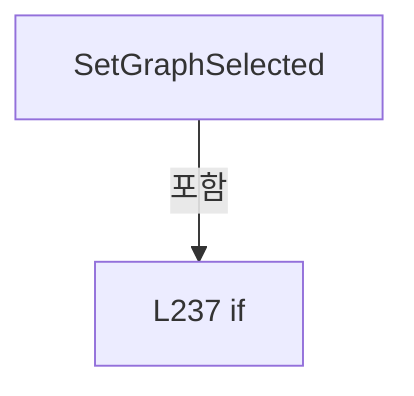

변경 전 점검: 입력/반환 타입, 위 호출자, 예외/취소 경로, 공유 상태와 저장·전송 소비자를 함께 확인합니다. 값의 단위나 물리 방향을 이름만으로 확정하지 않습니다.

### PropertyDeclaration `PowerMeters` · L240–240

[Drilling.UI/Menu/Menus/CManualPowerMeasurePanel.cs:240–240](https://github.com/kjuws10-rgb/A3Drilling/blob/5aee8e58439c9b455cae7c9593c9be986c3e682e/Drilling.UI/Menu/Menus/CManualPowerMeasurePanel.cs#L240-L240)

| 항목 | 실제 추출 값 |
| --- | --- |
| 서명 | System.Collections.Generic.IReadOnlyList<Drilling.UI.Menu.Menus.ST_MANUAL_POWER_METER_OPTION> Drilling.UI.Menu.Menus.CPowerMeasureRow.PowerMeters |
| 접근/수식자 | Public / public |
| 반환/값 타입 | System.Collections.Generic.IReadOnlyList<Drilling.UI.Menu.Menus.ST_MANUAL_POWER_METER_OPTION> |
| 소속 타입 | NamedType:Drilling.UI.Menu.Menus.CPowerMeasureRow |

현재 부분 분석에서 직접 연결된 호출자는 없습니다. XAML/이벤트/인터페이스·델리게이트·외부 진입을 추가 확인해야 하며, 미사용으로 판정한 것이 아닙니다.

변경 전 점검: 입력/반환 타입, 위 호출자, 예외/취소 경로, 공유 상태와 저장·전송 소비자를 함께 확인합니다. 값의 단위나 물리 방향을 이름만으로 확정하지 않습니다.

### GetAccessorDeclaration `get_PowerMeters` · L240–240

[Drilling.UI/Menu/Menus/CManualPowerMeasurePanel.cs:240–240](https://github.com/kjuws10-rgb/A3Drilling/blob/5aee8e58439c9b455cae7c9593c9be986c3e682e/Drilling.UI/Menu/Menus/CManualPowerMeasurePanel.cs#L240-L240)

| 항목 | 실제 추출 값 |
| --- | --- |
| 서명 | System.Collections.Generic.IReadOnlyList<Drilling.UI.Menu.Menus.ST_MANUAL_POWER_METER_OPTION> Drilling.UI.Menu.Menus.CPowerMeasureRow.PowerMeters.get |
| 접근/수식자 | Public / get |
| 반환/값 타입 | System.Collections.Generic.IReadOnlyList<Drilling.UI.Menu.Menus.ST_MANUAL_POWER_METER_OPTION> |
| 소속 타입 | NamedType:Drilling.UI.Menu.Menus.CPowerMeasureRow |

현재 부분 분석에서 직접 연결된 호출자는 없습니다. XAML/이벤트/인터페이스·델리게이트·외부 진입을 추가 확인해야 하며, 미사용으로 판정한 것이 아닙니다.

변경 전 점검: 입력/반환 타입, 위 호출자, 예외/취소 경로, 공유 상태와 저장·전송 소비자를 함께 확인합니다. 값의 단위나 물리 방향을 이름만으로 확정하지 않습니다.

### SetAccessorDeclaration `set_PowerMeters` · L240–240

[Drilling.UI/Menu/Menus/CManualPowerMeasurePanel.cs:240–240](https://github.com/kjuws10-rgb/A3Drilling/blob/5aee8e58439c9b455cae7c9593c9be986c3e682e/Drilling.UI/Menu/Menus/CManualPowerMeasurePanel.cs#L240-L240)

| 항목 | 실제 추출 값 |
| --- | --- |
| 서명 | void Drilling.UI.Menu.Menus.CPowerMeasureRow.PowerMeters.set |
| 접근/수식자 | Private / private, set |
| 반환/값 타입 | void |
| 소속 타입 | NamedType:Drilling.UI.Menu.Menus.CPowerMeasureRow |

입력 계약:

| 이름 | 타입 | 전달 | 선택/기본값 |
| --- | --- | --- | --- |
| value | System.Collections.Generic.IReadOnlyList<Drilling.UI.Menu.Menus.ST_MANUAL_POWER_METER_OPTION> | None | False /  |

현재 부분 분석에서 직접 연결된 호출자는 없습니다. XAML/이벤트/인터페이스·델리게이트·외부 진입을 추가 확인해야 하며, 미사용으로 판정한 것이 아닙니다.

변경 전 점검: 입력/반환 타입, 위 호출자, 예외/취소 경로, 공유 상태와 저장·전송 소비자를 함께 확인합니다. 값의 단위나 물리 방향을 이름만으로 확정하지 않습니다.

### PropertyDeclaration `SelectedPowerMeter` · L241–245

[Drilling.UI/Menu/Menus/CManualPowerMeasurePanel.cs:241–245](https://github.com/kjuws10-rgb/A3Drilling/blob/5aee8e58439c9b455cae7c9593c9be986c3e682e/Drilling.UI/Menu/Menus/CManualPowerMeasurePanel.cs#L241-L245)

| 항목 | 실제 추출 값 |
| --- | --- |
| 서명 | Drilling.UI.Menu.Menus.ST_MANUAL_POWER_METER_OPTION? Drilling.UI.Menu.Menus.CPowerMeasureRow.SelectedPowerMeter |
| 접근/수식자 | Public / public |
| 반환/값 타입 | Drilling.UI.Menu.Menus.ST_MANUAL_POWER_METER_OPTION? |
| 소속 타입 | NamedType:Drilling.UI.Menu.Menus.CPowerMeasureRow |

현재 부분 분석에서 직접 연결된 호출자는 없습니다. XAML/이벤트/인터페이스·델리게이트·외부 진입을 추가 확인해야 하며, 미사용으로 판정한 것이 아닙니다.

변경 전 점검: 입력/반환 타입, 위 호출자, 예외/취소 경로, 공유 상태와 저장·전송 소비자를 함께 확인합니다. 값의 단위나 물리 방향을 이름만으로 확정하지 않습니다.

### GetAccessorDeclaration `get_SelectedPowerMeter` · L243–243

[Drilling.UI/Menu/Menus/CManualPowerMeasurePanel.cs:243–243](https://github.com/kjuws10-rgb/A3Drilling/blob/5aee8e58439c9b455cae7c9593c9be986c3e682e/Drilling.UI/Menu/Menus/CManualPowerMeasurePanel.cs#L243-L243)

| 항목 | 실제 추출 값 |
| --- | --- |
| 서명 | Drilling.UI.Menu.Menus.ST_MANUAL_POWER_METER_OPTION? Drilling.UI.Menu.Menus.CPowerMeasureRow.SelectedPowerMeter.get |
| 접근/수식자 | Public / get |
| 반환/값 타입 | Drilling.UI.Menu.Menus.ST_MANUAL_POWER_METER_OPTION? |
| 소속 타입 | NamedType:Drilling.UI.Menu.Menus.CPowerMeasureRow |

현재 부분 분석에서 직접 연결된 호출자는 없습니다. XAML/이벤트/인터페이스·델리게이트·외부 진입을 추가 확인해야 하며, 미사용으로 판정한 것이 아닙니다.

변경 전 점검: 입력/반환 타입, 위 호출자, 예외/취소 경로, 공유 상태와 저장·전송 소비자를 함께 확인합니다. 값의 단위나 물리 방향을 이름만으로 확정하지 않습니다.

### SetAccessorDeclaration `set_SelectedPowerMeter` · L244–244

[Drilling.UI/Menu/Menus/CManualPowerMeasurePanel.cs:244–244](https://github.com/kjuws10-rgb/A3Drilling/blob/5aee8e58439c9b455cae7c9593c9be986c3e682e/Drilling.UI/Menu/Menus/CManualPowerMeasurePanel.cs#L244-L244)

| 항목 | 실제 추출 값 |
| --- | --- |
| 서명 | void Drilling.UI.Menu.Menus.CPowerMeasureRow.SelectedPowerMeter.set |
| 접근/수식자 | Public / set |
| 반환/값 타입 | void |
| 소속 타입 | NamedType:Drilling.UI.Menu.Menus.CPowerMeasureRow |

입력 계약:

| 이름 | 타입 | 전달 | 선택/기본값 |
| --- | --- | --- | --- |
| value | Drilling.UI.Menu.Menus.ST_MANUAL_POWER_METER_OPTION? | None | False /  |

현재 부분 분석에서 직접 연결된 호출자는 없습니다. XAML/이벤트/인터페이스·델리게이트·외부 진입을 추가 확인해야 하며, 미사용으로 판정한 것이 아닙니다.

호출하는 대상과 해석 범위:

| 원본 행 | 표현식 | 분석 상태 | 대상/소스 위치 |
| --- | --- | --- | --- |
| 244 | Notify | resolved | void Drilling.UI.Menu.Menus.CPowerMeasureRow.Notify(string?) · Drilling.UI/Menu/Menus/CManualPowerMeasurePanel.cs:286 |
| 244 | .Invoke | resolved · 동적 구현 선택 가능 | void System.Action.Invoke() |

본문의 실제 연산·분기·예외·반환 순서(원문 위치 순):

| 원본 행 | 종류 | 주석 해설 |
| --- | --- | --- |
| 244 | assignment | 값을 대상에 대입합니다: _selectedPowerMeter = value |
| 244 | call | 함수·델리게이트 또는 객체 생성자를 호출합니다: Notify() |
| 244 | call | 함수·델리게이트 또는 객체 생성자를 호출합니다: .Invoke() |
| 244 | if | 조건에 따라 분기합니다: if (_updatingPowerMeters &#124;&#124; _selectedPowerMeter == value) |
| 244 | return | 호출자에게 값 또는 제어를 반환합니다: return; |

제어 구문의 포함 구조(실제 실행 순서/CFG가 아닌 구문 탐색 그림):

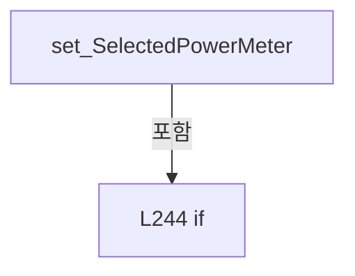

변경 전 점검: 입력/반환 타입, 위 호출자, 예외/취소 경로, 공유 상태와 저장·전송 소비자를 함께 확인합니다. 값의 단위나 물리 방향을 이름만으로 확정하지 않습니다.

### PropertyDeclaration `Target` · L246–246

[Drilling.UI/Menu/Menus/CManualPowerMeasurePanel.cs:246–246](https://github.com/kjuws10-rgb/A3Drilling/blob/5aee8e58439c9b455cae7c9593c9be986c3e682e/Drilling.UI/Menu/Menus/CManualPowerMeasurePanel.cs#L246-L246)

| 항목 | 실제 추출 값 |
| --- | --- |
| 서명 | string Drilling.UI.Menu.Menus.CPowerMeasureRow.Target |
| 접근/수식자 | Public / public |
| 반환/값 타입 | string |
| 소속 타입 | NamedType:Drilling.UI.Menu.Menus.CPowerMeasureRow |

현재 부분 분석에서 직접 연결된 호출자는 없습니다. XAML/이벤트/인터페이스·델리게이트·외부 진입을 추가 확인해야 하며, 미사용으로 판정한 것이 아닙니다.

변경 전 점검: 입력/반환 타입, 위 호출자, 예외/취소 경로, 공유 상태와 저장·전송 소비자를 함께 확인합니다. 값의 단위나 물리 방향을 이름만으로 확정하지 않습니다.

### GetAccessorDeclaration `get_Target` · L246–246

[Drilling.UI/Menu/Menus/CManualPowerMeasurePanel.cs:246–246](https://github.com/kjuws10-rgb/A3Drilling/blob/5aee8e58439c9b455cae7c9593c9be986c3e682e/Drilling.UI/Menu/Menus/CManualPowerMeasurePanel.cs#L246-L246)

| 항목 | 실제 추출 값 |
| --- | --- |
| 서명 | string Drilling.UI.Menu.Menus.CPowerMeasureRow.Target.get |
| 접근/수식자 | Public / get |
| 반환/값 타입 | string |
| 소속 타입 | NamedType:Drilling.UI.Menu.Menus.CPowerMeasureRow |

현재 부분 분석에서 직접 연결된 호출자는 없습니다. XAML/이벤트/인터페이스·델리게이트·외부 진입을 추가 확인해야 하며, 미사용으로 판정한 것이 아닙니다.

변경 전 점검: 입력/반환 타입, 위 호출자, 예외/취소 경로, 공유 상태와 저장·전송 소비자를 함께 확인합니다. 값의 단위나 물리 방향을 이름만으로 확정하지 않습니다.

### SetAccessorDeclaration `set_Target` · L246–246

[Drilling.UI/Menu/Menus/CManualPowerMeasurePanel.cs:246–246](https://github.com/kjuws10-rgb/A3Drilling/blob/5aee8e58439c9b455cae7c9593c9be986c3e682e/Drilling.UI/Menu/Menus/CManualPowerMeasurePanel.cs#L246-L246)

| 항목 | 실제 추출 값 |
| --- | --- |
| 서명 | void Drilling.UI.Menu.Menus.CPowerMeasureRow.Target.set |
| 접근/수식자 | Public / set |
| 반환/값 타입 | void |
| 소속 타입 | NamedType:Drilling.UI.Menu.Menus.CPowerMeasureRow |

입력 계약:

| 이름 | 타입 | 전달 | 선택/기본값 |
| --- | --- | --- | --- |
| value | string | None | False /  |

현재 부분 분석에서 직접 연결된 호출자는 없습니다. XAML/이벤트/인터페이스·델리게이트·외부 진입을 추가 확인해야 하며, 미사용으로 판정한 것이 아닙니다.

호출하는 대상과 해석 범위:

| 원본 행 | 표현식 | 분석 상태 | 대상/소스 위치 |
| --- | --- | --- | --- |
| 246 | SetInput | resolved | void Drilling.UI.Menu.Menus.CPowerMeasureRow.SetInput(ref string, string, string?) · Drilling.UI/Menu/Menus/CManualPowerMeasurePanel.cs:281 |

본문의 실제 연산·분기·예외·반환 순서(원문 위치 순):

| 원본 행 | 종류 | 주석 해설 |
| --- | --- | --- |
| 246 | call | 함수·델리게이트 또는 객체 생성자를 호출합니다: SetInput(ref _target, value) |

변경 전 점검: 입력/반환 타입, 위 호출자, 예외/취소 경로, 공유 상태와 저장·전송 소비자를 함께 확인합니다. 값의 단위나 물리 방향을 이름만으로 확정하지 않습니다.

### PropertyDeclaration `SettleTime` · L247–247

[Drilling.UI/Menu/Menus/CManualPowerMeasurePanel.cs:247–247](https://github.com/kjuws10-rgb/A3Drilling/blob/5aee8e58439c9b455cae7c9593c9be986c3e682e/Drilling.UI/Menu/Menus/CManualPowerMeasurePanel.cs#L247-L247)

| 항목 | 실제 추출 값 |
| --- | --- |
| 서명 | string Drilling.UI.Menu.Menus.CPowerMeasureRow.SettleTime |
| 접근/수식자 | Public / public |
| 반환/값 타입 | string |
| 소속 타입 | NamedType:Drilling.UI.Menu.Menus.CPowerMeasureRow |

현재 부분 분석에서 직접 연결된 호출자는 없습니다. XAML/이벤트/인터페이스·델리게이트·외부 진입을 추가 확인해야 하며, 미사용으로 판정한 것이 아닙니다.

변경 전 점검: 입력/반환 타입, 위 호출자, 예외/취소 경로, 공유 상태와 저장·전송 소비자를 함께 확인합니다. 값의 단위나 물리 방향을 이름만으로 확정하지 않습니다.

### GetAccessorDeclaration `get_SettleTime` · L247–247

[Drilling.UI/Menu/Menus/CManualPowerMeasurePanel.cs:247–247](https://github.com/kjuws10-rgb/A3Drilling/blob/5aee8e58439c9b455cae7c9593c9be986c3e682e/Drilling.UI/Menu/Menus/CManualPowerMeasurePanel.cs#L247-L247)

| 항목 | 실제 추출 값 |
| --- | --- |
| 서명 | string Drilling.UI.Menu.Menus.CPowerMeasureRow.SettleTime.get |
| 접근/수식자 | Public / get |
| 반환/값 타입 | string |
| 소속 타입 | NamedType:Drilling.UI.Menu.Menus.CPowerMeasureRow |

현재 부분 분석에서 직접 연결된 호출자는 없습니다. XAML/이벤트/인터페이스·델리게이트·외부 진입을 추가 확인해야 하며, 미사용으로 판정한 것이 아닙니다.

변경 전 점검: 입력/반환 타입, 위 호출자, 예외/취소 경로, 공유 상태와 저장·전송 소비자를 함께 확인합니다. 값의 단위나 물리 방향을 이름만으로 확정하지 않습니다.

### SetAccessorDeclaration `set_SettleTime` · L247–247

[Drilling.UI/Menu/Menus/CManualPowerMeasurePanel.cs:247–247](https://github.com/kjuws10-rgb/A3Drilling/blob/5aee8e58439c9b455cae7c9593c9be986c3e682e/Drilling.UI/Menu/Menus/CManualPowerMeasurePanel.cs#L247-L247)

| 항목 | 실제 추출 값 |
| --- | --- |
| 서명 | void Drilling.UI.Menu.Menus.CPowerMeasureRow.SettleTime.set |
| 접근/수식자 | Public / set |
| 반환/값 타입 | void |
| 소속 타입 | NamedType:Drilling.UI.Menu.Menus.CPowerMeasureRow |

입력 계약:

| 이름 | 타입 | 전달 | 선택/기본값 |
| --- | --- | --- | --- |
| value | string | None | False /  |

현재 부분 분석에서 직접 연결된 호출자는 없습니다. XAML/이벤트/인터페이스·델리게이트·외부 진입을 추가 확인해야 하며, 미사용으로 판정한 것이 아닙니다.

호출하는 대상과 해석 범위:

| 원본 행 | 표현식 | 분석 상태 | 대상/소스 위치 |
| --- | --- | --- | --- |
| 247 | SetInput | resolved | void Drilling.UI.Menu.Menus.CPowerMeasureRow.SetInput(ref string, string, string?) · Drilling.UI/Menu/Menus/CManualPowerMeasurePanel.cs:281 |

본문의 실제 연산·분기·예외·반환 순서(원문 위치 순):

| 원본 행 | 종류 | 주석 해설 |
| --- | --- | --- |
| 247 | call | 함수·델리게이트 또는 객체 생성자를 호출합니다: SetInput(ref _settleTime, value) |

변경 전 점검: 입력/반환 타입, 위 호출자, 예외/취소 경로, 공유 상태와 저장·전송 소비자를 함께 확인합니다. 값의 단위나 물리 방향을 이름만으로 확정하지 않습니다.

### PropertyDeclaration `MeasureCount` · L248–248

[Drilling.UI/Menu/Menus/CManualPowerMeasurePanel.cs:248–248](https://github.com/kjuws10-rgb/A3Drilling/blob/5aee8e58439c9b455cae7c9593c9be986c3e682e/Drilling.UI/Menu/Menus/CManualPowerMeasurePanel.cs#L248-L248)

| 항목 | 실제 추출 값 |
| --- | --- |
| 서명 | string Drilling.UI.Menu.Menus.CPowerMeasureRow.MeasureCount |
| 접근/수식자 | Public / public |
| 반환/값 타입 | string |
| 소속 타입 | NamedType:Drilling.UI.Menu.Menus.CPowerMeasureRow |

현재 부분 분석에서 직접 연결된 호출자는 없습니다. XAML/이벤트/인터페이스·델리게이트·외부 진입을 추가 확인해야 하며, 미사용으로 판정한 것이 아닙니다.

변경 전 점검: 입력/반환 타입, 위 호출자, 예외/취소 경로, 공유 상태와 저장·전송 소비자를 함께 확인합니다. 값의 단위나 물리 방향을 이름만으로 확정하지 않습니다.

### GetAccessorDeclaration `get_MeasureCount` · L248–248

[Drilling.UI/Menu/Menus/CManualPowerMeasurePanel.cs:248–248](https://github.com/kjuws10-rgb/A3Drilling/blob/5aee8e58439c9b455cae7c9593c9be986c3e682e/Drilling.UI/Menu/Menus/CManualPowerMeasurePanel.cs#L248-L248)

| 항목 | 실제 추출 값 |
| --- | --- |
| 서명 | string Drilling.UI.Menu.Menus.CPowerMeasureRow.MeasureCount.get |
| 접근/수식자 | Public / get |
| 반환/값 타입 | string |
| 소속 타입 | NamedType:Drilling.UI.Menu.Menus.CPowerMeasureRow |

현재 부분 분석에서 직접 연결된 호출자는 없습니다. XAML/이벤트/인터페이스·델리게이트·외부 진입을 추가 확인해야 하며, 미사용으로 판정한 것이 아닙니다.

변경 전 점검: 입력/반환 타입, 위 호출자, 예외/취소 경로, 공유 상태와 저장·전송 소비자를 함께 확인합니다. 값의 단위나 물리 방향을 이름만으로 확정하지 않습니다.

### SetAccessorDeclaration `set_MeasureCount` · L248–248

[Drilling.UI/Menu/Menus/CManualPowerMeasurePanel.cs:248–248](https://github.com/kjuws10-rgb/A3Drilling/blob/5aee8e58439c9b455cae7c9593c9be986c3e682e/Drilling.UI/Menu/Menus/CManualPowerMeasurePanel.cs#L248-L248)

| 항목 | 실제 추출 값 |
| --- | --- |
| 서명 | void Drilling.UI.Menu.Menus.CPowerMeasureRow.MeasureCount.set |
| 접근/수식자 | Public / set |
| 반환/값 타입 | void |
| 소속 타입 | NamedType:Drilling.UI.Menu.Menus.CPowerMeasureRow |

입력 계약:

| 이름 | 타입 | 전달 | 선택/기본값 |
| --- | --- | --- | --- |
| value | string | None | False /  |

현재 부분 분석에서 직접 연결된 호출자는 없습니다. XAML/이벤트/인터페이스·델리게이트·외부 진입을 추가 확인해야 하며, 미사용으로 판정한 것이 아닙니다.

호출하는 대상과 해석 범위:

| 원본 행 | 표현식 | 분석 상태 | 대상/소스 위치 |
| --- | --- | --- | --- |
| 248 | SetInput | resolved | void Drilling.UI.Menu.Menus.CPowerMeasureRow.SetInput(ref string, string, string?) · Drilling.UI/Menu/Menus/CManualPowerMeasurePanel.cs:281 |

본문의 실제 연산·분기·예외·반환 순서(원문 위치 순):

| 원본 행 | 종류 | 주석 해설 |
| --- | --- | --- |
| 248 | call | 함수·델리게이트 또는 객체 생성자를 호출합니다: SetInput(ref _measureCount, value) |

변경 전 점검: 입력/반환 타입, 위 호출자, 예외/취소 경로, 공유 상태와 저장·전송 소비자를 함께 확인합니다. 값의 단위나 물리 방향을 이름만으로 확정하지 않습니다.

### PropertyDeclaration `MeasureInterval` · L249–249

[Drilling.UI/Menu/Menus/CManualPowerMeasurePanel.cs:249–249](https://github.com/kjuws10-rgb/A3Drilling/blob/5aee8e58439c9b455cae7c9593c9be986c3e682e/Drilling.UI/Menu/Menus/CManualPowerMeasurePanel.cs#L249-L249)

| 항목 | 실제 추출 값 |
| --- | --- |
| 서명 | string Drilling.UI.Menu.Menus.CPowerMeasureRow.MeasureInterval |
| 접근/수식자 | Public / public |
| 반환/값 타입 | string |
| 소속 타입 | NamedType:Drilling.UI.Menu.Menus.CPowerMeasureRow |

현재 부분 분석에서 직접 연결된 호출자는 없습니다. XAML/이벤트/인터페이스·델리게이트·외부 진입을 추가 확인해야 하며, 미사용으로 판정한 것이 아닙니다.

변경 전 점검: 입력/반환 타입, 위 호출자, 예외/취소 경로, 공유 상태와 저장·전송 소비자를 함께 확인합니다. 값의 단위나 물리 방향을 이름만으로 확정하지 않습니다.

### GetAccessorDeclaration `get_MeasureInterval` · L249–249

[Drilling.UI/Menu/Menus/CManualPowerMeasurePanel.cs:249–249](https://github.com/kjuws10-rgb/A3Drilling/blob/5aee8e58439c9b455cae7c9593c9be986c3e682e/Drilling.UI/Menu/Menus/CManualPowerMeasurePanel.cs#L249-L249)

| 항목 | 실제 추출 값 |
| --- | --- |
| 서명 | string Drilling.UI.Menu.Menus.CPowerMeasureRow.MeasureInterval.get |
| 접근/수식자 | Public / get |
| 반환/값 타입 | string |
| 소속 타입 | NamedType:Drilling.UI.Menu.Menus.CPowerMeasureRow |

현재 부분 분석에서 직접 연결된 호출자는 없습니다. XAML/이벤트/인터페이스·델리게이트·외부 진입을 추가 확인해야 하며, 미사용으로 판정한 것이 아닙니다.

변경 전 점검: 입력/반환 타입, 위 호출자, 예외/취소 경로, 공유 상태와 저장·전송 소비자를 함께 확인합니다. 값의 단위나 물리 방향을 이름만으로 확정하지 않습니다.

### SetAccessorDeclaration `set_MeasureInterval` · L249–249

[Drilling.UI/Menu/Menus/CManualPowerMeasurePanel.cs:249–249](https://github.com/kjuws10-rgb/A3Drilling/blob/5aee8e58439c9b455cae7c9593c9be986c3e682e/Drilling.UI/Menu/Menus/CManualPowerMeasurePanel.cs#L249-L249)

| 항목 | 실제 추출 값 |
| --- | --- |
| 서명 | void Drilling.UI.Menu.Menus.CPowerMeasureRow.MeasureInterval.set |
| 접근/수식자 | Public / set |
| 반환/값 타입 | void |
| 소속 타입 | NamedType:Drilling.UI.Menu.Menus.CPowerMeasureRow |

입력 계약:

| 이름 | 타입 | 전달 | 선택/기본값 |
| --- | --- | --- | --- |
| value | string | None | False /  |

현재 부분 분석에서 직접 연결된 호출자는 없습니다. XAML/이벤트/인터페이스·델리게이트·외부 진입을 추가 확인해야 하며, 미사용으로 판정한 것이 아닙니다.

호출하는 대상과 해석 범위:

| 원본 행 | 표현식 | 분석 상태 | 대상/소스 위치 |
| --- | --- | --- | --- |
| 249 | SetInput | resolved | void Drilling.UI.Menu.Menus.CPowerMeasureRow.SetInput(ref string, string, string?) · Drilling.UI/Menu/Menus/CManualPowerMeasurePanel.cs:281 |

본문의 실제 연산·분기·예외·반환 순서(원문 위치 순):

| 원본 행 | 종류 | 주석 해설 |
| --- | --- | --- |
| 249 | call | 함수·델리게이트 또는 객체 생성자를 호출합니다: SetInput(ref _measureInterval, value) |

변경 전 점검: 입력/반환 타입, 위 호출자, 예외/취소 경로, 공유 상태와 저장·전송 소비자를 함께 확인합니다. 값의 단위나 물리 방향을 이름만으로 확정하지 않습니다.

### MethodDeclaration `UpdatePowerMeters` · L250–265

[Drilling.UI/Menu/Menus/CManualPowerMeasurePanel.cs:250–265](https://github.com/kjuws10-rgb/A3Drilling/blob/5aee8e58439c9b455cae7c9593c9be986c3e682e/Drilling.UI/Menu/Menus/CManualPowerMeasurePanel.cs#L250-L265)

| 항목 | 실제 추출 값 |
| --- | --- |
| 서명 | void Drilling.UI.Menu.Menus.CPowerMeasureRow.UpdatePowerMeters(System.Collections.Generic.IReadOnlyList<Drilling.UI.Menu.Menus.ST_MANUAL_POWER_METER_OPTION>) |
| 접근/수식자 | Public / public |
| 반환/값 타입 | void |
| 소속 타입 | NamedType:Drilling.UI.Menu.Menus.CPowerMeasureRow |

입력 계약:

| 이름 | 타입 | 전달 | 선택/기본값 |
| --- | --- | --- | --- |
| meters | System.Collections.Generic.IReadOnlyList<Drilling.UI.Menu.Menus.ST_MANUAL_POWER_METER_OPTION> | None | False /  |

정적 호출자로 확인된 위치:

| 호출 파일/행 | 호출 표현식 | 런타임 분기 가능 |
| --- | --- | --- |
| [Drilling.UI/Menu/Menus/CManualPowerMeasurePanel.cs:114–114](https://github.com/kjuws10-rgb/A3Drilling/blob/5aee8e58439c9b455cae7c9593c9be986c3e682e/Drilling.UI/Menu/Menus/CManualPowerMeasurePanel.cs#L114-L114) | row.UpdatePowerMeters | False |

호출하는 대상과 해석 범위:

| 원본 행 | 표현식 | 분석 상태 | 대상/소스 위치 |
| --- | --- | --- | --- |
| 252 | PowerMeters.SequenceEqual | resolved | bool System.Collections.Generic.IEnumerable<Drilling.UI.Menu.Menus.ST_MANUAL_POWER_METER_OPTION>.SequenceEqual<Drilling.UI.Menu.Menus.ST_MANUAL_POWER_METER_OPTION>(System.Collections.Generic.IEnumerable<Drilling.UI.Menu.Menus.ST_MANUAL_POWER_METER_OPTION>) |
| 253 | meters.FirstOrDefault | resolved | Drilling.UI.Menu.Menus.ST_MANUAL_POWER_METER_OPTION? System.Collections.Generic.IEnumerable<Drilling.UI.Menu.Menus.ST_MANUAL_POWER_METER_OPTION>.FirstOrDefault<Drilling.UI.Menu.Menus.ST_MANUAL_POWER_METER_OPTION>(System.Func<Drilling.UI.Menu.Menus.ST_MANUAL_POWER_METER_OPTION, bool>) |
| 260 | Notify | resolved | void Drilling.UI.Menu.Menus.CPowerMeasureRow.Notify(string?) · Drilling.UI/Menu/Menus/CManualPowerMeasurePanel.cs:286 |
| 260 | nameof | unresolved | None |
| 262 | Notify | resolved | void Drilling.UI.Menu.Menus.CPowerMeasureRow.Notify(string?) · Drilling.UI/Menu/Menus/CManualPowerMeasurePanel.cs:286 |
| 262 | nameof | unresolved | None |

본문의 실제 연산·분기·예외·반환 순서(원문 위치 순):

| 원본 행 | 종류 | 주석 해설 |
| --- | --- | --- |
| 252 | call | 함수·델리게이트 또는 객체 생성자를 호출합니다: PowerMeters.SequenceEqual(meters) |
| 252 | if | 조건에 따라 분기합니다: if (_metersInitialized && PowerMeters.SequenceEqual(meters)) |
| 252 | return | 호출자에게 값 또는 제어를 반환합니다: return; |
| 253 | call | 함수·델리게이트 또는 객체 생성자를 호출합니다: meters.FirstOrDefault(m => m.Number == HeadNo - 1) |
| 253 | local-declaration | 지역 변수를 선언합니다: var selected = meters.FirstOrDefault(m => m.Number == HeadNo - 1); |
| 253 | variable-initializer | 변수의 초기값을 지정합니다: selected = meters.FirstOrDefault(m => m.Number == HeadNo - 1) |
| 254 | assignment | 값을 대상에 대입합니다: _metersInitialized = true |
| 256 | assignment | 값을 대상에 대입합니다: _updatingPowerMeters = true |
| 257 | try | 예외 처리 범위입니다: try |
| 259 | assignment | 값을 대상에 대입합니다: PowerMeters = meters |
| 260 | call | 함수·델리게이트 또는 객체 생성자를 호출합니다: Notify(nameof(PowerMeters)) |
| 260 | call | 함수·델리게이트 또는 객체 생성자를 호출합니다: nameof(PowerMeters) |
| 261 | assignment | 값을 대상에 대입합니다: _selectedPowerMeter = selected |
| 262 | call | 함수·델리게이트 또는 객체 생성자를 호출합니다: Notify(nameof(SelectedPowerMeter)) |
| 262 | call | 함수·델리게이트 또는 객체 생성자를 호출합니다: nameof(SelectedPowerMeter) |
| 264 | assignment | 값을 대상에 대입합니다: _updatingPowerMeters = false |
| 264 | finally | 종료 정리 구간입니다: finally |

제어 구문의 포함 구조(실제 실행 순서/CFG가 아닌 구문 탐색 그림):

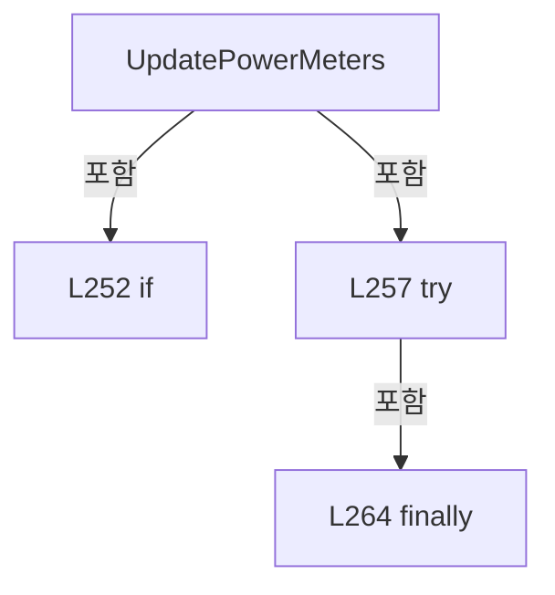

변경 전 점검: 입력/반환 타입, 위 호출자, 예외/취소 경로, 공유 상태와 저장·전송 소비자를 함께 확인합니다. 값의 단위나 물리 방향을 이름만으로 확정하지 않습니다.

### MethodDeclaration `ApplyTarget` · L266–274

[Drilling.UI/Menu/Menus/CManualPowerMeasurePanel.cs:266–274](https://github.com/kjuws10-rgb/A3Drilling/blob/5aee8e58439c9b455cae7c9593c9be986c3e682e/Drilling.UI/Menu/Menus/CManualPowerMeasurePanel.cs#L266-L274)

| 항목 | 실제 추출 값 |
| --- | --- |
| 서명 | void Drilling.UI.Menu.Menus.CPowerMeasureRow.ApplyTarget(Drilling.Common.Interface.ST_POWER_MEASURE_TARGET) |
| 접근/수식자 | Public / public |
| 반환/값 타입 | void |
| 소속 타입 | NamedType:Drilling.UI.Menu.Menus.CPowerMeasureRow |

입력 계약:

| 이름 | 타입 | 전달 | 선택/기본값 |
| --- | --- | --- | --- |
| target | Drilling.Common.Interface.ST_POWER_MEASURE_TARGET | None | False /  |

정적 호출자로 확인된 위치:

| 호출 파일/행 | 호출 표현식 | 런타임 분기 가능 |
| --- | --- | --- |
| [Drilling.UI/Menu/Menus/CManualPowerMeasurePanel.cs:141–141](https://github.com/kjuws10-rgb/A3Drilling/blob/5aee8e58439c9b455cae7c9593c9be986c3e682e/Drilling.UI/Menu/Menus/CManualPowerMeasurePanel.cs#L141-L141) | row.ApplyTarget | False |

호출하는 대상과 해석 범위:

| 원본 행 | 표현식 | 분석 상태 | 대상/소스 위치 |
| --- | --- | --- | --- |
| 268 | ReferenceEquals | resolved | bool object.ReferenceEquals(object?, object?) |
| 269 | target.TargetPower.ToString | resolved | string double.ToString(string?, System.IFormatProvider?) |
| 270 | target.Options.SettleTimeMs.ToString | resolved | string int.ToString(System.IFormatProvider?) |
| 271 | target.Options.MeasureCount.ToString | resolved | string int.ToString(System.IFormatProvider?) |
| 272 | target.Options.MeasureIntervalMs.ToString | resolved | string int.ToString(System.IFormatProvider?) |
| 273 | nameof | unresolved | None |
| 273 | nameof | unresolved | None |
| 273 | nameof | unresolved | None |
| 273 | nameof | unresolved | None |
| 273 | Notify | resolved | void Drilling.UI.Menu.Menus.CPowerMeasureRow.Notify(string?) · Drilling.UI/Menu/Menus/CManualPowerMeasurePanel.cs:286 |

본문의 실제 연산·분기·예외·반환 순서(원문 위치 순):

| 원본 행 | 종류 | 주석 해설 |
| --- | --- | --- |
| 268 | call | 함수·델리게이트 또는 객체 생성자를 호출합니다: ReferenceEquals(Snapshot?.Target, target) |
| 268 | if | 조건에 따라 분기합니다: if (ReferenceEquals(Snapshot?.Target, target)) |
| 268 | return | 호출자에게 값 또는 제어를 반환합니다: return; |
| 269 | assignment | 값을 대상에 대입합니다: _target = target.TargetPower.ToString("0.0000", CultureInfo.InvariantCulture) |
| 269 | call | 함수·델리게이트 또는 객체 생성자를 호출합니다: target.TargetPower.ToString("0.0000", CultureInfo.InvariantCulture) |
| 270 | assignment | 값을 대상에 대입합니다: _settleTime = target.Options.SettleTimeMs.ToString(CultureInfo.InvariantCulture) |
| 270 | call | 함수·델리게이트 또는 객체 생성자를 호출합니다: target.Options.SettleTimeMs.ToString(CultureInfo.InvariantCulture) |
| 271 | assignment | 값을 대상에 대입합니다: _measureCount = target.Options.MeasureCount.ToString(CultureInfo.InvariantCulture) |
| 271 | call | 함수·델리게이트 또는 객체 생성자를 호출합니다: target.Options.MeasureCount.ToString(CultureInfo.InvariantCulture) |
| 272 | assignment | 값을 대상에 대입합니다: _measureInterval = target.Options.MeasureIntervalMs.ToString(CultureInfo.InvariantCulture) |
| 272 | call | 함수·델리게이트 또는 객체 생성자를 호출합니다: target.Options.MeasureIntervalMs.ToString(CultureInfo.InvariantCulture) |
| 273 | call | 함수·델리게이트 또는 객체 생성자를 호출합니다: nameof(Target) |
| 273 | call | 함수·델리게이트 또는 객체 생성자를 호출합니다: nameof(SettleTime) |
| 273 | call | 함수·델리게이트 또는 객체 생성자를 호출합니다: nameof(MeasureCount) |
| 273 | call | 함수·델리게이트 또는 객체 생성자를 호출합니다: nameof(MeasureInterval) |
| 273 | call | 함수·델리게이트 또는 객체 생성자를 호출합니다: Notify(name) |
| 273 | foreach | 컬렉션 요소를 순회합니다: foreach (var name in new[] { nameof(Target), nameof(SettleTime), nameof(MeasureCount), nameof(MeasureInterval) }) |

제어 구문의 포함 구조(실제 실행 순서/CFG가 아닌 구문 탐색 그림):

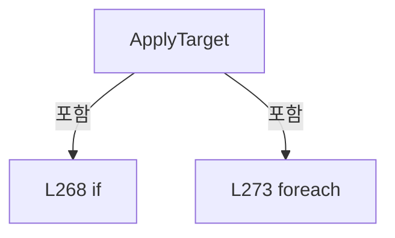

변경 전 점검: 입력/반환 타입, 위 호출자, 예외/취소 경로, 공유 상태와 저장·전송 소비자를 함께 확인합니다. 값의 단위나 물리 방향을 이름만으로 확정하지 않습니다.

### MethodDeclaration `Matches` · L275–280

[Drilling.UI/Menu/Menus/CManualPowerMeasurePanel.cs:275–280](https://github.com/kjuws10-rgb/A3Drilling/blob/5aee8e58439c9b455cae7c9593c9be986c3e682e/Drilling.UI/Menu/Menus/CManualPowerMeasurePanel.cs#L275-L280)

| 항목 | 실제 추출 값 |
| --- | --- |
| 서명 | bool Drilling.UI.Menu.Menus.CPowerMeasureRow.Matches(Drilling.Common.Interface.ST_POWER_MEASURE_TARGET, string) |
| 접근/수식자 | Public / public |
| 반환/값 타입 | bool |
| 소속 타입 | NamedType:Drilling.UI.Menu.Menus.CPowerMeasureRow |

입력 계약:

| 이름 | 타입 | 전달 | 선택/기본값 |
| --- | --- | --- | --- |
| target | Drilling.Common.Interface.ST_POWER_MEASURE_TARGET | None | False /  |
| mode | string | None | False /  |

정적 호출자로 확인된 위치:

| 호출 파일/행 | 호출 표현식 | 런타임 분기 가능 |
| --- | --- | --- |
| [Drilling.UI/Menu/Menus/CManualPowerMeasurePanel.cs:142–142](https://github.com/kjuws10-rgb/A3Drilling/blob/5aee8e58439c9b455cae7c9593c9be986c3e682e/Drilling.UI/Menu/Menus/CManualPowerMeasurePanel.cs#L142-L142) | row.Matches | False |

호출하는 대상과 해석 범위:

| 원본 행 | 표현식 | 분석 상태 | 대상/소스 위치 |
| --- | --- | --- | --- |
| 277 | double.TryParse | resolved | bool double.TryParse(string?, System.Globalization.NumberStyles, System.IFormatProvider?, out double) |
| 278 | int.TryParse | resolved | bool int.TryParse(string?, out int) |
| 279 | int.TryParse | resolved | bool int.TryParse(string?, out int) |
| 280 | int.TryParse | resolved | bool int.TryParse(string?, out int) |

본문의 실제 연산·분기·예외·반환 순서(원문 위치 순):

| 원본 행 | 종류 | 주석 해설 |
| --- | --- | --- |
| 277 | call | 함수·델리게이트 또는 객체 생성자를 호출합니다: double.TryParse(Target, NumberStyles.Float, CultureInfo.InvariantCulture, out var power) |
| 278 | call | 함수·델리게이트 또는 객체 생성자를 호출합니다: int.TryParse(SettleTime, out var settle) |
| 279 | call | 함수·델리게이트 또는 객체 생성자를 호출합니다: int.TryParse(MeasureCount, out var count) |
| 280 | call | 함수·델리게이트 또는 객체 생성자를 호출합니다: int.TryParse(MeasureInterval, out var interval) |

변경 전 점검: 입력/반환 타입, 위 호출자, 예외/취소 경로, 공유 상태와 저장·전송 소비자를 함께 확인합니다. 값의 단위나 물리 방향을 이름만으로 확정하지 않습니다.

### MethodDeclaration `SetInput` · L281–285

[Drilling.UI/Menu/Menus/CManualPowerMeasurePanel.cs:281–285](https://github.com/kjuws10-rgb/A3Drilling/blob/5aee8e58439c9b455cae7c9593c9be986c3e682e/Drilling.UI/Menu/Menus/CManualPowerMeasurePanel.cs#L281-L285)

| 항목 | 실제 추출 값 |
| --- | --- |
| 서명 | void Drilling.UI.Menu.Menus.CPowerMeasureRow.SetInput(ref string, string, string?) |
| 접근/수식자 | Private / private |
| 반환/값 타입 | void |
| 소속 타입 | NamedType:Drilling.UI.Menu.Menus.CPowerMeasureRow |

입력 계약:

| 이름 | 타입 | 전달 | 선택/기본값 |
| --- | --- | --- | --- |
| field | string | Ref | False /  |
| value | string | None | False /  |
| name | string? | None | True / null |

정적 호출자로 확인된 위치:

| 호출 파일/행 | 호출 표현식 | 런타임 분기 가능 |
| --- | --- | --- |
| [Drilling.UI/Menu/Menus/CManualPowerMeasurePanel.cs:246–246](https://github.com/kjuws10-rgb/A3Drilling/blob/5aee8e58439c9b455cae7c9593c9be986c3e682e/Drilling.UI/Menu/Menus/CManualPowerMeasurePanel.cs#L246-L246) | SetInput | False |
| [Drilling.UI/Menu/Menus/CManualPowerMeasurePanel.cs:247–247](https://github.com/kjuws10-rgb/A3Drilling/blob/5aee8e58439c9b455cae7c9593c9be986c3e682e/Drilling.UI/Menu/Menus/CManualPowerMeasurePanel.cs#L247-L247) | SetInput | False |
| [Drilling.UI/Menu/Menus/CManualPowerMeasurePanel.cs:248–248](https://github.com/kjuws10-rgb/A3Drilling/blob/5aee8e58439c9b455cae7c9593c9be986c3e682e/Drilling.UI/Menu/Menus/CManualPowerMeasurePanel.cs#L248-L248) | SetInput | False |
| [Drilling.UI/Menu/Menus/CManualPowerMeasurePanel.cs:249–249](https://github.com/kjuws10-rgb/A3Drilling/blob/5aee8e58439c9b455cae7c9593c9be986c3e682e/Drilling.UI/Menu/Menus/CManualPowerMeasurePanel.cs#L249-L249) | SetInput | False |

호출하는 대상과 해석 범위:

| 원본 행 | 표현식 | 분석 상태 | 대상/소스 위치 |
| --- | --- | --- | --- |
| 284 | Notify | resolved | void Drilling.UI.Menu.Menus.CPowerMeasureRow.Notify(string?) · Drilling.UI/Menu/Menus/CManualPowerMeasurePanel.cs:286 |
| 284 | RefreshGraph | resolved | void Drilling.UI.Menu.Menus.CPowerMeasureRow.RefreshGraph() · Drilling.UI/Menu/Menus/CManualPowerMeasurePanel.cs:308 |
| 284 | .Invoke | resolved · 동적 구현 선택 가능 | void System.Action.Invoke() |

본문의 실제 연산·분기·예외·반환 순서(원문 위치 순):

| 원본 행 | 종류 | 주석 해설 |
| --- | --- | --- |
| 283 | if | 조건에 따라 분기합니다: if (field == value) |
| 283 | return | 호출자에게 값 또는 제어를 반환합니다: return; |
| 284 | assignment | 값을 대상에 대입합니다: field = value |
| 284 | call | 함수·델리게이트 또는 객체 생성자를 호출합니다: Notify(name) |
| 284 | call | 함수·델리게이트 또는 객체 생성자를 호출합니다: RefreshGraph() |
| 284 | call | 함수·델리게이트 또는 객체 생성자를 호출합니다: .Invoke() |

제어 구문의 포함 구조(실제 실행 순서/CFG가 아닌 구문 탐색 그림):

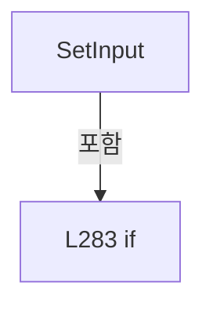

변경 전 점검: 입력/반환 타입, 위 호출자, 예외/취소 경로, 공유 상태와 저장·전송 소비자를 함께 확인합니다. 값의 단위나 물리 방향을 이름만으로 확정하지 않습니다.

### MethodDeclaration `Notify` · L286–286

[Drilling.UI/Menu/Menus/CManualPowerMeasurePanel.cs:286–286](https://github.com/kjuws10-rgb/A3Drilling/blob/5aee8e58439c9b455cae7c9593c9be986c3e682e/Drilling.UI/Menu/Menus/CManualPowerMeasurePanel.cs#L286-L286)

| 항목 | 실제 추출 값 |
| --- | --- |
| 서명 | void Drilling.UI.Menu.Menus.CPowerMeasureRow.Notify(string?) |
| 접근/수식자 | Private / private |
| 반환/값 타입 | void |
| 소속 타입 | NamedType:Drilling.UI.Menu.Menus.CPowerMeasureRow |

입력 계약:

| 이름 | 타입 | 전달 | 선택/기본값 |
| --- | --- | --- | --- |
| name | string? | None | True / null |

정적 호출자로 확인된 위치:

| 호출 파일/행 | 호출 표현식 | 런타임 분기 가능 |
| --- | --- | --- |
| [Drilling.UI/Menu/Menus/CManualPowerMeasurePanel.cs:238–238](https://github.com/kjuws10-rgb/A3Drilling/blob/5aee8e58439c9b455cae7c9593c9be986c3e682e/Drilling.UI/Menu/Menus/CManualPowerMeasurePanel.cs#L238-L238) | Notify | False |
| [Drilling.UI/Menu/Menus/CManualPowerMeasurePanel.cs:244–244](https://github.com/kjuws10-rgb/A3Drilling/blob/5aee8e58439c9b455cae7c9593c9be986c3e682e/Drilling.UI/Menu/Menus/CManualPowerMeasurePanel.cs#L244-L244) | Notify | False |
| [Drilling.UI/Menu/Menus/CManualPowerMeasurePanel.cs:260–260](https://github.com/kjuws10-rgb/A3Drilling/blob/5aee8e58439c9b455cae7c9593c9be986c3e682e/Drilling.UI/Menu/Menus/CManualPowerMeasurePanel.cs#L260-L260) | Notify | False |
| [Drilling.UI/Menu/Menus/CManualPowerMeasurePanel.cs:262–262](https://github.com/kjuws10-rgb/A3Drilling/blob/5aee8e58439c9b455cae7c9593c9be986c3e682e/Drilling.UI/Menu/Menus/CManualPowerMeasurePanel.cs#L262-L262) | Notify | False |
| [Drilling.UI/Menu/Menus/CManualPowerMeasurePanel.cs:273–273](https://github.com/kjuws10-rgb/A3Drilling/blob/5aee8e58439c9b455cae7c9593c9be986c3e682e/Drilling.UI/Menu/Menus/CManualPowerMeasurePanel.cs#L273-L273) | Notify | False |
| [Drilling.UI/Menu/Menus/CManualPowerMeasurePanel.cs:284–284](https://github.com/kjuws10-rgb/A3Drilling/blob/5aee8e58439c9b455cae7c9593c9be986c3e682e/Drilling.UI/Menu/Menus/CManualPowerMeasurePanel.cs#L284-L284) | Notify | False |
| [Drilling.UI/Menu/Menus/CManualPowerMeasurePanel.cs:313–313](https://github.com/kjuws10-rgb/A3Drilling/blob/5aee8e58439c9b455cae7c9593c9be986c3e682e/Drilling.UI/Menu/Menus/CManualPowerMeasurePanel.cs#L313-L313) | Notify | False |

호출하는 대상과 해석 범위:

| 원본 행 | 표현식 | 분석 상태 | 대상/소스 위치 |
| --- | --- | --- | --- |
| 286 | .Invoke | resolved · 동적 구현 선택 가능 | void System.ComponentModel.PropertyChangedEventHandler.Invoke(object?, System.ComponentModel.PropertyChangedEventArgs) |
| 286 | new | resolved | System.ComponentModel.PropertyChangedEventArgs.PropertyChangedEventArgs(string?) |

본문의 실제 연산·분기·예외·반환 순서(원문 위치 순):

| 원본 행 | 종류 | 주석 해설 |
| --- | --- | --- |
| 286 | call | 함수·델리게이트 또는 객체 생성자를 호출합니다: .Invoke(this, new(name)) |
| 286 | call | 함수·델리게이트 또는 객체 생성자를 호출합니다: new(name) |

변경 전 점검: 입력/반환 타입, 위 호출자, 예외/취소 경로, 공유 상태와 저장·전송 소비자를 함께 확인합니다. 값의 단위나 물리 방향을 이름만으로 확정하지 않습니다.

### PropertyDeclaration `Snapshot` · L287–287

[Drilling.UI/Menu/Menus/CManualPowerMeasurePanel.cs:287–287](https://github.com/kjuws10-rgb/A3Drilling/blob/5aee8e58439c9b455cae7c9593c9be986c3e682e/Drilling.UI/Menu/Menus/CManualPowerMeasurePanel.cs#L287-L287)

| 항목 | 실제 추출 값 |
| --- | --- |
| 서명 | Drilling.Common.Interface.ST_POWER_MEASURE_HEAD? Drilling.UI.Menu.Menus.CPowerMeasureRow.Snapshot |
| 접근/수식자 | Public / public |
| 반환/값 타입 | Drilling.Common.Interface.ST_POWER_MEASURE_HEAD? |
| 소속 타입 | NamedType:Drilling.UI.Menu.Menus.CPowerMeasureRow |

현재 부분 분석에서 직접 연결된 호출자는 없습니다. XAML/이벤트/인터페이스·델리게이트·외부 진입을 추가 확인해야 하며, 미사용으로 판정한 것이 아닙니다.

변경 전 점검: 입력/반환 타입, 위 호출자, 예외/취소 경로, 공유 상태와 저장·전송 소비자를 함께 확인합니다. 값의 단위나 물리 방향을 이름만으로 확정하지 않습니다.

### GetAccessorDeclaration `get_Snapshot` · L287–287

[Drilling.UI/Menu/Menus/CManualPowerMeasurePanel.cs:287–287](https://github.com/kjuws10-rgb/A3Drilling/blob/5aee8e58439c9b455cae7c9593c9be986c3e682e/Drilling.UI/Menu/Menus/CManualPowerMeasurePanel.cs#L287-L287)

| 항목 | 실제 추출 값 |
| --- | --- |
| 서명 | Drilling.Common.Interface.ST_POWER_MEASURE_HEAD? Drilling.UI.Menu.Menus.CPowerMeasureRow.Snapshot.get |
| 접근/수식자 | Public / get |
| 반환/값 타입 | Drilling.Common.Interface.ST_POWER_MEASURE_HEAD? |
| 소속 타입 | NamedType:Drilling.UI.Menu.Menus.CPowerMeasureRow |

현재 부분 분석에서 직접 연결된 호출자는 없습니다. XAML/이벤트/인터페이스·델리게이트·외부 진입을 추가 확인해야 하며, 미사용으로 판정한 것이 아닙니다.

변경 전 점검: 입력/반환 타입, 위 호출자, 예외/취소 경로, 공유 상태와 저장·전송 소비자를 함께 확인합니다. 값의 단위나 물리 방향을 이름만으로 확정하지 않습니다.

### SetAccessorDeclaration `set_Snapshot` · L287–287

[Drilling.UI/Menu/Menus/CManualPowerMeasurePanel.cs:287–287](https://github.com/kjuws10-rgb/A3Drilling/blob/5aee8e58439c9b455cae7c9593c9be986c3e682e/Drilling.UI/Menu/Menus/CManualPowerMeasurePanel.cs#L287-L287)

| 항목 | 실제 추출 값 |
| --- | --- |
| 서명 | void Drilling.UI.Menu.Menus.CPowerMeasureRow.Snapshot.set |
| 접근/수식자 | Private / private, set |
| 반환/값 타입 | void |
| 소속 타입 | NamedType:Drilling.UI.Menu.Menus.CPowerMeasureRow |

입력 계약:

| 이름 | 타입 | 전달 | 선택/기본값 |
| --- | --- | --- | --- |
| value | Drilling.Common.Interface.ST_POWER_MEASURE_HEAD? | None | False /  |

현재 부분 분석에서 직접 연결된 호출자는 없습니다. XAML/이벤트/인터페이스·델리게이트·외부 진입을 추가 확인해야 하며, 미사용으로 판정한 것이 아닙니다.

변경 전 점검: 입력/반환 타입, 위 호출자, 예외/취소 경로, 공유 상태와 저장·전송 소비자를 함께 확인합니다. 값의 단위나 물리 방향을 이름만으로 확정하지 않습니다.

### PropertyDeclaration `Measured` · L288–288

[Drilling.UI/Menu/Menus/CManualPowerMeasurePanel.cs:288–288](https://github.com/kjuws10-rgb/A3Drilling/blob/5aee8e58439c9b455cae7c9593c9be986c3e682e/Drilling.UI/Menu/Menus/CManualPowerMeasurePanel.cs#L288-L288)

| 항목 | 실제 추출 값 |
| --- | --- |
| 서명 | string Drilling.UI.Menu.Menus.CPowerMeasureRow.Measured |
| 접근/수식자 | Public / public |
| 반환/값 타입 | string |
| 소속 타입 | NamedType:Drilling.UI.Menu.Menus.CPowerMeasureRow |

현재 부분 분석에서 직접 연결된 호출자는 없습니다. XAML/이벤트/인터페이스·델리게이트·외부 진입을 추가 확인해야 하며, 미사용으로 판정한 것이 아닙니다.

호출하는 대상과 해석 범위:

| 원본 행 | 표현식 | 분석 상태 | 대상/소스 위치 |
| --- | --- | --- | --- |
| 288 | .ToString | resolved | string double.ToString(string?, System.IFormatProvider?) |

본문의 실제 연산·분기·예외·반환 순서(원문 위치 순):

| 원본 행 | 종류 | 주석 해설 |
| --- | --- | --- |
| 288 | call | 함수·델리게이트 또는 객체 생성자를 호출합니다: .ToString("0.0000", CultureInfo.InvariantCulture) |

변경 전 점검: 입력/반환 타입, 위 호출자, 예외/취소 경로, 공유 상태와 저장·전송 소비자를 함께 확인합니다. 값의 단위나 물리 방향을 이름만으로 확정하지 않습니다.

### PropertyDeclaration `Error` · L289–289

[Drilling.UI/Menu/Menus/CManualPowerMeasurePanel.cs:289–289](https://github.com/kjuws10-rgb/A3Drilling/blob/5aee8e58439c9b455cae7c9593c9be986c3e682e/Drilling.UI/Menu/Menus/CManualPowerMeasurePanel.cs#L289-L289)

| 항목 | 실제 추출 값 |
| --- | --- |
| 서명 | string Drilling.UI.Menu.Menus.CPowerMeasureRow.Error |
| 접근/수식자 | Public / public |
| 반환/값 타입 | string |
| 소속 타입 | NamedType:Drilling.UI.Menu.Menus.CPowerMeasureRow |

현재 부분 분석에서 직접 연결된 호출자는 없습니다. XAML/이벤트/인터페이스·델리게이트·외부 진입을 추가 확인해야 하며, 미사용으로 판정한 것이 아닙니다.

호출하는 대상과 해석 범위:

| 원본 행 | 표현식 | 분석 상태 | 대상/소스 위치 |
| --- | --- | --- | --- |
| 289 | (value - Snapshot.Target.TargetPower).ToString | resolved | string double.ToString(string?, System.IFormatProvider?) |

본문의 실제 연산·분기·예외·반환 순서(원문 위치 순):

| 원본 행 | 종류 | 주석 해설 |
| --- | --- | --- |
| 289 | call | 함수·델리게이트 또는 객체 생성자를 호출합니다: (value - Snapshot.Target.TargetPower).ToString("+0.0000;-0.0000;0.0000", CultureInfo.InvariantCulture) |
| 289 | conditional-expression | 조건에 따라 결과식을 선택합니다: Snapshot?.Power is { } value ? (value - Snapshot.Target.TargetPower).ToString("+0.0000;-0.0000;0.0000", CultureInfo.InvariantCulture) : "—" |

변경 전 점검: 입력/반환 타입, 위 호출자, 예외/취소 경로, 공유 상태와 저장·전송 소비자를 함께 확인합니다. 값의 단위나 물리 방향을 이름만으로 확정하지 않습니다.

### PropertyDeclaration `Angle` · L290–290

[Drilling.UI/Menu/Menus/CManualPowerMeasurePanel.cs:290–290](https://github.com/kjuws10-rgb/A3Drilling/blob/5aee8e58439c9b455cae7c9593c9be986c3e682e/Drilling.UI/Menu/Menus/CManualPowerMeasurePanel.cs#L290-L290)

| 항목 | 실제 추출 값 |
| --- | --- |
| 서명 | string Drilling.UI.Menu.Menus.CPowerMeasureRow.Angle |
| 접근/수식자 | Public / public |
| 반환/값 타입 | string |
| 소속 타입 | NamedType:Drilling.UI.Menu.Menus.CPowerMeasureRow |

현재 부분 분석에서 직접 연결된 호출자는 없습니다. XAML/이벤트/인터페이스·델리게이트·외부 진입을 추가 확인해야 하며, 미사용으로 판정한 것이 아닙니다.

호출하는 대상과 해석 범위:

| 원본 행 | 표현식 | 분석 상태 | 대상/소스 위치 |
| --- | --- | --- | --- |
| 290 | .ToString | resolved | string double.ToString(string?, System.IFormatProvider?) |

본문의 실제 연산·분기·예외·반환 순서(원문 위치 순):

| 원본 행 | 종류 | 주석 해설 |
| --- | --- | --- |
| 290 | call | 함수·델리게이트 또는 객체 생성자를 호출합니다: .ToString("0.0000", CultureInfo.InvariantCulture) |

변경 전 점검: 입력/반환 타입, 위 호출자, 예외/취소 경로, 공유 상태와 저장·전송 소비자를 함께 확인합니다. 값의 단위나 물리 방향을 이름만으로 확정하지 않습니다.

### PropertyDeclaration `Tolerance` · L291–291

[Drilling.UI/Menu/Menus/CManualPowerMeasurePanel.cs:291–291](https://github.com/kjuws10-rgb/A3Drilling/blob/5aee8e58439c9b455cae7c9593c9be986c3e682e/Drilling.UI/Menu/Menus/CManualPowerMeasurePanel.cs#L291-L291)

| 항목 | 실제 추출 값 |
| --- | --- |
| 서명 | string Drilling.UI.Menu.Menus.CPowerMeasureRow.Tolerance |
| 접근/수식자 | Public / public |
| 반환/값 타입 | string |
| 소속 타입 | NamedType:Drilling.UI.Menu.Menus.CPowerMeasureRow |

현재 부분 분석에서 직접 연결된 호출자는 없습니다. XAML/이벤트/인터페이스·델리게이트·외부 진입을 추가 확인해야 하며, 미사용으로 판정한 것이 아닙니다.

호출하는 대상과 해석 범위:

| 원본 행 | 표현식 | 분석 상태 | 대상/소스 위치 |
| --- | --- | --- | --- |
| 291 | state.Target.Options.Tolerance.ToString | resolved | string double.ToString(string?, System.IFormatProvider?) |

본문의 실제 연산·분기·예외·반환 순서(원문 위치 순):

| 원본 행 | 종류 | 주석 해설 |
| --- | --- | --- |
| 291 | call | 함수·델리게이트 또는 객체 생성자를 호출합니다: state.Target.Options.Tolerance.ToString("0.0000", CultureInfo.InvariantCulture) |
| 291 | conditional-expression | 조건에 따라 결과식을 선택합니다: Snapshot is { } state ? state.Target.Options.Tolerance.ToString("0.0000", CultureInfo.InvariantCulture) : "—" |

변경 전 점검: 입력/반환 타입, 위 호출자, 예외/취소 경로, 공유 상태와 저장·전송 소비자를 함께 확인합니다. 값의 단위나 물리 방향을 이름만으로 확정하지 않습니다.

### PropertyDeclaration `AttemptProgress` · L292–292

[Drilling.UI/Menu/Menus/CManualPowerMeasurePanel.cs:292–292](https://github.com/kjuws10-rgb/A3Drilling/blob/5aee8e58439c9b455cae7c9593c9be986c3e682e/Drilling.UI/Menu/Menus/CManualPowerMeasurePanel.cs#L292-L292)

| 항목 | 실제 추출 값 |
| --- | --- |
| 서명 | string Drilling.UI.Menu.Menus.CPowerMeasureRow.AttemptProgress |
| 접근/수식자 | Public / public |
| 반환/값 타입 | string |
| 소속 타입 | NamedType:Drilling.UI.Menu.Menus.CPowerMeasureRow |

현재 부분 분석에서 직접 연결된 호출자는 없습니다. XAML/이벤트/인터페이스·델리게이트·외부 진입을 추가 확인해야 하며, 미사용으로 판정한 것이 아닙니다.

본문의 실제 연산·분기·예외·반환 순서(원문 위치 순):

| 원본 행 | 종류 | 주석 해설 |
| --- | --- | --- |
| 292 | conditional-expression | 조건에 따라 결과식을 선택합니다: Snapshot is { } state ? $"{state.Samples.Count} / {state.Target.Options.MaxAttempts}" : "—" |

변경 전 점검: 입력/반환 타입, 위 호출자, 예외/취소 경로, 공유 상태와 저장·전송 소비자를 함께 확인합니다. 값의 단위나 물리 방향을 이름만으로 확정하지 않습니다.

### PropertyDeclaration `GraphSummary` · L293–293

[Drilling.UI/Menu/Menus/CManualPowerMeasurePanel.cs:293–293](https://github.com/kjuws10-rgb/A3Drilling/blob/5aee8e58439c9b455cae7c9593c9be986c3e682e/Drilling.UI/Menu/Menus/CManualPowerMeasurePanel.cs#L293-L293)

| 항목 | 실제 추출 값 |
| --- | --- |
| 서명 | string Drilling.UI.Menu.Menus.CPowerMeasureRow.GraphSummary |
| 접근/수식자 | Public / public |
| 반환/값 타입 | string |
| 소속 타입 | NamedType:Drilling.UI.Menu.Menus.CPowerMeasureRow |

현재 부분 분석에서 직접 연결된 호출자는 없습니다. XAML/이벤트/인터페이스·델리게이트·외부 진입을 추가 확인해야 하며, 미사용으로 판정한 것이 아닙니다.

본문의 실제 연산·분기·예외·반환 순서(원문 위치 순):

| 원본 행 | 종류 | 주석 해설 |
| --- | --- | --- |
| 293 | conditional-expression | 조건에 따라 결과식을 선택합니다: Snapshot is null ? $"ATT {Angle}°" : $"ATT {Angle}° · ±{Tolerance} W · {AttemptProgress}회" |

변경 전 점검: 입력/반환 타입, 위 호출자, 예외/취소 경로, 공유 상태와 저장·전송 소비자를 함께 확인합니다. 값의 단위나 물리 방향을 이름만으로 확정하지 않습니다.

### PropertyDeclaration `State` · L294–294

[Drilling.UI/Menu/Menus/CManualPowerMeasurePanel.cs:294–294](https://github.com/kjuws10-rgb/A3Drilling/blob/5aee8e58439c9b455cae7c9593c9be986c3e682e/Drilling.UI/Menu/Menus/CManualPowerMeasurePanel.cs#L294-L294)

| 항목 | 실제 추출 값 |
| --- | --- |
| 서명 | string Drilling.UI.Menu.Menus.CPowerMeasureRow.State |
| 접근/수식자 | Public / public |
| 반환/값 타입 | string |
| 소속 타입 | NamedType:Drilling.UI.Menu.Menus.CPowerMeasureRow |

현재 부분 분석에서 직접 연결된 호출자는 없습니다. XAML/이벤트/인터페이스·델리게이트·외부 진입을 추가 확인해야 하며, 미사용으로 판정한 것이 아닙니다.

변경 전 점검: 입력/반환 타입, 위 호출자, 예외/취소 경로, 공유 상태와 저장·전송 소비자를 함께 확인합니다. 값의 단위나 물리 방향을 이름만으로 확정하지 않습니다.

### PropertyDeclaration `StateBackground` · L295–300

[Drilling.UI/Menu/Menus/CManualPowerMeasurePanel.cs:295–300](https://github.com/kjuws10-rgb/A3Drilling/blob/5aee8e58439c9b455cae7c9593c9be986c3e682e/Drilling.UI/Menu/Menus/CManualPowerMeasurePanel.cs#L295-L300)

| 항목 | 실제 추출 값 |
| --- | --- |
| 서명 | Brush Drilling.UI.Menu.Menus.CPowerMeasureRow.StateBackground |
| 접근/수식자 | Public / public |
| 반환/값 타입 | Brush |
| 소속 타입 | NamedType:Drilling.UI.Menu.Menus.CPowerMeasureRow |

현재 부분 분석에서 직접 연결된 호출자는 없습니다. XAML/이벤트/인터페이스·델리게이트·외부 진입을 추가 확인해야 하며, 미사용으로 판정한 것이 아닙니다.

본문의 실제 연산·분기·예외·반환 순서(원문 위치 순):

| 원본 행 | 종류 | 주석 해설 |
| --- | --- | --- |
| 295 | switch-expression | 값별 결과식을 선택합니다: State switch { "OK" => Brushes.SeaGreen, "ERROR" => Brushes.Firebrick, "NG" => Brushes.DarkOrange, "POSITIONING" or "MOVING" or "SETTLING" or "MEASURING" or "FINISHING" or "SAVING" => Brushes.SteelBlue, _ => Brushes.DimGray } |

제어 구문의 포함 구조(실제 실행 순서/CFG가 아닌 구문 탐색 그림):

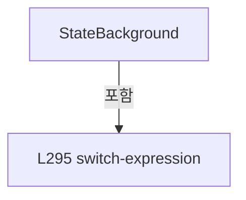

변경 전 점검: 입력/반환 타입, 위 호출자, 예외/취소 경로, 공유 상태와 저장·전송 소비자를 함께 확인합니다. 값의 단위나 물리 방향을 이름만으로 확정하지 않습니다.

### MethodDeclaration `Apply` · L301–307

[Drilling.UI/Menu/Menus/CManualPowerMeasurePanel.cs:301–307](https://github.com/kjuws10-rgb/A3Drilling/blob/5aee8e58439c9b455cae7c9593c9be986c3e682e/Drilling.UI/Menu/Menus/CManualPowerMeasurePanel.cs#L301-L307)

| 항목 | 실제 추출 값 |
| --- | --- |
| 서명 | void Drilling.UI.Menu.Menus.CPowerMeasureRow.Apply(Drilling.Common.Interface.ST_POWER_MEASURE_HEAD?) |
| 접근/수식자 | Public / public |
| 반환/값 타입 | void |
| 소속 타입 | NamedType:Drilling.UI.Menu.Menus.CPowerMeasureRow |

입력 계약:

| 이름 | 타입 | 전달 | 선택/기본값 |
| --- | --- | --- | --- |
| state | Drilling.Common.Interface.ST_POWER_MEASURE_HEAD? | None | False /  |

정적 호출자로 확인된 위치:

| 호출 파일/행 | 호출 표현식 | 런타임 분기 가능 |
| --- | --- | --- |
| [Drilling.UI/Menu/Menus/CManualPowerMeasurePanel.cs:143–143](https://github.com/kjuws10-rgb/A3Drilling/blob/5aee8e58439c9b455cae7c9593c9be986c3e682e/Drilling.UI/Menu/Menus/CManualPowerMeasurePanel.cs#L143-L143) | row.Apply | False |

호출하는 대상과 해석 범위:

| 원본 행 | 표현식 | 분석 상태 | 대상/소스 위치 |
| --- | --- | --- | --- |
| 303 | ReferenceEquals | resolved | bool object.ReferenceEquals(object?, object?) |
| 305 | RefreshGraph | resolved | void Drilling.UI.Menu.Menus.CPowerMeasureRow.RefreshGraph() · Drilling.UI/Menu/Menus/CManualPowerMeasurePanel.cs:308 |
| 306 | nameof | unresolved | None |
| 306 | nameof | unresolved | None |
| 306 | nameof | unresolved | None |
| 306 | nameof | unresolved | None |
| 306 | nameof | unresolved | None |
| 306 | nameof | unresolved | None |
| 306 | nameof | unresolved | None |
| 306 | nameof | unresolved | None |
| 306 | nameof | unresolved | None |
| 306 | .Invoke | resolved · 동적 구현 선택 가능 | void System.ComponentModel.PropertyChangedEventHandler.Invoke(object?, System.ComponentModel.PropertyChangedEventArgs) |
| 306 | new | resolved | System.ComponentModel.PropertyChangedEventArgs.PropertyChangedEventArgs(string?) |

본문의 실제 연산·분기·예외·반환 순서(원문 위치 순):

| 원본 행 | 종류 | 주석 해설 |
| --- | --- | --- |
| 303 | call | 함수·델리게이트 또는 객체 생성자를 호출합니다: ReferenceEquals(Snapshot, state) |
| 303 | if | 조건에 따라 분기합니다: if (ReferenceEquals(Snapshot, state)) |
| 303 | return | 호출자에게 값 또는 제어를 반환합니다: return; |
| 304 | assignment | 값을 대상에 대입합니다: Snapshot = state |
| 305 | call | 함수·델리게이트 또는 객체 생성자를 호출합니다: RefreshGraph() |
| 306 | call | 함수·델리게이트 또는 객체 생성자를 호출합니다: nameof(Snapshot) |
| 306 | call | 함수·델리게이트 또는 객체 생성자를 호출합니다: nameof(Measured) |
| 306 | call | 함수·델리게이트 또는 객체 생성자를 호출합니다: nameof(Error) |
| 306 | call | 함수·델리게이트 또는 객체 생성자를 호출합니다: nameof(Angle) |
| 306 | call | 함수·델리게이트 또는 객체 생성자를 호출합니다: nameof(Tolerance) |
| 306 | call | 함수·델리게이트 또는 객체 생성자를 호출합니다: nameof(AttemptProgress) |
| 306 | call | 함수·델리게이트 또는 객체 생성자를 호출합니다: nameof(GraphSummary) |
| 306 | call | 함수·델리게이트 또는 객체 생성자를 호출합니다: nameof(State) |
| 306 | call | 함수·델리게이트 또는 객체 생성자를 호출합니다: nameof(StateBackground) |
| 306 | call | 함수·델리게이트 또는 객체 생성자를 호출합니다: .Invoke(this, new(name)) |
| 306 | call | 함수·델리게이트 또는 객체 생성자를 호출합니다: new(name) |
| 306 | foreach | 컬렉션 요소를 순회합니다: foreach (var name in new[] { nameof(Snapshot), nameof(Measured), nameof(Error), nameof(Angle), nameof(Tolerance), nameof(AttemptProgress), nameof(GraphSummary), nameof(State), nameof(StateBackground) }) |

제어 구문의 포함 구조(실제 실행 순서/CFG가 아닌 구문 탐색 그림):

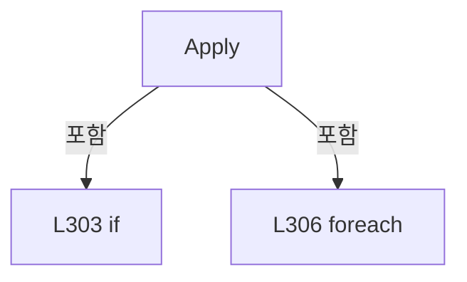

변경 전 점검: 입력/반환 타입, 위 호출자, 예외/취소 경로, 공유 상태와 저장·전송 소비자를 함께 확인합니다. 값의 단위나 물리 방향을 이름만으로 확정하지 않습니다.

### MethodDeclaration `RefreshGraph` · L308–314

[Drilling.UI/Menu/Menus/CManualPowerMeasurePanel.cs:308–314](https://github.com/kjuws10-rgb/A3Drilling/blob/5aee8e58439c9b455cae7c9593c9be986c3e682e/Drilling.UI/Menu/Menus/CManualPowerMeasurePanel.cs#L308-L314)

| 항목 | 실제 추출 값 |
| --- | --- |
| 서명 | void Drilling.UI.Menu.Menus.CPowerMeasureRow.RefreshGraph() |
| 접근/수식자 | Private / private |
| 반환/값 타입 | void |
| 소속 타입 | NamedType:Drilling.UI.Menu.Menus.CPowerMeasureRow |

정적 호출자로 확인된 위치:

| 호출 파일/행 | 호출 표현식 | 런타임 분기 가능 |
| --- | --- | --- |
| [Drilling.UI/Menu/Menus/CManualPowerMeasurePanel.cs:284–284](https://github.com/kjuws10-rgb/A3Drilling/blob/5aee8e58439c9b455cae7c9593c9be986c3e682e/Drilling.UI/Menu/Menus/CManualPowerMeasurePanel.cs#L284-L284) | RefreshGraph | False |
| [Drilling.UI/Menu/Menus/CManualPowerMeasurePanel.cs:305–305](https://github.com/kjuws10-rgb/A3Drilling/blob/5aee8e58439c9b455cae7c9593c9be986c3e682e/Drilling.UI/Menu/Menus/CManualPowerMeasurePanel.cs#L305-L305) | RefreshGraph | False |

호출하는 대상과 해석 범위:

| 원본 행 | 표현식 | 분석 상태 | 대상/소스 위치 |
| --- | --- | --- | --- |
| 311 | double.TryParse | resolved | bool double.TryParse(string?, System.Globalization.NumberStyles, System.IFormatProvider?, out double) |
| 311 | double.IsFinite | resolved | bool double.IsFinite(double) |
| 312 | CPowerMeasureGraph.Create | resolved | Drilling.UI.Menu.Menus.CPowerMeasureGraph Drilling.UI.Menu.Menus.CPowerMeasureGraph.Create(System.Collections.Generic.IReadOnlyList<Drilling.Common.Interface.ST_POWER_MEASURE_SAMPLE>, double) · Drilling.UI/Menu/Menus/CManualPowerMeasurePanel.cs:323 |
| 313 | Notify | resolved | void Drilling.UI.Menu.Menus.CPowerMeasureRow.Notify(string?) · Drilling.UI/Menu/Menus/CManualPowerMeasurePanel.cs:286 |
| 313 | nameof | unresolved | None |

본문의 실제 연산·분기·예외·반환 순서(원문 위치 순):

| 원본 행 | 종류 | 주석 해설 |
| --- | --- | --- |
| 310 | local-declaration | 지역 변수를 선언합니다: var target = Snapshot?.Target.TargetPower ?? (double.TryParse(Target, NumberStyles.Float, CultureInfo.InvariantCulture, out var value) && double.IsFinite(value) && value >= 0 ? value : 0); |
| 310 | variable-initializer | 변수의 초기값을 지정합니다: target = Snapshot?.Target.TargetPower ?? (double.TryParse(Target, NumberStyles.Float, CultureInfo.InvariantCulture, out var value) && double.IsFinite(value) && value >= 0 ? value : 0) |
| 311 | call | 함수·델리게이트 또는 객체 생성자를 호출합니다: double.TryParse(Target, NumberStyles.Float, CultureInfo.InvariantCulture, out var value) |
| 311 | call | 함수·델리게이트 또는 객체 생성자를 호출합니다: double.IsFinite(value) |
| 311 | conditional-expression | 조건에 따라 결과식을 선택합니다: double.TryParse(Target, NumberStyles.Float, CultureInfo.InvariantCulture, out var value) && double.IsFinite(value) && value >= 0 ? value : 0 |
| 312 | assignment | 값을 대상에 대입합니다: Graph = CPowerMeasureGraph.Create(Snapshot?.Samples ?? [], target) |
| 312 | call | 함수·델리게이트 또는 객체 생성자를 호출합니다: CPowerMeasureGraph.Create(Snapshot?.Samples ?? [], target) |
| 313 | call | 함수·델리게이트 또는 객체 생성자를 호출합니다: Notify(nameof(Graph)) |
| 313 | call | 함수·델리게이트 또는 객체 생성자를 호출합니다: nameof(Graph) |

변경 전 점검: 입력/반환 타입, 위 호출자, 예외/취소 경로, 공유 상태와 저장·전송 소비자를 함께 확인합니다. 값의 단위나 물리 방향을 이름만으로 확정하지 않습니다.

### PropertyDeclaration `Empty` · L319–319

[Drilling.UI/Menu/Menus/CManualPowerMeasurePanel.cs:319–319](https://github.com/kjuws10-rgb/A3Drilling/blob/5aee8e58439c9b455cae7c9593c9be986c3e682e/Drilling.UI/Menu/Menus/CManualPowerMeasurePanel.cs#L319-L319)

| 항목 | 실제 추출 값 |
| --- | --- |
| 서명 | Drilling.UI.Menu.Menus.CPowerMeasureGraph Drilling.UI.Menu.Menus.CPowerMeasureGraph.Empty |
| 접근/수식자 | Public / public, static |
| 반환/값 타입 | Drilling.UI.Menu.Menus.CPowerMeasureGraph |
| 소속 타입 | NamedType:Drilling.UI.Menu.Menus.CPowerMeasureGraph |

현재 부분 분석에서 직접 연결된 호출자는 없습니다. XAML/이벤트/인터페이스·델리게이트·외부 진입을 추가 확인해야 하며, 미사용으로 판정한 것이 아닙니다.

호출하는 대상과 해석 범위:

| 원본 행 | 표현식 | 분석 상태 | 대상/소스 위치 |
| --- | --- | --- | --- |
| 319 | Create | resolved | Drilling.UI.Menu.Menus.CPowerMeasureGraph Drilling.UI.Menu.Menus.CPowerMeasureGraph.Create(System.Collections.Generic.IReadOnlyList<Drilling.Common.Interface.ST_POWER_MEASURE_SAMPLE>, double) · Drilling.UI/Menu/Menus/CManualPowerMeasurePanel.cs:323 |

본문의 실제 연산·분기·예외·반환 순서(원문 위치 순):

| 원본 행 | 종류 | 주석 해설 |
| --- | --- | --- |
| 319 | call | 함수·델리게이트 또는 객체 생성자를 호출합니다: Create([], 1.2) |

변경 전 점검: 입력/반환 타입, 위 호출자, 예외/취소 경로, 공유 상태와 저장·전송 소비자를 함께 확인합니다. 값의 단위나 물리 방향을 이름만으로 확정하지 않습니다.

### GetAccessorDeclaration `get_Empty` · L319–319

[Drilling.UI/Menu/Menus/CManualPowerMeasurePanel.cs:319–319](https://github.com/kjuws10-rgb/A3Drilling/blob/5aee8e58439c9b455cae7c9593c9be986c3e682e/Drilling.UI/Menu/Menus/CManualPowerMeasurePanel.cs#L319-L319)

| 항목 | 실제 추출 값 |
| --- | --- |
| 서명 | Drilling.UI.Menu.Menus.CPowerMeasureGraph Drilling.UI.Menu.Menus.CPowerMeasureGraph.Empty.get |
| 접근/수식자 | Public / get |
| 반환/값 타입 | Drilling.UI.Menu.Menus.CPowerMeasureGraph |
| 소속 타입 | NamedType:Drilling.UI.Menu.Menus.CPowerMeasureGraph |

현재 부분 분석에서 직접 연결된 호출자는 없습니다. XAML/이벤트/인터페이스·델리게이트·외부 진입을 추가 확인해야 하며, 미사용으로 판정한 것이 아닙니다.

변경 전 점검: 입력/반환 타입, 위 호출자, 예외/취소 경로, 공유 상태와 저장·전송 소비자를 함께 확인합니다. 값의 단위나 물리 방향을 이름만으로 확정하지 않습니다.

### PropertyDeclaration `LastPointVisibility` · L320–320

[Drilling.UI/Menu/Menus/CManualPowerMeasurePanel.cs:320–320](https://github.com/kjuws10-rgb/A3Drilling/blob/5aee8e58439c9b455cae7c9593c9be986c3e682e/Drilling.UI/Menu/Menus/CManualPowerMeasurePanel.cs#L320-L320)

| 항목 | 실제 추출 값 |
| --- | --- |
| 서명 | Visibility Drilling.UI.Menu.Menus.CPowerMeasureGraph.LastPointVisibility |
| 접근/수식자 | Public / public |
| 반환/값 타입 | Visibility |
| 소속 타입 | NamedType:Drilling.UI.Menu.Menus.CPowerMeasureGraph |

현재 부분 분석에서 직접 연결된 호출자는 없습니다. XAML/이벤트/인터페이스·델리게이트·외부 진입을 추가 확인해야 하며, 미사용으로 판정한 것이 아닙니다.

본문의 실제 연산·분기·예외·반환 순서(원문 위치 순):

| 원본 행 | 종류 | 주석 해설 |
| --- | --- | --- |
| 320 | conditional-expression | 조건에 따라 결과식을 선택합니다: Points.Count > 0 ? Visibility.Visible : Visibility.Collapsed |

변경 전 점검: 입력/반환 타입, 위 호출자, 예외/취소 경로, 공유 상태와 저장·전송 소비자를 함께 확인합니다. 값의 단위나 물리 방향을 이름만으로 확정하지 않습니다.

### PropertyDeclaration `LastPointLeft` · L321–321

[Drilling.UI/Menu/Menus/CManualPowerMeasurePanel.cs:321–321](https://github.com/kjuws10-rgb/A3Drilling/blob/5aee8e58439c9b455cae7c9593c9be986c3e682e/Drilling.UI/Menu/Menus/CManualPowerMeasurePanel.cs#L321-L321)

| 항목 | 실제 추출 값 |
| --- | --- |
| 서명 | double Drilling.UI.Menu.Menus.CPowerMeasureGraph.LastPointLeft |
| 접근/수식자 | Public / public |
| 반환/값 타입 | double |
| 소속 타입 | NamedType:Drilling.UI.Menu.Menus.CPowerMeasureGraph |

현재 부분 분석에서 직접 연결된 호출자는 없습니다. XAML/이벤트/인터페이스·델리게이트·외부 진입을 추가 확인해야 하며, 미사용으로 판정한 것이 아닙니다.

본문의 실제 연산·분기·예외·반환 순서(원문 위치 순):

| 원본 행 | 종류 | 주석 해설 |
| --- | --- | --- |
| 321 | conditional-expression | 조건에 따라 결과식을 선택합니다: Points.Count > 0 ? Points[^1].X - 5 : 0 |

변경 전 점검: 입력/반환 타입, 위 호출자, 예외/취소 경로, 공유 상태와 저장·전송 소비자를 함께 확인합니다. 값의 단위나 물리 방향을 이름만으로 확정하지 않습니다.

### PropertyDeclaration `LastPointTop` · L322–322

[Drilling.UI/Menu/Menus/CManualPowerMeasurePanel.cs:322–322](https://github.com/kjuws10-rgb/A3Drilling/blob/5aee8e58439c9b455cae7c9593c9be986c3e682e/Drilling.UI/Menu/Menus/CManualPowerMeasurePanel.cs#L322-L322)

| 항목 | 실제 추출 값 |
| --- | --- |
| 서명 | double Drilling.UI.Menu.Menus.CPowerMeasureGraph.LastPointTop |
| 접근/수식자 | Public / public |
| 반환/값 타입 | double |
| 소속 타입 | NamedType:Drilling.UI.Menu.Menus.CPowerMeasureGraph |

현재 부분 분석에서 직접 연결된 호출자는 없습니다. XAML/이벤트/인터페이스·델리게이트·외부 진입을 추가 확인해야 하며, 미사용으로 판정한 것이 아닙니다.

본문의 실제 연산·분기·예외·반환 순서(원문 위치 순):

| 원본 행 | 종류 | 주석 해설 |
| --- | --- | --- |
| 322 | conditional-expression | 조건에 따라 결과식을 선택합니다: Points.Count > 0 ? Points[^1].Y - 5 : 0 |

변경 전 점검: 입력/반환 타입, 위 호출자, 예외/취소 경로, 공유 상태와 저장·전송 소비자를 함께 확인합니다. 값의 단위나 물리 방향을 이름만으로 확정하지 않습니다.

### MethodDeclaration `Create` · L323–331

[Drilling.UI/Menu/Menus/CManualPowerMeasurePanel.cs:323–331](https://github.com/kjuws10-rgb/A3Drilling/blob/5aee8e58439c9b455cae7c9593c9be986c3e682e/Drilling.UI/Menu/Menus/CManualPowerMeasurePanel.cs#L323-L331)

| 항목 | 실제 추출 값 |
| --- | --- |
| 서명 | Drilling.UI.Menu.Menus.CPowerMeasureGraph Drilling.UI.Menu.Menus.CPowerMeasureGraph.Create(System.Collections.Generic.IReadOnlyList<Drilling.Common.Interface.ST_POWER_MEASURE_SAMPLE>, double) |
| 접근/수식자 | Public / public, static |
| 반환/값 타입 | Drilling.UI.Menu.Menus.CPowerMeasureGraph |
| 소속 타입 | NamedType:Drilling.UI.Menu.Menus.CPowerMeasureGraph |

입력 계약:

| 이름 | 타입 | 전달 | 선택/기본값 |
| --- | --- | --- | --- |
| samples | System.Collections.Generic.IReadOnlyList<Drilling.Common.Interface.ST_POWER_MEASURE_SAMPLE> | None | False /  |
| target | double | None | False /  |

정적 호출자로 확인된 위치:

| 호출 파일/행 | 호출 표현식 | 런타임 분기 가능 |
| --- | --- | --- |
| [Drilling.UI/Menu/Menus/CManualPowerMeasurePanel.cs:312–312](https://github.com/kjuws10-rgb/A3Drilling/blob/5aee8e58439c9b455cae7c9593c9be986c3e682e/Drilling.UI/Menu/Menus/CManualPowerMeasurePanel.cs#L312-L312) | CPowerMeasureGraph.Create | False |
| [Drilling.UI/Menu/Menus/CManualPowerMeasurePanel.cs:319–319](https://github.com/kjuws10-rgb/A3Drilling/blob/5aee8e58439c9b455cae7c9593c9be986c3e682e/Drilling.UI/Menu/Menus/CManualPowerMeasurePanel.cs#L319-L319) | Create | False |

호출하는 대상과 해석 범위:

| 원본 행 | 표현식 | 분석 상태 | 대상/소스 위치 |
| --- | --- | --- | --- |
| 325 | Math.Max | resolved | double System.Math.Max(double, double) |
| 325 | Math.Max | resolved | double System.Math.Max(double, double) |
| 325 | samples.Select(s => s.Power).DefaultIfEmpty(0).Max | resolved | double System.Collections.Generic.IEnumerable<double>.Max() |
| 325 | samples.Select(s => s.Power).DefaultIfEmpty | resolved | System.Collections.Generic.IEnumerable<double> System.Collections.Generic.IEnumerable<double>.DefaultIfEmpty<double>(double) |
| 325 | samples.Select | resolved | System.Collections.Generic.IEnumerable<double> System.Collections.Generic.IEnumerable<Drilling.Common.Interface.ST_POWER_MEASURE_SAMPLE>.Select<Drilling.Common.Interface.ST_POWER_MEASURE_SAMPLE, double>(System.Func<Drilling.Common.Interface.ST_POWER_MEASURE_SAMPLE, double>) |
| 327 | new PointCollection | unresolved | None |
| 327 | samples.Select | candidate | OverloadResolutionFailure |
| 327 | new Point | unresolved | None |
| 328 | Y | resolved | double Y(double) · Drilling.UI/Menu/Menus/CManualPowerMeasurePanel.cs:326 |
| 329 | points.Freeze | unresolved | None |
| 330 | new | resolved | Drilling.UI.Menu.Menus.CPowerMeasureGraph.CPowerMeasureGraph(PointCollection, double, string, string) · Drilling.UI/Menu/Menus/CManualPowerMeasurePanel.cs:317 |
| 330 | Y | resolved | double Y(double) · Drilling.UI/Menu/Menus/CManualPowerMeasurePanel.cs:326 |

본문의 실제 연산·분기·예외·반환 순서(원문 위치 순):

| 원본 행 | 종류 | 주석 해설 |
| --- | --- | --- |
| 325 | call | 함수·델리게이트 또는 객체 생성자를 호출합니다: Math.Max(0.1, Math.Max(target, samples.Select(s => s.Power).DefaultIfEmpty(0).Max()) * 1.15) |
| 325 | call | 함수·델리게이트 또는 객체 생성자를 호출합니다: Math.Max(target, samples.Select(s => s.Power).DefaultIfEmpty(0).Max()) |
| 325 | call | 함수·델리게이트 또는 객체 생성자를 호출합니다: samples.Select(s => s.Power).DefaultIfEmpty(0).Max() |
| 325 | call | 함수·델리게이트 또는 객체 생성자를 호출합니다: samples.Select(s => s.Power).DefaultIfEmpty(0) |
| 325 | call | 함수·델리게이트 또는 객체 생성자를 호출합니다: samples.Select(s => s.Power) |
| 325 | local-declaration | 지역 변수를 선언합니다: var maximum = Math.Max(0.1, Math.Max(target, samples.Select(s => s.Power).DefaultIfEmpty(0).Max()) * 1.15); |
| 325 | variable-initializer | 변수의 초기값을 지정합니다: maximum = Math.Max(0.1, Math.Max(target, samples.Select(s => s.Power).DefaultIfEmpty(0).Max()) * 1.15) |
| 327 | call | 함수·델리게이트 또는 객체 생성자를 호출합니다: new PointCollection(samples.Select((sample, index) => new Point( samples.Count == 1 ? 300 : 8 + index * 584.0 / (samples.Count - 1), Y(sample.Power)))) |
| 327 | call | 함수·델리게이트 또는 객체 생성자를 호출합니다: samples.Select((sample, index) => new Point( samples.Count == 1 ? 300 : 8 + index * 584.0 / (samples.Count - 1), Y(sample.Power))) |
| 327 | call | 함수·델리게이트 또는 객체 생성자를 호출합니다: new Point( samples.Count == 1 ? 300 : 8 + index * 584.0 / (samples.Count - 1), Y(sample.Power)) |
| 327 | local-declaration | 지역 변수를 선언합니다: var points = new PointCollection(samples.Select((sample, index) => new Point( samples.Count == 1 ? 300 : 8 + index * 584.0 / (samples.Count - 1), Y(sample.Power)))); |
| 327 | variable-initializer | 변수의 초기값을 지정합니다: points = new PointCollection(samples.Select((sample, index) => new Point( samples.Count == 1 ? 300 : 8 + index * 584.0 / (samples.Count - 1), Y(sample.Power)))) |
| 328 | call | 함수·델리게이트 또는 객체 생성자를 호출합니다: Y(sample.Power) |
| 328 | conditional-expression | 조건에 따라 결과식을 선택합니다: samples.Count == 1 ? 300 : 8 + index * 584.0 / (samples.Count - 1) |
| 329 | call | 함수·델리게이트 또는 객체 생성자를 호출합니다: points.Freeze() |
| 330 | call | 함수·델리게이트 또는 객체 생성자를 호출합니다: new(points, Y(target), $"{maximum:0.0000} W", samples.Count == 0 ? "측정 대기" : $"Attempt 1 – {samples[^1].Attempt}") |
| 330 | call | 함수·델리게이트 또는 객체 생성자를 호출합니다: Y(target) |
| 330 | conditional-expression | 조건에 따라 결과식을 선택합니다: samples.Count == 0 ? "측정 대기" : $"Attempt 1 – {samples[^1].Attempt}" |
| 330 | return | 호출자에게 값 또는 제어를 반환합니다: return new(points, Y(target), $"{maximum:0.0000} W", samples.Count == 0 ? "측정 대기" : $"Attempt 1 – {samples[^1].Attempt}"); |

변경 전 점검: 입력/반환 타입, 위 호출자, 예외/취소 경로, 공유 상태와 저장·전송 소비자를 함께 확인합니다. 값의 단위나 물리 방향을 이름만으로 확정하지 않습니다.

### LocalFunctionStatement `Y` · L326–326

[Drilling.UI/Menu/Menus/CManualPowerMeasurePanel.cs:326–326](https://github.com/kjuws10-rgb/A3Drilling/blob/5aee8e58439c9b455cae7c9593c9be986c3e682e/Drilling.UI/Menu/Menus/CManualPowerMeasurePanel.cs#L326-L326)

| 항목 | 실제 추출 값 |
| --- | --- |
| 서명 | double Y(double) |
| 접근/수식자 | Private /  |
| 반환/값 타입 | double |
| 소속 타입 | NamedType:Drilling.UI.Menu.Menus.CPowerMeasureGraph |

입력 계약:

| 이름 | 타입 | 전달 | 선택/기본값 |
| --- | --- | --- | --- |
| power | double | None | False /  |

정적 호출자로 확인된 위치:

| 호출 파일/행 | 호출 표현식 | 런타임 분기 가능 |
| --- | --- | --- |
| [Drilling.UI/Menu/Menus/CManualPowerMeasurePanel.cs:328–328](https://github.com/kjuws10-rgb/A3Drilling/blob/5aee8e58439c9b455cae7c9593c9be986c3e682e/Drilling.UI/Menu/Menus/CManualPowerMeasurePanel.cs#L328-L328) | Y | False |
| [Drilling.UI/Menu/Menus/CManualPowerMeasurePanel.cs:330–330](https://github.com/kjuws10-rgb/A3Drilling/blob/5aee8e58439c9b455cae7c9593c9be986c3e682e/Drilling.UI/Menu/Menus/CManualPowerMeasurePanel.cs#L330-L330) | Y | False |

변경 전 점검: 입력/반환 타입, 위 호출자, 예외/취소 경로, 공유 상태와 저장·전송 소비자를 함께 확인합니다. 값의 단위나 물리 방향을 이름만으로 확정하지 않습니다.

## 구문·바인딩 한계

전체 WPF/벤더 SDK/프로젝트별 빌드 조건을 로드한 정식 빌드가 아닙니다. `resolved`는 이 부분 컴파일에서의 심볼 연결이며 virtual/interface/delegate/이벤트/Reflection/XAML의 실제 런타임 구현을 확정하지 않습니다. `candidate`와 `unresolved`는 후속 확인 대상으로 남깁니다.

## 원문 전체 주석 해설본

[원본 모든 행과 행별 해설 보기](../../../../annotated/Drilling.UI/Menu/Menus/CManualPowerMeasurePanel.cs.annotated.txt)

원본을 빠뜨리거나 임의로 줄이지 않았습니다. `L000001 |` 표시는 원본 행 번호, `// 해설`은 별도 설명입니다. 실행용 소스가 아닌 문서입니다.

## 수정·재검증 체크

- 원본 Commit과 현재 작업 파일 SHA가 같은지 먼저 확인합니다. 다르면 이 문서를 과거 버전 자료로 취급합니다.
- 선언·직접 호출·이벤트/인터페이스 경계·설정 소비를 함께 확인합니다. 정적 연결의 빈 곳을 정상 경로로 추정하지 않습니다.
- 저장 형식/단위/식별자·재시도·취소·예외·롤백에 영향을 주는 변경은 상세 해설장과 호출자를 다시 검토합니다.
- 도구의 구문 추출과 별도 정적 추적 해설, 실제 빌드·시뮬레이션·실장비 검증 결과를 분리합니다.
