# Drilling.UI/Menu/Menus/CManualPowerStagePanel.cs

| 항목 | 내용 |
| --- | --- |
| 원본 저장소 | https://github.com/kjuws10-rgb/A3Drilling.git |
| 원본 Commit | 5aee8e58439c9b455cae7c9593c9be986c3e682e |
| 원본 SHA256 | efec9cad32b02c68f4007a4491772b41960b0e3fbf4856c0aa2bdb373be73e55 |
| 파일 분류 | code |
| 원본 크기/행 | 15,344 bytes / 300 physical lines |
| 인코딩 | utf-8-sig |
| 검토 범위 | 구문/부분 의미 분석에서 추출한 사실. 동작·물리 단위·실장비 합격을 보증하지 않습니다. |
| 원본 링크 | [고정 Commit 원본](https://github.com/kjuws10-rgb/A3Drilling/blob/5aee8e58439c9b455cae7c9593c9be986c3e682e/Drilling.UI/Menu/Menus/CManualPowerStagePanel.cs) |

## 파일의 역할과 읽는 순서

WPF 화면·사용자 명령·표시 상태를 구성합니다. XAML 이벤트와 코드 비하인드, RootView의 조립 경로를 함께 추적합니다.

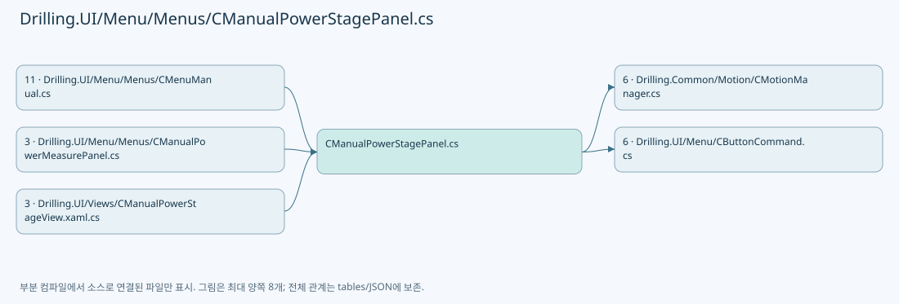

## 네임스페이스·타입·상속

| 타입 | 구분 | 원본 범위 | 선언/상속 |
| --- | --- | --- | --- |
| CManualStageMoveOperation | ClassDeclaration | 12–63 | CManualStageMoveOperation |
| CManualPowerStagePanel | ClassDeclaration | 65–267 | CManualPowerStagePanel: INotifyPropertyChanged |
| CManualPowerStageAxis | ClassDeclaration | 269–300 | CManualPowerStageAxis: INotifyPropertyChanged |

## 멤버 빠른 목록

| 이름 | 종류 | 범위 | 서명 |
| --- | --- | --- | --- |
| _sync | FieldDeclaration | L16–16 | object Drilling.UI.Menu.Menus.CManualStageMoveOperation._sync |
| _cancellation | FieldDeclaration | L17–17 | System.Threading.CancellationTokenSource? Drilling.UI.Menu.Menus.CManualStageMoveOperation._cancellation |
| _completion | FieldDeclaration | L18–18 | System.Threading.Tasks.TaskCompletionSource<bool>? Drilling.UI.Menu.Menus.CManualStageMoveOperation._completion |
| Changed | EventFieldDeclaration | L19–19 | System.Action? Drilling.UI.Menu.Menus.CManualStageMoveOperation.Changed |
| IsRunning | PropertyDeclaration | L20–20 | bool Drilling.UI.Menu.Menus.CManualStageMoveOperation.IsRunning |
| get_IsRunning | GetAccessorDeclaration | L20–20 | bool Drilling.UI.Menu.Menus.CManualStageMoveOperation.IsRunning.get |
| IsStopping | PropertyDeclaration | L21–21 | bool Drilling.UI.Menu.Menus.CManualStageMoveOperation.IsStopping |
| get_IsStopping | GetAccessorDeclaration | L21–21 | bool Drilling.UI.Menu.Menus.CManualStageMoveOperation.IsStopping.get |
| CanStop | PropertyDeclaration | L22–22 | bool Drilling.UI.Menu.Menus.CManualStageMoveOperation.CanStop |
| Move | MethodDeclaration | L24–47 | System.Threading.Tasks.Task Drilling.UI.Menu.Menus.CManualStageMoveOperation.Move(Drilling.Common.Motion.EN_MANUAL_STAGE_AXIS, double, bool, double) |
| StopAsync | MethodDeclaration | L49–49 | System.Threading.Tasks.Task Drilling.UI.Menu.Menus.CManualStageMoveOperation.StopAsync() |
| StopAsync | MethodDeclaration | L50–60 | System.Threading.Tasks.Task Drilling.UI.Menu.Menus.CManualStageMoveOperation.StopAsync(bool) |
| Stop | MethodDeclaration | L61–61 | void Drilling.UI.Menu.Menus.CManualStageMoveOperation.Stop() |
| Stop | MethodDeclaration | L62–62 | void Drilling.UI.Menu.Menus.CManualStageMoveOperation.Stop(bool) |
| _readCachedStatus | FieldDeclaration | L67–67 | System.Func<System.Collections.Generic.IReadOnlyList<Drilling.UI.Menu.Menus.ST_MOTOR_STATUS_ITEM>> Drilling.UI.Menu.Menus.CManualPowerStagePanel._readCachedStatus |
| _readConnectionState | FieldDeclaration | L68–68 | System.Func<Drilling.Common.Interface.EN_COMM_STATE> Drilling.UI.Menu.Menus.CManualPowerStagePanel._readConnectionState |
| _confirm | FieldDeclaration | L69–69 | System.Func<string, bool> Drilling.UI.Menu.Menus.CManualPowerStagePanel._confirm |
| _warn | FieldDeclaration | L70–70 | System.Action<string> Drilling.UI.Menu.Menus.CManualPowerStagePanel._warn |
| _simulation | FieldDeclaration | L71–71 | Drilling.Common.Motion.CManualStageMotionSimulation Drilling.UI.Menu.Menus.CManualPowerStagePanel._simulation |
| _stageMove | FieldDeclaration | L72–72 | Drilling.UI.Menu.Menus.CManualStageMoveOperation? Drilling.UI.Menu.Menus.CManualPowerStagePanel._stageMove |
| _animation | FieldDeclaration | L73–73 | DispatcherTimer Drilling.UI.Menu.Menus.CManualPowerStagePanel._animation |
| _connectionState | FieldDeclaration | L74–74 | Drilling.Common.Interface.EN_COMM_STATE Drilling.UI.Menu.Menus.CManualPowerStagePanel._connectionState |
| _active | FieldDeclaration | L75–75 | bool Drilling.UI.Menu.Menus.CManualPowerStagePanel._active |
| _activeViews | FieldDeclaration | L76–76 | System.Collections.Generic.HashSet<object> Drilling.UI.Menu.Menus.CManualPowerStagePanel._activeViews |
| _measurementRunning | FieldDeclaration | L77–77 | bool Drilling.UI.Menu.Menus.CManualPowerStagePanel._measurementRunning |
| _confirming | FieldDeclaration | L78–78 | bool Drilling.UI.Menu.Menus.CManualPowerStagePanel._confirming |
| _generation | FieldDeclaration | L79–79 | int Drilling.UI.Menu.Menus.CManualPowerStagePanel._generation |
| _reserved | FieldDeclaration | L80–80 | bool Drilling.UI.Menu.Menus.CManualPowerStagePanel._reserved |
| _sharedMoveRunning | FieldDeclaration | L81–81 | bool Drilling.UI.Menu.Menus.CManualPowerStagePanel._sharedMoveRunning |
| _motionMessage | FieldDeclaration | L82–82 | string Drilling.UI.Menu.Menus.CManualPowerStagePanel._motionMessage |
| PropertyChanged | EventFieldDeclaration | L83–83 | System.ComponentModel.PropertyChangedEventHandler? Drilling.UI.Menu.Menus.CManualPowerStagePanel.PropertyChanged |
| Axes | PropertyDeclaration | L84–84 | System.Collections.Generic.IReadOnlyList<Drilling.UI.Menu.Menus.CManualPowerStageAxis> Drilling.UI.Menu.Menus.CManualPowerStagePanel.Axes |
| get_Axes | GetAccessorDeclaration | L84–84 | System.Collections.Generic.IReadOnlyList<Drilling.UI.Menu.Menus.CManualPowerStageAxis> Drilling.UI.Menu.Menus.CManualPowerStagePanel.Axes.get |
| StopCommand | PropertyDeclaration | L85–85 | Drilling.UI.Menu.CButtonCommand Drilling.UI.Menu.Menus.CManualPowerStagePanel.StopCommand |
| get_StopCommand | GetAccessorDeclaration | L85–85 | Drilling.UI.Menu.CButtonCommand Drilling.UI.Menu.Menus.CManualPowerStagePanel.StopCommand.get |
| MoveAllowed | PropertyDeclaration | L86–86 | System.Func<bool>? Drilling.UI.Menu.Menus.CManualPowerStagePanel.MoveAllowed |
| get_MoveAllowed | GetAccessorDeclaration | L86–86 | System.Func<bool>? Drilling.UI.Menu.Menus.CManualPowerStagePanel.MoveAllowed.get |
| set_MoveAllowed | SetAccessorDeclaration | L86–86 | void Drilling.UI.Menu.Menus.CManualPowerStagePanel.MoveAllowed.set |
| Mode | PropertyDeclaration | L87–87 | string Drilling.UI.Menu.Menus.CManualPowerStagePanel.Mode |
| ModeBackground | PropertyDeclaration | L88–93 | Brush Drilling.UI.Menu.Menus.CManualPowerStagePanel.ModeBackground |
| IsSimulation | PropertyDeclaration | L94–94 | bool Drilling.UI.Menu.Menus.CManualPowerStagePanel.IsSimulation |
| CanMove | PropertyDeclaration | L95–96 | bool Drilling.UI.Menu.Menus.CManualPowerStagePanel.CanMove |
| CanJog | PropertyDeclaration | L97–97 | bool Drilling.UI.Menu.Menus.CManualPowerStagePanel.CanJog |
| CanStop | PropertyDeclaration | L98–98 | bool Drilling.UI.Menu.Menus.CManualPowerStagePanel.CanStop |
| CanEdit | PropertyDeclaration | L99–99 | bool Drilling.UI.Menu.Menus.CManualPowerStagePanel.CanEdit |
| StatusText | PropertyDeclaration | L100–107 | string Drilling.UI.Menu.Menus.CManualPowerStagePanel.StatusText |
| .ctor | ConstructorDeclaration | L109–131 | Drilling.UI.Menu.Menus.CManualPowerStagePanel.CManualPowerStagePanel(System.Func<System.Collections.Generic.IReadOnlyList<Drilling.UI.Menu.Menus.ST_MOTOR_STATUS_ITEM>>, System.Action<string>, System.Func<string, bool>, Drilling.Common.Motion.CManualStageMotionSimulation?, System.Func<Drilling.Common.Interface.EN_COMM_STATE>?, Drilling.UI.Menu.Menus.CManualStageMoveOperation?) |
| SetViewActive | MethodDeclaration | L135–140 | void Drilling.UI.Menu.Menus.CManualPowerStagePanel.SetViewActive(object, bool) |
| SetActive | MethodDeclaration | L142–154 | void Drilling.UI.Menu.Menus.CManualPowerStagePanel.SetActive(bool) |
| SetMeasurementRunning | MethodDeclaration | L156–162 | void Drilling.UI.Menu.Menus.CManualPowerStagePanel.SetMeasurementRunning(bool) |
| Refresh | MethodDeclaration | L164–188 | void Drilling.UI.Menu.Menus.CManualPowerStagePanel.Refresh() |
| RefreshSimulation | MethodDeclaration | L190–201 | void Drilling.UI.Menu.Menus.CManualPowerStagePanel.RefreshSimulation() |
| Move | MethodDeclaration | L203–232 | System.Threading.Tasks.Task Drilling.UI.Menu.Menus.CManualPowerStagePanel.Move(Drilling.UI.Menu.Menus.CManualPowerStageAxis, bool) |
| StartJog | MethodDeclaration | L234–248 | bool Drilling.UI.Menu.Menus.CManualPowerStagePanel.StartJog(string) |
| Stop | MethodDeclaration | L250–258 | void Drilling.UI.Menu.Menus.CManualPowerStagePanel.Stop(bool) |
| UpdateCommands | MethodDeclaration | L260–265 | void Drilling.UI.Menu.Menus.CManualPowerStagePanel.UpdateCommands() |
| Notify | MethodDeclaration | L266–266 | void Drilling.UI.Menu.Menus.CManualPowerStagePanel.Notify(string?) |
| _absolute | FieldDeclaration | L271–271 | string Drilling.UI.Menu.Menus.CManualPowerStageAxis._absolute |
| _relative | FieldDeclaration | L271–271 | string Drilling.UI.Menu.Menus.CManualPowerStageAxis._relative |
| _absoluteSpeed | FieldDeclaration | L272–272 | string Drilling.UI.Menu.Menus.CManualPowerStageAxis._absoluteSpeed |
| _relativeSpeed | FieldDeclaration | L272–272 | string Drilling.UI.Menu.Menus.CManualPowerStageAxis._relativeSpeed |
| PropertyChanged | EventFieldDeclaration | L273–273 | System.ComponentModel.PropertyChangedEventHandler? Drilling.UI.Menu.Menus.CManualPowerStageAxis.PropertyChanged |
| Axis | PropertyDeclaration | L274–274 | Drilling.Common.Motion.EN_MANUAL_STAGE_AXIS Drilling.UI.Menu.Menus.CManualPowerStageAxis.Axis |
| get_Axis | GetAccessorDeclaration | L274–274 | Drilling.Common.Motion.EN_MANUAL_STAGE_AXIS Drilling.UI.Menu.Menus.CManualPowerStageAxis.Axis.get |
| Name | PropertyDeclaration | L275–275 | string Drilling.UI.Menu.Menus.CManualPowerStageAxis.Name |
| get_Name | GetAccessorDeclaration | L275–275 | string Drilling.UI.Menu.Menus.CManualPowerStageAxis.Name.get |
| SnapshotName | PropertyDeclaration | L276–276 | string Drilling.UI.Menu.Menus.CManualPowerStageAxis.SnapshotName |
| get_SnapshotName | GetAccessorDeclaration | L276–276 | string Drilling.UI.Menu.Menus.CManualPowerStageAxis.SnapshotName.get |
| Absolute | PropertyDeclaration | L277–277 | string Drilling.UI.Menu.Menus.CManualPowerStageAxis.Absolute |
| get_Absolute | GetAccessorDeclaration | L277–277 | string Drilling.UI.Menu.Menus.CManualPowerStageAxis.Absolute.get |
| set_Absolute | SetAccessorDeclaration | L277–277 | void Drilling.UI.Menu.Menus.CManualPowerStageAxis.Absolute.set |
| Relative | PropertyDeclaration | L278–278 | string Drilling.UI.Menu.Menus.CManualPowerStageAxis.Relative |
| get_Relative | GetAccessorDeclaration | L278–278 | string Drilling.UI.Menu.Menus.CManualPowerStageAxis.Relative.get |
| set_Relative | SetAccessorDeclaration | L278–278 | void Drilling.UI.Menu.Menus.CManualPowerStageAxis.Relative.set |
| AbsoluteSpeed | PropertyDeclaration | L279–279 | string Drilling.UI.Menu.Menus.CManualPowerStageAxis.AbsoluteSpeed |
| get_AbsoluteSpeed | GetAccessorDeclaration | L279–279 | string Drilling.UI.Menu.Menus.CManualPowerStageAxis.AbsoluteSpeed.get |
| set_AbsoluteSpeed | SetAccessorDeclaration | L279–279 | void Drilling.UI.Menu.Menus.CManualPowerStageAxis.AbsoluteSpeed.set |
| RelativeSpeed | PropertyDeclaration | L280–280 | string Drilling.UI.Menu.Menus.CManualPowerStageAxis.RelativeSpeed |
| get_RelativeSpeed | GetAccessorDeclaration | L280–280 | string Drilling.UI.Menu.Menus.CManualPowerStageAxis.RelativeSpeed.get |
| set_RelativeSpeed | SetAccessorDeclaration | L280–280 | void Drilling.UI.Menu.Menus.CManualPowerStageAxis.RelativeSpeed.set |
| Position | PropertyDeclaration | L281–281 | string Drilling.UI.Menu.Menus.CManualPowerStageAxis.Position |
| get_Position | GetAccessorDeclaration | L281–281 | string Drilling.UI.Menu.Menus.CManualPowerStageAxis.Position.get |
| set_Position | SetAccessorDeclaration | L281–281 | void Drilling.UI.Menu.Menus.CManualPowerStageAxis.Position.set |
| Speed | PropertyDeclaration | L282–282 | string Drilling.UI.Menu.Menus.CManualPowerStageAxis.Speed |
| get_Speed | GetAccessorDeclaration | L282–282 | string Drilling.UI.Menu.Menus.CManualPowerStageAxis.Speed.get |
| set_Speed | SetAccessorDeclaration | L282–282 | void Drilling.UI.Menu.Menus.CManualPowerStageAxis.Speed.set |
| PositionMessage | PropertyDeclaration | L283–283 | string Drilling.UI.Menu.Menus.CManualPowerStageAxis.PositionMessage |
| get_PositionMessage | GetAccessorDeclaration | L283–283 | string Drilling.UI.Menu.Menus.CManualPowerStageAxis.PositionMessage.get |
| set_PositionMessage | SetAccessorDeclaration | L283–283 | void Drilling.UI.Menu.Menus.CManualPowerStageAxis.PositionMessage.set |
| SpeedMessage | PropertyDeclaration | L284–284 | string Drilling.UI.Menu.Menus.CManualPowerStageAxis.SpeedMessage |
| get_SpeedMessage | GetAccessorDeclaration | L284–284 | string Drilling.UI.Menu.Menus.CManualPowerStageAxis.SpeedMessage.get |
| set_SpeedMessage | SetAccessorDeclaration | L284–284 | void Drilling.UI.Menu.Menus.CManualPowerStageAxis.SpeedMessage.set |
| AbsoluteCommand | PropertyDeclaration | L285–285 | Drilling.UI.Menu.CButtonCommand Drilling.UI.Menu.Menus.CManualPowerStageAxis.AbsoluteCommand |
| get_AbsoluteCommand | GetAccessorDeclaration | L285–285 | Drilling.UI.Menu.CButtonCommand Drilling.UI.Menu.Menus.CManualPowerStageAxis.AbsoluteCommand.get |
| RelativeCommand | PropertyDeclaration | L286–286 | Drilling.UI.Menu.CButtonCommand Drilling.UI.Menu.Menus.CManualPowerStageAxis.RelativeCommand |
| get_RelativeCommand | GetAccessorDeclaration | L286–286 | Drilling.UI.Menu.CButtonCommand Drilling.UI.Menu.Menus.CManualPowerStageAxis.RelativeCommand.get |
| .ctor | ConstructorDeclaration | L287–292 | Drilling.UI.Menu.Menus.CManualPowerStageAxis.CManualPowerStageAxis(Drilling.UI.Menu.Menus.CManualPowerStagePanel, Drilling.Common.Motion.EN_MANUAL_STAGE_AXIS, string, string) |
| SetFeedback | MethodDeclaration | L293–298 | void Drilling.UI.Menu.Menus.CManualPowerStageAxis.SetFeedback(string, string, string, string) |
| Notify | MethodDeclaration | L299–299 | void Drilling.UI.Menu.Menus.CManualPowerStageAxis.Notify(string?) |

## 멤버별 상세 계약·호출·처리 해설

### FieldDeclaration `_sync` · L16–16

[Drilling.UI/Menu/Menus/CManualPowerStagePanel.cs:16–16](https://github.com/kjuws10-rgb/A3Drilling/blob/5aee8e58439c9b455cae7c9593c9be986c3e682e/Drilling.UI/Menu/Menus/CManualPowerStagePanel.cs#L16-L16)

| 항목 | 실제 추출 값 |
| --- | --- |
| 서명 | object Drilling.UI.Menu.Menus.CManualStageMoveOperation._sync |
| 접근/수식자 | Private / private, readonly |
| 반환/값 타입 | object |
| 소속 타입 | NamedType:Drilling.UI.Menu.Menus.CManualStageMoveOperation |

현재 부분 분석에서 직접 연결된 호출자는 없습니다. XAML/이벤트/인터페이스·델리게이트·외부 진입을 추가 확인해야 하며, 미사용으로 판정한 것이 아닙니다.

호출하는 대상과 해석 범위:

| 원본 행 | 표현식 | 분석 상태 | 대상/소스 위치 |
| --- | --- | --- | --- |
| 16 | new | resolved | object.Object() |

본문의 실제 연산·분기·예외·반환 순서(원문 위치 순):

| 원본 행 | 종류 | 주석 해설 |
| --- | --- | --- |
| 16 | call | 함수·델리게이트 또는 객체 생성자를 호출합니다: new() |
| 16 | variable-initializer | 변수의 초기값을 지정합니다: _sync = new() |

변경 전 점검: 입력/반환 타입, 위 호출자, 예외/취소 경로, 공유 상태와 저장·전송 소비자를 함께 확인합니다. 값의 단위나 물리 방향을 이름만으로 확정하지 않습니다.

### FieldDeclaration `_cancellation` · L17–17

[Drilling.UI/Menu/Menus/CManualPowerStagePanel.cs:17–17](https://github.com/kjuws10-rgb/A3Drilling/blob/5aee8e58439c9b455cae7c9593c9be986c3e682e/Drilling.UI/Menu/Menus/CManualPowerStagePanel.cs#L17-L17)

| 항목 | 실제 추출 값 |
| --- | --- |
| 서명 | System.Threading.CancellationTokenSource? Drilling.UI.Menu.Menus.CManualStageMoveOperation._cancellation |
| 접근/수식자 | Private / private |
| 반환/값 타입 | System.Threading.CancellationTokenSource? |
| 소속 타입 | NamedType:Drilling.UI.Menu.Menus.CManualStageMoveOperation |

현재 부분 분석에서 직접 연결된 호출자는 없습니다. XAML/이벤트/인터페이스·델리게이트·외부 진입을 추가 확인해야 하며, 미사용으로 판정한 것이 아닙니다.

변경 전 점검: 입력/반환 타입, 위 호출자, 예외/취소 경로, 공유 상태와 저장·전송 소비자를 함께 확인합니다. 값의 단위나 물리 방향을 이름만으로 확정하지 않습니다.

### FieldDeclaration `_completion` · L18–18

[Drilling.UI/Menu/Menus/CManualPowerStagePanel.cs:18–18](https://github.com/kjuws10-rgb/A3Drilling/blob/5aee8e58439c9b455cae7c9593c9be986c3e682e/Drilling.UI/Menu/Menus/CManualPowerStagePanel.cs#L18-L18)

| 항목 | 실제 추출 값 |
| --- | --- |
| 서명 | System.Threading.Tasks.TaskCompletionSource<bool>? Drilling.UI.Menu.Menus.CManualStageMoveOperation._completion |
| 접근/수식자 | Private / private |
| 반환/값 타입 | System.Threading.Tasks.TaskCompletionSource<bool>? |
| 소속 타입 | NamedType:Drilling.UI.Menu.Menus.CManualStageMoveOperation |

현재 부분 분석에서 직접 연결된 호출자는 없습니다. XAML/이벤트/인터페이스·델리게이트·외부 진입을 추가 확인해야 하며, 미사용으로 판정한 것이 아닙니다.

변경 전 점검: 입력/반환 타입, 위 호출자, 예외/취소 경로, 공유 상태와 저장·전송 소비자를 함께 확인합니다. 값의 단위나 물리 방향을 이름만으로 확정하지 않습니다.

### EventFieldDeclaration `Changed` · L19–19

[Drilling.UI/Menu/Menus/CManualPowerStagePanel.cs:19–19](https://github.com/kjuws10-rgb/A3Drilling/blob/5aee8e58439c9b455cae7c9593c9be986c3e682e/Drilling.UI/Menu/Menus/CManualPowerStagePanel.cs#L19-L19)

| 항목 | 실제 추출 값 |
| --- | --- |
| 서명 | System.Action? Drilling.UI.Menu.Menus.CManualStageMoveOperation.Changed |
| 접근/수식자 | Public / public, event |
| 반환/값 타입 | System.Action? |
| 소속 타입 | NamedType:Drilling.UI.Menu.Menus.CManualStageMoveOperation |

현재 부분 분석에서 직접 연결된 호출자는 없습니다. XAML/이벤트/인터페이스·델리게이트·외부 진입을 추가 확인해야 하며, 미사용으로 판정한 것이 아닙니다.

변경 전 점검: 입력/반환 타입, 위 호출자, 예외/취소 경로, 공유 상태와 저장·전송 소비자를 함께 확인합니다. 값의 단위나 물리 방향을 이름만으로 확정하지 않습니다.

### PropertyDeclaration `IsRunning` · L20–20

[Drilling.UI/Menu/Menus/CManualPowerStagePanel.cs:20–20](https://github.com/kjuws10-rgb/A3Drilling/blob/5aee8e58439c9b455cae7c9593c9be986c3e682e/Drilling.UI/Menu/Menus/CManualPowerStagePanel.cs#L20-L20)

| 항목 | 실제 추출 값 |
| --- | --- |
| 서명 | bool Drilling.UI.Menu.Menus.CManualStageMoveOperation.IsRunning |
| 접근/수식자 | Public / public |
| 반환/값 타입 | bool |
| 소속 타입 | NamedType:Drilling.UI.Menu.Menus.CManualStageMoveOperation |

현재 부분 분석에서 직접 연결된 호출자는 없습니다. XAML/이벤트/인터페이스·델리게이트·외부 진입을 추가 확인해야 하며, 미사용으로 판정한 것이 아닙니다.

변경 전 점검: 입력/반환 타입, 위 호출자, 예외/취소 경로, 공유 상태와 저장·전송 소비자를 함께 확인합니다. 값의 단위나 물리 방향을 이름만으로 확정하지 않습니다.

### GetAccessorDeclaration `get_IsRunning` · L20–20

[Drilling.UI/Menu/Menus/CManualPowerStagePanel.cs:20–20](https://github.com/kjuws10-rgb/A3Drilling/blob/5aee8e58439c9b455cae7c9593c9be986c3e682e/Drilling.UI/Menu/Menus/CManualPowerStagePanel.cs#L20-L20)

| 항목 | 실제 추출 값 |
| --- | --- |
| 서명 | bool Drilling.UI.Menu.Menus.CManualStageMoveOperation.IsRunning.get |
| 접근/수식자 | Public / get |
| 반환/값 타입 | bool |
| 소속 타입 | NamedType:Drilling.UI.Menu.Menus.CManualStageMoveOperation |

현재 부분 분석에서 직접 연결된 호출자는 없습니다. XAML/이벤트/인터페이스·델리게이트·외부 진입을 추가 확인해야 하며, 미사용으로 판정한 것이 아닙니다.

본문의 실제 연산·분기·예외·반환 순서(원문 위치 순):

| 원본 행 | 종류 | 주석 해설 |
| --- | --- | --- |
| 20 | lock | 공유 상태의 임계 구역에 진입합니다: lock (_sync) |
| 20 | return | 호출자에게 값 또는 제어를 반환합니다: return _cancellation is not null; |

제어 구문의 포함 구조(실제 실행 순서/CFG가 아닌 구문 탐색 그림):

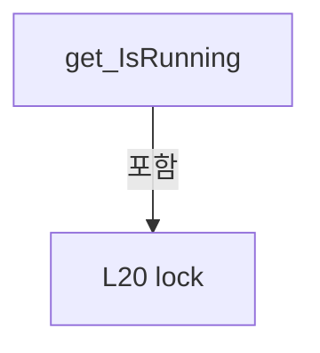

변경 전 점검: 입력/반환 타입, 위 호출자, 예외/취소 경로, 공유 상태와 저장·전송 소비자를 함께 확인합니다. 값의 단위나 물리 방향을 이름만으로 확정하지 않습니다.

### PropertyDeclaration `IsStopping` · L21–21

[Drilling.UI/Menu/Menus/CManualPowerStagePanel.cs:21–21](https://github.com/kjuws10-rgb/A3Drilling/blob/5aee8e58439c9b455cae7c9593c9be986c3e682e/Drilling.UI/Menu/Menus/CManualPowerStagePanel.cs#L21-L21)

| 항목 | 실제 추출 값 |
| --- | --- |
| 서명 | bool Drilling.UI.Menu.Menus.CManualStageMoveOperation.IsStopping |
| 접근/수식자 | Public / public |
| 반환/값 타입 | bool |
| 소속 타입 | NamedType:Drilling.UI.Menu.Menus.CManualStageMoveOperation |

현재 부분 분석에서 직접 연결된 호출자는 없습니다. XAML/이벤트/인터페이스·델리게이트·외부 진입을 추가 확인해야 하며, 미사용으로 판정한 것이 아닙니다.

변경 전 점검: 입력/반환 타입, 위 호출자, 예외/취소 경로, 공유 상태와 저장·전송 소비자를 함께 확인합니다. 값의 단위나 물리 방향을 이름만으로 확정하지 않습니다.

### GetAccessorDeclaration `get_IsStopping` · L21–21

[Drilling.UI/Menu/Menus/CManualPowerStagePanel.cs:21–21](https://github.com/kjuws10-rgb/A3Drilling/blob/5aee8e58439c9b455cae7c9593c9be986c3e682e/Drilling.UI/Menu/Menus/CManualPowerStagePanel.cs#L21-L21)

| 항목 | 실제 추출 값 |
| --- | --- |
| 서명 | bool Drilling.UI.Menu.Menus.CManualStageMoveOperation.IsStopping.get |
| 접근/수식자 | Public / get |
| 반환/값 타입 | bool |
| 소속 타입 | NamedType:Drilling.UI.Menu.Menus.CManualStageMoveOperation |

현재 부분 분석에서 직접 연결된 호출자는 없습니다. XAML/이벤트/인터페이스·델리게이트·외부 진입을 추가 확인해야 하며, 미사용으로 판정한 것이 아닙니다.

본문의 실제 연산·분기·예외·반환 순서(원문 위치 순):

| 원본 행 | 종류 | 주석 해설 |
| --- | --- | --- |
| 21 | lock | 공유 상태의 임계 구역에 진입합니다: lock (_sync) |
| 21 | return | 호출자에게 값 또는 제어를 반환합니다: return _cancellation?.IsCancellationRequested == true; |

제어 구문의 포함 구조(실제 실행 순서/CFG가 아닌 구문 탐색 그림):

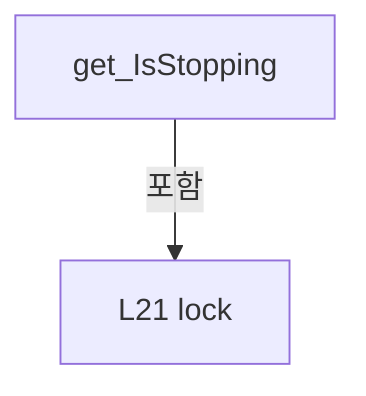

변경 전 점검: 입력/반환 타입, 위 호출자, 예외/취소 경로, 공유 상태와 저장·전송 소비자를 함께 확인합니다. 값의 단위나 물리 방향을 이름만으로 확정하지 않습니다.

### PropertyDeclaration `CanStop` · L22–22

[Drilling.UI/Menu/Menus/CManualPowerStagePanel.cs:22–22](https://github.com/kjuws10-rgb/A3Drilling/blob/5aee8e58439c9b455cae7c9593c9be986c3e682e/Drilling.UI/Menu/Menus/CManualPowerStagePanel.cs#L22-L22)

| 항목 | 실제 추출 값 |
| --- | --- |
| 서명 | bool Drilling.UI.Menu.Menus.CManualStageMoveOperation.CanStop |
| 접근/수식자 | Public / public |
| 반환/값 타입 | bool |
| 소속 타입 | NamedType:Drilling.UI.Menu.Menus.CManualStageMoveOperation |

현재 부분 분석에서 직접 연결된 호출자는 없습니다. XAML/이벤트/인터페이스·델리게이트·외부 진입을 추가 확인해야 하며, 미사용으로 판정한 것이 아닙니다.

호출하는 대상과 해석 범위:

| 원본 행 | 표현식 | 분석 상태 | 대상/소스 위치 |
| --- | --- | --- | --- |
| 22 | .Invoke | resolved · 동적 구현 선택 가능 | bool System.Func<bool>.Invoke() |

본문의 실제 연산·분기·예외·반환 순서(원문 위치 순):

| 원본 행 | 종류 | 주석 해설 |
| --- | --- | --- |
| 22 | call | 함수·델리게이트 또는 객체 생성자를 호출합니다: .Invoke() |

변경 전 점검: 입력/반환 타입, 위 호출자, 예외/취소 경로, 공유 상태와 저장·전송 소비자를 함께 확인합니다. 값의 단위나 물리 방향을 이름만으로 확정하지 않습니다.

### MethodDeclaration `Move` · L24–47

[Drilling.UI/Menu/Menus/CManualPowerStagePanel.cs:24–47](https://github.com/kjuws10-rgb/A3Drilling/blob/5aee8e58439c9b455cae7c9593c9be986c3e682e/Drilling.UI/Menu/Menus/CManualPowerStagePanel.cs#L24-L47)

| 항목 | 실제 추출 값 |
| --- | --- |
| 서명 | System.Threading.Tasks.Task Drilling.UI.Menu.Menus.CManualStageMoveOperation.Move(Drilling.Common.Motion.EN_MANUAL_STAGE_AXIS, double, bool, double) |
| 접근/수식자 | Public / public, async |
| 반환/값 타입 | System.Threading.Tasks.Task |
| 소속 타입 | NamedType:Drilling.UI.Menu.Menus.CManualStageMoveOperation |

입력 계약:

| 이름 | 타입 | 전달 | 선택/기본값 |
| --- | --- | --- | --- |
| axis | Drilling.Common.Motion.EN_MANUAL_STAGE_AXIS | None | False /  |
| value | double | None | False /  |
| relative | bool | None | False /  |
| speed | double | None | False /  |

정적 호출자로 확인된 위치:

| 호출 파일/행 | 호출 표현식 | 런타임 분기 가능 |
| --- | --- | --- |
| [Drilling.UI/Menu/Menus/CManualPowerStagePanel.cs:225–225](https://github.com/kjuws10-rgb/A3Drilling/blob/5aee8e58439c9b455cae7c9593c9be986c3e682e/Drilling.UI/Menu/Menus/CManualPowerStagePanel.cs#L225-L225) | _stageMove.Move | False |
| [Drilling.UI/Menu/Menus/CMenuManual.cs:3924–3924](https://github.com/kjuws10-rgb/A3Drilling/blob/5aee8e58439c9b455cae7c9593c9be986c3e682e/Drilling.UI/Menu/Menus/CMenuManual.cs#L3924-L3924) | ManualStageMoveOperation.Move | False |
| [Drilling.UI/Menu/Menus/CMenuManual.cs:7470–7470](https://github.com/kjuws10-rgb/A3Drilling/blob/5aee8e58439c9b455cae7c9593c9be986c3e682e/Drilling.UI/Menu/Menus/CMenuManual.cs#L7470-L7470) | _stageMove.Move | False |

호출하는 대상과 해석 범위:

| 원본 행 | 표현식 | 분석 상태 | 대상/소스 위치 |
| --- | --- | --- | --- |
| 31 | new InvalidOperationException | resolved | System.InvalidOperationException.InvalidOperationException(string?) |
| 32 | new | resolved | System.Threading.CancellationTokenSource.CancellationTokenSource() |
| 33 | new | resolved | System.Threading.Tasks.TaskCompletionSource<bool>.TaskCompletionSource(System.Threading.Tasks.TaskCreationOptions) |
| 37 | .Invoke | resolved · 동적 구현 선택 가능 | void System.Action.Invoke() |
| 38 | move | resolved · 동적 구현 선택 가능 | System.Threading.Tasks.Task System.Func<Drilling.Common.Motion.EN_MANUAL_STAGE_AXIS, double, bool, double, System.Threading.CancellationToken, System.Threading.Tasks.Task>.Invoke(Drilling.Common.Motion.EN_MANUAL_STAGE_AXIS, double, bool, double, System.Threading.CancellationToken) |
| 43 | cancellation.Dispose | resolved | void System.Threading.CancellationTokenSource.Dispose() |
| 44 | completion.TrySetResult | resolved | bool System.Threading.Tasks.TaskCompletionSource<bool>.TrySetResult(bool) |
| 45 | .Invoke | resolved · 동적 구현 선택 가능 | void System.Action.Invoke() |

본문의 실제 연산·분기·예외·반환 순서(원문 위치 순):

| 원본 행 | 종류 | 주석 해설 |
| --- | --- | --- |
| 26 | local-declaration | 지역 변수를 선언합니다: CancellationTokenSource cancellation; |
| 27 | local-declaration | 지역 변수를 선언합니다: TaskCompletionSource<bool> completion; |
| 28 | lock | 공유 상태의 임계 구역에 진입합니다: lock (_sync) |
| 30 | if | 조건에 따라 분기합니다: if (_cancellation is not null) |
| 31 | call | 함수·델리게이트 또는 객체 생성자를 호출합니다: new InvalidOperationException("수동 Stage/Review 이동 또는 정리 작업이 진행 중입니다.") |
| 31 | throw | 예외를 발생/전달합니다: throw new InvalidOperationException("수동 Stage/Review 이동 또는 정리 작업이 진행 중입니다."); |
| 32 | assignment | 값을 대상에 대입합니다: _cancellation = cancellation = new() |
| 32 | assignment | 값을 대상에 대입합니다: cancellation = new() |
| 32 | call | 함수·델리게이트 또는 객체 생성자를 호출합니다: new() |
| 33 | assignment | 값을 대상에 대입합니다: _completion = completion = new(TaskCreationOptions.RunContinuationsAsynchronously) |
| 33 | assignment | 값을 대상에 대입합니다: completion = new(TaskCreationOptions.RunContinuationsAsynchronously) |
| 33 | call | 함수·델리게이트 또는 객체 생성자를 호출합니다: new(TaskCreationOptions.RunContinuationsAsynchronously) |
| 35 | try | 예외 처리 범위입니다: try |
| 37 | call | 함수·델리게이트 또는 객체 생성자를 호출합니다: .Invoke() |
| 38 | await | 비동기 완료를 기다립니다: await move(axis, value, relative, speed, cancellation.Token) |
| 38 | call | 함수·델리게이트 또는 객체 생성자를 호출합니다: move(axis, value, relative, speed, cancellation.Token) |
| 40 | finally | 종료 정리 구간입니다: finally |
| 42 | assignment | 값을 대상에 대입합니다: _cancellation = null |
| 42 | assignment | 값을 대상에 대입합니다: _completion = null |
| 42 | lock | 공유 상태의 임계 구역에 진입합니다: lock (_sync) |
| 43 | call | 함수·델리게이트 또는 객체 생성자를 호출합니다: cancellation.Dispose() |
| 44 | call | 함수·델리게이트 또는 객체 생성자를 호출합니다: completion.TrySetResult(true) |
| 45 | call | 함수·델리게이트 또는 객체 생성자를 호출합니다: .Invoke() |

제어 구문의 포함 구조(실제 실행 순서/CFG가 아닌 구문 탐색 그림):

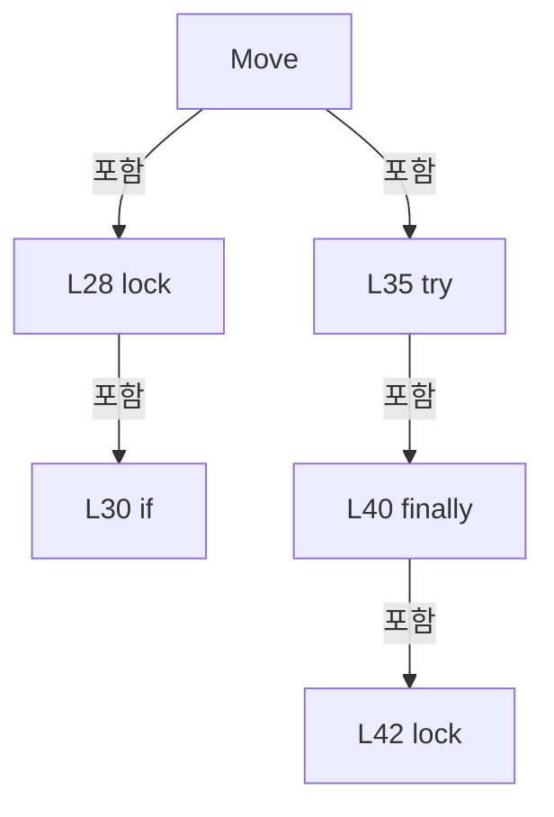

변경 전 점검: 입력/반환 타입, 위 호출자, 예외/취소 경로, 공유 상태와 저장·전송 소비자를 함께 확인합니다. 값의 단위나 물리 방향을 이름만으로 확정하지 않습니다.

### MethodDeclaration `StopAsync` · L49–49

[Drilling.UI/Menu/Menus/CManualPowerStagePanel.cs:49–49](https://github.com/kjuws10-rgb/A3Drilling/blob/5aee8e58439c9b455cae7c9593c9be986c3e682e/Drilling.UI/Menu/Menus/CManualPowerStagePanel.cs#L49-L49)

| 항목 | 실제 추출 값 |
| --- | --- |
| 서명 | System.Threading.Tasks.Task Drilling.UI.Menu.Menus.CManualStageMoveOperation.StopAsync() |
| 접근/수식자 | Public / public |
| 반환/값 타입 | System.Threading.Tasks.Task |
| 소속 타입 | NamedType:Drilling.UI.Menu.Menus.CManualStageMoveOperation |

정적 호출자로 확인된 위치:

| 호출 파일/행 | 호출 표현식 | 런타임 분기 가능 |
| --- | --- | --- |
| [Drilling.UI/Menu/Menus/CManualPowerStagePanel.cs:61–61](https://github.com/kjuws10-rgb/A3Drilling/blob/5aee8e58439c9b455cae7c9593c9be986c3e682e/Drilling.UI/Menu/Menus/CManualPowerStagePanel.cs#L61-L61) | StopAsync | False |

호출하는 대상과 해석 범위:

| 원본 행 | 표현식 | 분석 상태 | 대상/소스 위치 |
| --- | --- | --- | --- |
| 49 | StopAsync | resolved | System.Threading.Tasks.Task Drilling.UI.Menu.Menus.CManualStageMoveOperation.StopAsync(bool) · Drilling.UI/Menu/Menus/CManualPowerStagePanel.cs:50 |

본문의 실제 연산·분기·예외·반환 순서(원문 위치 순):

| 원본 행 | 종류 | 주석 해설 |
| --- | --- | --- |
| 49 | call | 함수·델리게이트 또는 객체 생성자를 호출합니다: StopAsync(false) |

변경 전 점검: 입력/반환 타입, 위 호출자, 예외/취소 경로, 공유 상태와 저장·전송 소비자를 함께 확인합니다. 값의 단위나 물리 방향을 이름만으로 확정하지 않습니다.

### MethodDeclaration `StopAsync` · L50–60

[Drilling.UI/Menu/Menus/CManualPowerStagePanel.cs:50–60](https://github.com/kjuws10-rgb/A3Drilling/blob/5aee8e58439c9b455cae7c9593c9be986c3e682e/Drilling.UI/Menu/Menus/CManualPowerStagePanel.cs#L50-L60)

| 항목 | 실제 추출 값 |
| --- | --- |
| 서명 | System.Threading.Tasks.Task Drilling.UI.Menu.Menus.CManualStageMoveOperation.StopAsync(bool) |
| 접근/수식자 | Public / public |
| 반환/값 타입 | System.Threading.Tasks.Task |
| 소속 타입 | NamedType:Drilling.UI.Menu.Menus.CManualStageMoveOperation |

입력 계약:

| 이름 | 타입 | 전달 | 선택/기본값 |
| --- | --- | --- | --- |
| includeSharedMove | bool | None | False /  |

정적 호출자로 확인된 위치:

| 호출 파일/행 | 호출 표현식 | 런타임 분기 가능 |
| --- | --- | --- |
| [Drilling.UI/Menu/Menus/CManualPowerStagePanel.cs:49–49](https://github.com/kjuws10-rgb/A3Drilling/blob/5aee8e58439c9b455cae7c9593c9be986c3e682e/Drilling.UI/Menu/Menus/CManualPowerStagePanel.cs#L49-L49) | StopAsync | False |
| [Drilling.UI/Menu/Menus/CManualPowerStagePanel.cs:62–62](https://github.com/kjuws10-rgb/A3Drilling/blob/5aee8e58439c9b455cae7c9593c9be986c3e682e/Drilling.UI/Menu/Menus/CManualPowerStagePanel.cs#L62-L62) | StopAsync | False |

호출하는 대상과 해석 범위:

| 원본 행 | 표현식 | 분석 상태 | 대상/소스 위치 |
| --- | --- | --- | --- |
| 55 | .Cancel | resolved | void System.Threading.CancellationTokenSource.Cancel() |
| 57 | .Invoke | resolved · 동적 구현 선택 가능 | void System.Action.Invoke() |
| 58 | .Invoke | resolved · 동적 구현 선택 가능 | void System.Action.Invoke() |

본문의 실제 연산·분기·예외·반환 순서(원문 위치 순):

| 원본 행 | 종류 | 주석 해설 |
| --- | --- | --- |
| 52 | local-declaration | 지역 변수를 선언합니다: CancellationTokenSource? cancellation; |
| 53 | local-declaration | 지역 변수를 선언합니다: Task completion; |
| 54 | assignment | 값을 대상에 대입합니다: cancellation = _cancellation |
| 54 | assignment | 값을 대상에 대입합니다: completion = _completion?.Task ?? Task.CompletedTask |
| 54 | lock | 공유 상태의 임계 구역에 진입합니다: lock (_sync) |
| 55 | call | 함수·델리게이트 또는 객체 생성자를 호출합니다: .Cancel() |
| 55 | try | 예외 처리 범위입니다: try |
| 56 | catch | 지정 예외를 처리합니다: catch (ObjectDisposedException) |
| 57 | call | 함수·델리게이트 또는 객체 생성자를 호출합니다: .Invoke() |
| 57 | if | 조건에 따라 분기합니다: if (includeSharedMove) |
| 58 | call | 함수·델리게이트 또는 객체 생성자를 호출합니다: .Invoke() |
| 59 | return | 호출자에게 값 또는 제어를 반환합니다: return completion; |

제어 구문의 포함 구조(실제 실행 순서/CFG가 아닌 구문 탐색 그림):

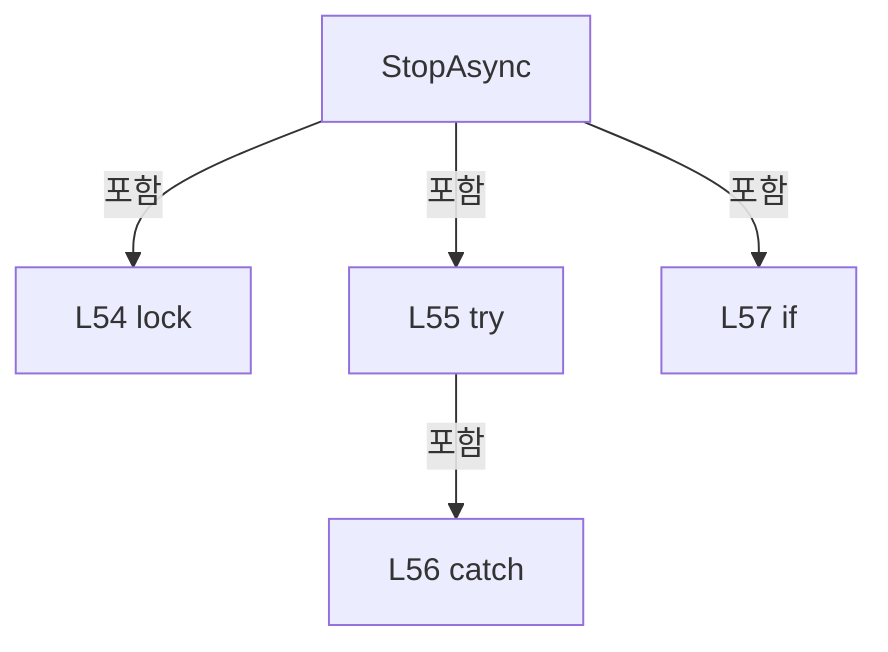

변경 전 점검: 입력/반환 타입, 위 호출자, 예외/취소 경로, 공유 상태와 저장·전송 소비자를 함께 확인합니다. 값의 단위나 물리 방향을 이름만으로 확정하지 않습니다.

### MethodDeclaration `Stop` · L61–61

[Drilling.UI/Menu/Menus/CManualPowerStagePanel.cs:61–61](https://github.com/kjuws10-rgb/A3Drilling/blob/5aee8e58439c9b455cae7c9593c9be986c3e682e/Drilling.UI/Menu/Menus/CManualPowerStagePanel.cs#L61-L61)

| 항목 | 실제 추출 값 |
| --- | --- |
| 서명 | void Drilling.UI.Menu.Menus.CManualStageMoveOperation.Stop() |
| 접근/수식자 | Public / public |
| 반환/값 타입 | void |
| 소속 타입 | NamedType:Drilling.UI.Menu.Menus.CManualStageMoveOperation |

정적 호출자로 확인된 위치:

| 호출 파일/행 | 호출 표현식 | 런타임 분기 가능 |
| --- | --- | --- |
| [Drilling.UI/Menu/Menus/CMenuManual.cs:442–442](https://github.com/kjuws10-rgb/A3Drilling/blob/5aee8e58439c9b455cae7c9593c9be986c3e682e/Drilling.UI/Menu/Menus/CMenuManual.cs#L442-L442) | .Stop | False |

호출하는 대상과 해석 범위:

| 원본 행 | 표현식 | 분석 상태 | 대상/소스 위치 |
| --- | --- | --- | --- |
| 61 | StopAsync | resolved | System.Threading.Tasks.Task Drilling.UI.Menu.Menus.CManualStageMoveOperation.StopAsync() · Drilling.UI/Menu/Menus/CManualPowerStagePanel.cs:49 |

본문의 실제 연산·분기·예외·반환 순서(원문 위치 순):

| 원본 행 | 종류 | 주석 해설 |
| --- | --- | --- |
| 61 | assignment | 값을 대상에 대입합니다: _ = StopAsync() |
| 61 | call | 함수·델리게이트 또는 객체 생성자를 호출합니다: StopAsync() |

변경 전 점검: 입력/반환 타입, 위 호출자, 예외/취소 경로, 공유 상태와 저장·전송 소비자를 함께 확인합니다. 값의 단위나 물리 방향을 이름만으로 확정하지 않습니다.

### MethodDeclaration `Stop` · L62–62

[Drilling.UI/Menu/Menus/CManualPowerStagePanel.cs:62–62](https://github.com/kjuws10-rgb/A3Drilling/blob/5aee8e58439c9b455cae7c9593c9be986c3e682e/Drilling.UI/Menu/Menus/CManualPowerStagePanel.cs#L62-L62)

| 항목 | 실제 추출 값 |
| --- | --- |
| 서명 | void Drilling.UI.Menu.Menus.CManualStageMoveOperation.Stop(bool) |
| 접근/수식자 | Public / public |
| 반환/값 타입 | void |
| 소속 타입 | NamedType:Drilling.UI.Menu.Menus.CManualStageMoveOperation |

입력 계약:

| 이름 | 타입 | 전달 | 선택/기본값 |
| --- | --- | --- | --- |
| includeSharedMove | bool | None | False /  |

정적 호출자로 확인된 위치:

| 호출 파일/행 | 호출 표현식 | 런타임 분기 가능 |
| --- | --- | --- |
| [Drilling.UI/Menu/Menus/CManualPowerStagePanel.cs:253–253](https://github.com/kjuws10-rgb/A3Drilling/blob/5aee8e58439c9b455cae7c9593c9be986c3e682e/Drilling.UI/Menu/Menus/CManualPowerStagePanel.cs#L253-L253) | .Stop | False |
| [Drilling.UI/Menu/Menus/CMenuManual.cs:3947–3947](https://github.com/kjuws10-rgb/A3Drilling/blob/5aee8e58439c9b455cae7c9593c9be986c3e682e/Drilling.UI/Menu/Menus/CMenuManual.cs#L3947-L3947) | ManualStageMoveOperation.Stop | False |
| [Drilling.UI/Menu/Menus/CMenuManual.cs:7495–7495](https://github.com/kjuws10-rgb/A3Drilling/blob/5aee8e58439c9b455cae7c9593c9be986c3e682e/Drilling.UI/Menu/Menus/CMenuManual.cs#L7495-L7495) | .Stop | False |

호출하는 대상과 해석 범위:

| 원본 행 | 표현식 | 분석 상태 | 대상/소스 위치 |
| --- | --- | --- | --- |
| 62 | StopAsync | resolved | System.Threading.Tasks.Task Drilling.UI.Menu.Menus.CManualStageMoveOperation.StopAsync(bool) · Drilling.UI/Menu/Menus/CManualPowerStagePanel.cs:50 |

본문의 실제 연산·분기·예외·반환 순서(원문 위치 순):

| 원본 행 | 종류 | 주석 해설 |
| --- | --- | --- |
| 62 | assignment | 값을 대상에 대입합니다: _ = StopAsync(includeSharedMove) |
| 62 | call | 함수·델리게이트 또는 객체 생성자를 호출합니다: StopAsync(includeSharedMove) |

변경 전 점검: 입력/반환 타입, 위 호출자, 예외/취소 경로, 공유 상태와 저장·전송 소비자를 함께 확인합니다. 값의 단위나 물리 방향을 이름만으로 확정하지 않습니다.

### FieldDeclaration `_readCachedStatus` · L67–67

[Drilling.UI/Menu/Menus/CManualPowerStagePanel.cs:67–67](https://github.com/kjuws10-rgb/A3Drilling/blob/5aee8e58439c9b455cae7c9593c9be986c3e682e/Drilling.UI/Menu/Menus/CManualPowerStagePanel.cs#L67-L67)

| 항목 | 실제 추출 값 |
| --- | --- |
| 서명 | System.Func<System.Collections.Generic.IReadOnlyList<Drilling.UI.Menu.Menus.ST_MOTOR_STATUS_ITEM>> Drilling.UI.Menu.Menus.CManualPowerStagePanel._readCachedStatus |
| 접근/수식자 | Private / private, readonly |
| 반환/값 타입 | System.Func<System.Collections.Generic.IReadOnlyList<Drilling.UI.Menu.Menus.ST_MOTOR_STATUS_ITEM>> |
| 소속 타입 | NamedType:Drilling.UI.Menu.Menus.CManualPowerStagePanel |

현재 부분 분석에서 직접 연결된 호출자는 없습니다. XAML/이벤트/인터페이스·델리게이트·외부 진입을 추가 확인해야 하며, 미사용으로 판정한 것이 아닙니다.

변경 전 점검: 입력/반환 타입, 위 호출자, 예외/취소 경로, 공유 상태와 저장·전송 소비자를 함께 확인합니다. 값의 단위나 물리 방향을 이름만으로 확정하지 않습니다.

### FieldDeclaration `_readConnectionState` · L68–68

[Drilling.UI/Menu/Menus/CManualPowerStagePanel.cs:68–68](https://github.com/kjuws10-rgb/A3Drilling/blob/5aee8e58439c9b455cae7c9593c9be986c3e682e/Drilling.UI/Menu/Menus/CManualPowerStagePanel.cs#L68-L68)

| 항목 | 실제 추출 값 |
| --- | --- |
| 서명 | System.Func<Drilling.Common.Interface.EN_COMM_STATE> Drilling.UI.Menu.Menus.CManualPowerStagePanel._readConnectionState |
| 접근/수식자 | Private / private, readonly |
| 반환/값 타입 | System.Func<Drilling.Common.Interface.EN_COMM_STATE> |
| 소속 타입 | NamedType:Drilling.UI.Menu.Menus.CManualPowerStagePanel |

현재 부분 분석에서 직접 연결된 호출자는 없습니다. XAML/이벤트/인터페이스·델리게이트·외부 진입을 추가 확인해야 하며, 미사용으로 판정한 것이 아닙니다.

변경 전 점검: 입력/반환 타입, 위 호출자, 예외/취소 경로, 공유 상태와 저장·전송 소비자를 함께 확인합니다. 값의 단위나 물리 방향을 이름만으로 확정하지 않습니다.

### FieldDeclaration `_confirm` · L69–69

[Drilling.UI/Menu/Menus/CManualPowerStagePanel.cs:69–69](https://github.com/kjuws10-rgb/A3Drilling/blob/5aee8e58439c9b455cae7c9593c9be986c3e682e/Drilling.UI/Menu/Menus/CManualPowerStagePanel.cs#L69-L69)

| 항목 | 실제 추출 값 |
| --- | --- |
| 서명 | System.Func<string, bool> Drilling.UI.Menu.Menus.CManualPowerStagePanel._confirm |
| 접근/수식자 | Private / private, readonly |
| 반환/값 타입 | System.Func<string, bool> |
| 소속 타입 | NamedType:Drilling.UI.Menu.Menus.CManualPowerStagePanel |

현재 부분 분석에서 직접 연결된 호출자는 없습니다. XAML/이벤트/인터페이스·델리게이트·외부 진입을 추가 확인해야 하며, 미사용으로 판정한 것이 아닙니다.

변경 전 점검: 입력/반환 타입, 위 호출자, 예외/취소 경로, 공유 상태와 저장·전송 소비자를 함께 확인합니다. 값의 단위나 물리 방향을 이름만으로 확정하지 않습니다.

### FieldDeclaration `_warn` · L70–70

[Drilling.UI/Menu/Menus/CManualPowerStagePanel.cs:70–70](https://github.com/kjuws10-rgb/A3Drilling/blob/5aee8e58439c9b455cae7c9593c9be986c3e682e/Drilling.UI/Menu/Menus/CManualPowerStagePanel.cs#L70-L70)

| 항목 | 실제 추출 값 |
| --- | --- |
| 서명 | System.Action<string> Drilling.UI.Menu.Menus.CManualPowerStagePanel._warn |
| 접근/수식자 | Private / private, readonly |
| 반환/값 타입 | System.Action<string> |
| 소속 타입 | NamedType:Drilling.UI.Menu.Menus.CManualPowerStagePanel |

현재 부분 분석에서 직접 연결된 호출자는 없습니다. XAML/이벤트/인터페이스·델리게이트·외부 진입을 추가 확인해야 하며, 미사용으로 판정한 것이 아닙니다.

변경 전 점검: 입력/반환 타입, 위 호출자, 예외/취소 경로, 공유 상태와 저장·전송 소비자를 함께 확인합니다. 값의 단위나 물리 방향을 이름만으로 확정하지 않습니다.

### FieldDeclaration `_simulation` · L71–71

[Drilling.UI/Menu/Menus/CManualPowerStagePanel.cs:71–71](https://github.com/kjuws10-rgb/A3Drilling/blob/5aee8e58439c9b455cae7c9593c9be986c3e682e/Drilling.UI/Menu/Menus/CManualPowerStagePanel.cs#L71-L71)

| 항목 | 실제 추출 값 |
| --- | --- |
| 서명 | Drilling.Common.Motion.CManualStageMotionSimulation Drilling.UI.Menu.Menus.CManualPowerStagePanel._simulation |
| 접근/수식자 | Private / private, readonly |
| 반환/값 타입 | Drilling.Common.Motion.CManualStageMotionSimulation |
| 소속 타입 | NamedType:Drilling.UI.Menu.Menus.CManualPowerStagePanel |

현재 부분 분석에서 직접 연결된 호출자는 없습니다. XAML/이벤트/인터페이스·델리게이트·외부 진입을 추가 확인해야 하며, 미사용으로 판정한 것이 아닙니다.

변경 전 점검: 입력/반환 타입, 위 호출자, 예외/취소 경로, 공유 상태와 저장·전송 소비자를 함께 확인합니다. 값의 단위나 물리 방향을 이름만으로 확정하지 않습니다.

### FieldDeclaration `_stageMove` · L72–72

[Drilling.UI/Menu/Menus/CManualPowerStagePanel.cs:72–72](https://github.com/kjuws10-rgb/A3Drilling/blob/5aee8e58439c9b455cae7c9593c9be986c3e682e/Drilling.UI/Menu/Menus/CManualPowerStagePanel.cs#L72-L72)

| 항목 | 실제 추출 값 |
| --- | --- |
| 서명 | Drilling.UI.Menu.Menus.CManualStageMoveOperation? Drilling.UI.Menu.Menus.CManualPowerStagePanel._stageMove |
| 접근/수식자 | Private / private, readonly |
| 반환/값 타입 | Drilling.UI.Menu.Menus.CManualStageMoveOperation? |
| 소속 타입 | NamedType:Drilling.UI.Menu.Menus.CManualPowerStagePanel |

현재 부분 분석에서 직접 연결된 호출자는 없습니다. XAML/이벤트/인터페이스·델리게이트·외부 진입을 추가 확인해야 하며, 미사용으로 판정한 것이 아닙니다.

변경 전 점검: 입력/반환 타입, 위 호출자, 예외/취소 경로, 공유 상태와 저장·전송 소비자를 함께 확인합니다. 값의 단위나 물리 방향을 이름만으로 확정하지 않습니다.

### FieldDeclaration `_animation` · L73–73

[Drilling.UI/Menu/Menus/CManualPowerStagePanel.cs:73–73](https://github.com/kjuws10-rgb/A3Drilling/blob/5aee8e58439c9b455cae7c9593c9be986c3e682e/Drilling.UI/Menu/Menus/CManualPowerStagePanel.cs#L73-L73)

| 항목 | 실제 추출 값 |
| --- | --- |
| 서명 | DispatcherTimer Drilling.UI.Menu.Menus.CManualPowerStagePanel._animation |
| 접근/수식자 | Private / private, readonly |
| 반환/값 타입 | DispatcherTimer |
| 소속 타입 | NamedType:Drilling.UI.Menu.Menus.CManualPowerStagePanel |

현재 부분 분석에서 직접 연결된 호출자는 없습니다. XAML/이벤트/인터페이스·델리게이트·외부 진입을 추가 확인해야 하며, 미사용으로 판정한 것이 아닙니다.

변경 전 점검: 입력/반환 타입, 위 호출자, 예외/취소 경로, 공유 상태와 저장·전송 소비자를 함께 확인합니다. 값의 단위나 물리 방향을 이름만으로 확정하지 않습니다.

### FieldDeclaration `_connectionState` · L74–74

[Drilling.UI/Menu/Menus/CManualPowerStagePanel.cs:74–74](https://github.com/kjuws10-rgb/A3Drilling/blob/5aee8e58439c9b455cae7c9593c9be986c3e682e/Drilling.UI/Menu/Menus/CManualPowerStagePanel.cs#L74-L74)

| 항목 | 실제 추출 값 |
| --- | --- |
| 서명 | Drilling.Common.Interface.EN_COMM_STATE Drilling.UI.Menu.Menus.CManualPowerStagePanel._connectionState |
| 접근/수식자 | Private / private |
| 반환/값 타입 | Drilling.Common.Interface.EN_COMM_STATE |
| 소속 타입 | NamedType:Drilling.UI.Menu.Menus.CManualPowerStagePanel |

현재 부분 분석에서 직접 연결된 호출자는 없습니다. XAML/이벤트/인터페이스·델리게이트·외부 진입을 추가 확인해야 하며, 미사용으로 판정한 것이 아닙니다.

본문의 실제 연산·분기·예외·반환 순서(원문 위치 순):

| 원본 행 | 종류 | 주석 해설 |
| --- | --- | --- |
| 74 | variable-initializer | 변수의 초기값을 지정합니다: _connectionState = EN_COMM_STATE.Offline |

변경 전 점검: 입력/반환 타입, 위 호출자, 예외/취소 경로, 공유 상태와 저장·전송 소비자를 함께 확인합니다. 값의 단위나 물리 방향을 이름만으로 확정하지 않습니다.

### FieldDeclaration `_active` · L75–75

[Drilling.UI/Menu/Menus/CManualPowerStagePanel.cs:75–75](https://github.com/kjuws10-rgb/A3Drilling/blob/5aee8e58439c9b455cae7c9593c9be986c3e682e/Drilling.UI/Menu/Menus/CManualPowerStagePanel.cs#L75-L75)

| 항목 | 실제 추출 값 |
| --- | --- |
| 서명 | bool Drilling.UI.Menu.Menus.CManualPowerStagePanel._active |
| 접근/수식자 | Private / private |
| 반환/값 타입 | bool |
| 소속 타입 | NamedType:Drilling.UI.Menu.Menus.CManualPowerStagePanel |

현재 부분 분석에서 직접 연결된 호출자는 없습니다. XAML/이벤트/인터페이스·델리게이트·외부 진입을 추가 확인해야 하며, 미사용으로 판정한 것이 아닙니다.

변경 전 점검: 입력/반환 타입, 위 호출자, 예외/취소 경로, 공유 상태와 저장·전송 소비자를 함께 확인합니다. 값의 단위나 물리 방향을 이름만으로 확정하지 않습니다.

### FieldDeclaration `_activeViews` · L76–76

[Drilling.UI/Menu/Menus/CManualPowerStagePanel.cs:76–76](https://github.com/kjuws10-rgb/A3Drilling/blob/5aee8e58439c9b455cae7c9593c9be986c3e682e/Drilling.UI/Menu/Menus/CManualPowerStagePanel.cs#L76-L76)

| 항목 | 실제 추출 값 |
| --- | --- |
| 서명 | System.Collections.Generic.HashSet<object> Drilling.UI.Menu.Menus.CManualPowerStagePanel._activeViews |
| 접근/수식자 | Private / private, readonly |
| 반환/값 타입 | System.Collections.Generic.HashSet<object> |
| 소속 타입 | NamedType:Drilling.UI.Menu.Menus.CManualPowerStagePanel |

현재 부분 분석에서 직접 연결된 호출자는 없습니다. XAML/이벤트/인터페이스·델리게이트·외부 진입을 추가 확인해야 하며, 미사용으로 판정한 것이 아닙니다.

호출하는 대상과 해석 범위:

| 원본 행 | 표현식 | 분석 상태 | 대상/소스 위치 |
| --- | --- | --- | --- |
| 76 | new | resolved | System.Collections.Generic.HashSet<object>.HashSet(System.Collections.Generic.IEqualityComparer<object>?) |

본문의 실제 연산·분기·예외·반환 순서(원문 위치 순):

| 원본 행 | 종류 | 주석 해설 |
| --- | --- | --- |
| 76 | call | 함수·델리게이트 또는 객체 생성자를 호출합니다: new(ReferenceEqualityComparer.Instance) |
| 76 | variable-initializer | 변수의 초기값을 지정합니다: _activeViews = new(ReferenceEqualityComparer.Instance) |

변경 전 점검: 입력/반환 타입, 위 호출자, 예외/취소 경로, 공유 상태와 저장·전송 소비자를 함께 확인합니다. 값의 단위나 물리 방향을 이름만으로 확정하지 않습니다.

### FieldDeclaration `_measurementRunning` · L77–77

[Drilling.UI/Menu/Menus/CManualPowerStagePanel.cs:77–77](https://github.com/kjuws10-rgb/A3Drilling/blob/5aee8e58439c9b455cae7c9593c9be986c3e682e/Drilling.UI/Menu/Menus/CManualPowerStagePanel.cs#L77-L77)

| 항목 | 실제 추출 값 |
| --- | --- |
| 서명 | bool Drilling.UI.Menu.Menus.CManualPowerStagePanel._measurementRunning |
| 접근/수식자 | Private / private |
| 반환/값 타입 | bool |
| 소속 타입 | NamedType:Drilling.UI.Menu.Menus.CManualPowerStagePanel |

현재 부분 분석에서 직접 연결된 호출자는 없습니다. XAML/이벤트/인터페이스·델리게이트·외부 진입을 추가 확인해야 하며, 미사용으로 판정한 것이 아닙니다.

변경 전 점검: 입력/반환 타입, 위 호출자, 예외/취소 경로, 공유 상태와 저장·전송 소비자를 함께 확인합니다. 값의 단위나 물리 방향을 이름만으로 확정하지 않습니다.

### FieldDeclaration `_confirming` · L78–78

[Drilling.UI/Menu/Menus/CManualPowerStagePanel.cs:78–78](https://github.com/kjuws10-rgb/A3Drilling/blob/5aee8e58439c9b455cae7c9593c9be986c3e682e/Drilling.UI/Menu/Menus/CManualPowerStagePanel.cs#L78-L78)

| 항목 | 실제 추출 값 |
| --- | --- |
| 서명 | bool Drilling.UI.Menu.Menus.CManualPowerStagePanel._confirming |
| 접근/수식자 | Private / private |
| 반환/값 타입 | bool |
| 소속 타입 | NamedType:Drilling.UI.Menu.Menus.CManualPowerStagePanel |

현재 부분 분석에서 직접 연결된 호출자는 없습니다. XAML/이벤트/인터페이스·델리게이트·외부 진입을 추가 확인해야 하며, 미사용으로 판정한 것이 아닙니다.

변경 전 점검: 입력/반환 타입, 위 호출자, 예외/취소 경로, 공유 상태와 저장·전송 소비자를 함께 확인합니다. 값의 단위나 물리 방향을 이름만으로 확정하지 않습니다.

### FieldDeclaration `_generation` · L79–79

[Drilling.UI/Menu/Menus/CManualPowerStagePanel.cs:79–79](https://github.com/kjuws10-rgb/A3Drilling/blob/5aee8e58439c9b455cae7c9593c9be986c3e682e/Drilling.UI/Menu/Menus/CManualPowerStagePanel.cs#L79-L79)

| 항목 | 실제 추출 값 |
| --- | --- |
| 서명 | int Drilling.UI.Menu.Menus.CManualPowerStagePanel._generation |
| 접근/수식자 | Private / private |
| 반환/값 타입 | int |
| 소속 타입 | NamedType:Drilling.UI.Menu.Menus.CManualPowerStagePanel |

현재 부분 분석에서 직접 연결된 호출자는 없습니다. XAML/이벤트/인터페이스·델리게이트·외부 진입을 추가 확인해야 하며, 미사용으로 판정한 것이 아닙니다.

변경 전 점검: 입력/반환 타입, 위 호출자, 예외/취소 경로, 공유 상태와 저장·전송 소비자를 함께 확인합니다. 값의 단위나 물리 방향을 이름만으로 확정하지 않습니다.

### FieldDeclaration `_reserved` · L80–80

[Drilling.UI/Menu/Menus/CManualPowerStagePanel.cs:80–80](https://github.com/kjuws10-rgb/A3Drilling/blob/5aee8e58439c9b455cae7c9593c9be986c3e682e/Drilling.UI/Menu/Menus/CManualPowerStagePanel.cs#L80-L80)

| 항목 | 실제 추출 값 |
| --- | --- |
| 서명 | bool Drilling.UI.Menu.Menus.CManualPowerStagePanel._reserved |
| 접근/수식자 | Private / private |
| 반환/값 타입 | bool |
| 소속 타입 | NamedType:Drilling.UI.Menu.Menus.CManualPowerStagePanel |

현재 부분 분석에서 직접 연결된 호출자는 없습니다. XAML/이벤트/인터페이스·델리게이트·외부 진입을 추가 확인해야 하며, 미사용으로 판정한 것이 아닙니다.

변경 전 점검: 입력/반환 타입, 위 호출자, 예외/취소 경로, 공유 상태와 저장·전송 소비자를 함께 확인합니다. 값의 단위나 물리 방향을 이름만으로 확정하지 않습니다.

### FieldDeclaration `_sharedMoveRunning` · L81–81

[Drilling.UI/Menu/Menus/CManualPowerStagePanel.cs:81–81](https://github.com/kjuws10-rgb/A3Drilling/blob/5aee8e58439c9b455cae7c9593c9be986c3e682e/Drilling.UI/Menu/Menus/CManualPowerStagePanel.cs#L81-L81)

| 항목 | 실제 추출 값 |
| --- | --- |
| 서명 | bool Drilling.UI.Menu.Menus.CManualPowerStagePanel._sharedMoveRunning |
| 접근/수식자 | Private / private |
| 반환/값 타입 | bool |
| 소속 타입 | NamedType:Drilling.UI.Menu.Menus.CManualPowerStagePanel |

현재 부분 분석에서 직접 연결된 호출자는 없습니다. XAML/이벤트/인터페이스·델리게이트·외부 진입을 추가 확인해야 하며, 미사용으로 판정한 것이 아닙니다.

변경 전 점검: 입력/반환 타입, 위 호출자, 예외/취소 경로, 공유 상태와 저장·전송 소비자를 함께 확인합니다. 값의 단위나 물리 방향을 이름만으로 확정하지 않습니다.

### FieldDeclaration `_motionMessage` · L82–82

[Drilling.UI/Menu/Menus/CManualPowerStagePanel.cs:82–82](https://github.com/kjuws10-rgb/A3Drilling/blob/5aee8e58439c9b455cae7c9593c9be986c3e682e/Drilling.UI/Menu/Menus/CManualPowerStagePanel.cs#L82-L82)

| 항목 | 실제 추출 값 |
| --- | --- |
| 서명 | string Drilling.UI.Menu.Menus.CManualPowerStagePanel._motionMessage |
| 접근/수식자 | Private / private |
| 반환/값 타입 | string |
| 소속 타입 | NamedType:Drilling.UI.Menu.Menus.CManualPowerStagePanel |

현재 부분 분석에서 직접 연결된 호출자는 없습니다. XAML/이벤트/인터페이스·델리게이트·외부 진입을 추가 확인해야 하며, 미사용으로 판정한 것이 아닙니다.

본문의 실제 연산·분기·예외·반환 순서(원문 위치 순):

| 원본 행 | 종류 | 주석 해설 |
| --- | --- | --- |
| 82 | variable-initializer | 변수의 초기값을 지정합니다: _motionMessage = "" |

변경 전 점검: 입력/반환 타입, 위 호출자, 예외/취소 경로, 공유 상태와 저장·전송 소비자를 함께 확인합니다. 값의 단위나 물리 방향을 이름만으로 확정하지 않습니다.

### EventFieldDeclaration `PropertyChanged` · L83–83

[Drilling.UI/Menu/Menus/CManualPowerStagePanel.cs:83–83](https://github.com/kjuws10-rgb/A3Drilling/blob/5aee8e58439c9b455cae7c9593c9be986c3e682e/Drilling.UI/Menu/Menus/CManualPowerStagePanel.cs#L83-L83)

| 항목 | 실제 추출 값 |
| --- | --- |
| 서명 | System.ComponentModel.PropertyChangedEventHandler? Drilling.UI.Menu.Menus.CManualPowerStagePanel.PropertyChanged |
| 접근/수식자 | Public / public, event |
| 반환/값 타입 | System.ComponentModel.PropertyChangedEventHandler? |
| 소속 타입 | NamedType:Drilling.UI.Menu.Menus.CManualPowerStagePanel |

현재 부분 분석에서 직접 연결된 호출자는 없습니다. XAML/이벤트/인터페이스·델리게이트·외부 진입을 추가 확인해야 하며, 미사용으로 판정한 것이 아닙니다.

변경 전 점검: 입력/반환 타입, 위 호출자, 예외/취소 경로, 공유 상태와 저장·전송 소비자를 함께 확인합니다. 값의 단위나 물리 방향을 이름만으로 확정하지 않습니다.

### PropertyDeclaration `Axes` · L84–84

[Drilling.UI/Menu/Menus/CManualPowerStagePanel.cs:84–84](https://github.com/kjuws10-rgb/A3Drilling/blob/5aee8e58439c9b455cae7c9593c9be986c3e682e/Drilling.UI/Menu/Menus/CManualPowerStagePanel.cs#L84-L84)

| 항목 | 실제 추출 값 |
| --- | --- |
| 서명 | System.Collections.Generic.IReadOnlyList<Drilling.UI.Menu.Menus.CManualPowerStageAxis> Drilling.UI.Menu.Menus.CManualPowerStagePanel.Axes |
| 접근/수식자 | Public / public |
| 반환/값 타입 | System.Collections.Generic.IReadOnlyList<Drilling.UI.Menu.Menus.CManualPowerStageAxis> |
| 소속 타입 | NamedType:Drilling.UI.Menu.Menus.CManualPowerStagePanel |

현재 부분 분석에서 직접 연결된 호출자는 없습니다. XAML/이벤트/인터페이스·델리게이트·외부 진입을 추가 확인해야 하며, 미사용으로 판정한 것이 아닙니다.

변경 전 점검: 입력/반환 타입, 위 호출자, 예외/취소 경로, 공유 상태와 저장·전송 소비자를 함께 확인합니다. 값의 단위나 물리 방향을 이름만으로 확정하지 않습니다.

### GetAccessorDeclaration `get_Axes` · L84–84

[Drilling.UI/Menu/Menus/CManualPowerStagePanel.cs:84–84](https://github.com/kjuws10-rgb/A3Drilling/blob/5aee8e58439c9b455cae7c9593c9be986c3e682e/Drilling.UI/Menu/Menus/CManualPowerStagePanel.cs#L84-L84)

| 항목 | 실제 추출 값 |
| --- | --- |
| 서명 | System.Collections.Generic.IReadOnlyList<Drilling.UI.Menu.Menus.CManualPowerStageAxis> Drilling.UI.Menu.Menus.CManualPowerStagePanel.Axes.get |
| 접근/수식자 | Public / get |
| 반환/값 타입 | System.Collections.Generic.IReadOnlyList<Drilling.UI.Menu.Menus.CManualPowerStageAxis> |
| 소속 타입 | NamedType:Drilling.UI.Menu.Menus.CManualPowerStagePanel |

현재 부분 분석에서 직접 연결된 호출자는 없습니다. XAML/이벤트/인터페이스·델리게이트·외부 진입을 추가 확인해야 하며, 미사용으로 판정한 것이 아닙니다.

변경 전 점검: 입력/반환 타입, 위 호출자, 예외/취소 경로, 공유 상태와 저장·전송 소비자를 함께 확인합니다. 값의 단위나 물리 방향을 이름만으로 확정하지 않습니다.

### PropertyDeclaration `StopCommand` · L85–85

[Drilling.UI/Menu/Menus/CManualPowerStagePanel.cs:85–85](https://github.com/kjuws10-rgb/A3Drilling/blob/5aee8e58439c9b455cae7c9593c9be986c3e682e/Drilling.UI/Menu/Menus/CManualPowerStagePanel.cs#L85-L85)

| 항목 | 실제 추출 값 |
| --- | --- |
| 서명 | Drilling.UI.Menu.CButtonCommand Drilling.UI.Menu.Menus.CManualPowerStagePanel.StopCommand |
| 접근/수식자 | Public / public |
| 반환/값 타입 | Drilling.UI.Menu.CButtonCommand |
| 소속 타입 | NamedType:Drilling.UI.Menu.Menus.CManualPowerStagePanel |

현재 부분 분석에서 직접 연결된 호출자는 없습니다. XAML/이벤트/인터페이스·델리게이트·외부 진입을 추가 확인해야 하며, 미사용으로 판정한 것이 아닙니다.

변경 전 점검: 입력/반환 타입, 위 호출자, 예외/취소 경로, 공유 상태와 저장·전송 소비자를 함께 확인합니다. 값의 단위나 물리 방향을 이름만으로 확정하지 않습니다.

### GetAccessorDeclaration `get_StopCommand` · L85–85

[Drilling.UI/Menu/Menus/CManualPowerStagePanel.cs:85–85](https://github.com/kjuws10-rgb/A3Drilling/blob/5aee8e58439c9b455cae7c9593c9be986c3e682e/Drilling.UI/Menu/Menus/CManualPowerStagePanel.cs#L85-L85)

| 항목 | 실제 추출 값 |
| --- | --- |
| 서명 | Drilling.UI.Menu.CButtonCommand Drilling.UI.Menu.Menus.CManualPowerStagePanel.StopCommand.get |
| 접근/수식자 | Public / get |
| 반환/값 타입 | Drilling.UI.Menu.CButtonCommand |
| 소속 타입 | NamedType:Drilling.UI.Menu.Menus.CManualPowerStagePanel |

현재 부분 분석에서 직접 연결된 호출자는 없습니다. XAML/이벤트/인터페이스·델리게이트·외부 진입을 추가 확인해야 하며, 미사용으로 판정한 것이 아닙니다.

변경 전 점검: 입력/반환 타입, 위 호출자, 예외/취소 경로, 공유 상태와 저장·전송 소비자를 함께 확인합니다. 값의 단위나 물리 방향을 이름만으로 확정하지 않습니다.

### PropertyDeclaration `MoveAllowed` · L86–86

[Drilling.UI/Menu/Menus/CManualPowerStagePanel.cs:86–86](https://github.com/kjuws10-rgb/A3Drilling/blob/5aee8e58439c9b455cae7c9593c9be986c3e682e/Drilling.UI/Menu/Menus/CManualPowerStagePanel.cs#L86-L86)

| 항목 | 실제 추출 값 |
| --- | --- |
| 서명 | System.Func<bool>? Drilling.UI.Menu.Menus.CManualPowerStagePanel.MoveAllowed |
| 접근/수식자 | Public / public |
| 반환/값 타입 | System.Func<bool>? |
| 소속 타입 | NamedType:Drilling.UI.Menu.Menus.CManualPowerStagePanel |

현재 부분 분석에서 직접 연결된 호출자는 없습니다. XAML/이벤트/인터페이스·델리게이트·외부 진입을 추가 확인해야 하며, 미사용으로 판정한 것이 아닙니다.

변경 전 점검: 입력/반환 타입, 위 호출자, 예외/취소 경로, 공유 상태와 저장·전송 소비자를 함께 확인합니다. 값의 단위나 물리 방향을 이름만으로 확정하지 않습니다.

### GetAccessorDeclaration `get_MoveAllowed` · L86–86

[Drilling.UI/Menu/Menus/CManualPowerStagePanel.cs:86–86](https://github.com/kjuws10-rgb/A3Drilling/blob/5aee8e58439c9b455cae7c9593c9be986c3e682e/Drilling.UI/Menu/Menus/CManualPowerStagePanel.cs#L86-L86)

| 항목 | 실제 추출 값 |
| --- | --- |
| 서명 | System.Func<bool>? Drilling.UI.Menu.Menus.CManualPowerStagePanel.MoveAllowed.get |
| 접근/수식자 | Public / get |
| 반환/값 타입 | System.Func<bool>? |
| 소속 타입 | NamedType:Drilling.UI.Menu.Menus.CManualPowerStagePanel |

현재 부분 분석에서 직접 연결된 호출자는 없습니다. XAML/이벤트/인터페이스·델리게이트·외부 진입을 추가 확인해야 하며, 미사용으로 판정한 것이 아닙니다.

변경 전 점검: 입력/반환 타입, 위 호출자, 예외/취소 경로, 공유 상태와 저장·전송 소비자를 함께 확인합니다. 값의 단위나 물리 방향을 이름만으로 확정하지 않습니다.

### SetAccessorDeclaration `set_MoveAllowed` · L86–86

[Drilling.UI/Menu/Menus/CManualPowerStagePanel.cs:86–86](https://github.com/kjuws10-rgb/A3Drilling/blob/5aee8e58439c9b455cae7c9593c9be986c3e682e/Drilling.UI/Menu/Menus/CManualPowerStagePanel.cs#L86-L86)

| 항목 | 실제 추출 값 |
| --- | --- |
| 서명 | void Drilling.UI.Menu.Menus.CManualPowerStagePanel.MoveAllowed.set |
| 접근/수식자 | Public / set |
| 반환/값 타입 | void |
| 소속 타입 | NamedType:Drilling.UI.Menu.Menus.CManualPowerStagePanel |

입력 계약:

| 이름 | 타입 | 전달 | 선택/기본값 |
| --- | --- | --- | --- |
| value | System.Func<bool>? | None | False /  |

현재 부분 분석에서 직접 연결된 호출자는 없습니다. XAML/이벤트/인터페이스·델리게이트·외부 진입을 추가 확인해야 하며, 미사용으로 판정한 것이 아닙니다.

변경 전 점검: 입력/반환 타입, 위 호출자, 예외/취소 경로, 공유 상태와 저장·전송 소비자를 함께 확인합니다. 값의 단위나 물리 방향을 이름만으로 확정하지 않습니다.

### PropertyDeclaration `Mode` · L87–87

[Drilling.UI/Menu/Menus/CManualPowerStagePanel.cs:87–87](https://github.com/kjuws10-rgb/A3Drilling/blob/5aee8e58439c9b455cae7c9593c9be986c3e682e/Drilling.UI/Menu/Menus/CManualPowerStagePanel.cs#L87-L87)

| 항목 | 실제 추출 값 |
| --- | --- |
| 서명 | string Drilling.UI.Menu.Menus.CManualPowerStagePanel.Mode |
| 접근/수식자 | Public / public |
| 반환/값 타입 | string |
| 소속 타입 | NamedType:Drilling.UI.Menu.Menus.CManualPowerStagePanel |

현재 부분 분석에서 직접 연결된 호출자는 없습니다. XAML/이벤트/인터페이스·델리게이트·외부 진입을 추가 확인해야 하며, 미사용으로 판정한 것이 아닙니다.

본문의 실제 연산·분기·예외·반환 순서(원문 위치 순):

| 원본 행 | 종류 | 주석 해설 |
| --- | --- | --- |
| 87 | switch-expression | 값별 결과식을 선택합니다: _connectionState switch { EN_COMM_STATE.Simulation => "SIMULATION", EN_COMM_STATE.Online => "MELSEC ONLINE", _ => "MELSEC OFFLINE" } |

제어 구문의 포함 구조(실제 실행 순서/CFG가 아닌 구문 탐색 그림):

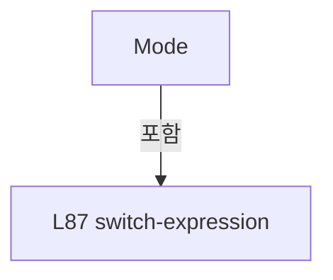

변경 전 점검: 입력/반환 타입, 위 호출자, 예외/취소 경로, 공유 상태와 저장·전송 소비자를 함께 확인합니다. 값의 단위나 물리 방향을 이름만으로 확정하지 않습니다.

### PropertyDeclaration `ModeBackground` · L88–93

[Drilling.UI/Menu/Menus/CManualPowerStagePanel.cs:88–93](https://github.com/kjuws10-rgb/A3Drilling/blob/5aee8e58439c9b455cae7c9593c9be986c3e682e/Drilling.UI/Menu/Menus/CManualPowerStagePanel.cs#L88-L93)

| 항목 | 실제 추출 값 |
| --- | --- |
| 서명 | Brush Drilling.UI.Menu.Menus.CManualPowerStagePanel.ModeBackground |
| 접근/수식자 | Public / public |
| 반환/값 타입 | Brush |
| 소속 타입 | NamedType:Drilling.UI.Menu.Menus.CManualPowerStagePanel |

현재 부분 분석에서 직접 연결된 호출자는 없습니다. XAML/이벤트/인터페이스·델리게이트·외부 진입을 추가 확인해야 하며, 미사용으로 판정한 것이 아닙니다.

본문의 실제 연산·분기·예외·반환 순서(원문 위치 순):

| 원본 행 | 종류 | 주석 해설 |
| --- | --- | --- |
| 88 | switch-expression | 값별 결과식을 선택합니다: _connectionState switch { EN_COMM_STATE.Simulation => CStatusBrush.Simul, EN_COMM_STATE.Online => CStatusBrush.Online, _ => CStatusBrush.Offline } |

제어 구문의 포함 구조(실제 실행 순서/CFG가 아닌 구문 탐색 그림):

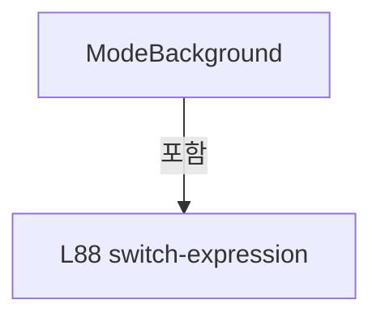

변경 전 점검: 입력/반환 타입, 위 호출자, 예외/취소 경로, 공유 상태와 저장·전송 소비자를 함께 확인합니다. 값의 단위나 물리 방향을 이름만으로 확정하지 않습니다.

### PropertyDeclaration `IsSimulation` · L94–94

[Drilling.UI/Menu/Menus/CManualPowerStagePanel.cs:94–94](https://github.com/kjuws10-rgb/A3Drilling/blob/5aee8e58439c9b455cae7c9593c9be986c3e682e/Drilling.UI/Menu/Menus/CManualPowerStagePanel.cs#L94-L94)

| 항목 | 실제 추출 값 |
| --- | --- |
| 서명 | bool Drilling.UI.Menu.Menus.CManualPowerStagePanel.IsSimulation |
| 접근/수식자 | Public / public |
| 반환/값 타입 | bool |
| 소속 타입 | NamedType:Drilling.UI.Menu.Menus.CManualPowerStagePanel |

현재 부분 분석에서 직접 연결된 호출자는 없습니다. XAML/이벤트/인터페이스·델리게이트·외부 진입을 추가 확인해야 하며, 미사용으로 판정한 것이 아닙니다.

변경 전 점검: 입력/반환 타입, 위 호출자, 예외/취소 경로, 공유 상태와 저장·전송 소비자를 함께 확인합니다. 값의 단위나 물리 방향을 이름만으로 확정하지 않습니다.

### PropertyDeclaration `CanMove` · L95–96

[Drilling.UI/Menu/Menus/CManualPowerStagePanel.cs:95–96](https://github.com/kjuws10-rgb/A3Drilling/blob/5aee8e58439c9b455cae7c9593c9be986c3e682e/Drilling.UI/Menu/Menus/CManualPowerStagePanel.cs#L95-L96)

| 항목 | 실제 추출 값 |
| --- | --- |
| 서명 | bool Drilling.UI.Menu.Menus.CManualPowerStagePanel.CanMove |
| 접근/수식자 | Public / public |
| 반환/값 타입 | bool |
| 소속 타입 | NamedType:Drilling.UI.Menu.Menus.CManualPowerStagePanel |

현재 부분 분석에서 직접 연결된 호출자는 없습니다. XAML/이벤트/인터페이스·델리게이트·외부 진입을 추가 확인해야 하며, 미사용으로 판정한 것이 아닙니다.

변경 전 점검: 입력/반환 타입, 위 호출자, 예외/취소 경로, 공유 상태와 저장·전송 소비자를 함께 확인합니다. 값의 단위나 물리 방향을 이름만으로 확정하지 않습니다.

### PropertyDeclaration `CanJog` · L97–97

[Drilling.UI/Menu/Menus/CManualPowerStagePanel.cs:97–97](https://github.com/kjuws10-rgb/A3Drilling/blob/5aee8e58439c9b455cae7c9593c9be986c3e682e/Drilling.UI/Menu/Menus/CManualPowerStagePanel.cs#L97-L97)

| 항목 | 실제 추출 값 |
| --- | --- |
| 서명 | bool Drilling.UI.Menu.Menus.CManualPowerStagePanel.CanJog |
| 접근/수식자 | Public / public |
| 반환/값 타입 | bool |
| 소속 타입 | NamedType:Drilling.UI.Menu.Menus.CManualPowerStagePanel |

현재 부분 분석에서 직접 연결된 호출자는 없습니다. XAML/이벤트/인터페이스·델리게이트·외부 진입을 추가 확인해야 하며, 미사용으로 판정한 것이 아닙니다.

변경 전 점검: 입력/반환 타입, 위 호출자, 예외/취소 경로, 공유 상태와 저장·전송 소비자를 함께 확인합니다. 값의 단위나 물리 방향을 이름만으로 확정하지 않습니다.

### PropertyDeclaration `CanStop` · L98–98

[Drilling.UI/Menu/Menus/CManualPowerStagePanel.cs:98–98](https://github.com/kjuws10-rgb/A3Drilling/blob/5aee8e58439c9b455cae7c9593c9be986c3e682e/Drilling.UI/Menu/Menus/CManualPowerStagePanel.cs#L98-L98)

| 항목 | 실제 추출 값 |
| --- | --- |
| 서명 | bool Drilling.UI.Menu.Menus.CManualPowerStagePanel.CanStop |
| 접근/수식자 | Public / public |
| 반환/값 타입 | bool |
| 소속 타입 | NamedType:Drilling.UI.Menu.Menus.CManualPowerStagePanel |

현재 부분 분석에서 직접 연결된 호출자는 없습니다. XAML/이벤트/인터페이스·델리게이트·외부 진입을 추가 확인해야 하며, 미사용으로 판정한 것이 아닙니다.

변경 전 점검: 입력/반환 타입, 위 호출자, 예외/취소 경로, 공유 상태와 저장·전송 소비자를 함께 확인합니다. 값의 단위나 물리 방향을 이름만으로 확정하지 않습니다.

### PropertyDeclaration `CanEdit` · L99–99

[Drilling.UI/Menu/Menus/CManualPowerStagePanel.cs:99–99](https://github.com/kjuws10-rgb/A3Drilling/blob/5aee8e58439c9b455cae7c9593c9be986c3e682e/Drilling.UI/Menu/Menus/CManualPowerStagePanel.cs#L99-L99)

| 항목 | 실제 추출 값 |
| --- | --- |
| 서명 | bool Drilling.UI.Menu.Menus.CManualPowerStagePanel.CanEdit |
| 접근/수식자 | Public / public |
| 반환/값 타입 | bool |
| 소속 타입 | NamedType:Drilling.UI.Menu.Menus.CManualPowerStagePanel |

현재 부분 분석에서 직접 연결된 호출자는 없습니다. XAML/이벤트/인터페이스·델리게이트·외부 진입을 추가 확인해야 하며, 미사용으로 판정한 것이 아닙니다.

변경 전 점검: 입력/반환 타입, 위 호출자, 예외/취소 경로, 공유 상태와 저장·전송 소비자를 함께 확인합니다. 값의 단위나 물리 방향을 이름만으로 확정하지 않습니다.

### PropertyDeclaration `StatusText` · L100–107

[Drilling.UI/Menu/Menus/CManualPowerStagePanel.cs:100–107](https://github.com/kjuws10-rgb/A3Drilling/blob/5aee8e58439c9b455cae7c9593c9be986c3e682e/Drilling.UI/Menu/Menus/CManualPowerStagePanel.cs#L100-L107)

| 항목 | 실제 추출 값 |
| --- | --- |
| 서명 | string Drilling.UI.Menu.Menus.CManualPowerStagePanel.StatusText |
| 접근/수식자 | Public / public |
| 반환/값 타입 | string |
| 소속 타입 | NamedType:Drilling.UI.Menu.Menus.CManualPowerStagePanel |

현재 부분 분석에서 직접 연결된 호출자는 없습니다. XAML/이벤트/인터페이스·델리게이트·외부 진입을 추가 확인해야 하며, 미사용으로 판정한 것이 아닙니다.

본문의 실제 연산·분기·예외·반환 순서(원문 위치 순):

| 원본 행 | 종류 | 주석 해설 |
| --- | --- | --- |
| 100 | conditional-expression | 조건에 따라 결과식을 선택합니다: _connectionState == EN_COMM_STATE.Offline ? "MELSEC 연결 대기" : _stageMove?.IsStopping == true ? "STOPPING · 이동 신호 정리 대기" : _stageMove?.CanStop == true ? "Process Move · 허가/이동/완료 확인 중" : _measurementRunning ? "PowerMeasure 진행 중 · 수동  |
| 101 | conditional-expression | 조건에 따라 결과식을 선택합니다: _stageMove?.IsStopping == true ? "STOPPING · 이동 신호 정리 대기" : _stageMove?.CanStop == true ? "Process Move · 허가/이동/완료 확인 중" : _measurementRunning ? "PowerMeasure 진행 중 · 수동 이동 차단" : _motionMessage.Length > 0 ? _motionMessage : !IsSimu |
| 102 | conditional-expression | 조건에 따라 결과식을 선택합니다: _stageMove?.CanStop == true ? "Process Move · 허가/이동/완료 확인 중" : _measurementRunning ? "PowerMeasure 진행 중 · 수동 이동 차단" : _motionMessage.Length > 0 ? _motionMessage : !IsSimulation ? (_stageMove is null ? "현재값 표시 · 실제 이동 연결 대기" : "MEL |
| 103 | conditional-expression | 조건에 따라 결과식을 선택합니다: _measurementRunning ? "PowerMeasure 진행 중 · 수동 이동 차단" : _motionMessage.Length > 0 ? _motionMessage : !IsSimulation ? (_stageMove is null ? "현재값 표시 · 실제 이동 연결 대기" : "MELSEC · ABS/REL 공통 Process Move · 실제 JOG 미지원") : _simulation.IsRe |
| 104 | conditional-expression | 조건에 따라 결과식을 선택합니다: _motionMessage.Length > 0 ? _motionMessage : !IsSimulation ? (_stageMove is null ? "현재값 표시 · 실제 이동 연결 대기" : "MELSEC · ABS/REL 공통 Process Move · 실제 JOG 미지원") : _simulation.IsReserved ? "SIMULATION · MOF 진행 중" : "SIMULATION · JOG 속도 |
| 105 | conditional-expression | 조건에 따라 결과식을 선택합니다: _stageMove is null ? "현재값 표시 · 실제 이동 연결 대기" : "MELSEC · ABS/REL 공통 Process Move · 실제 JOG 미지원" |
| 105 | conditional-expression | 조건에 따라 결과식을 선택합니다: !IsSimulation ? (_stageMove is null ? "현재값 표시 · 실제 이동 연결 대기" : "MELSEC · ABS/REL 공통 Process Move · 실제 JOG 미지원") : _simulation.IsReserved ? "SIMULATION · MOF 진행 중" : "SIMULATION · JOG 속도 5 mm/sec" |
| 106 | conditional-expression | 조건에 따라 결과식을 선택합니다: _simulation.IsReserved ? "SIMULATION · MOF 진행 중" : "SIMULATION · JOG 속도 5 mm/sec" |

변경 전 점검: 입력/반환 타입, 위 호출자, 예외/취소 경로, 공유 상태와 저장·전송 소비자를 함께 확인합니다. 값의 단위나 물리 방향을 이름만으로 확정하지 않습니다.

### ConstructorDeclaration `.ctor` · L109–131

[Drilling.UI/Menu/Menus/CManualPowerStagePanel.cs:109–131](https://github.com/kjuws10-rgb/A3Drilling/blob/5aee8e58439c9b455cae7c9593c9be986c3e682e/Drilling.UI/Menu/Menus/CManualPowerStagePanel.cs#L109-L131)

| 항목 | 실제 추출 값 |
| --- | --- |
| 서명 | Drilling.UI.Menu.Menus.CManualPowerStagePanel.CManualPowerStagePanel(System.Func<System.Collections.Generic.IReadOnlyList<Drilling.UI.Menu.Menus.ST_MOTOR_STATUS_ITEM>>, System.Action<string>, System.Func<string, bool>, Drilling.Common.Motion.CManualStageMotionSimulation?, System.Func<Drilling.Common.Interface.EN_COMM_STATE>?, Drilling.UI.Menu.Menus.CManualStageMoveOperation?) |
| 접근/수식자 | Public / public |
| 반환/값 타입 | void |
| 소속 타입 | NamedType:Drilling.UI.Menu.Menus.CManualPowerStagePanel |

입력 계약:

| 이름 | 타입 | 전달 | 선택/기본값 |
| --- | --- | --- | --- |
| readCachedStatus | System.Func<System.Collections.Generic.IReadOnlyList<Drilling.UI.Menu.Menus.ST_MOTOR_STATUS_ITEM>> | None | False /  |
| warn | System.Action<string> | None | False /  |
| confirm | System.Func<string, bool> | None | False /  |
| simulation | Drilling.Common.Motion.CManualStageMotionSimulation? | None | True / null |
| readConnectionState | System.Func<Drilling.Common.Interface.EN_COMM_STATE>? | None | True / null |
| stageMove | Drilling.UI.Menu.Menus.CManualStageMoveOperation? | None | True / null |

정적 호출자로 확인된 위치:

| 호출 파일/행 | 호출 표현식 | 런타임 분기 가능 |
| --- | --- | --- |
| [Drilling.UI/Menu/Menus/CManualPowerMeasurePanel.cs:89–89](https://github.com/kjuws10-rgb/A3Drilling/blob/5aee8e58439c9b455cae7c9593c9be986c3e682e/Drilling.UI/Menu/Menus/CManualPowerMeasurePanel.cs#L89-L89) | new | False |

호출하는 대상과 해석 범위:

| 원본 행 | 표현식 | 분석 상태 | 대상/소스 위치 |
| --- | --- | --- | --- |
| 122 | new | resolved | Drilling.Common.Motion.CManualStageMotionSimulation.CManualStageMotionSimulation(System.Func<double>?) · Drilling.Common/Motion/CMotionManager.cs:1186 |
| 125 | new | resolved | Drilling.UI.Menu.Menus.CManualPowerStageAxis.CManualPowerStageAxis(Drilling.UI.Menu.Menus.CManualPowerStagePanel, Drilling.Common.Motion.EN_MANUAL_STAGE_AXIS, string, string) · Drilling.UI/Menu/Menus/CManualPowerStagePanel.cs:287 |
| 125 | new | resolved | Drilling.UI.Menu.Menus.CManualPowerStageAxis.CManualPowerStageAxis(Drilling.UI.Menu.Menus.CManualPowerStagePanel, Drilling.Common.Motion.EN_MANUAL_STAGE_AXIS, string, string) · Drilling.UI/Menu/Menus/CManualPowerStagePanel.cs:287 |
| 126 | new | resolved | Drilling.UI.Menu.CButtonCommand.CButtonCommand(System.Action<object?>, System.Predicate<object?>?) · Drilling.UI/Menu/CButtonCommand.cs:9 |
| 126 | Stop | resolved | void Drilling.UI.Menu.Menus.CManualPowerStagePanel.Stop(bool) · Drilling.UI/Menu/Menus/CManualPowerStagePanel.cs:250 |
| 128 | new | unresolved | None |
| 128 | TimeSpan.FromMilliseconds | resolved | System.TimeSpan System.TimeSpan.FromMilliseconds(long) |
| 129 | Refresh | resolved | void Drilling.UI.Menu.Menus.CManualPowerStagePanel.Refresh() · Drilling.UI/Menu/Menus/CManualPowerStagePanel.cs:164 |
| 130 | Refresh | resolved | void Drilling.UI.Menu.Menus.CManualPowerStagePanel.Refresh() · Drilling.UI/Menu/Menus/CManualPowerStagePanel.cs:164 |

본문의 실제 연산·분기·예외·반환 순서(원문 위치 순):

| 원본 행 | 종류 | 주석 해설 |
| --- | --- | --- |
| 120 | assignment | 값을 대상에 대입합니다: _readCachedStatus = readCachedStatus |
| 120 | assignment | 값을 대상에 대입합니다: _warn = warn |
| 120 | assignment | 값을 대상에 대입합니다: _confirm = confirm |
| 121 | assignment | 값을 대상에 대입합니다: _readConnectionState = readConnectionState ?? (() => EN_COMM_STATE.Offline) |
| 122 | assignment | 값을 대상에 대입합니다: _simulation = simulation ?? new() |
| 122 | call | 함수·델리게이트 또는 객체 생성자를 호출합니다: new() |
| 123 | assignment | 값을 대상에 대입합니다: _stageMove = stageMove |
| 124 | compound-assignment-or-event-subscription | 복합 대입 또는 이벤트 구독/해지 표현입니다: _stageMove.Changed += UpdateCommands |
| 124 | if | 조건에 따라 분기합니다: if (_stageMove is not null) |
| 125 | assignment | 값을 대상에 대입합니다: Axes = [new(this, EN_MANUAL_STAGE_AXIS.StageY, "Stage Y", "Stage Y"), new(this, EN_MANUAL_STAGE_AXIS.ReviewX, "Review X", "Review X")] |
| 125 | call | 함수·델리게이트 또는 객체 생성자를 호출합니다: new(this, EN_MANUAL_STAGE_AXIS.StageY, "Stage Y", "Stage Y") |
| 125 | call | 함수·델리게이트 또는 객체 생성자를 호출합니다: new(this, EN_MANUAL_STAGE_AXIS.ReviewX, "Review X", "Review X") |
| 126 | assignment | 값을 대상에 대입합니다: StopCommand = new(_ => Stop(includeSharedMove: true), _ => CanStop) |
| 126 | call | 함수·델리게이트 또는 객체 생성자를 호출합니다: new(_ => Stop(includeSharedMove: true), _ => CanStop) |
| 126 | call | 함수·델리게이트 또는 객체 생성자를 호출합니다: Stop(includeSharedMove: true) |
| 128 | assignment | 값을 대상에 대입합니다: _animation = new(DispatcherPriority.Background) { Interval = TimeSpan.FromMilliseconds(100) } |
| 128 | assignment | 값을 대상에 대입합니다: Interval = TimeSpan.FromMilliseconds(100) |
| 128 | call | 함수·델리게이트 또는 객체 생성자를 호출합니다: new(DispatcherPriority.Background) { Interval = TimeSpan.FromMilliseconds(100) } |
| 128 | call | 함수·델리게이트 또는 객체 생성자를 호출합니다: TimeSpan.FromMilliseconds(100) |
| 129 | call | 함수·델리게이트 또는 객체 생성자를 호출합니다: Refresh() |
| 129 | compound-assignment-or-event-subscription | 복합 대입 또는 이벤트 구독/해지 표현입니다: _animation.Tick += (_, _) => Refresh() |
| 130 | call | 함수·델리게이트 또는 객체 생성자를 호출합니다: Refresh() |

제어 구문의 포함 구조(실제 실행 순서/CFG가 아닌 구문 탐색 그림):

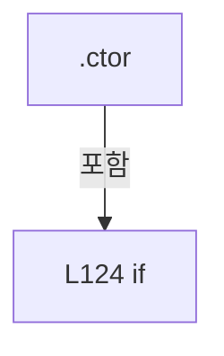

변경 전 점검: 입력/반환 타입, 위 호출자, 예외/취소 경로, 공유 상태와 저장·전송 소비자를 함께 확인합니다. 값의 단위나 물리 방향을 이름만으로 확정하지 않습니다.

### MethodDeclaration `SetViewActive` · L135–140

[Drilling.UI/Menu/Menus/CManualPowerStagePanel.cs:135–140](https://github.com/kjuws10-rgb/A3Drilling/blob/5aee8e58439c9b455cae7c9593c9be986c3e682e/Drilling.UI/Menu/Menus/CManualPowerStagePanel.cs#L135-L140)

| 항목 | 실제 추출 값 |
| --- | --- |
| 서명 | void Drilling.UI.Menu.Menus.CManualPowerStagePanel.SetViewActive(object, bool) |
| 접근/수식자 | Public / public |
| 반환/값 타입 | void |
| 소속 타입 | NamedType:Drilling.UI.Menu.Menus.CManualPowerStagePanel |

입력 계약:

| 이름 | 타입 | 전달 | 선택/기본값 |
| --- | --- | --- | --- |
| view | object | None | False /  |
| active | bool | None | False /  |

정적 호출자로 확인된 위치:

| 호출 파일/행 | 호출 표현식 | 런타임 분기 가능 |
| --- | --- | --- |
| [Drilling.UI/Views/CManualPowerStageView.xaml.cs:27–27](https://github.com/kjuws10-rgb/A3Drilling/blob/5aee8e58439c9b455cae7c9593c9be986c3e682e/Drilling.UI/Views/CManualPowerStageView.xaml.cs#L27-L27) | .SetViewActive | False |
| [Drilling.UI/Views/CManualPowerStageView.xaml.cs:39–39](https://github.com/kjuws10-rgb/A3Drilling/blob/5aee8e58439c9b455cae7c9593c9be986c3e682e/Drilling.UI/Views/CManualPowerStageView.xaml.cs#L39-L39) | .SetViewActive | False |

호출하는 대상과 해석 범위:

| 원본 행 | 표현식 | 분석 상태 | 대상/소스 위치 |
| --- | --- | --- | --- |
| 137 | _activeViews.Add | resolved | bool System.Collections.Generic.HashSet<object>.Add(object) |
| 138 | _activeViews.Remove | resolved | bool System.Collections.Generic.HashSet<object>.Remove(object) |
| 139 | SetActive | resolved | void Drilling.UI.Menu.Menus.CManualPowerStagePanel.SetActive(bool) · Drilling.UI/Menu/Menus/CManualPowerStagePanel.cs:142 |

본문의 실제 연산·분기·예외·반환 순서(원문 위치 순):

| 원본 행 | 종류 | 주석 해설 |
| --- | --- | --- |
| 137 | call | 함수·델리게이트 또는 객체 생성자를 호출합니다: _activeViews.Add(view) |
| 137 | if | 조건에 따라 분기합니다: if (active) |
| 138 | call | 함수·델리게이트 또는 객체 생성자를 호출합니다: _activeViews.Remove(view) |
| 138 | else | 앞 조건이 거짓인 경로입니다: else |
| 139 | call | 함수·델리게이트 또는 객체 생성자를 호출합니다: SetActive(_activeViews.Count > 0) |

제어 구문의 포함 구조(실제 실행 순서/CFG가 아닌 구문 탐색 그림):

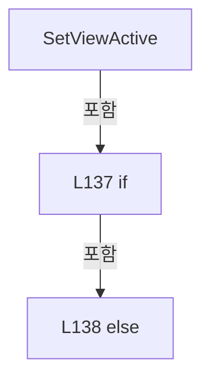

변경 전 점검: 입력/반환 타입, 위 호출자, 예외/취소 경로, 공유 상태와 저장·전송 소비자를 함께 확인합니다. 값의 단위나 물리 방향을 이름만으로 확정하지 않습니다.

### MethodDeclaration `SetActive` · L142–154

[Drilling.UI/Menu/Menus/CManualPowerStagePanel.cs:142–154](https://github.com/kjuws10-rgb/A3Drilling/blob/5aee8e58439c9b455cae7c9593c9be986c3e682e/Drilling.UI/Menu/Menus/CManualPowerStagePanel.cs#L142-L154)

| 항목 | 실제 추출 값 |
| --- | --- |
| 서명 | void Drilling.UI.Menu.Menus.CManualPowerStagePanel.SetActive(bool) |
| 접근/수식자 | Public / public |
| 반환/값 타입 | void |
| 소속 타입 | NamedType:Drilling.UI.Menu.Menus.CManualPowerStagePanel |

입력 계약:

| 이름 | 타입 | 전달 | 선택/기본값 |
| --- | --- | --- | --- |
| active | bool | None | False /  |

정적 호출자로 확인된 위치:

| 호출 파일/행 | 호출 표현식 | 런타임 분기 가능 |
| --- | --- | --- |
| [Drilling.UI/Menu/Menus/CManualPowerStagePanel.cs:139–139](https://github.com/kjuws10-rgb/A3Drilling/blob/5aee8e58439c9b455cae7c9593c9be986c3e682e/Drilling.UI/Menu/Menus/CManualPowerStagePanel.cs#L139-L139) | SetActive | False |
| [Drilling.UI/Menu/Menus/CMenuManual.cs:445–445](https://github.com/kjuws10-rgb/A3Drilling/blob/5aee8e58439c9b455cae7c9593c9be986c3e682e/Drilling.UI/Menu/Menus/CMenuManual.cs#L445-L445) | .StageMotion.SetActive | False |
| [Drilling.UI/Menu/Menus/CMenuManual.cs:6211–6211](https://github.com/kjuws10-rgb/A3Drilling/blob/5aee8e58439c9b455cae7c9593c9be986c3e682e/Drilling.UI/Menu/Menus/CMenuManual.cs#L6211-L6211) | .StageMotion.SetActive | False |
| [Drilling.UI/Menu/Menus/CMenuManual.cs:6415–6415](https://github.com/kjuws10-rgb/A3Drilling/blob/5aee8e58439c9b455cae7c9593c9be986c3e682e/Drilling.UI/Menu/Menus/CMenuManual.cs#L6415-L6415) | .StageMotion.SetActive | False |

호출하는 대상과 해석 범위:

| 원본 행 | 표현식 | 분석 상태 | 대상/소스 위치 |
| --- | --- | --- | --- |
| 151 | _simulation.StopJog | resolved | void Drilling.Common.Motion.CManualStageMotionSimulation.StopJog() · Drilling.Common/Motion/CMotionManager.cs:1286 |
| 153 | UpdateCommands | resolved | void Drilling.UI.Menu.Menus.CManualPowerStagePanel.UpdateCommands() · Drilling.UI/Menu/Menus/CManualPowerStagePanel.cs:260 |
| 153 | Refresh | resolved | void Drilling.UI.Menu.Menus.CManualPowerStagePanel.Refresh() · Drilling.UI/Menu/Menus/CManualPowerStagePanel.cs:164 |

본문의 실제 연산·분기·예외·반환 순서(원문 위치 순):

| 원본 행 | 종류 | 주석 해설 |
| --- | --- | --- |
| 144 | if | 조건에 따라 분기합니다: if (_active == active) |
| 144 | return | 호출자에게 값 또는 제어를 반환합니다: return; |
| 145 | assignment | 값을 대상에 대입합니다: _active = active |
| 146 | if | 조건에 따라 분기합니다: if (!active) |
| 151 | call | 함수·델리게이트 또는 객체 생성자를 호출합니다: _simulation.StopJog() |
| 153 | call | 함수·델리게이트 또는 객체 생성자를 호출합니다: UpdateCommands() |
| 153 | call | 함수·델리게이트 또는 객체 생성자를 호출합니다: Refresh() |

제어 구문의 포함 구조(실제 실행 순서/CFG가 아닌 구문 탐색 그림):

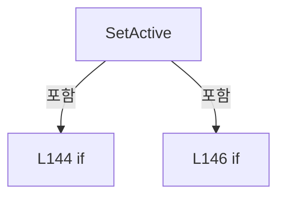

변경 전 점검: 입력/반환 타입, 위 호출자, 예외/취소 경로, 공유 상태와 저장·전송 소비자를 함께 확인합니다. 값의 단위나 물리 방향을 이름만으로 확정하지 않습니다.

### MethodDeclaration `SetMeasurementRunning` · L156–162

[Drilling.UI/Menu/Menus/CManualPowerStagePanel.cs:156–162](https://github.com/kjuws10-rgb/A3Drilling/blob/5aee8e58439c9b455cae7c9593c9be986c3e682e/Drilling.UI/Menu/Menus/CManualPowerStagePanel.cs#L156-L162)

| 항목 | 실제 추출 값 |
| --- | --- |
| 서명 | void Drilling.UI.Menu.Menus.CManualPowerStagePanel.SetMeasurementRunning(bool) |
| 접근/수식자 | Public / public |
| 반환/값 타입 | void |
| 소속 타입 | NamedType:Drilling.UI.Menu.Menus.CManualPowerStagePanel |

입력 계약:

| 이름 | 타입 | 전달 | 선택/기본값 |
| --- | --- | --- | --- |
| running | bool | None | False /  |

정적 호출자로 확인된 위치:

| 호출 파일/행 | 호출 표현식 | 런타임 분기 가능 |
| --- | --- | --- |
| [Drilling.UI/Menu/Menus/CManualPowerMeasurePanel.cs:211–211](https://github.com/kjuws10-rgb/A3Drilling/blob/5aee8e58439c9b455cae7c9593c9be986c3e682e/Drilling.UI/Menu/Menus/CManualPowerMeasurePanel.cs#L211-L211) | StageMotion.SetMeasurementRunning | False |

호출하는 대상과 해석 범위:

| 원본 행 | 표현식 | 분석 상태 | 대상/소스 위치 |
| --- | --- | --- | --- |
| 160 | Stop | resolved | void Drilling.UI.Menu.Menus.CManualPowerStagePanel.Stop(bool) · Drilling.UI/Menu/Menus/CManualPowerStagePanel.cs:250 |
| 161 | UpdateCommands | resolved | void Drilling.UI.Menu.Menus.CManualPowerStagePanel.UpdateCommands() · Drilling.UI/Menu/Menus/CManualPowerStagePanel.cs:260 |

본문의 실제 연산·분기·예외·반환 순서(원문 위치 순):

| 원본 행 | 종류 | 주석 해설 |
| --- | --- | --- |
| 158 | if | 조건에 따라 분기합니다: if (_measurementRunning == running) |
| 158 | return | 호출자에게 값 또는 제어를 반환합니다: return; |
| 159 | assignment | 값을 대상에 대입합니다: _measurementRunning = running |
| 160 | call | 함수·델리게이트 또는 객체 생성자를 호출합니다: Stop() |
| 160 | if | 조건에 따라 분기합니다: if (running) |
| 161 | call | 함수·델리게이트 또는 객체 생성자를 호출합니다: UpdateCommands() |

제어 구문의 포함 구조(실제 실행 순서/CFG가 아닌 구문 탐색 그림):

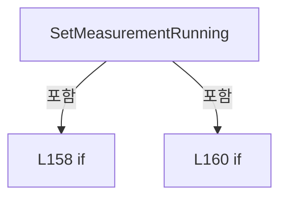

변경 전 점검: 입력/반환 타입, 위 호출자, 예외/취소 경로, 공유 상태와 저장·전송 소비자를 함께 확인합니다. 값의 단위나 물리 방향을 이름만으로 확정하지 않습니다.

### MethodDeclaration `Refresh` · L164–188

[Drilling.UI/Menu/Menus/CManualPowerStagePanel.cs:164–188](https://github.com/kjuws10-rgb/A3Drilling/blob/5aee8e58439c9b455cae7c9593c9be986c3e682e/Drilling.UI/Menu/Menus/CManualPowerStagePanel.cs#L164-L188)

| 항목 | 실제 추출 값 |
| --- | --- |
| 서명 | void Drilling.UI.Menu.Menus.CManualPowerStagePanel.Refresh() |
| 접근/수식자 | Public / public |
| 반환/값 타입 | void |
| 소속 타입 | NamedType:Drilling.UI.Menu.Menus.CManualPowerStagePanel |

정적 호출자로 확인된 위치:

| 호출 파일/행 | 호출 표현식 | 런타임 분기 가능 |
| --- | --- | --- |
| [Drilling.UI/Menu/Menus/CManualPowerMeasurePanel.cs:135–135](https://github.com/kjuws10-rgb/A3Drilling/blob/5aee8e58439c9b455cae7c9593c9be986c3e682e/Drilling.UI/Menu/Menus/CManualPowerMeasurePanel.cs#L135-L135) | StageMotion.Refresh | False |
| [Drilling.UI/Menu/Menus/CManualPowerStagePanel.cs:129–129](https://github.com/kjuws10-rgb/A3Drilling/blob/5aee8e58439c9b455cae7c9593c9be986c3e682e/Drilling.UI/Menu/Menus/CManualPowerStagePanel.cs#L129-L129) | Refresh | False |
| [Drilling.UI/Menu/Menus/CManualPowerStagePanel.cs:130–130](https://github.com/kjuws10-rgb/A3Drilling/blob/5aee8e58439c9b455cae7c9593c9be986c3e682e/Drilling.UI/Menu/Menus/CManualPowerStagePanel.cs#L130-L130) | Refresh | False |
| [Drilling.UI/Menu/Menus/CManualPowerStagePanel.cs:153–153](https://github.com/kjuws10-rgb/A3Drilling/blob/5aee8e58439c9b455cae7c9593c9be986c3e682e/Drilling.UI/Menu/Menus/CManualPowerStagePanel.cs#L153-L153) | Refresh | False |
| [Drilling.UI/Menu/Menus/CManualPowerStagePanel.cs:206–206](https://github.com/kjuws10-rgb/A3Drilling/blob/5aee8e58439c9b455cae7c9593c9be986c3e682e/Drilling.UI/Menu/Menus/CManualPowerStagePanel.cs#L206-L206) | Refresh | False |
| [Drilling.UI/Menu/Menus/CManualPowerStagePanel.cs:219–219](https://github.com/kjuws10-rgb/A3Drilling/blob/5aee8e58439c9b455cae7c9593c9be986c3e682e/Drilling.UI/Menu/Menus/CManualPowerStagePanel.cs#L219-L219) | Refresh | False |
| [Drilling.UI/Menu/Menus/CManualPowerStagePanel.cs:231–231](https://github.com/kjuws10-rgb/A3Drilling/blob/5aee8e58439c9b455cae7c9593c9be986c3e682e/Drilling.UI/Menu/Menus/CManualPowerStagePanel.cs#L231-L231) | Refresh | False |
| [Drilling.UI/Menu/Menus/CManualPowerStagePanel.cs:237–237](https://github.com/kjuws10-rgb/A3Drilling/blob/5aee8e58439c9b455cae7c9593c9be986c3e682e/Drilling.UI/Menu/Menus/CManualPowerStagePanel.cs#L237-L237) | Refresh | False |

호출하는 대상과 해석 범위:

| 원본 행 | 표현식 | 분석 상태 | 대상/소스 위치 |
| --- | --- | --- | --- |
| 167 | UpdateCommands | resolved | void Drilling.UI.Menu.Menus.CManualPowerStagePanel.UpdateCommands() · Drilling.UI/Menu/Menus/CManualPowerStagePanel.cs:260 |
| 168 | UpdateCommands | resolved | void Drilling.UI.Menu.Menus.CManualPowerStagePanel.UpdateCommands() · Drilling.UI/Menu/Menus/CManualPowerStagePanel.cs:260 |
| 169 | _readConnectionState | resolved · 동적 구현 선택 가능 | Drilling.Common.Interface.EN_COMM_STATE System.Func<Drilling.Common.Interface.EN_COMM_STATE>.Invoke() |
| 172 | Stop | resolved | void Drilling.UI.Menu.Menus.CManualPowerStagePanel.Stop(bool) · Drilling.UI/Menu/Menus/CManualPowerStagePanel.cs:250 |
| 173 | Notify | resolved | void Drilling.UI.Menu.Menus.CManualPowerStagePanel.Notify(string?) · Drilling.UI/Menu/Menus/CManualPowerStagePanel.cs:266 |
| 173 | nameof | unresolved | None |
| 173 | Notify | resolved | void Drilling.UI.Menu.Menus.CManualPowerStagePanel.Notify(string?) · Drilling.UI/Menu/Menus/CManualPowerStagePanel.cs:266 |
| 173 | nameof | unresolved | None |
| 173 | Notify | resolved | void Drilling.UI.Menu.Menus.CManualPowerStagePanel.Notify(string?) · Drilling.UI/Menu/Menus/CManualPowerStagePanel.cs:266 |
| 173 | nameof | unresolved | None |
| 173 | UpdateCommands | resolved | void Drilling.UI.Menu.Menus.CManualPowerStagePanel.UpdateCommands() · Drilling.UI/Menu/Menus/CManualPowerStagePanel.cs:260 |
| 175 | RefreshSimulation | resolved | void Drilling.UI.Menu.Menus.CManualPowerStagePanel.RefreshSimulation() · Drilling.UI/Menu/Menus/CManualPowerStagePanel.cs:190 |
| 178 | axis.SetFeedback | resolved | void Drilling.UI.Menu.Menus.CManualPowerStageAxis.SetFeedback(string, string, string, string) · Drilling.UI/Menu/Menus/CManualPowerStagePanel.cs:293 |
| 181 | _readCachedStatus | resolved · 동적 구현 선택 가능 | System.Collections.Generic.IReadOnlyList<Drilling.UI.Menu.Menus.ST_MOTOR_STATUS_ITEM> System.Func<System.Collections.Generic.IReadOnlyList<Drilling.UI.Menu.Menus.ST_MOTOR_STATUS_ITEM>>.Invoke() |
| 184 | snapshot.FirstOrDefault | resolved | Drilling.UI.Menu.Menus.ST_MOTOR_STATUS_ITEM? System.Collections.Generic.IEnumerable<Drilling.UI.Menu.Menus.ST_MOTOR_STATUS_ITEM>.FirstOrDefault<Drilling.UI.Menu.Menus.ST_MOTOR_STATUS_ITEM>(System.Func<Drilling.UI.Menu.Menus.ST_MOTOR_STATUS_ITEM, bool>) |
| 185 | axis.SetFeedback | resolved | void Drilling.UI.Menu.Menus.CManualPowerStageAxis.SetFeedback(string, string, string, string) · Drilling.UI/Menu/Menus/CManualPowerStagePanel.cs:293 |

본문의 실제 연산·분기·예외·반환 순서(원문 위치 순):

| 원본 행 | 종류 | 주석 해설 |
| --- | --- | --- |
| 166 | if | 조건에 따라 분기합니다: if (_sharedMoveRunning != (_stageMove?.CanStop == true)) |
| 167 | assignment | 값을 대상에 대입합니다: _sharedMoveRunning = _stageMove?.CanStop == true |
| 167 | call | 함수·델리게이트 또는 객체 생성자를 호출합니다: UpdateCommands() |
| 168 | assignment | 값을 대상에 대입합니다: _reserved = _simulation.IsReserved |
| 168 | call | 함수·델리게이트 또는 객체 생성자를 호출합니다: UpdateCommands() |
| 168 | if | 조건에 따라 분기합니다: if (_reserved != _simulation.IsReserved) |
| 169 | call | 함수·델리게이트 또는 객체 생성자를 호출합니다: _readConnectionState() |
| 169 | local-declaration | 지역 변수를 선언합니다: var connectionState = _readConnectionState(); |
| 169 | variable-initializer | 변수의 초기값을 지정합니다: connectionState = _readConnectionState() |
| 170 | if | 조건에 따라 분기합니다: if (connectionState != _connectionState) |
| 172 | assignment | 값을 대상에 대입합니다: _connectionState = connectionState |
| 172 | call | 함수·델리게이트 또는 객체 생성자를 호출합니다: Stop() |
| 173 | call | 함수·델리게이트 또는 객체 생성자를 호출합니다: Notify(nameof(Mode)) |
| 173 | call | 함수·델리게이트 또는 객체 생성자를 호출합니다: nameof(Mode) |
| 173 | call | 함수·델리게이트 또는 객체 생성자를 호출합니다: Notify(nameof(ModeBackground)) |
| 173 | call | 함수·델리게이트 또는 객체 생성자를 호출합니다: nameof(ModeBackground) |
| 173 | call | 함수·델리게이트 또는 객체 생성자를 호출합니다: Notify(nameof(IsSimulation)) |
| 173 | call | 함수·델리게이트 또는 객체 생성자를 호출합니다: nameof(IsSimulation) |
| 173 | call | 함수·델리게이트 또는 객체 생성자를 호출합니다: UpdateCommands() |
| 175 | call | 함수·델리게이트 또는 객체 생성자를 호출합니다: RefreshSimulation() |
| 175 | if | 조건에 따라 분기합니다: if (IsSimulation) |
| 175 | return | 호출자에게 값 또는 제어를 반환합니다: return; |
| 176 | if | 조건에 따라 분기합니다: if (_connectionState == EN_COMM_STATE.Offline) |
| 178 | call | 함수·델리게이트 또는 객체 생성자를 호출합니다: axis.SetFeedback("—", "—", "MELSEC 연결 안 됨", "MELSEC 연결 안 됨") |
| 178 | foreach | 컬렉션 요소를 순회합니다: foreach (var axis in Axes) |
| 179 | return | 호출자에게 값 또는 제어를 반환합니다: return; |
| 181 | call | 함수·델리게이트 또는 객체 생성자를 호출합니다: _readCachedStatus() |
| 181 | local-declaration | 지역 변수를 선언합니다: var snapshot = _readCachedStatus(); |
| 181 | variable-initializer | 변수의 초기값을 지정합니다: snapshot = _readCachedStatus() |
| 182 | foreach | 컬렉션 요소를 순회합니다: foreach (var axis in Axes) |
| 184 | call | 함수·델리게이트 또는 객체 생성자를 호출합니다: snapshot.FirstOrDefault(item => item.Name == axis.SnapshotName) |
| 184 | local-declaration | 지역 변수를 선언합니다: var value = snapshot.FirstOrDefault(item => item.Name == axis.SnapshotName); |
| 184 | variable-initializer | 변수의 초기값을 지정합니다: value = snapshot.FirstOrDefault(item => item.Name == axis.SnapshotName) |
| 185 | call | 함수·델리게이트 또는 객체 생성자를 호출합니다: axis.SetFeedback(value?.Position ?? "—", value?.Speed ?? "—", value?.PositionMessage ?? "현재 위치 미설정", value?.SpeedMessage ?? "현재 속도 미설정") |

제어 구문의 포함 구조(실제 실행 순서/CFG가 아닌 구문 탐색 그림):

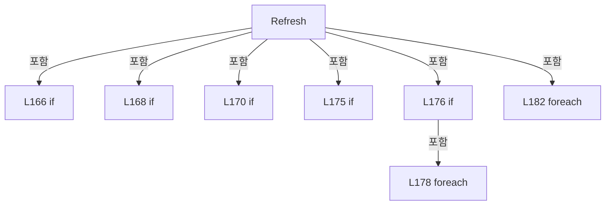

변경 전 점검: 입력/반환 타입, 위 호출자, 예외/취소 경로, 공유 상태와 저장·전송 소비자를 함께 확인합니다. 값의 단위나 물리 방향을 이름만으로 확정하지 않습니다.

### MethodDeclaration `RefreshSimulation` · L190–201

[Drilling.UI/Menu/Menus/CManualPowerStagePanel.cs:190–201](https://github.com/kjuws10-rgb/A3Drilling/blob/5aee8e58439c9b455cae7c9593c9be986c3e682e/Drilling.UI/Menu/Menus/CManualPowerStagePanel.cs#L190-L201)

| 항목 | 실제 추출 값 |
| --- | --- |
| 서명 | void Drilling.UI.Menu.Menus.CManualPowerStagePanel.RefreshSimulation() |
| 접근/수식자 | Private / private |
| 반환/값 타입 | void |
| 소속 타입 | NamedType:Drilling.UI.Menu.Menus.CManualPowerStagePanel |

정적 호출자로 확인된 위치:

| 호출 파일/행 | 호출 표현식 | 런타임 분기 가능 |
| --- | --- | --- |
| [Drilling.UI/Menu/Menus/CManualPowerStagePanel.cs:175–175](https://github.com/kjuws10-rgb/A3Drilling/blob/5aee8e58439c9b455cae7c9593c9be986c3e682e/Drilling.UI/Menu/Menus/CManualPowerStagePanel.cs#L175-L175) | RefreshSimulation | False |
| [Drilling.UI/Menu/Menus/CManualPowerStagePanel.cs:246–246](https://github.com/kjuws10-rgb/A3Drilling/blob/5aee8e58439c9b455cae7c9593c9be986c3e682e/Drilling.UI/Menu/Menus/CManualPowerStagePanel.cs#L246-L246) | RefreshSimulation | False |
| [Drilling.UI/Menu/Menus/CManualPowerStagePanel.cs:256–256](https://github.com/kjuws10-rgb/A3Drilling/blob/5aee8e58439c9b455cae7c9593c9be986c3e682e/Drilling.UI/Menu/Menus/CManualPowerStagePanel.cs#L256-L256) | RefreshSimulation | False |

호출하는 대상과 해석 범위:

| 원본 행 | 표현식 | 분석 상태 | 대상/소스 위치 |
| --- | --- | --- | --- |
| 192 | _animation.Stop | unresolved | None |
| 193 | _simulation.GetSnapshot | resolved | System.Collections.Generic.IReadOnlyList<Drilling.Common.Motion.ST_MANUAL_STAGE_SIMULATION_AXIS> Drilling.Common.Motion.CManualStageMotionSimulation.GetSnapshot() · Drilling.Common/Motion/CMotionManager.cs:1218 |
| 196 | snapshot.Single | resolved | Drilling.Common.Motion.ST_MANUAL_STAGE_SIMULATION_AXIS System.Collections.Generic.IEnumerable<Drilling.Common.Motion.ST_MANUAL_STAGE_SIMULATION_AXIS>.Single<Drilling.Common.Motion.ST_MANUAL_STAGE_SIMULATION_AXIS>(System.Func<Drilling.Common.Motion.ST_MANUAL_STAGE_SIMULATION_AXIS, bool>) |
| 197 | axis.SetFeedback | resolved | void Drilling.UI.Menu.Menus.CManualPowerStageAxis.SetFeedback(string, string, string, string) · Drilling.UI/Menu/Menus/CManualPowerStagePanel.cs:293 |
| 197 | value.Position.ToString | resolved | string double.ToString(string?, System.IFormatProvider?) |
| 197 | value.Speed.ToString | resolved | string double.ToString(string?, System.IFormatProvider?) |
| 200 | snapshot.All | resolved | bool System.Collections.Generic.IEnumerable<Drilling.Common.Motion.ST_MANUAL_STAGE_SIMULATION_AXIS>.All<Drilling.Common.Motion.ST_MANUAL_STAGE_SIMULATION_AXIS>(System.Func<Drilling.Common.Motion.ST_MANUAL_STAGE_SIMULATION_AXIS, bool>) |
| 200 | _animation.Stop | unresolved | None |

본문의 실제 연산·분기·예외·반환 순서(원문 위치 순):

| 원본 행 | 종류 | 주석 해설 |
| --- | --- | --- |
| 192 | call | 함수·델리게이트 또는 객체 생성자를 호출합니다: _animation.Stop() |
| 192 | if | 조건에 따라 분기합니다: if (!IsSimulation) |
| 192 | return | 호출자에게 값 또는 제어를 반환합니다: return; |
| 193 | call | 함수·델리게이트 또는 객체 생성자를 호출합니다: _simulation.GetSnapshot() |
| 193 | local-declaration | 지역 변수를 선언합니다: var snapshot = _simulation.GetSnapshot(); |
| 193 | variable-initializer | 변수의 초기값을 지정합니다: snapshot = _simulation.GetSnapshot() |
| 194 | foreach | 컬렉션 요소를 순회합니다: foreach (var axis in Axes) |
| 196 | call | 함수·델리게이트 또는 객체 생성자를 호출합니다: snapshot.Single(item => item.Axis == axis.Axis) |
| 196 | local-declaration | 지역 변수를 선언합니다: var value = snapshot.Single(item => item.Axis == axis.Axis); |
| 196 | variable-initializer | 변수의 초기값을 지정합니다: value = snapshot.Single(item => item.Axis == axis.Axis) |
| 197 | call | 함수·델리게이트 또는 객체 생성자를 호출합니다: value.Position.ToString("F3", CultureInfo.InvariantCulture) |
| 197 | call | 함수·델리게이트 또는 객체 생성자를 호출합니다: value.Speed.ToString("F3", CultureInfo.InvariantCulture) |
| 197 | call | 함수·델리게이트 또는 객체 생성자를 호출합니다: axis.SetFeedback(value.Position.ToString("F3", CultureInfo.InvariantCulture), value.Speed.ToString("F3", CultureInfo.InvariantCulture), "시뮬레이션 위치 (실장비 값 아님)", "시뮬레이션 속도 (실장비 값 아님)") |
| 200 | call | 함수·델리게이트 또는 객체 생성자를 호출합니다: snapshot.All(axis => axis.Speed == 0) |
| 200 | call | 함수·델리게이트 또는 객체 생성자를 호출합니다: _animation.Stop() |
| 200 | if | 조건에 따라 분기합니다: if (snapshot.All(axis => axis.Speed == 0) && _stageMove?.IsRunning != true) |

제어 구문의 포함 구조(실제 실행 순서/CFG가 아닌 구문 탐색 그림):

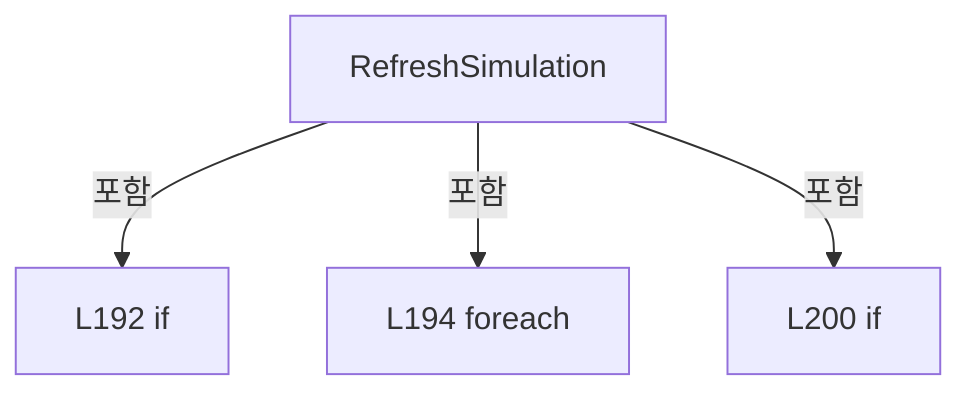

변경 전 점검: 입력/반환 타입, 위 호출자, 예외/취소 경로, 공유 상태와 저장·전송 소비자를 함께 확인합니다. 값의 단위나 물리 방향을 이름만으로 확정하지 않습니다.

### MethodDeclaration `Move` · L203–232

[Drilling.UI/Menu/Menus/CManualPowerStagePanel.cs:203–232](https://github.com/kjuws10-rgb/A3Drilling/blob/5aee8e58439c9b455cae7c9593c9be986c3e682e/Drilling.UI/Menu/Menus/CManualPowerStagePanel.cs#L203-L232)

| 항목 | 실제 추출 값 |
| --- | --- |
| 서명 | System.Threading.Tasks.Task Drilling.UI.Menu.Menus.CManualPowerStagePanel.Move(Drilling.UI.Menu.Menus.CManualPowerStageAxis, bool) |
| 접근/수식자 | Internal / internal, async |
| 반환/값 타입 | System.Threading.Tasks.Task |
| 소속 타입 | NamedType:Drilling.UI.Menu.Menus.CManualPowerStagePanel |

입력 계약:

| 이름 | 타입 | 전달 | 선택/기본값 |
| --- | --- | --- | --- |
| axis | Drilling.UI.Menu.Menus.CManualPowerStageAxis | None | False /  |
| relative | bool | None | False /  |

정적 호출자로 확인된 위치:

| 호출 파일/행 | 호출 표현식 | 런타임 분기 가능 |
| --- | --- | --- |
| [Drilling.UI/Menu/Menus/CManualPowerStagePanel.cs:290–290](https://github.com/kjuws10-rgb/A3Drilling/blob/5aee8e58439c9b455cae7c9593c9be986c3e682e/Drilling.UI/Menu/Menus/CManualPowerStagePanel.cs#L290-L290) | panel.Move | False |
| [Drilling.UI/Menu/Menus/CManualPowerStagePanel.cs:291–291](https://github.com/kjuws10-rgb/A3Drilling/blob/5aee8e58439c9b455cae7c9593c9be986c3e682e/Drilling.UI/Menu/Menus/CManualPowerStagePanel.cs#L291-L291) | panel.Move | False |

호출하는 대상과 해석 범위:

| 원본 행 | 표현식 | 분석 상태 | 대상/소스 위치 |
| --- | --- | --- | --- |
| 205 | .Invoke | resolved · 동적 구현 선택 가능 | bool System.Func<bool>.Invoke() |
| 206 | Refresh | resolved | void Drilling.UI.Menu.Menus.CManualPowerStagePanel.Refresh() · Drilling.UI/Menu/Menus/CManualPowerStagePanel.cs:164 |
| 209 | double.TryParse | resolved | bool double.TryParse(string?, System.Globalization.NumberStyles, System.IFormatProvider?, out double) |
| 209 | double.IsFinite | resolved | bool double.IsFinite(double) |
| 210 | _warn | resolved · 동적 구현 선택 가능 | void System.Action<string>.Invoke(string) |
| 212 | double.TryParse | resolved | bool double.TryParse(string?, System.Globalization.NumberStyles, System.IFormatProvider?, out double) |
| 212 | double.IsFinite | resolved | bool double.IsFinite(double) |
| 213 | _warn | resolved · 동적 구현 선택 가능 | void System.Action<string>.Invoke(string) |
| 215 | UpdateCommands | resolved | void Drilling.UI.Menu.Menus.CManualPowerStagePanel.UpdateCommands() · Drilling.UI/Menu/Menus/CManualPowerStagePanel.cs:260 |
| 217 | _confirm | resolved · 동적 구현 선택 가능 | bool System.Func<string, bool>.Invoke(string) |
| 218 | UpdateCommands | resolved | void Drilling.UI.Menu.Menus.CManualPowerStagePanel.UpdateCommands() · Drilling.UI/Menu/Menus/CManualPowerStagePanel.cs:260 |
| 219 | Refresh | resolved | void Drilling.UI.Menu.Menus.CManualPowerStagePanel.Refresh() · Drilling.UI/Menu/Menus/CManualPowerStagePanel.cs:164 |
| 220 | .Invoke | resolved · 동적 구현 선택 가능 | bool System.Func<bool>.Invoke() |
| 224 | _animation.Start | unresolved | None |
| 225 | _stageMove.Move | resolved | System.Threading.Tasks.Task Drilling.UI.Menu.Menus.CManualStageMoveOperation.Move(Drilling.Common.Motion.EN_MANUAL_STAGE_AXIS, double, bool, double) · Drilling.UI/Menu/Menus/CManualPowerStagePanel.cs:24 |
| 226 | _simulation.Move | resolved | void Drilling.Common.Motion.CManualStageMotionSimulation.Move(Drilling.Common.Motion.EN_MANUAL_STAGE_AXIS, double, bool, double) · Drilling.Common/Motion/CMotionManager.cs:1227 |
| 230 | _warn | resolved · 동적 구현 선택 가능 | void System.Action<string>.Invoke(string) |
| 231 | Refresh | resolved | void Drilling.UI.Menu.Menus.CManualPowerStagePanel.Refresh() · Drilling.UI/Menu/Menus/CManualPowerStagePanel.cs:164 |
| 231 | UpdateCommands | resolved | void Drilling.UI.Menu.Menus.CManualPowerStagePanel.UpdateCommands() · Drilling.UI/Menu/Menus/CManualPowerStagePanel.cs:260 |

본문의 실제 연산·분기·예외·반환 순서(원문 위치 순):

| 원본 행 | 종류 | 주석 해설 |
| --- | --- | --- |
| 205 | call | 함수·델리게이트 또는 객체 생성자를 호출합니다: .Invoke() |
| 205 | if | 조건에 따라 분기합니다: if (MoveAllowed?.Invoke() == false) |
| 205 | return | 호출자에게 값 또는 제어를 반환합니다: return; |
| 206 | call | 함수·델리게이트 또는 객체 생성자를 호출합니다: Refresh() |
| 207 | if | 조건에 따라 분기합니다: if (!CanMove) |
| 207 | return | 호출자에게 값 또는 제어를 반환합니다: return; |
| 208 | conditional-expression | 조건에 따라 결과식을 선택합니다: relative ? axis.Relative : axis.Absolute |
| 208 | local-declaration | 지역 변수를 선언합니다: var text = relative ? axis.Relative : axis.Absolute; |
| 208 | variable-initializer | 변수의 초기값을 지정합니다: text = relative ? axis.Relative : axis.Absolute |
| 209 | call | 함수·델리게이트 또는 객체 생성자를 호출합니다: double.TryParse(text, NumberStyles.Float, CultureInfo.InvariantCulture, out var value) |
| 209 | call | 함수·델리게이트 또는 객체 생성자를 호출합니다: double.IsFinite(value) |
| 209 | if | 조건에 따라 분기합니다: if (!double.TryParse(text, NumberStyles.Float, CultureInfo.InvariantCulture, out var value) &#124;&#124; !double.IsFinite(value)) |
| 210 | call | 함수·델리게이트 또는 객체 생성자를 호출합니다: _warn($"{axis.Name}: 올바른 이동값을 입력해 주세요.") |
| 210 | return | 호출자에게 값 또는 제어를 반환합니다: return; |
| 211 | conditional-expression | 조건에 따라 결과식을 선택합니다: relative ? axis.RelativeSpeed : axis.AbsoluteSpeed |
| 211 | local-declaration | 지역 변수를 선언합니다: var speedText = relative ? axis.RelativeSpeed : axis.AbsoluteSpeed; |
| 211 | variable-initializer | 변수의 초기값을 지정합니다: speedText = relative ? axis.RelativeSpeed : axis.AbsoluteSpeed |
| 212 | call | 함수·델리게이트 또는 객체 생성자를 호출합니다: double.TryParse(speedText, NumberStyles.Float, CultureInfo.InvariantCulture, out var speed) |
| 212 | call | 함수·델리게이트 또는 객체 생성자를 호출합니다: double.IsFinite(speed) |
| 212 | if | 조건에 따라 분기합니다: if (!double.TryParse(speedText, NumberStyles.Float, CultureInfo.InvariantCulture, out var speed) &#124;&#124; !double.IsFinite(speed) &#124;&#124; speed <= 0) |
| 213 | call | 함수·델리게이트 또는 객체 생성자를 호출합니다: _warn($"{axis.Name}: 이동 속도는 0보다 큰 숫자로 입력해 주세요. (mm/sec)") |
| 213 | return | 호출자에게 값 또는 제어를 반환합니다: return; |
| 214 | local-declaration | 지역 변수를 선언합니다: var generation = _generation; |
| 214 | variable-initializer | 변수의 초기값을 지정합니다: generation = _generation |
| 215 | assignment | 값을 대상에 대입합니다: _confirming = true |
| 215 | call | 함수·델리게이트 또는 객체 생성자를 호출합니다: UpdateCommands() |
| 216 | local-declaration | 지역 변수를 선언합니다: bool accepted; |
| 217 | assignment | 값을 대상에 대입합니다: accepted = _confirm($"[{(IsSimulation ? "SIMULATION" : "MELSEC REAL")}] {axis.Name}\n{(relative ? "REL 이동 거리" : "ABS 목표 위치")}: {value:G} mm\n이동 속도: {speed:G} mm/sec\n\n이동하시겠습니까?") |
| 217 | call | 함수·델리게이트 또는 객체 생성자를 호출합니다: _confirm($"[{(IsSimulation ? "SIMULATION" : "MELSEC REAL")}] {axis.Name}\n{(relative ? "REL 이동 거리" : "ABS 목표 위치")}: {value:G} mm\n이동 속도: {speed:G} mm/sec\n\n이동하시겠습니까?") |
| 217 | conditional-expression | 조건에 따라 결과식을 선택합니다: IsSimulation ? "SIMULATION" : "MELSEC REAL" |
| 217 | conditional-expression | 조건에 따라 결과식을 선택합니다: relative ? "REL 이동 거리" : "ABS 목표 위치" |
| 217 | try | 예외 처리 범위입니다: try |
| 218 | assignment | 값을 대상에 대입합니다: _confirming = false |
| 218 | call | 함수·델리게이트 또는 객체 생성자를 호출합니다: UpdateCommands() |
| 218 | finally | 종료 정리 구간입니다: finally |
| 219 | call | 함수·델리게이트 또는 객체 생성자를 호출합니다: Refresh() |
| 220 | call | 함수·델리게이트 또는 객체 생성자를 호출합니다: .Invoke() |
| 220 | if | 조건에 따라 분기합니다: if (!accepted &#124;&#124; !CanMove &#124;&#124; generation != _generation &#124;&#124; MoveAllowed?.Invoke() == false) |
| 220 | return | 호출자에게 값 또는 제어를 반환합니다: return; |
| 221 | try | 예외 처리 범위입니다: try |
| 223 | assignment | 값을 대상에 대입합니다: _motionMessage = "" |
| 224 | call | 함수·델리게이트 또는 객체 생성자를 호출합니다: _animation.Start() |
| 224 | if | 조건에 따라 분기합니다: if (IsSimulation) |
| 225 | await | 비동기 완료를 기다립니다: await _stageMove.Move(axis.Axis, value, relative, speed) |
| 225 | call | 함수·델리게이트 또는 객체 생성자를 호출합니다: _stageMove.Move(axis.Axis, value, relative, speed) |
| 225 | if | 조건에 따라 분기합니다: if (_stageMove is not null) |
| 226 | call | 함수·델리게이트 또는 객체 생성자를 호출합니다: _simulation.Move(axis.Axis, value, relative, speed) |
| 226 | else | 앞 조건이 거짓인 경로입니다: else |
| 227 | assignment | 값을 대상에 대입합니다: _motionMessage = IsSimulation ? "SIMULATION · 이동 완료" : "MELSEC · 이동 완료" |
| 227 | conditional-expression | 조건에 따라 결과식을 선택합니다: IsSimulation ? "SIMULATION · 이동 완료" : "MELSEC · 이동 완료" |
| 229 | assignment | 값을 대상에 대입합니다: _motionMessage = "이동 중지 · 공통 시퀀스 정리 상태를 확인하세요." |
| 229 | catch | 지정 예외를 처리합니다: catch (OperationCanceledException) |
| 230 | assignment | 값을 대상에 대입합니다: _motionMessage = error.Message |
| 230 | call | 함수·델리게이트 또는 객체 생성자를 호출합니다: _warn(error.Message) |
| 230 | catch | 지정 예외를 처리합니다: catch (Exception error) |
| 231 | call | 함수·델리게이트 또는 객체 생성자를 호출합니다: Refresh() |
| 231 | call | 함수·델리게이트 또는 객체 생성자를 호출합니다: UpdateCommands() |
| 231 | finally | 종료 정리 구간입니다: finally |

제어 구문의 포함 구조(실제 실행 순서/CFG가 아닌 구문 탐색 그림):

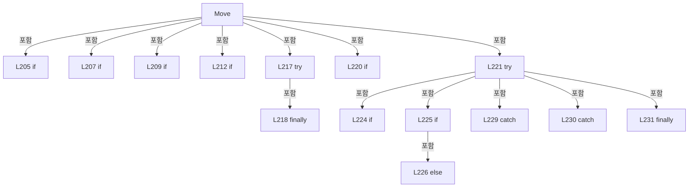

변경 전 점검: 입력/반환 타입, 위 호출자, 예외/취소 경로, 공유 상태와 저장·전송 소비자를 함께 확인합니다. 값의 단위나 물리 방향을 이름만으로 확정하지 않습니다.

### MethodDeclaration `StartJog` · L234–248

[Drilling.UI/Menu/Menus/CManualPowerStagePanel.cs:234–248](https://github.com/kjuws10-rgb/A3Drilling/blob/5aee8e58439c9b455cae7c9593c9be986c3e682e/Drilling.UI/Menu/Menus/CManualPowerStagePanel.cs#L234-L248)

| 항목 | 실제 추출 값 |
| --- | --- |
| 서명 | bool Drilling.UI.Menu.Menus.CManualPowerStagePanel.StartJog(string) |
| 접근/수식자 | Public / public |
| 반환/값 타입 | bool |
| 소속 타입 | NamedType:Drilling.UI.Menu.Menus.CManualPowerStagePanel |

입력 계약:

| 이름 | 타입 | 전달 | 선택/기본값 |
| --- | --- | --- | --- |
| direction | string | None | False /  |

현재 부분 분석에서 직접 연결된 호출자는 없습니다. XAML/이벤트/인터페이스·델리게이트·외부 진입을 추가 확인해야 하며, 미사용으로 판정한 것이 아닙니다.

호출하는 대상과 해석 범위:

| 원본 행 | 표현식 | 분석 상태 | 대상/소스 위치 |
| --- | --- | --- | --- |
| 236 | .Invoke | resolved · 동적 구현 선택 가능 | bool System.Func<bool>.Invoke() |
| 237 | Refresh | resolved | void Drilling.UI.Menu.Menus.CManualPowerStagePanel.Refresh() · Drilling.UI/Menu/Menus/CManualPowerStagePanel.cs:164 |
| 246 | _simulation.StartJog | resolved | void Drilling.Common.Motion.CManualStageMotionSimulation.StartJog(Drilling.Common.Motion.EN_MANUAL_STAGE_AXIS, int) · Drilling.Common/Motion/CMotionManager.cs:1252 |
| 246 | _animation.Start | unresolved | None |
| 246 | RefreshSimulation | resolved | void Drilling.UI.Menu.Menus.CManualPowerStagePanel.RefreshSimulation() · Drilling.UI/Menu/Menus/CManualPowerStagePanel.cs:190 |
| 247 | _warn | resolved · 동적 구현 선택 가능 | void System.Action<string>.Invoke(string) |

본문의 실제 연산·분기·예외·반환 순서(원문 위치 순):

| 원본 행 | 종류 | 주석 해설 |
| --- | --- | --- |
| 236 | call | 함수·델리게이트 또는 객체 생성자를 호출합니다: .Invoke() |
| 236 | if | 조건에 따라 분기합니다: if (MoveAllowed?.Invoke() == false) |
| 236 | return | 호출자에게 값 또는 제어를 반환합니다: return false; |
| 237 | call | 함수·델리게이트 또는 객체 생성자를 호출합니다: Refresh() |
| 238 | if | 조건에 따라 분기합니다: if (!CanJog) |
| 238 | return | 호출자에게 값 또는 제어를 반환합니다: return false; |
| 239 | local-declaration | 지역 변수를 선언합니다: var target = direction switch { "Y+" => (EN_MANUAL_STAGE_AXIS.StageY, 1), "Y-" => (EN_MANUAL_STAGE_AXIS.StageY, -1), "X-" => (EN_MANUAL_STAGE_AXIS.ReviewX, -1), "X+" => (EN_MANUAL_STAGE_AXIS.ReviewX, 1), _ => (EN_MANUAL_STAGE_AXIS |
| 239 | switch-expression | 값별 결과식을 선택합니다: direction switch { "Y+" => (EN_MANUAL_STAGE_AXIS.StageY, 1), "Y-" => (EN_MANUAL_STAGE_AXIS.StageY, -1), "X-" => (EN_MANUAL_STAGE_AXIS.ReviewX, -1), "X+" => (EN_MANUAL_STAGE_AXIS.ReviewX, 1), _ => (EN_MANUAL_STAGE_AXIS.StageY, 0) } |
| 239 | variable-initializer | 변수의 초기값을 지정합니다: target = direction switch { "Y+" => (EN_MANUAL_STAGE_AXIS.StageY, 1), "Y-" => (EN_MANUAL_STAGE_AXIS.StageY, -1), "X-" => (EN_MANUAL_STAGE_AXIS.ReviewX, -1), "X+" => (EN_MANUAL_STAGE_AXIS.ReviewX, 1), _ => (EN_MANUAL_STAGE_AXIS.Sta |
| 245 | if | 조건에 따라 분기합니다: if (target.Item2 == 0) |
| 245 | return | 호출자에게 값 또는 제어를 반환합니다: return false; |
| 246 | call | 함수·델리게이트 또는 객체 생성자를 호출합니다: _simulation.StartJog(target.Item1, target.Item2) |
| 246 | call | 함수·델리게이트 또는 객체 생성자를 호출합니다: _animation.Start() |
| 246 | call | 함수·델리게이트 또는 객체 생성자를 호출합니다: RefreshSimulation() |
| 246 | return | 호출자에게 값 또는 제어를 반환합니다: return true; |
| 246 | try | 예외 처리 범위입니다: try |
| 247 | call | 함수·델리게이트 또는 객체 생성자를 호출합니다: _warn(error.Message) |
| 247 | catch | 지정 예외를 처리합니다: catch (InvalidOperationException error) |
| 247 | return | 호출자에게 값 또는 제어를 반환합니다: return false; |

제어 구문의 포함 구조(실제 실행 순서/CFG가 아닌 구문 탐색 그림):

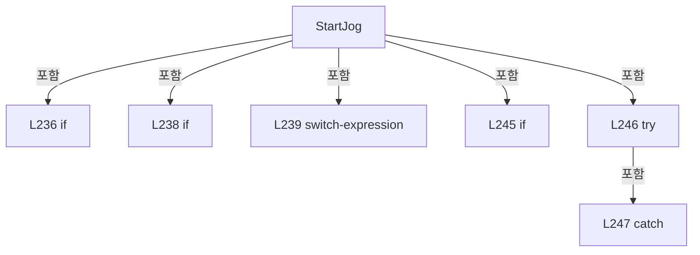

변경 전 점검: 입력/반환 타입, 위 호출자, 예외/취소 경로, 공유 상태와 저장·전송 소비자를 함께 확인합니다. 값의 단위나 물리 방향을 이름만으로 확정하지 않습니다.

### MethodDeclaration `Stop` · L250–258

[Drilling.UI/Menu/Menus/CManualPowerStagePanel.cs:250–258](https://github.com/kjuws10-rgb/A3Drilling/blob/5aee8e58439c9b455cae7c9593c9be986c3e682e/Drilling.UI/Menu/Menus/CManualPowerStagePanel.cs#L250-L258)

| 항목 | 실제 추출 값 |
| --- | --- |
| 서명 | void Drilling.UI.Menu.Menus.CManualPowerStagePanel.Stop(bool) |
| 접근/수식자 | Public / public |
| 반환/값 타입 | void |
| 소속 타입 | NamedType:Drilling.UI.Menu.Menus.CManualPowerStagePanel |

입력 계약:

| 이름 | 타입 | 전달 | 선택/기본값 |
| --- | --- | --- | --- |
| includeSharedMove | bool | None | True / false |

정적 호출자로 확인된 위치:

| 호출 파일/행 | 호출 표현식 | 런타임 분기 가능 |
| --- | --- | --- |
| [Drilling.UI/Menu/Menus/CManualPowerStagePanel.cs:126–126](https://github.com/kjuws10-rgb/A3Drilling/blob/5aee8e58439c9b455cae7c9593c9be986c3e682e/Drilling.UI/Menu/Menus/CManualPowerStagePanel.cs#L126-L126) | Stop | False |
| [Drilling.UI/Menu/Menus/CManualPowerStagePanel.cs:160–160](https://github.com/kjuws10-rgb/A3Drilling/blob/5aee8e58439c9b455cae7c9593c9be986c3e682e/Drilling.UI/Menu/Menus/CManualPowerStagePanel.cs#L160-L160) | Stop | False |
| [Drilling.UI/Menu/Menus/CManualPowerStagePanel.cs:172–172](https://github.com/kjuws10-rgb/A3Drilling/blob/5aee8e58439c9b455cae7c9593c9be986c3e682e/Drilling.UI/Menu/Menus/CManualPowerStagePanel.cs#L172-L172) | Stop | False |
| [Drilling.UI/Menu/Menus/CMenuManual.cs:444–444](https://github.com/kjuws10-rgb/A3Drilling/blob/5aee8e58439c9b455cae7c9593c9be986c3e682e/Drilling.UI/Menu/Menus/CMenuManual.cs#L444-L444) | .StageMotion.Stop | False |
| [Drilling.UI/Menu/Menus/CMenuManual.cs:6360–6360](https://github.com/kjuws10-rgb/A3Drilling/blob/5aee8e58439c9b455cae7c9593c9be986c3e682e/Drilling.UI/Menu/Menus/CMenuManual.cs#L6360-L6360) | .StageMotion.Stop | False |
| [Drilling.UI/Views/CManualPowerStageView.xaml.cs:92–92](https://github.com/kjuws10-rgb/A3Drilling/blob/5aee8e58439c9b455cae7c9593c9be986c3e682e/Drilling.UI/Views/CManualPowerStageView.xaml.cs#L92-L92) | .Stop | False |

호출하는 대상과 해석 범위:

| 원본 행 | 표현식 | 분석 상태 | 대상/소스 위치 |
| --- | --- | --- | --- |
| 253 | .Stop | resolved | void Drilling.UI.Menu.Menus.CManualStageMoveOperation.Stop(bool) · Drilling.UI/Menu/Menus/CManualPowerStagePanel.cs:62 |
| 254 | _simulation.Stop | resolved | void Drilling.Common.Motion.CManualStageMotionSimulation.Stop() · Drilling.Common/Motion/CMotionManager.cs:1272 |
| 255 | _animation.Stop | unresolved | None |
| 256 | RefreshSimulation | resolved | void Drilling.UI.Menu.Menus.CManualPowerStagePanel.RefreshSimulation() · Drilling.UI/Menu/Menus/CManualPowerStagePanel.cs:190 |
| 257 | UpdateCommands | resolved | void Drilling.UI.Menu.Menus.CManualPowerStagePanel.UpdateCommands() · Drilling.UI/Menu/Menus/CManualPowerStagePanel.cs:260 |

본문의 실제 연산·분기·예외·반환 순서(원문 위치 순):

| 원본 행 | 종류 | 주석 해설 |
| --- | --- | --- |
| 253 | call | 함수·델리게이트 또는 객체 생성자를 호출합니다: .Stop(includeSharedMove) |
| 254 | call | 함수·델리게이트 또는 객체 생성자를 호출합니다: _simulation.Stop() |
| 254 | if | 조건에 따라 분기합니다: if (_stageMove?.IsRunning != true && !_simulation.IsReserved) |
| 255 | call | 함수·델리게이트 또는 객체 생성자를 호출합니다: _animation.Stop() |
| 256 | call | 함수·델리게이트 또는 객체 생성자를 호출합니다: RefreshSimulation() |
| 256 | if | 조건에 따라 분기합니다: if (IsSimulation) |
| 257 | call | 함수·델리게이트 또는 객체 생성자를 호출합니다: UpdateCommands() |

제어 구문의 포함 구조(실제 실행 순서/CFG가 아닌 구문 탐색 그림):

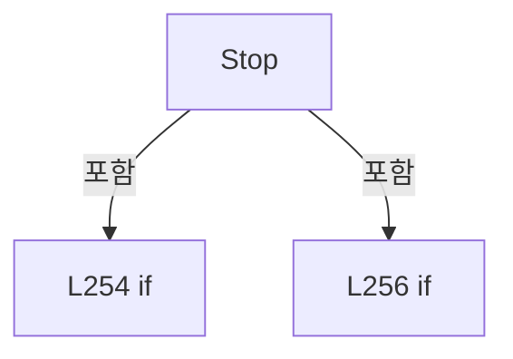

변경 전 점검: 입력/반환 타입, 위 호출자, 예외/취소 경로, 공유 상태와 저장·전송 소비자를 함께 확인합니다. 값의 단위나 물리 방향을 이름만으로 확정하지 않습니다.

### MethodDeclaration `UpdateCommands` · L260–265

[Drilling.UI/Menu/Menus/CManualPowerStagePanel.cs:260–265](https://github.com/kjuws10-rgb/A3Drilling/blob/5aee8e58439c9b455cae7c9593c9be986c3e682e/Drilling.UI/Menu/Menus/CManualPowerStagePanel.cs#L260-L265)

| 항목 | 실제 추출 값 |
| --- | --- |
| 서명 | void Drilling.UI.Menu.Menus.CManualPowerStagePanel.UpdateCommands() |
| 접근/수식자 | Private / private |
| 반환/값 타입 | void |
| 소속 타입 | NamedType:Drilling.UI.Menu.Menus.CManualPowerStagePanel |

정적 호출자로 확인된 위치:

| 호출 파일/행 | 호출 표현식 | 런타임 분기 가능 |
| --- | --- | --- |
| [Drilling.UI/Menu/Menus/CManualPowerStagePanel.cs:153–153](https://github.com/kjuws10-rgb/A3Drilling/blob/5aee8e58439c9b455cae7c9593c9be986c3e682e/Drilling.UI/Menu/Menus/CManualPowerStagePanel.cs#L153-L153) | UpdateCommands | False |
| [Drilling.UI/Menu/Menus/CManualPowerStagePanel.cs:161–161](https://github.com/kjuws10-rgb/A3Drilling/blob/5aee8e58439c9b455cae7c9593c9be986c3e682e/Drilling.UI/Menu/Menus/CManualPowerStagePanel.cs#L161-L161) | UpdateCommands | False |
| [Drilling.UI/Menu/Menus/CManualPowerStagePanel.cs:167–167](https://github.com/kjuws10-rgb/A3Drilling/blob/5aee8e58439c9b455cae7c9593c9be986c3e682e/Drilling.UI/Menu/Menus/CManualPowerStagePanel.cs#L167-L167) | UpdateCommands | False |
| [Drilling.UI/Menu/Menus/CManualPowerStagePanel.cs:168–168](https://github.com/kjuws10-rgb/A3Drilling/blob/5aee8e58439c9b455cae7c9593c9be986c3e682e/Drilling.UI/Menu/Menus/CManualPowerStagePanel.cs#L168-L168) | UpdateCommands | False |
| [Drilling.UI/Menu/Menus/CManualPowerStagePanel.cs:173–173](https://github.com/kjuws10-rgb/A3Drilling/blob/5aee8e58439c9b455cae7c9593c9be986c3e682e/Drilling.UI/Menu/Menus/CManualPowerStagePanel.cs#L173-L173) | UpdateCommands | False |
| [Drilling.UI/Menu/Menus/CManualPowerStagePanel.cs:215–215](https://github.com/kjuws10-rgb/A3Drilling/blob/5aee8e58439c9b455cae7c9593c9be986c3e682e/Drilling.UI/Menu/Menus/CManualPowerStagePanel.cs#L215-L215) | UpdateCommands | False |
| [Drilling.UI/Menu/Menus/CManualPowerStagePanel.cs:218–218](https://github.com/kjuws10-rgb/A3Drilling/blob/5aee8e58439c9b455cae7c9593c9be986c3e682e/Drilling.UI/Menu/Menus/CManualPowerStagePanel.cs#L218-L218) | UpdateCommands | False |
| [Drilling.UI/Menu/Menus/CManualPowerStagePanel.cs:231–231](https://github.com/kjuws10-rgb/A3Drilling/blob/5aee8e58439c9b455cae7c9593c9be986c3e682e/Drilling.UI/Menu/Menus/CManualPowerStagePanel.cs#L231-L231) | UpdateCommands | False |
| [Drilling.UI/Menu/Menus/CManualPowerStagePanel.cs:257–257](https://github.com/kjuws10-rgb/A3Drilling/blob/5aee8e58439c9b455cae7c9593c9be986c3e682e/Drilling.UI/Menu/Menus/CManualPowerStagePanel.cs#L257-L257) | UpdateCommands | False |

호출하는 대상과 해석 범위:

| 원본 행 | 표현식 | 분석 상태 | 대상/소스 위치 |
| --- | --- | --- | --- |
| 262 | Notify | resolved | void Drilling.UI.Menu.Menus.CManualPowerStagePanel.Notify(string?) · Drilling.UI/Menu/Menus/CManualPowerStagePanel.cs:266 |
| 262 | nameof | unresolved | None |
| 262 | Notify | resolved | void Drilling.UI.Menu.Menus.CManualPowerStagePanel.Notify(string?) · Drilling.UI/Menu/Menus/CManualPowerStagePanel.cs:266 |
| 262 | nameof | unresolved | None |
| 262 | Notify | resolved | void Drilling.UI.Menu.Menus.CManualPowerStagePanel.Notify(string?) · Drilling.UI/Menu/Menus/CManualPowerStagePanel.cs:266 |
| 262 | nameof | unresolved | None |
| 262 | Notify | resolved | void Drilling.UI.Menu.Menus.CManualPowerStagePanel.Notify(string?) · Drilling.UI/Menu/Menus/CManualPowerStagePanel.cs:266 |
| 262 | nameof | unresolved | None |
| 262 | Notify | resolved | void Drilling.UI.Menu.Menus.CManualPowerStagePanel.Notify(string?) · Drilling.UI/Menu/Menus/CManualPowerStagePanel.cs:266 |
| 262 | nameof | unresolved | None |
| 263 | axis.AbsoluteCommand.NotifyCanExecuteChanged | resolved | void Drilling.UI.Menu.CButtonCommand.NotifyCanExecuteChanged() · Drilling.UI/Menu/CButtonCommand.cs:24 |
| 263 | axis.RelativeCommand.NotifyCanExecuteChanged | resolved | void Drilling.UI.Menu.CButtonCommand.NotifyCanExecuteChanged() · Drilling.UI/Menu/CButtonCommand.cs:24 |
| 264 | StopCommand.NotifyCanExecuteChanged | resolved | void Drilling.UI.Menu.CButtonCommand.NotifyCanExecuteChanged() · Drilling.UI/Menu/CButtonCommand.cs:24 |

본문의 실제 연산·분기·예외·반환 순서(원문 위치 순):

| 원본 행 | 종류 | 주석 해설 |
| --- | --- | --- |
| 262 | call | 함수·델리게이트 또는 객체 생성자를 호출합니다: Notify(nameof(CanMove)) |
| 262 | call | 함수·델리게이트 또는 객체 생성자를 호출합니다: nameof(CanMove) |
| 262 | call | 함수·델리게이트 또는 객체 생성자를 호출합니다: Notify(nameof(CanJog)) |
| 262 | call | 함수·델리게이트 또는 객체 생성자를 호출합니다: nameof(CanJog) |
| 262 | call | 함수·델리게이트 또는 객체 생성자를 호출합니다: Notify(nameof(CanStop)) |
| 262 | call | 함수·델리게이트 또는 객체 생성자를 호출합니다: nameof(CanStop) |
| 262 | call | 함수·델리게이트 또는 객체 생성자를 호출합니다: Notify(nameof(CanEdit)) |
| 262 | call | 함수·델리게이트 또는 객체 생성자를 호출합니다: nameof(CanEdit) |
| 262 | call | 함수·델리게이트 또는 객체 생성자를 호출합니다: Notify(nameof(StatusText)) |
| 262 | call | 함수·델리게이트 또는 객체 생성자를 호출합니다: nameof(StatusText) |
| 263 | call | 함수·델리게이트 또는 객체 생성자를 호출합니다: axis.AbsoluteCommand.NotifyCanExecuteChanged() |
| 263 | call | 함수·델리게이트 또는 객체 생성자를 호출합니다: axis.RelativeCommand.NotifyCanExecuteChanged() |
| 263 | foreach | 컬렉션 요소를 순회합니다: foreach (var axis in Axes) |
| 264 | call | 함수·델리게이트 또는 객체 생성자를 호출합니다: StopCommand.NotifyCanExecuteChanged() |

제어 구문의 포함 구조(실제 실행 순서/CFG가 아닌 구문 탐색 그림):

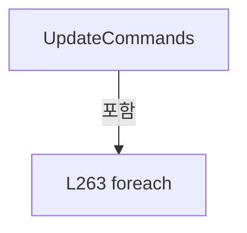

변경 전 점검: 입력/반환 타입, 위 호출자, 예외/취소 경로, 공유 상태와 저장·전송 소비자를 함께 확인합니다. 값의 단위나 물리 방향을 이름만으로 확정하지 않습니다.

### MethodDeclaration `Notify` · L266–266

[Drilling.UI/Menu/Menus/CManualPowerStagePanel.cs:266–266](https://github.com/kjuws10-rgb/A3Drilling/blob/5aee8e58439c9b455cae7c9593c9be986c3e682e/Drilling.UI/Menu/Menus/CManualPowerStagePanel.cs#L266-L266)

| 항목 | 실제 추출 값 |
| --- | --- |
| 서명 | void Drilling.UI.Menu.Menus.CManualPowerStagePanel.Notify(string?) |
| 접근/수식자 | Private / private |
| 반환/값 타입 | void |
| 소속 타입 | NamedType:Drilling.UI.Menu.Menus.CManualPowerStagePanel |

입력 계약:

| 이름 | 타입 | 전달 | 선택/기본값 |
| --- | --- | --- | --- |
| name | string? | None | True / null |

정적 호출자로 확인된 위치:

| 호출 파일/행 | 호출 표현식 | 런타임 분기 가능 |
| --- | --- | --- |
| [Drilling.UI/Menu/Menus/CManualPowerStagePanel.cs:173–173](https://github.com/kjuws10-rgb/A3Drilling/blob/5aee8e58439c9b455cae7c9593c9be986c3e682e/Drilling.UI/Menu/Menus/CManualPowerStagePanel.cs#L173-L173) | Notify | False |
| [Drilling.UI/Menu/Menus/CManualPowerStagePanel.cs:173–173](https://github.com/kjuws10-rgb/A3Drilling/blob/5aee8e58439c9b455cae7c9593c9be986c3e682e/Drilling.UI/Menu/Menus/CManualPowerStagePanel.cs#L173-L173) | Notify | False |
| [Drilling.UI/Menu/Menus/CManualPowerStagePanel.cs:173–173](https://github.com/kjuws10-rgb/A3Drilling/blob/5aee8e58439c9b455cae7c9593c9be986c3e682e/Drilling.UI/Menu/Menus/CManualPowerStagePanel.cs#L173-L173) | Notify | False |
| [Drilling.UI/Menu/Menus/CManualPowerStagePanel.cs:262–262](https://github.com/kjuws10-rgb/A3Drilling/blob/5aee8e58439c9b455cae7c9593c9be986c3e682e/Drilling.UI/Menu/Menus/CManualPowerStagePanel.cs#L262-L262) | Notify | False |
| [Drilling.UI/Menu/Menus/CManualPowerStagePanel.cs:262–262](https://github.com/kjuws10-rgb/A3Drilling/blob/5aee8e58439c9b455cae7c9593c9be986c3e682e/Drilling.UI/Menu/Menus/CManualPowerStagePanel.cs#L262-L262) | Notify | False |
| [Drilling.UI/Menu/Menus/CManualPowerStagePanel.cs:262–262](https://github.com/kjuws10-rgb/A3Drilling/blob/5aee8e58439c9b455cae7c9593c9be986c3e682e/Drilling.UI/Menu/Menus/CManualPowerStagePanel.cs#L262-L262) | Notify | False |
| [Drilling.UI/Menu/Menus/CManualPowerStagePanel.cs:262–262](https://github.com/kjuws10-rgb/A3Drilling/blob/5aee8e58439c9b455cae7c9593c9be986c3e682e/Drilling.UI/Menu/Menus/CManualPowerStagePanel.cs#L262-L262) | Notify | False |
| [Drilling.UI/Menu/Menus/CManualPowerStagePanel.cs:262–262](https://github.com/kjuws10-rgb/A3Drilling/blob/5aee8e58439c9b455cae7c9593c9be986c3e682e/Drilling.UI/Menu/Menus/CManualPowerStagePanel.cs#L262-L262) | Notify | False |

호출하는 대상과 해석 범위:

| 원본 행 | 표현식 | 분석 상태 | 대상/소스 위치 |
| --- | --- | --- | --- |
| 266 | .Invoke | resolved · 동적 구현 선택 가능 | void System.ComponentModel.PropertyChangedEventHandler.Invoke(object?, System.ComponentModel.PropertyChangedEventArgs) |
| 266 | new | resolved | System.ComponentModel.PropertyChangedEventArgs.PropertyChangedEventArgs(string?) |

본문의 실제 연산·분기·예외·반환 순서(원문 위치 순):

| 원본 행 | 종류 | 주석 해설 |
| --- | --- | --- |
| 266 | call | 함수·델리게이트 또는 객체 생성자를 호출합니다: .Invoke(this, new(name)) |
| 266 | call | 함수·델리게이트 또는 객체 생성자를 호출합니다: new(name) |

변경 전 점검: 입력/반환 타입, 위 호출자, 예외/취소 경로, 공유 상태와 저장·전송 소비자를 함께 확인합니다. 값의 단위나 물리 방향을 이름만으로 확정하지 않습니다.

### FieldDeclaration `_absolute` · L271–271

[Drilling.UI/Menu/Menus/CManualPowerStagePanel.cs:271–271](https://github.com/kjuws10-rgb/A3Drilling/blob/5aee8e58439c9b455cae7c9593c9be986c3e682e/Drilling.UI/Menu/Menus/CManualPowerStagePanel.cs#L271-L271)

| 항목 | 실제 추출 값 |
| --- | --- |
| 서명 | string Drilling.UI.Menu.Menus.CManualPowerStageAxis._absolute |
| 접근/수식자 | Private / private |
| 반환/값 타입 | string |
| 소속 타입 | NamedType:Drilling.UI.Menu.Menus.CManualPowerStageAxis |

현재 부분 분석에서 직접 연결된 호출자는 없습니다. XAML/이벤트/인터페이스·델리게이트·외부 진입을 추가 확인해야 하며, 미사용으로 판정한 것이 아닙니다.

본문의 실제 연산·분기·예외·반환 순서(원문 위치 순):

| 원본 행 | 종류 | 주석 해설 |
| --- | --- | --- |
| 271 | variable-initializer | 변수의 초기값을 지정합니다: _absolute = "0.000" |
| 271 | variable-initializer | 변수의 초기값을 지정합니다: _relative = "0.000" |

변경 전 점검: 입력/반환 타입, 위 호출자, 예외/취소 경로, 공유 상태와 저장·전송 소비자를 함께 확인합니다. 값의 단위나 물리 방향을 이름만으로 확정하지 않습니다.

### FieldDeclaration `_relative` · L271–271

[Drilling.UI/Menu/Menus/CManualPowerStagePanel.cs:271–271](https://github.com/kjuws10-rgb/A3Drilling/blob/5aee8e58439c9b455cae7c9593c9be986c3e682e/Drilling.UI/Menu/Menus/CManualPowerStagePanel.cs#L271-L271)

| 항목 | 실제 추출 값 |
| --- | --- |
| 서명 | string Drilling.UI.Menu.Menus.CManualPowerStageAxis._relative |
| 접근/수식자 | Private / private |
| 반환/값 타입 | string |
| 소속 타입 | NamedType:Drilling.UI.Menu.Menus.CManualPowerStageAxis |

현재 부분 분석에서 직접 연결된 호출자는 없습니다. XAML/이벤트/인터페이스·델리게이트·외부 진입을 추가 확인해야 하며, 미사용으로 판정한 것이 아닙니다.

변경 전 점검: 입력/반환 타입, 위 호출자, 예외/취소 경로, 공유 상태와 저장·전송 소비자를 함께 확인합니다. 값의 단위나 물리 방향을 이름만으로 확정하지 않습니다.

### FieldDeclaration `_absoluteSpeed` · L272–272

[Drilling.UI/Menu/Menus/CManualPowerStagePanel.cs:272–272](https://github.com/kjuws10-rgb/A3Drilling/blob/5aee8e58439c9b455cae7c9593c9be986c3e682e/Drilling.UI/Menu/Menus/CManualPowerStagePanel.cs#L272-L272)

| 항목 | 실제 추출 값 |
| --- | --- |
| 서명 | string Drilling.UI.Menu.Menus.CManualPowerStageAxis._absoluteSpeed |
| 접근/수식자 | Private / private |
| 반환/값 타입 | string |
| 소속 타입 | NamedType:Drilling.UI.Menu.Menus.CManualPowerStageAxis |

현재 부분 분석에서 직접 연결된 호출자는 없습니다. XAML/이벤트/인터페이스·델리게이트·외부 진입을 추가 확인해야 하며, 미사용으로 판정한 것이 아닙니다.

본문의 실제 연산·분기·예외·반환 순서(원문 위치 순):

| 원본 행 | 종류 | 주석 해설 |
| --- | --- | --- |
| 272 | variable-initializer | 변수의 초기값을 지정합니다: _absoluteSpeed = "5.000" |
| 272 | variable-initializer | 변수의 초기값을 지정합니다: _relativeSpeed = "5.000" |

변경 전 점검: 입력/반환 타입, 위 호출자, 예외/취소 경로, 공유 상태와 저장·전송 소비자를 함께 확인합니다. 값의 단위나 물리 방향을 이름만으로 확정하지 않습니다.

### FieldDeclaration `_relativeSpeed` · L272–272

[Drilling.UI/Menu/Menus/CManualPowerStagePanel.cs:272–272](https://github.com/kjuws10-rgb/A3Drilling/blob/5aee8e58439c9b455cae7c9593c9be986c3e682e/Drilling.UI/Menu/Menus/CManualPowerStagePanel.cs#L272-L272)

| 항목 | 실제 추출 값 |
| --- | --- |
| 서명 | string Drilling.UI.Menu.Menus.CManualPowerStageAxis._relativeSpeed |
| 접근/수식자 | Private / private |
| 반환/값 타입 | string |
| 소속 타입 | NamedType:Drilling.UI.Menu.Menus.CManualPowerStageAxis |

현재 부분 분석에서 직접 연결된 호출자는 없습니다. XAML/이벤트/인터페이스·델리게이트·외부 진입을 추가 확인해야 하며, 미사용으로 판정한 것이 아닙니다.

변경 전 점검: 입력/반환 타입, 위 호출자, 예외/취소 경로, 공유 상태와 저장·전송 소비자를 함께 확인합니다. 값의 단위나 물리 방향을 이름만으로 확정하지 않습니다.

### EventFieldDeclaration `PropertyChanged` · L273–273

[Drilling.UI/Menu/Menus/CManualPowerStagePanel.cs:273–273](https://github.com/kjuws10-rgb/A3Drilling/blob/5aee8e58439c9b455cae7c9593c9be986c3e682e/Drilling.UI/Menu/Menus/CManualPowerStagePanel.cs#L273-L273)

| 항목 | 실제 추출 값 |
| --- | --- |
| 서명 | System.ComponentModel.PropertyChangedEventHandler? Drilling.UI.Menu.Menus.CManualPowerStageAxis.PropertyChanged |
| 접근/수식자 | Public / public, event |
| 반환/값 타입 | System.ComponentModel.PropertyChangedEventHandler? |
| 소속 타입 | NamedType:Drilling.UI.Menu.Menus.CManualPowerStageAxis |

현재 부분 분석에서 직접 연결된 호출자는 없습니다. XAML/이벤트/인터페이스·델리게이트·외부 진입을 추가 확인해야 하며, 미사용으로 판정한 것이 아닙니다.

변경 전 점검: 입력/반환 타입, 위 호출자, 예외/취소 경로, 공유 상태와 저장·전송 소비자를 함께 확인합니다. 값의 단위나 물리 방향을 이름만으로 확정하지 않습니다.

### PropertyDeclaration `Axis` · L274–274

[Drilling.UI/Menu/Menus/CManualPowerStagePanel.cs:274–274](https://github.com/kjuws10-rgb/A3Drilling/blob/5aee8e58439c9b455cae7c9593c9be986c3e682e/Drilling.UI/Menu/Menus/CManualPowerStagePanel.cs#L274-L274)

| 항목 | 실제 추출 값 |
| --- | --- |
| 서명 | Drilling.Common.Motion.EN_MANUAL_STAGE_AXIS Drilling.UI.Menu.Menus.CManualPowerStageAxis.Axis |
| 접근/수식자 | Public / public |
| 반환/값 타입 | Drilling.Common.Motion.EN_MANUAL_STAGE_AXIS |
| 소속 타입 | NamedType:Drilling.UI.Menu.Menus.CManualPowerStageAxis |

현재 부분 분석에서 직접 연결된 호출자는 없습니다. XAML/이벤트/인터페이스·델리게이트·외부 진입을 추가 확인해야 하며, 미사용으로 판정한 것이 아닙니다.

변경 전 점검: 입력/반환 타입, 위 호출자, 예외/취소 경로, 공유 상태와 저장·전송 소비자를 함께 확인합니다. 값의 단위나 물리 방향을 이름만으로 확정하지 않습니다.

### GetAccessorDeclaration `get_Axis` · L274–274

[Drilling.UI/Menu/Menus/CManualPowerStagePanel.cs:274–274](https://github.com/kjuws10-rgb/A3Drilling/blob/5aee8e58439c9b455cae7c9593c9be986c3e682e/Drilling.UI/Menu/Menus/CManualPowerStagePanel.cs#L274-L274)

| 항목 | 실제 추출 값 |
| --- | --- |
| 서명 | Drilling.Common.Motion.EN_MANUAL_STAGE_AXIS Drilling.UI.Menu.Menus.CManualPowerStageAxis.Axis.get |
| 접근/수식자 | Public / get |
| 반환/값 타입 | Drilling.Common.Motion.EN_MANUAL_STAGE_AXIS |
| 소속 타입 | NamedType:Drilling.UI.Menu.Menus.CManualPowerStageAxis |

현재 부분 분석에서 직접 연결된 호출자는 없습니다. XAML/이벤트/인터페이스·델리게이트·외부 진입을 추가 확인해야 하며, 미사용으로 판정한 것이 아닙니다.

변경 전 점검: 입력/반환 타입, 위 호출자, 예외/취소 경로, 공유 상태와 저장·전송 소비자를 함께 확인합니다. 값의 단위나 물리 방향을 이름만으로 확정하지 않습니다.

### PropertyDeclaration `Name` · L275–275

[Drilling.UI/Menu/Menus/CManualPowerStagePanel.cs:275–275](https://github.com/kjuws10-rgb/A3Drilling/blob/5aee8e58439c9b455cae7c9593c9be986c3e682e/Drilling.UI/Menu/Menus/CManualPowerStagePanel.cs#L275-L275)

| 항목 | 실제 추출 값 |
| --- | --- |
| 서명 | string Drilling.UI.Menu.Menus.CManualPowerStageAxis.Name |
| 접근/수식자 | Public / public |
| 반환/값 타입 | string |
| 소속 타입 | NamedType:Drilling.UI.Menu.Menus.CManualPowerStageAxis |

현재 부분 분석에서 직접 연결된 호출자는 없습니다. XAML/이벤트/인터페이스·델리게이트·외부 진입을 추가 확인해야 하며, 미사용으로 판정한 것이 아닙니다.

변경 전 점검: 입력/반환 타입, 위 호출자, 예외/취소 경로, 공유 상태와 저장·전송 소비자를 함께 확인합니다. 값의 단위나 물리 방향을 이름만으로 확정하지 않습니다.

### GetAccessorDeclaration `get_Name` · L275–275

[Drilling.UI/Menu/Menus/CManualPowerStagePanel.cs:275–275](https://github.com/kjuws10-rgb/A3Drilling/blob/5aee8e58439c9b455cae7c9593c9be986c3e682e/Drilling.UI/Menu/Menus/CManualPowerStagePanel.cs#L275-L275)

| 항목 | 실제 추출 값 |
| --- | --- |
| 서명 | string Drilling.UI.Menu.Menus.CManualPowerStageAxis.Name.get |
| 접근/수식자 | Public / get |
| 반환/값 타입 | string |
| 소속 타입 | NamedType:Drilling.UI.Menu.Menus.CManualPowerStageAxis |

현재 부분 분석에서 직접 연결된 호출자는 없습니다. XAML/이벤트/인터페이스·델리게이트·외부 진입을 추가 확인해야 하며, 미사용으로 판정한 것이 아닙니다.

변경 전 점검: 입력/반환 타입, 위 호출자, 예외/취소 경로, 공유 상태와 저장·전송 소비자를 함께 확인합니다. 값의 단위나 물리 방향을 이름만으로 확정하지 않습니다.

### PropertyDeclaration `SnapshotName` · L276–276

[Drilling.UI/Menu/Menus/CManualPowerStagePanel.cs:276–276](https://github.com/kjuws10-rgb/A3Drilling/blob/5aee8e58439c9b455cae7c9593c9be986c3e682e/Drilling.UI/Menu/Menus/CManualPowerStagePanel.cs#L276-L276)

| 항목 | 실제 추출 값 |
| --- | --- |
| 서명 | string Drilling.UI.Menu.Menus.CManualPowerStageAxis.SnapshotName |
| 접근/수식자 | Internal / internal |
| 반환/값 타입 | string |
| 소속 타입 | NamedType:Drilling.UI.Menu.Menus.CManualPowerStageAxis |

현재 부분 분석에서 직접 연결된 호출자는 없습니다. XAML/이벤트/인터페이스·델리게이트·외부 진입을 추가 확인해야 하며, 미사용으로 판정한 것이 아닙니다.

변경 전 점검: 입력/반환 타입, 위 호출자, 예외/취소 경로, 공유 상태와 저장·전송 소비자를 함께 확인합니다. 값의 단위나 물리 방향을 이름만으로 확정하지 않습니다.

### GetAccessorDeclaration `get_SnapshotName` · L276–276

[Drilling.UI/Menu/Menus/CManualPowerStagePanel.cs:276–276](https://github.com/kjuws10-rgb/A3Drilling/blob/5aee8e58439c9b455cae7c9593c9be986c3e682e/Drilling.UI/Menu/Menus/CManualPowerStagePanel.cs#L276-L276)

| 항목 | 실제 추출 값 |
| --- | --- |
| 서명 | string Drilling.UI.Menu.Menus.CManualPowerStageAxis.SnapshotName.get |
| 접근/수식자 | Internal / get |
| 반환/값 타입 | string |
| 소속 타입 | NamedType:Drilling.UI.Menu.Menus.CManualPowerStageAxis |

현재 부분 분석에서 직접 연결된 호출자는 없습니다. XAML/이벤트/인터페이스·델리게이트·외부 진입을 추가 확인해야 하며, 미사용으로 판정한 것이 아닙니다.

변경 전 점검: 입력/반환 타입, 위 호출자, 예외/취소 경로, 공유 상태와 저장·전송 소비자를 함께 확인합니다. 값의 단위나 물리 방향을 이름만으로 확정하지 않습니다.

### PropertyDeclaration `Absolute` · L277–277

[Drilling.UI/Menu/Menus/CManualPowerStagePanel.cs:277–277](https://github.com/kjuws10-rgb/A3Drilling/blob/5aee8e58439c9b455cae7c9593c9be986c3e682e/Drilling.UI/Menu/Menus/CManualPowerStagePanel.cs#L277-L277)

| 항목 | 실제 추출 값 |
| --- | --- |
| 서명 | string Drilling.UI.Menu.Menus.CManualPowerStageAxis.Absolute |
| 접근/수식자 | Public / public |
| 반환/값 타입 | string |
| 소속 타입 | NamedType:Drilling.UI.Menu.Menus.CManualPowerStageAxis |

현재 부분 분석에서 직접 연결된 호출자는 없습니다. XAML/이벤트/인터페이스·델리게이트·외부 진입을 추가 확인해야 하며, 미사용으로 판정한 것이 아닙니다.

변경 전 점검: 입력/반환 타입, 위 호출자, 예외/취소 경로, 공유 상태와 저장·전송 소비자를 함께 확인합니다. 값의 단위나 물리 방향을 이름만으로 확정하지 않습니다.

### GetAccessorDeclaration `get_Absolute` · L277–277

[Drilling.UI/Menu/Menus/CManualPowerStagePanel.cs:277–277](https://github.com/kjuws10-rgb/A3Drilling/blob/5aee8e58439c9b455cae7c9593c9be986c3e682e/Drilling.UI/Menu/Menus/CManualPowerStagePanel.cs#L277-L277)

| 항목 | 실제 추출 값 |
| --- | --- |
| 서명 | string Drilling.UI.Menu.Menus.CManualPowerStageAxis.Absolute.get |
| 접근/수식자 | Public / get |
| 반환/값 타입 | string |
| 소속 타입 | NamedType:Drilling.UI.Menu.Menus.CManualPowerStageAxis |

현재 부분 분석에서 직접 연결된 호출자는 없습니다. XAML/이벤트/인터페이스·델리게이트·외부 진입을 추가 확인해야 하며, 미사용으로 판정한 것이 아닙니다.

변경 전 점검: 입력/반환 타입, 위 호출자, 예외/취소 경로, 공유 상태와 저장·전송 소비자를 함께 확인합니다. 값의 단위나 물리 방향을 이름만으로 확정하지 않습니다.

### SetAccessorDeclaration `set_Absolute` · L277–277

[Drilling.UI/Menu/Menus/CManualPowerStagePanel.cs:277–277](https://github.com/kjuws10-rgb/A3Drilling/blob/5aee8e58439c9b455cae7c9593c9be986c3e682e/Drilling.UI/Menu/Menus/CManualPowerStagePanel.cs#L277-L277)

| 항목 | 실제 추출 값 |
| --- | --- |
| 서명 | void Drilling.UI.Menu.Menus.CManualPowerStageAxis.Absolute.set |
| 접근/수식자 | Public / set |
| 반환/값 타입 | void |
| 소속 타입 | NamedType:Drilling.UI.Menu.Menus.CManualPowerStageAxis |

입력 계약:

| 이름 | 타입 | 전달 | 선택/기본값 |
| --- | --- | --- | --- |
| value | string | None | False /  |

현재 부분 분석에서 직접 연결된 호출자는 없습니다. XAML/이벤트/인터페이스·델리게이트·외부 진입을 추가 확인해야 하며, 미사용으로 판정한 것이 아닙니다.

호출하는 대상과 해석 범위:

| 원본 행 | 표현식 | 분석 상태 | 대상/소스 위치 |
| --- | --- | --- | --- |
| 277 | Notify | resolved | void Drilling.UI.Menu.Menus.CManualPowerStageAxis.Notify(string?) · Drilling.UI/Menu/Menus/CManualPowerStagePanel.cs:299 |

본문의 실제 연산·분기·예외·반환 순서(원문 위치 순):

| 원본 행 | 종류 | 주석 해설 |
| --- | --- | --- |
| 277 | assignment | 값을 대상에 대입합니다: _absolute = value |
| 277 | call | 함수·델리게이트 또는 객체 생성자를 호출합니다: Notify() |

변경 전 점검: 입력/반환 타입, 위 호출자, 예외/취소 경로, 공유 상태와 저장·전송 소비자를 함께 확인합니다. 값의 단위나 물리 방향을 이름만으로 확정하지 않습니다.

### PropertyDeclaration `Relative` · L278–278

[Drilling.UI/Menu/Menus/CManualPowerStagePanel.cs:278–278](https://github.com/kjuws10-rgb/A3Drilling/blob/5aee8e58439c9b455cae7c9593c9be986c3e682e/Drilling.UI/Menu/Menus/CManualPowerStagePanel.cs#L278-L278)

| 항목 | 실제 추출 값 |
| --- | --- |
| 서명 | string Drilling.UI.Menu.Menus.CManualPowerStageAxis.Relative |
| 접근/수식자 | Public / public |
| 반환/값 타입 | string |
| 소속 타입 | NamedType:Drilling.UI.Menu.Menus.CManualPowerStageAxis |

현재 부분 분석에서 직접 연결된 호출자는 없습니다. XAML/이벤트/인터페이스·델리게이트·외부 진입을 추가 확인해야 하며, 미사용으로 판정한 것이 아닙니다.

변경 전 점검: 입력/반환 타입, 위 호출자, 예외/취소 경로, 공유 상태와 저장·전송 소비자를 함께 확인합니다. 값의 단위나 물리 방향을 이름만으로 확정하지 않습니다.

### GetAccessorDeclaration `get_Relative` · L278–278

[Drilling.UI/Menu/Menus/CManualPowerStagePanel.cs:278–278](https://github.com/kjuws10-rgb/A3Drilling/blob/5aee8e58439c9b455cae7c9593c9be986c3e682e/Drilling.UI/Menu/Menus/CManualPowerStagePanel.cs#L278-L278)

| 항목 | 실제 추출 값 |
| --- | --- |
| 서명 | string Drilling.UI.Menu.Menus.CManualPowerStageAxis.Relative.get |
| 접근/수식자 | Public / get |
| 반환/값 타입 | string |
| 소속 타입 | NamedType:Drilling.UI.Menu.Menus.CManualPowerStageAxis |

현재 부분 분석에서 직접 연결된 호출자는 없습니다. XAML/이벤트/인터페이스·델리게이트·외부 진입을 추가 확인해야 하며, 미사용으로 판정한 것이 아닙니다.

변경 전 점검: 입력/반환 타입, 위 호출자, 예외/취소 경로, 공유 상태와 저장·전송 소비자를 함께 확인합니다. 값의 단위나 물리 방향을 이름만으로 확정하지 않습니다.

### SetAccessorDeclaration `set_Relative` · L278–278

[Drilling.UI/Menu/Menus/CManualPowerStagePanel.cs:278–278](https://github.com/kjuws10-rgb/A3Drilling/blob/5aee8e58439c9b455cae7c9593c9be986c3e682e/Drilling.UI/Menu/Menus/CManualPowerStagePanel.cs#L278-L278)

| 항목 | 실제 추출 값 |
| --- | --- |
| 서명 | void Drilling.UI.Menu.Menus.CManualPowerStageAxis.Relative.set |
| 접근/수식자 | Public / set |
| 반환/값 타입 | void |
| 소속 타입 | NamedType:Drilling.UI.Menu.Menus.CManualPowerStageAxis |

입력 계약:

| 이름 | 타입 | 전달 | 선택/기본값 |
| --- | --- | --- | --- |
| value | string | None | False /  |

현재 부분 분석에서 직접 연결된 호출자는 없습니다. XAML/이벤트/인터페이스·델리게이트·외부 진입을 추가 확인해야 하며, 미사용으로 판정한 것이 아닙니다.

호출하는 대상과 해석 범위:

| 원본 행 | 표현식 | 분석 상태 | 대상/소스 위치 |
| --- | --- | --- | --- |
| 278 | Notify | resolved | void Drilling.UI.Menu.Menus.CManualPowerStageAxis.Notify(string?) · Drilling.UI/Menu/Menus/CManualPowerStagePanel.cs:299 |

본문의 실제 연산·분기·예외·반환 순서(원문 위치 순):

| 원본 행 | 종류 | 주석 해설 |
| --- | --- | --- |
| 278 | assignment | 값을 대상에 대입합니다: _relative = value |
| 278 | call | 함수·델리게이트 또는 객체 생성자를 호출합니다: Notify() |

변경 전 점검: 입력/반환 타입, 위 호출자, 예외/취소 경로, 공유 상태와 저장·전송 소비자를 함께 확인합니다. 값의 단위나 물리 방향을 이름만으로 확정하지 않습니다.

### PropertyDeclaration `AbsoluteSpeed` · L279–279

[Drilling.UI/Menu/Menus/CManualPowerStagePanel.cs:279–279](https://github.com/kjuws10-rgb/A3Drilling/blob/5aee8e58439c9b455cae7c9593c9be986c3e682e/Drilling.UI/Menu/Menus/CManualPowerStagePanel.cs#L279-L279)

| 항목 | 실제 추출 값 |
| --- | --- |
| 서명 | string Drilling.UI.Menu.Menus.CManualPowerStageAxis.AbsoluteSpeed |
| 접근/수식자 | Public / public |
| 반환/값 타입 | string |
| 소속 타입 | NamedType:Drilling.UI.Menu.Menus.CManualPowerStageAxis |

현재 부분 분석에서 직접 연결된 호출자는 없습니다. XAML/이벤트/인터페이스·델리게이트·외부 진입을 추가 확인해야 하며, 미사용으로 판정한 것이 아닙니다.

변경 전 점검: 입력/반환 타입, 위 호출자, 예외/취소 경로, 공유 상태와 저장·전송 소비자를 함께 확인합니다. 값의 단위나 물리 방향을 이름만으로 확정하지 않습니다.

### GetAccessorDeclaration `get_AbsoluteSpeed` · L279–279

[Drilling.UI/Menu/Menus/CManualPowerStagePanel.cs:279–279](https://github.com/kjuws10-rgb/A3Drilling/blob/5aee8e58439c9b455cae7c9593c9be986c3e682e/Drilling.UI/Menu/Menus/CManualPowerStagePanel.cs#L279-L279)

| 항목 | 실제 추출 값 |
| --- | --- |
| 서명 | string Drilling.UI.Menu.Menus.CManualPowerStageAxis.AbsoluteSpeed.get |
| 접근/수식자 | Public / get |
| 반환/값 타입 | string |
| 소속 타입 | NamedType:Drilling.UI.Menu.Menus.CManualPowerStageAxis |

현재 부분 분석에서 직접 연결된 호출자는 없습니다. XAML/이벤트/인터페이스·델리게이트·외부 진입을 추가 확인해야 하며, 미사용으로 판정한 것이 아닙니다.

변경 전 점검: 입력/반환 타입, 위 호출자, 예외/취소 경로, 공유 상태와 저장·전송 소비자를 함께 확인합니다. 값의 단위나 물리 방향을 이름만으로 확정하지 않습니다.

### SetAccessorDeclaration `set_AbsoluteSpeed` · L279–279

[Drilling.UI/Menu/Menus/CManualPowerStagePanel.cs:279–279](https://github.com/kjuws10-rgb/A3Drilling/blob/5aee8e58439c9b455cae7c9593c9be986c3e682e/Drilling.UI/Menu/Menus/CManualPowerStagePanel.cs#L279-L279)

| 항목 | 실제 추출 값 |
| --- | --- |
| 서명 | void Drilling.UI.Menu.Menus.CManualPowerStageAxis.AbsoluteSpeed.set |
| 접근/수식자 | Public / set |
| 반환/값 타입 | void |
| 소속 타입 | NamedType:Drilling.UI.Menu.Menus.CManualPowerStageAxis |

입력 계약:

| 이름 | 타입 | 전달 | 선택/기본값 |
| --- | --- | --- | --- |
| value | string | None | False /  |

현재 부분 분석에서 직접 연결된 호출자는 없습니다. XAML/이벤트/인터페이스·델리게이트·외부 진입을 추가 확인해야 하며, 미사용으로 판정한 것이 아닙니다.

호출하는 대상과 해석 범위:

| 원본 행 | 표현식 | 분석 상태 | 대상/소스 위치 |
| --- | --- | --- | --- |
| 279 | Notify | resolved | void Drilling.UI.Menu.Menus.CManualPowerStageAxis.Notify(string?) · Drilling.UI/Menu/Menus/CManualPowerStagePanel.cs:299 |

본문의 실제 연산·분기·예외·반환 순서(원문 위치 순):

| 원본 행 | 종류 | 주석 해설 |
| --- | --- | --- |
| 279 | assignment | 값을 대상에 대입합니다: _absoluteSpeed = value |
| 279 | call | 함수·델리게이트 또는 객체 생성자를 호출합니다: Notify() |

변경 전 점검: 입력/반환 타입, 위 호출자, 예외/취소 경로, 공유 상태와 저장·전송 소비자를 함께 확인합니다. 값의 단위나 물리 방향을 이름만으로 확정하지 않습니다.

### PropertyDeclaration `RelativeSpeed` · L280–280

[Drilling.UI/Menu/Menus/CManualPowerStagePanel.cs:280–280](https://github.com/kjuws10-rgb/A3Drilling/blob/5aee8e58439c9b455cae7c9593c9be986c3e682e/Drilling.UI/Menu/Menus/CManualPowerStagePanel.cs#L280-L280)

| 항목 | 실제 추출 값 |
| --- | --- |
| 서명 | string Drilling.UI.Menu.Menus.CManualPowerStageAxis.RelativeSpeed |
| 접근/수식자 | Public / public |
| 반환/값 타입 | string |
| 소속 타입 | NamedType:Drilling.UI.Menu.Menus.CManualPowerStageAxis |

현재 부분 분석에서 직접 연결된 호출자는 없습니다. XAML/이벤트/인터페이스·델리게이트·외부 진입을 추가 확인해야 하며, 미사용으로 판정한 것이 아닙니다.

변경 전 점검: 입력/반환 타입, 위 호출자, 예외/취소 경로, 공유 상태와 저장·전송 소비자를 함께 확인합니다. 값의 단위나 물리 방향을 이름만으로 확정하지 않습니다.

### GetAccessorDeclaration `get_RelativeSpeed` · L280–280

[Drilling.UI/Menu/Menus/CManualPowerStagePanel.cs:280–280](https://github.com/kjuws10-rgb/A3Drilling/blob/5aee8e58439c9b455cae7c9593c9be986c3e682e/Drilling.UI/Menu/Menus/CManualPowerStagePanel.cs#L280-L280)

| 항목 | 실제 추출 값 |
| --- | --- |
| 서명 | string Drilling.UI.Menu.Menus.CManualPowerStageAxis.RelativeSpeed.get |
| 접근/수식자 | Public / get |
| 반환/값 타입 | string |
| 소속 타입 | NamedType:Drilling.UI.Menu.Menus.CManualPowerStageAxis |

현재 부분 분석에서 직접 연결된 호출자는 없습니다. XAML/이벤트/인터페이스·델리게이트·외부 진입을 추가 확인해야 하며, 미사용으로 판정한 것이 아닙니다.

변경 전 점검: 입력/반환 타입, 위 호출자, 예외/취소 경로, 공유 상태와 저장·전송 소비자를 함께 확인합니다. 값의 단위나 물리 방향을 이름만으로 확정하지 않습니다.

### SetAccessorDeclaration `set_RelativeSpeed` · L280–280

[Drilling.UI/Menu/Menus/CManualPowerStagePanel.cs:280–280](https://github.com/kjuws10-rgb/A3Drilling/blob/5aee8e58439c9b455cae7c9593c9be986c3e682e/Drilling.UI/Menu/Menus/CManualPowerStagePanel.cs#L280-L280)

| 항목 | 실제 추출 값 |
| --- | --- |
| 서명 | void Drilling.UI.Menu.Menus.CManualPowerStageAxis.RelativeSpeed.set |
| 접근/수식자 | Public / set |
| 반환/값 타입 | void |
| 소속 타입 | NamedType:Drilling.UI.Menu.Menus.CManualPowerStageAxis |

입력 계약:

| 이름 | 타입 | 전달 | 선택/기본값 |
| --- | --- | --- | --- |
| value | string | None | False /  |

현재 부분 분석에서 직접 연결된 호출자는 없습니다. XAML/이벤트/인터페이스·델리게이트·외부 진입을 추가 확인해야 하며, 미사용으로 판정한 것이 아닙니다.

호출하는 대상과 해석 범위:

| 원본 행 | 표현식 | 분석 상태 | 대상/소스 위치 |
| --- | --- | --- | --- |
| 280 | Notify | resolved | void Drilling.UI.Menu.Menus.CManualPowerStageAxis.Notify(string?) · Drilling.UI/Menu/Menus/CManualPowerStagePanel.cs:299 |

본문의 실제 연산·분기·예외·반환 순서(원문 위치 순):

| 원본 행 | 종류 | 주석 해설 |
| --- | --- | --- |
| 280 | assignment | 값을 대상에 대입합니다: _relativeSpeed = value |
| 280 | call | 함수·델리게이트 또는 객체 생성자를 호출합니다: Notify() |

변경 전 점검: 입력/반환 타입, 위 호출자, 예외/취소 경로, 공유 상태와 저장·전송 소비자를 함께 확인합니다. 값의 단위나 물리 방향을 이름만으로 확정하지 않습니다.

### PropertyDeclaration `Position` · L281–281

[Drilling.UI/Menu/Menus/CManualPowerStagePanel.cs:281–281](https://github.com/kjuws10-rgb/A3Drilling/blob/5aee8e58439c9b455cae7c9593c9be986c3e682e/Drilling.UI/Menu/Menus/CManualPowerStagePanel.cs#L281-L281)

| 항목 | 실제 추출 값 |
| --- | --- |
| 서명 | string Drilling.UI.Menu.Menus.CManualPowerStageAxis.Position |
| 접근/수식자 | Public / public |
| 반환/값 타입 | string |
| 소속 타입 | NamedType:Drilling.UI.Menu.Menus.CManualPowerStageAxis |

현재 부분 분석에서 직접 연결된 호출자는 없습니다. XAML/이벤트/인터페이스·델리게이트·외부 진입을 추가 확인해야 하며, 미사용으로 판정한 것이 아닙니다.

변경 전 점검: 입력/반환 타입, 위 호출자, 예외/취소 경로, 공유 상태와 저장·전송 소비자를 함께 확인합니다. 값의 단위나 물리 방향을 이름만으로 확정하지 않습니다.

### GetAccessorDeclaration `get_Position` · L281–281

[Drilling.UI/Menu/Menus/CManualPowerStagePanel.cs:281–281](https://github.com/kjuws10-rgb/A3Drilling/blob/5aee8e58439c9b455cae7c9593c9be986c3e682e/Drilling.UI/Menu/Menus/CManualPowerStagePanel.cs#L281-L281)

| 항목 | 실제 추출 값 |
| --- | --- |
| 서명 | string Drilling.UI.Menu.Menus.CManualPowerStageAxis.Position.get |
| 접근/수식자 | Public / get |
| 반환/값 타입 | string |
| 소속 타입 | NamedType:Drilling.UI.Menu.Menus.CManualPowerStageAxis |

현재 부분 분석에서 직접 연결된 호출자는 없습니다. XAML/이벤트/인터페이스·델리게이트·외부 진입을 추가 확인해야 하며, 미사용으로 판정한 것이 아닙니다.

변경 전 점검: 입력/반환 타입, 위 호출자, 예외/취소 경로, 공유 상태와 저장·전송 소비자를 함께 확인합니다. 값의 단위나 물리 방향을 이름만으로 확정하지 않습니다.

### SetAccessorDeclaration `set_Position` · L281–281

[Drilling.UI/Menu/Menus/CManualPowerStagePanel.cs:281–281](https://github.com/kjuws10-rgb/A3Drilling/blob/5aee8e58439c9b455cae7c9593c9be986c3e682e/Drilling.UI/Menu/Menus/CManualPowerStagePanel.cs#L281-L281)

| 항목 | 실제 추출 값 |
| --- | --- |
| 서명 | void Drilling.UI.Menu.Menus.CManualPowerStageAxis.Position.set |
| 접근/수식자 | Private / private, set |
| 반환/값 타입 | void |
| 소속 타입 | NamedType:Drilling.UI.Menu.Menus.CManualPowerStageAxis |

입력 계약:

| 이름 | 타입 | 전달 | 선택/기본값 |
| --- | --- | --- | --- |
| value | string | None | False /  |

현재 부분 분석에서 직접 연결된 호출자는 없습니다. XAML/이벤트/인터페이스·델리게이트·외부 진입을 추가 확인해야 하며, 미사용으로 판정한 것이 아닙니다.

변경 전 점검: 입력/반환 타입, 위 호출자, 예외/취소 경로, 공유 상태와 저장·전송 소비자를 함께 확인합니다. 값의 단위나 물리 방향을 이름만으로 확정하지 않습니다.

### PropertyDeclaration `Speed` · L282–282

[Drilling.UI/Menu/Menus/CManualPowerStagePanel.cs:282–282](https://github.com/kjuws10-rgb/A3Drilling/blob/5aee8e58439c9b455cae7c9593c9be986c3e682e/Drilling.UI/Menu/Menus/CManualPowerStagePanel.cs#L282-L282)

| 항목 | 실제 추출 값 |
| --- | --- |
| 서명 | string Drilling.UI.Menu.Menus.CManualPowerStageAxis.Speed |
| 접근/수식자 | Public / public |
| 반환/값 타입 | string |
| 소속 타입 | NamedType:Drilling.UI.Menu.Menus.CManualPowerStageAxis |

현재 부분 분석에서 직접 연결된 호출자는 없습니다. XAML/이벤트/인터페이스·델리게이트·외부 진입을 추가 확인해야 하며, 미사용으로 판정한 것이 아닙니다.

변경 전 점검: 입력/반환 타입, 위 호출자, 예외/취소 경로, 공유 상태와 저장·전송 소비자를 함께 확인합니다. 값의 단위나 물리 방향을 이름만으로 확정하지 않습니다.

### GetAccessorDeclaration `get_Speed` · L282–282

[Drilling.UI/Menu/Menus/CManualPowerStagePanel.cs:282–282](https://github.com/kjuws10-rgb/A3Drilling/blob/5aee8e58439c9b455cae7c9593c9be986c3e682e/Drilling.UI/Menu/Menus/CManualPowerStagePanel.cs#L282-L282)

| 항목 | 실제 추출 값 |
| --- | --- |
| 서명 | string Drilling.UI.Menu.Menus.CManualPowerStageAxis.Speed.get |
| 접근/수식자 | Public / get |
| 반환/값 타입 | string |
| 소속 타입 | NamedType:Drilling.UI.Menu.Menus.CManualPowerStageAxis |

현재 부분 분석에서 직접 연결된 호출자는 없습니다. XAML/이벤트/인터페이스·델리게이트·외부 진입을 추가 확인해야 하며, 미사용으로 판정한 것이 아닙니다.

변경 전 점검: 입력/반환 타입, 위 호출자, 예외/취소 경로, 공유 상태와 저장·전송 소비자를 함께 확인합니다. 값의 단위나 물리 방향을 이름만으로 확정하지 않습니다.

### SetAccessorDeclaration `set_Speed` · L282–282

[Drilling.UI/Menu/Menus/CManualPowerStagePanel.cs:282–282](https://github.com/kjuws10-rgb/A3Drilling/blob/5aee8e58439c9b455cae7c9593c9be986c3e682e/Drilling.UI/Menu/Menus/CManualPowerStagePanel.cs#L282-L282)

| 항목 | 실제 추출 값 |
| --- | --- |
| 서명 | void Drilling.UI.Menu.Menus.CManualPowerStageAxis.Speed.set |
| 접근/수식자 | Private / private, set |
| 반환/값 타입 | void |
| 소속 타입 | NamedType:Drilling.UI.Menu.Menus.CManualPowerStageAxis |

입력 계약:

| 이름 | 타입 | 전달 | 선택/기본값 |
| --- | --- | --- | --- |
| value | string | None | False /  |

현재 부분 분석에서 직접 연결된 호출자는 없습니다. XAML/이벤트/인터페이스·델리게이트·외부 진입을 추가 확인해야 하며, 미사용으로 판정한 것이 아닙니다.

변경 전 점검: 입력/반환 타입, 위 호출자, 예외/취소 경로, 공유 상태와 저장·전송 소비자를 함께 확인합니다. 값의 단위나 물리 방향을 이름만으로 확정하지 않습니다.

### PropertyDeclaration `PositionMessage` · L283–283

[Drilling.UI/Menu/Menus/CManualPowerStagePanel.cs:283–283](https://github.com/kjuws10-rgb/A3Drilling/blob/5aee8e58439c9b455cae7c9593c9be986c3e682e/Drilling.UI/Menu/Menus/CManualPowerStagePanel.cs#L283-L283)

| 항목 | 실제 추출 값 |
| --- | --- |
| 서명 | string Drilling.UI.Menu.Menus.CManualPowerStageAxis.PositionMessage |
| 접근/수식자 | Public / public |
| 반환/값 타입 | string |
| 소속 타입 | NamedType:Drilling.UI.Menu.Menus.CManualPowerStageAxis |

현재 부분 분석에서 직접 연결된 호출자는 없습니다. XAML/이벤트/인터페이스·델리게이트·외부 진입을 추가 확인해야 하며, 미사용으로 판정한 것이 아닙니다.

변경 전 점검: 입력/반환 타입, 위 호출자, 예외/취소 경로, 공유 상태와 저장·전송 소비자를 함께 확인합니다. 값의 단위나 물리 방향을 이름만으로 확정하지 않습니다.

### GetAccessorDeclaration `get_PositionMessage` · L283–283

[Drilling.UI/Menu/Menus/CManualPowerStagePanel.cs:283–283](https://github.com/kjuws10-rgb/A3Drilling/blob/5aee8e58439c9b455cae7c9593c9be986c3e682e/Drilling.UI/Menu/Menus/CManualPowerStagePanel.cs#L283-L283)

| 항목 | 실제 추출 값 |
| --- | --- |
| 서명 | string Drilling.UI.Menu.Menus.CManualPowerStageAxis.PositionMessage.get |
| 접근/수식자 | Public / get |
| 반환/값 타입 | string |
| 소속 타입 | NamedType:Drilling.UI.Menu.Menus.CManualPowerStageAxis |

현재 부분 분석에서 직접 연결된 호출자는 없습니다. XAML/이벤트/인터페이스·델리게이트·외부 진입을 추가 확인해야 하며, 미사용으로 판정한 것이 아닙니다.

변경 전 점검: 입력/반환 타입, 위 호출자, 예외/취소 경로, 공유 상태와 저장·전송 소비자를 함께 확인합니다. 값의 단위나 물리 방향을 이름만으로 확정하지 않습니다.

### SetAccessorDeclaration `set_PositionMessage` · L283–283

[Drilling.UI/Menu/Menus/CManualPowerStagePanel.cs:283–283](https://github.com/kjuws10-rgb/A3Drilling/blob/5aee8e58439c9b455cae7c9593c9be986c3e682e/Drilling.UI/Menu/Menus/CManualPowerStagePanel.cs#L283-L283)

| 항목 | 실제 추출 값 |
| --- | --- |
| 서명 | void Drilling.UI.Menu.Menus.CManualPowerStageAxis.PositionMessage.set |
| 접근/수식자 | Private / private, set |
| 반환/값 타입 | void |
| 소속 타입 | NamedType:Drilling.UI.Menu.Menus.CManualPowerStageAxis |

입력 계약:

| 이름 | 타입 | 전달 | 선택/기본값 |
| --- | --- | --- | --- |
| value | string | None | False /  |

현재 부분 분석에서 직접 연결된 호출자는 없습니다. XAML/이벤트/인터페이스·델리게이트·외부 진입을 추가 확인해야 하며, 미사용으로 판정한 것이 아닙니다.

변경 전 점검: 입력/반환 타입, 위 호출자, 예외/취소 경로, 공유 상태와 저장·전송 소비자를 함께 확인합니다. 값의 단위나 물리 방향을 이름만으로 확정하지 않습니다.

### PropertyDeclaration `SpeedMessage` · L284–284

[Drilling.UI/Menu/Menus/CManualPowerStagePanel.cs:284–284](https://github.com/kjuws10-rgb/A3Drilling/blob/5aee8e58439c9b455cae7c9593c9be986c3e682e/Drilling.UI/Menu/Menus/CManualPowerStagePanel.cs#L284-L284)

| 항목 | 실제 추출 값 |
| --- | --- |
| 서명 | string Drilling.UI.Menu.Menus.CManualPowerStageAxis.SpeedMessage |
| 접근/수식자 | Public / public |
| 반환/값 타입 | string |
| 소속 타입 | NamedType:Drilling.UI.Menu.Menus.CManualPowerStageAxis |

현재 부분 분석에서 직접 연결된 호출자는 없습니다. XAML/이벤트/인터페이스·델리게이트·외부 진입을 추가 확인해야 하며, 미사용으로 판정한 것이 아닙니다.

변경 전 점검: 입력/반환 타입, 위 호출자, 예외/취소 경로, 공유 상태와 저장·전송 소비자를 함께 확인합니다. 값의 단위나 물리 방향을 이름만으로 확정하지 않습니다.

### GetAccessorDeclaration `get_SpeedMessage` · L284–284

[Drilling.UI/Menu/Menus/CManualPowerStagePanel.cs:284–284](https://github.com/kjuws10-rgb/A3Drilling/blob/5aee8e58439c9b455cae7c9593c9be986c3e682e/Drilling.UI/Menu/Menus/CManualPowerStagePanel.cs#L284-L284)

| 항목 | 실제 추출 값 |
| --- | --- |
| 서명 | string Drilling.UI.Menu.Menus.CManualPowerStageAxis.SpeedMessage.get |
| 접근/수식자 | Public / get |
| 반환/값 타입 | string |
| 소속 타입 | NamedType:Drilling.UI.Menu.Menus.CManualPowerStageAxis |

현재 부분 분석에서 직접 연결된 호출자는 없습니다. XAML/이벤트/인터페이스·델리게이트·외부 진입을 추가 확인해야 하며, 미사용으로 판정한 것이 아닙니다.

변경 전 점검: 입력/반환 타입, 위 호출자, 예외/취소 경로, 공유 상태와 저장·전송 소비자를 함께 확인합니다. 값의 단위나 물리 방향을 이름만으로 확정하지 않습니다.

### SetAccessorDeclaration `set_SpeedMessage` · L284–284

[Drilling.UI/Menu/Menus/CManualPowerStagePanel.cs:284–284](https://github.com/kjuws10-rgb/A3Drilling/blob/5aee8e58439c9b455cae7c9593c9be986c3e682e/Drilling.UI/Menu/Menus/CManualPowerStagePanel.cs#L284-L284)

| 항목 | 실제 추출 값 |
| --- | --- |
| 서명 | void Drilling.UI.Menu.Menus.CManualPowerStageAxis.SpeedMessage.set |
| 접근/수식자 | Private / private, set |
| 반환/값 타입 | void |
| 소속 타입 | NamedType:Drilling.UI.Menu.Menus.CManualPowerStageAxis |

입력 계약:

| 이름 | 타입 | 전달 | 선택/기본값 |
| --- | --- | --- | --- |
| value | string | None | False /  |

현재 부분 분석에서 직접 연결된 호출자는 없습니다. XAML/이벤트/인터페이스·델리게이트·외부 진입을 추가 확인해야 하며, 미사용으로 판정한 것이 아닙니다.

변경 전 점검: 입력/반환 타입, 위 호출자, 예외/취소 경로, 공유 상태와 저장·전송 소비자를 함께 확인합니다. 값의 단위나 물리 방향을 이름만으로 확정하지 않습니다.

### PropertyDeclaration `AbsoluteCommand` · L285–285

[Drilling.UI/Menu/Menus/CManualPowerStagePanel.cs:285–285](https://github.com/kjuws10-rgb/A3Drilling/blob/5aee8e58439c9b455cae7c9593c9be986c3e682e/Drilling.UI/Menu/Menus/CManualPowerStagePanel.cs#L285-L285)

| 항목 | 실제 추출 값 |
| --- | --- |
| 서명 | Drilling.UI.Menu.CButtonCommand Drilling.UI.Menu.Menus.CManualPowerStageAxis.AbsoluteCommand |
| 접근/수식자 | Public / public |
| 반환/값 타입 | Drilling.UI.Menu.CButtonCommand |
| 소속 타입 | NamedType:Drilling.UI.Menu.Menus.CManualPowerStageAxis |

현재 부분 분석에서 직접 연결된 호출자는 없습니다. XAML/이벤트/인터페이스·델리게이트·외부 진입을 추가 확인해야 하며, 미사용으로 판정한 것이 아닙니다.

변경 전 점검: 입력/반환 타입, 위 호출자, 예외/취소 경로, 공유 상태와 저장·전송 소비자를 함께 확인합니다. 값의 단위나 물리 방향을 이름만으로 확정하지 않습니다.

### GetAccessorDeclaration `get_AbsoluteCommand` · L285–285

[Drilling.UI/Menu/Menus/CManualPowerStagePanel.cs:285–285](https://github.com/kjuws10-rgb/A3Drilling/blob/5aee8e58439c9b455cae7c9593c9be986c3e682e/Drilling.UI/Menu/Menus/CManualPowerStagePanel.cs#L285-L285)

| 항목 | 실제 추출 값 |
| --- | --- |
| 서명 | Drilling.UI.Menu.CButtonCommand Drilling.UI.Menu.Menus.CManualPowerStageAxis.AbsoluteCommand.get |
| 접근/수식자 | Public / get |
| 반환/값 타입 | Drilling.UI.Menu.CButtonCommand |
| 소속 타입 | NamedType:Drilling.UI.Menu.Menus.CManualPowerStageAxis |

현재 부분 분석에서 직접 연결된 호출자는 없습니다. XAML/이벤트/인터페이스·델리게이트·외부 진입을 추가 확인해야 하며, 미사용으로 판정한 것이 아닙니다.

변경 전 점검: 입력/반환 타입, 위 호출자, 예외/취소 경로, 공유 상태와 저장·전송 소비자를 함께 확인합니다. 값의 단위나 물리 방향을 이름만으로 확정하지 않습니다.

### PropertyDeclaration `RelativeCommand` · L286–286

[Drilling.UI/Menu/Menus/CManualPowerStagePanel.cs:286–286](https://github.com/kjuws10-rgb/A3Drilling/blob/5aee8e58439c9b455cae7c9593c9be986c3e682e/Drilling.UI/Menu/Menus/CManualPowerStagePanel.cs#L286-L286)

| 항목 | 실제 추출 값 |
| --- | --- |
| 서명 | Drilling.UI.Menu.CButtonCommand Drilling.UI.Menu.Menus.CManualPowerStageAxis.RelativeCommand |
| 접근/수식자 | Public / public |
| 반환/값 타입 | Drilling.UI.Menu.CButtonCommand |
| 소속 타입 | NamedType:Drilling.UI.Menu.Menus.CManualPowerStageAxis |

현재 부분 분석에서 직접 연결된 호출자는 없습니다. XAML/이벤트/인터페이스·델리게이트·외부 진입을 추가 확인해야 하며, 미사용으로 판정한 것이 아닙니다.

변경 전 점검: 입력/반환 타입, 위 호출자, 예외/취소 경로, 공유 상태와 저장·전송 소비자를 함께 확인합니다. 값의 단위나 물리 방향을 이름만으로 확정하지 않습니다.

### GetAccessorDeclaration `get_RelativeCommand` · L286–286

[Drilling.UI/Menu/Menus/CManualPowerStagePanel.cs:286–286](https://github.com/kjuws10-rgb/A3Drilling/blob/5aee8e58439c9b455cae7c9593c9be986c3e682e/Drilling.UI/Menu/Menus/CManualPowerStagePanel.cs#L286-L286)

| 항목 | 실제 추출 값 |
| --- | --- |
| 서명 | Drilling.UI.Menu.CButtonCommand Drilling.UI.Menu.Menus.CManualPowerStageAxis.RelativeCommand.get |
| 접근/수식자 | Public / get |
| 반환/값 타입 | Drilling.UI.Menu.CButtonCommand |
| 소속 타입 | NamedType:Drilling.UI.Menu.Menus.CManualPowerStageAxis |

현재 부분 분석에서 직접 연결된 호출자는 없습니다. XAML/이벤트/인터페이스·델리게이트·외부 진입을 추가 확인해야 하며, 미사용으로 판정한 것이 아닙니다.

변경 전 점검: 입력/반환 타입, 위 호출자, 예외/취소 경로, 공유 상태와 저장·전송 소비자를 함께 확인합니다. 값의 단위나 물리 방향을 이름만으로 확정하지 않습니다.

### ConstructorDeclaration `.ctor` · L287–292

[Drilling.UI/Menu/Menus/CManualPowerStagePanel.cs:287–292](https://github.com/kjuws10-rgb/A3Drilling/blob/5aee8e58439c9b455cae7c9593c9be986c3e682e/Drilling.UI/Menu/Menus/CManualPowerStagePanel.cs#L287-L292)

| 항목 | 실제 추출 값 |
| --- | --- |
| 서명 | Drilling.UI.Menu.Menus.CManualPowerStageAxis.CManualPowerStageAxis(Drilling.UI.Menu.Menus.CManualPowerStagePanel, Drilling.Common.Motion.EN_MANUAL_STAGE_AXIS, string, string) |
| 접근/수식자 | Public / public |
| 반환/값 타입 | void |
| 소속 타입 | NamedType:Drilling.UI.Menu.Menus.CManualPowerStageAxis |

입력 계약:

| 이름 | 타입 | 전달 | 선택/기본값 |
| --- | --- | --- | --- |
| panel | Drilling.UI.Menu.Menus.CManualPowerStagePanel | None | False /  |
| axis | Drilling.Common.Motion.EN_MANUAL_STAGE_AXIS | None | False /  |
| name | string | None | False /  |
| snapshotName | string | None | False /  |

정적 호출자로 확인된 위치:

| 호출 파일/행 | 호출 표현식 | 런타임 분기 가능 |
| --- | --- | --- |
| [Drilling.UI/Menu/Menus/CManualPowerStagePanel.cs:125–125](https://github.com/kjuws10-rgb/A3Drilling/blob/5aee8e58439c9b455cae7c9593c9be986c3e682e/Drilling.UI/Menu/Menus/CManualPowerStagePanel.cs#L125-L125) | new | False |
| [Drilling.UI/Menu/Menus/CManualPowerStagePanel.cs:125–125](https://github.com/kjuws10-rgb/A3Drilling/blob/5aee8e58439c9b455cae7c9593c9be986c3e682e/Drilling.UI/Menu/Menus/CManualPowerStagePanel.cs#L125-L125) | new | False |

호출하는 대상과 해석 범위:

| 원본 행 | 표현식 | 분석 상태 | 대상/소스 위치 |
| --- | --- | --- | --- |
| 290 | new | resolved | Drilling.UI.Menu.CButtonCommand.CButtonCommand(System.Action<object?>, System.Predicate<object?>?) · Drilling.UI/Menu/CButtonCommand.cs:9 |
| 290 | panel.Move | resolved | System.Threading.Tasks.Task Drilling.UI.Menu.Menus.CManualPowerStagePanel.Move(Drilling.UI.Menu.Menus.CManualPowerStageAxis, bool) · Drilling.UI/Menu/Menus/CManualPowerStagePanel.cs:203 |
| 291 | new | resolved | Drilling.UI.Menu.CButtonCommand.CButtonCommand(System.Action<object?>, System.Predicate<object?>?) · Drilling.UI/Menu/CButtonCommand.cs:9 |
| 291 | panel.Move | resolved | System.Threading.Tasks.Task Drilling.UI.Menu.Menus.CManualPowerStagePanel.Move(Drilling.UI.Menu.Menus.CManualPowerStageAxis, bool) · Drilling.UI/Menu/Menus/CManualPowerStagePanel.cs:203 |

본문의 실제 연산·분기·예외·반환 순서(원문 위치 순):

| 원본 행 | 종류 | 주석 해설 |
| --- | --- | --- |
| 289 | assignment | 값을 대상에 대입합니다: Axis = axis |
| 289 | assignment | 값을 대상에 대입합니다: Name = name |
| 289 | assignment | 값을 대상에 대입합니다: SnapshotName = snapshotName |
| 290 | assignment | 값을 대상에 대입합니다: AbsoluteCommand = new(async _ => await panel.Move(this, false), _ => panel.CanMove) |
| 290 | await | 비동기 완료를 기다립니다: await panel.Move(this, false) |
| 290 | call | 함수·델리게이트 또는 객체 생성자를 호출합니다: new(async _ => await panel.Move(this, false), _ => panel.CanMove) |
| 290 | call | 함수·델리게이트 또는 객체 생성자를 호출합니다: panel.Move(this, false) |
| 291 | assignment | 값을 대상에 대입합니다: RelativeCommand = new(async _ => await panel.Move(this, true), _ => panel.CanMove) |
| 291 | await | 비동기 완료를 기다립니다: await panel.Move(this, true) |
| 291 | call | 함수·델리게이트 또는 객체 생성자를 호출합니다: new(async _ => await panel.Move(this, true), _ => panel.CanMove) |
| 291 | call | 함수·델리게이트 또는 객체 생성자를 호출합니다: panel.Move(this, true) |

변경 전 점검: 입력/반환 타입, 위 호출자, 예외/취소 경로, 공유 상태와 저장·전송 소비자를 함께 확인합니다. 값의 단위나 물리 방향을 이름만으로 확정하지 않습니다.

### MethodDeclaration `SetFeedback` · L293–298

[Drilling.UI/Menu/Menus/CManualPowerStagePanel.cs:293–298](https://github.com/kjuws10-rgb/A3Drilling/blob/5aee8e58439c9b455cae7c9593c9be986c3e682e/Drilling.UI/Menu/Menus/CManualPowerStagePanel.cs#L293-L298)

| 항목 | 실제 추출 값 |
| --- | --- |
| 서명 | void Drilling.UI.Menu.Menus.CManualPowerStageAxis.SetFeedback(string, string, string, string) |
| 접근/수식자 | Internal / internal |
| 반환/값 타입 | void |
| 소속 타입 | NamedType:Drilling.UI.Menu.Menus.CManualPowerStageAxis |

입력 계약:

| 이름 | 타입 | 전달 | 선택/기본값 |
| --- | --- | --- | --- |
| position | string | None | False /  |
| speed | string | None | False /  |
| positionMessage | string | None | False /  |
| speedMessage | string | None | False /  |

정적 호출자로 확인된 위치:

| 호출 파일/행 | 호출 표현식 | 런타임 분기 가능 |
| --- | --- | --- |
| [Drilling.UI/Menu/Menus/CManualPowerStagePanel.cs:178–178](https://github.com/kjuws10-rgb/A3Drilling/blob/5aee8e58439c9b455cae7c9593c9be986c3e682e/Drilling.UI/Menu/Menus/CManualPowerStagePanel.cs#L178-L178) | axis.SetFeedback | False |
| [Drilling.UI/Menu/Menus/CManualPowerStagePanel.cs:185–186](https://github.com/kjuws10-rgb/A3Drilling/blob/5aee8e58439c9b455cae7c9593c9be986c3e682e/Drilling.UI/Menu/Menus/CManualPowerStagePanel.cs#L185-L186) | axis.SetFeedback | False |
| [Drilling.UI/Menu/Menus/CManualPowerStagePanel.cs:197–198](https://github.com/kjuws10-rgb/A3Drilling/blob/5aee8e58439c9b455cae7c9593c9be986c3e682e/Drilling.UI/Menu/Menus/CManualPowerStagePanel.cs#L197-L198) | axis.SetFeedback | False |

호출하는 대상과 해석 범위:

| 원본 행 | 표현식 | 분석 상태 | 대상/소스 위치 |
| --- | --- | --- | --- |
| 297 | nameof | unresolved | None |
| 297 | nameof | unresolved | None |
| 297 | nameof | unresolved | None |
| 297 | nameof | unresolved | None |
| 297 | Notify | resolved | void Drilling.UI.Menu.Menus.CManualPowerStageAxis.Notify(string?) · Drilling.UI/Menu/Menus/CManualPowerStagePanel.cs:299 |

본문의 실제 연산·분기·예외·반환 순서(원문 위치 순):

| 원본 행 | 종류 | 주석 해설 |
| --- | --- | --- |
| 295 | if | 조건에 따라 분기합니다: if (Position == position && Speed == speed && PositionMessage == positionMessage && SpeedMessage == speedMessage) |
| 295 | return | 호출자에게 값 또는 제어를 반환합니다: return; |
| 296 | assignment | 값을 대상에 대입합니다: Position = position |
| 296 | assignment | 값을 대상에 대입합니다: Speed = speed |
| 296 | assignment | 값을 대상에 대입합니다: PositionMessage = positionMessage |
| 296 | assignment | 값을 대상에 대입합니다: SpeedMessage = speedMessage |
| 297 | call | 함수·델리게이트 또는 객체 생성자를 호출합니다: nameof(Position) |
| 297 | call | 함수·델리게이트 또는 객체 생성자를 호출합니다: nameof(Speed) |
| 297 | call | 함수·델리게이트 또는 객체 생성자를 호출합니다: nameof(PositionMessage) |
| 297 | call | 함수·델리게이트 또는 객체 생성자를 호출합니다: nameof(SpeedMessage) |
| 297 | call | 함수·델리게이트 또는 객체 생성자를 호출합니다: Notify(name) |
| 297 | foreach | 컬렉션 요소를 순회합니다: foreach (var name in new[] { nameof(Position), nameof(Speed), nameof(PositionMessage), nameof(SpeedMessage) }) |

제어 구문의 포함 구조(실제 실행 순서/CFG가 아닌 구문 탐색 그림):

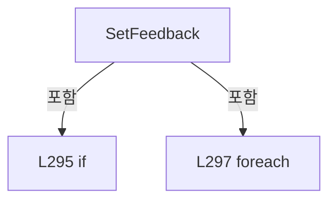

변경 전 점검: 입력/반환 타입, 위 호출자, 예외/취소 경로, 공유 상태와 저장·전송 소비자를 함께 확인합니다. 값의 단위나 물리 방향을 이름만으로 확정하지 않습니다.

### MethodDeclaration `Notify` · L299–299

[Drilling.UI/Menu/Menus/CManualPowerStagePanel.cs:299–299](https://github.com/kjuws10-rgb/A3Drilling/blob/5aee8e58439c9b455cae7c9593c9be986c3e682e/Drilling.UI/Menu/Menus/CManualPowerStagePanel.cs#L299-L299)

| 항목 | 실제 추출 값 |
| --- | --- |
| 서명 | void Drilling.UI.Menu.Menus.CManualPowerStageAxis.Notify(string?) |
| 접근/수식자 | Private / private |
| 반환/값 타입 | void |
| 소속 타입 | NamedType:Drilling.UI.Menu.Menus.CManualPowerStageAxis |

입력 계약:

| 이름 | 타입 | 전달 | 선택/기본값 |
| --- | --- | --- | --- |
| name | string? | None | True / null |

정적 호출자로 확인된 위치:

| 호출 파일/행 | 호출 표현식 | 런타임 분기 가능 |
| --- | --- | --- |
| [Drilling.UI/Menu/Menus/CManualPowerStagePanel.cs:277–277](https://github.com/kjuws10-rgb/A3Drilling/blob/5aee8e58439c9b455cae7c9593c9be986c3e682e/Drilling.UI/Menu/Menus/CManualPowerStagePanel.cs#L277-L277) | Notify | False |
| [Drilling.UI/Menu/Menus/CManualPowerStagePanel.cs:278–278](https://github.com/kjuws10-rgb/A3Drilling/blob/5aee8e58439c9b455cae7c9593c9be986c3e682e/Drilling.UI/Menu/Menus/CManualPowerStagePanel.cs#L278-L278) | Notify | False |
| [Drilling.UI/Menu/Menus/CManualPowerStagePanel.cs:279–279](https://github.com/kjuws10-rgb/A3Drilling/blob/5aee8e58439c9b455cae7c9593c9be986c3e682e/Drilling.UI/Menu/Menus/CManualPowerStagePanel.cs#L279-L279) | Notify | False |
| [Drilling.UI/Menu/Menus/CManualPowerStagePanel.cs:280–280](https://github.com/kjuws10-rgb/A3Drilling/blob/5aee8e58439c9b455cae7c9593c9be986c3e682e/Drilling.UI/Menu/Menus/CManualPowerStagePanel.cs#L280-L280) | Notify | False |
| [Drilling.UI/Menu/Menus/CManualPowerStagePanel.cs:297–297](https://github.com/kjuws10-rgb/A3Drilling/blob/5aee8e58439c9b455cae7c9593c9be986c3e682e/Drilling.UI/Menu/Menus/CManualPowerStagePanel.cs#L297-L297) | Notify | False |

호출하는 대상과 해석 범위:

| 원본 행 | 표현식 | 분석 상태 | 대상/소스 위치 |
| --- | --- | --- | --- |
| 299 | .Invoke | resolved · 동적 구현 선택 가능 | void System.ComponentModel.PropertyChangedEventHandler.Invoke(object?, System.ComponentModel.PropertyChangedEventArgs) |
| 299 | new | resolved | System.ComponentModel.PropertyChangedEventArgs.PropertyChangedEventArgs(string?) |

본문의 실제 연산·분기·예외·반환 순서(원문 위치 순):

| 원본 행 | 종류 | 주석 해설 |
| --- | --- | --- |
| 299 | call | 함수·델리게이트 또는 객체 생성자를 호출합니다: .Invoke(this, new(name)) |
| 299 | call | 함수·델리게이트 또는 객체 생성자를 호출합니다: new(name) |

변경 전 점검: 입력/반환 타입, 위 호출자, 예외/취소 경로, 공유 상태와 저장·전송 소비자를 함께 확인합니다. 값의 단위나 물리 방향을 이름만으로 확정하지 않습니다.

## 구문·바인딩 한계

전체 WPF/벤더 SDK/프로젝트별 빌드 조건을 로드한 정식 빌드가 아닙니다. `resolved`는 이 부분 컴파일에서의 심볼 연결이며 virtual/interface/delegate/이벤트/Reflection/XAML의 실제 런타임 구현을 확정하지 않습니다. `candidate`와 `unresolved`는 후속 확인 대상으로 남깁니다.

## 원문 전체 주석 해설본

[원본 모든 행과 행별 해설 보기](../../../../annotated/Drilling.UI/Menu/Menus/CManualPowerStagePanel.cs.annotated.txt)

원본을 빠뜨리거나 임의로 줄이지 않았습니다. `L000001 |` 표시는 원본 행 번호, `// 해설`은 별도 설명입니다. 실행용 소스가 아닌 문서입니다.

## 수정·재검증 체크

- 원본 Commit과 현재 작업 파일 SHA가 같은지 먼저 확인합니다. 다르면 이 문서를 과거 버전 자료로 취급합니다.
- 선언·직접 호출·이벤트/인터페이스 경계·설정 소비를 함께 확인합니다. 정적 연결의 빈 곳을 정상 경로로 추정하지 않습니다.
- 저장 형식/단위/식별자·재시도·취소·예외·롤백에 영향을 주는 변경은 상세 해설장과 호출자를 다시 검토합니다.
- 도구의 구문 추출과 별도 정적 추적 해설, 실제 빌드·시뮬레이션·실장비 검증 결과를 분리합니다.
