# Drilling.UI/Menu/Menus/CMenuAlarm.cs

| 항목 | 내용 |
| --- | --- |
| 원본 저장소 | https://github.com/kjuws10-rgb/A3Drilling.git |
| 원본 Commit | 5aee8e58439c9b455cae7c9593c9be986c3e682e |
| 원본 SHA256 | 12674a8cb040da5d9e23ad22c05789e6f942557964282e104e4bf743177de0e7 |
| 파일 분류 | code |
| 원본 크기/행 | 25,279 bytes / 587 physical lines |
| 인코딩 | utf-8-sig |
| 검토 범위 | 구문/부분 의미 분석에서 추출한 사실. 동작·물리 단위·실장비 합격을 보증하지 않습니다. |
| 원본 링크 | [고정 Commit 원본](https://github.com/kjuws10-rgb/A3Drilling/blob/5aee8e58439c9b455cae7c9593c9be986c3e682e/Drilling.UI/Menu/Menus/CMenuAlarm.cs) |

## 파일의 역할과 읽는 순서

WPF 화면·사용자 명령·표시 상태를 구성합니다. XAML 이벤트와 코드 비하인드, RootView의 조립 경로를 함께 추적합니다.

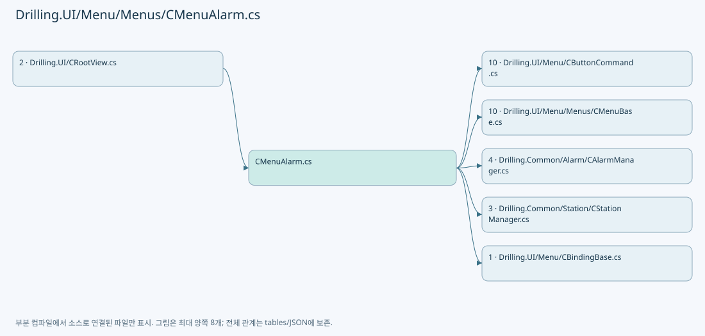

## 네임스페이스·타입·상속

| 타입 | 구분 | 원본 범위 | 선언/상속 |
| --- | --- | --- | --- |
| CMenuAlarm | ClassDeclaration | 16–211 | CMenuAlarm: CMenuBase |
| CAlarmHistoryPanel | ClassDeclaration | 213–483 | CAlarmHistoryPanel: INotifyPropertyChanged |
| ST_ALARM_TREND_COLUMN | RecordDeclaration | 485–485 | ST_ALARM_TREND_COLUMN |
| CAlarmListPanel | ClassDeclaration | 486–514 | CAlarmListPanel: INotifyPropertyChanged |
| ST_ALARM_LIST_ROW | RecordDeclaration | 516–516 | ST_ALARM_LIST_ROW |
| ST_ALARM_CURRENT_ROW | RecordDeclaration | 517–532 | ST_ALARM_CURRENT_ROW |
| ST_ALARM_DETAIL_ROW | RecordDeclaration | 534–550 | ST_ALARM_DETAIL_ROW |
| ST_ALARM_HISTORY_ROW | RecordDeclaration | 552–567 | ST_ALARM_HISTORY_ROW |
| ST_ALARM_TREND_BAR | RecordDeclaration | 569–569 | ST_ALARM_TREND_BAR |
| ST_ALARM_SUMMARY_ITEM | RecordDeclaration | 570–586 | ST_ALARM_SUMMARY_ITEM |

## 멤버 빠른 목록

| 이름 | 종류 | 범위 | 서명 |
| --- | --- | --- | --- |
| _selectedTabIndex | FieldDeclaration | L18–18 | int Drilling.UI.Menu.Menus.CMenuAlarm._selectedTabIndex |
| SelectedTabIndexChanged | EventFieldDeclaration | L19–19 | System.EventHandler? Drilling.UI.Menu.Menus.CMenuAlarm.SelectedTabIndexChanged |
| SelectedTabIndex | PropertyDeclaration | L20–32 | int Drilling.UI.Menu.Menus.CMenuAlarm.SelectedTabIndex |
| get_SelectedTabIndex | GetAccessorDeclaration | L22–22 | int Drilling.UI.Menu.Menus.CMenuAlarm.SelectedTabIndex.get |
| set_SelectedTabIndex | SetAccessorDeclaration | L23–31 | void Drilling.UI.Menu.Menus.CMenuAlarm.SelectedTabIndex.set |
| ListPanel | PropertyDeclaration | L34–34 | Drilling.UI.Menu.Menus.CAlarmListPanel Drilling.UI.Menu.Menus.CMenuAlarm.ListPanel |
| get_ListPanel | GetAccessorDeclaration | L34–34 | Drilling.UI.Menu.Menus.CAlarmListPanel Drilling.UI.Menu.Menus.CMenuAlarm.ListPanel.get |
| HistoryPanel | PropertyDeclaration | L35–35 | Drilling.UI.Menu.Menus.CAlarmHistoryPanel Drilling.UI.Menu.Menus.CMenuAlarm.HistoryPanel |
| get_HistoryPanel | GetAccessorDeclaration | L35–35 | Drilling.UI.Menu.Menus.CAlarmHistoryPanel Drilling.UI.Menu.Menus.CMenuAlarm.HistoryPanel.get |
| LogErrorChanged | EventFieldDeclaration | L37–37 | System.EventHandler? Drilling.UI.Menu.Menus.CMenuAlarm.LogErrorChanged |
| LogError | PropertyDeclaration | L38–38 | string Drilling.UI.Menu.Menus.CMenuAlarm.LogError |
| Menu | PropertyDeclaration | L40–46 | Drilling.UI.Menu.Menus.EN_MENU Drilling.UI.Menu.Menus.CMenuAlarm.Menu |
| get_Menu | GetAccessorDeclaration | L42–45 | Drilling.UI.Menu.Menus.EN_MENU Drilling.UI.Menu.Menus.CMenuAlarm.Menu.get |
| AlarmResetCommand | PropertyDeclaration | L48–59 | Drilling.UI.Menu.CButtonCommand Drilling.UI.Menu.Menus.CMenuAlarm.AlarmResetCommand |
| get_AlarmResetCommand | GetAccessorDeclaration | L50–58 | Drilling.UI.Menu.CButtonCommand Drilling.UI.Menu.Menus.CMenuAlarm.AlarmResetCommand.get |
| ResetAlarmCallback | LocalFunctionStatement | L52–55 | void ResetAlarmCallback(object?) |
| BuzzerOffCommand | PropertyDeclaration | L61–72 | Drilling.UI.Menu.CButtonCommand Drilling.UI.Menu.Menus.CMenuAlarm.BuzzerOffCommand |
| get_BuzzerOffCommand | GetAccessorDeclaration | L63–71 | Drilling.UI.Menu.CButtonCommand Drilling.UI.Menu.Menus.CMenuAlarm.BuzzerOffCommand.get |
| setStatusMessageCallback | LocalFunctionStatement | L65–68 | void setStatusMessageCallback(object?) |
| CurrentAlarms | PropertyDeclaration | L74–74 | System.Collections.Generic.IReadOnlyList<Drilling.UI.Menu.Menus.ST_DISPLAY_ITEM> Drilling.UI.Menu.Menus.CMenuAlarm.CurrentAlarms |
| get_CurrentAlarms | GetAccessorDeclaration | L74–74 | System.Collections.Generic.IReadOnlyList<Drilling.UI.Menu.Menus.ST_DISPLAY_ITEM> Drilling.UI.Menu.Menus.CMenuAlarm.CurrentAlarms.get |
| set_CurrentAlarms | SetAccessorDeclaration | L74–74 | void Drilling.UI.Menu.Menus.CMenuAlarm.CurrentAlarms.set |
| AlarmDetail | PropertyDeclaration | L75–75 | System.Collections.Generic.IReadOnlyList<Drilling.UI.Menu.Menus.ST_DISPLAY_ITEM> Drilling.UI.Menu.Menus.CMenuAlarm.AlarmDetail |
| get_AlarmDetail | GetAccessorDeclaration | L75–75 | System.Collections.Generic.IReadOnlyList<Drilling.UI.Menu.Menus.ST_DISPLAY_ITEM> Drilling.UI.Menu.Menus.CMenuAlarm.AlarmDetail.get |
| set_AlarmDetail | SetAccessorDeclaration | L75–75 | void Drilling.UI.Menu.Menus.CMenuAlarm.AlarmDetail.set |
| RecoveryCommands | PropertyDeclaration | L76–76 | System.Collections.Generic.IReadOnlyList<Drilling.UI.Menu.Menus.ST_DISPLAY_ITEM> Drilling.UI.Menu.Menus.CMenuAlarm.RecoveryCommands |
| get_RecoveryCommands | GetAccessorDeclaration | L76–76 | System.Collections.Generic.IReadOnlyList<Drilling.UI.Menu.Menus.ST_DISPLAY_ITEM> Drilling.UI.Menu.Menus.CMenuAlarm.RecoveryCommands.get |
| set_RecoveryCommands | SetAccessorDeclaration | L76–76 | void Drilling.UI.Menu.Menus.CMenuAlarm.RecoveryCommands.set |
| History | PropertyDeclaration | L77–77 | System.Collections.Generic.IReadOnlyList<Drilling.UI.Menu.Menus.ST_DISPLAY_ITEM> Drilling.UI.Menu.Menus.CMenuAlarm.History |
| get_History | GetAccessorDeclaration | L77–77 | System.Collections.Generic.IReadOnlyList<Drilling.UI.Menu.Menus.ST_DISPLAY_ITEM> Drilling.UI.Menu.Menus.CMenuAlarm.History.get |
| set_History | SetAccessorDeclaration | L77–77 | void Drilling.UI.Menu.Menus.CMenuAlarm.History.set |
| Trend | PropertyDeclaration | L78–78 | System.Collections.Generic.IReadOnlyList<Drilling.UI.Menu.Menus.ST_DISPLAY_ITEM> Drilling.UI.Menu.Menus.CMenuAlarm.Trend |
| get_Trend | GetAccessorDeclaration | L78–78 | System.Collections.Generic.IReadOnlyList<Drilling.UI.Menu.Menus.ST_DISPLAY_ITEM> Drilling.UI.Menu.Menus.CMenuAlarm.Trend.get |
| set_Trend | SetAccessorDeclaration | L78–78 | void Drilling.UI.Menu.Menus.CMenuAlarm.Trend.set |
| CurrentAlarmRows | PropertyDeclaration | L79–79 | System.Collections.Generic.IReadOnlyList<Drilling.UI.Menu.Menus.ST_ALARM_CURRENT_ROW> Drilling.UI.Menu.Menus.CMenuAlarm.CurrentAlarmRows |
| get_CurrentAlarmRows | GetAccessorDeclaration | L79–79 | System.Collections.Generic.IReadOnlyList<Drilling.UI.Menu.Menus.ST_ALARM_CURRENT_ROW> Drilling.UI.Menu.Menus.CMenuAlarm.CurrentAlarmRows.get |
| set_CurrentAlarmRows | SetAccessorDeclaration | L79–79 | void Drilling.UI.Menu.Menus.CMenuAlarm.CurrentAlarmRows.set |
| DetailRows | PropertyDeclaration | L80–80 | System.Collections.Generic.IReadOnlyList<Drilling.UI.Menu.Menus.ST_ALARM_DETAIL_ROW> Drilling.UI.Menu.Menus.CMenuAlarm.DetailRows |
| get_DetailRows | GetAccessorDeclaration | L80–80 | System.Collections.Generic.IReadOnlyList<Drilling.UI.Menu.Menus.ST_ALARM_DETAIL_ROW> Drilling.UI.Menu.Menus.CMenuAlarm.DetailRows.get |
| set_DetailRows | SetAccessorDeclaration | L80–80 | void Drilling.UI.Menu.Menus.CMenuAlarm.DetailRows.set |
| HistoryRows | PropertyDeclaration | L81–81 | System.Collections.Generic.IReadOnlyList<Drilling.UI.Menu.Menus.ST_ALARM_HISTORY_ROW> Drilling.UI.Menu.Menus.CMenuAlarm.HistoryRows |
| get_HistoryRows | GetAccessorDeclaration | L81–81 | System.Collections.Generic.IReadOnlyList<Drilling.UI.Menu.Menus.ST_ALARM_HISTORY_ROW> Drilling.UI.Menu.Menus.CMenuAlarm.HistoryRows.get |
| set_HistoryRows | SetAccessorDeclaration | L81–81 | void Drilling.UI.Menu.Menus.CMenuAlarm.HistoryRows.set |
| TrendBars | PropertyDeclaration | L82–82 | System.Collections.Generic.IReadOnlyList<Drilling.UI.Menu.Menus.ST_ALARM_TREND_BAR> Drilling.UI.Menu.Menus.CMenuAlarm.TrendBars |
| get_TrendBars | GetAccessorDeclaration | L82–82 | System.Collections.Generic.IReadOnlyList<Drilling.UI.Menu.Menus.ST_ALARM_TREND_BAR> Drilling.UI.Menu.Menus.CMenuAlarm.TrendBars.get |
| set_TrendBars | SetAccessorDeclaration | L82–82 | void Drilling.UI.Menu.Menus.CMenuAlarm.TrendBars.set |
| SummaryItems | PropertyDeclaration | L83–83 | System.Collections.Generic.IReadOnlyList<Drilling.UI.Menu.Menus.ST_ALARM_SUMMARY_ITEM> Drilling.UI.Menu.Menus.CMenuAlarm.SummaryItems |
| get_SummaryItems | GetAccessorDeclaration | L83–83 | System.Collections.Generic.IReadOnlyList<Drilling.UI.Menu.Menus.ST_ALARM_SUMMARY_ITEM> Drilling.UI.Menu.Menus.CMenuAlarm.SummaryItems.get |
| set_SummaryItems | SetAccessorDeclaration | L83–83 | void Drilling.UI.Menu.Menus.CMenuAlarm.SummaryItems.set |
| Build | MethodDeclaration | L85–116 | System.Threading.Tasks.Task<Drilling.UI.Menu.Menus.CScreenViewModel> Drilling.UI.Menu.Menus.CMenuAlarm.Build(System.Threading.CancellationToken) |
| BuildDisplay | LocalFunctionStatement | L90–93 | Drilling.UI.Menu.Menus.ST_DISPLAY_ITEM BuildDisplay(Drilling.Common.Alarm.ST_ALARM_DATA) |
| ResetAlarmAsync | MethodDeclaration | L118–136 | System.Threading.Tasks.Task Drilling.UI.Menu.Menus.CMenuAlarm.ResetAlarmAsync() |
| Apply | MethodDeclaration | L138–161 | void Drilling.UI.Menu.Menus.CMenuAlarm.Apply(System.Collections.Generic.IReadOnlyList<Drilling.UI.Menu.Menus.ST_DISPLAY_ITEM>, System.Collections.Generic.IReadOnlyList<Drilling.UI.Menu.Menus.ST_DISPLAY_ITEM>, System.Collections.Generic.IReadOnlyList<Drilling.UI.Menu.Menus.ST_DISPLAY_ITEM>, System.Collections.Generic.IReadOnlyList<Drilling.UI.Menu.Menus.ST_DISPLAY_ITEM>, System.Collections.Generic.IReadOnlyList<Drilling.UI.Menu.Menus.ST_DISPLAY_ITEM>, System.Collections.Generic.IReadOnlyList<Drilling.UI.Menu.Menus.ST_ALARM_CURRENT_ROW>, System.Collections.Generic.IReadOnlyList<Drilling.UI.Menu.Menus.ST_ALARM_DETAIL_ROW>, System.Collections.Generic.IReadOnlyList<Drilling.UI.Menu.Menus.ST_ALARM_HISTORY_ROW>, System.Collections.Generic.IReadOnlyList<Drilling.UI.Menu.Menus.ST_ALARM_TREND_BAR>, System.Collections.Generic.IReadOnlyList<Drilling.UI.Menu.Menus.ST_ALARM_SUMMARY_ITEM>) |
| BuildCurrentAlarmRows | MethodDeclaration | L163–173 | System.Collections.Generic.IReadOnlyList<Drilling.UI.Menu.Menus.ST_ALARM_CURRENT_ROW> Drilling.UI.Menu.Menus.CMenuAlarm.BuildCurrentAlarmRows(System.Collections.Generic.IReadOnlyList<Drilling.Common.Alarm.ST_ALARM_DATA>) |
| BuildAlarm | LocalFunctionStatement | L166–170 | Drilling.UI.Menu.Menus.ST_ALARM_CURRENT_ROW BuildAlarm(Drilling.Common.Alarm.ST_ALARM_DATA, int) |
| BuildDetailRows | MethodDeclaration | L175–190 | System.Collections.Generic.IReadOnlyList<Drilling.UI.Menu.Menus.ST_ALARM_DETAIL_ROW> Drilling.UI.Menu.Menus.CMenuAlarm.BuildDetailRows(Drilling.Common.Alarm.ST_ALARM_DATA?) |
| FormatSeverity | MethodDeclaration | L192–200 | string Drilling.UI.Menu.Menus.CMenuAlarm.FormatSeverity(Drilling.Common.Alarm.EN_ALARM_LEVEL) |
| SeverityState | MethodDeclaration | L202–210 | string Drilling.UI.Menu.Menus.CMenuAlarm.SeverityState(Drilling.Common.Alarm.EN_ALARM_LEVEL) |
| _read | FieldDeclaration | L215–215 | System.Func<System.DateTime, System.DateTime, System.Threading.CancellationToken, Drilling.Common.Alarm.ST_ALARM_HISTORY_RESULT> Drilling.UI.Menu.Menus.CAlarmHistoryPanel._read |
| _now | FieldDeclaration | L216–216 | System.Func<System.DateTime> Drilling.UI.Menu.Menus.CAlarmHistoryPanel._now |
| _from | FieldDeclaration | L217–217 | System.DateTime? Drilling.UI.Menu.Menus.CAlarmHistoryPanel._from |
| _through | FieldDeclaration | L218–218 | System.DateTime? Drilling.UI.Menu.Menus.CAlarmHistoryPanel._through |
| _fromTime | FieldDeclaration | L219–219 | string Drilling.UI.Menu.Menus.CAlarmHistoryPanel._fromTime |
| _throughTime | FieldDeclaration | L220–220 | string Drilling.UI.Menu.Menus.CAlarmHistoryPanel._throughTime |
| _hasOpened | FieldDeclaration | L221–221 | bool Drilling.UI.Menu.Menus.CAlarmHistoryPanel._hasOpened |
| _isCodeView | FieldDeclaration | L222–222 | bool Drilling.UI.Menu.Menus.CAlarmHistoryPanel._isCodeView |
| _loadedRows | FieldDeclaration | L223–223 | System.Collections.Generic.IReadOnlyList<Drilling.Common.Alarm.ST_ALARM_HISTORY_ENTRY> Drilling.UI.Menu.Menus.CAlarmHistoryPanel._loadedRows |
| _searchedFrom | FieldDeclaration | L224–224 | System.DateTime? Drilling.UI.Menu.Menus.CAlarmHistoryPanel._searchedFrom |
| _searchedThrough | FieldDeclaration | L225–225 | System.DateTime? Drilling.UI.Menu.Menus.CAlarmHistoryPanel._searchedThrough |
| .ctor | ConstructorDeclaration | L226–235 | Drilling.UI.Menu.Menus.CAlarmHistoryPanel.CAlarmHistoryPanel(System.Func<System.DateTime, System.DateTime, System.Threading.CancellationToken, Drilling.Common.Alarm.ST_ALARM_HISTORY_RESULT>, System.Func<System.DateTime>?) |
| PropertyChanged | EventFieldDeclaration | L237–237 | System.ComponentModel.PropertyChangedEventHandler? Drilling.UI.Menu.Menus.CAlarmHistoryPanel.PropertyChanged |
| From | PropertyDeclaration | L238–246 | System.DateTime? Drilling.UI.Menu.Menus.CAlarmHistoryPanel.From |
| get_From | GetAccessorDeclaration | L240–240 | System.DateTime? Drilling.UI.Menu.Menus.CAlarmHistoryPanel.From.get |
| set_From | SetAccessorDeclaration | L241–245 | void Drilling.UI.Menu.Menus.CAlarmHistoryPanel.From.set |
| Through | PropertyDeclaration | L248–256 | System.DateTime? Drilling.UI.Menu.Menus.CAlarmHistoryPanel.Through |
| get_Through | GetAccessorDeclaration | L250–250 | System.DateTime? Drilling.UI.Menu.Menus.CAlarmHistoryPanel.Through.get |
| set_Through | SetAccessorDeclaration | L251–255 | void Drilling.UI.Menu.Menus.CAlarmHistoryPanel.Through.set |
| FromTime | PropertyDeclaration | L258–266 | string Drilling.UI.Menu.Menus.CAlarmHistoryPanel.FromTime |
| get_FromTime | GetAccessorDeclaration | L260–260 | string Drilling.UI.Menu.Menus.CAlarmHistoryPanel.FromTime.get |
| set_FromTime | SetAccessorDeclaration | L261–265 | void Drilling.UI.Menu.Menus.CAlarmHistoryPanel.FromTime.set |
| ThroughTime | PropertyDeclaration | L268–276 | string Drilling.UI.Menu.Menus.CAlarmHistoryPanel.ThroughTime |
| get_ThroughTime | GetAccessorDeclaration | L270–270 | string Drilling.UI.Menu.Menus.CAlarmHistoryPanel.ThroughTime.get |
| set_ThroughTime | SetAccessorDeclaration | L271–275 | void Drilling.UI.Menu.Menus.CAlarmHistoryPanel.ThroughTime.set |
| IsBusy | PropertyDeclaration | L278–278 | bool Drilling.UI.Menu.Menus.CAlarmHistoryPanel.IsBusy |
| get_IsBusy | GetAccessorDeclaration | L278–278 | bool Drilling.UI.Menu.Menus.CAlarmHistoryPanel.IsBusy.get |
| set_IsBusy | SetAccessorDeclaration | L278–278 | void Drilling.UI.Menu.Menus.CAlarmHistoryPanel.IsBusy.set |
| CanEdit | PropertyDeclaration | L279–279 | bool Drilling.UI.Menu.Menus.CAlarmHistoryPanel.CanEdit |
| IsCodeView | PropertyDeclaration | L280–280 | bool Drilling.UI.Menu.Menus.CAlarmHistoryPanel.IsCodeView |
| IsHourView | PropertyDeclaration | L281–281 | bool Drilling.UI.Menu.Menus.CAlarmHistoryPanel.IsHourView |
| Status | PropertyDeclaration | L282–282 | string Drilling.UI.Menu.Menus.CAlarmHistoryPanel.Status |
| get_Status | GetAccessorDeclaration | L282–282 | string Drilling.UI.Menu.Menus.CAlarmHistoryPanel.Status.get |
| set_Status | SetAccessorDeclaration | L282–282 | void Drilling.UI.Menu.Menus.CAlarmHistoryPanel.Status.set |
| TrendCaption | PropertyDeclaration | L283–283 | string Drilling.UI.Menu.Menus.CAlarmHistoryPanel.TrendCaption |
| get_TrendCaption | GetAccessorDeclaration | L283–283 | string Drilling.UI.Menu.Menus.CAlarmHistoryPanel.TrendCaption.get |
| set_TrendCaption | SetAccessorDeclaration | L283–283 | void Drilling.UI.Menu.Menus.CAlarmHistoryPanel.TrendCaption.set |
| EmptyMessage | PropertyDeclaration | L284–284 | string Drilling.UI.Menu.Menus.CAlarmHistoryPanel.EmptyMessage |
| get_EmptyMessage | GetAccessorDeclaration | L284–284 | string Drilling.UI.Menu.Menus.CAlarmHistoryPanel.EmptyMessage.get |
| set_EmptyMessage | SetAccessorDeclaration | L284–284 | void Drilling.UI.Menu.Menus.CAlarmHistoryPanel.EmptyMessage.set |
| Rows | PropertyDeclaration | L285–285 | System.Collections.Generic.IReadOnlyList<Drilling.UI.Menu.Menus.ST_ALARM_HISTORY_ROW> Drilling.UI.Menu.Menus.CAlarmHistoryPanel.Rows |
| get_Rows | GetAccessorDeclaration | L285–285 | System.Collections.Generic.IReadOnlyList<Drilling.UI.Menu.Menus.ST_ALARM_HISTORY_ROW> Drilling.UI.Menu.Menus.CAlarmHistoryPanel.Rows.get |
| set_Rows | SetAccessorDeclaration | L285–285 | void Drilling.UI.Menu.Menus.CAlarmHistoryPanel.Rows.set |
| Bars | PropertyDeclaration | L286–286 | System.Collections.Generic.IReadOnlyList<Drilling.UI.Menu.Menus.ST_ALARM_TREND_COLUMN> Drilling.UI.Menu.Menus.CAlarmHistoryPanel.Bars |
| get_Bars | GetAccessorDeclaration | L286–286 | System.Collections.Generic.IReadOnlyList<Drilling.UI.Menu.Menus.ST_ALARM_TREND_COLUMN> Drilling.UI.Menu.Menus.CAlarmHistoryPanel.Bars.get |
| set_Bars | SetAccessorDeclaration | L286–286 | void Drilling.UI.Menu.Menus.CAlarmHistoryPanel.Bars.set |
| SearchCommand | PropertyDeclaration | L287–287 | Drilling.UI.Menu.CButtonCommand Drilling.UI.Menu.Menus.CAlarmHistoryPanel.SearchCommand |
| get_SearchCommand | GetAccessorDeclaration | L287–287 | Drilling.UI.Menu.CButtonCommand Drilling.UI.Menu.Menus.CAlarmHistoryPanel.SearchCommand.get |
| Last24HoursCommand | PropertyDeclaration | L288–288 | Drilling.UI.Menu.CButtonCommand Drilling.UI.Menu.Menus.CAlarmHistoryPanel.Last24HoursCommand |
| get_Last24HoursCommand | GetAccessorDeclaration | L288–288 | Drilling.UI.Menu.CButtonCommand Drilling.UI.Menu.Menus.CAlarmHistoryPanel.Last24HoursCommand.get |
| HourViewCommand | PropertyDeclaration | L289–289 | Drilling.UI.Menu.CButtonCommand Drilling.UI.Menu.Menus.CAlarmHistoryPanel.HourViewCommand |
| get_HourViewCommand | GetAccessorDeclaration | L289–289 | Drilling.UI.Menu.CButtonCommand Drilling.UI.Menu.Menus.CAlarmHistoryPanel.HourViewCommand.get |
| CodeViewCommand | PropertyDeclaration | L290–290 | Drilling.UI.Menu.CButtonCommand Drilling.UI.Menu.Menus.CAlarmHistoryPanel.CodeViewCommand |
| get_CodeViewCommand | GetAccessorDeclaration | L290–290 | Drilling.UI.Menu.CButtonCommand Drilling.UI.Menu.Menus.CAlarmHistoryPanel.CodeViewCommand.get |
| InitializeOnFirstOpen | MethodDeclaration | L292–298 | void Drilling.UI.Menu.Menus.CAlarmHistoryPanel.InitializeOnFirstOpen() |
| SetDefaultRange | MethodDeclaration | L300–306 | void Drilling.UI.Menu.Menus.CAlarmHistoryPanel.SetDefaultRange() |
| SelectTrendView | MethodDeclaration | L308–324 | void Drilling.UI.Menu.Menus.CAlarmHistoryPanel.SelectTrendView(bool) |
| RefreshTrend | MethodDeclaration | L326–338 | void Drilling.UI.Menu.Menus.CAlarmHistoryPanel.RefreshTrend() |
| SearchLast24HoursAsync | MethodDeclaration | L340–353 | System.Threading.Tasks.Task Drilling.UI.Menu.Menus.CAlarmHistoryPanel.SearchLast24HoursAsync() |
| SearchAsync | MethodDeclaration | L355–430 | System.Threading.Tasks.Task Drilling.UI.Menu.Menus.CAlarmHistoryPanel.SearchAsync() |
| TryReadTime | MethodDeclaration | L432–438 | bool Drilling.UI.Menu.Menus.CAlarmHistoryPanel.TryReadTime(string, out System.TimeSpan) |
| BuildCodeBars | MethodDeclaration | L440–454 | System.Collections.Generic.IReadOnlyList<Drilling.UI.Menu.Menus.ST_ALARM_TREND_COLUMN> Drilling.UI.Menu.Menus.CAlarmHistoryPanel.BuildCodeBars(System.Collections.Generic.IReadOnlyList<Drilling.Common.Alarm.ST_ALARM_HISTORY_ENTRY>) |
| BuildHourBars | MethodDeclaration | L456–480 | System.Collections.Generic.IReadOnlyList<Drilling.UI.Menu.Menus.ST_ALARM_TREND_COLUMN> Drilling.UI.Menu.Menus.CAlarmHistoryPanel.BuildHourBars(System.Collections.Generic.IReadOnlyList<Drilling.Common.Alarm.ST_ALARM_HISTORY_ENTRY>, System.DateTime, System.DateTime) |
| Hour | LocalFunctionStatement | L458–458 | System.DateTime Hour(System.DateTime) |
| Notify | MethodDeclaration | L482–482 | void Drilling.UI.Menu.Menus.CAlarmHistoryPanel.Notify(string?) |
| _alarms | FieldDeclaration | L488–488 | Drilling.Common.Alarm.CAlarmManager Drilling.UI.Menu.Menus.CAlarmListPanel._alarms |
| _displayedSnapshot | FieldDeclaration | L489–489 | Drilling.Common.Alarm.ST_ALARM_DEFINITION_SNAPSHOT? Drilling.UI.Menu.Menus.CAlarmListPanel._displayedSnapshot |
| .ctor | ConstructorDeclaration | L490–494 | Drilling.UI.Menu.Menus.CAlarmListPanel.CAlarmListPanel(Drilling.Common.Alarm.CAlarmManager) |
| PropertyChanged | EventFieldDeclaration | L496–496 | System.ComponentModel.PropertyChangedEventHandler? Drilling.UI.Menu.Menus.CAlarmListPanel.PropertyChanged |
| Rows | PropertyDeclaration | L497–497 | System.Collections.Generic.IReadOnlyList<Drilling.UI.Menu.Menus.ST_ALARM_LIST_ROW> Drilling.UI.Menu.Menus.CAlarmListPanel.Rows |
| get_Rows | GetAccessorDeclaration | L497–497 | System.Collections.Generic.IReadOnlyList<Drilling.UI.Menu.Menus.ST_ALARM_LIST_ROW> Drilling.UI.Menu.Menus.CAlarmListPanel.Rows.get |
| set_Rows | SetAccessorDeclaration | L497–497 | void Drilling.UI.Menu.Menus.CAlarmListPanel.Rows.set |
| Status | PropertyDeclaration | L498–498 | string Drilling.UI.Menu.Menus.CAlarmListPanel.Status |
| get_Status | GetAccessorDeclaration | L498–498 | string Drilling.UI.Menu.Menus.CAlarmListPanel.Status.get |
| set_Status | SetAccessorDeclaration | L498–498 | void Drilling.UI.Menu.Menus.CAlarmListPanel.Status.set |
| HasError | PropertyDeclaration | L499–499 | bool Drilling.UI.Menu.Menus.CAlarmListPanel.HasError |
| get_HasError | GetAccessorDeclaration | L499–499 | bool Drilling.UI.Menu.Menus.CAlarmListPanel.HasError.get |
| set_HasError | SetAccessorDeclaration | L499–499 | void Drilling.UI.Menu.Menus.CAlarmListPanel.HasError.set |
| RefreshSnapshot | MethodDeclaration | L501–513 | void Drilling.UI.Menu.Menus.CAlarmListPanel.RefreshSnapshot() |
| LevelBrush | PropertyDeclaration | L519–531 | Brush Drilling.UI.Menu.Menus.ST_ALARM_CURRENT_ROW.LevelBrush |
| get_LevelBrush | GetAccessorDeclaration | L521–530 | Brush Drilling.UI.Menu.Menus.ST_ALARM_CURRENT_ROW.LevelBrush.get |
| ValueBrush | PropertyDeclaration | L536–549 | Brush Drilling.UI.Menu.Menus.ST_ALARM_DETAIL_ROW.ValueBrush |
| get_ValueBrush | GetAccessorDeclaration | L538–548 | Brush Drilling.UI.Menu.Menus.ST_ALARM_DETAIL_ROW.ValueBrush.get |
| LevelBrush | PropertyDeclaration | L554–566 | Brush Drilling.UI.Menu.Menus.ST_ALARM_HISTORY_ROW.LevelBrush |
| get_LevelBrush | GetAccessorDeclaration | L556–565 | Brush Drilling.UI.Menu.Menus.ST_ALARM_HISTORY_ROW.LevelBrush.get |
| ValueBrush | PropertyDeclaration | L572–585 | Brush Drilling.UI.Menu.Menus.ST_ALARM_SUMMARY_ITEM.ValueBrush |
| get_ValueBrush | GetAccessorDeclaration | L574–584 | Brush Drilling.UI.Menu.Menus.ST_ALARM_SUMMARY_ITEM.ValueBrush.get |

## 멤버별 상세 계약·호출·처리 해설

### FieldDeclaration `_selectedTabIndex` · L18–18

[Drilling.UI/Menu/Menus/CMenuAlarm.cs:18–18](https://github.com/kjuws10-rgb/A3Drilling/blob/5aee8e58439c9b455cae7c9593c9be986c3e682e/Drilling.UI/Menu/Menus/CMenuAlarm.cs#L18-L18)

| 항목 | 실제 추출 값 |
| --- | --- |
| 서명 | int Drilling.UI.Menu.Menus.CMenuAlarm._selectedTabIndex |
| 접근/수식자 | Private / private |
| 반환/값 타입 | int |
| 소속 타입 | NamedType:Drilling.UI.Menu.Menus.CMenuAlarm |

현재 부분 분석에서 직접 연결된 호출자는 없습니다. XAML/이벤트/인터페이스·델리게이트·외부 진입을 추가 확인해야 하며, 미사용으로 판정한 것이 아닙니다.

변경 전 점검: 입력/반환 타입, 위 호출자, 예외/취소 경로, 공유 상태와 저장·전송 소비자를 함께 확인합니다. 값의 단위나 물리 방향을 이름만으로 확정하지 않습니다.

### EventFieldDeclaration `SelectedTabIndexChanged` · L19–19

[Drilling.UI/Menu/Menus/CMenuAlarm.cs:19–19](https://github.com/kjuws10-rgb/A3Drilling/blob/5aee8e58439c9b455cae7c9593c9be986c3e682e/Drilling.UI/Menu/Menus/CMenuAlarm.cs#L19-L19)

| 항목 | 실제 추출 값 |
| --- | --- |
| 서명 | System.EventHandler? Drilling.UI.Menu.Menus.CMenuAlarm.SelectedTabIndexChanged |
| 접근/수식자 | Public / public, event |
| 반환/값 타입 | System.EventHandler? |
| 소속 타입 | NamedType:Drilling.UI.Menu.Menus.CMenuAlarm |

현재 부분 분석에서 직접 연결된 호출자는 없습니다. XAML/이벤트/인터페이스·델리게이트·외부 진입을 추가 확인해야 하며, 미사용으로 판정한 것이 아닙니다.

변경 전 점검: 입력/반환 타입, 위 호출자, 예외/취소 경로, 공유 상태와 저장·전송 소비자를 함께 확인합니다. 값의 단위나 물리 방향을 이름만으로 확정하지 않습니다.

### PropertyDeclaration `SelectedTabIndex` · L20–32

[Drilling.UI/Menu/Menus/CMenuAlarm.cs:20–32](https://github.com/kjuws10-rgb/A3Drilling/blob/5aee8e58439c9b455cae7c9593c9be986c3e682e/Drilling.UI/Menu/Menus/CMenuAlarm.cs#L20-L32)

| 항목 | 실제 추출 값 |
| --- | --- |
| 서명 | int Drilling.UI.Menu.Menus.CMenuAlarm.SelectedTabIndex |
| 접근/수식자 | Public / public |
| 반환/값 타입 | int |
| 소속 타입 | NamedType:Drilling.UI.Menu.Menus.CMenuAlarm |

현재 부분 분석에서 직접 연결된 호출자는 없습니다. XAML/이벤트/인터페이스·델리게이트·외부 진입을 추가 확인해야 하며, 미사용으로 판정한 것이 아닙니다.

변경 전 점검: 입력/반환 타입, 위 호출자, 예외/취소 경로, 공유 상태와 저장·전송 소비자를 함께 확인합니다. 값의 단위나 물리 방향을 이름만으로 확정하지 않습니다.

### GetAccessorDeclaration `get_SelectedTabIndex` · L22–22

[Drilling.UI/Menu/Menus/CMenuAlarm.cs:22–22](https://github.com/kjuws10-rgb/A3Drilling/blob/5aee8e58439c9b455cae7c9593c9be986c3e682e/Drilling.UI/Menu/Menus/CMenuAlarm.cs#L22-L22)

| 항목 | 실제 추출 값 |
| --- | --- |
| 서명 | int Drilling.UI.Menu.Menus.CMenuAlarm.SelectedTabIndex.get |
| 접근/수식자 | Public / get |
| 반환/값 타입 | int |
| 소속 타입 | NamedType:Drilling.UI.Menu.Menus.CMenuAlarm |

현재 부분 분석에서 직접 연결된 호출자는 없습니다. XAML/이벤트/인터페이스·델리게이트·외부 진입을 추가 확인해야 하며, 미사용으로 판정한 것이 아닙니다.

변경 전 점검: 입력/반환 타입, 위 호출자, 예외/취소 경로, 공유 상태와 저장·전송 소비자를 함께 확인합니다. 값의 단위나 물리 방향을 이름만으로 확정하지 않습니다.

### SetAccessorDeclaration `set_SelectedTabIndex` · L23–31

[Drilling.UI/Menu/Menus/CMenuAlarm.cs:23–31](https://github.com/kjuws10-rgb/A3Drilling/blob/5aee8e58439c9b455cae7c9593c9be986c3e682e/Drilling.UI/Menu/Menus/CMenuAlarm.cs#L23-L31)

| 항목 | 실제 추출 값 |
| --- | --- |
| 서명 | void Drilling.UI.Menu.Menus.CMenuAlarm.SelectedTabIndex.set |
| 접근/수식자 | Public / set |
| 반환/값 타입 | void |
| 소속 타입 | NamedType:Drilling.UI.Menu.Menus.CMenuAlarm |

입력 계약:

| 이름 | 타입 | 전달 | 선택/기본값 |
| --- | --- | --- | --- |
| value | int | None | False /  |

현재 부분 분석에서 직접 연결된 호출자는 없습니다. XAML/이벤트/인터페이스·델리게이트·외부 진입을 추가 확인해야 하며, 미사용으로 판정한 것이 아닙니다.

호출하는 대상과 해석 범위:

| 원본 행 | 표현식 | 분석 상태 | 대상/소스 위치 |
| --- | --- | --- | --- |
| 29 | HistoryPanel.InitializeOnFirstOpen | resolved | void Drilling.UI.Menu.Menus.CAlarmHistoryPanel.InitializeOnFirstOpen() · Drilling.UI/Menu/Menus/CMenuAlarm.cs:292 |
| 30 | .Invoke | resolved · 동적 구현 선택 가능 | void System.EventHandler.Invoke(object?, System.EventArgs) |

본문의 실제 연산·분기·예외·반환 순서(원문 위치 순):

| 원본 행 | 종류 | 주석 해설 |
| --- | --- | --- |
| 25 | if | 조건에 따라 분기합니다: if (_selectedTabIndex == value) |
| 26 | return | 호출자에게 값 또는 제어를 반환합니다: return; |
| 27 | assignment | 값을 대상에 대입합니다: _selectedTabIndex = value |
| 28 | if | 조건에 따라 분기합니다: if (value == 1) |
| 29 | call | 함수·델리게이트 또는 객체 생성자를 호출합니다: HistoryPanel.InitializeOnFirstOpen() |
| 30 | call | 함수·델리게이트 또는 객체 생성자를 호출합니다: .Invoke(this, EventArgs.Empty) |

제어 구문의 포함 구조(실제 실행 순서/CFG가 아닌 구문 탐색 그림):

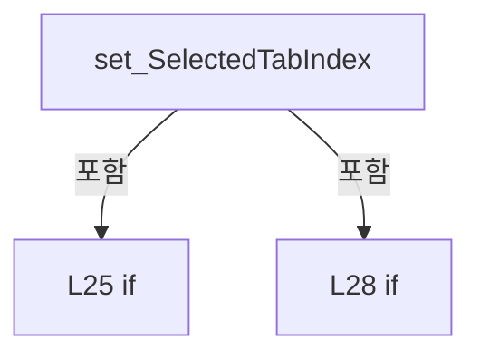

변경 전 점검: 입력/반환 타입, 위 호출자, 예외/취소 경로, 공유 상태와 저장·전송 소비자를 함께 확인합니다. 값의 단위나 물리 방향을 이름만으로 확정하지 않습니다.

### PropertyDeclaration `ListPanel` · L34–34

[Drilling.UI/Menu/Menus/CMenuAlarm.cs:34–34](https://github.com/kjuws10-rgb/A3Drilling/blob/5aee8e58439c9b455cae7c9593c9be986c3e682e/Drilling.UI/Menu/Menus/CMenuAlarm.cs#L34-L34)

| 항목 | 실제 추출 값 |
| --- | --- |
| 서명 | Drilling.UI.Menu.Menus.CAlarmListPanel Drilling.UI.Menu.Menus.CMenuAlarm.ListPanel |
| 접근/수식자 | Public / public |
| 반환/값 타입 | Drilling.UI.Menu.Menus.CAlarmListPanel |
| 소속 타입 | NamedType:Drilling.UI.Menu.Menus.CMenuAlarm |

현재 부분 분석에서 직접 연결된 호출자는 없습니다. XAML/이벤트/인터페이스·델리게이트·외부 진입을 추가 확인해야 하며, 미사용으로 판정한 것이 아닙니다.

호출하는 대상과 해석 범위:

| 원본 행 | 표현식 | 분석 상태 | 대상/소스 위치 |
| --- | --- | --- | --- |
| 34 | new | resolved | Drilling.UI.Menu.Menus.CAlarmListPanel.CAlarmListPanel(Drilling.Common.Alarm.CAlarmManager) · Drilling.UI/Menu/Menus/CMenuAlarm.cs:490 |

본문의 실제 연산·분기·예외·반환 순서(원문 위치 순):

| 원본 행 | 종류 | 주석 해설 |
| --- | --- | --- |
| 34 | call | 함수·델리게이트 또는 객체 생성자를 호출합니다: new(alarmManager) |

변경 전 점검: 입력/반환 타입, 위 호출자, 예외/취소 경로, 공유 상태와 저장·전송 소비자를 함께 확인합니다. 값의 단위나 물리 방향을 이름만으로 확정하지 않습니다.

### GetAccessorDeclaration `get_ListPanel` · L34–34

[Drilling.UI/Menu/Menus/CMenuAlarm.cs:34–34](https://github.com/kjuws10-rgb/A3Drilling/blob/5aee8e58439c9b455cae7c9593c9be986c3e682e/Drilling.UI/Menu/Menus/CMenuAlarm.cs#L34-L34)

| 항목 | 실제 추출 값 |
| --- | --- |
| 서명 | Drilling.UI.Menu.Menus.CAlarmListPanel Drilling.UI.Menu.Menus.CMenuAlarm.ListPanel.get |
| 접근/수식자 | Public / get |
| 반환/값 타입 | Drilling.UI.Menu.Menus.CAlarmListPanel |
| 소속 타입 | NamedType:Drilling.UI.Menu.Menus.CMenuAlarm |

현재 부분 분석에서 직접 연결된 호출자는 없습니다. XAML/이벤트/인터페이스·델리게이트·외부 진입을 추가 확인해야 하며, 미사용으로 판정한 것이 아닙니다.

변경 전 점검: 입력/반환 타입, 위 호출자, 예외/취소 경로, 공유 상태와 저장·전송 소비자를 함께 확인합니다. 값의 단위나 물리 방향을 이름만으로 확정하지 않습니다.

### PropertyDeclaration `HistoryPanel` · L35–35

[Drilling.UI/Menu/Menus/CMenuAlarm.cs:35–35](https://github.com/kjuws10-rgb/A3Drilling/blob/5aee8e58439c9b455cae7c9593c9be986c3e682e/Drilling.UI/Menu/Menus/CMenuAlarm.cs#L35-L35)

| 항목 | 실제 추출 값 |
| --- | --- |
| 서명 | Drilling.UI.Menu.Menus.CAlarmHistoryPanel Drilling.UI.Menu.Menus.CMenuAlarm.HistoryPanel |
| 접근/수식자 | Public / public |
| 반환/값 타입 | Drilling.UI.Menu.Menus.CAlarmHistoryPanel |
| 소속 타입 | NamedType:Drilling.UI.Menu.Menus.CMenuAlarm |

현재 부분 분석에서 직접 연결된 호출자는 없습니다. XAML/이벤트/인터페이스·델리게이트·외부 진입을 추가 확인해야 하며, 미사용으로 판정한 것이 아닙니다.

호출하는 대상과 해석 범위:

| 원본 행 | 표현식 | 분석 상태 | 대상/소스 위치 |
| --- | --- | --- | --- |
| 35 | new | resolved | Drilling.UI.Menu.Menus.CAlarmHistoryPanel.CAlarmHistoryPanel(System.Func<System.DateTime, System.DateTime, System.Threading.CancellationToken, Drilling.Common.Alarm.ST_ALARM_HISTORY_RESULT>, System.Func<System.DateTime>?) · Drilling.UI/Menu/Menus/CMenuAlarm.cs:226 |

본문의 실제 연산·분기·예외·반환 순서(원문 위치 순):

| 원본 행 | 종류 | 주석 해설 |
| --- | --- | --- |
| 35 | call | 함수·델리게이트 또는 객체 생성자를 호출합니다: new(alarmManager.ReadHistory) |

변경 전 점검: 입력/반환 타입, 위 호출자, 예외/취소 경로, 공유 상태와 저장·전송 소비자를 함께 확인합니다. 값의 단위나 물리 방향을 이름만으로 확정하지 않습니다.

### GetAccessorDeclaration `get_HistoryPanel` · L35–35

[Drilling.UI/Menu/Menus/CMenuAlarm.cs:35–35](https://github.com/kjuws10-rgb/A3Drilling/blob/5aee8e58439c9b455cae7c9593c9be986c3e682e/Drilling.UI/Menu/Menus/CMenuAlarm.cs#L35-L35)

| 항목 | 실제 추출 값 |
| --- | --- |
| 서명 | Drilling.UI.Menu.Menus.CAlarmHistoryPanel Drilling.UI.Menu.Menus.CMenuAlarm.HistoryPanel.get |
| 접근/수식자 | Public / get |
| 반환/값 타입 | Drilling.UI.Menu.Menus.CAlarmHistoryPanel |
| 소속 타입 | NamedType:Drilling.UI.Menu.Menus.CMenuAlarm |

현재 부분 분석에서 직접 연결된 호출자는 없습니다. XAML/이벤트/인터페이스·델리게이트·외부 진입을 추가 확인해야 하며, 미사용으로 판정한 것이 아닙니다.

변경 전 점검: 입력/반환 타입, 위 호출자, 예외/취소 경로, 공유 상태와 저장·전송 소비자를 함께 확인합니다. 값의 단위나 물리 방향을 이름만으로 확정하지 않습니다.

### EventFieldDeclaration `LogErrorChanged` · L37–37

[Drilling.UI/Menu/Menus/CMenuAlarm.cs:37–37](https://github.com/kjuws10-rgb/A3Drilling/blob/5aee8e58439c9b455cae7c9593c9be986c3e682e/Drilling.UI/Menu/Menus/CMenuAlarm.cs#L37-L37)

| 항목 | 실제 추출 값 |
| --- | --- |
| 서명 | System.EventHandler? Drilling.UI.Menu.Menus.CMenuAlarm.LogErrorChanged |
| 접근/수식자 | Public / public, event |
| 반환/값 타입 | System.EventHandler? |
| 소속 타입 | NamedType:Drilling.UI.Menu.Menus.CMenuAlarm |

현재 부분 분석에서 직접 연결된 호출자는 없습니다. XAML/이벤트/인터페이스·델리게이트·외부 진입을 추가 확인해야 하며, 미사용으로 판정한 것이 아닙니다.

변경 전 점검: 입력/반환 타입, 위 호출자, 예외/취소 경로, 공유 상태와 저장·전송 소비자를 함께 확인합니다. 값의 단위나 물리 방향을 이름만으로 확정하지 않습니다.

### PropertyDeclaration `LogError` · L38–38

[Drilling.UI/Menu/Menus/CMenuAlarm.cs:38–38](https://github.com/kjuws10-rgb/A3Drilling/blob/5aee8e58439c9b455cae7c9593c9be986c3e682e/Drilling.UI/Menu/Menus/CMenuAlarm.cs#L38-L38)

| 항목 | 실제 추출 값 |
| --- | --- |
| 서명 | string Drilling.UI.Menu.Menus.CMenuAlarm.LogError |
| 접근/수식자 | Public / public |
| 반환/값 타입 | string |
| 소속 타입 | NamedType:Drilling.UI.Menu.Menus.CMenuAlarm |

현재 부분 분석에서 직접 연결된 호출자는 없습니다. XAML/이벤트/인터페이스·델리게이트·외부 진입을 추가 확인해야 하며, 미사용으로 판정한 것이 아닙니다.

호출하는 대상과 해석 범위:

| 원본 행 | 표현식 | 분석 상태 | 대상/소스 위치 |
| --- | --- | --- | --- |
| 38 | alarmManager.GetCurrentSnapshot | resolved | Drilling.Common.Alarm.ST_CURRENT_ALARM_SNAPSHOT Drilling.Common.Alarm.CAlarmManager.GetCurrentSnapshot() · Drilling.Common/Alarm/CAlarmManager.cs:223 |

본문의 실제 연산·분기·예외·반환 순서(원문 위치 순):

| 원본 행 | 종류 | 주석 해설 |
| --- | --- | --- |
| 38 | call | 함수·델리게이트 또는 객체 생성자를 호출합니다: alarmManager.GetCurrentSnapshot() |

변경 전 점검: 입력/반환 타입, 위 호출자, 예외/취소 경로, 공유 상태와 저장·전송 소비자를 함께 확인합니다. 값의 단위나 물리 방향을 이름만으로 확정하지 않습니다.

### PropertyDeclaration `Menu` · L40–46

[Drilling.UI/Menu/Menus/CMenuAlarm.cs:40–46](https://github.com/kjuws10-rgb/A3Drilling/blob/5aee8e58439c9b455cae7c9593c9be986c3e682e/Drilling.UI/Menu/Menus/CMenuAlarm.cs#L40-L46)

| 항목 | 실제 추출 값 |
| --- | --- |
| 서명 | Drilling.UI.Menu.Menus.EN_MENU Drilling.UI.Menu.Menus.CMenuAlarm.Menu |
| 접근/수식자 | Public / public, override |
| 반환/값 타입 | Drilling.UI.Menu.Menus.EN_MENU |
| 소속 타입 | NamedType:Drilling.UI.Menu.Menus.CMenuAlarm |

현재 부분 분석에서 직접 연결된 호출자는 없습니다. XAML/이벤트/인터페이스·델리게이트·외부 진입을 추가 확인해야 하며, 미사용으로 판정한 것이 아닙니다.

변경 전 점검: 입력/반환 타입, 위 호출자, 예외/취소 경로, 공유 상태와 저장·전송 소비자를 함께 확인합니다. 값의 단위나 물리 방향을 이름만으로 확정하지 않습니다.

### GetAccessorDeclaration `get_Menu` · L42–45

[Drilling.UI/Menu/Menus/CMenuAlarm.cs:42–45](https://github.com/kjuws10-rgb/A3Drilling/blob/5aee8e58439c9b455cae7c9593c9be986c3e682e/Drilling.UI/Menu/Menus/CMenuAlarm.cs#L42-L45)

| 항목 | 실제 추출 값 |
| --- | --- |
| 서명 | Drilling.UI.Menu.Menus.EN_MENU Drilling.UI.Menu.Menus.CMenuAlarm.Menu.get |
| 접근/수식자 | Public / get |
| 반환/값 타입 | Drilling.UI.Menu.Menus.EN_MENU |
| 소속 타입 | NamedType:Drilling.UI.Menu.Menus.CMenuAlarm |

현재 부분 분석에서 직접 연결된 호출자는 없습니다. XAML/이벤트/인터페이스·델리게이트·외부 진입을 추가 확인해야 하며, 미사용으로 판정한 것이 아닙니다.

본문의 실제 연산·분기·예외·반환 순서(원문 위치 순):

| 원본 행 | 종류 | 주석 해설 |
| --- | --- | --- |
| 44 | return | 호출자에게 값 또는 제어를 반환합니다: return EN_MENU.Alarm; |

변경 전 점검: 입력/반환 타입, 위 호출자, 예외/취소 경로, 공유 상태와 저장·전송 소비자를 함께 확인합니다. 값의 단위나 물리 방향을 이름만으로 확정하지 않습니다.

### PropertyDeclaration `AlarmResetCommand` · L48–59

[Drilling.UI/Menu/Menus/CMenuAlarm.cs:48–59](https://github.com/kjuws10-rgb/A3Drilling/blob/5aee8e58439c9b455cae7c9593c9be986c3e682e/Drilling.UI/Menu/Menus/CMenuAlarm.cs#L48-L59)

| 항목 | 실제 추출 값 |
| --- | --- |
| 서명 | Drilling.UI.Menu.CButtonCommand Drilling.UI.Menu.Menus.CMenuAlarm.AlarmResetCommand |
| 접근/수식자 | Public / public |
| 반환/값 타입 | Drilling.UI.Menu.CButtonCommand |
| 소속 타입 | NamedType:Drilling.UI.Menu.Menus.CMenuAlarm |

현재 부분 분석에서 직접 연결된 호출자는 없습니다. XAML/이벤트/인터페이스·델리게이트·외부 진입을 추가 확인해야 하며, 미사용으로 판정한 것이 아닙니다.

변경 전 점검: 입력/반환 타입, 위 호출자, 예외/취소 경로, 공유 상태와 저장·전송 소비자를 함께 확인합니다. 값의 단위나 물리 방향을 이름만으로 확정하지 않습니다.

### GetAccessorDeclaration `get_AlarmResetCommand` · L50–58

[Drilling.UI/Menu/Menus/CMenuAlarm.cs:50–58](https://github.com/kjuws10-rgb/A3Drilling/blob/5aee8e58439c9b455cae7c9593c9be986c3e682e/Drilling.UI/Menu/Menus/CMenuAlarm.cs#L50-L58)

| 항목 | 실제 추출 값 |
| --- | --- |
| 서명 | Drilling.UI.Menu.CButtonCommand Drilling.UI.Menu.Menus.CMenuAlarm.AlarmResetCommand.get |
| 접근/수식자 | Public / get |
| 반환/값 타입 | Drilling.UI.Menu.CButtonCommand |
| 소속 타입 | NamedType:Drilling.UI.Menu.Menus.CMenuAlarm |

현재 부분 분석에서 직접 연결된 호출자는 없습니다. XAML/이벤트/인터페이스·델리게이트·외부 진입을 추가 확인해야 하며, 미사용으로 판정한 것이 아닙니다.

호출하는 대상과 해석 범위:

| 원본 행 | 표현식 | 분석 상태 | 대상/소스 위치 |
| --- | --- | --- | --- |
| 57 | new | resolved | Drilling.UI.Menu.CButtonCommand.CButtonCommand(System.Action<object?>, System.Predicate<object?>?) · Drilling.UI/Menu/CButtonCommand.cs:9 |

본문의 실제 연산·분기·예외·반환 순서(원문 위치 순):

| 원본 행 | 종류 | 주석 해설 |
| --- | --- | --- |
| 57 | call | 함수·델리게이트 또는 객체 생성자를 호출합니다: new(ResetAlarmCallback) |
| 57 | return | 호출자에게 값 또는 제어를 반환합니다: return new(ResetAlarmCallback); |

변경 전 점검: 입력/반환 타입, 위 호출자, 예외/취소 경로, 공유 상태와 저장·전송 소비자를 함께 확인합니다. 값의 단위나 물리 방향을 이름만으로 확정하지 않습니다.

### LocalFunctionStatement `ResetAlarmCallback` · L52–55

[Drilling.UI/Menu/Menus/CMenuAlarm.cs:52–55](https://github.com/kjuws10-rgb/A3Drilling/blob/5aee8e58439c9b455cae7c9593c9be986c3e682e/Drilling.UI/Menu/Menus/CMenuAlarm.cs#L52-L55)

| 항목 | 실제 추출 값 |
| --- | --- |
| 서명 | void ResetAlarmCallback(object?) |
| 접근/수식자 | Private / async |
| 반환/값 타입 | void |
| 소속 타입 | NamedType:Drilling.UI.Menu.Menus.CMenuAlarm |

입력 계약:

| 이름 | 타입 | 전달 | 선택/기본값 |
| --- | --- | --- | --- |
| arg0 | object? | None | False /  |

현재 부분 분석에서 직접 연결된 호출자는 없습니다. XAML/이벤트/인터페이스·델리게이트·외부 진입을 추가 확인해야 하며, 미사용으로 판정한 것이 아닙니다.

호출하는 대상과 해석 범위:

| 원본 행 | 표현식 | 분석 상태 | 대상/소스 위치 |
| --- | --- | --- | --- |
| 54 | ResetAlarmAsync | resolved | System.Threading.Tasks.Task Drilling.UI.Menu.Menus.CMenuAlarm.ResetAlarmAsync() · Drilling.UI/Menu/Menus/CMenuAlarm.cs:118 |

본문의 실제 연산·분기·예외·반환 순서(원문 위치 순):

| 원본 행 | 종류 | 주석 해설 |
| --- | --- | --- |
| 54 | await | 비동기 완료를 기다립니다: await ResetAlarmAsync() |
| 54 | call | 함수·델리게이트 또는 객체 생성자를 호출합니다: ResetAlarmAsync() |

변경 전 점검: 입력/반환 타입, 위 호출자, 예외/취소 경로, 공유 상태와 저장·전송 소비자를 함께 확인합니다. 값의 단위나 물리 방향을 이름만으로 확정하지 않습니다.

### PropertyDeclaration `BuzzerOffCommand` · L61–72

[Drilling.UI/Menu/Menus/CMenuAlarm.cs:61–72](https://github.com/kjuws10-rgb/A3Drilling/blob/5aee8e58439c9b455cae7c9593c9be986c3e682e/Drilling.UI/Menu/Menus/CMenuAlarm.cs#L61-L72)

| 항목 | 실제 추출 값 |
| --- | --- |
| 서명 | Drilling.UI.Menu.CButtonCommand Drilling.UI.Menu.Menus.CMenuAlarm.BuzzerOffCommand |
| 접근/수식자 | Public / public |
| 반환/값 타입 | Drilling.UI.Menu.CButtonCommand |
| 소속 타입 | NamedType:Drilling.UI.Menu.Menus.CMenuAlarm |

현재 부분 분석에서 직접 연결된 호출자는 없습니다. XAML/이벤트/인터페이스·델리게이트·외부 진입을 추가 확인해야 하며, 미사용으로 판정한 것이 아닙니다.

변경 전 점검: 입력/반환 타입, 위 호출자, 예외/취소 경로, 공유 상태와 저장·전송 소비자를 함께 확인합니다. 값의 단위나 물리 방향을 이름만으로 확정하지 않습니다.

### GetAccessorDeclaration `get_BuzzerOffCommand` · L63–71

[Drilling.UI/Menu/Menus/CMenuAlarm.cs:63–71](https://github.com/kjuws10-rgb/A3Drilling/blob/5aee8e58439c9b455cae7c9593c9be986c3e682e/Drilling.UI/Menu/Menus/CMenuAlarm.cs#L63-L71)

| 항목 | 실제 추출 값 |
| --- | --- |
| 서명 | Drilling.UI.Menu.CButtonCommand Drilling.UI.Menu.Menus.CMenuAlarm.BuzzerOffCommand.get |
| 접근/수식자 | Public / get |
| 반환/값 타입 | Drilling.UI.Menu.CButtonCommand |
| 소속 타입 | NamedType:Drilling.UI.Menu.Menus.CMenuAlarm |

현재 부분 분석에서 직접 연결된 호출자는 없습니다. XAML/이벤트/인터페이스·델리게이트·외부 진입을 추가 확인해야 하며, 미사용으로 판정한 것이 아닙니다.

호출하는 대상과 해석 범위:

| 원본 행 | 표현식 | 분석 상태 | 대상/소스 위치 |
| --- | --- | --- | --- |
| 70 | new | resolved | Drilling.UI.Menu.CButtonCommand.CButtonCommand(System.Action<object?>, System.Predicate<object?>?) · Drilling.UI/Menu/CButtonCommand.cs:9 |

본문의 실제 연산·분기·예외·반환 순서(원문 위치 순):

| 원본 행 | 종류 | 주석 해설 |
| --- | --- | --- |
| 70 | call | 함수·델리게이트 또는 객체 생성자를 호출합니다: new(setStatusMessageCallback) |
| 70 | return | 호출자에게 값 또는 제어를 반환합니다: return new(setStatusMessageCallback); |

변경 전 점검: 입력/반환 타입, 위 호출자, 예외/취소 경로, 공유 상태와 저장·전송 소비자를 함께 확인합니다. 값의 단위나 물리 방향을 이름만으로 확정하지 않습니다.

### LocalFunctionStatement `setStatusMessageCallback` · L65–68

[Drilling.UI/Menu/Menus/CMenuAlarm.cs:65–68](https://github.com/kjuws10-rgb/A3Drilling/blob/5aee8e58439c9b455cae7c9593c9be986c3e682e/Drilling.UI/Menu/Menus/CMenuAlarm.cs#L65-L68)

| 항목 | 실제 추출 값 |
| --- | --- |
| 서명 | void setStatusMessageCallback(object?) |
| 접근/수식자 | Private /  |
| 반환/값 타입 | void |
| 소속 타입 | NamedType:Drilling.UI.Menu.Menus.CMenuAlarm |

입력 계약:

| 이름 | 타입 | 전달 | 선택/기본값 |
| --- | --- | --- | --- |
| arg0 | object? | None | False /  |

현재 부분 분석에서 직접 연결된 호출자는 없습니다. XAML/이벤트/인터페이스·델리게이트·외부 진입을 추가 확인해야 하며, 미사용으로 판정한 것이 아닙니다.

호출하는 대상과 해석 범위:

| 원본 행 | 표현식 | 분석 상태 | 대상/소스 위치 |
| --- | --- | --- | --- |
| 67 | setStatusMessage | resolved · 동적 구현 선택 가능 | void System.Action<string>.Invoke(string) |

본문의 실제 연산·분기·예외·반환 순서(원문 위치 순):

| 원본 행 | 종류 | 주석 해설 |
| --- | --- | --- |
| 67 | call | 함수·델리게이트 또는 객체 생성자를 호출합니다: setStatusMessage("Buzzer off command sent.") |

변경 전 점검: 입력/반환 타입, 위 호출자, 예외/취소 경로, 공유 상태와 저장·전송 소비자를 함께 확인합니다. 값의 단위나 물리 방향을 이름만으로 확정하지 않습니다.

### PropertyDeclaration `CurrentAlarms` · L74–74

[Drilling.UI/Menu/Menus/CMenuAlarm.cs:74–74](https://github.com/kjuws10-rgb/A3Drilling/blob/5aee8e58439c9b455cae7c9593c9be986c3e682e/Drilling.UI/Menu/Menus/CMenuAlarm.cs#L74-L74)

| 항목 | 실제 추출 값 |
| --- | --- |
| 서명 | System.Collections.Generic.IReadOnlyList<Drilling.UI.Menu.Menus.ST_DISPLAY_ITEM> Drilling.UI.Menu.Menus.CMenuAlarm.CurrentAlarms |
| 접근/수식자 | Public / public |
| 반환/값 타입 | System.Collections.Generic.IReadOnlyList<Drilling.UI.Menu.Menus.ST_DISPLAY_ITEM> |
| 소속 타입 | NamedType:Drilling.UI.Menu.Menus.CMenuAlarm |

현재 부분 분석에서 직접 연결된 호출자는 없습니다. XAML/이벤트/인터페이스·델리게이트·외부 진입을 추가 확인해야 하며, 미사용으로 판정한 것이 아닙니다.

변경 전 점검: 입력/반환 타입, 위 호출자, 예외/취소 경로, 공유 상태와 저장·전송 소비자를 함께 확인합니다. 값의 단위나 물리 방향을 이름만으로 확정하지 않습니다.

### GetAccessorDeclaration `get_CurrentAlarms` · L74–74

[Drilling.UI/Menu/Menus/CMenuAlarm.cs:74–74](https://github.com/kjuws10-rgb/A3Drilling/blob/5aee8e58439c9b455cae7c9593c9be986c3e682e/Drilling.UI/Menu/Menus/CMenuAlarm.cs#L74-L74)

| 항목 | 실제 추출 값 |
| --- | --- |
| 서명 | System.Collections.Generic.IReadOnlyList<Drilling.UI.Menu.Menus.ST_DISPLAY_ITEM> Drilling.UI.Menu.Menus.CMenuAlarm.CurrentAlarms.get |
| 접근/수식자 | Public / get |
| 반환/값 타입 | System.Collections.Generic.IReadOnlyList<Drilling.UI.Menu.Menus.ST_DISPLAY_ITEM> |
| 소속 타입 | NamedType:Drilling.UI.Menu.Menus.CMenuAlarm |

현재 부분 분석에서 직접 연결된 호출자는 없습니다. XAML/이벤트/인터페이스·델리게이트·외부 진입을 추가 확인해야 하며, 미사용으로 판정한 것이 아닙니다.

변경 전 점검: 입력/반환 타입, 위 호출자, 예외/취소 경로, 공유 상태와 저장·전송 소비자를 함께 확인합니다. 값의 단위나 물리 방향을 이름만으로 확정하지 않습니다.

### SetAccessorDeclaration `set_CurrentAlarms` · L74–74

[Drilling.UI/Menu/Menus/CMenuAlarm.cs:74–74](https://github.com/kjuws10-rgb/A3Drilling/blob/5aee8e58439c9b455cae7c9593c9be986c3e682e/Drilling.UI/Menu/Menus/CMenuAlarm.cs#L74-L74)

| 항목 | 실제 추출 값 |
| --- | --- |
| 서명 | void Drilling.UI.Menu.Menus.CMenuAlarm.CurrentAlarms.set |
| 접근/수식자 | Private / private, set |
| 반환/값 타입 | void |
| 소속 타입 | NamedType:Drilling.UI.Menu.Menus.CMenuAlarm |

입력 계약:

| 이름 | 타입 | 전달 | 선택/기본값 |
| --- | --- | --- | --- |
| value | System.Collections.Generic.IReadOnlyList<Drilling.UI.Menu.Menus.ST_DISPLAY_ITEM> | None | False /  |

현재 부분 분석에서 직접 연결된 호출자는 없습니다. XAML/이벤트/인터페이스·델리게이트·외부 진입을 추가 확인해야 하며, 미사용으로 판정한 것이 아닙니다.

변경 전 점검: 입력/반환 타입, 위 호출자, 예외/취소 경로, 공유 상태와 저장·전송 소비자를 함께 확인합니다. 값의 단위나 물리 방향을 이름만으로 확정하지 않습니다.

### PropertyDeclaration `AlarmDetail` · L75–75

[Drilling.UI/Menu/Menus/CMenuAlarm.cs:75–75](https://github.com/kjuws10-rgb/A3Drilling/blob/5aee8e58439c9b455cae7c9593c9be986c3e682e/Drilling.UI/Menu/Menus/CMenuAlarm.cs#L75-L75)

| 항목 | 실제 추출 값 |
| --- | --- |
| 서명 | System.Collections.Generic.IReadOnlyList<Drilling.UI.Menu.Menus.ST_DISPLAY_ITEM> Drilling.UI.Menu.Menus.CMenuAlarm.AlarmDetail |
| 접근/수식자 | Public / public |
| 반환/값 타입 | System.Collections.Generic.IReadOnlyList<Drilling.UI.Menu.Menus.ST_DISPLAY_ITEM> |
| 소속 타입 | NamedType:Drilling.UI.Menu.Menus.CMenuAlarm |

현재 부분 분석에서 직접 연결된 호출자는 없습니다. XAML/이벤트/인터페이스·델리게이트·외부 진입을 추가 확인해야 하며, 미사용으로 판정한 것이 아닙니다.

변경 전 점검: 입력/반환 타입, 위 호출자, 예외/취소 경로, 공유 상태와 저장·전송 소비자를 함께 확인합니다. 값의 단위나 물리 방향을 이름만으로 확정하지 않습니다.

### GetAccessorDeclaration `get_AlarmDetail` · L75–75

[Drilling.UI/Menu/Menus/CMenuAlarm.cs:75–75](https://github.com/kjuws10-rgb/A3Drilling/blob/5aee8e58439c9b455cae7c9593c9be986c3e682e/Drilling.UI/Menu/Menus/CMenuAlarm.cs#L75-L75)

| 항목 | 실제 추출 값 |
| --- | --- |
| 서명 | System.Collections.Generic.IReadOnlyList<Drilling.UI.Menu.Menus.ST_DISPLAY_ITEM> Drilling.UI.Menu.Menus.CMenuAlarm.AlarmDetail.get |
| 접근/수식자 | Public / get |
| 반환/값 타입 | System.Collections.Generic.IReadOnlyList<Drilling.UI.Menu.Menus.ST_DISPLAY_ITEM> |
| 소속 타입 | NamedType:Drilling.UI.Menu.Menus.CMenuAlarm |

현재 부분 분석에서 직접 연결된 호출자는 없습니다. XAML/이벤트/인터페이스·델리게이트·외부 진입을 추가 확인해야 하며, 미사용으로 판정한 것이 아닙니다.

변경 전 점검: 입력/반환 타입, 위 호출자, 예외/취소 경로, 공유 상태와 저장·전송 소비자를 함께 확인합니다. 값의 단위나 물리 방향을 이름만으로 확정하지 않습니다.

### SetAccessorDeclaration `set_AlarmDetail` · L75–75

[Drilling.UI/Menu/Menus/CMenuAlarm.cs:75–75](https://github.com/kjuws10-rgb/A3Drilling/blob/5aee8e58439c9b455cae7c9593c9be986c3e682e/Drilling.UI/Menu/Menus/CMenuAlarm.cs#L75-L75)

| 항목 | 실제 추출 값 |
| --- | --- |
| 서명 | void Drilling.UI.Menu.Menus.CMenuAlarm.AlarmDetail.set |
| 접근/수식자 | Private / private, set |
| 반환/값 타입 | void |
| 소속 타입 | NamedType:Drilling.UI.Menu.Menus.CMenuAlarm |

입력 계약:

| 이름 | 타입 | 전달 | 선택/기본값 |
| --- | --- | --- | --- |
| value | System.Collections.Generic.IReadOnlyList<Drilling.UI.Menu.Menus.ST_DISPLAY_ITEM> | None | False /  |

현재 부분 분석에서 직접 연결된 호출자는 없습니다. XAML/이벤트/인터페이스·델리게이트·외부 진입을 추가 확인해야 하며, 미사용으로 판정한 것이 아닙니다.

변경 전 점검: 입력/반환 타입, 위 호출자, 예외/취소 경로, 공유 상태와 저장·전송 소비자를 함께 확인합니다. 값의 단위나 물리 방향을 이름만으로 확정하지 않습니다.

### PropertyDeclaration `RecoveryCommands` · L76–76

[Drilling.UI/Menu/Menus/CMenuAlarm.cs:76–76](https://github.com/kjuws10-rgb/A3Drilling/blob/5aee8e58439c9b455cae7c9593c9be986c3e682e/Drilling.UI/Menu/Menus/CMenuAlarm.cs#L76-L76)

| 항목 | 실제 추출 값 |
| --- | --- |
| 서명 | System.Collections.Generic.IReadOnlyList<Drilling.UI.Menu.Menus.ST_DISPLAY_ITEM> Drilling.UI.Menu.Menus.CMenuAlarm.RecoveryCommands |
| 접근/수식자 | Public / public |
| 반환/값 타입 | System.Collections.Generic.IReadOnlyList<Drilling.UI.Menu.Menus.ST_DISPLAY_ITEM> |
| 소속 타입 | NamedType:Drilling.UI.Menu.Menus.CMenuAlarm |

현재 부분 분석에서 직접 연결된 호출자는 없습니다. XAML/이벤트/인터페이스·델리게이트·외부 진입을 추가 확인해야 하며, 미사용으로 판정한 것이 아닙니다.

변경 전 점검: 입력/반환 타입, 위 호출자, 예외/취소 경로, 공유 상태와 저장·전송 소비자를 함께 확인합니다. 값의 단위나 물리 방향을 이름만으로 확정하지 않습니다.

### GetAccessorDeclaration `get_RecoveryCommands` · L76–76

[Drilling.UI/Menu/Menus/CMenuAlarm.cs:76–76](https://github.com/kjuws10-rgb/A3Drilling/blob/5aee8e58439c9b455cae7c9593c9be986c3e682e/Drilling.UI/Menu/Menus/CMenuAlarm.cs#L76-L76)

| 항목 | 실제 추출 값 |
| --- | --- |
| 서명 | System.Collections.Generic.IReadOnlyList<Drilling.UI.Menu.Menus.ST_DISPLAY_ITEM> Drilling.UI.Menu.Menus.CMenuAlarm.RecoveryCommands.get |
| 접근/수식자 | Public / get |
| 반환/값 타입 | System.Collections.Generic.IReadOnlyList<Drilling.UI.Menu.Menus.ST_DISPLAY_ITEM> |
| 소속 타입 | NamedType:Drilling.UI.Menu.Menus.CMenuAlarm |

현재 부분 분석에서 직접 연결된 호출자는 없습니다. XAML/이벤트/인터페이스·델리게이트·외부 진입을 추가 확인해야 하며, 미사용으로 판정한 것이 아닙니다.

변경 전 점검: 입력/반환 타입, 위 호출자, 예외/취소 경로, 공유 상태와 저장·전송 소비자를 함께 확인합니다. 값의 단위나 물리 방향을 이름만으로 확정하지 않습니다.

### SetAccessorDeclaration `set_RecoveryCommands` · L76–76

[Drilling.UI/Menu/Menus/CMenuAlarm.cs:76–76](https://github.com/kjuws10-rgb/A3Drilling/blob/5aee8e58439c9b455cae7c9593c9be986c3e682e/Drilling.UI/Menu/Menus/CMenuAlarm.cs#L76-L76)

| 항목 | 실제 추출 값 |
| --- | --- |
| 서명 | void Drilling.UI.Menu.Menus.CMenuAlarm.RecoveryCommands.set |
| 접근/수식자 | Private / private, set |
| 반환/값 타입 | void |
| 소속 타입 | NamedType:Drilling.UI.Menu.Menus.CMenuAlarm |

입력 계약:

| 이름 | 타입 | 전달 | 선택/기본값 |
| --- | --- | --- | --- |
| value | System.Collections.Generic.IReadOnlyList<Drilling.UI.Menu.Menus.ST_DISPLAY_ITEM> | None | False /  |

현재 부분 분석에서 직접 연결된 호출자는 없습니다. XAML/이벤트/인터페이스·델리게이트·외부 진입을 추가 확인해야 하며, 미사용으로 판정한 것이 아닙니다.

변경 전 점검: 입력/반환 타입, 위 호출자, 예외/취소 경로, 공유 상태와 저장·전송 소비자를 함께 확인합니다. 값의 단위나 물리 방향을 이름만으로 확정하지 않습니다.

### PropertyDeclaration `History` · L77–77

[Drilling.UI/Menu/Menus/CMenuAlarm.cs:77–77](https://github.com/kjuws10-rgb/A3Drilling/blob/5aee8e58439c9b455cae7c9593c9be986c3e682e/Drilling.UI/Menu/Menus/CMenuAlarm.cs#L77-L77)

| 항목 | 실제 추출 값 |
| --- | --- |
| 서명 | System.Collections.Generic.IReadOnlyList<Drilling.UI.Menu.Menus.ST_DISPLAY_ITEM> Drilling.UI.Menu.Menus.CMenuAlarm.History |
| 접근/수식자 | Public / public |
| 반환/값 타입 | System.Collections.Generic.IReadOnlyList<Drilling.UI.Menu.Menus.ST_DISPLAY_ITEM> |
| 소속 타입 | NamedType:Drilling.UI.Menu.Menus.CMenuAlarm |

현재 부분 분석에서 직접 연결된 호출자는 없습니다. XAML/이벤트/인터페이스·델리게이트·외부 진입을 추가 확인해야 하며, 미사용으로 판정한 것이 아닙니다.

변경 전 점검: 입력/반환 타입, 위 호출자, 예외/취소 경로, 공유 상태와 저장·전송 소비자를 함께 확인합니다. 값의 단위나 물리 방향을 이름만으로 확정하지 않습니다.

### GetAccessorDeclaration `get_History` · L77–77

[Drilling.UI/Menu/Menus/CMenuAlarm.cs:77–77](https://github.com/kjuws10-rgb/A3Drilling/blob/5aee8e58439c9b455cae7c9593c9be986c3e682e/Drilling.UI/Menu/Menus/CMenuAlarm.cs#L77-L77)

| 항목 | 실제 추출 값 |
| --- | --- |
| 서명 | System.Collections.Generic.IReadOnlyList<Drilling.UI.Menu.Menus.ST_DISPLAY_ITEM> Drilling.UI.Menu.Menus.CMenuAlarm.History.get |
| 접근/수식자 | Public / get |
| 반환/값 타입 | System.Collections.Generic.IReadOnlyList<Drilling.UI.Menu.Menus.ST_DISPLAY_ITEM> |
| 소속 타입 | NamedType:Drilling.UI.Menu.Menus.CMenuAlarm |

현재 부분 분석에서 직접 연결된 호출자는 없습니다. XAML/이벤트/인터페이스·델리게이트·외부 진입을 추가 확인해야 하며, 미사용으로 판정한 것이 아닙니다.

변경 전 점검: 입력/반환 타입, 위 호출자, 예외/취소 경로, 공유 상태와 저장·전송 소비자를 함께 확인합니다. 값의 단위나 물리 방향을 이름만으로 확정하지 않습니다.

### SetAccessorDeclaration `set_History` · L77–77

[Drilling.UI/Menu/Menus/CMenuAlarm.cs:77–77](https://github.com/kjuws10-rgb/A3Drilling/blob/5aee8e58439c9b455cae7c9593c9be986c3e682e/Drilling.UI/Menu/Menus/CMenuAlarm.cs#L77-L77)

| 항목 | 실제 추출 값 |
| --- | --- |
| 서명 | void Drilling.UI.Menu.Menus.CMenuAlarm.History.set |
| 접근/수식자 | Private / private, set |
| 반환/값 타입 | void |
| 소속 타입 | NamedType:Drilling.UI.Menu.Menus.CMenuAlarm |

입력 계약:

| 이름 | 타입 | 전달 | 선택/기본값 |
| --- | --- | --- | --- |
| value | System.Collections.Generic.IReadOnlyList<Drilling.UI.Menu.Menus.ST_DISPLAY_ITEM> | None | False /  |

현재 부분 분석에서 직접 연결된 호출자는 없습니다. XAML/이벤트/인터페이스·델리게이트·외부 진입을 추가 확인해야 하며, 미사용으로 판정한 것이 아닙니다.

변경 전 점검: 입력/반환 타입, 위 호출자, 예외/취소 경로, 공유 상태와 저장·전송 소비자를 함께 확인합니다. 값의 단위나 물리 방향을 이름만으로 확정하지 않습니다.

### PropertyDeclaration `Trend` · L78–78

[Drilling.UI/Menu/Menus/CMenuAlarm.cs:78–78](https://github.com/kjuws10-rgb/A3Drilling/blob/5aee8e58439c9b455cae7c9593c9be986c3e682e/Drilling.UI/Menu/Menus/CMenuAlarm.cs#L78-L78)

| 항목 | 실제 추출 값 |
| --- | --- |
| 서명 | System.Collections.Generic.IReadOnlyList<Drilling.UI.Menu.Menus.ST_DISPLAY_ITEM> Drilling.UI.Menu.Menus.CMenuAlarm.Trend |
| 접근/수식자 | Public / public |
| 반환/값 타입 | System.Collections.Generic.IReadOnlyList<Drilling.UI.Menu.Menus.ST_DISPLAY_ITEM> |
| 소속 타입 | NamedType:Drilling.UI.Menu.Menus.CMenuAlarm |

현재 부분 분석에서 직접 연결된 호출자는 없습니다. XAML/이벤트/인터페이스·델리게이트·외부 진입을 추가 확인해야 하며, 미사용으로 판정한 것이 아닙니다.

변경 전 점검: 입력/반환 타입, 위 호출자, 예외/취소 경로, 공유 상태와 저장·전송 소비자를 함께 확인합니다. 값의 단위나 물리 방향을 이름만으로 확정하지 않습니다.

### GetAccessorDeclaration `get_Trend` · L78–78

[Drilling.UI/Menu/Menus/CMenuAlarm.cs:78–78](https://github.com/kjuws10-rgb/A3Drilling/blob/5aee8e58439c9b455cae7c9593c9be986c3e682e/Drilling.UI/Menu/Menus/CMenuAlarm.cs#L78-L78)

| 항목 | 실제 추출 값 |
| --- | --- |
| 서명 | System.Collections.Generic.IReadOnlyList<Drilling.UI.Menu.Menus.ST_DISPLAY_ITEM> Drilling.UI.Menu.Menus.CMenuAlarm.Trend.get |
| 접근/수식자 | Public / get |
| 반환/값 타입 | System.Collections.Generic.IReadOnlyList<Drilling.UI.Menu.Menus.ST_DISPLAY_ITEM> |
| 소속 타입 | NamedType:Drilling.UI.Menu.Menus.CMenuAlarm |

현재 부분 분석에서 직접 연결된 호출자는 없습니다. XAML/이벤트/인터페이스·델리게이트·외부 진입을 추가 확인해야 하며, 미사용으로 판정한 것이 아닙니다.

변경 전 점검: 입력/반환 타입, 위 호출자, 예외/취소 경로, 공유 상태와 저장·전송 소비자를 함께 확인합니다. 값의 단위나 물리 방향을 이름만으로 확정하지 않습니다.

### SetAccessorDeclaration `set_Trend` · L78–78

[Drilling.UI/Menu/Menus/CMenuAlarm.cs:78–78](https://github.com/kjuws10-rgb/A3Drilling/blob/5aee8e58439c9b455cae7c9593c9be986c3e682e/Drilling.UI/Menu/Menus/CMenuAlarm.cs#L78-L78)

| 항목 | 실제 추출 값 |
| --- | --- |
| 서명 | void Drilling.UI.Menu.Menus.CMenuAlarm.Trend.set |
| 접근/수식자 | Private / private, set |
| 반환/값 타입 | void |
| 소속 타입 | NamedType:Drilling.UI.Menu.Menus.CMenuAlarm |

입력 계약:

| 이름 | 타입 | 전달 | 선택/기본값 |
| --- | --- | --- | --- |
| value | System.Collections.Generic.IReadOnlyList<Drilling.UI.Menu.Menus.ST_DISPLAY_ITEM> | None | False /  |

현재 부분 분석에서 직접 연결된 호출자는 없습니다. XAML/이벤트/인터페이스·델리게이트·외부 진입을 추가 확인해야 하며, 미사용으로 판정한 것이 아닙니다.

변경 전 점검: 입력/반환 타입, 위 호출자, 예외/취소 경로, 공유 상태와 저장·전송 소비자를 함께 확인합니다. 값의 단위나 물리 방향을 이름만으로 확정하지 않습니다.

### PropertyDeclaration `CurrentAlarmRows` · L79–79

[Drilling.UI/Menu/Menus/CMenuAlarm.cs:79–79](https://github.com/kjuws10-rgb/A3Drilling/blob/5aee8e58439c9b455cae7c9593c9be986c3e682e/Drilling.UI/Menu/Menus/CMenuAlarm.cs#L79-L79)

| 항목 | 실제 추출 값 |
| --- | --- |
| 서명 | System.Collections.Generic.IReadOnlyList<Drilling.UI.Menu.Menus.ST_ALARM_CURRENT_ROW> Drilling.UI.Menu.Menus.CMenuAlarm.CurrentAlarmRows |
| 접근/수식자 | Public / public |
| 반환/값 타입 | System.Collections.Generic.IReadOnlyList<Drilling.UI.Menu.Menus.ST_ALARM_CURRENT_ROW> |
| 소속 타입 | NamedType:Drilling.UI.Menu.Menus.CMenuAlarm |

현재 부분 분석에서 직접 연결된 호출자는 없습니다. XAML/이벤트/인터페이스·델리게이트·외부 진입을 추가 확인해야 하며, 미사용으로 판정한 것이 아닙니다.

변경 전 점검: 입력/반환 타입, 위 호출자, 예외/취소 경로, 공유 상태와 저장·전송 소비자를 함께 확인합니다. 값의 단위나 물리 방향을 이름만으로 확정하지 않습니다.

### GetAccessorDeclaration `get_CurrentAlarmRows` · L79–79

[Drilling.UI/Menu/Menus/CMenuAlarm.cs:79–79](https://github.com/kjuws10-rgb/A3Drilling/blob/5aee8e58439c9b455cae7c9593c9be986c3e682e/Drilling.UI/Menu/Menus/CMenuAlarm.cs#L79-L79)

| 항목 | 실제 추출 값 |
| --- | --- |
| 서명 | System.Collections.Generic.IReadOnlyList<Drilling.UI.Menu.Menus.ST_ALARM_CURRENT_ROW> Drilling.UI.Menu.Menus.CMenuAlarm.CurrentAlarmRows.get |
| 접근/수식자 | Public / get |
| 반환/값 타입 | System.Collections.Generic.IReadOnlyList<Drilling.UI.Menu.Menus.ST_ALARM_CURRENT_ROW> |
| 소속 타입 | NamedType:Drilling.UI.Menu.Menus.CMenuAlarm |

현재 부분 분석에서 직접 연결된 호출자는 없습니다. XAML/이벤트/인터페이스·델리게이트·외부 진입을 추가 확인해야 하며, 미사용으로 판정한 것이 아닙니다.

변경 전 점검: 입력/반환 타입, 위 호출자, 예외/취소 경로, 공유 상태와 저장·전송 소비자를 함께 확인합니다. 값의 단위나 물리 방향을 이름만으로 확정하지 않습니다.

### SetAccessorDeclaration `set_CurrentAlarmRows` · L79–79

[Drilling.UI/Menu/Menus/CMenuAlarm.cs:79–79](https://github.com/kjuws10-rgb/A3Drilling/blob/5aee8e58439c9b455cae7c9593c9be986c3e682e/Drilling.UI/Menu/Menus/CMenuAlarm.cs#L79-L79)

| 항목 | 실제 추출 값 |
| --- | --- |
| 서명 | void Drilling.UI.Menu.Menus.CMenuAlarm.CurrentAlarmRows.set |
| 접근/수식자 | Private / private, set |
| 반환/값 타입 | void |
| 소속 타입 | NamedType:Drilling.UI.Menu.Menus.CMenuAlarm |

입력 계약:

| 이름 | 타입 | 전달 | 선택/기본값 |
| --- | --- | --- | --- |
| value | System.Collections.Generic.IReadOnlyList<Drilling.UI.Menu.Menus.ST_ALARM_CURRENT_ROW> | None | False /  |

현재 부분 분석에서 직접 연결된 호출자는 없습니다. XAML/이벤트/인터페이스·델리게이트·외부 진입을 추가 확인해야 하며, 미사용으로 판정한 것이 아닙니다.

변경 전 점검: 입력/반환 타입, 위 호출자, 예외/취소 경로, 공유 상태와 저장·전송 소비자를 함께 확인합니다. 값의 단위나 물리 방향을 이름만으로 확정하지 않습니다.

### PropertyDeclaration `DetailRows` · L80–80

[Drilling.UI/Menu/Menus/CMenuAlarm.cs:80–80](https://github.com/kjuws10-rgb/A3Drilling/blob/5aee8e58439c9b455cae7c9593c9be986c3e682e/Drilling.UI/Menu/Menus/CMenuAlarm.cs#L80-L80)

| 항목 | 실제 추출 값 |
| --- | --- |
| 서명 | System.Collections.Generic.IReadOnlyList<Drilling.UI.Menu.Menus.ST_ALARM_DETAIL_ROW> Drilling.UI.Menu.Menus.CMenuAlarm.DetailRows |
| 접근/수식자 | Public / public |
| 반환/값 타입 | System.Collections.Generic.IReadOnlyList<Drilling.UI.Menu.Menus.ST_ALARM_DETAIL_ROW> |
| 소속 타입 | NamedType:Drilling.UI.Menu.Menus.CMenuAlarm |

현재 부분 분석에서 직접 연결된 호출자는 없습니다. XAML/이벤트/인터페이스·델리게이트·외부 진입을 추가 확인해야 하며, 미사용으로 판정한 것이 아닙니다.

변경 전 점검: 입력/반환 타입, 위 호출자, 예외/취소 경로, 공유 상태와 저장·전송 소비자를 함께 확인합니다. 값의 단위나 물리 방향을 이름만으로 확정하지 않습니다.

### GetAccessorDeclaration `get_DetailRows` · L80–80

[Drilling.UI/Menu/Menus/CMenuAlarm.cs:80–80](https://github.com/kjuws10-rgb/A3Drilling/blob/5aee8e58439c9b455cae7c9593c9be986c3e682e/Drilling.UI/Menu/Menus/CMenuAlarm.cs#L80-L80)

| 항목 | 실제 추출 값 |
| --- | --- |
| 서명 | System.Collections.Generic.IReadOnlyList<Drilling.UI.Menu.Menus.ST_ALARM_DETAIL_ROW> Drilling.UI.Menu.Menus.CMenuAlarm.DetailRows.get |
| 접근/수식자 | Public / get |
| 반환/값 타입 | System.Collections.Generic.IReadOnlyList<Drilling.UI.Menu.Menus.ST_ALARM_DETAIL_ROW> |
| 소속 타입 | NamedType:Drilling.UI.Menu.Menus.CMenuAlarm |

현재 부분 분석에서 직접 연결된 호출자는 없습니다. XAML/이벤트/인터페이스·델리게이트·외부 진입을 추가 확인해야 하며, 미사용으로 판정한 것이 아닙니다.

변경 전 점검: 입력/반환 타입, 위 호출자, 예외/취소 경로, 공유 상태와 저장·전송 소비자를 함께 확인합니다. 값의 단위나 물리 방향을 이름만으로 확정하지 않습니다.

### SetAccessorDeclaration `set_DetailRows` · L80–80

[Drilling.UI/Menu/Menus/CMenuAlarm.cs:80–80](https://github.com/kjuws10-rgb/A3Drilling/blob/5aee8e58439c9b455cae7c9593c9be986c3e682e/Drilling.UI/Menu/Menus/CMenuAlarm.cs#L80-L80)

| 항목 | 실제 추출 값 |
| --- | --- |
| 서명 | void Drilling.UI.Menu.Menus.CMenuAlarm.DetailRows.set |
| 접근/수식자 | Private / private, set |
| 반환/값 타입 | void |
| 소속 타입 | NamedType:Drilling.UI.Menu.Menus.CMenuAlarm |

입력 계약:

| 이름 | 타입 | 전달 | 선택/기본값 |
| --- | --- | --- | --- |
| value | System.Collections.Generic.IReadOnlyList<Drilling.UI.Menu.Menus.ST_ALARM_DETAIL_ROW> | None | False /  |

현재 부분 분석에서 직접 연결된 호출자는 없습니다. XAML/이벤트/인터페이스·델리게이트·외부 진입을 추가 확인해야 하며, 미사용으로 판정한 것이 아닙니다.

변경 전 점검: 입력/반환 타입, 위 호출자, 예외/취소 경로, 공유 상태와 저장·전송 소비자를 함께 확인합니다. 값의 단위나 물리 방향을 이름만으로 확정하지 않습니다.

### PropertyDeclaration `HistoryRows` · L81–81

[Drilling.UI/Menu/Menus/CMenuAlarm.cs:81–81](https://github.com/kjuws10-rgb/A3Drilling/blob/5aee8e58439c9b455cae7c9593c9be986c3e682e/Drilling.UI/Menu/Menus/CMenuAlarm.cs#L81-L81)

| 항목 | 실제 추출 값 |
| --- | --- |
| 서명 | System.Collections.Generic.IReadOnlyList<Drilling.UI.Menu.Menus.ST_ALARM_HISTORY_ROW> Drilling.UI.Menu.Menus.CMenuAlarm.HistoryRows |
| 접근/수식자 | Public / public |
| 반환/값 타입 | System.Collections.Generic.IReadOnlyList<Drilling.UI.Menu.Menus.ST_ALARM_HISTORY_ROW> |
| 소속 타입 | NamedType:Drilling.UI.Menu.Menus.CMenuAlarm |

현재 부분 분석에서 직접 연결된 호출자는 없습니다. XAML/이벤트/인터페이스·델리게이트·외부 진입을 추가 확인해야 하며, 미사용으로 판정한 것이 아닙니다.

변경 전 점검: 입력/반환 타입, 위 호출자, 예외/취소 경로, 공유 상태와 저장·전송 소비자를 함께 확인합니다. 값의 단위나 물리 방향을 이름만으로 확정하지 않습니다.

### GetAccessorDeclaration `get_HistoryRows` · L81–81

[Drilling.UI/Menu/Menus/CMenuAlarm.cs:81–81](https://github.com/kjuws10-rgb/A3Drilling/blob/5aee8e58439c9b455cae7c9593c9be986c3e682e/Drilling.UI/Menu/Menus/CMenuAlarm.cs#L81-L81)

| 항목 | 실제 추출 값 |
| --- | --- |
| 서명 | System.Collections.Generic.IReadOnlyList<Drilling.UI.Menu.Menus.ST_ALARM_HISTORY_ROW> Drilling.UI.Menu.Menus.CMenuAlarm.HistoryRows.get |
| 접근/수식자 | Public / get |
| 반환/값 타입 | System.Collections.Generic.IReadOnlyList<Drilling.UI.Menu.Menus.ST_ALARM_HISTORY_ROW> |
| 소속 타입 | NamedType:Drilling.UI.Menu.Menus.CMenuAlarm |

현재 부분 분석에서 직접 연결된 호출자는 없습니다. XAML/이벤트/인터페이스·델리게이트·외부 진입을 추가 확인해야 하며, 미사용으로 판정한 것이 아닙니다.

변경 전 점검: 입력/반환 타입, 위 호출자, 예외/취소 경로, 공유 상태와 저장·전송 소비자를 함께 확인합니다. 값의 단위나 물리 방향을 이름만으로 확정하지 않습니다.

### SetAccessorDeclaration `set_HistoryRows` · L81–81

[Drilling.UI/Menu/Menus/CMenuAlarm.cs:81–81](https://github.com/kjuws10-rgb/A3Drilling/blob/5aee8e58439c9b455cae7c9593c9be986c3e682e/Drilling.UI/Menu/Menus/CMenuAlarm.cs#L81-L81)

| 항목 | 실제 추출 값 |
| --- | --- |
| 서명 | void Drilling.UI.Menu.Menus.CMenuAlarm.HistoryRows.set |
| 접근/수식자 | Private / private, set |
| 반환/값 타입 | void |
| 소속 타입 | NamedType:Drilling.UI.Menu.Menus.CMenuAlarm |

입력 계약:

| 이름 | 타입 | 전달 | 선택/기본값 |
| --- | --- | --- | --- |
| value | System.Collections.Generic.IReadOnlyList<Drilling.UI.Menu.Menus.ST_ALARM_HISTORY_ROW> | None | False /  |

현재 부분 분석에서 직접 연결된 호출자는 없습니다. XAML/이벤트/인터페이스·델리게이트·외부 진입을 추가 확인해야 하며, 미사용으로 판정한 것이 아닙니다.

변경 전 점검: 입력/반환 타입, 위 호출자, 예외/취소 경로, 공유 상태와 저장·전송 소비자를 함께 확인합니다. 값의 단위나 물리 방향을 이름만으로 확정하지 않습니다.

### PropertyDeclaration `TrendBars` · L82–82

[Drilling.UI/Menu/Menus/CMenuAlarm.cs:82–82](https://github.com/kjuws10-rgb/A3Drilling/blob/5aee8e58439c9b455cae7c9593c9be986c3e682e/Drilling.UI/Menu/Menus/CMenuAlarm.cs#L82-L82)

| 항목 | 실제 추출 값 |
| --- | --- |
| 서명 | System.Collections.Generic.IReadOnlyList<Drilling.UI.Menu.Menus.ST_ALARM_TREND_BAR> Drilling.UI.Menu.Menus.CMenuAlarm.TrendBars |
| 접근/수식자 | Public / public |
| 반환/값 타입 | System.Collections.Generic.IReadOnlyList<Drilling.UI.Menu.Menus.ST_ALARM_TREND_BAR> |
| 소속 타입 | NamedType:Drilling.UI.Menu.Menus.CMenuAlarm |

현재 부분 분석에서 직접 연결된 호출자는 없습니다. XAML/이벤트/인터페이스·델리게이트·외부 진입을 추가 확인해야 하며, 미사용으로 판정한 것이 아닙니다.

변경 전 점검: 입력/반환 타입, 위 호출자, 예외/취소 경로, 공유 상태와 저장·전송 소비자를 함께 확인합니다. 값의 단위나 물리 방향을 이름만으로 확정하지 않습니다.

### GetAccessorDeclaration `get_TrendBars` · L82–82

[Drilling.UI/Menu/Menus/CMenuAlarm.cs:82–82](https://github.com/kjuws10-rgb/A3Drilling/blob/5aee8e58439c9b455cae7c9593c9be986c3e682e/Drilling.UI/Menu/Menus/CMenuAlarm.cs#L82-L82)

| 항목 | 실제 추출 값 |
| --- | --- |
| 서명 | System.Collections.Generic.IReadOnlyList<Drilling.UI.Menu.Menus.ST_ALARM_TREND_BAR> Drilling.UI.Menu.Menus.CMenuAlarm.TrendBars.get |
| 접근/수식자 | Public / get |
| 반환/값 타입 | System.Collections.Generic.IReadOnlyList<Drilling.UI.Menu.Menus.ST_ALARM_TREND_BAR> |
| 소속 타입 | NamedType:Drilling.UI.Menu.Menus.CMenuAlarm |

현재 부분 분석에서 직접 연결된 호출자는 없습니다. XAML/이벤트/인터페이스·델리게이트·외부 진입을 추가 확인해야 하며, 미사용으로 판정한 것이 아닙니다.

변경 전 점검: 입력/반환 타입, 위 호출자, 예외/취소 경로, 공유 상태와 저장·전송 소비자를 함께 확인합니다. 값의 단위나 물리 방향을 이름만으로 확정하지 않습니다.

### SetAccessorDeclaration `set_TrendBars` · L82–82

[Drilling.UI/Menu/Menus/CMenuAlarm.cs:82–82](https://github.com/kjuws10-rgb/A3Drilling/blob/5aee8e58439c9b455cae7c9593c9be986c3e682e/Drilling.UI/Menu/Menus/CMenuAlarm.cs#L82-L82)

| 항목 | 실제 추출 값 |
| --- | --- |
| 서명 | void Drilling.UI.Menu.Menus.CMenuAlarm.TrendBars.set |
| 접근/수식자 | Private / private, set |
| 반환/값 타입 | void |
| 소속 타입 | NamedType:Drilling.UI.Menu.Menus.CMenuAlarm |

입력 계약:

| 이름 | 타입 | 전달 | 선택/기본값 |
| --- | --- | --- | --- |
| value | System.Collections.Generic.IReadOnlyList<Drilling.UI.Menu.Menus.ST_ALARM_TREND_BAR> | None | False /  |

현재 부분 분석에서 직접 연결된 호출자는 없습니다. XAML/이벤트/인터페이스·델리게이트·외부 진입을 추가 확인해야 하며, 미사용으로 판정한 것이 아닙니다.

변경 전 점검: 입력/반환 타입, 위 호출자, 예외/취소 경로, 공유 상태와 저장·전송 소비자를 함께 확인합니다. 값의 단위나 물리 방향을 이름만으로 확정하지 않습니다.

### PropertyDeclaration `SummaryItems` · L83–83

[Drilling.UI/Menu/Menus/CMenuAlarm.cs:83–83](https://github.com/kjuws10-rgb/A3Drilling/blob/5aee8e58439c9b455cae7c9593c9be986c3e682e/Drilling.UI/Menu/Menus/CMenuAlarm.cs#L83-L83)

| 항목 | 실제 추출 값 |
| --- | --- |
| 서명 | System.Collections.Generic.IReadOnlyList<Drilling.UI.Menu.Menus.ST_ALARM_SUMMARY_ITEM> Drilling.UI.Menu.Menus.CMenuAlarm.SummaryItems |
| 접근/수식자 | Public / public |
| 반환/값 타입 | System.Collections.Generic.IReadOnlyList<Drilling.UI.Menu.Menus.ST_ALARM_SUMMARY_ITEM> |
| 소속 타입 | NamedType:Drilling.UI.Menu.Menus.CMenuAlarm |

현재 부분 분석에서 직접 연결된 호출자는 없습니다. XAML/이벤트/인터페이스·델리게이트·외부 진입을 추가 확인해야 하며, 미사용으로 판정한 것이 아닙니다.

변경 전 점검: 입력/반환 타입, 위 호출자, 예외/취소 경로, 공유 상태와 저장·전송 소비자를 함께 확인합니다. 값의 단위나 물리 방향을 이름만으로 확정하지 않습니다.

### GetAccessorDeclaration `get_SummaryItems` · L83–83

[Drilling.UI/Menu/Menus/CMenuAlarm.cs:83–83](https://github.com/kjuws10-rgb/A3Drilling/blob/5aee8e58439c9b455cae7c9593c9be986c3e682e/Drilling.UI/Menu/Menus/CMenuAlarm.cs#L83-L83)

| 항목 | 실제 추출 값 |
| --- | --- |
| 서명 | System.Collections.Generic.IReadOnlyList<Drilling.UI.Menu.Menus.ST_ALARM_SUMMARY_ITEM> Drilling.UI.Menu.Menus.CMenuAlarm.SummaryItems.get |
| 접근/수식자 | Public / get |
| 반환/값 타입 | System.Collections.Generic.IReadOnlyList<Drilling.UI.Menu.Menus.ST_ALARM_SUMMARY_ITEM> |
| 소속 타입 | NamedType:Drilling.UI.Menu.Menus.CMenuAlarm |

현재 부분 분석에서 직접 연결된 호출자는 없습니다. XAML/이벤트/인터페이스·델리게이트·외부 진입을 추가 확인해야 하며, 미사용으로 판정한 것이 아닙니다.

변경 전 점검: 입력/반환 타입, 위 호출자, 예외/취소 경로, 공유 상태와 저장·전송 소비자를 함께 확인합니다. 값의 단위나 물리 방향을 이름만으로 확정하지 않습니다.

### SetAccessorDeclaration `set_SummaryItems` · L83–83

[Drilling.UI/Menu/Menus/CMenuAlarm.cs:83–83](https://github.com/kjuws10-rgb/A3Drilling/blob/5aee8e58439c9b455cae7c9593c9be986c3e682e/Drilling.UI/Menu/Menus/CMenuAlarm.cs#L83-L83)

| 항목 | 실제 추출 값 |
| --- | --- |
| 서명 | void Drilling.UI.Menu.Menus.CMenuAlarm.SummaryItems.set |
| 접근/수식자 | Private / private, set |
| 반환/값 타입 | void |
| 소속 타입 | NamedType:Drilling.UI.Menu.Menus.CMenuAlarm |

입력 계약:

| 이름 | 타입 | 전달 | 선택/기본값 |
| --- | --- | --- | --- |
| value | System.Collections.Generic.IReadOnlyList<Drilling.UI.Menu.Menus.ST_ALARM_SUMMARY_ITEM> | None | False /  |

현재 부분 분석에서 직접 연결된 호출자는 없습니다. XAML/이벤트/인터페이스·델리게이트·외부 진입을 추가 확인해야 하며, 미사용으로 판정한 것이 아닙니다.

변경 전 점검: 입력/반환 타입, 위 호출자, 예외/취소 경로, 공유 상태와 저장·전송 소비자를 함께 확인합니다. 값의 단위나 물리 방향을 이름만으로 확정하지 않습니다.

### MethodDeclaration `Build` · L85–116

[Drilling.UI/Menu/Menus/CMenuAlarm.cs:85–116](https://github.com/kjuws10-rgb/A3Drilling/blob/5aee8e58439c9b455cae7c9593c9be986c3e682e/Drilling.UI/Menu/Menus/CMenuAlarm.cs#L85-L116)

| 항목 | 실제 추출 값 |
| --- | --- |
| 서명 | System.Threading.Tasks.Task<Drilling.UI.Menu.Menus.CScreenViewModel> Drilling.UI.Menu.Menus.CMenuAlarm.Build(System.Threading.CancellationToken) |
| 접근/수식자 | Public / public, override |
| 반환/값 타입 | System.Threading.Tasks.Task<Drilling.UI.Menu.Menus.CScreenViewModel> |
| 소속 타입 | NamedType:Drilling.UI.Menu.Menus.CMenuAlarm |

입력 계약:

| 이름 | 타입 | 전달 | 선택/기본값 |
| --- | --- | --- | --- |
| cancellationToken | System.Threading.CancellationToken | None | True / null |

현재 부분 분석에서 직접 연결된 호출자는 없습니다. XAML/이벤트/인터페이스·델리게이트·외부 진입을 추가 확인해야 하며, 미사용으로 판정한 것이 아닙니다.

호출하는 대상과 해석 범위:

| 원본 행 | 표현식 | 분석 상태 | 대상/소스 위치 |
| --- | --- | --- | --- |
| 87 | cancellationToken.ThrowIfCancellationRequested | resolved | void System.Threading.CancellationToken.ThrowIfCancellationRequested() |
| 88 | ListPanel.RefreshSnapshot | resolved | void Drilling.UI.Menu.Menus.CAlarmListPanel.RefreshSnapshot() · Drilling.UI/Menu/Menus/CMenuAlarm.cs:501 |
| 95 | alarms.Select(BuildDisplay).DefaultIfEmpty(new ST_DISPLAY_ITEM("No Alarm", "Normal")).ToArray | resolved | Drilling.UI.Menu.Menus.ST_DISPLAY_ITEM[] System.Collections.Generic.IEnumerable<Drilling.UI.Menu.Menus.ST_DISPLAY_ITEM>.ToArray<Drilling.UI.Menu.Menus.ST_DISPLAY_ITEM>() |
| 95 | alarms.Select(BuildDisplay).DefaultIfEmpty | resolved | System.Collections.Generic.IEnumerable<Drilling.UI.Menu.Menus.ST_DISPLAY_ITEM> System.Collections.Generic.IEnumerable<Drilling.UI.Menu.Menus.ST_DISPLAY_ITEM>.DefaultIfEmpty<Drilling.UI.Menu.Menus.ST_DISPLAY_ITEM>(Drilling.UI.Menu.Menus.ST_DISPLAY_ITEM) |
| 95 | alarms.Select | resolved | System.Collections.Generic.IEnumerable<Drilling.UI.Menu.Menus.ST_DISPLAY_ITEM> System.Collections.Generic.IEnumerable<Drilling.Common.Alarm.ST_ALARM_DATA>.Select<Drilling.Common.Alarm.ST_ALARM_DATA, Drilling.UI.Menu.Menus.ST_DISPLAY_ITEM>(System.Func<Drilling.Common.Alarm.ST_ALARM_DATA, Drilling.UI.Menu.Menus.ST_DISPLAY_ITEM>) |
| 95 | new ST_DISPLAY_ITEM | resolved | Drilling.UI.Menu.Menus.ST_DISPLAY_ITEM.ST_DISPLAY_ITEM(string, string, string) · Drilling.UI/Menu/Menus/CMenuBase.cs:43 |
| 96 | alarms.FirstOrDefault | resolved | Drilling.Common.Alarm.ST_ALARM_DATA? System.Collections.Generic.IEnumerable<Drilling.Common.Alarm.ST_ALARM_DATA>.FirstOrDefault<Drilling.Common.Alarm.ST_ALARM_DATA>() |
| 97 | Apply | resolved | void Drilling.UI.Menu.Menus.CMenuAlarm.Apply(System.Collections.Generic.IReadOnlyList<Drilling.UI.Menu.Menus.ST_DISPLAY_ITEM>, System.Collections.Generic.IReadOnlyList<Drilling.UI.Menu.Menus.ST_DISPLAY_ITEM>, System.Collections.Generic.IReadOnlyList<Drilling.UI.Menu.Menus.ST_DISPLAY_ITEM>, System.Collections.Generic.IReadOnlyList<Drilling.UI.Menu.Menus.ST_DISPLAY_ITEM>, System.Collections.Generic.IReadOnlyList<Drilling.UI.Menu.Menus.ST_DISPLAY_ITEM>, System.Collections.Generic.IReadOnlyList<Drilling.UI.Menu.Menus.ST_ALARM_CURRENT_ROW>, System.Collections.Generic.IReadOnlyList<Drilling.UI.Menu.Menus.ST_ALARM_DETAIL_ROW>, System.Collections.Generic.IReadOnlyList<Drilling.UI.Menu.Menus.ST_ALARM_HISTORY_ROW>, System.Collections.Generic.IReadOnlyList<Drilling.UI.Menu.Menus.ST_ALARM_TREND_BAR>, System.Collections.Generic.IReadOnlyList<Drilling.UI.Menu.Menus.ST_ALARM_SUMMARY_ITEM>) · Drilling.UI/Menu/Menus/CMenuAlarm.cs:138 |
| 100 | new | resolved | Drilling.UI.Menu.Menus.ST_DISPLAY_ITEM.ST_DISPLAY_ITEM(string, string, string) · Drilling.UI/Menu/Menus/CMenuBase.cs:43 |
| 100 | .Code.ToString | resolved · 동적 구현 선택 가능 | string int.ToString() |
| 101 | new | resolved | Drilling.UI.Menu.Menus.ST_DISPLAY_ITEM.ST_DISPLAY_ITEM(string, string, string) · Drilling.UI/Menu/Menus/CMenuBase.cs:43 |
| 101 | .Severity.ToString | resolved · 동적 구현 선택 가능 | string System.Enum.ToString() |
| 102 | new | resolved | Drilling.UI.Menu.Menus.ST_DISPLAY_ITEM.ST_DISPLAY_ITEM(string, string, string) · Drilling.UI/Menu/Menus/CMenuBase.cs:43 |
| 104 | new | resolved | Drilling.UI.Menu.Menus.ST_DISPLAY_ITEM.ST_DISPLAY_ITEM(string, string, string) · Drilling.UI/Menu/Menus/CMenuBase.cs:43 |
| 104 | new | resolved | Drilling.UI.Menu.Menus.ST_DISPLAY_ITEM.ST_DISPLAY_ITEM(string, string, string) · Drilling.UI/Menu/Menus/CMenuBase.cs:43 |
| 107 | BuildCurrentAlarmRows | resolved | System.Collections.Generic.IReadOnlyList<Drilling.UI.Menu.Menus.ST_ALARM_CURRENT_ROW> Drilling.UI.Menu.Menus.CMenuAlarm.BuildCurrentAlarmRows(System.Collections.Generic.IReadOnlyList<Drilling.Common.Alarm.ST_ALARM_DATA>) · Drilling.UI/Menu/Menus/CMenuAlarm.cs:163 |
| 108 | BuildDetailRows | resolved | System.Collections.Generic.IReadOnlyList<Drilling.UI.Menu.Menus.ST_ALARM_DETAIL_ROW> Drilling.UI.Menu.Menus.CMenuAlarm.BuildDetailRows(Drilling.Common.Alarm.ST_ALARM_DATA?) · Drilling.UI/Menu/Menus/CMenuAlarm.cs:175 |
| 113 | OnPropertyChanged | resolved | void Drilling.UI.Menu.CBindingBase.OnPropertyChanged(string?) · Drilling.UI/Menu/CBindingBase.cs:759 |
| 113 | nameof | unresolved | None |
| 114 | .Invoke | resolved · 동적 구현 선택 가능 | void System.EventHandler.Invoke(object?, System.EventArgs) |
| 115 | Task.FromResult | resolved | System.Threading.Tasks.Task<Drilling.UI.Menu.Menus.CScreenViewModel> System.Threading.Tasks.Task.FromResult<Drilling.UI.Menu.Menus.CScreenViewModel>(Drilling.UI.Menu.Menus.CScreenViewModel) |
| 115 | new CScreenViewModel | resolved | Drilling.UI.Menu.Menus.CScreenViewModel.CScreenViewModel(Drilling.UI.Menu.Menus.EN_MENU, string, string, System.Collections.Generic.IReadOnlyList<Drilling.UI.Menu.Menus.ST_DISPLAY_ITEM>, System.Collections.Generic.IReadOnlyList<Drilling.UI.Menu.Menus.ST_SCREEN_SECTION>, bool, Drilling.UI.Menu.Menus.CMenuMain?, Drilling.UI.Menu.Menus.CMenuManual?, Drilling.UI.Menu.Menus.CMenuRecipe?, Drilling.UI.Menu.Menus.CMenuSetting?, Drilling.UI.Menu.Menus.CMenuAlarm?, Drilling.UI.Menu.Menus.CMenuMonitor?, Drilling.UI.Menu.Menus.CMenuReview?, Drilling.UI.Menu.Menus.CMenuCorrection?, Drilling.UI.Menu.Menus.CMenuPm?) · Drilling.UI/Menu/Menus/CMenuBase.cs:411 |
| 115 | new | resolved | Drilling.UI.Menu.Menus.ST_DISPLAY_ITEM.ST_DISPLAY_ITEM(string, string, string) · Drilling.UI/Menu/Menus/CMenuBase.cs:43 |
| 115 | alarms.Count.ToString | resolved · 동적 구현 선택 가능 | string int.ToString() |
| 115 | new | resolved | Drilling.UI.Menu.Menus.ST_SCREEN_SECTION.ST_SCREEN_SECTION(string, System.Collections.Generic.IReadOnlyList<Drilling.UI.Menu.Menus.ST_DISPLAY_ITEM>) · Drilling.UI/Menu/Menus/CMenuBase.cs:410 |

본문의 실제 연산·분기·예외·반환 순서(원문 위치 순):

| 원본 행 | 종류 | 주석 해설 |
| --- | --- | --- |
| 87 | call | 함수·델리게이트 또는 객체 생성자를 호출합니다: cancellationToken.ThrowIfCancellationRequested() |
| 88 | call | 함수·델리게이트 또는 객체 생성자를 호출합니다: ListPanel.RefreshSnapshot() |
| 89 | local-declaration | 지역 변수를 선언합니다: var alarms = alarmManager.CurAlarm; |
| 89 | variable-initializer | 변수의 초기값을 지정합니다: alarms = alarmManager.CurAlarm |
| 95 | call | 함수·델리게이트 또는 객체 생성자를 호출합니다: alarms.Select(BuildDisplay).DefaultIfEmpty(new ST_DISPLAY_ITEM("No Alarm", "Normal")).ToArray() |
| 95 | call | 함수·델리게이트 또는 객체 생성자를 호출합니다: alarms.Select(BuildDisplay).DefaultIfEmpty(new ST_DISPLAY_ITEM("No Alarm", "Normal")) |
| 95 | call | 함수·델리게이트 또는 객체 생성자를 호출합니다: alarms.Select(BuildDisplay) |
| 95 | call | 함수·델리게이트 또는 객체 생성자를 호출합니다: new ST_DISPLAY_ITEM("No Alarm", "Normal") |
| 95 | local-declaration | 지역 변수를 선언합니다: var currentAlarms = alarms.Select(BuildDisplay).DefaultIfEmpty(new ST_DISPLAY_ITEM("No Alarm", "Normal")).ToArray(); |
| 95 | variable-initializer | 변수의 초기값을 지정합니다: currentAlarms = alarms.Select(BuildDisplay).DefaultIfEmpty(new ST_DISPLAY_ITEM("No Alarm", "Normal")).ToArray() |
| 96 | call | 함수·델리게이트 또는 객체 생성자를 호출합니다: alarms.FirstOrDefault() |
| 96 | local-declaration | 지역 변수를 선언합니다: var firstAlarm = alarms.FirstOrDefault(); |
| 96 | variable-initializer | 변수의 초기값을 지정합니다: firstAlarm = alarms.FirstOrDefault() |
| 97 | call | 함수·델리게이트 또는 객체 생성자를 호출합니다: Apply( currentAlarms, [ new("Code", firstAlarm?.Code.ToString() ?? "-"), new("Severity", firstAlarm?.Severity.ToString() ?? "-"), new("Recovery", firstAlarm?.RecoveryAction ?? "No recovery action required") ], [new("Alar… |
| 100 | call | 함수·델리게이트 또는 객체 생성자를 호출합니다: new("Code", firstAlarm?.Code.ToString() ?? "-") |
| 100 | call | 함수·델리게이트 또는 객체 생성자를 호출합니다: .Code.ToString() |
| 101 | call | 함수·델리게이트 또는 객체 생성자를 호출합니다: new("Severity", firstAlarm?.Severity.ToString() ?? "-") |
| 101 | call | 함수·델리게이트 또는 객체 생성자를 호출합니다: .Severity.ToString() |
| 102 | call | 함수·델리게이트 또는 객체 생성자를 호출합니다: new("Recovery", firstAlarm?.RecoveryAction ?? "No recovery action required") |
| 104 | call | 함수·델리게이트 또는 객체 생성자를 호출합니다: new("Alarm Reset", "Ready") |
| 104 | call | 함수·델리게이트 또는 객체 생성자를 호출합니다: new("Buzzer Off", "Ready") |
| 107 | call | 함수·델리게이트 또는 객체 생성자를 호출합니다: BuildCurrentAlarmRows(alarms) |
| 108 | call | 함수·델리게이트 또는 객체 생성자를 호출합니다: BuildDetailRows(firstAlarm) |
| 113 | call | 함수·델리게이트 또는 객체 생성자를 호출합니다: OnPropertyChanged(nameof(CurrentAlarmRows)) |
| 113 | call | 함수·델리게이트 또는 객체 생성자를 호출합니다: nameof(CurrentAlarmRows) |
| 114 | call | 함수·델리게이트 또는 객체 생성자를 호출합니다: .Invoke(this, EventArgs.Empty) |
| 115 | call | 함수·델리게이트 또는 객체 생성자를 호출합니다: Task.FromResult(new CScreenViewModel(EN_MENU.Alarm, "ALARM", "Current alarms, history/trend and alarm list.", [new("Current", alarms.Count.ToString())], [new("Current Alarm", currentAlarms)], alarm: this)) |
| 115 | call | 함수·델리게이트 또는 객체 생성자를 호출합니다: new CScreenViewModel(EN_MENU.Alarm, "ALARM", "Current alarms, history/trend and alarm list.", [new("Current", alarms.Count.ToString())], [new("Current Alarm", currentAlarms)], alarm: this) |
| 115 | call | 함수·델리게이트 또는 객체 생성자를 호출합니다: new("Current", alarms.Count.ToString()) |
| 115 | call | 함수·델리게이트 또는 객체 생성자를 호출합니다: alarms.Count.ToString() |
| 115 | call | 함수·델리게이트 또는 객체 생성자를 호출합니다: new("Current Alarm", currentAlarms) |
| 115 | return | 호출자에게 값 또는 제어를 반환합니다: return Task.FromResult(new CScreenViewModel(EN_MENU.Alarm, "ALARM", "Current alarms, history/trend and alarm list.", [new("Current", alarms.Count.ToString())], [new("Current Alarm", currentAlarms)], alarm: this)); |

변경 전 점검: 입력/반환 타입, 위 호출자, 예외/취소 경로, 공유 상태와 저장·전송 소비자를 함께 확인합니다. 값의 단위나 물리 방향을 이름만으로 확정하지 않습니다.

### LocalFunctionStatement `BuildDisplay` · L90–93

[Drilling.UI/Menu/Menus/CMenuAlarm.cs:90–93](https://github.com/kjuws10-rgb/A3Drilling/blob/5aee8e58439c9b455cae7c9593c9be986c3e682e/Drilling.UI/Menu/Menus/CMenuAlarm.cs#L90-L93)

| 항목 | 실제 추출 값 |
| --- | --- |
| 서명 | Drilling.UI.Menu.Menus.ST_DISPLAY_ITEM BuildDisplay(Drilling.Common.Alarm.ST_ALARM_DATA) |
| 접근/수식자 | Private /  |
| 반환/값 타입 | Drilling.UI.Menu.Menus.ST_DISPLAY_ITEM |
| 소속 타입 | NamedType:Drilling.UI.Menu.Menus.CMenuAlarm |

입력 계약:

| 이름 | 타입 | 전달 | 선택/기본값 |
| --- | --- | --- | --- |
| item | Drilling.Common.Alarm.ST_ALARM_DATA | None | False /  |

현재 부분 분석에서 직접 연결된 호출자는 없습니다. XAML/이벤트/인터페이스·델리게이트·외부 진입을 추가 확인해야 하며, 미사용으로 판정한 것이 아닙니다.

호출하는 대상과 해석 범위:

| 원본 행 | 표현식 | 분석 상태 | 대상/소스 위치 |
| --- | --- | --- | --- |
| 92 | new ST_DISPLAY_ITEM | resolved | Drilling.UI.Menu.Menus.ST_DISPLAY_ITEM.ST_DISPLAY_ITEM(string, string, string) · Drilling.UI/Menu/Menus/CMenuBase.cs:43 |
| 92 | item.Code.ToString | resolved · 동적 구현 선택 가능 | string int.ToString() |
| 92 | item.Severity.ToString | resolved · 동적 구현 선택 가능 | string System.Enum.ToString() |

본문의 실제 연산·분기·예외·반환 순서(원문 위치 순):

| 원본 행 | 종류 | 주석 해설 |
| --- | --- | --- |
| 92 | call | 함수·델리게이트 또는 객체 생성자를 호출합니다: new ST_DISPLAY_ITEM(item.Code.ToString(), item.Message, item.Severity.ToString()) |
| 92 | call | 함수·델리게이트 또는 객체 생성자를 호출합니다: item.Code.ToString() |
| 92 | call | 함수·델리게이트 또는 객체 생성자를 호출합니다: item.Severity.ToString() |
| 92 | return | 호출자에게 값 또는 제어를 반환합니다: return new ST_DISPLAY_ITEM(item.Code.ToString(), item.Message, item.Severity.ToString()); |

변경 전 점검: 입력/반환 타입, 위 호출자, 예외/취소 경로, 공유 상태와 저장·전송 소비자를 함께 확인합니다. 값의 단위나 물리 방향을 이름만으로 확정하지 않습니다.

### MethodDeclaration `ResetAlarmAsync` · L118–136

[Drilling.UI/Menu/Menus/CMenuAlarm.cs:118–136](https://github.com/kjuws10-rgb/A3Drilling/blob/5aee8e58439c9b455cae7c9593c9be986c3e682e/Drilling.UI/Menu/Menus/CMenuAlarm.cs#L118-L136)

| 항목 | 실제 추출 값 |
| --- | --- |
| 서명 | System.Threading.Tasks.Task Drilling.UI.Menu.Menus.CMenuAlarm.ResetAlarmAsync() |
| 접근/수식자 | Public / public, async |
| 반환/값 타입 | System.Threading.Tasks.Task |
| 소속 타입 | NamedType:Drilling.UI.Menu.Menus.CMenuAlarm |

정적 호출자로 확인된 위치:

| 호출 파일/행 | 호출 표현식 | 런타임 분기 가능 |
| --- | --- | --- |
| [Drilling.UI/CRootView.cs:2624–2624](https://github.com/kjuws10-rgb/A3Drilling/blob/5aee8e58439c9b455cae7c9593c9be986c3e682e/Drilling.UI/CRootView.cs#L2624-L2624) | ((CMenuAlarm)_menus[EN_MENU.Alarm]).ResetAlarmAsync | False |
| [Drilling.UI/Menu/Menus/CMenuAlarm.cs:54–54](https://github.com/kjuws10-rgb/A3Drilling/blob/5aee8e58439c9b455cae7c9593c9be986c3e682e/Drilling.UI/Menu/Menus/CMenuAlarm.cs#L54-L54) | ResetAlarmAsync | False |

호출하는 대상과 해석 범위:

| 원본 행 | 표현식 | 분석 상태 | 대상/소스 위치 |
| --- | --- | --- | --- |
| 122 | setStatusMessage | resolved · 동적 구현 선택 가능 | void System.Action<string>.Invoke(string) |
| 125 | stationManager.Reset | resolved | Drilling.Common.Station.ST_STATION_PROCESS_STATUS Drilling.Common.Station.CStationManager.Reset(System.Threading.CancellationToken) · Drilling.Common/Station/CStationManager.cs:107 |
| 127 | DateTimeOffset.UtcNow.AddSeconds | resolved | System.DateTimeOffset System.DateTimeOffset.AddSeconds(double) |
| 128 | stationManager.GetStatus | resolved | Drilling.Common.Station.ST_STATION_PROCESS_STATUS Drilling.Common.Station.CStationManager.GetStatus(System.Threading.CancellationToken) · Drilling.Common/Station/CStationManager.cs:63 |
| 129 | Task.Delay | resolved | System.Threading.Tasks.Task System.Threading.Tasks.Task.Delay(int) |
| 130 | stationManager.GetStatus | resolved | Drilling.Common.Station.ST_STATION_PROCESS_STATUS Drilling.Common.Station.CStationManager.GetStatus(System.Threading.CancellationToken) · Drilling.Common/Station/CStationManager.cs:63 |
| 132 | alarmManager.Reset | resolved | void Drilling.Common.Alarm.CAlarmManager.Reset() · Drilling.Common/Alarm/CAlarmManager.cs:266 |
| 133 | setStatusMessage | resolved · 동적 구현 선택 가능 | void System.Action<string>.Invoke(string) |
| 134 | refreshShellStatus | resolved · 동적 구현 선택 가능 | void System.Action.Invoke() |
| 135 | refreshCurrentScreen | resolved · 동적 구현 선택 가능 | System.Threading.Tasks.Task System.Func<System.Threading.Tasks.Task>.Invoke() |

본문의 실제 연산·분기·예외·반환 순서(원문 위치 순):

| 원본 행 | 종류 | 주석 해설 |
| --- | --- | --- |
| 120 | if | 조건에 따라 분기합니다: if (!stationManager.CanReset) |
| 122 | call | 함수·델리게이트 또는 객체 생성자를 호출합니다: setStatusMessage("Alarm reset blocked. 동작 정지 및 신호 정리를 먼저 완료해 주세요.") |
| 123 | return | 호출자에게 값 또는 제어를 반환합니다: return; |
| 125 | call | 함수·델리게이트 또는 객체 생성자를 호출합니다: stationManager.Reset() |
| 127 | call | 함수·델리게이트 또는 객체 생성자를 호출합니다: DateTimeOffset.UtcNow.AddSeconds(10) |
| 127 | local-declaration | 지역 변수를 선언합니다: var deadline = DateTimeOffset.UtcNow.AddSeconds(10); |
| 127 | variable-initializer | 변수의 초기값을 지정합니다: deadline = DateTimeOffset.UtcNow.AddSeconds(10) |
| 128 | call | 함수·델리게이트 또는 객체 생성자를 호출합니다: stationManager.GetStatus() |
| 128 | while | 조건을 먼저 확인하며 반복합니다: while ((!stationManager.CanReset &#124;&#124; stationManager.GetStatus().ProcessStep != EN_PROCESS_STEP.Idle) && DateTimeOffset.UtcNow < deadline) |
| 129 | await | 비동기 완료를 기다립니다: await Task.Delay(20) |
| 129 | call | 함수·델리게이트 또는 객체 생성자를 호출합니다: Task.Delay(20) |
| 130 | call | 함수·델리게이트 또는 객체 생성자를 호출합니다: stationManager.GetStatus() |
| 130 | local-declaration | 지역 변수를 선언합니다: var station = stationManager.GetStatus(); |
| 130 | variable-initializer | 변수의 초기값을 지정합니다: station = stationManager.GetStatus() |
| 131 | local-declaration | 지역 변수를 선언합니다: var isResetBlocked = !stationManager.CanReset &#124;&#124; station.ProcessStep != EN_PROCESS_STEP.Idle; |
| 131 | variable-initializer | 변수의 초기값을 지정합니다: isResetBlocked = !stationManager.CanReset &#124;&#124; station.ProcessStep != EN_PROCESS_STEP.Idle |
| 132 | call | 함수·델리게이트 또는 객체 생성자를 호출합니다: alarmManager.Reset() |
| 132 | if | 조건에 따라 분기합니다: if (!isResetBlocked) |
| 133 | call | 함수·델리게이트 또는 객체 생성자를 호출합니다: setStatusMessage(isResetBlocked ? $"Alarm reset blocked. {station.Result?.Message ?? "Check InterLock state."}" : "Alarm reset completed. Station is ready.") |
| 133 | conditional-expression | 조건에 따라 결과식을 선택합니다: isResetBlocked ? $"Alarm reset blocked. {station.Result?.Message ?? "Check InterLock state."}" : "Alarm reset completed. Station is ready." |
| 134 | call | 함수·델리게이트 또는 객체 생성자를 호출합니다: refreshShellStatus() |
| 135 | await | 비동기 완료를 기다립니다: await refreshCurrentScreen() |
| 135 | call | 함수·델리게이트 또는 객체 생성자를 호출합니다: refreshCurrentScreen() |

제어 구문의 포함 구조(실제 실행 순서/CFG가 아닌 구문 탐색 그림):

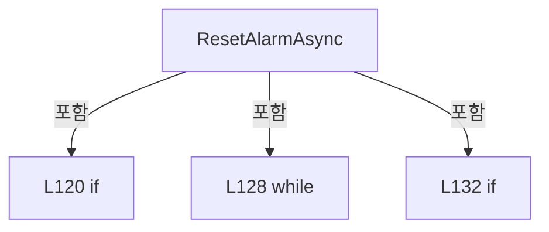

변경 전 점검: 입력/반환 타입, 위 호출자, 예외/취소 경로, 공유 상태와 저장·전송 소비자를 함께 확인합니다. 값의 단위나 물리 방향을 이름만으로 확정하지 않습니다.

### MethodDeclaration `Apply` · L138–161

[Drilling.UI/Menu/Menus/CMenuAlarm.cs:138–161](https://github.com/kjuws10-rgb/A3Drilling/blob/5aee8e58439c9b455cae7c9593c9be986c3e682e/Drilling.UI/Menu/Menus/CMenuAlarm.cs#L138-L161)

| 항목 | 실제 추출 값 |
| --- | --- |
| 서명 | void Drilling.UI.Menu.Menus.CMenuAlarm.Apply(System.Collections.Generic.IReadOnlyList<Drilling.UI.Menu.Menus.ST_DISPLAY_ITEM>, System.Collections.Generic.IReadOnlyList<Drilling.UI.Menu.Menus.ST_DISPLAY_ITEM>, System.Collections.Generic.IReadOnlyList<Drilling.UI.Menu.Menus.ST_DISPLAY_ITEM>, System.Collections.Generic.IReadOnlyList<Drilling.UI.Menu.Menus.ST_DISPLAY_ITEM>, System.Collections.Generic.IReadOnlyList<Drilling.UI.Menu.Menus.ST_DISPLAY_ITEM>, System.Collections.Generic.IReadOnlyList<Drilling.UI.Menu.Menus.ST_ALARM_CURRENT_ROW>, System.Collections.Generic.IReadOnlyList<Drilling.UI.Menu.Menus.ST_ALARM_DETAIL_ROW>, System.Collections.Generic.IReadOnlyList<Drilling.UI.Menu.Menus.ST_ALARM_HISTORY_ROW>, System.Collections.Generic.IReadOnlyList<Drilling.UI.Menu.Menus.ST_ALARM_TREND_BAR>, System.Collections.Generic.IReadOnlyList<Drilling.UI.Menu.Menus.ST_ALARM_SUMMARY_ITEM>) |
| 접근/수식자 | Private / private |
| 반환/값 타입 | void |
| 소속 타입 | NamedType:Drilling.UI.Menu.Menus.CMenuAlarm |

입력 계약:

| 이름 | 타입 | 전달 | 선택/기본값 |
| --- | --- | --- | --- |
| currentAlarms | System.Collections.Generic.IReadOnlyList<Drilling.UI.Menu.Menus.ST_DISPLAY_ITEM> | None | False /  |
| alarmDetail | System.Collections.Generic.IReadOnlyList<Drilling.UI.Menu.Menus.ST_DISPLAY_ITEM> | None | False /  |
| recoveryCommands | System.Collections.Generic.IReadOnlyList<Drilling.UI.Menu.Menus.ST_DISPLAY_ITEM> | None | False /  |
| history | System.Collections.Generic.IReadOnlyList<Drilling.UI.Menu.Menus.ST_DISPLAY_ITEM> | None | False /  |
| trend | System.Collections.Generic.IReadOnlyList<Drilling.UI.Menu.Menus.ST_DISPLAY_ITEM> | None | False /  |
| currentAlarmRows | System.Collections.Generic.IReadOnlyList<Drilling.UI.Menu.Menus.ST_ALARM_CURRENT_ROW> | None | False /  |
| detailRows | System.Collections.Generic.IReadOnlyList<Drilling.UI.Menu.Menus.ST_ALARM_DETAIL_ROW> | None | False /  |
| historyRows | System.Collections.Generic.IReadOnlyList<Drilling.UI.Menu.Menus.ST_ALARM_HISTORY_ROW> | None | False /  |
| trendBars | System.Collections.Generic.IReadOnlyList<Drilling.UI.Menu.Menus.ST_ALARM_TREND_BAR> | None | False /  |
| summaryItems | System.Collections.Generic.IReadOnlyList<Drilling.UI.Menu.Menus.ST_ALARM_SUMMARY_ITEM> | None | False /  |

정적 호출자로 확인된 위치:

| 호출 파일/행 | 호출 표현식 | 런타임 분기 가능 |
| --- | --- | --- |
| [Drilling.UI/Menu/Menus/CMenuAlarm.cs:97–112](https://github.com/kjuws10-rgb/A3Drilling/blob/5aee8e58439c9b455cae7c9593c9be986c3e682e/Drilling.UI/Menu/Menus/CMenuAlarm.cs#L97-L112) | Apply | False |

본문의 실제 연산·분기·예외·반환 순서(원문 위치 순):

| 원본 행 | 종류 | 주석 해설 |
| --- | --- | --- |
| 151 | assignment | 값을 대상에 대입합니다: CurrentAlarms = currentAlarms |
| 152 | assignment | 값을 대상에 대입합니다: AlarmDetail = alarmDetail |
| 153 | assignment | 값을 대상에 대입합니다: RecoveryCommands = recoveryCommands |
| 154 | assignment | 값을 대상에 대입합니다: History = history |
| 155 | assignment | 값을 대상에 대입합니다: Trend = trend |
| 156 | assignment | 값을 대상에 대입합니다: CurrentAlarmRows = currentAlarmRows |
| 157 | assignment | 값을 대상에 대입합니다: DetailRows = detailRows |
| 158 | assignment | 값을 대상에 대입합니다: HistoryRows = historyRows |
| 159 | assignment | 값을 대상에 대입합니다: TrendBars = trendBars |
| 160 | assignment | 값을 대상에 대입합니다: SummaryItems = summaryItems |

변경 전 점검: 입력/반환 타입, 위 호출자, 예외/취소 경로, 공유 상태와 저장·전송 소비자를 함께 확인합니다. 값의 단위나 물리 방향을 이름만으로 확정하지 않습니다.

### MethodDeclaration `BuildCurrentAlarmRows` · L163–173

[Drilling.UI/Menu/Menus/CMenuAlarm.cs:163–173](https://github.com/kjuws10-rgb/A3Drilling/blob/5aee8e58439c9b455cae7c9593c9be986c3e682e/Drilling.UI/Menu/Menus/CMenuAlarm.cs#L163-L173)

| 항목 | 실제 추출 값 |
| --- | --- |
| 서명 | System.Collections.Generic.IReadOnlyList<Drilling.UI.Menu.Menus.ST_ALARM_CURRENT_ROW> Drilling.UI.Menu.Menus.CMenuAlarm.BuildCurrentAlarmRows(System.Collections.Generic.IReadOnlyList<Drilling.Common.Alarm.ST_ALARM_DATA>) |
| 접근/수식자 | Private / private |
| 반환/값 타입 | System.Collections.Generic.IReadOnlyList<Drilling.UI.Menu.Menus.ST_ALARM_CURRENT_ROW> |
| 소속 타입 | NamedType:Drilling.UI.Menu.Menus.CMenuAlarm |

입력 계약:

| 이름 | 타입 | 전달 | 선택/기본값 |
| --- | --- | --- | --- |
| alarms | System.Collections.Generic.IReadOnlyList<Drilling.Common.Alarm.ST_ALARM_DATA> | None | False /  |

정적 호출자로 확인된 위치:

| 호출 파일/행 | 호출 표현식 | 런타임 분기 가능 |
| --- | --- | --- |
| [Drilling.UI/Menu/Menus/CMenuAlarm.cs:107–107](https://github.com/kjuws10-rgb/A3Drilling/blob/5aee8e58439c9b455cae7c9593c9be986c3e682e/Drilling.UI/Menu/Menus/CMenuAlarm.cs#L107-L107) | BuildCurrentAlarmRows | False |

호출하는 대상과 해석 범위:

| 원본 행 | 표현식 | 분석 상태 | 대상/소스 위치 |
| --- | --- | --- | --- |
| 165 | alarmManager.GetDefinitionsSnapshot().Rows.ToDictionary | resolved | System.Collections.Generic.Dictionary<int, string> System.Collections.Generic.IEnumerable<Drilling.Common.Alarm.ST_ALARM_DEFINITION>.ToDictionary<Drilling.Common.Alarm.ST_ALARM_DEFINITION, int, string>(System.Func<Drilling.Common.Alarm.ST_ALARM_DEFINITION, int>, System.Func<Drilling.Common.Alarm.ST_ALARM_DEFINITION, string>) |
| 165 | alarmManager.GetDefinitionsSnapshot | resolved | Drilling.Common.Alarm.ST_ALARM_DEFINITION_SNAPSHOT Drilling.Common.Alarm.CAlarmManager.GetDefinitionsSnapshot() · Drilling.Common/Alarm/CAlarmManager.cs:125 |
| 172 | alarms.Select(BuildAlarm).ToArray | resolved | Drilling.UI.Menu.Menus.ST_ALARM_CURRENT_ROW[] System.Collections.Generic.IEnumerable<Drilling.UI.Menu.Menus.ST_ALARM_CURRENT_ROW>.ToArray<Drilling.UI.Menu.Menus.ST_ALARM_CURRENT_ROW>() |
| 172 | alarms.Select | resolved | System.Collections.Generic.IEnumerable<Drilling.UI.Menu.Menus.ST_ALARM_CURRENT_ROW> System.Collections.Generic.IEnumerable<Drilling.Common.Alarm.ST_ALARM_DATA>.Select<Drilling.Common.Alarm.ST_ALARM_DATA, Drilling.UI.Menu.Menus.ST_ALARM_CURRENT_ROW>(System.Func<Drilling.Common.Alarm.ST_ALARM_DATA, int, Drilling.UI.Menu.Menus.ST_ALARM_CURRENT_ROW>) |

본문의 실제 연산·분기·예외·반환 순서(원문 위치 순):

| 원본 행 | 종류 | 주석 해설 |
| --- | --- | --- |
| 165 | call | 함수·델리게이트 또는 객체 생성자를 호출합니다: alarmManager.GetDefinitionsSnapshot().Rows.ToDictionary(row => row.Code, row => row.Group) |
| 165 | call | 함수·델리게이트 또는 객체 생성자를 호출합니다: alarmManager.GetDefinitionsSnapshot() |
| 165 | local-declaration | 지역 변수를 선언합니다: var groupsByCode = alarmManager.GetDefinitionsSnapshot().Rows.ToDictionary(row => row.Code, row => row.Group); |
| 165 | variable-initializer | 변수의 초기값을 지정합니다: groupsByCode = alarmManager.GetDefinitionsSnapshot().Rows.ToDictionary(row => row.Code, row => row.Group) |
| 172 | call | 함수·델리게이트 또는 객체 생성자를 호출합니다: alarms.Select(BuildAlarm).ToArray() |
| 172 | call | 함수·델리게이트 또는 객체 생성자를 호출합니다: alarms.Select(BuildAlarm) |
| 172 | return | 호출자에게 값 또는 제어를 반환합니다: return alarms.Select(BuildAlarm).ToArray(); |

변경 전 점검: 입력/반환 타입, 위 호출자, 예외/취소 경로, 공유 상태와 저장·전송 소비자를 함께 확인합니다. 값의 단위나 물리 방향을 이름만으로 확정하지 않습니다.

### LocalFunctionStatement `BuildAlarm` · L166–170

[Drilling.UI/Menu/Menus/CMenuAlarm.cs:166–170](https://github.com/kjuws10-rgb/A3Drilling/blob/5aee8e58439c9b455cae7c9593c9be986c3e682e/Drilling.UI/Menu/Menus/CMenuAlarm.cs#L166-L170)

| 항목 | 실제 추출 값 |
| --- | --- |
| 서명 | Drilling.UI.Menu.Menus.ST_ALARM_CURRENT_ROW BuildAlarm(Drilling.Common.Alarm.ST_ALARM_DATA, int) |
| 접근/수식자 | Private /  |
| 반환/값 타입 | Drilling.UI.Menu.Menus.ST_ALARM_CURRENT_ROW |
| 소속 타입 | NamedType:Drilling.UI.Menu.Menus.CMenuAlarm |

입력 계약:

| 이름 | 타입 | 전달 | 선택/기본값 |
| --- | --- | --- | --- |
| alarm | Drilling.Common.Alarm.ST_ALARM_DATA | None | False /  |
| index | int | None | False /  |

현재 부분 분석에서 직접 연결된 호출자는 없습니다. XAML/이벤트/인터페이스·델리게이트·외부 진입을 추가 확인해야 하며, 미사용으로 판정한 것이 아닙니다.

호출하는 대상과 해석 범위:

| 원본 행 | 표현식 | 분석 상태 | 대상/소스 위치 |
| --- | --- | --- | --- |
| 168 | groupsByCode.TryGetValue | resolved | bool System.Collections.Generic.Dictionary<int, string>.TryGetValue(int, out string) |
| 169 | new ST_ALARM_CURRENT_ROW | resolved | Drilling.UI.Menu.Menus.ST_ALARM_CURRENT_ROW.ST_ALARM_CURRENT_ROW(int, string, string, string, string, string, string, string) · Drilling.UI/Menu/Menus/CMenuAlarm.cs:517 |
| 169 | alarm.Code.ToString | resolved · 동적 구현 선택 가능 | string int.ToString() |
| 169 | FormatSeverity | resolved | string Drilling.UI.Menu.Menus.CMenuAlarm.FormatSeverity(Drilling.Common.Alarm.EN_ALARM_LEVEL) · Drilling.UI/Menu/Menus/CMenuAlarm.cs:192 |
| 169 | alarm.OccurredAt.ToString | resolved | string System.DateTimeOffset.ToString(string?) |

본문의 실제 연산·분기·예외·반환 순서(원문 위치 순):

| 원본 행 | 종류 | 주석 해설 |
| --- | --- | --- |
| 168 | call | 함수·델리게이트 또는 객체 생성자를 호출합니다: groupsByCode.TryGetValue(alarm.Code, out var definedGroup) |
| 168 | conditional-expression | 조건에 따라 결과식을 선택합니다: groupsByCode.TryGetValue(alarm.Code, out var definedGroup) ? definedGroup : alarm.Group |
| 168 | local-declaration | 지역 변수를 선언합니다: var group = groupsByCode.TryGetValue(alarm.Code, out var definedGroup) ? definedGroup : alarm.Group; |
| 168 | variable-initializer | 변수의 초기값을 지정합니다: group = groupsByCode.TryGetValue(alarm.Code, out var definedGroup) ? definedGroup : alarm.Group |
| 169 | call | 함수·델리게이트 또는 객체 생성자를 호출합니다: new ST_ALARM_CURRENT_ROW(index + 1, alarm.Code.ToString(), FormatSeverity(alarm.Severity), group, alarm.Message, alarm.Message, alarm.RecoveryAction, alarm.OccurredAt.ToString("yyyy-MM-dd HH:mm:ss")) |
| 169 | call | 함수·델리게이트 또는 객체 생성자를 호출합니다: alarm.Code.ToString() |
| 169 | call | 함수·델리게이트 또는 객체 생성자를 호출합니다: FormatSeverity(alarm.Severity) |
| 169 | call | 함수·델리게이트 또는 객체 생성자를 호출합니다: alarm.OccurredAt.ToString("yyyy-MM-dd HH:mm:ss") |
| 169 | return | 호출자에게 값 또는 제어를 반환합니다: return new ST_ALARM_CURRENT_ROW(index + 1, alarm.Code.ToString(), FormatSeverity(alarm.Severity), group, alarm.Message, alarm.Message, alarm.RecoveryAction, alarm.OccurredAt.ToString("yyyy-MM-dd HH:mm:ss")); |

변경 전 점검: 입력/반환 타입, 위 호출자, 예외/취소 경로, 공유 상태와 저장·전송 소비자를 함께 확인합니다. 값의 단위나 물리 방향을 이름만으로 확정하지 않습니다.

### MethodDeclaration `BuildDetailRows` · L175–190

[Drilling.UI/Menu/Menus/CMenuAlarm.cs:175–190](https://github.com/kjuws10-rgb/A3Drilling/blob/5aee8e58439c9b455cae7c9593c9be986c3e682e/Drilling.UI/Menu/Menus/CMenuAlarm.cs#L175-L190)

| 항목 | 실제 추출 값 |
| --- | --- |
| 서명 | System.Collections.Generic.IReadOnlyList<Drilling.UI.Menu.Menus.ST_ALARM_DETAIL_ROW> Drilling.UI.Menu.Menus.CMenuAlarm.BuildDetailRows(Drilling.Common.Alarm.ST_ALARM_DATA?) |
| 접근/수식자 | Private / private, static |
| 반환/값 타입 | System.Collections.Generic.IReadOnlyList<Drilling.UI.Menu.Menus.ST_ALARM_DETAIL_ROW> |
| 소속 타입 | NamedType:Drilling.UI.Menu.Menus.CMenuAlarm |

입력 계약:

| 이름 | 타입 | 전달 | 선택/기본값 |
| --- | --- | --- | --- |
| alarm | Drilling.Common.Alarm.ST_ALARM_DATA? | None | False /  |

정적 호출자로 확인된 위치:

| 호출 파일/행 | 호출 표현식 | 런타임 분기 가능 |
| --- | --- | --- |
| [Drilling.UI/Menu/Menus/CMenuAlarm.cs:108–108](https://github.com/kjuws10-rgb/A3Drilling/blob/5aee8e58439c9b455cae7c9593c9be986c3e682e/Drilling.UI/Menu/Menus/CMenuAlarm.cs#L108-L108) | BuildDetailRows | False |

호출하는 대상과 해석 범위:

| 원본 행 | 표현식 | 분석 상태 | 대상/소스 위치 |
| --- | --- | --- | --- |
| 179 | new | resolved | Drilling.UI.Menu.Menus.ST_ALARM_DETAIL_ROW.ST_ALARM_DETAIL_ROW(string, string, string) · Drilling.UI/Menu/Menus/CMenuAlarm.cs:534 |
| 179 | new | resolved | Drilling.UI.Menu.Menus.ST_ALARM_DETAIL_ROW.ST_ALARM_DETAIL_ROW(string, string, string) · Drilling.UI/Menu/Menus/CMenuAlarm.cs:534 |
| 179 | new | resolved | Drilling.UI.Menu.Menus.ST_ALARM_DETAIL_ROW.ST_ALARM_DETAIL_ROW(string, string, string) · Drilling.UI/Menu/Menus/CMenuAlarm.cs:534 |
| 179 | new | resolved | Drilling.UI.Menu.Menus.ST_ALARM_DETAIL_ROW.ST_ALARM_DETAIL_ROW(string, string, string) · Drilling.UI/Menu/Menus/CMenuAlarm.cs:534 |
| 179 | new | resolved | Drilling.UI.Menu.Menus.ST_ALARM_DETAIL_ROW.ST_ALARM_DETAIL_ROW(string, string, string) · Drilling.UI/Menu/Menus/CMenuAlarm.cs:534 |
| 182 | FormatSeverity | resolved | string Drilling.UI.Menu.Menus.CMenuAlarm.FormatSeverity(Drilling.Common.Alarm.EN_ALARM_LEVEL) · Drilling.UI/Menu/Menus/CMenuAlarm.cs:192 |
| 184 | new | resolved | Drilling.UI.Menu.Menus.ST_ALARM_DETAIL_ROW.ST_ALARM_DETAIL_ROW(string, string, string) · Drilling.UI/Menu/Menus/CMenuAlarm.cs:534 |
| 184 | alarm.Code.ToString | resolved · 동적 구현 선택 가능 | string int.ToString() |
| 184 | SeverityState | resolved | string Drilling.UI.Menu.Menus.CMenuAlarm.SeverityState(Drilling.Common.Alarm.EN_ALARM_LEVEL) · Drilling.UI/Menu/Menus/CMenuAlarm.cs:202 |
| 185 | new | resolved | Drilling.UI.Menu.Menus.ST_ALARM_DETAIL_ROW.ST_ALARM_DETAIL_ROW(string, string, string) · Drilling.UI/Menu/Menus/CMenuAlarm.cs:534 |
| 186 | new | resolved | Drilling.UI.Menu.Menus.ST_ALARM_DETAIL_ROW.ST_ALARM_DETAIL_ROW(string, string, string) · Drilling.UI/Menu/Menus/CMenuAlarm.cs:534 |
| 186 | SeverityState | resolved | string Drilling.UI.Menu.Menus.CMenuAlarm.SeverityState(Drilling.Common.Alarm.EN_ALARM_LEVEL) · Drilling.UI/Menu/Menus/CMenuAlarm.cs:202 |
| 187 | new | resolved | Drilling.UI.Menu.Menus.ST_ALARM_DETAIL_ROW.ST_ALARM_DETAIL_ROW(string, string, string) · Drilling.UI/Menu/Menus/CMenuAlarm.cs:534 |
| 187 | alarm.OccurredAt.ToString | resolved | string System.DateTimeOffset.ToString(string?) |
| 188 | new | resolved | Drilling.UI.Menu.Menus.ST_ALARM_DETAIL_ROW.ST_ALARM_DETAIL_ROW(string, string, string) · Drilling.UI/Menu/Menus/CMenuAlarm.cs:534 |

본문의 실제 연산·분기·예외·반환 순서(원문 위치 순):

| 원본 행 | 종류 | 주석 해설 |
| --- | --- | --- |
| 177 | if | 조건에 따라 분기합니다: if (alarm is null) |
| 179 | call | 함수·델리게이트 또는 객체 생성자를 호출합니다: new("Selected Code", "-") |
| 179 | call | 함수·델리게이트 또는 객체 생성자를 호출합니다: new("Device", "-") |
| 179 | call | 함수·델리게이트 또는 객체 생성자를 호출합니다: new("Level", "CLEAR", "Ok") |
| 179 | call | 함수·델리게이트 또는 객체 생성자를 호출합니다: new("Occurred Time", "-") |
| 179 | call | 함수·델리게이트 또는 객체 생성자를 호출합니다: new("Message", "No active alarm") |
| 179 | return | 호출자에게 값 또는 제어를 반환합니다: return[new("Selected Code", "-"), new("Device", "-"), new("Level", "CLEAR", "Ok"), new("Occurred Time", "-"), new("Message", "No active alarm")]; |
| 182 | call | 함수·델리게이트 또는 객체 생성자를 호출합니다: FormatSeverity(alarm.Severity) |
| 182 | local-declaration | 지역 변수를 선언합니다: var severity = FormatSeverity(alarm.Severity); |
| 182 | variable-initializer | 변수의 초기값을 지정합니다: severity = FormatSeverity(alarm.Severity) |
| 183 | return | 호출자에게 값 또는 제어를 반환합니다: return[ new("Selected Code", alarm.Code.ToString(), SeverityState(alarm.Severity)), new("Device", alarm.Device), new("Level", severity, SeverityState(alarm.Severity)), new("Occurred Time", alarm.OccurredAt.ToString("yyyy-MM-dd HH: |
| 184 | call | 함수·델리게이트 또는 객체 생성자를 호출합니다: new("Selected Code", alarm.Code.ToString(), SeverityState(alarm.Severity)) |
| 184 | call | 함수·델리게이트 또는 객체 생성자를 호출합니다: alarm.Code.ToString() |
| 184 | call | 함수·델리게이트 또는 객체 생성자를 호출합니다: SeverityState(alarm.Severity) |
| 185 | call | 함수·델리게이트 또는 객체 생성자를 호출합니다: new("Device", alarm.Device) |
| 186 | call | 함수·델리게이트 또는 객체 생성자를 호출합니다: new("Level", severity, SeverityState(alarm.Severity)) |
| 186 | call | 함수·델리게이트 또는 객체 생성자를 호출합니다: SeverityState(alarm.Severity) |
| 187 | call | 함수·델리게이트 또는 객체 생성자를 호출합니다: new("Occurred Time", alarm.OccurredAt.ToString("yyyy-MM-dd HH:mm:ss")) |
| 187 | call | 함수·델리게이트 또는 객체 생성자를 호출합니다: alarm.OccurredAt.ToString("yyyy-MM-dd HH:mm:ss") |
| 188 | call | 함수·델리게이트 또는 객체 생성자를 호출합니다: new("Message", alarm.Message) |

제어 구문의 포함 구조(실제 실행 순서/CFG가 아닌 구문 탐색 그림):

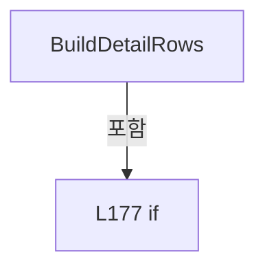

변경 전 점검: 입력/반환 타입, 위 호출자, 예외/취소 경로, 공유 상태와 저장·전송 소비자를 함께 확인합니다. 값의 단위나 물리 방향을 이름만으로 확정하지 않습니다.

### MethodDeclaration `FormatSeverity` · L192–200

[Drilling.UI/Menu/Menus/CMenuAlarm.cs:192–200](https://github.com/kjuws10-rgb/A3Drilling/blob/5aee8e58439c9b455cae7c9593c9be986c3e682e/Drilling.UI/Menu/Menus/CMenuAlarm.cs#L192-L200)

| 항목 | 실제 추출 값 |
| --- | --- |
| 서명 | string Drilling.UI.Menu.Menus.CMenuAlarm.FormatSeverity(Drilling.Common.Alarm.EN_ALARM_LEVEL) |
| 접근/수식자 | Private / private, static |
| 반환/값 타입 | string |
| 소속 타입 | NamedType:Drilling.UI.Menu.Menus.CMenuAlarm |

입력 계약:

| 이름 | 타입 | 전달 | 선택/기본값 |
| --- | --- | --- | --- |
| severity | Drilling.Common.Alarm.EN_ALARM_LEVEL | None | False /  |

정적 호출자로 확인된 위치:

| 호출 파일/행 | 호출 표현식 | 런타임 분기 가능 |
| --- | --- | --- |
| [Drilling.UI/Menu/Menus/CMenuAlarm.cs:169–169](https://github.com/kjuws10-rgb/A3Drilling/blob/5aee8e58439c9b455cae7c9593c9be986c3e682e/Drilling.UI/Menu/Menus/CMenuAlarm.cs#L169-L169) | FormatSeverity | False |
| [Drilling.UI/Menu/Menus/CMenuAlarm.cs:182–182](https://github.com/kjuws10-rgb/A3Drilling/blob/5aee8e58439c9b455cae7c9593c9be986c3e682e/Drilling.UI/Menu/Menus/CMenuAlarm.cs#L182-L182) | FormatSeverity | False |

본문의 실제 연산·분기·예외·반환 순서(원문 위치 순):

| 원본 행 | 종류 | 주석 해설 |
| --- | --- | --- |
| 194 | return | 호출자에게 값 또는 제어를 반환합니다: return severity switch { EN_ALARM_LEVEL.Warning => "LIGHT", EN_ALARM_LEVEL.Critical => "HEAVY", _ => "INFO" }; |
| 194 | switch-expression | 값별 결과식을 선택합니다: severity switch { EN_ALARM_LEVEL.Warning => "LIGHT", EN_ALARM_LEVEL.Critical => "HEAVY", _ => "INFO" } |

제어 구문의 포함 구조(실제 실행 순서/CFG가 아닌 구문 탐색 그림):

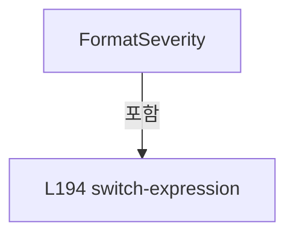

변경 전 점검: 입력/반환 타입, 위 호출자, 예외/취소 경로, 공유 상태와 저장·전송 소비자를 함께 확인합니다. 값의 단위나 물리 방향을 이름만으로 확정하지 않습니다.

### MethodDeclaration `SeverityState` · L202–210

[Drilling.UI/Menu/Menus/CMenuAlarm.cs:202–210](https://github.com/kjuws10-rgb/A3Drilling/blob/5aee8e58439c9b455cae7c9593c9be986c3e682e/Drilling.UI/Menu/Menus/CMenuAlarm.cs#L202-L210)

| 항목 | 실제 추출 값 |
| --- | --- |
| 서명 | string Drilling.UI.Menu.Menus.CMenuAlarm.SeverityState(Drilling.Common.Alarm.EN_ALARM_LEVEL) |
| 접근/수식자 | Private / private, static |
| 반환/값 타입 | string |
| 소속 타입 | NamedType:Drilling.UI.Menu.Menus.CMenuAlarm |

입력 계약:

| 이름 | 타입 | 전달 | 선택/기본값 |
| --- | --- | --- | --- |
| severity | Drilling.Common.Alarm.EN_ALARM_LEVEL | None | False /  |

정적 호출자로 확인된 위치:

| 호출 파일/행 | 호출 표현식 | 런타임 분기 가능 |
| --- | --- | --- |
| [Drilling.UI/Menu/Menus/CMenuAlarm.cs:184–184](https://github.com/kjuws10-rgb/A3Drilling/blob/5aee8e58439c9b455cae7c9593c9be986c3e682e/Drilling.UI/Menu/Menus/CMenuAlarm.cs#L184-L184) | SeverityState | False |
| [Drilling.UI/Menu/Menus/CMenuAlarm.cs:186–186](https://github.com/kjuws10-rgb/A3Drilling/blob/5aee8e58439c9b455cae7c9593c9be986c3e682e/Drilling.UI/Menu/Menus/CMenuAlarm.cs#L186-L186) | SeverityState | False |

본문의 실제 연산·분기·예외·반환 순서(원문 위치 순):

| 원본 행 | 종류 | 주석 해설 |
| --- | --- | --- |
| 204 | return | 호출자에게 값 또는 제어를 반환합니다: return severity switch { EN_ALARM_LEVEL.Warning => "Warn", EN_ALARM_LEVEL.Critical => "Critical", _ => "Accent" }; |
| 204 | switch-expression | 값별 결과식을 선택합니다: severity switch { EN_ALARM_LEVEL.Warning => "Warn", EN_ALARM_LEVEL.Critical => "Critical", _ => "Accent" } |

제어 구문의 포함 구조(실제 실행 순서/CFG가 아닌 구문 탐색 그림):

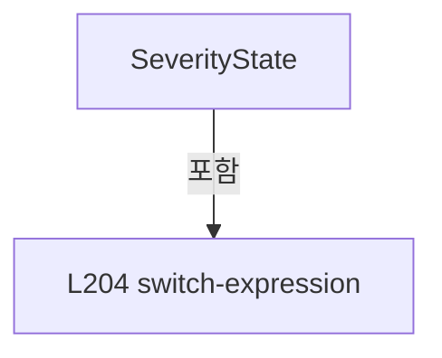

변경 전 점검: 입력/반환 타입, 위 호출자, 예외/취소 경로, 공유 상태와 저장·전송 소비자를 함께 확인합니다. 값의 단위나 물리 방향을 이름만으로 확정하지 않습니다.

### FieldDeclaration `_read` · L215–215

[Drilling.UI/Menu/Menus/CMenuAlarm.cs:215–215](https://github.com/kjuws10-rgb/A3Drilling/blob/5aee8e58439c9b455cae7c9593c9be986c3e682e/Drilling.UI/Menu/Menus/CMenuAlarm.cs#L215-L215)

| 항목 | 실제 추출 값 |
| --- | --- |
| 서명 | System.Func<System.DateTime, System.DateTime, System.Threading.CancellationToken, Drilling.Common.Alarm.ST_ALARM_HISTORY_RESULT> Drilling.UI.Menu.Menus.CAlarmHistoryPanel._read |
| 접근/수식자 | Private / private, readonly |
| 반환/값 타입 | System.Func<System.DateTime, System.DateTime, System.Threading.CancellationToken, Drilling.Common.Alarm.ST_ALARM_HISTORY_RESULT> |
| 소속 타입 | NamedType:Drilling.UI.Menu.Menus.CAlarmHistoryPanel |

현재 부분 분석에서 직접 연결된 호출자는 없습니다. XAML/이벤트/인터페이스·델리게이트·외부 진입을 추가 확인해야 하며, 미사용으로 판정한 것이 아닙니다.

변경 전 점검: 입력/반환 타입, 위 호출자, 예외/취소 경로, 공유 상태와 저장·전송 소비자를 함께 확인합니다. 값의 단위나 물리 방향을 이름만으로 확정하지 않습니다.

### FieldDeclaration `_now` · L216–216

[Drilling.UI/Menu/Menus/CMenuAlarm.cs:216–216](https://github.com/kjuws10-rgb/A3Drilling/blob/5aee8e58439c9b455cae7c9593c9be986c3e682e/Drilling.UI/Menu/Menus/CMenuAlarm.cs#L216-L216)

| 항목 | 실제 추출 값 |
| --- | --- |
| 서명 | System.Func<System.DateTime> Drilling.UI.Menu.Menus.CAlarmHistoryPanel._now |
| 접근/수식자 | Private / private, readonly |
| 반환/값 타입 | System.Func<System.DateTime> |
| 소속 타입 | NamedType:Drilling.UI.Menu.Menus.CAlarmHistoryPanel |

현재 부분 분석에서 직접 연결된 호출자는 없습니다. XAML/이벤트/인터페이스·델리게이트·외부 진입을 추가 확인해야 하며, 미사용으로 판정한 것이 아닙니다.

변경 전 점검: 입력/반환 타입, 위 호출자, 예외/취소 경로, 공유 상태와 저장·전송 소비자를 함께 확인합니다. 값의 단위나 물리 방향을 이름만으로 확정하지 않습니다.

### FieldDeclaration `_from` · L217–217

[Drilling.UI/Menu/Menus/CMenuAlarm.cs:217–217](https://github.com/kjuws10-rgb/A3Drilling/blob/5aee8e58439c9b455cae7c9593c9be986c3e682e/Drilling.UI/Menu/Menus/CMenuAlarm.cs#L217-L217)

| 항목 | 실제 추출 값 |
| --- | --- |
| 서명 | System.DateTime? Drilling.UI.Menu.Menus.CAlarmHistoryPanel._from |
| 접근/수식자 | Private / private |
| 반환/값 타입 | System.DateTime? |
| 소속 타입 | NamedType:Drilling.UI.Menu.Menus.CAlarmHistoryPanel |

현재 부분 분석에서 직접 연결된 호출자는 없습니다. XAML/이벤트/인터페이스·델리게이트·외부 진입을 추가 확인해야 하며, 미사용으로 판정한 것이 아닙니다.

본문의 실제 연산·분기·예외·반환 순서(원문 위치 순):

| 원본 행 | 종류 | 주석 해설 |
| --- | --- | --- |
| 217 | variable-initializer | 변수의 초기값을 지정합니다: _from = DateTime.Today |

변경 전 점검: 입력/반환 타입, 위 호출자, 예외/취소 경로, 공유 상태와 저장·전송 소비자를 함께 확인합니다. 값의 단위나 물리 방향을 이름만으로 확정하지 않습니다.

### FieldDeclaration `_through` · L218–218

[Drilling.UI/Menu/Menus/CMenuAlarm.cs:218–218](https://github.com/kjuws10-rgb/A3Drilling/blob/5aee8e58439c9b455cae7c9593c9be986c3e682e/Drilling.UI/Menu/Menus/CMenuAlarm.cs#L218-L218)

| 항목 | 실제 추출 값 |
| --- | --- |
| 서명 | System.DateTime? Drilling.UI.Menu.Menus.CAlarmHistoryPanel._through |
| 접근/수식자 | Private / private |
| 반환/값 타입 | System.DateTime? |
| 소속 타입 | NamedType:Drilling.UI.Menu.Menus.CAlarmHistoryPanel |

현재 부분 분석에서 직접 연결된 호출자는 없습니다. XAML/이벤트/인터페이스·델리게이트·외부 진입을 추가 확인해야 하며, 미사용으로 판정한 것이 아닙니다.

본문의 실제 연산·분기·예외·반환 순서(원문 위치 순):

| 원본 행 | 종류 | 주석 해설 |
| --- | --- | --- |
| 218 | variable-initializer | 변수의 초기값을 지정합니다: _through = DateTime.Today |

변경 전 점검: 입력/반환 타입, 위 호출자, 예외/취소 경로, 공유 상태와 저장·전송 소비자를 함께 확인합니다. 값의 단위나 물리 방향을 이름만으로 확정하지 않습니다.

### FieldDeclaration `_fromTime` · L219–219

[Drilling.UI/Menu/Menus/CMenuAlarm.cs:219–219](https://github.com/kjuws10-rgb/A3Drilling/blob/5aee8e58439c9b455cae7c9593c9be986c3e682e/Drilling.UI/Menu/Menus/CMenuAlarm.cs#L219-L219)

| 항목 | 실제 추출 값 |
| --- | --- |
| 서명 | string Drilling.UI.Menu.Menus.CAlarmHistoryPanel._fromTime |
| 접근/수식자 | Private / private |
| 반환/값 타입 | string |
| 소속 타입 | NamedType:Drilling.UI.Menu.Menus.CAlarmHistoryPanel |

현재 부분 분석에서 직접 연결된 호출자는 없습니다. XAML/이벤트/인터페이스·델리게이트·외부 진입을 추가 확인해야 하며, 미사용으로 판정한 것이 아닙니다.

본문의 실제 연산·분기·예외·반환 순서(원문 위치 순):

| 원본 행 | 종류 | 주석 해설 |
| --- | --- | --- |
| 219 | variable-initializer | 변수의 초기값을 지정합니다: _fromTime = "00:00:00" |

변경 전 점검: 입력/반환 타입, 위 호출자, 예외/취소 경로, 공유 상태와 저장·전송 소비자를 함께 확인합니다. 값의 단위나 물리 방향을 이름만으로 확정하지 않습니다.

### FieldDeclaration `_throughTime` · L220–220

[Drilling.UI/Menu/Menus/CMenuAlarm.cs:220–220](https://github.com/kjuws10-rgb/A3Drilling/blob/5aee8e58439c9b455cae7c9593c9be986c3e682e/Drilling.UI/Menu/Menus/CMenuAlarm.cs#L220-L220)

| 항목 | 실제 추출 값 |
| --- | --- |
| 서명 | string Drilling.UI.Menu.Menus.CAlarmHistoryPanel._throughTime |
| 접근/수식자 | Private / private |
| 반환/값 타입 | string |
| 소속 타입 | NamedType:Drilling.UI.Menu.Menus.CAlarmHistoryPanel |

현재 부분 분석에서 직접 연결된 호출자는 없습니다. XAML/이벤트/인터페이스·델리게이트·외부 진입을 추가 확인해야 하며, 미사용으로 판정한 것이 아닙니다.

본문의 실제 연산·분기·예외·반환 순서(원문 위치 순):

| 원본 행 | 종류 | 주석 해설 |
| --- | --- | --- |
| 220 | variable-initializer | 변수의 초기값을 지정합니다: _throughTime = "00:00:00" |

변경 전 점검: 입력/반환 타입, 위 호출자, 예외/취소 경로, 공유 상태와 저장·전송 소비자를 함께 확인합니다. 값의 단위나 물리 방향을 이름만으로 확정하지 않습니다.

### FieldDeclaration `_hasOpened` · L221–221

[Drilling.UI/Menu/Menus/CMenuAlarm.cs:221–221](https://github.com/kjuws10-rgb/A3Drilling/blob/5aee8e58439c9b455cae7c9593c9be986c3e682e/Drilling.UI/Menu/Menus/CMenuAlarm.cs#L221-L221)

| 항목 | 실제 추출 값 |
| --- | --- |
| 서명 | bool Drilling.UI.Menu.Menus.CAlarmHistoryPanel._hasOpened |
| 접근/수식자 | Private / private |
| 반환/값 타입 | bool |
| 소속 타입 | NamedType:Drilling.UI.Menu.Menus.CAlarmHistoryPanel |

현재 부분 분석에서 직접 연결된 호출자는 없습니다. XAML/이벤트/인터페이스·델리게이트·외부 진입을 추가 확인해야 하며, 미사용으로 판정한 것이 아닙니다.

변경 전 점검: 입력/반환 타입, 위 호출자, 예외/취소 경로, 공유 상태와 저장·전송 소비자를 함께 확인합니다. 값의 단위나 물리 방향을 이름만으로 확정하지 않습니다.

### FieldDeclaration `_isCodeView` · L222–222

[Drilling.UI/Menu/Menus/CMenuAlarm.cs:222–222](https://github.com/kjuws10-rgb/A3Drilling/blob/5aee8e58439c9b455cae7c9593c9be986c3e682e/Drilling.UI/Menu/Menus/CMenuAlarm.cs#L222-L222)

| 항목 | 실제 추출 값 |
| --- | --- |
| 서명 | bool Drilling.UI.Menu.Menus.CAlarmHistoryPanel._isCodeView |
| 접근/수식자 | Private / private |
| 반환/값 타입 | bool |
| 소속 타입 | NamedType:Drilling.UI.Menu.Menus.CAlarmHistoryPanel |

현재 부분 분석에서 직접 연결된 호출자는 없습니다. XAML/이벤트/인터페이스·델리게이트·외부 진입을 추가 확인해야 하며, 미사용으로 판정한 것이 아닙니다.

본문의 실제 연산·분기·예외·반환 순서(원문 위치 순):

| 원본 행 | 종류 | 주석 해설 |
| --- | --- | --- |
| 222 | variable-initializer | 변수의 초기값을 지정합니다: _isCodeView = true |

변경 전 점검: 입력/반환 타입, 위 호출자, 예외/취소 경로, 공유 상태와 저장·전송 소비자를 함께 확인합니다. 값의 단위나 물리 방향을 이름만으로 확정하지 않습니다.

### FieldDeclaration `_loadedRows` · L223–223

[Drilling.UI/Menu/Menus/CMenuAlarm.cs:223–223](https://github.com/kjuws10-rgb/A3Drilling/blob/5aee8e58439c9b455cae7c9593c9be986c3e682e/Drilling.UI/Menu/Menus/CMenuAlarm.cs#L223-L223)

| 항목 | 실제 추출 값 |
| --- | --- |
| 서명 | System.Collections.Generic.IReadOnlyList<Drilling.Common.Alarm.ST_ALARM_HISTORY_ENTRY> Drilling.UI.Menu.Menus.CAlarmHistoryPanel._loadedRows |
| 접근/수식자 | Private / private |
| 반환/값 타입 | System.Collections.Generic.IReadOnlyList<Drilling.Common.Alarm.ST_ALARM_HISTORY_ENTRY> |
| 소속 타입 | NamedType:Drilling.UI.Menu.Menus.CAlarmHistoryPanel |

현재 부분 분석에서 직접 연결된 호출자는 없습니다. XAML/이벤트/인터페이스·델리게이트·외부 진입을 추가 확인해야 하며, 미사용으로 판정한 것이 아닙니다.

본문의 실제 연산·분기·예외·반환 순서(원문 위치 순):

| 원본 행 | 종류 | 주석 해설 |
| --- | --- | --- |
| 223 | variable-initializer | 변수의 초기값을 지정합니다: _loadedRows = [] |

변경 전 점검: 입력/반환 타입, 위 호출자, 예외/취소 경로, 공유 상태와 저장·전송 소비자를 함께 확인합니다. 값의 단위나 물리 방향을 이름만으로 확정하지 않습니다.

### FieldDeclaration `_searchedFrom` · L224–224

[Drilling.UI/Menu/Menus/CMenuAlarm.cs:224–224](https://github.com/kjuws10-rgb/A3Drilling/blob/5aee8e58439c9b455cae7c9593c9be986c3e682e/Drilling.UI/Menu/Menus/CMenuAlarm.cs#L224-L224)

| 항목 | 실제 추출 값 |
| --- | --- |
| 서명 | System.DateTime? Drilling.UI.Menu.Menus.CAlarmHistoryPanel._searchedFrom |
| 접근/수식자 | Private / private |
| 반환/값 타입 | System.DateTime? |
| 소속 타입 | NamedType:Drilling.UI.Menu.Menus.CAlarmHistoryPanel |

현재 부분 분석에서 직접 연결된 호출자는 없습니다. XAML/이벤트/인터페이스·델리게이트·외부 진입을 추가 확인해야 하며, 미사용으로 판정한 것이 아닙니다.

변경 전 점검: 입력/반환 타입, 위 호출자, 예외/취소 경로, 공유 상태와 저장·전송 소비자를 함께 확인합니다. 값의 단위나 물리 방향을 이름만으로 확정하지 않습니다.

### FieldDeclaration `_searchedThrough` · L225–225

[Drilling.UI/Menu/Menus/CMenuAlarm.cs:225–225](https://github.com/kjuws10-rgb/A3Drilling/blob/5aee8e58439c9b455cae7c9593c9be986c3e682e/Drilling.UI/Menu/Menus/CMenuAlarm.cs#L225-L225)

| 항목 | 실제 추출 값 |
| --- | --- |
| 서명 | System.DateTime? Drilling.UI.Menu.Menus.CAlarmHistoryPanel._searchedThrough |
| 접근/수식자 | Private / private |
| 반환/값 타입 | System.DateTime? |
| 소속 타입 | NamedType:Drilling.UI.Menu.Menus.CAlarmHistoryPanel |

현재 부분 분석에서 직접 연결된 호출자는 없습니다. XAML/이벤트/인터페이스·델리게이트·외부 진입을 추가 확인해야 하며, 미사용으로 판정한 것이 아닙니다.

변경 전 점검: 입력/반환 타입, 위 호출자, 예외/취소 경로, 공유 상태와 저장·전송 소비자를 함께 확인합니다. 값의 단위나 물리 방향을 이름만으로 확정하지 않습니다.

### ConstructorDeclaration `.ctor` · L226–235

[Drilling.UI/Menu/Menus/CMenuAlarm.cs:226–235](https://github.com/kjuws10-rgb/A3Drilling/blob/5aee8e58439c9b455cae7c9593c9be986c3e682e/Drilling.UI/Menu/Menus/CMenuAlarm.cs#L226-L235)

| 항목 | 실제 추출 값 |
| --- | --- |
| 서명 | Drilling.UI.Menu.Menus.CAlarmHistoryPanel.CAlarmHistoryPanel(System.Func<System.DateTime, System.DateTime, System.Threading.CancellationToken, Drilling.Common.Alarm.ST_ALARM_HISTORY_RESULT>, System.Func<System.DateTime>?) |
| 접근/수식자 | Public / public |
| 반환/값 타입 | void |
| 소속 타입 | NamedType:Drilling.UI.Menu.Menus.CAlarmHistoryPanel |

입력 계약:

| 이름 | 타입 | 전달 | 선택/기본값 |
| --- | --- | --- | --- |
| read | System.Func<System.DateTime, System.DateTime, System.Threading.CancellationToken, Drilling.Common.Alarm.ST_ALARM_HISTORY_RESULT> | None | False /  |
| now | System.Func<System.DateTime>? | None | True / null |

정적 호출자로 확인된 위치:

| 호출 파일/행 | 호출 표현식 | 런타임 분기 가능 |
| --- | --- | --- |
| [Drilling.UI/Menu/Menus/CMenuAlarm.cs:35–35](https://github.com/kjuws10-rgb/A3Drilling/blob/5aee8e58439c9b455cae7c9593c9be986c3e682e/Drilling.UI/Menu/Menus/CMenuAlarm.cs#L35-L35) | new | False |

호출하는 대상과 해석 범위:

| 원본 행 | 표현식 | 분석 상태 | 대상/소스 위치 |
| --- | --- | --- | --- |
| 230 | SetDefaultRange | resolved | void Drilling.UI.Menu.Menus.CAlarmHistoryPanel.SetDefaultRange() · Drilling.UI/Menu/Menus/CMenuAlarm.cs:300 |
| 231 | new | resolved | Drilling.UI.Menu.CButtonCommand.CButtonCommand(System.Action<object?>, System.Predicate<object?>?) · Drilling.UI/Menu/CButtonCommand.cs:9 |
| 231 | SearchAsync | resolved | System.Threading.Tasks.Task Drilling.UI.Menu.Menus.CAlarmHistoryPanel.SearchAsync() · Drilling.UI/Menu/Menus/CMenuAlarm.cs:355 |
| 232 | new | resolved | Drilling.UI.Menu.CButtonCommand.CButtonCommand(System.Action<object?>, System.Predicate<object?>?) · Drilling.UI/Menu/CButtonCommand.cs:9 |
| 232 | SearchLast24HoursAsync | resolved | System.Threading.Tasks.Task Drilling.UI.Menu.Menus.CAlarmHistoryPanel.SearchLast24HoursAsync() · Drilling.UI/Menu/Menus/CMenuAlarm.cs:340 |
| 233 | new | resolved | Drilling.UI.Menu.CButtonCommand.CButtonCommand(System.Action<object?>, System.Predicate<object?>?) · Drilling.UI/Menu/CButtonCommand.cs:9 |
| 233 | SelectTrendView | resolved | void Drilling.UI.Menu.Menus.CAlarmHistoryPanel.SelectTrendView(bool) · Drilling.UI/Menu/Menus/CMenuAlarm.cs:308 |
| 234 | new | resolved | Drilling.UI.Menu.CButtonCommand.CButtonCommand(System.Action<object?>, System.Predicate<object?>?) · Drilling.UI/Menu/CButtonCommand.cs:9 |
| 234 | SelectTrendView | resolved | void Drilling.UI.Menu.Menus.CAlarmHistoryPanel.SelectTrendView(bool) · Drilling.UI/Menu/Menus/CMenuAlarm.cs:308 |

본문의 실제 연산·분기·예외·반환 순서(원문 위치 순):

| 원본 행 | 종류 | 주석 해설 |
| --- | --- | --- |
| 228 | assignment | 값을 대상에 대입합니다: _read = read |
| 229 | assignment | 값을 대상에 대입합니다: _now = now ?? (() => DateTime.Now) |
| 230 | call | 함수·델리게이트 또는 객체 생성자를 호출합니다: SetDefaultRange() |
| 231 | assignment | 값을 대상에 대입합니다: SearchCommand = new(async _ => await SearchAsync(), _ => !IsBusy) |
| 231 | await | 비동기 완료를 기다립니다: await SearchAsync() |
| 231 | call | 함수·델리게이트 또는 객체 생성자를 호출합니다: new(async _ => await SearchAsync(), _ => !IsBusy) |
| 231 | call | 함수·델리게이트 또는 객체 생성자를 호출합니다: SearchAsync() |
| 232 | assignment | 값을 대상에 대입합니다: Last24HoursCommand = new(async _ => await SearchLast24HoursAsync(), _ => !IsBusy) |
| 232 | await | 비동기 완료를 기다립니다: await SearchLast24HoursAsync() |
| 232 | call | 함수·델리게이트 또는 객체 생성자를 호출합니다: new(async _ => await SearchLast24HoursAsync(), _ => !IsBusy) |
| 232 | call | 함수·델리게이트 또는 객체 생성자를 호출합니다: SearchLast24HoursAsync() |
| 233 | assignment | 값을 대상에 대입합니다: HourViewCommand = new(_ => SelectTrendView(false)) |
| 233 | call | 함수·델리게이트 또는 객체 생성자를 호출합니다: new(_ => SelectTrendView(false)) |
| 233 | call | 함수·델리게이트 또는 객체 생성자를 호출합니다: SelectTrendView(false) |
| 234 | assignment | 값을 대상에 대입합니다: CodeViewCommand = new(_ => SelectTrendView(true)) |
| 234 | call | 함수·델리게이트 또는 객체 생성자를 호출합니다: new(_ => SelectTrendView(true)) |
| 234 | call | 함수·델리게이트 또는 객체 생성자를 호출합니다: SelectTrendView(true) |

변경 전 점검: 입력/반환 타입, 위 호출자, 예외/취소 경로, 공유 상태와 저장·전송 소비자를 함께 확인합니다. 값의 단위나 물리 방향을 이름만으로 확정하지 않습니다.

### EventFieldDeclaration `PropertyChanged` · L237–237

[Drilling.UI/Menu/Menus/CMenuAlarm.cs:237–237](https://github.com/kjuws10-rgb/A3Drilling/blob/5aee8e58439c9b455cae7c9593c9be986c3e682e/Drilling.UI/Menu/Menus/CMenuAlarm.cs#L237-L237)

| 항목 | 실제 추출 값 |
| --- | --- |
| 서명 | System.ComponentModel.PropertyChangedEventHandler? Drilling.UI.Menu.Menus.CAlarmHistoryPanel.PropertyChanged |
| 접근/수식자 | Public / public, event |
| 반환/값 타입 | System.ComponentModel.PropertyChangedEventHandler? |
| 소속 타입 | NamedType:Drilling.UI.Menu.Menus.CAlarmHistoryPanel |

현재 부분 분석에서 직접 연결된 호출자는 없습니다. XAML/이벤트/인터페이스·델리게이트·외부 진입을 추가 확인해야 하며, 미사용으로 판정한 것이 아닙니다.

변경 전 점검: 입력/반환 타입, 위 호출자, 예외/취소 경로, 공유 상태와 저장·전송 소비자를 함께 확인합니다. 값의 단위나 물리 방향을 이름만으로 확정하지 않습니다.

### PropertyDeclaration `From` · L238–246

[Drilling.UI/Menu/Menus/CMenuAlarm.cs:238–246](https://github.com/kjuws10-rgb/A3Drilling/blob/5aee8e58439c9b455cae7c9593c9be986c3e682e/Drilling.UI/Menu/Menus/CMenuAlarm.cs#L238-L246)

| 항목 | 실제 추출 값 |
| --- | --- |
| 서명 | System.DateTime? Drilling.UI.Menu.Menus.CAlarmHistoryPanel.From |
| 접근/수식자 | Public / public |
| 반환/값 타입 | System.DateTime? |
| 소속 타입 | NamedType:Drilling.UI.Menu.Menus.CAlarmHistoryPanel |

현재 부분 분석에서 직접 연결된 호출자는 없습니다. XAML/이벤트/인터페이스·델리게이트·외부 진입을 추가 확인해야 하며, 미사용으로 판정한 것이 아닙니다.

변경 전 점검: 입력/반환 타입, 위 호출자, 예외/취소 경로, 공유 상태와 저장·전송 소비자를 함께 확인합니다. 값의 단위나 물리 방향을 이름만으로 확정하지 않습니다.

### GetAccessorDeclaration `get_From` · L240–240

[Drilling.UI/Menu/Menus/CMenuAlarm.cs:240–240](https://github.com/kjuws10-rgb/A3Drilling/blob/5aee8e58439c9b455cae7c9593c9be986c3e682e/Drilling.UI/Menu/Menus/CMenuAlarm.cs#L240-L240)

| 항목 | 실제 추출 값 |
| --- | --- |
| 서명 | System.DateTime? Drilling.UI.Menu.Menus.CAlarmHistoryPanel.From.get |
| 접근/수식자 | Public / get |
| 반환/값 타입 | System.DateTime? |
| 소속 타입 | NamedType:Drilling.UI.Menu.Menus.CAlarmHistoryPanel |

현재 부분 분석에서 직접 연결된 호출자는 없습니다. XAML/이벤트/인터페이스·델리게이트·외부 진입을 추가 확인해야 하며, 미사용으로 판정한 것이 아닙니다.

변경 전 점검: 입력/반환 타입, 위 호출자, 예외/취소 경로, 공유 상태와 저장·전송 소비자를 함께 확인합니다. 값의 단위나 물리 방향을 이름만으로 확정하지 않습니다.

### SetAccessorDeclaration `set_From` · L241–245

[Drilling.UI/Menu/Menus/CMenuAlarm.cs:241–245](https://github.com/kjuws10-rgb/A3Drilling/blob/5aee8e58439c9b455cae7c9593c9be986c3e682e/Drilling.UI/Menu/Menus/CMenuAlarm.cs#L241-L245)

| 항목 | 실제 추출 값 |
| --- | --- |
| 서명 | void Drilling.UI.Menu.Menus.CAlarmHistoryPanel.From.set |
| 접근/수식자 | Public / set |
| 반환/값 타입 | void |
| 소속 타입 | NamedType:Drilling.UI.Menu.Menus.CAlarmHistoryPanel |

입력 계약:

| 이름 | 타입 | 전달 | 선택/기본값 |
| --- | --- | --- | --- |
| value | System.DateTime? | None | False /  |

현재 부분 분석에서 직접 연결된 호출자는 없습니다. XAML/이벤트/인터페이스·델리게이트·외부 진입을 추가 확인해야 하며, 미사용으로 판정한 것이 아닙니다.

호출하는 대상과 해석 범위:

| 원본 행 | 표현식 | 분석 상태 | 대상/소스 위치 |
| --- | --- | --- | --- |
| 244 | Notify | resolved | void Drilling.UI.Menu.Menus.CAlarmHistoryPanel.Notify(string?) · Drilling.UI/Menu/Menus/CMenuAlarm.cs:482 |

본문의 실제 연산·분기·예외·반환 순서(원문 위치 순):

| 원본 행 | 종류 | 주석 해설 |
| --- | --- | --- |
| 243 | assignment | 값을 대상에 대입합니다: _from = value |
| 244 | call | 함수·델리게이트 또는 객체 생성자를 호출합니다: Notify() |

변경 전 점검: 입력/반환 타입, 위 호출자, 예외/취소 경로, 공유 상태와 저장·전송 소비자를 함께 확인합니다. 값의 단위나 물리 방향을 이름만으로 확정하지 않습니다.

### PropertyDeclaration `Through` · L248–256

[Drilling.UI/Menu/Menus/CMenuAlarm.cs:248–256](https://github.com/kjuws10-rgb/A3Drilling/blob/5aee8e58439c9b455cae7c9593c9be986c3e682e/Drilling.UI/Menu/Menus/CMenuAlarm.cs#L248-L256)

| 항목 | 실제 추출 값 |
| --- | --- |
| 서명 | System.DateTime? Drilling.UI.Menu.Menus.CAlarmHistoryPanel.Through |
| 접근/수식자 | Public / public |
| 반환/값 타입 | System.DateTime? |
| 소속 타입 | NamedType:Drilling.UI.Menu.Menus.CAlarmHistoryPanel |

현재 부분 분석에서 직접 연결된 호출자는 없습니다. XAML/이벤트/인터페이스·델리게이트·외부 진입을 추가 확인해야 하며, 미사용으로 판정한 것이 아닙니다.

변경 전 점검: 입력/반환 타입, 위 호출자, 예외/취소 경로, 공유 상태와 저장·전송 소비자를 함께 확인합니다. 값의 단위나 물리 방향을 이름만으로 확정하지 않습니다.

### GetAccessorDeclaration `get_Through` · L250–250

[Drilling.UI/Menu/Menus/CMenuAlarm.cs:250–250](https://github.com/kjuws10-rgb/A3Drilling/blob/5aee8e58439c9b455cae7c9593c9be986c3e682e/Drilling.UI/Menu/Menus/CMenuAlarm.cs#L250-L250)

| 항목 | 실제 추출 값 |
| --- | --- |
| 서명 | System.DateTime? Drilling.UI.Menu.Menus.CAlarmHistoryPanel.Through.get |
| 접근/수식자 | Public / get |
| 반환/값 타입 | System.DateTime? |
| 소속 타입 | NamedType:Drilling.UI.Menu.Menus.CAlarmHistoryPanel |

현재 부분 분석에서 직접 연결된 호출자는 없습니다. XAML/이벤트/인터페이스·델리게이트·외부 진입을 추가 확인해야 하며, 미사용으로 판정한 것이 아닙니다.

변경 전 점검: 입력/반환 타입, 위 호출자, 예외/취소 경로, 공유 상태와 저장·전송 소비자를 함께 확인합니다. 값의 단위나 물리 방향을 이름만으로 확정하지 않습니다.

### SetAccessorDeclaration `set_Through` · L251–255

[Drilling.UI/Menu/Menus/CMenuAlarm.cs:251–255](https://github.com/kjuws10-rgb/A3Drilling/blob/5aee8e58439c9b455cae7c9593c9be986c3e682e/Drilling.UI/Menu/Menus/CMenuAlarm.cs#L251-L255)

| 항목 | 실제 추출 값 |
| --- | --- |
| 서명 | void Drilling.UI.Menu.Menus.CAlarmHistoryPanel.Through.set |
| 접근/수식자 | Public / set |
| 반환/값 타입 | void |
| 소속 타입 | NamedType:Drilling.UI.Menu.Menus.CAlarmHistoryPanel |

입력 계약:

| 이름 | 타입 | 전달 | 선택/기본값 |
| --- | --- | --- | --- |
| value | System.DateTime? | None | False /  |

현재 부분 분석에서 직접 연결된 호출자는 없습니다. XAML/이벤트/인터페이스·델리게이트·외부 진입을 추가 확인해야 하며, 미사용으로 판정한 것이 아닙니다.

호출하는 대상과 해석 범위:

| 원본 행 | 표현식 | 분석 상태 | 대상/소스 위치 |
| --- | --- | --- | --- |
| 254 | Notify | resolved | void Drilling.UI.Menu.Menus.CAlarmHistoryPanel.Notify(string?) · Drilling.UI/Menu/Menus/CMenuAlarm.cs:482 |

본문의 실제 연산·분기·예외·반환 순서(원문 위치 순):

| 원본 행 | 종류 | 주석 해설 |
| --- | --- | --- |
| 253 | assignment | 값을 대상에 대입합니다: _through = value |
| 254 | call | 함수·델리게이트 또는 객체 생성자를 호출합니다: Notify() |

변경 전 점검: 입력/반환 타입, 위 호출자, 예외/취소 경로, 공유 상태와 저장·전송 소비자를 함께 확인합니다. 값의 단위나 물리 방향을 이름만으로 확정하지 않습니다.

### PropertyDeclaration `FromTime` · L258–266

[Drilling.UI/Menu/Menus/CMenuAlarm.cs:258–266](https://github.com/kjuws10-rgb/A3Drilling/blob/5aee8e58439c9b455cae7c9593c9be986c3e682e/Drilling.UI/Menu/Menus/CMenuAlarm.cs#L258-L266)

| 항목 | 실제 추출 값 |
| --- | --- |
| 서명 | string Drilling.UI.Menu.Menus.CAlarmHistoryPanel.FromTime |
| 접근/수식자 | Public / public |
| 반환/값 타입 | string |
| 소속 타입 | NamedType:Drilling.UI.Menu.Menus.CAlarmHistoryPanel |

현재 부분 분석에서 직접 연결된 호출자는 없습니다. XAML/이벤트/인터페이스·델리게이트·외부 진입을 추가 확인해야 하며, 미사용으로 판정한 것이 아닙니다.

변경 전 점검: 입력/반환 타입, 위 호출자, 예외/취소 경로, 공유 상태와 저장·전송 소비자를 함께 확인합니다. 값의 단위나 물리 방향을 이름만으로 확정하지 않습니다.

### GetAccessorDeclaration `get_FromTime` · L260–260

[Drilling.UI/Menu/Menus/CMenuAlarm.cs:260–260](https://github.com/kjuws10-rgb/A3Drilling/blob/5aee8e58439c9b455cae7c9593c9be986c3e682e/Drilling.UI/Menu/Menus/CMenuAlarm.cs#L260-L260)

| 항목 | 실제 추출 값 |
| --- | --- |
| 서명 | string Drilling.UI.Menu.Menus.CAlarmHistoryPanel.FromTime.get |
| 접근/수식자 | Public / get |
| 반환/값 타입 | string |
| 소속 타입 | NamedType:Drilling.UI.Menu.Menus.CAlarmHistoryPanel |

현재 부분 분석에서 직접 연결된 호출자는 없습니다. XAML/이벤트/인터페이스·델리게이트·외부 진입을 추가 확인해야 하며, 미사용으로 판정한 것이 아닙니다.

변경 전 점검: 입력/반환 타입, 위 호출자, 예외/취소 경로, 공유 상태와 저장·전송 소비자를 함께 확인합니다. 값의 단위나 물리 방향을 이름만으로 확정하지 않습니다.

### SetAccessorDeclaration `set_FromTime` · L261–265

[Drilling.UI/Menu/Menus/CMenuAlarm.cs:261–265](https://github.com/kjuws10-rgb/A3Drilling/blob/5aee8e58439c9b455cae7c9593c9be986c3e682e/Drilling.UI/Menu/Menus/CMenuAlarm.cs#L261-L265)

| 항목 | 실제 추출 값 |
| --- | --- |
| 서명 | void Drilling.UI.Menu.Menus.CAlarmHistoryPanel.FromTime.set |
| 접근/수식자 | Public / set |
| 반환/값 타입 | void |
| 소속 타입 | NamedType:Drilling.UI.Menu.Menus.CAlarmHistoryPanel |

입력 계약:

| 이름 | 타입 | 전달 | 선택/기본값 |
| --- | --- | --- | --- |
| value | string | None | False /  |

현재 부분 분석에서 직접 연결된 호출자는 없습니다. XAML/이벤트/인터페이스·델리게이트·외부 진입을 추가 확인해야 하며, 미사용으로 판정한 것이 아닙니다.

호출하는 대상과 해석 범위:

| 원본 행 | 표현식 | 분석 상태 | 대상/소스 위치 |
| --- | --- | --- | --- |
| 264 | Notify | resolved | void Drilling.UI.Menu.Menus.CAlarmHistoryPanel.Notify(string?) · Drilling.UI/Menu/Menus/CMenuAlarm.cs:482 |

본문의 실제 연산·분기·예외·반환 순서(원문 위치 순):

| 원본 행 | 종류 | 주석 해설 |
| --- | --- | --- |
| 263 | assignment | 값을 대상에 대입합니다: _fromTime = value |
| 264 | call | 함수·델리게이트 또는 객체 생성자를 호출합니다: Notify() |

변경 전 점검: 입력/반환 타입, 위 호출자, 예외/취소 경로, 공유 상태와 저장·전송 소비자를 함께 확인합니다. 값의 단위나 물리 방향을 이름만으로 확정하지 않습니다.

### PropertyDeclaration `ThroughTime` · L268–276

[Drilling.UI/Menu/Menus/CMenuAlarm.cs:268–276](https://github.com/kjuws10-rgb/A3Drilling/blob/5aee8e58439c9b455cae7c9593c9be986c3e682e/Drilling.UI/Menu/Menus/CMenuAlarm.cs#L268-L276)

| 항목 | 실제 추출 값 |
| --- | --- |
| 서명 | string Drilling.UI.Menu.Menus.CAlarmHistoryPanel.ThroughTime |
| 접근/수식자 | Public / public |
| 반환/값 타입 | string |
| 소속 타입 | NamedType:Drilling.UI.Menu.Menus.CAlarmHistoryPanel |

현재 부분 분석에서 직접 연결된 호출자는 없습니다. XAML/이벤트/인터페이스·델리게이트·외부 진입을 추가 확인해야 하며, 미사용으로 판정한 것이 아닙니다.

변경 전 점검: 입력/반환 타입, 위 호출자, 예외/취소 경로, 공유 상태와 저장·전송 소비자를 함께 확인합니다. 값의 단위나 물리 방향을 이름만으로 확정하지 않습니다.

### GetAccessorDeclaration `get_ThroughTime` · L270–270

[Drilling.UI/Menu/Menus/CMenuAlarm.cs:270–270](https://github.com/kjuws10-rgb/A3Drilling/blob/5aee8e58439c9b455cae7c9593c9be986c3e682e/Drilling.UI/Menu/Menus/CMenuAlarm.cs#L270-L270)

| 항목 | 실제 추출 값 |
| --- | --- |
| 서명 | string Drilling.UI.Menu.Menus.CAlarmHistoryPanel.ThroughTime.get |
| 접근/수식자 | Public / get |
| 반환/값 타입 | string |
| 소속 타입 | NamedType:Drilling.UI.Menu.Menus.CAlarmHistoryPanel |

현재 부분 분석에서 직접 연결된 호출자는 없습니다. XAML/이벤트/인터페이스·델리게이트·외부 진입을 추가 확인해야 하며, 미사용으로 판정한 것이 아닙니다.

변경 전 점검: 입력/반환 타입, 위 호출자, 예외/취소 경로, 공유 상태와 저장·전송 소비자를 함께 확인합니다. 값의 단위나 물리 방향을 이름만으로 확정하지 않습니다.

### SetAccessorDeclaration `set_ThroughTime` · L271–275

[Drilling.UI/Menu/Menus/CMenuAlarm.cs:271–275](https://github.com/kjuws10-rgb/A3Drilling/blob/5aee8e58439c9b455cae7c9593c9be986c3e682e/Drilling.UI/Menu/Menus/CMenuAlarm.cs#L271-L275)

| 항목 | 실제 추출 값 |
| --- | --- |
| 서명 | void Drilling.UI.Menu.Menus.CAlarmHistoryPanel.ThroughTime.set |
| 접근/수식자 | Public / set |
| 반환/값 타입 | void |
| 소속 타입 | NamedType:Drilling.UI.Menu.Menus.CAlarmHistoryPanel |

입력 계약:

| 이름 | 타입 | 전달 | 선택/기본값 |
| --- | --- | --- | --- |
| value | string | None | False /  |

현재 부분 분석에서 직접 연결된 호출자는 없습니다. XAML/이벤트/인터페이스·델리게이트·외부 진입을 추가 확인해야 하며, 미사용으로 판정한 것이 아닙니다.

호출하는 대상과 해석 범위:

| 원본 행 | 표현식 | 분석 상태 | 대상/소스 위치 |
| --- | --- | --- | --- |
| 274 | Notify | resolved | void Drilling.UI.Menu.Menus.CAlarmHistoryPanel.Notify(string?) · Drilling.UI/Menu/Menus/CMenuAlarm.cs:482 |

본문의 실제 연산·분기·예외·반환 순서(원문 위치 순):

| 원본 행 | 종류 | 주석 해설 |
| --- | --- | --- |
| 273 | assignment | 값을 대상에 대입합니다: _throughTime = value |
| 274 | call | 함수·델리게이트 또는 객체 생성자를 호출합니다: Notify() |

변경 전 점검: 입력/반환 타입, 위 호출자, 예외/취소 경로, 공유 상태와 저장·전송 소비자를 함께 확인합니다. 값의 단위나 물리 방향을 이름만으로 확정하지 않습니다.

### PropertyDeclaration `IsBusy` · L278–278

[Drilling.UI/Menu/Menus/CMenuAlarm.cs:278–278](https://github.com/kjuws10-rgb/A3Drilling/blob/5aee8e58439c9b455cae7c9593c9be986c3e682e/Drilling.UI/Menu/Menus/CMenuAlarm.cs#L278-L278)

| 항목 | 실제 추출 값 |
| --- | --- |
| 서명 | bool Drilling.UI.Menu.Menus.CAlarmHistoryPanel.IsBusy |
| 접근/수식자 | Public / public |
| 반환/값 타입 | bool |
| 소속 타입 | NamedType:Drilling.UI.Menu.Menus.CAlarmHistoryPanel |

현재 부분 분석에서 직접 연결된 호출자는 없습니다. XAML/이벤트/인터페이스·델리게이트·외부 진입을 추가 확인해야 하며, 미사용으로 판정한 것이 아닙니다.

변경 전 점검: 입력/반환 타입, 위 호출자, 예외/취소 경로, 공유 상태와 저장·전송 소비자를 함께 확인합니다. 값의 단위나 물리 방향을 이름만으로 확정하지 않습니다.

### GetAccessorDeclaration `get_IsBusy` · L278–278

[Drilling.UI/Menu/Menus/CMenuAlarm.cs:278–278](https://github.com/kjuws10-rgb/A3Drilling/blob/5aee8e58439c9b455cae7c9593c9be986c3e682e/Drilling.UI/Menu/Menus/CMenuAlarm.cs#L278-L278)

| 항목 | 실제 추출 값 |
| --- | --- |
| 서명 | bool Drilling.UI.Menu.Menus.CAlarmHistoryPanel.IsBusy.get |
| 접근/수식자 | Public / get |
| 반환/값 타입 | bool |
| 소속 타입 | NamedType:Drilling.UI.Menu.Menus.CAlarmHistoryPanel |

현재 부분 분석에서 직접 연결된 호출자는 없습니다. XAML/이벤트/인터페이스·델리게이트·외부 진입을 추가 확인해야 하며, 미사용으로 판정한 것이 아닙니다.

변경 전 점검: 입력/반환 타입, 위 호출자, 예외/취소 경로, 공유 상태와 저장·전송 소비자를 함께 확인합니다. 값의 단위나 물리 방향을 이름만으로 확정하지 않습니다.

### SetAccessorDeclaration `set_IsBusy` · L278–278

[Drilling.UI/Menu/Menus/CMenuAlarm.cs:278–278](https://github.com/kjuws10-rgb/A3Drilling/blob/5aee8e58439c9b455cae7c9593c9be986c3e682e/Drilling.UI/Menu/Menus/CMenuAlarm.cs#L278-L278)

| 항목 | 실제 추출 값 |
| --- | --- |
| 서명 | void Drilling.UI.Menu.Menus.CAlarmHistoryPanel.IsBusy.set |
| 접근/수식자 | Private / private, set |
| 반환/값 타입 | void |
| 소속 타입 | NamedType:Drilling.UI.Menu.Menus.CAlarmHistoryPanel |

입력 계약:

| 이름 | 타입 | 전달 | 선택/기본값 |
| --- | --- | --- | --- |
| value | bool | None | False /  |

현재 부분 분석에서 직접 연결된 호출자는 없습니다. XAML/이벤트/인터페이스·델리게이트·외부 진입을 추가 확인해야 하며, 미사용으로 판정한 것이 아닙니다.

변경 전 점검: 입력/반환 타입, 위 호출자, 예외/취소 경로, 공유 상태와 저장·전송 소비자를 함께 확인합니다. 값의 단위나 물리 방향을 이름만으로 확정하지 않습니다.

### PropertyDeclaration `CanEdit` · L279–279

[Drilling.UI/Menu/Menus/CMenuAlarm.cs:279–279](https://github.com/kjuws10-rgb/A3Drilling/blob/5aee8e58439c9b455cae7c9593c9be986c3e682e/Drilling.UI/Menu/Menus/CMenuAlarm.cs#L279-L279)

| 항목 | 실제 추출 값 |
| --- | --- |
| 서명 | bool Drilling.UI.Menu.Menus.CAlarmHistoryPanel.CanEdit |
| 접근/수식자 | Public / public |
| 반환/값 타입 | bool |
| 소속 타입 | NamedType:Drilling.UI.Menu.Menus.CAlarmHistoryPanel |

현재 부분 분석에서 직접 연결된 호출자는 없습니다. XAML/이벤트/인터페이스·델리게이트·외부 진입을 추가 확인해야 하며, 미사용으로 판정한 것이 아닙니다.

변경 전 점검: 입력/반환 타입, 위 호출자, 예외/취소 경로, 공유 상태와 저장·전송 소비자를 함께 확인합니다. 값의 단위나 물리 방향을 이름만으로 확정하지 않습니다.

### PropertyDeclaration `IsCodeView` · L280–280

[Drilling.UI/Menu/Menus/CMenuAlarm.cs:280–280](https://github.com/kjuws10-rgb/A3Drilling/blob/5aee8e58439c9b455cae7c9593c9be986c3e682e/Drilling.UI/Menu/Menus/CMenuAlarm.cs#L280-L280)

| 항목 | 실제 추출 값 |
| --- | --- |
| 서명 | bool Drilling.UI.Menu.Menus.CAlarmHistoryPanel.IsCodeView |
| 접근/수식자 | Public / public |
| 반환/값 타입 | bool |
| 소속 타입 | NamedType:Drilling.UI.Menu.Menus.CAlarmHistoryPanel |

현재 부분 분석에서 직접 연결된 호출자는 없습니다. XAML/이벤트/인터페이스·델리게이트·외부 진입을 추가 확인해야 하며, 미사용으로 판정한 것이 아닙니다.

변경 전 점검: 입력/반환 타입, 위 호출자, 예외/취소 경로, 공유 상태와 저장·전송 소비자를 함께 확인합니다. 값의 단위나 물리 방향을 이름만으로 확정하지 않습니다.

### PropertyDeclaration `IsHourView` · L281–281

[Drilling.UI/Menu/Menus/CMenuAlarm.cs:281–281](https://github.com/kjuws10-rgb/A3Drilling/blob/5aee8e58439c9b455cae7c9593c9be986c3e682e/Drilling.UI/Menu/Menus/CMenuAlarm.cs#L281-L281)

| 항목 | 실제 추출 값 |
| --- | --- |
| 서명 | bool Drilling.UI.Menu.Menus.CAlarmHistoryPanel.IsHourView |
| 접근/수식자 | Public / public |
| 반환/값 타입 | bool |
| 소속 타입 | NamedType:Drilling.UI.Menu.Menus.CAlarmHistoryPanel |

현재 부분 분석에서 직접 연결된 호출자는 없습니다. XAML/이벤트/인터페이스·델리게이트·외부 진입을 추가 확인해야 하며, 미사용으로 판정한 것이 아닙니다.

변경 전 점검: 입력/반환 타입, 위 호출자, 예외/취소 경로, 공유 상태와 저장·전송 소비자를 함께 확인합니다. 값의 단위나 물리 방향을 이름만으로 확정하지 않습니다.

### PropertyDeclaration `Status` · L282–282

[Drilling.UI/Menu/Menus/CMenuAlarm.cs:282–282](https://github.com/kjuws10-rgb/A3Drilling/blob/5aee8e58439c9b455cae7c9593c9be986c3e682e/Drilling.UI/Menu/Menus/CMenuAlarm.cs#L282-L282)

| 항목 | 실제 추출 값 |
| --- | --- |
| 서명 | string Drilling.UI.Menu.Menus.CAlarmHistoryPanel.Status |
| 접근/수식자 | Public / public |
| 반환/값 타입 | string |
| 소속 타입 | NamedType:Drilling.UI.Menu.Menus.CAlarmHistoryPanel |

현재 부분 분석에서 직접 연결된 호출자는 없습니다. XAML/이벤트/인터페이스·델리게이트·외부 진입을 추가 확인해야 하며, 미사용으로 판정한 것이 아닙니다.

변경 전 점검: 입력/반환 타입, 위 호출자, 예외/취소 경로, 공유 상태와 저장·전송 소비자를 함께 확인합니다. 값의 단위나 물리 방향을 이름만으로 확정하지 않습니다.

### GetAccessorDeclaration `get_Status` · L282–282

[Drilling.UI/Menu/Menus/CMenuAlarm.cs:282–282](https://github.com/kjuws10-rgb/A3Drilling/blob/5aee8e58439c9b455cae7c9593c9be986c3e682e/Drilling.UI/Menu/Menus/CMenuAlarm.cs#L282-L282)

| 항목 | 실제 추출 값 |
| --- | --- |
| 서명 | string Drilling.UI.Menu.Menus.CAlarmHistoryPanel.Status.get |
| 접근/수식자 | Public / get |
| 반환/값 타입 | string |
| 소속 타입 | NamedType:Drilling.UI.Menu.Menus.CAlarmHistoryPanel |

현재 부분 분석에서 직접 연결된 호출자는 없습니다. XAML/이벤트/인터페이스·델리게이트·외부 진입을 추가 확인해야 하며, 미사용으로 판정한 것이 아닙니다.

변경 전 점검: 입력/반환 타입, 위 호출자, 예외/취소 경로, 공유 상태와 저장·전송 소비자를 함께 확인합니다. 값의 단위나 물리 방향을 이름만으로 확정하지 않습니다.

### SetAccessorDeclaration `set_Status` · L282–282

[Drilling.UI/Menu/Menus/CMenuAlarm.cs:282–282](https://github.com/kjuws10-rgb/A3Drilling/blob/5aee8e58439c9b455cae7c9593c9be986c3e682e/Drilling.UI/Menu/Menus/CMenuAlarm.cs#L282-L282)

| 항목 | 실제 추출 값 |
| --- | --- |
| 서명 | void Drilling.UI.Menu.Menus.CAlarmHistoryPanel.Status.set |
| 접근/수식자 | Private / private, set |
| 반환/값 타입 | void |
| 소속 타입 | NamedType:Drilling.UI.Menu.Menus.CAlarmHistoryPanel |

입력 계약:

| 이름 | 타입 | 전달 | 선택/기본값 |
| --- | --- | --- | --- |
| value | string | None | False /  |

현재 부분 분석에서 직접 연결된 호출자는 없습니다. XAML/이벤트/인터페이스·델리게이트·외부 진입을 추가 확인해야 하며, 미사용으로 판정한 것이 아닙니다.

변경 전 점검: 입력/반환 타입, 위 호출자, 예외/취소 경로, 공유 상태와 저장·전송 소비자를 함께 확인합니다. 값의 단위나 물리 방향을 이름만으로 확정하지 않습니다.

### PropertyDeclaration `TrendCaption` · L283–283

[Drilling.UI/Menu/Menus/CMenuAlarm.cs:283–283](https://github.com/kjuws10-rgb/A3Drilling/blob/5aee8e58439c9b455cae7c9593c9be986c3e682e/Drilling.UI/Menu/Menus/CMenuAlarm.cs#L283-L283)

| 항목 | 실제 추출 값 |
| --- | --- |
| 서명 | string Drilling.UI.Menu.Menus.CAlarmHistoryPanel.TrendCaption |
| 접근/수식자 | Public / public |
| 반환/값 타입 | string |
| 소속 타입 | NamedType:Drilling.UI.Menu.Menus.CAlarmHistoryPanel |

현재 부분 분석에서 직접 연결된 호출자는 없습니다. XAML/이벤트/인터페이스·델리게이트·외부 진입을 추가 확인해야 하며, 미사용으로 판정한 것이 아닙니다.

변경 전 점검: 입력/반환 타입, 위 호출자, 예외/취소 경로, 공유 상태와 저장·전송 소비자를 함께 확인합니다. 값의 단위나 물리 방향을 이름만으로 확정하지 않습니다.

### GetAccessorDeclaration `get_TrendCaption` · L283–283

[Drilling.UI/Menu/Menus/CMenuAlarm.cs:283–283](https://github.com/kjuws10-rgb/A3Drilling/blob/5aee8e58439c9b455cae7c9593c9be986c3e682e/Drilling.UI/Menu/Menus/CMenuAlarm.cs#L283-L283)

| 항목 | 실제 추출 값 |
| --- | --- |
| 서명 | string Drilling.UI.Menu.Menus.CAlarmHistoryPanel.TrendCaption.get |
| 접근/수식자 | Public / get |
| 반환/값 타입 | string |
| 소속 타입 | NamedType:Drilling.UI.Menu.Menus.CAlarmHistoryPanel |

현재 부분 분석에서 직접 연결된 호출자는 없습니다. XAML/이벤트/인터페이스·델리게이트·외부 진입을 추가 확인해야 하며, 미사용으로 판정한 것이 아닙니다.

변경 전 점검: 입력/반환 타입, 위 호출자, 예외/취소 경로, 공유 상태와 저장·전송 소비자를 함께 확인합니다. 값의 단위나 물리 방향을 이름만으로 확정하지 않습니다.

### SetAccessorDeclaration `set_TrendCaption` · L283–283

[Drilling.UI/Menu/Menus/CMenuAlarm.cs:283–283](https://github.com/kjuws10-rgb/A3Drilling/blob/5aee8e58439c9b455cae7c9593c9be986c3e682e/Drilling.UI/Menu/Menus/CMenuAlarm.cs#L283-L283)

| 항목 | 실제 추출 값 |
| --- | --- |
| 서명 | void Drilling.UI.Menu.Menus.CAlarmHistoryPanel.TrendCaption.set |
| 접근/수식자 | Private / private, set |
| 반환/값 타입 | void |
| 소속 타입 | NamedType:Drilling.UI.Menu.Menus.CAlarmHistoryPanel |

입력 계약:

| 이름 | 타입 | 전달 | 선택/기본값 |
| --- | --- | --- | --- |
| value | string | None | False /  |

현재 부분 분석에서 직접 연결된 호출자는 없습니다. XAML/이벤트/인터페이스·델리게이트·외부 진입을 추가 확인해야 하며, 미사용으로 판정한 것이 아닙니다.

변경 전 점검: 입력/반환 타입, 위 호출자, 예외/취소 경로, 공유 상태와 저장·전송 소비자를 함께 확인합니다. 값의 단위나 물리 방향을 이름만으로 확정하지 않습니다.

### PropertyDeclaration `EmptyMessage` · L284–284

[Drilling.UI/Menu/Menus/CMenuAlarm.cs:284–284](https://github.com/kjuws10-rgb/A3Drilling/blob/5aee8e58439c9b455cae7c9593c9be986c3e682e/Drilling.UI/Menu/Menus/CMenuAlarm.cs#L284-L284)

| 항목 | 실제 추출 값 |
| --- | --- |
| 서명 | string Drilling.UI.Menu.Menus.CAlarmHistoryPanel.EmptyMessage |
| 접근/수식자 | Public / public |
| 반환/값 타입 | string |
| 소속 타입 | NamedType:Drilling.UI.Menu.Menus.CAlarmHistoryPanel |

현재 부분 분석에서 직접 연결된 호출자는 없습니다. XAML/이벤트/인터페이스·델리게이트·외부 진입을 추가 확인해야 하며, 미사용으로 판정한 것이 아닙니다.

변경 전 점검: 입력/반환 타입, 위 호출자, 예외/취소 경로, 공유 상태와 저장·전송 소비자를 함께 확인합니다. 값의 단위나 물리 방향을 이름만으로 확정하지 않습니다.

### GetAccessorDeclaration `get_EmptyMessage` · L284–284

[Drilling.UI/Menu/Menus/CMenuAlarm.cs:284–284](https://github.com/kjuws10-rgb/A3Drilling/blob/5aee8e58439c9b455cae7c9593c9be986c3e682e/Drilling.UI/Menu/Menus/CMenuAlarm.cs#L284-L284)

| 항목 | 실제 추출 값 |
| --- | --- |
| 서명 | string Drilling.UI.Menu.Menus.CAlarmHistoryPanel.EmptyMessage.get |
| 접근/수식자 | Public / get |
| 반환/값 타입 | string |
| 소속 타입 | NamedType:Drilling.UI.Menu.Menus.CAlarmHistoryPanel |

현재 부분 분석에서 직접 연결된 호출자는 없습니다. XAML/이벤트/인터페이스·델리게이트·외부 진입을 추가 확인해야 하며, 미사용으로 판정한 것이 아닙니다.

변경 전 점검: 입력/반환 타입, 위 호출자, 예외/취소 경로, 공유 상태와 저장·전송 소비자를 함께 확인합니다. 값의 단위나 물리 방향을 이름만으로 확정하지 않습니다.

### SetAccessorDeclaration `set_EmptyMessage` · L284–284

[Drilling.UI/Menu/Menus/CMenuAlarm.cs:284–284](https://github.com/kjuws10-rgb/A3Drilling/blob/5aee8e58439c9b455cae7c9593c9be986c3e682e/Drilling.UI/Menu/Menus/CMenuAlarm.cs#L284-L284)

| 항목 | 실제 추출 값 |
| --- | --- |
| 서명 | void Drilling.UI.Menu.Menus.CAlarmHistoryPanel.EmptyMessage.set |
| 접근/수식자 | Private / private, set |
| 반환/값 타입 | void |
| 소속 타입 | NamedType:Drilling.UI.Menu.Menus.CAlarmHistoryPanel |

입력 계약:

| 이름 | 타입 | 전달 | 선택/기본값 |
| --- | --- | --- | --- |
| value | string | None | False /  |

현재 부분 분석에서 직접 연결된 호출자는 없습니다. XAML/이벤트/인터페이스·델리게이트·외부 진입을 추가 확인해야 하며, 미사용으로 판정한 것이 아닙니다.

변경 전 점검: 입력/반환 타입, 위 호출자, 예외/취소 경로, 공유 상태와 저장·전송 소비자를 함께 확인합니다. 값의 단위나 물리 방향을 이름만으로 확정하지 않습니다.

### PropertyDeclaration `Rows` · L285–285

[Drilling.UI/Menu/Menus/CMenuAlarm.cs:285–285](https://github.com/kjuws10-rgb/A3Drilling/blob/5aee8e58439c9b455cae7c9593c9be986c3e682e/Drilling.UI/Menu/Menus/CMenuAlarm.cs#L285-L285)

| 항목 | 실제 추출 값 |
| --- | --- |
| 서명 | System.Collections.Generic.IReadOnlyList<Drilling.UI.Menu.Menus.ST_ALARM_HISTORY_ROW> Drilling.UI.Menu.Menus.CAlarmHistoryPanel.Rows |
| 접근/수식자 | Public / public |
| 반환/값 타입 | System.Collections.Generic.IReadOnlyList<Drilling.UI.Menu.Menus.ST_ALARM_HISTORY_ROW> |
| 소속 타입 | NamedType:Drilling.UI.Menu.Menus.CAlarmHistoryPanel |

현재 부분 분석에서 직접 연결된 호출자는 없습니다. XAML/이벤트/인터페이스·델리게이트·외부 진입을 추가 확인해야 하며, 미사용으로 판정한 것이 아닙니다.

변경 전 점검: 입력/반환 타입, 위 호출자, 예외/취소 경로, 공유 상태와 저장·전송 소비자를 함께 확인합니다. 값의 단위나 물리 방향을 이름만으로 확정하지 않습니다.

### GetAccessorDeclaration `get_Rows` · L285–285

[Drilling.UI/Menu/Menus/CMenuAlarm.cs:285–285](https://github.com/kjuws10-rgb/A3Drilling/blob/5aee8e58439c9b455cae7c9593c9be986c3e682e/Drilling.UI/Menu/Menus/CMenuAlarm.cs#L285-L285)

| 항목 | 실제 추출 값 |
| --- | --- |
| 서명 | System.Collections.Generic.IReadOnlyList<Drilling.UI.Menu.Menus.ST_ALARM_HISTORY_ROW> Drilling.UI.Menu.Menus.CAlarmHistoryPanel.Rows.get |
| 접근/수식자 | Public / get |
| 반환/값 타입 | System.Collections.Generic.IReadOnlyList<Drilling.UI.Menu.Menus.ST_ALARM_HISTORY_ROW> |
| 소속 타입 | NamedType:Drilling.UI.Menu.Menus.CAlarmHistoryPanel |

현재 부분 분석에서 직접 연결된 호출자는 없습니다. XAML/이벤트/인터페이스·델리게이트·외부 진입을 추가 확인해야 하며, 미사용으로 판정한 것이 아닙니다.

변경 전 점검: 입력/반환 타입, 위 호출자, 예외/취소 경로, 공유 상태와 저장·전송 소비자를 함께 확인합니다. 값의 단위나 물리 방향을 이름만으로 확정하지 않습니다.

### SetAccessorDeclaration `set_Rows` · L285–285

[Drilling.UI/Menu/Menus/CMenuAlarm.cs:285–285](https://github.com/kjuws10-rgb/A3Drilling/blob/5aee8e58439c9b455cae7c9593c9be986c3e682e/Drilling.UI/Menu/Menus/CMenuAlarm.cs#L285-L285)

| 항목 | 실제 추출 값 |
| --- | --- |
| 서명 | void Drilling.UI.Menu.Menus.CAlarmHistoryPanel.Rows.set |
| 접근/수식자 | Private / private, set |
| 반환/값 타입 | void |
| 소속 타입 | NamedType:Drilling.UI.Menu.Menus.CAlarmHistoryPanel |

입력 계약:

| 이름 | 타입 | 전달 | 선택/기본값 |
| --- | --- | --- | --- |
| value | System.Collections.Generic.IReadOnlyList<Drilling.UI.Menu.Menus.ST_ALARM_HISTORY_ROW> | None | False /  |

현재 부분 분석에서 직접 연결된 호출자는 없습니다. XAML/이벤트/인터페이스·델리게이트·외부 진입을 추가 확인해야 하며, 미사용으로 판정한 것이 아닙니다.

변경 전 점검: 입력/반환 타입, 위 호출자, 예외/취소 경로, 공유 상태와 저장·전송 소비자를 함께 확인합니다. 값의 단위나 물리 방향을 이름만으로 확정하지 않습니다.

### PropertyDeclaration `Bars` · L286–286

[Drilling.UI/Menu/Menus/CMenuAlarm.cs:286–286](https://github.com/kjuws10-rgb/A3Drilling/blob/5aee8e58439c9b455cae7c9593c9be986c3e682e/Drilling.UI/Menu/Menus/CMenuAlarm.cs#L286-L286)

| 항목 | 실제 추출 값 |
| --- | --- |
| 서명 | System.Collections.Generic.IReadOnlyList<Drilling.UI.Menu.Menus.ST_ALARM_TREND_COLUMN> Drilling.UI.Menu.Menus.CAlarmHistoryPanel.Bars |
| 접근/수식자 | Public / public |
| 반환/값 타입 | System.Collections.Generic.IReadOnlyList<Drilling.UI.Menu.Menus.ST_ALARM_TREND_COLUMN> |
| 소속 타입 | NamedType:Drilling.UI.Menu.Menus.CAlarmHistoryPanel |

현재 부분 분석에서 직접 연결된 호출자는 없습니다. XAML/이벤트/인터페이스·델리게이트·외부 진입을 추가 확인해야 하며, 미사용으로 판정한 것이 아닙니다.

변경 전 점검: 입력/반환 타입, 위 호출자, 예외/취소 경로, 공유 상태와 저장·전송 소비자를 함께 확인합니다. 값의 단위나 물리 방향을 이름만으로 확정하지 않습니다.

### GetAccessorDeclaration `get_Bars` · L286–286

[Drilling.UI/Menu/Menus/CMenuAlarm.cs:286–286](https://github.com/kjuws10-rgb/A3Drilling/blob/5aee8e58439c9b455cae7c9593c9be986c3e682e/Drilling.UI/Menu/Menus/CMenuAlarm.cs#L286-L286)

| 항목 | 실제 추출 값 |
| --- | --- |
| 서명 | System.Collections.Generic.IReadOnlyList<Drilling.UI.Menu.Menus.ST_ALARM_TREND_COLUMN> Drilling.UI.Menu.Menus.CAlarmHistoryPanel.Bars.get |
| 접근/수식자 | Public / get |
| 반환/값 타입 | System.Collections.Generic.IReadOnlyList<Drilling.UI.Menu.Menus.ST_ALARM_TREND_COLUMN> |
| 소속 타입 | NamedType:Drilling.UI.Menu.Menus.CAlarmHistoryPanel |

현재 부분 분석에서 직접 연결된 호출자는 없습니다. XAML/이벤트/인터페이스·델리게이트·외부 진입을 추가 확인해야 하며, 미사용으로 판정한 것이 아닙니다.

변경 전 점검: 입력/반환 타입, 위 호출자, 예외/취소 경로, 공유 상태와 저장·전송 소비자를 함께 확인합니다. 값의 단위나 물리 방향을 이름만으로 확정하지 않습니다.

### SetAccessorDeclaration `set_Bars` · L286–286

[Drilling.UI/Menu/Menus/CMenuAlarm.cs:286–286](https://github.com/kjuws10-rgb/A3Drilling/blob/5aee8e58439c9b455cae7c9593c9be986c3e682e/Drilling.UI/Menu/Menus/CMenuAlarm.cs#L286-L286)

| 항목 | 실제 추출 값 |
| --- | --- |
| 서명 | void Drilling.UI.Menu.Menus.CAlarmHistoryPanel.Bars.set |
| 접근/수식자 | Private / private, set |
| 반환/값 타입 | void |
| 소속 타입 | NamedType:Drilling.UI.Menu.Menus.CAlarmHistoryPanel |

입력 계약:

| 이름 | 타입 | 전달 | 선택/기본값 |
| --- | --- | --- | --- |
| value | System.Collections.Generic.IReadOnlyList<Drilling.UI.Menu.Menus.ST_ALARM_TREND_COLUMN> | None | False /  |

현재 부분 분석에서 직접 연결된 호출자는 없습니다. XAML/이벤트/인터페이스·델리게이트·외부 진입을 추가 확인해야 하며, 미사용으로 판정한 것이 아닙니다.

변경 전 점검: 입력/반환 타입, 위 호출자, 예외/취소 경로, 공유 상태와 저장·전송 소비자를 함께 확인합니다. 값의 단위나 물리 방향을 이름만으로 확정하지 않습니다.

### PropertyDeclaration `SearchCommand` · L287–287

[Drilling.UI/Menu/Menus/CMenuAlarm.cs:287–287](https://github.com/kjuws10-rgb/A3Drilling/blob/5aee8e58439c9b455cae7c9593c9be986c3e682e/Drilling.UI/Menu/Menus/CMenuAlarm.cs#L287-L287)

| 항목 | 실제 추출 값 |
| --- | --- |
| 서명 | Drilling.UI.Menu.CButtonCommand Drilling.UI.Menu.Menus.CAlarmHistoryPanel.SearchCommand |
| 접근/수식자 | Public / public |
| 반환/값 타입 | Drilling.UI.Menu.CButtonCommand |
| 소속 타입 | NamedType:Drilling.UI.Menu.Menus.CAlarmHistoryPanel |

현재 부분 분석에서 직접 연결된 호출자는 없습니다. XAML/이벤트/인터페이스·델리게이트·외부 진입을 추가 확인해야 하며, 미사용으로 판정한 것이 아닙니다.

변경 전 점검: 입력/반환 타입, 위 호출자, 예외/취소 경로, 공유 상태와 저장·전송 소비자를 함께 확인합니다. 값의 단위나 물리 방향을 이름만으로 확정하지 않습니다.

### GetAccessorDeclaration `get_SearchCommand` · L287–287

[Drilling.UI/Menu/Menus/CMenuAlarm.cs:287–287](https://github.com/kjuws10-rgb/A3Drilling/blob/5aee8e58439c9b455cae7c9593c9be986c3e682e/Drilling.UI/Menu/Menus/CMenuAlarm.cs#L287-L287)

| 항목 | 실제 추출 값 |
| --- | --- |
| 서명 | Drilling.UI.Menu.CButtonCommand Drilling.UI.Menu.Menus.CAlarmHistoryPanel.SearchCommand.get |
| 접근/수식자 | Public / get |
| 반환/값 타입 | Drilling.UI.Menu.CButtonCommand |
| 소속 타입 | NamedType:Drilling.UI.Menu.Menus.CAlarmHistoryPanel |

현재 부분 분석에서 직접 연결된 호출자는 없습니다. XAML/이벤트/인터페이스·델리게이트·외부 진입을 추가 확인해야 하며, 미사용으로 판정한 것이 아닙니다.

변경 전 점검: 입력/반환 타입, 위 호출자, 예외/취소 경로, 공유 상태와 저장·전송 소비자를 함께 확인합니다. 값의 단위나 물리 방향을 이름만으로 확정하지 않습니다.

### PropertyDeclaration `Last24HoursCommand` · L288–288

[Drilling.UI/Menu/Menus/CMenuAlarm.cs:288–288](https://github.com/kjuws10-rgb/A3Drilling/blob/5aee8e58439c9b455cae7c9593c9be986c3e682e/Drilling.UI/Menu/Menus/CMenuAlarm.cs#L288-L288)

| 항목 | 실제 추출 값 |
| --- | --- |
| 서명 | Drilling.UI.Menu.CButtonCommand Drilling.UI.Menu.Menus.CAlarmHistoryPanel.Last24HoursCommand |
| 접근/수식자 | Public / public |
| 반환/값 타입 | Drilling.UI.Menu.CButtonCommand |
| 소속 타입 | NamedType:Drilling.UI.Menu.Menus.CAlarmHistoryPanel |

현재 부분 분석에서 직접 연결된 호출자는 없습니다. XAML/이벤트/인터페이스·델리게이트·외부 진입을 추가 확인해야 하며, 미사용으로 판정한 것이 아닙니다.

변경 전 점검: 입력/반환 타입, 위 호출자, 예외/취소 경로, 공유 상태와 저장·전송 소비자를 함께 확인합니다. 값의 단위나 물리 방향을 이름만으로 확정하지 않습니다.

### GetAccessorDeclaration `get_Last24HoursCommand` · L288–288

[Drilling.UI/Menu/Menus/CMenuAlarm.cs:288–288](https://github.com/kjuws10-rgb/A3Drilling/blob/5aee8e58439c9b455cae7c9593c9be986c3e682e/Drilling.UI/Menu/Menus/CMenuAlarm.cs#L288-L288)

| 항목 | 실제 추출 값 |
| --- | --- |
| 서명 | Drilling.UI.Menu.CButtonCommand Drilling.UI.Menu.Menus.CAlarmHistoryPanel.Last24HoursCommand.get |
| 접근/수식자 | Public / get |
| 반환/값 타입 | Drilling.UI.Menu.CButtonCommand |
| 소속 타입 | NamedType:Drilling.UI.Menu.Menus.CAlarmHistoryPanel |

현재 부분 분석에서 직접 연결된 호출자는 없습니다. XAML/이벤트/인터페이스·델리게이트·외부 진입을 추가 확인해야 하며, 미사용으로 판정한 것이 아닙니다.

변경 전 점검: 입력/반환 타입, 위 호출자, 예외/취소 경로, 공유 상태와 저장·전송 소비자를 함께 확인합니다. 값의 단위나 물리 방향을 이름만으로 확정하지 않습니다.

### PropertyDeclaration `HourViewCommand` · L289–289

[Drilling.UI/Menu/Menus/CMenuAlarm.cs:289–289](https://github.com/kjuws10-rgb/A3Drilling/blob/5aee8e58439c9b455cae7c9593c9be986c3e682e/Drilling.UI/Menu/Menus/CMenuAlarm.cs#L289-L289)

| 항목 | 실제 추출 값 |
| --- | --- |
| 서명 | Drilling.UI.Menu.CButtonCommand Drilling.UI.Menu.Menus.CAlarmHistoryPanel.HourViewCommand |
| 접근/수식자 | Public / public |
| 반환/값 타입 | Drilling.UI.Menu.CButtonCommand |
| 소속 타입 | NamedType:Drilling.UI.Menu.Menus.CAlarmHistoryPanel |

현재 부분 분석에서 직접 연결된 호출자는 없습니다. XAML/이벤트/인터페이스·델리게이트·외부 진입을 추가 확인해야 하며, 미사용으로 판정한 것이 아닙니다.

변경 전 점검: 입력/반환 타입, 위 호출자, 예외/취소 경로, 공유 상태와 저장·전송 소비자를 함께 확인합니다. 값의 단위나 물리 방향을 이름만으로 확정하지 않습니다.

### GetAccessorDeclaration `get_HourViewCommand` · L289–289

[Drilling.UI/Menu/Menus/CMenuAlarm.cs:289–289](https://github.com/kjuws10-rgb/A3Drilling/blob/5aee8e58439c9b455cae7c9593c9be986c3e682e/Drilling.UI/Menu/Menus/CMenuAlarm.cs#L289-L289)

| 항목 | 실제 추출 값 |
| --- | --- |
| 서명 | Drilling.UI.Menu.CButtonCommand Drilling.UI.Menu.Menus.CAlarmHistoryPanel.HourViewCommand.get |
| 접근/수식자 | Public / get |
| 반환/값 타입 | Drilling.UI.Menu.CButtonCommand |
| 소속 타입 | NamedType:Drilling.UI.Menu.Menus.CAlarmHistoryPanel |

현재 부분 분석에서 직접 연결된 호출자는 없습니다. XAML/이벤트/인터페이스·델리게이트·외부 진입을 추가 확인해야 하며, 미사용으로 판정한 것이 아닙니다.

변경 전 점검: 입력/반환 타입, 위 호출자, 예외/취소 경로, 공유 상태와 저장·전송 소비자를 함께 확인합니다. 값의 단위나 물리 방향을 이름만으로 확정하지 않습니다.

### PropertyDeclaration `CodeViewCommand` · L290–290

[Drilling.UI/Menu/Menus/CMenuAlarm.cs:290–290](https://github.com/kjuws10-rgb/A3Drilling/blob/5aee8e58439c9b455cae7c9593c9be986c3e682e/Drilling.UI/Menu/Menus/CMenuAlarm.cs#L290-L290)

| 항목 | 실제 추출 값 |
| --- | --- |
| 서명 | Drilling.UI.Menu.CButtonCommand Drilling.UI.Menu.Menus.CAlarmHistoryPanel.CodeViewCommand |
| 접근/수식자 | Public / public |
| 반환/값 타입 | Drilling.UI.Menu.CButtonCommand |
| 소속 타입 | NamedType:Drilling.UI.Menu.Menus.CAlarmHistoryPanel |

현재 부분 분석에서 직접 연결된 호출자는 없습니다. XAML/이벤트/인터페이스·델리게이트·외부 진입을 추가 확인해야 하며, 미사용으로 판정한 것이 아닙니다.

변경 전 점검: 입력/반환 타입, 위 호출자, 예외/취소 경로, 공유 상태와 저장·전송 소비자를 함께 확인합니다. 값의 단위나 물리 방향을 이름만으로 확정하지 않습니다.

### GetAccessorDeclaration `get_CodeViewCommand` · L290–290

[Drilling.UI/Menu/Menus/CMenuAlarm.cs:290–290](https://github.com/kjuws10-rgb/A3Drilling/blob/5aee8e58439c9b455cae7c9593c9be986c3e682e/Drilling.UI/Menu/Menus/CMenuAlarm.cs#L290-L290)

| 항목 | 실제 추출 값 |
| --- | --- |
| 서명 | Drilling.UI.Menu.CButtonCommand Drilling.UI.Menu.Menus.CAlarmHistoryPanel.CodeViewCommand.get |
| 접근/수식자 | Public / get |
| 반환/값 타입 | Drilling.UI.Menu.CButtonCommand |
| 소속 타입 | NamedType:Drilling.UI.Menu.Menus.CAlarmHistoryPanel |

현재 부분 분석에서 직접 연결된 호출자는 없습니다. XAML/이벤트/인터페이스·델리게이트·외부 진입을 추가 확인해야 하며, 미사용으로 판정한 것이 아닙니다.

변경 전 점검: 입력/반환 타입, 위 호출자, 예외/취소 경로, 공유 상태와 저장·전송 소비자를 함께 확인합니다. 값의 단위나 물리 방향을 이름만으로 확정하지 않습니다.

### MethodDeclaration `InitializeOnFirstOpen` · L292–298

[Drilling.UI/Menu/Menus/CMenuAlarm.cs:292–298](https://github.com/kjuws10-rgb/A3Drilling/blob/5aee8e58439c9b455cae7c9593c9be986c3e682e/Drilling.UI/Menu/Menus/CMenuAlarm.cs#L292-L298)

| 항목 | 실제 추출 값 |
| --- | --- |
| 서명 | void Drilling.UI.Menu.Menus.CAlarmHistoryPanel.InitializeOnFirstOpen() |
| 접근/수식자 | Public / public |
| 반환/값 타입 | void |
| 소속 타입 | NamedType:Drilling.UI.Menu.Menus.CAlarmHistoryPanel |

정적 호출자로 확인된 위치:

| 호출 파일/행 | 호출 표현식 | 런타임 분기 가능 |
| --- | --- | --- |
| [Drilling.UI/Menu/Menus/CMenuAlarm.cs:29–29](https://github.com/kjuws10-rgb/A3Drilling/blob/5aee8e58439c9b455cae7c9593c9be986c3e682e/Drilling.UI/Menu/Menus/CMenuAlarm.cs#L29-L29) | HistoryPanel.InitializeOnFirstOpen | False |

호출하는 대상과 해석 범위:

| 원본 행 | 표현식 | 분석 상태 | 대상/소스 위치 |
| --- | --- | --- | --- |
| 297 | SetDefaultRange | resolved | void Drilling.UI.Menu.Menus.CAlarmHistoryPanel.SetDefaultRange() · Drilling.UI/Menu/Menus/CMenuAlarm.cs:300 |

본문의 실제 연산·분기·예외·반환 순서(원문 위치 순):

| 원본 행 | 종류 | 주석 해설 |
| --- | --- | --- |
| 294 | if | 조건에 따라 분기합니다: if (_hasOpened) |
| 295 | return | 호출자에게 값 또는 제어를 반환합니다: return; |
| 296 | assignment | 값을 대상에 대입합니다: _hasOpened = true |
| 297 | call | 함수·델리게이트 또는 객체 생성자를 호출합니다: SetDefaultRange() |

제어 구문의 포함 구조(실제 실행 순서/CFG가 아닌 구문 탐색 그림):

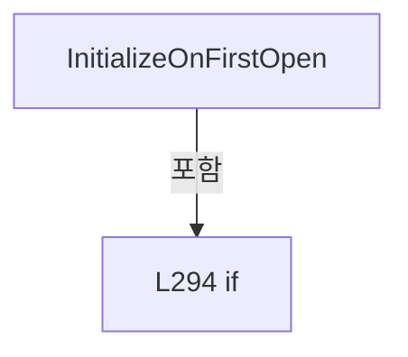

변경 전 점검: 입력/반환 타입, 위 호출자, 예외/취소 경로, 공유 상태와 저장·전송 소비자를 함께 확인합니다. 값의 단위나 물리 방향을 이름만으로 확정하지 않습니다.

### MethodDeclaration `SetDefaultRange` · L300–306

[Drilling.UI/Menu/Menus/CMenuAlarm.cs:300–306](https://github.com/kjuws10-rgb/A3Drilling/blob/5aee8e58439c9b455cae7c9593c9be986c3e682e/Drilling.UI/Menu/Menus/CMenuAlarm.cs#L300-L306)

| 항목 | 실제 추출 값 |
| --- | --- |
| 서명 | void Drilling.UI.Menu.Menus.CAlarmHistoryPanel.SetDefaultRange() |
| 접근/수식자 | Private / private |
| 반환/값 타입 | void |
| 소속 타입 | NamedType:Drilling.UI.Menu.Menus.CAlarmHistoryPanel |

정적 호출자로 확인된 위치:

| 호출 파일/행 | 호출 표현식 | 런타임 분기 가능 |
| --- | --- | --- |
| [Drilling.UI/Menu/Menus/CMenuAlarm.cs:230–230](https://github.com/kjuws10-rgb/A3Drilling/blob/5aee8e58439c9b455cae7c9593c9be986c3e682e/Drilling.UI/Menu/Menus/CMenuAlarm.cs#L230-L230) | SetDefaultRange | False |
| [Drilling.UI/Menu/Menus/CMenuAlarm.cs:297–297](https://github.com/kjuws10-rgb/A3Drilling/blob/5aee8e58439c9b455cae7c9593c9be986c3e682e/Drilling.UI/Menu/Menus/CMenuAlarm.cs#L297-L297) | SetDefaultRange | False |

호출하는 대상과 해석 범위:

| 원본 행 | 표현식 | 분석 상태 | 대상/소스 위치 |
| --- | --- | --- | --- |
| 302 | _now | resolved · 동적 구현 선택 가능 | System.DateTime System.Func<System.DateTime>.Invoke() |
| 305 | now.ToString | resolved | string System.DateTime.ToString(string?, System.IFormatProvider?) |

본문의 실제 연산·분기·예외·반환 순서(원문 위치 순):

| 원본 행 | 종류 | 주석 해설 |
| --- | --- | --- |
| 302 | call | 함수·델리게이트 또는 객체 생성자를 호출합니다: _now() |
| 302 | local-declaration | 지역 변수를 선언합니다: var now = _now(); |
| 302 | variable-initializer | 변수의 초기값을 지정합니다: now = _now() |
| 303 | assignment | 값을 대상에 대입합니다: From = Through = now.Date |
| 303 | assignment | 값을 대상에 대입합니다: Through = now.Date |
| 304 | assignment | 값을 대상에 대입합니다: FromTime = "00:00:00" |
| 305 | assignment | 값을 대상에 대입합니다: ThroughTime = now.ToString("HH:mm:ss", CultureInfo.InvariantCulture) |
| 305 | call | 함수·델리게이트 또는 객체 생성자를 호출합니다: now.ToString("HH:mm:ss", CultureInfo.InvariantCulture) |

변경 전 점검: 입력/반환 타입, 위 호출자, 예외/취소 경로, 공유 상태와 저장·전송 소비자를 함께 확인합니다. 값의 단위나 물리 방향을 이름만으로 확정하지 않습니다.

### MethodDeclaration `SelectTrendView` · L308–324

[Drilling.UI/Menu/Menus/CMenuAlarm.cs:308–324](https://github.com/kjuws10-rgb/A3Drilling/blob/5aee8e58439c9b455cae7c9593c9be986c3e682e/Drilling.UI/Menu/Menus/CMenuAlarm.cs#L308-L324)

| 항목 | 실제 추출 값 |
| --- | --- |
| 서명 | void Drilling.UI.Menu.Menus.CAlarmHistoryPanel.SelectTrendView(bool) |
| 접근/수식자 | Private / private |
| 반환/값 타입 | void |
| 소속 타입 | NamedType:Drilling.UI.Menu.Menus.CAlarmHistoryPanel |

입력 계약:

| 이름 | 타입 | 전달 | 선택/기본값 |
| --- | --- | --- | --- |
| codeView | bool | None | False /  |

정적 호출자로 확인된 위치:

| 호출 파일/행 | 호출 표현식 | 런타임 분기 가능 |
| --- | --- | --- |
| [Drilling.UI/Menu/Menus/CMenuAlarm.cs:233–233](https://github.com/kjuws10-rgb/A3Drilling/blob/5aee8e58439c9b455cae7c9593c9be986c3e682e/Drilling.UI/Menu/Menus/CMenuAlarm.cs#L233-L233) | SelectTrendView | False |
| [Drilling.UI/Menu/Menus/CMenuAlarm.cs:234–234](https://github.com/kjuws10-rgb/A3Drilling/blob/5aee8e58439c9b455cae7c9593c9be986c3e682e/Drilling.UI/Menu/Menus/CMenuAlarm.cs#L234-L234) | SelectTrendView | False |

호출하는 대상과 해석 범위:

| 원본 행 | 표현식 | 분석 상태 | 대상/소스 위치 |
| --- | --- | --- | --- |
| 313 | RefreshTrend | resolved | void Drilling.UI.Menu.Menus.CAlarmHistoryPanel.RefreshTrend() · Drilling.UI/Menu/Menus/CMenuAlarm.cs:326 |
| 316 | nameof | unresolved | None |
| 317 | nameof | unresolved | None |
| 318 | nameof | unresolved | None |
| 319 | nameof | unresolved | None |
| 323 | Notify | resolved | void Drilling.UI.Menu.Menus.CAlarmHistoryPanel.Notify(string?) · Drilling.UI/Menu/Menus/CMenuAlarm.cs:482 |

본문의 실제 연산·분기·예외·반환 순서(원문 위치 순):

| 원본 행 | 종류 | 주석 해설 |
| --- | --- | --- |
| 310 | if | 조건에 따라 분기합니다: if (_isCodeView == codeView &#124;&#124; IsBusy) |
| 311 | return | 호출자에게 값 또는 제어를 반환합니다: return; |
| 312 | assignment | 값을 대상에 대입합니다: _isCodeView = codeView |
| 313 | call | 함수·델리게이트 또는 객체 생성자를 호출합니다: RefreshTrend() |
| 314 | foreach | 컬렉션 요소를 순회합니다: foreach (var name in new[] { nameof(IsCodeView), nameof(IsHourView), nameof(Bars), nameof(TrendCaption) }) |
| 316 | call | 함수·델리게이트 또는 객체 생성자를 호출합니다: nameof(IsCodeView) |
| 317 | call | 함수·델리게이트 또는 객체 생성자를 호출합니다: nameof(IsHourView) |
| 318 | call | 함수·델리게이트 또는 객체 생성자를 호출합니다: nameof(Bars) |
| 319 | call | 함수·델리게이트 또는 객체 생성자를 호출합니다: nameof(TrendCaption) |
| 323 | call | 함수·델리게이트 또는 객체 생성자를 호출합니다: Notify(name) |

제어 구문의 포함 구조(실제 실행 순서/CFG가 아닌 구문 탐색 그림):

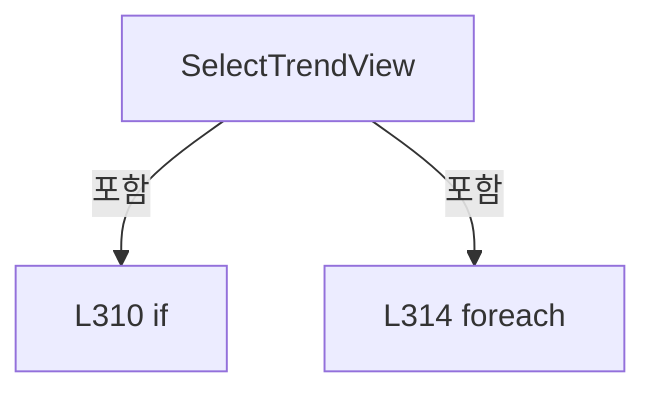

변경 전 점검: 입력/반환 타입, 위 호출자, 예외/취소 경로, 공유 상태와 저장·전송 소비자를 함께 확인합니다. 값의 단위나 물리 방향을 이름만으로 확정하지 않습니다.

### MethodDeclaration `RefreshTrend` · L326–338

[Drilling.UI/Menu/Menus/CMenuAlarm.cs:326–338](https://github.com/kjuws10-rgb/A3Drilling/blob/5aee8e58439c9b455cae7c9593c9be986c3e682e/Drilling.UI/Menu/Menus/CMenuAlarm.cs#L326-L338)

| 항목 | 실제 추출 값 |
| --- | --- |
| 서명 | void Drilling.UI.Menu.Menus.CAlarmHistoryPanel.RefreshTrend() |
| 접근/수식자 | Private / private |
| 반환/값 타입 | void |
| 소속 타입 | NamedType:Drilling.UI.Menu.Menus.CAlarmHistoryPanel |

정적 호출자로 확인된 위치:

| 호출 파일/행 | 호출 표현식 | 런타임 분기 가능 |
| --- | --- | --- |
| [Drilling.UI/Menu/Menus/CMenuAlarm.cs:313–313](https://github.com/kjuws10-rgb/A3Drilling/blob/5aee8e58439c9b455cae7c9593c9be986c3e682e/Drilling.UI/Menu/Menus/CMenuAlarm.cs#L313-L313) | RefreshTrend | False |
| [Drilling.UI/Menu/Menus/CMenuAlarm.cs:397–397](https://github.com/kjuws10-rgb/A3Drilling/blob/5aee8e58439c9b455cae7c9593c9be986c3e682e/Drilling.UI/Menu/Menus/CMenuAlarm.cs#L397-L397) | RefreshTrend | False |

호출하는 대상과 해석 범위:

| 원본 행 | 표현식 | 분석 상태 | 대상/소스 위치 |
| --- | --- | --- | --- |
| 335 | BuildCodeBars | resolved | System.Collections.Generic.IReadOnlyList<Drilling.UI.Menu.Menus.ST_ALARM_TREND_COLUMN> Drilling.UI.Menu.Menus.CAlarmHistoryPanel.BuildCodeBars(System.Collections.Generic.IReadOnlyList<Drilling.Common.Alarm.ST_ALARM_HISTORY_ENTRY>) · Drilling.UI/Menu/Menus/CMenuAlarm.cs:440 |
| 335 | BuildHourBars | resolved | System.Collections.Generic.IReadOnlyList<Drilling.UI.Menu.Menus.ST_ALARM_TREND_COLUMN> Drilling.UI.Menu.Menus.CAlarmHistoryPanel.BuildHourBars(System.Collections.Generic.IReadOnlyList<Drilling.Common.Alarm.ST_ALARM_HISTORY_ENTRY>, System.DateTime, System.DateTime) · Drilling.UI/Menu/Menus/CMenuAlarm.cs:456 |

본문의 실제 연산·분기·예외·반환 순서(원문 위치 순):

| 원본 행 | 종류 | 주석 해설 |
| --- | --- | --- |
| 328 | if | 조건에 따라 분기합니다: if (_searchedFrom is not { } from &#124;&#124; _searchedThrough is not { } through) |
| 330 | assignment | 값을 대상에 대입합니다: Bars = [] |
| 331 | assignment | 값을 대상에 대입합니다: TrendCaption = IsCodeView ? "코드별 발생 횟수 · 많은 순서" : "시간별 발생 횟수 · 1시간 기준" |
| 331 | conditional-expression | 조건에 따라 결과식을 선택합니다: IsCodeView ? "코드별 발생 횟수 · 많은 순서" : "시간별 발생 횟수 · 1시간 기준" |
| 332 | return | 호출자에게 값 또는 제어를 반환합니다: return; |
| 335 | assignment | 값을 대상에 대입합니다: Bars = IsCodeView ? BuildCodeBars(_loadedRows) : BuildHourBars(_loadedRows, from, through) |
| 335 | call | 함수·델리게이트 또는 객체 생성자를 호출합니다: BuildCodeBars(_loadedRows) |
| 335 | call | 함수·델리게이트 또는 객체 생성자를 호출합니다: BuildHourBars(_loadedRows, from, through) |
| 335 | conditional-expression | 조건에 따라 결과식을 선택합니다: IsCodeView ? BuildCodeBars(_loadedRows) : BuildHourBars(_loadedRows, from, through) |
| 336 | conditional-expression | 조건에 따라 결과식을 선택합니다: IsCodeView ? $"{Bars.Count:N0}개 코드 · 발생 횟수 내림차순" : "시간별 · 1시간 기준" |
| 336 | local-declaration | 지역 변수를 선언합니다: var summary = IsCodeView ? $"{Bars.Count:N0}개 코드 · 발생 횟수 내림차순" : "시간별 · 1시간 기준"; |
| 336 | variable-initializer | 변수의 초기값을 지정합니다: summary = IsCodeView ? $"{Bars.Count:N0}개 코드 · 발생 횟수 내림차순" : "시간별 · 1시간 기준" |
| 337 | assignment | 값을 대상에 대입합니다: TrendCaption = $"{from:yyyy-MM-dd HH:mm:ss.fff} ~ {through:yyyy-MM-dd HH:mm:ss.fff}\n{summary} · 총 {_loadedRows.Count:N0}건" |

제어 구문의 포함 구조(실제 실행 순서/CFG가 아닌 구문 탐색 그림):

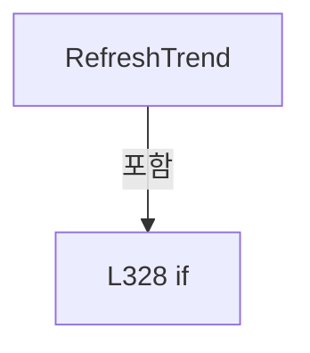

변경 전 점검: 입력/반환 타입, 위 호출자, 예외/취소 경로, 공유 상태와 저장·전송 소비자를 함께 확인합니다. 값의 단위나 물리 방향을 이름만으로 확정하지 않습니다.

### MethodDeclaration `SearchLast24HoursAsync` · L340–353

[Drilling.UI/Menu/Menus/CMenuAlarm.cs:340–353](https://github.com/kjuws10-rgb/A3Drilling/blob/5aee8e58439c9b455cae7c9593c9be986c3e682e/Drilling.UI/Menu/Menus/CMenuAlarm.cs#L340-L353)

| 항목 | 실제 추출 값 |
| --- | --- |
| 서명 | System.Threading.Tasks.Task Drilling.UI.Menu.Menus.CAlarmHistoryPanel.SearchLast24HoursAsync() |
| 접근/수식자 | Public / public, async |
| 반환/값 타입 | System.Threading.Tasks.Task |
| 소속 타입 | NamedType:Drilling.UI.Menu.Menus.CAlarmHistoryPanel |

정적 호출자로 확인된 위치:

| 호출 파일/행 | 호출 표현식 | 런타임 분기 가능 |
| --- | --- | --- |
| [Drilling.UI/Menu/Menus/CMenuAlarm.cs:232–232](https://github.com/kjuws10-rgb/A3Drilling/blob/5aee8e58439c9b455cae7c9593c9be986c3e682e/Drilling.UI/Menu/Menus/CMenuAlarm.cs#L232-L232) | SearchLast24HoursAsync | False |

호출하는 대상과 해석 범위:

| 원본 행 | 표현식 | 분석 상태 | 대상/소스 위치 |
| --- | --- | --- | --- |
| 344 | _now | resolved · 동적 구현 선택 가능 | System.DateTime System.Func<System.DateTime>.Invoke() |
| 346 | new DateTime | resolved | System.DateTime.DateTime(long, System.DateTimeKind) |
| 347 | through.AddHours | resolved | System.DateTime System.DateTime.AddHours(double) |
| 350 | from.ToString | resolved | string System.DateTime.ToString(string?, System.IFormatProvider?) |
| 351 | through.ToString | resolved | string System.DateTime.ToString(string?, System.IFormatProvider?) |
| 352 | SearchAsync | resolved | System.Threading.Tasks.Task Drilling.UI.Menu.Menus.CAlarmHistoryPanel.SearchAsync() · Drilling.UI/Menu/Menus/CMenuAlarm.cs:355 |

본문의 실제 연산·분기·예외·반환 순서(원문 위치 순):

| 원본 행 | 종류 | 주석 해설 |
| --- | --- | --- |
| 342 | if | 조건에 따라 분기합니다: if (IsBusy) |
| 343 | return | 호출자에게 값 또는 제어를 반환합니다: return; |
| 344 | call | 함수·델리게이트 또는 객체 생성자를 호출합니다: _now() |
| 344 | local-declaration | 지역 변수를 선언합니다: var now = _now(); |
| 344 | variable-initializer | 변수의 초기값을 지정합니다: now = _now() |
| 346 | call | 함수·델리게이트 또는 객체 생성자를 호출합니다: new DateTime(now.Ticks - now.Ticks % TimeSpan.TicksPerMillisecond, now.Kind) |
| 346 | local-declaration | 지역 변수를 선언합니다: var through = new DateTime(now.Ticks - now.Ticks % TimeSpan.TicksPerMillisecond, now.Kind); |
| 346 | variable-initializer | 변수의 초기값을 지정합니다: through = new DateTime(now.Ticks - now.Ticks % TimeSpan.TicksPerMillisecond, now.Kind) |
| 347 | call | 함수·델리게이트 또는 객체 생성자를 호출합니다: through.AddHours(-24) |
| 347 | local-declaration | 지역 변수를 선언합니다: var from = through.AddHours(-24); |
| 347 | variable-initializer | 변수의 초기값을 지정합니다: from = through.AddHours(-24) |
| 348 | assignment | 값을 대상에 대입합니다: From = from.Date |
| 349 | assignment | 값을 대상에 대입합니다: Through = through.Date |
| 350 | assignment | 값을 대상에 대입합니다: FromTime = from.ToString("HH:mm:ss.fff", CultureInfo.InvariantCulture) |
| 350 | call | 함수·델리게이트 또는 객체 생성자를 호출합니다: from.ToString("HH:mm:ss.fff", CultureInfo.InvariantCulture) |
| 351 | assignment | 값을 대상에 대입합니다: ThroughTime = through.ToString("HH:mm:ss.fff", CultureInfo.InvariantCulture) |
| 351 | call | 함수·델리게이트 또는 객체 생성자를 호출합니다: through.ToString("HH:mm:ss.fff", CultureInfo.InvariantCulture) |
| 352 | await | 비동기 완료를 기다립니다: await SearchAsync() |
| 352 | call | 함수·델리게이트 또는 객체 생성자를 호출합니다: SearchAsync() |

제어 구문의 포함 구조(실제 실행 순서/CFG가 아닌 구문 탐색 그림):

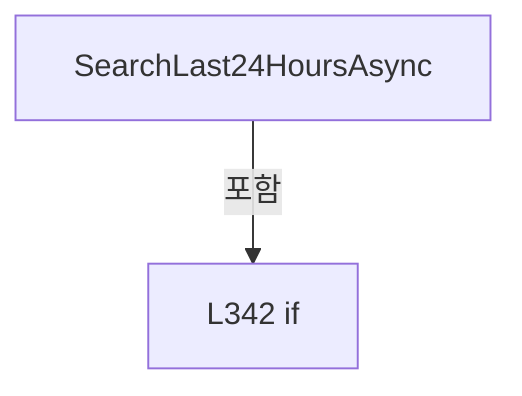

변경 전 점검: 입력/반환 타입, 위 호출자, 예외/취소 경로, 공유 상태와 저장·전송 소비자를 함께 확인합니다. 값의 단위나 물리 방향을 이름만으로 확정하지 않습니다.

### MethodDeclaration `SearchAsync` · L355–430

[Drilling.UI/Menu/Menus/CMenuAlarm.cs:355–430](https://github.com/kjuws10-rgb/A3Drilling/blob/5aee8e58439c9b455cae7c9593c9be986c3e682e/Drilling.UI/Menu/Menus/CMenuAlarm.cs#L355-L430)

| 항목 | 실제 추출 값 |
| --- | --- |
| 서명 | System.Threading.Tasks.Task Drilling.UI.Menu.Menus.CAlarmHistoryPanel.SearchAsync() |
| 접근/수식자 | Public / public, async |
| 반환/값 타입 | System.Threading.Tasks.Task |
| 소속 타입 | NamedType:Drilling.UI.Menu.Menus.CAlarmHistoryPanel |

정적 호출자로 확인된 위치:

| 호출 파일/행 | 호출 표현식 | 런타임 분기 가능 |
| --- | --- | --- |
| [Drilling.UI/Menu/Menus/CMenuAlarm.cs:231–231](https://github.com/kjuws10-rgb/A3Drilling/blob/5aee8e58439c9b455cae7c9593c9be986c3e682e/Drilling.UI/Menu/Menus/CMenuAlarm.cs#L231-L231) | SearchAsync | False |
| [Drilling.UI/Menu/Menus/CMenuAlarm.cs:352–352](https://github.com/kjuws10-rgb/A3Drilling/blob/5aee8e58439c9b455cae7c9593c9be986c3e682e/Drilling.UI/Menu/Menus/CMenuAlarm.cs#L352-L352) | SearchAsync | False |

호출하는 대상과 해석 범위:

| 원본 행 | 표현식 | 분석 상태 | 대상/소스 위치 |
| --- | --- | --- | --- |
| 359 | TryReadTime | resolved | bool Drilling.UI.Menu.Menus.CAlarmHistoryPanel.TryReadTime(string, out System.TimeSpan) · Drilling.UI/Menu/Menus/CMenuAlarm.cs:432 |
| 359 | TryReadTime | resolved | bool Drilling.UI.Menu.Menus.CAlarmHistoryPanel.TryReadTime(string, out System.TimeSpan) · Drilling.UI/Menu/Menus/CMenuAlarm.cs:432 |
| 362 | Notify | resolved | void Drilling.UI.Menu.Menus.CAlarmHistoryPanel.Notify(string?) · Drilling.UI/Menu/Menus/CMenuAlarm.cs:482 |
| 362 | nameof | unresolved | None |
| 366 | from.Date.Add | resolved | System.DateTime System.DateTime.Add(System.TimeSpan) |
| 367 | through.Date.Add | resolved | System.DateTime System.DateTime.Add(System.TimeSpan) |
| 371 | Notify | resolved | void Drilling.UI.Menu.Menus.CAlarmHistoryPanel.Notify(string?) · Drilling.UI/Menu/Menus/CMenuAlarm.cs:482 |
| 371 | nameof | unresolved | None |
| 377 | Notify | resolved | void Drilling.UI.Menu.Menus.CAlarmHistoryPanel.Notify(string?) · Drilling.UI/Menu/Menus/CMenuAlarm.cs:482 |
| 377 | nameof | unresolved | None |
| 378 | Notify | resolved | void Drilling.UI.Menu.Menus.CAlarmHistoryPanel.Notify(string?) · Drilling.UI/Menu/Menus/CMenuAlarm.cs:482 |
| 378 | nameof | unresolved | None |
| 379 | Notify | resolved | void Drilling.UI.Menu.Menus.CAlarmHistoryPanel.Notify(string?) · Drilling.UI/Menu/Menus/CMenuAlarm.cs:482 |
| 379 | nameof | unresolved | None |
| 380 | SearchCommand.NotifyCanExecuteChanged | resolved | void Drilling.UI.Menu.CButtonCommand.NotifyCanExecuteChanged() · Drilling.UI/Menu/CButtonCommand.cs:24 |
| 381 | Last24HoursCommand.NotifyCanExecuteChanged | resolved | void Drilling.UI.Menu.CButtonCommand.NotifyCanExecuteChanged() · Drilling.UI/Menu/CButtonCommand.cs:24 |
| 384 | Task.Run | resolved | System.Threading.Tasks.Task<Drilling.Common.Alarm.ST_ALARM_HISTORY_RESULT> System.Threading.Tasks.Task.Run<Drilling.Common.Alarm.ST_ALARM_HISTORY_RESULT>(System.Func<Drilling.Common.Alarm.ST_ALARM_HISTORY_RESULT>) |
| 387 | _read | resolved · 동적 구현 선택 가능 | Drilling.Common.Alarm.ST_ALARM_HISTORY_RESULT System.Func<System.DateTime, System.DateTime, System.Threading.CancellationToken, Drilling.Common.Alarm.ST_ALARM_HISTORY_RESULT>.Invoke(System.DateTime, System.DateTime, System.Threading.CancellationToken) |
| 390 | loaded.Rows.Where(row => row.OccurredAt.LocalDateTime >= from && row.OccurredAt.LocalDateTime <= through).OrderByDescending(row => row.OccurredAt).ThenBy(row => row.Code).ToArray | resolved | Drilling.Common.Alarm.ST_ALARM_HISTORY_ENTRY[] System.Collections.Generic.IEnumerable<Drilling.Common.Alarm.ST_ALARM_HISTORY_ENTRY>.ToArray<Drilling.Common.Alarm.ST_ALARM_HISTORY_ENTRY>() |
| 390 | loaded.Rows.Where(row => row.OccurredAt.LocalDateTime >= from && row.OccurredAt.LocalDateTime <= through).OrderByDescending(row => row.OccurredAt).ThenBy | resolved | System.Linq.IOrderedEnumerable<Drilling.Common.Alarm.ST_ALARM_HISTORY_ENTRY> System.Linq.IOrderedEnumerable<Drilling.Common.Alarm.ST_ALARM_HISTORY_ENTRY>.ThenBy<Drilling.Common.Alarm.ST_ALARM_HISTORY_ENTRY, int>(System.Func<Drilling.Common.Alarm.ST_ALARM_HISTORY_ENTRY, int>) |
| 390 | loaded.Rows.Where(row => row.OccurredAt.LocalDateTime >= from && row.OccurredAt.LocalDateTime <= through).OrderByDescending | resolved | System.Linq.IOrderedEnumerable<Drilling.Common.Alarm.ST_ALARM_HISTORY_ENTRY> System.Collections.Generic.IEnumerable<Drilling.Common.Alarm.ST_ALARM_HISTORY_ENTRY>.OrderByDescending<Drilling.Common.Alarm.ST_ALARM_HISTORY_ENTRY, System.DateTimeOffset>(System.Func<Drilling.Common.Alarm.ST_ALARM_HISTORY_ENTRY, System.DateTimeOffset>) |
| 390 | loaded.Rows.Where | resolved | System.Collections.Generic.IEnumerable<Drilling.Common.Alarm.ST_ALARM_HISTORY_ENTRY> System.Collections.Generic.IEnumerable<Drilling.Common.Alarm.ST_ALARM_HISTORY_ENTRY>.Where<Drilling.Common.Alarm.ST_ALARM_HISTORY_ENTRY>(System.Func<Drilling.Common.Alarm.ST_ALARM_HISTORY_ENTRY, bool>) |
| 393 | result.Rows.Select((row, index) => new ST_ALARM_HISTORY_ROW(index + 1, row.OccurredAt.LocalDateTime.ToString("yyyy-MM-dd HH:mm:ss.fff"), row.Code.ToString(), row.Level, row.Group, row.Cause, row.Solution)).ToArray | resolved | Drilling.UI.Menu.Menus.ST_ALARM_HISTORY_ROW[] System.Collections.Generic.IEnumerable<Drilling.UI.Menu.Menus.ST_ALARM_HISTORY_ROW>.ToArray<Drilling.UI.Menu.Menus.ST_ALARM_HISTORY_ROW>() |
| 393 | result.Rows.Select | resolved | System.Collections.Generic.IEnumerable<Drilling.UI.Menu.Menus.ST_ALARM_HISTORY_ROW> System.Collections.Generic.IEnumerable<Drilling.Common.Alarm.ST_ALARM_HISTORY_ENTRY>.Select<Drilling.Common.Alarm.ST_ALARM_HISTORY_ENTRY, Drilling.UI.Menu.Menus.ST_ALARM_HISTORY_ROW>(System.Func<Drilling.Common.Alarm.ST_ALARM_HISTORY_ENTRY, int, Drilling.UI.Menu.Menus.ST_ALARM_HISTORY_ROW>) |
| 393 | new ST_ALARM_HISTORY_ROW | resolved | Drilling.UI.Menu.Menus.ST_ALARM_HISTORY_ROW.ST_ALARM_HISTORY_ROW(int, string, string, string, string, string, string) · Drilling.UI/Menu/Menus/CMenuAlarm.cs:552 |
| 393 | row.OccurredAt.LocalDateTime.ToString | resolved | string System.DateTime.ToString(string?) |
| 393 | row.Code.ToString | resolved · 동적 구현 선택 가능 | string int.ToString() |
| 397 | RefreshTrend | resolved | void Drilling.UI.Menu.Menus.CAlarmHistoryPanel.RefreshTrend() · Drilling.UI/Menu/Menus/CMenuAlarm.cs:326 |
| 416 | nameof | unresolved | None |
| 417 | nameof | unresolved | None |
| 418 | nameof | unresolved | None |
| 419 | nameof | unresolved | None |
| 420 | nameof | unresolved | None |
| 421 | nameof | unresolved | None |
| 422 | nameof | unresolved | None |
| 426 | Notify | resolved | void Drilling.UI.Menu.Menus.CAlarmHistoryPanel.Notify(string?) · Drilling.UI/Menu/Menus/CMenuAlarm.cs:482 |
| 427 | SearchCommand.NotifyCanExecuteChanged | resolved | void Drilling.UI.Menu.CButtonCommand.NotifyCanExecuteChanged() · Drilling.UI/Menu/CButtonCommand.cs:24 |
| 428 | Last24HoursCommand.NotifyCanExecuteChanged | resolved | void Drilling.UI.Menu.CButtonCommand.NotifyCanExecuteChanged() · Drilling.UI/Menu/CButtonCommand.cs:24 |

본문의 실제 연산·분기·예외·반환 순서(원문 위치 순):

| 원본 행 | 종류 | 주석 해설 |
| --- | --- | --- |
| 357 | if | 조건에 따라 분기합니다: if (IsBusy) |
| 358 | return | 호출자에게 값 또는 제어를 반환합니다: return; |
| 359 | call | 함수·델리게이트 또는 객체 생성자를 호출합니다: TryReadTime(FromTime, out var fromTime) |
| 359 | call | 함수·델리게이트 또는 객체 생성자를 호출합니다: TryReadTime(ThroughTime, out var throughTime) |
| 359 | if | 조건에 따라 분기합니다: if (From is not { } from &#124;&#124; Through is not { } through &#124;&#124; !TryReadTime(FromTime, out var fromTime) &#124;&#124; !TryReadTime(ThroughTime, out var throughTime)) |
| 361 | assignment | 값을 대상에 대입합니다: Status = "날짜와 시간을 올바르게 입력해 주세요. 시간 형식: HH:mm 또는 HH:mm:ss (24시간제)." |
| 362 | call | 함수·델리게이트 또는 객체 생성자를 호출합니다: Notify(nameof(Status)) |
| 362 | call | 함수·델리게이트 또는 객체 생성자를 호출합니다: nameof(Status) |
| 363 | return | 호출자에게 값 또는 제어를 반환합니다: return; |
| 366 | assignment | 값을 대상에 대입합니다: from = from.Date.Add(fromTime) |
| 366 | call | 함수·델리게이트 또는 객체 생성자를 호출합니다: from.Date.Add(fromTime) |
| 367 | assignment | 값을 대상에 대입합니다: through = through.Date.Add(throughTime) |
| 367 | call | 함수·델리게이트 또는 객체 생성자를 호출합니다: through.Date.Add(throughTime) |
| 368 | if | 조건에 따라 분기합니다: if (from > through) |
| 370 | assignment | 값을 대상에 대입합니다: Status = "시작 일시는 종료 일시보다 늦을 수 없습니다." |
| 371 | call | 함수·델리게이트 또는 객체 생성자를 호출합니다: Notify(nameof(Status)) |
| 371 | call | 함수·델리게이트 또는 객체 생성자를 호출합니다: nameof(Status) |
| 372 | return | 호출자에게 값 또는 제어를 반환합니다: return; |
| 375 | assignment | 값을 대상에 대입합니다: IsBusy = true |
| 376 | assignment | 값을 대상에 대입합니다: Status = "알람 이력을 조회하고 있습니다." |
| 377 | call | 함수·델리게이트 또는 객체 생성자를 호출합니다: Notify(nameof(IsBusy)) |
| 377 | call | 함수·델리게이트 또는 객체 생성자를 호출합니다: nameof(IsBusy) |
| 378 | call | 함수·델리게이트 또는 객체 생성자를 호출합니다: Notify(nameof(CanEdit)) |
| 378 | call | 함수·델리게이트 또는 객체 생성자를 호출합니다: nameof(CanEdit) |
| 379 | call | 함수·델리게이트 또는 객체 생성자를 호출합니다: Notify(nameof(Status)) |
| 379 | call | 함수·델리게이트 또는 객체 생성자를 호출합니다: nameof(Status) |
| 380 | call | 함수·델리게이트 또는 객체 생성자를 호출합니다: SearchCommand.NotifyCanExecuteChanged() |
| 381 | call | 함수·델리게이트 또는 객체 생성자를 호출합니다: Last24HoursCommand.NotifyCanExecuteChanged() |
| 382 | try | 예외 처리 범위입니다: try |
| 384 | await | 비동기 완료를 기다립니다: await Task.Run(() => { // The store opens only the relevant daily files. Apply exact times before both grid and chart. var loaded = _read(from.Date, through.Date, CancellationToken.None); return loaded with { Rows = loaded.Rows.Wh |
| 384 | call | 함수·델리게이트 또는 객체 생성자를 호출합니다: Task.Run(() => { // The store opens only the relevant daily files. Apply exact times before both grid and chart. var loaded = _read(from.Date, through.Date, CancellationToken.None); return loaded with { Rows = loaded.Row… |
| 384 | local-declaration | 지역 변수를 선언합니다: var result = await Task.Run(() => { // The store opens only the relevant daily files. Apply exact times before both grid and chart. var loaded = _read(from.Date, through.Date, CancellationToken.None); return loaded with { Rows = l |
| 384 | variable-initializer | 변수의 초기값을 지정합니다: result = await Task.Run(() => { // The store opens only the relevant daily files. Apply exact times before both grid and chart. var loaded = _read(from.Date, through.Date, CancellationToken.None); return loaded with { Rows = loade |
| 387 | call | 함수·델리게이트 또는 객체 생성자를 호출합니다: _read(from.Date, through.Date, CancellationToken.None) |
| 387 | local-declaration | 지역 변수를 선언합니다: var loaded = _read(from.Date, through.Date, CancellationToken.None); |
| 387 | variable-initializer | 변수의 초기값을 지정합니다: loaded = _read(from.Date, through.Date, CancellationToken.None) |
| 388 | return | 호출자에게 값 또는 제어를 반환합니다: return loaded with { Rows = loaded.Rows.Where(row => row.OccurredAt.LocalDateTime >= from && row.OccurredAt.LocalDateTime <= through).OrderByDescending(row => row.OccurredAt).ThenBy(row => row.Code).ToArray() }; |
| 390 | assignment | 값을 대상에 대입합니다: Rows = loaded.Rows.Where(row => row.OccurredAt.LocalDateTime >= from && row.OccurredAt.LocalDateTime <= through).OrderByDescending(row => row.OccurredAt).ThenBy(row => row.Code).ToArray() |
| 390 | call | 함수·델리게이트 또는 객체 생성자를 호출합니다: loaded.Rows.Where(row => row.OccurredAt.LocalDateTime >= from && row.OccurredAt.LocalDateTime <= through).OrderByDescending(row => row.OccurredAt).ThenBy(row => row.Code).ToArray() |
| 390 | call | 함수·델리게이트 또는 객체 생성자를 호출합니다: loaded.Rows.Where(row => row.OccurredAt.LocalDateTime >= from && row.OccurredAt.LocalDateTime <= through).OrderByDescending(row => row.OccurredAt).ThenBy(row => row.Code) |
| 390 | call | 함수·델리게이트 또는 객체 생성자를 호출합니다: loaded.Rows.Where(row => row.OccurredAt.LocalDateTime >= from && row.OccurredAt.LocalDateTime <= through).OrderByDescending(row => row.OccurredAt) |
| 390 | call | 함수·델리게이트 또는 객체 생성자를 호출합니다: loaded.Rows.Where(row => row.OccurredAt.LocalDateTime >= from && row.OccurredAt.LocalDateTime <= through) |
| 393 | assignment | 값을 대상에 대입합니다: Rows = result.Rows.Select((row, index) => new ST_ALARM_HISTORY_ROW(index + 1, row.OccurredAt.LocalDateTime.ToString("yyyy-MM-dd HH:mm:ss.fff"), row.Code.ToString(), row.Level, row.Group, row.Cause, row.Solution)).ToArray() |
| 393 | call | 함수·델리게이트 또는 객체 생성자를 호출합니다: result.Rows.Select((row, index) => new ST_ALARM_HISTORY_ROW(index + 1, row.OccurredAt.LocalDateTime.ToString("yyyy-MM-dd HH:mm:ss.fff"), row.Code.ToString(), row.Level, row.Group, row.Cause, row.Solution)).ToArray() |
| 393 | call | 함수·델리게이트 또는 객체 생성자를 호출합니다: result.Rows.Select((row, index) => new ST_ALARM_HISTORY_ROW(index + 1, row.OccurredAt.LocalDateTime.ToString("yyyy-MM-dd HH:mm:ss.fff"), row.Code.ToString(), row.Level, row.Group, row.Cause, row.Solution)) |
| 393 | call | 함수·델리게이트 또는 객체 생성자를 호출합니다: new ST_ALARM_HISTORY_ROW(index + 1, row.OccurredAt.LocalDateTime.ToString("yyyy-MM-dd HH:mm:ss.fff"), row.Code.ToString(), row.Level, row.Group, row.Cause, row.Solution) |
| 393 | call | 함수·델리게이트 또는 객체 생성자를 호출합니다: row.OccurredAt.LocalDateTime.ToString("yyyy-MM-dd HH:mm:ss.fff") |
| 393 | call | 함수·델리게이트 또는 객체 생성자를 호출합니다: row.Code.ToString() |
| 394 | assignment | 값을 대상에 대입합니다: _loadedRows = result.Rows |
| 395 | assignment | 값을 대상에 대입합니다: _searchedFrom = from |
| 396 | assignment | 값을 대상에 대입합니다: _searchedThrough = through |
| 397 | call | 함수·델리게이트 또는 객체 생성자를 호출합니다: RefreshTrend() |
| 398 | assignment | 값을 대상에 대입합니다: Status = result.Warning.Length == 0 ? $"{Rows.Count:N0}건 조회 완료" : $"{Rows.Count:N0}건 조회 · {result.Warning}" |
| 398 | conditional-expression | 조건에 따라 결과식을 선택합니다: result.Warning.Length == 0 ? $"{Rows.Count:N0}건 조회 완료" : $"{Rows.Count:N0}건 조회 · {result.Warning}" |
| 399 | assignment | 값을 대상에 대입합니다: EmptyMessage = "해당 기간에 발생한 알람이 없습니다." |
| 401 | catch | 지정 예외를 처리합니다: catch (Exception exception) when (exception is IOException or UnauthorizedAccessException or ArgumentException) |
| 403 | assignment | 값을 대상에 대입합니다: Rows = [] |
| 404 | assignment | 값을 대상에 대입합니다: Bars = [] |
| 405 | assignment | 값을 대상에 대입합니다: _loadedRows = [] |
| 406 | assignment | 값을 대상에 대입합니다: _searchedFrom = _searchedThrough = null |
| 406 | assignment | 값을 대상에 대입합니다: _searchedThrough = null |
| 407 | assignment | 값을 대상에 대입합니다: Status = $"알람 이력 조회 실패: {exception.Message}" |
| 408 | assignment | 값을 대상에 대입합니다: EmptyMessage = "알람 이력을 읽지 못했습니다." |
| 409 | assignment | 값을 대상에 대입합니다: TrendCaption = "조회 실패" |
| 411 | finally | 종료 정리 구간입니다: finally |
| 413 | assignment | 값을 대상에 대입합니다: IsBusy = false |
| 414 | foreach | 컬렉션 요소를 순회합니다: foreach (var name in new[] { nameof(Rows), nameof(Bars), nameof(Status), nameof(EmptyMessage), nameof(TrendCaption), nameof(IsBusy), nameof(CanEdit) }) |
| 416 | call | 함수·델리게이트 또는 객체 생성자를 호출합니다: nameof(Rows) |
| 417 | call | 함수·델리게이트 또는 객체 생성자를 호출합니다: nameof(Bars) |
| 418 | call | 함수·델리게이트 또는 객체 생성자를 호출합니다: nameof(Status) |
| 419 | call | 함수·델리게이트 또는 객체 생성자를 호출합니다: nameof(EmptyMessage) |
| 420 | call | 함수·델리게이트 또는 객체 생성자를 호출합니다: nameof(TrendCaption) |
| 421 | call | 함수·델리게이트 또는 객체 생성자를 호출합니다: nameof(IsBusy) |
| 422 | call | 함수·델리게이트 또는 객체 생성자를 호출합니다: nameof(CanEdit) |
| 426 | call | 함수·델리게이트 또는 객체 생성자를 호출합니다: Notify(name) |
| 427 | call | 함수·델리게이트 또는 객체 생성자를 호출합니다: SearchCommand.NotifyCanExecuteChanged() |
| 428 | call | 함수·델리게이트 또는 객체 생성자를 호출합니다: Last24HoursCommand.NotifyCanExecuteChanged() |

제어 구문의 포함 구조(실제 실행 순서/CFG가 아닌 구문 탐색 그림):

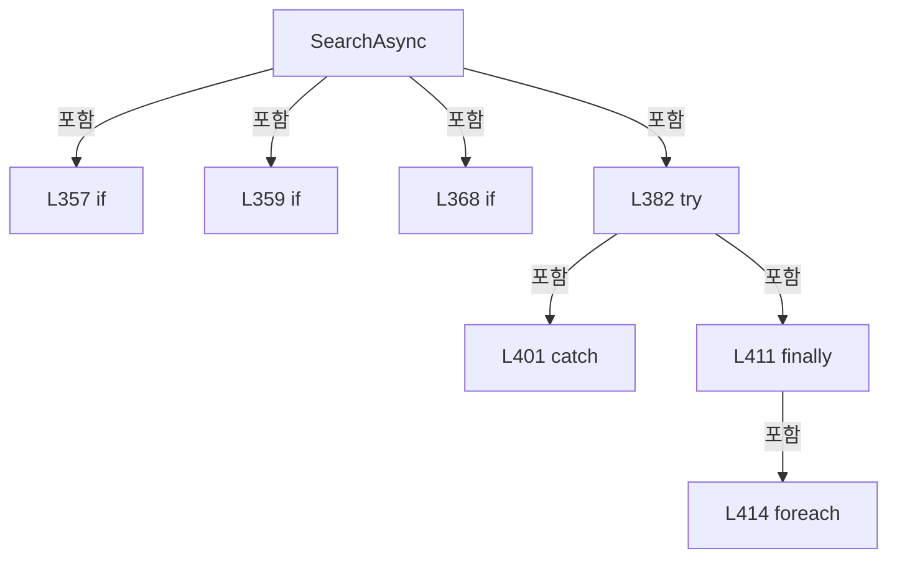

변경 전 점검: 입력/반환 타입, 위 호출자, 예외/취소 경로, 공유 상태와 저장·전송 소비자를 함께 확인합니다. 값의 단위나 물리 방향을 이름만으로 확정하지 않습니다.

### MethodDeclaration `TryReadTime` · L432–438

[Drilling.UI/Menu/Menus/CMenuAlarm.cs:432–438](https://github.com/kjuws10-rgb/A3Drilling/blob/5aee8e58439c9b455cae7c9593c9be986c3e682e/Drilling.UI/Menu/Menus/CMenuAlarm.cs#L432-L438)

| 항목 | 실제 추출 값 |
| --- | --- |
| 서명 | bool Drilling.UI.Menu.Menus.CAlarmHistoryPanel.TryReadTime(string, out System.TimeSpan) |
| 접근/수식자 | Private / private, static |
| 반환/값 타입 | bool |
| 소속 타입 | NamedType:Drilling.UI.Menu.Menus.CAlarmHistoryPanel |

입력 계약:

| 이름 | 타입 | 전달 | 선택/기본값 |
| --- | --- | --- | --- |
| value | string | None | False /  |
| time | System.TimeSpan | Out | False /  |

정적 호출자로 확인된 위치:

| 호출 파일/행 | 호출 표현식 | 런타임 분기 가능 |
| --- | --- | --- |
| [Drilling.UI/Menu/Menus/CMenuAlarm.cs:359–359](https://github.com/kjuws10-rgb/A3Drilling/blob/5aee8e58439c9b455cae7c9593c9be986c3e682e/Drilling.UI/Menu/Menus/CMenuAlarm.cs#L359-L359) | TryReadTime | False |
| [Drilling.UI/Menu/Menus/CMenuAlarm.cs:359–359](https://github.com/kjuws10-rgb/A3Drilling/blob/5aee8e58439c9b455cae7c9593c9be986c3e682e/Drilling.UI/Menu/Menus/CMenuAlarm.cs#L359-L359) | TryReadTime | False |

호출하는 대상과 해석 범위:

| 원본 행 | 표현식 | 분석 상태 | 대상/소스 위치 |
| --- | --- | --- | --- |
| 435 | DateTime.TryParseExact | resolved | bool System.DateTime.TryParseExact(string?, string?[]?, System.IFormatProvider?, System.Globalization.DateTimeStyles, out System.DateTime) |
| 435 | .Trim | resolved | string string.Trim() |

본문의 실제 연산·분기·예외·반환 순서(원문 위치 순):

| 원본 행 | 종류 | 주석 해설 |
| --- | --- | --- |
| 434 | local-declaration | 지역 변수를 선언합니다: string[] formats = ["H:mm", "HH:mm", "H:mm:ss", "HH:mm:ss", "H:mm:ss.FFF", "HH:mm:ss.FFF"]; |
| 434 | variable-initializer | 변수의 초기값을 지정합니다: formats = ["H:mm", "HH:mm", "H:mm:ss", "HH:mm:ss", "H:mm:ss.FFF", "HH:mm:ss.FFF"] |
| 435 | call | 함수·델리게이트 또는 객체 생성자를 호출합니다: DateTime.TryParseExact(value?.Trim(), formats, CultureInfo.InvariantCulture, DateTimeStyles.None, out var parsed) |
| 435 | call | 함수·델리게이트 또는 객체 생성자를 호출합니다: .Trim() |
| 435 | local-declaration | 지역 변수를 선언합니다: var valid = DateTime.TryParseExact(value?.Trim(), formats, CultureInfo.InvariantCulture, DateTimeStyles.None, out var parsed); |
| 435 | variable-initializer | 변수의 초기값을 지정합니다: valid = DateTime.TryParseExact(value?.Trim(), formats, CultureInfo.InvariantCulture, DateTimeStyles.None, out var parsed) |
| 436 | assignment | 값을 대상에 대입합니다: time = parsed.TimeOfDay |
| 437 | return | 호출자에게 값 또는 제어를 반환합니다: return valid; |

변경 전 점검: 입력/반환 타입, 위 호출자, 예외/취소 경로, 공유 상태와 저장·전송 소비자를 함께 확인합니다. 값의 단위나 물리 방향을 이름만으로 확정하지 않습니다.

### MethodDeclaration `BuildCodeBars` · L440–454

[Drilling.UI/Menu/Menus/CMenuAlarm.cs:440–454](https://github.com/kjuws10-rgb/A3Drilling/blob/5aee8e58439c9b455cae7c9593c9be986c3e682e/Drilling.UI/Menu/Menus/CMenuAlarm.cs#L440-L454)

| 항목 | 실제 추출 값 |
| --- | --- |
| 서명 | System.Collections.Generic.IReadOnlyList<Drilling.UI.Menu.Menus.ST_ALARM_TREND_COLUMN> Drilling.UI.Menu.Menus.CAlarmHistoryPanel.BuildCodeBars(System.Collections.Generic.IReadOnlyList<Drilling.Common.Alarm.ST_ALARM_HISTORY_ENTRY>) |
| 접근/수식자 | Private / private, static |
| 반환/값 타입 | System.Collections.Generic.IReadOnlyList<Drilling.UI.Menu.Menus.ST_ALARM_TREND_COLUMN> |
| 소속 타입 | NamedType:Drilling.UI.Menu.Menus.CAlarmHistoryPanel |

입력 계약:

| 이름 | 타입 | 전달 | 선택/기본값 |
| --- | --- | --- | --- |
| rows | System.Collections.Generic.IReadOnlyList<Drilling.Common.Alarm.ST_ALARM_HISTORY_ENTRY> | None | False /  |

정적 호출자로 확인된 위치:

| 호출 파일/행 | 호출 표현식 | 런타임 분기 가능 |
| --- | --- | --- |
| [Drilling.UI/Menu/Menus/CMenuAlarm.cs:335–335](https://github.com/kjuws10-rgb/A3Drilling/blob/5aee8e58439c9b455cae7c9593c9be986c3e682e/Drilling.UI/Menu/Menus/CMenuAlarm.cs#L335-L335) | BuildCodeBars | False |

호출하는 대상과 해석 범위:

| 원본 행 | 표현식 | 분석 상태 | 대상/소스 위치 |
| --- | --- | --- | --- |
| 444 | rows.GroupBy(row => row.Code).Select(group => new { Code = group.Key, Cause = group.First().Cause, Count = group.Count() }).OrderByDescending(group => group.Count).ThenBy(group => group.Code).ToArray | resolved | <anonymous type: int Code, string Cause, int Count>[] System.Collections.Generic.IEnumerable<<anonymous type: int Code, string Cause, int Count>>.ToArray<<anonymous type: int Code, string Cause, int Count>>() |
| 444 | rows.GroupBy(row => row.Code).Select(group => new { Code = group.Key, Cause = group.First().Cause, Count = group.Count() }).OrderByDescending(group => group.Count).ThenBy | resolved | System.Linq.IOrderedEnumerable<<anonymous type: int Code, string Cause, int Count>> System.Linq.IOrderedEnumerable<<anonymous type: int Code, string Cause, int Count>>.ThenBy<<anonymous type: int Code, string Cause, int Count>, int>(System.Func<<anonymous type: int Code, string Cause, int Count>, int>) |
| 444 | rows.GroupBy(row => row.Code).Select(group => new { Code = group.Key, Cause = group.First().Cause, Count = group.Count() }).OrderByDescending | resolved | System.Linq.IOrderedEnumerable<<anonymous type: int Code, string Cause, int Count>> System.Collections.Generic.IEnumerable<<anonymous type: int Code, string Cause, int Count>>.OrderByDescending<<anonymous type: int Code, string Cause, int Count>, int>(System.Func<<anonymous type: int Code, string Cause, int Count>, int>) |
| 444 | rows.GroupBy(row => row.Code).Select | resolved | System.Collections.Generic.IEnumerable<<anonymous type: int Code, string Cause, int Count>> System.Collections.Generic.IEnumerable<System.Linq.IGrouping<int, Drilling.Common.Alarm.ST_ALARM_HISTORY_ENTRY>>.Select<System.Linq.IGrouping<int, Drilling.Common.Alarm.ST_ALARM_HISTORY_ENTRY>, <anonymous type: int Code, string Cause, int Count>>(System.Func<System.Linq.IGrouping<int, Drilling.Common.Alarm.ST_ALARM_HISTORY_ENTRY>, <anonymous type: int Code, string Cause, int Count>>) |
| 444 | rows.GroupBy | resolved | System.Collections.Generic.IEnumerable<System.Linq.IGrouping<int, Drilling.Common.Alarm.ST_ALARM_HISTORY_ENTRY>> System.Collections.Generic.IEnumerable<Drilling.Common.Alarm.ST_ALARM_HISTORY_ENTRY>.GroupBy<Drilling.Common.Alarm.ST_ALARM_HISTORY_ENTRY, int>(System.Func<Drilling.Common.Alarm.ST_ALARM_HISTORY_ENTRY, int>) |
| 444 | group.First | resolved | Drilling.Common.Alarm.ST_ALARM_HISTORY_ENTRY System.Collections.Generic.IEnumerable<Drilling.Common.Alarm.ST_ALARM_HISTORY_ENTRY>.First<Drilling.Common.Alarm.ST_ALARM_HISTORY_ENTRY>() |
| 444 | group.Count | resolved | int System.Collections.Generic.IEnumerable<Drilling.Common.Alarm.ST_ALARM_HISTORY_ENTRY>.Count<Drilling.Common.Alarm.ST_ALARM_HISTORY_ENTRY>() |
| 446 | counts.Select(group => new ST_ALARM_TREND_COLUMN( group.Code.ToString(CultureInfo.InvariantCulture), $"{group.Code} · {group.Cause}\n발생 {group.Count:N0}건", group.Cause, group.Count, new GridLength(group.Count, GridUnitType.Star), new GridLength(maximum - group.Count, GridUnitType.Star) )).ToArray | unresolved | None |
| 446 | counts.Select | candidate | OverloadResolutionFailure |
| 446 | new ST_ALARM_TREND_COLUMN | resolved | Drilling.UI.Menu.Menus.ST_ALARM_TREND_COLUMN.ST_ALARM_TREND_COLUMN(string, string, string, int, GridLength, GridLength, bool) · Drilling.UI/Menu/Menus/CMenuAlarm.cs:485 |
| 447 | group.Code.ToString | resolved | string int.ToString(System.IFormatProvider?) |
| 451 | new GridLength | unresolved | None |
| 452 | new GridLength | unresolved | None |

본문의 실제 연산·분기·예외·반환 순서(원문 위치 순):

| 원본 행 | 종류 | 주석 해설 |
| --- | --- | --- |
| 442 | if | 조건에 따라 분기합니다: if (rows.Count == 0) |
| 443 | return | 호출자에게 값 또는 제어를 반환합니다: return[]; |
| 444 | call | 함수·델리게이트 또는 객체 생성자를 호출합니다: rows.GroupBy(row => row.Code).Select(group => new { Code = group.Key, Cause = group.First().Cause, Count = group.Count() }).OrderByDescending(group => group.Count).ThenBy(group => group.Code).ToArray() |
| 444 | call | 함수·델리게이트 또는 객체 생성자를 호출합니다: rows.GroupBy(row => row.Code).Select(group => new { Code = group.Key, Cause = group.First().Cause, Count = group.Count() }).OrderByDescending(group => group.Count).ThenBy(group => group.Code) |
| 444 | call | 함수·델리게이트 또는 객체 생성자를 호출합니다: rows.GroupBy(row => row.Code).Select(group => new { Code = group.Key, Cause = group.First().Cause, Count = group.Count() }).OrderByDescending(group => group.Count) |
| 444 | call | 함수·델리게이트 또는 객체 생성자를 호출합니다: rows.GroupBy(row => row.Code).Select(group => new { Code = group.Key, Cause = group.First().Cause, Count = group.Count() }) |
| 444 | call | 함수·델리게이트 또는 객체 생성자를 호출합니다: rows.GroupBy(row => row.Code) |
| 444 | call | 함수·델리게이트 또는 객체 생성자를 호출합니다: group.First() |
| 444 | call | 함수·델리게이트 또는 객체 생성자를 호출합니다: group.Count() |
| 444 | local-declaration | 지역 변수를 선언합니다: var counts = rows.GroupBy(row => row.Code).Select(group => new { Code = group.Key, Cause = group.First().Cause, Count = group.Count() }).OrderByDescending(group => group.Count).ThenBy(group => group.Code).ToArray(); |
| 444 | variable-initializer | 변수의 초기값을 지정합니다: counts = rows.GroupBy(row => row.Code).Select(group => new { Code = group.Key, Cause = group.First().Cause, Count = group.Count() }).OrderByDescending(group => group.Count).ThenBy(group => group.Code).ToArray() |
| 445 | local-declaration | 지역 변수를 선언합니다: var maximum = counts[0].Count; |
| 445 | variable-initializer | 변수의 초기값을 지정합니다: maximum = counts[0].Count |
| 446 | call | 함수·델리게이트 또는 객체 생성자를 호출합니다: counts.Select(group => new ST_ALARM_TREND_COLUMN( group.Code.ToString(CultureInfo.InvariantCulture), $"{group.Code} · {group.Cause}\n발생 {group.Count:N0}건", group.Cause, group.Count, new GridLength(group.Count, GridUnitTy… |
| 446 | call | 함수·델리게이트 또는 객체 생성자를 호출합니다: counts.Select(group => new ST_ALARM_TREND_COLUMN( group.Code.ToString(CultureInfo.InvariantCulture), $"{group.Code} · {group.Cause}\n발생 {group.Count:N0}건", group.Cause, group.Count, new GridLength(group.Count, GridUnitTy… |
| 446 | call | 함수·델리게이트 또는 객체 생성자를 호출합니다: new ST_ALARM_TREND_COLUMN( group.Code.ToString(CultureInfo.InvariantCulture), $"{group.Code} · {group.Cause}\n발생 {group.Count:N0}건", group.Cause, group.Count, new GridLength(group.Count, GridUnitType.Star), new GridLengt… |
| 446 | return | 호출자에게 값 또는 제어를 반환합니다: return counts.Select(group => new ST_ALARM_TREND_COLUMN( group.Code.ToString(CultureInfo.InvariantCulture), $"{group.Code} · {group.Cause}\n발생 {group.Count:N0}건", group.Cause, group.Count, new GridLength(group.Count, GridUnitType. |
| 447 | call | 함수·델리게이트 또는 객체 생성자를 호출합니다: group.Code.ToString(CultureInfo.InvariantCulture) |
| 451 | call | 함수·델리게이트 또는 객체 생성자를 호출합니다: new GridLength(group.Count, GridUnitType.Star) |
| 452 | call | 함수·델리게이트 또는 객체 생성자를 호출합니다: new GridLength(maximum - group.Count, GridUnitType.Star) |

제어 구문의 포함 구조(실제 실행 순서/CFG가 아닌 구문 탐색 그림):

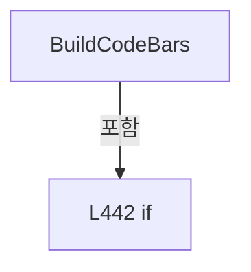

변경 전 점검: 입력/반환 타입, 위 호출자, 예외/취소 경로, 공유 상태와 저장·전송 소비자를 함께 확인합니다. 값의 단위나 물리 방향을 이름만으로 확정하지 않습니다.

### MethodDeclaration `BuildHourBars` · L456–480

[Drilling.UI/Menu/Menus/CMenuAlarm.cs:456–480](https://github.com/kjuws10-rgb/A3Drilling/blob/5aee8e58439c9b455cae7c9593c9be986c3e682e/Drilling.UI/Menu/Menus/CMenuAlarm.cs#L456-L480)

| 항목 | 실제 추출 값 |
| --- | --- |
| 서명 | System.Collections.Generic.IReadOnlyList<Drilling.UI.Menu.Menus.ST_ALARM_TREND_COLUMN> Drilling.UI.Menu.Menus.CAlarmHistoryPanel.BuildHourBars(System.Collections.Generic.IReadOnlyList<Drilling.Common.Alarm.ST_ALARM_HISTORY_ENTRY>, System.DateTime, System.DateTime) |
| 접근/수식자 | Private / private, static |
| 반환/값 타입 | System.Collections.Generic.IReadOnlyList<Drilling.UI.Menu.Menus.ST_ALARM_TREND_COLUMN> |
| 소속 타입 | NamedType:Drilling.UI.Menu.Menus.CAlarmHistoryPanel |

입력 계약:

| 이름 | 타입 | 전달 | 선택/기본값 |
| --- | --- | --- | --- |
| rows | System.Collections.Generic.IReadOnlyList<Drilling.Common.Alarm.ST_ALARM_HISTORY_ENTRY> | None | False /  |
| from | System.DateTime | None | False /  |
| through | System.DateTime | None | False /  |

정적 호출자로 확인된 위치:

| 호출 파일/행 | 호출 표현식 | 런타임 분기 가능 |
| --- | --- | --- |
| [Drilling.UI/Menu/Menus/CMenuAlarm.cs:335–335](https://github.com/kjuws10-rgb/A3Drilling/blob/5aee8e58439c9b455cae7c9593c9be986c3e682e/Drilling.UI/Menu/Menus/CMenuAlarm.cs#L335-L335) | BuildHourBars | False |

호출하는 대상과 해석 범위:

| 원본 행 | 표현식 | 분석 상태 | 대상/소스 위치 |
| --- | --- | --- | --- |
| 459 | rows.GroupBy(row => Hour(row.OccurredAt.LocalDateTime)).ToDictionary | resolved | System.Collections.Generic.Dictionary<System.DateTime, int> System.Collections.Generic.IEnumerable<System.Linq.IGrouping<System.DateTime, Drilling.Common.Alarm.ST_ALARM_HISTORY_ENTRY>>.ToDictionary<System.Linq.IGrouping<System.DateTime, Drilling.Common.Alarm.ST_ALARM_HISTORY_ENTRY>, System.DateTime, int>(System.Func<System.Linq.IGrouping<System.DateTime, Drilling.Common.Alarm.ST_ALARM_HISTORY_ENTRY>, System.DateTime>, System.Func<System.Linq.IGrouping<System.DateTime, Drilling.Common.Alarm.ST_ALARM_HISTORY_ENTRY>, int>) |
| 459 | rows.GroupBy | resolved | System.Collections.Generic.IEnumerable<System.Linq.IGrouping<System.DateTime, Drilling.Common.Alarm.ST_ALARM_HISTORY_ENTRY>> System.Collections.Generic.IEnumerable<Drilling.Common.Alarm.ST_ALARM_HISTORY_ENTRY>.GroupBy<Drilling.Common.Alarm.ST_ALARM_HISTORY_ENTRY, System.DateTime>(System.Func<Drilling.Common.Alarm.ST_ALARM_HISTORY_ENTRY, System.DateTime>) |
| 459 | Hour | resolved | System.DateTime Hour(System.DateTime) · Drilling.UI/Menu/Menus/CMenuAlarm.cs:458 |
| 459 | group.Count | resolved | int System.Collections.Generic.IEnumerable<Drilling.Common.Alarm.ST_ALARM_HISTORY_ENTRY>.Count<Drilling.Common.Alarm.ST_ALARM_HISTORY_ENTRY>() |
| 460 | Math.Max | resolved | int System.Math.Max(int, int) |
| 460 | counts.Values.DefaultIfEmpty(0).Max | resolved | int System.Collections.Generic.IEnumerable<int>.Max() |
| 460 | counts.Values.DefaultIfEmpty | resolved | System.Collections.Generic.IEnumerable<int> System.Collections.Generic.IEnumerable<int>.DefaultIfEmpty<int>(int) |
| 461 | new List<ST_ALARM_TREND_COLUMN> | resolved | System.Collections.Generic.List<Drilling.UI.Menu.Menus.ST_ALARM_TREND_COLUMN>.List() |
| 462 | Hour | resolved | System.DateTime Hour(System.DateTime) · Drilling.UI/Menu/Menus/CMenuAlarm.cs:458 |
| 463 | Hour | resolved | System.DateTime Hour(System.DateTime) · Drilling.UI/Menu/Menus/CMenuAlarm.cs:458 |
| 463 | hour.AddHours | resolved | System.DateTime System.DateTime.AddHours(double) |
| 465 | counts.GetValueOrDefault | resolved | int System.Collections.Generic.IReadOnlyDictionary<System.DateTime, int>.GetValueOrDefault<System.DateTime, int>(System.DateTime) |
| 466 | bars.Add | resolved | void System.Collections.Generic.List<Drilling.UI.Menu.Menus.ST_ALARM_TREND_COLUMN>.Add(Drilling.UI.Menu.Menus.ST_ALARM_TREND_COLUMN) |
| 466 | new | resolved | Drilling.UI.Menu.Menus.ST_ALARM_TREND_COLUMN.ST_ALARM_TREND_COLUMN(string, string, string, int, GridLength, GridLength, bool) · Drilling.UI/Menu/Menus/CMenuAlarm.cs:485 |
| 467 | hour.ToString | resolved | string System.DateTime.ToString(string?, System.IFormatProvider?) |
| 471 | new GridLength | unresolved | None |
| 472 | new GridLength | unresolved | None |

본문의 실제 연산·분기·예외·반환 순서(원문 위치 순):

| 원본 행 | 종류 | 주석 해설 |
| --- | --- | --- |
| 459 | call | 함수·델리게이트 또는 객체 생성자를 호출합니다: rows.GroupBy(row => Hour(row.OccurredAt.LocalDateTime)).ToDictionary(group => group.Key, group => group.Count()) |
| 459 | call | 함수·델리게이트 또는 객체 생성자를 호출합니다: rows.GroupBy(row => Hour(row.OccurredAt.LocalDateTime)) |
| 459 | call | 함수·델리게이트 또는 객체 생성자를 호출합니다: Hour(row.OccurredAt.LocalDateTime) |
| 459 | call | 함수·델리게이트 또는 객체 생성자를 호출합니다: group.Count() |
| 459 | local-declaration | 지역 변수를 선언합니다: var counts = rows.GroupBy(row => Hour(row.OccurredAt.LocalDateTime)).ToDictionary(group => group.Key, group => group.Count()); |
| 459 | variable-initializer | 변수의 초기값을 지정합니다: counts = rows.GroupBy(row => Hour(row.OccurredAt.LocalDateTime)).ToDictionary(group => group.Key, group => group.Count()) |
| 460 | call | 함수·델리게이트 또는 객체 생성자를 호출합니다: Math.Max(1, counts.Values.DefaultIfEmpty(0).Max()) |
| 460 | call | 함수·델리게이트 또는 객체 생성자를 호출합니다: counts.Values.DefaultIfEmpty(0).Max() |
| 460 | call | 함수·델리게이트 또는 객체 생성자를 호출합니다: counts.Values.DefaultIfEmpty(0) |
| 460 | local-declaration | 지역 변수를 선언합니다: var maximum = Math.Max(1, counts.Values.DefaultIfEmpty(0).Max()); |
| 460 | variable-initializer | 변수의 초기값을 지정합니다: maximum = Math.Max(1, counts.Values.DefaultIfEmpty(0).Max()) |
| 461 | call | 함수·델리게이트 또는 객체 생성자를 호출합니다: new List<ST_ALARM_TREND_COLUMN>() |
| 461 | local-declaration | 지역 변수를 선언합니다: var bars = new List<ST_ALARM_TREND_COLUMN>(); |
| 461 | variable-initializer | 변수의 초기값을 지정합니다: bars = new List<ST_ALARM_TREND_COLUMN>() |
| 462 | call | 함수·델리게이트 또는 객체 생성자를 호출합니다: Hour(through) |
| 462 | local-declaration | 지역 변수를 선언합니다: var end = Hour(through); |
| 462 | variable-initializer | 변수의 초기값을 지정합니다: end = Hour(through) |
| 463 | assignment | 값을 대상에 대입합니다: hour = hour.AddHours(1) |
| 463 | call | 함수·델리게이트 또는 객체 생성자를 호출합니다: Hour(from) |
| 463 | call | 함수·델리게이트 또는 객체 생성자를 호출합니다: hour.AddHours(1) |
| 463 | variable-initializer | 변수의 초기값을 지정합니다: hour = Hour(from) |
| 463 | for | 초기화·조건·증감이 있는 반복입니다: for (var hour = Hour(from); ; hour = hour.AddHours(1)) |
| 465 | call | 함수·델리게이트 또는 객체 생성자를 호출합니다: counts.GetValueOrDefault(hour) |
| 465 | local-declaration | 지역 변수를 선언합니다: var count = counts.GetValueOrDefault(hour); |
| 465 | variable-initializer | 변수의 초기값을 지정합니다: count = counts.GetValueOrDefault(hour) |
| 466 | call | 함수·델리게이트 또는 객체 생성자를 호출합니다: bars.Add(new( hour.ToString("MM-dd HH:mm", CultureInfo.InvariantCulture), $"{hour:yyyy-MM-dd HH:mm} · {count:N0}건", "", count, new GridLength(count, GridUnitType.Star), new GridLength(maximum - count, GridUnitType.Star),… |
| 466 | call | 함수·델리게이트 또는 객체 생성자를 호출합니다: new( hour.ToString("MM-dd HH:mm", CultureInfo.InvariantCulture), $"{hour:yyyy-MM-dd HH:mm} · {count:N0}건", "", count, new GridLength(count, GridUnitType.Star), new GridLength(maximum - count, GridUnitType.Star), IsHourly… |
| 467 | call | 함수·델리게이트 또는 객체 생성자를 호출합니다: hour.ToString("MM-dd HH:mm", CultureInfo.InvariantCulture) |
| 471 | call | 함수·델리게이트 또는 객체 생성자를 호출합니다: new GridLength(count, GridUnitType.Star) |
| 472 | call | 함수·델리게이트 또는 객체 생성자를 호출합니다: new GridLength(maximum - count, GridUnitType.Star) |
| 475 | if | 조건에 따라 분기합니다: if (hour == end) |
| 476 | break | 해당 반복/분기 구간을 종료합니다: break; |
| 479 | return | 호출자에게 값 또는 제어를 반환합니다: return bars; |

제어 구문의 포함 구조(실제 실행 순서/CFG가 아닌 구문 탐색 그림):

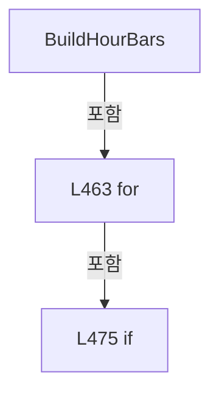

변경 전 점검: 입력/반환 타입, 위 호출자, 예외/취소 경로, 공유 상태와 저장·전송 소비자를 함께 확인합니다. 값의 단위나 물리 방향을 이름만으로 확정하지 않습니다.

### LocalFunctionStatement `Hour` · L458–458

[Drilling.UI/Menu/Menus/CMenuAlarm.cs:458–458](https://github.com/kjuws10-rgb/A3Drilling/blob/5aee8e58439c9b455cae7c9593c9be986c3e682e/Drilling.UI/Menu/Menus/CMenuAlarm.cs#L458-L458)

| 항목 | 실제 추출 값 |
| --- | --- |
| 서명 | System.DateTime Hour(System.DateTime) |
| 접근/수식자 | Private / static |
| 반환/값 타입 | System.DateTime |
| 소속 타입 | NamedType:Drilling.UI.Menu.Menus.CAlarmHistoryPanel |

입력 계약:

| 이름 | 타입 | 전달 | 선택/기본값 |
| --- | --- | --- | --- |
| value | System.DateTime | None | False /  |

정적 호출자로 확인된 위치:

| 호출 파일/행 | 호출 표현식 | 런타임 분기 가능 |
| --- | --- | --- |
| [Drilling.UI/Menu/Menus/CMenuAlarm.cs:459–459](https://github.com/kjuws10-rgb/A3Drilling/blob/5aee8e58439c9b455cae7c9593c9be986c3e682e/Drilling.UI/Menu/Menus/CMenuAlarm.cs#L459-L459) | Hour | False |
| [Drilling.UI/Menu/Menus/CMenuAlarm.cs:462–462](https://github.com/kjuws10-rgb/A3Drilling/blob/5aee8e58439c9b455cae7c9593c9be986c3e682e/Drilling.UI/Menu/Menus/CMenuAlarm.cs#L462-L462) | Hour | False |
| [Drilling.UI/Menu/Menus/CMenuAlarm.cs:463–463](https://github.com/kjuws10-rgb/A3Drilling/blob/5aee8e58439c9b455cae7c9593c9be986c3e682e/Drilling.UI/Menu/Menus/CMenuAlarm.cs#L463-L463) | Hour | False |

호출하는 대상과 해석 범위:

| 원본 행 | 표현식 | 분석 상태 | 대상/소스 위치 |
| --- | --- | --- | --- |
| 458 | value.Date.AddHours | resolved | System.DateTime System.DateTime.AddHours(double) |

본문의 실제 연산·분기·예외·반환 순서(원문 위치 순):

| 원본 행 | 종류 | 주석 해설 |
| --- | --- | --- |
| 458 | call | 함수·델리게이트 또는 객체 생성자를 호출합니다: value.Date.AddHours(value.Hour) |

변경 전 점검: 입력/반환 타입, 위 호출자, 예외/취소 경로, 공유 상태와 저장·전송 소비자를 함께 확인합니다. 값의 단위나 물리 방향을 이름만으로 확정하지 않습니다.

### MethodDeclaration `Notify` · L482–482

[Drilling.UI/Menu/Menus/CMenuAlarm.cs:482–482](https://github.com/kjuws10-rgb/A3Drilling/blob/5aee8e58439c9b455cae7c9593c9be986c3e682e/Drilling.UI/Menu/Menus/CMenuAlarm.cs#L482-L482)

| 항목 | 실제 추출 값 |
| --- | --- |
| 서명 | void Drilling.UI.Menu.Menus.CAlarmHistoryPanel.Notify(string?) |
| 접근/수식자 | Private / private |
| 반환/값 타입 | void |
| 소속 타입 | NamedType:Drilling.UI.Menu.Menus.CAlarmHistoryPanel |

입력 계약:

| 이름 | 타입 | 전달 | 선택/기본값 |
| --- | --- | --- | --- |
| name | string? | None | True / null |

정적 호출자로 확인된 위치:

| 호출 파일/행 | 호출 표현식 | 런타임 분기 가능 |
| --- | --- | --- |
| [Drilling.UI/Menu/Menus/CMenuAlarm.cs:244–244](https://github.com/kjuws10-rgb/A3Drilling/blob/5aee8e58439c9b455cae7c9593c9be986c3e682e/Drilling.UI/Menu/Menus/CMenuAlarm.cs#L244-L244) | Notify | False |
| [Drilling.UI/Menu/Menus/CMenuAlarm.cs:254–254](https://github.com/kjuws10-rgb/A3Drilling/blob/5aee8e58439c9b455cae7c9593c9be986c3e682e/Drilling.UI/Menu/Menus/CMenuAlarm.cs#L254-L254) | Notify | False |
| [Drilling.UI/Menu/Menus/CMenuAlarm.cs:264–264](https://github.com/kjuws10-rgb/A3Drilling/blob/5aee8e58439c9b455cae7c9593c9be986c3e682e/Drilling.UI/Menu/Menus/CMenuAlarm.cs#L264-L264) | Notify | False |
| [Drilling.UI/Menu/Menus/CMenuAlarm.cs:274–274](https://github.com/kjuws10-rgb/A3Drilling/blob/5aee8e58439c9b455cae7c9593c9be986c3e682e/Drilling.UI/Menu/Menus/CMenuAlarm.cs#L274-L274) | Notify | False |
| [Drilling.UI/Menu/Menus/CMenuAlarm.cs:323–323](https://github.com/kjuws10-rgb/A3Drilling/blob/5aee8e58439c9b455cae7c9593c9be986c3e682e/Drilling.UI/Menu/Menus/CMenuAlarm.cs#L323-L323) | Notify | False |
| [Drilling.UI/Menu/Menus/CMenuAlarm.cs:362–362](https://github.com/kjuws10-rgb/A3Drilling/blob/5aee8e58439c9b455cae7c9593c9be986c3e682e/Drilling.UI/Menu/Menus/CMenuAlarm.cs#L362-L362) | Notify | False |
| [Drilling.UI/Menu/Menus/CMenuAlarm.cs:371–371](https://github.com/kjuws10-rgb/A3Drilling/blob/5aee8e58439c9b455cae7c9593c9be986c3e682e/Drilling.UI/Menu/Menus/CMenuAlarm.cs#L371-L371) | Notify | False |
| [Drilling.UI/Menu/Menus/CMenuAlarm.cs:377–377](https://github.com/kjuws10-rgb/A3Drilling/blob/5aee8e58439c9b455cae7c9593c9be986c3e682e/Drilling.UI/Menu/Menus/CMenuAlarm.cs#L377-L377) | Notify | False |
| [Drilling.UI/Menu/Menus/CMenuAlarm.cs:378–378](https://github.com/kjuws10-rgb/A3Drilling/blob/5aee8e58439c9b455cae7c9593c9be986c3e682e/Drilling.UI/Menu/Menus/CMenuAlarm.cs#L378-L378) | Notify | False |
| [Drilling.UI/Menu/Menus/CMenuAlarm.cs:379–379](https://github.com/kjuws10-rgb/A3Drilling/blob/5aee8e58439c9b455cae7c9593c9be986c3e682e/Drilling.UI/Menu/Menus/CMenuAlarm.cs#L379-L379) | Notify | False |
| [Drilling.UI/Menu/Menus/CMenuAlarm.cs:426–426](https://github.com/kjuws10-rgb/A3Drilling/blob/5aee8e58439c9b455cae7c9593c9be986c3e682e/Drilling.UI/Menu/Menus/CMenuAlarm.cs#L426-L426) | Notify | False |

호출하는 대상과 해석 범위:

| 원본 행 | 표현식 | 분석 상태 | 대상/소스 위치 |
| --- | --- | --- | --- |
| 482 | .Invoke | resolved · 동적 구현 선택 가능 | void System.ComponentModel.PropertyChangedEventHandler.Invoke(object?, System.ComponentModel.PropertyChangedEventArgs) |
| 482 | new | resolved | System.ComponentModel.PropertyChangedEventArgs.PropertyChangedEventArgs(string?) |

본문의 실제 연산·분기·예외·반환 순서(원문 위치 순):

| 원본 행 | 종류 | 주석 해설 |
| --- | --- | --- |
| 482 | call | 함수·델리게이트 또는 객체 생성자를 호출합니다: .Invoke(this, new(name)) |
| 482 | call | 함수·델리게이트 또는 객체 생성자를 호출합니다: new(name) |

변경 전 점검: 입력/반환 타입, 위 호출자, 예외/취소 경로, 공유 상태와 저장·전송 소비자를 함께 확인합니다. 값의 단위나 물리 방향을 이름만으로 확정하지 않습니다.

### FieldDeclaration `_alarms` · L488–488

[Drilling.UI/Menu/Menus/CMenuAlarm.cs:488–488](https://github.com/kjuws10-rgb/A3Drilling/blob/5aee8e58439c9b455cae7c9593c9be986c3e682e/Drilling.UI/Menu/Menus/CMenuAlarm.cs#L488-L488)

| 항목 | 실제 추출 값 |
| --- | --- |
| 서명 | Drilling.Common.Alarm.CAlarmManager Drilling.UI.Menu.Menus.CAlarmListPanel._alarms |
| 접근/수식자 | Private / private, readonly |
| 반환/값 타입 | Drilling.Common.Alarm.CAlarmManager |
| 소속 타입 | NamedType:Drilling.UI.Menu.Menus.CAlarmListPanel |

현재 부분 분석에서 직접 연결된 호출자는 없습니다. XAML/이벤트/인터페이스·델리게이트·외부 진입을 추가 확인해야 하며, 미사용으로 판정한 것이 아닙니다.

변경 전 점검: 입력/반환 타입, 위 호출자, 예외/취소 경로, 공유 상태와 저장·전송 소비자를 함께 확인합니다. 값의 단위나 물리 방향을 이름만으로 확정하지 않습니다.

### FieldDeclaration `_displayedSnapshot` · L489–489

[Drilling.UI/Menu/Menus/CMenuAlarm.cs:489–489](https://github.com/kjuws10-rgb/A3Drilling/blob/5aee8e58439c9b455cae7c9593c9be986c3e682e/Drilling.UI/Menu/Menus/CMenuAlarm.cs#L489-L489)

| 항목 | 실제 추출 값 |
| --- | --- |
| 서명 | Drilling.Common.Alarm.ST_ALARM_DEFINITION_SNAPSHOT? Drilling.UI.Menu.Menus.CAlarmListPanel._displayedSnapshot |
| 접근/수식자 | Private / private |
| 반환/값 타입 | Drilling.Common.Alarm.ST_ALARM_DEFINITION_SNAPSHOT? |
| 소속 타입 | NamedType:Drilling.UI.Menu.Menus.CAlarmListPanel |

현재 부분 분석에서 직접 연결된 호출자는 없습니다. XAML/이벤트/인터페이스·델리게이트·외부 진입을 추가 확인해야 하며, 미사용으로 판정한 것이 아닙니다.

변경 전 점검: 입력/반환 타입, 위 호출자, 예외/취소 경로, 공유 상태와 저장·전송 소비자를 함께 확인합니다. 값의 단위나 물리 방향을 이름만으로 확정하지 않습니다.

### ConstructorDeclaration `.ctor` · L490–494

[Drilling.UI/Menu/Menus/CMenuAlarm.cs:490–494](https://github.com/kjuws10-rgb/A3Drilling/blob/5aee8e58439c9b455cae7c9593c9be986c3e682e/Drilling.UI/Menu/Menus/CMenuAlarm.cs#L490-L494)

| 항목 | 실제 추출 값 |
| --- | --- |
| 서명 | Drilling.UI.Menu.Menus.CAlarmListPanel.CAlarmListPanel(Drilling.Common.Alarm.CAlarmManager) |
| 접근/수식자 | Public / public |
| 반환/값 타입 | void |
| 소속 타입 | NamedType:Drilling.UI.Menu.Menus.CAlarmListPanel |

입력 계약:

| 이름 | 타입 | 전달 | 선택/기본값 |
| --- | --- | --- | --- |
| alarms | Drilling.Common.Alarm.CAlarmManager | None | False /  |

정적 호출자로 확인된 위치:

| 호출 파일/행 | 호출 표현식 | 런타임 분기 가능 |
| --- | --- | --- |
| [Drilling.UI/Menu/Menus/CMenuAlarm.cs:34–34](https://github.com/kjuws10-rgb/A3Drilling/blob/5aee8e58439c9b455cae7c9593c9be986c3e682e/Drilling.UI/Menu/Menus/CMenuAlarm.cs#L34-L34) | new | False |

호출하는 대상과 해석 범위:

| 원본 행 | 표현식 | 분석 상태 | 대상/소스 위치 |
| --- | --- | --- | --- |
| 493 | RefreshSnapshot | resolved | void Drilling.UI.Menu.Menus.CAlarmListPanel.RefreshSnapshot() · Drilling.UI/Menu/Menus/CMenuAlarm.cs:501 |

본문의 실제 연산·분기·예외·반환 순서(원문 위치 순):

| 원본 행 | 종류 | 주석 해설 |
| --- | --- | --- |
| 492 | assignment | 값을 대상에 대입합니다: _alarms = alarms |
| 493 | call | 함수·델리게이트 또는 객체 생성자를 호출합니다: RefreshSnapshot() |

변경 전 점검: 입력/반환 타입, 위 호출자, 예외/취소 경로, 공유 상태와 저장·전송 소비자를 함께 확인합니다. 값의 단위나 물리 방향을 이름만으로 확정하지 않습니다.

### EventFieldDeclaration `PropertyChanged` · L496–496

[Drilling.UI/Menu/Menus/CMenuAlarm.cs:496–496](https://github.com/kjuws10-rgb/A3Drilling/blob/5aee8e58439c9b455cae7c9593c9be986c3e682e/Drilling.UI/Menu/Menus/CMenuAlarm.cs#L496-L496)

| 항목 | 실제 추출 값 |
| --- | --- |
| 서명 | System.ComponentModel.PropertyChangedEventHandler? Drilling.UI.Menu.Menus.CAlarmListPanel.PropertyChanged |
| 접근/수식자 | Public / public, event |
| 반환/값 타입 | System.ComponentModel.PropertyChangedEventHandler? |
| 소속 타입 | NamedType:Drilling.UI.Menu.Menus.CAlarmListPanel |

현재 부분 분석에서 직접 연결된 호출자는 없습니다. XAML/이벤트/인터페이스·델리게이트·외부 진입을 추가 확인해야 하며, 미사용으로 판정한 것이 아닙니다.

변경 전 점검: 입력/반환 타입, 위 호출자, 예외/취소 경로, 공유 상태와 저장·전송 소비자를 함께 확인합니다. 값의 단위나 물리 방향을 이름만으로 확정하지 않습니다.

### PropertyDeclaration `Rows` · L497–497

[Drilling.UI/Menu/Menus/CMenuAlarm.cs:497–497](https://github.com/kjuws10-rgb/A3Drilling/blob/5aee8e58439c9b455cae7c9593c9be986c3e682e/Drilling.UI/Menu/Menus/CMenuAlarm.cs#L497-L497)

| 항목 | 실제 추출 값 |
| --- | --- |
| 서명 | System.Collections.Generic.IReadOnlyList<Drilling.UI.Menu.Menus.ST_ALARM_LIST_ROW> Drilling.UI.Menu.Menus.CAlarmListPanel.Rows |
| 접근/수식자 | Public / public |
| 반환/값 타입 | System.Collections.Generic.IReadOnlyList<Drilling.UI.Menu.Menus.ST_ALARM_LIST_ROW> |
| 소속 타입 | NamedType:Drilling.UI.Menu.Menus.CAlarmListPanel |

현재 부분 분석에서 직접 연결된 호출자는 없습니다. XAML/이벤트/인터페이스·델리게이트·외부 진입을 추가 확인해야 하며, 미사용으로 판정한 것이 아닙니다.

변경 전 점검: 입력/반환 타입, 위 호출자, 예외/취소 경로, 공유 상태와 저장·전송 소비자를 함께 확인합니다. 값의 단위나 물리 방향을 이름만으로 확정하지 않습니다.

### GetAccessorDeclaration `get_Rows` · L497–497

[Drilling.UI/Menu/Menus/CMenuAlarm.cs:497–497](https://github.com/kjuws10-rgb/A3Drilling/blob/5aee8e58439c9b455cae7c9593c9be986c3e682e/Drilling.UI/Menu/Menus/CMenuAlarm.cs#L497-L497)

| 항목 | 실제 추출 값 |
| --- | --- |
| 서명 | System.Collections.Generic.IReadOnlyList<Drilling.UI.Menu.Menus.ST_ALARM_LIST_ROW> Drilling.UI.Menu.Menus.CAlarmListPanel.Rows.get |
| 접근/수식자 | Public / get |
| 반환/값 타입 | System.Collections.Generic.IReadOnlyList<Drilling.UI.Menu.Menus.ST_ALARM_LIST_ROW> |
| 소속 타입 | NamedType:Drilling.UI.Menu.Menus.CAlarmListPanel |

현재 부분 분석에서 직접 연결된 호출자는 없습니다. XAML/이벤트/인터페이스·델리게이트·외부 진입을 추가 확인해야 하며, 미사용으로 판정한 것이 아닙니다.

변경 전 점검: 입력/반환 타입, 위 호출자, 예외/취소 경로, 공유 상태와 저장·전송 소비자를 함께 확인합니다. 값의 단위나 물리 방향을 이름만으로 확정하지 않습니다.

### SetAccessorDeclaration `set_Rows` · L497–497

[Drilling.UI/Menu/Menus/CMenuAlarm.cs:497–497](https://github.com/kjuws10-rgb/A3Drilling/blob/5aee8e58439c9b455cae7c9593c9be986c3e682e/Drilling.UI/Menu/Menus/CMenuAlarm.cs#L497-L497)

| 항목 | 실제 추출 값 |
| --- | --- |
| 서명 | void Drilling.UI.Menu.Menus.CAlarmListPanel.Rows.set |
| 접근/수식자 | Private / private, set |
| 반환/값 타입 | void |
| 소속 타입 | NamedType:Drilling.UI.Menu.Menus.CAlarmListPanel |

입력 계약:

| 이름 | 타입 | 전달 | 선택/기본값 |
| --- | --- | --- | --- |
| value | System.Collections.Generic.IReadOnlyList<Drilling.UI.Menu.Menus.ST_ALARM_LIST_ROW> | None | False /  |

현재 부분 분석에서 직접 연결된 호출자는 없습니다. XAML/이벤트/인터페이스·델리게이트·외부 진입을 추가 확인해야 하며, 미사용으로 판정한 것이 아닙니다.

변경 전 점검: 입력/반환 타입, 위 호출자, 예외/취소 경로, 공유 상태와 저장·전송 소비자를 함께 확인합니다. 값의 단위나 물리 방향을 이름만으로 확정하지 않습니다.

### PropertyDeclaration `Status` · L498–498

[Drilling.UI/Menu/Menus/CMenuAlarm.cs:498–498](https://github.com/kjuws10-rgb/A3Drilling/blob/5aee8e58439c9b455cae7c9593c9be986c3e682e/Drilling.UI/Menu/Menus/CMenuAlarm.cs#L498-L498)

| 항목 | 실제 추출 값 |
| --- | --- |
| 서명 | string Drilling.UI.Menu.Menus.CAlarmListPanel.Status |
| 접근/수식자 | Public / public |
| 반환/값 타입 | string |
| 소속 타입 | NamedType:Drilling.UI.Menu.Menus.CAlarmListPanel |

현재 부분 분석에서 직접 연결된 호출자는 없습니다. XAML/이벤트/인터페이스·델리게이트·외부 진입을 추가 확인해야 하며, 미사용으로 판정한 것이 아닙니다.

변경 전 점검: 입력/반환 타입, 위 호출자, 예외/취소 경로, 공유 상태와 저장·전송 소비자를 함께 확인합니다. 값의 단위나 물리 방향을 이름만으로 확정하지 않습니다.

### GetAccessorDeclaration `get_Status` · L498–498

[Drilling.UI/Menu/Menus/CMenuAlarm.cs:498–498](https://github.com/kjuws10-rgb/A3Drilling/blob/5aee8e58439c9b455cae7c9593c9be986c3e682e/Drilling.UI/Menu/Menus/CMenuAlarm.cs#L498-L498)

| 항목 | 실제 추출 값 |
| --- | --- |
| 서명 | string Drilling.UI.Menu.Menus.CAlarmListPanel.Status.get |
| 접근/수식자 | Public / get |
| 반환/값 타입 | string |
| 소속 타입 | NamedType:Drilling.UI.Menu.Menus.CAlarmListPanel |

현재 부분 분석에서 직접 연결된 호출자는 없습니다. XAML/이벤트/인터페이스·델리게이트·외부 진입을 추가 확인해야 하며, 미사용으로 판정한 것이 아닙니다.

변경 전 점검: 입력/반환 타입, 위 호출자, 예외/취소 경로, 공유 상태와 저장·전송 소비자를 함께 확인합니다. 값의 단위나 물리 방향을 이름만으로 확정하지 않습니다.

### SetAccessorDeclaration `set_Status` · L498–498

[Drilling.UI/Menu/Menus/CMenuAlarm.cs:498–498](https://github.com/kjuws10-rgb/A3Drilling/blob/5aee8e58439c9b455cae7c9593c9be986c3e682e/Drilling.UI/Menu/Menus/CMenuAlarm.cs#L498-L498)

| 항목 | 실제 추출 값 |
| --- | --- |
| 서명 | void Drilling.UI.Menu.Menus.CAlarmListPanel.Status.set |
| 접근/수식자 | Private / private, set |
| 반환/값 타입 | void |
| 소속 타입 | NamedType:Drilling.UI.Menu.Menus.CAlarmListPanel |

입력 계약:

| 이름 | 타입 | 전달 | 선택/기본값 |
| --- | --- | --- | --- |
| value | string | None | False /  |

현재 부분 분석에서 직접 연결된 호출자는 없습니다. XAML/이벤트/인터페이스·델리게이트·외부 진입을 추가 확인해야 하며, 미사용으로 판정한 것이 아닙니다.

변경 전 점검: 입력/반환 타입, 위 호출자, 예외/취소 경로, 공유 상태와 저장·전송 소비자를 함께 확인합니다. 값의 단위나 물리 방향을 이름만으로 확정하지 않습니다.

### PropertyDeclaration `HasError` · L499–499

[Drilling.UI/Menu/Menus/CMenuAlarm.cs:499–499](https://github.com/kjuws10-rgb/A3Drilling/blob/5aee8e58439c9b455cae7c9593c9be986c3e682e/Drilling.UI/Menu/Menus/CMenuAlarm.cs#L499-L499)

| 항목 | 실제 추출 값 |
| --- | --- |
| 서명 | bool Drilling.UI.Menu.Menus.CAlarmListPanel.HasError |
| 접근/수식자 | Public / public |
| 반환/값 타입 | bool |
| 소속 타입 | NamedType:Drilling.UI.Menu.Menus.CAlarmListPanel |

현재 부분 분석에서 직접 연결된 호출자는 없습니다. XAML/이벤트/인터페이스·델리게이트·외부 진입을 추가 확인해야 하며, 미사용으로 판정한 것이 아닙니다.

변경 전 점검: 입력/반환 타입, 위 호출자, 예외/취소 경로, 공유 상태와 저장·전송 소비자를 함께 확인합니다. 값의 단위나 물리 방향을 이름만으로 확정하지 않습니다.

### GetAccessorDeclaration `get_HasError` · L499–499

[Drilling.UI/Menu/Menus/CMenuAlarm.cs:499–499](https://github.com/kjuws10-rgb/A3Drilling/blob/5aee8e58439c9b455cae7c9593c9be986c3e682e/Drilling.UI/Menu/Menus/CMenuAlarm.cs#L499-L499)

| 항목 | 실제 추출 값 |
| --- | --- |
| 서명 | bool Drilling.UI.Menu.Menus.CAlarmListPanel.HasError.get |
| 접근/수식자 | Public / get |
| 반환/값 타입 | bool |
| 소속 타입 | NamedType:Drilling.UI.Menu.Menus.CAlarmListPanel |

현재 부분 분석에서 직접 연결된 호출자는 없습니다. XAML/이벤트/인터페이스·델리게이트·외부 진입을 추가 확인해야 하며, 미사용으로 판정한 것이 아닙니다.

변경 전 점검: 입력/반환 타입, 위 호출자, 예외/취소 경로, 공유 상태와 저장·전송 소비자를 함께 확인합니다. 값의 단위나 물리 방향을 이름만으로 확정하지 않습니다.

### SetAccessorDeclaration `set_HasError` · L499–499

[Drilling.UI/Menu/Menus/CMenuAlarm.cs:499–499](https://github.com/kjuws10-rgb/A3Drilling/blob/5aee8e58439c9b455cae7c9593c9be986c3e682e/Drilling.UI/Menu/Menus/CMenuAlarm.cs#L499-L499)

| 항목 | 실제 추출 값 |
| --- | --- |
| 서명 | void Drilling.UI.Menu.Menus.CAlarmListPanel.HasError.set |
| 접근/수식자 | Private / private, set |
| 반환/값 타입 | void |
| 소속 타입 | NamedType:Drilling.UI.Menu.Menus.CAlarmListPanel |

입력 계약:

| 이름 | 타입 | 전달 | 선택/기본값 |
| --- | --- | --- | --- |
| value | bool | None | False /  |

현재 부분 분석에서 직접 연결된 호출자는 없습니다. XAML/이벤트/인터페이스·델리게이트·외부 진입을 추가 확인해야 하며, 미사용으로 판정한 것이 아닙니다.

변경 전 점검: 입력/반환 타입, 위 호출자, 예외/취소 경로, 공유 상태와 저장·전송 소비자를 함께 확인합니다. 값의 단위나 물리 방향을 이름만으로 확정하지 않습니다.

### MethodDeclaration `RefreshSnapshot` · L501–513

[Drilling.UI/Menu/Menus/CMenuAlarm.cs:501–513](https://github.com/kjuws10-rgb/A3Drilling/blob/5aee8e58439c9b455cae7c9593c9be986c3e682e/Drilling.UI/Menu/Menus/CMenuAlarm.cs#L501-L513)

| 항목 | 실제 추출 값 |
| --- | --- |
| 서명 | void Drilling.UI.Menu.Menus.CAlarmListPanel.RefreshSnapshot() |
| 접근/수식자 | Public / public |
| 반환/값 타입 | void |
| 소속 타입 | NamedType:Drilling.UI.Menu.Menus.CAlarmListPanel |

정적 호출자로 확인된 위치:

| 호출 파일/행 | 호출 표현식 | 런타임 분기 가능 |
| --- | --- | --- |
| [Drilling.UI/Menu/Menus/CMenuAlarm.cs:88–88](https://github.com/kjuws10-rgb/A3Drilling/blob/5aee8e58439c9b455cae7c9593c9be986c3e682e/Drilling.UI/Menu/Menus/CMenuAlarm.cs#L88-L88) | ListPanel.RefreshSnapshot | False |
| [Drilling.UI/Menu/Menus/CMenuAlarm.cs:493–493](https://github.com/kjuws10-rgb/A3Drilling/blob/5aee8e58439c9b455cae7c9593c9be986c3e682e/Drilling.UI/Menu/Menus/CMenuAlarm.cs#L493-L493) | RefreshSnapshot | False |

호출하는 대상과 해석 범위:

| 원본 행 | 표현식 | 분석 상태 | 대상/소스 위치 |
| --- | --- | --- | --- |
| 503 | _alarms.GetDefinitionsSnapshot | resolved | Drilling.Common.Alarm.ST_ALARM_DEFINITION_SNAPSHOT Drilling.Common.Alarm.CAlarmManager.GetDefinitionsSnapshot() · Drilling.Common/Alarm/CAlarmManager.cs:125 |
| 504 | ReferenceEquals | resolved | bool object.ReferenceEquals(object?, object?) |
| 507 | snapshot.Rows.Select((row, index) => new ST_ALARM_LIST_ROW(index + 1, row.Code, row.Group, row.Id, row.Level, row.Cause, row.Solution, row.CimAddress)).ToArray | resolved | Drilling.UI.Menu.Menus.ST_ALARM_LIST_ROW[] System.Collections.Generic.IEnumerable<Drilling.UI.Menu.Menus.ST_ALARM_LIST_ROW>.ToArray<Drilling.UI.Menu.Menus.ST_ALARM_LIST_ROW>() |
| 507 | snapshot.Rows.Select | resolved | System.Collections.Generic.IEnumerable<Drilling.UI.Menu.Menus.ST_ALARM_LIST_ROW> System.Collections.Generic.IEnumerable<Drilling.Common.Alarm.ST_ALARM_DEFINITION>.Select<Drilling.Common.Alarm.ST_ALARM_DEFINITION, Drilling.UI.Menu.Menus.ST_ALARM_LIST_ROW>(System.Func<Drilling.Common.Alarm.ST_ALARM_DEFINITION, int, Drilling.UI.Menu.Menus.ST_ALARM_LIST_ROW>) |
| 507 | new ST_ALARM_LIST_ROW | resolved | Drilling.UI.Menu.Menus.ST_ALARM_LIST_ROW.ST_ALARM_LIST_ROW(int, int, string, string, string, string, string, string) · Drilling.UI/Menu/Menus/CMenuAlarm.cs:516 |
| 508 | string.IsNullOrEmpty | resolved | bool string.IsNullOrEmpty(string?) |
| 510 | .Invoke | resolved · 동적 구현 선택 가능 | void System.ComponentModel.PropertyChangedEventHandler.Invoke(object?, System.ComponentModel.PropertyChangedEventArgs) |
| 510 | new PropertyChangedEventArgs | resolved | System.ComponentModel.PropertyChangedEventArgs.PropertyChangedEventArgs(string?) |
| 510 | nameof | unresolved | None |
| 511 | .Invoke | resolved · 동적 구현 선택 가능 | void System.ComponentModel.PropertyChangedEventHandler.Invoke(object?, System.ComponentModel.PropertyChangedEventArgs) |
| 511 | new PropertyChangedEventArgs | resolved | System.ComponentModel.PropertyChangedEventArgs.PropertyChangedEventArgs(string?) |
| 511 | nameof | unresolved | None |
| 512 | .Invoke | resolved · 동적 구현 선택 가능 | void System.ComponentModel.PropertyChangedEventHandler.Invoke(object?, System.ComponentModel.PropertyChangedEventArgs) |
| 512 | new PropertyChangedEventArgs | resolved | System.ComponentModel.PropertyChangedEventArgs.PropertyChangedEventArgs(string?) |
| 512 | nameof | unresolved | None |

본문의 실제 연산·분기·예외·반환 순서(원문 위치 순):

| 원본 행 | 종류 | 주석 해설 |
| --- | --- | --- |
| 503 | call | 함수·델리게이트 또는 객체 생성자를 호출합니다: _alarms.GetDefinitionsSnapshot() |
| 503 | local-declaration | 지역 변수를 선언합니다: var snapshot = _alarms.GetDefinitionsSnapshot(); |
| 503 | variable-initializer | 변수의 초기값을 지정합니다: snapshot = _alarms.GetDefinitionsSnapshot() |
| 504 | call | 함수·델리게이트 또는 객체 생성자를 호출합니다: ReferenceEquals(snapshot, _displayedSnapshot) |
| 504 | if | 조건에 따라 분기합니다: if (ReferenceEquals(snapshot, _displayedSnapshot)) |
| 505 | return | 호출자에게 값 또는 제어를 반환합니다: return; |
| 506 | assignment | 값을 대상에 대입합니다: _displayedSnapshot = snapshot |
| 507 | assignment | 값을 대상에 대입합니다: Rows = snapshot.Rows.Select((row, index) => new ST_ALARM_LIST_ROW(index + 1, row.Code, row.Group, row.Id, row.Level, row.Cause, row.Solution, row.CimAddress)).ToArray() |
| 507 | call | 함수·델리게이트 또는 객체 생성자를 호출합니다: snapshot.Rows.Select((row, index) => new ST_ALARM_LIST_ROW(index + 1, row.Code, row.Group, row.Id, row.Level, row.Cause, row.Solution, row.CimAddress)).ToArray() |
| 507 | call | 함수·델리게이트 또는 객체 생성자를 호출합니다: snapshot.Rows.Select((row, index) => new ST_ALARM_LIST_ROW(index + 1, row.Code, row.Group, row.Id, row.Level, row.Cause, row.Solution, row.CimAddress)) |
| 507 | call | 함수·델리게이트 또는 객체 생성자를 호출합니다: new ST_ALARM_LIST_ROW(index + 1, row.Code, row.Group, row.Id, row.Level, row.Cause, row.Solution, row.CimAddress) |
| 508 | assignment | 값을 대상에 대입합니다: HasError = !string.IsNullOrEmpty(snapshot.Error) |
| 508 | call | 함수·델리게이트 또는 객체 생성자를 호출합니다: string.IsNullOrEmpty(snapshot.Error) |
| 509 | assignment | 값을 대상에 대입합니다: Status = HasError ? $"알람 목록을 불러오지 못했습니다. {snapshot.Error} 파일 확인 후 프로그램을 다시 시작해 주세요." : Rows.Count == 0 ? "등록된 알람이 없습니다." : "" |
| 509 | conditional-expression | 조건에 따라 결과식을 선택합니다: HasError ? $"알람 목록을 불러오지 못했습니다. {snapshot.Error} 파일 확인 후 프로그램을 다시 시작해 주세요." : Rows.Count == 0 ? "등록된 알람이 없습니다." : "" |
| 509 | conditional-expression | 조건에 따라 결과식을 선택합니다: Rows.Count == 0 ? "등록된 알람이 없습니다." : "" |
| 510 | call | 함수·델리게이트 또는 객체 생성자를 호출합니다: .Invoke(this, new PropertyChangedEventArgs(nameof(Rows))) |
| 510 | call | 함수·델리게이트 또는 객체 생성자를 호출합니다: new PropertyChangedEventArgs(nameof(Rows)) |
| 510 | call | 함수·델리게이트 또는 객체 생성자를 호출합니다: nameof(Rows) |
| 511 | call | 함수·델리게이트 또는 객체 생성자를 호출합니다: .Invoke(this, new PropertyChangedEventArgs(nameof(Status))) |
| 511 | call | 함수·델리게이트 또는 객체 생성자를 호출합니다: new PropertyChangedEventArgs(nameof(Status)) |
| 511 | call | 함수·델리게이트 또는 객체 생성자를 호출합니다: nameof(Status) |
| 512 | call | 함수·델리게이트 또는 객체 생성자를 호출합니다: .Invoke(this, new PropertyChangedEventArgs(nameof(HasError))) |
| 512 | call | 함수·델리게이트 또는 객체 생성자를 호출합니다: new PropertyChangedEventArgs(nameof(HasError)) |
| 512 | call | 함수·델리게이트 또는 객체 생성자를 호출합니다: nameof(HasError) |

제어 구문의 포함 구조(실제 실행 순서/CFG가 아닌 구문 탐색 그림):

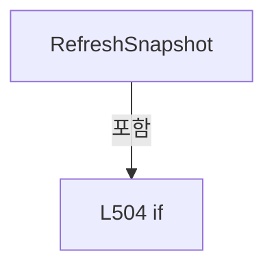

변경 전 점검: 입력/반환 타입, 위 호출자, 예외/취소 경로, 공유 상태와 저장·전송 소비자를 함께 확인합니다. 값의 단위나 물리 방향을 이름만으로 확정하지 않습니다.

### PropertyDeclaration `LevelBrush` · L519–531

[Drilling.UI/Menu/Menus/CMenuAlarm.cs:519–531](https://github.com/kjuws10-rgb/A3Drilling/blob/5aee8e58439c9b455cae7c9593c9be986c3e682e/Drilling.UI/Menu/Menus/CMenuAlarm.cs#L519-L531)

| 항목 | 실제 추출 값 |
| --- | --- |
| 서명 | Brush Drilling.UI.Menu.Menus.ST_ALARM_CURRENT_ROW.LevelBrush |
| 접근/수식자 | Public / public |
| 반환/값 타입 | Brush |
| 소속 타입 | NamedType:Drilling.UI.Menu.Menus.ST_ALARM_CURRENT_ROW |

현재 부분 분석에서 직접 연결된 호출자는 없습니다. XAML/이벤트/인터페이스·델리게이트·외부 진입을 추가 확인해야 하며, 미사용으로 판정한 것이 아닙니다.

변경 전 점검: 입력/반환 타입, 위 호출자, 예외/취소 경로, 공유 상태와 저장·전송 소비자를 함께 확인합니다. 값의 단위나 물리 방향을 이름만으로 확정하지 않습니다.

### GetAccessorDeclaration `get_LevelBrush` · L521–530

[Drilling.UI/Menu/Menus/CMenuAlarm.cs:521–530](https://github.com/kjuws10-rgb/A3Drilling/blob/5aee8e58439c9b455cae7c9593c9be986c3e682e/Drilling.UI/Menu/Menus/CMenuAlarm.cs#L521-L530)

| 항목 | 실제 추출 값 |
| --- | --- |
| 서명 | Brush Drilling.UI.Menu.Menus.ST_ALARM_CURRENT_ROW.LevelBrush.get |
| 접근/수식자 | Public / get |
| 반환/값 타입 | Brush |
| 소속 타입 | NamedType:Drilling.UI.Menu.Menus.ST_ALARM_CURRENT_ROW |

현재 부분 분석에서 직접 연결된 호출자는 없습니다. XAML/이벤트/인터페이스·델리게이트·외부 진입을 추가 확인해야 하며, 미사용으로 판정한 것이 아닙니다.

본문의 실제 연산·분기·예외·반환 순서(원문 위치 순):

| 원본 행 | 종류 | 주석 해설 |
| --- | --- | --- |
| 523 | return | 호출자에게 값 또는 제어를 반환합니다: return Level switch { "LIGHT" or "WARN" => CStatusBrush.Wait, "HEAVY" or "CRITICAL" or "ERROR" => CStatusBrush.Offline, "INFO" => CStatusBrush.Simul, _ => CStatusBrush.PrimaryText }; |
| 523 | switch-expression | 값별 결과식을 선택합니다: Level switch { "LIGHT" or "WARN" => CStatusBrush.Wait, "HEAVY" or "CRITICAL" or "ERROR" => CStatusBrush.Offline, "INFO" => CStatusBrush.Simul, _ => CStatusBrush.PrimaryText } |

제어 구문의 포함 구조(실제 실행 순서/CFG가 아닌 구문 탐색 그림):

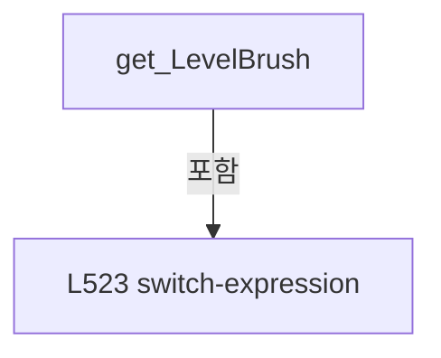

변경 전 점검: 입력/반환 타입, 위 호출자, 예외/취소 경로, 공유 상태와 저장·전송 소비자를 함께 확인합니다. 값의 단위나 물리 방향을 이름만으로 확정하지 않습니다.

### PropertyDeclaration `ValueBrush` · L536–549

[Drilling.UI/Menu/Menus/CMenuAlarm.cs:536–549](https://github.com/kjuws10-rgb/A3Drilling/blob/5aee8e58439c9b455cae7c9593c9be986c3e682e/Drilling.UI/Menu/Menus/CMenuAlarm.cs#L536-L549)

| 항목 | 실제 추출 값 |
| --- | --- |
| 서명 | Brush Drilling.UI.Menu.Menus.ST_ALARM_DETAIL_ROW.ValueBrush |
| 접근/수식자 | Public / public |
| 반환/값 타입 | Brush |
| 소속 타입 | NamedType:Drilling.UI.Menu.Menus.ST_ALARM_DETAIL_ROW |

현재 부분 분석에서 직접 연결된 호출자는 없습니다. XAML/이벤트/인터페이스·델리게이트·외부 진입을 추가 확인해야 하며, 미사용으로 판정한 것이 아닙니다.

변경 전 점검: 입력/반환 타입, 위 호출자, 예외/취소 경로, 공유 상태와 저장·전송 소비자를 함께 확인합니다. 값의 단위나 물리 방향을 이름만으로 확정하지 않습니다.

### GetAccessorDeclaration `get_ValueBrush` · L538–548

[Drilling.UI/Menu/Menus/CMenuAlarm.cs:538–548](https://github.com/kjuws10-rgb/A3Drilling/blob/5aee8e58439c9b455cae7c9593c9be986c3e682e/Drilling.UI/Menu/Menus/CMenuAlarm.cs#L538-L548)

| 항목 | 실제 추출 값 |
| --- | --- |
| 서명 | Brush Drilling.UI.Menu.Menus.ST_ALARM_DETAIL_ROW.ValueBrush.get |
| 접근/수식자 | Public / get |
| 반환/값 타입 | Brush |
| 소속 타입 | NamedType:Drilling.UI.Menu.Menus.ST_ALARM_DETAIL_ROW |

현재 부분 분석에서 직접 연결된 호출자는 없습니다. XAML/이벤트/인터페이스·델리게이트·외부 진입을 추가 확인해야 하며, 미사용으로 판정한 것이 아닙니다.

본문의 실제 연산·분기·예외·반환 순서(원문 위치 순):

| 원본 행 | 종류 | 주석 해설 |
| --- | --- | --- |
| 540 | return | 호출자에게 값 또는 제어를 반환합니다: return State switch { "Warn" => CStatusBrush.Wait, "Critical" => CStatusBrush.Offline, "Accent" => CStatusBrush.Simul, "Ok" => CStatusBrush.Online, _ => CStatusBrush.PrimaryText }; |
| 540 | switch-expression | 값별 결과식을 선택합니다: State switch { "Warn" => CStatusBrush.Wait, "Critical" => CStatusBrush.Offline, "Accent" => CStatusBrush.Simul, "Ok" => CStatusBrush.Online, _ => CStatusBrush.PrimaryText } |

제어 구문의 포함 구조(실제 실행 순서/CFG가 아닌 구문 탐색 그림):

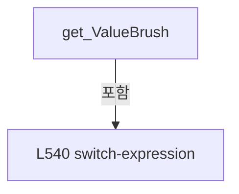

변경 전 점검: 입력/반환 타입, 위 호출자, 예외/취소 경로, 공유 상태와 저장·전송 소비자를 함께 확인합니다. 값의 단위나 물리 방향을 이름만으로 확정하지 않습니다.

### PropertyDeclaration `LevelBrush` · L554–566

[Drilling.UI/Menu/Menus/CMenuAlarm.cs:554–566](https://github.com/kjuws10-rgb/A3Drilling/blob/5aee8e58439c9b455cae7c9593c9be986c3e682e/Drilling.UI/Menu/Menus/CMenuAlarm.cs#L554-L566)

| 항목 | 실제 추출 값 |
| --- | --- |
| 서명 | Brush Drilling.UI.Menu.Menus.ST_ALARM_HISTORY_ROW.LevelBrush |
| 접근/수식자 | Public / public |
| 반환/값 타입 | Brush |
| 소속 타입 | NamedType:Drilling.UI.Menu.Menus.ST_ALARM_HISTORY_ROW |

현재 부분 분석에서 직접 연결된 호출자는 없습니다. XAML/이벤트/인터페이스·델리게이트·외부 진입을 추가 확인해야 하며, 미사용으로 판정한 것이 아닙니다.

변경 전 점검: 입력/반환 타입, 위 호출자, 예외/취소 경로, 공유 상태와 저장·전송 소비자를 함께 확인합니다. 값의 단위나 물리 방향을 이름만으로 확정하지 않습니다.

### GetAccessorDeclaration `get_LevelBrush` · L556–565

[Drilling.UI/Menu/Menus/CMenuAlarm.cs:556–565](https://github.com/kjuws10-rgb/A3Drilling/blob/5aee8e58439c9b455cae7c9593c9be986c3e682e/Drilling.UI/Menu/Menus/CMenuAlarm.cs#L556-L565)

| 항목 | 실제 추출 값 |
| --- | --- |
| 서명 | Brush Drilling.UI.Menu.Menus.ST_ALARM_HISTORY_ROW.LevelBrush.get |
| 접근/수식자 | Public / get |
| 반환/값 타입 | Brush |
| 소속 타입 | NamedType:Drilling.UI.Menu.Menus.ST_ALARM_HISTORY_ROW |

현재 부분 분석에서 직접 연결된 호출자는 없습니다. XAML/이벤트/인터페이스·델리게이트·외부 진입을 추가 확인해야 하며, 미사용으로 판정한 것이 아닙니다.

본문의 실제 연산·분기·예외·반환 순서(원문 위치 순):

| 원본 행 | 종류 | 주석 해설 |
| --- | --- | --- |
| 558 | return | 호출자에게 값 또는 제어를 반환합니다: return Level switch { "LIGHT" or "WARN" => CStatusBrush.Wait, "HEAVY" or "CRITICAL" or "ERROR" => CStatusBrush.Offline, "INFO" => CStatusBrush.Simul, _ => CStatusBrush.PrimaryText }; |
| 558 | switch-expression | 값별 결과식을 선택합니다: Level switch { "LIGHT" or "WARN" => CStatusBrush.Wait, "HEAVY" or "CRITICAL" or "ERROR" => CStatusBrush.Offline, "INFO" => CStatusBrush.Simul, _ => CStatusBrush.PrimaryText } |

제어 구문의 포함 구조(실제 실행 순서/CFG가 아닌 구문 탐색 그림):

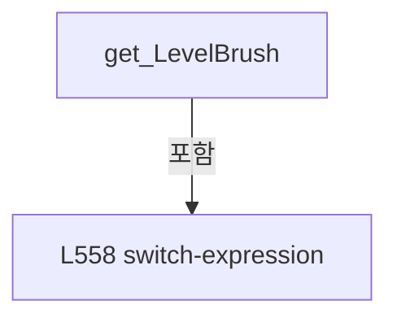

변경 전 점검: 입력/반환 타입, 위 호출자, 예외/취소 경로, 공유 상태와 저장·전송 소비자를 함께 확인합니다. 값의 단위나 물리 방향을 이름만으로 확정하지 않습니다.

### PropertyDeclaration `ValueBrush` · L572–585

[Drilling.UI/Menu/Menus/CMenuAlarm.cs:572–585](https://github.com/kjuws10-rgb/A3Drilling/blob/5aee8e58439c9b455cae7c9593c9be986c3e682e/Drilling.UI/Menu/Menus/CMenuAlarm.cs#L572-L585)

| 항목 | 실제 추출 값 |
| --- | --- |
| 서명 | Brush Drilling.UI.Menu.Menus.ST_ALARM_SUMMARY_ITEM.ValueBrush |
| 접근/수식자 | Public / public |
| 반환/값 타입 | Brush |
| 소속 타입 | NamedType:Drilling.UI.Menu.Menus.ST_ALARM_SUMMARY_ITEM |

현재 부분 분석에서 직접 연결된 호출자는 없습니다. XAML/이벤트/인터페이스·델리게이트·외부 진입을 추가 확인해야 하며, 미사용으로 판정한 것이 아닙니다.

변경 전 점검: 입력/반환 타입, 위 호출자, 예외/취소 경로, 공유 상태와 저장·전송 소비자를 함께 확인합니다. 값의 단위나 물리 방향을 이름만으로 확정하지 않습니다.

### GetAccessorDeclaration `get_ValueBrush` · L574–584

[Drilling.UI/Menu/Menus/CMenuAlarm.cs:574–584](https://github.com/kjuws10-rgb/A3Drilling/blob/5aee8e58439c9b455cae7c9593c9be986c3e682e/Drilling.UI/Menu/Menus/CMenuAlarm.cs#L574-L584)

| 항목 | 실제 추출 값 |
| --- | --- |
| 서명 | Brush Drilling.UI.Menu.Menus.ST_ALARM_SUMMARY_ITEM.ValueBrush.get |
| 접근/수식자 | Public / get |
| 반환/값 타입 | Brush |
| 소속 타입 | NamedType:Drilling.UI.Menu.Menus.ST_ALARM_SUMMARY_ITEM |

현재 부분 분석에서 직접 연결된 호출자는 없습니다. XAML/이벤트/인터페이스·델리게이트·외부 진입을 추가 확인해야 하며, 미사용으로 판정한 것이 아닙니다.

본문의 실제 연산·분기·예외·반환 순서(원문 위치 순):

| 원본 행 | 종류 | 주석 해설 |
| --- | --- | --- |
| 576 | return | 호출자에게 값 또는 제어를 반환합니다: return State switch { "Warn" => CStatusBrush.Wait, "Critical" => CStatusBrush.Offline, "Accent" => CStatusBrush.Simul, "Ok" => CStatusBrush.Online, _ => CStatusBrush.PrimaryText }; |
| 576 | switch-expression | 값별 결과식을 선택합니다: State switch { "Warn" => CStatusBrush.Wait, "Critical" => CStatusBrush.Offline, "Accent" => CStatusBrush.Simul, "Ok" => CStatusBrush.Online, _ => CStatusBrush.PrimaryText } |

제어 구문의 포함 구조(실제 실행 순서/CFG가 아닌 구문 탐색 그림):

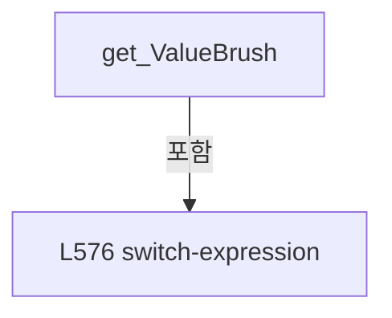

변경 전 점검: 입력/반환 타입, 위 호출자, 예외/취소 경로, 공유 상태와 저장·전송 소비자를 함께 확인합니다. 값의 단위나 물리 방향을 이름만으로 확정하지 않습니다.

## 구문·바인딩 한계

전체 WPF/벤더 SDK/프로젝트별 빌드 조건을 로드한 정식 빌드가 아닙니다. `resolved`는 이 부분 컴파일에서의 심볼 연결이며 virtual/interface/delegate/이벤트/Reflection/XAML의 실제 런타임 구현을 확정하지 않습니다. `candidate`와 `unresolved`는 후속 확인 대상으로 남깁니다.

## 원문 전체 주석 해설본

[원본 모든 행과 행별 해설 보기](../../../../annotated/Drilling.UI/Menu/Menus/CMenuAlarm.cs.annotated.txt)

원본을 빠뜨리거나 임의로 줄이지 않았습니다. `L000001 |` 표시는 원본 행 번호, `// 해설`은 별도 설명입니다. 실행용 소스가 아닌 문서입니다.

## 수정·재검증 체크

- 원본 Commit과 현재 작업 파일 SHA가 같은지 먼저 확인합니다. 다르면 이 문서를 과거 버전 자료로 취급합니다.
- 선언·직접 호출·이벤트/인터페이스 경계·설정 소비를 함께 확인합니다. 정적 연결의 빈 곳을 정상 경로로 추정하지 않습니다.
- 저장 형식/단위/식별자·재시도·취소·예외·롤백에 영향을 주는 변경은 상세 해설장과 호출자를 다시 검토합니다.
- 도구의 구문 추출과 별도 정적 추적 해설, 실제 빌드·시뮬레이션·실장비 검증 결과를 분리합니다.
