# Drilling.UI/Menu/Menus/CMenuAlarm.cs

| 항목 | 내용 |
| --- | --- |
| 원본 저장소 | https://github.com/kjuws10-rgb/A3Drilling.git |
| 원본 Commit | 96e22cd027c84bf302b23f2949b98985d7f301bb |
| 원본 SHA256 | 07a42cddff502aa5fbbfd6307875e5166b943dc369cbb4b00d5a0536b842d694 |
| 파일 분류 | code |
| 원본 크기/행 | 26,581 bytes / 618 physical lines |
| 인코딩 | utf-8-sig |
| 검토 범위 | 구문/부분 의미 분석에서 추출한 사실. 동작·물리 단위·실장비 합격을 보증하지 않습니다. |
| 원본 링크 | [고정 Commit 원본](https://github.com/kjuws10-rgb/A3Drilling/blob/96e22cd027c84bf302b23f2949b98985d7f301bb/Drilling.UI/Menu/Menus/CMenuAlarm.cs) |

## 파일의 역할과 읽는 순서

WPF 화면·사용자 명령·표시 상태를 구성합니다. XAML 이벤트와 코드 비하인드, RootView의 조립 경로를 함께 추적합니다.

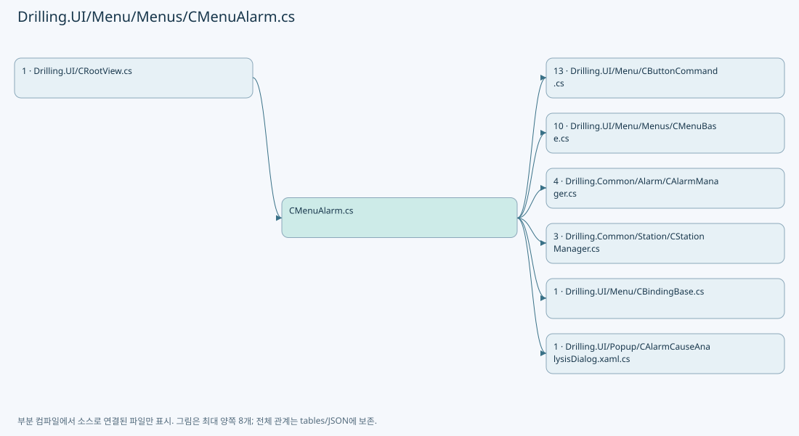

## 네임스페이스·타입·상속

| 타입 | 구분 | 원본 범위 | 선언/상속 |
| --- | --- | --- | --- |
| CMenuAlarm | ClassDeclaration | 17–212 | CMenuAlarm: CMenuBase |
| CAlarmHistoryPanel | ClassDeclaration | 214–514 | CAlarmHistoryPanel: INotifyPropertyChanged |
| ST_ALARM_TREND_COLUMN | RecordDeclaration | 516–516 | ST_ALARM_TREND_COLUMN |
| CAlarmListPanel | ClassDeclaration | 517–545 | CAlarmListPanel: INotifyPropertyChanged |
| ST_ALARM_LIST_ROW | RecordDeclaration | 547–547 | ST_ALARM_LIST_ROW |
| ST_ALARM_CURRENT_ROW | RecordDeclaration | 548–563 | ST_ALARM_CURRENT_ROW |
| ST_ALARM_DETAIL_ROW | RecordDeclaration | 565–581 | ST_ALARM_DETAIL_ROW |
| ST_ALARM_HISTORY_ROW | RecordDeclaration | 583–598 | ST_ALARM_HISTORY_ROW |
| ST_ALARM_TREND_BAR | RecordDeclaration | 600–600 | ST_ALARM_TREND_BAR |
| ST_ALARM_SUMMARY_ITEM | RecordDeclaration | 601–617 | ST_ALARM_SUMMARY_ITEM |

## 멤버 빠른 목록

| 이름 | 종류 | 범위 | 서명 |
| --- | --- | --- | --- |
| _selectedTabIndex | FieldDeclaration | L19–19 | int Drilling.UI.Menu.Menus.CMenuAlarm._selectedTabIndex |
| SelectedTabIndexChanged | EventFieldDeclaration | L20–20 | System.EventHandler? Drilling.UI.Menu.Menus.CMenuAlarm.SelectedTabIndexChanged |
| SelectedTabIndex | PropertyDeclaration | L21–33 | int Drilling.UI.Menu.Menus.CMenuAlarm.SelectedTabIndex |
| get_SelectedTabIndex | GetAccessorDeclaration | L23–23 | int Drilling.UI.Menu.Menus.CMenuAlarm.SelectedTabIndex.get |
| set_SelectedTabIndex | SetAccessorDeclaration | L24–32 | void Drilling.UI.Menu.Menus.CMenuAlarm.SelectedTabIndex.set |
| ListPanel | PropertyDeclaration | L35–35 | Drilling.UI.Menu.Menus.CAlarmListPanel Drilling.UI.Menu.Menus.CMenuAlarm.ListPanel |
| get_ListPanel | GetAccessorDeclaration | L35–35 | Drilling.UI.Menu.Menus.CAlarmListPanel Drilling.UI.Menu.Menus.CMenuAlarm.ListPanel.get |
| HistoryPanel | PropertyDeclaration | L36–36 | Drilling.UI.Menu.Menus.CAlarmHistoryPanel Drilling.UI.Menu.Menus.CMenuAlarm.HistoryPanel |
| get_HistoryPanel | GetAccessorDeclaration | L36–36 | Drilling.UI.Menu.Menus.CAlarmHistoryPanel Drilling.UI.Menu.Menus.CMenuAlarm.HistoryPanel.get |
| LogErrorChanged | EventFieldDeclaration | L38–38 | System.EventHandler? Drilling.UI.Menu.Menus.CMenuAlarm.LogErrorChanged |
| LogError | PropertyDeclaration | L39–39 | string Drilling.UI.Menu.Menus.CMenuAlarm.LogError |
| Menu | PropertyDeclaration | L41–47 | Drilling.UI.Menu.Menus.EN_MENU Drilling.UI.Menu.Menus.CMenuAlarm.Menu |
| get_Menu | GetAccessorDeclaration | L43–46 | Drilling.UI.Menu.Menus.EN_MENU Drilling.UI.Menu.Menus.CMenuAlarm.Menu.get |
| AlarmResetCommand | PropertyDeclaration | L49–60 | Drilling.UI.Menu.CButtonCommand Drilling.UI.Menu.Menus.CMenuAlarm.AlarmResetCommand |
| get_AlarmResetCommand | GetAccessorDeclaration | L51–59 | Drilling.UI.Menu.CButtonCommand Drilling.UI.Menu.Menus.CMenuAlarm.AlarmResetCommand.get |
| ResetAlarmCallback | LocalFunctionStatement | L53–56 | void ResetAlarmCallback(object?) |
| BuzzerOffCommand | PropertyDeclaration | L62–73 | Drilling.UI.Menu.CButtonCommand Drilling.UI.Menu.Menus.CMenuAlarm.BuzzerOffCommand |
| get_BuzzerOffCommand | GetAccessorDeclaration | L64–72 | Drilling.UI.Menu.CButtonCommand Drilling.UI.Menu.Menus.CMenuAlarm.BuzzerOffCommand.get |
| setStatusMessageCallback | LocalFunctionStatement | L66–69 | void setStatusMessageCallback(object?) |
| CurrentAlarms | PropertyDeclaration | L75–75 | System.Collections.Generic.IReadOnlyList<Drilling.UI.Menu.Menus.ST_DISPLAY_ITEM> Drilling.UI.Menu.Menus.CMenuAlarm.CurrentAlarms |
| get_CurrentAlarms | GetAccessorDeclaration | L75–75 | System.Collections.Generic.IReadOnlyList<Drilling.UI.Menu.Menus.ST_DISPLAY_ITEM> Drilling.UI.Menu.Menus.CMenuAlarm.CurrentAlarms.get |
| set_CurrentAlarms | SetAccessorDeclaration | L75–75 | void Drilling.UI.Menu.Menus.CMenuAlarm.CurrentAlarms.set |
| AlarmDetail | PropertyDeclaration | L76–76 | System.Collections.Generic.IReadOnlyList<Drilling.UI.Menu.Menus.ST_DISPLAY_ITEM> Drilling.UI.Menu.Menus.CMenuAlarm.AlarmDetail |
| get_AlarmDetail | GetAccessorDeclaration | L76–76 | System.Collections.Generic.IReadOnlyList<Drilling.UI.Menu.Menus.ST_DISPLAY_ITEM> Drilling.UI.Menu.Menus.CMenuAlarm.AlarmDetail.get |
| set_AlarmDetail | SetAccessorDeclaration | L76–76 | void Drilling.UI.Menu.Menus.CMenuAlarm.AlarmDetail.set |
| RecoveryCommands | PropertyDeclaration | L77–77 | System.Collections.Generic.IReadOnlyList<Drilling.UI.Menu.Menus.ST_DISPLAY_ITEM> Drilling.UI.Menu.Menus.CMenuAlarm.RecoveryCommands |
| get_RecoveryCommands | GetAccessorDeclaration | L77–77 | System.Collections.Generic.IReadOnlyList<Drilling.UI.Menu.Menus.ST_DISPLAY_ITEM> Drilling.UI.Menu.Menus.CMenuAlarm.RecoveryCommands.get |
| set_RecoveryCommands | SetAccessorDeclaration | L77–77 | void Drilling.UI.Menu.Menus.CMenuAlarm.RecoveryCommands.set |
| History | PropertyDeclaration | L78–78 | System.Collections.Generic.IReadOnlyList<Drilling.UI.Menu.Menus.ST_DISPLAY_ITEM> Drilling.UI.Menu.Menus.CMenuAlarm.History |
| get_History | GetAccessorDeclaration | L78–78 | System.Collections.Generic.IReadOnlyList<Drilling.UI.Menu.Menus.ST_DISPLAY_ITEM> Drilling.UI.Menu.Menus.CMenuAlarm.History.get |
| set_History | SetAccessorDeclaration | L78–78 | void Drilling.UI.Menu.Menus.CMenuAlarm.History.set |
| Trend | PropertyDeclaration | L79–79 | System.Collections.Generic.IReadOnlyList<Drilling.UI.Menu.Menus.ST_DISPLAY_ITEM> Drilling.UI.Menu.Menus.CMenuAlarm.Trend |
| get_Trend | GetAccessorDeclaration | L79–79 | System.Collections.Generic.IReadOnlyList<Drilling.UI.Menu.Menus.ST_DISPLAY_ITEM> Drilling.UI.Menu.Menus.CMenuAlarm.Trend.get |
| set_Trend | SetAccessorDeclaration | L79–79 | void Drilling.UI.Menu.Menus.CMenuAlarm.Trend.set |
| CurrentAlarmRows | PropertyDeclaration | L80–80 | System.Collections.Generic.IReadOnlyList<Drilling.UI.Menu.Menus.ST_ALARM_CURRENT_ROW> Drilling.UI.Menu.Menus.CMenuAlarm.CurrentAlarmRows |
| get_CurrentAlarmRows | GetAccessorDeclaration | L80–80 | System.Collections.Generic.IReadOnlyList<Drilling.UI.Menu.Menus.ST_ALARM_CURRENT_ROW> Drilling.UI.Menu.Menus.CMenuAlarm.CurrentAlarmRows.get |
| set_CurrentAlarmRows | SetAccessorDeclaration | L80–80 | void Drilling.UI.Menu.Menus.CMenuAlarm.CurrentAlarmRows.set |
| DetailRows | PropertyDeclaration | L81–81 | System.Collections.Generic.IReadOnlyList<Drilling.UI.Menu.Menus.ST_ALARM_DETAIL_ROW> Drilling.UI.Menu.Menus.CMenuAlarm.DetailRows |
| get_DetailRows | GetAccessorDeclaration | L81–81 | System.Collections.Generic.IReadOnlyList<Drilling.UI.Menu.Menus.ST_ALARM_DETAIL_ROW> Drilling.UI.Menu.Menus.CMenuAlarm.DetailRows.get |
| set_DetailRows | SetAccessorDeclaration | L81–81 | void Drilling.UI.Menu.Menus.CMenuAlarm.DetailRows.set |
| HistoryRows | PropertyDeclaration | L82–82 | System.Collections.Generic.IReadOnlyList<Drilling.UI.Menu.Menus.ST_ALARM_HISTORY_ROW> Drilling.UI.Menu.Menus.CMenuAlarm.HistoryRows |
| get_HistoryRows | GetAccessorDeclaration | L82–82 | System.Collections.Generic.IReadOnlyList<Drilling.UI.Menu.Menus.ST_ALARM_HISTORY_ROW> Drilling.UI.Menu.Menus.CMenuAlarm.HistoryRows.get |
| set_HistoryRows | SetAccessorDeclaration | L82–82 | void Drilling.UI.Menu.Menus.CMenuAlarm.HistoryRows.set |
| TrendBars | PropertyDeclaration | L83–83 | System.Collections.Generic.IReadOnlyList<Drilling.UI.Menu.Menus.ST_ALARM_TREND_BAR> Drilling.UI.Menu.Menus.CMenuAlarm.TrendBars |
| get_TrendBars | GetAccessorDeclaration | L83–83 | System.Collections.Generic.IReadOnlyList<Drilling.UI.Menu.Menus.ST_ALARM_TREND_BAR> Drilling.UI.Menu.Menus.CMenuAlarm.TrendBars.get |
| set_TrendBars | SetAccessorDeclaration | L83–83 | void Drilling.UI.Menu.Menus.CMenuAlarm.TrendBars.set |
| SummaryItems | PropertyDeclaration | L84–84 | System.Collections.Generic.IReadOnlyList<Drilling.UI.Menu.Menus.ST_ALARM_SUMMARY_ITEM> Drilling.UI.Menu.Menus.CMenuAlarm.SummaryItems |
| get_SummaryItems | GetAccessorDeclaration | L84–84 | System.Collections.Generic.IReadOnlyList<Drilling.UI.Menu.Menus.ST_ALARM_SUMMARY_ITEM> Drilling.UI.Menu.Menus.CMenuAlarm.SummaryItems.get |
| set_SummaryItems | SetAccessorDeclaration | L84–84 | void Drilling.UI.Menu.Menus.CMenuAlarm.SummaryItems.set |
| Build | MethodDeclaration | L86–117 | System.Threading.Tasks.Task<Drilling.UI.Menu.Menus.CScreenViewModel> Drilling.UI.Menu.Menus.CMenuAlarm.Build(System.Threading.CancellationToken) |
| BuildDisplay | LocalFunctionStatement | L91–94 | Drilling.UI.Menu.Menus.ST_DISPLAY_ITEM BuildDisplay(Drilling.Common.Alarm.ST_ALARM_DATA) |
| ResetAlarmAsync | MethodDeclaration | L119–137 | System.Threading.Tasks.Task Drilling.UI.Menu.Menus.CMenuAlarm.ResetAlarmAsync() |
| Apply | MethodDeclaration | L139–162 | void Drilling.UI.Menu.Menus.CMenuAlarm.Apply(System.Collections.Generic.IReadOnlyList<Drilling.UI.Menu.Menus.ST_DISPLAY_ITEM>, System.Collections.Generic.IReadOnlyList<Drilling.UI.Menu.Menus.ST_DISPLAY_ITEM>, System.Collections.Generic.IReadOnlyList<Drilling.UI.Menu.Menus.ST_DISPLAY_ITEM>, System.Collections.Generic.IReadOnlyList<Drilling.UI.Menu.Menus.ST_DISPLAY_ITEM>, System.Collections.Generic.IReadOnlyList<Drilling.UI.Menu.Menus.ST_DISPLAY_ITEM>, System.Collections.Generic.IReadOnlyList<Drilling.UI.Menu.Menus.ST_ALARM_CURRENT_ROW>, System.Collections.Generic.IReadOnlyList<Drilling.UI.Menu.Menus.ST_ALARM_DETAIL_ROW>, System.Collections.Generic.IReadOnlyList<Drilling.UI.Menu.Menus.ST_ALARM_HISTORY_ROW>, System.Collections.Generic.IReadOnlyList<Drilling.UI.Menu.Menus.ST_ALARM_TREND_BAR>, System.Collections.Generic.IReadOnlyList<Drilling.UI.Menu.Menus.ST_ALARM_SUMMARY_ITEM>) |
| BuildCurrentAlarmRows | MethodDeclaration | L164–174 | System.Collections.Generic.IReadOnlyList<Drilling.UI.Menu.Menus.ST_ALARM_CURRENT_ROW> Drilling.UI.Menu.Menus.CMenuAlarm.BuildCurrentAlarmRows(System.Collections.Generic.IReadOnlyList<Drilling.Common.Alarm.ST_ALARM_DATA>) |
| BuildAlarm | LocalFunctionStatement | L167–171 | Drilling.UI.Menu.Menus.ST_ALARM_CURRENT_ROW BuildAlarm(Drilling.Common.Alarm.ST_ALARM_DATA, int) |
| BuildDetailRows | MethodDeclaration | L176–191 | System.Collections.Generic.IReadOnlyList<Drilling.UI.Menu.Menus.ST_ALARM_DETAIL_ROW> Drilling.UI.Menu.Menus.CMenuAlarm.BuildDetailRows(Drilling.Common.Alarm.ST_ALARM_DATA?) |
| FormatSeverity | MethodDeclaration | L193–201 | string Drilling.UI.Menu.Menus.CMenuAlarm.FormatSeverity(Drilling.Common.Alarm.EN_ALARM_LEVEL) |
| SeverityState | MethodDeclaration | L203–211 | string Drilling.UI.Menu.Menus.CMenuAlarm.SeverityState(Drilling.Common.Alarm.EN_ALARM_LEVEL) |
| _read | FieldDeclaration | L216–216 | System.Func<System.DateTime, System.DateTime, System.Threading.CancellationToken, Drilling.Common.Alarm.ST_ALARM_HISTORY_RESULT> Drilling.UI.Menu.Menus.CAlarmHistoryPanel._read |
| _logDirectory | FieldDeclaration | L217–217 | string Drilling.UI.Menu.Menus.CAlarmHistoryPanel._logDirectory |
| _now | FieldDeclaration | L218–218 | System.Func<System.DateTime> Drilling.UI.Menu.Menus.CAlarmHistoryPanel._now |
| _from | FieldDeclaration | L219–219 | System.DateTime? Drilling.UI.Menu.Menus.CAlarmHistoryPanel._from |
| _through | FieldDeclaration | L220–220 | System.DateTime? Drilling.UI.Menu.Menus.CAlarmHistoryPanel._through |
| _fromTime | FieldDeclaration | L221–221 | string Drilling.UI.Menu.Menus.CAlarmHistoryPanel._fromTime |
| _throughTime | FieldDeclaration | L222–222 | string Drilling.UI.Menu.Menus.CAlarmHistoryPanel._throughTime |
| _hasOpened | FieldDeclaration | L223–223 | bool Drilling.UI.Menu.Menus.CAlarmHistoryPanel._hasOpened |
| _isCodeView | FieldDeclaration | L224–224 | bool Drilling.UI.Menu.Menus.CAlarmHistoryPanel._isCodeView |
| _loadedRows | FieldDeclaration | L225–225 | System.Collections.Generic.IReadOnlyList<Drilling.Common.Alarm.ST_ALARM_HISTORY_ENTRY> Drilling.UI.Menu.Menus.CAlarmHistoryPanel._loadedRows |
| _searchedFrom | FieldDeclaration | L226–226 | System.DateTime? Drilling.UI.Menu.Menus.CAlarmHistoryPanel._searchedFrom |
| _searchedThrough | FieldDeclaration | L227–227 | System.DateTime? Drilling.UI.Menu.Menus.CAlarmHistoryPanel._searchedThrough |
| _selectedRow | FieldDeclaration | L228–228 | Drilling.UI.Menu.Menus.ST_ALARM_HISTORY_ROW? Drilling.UI.Menu.Menus.CAlarmHistoryPanel._selectedRow |
| .ctor | ConstructorDeclaration | L229–240 | Drilling.UI.Menu.Menus.CAlarmHistoryPanel.CAlarmHistoryPanel(System.Func<System.DateTime, System.DateTime, System.Threading.CancellationToken, Drilling.Common.Alarm.ST_ALARM_HISTORY_RESULT>, string, System.Func<System.DateTime>?) |
| PropertyChanged | EventFieldDeclaration | L242–242 | System.ComponentModel.PropertyChangedEventHandler? Drilling.UI.Menu.Menus.CAlarmHistoryPanel.PropertyChanged |
| From | PropertyDeclaration | L243–251 | System.DateTime? Drilling.UI.Menu.Menus.CAlarmHistoryPanel.From |
| get_From | GetAccessorDeclaration | L245–245 | System.DateTime? Drilling.UI.Menu.Menus.CAlarmHistoryPanel.From.get |
| set_From | SetAccessorDeclaration | L246–250 | void Drilling.UI.Menu.Menus.CAlarmHistoryPanel.From.set |
| Through | PropertyDeclaration | L253–261 | System.DateTime? Drilling.UI.Menu.Menus.CAlarmHistoryPanel.Through |
| get_Through | GetAccessorDeclaration | L255–255 | System.DateTime? Drilling.UI.Menu.Menus.CAlarmHistoryPanel.Through.get |
| set_Through | SetAccessorDeclaration | L256–260 | void Drilling.UI.Menu.Menus.CAlarmHistoryPanel.Through.set |
| FromTime | PropertyDeclaration | L263–271 | string Drilling.UI.Menu.Menus.CAlarmHistoryPanel.FromTime |
| get_FromTime | GetAccessorDeclaration | L265–265 | string Drilling.UI.Menu.Menus.CAlarmHistoryPanel.FromTime.get |
| set_FromTime | SetAccessorDeclaration | L266–270 | void Drilling.UI.Menu.Menus.CAlarmHistoryPanel.FromTime.set |
| ThroughTime | PropertyDeclaration | L273–281 | string Drilling.UI.Menu.Menus.CAlarmHistoryPanel.ThroughTime |
| get_ThroughTime | GetAccessorDeclaration | L275–275 | string Drilling.UI.Menu.Menus.CAlarmHistoryPanel.ThroughTime.get |
| set_ThroughTime | SetAccessorDeclaration | L276–280 | void Drilling.UI.Menu.Menus.CAlarmHistoryPanel.ThroughTime.set |
| IsBusy | PropertyDeclaration | L283–283 | bool Drilling.UI.Menu.Menus.CAlarmHistoryPanel.IsBusy |
| get_IsBusy | GetAccessorDeclaration | L283–283 | bool Drilling.UI.Menu.Menus.CAlarmHistoryPanel.IsBusy.get |
| set_IsBusy | SetAccessorDeclaration | L283–283 | void Drilling.UI.Menu.Menus.CAlarmHistoryPanel.IsBusy.set |
| CanEdit | PropertyDeclaration | L284–284 | bool Drilling.UI.Menu.Menus.CAlarmHistoryPanel.CanEdit |
| IsCodeView | PropertyDeclaration | L285–285 | bool Drilling.UI.Menu.Menus.CAlarmHistoryPanel.IsCodeView |
| IsHourView | PropertyDeclaration | L286–286 | bool Drilling.UI.Menu.Menus.CAlarmHistoryPanel.IsHourView |
| Status | PropertyDeclaration | L287–287 | string Drilling.UI.Menu.Menus.CAlarmHistoryPanel.Status |
| get_Status | GetAccessorDeclaration | L287–287 | string Drilling.UI.Menu.Menus.CAlarmHistoryPanel.Status.get |
| set_Status | SetAccessorDeclaration | L287–287 | void Drilling.UI.Menu.Menus.CAlarmHistoryPanel.Status.set |
| TrendCaption | PropertyDeclaration | L288–288 | string Drilling.UI.Menu.Menus.CAlarmHistoryPanel.TrendCaption |
| get_TrendCaption | GetAccessorDeclaration | L288–288 | string Drilling.UI.Menu.Menus.CAlarmHistoryPanel.TrendCaption.get |
| set_TrendCaption | SetAccessorDeclaration | L288–288 | void Drilling.UI.Menu.Menus.CAlarmHistoryPanel.TrendCaption.set |
| EmptyMessage | PropertyDeclaration | L289–289 | string Drilling.UI.Menu.Menus.CAlarmHistoryPanel.EmptyMessage |
| get_EmptyMessage | GetAccessorDeclaration | L289–289 | string Drilling.UI.Menu.Menus.CAlarmHistoryPanel.EmptyMessage.get |
| set_EmptyMessage | SetAccessorDeclaration | L289–289 | void Drilling.UI.Menu.Menus.CAlarmHistoryPanel.EmptyMessage.set |
| Rows | PropertyDeclaration | L290–290 | System.Collections.Generic.IReadOnlyList<Drilling.UI.Menu.Menus.ST_ALARM_HISTORY_ROW> Drilling.UI.Menu.Menus.CAlarmHistoryPanel.Rows |
| get_Rows | GetAccessorDeclaration | L290–290 | System.Collections.Generic.IReadOnlyList<Drilling.UI.Menu.Menus.ST_ALARM_HISTORY_ROW> Drilling.UI.Menu.Menus.CAlarmHistoryPanel.Rows.get |
| set_Rows | SetAccessorDeclaration | L290–290 | void Drilling.UI.Menu.Menus.CAlarmHistoryPanel.Rows.set |
| Bars | PropertyDeclaration | L291–291 | System.Collections.Generic.IReadOnlyList<Drilling.UI.Menu.Menus.ST_ALARM_TREND_COLUMN> Drilling.UI.Menu.Menus.CAlarmHistoryPanel.Bars |
| get_Bars | GetAccessorDeclaration | L291–291 | System.Collections.Generic.IReadOnlyList<Drilling.UI.Menu.Menus.ST_ALARM_TREND_COLUMN> Drilling.UI.Menu.Menus.CAlarmHistoryPanel.Bars.get |
| set_Bars | SetAccessorDeclaration | L291–291 | void Drilling.UI.Menu.Menus.CAlarmHistoryPanel.Bars.set |
| SelectedRow | PropertyDeclaration | L292–303 | Drilling.UI.Menu.Menus.ST_ALARM_HISTORY_ROW? Drilling.UI.Menu.Menus.CAlarmHistoryPanel.SelectedRow |
| get_SelectedRow | GetAccessorDeclaration | L294–294 | Drilling.UI.Menu.Menus.ST_ALARM_HISTORY_ROW? Drilling.UI.Menu.Menus.CAlarmHistoryPanel.SelectedRow.get |
| set_SelectedRow | SetAccessorDeclaration | L295–302 | void Drilling.UI.Menu.Menus.CAlarmHistoryPanel.SelectedRow.set |
| SearchCommand | PropertyDeclaration | L304–304 | Drilling.UI.Menu.CButtonCommand Drilling.UI.Menu.Menus.CAlarmHistoryPanel.SearchCommand |
| get_SearchCommand | GetAccessorDeclaration | L304–304 | Drilling.UI.Menu.CButtonCommand Drilling.UI.Menu.Menus.CAlarmHistoryPanel.SearchCommand.get |
| Last24HoursCommand | PropertyDeclaration | L305–305 | Drilling.UI.Menu.CButtonCommand Drilling.UI.Menu.Menus.CAlarmHistoryPanel.Last24HoursCommand |
| get_Last24HoursCommand | GetAccessorDeclaration | L305–305 | Drilling.UI.Menu.CButtonCommand Drilling.UI.Menu.Menus.CAlarmHistoryPanel.Last24HoursCommand.get |
| HourViewCommand | PropertyDeclaration | L306–306 | Drilling.UI.Menu.CButtonCommand Drilling.UI.Menu.Menus.CAlarmHistoryPanel.HourViewCommand |
| get_HourViewCommand | GetAccessorDeclaration | L306–306 | Drilling.UI.Menu.CButtonCommand Drilling.UI.Menu.Menus.CAlarmHistoryPanel.HourViewCommand.get |
| CodeViewCommand | PropertyDeclaration | L307–307 | Drilling.UI.Menu.CButtonCommand Drilling.UI.Menu.Menus.CAlarmHistoryPanel.CodeViewCommand |
| get_CodeViewCommand | GetAccessorDeclaration | L307–307 | Drilling.UI.Menu.CButtonCommand Drilling.UI.Menu.Menus.CAlarmHistoryPanel.CodeViewCommand.get |
| CauseAnalysisCommand | PropertyDeclaration | L308–308 | Drilling.UI.Menu.CButtonCommand Drilling.UI.Menu.Menus.CAlarmHistoryPanel.CauseAnalysisCommand |
| get_CauseAnalysisCommand | GetAccessorDeclaration | L308–308 | Drilling.UI.Menu.CButtonCommand Drilling.UI.Menu.Menus.CAlarmHistoryPanel.CauseAnalysisCommand.get |
| ShowCauseAnalysis | MethodDeclaration | L310–318 | void Drilling.UI.Menu.Menus.CAlarmHistoryPanel.ShowCauseAnalysis() |
| InitializeOnFirstOpen | MethodDeclaration | L320–326 | void Drilling.UI.Menu.Menus.CAlarmHistoryPanel.InitializeOnFirstOpen() |
| SetDefaultRange | MethodDeclaration | L328–334 | void Drilling.UI.Menu.Menus.CAlarmHistoryPanel.SetDefaultRange() |
| SelectTrendView | MethodDeclaration | L336–352 | void Drilling.UI.Menu.Menus.CAlarmHistoryPanel.SelectTrendView(bool) |
| RefreshTrend | MethodDeclaration | L354–366 | void Drilling.UI.Menu.Menus.CAlarmHistoryPanel.RefreshTrend() |
| SearchLast24HoursAsync | MethodDeclaration | L368–381 | System.Threading.Tasks.Task Drilling.UI.Menu.Menus.CAlarmHistoryPanel.SearchLast24HoursAsync() |
| SearchAsync | MethodDeclaration | L383–461 | System.Threading.Tasks.Task Drilling.UI.Menu.Menus.CAlarmHistoryPanel.SearchAsync() |
| TryReadTime | MethodDeclaration | L463–469 | bool Drilling.UI.Menu.Menus.CAlarmHistoryPanel.TryReadTime(string, out System.TimeSpan) |
| BuildCodeBars | MethodDeclaration | L471–485 | System.Collections.Generic.IReadOnlyList<Drilling.UI.Menu.Menus.ST_ALARM_TREND_COLUMN> Drilling.UI.Menu.Menus.CAlarmHistoryPanel.BuildCodeBars(System.Collections.Generic.IReadOnlyList<Drilling.Common.Alarm.ST_ALARM_HISTORY_ENTRY>) |
| BuildHourBars | MethodDeclaration | L487–511 | System.Collections.Generic.IReadOnlyList<Drilling.UI.Menu.Menus.ST_ALARM_TREND_COLUMN> Drilling.UI.Menu.Menus.CAlarmHistoryPanel.BuildHourBars(System.Collections.Generic.IReadOnlyList<Drilling.Common.Alarm.ST_ALARM_HISTORY_ENTRY>, System.DateTime, System.DateTime) |
| Hour | LocalFunctionStatement | L489–489 | System.DateTime Hour(System.DateTime) |
| Notify | MethodDeclaration | L513–513 | void Drilling.UI.Menu.Menus.CAlarmHistoryPanel.Notify(string?) |
| _alarms | FieldDeclaration | L519–519 | Drilling.Common.Alarm.CAlarmManager Drilling.UI.Menu.Menus.CAlarmListPanel._alarms |
| _displayedSnapshot | FieldDeclaration | L520–520 | Drilling.Common.Alarm.ST_ALARM_DEFINITION_SNAPSHOT? Drilling.UI.Menu.Menus.CAlarmListPanel._displayedSnapshot |
| .ctor | ConstructorDeclaration | L521–525 | Drilling.UI.Menu.Menus.CAlarmListPanel.CAlarmListPanel(Drilling.Common.Alarm.CAlarmManager) |
| PropertyChanged | EventFieldDeclaration | L527–527 | System.ComponentModel.PropertyChangedEventHandler? Drilling.UI.Menu.Menus.CAlarmListPanel.PropertyChanged |
| Rows | PropertyDeclaration | L528–528 | System.Collections.Generic.IReadOnlyList<Drilling.UI.Menu.Menus.ST_ALARM_LIST_ROW> Drilling.UI.Menu.Menus.CAlarmListPanel.Rows |
| get_Rows | GetAccessorDeclaration | L528–528 | System.Collections.Generic.IReadOnlyList<Drilling.UI.Menu.Menus.ST_ALARM_LIST_ROW> Drilling.UI.Menu.Menus.CAlarmListPanel.Rows.get |
| set_Rows | SetAccessorDeclaration | L528–528 | void Drilling.UI.Menu.Menus.CAlarmListPanel.Rows.set |
| Status | PropertyDeclaration | L529–529 | string Drilling.UI.Menu.Menus.CAlarmListPanel.Status |
| get_Status | GetAccessorDeclaration | L529–529 | string Drilling.UI.Menu.Menus.CAlarmListPanel.Status.get |
| set_Status | SetAccessorDeclaration | L529–529 | void Drilling.UI.Menu.Menus.CAlarmListPanel.Status.set |
| HasError | PropertyDeclaration | L530–530 | bool Drilling.UI.Menu.Menus.CAlarmListPanel.HasError |
| get_HasError | GetAccessorDeclaration | L530–530 | bool Drilling.UI.Menu.Menus.CAlarmListPanel.HasError.get |
| set_HasError | SetAccessorDeclaration | L530–530 | void Drilling.UI.Menu.Menus.CAlarmListPanel.HasError.set |
| RefreshSnapshot | MethodDeclaration | L532–544 | void Drilling.UI.Menu.Menus.CAlarmListPanel.RefreshSnapshot() |
| LevelBrush | PropertyDeclaration | L550–562 | Brush Drilling.UI.Menu.Menus.ST_ALARM_CURRENT_ROW.LevelBrush |
| get_LevelBrush | GetAccessorDeclaration | L552–561 | Brush Drilling.UI.Menu.Menus.ST_ALARM_CURRENT_ROW.LevelBrush.get |
| ValueBrush | PropertyDeclaration | L567–580 | Brush Drilling.UI.Menu.Menus.ST_ALARM_DETAIL_ROW.ValueBrush |
| get_ValueBrush | GetAccessorDeclaration | L569–579 | Brush Drilling.UI.Menu.Menus.ST_ALARM_DETAIL_ROW.ValueBrush.get |
| LevelBrush | PropertyDeclaration | L585–597 | Brush Drilling.UI.Menu.Menus.ST_ALARM_HISTORY_ROW.LevelBrush |
| get_LevelBrush | GetAccessorDeclaration | L587–596 | Brush Drilling.UI.Menu.Menus.ST_ALARM_HISTORY_ROW.LevelBrush.get |
| ValueBrush | PropertyDeclaration | L603–616 | Brush Drilling.UI.Menu.Menus.ST_ALARM_SUMMARY_ITEM.ValueBrush |
| get_ValueBrush | GetAccessorDeclaration | L605–615 | Brush Drilling.UI.Menu.Menus.ST_ALARM_SUMMARY_ITEM.ValueBrush.get |

## 멤버별 상세 계약·호출·처리 해설

### FieldDeclaration `_selectedTabIndex` · L19–19

[Drilling.UI/Menu/Menus/CMenuAlarm.cs:19–19](https://github.com/kjuws10-rgb/A3Drilling/blob/96e22cd027c84bf302b23f2949b98985d7f301bb/Drilling.UI/Menu/Menus/CMenuAlarm.cs#L19-L19)

| 항목 | 실제 추출 값 |
| --- | --- |
| 서명 | int Drilling.UI.Menu.Menus.CMenuAlarm._selectedTabIndex |
| 접근/수식자 | Private / private |
| 반환/값 타입 | int |
| 소속 타입 | NamedType:Drilling.UI.Menu.Menus.CMenuAlarm |

현재 부분 분석에서 직접 연결된 호출자는 없습니다. XAML/이벤트/인터페이스·델리게이트·외부 진입을 추가 확인해야 하며, 미사용으로 판정한 것이 아닙니다.

변경 전 점검: 입력/반환 타입, 위 호출자, 예외/취소 경로, 공유 상태와 저장·전송 소비자를 함께 확인합니다. 값의 단위나 물리 방향을 이름만으로 확정하지 않습니다.

### EventFieldDeclaration `SelectedTabIndexChanged` · L20–20

[Drilling.UI/Menu/Menus/CMenuAlarm.cs:20–20](https://github.com/kjuws10-rgb/A3Drilling/blob/96e22cd027c84bf302b23f2949b98985d7f301bb/Drilling.UI/Menu/Menus/CMenuAlarm.cs#L20-L20)

| 항목 | 실제 추출 값 |
| --- | --- |
| 서명 | System.EventHandler? Drilling.UI.Menu.Menus.CMenuAlarm.SelectedTabIndexChanged |
| 접근/수식자 | Public / public, event |
| 반환/값 타입 | System.EventHandler? |
| 소속 타입 | NamedType:Drilling.UI.Menu.Menus.CMenuAlarm |

현재 부분 분석에서 직접 연결된 호출자는 없습니다. XAML/이벤트/인터페이스·델리게이트·외부 진입을 추가 확인해야 하며, 미사용으로 판정한 것이 아닙니다.

변경 전 점검: 입력/반환 타입, 위 호출자, 예외/취소 경로, 공유 상태와 저장·전송 소비자를 함께 확인합니다. 값의 단위나 물리 방향을 이름만으로 확정하지 않습니다.

### PropertyDeclaration `SelectedTabIndex` · L21–33

[Drilling.UI/Menu/Menus/CMenuAlarm.cs:21–33](https://github.com/kjuws10-rgb/A3Drilling/blob/96e22cd027c84bf302b23f2949b98985d7f301bb/Drilling.UI/Menu/Menus/CMenuAlarm.cs#L21-L33)

| 항목 | 실제 추출 값 |
| --- | --- |
| 서명 | int Drilling.UI.Menu.Menus.CMenuAlarm.SelectedTabIndex |
| 접근/수식자 | Public / public |
| 반환/값 타입 | int |
| 소속 타입 | NamedType:Drilling.UI.Menu.Menus.CMenuAlarm |

현재 부분 분석에서 직접 연결된 호출자는 없습니다. XAML/이벤트/인터페이스·델리게이트·외부 진입을 추가 확인해야 하며, 미사용으로 판정한 것이 아닙니다.

변경 전 점검: 입력/반환 타입, 위 호출자, 예외/취소 경로, 공유 상태와 저장·전송 소비자를 함께 확인합니다. 값의 단위나 물리 방향을 이름만으로 확정하지 않습니다.

### GetAccessorDeclaration `get_SelectedTabIndex` · L23–23

[Drilling.UI/Menu/Menus/CMenuAlarm.cs:23–23](https://github.com/kjuws10-rgb/A3Drilling/blob/96e22cd027c84bf302b23f2949b98985d7f301bb/Drilling.UI/Menu/Menus/CMenuAlarm.cs#L23-L23)

| 항목 | 실제 추출 값 |
| --- | --- |
| 서명 | int Drilling.UI.Menu.Menus.CMenuAlarm.SelectedTabIndex.get |
| 접근/수식자 | Public / get |
| 반환/값 타입 | int |
| 소속 타입 | NamedType:Drilling.UI.Menu.Menus.CMenuAlarm |

현재 부분 분석에서 직접 연결된 호출자는 없습니다. XAML/이벤트/인터페이스·델리게이트·외부 진입을 추가 확인해야 하며, 미사용으로 판정한 것이 아닙니다.

변경 전 점검: 입력/반환 타입, 위 호출자, 예외/취소 경로, 공유 상태와 저장·전송 소비자를 함께 확인합니다. 값의 단위나 물리 방향을 이름만으로 확정하지 않습니다.

### SetAccessorDeclaration `set_SelectedTabIndex` · L24–32

[Drilling.UI/Menu/Menus/CMenuAlarm.cs:24–32](https://github.com/kjuws10-rgb/A3Drilling/blob/96e22cd027c84bf302b23f2949b98985d7f301bb/Drilling.UI/Menu/Menus/CMenuAlarm.cs#L24-L32)

| 항목 | 실제 추출 값 |
| --- | --- |
| 서명 | void Drilling.UI.Menu.Menus.CMenuAlarm.SelectedTabIndex.set |
| 접근/수식자 | Public / set |
| 반환/값 타입 | void |
| 소속 타입 | NamedType:Drilling.UI.Menu.Menus.CMenuAlarm |

입력 계약:

| 이름 | 타입 | 전달 | 선택/기본값 |
| --- | --- | --- | --- |
| value | int | None | False /  |

현재 부분 분석에서 직접 연결된 호출자는 없습니다. XAML/이벤트/인터페이스·델리게이트·외부 진입을 추가 확인해야 하며, 미사용으로 판정한 것이 아닙니다.

호출하는 대상과 해석 범위:

| 원본 행 | 표현식 | 분석 상태 | 대상/소스 위치 |
| --- | --- | --- | --- |
| 30 | HistoryPanel.InitializeOnFirstOpen | resolved | void Drilling.UI.Menu.Menus.CAlarmHistoryPanel.InitializeOnFirstOpen() · Drilling.UI/Menu/Menus/CMenuAlarm.cs:320 |
| 31 | .Invoke | resolved · 동적 구현 선택 가능 | void System.EventHandler.Invoke(object?, System.EventArgs) |

본문의 실제 연산·분기·예외·반환 순서(원문 위치 순):

| 원본 행 | 종류 | 주석 해설 |
| --- | --- | --- |
| 26 | if | 조건에 따라 분기합니다: if (_selectedTabIndex == value) |
| 27 | return | 호출자에게 값 또는 제어를 반환합니다: return; |
| 28 | assignment | 값을 대상에 대입합니다: _selectedTabIndex = value |
| 29 | if | 조건에 따라 분기합니다: if (value == 1) |
| 30 | call | 함수·델리게이트 또는 객체 생성자를 호출합니다: HistoryPanel.InitializeOnFirstOpen() |
| 31 | call | 함수·델리게이트 또는 객체 생성자를 호출합니다: .Invoke(this, EventArgs.Empty) |

제어 구문의 포함 구조(실제 실행 순서/CFG가 아닌 구문 탐색 그림):

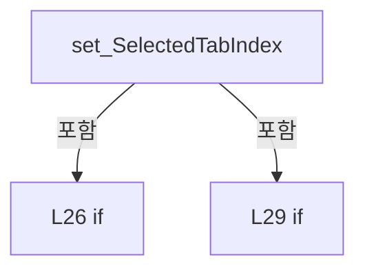

변경 전 점검: 입력/반환 타입, 위 호출자, 예외/취소 경로, 공유 상태와 저장·전송 소비자를 함께 확인합니다. 값의 단위나 물리 방향을 이름만으로 확정하지 않습니다.

### PropertyDeclaration `ListPanel` · L35–35

[Drilling.UI/Menu/Menus/CMenuAlarm.cs:35–35](https://github.com/kjuws10-rgb/A3Drilling/blob/96e22cd027c84bf302b23f2949b98985d7f301bb/Drilling.UI/Menu/Menus/CMenuAlarm.cs#L35-L35)

| 항목 | 실제 추출 값 |
| --- | --- |
| 서명 | Drilling.UI.Menu.Menus.CAlarmListPanel Drilling.UI.Menu.Menus.CMenuAlarm.ListPanel |
| 접근/수식자 | Public / public |
| 반환/값 타입 | Drilling.UI.Menu.Menus.CAlarmListPanel |
| 소속 타입 | NamedType:Drilling.UI.Menu.Menus.CMenuAlarm |

현재 부분 분석에서 직접 연결된 호출자는 없습니다. XAML/이벤트/인터페이스·델리게이트·외부 진입을 추가 확인해야 하며, 미사용으로 판정한 것이 아닙니다.

호출하는 대상과 해석 범위:

| 원본 행 | 표현식 | 분석 상태 | 대상/소스 위치 |
| --- | --- | --- | --- |
| 35 | new | resolved | Drilling.UI.Menu.Menus.CAlarmListPanel.CAlarmListPanel(Drilling.Common.Alarm.CAlarmManager) · Drilling.UI/Menu/Menus/CMenuAlarm.cs:521 |

본문의 실제 연산·분기·예외·반환 순서(원문 위치 순):

| 원본 행 | 종류 | 주석 해설 |
| --- | --- | --- |
| 35 | call | 함수·델리게이트 또는 객체 생성자를 호출합니다: new(alarmManager) |

변경 전 점검: 입력/반환 타입, 위 호출자, 예외/취소 경로, 공유 상태와 저장·전송 소비자를 함께 확인합니다. 값의 단위나 물리 방향을 이름만으로 확정하지 않습니다.

### GetAccessorDeclaration `get_ListPanel` · L35–35

[Drilling.UI/Menu/Menus/CMenuAlarm.cs:35–35](https://github.com/kjuws10-rgb/A3Drilling/blob/96e22cd027c84bf302b23f2949b98985d7f301bb/Drilling.UI/Menu/Menus/CMenuAlarm.cs#L35-L35)

| 항목 | 실제 추출 값 |
| --- | --- |
| 서명 | Drilling.UI.Menu.Menus.CAlarmListPanel Drilling.UI.Menu.Menus.CMenuAlarm.ListPanel.get |
| 접근/수식자 | Public / get |
| 반환/값 타입 | Drilling.UI.Menu.Menus.CAlarmListPanel |
| 소속 타입 | NamedType:Drilling.UI.Menu.Menus.CMenuAlarm |

현재 부분 분석에서 직접 연결된 호출자는 없습니다. XAML/이벤트/인터페이스·델리게이트·외부 진입을 추가 확인해야 하며, 미사용으로 판정한 것이 아닙니다.

변경 전 점검: 입력/반환 타입, 위 호출자, 예외/취소 경로, 공유 상태와 저장·전송 소비자를 함께 확인합니다. 값의 단위나 물리 방향을 이름만으로 확정하지 않습니다.

### PropertyDeclaration `HistoryPanel` · L36–36

[Drilling.UI/Menu/Menus/CMenuAlarm.cs:36–36](https://github.com/kjuws10-rgb/A3Drilling/blob/96e22cd027c84bf302b23f2949b98985d7f301bb/Drilling.UI/Menu/Menus/CMenuAlarm.cs#L36-L36)

| 항목 | 실제 추출 값 |
| --- | --- |
| 서명 | Drilling.UI.Menu.Menus.CAlarmHistoryPanel Drilling.UI.Menu.Menus.CMenuAlarm.HistoryPanel |
| 접근/수식자 | Public / public |
| 반환/값 타입 | Drilling.UI.Menu.Menus.CAlarmHistoryPanel |
| 소속 타입 | NamedType:Drilling.UI.Menu.Menus.CMenuAlarm |

현재 부분 분석에서 직접 연결된 호출자는 없습니다. XAML/이벤트/인터페이스·델리게이트·외부 진입을 추가 확인해야 하며, 미사용으로 판정한 것이 아닙니다.

호출하는 대상과 해석 범위:

| 원본 행 | 표현식 | 분석 상태 | 대상/소스 위치 |
| --- | --- | --- | --- |
| 36 | new | resolved | Drilling.UI.Menu.Menus.CAlarmHistoryPanel.CAlarmHistoryPanel(System.Func<System.DateTime, System.DateTime, System.Threading.CancellationToken, Drilling.Common.Alarm.ST_ALARM_HISTORY_RESULT>, string, System.Func<System.DateTime>?) · Drilling.UI/Menu/Menus/CMenuAlarm.cs:229 |

본문의 실제 연산·분기·예외·반환 순서(원문 위치 순):

| 원본 행 | 종류 | 주석 해설 |
| --- | --- | --- |
| 36 | call | 함수·델리게이트 또는 객체 생성자를 호출합니다: new(alarmManager.ReadHistory, logDirectory) |

변경 전 점검: 입력/반환 타입, 위 호출자, 예외/취소 경로, 공유 상태와 저장·전송 소비자를 함께 확인합니다. 값의 단위나 물리 방향을 이름만으로 확정하지 않습니다.

### GetAccessorDeclaration `get_HistoryPanel` · L36–36

[Drilling.UI/Menu/Menus/CMenuAlarm.cs:36–36](https://github.com/kjuws10-rgb/A3Drilling/blob/96e22cd027c84bf302b23f2949b98985d7f301bb/Drilling.UI/Menu/Menus/CMenuAlarm.cs#L36-L36)

| 항목 | 실제 추출 값 |
| --- | --- |
| 서명 | Drilling.UI.Menu.Menus.CAlarmHistoryPanel Drilling.UI.Menu.Menus.CMenuAlarm.HistoryPanel.get |
| 접근/수식자 | Public / get |
| 반환/값 타입 | Drilling.UI.Menu.Menus.CAlarmHistoryPanel |
| 소속 타입 | NamedType:Drilling.UI.Menu.Menus.CMenuAlarm |

현재 부분 분석에서 직접 연결된 호출자는 없습니다. XAML/이벤트/인터페이스·델리게이트·외부 진입을 추가 확인해야 하며, 미사용으로 판정한 것이 아닙니다.

변경 전 점검: 입력/반환 타입, 위 호출자, 예외/취소 경로, 공유 상태와 저장·전송 소비자를 함께 확인합니다. 값의 단위나 물리 방향을 이름만으로 확정하지 않습니다.

### EventFieldDeclaration `LogErrorChanged` · L38–38

[Drilling.UI/Menu/Menus/CMenuAlarm.cs:38–38](https://github.com/kjuws10-rgb/A3Drilling/blob/96e22cd027c84bf302b23f2949b98985d7f301bb/Drilling.UI/Menu/Menus/CMenuAlarm.cs#L38-L38)

| 항목 | 실제 추출 값 |
| --- | --- |
| 서명 | System.EventHandler? Drilling.UI.Menu.Menus.CMenuAlarm.LogErrorChanged |
| 접근/수식자 | Public / public, event |
| 반환/값 타입 | System.EventHandler? |
| 소속 타입 | NamedType:Drilling.UI.Menu.Menus.CMenuAlarm |

현재 부분 분석에서 직접 연결된 호출자는 없습니다. XAML/이벤트/인터페이스·델리게이트·외부 진입을 추가 확인해야 하며, 미사용으로 판정한 것이 아닙니다.

변경 전 점검: 입력/반환 타입, 위 호출자, 예외/취소 경로, 공유 상태와 저장·전송 소비자를 함께 확인합니다. 값의 단위나 물리 방향을 이름만으로 확정하지 않습니다.

### PropertyDeclaration `LogError` · L39–39

[Drilling.UI/Menu/Menus/CMenuAlarm.cs:39–39](https://github.com/kjuws10-rgb/A3Drilling/blob/96e22cd027c84bf302b23f2949b98985d7f301bb/Drilling.UI/Menu/Menus/CMenuAlarm.cs#L39-L39)

| 항목 | 실제 추출 값 |
| --- | --- |
| 서명 | string Drilling.UI.Menu.Menus.CMenuAlarm.LogError |
| 접근/수식자 | Public / public |
| 반환/값 타입 | string |
| 소속 타입 | NamedType:Drilling.UI.Menu.Menus.CMenuAlarm |

현재 부분 분석에서 직접 연결된 호출자는 없습니다. XAML/이벤트/인터페이스·델리게이트·외부 진입을 추가 확인해야 하며, 미사용으로 판정한 것이 아닙니다.

호출하는 대상과 해석 범위:

| 원본 행 | 표현식 | 분석 상태 | 대상/소스 위치 |
| --- | --- | --- | --- |
| 39 | alarmManager.GetCurrentSnapshot | resolved | Drilling.Common.Alarm.ST_CURRENT_ALARM_SNAPSHOT Drilling.Common.Alarm.CAlarmManager.GetCurrentSnapshot() · Drilling.Common/Alarm/CAlarmManager.cs:223 |

본문의 실제 연산·분기·예외·반환 순서(원문 위치 순):

| 원본 행 | 종류 | 주석 해설 |
| --- | --- | --- |
| 39 | call | 함수·델리게이트 또는 객체 생성자를 호출합니다: alarmManager.GetCurrentSnapshot() |

변경 전 점검: 입력/반환 타입, 위 호출자, 예외/취소 경로, 공유 상태와 저장·전송 소비자를 함께 확인합니다. 값의 단위나 물리 방향을 이름만으로 확정하지 않습니다.

### PropertyDeclaration `Menu` · L41–47

[Drilling.UI/Menu/Menus/CMenuAlarm.cs:41–47](https://github.com/kjuws10-rgb/A3Drilling/blob/96e22cd027c84bf302b23f2949b98985d7f301bb/Drilling.UI/Menu/Menus/CMenuAlarm.cs#L41-L47)

| 항목 | 실제 추출 값 |
| --- | --- |
| 서명 | Drilling.UI.Menu.Menus.EN_MENU Drilling.UI.Menu.Menus.CMenuAlarm.Menu |
| 접근/수식자 | Public / public, override |
| 반환/값 타입 | Drilling.UI.Menu.Menus.EN_MENU |
| 소속 타입 | NamedType:Drilling.UI.Menu.Menus.CMenuAlarm |

현재 부분 분석에서 직접 연결된 호출자는 없습니다. XAML/이벤트/인터페이스·델리게이트·외부 진입을 추가 확인해야 하며, 미사용으로 판정한 것이 아닙니다.

변경 전 점검: 입력/반환 타입, 위 호출자, 예외/취소 경로, 공유 상태와 저장·전송 소비자를 함께 확인합니다. 값의 단위나 물리 방향을 이름만으로 확정하지 않습니다.

### GetAccessorDeclaration `get_Menu` · L43–46

[Drilling.UI/Menu/Menus/CMenuAlarm.cs:43–46](https://github.com/kjuws10-rgb/A3Drilling/blob/96e22cd027c84bf302b23f2949b98985d7f301bb/Drilling.UI/Menu/Menus/CMenuAlarm.cs#L43-L46)

| 항목 | 실제 추출 값 |
| --- | --- |
| 서명 | Drilling.UI.Menu.Menus.EN_MENU Drilling.UI.Menu.Menus.CMenuAlarm.Menu.get |
| 접근/수식자 | Public / get |
| 반환/값 타입 | Drilling.UI.Menu.Menus.EN_MENU |
| 소속 타입 | NamedType:Drilling.UI.Menu.Menus.CMenuAlarm |

현재 부분 분석에서 직접 연결된 호출자는 없습니다. XAML/이벤트/인터페이스·델리게이트·외부 진입을 추가 확인해야 하며, 미사용으로 판정한 것이 아닙니다.

본문의 실제 연산·분기·예외·반환 순서(원문 위치 순):

| 원본 행 | 종류 | 주석 해설 |
| --- | --- | --- |
| 45 | return | 호출자에게 값 또는 제어를 반환합니다: return EN_MENU.Alarm; |

변경 전 점검: 입력/반환 타입, 위 호출자, 예외/취소 경로, 공유 상태와 저장·전송 소비자를 함께 확인합니다. 값의 단위나 물리 방향을 이름만으로 확정하지 않습니다.

### PropertyDeclaration `AlarmResetCommand` · L49–60

[Drilling.UI/Menu/Menus/CMenuAlarm.cs:49–60](https://github.com/kjuws10-rgb/A3Drilling/blob/96e22cd027c84bf302b23f2949b98985d7f301bb/Drilling.UI/Menu/Menus/CMenuAlarm.cs#L49-L60)

| 항목 | 실제 추출 값 |
| --- | --- |
| 서명 | Drilling.UI.Menu.CButtonCommand Drilling.UI.Menu.Menus.CMenuAlarm.AlarmResetCommand |
| 접근/수식자 | Public / public |
| 반환/값 타입 | Drilling.UI.Menu.CButtonCommand |
| 소속 타입 | NamedType:Drilling.UI.Menu.Menus.CMenuAlarm |

현재 부분 분석에서 직접 연결된 호출자는 없습니다. XAML/이벤트/인터페이스·델리게이트·외부 진입을 추가 확인해야 하며, 미사용으로 판정한 것이 아닙니다.

변경 전 점검: 입력/반환 타입, 위 호출자, 예외/취소 경로, 공유 상태와 저장·전송 소비자를 함께 확인합니다. 값의 단위나 물리 방향을 이름만으로 확정하지 않습니다.

### GetAccessorDeclaration `get_AlarmResetCommand` · L51–59

[Drilling.UI/Menu/Menus/CMenuAlarm.cs:51–59](https://github.com/kjuws10-rgb/A3Drilling/blob/96e22cd027c84bf302b23f2949b98985d7f301bb/Drilling.UI/Menu/Menus/CMenuAlarm.cs#L51-L59)

| 항목 | 실제 추출 값 |
| --- | --- |
| 서명 | Drilling.UI.Menu.CButtonCommand Drilling.UI.Menu.Menus.CMenuAlarm.AlarmResetCommand.get |
| 접근/수식자 | Public / get |
| 반환/값 타입 | Drilling.UI.Menu.CButtonCommand |
| 소속 타입 | NamedType:Drilling.UI.Menu.Menus.CMenuAlarm |

현재 부분 분석에서 직접 연결된 호출자는 없습니다. XAML/이벤트/인터페이스·델리게이트·외부 진입을 추가 확인해야 하며, 미사용으로 판정한 것이 아닙니다.

호출하는 대상과 해석 범위:

| 원본 행 | 표현식 | 분석 상태 | 대상/소스 위치 |
| --- | --- | --- | --- |
| 58 | new | resolved | Drilling.UI.Menu.CButtonCommand.CButtonCommand(System.Action<object?>, System.Predicate<object?>?) · Drilling.UI/Menu/CButtonCommand.cs:9 |

본문의 실제 연산·분기·예외·반환 순서(원문 위치 순):

| 원본 행 | 종류 | 주석 해설 |
| --- | --- | --- |
| 58 | call | 함수·델리게이트 또는 객체 생성자를 호출합니다: new(ResetAlarmCallback) |
| 58 | return | 호출자에게 값 또는 제어를 반환합니다: return new(ResetAlarmCallback); |

변경 전 점검: 입력/반환 타입, 위 호출자, 예외/취소 경로, 공유 상태와 저장·전송 소비자를 함께 확인합니다. 값의 단위나 물리 방향을 이름만으로 확정하지 않습니다.

### LocalFunctionStatement `ResetAlarmCallback` · L53–56

[Drilling.UI/Menu/Menus/CMenuAlarm.cs:53–56](https://github.com/kjuws10-rgb/A3Drilling/blob/96e22cd027c84bf302b23f2949b98985d7f301bb/Drilling.UI/Menu/Menus/CMenuAlarm.cs#L53-L56)

| 항목 | 실제 추출 값 |
| --- | --- |
| 서명 | void ResetAlarmCallback(object?) |
| 접근/수식자 | Private / async |
| 반환/값 타입 | void |
| 소속 타입 | NamedType:Drilling.UI.Menu.Menus.CMenuAlarm |

입력 계약:

| 이름 | 타입 | 전달 | 선택/기본값 |
| --- | --- | --- | --- |
| arg0 | object? | None | False /  |

현재 부분 분석에서 직접 연결된 호출자는 없습니다. XAML/이벤트/인터페이스·델리게이트·외부 진입을 추가 확인해야 하며, 미사용으로 판정한 것이 아닙니다.

호출하는 대상과 해석 범위:

| 원본 행 | 표현식 | 분석 상태 | 대상/소스 위치 |
| --- | --- | --- | --- |
| 55 | ResetAlarmAsync | resolved | System.Threading.Tasks.Task Drilling.UI.Menu.Menus.CMenuAlarm.ResetAlarmAsync() · Drilling.UI/Menu/Menus/CMenuAlarm.cs:119 |

본문의 실제 연산·분기·예외·반환 순서(원문 위치 순):

| 원본 행 | 종류 | 주석 해설 |
| --- | --- | --- |
| 55 | await | 비동기 완료를 기다립니다: await ResetAlarmAsync() |
| 55 | call | 함수·델리게이트 또는 객체 생성자를 호출합니다: ResetAlarmAsync() |

변경 전 점검: 입력/반환 타입, 위 호출자, 예외/취소 경로, 공유 상태와 저장·전송 소비자를 함께 확인합니다. 값의 단위나 물리 방향을 이름만으로 확정하지 않습니다.

### PropertyDeclaration `BuzzerOffCommand` · L62–73

[Drilling.UI/Menu/Menus/CMenuAlarm.cs:62–73](https://github.com/kjuws10-rgb/A3Drilling/blob/96e22cd027c84bf302b23f2949b98985d7f301bb/Drilling.UI/Menu/Menus/CMenuAlarm.cs#L62-L73)

| 항목 | 실제 추출 값 |
| --- | --- |
| 서명 | Drilling.UI.Menu.CButtonCommand Drilling.UI.Menu.Menus.CMenuAlarm.BuzzerOffCommand |
| 접근/수식자 | Public / public |
| 반환/값 타입 | Drilling.UI.Menu.CButtonCommand |
| 소속 타입 | NamedType:Drilling.UI.Menu.Menus.CMenuAlarm |

현재 부분 분석에서 직접 연결된 호출자는 없습니다. XAML/이벤트/인터페이스·델리게이트·외부 진입을 추가 확인해야 하며, 미사용으로 판정한 것이 아닙니다.

변경 전 점검: 입력/반환 타입, 위 호출자, 예외/취소 경로, 공유 상태와 저장·전송 소비자를 함께 확인합니다. 값의 단위나 물리 방향을 이름만으로 확정하지 않습니다.

### GetAccessorDeclaration `get_BuzzerOffCommand` · L64–72

[Drilling.UI/Menu/Menus/CMenuAlarm.cs:64–72](https://github.com/kjuws10-rgb/A3Drilling/blob/96e22cd027c84bf302b23f2949b98985d7f301bb/Drilling.UI/Menu/Menus/CMenuAlarm.cs#L64-L72)

| 항목 | 실제 추출 값 |
| --- | --- |
| 서명 | Drilling.UI.Menu.CButtonCommand Drilling.UI.Menu.Menus.CMenuAlarm.BuzzerOffCommand.get |
| 접근/수식자 | Public / get |
| 반환/값 타입 | Drilling.UI.Menu.CButtonCommand |
| 소속 타입 | NamedType:Drilling.UI.Menu.Menus.CMenuAlarm |

현재 부분 분석에서 직접 연결된 호출자는 없습니다. XAML/이벤트/인터페이스·델리게이트·외부 진입을 추가 확인해야 하며, 미사용으로 판정한 것이 아닙니다.

호출하는 대상과 해석 범위:

| 원본 행 | 표현식 | 분석 상태 | 대상/소스 위치 |
| --- | --- | --- | --- |
| 71 | new | resolved | Drilling.UI.Menu.CButtonCommand.CButtonCommand(System.Action<object?>, System.Predicate<object?>?) · Drilling.UI/Menu/CButtonCommand.cs:9 |

본문의 실제 연산·분기·예외·반환 순서(원문 위치 순):

| 원본 행 | 종류 | 주석 해설 |
| --- | --- | --- |
| 71 | call | 함수·델리게이트 또는 객체 생성자를 호출합니다: new(setStatusMessageCallback) |
| 71 | return | 호출자에게 값 또는 제어를 반환합니다: return new(setStatusMessageCallback); |

변경 전 점검: 입력/반환 타입, 위 호출자, 예외/취소 경로, 공유 상태와 저장·전송 소비자를 함께 확인합니다. 값의 단위나 물리 방향을 이름만으로 확정하지 않습니다.

### LocalFunctionStatement `setStatusMessageCallback` · L66–69

[Drilling.UI/Menu/Menus/CMenuAlarm.cs:66–69](https://github.com/kjuws10-rgb/A3Drilling/blob/96e22cd027c84bf302b23f2949b98985d7f301bb/Drilling.UI/Menu/Menus/CMenuAlarm.cs#L66-L69)

| 항목 | 실제 추출 값 |
| --- | --- |
| 서명 | void setStatusMessageCallback(object?) |
| 접근/수식자 | Private /  |
| 반환/값 타입 | void |
| 소속 타입 | NamedType:Drilling.UI.Menu.Menus.CMenuAlarm |

입력 계약:

| 이름 | 타입 | 전달 | 선택/기본값 |
| --- | --- | --- | --- |
| arg0 | object? | None | False /  |

현재 부분 분석에서 직접 연결된 호출자는 없습니다. XAML/이벤트/인터페이스·델리게이트·외부 진입을 추가 확인해야 하며, 미사용으로 판정한 것이 아닙니다.

호출하는 대상과 해석 범위:

| 원본 행 | 표현식 | 분석 상태 | 대상/소스 위치 |
| --- | --- | --- | --- |
| 68 | setStatusMessage | resolved · 동적 구현 선택 가능 | void System.Action<string>.Invoke(string) |

본문의 실제 연산·분기·예외·반환 순서(원문 위치 순):

| 원본 행 | 종류 | 주석 해설 |
| --- | --- | --- |
| 68 | call | 함수·델리게이트 또는 객체 생성자를 호출합니다: setStatusMessage("Buzzer off command sent.") |

변경 전 점검: 입력/반환 타입, 위 호출자, 예외/취소 경로, 공유 상태와 저장·전송 소비자를 함께 확인합니다. 값의 단위나 물리 방향을 이름만으로 확정하지 않습니다.

### PropertyDeclaration `CurrentAlarms` · L75–75

[Drilling.UI/Menu/Menus/CMenuAlarm.cs:75–75](https://github.com/kjuws10-rgb/A3Drilling/blob/96e22cd027c84bf302b23f2949b98985d7f301bb/Drilling.UI/Menu/Menus/CMenuAlarm.cs#L75-L75)

| 항목 | 실제 추출 값 |
| --- | --- |
| 서명 | System.Collections.Generic.IReadOnlyList<Drilling.UI.Menu.Menus.ST_DISPLAY_ITEM> Drilling.UI.Menu.Menus.CMenuAlarm.CurrentAlarms |
| 접근/수식자 | Public / public |
| 반환/값 타입 | System.Collections.Generic.IReadOnlyList<Drilling.UI.Menu.Menus.ST_DISPLAY_ITEM> |
| 소속 타입 | NamedType:Drilling.UI.Menu.Menus.CMenuAlarm |

현재 부분 분석에서 직접 연결된 호출자는 없습니다. XAML/이벤트/인터페이스·델리게이트·외부 진입을 추가 확인해야 하며, 미사용으로 판정한 것이 아닙니다.

변경 전 점검: 입력/반환 타입, 위 호출자, 예외/취소 경로, 공유 상태와 저장·전송 소비자를 함께 확인합니다. 값의 단위나 물리 방향을 이름만으로 확정하지 않습니다.

### GetAccessorDeclaration `get_CurrentAlarms` · L75–75

[Drilling.UI/Menu/Menus/CMenuAlarm.cs:75–75](https://github.com/kjuws10-rgb/A3Drilling/blob/96e22cd027c84bf302b23f2949b98985d7f301bb/Drilling.UI/Menu/Menus/CMenuAlarm.cs#L75-L75)

| 항목 | 실제 추출 값 |
| --- | --- |
| 서명 | System.Collections.Generic.IReadOnlyList<Drilling.UI.Menu.Menus.ST_DISPLAY_ITEM> Drilling.UI.Menu.Menus.CMenuAlarm.CurrentAlarms.get |
| 접근/수식자 | Public / get |
| 반환/값 타입 | System.Collections.Generic.IReadOnlyList<Drilling.UI.Menu.Menus.ST_DISPLAY_ITEM> |
| 소속 타입 | NamedType:Drilling.UI.Menu.Menus.CMenuAlarm |

현재 부분 분석에서 직접 연결된 호출자는 없습니다. XAML/이벤트/인터페이스·델리게이트·외부 진입을 추가 확인해야 하며, 미사용으로 판정한 것이 아닙니다.

변경 전 점검: 입력/반환 타입, 위 호출자, 예외/취소 경로, 공유 상태와 저장·전송 소비자를 함께 확인합니다. 값의 단위나 물리 방향을 이름만으로 확정하지 않습니다.

### SetAccessorDeclaration `set_CurrentAlarms` · L75–75

[Drilling.UI/Menu/Menus/CMenuAlarm.cs:75–75](https://github.com/kjuws10-rgb/A3Drilling/blob/96e22cd027c84bf302b23f2949b98985d7f301bb/Drilling.UI/Menu/Menus/CMenuAlarm.cs#L75-L75)

| 항목 | 실제 추출 값 |
| --- | --- |
| 서명 | void Drilling.UI.Menu.Menus.CMenuAlarm.CurrentAlarms.set |
| 접근/수식자 | Private / private, set |
| 반환/값 타입 | void |
| 소속 타입 | NamedType:Drilling.UI.Menu.Menus.CMenuAlarm |

입력 계약:

| 이름 | 타입 | 전달 | 선택/기본값 |
| --- | --- | --- | --- |
| value | System.Collections.Generic.IReadOnlyList<Drilling.UI.Menu.Menus.ST_DISPLAY_ITEM> | None | False /  |

현재 부분 분석에서 직접 연결된 호출자는 없습니다. XAML/이벤트/인터페이스·델리게이트·외부 진입을 추가 확인해야 하며, 미사용으로 판정한 것이 아닙니다.

변경 전 점검: 입력/반환 타입, 위 호출자, 예외/취소 경로, 공유 상태와 저장·전송 소비자를 함께 확인합니다. 값의 단위나 물리 방향을 이름만으로 확정하지 않습니다.

### PropertyDeclaration `AlarmDetail` · L76–76

[Drilling.UI/Menu/Menus/CMenuAlarm.cs:76–76](https://github.com/kjuws10-rgb/A3Drilling/blob/96e22cd027c84bf302b23f2949b98985d7f301bb/Drilling.UI/Menu/Menus/CMenuAlarm.cs#L76-L76)

| 항목 | 실제 추출 값 |
| --- | --- |
| 서명 | System.Collections.Generic.IReadOnlyList<Drilling.UI.Menu.Menus.ST_DISPLAY_ITEM> Drilling.UI.Menu.Menus.CMenuAlarm.AlarmDetail |
| 접근/수식자 | Public / public |
| 반환/값 타입 | System.Collections.Generic.IReadOnlyList<Drilling.UI.Menu.Menus.ST_DISPLAY_ITEM> |
| 소속 타입 | NamedType:Drilling.UI.Menu.Menus.CMenuAlarm |

현재 부분 분석에서 직접 연결된 호출자는 없습니다. XAML/이벤트/인터페이스·델리게이트·외부 진입을 추가 확인해야 하며, 미사용으로 판정한 것이 아닙니다.

변경 전 점검: 입력/반환 타입, 위 호출자, 예외/취소 경로, 공유 상태와 저장·전송 소비자를 함께 확인합니다. 값의 단위나 물리 방향을 이름만으로 확정하지 않습니다.

### GetAccessorDeclaration `get_AlarmDetail` · L76–76

[Drilling.UI/Menu/Menus/CMenuAlarm.cs:76–76](https://github.com/kjuws10-rgb/A3Drilling/blob/96e22cd027c84bf302b23f2949b98985d7f301bb/Drilling.UI/Menu/Menus/CMenuAlarm.cs#L76-L76)

| 항목 | 실제 추출 값 |
| --- | --- |
| 서명 | System.Collections.Generic.IReadOnlyList<Drilling.UI.Menu.Menus.ST_DISPLAY_ITEM> Drilling.UI.Menu.Menus.CMenuAlarm.AlarmDetail.get |
| 접근/수식자 | Public / get |
| 반환/값 타입 | System.Collections.Generic.IReadOnlyList<Drilling.UI.Menu.Menus.ST_DISPLAY_ITEM> |
| 소속 타입 | NamedType:Drilling.UI.Menu.Menus.CMenuAlarm |

현재 부분 분석에서 직접 연결된 호출자는 없습니다. XAML/이벤트/인터페이스·델리게이트·외부 진입을 추가 확인해야 하며, 미사용으로 판정한 것이 아닙니다.

변경 전 점검: 입력/반환 타입, 위 호출자, 예외/취소 경로, 공유 상태와 저장·전송 소비자를 함께 확인합니다. 값의 단위나 물리 방향을 이름만으로 확정하지 않습니다.

### SetAccessorDeclaration `set_AlarmDetail` · L76–76

[Drilling.UI/Menu/Menus/CMenuAlarm.cs:76–76](https://github.com/kjuws10-rgb/A3Drilling/blob/96e22cd027c84bf302b23f2949b98985d7f301bb/Drilling.UI/Menu/Menus/CMenuAlarm.cs#L76-L76)

| 항목 | 실제 추출 값 |
| --- | --- |
| 서명 | void Drilling.UI.Menu.Menus.CMenuAlarm.AlarmDetail.set |
| 접근/수식자 | Private / private, set |
| 반환/값 타입 | void |
| 소속 타입 | NamedType:Drilling.UI.Menu.Menus.CMenuAlarm |

입력 계약:

| 이름 | 타입 | 전달 | 선택/기본값 |
| --- | --- | --- | --- |
| value | System.Collections.Generic.IReadOnlyList<Drilling.UI.Menu.Menus.ST_DISPLAY_ITEM> | None | False /  |

현재 부분 분석에서 직접 연결된 호출자는 없습니다. XAML/이벤트/인터페이스·델리게이트·외부 진입을 추가 확인해야 하며, 미사용으로 판정한 것이 아닙니다.

변경 전 점검: 입력/반환 타입, 위 호출자, 예외/취소 경로, 공유 상태와 저장·전송 소비자를 함께 확인합니다. 값의 단위나 물리 방향을 이름만으로 확정하지 않습니다.

### PropertyDeclaration `RecoveryCommands` · L77–77

[Drilling.UI/Menu/Menus/CMenuAlarm.cs:77–77](https://github.com/kjuws10-rgb/A3Drilling/blob/96e22cd027c84bf302b23f2949b98985d7f301bb/Drilling.UI/Menu/Menus/CMenuAlarm.cs#L77-L77)

| 항목 | 실제 추출 값 |
| --- | --- |
| 서명 | System.Collections.Generic.IReadOnlyList<Drilling.UI.Menu.Menus.ST_DISPLAY_ITEM> Drilling.UI.Menu.Menus.CMenuAlarm.RecoveryCommands |
| 접근/수식자 | Public / public |
| 반환/값 타입 | System.Collections.Generic.IReadOnlyList<Drilling.UI.Menu.Menus.ST_DISPLAY_ITEM> |
| 소속 타입 | NamedType:Drilling.UI.Menu.Menus.CMenuAlarm |

현재 부분 분석에서 직접 연결된 호출자는 없습니다. XAML/이벤트/인터페이스·델리게이트·외부 진입을 추가 확인해야 하며, 미사용으로 판정한 것이 아닙니다.

변경 전 점검: 입력/반환 타입, 위 호출자, 예외/취소 경로, 공유 상태와 저장·전송 소비자를 함께 확인합니다. 값의 단위나 물리 방향을 이름만으로 확정하지 않습니다.

### GetAccessorDeclaration `get_RecoveryCommands` · L77–77

[Drilling.UI/Menu/Menus/CMenuAlarm.cs:77–77](https://github.com/kjuws10-rgb/A3Drilling/blob/96e22cd027c84bf302b23f2949b98985d7f301bb/Drilling.UI/Menu/Menus/CMenuAlarm.cs#L77-L77)

| 항목 | 실제 추출 값 |
| --- | --- |
| 서명 | System.Collections.Generic.IReadOnlyList<Drilling.UI.Menu.Menus.ST_DISPLAY_ITEM> Drilling.UI.Menu.Menus.CMenuAlarm.RecoveryCommands.get |
| 접근/수식자 | Public / get |
| 반환/값 타입 | System.Collections.Generic.IReadOnlyList<Drilling.UI.Menu.Menus.ST_DISPLAY_ITEM> |
| 소속 타입 | NamedType:Drilling.UI.Menu.Menus.CMenuAlarm |

현재 부분 분석에서 직접 연결된 호출자는 없습니다. XAML/이벤트/인터페이스·델리게이트·외부 진입을 추가 확인해야 하며, 미사용으로 판정한 것이 아닙니다.

변경 전 점검: 입력/반환 타입, 위 호출자, 예외/취소 경로, 공유 상태와 저장·전송 소비자를 함께 확인합니다. 값의 단위나 물리 방향을 이름만으로 확정하지 않습니다.

### SetAccessorDeclaration `set_RecoveryCommands` · L77–77

[Drilling.UI/Menu/Menus/CMenuAlarm.cs:77–77](https://github.com/kjuws10-rgb/A3Drilling/blob/96e22cd027c84bf302b23f2949b98985d7f301bb/Drilling.UI/Menu/Menus/CMenuAlarm.cs#L77-L77)

| 항목 | 실제 추출 값 |
| --- | --- |
| 서명 | void Drilling.UI.Menu.Menus.CMenuAlarm.RecoveryCommands.set |
| 접근/수식자 | Private / private, set |
| 반환/값 타입 | void |
| 소속 타입 | NamedType:Drilling.UI.Menu.Menus.CMenuAlarm |

입력 계약:

| 이름 | 타입 | 전달 | 선택/기본값 |
| --- | --- | --- | --- |
| value | System.Collections.Generic.IReadOnlyList<Drilling.UI.Menu.Menus.ST_DISPLAY_ITEM> | None | False /  |

현재 부분 분석에서 직접 연결된 호출자는 없습니다. XAML/이벤트/인터페이스·델리게이트·외부 진입을 추가 확인해야 하며, 미사용으로 판정한 것이 아닙니다.

변경 전 점검: 입력/반환 타입, 위 호출자, 예외/취소 경로, 공유 상태와 저장·전송 소비자를 함께 확인합니다. 값의 단위나 물리 방향을 이름만으로 확정하지 않습니다.

### PropertyDeclaration `History` · L78–78

[Drilling.UI/Menu/Menus/CMenuAlarm.cs:78–78](https://github.com/kjuws10-rgb/A3Drilling/blob/96e22cd027c84bf302b23f2949b98985d7f301bb/Drilling.UI/Menu/Menus/CMenuAlarm.cs#L78-L78)

| 항목 | 실제 추출 값 |
| --- | --- |
| 서명 | System.Collections.Generic.IReadOnlyList<Drilling.UI.Menu.Menus.ST_DISPLAY_ITEM> Drilling.UI.Menu.Menus.CMenuAlarm.History |
| 접근/수식자 | Public / public |
| 반환/값 타입 | System.Collections.Generic.IReadOnlyList<Drilling.UI.Menu.Menus.ST_DISPLAY_ITEM> |
| 소속 타입 | NamedType:Drilling.UI.Menu.Menus.CMenuAlarm |

현재 부분 분석에서 직접 연결된 호출자는 없습니다. XAML/이벤트/인터페이스·델리게이트·외부 진입을 추가 확인해야 하며, 미사용으로 판정한 것이 아닙니다.

변경 전 점검: 입력/반환 타입, 위 호출자, 예외/취소 경로, 공유 상태와 저장·전송 소비자를 함께 확인합니다. 값의 단위나 물리 방향을 이름만으로 확정하지 않습니다.

### GetAccessorDeclaration `get_History` · L78–78

[Drilling.UI/Menu/Menus/CMenuAlarm.cs:78–78](https://github.com/kjuws10-rgb/A3Drilling/blob/96e22cd027c84bf302b23f2949b98985d7f301bb/Drilling.UI/Menu/Menus/CMenuAlarm.cs#L78-L78)

| 항목 | 실제 추출 값 |
| --- | --- |
| 서명 | System.Collections.Generic.IReadOnlyList<Drilling.UI.Menu.Menus.ST_DISPLAY_ITEM> Drilling.UI.Menu.Menus.CMenuAlarm.History.get |
| 접근/수식자 | Public / get |
| 반환/값 타입 | System.Collections.Generic.IReadOnlyList<Drilling.UI.Menu.Menus.ST_DISPLAY_ITEM> |
| 소속 타입 | NamedType:Drilling.UI.Menu.Menus.CMenuAlarm |

현재 부분 분석에서 직접 연결된 호출자는 없습니다. XAML/이벤트/인터페이스·델리게이트·외부 진입을 추가 확인해야 하며, 미사용으로 판정한 것이 아닙니다.

변경 전 점검: 입력/반환 타입, 위 호출자, 예외/취소 경로, 공유 상태와 저장·전송 소비자를 함께 확인합니다. 값의 단위나 물리 방향을 이름만으로 확정하지 않습니다.

### SetAccessorDeclaration `set_History` · L78–78

[Drilling.UI/Menu/Menus/CMenuAlarm.cs:78–78](https://github.com/kjuws10-rgb/A3Drilling/blob/96e22cd027c84bf302b23f2949b98985d7f301bb/Drilling.UI/Menu/Menus/CMenuAlarm.cs#L78-L78)

| 항목 | 실제 추출 값 |
| --- | --- |
| 서명 | void Drilling.UI.Menu.Menus.CMenuAlarm.History.set |
| 접근/수식자 | Private / private, set |
| 반환/값 타입 | void |
| 소속 타입 | NamedType:Drilling.UI.Menu.Menus.CMenuAlarm |

입력 계약:

| 이름 | 타입 | 전달 | 선택/기본값 |
| --- | --- | --- | --- |
| value | System.Collections.Generic.IReadOnlyList<Drilling.UI.Menu.Menus.ST_DISPLAY_ITEM> | None | False /  |

현재 부분 분석에서 직접 연결된 호출자는 없습니다. XAML/이벤트/인터페이스·델리게이트·외부 진입을 추가 확인해야 하며, 미사용으로 판정한 것이 아닙니다.

변경 전 점검: 입력/반환 타입, 위 호출자, 예외/취소 경로, 공유 상태와 저장·전송 소비자를 함께 확인합니다. 값의 단위나 물리 방향을 이름만으로 확정하지 않습니다.

### PropertyDeclaration `Trend` · L79–79

[Drilling.UI/Menu/Menus/CMenuAlarm.cs:79–79](https://github.com/kjuws10-rgb/A3Drilling/blob/96e22cd027c84bf302b23f2949b98985d7f301bb/Drilling.UI/Menu/Menus/CMenuAlarm.cs#L79-L79)

| 항목 | 실제 추출 값 |
| --- | --- |
| 서명 | System.Collections.Generic.IReadOnlyList<Drilling.UI.Menu.Menus.ST_DISPLAY_ITEM> Drilling.UI.Menu.Menus.CMenuAlarm.Trend |
| 접근/수식자 | Public / public |
| 반환/값 타입 | System.Collections.Generic.IReadOnlyList<Drilling.UI.Menu.Menus.ST_DISPLAY_ITEM> |
| 소속 타입 | NamedType:Drilling.UI.Menu.Menus.CMenuAlarm |

현재 부분 분석에서 직접 연결된 호출자는 없습니다. XAML/이벤트/인터페이스·델리게이트·외부 진입을 추가 확인해야 하며, 미사용으로 판정한 것이 아닙니다.

변경 전 점검: 입력/반환 타입, 위 호출자, 예외/취소 경로, 공유 상태와 저장·전송 소비자를 함께 확인합니다. 값의 단위나 물리 방향을 이름만으로 확정하지 않습니다.

### GetAccessorDeclaration `get_Trend` · L79–79

[Drilling.UI/Menu/Menus/CMenuAlarm.cs:79–79](https://github.com/kjuws10-rgb/A3Drilling/blob/96e22cd027c84bf302b23f2949b98985d7f301bb/Drilling.UI/Menu/Menus/CMenuAlarm.cs#L79-L79)

| 항목 | 실제 추출 값 |
| --- | --- |
| 서명 | System.Collections.Generic.IReadOnlyList<Drilling.UI.Menu.Menus.ST_DISPLAY_ITEM> Drilling.UI.Menu.Menus.CMenuAlarm.Trend.get |
| 접근/수식자 | Public / get |
| 반환/값 타입 | System.Collections.Generic.IReadOnlyList<Drilling.UI.Menu.Menus.ST_DISPLAY_ITEM> |
| 소속 타입 | NamedType:Drilling.UI.Menu.Menus.CMenuAlarm |

현재 부분 분석에서 직접 연결된 호출자는 없습니다. XAML/이벤트/인터페이스·델리게이트·외부 진입을 추가 확인해야 하며, 미사용으로 판정한 것이 아닙니다.

변경 전 점검: 입력/반환 타입, 위 호출자, 예외/취소 경로, 공유 상태와 저장·전송 소비자를 함께 확인합니다. 값의 단위나 물리 방향을 이름만으로 확정하지 않습니다.

### SetAccessorDeclaration `set_Trend` · L79–79

[Drilling.UI/Menu/Menus/CMenuAlarm.cs:79–79](https://github.com/kjuws10-rgb/A3Drilling/blob/96e22cd027c84bf302b23f2949b98985d7f301bb/Drilling.UI/Menu/Menus/CMenuAlarm.cs#L79-L79)

| 항목 | 실제 추출 값 |
| --- | --- |
| 서명 | void Drilling.UI.Menu.Menus.CMenuAlarm.Trend.set |
| 접근/수식자 | Private / private, set |
| 반환/값 타입 | void |
| 소속 타입 | NamedType:Drilling.UI.Menu.Menus.CMenuAlarm |

입력 계약:

| 이름 | 타입 | 전달 | 선택/기본값 |
| --- | --- | --- | --- |
| value | System.Collections.Generic.IReadOnlyList<Drilling.UI.Menu.Menus.ST_DISPLAY_ITEM> | None | False /  |

현재 부분 분석에서 직접 연결된 호출자는 없습니다. XAML/이벤트/인터페이스·델리게이트·외부 진입을 추가 확인해야 하며, 미사용으로 판정한 것이 아닙니다.

변경 전 점검: 입력/반환 타입, 위 호출자, 예외/취소 경로, 공유 상태와 저장·전송 소비자를 함께 확인합니다. 값의 단위나 물리 방향을 이름만으로 확정하지 않습니다.

### PropertyDeclaration `CurrentAlarmRows` · L80–80

[Drilling.UI/Menu/Menus/CMenuAlarm.cs:80–80](https://github.com/kjuws10-rgb/A3Drilling/blob/96e22cd027c84bf302b23f2949b98985d7f301bb/Drilling.UI/Menu/Menus/CMenuAlarm.cs#L80-L80)

| 항목 | 실제 추출 값 |
| --- | --- |
| 서명 | System.Collections.Generic.IReadOnlyList<Drilling.UI.Menu.Menus.ST_ALARM_CURRENT_ROW> Drilling.UI.Menu.Menus.CMenuAlarm.CurrentAlarmRows |
| 접근/수식자 | Public / public |
| 반환/값 타입 | System.Collections.Generic.IReadOnlyList<Drilling.UI.Menu.Menus.ST_ALARM_CURRENT_ROW> |
| 소속 타입 | NamedType:Drilling.UI.Menu.Menus.CMenuAlarm |

현재 부분 분석에서 직접 연결된 호출자는 없습니다. XAML/이벤트/인터페이스·델리게이트·외부 진입을 추가 확인해야 하며, 미사용으로 판정한 것이 아닙니다.

변경 전 점검: 입력/반환 타입, 위 호출자, 예외/취소 경로, 공유 상태와 저장·전송 소비자를 함께 확인합니다. 값의 단위나 물리 방향을 이름만으로 확정하지 않습니다.

### GetAccessorDeclaration `get_CurrentAlarmRows` · L80–80

[Drilling.UI/Menu/Menus/CMenuAlarm.cs:80–80](https://github.com/kjuws10-rgb/A3Drilling/blob/96e22cd027c84bf302b23f2949b98985d7f301bb/Drilling.UI/Menu/Menus/CMenuAlarm.cs#L80-L80)

| 항목 | 실제 추출 값 |
| --- | --- |
| 서명 | System.Collections.Generic.IReadOnlyList<Drilling.UI.Menu.Menus.ST_ALARM_CURRENT_ROW> Drilling.UI.Menu.Menus.CMenuAlarm.CurrentAlarmRows.get |
| 접근/수식자 | Public / get |
| 반환/값 타입 | System.Collections.Generic.IReadOnlyList<Drilling.UI.Menu.Menus.ST_ALARM_CURRENT_ROW> |
| 소속 타입 | NamedType:Drilling.UI.Menu.Menus.CMenuAlarm |

현재 부분 분석에서 직접 연결된 호출자는 없습니다. XAML/이벤트/인터페이스·델리게이트·외부 진입을 추가 확인해야 하며, 미사용으로 판정한 것이 아닙니다.

변경 전 점검: 입력/반환 타입, 위 호출자, 예외/취소 경로, 공유 상태와 저장·전송 소비자를 함께 확인합니다. 값의 단위나 물리 방향을 이름만으로 확정하지 않습니다.

### SetAccessorDeclaration `set_CurrentAlarmRows` · L80–80

[Drilling.UI/Menu/Menus/CMenuAlarm.cs:80–80](https://github.com/kjuws10-rgb/A3Drilling/blob/96e22cd027c84bf302b23f2949b98985d7f301bb/Drilling.UI/Menu/Menus/CMenuAlarm.cs#L80-L80)

| 항목 | 실제 추출 값 |
| --- | --- |
| 서명 | void Drilling.UI.Menu.Menus.CMenuAlarm.CurrentAlarmRows.set |
| 접근/수식자 | Private / private, set |
| 반환/값 타입 | void |
| 소속 타입 | NamedType:Drilling.UI.Menu.Menus.CMenuAlarm |

입력 계약:

| 이름 | 타입 | 전달 | 선택/기본값 |
| --- | --- | --- | --- |
| value | System.Collections.Generic.IReadOnlyList<Drilling.UI.Menu.Menus.ST_ALARM_CURRENT_ROW> | None | False /  |

현재 부분 분석에서 직접 연결된 호출자는 없습니다. XAML/이벤트/인터페이스·델리게이트·외부 진입을 추가 확인해야 하며, 미사용으로 판정한 것이 아닙니다.

변경 전 점검: 입력/반환 타입, 위 호출자, 예외/취소 경로, 공유 상태와 저장·전송 소비자를 함께 확인합니다. 값의 단위나 물리 방향을 이름만으로 확정하지 않습니다.

### PropertyDeclaration `DetailRows` · L81–81

[Drilling.UI/Menu/Menus/CMenuAlarm.cs:81–81](https://github.com/kjuws10-rgb/A3Drilling/blob/96e22cd027c84bf302b23f2949b98985d7f301bb/Drilling.UI/Menu/Menus/CMenuAlarm.cs#L81-L81)

| 항목 | 실제 추출 값 |
| --- | --- |
| 서명 | System.Collections.Generic.IReadOnlyList<Drilling.UI.Menu.Menus.ST_ALARM_DETAIL_ROW> Drilling.UI.Menu.Menus.CMenuAlarm.DetailRows |
| 접근/수식자 | Public / public |
| 반환/값 타입 | System.Collections.Generic.IReadOnlyList<Drilling.UI.Menu.Menus.ST_ALARM_DETAIL_ROW> |
| 소속 타입 | NamedType:Drilling.UI.Menu.Menus.CMenuAlarm |

현재 부분 분석에서 직접 연결된 호출자는 없습니다. XAML/이벤트/인터페이스·델리게이트·외부 진입을 추가 확인해야 하며, 미사용으로 판정한 것이 아닙니다.

변경 전 점검: 입력/반환 타입, 위 호출자, 예외/취소 경로, 공유 상태와 저장·전송 소비자를 함께 확인합니다. 값의 단위나 물리 방향을 이름만으로 확정하지 않습니다.

### GetAccessorDeclaration `get_DetailRows` · L81–81

[Drilling.UI/Menu/Menus/CMenuAlarm.cs:81–81](https://github.com/kjuws10-rgb/A3Drilling/blob/96e22cd027c84bf302b23f2949b98985d7f301bb/Drilling.UI/Menu/Menus/CMenuAlarm.cs#L81-L81)

| 항목 | 실제 추출 값 |
| --- | --- |
| 서명 | System.Collections.Generic.IReadOnlyList<Drilling.UI.Menu.Menus.ST_ALARM_DETAIL_ROW> Drilling.UI.Menu.Menus.CMenuAlarm.DetailRows.get |
| 접근/수식자 | Public / get |
| 반환/값 타입 | System.Collections.Generic.IReadOnlyList<Drilling.UI.Menu.Menus.ST_ALARM_DETAIL_ROW> |
| 소속 타입 | NamedType:Drilling.UI.Menu.Menus.CMenuAlarm |

현재 부분 분석에서 직접 연결된 호출자는 없습니다. XAML/이벤트/인터페이스·델리게이트·외부 진입을 추가 확인해야 하며, 미사용으로 판정한 것이 아닙니다.

변경 전 점검: 입력/반환 타입, 위 호출자, 예외/취소 경로, 공유 상태와 저장·전송 소비자를 함께 확인합니다. 값의 단위나 물리 방향을 이름만으로 확정하지 않습니다.

### SetAccessorDeclaration `set_DetailRows` · L81–81

[Drilling.UI/Menu/Menus/CMenuAlarm.cs:81–81](https://github.com/kjuws10-rgb/A3Drilling/blob/96e22cd027c84bf302b23f2949b98985d7f301bb/Drilling.UI/Menu/Menus/CMenuAlarm.cs#L81-L81)

| 항목 | 실제 추출 값 |
| --- | --- |
| 서명 | void Drilling.UI.Menu.Menus.CMenuAlarm.DetailRows.set |
| 접근/수식자 | Private / private, set |
| 반환/값 타입 | void |
| 소속 타입 | NamedType:Drilling.UI.Menu.Menus.CMenuAlarm |

입력 계약:

| 이름 | 타입 | 전달 | 선택/기본값 |
| --- | --- | --- | --- |
| value | System.Collections.Generic.IReadOnlyList<Drilling.UI.Menu.Menus.ST_ALARM_DETAIL_ROW> | None | False /  |

현재 부분 분석에서 직접 연결된 호출자는 없습니다. XAML/이벤트/인터페이스·델리게이트·외부 진입을 추가 확인해야 하며, 미사용으로 판정한 것이 아닙니다.

변경 전 점검: 입력/반환 타입, 위 호출자, 예외/취소 경로, 공유 상태와 저장·전송 소비자를 함께 확인합니다. 값의 단위나 물리 방향을 이름만으로 확정하지 않습니다.

### PropertyDeclaration `HistoryRows` · L82–82

[Drilling.UI/Menu/Menus/CMenuAlarm.cs:82–82](https://github.com/kjuws10-rgb/A3Drilling/blob/96e22cd027c84bf302b23f2949b98985d7f301bb/Drilling.UI/Menu/Menus/CMenuAlarm.cs#L82-L82)

| 항목 | 실제 추출 값 |
| --- | --- |
| 서명 | System.Collections.Generic.IReadOnlyList<Drilling.UI.Menu.Menus.ST_ALARM_HISTORY_ROW> Drilling.UI.Menu.Menus.CMenuAlarm.HistoryRows |
| 접근/수식자 | Public / public |
| 반환/값 타입 | System.Collections.Generic.IReadOnlyList<Drilling.UI.Menu.Menus.ST_ALARM_HISTORY_ROW> |
| 소속 타입 | NamedType:Drilling.UI.Menu.Menus.CMenuAlarm |

현재 부분 분석에서 직접 연결된 호출자는 없습니다. XAML/이벤트/인터페이스·델리게이트·외부 진입을 추가 확인해야 하며, 미사용으로 판정한 것이 아닙니다.

변경 전 점검: 입력/반환 타입, 위 호출자, 예외/취소 경로, 공유 상태와 저장·전송 소비자를 함께 확인합니다. 값의 단위나 물리 방향을 이름만으로 확정하지 않습니다.

### GetAccessorDeclaration `get_HistoryRows` · L82–82

[Drilling.UI/Menu/Menus/CMenuAlarm.cs:82–82](https://github.com/kjuws10-rgb/A3Drilling/blob/96e22cd027c84bf302b23f2949b98985d7f301bb/Drilling.UI/Menu/Menus/CMenuAlarm.cs#L82-L82)

| 항목 | 실제 추출 값 |
| --- | --- |
| 서명 | System.Collections.Generic.IReadOnlyList<Drilling.UI.Menu.Menus.ST_ALARM_HISTORY_ROW> Drilling.UI.Menu.Menus.CMenuAlarm.HistoryRows.get |
| 접근/수식자 | Public / get |
| 반환/값 타입 | System.Collections.Generic.IReadOnlyList<Drilling.UI.Menu.Menus.ST_ALARM_HISTORY_ROW> |
| 소속 타입 | NamedType:Drilling.UI.Menu.Menus.CMenuAlarm |

현재 부분 분석에서 직접 연결된 호출자는 없습니다. XAML/이벤트/인터페이스·델리게이트·외부 진입을 추가 확인해야 하며, 미사용으로 판정한 것이 아닙니다.

변경 전 점검: 입력/반환 타입, 위 호출자, 예외/취소 경로, 공유 상태와 저장·전송 소비자를 함께 확인합니다. 값의 단위나 물리 방향을 이름만으로 확정하지 않습니다.

### SetAccessorDeclaration `set_HistoryRows` · L82–82

[Drilling.UI/Menu/Menus/CMenuAlarm.cs:82–82](https://github.com/kjuws10-rgb/A3Drilling/blob/96e22cd027c84bf302b23f2949b98985d7f301bb/Drilling.UI/Menu/Menus/CMenuAlarm.cs#L82-L82)

| 항목 | 실제 추출 값 |
| --- | --- |
| 서명 | void Drilling.UI.Menu.Menus.CMenuAlarm.HistoryRows.set |
| 접근/수식자 | Private / private, set |
| 반환/값 타입 | void |
| 소속 타입 | NamedType:Drilling.UI.Menu.Menus.CMenuAlarm |

입력 계약:

| 이름 | 타입 | 전달 | 선택/기본값 |
| --- | --- | --- | --- |
| value | System.Collections.Generic.IReadOnlyList<Drilling.UI.Menu.Menus.ST_ALARM_HISTORY_ROW> | None | False /  |

현재 부분 분석에서 직접 연결된 호출자는 없습니다. XAML/이벤트/인터페이스·델리게이트·외부 진입을 추가 확인해야 하며, 미사용으로 판정한 것이 아닙니다.

변경 전 점검: 입력/반환 타입, 위 호출자, 예외/취소 경로, 공유 상태와 저장·전송 소비자를 함께 확인합니다. 값의 단위나 물리 방향을 이름만으로 확정하지 않습니다.

### PropertyDeclaration `TrendBars` · L83–83

[Drilling.UI/Menu/Menus/CMenuAlarm.cs:83–83](https://github.com/kjuws10-rgb/A3Drilling/blob/96e22cd027c84bf302b23f2949b98985d7f301bb/Drilling.UI/Menu/Menus/CMenuAlarm.cs#L83-L83)

| 항목 | 실제 추출 값 |
| --- | --- |
| 서명 | System.Collections.Generic.IReadOnlyList<Drilling.UI.Menu.Menus.ST_ALARM_TREND_BAR> Drilling.UI.Menu.Menus.CMenuAlarm.TrendBars |
| 접근/수식자 | Public / public |
| 반환/값 타입 | System.Collections.Generic.IReadOnlyList<Drilling.UI.Menu.Menus.ST_ALARM_TREND_BAR> |
| 소속 타입 | NamedType:Drilling.UI.Menu.Menus.CMenuAlarm |

현재 부분 분석에서 직접 연결된 호출자는 없습니다. XAML/이벤트/인터페이스·델리게이트·외부 진입을 추가 확인해야 하며, 미사용으로 판정한 것이 아닙니다.

변경 전 점검: 입력/반환 타입, 위 호출자, 예외/취소 경로, 공유 상태와 저장·전송 소비자를 함께 확인합니다. 값의 단위나 물리 방향을 이름만으로 확정하지 않습니다.

### GetAccessorDeclaration `get_TrendBars` · L83–83

[Drilling.UI/Menu/Menus/CMenuAlarm.cs:83–83](https://github.com/kjuws10-rgb/A3Drilling/blob/96e22cd027c84bf302b23f2949b98985d7f301bb/Drilling.UI/Menu/Menus/CMenuAlarm.cs#L83-L83)

| 항목 | 실제 추출 값 |
| --- | --- |
| 서명 | System.Collections.Generic.IReadOnlyList<Drilling.UI.Menu.Menus.ST_ALARM_TREND_BAR> Drilling.UI.Menu.Menus.CMenuAlarm.TrendBars.get |
| 접근/수식자 | Public / get |
| 반환/값 타입 | System.Collections.Generic.IReadOnlyList<Drilling.UI.Menu.Menus.ST_ALARM_TREND_BAR> |
| 소속 타입 | NamedType:Drilling.UI.Menu.Menus.CMenuAlarm |

현재 부분 분석에서 직접 연결된 호출자는 없습니다. XAML/이벤트/인터페이스·델리게이트·외부 진입을 추가 확인해야 하며, 미사용으로 판정한 것이 아닙니다.

변경 전 점검: 입력/반환 타입, 위 호출자, 예외/취소 경로, 공유 상태와 저장·전송 소비자를 함께 확인합니다. 값의 단위나 물리 방향을 이름만으로 확정하지 않습니다.

### SetAccessorDeclaration `set_TrendBars` · L83–83

[Drilling.UI/Menu/Menus/CMenuAlarm.cs:83–83](https://github.com/kjuws10-rgb/A3Drilling/blob/96e22cd027c84bf302b23f2949b98985d7f301bb/Drilling.UI/Menu/Menus/CMenuAlarm.cs#L83-L83)

| 항목 | 실제 추출 값 |
| --- | --- |
| 서명 | void Drilling.UI.Menu.Menus.CMenuAlarm.TrendBars.set |
| 접근/수식자 | Private / private, set |
| 반환/값 타입 | void |
| 소속 타입 | NamedType:Drilling.UI.Menu.Menus.CMenuAlarm |

입력 계약:

| 이름 | 타입 | 전달 | 선택/기본값 |
| --- | --- | --- | --- |
| value | System.Collections.Generic.IReadOnlyList<Drilling.UI.Menu.Menus.ST_ALARM_TREND_BAR> | None | False /  |

현재 부분 분석에서 직접 연결된 호출자는 없습니다. XAML/이벤트/인터페이스·델리게이트·외부 진입을 추가 확인해야 하며, 미사용으로 판정한 것이 아닙니다.

변경 전 점검: 입력/반환 타입, 위 호출자, 예외/취소 경로, 공유 상태와 저장·전송 소비자를 함께 확인합니다. 값의 단위나 물리 방향을 이름만으로 확정하지 않습니다.

### PropertyDeclaration `SummaryItems` · L84–84

[Drilling.UI/Menu/Menus/CMenuAlarm.cs:84–84](https://github.com/kjuws10-rgb/A3Drilling/blob/96e22cd027c84bf302b23f2949b98985d7f301bb/Drilling.UI/Menu/Menus/CMenuAlarm.cs#L84-L84)

| 항목 | 실제 추출 값 |
| --- | --- |
| 서명 | System.Collections.Generic.IReadOnlyList<Drilling.UI.Menu.Menus.ST_ALARM_SUMMARY_ITEM> Drilling.UI.Menu.Menus.CMenuAlarm.SummaryItems |
| 접근/수식자 | Public / public |
| 반환/값 타입 | System.Collections.Generic.IReadOnlyList<Drilling.UI.Menu.Menus.ST_ALARM_SUMMARY_ITEM> |
| 소속 타입 | NamedType:Drilling.UI.Menu.Menus.CMenuAlarm |

현재 부분 분석에서 직접 연결된 호출자는 없습니다. XAML/이벤트/인터페이스·델리게이트·외부 진입을 추가 확인해야 하며, 미사용으로 판정한 것이 아닙니다.

변경 전 점검: 입력/반환 타입, 위 호출자, 예외/취소 경로, 공유 상태와 저장·전송 소비자를 함께 확인합니다. 값의 단위나 물리 방향을 이름만으로 확정하지 않습니다.

### GetAccessorDeclaration `get_SummaryItems` · L84–84

[Drilling.UI/Menu/Menus/CMenuAlarm.cs:84–84](https://github.com/kjuws10-rgb/A3Drilling/blob/96e22cd027c84bf302b23f2949b98985d7f301bb/Drilling.UI/Menu/Menus/CMenuAlarm.cs#L84-L84)

| 항목 | 실제 추출 값 |
| --- | --- |
| 서명 | System.Collections.Generic.IReadOnlyList<Drilling.UI.Menu.Menus.ST_ALARM_SUMMARY_ITEM> Drilling.UI.Menu.Menus.CMenuAlarm.SummaryItems.get |
| 접근/수식자 | Public / get |
| 반환/값 타입 | System.Collections.Generic.IReadOnlyList<Drilling.UI.Menu.Menus.ST_ALARM_SUMMARY_ITEM> |
| 소속 타입 | NamedType:Drilling.UI.Menu.Menus.CMenuAlarm |

현재 부분 분석에서 직접 연결된 호출자는 없습니다. XAML/이벤트/인터페이스·델리게이트·외부 진입을 추가 확인해야 하며, 미사용으로 판정한 것이 아닙니다.

변경 전 점검: 입력/반환 타입, 위 호출자, 예외/취소 경로, 공유 상태와 저장·전송 소비자를 함께 확인합니다. 값의 단위나 물리 방향을 이름만으로 확정하지 않습니다.

### SetAccessorDeclaration `set_SummaryItems` · L84–84

[Drilling.UI/Menu/Menus/CMenuAlarm.cs:84–84](https://github.com/kjuws10-rgb/A3Drilling/blob/96e22cd027c84bf302b23f2949b98985d7f301bb/Drilling.UI/Menu/Menus/CMenuAlarm.cs#L84-L84)

| 항목 | 실제 추출 값 |
| --- | --- |
| 서명 | void Drilling.UI.Menu.Menus.CMenuAlarm.SummaryItems.set |
| 접근/수식자 | Private / private, set |
| 반환/값 타입 | void |
| 소속 타입 | NamedType:Drilling.UI.Menu.Menus.CMenuAlarm |

입력 계약:

| 이름 | 타입 | 전달 | 선택/기본값 |
| --- | --- | --- | --- |
| value | System.Collections.Generic.IReadOnlyList<Drilling.UI.Menu.Menus.ST_ALARM_SUMMARY_ITEM> | None | False /  |

현재 부분 분석에서 직접 연결된 호출자는 없습니다. XAML/이벤트/인터페이스·델리게이트·외부 진입을 추가 확인해야 하며, 미사용으로 판정한 것이 아닙니다.

변경 전 점검: 입력/반환 타입, 위 호출자, 예외/취소 경로, 공유 상태와 저장·전송 소비자를 함께 확인합니다. 값의 단위나 물리 방향을 이름만으로 확정하지 않습니다.

### MethodDeclaration `Build` · L86–117

[Drilling.UI/Menu/Menus/CMenuAlarm.cs:86–117](https://github.com/kjuws10-rgb/A3Drilling/blob/96e22cd027c84bf302b23f2949b98985d7f301bb/Drilling.UI/Menu/Menus/CMenuAlarm.cs#L86-L117)

| 항목 | 실제 추출 값 |
| --- | --- |
| 서명 | System.Threading.Tasks.Task<Drilling.UI.Menu.Menus.CScreenViewModel> Drilling.UI.Menu.Menus.CMenuAlarm.Build(System.Threading.CancellationToken) |
| 접근/수식자 | Public / public, override |
| 반환/값 타입 | System.Threading.Tasks.Task<Drilling.UI.Menu.Menus.CScreenViewModel> |
| 소속 타입 | NamedType:Drilling.UI.Menu.Menus.CMenuAlarm |

입력 계약:

| 이름 | 타입 | 전달 | 선택/기본값 |
| --- | --- | --- | --- |
| cancellationToken | System.Threading.CancellationToken | None | True / null |

현재 부분 분석에서 직접 연결된 호출자는 없습니다. XAML/이벤트/인터페이스·델리게이트·외부 진입을 추가 확인해야 하며, 미사용으로 판정한 것이 아닙니다.

호출하는 대상과 해석 범위:

| 원본 행 | 표현식 | 분석 상태 | 대상/소스 위치 |
| --- | --- | --- | --- |
| 88 | cancellationToken.ThrowIfCancellationRequested | resolved | void System.Threading.CancellationToken.ThrowIfCancellationRequested() |
| 89 | ListPanel.RefreshSnapshot | resolved | void Drilling.UI.Menu.Menus.CAlarmListPanel.RefreshSnapshot() · Drilling.UI/Menu/Menus/CMenuAlarm.cs:532 |
| 96 | alarms.Select(BuildDisplay).DefaultIfEmpty(new ST_DISPLAY_ITEM("No Alarm", "Normal")).ToArray | resolved | Drilling.UI.Menu.Menus.ST_DISPLAY_ITEM[] System.Collections.Generic.IEnumerable<Drilling.UI.Menu.Menus.ST_DISPLAY_ITEM>.ToArray<Drilling.UI.Menu.Menus.ST_DISPLAY_ITEM>() |
| 96 | alarms.Select(BuildDisplay).DefaultIfEmpty | resolved | System.Collections.Generic.IEnumerable<Drilling.UI.Menu.Menus.ST_DISPLAY_ITEM> System.Collections.Generic.IEnumerable<Drilling.UI.Menu.Menus.ST_DISPLAY_ITEM>.DefaultIfEmpty<Drilling.UI.Menu.Menus.ST_DISPLAY_ITEM>(Drilling.UI.Menu.Menus.ST_DISPLAY_ITEM) |
| 96 | alarms.Select | resolved | System.Collections.Generic.IEnumerable<Drilling.UI.Menu.Menus.ST_DISPLAY_ITEM> System.Collections.Generic.IEnumerable<Drilling.Common.Alarm.ST_ALARM_DATA>.Select<Drilling.Common.Alarm.ST_ALARM_DATA, Drilling.UI.Menu.Menus.ST_DISPLAY_ITEM>(System.Func<Drilling.Common.Alarm.ST_ALARM_DATA, Drilling.UI.Menu.Menus.ST_DISPLAY_ITEM>) |
| 96 | new ST_DISPLAY_ITEM | resolved | Drilling.UI.Menu.Menus.ST_DISPLAY_ITEM.ST_DISPLAY_ITEM(string, string, string) · Drilling.UI/Menu/Menus/CMenuBase.cs:43 |
| 97 | alarms.FirstOrDefault | resolved | Drilling.Common.Alarm.ST_ALARM_DATA? System.Collections.Generic.IEnumerable<Drilling.Common.Alarm.ST_ALARM_DATA>.FirstOrDefault<Drilling.Common.Alarm.ST_ALARM_DATA>() |
| 98 | Apply | resolved | void Drilling.UI.Menu.Menus.CMenuAlarm.Apply(System.Collections.Generic.IReadOnlyList<Drilling.UI.Menu.Menus.ST_DISPLAY_ITEM>, System.Collections.Generic.IReadOnlyList<Drilling.UI.Menu.Menus.ST_DISPLAY_ITEM>, System.Collections.Generic.IReadOnlyList<Drilling.UI.Menu.Menus.ST_DISPLAY_ITEM>, System.Collections.Generic.IReadOnlyList<Drilling.UI.Menu.Menus.ST_DISPLAY_ITEM>, System.Collections.Generic.IReadOnlyList<Drilling.UI.Menu.Menus.ST_DISPLAY_ITEM>, System.Collections.Generic.IReadOnlyList<Drilling.UI.Menu.Menus.ST_ALARM_CURRENT_ROW>, System.Collections.Generic.IReadOnlyList<Drilling.UI.Menu.Menus.ST_ALARM_DETAIL_ROW>, System.Collections.Generic.IReadOnlyList<Drilling.UI.Menu.Menus.ST_ALARM_HISTORY_ROW>, System.Collections.Generic.IReadOnlyList<Drilling.UI.Menu.Menus.ST_ALARM_TREND_BAR>, System.Collections.Generic.IReadOnlyList<Drilling.UI.Menu.Menus.ST_ALARM_SUMMARY_ITEM>) · Drilling.UI/Menu/Menus/CMenuAlarm.cs:139 |
| 101 | new | resolved | Drilling.UI.Menu.Menus.ST_DISPLAY_ITEM.ST_DISPLAY_ITEM(string, string, string) · Drilling.UI/Menu/Menus/CMenuBase.cs:43 |
| 101 | .Code.ToString | resolved · 동적 구현 선택 가능 | string int.ToString() |
| 102 | new | resolved | Drilling.UI.Menu.Menus.ST_DISPLAY_ITEM.ST_DISPLAY_ITEM(string, string, string) · Drilling.UI/Menu/Menus/CMenuBase.cs:43 |
| 102 | .Severity.ToString | resolved · 동적 구현 선택 가능 | string System.Enum.ToString() |
| 103 | new | resolved | Drilling.UI.Menu.Menus.ST_DISPLAY_ITEM.ST_DISPLAY_ITEM(string, string, string) · Drilling.UI/Menu/Menus/CMenuBase.cs:43 |
| 105 | new | resolved | Drilling.UI.Menu.Menus.ST_DISPLAY_ITEM.ST_DISPLAY_ITEM(string, string, string) · Drilling.UI/Menu/Menus/CMenuBase.cs:43 |
| 105 | new | resolved | Drilling.UI.Menu.Menus.ST_DISPLAY_ITEM.ST_DISPLAY_ITEM(string, string, string) · Drilling.UI/Menu/Menus/CMenuBase.cs:43 |
| 108 | BuildCurrentAlarmRows | resolved | System.Collections.Generic.IReadOnlyList<Drilling.UI.Menu.Menus.ST_ALARM_CURRENT_ROW> Drilling.UI.Menu.Menus.CMenuAlarm.BuildCurrentAlarmRows(System.Collections.Generic.IReadOnlyList<Drilling.Common.Alarm.ST_ALARM_DATA>) · Drilling.UI/Menu/Menus/CMenuAlarm.cs:164 |
| 109 | BuildDetailRows | resolved | System.Collections.Generic.IReadOnlyList<Drilling.UI.Menu.Menus.ST_ALARM_DETAIL_ROW> Drilling.UI.Menu.Menus.CMenuAlarm.BuildDetailRows(Drilling.Common.Alarm.ST_ALARM_DATA?) · Drilling.UI/Menu/Menus/CMenuAlarm.cs:176 |
| 114 | OnPropertyChanged | resolved | void Drilling.UI.Menu.CBindingBase.OnPropertyChanged(string?) · Drilling.UI/Menu/CBindingBase.cs:784 |
| 114 | nameof | unresolved | None |
| 115 | .Invoke | resolved · 동적 구현 선택 가능 | void System.EventHandler.Invoke(object?, System.EventArgs) |
| 116 | Task.FromResult | resolved | System.Threading.Tasks.Task<Drilling.UI.Menu.Menus.CScreenViewModel> System.Threading.Tasks.Task.FromResult<Drilling.UI.Menu.Menus.CScreenViewModel>(Drilling.UI.Menu.Menus.CScreenViewModel) |
| 116 | new CScreenViewModel | resolved | Drilling.UI.Menu.Menus.CScreenViewModel.CScreenViewModel(Drilling.UI.Menu.Menus.EN_MENU, string, string, System.Collections.Generic.IReadOnlyList<Drilling.UI.Menu.Menus.ST_DISPLAY_ITEM>, System.Collections.Generic.IReadOnlyList<Drilling.UI.Menu.Menus.ST_SCREEN_SECTION>, bool, Drilling.UI.Menu.Menus.CMenuMain?, Drilling.UI.Menu.Menus.CMenuManual?, Drilling.UI.Menu.Menus.CMenuRecipe?, Drilling.UI.Menu.Menus.CMenuSetting?, Drilling.UI.Menu.Menus.CMenuAlarm?, Drilling.UI.Menu.Menus.CMenuMonitor?, Drilling.UI.Menu.Menus.CMenuReview?, Drilling.UI.Menu.Menus.CMenuCorrection?, Drilling.UI.Menu.Menus.CMenuPm?) · Drilling.UI/Menu/Menus/CMenuBase.cs:411 |
| 116 | new | resolved | Drilling.UI.Menu.Menus.ST_DISPLAY_ITEM.ST_DISPLAY_ITEM(string, string, string) · Drilling.UI/Menu/Menus/CMenuBase.cs:43 |
| 116 | alarms.Count.ToString | resolved · 동적 구현 선택 가능 | string int.ToString() |
| 116 | new | resolved | Drilling.UI.Menu.Menus.ST_SCREEN_SECTION.ST_SCREEN_SECTION(string, System.Collections.Generic.IReadOnlyList<Drilling.UI.Menu.Menus.ST_DISPLAY_ITEM>) · Drilling.UI/Menu/Menus/CMenuBase.cs:410 |

본문의 실제 연산·분기·예외·반환 순서(원문 위치 순):

| 원본 행 | 종류 | 주석 해설 |
| --- | --- | --- |
| 88 | call | 함수·델리게이트 또는 객체 생성자를 호출합니다: cancellationToken.ThrowIfCancellationRequested() |
| 89 | call | 함수·델리게이트 또는 객체 생성자를 호출합니다: ListPanel.RefreshSnapshot() |
| 90 | local-declaration | 지역 변수를 선언합니다: var alarms = alarmManager.CurAlarm; |
| 90 | variable-initializer | 변수의 초기값을 지정합니다: alarms = alarmManager.CurAlarm |
| 96 | call | 함수·델리게이트 또는 객체 생성자를 호출합니다: alarms.Select(BuildDisplay).DefaultIfEmpty(new ST_DISPLAY_ITEM("No Alarm", "Normal")).ToArray() |
| 96 | call | 함수·델리게이트 또는 객체 생성자를 호출합니다: alarms.Select(BuildDisplay).DefaultIfEmpty(new ST_DISPLAY_ITEM("No Alarm", "Normal")) |
| 96 | call | 함수·델리게이트 또는 객체 생성자를 호출합니다: alarms.Select(BuildDisplay) |
| 96 | call | 함수·델리게이트 또는 객체 생성자를 호출합니다: new ST_DISPLAY_ITEM("No Alarm", "Normal") |
| 96 | local-declaration | 지역 변수를 선언합니다: var currentAlarms = alarms.Select(BuildDisplay).DefaultIfEmpty(new ST_DISPLAY_ITEM("No Alarm", "Normal")).ToArray(); |
| 96 | variable-initializer | 변수의 초기값을 지정합니다: currentAlarms = alarms.Select(BuildDisplay).DefaultIfEmpty(new ST_DISPLAY_ITEM("No Alarm", "Normal")).ToArray() |
| 97 | call | 함수·델리게이트 또는 객체 생성자를 호출합니다: alarms.FirstOrDefault() |
| 97 | local-declaration | 지역 변수를 선언합니다: var firstAlarm = alarms.FirstOrDefault(); |
| 97 | variable-initializer | 변수의 초기값을 지정합니다: firstAlarm = alarms.FirstOrDefault() |
| 98 | call | 함수·델리게이트 또는 객체 생성자를 호출합니다: Apply( currentAlarms, [ new("Code", firstAlarm?.Code.ToString() ?? "-"), new("Severity", firstAlarm?.Severity.ToString() ?? "-"), new("Recovery", firstAlarm?.RecoveryAction ?? "No recovery action required") ], [new("Alar… |
| 101 | call | 함수·델리게이트 또는 객체 생성자를 호출합니다: new("Code", firstAlarm?.Code.ToString() ?? "-") |
| 101 | call | 함수·델리게이트 또는 객체 생성자를 호출합니다: .Code.ToString() |
| 102 | call | 함수·델리게이트 또는 객체 생성자를 호출합니다: new("Severity", firstAlarm?.Severity.ToString() ?? "-") |
| 102 | call | 함수·델리게이트 또는 객체 생성자를 호출합니다: .Severity.ToString() |
| 103 | call | 함수·델리게이트 또는 객체 생성자를 호출합니다: new("Recovery", firstAlarm?.RecoveryAction ?? "No recovery action required") |
| 105 | call | 함수·델리게이트 또는 객체 생성자를 호출합니다: new("Alarm Reset", "Ready") |
| 105 | call | 함수·델리게이트 또는 객체 생성자를 호출합니다: new("Buzzer Off", "Ready") |
| 108 | call | 함수·델리게이트 또는 객체 생성자를 호출합니다: BuildCurrentAlarmRows(alarms) |
| 109 | call | 함수·델리게이트 또는 객체 생성자를 호출합니다: BuildDetailRows(firstAlarm) |
| 114 | call | 함수·델리게이트 또는 객체 생성자를 호출합니다: OnPropertyChanged(nameof(CurrentAlarmRows)) |
| 114 | call | 함수·델리게이트 또는 객체 생성자를 호출합니다: nameof(CurrentAlarmRows) |
| 115 | call | 함수·델리게이트 또는 객체 생성자를 호출합니다: .Invoke(this, EventArgs.Empty) |
| 116 | call | 함수·델리게이트 또는 객체 생성자를 호출합니다: Task.FromResult(new CScreenViewModel(EN_MENU.Alarm, "ALARM", "Current alarms, history/trend and alarm list.", [new("Current", alarms.Count.ToString())], [new("Current Alarm", currentAlarms)], alarm: this)) |
| 116 | call | 함수·델리게이트 또는 객체 생성자를 호출합니다: new CScreenViewModel(EN_MENU.Alarm, "ALARM", "Current alarms, history/trend and alarm list.", [new("Current", alarms.Count.ToString())], [new("Current Alarm", currentAlarms)], alarm: this) |
| 116 | call | 함수·델리게이트 또는 객체 생성자를 호출합니다: new("Current", alarms.Count.ToString()) |
| 116 | call | 함수·델리게이트 또는 객체 생성자를 호출합니다: alarms.Count.ToString() |
| 116 | call | 함수·델리게이트 또는 객체 생성자를 호출합니다: new("Current Alarm", currentAlarms) |
| 116 | return | 호출자에게 값 또는 제어를 반환합니다: return Task.FromResult(new CScreenViewModel(EN_MENU.Alarm, "ALARM", "Current alarms, history/trend and alarm list.", [new("Current", alarms.Count.ToString())], [new("Current Alarm", currentAlarms)], alarm: this)); |

변경 전 점검: 입력/반환 타입, 위 호출자, 예외/취소 경로, 공유 상태와 저장·전송 소비자를 함께 확인합니다. 값의 단위나 물리 방향을 이름만으로 확정하지 않습니다.

### LocalFunctionStatement `BuildDisplay` · L91–94

[Drilling.UI/Menu/Menus/CMenuAlarm.cs:91–94](https://github.com/kjuws10-rgb/A3Drilling/blob/96e22cd027c84bf302b23f2949b98985d7f301bb/Drilling.UI/Menu/Menus/CMenuAlarm.cs#L91-L94)

| 항목 | 실제 추출 값 |
| --- | --- |
| 서명 | Drilling.UI.Menu.Menus.ST_DISPLAY_ITEM BuildDisplay(Drilling.Common.Alarm.ST_ALARM_DATA) |
| 접근/수식자 | Private /  |
| 반환/값 타입 | Drilling.UI.Menu.Menus.ST_DISPLAY_ITEM |
| 소속 타입 | NamedType:Drilling.UI.Menu.Menus.CMenuAlarm |

입력 계약:

| 이름 | 타입 | 전달 | 선택/기본값 |
| --- | --- | --- | --- |
| item | Drilling.Common.Alarm.ST_ALARM_DATA | None | False /  |

현재 부분 분석에서 직접 연결된 호출자는 없습니다. XAML/이벤트/인터페이스·델리게이트·외부 진입을 추가 확인해야 하며, 미사용으로 판정한 것이 아닙니다.

호출하는 대상과 해석 범위:

| 원본 행 | 표현식 | 분석 상태 | 대상/소스 위치 |
| --- | --- | --- | --- |
| 93 | new ST_DISPLAY_ITEM | resolved | Drilling.UI.Menu.Menus.ST_DISPLAY_ITEM.ST_DISPLAY_ITEM(string, string, string) · Drilling.UI/Menu/Menus/CMenuBase.cs:43 |
| 93 | item.Code.ToString | resolved · 동적 구현 선택 가능 | string int.ToString() |
| 93 | item.Severity.ToString | resolved · 동적 구현 선택 가능 | string System.Enum.ToString() |

본문의 실제 연산·분기·예외·반환 순서(원문 위치 순):

| 원본 행 | 종류 | 주석 해설 |
| --- | --- | --- |
| 93 | call | 함수·델리게이트 또는 객체 생성자를 호출합니다: new ST_DISPLAY_ITEM(item.Code.ToString(), item.Message, item.Severity.ToString()) |
| 93 | call | 함수·델리게이트 또는 객체 생성자를 호출합니다: item.Code.ToString() |
| 93 | call | 함수·델리게이트 또는 객체 생성자를 호출합니다: item.Severity.ToString() |
| 93 | return | 호출자에게 값 또는 제어를 반환합니다: return new ST_DISPLAY_ITEM(item.Code.ToString(), item.Message, item.Severity.ToString()); |

변경 전 점검: 입력/반환 타입, 위 호출자, 예외/취소 경로, 공유 상태와 저장·전송 소비자를 함께 확인합니다. 값의 단위나 물리 방향을 이름만으로 확정하지 않습니다.

### MethodDeclaration `ResetAlarmAsync` · L119–137

[Drilling.UI/Menu/Menus/CMenuAlarm.cs:119–137](https://github.com/kjuws10-rgb/A3Drilling/blob/96e22cd027c84bf302b23f2949b98985d7f301bb/Drilling.UI/Menu/Menus/CMenuAlarm.cs#L119-L137)

| 항목 | 실제 추출 값 |
| --- | --- |
| 서명 | System.Threading.Tasks.Task Drilling.UI.Menu.Menus.CMenuAlarm.ResetAlarmAsync() |
| 접근/수식자 | Public / public, async |
| 반환/값 타입 | System.Threading.Tasks.Task |
| 소속 타입 | NamedType:Drilling.UI.Menu.Menus.CMenuAlarm |

정적 호출자로 확인된 위치:

| 호출 파일/행 | 호출 표현식 | 런타임 분기 가능 |
| --- | --- | --- |
| [Drilling.UI/CRootView.cs:2618–2618](https://github.com/kjuws10-rgb/A3Drilling/blob/96e22cd027c84bf302b23f2949b98985d7f301bb/Drilling.UI/CRootView.cs#L2618-L2618) | ((CMenuAlarm)_menus[EN_MENU.Alarm]).ResetAlarmAsync | False |
| [Drilling.UI/Menu/Menus/CMenuAlarm.cs:55–55](https://github.com/kjuws10-rgb/A3Drilling/blob/96e22cd027c84bf302b23f2949b98985d7f301bb/Drilling.UI/Menu/Menus/CMenuAlarm.cs#L55-L55) | ResetAlarmAsync | False |

호출하는 대상과 해석 범위:

| 원본 행 | 표현식 | 분석 상태 | 대상/소스 위치 |
| --- | --- | --- | --- |
| 123 | setStatusMessage | resolved · 동적 구현 선택 가능 | void System.Action<string>.Invoke(string) |
| 126 | stationManager.Reset | resolved | Drilling.Common.Station.ST_STATION_PROCESS_STATUS Drilling.Common.Station.CStationManager.Reset(System.Threading.CancellationToken) · Drilling.Common/Station/CStationManager.cs:109 |
| 128 | DateTimeOffset.UtcNow.AddSeconds | resolved | System.DateTimeOffset System.DateTimeOffset.AddSeconds(double) |
| 129 | stationManager.GetStatus | resolved | Drilling.Common.Station.ST_STATION_PROCESS_STATUS Drilling.Common.Station.CStationManager.GetStatus(System.Threading.CancellationToken) · Drilling.Common/Station/CStationManager.cs:65 |
| 130 | Task.Delay | resolved | System.Threading.Tasks.Task System.Threading.Tasks.Task.Delay(int) |
| 131 | stationManager.GetStatus | resolved | Drilling.Common.Station.ST_STATION_PROCESS_STATUS Drilling.Common.Station.CStationManager.GetStatus(System.Threading.CancellationToken) · Drilling.Common/Station/CStationManager.cs:65 |
| 133 | alarmManager.Reset | resolved | void Drilling.Common.Alarm.CAlarmManager.Reset() · Drilling.Common/Alarm/CAlarmManager.cs:266 |
| 134 | setStatusMessage | resolved · 동적 구현 선택 가능 | void System.Action<string>.Invoke(string) |
| 135 | refreshShellStatus | resolved · 동적 구현 선택 가능 | void System.Action.Invoke() |
| 136 | refreshCurrentScreen | resolved · 동적 구현 선택 가능 | System.Threading.Tasks.Task System.Func<System.Threading.Tasks.Task>.Invoke() |

본문의 실제 연산·분기·예외·반환 순서(원문 위치 순):

| 원본 행 | 종류 | 주석 해설 |
| --- | --- | --- |
| 121 | if | 조건에 따라 분기합니다: if (!stationManager.CanReset) |
| 123 | call | 함수·델리게이트 또는 객체 생성자를 호출합니다: setStatusMessage("Alarm reset blocked. 동작 정지 및 신호 정리를 먼저 완료해 주세요.") |
| 124 | return | 호출자에게 값 또는 제어를 반환합니다: return; |
| 126 | call | 함수·델리게이트 또는 객체 생성자를 호출합니다: stationManager.Reset() |
| 128 | call | 함수·델리게이트 또는 객체 생성자를 호출합니다: DateTimeOffset.UtcNow.AddSeconds(10) |
| 128 | local-declaration | 지역 변수를 선언합니다: var deadline = DateTimeOffset.UtcNow.AddSeconds(10); |
| 128 | variable-initializer | 변수의 초기값을 지정합니다: deadline = DateTimeOffset.UtcNow.AddSeconds(10) |
| 129 | call | 함수·델리게이트 또는 객체 생성자를 호출합니다: stationManager.GetStatus() |
| 129 | while | 조건을 먼저 확인하며 반복합니다: while ((!stationManager.CanReset &#124;&#124; stationManager.GetStatus().ProcessStep != EN_PROCESS_STEP.Idle) && DateTimeOffset.UtcNow < deadline) |
| 130 | await | 비동기 완료를 기다립니다: await Task.Delay(20) |
| 130 | call | 함수·델리게이트 또는 객체 생성자를 호출합니다: Task.Delay(20) |
| 131 | call | 함수·델리게이트 또는 객체 생성자를 호출합니다: stationManager.GetStatus() |
| 131 | local-declaration | 지역 변수를 선언합니다: var station = stationManager.GetStatus(); |
| 131 | variable-initializer | 변수의 초기값을 지정합니다: station = stationManager.GetStatus() |
| 132 | local-declaration | 지역 변수를 선언합니다: var isResetBlocked = !stationManager.CanReset &#124;&#124; station.ProcessStep != EN_PROCESS_STEP.Idle; |
| 132 | variable-initializer | 변수의 초기값을 지정합니다: isResetBlocked = !stationManager.CanReset &#124;&#124; station.ProcessStep != EN_PROCESS_STEP.Idle |
| 133 | call | 함수·델리게이트 또는 객체 생성자를 호출합니다: alarmManager.Reset() |
| 133 | if | 조건에 따라 분기합니다: if (!isResetBlocked) |
| 134 | call | 함수·델리게이트 또는 객체 생성자를 호출합니다: setStatusMessage(isResetBlocked ? $"Alarm reset blocked. {station.Result?.Message ?? "Check InterLock state."}" : "Alarm reset completed. Station is ready.") |
| 134 | conditional-expression | 조건에 따라 결과식을 선택합니다: isResetBlocked ? $"Alarm reset blocked. {station.Result?.Message ?? "Check InterLock state."}" : "Alarm reset completed. Station is ready." |
| 135 | call | 함수·델리게이트 또는 객체 생성자를 호출합니다: refreshShellStatus() |
| 136 | await | 비동기 완료를 기다립니다: await refreshCurrentScreen() |
| 136 | call | 함수·델리게이트 또는 객체 생성자를 호출합니다: refreshCurrentScreen() |

제어 구문의 포함 구조(실제 실행 순서/CFG가 아닌 구문 탐색 그림):

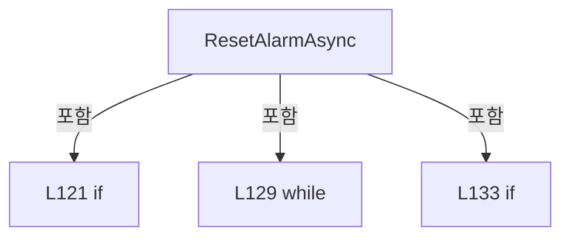

변경 전 점검: 입력/반환 타입, 위 호출자, 예외/취소 경로, 공유 상태와 저장·전송 소비자를 함께 확인합니다. 값의 단위나 물리 방향을 이름만으로 확정하지 않습니다.

### MethodDeclaration `Apply` · L139–162

[Drilling.UI/Menu/Menus/CMenuAlarm.cs:139–162](https://github.com/kjuws10-rgb/A3Drilling/blob/96e22cd027c84bf302b23f2949b98985d7f301bb/Drilling.UI/Menu/Menus/CMenuAlarm.cs#L139-L162)

| 항목 | 실제 추출 값 |
| --- | --- |
| 서명 | void Drilling.UI.Menu.Menus.CMenuAlarm.Apply(System.Collections.Generic.IReadOnlyList<Drilling.UI.Menu.Menus.ST_DISPLAY_ITEM>, System.Collections.Generic.IReadOnlyList<Drilling.UI.Menu.Menus.ST_DISPLAY_ITEM>, System.Collections.Generic.IReadOnlyList<Drilling.UI.Menu.Menus.ST_DISPLAY_ITEM>, System.Collections.Generic.IReadOnlyList<Drilling.UI.Menu.Menus.ST_DISPLAY_ITEM>, System.Collections.Generic.IReadOnlyList<Drilling.UI.Menu.Menus.ST_DISPLAY_ITEM>, System.Collections.Generic.IReadOnlyList<Drilling.UI.Menu.Menus.ST_ALARM_CURRENT_ROW>, System.Collections.Generic.IReadOnlyList<Drilling.UI.Menu.Menus.ST_ALARM_DETAIL_ROW>, System.Collections.Generic.IReadOnlyList<Drilling.UI.Menu.Menus.ST_ALARM_HISTORY_ROW>, System.Collections.Generic.IReadOnlyList<Drilling.UI.Menu.Menus.ST_ALARM_TREND_BAR>, System.Collections.Generic.IReadOnlyList<Drilling.UI.Menu.Menus.ST_ALARM_SUMMARY_ITEM>) |
| 접근/수식자 | Private / private |
| 반환/값 타입 | void |
| 소속 타입 | NamedType:Drilling.UI.Menu.Menus.CMenuAlarm |

입력 계약:

| 이름 | 타입 | 전달 | 선택/기본값 |
| --- | --- | --- | --- |
| currentAlarms | System.Collections.Generic.IReadOnlyList<Drilling.UI.Menu.Menus.ST_DISPLAY_ITEM> | None | False /  |
| alarmDetail | System.Collections.Generic.IReadOnlyList<Drilling.UI.Menu.Menus.ST_DISPLAY_ITEM> | None | False /  |
| recoveryCommands | System.Collections.Generic.IReadOnlyList<Drilling.UI.Menu.Menus.ST_DISPLAY_ITEM> | None | False /  |
| history | System.Collections.Generic.IReadOnlyList<Drilling.UI.Menu.Menus.ST_DISPLAY_ITEM> | None | False /  |
| trend | System.Collections.Generic.IReadOnlyList<Drilling.UI.Menu.Menus.ST_DISPLAY_ITEM> | None | False /  |
| currentAlarmRows | System.Collections.Generic.IReadOnlyList<Drilling.UI.Menu.Menus.ST_ALARM_CURRENT_ROW> | None | False /  |
| detailRows | System.Collections.Generic.IReadOnlyList<Drilling.UI.Menu.Menus.ST_ALARM_DETAIL_ROW> | None | False /  |
| historyRows | System.Collections.Generic.IReadOnlyList<Drilling.UI.Menu.Menus.ST_ALARM_HISTORY_ROW> | None | False /  |
| trendBars | System.Collections.Generic.IReadOnlyList<Drilling.UI.Menu.Menus.ST_ALARM_TREND_BAR> | None | False /  |
| summaryItems | System.Collections.Generic.IReadOnlyList<Drilling.UI.Menu.Menus.ST_ALARM_SUMMARY_ITEM> | None | False /  |

정적 호출자로 확인된 위치:

| 호출 파일/행 | 호출 표현식 | 런타임 분기 가능 |
| --- | --- | --- |
| [Drilling.UI/Menu/Menus/CMenuAlarm.cs:98–113](https://github.com/kjuws10-rgb/A3Drilling/blob/96e22cd027c84bf302b23f2949b98985d7f301bb/Drilling.UI/Menu/Menus/CMenuAlarm.cs#L98-L113) | Apply | False |

본문의 실제 연산·분기·예외·반환 순서(원문 위치 순):

| 원본 행 | 종류 | 주석 해설 |
| --- | --- | --- |
| 152 | assignment | 값을 대상에 대입합니다: CurrentAlarms = currentAlarms |
| 153 | assignment | 값을 대상에 대입합니다: AlarmDetail = alarmDetail |
| 154 | assignment | 값을 대상에 대입합니다: RecoveryCommands = recoveryCommands |
| 155 | assignment | 값을 대상에 대입합니다: History = history |
| 156 | assignment | 값을 대상에 대입합니다: Trend = trend |
| 157 | assignment | 값을 대상에 대입합니다: CurrentAlarmRows = currentAlarmRows |
| 158 | assignment | 값을 대상에 대입합니다: DetailRows = detailRows |
| 159 | assignment | 값을 대상에 대입합니다: HistoryRows = historyRows |
| 160 | assignment | 값을 대상에 대입합니다: TrendBars = trendBars |
| 161 | assignment | 값을 대상에 대입합니다: SummaryItems = summaryItems |

변경 전 점검: 입력/반환 타입, 위 호출자, 예외/취소 경로, 공유 상태와 저장·전송 소비자를 함께 확인합니다. 값의 단위나 물리 방향을 이름만으로 확정하지 않습니다.

### MethodDeclaration `BuildCurrentAlarmRows` · L164–174

[Drilling.UI/Menu/Menus/CMenuAlarm.cs:164–174](https://github.com/kjuws10-rgb/A3Drilling/blob/96e22cd027c84bf302b23f2949b98985d7f301bb/Drilling.UI/Menu/Menus/CMenuAlarm.cs#L164-L174)

| 항목 | 실제 추출 값 |
| --- | --- |
| 서명 | System.Collections.Generic.IReadOnlyList<Drilling.UI.Menu.Menus.ST_ALARM_CURRENT_ROW> Drilling.UI.Menu.Menus.CMenuAlarm.BuildCurrentAlarmRows(System.Collections.Generic.IReadOnlyList<Drilling.Common.Alarm.ST_ALARM_DATA>) |
| 접근/수식자 | Private / private |
| 반환/값 타입 | System.Collections.Generic.IReadOnlyList<Drilling.UI.Menu.Menus.ST_ALARM_CURRENT_ROW> |
| 소속 타입 | NamedType:Drilling.UI.Menu.Menus.CMenuAlarm |

입력 계약:

| 이름 | 타입 | 전달 | 선택/기본값 |
| --- | --- | --- | --- |
| alarms | System.Collections.Generic.IReadOnlyList<Drilling.Common.Alarm.ST_ALARM_DATA> | None | False /  |

정적 호출자로 확인된 위치:

| 호출 파일/행 | 호출 표현식 | 런타임 분기 가능 |
| --- | --- | --- |
| [Drilling.UI/Menu/Menus/CMenuAlarm.cs:108–108](https://github.com/kjuws10-rgb/A3Drilling/blob/96e22cd027c84bf302b23f2949b98985d7f301bb/Drilling.UI/Menu/Menus/CMenuAlarm.cs#L108-L108) | BuildCurrentAlarmRows | False |

호출하는 대상과 해석 범위:

| 원본 행 | 표현식 | 분석 상태 | 대상/소스 위치 |
| --- | --- | --- | --- |
| 166 | alarmManager.GetDefinitionsSnapshot().Rows.ToDictionary | resolved | System.Collections.Generic.Dictionary<int, string> System.Collections.Generic.IEnumerable<Drilling.Common.Alarm.ST_ALARM_DEFINITION>.ToDictionary<Drilling.Common.Alarm.ST_ALARM_DEFINITION, int, string>(System.Func<Drilling.Common.Alarm.ST_ALARM_DEFINITION, int>, System.Func<Drilling.Common.Alarm.ST_ALARM_DEFINITION, string>) |
| 166 | alarmManager.GetDefinitionsSnapshot | resolved | Drilling.Common.Alarm.ST_ALARM_DEFINITION_SNAPSHOT Drilling.Common.Alarm.CAlarmManager.GetDefinitionsSnapshot() · Drilling.Common/Alarm/CAlarmManager.cs:125 |
| 173 | alarms.Select(BuildAlarm).ToArray | resolved | Drilling.UI.Menu.Menus.ST_ALARM_CURRENT_ROW[] System.Collections.Generic.IEnumerable<Drilling.UI.Menu.Menus.ST_ALARM_CURRENT_ROW>.ToArray<Drilling.UI.Menu.Menus.ST_ALARM_CURRENT_ROW>() |
| 173 | alarms.Select | resolved | System.Collections.Generic.IEnumerable<Drilling.UI.Menu.Menus.ST_ALARM_CURRENT_ROW> System.Collections.Generic.IEnumerable<Drilling.Common.Alarm.ST_ALARM_DATA>.Select<Drilling.Common.Alarm.ST_ALARM_DATA, Drilling.UI.Menu.Menus.ST_ALARM_CURRENT_ROW>(System.Func<Drilling.Common.Alarm.ST_ALARM_DATA, int, Drilling.UI.Menu.Menus.ST_ALARM_CURRENT_ROW>) |

본문의 실제 연산·분기·예외·반환 순서(원문 위치 순):

| 원본 행 | 종류 | 주석 해설 |
| --- | --- | --- |
| 166 | call | 함수·델리게이트 또는 객체 생성자를 호출합니다: alarmManager.GetDefinitionsSnapshot().Rows.ToDictionary(row => row.Code, row => row.Group) |
| 166 | call | 함수·델리게이트 또는 객체 생성자를 호출합니다: alarmManager.GetDefinitionsSnapshot() |
| 166 | local-declaration | 지역 변수를 선언합니다: var groupsByCode = alarmManager.GetDefinitionsSnapshot().Rows.ToDictionary(row => row.Code, row => row.Group); |
| 166 | variable-initializer | 변수의 초기값을 지정합니다: groupsByCode = alarmManager.GetDefinitionsSnapshot().Rows.ToDictionary(row => row.Code, row => row.Group) |
| 173 | call | 함수·델리게이트 또는 객체 생성자를 호출합니다: alarms.Select(BuildAlarm).ToArray() |
| 173 | call | 함수·델리게이트 또는 객체 생성자를 호출합니다: alarms.Select(BuildAlarm) |
| 173 | return | 호출자에게 값 또는 제어를 반환합니다: return alarms.Select(BuildAlarm).ToArray(); |

변경 전 점검: 입력/반환 타입, 위 호출자, 예외/취소 경로, 공유 상태와 저장·전송 소비자를 함께 확인합니다. 값의 단위나 물리 방향을 이름만으로 확정하지 않습니다.

### LocalFunctionStatement `BuildAlarm` · L167–171

[Drilling.UI/Menu/Menus/CMenuAlarm.cs:167–171](https://github.com/kjuws10-rgb/A3Drilling/blob/96e22cd027c84bf302b23f2949b98985d7f301bb/Drilling.UI/Menu/Menus/CMenuAlarm.cs#L167-L171)

| 항목 | 실제 추출 값 |
| --- | --- |
| 서명 | Drilling.UI.Menu.Menus.ST_ALARM_CURRENT_ROW BuildAlarm(Drilling.Common.Alarm.ST_ALARM_DATA, int) |
| 접근/수식자 | Private /  |
| 반환/값 타입 | Drilling.UI.Menu.Menus.ST_ALARM_CURRENT_ROW |
| 소속 타입 | NamedType:Drilling.UI.Menu.Menus.CMenuAlarm |

입력 계약:

| 이름 | 타입 | 전달 | 선택/기본값 |
| --- | --- | --- | --- |
| alarm | Drilling.Common.Alarm.ST_ALARM_DATA | None | False /  |
| index | int | None | False /  |

현재 부분 분석에서 직접 연결된 호출자는 없습니다. XAML/이벤트/인터페이스·델리게이트·외부 진입을 추가 확인해야 하며, 미사용으로 판정한 것이 아닙니다.

호출하는 대상과 해석 범위:

| 원본 행 | 표현식 | 분석 상태 | 대상/소스 위치 |
| --- | --- | --- | --- |
| 169 | groupsByCode.TryGetValue | resolved | bool System.Collections.Generic.Dictionary<int, string>.TryGetValue(int, out string) |
| 170 | new ST_ALARM_CURRENT_ROW | resolved | Drilling.UI.Menu.Menus.ST_ALARM_CURRENT_ROW.ST_ALARM_CURRENT_ROW(int, string, string, string, string, string, string, string) · Drilling.UI/Menu/Menus/CMenuAlarm.cs:548 |
| 170 | alarm.Code.ToString | resolved · 동적 구현 선택 가능 | string int.ToString() |
| 170 | FormatSeverity | resolved | string Drilling.UI.Menu.Menus.CMenuAlarm.FormatSeverity(Drilling.Common.Alarm.EN_ALARM_LEVEL) · Drilling.UI/Menu/Menus/CMenuAlarm.cs:193 |
| 170 | alarm.OccurredAt.ToString | resolved | string System.DateTimeOffset.ToString(string?) |

본문의 실제 연산·분기·예외·반환 순서(원문 위치 순):

| 원본 행 | 종류 | 주석 해설 |
| --- | --- | --- |
| 169 | call | 함수·델리게이트 또는 객체 생성자를 호출합니다: groupsByCode.TryGetValue(alarm.Code, out var definedGroup) |
| 169 | conditional-expression | 조건에 따라 결과식을 선택합니다: groupsByCode.TryGetValue(alarm.Code, out var definedGroup) ? definedGroup : alarm.Group |
| 169 | local-declaration | 지역 변수를 선언합니다: var group = groupsByCode.TryGetValue(alarm.Code, out var definedGroup) ? definedGroup : alarm.Group; |
| 169 | variable-initializer | 변수의 초기값을 지정합니다: group = groupsByCode.TryGetValue(alarm.Code, out var definedGroup) ? definedGroup : alarm.Group |
| 170 | call | 함수·델리게이트 또는 객체 생성자를 호출합니다: new ST_ALARM_CURRENT_ROW(index + 1, alarm.Code.ToString(), FormatSeverity(alarm.Severity), group, alarm.Message, alarm.Message, alarm.RecoveryAction, alarm.OccurredAt.ToString("yyyy-MM-dd HH:mm:ss")) |
| 170 | call | 함수·델리게이트 또는 객체 생성자를 호출합니다: alarm.Code.ToString() |
| 170 | call | 함수·델리게이트 또는 객체 생성자를 호출합니다: FormatSeverity(alarm.Severity) |
| 170 | call | 함수·델리게이트 또는 객체 생성자를 호출합니다: alarm.OccurredAt.ToString("yyyy-MM-dd HH:mm:ss") |
| 170 | return | 호출자에게 값 또는 제어를 반환합니다: return new ST_ALARM_CURRENT_ROW(index + 1, alarm.Code.ToString(), FormatSeverity(alarm.Severity), group, alarm.Message, alarm.Message, alarm.RecoveryAction, alarm.OccurredAt.ToString("yyyy-MM-dd HH:mm:ss")); |

변경 전 점검: 입력/반환 타입, 위 호출자, 예외/취소 경로, 공유 상태와 저장·전송 소비자를 함께 확인합니다. 값의 단위나 물리 방향을 이름만으로 확정하지 않습니다.

### MethodDeclaration `BuildDetailRows` · L176–191

[Drilling.UI/Menu/Menus/CMenuAlarm.cs:176–191](https://github.com/kjuws10-rgb/A3Drilling/blob/96e22cd027c84bf302b23f2949b98985d7f301bb/Drilling.UI/Menu/Menus/CMenuAlarm.cs#L176-L191)

| 항목 | 실제 추출 값 |
| --- | --- |
| 서명 | System.Collections.Generic.IReadOnlyList<Drilling.UI.Menu.Menus.ST_ALARM_DETAIL_ROW> Drilling.UI.Menu.Menus.CMenuAlarm.BuildDetailRows(Drilling.Common.Alarm.ST_ALARM_DATA?) |
| 접근/수식자 | Private / private, static |
| 반환/값 타입 | System.Collections.Generic.IReadOnlyList<Drilling.UI.Menu.Menus.ST_ALARM_DETAIL_ROW> |
| 소속 타입 | NamedType:Drilling.UI.Menu.Menus.CMenuAlarm |

입력 계약:

| 이름 | 타입 | 전달 | 선택/기본값 |
| --- | --- | --- | --- |
| alarm | Drilling.Common.Alarm.ST_ALARM_DATA? | None | False /  |

정적 호출자로 확인된 위치:

| 호출 파일/행 | 호출 표현식 | 런타임 분기 가능 |
| --- | --- | --- |
| [Drilling.UI/Menu/Menus/CMenuAlarm.cs:109–109](https://github.com/kjuws10-rgb/A3Drilling/blob/96e22cd027c84bf302b23f2949b98985d7f301bb/Drilling.UI/Menu/Menus/CMenuAlarm.cs#L109-L109) | BuildDetailRows | False |

호출하는 대상과 해석 범위:

| 원본 행 | 표현식 | 분석 상태 | 대상/소스 위치 |
| --- | --- | --- | --- |
| 180 | new | resolved | Drilling.UI.Menu.Menus.ST_ALARM_DETAIL_ROW.ST_ALARM_DETAIL_ROW(string, string, string) · Drilling.UI/Menu/Menus/CMenuAlarm.cs:565 |
| 180 | new | resolved | Drilling.UI.Menu.Menus.ST_ALARM_DETAIL_ROW.ST_ALARM_DETAIL_ROW(string, string, string) · Drilling.UI/Menu/Menus/CMenuAlarm.cs:565 |
| 180 | new | resolved | Drilling.UI.Menu.Menus.ST_ALARM_DETAIL_ROW.ST_ALARM_DETAIL_ROW(string, string, string) · Drilling.UI/Menu/Menus/CMenuAlarm.cs:565 |
| 180 | new | resolved | Drilling.UI.Menu.Menus.ST_ALARM_DETAIL_ROW.ST_ALARM_DETAIL_ROW(string, string, string) · Drilling.UI/Menu/Menus/CMenuAlarm.cs:565 |
| 180 | new | resolved | Drilling.UI.Menu.Menus.ST_ALARM_DETAIL_ROW.ST_ALARM_DETAIL_ROW(string, string, string) · Drilling.UI/Menu/Menus/CMenuAlarm.cs:565 |
| 183 | FormatSeverity | resolved | string Drilling.UI.Menu.Menus.CMenuAlarm.FormatSeverity(Drilling.Common.Alarm.EN_ALARM_LEVEL) · Drilling.UI/Menu/Menus/CMenuAlarm.cs:193 |
| 185 | new | resolved | Drilling.UI.Menu.Menus.ST_ALARM_DETAIL_ROW.ST_ALARM_DETAIL_ROW(string, string, string) · Drilling.UI/Menu/Menus/CMenuAlarm.cs:565 |
| 185 | alarm.Code.ToString | resolved · 동적 구현 선택 가능 | string int.ToString() |
| 185 | SeverityState | resolved | string Drilling.UI.Menu.Menus.CMenuAlarm.SeverityState(Drilling.Common.Alarm.EN_ALARM_LEVEL) · Drilling.UI/Menu/Menus/CMenuAlarm.cs:203 |
| 186 | new | resolved | Drilling.UI.Menu.Menus.ST_ALARM_DETAIL_ROW.ST_ALARM_DETAIL_ROW(string, string, string) · Drilling.UI/Menu/Menus/CMenuAlarm.cs:565 |
| 187 | new | resolved | Drilling.UI.Menu.Menus.ST_ALARM_DETAIL_ROW.ST_ALARM_DETAIL_ROW(string, string, string) · Drilling.UI/Menu/Menus/CMenuAlarm.cs:565 |
| 187 | SeverityState | resolved | string Drilling.UI.Menu.Menus.CMenuAlarm.SeverityState(Drilling.Common.Alarm.EN_ALARM_LEVEL) · Drilling.UI/Menu/Menus/CMenuAlarm.cs:203 |
| 188 | new | resolved | Drilling.UI.Menu.Menus.ST_ALARM_DETAIL_ROW.ST_ALARM_DETAIL_ROW(string, string, string) · Drilling.UI/Menu/Menus/CMenuAlarm.cs:565 |
| 188 | alarm.OccurredAt.ToString | resolved | string System.DateTimeOffset.ToString(string?) |
| 189 | new | resolved | Drilling.UI.Menu.Menus.ST_ALARM_DETAIL_ROW.ST_ALARM_DETAIL_ROW(string, string, string) · Drilling.UI/Menu/Menus/CMenuAlarm.cs:565 |

본문의 실제 연산·분기·예외·반환 순서(원문 위치 순):

| 원본 행 | 종류 | 주석 해설 |
| --- | --- | --- |
| 178 | if | 조건에 따라 분기합니다: if (alarm is null) |
| 180 | call | 함수·델리게이트 또는 객체 생성자를 호출합니다: new("Selected Code", "-") |
| 180 | call | 함수·델리게이트 또는 객체 생성자를 호출합니다: new("Device", "-") |
| 180 | call | 함수·델리게이트 또는 객체 생성자를 호출합니다: new("Level", "CLEAR", "Ok") |
| 180 | call | 함수·델리게이트 또는 객체 생성자를 호출합니다: new("Occurred Time", "-") |
| 180 | call | 함수·델리게이트 또는 객체 생성자를 호출합니다: new("Message", "No active alarm") |
| 180 | return | 호출자에게 값 또는 제어를 반환합니다: return[new("Selected Code", "-"), new("Device", "-"), new("Level", "CLEAR", "Ok"), new("Occurred Time", "-"), new("Message", "No active alarm")]; |
| 183 | call | 함수·델리게이트 또는 객체 생성자를 호출합니다: FormatSeverity(alarm.Severity) |
| 183 | local-declaration | 지역 변수를 선언합니다: var severity = FormatSeverity(alarm.Severity); |
| 183 | variable-initializer | 변수의 초기값을 지정합니다: severity = FormatSeverity(alarm.Severity) |
| 184 | return | 호출자에게 값 또는 제어를 반환합니다: return[ new("Selected Code", alarm.Code.ToString(), SeverityState(alarm.Severity)), new("Device", alarm.Device), new("Level", severity, SeverityState(alarm.Severity)), new("Occurred Time", alarm.OccurredAt.ToString("yyyy-MM-dd HH: |
| 185 | call | 함수·델리게이트 또는 객체 생성자를 호출합니다: new("Selected Code", alarm.Code.ToString(), SeverityState(alarm.Severity)) |
| 185 | call | 함수·델리게이트 또는 객체 생성자를 호출합니다: alarm.Code.ToString() |
| 185 | call | 함수·델리게이트 또는 객체 생성자를 호출합니다: SeverityState(alarm.Severity) |
| 186 | call | 함수·델리게이트 또는 객체 생성자를 호출합니다: new("Device", alarm.Device) |
| 187 | call | 함수·델리게이트 또는 객체 생성자를 호출합니다: new("Level", severity, SeverityState(alarm.Severity)) |
| 187 | call | 함수·델리게이트 또는 객체 생성자를 호출합니다: SeverityState(alarm.Severity) |
| 188 | call | 함수·델리게이트 또는 객체 생성자를 호출합니다: new("Occurred Time", alarm.OccurredAt.ToString("yyyy-MM-dd HH:mm:ss")) |
| 188 | call | 함수·델리게이트 또는 객체 생성자를 호출합니다: alarm.OccurredAt.ToString("yyyy-MM-dd HH:mm:ss") |
| 189 | call | 함수·델리게이트 또는 객체 생성자를 호출합니다: new("Message", alarm.Message) |

제어 구문의 포함 구조(실제 실행 순서/CFG가 아닌 구문 탐색 그림):

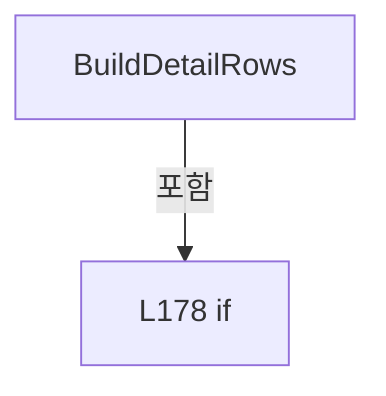

변경 전 점검: 입력/반환 타입, 위 호출자, 예외/취소 경로, 공유 상태와 저장·전송 소비자를 함께 확인합니다. 값의 단위나 물리 방향을 이름만으로 확정하지 않습니다.

### MethodDeclaration `FormatSeverity` · L193–201

[Drilling.UI/Menu/Menus/CMenuAlarm.cs:193–201](https://github.com/kjuws10-rgb/A3Drilling/blob/96e22cd027c84bf302b23f2949b98985d7f301bb/Drilling.UI/Menu/Menus/CMenuAlarm.cs#L193-L201)

| 항목 | 실제 추출 값 |
| --- | --- |
| 서명 | string Drilling.UI.Menu.Menus.CMenuAlarm.FormatSeverity(Drilling.Common.Alarm.EN_ALARM_LEVEL) |
| 접근/수식자 | Private / private, static |
| 반환/값 타입 | string |
| 소속 타입 | NamedType:Drilling.UI.Menu.Menus.CMenuAlarm |

입력 계약:

| 이름 | 타입 | 전달 | 선택/기본값 |
| --- | --- | --- | --- |
| severity | Drilling.Common.Alarm.EN_ALARM_LEVEL | None | False /  |

정적 호출자로 확인된 위치:

| 호출 파일/행 | 호출 표현식 | 런타임 분기 가능 |
| --- | --- | --- |
| [Drilling.UI/Menu/Menus/CMenuAlarm.cs:170–170](https://github.com/kjuws10-rgb/A3Drilling/blob/96e22cd027c84bf302b23f2949b98985d7f301bb/Drilling.UI/Menu/Menus/CMenuAlarm.cs#L170-L170) | FormatSeverity | False |
| [Drilling.UI/Menu/Menus/CMenuAlarm.cs:183–183](https://github.com/kjuws10-rgb/A3Drilling/blob/96e22cd027c84bf302b23f2949b98985d7f301bb/Drilling.UI/Menu/Menus/CMenuAlarm.cs#L183-L183) | FormatSeverity | False |

본문의 실제 연산·분기·예외·반환 순서(원문 위치 순):

| 원본 행 | 종류 | 주석 해설 |
| --- | --- | --- |
| 195 | return | 호출자에게 값 또는 제어를 반환합니다: return severity switch { EN_ALARM_LEVEL.Warning => "LIGHT", EN_ALARM_LEVEL.Critical => "HEAVY", _ => "INFO" }; |
| 195 | switch-expression | 값별 결과식을 선택합니다: severity switch { EN_ALARM_LEVEL.Warning => "LIGHT", EN_ALARM_LEVEL.Critical => "HEAVY", _ => "INFO" } |

제어 구문의 포함 구조(실제 실행 순서/CFG가 아닌 구문 탐색 그림):

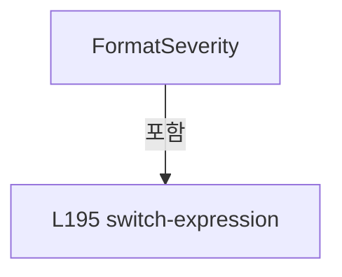

변경 전 점검: 입력/반환 타입, 위 호출자, 예외/취소 경로, 공유 상태와 저장·전송 소비자를 함께 확인합니다. 값의 단위나 물리 방향을 이름만으로 확정하지 않습니다.

### MethodDeclaration `SeverityState` · L203–211

[Drilling.UI/Menu/Menus/CMenuAlarm.cs:203–211](https://github.com/kjuws10-rgb/A3Drilling/blob/96e22cd027c84bf302b23f2949b98985d7f301bb/Drilling.UI/Menu/Menus/CMenuAlarm.cs#L203-L211)

| 항목 | 실제 추출 값 |
| --- | --- |
| 서명 | string Drilling.UI.Menu.Menus.CMenuAlarm.SeverityState(Drilling.Common.Alarm.EN_ALARM_LEVEL) |
| 접근/수식자 | Private / private, static |
| 반환/값 타입 | string |
| 소속 타입 | NamedType:Drilling.UI.Menu.Menus.CMenuAlarm |

입력 계약:

| 이름 | 타입 | 전달 | 선택/기본값 |
| --- | --- | --- | --- |
| severity | Drilling.Common.Alarm.EN_ALARM_LEVEL | None | False /  |

정적 호출자로 확인된 위치:

| 호출 파일/행 | 호출 표현식 | 런타임 분기 가능 |
| --- | --- | --- |
| [Drilling.UI/Menu/Menus/CMenuAlarm.cs:185–185](https://github.com/kjuws10-rgb/A3Drilling/blob/96e22cd027c84bf302b23f2949b98985d7f301bb/Drilling.UI/Menu/Menus/CMenuAlarm.cs#L185-L185) | SeverityState | False |
| [Drilling.UI/Menu/Menus/CMenuAlarm.cs:187–187](https://github.com/kjuws10-rgb/A3Drilling/blob/96e22cd027c84bf302b23f2949b98985d7f301bb/Drilling.UI/Menu/Menus/CMenuAlarm.cs#L187-L187) | SeverityState | False |

본문의 실제 연산·분기·예외·반환 순서(원문 위치 순):

| 원본 행 | 종류 | 주석 해설 |
| --- | --- | --- |
| 205 | return | 호출자에게 값 또는 제어를 반환합니다: return severity switch { EN_ALARM_LEVEL.Warning => "Warn", EN_ALARM_LEVEL.Critical => "Critical", _ => "Accent" }; |
| 205 | switch-expression | 값별 결과식을 선택합니다: severity switch { EN_ALARM_LEVEL.Warning => "Warn", EN_ALARM_LEVEL.Critical => "Critical", _ => "Accent" } |

제어 구문의 포함 구조(실제 실행 순서/CFG가 아닌 구문 탐색 그림):

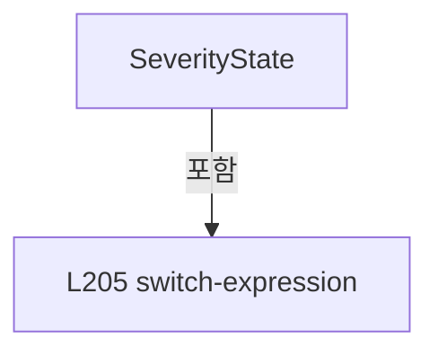

변경 전 점검: 입력/반환 타입, 위 호출자, 예외/취소 경로, 공유 상태와 저장·전송 소비자를 함께 확인합니다. 값의 단위나 물리 방향을 이름만으로 확정하지 않습니다.

### FieldDeclaration `_read` · L216–216

[Drilling.UI/Menu/Menus/CMenuAlarm.cs:216–216](https://github.com/kjuws10-rgb/A3Drilling/blob/96e22cd027c84bf302b23f2949b98985d7f301bb/Drilling.UI/Menu/Menus/CMenuAlarm.cs#L216-L216)

| 항목 | 실제 추출 값 |
| --- | --- |
| 서명 | System.Func<System.DateTime, System.DateTime, System.Threading.CancellationToken, Drilling.Common.Alarm.ST_ALARM_HISTORY_RESULT> Drilling.UI.Menu.Menus.CAlarmHistoryPanel._read |
| 접근/수식자 | Private / private, readonly |
| 반환/값 타입 | System.Func<System.DateTime, System.DateTime, System.Threading.CancellationToken, Drilling.Common.Alarm.ST_ALARM_HISTORY_RESULT> |
| 소속 타입 | NamedType:Drilling.UI.Menu.Menus.CAlarmHistoryPanel |

현재 부분 분석에서 직접 연결된 호출자는 없습니다. XAML/이벤트/인터페이스·델리게이트·외부 진입을 추가 확인해야 하며, 미사용으로 판정한 것이 아닙니다.

변경 전 점검: 입력/반환 타입, 위 호출자, 예외/취소 경로, 공유 상태와 저장·전송 소비자를 함께 확인합니다. 값의 단위나 물리 방향을 이름만으로 확정하지 않습니다.

### FieldDeclaration `_logDirectory` · L217–217

[Drilling.UI/Menu/Menus/CMenuAlarm.cs:217–217](https://github.com/kjuws10-rgb/A3Drilling/blob/96e22cd027c84bf302b23f2949b98985d7f301bb/Drilling.UI/Menu/Menus/CMenuAlarm.cs#L217-L217)

| 항목 | 실제 추출 값 |
| --- | --- |
| 서명 | string Drilling.UI.Menu.Menus.CAlarmHistoryPanel._logDirectory |
| 접근/수식자 | Private / private, readonly |
| 반환/값 타입 | string |
| 소속 타입 | NamedType:Drilling.UI.Menu.Menus.CAlarmHistoryPanel |

현재 부분 분석에서 직접 연결된 호출자는 없습니다. XAML/이벤트/인터페이스·델리게이트·외부 진입을 추가 확인해야 하며, 미사용으로 판정한 것이 아닙니다.

변경 전 점검: 입력/반환 타입, 위 호출자, 예외/취소 경로, 공유 상태와 저장·전송 소비자를 함께 확인합니다. 값의 단위나 물리 방향을 이름만으로 확정하지 않습니다.

### FieldDeclaration `_now` · L218–218

[Drilling.UI/Menu/Menus/CMenuAlarm.cs:218–218](https://github.com/kjuws10-rgb/A3Drilling/blob/96e22cd027c84bf302b23f2949b98985d7f301bb/Drilling.UI/Menu/Menus/CMenuAlarm.cs#L218-L218)

| 항목 | 실제 추출 값 |
| --- | --- |
| 서명 | System.Func<System.DateTime> Drilling.UI.Menu.Menus.CAlarmHistoryPanel._now |
| 접근/수식자 | Private / private, readonly |
| 반환/값 타입 | System.Func<System.DateTime> |
| 소속 타입 | NamedType:Drilling.UI.Menu.Menus.CAlarmHistoryPanel |

현재 부분 분석에서 직접 연결된 호출자는 없습니다. XAML/이벤트/인터페이스·델리게이트·외부 진입을 추가 확인해야 하며, 미사용으로 판정한 것이 아닙니다.

변경 전 점검: 입력/반환 타입, 위 호출자, 예외/취소 경로, 공유 상태와 저장·전송 소비자를 함께 확인합니다. 값의 단위나 물리 방향을 이름만으로 확정하지 않습니다.

### FieldDeclaration `_from` · L219–219

[Drilling.UI/Menu/Menus/CMenuAlarm.cs:219–219](https://github.com/kjuws10-rgb/A3Drilling/blob/96e22cd027c84bf302b23f2949b98985d7f301bb/Drilling.UI/Menu/Menus/CMenuAlarm.cs#L219-L219)

| 항목 | 실제 추출 값 |
| --- | --- |
| 서명 | System.DateTime? Drilling.UI.Menu.Menus.CAlarmHistoryPanel._from |
| 접근/수식자 | Private / private |
| 반환/값 타입 | System.DateTime? |
| 소속 타입 | NamedType:Drilling.UI.Menu.Menus.CAlarmHistoryPanel |

현재 부분 분석에서 직접 연결된 호출자는 없습니다. XAML/이벤트/인터페이스·델리게이트·외부 진입을 추가 확인해야 하며, 미사용으로 판정한 것이 아닙니다.

본문의 실제 연산·분기·예외·반환 순서(원문 위치 순):

| 원본 행 | 종류 | 주석 해설 |
| --- | --- | --- |
| 219 | variable-initializer | 변수의 초기값을 지정합니다: _from = DateTime.Today |

변경 전 점검: 입력/반환 타입, 위 호출자, 예외/취소 경로, 공유 상태와 저장·전송 소비자를 함께 확인합니다. 값의 단위나 물리 방향을 이름만으로 확정하지 않습니다.

### FieldDeclaration `_through` · L220–220

[Drilling.UI/Menu/Menus/CMenuAlarm.cs:220–220](https://github.com/kjuws10-rgb/A3Drilling/blob/96e22cd027c84bf302b23f2949b98985d7f301bb/Drilling.UI/Menu/Menus/CMenuAlarm.cs#L220-L220)

| 항목 | 실제 추출 값 |
| --- | --- |
| 서명 | System.DateTime? Drilling.UI.Menu.Menus.CAlarmHistoryPanel._through |
| 접근/수식자 | Private / private |
| 반환/값 타입 | System.DateTime? |
| 소속 타입 | NamedType:Drilling.UI.Menu.Menus.CAlarmHistoryPanel |

현재 부분 분석에서 직접 연결된 호출자는 없습니다. XAML/이벤트/인터페이스·델리게이트·외부 진입을 추가 확인해야 하며, 미사용으로 판정한 것이 아닙니다.

본문의 실제 연산·분기·예외·반환 순서(원문 위치 순):

| 원본 행 | 종류 | 주석 해설 |
| --- | --- | --- |
| 220 | variable-initializer | 변수의 초기값을 지정합니다: _through = DateTime.Today |

변경 전 점검: 입력/반환 타입, 위 호출자, 예외/취소 경로, 공유 상태와 저장·전송 소비자를 함께 확인합니다. 값의 단위나 물리 방향을 이름만으로 확정하지 않습니다.

### FieldDeclaration `_fromTime` · L221–221

[Drilling.UI/Menu/Menus/CMenuAlarm.cs:221–221](https://github.com/kjuws10-rgb/A3Drilling/blob/96e22cd027c84bf302b23f2949b98985d7f301bb/Drilling.UI/Menu/Menus/CMenuAlarm.cs#L221-L221)

| 항목 | 실제 추출 값 |
| --- | --- |
| 서명 | string Drilling.UI.Menu.Menus.CAlarmHistoryPanel._fromTime |
| 접근/수식자 | Private / private |
| 반환/값 타입 | string |
| 소속 타입 | NamedType:Drilling.UI.Menu.Menus.CAlarmHistoryPanel |

현재 부분 분석에서 직접 연결된 호출자는 없습니다. XAML/이벤트/인터페이스·델리게이트·외부 진입을 추가 확인해야 하며, 미사용으로 판정한 것이 아닙니다.

본문의 실제 연산·분기·예외·반환 순서(원문 위치 순):

| 원본 행 | 종류 | 주석 해설 |
| --- | --- | --- |
| 221 | variable-initializer | 변수의 초기값을 지정합니다: _fromTime = "00:00:00" |

변경 전 점검: 입력/반환 타입, 위 호출자, 예외/취소 경로, 공유 상태와 저장·전송 소비자를 함께 확인합니다. 값의 단위나 물리 방향을 이름만으로 확정하지 않습니다.

### FieldDeclaration `_throughTime` · L222–222

[Drilling.UI/Menu/Menus/CMenuAlarm.cs:222–222](https://github.com/kjuws10-rgb/A3Drilling/blob/96e22cd027c84bf302b23f2949b98985d7f301bb/Drilling.UI/Menu/Menus/CMenuAlarm.cs#L222-L222)

| 항목 | 실제 추출 값 |
| --- | --- |
| 서명 | string Drilling.UI.Menu.Menus.CAlarmHistoryPanel._throughTime |
| 접근/수식자 | Private / private |
| 반환/값 타입 | string |
| 소속 타입 | NamedType:Drilling.UI.Menu.Menus.CAlarmHistoryPanel |

현재 부분 분석에서 직접 연결된 호출자는 없습니다. XAML/이벤트/인터페이스·델리게이트·외부 진입을 추가 확인해야 하며, 미사용으로 판정한 것이 아닙니다.

본문의 실제 연산·분기·예외·반환 순서(원문 위치 순):

| 원본 행 | 종류 | 주석 해설 |
| --- | --- | --- |
| 222 | variable-initializer | 변수의 초기값을 지정합니다: _throughTime = "00:00:00" |

변경 전 점검: 입력/반환 타입, 위 호출자, 예외/취소 경로, 공유 상태와 저장·전송 소비자를 함께 확인합니다. 값의 단위나 물리 방향을 이름만으로 확정하지 않습니다.

### FieldDeclaration `_hasOpened` · L223–223

[Drilling.UI/Menu/Menus/CMenuAlarm.cs:223–223](https://github.com/kjuws10-rgb/A3Drilling/blob/96e22cd027c84bf302b23f2949b98985d7f301bb/Drilling.UI/Menu/Menus/CMenuAlarm.cs#L223-L223)

| 항목 | 실제 추출 값 |
| --- | --- |
| 서명 | bool Drilling.UI.Menu.Menus.CAlarmHistoryPanel._hasOpened |
| 접근/수식자 | Private / private |
| 반환/값 타입 | bool |
| 소속 타입 | NamedType:Drilling.UI.Menu.Menus.CAlarmHistoryPanel |

현재 부분 분석에서 직접 연결된 호출자는 없습니다. XAML/이벤트/인터페이스·델리게이트·외부 진입을 추가 확인해야 하며, 미사용으로 판정한 것이 아닙니다.

변경 전 점검: 입력/반환 타입, 위 호출자, 예외/취소 경로, 공유 상태와 저장·전송 소비자를 함께 확인합니다. 값의 단위나 물리 방향을 이름만으로 확정하지 않습니다.

### FieldDeclaration `_isCodeView` · L224–224

[Drilling.UI/Menu/Menus/CMenuAlarm.cs:224–224](https://github.com/kjuws10-rgb/A3Drilling/blob/96e22cd027c84bf302b23f2949b98985d7f301bb/Drilling.UI/Menu/Menus/CMenuAlarm.cs#L224-L224)

| 항목 | 실제 추출 값 |
| --- | --- |
| 서명 | bool Drilling.UI.Menu.Menus.CAlarmHistoryPanel._isCodeView |
| 접근/수식자 | Private / private |
| 반환/값 타입 | bool |
| 소속 타입 | NamedType:Drilling.UI.Menu.Menus.CAlarmHistoryPanel |

현재 부분 분석에서 직접 연결된 호출자는 없습니다. XAML/이벤트/인터페이스·델리게이트·외부 진입을 추가 확인해야 하며, 미사용으로 판정한 것이 아닙니다.

본문의 실제 연산·분기·예외·반환 순서(원문 위치 순):

| 원본 행 | 종류 | 주석 해설 |
| --- | --- | --- |
| 224 | variable-initializer | 변수의 초기값을 지정합니다: _isCodeView = true |

변경 전 점검: 입력/반환 타입, 위 호출자, 예외/취소 경로, 공유 상태와 저장·전송 소비자를 함께 확인합니다. 값의 단위나 물리 방향을 이름만으로 확정하지 않습니다.

### FieldDeclaration `_loadedRows` · L225–225

[Drilling.UI/Menu/Menus/CMenuAlarm.cs:225–225](https://github.com/kjuws10-rgb/A3Drilling/blob/96e22cd027c84bf302b23f2949b98985d7f301bb/Drilling.UI/Menu/Menus/CMenuAlarm.cs#L225-L225)

| 항목 | 실제 추출 값 |
| --- | --- |
| 서명 | System.Collections.Generic.IReadOnlyList<Drilling.Common.Alarm.ST_ALARM_HISTORY_ENTRY> Drilling.UI.Menu.Menus.CAlarmHistoryPanel._loadedRows |
| 접근/수식자 | Private / private |
| 반환/값 타입 | System.Collections.Generic.IReadOnlyList<Drilling.Common.Alarm.ST_ALARM_HISTORY_ENTRY> |
| 소속 타입 | NamedType:Drilling.UI.Menu.Menus.CAlarmHistoryPanel |

현재 부분 분석에서 직접 연결된 호출자는 없습니다. XAML/이벤트/인터페이스·델리게이트·외부 진입을 추가 확인해야 하며, 미사용으로 판정한 것이 아닙니다.

본문의 실제 연산·분기·예외·반환 순서(원문 위치 순):

| 원본 행 | 종류 | 주석 해설 |
| --- | --- | --- |
| 225 | variable-initializer | 변수의 초기값을 지정합니다: _loadedRows = [] |

변경 전 점검: 입력/반환 타입, 위 호출자, 예외/취소 경로, 공유 상태와 저장·전송 소비자를 함께 확인합니다. 값의 단위나 물리 방향을 이름만으로 확정하지 않습니다.

### FieldDeclaration `_searchedFrom` · L226–226

[Drilling.UI/Menu/Menus/CMenuAlarm.cs:226–226](https://github.com/kjuws10-rgb/A3Drilling/blob/96e22cd027c84bf302b23f2949b98985d7f301bb/Drilling.UI/Menu/Menus/CMenuAlarm.cs#L226-L226)

| 항목 | 실제 추출 값 |
| --- | --- |
| 서명 | System.DateTime? Drilling.UI.Menu.Menus.CAlarmHistoryPanel._searchedFrom |
| 접근/수식자 | Private / private |
| 반환/값 타입 | System.DateTime? |
| 소속 타입 | NamedType:Drilling.UI.Menu.Menus.CAlarmHistoryPanel |

현재 부분 분석에서 직접 연결된 호출자는 없습니다. XAML/이벤트/인터페이스·델리게이트·외부 진입을 추가 확인해야 하며, 미사용으로 판정한 것이 아닙니다.

변경 전 점검: 입력/반환 타입, 위 호출자, 예외/취소 경로, 공유 상태와 저장·전송 소비자를 함께 확인합니다. 값의 단위나 물리 방향을 이름만으로 확정하지 않습니다.

### FieldDeclaration `_searchedThrough` · L227–227

[Drilling.UI/Menu/Menus/CMenuAlarm.cs:227–227](https://github.com/kjuws10-rgb/A3Drilling/blob/96e22cd027c84bf302b23f2949b98985d7f301bb/Drilling.UI/Menu/Menus/CMenuAlarm.cs#L227-L227)

| 항목 | 실제 추출 값 |
| --- | --- |
| 서명 | System.DateTime? Drilling.UI.Menu.Menus.CAlarmHistoryPanel._searchedThrough |
| 접근/수식자 | Private / private |
| 반환/값 타입 | System.DateTime? |
| 소속 타입 | NamedType:Drilling.UI.Menu.Menus.CAlarmHistoryPanel |

현재 부분 분석에서 직접 연결된 호출자는 없습니다. XAML/이벤트/인터페이스·델리게이트·외부 진입을 추가 확인해야 하며, 미사용으로 판정한 것이 아닙니다.

변경 전 점검: 입력/반환 타입, 위 호출자, 예외/취소 경로, 공유 상태와 저장·전송 소비자를 함께 확인합니다. 값의 단위나 물리 방향을 이름만으로 확정하지 않습니다.

### FieldDeclaration `_selectedRow` · L228–228

[Drilling.UI/Menu/Menus/CMenuAlarm.cs:228–228](https://github.com/kjuws10-rgb/A3Drilling/blob/96e22cd027c84bf302b23f2949b98985d7f301bb/Drilling.UI/Menu/Menus/CMenuAlarm.cs#L228-L228)

| 항목 | 실제 추출 값 |
| --- | --- |
| 서명 | Drilling.UI.Menu.Menus.ST_ALARM_HISTORY_ROW? Drilling.UI.Menu.Menus.CAlarmHistoryPanel._selectedRow |
| 접근/수식자 | Private / private |
| 반환/값 타입 | Drilling.UI.Menu.Menus.ST_ALARM_HISTORY_ROW? |
| 소속 타입 | NamedType:Drilling.UI.Menu.Menus.CAlarmHistoryPanel |

현재 부분 분석에서 직접 연결된 호출자는 없습니다. XAML/이벤트/인터페이스·델리게이트·외부 진입을 추가 확인해야 하며, 미사용으로 판정한 것이 아닙니다.

변경 전 점검: 입력/반환 타입, 위 호출자, 예외/취소 경로, 공유 상태와 저장·전송 소비자를 함께 확인합니다. 값의 단위나 물리 방향을 이름만으로 확정하지 않습니다.

### ConstructorDeclaration `.ctor` · L229–240

[Drilling.UI/Menu/Menus/CMenuAlarm.cs:229–240](https://github.com/kjuws10-rgb/A3Drilling/blob/96e22cd027c84bf302b23f2949b98985d7f301bb/Drilling.UI/Menu/Menus/CMenuAlarm.cs#L229-L240)

| 항목 | 실제 추출 값 |
| --- | --- |
| 서명 | Drilling.UI.Menu.Menus.CAlarmHistoryPanel.CAlarmHistoryPanel(System.Func<System.DateTime, System.DateTime, System.Threading.CancellationToken, Drilling.Common.Alarm.ST_ALARM_HISTORY_RESULT>, string, System.Func<System.DateTime>?) |
| 접근/수식자 | Public / public |
| 반환/값 타입 | void |
| 소속 타입 | NamedType:Drilling.UI.Menu.Menus.CAlarmHistoryPanel |

입력 계약:

| 이름 | 타입 | 전달 | 선택/기본값 |
| --- | --- | --- | --- |
| read | System.Func<System.DateTime, System.DateTime, System.Threading.CancellationToken, Drilling.Common.Alarm.ST_ALARM_HISTORY_RESULT> | None | False /  |
| logDirectory | string | None | False /  |
| now | System.Func<System.DateTime>? | None | True / null |

정적 호출자로 확인된 위치:

| 호출 파일/행 | 호출 표현식 | 런타임 분기 가능 |
| --- | --- | --- |
| [Drilling.UI/Menu/Menus/CMenuAlarm.cs:36–36](https://github.com/kjuws10-rgb/A3Drilling/blob/96e22cd027c84bf302b23f2949b98985d7f301bb/Drilling.UI/Menu/Menus/CMenuAlarm.cs#L36-L36) | new | False |

호출하는 대상과 해석 범위:

| 원본 행 | 표현식 | 분석 상태 | 대상/소스 위치 |
| --- | --- | --- | --- |
| 234 | SetDefaultRange | resolved | void Drilling.UI.Menu.Menus.CAlarmHistoryPanel.SetDefaultRange() · Drilling.UI/Menu/Menus/CMenuAlarm.cs:328 |
| 235 | new | resolved | Drilling.UI.Menu.CButtonCommand.CButtonCommand(System.Action<object?>, System.Predicate<object?>?) · Drilling.UI/Menu/CButtonCommand.cs:9 |
| 235 | SearchAsync | resolved | System.Threading.Tasks.Task Drilling.UI.Menu.Menus.CAlarmHistoryPanel.SearchAsync() · Drilling.UI/Menu/Menus/CMenuAlarm.cs:383 |
| 236 | new | resolved | Drilling.UI.Menu.CButtonCommand.CButtonCommand(System.Action<object?>, System.Predicate<object?>?) · Drilling.UI/Menu/CButtonCommand.cs:9 |
| 236 | SearchLast24HoursAsync | resolved | System.Threading.Tasks.Task Drilling.UI.Menu.Menus.CAlarmHistoryPanel.SearchLast24HoursAsync() · Drilling.UI/Menu/Menus/CMenuAlarm.cs:368 |
| 237 | new | resolved | Drilling.UI.Menu.CButtonCommand.CButtonCommand(System.Action<object?>, System.Predicate<object?>?) · Drilling.UI/Menu/CButtonCommand.cs:9 |
| 237 | SelectTrendView | resolved | void Drilling.UI.Menu.Menus.CAlarmHistoryPanel.SelectTrendView(bool) · Drilling.UI/Menu/Menus/CMenuAlarm.cs:336 |
| 238 | new | resolved | Drilling.UI.Menu.CButtonCommand.CButtonCommand(System.Action<object?>, System.Predicate<object?>?) · Drilling.UI/Menu/CButtonCommand.cs:9 |
| 238 | SelectTrendView | resolved | void Drilling.UI.Menu.Menus.CAlarmHistoryPanel.SelectTrendView(bool) · Drilling.UI/Menu/Menus/CMenuAlarm.cs:336 |
| 239 | new | resolved | Drilling.UI.Menu.CButtonCommand.CButtonCommand(System.Action<object?>, System.Predicate<object?>?) · Drilling.UI/Menu/CButtonCommand.cs:9 |
| 239 | ShowCauseAnalysis | resolved | void Drilling.UI.Menu.Menus.CAlarmHistoryPanel.ShowCauseAnalysis() · Drilling.UI/Menu/Menus/CMenuAlarm.cs:310 |

본문의 실제 연산·분기·예외·반환 순서(원문 위치 순):

| 원본 행 | 종류 | 주석 해설 |
| --- | --- | --- |
| 231 | assignment | 값을 대상에 대입합니다: _read = read |
| 232 | assignment | 값을 대상에 대입합니다: _logDirectory = logDirectory |
| 233 | assignment | 값을 대상에 대입합니다: _now = now ?? (() => DateTime.Now) |
| 234 | call | 함수·델리게이트 또는 객체 생성자를 호출합니다: SetDefaultRange() |
| 235 | assignment | 값을 대상에 대입합니다: SearchCommand = new(async _ => await SearchAsync(), _ => !IsBusy) |
| 235 | await | 비동기 완료를 기다립니다: await SearchAsync() |
| 235 | call | 함수·델리게이트 또는 객체 생성자를 호출합니다: new(async _ => await SearchAsync(), _ => !IsBusy) |
| 235 | call | 함수·델리게이트 또는 객체 생성자를 호출합니다: SearchAsync() |
| 236 | assignment | 값을 대상에 대입합니다: Last24HoursCommand = new(async _ => await SearchLast24HoursAsync(), _ => !IsBusy) |
| 236 | await | 비동기 완료를 기다립니다: await SearchLast24HoursAsync() |
| 236 | call | 함수·델리게이트 또는 객체 생성자를 호출합니다: new(async _ => await SearchLast24HoursAsync(), _ => !IsBusy) |
| 236 | call | 함수·델리게이트 또는 객체 생성자를 호출합니다: SearchLast24HoursAsync() |
| 237 | assignment | 값을 대상에 대입합니다: HourViewCommand = new(_ => SelectTrendView(false)) |
| 237 | call | 함수·델리게이트 또는 객체 생성자를 호출합니다: new(_ => SelectTrendView(false)) |
| 237 | call | 함수·델리게이트 또는 객체 생성자를 호출합니다: SelectTrendView(false) |
| 238 | assignment | 값을 대상에 대입합니다: CodeViewCommand = new(_ => SelectTrendView(true)) |
| 238 | call | 함수·델리게이트 또는 객체 생성자를 호출합니다: new(_ => SelectTrendView(true)) |
| 238 | call | 함수·델리게이트 또는 객체 생성자를 호출합니다: SelectTrendView(true) |
| 239 | assignment | 값을 대상에 대입합니다: CauseAnalysisCommand = new(_ => ShowCauseAnalysis(), _ => SelectedRow is not null && !IsBusy) |
| 239 | call | 함수·델리게이트 또는 객체 생성자를 호출합니다: new(_ => ShowCauseAnalysis(), _ => SelectedRow is not null && !IsBusy) |
| 239 | call | 함수·델리게이트 또는 객체 생성자를 호출합니다: ShowCauseAnalysis() |

변경 전 점검: 입력/반환 타입, 위 호출자, 예외/취소 경로, 공유 상태와 저장·전송 소비자를 함께 확인합니다. 값의 단위나 물리 방향을 이름만으로 확정하지 않습니다.

### EventFieldDeclaration `PropertyChanged` · L242–242

[Drilling.UI/Menu/Menus/CMenuAlarm.cs:242–242](https://github.com/kjuws10-rgb/A3Drilling/blob/96e22cd027c84bf302b23f2949b98985d7f301bb/Drilling.UI/Menu/Menus/CMenuAlarm.cs#L242-L242)

| 항목 | 실제 추출 값 |
| --- | --- |
| 서명 | System.ComponentModel.PropertyChangedEventHandler? Drilling.UI.Menu.Menus.CAlarmHistoryPanel.PropertyChanged |
| 접근/수식자 | Public / public, event |
| 반환/값 타입 | System.ComponentModel.PropertyChangedEventHandler? |
| 소속 타입 | NamedType:Drilling.UI.Menu.Menus.CAlarmHistoryPanel |

현재 부분 분석에서 직접 연결된 호출자는 없습니다. XAML/이벤트/인터페이스·델리게이트·외부 진입을 추가 확인해야 하며, 미사용으로 판정한 것이 아닙니다.

변경 전 점검: 입력/반환 타입, 위 호출자, 예외/취소 경로, 공유 상태와 저장·전송 소비자를 함께 확인합니다. 값의 단위나 물리 방향을 이름만으로 확정하지 않습니다.

### PropertyDeclaration `From` · L243–251

[Drilling.UI/Menu/Menus/CMenuAlarm.cs:243–251](https://github.com/kjuws10-rgb/A3Drilling/blob/96e22cd027c84bf302b23f2949b98985d7f301bb/Drilling.UI/Menu/Menus/CMenuAlarm.cs#L243-L251)

| 항목 | 실제 추출 값 |
| --- | --- |
| 서명 | System.DateTime? Drilling.UI.Menu.Menus.CAlarmHistoryPanel.From |
| 접근/수식자 | Public / public |
| 반환/값 타입 | System.DateTime? |
| 소속 타입 | NamedType:Drilling.UI.Menu.Menus.CAlarmHistoryPanel |

현재 부분 분석에서 직접 연결된 호출자는 없습니다. XAML/이벤트/인터페이스·델리게이트·외부 진입을 추가 확인해야 하며, 미사용으로 판정한 것이 아닙니다.

변경 전 점검: 입력/반환 타입, 위 호출자, 예외/취소 경로, 공유 상태와 저장·전송 소비자를 함께 확인합니다. 값의 단위나 물리 방향을 이름만으로 확정하지 않습니다.

### GetAccessorDeclaration `get_From` · L245–245

[Drilling.UI/Menu/Menus/CMenuAlarm.cs:245–245](https://github.com/kjuws10-rgb/A3Drilling/blob/96e22cd027c84bf302b23f2949b98985d7f301bb/Drilling.UI/Menu/Menus/CMenuAlarm.cs#L245-L245)

| 항목 | 실제 추출 값 |
| --- | --- |
| 서명 | System.DateTime? Drilling.UI.Menu.Menus.CAlarmHistoryPanel.From.get |
| 접근/수식자 | Public / get |
| 반환/값 타입 | System.DateTime? |
| 소속 타입 | NamedType:Drilling.UI.Menu.Menus.CAlarmHistoryPanel |

현재 부분 분석에서 직접 연결된 호출자는 없습니다. XAML/이벤트/인터페이스·델리게이트·외부 진입을 추가 확인해야 하며, 미사용으로 판정한 것이 아닙니다.

변경 전 점검: 입력/반환 타입, 위 호출자, 예외/취소 경로, 공유 상태와 저장·전송 소비자를 함께 확인합니다. 값의 단위나 물리 방향을 이름만으로 확정하지 않습니다.

### SetAccessorDeclaration `set_From` · L246–250

[Drilling.UI/Menu/Menus/CMenuAlarm.cs:246–250](https://github.com/kjuws10-rgb/A3Drilling/blob/96e22cd027c84bf302b23f2949b98985d7f301bb/Drilling.UI/Menu/Menus/CMenuAlarm.cs#L246-L250)

| 항목 | 실제 추출 값 |
| --- | --- |
| 서명 | void Drilling.UI.Menu.Menus.CAlarmHistoryPanel.From.set |
| 접근/수식자 | Public / set |
| 반환/값 타입 | void |
| 소속 타입 | NamedType:Drilling.UI.Menu.Menus.CAlarmHistoryPanel |

입력 계약:

| 이름 | 타입 | 전달 | 선택/기본값 |
| --- | --- | --- | --- |
| value | System.DateTime? | None | False /  |

현재 부분 분석에서 직접 연결된 호출자는 없습니다. XAML/이벤트/인터페이스·델리게이트·외부 진입을 추가 확인해야 하며, 미사용으로 판정한 것이 아닙니다.

호출하는 대상과 해석 범위:

| 원본 행 | 표현식 | 분석 상태 | 대상/소스 위치 |
| --- | --- | --- | --- |
| 249 | Notify | resolved | void Drilling.UI.Menu.Menus.CAlarmHistoryPanel.Notify(string?) · Drilling.UI/Menu/Menus/CMenuAlarm.cs:513 |

본문의 실제 연산·분기·예외·반환 순서(원문 위치 순):

| 원본 행 | 종류 | 주석 해설 |
| --- | --- | --- |
| 248 | assignment | 값을 대상에 대입합니다: _from = value |
| 249 | call | 함수·델리게이트 또는 객체 생성자를 호출합니다: Notify() |

변경 전 점검: 입력/반환 타입, 위 호출자, 예외/취소 경로, 공유 상태와 저장·전송 소비자를 함께 확인합니다. 값의 단위나 물리 방향을 이름만으로 확정하지 않습니다.

### PropertyDeclaration `Through` · L253–261

[Drilling.UI/Menu/Menus/CMenuAlarm.cs:253–261](https://github.com/kjuws10-rgb/A3Drilling/blob/96e22cd027c84bf302b23f2949b98985d7f301bb/Drilling.UI/Menu/Menus/CMenuAlarm.cs#L253-L261)

| 항목 | 실제 추출 값 |
| --- | --- |
| 서명 | System.DateTime? Drilling.UI.Menu.Menus.CAlarmHistoryPanel.Through |
| 접근/수식자 | Public / public |
| 반환/값 타입 | System.DateTime? |
| 소속 타입 | NamedType:Drilling.UI.Menu.Menus.CAlarmHistoryPanel |

현재 부분 분석에서 직접 연결된 호출자는 없습니다. XAML/이벤트/인터페이스·델리게이트·외부 진입을 추가 확인해야 하며, 미사용으로 판정한 것이 아닙니다.

변경 전 점검: 입력/반환 타입, 위 호출자, 예외/취소 경로, 공유 상태와 저장·전송 소비자를 함께 확인합니다. 값의 단위나 물리 방향을 이름만으로 확정하지 않습니다.

### GetAccessorDeclaration `get_Through` · L255–255

[Drilling.UI/Menu/Menus/CMenuAlarm.cs:255–255](https://github.com/kjuws10-rgb/A3Drilling/blob/96e22cd027c84bf302b23f2949b98985d7f301bb/Drilling.UI/Menu/Menus/CMenuAlarm.cs#L255-L255)

| 항목 | 실제 추출 값 |
| --- | --- |
| 서명 | System.DateTime? Drilling.UI.Menu.Menus.CAlarmHistoryPanel.Through.get |
| 접근/수식자 | Public / get |
| 반환/값 타입 | System.DateTime? |
| 소속 타입 | NamedType:Drilling.UI.Menu.Menus.CAlarmHistoryPanel |

현재 부분 분석에서 직접 연결된 호출자는 없습니다. XAML/이벤트/인터페이스·델리게이트·외부 진입을 추가 확인해야 하며, 미사용으로 판정한 것이 아닙니다.

변경 전 점검: 입력/반환 타입, 위 호출자, 예외/취소 경로, 공유 상태와 저장·전송 소비자를 함께 확인합니다. 값의 단위나 물리 방향을 이름만으로 확정하지 않습니다.

### SetAccessorDeclaration `set_Through` · L256–260

[Drilling.UI/Menu/Menus/CMenuAlarm.cs:256–260](https://github.com/kjuws10-rgb/A3Drilling/blob/96e22cd027c84bf302b23f2949b98985d7f301bb/Drilling.UI/Menu/Menus/CMenuAlarm.cs#L256-L260)

| 항목 | 실제 추출 값 |
| --- | --- |
| 서명 | void Drilling.UI.Menu.Menus.CAlarmHistoryPanel.Through.set |
| 접근/수식자 | Public / set |
| 반환/값 타입 | void |
| 소속 타입 | NamedType:Drilling.UI.Menu.Menus.CAlarmHistoryPanel |

입력 계약:

| 이름 | 타입 | 전달 | 선택/기본값 |
| --- | --- | --- | --- |
| value | System.DateTime? | None | False /  |

현재 부분 분석에서 직접 연결된 호출자는 없습니다. XAML/이벤트/인터페이스·델리게이트·외부 진입을 추가 확인해야 하며, 미사용으로 판정한 것이 아닙니다.

호출하는 대상과 해석 범위:

| 원본 행 | 표현식 | 분석 상태 | 대상/소스 위치 |
| --- | --- | --- | --- |
| 259 | Notify | resolved | void Drilling.UI.Menu.Menus.CAlarmHistoryPanel.Notify(string?) · Drilling.UI/Menu/Menus/CMenuAlarm.cs:513 |

본문의 실제 연산·분기·예외·반환 순서(원문 위치 순):

| 원본 행 | 종류 | 주석 해설 |
| --- | --- | --- |
| 258 | assignment | 값을 대상에 대입합니다: _through = value |
| 259 | call | 함수·델리게이트 또는 객체 생성자를 호출합니다: Notify() |

변경 전 점검: 입력/반환 타입, 위 호출자, 예외/취소 경로, 공유 상태와 저장·전송 소비자를 함께 확인합니다. 값의 단위나 물리 방향을 이름만으로 확정하지 않습니다.

### PropertyDeclaration `FromTime` · L263–271

[Drilling.UI/Menu/Menus/CMenuAlarm.cs:263–271](https://github.com/kjuws10-rgb/A3Drilling/blob/96e22cd027c84bf302b23f2949b98985d7f301bb/Drilling.UI/Menu/Menus/CMenuAlarm.cs#L263-L271)

| 항목 | 실제 추출 값 |
| --- | --- |
| 서명 | string Drilling.UI.Menu.Menus.CAlarmHistoryPanel.FromTime |
| 접근/수식자 | Public / public |
| 반환/값 타입 | string |
| 소속 타입 | NamedType:Drilling.UI.Menu.Menus.CAlarmHistoryPanel |

현재 부분 분석에서 직접 연결된 호출자는 없습니다. XAML/이벤트/인터페이스·델리게이트·외부 진입을 추가 확인해야 하며, 미사용으로 판정한 것이 아닙니다.

변경 전 점검: 입력/반환 타입, 위 호출자, 예외/취소 경로, 공유 상태와 저장·전송 소비자를 함께 확인합니다. 값의 단위나 물리 방향을 이름만으로 확정하지 않습니다.

### GetAccessorDeclaration `get_FromTime` · L265–265

[Drilling.UI/Menu/Menus/CMenuAlarm.cs:265–265](https://github.com/kjuws10-rgb/A3Drilling/blob/96e22cd027c84bf302b23f2949b98985d7f301bb/Drilling.UI/Menu/Menus/CMenuAlarm.cs#L265-L265)

| 항목 | 실제 추출 값 |
| --- | --- |
| 서명 | string Drilling.UI.Menu.Menus.CAlarmHistoryPanel.FromTime.get |
| 접근/수식자 | Public / get |
| 반환/값 타입 | string |
| 소속 타입 | NamedType:Drilling.UI.Menu.Menus.CAlarmHistoryPanel |

현재 부분 분석에서 직접 연결된 호출자는 없습니다. XAML/이벤트/인터페이스·델리게이트·외부 진입을 추가 확인해야 하며, 미사용으로 판정한 것이 아닙니다.

변경 전 점검: 입력/반환 타입, 위 호출자, 예외/취소 경로, 공유 상태와 저장·전송 소비자를 함께 확인합니다. 값의 단위나 물리 방향을 이름만으로 확정하지 않습니다.

### SetAccessorDeclaration `set_FromTime` · L266–270

[Drilling.UI/Menu/Menus/CMenuAlarm.cs:266–270](https://github.com/kjuws10-rgb/A3Drilling/blob/96e22cd027c84bf302b23f2949b98985d7f301bb/Drilling.UI/Menu/Menus/CMenuAlarm.cs#L266-L270)

| 항목 | 실제 추출 값 |
| --- | --- |
| 서명 | void Drilling.UI.Menu.Menus.CAlarmHistoryPanel.FromTime.set |
| 접근/수식자 | Public / set |
| 반환/값 타입 | void |
| 소속 타입 | NamedType:Drilling.UI.Menu.Menus.CAlarmHistoryPanel |

입력 계약:

| 이름 | 타입 | 전달 | 선택/기본값 |
| --- | --- | --- | --- |
| value | string | None | False /  |

현재 부분 분석에서 직접 연결된 호출자는 없습니다. XAML/이벤트/인터페이스·델리게이트·외부 진입을 추가 확인해야 하며, 미사용으로 판정한 것이 아닙니다.

호출하는 대상과 해석 범위:

| 원본 행 | 표현식 | 분석 상태 | 대상/소스 위치 |
| --- | --- | --- | --- |
| 269 | Notify | resolved | void Drilling.UI.Menu.Menus.CAlarmHistoryPanel.Notify(string?) · Drilling.UI/Menu/Menus/CMenuAlarm.cs:513 |

본문의 실제 연산·분기·예외·반환 순서(원문 위치 순):

| 원본 행 | 종류 | 주석 해설 |
| --- | --- | --- |
| 268 | assignment | 값을 대상에 대입합니다: _fromTime = value |
| 269 | call | 함수·델리게이트 또는 객체 생성자를 호출합니다: Notify() |

변경 전 점검: 입력/반환 타입, 위 호출자, 예외/취소 경로, 공유 상태와 저장·전송 소비자를 함께 확인합니다. 값의 단위나 물리 방향을 이름만으로 확정하지 않습니다.

### PropertyDeclaration `ThroughTime` · L273–281

[Drilling.UI/Menu/Menus/CMenuAlarm.cs:273–281](https://github.com/kjuws10-rgb/A3Drilling/blob/96e22cd027c84bf302b23f2949b98985d7f301bb/Drilling.UI/Menu/Menus/CMenuAlarm.cs#L273-L281)

| 항목 | 실제 추출 값 |
| --- | --- |
| 서명 | string Drilling.UI.Menu.Menus.CAlarmHistoryPanel.ThroughTime |
| 접근/수식자 | Public / public |
| 반환/값 타입 | string |
| 소속 타입 | NamedType:Drilling.UI.Menu.Menus.CAlarmHistoryPanel |

현재 부분 분석에서 직접 연결된 호출자는 없습니다. XAML/이벤트/인터페이스·델리게이트·외부 진입을 추가 확인해야 하며, 미사용으로 판정한 것이 아닙니다.

변경 전 점검: 입력/반환 타입, 위 호출자, 예외/취소 경로, 공유 상태와 저장·전송 소비자를 함께 확인합니다. 값의 단위나 물리 방향을 이름만으로 확정하지 않습니다.

### GetAccessorDeclaration `get_ThroughTime` · L275–275

[Drilling.UI/Menu/Menus/CMenuAlarm.cs:275–275](https://github.com/kjuws10-rgb/A3Drilling/blob/96e22cd027c84bf302b23f2949b98985d7f301bb/Drilling.UI/Menu/Menus/CMenuAlarm.cs#L275-L275)

| 항목 | 실제 추출 값 |
| --- | --- |
| 서명 | string Drilling.UI.Menu.Menus.CAlarmHistoryPanel.ThroughTime.get |
| 접근/수식자 | Public / get |
| 반환/값 타입 | string |
| 소속 타입 | NamedType:Drilling.UI.Menu.Menus.CAlarmHistoryPanel |

현재 부분 분석에서 직접 연결된 호출자는 없습니다. XAML/이벤트/인터페이스·델리게이트·외부 진입을 추가 확인해야 하며, 미사용으로 판정한 것이 아닙니다.

변경 전 점검: 입력/반환 타입, 위 호출자, 예외/취소 경로, 공유 상태와 저장·전송 소비자를 함께 확인합니다. 값의 단위나 물리 방향을 이름만으로 확정하지 않습니다.

### SetAccessorDeclaration `set_ThroughTime` · L276–280

[Drilling.UI/Menu/Menus/CMenuAlarm.cs:276–280](https://github.com/kjuws10-rgb/A3Drilling/blob/96e22cd027c84bf302b23f2949b98985d7f301bb/Drilling.UI/Menu/Menus/CMenuAlarm.cs#L276-L280)

| 항목 | 실제 추출 값 |
| --- | --- |
| 서명 | void Drilling.UI.Menu.Menus.CAlarmHistoryPanel.ThroughTime.set |
| 접근/수식자 | Public / set |
| 반환/값 타입 | void |
| 소속 타입 | NamedType:Drilling.UI.Menu.Menus.CAlarmHistoryPanel |

입력 계약:

| 이름 | 타입 | 전달 | 선택/기본값 |
| --- | --- | --- | --- |
| value | string | None | False /  |

현재 부분 분석에서 직접 연결된 호출자는 없습니다. XAML/이벤트/인터페이스·델리게이트·외부 진입을 추가 확인해야 하며, 미사용으로 판정한 것이 아닙니다.

호출하는 대상과 해석 범위:

| 원본 행 | 표현식 | 분석 상태 | 대상/소스 위치 |
| --- | --- | --- | --- |
| 279 | Notify | resolved | void Drilling.UI.Menu.Menus.CAlarmHistoryPanel.Notify(string?) · Drilling.UI/Menu/Menus/CMenuAlarm.cs:513 |

본문의 실제 연산·분기·예외·반환 순서(원문 위치 순):

| 원본 행 | 종류 | 주석 해설 |
| --- | --- | --- |
| 278 | assignment | 값을 대상에 대입합니다: _throughTime = value |
| 279 | call | 함수·델리게이트 또는 객체 생성자를 호출합니다: Notify() |

변경 전 점검: 입력/반환 타입, 위 호출자, 예외/취소 경로, 공유 상태와 저장·전송 소비자를 함께 확인합니다. 값의 단위나 물리 방향을 이름만으로 확정하지 않습니다.

### PropertyDeclaration `IsBusy` · L283–283

[Drilling.UI/Menu/Menus/CMenuAlarm.cs:283–283](https://github.com/kjuws10-rgb/A3Drilling/blob/96e22cd027c84bf302b23f2949b98985d7f301bb/Drilling.UI/Menu/Menus/CMenuAlarm.cs#L283-L283)

| 항목 | 실제 추출 값 |
| --- | --- |
| 서명 | bool Drilling.UI.Menu.Menus.CAlarmHistoryPanel.IsBusy |
| 접근/수식자 | Public / public |
| 반환/값 타입 | bool |
| 소속 타입 | NamedType:Drilling.UI.Menu.Menus.CAlarmHistoryPanel |

현재 부분 분석에서 직접 연결된 호출자는 없습니다. XAML/이벤트/인터페이스·델리게이트·외부 진입을 추가 확인해야 하며, 미사용으로 판정한 것이 아닙니다.

변경 전 점검: 입력/반환 타입, 위 호출자, 예외/취소 경로, 공유 상태와 저장·전송 소비자를 함께 확인합니다. 값의 단위나 물리 방향을 이름만으로 확정하지 않습니다.

### GetAccessorDeclaration `get_IsBusy` · L283–283

[Drilling.UI/Menu/Menus/CMenuAlarm.cs:283–283](https://github.com/kjuws10-rgb/A3Drilling/blob/96e22cd027c84bf302b23f2949b98985d7f301bb/Drilling.UI/Menu/Menus/CMenuAlarm.cs#L283-L283)

| 항목 | 실제 추출 값 |
| --- | --- |
| 서명 | bool Drilling.UI.Menu.Menus.CAlarmHistoryPanel.IsBusy.get |
| 접근/수식자 | Public / get |
| 반환/값 타입 | bool |
| 소속 타입 | NamedType:Drilling.UI.Menu.Menus.CAlarmHistoryPanel |

현재 부분 분석에서 직접 연결된 호출자는 없습니다. XAML/이벤트/인터페이스·델리게이트·외부 진입을 추가 확인해야 하며, 미사용으로 판정한 것이 아닙니다.

변경 전 점검: 입력/반환 타입, 위 호출자, 예외/취소 경로, 공유 상태와 저장·전송 소비자를 함께 확인합니다. 값의 단위나 물리 방향을 이름만으로 확정하지 않습니다.

### SetAccessorDeclaration `set_IsBusy` · L283–283

[Drilling.UI/Menu/Menus/CMenuAlarm.cs:283–283](https://github.com/kjuws10-rgb/A3Drilling/blob/96e22cd027c84bf302b23f2949b98985d7f301bb/Drilling.UI/Menu/Menus/CMenuAlarm.cs#L283-L283)

| 항목 | 실제 추출 값 |
| --- | --- |
| 서명 | void Drilling.UI.Menu.Menus.CAlarmHistoryPanel.IsBusy.set |
| 접근/수식자 | Private / private, set |
| 반환/값 타입 | void |
| 소속 타입 | NamedType:Drilling.UI.Menu.Menus.CAlarmHistoryPanel |

입력 계약:

| 이름 | 타입 | 전달 | 선택/기본값 |
| --- | --- | --- | --- |
| value | bool | None | False /  |

현재 부분 분석에서 직접 연결된 호출자는 없습니다. XAML/이벤트/인터페이스·델리게이트·외부 진입을 추가 확인해야 하며, 미사용으로 판정한 것이 아닙니다.

변경 전 점검: 입력/반환 타입, 위 호출자, 예외/취소 경로, 공유 상태와 저장·전송 소비자를 함께 확인합니다. 값의 단위나 물리 방향을 이름만으로 확정하지 않습니다.

### PropertyDeclaration `CanEdit` · L284–284

[Drilling.UI/Menu/Menus/CMenuAlarm.cs:284–284](https://github.com/kjuws10-rgb/A3Drilling/blob/96e22cd027c84bf302b23f2949b98985d7f301bb/Drilling.UI/Menu/Menus/CMenuAlarm.cs#L284-L284)

| 항목 | 실제 추출 값 |
| --- | --- |
| 서명 | bool Drilling.UI.Menu.Menus.CAlarmHistoryPanel.CanEdit |
| 접근/수식자 | Public / public |
| 반환/값 타입 | bool |
| 소속 타입 | NamedType:Drilling.UI.Menu.Menus.CAlarmHistoryPanel |

현재 부분 분석에서 직접 연결된 호출자는 없습니다. XAML/이벤트/인터페이스·델리게이트·외부 진입을 추가 확인해야 하며, 미사용으로 판정한 것이 아닙니다.

변경 전 점검: 입력/반환 타입, 위 호출자, 예외/취소 경로, 공유 상태와 저장·전송 소비자를 함께 확인합니다. 값의 단위나 물리 방향을 이름만으로 확정하지 않습니다.

### PropertyDeclaration `IsCodeView` · L285–285

[Drilling.UI/Menu/Menus/CMenuAlarm.cs:285–285](https://github.com/kjuws10-rgb/A3Drilling/blob/96e22cd027c84bf302b23f2949b98985d7f301bb/Drilling.UI/Menu/Menus/CMenuAlarm.cs#L285-L285)

| 항목 | 실제 추출 값 |
| --- | --- |
| 서명 | bool Drilling.UI.Menu.Menus.CAlarmHistoryPanel.IsCodeView |
| 접근/수식자 | Public / public |
| 반환/값 타입 | bool |
| 소속 타입 | NamedType:Drilling.UI.Menu.Menus.CAlarmHistoryPanel |

현재 부분 분석에서 직접 연결된 호출자는 없습니다. XAML/이벤트/인터페이스·델리게이트·외부 진입을 추가 확인해야 하며, 미사용으로 판정한 것이 아닙니다.

변경 전 점검: 입력/반환 타입, 위 호출자, 예외/취소 경로, 공유 상태와 저장·전송 소비자를 함께 확인합니다. 값의 단위나 물리 방향을 이름만으로 확정하지 않습니다.

### PropertyDeclaration `IsHourView` · L286–286

[Drilling.UI/Menu/Menus/CMenuAlarm.cs:286–286](https://github.com/kjuws10-rgb/A3Drilling/blob/96e22cd027c84bf302b23f2949b98985d7f301bb/Drilling.UI/Menu/Menus/CMenuAlarm.cs#L286-L286)

| 항목 | 실제 추출 값 |
| --- | --- |
| 서명 | bool Drilling.UI.Menu.Menus.CAlarmHistoryPanel.IsHourView |
| 접근/수식자 | Public / public |
| 반환/값 타입 | bool |
| 소속 타입 | NamedType:Drilling.UI.Menu.Menus.CAlarmHistoryPanel |

현재 부분 분석에서 직접 연결된 호출자는 없습니다. XAML/이벤트/인터페이스·델리게이트·외부 진입을 추가 확인해야 하며, 미사용으로 판정한 것이 아닙니다.

변경 전 점검: 입력/반환 타입, 위 호출자, 예외/취소 경로, 공유 상태와 저장·전송 소비자를 함께 확인합니다. 값의 단위나 물리 방향을 이름만으로 확정하지 않습니다.

### PropertyDeclaration `Status` · L287–287

[Drilling.UI/Menu/Menus/CMenuAlarm.cs:287–287](https://github.com/kjuws10-rgb/A3Drilling/blob/96e22cd027c84bf302b23f2949b98985d7f301bb/Drilling.UI/Menu/Menus/CMenuAlarm.cs#L287-L287)

| 항목 | 실제 추출 값 |
| --- | --- |
| 서명 | string Drilling.UI.Menu.Menus.CAlarmHistoryPanel.Status |
| 접근/수식자 | Public / public |
| 반환/값 타입 | string |
| 소속 타입 | NamedType:Drilling.UI.Menu.Menus.CAlarmHistoryPanel |

현재 부분 분석에서 직접 연결된 호출자는 없습니다. XAML/이벤트/인터페이스·델리게이트·외부 진입을 추가 확인해야 하며, 미사용으로 판정한 것이 아닙니다.

변경 전 점검: 입력/반환 타입, 위 호출자, 예외/취소 경로, 공유 상태와 저장·전송 소비자를 함께 확인합니다. 값의 단위나 물리 방향을 이름만으로 확정하지 않습니다.

### GetAccessorDeclaration `get_Status` · L287–287

[Drilling.UI/Menu/Menus/CMenuAlarm.cs:287–287](https://github.com/kjuws10-rgb/A3Drilling/blob/96e22cd027c84bf302b23f2949b98985d7f301bb/Drilling.UI/Menu/Menus/CMenuAlarm.cs#L287-L287)

| 항목 | 실제 추출 값 |
| --- | --- |
| 서명 | string Drilling.UI.Menu.Menus.CAlarmHistoryPanel.Status.get |
| 접근/수식자 | Public / get |
| 반환/값 타입 | string |
| 소속 타입 | NamedType:Drilling.UI.Menu.Menus.CAlarmHistoryPanel |

현재 부분 분석에서 직접 연결된 호출자는 없습니다. XAML/이벤트/인터페이스·델리게이트·외부 진입을 추가 확인해야 하며, 미사용으로 판정한 것이 아닙니다.

변경 전 점검: 입력/반환 타입, 위 호출자, 예외/취소 경로, 공유 상태와 저장·전송 소비자를 함께 확인합니다. 값의 단위나 물리 방향을 이름만으로 확정하지 않습니다.

### SetAccessorDeclaration `set_Status` · L287–287

[Drilling.UI/Menu/Menus/CMenuAlarm.cs:287–287](https://github.com/kjuws10-rgb/A3Drilling/blob/96e22cd027c84bf302b23f2949b98985d7f301bb/Drilling.UI/Menu/Menus/CMenuAlarm.cs#L287-L287)

| 항목 | 실제 추출 값 |
| --- | --- |
| 서명 | void Drilling.UI.Menu.Menus.CAlarmHistoryPanel.Status.set |
| 접근/수식자 | Private / private, set |
| 반환/값 타입 | void |
| 소속 타입 | NamedType:Drilling.UI.Menu.Menus.CAlarmHistoryPanel |

입력 계약:

| 이름 | 타입 | 전달 | 선택/기본값 |
| --- | --- | --- | --- |
| value | string | None | False /  |

현재 부분 분석에서 직접 연결된 호출자는 없습니다. XAML/이벤트/인터페이스·델리게이트·외부 진입을 추가 확인해야 하며, 미사용으로 판정한 것이 아닙니다.

변경 전 점검: 입력/반환 타입, 위 호출자, 예외/취소 경로, 공유 상태와 저장·전송 소비자를 함께 확인합니다. 값의 단위나 물리 방향을 이름만으로 확정하지 않습니다.

### PropertyDeclaration `TrendCaption` · L288–288

[Drilling.UI/Menu/Menus/CMenuAlarm.cs:288–288](https://github.com/kjuws10-rgb/A3Drilling/blob/96e22cd027c84bf302b23f2949b98985d7f301bb/Drilling.UI/Menu/Menus/CMenuAlarm.cs#L288-L288)

| 항목 | 실제 추출 값 |
| --- | --- |
| 서명 | string Drilling.UI.Menu.Menus.CAlarmHistoryPanel.TrendCaption |
| 접근/수식자 | Public / public |
| 반환/값 타입 | string |
| 소속 타입 | NamedType:Drilling.UI.Menu.Menus.CAlarmHistoryPanel |

현재 부분 분석에서 직접 연결된 호출자는 없습니다. XAML/이벤트/인터페이스·델리게이트·외부 진입을 추가 확인해야 하며, 미사용으로 판정한 것이 아닙니다.

변경 전 점검: 입력/반환 타입, 위 호출자, 예외/취소 경로, 공유 상태와 저장·전송 소비자를 함께 확인합니다. 값의 단위나 물리 방향을 이름만으로 확정하지 않습니다.

### GetAccessorDeclaration `get_TrendCaption` · L288–288

[Drilling.UI/Menu/Menus/CMenuAlarm.cs:288–288](https://github.com/kjuws10-rgb/A3Drilling/blob/96e22cd027c84bf302b23f2949b98985d7f301bb/Drilling.UI/Menu/Menus/CMenuAlarm.cs#L288-L288)

| 항목 | 실제 추출 값 |
| --- | --- |
| 서명 | string Drilling.UI.Menu.Menus.CAlarmHistoryPanel.TrendCaption.get |
| 접근/수식자 | Public / get |
| 반환/값 타입 | string |
| 소속 타입 | NamedType:Drilling.UI.Menu.Menus.CAlarmHistoryPanel |

현재 부분 분석에서 직접 연결된 호출자는 없습니다. XAML/이벤트/인터페이스·델리게이트·외부 진입을 추가 확인해야 하며, 미사용으로 판정한 것이 아닙니다.

변경 전 점검: 입력/반환 타입, 위 호출자, 예외/취소 경로, 공유 상태와 저장·전송 소비자를 함께 확인합니다. 값의 단위나 물리 방향을 이름만으로 확정하지 않습니다.

### SetAccessorDeclaration `set_TrendCaption` · L288–288

[Drilling.UI/Menu/Menus/CMenuAlarm.cs:288–288](https://github.com/kjuws10-rgb/A3Drilling/blob/96e22cd027c84bf302b23f2949b98985d7f301bb/Drilling.UI/Menu/Menus/CMenuAlarm.cs#L288-L288)

| 항목 | 실제 추출 값 |
| --- | --- |
| 서명 | void Drilling.UI.Menu.Menus.CAlarmHistoryPanel.TrendCaption.set |
| 접근/수식자 | Private / private, set |
| 반환/값 타입 | void |
| 소속 타입 | NamedType:Drilling.UI.Menu.Menus.CAlarmHistoryPanel |

입력 계약:

| 이름 | 타입 | 전달 | 선택/기본값 |
| --- | --- | --- | --- |
| value | string | None | False /  |

현재 부분 분석에서 직접 연결된 호출자는 없습니다. XAML/이벤트/인터페이스·델리게이트·외부 진입을 추가 확인해야 하며, 미사용으로 판정한 것이 아닙니다.

변경 전 점검: 입력/반환 타입, 위 호출자, 예외/취소 경로, 공유 상태와 저장·전송 소비자를 함께 확인합니다. 값의 단위나 물리 방향을 이름만으로 확정하지 않습니다.

### PropertyDeclaration `EmptyMessage` · L289–289

[Drilling.UI/Menu/Menus/CMenuAlarm.cs:289–289](https://github.com/kjuws10-rgb/A3Drilling/blob/96e22cd027c84bf302b23f2949b98985d7f301bb/Drilling.UI/Menu/Menus/CMenuAlarm.cs#L289-L289)

| 항목 | 실제 추출 값 |
| --- | --- |
| 서명 | string Drilling.UI.Menu.Menus.CAlarmHistoryPanel.EmptyMessage |
| 접근/수식자 | Public / public |
| 반환/값 타입 | string |
| 소속 타입 | NamedType:Drilling.UI.Menu.Menus.CAlarmHistoryPanel |

현재 부분 분석에서 직접 연결된 호출자는 없습니다. XAML/이벤트/인터페이스·델리게이트·외부 진입을 추가 확인해야 하며, 미사용으로 판정한 것이 아닙니다.

변경 전 점검: 입력/반환 타입, 위 호출자, 예외/취소 경로, 공유 상태와 저장·전송 소비자를 함께 확인합니다. 값의 단위나 물리 방향을 이름만으로 확정하지 않습니다.

### GetAccessorDeclaration `get_EmptyMessage` · L289–289

[Drilling.UI/Menu/Menus/CMenuAlarm.cs:289–289](https://github.com/kjuws10-rgb/A3Drilling/blob/96e22cd027c84bf302b23f2949b98985d7f301bb/Drilling.UI/Menu/Menus/CMenuAlarm.cs#L289-L289)

| 항목 | 실제 추출 값 |
| --- | --- |
| 서명 | string Drilling.UI.Menu.Menus.CAlarmHistoryPanel.EmptyMessage.get |
| 접근/수식자 | Public / get |
| 반환/값 타입 | string |
| 소속 타입 | NamedType:Drilling.UI.Menu.Menus.CAlarmHistoryPanel |

현재 부분 분석에서 직접 연결된 호출자는 없습니다. XAML/이벤트/인터페이스·델리게이트·외부 진입을 추가 확인해야 하며, 미사용으로 판정한 것이 아닙니다.

변경 전 점검: 입력/반환 타입, 위 호출자, 예외/취소 경로, 공유 상태와 저장·전송 소비자를 함께 확인합니다. 값의 단위나 물리 방향을 이름만으로 확정하지 않습니다.

### SetAccessorDeclaration `set_EmptyMessage` · L289–289

[Drilling.UI/Menu/Menus/CMenuAlarm.cs:289–289](https://github.com/kjuws10-rgb/A3Drilling/blob/96e22cd027c84bf302b23f2949b98985d7f301bb/Drilling.UI/Menu/Menus/CMenuAlarm.cs#L289-L289)

| 항목 | 실제 추출 값 |
| --- | --- |
| 서명 | void Drilling.UI.Menu.Menus.CAlarmHistoryPanel.EmptyMessage.set |
| 접근/수식자 | Private / private, set |
| 반환/값 타입 | void |
| 소속 타입 | NamedType:Drilling.UI.Menu.Menus.CAlarmHistoryPanel |

입력 계약:

| 이름 | 타입 | 전달 | 선택/기본값 |
| --- | --- | --- | --- |
| value | string | None | False /  |

현재 부분 분석에서 직접 연결된 호출자는 없습니다. XAML/이벤트/인터페이스·델리게이트·외부 진입을 추가 확인해야 하며, 미사용으로 판정한 것이 아닙니다.

변경 전 점검: 입력/반환 타입, 위 호출자, 예외/취소 경로, 공유 상태와 저장·전송 소비자를 함께 확인합니다. 값의 단위나 물리 방향을 이름만으로 확정하지 않습니다.

### PropertyDeclaration `Rows` · L290–290

[Drilling.UI/Menu/Menus/CMenuAlarm.cs:290–290](https://github.com/kjuws10-rgb/A3Drilling/blob/96e22cd027c84bf302b23f2949b98985d7f301bb/Drilling.UI/Menu/Menus/CMenuAlarm.cs#L290-L290)

| 항목 | 실제 추출 값 |
| --- | --- |
| 서명 | System.Collections.Generic.IReadOnlyList<Drilling.UI.Menu.Menus.ST_ALARM_HISTORY_ROW> Drilling.UI.Menu.Menus.CAlarmHistoryPanel.Rows |
| 접근/수식자 | Public / public |
| 반환/값 타입 | System.Collections.Generic.IReadOnlyList<Drilling.UI.Menu.Menus.ST_ALARM_HISTORY_ROW> |
| 소속 타입 | NamedType:Drilling.UI.Menu.Menus.CAlarmHistoryPanel |

현재 부분 분석에서 직접 연결된 호출자는 없습니다. XAML/이벤트/인터페이스·델리게이트·외부 진입을 추가 확인해야 하며, 미사용으로 판정한 것이 아닙니다.

변경 전 점검: 입력/반환 타입, 위 호출자, 예외/취소 경로, 공유 상태와 저장·전송 소비자를 함께 확인합니다. 값의 단위나 물리 방향을 이름만으로 확정하지 않습니다.

### GetAccessorDeclaration `get_Rows` · L290–290

[Drilling.UI/Menu/Menus/CMenuAlarm.cs:290–290](https://github.com/kjuws10-rgb/A3Drilling/blob/96e22cd027c84bf302b23f2949b98985d7f301bb/Drilling.UI/Menu/Menus/CMenuAlarm.cs#L290-L290)

| 항목 | 실제 추출 값 |
| --- | --- |
| 서명 | System.Collections.Generic.IReadOnlyList<Drilling.UI.Menu.Menus.ST_ALARM_HISTORY_ROW> Drilling.UI.Menu.Menus.CAlarmHistoryPanel.Rows.get |
| 접근/수식자 | Public / get |
| 반환/값 타입 | System.Collections.Generic.IReadOnlyList<Drilling.UI.Menu.Menus.ST_ALARM_HISTORY_ROW> |
| 소속 타입 | NamedType:Drilling.UI.Menu.Menus.CAlarmHistoryPanel |

현재 부분 분석에서 직접 연결된 호출자는 없습니다. XAML/이벤트/인터페이스·델리게이트·외부 진입을 추가 확인해야 하며, 미사용으로 판정한 것이 아닙니다.

변경 전 점검: 입력/반환 타입, 위 호출자, 예외/취소 경로, 공유 상태와 저장·전송 소비자를 함께 확인합니다. 값의 단위나 물리 방향을 이름만으로 확정하지 않습니다.

### SetAccessorDeclaration `set_Rows` · L290–290

[Drilling.UI/Menu/Menus/CMenuAlarm.cs:290–290](https://github.com/kjuws10-rgb/A3Drilling/blob/96e22cd027c84bf302b23f2949b98985d7f301bb/Drilling.UI/Menu/Menus/CMenuAlarm.cs#L290-L290)

| 항목 | 실제 추출 값 |
| --- | --- |
| 서명 | void Drilling.UI.Menu.Menus.CAlarmHistoryPanel.Rows.set |
| 접근/수식자 | Private / private, set |
| 반환/값 타입 | void |
| 소속 타입 | NamedType:Drilling.UI.Menu.Menus.CAlarmHistoryPanel |

입력 계약:

| 이름 | 타입 | 전달 | 선택/기본값 |
| --- | --- | --- | --- |
| value | System.Collections.Generic.IReadOnlyList<Drilling.UI.Menu.Menus.ST_ALARM_HISTORY_ROW> | None | False /  |

현재 부분 분석에서 직접 연결된 호출자는 없습니다. XAML/이벤트/인터페이스·델리게이트·외부 진입을 추가 확인해야 하며, 미사용으로 판정한 것이 아닙니다.

변경 전 점검: 입력/반환 타입, 위 호출자, 예외/취소 경로, 공유 상태와 저장·전송 소비자를 함께 확인합니다. 값의 단위나 물리 방향을 이름만으로 확정하지 않습니다.

### PropertyDeclaration `Bars` · L291–291

[Drilling.UI/Menu/Menus/CMenuAlarm.cs:291–291](https://github.com/kjuws10-rgb/A3Drilling/blob/96e22cd027c84bf302b23f2949b98985d7f301bb/Drilling.UI/Menu/Menus/CMenuAlarm.cs#L291-L291)

| 항목 | 실제 추출 값 |
| --- | --- |
| 서명 | System.Collections.Generic.IReadOnlyList<Drilling.UI.Menu.Menus.ST_ALARM_TREND_COLUMN> Drilling.UI.Menu.Menus.CAlarmHistoryPanel.Bars |
| 접근/수식자 | Public / public |
| 반환/값 타입 | System.Collections.Generic.IReadOnlyList<Drilling.UI.Menu.Menus.ST_ALARM_TREND_COLUMN> |
| 소속 타입 | NamedType:Drilling.UI.Menu.Menus.CAlarmHistoryPanel |

현재 부분 분석에서 직접 연결된 호출자는 없습니다. XAML/이벤트/인터페이스·델리게이트·외부 진입을 추가 확인해야 하며, 미사용으로 판정한 것이 아닙니다.

변경 전 점검: 입력/반환 타입, 위 호출자, 예외/취소 경로, 공유 상태와 저장·전송 소비자를 함께 확인합니다. 값의 단위나 물리 방향을 이름만으로 확정하지 않습니다.

### GetAccessorDeclaration `get_Bars` · L291–291

[Drilling.UI/Menu/Menus/CMenuAlarm.cs:291–291](https://github.com/kjuws10-rgb/A3Drilling/blob/96e22cd027c84bf302b23f2949b98985d7f301bb/Drilling.UI/Menu/Menus/CMenuAlarm.cs#L291-L291)

| 항목 | 실제 추출 값 |
| --- | --- |
| 서명 | System.Collections.Generic.IReadOnlyList<Drilling.UI.Menu.Menus.ST_ALARM_TREND_COLUMN> Drilling.UI.Menu.Menus.CAlarmHistoryPanel.Bars.get |
| 접근/수식자 | Public / get |
| 반환/값 타입 | System.Collections.Generic.IReadOnlyList<Drilling.UI.Menu.Menus.ST_ALARM_TREND_COLUMN> |
| 소속 타입 | NamedType:Drilling.UI.Menu.Menus.CAlarmHistoryPanel |

현재 부분 분석에서 직접 연결된 호출자는 없습니다. XAML/이벤트/인터페이스·델리게이트·외부 진입을 추가 확인해야 하며, 미사용으로 판정한 것이 아닙니다.

변경 전 점검: 입력/반환 타입, 위 호출자, 예외/취소 경로, 공유 상태와 저장·전송 소비자를 함께 확인합니다. 값의 단위나 물리 방향을 이름만으로 확정하지 않습니다.

### SetAccessorDeclaration `set_Bars` · L291–291

[Drilling.UI/Menu/Menus/CMenuAlarm.cs:291–291](https://github.com/kjuws10-rgb/A3Drilling/blob/96e22cd027c84bf302b23f2949b98985d7f301bb/Drilling.UI/Menu/Menus/CMenuAlarm.cs#L291-L291)

| 항목 | 실제 추출 값 |
| --- | --- |
| 서명 | void Drilling.UI.Menu.Menus.CAlarmHistoryPanel.Bars.set |
| 접근/수식자 | Private / private, set |
| 반환/값 타입 | void |
| 소속 타입 | NamedType:Drilling.UI.Menu.Menus.CAlarmHistoryPanel |

입력 계약:

| 이름 | 타입 | 전달 | 선택/기본값 |
| --- | --- | --- | --- |
| value | System.Collections.Generic.IReadOnlyList<Drilling.UI.Menu.Menus.ST_ALARM_TREND_COLUMN> | None | False /  |

현재 부분 분석에서 직접 연결된 호출자는 없습니다. XAML/이벤트/인터페이스·델리게이트·외부 진입을 추가 확인해야 하며, 미사용으로 판정한 것이 아닙니다.

변경 전 점검: 입력/반환 타입, 위 호출자, 예외/취소 경로, 공유 상태와 저장·전송 소비자를 함께 확인합니다. 값의 단위나 물리 방향을 이름만으로 확정하지 않습니다.

### PropertyDeclaration `SelectedRow` · L292–303

[Drilling.UI/Menu/Menus/CMenuAlarm.cs:292–303](https://github.com/kjuws10-rgb/A3Drilling/blob/96e22cd027c84bf302b23f2949b98985d7f301bb/Drilling.UI/Menu/Menus/CMenuAlarm.cs#L292-L303)

| 항목 | 실제 추출 값 |
| --- | --- |
| 서명 | Drilling.UI.Menu.Menus.ST_ALARM_HISTORY_ROW? Drilling.UI.Menu.Menus.CAlarmHistoryPanel.SelectedRow |
| 접근/수식자 | Public / public |
| 반환/값 타입 | Drilling.UI.Menu.Menus.ST_ALARM_HISTORY_ROW? |
| 소속 타입 | NamedType:Drilling.UI.Menu.Menus.CAlarmHistoryPanel |

현재 부분 분석에서 직접 연결된 호출자는 없습니다. XAML/이벤트/인터페이스·델리게이트·외부 진입을 추가 확인해야 하며, 미사용으로 판정한 것이 아닙니다.

변경 전 점검: 입력/반환 타입, 위 호출자, 예외/취소 경로, 공유 상태와 저장·전송 소비자를 함께 확인합니다. 값의 단위나 물리 방향을 이름만으로 확정하지 않습니다.

### GetAccessorDeclaration `get_SelectedRow` · L294–294

[Drilling.UI/Menu/Menus/CMenuAlarm.cs:294–294](https://github.com/kjuws10-rgb/A3Drilling/blob/96e22cd027c84bf302b23f2949b98985d7f301bb/Drilling.UI/Menu/Menus/CMenuAlarm.cs#L294-L294)

| 항목 | 실제 추출 값 |
| --- | --- |
| 서명 | Drilling.UI.Menu.Menus.ST_ALARM_HISTORY_ROW? Drilling.UI.Menu.Menus.CAlarmHistoryPanel.SelectedRow.get |
| 접근/수식자 | Public / get |
| 반환/값 타입 | Drilling.UI.Menu.Menus.ST_ALARM_HISTORY_ROW? |
| 소속 타입 | NamedType:Drilling.UI.Menu.Menus.CAlarmHistoryPanel |

현재 부분 분석에서 직접 연결된 호출자는 없습니다. XAML/이벤트/인터페이스·델리게이트·외부 진입을 추가 확인해야 하며, 미사용으로 판정한 것이 아닙니다.

변경 전 점검: 입력/반환 타입, 위 호출자, 예외/취소 경로, 공유 상태와 저장·전송 소비자를 함께 확인합니다. 값의 단위나 물리 방향을 이름만으로 확정하지 않습니다.

### SetAccessorDeclaration `set_SelectedRow` · L295–302

[Drilling.UI/Menu/Menus/CMenuAlarm.cs:295–302](https://github.com/kjuws10-rgb/A3Drilling/blob/96e22cd027c84bf302b23f2949b98985d7f301bb/Drilling.UI/Menu/Menus/CMenuAlarm.cs#L295-L302)

| 항목 | 실제 추출 값 |
| --- | --- |
| 서명 | void Drilling.UI.Menu.Menus.CAlarmHistoryPanel.SelectedRow.set |
| 접근/수식자 | Public / set |
| 반환/값 타입 | void |
| 소속 타입 | NamedType:Drilling.UI.Menu.Menus.CAlarmHistoryPanel |

입력 계약:

| 이름 | 타입 | 전달 | 선택/기본값 |
| --- | --- | --- | --- |
| value | Drilling.UI.Menu.Menus.ST_ALARM_HISTORY_ROW? | None | False /  |

현재 부분 분석에서 직접 연결된 호출자는 없습니다. XAML/이벤트/인터페이스·델리게이트·외부 진입을 추가 확인해야 하며, 미사용으로 판정한 것이 아닙니다.

호출하는 대상과 해석 범위:

| 원본 행 | 표현식 | 분석 상태 | 대상/소스 위치 |
| --- | --- | --- | --- |
| 297 | ReferenceEquals | resolved | bool object.ReferenceEquals(object?, object?) |
| 300 | Notify | resolved | void Drilling.UI.Menu.Menus.CAlarmHistoryPanel.Notify(string?) · Drilling.UI/Menu/Menus/CMenuAlarm.cs:513 |
| 301 | CauseAnalysisCommand.NotifyCanExecuteChanged | resolved | void Drilling.UI.Menu.CButtonCommand.NotifyCanExecuteChanged() · Drilling.UI/Menu/CButtonCommand.cs:24 |

본문의 실제 연산·분기·예외·반환 순서(원문 위치 순):

| 원본 행 | 종류 | 주석 해설 |
| --- | --- | --- |
| 297 | call | 함수·델리게이트 또는 객체 생성자를 호출합니다: ReferenceEquals(_selectedRow, value) |
| 297 | if | 조건에 따라 분기합니다: if (ReferenceEquals(_selectedRow, value)) |
| 298 | return | 호출자에게 값 또는 제어를 반환합니다: return; |
| 299 | assignment | 값을 대상에 대입합니다: _selectedRow = value |
| 300 | call | 함수·델리게이트 또는 객체 생성자를 호출합니다: Notify() |
| 301 | call | 함수·델리게이트 또는 객체 생성자를 호출합니다: CauseAnalysisCommand.NotifyCanExecuteChanged() |

제어 구문의 포함 구조(실제 실행 순서/CFG가 아닌 구문 탐색 그림):

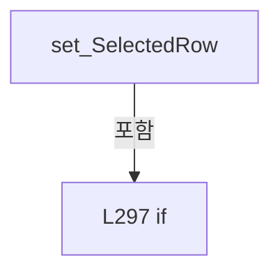

변경 전 점검: 입력/반환 타입, 위 호출자, 예외/취소 경로, 공유 상태와 저장·전송 소비자를 함께 확인합니다. 값의 단위나 물리 방향을 이름만으로 확정하지 않습니다.

### PropertyDeclaration `SearchCommand` · L304–304

[Drilling.UI/Menu/Menus/CMenuAlarm.cs:304–304](https://github.com/kjuws10-rgb/A3Drilling/blob/96e22cd027c84bf302b23f2949b98985d7f301bb/Drilling.UI/Menu/Menus/CMenuAlarm.cs#L304-L304)

| 항목 | 실제 추출 값 |
| --- | --- |
| 서명 | Drilling.UI.Menu.CButtonCommand Drilling.UI.Menu.Menus.CAlarmHistoryPanel.SearchCommand |
| 접근/수식자 | Public / public |
| 반환/값 타입 | Drilling.UI.Menu.CButtonCommand |
| 소속 타입 | NamedType:Drilling.UI.Menu.Menus.CAlarmHistoryPanel |

현재 부분 분석에서 직접 연결된 호출자는 없습니다. XAML/이벤트/인터페이스·델리게이트·외부 진입을 추가 확인해야 하며, 미사용으로 판정한 것이 아닙니다.

변경 전 점검: 입력/반환 타입, 위 호출자, 예외/취소 경로, 공유 상태와 저장·전송 소비자를 함께 확인합니다. 값의 단위나 물리 방향을 이름만으로 확정하지 않습니다.

### GetAccessorDeclaration `get_SearchCommand` · L304–304

[Drilling.UI/Menu/Menus/CMenuAlarm.cs:304–304](https://github.com/kjuws10-rgb/A3Drilling/blob/96e22cd027c84bf302b23f2949b98985d7f301bb/Drilling.UI/Menu/Menus/CMenuAlarm.cs#L304-L304)

| 항목 | 실제 추출 값 |
| --- | --- |
| 서명 | Drilling.UI.Menu.CButtonCommand Drilling.UI.Menu.Menus.CAlarmHistoryPanel.SearchCommand.get |
| 접근/수식자 | Public / get |
| 반환/값 타입 | Drilling.UI.Menu.CButtonCommand |
| 소속 타입 | NamedType:Drilling.UI.Menu.Menus.CAlarmHistoryPanel |

현재 부분 분석에서 직접 연결된 호출자는 없습니다. XAML/이벤트/인터페이스·델리게이트·외부 진입을 추가 확인해야 하며, 미사용으로 판정한 것이 아닙니다.

변경 전 점검: 입력/반환 타입, 위 호출자, 예외/취소 경로, 공유 상태와 저장·전송 소비자를 함께 확인합니다. 값의 단위나 물리 방향을 이름만으로 확정하지 않습니다.

### PropertyDeclaration `Last24HoursCommand` · L305–305

[Drilling.UI/Menu/Menus/CMenuAlarm.cs:305–305](https://github.com/kjuws10-rgb/A3Drilling/blob/96e22cd027c84bf302b23f2949b98985d7f301bb/Drilling.UI/Menu/Menus/CMenuAlarm.cs#L305-L305)

| 항목 | 실제 추출 값 |
| --- | --- |
| 서명 | Drilling.UI.Menu.CButtonCommand Drilling.UI.Menu.Menus.CAlarmHistoryPanel.Last24HoursCommand |
| 접근/수식자 | Public / public |
| 반환/값 타입 | Drilling.UI.Menu.CButtonCommand |
| 소속 타입 | NamedType:Drilling.UI.Menu.Menus.CAlarmHistoryPanel |

현재 부분 분석에서 직접 연결된 호출자는 없습니다. XAML/이벤트/인터페이스·델리게이트·외부 진입을 추가 확인해야 하며, 미사용으로 판정한 것이 아닙니다.

변경 전 점검: 입력/반환 타입, 위 호출자, 예외/취소 경로, 공유 상태와 저장·전송 소비자를 함께 확인합니다. 값의 단위나 물리 방향을 이름만으로 확정하지 않습니다.

### GetAccessorDeclaration `get_Last24HoursCommand` · L305–305

[Drilling.UI/Menu/Menus/CMenuAlarm.cs:305–305](https://github.com/kjuws10-rgb/A3Drilling/blob/96e22cd027c84bf302b23f2949b98985d7f301bb/Drilling.UI/Menu/Menus/CMenuAlarm.cs#L305-L305)

| 항목 | 실제 추출 값 |
| --- | --- |
| 서명 | Drilling.UI.Menu.CButtonCommand Drilling.UI.Menu.Menus.CAlarmHistoryPanel.Last24HoursCommand.get |
| 접근/수식자 | Public / get |
| 반환/값 타입 | Drilling.UI.Menu.CButtonCommand |
| 소속 타입 | NamedType:Drilling.UI.Menu.Menus.CAlarmHistoryPanel |

현재 부분 분석에서 직접 연결된 호출자는 없습니다. XAML/이벤트/인터페이스·델리게이트·외부 진입을 추가 확인해야 하며, 미사용으로 판정한 것이 아닙니다.

변경 전 점검: 입력/반환 타입, 위 호출자, 예외/취소 경로, 공유 상태와 저장·전송 소비자를 함께 확인합니다. 값의 단위나 물리 방향을 이름만으로 확정하지 않습니다.

### PropertyDeclaration `HourViewCommand` · L306–306

[Drilling.UI/Menu/Menus/CMenuAlarm.cs:306–306](https://github.com/kjuws10-rgb/A3Drilling/blob/96e22cd027c84bf302b23f2949b98985d7f301bb/Drilling.UI/Menu/Menus/CMenuAlarm.cs#L306-L306)

| 항목 | 실제 추출 값 |
| --- | --- |
| 서명 | Drilling.UI.Menu.CButtonCommand Drilling.UI.Menu.Menus.CAlarmHistoryPanel.HourViewCommand |
| 접근/수식자 | Public / public |
| 반환/값 타입 | Drilling.UI.Menu.CButtonCommand |
| 소속 타입 | NamedType:Drilling.UI.Menu.Menus.CAlarmHistoryPanel |

현재 부분 분석에서 직접 연결된 호출자는 없습니다. XAML/이벤트/인터페이스·델리게이트·외부 진입을 추가 확인해야 하며, 미사용으로 판정한 것이 아닙니다.

변경 전 점검: 입력/반환 타입, 위 호출자, 예외/취소 경로, 공유 상태와 저장·전송 소비자를 함께 확인합니다. 값의 단위나 물리 방향을 이름만으로 확정하지 않습니다.

### GetAccessorDeclaration `get_HourViewCommand` · L306–306

[Drilling.UI/Menu/Menus/CMenuAlarm.cs:306–306](https://github.com/kjuws10-rgb/A3Drilling/blob/96e22cd027c84bf302b23f2949b98985d7f301bb/Drilling.UI/Menu/Menus/CMenuAlarm.cs#L306-L306)

| 항목 | 실제 추출 값 |
| --- | --- |
| 서명 | Drilling.UI.Menu.CButtonCommand Drilling.UI.Menu.Menus.CAlarmHistoryPanel.HourViewCommand.get |
| 접근/수식자 | Public / get |
| 반환/값 타입 | Drilling.UI.Menu.CButtonCommand |
| 소속 타입 | NamedType:Drilling.UI.Menu.Menus.CAlarmHistoryPanel |

현재 부분 분석에서 직접 연결된 호출자는 없습니다. XAML/이벤트/인터페이스·델리게이트·외부 진입을 추가 확인해야 하며, 미사용으로 판정한 것이 아닙니다.

변경 전 점검: 입력/반환 타입, 위 호출자, 예외/취소 경로, 공유 상태와 저장·전송 소비자를 함께 확인합니다. 값의 단위나 물리 방향을 이름만으로 확정하지 않습니다.

### PropertyDeclaration `CodeViewCommand` · L307–307

[Drilling.UI/Menu/Menus/CMenuAlarm.cs:307–307](https://github.com/kjuws10-rgb/A3Drilling/blob/96e22cd027c84bf302b23f2949b98985d7f301bb/Drilling.UI/Menu/Menus/CMenuAlarm.cs#L307-L307)

| 항목 | 실제 추출 값 |
| --- | --- |
| 서명 | Drilling.UI.Menu.CButtonCommand Drilling.UI.Menu.Menus.CAlarmHistoryPanel.CodeViewCommand |
| 접근/수식자 | Public / public |
| 반환/값 타입 | Drilling.UI.Menu.CButtonCommand |
| 소속 타입 | NamedType:Drilling.UI.Menu.Menus.CAlarmHistoryPanel |

현재 부분 분석에서 직접 연결된 호출자는 없습니다. XAML/이벤트/인터페이스·델리게이트·외부 진입을 추가 확인해야 하며, 미사용으로 판정한 것이 아닙니다.

변경 전 점검: 입력/반환 타입, 위 호출자, 예외/취소 경로, 공유 상태와 저장·전송 소비자를 함께 확인합니다. 값의 단위나 물리 방향을 이름만으로 확정하지 않습니다.

### GetAccessorDeclaration `get_CodeViewCommand` · L307–307

[Drilling.UI/Menu/Menus/CMenuAlarm.cs:307–307](https://github.com/kjuws10-rgb/A3Drilling/blob/96e22cd027c84bf302b23f2949b98985d7f301bb/Drilling.UI/Menu/Menus/CMenuAlarm.cs#L307-L307)

| 항목 | 실제 추출 값 |
| --- | --- |
| 서명 | Drilling.UI.Menu.CButtonCommand Drilling.UI.Menu.Menus.CAlarmHistoryPanel.CodeViewCommand.get |
| 접근/수식자 | Public / get |
| 반환/값 타입 | Drilling.UI.Menu.CButtonCommand |
| 소속 타입 | NamedType:Drilling.UI.Menu.Menus.CAlarmHistoryPanel |

현재 부분 분석에서 직접 연결된 호출자는 없습니다. XAML/이벤트/인터페이스·델리게이트·외부 진입을 추가 확인해야 하며, 미사용으로 판정한 것이 아닙니다.

변경 전 점검: 입력/반환 타입, 위 호출자, 예외/취소 경로, 공유 상태와 저장·전송 소비자를 함께 확인합니다. 값의 단위나 물리 방향을 이름만으로 확정하지 않습니다.

### PropertyDeclaration `CauseAnalysisCommand` · L308–308

[Drilling.UI/Menu/Menus/CMenuAlarm.cs:308–308](https://github.com/kjuws10-rgb/A3Drilling/blob/96e22cd027c84bf302b23f2949b98985d7f301bb/Drilling.UI/Menu/Menus/CMenuAlarm.cs#L308-L308)

| 항목 | 실제 추출 값 |
| --- | --- |
| 서명 | Drilling.UI.Menu.CButtonCommand Drilling.UI.Menu.Menus.CAlarmHistoryPanel.CauseAnalysisCommand |
| 접근/수식자 | Public / public |
| 반환/값 타입 | Drilling.UI.Menu.CButtonCommand |
| 소속 타입 | NamedType:Drilling.UI.Menu.Menus.CAlarmHistoryPanel |

현재 부분 분석에서 직접 연결된 호출자는 없습니다. XAML/이벤트/인터페이스·델리게이트·외부 진입을 추가 확인해야 하며, 미사용으로 판정한 것이 아닙니다.

변경 전 점검: 입력/반환 타입, 위 호출자, 예외/취소 경로, 공유 상태와 저장·전송 소비자를 함께 확인합니다. 값의 단위나 물리 방향을 이름만으로 확정하지 않습니다.

### GetAccessorDeclaration `get_CauseAnalysisCommand` · L308–308

[Drilling.UI/Menu/Menus/CMenuAlarm.cs:308–308](https://github.com/kjuws10-rgb/A3Drilling/blob/96e22cd027c84bf302b23f2949b98985d7f301bb/Drilling.UI/Menu/Menus/CMenuAlarm.cs#L308-L308)

| 항목 | 실제 추출 값 |
| --- | --- |
| 서명 | Drilling.UI.Menu.CButtonCommand Drilling.UI.Menu.Menus.CAlarmHistoryPanel.CauseAnalysisCommand.get |
| 접근/수식자 | Public / get |
| 반환/값 타입 | Drilling.UI.Menu.CButtonCommand |
| 소속 타입 | NamedType:Drilling.UI.Menu.Menus.CAlarmHistoryPanel |

현재 부분 분석에서 직접 연결된 호출자는 없습니다. XAML/이벤트/인터페이스·델리게이트·외부 진입을 추가 확인해야 하며, 미사용으로 판정한 것이 아닙니다.

변경 전 점검: 입력/반환 타입, 위 호출자, 예외/취소 경로, 공유 상태와 저장·전송 소비자를 함께 확인합니다. 값의 단위나 물리 방향을 이름만으로 확정하지 않습니다.

### MethodDeclaration `ShowCauseAnalysis` · L310–318

[Drilling.UI/Menu/Menus/CMenuAlarm.cs:310–318](https://github.com/kjuws10-rgb/A3Drilling/blob/96e22cd027c84bf302b23f2949b98985d7f301bb/Drilling.UI/Menu/Menus/CMenuAlarm.cs#L310-L318)

| 항목 | 실제 추출 값 |
| --- | --- |
| 서명 | void Drilling.UI.Menu.Menus.CAlarmHistoryPanel.ShowCauseAnalysis() |
| 접근/수식자 | Private / private |
| 반환/값 타입 | void |
| 소속 타입 | NamedType:Drilling.UI.Menu.Menus.CAlarmHistoryPanel |

정적 호출자로 확인된 위치:

| 호출 파일/행 | 호출 표현식 | 런타임 분기 가능 |
| --- | --- | --- |
| [Drilling.UI/Menu/Menus/CMenuAlarm.cs:239–239](https://github.com/kjuws10-rgb/A3Drilling/blob/96e22cd027c84bf302b23f2949b98985d7f301bb/Drilling.UI/Menu/Menus/CMenuAlarm.cs#L239-L239) | ShowCauseAnalysis | False |

호출하는 대상과 해석 범위:

| 원본 행 | 표현식 | 분석 상태 | 대상/소스 위치 |
| --- | --- | --- | --- |
| 314 | new CAlarmCauseAnalysisDialog | resolved | Drilling.UI.Popup.CAlarmCauseAnalysisDialog.CAlarmCauseAnalysisDialog(string, Drilling.UI.Menu.Menus.ST_ALARM_HISTORY_ROW) · Drilling.UI/Popup/CAlarmCauseAnalysisDialog.xaml.cs:15 |
| 317 | dialog.ShowDialog | unresolved | None |

본문의 실제 연산·분기·예외·반환 순서(원문 위치 순):

| 원본 행 | 종류 | 주석 해설 |
| --- | --- | --- |
| 312 | if | 조건에 따라 분기합니다: if (SelectedRow is not { } row) |
| 313 | return | 호출자에게 값 또는 제어를 반환합니다: return; |
| 314 | call | 함수·델리게이트 또는 객체 생성자를 호출합니다: new CAlarmCauseAnalysisDialog(_logDirectory, row) |
| 314 | local-declaration | 지역 변수를 선언합니다: var dialog = new CAlarmCauseAnalysisDialog(_logDirectory, row); |
| 314 | variable-initializer | 변수의 초기값을 지정합니다: dialog = new CAlarmCauseAnalysisDialog(_logDirectory, row) |
| 315 | if | 조건에 따라 분기합니다: if (Application.Current?.MainWindow is { } owner) |
| 316 | assignment | 값을 대상에 대입합니다: dialog.Owner = owner |
| 317 | call | 함수·델리게이트 또는 객체 생성자를 호출합니다: dialog.ShowDialog() |

제어 구문의 포함 구조(실제 실행 순서/CFG가 아닌 구문 탐색 그림):

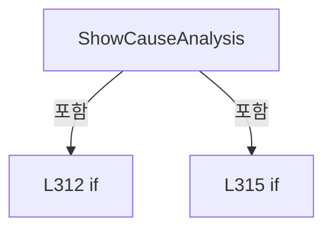

변경 전 점검: 입력/반환 타입, 위 호출자, 예외/취소 경로, 공유 상태와 저장·전송 소비자를 함께 확인합니다. 값의 단위나 물리 방향을 이름만으로 확정하지 않습니다.

### MethodDeclaration `InitializeOnFirstOpen` · L320–326

[Drilling.UI/Menu/Menus/CMenuAlarm.cs:320–326](https://github.com/kjuws10-rgb/A3Drilling/blob/96e22cd027c84bf302b23f2949b98985d7f301bb/Drilling.UI/Menu/Menus/CMenuAlarm.cs#L320-L326)

| 항목 | 실제 추출 값 |
| --- | --- |
| 서명 | void Drilling.UI.Menu.Menus.CAlarmHistoryPanel.InitializeOnFirstOpen() |
| 접근/수식자 | Public / public |
| 반환/값 타입 | void |
| 소속 타입 | NamedType:Drilling.UI.Menu.Menus.CAlarmHistoryPanel |

정적 호출자로 확인된 위치:

| 호출 파일/행 | 호출 표현식 | 런타임 분기 가능 |
| --- | --- | --- |
| [Drilling.UI/Menu/Menus/CMenuAlarm.cs:30–30](https://github.com/kjuws10-rgb/A3Drilling/blob/96e22cd027c84bf302b23f2949b98985d7f301bb/Drilling.UI/Menu/Menus/CMenuAlarm.cs#L30-L30) | HistoryPanel.InitializeOnFirstOpen | False |

호출하는 대상과 해석 범위:

| 원본 행 | 표현식 | 분석 상태 | 대상/소스 위치 |
| --- | --- | --- | --- |
| 325 | SetDefaultRange | resolved | void Drilling.UI.Menu.Menus.CAlarmHistoryPanel.SetDefaultRange() · Drilling.UI/Menu/Menus/CMenuAlarm.cs:328 |

본문의 실제 연산·분기·예외·반환 순서(원문 위치 순):

| 원본 행 | 종류 | 주석 해설 |
| --- | --- | --- |
| 322 | if | 조건에 따라 분기합니다: if (_hasOpened) |
| 323 | return | 호출자에게 값 또는 제어를 반환합니다: return; |
| 324 | assignment | 값을 대상에 대입합니다: _hasOpened = true |
| 325 | call | 함수·델리게이트 또는 객체 생성자를 호출합니다: SetDefaultRange() |

제어 구문의 포함 구조(실제 실행 순서/CFG가 아닌 구문 탐색 그림):

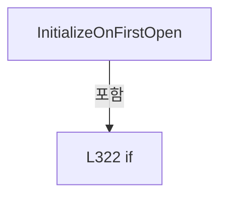

변경 전 점검: 입력/반환 타입, 위 호출자, 예외/취소 경로, 공유 상태와 저장·전송 소비자를 함께 확인합니다. 값의 단위나 물리 방향을 이름만으로 확정하지 않습니다.

### MethodDeclaration `SetDefaultRange` · L328–334

[Drilling.UI/Menu/Menus/CMenuAlarm.cs:328–334](https://github.com/kjuws10-rgb/A3Drilling/blob/96e22cd027c84bf302b23f2949b98985d7f301bb/Drilling.UI/Menu/Menus/CMenuAlarm.cs#L328-L334)

| 항목 | 실제 추출 값 |
| --- | --- |
| 서명 | void Drilling.UI.Menu.Menus.CAlarmHistoryPanel.SetDefaultRange() |
| 접근/수식자 | Private / private |
| 반환/값 타입 | void |
| 소속 타입 | NamedType:Drilling.UI.Menu.Menus.CAlarmHistoryPanel |

정적 호출자로 확인된 위치:

| 호출 파일/행 | 호출 표현식 | 런타임 분기 가능 |
| --- | --- | --- |
| [Drilling.UI/Menu/Menus/CMenuAlarm.cs:234–234](https://github.com/kjuws10-rgb/A3Drilling/blob/96e22cd027c84bf302b23f2949b98985d7f301bb/Drilling.UI/Menu/Menus/CMenuAlarm.cs#L234-L234) | SetDefaultRange | False |
| [Drilling.UI/Menu/Menus/CMenuAlarm.cs:325–325](https://github.com/kjuws10-rgb/A3Drilling/blob/96e22cd027c84bf302b23f2949b98985d7f301bb/Drilling.UI/Menu/Menus/CMenuAlarm.cs#L325-L325) | SetDefaultRange | False |

호출하는 대상과 해석 범위:

| 원본 행 | 표현식 | 분석 상태 | 대상/소스 위치 |
| --- | --- | --- | --- |
| 330 | _now | resolved · 동적 구현 선택 가능 | System.DateTime System.Func<System.DateTime>.Invoke() |
| 333 | now.ToString | resolved | string System.DateTime.ToString(string?, System.IFormatProvider?) |

본문의 실제 연산·분기·예외·반환 순서(원문 위치 순):

| 원본 행 | 종류 | 주석 해설 |
| --- | --- | --- |
| 330 | call | 함수·델리게이트 또는 객체 생성자를 호출합니다: _now() |
| 330 | local-declaration | 지역 변수를 선언합니다: var now = _now(); |
| 330 | variable-initializer | 변수의 초기값을 지정합니다: now = _now() |
| 331 | assignment | 값을 대상에 대입합니다: From = Through = now.Date |
| 331 | assignment | 값을 대상에 대입합니다: Through = now.Date |
| 332 | assignment | 값을 대상에 대입합니다: FromTime = "00:00:00" |
| 333 | assignment | 값을 대상에 대입합니다: ThroughTime = now.ToString("HH:mm:ss", CultureInfo.InvariantCulture) |
| 333 | call | 함수·델리게이트 또는 객체 생성자를 호출합니다: now.ToString("HH:mm:ss", CultureInfo.InvariantCulture) |

변경 전 점검: 입력/반환 타입, 위 호출자, 예외/취소 경로, 공유 상태와 저장·전송 소비자를 함께 확인합니다. 값의 단위나 물리 방향을 이름만으로 확정하지 않습니다.

### MethodDeclaration `SelectTrendView` · L336–352

[Drilling.UI/Menu/Menus/CMenuAlarm.cs:336–352](https://github.com/kjuws10-rgb/A3Drilling/blob/96e22cd027c84bf302b23f2949b98985d7f301bb/Drilling.UI/Menu/Menus/CMenuAlarm.cs#L336-L352)

| 항목 | 실제 추출 값 |
| --- | --- |
| 서명 | void Drilling.UI.Menu.Menus.CAlarmHistoryPanel.SelectTrendView(bool) |
| 접근/수식자 | Private / private |
| 반환/값 타입 | void |
| 소속 타입 | NamedType:Drilling.UI.Menu.Menus.CAlarmHistoryPanel |

입력 계약:

| 이름 | 타입 | 전달 | 선택/기본값 |
| --- | --- | --- | --- |
| codeView | bool | None | False /  |

정적 호출자로 확인된 위치:

| 호출 파일/행 | 호출 표현식 | 런타임 분기 가능 |
| --- | --- | --- |
| [Drilling.UI/Menu/Menus/CMenuAlarm.cs:237–237](https://github.com/kjuws10-rgb/A3Drilling/blob/96e22cd027c84bf302b23f2949b98985d7f301bb/Drilling.UI/Menu/Menus/CMenuAlarm.cs#L237-L237) | SelectTrendView | False |
| [Drilling.UI/Menu/Menus/CMenuAlarm.cs:238–238](https://github.com/kjuws10-rgb/A3Drilling/blob/96e22cd027c84bf302b23f2949b98985d7f301bb/Drilling.UI/Menu/Menus/CMenuAlarm.cs#L238-L238) | SelectTrendView | False |

호출하는 대상과 해석 범위:

| 원본 행 | 표현식 | 분석 상태 | 대상/소스 위치 |
| --- | --- | --- | --- |
| 341 | RefreshTrend | resolved | void Drilling.UI.Menu.Menus.CAlarmHistoryPanel.RefreshTrend() · Drilling.UI/Menu/Menus/CMenuAlarm.cs:354 |
| 344 | nameof | unresolved | None |
| 345 | nameof | unresolved | None |
| 346 | nameof | unresolved | None |
| 347 | nameof | unresolved | None |
| 351 | Notify | resolved | void Drilling.UI.Menu.Menus.CAlarmHistoryPanel.Notify(string?) · Drilling.UI/Menu/Menus/CMenuAlarm.cs:513 |

본문의 실제 연산·분기·예외·반환 순서(원문 위치 순):

| 원본 행 | 종류 | 주석 해설 |
| --- | --- | --- |
| 338 | if | 조건에 따라 분기합니다: if (_isCodeView == codeView &#124;&#124; IsBusy) |
| 339 | return | 호출자에게 값 또는 제어를 반환합니다: return; |
| 340 | assignment | 값을 대상에 대입합니다: _isCodeView = codeView |
| 341 | call | 함수·델리게이트 또는 객체 생성자를 호출합니다: RefreshTrend() |
| 342 | foreach | 컬렉션 요소를 순회합니다: foreach (var name in new[] { nameof(IsCodeView), nameof(IsHourView), nameof(Bars), nameof(TrendCaption) }) |
| 344 | call | 함수·델리게이트 또는 객체 생성자를 호출합니다: nameof(IsCodeView) |
| 345 | call | 함수·델리게이트 또는 객체 생성자를 호출합니다: nameof(IsHourView) |
| 346 | call | 함수·델리게이트 또는 객체 생성자를 호출합니다: nameof(Bars) |
| 347 | call | 함수·델리게이트 또는 객체 생성자를 호출합니다: nameof(TrendCaption) |
| 351 | call | 함수·델리게이트 또는 객체 생성자를 호출합니다: Notify(name) |

제어 구문의 포함 구조(실제 실행 순서/CFG가 아닌 구문 탐색 그림):

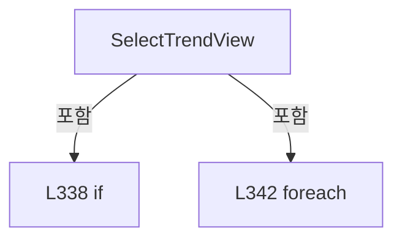

변경 전 점검: 입력/반환 타입, 위 호출자, 예외/취소 경로, 공유 상태와 저장·전송 소비자를 함께 확인합니다. 값의 단위나 물리 방향을 이름만으로 확정하지 않습니다.

### MethodDeclaration `RefreshTrend` · L354–366

[Drilling.UI/Menu/Menus/CMenuAlarm.cs:354–366](https://github.com/kjuws10-rgb/A3Drilling/blob/96e22cd027c84bf302b23f2949b98985d7f301bb/Drilling.UI/Menu/Menus/CMenuAlarm.cs#L354-L366)

| 항목 | 실제 추출 값 |
| --- | --- |
| 서명 | void Drilling.UI.Menu.Menus.CAlarmHistoryPanel.RefreshTrend() |
| 접근/수식자 | Private / private |
| 반환/값 타입 | void |
| 소속 타입 | NamedType:Drilling.UI.Menu.Menus.CAlarmHistoryPanel |

정적 호출자로 확인된 위치:

| 호출 파일/행 | 호출 표현식 | 런타임 분기 가능 |
| --- | --- | --- |
| [Drilling.UI/Menu/Menus/CMenuAlarm.cs:341–341](https://github.com/kjuws10-rgb/A3Drilling/blob/96e22cd027c84bf302b23f2949b98985d7f301bb/Drilling.UI/Menu/Menus/CMenuAlarm.cs#L341-L341) | RefreshTrend | False |
| [Drilling.UI/Menu/Menus/CMenuAlarm.cs:426–426](https://github.com/kjuws10-rgb/A3Drilling/blob/96e22cd027c84bf302b23f2949b98985d7f301bb/Drilling.UI/Menu/Menus/CMenuAlarm.cs#L426-L426) | RefreshTrend | False |

호출하는 대상과 해석 범위:

| 원본 행 | 표현식 | 분석 상태 | 대상/소스 위치 |
| --- | --- | --- | --- |
| 363 | BuildCodeBars | resolved | System.Collections.Generic.IReadOnlyList<Drilling.UI.Menu.Menus.ST_ALARM_TREND_COLUMN> Drilling.UI.Menu.Menus.CAlarmHistoryPanel.BuildCodeBars(System.Collections.Generic.IReadOnlyList<Drilling.Common.Alarm.ST_ALARM_HISTORY_ENTRY>) · Drilling.UI/Menu/Menus/CMenuAlarm.cs:471 |
| 363 | BuildHourBars | resolved | System.Collections.Generic.IReadOnlyList<Drilling.UI.Menu.Menus.ST_ALARM_TREND_COLUMN> Drilling.UI.Menu.Menus.CAlarmHistoryPanel.BuildHourBars(System.Collections.Generic.IReadOnlyList<Drilling.Common.Alarm.ST_ALARM_HISTORY_ENTRY>, System.DateTime, System.DateTime) · Drilling.UI/Menu/Menus/CMenuAlarm.cs:487 |

본문의 실제 연산·분기·예외·반환 순서(원문 위치 순):

| 원본 행 | 종류 | 주석 해설 |
| --- | --- | --- |
| 356 | if | 조건에 따라 분기합니다: if (_searchedFrom is not { } from &#124;&#124; _searchedThrough is not { } through) |
| 358 | assignment | 값을 대상에 대입합니다: Bars = [] |
| 359 | assignment | 값을 대상에 대입합니다: TrendCaption = IsCodeView ? "코드별 발생 횟수 · 많은 순서" : "시간별 발생 횟수 · 1시간 기준" |
| 359 | conditional-expression | 조건에 따라 결과식을 선택합니다: IsCodeView ? "코드별 발생 횟수 · 많은 순서" : "시간별 발생 횟수 · 1시간 기준" |
| 360 | return | 호출자에게 값 또는 제어를 반환합니다: return; |
| 363 | assignment | 값을 대상에 대입합니다: Bars = IsCodeView ? BuildCodeBars(_loadedRows) : BuildHourBars(_loadedRows, from, through) |
| 363 | call | 함수·델리게이트 또는 객체 생성자를 호출합니다: BuildCodeBars(_loadedRows) |
| 363 | call | 함수·델리게이트 또는 객체 생성자를 호출합니다: BuildHourBars(_loadedRows, from, through) |
| 363 | conditional-expression | 조건에 따라 결과식을 선택합니다: IsCodeView ? BuildCodeBars(_loadedRows) : BuildHourBars(_loadedRows, from, through) |
| 364 | conditional-expression | 조건에 따라 결과식을 선택합니다: IsCodeView ? $"{Bars.Count:N0}개 코드 · 발생 횟수 내림차순" : "시간별 · 1시간 기준" |
| 364 | local-declaration | 지역 변수를 선언합니다: var summary = IsCodeView ? $"{Bars.Count:N0}개 코드 · 발생 횟수 내림차순" : "시간별 · 1시간 기준"; |
| 364 | variable-initializer | 변수의 초기값을 지정합니다: summary = IsCodeView ? $"{Bars.Count:N0}개 코드 · 발생 횟수 내림차순" : "시간별 · 1시간 기준" |
| 365 | assignment | 값을 대상에 대입합니다: TrendCaption = $"{from:yyyy-MM-dd HH:mm:ss.fff} ~ {through:yyyy-MM-dd HH:mm:ss.fff}\n{summary} · 총 {_loadedRows.Count:N0}건" |

제어 구문의 포함 구조(실제 실행 순서/CFG가 아닌 구문 탐색 그림):

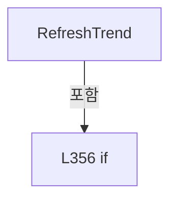

변경 전 점검: 입력/반환 타입, 위 호출자, 예외/취소 경로, 공유 상태와 저장·전송 소비자를 함께 확인합니다. 값의 단위나 물리 방향을 이름만으로 확정하지 않습니다.

### MethodDeclaration `SearchLast24HoursAsync` · L368–381

[Drilling.UI/Menu/Menus/CMenuAlarm.cs:368–381](https://github.com/kjuws10-rgb/A3Drilling/blob/96e22cd027c84bf302b23f2949b98985d7f301bb/Drilling.UI/Menu/Menus/CMenuAlarm.cs#L368-L381)

| 항목 | 실제 추출 값 |
| --- | --- |
| 서명 | System.Threading.Tasks.Task Drilling.UI.Menu.Menus.CAlarmHistoryPanel.SearchLast24HoursAsync() |
| 접근/수식자 | Public / public, async |
| 반환/값 타입 | System.Threading.Tasks.Task |
| 소속 타입 | NamedType:Drilling.UI.Menu.Menus.CAlarmHistoryPanel |

정적 호출자로 확인된 위치:

| 호출 파일/행 | 호출 표현식 | 런타임 분기 가능 |
| --- | --- | --- |
| [Drilling.UI/Menu/Menus/CMenuAlarm.cs:236–236](https://github.com/kjuws10-rgb/A3Drilling/blob/96e22cd027c84bf302b23f2949b98985d7f301bb/Drilling.UI/Menu/Menus/CMenuAlarm.cs#L236-L236) | SearchLast24HoursAsync | False |

호출하는 대상과 해석 범위:

| 원본 행 | 표현식 | 분석 상태 | 대상/소스 위치 |
| --- | --- | --- | --- |
| 372 | _now | resolved · 동적 구현 선택 가능 | System.DateTime System.Func<System.DateTime>.Invoke() |
| 374 | new DateTime | resolved | System.DateTime.DateTime(long, System.DateTimeKind) |
| 375 | through.AddHours | resolved | System.DateTime System.DateTime.AddHours(double) |
| 378 | from.ToString | resolved | string System.DateTime.ToString(string?, System.IFormatProvider?) |
| 379 | through.ToString | resolved | string System.DateTime.ToString(string?, System.IFormatProvider?) |
| 380 | SearchAsync | resolved | System.Threading.Tasks.Task Drilling.UI.Menu.Menus.CAlarmHistoryPanel.SearchAsync() · Drilling.UI/Menu/Menus/CMenuAlarm.cs:383 |

본문의 실제 연산·분기·예외·반환 순서(원문 위치 순):

| 원본 행 | 종류 | 주석 해설 |
| --- | --- | --- |
| 370 | if | 조건에 따라 분기합니다: if (IsBusy) |
| 371 | return | 호출자에게 값 또는 제어를 반환합니다: return; |
| 372 | call | 함수·델리게이트 또는 객체 생성자를 호출합니다: _now() |
| 372 | local-declaration | 지역 변수를 선언합니다: var now = _now(); |
| 372 | variable-initializer | 변수의 초기값을 지정합니다: now = _now() |
| 374 | call | 함수·델리게이트 또는 객체 생성자를 호출합니다: new DateTime(now.Ticks - now.Ticks % TimeSpan.TicksPerMillisecond, now.Kind) |
| 374 | local-declaration | 지역 변수를 선언합니다: var through = new DateTime(now.Ticks - now.Ticks % TimeSpan.TicksPerMillisecond, now.Kind); |
| 374 | variable-initializer | 변수의 초기값을 지정합니다: through = new DateTime(now.Ticks - now.Ticks % TimeSpan.TicksPerMillisecond, now.Kind) |
| 375 | call | 함수·델리게이트 또는 객체 생성자를 호출합니다: through.AddHours(-24) |
| 375 | local-declaration | 지역 변수를 선언합니다: var from = through.AddHours(-24); |
| 375 | variable-initializer | 변수의 초기값을 지정합니다: from = through.AddHours(-24) |
| 376 | assignment | 값을 대상에 대입합니다: From = from.Date |
| 377 | assignment | 값을 대상에 대입합니다: Through = through.Date |
| 378 | assignment | 값을 대상에 대입합니다: FromTime = from.ToString("HH:mm:ss.fff", CultureInfo.InvariantCulture) |
| 378 | call | 함수·델리게이트 또는 객체 생성자를 호출합니다: from.ToString("HH:mm:ss.fff", CultureInfo.InvariantCulture) |
| 379 | assignment | 값을 대상에 대입합니다: ThroughTime = through.ToString("HH:mm:ss.fff", CultureInfo.InvariantCulture) |
| 379 | call | 함수·델리게이트 또는 객체 생성자를 호출합니다: through.ToString("HH:mm:ss.fff", CultureInfo.InvariantCulture) |
| 380 | await | 비동기 완료를 기다립니다: await SearchAsync() |
| 380 | call | 함수·델리게이트 또는 객체 생성자를 호출합니다: SearchAsync() |

제어 구문의 포함 구조(실제 실행 순서/CFG가 아닌 구문 탐색 그림):

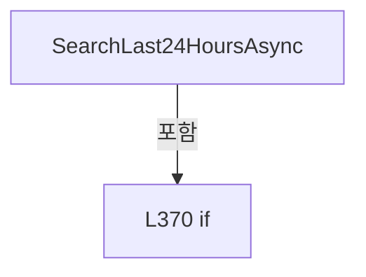

변경 전 점검: 입력/반환 타입, 위 호출자, 예외/취소 경로, 공유 상태와 저장·전송 소비자를 함께 확인합니다. 값의 단위나 물리 방향을 이름만으로 확정하지 않습니다.

### MethodDeclaration `SearchAsync` · L383–461

[Drilling.UI/Menu/Menus/CMenuAlarm.cs:383–461](https://github.com/kjuws10-rgb/A3Drilling/blob/96e22cd027c84bf302b23f2949b98985d7f301bb/Drilling.UI/Menu/Menus/CMenuAlarm.cs#L383-L461)

| 항목 | 실제 추출 값 |
| --- | --- |
| 서명 | System.Threading.Tasks.Task Drilling.UI.Menu.Menus.CAlarmHistoryPanel.SearchAsync() |
| 접근/수식자 | Public / public, async |
| 반환/값 타입 | System.Threading.Tasks.Task |
| 소속 타입 | NamedType:Drilling.UI.Menu.Menus.CAlarmHistoryPanel |

정적 호출자로 확인된 위치:

| 호출 파일/행 | 호출 표현식 | 런타임 분기 가능 |
| --- | --- | --- |
| [Drilling.UI/Menu/Menus/CMenuAlarm.cs:235–235](https://github.com/kjuws10-rgb/A3Drilling/blob/96e22cd027c84bf302b23f2949b98985d7f301bb/Drilling.UI/Menu/Menus/CMenuAlarm.cs#L235-L235) | SearchAsync | False |
| [Drilling.UI/Menu/Menus/CMenuAlarm.cs:380–380](https://github.com/kjuws10-rgb/A3Drilling/blob/96e22cd027c84bf302b23f2949b98985d7f301bb/Drilling.UI/Menu/Menus/CMenuAlarm.cs#L380-L380) | SearchAsync | False |

호출하는 대상과 해석 범위:

| 원본 행 | 표현식 | 분석 상태 | 대상/소스 위치 |
| --- | --- | --- | --- |
| 387 | TryReadTime | resolved | bool Drilling.UI.Menu.Menus.CAlarmHistoryPanel.TryReadTime(string, out System.TimeSpan) · Drilling.UI/Menu/Menus/CMenuAlarm.cs:463 |
| 387 | TryReadTime | resolved | bool Drilling.UI.Menu.Menus.CAlarmHistoryPanel.TryReadTime(string, out System.TimeSpan) · Drilling.UI/Menu/Menus/CMenuAlarm.cs:463 |
| 390 | Notify | resolved | void Drilling.UI.Menu.Menus.CAlarmHistoryPanel.Notify(string?) · Drilling.UI/Menu/Menus/CMenuAlarm.cs:513 |
| 390 | nameof | unresolved | None |
| 394 | from.Date.Add | resolved | System.DateTime System.DateTime.Add(System.TimeSpan) |
| 395 | through.Date.Add | resolved | System.DateTime System.DateTime.Add(System.TimeSpan) |
| 399 | Notify | resolved | void Drilling.UI.Menu.Menus.CAlarmHistoryPanel.Notify(string?) · Drilling.UI/Menu/Menus/CMenuAlarm.cs:513 |
| 399 | nameof | unresolved | None |
| 405 | Notify | resolved | void Drilling.UI.Menu.Menus.CAlarmHistoryPanel.Notify(string?) · Drilling.UI/Menu/Menus/CMenuAlarm.cs:513 |
| 405 | nameof | unresolved | None |
| 406 | Notify | resolved | void Drilling.UI.Menu.Menus.CAlarmHistoryPanel.Notify(string?) · Drilling.UI/Menu/Menus/CMenuAlarm.cs:513 |
| 406 | nameof | unresolved | None |
| 407 | Notify | resolved | void Drilling.UI.Menu.Menus.CAlarmHistoryPanel.Notify(string?) · Drilling.UI/Menu/Menus/CMenuAlarm.cs:513 |
| 407 | nameof | unresolved | None |
| 408 | SearchCommand.NotifyCanExecuteChanged | resolved | void Drilling.UI.Menu.CButtonCommand.NotifyCanExecuteChanged() · Drilling.UI/Menu/CButtonCommand.cs:24 |
| 409 | Last24HoursCommand.NotifyCanExecuteChanged | resolved | void Drilling.UI.Menu.CButtonCommand.NotifyCanExecuteChanged() · Drilling.UI/Menu/CButtonCommand.cs:24 |
| 412 | Task.Run | resolved | System.Threading.Tasks.Task<Drilling.Common.Alarm.ST_ALARM_HISTORY_RESULT> System.Threading.Tasks.Task.Run<Drilling.Common.Alarm.ST_ALARM_HISTORY_RESULT>(System.Func<Drilling.Common.Alarm.ST_ALARM_HISTORY_RESULT>) |
| 415 | _read | resolved · 동적 구현 선택 가능 | Drilling.Common.Alarm.ST_ALARM_HISTORY_RESULT System.Func<System.DateTime, System.DateTime, System.Threading.CancellationToken, Drilling.Common.Alarm.ST_ALARM_HISTORY_RESULT>.Invoke(System.DateTime, System.DateTime, System.Threading.CancellationToken) |
| 418 | loaded.Rows.Where(row => row.OccurredAt.LocalDateTime >= from && row.OccurredAt.LocalDateTime <= through).OrderByDescending(row => row.OccurredAt).ThenBy(row => row.Code).ToArray | resolved | Drilling.Common.Alarm.ST_ALARM_HISTORY_ENTRY[] System.Collections.Generic.IEnumerable<Drilling.Common.Alarm.ST_ALARM_HISTORY_ENTRY>.ToArray<Drilling.Common.Alarm.ST_ALARM_HISTORY_ENTRY>() |
| 418 | loaded.Rows.Where(row => row.OccurredAt.LocalDateTime >= from && row.OccurredAt.LocalDateTime <= through).OrderByDescending(row => row.OccurredAt).ThenBy | resolved | System.Linq.IOrderedEnumerable<Drilling.Common.Alarm.ST_ALARM_HISTORY_ENTRY> System.Linq.IOrderedEnumerable<Drilling.Common.Alarm.ST_ALARM_HISTORY_ENTRY>.ThenBy<Drilling.Common.Alarm.ST_ALARM_HISTORY_ENTRY, int>(System.Func<Drilling.Common.Alarm.ST_ALARM_HISTORY_ENTRY, int>) |
| 418 | loaded.Rows.Where(row => row.OccurredAt.LocalDateTime >= from && row.OccurredAt.LocalDateTime <= through).OrderByDescending | resolved | System.Linq.IOrderedEnumerable<Drilling.Common.Alarm.ST_ALARM_HISTORY_ENTRY> System.Collections.Generic.IEnumerable<Drilling.Common.Alarm.ST_ALARM_HISTORY_ENTRY>.OrderByDescending<Drilling.Common.Alarm.ST_ALARM_HISTORY_ENTRY, System.DateTimeOffset>(System.Func<Drilling.Common.Alarm.ST_ALARM_HISTORY_ENTRY, System.DateTimeOffset>) |
| 418 | loaded.Rows.Where | resolved | System.Collections.Generic.IEnumerable<Drilling.Common.Alarm.ST_ALARM_HISTORY_ENTRY> System.Collections.Generic.IEnumerable<Drilling.Common.Alarm.ST_ALARM_HISTORY_ENTRY>.Where<Drilling.Common.Alarm.ST_ALARM_HISTORY_ENTRY>(System.Func<Drilling.Common.Alarm.ST_ALARM_HISTORY_ENTRY, bool>) |
| 421 | result.Rows.Select((row, index) => new ST_ALARM_HISTORY_ROW(index + 1, row.OccurredAt.LocalDateTime.ToString("yyyy-MM-dd HH:mm:ss.fff"), row.Code.ToString(), row.Level, row.Group, row.Cause, row.Solution, row.OccurredAt)).ToArray | resolved | Drilling.UI.Menu.Menus.ST_ALARM_HISTORY_ROW[] System.Collections.Generic.IEnumerable<Drilling.UI.Menu.Menus.ST_ALARM_HISTORY_ROW>.ToArray<Drilling.UI.Menu.Menus.ST_ALARM_HISTORY_ROW>() |
| 421 | result.Rows.Select | resolved | System.Collections.Generic.IEnumerable<Drilling.UI.Menu.Menus.ST_ALARM_HISTORY_ROW> System.Collections.Generic.IEnumerable<Drilling.Common.Alarm.ST_ALARM_HISTORY_ENTRY>.Select<Drilling.Common.Alarm.ST_ALARM_HISTORY_ENTRY, Drilling.UI.Menu.Menus.ST_ALARM_HISTORY_ROW>(System.Func<Drilling.Common.Alarm.ST_ALARM_HISTORY_ENTRY, int, Drilling.UI.Menu.Menus.ST_ALARM_HISTORY_ROW>) |
| 421 | new ST_ALARM_HISTORY_ROW | resolved | Drilling.UI.Menu.Menus.ST_ALARM_HISTORY_ROW.ST_ALARM_HISTORY_ROW(int, string, string, string, string, string, string, System.DateTimeOffset) · Drilling.UI/Menu/Menus/CMenuAlarm.cs:583 |
| 421 | row.OccurredAt.LocalDateTime.ToString | resolved | string System.DateTime.ToString(string?) |
| 421 | row.Code.ToString | resolved · 동적 구현 선택 가능 | string int.ToString() |
| 426 | RefreshTrend | resolved | void Drilling.UI.Menu.Menus.CAlarmHistoryPanel.RefreshTrend() · Drilling.UI/Menu/Menus/CMenuAlarm.cs:354 |
| 446 | nameof | unresolved | None |
| 447 | nameof | unresolved | None |
| 448 | nameof | unresolved | None |
| 449 | nameof | unresolved | None |
| 450 | nameof | unresolved | None |
| 451 | nameof | unresolved | None |
| 452 | nameof | unresolved | None |
| 456 | Notify | resolved | void Drilling.UI.Menu.Menus.CAlarmHistoryPanel.Notify(string?) · Drilling.UI/Menu/Menus/CMenuAlarm.cs:513 |
| 457 | SearchCommand.NotifyCanExecuteChanged | resolved | void Drilling.UI.Menu.CButtonCommand.NotifyCanExecuteChanged() · Drilling.UI/Menu/CButtonCommand.cs:24 |
| 458 | Last24HoursCommand.NotifyCanExecuteChanged | resolved | void Drilling.UI.Menu.CButtonCommand.NotifyCanExecuteChanged() · Drilling.UI/Menu/CButtonCommand.cs:24 |
| 459 | CauseAnalysisCommand.NotifyCanExecuteChanged | resolved | void Drilling.UI.Menu.CButtonCommand.NotifyCanExecuteChanged() · Drilling.UI/Menu/CButtonCommand.cs:24 |

본문의 실제 연산·분기·예외·반환 순서(원문 위치 순):

| 원본 행 | 종류 | 주석 해설 |
| --- | --- | --- |
| 385 | if | 조건에 따라 분기합니다: if (IsBusy) |
| 386 | return | 호출자에게 값 또는 제어를 반환합니다: return; |
| 387 | call | 함수·델리게이트 또는 객체 생성자를 호출합니다: TryReadTime(FromTime, out var fromTime) |
| 387 | call | 함수·델리게이트 또는 객체 생성자를 호출합니다: TryReadTime(ThroughTime, out var throughTime) |
| 387 | if | 조건에 따라 분기합니다: if (From is not { } from &#124;&#124; Through is not { } through &#124;&#124; !TryReadTime(FromTime, out var fromTime) &#124;&#124; !TryReadTime(ThroughTime, out var throughTime)) |
| 389 | assignment | 값을 대상에 대입합니다: Status = "날짜와 시간을 올바르게 입력해 주세요. 시간 형식: HH:mm 또는 HH:mm:ss (24시간제)." |
| 390 | call | 함수·델리게이트 또는 객체 생성자를 호출합니다: Notify(nameof(Status)) |
| 390 | call | 함수·델리게이트 또는 객체 생성자를 호출합니다: nameof(Status) |
| 391 | return | 호출자에게 값 또는 제어를 반환합니다: return; |
| 394 | assignment | 값을 대상에 대입합니다: from = from.Date.Add(fromTime) |
| 394 | call | 함수·델리게이트 또는 객체 생성자를 호출합니다: from.Date.Add(fromTime) |
| 395 | assignment | 값을 대상에 대입합니다: through = through.Date.Add(throughTime) |
| 395 | call | 함수·델리게이트 또는 객체 생성자를 호출합니다: through.Date.Add(throughTime) |
| 396 | if | 조건에 따라 분기합니다: if (from > through) |
| 398 | assignment | 값을 대상에 대입합니다: Status = "시작 일시는 종료 일시보다 늦을 수 없습니다." |
| 399 | call | 함수·델리게이트 또는 객체 생성자를 호출합니다: Notify(nameof(Status)) |
| 399 | call | 함수·델리게이트 또는 객체 생성자를 호출합니다: nameof(Status) |
| 400 | return | 호출자에게 값 또는 제어를 반환합니다: return; |
| 403 | assignment | 값을 대상에 대입합니다: IsBusy = true |
| 404 | assignment | 값을 대상에 대입합니다: Status = "알람 이력을 조회하고 있습니다." |
| 405 | call | 함수·델리게이트 또는 객체 생성자를 호출합니다: Notify(nameof(IsBusy)) |
| 405 | call | 함수·델리게이트 또는 객체 생성자를 호출합니다: nameof(IsBusy) |
| 406 | call | 함수·델리게이트 또는 객체 생성자를 호출합니다: Notify(nameof(CanEdit)) |
| 406 | call | 함수·델리게이트 또는 객체 생성자를 호출합니다: nameof(CanEdit) |
| 407 | call | 함수·델리게이트 또는 객체 생성자를 호출합니다: Notify(nameof(Status)) |
| 407 | call | 함수·델리게이트 또는 객체 생성자를 호출합니다: nameof(Status) |
| 408 | call | 함수·델리게이트 또는 객체 생성자를 호출합니다: SearchCommand.NotifyCanExecuteChanged() |
| 409 | call | 함수·델리게이트 또는 객체 생성자를 호출합니다: Last24HoursCommand.NotifyCanExecuteChanged() |
| 410 | try | 예외 처리 범위입니다: try |
| 412 | await | 비동기 완료를 기다립니다: await Task.Run(() => { // The store opens only the relevant daily files. Apply exact times before both grid and chart. var loaded = _read(from.Date, through.Date, CancellationToken.None); return loaded with { Rows = loaded.Rows.Wh |
| 412 | call | 함수·델리게이트 또는 객체 생성자를 호출합니다: Task.Run(() => { // The store opens only the relevant daily files. Apply exact times before both grid and chart. var loaded = _read(from.Date, through.Date, CancellationToken.None); return loaded with { Rows = loaded.Row… |
| 412 | local-declaration | 지역 변수를 선언합니다: var result = await Task.Run(() => { // The store opens only the relevant daily files. Apply exact times before both grid and chart. var loaded = _read(from.Date, through.Date, CancellationToken.None); return loaded with { Rows = l |
| 412 | variable-initializer | 변수의 초기값을 지정합니다: result = await Task.Run(() => { // The store opens only the relevant daily files. Apply exact times before both grid and chart. var loaded = _read(from.Date, through.Date, CancellationToken.None); return loaded with { Rows = loade |
| 415 | call | 함수·델리게이트 또는 객체 생성자를 호출합니다: _read(from.Date, through.Date, CancellationToken.None) |
| 415 | local-declaration | 지역 변수를 선언합니다: var loaded = _read(from.Date, through.Date, CancellationToken.None); |
| 415 | variable-initializer | 변수의 초기값을 지정합니다: loaded = _read(from.Date, through.Date, CancellationToken.None) |
| 416 | return | 호출자에게 값 또는 제어를 반환합니다: return loaded with { Rows = loaded.Rows.Where(row => row.OccurredAt.LocalDateTime >= from && row.OccurredAt.LocalDateTime <= through).OrderByDescending(row => row.OccurredAt).ThenBy(row => row.Code).ToArray() }; |
| 418 | assignment | 값을 대상에 대입합니다: Rows = loaded.Rows.Where(row => row.OccurredAt.LocalDateTime >= from && row.OccurredAt.LocalDateTime <= through).OrderByDescending(row => row.OccurredAt).ThenBy(row => row.Code).ToArray() |
| 418 | call | 함수·델리게이트 또는 객체 생성자를 호출합니다: loaded.Rows.Where(row => row.OccurredAt.LocalDateTime >= from && row.OccurredAt.LocalDateTime <= through).OrderByDescending(row => row.OccurredAt).ThenBy(row => row.Code).ToArray() |
| 418 | call | 함수·델리게이트 또는 객체 생성자를 호출합니다: loaded.Rows.Where(row => row.OccurredAt.LocalDateTime >= from && row.OccurredAt.LocalDateTime <= through).OrderByDescending(row => row.OccurredAt).ThenBy(row => row.Code) |
| 418 | call | 함수·델리게이트 또는 객체 생성자를 호출합니다: loaded.Rows.Where(row => row.OccurredAt.LocalDateTime >= from && row.OccurredAt.LocalDateTime <= through).OrderByDescending(row => row.OccurredAt) |
| 418 | call | 함수·델리게이트 또는 객체 생성자를 호출합니다: loaded.Rows.Where(row => row.OccurredAt.LocalDateTime >= from && row.OccurredAt.LocalDateTime <= through) |
| 421 | assignment | 값을 대상에 대입합니다: Rows = result.Rows.Select((row, index) => new ST_ALARM_HISTORY_ROW(index + 1, row.OccurredAt.LocalDateTime.ToString("yyyy-MM-dd HH:mm:ss.fff"), row.Code.ToString(), row.Level, row.Group, row.Cause, row.Solution, row.OccurredAt)).T |
| 421 | call | 함수·델리게이트 또는 객체 생성자를 호출합니다: result.Rows.Select((row, index) => new ST_ALARM_HISTORY_ROW(index + 1, row.OccurredAt.LocalDateTime.ToString("yyyy-MM-dd HH:mm:ss.fff"), row.Code.ToString(), row.Level, row.Group, row.Cause, row.Solution, row.OccurredAt)… |
| 421 | call | 함수·델리게이트 또는 객체 생성자를 호출합니다: result.Rows.Select((row, index) => new ST_ALARM_HISTORY_ROW(index + 1, row.OccurredAt.LocalDateTime.ToString("yyyy-MM-dd HH:mm:ss.fff"), row.Code.ToString(), row.Level, row.Group, row.Cause, row.Solution, row.OccurredAt)… |
| 421 | call | 함수·델리게이트 또는 객체 생성자를 호출합니다: new ST_ALARM_HISTORY_ROW(index + 1, row.OccurredAt.LocalDateTime.ToString("yyyy-MM-dd HH:mm:ss.fff"), row.Code.ToString(), row.Level, row.Group, row.Cause, row.Solution, row.OccurredAt) |
| 421 | call | 함수·델리게이트 또는 객체 생성자를 호출합니다: row.OccurredAt.LocalDateTime.ToString("yyyy-MM-dd HH:mm:ss.fff") |
| 421 | call | 함수·델리게이트 또는 객체 생성자를 호출합니다: row.Code.ToString() |
| 422 | assignment | 값을 대상에 대입합니다: SelectedRow = null |
| 423 | assignment | 값을 대상에 대입합니다: _loadedRows = result.Rows |
| 424 | assignment | 값을 대상에 대입합니다: _searchedFrom = from |
| 425 | assignment | 값을 대상에 대입합니다: _searchedThrough = through |
| 426 | call | 함수·델리게이트 또는 객체 생성자를 호출합니다: RefreshTrend() |
| 427 | assignment | 값을 대상에 대입합니다: Status = result.Warning.Length == 0 ? $"{Rows.Count:N0}건 조회 완료" : $"{Rows.Count:N0}건 조회 · {result.Warning}" |
| 427 | conditional-expression | 조건에 따라 결과식을 선택합니다: result.Warning.Length == 0 ? $"{Rows.Count:N0}건 조회 완료" : $"{Rows.Count:N0}건 조회 · {result.Warning}" |
| 428 | assignment | 값을 대상에 대입합니다: EmptyMessage = "해당 기간에 발생한 알람이 없습니다." |
| 430 | catch | 지정 예외를 처리합니다: catch (Exception exception) when (exception is IOException or UnauthorizedAccessException or ArgumentException) |
| 432 | assignment | 값을 대상에 대입합니다: Rows = [] |
| 433 | assignment | 값을 대상에 대입합니다: SelectedRow = null |
| 434 | assignment | 값을 대상에 대입합니다: Bars = [] |
| 435 | assignment | 값을 대상에 대입합니다: _loadedRows = [] |
| 436 | assignment | 값을 대상에 대입합니다: _searchedFrom = _searchedThrough = null |
| 436 | assignment | 값을 대상에 대입합니다: _searchedThrough = null |
| 437 | assignment | 값을 대상에 대입합니다: Status = $"알람 이력 조회 실패: {exception.Message}" |
| 438 | assignment | 값을 대상에 대입합니다: EmptyMessage = "알람 이력을 읽지 못했습니다." |
| 439 | assignment | 값을 대상에 대입합니다: TrendCaption = "조회 실패" |
| 441 | finally | 종료 정리 구간입니다: finally |
| 443 | assignment | 값을 대상에 대입합니다: IsBusy = false |
| 444 | foreach | 컬렉션 요소를 순회합니다: foreach (var name in new[] { nameof(Rows), nameof(Bars), nameof(Status), nameof(EmptyMessage), nameof(TrendCaption), nameof(IsBusy), nameof(CanEdit) }) |
| 446 | call | 함수·델리게이트 또는 객체 생성자를 호출합니다: nameof(Rows) |
| 447 | call | 함수·델리게이트 또는 객체 생성자를 호출합니다: nameof(Bars) |
| 448 | call | 함수·델리게이트 또는 객체 생성자를 호출합니다: nameof(Status) |
| 449 | call | 함수·델리게이트 또는 객체 생성자를 호출합니다: nameof(EmptyMessage) |
| 450 | call | 함수·델리게이트 또는 객체 생성자를 호출합니다: nameof(TrendCaption) |
| 451 | call | 함수·델리게이트 또는 객체 생성자를 호출합니다: nameof(IsBusy) |
| 452 | call | 함수·델리게이트 또는 객체 생성자를 호출합니다: nameof(CanEdit) |
| 456 | call | 함수·델리게이트 또는 객체 생성자를 호출합니다: Notify(name) |
| 457 | call | 함수·델리게이트 또는 객체 생성자를 호출합니다: SearchCommand.NotifyCanExecuteChanged() |
| 458 | call | 함수·델리게이트 또는 객체 생성자를 호출합니다: Last24HoursCommand.NotifyCanExecuteChanged() |
| 459 | call | 함수·델리게이트 또는 객체 생성자를 호출합니다: CauseAnalysisCommand.NotifyCanExecuteChanged() |

제어 구문의 포함 구조(실제 실행 순서/CFG가 아닌 구문 탐색 그림):

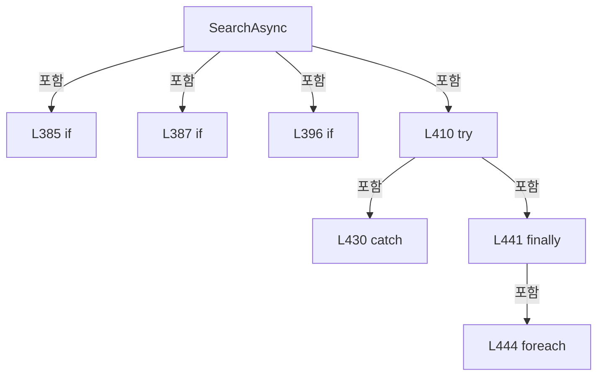

변경 전 점검: 입력/반환 타입, 위 호출자, 예외/취소 경로, 공유 상태와 저장·전송 소비자를 함께 확인합니다. 값의 단위나 물리 방향을 이름만으로 확정하지 않습니다.

### MethodDeclaration `TryReadTime` · L463–469

[Drilling.UI/Menu/Menus/CMenuAlarm.cs:463–469](https://github.com/kjuws10-rgb/A3Drilling/blob/96e22cd027c84bf302b23f2949b98985d7f301bb/Drilling.UI/Menu/Menus/CMenuAlarm.cs#L463-L469)

| 항목 | 실제 추출 값 |
| --- | --- |
| 서명 | bool Drilling.UI.Menu.Menus.CAlarmHistoryPanel.TryReadTime(string, out System.TimeSpan) |
| 접근/수식자 | Private / private, static |
| 반환/값 타입 | bool |
| 소속 타입 | NamedType:Drilling.UI.Menu.Menus.CAlarmHistoryPanel |

입력 계약:

| 이름 | 타입 | 전달 | 선택/기본값 |
| --- | --- | --- | --- |
| value | string | None | False /  |
| time | System.TimeSpan | Out | False /  |

정적 호출자로 확인된 위치:

| 호출 파일/행 | 호출 표현식 | 런타임 분기 가능 |
| --- | --- | --- |
| [Drilling.UI/Menu/Menus/CMenuAlarm.cs:387–387](https://github.com/kjuws10-rgb/A3Drilling/blob/96e22cd027c84bf302b23f2949b98985d7f301bb/Drilling.UI/Menu/Menus/CMenuAlarm.cs#L387-L387) | TryReadTime | False |
| [Drilling.UI/Menu/Menus/CMenuAlarm.cs:387–387](https://github.com/kjuws10-rgb/A3Drilling/blob/96e22cd027c84bf302b23f2949b98985d7f301bb/Drilling.UI/Menu/Menus/CMenuAlarm.cs#L387-L387) | TryReadTime | False |

호출하는 대상과 해석 범위:

| 원본 행 | 표현식 | 분석 상태 | 대상/소스 위치 |
| --- | --- | --- | --- |
| 466 | DateTime.TryParseExact | resolved | bool System.DateTime.TryParseExact(string?, string?[]?, System.IFormatProvider?, System.Globalization.DateTimeStyles, out System.DateTime) |
| 466 | .Trim | resolved | string string.Trim() |

본문의 실제 연산·분기·예외·반환 순서(원문 위치 순):

| 원본 행 | 종류 | 주석 해설 |
| --- | --- | --- |
| 465 | local-declaration | 지역 변수를 선언합니다: string[] formats = ["H:mm", "HH:mm", "H:mm:ss", "HH:mm:ss", "H:mm:ss.FFF", "HH:mm:ss.FFF"]; |
| 465 | variable-initializer | 변수의 초기값을 지정합니다: formats = ["H:mm", "HH:mm", "H:mm:ss", "HH:mm:ss", "H:mm:ss.FFF", "HH:mm:ss.FFF"] |
| 466 | call | 함수·델리게이트 또는 객체 생성자를 호출합니다: DateTime.TryParseExact(value?.Trim(), formats, CultureInfo.InvariantCulture, DateTimeStyles.None, out var parsed) |
| 466 | call | 함수·델리게이트 또는 객체 생성자를 호출합니다: .Trim() |
| 466 | local-declaration | 지역 변수를 선언합니다: var valid = DateTime.TryParseExact(value?.Trim(), formats, CultureInfo.InvariantCulture, DateTimeStyles.None, out var parsed); |
| 466 | variable-initializer | 변수의 초기값을 지정합니다: valid = DateTime.TryParseExact(value?.Trim(), formats, CultureInfo.InvariantCulture, DateTimeStyles.None, out var parsed) |
| 467 | assignment | 값을 대상에 대입합니다: time = parsed.TimeOfDay |
| 468 | return | 호출자에게 값 또는 제어를 반환합니다: return valid; |

변경 전 점검: 입력/반환 타입, 위 호출자, 예외/취소 경로, 공유 상태와 저장·전송 소비자를 함께 확인합니다. 값의 단위나 물리 방향을 이름만으로 확정하지 않습니다.

### MethodDeclaration `BuildCodeBars` · L471–485

[Drilling.UI/Menu/Menus/CMenuAlarm.cs:471–485](https://github.com/kjuws10-rgb/A3Drilling/blob/96e22cd027c84bf302b23f2949b98985d7f301bb/Drilling.UI/Menu/Menus/CMenuAlarm.cs#L471-L485)

| 항목 | 실제 추출 값 |
| --- | --- |
| 서명 | System.Collections.Generic.IReadOnlyList<Drilling.UI.Menu.Menus.ST_ALARM_TREND_COLUMN> Drilling.UI.Menu.Menus.CAlarmHistoryPanel.BuildCodeBars(System.Collections.Generic.IReadOnlyList<Drilling.Common.Alarm.ST_ALARM_HISTORY_ENTRY>) |
| 접근/수식자 | Private / private, static |
| 반환/값 타입 | System.Collections.Generic.IReadOnlyList<Drilling.UI.Menu.Menus.ST_ALARM_TREND_COLUMN> |
| 소속 타입 | NamedType:Drilling.UI.Menu.Menus.CAlarmHistoryPanel |

입력 계약:

| 이름 | 타입 | 전달 | 선택/기본값 |
| --- | --- | --- | --- |
| rows | System.Collections.Generic.IReadOnlyList<Drilling.Common.Alarm.ST_ALARM_HISTORY_ENTRY> | None | False /  |

정적 호출자로 확인된 위치:

| 호출 파일/행 | 호출 표현식 | 런타임 분기 가능 |
| --- | --- | --- |
| [Drilling.UI/Menu/Menus/CMenuAlarm.cs:363–363](https://github.com/kjuws10-rgb/A3Drilling/blob/96e22cd027c84bf302b23f2949b98985d7f301bb/Drilling.UI/Menu/Menus/CMenuAlarm.cs#L363-L363) | BuildCodeBars | False |

호출하는 대상과 해석 범위:

| 원본 행 | 표현식 | 분석 상태 | 대상/소스 위치 |
| --- | --- | --- | --- |
| 475 | rows.GroupBy(row => row.Code).Select(group => new { Code = group.Key, Cause = group.First().Cause, Count = group.Count() }).OrderByDescending(group => group.Count).ThenBy(group => group.Code).ToArray | resolved | <anonymous type: int Code, string Cause, int Count>[] System.Collections.Generic.IEnumerable<<anonymous type: int Code, string Cause, int Count>>.ToArray<<anonymous type: int Code, string Cause, int Count>>() |
| 475 | rows.GroupBy(row => row.Code).Select(group => new { Code = group.Key, Cause = group.First().Cause, Count = group.Count() }).OrderByDescending(group => group.Count).ThenBy | resolved | System.Linq.IOrderedEnumerable<<anonymous type: int Code, string Cause, int Count>> System.Linq.IOrderedEnumerable<<anonymous type: int Code, string Cause, int Count>>.ThenBy<<anonymous type: int Code, string Cause, int Count>, int>(System.Func<<anonymous type: int Code, string Cause, int Count>, int>) |
| 475 | rows.GroupBy(row => row.Code).Select(group => new { Code = group.Key, Cause = group.First().Cause, Count = group.Count() }).OrderByDescending | resolved | System.Linq.IOrderedEnumerable<<anonymous type: int Code, string Cause, int Count>> System.Collections.Generic.IEnumerable<<anonymous type: int Code, string Cause, int Count>>.OrderByDescending<<anonymous type: int Code, string Cause, int Count>, int>(System.Func<<anonymous type: int Code, string Cause, int Count>, int>) |
| 475 | rows.GroupBy(row => row.Code).Select | resolved | System.Collections.Generic.IEnumerable<<anonymous type: int Code, string Cause, int Count>> System.Collections.Generic.IEnumerable<System.Linq.IGrouping<int, Drilling.Common.Alarm.ST_ALARM_HISTORY_ENTRY>>.Select<System.Linq.IGrouping<int, Drilling.Common.Alarm.ST_ALARM_HISTORY_ENTRY>, <anonymous type: int Code, string Cause, int Count>>(System.Func<System.Linq.IGrouping<int, Drilling.Common.Alarm.ST_ALARM_HISTORY_ENTRY>, <anonymous type: int Code, string Cause, int Count>>) |
| 475 | rows.GroupBy | resolved | System.Collections.Generic.IEnumerable<System.Linq.IGrouping<int, Drilling.Common.Alarm.ST_ALARM_HISTORY_ENTRY>> System.Collections.Generic.IEnumerable<Drilling.Common.Alarm.ST_ALARM_HISTORY_ENTRY>.GroupBy<Drilling.Common.Alarm.ST_ALARM_HISTORY_ENTRY, int>(System.Func<Drilling.Common.Alarm.ST_ALARM_HISTORY_ENTRY, int>) |
| 475 | group.First | resolved | Drilling.Common.Alarm.ST_ALARM_HISTORY_ENTRY System.Collections.Generic.IEnumerable<Drilling.Common.Alarm.ST_ALARM_HISTORY_ENTRY>.First<Drilling.Common.Alarm.ST_ALARM_HISTORY_ENTRY>() |
| 475 | group.Count | resolved | int System.Collections.Generic.IEnumerable<Drilling.Common.Alarm.ST_ALARM_HISTORY_ENTRY>.Count<Drilling.Common.Alarm.ST_ALARM_HISTORY_ENTRY>() |
| 477 | counts.Select(group => new ST_ALARM_TREND_COLUMN( group.Code.ToString(CultureInfo.InvariantCulture), $"{group.Code} · {group.Cause}\n발생 {group.Count:N0}건", group.Cause, group.Count, new GridLength(group.Count, GridUnitType.Star), new GridLength(maximum - group.Count, GridUnitType.Star) )).ToArray | unresolved | None |
| 477 | counts.Select | candidate | OverloadResolutionFailure |
| 477 | new ST_ALARM_TREND_COLUMN | resolved | Drilling.UI.Menu.Menus.ST_ALARM_TREND_COLUMN.ST_ALARM_TREND_COLUMN(string, string, string, int, GridLength, GridLength, bool) · Drilling.UI/Menu/Menus/CMenuAlarm.cs:516 |
| 478 | group.Code.ToString | resolved | string int.ToString(System.IFormatProvider?) |
| 482 | new GridLength | unresolved | None |
| 483 | new GridLength | unresolved | None |

본문의 실제 연산·분기·예외·반환 순서(원문 위치 순):

| 원본 행 | 종류 | 주석 해설 |
| --- | --- | --- |
| 473 | if | 조건에 따라 분기합니다: if (rows.Count == 0) |
| 474 | return | 호출자에게 값 또는 제어를 반환합니다: return[]; |
| 475 | call | 함수·델리게이트 또는 객체 생성자를 호출합니다: rows.GroupBy(row => row.Code).Select(group => new { Code = group.Key, Cause = group.First().Cause, Count = group.Count() }).OrderByDescending(group => group.Count).ThenBy(group => group.Code).ToArray() |
| 475 | call | 함수·델리게이트 또는 객체 생성자를 호출합니다: rows.GroupBy(row => row.Code).Select(group => new { Code = group.Key, Cause = group.First().Cause, Count = group.Count() }).OrderByDescending(group => group.Count).ThenBy(group => group.Code) |
| 475 | call | 함수·델리게이트 또는 객체 생성자를 호출합니다: rows.GroupBy(row => row.Code).Select(group => new { Code = group.Key, Cause = group.First().Cause, Count = group.Count() }).OrderByDescending(group => group.Count) |
| 475 | call | 함수·델리게이트 또는 객체 생성자를 호출합니다: rows.GroupBy(row => row.Code).Select(group => new { Code = group.Key, Cause = group.First().Cause, Count = group.Count() }) |
| 475 | call | 함수·델리게이트 또는 객체 생성자를 호출합니다: rows.GroupBy(row => row.Code) |
| 475 | call | 함수·델리게이트 또는 객체 생성자를 호출합니다: group.First() |
| 475 | call | 함수·델리게이트 또는 객체 생성자를 호출합니다: group.Count() |
| 475 | local-declaration | 지역 변수를 선언합니다: var counts = rows.GroupBy(row => row.Code).Select(group => new { Code = group.Key, Cause = group.First().Cause, Count = group.Count() }).OrderByDescending(group => group.Count).ThenBy(group => group.Code).ToArray(); |
| 475 | variable-initializer | 변수의 초기값을 지정합니다: counts = rows.GroupBy(row => row.Code).Select(group => new { Code = group.Key, Cause = group.First().Cause, Count = group.Count() }).OrderByDescending(group => group.Count).ThenBy(group => group.Code).ToArray() |
| 476 | local-declaration | 지역 변수를 선언합니다: var maximum = counts[0].Count; |
| 476 | variable-initializer | 변수의 초기값을 지정합니다: maximum = counts[0].Count |
| 477 | call | 함수·델리게이트 또는 객체 생성자를 호출합니다: counts.Select(group => new ST_ALARM_TREND_COLUMN( group.Code.ToString(CultureInfo.InvariantCulture), $"{group.Code} · {group.Cause}\n발생 {group.Count:N0}건", group.Cause, group.Count, new GridLength(group.Count, GridUnitTy… |
| 477 | call | 함수·델리게이트 또는 객체 생성자를 호출합니다: counts.Select(group => new ST_ALARM_TREND_COLUMN( group.Code.ToString(CultureInfo.InvariantCulture), $"{group.Code} · {group.Cause}\n발생 {group.Count:N0}건", group.Cause, group.Count, new GridLength(group.Count, GridUnitTy… |
| 477 | call | 함수·델리게이트 또는 객체 생성자를 호출합니다: new ST_ALARM_TREND_COLUMN( group.Code.ToString(CultureInfo.InvariantCulture), $"{group.Code} · {group.Cause}\n발생 {group.Count:N0}건", group.Cause, group.Count, new GridLength(group.Count, GridUnitType.Star), new GridLengt… |
| 477 | return | 호출자에게 값 또는 제어를 반환합니다: return counts.Select(group => new ST_ALARM_TREND_COLUMN( group.Code.ToString(CultureInfo.InvariantCulture), $"{group.Code} · {group.Cause}\n발생 {group.Count:N0}건", group.Cause, group.Count, new GridLength(group.Count, GridUnitType. |
| 478 | call | 함수·델리게이트 또는 객체 생성자를 호출합니다: group.Code.ToString(CultureInfo.InvariantCulture) |
| 482 | call | 함수·델리게이트 또는 객체 생성자를 호출합니다: new GridLength(group.Count, GridUnitType.Star) |
| 483 | call | 함수·델리게이트 또는 객체 생성자를 호출합니다: new GridLength(maximum - group.Count, GridUnitType.Star) |

제어 구문의 포함 구조(실제 실행 순서/CFG가 아닌 구문 탐색 그림):

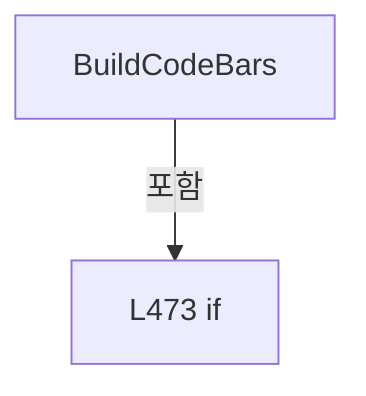

변경 전 점검: 입력/반환 타입, 위 호출자, 예외/취소 경로, 공유 상태와 저장·전송 소비자를 함께 확인합니다. 값의 단위나 물리 방향을 이름만으로 확정하지 않습니다.

### MethodDeclaration `BuildHourBars` · L487–511

[Drilling.UI/Menu/Menus/CMenuAlarm.cs:487–511](https://github.com/kjuws10-rgb/A3Drilling/blob/96e22cd027c84bf302b23f2949b98985d7f301bb/Drilling.UI/Menu/Menus/CMenuAlarm.cs#L487-L511)

| 항목 | 실제 추출 값 |
| --- | --- |
| 서명 | System.Collections.Generic.IReadOnlyList<Drilling.UI.Menu.Menus.ST_ALARM_TREND_COLUMN> Drilling.UI.Menu.Menus.CAlarmHistoryPanel.BuildHourBars(System.Collections.Generic.IReadOnlyList<Drilling.Common.Alarm.ST_ALARM_HISTORY_ENTRY>, System.DateTime, System.DateTime) |
| 접근/수식자 | Private / private, static |
| 반환/값 타입 | System.Collections.Generic.IReadOnlyList<Drilling.UI.Menu.Menus.ST_ALARM_TREND_COLUMN> |
| 소속 타입 | NamedType:Drilling.UI.Menu.Menus.CAlarmHistoryPanel |

입력 계약:

| 이름 | 타입 | 전달 | 선택/기본값 |
| --- | --- | --- | --- |
| rows | System.Collections.Generic.IReadOnlyList<Drilling.Common.Alarm.ST_ALARM_HISTORY_ENTRY> | None | False /  |
| from | System.DateTime | None | False /  |
| through | System.DateTime | None | False /  |

정적 호출자로 확인된 위치:

| 호출 파일/행 | 호출 표현식 | 런타임 분기 가능 |
| --- | --- | --- |
| [Drilling.UI/Menu/Menus/CMenuAlarm.cs:363–363](https://github.com/kjuws10-rgb/A3Drilling/blob/96e22cd027c84bf302b23f2949b98985d7f301bb/Drilling.UI/Menu/Menus/CMenuAlarm.cs#L363-L363) | BuildHourBars | False |

호출하는 대상과 해석 범위:

| 원본 행 | 표현식 | 분석 상태 | 대상/소스 위치 |
| --- | --- | --- | --- |
| 490 | rows.GroupBy(row => Hour(row.OccurredAt.LocalDateTime)).ToDictionary | resolved | System.Collections.Generic.Dictionary<System.DateTime, int> System.Collections.Generic.IEnumerable<System.Linq.IGrouping<System.DateTime, Drilling.Common.Alarm.ST_ALARM_HISTORY_ENTRY>>.ToDictionary<System.Linq.IGrouping<System.DateTime, Drilling.Common.Alarm.ST_ALARM_HISTORY_ENTRY>, System.DateTime, int>(System.Func<System.Linq.IGrouping<System.DateTime, Drilling.Common.Alarm.ST_ALARM_HISTORY_ENTRY>, System.DateTime>, System.Func<System.Linq.IGrouping<System.DateTime, Drilling.Common.Alarm.ST_ALARM_HISTORY_ENTRY>, int>) |
| 490 | rows.GroupBy | resolved | System.Collections.Generic.IEnumerable<System.Linq.IGrouping<System.DateTime, Drilling.Common.Alarm.ST_ALARM_HISTORY_ENTRY>> System.Collections.Generic.IEnumerable<Drilling.Common.Alarm.ST_ALARM_HISTORY_ENTRY>.GroupBy<Drilling.Common.Alarm.ST_ALARM_HISTORY_ENTRY, System.DateTime>(System.Func<Drilling.Common.Alarm.ST_ALARM_HISTORY_ENTRY, System.DateTime>) |
| 490 | Hour | resolved | System.DateTime Hour(System.DateTime) · Drilling.UI/Menu/Menus/CMenuAlarm.cs:489 |
| 490 | group.Count | resolved | int System.Collections.Generic.IEnumerable<Drilling.Common.Alarm.ST_ALARM_HISTORY_ENTRY>.Count<Drilling.Common.Alarm.ST_ALARM_HISTORY_ENTRY>() |
| 491 | Math.Max | resolved | int System.Math.Max(int, int) |
| 491 | counts.Values.DefaultIfEmpty(0).Max | resolved | int System.Collections.Generic.IEnumerable<int>.Max() |
| 491 | counts.Values.DefaultIfEmpty | resolved | System.Collections.Generic.IEnumerable<int> System.Collections.Generic.IEnumerable<int>.DefaultIfEmpty<int>(int) |
| 492 | new List<ST_ALARM_TREND_COLUMN> | resolved | System.Collections.Generic.List<Drilling.UI.Menu.Menus.ST_ALARM_TREND_COLUMN>.List() |
| 493 | Hour | resolved | System.DateTime Hour(System.DateTime) · Drilling.UI/Menu/Menus/CMenuAlarm.cs:489 |
| 494 | Hour | resolved | System.DateTime Hour(System.DateTime) · Drilling.UI/Menu/Menus/CMenuAlarm.cs:489 |
| 494 | hour.AddHours | resolved | System.DateTime System.DateTime.AddHours(double) |
| 496 | counts.GetValueOrDefault | resolved | int System.Collections.Generic.IReadOnlyDictionary<System.DateTime, int>.GetValueOrDefault<System.DateTime, int>(System.DateTime) |
| 497 | bars.Add | resolved | void System.Collections.Generic.List<Drilling.UI.Menu.Menus.ST_ALARM_TREND_COLUMN>.Add(Drilling.UI.Menu.Menus.ST_ALARM_TREND_COLUMN) |
| 497 | new | resolved | Drilling.UI.Menu.Menus.ST_ALARM_TREND_COLUMN.ST_ALARM_TREND_COLUMN(string, string, string, int, GridLength, GridLength, bool) · Drilling.UI/Menu/Menus/CMenuAlarm.cs:516 |
| 498 | hour.ToString | resolved | string System.DateTime.ToString(string?, System.IFormatProvider?) |
| 502 | new GridLength | unresolved | None |
| 503 | new GridLength | unresolved | None |

본문의 실제 연산·분기·예외·반환 순서(원문 위치 순):

| 원본 행 | 종류 | 주석 해설 |
| --- | --- | --- |
| 490 | call | 함수·델리게이트 또는 객체 생성자를 호출합니다: rows.GroupBy(row => Hour(row.OccurredAt.LocalDateTime)).ToDictionary(group => group.Key, group => group.Count()) |
| 490 | call | 함수·델리게이트 또는 객체 생성자를 호출합니다: rows.GroupBy(row => Hour(row.OccurredAt.LocalDateTime)) |
| 490 | call | 함수·델리게이트 또는 객체 생성자를 호출합니다: Hour(row.OccurredAt.LocalDateTime) |
| 490 | call | 함수·델리게이트 또는 객체 생성자를 호출합니다: group.Count() |
| 490 | local-declaration | 지역 변수를 선언합니다: var counts = rows.GroupBy(row => Hour(row.OccurredAt.LocalDateTime)).ToDictionary(group => group.Key, group => group.Count()); |
| 490 | variable-initializer | 변수의 초기값을 지정합니다: counts = rows.GroupBy(row => Hour(row.OccurredAt.LocalDateTime)).ToDictionary(group => group.Key, group => group.Count()) |
| 491 | call | 함수·델리게이트 또는 객체 생성자를 호출합니다: Math.Max(1, counts.Values.DefaultIfEmpty(0).Max()) |
| 491 | call | 함수·델리게이트 또는 객체 생성자를 호출합니다: counts.Values.DefaultIfEmpty(0).Max() |
| 491 | call | 함수·델리게이트 또는 객체 생성자를 호출합니다: counts.Values.DefaultIfEmpty(0) |
| 491 | local-declaration | 지역 변수를 선언합니다: var maximum = Math.Max(1, counts.Values.DefaultIfEmpty(0).Max()); |
| 491 | variable-initializer | 변수의 초기값을 지정합니다: maximum = Math.Max(1, counts.Values.DefaultIfEmpty(0).Max()) |
| 492 | call | 함수·델리게이트 또는 객체 생성자를 호출합니다: new List<ST_ALARM_TREND_COLUMN>() |
| 492 | local-declaration | 지역 변수를 선언합니다: var bars = new List<ST_ALARM_TREND_COLUMN>(); |
| 492 | variable-initializer | 변수의 초기값을 지정합니다: bars = new List<ST_ALARM_TREND_COLUMN>() |
| 493 | call | 함수·델리게이트 또는 객체 생성자를 호출합니다: Hour(through) |
| 493 | local-declaration | 지역 변수를 선언합니다: var end = Hour(through); |
| 493 | variable-initializer | 변수의 초기값을 지정합니다: end = Hour(through) |
| 494 | assignment | 값을 대상에 대입합니다: hour = hour.AddHours(1) |
| 494 | call | 함수·델리게이트 또는 객체 생성자를 호출합니다: Hour(from) |
| 494 | call | 함수·델리게이트 또는 객체 생성자를 호출합니다: hour.AddHours(1) |
| 494 | variable-initializer | 변수의 초기값을 지정합니다: hour = Hour(from) |
| 494 | for | 초기화·조건·증감이 있는 반복입니다: for (var hour = Hour(from); ; hour = hour.AddHours(1)) |
| 496 | call | 함수·델리게이트 또는 객체 생성자를 호출합니다: counts.GetValueOrDefault(hour) |
| 496 | local-declaration | 지역 변수를 선언합니다: var count = counts.GetValueOrDefault(hour); |
| 496 | variable-initializer | 변수의 초기값을 지정합니다: count = counts.GetValueOrDefault(hour) |
| 497 | call | 함수·델리게이트 또는 객체 생성자를 호출합니다: bars.Add(new( hour.ToString("MM-dd HH:mm", CultureInfo.InvariantCulture), $"{hour:yyyy-MM-dd HH:mm} · {count:N0}건", "", count, new GridLength(count, GridUnitType.Star), new GridLength(maximum - count, GridUnitType.Star),… |
| 497 | call | 함수·델리게이트 또는 객체 생성자를 호출합니다: new( hour.ToString("MM-dd HH:mm", CultureInfo.InvariantCulture), $"{hour:yyyy-MM-dd HH:mm} · {count:N0}건", "", count, new GridLength(count, GridUnitType.Star), new GridLength(maximum - count, GridUnitType.Star), IsHourly… |
| 498 | call | 함수·델리게이트 또는 객체 생성자를 호출합니다: hour.ToString("MM-dd HH:mm", CultureInfo.InvariantCulture) |
| 502 | call | 함수·델리게이트 또는 객체 생성자를 호출합니다: new GridLength(count, GridUnitType.Star) |
| 503 | call | 함수·델리게이트 또는 객체 생성자를 호출합니다: new GridLength(maximum - count, GridUnitType.Star) |
| 506 | if | 조건에 따라 분기합니다: if (hour == end) |
| 507 | break | 해당 반복/분기 구간을 종료합니다: break; |
| 510 | return | 호출자에게 값 또는 제어를 반환합니다: return bars; |

제어 구문의 포함 구조(실제 실행 순서/CFG가 아닌 구문 탐색 그림):

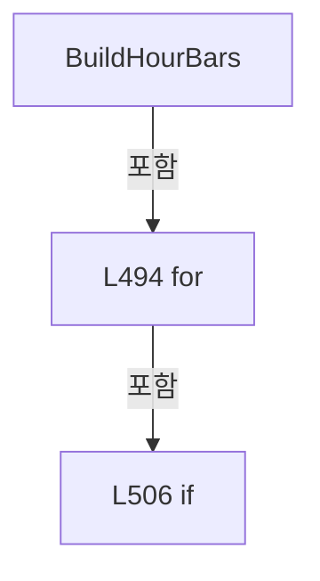

변경 전 점검: 입력/반환 타입, 위 호출자, 예외/취소 경로, 공유 상태와 저장·전송 소비자를 함께 확인합니다. 값의 단위나 물리 방향을 이름만으로 확정하지 않습니다.

### LocalFunctionStatement `Hour` · L489–489

[Drilling.UI/Menu/Menus/CMenuAlarm.cs:489–489](https://github.com/kjuws10-rgb/A3Drilling/blob/96e22cd027c84bf302b23f2949b98985d7f301bb/Drilling.UI/Menu/Menus/CMenuAlarm.cs#L489-L489)

| 항목 | 실제 추출 값 |
| --- | --- |
| 서명 | System.DateTime Hour(System.DateTime) |
| 접근/수식자 | Private / static |
| 반환/값 타입 | System.DateTime |
| 소속 타입 | NamedType:Drilling.UI.Menu.Menus.CAlarmHistoryPanel |

입력 계약:

| 이름 | 타입 | 전달 | 선택/기본값 |
| --- | --- | --- | --- |
| value | System.DateTime | None | False /  |

정적 호출자로 확인된 위치:

| 호출 파일/행 | 호출 표현식 | 런타임 분기 가능 |
| --- | --- | --- |
| [Drilling.UI/Menu/Menus/CMenuAlarm.cs:490–490](https://github.com/kjuws10-rgb/A3Drilling/blob/96e22cd027c84bf302b23f2949b98985d7f301bb/Drilling.UI/Menu/Menus/CMenuAlarm.cs#L490-L490) | Hour | False |
| [Drilling.UI/Menu/Menus/CMenuAlarm.cs:493–493](https://github.com/kjuws10-rgb/A3Drilling/blob/96e22cd027c84bf302b23f2949b98985d7f301bb/Drilling.UI/Menu/Menus/CMenuAlarm.cs#L493-L493) | Hour | False |
| [Drilling.UI/Menu/Menus/CMenuAlarm.cs:494–494](https://github.com/kjuws10-rgb/A3Drilling/blob/96e22cd027c84bf302b23f2949b98985d7f301bb/Drilling.UI/Menu/Menus/CMenuAlarm.cs#L494-L494) | Hour | False |

호출하는 대상과 해석 범위:

| 원본 행 | 표현식 | 분석 상태 | 대상/소스 위치 |
| --- | --- | --- | --- |
| 489 | value.Date.AddHours | resolved | System.DateTime System.DateTime.AddHours(double) |

본문의 실제 연산·분기·예외·반환 순서(원문 위치 순):

| 원본 행 | 종류 | 주석 해설 |
| --- | --- | --- |
| 489 | call | 함수·델리게이트 또는 객체 생성자를 호출합니다: value.Date.AddHours(value.Hour) |

변경 전 점검: 입력/반환 타입, 위 호출자, 예외/취소 경로, 공유 상태와 저장·전송 소비자를 함께 확인합니다. 값의 단위나 물리 방향을 이름만으로 확정하지 않습니다.

### MethodDeclaration `Notify` · L513–513

[Drilling.UI/Menu/Menus/CMenuAlarm.cs:513–513](https://github.com/kjuws10-rgb/A3Drilling/blob/96e22cd027c84bf302b23f2949b98985d7f301bb/Drilling.UI/Menu/Menus/CMenuAlarm.cs#L513-L513)

| 항목 | 실제 추출 값 |
| --- | --- |
| 서명 | void Drilling.UI.Menu.Menus.CAlarmHistoryPanel.Notify(string?) |
| 접근/수식자 | Private / private |
| 반환/값 타입 | void |
| 소속 타입 | NamedType:Drilling.UI.Menu.Menus.CAlarmHistoryPanel |

입력 계약:

| 이름 | 타입 | 전달 | 선택/기본값 |
| --- | --- | --- | --- |
| name | string? | None | True / null |

정적 호출자로 확인된 위치:

| 호출 파일/행 | 호출 표현식 | 런타임 분기 가능 |
| --- | --- | --- |
| [Drilling.UI/Menu/Menus/CMenuAlarm.cs:249–249](https://github.com/kjuws10-rgb/A3Drilling/blob/96e22cd027c84bf302b23f2949b98985d7f301bb/Drilling.UI/Menu/Menus/CMenuAlarm.cs#L249-L249) | Notify | False |
| [Drilling.UI/Menu/Menus/CMenuAlarm.cs:259–259](https://github.com/kjuws10-rgb/A3Drilling/blob/96e22cd027c84bf302b23f2949b98985d7f301bb/Drilling.UI/Menu/Menus/CMenuAlarm.cs#L259-L259) | Notify | False |
| [Drilling.UI/Menu/Menus/CMenuAlarm.cs:269–269](https://github.com/kjuws10-rgb/A3Drilling/blob/96e22cd027c84bf302b23f2949b98985d7f301bb/Drilling.UI/Menu/Menus/CMenuAlarm.cs#L269-L269) | Notify | False |
| [Drilling.UI/Menu/Menus/CMenuAlarm.cs:279–279](https://github.com/kjuws10-rgb/A3Drilling/blob/96e22cd027c84bf302b23f2949b98985d7f301bb/Drilling.UI/Menu/Menus/CMenuAlarm.cs#L279-L279) | Notify | False |
| [Drilling.UI/Menu/Menus/CMenuAlarm.cs:300–300](https://github.com/kjuws10-rgb/A3Drilling/blob/96e22cd027c84bf302b23f2949b98985d7f301bb/Drilling.UI/Menu/Menus/CMenuAlarm.cs#L300-L300) | Notify | False |
| [Drilling.UI/Menu/Menus/CMenuAlarm.cs:351–351](https://github.com/kjuws10-rgb/A3Drilling/blob/96e22cd027c84bf302b23f2949b98985d7f301bb/Drilling.UI/Menu/Menus/CMenuAlarm.cs#L351-L351) | Notify | False |
| [Drilling.UI/Menu/Menus/CMenuAlarm.cs:390–390](https://github.com/kjuws10-rgb/A3Drilling/blob/96e22cd027c84bf302b23f2949b98985d7f301bb/Drilling.UI/Menu/Menus/CMenuAlarm.cs#L390-L390) | Notify | False |
| [Drilling.UI/Menu/Menus/CMenuAlarm.cs:399–399](https://github.com/kjuws10-rgb/A3Drilling/blob/96e22cd027c84bf302b23f2949b98985d7f301bb/Drilling.UI/Menu/Menus/CMenuAlarm.cs#L399-L399) | Notify | False |
| [Drilling.UI/Menu/Menus/CMenuAlarm.cs:405–405](https://github.com/kjuws10-rgb/A3Drilling/blob/96e22cd027c84bf302b23f2949b98985d7f301bb/Drilling.UI/Menu/Menus/CMenuAlarm.cs#L405-L405) | Notify | False |
| [Drilling.UI/Menu/Menus/CMenuAlarm.cs:406–406](https://github.com/kjuws10-rgb/A3Drilling/blob/96e22cd027c84bf302b23f2949b98985d7f301bb/Drilling.UI/Menu/Menus/CMenuAlarm.cs#L406-L406) | Notify | False |
| [Drilling.UI/Menu/Menus/CMenuAlarm.cs:407–407](https://github.com/kjuws10-rgb/A3Drilling/blob/96e22cd027c84bf302b23f2949b98985d7f301bb/Drilling.UI/Menu/Menus/CMenuAlarm.cs#L407-L407) | Notify | False |
| [Drilling.UI/Menu/Menus/CMenuAlarm.cs:456–456](https://github.com/kjuws10-rgb/A3Drilling/blob/96e22cd027c84bf302b23f2949b98985d7f301bb/Drilling.UI/Menu/Menus/CMenuAlarm.cs#L456-L456) | Notify | False |

호출하는 대상과 해석 범위:

| 원본 행 | 표현식 | 분석 상태 | 대상/소스 위치 |
| --- | --- | --- | --- |
| 513 | .Invoke | resolved · 동적 구현 선택 가능 | void System.ComponentModel.PropertyChangedEventHandler.Invoke(object?, System.ComponentModel.PropertyChangedEventArgs) |
| 513 | new | resolved | System.ComponentModel.PropertyChangedEventArgs.PropertyChangedEventArgs(string?) |

본문의 실제 연산·분기·예외·반환 순서(원문 위치 순):

| 원본 행 | 종류 | 주석 해설 |
| --- | --- | --- |
| 513 | call | 함수·델리게이트 또는 객체 생성자를 호출합니다: .Invoke(this, new(name)) |
| 513 | call | 함수·델리게이트 또는 객체 생성자를 호출합니다: new(name) |

변경 전 점검: 입력/반환 타입, 위 호출자, 예외/취소 경로, 공유 상태와 저장·전송 소비자를 함께 확인합니다. 값의 단위나 물리 방향을 이름만으로 확정하지 않습니다.

### FieldDeclaration `_alarms` · L519–519

[Drilling.UI/Menu/Menus/CMenuAlarm.cs:519–519](https://github.com/kjuws10-rgb/A3Drilling/blob/96e22cd027c84bf302b23f2949b98985d7f301bb/Drilling.UI/Menu/Menus/CMenuAlarm.cs#L519-L519)

| 항목 | 실제 추출 값 |
| --- | --- |
| 서명 | Drilling.Common.Alarm.CAlarmManager Drilling.UI.Menu.Menus.CAlarmListPanel._alarms |
| 접근/수식자 | Private / private, readonly |
| 반환/값 타입 | Drilling.Common.Alarm.CAlarmManager |
| 소속 타입 | NamedType:Drilling.UI.Menu.Menus.CAlarmListPanel |

현재 부분 분석에서 직접 연결된 호출자는 없습니다. XAML/이벤트/인터페이스·델리게이트·외부 진입을 추가 확인해야 하며, 미사용으로 판정한 것이 아닙니다.

변경 전 점검: 입력/반환 타입, 위 호출자, 예외/취소 경로, 공유 상태와 저장·전송 소비자를 함께 확인합니다. 값의 단위나 물리 방향을 이름만으로 확정하지 않습니다.

### FieldDeclaration `_displayedSnapshot` · L520–520

[Drilling.UI/Menu/Menus/CMenuAlarm.cs:520–520](https://github.com/kjuws10-rgb/A3Drilling/blob/96e22cd027c84bf302b23f2949b98985d7f301bb/Drilling.UI/Menu/Menus/CMenuAlarm.cs#L520-L520)

| 항목 | 실제 추출 값 |
| --- | --- |
| 서명 | Drilling.Common.Alarm.ST_ALARM_DEFINITION_SNAPSHOT? Drilling.UI.Menu.Menus.CAlarmListPanel._displayedSnapshot |
| 접근/수식자 | Private / private |
| 반환/값 타입 | Drilling.Common.Alarm.ST_ALARM_DEFINITION_SNAPSHOT? |
| 소속 타입 | NamedType:Drilling.UI.Menu.Menus.CAlarmListPanel |

현재 부분 분석에서 직접 연결된 호출자는 없습니다. XAML/이벤트/인터페이스·델리게이트·외부 진입을 추가 확인해야 하며, 미사용으로 판정한 것이 아닙니다.

변경 전 점검: 입력/반환 타입, 위 호출자, 예외/취소 경로, 공유 상태와 저장·전송 소비자를 함께 확인합니다. 값의 단위나 물리 방향을 이름만으로 확정하지 않습니다.

### ConstructorDeclaration `.ctor` · L521–525

[Drilling.UI/Menu/Menus/CMenuAlarm.cs:521–525](https://github.com/kjuws10-rgb/A3Drilling/blob/96e22cd027c84bf302b23f2949b98985d7f301bb/Drilling.UI/Menu/Menus/CMenuAlarm.cs#L521-L525)

| 항목 | 실제 추출 값 |
| --- | --- |
| 서명 | Drilling.UI.Menu.Menus.CAlarmListPanel.CAlarmListPanel(Drilling.Common.Alarm.CAlarmManager) |
| 접근/수식자 | Public / public |
| 반환/값 타입 | void |
| 소속 타입 | NamedType:Drilling.UI.Menu.Menus.CAlarmListPanel |

입력 계약:

| 이름 | 타입 | 전달 | 선택/기본값 |
| --- | --- | --- | --- |
| alarms | Drilling.Common.Alarm.CAlarmManager | None | False /  |

정적 호출자로 확인된 위치:

| 호출 파일/행 | 호출 표현식 | 런타임 분기 가능 |
| --- | --- | --- |
| [Drilling.UI/Menu/Menus/CMenuAlarm.cs:35–35](https://github.com/kjuws10-rgb/A3Drilling/blob/96e22cd027c84bf302b23f2949b98985d7f301bb/Drilling.UI/Menu/Menus/CMenuAlarm.cs#L35-L35) | new | False |

호출하는 대상과 해석 범위:

| 원본 행 | 표현식 | 분석 상태 | 대상/소스 위치 |
| --- | --- | --- | --- |
| 524 | RefreshSnapshot | resolved | void Drilling.UI.Menu.Menus.CAlarmListPanel.RefreshSnapshot() · Drilling.UI/Menu/Menus/CMenuAlarm.cs:532 |

본문의 실제 연산·분기·예외·반환 순서(원문 위치 순):

| 원본 행 | 종류 | 주석 해설 |
| --- | --- | --- |
| 523 | assignment | 값을 대상에 대입합니다: _alarms = alarms |
| 524 | call | 함수·델리게이트 또는 객체 생성자를 호출합니다: RefreshSnapshot() |

변경 전 점검: 입력/반환 타입, 위 호출자, 예외/취소 경로, 공유 상태와 저장·전송 소비자를 함께 확인합니다. 값의 단위나 물리 방향을 이름만으로 확정하지 않습니다.

### EventFieldDeclaration `PropertyChanged` · L527–527

[Drilling.UI/Menu/Menus/CMenuAlarm.cs:527–527](https://github.com/kjuws10-rgb/A3Drilling/blob/96e22cd027c84bf302b23f2949b98985d7f301bb/Drilling.UI/Menu/Menus/CMenuAlarm.cs#L527-L527)

| 항목 | 실제 추출 값 |
| --- | --- |
| 서명 | System.ComponentModel.PropertyChangedEventHandler? Drilling.UI.Menu.Menus.CAlarmListPanel.PropertyChanged |
| 접근/수식자 | Public / public, event |
| 반환/값 타입 | System.ComponentModel.PropertyChangedEventHandler? |
| 소속 타입 | NamedType:Drilling.UI.Menu.Menus.CAlarmListPanel |

현재 부분 분석에서 직접 연결된 호출자는 없습니다. XAML/이벤트/인터페이스·델리게이트·외부 진입을 추가 확인해야 하며, 미사용으로 판정한 것이 아닙니다.

변경 전 점검: 입력/반환 타입, 위 호출자, 예외/취소 경로, 공유 상태와 저장·전송 소비자를 함께 확인합니다. 값의 단위나 물리 방향을 이름만으로 확정하지 않습니다.

### PropertyDeclaration `Rows` · L528–528

[Drilling.UI/Menu/Menus/CMenuAlarm.cs:528–528](https://github.com/kjuws10-rgb/A3Drilling/blob/96e22cd027c84bf302b23f2949b98985d7f301bb/Drilling.UI/Menu/Menus/CMenuAlarm.cs#L528-L528)

| 항목 | 실제 추출 값 |
| --- | --- |
| 서명 | System.Collections.Generic.IReadOnlyList<Drilling.UI.Menu.Menus.ST_ALARM_LIST_ROW> Drilling.UI.Menu.Menus.CAlarmListPanel.Rows |
| 접근/수식자 | Public / public |
| 반환/값 타입 | System.Collections.Generic.IReadOnlyList<Drilling.UI.Menu.Menus.ST_ALARM_LIST_ROW> |
| 소속 타입 | NamedType:Drilling.UI.Menu.Menus.CAlarmListPanel |

현재 부분 분석에서 직접 연결된 호출자는 없습니다. XAML/이벤트/인터페이스·델리게이트·외부 진입을 추가 확인해야 하며, 미사용으로 판정한 것이 아닙니다.

변경 전 점검: 입력/반환 타입, 위 호출자, 예외/취소 경로, 공유 상태와 저장·전송 소비자를 함께 확인합니다. 값의 단위나 물리 방향을 이름만으로 확정하지 않습니다.

### GetAccessorDeclaration `get_Rows` · L528–528

[Drilling.UI/Menu/Menus/CMenuAlarm.cs:528–528](https://github.com/kjuws10-rgb/A3Drilling/blob/96e22cd027c84bf302b23f2949b98985d7f301bb/Drilling.UI/Menu/Menus/CMenuAlarm.cs#L528-L528)

| 항목 | 실제 추출 값 |
| --- | --- |
| 서명 | System.Collections.Generic.IReadOnlyList<Drilling.UI.Menu.Menus.ST_ALARM_LIST_ROW> Drilling.UI.Menu.Menus.CAlarmListPanel.Rows.get |
| 접근/수식자 | Public / get |
| 반환/값 타입 | System.Collections.Generic.IReadOnlyList<Drilling.UI.Menu.Menus.ST_ALARM_LIST_ROW> |
| 소속 타입 | NamedType:Drilling.UI.Menu.Menus.CAlarmListPanel |

현재 부분 분석에서 직접 연결된 호출자는 없습니다. XAML/이벤트/인터페이스·델리게이트·외부 진입을 추가 확인해야 하며, 미사용으로 판정한 것이 아닙니다.

변경 전 점검: 입력/반환 타입, 위 호출자, 예외/취소 경로, 공유 상태와 저장·전송 소비자를 함께 확인합니다. 값의 단위나 물리 방향을 이름만으로 확정하지 않습니다.

### SetAccessorDeclaration `set_Rows` · L528–528

[Drilling.UI/Menu/Menus/CMenuAlarm.cs:528–528](https://github.com/kjuws10-rgb/A3Drilling/blob/96e22cd027c84bf302b23f2949b98985d7f301bb/Drilling.UI/Menu/Menus/CMenuAlarm.cs#L528-L528)

| 항목 | 실제 추출 값 |
| --- | --- |
| 서명 | void Drilling.UI.Menu.Menus.CAlarmListPanel.Rows.set |
| 접근/수식자 | Private / private, set |
| 반환/값 타입 | void |
| 소속 타입 | NamedType:Drilling.UI.Menu.Menus.CAlarmListPanel |

입력 계약:

| 이름 | 타입 | 전달 | 선택/기본값 |
| --- | --- | --- | --- |
| value | System.Collections.Generic.IReadOnlyList<Drilling.UI.Menu.Menus.ST_ALARM_LIST_ROW> | None | False /  |

현재 부분 분석에서 직접 연결된 호출자는 없습니다. XAML/이벤트/인터페이스·델리게이트·외부 진입을 추가 확인해야 하며, 미사용으로 판정한 것이 아닙니다.

변경 전 점검: 입력/반환 타입, 위 호출자, 예외/취소 경로, 공유 상태와 저장·전송 소비자를 함께 확인합니다. 값의 단위나 물리 방향을 이름만으로 확정하지 않습니다.

### PropertyDeclaration `Status` · L529–529

[Drilling.UI/Menu/Menus/CMenuAlarm.cs:529–529](https://github.com/kjuws10-rgb/A3Drilling/blob/96e22cd027c84bf302b23f2949b98985d7f301bb/Drilling.UI/Menu/Menus/CMenuAlarm.cs#L529-L529)

| 항목 | 실제 추출 값 |
| --- | --- |
| 서명 | string Drilling.UI.Menu.Menus.CAlarmListPanel.Status |
| 접근/수식자 | Public / public |
| 반환/값 타입 | string |
| 소속 타입 | NamedType:Drilling.UI.Menu.Menus.CAlarmListPanel |

현재 부분 분석에서 직접 연결된 호출자는 없습니다. XAML/이벤트/인터페이스·델리게이트·외부 진입을 추가 확인해야 하며, 미사용으로 판정한 것이 아닙니다.

변경 전 점검: 입력/반환 타입, 위 호출자, 예외/취소 경로, 공유 상태와 저장·전송 소비자를 함께 확인합니다. 값의 단위나 물리 방향을 이름만으로 확정하지 않습니다.

### GetAccessorDeclaration `get_Status` · L529–529

[Drilling.UI/Menu/Menus/CMenuAlarm.cs:529–529](https://github.com/kjuws10-rgb/A3Drilling/blob/96e22cd027c84bf302b23f2949b98985d7f301bb/Drilling.UI/Menu/Menus/CMenuAlarm.cs#L529-L529)

| 항목 | 실제 추출 값 |
| --- | --- |
| 서명 | string Drilling.UI.Menu.Menus.CAlarmListPanel.Status.get |
| 접근/수식자 | Public / get |
| 반환/값 타입 | string |
| 소속 타입 | NamedType:Drilling.UI.Menu.Menus.CAlarmListPanel |

현재 부분 분석에서 직접 연결된 호출자는 없습니다. XAML/이벤트/인터페이스·델리게이트·외부 진입을 추가 확인해야 하며, 미사용으로 판정한 것이 아닙니다.

변경 전 점검: 입력/반환 타입, 위 호출자, 예외/취소 경로, 공유 상태와 저장·전송 소비자를 함께 확인합니다. 값의 단위나 물리 방향을 이름만으로 확정하지 않습니다.

### SetAccessorDeclaration `set_Status` · L529–529

[Drilling.UI/Menu/Menus/CMenuAlarm.cs:529–529](https://github.com/kjuws10-rgb/A3Drilling/blob/96e22cd027c84bf302b23f2949b98985d7f301bb/Drilling.UI/Menu/Menus/CMenuAlarm.cs#L529-L529)

| 항목 | 실제 추출 값 |
| --- | --- |
| 서명 | void Drilling.UI.Menu.Menus.CAlarmListPanel.Status.set |
| 접근/수식자 | Private / private, set |
| 반환/값 타입 | void |
| 소속 타입 | NamedType:Drilling.UI.Menu.Menus.CAlarmListPanel |

입력 계약:

| 이름 | 타입 | 전달 | 선택/기본값 |
| --- | --- | --- | --- |
| value | string | None | False /  |

현재 부분 분석에서 직접 연결된 호출자는 없습니다. XAML/이벤트/인터페이스·델리게이트·외부 진입을 추가 확인해야 하며, 미사용으로 판정한 것이 아닙니다.

변경 전 점검: 입력/반환 타입, 위 호출자, 예외/취소 경로, 공유 상태와 저장·전송 소비자를 함께 확인합니다. 값의 단위나 물리 방향을 이름만으로 확정하지 않습니다.

### PropertyDeclaration `HasError` · L530–530

[Drilling.UI/Menu/Menus/CMenuAlarm.cs:530–530](https://github.com/kjuws10-rgb/A3Drilling/blob/96e22cd027c84bf302b23f2949b98985d7f301bb/Drilling.UI/Menu/Menus/CMenuAlarm.cs#L530-L530)

| 항목 | 실제 추출 값 |
| --- | --- |
| 서명 | bool Drilling.UI.Menu.Menus.CAlarmListPanel.HasError |
| 접근/수식자 | Public / public |
| 반환/값 타입 | bool |
| 소속 타입 | NamedType:Drilling.UI.Menu.Menus.CAlarmListPanel |

현재 부분 분석에서 직접 연결된 호출자는 없습니다. XAML/이벤트/인터페이스·델리게이트·외부 진입을 추가 확인해야 하며, 미사용으로 판정한 것이 아닙니다.

변경 전 점검: 입력/반환 타입, 위 호출자, 예외/취소 경로, 공유 상태와 저장·전송 소비자를 함께 확인합니다. 값의 단위나 물리 방향을 이름만으로 확정하지 않습니다.

### GetAccessorDeclaration `get_HasError` · L530–530

[Drilling.UI/Menu/Menus/CMenuAlarm.cs:530–530](https://github.com/kjuws10-rgb/A3Drilling/blob/96e22cd027c84bf302b23f2949b98985d7f301bb/Drilling.UI/Menu/Menus/CMenuAlarm.cs#L530-L530)

| 항목 | 실제 추출 값 |
| --- | --- |
| 서명 | bool Drilling.UI.Menu.Menus.CAlarmListPanel.HasError.get |
| 접근/수식자 | Public / get |
| 반환/값 타입 | bool |
| 소속 타입 | NamedType:Drilling.UI.Menu.Menus.CAlarmListPanel |

현재 부분 분석에서 직접 연결된 호출자는 없습니다. XAML/이벤트/인터페이스·델리게이트·외부 진입을 추가 확인해야 하며, 미사용으로 판정한 것이 아닙니다.

변경 전 점검: 입력/반환 타입, 위 호출자, 예외/취소 경로, 공유 상태와 저장·전송 소비자를 함께 확인합니다. 값의 단위나 물리 방향을 이름만으로 확정하지 않습니다.

### SetAccessorDeclaration `set_HasError` · L530–530

[Drilling.UI/Menu/Menus/CMenuAlarm.cs:530–530](https://github.com/kjuws10-rgb/A3Drilling/blob/96e22cd027c84bf302b23f2949b98985d7f301bb/Drilling.UI/Menu/Menus/CMenuAlarm.cs#L530-L530)

| 항목 | 실제 추출 값 |
| --- | --- |
| 서명 | void Drilling.UI.Menu.Menus.CAlarmListPanel.HasError.set |
| 접근/수식자 | Private / private, set |
| 반환/값 타입 | void |
| 소속 타입 | NamedType:Drilling.UI.Menu.Menus.CAlarmListPanel |

입력 계약:

| 이름 | 타입 | 전달 | 선택/기본값 |
| --- | --- | --- | --- |
| value | bool | None | False /  |

현재 부분 분석에서 직접 연결된 호출자는 없습니다. XAML/이벤트/인터페이스·델리게이트·외부 진입을 추가 확인해야 하며, 미사용으로 판정한 것이 아닙니다.

변경 전 점검: 입력/반환 타입, 위 호출자, 예외/취소 경로, 공유 상태와 저장·전송 소비자를 함께 확인합니다. 값의 단위나 물리 방향을 이름만으로 확정하지 않습니다.

### MethodDeclaration `RefreshSnapshot` · L532–544

[Drilling.UI/Menu/Menus/CMenuAlarm.cs:532–544](https://github.com/kjuws10-rgb/A3Drilling/blob/96e22cd027c84bf302b23f2949b98985d7f301bb/Drilling.UI/Menu/Menus/CMenuAlarm.cs#L532-L544)

| 항목 | 실제 추출 값 |
| --- | --- |
| 서명 | void Drilling.UI.Menu.Menus.CAlarmListPanel.RefreshSnapshot() |
| 접근/수식자 | Public / public |
| 반환/값 타입 | void |
| 소속 타입 | NamedType:Drilling.UI.Menu.Menus.CAlarmListPanel |

정적 호출자로 확인된 위치:

| 호출 파일/행 | 호출 표현식 | 런타임 분기 가능 |
| --- | --- | --- |
| [Drilling.UI/Menu/Menus/CMenuAlarm.cs:89–89](https://github.com/kjuws10-rgb/A3Drilling/blob/96e22cd027c84bf302b23f2949b98985d7f301bb/Drilling.UI/Menu/Menus/CMenuAlarm.cs#L89-L89) | ListPanel.RefreshSnapshot | False |
| [Drilling.UI/Menu/Menus/CMenuAlarm.cs:524–524](https://github.com/kjuws10-rgb/A3Drilling/blob/96e22cd027c84bf302b23f2949b98985d7f301bb/Drilling.UI/Menu/Menus/CMenuAlarm.cs#L524-L524) | RefreshSnapshot | False |

호출하는 대상과 해석 범위:

| 원본 행 | 표현식 | 분석 상태 | 대상/소스 위치 |
| --- | --- | --- | --- |
| 534 | _alarms.GetDefinitionsSnapshot | resolved | Drilling.Common.Alarm.ST_ALARM_DEFINITION_SNAPSHOT Drilling.Common.Alarm.CAlarmManager.GetDefinitionsSnapshot() · Drilling.Common/Alarm/CAlarmManager.cs:125 |
| 535 | ReferenceEquals | resolved | bool object.ReferenceEquals(object?, object?) |
| 538 | snapshot.Rows.Select((row, index) => new ST_ALARM_LIST_ROW(index + 1, row.Code, row.Group, row.Id, row.Level, row.Cause, row.Solution, row.CimAddress)).ToArray | resolved | Drilling.UI.Menu.Menus.ST_ALARM_LIST_ROW[] System.Collections.Generic.IEnumerable<Drilling.UI.Menu.Menus.ST_ALARM_LIST_ROW>.ToArray<Drilling.UI.Menu.Menus.ST_ALARM_LIST_ROW>() |
| 538 | snapshot.Rows.Select | resolved | System.Collections.Generic.IEnumerable<Drilling.UI.Menu.Menus.ST_ALARM_LIST_ROW> System.Collections.Generic.IEnumerable<Drilling.Common.Alarm.ST_ALARM_DEFINITION>.Select<Drilling.Common.Alarm.ST_ALARM_DEFINITION, Drilling.UI.Menu.Menus.ST_ALARM_LIST_ROW>(System.Func<Drilling.Common.Alarm.ST_ALARM_DEFINITION, int, Drilling.UI.Menu.Menus.ST_ALARM_LIST_ROW>) |
| 538 | new ST_ALARM_LIST_ROW | resolved | Drilling.UI.Menu.Menus.ST_ALARM_LIST_ROW.ST_ALARM_LIST_ROW(int, int, string, string, string, string, string, string) · Drilling.UI/Menu/Menus/CMenuAlarm.cs:547 |
| 539 | string.IsNullOrEmpty | resolved | bool string.IsNullOrEmpty(string?) |
| 541 | .Invoke | resolved · 동적 구현 선택 가능 | void System.ComponentModel.PropertyChangedEventHandler.Invoke(object?, System.ComponentModel.PropertyChangedEventArgs) |
| 541 | new PropertyChangedEventArgs | resolved | System.ComponentModel.PropertyChangedEventArgs.PropertyChangedEventArgs(string?) |
| 541 | nameof | unresolved | None |
| 542 | .Invoke | resolved · 동적 구현 선택 가능 | void System.ComponentModel.PropertyChangedEventHandler.Invoke(object?, System.ComponentModel.PropertyChangedEventArgs) |
| 542 | new PropertyChangedEventArgs | resolved | System.ComponentModel.PropertyChangedEventArgs.PropertyChangedEventArgs(string?) |
| 542 | nameof | unresolved | None |
| 543 | .Invoke | resolved · 동적 구현 선택 가능 | void System.ComponentModel.PropertyChangedEventHandler.Invoke(object?, System.ComponentModel.PropertyChangedEventArgs) |
| 543 | new PropertyChangedEventArgs | resolved | System.ComponentModel.PropertyChangedEventArgs.PropertyChangedEventArgs(string?) |
| 543 | nameof | unresolved | None |

본문의 실제 연산·분기·예외·반환 순서(원문 위치 순):

| 원본 행 | 종류 | 주석 해설 |
| --- | --- | --- |
| 534 | call | 함수·델리게이트 또는 객체 생성자를 호출합니다: _alarms.GetDefinitionsSnapshot() |
| 534 | local-declaration | 지역 변수를 선언합니다: var snapshot = _alarms.GetDefinitionsSnapshot(); |
| 534 | variable-initializer | 변수의 초기값을 지정합니다: snapshot = _alarms.GetDefinitionsSnapshot() |
| 535 | call | 함수·델리게이트 또는 객체 생성자를 호출합니다: ReferenceEquals(snapshot, _displayedSnapshot) |
| 535 | if | 조건에 따라 분기합니다: if (ReferenceEquals(snapshot, _displayedSnapshot)) |
| 536 | return | 호출자에게 값 또는 제어를 반환합니다: return; |
| 537 | assignment | 값을 대상에 대입합니다: _displayedSnapshot = snapshot |
| 538 | assignment | 값을 대상에 대입합니다: Rows = snapshot.Rows.Select((row, index) => new ST_ALARM_LIST_ROW(index + 1, row.Code, row.Group, row.Id, row.Level, row.Cause, row.Solution, row.CimAddress)).ToArray() |
| 538 | call | 함수·델리게이트 또는 객체 생성자를 호출합니다: snapshot.Rows.Select((row, index) => new ST_ALARM_LIST_ROW(index + 1, row.Code, row.Group, row.Id, row.Level, row.Cause, row.Solution, row.CimAddress)).ToArray() |
| 538 | call | 함수·델리게이트 또는 객체 생성자를 호출합니다: snapshot.Rows.Select((row, index) => new ST_ALARM_LIST_ROW(index + 1, row.Code, row.Group, row.Id, row.Level, row.Cause, row.Solution, row.CimAddress)) |
| 538 | call | 함수·델리게이트 또는 객체 생성자를 호출합니다: new ST_ALARM_LIST_ROW(index + 1, row.Code, row.Group, row.Id, row.Level, row.Cause, row.Solution, row.CimAddress) |
| 539 | assignment | 값을 대상에 대입합니다: HasError = !string.IsNullOrEmpty(snapshot.Error) |
| 539 | call | 함수·델리게이트 또는 객체 생성자를 호출합니다: string.IsNullOrEmpty(snapshot.Error) |
| 540 | assignment | 값을 대상에 대입합니다: Status = HasError ? $"알람 목록을 불러오지 못했습니다. {snapshot.Error} 파일 확인 후 프로그램을 다시 시작해 주세요." : Rows.Count == 0 ? "등록된 알람이 없습니다." : "" |
| 540 | conditional-expression | 조건에 따라 결과식을 선택합니다: HasError ? $"알람 목록을 불러오지 못했습니다. {snapshot.Error} 파일 확인 후 프로그램을 다시 시작해 주세요." : Rows.Count == 0 ? "등록된 알람이 없습니다." : "" |
| 540 | conditional-expression | 조건에 따라 결과식을 선택합니다: Rows.Count == 0 ? "등록된 알람이 없습니다." : "" |
| 541 | call | 함수·델리게이트 또는 객체 생성자를 호출합니다: .Invoke(this, new PropertyChangedEventArgs(nameof(Rows))) |
| 541 | call | 함수·델리게이트 또는 객체 생성자를 호출합니다: new PropertyChangedEventArgs(nameof(Rows)) |
| 541 | call | 함수·델리게이트 또는 객체 생성자를 호출합니다: nameof(Rows) |
| 542 | call | 함수·델리게이트 또는 객체 생성자를 호출합니다: .Invoke(this, new PropertyChangedEventArgs(nameof(Status))) |
| 542 | call | 함수·델리게이트 또는 객체 생성자를 호출합니다: new PropertyChangedEventArgs(nameof(Status)) |
| 542 | call | 함수·델리게이트 또는 객체 생성자를 호출합니다: nameof(Status) |
| 543 | call | 함수·델리게이트 또는 객체 생성자를 호출합니다: .Invoke(this, new PropertyChangedEventArgs(nameof(HasError))) |
| 543 | call | 함수·델리게이트 또는 객체 생성자를 호출합니다: new PropertyChangedEventArgs(nameof(HasError)) |
| 543 | call | 함수·델리게이트 또는 객체 생성자를 호출합니다: nameof(HasError) |

제어 구문의 포함 구조(실제 실행 순서/CFG가 아닌 구문 탐색 그림):

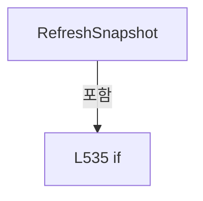

변경 전 점검: 입력/반환 타입, 위 호출자, 예외/취소 경로, 공유 상태와 저장·전송 소비자를 함께 확인합니다. 값의 단위나 물리 방향을 이름만으로 확정하지 않습니다.

### PropertyDeclaration `LevelBrush` · L550–562

[Drilling.UI/Menu/Menus/CMenuAlarm.cs:550–562](https://github.com/kjuws10-rgb/A3Drilling/blob/96e22cd027c84bf302b23f2949b98985d7f301bb/Drilling.UI/Menu/Menus/CMenuAlarm.cs#L550-L562)

| 항목 | 실제 추출 값 |
| --- | --- |
| 서명 | Brush Drilling.UI.Menu.Menus.ST_ALARM_CURRENT_ROW.LevelBrush |
| 접근/수식자 | Public / public |
| 반환/값 타입 | Brush |
| 소속 타입 | NamedType:Drilling.UI.Menu.Menus.ST_ALARM_CURRENT_ROW |

현재 부분 분석에서 직접 연결된 호출자는 없습니다. XAML/이벤트/인터페이스·델리게이트·외부 진입을 추가 확인해야 하며, 미사용으로 판정한 것이 아닙니다.

변경 전 점검: 입력/반환 타입, 위 호출자, 예외/취소 경로, 공유 상태와 저장·전송 소비자를 함께 확인합니다. 값의 단위나 물리 방향을 이름만으로 확정하지 않습니다.

### GetAccessorDeclaration `get_LevelBrush` · L552–561

[Drilling.UI/Menu/Menus/CMenuAlarm.cs:552–561](https://github.com/kjuws10-rgb/A3Drilling/blob/96e22cd027c84bf302b23f2949b98985d7f301bb/Drilling.UI/Menu/Menus/CMenuAlarm.cs#L552-L561)

| 항목 | 실제 추출 값 |
| --- | --- |
| 서명 | Brush Drilling.UI.Menu.Menus.ST_ALARM_CURRENT_ROW.LevelBrush.get |
| 접근/수식자 | Public / get |
| 반환/값 타입 | Brush |
| 소속 타입 | NamedType:Drilling.UI.Menu.Menus.ST_ALARM_CURRENT_ROW |

현재 부분 분석에서 직접 연결된 호출자는 없습니다. XAML/이벤트/인터페이스·델리게이트·외부 진입을 추가 확인해야 하며, 미사용으로 판정한 것이 아닙니다.

본문의 실제 연산·분기·예외·반환 순서(원문 위치 순):

| 원본 행 | 종류 | 주석 해설 |
| --- | --- | --- |
| 554 | return | 호출자에게 값 또는 제어를 반환합니다: return Level switch { "LIGHT" or "WARN" => CStatusBrush.Wait, "HEAVY" or "CRITICAL" or "ERROR" => CStatusBrush.Offline, "INFO" => CStatusBrush.Simul, _ => CStatusBrush.PrimaryText }; |
| 554 | switch-expression | 값별 결과식을 선택합니다: Level switch { "LIGHT" or "WARN" => CStatusBrush.Wait, "HEAVY" or "CRITICAL" or "ERROR" => CStatusBrush.Offline, "INFO" => CStatusBrush.Simul, _ => CStatusBrush.PrimaryText } |

제어 구문의 포함 구조(실제 실행 순서/CFG가 아닌 구문 탐색 그림):

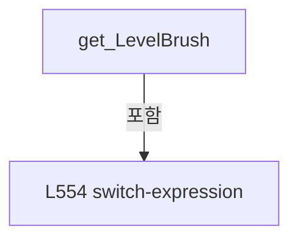

변경 전 점검: 입력/반환 타입, 위 호출자, 예외/취소 경로, 공유 상태와 저장·전송 소비자를 함께 확인합니다. 값의 단위나 물리 방향을 이름만으로 확정하지 않습니다.

### PropertyDeclaration `ValueBrush` · L567–580

[Drilling.UI/Menu/Menus/CMenuAlarm.cs:567–580](https://github.com/kjuws10-rgb/A3Drilling/blob/96e22cd027c84bf302b23f2949b98985d7f301bb/Drilling.UI/Menu/Menus/CMenuAlarm.cs#L567-L580)

| 항목 | 실제 추출 값 |
| --- | --- |
| 서명 | Brush Drilling.UI.Menu.Menus.ST_ALARM_DETAIL_ROW.ValueBrush |
| 접근/수식자 | Public / public |
| 반환/값 타입 | Brush |
| 소속 타입 | NamedType:Drilling.UI.Menu.Menus.ST_ALARM_DETAIL_ROW |

현재 부분 분석에서 직접 연결된 호출자는 없습니다. XAML/이벤트/인터페이스·델리게이트·외부 진입을 추가 확인해야 하며, 미사용으로 판정한 것이 아닙니다.

변경 전 점검: 입력/반환 타입, 위 호출자, 예외/취소 경로, 공유 상태와 저장·전송 소비자를 함께 확인합니다. 값의 단위나 물리 방향을 이름만으로 확정하지 않습니다.

### GetAccessorDeclaration `get_ValueBrush` · L569–579

[Drilling.UI/Menu/Menus/CMenuAlarm.cs:569–579](https://github.com/kjuws10-rgb/A3Drilling/blob/96e22cd027c84bf302b23f2949b98985d7f301bb/Drilling.UI/Menu/Menus/CMenuAlarm.cs#L569-L579)

| 항목 | 실제 추출 값 |
| --- | --- |
| 서명 | Brush Drilling.UI.Menu.Menus.ST_ALARM_DETAIL_ROW.ValueBrush.get |
| 접근/수식자 | Public / get |
| 반환/값 타입 | Brush |
| 소속 타입 | NamedType:Drilling.UI.Menu.Menus.ST_ALARM_DETAIL_ROW |

현재 부분 분석에서 직접 연결된 호출자는 없습니다. XAML/이벤트/인터페이스·델리게이트·외부 진입을 추가 확인해야 하며, 미사용으로 판정한 것이 아닙니다.

본문의 실제 연산·분기·예외·반환 순서(원문 위치 순):

| 원본 행 | 종류 | 주석 해설 |
| --- | --- | --- |
| 571 | return | 호출자에게 값 또는 제어를 반환합니다: return State switch { "Warn" => CStatusBrush.Wait, "Critical" => CStatusBrush.Offline, "Accent" => CStatusBrush.Simul, "Ok" => CStatusBrush.Online, _ => CStatusBrush.PrimaryText }; |
| 571 | switch-expression | 값별 결과식을 선택합니다: State switch { "Warn" => CStatusBrush.Wait, "Critical" => CStatusBrush.Offline, "Accent" => CStatusBrush.Simul, "Ok" => CStatusBrush.Online, _ => CStatusBrush.PrimaryText } |

제어 구문의 포함 구조(실제 실행 순서/CFG가 아닌 구문 탐색 그림):

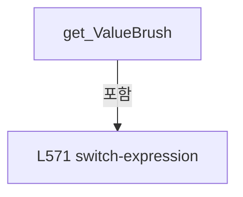

변경 전 점검: 입력/반환 타입, 위 호출자, 예외/취소 경로, 공유 상태와 저장·전송 소비자를 함께 확인합니다. 값의 단위나 물리 방향을 이름만으로 확정하지 않습니다.

### PropertyDeclaration `LevelBrush` · L585–597

[Drilling.UI/Menu/Menus/CMenuAlarm.cs:585–597](https://github.com/kjuws10-rgb/A3Drilling/blob/96e22cd027c84bf302b23f2949b98985d7f301bb/Drilling.UI/Menu/Menus/CMenuAlarm.cs#L585-L597)

| 항목 | 실제 추출 값 |
| --- | --- |
| 서명 | Brush Drilling.UI.Menu.Menus.ST_ALARM_HISTORY_ROW.LevelBrush |
| 접근/수식자 | Public / public |
| 반환/값 타입 | Brush |
| 소속 타입 | NamedType:Drilling.UI.Menu.Menus.ST_ALARM_HISTORY_ROW |

현재 부분 분석에서 직접 연결된 호출자는 없습니다. XAML/이벤트/인터페이스·델리게이트·외부 진입을 추가 확인해야 하며, 미사용으로 판정한 것이 아닙니다.

변경 전 점검: 입력/반환 타입, 위 호출자, 예외/취소 경로, 공유 상태와 저장·전송 소비자를 함께 확인합니다. 값의 단위나 물리 방향을 이름만으로 확정하지 않습니다.

### GetAccessorDeclaration `get_LevelBrush` · L587–596

[Drilling.UI/Menu/Menus/CMenuAlarm.cs:587–596](https://github.com/kjuws10-rgb/A3Drilling/blob/96e22cd027c84bf302b23f2949b98985d7f301bb/Drilling.UI/Menu/Menus/CMenuAlarm.cs#L587-L596)

| 항목 | 실제 추출 값 |
| --- | --- |
| 서명 | Brush Drilling.UI.Menu.Menus.ST_ALARM_HISTORY_ROW.LevelBrush.get |
| 접근/수식자 | Public / get |
| 반환/값 타입 | Brush |
| 소속 타입 | NamedType:Drilling.UI.Menu.Menus.ST_ALARM_HISTORY_ROW |

현재 부분 분석에서 직접 연결된 호출자는 없습니다. XAML/이벤트/인터페이스·델리게이트·외부 진입을 추가 확인해야 하며, 미사용으로 판정한 것이 아닙니다.

본문의 실제 연산·분기·예외·반환 순서(원문 위치 순):

| 원본 행 | 종류 | 주석 해설 |
| --- | --- | --- |
| 589 | return | 호출자에게 값 또는 제어를 반환합니다: return Level switch { "LIGHT" or "WARN" => CStatusBrush.Wait, "HEAVY" or "CRITICAL" or "ERROR" => CStatusBrush.Offline, "INFO" => CStatusBrush.Simul, _ => CStatusBrush.PrimaryText }; |
| 589 | switch-expression | 값별 결과식을 선택합니다: Level switch { "LIGHT" or "WARN" => CStatusBrush.Wait, "HEAVY" or "CRITICAL" or "ERROR" => CStatusBrush.Offline, "INFO" => CStatusBrush.Simul, _ => CStatusBrush.PrimaryText } |

제어 구문의 포함 구조(실제 실행 순서/CFG가 아닌 구문 탐색 그림):

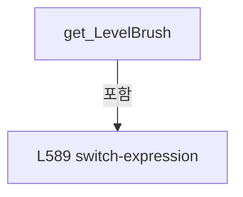

변경 전 점검: 입력/반환 타입, 위 호출자, 예외/취소 경로, 공유 상태와 저장·전송 소비자를 함께 확인합니다. 값의 단위나 물리 방향을 이름만으로 확정하지 않습니다.

### PropertyDeclaration `ValueBrush` · L603–616

[Drilling.UI/Menu/Menus/CMenuAlarm.cs:603–616](https://github.com/kjuws10-rgb/A3Drilling/blob/96e22cd027c84bf302b23f2949b98985d7f301bb/Drilling.UI/Menu/Menus/CMenuAlarm.cs#L603-L616)

| 항목 | 실제 추출 값 |
| --- | --- |
| 서명 | Brush Drilling.UI.Menu.Menus.ST_ALARM_SUMMARY_ITEM.ValueBrush |
| 접근/수식자 | Public / public |
| 반환/값 타입 | Brush |
| 소속 타입 | NamedType:Drilling.UI.Menu.Menus.ST_ALARM_SUMMARY_ITEM |

현재 부분 분석에서 직접 연결된 호출자는 없습니다. XAML/이벤트/인터페이스·델리게이트·외부 진입을 추가 확인해야 하며, 미사용으로 판정한 것이 아닙니다.

변경 전 점검: 입력/반환 타입, 위 호출자, 예외/취소 경로, 공유 상태와 저장·전송 소비자를 함께 확인합니다. 값의 단위나 물리 방향을 이름만으로 확정하지 않습니다.

### GetAccessorDeclaration `get_ValueBrush` · L605–615

[Drilling.UI/Menu/Menus/CMenuAlarm.cs:605–615](https://github.com/kjuws10-rgb/A3Drilling/blob/96e22cd027c84bf302b23f2949b98985d7f301bb/Drilling.UI/Menu/Menus/CMenuAlarm.cs#L605-L615)

| 항목 | 실제 추출 값 |
| --- | --- |
| 서명 | Brush Drilling.UI.Menu.Menus.ST_ALARM_SUMMARY_ITEM.ValueBrush.get |
| 접근/수식자 | Public / get |
| 반환/값 타입 | Brush |
| 소속 타입 | NamedType:Drilling.UI.Menu.Menus.ST_ALARM_SUMMARY_ITEM |

현재 부분 분석에서 직접 연결된 호출자는 없습니다. XAML/이벤트/인터페이스·델리게이트·외부 진입을 추가 확인해야 하며, 미사용으로 판정한 것이 아닙니다.

본문의 실제 연산·분기·예외·반환 순서(원문 위치 순):

| 원본 행 | 종류 | 주석 해설 |
| --- | --- | --- |
| 607 | return | 호출자에게 값 또는 제어를 반환합니다: return State switch { "Warn" => CStatusBrush.Wait, "Critical" => CStatusBrush.Offline, "Accent" => CStatusBrush.Simul, "Ok" => CStatusBrush.Online, _ => CStatusBrush.PrimaryText }; |
| 607 | switch-expression | 값별 결과식을 선택합니다: State switch { "Warn" => CStatusBrush.Wait, "Critical" => CStatusBrush.Offline, "Accent" => CStatusBrush.Simul, "Ok" => CStatusBrush.Online, _ => CStatusBrush.PrimaryText } |

제어 구문의 포함 구조(실제 실행 순서/CFG가 아닌 구문 탐색 그림):

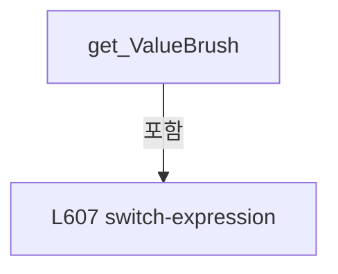

변경 전 점검: 입력/반환 타입, 위 호출자, 예외/취소 경로, 공유 상태와 저장·전송 소비자를 함께 확인합니다. 값의 단위나 물리 방향을 이름만으로 확정하지 않습니다.

## 구문·바인딩 한계

전체 WPF/벤더 SDK/프로젝트별 빌드 조건을 로드한 정식 빌드가 아닙니다. `resolved`는 이 부분 컴파일에서의 심볼 연결이며 virtual/interface/delegate/이벤트/Reflection/XAML의 실제 런타임 구현을 확정하지 않습니다. `candidate`와 `unresolved`는 후속 확인 대상으로 남깁니다.

## 원문 전체 주석 해설본

[원본 모든 행과 행별 해설 보기](../../../../annotated/Drilling.UI/Menu/Menus/CMenuAlarm.cs.annotated.txt)

원본을 빠뜨리거나 임의로 줄이지 않았습니다. `L000001 |` 표시는 원본 행 번호, `// 해설`은 별도 설명입니다. 실행용 소스가 아닌 문서입니다.

## 수정·재검증 체크

- 원본 Commit과 현재 작업 파일 SHA가 같은지 먼저 확인합니다. 다르면 이 문서를 과거 버전 자료로 취급합니다.
- 선언·직접 호출·이벤트/인터페이스 경계·설정 소비를 함께 확인합니다. 정적 연결의 빈 곳을 정상 경로로 추정하지 않습니다.
- 저장 형식/단위/식별자·재시도·취소·예외·롤백에 영향을 주는 변경은 상세 해설장과 호출자를 다시 검토합니다.
- 도구의 구문 추출과 별도 정적 추적 해설, 실제 빌드·시뮬레이션·실장비 검증 결과를 분리합니다.
