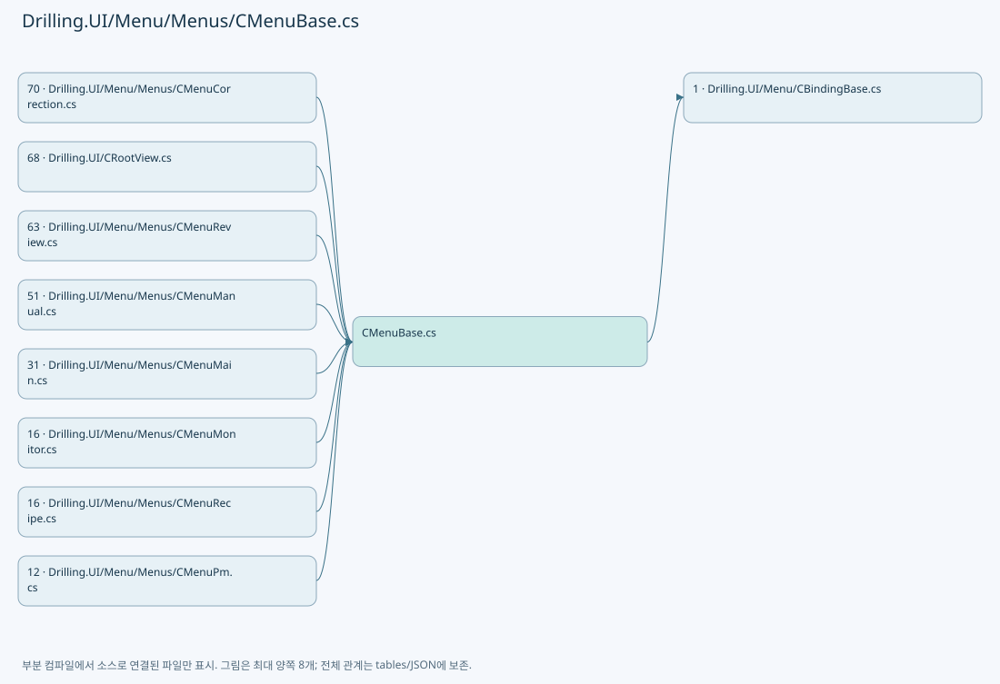
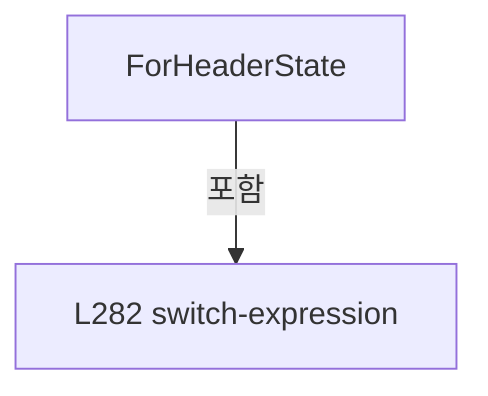
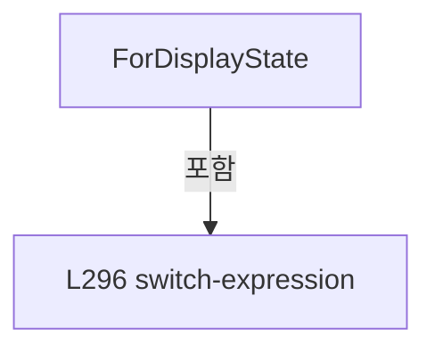
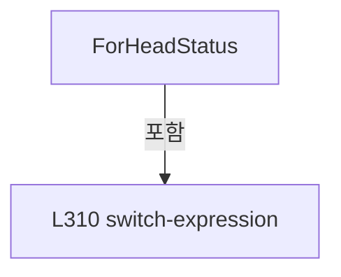
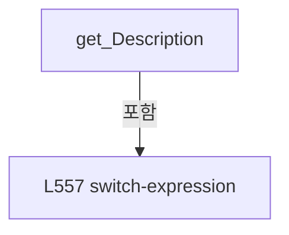

# Drilling.UI/Menu/Menus/CMenuBase.cs

| 항목 | 내용 |
| --- | --- |
| 원본 저장소 | https://github.com/kjuws10-rgb/A3Drilling.git |
| 원본 Commit | 5aee8e58439c9b455cae7c9593c9be986c3e682e |
| 원본 SHA256 | 2e210d843be8a8cfeaaab042cd85acf8674d9e9f78ecfc9448dd060b57602ac4 |
| 파일 분류 | code |
| 원본 크기/행 | 17,691 bytes / 601 physical lines |
| 인코딩 | utf-8-sig |
| 검토 범위 | 구문/부분 의미 분석에서 추출한 사실. 동작·물리 단위·실장비 합격을 보증하지 않습니다. |
| 원본 링크 | [고정 Commit 원본](https://github.com/kjuws10-rgb/A3Drilling/blob/5aee8e58439c9b455cae7c9593c9be986c3e682e/Drilling.UI/Menu/Menus/CMenuBase.cs) |

## 파일의 역할과 읽는 순서

WPF 화면·사용자 명령·표시 상태를 구성합니다. XAML 이벤트와 코드 비하인드, RootView의 조립 경로를 함께 추적합니다.

## 네임스페이스·타입·상속

| 타입 | 구분 | 원본 범위 | 선언/상속 |
| --- | --- | --- | --- |
| CMenuBase | ClassDeclaration | 11–27 | CMenuBase: CBindingBase |
| EN_MENU | EnumDeclaration | 29–41 | EN_MENU |
| ST_DISPLAY_ITEM | RecordDeclaration | 43–60 | ST_DISPLAY_ITEM |
| CStatusBrush | ClassDeclaration | 62–336 | CStatusBrush |
| ST_HEADER_STATUS_ITEM | RecordDeclaration | 338–408 | ST_HEADER_STATUS_ITEM |
| ST_SCREEN_SECTION | RecordDeclaration | 410–410 | ST_SCREEN_SECTION |
| CScreenViewModel | ClassDeclaration | 411–524 | CScreenViewModel |
| CMenuItem | ClassDeclaration | 526–573 | CMenuItem: CBindingBase |
| CMenuIcon | ClassDeclaration | 575–601 | CMenuIcon |

## 멤버 빠른 목록

| 이름 | 종류 | 범위 | 서명 |
| --- | --- | --- | --- |
| OperationAllowed | PropertyDeclaration | L13–13 | System.Func<string, bool>? Drilling.UI.Menu.Menus.CMenuBase.OperationAllowed |
| get_OperationAllowed | GetAccessorDeclaration | L13–13 | System.Func<string, bool>? Drilling.UI.Menu.Menus.CMenuBase.OperationAllowed.get |
| set_OperationAllowed | SetAccessorDeclaration | L13–13 | void Drilling.UI.Menu.Menus.CMenuBase.OperationAllowed.set |
| CheckOperationAlarm | MethodDeclaration | L15–15 | bool Drilling.UI.Menu.Menus.CMenuBase.CheckOperationAlarm(string) |
| StopForHeavyAlarm | MethodDeclaration | L16–16 | System.Threading.Tasks.Task Drilling.UI.Menu.Menus.CMenuBase.StopForHeavyAlarm() |
| Menu | PropertyDeclaration | L17–17 | Drilling.UI.Menu.Menus.EN_MENU Drilling.UI.Menu.Menus.CMenuBase.Menu |
| get_Menu | GetAccessorDeclaration | L17–17 | Drilling.UI.Menu.Menus.EN_MENU Drilling.UI.Menu.Menus.CMenuBase.Menu.get |
| Build | MethodDeclaration | L19–19 | System.Threading.Tasks.Task<Drilling.UI.Menu.Menus.CScreenViewModel> Drilling.UI.Menu.Menus.CMenuBase.Build(System.Threading.CancellationToken) |
| OnActivated | MethodDeclaration | L20–22 | void Drilling.UI.Menu.Menus.CMenuBase.OnActivated() |
| OnDeactivated | MethodDeclaration | L24–26 | void Drilling.UI.Menu.Menus.CMenuBase.OnDeactivated() |
| Main | EnumMemberDeclaration | L31–31 | Drilling.UI.Menu.Menus.EN_MENU.Main |
| Manual | EnumMemberDeclaration | L32–32 | Drilling.UI.Menu.Menus.EN_MENU.Manual |
| Recipe | EnumMemberDeclaration | L33–33 | Drilling.UI.Menu.Menus.EN_MENU.Recipe |
| Setting | EnumMemberDeclaration | L34–34 | Drilling.UI.Menu.Menus.EN_MENU.Setting |
| Alarm | EnumMemberDeclaration | L35–35 | Drilling.UI.Menu.Menus.EN_MENU.Alarm |
| Monitor | EnumMemberDeclaration | L36–36 | Drilling.UI.Menu.Menus.EN_MENU.Monitor |
| Review | EnumMemberDeclaration | L37–37 | Drilling.UI.Menu.Menus.EN_MENU.Review |
| Correction | EnumMemberDeclaration | L38–38 | Drilling.UI.Menu.Menus.EN_MENU.Correction |
| Pm | EnumMemberDeclaration | L39–39 | Drilling.UI.Menu.Menus.EN_MENU.Pm |
| Exit | EnumMemberDeclaration | L40–40 | Drilling.UI.Menu.Menus.EN_MENU.Exit |
| ValueBrush | PropertyDeclaration | L45–51 | Brush Drilling.UI.Menu.Menus.ST_DISPLAY_ITEM.ValueBrush |
| get_ValueBrush | GetAccessorDeclaration | L47–50 | Brush Drilling.UI.Menu.Menus.ST_DISPLAY_ITEM.ValueBrush.get |
| StateBrush | PropertyDeclaration | L53–59 | Brush Drilling.UI.Menu.Menus.ST_DISPLAY_ITEM.StateBrush |
| get_StateBrush | GetAccessorDeclaration | L55–58 | Brush Drilling.UI.Menu.Menus.ST_DISPLAY_ITEM.StateBrush.get |
| LightPrimaryText | FieldDeclaration | L64–64 | Brush Drilling.UI.Menu.Menus.CStatusBrush.LightPrimaryText |
| LightRecipe | FieldDeclaration | L65–65 | Brush Drilling.UI.Menu.Menus.CStatusBrush.LightRecipe |
| LightOnline | FieldDeclaration | L66–66 | Brush Drilling.UI.Menu.Menus.CStatusBrush.LightOnline |
| LightSimul | FieldDeclaration | L67–67 | Brush Drilling.UI.Menu.Menus.CStatusBrush.LightSimul |
| LightOffline | FieldDeclaration | L68–68 | Brush Drilling.UI.Menu.Menus.CStatusBrush.LightOffline |
| LightWait | FieldDeclaration | L69–69 | Brush Drilling.UI.Menu.Menus.CStatusBrush.LightWait |
| LightActive | FieldDeclaration | L70–70 | Brush Drilling.UI.Menu.Menus.CStatusBrush.LightActive |
| LightMuted | FieldDeclaration | L71–71 | Brush Drilling.UI.Menu.Menus.CStatusBrush.LightMuted |
| LightCommandBlue | FieldDeclaration | L72–72 | Brush Drilling.UI.Menu.Menus.CStatusBrush.LightCommandBlue |
| LightCommandBlueBorder | FieldDeclaration | L73–73 | Brush Drilling.UI.Menu.Menus.CStatusBrush.LightCommandBlueBorder |
| LightCommandGreen | FieldDeclaration | L74–74 | Brush Drilling.UI.Menu.Menus.CStatusBrush.LightCommandGreen |
| LightCommandGreenBorder | FieldDeclaration | L75–75 | Brush Drilling.UI.Menu.Menus.CStatusBrush.LightCommandGreenBorder |
| LightCommandRed | FieldDeclaration | L76–76 | Brush Drilling.UI.Menu.Menus.CStatusBrush.LightCommandRed |
| LightCommandRedBorder | FieldDeclaration | L77–77 | Brush Drilling.UI.Menu.Menus.CStatusBrush.LightCommandRedBorder |
| LightCommandDark | FieldDeclaration | L78–78 | Brush Drilling.UI.Menu.Menus.CStatusBrush.LightCommandDark |
| LightCommandDarkBorder | FieldDeclaration | L79–79 | Brush Drilling.UI.Menu.Menus.CStatusBrush.LightCommandDarkBorder |
| LightCardBackground | FieldDeclaration | L80–80 | Brush Drilling.UI.Menu.Menus.CStatusBrush.LightCardBackground |
| LightSoftSelectedBackground | FieldDeclaration | L81–81 | Brush Drilling.UI.Menu.Menus.CStatusBrush.LightSoftSelectedBackground |
| LightMaskBackground | FieldDeclaration | L82–82 | Brush Drilling.UI.Menu.Menus.CStatusBrush.LightMaskBackground |
| LightChessBackground | FieldDeclaration | L83–83 | Brush Drilling.UI.Menu.Menus.CStatusBrush.LightChessBackground |
| DarkPrimaryText | FieldDeclaration | L84–84 | Brush Drilling.UI.Menu.Menus.CStatusBrush.DarkPrimaryText |
| DarkRecipe | FieldDeclaration | L85–85 | Brush Drilling.UI.Menu.Menus.CStatusBrush.DarkRecipe |
| DarkOnline | FieldDeclaration | L86–86 | Brush Drilling.UI.Menu.Menus.CStatusBrush.DarkOnline |
| DarkSimul | FieldDeclaration | L87–87 | Brush Drilling.UI.Menu.Menus.CStatusBrush.DarkSimul |
| DarkOffline | FieldDeclaration | L88–88 | Brush Drilling.UI.Menu.Menus.CStatusBrush.DarkOffline |
| DarkWait | FieldDeclaration | L89–89 | Brush Drilling.UI.Menu.Menus.CStatusBrush.DarkWait |
| DarkActive | FieldDeclaration | L90–90 | Brush Drilling.UI.Menu.Menus.CStatusBrush.DarkActive |
| DarkMuted | FieldDeclaration | L91–91 | Brush Drilling.UI.Menu.Menus.CStatusBrush.DarkMuted |
| DarkCommandBlue | FieldDeclaration | L92–92 | Brush Drilling.UI.Menu.Menus.CStatusBrush.DarkCommandBlue |
| DarkCommandBlueBorder | FieldDeclaration | L93–93 | Brush Drilling.UI.Menu.Menus.CStatusBrush.DarkCommandBlueBorder |
| DarkCommandGreen | FieldDeclaration | L94–94 | Brush Drilling.UI.Menu.Menus.CStatusBrush.DarkCommandGreen |
| DarkCommandGreenBorder | FieldDeclaration | L95–95 | Brush Drilling.UI.Menu.Menus.CStatusBrush.DarkCommandGreenBorder |
| DarkCommandRed | FieldDeclaration | L96–96 | Brush Drilling.UI.Menu.Menus.CStatusBrush.DarkCommandRed |
| DarkCommandRedBorder | FieldDeclaration | L97–97 | Brush Drilling.UI.Menu.Menus.CStatusBrush.DarkCommandRedBorder |
| DarkCommandDark | FieldDeclaration | L98–98 | Brush Drilling.UI.Menu.Menus.CStatusBrush.DarkCommandDark |
| DarkCommandDarkBorder | FieldDeclaration | L99–99 | Brush Drilling.UI.Menu.Menus.CStatusBrush.DarkCommandDarkBorder |
| DarkCardBackground | FieldDeclaration | L100–100 | Brush Drilling.UI.Menu.Menus.CStatusBrush.DarkCardBackground |
| DarkSoftSelectedBackground | FieldDeclaration | L101–101 | Brush Drilling.UI.Menu.Menus.CStatusBrush.DarkSoftSelectedBackground |
| DarkMaskBackground | FieldDeclaration | L102–102 | Brush Drilling.UI.Menu.Menus.CStatusBrush.DarkMaskBackground |
| DarkChessBackground | FieldDeclaration | L103–103 | Brush Drilling.UI.Menu.Menus.CStatusBrush.DarkChessBackground |
| PrimaryText | PropertyDeclaration | L104–110 | Brush Drilling.UI.Menu.Menus.CStatusBrush.PrimaryText |
| get_PrimaryText | GetAccessorDeclaration | L106–109 | Brush Drilling.UI.Menu.Menus.CStatusBrush.PrimaryText.get |
| Recipe | PropertyDeclaration | L112–118 | Brush Drilling.UI.Menu.Menus.CStatusBrush.Recipe |
| get_Recipe | GetAccessorDeclaration | L114–117 | Brush Drilling.UI.Menu.Menus.CStatusBrush.Recipe.get |
| Online | PropertyDeclaration | L120–126 | Brush Drilling.UI.Menu.Menus.CStatusBrush.Online |
| get_Online | GetAccessorDeclaration | L122–125 | Brush Drilling.UI.Menu.Menus.CStatusBrush.Online.get |
| Simul | PropertyDeclaration | L128–134 | Brush Drilling.UI.Menu.Menus.CStatusBrush.Simul |
| get_Simul | GetAccessorDeclaration | L130–133 | Brush Drilling.UI.Menu.Menus.CStatusBrush.Simul.get |
| Offline | PropertyDeclaration | L136–142 | Brush Drilling.UI.Menu.Menus.CStatusBrush.Offline |
| get_Offline | GetAccessorDeclaration | L138–141 | Brush Drilling.UI.Menu.Menus.CStatusBrush.Offline.get |
| Wait | PropertyDeclaration | L144–150 | Brush Drilling.UI.Menu.Menus.CStatusBrush.Wait |
| get_Wait | GetAccessorDeclaration | L146–149 | Brush Drilling.UI.Menu.Menus.CStatusBrush.Wait.get |
| Active | PropertyDeclaration | L152–158 | Brush Drilling.UI.Menu.Menus.CStatusBrush.Active |
| get_Active | GetAccessorDeclaration | L154–157 | Brush Drilling.UI.Menu.Menus.CStatusBrush.Active.get |
| Muted | PropertyDeclaration | L160–166 | Brush Drilling.UI.Menu.Menus.CStatusBrush.Muted |
| get_Muted | GetAccessorDeclaration | L162–165 | Brush Drilling.UI.Menu.Menus.CStatusBrush.Muted.get |
| CommandBlue | PropertyDeclaration | L168–174 | Brush Drilling.UI.Menu.Menus.CStatusBrush.CommandBlue |
| get_CommandBlue | GetAccessorDeclaration | L170–173 | Brush Drilling.UI.Menu.Menus.CStatusBrush.CommandBlue.get |
| CommandBlueBorder | PropertyDeclaration | L176–182 | Brush Drilling.UI.Menu.Menus.CStatusBrush.CommandBlueBorder |
| get_CommandBlueBorder | GetAccessorDeclaration | L178–181 | Brush Drilling.UI.Menu.Menus.CStatusBrush.CommandBlueBorder.get |
| CommandGreen | PropertyDeclaration | L184–190 | Brush Drilling.UI.Menu.Menus.CStatusBrush.CommandGreen |
| get_CommandGreen | GetAccessorDeclaration | L186–189 | Brush Drilling.UI.Menu.Menus.CStatusBrush.CommandGreen.get |
| CommandGreenBorder | PropertyDeclaration | L192–198 | Brush Drilling.UI.Menu.Menus.CStatusBrush.CommandGreenBorder |
| get_CommandGreenBorder | GetAccessorDeclaration | L194–197 | Brush Drilling.UI.Menu.Menus.CStatusBrush.CommandGreenBorder.get |
| CommandRed | PropertyDeclaration | L200–206 | Brush Drilling.UI.Menu.Menus.CStatusBrush.CommandRed |
| get_CommandRed | GetAccessorDeclaration | L202–205 | Brush Drilling.UI.Menu.Menus.CStatusBrush.CommandRed.get |
| CommandRedBorder | PropertyDeclaration | L208–214 | Brush Drilling.UI.Menu.Menus.CStatusBrush.CommandRedBorder |
| get_CommandRedBorder | GetAccessorDeclaration | L210–213 | Brush Drilling.UI.Menu.Menus.CStatusBrush.CommandRedBorder.get |
| CommandDark | PropertyDeclaration | L216–222 | Brush Drilling.UI.Menu.Menus.CStatusBrush.CommandDark |
| get_CommandDark | GetAccessorDeclaration | L218–221 | Brush Drilling.UI.Menu.Menus.CStatusBrush.CommandDark.get |
| CommandDarkBorder | PropertyDeclaration | L224–230 | Brush Drilling.UI.Menu.Menus.CStatusBrush.CommandDarkBorder |
| get_CommandDarkBorder | GetAccessorDeclaration | L226–229 | Brush Drilling.UI.Menu.Menus.CStatusBrush.CommandDarkBorder.get |
| CardBackground | PropertyDeclaration | L232–238 | Brush Drilling.UI.Menu.Menus.CStatusBrush.CardBackground |
| get_CardBackground | GetAccessorDeclaration | L234–237 | Brush Drilling.UI.Menu.Menus.CStatusBrush.CardBackground.get |
| SoftSelectedBackground | PropertyDeclaration | L240–246 | Brush Drilling.UI.Menu.Menus.CStatusBrush.SoftSelectedBackground |
| get_SoftSelectedBackground | GetAccessorDeclaration | L242–245 | Brush Drilling.UI.Menu.Menus.CStatusBrush.SoftSelectedBackground.get |
| MaskBackground | PropertyDeclaration | L248–254 | Brush Drilling.UI.Menu.Menus.CStatusBrush.MaskBackground |
| get_MaskBackground | GetAccessorDeclaration | L250–253 | Brush Drilling.UI.Menu.Menus.CStatusBrush.MaskBackground.get |
| ChessBackground | PropertyDeclaration | L256–262 | Brush Drilling.UI.Menu.Menus.CStatusBrush.ChessBackground |
| get_ChessBackground | GetAccessorDeclaration | L258–261 | Brush Drilling.UI.Menu.Menus.CStatusBrush.ChessBackground.get |
| SoftSelectedText | PropertyDeclaration | L264–270 | Brush Drilling.UI.Menu.Menus.CStatusBrush.SoftSelectedText |
| get_SoftSelectedText | GetAccessorDeclaration | L266–269 | Brush Drilling.UI.Menu.Menus.CStatusBrush.SoftSelectedText.get |
| IsLightTheme | PropertyDeclaration | L272–278 | bool Drilling.UI.Menu.Menus.CStatusBrush.IsLightTheme |
| get_IsLightTheme | GetAccessorDeclaration | L274–277 | bool Drilling.UI.Menu.Menus.CStatusBrush.IsLightTheme.get |
| ForHeaderState | MethodDeclaration | L280–292 | Brush Drilling.UI.Menu.Menus.CStatusBrush.ForHeaderState(string) |
| ForDisplayState | MethodDeclaration | L294–306 | Brush Drilling.UI.Menu.Menus.CStatusBrush.ForDisplayState(string) |
| ForHeadStatus | MethodDeclaration | L308–318 | Brush Drilling.UI.Menu.Menus.CStatusBrush.ForHeadStatus(string) |
| Normalize | MethodDeclaration | L320–323 | string Drilling.UI.Menu.Menus.CStatusBrush.Normalize(string) |
| Pick | MethodDeclaration | L325–328 | Brush Drilling.UI.Menu.Menus.CStatusBrush.Pick(Brush, Brush) |
| Frozen | MethodDeclaration | L330–335 | SolidColorBrush Drilling.UI.Menu.Menus.CStatusBrush.Frozen(byte, byte, byte) |
| DisplayValue | PropertyDeclaration | L351–352 | string Drilling.UI.Menu.Menus.ST_HEADER_STATUS_ITEM.DisplayValue |
| CardBrush | PropertyDeclaration | L353–359 | Brush Drilling.UI.Menu.Menus.ST_HEADER_STATUS_ITEM.CardBrush |
| get_CardBrush | GetAccessorDeclaration | L355–358 | Brush Drilling.UI.Menu.Menus.ST_HEADER_STATUS_ITEM.CardBrush.get |
| CardTextBrush | PropertyDeclaration | L361–367 | Brush Drilling.UI.Menu.Menus.ST_HEADER_STATUS_ITEM.CardTextBrush |
| get_CardTextBrush | GetAccessorDeclaration | L363–366 | Brush Drilling.UI.Menu.Menus.ST_HEADER_STATUS_ITEM.CardTextBrush.get |
| AccentBrush | PropertyDeclaration | L369–375 | Brush Drilling.UI.Menu.Menus.ST_HEADER_STATUS_ITEM.AccentBrush |
| get_AccentBrush | GetAccessorDeclaration | L371–374 | Brush Drilling.UI.Menu.Menus.ST_HEADER_STATUS_ITEM.AccentBrush.get |
| ValueBrush | PropertyDeclaration | L377–383 | Brush Drilling.UI.Menu.Menus.ST_HEADER_STATUS_ITEM.ValueBrush |
| get_ValueBrush | GetAccessorDeclaration | L379–382 | Brush Drilling.UI.Menu.Menus.ST_HEADER_STATUS_ITEM.ValueBrush.get |
| Previous | PropertyDeclaration | L385–391 | Drilling.UI.Menu.CButtonCommand Drilling.UI.Menu.Menus.ST_HEADER_STATUS_ITEM.Previous |
| get_Previous | GetAccessorDeclaration | L387–390 | Drilling.UI.Menu.CButtonCommand Drilling.UI.Menu.Menus.ST_HEADER_STATUS_ITEM.Previous.get |
| Next | PropertyDeclaration | L393–399 | Drilling.UI.Menu.CButtonCommand Drilling.UI.Menu.Menus.ST_HEADER_STATUS_ITEM.Next |
| get_Next | GetAccessorDeclaration | L395–398 | Drilling.UI.Menu.CButtonCommand Drilling.UI.Menu.Menus.ST_HEADER_STATUS_ITEM.Next.get |
| Open | PropertyDeclaration | L401–407 | Drilling.UI.Menu.CButtonCommand Drilling.UI.Menu.Menus.ST_HEADER_STATUS_ITEM.Open |
| get_Open | GetAccessorDeclaration | L403–406 | Drilling.UI.Menu.CButtonCommand Drilling.UI.Menu.Menus.ST_HEADER_STATUS_ITEM.Open.get |
| Menu | PropertyDeclaration | L429–429 | Drilling.UI.Menu.Menus.EN_MENU Drilling.UI.Menu.Menus.CScreenViewModel.Menu |
| get_Menu | GetAccessorDeclaration | L429–429 | Drilling.UI.Menu.Menus.EN_MENU Drilling.UI.Menu.Menus.CScreenViewModel.Menu.get |
| Title | PropertyDeclaration | L430–430 | string Drilling.UI.Menu.Menus.CScreenViewModel.Title |
| get_Title | GetAccessorDeclaration | L430–430 | string Drilling.UI.Menu.Menus.CScreenViewModel.Title.get |
| Subtitle | PropertyDeclaration | L431–431 | string Drilling.UI.Menu.Menus.CScreenViewModel.Subtitle |
| get_Subtitle | GetAccessorDeclaration | L431–431 | string Drilling.UI.Menu.Menus.CScreenViewModel.Subtitle.get |
| Metrics | PropertyDeclaration | L432–432 | System.Collections.Generic.IReadOnlyList<Drilling.UI.Menu.Menus.ST_DISPLAY_ITEM> Drilling.UI.Menu.Menus.CScreenViewModel.Metrics |
| get_Metrics | GetAccessorDeclaration | L432–432 | System.Collections.Generic.IReadOnlyList<Drilling.UI.Menu.Menus.ST_DISPLAY_ITEM> Drilling.UI.Menu.Menus.CScreenViewModel.Metrics.get |
| Sections | PropertyDeclaration | L433–433 | System.Collections.Generic.IReadOnlyList<Drilling.UI.Menu.Menus.ST_SCREEN_SECTION> Drilling.UI.Menu.Menus.CScreenViewModel.Sections |
| get_Sections | GetAccessorDeclaration | L433–433 | System.Collections.Generic.IReadOnlyList<Drilling.UI.Menu.Menus.ST_SCREEN_SECTION> Drilling.UI.Menu.Menus.CScreenViewModel.Sections.get |
| ShowCycleControls | PropertyDeclaration | L434–434 | bool Drilling.UI.Menu.Menus.CScreenViewModel.ShowCycleControls |
| get_ShowCycleControls | GetAccessorDeclaration | L434–434 | bool Drilling.UI.Menu.Menus.CScreenViewModel.ShowCycleControls.get |
| MainOperating | PropertyDeclaration | L435–435 | Drilling.UI.Menu.Menus.CMenuMain? Drilling.UI.Menu.Menus.CScreenViewModel.MainOperating |
| get_MainOperating | GetAccessorDeclaration | L435–435 | Drilling.UI.Menu.Menus.CMenuMain? Drilling.UI.Menu.Menus.CScreenViewModel.MainOperating.get |
| Manual | PropertyDeclaration | L436–436 | Drilling.UI.Menu.Menus.CMenuManual? Drilling.UI.Menu.Menus.CScreenViewModel.Manual |
| get_Manual | GetAccessorDeclaration | L436–436 | Drilling.UI.Menu.Menus.CMenuManual? Drilling.UI.Menu.Menus.CScreenViewModel.Manual.get |
| Recipe | PropertyDeclaration | L437–437 | Drilling.UI.Menu.Menus.CMenuRecipe? Drilling.UI.Menu.Menus.CScreenViewModel.Recipe |
| get_Recipe | GetAccessorDeclaration | L437–437 | Drilling.UI.Menu.Menus.CMenuRecipe? Drilling.UI.Menu.Menus.CScreenViewModel.Recipe.get |
| Setting | PropertyDeclaration | L438–438 | Drilling.UI.Menu.Menus.CMenuSetting? Drilling.UI.Menu.Menus.CScreenViewModel.Setting |
| get_Setting | GetAccessorDeclaration | L438–438 | Drilling.UI.Menu.Menus.CMenuSetting? Drilling.UI.Menu.Menus.CScreenViewModel.Setting.get |
| Alarm | PropertyDeclaration | L439–439 | Drilling.UI.Menu.Menus.CMenuAlarm? Drilling.UI.Menu.Menus.CScreenViewModel.Alarm |
| get_Alarm | GetAccessorDeclaration | L439–439 | Drilling.UI.Menu.Menus.CMenuAlarm? Drilling.UI.Menu.Menus.CScreenViewModel.Alarm.get |
| Monitor | PropertyDeclaration | L440–440 | Drilling.UI.Menu.Menus.CMenuMonitor? Drilling.UI.Menu.Menus.CScreenViewModel.Monitor |
| get_Monitor | GetAccessorDeclaration | L440–440 | Drilling.UI.Menu.Menus.CMenuMonitor? Drilling.UI.Menu.Menus.CScreenViewModel.Monitor.get |
| Review | PropertyDeclaration | L441–441 | Drilling.UI.Menu.Menus.CMenuReview? Drilling.UI.Menu.Menus.CScreenViewModel.Review |
| get_Review | GetAccessorDeclaration | L441–441 | Drilling.UI.Menu.Menus.CMenuReview? Drilling.UI.Menu.Menus.CScreenViewModel.Review.get |
| Correction | PropertyDeclaration | L442–442 | Drilling.UI.Menu.Menus.CMenuCorrection? Drilling.UI.Menu.Menus.CScreenViewModel.Correction |
| get_Correction | GetAccessorDeclaration | L442–442 | Drilling.UI.Menu.Menus.CMenuCorrection? Drilling.UI.Menu.Menus.CScreenViewModel.Correction.get |
| Pm | PropertyDeclaration | L443–443 | Drilling.UI.Menu.Menus.CMenuPm? Drilling.UI.Menu.Menus.CScreenViewModel.Pm |
| get_Pm | GetAccessorDeclaration | L443–443 | Drilling.UI.Menu.Menus.CMenuPm? Drilling.UI.Menu.Menus.CScreenViewModel.Pm.get |
| IsMainLayout | PropertyDeclaration | L445–451 | bool Drilling.UI.Menu.Menus.CScreenViewModel.IsMainLayout |
| get_IsMainLayout | GetAccessorDeclaration | L447–450 | bool Drilling.UI.Menu.Menus.CScreenViewModel.IsMainLayout.get |
| IsManualLayout | PropertyDeclaration | L453–459 | bool Drilling.UI.Menu.Menus.CScreenViewModel.IsManualLayout |
| get_IsManualLayout | GetAccessorDeclaration | L455–458 | bool Drilling.UI.Menu.Menus.CScreenViewModel.IsManualLayout.get |
| IsRecipeLayout | PropertyDeclaration | L461–467 | bool Drilling.UI.Menu.Menus.CScreenViewModel.IsRecipeLayout |
| get_IsRecipeLayout | GetAccessorDeclaration | L463–466 | bool Drilling.UI.Menu.Menus.CScreenViewModel.IsRecipeLayout.get |
| IsSettingLayout | PropertyDeclaration | L469–475 | bool Drilling.UI.Menu.Menus.CScreenViewModel.IsSettingLayout |
| get_IsSettingLayout | GetAccessorDeclaration | L471–474 | bool Drilling.UI.Menu.Menus.CScreenViewModel.IsSettingLayout.get |
| IsAlarmLayout | PropertyDeclaration | L477–483 | bool Drilling.UI.Menu.Menus.CScreenViewModel.IsAlarmLayout |
| get_IsAlarmLayout | GetAccessorDeclaration | L479–482 | bool Drilling.UI.Menu.Menus.CScreenViewModel.IsAlarmLayout.get |
| IsMonitorLayout | PropertyDeclaration | L485–491 | bool Drilling.UI.Menu.Menus.CScreenViewModel.IsMonitorLayout |
| get_IsMonitorLayout | GetAccessorDeclaration | L487–490 | bool Drilling.UI.Menu.Menus.CScreenViewModel.IsMonitorLayout.get |
| IsReviewLayout | PropertyDeclaration | L493–499 | bool Drilling.UI.Menu.Menus.CScreenViewModel.IsReviewLayout |
| get_IsReviewLayout | GetAccessorDeclaration | L495–498 | bool Drilling.UI.Menu.Menus.CScreenViewModel.IsReviewLayout.get |
| IsCorrectionLayout | PropertyDeclaration | L501–507 | bool Drilling.UI.Menu.Menus.CScreenViewModel.IsCorrectionLayout |
| get_IsCorrectionLayout | GetAccessorDeclaration | L503–506 | bool Drilling.UI.Menu.Menus.CScreenViewModel.IsCorrectionLayout.get |
| IsPmLayout | PropertyDeclaration | L509–515 | bool Drilling.UI.Menu.Menus.CScreenViewModel.IsPmLayout |
| get_IsPmLayout | GetAccessorDeclaration | L511–514 | bool Drilling.UI.Menu.Menus.CScreenViewModel.IsPmLayout.get |
| IsGenericLayout | PropertyDeclaration | L517–523 | bool Drilling.UI.Menu.Menus.CScreenViewModel.IsGenericLayout |
| get_IsGenericLayout | GetAccessorDeclaration | L519–522 | bool Drilling.UI.Menu.Menus.CScreenViewModel.IsGenericLayout.get |
| _isEnabled | FieldDeclaration | L528–528 | bool Drilling.UI.Menu.Menus.CMenuItem._isEnabled |
| Menu | PropertyDeclaration | L529–529 | Drilling.UI.Menu.Menus.EN_MENU Drilling.UI.Menu.Menus.CMenuItem.Menu |
| get_Menu | GetAccessorDeclaration | L529–529 | Drilling.UI.Menu.Menus.EN_MENU Drilling.UI.Menu.Menus.CMenuItem.Menu.get |
| Name | PropertyDeclaration | L530–530 | string Drilling.UI.Menu.Menus.CMenuItem.Name |
| get_Name | GetAccessorDeclaration | L530–530 | string Drilling.UI.Menu.Menus.CMenuItem.Name.get |
| IsEnabled | PropertyDeclaration | L532–543 | bool Drilling.UI.Menu.Menus.CMenuItem.IsEnabled |
| get_IsEnabled | GetAccessorDeclaration | L534–537 | bool Drilling.UI.Menu.Menus.CMenuItem.IsEnabled.get |
| set_IsEnabled | SetAccessorDeclaration | L539–542 | void Drilling.UI.Menu.Menus.CMenuItem.IsEnabled.set |
| IconGeometry | PropertyDeclaration | L545–551 | Geometry Drilling.UI.Menu.Menus.CMenuItem.IconGeometry |
| get_IconGeometry | GetAccessorDeclaration | L547–550 | Geometry Drilling.UI.Menu.Menus.CMenuItem.IconGeometry.get |
| Description | PropertyDeclaration | L553–572 | string Drilling.UI.Menu.Menus.CMenuItem.Description |
| get_Description | GetAccessorDeclaration | L555–571 | string Drilling.UI.Menu.Menus.CMenuItem.Description.get |
| Icons | FieldDeclaration | L577–589 | System.Collections.Generic.IReadOnlyDictionary<Drilling.UI.Menu.Menus.EN_MENU, Geometry> Drilling.UI.Menu.Menus.CMenuIcon.Icons |
| Get | MethodDeclaration | L590–593 | Geometry Drilling.UI.Menu.Menus.CMenuIcon.Get(Drilling.UI.Menu.Menus.EN_MENU) |
| Icon | MethodDeclaration | L595–600 | Geometry Drilling.UI.Menu.Menus.CMenuIcon.Icon(string) |

## 멤버별 상세 계약·호출·처리 해설

### PropertyDeclaration `OperationAllowed` · L13–13

[Drilling.UI/Menu/Menus/CMenuBase.cs:13–13](https://github.com/kjuws10-rgb/A3Drilling/blob/5aee8e58439c9b455cae7c9593c9be986c3e682e/Drilling.UI/Menu/Menus/CMenuBase.cs#L13-L13)

| 항목 | 실제 추출 값 |
| --- | --- |
| 서명 | System.Func<string, bool>? Drilling.UI.Menu.Menus.CMenuBase.OperationAllowed |
| 접근/수식자 | Public / public |
| 반환/값 타입 | System.Func<string, bool>? |
| 소속 타입 | NamedType:Drilling.UI.Menu.Menus.CMenuBase |

현재 부분 분석에서 직접 연결된 호출자는 없습니다. XAML/이벤트/인터페이스·델리게이트·외부 진입을 추가 확인해야 하며, 미사용으로 판정한 것이 아닙니다.

변경 전 점검: 입력/반환 타입, 위 호출자, 예외/취소 경로, 공유 상태와 저장·전송 소비자를 함께 확인합니다. 값의 단위나 물리 방향을 이름만으로 확정하지 않습니다.

### GetAccessorDeclaration `get_OperationAllowed` · L13–13

[Drilling.UI/Menu/Menus/CMenuBase.cs:13–13](https://github.com/kjuws10-rgb/A3Drilling/blob/5aee8e58439c9b455cae7c9593c9be986c3e682e/Drilling.UI/Menu/Menus/CMenuBase.cs#L13-L13)

| 항목 | 실제 추출 값 |
| --- | --- |
| 서명 | System.Func<string, bool>? Drilling.UI.Menu.Menus.CMenuBase.OperationAllowed.get |
| 접근/수식자 | Public / get |
| 반환/값 타입 | System.Func<string, bool>? |
| 소속 타입 | NamedType:Drilling.UI.Menu.Menus.CMenuBase |

현재 부분 분석에서 직접 연결된 호출자는 없습니다. XAML/이벤트/인터페이스·델리게이트·외부 진입을 추가 확인해야 하며, 미사용으로 판정한 것이 아닙니다.

변경 전 점검: 입력/반환 타입, 위 호출자, 예외/취소 경로, 공유 상태와 저장·전송 소비자를 함께 확인합니다. 값의 단위나 물리 방향을 이름만으로 확정하지 않습니다.

### SetAccessorDeclaration `set_OperationAllowed` · L13–13

[Drilling.UI/Menu/Menus/CMenuBase.cs:13–13](https://github.com/kjuws10-rgb/A3Drilling/blob/5aee8e58439c9b455cae7c9593c9be986c3e682e/Drilling.UI/Menu/Menus/CMenuBase.cs#L13-L13)

| 항목 | 실제 추출 값 |
| --- | --- |
| 서명 | void Drilling.UI.Menu.Menus.CMenuBase.OperationAllowed.set |
| 접근/수식자 | Public / set |
| 반환/값 타입 | void |
| 소속 타입 | NamedType:Drilling.UI.Menu.Menus.CMenuBase |

입력 계약:

| 이름 | 타입 | 전달 | 선택/기본값 |
| --- | --- | --- | --- |
| value | System.Func<string, bool>? | None | False /  |

현재 부분 분석에서 직접 연결된 호출자는 없습니다. XAML/이벤트/인터페이스·델리게이트·외부 진입을 추가 확인해야 하며, 미사용으로 판정한 것이 아닙니다.

변경 전 점검: 입력/반환 타입, 위 호출자, 예외/취소 경로, 공유 상태와 저장·전송 소비자를 함께 확인합니다. 값의 단위나 물리 방향을 이름만으로 확정하지 않습니다.

### MethodDeclaration `CheckOperationAlarm` · L15–15

[Drilling.UI/Menu/Menus/CMenuBase.cs:15–15](https://github.com/kjuws10-rgb/A3Drilling/blob/5aee8e58439c9b455cae7c9593c9be986c3e682e/Drilling.UI/Menu/Menus/CMenuBase.cs#L15-L15)

| 항목 | 실제 추출 값 |
| --- | --- |
| 서명 | bool Drilling.UI.Menu.Menus.CMenuBase.CheckOperationAlarm(string) |
| 접근/수식자 | Protected / protected |
| 반환/값 타입 | bool |
| 소속 타입 | NamedType:Drilling.UI.Menu.Menus.CMenuBase |

입력 계약:

| 이름 | 타입 | 전달 | 선택/기본값 |
| --- | --- | --- | --- |
| operation | string | None | False /  |

정적 호출자로 확인된 위치:

| 호출 파일/행 | 호출 표현식 | 런타임 분기 가능 |
| --- | --- | --- |
| [Drilling.UI/Menu/Menus/CMenuCorrection.cs:2887–2887](https://github.com/kjuws10-rgb/A3Drilling/blob/5aee8e58439c9b455cae7c9593c9be986c3e682e/Drilling.UI/Menu/Menus/CMenuCorrection.cs#L2887-L2887) | CheckOperationAlarm | False |
| [Drilling.UI/Menu/Menus/CMenuCorrection.cs:2926–2926](https://github.com/kjuws10-rgb/A3Drilling/blob/5aee8e58439c9b455cae7c9593c9be986c3e682e/Drilling.UI/Menu/Menus/CMenuCorrection.cs#L2926-L2926) | CheckOperationAlarm | False |
| [Drilling.UI/Menu/Menus/CMenuCorrection.cs:3853–3853](https://github.com/kjuws10-rgb/A3Drilling/blob/5aee8e58439c9b455cae7c9593c9be986c3e682e/Drilling.UI/Menu/Menus/CMenuCorrection.cs#L3853-L3853) | CheckOperationAlarm | False |
| [Drilling.UI/Menu/Menus/CMenuCorrection.cs:3905–3905](https://github.com/kjuws10-rgb/A3Drilling/blob/5aee8e58439c9b455cae7c9593c9be986c3e682e/Drilling.UI/Menu/Menus/CMenuCorrection.cs#L3905-L3905) | CheckOperationAlarm | False |
| [Drilling.UI/Menu/Menus/CMenuManual.cs:1283–1283](https://github.com/kjuws10-rgb/A3Drilling/blob/5aee8e58439c9b455cae7c9593c9be986c3e682e/Drilling.UI/Menu/Menus/CMenuManual.cs#L1283-L1283) | CheckOperationAlarm | False |
| [Drilling.UI/Menu/Menus/CMenuManual.cs:3483–3483](https://github.com/kjuws10-rgb/A3Drilling/blob/5aee8e58439c9b455cae7c9593c9be986c3e682e/Drilling.UI/Menu/Menus/CMenuManual.cs#L3483-L3483) | CheckOperationAlarm | False |
| [Drilling.UI/Menu/Menus/CMenuManual.cs:3562–3562](https://github.com/kjuws10-rgb/A3Drilling/blob/5aee8e58439c9b455cae7c9593c9be986c3e682e/Drilling.UI/Menu/Menus/CMenuManual.cs#L3562-L3562) | CheckOperationAlarm | False |
| [Drilling.UI/Menu/Menus/CMenuReview.cs:2029–2029](https://github.com/kjuws10-rgb/A3Drilling/blob/5aee8e58439c9b455cae7c9593c9be986c3e682e/Drilling.UI/Menu/Menus/CMenuReview.cs#L2029-L2029) | CheckOperationAlarm | False |
| [Drilling.UI/Menu/Menus/CMenuReview.cs:2613–2613](https://github.com/kjuws10-rgb/A3Drilling/blob/5aee8e58439c9b455cae7c9593c9be986c3e682e/Drilling.UI/Menu/Menus/CMenuReview.cs#L2613-L2613) | CheckOperationAlarm | False |
| [Drilling.UI/Menu/Menus/CMenuReview.cs:2949–2949](https://github.com/kjuws10-rgb/A3Drilling/blob/5aee8e58439c9b455cae7c9593c9be986c3e682e/Drilling.UI/Menu/Menus/CMenuReview.cs#L2949-L2949) | CheckOperationAlarm | False |
| [Drilling.UI/Menu/Menus/CMenuReview.cs:3161–3161](https://github.com/kjuws10-rgb/A3Drilling/blob/5aee8e58439c9b455cae7c9593c9be986c3e682e/Drilling.UI/Menu/Menus/CMenuReview.cs#L3161-L3161) | CheckOperationAlarm | False |

호출하는 대상과 해석 범위:

| 원본 행 | 표현식 | 분석 상태 | 대상/소스 위치 |
| --- | --- | --- | --- |
| 15 | .Invoke | resolved · 동적 구현 선택 가능 | bool System.Func<string, bool>.Invoke(string) |

본문의 실제 연산·분기·예외·반환 순서(원문 위치 순):

| 원본 행 | 종류 | 주석 해설 |
| --- | --- | --- |
| 15 | call | 함수·델리게이트 또는 객체 생성자를 호출합니다: .Invoke(operation) |

변경 전 점검: 입력/반환 타입, 위 호출자, 예외/취소 경로, 공유 상태와 저장·전송 소비자를 함께 확인합니다. 값의 단위나 물리 방향을 이름만으로 확정하지 않습니다.

### MethodDeclaration `StopForHeavyAlarm` · L16–16

[Drilling.UI/Menu/Menus/CMenuBase.cs:16–16](https://github.com/kjuws10-rgb/A3Drilling/blob/5aee8e58439c9b455cae7c9593c9be986c3e682e/Drilling.UI/Menu/Menus/CMenuBase.cs#L16-L16)

| 항목 | 실제 추출 값 |
| --- | --- |
| 서명 | System.Threading.Tasks.Task Drilling.UI.Menu.Menus.CMenuBase.StopForHeavyAlarm() |
| 접근/수식자 | Public / public, virtual |
| 반환/값 타입 | System.Threading.Tasks.Task |
| 소속 타입 | NamedType:Drilling.UI.Menu.Menus.CMenuBase |

정적 호출자로 확인된 위치:

| 호출 파일/행 | 호출 표현식 | 런타임 분기 가능 |
| --- | --- | --- |
| [Drilling.UI/CRootView.cs:2664–2664](https://github.com/kjuws10-rgb/A3Drilling/blob/5aee8e58439c9b455cae7c9593c9be986c3e682e/Drilling.UI/CRootView.cs#L2664-L2664) | menu.StopForHeavyAlarm | True |

변경 전 점검: 입력/반환 타입, 위 호출자, 예외/취소 경로, 공유 상태와 저장·전송 소비자를 함께 확인합니다. 값의 단위나 물리 방향을 이름만으로 확정하지 않습니다.

### PropertyDeclaration `Menu` · L17–17

[Drilling.UI/Menu/Menus/CMenuBase.cs:17–17](https://github.com/kjuws10-rgb/A3Drilling/blob/5aee8e58439c9b455cae7c9593c9be986c3e682e/Drilling.UI/Menu/Menus/CMenuBase.cs#L17-L17)

| 항목 | 실제 추출 값 |
| --- | --- |
| 서명 | Drilling.UI.Menu.Menus.EN_MENU Drilling.UI.Menu.Menus.CMenuBase.Menu |
| 접근/수식자 | Public / public, abstract |
| 반환/값 타입 | Drilling.UI.Menu.Menus.EN_MENU |
| 소속 타입 | NamedType:Drilling.UI.Menu.Menus.CMenuBase |

현재 부분 분석에서 직접 연결된 호출자는 없습니다. XAML/이벤트/인터페이스·델리게이트·외부 진입을 추가 확인해야 하며, 미사용으로 판정한 것이 아닙니다.

변경 전 점검: 입력/반환 타입, 위 호출자, 예외/취소 경로, 공유 상태와 저장·전송 소비자를 함께 확인합니다. 값의 단위나 물리 방향을 이름만으로 확정하지 않습니다.

### GetAccessorDeclaration `get_Menu` · L17–17

[Drilling.UI/Menu/Menus/CMenuBase.cs:17–17](https://github.com/kjuws10-rgb/A3Drilling/blob/5aee8e58439c9b455cae7c9593c9be986c3e682e/Drilling.UI/Menu/Menus/CMenuBase.cs#L17-L17)

| 항목 | 실제 추출 값 |
| --- | --- |
| 서명 | Drilling.UI.Menu.Menus.EN_MENU Drilling.UI.Menu.Menus.CMenuBase.Menu.get |
| 접근/수식자 | Public / get |
| 반환/값 타입 | Drilling.UI.Menu.Menus.EN_MENU |
| 소속 타입 | NamedType:Drilling.UI.Menu.Menus.CMenuBase |

현재 부분 분석에서 직접 연결된 호출자는 없습니다. XAML/이벤트/인터페이스·델리게이트·외부 진입을 추가 확인해야 하며, 미사용으로 판정한 것이 아닙니다.

변경 전 점검: 입력/반환 타입, 위 호출자, 예외/취소 경로, 공유 상태와 저장·전송 소비자를 함께 확인합니다. 값의 단위나 물리 방향을 이름만으로 확정하지 않습니다.

### MethodDeclaration `Build` · L19–19

[Drilling.UI/Menu/Menus/CMenuBase.cs:19–19](https://github.com/kjuws10-rgb/A3Drilling/blob/5aee8e58439c9b455cae7c9593c9be986c3e682e/Drilling.UI/Menu/Menus/CMenuBase.cs#L19-L19)

| 항목 | 실제 추출 값 |
| --- | --- |
| 서명 | System.Threading.Tasks.Task<Drilling.UI.Menu.Menus.CScreenViewModel> Drilling.UI.Menu.Menus.CMenuBase.Build(System.Threading.CancellationToken) |
| 접근/수식자 | Public / public, abstract |
| 반환/값 타입 | System.Threading.Tasks.Task<Drilling.UI.Menu.Menus.CScreenViewModel> |
| 소속 타입 | NamedType:Drilling.UI.Menu.Menus.CMenuBase |

입력 계약:

| 이름 | 타입 | 전달 | 선택/기본값 |
| --- | --- | --- | --- |
| cancellationToken | System.Threading.CancellationToken | None | True / null |

정적 호출자로 확인된 위치:

| 호출 파일/행 | 호출 표현식 | 런타임 분기 가능 |
| --- | --- | --- |
| [Drilling.UI/CRootView.cs:506–506](https://github.com/kjuws10-rgb/A3Drilling/blob/5aee8e58439c9b455cae7c9593c9be986c3e682e/Drilling.UI/CRootView.cs#L506-L506) | menu.Build | False |

변경 전 점검: 입력/반환 타입, 위 호출자, 예외/취소 경로, 공유 상태와 저장·전송 소비자를 함께 확인합니다. 값의 단위나 물리 방향을 이름만으로 확정하지 않습니다.

### MethodDeclaration `OnActivated` · L20–22

[Drilling.UI/Menu/Menus/CMenuBase.cs:20–22](https://github.com/kjuws10-rgb/A3Drilling/blob/5aee8e58439c9b455cae7c9593c9be986c3e682e/Drilling.UI/Menu/Menus/CMenuBase.cs#L20-L22)

| 항목 | 실제 추출 값 |
| --- | --- |
| 서명 | void Drilling.UI.Menu.Menus.CMenuBase.OnActivated() |
| 접근/수식자 | Public / public, virtual |
| 반환/값 타입 | void |
| 소속 타입 | NamedType:Drilling.UI.Menu.Menus.CMenuBase |

정적 호출자로 확인된 위치:

| 호출 파일/행 | 호출 표현식 | 런타임 분기 가능 |
| --- | --- | --- |
| [Drilling.UI/CRootView.cs:231–231](https://github.com/kjuws10-rgb/A3Drilling/blob/5aee8e58439c9b455cae7c9593c9be986c3e682e/Drilling.UI/CRootView.cs#L231-L231) | _menus[_selectedMenu.Menu].OnActivated | True |
| [Drilling.UI/CRootView.cs:317–317](https://github.com/kjuws10-rgb/A3Drilling/blob/5aee8e58439c9b455cae7c9593c9be986c3e682e/Drilling.UI/CRootView.cs#L317-L317) | selectedMenuViewModel.OnActivated | True |

변경 전 점검: 입력/반환 타입, 위 호출자, 예외/취소 경로, 공유 상태와 저장·전송 소비자를 함께 확인합니다. 값의 단위나 물리 방향을 이름만으로 확정하지 않습니다.

### MethodDeclaration `OnDeactivated` · L24–26

[Drilling.UI/Menu/Menus/CMenuBase.cs:24–26](https://github.com/kjuws10-rgb/A3Drilling/blob/5aee8e58439c9b455cae7c9593c9be986c3e682e/Drilling.UI/Menu/Menus/CMenuBase.cs#L24-L26)

| 항목 | 실제 추출 값 |
| --- | --- |
| 서명 | void Drilling.UI.Menu.Menus.CMenuBase.OnDeactivated() |
| 접근/수식자 | Public / public, virtual |
| 반환/값 타입 | void |
| 소속 타입 | NamedType:Drilling.UI.Menu.Menus.CMenuBase |

정적 호출자로 확인된 위치:

| 호출 파일/행 | 호출 표현식 | 런타임 분기 가능 |
| --- | --- | --- |
| [Drilling.UI/CRootView.cs:312–312](https://github.com/kjuws10-rgb/A3Drilling/blob/5aee8e58439c9b455cae7c9593c9be986c3e682e/Drilling.UI/CRootView.cs#L312-L312) | previousMenuViewModel.OnDeactivated | True |

변경 전 점검: 입력/반환 타입, 위 호출자, 예외/취소 경로, 공유 상태와 저장·전송 소비자를 함께 확인합니다. 값의 단위나 물리 방향을 이름만으로 확정하지 않습니다.

### EnumMemberDeclaration `Main` · L31–31

[Drilling.UI/Menu/Menus/CMenuBase.cs:31–31](https://github.com/kjuws10-rgb/A3Drilling/blob/5aee8e58439c9b455cae7c9593c9be986c3e682e/Drilling.UI/Menu/Menus/CMenuBase.cs#L31-L31)

| 항목 | 실제 추출 값 |
| --- | --- |
| 서명 | Drilling.UI.Menu.Menus.EN_MENU.Main |
| 접근/수식자 | Public /  |
| 반환/값 타입 | Drilling.UI.Menu.Menus.EN_MENU |
| 소속 타입 | NamedType:Drilling.UI.Menu.Menus.EN_MENU |

현재 부분 분석에서 직접 연결된 호출자는 없습니다. XAML/이벤트/인터페이스·델리게이트·외부 진입을 추가 확인해야 하며, 미사용으로 판정한 것이 아닙니다.

변경 전 점검: 입력/반환 타입, 위 호출자, 예외/취소 경로, 공유 상태와 저장·전송 소비자를 함께 확인합니다. 값의 단위나 물리 방향을 이름만으로 확정하지 않습니다.

### EnumMemberDeclaration `Manual` · L32–32

[Drilling.UI/Menu/Menus/CMenuBase.cs:32–32](https://github.com/kjuws10-rgb/A3Drilling/blob/5aee8e58439c9b455cae7c9593c9be986c3e682e/Drilling.UI/Menu/Menus/CMenuBase.cs#L32-L32)

| 항목 | 실제 추출 값 |
| --- | --- |
| 서명 | Drilling.UI.Menu.Menus.EN_MENU.Manual |
| 접근/수식자 | Public /  |
| 반환/값 타입 | Drilling.UI.Menu.Menus.EN_MENU |
| 소속 타입 | NamedType:Drilling.UI.Menu.Menus.EN_MENU |

현재 부분 분석에서 직접 연결된 호출자는 없습니다. XAML/이벤트/인터페이스·델리게이트·외부 진입을 추가 확인해야 하며, 미사용으로 판정한 것이 아닙니다.

변경 전 점검: 입력/반환 타입, 위 호출자, 예외/취소 경로, 공유 상태와 저장·전송 소비자를 함께 확인합니다. 값의 단위나 물리 방향을 이름만으로 확정하지 않습니다.

### EnumMemberDeclaration `Recipe` · L33–33

[Drilling.UI/Menu/Menus/CMenuBase.cs:33–33](https://github.com/kjuws10-rgb/A3Drilling/blob/5aee8e58439c9b455cae7c9593c9be986c3e682e/Drilling.UI/Menu/Menus/CMenuBase.cs#L33-L33)

| 항목 | 실제 추출 값 |
| --- | --- |
| 서명 | Drilling.UI.Menu.Menus.EN_MENU.Recipe |
| 접근/수식자 | Public /  |
| 반환/값 타입 | Drilling.UI.Menu.Menus.EN_MENU |
| 소속 타입 | NamedType:Drilling.UI.Menu.Menus.EN_MENU |

현재 부분 분석에서 직접 연결된 호출자는 없습니다. XAML/이벤트/인터페이스·델리게이트·외부 진입을 추가 확인해야 하며, 미사용으로 판정한 것이 아닙니다.

변경 전 점검: 입력/반환 타입, 위 호출자, 예외/취소 경로, 공유 상태와 저장·전송 소비자를 함께 확인합니다. 값의 단위나 물리 방향을 이름만으로 확정하지 않습니다.

### EnumMemberDeclaration `Setting` · L34–34

[Drilling.UI/Menu/Menus/CMenuBase.cs:34–34](https://github.com/kjuws10-rgb/A3Drilling/blob/5aee8e58439c9b455cae7c9593c9be986c3e682e/Drilling.UI/Menu/Menus/CMenuBase.cs#L34-L34)

| 항목 | 실제 추출 값 |
| --- | --- |
| 서명 | Drilling.UI.Menu.Menus.EN_MENU.Setting |
| 접근/수식자 | Public /  |
| 반환/값 타입 | Drilling.UI.Menu.Menus.EN_MENU |
| 소속 타입 | NamedType:Drilling.UI.Menu.Menus.EN_MENU |

현재 부분 분석에서 직접 연결된 호출자는 없습니다. XAML/이벤트/인터페이스·델리게이트·외부 진입을 추가 확인해야 하며, 미사용으로 판정한 것이 아닙니다.

변경 전 점검: 입력/반환 타입, 위 호출자, 예외/취소 경로, 공유 상태와 저장·전송 소비자를 함께 확인합니다. 값의 단위나 물리 방향을 이름만으로 확정하지 않습니다.

### EnumMemberDeclaration `Alarm` · L35–35

[Drilling.UI/Menu/Menus/CMenuBase.cs:35–35](https://github.com/kjuws10-rgb/A3Drilling/blob/5aee8e58439c9b455cae7c9593c9be986c3e682e/Drilling.UI/Menu/Menus/CMenuBase.cs#L35-L35)

| 항목 | 실제 추출 값 |
| --- | --- |
| 서명 | Drilling.UI.Menu.Menus.EN_MENU.Alarm |
| 접근/수식자 | Public /  |
| 반환/값 타입 | Drilling.UI.Menu.Menus.EN_MENU |
| 소속 타입 | NamedType:Drilling.UI.Menu.Menus.EN_MENU |

현재 부분 분석에서 직접 연결된 호출자는 없습니다. XAML/이벤트/인터페이스·델리게이트·외부 진입을 추가 확인해야 하며, 미사용으로 판정한 것이 아닙니다.

변경 전 점검: 입력/반환 타입, 위 호출자, 예외/취소 경로, 공유 상태와 저장·전송 소비자를 함께 확인합니다. 값의 단위나 물리 방향을 이름만으로 확정하지 않습니다.

### EnumMemberDeclaration `Monitor` · L36–36

[Drilling.UI/Menu/Menus/CMenuBase.cs:36–36](https://github.com/kjuws10-rgb/A3Drilling/blob/5aee8e58439c9b455cae7c9593c9be986c3e682e/Drilling.UI/Menu/Menus/CMenuBase.cs#L36-L36)

| 항목 | 실제 추출 값 |
| --- | --- |
| 서명 | Drilling.UI.Menu.Menus.EN_MENU.Monitor |
| 접근/수식자 | Public /  |
| 반환/값 타입 | Drilling.UI.Menu.Menus.EN_MENU |
| 소속 타입 | NamedType:Drilling.UI.Menu.Menus.EN_MENU |

현재 부분 분석에서 직접 연결된 호출자는 없습니다. XAML/이벤트/인터페이스·델리게이트·외부 진입을 추가 확인해야 하며, 미사용으로 판정한 것이 아닙니다.

변경 전 점검: 입력/반환 타입, 위 호출자, 예외/취소 경로, 공유 상태와 저장·전송 소비자를 함께 확인합니다. 값의 단위나 물리 방향을 이름만으로 확정하지 않습니다.

### EnumMemberDeclaration `Review` · L37–37

[Drilling.UI/Menu/Menus/CMenuBase.cs:37–37](https://github.com/kjuws10-rgb/A3Drilling/blob/5aee8e58439c9b455cae7c9593c9be986c3e682e/Drilling.UI/Menu/Menus/CMenuBase.cs#L37-L37)

| 항목 | 실제 추출 값 |
| --- | --- |
| 서명 | Drilling.UI.Menu.Menus.EN_MENU.Review |
| 접근/수식자 | Public /  |
| 반환/값 타입 | Drilling.UI.Menu.Menus.EN_MENU |
| 소속 타입 | NamedType:Drilling.UI.Menu.Menus.EN_MENU |

현재 부분 분석에서 직접 연결된 호출자는 없습니다. XAML/이벤트/인터페이스·델리게이트·외부 진입을 추가 확인해야 하며, 미사용으로 판정한 것이 아닙니다.

변경 전 점검: 입력/반환 타입, 위 호출자, 예외/취소 경로, 공유 상태와 저장·전송 소비자를 함께 확인합니다. 값의 단위나 물리 방향을 이름만으로 확정하지 않습니다.

### EnumMemberDeclaration `Correction` · L38–38

[Drilling.UI/Menu/Menus/CMenuBase.cs:38–38](https://github.com/kjuws10-rgb/A3Drilling/blob/5aee8e58439c9b455cae7c9593c9be986c3e682e/Drilling.UI/Menu/Menus/CMenuBase.cs#L38-L38)

| 항목 | 실제 추출 값 |
| --- | --- |
| 서명 | Drilling.UI.Menu.Menus.EN_MENU.Correction |
| 접근/수식자 | Public /  |
| 반환/값 타입 | Drilling.UI.Menu.Menus.EN_MENU |
| 소속 타입 | NamedType:Drilling.UI.Menu.Menus.EN_MENU |

현재 부분 분석에서 직접 연결된 호출자는 없습니다. XAML/이벤트/인터페이스·델리게이트·외부 진입을 추가 확인해야 하며, 미사용으로 판정한 것이 아닙니다.

변경 전 점검: 입력/반환 타입, 위 호출자, 예외/취소 경로, 공유 상태와 저장·전송 소비자를 함께 확인합니다. 값의 단위나 물리 방향을 이름만으로 확정하지 않습니다.

### EnumMemberDeclaration `Pm` · L39–39

[Drilling.UI/Menu/Menus/CMenuBase.cs:39–39](https://github.com/kjuws10-rgb/A3Drilling/blob/5aee8e58439c9b455cae7c9593c9be986c3e682e/Drilling.UI/Menu/Menus/CMenuBase.cs#L39-L39)

| 항목 | 실제 추출 값 |
| --- | --- |
| 서명 | Drilling.UI.Menu.Menus.EN_MENU.Pm |
| 접근/수식자 | Public /  |
| 반환/값 타입 | Drilling.UI.Menu.Menus.EN_MENU |
| 소속 타입 | NamedType:Drilling.UI.Menu.Menus.EN_MENU |

현재 부분 분석에서 직접 연결된 호출자는 없습니다. XAML/이벤트/인터페이스·델리게이트·외부 진입을 추가 확인해야 하며, 미사용으로 판정한 것이 아닙니다.

변경 전 점검: 입력/반환 타입, 위 호출자, 예외/취소 경로, 공유 상태와 저장·전송 소비자를 함께 확인합니다. 값의 단위나 물리 방향을 이름만으로 확정하지 않습니다.

### EnumMemberDeclaration `Exit` · L40–40

[Drilling.UI/Menu/Menus/CMenuBase.cs:40–40](https://github.com/kjuws10-rgb/A3Drilling/blob/5aee8e58439c9b455cae7c9593c9be986c3e682e/Drilling.UI/Menu/Menus/CMenuBase.cs#L40-L40)

| 항목 | 실제 추출 값 |
| --- | --- |
| 서명 | Drilling.UI.Menu.Menus.EN_MENU.Exit |
| 접근/수식자 | Public /  |
| 반환/값 타입 | Drilling.UI.Menu.Menus.EN_MENU |
| 소속 타입 | NamedType:Drilling.UI.Menu.Menus.EN_MENU |

현재 부분 분석에서 직접 연결된 호출자는 없습니다. XAML/이벤트/인터페이스·델리게이트·외부 진입을 추가 확인해야 하며, 미사용으로 판정한 것이 아닙니다.

변경 전 점검: 입력/반환 타입, 위 호출자, 예외/취소 경로, 공유 상태와 저장·전송 소비자를 함께 확인합니다. 값의 단위나 물리 방향을 이름만으로 확정하지 않습니다.

### PropertyDeclaration `ValueBrush` · L45–51

[Drilling.UI/Menu/Menus/CMenuBase.cs:45–51](https://github.com/kjuws10-rgb/A3Drilling/blob/5aee8e58439c9b455cae7c9593c9be986c3e682e/Drilling.UI/Menu/Menus/CMenuBase.cs#L45-L51)

| 항목 | 실제 추출 값 |
| --- | --- |
| 서명 | Brush Drilling.UI.Menu.Menus.ST_DISPLAY_ITEM.ValueBrush |
| 접근/수식자 | Public / public |
| 반환/값 타입 | Brush |
| 소속 타입 | NamedType:Drilling.UI.Menu.Menus.ST_DISPLAY_ITEM |

현재 부분 분석에서 직접 연결된 호출자는 없습니다. XAML/이벤트/인터페이스·델리게이트·외부 진입을 추가 확인해야 하며, 미사용으로 판정한 것이 아닙니다.

변경 전 점검: 입력/반환 타입, 위 호출자, 예외/취소 경로, 공유 상태와 저장·전송 소비자를 함께 확인합니다. 값의 단위나 물리 방향을 이름만으로 확정하지 않습니다.

### GetAccessorDeclaration `get_ValueBrush` · L47–50

[Drilling.UI/Menu/Menus/CMenuBase.cs:47–50](https://github.com/kjuws10-rgb/A3Drilling/blob/5aee8e58439c9b455cae7c9593c9be986c3e682e/Drilling.UI/Menu/Menus/CMenuBase.cs#L47-L50)

| 항목 | 실제 추출 값 |
| --- | --- |
| 서명 | Brush Drilling.UI.Menu.Menus.ST_DISPLAY_ITEM.ValueBrush.get |
| 접근/수식자 | Public / get |
| 반환/값 타입 | Brush |
| 소속 타입 | NamedType:Drilling.UI.Menu.Menus.ST_DISPLAY_ITEM |

현재 부분 분석에서 직접 연결된 호출자는 없습니다. XAML/이벤트/인터페이스·델리게이트·외부 진입을 추가 확인해야 하며, 미사용으로 판정한 것이 아닙니다.

호출하는 대상과 해석 범위:

| 원본 행 | 표현식 | 분석 상태 | 대상/소스 위치 |
| --- | --- | --- | --- |
| 49 | CStatusBrush.ForDisplayState | resolved | Brush Drilling.UI.Menu.Menus.CStatusBrush.ForDisplayState(string) · Drilling.UI/Menu/Menus/CMenuBase.cs:294 |
| 49 | string.IsNullOrWhiteSpace | resolved | bool string.IsNullOrWhiteSpace(string?) |

본문의 실제 연산·분기·예외·반환 순서(원문 위치 순):

| 원본 행 | 종류 | 주석 해설 |
| --- | --- | --- |
| 49 | call | 함수·델리게이트 또는 객체 생성자를 호출합니다: CStatusBrush.ForDisplayState(string.IsNullOrWhiteSpace(Detail) ? Value : Detail) |
| 49 | call | 함수·델리게이트 또는 객체 생성자를 호출합니다: string.IsNullOrWhiteSpace(Detail) |
| 49 | conditional-expression | 조건에 따라 결과식을 선택합니다: string.IsNullOrWhiteSpace(Detail) ? Value : Detail |
| 49 | return | 호출자에게 값 또는 제어를 반환합니다: return CStatusBrush.ForDisplayState(string.IsNullOrWhiteSpace(Detail) ? Value : Detail); |

변경 전 점검: 입력/반환 타입, 위 호출자, 예외/취소 경로, 공유 상태와 저장·전송 소비자를 함께 확인합니다. 값의 단위나 물리 방향을 이름만으로 확정하지 않습니다.

### PropertyDeclaration `StateBrush` · L53–59

[Drilling.UI/Menu/Menus/CMenuBase.cs:53–59](https://github.com/kjuws10-rgb/A3Drilling/blob/5aee8e58439c9b455cae7c9593c9be986c3e682e/Drilling.UI/Menu/Menus/CMenuBase.cs#L53-L59)

| 항목 | 실제 추출 값 |
| --- | --- |
| 서명 | Brush Drilling.UI.Menu.Menus.ST_DISPLAY_ITEM.StateBrush |
| 접근/수식자 | Public / public |
| 반환/값 타입 | Brush |
| 소속 타입 | NamedType:Drilling.UI.Menu.Menus.ST_DISPLAY_ITEM |

현재 부분 분석에서 직접 연결된 호출자는 없습니다. XAML/이벤트/인터페이스·델리게이트·외부 진입을 추가 확인해야 하며, 미사용으로 판정한 것이 아닙니다.

변경 전 점검: 입력/반환 타입, 위 호출자, 예외/취소 경로, 공유 상태와 저장·전송 소비자를 함께 확인합니다. 값의 단위나 물리 방향을 이름만으로 확정하지 않습니다.

### GetAccessorDeclaration `get_StateBrush` · L55–58

[Drilling.UI/Menu/Menus/CMenuBase.cs:55–58](https://github.com/kjuws10-rgb/A3Drilling/blob/5aee8e58439c9b455cae7c9593c9be986c3e682e/Drilling.UI/Menu/Menus/CMenuBase.cs#L55-L58)

| 항목 | 실제 추출 값 |
| --- | --- |
| 서명 | Brush Drilling.UI.Menu.Menus.ST_DISPLAY_ITEM.StateBrush.get |
| 접근/수식자 | Public / get |
| 반환/값 타입 | Brush |
| 소속 타입 | NamedType:Drilling.UI.Menu.Menus.ST_DISPLAY_ITEM |

현재 부분 분석에서 직접 연결된 호출자는 없습니다. XAML/이벤트/인터페이스·델리게이트·외부 진입을 추가 확인해야 하며, 미사용으로 판정한 것이 아닙니다.

호출하는 대상과 해석 범위:

| 원본 행 | 표현식 | 분석 상태 | 대상/소스 위치 |
| --- | --- | --- | --- |
| 57 | CStatusBrush.ForDisplayState | resolved | Brush Drilling.UI.Menu.Menus.CStatusBrush.ForDisplayState(string) · Drilling.UI/Menu/Menus/CMenuBase.cs:294 |

본문의 실제 연산·분기·예외·반환 순서(원문 위치 순):

| 원본 행 | 종류 | 주석 해설 |
| --- | --- | --- |
| 57 | call | 함수·델리게이트 또는 객체 생성자를 호출합니다: CStatusBrush.ForDisplayState(Value) |
| 57 | return | 호출자에게 값 또는 제어를 반환합니다: return CStatusBrush.ForDisplayState(Value); |

변경 전 점검: 입력/반환 타입, 위 호출자, 예외/취소 경로, 공유 상태와 저장·전송 소비자를 함께 확인합니다. 값의 단위나 물리 방향을 이름만으로 확정하지 않습니다.

### FieldDeclaration `LightPrimaryText` · L64–64

[Drilling.UI/Menu/Menus/CMenuBase.cs:64–64](https://github.com/kjuws10-rgb/A3Drilling/blob/5aee8e58439c9b455cae7c9593c9be986c3e682e/Drilling.UI/Menu/Menus/CMenuBase.cs#L64-L64)

| 항목 | 실제 추출 값 |
| --- | --- |
| 서명 | Brush Drilling.UI.Menu.Menus.CStatusBrush.LightPrimaryText |
| 접근/수식자 | Private / private, static, readonly |
| 반환/값 타입 | Brush |
| 소속 타입 | NamedType:Drilling.UI.Menu.Menus.CStatusBrush |

현재 부분 분석에서 직접 연결된 호출자는 없습니다. XAML/이벤트/인터페이스·델리게이트·외부 진입을 추가 확인해야 하며, 미사용으로 판정한 것이 아닙니다.

호출하는 대상과 해석 범위:

| 원본 행 | 표현식 | 분석 상태 | 대상/소스 위치 |
| --- | --- | --- | --- |
| 64 | Frozen | resolved | SolidColorBrush Drilling.UI.Menu.Menus.CStatusBrush.Frozen(byte, byte, byte) · Drilling.UI/Menu/Menus/CMenuBase.cs:330 |

본문의 실제 연산·분기·예외·반환 순서(원문 위치 순):

| 원본 행 | 종류 | 주석 해설 |
| --- | --- | --- |
| 64 | call | 함수·델리게이트 또는 객체 생성자를 호출합니다: Frozen(0x05, 0x05, 0x05) |
| 64 | variable-initializer | 변수의 초기값을 지정합니다: LightPrimaryText = Frozen(0x05, 0x05, 0x05) |

변경 전 점검: 입력/반환 타입, 위 호출자, 예외/취소 경로, 공유 상태와 저장·전송 소비자를 함께 확인합니다. 값의 단위나 물리 방향을 이름만으로 확정하지 않습니다.

### FieldDeclaration `LightRecipe` · L65–65

[Drilling.UI/Menu/Menus/CMenuBase.cs:65–65](https://github.com/kjuws10-rgb/A3Drilling/blob/5aee8e58439c9b455cae7c9593c9be986c3e682e/Drilling.UI/Menu/Menus/CMenuBase.cs#L65-L65)

| 항목 | 실제 추출 값 |
| --- | --- |
| 서명 | Brush Drilling.UI.Menu.Menus.CStatusBrush.LightRecipe |
| 접근/수식자 | Private / private, static, readonly |
| 반환/값 타입 | Brush |
| 소속 타입 | NamedType:Drilling.UI.Menu.Menus.CStatusBrush |

현재 부분 분석에서 직접 연결된 호출자는 없습니다. XAML/이벤트/인터페이스·델리게이트·외부 진입을 추가 확인해야 하며, 미사용으로 판정한 것이 아닙니다.

호출하는 대상과 해석 범위:

| 원본 행 | 표현식 | 분석 상태 | 대상/소스 위치 |
| --- | --- | --- | --- |
| 65 | Frozen | resolved | SolidColorBrush Drilling.UI.Menu.Menus.CStatusBrush.Frozen(byte, byte, byte) · Drilling.UI/Menu/Menus/CMenuBase.cs:330 |

본문의 실제 연산·분기·예외·반환 순서(원문 위치 순):

| 원본 행 | 종류 | 주석 해설 |
| --- | --- | --- |
| 65 | call | 함수·델리게이트 또는 객체 생성자를 호출합니다: Frozen(0x05, 0x05, 0x05) |
| 65 | variable-initializer | 변수의 초기값을 지정합니다: LightRecipe = Frozen(0x05, 0x05, 0x05) |

변경 전 점검: 입력/반환 타입, 위 호출자, 예외/취소 경로, 공유 상태와 저장·전송 소비자를 함께 확인합니다. 값의 단위나 물리 방향을 이름만으로 확정하지 않습니다.

### FieldDeclaration `LightOnline` · L66–66

[Drilling.UI/Menu/Menus/CMenuBase.cs:66–66](https://github.com/kjuws10-rgb/A3Drilling/blob/5aee8e58439c9b455cae7c9593c9be986c3e682e/Drilling.UI/Menu/Menus/CMenuBase.cs#L66-L66)

| 항목 | 실제 추출 값 |
| --- | --- |
| 서명 | Brush Drilling.UI.Menu.Menus.CStatusBrush.LightOnline |
| 접근/수식자 | Private / private, static, readonly |
| 반환/값 타입 | Brush |
| 소속 타입 | NamedType:Drilling.UI.Menu.Menus.CStatusBrush |

현재 부분 분석에서 직접 연결된 호출자는 없습니다. XAML/이벤트/인터페이스·델리게이트·외부 진입을 추가 확인해야 하며, 미사용으로 판정한 것이 아닙니다.

호출하는 대상과 해석 범위:

| 원본 행 | 표현식 | 분석 상태 | 대상/소스 위치 |
| --- | --- | --- | --- |
| 66 | Frozen | resolved | SolidColorBrush Drilling.UI.Menu.Menus.CStatusBrush.Frozen(byte, byte, byte) · Drilling.UI/Menu/Menus/CMenuBase.cs:330 |

본문의 실제 연산·분기·예외·반환 순서(원문 위치 순):

| 원본 행 | 종류 | 주석 해설 |
| --- | --- | --- |
| 66 | call | 함수·델리게이트 또는 객체 생성자를 호출합니다: Frozen(0x2E, 0x8B, 0x57) |
| 66 | variable-initializer | 변수의 초기값을 지정합니다: LightOnline = Frozen(0x2E, 0x8B, 0x57) |

변경 전 점검: 입력/반환 타입, 위 호출자, 예외/취소 경로, 공유 상태와 저장·전송 소비자를 함께 확인합니다. 값의 단위나 물리 방향을 이름만으로 확정하지 않습니다.

### FieldDeclaration `LightSimul` · L67–67

[Drilling.UI/Menu/Menus/CMenuBase.cs:67–67](https://github.com/kjuws10-rgb/A3Drilling/blob/5aee8e58439c9b455cae7c9593c9be986c3e682e/Drilling.UI/Menu/Menus/CMenuBase.cs#L67-L67)

| 항목 | 실제 추출 값 |
| --- | --- |
| 서명 | Brush Drilling.UI.Menu.Menus.CStatusBrush.LightSimul |
| 접근/수식자 | Private / private, static, readonly |
| 반환/값 타입 | Brush |
| 소속 타입 | NamedType:Drilling.UI.Menu.Menus.CStatusBrush |

현재 부분 분석에서 직접 연결된 호출자는 없습니다. XAML/이벤트/인터페이스·델리게이트·외부 진입을 추가 확인해야 하며, 미사용으로 판정한 것이 아닙니다.

호출하는 대상과 해석 범위:

| 원본 행 | 표현식 | 분석 상태 | 대상/소스 위치 |
| --- | --- | --- | --- |
| 67 | Frozen | resolved | SolidColorBrush Drilling.UI.Menu.Menus.CStatusBrush.Frozen(byte, byte, byte) · Drilling.UI/Menu/Menus/CMenuBase.cs:330 |

본문의 실제 연산·분기·예외·반환 순서(원문 위치 순):

| 원본 행 | 종류 | 주석 해설 |
| --- | --- | --- |
| 67 | call | 함수·델리게이트 또는 객체 생성자를 호출합니다: Frozen(0xB8, 0x7A, 0x00) |
| 67 | variable-initializer | 변수의 초기값을 지정합니다: LightSimul = Frozen(0xB8, 0x7A, 0x00) |

변경 전 점검: 입력/반환 타입, 위 호출자, 예외/취소 경로, 공유 상태와 저장·전송 소비자를 함께 확인합니다. 값의 단위나 물리 방향을 이름만으로 확정하지 않습니다.

### FieldDeclaration `LightOffline` · L68–68

[Drilling.UI/Menu/Menus/CMenuBase.cs:68–68](https://github.com/kjuws10-rgb/A3Drilling/blob/5aee8e58439c9b455cae7c9593c9be986c3e682e/Drilling.UI/Menu/Menus/CMenuBase.cs#L68-L68)

| 항목 | 실제 추출 값 |
| --- | --- |
| 서명 | Brush Drilling.UI.Menu.Menus.CStatusBrush.LightOffline |
| 접근/수식자 | Private / private, static, readonly |
| 반환/값 타입 | Brush |
| 소속 타입 | NamedType:Drilling.UI.Menu.Menus.CStatusBrush |

현재 부분 분석에서 직접 연결된 호출자는 없습니다. XAML/이벤트/인터페이스·델리게이트·외부 진입을 추가 확인해야 하며, 미사용으로 판정한 것이 아닙니다.

호출하는 대상과 해석 범위:

| 원본 행 | 표현식 | 분석 상태 | 대상/소스 위치 |
| --- | --- | --- | --- |
| 68 | Frozen | resolved | SolidColorBrush Drilling.UI.Menu.Menus.CStatusBrush.Frozen(byte, byte, byte) · Drilling.UI/Menu/Menus/CMenuBase.cs:330 |

본문의 실제 연산·분기·예외·반환 순서(원문 위치 순):

| 원본 행 | 종류 | 주석 해설 |
| --- | --- | --- |
| 68 | call | 함수·델리게이트 또는 객체 생성자를 호출합니다: Frozen(0xE6, 0x21, 0x21) |
| 68 | variable-initializer | 변수의 초기값을 지정합니다: LightOffline = Frozen(0xE6, 0x21, 0x21) |

변경 전 점검: 입력/반환 타입, 위 호출자, 예외/취소 경로, 공유 상태와 저장·전송 소비자를 함께 확인합니다. 값의 단위나 물리 방향을 이름만으로 확정하지 않습니다.

### FieldDeclaration `LightWait` · L69–69

[Drilling.UI/Menu/Menus/CMenuBase.cs:69–69](https://github.com/kjuws10-rgb/A3Drilling/blob/5aee8e58439c9b455cae7c9593c9be986c3e682e/Drilling.UI/Menu/Menus/CMenuBase.cs#L69-L69)

| 항목 | 실제 추출 값 |
| --- | --- |
| 서명 | Brush Drilling.UI.Menu.Menus.CStatusBrush.LightWait |
| 접근/수식자 | Private / private, static, readonly |
| 반환/값 타입 | Brush |
| 소속 타입 | NamedType:Drilling.UI.Menu.Menus.CStatusBrush |

현재 부분 분석에서 직접 연결된 호출자는 없습니다. XAML/이벤트/인터페이스·델리게이트·외부 진입을 추가 확인해야 하며, 미사용으로 판정한 것이 아닙니다.

호출하는 대상과 해석 범위:

| 원본 행 | 표현식 | 분석 상태 | 대상/소스 위치 |
| --- | --- | --- | --- |
| 69 | Frozen | resolved | SolidColorBrush Drilling.UI.Menu.Menus.CStatusBrush.Frozen(byte, byte, byte) · Drilling.UI/Menu/Menus/CMenuBase.cs:330 |

본문의 실제 연산·분기·예외·반환 순서(원문 위치 순):

| 원본 행 | 종류 | 주석 해설 |
| --- | --- | --- |
| 69 | call | 함수·델리게이트 또는 객체 생성자를 호출합니다: Frozen(0xB8, 0x7A, 0x00) |
| 69 | variable-initializer | 변수의 초기값을 지정합니다: LightWait = Frozen(0xB8, 0x7A, 0x00) |

변경 전 점검: 입력/반환 타입, 위 호출자, 예외/취소 경로, 공유 상태와 저장·전송 소비자를 함께 확인합니다. 값의 단위나 물리 방향을 이름만으로 확정하지 않습니다.

### FieldDeclaration `LightActive` · L70–70

[Drilling.UI/Menu/Menus/CMenuBase.cs:70–70](https://github.com/kjuws10-rgb/A3Drilling/blob/5aee8e58439c9b455cae7c9593c9be986c3e682e/Drilling.UI/Menu/Menus/CMenuBase.cs#L70-L70)

| 항목 | 실제 추출 값 |
| --- | --- |
| 서명 | Brush Drilling.UI.Menu.Menus.CStatusBrush.LightActive |
| 접근/수식자 | Private / private, static, readonly |
| 반환/값 타입 | Brush |
| 소속 타입 | NamedType:Drilling.UI.Menu.Menus.CStatusBrush |

현재 부분 분석에서 직접 연결된 호출자는 없습니다. XAML/이벤트/인터페이스·델리게이트·외부 진입을 추가 확인해야 하며, 미사용으로 판정한 것이 아닙니다.

호출하는 대상과 해석 범위:

| 원본 행 | 표현식 | 분석 상태 | 대상/소스 위치 |
| --- | --- | --- | --- |
| 70 | Frozen | resolved | SolidColorBrush Drilling.UI.Menu.Menus.CStatusBrush.Frozen(byte, byte, byte) · Drilling.UI/Menu/Menus/CMenuBase.cs:330 |

본문의 실제 연산·분기·예외·반환 순서(원문 위치 순):

| 원본 행 | 종류 | 주석 해설 |
| --- | --- | --- |
| 70 | call | 함수·델리게이트 또는 객체 생성자를 호출합니다: Frozen(0x46, 0x82, 0xB4) |
| 70 | variable-initializer | 변수의 초기값을 지정합니다: LightActive = Frozen(0x46, 0x82, 0xB4) |

변경 전 점검: 입력/반환 타입, 위 호출자, 예외/취소 경로, 공유 상태와 저장·전송 소비자를 함께 확인합니다. 값의 단위나 물리 방향을 이름만으로 확정하지 않습니다.

### FieldDeclaration `LightMuted` · L71–71

[Drilling.UI/Menu/Menus/CMenuBase.cs:71–71](https://github.com/kjuws10-rgb/A3Drilling/blob/5aee8e58439c9b455cae7c9593c9be986c3e682e/Drilling.UI/Menu/Menus/CMenuBase.cs#L71-L71)

| 항목 | 실제 추출 값 |
| --- | --- |
| 서명 | Brush Drilling.UI.Menu.Menus.CStatusBrush.LightMuted |
| 접근/수식자 | Private / private, static, readonly |
| 반환/값 타입 | Brush |
| 소속 타입 | NamedType:Drilling.UI.Menu.Menus.CStatusBrush |

현재 부분 분석에서 직접 연결된 호출자는 없습니다. XAML/이벤트/인터페이스·델리게이트·외부 진입을 추가 확인해야 하며, 미사용으로 판정한 것이 아닙니다.

호출하는 대상과 해석 범위:

| 원본 행 | 표현식 | 분석 상태 | 대상/소스 위치 |
| --- | --- | --- | --- |
| 71 | Frozen | resolved | SolidColorBrush Drilling.UI.Menu.Menus.CStatusBrush.Frozen(byte, byte, byte) · Drilling.UI/Menu/Menus/CMenuBase.cs:330 |

본문의 실제 연산·분기·예외·반환 순서(원문 위치 순):

| 원본 행 | 종류 | 주석 해설 |
| --- | --- | --- |
| 71 | call | 함수·델리게이트 또는 객체 생성자를 호출합니다: Frozen(0x1F, 0x1F, 0x1F) |
| 71 | variable-initializer | 변수의 초기값을 지정합니다: LightMuted = Frozen(0x1F, 0x1F, 0x1F) |

변경 전 점검: 입력/반환 타입, 위 호출자, 예외/취소 경로, 공유 상태와 저장·전송 소비자를 함께 확인합니다. 값의 단위나 물리 방향을 이름만으로 확정하지 않습니다.

### FieldDeclaration `LightCommandBlue` · L72–72

[Drilling.UI/Menu/Menus/CMenuBase.cs:72–72](https://github.com/kjuws10-rgb/A3Drilling/blob/5aee8e58439c9b455cae7c9593c9be986c3e682e/Drilling.UI/Menu/Menus/CMenuBase.cs#L72-L72)

| 항목 | 실제 추출 값 |
| --- | --- |
| 서명 | Brush Drilling.UI.Menu.Menus.CStatusBrush.LightCommandBlue |
| 접근/수식자 | Private / private, static, readonly |
| 반환/값 타입 | Brush |
| 소속 타입 | NamedType:Drilling.UI.Menu.Menus.CStatusBrush |

현재 부분 분석에서 직접 연결된 호출자는 없습니다. XAML/이벤트/인터페이스·델리게이트·외부 진입을 추가 확인해야 하며, 미사용으로 판정한 것이 아닙니다.

호출하는 대상과 해석 범위:

| 원본 행 | 표현식 | 분석 상태 | 대상/소스 위치 |
| --- | --- | --- | --- |
| 72 | Frozen | resolved | SolidColorBrush Drilling.UI.Menu.Menus.CStatusBrush.Frozen(byte, byte, byte) · Drilling.UI/Menu/Menus/CMenuBase.cs:330 |

본문의 실제 연산·분기·예외·반환 순서(원문 위치 순):

| 원본 행 | 종류 | 주석 해설 |
| --- | --- | --- |
| 72 | call | 함수·델리게이트 또는 객체 생성자를 호출합니다: Frozen(0x46, 0x82, 0xB4) |
| 72 | variable-initializer | 변수의 초기값을 지정합니다: LightCommandBlue = Frozen(0x46, 0x82, 0xB4) |

변경 전 점검: 입력/반환 타입, 위 호출자, 예외/취소 경로, 공유 상태와 저장·전송 소비자를 함께 확인합니다. 값의 단위나 물리 방향을 이름만으로 확정하지 않습니다.

### FieldDeclaration `LightCommandBlueBorder` · L73–73

[Drilling.UI/Menu/Menus/CMenuBase.cs:73–73](https://github.com/kjuws10-rgb/A3Drilling/blob/5aee8e58439c9b455cae7c9593c9be986c3e682e/Drilling.UI/Menu/Menus/CMenuBase.cs#L73-L73)

| 항목 | 실제 추출 값 |
| --- | --- |
| 서명 | Brush Drilling.UI.Menu.Menus.CStatusBrush.LightCommandBlueBorder |
| 접근/수식자 | Private / private, static, readonly |
| 반환/값 타입 | Brush |
| 소속 타입 | NamedType:Drilling.UI.Menu.Menus.CStatusBrush |

현재 부분 분석에서 직접 연결된 호출자는 없습니다. XAML/이벤트/인터페이스·델리게이트·외부 진입을 추가 확인해야 하며, 미사용으로 판정한 것이 아닙니다.

호출하는 대상과 해석 범위:

| 원본 행 | 표현식 | 분석 상태 | 대상/소스 위치 |
| --- | --- | --- | --- |
| 73 | Frozen | resolved | SolidColorBrush Drilling.UI.Menu.Menus.CStatusBrush.Frozen(byte, byte, byte) · Drilling.UI/Menu/Menus/CMenuBase.cs:330 |

본문의 실제 연산·분기·예외·반환 순서(원문 위치 순):

| 원본 행 | 종류 | 주석 해설 |
| --- | --- | --- |
| 73 | call | 함수·델리게이트 또는 객체 생성자를 호출합니다: Frozen(0x2D, 0x5F, 0x8A) |
| 73 | variable-initializer | 변수의 초기값을 지정합니다: LightCommandBlueBorder = Frozen(0x2D, 0x5F, 0x8A) |

변경 전 점검: 입력/반환 타입, 위 호출자, 예외/취소 경로, 공유 상태와 저장·전송 소비자를 함께 확인합니다. 값의 단위나 물리 방향을 이름만으로 확정하지 않습니다.

### FieldDeclaration `LightCommandGreen` · L74–74

[Drilling.UI/Menu/Menus/CMenuBase.cs:74–74](https://github.com/kjuws10-rgb/A3Drilling/blob/5aee8e58439c9b455cae7c9593c9be986c3e682e/Drilling.UI/Menu/Menus/CMenuBase.cs#L74-L74)

| 항목 | 실제 추출 값 |
| --- | --- |
| 서명 | Brush Drilling.UI.Menu.Menus.CStatusBrush.LightCommandGreen |
| 접근/수식자 | Private / private, static, readonly |
| 반환/값 타입 | Brush |
| 소속 타입 | NamedType:Drilling.UI.Menu.Menus.CStatusBrush |

현재 부분 분석에서 직접 연결된 호출자는 없습니다. XAML/이벤트/인터페이스·델리게이트·외부 진입을 추가 확인해야 하며, 미사용으로 판정한 것이 아닙니다.

호출하는 대상과 해석 범위:

| 원본 행 | 표현식 | 분석 상태 | 대상/소스 위치 |
| --- | --- | --- | --- |
| 74 | Frozen | resolved | SolidColorBrush Drilling.UI.Menu.Menus.CStatusBrush.Frozen(byte, byte, byte) · Drilling.UI/Menu/Menus/CMenuBase.cs:330 |

본문의 실제 연산·분기·예외·반환 순서(원문 위치 순):

| 원본 행 | 종류 | 주석 해설 |
| --- | --- | --- |
| 74 | call | 함수·델리게이트 또는 객체 생성자를 호출합니다: Frozen(0x2E, 0x8B, 0x57) |
| 74 | variable-initializer | 변수의 초기값을 지정합니다: LightCommandGreen = Frozen(0x2E, 0x8B, 0x57) |

변경 전 점검: 입력/반환 타입, 위 호출자, 예외/취소 경로, 공유 상태와 저장·전송 소비자를 함께 확인합니다. 값의 단위나 물리 방향을 이름만으로 확정하지 않습니다.

### FieldDeclaration `LightCommandGreenBorder` · L75–75

[Drilling.UI/Menu/Menus/CMenuBase.cs:75–75](https://github.com/kjuws10-rgb/A3Drilling/blob/5aee8e58439c9b455cae7c9593c9be986c3e682e/Drilling.UI/Menu/Menus/CMenuBase.cs#L75-L75)

| 항목 | 실제 추출 값 |
| --- | --- |
| 서명 | Brush Drilling.UI.Menu.Menus.CStatusBrush.LightCommandGreenBorder |
| 접근/수식자 | Private / private, static, readonly |
| 반환/값 타입 | Brush |
| 소속 타입 | NamedType:Drilling.UI.Menu.Menus.CStatusBrush |

현재 부분 분석에서 직접 연결된 호출자는 없습니다. XAML/이벤트/인터페이스·델리게이트·외부 진입을 추가 확인해야 하며, 미사용으로 판정한 것이 아닙니다.

호출하는 대상과 해석 범위:

| 원본 행 | 표현식 | 분석 상태 | 대상/소스 위치 |
| --- | --- | --- | --- |
| 75 | Frozen | resolved | SolidColorBrush Drilling.UI.Menu.Menus.CStatusBrush.Frozen(byte, byte, byte) · Drilling.UI/Menu/Menus/CMenuBase.cs:330 |

본문의 실제 연산·분기·예외·반환 순서(원문 위치 순):

| 원본 행 | 종류 | 주석 해설 |
| --- | --- | --- |
| 75 | call | 함수·델리게이트 또는 객체 생성자를 호출합니다: Frozen(0x1F, 0x6E, 0x42) |
| 75 | variable-initializer | 변수의 초기값을 지정합니다: LightCommandGreenBorder = Frozen(0x1F, 0x6E, 0x42) |

변경 전 점검: 입력/반환 타입, 위 호출자, 예외/취소 경로, 공유 상태와 저장·전송 소비자를 함께 확인합니다. 값의 단위나 물리 방향을 이름만으로 확정하지 않습니다.

### FieldDeclaration `LightCommandRed` · L76–76

[Drilling.UI/Menu/Menus/CMenuBase.cs:76–76](https://github.com/kjuws10-rgb/A3Drilling/blob/5aee8e58439c9b455cae7c9593c9be986c3e682e/Drilling.UI/Menu/Menus/CMenuBase.cs#L76-L76)

| 항목 | 실제 추출 값 |
| --- | --- |
| 서명 | Brush Drilling.UI.Menu.Menus.CStatusBrush.LightCommandRed |
| 접근/수식자 | Private / private, static, readonly |
| 반환/값 타입 | Brush |
| 소속 타입 | NamedType:Drilling.UI.Menu.Menus.CStatusBrush |

현재 부분 분석에서 직접 연결된 호출자는 없습니다. XAML/이벤트/인터페이스·델리게이트·외부 진입을 추가 확인해야 하며, 미사용으로 판정한 것이 아닙니다.

호출하는 대상과 해석 범위:

| 원본 행 | 표현식 | 분석 상태 | 대상/소스 위치 |
| --- | --- | --- | --- |
| 76 | Frozen | resolved | SolidColorBrush Drilling.UI.Menu.Menus.CStatusBrush.Frozen(byte, byte, byte) · Drilling.UI/Menu/Menus/CMenuBase.cs:330 |

본문의 실제 연산·분기·예외·반환 순서(원문 위치 순):

| 원본 행 | 종류 | 주석 해설 |
| --- | --- | --- |
| 76 | call | 함수·델리게이트 또는 객체 생성자를 호출합니다: Frozen(0xE6, 0x21, 0x21) |
| 76 | variable-initializer | 변수의 초기값을 지정합니다: LightCommandRed = Frozen(0xE6, 0x21, 0x21) |

변경 전 점검: 입력/반환 타입, 위 호출자, 예외/취소 경로, 공유 상태와 저장·전송 소비자를 함께 확인합니다. 값의 단위나 물리 방향을 이름만으로 확정하지 않습니다.

### FieldDeclaration `LightCommandRedBorder` · L77–77

[Drilling.UI/Menu/Menus/CMenuBase.cs:77–77](https://github.com/kjuws10-rgb/A3Drilling/blob/5aee8e58439c9b455cae7c9593c9be986c3e682e/Drilling.UI/Menu/Menus/CMenuBase.cs#L77-L77)

| 항목 | 실제 추출 값 |
| --- | --- |
| 서명 | Brush Drilling.UI.Menu.Menus.CStatusBrush.LightCommandRedBorder |
| 접근/수식자 | Private / private, static, readonly |
| 반환/값 타입 | Brush |
| 소속 타입 | NamedType:Drilling.UI.Menu.Menus.CStatusBrush |

현재 부분 분석에서 직접 연결된 호출자는 없습니다. XAML/이벤트/인터페이스·델리게이트·외부 진입을 추가 확인해야 하며, 미사용으로 판정한 것이 아닙니다.

호출하는 대상과 해석 범위:

| 원본 행 | 표현식 | 분석 상태 | 대상/소스 위치 |
| --- | --- | --- | --- |
| 77 | Frozen | resolved | SolidColorBrush Drilling.UI.Menu.Menus.CStatusBrush.Frozen(byte, byte, byte) · Drilling.UI/Menu/Menus/CMenuBase.cs:330 |

본문의 실제 연산·분기·예외·반환 순서(원문 위치 순):

| 원본 행 | 종류 | 주석 해설 |
| --- | --- | --- |
| 77 | call | 함수·델리게이트 또는 객체 생성자를 호출합니다: Frozen(0xB0, 0x00, 0x00) |
| 77 | variable-initializer | 변수의 초기값을 지정합니다: LightCommandRedBorder = Frozen(0xB0, 0x00, 0x00) |

변경 전 점검: 입력/반환 타입, 위 호출자, 예외/취소 경로, 공유 상태와 저장·전송 소비자를 함께 확인합니다. 값의 단위나 물리 방향을 이름만으로 확정하지 않습니다.

### FieldDeclaration `LightCommandDark` · L78–78

[Drilling.UI/Menu/Menus/CMenuBase.cs:78–78](https://github.com/kjuws10-rgb/A3Drilling/blob/5aee8e58439c9b455cae7c9593c9be986c3e682e/Drilling.UI/Menu/Menus/CMenuBase.cs#L78-L78)

| 항목 | 실제 추출 값 |
| --- | --- |
| 서명 | Brush Drilling.UI.Menu.Menus.CStatusBrush.LightCommandDark |
| 접근/수식자 | Private / private, static, readonly |
| 반환/값 타입 | Brush |
| 소속 타입 | NamedType:Drilling.UI.Menu.Menus.CStatusBrush |

현재 부분 분석에서 직접 연결된 호출자는 없습니다. XAML/이벤트/인터페이스·델리게이트·외부 진입을 추가 확인해야 하며, 미사용으로 판정한 것이 아닙니다.

호출하는 대상과 해석 범위:

| 원본 행 | 표현식 | 분석 상태 | 대상/소스 위치 |
| --- | --- | --- | --- |
| 78 | Frozen | resolved | SolidColorBrush Drilling.UI.Menu.Menus.CStatusBrush.Frozen(byte, byte, byte) · Drilling.UI/Menu/Menus/CMenuBase.cs:330 |

본문의 실제 연산·분기·예외·반환 순서(원문 위치 순):

| 원본 행 | 종류 | 주석 해설 |
| --- | --- | --- |
| 78 | call | 함수·델리게이트 또는 객체 생성자를 호출합니다: Frozen(0x70, 0x80, 0x90) |
| 78 | variable-initializer | 변수의 초기값을 지정합니다: LightCommandDark = Frozen(0x70, 0x80, 0x90) |

변경 전 점검: 입력/반환 타입, 위 호출자, 예외/취소 경로, 공유 상태와 저장·전송 소비자를 함께 확인합니다. 값의 단위나 물리 방향을 이름만으로 확정하지 않습니다.

### FieldDeclaration `LightCommandDarkBorder` · L79–79

[Drilling.UI/Menu/Menus/CMenuBase.cs:79–79](https://github.com/kjuws10-rgb/A3Drilling/blob/5aee8e58439c9b455cae7c9593c9be986c3e682e/Drilling.UI/Menu/Menus/CMenuBase.cs#L79-L79)

| 항목 | 실제 추출 값 |
| --- | --- |
| 서명 | Brush Drilling.UI.Menu.Menus.CStatusBrush.LightCommandDarkBorder |
| 접근/수식자 | Private / private, static, readonly |
| 반환/값 타입 | Brush |
| 소속 타입 | NamedType:Drilling.UI.Menu.Menus.CStatusBrush |

현재 부분 분석에서 직접 연결된 호출자는 없습니다. XAML/이벤트/인터페이스·델리게이트·외부 진입을 추가 확인해야 하며, 미사용으로 판정한 것이 아닙니다.

호출하는 대상과 해석 범위:

| 원본 행 | 표현식 | 분석 상태 | 대상/소스 위치 |
| --- | --- | --- | --- |
| 79 | Frozen | resolved | SolidColorBrush Drilling.UI.Menu.Menus.CStatusBrush.Frozen(byte, byte, byte) · Drilling.UI/Menu/Menus/CMenuBase.cs:330 |

본문의 실제 연산·분기·예외·반환 순서(원문 위치 순):

| 원본 행 | 종류 | 주석 해설 |
| --- | --- | --- |
| 79 | call | 함수·델리게이트 또는 객체 생성자를 호출합니다: Frozen(0x5B, 0x6F, 0x84) |
| 79 | variable-initializer | 변수의 초기값을 지정합니다: LightCommandDarkBorder = Frozen(0x5B, 0x6F, 0x84) |

변경 전 점검: 입력/반환 타입, 위 호출자, 예외/취소 경로, 공유 상태와 저장·전송 소비자를 함께 확인합니다. 값의 단위나 물리 방향을 이름만으로 확정하지 않습니다.

### FieldDeclaration `LightCardBackground` · L80–80

[Drilling.UI/Menu/Menus/CMenuBase.cs:80–80](https://github.com/kjuws10-rgb/A3Drilling/blob/5aee8e58439c9b455cae7c9593c9be986c3e682e/Drilling.UI/Menu/Menus/CMenuBase.cs#L80-L80)

| 항목 | 실제 추출 값 |
| --- | --- |
| 서명 | Brush Drilling.UI.Menu.Menus.CStatusBrush.LightCardBackground |
| 접근/수식자 | Private / private, static, readonly |
| 반환/값 타입 | Brush |
| 소속 타입 | NamedType:Drilling.UI.Menu.Menus.CStatusBrush |

현재 부분 분석에서 직접 연결된 호출자는 없습니다. XAML/이벤트/인터페이스·델리게이트·외부 진입을 추가 확인해야 하며, 미사용으로 판정한 것이 아닙니다.

호출하는 대상과 해석 범위:

| 원본 행 | 표현식 | 분석 상태 | 대상/소스 위치 |
| --- | --- | --- | --- |
| 80 | Frozen | resolved | SolidColorBrush Drilling.UI.Menu.Menus.CStatusBrush.Frozen(byte, byte, byte) · Drilling.UI/Menu/Menus/CMenuBase.cs:330 |

본문의 실제 연산·분기·예외·반환 순서(원문 위치 순):

| 원본 행 | 종류 | 주석 해설 |
| --- | --- | --- |
| 80 | call | 함수·델리게이트 또는 객체 생성자를 호출합니다: Frozen(0xFF, 0xFF, 0xFF) |
| 80 | variable-initializer | 변수의 초기값을 지정합니다: LightCardBackground = Frozen(0xFF, 0xFF, 0xFF) |

변경 전 점검: 입력/반환 타입, 위 호출자, 예외/취소 경로, 공유 상태와 저장·전송 소비자를 함께 확인합니다. 값의 단위나 물리 방향을 이름만으로 확정하지 않습니다.

### FieldDeclaration `LightSoftSelectedBackground` · L81–81

[Drilling.UI/Menu/Menus/CMenuBase.cs:81–81](https://github.com/kjuws10-rgb/A3Drilling/blob/5aee8e58439c9b455cae7c9593c9be986c3e682e/Drilling.UI/Menu/Menus/CMenuBase.cs#L81-L81)

| 항목 | 실제 추출 값 |
| --- | --- |
| 서명 | Brush Drilling.UI.Menu.Menus.CStatusBrush.LightSoftSelectedBackground |
| 접근/수식자 | Private / private, static, readonly |
| 반환/값 타입 | Brush |
| 소속 타입 | NamedType:Drilling.UI.Menu.Menus.CStatusBrush |

현재 부분 분석에서 직접 연결된 호출자는 없습니다. XAML/이벤트/인터페이스·델리게이트·외부 진입을 추가 확인해야 하며, 미사용으로 판정한 것이 아닙니다.

호출하는 대상과 해석 범위:

| 원본 행 | 표현식 | 분석 상태 | 대상/소스 위치 |
| --- | --- | --- | --- |
| 81 | Frozen | resolved | SolidColorBrush Drilling.UI.Menu.Menus.CStatusBrush.Frozen(byte, byte, byte) · Drilling.UI/Menu/Menus/CMenuBase.cs:330 |

본문의 실제 연산·분기·예외·반환 순서(원문 위치 순):

| 원본 행 | 종류 | 주석 해설 |
| --- | --- | --- |
| 81 | call | 함수·델리게이트 또는 객체 생성자를 호출합니다: Frozen(0xF3, 0xF9, 0xFF) |
| 81 | variable-initializer | 변수의 초기값을 지정합니다: LightSoftSelectedBackground = Frozen(0xF3, 0xF9, 0xFF) |

변경 전 점검: 입력/반환 타입, 위 호출자, 예외/취소 경로, 공유 상태와 저장·전송 소비자를 함께 확인합니다. 값의 단위나 물리 방향을 이름만으로 확정하지 않습니다.

### FieldDeclaration `LightMaskBackground` · L82–82

[Drilling.UI/Menu/Menus/CMenuBase.cs:82–82](https://github.com/kjuws10-rgb/A3Drilling/blob/5aee8e58439c9b455cae7c9593c9be986c3e682e/Drilling.UI/Menu/Menus/CMenuBase.cs#L82-L82)

| 항목 | 실제 추출 값 |
| --- | --- |
| 서명 | Brush Drilling.UI.Menu.Menus.CStatusBrush.LightMaskBackground |
| 접근/수식자 | Private / private, static, readonly |
| 반환/값 타입 | Brush |
| 소속 타입 | NamedType:Drilling.UI.Menu.Menus.CStatusBrush |

현재 부분 분석에서 직접 연결된 호출자는 없습니다. XAML/이벤트/인터페이스·델리게이트·외부 진입을 추가 확인해야 하며, 미사용으로 판정한 것이 아닙니다.

호출하는 대상과 해석 범위:

| 원본 행 | 표현식 | 분석 상태 | 대상/소스 위치 |
| --- | --- | --- | --- |
| 82 | Frozen | resolved | SolidColorBrush Drilling.UI.Menu.Menus.CStatusBrush.Frozen(byte, byte, byte) · Drilling.UI/Menu/Menus/CMenuBase.cs:330 |

본문의 실제 연산·분기·예외·반환 순서(원문 위치 순):

| 원본 행 | 종류 | 주석 해설 |
| --- | --- | --- |
| 82 | call | 함수·델리게이트 또는 객체 생성자를 호출합니다: Frozen(0xF7, 0xE5, 0xE5) |
| 82 | variable-initializer | 변수의 초기값을 지정합니다: LightMaskBackground = Frozen(0xF7, 0xE5, 0xE5) |

변경 전 점검: 입력/반환 타입, 위 호출자, 예외/취소 경로, 공유 상태와 저장·전송 소비자를 함께 확인합니다. 값의 단위나 물리 방향을 이름만으로 확정하지 않습니다.

### FieldDeclaration `LightChessBackground` · L83–83

[Drilling.UI/Menu/Menus/CMenuBase.cs:83–83](https://github.com/kjuws10-rgb/A3Drilling/blob/5aee8e58439c9b455cae7c9593c9be986c3e682e/Drilling.UI/Menu/Menus/CMenuBase.cs#L83-L83)

| 항목 | 실제 추출 값 |
| --- | --- |
| 서명 | Brush Drilling.UI.Menu.Menus.CStatusBrush.LightChessBackground |
| 접근/수식자 | Private / private, static, readonly |
| 반환/값 타입 | Brush |
| 소속 타입 | NamedType:Drilling.UI.Menu.Menus.CStatusBrush |

현재 부분 분석에서 직접 연결된 호출자는 없습니다. XAML/이벤트/인터페이스·델리게이트·외부 진입을 추가 확인해야 하며, 미사용으로 판정한 것이 아닙니다.

호출하는 대상과 해석 범위:

| 원본 행 | 표현식 | 분석 상태 | 대상/소스 위치 |
| --- | --- | --- | --- |
| 83 | Frozen | resolved | SolidColorBrush Drilling.UI.Menu.Menus.CStatusBrush.Frozen(byte, byte, byte) · Drilling.UI/Menu/Menus/CMenuBase.cs:330 |

본문의 실제 연산·분기·예외·반환 순서(원문 위치 순):

| 원본 행 | 종류 | 주석 해설 |
| --- | --- | --- |
| 83 | call | 함수·델리게이트 또는 객체 생성자를 호출합니다: Frozen(0xF0, 0xE7, 0xFF) |
| 83 | variable-initializer | 변수의 초기값을 지정합니다: LightChessBackground = Frozen(0xF0, 0xE7, 0xFF) |

변경 전 점검: 입력/반환 타입, 위 호출자, 예외/취소 경로, 공유 상태와 저장·전송 소비자를 함께 확인합니다. 값의 단위나 물리 방향을 이름만으로 확정하지 않습니다.

### FieldDeclaration `DarkPrimaryText` · L84–84

[Drilling.UI/Menu/Menus/CMenuBase.cs:84–84](https://github.com/kjuws10-rgb/A3Drilling/blob/5aee8e58439c9b455cae7c9593c9be986c3e682e/Drilling.UI/Menu/Menus/CMenuBase.cs#L84-L84)

| 항목 | 실제 추출 값 |
| --- | --- |
| 서명 | Brush Drilling.UI.Menu.Menus.CStatusBrush.DarkPrimaryText |
| 접근/수식자 | Private / private, static, readonly |
| 반환/값 타입 | Brush |
| 소속 타입 | NamedType:Drilling.UI.Menu.Menus.CStatusBrush |

현재 부분 분석에서 직접 연결된 호출자는 없습니다. XAML/이벤트/인터페이스·델리게이트·외부 진입을 추가 확인해야 하며, 미사용으로 판정한 것이 아닙니다.

호출하는 대상과 해석 범위:

| 원본 행 | 표현식 | 분석 상태 | 대상/소스 위치 |
| --- | --- | --- | --- |
| 84 | Frozen | resolved | SolidColorBrush Drilling.UI.Menu.Menus.CStatusBrush.Frozen(byte, byte, byte) · Drilling.UI/Menu/Menus/CMenuBase.cs:330 |

본문의 실제 연산·분기·예외·반환 순서(원문 위치 순):

| 원본 행 | 종류 | 주석 해설 |
| --- | --- | --- |
| 84 | call | 함수·델리게이트 또는 객체 생성자를 호출합니다: Frozen(0xF3, 0xF6, 0xFA) |
| 84 | variable-initializer | 변수의 초기값을 지정합니다: DarkPrimaryText = Frozen(0xF3, 0xF6, 0xFA) |

변경 전 점검: 입력/반환 타입, 위 호출자, 예외/취소 경로, 공유 상태와 저장·전송 소비자를 함께 확인합니다. 값의 단위나 물리 방향을 이름만으로 확정하지 않습니다.

### FieldDeclaration `DarkRecipe` · L85–85

[Drilling.UI/Menu/Menus/CMenuBase.cs:85–85](https://github.com/kjuws10-rgb/A3Drilling/blob/5aee8e58439c9b455cae7c9593c9be986c3e682e/Drilling.UI/Menu/Menus/CMenuBase.cs#L85-L85)

| 항목 | 실제 추출 값 |
| --- | --- |
| 서명 | Brush Drilling.UI.Menu.Menus.CStatusBrush.DarkRecipe |
| 접근/수식자 | Private / private, static, readonly |
| 반환/값 타입 | Brush |
| 소속 타입 | NamedType:Drilling.UI.Menu.Menus.CStatusBrush |

현재 부분 분석에서 직접 연결된 호출자는 없습니다. XAML/이벤트/인터페이스·델리게이트·외부 진입을 추가 확인해야 하며, 미사용으로 판정한 것이 아닙니다.

호출하는 대상과 해석 범위:

| 원본 행 | 표현식 | 분석 상태 | 대상/소스 위치 |
| --- | --- | --- | --- |
| 85 | Frozen | resolved | SolidColorBrush Drilling.UI.Menu.Menus.CStatusBrush.Frozen(byte, byte, byte) · Drilling.UI/Menu/Menus/CMenuBase.cs:330 |

본문의 실제 연산·분기·예외·반환 순서(원문 위치 순):

| 원본 행 | 종류 | 주석 해설 |
| --- | --- | --- |
| 85 | call | 함수·델리게이트 또는 객체 생성자를 호출합니다: Frozen(0xB8, 0xC7, 0xD6) |
| 85 | variable-initializer | 변수의 초기값을 지정합니다: DarkRecipe = Frozen(0xB8, 0xC7, 0xD6) |

변경 전 점검: 입력/반환 타입, 위 호출자, 예외/취소 경로, 공유 상태와 저장·전송 소비자를 함께 확인합니다. 값의 단위나 물리 방향을 이름만으로 확정하지 않습니다.

### FieldDeclaration `DarkOnline` · L86–86

[Drilling.UI/Menu/Menus/CMenuBase.cs:86–86](https://github.com/kjuws10-rgb/A3Drilling/blob/5aee8e58439c9b455cae7c9593c9be986c3e682e/Drilling.UI/Menu/Menus/CMenuBase.cs#L86-L86)

| 항목 | 실제 추출 값 |
| --- | --- |
| 서명 | Brush Drilling.UI.Menu.Menus.CStatusBrush.DarkOnline |
| 접근/수식자 | Private / private, static, readonly |
| 반환/값 타입 | Brush |
| 소속 타입 | NamedType:Drilling.UI.Menu.Menus.CStatusBrush |

현재 부분 분석에서 직접 연결된 호출자는 없습니다. XAML/이벤트/인터페이스·델리게이트·외부 진입을 추가 확인해야 하며, 미사용으로 판정한 것이 아닙니다.

호출하는 대상과 해석 범위:

| 원본 행 | 표현식 | 분석 상태 | 대상/소스 위치 |
| --- | --- | --- | --- |
| 86 | Frozen | resolved | SolidColorBrush Drilling.UI.Menu.Menus.CStatusBrush.Frozen(byte, byte, byte) · Drilling.UI/Menu/Menus/CMenuBase.cs:330 |

본문의 실제 연산·분기·예외·반환 순서(원문 위치 순):

| 원본 행 | 종류 | 주석 해설 |
| --- | --- | --- |
| 86 | call | 함수·델리게이트 또는 객체 생성자를 호출합니다: Frozen(0x5F, 0x9B, 0x75) |
| 86 | variable-initializer | 변수의 초기값을 지정합니다: DarkOnline = Frozen(0x5F, 0x9B, 0x75) |

변경 전 점검: 입력/반환 타입, 위 호출자, 예외/취소 경로, 공유 상태와 저장·전송 소비자를 함께 확인합니다. 값의 단위나 물리 방향을 이름만으로 확정하지 않습니다.

### FieldDeclaration `DarkSimul` · L87–87

[Drilling.UI/Menu/Menus/CMenuBase.cs:87–87](https://github.com/kjuws10-rgb/A3Drilling/blob/5aee8e58439c9b455cae7c9593c9be986c3e682e/Drilling.UI/Menu/Menus/CMenuBase.cs#L87-L87)

| 항목 | 실제 추출 값 |
| --- | --- |
| 서명 | Brush Drilling.UI.Menu.Menus.CStatusBrush.DarkSimul |
| 접근/수식자 | Private / private, static, readonly |
| 반환/값 타입 | Brush |
| 소속 타입 | NamedType:Drilling.UI.Menu.Menus.CStatusBrush |

현재 부분 분석에서 직접 연결된 호출자는 없습니다. XAML/이벤트/인터페이스·델리게이트·외부 진입을 추가 확인해야 하며, 미사용으로 판정한 것이 아닙니다.

호출하는 대상과 해석 범위:

| 원본 행 | 표현식 | 분석 상태 | 대상/소스 위치 |
| --- | --- | --- | --- |
| 87 | Frozen | resolved | SolidColorBrush Drilling.UI.Menu.Menus.CStatusBrush.Frozen(byte, byte, byte) · Drilling.UI/Menu/Menus/CMenuBase.cs:330 |

본문의 실제 연산·분기·예외·반환 순서(원문 위치 순):

| 원본 행 | 종류 | 주석 해설 |
| --- | --- | --- |
| 87 | call | 함수·델리게이트 또는 객체 생성자를 호출합니다: Frozen(0xC4, 0x9A, 0x35) |
| 87 | variable-initializer | 변수의 초기값을 지정합니다: DarkSimul = Frozen(0xC4, 0x9A, 0x35) |

변경 전 점검: 입력/반환 타입, 위 호출자, 예외/취소 경로, 공유 상태와 저장·전송 소비자를 함께 확인합니다. 값의 단위나 물리 방향을 이름만으로 확정하지 않습니다.

### FieldDeclaration `DarkOffline` · L88–88

[Drilling.UI/Menu/Menus/CMenuBase.cs:88–88](https://github.com/kjuws10-rgb/A3Drilling/blob/5aee8e58439c9b455cae7c9593c9be986c3e682e/Drilling.UI/Menu/Menus/CMenuBase.cs#L88-L88)

| 항목 | 실제 추출 값 |
| --- | --- |
| 서명 | Brush Drilling.UI.Menu.Menus.CStatusBrush.DarkOffline |
| 접근/수식자 | Private / private, static, readonly |
| 반환/값 타입 | Brush |
| 소속 타입 | NamedType:Drilling.UI.Menu.Menus.CStatusBrush |

현재 부분 분석에서 직접 연결된 호출자는 없습니다. XAML/이벤트/인터페이스·델리게이트·외부 진입을 추가 확인해야 하며, 미사용으로 판정한 것이 아닙니다.

호출하는 대상과 해석 범위:

| 원본 행 | 표현식 | 분석 상태 | 대상/소스 위치 |
| --- | --- | --- | --- |
| 88 | Frozen | resolved | SolidColorBrush Drilling.UI.Menu.Menus.CStatusBrush.Frozen(byte, byte, byte) · Drilling.UI/Menu/Menus/CMenuBase.cs:330 |

본문의 실제 연산·분기·예외·반환 순서(원문 위치 순):

| 원본 행 | 종류 | 주석 해설 |
| --- | --- | --- |
| 88 | call | 함수·델리게이트 또는 객체 생성자를 호출합니다: Frozen(0xBF, 0x62, 0x62) |
| 88 | variable-initializer | 변수의 초기값을 지정합니다: DarkOffline = Frozen(0xBF, 0x62, 0x62) |

변경 전 점검: 입력/반환 타입, 위 호출자, 예외/취소 경로, 공유 상태와 저장·전송 소비자를 함께 확인합니다. 값의 단위나 물리 방향을 이름만으로 확정하지 않습니다.

### FieldDeclaration `DarkWait` · L89–89

[Drilling.UI/Menu/Menus/CMenuBase.cs:89–89](https://github.com/kjuws10-rgb/A3Drilling/blob/5aee8e58439c9b455cae7c9593c9be986c3e682e/Drilling.UI/Menu/Menus/CMenuBase.cs#L89-L89)

| 항목 | 실제 추출 값 |
| --- | --- |
| 서명 | Brush Drilling.UI.Menu.Menus.CStatusBrush.DarkWait |
| 접근/수식자 | Private / private, static, readonly |
| 반환/값 타입 | Brush |
| 소속 타입 | NamedType:Drilling.UI.Menu.Menus.CStatusBrush |

현재 부분 분석에서 직접 연결된 호출자는 없습니다. XAML/이벤트/인터페이스·델리게이트·외부 진입을 추가 확인해야 하며, 미사용으로 판정한 것이 아닙니다.

호출하는 대상과 해석 범위:

| 원본 행 | 표현식 | 분석 상태 | 대상/소스 위치 |
| --- | --- | --- | --- |
| 89 | Frozen | resolved | SolidColorBrush Drilling.UI.Menu.Menus.CStatusBrush.Frozen(byte, byte, byte) · Drilling.UI/Menu/Menus/CMenuBase.cs:330 |

본문의 실제 연산·분기·예외·반환 순서(원문 위치 순):

| 원본 행 | 종류 | 주석 해설 |
| --- | --- | --- |
| 89 | call | 함수·델리게이트 또는 객체 생성자를 호출합니다: Frozen(0xC4, 0x9A, 0x35) |
| 89 | variable-initializer | 변수의 초기값을 지정합니다: DarkWait = Frozen(0xC4, 0x9A, 0x35) |

변경 전 점검: 입력/반환 타입, 위 호출자, 예외/취소 경로, 공유 상태와 저장·전송 소비자를 함께 확인합니다. 값의 단위나 물리 방향을 이름만으로 확정하지 않습니다.

### FieldDeclaration `DarkActive` · L90–90

[Drilling.UI/Menu/Menus/CMenuBase.cs:90–90](https://github.com/kjuws10-rgb/A3Drilling/blob/5aee8e58439c9b455cae7c9593c9be986c3e682e/Drilling.UI/Menu/Menus/CMenuBase.cs#L90-L90)

| 항목 | 실제 추출 값 |
| --- | --- |
| 서명 | Brush Drilling.UI.Menu.Menus.CStatusBrush.DarkActive |
| 접근/수식자 | Private / private, static, readonly |
| 반환/값 타입 | Brush |
| 소속 타입 | NamedType:Drilling.UI.Menu.Menus.CStatusBrush |

현재 부분 분석에서 직접 연결된 호출자는 없습니다. XAML/이벤트/인터페이스·델리게이트·외부 진입을 추가 확인해야 하며, 미사용으로 판정한 것이 아닙니다.

호출하는 대상과 해석 범위:

| 원본 행 | 표현식 | 분석 상태 | 대상/소스 위치 |
| --- | --- | --- | --- |
| 90 | Frozen | resolved | SolidColorBrush Drilling.UI.Menu.Menus.CStatusBrush.Frozen(byte, byte, byte) · Drilling.UI/Menu/Menus/CMenuBase.cs:330 |

본문의 실제 연산·분기·예외·반환 순서(원문 위치 순):

| 원본 행 | 종류 | 주석 해설 |
| --- | --- | --- |
| 90 | call | 함수·델리게이트 또는 객체 생성자를 호출합니다: Frozen(0x86, 0xA8, 0xC1) |
| 90 | variable-initializer | 변수의 초기값을 지정합니다: DarkActive = Frozen(0x86, 0xA8, 0xC1) |

변경 전 점검: 입력/반환 타입, 위 호출자, 예외/취소 경로, 공유 상태와 저장·전송 소비자를 함께 확인합니다. 값의 단위나 물리 방향을 이름만으로 확정하지 않습니다.

### FieldDeclaration `DarkMuted` · L91–91

[Drilling.UI/Menu/Menus/CMenuBase.cs:91–91](https://github.com/kjuws10-rgb/A3Drilling/blob/5aee8e58439c9b455cae7c9593c9be986c3e682e/Drilling.UI/Menu/Menus/CMenuBase.cs#L91-L91)

| 항목 | 실제 추출 값 |
| --- | --- |
| 서명 | Brush Drilling.UI.Menu.Menus.CStatusBrush.DarkMuted |
| 접근/수식자 | Private / private, static, readonly |
| 반환/값 타입 | Brush |
| 소속 타입 | NamedType:Drilling.UI.Menu.Menus.CStatusBrush |

현재 부분 분석에서 직접 연결된 호출자는 없습니다. XAML/이벤트/인터페이스·델리게이트·외부 진입을 추가 확인해야 하며, 미사용으로 판정한 것이 아닙니다.

호출하는 대상과 해석 범위:

| 원본 행 | 표현식 | 분석 상태 | 대상/소스 위치 |
| --- | --- | --- | --- |
| 91 | Frozen | resolved | SolidColorBrush Drilling.UI.Menu.Menus.CStatusBrush.Frozen(byte, byte, byte) · Drilling.UI/Menu/Menus/CMenuBase.cs:330 |

본문의 실제 연산·분기·예외·반환 순서(원문 위치 순):

| 원본 행 | 종류 | 주석 해설 |
| --- | --- | --- |
| 91 | call | 함수·델리게이트 또는 객체 생성자를 호출합니다: Frozen(0x87, 0x92, 0x9E) |
| 91 | variable-initializer | 변수의 초기값을 지정합니다: DarkMuted = Frozen(0x87, 0x92, 0x9E) |

변경 전 점검: 입력/반환 타입, 위 호출자, 예외/취소 경로, 공유 상태와 저장·전송 소비자를 함께 확인합니다. 값의 단위나 물리 방향을 이름만으로 확정하지 않습니다.

### FieldDeclaration `DarkCommandBlue` · L92–92

[Drilling.UI/Menu/Menus/CMenuBase.cs:92–92](https://github.com/kjuws10-rgb/A3Drilling/blob/5aee8e58439c9b455cae7c9593c9be986c3e682e/Drilling.UI/Menu/Menus/CMenuBase.cs#L92-L92)

| 항목 | 실제 추출 값 |
| --- | --- |
| 서명 | Brush Drilling.UI.Menu.Menus.CStatusBrush.DarkCommandBlue |
| 접근/수식자 | Private / private, static, readonly |
| 반환/값 타입 | Brush |
| 소속 타입 | NamedType:Drilling.UI.Menu.Menus.CStatusBrush |

현재 부분 분석에서 직접 연결된 호출자는 없습니다. XAML/이벤트/인터페이스·델리게이트·외부 진입을 추가 확인해야 하며, 미사용으로 판정한 것이 아닙니다.

호출하는 대상과 해석 범위:

| 원본 행 | 표현식 | 분석 상태 | 대상/소스 위치 |
| --- | --- | --- | --- |
| 92 | Frozen | resolved | SolidColorBrush Drilling.UI.Menu.Menus.CStatusBrush.Frozen(byte, byte, byte) · Drilling.UI/Menu/Menus/CMenuBase.cs:330 |

본문의 실제 연산·분기·예외·반환 순서(원문 위치 순):

| 원본 행 | 종류 | 주석 해설 |
| --- | --- | --- |
| 92 | call | 함수·델리게이트 또는 객체 생성자를 호출합니다: Frozen(0x3F, 0x66, 0x88) |
| 92 | variable-initializer | 변수의 초기값을 지정합니다: DarkCommandBlue = Frozen(0x3F, 0x66, 0x88) |

변경 전 점검: 입력/반환 타입, 위 호출자, 예외/취소 경로, 공유 상태와 저장·전송 소비자를 함께 확인합니다. 값의 단위나 물리 방향을 이름만으로 확정하지 않습니다.

### FieldDeclaration `DarkCommandBlueBorder` · L93–93

[Drilling.UI/Menu/Menus/CMenuBase.cs:93–93](https://github.com/kjuws10-rgb/A3Drilling/blob/5aee8e58439c9b455cae7c9593c9be986c3e682e/Drilling.UI/Menu/Menus/CMenuBase.cs#L93-L93)

| 항목 | 실제 추출 값 |
| --- | --- |
| 서명 | Brush Drilling.UI.Menu.Menus.CStatusBrush.DarkCommandBlueBorder |
| 접근/수식자 | Private / private, static, readonly |
| 반환/값 타입 | Brush |
| 소속 타입 | NamedType:Drilling.UI.Menu.Menus.CStatusBrush |

현재 부분 분석에서 직접 연결된 호출자는 없습니다. XAML/이벤트/인터페이스·델리게이트·외부 진입을 추가 확인해야 하며, 미사용으로 판정한 것이 아닙니다.

호출하는 대상과 해석 범위:

| 원본 행 | 표현식 | 분석 상태 | 대상/소스 위치 |
| --- | --- | --- | --- |
| 93 | Frozen | resolved | SolidColorBrush Drilling.UI.Menu.Menus.CStatusBrush.Frozen(byte, byte, byte) · Drilling.UI/Menu/Menus/CMenuBase.cs:330 |

본문의 실제 연산·분기·예외·반환 순서(원문 위치 순):

| 원본 행 | 종류 | 주석 해설 |
| --- | --- | --- |
| 93 | call | 함수·델리게이트 또는 객체 생성자를 호출합니다: Frozen(0x55, 0x7C, 0x9B) |
| 93 | variable-initializer | 변수의 초기값을 지정합니다: DarkCommandBlueBorder = Frozen(0x55, 0x7C, 0x9B) |

변경 전 점검: 입력/반환 타입, 위 호출자, 예외/취소 경로, 공유 상태와 저장·전송 소비자를 함께 확인합니다. 값의 단위나 물리 방향을 이름만으로 확정하지 않습니다.

### FieldDeclaration `DarkCommandGreen` · L94–94

[Drilling.UI/Menu/Menus/CMenuBase.cs:94–94](https://github.com/kjuws10-rgb/A3Drilling/blob/5aee8e58439c9b455cae7c9593c9be986c3e682e/Drilling.UI/Menu/Menus/CMenuBase.cs#L94-L94)

| 항목 | 실제 추출 값 |
| --- | --- |
| 서명 | Brush Drilling.UI.Menu.Menus.CStatusBrush.DarkCommandGreen |
| 접근/수식자 | Private / private, static, readonly |
| 반환/값 타입 | Brush |
| 소속 타입 | NamedType:Drilling.UI.Menu.Menus.CStatusBrush |

현재 부분 분석에서 직접 연결된 호출자는 없습니다. XAML/이벤트/인터페이스·델리게이트·외부 진입을 추가 확인해야 하며, 미사용으로 판정한 것이 아닙니다.

호출하는 대상과 해석 범위:

| 원본 행 | 표현식 | 분석 상태 | 대상/소스 위치 |
| --- | --- | --- | --- |
| 94 | Frozen | resolved | SolidColorBrush Drilling.UI.Menu.Menus.CStatusBrush.Frozen(byte, byte, byte) · Drilling.UI/Menu/Menus/CMenuBase.cs:330 |

본문의 실제 연산·분기·예외·반환 순서(원문 위치 순):

| 원본 행 | 종류 | 주석 해설 |
| --- | --- | --- |
| 94 | call | 함수·델리게이트 또는 객체 생성자를 호출합니다: Frozen(0x3A, 0x76, 0x56) |
| 94 | variable-initializer | 변수의 초기값을 지정합니다: DarkCommandGreen = Frozen(0x3A, 0x76, 0x56) |

변경 전 점검: 입력/반환 타입, 위 호출자, 예외/취소 경로, 공유 상태와 저장·전송 소비자를 함께 확인합니다. 값의 단위나 물리 방향을 이름만으로 확정하지 않습니다.

### FieldDeclaration `DarkCommandGreenBorder` · L95–95

[Drilling.UI/Menu/Menus/CMenuBase.cs:95–95](https://github.com/kjuws10-rgb/A3Drilling/blob/5aee8e58439c9b455cae7c9593c9be986c3e682e/Drilling.UI/Menu/Menus/CMenuBase.cs#L95-L95)

| 항목 | 실제 추출 값 |
| --- | --- |
| 서명 | Brush Drilling.UI.Menu.Menus.CStatusBrush.DarkCommandGreenBorder |
| 접근/수식자 | Private / private, static, readonly |
| 반환/값 타입 | Brush |
| 소속 타입 | NamedType:Drilling.UI.Menu.Menus.CStatusBrush |

현재 부분 분석에서 직접 연결된 호출자는 없습니다. XAML/이벤트/인터페이스·델리게이트·외부 진입을 추가 확인해야 하며, 미사용으로 판정한 것이 아닙니다.

호출하는 대상과 해석 범위:

| 원본 행 | 표현식 | 분석 상태 | 대상/소스 위치 |
| --- | --- | --- | --- |
| 95 | Frozen | resolved | SolidColorBrush Drilling.UI.Menu.Menus.CStatusBrush.Frozen(byte, byte, byte) · Drilling.UI/Menu/Menus/CMenuBase.cs:330 |

본문의 실제 연산·분기·예외·반환 순서(원문 위치 순):

| 원본 행 | 종류 | 주석 해설 |
| --- | --- | --- |
| 95 | call | 함수·델리게이트 또는 객체 생성자를 호출합니다: Frozen(0x50, 0x91, 0x6C) |
| 95 | variable-initializer | 변수의 초기값을 지정합니다: DarkCommandGreenBorder = Frozen(0x50, 0x91, 0x6C) |

변경 전 점검: 입력/반환 타입, 위 호출자, 예외/취소 경로, 공유 상태와 저장·전송 소비자를 함께 확인합니다. 값의 단위나 물리 방향을 이름만으로 확정하지 않습니다.

### FieldDeclaration `DarkCommandRed` · L96–96

[Drilling.UI/Menu/Menus/CMenuBase.cs:96–96](https://github.com/kjuws10-rgb/A3Drilling/blob/5aee8e58439c9b455cae7c9593c9be986c3e682e/Drilling.UI/Menu/Menus/CMenuBase.cs#L96-L96)

| 항목 | 실제 추출 값 |
| --- | --- |
| 서명 | Brush Drilling.UI.Menu.Menus.CStatusBrush.DarkCommandRed |
| 접근/수식자 | Private / private, static, readonly |
| 반환/값 타입 | Brush |
| 소속 타입 | NamedType:Drilling.UI.Menu.Menus.CStatusBrush |

현재 부분 분석에서 직접 연결된 호출자는 없습니다. XAML/이벤트/인터페이스·델리게이트·외부 진입을 추가 확인해야 하며, 미사용으로 판정한 것이 아닙니다.

호출하는 대상과 해석 범위:

| 원본 행 | 표현식 | 분석 상태 | 대상/소스 위치 |
| --- | --- | --- | --- |
| 96 | Frozen | resolved | SolidColorBrush Drilling.UI.Menu.Menus.CStatusBrush.Frozen(byte, byte, byte) · Drilling.UI/Menu/Menus/CMenuBase.cs:330 |

본문의 실제 연산·분기·예외·반환 순서(원문 위치 순):

| 원본 행 | 종류 | 주석 해설 |
| --- | --- | --- |
| 96 | call | 함수·델리게이트 또는 객체 생성자를 호출합니다: Frozen(0x93, 0x40, 0x40) |
| 96 | variable-initializer | 변수의 초기값을 지정합니다: DarkCommandRed = Frozen(0x93, 0x40, 0x40) |

변경 전 점검: 입력/반환 타입, 위 호출자, 예외/취소 경로, 공유 상태와 저장·전송 소비자를 함께 확인합니다. 값의 단위나 물리 방향을 이름만으로 확정하지 않습니다.

### FieldDeclaration `DarkCommandRedBorder` · L97–97

[Drilling.UI/Menu/Menus/CMenuBase.cs:97–97](https://github.com/kjuws10-rgb/A3Drilling/blob/5aee8e58439c9b455cae7c9593c9be986c3e682e/Drilling.UI/Menu/Menus/CMenuBase.cs#L97-L97)

| 항목 | 실제 추출 값 |
| --- | --- |
| 서명 | Brush Drilling.UI.Menu.Menus.CStatusBrush.DarkCommandRedBorder |
| 접근/수식자 | Private / private, static, readonly |
| 반환/값 타입 | Brush |
| 소속 타입 | NamedType:Drilling.UI.Menu.Menus.CStatusBrush |

현재 부분 분석에서 직접 연결된 호출자는 없습니다. XAML/이벤트/인터페이스·델리게이트·외부 진입을 추가 확인해야 하며, 미사용으로 판정한 것이 아닙니다.

호출하는 대상과 해석 범위:

| 원본 행 | 표현식 | 분석 상태 | 대상/소스 위치 |
| --- | --- | --- | --- |
| 97 | Frozen | resolved | SolidColorBrush Drilling.UI.Menu.Menus.CStatusBrush.Frozen(byte, byte, byte) · Drilling.UI/Menu/Menus/CMenuBase.cs:330 |

본문의 실제 연산·분기·예외·반환 순서(원문 위치 순):

| 원본 행 | 종류 | 주석 해설 |
| --- | --- | --- |
| 97 | call | 함수·델리게이트 또는 객체 생성자를 호출합니다: Frozen(0xAF, 0x58, 0x58) |
| 97 | variable-initializer | 변수의 초기값을 지정합니다: DarkCommandRedBorder = Frozen(0xAF, 0x58, 0x58) |

변경 전 점검: 입력/반환 타입, 위 호출자, 예외/취소 경로, 공유 상태와 저장·전송 소비자를 함께 확인합니다. 값의 단위나 물리 방향을 이름만으로 확정하지 않습니다.

### FieldDeclaration `DarkCommandDark` · L98–98

[Drilling.UI/Menu/Menus/CMenuBase.cs:98–98](https://github.com/kjuws10-rgb/A3Drilling/blob/5aee8e58439c9b455cae7c9593c9be986c3e682e/Drilling.UI/Menu/Menus/CMenuBase.cs#L98-L98)

| 항목 | 실제 추출 값 |
| --- | --- |
| 서명 | Brush Drilling.UI.Menu.Menus.CStatusBrush.DarkCommandDark |
| 접근/수식자 | Private / private, static, readonly |
| 반환/값 타입 | Brush |
| 소속 타입 | NamedType:Drilling.UI.Menu.Menus.CStatusBrush |

현재 부분 분석에서 직접 연결된 호출자는 없습니다. XAML/이벤트/인터페이스·델리게이트·외부 진입을 추가 확인해야 하며, 미사용으로 판정한 것이 아닙니다.

호출하는 대상과 해석 범위:

| 원본 행 | 표현식 | 분석 상태 | 대상/소스 위치 |
| --- | --- | --- | --- |
| 98 | Frozen | resolved | SolidColorBrush Drilling.UI.Menu.Menus.CStatusBrush.Frozen(byte, byte, byte) · Drilling.UI/Menu/Menus/CMenuBase.cs:330 |

본문의 실제 연산·분기·예외·반환 순서(원문 위치 순):

| 원본 행 | 종류 | 주석 해설 |
| --- | --- | --- |
| 98 | call | 함수·델리게이트 또는 객체 생성자를 호출합니다: Frozen(0x2A, 0x32, 0x3B) |
| 98 | variable-initializer | 변수의 초기값을 지정합니다: DarkCommandDark = Frozen(0x2A, 0x32, 0x3B) |

변경 전 점검: 입력/반환 타입, 위 호출자, 예외/취소 경로, 공유 상태와 저장·전송 소비자를 함께 확인합니다. 값의 단위나 물리 방향을 이름만으로 확정하지 않습니다.

### FieldDeclaration `DarkCommandDarkBorder` · L99–99

[Drilling.UI/Menu/Menus/CMenuBase.cs:99–99](https://github.com/kjuws10-rgb/A3Drilling/blob/5aee8e58439c9b455cae7c9593c9be986c3e682e/Drilling.UI/Menu/Menus/CMenuBase.cs#L99-L99)

| 항목 | 실제 추출 값 |
| --- | --- |
| 서명 | Brush Drilling.UI.Menu.Menus.CStatusBrush.DarkCommandDarkBorder |
| 접근/수식자 | Private / private, static, readonly |
| 반환/값 타입 | Brush |
| 소속 타입 | NamedType:Drilling.UI.Menu.Menus.CStatusBrush |

현재 부분 분석에서 직접 연결된 호출자는 없습니다. XAML/이벤트/인터페이스·델리게이트·외부 진입을 추가 확인해야 하며, 미사용으로 판정한 것이 아닙니다.

호출하는 대상과 해석 범위:

| 원본 행 | 표현식 | 분석 상태 | 대상/소스 위치 |
| --- | --- | --- | --- |
| 99 | Frozen | resolved | SolidColorBrush Drilling.UI.Menu.Menus.CStatusBrush.Frozen(byte, byte, byte) · Drilling.UI/Menu/Menus/CMenuBase.cs:330 |

본문의 실제 연산·분기·예외·반환 순서(원문 위치 순):

| 원본 행 | 종류 | 주석 해설 |
| --- | --- | --- |
| 99 | call | 함수·델리게이트 또는 객체 생성자를 호출합니다: Frozen(0x4B, 0x59, 0x67) |
| 99 | variable-initializer | 변수의 초기값을 지정합니다: DarkCommandDarkBorder = Frozen(0x4B, 0x59, 0x67) |

변경 전 점검: 입력/반환 타입, 위 호출자, 예외/취소 경로, 공유 상태와 저장·전송 소비자를 함께 확인합니다. 값의 단위나 물리 방향을 이름만으로 확정하지 않습니다.

### FieldDeclaration `DarkCardBackground` · L100–100

[Drilling.UI/Menu/Menus/CMenuBase.cs:100–100](https://github.com/kjuws10-rgb/A3Drilling/blob/5aee8e58439c9b455cae7c9593c9be986c3e682e/Drilling.UI/Menu/Menus/CMenuBase.cs#L100-L100)

| 항목 | 실제 추출 값 |
| --- | --- |
| 서명 | Brush Drilling.UI.Menu.Menus.CStatusBrush.DarkCardBackground |
| 접근/수식자 | Private / private, static, readonly |
| 반환/값 타입 | Brush |
| 소속 타입 | NamedType:Drilling.UI.Menu.Menus.CStatusBrush |

현재 부분 분석에서 직접 연결된 호출자는 없습니다. XAML/이벤트/인터페이스·델리게이트·외부 진입을 추가 확인해야 하며, 미사용으로 판정한 것이 아닙니다.

호출하는 대상과 해석 범위:

| 원본 행 | 표현식 | 분석 상태 | 대상/소스 위치 |
| --- | --- | --- | --- |
| 100 | Frozen | resolved | SolidColorBrush Drilling.UI.Menu.Menus.CStatusBrush.Frozen(byte, byte, byte) · Drilling.UI/Menu/Menus/CMenuBase.cs:330 |

본문의 실제 연산·분기·예외·반환 순서(원문 위치 순):

| 원본 행 | 종류 | 주석 해설 |
| --- | --- | --- |
| 100 | call | 함수·델리게이트 또는 객체 생성자를 호출합니다: Frozen(0x20, 0x26, 0x2D) |
| 100 | variable-initializer | 변수의 초기값을 지정합니다: DarkCardBackground = Frozen(0x20, 0x26, 0x2D) |

변경 전 점검: 입력/반환 타입, 위 호출자, 예외/취소 경로, 공유 상태와 저장·전송 소비자를 함께 확인합니다. 값의 단위나 물리 방향을 이름만으로 확정하지 않습니다.

### FieldDeclaration `DarkSoftSelectedBackground` · L101–101

[Drilling.UI/Menu/Menus/CMenuBase.cs:101–101](https://github.com/kjuws10-rgb/A3Drilling/blob/5aee8e58439c9b455cae7c9593c9be986c3e682e/Drilling.UI/Menu/Menus/CMenuBase.cs#L101-L101)

| 항목 | 실제 추출 값 |
| --- | --- |
| 서명 | Brush Drilling.UI.Menu.Menus.CStatusBrush.DarkSoftSelectedBackground |
| 접근/수식자 | Private / private, static, readonly |
| 반환/값 타입 | Brush |
| 소속 타입 | NamedType:Drilling.UI.Menu.Menus.CStatusBrush |

현재 부분 분석에서 직접 연결된 호출자는 없습니다. XAML/이벤트/인터페이스·델리게이트·외부 진입을 추가 확인해야 하며, 미사용으로 판정한 것이 아닙니다.

호출하는 대상과 해석 범위:

| 원본 행 | 표현식 | 분석 상태 | 대상/소스 위치 |
| --- | --- | --- | --- |
| 101 | Frozen | resolved | SolidColorBrush Drilling.UI.Menu.Menus.CStatusBrush.Frozen(byte, byte, byte) · Drilling.UI/Menu/Menus/CMenuBase.cs:330 |

본문의 실제 연산·분기·예외·반환 순서(원문 위치 순):

| 원본 행 | 종류 | 주석 해설 |
| --- | --- | --- |
| 101 | call | 함수·델리게이트 또는 객체 생성자를 호출합니다: Frozen(0x24, 0x3B, 0x4D) |
| 101 | variable-initializer | 변수의 초기값을 지정합니다: DarkSoftSelectedBackground = Frozen(0x24, 0x3B, 0x4D) |

변경 전 점검: 입력/반환 타입, 위 호출자, 예외/취소 경로, 공유 상태와 저장·전송 소비자를 함께 확인합니다. 값의 단위나 물리 방향을 이름만으로 확정하지 않습니다.

### FieldDeclaration `DarkMaskBackground` · L102–102

[Drilling.UI/Menu/Menus/CMenuBase.cs:102–102](https://github.com/kjuws10-rgb/A3Drilling/blob/5aee8e58439c9b455cae7c9593c9be986c3e682e/Drilling.UI/Menu/Menus/CMenuBase.cs#L102-L102)

| 항목 | 실제 추출 값 |
| --- | --- |
| 서명 | Brush Drilling.UI.Menu.Menus.CStatusBrush.DarkMaskBackground |
| 접근/수식자 | Private / private, static, readonly |
| 반환/값 타입 | Brush |
| 소속 타입 | NamedType:Drilling.UI.Menu.Menus.CStatusBrush |

현재 부분 분석에서 직접 연결된 호출자는 없습니다. XAML/이벤트/인터페이스·델리게이트·외부 진입을 추가 확인해야 하며, 미사용으로 판정한 것이 아닙니다.

호출하는 대상과 해석 범위:

| 원본 행 | 표현식 | 분석 상태 | 대상/소스 위치 |
| --- | --- | --- | --- |
| 102 | Frozen | resolved | SolidColorBrush Drilling.UI.Menu.Menus.CStatusBrush.Frozen(byte, byte, byte) · Drilling.UI/Menu/Menus/CMenuBase.cs:330 |

본문의 실제 연산·분기·예외·반환 순서(원문 위치 순):

| 원본 행 | 종류 | 주석 해설 |
| --- | --- | --- |
| 102 | call | 함수·델리게이트 또는 객체 생성자를 호출합니다: Frozen(0x3A, 0x22, 0x24) |
| 102 | variable-initializer | 변수의 초기값을 지정합니다: DarkMaskBackground = Frozen(0x3A, 0x22, 0x24) |

변경 전 점검: 입력/반환 타입, 위 호출자, 예외/취소 경로, 공유 상태와 저장·전송 소비자를 함께 확인합니다. 값의 단위나 물리 방향을 이름만으로 확정하지 않습니다.

### FieldDeclaration `DarkChessBackground` · L103–103

[Drilling.UI/Menu/Menus/CMenuBase.cs:103–103](https://github.com/kjuws10-rgb/A3Drilling/blob/5aee8e58439c9b455cae7c9593c9be986c3e682e/Drilling.UI/Menu/Menus/CMenuBase.cs#L103-L103)

| 항목 | 실제 추출 값 |
| --- | --- |
| 서명 | Brush Drilling.UI.Menu.Menus.CStatusBrush.DarkChessBackground |
| 접근/수식자 | Private / private, static, readonly |
| 반환/값 타입 | Brush |
| 소속 타입 | NamedType:Drilling.UI.Menu.Menus.CStatusBrush |

현재 부분 분석에서 직접 연결된 호출자는 없습니다. XAML/이벤트/인터페이스·델리게이트·외부 진입을 추가 확인해야 하며, 미사용으로 판정한 것이 아닙니다.

호출하는 대상과 해석 범위:

| 원본 행 | 표현식 | 분석 상태 | 대상/소스 위치 |
| --- | --- | --- | --- |
| 103 | Frozen | resolved | SolidColorBrush Drilling.UI.Menu.Menus.CStatusBrush.Frozen(byte, byte, byte) · Drilling.UI/Menu/Menus/CMenuBase.cs:330 |

본문의 실제 연산·분기·예외·반환 순서(원문 위치 순):

| 원본 행 | 종류 | 주석 해설 |
| --- | --- | --- |
| 103 | call | 함수·델리게이트 또는 객체 생성자를 호출합니다: Frozen(0x32, 0x26, 0x4A) |
| 103 | variable-initializer | 변수의 초기값을 지정합니다: DarkChessBackground = Frozen(0x32, 0x26, 0x4A) |

변경 전 점검: 입력/반환 타입, 위 호출자, 예외/취소 경로, 공유 상태와 저장·전송 소비자를 함께 확인합니다. 값의 단위나 물리 방향을 이름만으로 확정하지 않습니다.

### PropertyDeclaration `PrimaryText` · L104–110

[Drilling.UI/Menu/Menus/CMenuBase.cs:104–110](https://github.com/kjuws10-rgb/A3Drilling/blob/5aee8e58439c9b455cae7c9593c9be986c3e682e/Drilling.UI/Menu/Menus/CMenuBase.cs#L104-L110)

| 항목 | 실제 추출 값 |
| --- | --- |
| 서명 | Brush Drilling.UI.Menu.Menus.CStatusBrush.PrimaryText |
| 접근/수식자 | Public / public, static |
| 반환/값 타입 | Brush |
| 소속 타입 | NamedType:Drilling.UI.Menu.Menus.CStatusBrush |

현재 부분 분석에서 직접 연결된 호출자는 없습니다. XAML/이벤트/인터페이스·델리게이트·외부 진입을 추가 확인해야 하며, 미사용으로 판정한 것이 아닙니다.

변경 전 점검: 입력/반환 타입, 위 호출자, 예외/취소 경로, 공유 상태와 저장·전송 소비자를 함께 확인합니다. 값의 단위나 물리 방향을 이름만으로 확정하지 않습니다.

### GetAccessorDeclaration `get_PrimaryText` · L106–109

[Drilling.UI/Menu/Menus/CMenuBase.cs:106–109](https://github.com/kjuws10-rgb/A3Drilling/blob/5aee8e58439c9b455cae7c9593c9be986c3e682e/Drilling.UI/Menu/Menus/CMenuBase.cs#L106-L109)

| 항목 | 실제 추출 값 |
| --- | --- |
| 서명 | Brush Drilling.UI.Menu.Menus.CStatusBrush.PrimaryText.get |
| 접근/수식자 | Public / get |
| 반환/값 타입 | Brush |
| 소속 타입 | NamedType:Drilling.UI.Menu.Menus.CStatusBrush |

현재 부분 분석에서 직접 연결된 호출자는 없습니다. XAML/이벤트/인터페이스·델리게이트·외부 진입을 추가 확인해야 하며, 미사용으로 판정한 것이 아닙니다.

호출하는 대상과 해석 범위:

| 원본 행 | 표현식 | 분석 상태 | 대상/소스 위치 |
| --- | --- | --- | --- |
| 108 | Pick | resolved | Brush Drilling.UI.Menu.Menus.CStatusBrush.Pick(Brush, Brush) · Drilling.UI/Menu/Menus/CMenuBase.cs:325 |

본문의 실제 연산·분기·예외·반환 순서(원문 위치 순):

| 원본 행 | 종류 | 주석 해설 |
| --- | --- | --- |
| 108 | call | 함수·델리게이트 또는 객체 생성자를 호출합니다: Pick(LightPrimaryText, DarkPrimaryText) |
| 108 | return | 호출자에게 값 또는 제어를 반환합니다: return Pick(LightPrimaryText, DarkPrimaryText); |

변경 전 점검: 입력/반환 타입, 위 호출자, 예외/취소 경로, 공유 상태와 저장·전송 소비자를 함께 확인합니다. 값의 단위나 물리 방향을 이름만으로 확정하지 않습니다.

### PropertyDeclaration `Recipe` · L112–118

[Drilling.UI/Menu/Menus/CMenuBase.cs:112–118](https://github.com/kjuws10-rgb/A3Drilling/blob/5aee8e58439c9b455cae7c9593c9be986c3e682e/Drilling.UI/Menu/Menus/CMenuBase.cs#L112-L118)

| 항목 | 실제 추출 값 |
| --- | --- |
| 서명 | Brush Drilling.UI.Menu.Menus.CStatusBrush.Recipe |
| 접근/수식자 | Public / public, static |
| 반환/값 타입 | Brush |
| 소속 타입 | NamedType:Drilling.UI.Menu.Menus.CStatusBrush |

현재 부분 분석에서 직접 연결된 호출자는 없습니다. XAML/이벤트/인터페이스·델리게이트·외부 진입을 추가 확인해야 하며, 미사용으로 판정한 것이 아닙니다.

변경 전 점검: 입력/반환 타입, 위 호출자, 예외/취소 경로, 공유 상태와 저장·전송 소비자를 함께 확인합니다. 값의 단위나 물리 방향을 이름만으로 확정하지 않습니다.

### GetAccessorDeclaration `get_Recipe` · L114–117

[Drilling.UI/Menu/Menus/CMenuBase.cs:114–117](https://github.com/kjuws10-rgb/A3Drilling/blob/5aee8e58439c9b455cae7c9593c9be986c3e682e/Drilling.UI/Menu/Menus/CMenuBase.cs#L114-L117)

| 항목 | 실제 추출 값 |
| --- | --- |
| 서명 | Brush Drilling.UI.Menu.Menus.CStatusBrush.Recipe.get |
| 접근/수식자 | Public / get |
| 반환/값 타입 | Brush |
| 소속 타입 | NamedType:Drilling.UI.Menu.Menus.CStatusBrush |

현재 부분 분석에서 직접 연결된 호출자는 없습니다. XAML/이벤트/인터페이스·델리게이트·외부 진입을 추가 확인해야 하며, 미사용으로 판정한 것이 아닙니다.

호출하는 대상과 해석 범위:

| 원본 행 | 표현식 | 분석 상태 | 대상/소스 위치 |
| --- | --- | --- | --- |
| 116 | Pick | resolved | Brush Drilling.UI.Menu.Menus.CStatusBrush.Pick(Brush, Brush) · Drilling.UI/Menu/Menus/CMenuBase.cs:325 |

본문의 실제 연산·분기·예외·반환 순서(원문 위치 순):

| 원본 행 | 종류 | 주석 해설 |
| --- | --- | --- |
| 116 | call | 함수·델리게이트 또는 객체 생성자를 호출합니다: Pick(LightRecipe, DarkRecipe) |
| 116 | return | 호출자에게 값 또는 제어를 반환합니다: return Pick(LightRecipe, DarkRecipe); |

변경 전 점검: 입력/반환 타입, 위 호출자, 예외/취소 경로, 공유 상태와 저장·전송 소비자를 함께 확인합니다. 값의 단위나 물리 방향을 이름만으로 확정하지 않습니다.

### PropertyDeclaration `Online` · L120–126

[Drilling.UI/Menu/Menus/CMenuBase.cs:120–126](https://github.com/kjuws10-rgb/A3Drilling/blob/5aee8e58439c9b455cae7c9593c9be986c3e682e/Drilling.UI/Menu/Menus/CMenuBase.cs#L120-L126)

| 항목 | 실제 추출 값 |
| --- | --- |
| 서명 | Brush Drilling.UI.Menu.Menus.CStatusBrush.Online |
| 접근/수식자 | Public / public, static |
| 반환/값 타입 | Brush |
| 소속 타입 | NamedType:Drilling.UI.Menu.Menus.CStatusBrush |

현재 부분 분석에서 직접 연결된 호출자는 없습니다. XAML/이벤트/인터페이스·델리게이트·외부 진입을 추가 확인해야 하며, 미사용으로 판정한 것이 아닙니다.

변경 전 점검: 입력/반환 타입, 위 호출자, 예외/취소 경로, 공유 상태와 저장·전송 소비자를 함께 확인합니다. 값의 단위나 물리 방향을 이름만으로 확정하지 않습니다.

### GetAccessorDeclaration `get_Online` · L122–125

[Drilling.UI/Menu/Menus/CMenuBase.cs:122–125](https://github.com/kjuws10-rgb/A3Drilling/blob/5aee8e58439c9b455cae7c9593c9be986c3e682e/Drilling.UI/Menu/Menus/CMenuBase.cs#L122-L125)

| 항목 | 실제 추출 값 |
| --- | --- |
| 서명 | Brush Drilling.UI.Menu.Menus.CStatusBrush.Online.get |
| 접근/수식자 | Public / get |
| 반환/값 타입 | Brush |
| 소속 타입 | NamedType:Drilling.UI.Menu.Menus.CStatusBrush |

현재 부분 분석에서 직접 연결된 호출자는 없습니다. XAML/이벤트/인터페이스·델리게이트·외부 진입을 추가 확인해야 하며, 미사용으로 판정한 것이 아닙니다.

호출하는 대상과 해석 범위:

| 원본 행 | 표현식 | 분석 상태 | 대상/소스 위치 |
| --- | --- | --- | --- |
| 124 | Pick | resolved | Brush Drilling.UI.Menu.Menus.CStatusBrush.Pick(Brush, Brush) · Drilling.UI/Menu/Menus/CMenuBase.cs:325 |

본문의 실제 연산·분기·예외·반환 순서(원문 위치 순):

| 원본 행 | 종류 | 주석 해설 |
| --- | --- | --- |
| 124 | call | 함수·델리게이트 또는 객체 생성자를 호출합니다: Pick(LightOnline, DarkOnline) |
| 124 | return | 호출자에게 값 또는 제어를 반환합니다: return Pick(LightOnline, DarkOnline); |

변경 전 점검: 입력/반환 타입, 위 호출자, 예외/취소 경로, 공유 상태와 저장·전송 소비자를 함께 확인합니다. 값의 단위나 물리 방향을 이름만으로 확정하지 않습니다.

### PropertyDeclaration `Simul` · L128–134

[Drilling.UI/Menu/Menus/CMenuBase.cs:128–134](https://github.com/kjuws10-rgb/A3Drilling/blob/5aee8e58439c9b455cae7c9593c9be986c3e682e/Drilling.UI/Menu/Menus/CMenuBase.cs#L128-L134)

| 항목 | 실제 추출 값 |
| --- | --- |
| 서명 | Brush Drilling.UI.Menu.Menus.CStatusBrush.Simul |
| 접근/수식자 | Public / public, static |
| 반환/값 타입 | Brush |
| 소속 타입 | NamedType:Drilling.UI.Menu.Menus.CStatusBrush |

현재 부분 분석에서 직접 연결된 호출자는 없습니다. XAML/이벤트/인터페이스·델리게이트·외부 진입을 추가 확인해야 하며, 미사용으로 판정한 것이 아닙니다.

변경 전 점검: 입력/반환 타입, 위 호출자, 예외/취소 경로, 공유 상태와 저장·전송 소비자를 함께 확인합니다. 값의 단위나 물리 방향을 이름만으로 확정하지 않습니다.

### GetAccessorDeclaration `get_Simul` · L130–133

[Drilling.UI/Menu/Menus/CMenuBase.cs:130–133](https://github.com/kjuws10-rgb/A3Drilling/blob/5aee8e58439c9b455cae7c9593c9be986c3e682e/Drilling.UI/Menu/Menus/CMenuBase.cs#L130-L133)

| 항목 | 실제 추출 값 |
| --- | --- |
| 서명 | Brush Drilling.UI.Menu.Menus.CStatusBrush.Simul.get |
| 접근/수식자 | Public / get |
| 반환/값 타입 | Brush |
| 소속 타입 | NamedType:Drilling.UI.Menu.Menus.CStatusBrush |

현재 부분 분석에서 직접 연결된 호출자는 없습니다. XAML/이벤트/인터페이스·델리게이트·외부 진입을 추가 확인해야 하며, 미사용으로 판정한 것이 아닙니다.

호출하는 대상과 해석 범위:

| 원본 행 | 표현식 | 분석 상태 | 대상/소스 위치 |
| --- | --- | --- | --- |
| 132 | Pick | resolved | Brush Drilling.UI.Menu.Menus.CStatusBrush.Pick(Brush, Brush) · Drilling.UI/Menu/Menus/CMenuBase.cs:325 |

본문의 실제 연산·분기·예외·반환 순서(원문 위치 순):

| 원본 행 | 종류 | 주석 해설 |
| --- | --- | --- |
| 132 | call | 함수·델리게이트 또는 객체 생성자를 호출합니다: Pick(LightSimul, DarkSimul) |
| 132 | return | 호출자에게 값 또는 제어를 반환합니다: return Pick(LightSimul, DarkSimul); |

변경 전 점검: 입력/반환 타입, 위 호출자, 예외/취소 경로, 공유 상태와 저장·전송 소비자를 함께 확인합니다. 값의 단위나 물리 방향을 이름만으로 확정하지 않습니다.

### PropertyDeclaration `Offline` · L136–142

[Drilling.UI/Menu/Menus/CMenuBase.cs:136–142](https://github.com/kjuws10-rgb/A3Drilling/blob/5aee8e58439c9b455cae7c9593c9be986c3e682e/Drilling.UI/Menu/Menus/CMenuBase.cs#L136-L142)

| 항목 | 실제 추출 값 |
| --- | --- |
| 서명 | Brush Drilling.UI.Menu.Menus.CStatusBrush.Offline |
| 접근/수식자 | Public / public, static |
| 반환/값 타입 | Brush |
| 소속 타입 | NamedType:Drilling.UI.Menu.Menus.CStatusBrush |

현재 부분 분석에서 직접 연결된 호출자는 없습니다. XAML/이벤트/인터페이스·델리게이트·외부 진입을 추가 확인해야 하며, 미사용으로 판정한 것이 아닙니다.

변경 전 점검: 입력/반환 타입, 위 호출자, 예외/취소 경로, 공유 상태와 저장·전송 소비자를 함께 확인합니다. 값의 단위나 물리 방향을 이름만으로 확정하지 않습니다.

### GetAccessorDeclaration `get_Offline` · L138–141

[Drilling.UI/Menu/Menus/CMenuBase.cs:138–141](https://github.com/kjuws10-rgb/A3Drilling/blob/5aee8e58439c9b455cae7c9593c9be986c3e682e/Drilling.UI/Menu/Menus/CMenuBase.cs#L138-L141)

| 항목 | 실제 추출 값 |
| --- | --- |
| 서명 | Brush Drilling.UI.Menu.Menus.CStatusBrush.Offline.get |
| 접근/수식자 | Public / get |
| 반환/값 타입 | Brush |
| 소속 타입 | NamedType:Drilling.UI.Menu.Menus.CStatusBrush |

현재 부분 분석에서 직접 연결된 호출자는 없습니다. XAML/이벤트/인터페이스·델리게이트·외부 진입을 추가 확인해야 하며, 미사용으로 판정한 것이 아닙니다.

호출하는 대상과 해석 범위:

| 원본 행 | 표현식 | 분석 상태 | 대상/소스 위치 |
| --- | --- | --- | --- |
| 140 | Pick | resolved | Brush Drilling.UI.Menu.Menus.CStatusBrush.Pick(Brush, Brush) · Drilling.UI/Menu/Menus/CMenuBase.cs:325 |

본문의 실제 연산·분기·예외·반환 순서(원문 위치 순):

| 원본 행 | 종류 | 주석 해설 |
| --- | --- | --- |
| 140 | call | 함수·델리게이트 또는 객체 생성자를 호출합니다: Pick(LightOffline, DarkOffline) |
| 140 | return | 호출자에게 값 또는 제어를 반환합니다: return Pick(LightOffline, DarkOffline); |

변경 전 점검: 입력/반환 타입, 위 호출자, 예외/취소 경로, 공유 상태와 저장·전송 소비자를 함께 확인합니다. 값의 단위나 물리 방향을 이름만으로 확정하지 않습니다.

### PropertyDeclaration `Wait` · L144–150

[Drilling.UI/Menu/Menus/CMenuBase.cs:144–150](https://github.com/kjuws10-rgb/A3Drilling/blob/5aee8e58439c9b455cae7c9593c9be986c3e682e/Drilling.UI/Menu/Menus/CMenuBase.cs#L144-L150)

| 항목 | 실제 추출 값 |
| --- | --- |
| 서명 | Brush Drilling.UI.Menu.Menus.CStatusBrush.Wait |
| 접근/수식자 | Public / public, static |
| 반환/값 타입 | Brush |
| 소속 타입 | NamedType:Drilling.UI.Menu.Menus.CStatusBrush |

현재 부분 분석에서 직접 연결된 호출자는 없습니다. XAML/이벤트/인터페이스·델리게이트·외부 진입을 추가 확인해야 하며, 미사용으로 판정한 것이 아닙니다.

변경 전 점검: 입력/반환 타입, 위 호출자, 예외/취소 경로, 공유 상태와 저장·전송 소비자를 함께 확인합니다. 값의 단위나 물리 방향을 이름만으로 확정하지 않습니다.

### GetAccessorDeclaration `get_Wait` · L146–149

[Drilling.UI/Menu/Menus/CMenuBase.cs:146–149](https://github.com/kjuws10-rgb/A3Drilling/blob/5aee8e58439c9b455cae7c9593c9be986c3e682e/Drilling.UI/Menu/Menus/CMenuBase.cs#L146-L149)

| 항목 | 실제 추출 값 |
| --- | --- |
| 서명 | Brush Drilling.UI.Menu.Menus.CStatusBrush.Wait.get |
| 접근/수식자 | Public / get |
| 반환/값 타입 | Brush |
| 소속 타입 | NamedType:Drilling.UI.Menu.Menus.CStatusBrush |

현재 부분 분석에서 직접 연결된 호출자는 없습니다. XAML/이벤트/인터페이스·델리게이트·외부 진입을 추가 확인해야 하며, 미사용으로 판정한 것이 아닙니다.

호출하는 대상과 해석 범위:

| 원본 행 | 표현식 | 분석 상태 | 대상/소스 위치 |
| --- | --- | --- | --- |
| 148 | Pick | resolved | Brush Drilling.UI.Menu.Menus.CStatusBrush.Pick(Brush, Brush) · Drilling.UI/Menu/Menus/CMenuBase.cs:325 |

본문의 실제 연산·분기·예외·반환 순서(원문 위치 순):

| 원본 행 | 종류 | 주석 해설 |
| --- | --- | --- |
| 148 | call | 함수·델리게이트 또는 객체 생성자를 호출합니다: Pick(LightWait, DarkWait) |
| 148 | return | 호출자에게 값 또는 제어를 반환합니다: return Pick(LightWait, DarkWait); |

변경 전 점검: 입력/반환 타입, 위 호출자, 예외/취소 경로, 공유 상태와 저장·전송 소비자를 함께 확인합니다. 값의 단위나 물리 방향을 이름만으로 확정하지 않습니다.

### PropertyDeclaration `Active` · L152–158

[Drilling.UI/Menu/Menus/CMenuBase.cs:152–158](https://github.com/kjuws10-rgb/A3Drilling/blob/5aee8e58439c9b455cae7c9593c9be986c3e682e/Drilling.UI/Menu/Menus/CMenuBase.cs#L152-L158)

| 항목 | 실제 추출 값 |
| --- | --- |
| 서명 | Brush Drilling.UI.Menu.Menus.CStatusBrush.Active |
| 접근/수식자 | Public / public, static |
| 반환/값 타입 | Brush |
| 소속 타입 | NamedType:Drilling.UI.Menu.Menus.CStatusBrush |

현재 부분 분석에서 직접 연결된 호출자는 없습니다. XAML/이벤트/인터페이스·델리게이트·외부 진입을 추가 확인해야 하며, 미사용으로 판정한 것이 아닙니다.

변경 전 점검: 입력/반환 타입, 위 호출자, 예외/취소 경로, 공유 상태와 저장·전송 소비자를 함께 확인합니다. 값의 단위나 물리 방향을 이름만으로 확정하지 않습니다.

### GetAccessorDeclaration `get_Active` · L154–157

[Drilling.UI/Menu/Menus/CMenuBase.cs:154–157](https://github.com/kjuws10-rgb/A3Drilling/blob/5aee8e58439c9b455cae7c9593c9be986c3e682e/Drilling.UI/Menu/Menus/CMenuBase.cs#L154-L157)

| 항목 | 실제 추출 값 |
| --- | --- |
| 서명 | Brush Drilling.UI.Menu.Menus.CStatusBrush.Active.get |
| 접근/수식자 | Public / get |
| 반환/값 타입 | Brush |
| 소속 타입 | NamedType:Drilling.UI.Menu.Menus.CStatusBrush |

현재 부분 분석에서 직접 연결된 호출자는 없습니다. XAML/이벤트/인터페이스·델리게이트·외부 진입을 추가 확인해야 하며, 미사용으로 판정한 것이 아닙니다.

호출하는 대상과 해석 범위:

| 원본 행 | 표현식 | 분석 상태 | 대상/소스 위치 |
| --- | --- | --- | --- |
| 156 | Pick | resolved | Brush Drilling.UI.Menu.Menus.CStatusBrush.Pick(Brush, Brush) · Drilling.UI/Menu/Menus/CMenuBase.cs:325 |

본문의 실제 연산·분기·예외·반환 순서(원문 위치 순):

| 원본 행 | 종류 | 주석 해설 |
| --- | --- | --- |
| 156 | call | 함수·델리게이트 또는 객체 생성자를 호출합니다: Pick(LightActive, DarkActive) |
| 156 | return | 호출자에게 값 또는 제어를 반환합니다: return Pick(LightActive, DarkActive); |

변경 전 점검: 입력/반환 타입, 위 호출자, 예외/취소 경로, 공유 상태와 저장·전송 소비자를 함께 확인합니다. 값의 단위나 물리 방향을 이름만으로 확정하지 않습니다.

### PropertyDeclaration `Muted` · L160–166

[Drilling.UI/Menu/Menus/CMenuBase.cs:160–166](https://github.com/kjuws10-rgb/A3Drilling/blob/5aee8e58439c9b455cae7c9593c9be986c3e682e/Drilling.UI/Menu/Menus/CMenuBase.cs#L160-L166)

| 항목 | 실제 추출 값 |
| --- | --- |
| 서명 | Brush Drilling.UI.Menu.Menus.CStatusBrush.Muted |
| 접근/수식자 | Public / public, static |
| 반환/값 타입 | Brush |
| 소속 타입 | NamedType:Drilling.UI.Menu.Menus.CStatusBrush |

현재 부분 분석에서 직접 연결된 호출자는 없습니다. XAML/이벤트/인터페이스·델리게이트·외부 진입을 추가 확인해야 하며, 미사용으로 판정한 것이 아닙니다.

변경 전 점검: 입력/반환 타입, 위 호출자, 예외/취소 경로, 공유 상태와 저장·전송 소비자를 함께 확인합니다. 값의 단위나 물리 방향을 이름만으로 확정하지 않습니다.

### GetAccessorDeclaration `get_Muted` · L162–165

[Drilling.UI/Menu/Menus/CMenuBase.cs:162–165](https://github.com/kjuws10-rgb/A3Drilling/blob/5aee8e58439c9b455cae7c9593c9be986c3e682e/Drilling.UI/Menu/Menus/CMenuBase.cs#L162-L165)

| 항목 | 실제 추출 값 |
| --- | --- |
| 서명 | Brush Drilling.UI.Menu.Menus.CStatusBrush.Muted.get |
| 접근/수식자 | Public / get |
| 반환/값 타입 | Brush |
| 소속 타입 | NamedType:Drilling.UI.Menu.Menus.CStatusBrush |

현재 부분 분석에서 직접 연결된 호출자는 없습니다. XAML/이벤트/인터페이스·델리게이트·외부 진입을 추가 확인해야 하며, 미사용으로 판정한 것이 아닙니다.

호출하는 대상과 해석 범위:

| 원본 행 | 표현식 | 분석 상태 | 대상/소스 위치 |
| --- | --- | --- | --- |
| 164 | Pick | resolved | Brush Drilling.UI.Menu.Menus.CStatusBrush.Pick(Brush, Brush) · Drilling.UI/Menu/Menus/CMenuBase.cs:325 |

본문의 실제 연산·분기·예외·반환 순서(원문 위치 순):

| 원본 행 | 종류 | 주석 해설 |
| --- | --- | --- |
| 164 | call | 함수·델리게이트 또는 객체 생성자를 호출합니다: Pick(LightMuted, DarkMuted) |
| 164 | return | 호출자에게 값 또는 제어를 반환합니다: return Pick(LightMuted, DarkMuted); |

변경 전 점검: 입력/반환 타입, 위 호출자, 예외/취소 경로, 공유 상태와 저장·전송 소비자를 함께 확인합니다. 값의 단위나 물리 방향을 이름만으로 확정하지 않습니다.

### PropertyDeclaration `CommandBlue` · L168–174

[Drilling.UI/Menu/Menus/CMenuBase.cs:168–174](https://github.com/kjuws10-rgb/A3Drilling/blob/5aee8e58439c9b455cae7c9593c9be986c3e682e/Drilling.UI/Menu/Menus/CMenuBase.cs#L168-L174)

| 항목 | 실제 추출 값 |
| --- | --- |
| 서명 | Brush Drilling.UI.Menu.Menus.CStatusBrush.CommandBlue |
| 접근/수식자 | Public / public, static |
| 반환/값 타입 | Brush |
| 소속 타입 | NamedType:Drilling.UI.Menu.Menus.CStatusBrush |

현재 부분 분석에서 직접 연결된 호출자는 없습니다. XAML/이벤트/인터페이스·델리게이트·외부 진입을 추가 확인해야 하며, 미사용으로 판정한 것이 아닙니다.

변경 전 점검: 입력/반환 타입, 위 호출자, 예외/취소 경로, 공유 상태와 저장·전송 소비자를 함께 확인합니다. 값의 단위나 물리 방향을 이름만으로 확정하지 않습니다.

### GetAccessorDeclaration `get_CommandBlue` · L170–173

[Drilling.UI/Menu/Menus/CMenuBase.cs:170–173](https://github.com/kjuws10-rgb/A3Drilling/blob/5aee8e58439c9b455cae7c9593c9be986c3e682e/Drilling.UI/Menu/Menus/CMenuBase.cs#L170-L173)

| 항목 | 실제 추출 값 |
| --- | --- |
| 서명 | Brush Drilling.UI.Menu.Menus.CStatusBrush.CommandBlue.get |
| 접근/수식자 | Public / get |
| 반환/값 타입 | Brush |
| 소속 타입 | NamedType:Drilling.UI.Menu.Menus.CStatusBrush |

현재 부분 분석에서 직접 연결된 호출자는 없습니다. XAML/이벤트/인터페이스·델리게이트·외부 진입을 추가 확인해야 하며, 미사용으로 판정한 것이 아닙니다.

호출하는 대상과 해석 범위:

| 원본 행 | 표현식 | 분석 상태 | 대상/소스 위치 |
| --- | --- | --- | --- |
| 172 | Pick | resolved | Brush Drilling.UI.Menu.Menus.CStatusBrush.Pick(Brush, Brush) · Drilling.UI/Menu/Menus/CMenuBase.cs:325 |

본문의 실제 연산·분기·예외·반환 순서(원문 위치 순):

| 원본 행 | 종류 | 주석 해설 |
| --- | --- | --- |
| 172 | call | 함수·델리게이트 또는 객체 생성자를 호출합니다: Pick(LightCommandBlue, DarkCommandBlue) |
| 172 | return | 호출자에게 값 또는 제어를 반환합니다: return Pick(LightCommandBlue, DarkCommandBlue); |

변경 전 점검: 입력/반환 타입, 위 호출자, 예외/취소 경로, 공유 상태와 저장·전송 소비자를 함께 확인합니다. 값의 단위나 물리 방향을 이름만으로 확정하지 않습니다.

### PropertyDeclaration `CommandBlueBorder` · L176–182

[Drilling.UI/Menu/Menus/CMenuBase.cs:176–182](https://github.com/kjuws10-rgb/A3Drilling/blob/5aee8e58439c9b455cae7c9593c9be986c3e682e/Drilling.UI/Menu/Menus/CMenuBase.cs#L176-L182)

| 항목 | 실제 추출 값 |
| --- | --- |
| 서명 | Brush Drilling.UI.Menu.Menus.CStatusBrush.CommandBlueBorder |
| 접근/수식자 | Public / public, static |
| 반환/값 타입 | Brush |
| 소속 타입 | NamedType:Drilling.UI.Menu.Menus.CStatusBrush |

현재 부분 분석에서 직접 연결된 호출자는 없습니다. XAML/이벤트/인터페이스·델리게이트·외부 진입을 추가 확인해야 하며, 미사용으로 판정한 것이 아닙니다.

변경 전 점검: 입력/반환 타입, 위 호출자, 예외/취소 경로, 공유 상태와 저장·전송 소비자를 함께 확인합니다. 값의 단위나 물리 방향을 이름만으로 확정하지 않습니다.

### GetAccessorDeclaration `get_CommandBlueBorder` · L178–181

[Drilling.UI/Menu/Menus/CMenuBase.cs:178–181](https://github.com/kjuws10-rgb/A3Drilling/blob/5aee8e58439c9b455cae7c9593c9be986c3e682e/Drilling.UI/Menu/Menus/CMenuBase.cs#L178-L181)

| 항목 | 실제 추출 값 |
| --- | --- |
| 서명 | Brush Drilling.UI.Menu.Menus.CStatusBrush.CommandBlueBorder.get |
| 접근/수식자 | Public / get |
| 반환/값 타입 | Brush |
| 소속 타입 | NamedType:Drilling.UI.Menu.Menus.CStatusBrush |

현재 부분 분석에서 직접 연결된 호출자는 없습니다. XAML/이벤트/인터페이스·델리게이트·외부 진입을 추가 확인해야 하며, 미사용으로 판정한 것이 아닙니다.

호출하는 대상과 해석 범위:

| 원본 행 | 표현식 | 분석 상태 | 대상/소스 위치 |
| --- | --- | --- | --- |
| 180 | Pick | resolved | Brush Drilling.UI.Menu.Menus.CStatusBrush.Pick(Brush, Brush) · Drilling.UI/Menu/Menus/CMenuBase.cs:325 |

본문의 실제 연산·분기·예외·반환 순서(원문 위치 순):

| 원본 행 | 종류 | 주석 해설 |
| --- | --- | --- |
| 180 | call | 함수·델리게이트 또는 객체 생성자를 호출합니다: Pick(LightCommandBlueBorder, DarkCommandBlueBorder) |
| 180 | return | 호출자에게 값 또는 제어를 반환합니다: return Pick(LightCommandBlueBorder, DarkCommandBlueBorder); |

변경 전 점검: 입력/반환 타입, 위 호출자, 예외/취소 경로, 공유 상태와 저장·전송 소비자를 함께 확인합니다. 값의 단위나 물리 방향을 이름만으로 확정하지 않습니다.

### PropertyDeclaration `CommandGreen` · L184–190

[Drilling.UI/Menu/Menus/CMenuBase.cs:184–190](https://github.com/kjuws10-rgb/A3Drilling/blob/5aee8e58439c9b455cae7c9593c9be986c3e682e/Drilling.UI/Menu/Menus/CMenuBase.cs#L184-L190)

| 항목 | 실제 추출 값 |
| --- | --- |
| 서명 | Brush Drilling.UI.Menu.Menus.CStatusBrush.CommandGreen |
| 접근/수식자 | Public / public, static |
| 반환/값 타입 | Brush |
| 소속 타입 | NamedType:Drilling.UI.Menu.Menus.CStatusBrush |

현재 부분 분석에서 직접 연결된 호출자는 없습니다. XAML/이벤트/인터페이스·델리게이트·외부 진입을 추가 확인해야 하며, 미사용으로 판정한 것이 아닙니다.

변경 전 점검: 입력/반환 타입, 위 호출자, 예외/취소 경로, 공유 상태와 저장·전송 소비자를 함께 확인합니다. 값의 단위나 물리 방향을 이름만으로 확정하지 않습니다.

### GetAccessorDeclaration `get_CommandGreen` · L186–189

[Drilling.UI/Menu/Menus/CMenuBase.cs:186–189](https://github.com/kjuws10-rgb/A3Drilling/blob/5aee8e58439c9b455cae7c9593c9be986c3e682e/Drilling.UI/Menu/Menus/CMenuBase.cs#L186-L189)

| 항목 | 실제 추출 값 |
| --- | --- |
| 서명 | Brush Drilling.UI.Menu.Menus.CStatusBrush.CommandGreen.get |
| 접근/수식자 | Public / get |
| 반환/값 타입 | Brush |
| 소속 타입 | NamedType:Drilling.UI.Menu.Menus.CStatusBrush |

현재 부분 분석에서 직접 연결된 호출자는 없습니다. XAML/이벤트/인터페이스·델리게이트·외부 진입을 추가 확인해야 하며, 미사용으로 판정한 것이 아닙니다.

호출하는 대상과 해석 범위:

| 원본 행 | 표현식 | 분석 상태 | 대상/소스 위치 |
| --- | --- | --- | --- |
| 188 | Pick | resolved | Brush Drilling.UI.Menu.Menus.CStatusBrush.Pick(Brush, Brush) · Drilling.UI/Menu/Menus/CMenuBase.cs:325 |

본문의 실제 연산·분기·예외·반환 순서(원문 위치 순):

| 원본 행 | 종류 | 주석 해설 |
| --- | --- | --- |
| 188 | call | 함수·델리게이트 또는 객체 생성자를 호출합니다: Pick(LightCommandGreen, DarkCommandGreen) |
| 188 | return | 호출자에게 값 또는 제어를 반환합니다: return Pick(LightCommandGreen, DarkCommandGreen); |

변경 전 점검: 입력/반환 타입, 위 호출자, 예외/취소 경로, 공유 상태와 저장·전송 소비자를 함께 확인합니다. 값의 단위나 물리 방향을 이름만으로 확정하지 않습니다.

### PropertyDeclaration `CommandGreenBorder` · L192–198

[Drilling.UI/Menu/Menus/CMenuBase.cs:192–198](https://github.com/kjuws10-rgb/A3Drilling/blob/5aee8e58439c9b455cae7c9593c9be986c3e682e/Drilling.UI/Menu/Menus/CMenuBase.cs#L192-L198)

| 항목 | 실제 추출 값 |
| --- | --- |
| 서명 | Brush Drilling.UI.Menu.Menus.CStatusBrush.CommandGreenBorder |
| 접근/수식자 | Public / public, static |
| 반환/값 타입 | Brush |
| 소속 타입 | NamedType:Drilling.UI.Menu.Menus.CStatusBrush |

현재 부분 분석에서 직접 연결된 호출자는 없습니다. XAML/이벤트/인터페이스·델리게이트·외부 진입을 추가 확인해야 하며, 미사용으로 판정한 것이 아닙니다.

변경 전 점검: 입력/반환 타입, 위 호출자, 예외/취소 경로, 공유 상태와 저장·전송 소비자를 함께 확인합니다. 값의 단위나 물리 방향을 이름만으로 확정하지 않습니다.

### GetAccessorDeclaration `get_CommandGreenBorder` · L194–197

[Drilling.UI/Menu/Menus/CMenuBase.cs:194–197](https://github.com/kjuws10-rgb/A3Drilling/blob/5aee8e58439c9b455cae7c9593c9be986c3e682e/Drilling.UI/Menu/Menus/CMenuBase.cs#L194-L197)

| 항목 | 실제 추출 값 |
| --- | --- |
| 서명 | Brush Drilling.UI.Menu.Menus.CStatusBrush.CommandGreenBorder.get |
| 접근/수식자 | Public / get |
| 반환/값 타입 | Brush |
| 소속 타입 | NamedType:Drilling.UI.Menu.Menus.CStatusBrush |

현재 부분 분석에서 직접 연결된 호출자는 없습니다. XAML/이벤트/인터페이스·델리게이트·외부 진입을 추가 확인해야 하며, 미사용으로 판정한 것이 아닙니다.

호출하는 대상과 해석 범위:

| 원본 행 | 표현식 | 분석 상태 | 대상/소스 위치 |
| --- | --- | --- | --- |
| 196 | Pick | resolved | Brush Drilling.UI.Menu.Menus.CStatusBrush.Pick(Brush, Brush) · Drilling.UI/Menu/Menus/CMenuBase.cs:325 |

본문의 실제 연산·분기·예외·반환 순서(원문 위치 순):

| 원본 행 | 종류 | 주석 해설 |
| --- | --- | --- |
| 196 | call | 함수·델리게이트 또는 객체 생성자를 호출합니다: Pick(LightCommandGreenBorder, DarkCommandGreenBorder) |
| 196 | return | 호출자에게 값 또는 제어를 반환합니다: return Pick(LightCommandGreenBorder, DarkCommandGreenBorder); |

변경 전 점검: 입력/반환 타입, 위 호출자, 예외/취소 경로, 공유 상태와 저장·전송 소비자를 함께 확인합니다. 값의 단위나 물리 방향을 이름만으로 확정하지 않습니다.

### PropertyDeclaration `CommandRed` · L200–206

[Drilling.UI/Menu/Menus/CMenuBase.cs:200–206](https://github.com/kjuws10-rgb/A3Drilling/blob/5aee8e58439c9b455cae7c9593c9be986c3e682e/Drilling.UI/Menu/Menus/CMenuBase.cs#L200-L206)

| 항목 | 실제 추출 값 |
| --- | --- |
| 서명 | Brush Drilling.UI.Menu.Menus.CStatusBrush.CommandRed |
| 접근/수식자 | Public / public, static |
| 반환/값 타입 | Brush |
| 소속 타입 | NamedType:Drilling.UI.Menu.Menus.CStatusBrush |

현재 부분 분석에서 직접 연결된 호출자는 없습니다. XAML/이벤트/인터페이스·델리게이트·외부 진입을 추가 확인해야 하며, 미사용으로 판정한 것이 아닙니다.

변경 전 점검: 입력/반환 타입, 위 호출자, 예외/취소 경로, 공유 상태와 저장·전송 소비자를 함께 확인합니다. 값의 단위나 물리 방향을 이름만으로 확정하지 않습니다.

### GetAccessorDeclaration `get_CommandRed` · L202–205

[Drilling.UI/Menu/Menus/CMenuBase.cs:202–205](https://github.com/kjuws10-rgb/A3Drilling/blob/5aee8e58439c9b455cae7c9593c9be986c3e682e/Drilling.UI/Menu/Menus/CMenuBase.cs#L202-L205)

| 항목 | 실제 추출 값 |
| --- | --- |
| 서명 | Brush Drilling.UI.Menu.Menus.CStatusBrush.CommandRed.get |
| 접근/수식자 | Public / get |
| 반환/값 타입 | Brush |
| 소속 타입 | NamedType:Drilling.UI.Menu.Menus.CStatusBrush |

현재 부분 분석에서 직접 연결된 호출자는 없습니다. XAML/이벤트/인터페이스·델리게이트·외부 진입을 추가 확인해야 하며, 미사용으로 판정한 것이 아닙니다.

호출하는 대상과 해석 범위:

| 원본 행 | 표현식 | 분석 상태 | 대상/소스 위치 |
| --- | --- | --- | --- |
| 204 | Pick | resolved | Brush Drilling.UI.Menu.Menus.CStatusBrush.Pick(Brush, Brush) · Drilling.UI/Menu/Menus/CMenuBase.cs:325 |

본문의 실제 연산·분기·예외·반환 순서(원문 위치 순):

| 원본 행 | 종류 | 주석 해설 |
| --- | --- | --- |
| 204 | call | 함수·델리게이트 또는 객체 생성자를 호출합니다: Pick(LightCommandRed, DarkCommandRed) |
| 204 | return | 호출자에게 값 또는 제어를 반환합니다: return Pick(LightCommandRed, DarkCommandRed); |

변경 전 점검: 입력/반환 타입, 위 호출자, 예외/취소 경로, 공유 상태와 저장·전송 소비자를 함께 확인합니다. 값의 단위나 물리 방향을 이름만으로 확정하지 않습니다.

### PropertyDeclaration `CommandRedBorder` · L208–214

[Drilling.UI/Menu/Menus/CMenuBase.cs:208–214](https://github.com/kjuws10-rgb/A3Drilling/blob/5aee8e58439c9b455cae7c9593c9be986c3e682e/Drilling.UI/Menu/Menus/CMenuBase.cs#L208-L214)

| 항목 | 실제 추출 값 |
| --- | --- |
| 서명 | Brush Drilling.UI.Menu.Menus.CStatusBrush.CommandRedBorder |
| 접근/수식자 | Public / public, static |
| 반환/값 타입 | Brush |
| 소속 타입 | NamedType:Drilling.UI.Menu.Menus.CStatusBrush |

현재 부분 분석에서 직접 연결된 호출자는 없습니다. XAML/이벤트/인터페이스·델리게이트·외부 진입을 추가 확인해야 하며, 미사용으로 판정한 것이 아닙니다.

변경 전 점검: 입력/반환 타입, 위 호출자, 예외/취소 경로, 공유 상태와 저장·전송 소비자를 함께 확인합니다. 값의 단위나 물리 방향을 이름만으로 확정하지 않습니다.

### GetAccessorDeclaration `get_CommandRedBorder` · L210–213

[Drilling.UI/Menu/Menus/CMenuBase.cs:210–213](https://github.com/kjuws10-rgb/A3Drilling/blob/5aee8e58439c9b455cae7c9593c9be986c3e682e/Drilling.UI/Menu/Menus/CMenuBase.cs#L210-L213)

| 항목 | 실제 추출 값 |
| --- | --- |
| 서명 | Brush Drilling.UI.Menu.Menus.CStatusBrush.CommandRedBorder.get |
| 접근/수식자 | Public / get |
| 반환/값 타입 | Brush |
| 소속 타입 | NamedType:Drilling.UI.Menu.Menus.CStatusBrush |

현재 부분 분석에서 직접 연결된 호출자는 없습니다. XAML/이벤트/인터페이스·델리게이트·외부 진입을 추가 확인해야 하며, 미사용으로 판정한 것이 아닙니다.

호출하는 대상과 해석 범위:

| 원본 행 | 표현식 | 분석 상태 | 대상/소스 위치 |
| --- | --- | --- | --- |
| 212 | Pick | resolved | Brush Drilling.UI.Menu.Menus.CStatusBrush.Pick(Brush, Brush) · Drilling.UI/Menu/Menus/CMenuBase.cs:325 |

본문의 실제 연산·분기·예외·반환 순서(원문 위치 순):

| 원본 행 | 종류 | 주석 해설 |
| --- | --- | --- |
| 212 | call | 함수·델리게이트 또는 객체 생성자를 호출합니다: Pick(LightCommandRedBorder, DarkCommandRedBorder) |
| 212 | return | 호출자에게 값 또는 제어를 반환합니다: return Pick(LightCommandRedBorder, DarkCommandRedBorder); |

변경 전 점검: 입력/반환 타입, 위 호출자, 예외/취소 경로, 공유 상태와 저장·전송 소비자를 함께 확인합니다. 값의 단위나 물리 방향을 이름만으로 확정하지 않습니다.

### PropertyDeclaration `CommandDark` · L216–222

[Drilling.UI/Menu/Menus/CMenuBase.cs:216–222](https://github.com/kjuws10-rgb/A3Drilling/blob/5aee8e58439c9b455cae7c9593c9be986c3e682e/Drilling.UI/Menu/Menus/CMenuBase.cs#L216-L222)

| 항목 | 실제 추출 값 |
| --- | --- |
| 서명 | Brush Drilling.UI.Menu.Menus.CStatusBrush.CommandDark |
| 접근/수식자 | Public / public, static |
| 반환/값 타입 | Brush |
| 소속 타입 | NamedType:Drilling.UI.Menu.Menus.CStatusBrush |

현재 부분 분석에서 직접 연결된 호출자는 없습니다. XAML/이벤트/인터페이스·델리게이트·외부 진입을 추가 확인해야 하며, 미사용으로 판정한 것이 아닙니다.

변경 전 점검: 입력/반환 타입, 위 호출자, 예외/취소 경로, 공유 상태와 저장·전송 소비자를 함께 확인합니다. 값의 단위나 물리 방향을 이름만으로 확정하지 않습니다.

### GetAccessorDeclaration `get_CommandDark` · L218–221

[Drilling.UI/Menu/Menus/CMenuBase.cs:218–221](https://github.com/kjuws10-rgb/A3Drilling/blob/5aee8e58439c9b455cae7c9593c9be986c3e682e/Drilling.UI/Menu/Menus/CMenuBase.cs#L218-L221)

| 항목 | 실제 추출 값 |
| --- | --- |
| 서명 | Brush Drilling.UI.Menu.Menus.CStatusBrush.CommandDark.get |
| 접근/수식자 | Public / get |
| 반환/값 타입 | Brush |
| 소속 타입 | NamedType:Drilling.UI.Menu.Menus.CStatusBrush |

현재 부분 분석에서 직접 연결된 호출자는 없습니다. XAML/이벤트/인터페이스·델리게이트·외부 진입을 추가 확인해야 하며, 미사용으로 판정한 것이 아닙니다.

호출하는 대상과 해석 범위:

| 원본 행 | 표현식 | 분석 상태 | 대상/소스 위치 |
| --- | --- | --- | --- |
| 220 | Pick | resolved | Brush Drilling.UI.Menu.Menus.CStatusBrush.Pick(Brush, Brush) · Drilling.UI/Menu/Menus/CMenuBase.cs:325 |

본문의 실제 연산·분기·예외·반환 순서(원문 위치 순):

| 원본 행 | 종류 | 주석 해설 |
| --- | --- | --- |
| 220 | call | 함수·델리게이트 또는 객체 생성자를 호출합니다: Pick(LightCommandDark, DarkCommandDark) |
| 220 | return | 호출자에게 값 또는 제어를 반환합니다: return Pick(LightCommandDark, DarkCommandDark); |

변경 전 점검: 입력/반환 타입, 위 호출자, 예외/취소 경로, 공유 상태와 저장·전송 소비자를 함께 확인합니다. 값의 단위나 물리 방향을 이름만으로 확정하지 않습니다.

### PropertyDeclaration `CommandDarkBorder` · L224–230

[Drilling.UI/Menu/Menus/CMenuBase.cs:224–230](https://github.com/kjuws10-rgb/A3Drilling/blob/5aee8e58439c9b455cae7c9593c9be986c3e682e/Drilling.UI/Menu/Menus/CMenuBase.cs#L224-L230)

| 항목 | 실제 추출 값 |
| --- | --- |
| 서명 | Brush Drilling.UI.Menu.Menus.CStatusBrush.CommandDarkBorder |
| 접근/수식자 | Public / public, static |
| 반환/값 타입 | Brush |
| 소속 타입 | NamedType:Drilling.UI.Menu.Menus.CStatusBrush |

현재 부분 분석에서 직접 연결된 호출자는 없습니다. XAML/이벤트/인터페이스·델리게이트·외부 진입을 추가 확인해야 하며, 미사용으로 판정한 것이 아닙니다.

변경 전 점검: 입력/반환 타입, 위 호출자, 예외/취소 경로, 공유 상태와 저장·전송 소비자를 함께 확인합니다. 값의 단위나 물리 방향을 이름만으로 확정하지 않습니다.

### GetAccessorDeclaration `get_CommandDarkBorder` · L226–229

[Drilling.UI/Menu/Menus/CMenuBase.cs:226–229](https://github.com/kjuws10-rgb/A3Drilling/blob/5aee8e58439c9b455cae7c9593c9be986c3e682e/Drilling.UI/Menu/Menus/CMenuBase.cs#L226-L229)

| 항목 | 실제 추출 값 |
| --- | --- |
| 서명 | Brush Drilling.UI.Menu.Menus.CStatusBrush.CommandDarkBorder.get |
| 접근/수식자 | Public / get |
| 반환/값 타입 | Brush |
| 소속 타입 | NamedType:Drilling.UI.Menu.Menus.CStatusBrush |

현재 부분 분석에서 직접 연결된 호출자는 없습니다. XAML/이벤트/인터페이스·델리게이트·외부 진입을 추가 확인해야 하며, 미사용으로 판정한 것이 아닙니다.

호출하는 대상과 해석 범위:

| 원본 행 | 표현식 | 분석 상태 | 대상/소스 위치 |
| --- | --- | --- | --- |
| 228 | Pick | resolved | Brush Drilling.UI.Menu.Menus.CStatusBrush.Pick(Brush, Brush) · Drilling.UI/Menu/Menus/CMenuBase.cs:325 |

본문의 실제 연산·분기·예외·반환 순서(원문 위치 순):

| 원본 행 | 종류 | 주석 해설 |
| --- | --- | --- |
| 228 | call | 함수·델리게이트 또는 객체 생성자를 호출합니다: Pick(LightCommandDarkBorder, DarkCommandDarkBorder) |
| 228 | return | 호출자에게 값 또는 제어를 반환합니다: return Pick(LightCommandDarkBorder, DarkCommandDarkBorder); |

변경 전 점검: 입력/반환 타입, 위 호출자, 예외/취소 경로, 공유 상태와 저장·전송 소비자를 함께 확인합니다. 값의 단위나 물리 방향을 이름만으로 확정하지 않습니다.

### PropertyDeclaration `CardBackground` · L232–238

[Drilling.UI/Menu/Menus/CMenuBase.cs:232–238](https://github.com/kjuws10-rgb/A3Drilling/blob/5aee8e58439c9b455cae7c9593c9be986c3e682e/Drilling.UI/Menu/Menus/CMenuBase.cs#L232-L238)

| 항목 | 실제 추출 값 |
| --- | --- |
| 서명 | Brush Drilling.UI.Menu.Menus.CStatusBrush.CardBackground |
| 접근/수식자 | Public / public, static |
| 반환/값 타입 | Brush |
| 소속 타입 | NamedType:Drilling.UI.Menu.Menus.CStatusBrush |

현재 부분 분석에서 직접 연결된 호출자는 없습니다. XAML/이벤트/인터페이스·델리게이트·외부 진입을 추가 확인해야 하며, 미사용으로 판정한 것이 아닙니다.

변경 전 점검: 입력/반환 타입, 위 호출자, 예외/취소 경로, 공유 상태와 저장·전송 소비자를 함께 확인합니다. 값의 단위나 물리 방향을 이름만으로 확정하지 않습니다.

### GetAccessorDeclaration `get_CardBackground` · L234–237

[Drilling.UI/Menu/Menus/CMenuBase.cs:234–237](https://github.com/kjuws10-rgb/A3Drilling/blob/5aee8e58439c9b455cae7c9593c9be986c3e682e/Drilling.UI/Menu/Menus/CMenuBase.cs#L234-L237)

| 항목 | 실제 추출 값 |
| --- | --- |
| 서명 | Brush Drilling.UI.Menu.Menus.CStatusBrush.CardBackground.get |
| 접근/수식자 | Public / get |
| 반환/값 타입 | Brush |
| 소속 타입 | NamedType:Drilling.UI.Menu.Menus.CStatusBrush |

현재 부분 분석에서 직접 연결된 호출자는 없습니다. XAML/이벤트/인터페이스·델리게이트·외부 진입을 추가 확인해야 하며, 미사용으로 판정한 것이 아닙니다.

호출하는 대상과 해석 범위:

| 원본 행 | 표현식 | 분석 상태 | 대상/소스 위치 |
| --- | --- | --- | --- |
| 236 | Pick | resolved | Brush Drilling.UI.Menu.Menus.CStatusBrush.Pick(Brush, Brush) · Drilling.UI/Menu/Menus/CMenuBase.cs:325 |

본문의 실제 연산·분기·예외·반환 순서(원문 위치 순):

| 원본 행 | 종류 | 주석 해설 |
| --- | --- | --- |
| 236 | call | 함수·델리게이트 또는 객체 생성자를 호출합니다: Pick(LightCardBackground, DarkCardBackground) |
| 236 | return | 호출자에게 값 또는 제어를 반환합니다: return Pick(LightCardBackground, DarkCardBackground); |

변경 전 점검: 입력/반환 타입, 위 호출자, 예외/취소 경로, 공유 상태와 저장·전송 소비자를 함께 확인합니다. 값의 단위나 물리 방향을 이름만으로 확정하지 않습니다.

### PropertyDeclaration `SoftSelectedBackground` · L240–246

[Drilling.UI/Menu/Menus/CMenuBase.cs:240–246](https://github.com/kjuws10-rgb/A3Drilling/blob/5aee8e58439c9b455cae7c9593c9be986c3e682e/Drilling.UI/Menu/Menus/CMenuBase.cs#L240-L246)

| 항목 | 실제 추출 값 |
| --- | --- |
| 서명 | Brush Drilling.UI.Menu.Menus.CStatusBrush.SoftSelectedBackground |
| 접근/수식자 | Public / public, static |
| 반환/값 타입 | Brush |
| 소속 타입 | NamedType:Drilling.UI.Menu.Menus.CStatusBrush |

현재 부분 분석에서 직접 연결된 호출자는 없습니다. XAML/이벤트/인터페이스·델리게이트·외부 진입을 추가 확인해야 하며, 미사용으로 판정한 것이 아닙니다.

변경 전 점검: 입력/반환 타입, 위 호출자, 예외/취소 경로, 공유 상태와 저장·전송 소비자를 함께 확인합니다. 값의 단위나 물리 방향을 이름만으로 확정하지 않습니다.

### GetAccessorDeclaration `get_SoftSelectedBackground` · L242–245

[Drilling.UI/Menu/Menus/CMenuBase.cs:242–245](https://github.com/kjuws10-rgb/A3Drilling/blob/5aee8e58439c9b455cae7c9593c9be986c3e682e/Drilling.UI/Menu/Menus/CMenuBase.cs#L242-L245)

| 항목 | 실제 추출 값 |
| --- | --- |
| 서명 | Brush Drilling.UI.Menu.Menus.CStatusBrush.SoftSelectedBackground.get |
| 접근/수식자 | Public / get |
| 반환/값 타입 | Brush |
| 소속 타입 | NamedType:Drilling.UI.Menu.Menus.CStatusBrush |

현재 부분 분석에서 직접 연결된 호출자는 없습니다. XAML/이벤트/인터페이스·델리게이트·외부 진입을 추가 확인해야 하며, 미사용으로 판정한 것이 아닙니다.

호출하는 대상과 해석 범위:

| 원본 행 | 표현식 | 분석 상태 | 대상/소스 위치 |
| --- | --- | --- | --- |
| 244 | Pick | resolved | Brush Drilling.UI.Menu.Menus.CStatusBrush.Pick(Brush, Brush) · Drilling.UI/Menu/Menus/CMenuBase.cs:325 |

본문의 실제 연산·분기·예외·반환 순서(원문 위치 순):

| 원본 행 | 종류 | 주석 해설 |
| --- | --- | --- |
| 244 | call | 함수·델리게이트 또는 객체 생성자를 호출합니다: Pick(LightSoftSelectedBackground, DarkSoftSelectedBackground) |
| 244 | return | 호출자에게 값 또는 제어를 반환합니다: return Pick(LightSoftSelectedBackground, DarkSoftSelectedBackground); |

변경 전 점검: 입력/반환 타입, 위 호출자, 예외/취소 경로, 공유 상태와 저장·전송 소비자를 함께 확인합니다. 값의 단위나 물리 방향을 이름만으로 확정하지 않습니다.

### PropertyDeclaration `MaskBackground` · L248–254

[Drilling.UI/Menu/Menus/CMenuBase.cs:248–254](https://github.com/kjuws10-rgb/A3Drilling/blob/5aee8e58439c9b455cae7c9593c9be986c3e682e/Drilling.UI/Menu/Menus/CMenuBase.cs#L248-L254)

| 항목 | 실제 추출 값 |
| --- | --- |
| 서명 | Brush Drilling.UI.Menu.Menus.CStatusBrush.MaskBackground |
| 접근/수식자 | Public / public, static |
| 반환/값 타입 | Brush |
| 소속 타입 | NamedType:Drilling.UI.Menu.Menus.CStatusBrush |

현재 부분 분석에서 직접 연결된 호출자는 없습니다. XAML/이벤트/인터페이스·델리게이트·외부 진입을 추가 확인해야 하며, 미사용으로 판정한 것이 아닙니다.

변경 전 점검: 입력/반환 타입, 위 호출자, 예외/취소 경로, 공유 상태와 저장·전송 소비자를 함께 확인합니다. 값의 단위나 물리 방향을 이름만으로 확정하지 않습니다.

### GetAccessorDeclaration `get_MaskBackground` · L250–253

[Drilling.UI/Menu/Menus/CMenuBase.cs:250–253](https://github.com/kjuws10-rgb/A3Drilling/blob/5aee8e58439c9b455cae7c9593c9be986c3e682e/Drilling.UI/Menu/Menus/CMenuBase.cs#L250-L253)

| 항목 | 실제 추출 값 |
| --- | --- |
| 서명 | Brush Drilling.UI.Menu.Menus.CStatusBrush.MaskBackground.get |
| 접근/수식자 | Public / get |
| 반환/값 타입 | Brush |
| 소속 타입 | NamedType:Drilling.UI.Menu.Menus.CStatusBrush |

현재 부분 분석에서 직접 연결된 호출자는 없습니다. XAML/이벤트/인터페이스·델리게이트·외부 진입을 추가 확인해야 하며, 미사용으로 판정한 것이 아닙니다.

호출하는 대상과 해석 범위:

| 원본 행 | 표현식 | 분석 상태 | 대상/소스 위치 |
| --- | --- | --- | --- |
| 252 | Pick | resolved | Brush Drilling.UI.Menu.Menus.CStatusBrush.Pick(Brush, Brush) · Drilling.UI/Menu/Menus/CMenuBase.cs:325 |

본문의 실제 연산·분기·예외·반환 순서(원문 위치 순):

| 원본 행 | 종류 | 주석 해설 |
| --- | --- | --- |
| 252 | call | 함수·델리게이트 또는 객체 생성자를 호출합니다: Pick(LightMaskBackground, DarkMaskBackground) |
| 252 | return | 호출자에게 값 또는 제어를 반환합니다: return Pick(LightMaskBackground, DarkMaskBackground); |

변경 전 점검: 입력/반환 타입, 위 호출자, 예외/취소 경로, 공유 상태와 저장·전송 소비자를 함께 확인합니다. 값의 단위나 물리 방향을 이름만으로 확정하지 않습니다.

### PropertyDeclaration `ChessBackground` · L256–262

[Drilling.UI/Menu/Menus/CMenuBase.cs:256–262](https://github.com/kjuws10-rgb/A3Drilling/blob/5aee8e58439c9b455cae7c9593c9be986c3e682e/Drilling.UI/Menu/Menus/CMenuBase.cs#L256-L262)

| 항목 | 실제 추출 값 |
| --- | --- |
| 서명 | Brush Drilling.UI.Menu.Menus.CStatusBrush.ChessBackground |
| 접근/수식자 | Public / public, static |
| 반환/값 타입 | Brush |
| 소속 타입 | NamedType:Drilling.UI.Menu.Menus.CStatusBrush |

현재 부분 분석에서 직접 연결된 호출자는 없습니다. XAML/이벤트/인터페이스·델리게이트·외부 진입을 추가 확인해야 하며, 미사용으로 판정한 것이 아닙니다.

변경 전 점검: 입력/반환 타입, 위 호출자, 예외/취소 경로, 공유 상태와 저장·전송 소비자를 함께 확인합니다. 값의 단위나 물리 방향을 이름만으로 확정하지 않습니다.

### GetAccessorDeclaration `get_ChessBackground` · L258–261

[Drilling.UI/Menu/Menus/CMenuBase.cs:258–261](https://github.com/kjuws10-rgb/A3Drilling/blob/5aee8e58439c9b455cae7c9593c9be986c3e682e/Drilling.UI/Menu/Menus/CMenuBase.cs#L258-L261)

| 항목 | 실제 추출 값 |
| --- | --- |
| 서명 | Brush Drilling.UI.Menu.Menus.CStatusBrush.ChessBackground.get |
| 접근/수식자 | Public / get |
| 반환/값 타입 | Brush |
| 소속 타입 | NamedType:Drilling.UI.Menu.Menus.CStatusBrush |

현재 부분 분석에서 직접 연결된 호출자는 없습니다. XAML/이벤트/인터페이스·델리게이트·외부 진입을 추가 확인해야 하며, 미사용으로 판정한 것이 아닙니다.

호출하는 대상과 해석 범위:

| 원본 행 | 표현식 | 분석 상태 | 대상/소스 위치 |
| --- | --- | --- | --- |
| 260 | Pick | resolved | Brush Drilling.UI.Menu.Menus.CStatusBrush.Pick(Brush, Brush) · Drilling.UI/Menu/Menus/CMenuBase.cs:325 |

본문의 실제 연산·분기·예외·반환 순서(원문 위치 순):

| 원본 행 | 종류 | 주석 해설 |
| --- | --- | --- |
| 260 | call | 함수·델리게이트 또는 객체 생성자를 호출합니다: Pick(LightChessBackground, DarkChessBackground) |
| 260 | return | 호출자에게 값 또는 제어를 반환합니다: return Pick(LightChessBackground, DarkChessBackground); |

변경 전 점검: 입력/반환 타입, 위 호출자, 예외/취소 경로, 공유 상태와 저장·전송 소비자를 함께 확인합니다. 값의 단위나 물리 방향을 이름만으로 확정하지 않습니다.

### PropertyDeclaration `SoftSelectedText` · L264–270

[Drilling.UI/Menu/Menus/CMenuBase.cs:264–270](https://github.com/kjuws10-rgb/A3Drilling/blob/5aee8e58439c9b455cae7c9593c9be986c3e682e/Drilling.UI/Menu/Menus/CMenuBase.cs#L264-L270)

| 항목 | 실제 추출 값 |
| --- | --- |
| 서명 | Brush Drilling.UI.Menu.Menus.CStatusBrush.SoftSelectedText |
| 접근/수식자 | Public / public, static |
| 반환/값 타입 | Brush |
| 소속 타입 | NamedType:Drilling.UI.Menu.Menus.CStatusBrush |

현재 부분 분석에서 직접 연결된 호출자는 없습니다. XAML/이벤트/인터페이스·델리게이트·외부 진입을 추가 확인해야 하며, 미사용으로 판정한 것이 아닙니다.

변경 전 점검: 입력/반환 타입, 위 호출자, 예외/취소 경로, 공유 상태와 저장·전송 소비자를 함께 확인합니다. 값의 단위나 물리 방향을 이름만으로 확정하지 않습니다.

### GetAccessorDeclaration `get_SoftSelectedText` · L266–269

[Drilling.UI/Menu/Menus/CMenuBase.cs:266–269](https://github.com/kjuws10-rgb/A3Drilling/blob/5aee8e58439c9b455cae7c9593c9be986c3e682e/Drilling.UI/Menu/Menus/CMenuBase.cs#L266-L269)

| 항목 | 실제 추출 값 |
| --- | --- |
| 서명 | Brush Drilling.UI.Menu.Menus.CStatusBrush.SoftSelectedText.get |
| 접근/수식자 | Public / get |
| 반환/값 타입 | Brush |
| 소속 타입 | NamedType:Drilling.UI.Menu.Menus.CStatusBrush |

현재 부분 분석에서 직접 연결된 호출자는 없습니다. XAML/이벤트/인터페이스·델리게이트·외부 진입을 추가 확인해야 하며, 미사용으로 판정한 것이 아닙니다.

본문의 실제 연산·분기·예외·반환 순서(원문 위치 순):

| 원본 행 | 종류 | 주석 해설 |
| --- | --- | --- |
| 268 | conditional-expression | 조건에 따라 결과식을 선택합니다: IsLightTheme ? PrimaryText : Brushes.White |
| 268 | return | 호출자에게 값 또는 제어를 반환합니다: return IsLightTheme ? PrimaryText : Brushes.White; |

변경 전 점검: 입력/반환 타입, 위 호출자, 예외/취소 경로, 공유 상태와 저장·전송 소비자를 함께 확인합니다. 값의 단위나 물리 방향을 이름만으로 확정하지 않습니다.

### PropertyDeclaration `IsLightTheme` · L272–278

[Drilling.UI/Menu/Menus/CMenuBase.cs:272–278](https://github.com/kjuws10-rgb/A3Drilling/blob/5aee8e58439c9b455cae7c9593c9be986c3e682e/Drilling.UI/Menu/Menus/CMenuBase.cs#L272-L278)

| 항목 | 실제 추출 값 |
| --- | --- |
| 서명 | bool Drilling.UI.Menu.Menus.CStatusBrush.IsLightTheme |
| 접근/수식자 | Public / public, static |
| 반환/값 타입 | bool |
| 소속 타입 | NamedType:Drilling.UI.Menu.Menus.CStatusBrush |

현재 부분 분석에서 직접 연결된 호출자는 없습니다. XAML/이벤트/인터페이스·델리게이트·외부 진입을 추가 확인해야 하며, 미사용으로 판정한 것이 아닙니다.

변경 전 점검: 입력/반환 타입, 위 호출자, 예외/취소 경로, 공유 상태와 저장·전송 소비자를 함께 확인합니다. 값의 단위나 물리 방향을 이름만으로 확정하지 않습니다.

### GetAccessorDeclaration `get_IsLightTheme` · L274–277

[Drilling.UI/Menu/Menus/CMenuBase.cs:274–277](https://github.com/kjuws10-rgb/A3Drilling/blob/5aee8e58439c9b455cae7c9593c9be986c3e682e/Drilling.UI/Menu/Menus/CMenuBase.cs#L274-L277)

| 항목 | 실제 추출 값 |
| --- | --- |
| 서명 | bool Drilling.UI.Menu.Menus.CStatusBrush.IsLightTheme.get |
| 접근/수식자 | Public / get |
| 반환/값 타입 | bool |
| 소속 타입 | NamedType:Drilling.UI.Menu.Menus.CStatusBrush |

현재 부분 분석에서 직접 연결된 호출자는 없습니다. XAML/이벤트/인터페이스·델리게이트·외부 진입을 추가 확인해야 하며, 미사용으로 판정한 것이 아닙니다.

본문의 실제 연산·분기·예외·반환 순서(원문 위치 순):

| 원본 행 | 종류 | 주석 해설 |
| --- | --- | --- |
| 276 | return | 호출자에게 값 또는 제어를 반환합니다: return Drilling.UI.CThemeManager.CurrentTheme == Drilling.UI.EN_UI_THEME.Light; |

변경 전 점검: 입력/반환 타입, 위 호출자, 예외/취소 경로, 공유 상태와 저장·전송 소비자를 함께 확인합니다. 값의 단위나 물리 방향을 이름만으로 확정하지 않습니다.

### MethodDeclaration `ForHeaderState` · L280–292

[Drilling.UI/Menu/Menus/CMenuBase.cs:280–292](https://github.com/kjuws10-rgb/A3Drilling/blob/5aee8e58439c9b455cae7c9593c9be986c3e682e/Drilling.UI/Menu/Menus/CMenuBase.cs#L280-L292)

| 항목 | 실제 추출 값 |
| --- | --- |
| 서명 | Brush Drilling.UI.Menu.Menus.CStatusBrush.ForHeaderState(string) |
| 접근/수식자 | Public / public, static |
| 반환/값 타입 | Brush |
| 소속 타입 | NamedType:Drilling.UI.Menu.Menus.CStatusBrush |

입력 계약:

| 이름 | 타입 | 전달 | 선택/기본값 |
| --- | --- | --- | --- |
| state | string | None | False /  |

정적 호출자로 확인된 위치:

| 호출 파일/행 | 호출 표현식 | 런타임 분기 가능 |
| --- | --- | --- |
| [Drilling.UI/Menu/Menus/CMenuBase.cs:357–357](https://github.com/kjuws10-rgb/A3Drilling/blob/5aee8e58439c9b455cae7c9593c9be986c3e682e/Drilling.UI/Menu/Menus/CMenuBase.cs#L357-L357) | CStatusBrush.ForHeaderState | False |
| [Drilling.UI/Menu/Menus/CMenuBase.cs:373–373](https://github.com/kjuws10-rgb/A3Drilling/blob/5aee8e58439c9b455cae7c9593c9be986c3e682e/Drilling.UI/Menu/Menus/CMenuBase.cs#L373-L373) | CStatusBrush.ForHeaderState | False |
| [Drilling.UI/Menu/Menus/CMenuBase.cs:381–381](https://github.com/kjuws10-rgb/A3Drilling/blob/5aee8e58439c9b455cae7c9593c9be986c3e682e/Drilling.UI/Menu/Menus/CMenuBase.cs#L381-L381) | CStatusBrush.ForHeaderState | False |
| [Drilling.UI/Popup/CInterfaceStatusDialog.xaml.cs:49–49](https://github.com/kjuws10-rgb/A3Drilling/blob/5aee8e58439c9b455cae7c9593c9be986c3e682e/Drilling.UI/Popup/CInterfaceStatusDialog.xaml.cs#L49-L49) | CStatusBrush.ForHeaderState | False |

호출하는 대상과 해석 범위:

| 원본 행 | 표현식 | 분석 상태 | 대상/소스 위치 |
| --- | --- | --- | --- |
| 282 | Normalize | resolved | string Drilling.UI.Menu.Menus.CStatusBrush.Normalize(string) · Drilling.UI/Menu/Menus/CMenuBase.cs:320 |

본문의 실제 연산·분기·예외·반환 순서(원문 위치 순):

| 원본 행 | 종류 | 주석 해설 |
| --- | --- | --- |
| 282 | call | 함수·델리게이트 또는 객체 생성자를 호출합니다: Normalize(state) |
| 282 | return | 호출자에게 값 또는 제어를 반환합니다: return Normalize(state) switch { "RECIPE" => Recipe, "ONLINE" or "CLEAR" or "READY" or "OK" or "RUN" or "SAFE" or "DONE" => Online, "SIM" or "SIMUL" or "SIMULATION" => Simul, "OFFLINE" or "OCCUR" or "ERROR" or "NG" or "FAILED" or  |
| 282 | switch-expression | 값별 결과식을 선택합니다: Normalize(state) switch { "RECIPE" => Recipe, "ONLINE" or "CLEAR" or "READY" or "OK" or "RUN" or "SAFE" or "DONE" => Online, "SIM" or "SIMUL" or "SIMULATION" => Simul, "OFFLINE" or "OCCUR" or "ERROR" or "NG" or "FAILED" or "FAIL"  |

제어 구문의 포함 구조(실제 실행 순서/CFG가 아닌 구문 탐색 그림):

변경 전 점검: 입력/반환 타입, 위 호출자, 예외/취소 경로, 공유 상태와 저장·전송 소비자를 함께 확인합니다. 값의 단위나 물리 방향을 이름만으로 확정하지 않습니다.

### MethodDeclaration `ForDisplayState` · L294–306

[Drilling.UI/Menu/Menus/CMenuBase.cs:294–306](https://github.com/kjuws10-rgb/A3Drilling/blob/5aee8e58439c9b455cae7c9593c9be986c3e682e/Drilling.UI/Menu/Menus/CMenuBase.cs#L294-L306)

| 항목 | 실제 추출 값 |
| --- | --- |
| 서명 | Brush Drilling.UI.Menu.Menus.CStatusBrush.ForDisplayState(string) |
| 접근/수식자 | Public / public, static |
| 반환/값 타입 | Brush |
| 소속 타입 | NamedType:Drilling.UI.Menu.Menus.CStatusBrush |

입력 계약:

| 이름 | 타입 | 전달 | 선택/기본값 |
| --- | --- | --- | --- |
| state | string | None | False /  |

정적 호출자로 확인된 위치:

| 호출 파일/행 | 호출 표현식 | 런타임 분기 가능 |
| --- | --- | --- |
| [Drilling.UI/Menu/Menus/CMenuBase.cs:49–49](https://github.com/kjuws10-rgb/A3Drilling/blob/5aee8e58439c9b455cae7c9593c9be986c3e682e/Drilling.UI/Menu/Menus/CMenuBase.cs#L49-L49) | CStatusBrush.ForDisplayState | False |
| [Drilling.UI/Menu/Menus/CMenuBase.cs:57–57](https://github.com/kjuws10-rgb/A3Drilling/blob/5aee8e58439c9b455cae7c9593c9be986c3e682e/Drilling.UI/Menu/Menus/CMenuBase.cs#L57-L57) | CStatusBrush.ForDisplayState | False |
| [Drilling.UI/Menu/Menus/CMenuCorrection.ReviewData.Display.cs:24–24](https://github.com/kjuws10-rgb/A3Drilling/blob/5aee8e58439c9b455cae7c9593c9be986c3e682e/Drilling.UI/Menu/Menus/CMenuCorrection.ReviewData.Display.cs#L24-L24) | CStatusBrush.ForDisplayState | False |
| [Drilling.UI/Menu/Menus/CMenuCorrection.ReviewData.Display.cs:939–939](https://github.com/kjuws10-rgb/A3Drilling/blob/5aee8e58439c9b455cae7c9593c9be986c3e682e/Drilling.UI/Menu/Menus/CMenuCorrection.ReviewData.Display.cs#L939-L939) | CStatusBrush.ForDisplayState | False |
| [Drilling.UI/Menu/Menus/CMenuCorrection.ReviewData.Display.cs:1043–1043](https://github.com/kjuws10-rgb/A3Drilling/blob/5aee8e58439c9b455cae7c9593c9be986c3e682e/Drilling.UI/Menu/Menus/CMenuCorrection.ReviewData.Display.cs#L1043-L1043) | CStatusBrush.ForDisplayState | False |
| [Drilling.UI/Menu/Menus/CMenuCorrection.ReviewData.Reinspection.cs:937–937](https://github.com/kjuws10-rgb/A3Drilling/blob/5aee8e58439c9b455cae7c9593c9be986c3e682e/Drilling.UI/Menu/Menus/CMenuCorrection.ReviewData.Reinspection.cs#L937-L937) | CStatusBrush.ForDisplayState | False |
| [Drilling.UI/Menu/Menus/CMenuCorrection.ReviewData.Reinspection.cs:938–938](https://github.com/kjuws10-rgb/A3Drilling/blob/5aee8e58439c9b455cae7c9593c9be986c3e682e/Drilling.UI/Menu/Menus/CMenuCorrection.ReviewData.Reinspection.cs#L938-L938) | CStatusBrush.ForDisplayState | False |
| [Drilling.UI/Menu/Menus/CMenuCorrection.ReviewData.cs:352–352](https://github.com/kjuws10-rgb/A3Drilling/blob/5aee8e58439c9b455cae7c9593c9be986c3e682e/Drilling.UI/Menu/Menus/CMenuCorrection.ReviewData.cs#L352-L352) | CStatusBrush.ForDisplayState | False |
| [Drilling.UI/Menu/Menus/CMenuCorrection.cs:320–320](https://github.com/kjuws10-rgb/A3Drilling/blob/5aee8e58439c9b455cae7c9593c9be986c3e682e/Drilling.UI/Menu/Menus/CMenuCorrection.cs#L320-L320) | CStatusBrush.ForDisplayState | False |
| [Drilling.UI/Menu/Menus/CMenuCorrection.cs:6742–6742](https://github.com/kjuws10-rgb/A3Drilling/blob/5aee8e58439c9b455cae7c9593c9be986c3e682e/Drilling.UI/Menu/Menus/CMenuCorrection.cs#L6742-L6742) | CStatusBrush.ForDisplayState | False |
| [Drilling.UI/Menu/Menus/CMenuCorrection.cs:6753–6753](https://github.com/kjuws10-rgb/A3Drilling/blob/5aee8e58439c9b455cae7c9593c9be986c3e682e/Drilling.UI/Menu/Menus/CMenuCorrection.cs#L6753-L6753) | CStatusBrush.ForDisplayState | False |
| [Drilling.UI/Menu/Menus/CMenuCorrection.cs:6761–6761](https://github.com/kjuws10-rgb/A3Drilling/blob/5aee8e58439c9b455cae7c9593c9be986c3e682e/Drilling.UI/Menu/Menus/CMenuCorrection.cs#L6761-L6761) | CStatusBrush.ForDisplayState | False |
| [Drilling.UI/Menu/Menus/CMenuCorrection.cs:6788–6788](https://github.com/kjuws10-rgb/A3Drilling/blob/5aee8e58439c9b455cae7c9593c9be986c3e682e/Drilling.UI/Menu/Menus/CMenuCorrection.cs#L6788-L6788) | CStatusBrush.ForDisplayState | False |
| [Drilling.UI/Menu/Menus/CMenuCorrection.cs:6796–6796](https://github.com/kjuws10-rgb/A3Drilling/blob/5aee8e58439c9b455cae7c9593c9be986c3e682e/Drilling.UI/Menu/Menus/CMenuCorrection.cs#L6796-L6796) | CStatusBrush.ForDisplayState | False |
| [Drilling.UI/Menu/Menus/CMenuCorrection.cs:6868–6868](https://github.com/kjuws10-rgb/A3Drilling/blob/5aee8e58439c9b455cae7c9593c9be986c3e682e/Drilling.UI/Menu/Menus/CMenuCorrection.cs#L6868-L6868) | CStatusBrush.ForDisplayState | False |
| [Drilling.UI/Menu/Menus/CMenuCorrection.cs:6900–6900](https://github.com/kjuws10-rgb/A3Drilling/blob/5aee8e58439c9b455cae7c9593c9be986c3e682e/Drilling.UI/Menu/Menus/CMenuCorrection.cs#L6900-L6900) | CStatusBrush.ForDisplayState | False |
| [Drilling.UI/Menu/Menus/CMenuMain.cs:826–826](https://github.com/kjuws10-rgb/A3Drilling/blob/5aee8e58439c9b455cae7c9593c9be986c3e682e/Drilling.UI/Menu/Menus/CMenuMain.cs#L826-L826) | CStatusBrush.ForDisplayState | False |
| [Drilling.UI/Menu/Menus/CMenuMain.cs:924–924](https://github.com/kjuws10-rgb/A3Drilling/blob/5aee8e58439c9b455cae7c9593c9be986c3e682e/Drilling.UI/Menu/Menus/CMenuMain.cs#L924-L924) | CStatusBrush.ForDisplayState | False |
| [Drilling.UI/Menu/Menus/CMenuMain.cs:2595–2595](https://github.com/kjuws10-rgb/A3Drilling/blob/5aee8e58439c9b455cae7c9593c9be986c3e682e/Drilling.UI/Menu/Menus/CMenuMain.cs#L2595-L2595) | CStatusBrush.ForDisplayState | False |
| [Drilling.UI/Menu/Menus/CMenuMain.cs:2601–2601](https://github.com/kjuws10-rgb/A3Drilling/blob/5aee8e58439c9b455cae7c9593c9be986c3e682e/Drilling.UI/Menu/Menus/CMenuMain.cs#L2601-L2601) | CStatusBrush.ForDisplayState | False |
| [Drilling.UI/Menu/Menus/CMenuMain.cs:3488–3488](https://github.com/kjuws10-rgb/A3Drilling/blob/5aee8e58439c9b455cae7c9593c9be986c3e682e/Drilling.UI/Menu/Menus/CMenuMain.cs#L3488-L3488) | CStatusBrush.ForDisplayState | False |
| [Drilling.UI/Menu/Menus/CMenuMain.cs:3715–3715](https://github.com/kjuws10-rgb/A3Drilling/blob/5aee8e58439c9b455cae7c9593c9be986c3e682e/Drilling.UI/Menu/Menus/CMenuMain.cs#L3715-L3715) | CStatusBrush.ForDisplayState | False |
| [Drilling.UI/Menu/Menus/CMenuMain.cs:3723–3723](https://github.com/kjuws10-rgb/A3Drilling/blob/5aee8e58439c9b455cae7c9593c9be986c3e682e/Drilling.UI/Menu/Menus/CMenuMain.cs#L3723-L3723) | CStatusBrush.ForDisplayState | False |
| [Drilling.UI/Menu/Menus/CMenuReview.cs:3828–3828](https://github.com/kjuws10-rgb/A3Drilling/blob/5aee8e58439c9b455cae7c9593c9be986c3e682e/Drilling.UI/Menu/Menus/CMenuReview.cs#L3828-L3828) | CStatusBrush.ForDisplayState | False |

호출하는 대상과 해석 범위:

| 원본 행 | 표현식 | 분석 상태 | 대상/소스 위치 |
| --- | --- | --- | --- |
| 296 | Normalize | resolved | string Drilling.UI.Menu.Menus.CStatusBrush.Normalize(string) · Drilling.UI/Menu/Menus/CMenuBase.cs:320 |

본문의 실제 연산·분기·예외·반환 순서(원문 위치 순):

| 원본 행 | 종류 | 주석 해설 |
| --- | --- | --- |
| 296 | call | 함수·델리게이트 또는 객체 생성자를 호출합니다: Normalize(state) |
| 296 | return | 호출자에게 값 또는 제어를 반환합니다: return Normalize(state) switch { "OK" or "DONE" or "COMPLETE" or "COMPLETED" or "CLEAR" or "READY" => Online, "RUN" or "RUNNING" or "ACTIVE" or "CURRENT" => Active, "WAIT" or "WAITING" or "PENDING" or "WARN" or "WARNING" => Wait,  |
| 296 | switch-expression | 값별 결과식을 선택합니다: Normalize(state) switch { "OK" or "DONE" or "COMPLETE" or "COMPLETED" or "CLEAR" or "READY" => Online, "RUN" or "RUNNING" or "ACTIVE" or "CURRENT" => Active, "WAIT" or "WAITING" or "PENDING" or "WARN" or "WARNING" => Wait, "SKIP"  |

제어 구문의 포함 구조(실제 실행 순서/CFG가 아닌 구문 탐색 그림):

변경 전 점검: 입력/반환 타입, 위 호출자, 예외/취소 경로, 공유 상태와 저장·전송 소비자를 함께 확인합니다. 값의 단위나 물리 방향을 이름만으로 확정하지 않습니다.

### MethodDeclaration `ForHeadStatus` · L308–318

[Drilling.UI/Menu/Menus/CMenuBase.cs:308–318](https://github.com/kjuws10-rgb/A3Drilling/blob/5aee8e58439c9b455cae7c9593c9be986c3e682e/Drilling.UI/Menu/Menus/CMenuBase.cs#L308-L318)

| 항목 | 실제 추출 값 |
| --- | --- |
| 서명 | Brush Drilling.UI.Menu.Menus.CStatusBrush.ForHeadStatus(string) |
| 접근/수식자 | Public / public, static |
| 반환/값 타입 | Brush |
| 소속 타입 | NamedType:Drilling.UI.Menu.Menus.CStatusBrush |

입력 계약:

| 이름 | 타입 | 전달 | 선택/기본값 |
| --- | --- | --- | --- |
| status | string | None | False /  |

정적 호출자로 확인된 위치:

| 호출 파일/행 | 호출 표현식 | 런타임 분기 가능 |
| --- | --- | --- |
| [Drilling.UI/Menu/Menus/CMenuManual.cs:8218–8218](https://github.com/kjuws10-rgb/A3Drilling/blob/5aee8e58439c9b455cae7c9593c9be986c3e682e/Drilling.UI/Menu/Menus/CMenuManual.cs#L8218-L8218) | CStatusBrush.ForHeadStatus | False |

호출하는 대상과 해석 범위:

| 원본 행 | 표현식 | 분석 상태 | 대상/소스 위치 |
| --- | --- | --- | --- |
| 310 | Normalize | resolved | string Drilling.UI.Menu.Menus.CStatusBrush.Normalize(string) · Drilling.UI/Menu/Menus/CMenuBase.cs:320 |

본문의 실제 연산·분기·예외·반환 순서(원문 위치 순):

| 원본 행 | 종류 | 주석 해설 |
| --- | --- | --- |
| 310 | call | 함수·델리게이트 또는 객체 생성자를 호출합니다: Normalize(status) |
| 310 | return | 호출자에게 값 또는 제어를 반환합니다: return Normalize(status) switch { "RUN" or "RUNNING" or "ACTIVE" => Active, "WAIT" or "WAITING" or "IDLE" => Wait, "SKIP" or "SKIPPED" or "DISABLE" or "DISABLED" or "NOT USE" => Muted, "ERROR" or "ALARM" => Offline, _ => Online }; |
| 310 | switch-expression | 값별 결과식을 선택합니다: Normalize(status) switch { "RUN" or "RUNNING" or "ACTIVE" => Active, "WAIT" or "WAITING" or "IDLE" => Wait, "SKIP" or "SKIPPED" or "DISABLE" or "DISABLED" or "NOT USE" => Muted, "ERROR" or "ALARM" => Offline, _ => Online } |

제어 구문의 포함 구조(실제 실행 순서/CFG가 아닌 구문 탐색 그림):

변경 전 점검: 입력/반환 타입, 위 호출자, 예외/취소 경로, 공유 상태와 저장·전송 소비자를 함께 확인합니다. 값의 단위나 물리 방향을 이름만으로 확정하지 않습니다.

### MethodDeclaration `Normalize` · L320–323

[Drilling.UI/Menu/Menus/CMenuBase.cs:320–323](https://github.com/kjuws10-rgb/A3Drilling/blob/5aee8e58439c9b455cae7c9593c9be986c3e682e/Drilling.UI/Menu/Menus/CMenuBase.cs#L320-L323)

| 항목 | 실제 추출 값 |
| --- | --- |
| 서명 | string Drilling.UI.Menu.Menus.CStatusBrush.Normalize(string) |
| 접근/수식자 | Private / private, static |
| 반환/값 타입 | string |
| 소속 타입 | NamedType:Drilling.UI.Menu.Menus.CStatusBrush |

입력 계약:

| 이름 | 타입 | 전달 | 선택/기본값 |
| --- | --- | --- | --- |
| value | string | None | False /  |

정적 호출자로 확인된 위치:

| 호출 파일/행 | 호출 표현식 | 런타임 분기 가능 |
| --- | --- | --- |
| [Drilling.UI/Menu/Menus/CMenuBase.cs:282–282](https://github.com/kjuws10-rgb/A3Drilling/blob/5aee8e58439c9b455cae7c9593c9be986c3e682e/Drilling.UI/Menu/Menus/CMenuBase.cs#L282-L282) | Normalize | False |
| [Drilling.UI/Menu/Menus/CMenuBase.cs:296–296](https://github.com/kjuws10-rgb/A3Drilling/blob/5aee8e58439c9b455cae7c9593c9be986c3e682e/Drilling.UI/Menu/Menus/CMenuBase.cs#L296-L296) | Normalize | False |
| [Drilling.UI/Menu/Menus/CMenuBase.cs:310–310](https://github.com/kjuws10-rgb/A3Drilling/blob/5aee8e58439c9b455cae7c9593c9be986c3e682e/Drilling.UI/Menu/Menus/CMenuBase.cs#L310-L310) | Normalize | False |

호출하는 대상과 해석 범위:

| 원본 행 | 표현식 | 분석 상태 | 대상/소스 위치 |
| --- | --- | --- | --- |
| 322 | value.Trim().ToUpperInvariant | resolved | string string.ToUpperInvariant() |
| 322 | value.Trim | resolved | string string.Trim() |

본문의 실제 연산·분기·예외·반환 순서(원문 위치 순):

| 원본 행 | 종류 | 주석 해설 |
| --- | --- | --- |
| 322 | call | 함수·델리게이트 또는 객체 생성자를 호출합니다: value.Trim().ToUpperInvariant() |
| 322 | call | 함수·델리게이트 또는 객체 생성자를 호출합니다: value.Trim() |
| 322 | return | 호출자에게 값 또는 제어를 반환합니다: return value.Trim().ToUpperInvariant(); |

변경 전 점검: 입력/반환 타입, 위 호출자, 예외/취소 경로, 공유 상태와 저장·전송 소비자를 함께 확인합니다. 값의 단위나 물리 방향을 이름만으로 확정하지 않습니다.

### MethodDeclaration `Pick` · L325–328

[Drilling.UI/Menu/Menus/CMenuBase.cs:325–328](https://github.com/kjuws10-rgb/A3Drilling/blob/5aee8e58439c9b455cae7c9593c9be986c3e682e/Drilling.UI/Menu/Menus/CMenuBase.cs#L325-L328)

| 항목 | 실제 추출 값 |
| --- | --- |
| 서명 | Brush Drilling.UI.Menu.Menus.CStatusBrush.Pick(Brush, Brush) |
| 접근/수식자 | Private / private, static |
| 반환/값 타입 | Brush |
| 소속 타입 | NamedType:Drilling.UI.Menu.Menus.CStatusBrush |

입력 계약:

| 이름 | 타입 | 전달 | 선택/기본값 |
| --- | --- | --- | --- |
| lightBrush | Brush | None | False /  |
| darkBrush | Brush | None | False /  |

정적 호출자로 확인된 위치:

| 호출 파일/행 | 호출 표현식 | 런타임 분기 가능 |
| --- | --- | --- |
| [Drilling.UI/Menu/Menus/CMenuBase.cs:108–108](https://github.com/kjuws10-rgb/A3Drilling/blob/5aee8e58439c9b455cae7c9593c9be986c3e682e/Drilling.UI/Menu/Menus/CMenuBase.cs#L108-L108) | Pick | False |
| [Drilling.UI/Menu/Menus/CMenuBase.cs:116–116](https://github.com/kjuws10-rgb/A3Drilling/blob/5aee8e58439c9b455cae7c9593c9be986c3e682e/Drilling.UI/Menu/Menus/CMenuBase.cs#L116-L116) | Pick | False |
| [Drilling.UI/Menu/Menus/CMenuBase.cs:124–124](https://github.com/kjuws10-rgb/A3Drilling/blob/5aee8e58439c9b455cae7c9593c9be986c3e682e/Drilling.UI/Menu/Menus/CMenuBase.cs#L124-L124) | Pick | False |
| [Drilling.UI/Menu/Menus/CMenuBase.cs:132–132](https://github.com/kjuws10-rgb/A3Drilling/blob/5aee8e58439c9b455cae7c9593c9be986c3e682e/Drilling.UI/Menu/Menus/CMenuBase.cs#L132-L132) | Pick | False |
| [Drilling.UI/Menu/Menus/CMenuBase.cs:140–140](https://github.com/kjuws10-rgb/A3Drilling/blob/5aee8e58439c9b455cae7c9593c9be986c3e682e/Drilling.UI/Menu/Menus/CMenuBase.cs#L140-L140) | Pick | False |
| [Drilling.UI/Menu/Menus/CMenuBase.cs:148–148](https://github.com/kjuws10-rgb/A3Drilling/blob/5aee8e58439c9b455cae7c9593c9be986c3e682e/Drilling.UI/Menu/Menus/CMenuBase.cs#L148-L148) | Pick | False |
| [Drilling.UI/Menu/Menus/CMenuBase.cs:156–156](https://github.com/kjuws10-rgb/A3Drilling/blob/5aee8e58439c9b455cae7c9593c9be986c3e682e/Drilling.UI/Menu/Menus/CMenuBase.cs#L156-L156) | Pick | False |
| [Drilling.UI/Menu/Menus/CMenuBase.cs:164–164](https://github.com/kjuws10-rgb/A3Drilling/blob/5aee8e58439c9b455cae7c9593c9be986c3e682e/Drilling.UI/Menu/Menus/CMenuBase.cs#L164-L164) | Pick | False |
| [Drilling.UI/Menu/Menus/CMenuBase.cs:172–172](https://github.com/kjuws10-rgb/A3Drilling/blob/5aee8e58439c9b455cae7c9593c9be986c3e682e/Drilling.UI/Menu/Menus/CMenuBase.cs#L172-L172) | Pick | False |
| [Drilling.UI/Menu/Menus/CMenuBase.cs:180–180](https://github.com/kjuws10-rgb/A3Drilling/blob/5aee8e58439c9b455cae7c9593c9be986c3e682e/Drilling.UI/Menu/Menus/CMenuBase.cs#L180-L180) | Pick | False |
| [Drilling.UI/Menu/Menus/CMenuBase.cs:188–188](https://github.com/kjuws10-rgb/A3Drilling/blob/5aee8e58439c9b455cae7c9593c9be986c3e682e/Drilling.UI/Menu/Menus/CMenuBase.cs#L188-L188) | Pick | False |
| [Drilling.UI/Menu/Menus/CMenuBase.cs:196–196](https://github.com/kjuws10-rgb/A3Drilling/blob/5aee8e58439c9b455cae7c9593c9be986c3e682e/Drilling.UI/Menu/Menus/CMenuBase.cs#L196-L196) | Pick | False |
| [Drilling.UI/Menu/Menus/CMenuBase.cs:204–204](https://github.com/kjuws10-rgb/A3Drilling/blob/5aee8e58439c9b455cae7c9593c9be986c3e682e/Drilling.UI/Menu/Menus/CMenuBase.cs#L204-L204) | Pick | False |
| [Drilling.UI/Menu/Menus/CMenuBase.cs:212–212](https://github.com/kjuws10-rgb/A3Drilling/blob/5aee8e58439c9b455cae7c9593c9be986c3e682e/Drilling.UI/Menu/Menus/CMenuBase.cs#L212-L212) | Pick | False |
| [Drilling.UI/Menu/Menus/CMenuBase.cs:220–220](https://github.com/kjuws10-rgb/A3Drilling/blob/5aee8e58439c9b455cae7c9593c9be986c3e682e/Drilling.UI/Menu/Menus/CMenuBase.cs#L220-L220) | Pick | False |
| [Drilling.UI/Menu/Menus/CMenuBase.cs:228–228](https://github.com/kjuws10-rgb/A3Drilling/blob/5aee8e58439c9b455cae7c9593c9be986c3e682e/Drilling.UI/Menu/Menus/CMenuBase.cs#L228-L228) | Pick | False |
| [Drilling.UI/Menu/Menus/CMenuBase.cs:236–236](https://github.com/kjuws10-rgb/A3Drilling/blob/5aee8e58439c9b455cae7c9593c9be986c3e682e/Drilling.UI/Menu/Menus/CMenuBase.cs#L236-L236) | Pick | False |
| [Drilling.UI/Menu/Menus/CMenuBase.cs:244–244](https://github.com/kjuws10-rgb/A3Drilling/blob/5aee8e58439c9b455cae7c9593c9be986c3e682e/Drilling.UI/Menu/Menus/CMenuBase.cs#L244-L244) | Pick | False |
| [Drilling.UI/Menu/Menus/CMenuBase.cs:252–252](https://github.com/kjuws10-rgb/A3Drilling/blob/5aee8e58439c9b455cae7c9593c9be986c3e682e/Drilling.UI/Menu/Menus/CMenuBase.cs#L252-L252) | Pick | False |
| [Drilling.UI/Menu/Menus/CMenuBase.cs:260–260](https://github.com/kjuws10-rgb/A3Drilling/blob/5aee8e58439c9b455cae7c9593c9be986c3e682e/Drilling.UI/Menu/Menus/CMenuBase.cs#L260-L260) | Pick | False |

본문의 실제 연산·분기·예외·반환 순서(원문 위치 순):

| 원본 행 | 종류 | 주석 해설 |
| --- | --- | --- |
| 327 | conditional-expression | 조건에 따라 결과식을 선택합니다: IsLightTheme ? lightBrush : darkBrush |
| 327 | return | 호출자에게 값 또는 제어를 반환합니다: return IsLightTheme ? lightBrush : darkBrush; |

변경 전 점검: 입력/반환 타입, 위 호출자, 예외/취소 경로, 공유 상태와 저장·전송 소비자를 함께 확인합니다. 값의 단위나 물리 방향을 이름만으로 확정하지 않습니다.

### MethodDeclaration `Frozen` · L330–335

[Drilling.UI/Menu/Menus/CMenuBase.cs:330–335](https://github.com/kjuws10-rgb/A3Drilling/blob/5aee8e58439c9b455cae7c9593c9be986c3e682e/Drilling.UI/Menu/Menus/CMenuBase.cs#L330-L335)

| 항목 | 실제 추출 값 |
| --- | --- |
| 서명 | SolidColorBrush Drilling.UI.Menu.Menus.CStatusBrush.Frozen(byte, byte, byte) |
| 접근/수식자 | Public / public, static |
| 반환/값 타입 | SolidColorBrush |
| 소속 타입 | NamedType:Drilling.UI.Menu.Menus.CStatusBrush |

입력 계약:

| 이름 | 타입 | 전달 | 선택/기본값 |
| --- | --- | --- | --- |
| r | byte | None | False /  |
| g | byte | None | False /  |
| b | byte | None | False /  |

정적 호출자로 확인된 위치:

| 호출 파일/행 | 호출 표현식 | 런타임 분기 가능 |
| --- | --- | --- |
| [Drilling.UI/Menu/Menus/CMenuBase.cs:64–64](https://github.com/kjuws10-rgb/A3Drilling/blob/5aee8e58439c9b455cae7c9593c9be986c3e682e/Drilling.UI/Menu/Menus/CMenuBase.cs#L64-L64) | Frozen | False |
| [Drilling.UI/Menu/Menus/CMenuBase.cs:65–65](https://github.com/kjuws10-rgb/A3Drilling/blob/5aee8e58439c9b455cae7c9593c9be986c3e682e/Drilling.UI/Menu/Menus/CMenuBase.cs#L65-L65) | Frozen | False |
| [Drilling.UI/Menu/Menus/CMenuBase.cs:66–66](https://github.com/kjuws10-rgb/A3Drilling/blob/5aee8e58439c9b455cae7c9593c9be986c3e682e/Drilling.UI/Menu/Menus/CMenuBase.cs#L66-L66) | Frozen | False |
| [Drilling.UI/Menu/Menus/CMenuBase.cs:67–67](https://github.com/kjuws10-rgb/A3Drilling/blob/5aee8e58439c9b455cae7c9593c9be986c3e682e/Drilling.UI/Menu/Menus/CMenuBase.cs#L67-L67) | Frozen | False |
| [Drilling.UI/Menu/Menus/CMenuBase.cs:68–68](https://github.com/kjuws10-rgb/A3Drilling/blob/5aee8e58439c9b455cae7c9593c9be986c3e682e/Drilling.UI/Menu/Menus/CMenuBase.cs#L68-L68) | Frozen | False |
| [Drilling.UI/Menu/Menus/CMenuBase.cs:69–69](https://github.com/kjuws10-rgb/A3Drilling/blob/5aee8e58439c9b455cae7c9593c9be986c3e682e/Drilling.UI/Menu/Menus/CMenuBase.cs#L69-L69) | Frozen | False |
| [Drilling.UI/Menu/Menus/CMenuBase.cs:70–70](https://github.com/kjuws10-rgb/A3Drilling/blob/5aee8e58439c9b455cae7c9593c9be986c3e682e/Drilling.UI/Menu/Menus/CMenuBase.cs#L70-L70) | Frozen | False |
| [Drilling.UI/Menu/Menus/CMenuBase.cs:71–71](https://github.com/kjuws10-rgb/A3Drilling/blob/5aee8e58439c9b455cae7c9593c9be986c3e682e/Drilling.UI/Menu/Menus/CMenuBase.cs#L71-L71) | Frozen | False |
| [Drilling.UI/Menu/Menus/CMenuBase.cs:72–72](https://github.com/kjuws10-rgb/A3Drilling/blob/5aee8e58439c9b455cae7c9593c9be986c3e682e/Drilling.UI/Menu/Menus/CMenuBase.cs#L72-L72) | Frozen | False |
| [Drilling.UI/Menu/Menus/CMenuBase.cs:73–73](https://github.com/kjuws10-rgb/A3Drilling/blob/5aee8e58439c9b455cae7c9593c9be986c3e682e/Drilling.UI/Menu/Menus/CMenuBase.cs#L73-L73) | Frozen | False |
| [Drilling.UI/Menu/Menus/CMenuBase.cs:74–74](https://github.com/kjuws10-rgb/A3Drilling/blob/5aee8e58439c9b455cae7c9593c9be986c3e682e/Drilling.UI/Menu/Menus/CMenuBase.cs#L74-L74) | Frozen | False |
| [Drilling.UI/Menu/Menus/CMenuBase.cs:75–75](https://github.com/kjuws10-rgb/A3Drilling/blob/5aee8e58439c9b455cae7c9593c9be986c3e682e/Drilling.UI/Menu/Menus/CMenuBase.cs#L75-L75) | Frozen | False |
| [Drilling.UI/Menu/Menus/CMenuBase.cs:76–76](https://github.com/kjuws10-rgb/A3Drilling/blob/5aee8e58439c9b455cae7c9593c9be986c3e682e/Drilling.UI/Menu/Menus/CMenuBase.cs#L76-L76) | Frozen | False |
| [Drilling.UI/Menu/Menus/CMenuBase.cs:77–77](https://github.com/kjuws10-rgb/A3Drilling/blob/5aee8e58439c9b455cae7c9593c9be986c3e682e/Drilling.UI/Menu/Menus/CMenuBase.cs#L77-L77) | Frozen | False |
| [Drilling.UI/Menu/Menus/CMenuBase.cs:78–78](https://github.com/kjuws10-rgb/A3Drilling/blob/5aee8e58439c9b455cae7c9593c9be986c3e682e/Drilling.UI/Menu/Menus/CMenuBase.cs#L78-L78) | Frozen | False |
| [Drilling.UI/Menu/Menus/CMenuBase.cs:79–79](https://github.com/kjuws10-rgb/A3Drilling/blob/5aee8e58439c9b455cae7c9593c9be986c3e682e/Drilling.UI/Menu/Menus/CMenuBase.cs#L79-L79) | Frozen | False |
| [Drilling.UI/Menu/Menus/CMenuBase.cs:80–80](https://github.com/kjuws10-rgb/A3Drilling/blob/5aee8e58439c9b455cae7c9593c9be986c3e682e/Drilling.UI/Menu/Menus/CMenuBase.cs#L80-L80) | Frozen | False |
| [Drilling.UI/Menu/Menus/CMenuBase.cs:81–81](https://github.com/kjuws10-rgb/A3Drilling/blob/5aee8e58439c9b455cae7c9593c9be986c3e682e/Drilling.UI/Menu/Menus/CMenuBase.cs#L81-L81) | Frozen | False |
| [Drilling.UI/Menu/Menus/CMenuBase.cs:82–82](https://github.com/kjuws10-rgb/A3Drilling/blob/5aee8e58439c9b455cae7c9593c9be986c3e682e/Drilling.UI/Menu/Menus/CMenuBase.cs#L82-L82) | Frozen | False |
| [Drilling.UI/Menu/Menus/CMenuBase.cs:83–83](https://github.com/kjuws10-rgb/A3Drilling/blob/5aee8e58439c9b455cae7c9593c9be986c3e682e/Drilling.UI/Menu/Menus/CMenuBase.cs#L83-L83) | Frozen | False |
| [Drilling.UI/Menu/Menus/CMenuBase.cs:84–84](https://github.com/kjuws10-rgb/A3Drilling/blob/5aee8e58439c9b455cae7c9593c9be986c3e682e/Drilling.UI/Menu/Menus/CMenuBase.cs#L84-L84) | Frozen | False |
| [Drilling.UI/Menu/Menus/CMenuBase.cs:85–85](https://github.com/kjuws10-rgb/A3Drilling/blob/5aee8e58439c9b455cae7c9593c9be986c3e682e/Drilling.UI/Menu/Menus/CMenuBase.cs#L85-L85) | Frozen | False |
| [Drilling.UI/Menu/Menus/CMenuBase.cs:86–86](https://github.com/kjuws10-rgb/A3Drilling/blob/5aee8e58439c9b455cae7c9593c9be986c3e682e/Drilling.UI/Menu/Menus/CMenuBase.cs#L86-L86) | Frozen | False |
| [Drilling.UI/Menu/Menus/CMenuBase.cs:87–87](https://github.com/kjuws10-rgb/A3Drilling/blob/5aee8e58439c9b455cae7c9593c9be986c3e682e/Drilling.UI/Menu/Menus/CMenuBase.cs#L87-L87) | Frozen | False |
| [Drilling.UI/Menu/Menus/CMenuBase.cs:88–88](https://github.com/kjuws10-rgb/A3Drilling/blob/5aee8e58439c9b455cae7c9593c9be986c3e682e/Drilling.UI/Menu/Menus/CMenuBase.cs#L88-L88) | Frozen | False |
| [Drilling.UI/Menu/Menus/CMenuBase.cs:89–89](https://github.com/kjuws10-rgb/A3Drilling/blob/5aee8e58439c9b455cae7c9593c9be986c3e682e/Drilling.UI/Menu/Menus/CMenuBase.cs#L89-L89) | Frozen | False |
| [Drilling.UI/Menu/Menus/CMenuBase.cs:90–90](https://github.com/kjuws10-rgb/A3Drilling/blob/5aee8e58439c9b455cae7c9593c9be986c3e682e/Drilling.UI/Menu/Menus/CMenuBase.cs#L90-L90) | Frozen | False |
| [Drilling.UI/Menu/Menus/CMenuBase.cs:91–91](https://github.com/kjuws10-rgb/A3Drilling/blob/5aee8e58439c9b455cae7c9593c9be986c3e682e/Drilling.UI/Menu/Menus/CMenuBase.cs#L91-L91) | Frozen | False |
| [Drilling.UI/Menu/Menus/CMenuBase.cs:92–92](https://github.com/kjuws10-rgb/A3Drilling/blob/5aee8e58439c9b455cae7c9593c9be986c3e682e/Drilling.UI/Menu/Menus/CMenuBase.cs#L92-L92) | Frozen | False |
| [Drilling.UI/Menu/Menus/CMenuBase.cs:93–93](https://github.com/kjuws10-rgb/A3Drilling/blob/5aee8e58439c9b455cae7c9593c9be986c3e682e/Drilling.UI/Menu/Menus/CMenuBase.cs#L93-L93) | Frozen | False |
| [Drilling.UI/Menu/Menus/CMenuBase.cs:94–94](https://github.com/kjuws10-rgb/A3Drilling/blob/5aee8e58439c9b455cae7c9593c9be986c3e682e/Drilling.UI/Menu/Menus/CMenuBase.cs#L94-L94) | Frozen | False |
| [Drilling.UI/Menu/Menus/CMenuBase.cs:95–95](https://github.com/kjuws10-rgb/A3Drilling/blob/5aee8e58439c9b455cae7c9593c9be986c3e682e/Drilling.UI/Menu/Menus/CMenuBase.cs#L95-L95) | Frozen | False |
| [Drilling.UI/Menu/Menus/CMenuBase.cs:96–96](https://github.com/kjuws10-rgb/A3Drilling/blob/5aee8e58439c9b455cae7c9593c9be986c3e682e/Drilling.UI/Menu/Menus/CMenuBase.cs#L96-L96) | Frozen | False |
| [Drilling.UI/Menu/Menus/CMenuBase.cs:97–97](https://github.com/kjuws10-rgb/A3Drilling/blob/5aee8e58439c9b455cae7c9593c9be986c3e682e/Drilling.UI/Menu/Menus/CMenuBase.cs#L97-L97) | Frozen | False |
| [Drilling.UI/Menu/Menus/CMenuBase.cs:98–98](https://github.com/kjuws10-rgb/A3Drilling/blob/5aee8e58439c9b455cae7c9593c9be986c3e682e/Drilling.UI/Menu/Menus/CMenuBase.cs#L98-L98) | Frozen | False |
| [Drilling.UI/Menu/Menus/CMenuBase.cs:99–99](https://github.com/kjuws10-rgb/A3Drilling/blob/5aee8e58439c9b455cae7c9593c9be986c3e682e/Drilling.UI/Menu/Menus/CMenuBase.cs#L99-L99) | Frozen | False |
| [Drilling.UI/Menu/Menus/CMenuBase.cs:100–100](https://github.com/kjuws10-rgb/A3Drilling/blob/5aee8e58439c9b455cae7c9593c9be986c3e682e/Drilling.UI/Menu/Menus/CMenuBase.cs#L100-L100) | Frozen | False |
| [Drilling.UI/Menu/Menus/CMenuBase.cs:101–101](https://github.com/kjuws10-rgb/A3Drilling/blob/5aee8e58439c9b455cae7c9593c9be986c3e682e/Drilling.UI/Menu/Menus/CMenuBase.cs#L101-L101) | Frozen | False |
| [Drilling.UI/Menu/Menus/CMenuBase.cs:102–102](https://github.com/kjuws10-rgb/A3Drilling/blob/5aee8e58439c9b455cae7c9593c9be986c3e682e/Drilling.UI/Menu/Menus/CMenuBase.cs#L102-L102) | Frozen | False |
| [Drilling.UI/Menu/Menus/CMenuBase.cs:103–103](https://github.com/kjuws10-rgb/A3Drilling/blob/5aee8e58439c9b455cae7c9593c9be986c3e682e/Drilling.UI/Menu/Menus/CMenuBase.cs#L103-L103) | Frozen | False |
| [Drilling.UI/Menu/Menus/CMenuBase.cs:357–357](https://github.com/kjuws10-rgb/A3Drilling/blob/5aee8e58439c9b455cae7c9593c9be986c3e682e/Drilling.UI/Menu/Menus/CMenuBase.cs#L357-L357) | CStatusBrush.Frozen | False |
| [Drilling.UI/Menu/Menus/CMenuCorrection.cs:4353–4353](https://github.com/kjuws10-rgb/A3Drilling/blob/5aee8e58439c9b455cae7c9593c9be986c3e682e/Drilling.UI/Menu/Menus/CMenuCorrection.cs#L4353-L4353) | CStatusBrush.Frozen | False |
| [Drilling.UI/Menu/Menus/CMenuCorrection.cs:4559–4559](https://github.com/kjuws10-rgb/A3Drilling/blob/5aee8e58439c9b455cae7c9593c9be986c3e682e/Drilling.UI/Menu/Menus/CMenuCorrection.cs#L4559-L4559) | CStatusBrush.Frozen | False |
| [Drilling.UI/Menu/Menus/CMenuCorrection.cs:4571–4571](https://github.com/kjuws10-rgb/A3Drilling/blob/5aee8e58439c9b455cae7c9593c9be986c3e682e/Drilling.UI/Menu/Menus/CMenuCorrection.cs#L4571-L4571) | CStatusBrush.Frozen | False |
| [Drilling.UI/Menu/Menus/CMenuCorrection.cs:4607–4607](https://github.com/kjuws10-rgb/A3Drilling/blob/5aee8e58439c9b455cae7c9593c9be986c3e682e/Drilling.UI/Menu/Menus/CMenuCorrection.cs#L4607-L4607) | CStatusBrush.Frozen | False |
| [Drilling.UI/Menu/Menus/CMenuCorrection.cs:4639–4639](https://github.com/kjuws10-rgb/A3Drilling/blob/5aee8e58439c9b455cae7c9593c9be986c3e682e/Drilling.UI/Menu/Menus/CMenuCorrection.cs#L4639-L4639) | CStatusBrush.Frozen | False |
| [Drilling.UI/Menu/Menus/CMenuCorrection.cs:4647–4647](https://github.com/kjuws10-rgb/A3Drilling/blob/5aee8e58439c9b455cae7c9593c9be986c3e682e/Drilling.UI/Menu/Menus/CMenuCorrection.cs#L4647-L4647) | CStatusBrush.Frozen | False |
| [Drilling.UI/Menu/Menus/CMenuCorrection.cs:4678–4678](https://github.com/kjuws10-rgb/A3Drilling/blob/5aee8e58439c9b455cae7c9593c9be986c3e682e/Drilling.UI/Menu/Menus/CMenuCorrection.cs#L4678-L4678) | CStatusBrush.Frozen | False |
| [Drilling.UI/Menu/Menus/CMenuCorrection.cs:4704–4704](https://github.com/kjuws10-rgb/A3Drilling/blob/5aee8e58439c9b455cae7c9593c9be986c3e682e/Drilling.UI/Menu/Menus/CMenuCorrection.cs#L4704-L4704) | CStatusBrush.Frozen | False |
| [Drilling.UI/Menu/Menus/CMenuCorrection.cs:4735–4735](https://github.com/kjuws10-rgb/A3Drilling/blob/5aee8e58439c9b455cae7c9593c9be986c3e682e/Drilling.UI/Menu/Menus/CMenuCorrection.cs#L4735-L4735) | CStatusBrush.Frozen | False |
| [Drilling.UI/Menu/Menus/CMenuCorrection.cs:4736–4736](https://github.com/kjuws10-rgb/A3Drilling/blob/5aee8e58439c9b455cae7c9593c9be986c3e682e/Drilling.UI/Menu/Menus/CMenuCorrection.cs#L4736-L4736) | CStatusBrush.Frozen | False |
| [Drilling.UI/Menu/Menus/CMenuCorrection.cs:4737–4737](https://github.com/kjuws10-rgb/A3Drilling/blob/5aee8e58439c9b455cae7c9593c9be986c3e682e/Drilling.UI/Menu/Menus/CMenuCorrection.cs#L4737-L4737) | CStatusBrush.Frozen | False |
| [Drilling.UI/Menu/Menus/CMenuCorrection.cs:4758–4758](https://github.com/kjuws10-rgb/A3Drilling/blob/5aee8e58439c9b455cae7c9593c9be986c3e682e/Drilling.UI/Menu/Menus/CMenuCorrection.cs#L4758-L4758) | CStatusBrush.Frozen | False |
| [Drilling.UI/Menu/Menus/CMenuMain.cs:3309–3309](https://github.com/kjuws10-rgb/A3Drilling/blob/5aee8e58439c9b455cae7c9593c9be986c3e682e/Drilling.UI/Menu/Menus/CMenuMain.cs#L3309-L3309) | CStatusBrush.Frozen | False |
| [Drilling.UI/Menu/Menus/CMenuMain.cs:3338–3338](https://github.com/kjuws10-rgb/A3Drilling/blob/5aee8e58439c9b455cae7c9593c9be986c3e682e/Drilling.UI/Menu/Menus/CMenuMain.cs#L3338-L3338) | CStatusBrush.Frozen | False |
| [Drilling.UI/Menu/Menus/CMenuMain.cs:3339–3339](https://github.com/kjuws10-rgb/A3Drilling/blob/5aee8e58439c9b455cae7c9593c9be986c3e682e/Drilling.UI/Menu/Menus/CMenuMain.cs#L3339-L3339) | CStatusBrush.Frozen | False |
| [Drilling.UI/Menu/Menus/CMenuMain.cs:3340–3340](https://github.com/kjuws10-rgb/A3Drilling/blob/5aee8e58439c9b455cae7c9593c9be986c3e682e/Drilling.UI/Menu/Menus/CMenuMain.cs#L3340-L3340) | CStatusBrush.Frozen | False |
| [Drilling.UI/Menu/Menus/CMenuMonitor.cs:6294–6294](https://github.com/kjuws10-rgb/A3Drilling/blob/5aee8e58439c9b455cae7c9593c9be986c3e682e/Drilling.UI/Menu/Menus/CMenuMonitor.cs#L6294-L6294) | CStatusBrush.Frozen | False |
| [Drilling.UI/Menu/Menus/CMenuMonitor.cs:6297–6297](https://github.com/kjuws10-rgb/A3Drilling/blob/5aee8e58439c9b455cae7c9593c9be986c3e682e/Drilling.UI/Menu/Menus/CMenuMonitor.cs#L6297-L6297) | CStatusBrush.Frozen | False |
| [Drilling.UI/Menu/Menus/CMenuReview.cs:3760–3760](https://github.com/kjuws10-rgb/A3Drilling/blob/5aee8e58439c9b455cae7c9593c9be986c3e682e/Drilling.UI/Menu/Menus/CMenuReview.cs#L3760-L3760) | CStatusBrush.Frozen | False |
| [Drilling.UI/Menu/Menus/CMenuReview.cs:3760–3760](https://github.com/kjuws10-rgb/A3Drilling/blob/5aee8e58439c9b455cae7c9593c9be986c3e682e/Drilling.UI/Menu/Menus/CMenuReview.cs#L3760-L3760) | CStatusBrush.Frozen | False |
| [Drilling.UI/Menu/Menus/CMenuReview.cs:3761–3761](https://github.com/kjuws10-rgb/A3Drilling/blob/5aee8e58439c9b455cae7c9593c9be986c3e682e/Drilling.UI/Menu/Menus/CMenuReview.cs#L3761-L3761) | CStatusBrush.Frozen | False |
| [Drilling.UI/Menu/Menus/CMenuReview.cs:3806–3806](https://github.com/kjuws10-rgb/A3Drilling/blob/5aee8e58439c9b455cae7c9593c9be986c3e682e/Drilling.UI/Menu/Menus/CMenuReview.cs#L3806-L3806) | CStatusBrush.Frozen | False |
| [Drilling.UI/Menu/Menus/CMenuReview.cs:3806–3806](https://github.com/kjuws10-rgb/A3Drilling/blob/5aee8e58439c9b455cae7c9593c9be986c3e682e/Drilling.UI/Menu/Menus/CMenuReview.cs#L3806-L3806) | CStatusBrush.Frozen | False |
| [Drilling.UI/Menu/Menus/CMenuReview.cs:3806–3806](https://github.com/kjuws10-rgb/A3Drilling/blob/5aee8e58439c9b455cae7c9593c9be986c3e682e/Drilling.UI/Menu/Menus/CMenuReview.cs#L3806-L3806) | CStatusBrush.Frozen | False |
| [Drilling.UI/Menu/Menus/CMenuReview.cs:3813–3813](https://github.com/kjuws10-rgb/A3Drilling/blob/5aee8e58439c9b455cae7c9593c9be986c3e682e/Drilling.UI/Menu/Menus/CMenuReview.cs#L3813-L3813) | CStatusBrush.Frozen | False |
| [Drilling.UI/Menu/Menus/CMenuReview.cs:3814–3814](https://github.com/kjuws10-rgb/A3Drilling/blob/5aee8e58439c9b455cae7c9593c9be986c3e682e/Drilling.UI/Menu/Menus/CMenuReview.cs#L3814-L3814) | CStatusBrush.Frozen | False |
| [Drilling.UI/Menu/Menus/CMenuReview.cs:3815–3815](https://github.com/kjuws10-rgb/A3Drilling/blob/5aee8e58439c9b455cae7c9593c9be986c3e682e/Drilling.UI/Menu/Menus/CMenuReview.cs#L3815-L3815) | CStatusBrush.Frozen | False |
| [Drilling.UI/Menu/Menus/CMenuReview.cs:3816–3816](https://github.com/kjuws10-rgb/A3Drilling/blob/5aee8e58439c9b455cae7c9593c9be986c3e682e/Drilling.UI/Menu/Menus/CMenuReview.cs#L3816-L3816) | CStatusBrush.Frozen | False |
| [Drilling.UI/Menu/Menus/CMenuReview.cs:3817–3817](https://github.com/kjuws10-rgb/A3Drilling/blob/5aee8e58439c9b455cae7c9593c9be986c3e682e/Drilling.UI/Menu/Menus/CMenuReview.cs#L3817-L3817) | CStatusBrush.Frozen | False |
| [Drilling.UI/Menu/Menus/CMenuReview.cs:3818–3818](https://github.com/kjuws10-rgb/A3Drilling/blob/5aee8e58439c9b455cae7c9593c9be986c3e682e/Drilling.UI/Menu/Menus/CMenuReview.cs#L3818-L3818) | CStatusBrush.Frozen | False |
| [Drilling.UI/Menu/Menus/CMenuReview.cs:3899–3899](https://github.com/kjuws10-rgb/A3Drilling/blob/5aee8e58439c9b455cae7c9593c9be986c3e682e/Drilling.UI/Menu/Menus/CMenuReview.cs#L3899-L3899) | CStatusBrush.Frozen | False |
| [Drilling.UI/Menu/Menus/CMenuReview.cs:3900–3900](https://github.com/kjuws10-rgb/A3Drilling/blob/5aee8e58439c9b455cae7c9593c9be986c3e682e/Drilling.UI/Menu/Menus/CMenuReview.cs#L3900-L3900) | CStatusBrush.Frozen | False |
| [Drilling.UI/Menu/Menus/CMenuReview.cs:3900–3900](https://github.com/kjuws10-rgb/A3Drilling/blob/5aee8e58439c9b455cae7c9593c9be986c3e682e/Drilling.UI/Menu/Menus/CMenuReview.cs#L3900-L3900) | CStatusBrush.Frozen | False |
| [Drilling.UI/Menu/Menus/CReviewGlassPreviewBuilder.cs:607–607](https://github.com/kjuws10-rgb/A3Drilling/blob/5aee8e58439c9b455cae7c9593c9be986c3e682e/Drilling.UI/Menu/Menus/CReviewGlassPreviewBuilder.cs#L607-L607) | CStatusBrush.Frozen | False |
| [Drilling.UI/Menu/Menus/CReviewGlassPreviewBuilder.cs:613–613](https://github.com/kjuws10-rgb/A3Drilling/blob/5aee8e58439c9b455cae7c9593c9be986c3e682e/Drilling.UI/Menu/Menus/CReviewGlassPreviewBuilder.cs#L613-L613) | CStatusBrush.Frozen | False |
| [Drilling.UI/Menu/Menus/CReviewGlassPreviewBuilder.cs:625–625](https://github.com/kjuws10-rgb/A3Drilling/blob/5aee8e58439c9b455cae7c9593c9be986c3e682e/Drilling.UI/Menu/Menus/CReviewGlassPreviewBuilder.cs#L625-L625) | CStatusBrush.Frozen | False |
| [Drilling.UI/Menu/Menus/CReviewGlassPreviewBuilder.cs:924–924](https://github.com/kjuws10-rgb/A3Drilling/blob/5aee8e58439c9b455cae7c9593c9be986c3e682e/Drilling.UI/Menu/Menus/CReviewGlassPreviewBuilder.cs#L924-L924) | CStatusBrush.Frozen | False |
| [Drilling.UI/Menu/Menus/CReviewGlassPreviewBuilder.cs:942–942](https://github.com/kjuws10-rgb/A3Drilling/blob/5aee8e58439c9b455cae7c9593c9be986c3e682e/Drilling.UI/Menu/Menus/CReviewGlassPreviewBuilder.cs#L942-L942) | CStatusBrush.Frozen | False |
| [Drilling.UI/Menu/Menus/CReviewGlassPreviewBuilder.cs:992–992](https://github.com/kjuws10-rgb/A3Drilling/blob/5aee8e58439c9b455cae7c9593c9be986c3e682e/Drilling.UI/Menu/Menus/CReviewGlassPreviewBuilder.cs#L992-L992) | CStatusBrush.Frozen | False |

호출하는 대상과 해석 범위:

| 원본 행 | 표현식 | 분석 상태 | 대상/소스 위치 |
| --- | --- | --- | --- |
| 332 | new SolidColorBrush | unresolved | None |
| 332 | Color.FromRgb | unresolved | None |
| 333 | brush.Freeze | unresolved | None |

본문의 실제 연산·분기·예외·반환 순서(원문 위치 순):

| 원본 행 | 종류 | 주석 해설 |
| --- | --- | --- |
| 332 | call | 함수·델리게이트 또는 객체 생성자를 호출합니다: new SolidColorBrush(Color.FromRgb(r, g, b)) |
| 332 | call | 함수·델리게이트 또는 객체 생성자를 호출합니다: Color.FromRgb(r, g, b) |
| 332 | local-declaration | 지역 변수를 선언합니다: var brush = new SolidColorBrush(Color.FromRgb(r, g, b)); |
| 332 | variable-initializer | 변수의 초기값을 지정합니다: brush = new SolidColorBrush(Color.FromRgb(r, g, b)) |
| 333 | call | 함수·델리게이트 또는 객체 생성자를 호출합니다: brush.Freeze() |
| 334 | return | 호출자에게 값 또는 제어를 반환합니다: return brush; |

변경 전 점검: 입력/반환 타입, 위 호출자, 예외/취소 경로, 공유 상태와 저장·전송 소비자를 함께 확인합니다. 값의 단위나 물리 방향을 이름만으로 확정하지 않습니다.

### PropertyDeclaration `DisplayValue` · L351–352

[Drilling.UI/Menu/Menus/CMenuBase.cs:351–352](https://github.com/kjuws10-rgb/A3Drilling/blob/5aee8e58439c9b455cae7c9593c9be986c3e682e/Drilling.UI/Menu/Menus/CMenuBase.cs#L351-L352)

| 항목 | 실제 추출 값 |
| --- | --- |
| 서명 | string Drilling.UI.Menu.Menus.ST_HEADER_STATUS_ITEM.DisplayValue |
| 접근/수식자 | Public / public |
| 반환/값 타입 | string |
| 소속 타입 | NamedType:Drilling.UI.Menu.Menus.ST_HEADER_STATUS_ITEM |

현재 부분 분석에서 직접 연결된 호출자는 없습니다. XAML/이벤트/인터페이스·델리게이트·외부 진입을 추가 확인해야 하며, 미사용으로 판정한 것이 아닙니다.

호출하는 대상과 해석 범위:

| 원본 행 | 표현식 | 분석 상태 | 대상/소스 위치 |
| --- | --- | --- | --- |
| 351 | Name.Equals | resolved | bool string.Equals(string?, System.StringComparison) |
| 352 | Value.Replace | resolved | string string.Replace(string, string?, System.StringComparison) |

본문의 실제 연산·분기·예외·반환 순서(원문 위치 순):

| 원본 행 | 종류 | 주석 해설 |
| --- | --- | --- |
| 351 | call | 함수·델리게이트 또는 객체 생성자를 호출합니다: Name.Equals("VISION", StringComparison.OrdinalIgnoreCase) |
| 351 | conditional-expression | 조건에 따라 결과식을 선택합니다: Name.Equals("VISION", StringComparison.OrdinalIgnoreCase) ? Value.Replace(" (", "\n(", StringComparison.Ordinal) : Value |
| 352 | call | 함수·델리게이트 또는 객체 생성자를 호출합니다: Value.Replace(" (", "\n(", StringComparison.Ordinal) |

변경 전 점검: 입력/반환 타입, 위 호출자, 예외/취소 경로, 공유 상태와 저장·전송 소비자를 함께 확인합니다. 값의 단위나 물리 방향을 이름만으로 확정하지 않습니다.

### PropertyDeclaration `CardBrush` · L353–359

[Drilling.UI/Menu/Menus/CMenuBase.cs:353–359](https://github.com/kjuws10-rgb/A3Drilling/blob/5aee8e58439c9b455cae7c9593c9be986c3e682e/Drilling.UI/Menu/Menus/CMenuBase.cs#L353-L359)

| 항목 | 실제 추출 값 |
| --- | --- |
| 서명 | Brush Drilling.UI.Menu.Menus.ST_HEADER_STATUS_ITEM.CardBrush |
| 접근/수식자 | Public / public |
| 반환/값 타입 | Brush |
| 소속 타입 | NamedType:Drilling.UI.Menu.Menus.ST_HEADER_STATUS_ITEM |

현재 부분 분석에서 직접 연결된 호출자는 없습니다. XAML/이벤트/인터페이스·델리게이트·외부 진입을 추가 확인해야 하며, 미사용으로 판정한 것이 아닙니다.

변경 전 점검: 입력/반환 타입, 위 호출자, 예외/취소 경로, 공유 상태와 저장·전송 소비자를 함께 확인합니다. 값의 단위나 물리 방향을 이름만으로 확정하지 않습니다.

### GetAccessorDeclaration `get_CardBrush` · L355–358

[Drilling.UI/Menu/Menus/CMenuBase.cs:355–358](https://github.com/kjuws10-rgb/A3Drilling/blob/5aee8e58439c9b455cae7c9593c9be986c3e682e/Drilling.UI/Menu/Menus/CMenuBase.cs#L355-L358)

| 항목 | 실제 추출 값 |
| --- | --- |
| 서명 | Brush Drilling.UI.Menu.Menus.ST_HEADER_STATUS_ITEM.CardBrush.get |
| 접근/수식자 | Public / get |
| 반환/값 타입 | Brush |
| 소속 타입 | NamedType:Drilling.UI.Menu.Menus.ST_HEADER_STATUS_ITEM |

현재 부분 분석에서 직접 연결된 호출자는 없습니다. XAML/이벤트/인터페이스·델리게이트·외부 진입을 추가 확인해야 하며, 미사용으로 판정한 것이 아닙니다.

호출하는 대상과 해석 범위:

| 원본 행 | 표현식 | 분석 상태 | 대상/소스 위치 |
| --- | --- | --- | --- |
| 357 | Name.Equals | resolved | bool string.Equals(string?, System.StringComparison) |
| 357 | CStatusBrush.Frozen | resolved | SolidColorBrush Drilling.UI.Menu.Menus.CStatusBrush.Frozen(byte, byte, byte) · Drilling.UI/Menu/Menus/CMenuBase.cs:330 |
| 357 | CStatusBrush.ForHeaderState | resolved | Brush Drilling.UI.Menu.Menus.CStatusBrush.ForHeaderState(string) · Drilling.UI/Menu/Menus/CMenuBase.cs:280 |

본문의 실제 연산·분기·예외·반환 순서(원문 위치 순):

| 원본 행 | 종류 | 주석 해설 |
| --- | --- | --- |
| 357 | call | 함수·델리게이트 또는 객체 생성자를 호출합니다: Name.Equals("RECIPE", StringComparison.OrdinalIgnoreCase) |
| 357 | call | 함수·델리게이트 또는 객체 생성자를 호출합니다: CStatusBrush.Frozen(0xFF, 0xFF, 0xFF) |
| 357 | call | 함수·델리게이트 또는 객체 생성자를 호출합니다: CStatusBrush.ForHeaderState(State) |
| 357 | conditional-expression | 조건에 따라 결과식을 선택합니다: Name.Equals("RECIPE", StringComparison.OrdinalIgnoreCase) ? CStatusBrush.Frozen(0xFF, 0xFF, 0xFF) : CStatusBrush.ForHeaderState(State) |
| 357 | return | 호출자에게 값 또는 제어를 반환합니다: return Name.Equals("RECIPE", StringComparison.OrdinalIgnoreCase) ? CStatusBrush.Frozen(0xFF, 0xFF, 0xFF) : CStatusBrush.ForHeaderState(State); |

변경 전 점검: 입력/반환 타입, 위 호출자, 예외/취소 경로, 공유 상태와 저장·전송 소비자를 함께 확인합니다. 값의 단위나 물리 방향을 이름만으로 확정하지 않습니다.

### PropertyDeclaration `CardTextBrush` · L361–367

[Drilling.UI/Menu/Menus/CMenuBase.cs:361–367](https://github.com/kjuws10-rgb/A3Drilling/blob/5aee8e58439c9b455cae7c9593c9be986c3e682e/Drilling.UI/Menu/Menus/CMenuBase.cs#L361-L367)

| 항목 | 실제 추출 값 |
| --- | --- |
| 서명 | Brush Drilling.UI.Menu.Menus.ST_HEADER_STATUS_ITEM.CardTextBrush |
| 접근/수식자 | Public / public |
| 반환/값 타입 | Brush |
| 소속 타입 | NamedType:Drilling.UI.Menu.Menus.ST_HEADER_STATUS_ITEM |

현재 부분 분석에서 직접 연결된 호출자는 없습니다. XAML/이벤트/인터페이스·델리게이트·외부 진입을 추가 확인해야 하며, 미사용으로 판정한 것이 아닙니다.

변경 전 점검: 입력/반환 타입, 위 호출자, 예외/취소 경로, 공유 상태와 저장·전송 소비자를 함께 확인합니다. 값의 단위나 물리 방향을 이름만으로 확정하지 않습니다.

### GetAccessorDeclaration `get_CardTextBrush` · L363–366

[Drilling.UI/Menu/Menus/CMenuBase.cs:363–366](https://github.com/kjuws10-rgb/A3Drilling/blob/5aee8e58439c9b455cae7c9593c9be986c3e682e/Drilling.UI/Menu/Menus/CMenuBase.cs#L363-L366)

| 항목 | 실제 추출 값 |
| --- | --- |
| 서명 | Brush Drilling.UI.Menu.Menus.ST_HEADER_STATUS_ITEM.CardTextBrush.get |
| 접근/수식자 | Public / get |
| 반환/값 타입 | Brush |
| 소속 타입 | NamedType:Drilling.UI.Menu.Menus.ST_HEADER_STATUS_ITEM |

현재 부분 분석에서 직접 연결된 호출자는 없습니다. XAML/이벤트/인터페이스·델리게이트·외부 진입을 추가 확인해야 하며, 미사용으로 판정한 것이 아닙니다.

호출하는 대상과 해석 범위:

| 원본 행 | 표현식 | 분석 상태 | 대상/소스 위치 |
| --- | --- | --- | --- |
| 365 | Name.Equals | resolved | bool string.Equals(string?, System.StringComparison) |

본문의 실제 연산·분기·예외·반환 순서(원문 위치 순):

| 원본 행 | 종류 | 주석 해설 |
| --- | --- | --- |
| 365 | call | 함수·델리게이트 또는 객체 생성자를 호출합니다: Name.Equals("RECIPE", StringComparison.OrdinalIgnoreCase) |
| 365 | conditional-expression | 조건에 따라 결과식을 선택합니다: Name.Equals("RECIPE", StringComparison.OrdinalIgnoreCase) ? CStatusBrush.PrimaryText : Brushes.White |
| 365 | return | 호출자에게 값 또는 제어를 반환합니다: return Name.Equals("RECIPE", StringComparison.OrdinalIgnoreCase) ? CStatusBrush.PrimaryText : Brushes.White; |

변경 전 점검: 입력/반환 타입, 위 호출자, 예외/취소 경로, 공유 상태와 저장·전송 소비자를 함께 확인합니다. 값의 단위나 물리 방향을 이름만으로 확정하지 않습니다.

### PropertyDeclaration `AccentBrush` · L369–375

[Drilling.UI/Menu/Menus/CMenuBase.cs:369–375](https://github.com/kjuws10-rgb/A3Drilling/blob/5aee8e58439c9b455cae7c9593c9be986c3e682e/Drilling.UI/Menu/Menus/CMenuBase.cs#L369-L375)

| 항목 | 실제 추출 값 |
| --- | --- |
| 서명 | Brush Drilling.UI.Menu.Menus.ST_HEADER_STATUS_ITEM.AccentBrush |
| 접근/수식자 | Public / public |
| 반환/값 타입 | Brush |
| 소속 타입 | NamedType:Drilling.UI.Menu.Menus.ST_HEADER_STATUS_ITEM |

현재 부분 분석에서 직접 연결된 호출자는 없습니다. XAML/이벤트/인터페이스·델리게이트·외부 진입을 추가 확인해야 하며, 미사용으로 판정한 것이 아닙니다.

변경 전 점검: 입력/반환 타입, 위 호출자, 예외/취소 경로, 공유 상태와 저장·전송 소비자를 함께 확인합니다. 값의 단위나 물리 방향을 이름만으로 확정하지 않습니다.

### GetAccessorDeclaration `get_AccentBrush` · L371–374

[Drilling.UI/Menu/Menus/CMenuBase.cs:371–374](https://github.com/kjuws10-rgb/A3Drilling/blob/5aee8e58439c9b455cae7c9593c9be986c3e682e/Drilling.UI/Menu/Menus/CMenuBase.cs#L371-L374)

| 항목 | 실제 추출 값 |
| --- | --- |
| 서명 | Brush Drilling.UI.Menu.Menus.ST_HEADER_STATUS_ITEM.AccentBrush.get |
| 접근/수식자 | Public / get |
| 반환/값 타입 | Brush |
| 소속 타입 | NamedType:Drilling.UI.Menu.Menus.ST_HEADER_STATUS_ITEM |

현재 부분 분석에서 직접 연결된 호출자는 없습니다. XAML/이벤트/인터페이스·델리게이트·외부 진입을 추가 확인해야 하며, 미사용으로 판정한 것이 아닙니다.

호출하는 대상과 해석 범위:

| 원본 행 | 표현식 | 분석 상태 | 대상/소스 위치 |
| --- | --- | --- | --- |
| 373 | CStatusBrush.ForHeaderState | resolved | Brush Drilling.UI.Menu.Menus.CStatusBrush.ForHeaderState(string) · Drilling.UI/Menu/Menus/CMenuBase.cs:280 |

본문의 실제 연산·분기·예외·반환 순서(원문 위치 순):

| 원본 행 | 종류 | 주석 해설 |
| --- | --- | --- |
| 373 | call | 함수·델리게이트 또는 객체 생성자를 호출합니다: CStatusBrush.ForHeaderState(State) |
| 373 | return | 호출자에게 값 또는 제어를 반환합니다: return CStatusBrush.ForHeaderState(State); |

변경 전 점검: 입력/반환 타입, 위 호출자, 예외/취소 경로, 공유 상태와 저장·전송 소비자를 함께 확인합니다. 값의 단위나 물리 방향을 이름만으로 확정하지 않습니다.

### PropertyDeclaration `ValueBrush` · L377–383

[Drilling.UI/Menu/Menus/CMenuBase.cs:377–383](https://github.com/kjuws10-rgb/A3Drilling/blob/5aee8e58439c9b455cae7c9593c9be986c3e682e/Drilling.UI/Menu/Menus/CMenuBase.cs#L377-L383)

| 항목 | 실제 추출 값 |
| --- | --- |
| 서명 | Brush Drilling.UI.Menu.Menus.ST_HEADER_STATUS_ITEM.ValueBrush |
| 접근/수식자 | Public / public |
| 반환/값 타입 | Brush |
| 소속 타입 | NamedType:Drilling.UI.Menu.Menus.ST_HEADER_STATUS_ITEM |

현재 부분 분석에서 직접 연결된 호출자는 없습니다. XAML/이벤트/인터페이스·델리게이트·외부 진입을 추가 확인해야 하며, 미사용으로 판정한 것이 아닙니다.

변경 전 점검: 입력/반환 타입, 위 호출자, 예외/취소 경로, 공유 상태와 저장·전송 소비자를 함께 확인합니다. 값의 단위나 물리 방향을 이름만으로 확정하지 않습니다.

### GetAccessorDeclaration `get_ValueBrush` · L379–382

[Drilling.UI/Menu/Menus/CMenuBase.cs:379–382](https://github.com/kjuws10-rgb/A3Drilling/blob/5aee8e58439c9b455cae7c9593c9be986c3e682e/Drilling.UI/Menu/Menus/CMenuBase.cs#L379-L382)

| 항목 | 실제 추출 값 |
| --- | --- |
| 서명 | Brush Drilling.UI.Menu.Menus.ST_HEADER_STATUS_ITEM.ValueBrush.get |
| 접근/수식자 | Public / get |
| 반환/값 타입 | Brush |
| 소속 타입 | NamedType:Drilling.UI.Menu.Menus.ST_HEADER_STATUS_ITEM |

현재 부분 분석에서 직접 연결된 호출자는 없습니다. XAML/이벤트/인터페이스·델리게이트·외부 진입을 추가 확인해야 하며, 미사용으로 판정한 것이 아닙니다.

호출하는 대상과 해석 범위:

| 원본 행 | 표현식 | 분석 상태 | 대상/소스 위치 |
| --- | --- | --- | --- |
| 381 | CStatusBrush.ForHeaderState | resolved | Brush Drilling.UI.Menu.Menus.CStatusBrush.ForHeaderState(string) · Drilling.UI/Menu/Menus/CMenuBase.cs:280 |

본문의 실제 연산·분기·예외·반환 순서(원문 위치 순):

| 원본 행 | 종류 | 주석 해설 |
| --- | --- | --- |
| 381 | call | 함수·델리게이트 또는 객체 생성자를 호출합니다: CStatusBrush.ForHeaderState(State) |
| 381 | return | 호출자에게 값 또는 제어를 반환합니다: return CStatusBrush.ForHeaderState(State); |

변경 전 점검: 입력/반환 타입, 위 호출자, 예외/취소 경로, 공유 상태와 저장·전송 소비자를 함께 확인합니다. 값의 단위나 물리 방향을 이름만으로 확정하지 않습니다.

### PropertyDeclaration `Previous` · L385–391

[Drilling.UI/Menu/Menus/CMenuBase.cs:385–391](https://github.com/kjuws10-rgb/A3Drilling/blob/5aee8e58439c9b455cae7c9593c9be986c3e682e/Drilling.UI/Menu/Menus/CMenuBase.cs#L385-L391)

| 항목 | 실제 추출 값 |
| --- | --- |
| 서명 | Drilling.UI.Menu.CButtonCommand Drilling.UI.Menu.Menus.ST_HEADER_STATUS_ITEM.Previous |
| 접근/수식자 | Public / public |
| 반환/값 타입 | Drilling.UI.Menu.CButtonCommand |
| 소속 타입 | NamedType:Drilling.UI.Menu.Menus.ST_HEADER_STATUS_ITEM |

현재 부분 분석에서 직접 연결된 호출자는 없습니다. XAML/이벤트/인터페이스·델리게이트·외부 진입을 추가 확인해야 하며, 미사용으로 판정한 것이 아닙니다.

변경 전 점검: 입력/반환 타입, 위 호출자, 예외/취소 경로, 공유 상태와 저장·전송 소비자를 함께 확인합니다. 값의 단위나 물리 방향을 이름만으로 확정하지 않습니다.

### GetAccessorDeclaration `get_Previous` · L387–390

[Drilling.UI/Menu/Menus/CMenuBase.cs:387–390](https://github.com/kjuws10-rgb/A3Drilling/blob/5aee8e58439c9b455cae7c9593c9be986c3e682e/Drilling.UI/Menu/Menus/CMenuBase.cs#L387-L390)

| 항목 | 실제 추출 값 |
| --- | --- |
| 서명 | Drilling.UI.Menu.CButtonCommand Drilling.UI.Menu.Menus.ST_HEADER_STATUS_ITEM.Previous.get |
| 접근/수식자 | Public / get |
| 반환/값 타입 | Drilling.UI.Menu.CButtonCommand |
| 소속 타입 | NamedType:Drilling.UI.Menu.Menus.ST_HEADER_STATUS_ITEM |

현재 부분 분석에서 직접 연결된 호출자는 없습니다. XAML/이벤트/인터페이스·델리게이트·외부 진입을 추가 확인해야 하며, 미사용으로 판정한 것이 아닙니다.

본문의 실제 연산·분기·예외·반환 순서(원문 위치 순):

| 원본 행 | 종류 | 주석 해설 |
| --- | --- | --- |
| 389 | return | 호출자에게 값 또는 제어를 반환합니다: return PreviousCommand ?? CButtonCommand.NoOp; |

변경 전 점검: 입력/반환 타입, 위 호출자, 예외/취소 경로, 공유 상태와 저장·전송 소비자를 함께 확인합니다. 값의 단위나 물리 방향을 이름만으로 확정하지 않습니다.

### PropertyDeclaration `Next` · L393–399

[Drilling.UI/Menu/Menus/CMenuBase.cs:393–399](https://github.com/kjuws10-rgb/A3Drilling/blob/5aee8e58439c9b455cae7c9593c9be986c3e682e/Drilling.UI/Menu/Menus/CMenuBase.cs#L393-L399)

| 항목 | 실제 추출 값 |
| --- | --- |
| 서명 | Drilling.UI.Menu.CButtonCommand Drilling.UI.Menu.Menus.ST_HEADER_STATUS_ITEM.Next |
| 접근/수식자 | Public / public |
| 반환/값 타입 | Drilling.UI.Menu.CButtonCommand |
| 소속 타입 | NamedType:Drilling.UI.Menu.Menus.ST_HEADER_STATUS_ITEM |

현재 부분 분석에서 직접 연결된 호출자는 없습니다. XAML/이벤트/인터페이스·델리게이트·외부 진입을 추가 확인해야 하며, 미사용으로 판정한 것이 아닙니다.

변경 전 점검: 입력/반환 타입, 위 호출자, 예외/취소 경로, 공유 상태와 저장·전송 소비자를 함께 확인합니다. 값의 단위나 물리 방향을 이름만으로 확정하지 않습니다.

### GetAccessorDeclaration `get_Next` · L395–398

[Drilling.UI/Menu/Menus/CMenuBase.cs:395–398](https://github.com/kjuws10-rgb/A3Drilling/blob/5aee8e58439c9b455cae7c9593c9be986c3e682e/Drilling.UI/Menu/Menus/CMenuBase.cs#L395-L398)

| 항목 | 실제 추출 값 |
| --- | --- |
| 서명 | Drilling.UI.Menu.CButtonCommand Drilling.UI.Menu.Menus.ST_HEADER_STATUS_ITEM.Next.get |
| 접근/수식자 | Public / get |
| 반환/값 타입 | Drilling.UI.Menu.CButtonCommand |
| 소속 타입 | NamedType:Drilling.UI.Menu.Menus.ST_HEADER_STATUS_ITEM |

현재 부분 분석에서 직접 연결된 호출자는 없습니다. XAML/이벤트/인터페이스·델리게이트·외부 진입을 추가 확인해야 하며, 미사용으로 판정한 것이 아닙니다.

본문의 실제 연산·분기·예외·반환 순서(원문 위치 순):

| 원본 행 | 종류 | 주석 해설 |
| --- | --- | --- |
| 397 | return | 호출자에게 값 또는 제어를 반환합니다: return NextCommand ?? CButtonCommand.NoOp; |

변경 전 점검: 입력/반환 타입, 위 호출자, 예외/취소 경로, 공유 상태와 저장·전송 소비자를 함께 확인합니다. 값의 단위나 물리 방향을 이름만으로 확정하지 않습니다.

### PropertyDeclaration `Open` · L401–407

[Drilling.UI/Menu/Menus/CMenuBase.cs:401–407](https://github.com/kjuws10-rgb/A3Drilling/blob/5aee8e58439c9b455cae7c9593c9be986c3e682e/Drilling.UI/Menu/Menus/CMenuBase.cs#L401-L407)

| 항목 | 실제 추출 값 |
| --- | --- |
| 서명 | Drilling.UI.Menu.CButtonCommand Drilling.UI.Menu.Menus.ST_HEADER_STATUS_ITEM.Open |
| 접근/수식자 | Public / public |
| 반환/값 타입 | Drilling.UI.Menu.CButtonCommand |
| 소속 타입 | NamedType:Drilling.UI.Menu.Menus.ST_HEADER_STATUS_ITEM |

현재 부분 분석에서 직접 연결된 호출자는 없습니다. XAML/이벤트/인터페이스·델리게이트·외부 진입을 추가 확인해야 하며, 미사용으로 판정한 것이 아닙니다.

변경 전 점검: 입력/반환 타입, 위 호출자, 예외/취소 경로, 공유 상태와 저장·전송 소비자를 함께 확인합니다. 값의 단위나 물리 방향을 이름만으로 확정하지 않습니다.

### GetAccessorDeclaration `get_Open` · L403–406

[Drilling.UI/Menu/Menus/CMenuBase.cs:403–406](https://github.com/kjuws10-rgb/A3Drilling/blob/5aee8e58439c9b455cae7c9593c9be986c3e682e/Drilling.UI/Menu/Menus/CMenuBase.cs#L403-L406)

| 항목 | 실제 추출 값 |
| --- | --- |
| 서명 | Drilling.UI.Menu.CButtonCommand Drilling.UI.Menu.Menus.ST_HEADER_STATUS_ITEM.Open.get |
| 접근/수식자 | Public / get |
| 반환/값 타입 | Drilling.UI.Menu.CButtonCommand |
| 소속 타입 | NamedType:Drilling.UI.Menu.Menus.ST_HEADER_STATUS_ITEM |

현재 부분 분석에서 직접 연결된 호출자는 없습니다. XAML/이벤트/인터페이스·델리게이트·외부 진입을 추가 확인해야 하며, 미사용으로 판정한 것이 아닙니다.

본문의 실제 연산·분기·예외·반환 순서(원문 위치 순):

| 원본 행 | 종류 | 주석 해설 |
| --- | --- | --- |
| 405 | return | 호출자에게 값 또는 제어를 반환합니다: return OpenCommand ?? CButtonCommand.NoOp; |

변경 전 점검: 입력/반환 타입, 위 호출자, 예외/취소 경로, 공유 상태와 저장·전송 소비자를 함께 확인합니다. 값의 단위나 물리 방향을 이름만으로 확정하지 않습니다.

### PropertyDeclaration `Menu` · L429–429

[Drilling.UI/Menu/Menus/CMenuBase.cs:429–429](https://github.com/kjuws10-rgb/A3Drilling/blob/5aee8e58439c9b455cae7c9593c9be986c3e682e/Drilling.UI/Menu/Menus/CMenuBase.cs#L429-L429)

| 항목 | 실제 추출 값 |
| --- | --- |
| 서명 | Drilling.UI.Menu.Menus.EN_MENU Drilling.UI.Menu.Menus.CScreenViewModel.Menu |
| 접근/수식자 | Public / public |
| 반환/값 타입 | Drilling.UI.Menu.Menus.EN_MENU |
| 소속 타입 | NamedType:Drilling.UI.Menu.Menus.CScreenViewModel |

현재 부분 분석에서 직접 연결된 호출자는 없습니다. XAML/이벤트/인터페이스·델리게이트·외부 진입을 추가 확인해야 하며, 미사용으로 판정한 것이 아닙니다.

변경 전 점검: 입력/반환 타입, 위 호출자, 예외/취소 경로, 공유 상태와 저장·전송 소비자를 함께 확인합니다. 값의 단위나 물리 방향을 이름만으로 확정하지 않습니다.

### GetAccessorDeclaration `get_Menu` · L429–429

[Drilling.UI/Menu/Menus/CMenuBase.cs:429–429](https://github.com/kjuws10-rgb/A3Drilling/blob/5aee8e58439c9b455cae7c9593c9be986c3e682e/Drilling.UI/Menu/Menus/CMenuBase.cs#L429-L429)

| 항목 | 실제 추출 값 |
| --- | --- |
| 서명 | Drilling.UI.Menu.Menus.EN_MENU Drilling.UI.Menu.Menus.CScreenViewModel.Menu.get |
| 접근/수식자 | Public / get |
| 반환/값 타입 | Drilling.UI.Menu.Menus.EN_MENU |
| 소속 타입 | NamedType:Drilling.UI.Menu.Menus.CScreenViewModel |

현재 부분 분석에서 직접 연결된 호출자는 없습니다. XAML/이벤트/인터페이스·델리게이트·외부 진입을 추가 확인해야 하며, 미사용으로 판정한 것이 아닙니다.

변경 전 점검: 입력/반환 타입, 위 호출자, 예외/취소 경로, 공유 상태와 저장·전송 소비자를 함께 확인합니다. 값의 단위나 물리 방향을 이름만으로 확정하지 않습니다.

### PropertyDeclaration `Title` · L430–430

[Drilling.UI/Menu/Menus/CMenuBase.cs:430–430](https://github.com/kjuws10-rgb/A3Drilling/blob/5aee8e58439c9b455cae7c9593c9be986c3e682e/Drilling.UI/Menu/Menus/CMenuBase.cs#L430-L430)

| 항목 | 실제 추출 값 |
| --- | --- |
| 서명 | string Drilling.UI.Menu.Menus.CScreenViewModel.Title |
| 접근/수식자 | Public / public |
| 반환/값 타입 | string |
| 소속 타입 | NamedType:Drilling.UI.Menu.Menus.CScreenViewModel |

현재 부분 분석에서 직접 연결된 호출자는 없습니다. XAML/이벤트/인터페이스·델리게이트·외부 진입을 추가 확인해야 하며, 미사용으로 판정한 것이 아닙니다.

변경 전 점검: 입력/반환 타입, 위 호출자, 예외/취소 경로, 공유 상태와 저장·전송 소비자를 함께 확인합니다. 값의 단위나 물리 방향을 이름만으로 확정하지 않습니다.

### GetAccessorDeclaration `get_Title` · L430–430

[Drilling.UI/Menu/Menus/CMenuBase.cs:430–430](https://github.com/kjuws10-rgb/A3Drilling/blob/5aee8e58439c9b455cae7c9593c9be986c3e682e/Drilling.UI/Menu/Menus/CMenuBase.cs#L430-L430)

| 항목 | 실제 추출 값 |
| --- | --- |
| 서명 | string Drilling.UI.Menu.Menus.CScreenViewModel.Title.get |
| 접근/수식자 | Public / get |
| 반환/값 타입 | string |
| 소속 타입 | NamedType:Drilling.UI.Menu.Menus.CScreenViewModel |

현재 부분 분석에서 직접 연결된 호출자는 없습니다. XAML/이벤트/인터페이스·델리게이트·외부 진입을 추가 확인해야 하며, 미사용으로 판정한 것이 아닙니다.

변경 전 점검: 입력/반환 타입, 위 호출자, 예외/취소 경로, 공유 상태와 저장·전송 소비자를 함께 확인합니다. 값의 단위나 물리 방향을 이름만으로 확정하지 않습니다.

### PropertyDeclaration `Subtitle` · L431–431

[Drilling.UI/Menu/Menus/CMenuBase.cs:431–431](https://github.com/kjuws10-rgb/A3Drilling/blob/5aee8e58439c9b455cae7c9593c9be986c3e682e/Drilling.UI/Menu/Menus/CMenuBase.cs#L431-L431)

| 항목 | 실제 추출 값 |
| --- | --- |
| 서명 | string Drilling.UI.Menu.Menus.CScreenViewModel.Subtitle |
| 접근/수식자 | Public / public |
| 반환/값 타입 | string |
| 소속 타입 | NamedType:Drilling.UI.Menu.Menus.CScreenViewModel |

현재 부분 분석에서 직접 연결된 호출자는 없습니다. XAML/이벤트/인터페이스·델리게이트·외부 진입을 추가 확인해야 하며, 미사용으로 판정한 것이 아닙니다.

변경 전 점검: 입력/반환 타입, 위 호출자, 예외/취소 경로, 공유 상태와 저장·전송 소비자를 함께 확인합니다. 값의 단위나 물리 방향을 이름만으로 확정하지 않습니다.

### GetAccessorDeclaration `get_Subtitle` · L431–431

[Drilling.UI/Menu/Menus/CMenuBase.cs:431–431](https://github.com/kjuws10-rgb/A3Drilling/blob/5aee8e58439c9b455cae7c9593c9be986c3e682e/Drilling.UI/Menu/Menus/CMenuBase.cs#L431-L431)

| 항목 | 실제 추출 값 |
| --- | --- |
| 서명 | string Drilling.UI.Menu.Menus.CScreenViewModel.Subtitle.get |
| 접근/수식자 | Public / get |
| 반환/값 타입 | string |
| 소속 타입 | NamedType:Drilling.UI.Menu.Menus.CScreenViewModel |

현재 부분 분석에서 직접 연결된 호출자는 없습니다. XAML/이벤트/인터페이스·델리게이트·외부 진입을 추가 확인해야 하며, 미사용으로 판정한 것이 아닙니다.

변경 전 점검: 입력/반환 타입, 위 호출자, 예외/취소 경로, 공유 상태와 저장·전송 소비자를 함께 확인합니다. 값의 단위나 물리 방향을 이름만으로 확정하지 않습니다.

### PropertyDeclaration `Metrics` · L432–432

[Drilling.UI/Menu/Menus/CMenuBase.cs:432–432](https://github.com/kjuws10-rgb/A3Drilling/blob/5aee8e58439c9b455cae7c9593c9be986c3e682e/Drilling.UI/Menu/Menus/CMenuBase.cs#L432-L432)

| 항목 | 실제 추출 값 |
| --- | --- |
| 서명 | System.Collections.Generic.IReadOnlyList<Drilling.UI.Menu.Menus.ST_DISPLAY_ITEM> Drilling.UI.Menu.Menus.CScreenViewModel.Metrics |
| 접근/수식자 | Public / public |
| 반환/값 타입 | System.Collections.Generic.IReadOnlyList<Drilling.UI.Menu.Menus.ST_DISPLAY_ITEM> |
| 소속 타입 | NamedType:Drilling.UI.Menu.Menus.CScreenViewModel |

현재 부분 분석에서 직접 연결된 호출자는 없습니다. XAML/이벤트/인터페이스·델리게이트·외부 진입을 추가 확인해야 하며, 미사용으로 판정한 것이 아닙니다.

변경 전 점검: 입력/반환 타입, 위 호출자, 예외/취소 경로, 공유 상태와 저장·전송 소비자를 함께 확인합니다. 값의 단위나 물리 방향을 이름만으로 확정하지 않습니다.

### GetAccessorDeclaration `get_Metrics` · L432–432

[Drilling.UI/Menu/Menus/CMenuBase.cs:432–432](https://github.com/kjuws10-rgb/A3Drilling/blob/5aee8e58439c9b455cae7c9593c9be986c3e682e/Drilling.UI/Menu/Menus/CMenuBase.cs#L432-L432)

| 항목 | 실제 추출 값 |
| --- | --- |
| 서명 | System.Collections.Generic.IReadOnlyList<Drilling.UI.Menu.Menus.ST_DISPLAY_ITEM> Drilling.UI.Menu.Menus.CScreenViewModel.Metrics.get |
| 접근/수식자 | Public / get |
| 반환/값 타입 | System.Collections.Generic.IReadOnlyList<Drilling.UI.Menu.Menus.ST_DISPLAY_ITEM> |
| 소속 타입 | NamedType:Drilling.UI.Menu.Menus.CScreenViewModel |

현재 부분 분석에서 직접 연결된 호출자는 없습니다. XAML/이벤트/인터페이스·델리게이트·외부 진입을 추가 확인해야 하며, 미사용으로 판정한 것이 아닙니다.

변경 전 점검: 입력/반환 타입, 위 호출자, 예외/취소 경로, 공유 상태와 저장·전송 소비자를 함께 확인합니다. 값의 단위나 물리 방향을 이름만으로 확정하지 않습니다.

### PropertyDeclaration `Sections` · L433–433

[Drilling.UI/Menu/Menus/CMenuBase.cs:433–433](https://github.com/kjuws10-rgb/A3Drilling/blob/5aee8e58439c9b455cae7c9593c9be986c3e682e/Drilling.UI/Menu/Menus/CMenuBase.cs#L433-L433)

| 항목 | 실제 추출 값 |
| --- | --- |
| 서명 | System.Collections.Generic.IReadOnlyList<Drilling.UI.Menu.Menus.ST_SCREEN_SECTION> Drilling.UI.Menu.Menus.CScreenViewModel.Sections |
| 접근/수식자 | Public / public |
| 반환/값 타입 | System.Collections.Generic.IReadOnlyList<Drilling.UI.Menu.Menus.ST_SCREEN_SECTION> |
| 소속 타입 | NamedType:Drilling.UI.Menu.Menus.CScreenViewModel |

현재 부분 분석에서 직접 연결된 호출자는 없습니다. XAML/이벤트/인터페이스·델리게이트·외부 진입을 추가 확인해야 하며, 미사용으로 판정한 것이 아닙니다.

변경 전 점검: 입력/반환 타입, 위 호출자, 예외/취소 경로, 공유 상태와 저장·전송 소비자를 함께 확인합니다. 값의 단위나 물리 방향을 이름만으로 확정하지 않습니다.

### GetAccessorDeclaration `get_Sections` · L433–433

[Drilling.UI/Menu/Menus/CMenuBase.cs:433–433](https://github.com/kjuws10-rgb/A3Drilling/blob/5aee8e58439c9b455cae7c9593c9be986c3e682e/Drilling.UI/Menu/Menus/CMenuBase.cs#L433-L433)

| 항목 | 실제 추출 값 |
| --- | --- |
| 서명 | System.Collections.Generic.IReadOnlyList<Drilling.UI.Menu.Menus.ST_SCREEN_SECTION> Drilling.UI.Menu.Menus.CScreenViewModel.Sections.get |
| 접근/수식자 | Public / get |
| 반환/값 타입 | System.Collections.Generic.IReadOnlyList<Drilling.UI.Menu.Menus.ST_SCREEN_SECTION> |
| 소속 타입 | NamedType:Drilling.UI.Menu.Menus.CScreenViewModel |

현재 부분 분석에서 직접 연결된 호출자는 없습니다. XAML/이벤트/인터페이스·델리게이트·외부 진입을 추가 확인해야 하며, 미사용으로 판정한 것이 아닙니다.

변경 전 점검: 입력/반환 타입, 위 호출자, 예외/취소 경로, 공유 상태와 저장·전송 소비자를 함께 확인합니다. 값의 단위나 물리 방향을 이름만으로 확정하지 않습니다.

### PropertyDeclaration `ShowCycleControls` · L434–434

[Drilling.UI/Menu/Menus/CMenuBase.cs:434–434](https://github.com/kjuws10-rgb/A3Drilling/blob/5aee8e58439c9b455cae7c9593c9be986c3e682e/Drilling.UI/Menu/Menus/CMenuBase.cs#L434-L434)

| 항목 | 실제 추출 값 |
| --- | --- |
| 서명 | bool Drilling.UI.Menu.Menus.CScreenViewModel.ShowCycleControls |
| 접근/수식자 | Public / public |
| 반환/값 타입 | bool |
| 소속 타입 | NamedType:Drilling.UI.Menu.Menus.CScreenViewModel |

현재 부분 분석에서 직접 연결된 호출자는 없습니다. XAML/이벤트/인터페이스·델리게이트·외부 진입을 추가 확인해야 하며, 미사용으로 판정한 것이 아닙니다.

변경 전 점검: 입력/반환 타입, 위 호출자, 예외/취소 경로, 공유 상태와 저장·전송 소비자를 함께 확인합니다. 값의 단위나 물리 방향을 이름만으로 확정하지 않습니다.

### GetAccessorDeclaration `get_ShowCycleControls` · L434–434

[Drilling.UI/Menu/Menus/CMenuBase.cs:434–434](https://github.com/kjuws10-rgb/A3Drilling/blob/5aee8e58439c9b455cae7c9593c9be986c3e682e/Drilling.UI/Menu/Menus/CMenuBase.cs#L434-L434)

| 항목 | 실제 추출 값 |
| --- | --- |
| 서명 | bool Drilling.UI.Menu.Menus.CScreenViewModel.ShowCycleControls.get |
| 접근/수식자 | Public / get |
| 반환/값 타입 | bool |
| 소속 타입 | NamedType:Drilling.UI.Menu.Menus.CScreenViewModel |

현재 부분 분석에서 직접 연결된 호출자는 없습니다. XAML/이벤트/인터페이스·델리게이트·외부 진입을 추가 확인해야 하며, 미사용으로 판정한 것이 아닙니다.

변경 전 점검: 입력/반환 타입, 위 호출자, 예외/취소 경로, 공유 상태와 저장·전송 소비자를 함께 확인합니다. 값의 단위나 물리 방향을 이름만으로 확정하지 않습니다.

### PropertyDeclaration `MainOperating` · L435–435

[Drilling.UI/Menu/Menus/CMenuBase.cs:435–435](https://github.com/kjuws10-rgb/A3Drilling/blob/5aee8e58439c9b455cae7c9593c9be986c3e682e/Drilling.UI/Menu/Menus/CMenuBase.cs#L435-L435)

| 항목 | 실제 추출 값 |
| --- | --- |
| 서명 | Drilling.UI.Menu.Menus.CMenuMain? Drilling.UI.Menu.Menus.CScreenViewModel.MainOperating |
| 접근/수식자 | Public / public |
| 반환/값 타입 | Drilling.UI.Menu.Menus.CMenuMain? |
| 소속 타입 | NamedType:Drilling.UI.Menu.Menus.CScreenViewModel |

현재 부분 분석에서 직접 연결된 호출자는 없습니다. XAML/이벤트/인터페이스·델리게이트·외부 진입을 추가 확인해야 하며, 미사용으로 판정한 것이 아닙니다.

변경 전 점검: 입력/반환 타입, 위 호출자, 예외/취소 경로, 공유 상태와 저장·전송 소비자를 함께 확인합니다. 값의 단위나 물리 방향을 이름만으로 확정하지 않습니다.

### GetAccessorDeclaration `get_MainOperating` · L435–435

[Drilling.UI/Menu/Menus/CMenuBase.cs:435–435](https://github.com/kjuws10-rgb/A3Drilling/blob/5aee8e58439c9b455cae7c9593c9be986c3e682e/Drilling.UI/Menu/Menus/CMenuBase.cs#L435-L435)

| 항목 | 실제 추출 값 |
| --- | --- |
| 서명 | Drilling.UI.Menu.Menus.CMenuMain? Drilling.UI.Menu.Menus.CScreenViewModel.MainOperating.get |
| 접근/수식자 | Public / get |
| 반환/값 타입 | Drilling.UI.Menu.Menus.CMenuMain? |
| 소속 타입 | NamedType:Drilling.UI.Menu.Menus.CScreenViewModel |

현재 부분 분석에서 직접 연결된 호출자는 없습니다. XAML/이벤트/인터페이스·델리게이트·외부 진입을 추가 확인해야 하며, 미사용으로 판정한 것이 아닙니다.

변경 전 점검: 입력/반환 타입, 위 호출자, 예외/취소 경로, 공유 상태와 저장·전송 소비자를 함께 확인합니다. 값의 단위나 물리 방향을 이름만으로 확정하지 않습니다.

### PropertyDeclaration `Manual` · L436–436

[Drilling.UI/Menu/Menus/CMenuBase.cs:436–436](https://github.com/kjuws10-rgb/A3Drilling/blob/5aee8e58439c9b455cae7c9593c9be986c3e682e/Drilling.UI/Menu/Menus/CMenuBase.cs#L436-L436)

| 항목 | 실제 추출 값 |
| --- | --- |
| 서명 | Drilling.UI.Menu.Menus.CMenuManual? Drilling.UI.Menu.Menus.CScreenViewModel.Manual |
| 접근/수식자 | Public / public |
| 반환/값 타입 | Drilling.UI.Menu.Menus.CMenuManual? |
| 소속 타입 | NamedType:Drilling.UI.Menu.Menus.CScreenViewModel |

현재 부분 분석에서 직접 연결된 호출자는 없습니다. XAML/이벤트/인터페이스·델리게이트·외부 진입을 추가 확인해야 하며, 미사용으로 판정한 것이 아닙니다.

변경 전 점검: 입력/반환 타입, 위 호출자, 예외/취소 경로, 공유 상태와 저장·전송 소비자를 함께 확인합니다. 값의 단위나 물리 방향을 이름만으로 확정하지 않습니다.

### GetAccessorDeclaration `get_Manual` · L436–436

[Drilling.UI/Menu/Menus/CMenuBase.cs:436–436](https://github.com/kjuws10-rgb/A3Drilling/blob/5aee8e58439c9b455cae7c9593c9be986c3e682e/Drilling.UI/Menu/Menus/CMenuBase.cs#L436-L436)

| 항목 | 실제 추출 값 |
| --- | --- |
| 서명 | Drilling.UI.Menu.Menus.CMenuManual? Drilling.UI.Menu.Menus.CScreenViewModel.Manual.get |
| 접근/수식자 | Public / get |
| 반환/값 타입 | Drilling.UI.Menu.Menus.CMenuManual? |
| 소속 타입 | NamedType:Drilling.UI.Menu.Menus.CScreenViewModel |

현재 부분 분석에서 직접 연결된 호출자는 없습니다. XAML/이벤트/인터페이스·델리게이트·외부 진입을 추가 확인해야 하며, 미사용으로 판정한 것이 아닙니다.

변경 전 점검: 입력/반환 타입, 위 호출자, 예외/취소 경로, 공유 상태와 저장·전송 소비자를 함께 확인합니다. 값의 단위나 물리 방향을 이름만으로 확정하지 않습니다.

### PropertyDeclaration `Recipe` · L437–437

[Drilling.UI/Menu/Menus/CMenuBase.cs:437–437](https://github.com/kjuws10-rgb/A3Drilling/blob/5aee8e58439c9b455cae7c9593c9be986c3e682e/Drilling.UI/Menu/Menus/CMenuBase.cs#L437-L437)

| 항목 | 실제 추출 값 |
| --- | --- |
| 서명 | Drilling.UI.Menu.Menus.CMenuRecipe? Drilling.UI.Menu.Menus.CScreenViewModel.Recipe |
| 접근/수식자 | Public / public |
| 반환/값 타입 | Drilling.UI.Menu.Menus.CMenuRecipe? |
| 소속 타입 | NamedType:Drilling.UI.Menu.Menus.CScreenViewModel |

현재 부분 분석에서 직접 연결된 호출자는 없습니다. XAML/이벤트/인터페이스·델리게이트·외부 진입을 추가 확인해야 하며, 미사용으로 판정한 것이 아닙니다.

변경 전 점검: 입력/반환 타입, 위 호출자, 예외/취소 경로, 공유 상태와 저장·전송 소비자를 함께 확인합니다. 값의 단위나 물리 방향을 이름만으로 확정하지 않습니다.

### GetAccessorDeclaration `get_Recipe` · L437–437

[Drilling.UI/Menu/Menus/CMenuBase.cs:437–437](https://github.com/kjuws10-rgb/A3Drilling/blob/5aee8e58439c9b455cae7c9593c9be986c3e682e/Drilling.UI/Menu/Menus/CMenuBase.cs#L437-L437)

| 항목 | 실제 추출 값 |
| --- | --- |
| 서명 | Drilling.UI.Menu.Menus.CMenuRecipe? Drilling.UI.Menu.Menus.CScreenViewModel.Recipe.get |
| 접근/수식자 | Public / get |
| 반환/값 타입 | Drilling.UI.Menu.Menus.CMenuRecipe? |
| 소속 타입 | NamedType:Drilling.UI.Menu.Menus.CScreenViewModel |

현재 부분 분석에서 직접 연결된 호출자는 없습니다. XAML/이벤트/인터페이스·델리게이트·외부 진입을 추가 확인해야 하며, 미사용으로 판정한 것이 아닙니다.

변경 전 점검: 입력/반환 타입, 위 호출자, 예외/취소 경로, 공유 상태와 저장·전송 소비자를 함께 확인합니다. 값의 단위나 물리 방향을 이름만으로 확정하지 않습니다.

### PropertyDeclaration `Setting` · L438–438

[Drilling.UI/Menu/Menus/CMenuBase.cs:438–438](https://github.com/kjuws10-rgb/A3Drilling/blob/5aee8e58439c9b455cae7c9593c9be986c3e682e/Drilling.UI/Menu/Menus/CMenuBase.cs#L438-L438)

| 항목 | 실제 추출 값 |
| --- | --- |
| 서명 | Drilling.UI.Menu.Menus.CMenuSetting? Drilling.UI.Menu.Menus.CScreenViewModel.Setting |
| 접근/수식자 | Public / public |
| 반환/값 타입 | Drilling.UI.Menu.Menus.CMenuSetting? |
| 소속 타입 | NamedType:Drilling.UI.Menu.Menus.CScreenViewModel |

현재 부분 분석에서 직접 연결된 호출자는 없습니다. XAML/이벤트/인터페이스·델리게이트·외부 진입을 추가 확인해야 하며, 미사용으로 판정한 것이 아닙니다.

변경 전 점검: 입력/반환 타입, 위 호출자, 예외/취소 경로, 공유 상태와 저장·전송 소비자를 함께 확인합니다. 값의 단위나 물리 방향을 이름만으로 확정하지 않습니다.

### GetAccessorDeclaration `get_Setting` · L438–438

[Drilling.UI/Menu/Menus/CMenuBase.cs:438–438](https://github.com/kjuws10-rgb/A3Drilling/blob/5aee8e58439c9b455cae7c9593c9be986c3e682e/Drilling.UI/Menu/Menus/CMenuBase.cs#L438-L438)

| 항목 | 실제 추출 값 |
| --- | --- |
| 서명 | Drilling.UI.Menu.Menus.CMenuSetting? Drilling.UI.Menu.Menus.CScreenViewModel.Setting.get |
| 접근/수식자 | Public / get |
| 반환/값 타입 | Drilling.UI.Menu.Menus.CMenuSetting? |
| 소속 타입 | NamedType:Drilling.UI.Menu.Menus.CScreenViewModel |

현재 부분 분석에서 직접 연결된 호출자는 없습니다. XAML/이벤트/인터페이스·델리게이트·외부 진입을 추가 확인해야 하며, 미사용으로 판정한 것이 아닙니다.

변경 전 점검: 입력/반환 타입, 위 호출자, 예외/취소 경로, 공유 상태와 저장·전송 소비자를 함께 확인합니다. 값의 단위나 물리 방향을 이름만으로 확정하지 않습니다.

### PropertyDeclaration `Alarm` · L439–439

[Drilling.UI/Menu/Menus/CMenuBase.cs:439–439](https://github.com/kjuws10-rgb/A3Drilling/blob/5aee8e58439c9b455cae7c9593c9be986c3e682e/Drilling.UI/Menu/Menus/CMenuBase.cs#L439-L439)

| 항목 | 실제 추출 값 |
| --- | --- |
| 서명 | Drilling.UI.Menu.Menus.CMenuAlarm? Drilling.UI.Menu.Menus.CScreenViewModel.Alarm |
| 접근/수식자 | Public / public |
| 반환/값 타입 | Drilling.UI.Menu.Menus.CMenuAlarm? |
| 소속 타입 | NamedType:Drilling.UI.Menu.Menus.CScreenViewModel |

현재 부분 분석에서 직접 연결된 호출자는 없습니다. XAML/이벤트/인터페이스·델리게이트·외부 진입을 추가 확인해야 하며, 미사용으로 판정한 것이 아닙니다.

변경 전 점검: 입력/반환 타입, 위 호출자, 예외/취소 경로, 공유 상태와 저장·전송 소비자를 함께 확인합니다. 값의 단위나 물리 방향을 이름만으로 확정하지 않습니다.

### GetAccessorDeclaration `get_Alarm` · L439–439

[Drilling.UI/Menu/Menus/CMenuBase.cs:439–439](https://github.com/kjuws10-rgb/A3Drilling/blob/5aee8e58439c9b455cae7c9593c9be986c3e682e/Drilling.UI/Menu/Menus/CMenuBase.cs#L439-L439)

| 항목 | 실제 추출 값 |
| --- | --- |
| 서명 | Drilling.UI.Menu.Menus.CMenuAlarm? Drilling.UI.Menu.Menus.CScreenViewModel.Alarm.get |
| 접근/수식자 | Public / get |
| 반환/값 타입 | Drilling.UI.Menu.Menus.CMenuAlarm? |
| 소속 타입 | NamedType:Drilling.UI.Menu.Menus.CScreenViewModel |

현재 부분 분석에서 직접 연결된 호출자는 없습니다. XAML/이벤트/인터페이스·델리게이트·외부 진입을 추가 확인해야 하며, 미사용으로 판정한 것이 아닙니다.

변경 전 점검: 입력/반환 타입, 위 호출자, 예외/취소 경로, 공유 상태와 저장·전송 소비자를 함께 확인합니다. 값의 단위나 물리 방향을 이름만으로 확정하지 않습니다.

### PropertyDeclaration `Monitor` · L440–440

[Drilling.UI/Menu/Menus/CMenuBase.cs:440–440](https://github.com/kjuws10-rgb/A3Drilling/blob/5aee8e58439c9b455cae7c9593c9be986c3e682e/Drilling.UI/Menu/Menus/CMenuBase.cs#L440-L440)

| 항목 | 실제 추출 값 |
| --- | --- |
| 서명 | Drilling.UI.Menu.Menus.CMenuMonitor? Drilling.UI.Menu.Menus.CScreenViewModel.Monitor |
| 접근/수식자 | Public / public |
| 반환/값 타입 | Drilling.UI.Menu.Menus.CMenuMonitor? |
| 소속 타입 | NamedType:Drilling.UI.Menu.Menus.CScreenViewModel |

현재 부분 분석에서 직접 연결된 호출자는 없습니다. XAML/이벤트/인터페이스·델리게이트·외부 진입을 추가 확인해야 하며, 미사용으로 판정한 것이 아닙니다.

변경 전 점검: 입력/반환 타입, 위 호출자, 예외/취소 경로, 공유 상태와 저장·전송 소비자를 함께 확인합니다. 값의 단위나 물리 방향을 이름만으로 확정하지 않습니다.

### GetAccessorDeclaration `get_Monitor` · L440–440

[Drilling.UI/Menu/Menus/CMenuBase.cs:440–440](https://github.com/kjuws10-rgb/A3Drilling/blob/5aee8e58439c9b455cae7c9593c9be986c3e682e/Drilling.UI/Menu/Menus/CMenuBase.cs#L440-L440)

| 항목 | 실제 추출 값 |
| --- | --- |
| 서명 | Drilling.UI.Menu.Menus.CMenuMonitor? Drilling.UI.Menu.Menus.CScreenViewModel.Monitor.get |
| 접근/수식자 | Public / get |
| 반환/값 타입 | Drilling.UI.Menu.Menus.CMenuMonitor? |
| 소속 타입 | NamedType:Drilling.UI.Menu.Menus.CScreenViewModel |

현재 부분 분석에서 직접 연결된 호출자는 없습니다. XAML/이벤트/인터페이스·델리게이트·외부 진입을 추가 확인해야 하며, 미사용으로 판정한 것이 아닙니다.

변경 전 점검: 입력/반환 타입, 위 호출자, 예외/취소 경로, 공유 상태와 저장·전송 소비자를 함께 확인합니다. 값의 단위나 물리 방향을 이름만으로 확정하지 않습니다.

### PropertyDeclaration `Review` · L441–441

[Drilling.UI/Menu/Menus/CMenuBase.cs:441–441](https://github.com/kjuws10-rgb/A3Drilling/blob/5aee8e58439c9b455cae7c9593c9be986c3e682e/Drilling.UI/Menu/Menus/CMenuBase.cs#L441-L441)

| 항목 | 실제 추출 값 |
| --- | --- |
| 서명 | Drilling.UI.Menu.Menus.CMenuReview? Drilling.UI.Menu.Menus.CScreenViewModel.Review |
| 접근/수식자 | Public / public |
| 반환/값 타입 | Drilling.UI.Menu.Menus.CMenuReview? |
| 소속 타입 | NamedType:Drilling.UI.Menu.Menus.CScreenViewModel |

현재 부분 분석에서 직접 연결된 호출자는 없습니다. XAML/이벤트/인터페이스·델리게이트·외부 진입을 추가 확인해야 하며, 미사용으로 판정한 것이 아닙니다.

변경 전 점검: 입력/반환 타입, 위 호출자, 예외/취소 경로, 공유 상태와 저장·전송 소비자를 함께 확인합니다. 값의 단위나 물리 방향을 이름만으로 확정하지 않습니다.

### GetAccessorDeclaration `get_Review` · L441–441

[Drilling.UI/Menu/Menus/CMenuBase.cs:441–441](https://github.com/kjuws10-rgb/A3Drilling/blob/5aee8e58439c9b455cae7c9593c9be986c3e682e/Drilling.UI/Menu/Menus/CMenuBase.cs#L441-L441)

| 항목 | 실제 추출 값 |
| --- | --- |
| 서명 | Drilling.UI.Menu.Menus.CMenuReview? Drilling.UI.Menu.Menus.CScreenViewModel.Review.get |
| 접근/수식자 | Public / get |
| 반환/값 타입 | Drilling.UI.Menu.Menus.CMenuReview? |
| 소속 타입 | NamedType:Drilling.UI.Menu.Menus.CScreenViewModel |

현재 부분 분석에서 직접 연결된 호출자는 없습니다. XAML/이벤트/인터페이스·델리게이트·외부 진입을 추가 확인해야 하며, 미사용으로 판정한 것이 아닙니다.

변경 전 점검: 입력/반환 타입, 위 호출자, 예외/취소 경로, 공유 상태와 저장·전송 소비자를 함께 확인합니다. 값의 단위나 물리 방향을 이름만으로 확정하지 않습니다.

### PropertyDeclaration `Correction` · L442–442

[Drilling.UI/Menu/Menus/CMenuBase.cs:442–442](https://github.com/kjuws10-rgb/A3Drilling/blob/5aee8e58439c9b455cae7c9593c9be986c3e682e/Drilling.UI/Menu/Menus/CMenuBase.cs#L442-L442)

| 항목 | 실제 추출 값 |
| --- | --- |
| 서명 | Drilling.UI.Menu.Menus.CMenuCorrection? Drilling.UI.Menu.Menus.CScreenViewModel.Correction |
| 접근/수식자 | Public / public |
| 반환/값 타입 | Drilling.UI.Menu.Menus.CMenuCorrection? |
| 소속 타입 | NamedType:Drilling.UI.Menu.Menus.CScreenViewModel |

현재 부분 분석에서 직접 연결된 호출자는 없습니다. XAML/이벤트/인터페이스·델리게이트·외부 진입을 추가 확인해야 하며, 미사용으로 판정한 것이 아닙니다.

변경 전 점검: 입력/반환 타입, 위 호출자, 예외/취소 경로, 공유 상태와 저장·전송 소비자를 함께 확인합니다. 값의 단위나 물리 방향을 이름만으로 확정하지 않습니다.

### GetAccessorDeclaration `get_Correction` · L442–442

[Drilling.UI/Menu/Menus/CMenuBase.cs:442–442](https://github.com/kjuws10-rgb/A3Drilling/blob/5aee8e58439c9b455cae7c9593c9be986c3e682e/Drilling.UI/Menu/Menus/CMenuBase.cs#L442-L442)

| 항목 | 실제 추출 값 |
| --- | --- |
| 서명 | Drilling.UI.Menu.Menus.CMenuCorrection? Drilling.UI.Menu.Menus.CScreenViewModel.Correction.get |
| 접근/수식자 | Public / get |
| 반환/값 타입 | Drilling.UI.Menu.Menus.CMenuCorrection? |
| 소속 타입 | NamedType:Drilling.UI.Menu.Menus.CScreenViewModel |

현재 부분 분석에서 직접 연결된 호출자는 없습니다. XAML/이벤트/인터페이스·델리게이트·외부 진입을 추가 확인해야 하며, 미사용으로 판정한 것이 아닙니다.

변경 전 점검: 입력/반환 타입, 위 호출자, 예외/취소 경로, 공유 상태와 저장·전송 소비자를 함께 확인합니다. 값의 단위나 물리 방향을 이름만으로 확정하지 않습니다.

### PropertyDeclaration `Pm` · L443–443

[Drilling.UI/Menu/Menus/CMenuBase.cs:443–443](https://github.com/kjuws10-rgb/A3Drilling/blob/5aee8e58439c9b455cae7c9593c9be986c3e682e/Drilling.UI/Menu/Menus/CMenuBase.cs#L443-L443)

| 항목 | 실제 추출 값 |
| --- | --- |
| 서명 | Drilling.UI.Menu.Menus.CMenuPm? Drilling.UI.Menu.Menus.CScreenViewModel.Pm |
| 접근/수식자 | Public / public |
| 반환/값 타입 | Drilling.UI.Menu.Menus.CMenuPm? |
| 소속 타입 | NamedType:Drilling.UI.Menu.Menus.CScreenViewModel |

현재 부분 분석에서 직접 연결된 호출자는 없습니다. XAML/이벤트/인터페이스·델리게이트·외부 진입을 추가 확인해야 하며, 미사용으로 판정한 것이 아닙니다.

변경 전 점검: 입력/반환 타입, 위 호출자, 예외/취소 경로, 공유 상태와 저장·전송 소비자를 함께 확인합니다. 값의 단위나 물리 방향을 이름만으로 확정하지 않습니다.

### GetAccessorDeclaration `get_Pm` · L443–443

[Drilling.UI/Menu/Menus/CMenuBase.cs:443–443](https://github.com/kjuws10-rgb/A3Drilling/blob/5aee8e58439c9b455cae7c9593c9be986c3e682e/Drilling.UI/Menu/Menus/CMenuBase.cs#L443-L443)

| 항목 | 실제 추출 값 |
| --- | --- |
| 서명 | Drilling.UI.Menu.Menus.CMenuPm? Drilling.UI.Menu.Menus.CScreenViewModel.Pm.get |
| 접근/수식자 | Public / get |
| 반환/값 타입 | Drilling.UI.Menu.Menus.CMenuPm? |
| 소속 타입 | NamedType:Drilling.UI.Menu.Menus.CScreenViewModel |

현재 부분 분석에서 직접 연결된 호출자는 없습니다. XAML/이벤트/인터페이스·델리게이트·외부 진입을 추가 확인해야 하며, 미사용으로 판정한 것이 아닙니다.

변경 전 점검: 입력/반환 타입, 위 호출자, 예외/취소 경로, 공유 상태와 저장·전송 소비자를 함께 확인합니다. 값의 단위나 물리 방향을 이름만으로 확정하지 않습니다.

### PropertyDeclaration `IsMainLayout` · L445–451

[Drilling.UI/Menu/Menus/CMenuBase.cs:445–451](https://github.com/kjuws10-rgb/A3Drilling/blob/5aee8e58439c9b455cae7c9593c9be986c3e682e/Drilling.UI/Menu/Menus/CMenuBase.cs#L445-L451)

| 항목 | 실제 추출 값 |
| --- | --- |
| 서명 | bool Drilling.UI.Menu.Menus.CScreenViewModel.IsMainLayout |
| 접근/수식자 | Public / public |
| 반환/값 타입 | bool |
| 소속 타입 | NamedType:Drilling.UI.Menu.Menus.CScreenViewModel |

현재 부분 분석에서 직접 연결된 호출자는 없습니다. XAML/이벤트/인터페이스·델리게이트·외부 진입을 추가 확인해야 하며, 미사용으로 판정한 것이 아닙니다.

변경 전 점검: 입력/반환 타입, 위 호출자, 예외/취소 경로, 공유 상태와 저장·전송 소비자를 함께 확인합니다. 값의 단위나 물리 방향을 이름만으로 확정하지 않습니다.

### GetAccessorDeclaration `get_IsMainLayout` · L447–450

[Drilling.UI/Menu/Menus/CMenuBase.cs:447–450](https://github.com/kjuws10-rgb/A3Drilling/blob/5aee8e58439c9b455cae7c9593c9be986c3e682e/Drilling.UI/Menu/Menus/CMenuBase.cs#L447-L450)

| 항목 | 실제 추출 값 |
| --- | --- |
| 서명 | bool Drilling.UI.Menu.Menus.CScreenViewModel.IsMainLayout.get |
| 접근/수식자 | Public / get |
| 반환/값 타입 | bool |
| 소속 타입 | NamedType:Drilling.UI.Menu.Menus.CScreenViewModel |

현재 부분 분석에서 직접 연결된 호출자는 없습니다. XAML/이벤트/인터페이스·델리게이트·외부 진입을 추가 확인해야 하며, 미사용으로 판정한 것이 아닙니다.

본문의 실제 연산·분기·예외·반환 순서(원문 위치 순):

| 원본 행 | 종류 | 주석 해설 |
| --- | --- | --- |
| 449 | return | 호출자에게 값 또는 제어를 반환합니다: return Menu == EN_MENU.Main; |

변경 전 점검: 입력/반환 타입, 위 호출자, 예외/취소 경로, 공유 상태와 저장·전송 소비자를 함께 확인합니다. 값의 단위나 물리 방향을 이름만으로 확정하지 않습니다.

### PropertyDeclaration `IsManualLayout` · L453–459

[Drilling.UI/Menu/Menus/CMenuBase.cs:453–459](https://github.com/kjuws10-rgb/A3Drilling/blob/5aee8e58439c9b455cae7c9593c9be986c3e682e/Drilling.UI/Menu/Menus/CMenuBase.cs#L453-L459)

| 항목 | 실제 추출 값 |
| --- | --- |
| 서명 | bool Drilling.UI.Menu.Menus.CScreenViewModel.IsManualLayout |
| 접근/수식자 | Public / public |
| 반환/값 타입 | bool |
| 소속 타입 | NamedType:Drilling.UI.Menu.Menus.CScreenViewModel |

현재 부분 분석에서 직접 연결된 호출자는 없습니다. XAML/이벤트/인터페이스·델리게이트·외부 진입을 추가 확인해야 하며, 미사용으로 판정한 것이 아닙니다.

변경 전 점검: 입력/반환 타입, 위 호출자, 예외/취소 경로, 공유 상태와 저장·전송 소비자를 함께 확인합니다. 값의 단위나 물리 방향을 이름만으로 확정하지 않습니다.

### GetAccessorDeclaration `get_IsManualLayout` · L455–458

[Drilling.UI/Menu/Menus/CMenuBase.cs:455–458](https://github.com/kjuws10-rgb/A3Drilling/blob/5aee8e58439c9b455cae7c9593c9be986c3e682e/Drilling.UI/Menu/Menus/CMenuBase.cs#L455-L458)

| 항목 | 실제 추출 값 |
| --- | --- |
| 서명 | bool Drilling.UI.Menu.Menus.CScreenViewModel.IsManualLayout.get |
| 접근/수식자 | Public / get |
| 반환/값 타입 | bool |
| 소속 타입 | NamedType:Drilling.UI.Menu.Menus.CScreenViewModel |

현재 부분 분석에서 직접 연결된 호출자는 없습니다. XAML/이벤트/인터페이스·델리게이트·외부 진입을 추가 확인해야 하며, 미사용으로 판정한 것이 아닙니다.

본문의 실제 연산·분기·예외·반환 순서(원문 위치 순):

| 원본 행 | 종류 | 주석 해설 |
| --- | --- | --- |
| 457 | return | 호출자에게 값 또는 제어를 반환합니다: return Menu == EN_MENU.Manual; |

변경 전 점검: 입력/반환 타입, 위 호출자, 예외/취소 경로, 공유 상태와 저장·전송 소비자를 함께 확인합니다. 값의 단위나 물리 방향을 이름만으로 확정하지 않습니다.

### PropertyDeclaration `IsRecipeLayout` · L461–467

[Drilling.UI/Menu/Menus/CMenuBase.cs:461–467](https://github.com/kjuws10-rgb/A3Drilling/blob/5aee8e58439c9b455cae7c9593c9be986c3e682e/Drilling.UI/Menu/Menus/CMenuBase.cs#L461-L467)

| 항목 | 실제 추출 값 |
| --- | --- |
| 서명 | bool Drilling.UI.Menu.Menus.CScreenViewModel.IsRecipeLayout |
| 접근/수식자 | Public / public |
| 반환/값 타입 | bool |
| 소속 타입 | NamedType:Drilling.UI.Menu.Menus.CScreenViewModel |

현재 부분 분석에서 직접 연결된 호출자는 없습니다. XAML/이벤트/인터페이스·델리게이트·외부 진입을 추가 확인해야 하며, 미사용으로 판정한 것이 아닙니다.

변경 전 점검: 입력/반환 타입, 위 호출자, 예외/취소 경로, 공유 상태와 저장·전송 소비자를 함께 확인합니다. 값의 단위나 물리 방향을 이름만으로 확정하지 않습니다.

### GetAccessorDeclaration `get_IsRecipeLayout` · L463–466

[Drilling.UI/Menu/Menus/CMenuBase.cs:463–466](https://github.com/kjuws10-rgb/A3Drilling/blob/5aee8e58439c9b455cae7c9593c9be986c3e682e/Drilling.UI/Menu/Menus/CMenuBase.cs#L463-L466)

| 항목 | 실제 추출 값 |
| --- | --- |
| 서명 | bool Drilling.UI.Menu.Menus.CScreenViewModel.IsRecipeLayout.get |
| 접근/수식자 | Public / get |
| 반환/값 타입 | bool |
| 소속 타입 | NamedType:Drilling.UI.Menu.Menus.CScreenViewModel |

현재 부분 분석에서 직접 연결된 호출자는 없습니다. XAML/이벤트/인터페이스·델리게이트·외부 진입을 추가 확인해야 하며, 미사용으로 판정한 것이 아닙니다.

본문의 실제 연산·분기·예외·반환 순서(원문 위치 순):

| 원본 행 | 종류 | 주석 해설 |
| --- | --- | --- |
| 465 | return | 호출자에게 값 또는 제어를 반환합니다: return Menu == EN_MENU.Recipe; |

변경 전 점검: 입력/반환 타입, 위 호출자, 예외/취소 경로, 공유 상태와 저장·전송 소비자를 함께 확인합니다. 값의 단위나 물리 방향을 이름만으로 확정하지 않습니다.

### PropertyDeclaration `IsSettingLayout` · L469–475

[Drilling.UI/Menu/Menus/CMenuBase.cs:469–475](https://github.com/kjuws10-rgb/A3Drilling/blob/5aee8e58439c9b455cae7c9593c9be986c3e682e/Drilling.UI/Menu/Menus/CMenuBase.cs#L469-L475)

| 항목 | 실제 추출 값 |
| --- | --- |
| 서명 | bool Drilling.UI.Menu.Menus.CScreenViewModel.IsSettingLayout |
| 접근/수식자 | Public / public |
| 반환/값 타입 | bool |
| 소속 타입 | NamedType:Drilling.UI.Menu.Menus.CScreenViewModel |

현재 부분 분석에서 직접 연결된 호출자는 없습니다. XAML/이벤트/인터페이스·델리게이트·외부 진입을 추가 확인해야 하며, 미사용으로 판정한 것이 아닙니다.

변경 전 점검: 입력/반환 타입, 위 호출자, 예외/취소 경로, 공유 상태와 저장·전송 소비자를 함께 확인합니다. 값의 단위나 물리 방향을 이름만으로 확정하지 않습니다.

### GetAccessorDeclaration `get_IsSettingLayout` · L471–474

[Drilling.UI/Menu/Menus/CMenuBase.cs:471–474](https://github.com/kjuws10-rgb/A3Drilling/blob/5aee8e58439c9b455cae7c9593c9be986c3e682e/Drilling.UI/Menu/Menus/CMenuBase.cs#L471-L474)

| 항목 | 실제 추출 값 |
| --- | --- |
| 서명 | bool Drilling.UI.Menu.Menus.CScreenViewModel.IsSettingLayout.get |
| 접근/수식자 | Public / get |
| 반환/값 타입 | bool |
| 소속 타입 | NamedType:Drilling.UI.Menu.Menus.CScreenViewModel |

현재 부분 분석에서 직접 연결된 호출자는 없습니다. XAML/이벤트/인터페이스·델리게이트·외부 진입을 추가 확인해야 하며, 미사용으로 판정한 것이 아닙니다.

본문의 실제 연산·분기·예외·반환 순서(원문 위치 순):

| 원본 행 | 종류 | 주석 해설 |
| --- | --- | --- |
| 473 | return | 호출자에게 값 또는 제어를 반환합니다: return Menu == EN_MENU.Setting; |

변경 전 점검: 입력/반환 타입, 위 호출자, 예외/취소 경로, 공유 상태와 저장·전송 소비자를 함께 확인합니다. 값의 단위나 물리 방향을 이름만으로 확정하지 않습니다.

### PropertyDeclaration `IsAlarmLayout` · L477–483

[Drilling.UI/Menu/Menus/CMenuBase.cs:477–483](https://github.com/kjuws10-rgb/A3Drilling/blob/5aee8e58439c9b455cae7c9593c9be986c3e682e/Drilling.UI/Menu/Menus/CMenuBase.cs#L477-L483)

| 항목 | 실제 추출 값 |
| --- | --- |
| 서명 | bool Drilling.UI.Menu.Menus.CScreenViewModel.IsAlarmLayout |
| 접근/수식자 | Public / public |
| 반환/값 타입 | bool |
| 소속 타입 | NamedType:Drilling.UI.Menu.Menus.CScreenViewModel |

현재 부분 분석에서 직접 연결된 호출자는 없습니다. XAML/이벤트/인터페이스·델리게이트·외부 진입을 추가 확인해야 하며, 미사용으로 판정한 것이 아닙니다.

변경 전 점검: 입력/반환 타입, 위 호출자, 예외/취소 경로, 공유 상태와 저장·전송 소비자를 함께 확인합니다. 값의 단위나 물리 방향을 이름만으로 확정하지 않습니다.

### GetAccessorDeclaration `get_IsAlarmLayout` · L479–482

[Drilling.UI/Menu/Menus/CMenuBase.cs:479–482](https://github.com/kjuws10-rgb/A3Drilling/blob/5aee8e58439c9b455cae7c9593c9be986c3e682e/Drilling.UI/Menu/Menus/CMenuBase.cs#L479-L482)

| 항목 | 실제 추출 값 |
| --- | --- |
| 서명 | bool Drilling.UI.Menu.Menus.CScreenViewModel.IsAlarmLayout.get |
| 접근/수식자 | Public / get |
| 반환/값 타입 | bool |
| 소속 타입 | NamedType:Drilling.UI.Menu.Menus.CScreenViewModel |

현재 부분 분석에서 직접 연결된 호출자는 없습니다. XAML/이벤트/인터페이스·델리게이트·외부 진입을 추가 확인해야 하며, 미사용으로 판정한 것이 아닙니다.

본문의 실제 연산·분기·예외·반환 순서(원문 위치 순):

| 원본 행 | 종류 | 주석 해설 |
| --- | --- | --- |
| 481 | return | 호출자에게 값 또는 제어를 반환합니다: return Menu == EN_MENU.Alarm; |

변경 전 점검: 입력/반환 타입, 위 호출자, 예외/취소 경로, 공유 상태와 저장·전송 소비자를 함께 확인합니다. 값의 단위나 물리 방향을 이름만으로 확정하지 않습니다.

### PropertyDeclaration `IsMonitorLayout` · L485–491

[Drilling.UI/Menu/Menus/CMenuBase.cs:485–491](https://github.com/kjuws10-rgb/A3Drilling/blob/5aee8e58439c9b455cae7c9593c9be986c3e682e/Drilling.UI/Menu/Menus/CMenuBase.cs#L485-L491)

| 항목 | 실제 추출 값 |
| --- | --- |
| 서명 | bool Drilling.UI.Menu.Menus.CScreenViewModel.IsMonitorLayout |
| 접근/수식자 | Public / public |
| 반환/값 타입 | bool |
| 소속 타입 | NamedType:Drilling.UI.Menu.Menus.CScreenViewModel |

현재 부분 분석에서 직접 연결된 호출자는 없습니다. XAML/이벤트/인터페이스·델리게이트·외부 진입을 추가 확인해야 하며, 미사용으로 판정한 것이 아닙니다.

변경 전 점검: 입력/반환 타입, 위 호출자, 예외/취소 경로, 공유 상태와 저장·전송 소비자를 함께 확인합니다. 값의 단위나 물리 방향을 이름만으로 확정하지 않습니다.

### GetAccessorDeclaration `get_IsMonitorLayout` · L487–490

[Drilling.UI/Menu/Menus/CMenuBase.cs:487–490](https://github.com/kjuws10-rgb/A3Drilling/blob/5aee8e58439c9b455cae7c9593c9be986c3e682e/Drilling.UI/Menu/Menus/CMenuBase.cs#L487-L490)

| 항목 | 실제 추출 값 |
| --- | --- |
| 서명 | bool Drilling.UI.Menu.Menus.CScreenViewModel.IsMonitorLayout.get |
| 접근/수식자 | Public / get |
| 반환/값 타입 | bool |
| 소속 타입 | NamedType:Drilling.UI.Menu.Menus.CScreenViewModel |

현재 부분 분석에서 직접 연결된 호출자는 없습니다. XAML/이벤트/인터페이스·델리게이트·외부 진입을 추가 확인해야 하며, 미사용으로 판정한 것이 아닙니다.

본문의 실제 연산·분기·예외·반환 순서(원문 위치 순):

| 원본 행 | 종류 | 주석 해설 |
| --- | --- | --- |
| 489 | return | 호출자에게 값 또는 제어를 반환합니다: return Menu == EN_MENU.Monitor; |

변경 전 점검: 입력/반환 타입, 위 호출자, 예외/취소 경로, 공유 상태와 저장·전송 소비자를 함께 확인합니다. 값의 단위나 물리 방향을 이름만으로 확정하지 않습니다.

### PropertyDeclaration `IsReviewLayout` · L493–499

[Drilling.UI/Menu/Menus/CMenuBase.cs:493–499](https://github.com/kjuws10-rgb/A3Drilling/blob/5aee8e58439c9b455cae7c9593c9be986c3e682e/Drilling.UI/Menu/Menus/CMenuBase.cs#L493-L499)

| 항목 | 실제 추출 값 |
| --- | --- |
| 서명 | bool Drilling.UI.Menu.Menus.CScreenViewModel.IsReviewLayout |
| 접근/수식자 | Public / public |
| 반환/값 타입 | bool |
| 소속 타입 | NamedType:Drilling.UI.Menu.Menus.CScreenViewModel |

현재 부분 분석에서 직접 연결된 호출자는 없습니다. XAML/이벤트/인터페이스·델리게이트·외부 진입을 추가 확인해야 하며, 미사용으로 판정한 것이 아닙니다.

변경 전 점검: 입력/반환 타입, 위 호출자, 예외/취소 경로, 공유 상태와 저장·전송 소비자를 함께 확인합니다. 값의 단위나 물리 방향을 이름만으로 확정하지 않습니다.

### GetAccessorDeclaration `get_IsReviewLayout` · L495–498

[Drilling.UI/Menu/Menus/CMenuBase.cs:495–498](https://github.com/kjuws10-rgb/A3Drilling/blob/5aee8e58439c9b455cae7c9593c9be986c3e682e/Drilling.UI/Menu/Menus/CMenuBase.cs#L495-L498)

| 항목 | 실제 추출 값 |
| --- | --- |
| 서명 | bool Drilling.UI.Menu.Menus.CScreenViewModel.IsReviewLayout.get |
| 접근/수식자 | Public / get |
| 반환/값 타입 | bool |
| 소속 타입 | NamedType:Drilling.UI.Menu.Menus.CScreenViewModel |

현재 부분 분석에서 직접 연결된 호출자는 없습니다. XAML/이벤트/인터페이스·델리게이트·외부 진입을 추가 확인해야 하며, 미사용으로 판정한 것이 아닙니다.

본문의 실제 연산·분기·예외·반환 순서(원문 위치 순):

| 원본 행 | 종류 | 주석 해설 |
| --- | --- | --- |
| 497 | return | 호출자에게 값 또는 제어를 반환합니다: return Menu == EN_MENU.Review; |

변경 전 점검: 입력/반환 타입, 위 호출자, 예외/취소 경로, 공유 상태와 저장·전송 소비자를 함께 확인합니다. 값의 단위나 물리 방향을 이름만으로 확정하지 않습니다.

### PropertyDeclaration `IsCorrectionLayout` · L501–507

[Drilling.UI/Menu/Menus/CMenuBase.cs:501–507](https://github.com/kjuws10-rgb/A3Drilling/blob/5aee8e58439c9b455cae7c9593c9be986c3e682e/Drilling.UI/Menu/Menus/CMenuBase.cs#L501-L507)

| 항목 | 실제 추출 값 |
| --- | --- |
| 서명 | bool Drilling.UI.Menu.Menus.CScreenViewModel.IsCorrectionLayout |
| 접근/수식자 | Public / public |
| 반환/값 타입 | bool |
| 소속 타입 | NamedType:Drilling.UI.Menu.Menus.CScreenViewModel |

현재 부분 분석에서 직접 연결된 호출자는 없습니다. XAML/이벤트/인터페이스·델리게이트·외부 진입을 추가 확인해야 하며, 미사용으로 판정한 것이 아닙니다.

변경 전 점검: 입력/반환 타입, 위 호출자, 예외/취소 경로, 공유 상태와 저장·전송 소비자를 함께 확인합니다. 값의 단위나 물리 방향을 이름만으로 확정하지 않습니다.

### GetAccessorDeclaration `get_IsCorrectionLayout` · L503–506

[Drilling.UI/Menu/Menus/CMenuBase.cs:503–506](https://github.com/kjuws10-rgb/A3Drilling/blob/5aee8e58439c9b455cae7c9593c9be986c3e682e/Drilling.UI/Menu/Menus/CMenuBase.cs#L503-L506)

| 항목 | 실제 추출 값 |
| --- | --- |
| 서명 | bool Drilling.UI.Menu.Menus.CScreenViewModel.IsCorrectionLayout.get |
| 접근/수식자 | Public / get |
| 반환/값 타입 | bool |
| 소속 타입 | NamedType:Drilling.UI.Menu.Menus.CScreenViewModel |

현재 부분 분석에서 직접 연결된 호출자는 없습니다. XAML/이벤트/인터페이스·델리게이트·외부 진입을 추가 확인해야 하며, 미사용으로 판정한 것이 아닙니다.

본문의 실제 연산·분기·예외·반환 순서(원문 위치 순):

| 원본 행 | 종류 | 주석 해설 |
| --- | --- | --- |
| 505 | return | 호출자에게 값 또는 제어를 반환합니다: return Menu == EN_MENU.Correction; |

변경 전 점검: 입력/반환 타입, 위 호출자, 예외/취소 경로, 공유 상태와 저장·전송 소비자를 함께 확인합니다. 값의 단위나 물리 방향을 이름만으로 확정하지 않습니다.

### PropertyDeclaration `IsPmLayout` · L509–515

[Drilling.UI/Menu/Menus/CMenuBase.cs:509–515](https://github.com/kjuws10-rgb/A3Drilling/blob/5aee8e58439c9b455cae7c9593c9be986c3e682e/Drilling.UI/Menu/Menus/CMenuBase.cs#L509-L515)

| 항목 | 실제 추출 값 |
| --- | --- |
| 서명 | bool Drilling.UI.Menu.Menus.CScreenViewModel.IsPmLayout |
| 접근/수식자 | Public / public |
| 반환/값 타입 | bool |
| 소속 타입 | NamedType:Drilling.UI.Menu.Menus.CScreenViewModel |

현재 부분 분석에서 직접 연결된 호출자는 없습니다. XAML/이벤트/인터페이스·델리게이트·외부 진입을 추가 확인해야 하며, 미사용으로 판정한 것이 아닙니다.

변경 전 점검: 입력/반환 타입, 위 호출자, 예외/취소 경로, 공유 상태와 저장·전송 소비자를 함께 확인합니다. 값의 단위나 물리 방향을 이름만으로 확정하지 않습니다.

### GetAccessorDeclaration `get_IsPmLayout` · L511–514

[Drilling.UI/Menu/Menus/CMenuBase.cs:511–514](https://github.com/kjuws10-rgb/A3Drilling/blob/5aee8e58439c9b455cae7c9593c9be986c3e682e/Drilling.UI/Menu/Menus/CMenuBase.cs#L511-L514)

| 항목 | 실제 추출 값 |
| --- | --- |
| 서명 | bool Drilling.UI.Menu.Menus.CScreenViewModel.IsPmLayout.get |
| 접근/수식자 | Public / get |
| 반환/값 타입 | bool |
| 소속 타입 | NamedType:Drilling.UI.Menu.Menus.CScreenViewModel |

현재 부분 분석에서 직접 연결된 호출자는 없습니다. XAML/이벤트/인터페이스·델리게이트·외부 진입을 추가 확인해야 하며, 미사용으로 판정한 것이 아닙니다.

본문의 실제 연산·분기·예외·반환 순서(원문 위치 순):

| 원본 행 | 종류 | 주석 해설 |
| --- | --- | --- |
| 513 | return | 호출자에게 값 또는 제어를 반환합니다: return Menu == EN_MENU.Pm; |

변경 전 점검: 입력/반환 타입, 위 호출자, 예외/취소 경로, 공유 상태와 저장·전송 소비자를 함께 확인합니다. 값의 단위나 물리 방향을 이름만으로 확정하지 않습니다.

### PropertyDeclaration `IsGenericLayout` · L517–523

[Drilling.UI/Menu/Menus/CMenuBase.cs:517–523](https://github.com/kjuws10-rgb/A3Drilling/blob/5aee8e58439c9b455cae7c9593c9be986c3e682e/Drilling.UI/Menu/Menus/CMenuBase.cs#L517-L523)

| 항목 | 실제 추출 값 |
| --- | --- |
| 서명 | bool Drilling.UI.Menu.Menus.CScreenViewModel.IsGenericLayout |
| 접근/수식자 | Public / public |
| 반환/값 타입 | bool |
| 소속 타입 | NamedType:Drilling.UI.Menu.Menus.CScreenViewModel |

현재 부분 분석에서 직접 연결된 호출자는 없습니다. XAML/이벤트/인터페이스·델리게이트·외부 진입을 추가 확인해야 하며, 미사용으로 판정한 것이 아닙니다.

변경 전 점검: 입력/반환 타입, 위 호출자, 예외/취소 경로, 공유 상태와 저장·전송 소비자를 함께 확인합니다. 값의 단위나 물리 방향을 이름만으로 확정하지 않습니다.

### GetAccessorDeclaration `get_IsGenericLayout` · L519–522

[Drilling.UI/Menu/Menus/CMenuBase.cs:519–522](https://github.com/kjuws10-rgb/A3Drilling/blob/5aee8e58439c9b455cae7c9593c9be986c3e682e/Drilling.UI/Menu/Menus/CMenuBase.cs#L519-L522)

| 항목 | 실제 추출 값 |
| --- | --- |
| 서명 | bool Drilling.UI.Menu.Menus.CScreenViewModel.IsGenericLayout.get |
| 접근/수식자 | Public / get |
| 반환/값 타입 | bool |
| 소속 타입 | NamedType:Drilling.UI.Menu.Menus.CScreenViewModel |

현재 부분 분석에서 직접 연결된 호출자는 없습니다. XAML/이벤트/인터페이스·델리게이트·외부 진입을 추가 확인해야 하며, 미사용으로 판정한 것이 아닙니다.

본문의 실제 연산·분기·예외·반환 순서(원문 위치 순):

| 원본 행 | 종류 | 주석 해설 |
| --- | --- | --- |
| 521 | return | 호출자에게 값 또는 제어를 반환합니다: return !IsMainLayout && !IsManualLayout && !IsRecipeLayout && !IsSettingLayout && !IsAlarmLayout && !IsMonitorLayout && !IsReviewLayout && !IsCorrectionLayout && !IsPmLayout; |

변경 전 점검: 입력/반환 타입, 위 호출자, 예외/취소 경로, 공유 상태와 저장·전송 소비자를 함께 확인합니다. 값의 단위나 물리 방향을 이름만으로 확정하지 않습니다.

### FieldDeclaration `_isEnabled` · L528–528

[Drilling.UI/Menu/Menus/CMenuBase.cs:528–528](https://github.com/kjuws10-rgb/A3Drilling/blob/5aee8e58439c9b455cae7c9593c9be986c3e682e/Drilling.UI/Menu/Menus/CMenuBase.cs#L528-L528)

| 항목 | 실제 추출 값 |
| --- | --- |
| 서명 | bool Drilling.UI.Menu.Menus.CMenuItem._isEnabled |
| 접근/수식자 | Private / private |
| 반환/값 타입 | bool |
| 소속 타입 | NamedType:Drilling.UI.Menu.Menus.CMenuItem |

현재 부분 분석에서 직접 연결된 호출자는 없습니다. XAML/이벤트/인터페이스·델리게이트·외부 진입을 추가 확인해야 하며, 미사용으로 판정한 것이 아닙니다.

본문의 실제 연산·분기·예외·반환 순서(원문 위치 순):

| 원본 행 | 종류 | 주석 해설 |
| --- | --- | --- |
| 528 | variable-initializer | 변수의 초기값을 지정합니다: _isEnabled = true |

변경 전 점검: 입력/반환 타입, 위 호출자, 예외/취소 경로, 공유 상태와 저장·전송 소비자를 함께 확인합니다. 값의 단위나 물리 방향을 이름만으로 확정하지 않습니다.

### PropertyDeclaration `Menu` · L529–529

[Drilling.UI/Menu/Menus/CMenuBase.cs:529–529](https://github.com/kjuws10-rgb/A3Drilling/blob/5aee8e58439c9b455cae7c9593c9be986c3e682e/Drilling.UI/Menu/Menus/CMenuBase.cs#L529-L529)

| 항목 | 실제 추출 값 |
| --- | --- |
| 서명 | Drilling.UI.Menu.Menus.EN_MENU Drilling.UI.Menu.Menus.CMenuItem.Menu |
| 접근/수식자 | Public / public |
| 반환/값 타입 | Drilling.UI.Menu.Menus.EN_MENU |
| 소속 타입 | NamedType:Drilling.UI.Menu.Menus.CMenuItem |

현재 부분 분석에서 직접 연결된 호출자는 없습니다. XAML/이벤트/인터페이스·델리게이트·외부 진입을 추가 확인해야 하며, 미사용으로 판정한 것이 아닙니다.

변경 전 점검: 입력/반환 타입, 위 호출자, 예외/취소 경로, 공유 상태와 저장·전송 소비자를 함께 확인합니다. 값의 단위나 물리 방향을 이름만으로 확정하지 않습니다.

### GetAccessorDeclaration `get_Menu` · L529–529

[Drilling.UI/Menu/Menus/CMenuBase.cs:529–529](https://github.com/kjuws10-rgb/A3Drilling/blob/5aee8e58439c9b455cae7c9593c9be986c3e682e/Drilling.UI/Menu/Menus/CMenuBase.cs#L529-L529)

| 항목 | 실제 추출 값 |
| --- | --- |
| 서명 | Drilling.UI.Menu.Menus.EN_MENU Drilling.UI.Menu.Menus.CMenuItem.Menu.get |
| 접근/수식자 | Public / get |
| 반환/값 타입 | Drilling.UI.Menu.Menus.EN_MENU |
| 소속 타입 | NamedType:Drilling.UI.Menu.Menus.CMenuItem |

현재 부분 분석에서 직접 연결된 호출자는 없습니다. XAML/이벤트/인터페이스·델리게이트·외부 진입을 추가 확인해야 하며, 미사용으로 판정한 것이 아닙니다.

변경 전 점검: 입력/반환 타입, 위 호출자, 예외/취소 경로, 공유 상태와 저장·전송 소비자를 함께 확인합니다. 값의 단위나 물리 방향을 이름만으로 확정하지 않습니다.

### PropertyDeclaration `Name` · L530–530

[Drilling.UI/Menu/Menus/CMenuBase.cs:530–530](https://github.com/kjuws10-rgb/A3Drilling/blob/5aee8e58439c9b455cae7c9593c9be986c3e682e/Drilling.UI/Menu/Menus/CMenuBase.cs#L530-L530)

| 항목 | 실제 추출 값 |
| --- | --- |
| 서명 | string Drilling.UI.Menu.Menus.CMenuItem.Name |
| 접근/수식자 | Public / public |
| 반환/값 타입 | string |
| 소속 타입 | NamedType:Drilling.UI.Menu.Menus.CMenuItem |

현재 부분 분석에서 직접 연결된 호출자는 없습니다. XAML/이벤트/인터페이스·델리게이트·외부 진입을 추가 확인해야 하며, 미사용으로 판정한 것이 아닙니다.

변경 전 점검: 입력/반환 타입, 위 호출자, 예외/취소 경로, 공유 상태와 저장·전송 소비자를 함께 확인합니다. 값의 단위나 물리 방향을 이름만으로 확정하지 않습니다.

### GetAccessorDeclaration `get_Name` · L530–530

[Drilling.UI/Menu/Menus/CMenuBase.cs:530–530](https://github.com/kjuws10-rgb/A3Drilling/blob/5aee8e58439c9b455cae7c9593c9be986c3e682e/Drilling.UI/Menu/Menus/CMenuBase.cs#L530-L530)

| 항목 | 실제 추출 값 |
| --- | --- |
| 서명 | string Drilling.UI.Menu.Menus.CMenuItem.Name.get |
| 접근/수식자 | Public / get |
| 반환/값 타입 | string |
| 소속 타입 | NamedType:Drilling.UI.Menu.Menus.CMenuItem |

현재 부분 분석에서 직접 연결된 호출자는 없습니다. XAML/이벤트/인터페이스·델리게이트·외부 진입을 추가 확인해야 하며, 미사용으로 판정한 것이 아닙니다.

변경 전 점검: 입력/반환 타입, 위 호출자, 예외/취소 경로, 공유 상태와 저장·전송 소비자를 함께 확인합니다. 값의 단위나 물리 방향을 이름만으로 확정하지 않습니다.

### PropertyDeclaration `IsEnabled` · L532–543

[Drilling.UI/Menu/Menus/CMenuBase.cs:532–543](https://github.com/kjuws10-rgb/A3Drilling/blob/5aee8e58439c9b455cae7c9593c9be986c3e682e/Drilling.UI/Menu/Menus/CMenuBase.cs#L532-L543)

| 항목 | 실제 추출 값 |
| --- | --- |
| 서명 | bool Drilling.UI.Menu.Menus.CMenuItem.IsEnabled |
| 접근/수식자 | Public / public |
| 반환/값 타입 | bool |
| 소속 타입 | NamedType:Drilling.UI.Menu.Menus.CMenuItem |

현재 부분 분석에서 직접 연결된 호출자는 없습니다. XAML/이벤트/인터페이스·델리게이트·외부 진입을 추가 확인해야 하며, 미사용으로 판정한 것이 아닙니다.

변경 전 점검: 입력/반환 타입, 위 호출자, 예외/취소 경로, 공유 상태와 저장·전송 소비자를 함께 확인합니다. 값의 단위나 물리 방향을 이름만으로 확정하지 않습니다.

### GetAccessorDeclaration `get_IsEnabled` · L534–537

[Drilling.UI/Menu/Menus/CMenuBase.cs:534–537](https://github.com/kjuws10-rgb/A3Drilling/blob/5aee8e58439c9b455cae7c9593c9be986c3e682e/Drilling.UI/Menu/Menus/CMenuBase.cs#L534-L537)

| 항목 | 실제 추출 값 |
| --- | --- |
| 서명 | bool Drilling.UI.Menu.Menus.CMenuItem.IsEnabled.get |
| 접근/수식자 | Public / get |
| 반환/값 타입 | bool |
| 소속 타입 | NamedType:Drilling.UI.Menu.Menus.CMenuItem |

현재 부분 분석에서 직접 연결된 호출자는 없습니다. XAML/이벤트/인터페이스·델리게이트·외부 진입을 추가 확인해야 하며, 미사용으로 판정한 것이 아닙니다.

본문의 실제 연산·분기·예외·반환 순서(원문 위치 순):

| 원본 행 | 종류 | 주석 해설 |
| --- | --- | --- |
| 536 | return | 호출자에게 값 또는 제어를 반환합니다: return _isEnabled; |

변경 전 점검: 입력/반환 타입, 위 호출자, 예외/취소 경로, 공유 상태와 저장·전송 소비자를 함께 확인합니다. 값의 단위나 물리 방향을 이름만으로 확정하지 않습니다.

### SetAccessorDeclaration `set_IsEnabled` · L539–542

[Drilling.UI/Menu/Menus/CMenuBase.cs:539–542](https://github.com/kjuws10-rgb/A3Drilling/blob/5aee8e58439c9b455cae7c9593c9be986c3e682e/Drilling.UI/Menu/Menus/CMenuBase.cs#L539-L542)

| 항목 | 실제 추출 값 |
| --- | --- |
| 서명 | void Drilling.UI.Menu.Menus.CMenuItem.IsEnabled.set |
| 접근/수식자 | Public / set |
| 반환/값 타입 | void |
| 소속 타입 | NamedType:Drilling.UI.Menu.Menus.CMenuItem |

입력 계약:

| 이름 | 타입 | 전달 | 선택/기본값 |
| --- | --- | --- | --- |
| value | bool | None | False /  |

현재 부분 분석에서 직접 연결된 호출자는 없습니다. XAML/이벤트/인터페이스·델리게이트·외부 진입을 추가 확인해야 하며, 미사용으로 판정한 것이 아닙니다.

호출하는 대상과 해석 범위:

| 원본 행 | 표현식 | 분석 상태 | 대상/소스 위치 |
| --- | --- | --- | --- |
| 541 | SetProperty | resolved | bool Drilling.UI.Menu.CBindingBase.SetProperty<bool>(ref bool, bool, string?) · Drilling.UI/Menu/CBindingBase.cs:735 |

본문의 실제 연산·분기·예외·반환 순서(원문 위치 순):

| 원본 행 | 종류 | 주석 해설 |
| --- | --- | --- |
| 541 | call | 함수·델리게이트 또는 객체 생성자를 호출합니다: SetProperty(ref _isEnabled, value) |

변경 전 점검: 입력/반환 타입, 위 호출자, 예외/취소 경로, 공유 상태와 저장·전송 소비자를 함께 확인합니다. 값의 단위나 물리 방향을 이름만으로 확정하지 않습니다.

### PropertyDeclaration `IconGeometry` · L545–551

[Drilling.UI/Menu/Menus/CMenuBase.cs:545–551](https://github.com/kjuws10-rgb/A3Drilling/blob/5aee8e58439c9b455cae7c9593c9be986c3e682e/Drilling.UI/Menu/Menus/CMenuBase.cs#L545-L551)

| 항목 | 실제 추출 값 |
| --- | --- |
| 서명 | Geometry Drilling.UI.Menu.Menus.CMenuItem.IconGeometry |
| 접근/수식자 | Public / public |
| 반환/값 타입 | Geometry |
| 소속 타입 | NamedType:Drilling.UI.Menu.Menus.CMenuItem |

현재 부분 분석에서 직접 연결된 호출자는 없습니다. XAML/이벤트/인터페이스·델리게이트·외부 진입을 추가 확인해야 하며, 미사용으로 판정한 것이 아닙니다.

변경 전 점검: 입력/반환 타입, 위 호출자, 예외/취소 경로, 공유 상태와 저장·전송 소비자를 함께 확인합니다. 값의 단위나 물리 방향을 이름만으로 확정하지 않습니다.

### GetAccessorDeclaration `get_IconGeometry` · L547–550

[Drilling.UI/Menu/Menus/CMenuBase.cs:547–550](https://github.com/kjuws10-rgb/A3Drilling/blob/5aee8e58439c9b455cae7c9593c9be986c3e682e/Drilling.UI/Menu/Menus/CMenuBase.cs#L547-L550)

| 항목 | 실제 추출 값 |
| --- | --- |
| 서명 | Geometry Drilling.UI.Menu.Menus.CMenuItem.IconGeometry.get |
| 접근/수식자 | Public / get |
| 반환/값 타입 | Geometry |
| 소속 타입 | NamedType:Drilling.UI.Menu.Menus.CMenuItem |

현재 부분 분석에서 직접 연결된 호출자는 없습니다. XAML/이벤트/인터페이스·델리게이트·외부 진입을 추가 확인해야 하며, 미사용으로 판정한 것이 아닙니다.

호출하는 대상과 해석 범위:

| 원본 행 | 표현식 | 분석 상태 | 대상/소스 위치 |
| --- | --- | --- | --- |
| 549 | CMenuIcon.Get | resolved | Geometry Drilling.UI.Menu.Menus.CMenuIcon.Get(Drilling.UI.Menu.Menus.EN_MENU) · Drilling.UI/Menu/Menus/CMenuBase.cs:590 |

본문의 실제 연산·분기·예외·반환 순서(원문 위치 순):

| 원본 행 | 종류 | 주석 해설 |
| --- | --- | --- |
| 549 | call | 함수·델리게이트 또는 객체 생성자를 호출합니다: CMenuIcon.Get(Menu) |
| 549 | return | 호출자에게 값 또는 제어를 반환합니다: return CMenuIcon.Get(Menu); |

변경 전 점검: 입력/반환 타입, 위 호출자, 예외/취소 경로, 공유 상태와 저장·전송 소비자를 함께 확인합니다. 값의 단위나 물리 방향을 이름만으로 확정하지 않습니다.

### PropertyDeclaration `Description` · L553–572

[Drilling.UI/Menu/Menus/CMenuBase.cs:553–572](https://github.com/kjuws10-rgb/A3Drilling/blob/5aee8e58439c9b455cae7c9593c9be986c3e682e/Drilling.UI/Menu/Menus/CMenuBase.cs#L553-L572)

| 항목 | 실제 추출 값 |
| --- | --- |
| 서명 | string Drilling.UI.Menu.Menus.CMenuItem.Description |
| 접근/수식자 | Public / public |
| 반환/값 타입 | string |
| 소속 타입 | NamedType:Drilling.UI.Menu.Menus.CMenuItem |

현재 부분 분석에서 직접 연결된 호출자는 없습니다. XAML/이벤트/인터페이스·델리게이트·외부 진입을 추가 확인해야 하며, 미사용으로 판정한 것이 아닙니다.

변경 전 점검: 입력/반환 타입, 위 호출자, 예외/취소 경로, 공유 상태와 저장·전송 소비자를 함께 확인합니다. 값의 단위나 물리 방향을 이름만으로 확정하지 않습니다.

### GetAccessorDeclaration `get_Description` · L555–571

[Drilling.UI/Menu/Menus/CMenuBase.cs:555–571](https://github.com/kjuws10-rgb/A3Drilling/blob/5aee8e58439c9b455cae7c9593c9be986c3e682e/Drilling.UI/Menu/Menus/CMenuBase.cs#L555-L571)

| 항목 | 실제 추출 값 |
| --- | --- |
| 서명 | string Drilling.UI.Menu.Menus.CMenuItem.Description.get |
| 접근/수식자 | Public / get |
| 반환/값 타입 | string |
| 소속 타입 | NamedType:Drilling.UI.Menu.Menus.CMenuItem |

현재 부분 분석에서 직접 연결된 호출자는 없습니다. XAML/이벤트/인터페이스·델리게이트·외부 진입을 추가 확인해야 하며, 미사용으로 판정한 것이 아닙니다.

본문의 실제 연산·분기·예외·반환 순서(원문 위치 순):

| 원본 행 | 종류 | 주석 해설 |
| --- | --- | --- |
| 557 | return | 호출자에게 값 또는 제어를 반환합니다: return Menu switch { EN_MENU.Main => "Auto", EN_MENU.Manual => "Manual", EN_MENU.Recipe => "Recipe", EN_MENU.Setting => "Setting", EN_MENU.Alarm => "Alarm", EN_MENU.Monitor => "Monitor", EN_MENU.Review => "Review", EN_MENU.Correct |
| 557 | switch-expression | 값별 결과식을 선택합니다: Menu switch { EN_MENU.Main => "Auto", EN_MENU.Manual => "Manual", EN_MENU.Recipe => "Recipe", EN_MENU.Setting => "Setting", EN_MENU.Alarm => "Alarm", EN_MENU.Monitor => "Monitor", EN_MENU.Review => "Review", EN_MENU.Correction =>  |

제어 구문의 포함 구조(실제 실행 순서/CFG가 아닌 구문 탐색 그림):

변경 전 점검: 입력/반환 타입, 위 호출자, 예외/취소 경로, 공유 상태와 저장·전송 소비자를 함께 확인합니다. 값의 단위나 물리 방향을 이름만으로 확정하지 않습니다.

### FieldDeclaration `Icons` · L577–589

[Drilling.UI/Menu/Menus/CMenuBase.cs:577–589](https://github.com/kjuws10-rgb/A3Drilling/blob/5aee8e58439c9b455cae7c9593c9be986c3e682e/Drilling.UI/Menu/Menus/CMenuBase.cs#L577-L589)

| 항목 | 실제 추출 값 |
| --- | --- |
| 서명 | System.Collections.Generic.IReadOnlyDictionary<Drilling.UI.Menu.Menus.EN_MENU, Geometry> Drilling.UI.Menu.Menus.CMenuIcon.Icons |
| 접근/수식자 | Private / private, static, readonly |
| 반환/값 타입 | System.Collections.Generic.IReadOnlyDictionary<Drilling.UI.Menu.Menus.EN_MENU, Geometry> |
| 소속 타입 | NamedType:Drilling.UI.Menu.Menus.CMenuIcon |

현재 부분 분석에서 직접 연결된 호출자는 없습니다. XAML/이벤트/인터페이스·델리게이트·외부 진입을 추가 확인해야 하며, 미사용으로 판정한 것이 아닙니다.

호출하는 대상과 해석 범위:

| 원본 행 | 표현식 | 분석 상태 | 대상/소스 위치 |
| --- | --- | --- | --- |
| 577 | new Dictionary<EN_MENU, Geometry> | resolved | System.Collections.Generic.Dictionary<Drilling.UI.Menu.Menus.EN_MENU, Geometry>.Dictionary() |
| 579 | Icon | resolved | Geometry Drilling.UI.Menu.Menus.CMenuIcon.Icon(string) · Drilling.UI/Menu/Menus/CMenuBase.cs:595 |
| 580 | Icon | resolved | Geometry Drilling.UI.Menu.Menus.CMenuIcon.Icon(string) · Drilling.UI/Menu/Menus/CMenuBase.cs:595 |
| 581 | Icon | resolved | Geometry Drilling.UI.Menu.Menus.CMenuIcon.Icon(string) · Drilling.UI/Menu/Menus/CMenuBase.cs:595 |
| 582 | Icon | resolved | Geometry Drilling.UI.Menu.Menus.CMenuIcon.Icon(string) · Drilling.UI/Menu/Menus/CMenuBase.cs:595 |
| 583 | Icon | resolved | Geometry Drilling.UI.Menu.Menus.CMenuIcon.Icon(string) · Drilling.UI/Menu/Menus/CMenuBase.cs:595 |
| 584 | Icon | resolved | Geometry Drilling.UI.Menu.Menus.CMenuIcon.Icon(string) · Drilling.UI/Menu/Menus/CMenuBase.cs:595 |
| 585 | Icon | resolved | Geometry Drilling.UI.Menu.Menus.CMenuIcon.Icon(string) · Drilling.UI/Menu/Menus/CMenuBase.cs:595 |
| 586 | Icon | resolved | Geometry Drilling.UI.Menu.Menus.CMenuIcon.Icon(string) · Drilling.UI/Menu/Menus/CMenuBase.cs:595 |
| 587 | Icon | resolved | Geometry Drilling.UI.Menu.Menus.CMenuIcon.Icon(string) · Drilling.UI/Menu/Menus/CMenuBase.cs:595 |
| 588 | Icon | resolved | Geometry Drilling.UI.Menu.Menus.CMenuIcon.Icon(string) · Drilling.UI/Menu/Menus/CMenuBase.cs:595 |

본문의 실제 연산·분기·예외·반환 순서(원문 위치 순):

| 원본 행 | 종류 | 주석 해설 |
| --- | --- | --- |
| 577 | call | 함수·델리게이트 또는 객체 생성자를 호출합니다: new Dictionary<EN_MENU, Geometry> { [EN_MENU.Main] = Icon("M3,11 L12,4 L21,11 M5,10 V21 H10 V15 H14 V21 H19 V10"), [EN_MENU.Manual] = Icon("M7,12 V6 M10,12 V4 M13,12 V5 M16,13 V7 M7,12 L5,10 C4,9 3,10 4,12 L6,17 C7,20 9,… |
| 577 | variable-initializer | 변수의 초기값을 지정합니다: Icons = new Dictionary<EN_MENU, Geometry> { [EN_MENU.Main] = Icon("M3,11 L12,4 L21,11 M5,10 V21 H10 V15 H14 V21 H19 V10"), [EN_MENU.Manual] = Icon("M7,12 V6 M10,12 V4 M13,12 V5 M16,13 V7 M7,12 L5,10 C4,9 3,10 4,12 L6,17 C7,20 9,22 |
| 579 | assignment | 값을 대상에 대입합니다: [EN_MENU.Main] = Icon("M3,11 L12,4 L21,11 M5,10 V21 H10 V15 H14 V21 H19 V10") |
| 579 | call | 함수·델리게이트 또는 객체 생성자를 호출합니다: Icon("M3,11 L12,4 L21,11 M5,10 V21 H10 V15 H14 V21 H19 V10") |
| 580 | assignment | 값을 대상에 대입합니다: [EN_MENU.Manual] = Icon("M7,12 V6 M10,12 V4 M13,12 V5 M16,13 V7 M7,12 L5,10 C4,9 3,10 4,12 L6,17 C7,20 9,22 12,22 H14 C17,22 19,19 19,16 V10") |
| 580 | call | 함수·델리게이트 또는 객체 생성자를 호출합니다: Icon("M7,12 V6 M10,12 V4 M13,12 V5 M16,13 V7 M7,12 L5,10 C4,9 3,10 4,12 L6,17 C7,20 9,22 12,22 H14 C17,22 19,19 19,16 V10") |
| 581 | assignment | 값을 대상에 대입합니다: [EN_MENU.Recipe] = Icon("M6,4 H18 V20 H6 Z M9,8 H15 M9,12 H15 M9,16 H13") |
| 581 | call | 함수·델리게이트 또는 객체 생성자를 호출합니다: Icon("M6,4 H18 V20 H6 Z M9,8 H15 M9,12 H15 M9,16 H13") |
| 582 | assignment | 값을 대상에 대입합니다: [EN_MENU.Setting] = Icon("M12,8 C14.2,8 16,9.8 16,12 C16,14.2 14.2,16 12,16 C9.8,16 8,14.2 8,12 C8,9.8 9.8,8 12,8 M12,2 V5 M12,19 V22 M2,12 H5 M19,12 H22 M4.9,4.9 L7,7 M17,17 L19.1,19.1 M19.1,4.9 L17,7 M7,17 L4.9,19.1") |
| 582 | call | 함수·델리게이트 또는 객체 생성자를 호출합니다: Icon("M12,8 C14.2,8 16,9.8 16,12 C16,14.2 14.2,16 12,16 C9.8,16 8,14.2 8,12 C8,9.8 9.8,8 12,8 M12,2 V5 M12,19 V22 M2,12 H5 M19,12 H22 M4.9,4.9 L7,7 M17,17 L19.1,19.1 M19.1,4.9 L17,7 M7,17 L4.9,19.1") |
| 583 | assignment | 값을 대상에 대입합니다: [EN_MENU.Alarm] = Icon("M8,18 H16 M10,20 H14 M6,17 H18 L16,15 V10 C16,7.8 14.2,6 12,6 C9.8,6 8,7.8 8,10 V15 Z M10,6 C10,4.9 10.9,4 12,4 C13.1,4 14,4.9 14,6") |
| 583 | call | 함수·델리게이트 또는 객체 생성자를 호출합니다: Icon("M8,18 H16 M10,20 H14 M6,17 H18 L16,15 V10 C16,7.8 14.2,6 12,6 C9.8,6 8,7.8 8,10 V15 Z M10,6 C10,4.9 10.9,4 12,4 C13.1,4 14,4.9 14,6") |
| 584 | assignment | 값을 대상에 대입합니다: [EN_MENU.Monitor] = Icon("M4,5 H20 V16 H4 Z M9,20 H15 M12,16 V20 M7,11 H10 L11.5,8 L14,14 L15,11 H17") |
| 584 | call | 함수·델리게이트 또는 객체 생성자를 호출합니다: Icon("M4,5 H20 V16 H4 Z M9,20 H15 M12,16 V20 M7,11 H10 L11.5,8 L14,14 L15,11 H17") |
| 585 | assignment | 값을 대상에 대입합니다: [EN_MENU.Review] = Icon("M11,5 C14.3,5 17,7.7 17,11 C17,14.3 14.3,17 11,17 C7.7,17 5,14.3 5,11 C5,7.7 7.7,5 11,5 M15.5,15.5 L20,20 M11,7 V15 M7,11 H15") |
| 585 | call | 함수·델리게이트 또는 객체 생성자를 호출합니다: Icon("M11,5 C14.3,5 17,7.7 17,11 C17,14.3 14.3,17 11,17 C7.7,17 5,14.3 5,11 C5,7.7 7.7,5 11,5 M15.5,15.5 L20,20 M11,7 V15 M7,11 H15") |
| 586 | assignment | 값을 대상에 대입합니다: [EN_MENU.Correction] = Icon("M12,4 V8 M12,16 V20 M4,12 H8 M16,12 H20 M8.5,8.5 L6,6 M15.5,15.5 L18,18 M15.5,8.5 L18,6 M8.5,15.5 L6,18 M10,10 H14 V14 H10 Z") |
| 586 | call | 함수·델리게이트 또는 객체 생성자를 호출합니다: Icon("M12,4 V8 M12,16 V20 M4,12 H8 M16,12 H20 M8.5,8.5 L6,6 M15.5,15.5 L18,18 M15.5,8.5 L18,6 M8.5,15.5 L6,18 M10,10 H14 V14 H10 Z") |
| 587 | assignment | 값을 대상에 대입합니다: [EN_MENU.Pm] = Icon("M15,4 C17,3 19,4 20,5 L17,8 L19,10 L16,13 L14,11 L7,18 C6,19 5,19 4,18 C3,17 3,16 4,15 L11,8 L9,6 L12,3 Z") |
| 587 | call | 함수·델리게이트 또는 객체 생성자를 호출합니다: Icon("M15,4 C17,3 19,4 20,5 L17,8 L19,10 L16,13 L14,11 L7,18 C6,19 5,19 4,18 C3,17 3,16 4,15 L11,8 L9,6 L12,3 Z") |
| 588 | assignment | 값을 대상에 대입합니다: [EN_MENU.Exit] = Icon("M10,5 H5 V19 H10 M13,8 L18,12 L13,16 M18,12 H8") |
| 588 | call | 함수·델리게이트 또는 객체 생성자를 호출합니다: Icon("M10,5 H5 V19 H10 M13,8 L18,12 L13,16 M18,12 H8") |

변경 전 점검: 입력/반환 타입, 위 호출자, 예외/취소 경로, 공유 상태와 저장·전송 소비자를 함께 확인합니다. 값의 단위나 물리 방향을 이름만으로 확정하지 않습니다.

### MethodDeclaration `Get` · L590–593

[Drilling.UI/Menu/Menus/CMenuBase.cs:590–593](https://github.com/kjuws10-rgb/A3Drilling/blob/5aee8e58439c9b455cae7c9593c9be986c3e682e/Drilling.UI/Menu/Menus/CMenuBase.cs#L590-L593)

| 항목 | 실제 추출 값 |
| --- | --- |
| 서명 | Geometry Drilling.UI.Menu.Menus.CMenuIcon.Get(Drilling.UI.Menu.Menus.EN_MENU) |
| 접근/수식자 | Public / public, static |
| 반환/값 타입 | Geometry |
| 소속 타입 | NamedType:Drilling.UI.Menu.Menus.CMenuIcon |

입력 계약:

| 이름 | 타입 | 전달 | 선택/기본값 |
| --- | --- | --- | --- |
| menu | Drilling.UI.Menu.Menus.EN_MENU | None | False /  |

정적 호출자로 확인된 위치:

| 호출 파일/행 | 호출 표현식 | 런타임 분기 가능 |
| --- | --- | --- |
| [Drilling.UI/Menu/Menus/CMenuBase.cs:549–549](https://github.com/kjuws10-rgb/A3Drilling/blob/5aee8e58439c9b455cae7c9593c9be986c3e682e/Drilling.UI/Menu/Menus/CMenuBase.cs#L549-L549) | CMenuIcon.Get | False |

호출하는 대상과 해석 범위:

| 원본 행 | 표현식 | 분석 상태 | 대상/소스 위치 |
| --- | --- | --- | --- |
| 592 | Icons.TryGetValue | resolved · 동적 구현 선택 가능 | bool System.Collections.Generic.IReadOnlyDictionary<Drilling.UI.Menu.Menus.EN_MENU, Geometry>.TryGetValue(Drilling.UI.Menu.Menus.EN_MENU, out Geometry) |

본문의 실제 연산·분기·예외·반환 순서(원문 위치 순):

| 원본 행 | 종류 | 주석 해설 |
| --- | --- | --- |
| 592 | call | 함수·델리게이트 또는 객체 생성자를 호출합니다: Icons.TryGetValue(menu, out var geometry) |
| 592 | conditional-expression | 조건에 따라 결과식을 선택합니다: Icons.TryGetValue(menu, out var geometry) ? geometry : Geometry.Empty |
| 592 | return | 호출자에게 값 또는 제어를 반환합니다: return Icons.TryGetValue(menu, out var geometry) ? geometry : Geometry.Empty; |

변경 전 점검: 입력/반환 타입, 위 호출자, 예외/취소 경로, 공유 상태와 저장·전송 소비자를 함께 확인합니다. 값의 단위나 물리 방향을 이름만으로 확정하지 않습니다.

### MethodDeclaration `Icon` · L595–600

[Drilling.UI/Menu/Menus/CMenuBase.cs:595–600](https://github.com/kjuws10-rgb/A3Drilling/blob/5aee8e58439c9b455cae7c9593c9be986c3e682e/Drilling.UI/Menu/Menus/CMenuBase.cs#L595-L600)

| 항목 | 실제 추출 값 |
| --- | --- |
| 서명 | Geometry Drilling.UI.Menu.Menus.CMenuIcon.Icon(string) |
| 접근/수식자 | Private / private, static |
| 반환/값 타입 | Geometry |
| 소속 타입 | NamedType:Drilling.UI.Menu.Menus.CMenuIcon |

입력 계약:

| 이름 | 타입 | 전달 | 선택/기본값 |
| --- | --- | --- | --- |
| data | string | None | False /  |

정적 호출자로 확인된 위치:

| 호출 파일/행 | 호출 표현식 | 런타임 분기 가능 |
| --- | --- | --- |
| [Drilling.UI/Menu/Menus/CMenuBase.cs:579–579](https://github.com/kjuws10-rgb/A3Drilling/blob/5aee8e58439c9b455cae7c9593c9be986c3e682e/Drilling.UI/Menu/Menus/CMenuBase.cs#L579-L579) | Icon | False |
| [Drilling.UI/Menu/Menus/CMenuBase.cs:580–580](https://github.com/kjuws10-rgb/A3Drilling/blob/5aee8e58439c9b455cae7c9593c9be986c3e682e/Drilling.UI/Menu/Menus/CMenuBase.cs#L580-L580) | Icon | False |
| [Drilling.UI/Menu/Menus/CMenuBase.cs:581–581](https://github.com/kjuws10-rgb/A3Drilling/blob/5aee8e58439c9b455cae7c9593c9be986c3e682e/Drilling.UI/Menu/Menus/CMenuBase.cs#L581-L581) | Icon | False |
| [Drilling.UI/Menu/Menus/CMenuBase.cs:582–582](https://github.com/kjuws10-rgb/A3Drilling/blob/5aee8e58439c9b455cae7c9593c9be986c3e682e/Drilling.UI/Menu/Menus/CMenuBase.cs#L582-L582) | Icon | False |
| [Drilling.UI/Menu/Menus/CMenuBase.cs:583–583](https://github.com/kjuws10-rgb/A3Drilling/blob/5aee8e58439c9b455cae7c9593c9be986c3e682e/Drilling.UI/Menu/Menus/CMenuBase.cs#L583-L583) | Icon | False |
| [Drilling.UI/Menu/Menus/CMenuBase.cs:584–584](https://github.com/kjuws10-rgb/A3Drilling/blob/5aee8e58439c9b455cae7c9593c9be986c3e682e/Drilling.UI/Menu/Menus/CMenuBase.cs#L584-L584) | Icon | False |
| [Drilling.UI/Menu/Menus/CMenuBase.cs:585–585](https://github.com/kjuws10-rgb/A3Drilling/blob/5aee8e58439c9b455cae7c9593c9be986c3e682e/Drilling.UI/Menu/Menus/CMenuBase.cs#L585-L585) | Icon | False |
| [Drilling.UI/Menu/Menus/CMenuBase.cs:586–586](https://github.com/kjuws10-rgb/A3Drilling/blob/5aee8e58439c9b455cae7c9593c9be986c3e682e/Drilling.UI/Menu/Menus/CMenuBase.cs#L586-L586) | Icon | False |
| [Drilling.UI/Menu/Menus/CMenuBase.cs:587–587](https://github.com/kjuws10-rgb/A3Drilling/blob/5aee8e58439c9b455cae7c9593c9be986c3e682e/Drilling.UI/Menu/Menus/CMenuBase.cs#L587-L587) | Icon | False |
| [Drilling.UI/Menu/Menus/CMenuBase.cs:588–588](https://github.com/kjuws10-rgb/A3Drilling/blob/5aee8e58439c9b455cae7c9593c9be986c3e682e/Drilling.UI/Menu/Menus/CMenuBase.cs#L588-L588) | Icon | False |

호출하는 대상과 해석 범위:

| 원본 행 | 표현식 | 분석 상태 | 대상/소스 위치 |
| --- | --- | --- | --- |
| 597 | Geometry.Parse | unresolved | None |
| 598 | geometry.Freeze | unresolved | None |

본문의 실제 연산·분기·예외·반환 순서(원문 위치 순):

| 원본 행 | 종류 | 주석 해설 |
| --- | --- | --- |
| 597 | call | 함수·델리게이트 또는 객체 생성자를 호출합니다: Geometry.Parse(data) |
| 597 | local-declaration | 지역 변수를 선언합니다: var geometry = Geometry.Parse(data); |
| 597 | variable-initializer | 변수의 초기값을 지정합니다: geometry = Geometry.Parse(data) |
| 598 | call | 함수·델리게이트 또는 객체 생성자를 호출합니다: geometry.Freeze() |
| 599 | return | 호출자에게 값 또는 제어를 반환합니다: return geometry; |

변경 전 점검: 입력/반환 타입, 위 호출자, 예외/취소 경로, 공유 상태와 저장·전송 소비자를 함께 확인합니다. 값의 단위나 물리 방향을 이름만으로 확정하지 않습니다.

## 구문·바인딩 한계

전체 WPF/벤더 SDK/프로젝트별 빌드 조건을 로드한 정식 빌드가 아닙니다. `resolved`는 이 부분 컴파일에서의 심볼 연결이며 virtual/interface/delegate/이벤트/Reflection/XAML의 실제 런타임 구현을 확정하지 않습니다. `candidate`와 `unresolved`는 후속 확인 대상으로 남깁니다.

## 원문 전체 주석 해설본

[원본 모든 행과 행별 해설 보기](../../../../annotated/Drilling.UI/Menu/Menus/CMenuBase.cs.annotated.txt)

원본을 빠뜨리거나 임의로 줄이지 않았습니다. `L000001 |` 표시는 원본 행 번호, `// 해설`은 별도 설명입니다. 실행용 소스가 아닌 문서입니다.

## 수정·재검증 체크

- 원본 Commit과 현재 작업 파일 SHA가 같은지 먼저 확인합니다. 다르면 이 문서를 과거 버전 자료로 취급합니다.
- 선언·직접 호출·이벤트/인터페이스 경계·설정 소비를 함께 확인합니다. 정적 연결의 빈 곳을 정상 경로로 추정하지 않습니다.
- 저장 형식/단위/식별자·재시도·취소·예외·롤백에 영향을 주는 변경은 상세 해설장과 호출자를 다시 검토합니다.
- 도구의 구문 추출과 별도 정적 추적 해설, 실제 빌드·시뮬레이션·실장비 검증 결과를 분리합니다.
