# Drilling.UI/Menu/Menus/CMenuCorrection.ReviewData.Display.cs

| 항목 | 내용 |
| --- | --- |
| 원본 저장소 | https://github.com/kjuws10-rgb/A3Drilling.git |
| 원본 Commit | 334b3599651b2e8e0181fd4459bafaf3cddafff3 |
| 원본 SHA256 | d8d2bcf72b26adb6ef00ec04f3dc0b1e4cae885c706852e0f9cc98eaf219f6a5 |
| 파일 분류 | code |
| 원본 크기/행 | 76,236 bytes / 1,510 physical lines |
| 인코딩 | utf-8-sig |
| 검토 범위 | 구문/부분 의미 분석에서 추출한 사실. 동작·물리 단위·실장비 합격을 보증하지 않습니다. |
| 원본 링크 | [고정 Commit 원본](https://github.com/kjuws10-rgb/A3Drilling/blob/334b3599651b2e8e0181fd4459bafaf3cddafff3/Drilling.UI/Menu/Menus/CMenuCorrection.ReviewData.Display.cs) |

## 파일의 역할과 읽는 순서

WPF 화면·사용자 명령·표시 상태를 구성합니다. XAML 이벤트와 코드 비하인드, RootView의 조립 경로를 함께 추적합니다.

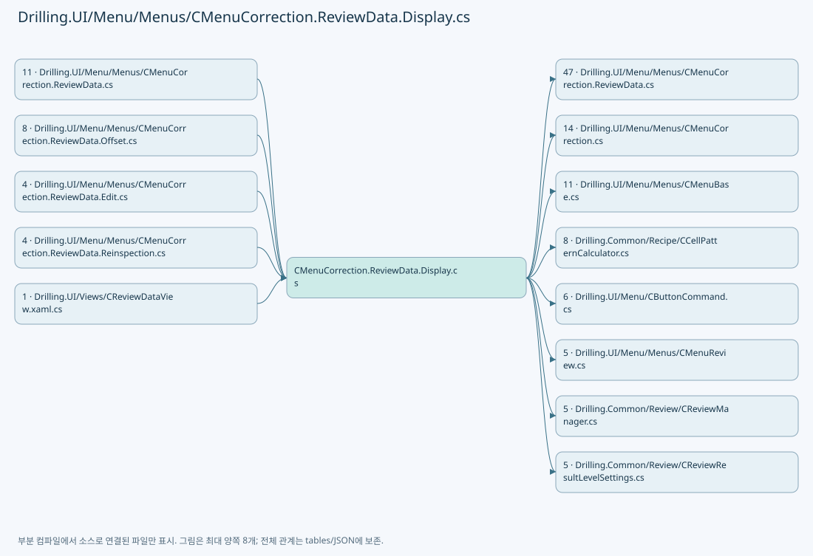

## 네임스페이스·타입·상속

| 타입 | 구분 | 원본 범위 | 선언/상속 |
| --- | --- | --- | --- |
| CMenuCorrection | ClassDeclaration | 12–1509 | CMenuCorrection |
| CReviewDataPanel | ClassDeclaration | 14–1428 | CReviewDataPanel |
| ST_REVIEW_DATA_DISPLAY_MODEL | RecordDeclaration | 1430–1437 | ST_REVIEW_DATA_DISPLAY_MODEL |
| ST_REVIEW_DATA_SCATTER_HIT | RecordDeclaration | 1439–1441 | ST_REVIEW_DATA_SCATTER_HIT |
| ST_REVIEW_DATA_GLASS_PREVIEW | RecordDeclaration | 1443–1448 | ST_REVIEW_DATA_GLASS_PREVIEW |
| ST_REVIEW_DATA_CELL_LABEL | RecordDeclaration | 1450–1461 | ST_REVIEW_DATA_CELL_LABEL |
| ST_REVIEW_DATA_SHOT_POSITION | RecordDeclaration | 1463–1479 | ST_REVIEW_DATA_SHOT_POSITION |
| ST_REVIEW_DATA_GRID_ROW | RecordDeclaration | 1481–1508 | ST_REVIEW_DATA_GRID_ROW |

## 멤버 빠른 목록

| 이름 | 종류 | 범위 | 서명 |
| --- | --- | --- | --- |
| _dataLoadCancellation | FieldDeclaration | L16–16 | System.Threading.CancellationTokenSource? Drilling.UI.Menu.Menus.CMenuCorrection.CReviewDataPanel._dataLoadCancellation |
| _dataLoadVersion | FieldDeclaration | L17–17 | int Drilling.UI.Menu.Menus.CMenuCorrection.CReviewDataPanel._dataLoadVersion |
| _shotMapRenderVersion | FieldDeclaration | L18–18 | int Drilling.UI.Menu.Menus.CMenuCorrection.CReviewDataPanel._shotMapRenderVersion |
| _isDataLoading | FieldDeclaration | L19–19 | bool Drilling.UI.Menu.Menus.CMenuCorrection.CReviewDataPanel._isDataLoading |
| _hasLoadedData | FieldDeclaration | L20–20 | bool Drilling.UI.Menu.Menus.CMenuCorrection.CReviewDataPanel._hasLoadedData |
| _loadProgress | FieldDeclaration | L21–21 | double Drilling.UI.Menu.Menus.CMenuCorrection.CReviewDataPanel._loadProgress |
| _loadProgressText | FieldDeclaration | L22–22 | string Drilling.UI.Menu.Menus.CMenuCorrection.CReviewDataPanel._loadProgressText |
| _dataLoadHint | FieldDeclaration | L23–23 | string Drilling.UI.Menu.Menus.CMenuCorrection.CReviewDataPanel._dataLoadHint |
| _dataLoadHintBrush | FieldDeclaration | L24–24 | Brush Drilling.UI.Menu.Menus.CMenuCorrection.CReviewDataPanel._dataLoadHintBrush |
| _loadedParameters | FieldDeclaration | L25–25 | System.Collections.Generic.IReadOnlyDictionary<string, string> Drilling.UI.Menu.Menus.CMenuCorrection.CReviewDataPanel._loadedParameters |
| _reviewLevelSettings | FieldDeclaration | L26–26 | Drilling.Common.Review.ST_REVIEW_RESULT_LEVEL_SETTINGS Drilling.UI.Menu.Menus.CMenuCorrection.CReviewDataPanel._reviewLevelSettings |
| _cellLevels | FieldDeclaration | L27–27 | System.Collections.Generic.IReadOnlyDictionary<int, Drilling.Common.Review.EN_REVIEW_RESULT_LEVEL> Drilling.UI.Menu.Menus.CMenuCorrection.CReviewDataPanel._cellLevels |
| _reviewLevel1Brush | FieldDeclaration | L28–28 | Brush Drilling.UI.Menu.Menus.CMenuCorrection.CReviewDataPanel._reviewLevel1Brush |
| _reviewLevel2Brush | FieldDeclaration | L29–29 | Brush Drilling.UI.Menu.Menus.CMenuCorrection.CReviewDataPanel._reviewLevel2Brush |
| _reviewLevel3Brush | FieldDeclaration | L30–30 | Brush Drilling.UI.Menu.Menus.CMenuCorrection.CReviewDataPanel._reviewLevel3Brush |
| _reviewLevel4Brush | FieldDeclaration | L31–31 | Brush Drilling.UI.Menu.Menus.CMenuCorrection.CReviewDataPanel._reviewLevel4Brush |
| _resultCellNos | FieldDeclaration | L32–32 | System.Collections.Generic.IReadOnlySet<int> Drilling.UI.Menu.Menus.CMenuCorrection.CReviewDataPanel._resultCellNos |
| _shotsByCell | FieldDeclaration | L33–33 | System.Collections.Generic.IReadOnlyDictionary<int, System.Collections.Generic.IReadOnlyList<Drilling.UI.Menu.Menus.CMenuCorrection.ST_REVIEW_DATA_SHOT_POSITION>> Drilling.UI.Menu.Menus.CMenuCorrection.CReviewDataPanel._shotsByCell |
| _allRows | FieldDeclaration | L34–34 | System.Collections.Generic.IReadOnlyList<Drilling.UI.Menu.Menus.CMenuCorrection.ST_REVIEW_DATA_GRID_ROW> Drilling.UI.Menu.Menus.CMenuCorrection.CReviewDataPanel._allRows |
| _loadedResultFile | FieldDeclaration | L35–35 | Drilling.Common.Review.ST_REVIEW_RESULT_FILE_DATA? Drilling.UI.Menu.Menus.CMenuCorrection.CReviewDataPanel._loadedResultFile |
| _loadedCatalog | FieldDeclaration | L36–36 | Drilling.Common.Review.ST_REVIEW_RESULT_CATALOG_ITEM? Drilling.UI.Menu.Menus.CMenuCorrection.CReviewDataPanel._loadedCatalog |
| _loadedRecipe | FieldDeclaration | L37–37 | Drilling.Common.Managers.ST_RECIPE_DEFINITION? Drilling.UI.Menu.Menus.CMenuCorrection.CReviewDataPanel._loadedRecipe |
| _loadedCellCount | FieldDeclaration | L38–38 | int Drilling.UI.Menu.Menus.CMenuCorrection.CReviewDataPanel._loadedCellCount |
| _selectedCellNo | FieldDeclaration | L39–39 | int Drilling.UI.Menu.Menus.CMenuCorrection.CReviewDataPanel._selectedCellNo |
| _selectedShotKey | FieldDeclaration | L40–40 | string Drilling.UI.Menu.Menus.CMenuCorrection.CReviewDataPanel._selectedShotKey |
| _scatterPlotHits | FieldDeclaration | L41–41 | System.Collections.Generic.IReadOnlyList<Drilling.UI.Menu.Menus.CMenuCorrection.ST_REVIEW_DATA_SCATTER_HIT> Drilling.UI.Menu.Menus.CMenuCorrection.CReviewDataPanel._scatterPlotHits |
| _scatterPlotMinimum | FieldDeclaration | L42–42 | double Drilling.UI.Menu.Menus.CMenuCorrection.CReviewDataPanel._scatterPlotMinimum |
| _scatterPlotMaximum | FieldDeclaration | L43–43 | double Drilling.UI.Menu.Menus.CMenuCorrection.CReviewDataPanel._scatterPlotMaximum |
| _scatterPlotGridUnit | FieldDeclaration | L44–44 | double Drilling.UI.Menu.Menus.CMenuCorrection.CReviewDataPanel._scatterPlotGridUnit |
| _scatterPlotMinimumText | FieldDeclaration | L45–45 | string Drilling.UI.Menu.Menus.CMenuCorrection.CReviewDataPanel._scatterPlotMinimumText |
| _scatterPlotMaximumText | FieldDeclaration | L46–46 | string Drilling.UI.Menu.Menus.CMenuCorrection.CReviewDataPanel._scatterPlotMaximumText |
| _scatterPlotGridUnitText | FieldDeclaration | L47–47 | string Drilling.UI.Menu.Menus.CMenuCorrection.CReviewDataPanel._scatterPlotGridUnitText |
| IsDataLoading | PropertyDeclaration | L49–49 | bool Drilling.UI.Menu.Menus.CMenuCorrection.CReviewDataPanel.IsDataLoading |
| HasLoadedData | PropertyDeclaration | L50–50 | bool Drilling.UI.Menu.Menus.CMenuCorrection.CReviewDataPanel.HasLoadedData |
| ShowDataPlaceholder | PropertyDeclaration | L51–51 | bool Drilling.UI.Menu.Menus.CMenuCorrection.CReviewDataPanel.ShowDataPlaceholder |
| CanLoadData | PropertyDeclaration | L52–52 | bool Drilling.UI.Menu.Menus.CMenuCorrection.CReviewDataPanel.CanLoadData |
| LoadProgress | PropertyDeclaration | L53–53 | double Drilling.UI.Menu.Menus.CMenuCorrection.CReviewDataPanel.LoadProgress |
| LoadProgressText | PropertyDeclaration | L54–54 | string Drilling.UI.Menu.Menus.CMenuCorrection.CReviewDataPanel.LoadProgressText |
| DataLoadHint | PropertyDeclaration | L55–55 | string Drilling.UI.Menu.Menus.CMenuCorrection.CReviewDataPanel.DataLoadHint |
| DataLoadHintBrush | PropertyDeclaration | L56–56 | Brush Drilling.UI.Menu.Menus.CMenuCorrection.CReviewDataPanel.DataLoadHintBrush |
| ReviewLevel1Brush | PropertyDeclaration | L57–57 | Brush Drilling.UI.Menu.Menus.CMenuCorrection.CReviewDataPanel.ReviewLevel1Brush |
| ReviewLevel2Brush | PropertyDeclaration | L58–58 | Brush Drilling.UI.Menu.Menus.CMenuCorrection.CReviewDataPanel.ReviewLevel2Brush |
| ReviewLevel3Brush | PropertyDeclaration | L59–59 | Brush Drilling.UI.Menu.Menus.CMenuCorrection.CReviewDataPanel.ReviewLevel3Brush |
| ReviewLevel4Brush | PropertyDeclaration | L60–60 | Brush Drilling.UI.Menu.Menus.CMenuCorrection.CReviewDataPanel.ReviewLevel4Brush |
| GlassPreviewImage | PropertyDeclaration | L61–61 | ImageSource? Drilling.UI.Menu.Menus.CMenuCorrection.CReviewDataPanel.GlassPreviewImage |
| get_GlassPreviewImage | GetAccessorDeclaration | L61–61 | ImageSource? Drilling.UI.Menu.Menus.CMenuCorrection.CReviewDataPanel.GlassPreviewImage.get |
| set_GlassPreviewImage | SetAccessorDeclaration | L61–61 | void Drilling.UI.Menu.Menus.CMenuCorrection.CReviewDataPanel.GlassPreviewImage.set |
| ShotMapImage | PropertyDeclaration | L62–62 | ImageSource? Drilling.UI.Menu.Menus.CMenuCorrection.CReviewDataPanel.ShotMapImage |
| get_ShotMapImage | GetAccessorDeclaration | L62–62 | ImageSource? Drilling.UI.Menu.Menus.CMenuCorrection.CReviewDataPanel.ShotMapImage.get |
| set_ShotMapImage | SetAccessorDeclaration | L62–62 | void Drilling.UI.Menu.Menus.CMenuCorrection.CReviewDataPanel.ShotMapImage.set |
| ScatterPlotImage | PropertyDeclaration | L63–63 | ImageSource? Drilling.UI.Menu.Menus.CMenuCorrection.CReviewDataPanel.ScatterPlotImage |
| get_ScatterPlotImage | GetAccessorDeclaration | L63–63 | ImageSource? Drilling.UI.Menu.Menus.CMenuCorrection.CReviewDataPanel.ScatterPlotImage.get |
| set_ScatterPlotImage | SetAccessorDeclaration | L63–63 | void Drilling.UI.Menu.Menus.CMenuCorrection.CReviewDataPanel.ScatterPlotImage.set |
| Camera | PropertyDeclaration | L64–64 | Drilling.UI.Menu.Menus.CReviewCameraPreview Drilling.UI.Menu.Menus.CMenuCorrection.CReviewDataPanel.Camera |
| get_Camera | GetAccessorDeclaration | L64–64 | Drilling.UI.Menu.Menus.CReviewCameraPreview Drilling.UI.Menu.Menus.CMenuCorrection.CReviewDataPanel.Camera.get |
| CellLabels | PropertyDeclaration | L65–65 | System.Collections.Generic.IReadOnlyList<Drilling.UI.Menu.Menus.CMenuCorrection.ST_REVIEW_DATA_CELL_LABEL> Drilling.UI.Menu.Menus.CMenuCorrection.CReviewDataPanel.CellLabels |
| get_CellLabels | GetAccessorDeclaration | L65–65 | System.Collections.Generic.IReadOnlyList<Drilling.UI.Menu.Menus.CMenuCorrection.ST_REVIEW_DATA_CELL_LABEL> Drilling.UI.Menu.Menus.CMenuCorrection.CReviewDataPanel.CellLabels.get |
| set_CellLabels | SetAccessorDeclaration | L65–65 | void Drilling.UI.Menu.Menus.CMenuCorrection.CReviewDataPanel.CellLabels.set |
| Rows | PropertyDeclaration | L66–66 | System.Collections.Generic.IReadOnlyList<Drilling.UI.Menu.Menus.CMenuCorrection.ST_REVIEW_DATA_GRID_ROW> Drilling.UI.Menu.Menus.CMenuCorrection.CReviewDataPanel.Rows |
| get_Rows | GetAccessorDeclaration | L66–66 | System.Collections.Generic.IReadOnlyList<Drilling.UI.Menu.Menus.CMenuCorrection.ST_REVIEW_DATA_GRID_ROW> Drilling.UI.Menu.Menus.CMenuCorrection.CReviewDataPanel.Rows.get |
| set_Rows | SetAccessorDeclaration | L66–66 | void Drilling.UI.Menu.Menus.CMenuCorrection.CReviewDataPanel.Rows.set |
| SelectedRow | PropertyDeclaration | L67–67 | Drilling.UI.Menu.Menus.CMenuCorrection.ST_REVIEW_DATA_GRID_ROW? Drilling.UI.Menu.Menus.CMenuCorrection.CReviewDataPanel.SelectedRow |
| get_SelectedRow | GetAccessorDeclaration | L67–67 | Drilling.UI.Menu.Menus.CMenuCorrection.ST_REVIEW_DATA_GRID_ROW? Drilling.UI.Menu.Menus.CMenuCorrection.CReviewDataPanel.SelectedRow.get |
| set_SelectedRow | SetAccessorDeclaration | L67–67 | void Drilling.UI.Menu.Menus.CMenuCorrection.CReviewDataPanel.SelectedRow.set |
| GlassSummary | PropertyDeclaration | L68–68 | string Drilling.UI.Menu.Menus.CMenuCorrection.CReviewDataPanel.GlassSummary |
| get_GlassSummary | GetAccessorDeclaration | L68–68 | string Drilling.UI.Menu.Menus.CMenuCorrection.CReviewDataPanel.GlassSummary.get |
| set_GlassSummary | SetAccessorDeclaration | L68–68 | void Drilling.UI.Menu.Menus.CMenuCorrection.CReviewDataPanel.GlassSummary.set |
| SelectedCellTitle | PropertyDeclaration | L69–69 | string Drilling.UI.Menu.Menus.CMenuCorrection.CReviewDataPanel.SelectedCellTitle |
| get_SelectedCellTitle | GetAccessorDeclaration | L69–69 | string Drilling.UI.Menu.Menus.CMenuCorrection.CReviewDataPanel.SelectedCellTitle.get |
| set_SelectedCellTitle | SetAccessorDeclaration | L69–69 | void Drilling.UI.Menu.Menus.CMenuCorrection.CReviewDataPanel.SelectedCellTitle.set |
| SelectedShotTitle | PropertyDeclaration | L70–70 | string Drilling.UI.Menu.Menus.CMenuCorrection.CReviewDataPanel.SelectedShotTitle |
| get_SelectedShotTitle | GetAccessorDeclaration | L70–70 | string Drilling.UI.Menu.Menus.CMenuCorrection.CReviewDataPanel.SelectedShotTitle.get |
| set_SelectedShotTitle | SetAccessorDeclaration | L70–70 | void Drilling.UI.Menu.Menus.CMenuCorrection.CReviewDataPanel.SelectedShotTitle.set |
| SelectedShotDetail | PropertyDeclaration | L71–71 | string Drilling.UI.Menu.Menus.CMenuCorrection.CReviewDataPanel.SelectedShotDetail |
| get_SelectedShotDetail | GetAccessorDeclaration | L71–71 | string Drilling.UI.Menu.Menus.CMenuCorrection.CReviewDataPanel.SelectedShotDetail.get |
| set_SelectedShotDetail | SetAccessorDeclaration | L71–71 | void Drilling.UI.Menu.Menus.CMenuCorrection.CReviewDataPanel.SelectedShotDetail.set |
| GlassSurfaceWidth | PropertyDeclaration | L72–72 | double Drilling.UI.Menu.Menus.CMenuCorrection.CReviewDataPanel.GlassSurfaceWidth |
| get_GlassSurfaceWidth | GetAccessorDeclaration | L72–72 | double Drilling.UI.Menu.Menus.CMenuCorrection.CReviewDataPanel.GlassSurfaceWidth.get |
| set_GlassSurfaceWidth | SetAccessorDeclaration | L72–72 | void Drilling.UI.Menu.Menus.CMenuCorrection.CReviewDataPanel.GlassSurfaceWidth.set |
| GlassSurfaceHeight | PropertyDeclaration | L73–73 | double Drilling.UI.Menu.Menus.CMenuCorrection.CReviewDataPanel.GlassSurfaceHeight |
| get_GlassSurfaceHeight | GetAccessorDeclaration | L73–73 | double Drilling.UI.Menu.Menus.CMenuCorrection.CReviewDataPanel.GlassSurfaceHeight.get |
| set_GlassSurfaceHeight | SetAccessorDeclaration | L73–73 | void Drilling.UI.Menu.Menus.CMenuCorrection.CReviewDataPanel.GlassSurfaceHeight.set |
| ShotMapSurfaceWidth | PropertyDeclaration | L74–74 | double Drilling.UI.Menu.Menus.CMenuCorrection.CReviewDataPanel.ShotMapSurfaceWidth |
| get_ShotMapSurfaceWidth | GetAccessorDeclaration | L74–74 | double Drilling.UI.Menu.Menus.CMenuCorrection.CReviewDataPanel.ShotMapSurfaceWidth.get |
| set_ShotMapSurfaceWidth | SetAccessorDeclaration | L74–74 | void Drilling.UI.Menu.Menus.CMenuCorrection.CReviewDataPanel.ShotMapSurfaceWidth.set |
| ShotMapSurfaceHeight | PropertyDeclaration | L75–75 | double Drilling.UI.Menu.Menus.CMenuCorrection.CReviewDataPanel.ShotMapSurfaceHeight |
| get_ShotMapSurfaceHeight | GetAccessorDeclaration | L75–75 | double Drilling.UI.Menu.Menus.CMenuCorrection.CReviewDataPanel.ShotMapSurfaceHeight.get |
| set_ShotMapSurfaceHeight | SetAccessorDeclaration | L75–75 | void Drilling.UI.Menu.Menus.CMenuCorrection.CReviewDataPanel.ShotMapSurfaceHeight.set |
| ScatterPlotSurfaceWidth | PropertyDeclaration | L76–76 | double Drilling.UI.Menu.Menus.CMenuCorrection.CReviewDataPanel.ScatterPlotSurfaceWidth |
| get_ScatterPlotSurfaceWidth | GetAccessorDeclaration | L76–76 | double Drilling.UI.Menu.Menus.CMenuCorrection.CReviewDataPanel.ScatterPlotSurfaceWidth.get |
| ScatterPlotSurfaceHeight | PropertyDeclaration | L77–77 | double Drilling.UI.Menu.Menus.CMenuCorrection.CReviewDataPanel.ScatterPlotSurfaceHeight |
| get_ScatterPlotSurfaceHeight | GetAccessorDeclaration | L77–77 | double Drilling.UI.Menu.Menus.CMenuCorrection.CReviewDataPanel.ScatterPlotSurfaceHeight.get |
| ScatterPlotSummary | PropertyDeclaration | L78–78 | string Drilling.UI.Menu.Menus.CMenuCorrection.CReviewDataPanel.ScatterPlotSummary |
| get_ScatterPlotSummary | GetAccessorDeclaration | L78–78 | string Drilling.UI.Menu.Menus.CMenuCorrection.CReviewDataPanel.ScatterPlotSummary.get |
| set_ScatterPlotSummary | SetAccessorDeclaration | L78–78 | void Drilling.UI.Menu.Menus.CMenuCorrection.CReviewDataPanel.ScatterPlotSummary.set |
| ScatterPlotMinimumText | PropertyDeclaration | L79–92 | string Drilling.UI.Menu.Menus.CMenuCorrection.CReviewDataPanel.ScatterPlotMinimumText |
| get_ScatterPlotMinimumText | GetAccessorDeclaration | L81–81 | string Drilling.UI.Menu.Menus.CMenuCorrection.CReviewDataPanel.ScatterPlotMinimumText.get |
| set_ScatterPlotMinimumText | SetAccessorDeclaration | L82–91 | void Drilling.UI.Menu.Menus.CMenuCorrection.CReviewDataPanel.ScatterPlotMinimumText.set |
| ScatterPlotMaximumText | PropertyDeclaration | L94–107 | string Drilling.UI.Menu.Menus.CMenuCorrection.CReviewDataPanel.ScatterPlotMaximumText |
| get_ScatterPlotMaximumText | GetAccessorDeclaration | L96–96 | string Drilling.UI.Menu.Menus.CMenuCorrection.CReviewDataPanel.ScatterPlotMaximumText.get |
| set_ScatterPlotMaximumText | SetAccessorDeclaration | L97–106 | void Drilling.UI.Menu.Menus.CMenuCorrection.CReviewDataPanel.ScatterPlotMaximumText.set |
| ScatterPlotGridUnitText | PropertyDeclaration | L109–122 | string Drilling.UI.Menu.Menus.CMenuCorrection.CReviewDataPanel.ScatterPlotGridUnitText |
| get_ScatterPlotGridUnitText | GetAccessorDeclaration | L111–111 | string Drilling.UI.Menu.Menus.CMenuCorrection.CReviewDataPanel.ScatterPlotGridUnitText.get |
| set_ScatterPlotGridUnitText | SetAccessorDeclaration | L112–121 | void Drilling.UI.Menu.Menus.CMenuCorrection.CReviewDataPanel.ScatterPlotGridUnitText.set |
| PrepareSelectedResult | MethodDeclaration | L124–153 | void Drilling.UI.Menu.Menus.CMenuCorrection.CReviewDataPanel.PrepareSelectedResult(Drilling.Common.Review.ST_REVIEW_RESULT_CATALOG_ITEM?) |
| LoadDataRequested | MethodDeclaration | L155–158 | void Drilling.UI.Menu.Menus.CMenuCorrection.CReviewDataPanel.LoadDataRequested(object?) |
| LoadSelectedData | MethodDeclaration | L160–239 | System.Threading.Tasks.Task Drilling.UI.Menu.Menus.CMenuCorrection.CReviewDataPanel.LoadSelectedData() |
| BuildDisplayModel | MethodDeclaration | L241–390 | Drilling.UI.Menu.Menus.CMenuCorrection.ST_REVIEW_DATA_DISPLAY_MODEL Drilling.UI.Menu.Menus.CMenuCorrection.CReviewDataPanel.BuildDisplayModel(Drilling.Common.Review.ST_REVIEW_RESULT_FILE_DATA, System.Collections.Generic.IReadOnlyDictionary<string, string>, System.Threading.CancellationToken) |
| CalculateReviewDataCellLayout | MethodDeclaration | L392–416 | Drilling.Common.Recipe.ST_CELL_PATTERN_LAYOUT Drilling.UI.Menu.Menus.CMenuCorrection.CReviewDataPanel.CalculateReviewDataCellLayout(System.Collections.Generic.IReadOnlyDictionary<string, string>, int) |
| ResolveShotPosition | MethodDeclaration | L418–462 | Drilling.UI.Menu.Menus.CMenuCorrection.ST_REVIEW_DATA_SHOT_POSITION Drilling.UI.Menu.Menus.CMenuCorrection.CReviewDataPanel.ResolveShotPosition(Drilling.Common.Review.ST_REVIEW_RESULT_FILE_ROW, Drilling.Common.Recipe.ST_CELL_PATTERN_LAYOUT, int) |
| ReadShotNo | MethodDeclaration | L464–472 | int Drilling.UI.Menu.Menus.CMenuCorrection.CReviewDataPanel.ReadShotNo(string) |
| TryParseMatrixName | MethodDeclaration | L474–499 | bool Drilling.UI.Menu.Menus.CMenuCorrection.CReviewDataPanel.TryParseMatrixName(string, out int, out int) |
| ApplyDisplayModel | MethodDeclaration | L501–533 | void Drilling.UI.Menu.Menus.CMenuCorrection.CReviewDataPanel.ApplyDisplayModel(Drilling.UI.Menu.Menus.CMenuCorrection.ST_REVIEW_DATA_DISPLAY_MODEL, Drilling.Common.Review.ST_REVIEW_RESULT_FILE_DATA, Drilling.Common.Review.ST_REVIEW_RESULT_CATALOG_ITEM, Drilling.Common.Managers.ST_RECIPE_DEFINITION) |
| SelectCell | MethodDeclaration | L535–543 | void Drilling.UI.Menu.Menus.CMenuCorrection.CReviewDataPanel.SelectCell(object?) |
| ApplyCellSelection | MethodDeclaration | L545–584 | void Drilling.UI.Menu.Menus.CMenuCorrection.CReviewDataPanel.ApplyCellSelection(int, bool) |
| SelectShotAt | MethodDeclaration | L586–607 | void Drilling.UI.Menu.Menus.CMenuCorrection.CReviewDataPanel.SelectShotAt(double, double) |
| SelectRow | MethodDeclaration | L609–620 | void Drilling.UI.Menu.Menus.CMenuCorrection.CReviewDataPanel.SelectRow(Drilling.UI.Menu.Menus.CMenuCorrection.ST_REVIEW_DATA_GRID_ROW) |
| ApplyShotSelection | MethodDeclaration | L622–639 | void Drilling.UI.Menu.Menus.CMenuCorrection.CReviewDataPanel.ApplyShotSelection(string, Drilling.UI.Menu.Menus.CMenuCorrection.ST_REVIEW_DATA_GRID_ROW?) |
| RefreshGlassPreview | MethodDeclaration | L641–675 | void Drilling.UI.Menu.Menus.CMenuCorrection.CReviewDataPanel.RefreshGlassPreview() |
| RefreshShotMap | MethodDeclaration | L677–684 | void Drilling.UI.Menu.Menus.CMenuCorrection.CReviewDataPanel.RefreshShotMap() |
| SelectScatterPointAt | MethodDeclaration | L686–711 | void Drilling.UI.Menu.Menus.CMenuCorrection.CReviewDataPanel.SelectScatterPointAt(double, double) |
| ApplyScatterPlotScale | MethodDeclaration | L713–747 | void Drilling.UI.Menu.Menus.CMenuCorrection.CReviewDataPanel.ApplyScatterPlotScale(object?) |
| TryParseScatterScale | MethodDeclaration | L749–753 | bool Drilling.UI.Menu.Menus.CMenuCorrection.CReviewDataPanel.TryParseScatterScale(string, out double) |
| FormatScatterScaleInput | MethodDeclaration | L755–758 | string Drilling.UI.Menu.Menus.CMenuCorrection.CReviewDataPanel.FormatScatterScaleInput(double) |
| RefreshScatterPlot | MethodDeclaration | L760–827 | void Drilling.UI.Menu.Menus.CMenuCorrection.CReviewDataPanel.RefreshScatterPlot() |
| BuildScatterPlotSummary | MethodDeclaration | L829–842 | string Drilling.UI.Menu.Menus.CMenuCorrection.CReviewDataPanel.BuildScatterPlotSummary(System.Collections.Generic.IReadOnlyList<Drilling.UI.Menu.Menus.CMenuCorrection.ST_REVIEW_DATA_GRID_ROW>, int) |
| DrawScatterGrid | MethodDeclaration | L844–870 | void Drilling.UI.Menu.Menus.CMenuCorrection.CReviewDataPanel.DrawScatterGrid(DrawingContext, Rect, double, double, double) |
| DrawScatterAxes | MethodDeclaration | L872–887 | void Drilling.UI.Menu.Menus.CMenuCorrection.CReviewDataPanel.DrawScatterAxes(DrawingContext, Rect, double, double) |
| ScatterPlotHeightForLabel | MethodDeclaration | L889–892 | double Drilling.UI.Menu.Menus.CMenuCorrection.CReviewDataPanel.ScatterPlotHeightForLabel(Rect) |
| DrawScatterText | MethodDeclaration | L894–914 | void Drilling.UI.Menu.Menus.CMenuCorrection.CReviewDataPanel.DrawScatterText(DrawingContext, string, Point, double, Brush, bool, bool) |
| ScatterPoint | MethodDeclaration | L916–921 | Point Drilling.UI.Menu.Menus.CMenuCorrection.CReviewDataPanel.ScatterPoint(double, double, Rect, double, double) |
| IsInsideScatterRange | MethodDeclaration | L923–926 | bool Drilling.UI.Menu.Menus.CMenuCorrection.CReviewDataPanel.IsInsideScatterRange(double, double, double, double) |
| FormatScatterAxisValue | MethodDeclaration | L928–932 | string Drilling.UI.Menu.Menus.CMenuCorrection.CReviewDataPanel.FormatScatterAxisValue(double, double) |
| CreateReviewLevelBrush | MethodDeclaration | L934–946 | Brush Drilling.UI.Menu.Menus.CMenuCorrection.CReviewDataPanel.CreateReviewLevelBrush(string, byte?) |
| RefreshCellSelectionOverlay | MethodDeclaration | L948–956 | void Drilling.UI.Menu.Menus.CMenuCorrection.CReviewDataPanel.RefreshCellSelectionOverlay() |
| QueueShotMapRender | MethodDeclaration | L958–993 | void Drilling.UI.Menu.Menus.CMenuCorrection.CReviewDataPanel.QueueShotMapRender(int, string) |
| RefreshSelectionText | MethodDeclaration | L995–1014 | void Drilling.UI.Menu.Menus.CMenuCorrection.CReviewDataPanel.RefreshSelectionText() |
| BuildReviewDataGlassPreview | MethodDeclaration | L1016–1117 | Drilling.UI.Menu.Menus.CMenuCorrection.ST_REVIEW_DATA_GLASS_PREVIEW Drilling.UI.Menu.Menus.CMenuCorrection.CReviewDataPanel.BuildReviewDataGlassPreview(System.Collections.Generic.IReadOnlyDictionary<string, string>, int, System.Collections.Generic.IReadOnlySet<int>, int, System.Collections.Generic.IReadOnlyDictionary<int, Drilling.Common.Review.EN_REVIEW_RESULT_LEVEL>?, Drilling.Common.Review.ST_REVIEW_RESULT_LEVEL_SETTINGS?) |
| BuildReviewDataShotMap | MethodDeclaration | L1119–1268 | ImageSource? Drilling.UI.Menu.Menus.CMenuCorrection.CReviewDataPanel.BuildReviewDataShotMap(System.Collections.Generic.IReadOnlyList<Drilling.UI.Menu.Menus.CMenuCorrection.ST_REVIEW_DATA_SHOT_POSITION>, string, System.Collections.Generic.IReadOnlySet<string>?) |
| GetReviewDataShotCellBounds | MethodDeclaration | L1270–1283 | Rect Drilling.UI.Menu.Menus.CMenuCorrection.CReviewDataPanel.GetReviewDataShotCellBounds(Rect, int, int, double, double, double) |
| AddReviewDataShotCell | MethodDeclaration | L1285–1291 | void Drilling.UI.Menu.Menus.CMenuCorrection.CReviewDataPanel.AddReviewDataShotCell(StreamGeometryContext, Rect) |
| GetReviewDataShotMapSize | MethodDeclaration | L1293–1303 | Size Drilling.UI.Menu.Menus.CMenuCorrection.CReviewDataPanel.GetReviewDataShotMapSize(System.Collections.Generic.IReadOnlyList<Drilling.UI.Menu.Menus.CMenuCorrection.ST_REVIEW_DATA_SHOT_POSITION>) |
| GetReviewDataShotMapRect | MethodDeclaration | L1305–1309 | Rect Drilling.UI.Menu.Menus.CMenuCorrection.CReviewDataPanel.GetReviewDataShotMapRect(int, int) |
| IsBlockedStatus | MethodDeclaration | L1311–1315 | bool Drilling.UI.Menu.Menus.CMenuCorrection.CReviewDataPanel.IsBlockedStatus(string) |
| ClearLoadedDisplay | MethodDeclaration | L1317–1353 | void Drilling.UI.Menu.Menus.CMenuCorrection.CReviewDataPanel.ClearLoadedDisplay() |
| SetDataLoading | MethodDeclaration | L1355–1367 | void Drilling.UI.Menu.Menus.CMenuCorrection.CReviewDataPanel.SetDataLoading(bool) |
| SetLoadProgress | MethodDeclaration | L1369–1375 | void Drilling.UI.Menu.Menus.CMenuCorrection.CReviewDataPanel.SetLoadProgress(double, string) |
| SetDataLoadHint | MethodDeclaration | L1377–1383 | void Drilling.UI.Menu.Menus.CMenuCorrection.CReviewDataPanel.SetDataLoadHint(string, string) |
| NotifyLoadCommandState | MethodDeclaration | L1385–1396 | void Drilling.UI.Menu.Menus.CMenuCorrection.CReviewDataPanel.NotifyLoadCommandState() |
| NotifyDisplayState | MethodDeclaration | L1398–1427 | void Drilling.UI.Menu.Menus.CMenuCorrection.CReviewDataPanel.NotifyDisplayState() |
| Height | PropertyDeclaration | L1458–1458 | double Drilling.UI.Menu.Menus.CMenuCorrection.ST_REVIEW_DATA_CELL_LABEL.Height |
| Left | PropertyDeclaration | L1459–1459 | double Drilling.UI.Menu.Menus.CMenuCorrection.ST_REVIEW_DATA_CELL_LABEL.Left |
| Top | PropertyDeclaration | L1460–1460 | double Drilling.UI.Menu.Menus.CMenuCorrection.ST_REVIEW_DATA_CELL_LABEL.Top |
| HeadNo | PropertyDeclaration | L1473–1473 | int Drilling.UI.Menu.Menus.CMenuCorrection.ST_REVIEW_DATA_SHOT_POSITION.HeadNo |
| get_HeadNo | GetAccessorDeclaration | L1473–1473 | int Drilling.UI.Menu.Menus.CMenuCorrection.ST_REVIEW_DATA_SHOT_POSITION.HeadNo.get |
| set_HeadNo | InitAccessorDeclaration | L1473–1473 | void Drilling.UI.Menu.Menus.CMenuCorrection.ST_REVIEW_DATA_SHOT_POSITION.HeadNo.init |
| IsResult | PropertyDeclaration | L1474–1474 | bool Drilling.UI.Menu.Menus.CMenuCorrection.ST_REVIEW_DATA_SHOT_POSITION.IsResult |
| get_IsResult | GetAccessorDeclaration | L1474–1474 | bool Drilling.UI.Menu.Menus.CMenuCorrection.ST_REVIEW_DATA_SHOT_POSITION.IsResult.get |
| set_IsResult | InitAccessorDeclaration | L1474–1474 | void Drilling.UI.Menu.Menus.CMenuCorrection.ST_REVIEW_DATA_SHOT_POSITION.IsResult.init |
| IsMasked | PropertyDeclaration | L1475–1475 | bool Drilling.UI.Menu.Menus.CMenuCorrection.ST_REVIEW_DATA_SHOT_POSITION.IsMasked |
| get_IsMasked | GetAccessorDeclaration | L1475–1475 | bool Drilling.UI.Menu.Menus.CMenuCorrection.ST_REVIEW_DATA_SHOT_POSITION.IsMasked.get |
| set_IsMasked | InitAccessorDeclaration | L1475–1475 | void Drilling.UI.Menu.Menus.CMenuCorrection.ST_REVIEW_DATA_SHOT_POSITION.IsMasked.init |
| IsChessSkipped | PropertyDeclaration | L1476–1476 | bool Drilling.UI.Menu.Menus.CMenuCorrection.ST_REVIEW_DATA_SHOT_POSITION.IsChessSkipped |
| get_IsChessSkipped | GetAccessorDeclaration | L1476–1476 | bool Drilling.UI.Menu.Menus.CMenuCorrection.ST_REVIEW_DATA_SHOT_POSITION.IsChessSkipped.get |
| set_IsChessSkipped | InitAccessorDeclaration | L1476–1476 | void Drilling.UI.Menu.Menus.CMenuCorrection.ST_REVIEW_DATA_SHOT_POSITION.IsChessSkipped.init |
| ResultLevel | PropertyDeclaration | L1477–1477 | Drilling.Common.Review.EN_REVIEW_RESULT_LEVEL? Drilling.UI.Menu.Menus.CMenuCorrection.ST_REVIEW_DATA_SHOT_POSITION.ResultLevel |
| get_ResultLevel | GetAccessorDeclaration | L1477–1477 | Drilling.Common.Review.EN_REVIEW_RESULT_LEVEL? Drilling.UI.Menu.Menus.CMenuCorrection.ST_REVIEW_DATA_SHOT_POSITION.ResultLevel.get |
| set_ResultLevel | InitAccessorDeclaration | L1477–1477 | void Drilling.UI.Menu.Menus.CMenuCorrection.ST_REVIEW_DATA_SHOT_POSITION.ResultLevel.init |
| ResultLevelBrush | PropertyDeclaration | L1478–1478 | Brush? Drilling.UI.Menu.Menus.CMenuCorrection.ST_REVIEW_DATA_SHOT_POSITION.ResultLevelBrush |
| get_ResultLevelBrush | GetAccessorDeclaration | L1478–1478 | Brush? Drilling.UI.Menu.Menus.CMenuCorrection.ST_REVIEW_DATA_SHOT_POSITION.ResultLevelBrush.get |
| set_ResultLevelBrush | InitAccessorDeclaration | L1478–1478 | void Drilling.UI.Menu.Menus.CMenuCorrection.ST_REVIEW_DATA_SHOT_POSITION.ResultLevelBrush.init |
| IsReinspectionSelected | PropertyDeclaration | L1498–1498 | bool Drilling.UI.Menu.Menus.CMenuCorrection.ST_REVIEW_DATA_GRID_ROW.IsReinspectionSelected |
| get_IsReinspectionSelected | GetAccessorDeclaration | L1498–1498 | bool Drilling.UI.Menu.Menus.CMenuCorrection.ST_REVIEW_DATA_GRID_ROW.IsReinspectionSelected.get |
| set_IsReinspectionSelected | SetAccessorDeclaration | L1498–1498 | void Drilling.UI.Menu.Menus.CMenuCorrection.ST_REVIEW_DATA_GRID_ROW.IsReinspectionSelected.set |
| IsResultEditSelected | PropertyDeclaration | L1499–1499 | bool Drilling.UI.Menu.Menus.CMenuCorrection.ST_REVIEW_DATA_GRID_ROW.IsResultEditSelected |
| get_IsResultEditSelected | GetAccessorDeclaration | L1499–1499 | bool Drilling.UI.Menu.Menus.CMenuCorrection.ST_REVIEW_DATA_GRID_ROW.IsResultEditSelected.get |
| set_IsResultEditSelected | SetAccessorDeclaration | L1499–1499 | void Drilling.UI.Menu.Menus.CMenuCorrection.ST_REVIEW_DATA_GRID_ROW.IsResultEditSelected.set |
| Head | PropertyDeclaration | L1500–1500 | string Drilling.UI.Menu.Menus.CMenuCorrection.ST_REVIEW_DATA_GRID_ROW.Head |
| Cell | PropertyDeclaration | L1501–1501 | string Drilling.UI.Menu.Menus.CMenuCorrection.ST_REVIEW_DATA_GRID_ROW.Cell |
| Beam | PropertyDeclaration | L1502–1502 | string Drilling.UI.Menu.Menus.CMenuCorrection.ST_REVIEW_DATA_GRID_ROW.Beam |
| ResultXText | PropertyDeclaration | L1503–1503 | string Drilling.UI.Menu.Menus.CMenuCorrection.ST_REVIEW_DATA_GRID_ROW.ResultXText |
| ResultYText | PropertyDeclaration | L1504–1504 | string Drilling.UI.Menu.Menus.CMenuCorrection.ST_REVIEW_DATA_GRID_ROW.ResultYText |
| LevelNo | PropertyDeclaration | L1505–1505 | int Drilling.UI.Menu.Menus.CMenuCorrection.ST_REVIEW_DATA_GRID_ROW.LevelNo |
| LevelText | PropertyDeclaration | L1506–1506 | string Drilling.UI.Menu.Menus.CMenuCorrection.ST_REVIEW_DATA_GRID_ROW.LevelText |
| JudgeBrush | PropertyDeclaration | L1507–1507 | Brush Drilling.UI.Menu.Menus.CMenuCorrection.ST_REVIEW_DATA_GRID_ROW.JudgeBrush |

## 멤버별 상세 계약·호출·처리 해설

### FieldDeclaration `_dataLoadCancellation` · L16–16

[Drilling.UI/Menu/Menus/CMenuCorrection.ReviewData.Display.cs:16–16](https://github.com/kjuws10-rgb/A3Drilling/blob/334b3599651b2e8e0181fd4459bafaf3cddafff3/Drilling.UI/Menu/Menus/CMenuCorrection.ReviewData.Display.cs#L16-L16)

| 항목 | 실제 추출 값 |
| --- | --- |
| 서명 | System.Threading.CancellationTokenSource? Drilling.UI.Menu.Menus.CMenuCorrection.CReviewDataPanel._dataLoadCancellation |
| 접근/수식자 | Private / private |
| 반환/값 타입 | System.Threading.CancellationTokenSource? |
| 소속 타입 | NamedType:Drilling.UI.Menu.Menus.CMenuCorrection.CReviewDataPanel |

현재 부분 분석에서 직접 연결된 호출자는 없습니다. XAML/이벤트/인터페이스·델리게이트·외부 진입을 추가 확인해야 하며, 미사용으로 판정한 것이 아닙니다.

변경 전 점검: 입력/반환 타입, 위 호출자, 예외/취소 경로, 공유 상태와 저장·전송 소비자를 함께 확인합니다. 값의 단위나 물리 방향을 이름만으로 확정하지 않습니다.

### FieldDeclaration `_dataLoadVersion` · L17–17

[Drilling.UI/Menu/Menus/CMenuCorrection.ReviewData.Display.cs:17–17](https://github.com/kjuws10-rgb/A3Drilling/blob/334b3599651b2e8e0181fd4459bafaf3cddafff3/Drilling.UI/Menu/Menus/CMenuCorrection.ReviewData.Display.cs#L17-L17)

| 항목 | 실제 추출 값 |
| --- | --- |
| 서명 | int Drilling.UI.Menu.Menus.CMenuCorrection.CReviewDataPanel._dataLoadVersion |
| 접근/수식자 | Private / private |
| 반환/값 타입 | int |
| 소속 타입 | NamedType:Drilling.UI.Menu.Menus.CMenuCorrection.CReviewDataPanel |

현재 부분 분석에서 직접 연결된 호출자는 없습니다. XAML/이벤트/인터페이스·델리게이트·외부 진입을 추가 확인해야 하며, 미사용으로 판정한 것이 아닙니다.

변경 전 점검: 입력/반환 타입, 위 호출자, 예외/취소 경로, 공유 상태와 저장·전송 소비자를 함께 확인합니다. 값의 단위나 물리 방향을 이름만으로 확정하지 않습니다.

### FieldDeclaration `_shotMapRenderVersion` · L18–18

[Drilling.UI/Menu/Menus/CMenuCorrection.ReviewData.Display.cs:18–18](https://github.com/kjuws10-rgb/A3Drilling/blob/334b3599651b2e8e0181fd4459bafaf3cddafff3/Drilling.UI/Menu/Menus/CMenuCorrection.ReviewData.Display.cs#L18-L18)

| 항목 | 실제 추출 값 |
| --- | --- |
| 서명 | int Drilling.UI.Menu.Menus.CMenuCorrection.CReviewDataPanel._shotMapRenderVersion |
| 접근/수식자 | Private / private |
| 반환/값 타입 | int |
| 소속 타입 | NamedType:Drilling.UI.Menu.Menus.CMenuCorrection.CReviewDataPanel |

현재 부분 분석에서 직접 연결된 호출자는 없습니다. XAML/이벤트/인터페이스·델리게이트·외부 진입을 추가 확인해야 하며, 미사용으로 판정한 것이 아닙니다.

변경 전 점검: 입력/반환 타입, 위 호출자, 예외/취소 경로, 공유 상태와 저장·전송 소비자를 함께 확인합니다. 값의 단위나 물리 방향을 이름만으로 확정하지 않습니다.

### FieldDeclaration `_isDataLoading` · L19–19

[Drilling.UI/Menu/Menus/CMenuCorrection.ReviewData.Display.cs:19–19](https://github.com/kjuws10-rgb/A3Drilling/blob/334b3599651b2e8e0181fd4459bafaf3cddafff3/Drilling.UI/Menu/Menus/CMenuCorrection.ReviewData.Display.cs#L19-L19)

| 항목 | 실제 추출 값 |
| --- | --- |
| 서명 | bool Drilling.UI.Menu.Menus.CMenuCorrection.CReviewDataPanel._isDataLoading |
| 접근/수식자 | Private / private |
| 반환/값 타입 | bool |
| 소속 타입 | NamedType:Drilling.UI.Menu.Menus.CMenuCorrection.CReviewDataPanel |

현재 부분 분석에서 직접 연결된 호출자는 없습니다. XAML/이벤트/인터페이스·델리게이트·외부 진입을 추가 확인해야 하며, 미사용으로 판정한 것이 아닙니다.

변경 전 점검: 입력/반환 타입, 위 호출자, 예외/취소 경로, 공유 상태와 저장·전송 소비자를 함께 확인합니다. 값의 단위나 물리 방향을 이름만으로 확정하지 않습니다.

### FieldDeclaration `_hasLoadedData` · L20–20

[Drilling.UI/Menu/Menus/CMenuCorrection.ReviewData.Display.cs:20–20](https://github.com/kjuws10-rgb/A3Drilling/blob/334b3599651b2e8e0181fd4459bafaf3cddafff3/Drilling.UI/Menu/Menus/CMenuCorrection.ReviewData.Display.cs#L20-L20)

| 항목 | 실제 추출 값 |
| --- | --- |
| 서명 | bool Drilling.UI.Menu.Menus.CMenuCorrection.CReviewDataPanel._hasLoadedData |
| 접근/수식자 | Private / private |
| 반환/값 타입 | bool |
| 소속 타입 | NamedType:Drilling.UI.Menu.Menus.CMenuCorrection.CReviewDataPanel |

현재 부분 분석에서 직접 연결된 호출자는 없습니다. XAML/이벤트/인터페이스·델리게이트·외부 진입을 추가 확인해야 하며, 미사용으로 판정한 것이 아닙니다.

변경 전 점검: 입력/반환 타입, 위 호출자, 예외/취소 경로, 공유 상태와 저장·전송 소비자를 함께 확인합니다. 값의 단위나 물리 방향을 이름만으로 확정하지 않습니다.

### FieldDeclaration `_loadProgress` · L21–21

[Drilling.UI/Menu/Menus/CMenuCorrection.ReviewData.Display.cs:21–21](https://github.com/kjuws10-rgb/A3Drilling/blob/334b3599651b2e8e0181fd4459bafaf3cddafff3/Drilling.UI/Menu/Menus/CMenuCorrection.ReviewData.Display.cs#L21-L21)

| 항목 | 실제 추출 값 |
| --- | --- |
| 서명 | double Drilling.UI.Menu.Menus.CMenuCorrection.CReviewDataPanel._loadProgress |
| 접근/수식자 | Private / private |
| 반환/값 타입 | double |
| 소속 타입 | NamedType:Drilling.UI.Menu.Menus.CMenuCorrection.CReviewDataPanel |

현재 부분 분석에서 직접 연결된 호출자는 없습니다. XAML/이벤트/인터페이스·델리게이트·외부 진입을 추가 확인해야 하며, 미사용으로 판정한 것이 아닙니다.

변경 전 점검: 입력/반환 타입, 위 호출자, 예외/취소 경로, 공유 상태와 저장·전송 소비자를 함께 확인합니다. 값의 단위나 물리 방향을 이름만으로 확정하지 않습니다.

### FieldDeclaration `_loadProgressText` · L22–22

[Drilling.UI/Menu/Menus/CMenuCorrection.ReviewData.Display.cs:22–22](https://github.com/kjuws10-rgb/A3Drilling/blob/334b3599651b2e8e0181fd4459bafaf3cddafff3/Drilling.UI/Menu/Menus/CMenuCorrection.ReviewData.Display.cs#L22-L22)

| 항목 | 실제 추출 값 |
| --- | --- |
| 서명 | string Drilling.UI.Menu.Menus.CMenuCorrection.CReviewDataPanel._loadProgressText |
| 접근/수식자 | Private / private |
| 반환/값 타입 | string |
| 소속 타입 | NamedType:Drilling.UI.Menu.Menus.CMenuCorrection.CReviewDataPanel |

현재 부분 분석에서 직접 연결된 호출자는 없습니다. XAML/이벤트/인터페이스·델리게이트·외부 진입을 추가 확인해야 하며, 미사용으로 판정한 것이 아닙니다.

본문의 실제 연산·분기·예외·반환 순서(원문 위치 순):

| 원본 행 | 종류 | 주석 해설 |
| --- | --- | --- |
| 22 | variable-initializer | 변수의 초기값을 지정합니다: _loadProgressText = "WAITING" |

변경 전 점검: 입력/반환 타입, 위 호출자, 예외/취소 경로, 공유 상태와 저장·전송 소비자를 함께 확인합니다. 값의 단위나 물리 방향을 이름만으로 확정하지 않습니다.

### FieldDeclaration `_dataLoadHint` · L23–23

[Drilling.UI/Menu/Menus/CMenuCorrection.ReviewData.Display.cs:23–23](https://github.com/kjuws10-rgb/A3Drilling/blob/334b3599651b2e8e0181fd4459bafaf3cddafff3/Drilling.UI/Menu/Menus/CMenuCorrection.ReviewData.Display.cs#L23-L23)

| 항목 | 실제 추출 값 |
| --- | --- |
| 서명 | string Drilling.UI.Menu.Menus.CMenuCorrection.CReviewDataPanel._dataLoadHint |
| 접근/수식자 | Private / private |
| 반환/값 타입 | string |
| 소속 타입 | NamedType:Drilling.UI.Menu.Menus.CMenuCorrection.CReviewDataPanel |

현재 부분 분석에서 직접 연결된 호출자는 없습니다. XAML/이벤트/인터페이스·델리게이트·외부 진입을 추가 확인해야 하며, 미사용으로 판정한 것이 아닙니다.

본문의 실제 연산·분기·예외·반환 순서(원문 위치 순):

| 원본 행 | 종류 | 주석 해설 |
| --- | --- | --- |
| 23 | variable-initializer | 변수의 초기값을 지정합니다: _dataLoadHint = "DATA LOAD 불가능. 사유 : 검사 결과 파일을 선택하세요." |

변경 전 점검: 입력/반환 타입, 위 호출자, 예외/취소 경로, 공유 상태와 저장·전송 소비자를 함께 확인합니다. 값의 단위나 물리 방향을 이름만으로 확정하지 않습니다.

### FieldDeclaration `_dataLoadHintBrush` · L24–24

[Drilling.UI/Menu/Menus/CMenuCorrection.ReviewData.Display.cs:24–24](https://github.com/kjuws10-rgb/A3Drilling/blob/334b3599651b2e8e0181fd4459bafaf3cddafff3/Drilling.UI/Menu/Menus/CMenuCorrection.ReviewData.Display.cs#L24-L24)

| 항목 | 실제 추출 값 |
| --- | --- |
| 서명 | Brush Drilling.UI.Menu.Menus.CMenuCorrection.CReviewDataPanel._dataLoadHintBrush |
| 접근/수식자 | Private / private |
| 반환/값 타입 | Brush |
| 소속 타입 | NamedType:Drilling.UI.Menu.Menus.CMenuCorrection.CReviewDataPanel |

현재 부분 분석에서 직접 연결된 호출자는 없습니다. XAML/이벤트/인터페이스·델리게이트·외부 진입을 추가 확인해야 하며, 미사용으로 판정한 것이 아닙니다.

호출하는 대상과 해석 범위:

| 원본 행 | 표현식 | 분석 상태 | 대상/소스 위치 |
| --- | --- | --- | --- |
| 24 | CStatusBrush.ForDisplayState | resolved | Brush Drilling.UI.Menu.Menus.CStatusBrush.ForDisplayState(string) · Drilling.UI/Menu/Menus/CMenuBase.cs:294 |

본문의 실제 연산·분기·예외·반환 순서(원문 위치 순):

| 원본 행 | 종류 | 주석 해설 |
| --- | --- | --- |
| 24 | call | 함수·델리게이트 또는 객체 생성자를 호출합니다: CStatusBrush.ForDisplayState("WAIT") |
| 24 | variable-initializer | 변수의 초기값을 지정합니다: _dataLoadHintBrush = CStatusBrush.ForDisplayState("WAIT") |

변경 전 점검: 입력/반환 타입, 위 호출자, 예외/취소 경로, 공유 상태와 저장·전송 소비자를 함께 확인합니다. 값의 단위나 물리 방향을 이름만으로 확정하지 않습니다.

### FieldDeclaration `_loadedParameters` · L25–25

[Drilling.UI/Menu/Menus/CMenuCorrection.ReviewData.Display.cs:25–25](https://github.com/kjuws10-rgb/A3Drilling/blob/334b3599651b2e8e0181fd4459bafaf3cddafff3/Drilling.UI/Menu/Menus/CMenuCorrection.ReviewData.Display.cs#L25-L25)

| 항목 | 실제 추출 값 |
| --- | --- |
| 서명 | System.Collections.Generic.IReadOnlyDictionary<string, string> Drilling.UI.Menu.Menus.CMenuCorrection.CReviewDataPanel._loadedParameters |
| 접근/수식자 | Private / private |
| 반환/값 타입 | System.Collections.Generic.IReadOnlyDictionary<string, string> |
| 소속 타입 | NamedType:Drilling.UI.Menu.Menus.CMenuCorrection.CReviewDataPanel |

현재 부분 분석에서 직접 연결된 호출자는 없습니다. XAML/이벤트/인터페이스·델리게이트·외부 진입을 추가 확인해야 하며, 미사용으로 판정한 것이 아닙니다.

호출하는 대상과 해석 범위:

| 원본 행 | 표현식 | 분석 상태 | 대상/소스 위치 |
| --- | --- | --- | --- |
| 25 | new Dictionary<string, string> | resolved | System.Collections.Generic.Dictionary<string, string>.Dictionary(System.Collections.Generic.IEqualityComparer<string>?) |

본문의 실제 연산·분기·예외·반환 순서(원문 위치 순):

| 원본 행 | 종류 | 주석 해설 |
| --- | --- | --- |
| 25 | call | 함수·델리게이트 또는 객체 생성자를 호출합니다: new Dictionary<string, string>(StringComparer.OrdinalIgnoreCase) |
| 25 | variable-initializer | 변수의 초기값을 지정합니다: _loadedParameters = new Dictionary<string, string>(StringComparer.OrdinalIgnoreCase) |

변경 전 점검: 입력/반환 타입, 위 호출자, 예외/취소 경로, 공유 상태와 저장·전송 소비자를 함께 확인합니다. 값의 단위나 물리 방향을 이름만으로 확정하지 않습니다.

### FieldDeclaration `_reviewLevelSettings` · L26–26

[Drilling.UI/Menu/Menus/CMenuCorrection.ReviewData.Display.cs:26–26](https://github.com/kjuws10-rgb/A3Drilling/blob/334b3599651b2e8e0181fd4459bafaf3cddafff3/Drilling.UI/Menu/Menus/CMenuCorrection.ReviewData.Display.cs#L26-L26)

| 항목 | 실제 추출 값 |
| --- | --- |
| 서명 | Drilling.Common.Review.ST_REVIEW_RESULT_LEVEL_SETTINGS Drilling.UI.Menu.Menus.CMenuCorrection.CReviewDataPanel._reviewLevelSettings |
| 접근/수식자 | Private / private |
| 반환/값 타입 | Drilling.Common.Review.ST_REVIEW_RESULT_LEVEL_SETTINGS |
| 소속 타입 | NamedType:Drilling.UI.Menu.Menus.CMenuCorrection.CReviewDataPanel |

현재 부분 분석에서 직접 연결된 호출자는 없습니다. XAML/이벤트/인터페이스·델리게이트·외부 진입을 추가 확인해야 하며, 미사용으로 판정한 것이 아닙니다.

본문의 실제 연산·분기·예외·반환 순서(원문 위치 순):

| 원본 행 | 종류 | 주석 해설 |
| --- | --- | --- |
| 26 | variable-initializer | 변수의 초기값을 지정합니다: _reviewLevelSettings = CReviewResultLevelSettings.Default |

변경 전 점검: 입력/반환 타입, 위 호출자, 예외/취소 경로, 공유 상태와 저장·전송 소비자를 함께 확인합니다. 값의 단위나 물리 방향을 이름만으로 확정하지 않습니다.

### FieldDeclaration `_cellLevels` · L27–27

[Drilling.UI/Menu/Menus/CMenuCorrection.ReviewData.Display.cs:27–27](https://github.com/kjuws10-rgb/A3Drilling/blob/334b3599651b2e8e0181fd4459bafaf3cddafff3/Drilling.UI/Menu/Menus/CMenuCorrection.ReviewData.Display.cs#L27-L27)

| 항목 | 실제 추출 값 |
| --- | --- |
| 서명 | System.Collections.Generic.IReadOnlyDictionary<int, Drilling.Common.Review.EN_REVIEW_RESULT_LEVEL> Drilling.UI.Menu.Menus.CMenuCorrection.CReviewDataPanel._cellLevels |
| 접근/수식자 | Private / private |
| 반환/값 타입 | System.Collections.Generic.IReadOnlyDictionary<int, Drilling.Common.Review.EN_REVIEW_RESULT_LEVEL> |
| 소속 타입 | NamedType:Drilling.UI.Menu.Menus.CMenuCorrection.CReviewDataPanel |

현재 부분 분석에서 직접 연결된 호출자는 없습니다. XAML/이벤트/인터페이스·델리게이트·외부 진입을 추가 확인해야 하며, 미사용으로 판정한 것이 아닙니다.

호출하는 대상과 해석 범위:

| 원본 행 | 표현식 | 분석 상태 | 대상/소스 위치 |
| --- | --- | --- | --- |
| 27 | new Dictionary<int, EN_REVIEW_RESULT_LEVEL> | resolved | System.Collections.Generic.Dictionary<int, Drilling.Common.Review.EN_REVIEW_RESULT_LEVEL>.Dictionary() |

본문의 실제 연산·분기·예외·반환 순서(원문 위치 순):

| 원본 행 | 종류 | 주석 해설 |
| --- | --- | --- |
| 27 | call | 함수·델리게이트 또는 객체 생성자를 호출합니다: new Dictionary<int, EN_REVIEW_RESULT_LEVEL>() |
| 27 | variable-initializer | 변수의 초기값을 지정합니다: _cellLevels = new Dictionary<int, EN_REVIEW_RESULT_LEVEL>() |

변경 전 점검: 입력/반환 타입, 위 호출자, 예외/취소 경로, 공유 상태와 저장·전송 소비자를 함께 확인합니다. 값의 단위나 물리 방향을 이름만으로 확정하지 않습니다.

### FieldDeclaration `_reviewLevel1Brush` · L28–28

[Drilling.UI/Menu/Menus/CMenuCorrection.ReviewData.Display.cs:28–28](https://github.com/kjuws10-rgb/A3Drilling/blob/334b3599651b2e8e0181fd4459bafaf3cddafff3/Drilling.UI/Menu/Menus/CMenuCorrection.ReviewData.Display.cs#L28-L28)

| 항목 | 실제 추출 값 |
| --- | --- |
| 서명 | Brush Drilling.UI.Menu.Menus.CMenuCorrection.CReviewDataPanel._reviewLevel1Brush |
| 접근/수식자 | Private / private |
| 반환/값 타입 | Brush |
| 소속 타입 | NamedType:Drilling.UI.Menu.Menus.CMenuCorrection.CReviewDataPanel |

현재 부분 분석에서 직접 연결된 호출자는 없습니다. XAML/이벤트/인터페이스·델리게이트·외부 진입을 추가 확인해야 하며, 미사용으로 판정한 것이 아닙니다.

호출하는 대상과 해석 범위:

| 원본 행 | 표현식 | 분석 상태 | 대상/소스 위치 |
| --- | --- | --- | --- |
| 28 | CreateReviewLevelBrush | resolved | Brush Drilling.UI.Menu.Menus.CMenuCorrection.CReviewDataPanel.CreateReviewLevelBrush(string, byte?) · Drilling.UI/Menu/Menus/CMenuCorrection.ReviewData.Display.cs:934 |

본문의 실제 연산·분기·예외·반환 순서(원문 위치 순):

| 원본 행 | 종류 | 주석 해설 |
| --- | --- | --- |
| 28 | call | 함수·델리게이트 또는 객체 생성자를 호출합니다: CreateReviewLevelBrush(CReviewResultLevelSettings.DefaultLevel1Color) |
| 28 | variable-initializer | 변수의 초기값을 지정합니다: _reviewLevel1Brush = CreateReviewLevelBrush(CReviewResultLevelSettings.DefaultLevel1Color) |

변경 전 점검: 입력/반환 타입, 위 호출자, 예외/취소 경로, 공유 상태와 저장·전송 소비자를 함께 확인합니다. 값의 단위나 물리 방향을 이름만으로 확정하지 않습니다.

### FieldDeclaration `_reviewLevel2Brush` · L29–29

[Drilling.UI/Menu/Menus/CMenuCorrection.ReviewData.Display.cs:29–29](https://github.com/kjuws10-rgb/A3Drilling/blob/334b3599651b2e8e0181fd4459bafaf3cddafff3/Drilling.UI/Menu/Menus/CMenuCorrection.ReviewData.Display.cs#L29-L29)

| 항목 | 실제 추출 값 |
| --- | --- |
| 서명 | Brush Drilling.UI.Menu.Menus.CMenuCorrection.CReviewDataPanel._reviewLevel2Brush |
| 접근/수식자 | Private / private |
| 반환/값 타입 | Brush |
| 소속 타입 | NamedType:Drilling.UI.Menu.Menus.CMenuCorrection.CReviewDataPanel |

현재 부분 분석에서 직접 연결된 호출자는 없습니다. XAML/이벤트/인터페이스·델리게이트·외부 진입을 추가 확인해야 하며, 미사용으로 판정한 것이 아닙니다.

호출하는 대상과 해석 범위:

| 원본 행 | 표현식 | 분석 상태 | 대상/소스 위치 |
| --- | --- | --- | --- |
| 29 | CreateReviewLevelBrush | resolved | Brush Drilling.UI.Menu.Menus.CMenuCorrection.CReviewDataPanel.CreateReviewLevelBrush(string, byte?) · Drilling.UI/Menu/Menus/CMenuCorrection.ReviewData.Display.cs:934 |

본문의 실제 연산·분기·예외·반환 순서(원문 위치 순):

| 원본 행 | 종류 | 주석 해설 |
| --- | --- | --- |
| 29 | call | 함수·델리게이트 또는 객체 생성자를 호출합니다: CreateReviewLevelBrush(CReviewResultLevelSettings.DefaultLevel2Color) |
| 29 | variable-initializer | 변수의 초기값을 지정합니다: _reviewLevel2Brush = CreateReviewLevelBrush(CReviewResultLevelSettings.DefaultLevel2Color) |

변경 전 점검: 입력/반환 타입, 위 호출자, 예외/취소 경로, 공유 상태와 저장·전송 소비자를 함께 확인합니다. 값의 단위나 물리 방향을 이름만으로 확정하지 않습니다.

### FieldDeclaration `_reviewLevel3Brush` · L30–30

[Drilling.UI/Menu/Menus/CMenuCorrection.ReviewData.Display.cs:30–30](https://github.com/kjuws10-rgb/A3Drilling/blob/334b3599651b2e8e0181fd4459bafaf3cddafff3/Drilling.UI/Menu/Menus/CMenuCorrection.ReviewData.Display.cs#L30-L30)

| 항목 | 실제 추출 값 |
| --- | --- |
| 서명 | Brush Drilling.UI.Menu.Menus.CMenuCorrection.CReviewDataPanel._reviewLevel3Brush |
| 접근/수식자 | Private / private |
| 반환/값 타입 | Brush |
| 소속 타입 | NamedType:Drilling.UI.Menu.Menus.CMenuCorrection.CReviewDataPanel |

현재 부분 분석에서 직접 연결된 호출자는 없습니다. XAML/이벤트/인터페이스·델리게이트·외부 진입을 추가 확인해야 하며, 미사용으로 판정한 것이 아닙니다.

호출하는 대상과 해석 범위:

| 원본 행 | 표현식 | 분석 상태 | 대상/소스 위치 |
| --- | --- | --- | --- |
| 30 | CreateReviewLevelBrush | resolved | Brush Drilling.UI.Menu.Menus.CMenuCorrection.CReviewDataPanel.CreateReviewLevelBrush(string, byte?) · Drilling.UI/Menu/Menus/CMenuCorrection.ReviewData.Display.cs:934 |

본문의 실제 연산·분기·예외·반환 순서(원문 위치 순):

| 원본 행 | 종류 | 주석 해설 |
| --- | --- | --- |
| 30 | call | 함수·델리게이트 또는 객체 생성자를 호출합니다: CreateReviewLevelBrush(CReviewResultLevelSettings.DefaultLevel3Color) |
| 30 | variable-initializer | 변수의 초기값을 지정합니다: _reviewLevel3Brush = CreateReviewLevelBrush(CReviewResultLevelSettings.DefaultLevel3Color) |

변경 전 점검: 입력/반환 타입, 위 호출자, 예외/취소 경로, 공유 상태와 저장·전송 소비자를 함께 확인합니다. 값의 단위나 물리 방향을 이름만으로 확정하지 않습니다.

### FieldDeclaration `_reviewLevel4Brush` · L31–31

[Drilling.UI/Menu/Menus/CMenuCorrection.ReviewData.Display.cs:31–31](https://github.com/kjuws10-rgb/A3Drilling/blob/334b3599651b2e8e0181fd4459bafaf3cddafff3/Drilling.UI/Menu/Menus/CMenuCorrection.ReviewData.Display.cs#L31-L31)

| 항목 | 실제 추출 값 |
| --- | --- |
| 서명 | Brush Drilling.UI.Menu.Menus.CMenuCorrection.CReviewDataPanel._reviewLevel4Brush |
| 접근/수식자 | Private / private |
| 반환/값 타입 | Brush |
| 소속 타입 | NamedType:Drilling.UI.Menu.Menus.CMenuCorrection.CReviewDataPanel |

현재 부분 분석에서 직접 연결된 호출자는 없습니다. XAML/이벤트/인터페이스·델리게이트·외부 진입을 추가 확인해야 하며, 미사용으로 판정한 것이 아닙니다.

호출하는 대상과 해석 범위:

| 원본 행 | 표현식 | 분석 상태 | 대상/소스 위치 |
| --- | --- | --- | --- |
| 31 | CreateReviewLevelBrush | resolved | Brush Drilling.UI.Menu.Menus.CMenuCorrection.CReviewDataPanel.CreateReviewLevelBrush(string, byte?) · Drilling.UI/Menu/Menus/CMenuCorrection.ReviewData.Display.cs:934 |

본문의 실제 연산·분기·예외·반환 순서(원문 위치 순):

| 원본 행 | 종류 | 주석 해설 |
| --- | --- | --- |
| 31 | call | 함수·델리게이트 또는 객체 생성자를 호출합니다: CreateReviewLevelBrush(CReviewResultLevelSettings.DefaultLevel4Color) |
| 31 | variable-initializer | 변수의 초기값을 지정합니다: _reviewLevel4Brush = CreateReviewLevelBrush(CReviewResultLevelSettings.DefaultLevel4Color) |

변경 전 점검: 입력/반환 타입, 위 호출자, 예외/취소 경로, 공유 상태와 저장·전송 소비자를 함께 확인합니다. 값의 단위나 물리 방향을 이름만으로 확정하지 않습니다.

### FieldDeclaration `_resultCellNos` · L32–32

[Drilling.UI/Menu/Menus/CMenuCorrection.ReviewData.Display.cs:32–32](https://github.com/kjuws10-rgb/A3Drilling/blob/334b3599651b2e8e0181fd4459bafaf3cddafff3/Drilling.UI/Menu/Menus/CMenuCorrection.ReviewData.Display.cs#L32-L32)

| 항목 | 실제 추출 값 |
| --- | --- |
| 서명 | System.Collections.Generic.IReadOnlySet<int> Drilling.UI.Menu.Menus.CMenuCorrection.CReviewDataPanel._resultCellNos |
| 접근/수식자 | Private / private |
| 반환/값 타입 | System.Collections.Generic.IReadOnlySet<int> |
| 소속 타입 | NamedType:Drilling.UI.Menu.Menus.CMenuCorrection.CReviewDataPanel |

현재 부분 분석에서 직접 연결된 호출자는 없습니다. XAML/이벤트/인터페이스·델리게이트·외부 진입을 추가 확인해야 하며, 미사용으로 판정한 것이 아닙니다.

호출하는 대상과 해석 범위:

| 원본 행 | 표현식 | 분석 상태 | 대상/소스 위치 |
| --- | --- | --- | --- |
| 32 | new HashSet<int> | resolved | System.Collections.Generic.HashSet<int>.HashSet() |

본문의 실제 연산·분기·예외·반환 순서(원문 위치 순):

| 원본 행 | 종류 | 주석 해설 |
| --- | --- | --- |
| 32 | call | 함수·델리게이트 또는 객체 생성자를 호출합니다: new HashSet<int>() |
| 32 | variable-initializer | 변수의 초기값을 지정합니다: _resultCellNos = new HashSet<int>() |

변경 전 점검: 입력/반환 타입, 위 호출자, 예외/취소 경로, 공유 상태와 저장·전송 소비자를 함께 확인합니다. 값의 단위나 물리 방향을 이름만으로 확정하지 않습니다.

### FieldDeclaration `_shotsByCell` · L33–33

[Drilling.UI/Menu/Menus/CMenuCorrection.ReviewData.Display.cs:33–33](https://github.com/kjuws10-rgb/A3Drilling/blob/334b3599651b2e8e0181fd4459bafaf3cddafff3/Drilling.UI/Menu/Menus/CMenuCorrection.ReviewData.Display.cs#L33-L33)

| 항목 | 실제 추출 값 |
| --- | --- |
| 서명 | System.Collections.Generic.IReadOnlyDictionary<int, System.Collections.Generic.IReadOnlyList<Drilling.UI.Menu.Menus.CMenuCorrection.ST_REVIEW_DATA_SHOT_POSITION>> Drilling.UI.Menu.Menus.CMenuCorrection.CReviewDataPanel._shotsByCell |
| 접근/수식자 | Private / private |
| 반환/값 타입 | System.Collections.Generic.IReadOnlyDictionary<int, System.Collections.Generic.IReadOnlyList<Drilling.UI.Menu.Menus.CMenuCorrection.ST_REVIEW_DATA_SHOT_POSITION>> |
| 소속 타입 | NamedType:Drilling.UI.Menu.Menus.CMenuCorrection.CReviewDataPanel |

현재 부분 분석에서 직접 연결된 호출자는 없습니다. XAML/이벤트/인터페이스·델리게이트·외부 진입을 추가 확인해야 하며, 미사용으로 판정한 것이 아닙니다.

호출하는 대상과 해석 범위:

| 원본 행 | 표현식 | 분석 상태 | 대상/소스 위치 |
| --- | --- | --- | --- |
| 33 | new Dictionary<int, IReadOnlyList<ST_REVIEW_DATA_SHOT_POSITION>> | resolved | System.Collections.Generic.Dictionary<int, System.Collections.Generic.IReadOnlyList<Drilling.UI.Menu.Menus.CMenuCorrection.ST_REVIEW_DATA_SHOT_POSITION>>.Dictionary() |

본문의 실제 연산·분기·예외·반환 순서(원문 위치 순):

| 원본 행 | 종류 | 주석 해설 |
| --- | --- | --- |
| 33 | call | 함수·델리게이트 또는 객체 생성자를 호출합니다: new Dictionary<int, IReadOnlyList<ST_REVIEW_DATA_SHOT_POSITION>>() |
| 33 | variable-initializer | 변수의 초기값을 지정합니다: _shotsByCell = new Dictionary<int, IReadOnlyList<ST_REVIEW_DATA_SHOT_POSITION>>() |

변경 전 점검: 입력/반환 타입, 위 호출자, 예외/취소 경로, 공유 상태와 저장·전송 소비자를 함께 확인합니다. 값의 단위나 물리 방향을 이름만으로 확정하지 않습니다.

### FieldDeclaration `_allRows` · L34–34

[Drilling.UI/Menu/Menus/CMenuCorrection.ReviewData.Display.cs:34–34](https://github.com/kjuws10-rgb/A3Drilling/blob/334b3599651b2e8e0181fd4459bafaf3cddafff3/Drilling.UI/Menu/Menus/CMenuCorrection.ReviewData.Display.cs#L34-L34)

| 항목 | 실제 추출 값 |
| --- | --- |
| 서명 | System.Collections.Generic.IReadOnlyList<Drilling.UI.Menu.Menus.CMenuCorrection.ST_REVIEW_DATA_GRID_ROW> Drilling.UI.Menu.Menus.CMenuCorrection.CReviewDataPanel._allRows |
| 접근/수식자 | Private / private |
| 반환/값 타입 | System.Collections.Generic.IReadOnlyList<Drilling.UI.Menu.Menus.CMenuCorrection.ST_REVIEW_DATA_GRID_ROW> |
| 소속 타입 | NamedType:Drilling.UI.Menu.Menus.CMenuCorrection.CReviewDataPanel |

현재 부분 분석에서 직접 연결된 호출자는 없습니다. XAML/이벤트/인터페이스·델리게이트·외부 진입을 추가 확인해야 하며, 미사용으로 판정한 것이 아닙니다.

본문의 실제 연산·분기·예외·반환 순서(원문 위치 순):

| 원본 행 | 종류 | 주석 해설 |
| --- | --- | --- |
| 34 | variable-initializer | 변수의 초기값을 지정합니다: _allRows = [] |

변경 전 점검: 입력/반환 타입, 위 호출자, 예외/취소 경로, 공유 상태와 저장·전송 소비자를 함께 확인합니다. 값의 단위나 물리 방향을 이름만으로 확정하지 않습니다.

### FieldDeclaration `_loadedResultFile` · L35–35

[Drilling.UI/Menu/Menus/CMenuCorrection.ReviewData.Display.cs:35–35](https://github.com/kjuws10-rgb/A3Drilling/blob/334b3599651b2e8e0181fd4459bafaf3cddafff3/Drilling.UI/Menu/Menus/CMenuCorrection.ReviewData.Display.cs#L35-L35)

| 항목 | 실제 추출 값 |
| --- | --- |
| 서명 | Drilling.Common.Review.ST_REVIEW_RESULT_FILE_DATA? Drilling.UI.Menu.Menus.CMenuCorrection.CReviewDataPanel._loadedResultFile |
| 접근/수식자 | Private / private |
| 반환/값 타입 | Drilling.Common.Review.ST_REVIEW_RESULT_FILE_DATA? |
| 소속 타입 | NamedType:Drilling.UI.Menu.Menus.CMenuCorrection.CReviewDataPanel |

현재 부분 분석에서 직접 연결된 호출자는 없습니다. XAML/이벤트/인터페이스·델리게이트·외부 진입을 추가 확인해야 하며, 미사용으로 판정한 것이 아닙니다.

변경 전 점검: 입력/반환 타입, 위 호출자, 예외/취소 경로, 공유 상태와 저장·전송 소비자를 함께 확인합니다. 값의 단위나 물리 방향을 이름만으로 확정하지 않습니다.

### FieldDeclaration `_loadedCatalog` · L36–36

[Drilling.UI/Menu/Menus/CMenuCorrection.ReviewData.Display.cs:36–36](https://github.com/kjuws10-rgb/A3Drilling/blob/334b3599651b2e8e0181fd4459bafaf3cddafff3/Drilling.UI/Menu/Menus/CMenuCorrection.ReviewData.Display.cs#L36-L36)

| 항목 | 실제 추출 값 |
| --- | --- |
| 서명 | Drilling.Common.Review.ST_REVIEW_RESULT_CATALOG_ITEM? Drilling.UI.Menu.Menus.CMenuCorrection.CReviewDataPanel._loadedCatalog |
| 접근/수식자 | Private / private |
| 반환/값 타입 | Drilling.Common.Review.ST_REVIEW_RESULT_CATALOG_ITEM? |
| 소속 타입 | NamedType:Drilling.UI.Menu.Menus.CMenuCorrection.CReviewDataPanel |

현재 부분 분석에서 직접 연결된 호출자는 없습니다. XAML/이벤트/인터페이스·델리게이트·외부 진입을 추가 확인해야 하며, 미사용으로 판정한 것이 아닙니다.

변경 전 점검: 입력/반환 타입, 위 호출자, 예외/취소 경로, 공유 상태와 저장·전송 소비자를 함께 확인합니다. 값의 단위나 물리 방향을 이름만으로 확정하지 않습니다.

### FieldDeclaration `_loadedRecipe` · L37–37

[Drilling.UI/Menu/Menus/CMenuCorrection.ReviewData.Display.cs:37–37](https://github.com/kjuws10-rgb/A3Drilling/blob/334b3599651b2e8e0181fd4459bafaf3cddafff3/Drilling.UI/Menu/Menus/CMenuCorrection.ReviewData.Display.cs#L37-L37)

| 항목 | 실제 추출 값 |
| --- | --- |
| 서명 | Drilling.Common.Managers.ST_RECIPE_DEFINITION? Drilling.UI.Menu.Menus.CMenuCorrection.CReviewDataPanel._loadedRecipe |
| 접근/수식자 | Private / private |
| 반환/값 타입 | Drilling.Common.Managers.ST_RECIPE_DEFINITION? |
| 소속 타입 | NamedType:Drilling.UI.Menu.Menus.CMenuCorrection.CReviewDataPanel |

현재 부분 분석에서 직접 연결된 호출자는 없습니다. XAML/이벤트/인터페이스·델리게이트·외부 진입을 추가 확인해야 하며, 미사용으로 판정한 것이 아닙니다.

변경 전 점검: 입력/반환 타입, 위 호출자, 예외/취소 경로, 공유 상태와 저장·전송 소비자를 함께 확인합니다. 값의 단위나 물리 방향을 이름만으로 확정하지 않습니다.

### FieldDeclaration `_loadedCellCount` · L38–38

[Drilling.UI/Menu/Menus/CMenuCorrection.ReviewData.Display.cs:38–38](https://github.com/kjuws10-rgb/A3Drilling/blob/334b3599651b2e8e0181fd4459bafaf3cddafff3/Drilling.UI/Menu/Menus/CMenuCorrection.ReviewData.Display.cs#L38-L38)

| 항목 | 실제 추출 값 |
| --- | --- |
| 서명 | int Drilling.UI.Menu.Menus.CMenuCorrection.CReviewDataPanel._loadedCellCount |
| 접근/수식자 | Private / private |
| 반환/값 타입 | int |
| 소속 타입 | NamedType:Drilling.UI.Menu.Menus.CMenuCorrection.CReviewDataPanel |

현재 부분 분석에서 직접 연결된 호출자는 없습니다. XAML/이벤트/인터페이스·델리게이트·외부 진입을 추가 확인해야 하며, 미사용으로 판정한 것이 아닙니다.

변경 전 점검: 입력/반환 타입, 위 호출자, 예외/취소 경로, 공유 상태와 저장·전송 소비자를 함께 확인합니다. 값의 단위나 물리 방향을 이름만으로 확정하지 않습니다.

### FieldDeclaration `_selectedCellNo` · L39–39

[Drilling.UI/Menu/Menus/CMenuCorrection.ReviewData.Display.cs:39–39](https://github.com/kjuws10-rgb/A3Drilling/blob/334b3599651b2e8e0181fd4459bafaf3cddafff3/Drilling.UI/Menu/Menus/CMenuCorrection.ReviewData.Display.cs#L39-L39)

| 항목 | 실제 추출 값 |
| --- | --- |
| 서명 | int Drilling.UI.Menu.Menus.CMenuCorrection.CReviewDataPanel._selectedCellNo |
| 접근/수식자 | Private / private |
| 반환/값 타입 | int |
| 소속 타입 | NamedType:Drilling.UI.Menu.Menus.CMenuCorrection.CReviewDataPanel |

현재 부분 분석에서 직접 연결된 호출자는 없습니다. XAML/이벤트/인터페이스·델리게이트·외부 진입을 추가 확인해야 하며, 미사용으로 판정한 것이 아닙니다.

변경 전 점검: 입력/반환 타입, 위 호출자, 예외/취소 경로, 공유 상태와 저장·전송 소비자를 함께 확인합니다. 값의 단위나 물리 방향을 이름만으로 확정하지 않습니다.

### FieldDeclaration `_selectedShotKey` · L40–40

[Drilling.UI/Menu/Menus/CMenuCorrection.ReviewData.Display.cs:40–40](https://github.com/kjuws10-rgb/A3Drilling/blob/334b3599651b2e8e0181fd4459bafaf3cddafff3/Drilling.UI/Menu/Menus/CMenuCorrection.ReviewData.Display.cs#L40-L40)

| 항목 | 실제 추출 값 |
| --- | --- |
| 서명 | string Drilling.UI.Menu.Menus.CMenuCorrection.CReviewDataPanel._selectedShotKey |
| 접근/수식자 | Private / private |
| 반환/값 타입 | string |
| 소속 타입 | NamedType:Drilling.UI.Menu.Menus.CMenuCorrection.CReviewDataPanel |

현재 부분 분석에서 직접 연결된 호출자는 없습니다. XAML/이벤트/인터페이스·델리게이트·외부 진입을 추가 확인해야 하며, 미사용으로 판정한 것이 아닙니다.

본문의 실제 연산·분기·예외·반환 순서(원문 위치 순):

| 원본 행 | 종류 | 주석 해설 |
| --- | --- | --- |
| 40 | variable-initializer | 변수의 초기값을 지정합니다: _selectedShotKey = "" |

변경 전 점검: 입력/반환 타입, 위 호출자, 예외/취소 경로, 공유 상태와 저장·전송 소비자를 함께 확인합니다. 값의 단위나 물리 방향을 이름만으로 확정하지 않습니다.

### FieldDeclaration `_scatterPlotHits` · L41–41

[Drilling.UI/Menu/Menus/CMenuCorrection.ReviewData.Display.cs:41–41](https://github.com/kjuws10-rgb/A3Drilling/blob/334b3599651b2e8e0181fd4459bafaf3cddafff3/Drilling.UI/Menu/Menus/CMenuCorrection.ReviewData.Display.cs#L41-L41)

| 항목 | 실제 추출 값 |
| --- | --- |
| 서명 | System.Collections.Generic.IReadOnlyList<Drilling.UI.Menu.Menus.CMenuCorrection.ST_REVIEW_DATA_SCATTER_HIT> Drilling.UI.Menu.Menus.CMenuCorrection.CReviewDataPanel._scatterPlotHits |
| 접근/수식자 | Private / private |
| 반환/값 타입 | System.Collections.Generic.IReadOnlyList<Drilling.UI.Menu.Menus.CMenuCorrection.ST_REVIEW_DATA_SCATTER_HIT> |
| 소속 타입 | NamedType:Drilling.UI.Menu.Menus.CMenuCorrection.CReviewDataPanel |

현재 부분 분석에서 직접 연결된 호출자는 없습니다. XAML/이벤트/인터페이스·델리게이트·외부 진입을 추가 확인해야 하며, 미사용으로 판정한 것이 아닙니다.

본문의 실제 연산·분기·예외·반환 순서(원문 위치 순):

| 원본 행 | 종류 | 주석 해설 |
| --- | --- | --- |
| 41 | variable-initializer | 변수의 초기값을 지정합니다: _scatterPlotHits = [] |

변경 전 점검: 입력/반환 타입, 위 호출자, 예외/취소 경로, 공유 상태와 저장·전송 소비자를 함께 확인합니다. 값의 단위나 물리 방향을 이름만으로 확정하지 않습니다.

### FieldDeclaration `_scatterPlotMinimum` · L42–42

[Drilling.UI/Menu/Menus/CMenuCorrection.ReviewData.Display.cs:42–42](https://github.com/kjuws10-rgb/A3Drilling/blob/334b3599651b2e8e0181fd4459bafaf3cddafff3/Drilling.UI/Menu/Menus/CMenuCorrection.ReviewData.Display.cs#L42-L42)

| 항목 | 실제 추출 값 |
| --- | --- |
| 서명 | double Drilling.UI.Menu.Menus.CMenuCorrection.CReviewDataPanel._scatterPlotMinimum |
| 접근/수식자 | Private / private |
| 반환/값 타입 | double |
| 소속 타입 | NamedType:Drilling.UI.Menu.Menus.CMenuCorrection.CReviewDataPanel |

현재 부분 분석에서 직접 연결된 호출자는 없습니다. XAML/이벤트/인터페이스·델리게이트·외부 진입을 추가 확인해야 하며, 미사용으로 판정한 것이 아닙니다.

본문의 실제 연산·분기·예외·반환 순서(원문 위치 순):

| 원본 행 | 종류 | 주석 해설 |
| --- | --- | --- |
| 42 | variable-initializer | 변수의 초기값을 지정합니다: _scatterPlotMinimum = -5.0 |

변경 전 점검: 입력/반환 타입, 위 호출자, 예외/취소 경로, 공유 상태와 저장·전송 소비자를 함께 확인합니다. 값의 단위나 물리 방향을 이름만으로 확정하지 않습니다.

### FieldDeclaration `_scatterPlotMaximum` · L43–43

[Drilling.UI/Menu/Menus/CMenuCorrection.ReviewData.Display.cs:43–43](https://github.com/kjuws10-rgb/A3Drilling/blob/334b3599651b2e8e0181fd4459bafaf3cddafff3/Drilling.UI/Menu/Menus/CMenuCorrection.ReviewData.Display.cs#L43-L43)

| 항목 | 실제 추출 값 |
| --- | --- |
| 서명 | double Drilling.UI.Menu.Menus.CMenuCorrection.CReviewDataPanel._scatterPlotMaximum |
| 접근/수식자 | Private / private |
| 반환/값 타입 | double |
| 소속 타입 | NamedType:Drilling.UI.Menu.Menus.CMenuCorrection.CReviewDataPanel |

현재 부분 분석에서 직접 연결된 호출자는 없습니다. XAML/이벤트/인터페이스·델리게이트·외부 진입을 추가 확인해야 하며, 미사용으로 판정한 것이 아닙니다.

본문의 실제 연산·분기·예외·반환 순서(원문 위치 순):

| 원본 행 | 종류 | 주석 해설 |
| --- | --- | --- |
| 43 | variable-initializer | 변수의 초기값을 지정합니다: _scatterPlotMaximum = 5.0 |

변경 전 점검: 입력/반환 타입, 위 호출자, 예외/취소 경로, 공유 상태와 저장·전송 소비자를 함께 확인합니다. 값의 단위나 물리 방향을 이름만으로 확정하지 않습니다.

### FieldDeclaration `_scatterPlotGridUnit` · L44–44

[Drilling.UI/Menu/Menus/CMenuCorrection.ReviewData.Display.cs:44–44](https://github.com/kjuws10-rgb/A3Drilling/blob/334b3599651b2e8e0181fd4459bafaf3cddafff3/Drilling.UI/Menu/Menus/CMenuCorrection.ReviewData.Display.cs#L44-L44)

| 항목 | 실제 추출 값 |
| --- | --- |
| 서명 | double Drilling.UI.Menu.Menus.CMenuCorrection.CReviewDataPanel._scatterPlotGridUnit |
| 접근/수식자 | Private / private |
| 반환/값 타입 | double |
| 소속 타입 | NamedType:Drilling.UI.Menu.Menus.CMenuCorrection.CReviewDataPanel |

현재 부분 분석에서 직접 연결된 호출자는 없습니다. XAML/이벤트/인터페이스·델리게이트·외부 진입을 추가 확인해야 하며, 미사용으로 판정한 것이 아닙니다.

본문의 실제 연산·분기·예외·반환 순서(원문 위치 순):

| 원본 행 | 종류 | 주석 해설 |
| --- | --- | --- |
| 44 | variable-initializer | 변수의 초기값을 지정합니다: _scatterPlotGridUnit = 0.5 |

변경 전 점검: 입력/반환 타입, 위 호출자, 예외/취소 경로, 공유 상태와 저장·전송 소비자를 함께 확인합니다. 값의 단위나 물리 방향을 이름만으로 확정하지 않습니다.

### FieldDeclaration `_scatterPlotMinimumText` · L45–45

[Drilling.UI/Menu/Menus/CMenuCorrection.ReviewData.Display.cs:45–45](https://github.com/kjuws10-rgb/A3Drilling/blob/334b3599651b2e8e0181fd4459bafaf3cddafff3/Drilling.UI/Menu/Menus/CMenuCorrection.ReviewData.Display.cs#L45-L45)

| 항목 | 실제 추출 값 |
| --- | --- |
| 서명 | string Drilling.UI.Menu.Menus.CMenuCorrection.CReviewDataPanel._scatterPlotMinimumText |
| 접근/수식자 | Private / private |
| 반환/값 타입 | string |
| 소속 타입 | NamedType:Drilling.UI.Menu.Menus.CMenuCorrection.CReviewDataPanel |

현재 부분 분석에서 직접 연결된 호출자는 없습니다. XAML/이벤트/인터페이스·델리게이트·외부 진입을 추가 확인해야 하며, 미사용으로 판정한 것이 아닙니다.

본문의 실제 연산·분기·예외·반환 순서(원문 위치 순):

| 원본 행 | 종류 | 주석 해설 |
| --- | --- | --- |
| 45 | variable-initializer | 변수의 초기값을 지정합니다: _scatterPlotMinimumText = "-5" |

변경 전 점검: 입력/반환 타입, 위 호출자, 예외/취소 경로, 공유 상태와 저장·전송 소비자를 함께 확인합니다. 값의 단위나 물리 방향을 이름만으로 확정하지 않습니다.

### FieldDeclaration `_scatterPlotMaximumText` · L46–46

[Drilling.UI/Menu/Menus/CMenuCorrection.ReviewData.Display.cs:46–46](https://github.com/kjuws10-rgb/A3Drilling/blob/334b3599651b2e8e0181fd4459bafaf3cddafff3/Drilling.UI/Menu/Menus/CMenuCorrection.ReviewData.Display.cs#L46-L46)

| 항목 | 실제 추출 값 |
| --- | --- |
| 서명 | string Drilling.UI.Menu.Menus.CMenuCorrection.CReviewDataPanel._scatterPlotMaximumText |
| 접근/수식자 | Private / private |
| 반환/값 타입 | string |
| 소속 타입 | NamedType:Drilling.UI.Menu.Menus.CMenuCorrection.CReviewDataPanel |

현재 부분 분석에서 직접 연결된 호출자는 없습니다. XAML/이벤트/인터페이스·델리게이트·외부 진입을 추가 확인해야 하며, 미사용으로 판정한 것이 아닙니다.

본문의 실제 연산·분기·예외·반환 순서(원문 위치 순):

| 원본 행 | 종류 | 주석 해설 |
| --- | --- | --- |
| 46 | variable-initializer | 변수의 초기값을 지정합니다: _scatterPlotMaximumText = "5" |

변경 전 점검: 입력/반환 타입, 위 호출자, 예외/취소 경로, 공유 상태와 저장·전송 소비자를 함께 확인합니다. 값의 단위나 물리 방향을 이름만으로 확정하지 않습니다.

### FieldDeclaration `_scatterPlotGridUnitText` · L47–47

[Drilling.UI/Menu/Menus/CMenuCorrection.ReviewData.Display.cs:47–47](https://github.com/kjuws10-rgb/A3Drilling/blob/334b3599651b2e8e0181fd4459bafaf3cddafff3/Drilling.UI/Menu/Menus/CMenuCorrection.ReviewData.Display.cs#L47-L47)

| 항목 | 실제 추출 값 |
| --- | --- |
| 서명 | string Drilling.UI.Menu.Menus.CMenuCorrection.CReviewDataPanel._scatterPlotGridUnitText |
| 접근/수식자 | Private / private |
| 반환/값 타입 | string |
| 소속 타입 | NamedType:Drilling.UI.Menu.Menus.CMenuCorrection.CReviewDataPanel |

현재 부분 분석에서 직접 연결된 호출자는 없습니다. XAML/이벤트/인터페이스·델리게이트·외부 진입을 추가 확인해야 하며, 미사용으로 판정한 것이 아닙니다.

본문의 실제 연산·분기·예외·반환 순서(원문 위치 순):

| 원본 행 | 종류 | 주석 해설 |
| --- | --- | --- |
| 47 | variable-initializer | 변수의 초기값을 지정합니다: _scatterPlotGridUnitText = "0.5" |

변경 전 점검: 입력/반환 타입, 위 호출자, 예외/취소 경로, 공유 상태와 저장·전송 소비자를 함께 확인합니다. 값의 단위나 물리 방향을 이름만으로 확정하지 않습니다.

### PropertyDeclaration `IsDataLoading` · L49–49

[Drilling.UI/Menu/Menus/CMenuCorrection.ReviewData.Display.cs:49–49](https://github.com/kjuws10-rgb/A3Drilling/blob/334b3599651b2e8e0181fd4459bafaf3cddafff3/Drilling.UI/Menu/Menus/CMenuCorrection.ReviewData.Display.cs#L49-L49)

| 항목 | 실제 추출 값 |
| --- | --- |
| 서명 | bool Drilling.UI.Menu.Menus.CMenuCorrection.CReviewDataPanel.IsDataLoading |
| 접근/수식자 | Public / public |
| 반환/값 타입 | bool |
| 소속 타입 | NamedType:Drilling.UI.Menu.Menus.CMenuCorrection.CReviewDataPanel |

현재 부분 분석에서 직접 연결된 호출자는 없습니다. XAML/이벤트/인터페이스·델리게이트·외부 진입을 추가 확인해야 하며, 미사용으로 판정한 것이 아닙니다.

변경 전 점검: 입력/반환 타입, 위 호출자, 예외/취소 경로, 공유 상태와 저장·전송 소비자를 함께 확인합니다. 값의 단위나 물리 방향을 이름만으로 확정하지 않습니다.

### PropertyDeclaration `HasLoadedData` · L50–50

[Drilling.UI/Menu/Menus/CMenuCorrection.ReviewData.Display.cs:50–50](https://github.com/kjuws10-rgb/A3Drilling/blob/334b3599651b2e8e0181fd4459bafaf3cddafff3/Drilling.UI/Menu/Menus/CMenuCorrection.ReviewData.Display.cs#L50-L50)

| 항목 | 실제 추출 값 |
| --- | --- |
| 서명 | bool Drilling.UI.Menu.Menus.CMenuCorrection.CReviewDataPanel.HasLoadedData |
| 접근/수식자 | Public / public |
| 반환/값 타입 | bool |
| 소속 타입 | NamedType:Drilling.UI.Menu.Menus.CMenuCorrection.CReviewDataPanel |

현재 부분 분석에서 직접 연결된 호출자는 없습니다. XAML/이벤트/인터페이스·델리게이트·외부 진입을 추가 확인해야 하며, 미사용으로 판정한 것이 아닙니다.

변경 전 점검: 입력/반환 타입, 위 호출자, 예외/취소 경로, 공유 상태와 저장·전송 소비자를 함께 확인합니다. 값의 단위나 물리 방향을 이름만으로 확정하지 않습니다.

### PropertyDeclaration `ShowDataPlaceholder` · L51–51

[Drilling.UI/Menu/Menus/CMenuCorrection.ReviewData.Display.cs:51–51](https://github.com/kjuws10-rgb/A3Drilling/blob/334b3599651b2e8e0181fd4459bafaf3cddafff3/Drilling.UI/Menu/Menus/CMenuCorrection.ReviewData.Display.cs#L51-L51)

| 항목 | 실제 추출 값 |
| --- | --- |
| 서명 | bool Drilling.UI.Menu.Menus.CMenuCorrection.CReviewDataPanel.ShowDataPlaceholder |
| 접근/수식자 | Public / public |
| 반환/값 타입 | bool |
| 소속 타입 | NamedType:Drilling.UI.Menu.Menus.CMenuCorrection.CReviewDataPanel |

현재 부분 분석에서 직접 연결된 호출자는 없습니다. XAML/이벤트/인터페이스·델리게이트·외부 진입을 추가 확인해야 하며, 미사용으로 판정한 것이 아닙니다.

변경 전 점검: 입력/반환 타입, 위 호출자, 예외/취소 경로, 공유 상태와 저장·전송 소비자를 함께 확인합니다. 값의 단위나 물리 방향을 이름만으로 확정하지 않습니다.

### PropertyDeclaration `CanLoadData` · L52–52

[Drilling.UI/Menu/Menus/CMenuCorrection.ReviewData.Display.cs:52–52](https://github.com/kjuws10-rgb/A3Drilling/blob/334b3599651b2e8e0181fd4459bafaf3cddafff3/Drilling.UI/Menu/Menus/CMenuCorrection.ReviewData.Display.cs#L52-L52)

| 항목 | 실제 추출 값 |
| --- | --- |
| 서명 | bool Drilling.UI.Menu.Menus.CMenuCorrection.CReviewDataPanel.CanLoadData |
| 접근/수식자 | Public / public |
| 반환/값 타입 | bool |
| 소속 타입 | NamedType:Drilling.UI.Menu.Menus.CMenuCorrection.CReviewDataPanel |

현재 부분 분석에서 직접 연결된 호출자는 없습니다. XAML/이벤트/인터페이스·델리게이트·외부 진입을 추가 확인해야 하며, 미사용으로 판정한 것이 아닙니다.

호출하는 대상과 해석 범위:

| 원본 행 | 표현식 | 분석 상태 | 대상/소스 위치 |
| --- | --- | --- | --- |
| 52 | IsBlockedStatus | resolved | bool Drilling.UI.Menu.Menus.CMenuCorrection.CReviewDataPanel.IsBlockedStatus(string) · Drilling.UI/Menu/Menus/CMenuCorrection.ReviewData.Display.cs:1311 |

본문의 실제 연산·분기·예외·반환 순서(원문 위치 순):

| 원본 행 | 종류 | 주석 해설 |
| --- | --- | --- |
| 52 | call | 함수·델리게이트 또는 객체 생성자를 호출합니다: IsBlockedStatus(result.ResultStatus) |

변경 전 점검: 입력/반환 타입, 위 호출자, 예외/취소 경로, 공유 상태와 저장·전송 소비자를 함께 확인합니다. 값의 단위나 물리 방향을 이름만으로 확정하지 않습니다.

### PropertyDeclaration `LoadProgress` · L53–53

[Drilling.UI/Menu/Menus/CMenuCorrection.ReviewData.Display.cs:53–53](https://github.com/kjuws10-rgb/A3Drilling/blob/334b3599651b2e8e0181fd4459bafaf3cddafff3/Drilling.UI/Menu/Menus/CMenuCorrection.ReviewData.Display.cs#L53-L53)

| 항목 | 실제 추출 값 |
| --- | --- |
| 서명 | double Drilling.UI.Menu.Menus.CMenuCorrection.CReviewDataPanel.LoadProgress |
| 접근/수식자 | Public / public |
| 반환/값 타입 | double |
| 소속 타입 | NamedType:Drilling.UI.Menu.Menus.CMenuCorrection.CReviewDataPanel |

현재 부분 분석에서 직접 연결된 호출자는 없습니다. XAML/이벤트/인터페이스·델리게이트·외부 진입을 추가 확인해야 하며, 미사용으로 판정한 것이 아닙니다.

변경 전 점검: 입력/반환 타입, 위 호출자, 예외/취소 경로, 공유 상태와 저장·전송 소비자를 함께 확인합니다. 값의 단위나 물리 방향을 이름만으로 확정하지 않습니다.

### PropertyDeclaration `LoadProgressText` · L54–54

[Drilling.UI/Menu/Menus/CMenuCorrection.ReviewData.Display.cs:54–54](https://github.com/kjuws10-rgb/A3Drilling/blob/334b3599651b2e8e0181fd4459bafaf3cddafff3/Drilling.UI/Menu/Menus/CMenuCorrection.ReviewData.Display.cs#L54-L54)

| 항목 | 실제 추출 값 |
| --- | --- |
| 서명 | string Drilling.UI.Menu.Menus.CMenuCorrection.CReviewDataPanel.LoadProgressText |
| 접근/수식자 | Public / public |
| 반환/값 타입 | string |
| 소속 타입 | NamedType:Drilling.UI.Menu.Menus.CMenuCorrection.CReviewDataPanel |

현재 부분 분석에서 직접 연결된 호출자는 없습니다. XAML/이벤트/인터페이스·델리게이트·외부 진입을 추가 확인해야 하며, 미사용으로 판정한 것이 아닙니다.

변경 전 점검: 입력/반환 타입, 위 호출자, 예외/취소 경로, 공유 상태와 저장·전송 소비자를 함께 확인합니다. 값의 단위나 물리 방향을 이름만으로 확정하지 않습니다.

### PropertyDeclaration `DataLoadHint` · L55–55

[Drilling.UI/Menu/Menus/CMenuCorrection.ReviewData.Display.cs:55–55](https://github.com/kjuws10-rgb/A3Drilling/blob/334b3599651b2e8e0181fd4459bafaf3cddafff3/Drilling.UI/Menu/Menus/CMenuCorrection.ReviewData.Display.cs#L55-L55)

| 항목 | 실제 추출 값 |
| --- | --- |
| 서명 | string Drilling.UI.Menu.Menus.CMenuCorrection.CReviewDataPanel.DataLoadHint |
| 접근/수식자 | Public / public |
| 반환/값 타입 | string |
| 소속 타입 | NamedType:Drilling.UI.Menu.Menus.CMenuCorrection.CReviewDataPanel |

현재 부분 분석에서 직접 연결된 호출자는 없습니다. XAML/이벤트/인터페이스·델리게이트·외부 진입을 추가 확인해야 하며, 미사용으로 판정한 것이 아닙니다.

변경 전 점검: 입력/반환 타입, 위 호출자, 예외/취소 경로, 공유 상태와 저장·전송 소비자를 함께 확인합니다. 값의 단위나 물리 방향을 이름만으로 확정하지 않습니다.

### PropertyDeclaration `DataLoadHintBrush` · L56–56

[Drilling.UI/Menu/Menus/CMenuCorrection.ReviewData.Display.cs:56–56](https://github.com/kjuws10-rgb/A3Drilling/blob/334b3599651b2e8e0181fd4459bafaf3cddafff3/Drilling.UI/Menu/Menus/CMenuCorrection.ReviewData.Display.cs#L56-L56)

| 항목 | 실제 추출 값 |
| --- | --- |
| 서명 | Brush Drilling.UI.Menu.Menus.CMenuCorrection.CReviewDataPanel.DataLoadHintBrush |
| 접근/수식자 | Public / public |
| 반환/값 타입 | Brush |
| 소속 타입 | NamedType:Drilling.UI.Menu.Menus.CMenuCorrection.CReviewDataPanel |

현재 부분 분석에서 직접 연결된 호출자는 없습니다. XAML/이벤트/인터페이스·델리게이트·외부 진입을 추가 확인해야 하며, 미사용으로 판정한 것이 아닙니다.

변경 전 점검: 입력/반환 타입, 위 호출자, 예외/취소 경로, 공유 상태와 저장·전송 소비자를 함께 확인합니다. 값의 단위나 물리 방향을 이름만으로 확정하지 않습니다.

### PropertyDeclaration `ReviewLevel1Brush` · L57–57

[Drilling.UI/Menu/Menus/CMenuCorrection.ReviewData.Display.cs:57–57](https://github.com/kjuws10-rgb/A3Drilling/blob/334b3599651b2e8e0181fd4459bafaf3cddafff3/Drilling.UI/Menu/Menus/CMenuCorrection.ReviewData.Display.cs#L57-L57)

| 항목 | 실제 추출 값 |
| --- | --- |
| 서명 | Brush Drilling.UI.Menu.Menus.CMenuCorrection.CReviewDataPanel.ReviewLevel1Brush |
| 접근/수식자 | Public / public |
| 반환/값 타입 | Brush |
| 소속 타입 | NamedType:Drilling.UI.Menu.Menus.CMenuCorrection.CReviewDataPanel |

현재 부분 분석에서 직접 연결된 호출자는 없습니다. XAML/이벤트/인터페이스·델리게이트·외부 진입을 추가 확인해야 하며, 미사용으로 판정한 것이 아닙니다.

변경 전 점검: 입력/반환 타입, 위 호출자, 예외/취소 경로, 공유 상태와 저장·전송 소비자를 함께 확인합니다. 값의 단위나 물리 방향을 이름만으로 확정하지 않습니다.

### PropertyDeclaration `ReviewLevel2Brush` · L58–58

[Drilling.UI/Menu/Menus/CMenuCorrection.ReviewData.Display.cs:58–58](https://github.com/kjuws10-rgb/A3Drilling/blob/334b3599651b2e8e0181fd4459bafaf3cddafff3/Drilling.UI/Menu/Menus/CMenuCorrection.ReviewData.Display.cs#L58-L58)

| 항목 | 실제 추출 값 |
| --- | --- |
| 서명 | Brush Drilling.UI.Menu.Menus.CMenuCorrection.CReviewDataPanel.ReviewLevel2Brush |
| 접근/수식자 | Public / public |
| 반환/값 타입 | Brush |
| 소속 타입 | NamedType:Drilling.UI.Menu.Menus.CMenuCorrection.CReviewDataPanel |

현재 부분 분석에서 직접 연결된 호출자는 없습니다. XAML/이벤트/인터페이스·델리게이트·외부 진입을 추가 확인해야 하며, 미사용으로 판정한 것이 아닙니다.

변경 전 점검: 입력/반환 타입, 위 호출자, 예외/취소 경로, 공유 상태와 저장·전송 소비자를 함께 확인합니다. 값의 단위나 물리 방향을 이름만으로 확정하지 않습니다.

### PropertyDeclaration `ReviewLevel3Brush` · L59–59

[Drilling.UI/Menu/Menus/CMenuCorrection.ReviewData.Display.cs:59–59](https://github.com/kjuws10-rgb/A3Drilling/blob/334b3599651b2e8e0181fd4459bafaf3cddafff3/Drilling.UI/Menu/Menus/CMenuCorrection.ReviewData.Display.cs#L59-L59)

| 항목 | 실제 추출 값 |
| --- | --- |
| 서명 | Brush Drilling.UI.Menu.Menus.CMenuCorrection.CReviewDataPanel.ReviewLevel3Brush |
| 접근/수식자 | Public / public |
| 반환/값 타입 | Brush |
| 소속 타입 | NamedType:Drilling.UI.Menu.Menus.CMenuCorrection.CReviewDataPanel |

현재 부분 분석에서 직접 연결된 호출자는 없습니다. XAML/이벤트/인터페이스·델리게이트·외부 진입을 추가 확인해야 하며, 미사용으로 판정한 것이 아닙니다.

변경 전 점검: 입력/반환 타입, 위 호출자, 예외/취소 경로, 공유 상태와 저장·전송 소비자를 함께 확인합니다. 값의 단위나 물리 방향을 이름만으로 확정하지 않습니다.

### PropertyDeclaration `ReviewLevel4Brush` · L60–60

[Drilling.UI/Menu/Menus/CMenuCorrection.ReviewData.Display.cs:60–60](https://github.com/kjuws10-rgb/A3Drilling/blob/334b3599651b2e8e0181fd4459bafaf3cddafff3/Drilling.UI/Menu/Menus/CMenuCorrection.ReviewData.Display.cs#L60-L60)

| 항목 | 실제 추출 값 |
| --- | --- |
| 서명 | Brush Drilling.UI.Menu.Menus.CMenuCorrection.CReviewDataPanel.ReviewLevel4Brush |
| 접근/수식자 | Public / public |
| 반환/값 타입 | Brush |
| 소속 타입 | NamedType:Drilling.UI.Menu.Menus.CMenuCorrection.CReviewDataPanel |

현재 부분 분석에서 직접 연결된 호출자는 없습니다. XAML/이벤트/인터페이스·델리게이트·외부 진입을 추가 확인해야 하며, 미사용으로 판정한 것이 아닙니다.

변경 전 점검: 입력/반환 타입, 위 호출자, 예외/취소 경로, 공유 상태와 저장·전송 소비자를 함께 확인합니다. 값의 단위나 물리 방향을 이름만으로 확정하지 않습니다.

### PropertyDeclaration `GlassPreviewImage` · L61–61

[Drilling.UI/Menu/Menus/CMenuCorrection.ReviewData.Display.cs:61–61](https://github.com/kjuws10-rgb/A3Drilling/blob/334b3599651b2e8e0181fd4459bafaf3cddafff3/Drilling.UI/Menu/Menus/CMenuCorrection.ReviewData.Display.cs#L61-L61)

| 항목 | 실제 추출 값 |
| --- | --- |
| 서명 | ImageSource? Drilling.UI.Menu.Menus.CMenuCorrection.CReviewDataPanel.GlassPreviewImage |
| 접근/수식자 | Public / public |
| 반환/값 타입 | ImageSource? |
| 소속 타입 | NamedType:Drilling.UI.Menu.Menus.CMenuCorrection.CReviewDataPanel |

현재 부분 분석에서 직접 연결된 호출자는 없습니다. XAML/이벤트/인터페이스·델리게이트·외부 진입을 추가 확인해야 하며, 미사용으로 판정한 것이 아닙니다.

변경 전 점검: 입력/반환 타입, 위 호출자, 예외/취소 경로, 공유 상태와 저장·전송 소비자를 함께 확인합니다. 값의 단위나 물리 방향을 이름만으로 확정하지 않습니다.

### GetAccessorDeclaration `get_GlassPreviewImage` · L61–61

[Drilling.UI/Menu/Menus/CMenuCorrection.ReviewData.Display.cs:61–61](https://github.com/kjuws10-rgb/A3Drilling/blob/334b3599651b2e8e0181fd4459bafaf3cddafff3/Drilling.UI/Menu/Menus/CMenuCorrection.ReviewData.Display.cs#L61-L61)

| 항목 | 실제 추출 값 |
| --- | --- |
| 서명 | ImageSource? Drilling.UI.Menu.Menus.CMenuCorrection.CReviewDataPanel.GlassPreviewImage.get |
| 접근/수식자 | Public / get |
| 반환/값 타입 | ImageSource? |
| 소속 타입 | NamedType:Drilling.UI.Menu.Menus.CMenuCorrection.CReviewDataPanel |

현재 부분 분석에서 직접 연결된 호출자는 없습니다. XAML/이벤트/인터페이스·델리게이트·외부 진입을 추가 확인해야 하며, 미사용으로 판정한 것이 아닙니다.

변경 전 점검: 입력/반환 타입, 위 호출자, 예외/취소 경로, 공유 상태와 저장·전송 소비자를 함께 확인합니다. 값의 단위나 물리 방향을 이름만으로 확정하지 않습니다.

### SetAccessorDeclaration `set_GlassPreviewImage` · L61–61

[Drilling.UI/Menu/Menus/CMenuCorrection.ReviewData.Display.cs:61–61](https://github.com/kjuws10-rgb/A3Drilling/blob/334b3599651b2e8e0181fd4459bafaf3cddafff3/Drilling.UI/Menu/Menus/CMenuCorrection.ReviewData.Display.cs#L61-L61)

| 항목 | 실제 추출 값 |
| --- | --- |
| 서명 | void Drilling.UI.Menu.Menus.CMenuCorrection.CReviewDataPanel.GlassPreviewImage.set |
| 접근/수식자 | Private / private, set |
| 반환/값 타입 | void |
| 소속 타입 | NamedType:Drilling.UI.Menu.Menus.CMenuCorrection.CReviewDataPanel |

입력 계약:

| 이름 | 타입 | 전달 | 선택/기본값 |
| --- | --- | --- | --- |
| value | ImageSource? | None | False /  |

현재 부분 분석에서 직접 연결된 호출자는 없습니다. XAML/이벤트/인터페이스·델리게이트·외부 진입을 추가 확인해야 하며, 미사용으로 판정한 것이 아닙니다.

변경 전 점검: 입력/반환 타입, 위 호출자, 예외/취소 경로, 공유 상태와 저장·전송 소비자를 함께 확인합니다. 값의 단위나 물리 방향을 이름만으로 확정하지 않습니다.

### PropertyDeclaration `ShotMapImage` · L62–62

[Drilling.UI/Menu/Menus/CMenuCorrection.ReviewData.Display.cs:62–62](https://github.com/kjuws10-rgb/A3Drilling/blob/334b3599651b2e8e0181fd4459bafaf3cddafff3/Drilling.UI/Menu/Menus/CMenuCorrection.ReviewData.Display.cs#L62-L62)

| 항목 | 실제 추출 값 |
| --- | --- |
| 서명 | ImageSource? Drilling.UI.Menu.Menus.CMenuCorrection.CReviewDataPanel.ShotMapImage |
| 접근/수식자 | Public / public |
| 반환/값 타입 | ImageSource? |
| 소속 타입 | NamedType:Drilling.UI.Menu.Menus.CMenuCorrection.CReviewDataPanel |

현재 부분 분석에서 직접 연결된 호출자는 없습니다. XAML/이벤트/인터페이스·델리게이트·외부 진입을 추가 확인해야 하며, 미사용으로 판정한 것이 아닙니다.

변경 전 점검: 입력/반환 타입, 위 호출자, 예외/취소 경로, 공유 상태와 저장·전송 소비자를 함께 확인합니다. 값의 단위나 물리 방향을 이름만으로 확정하지 않습니다.

### GetAccessorDeclaration `get_ShotMapImage` · L62–62

[Drilling.UI/Menu/Menus/CMenuCorrection.ReviewData.Display.cs:62–62](https://github.com/kjuws10-rgb/A3Drilling/blob/334b3599651b2e8e0181fd4459bafaf3cddafff3/Drilling.UI/Menu/Menus/CMenuCorrection.ReviewData.Display.cs#L62-L62)

| 항목 | 실제 추출 값 |
| --- | --- |
| 서명 | ImageSource? Drilling.UI.Menu.Menus.CMenuCorrection.CReviewDataPanel.ShotMapImage.get |
| 접근/수식자 | Public / get |
| 반환/값 타입 | ImageSource? |
| 소속 타입 | NamedType:Drilling.UI.Menu.Menus.CMenuCorrection.CReviewDataPanel |

현재 부분 분석에서 직접 연결된 호출자는 없습니다. XAML/이벤트/인터페이스·델리게이트·외부 진입을 추가 확인해야 하며, 미사용으로 판정한 것이 아닙니다.

변경 전 점검: 입력/반환 타입, 위 호출자, 예외/취소 경로, 공유 상태와 저장·전송 소비자를 함께 확인합니다. 값의 단위나 물리 방향을 이름만으로 확정하지 않습니다.

### SetAccessorDeclaration `set_ShotMapImage` · L62–62

[Drilling.UI/Menu/Menus/CMenuCorrection.ReviewData.Display.cs:62–62](https://github.com/kjuws10-rgb/A3Drilling/blob/334b3599651b2e8e0181fd4459bafaf3cddafff3/Drilling.UI/Menu/Menus/CMenuCorrection.ReviewData.Display.cs#L62-L62)

| 항목 | 실제 추출 값 |
| --- | --- |
| 서명 | void Drilling.UI.Menu.Menus.CMenuCorrection.CReviewDataPanel.ShotMapImage.set |
| 접근/수식자 | Private / private, set |
| 반환/값 타입 | void |
| 소속 타입 | NamedType:Drilling.UI.Menu.Menus.CMenuCorrection.CReviewDataPanel |

입력 계약:

| 이름 | 타입 | 전달 | 선택/기본값 |
| --- | --- | --- | --- |
| value | ImageSource? | None | False /  |

현재 부분 분석에서 직접 연결된 호출자는 없습니다. XAML/이벤트/인터페이스·델리게이트·외부 진입을 추가 확인해야 하며, 미사용으로 판정한 것이 아닙니다.

변경 전 점검: 입력/반환 타입, 위 호출자, 예외/취소 경로, 공유 상태와 저장·전송 소비자를 함께 확인합니다. 값의 단위나 물리 방향을 이름만으로 확정하지 않습니다.

### PropertyDeclaration `ScatterPlotImage` · L63–63

[Drilling.UI/Menu/Menus/CMenuCorrection.ReviewData.Display.cs:63–63](https://github.com/kjuws10-rgb/A3Drilling/blob/334b3599651b2e8e0181fd4459bafaf3cddafff3/Drilling.UI/Menu/Menus/CMenuCorrection.ReviewData.Display.cs#L63-L63)

| 항목 | 실제 추출 값 |
| --- | --- |
| 서명 | ImageSource? Drilling.UI.Menu.Menus.CMenuCorrection.CReviewDataPanel.ScatterPlotImage |
| 접근/수식자 | Public / public |
| 반환/값 타입 | ImageSource? |
| 소속 타입 | NamedType:Drilling.UI.Menu.Menus.CMenuCorrection.CReviewDataPanel |

현재 부분 분석에서 직접 연결된 호출자는 없습니다. XAML/이벤트/인터페이스·델리게이트·외부 진입을 추가 확인해야 하며, 미사용으로 판정한 것이 아닙니다.

변경 전 점검: 입력/반환 타입, 위 호출자, 예외/취소 경로, 공유 상태와 저장·전송 소비자를 함께 확인합니다. 값의 단위나 물리 방향을 이름만으로 확정하지 않습니다.

### GetAccessorDeclaration `get_ScatterPlotImage` · L63–63

[Drilling.UI/Menu/Menus/CMenuCorrection.ReviewData.Display.cs:63–63](https://github.com/kjuws10-rgb/A3Drilling/blob/334b3599651b2e8e0181fd4459bafaf3cddafff3/Drilling.UI/Menu/Menus/CMenuCorrection.ReviewData.Display.cs#L63-L63)

| 항목 | 실제 추출 값 |
| --- | --- |
| 서명 | ImageSource? Drilling.UI.Menu.Menus.CMenuCorrection.CReviewDataPanel.ScatterPlotImage.get |
| 접근/수식자 | Public / get |
| 반환/값 타입 | ImageSource? |
| 소속 타입 | NamedType:Drilling.UI.Menu.Menus.CMenuCorrection.CReviewDataPanel |

현재 부분 분석에서 직접 연결된 호출자는 없습니다. XAML/이벤트/인터페이스·델리게이트·외부 진입을 추가 확인해야 하며, 미사용으로 판정한 것이 아닙니다.

변경 전 점검: 입력/반환 타입, 위 호출자, 예외/취소 경로, 공유 상태와 저장·전송 소비자를 함께 확인합니다. 값의 단위나 물리 방향을 이름만으로 확정하지 않습니다.

### SetAccessorDeclaration `set_ScatterPlotImage` · L63–63

[Drilling.UI/Menu/Menus/CMenuCorrection.ReviewData.Display.cs:63–63](https://github.com/kjuws10-rgb/A3Drilling/blob/334b3599651b2e8e0181fd4459bafaf3cddafff3/Drilling.UI/Menu/Menus/CMenuCorrection.ReviewData.Display.cs#L63-L63)

| 항목 | 실제 추출 값 |
| --- | --- |
| 서명 | void Drilling.UI.Menu.Menus.CMenuCorrection.CReviewDataPanel.ScatterPlotImage.set |
| 접근/수식자 | Private / private, set |
| 반환/값 타입 | void |
| 소속 타입 | NamedType:Drilling.UI.Menu.Menus.CMenuCorrection.CReviewDataPanel |

입력 계약:

| 이름 | 타입 | 전달 | 선택/기본값 |
| --- | --- | --- | --- |
| value | ImageSource? | None | False /  |

현재 부분 분석에서 직접 연결된 호출자는 없습니다. XAML/이벤트/인터페이스·델리게이트·외부 진입을 추가 확인해야 하며, 미사용으로 판정한 것이 아닙니다.

변경 전 점검: 입력/반환 타입, 위 호출자, 예외/취소 경로, 공유 상태와 저장·전송 소비자를 함께 확인합니다. 값의 단위나 물리 방향을 이름만으로 확정하지 않습니다.

### PropertyDeclaration `Camera` · L64–64

[Drilling.UI/Menu/Menus/CMenuCorrection.ReviewData.Display.cs:64–64](https://github.com/kjuws10-rgb/A3Drilling/blob/334b3599651b2e8e0181fd4459bafaf3cddafff3/Drilling.UI/Menu/Menus/CMenuCorrection.ReviewData.Display.cs#L64-L64)

| 항목 | 실제 추출 값 |
| --- | --- |
| 서명 | Drilling.UI.Menu.Menus.CReviewCameraPreview Drilling.UI.Menu.Menus.CMenuCorrection.CReviewDataPanel.Camera |
| 접근/수식자 | Public / public |
| 반환/값 타입 | Drilling.UI.Menu.Menus.CReviewCameraPreview |
| 소속 타입 | NamedType:Drilling.UI.Menu.Menus.CMenuCorrection.CReviewDataPanel |

현재 부분 분석에서 직접 연결된 호출자는 없습니다. XAML/이벤트/인터페이스·델리게이트·외부 진입을 추가 확인해야 하며, 미사용으로 판정한 것이 아닙니다.

호출하는 대상과 해석 범위:

| 원본 행 | 표현식 | 분석 상태 | 대상/소스 위치 |
| --- | --- | --- | --- |
| 64 | new | resolved | Drilling.UI.Menu.Menus.CReviewCameraPreview.CReviewCameraPreview() · Drilling.UI/Menu/Menus/CMenuReview.cs:6020 |

본문의 실제 연산·분기·예외·반환 순서(원문 위치 순):

| 원본 행 | 종류 | 주석 해설 |
| --- | --- | --- |
| 64 | call | 함수·델리게이트 또는 객체 생성자를 호출합니다: new() |

변경 전 점검: 입력/반환 타입, 위 호출자, 예외/취소 경로, 공유 상태와 저장·전송 소비자를 함께 확인합니다. 값의 단위나 물리 방향을 이름만으로 확정하지 않습니다.

### GetAccessorDeclaration `get_Camera` · L64–64

[Drilling.UI/Menu/Menus/CMenuCorrection.ReviewData.Display.cs:64–64](https://github.com/kjuws10-rgb/A3Drilling/blob/334b3599651b2e8e0181fd4459bafaf3cddafff3/Drilling.UI/Menu/Menus/CMenuCorrection.ReviewData.Display.cs#L64-L64)

| 항목 | 실제 추출 값 |
| --- | --- |
| 서명 | Drilling.UI.Menu.Menus.CReviewCameraPreview Drilling.UI.Menu.Menus.CMenuCorrection.CReviewDataPanel.Camera.get |
| 접근/수식자 | Public / get |
| 반환/값 타입 | Drilling.UI.Menu.Menus.CReviewCameraPreview |
| 소속 타입 | NamedType:Drilling.UI.Menu.Menus.CMenuCorrection.CReviewDataPanel |

현재 부분 분석에서 직접 연결된 호출자는 없습니다. XAML/이벤트/인터페이스·델리게이트·외부 진입을 추가 확인해야 하며, 미사용으로 판정한 것이 아닙니다.

변경 전 점검: 입력/반환 타입, 위 호출자, 예외/취소 경로, 공유 상태와 저장·전송 소비자를 함께 확인합니다. 값의 단위나 물리 방향을 이름만으로 확정하지 않습니다.

### PropertyDeclaration `CellLabels` · L65–65

[Drilling.UI/Menu/Menus/CMenuCorrection.ReviewData.Display.cs:65–65](https://github.com/kjuws10-rgb/A3Drilling/blob/334b3599651b2e8e0181fd4459bafaf3cddafff3/Drilling.UI/Menu/Menus/CMenuCorrection.ReviewData.Display.cs#L65-L65)

| 항목 | 실제 추출 값 |
| --- | --- |
| 서명 | System.Collections.Generic.IReadOnlyList<Drilling.UI.Menu.Menus.CMenuCorrection.ST_REVIEW_DATA_CELL_LABEL> Drilling.UI.Menu.Menus.CMenuCorrection.CReviewDataPanel.CellLabels |
| 접근/수식자 | Public / public |
| 반환/값 타입 | System.Collections.Generic.IReadOnlyList<Drilling.UI.Menu.Menus.CMenuCorrection.ST_REVIEW_DATA_CELL_LABEL> |
| 소속 타입 | NamedType:Drilling.UI.Menu.Menus.CMenuCorrection.CReviewDataPanel |

현재 부분 분석에서 직접 연결된 호출자는 없습니다. XAML/이벤트/인터페이스·델리게이트·외부 진입을 추가 확인해야 하며, 미사용으로 판정한 것이 아닙니다.

변경 전 점검: 입력/반환 타입, 위 호출자, 예외/취소 경로, 공유 상태와 저장·전송 소비자를 함께 확인합니다. 값의 단위나 물리 방향을 이름만으로 확정하지 않습니다.

### GetAccessorDeclaration `get_CellLabels` · L65–65

[Drilling.UI/Menu/Menus/CMenuCorrection.ReviewData.Display.cs:65–65](https://github.com/kjuws10-rgb/A3Drilling/blob/334b3599651b2e8e0181fd4459bafaf3cddafff3/Drilling.UI/Menu/Menus/CMenuCorrection.ReviewData.Display.cs#L65-L65)

| 항목 | 실제 추출 값 |
| --- | --- |
| 서명 | System.Collections.Generic.IReadOnlyList<Drilling.UI.Menu.Menus.CMenuCorrection.ST_REVIEW_DATA_CELL_LABEL> Drilling.UI.Menu.Menus.CMenuCorrection.CReviewDataPanel.CellLabels.get |
| 접근/수식자 | Public / get |
| 반환/값 타입 | System.Collections.Generic.IReadOnlyList<Drilling.UI.Menu.Menus.CMenuCorrection.ST_REVIEW_DATA_CELL_LABEL> |
| 소속 타입 | NamedType:Drilling.UI.Menu.Menus.CMenuCorrection.CReviewDataPanel |

현재 부분 분석에서 직접 연결된 호출자는 없습니다. XAML/이벤트/인터페이스·델리게이트·외부 진입을 추가 확인해야 하며, 미사용으로 판정한 것이 아닙니다.

변경 전 점검: 입력/반환 타입, 위 호출자, 예외/취소 경로, 공유 상태와 저장·전송 소비자를 함께 확인합니다. 값의 단위나 물리 방향을 이름만으로 확정하지 않습니다.

### SetAccessorDeclaration `set_CellLabels` · L65–65

[Drilling.UI/Menu/Menus/CMenuCorrection.ReviewData.Display.cs:65–65](https://github.com/kjuws10-rgb/A3Drilling/blob/334b3599651b2e8e0181fd4459bafaf3cddafff3/Drilling.UI/Menu/Menus/CMenuCorrection.ReviewData.Display.cs#L65-L65)

| 항목 | 실제 추출 값 |
| --- | --- |
| 서명 | void Drilling.UI.Menu.Menus.CMenuCorrection.CReviewDataPanel.CellLabels.set |
| 접근/수식자 | Private / private, set |
| 반환/값 타입 | void |
| 소속 타입 | NamedType:Drilling.UI.Menu.Menus.CMenuCorrection.CReviewDataPanel |

입력 계약:

| 이름 | 타입 | 전달 | 선택/기본값 |
| --- | --- | --- | --- |
| value | System.Collections.Generic.IReadOnlyList<Drilling.UI.Menu.Menus.CMenuCorrection.ST_REVIEW_DATA_CELL_LABEL> | None | False /  |

현재 부분 분석에서 직접 연결된 호출자는 없습니다. XAML/이벤트/인터페이스·델리게이트·외부 진입을 추가 확인해야 하며, 미사용으로 판정한 것이 아닙니다.

변경 전 점검: 입력/반환 타입, 위 호출자, 예외/취소 경로, 공유 상태와 저장·전송 소비자를 함께 확인합니다. 값의 단위나 물리 방향을 이름만으로 확정하지 않습니다.

### PropertyDeclaration `Rows` · L66–66

[Drilling.UI/Menu/Menus/CMenuCorrection.ReviewData.Display.cs:66–66](https://github.com/kjuws10-rgb/A3Drilling/blob/334b3599651b2e8e0181fd4459bafaf3cddafff3/Drilling.UI/Menu/Menus/CMenuCorrection.ReviewData.Display.cs#L66-L66)

| 항목 | 실제 추출 값 |
| --- | --- |
| 서명 | System.Collections.Generic.IReadOnlyList<Drilling.UI.Menu.Menus.CMenuCorrection.ST_REVIEW_DATA_GRID_ROW> Drilling.UI.Menu.Menus.CMenuCorrection.CReviewDataPanel.Rows |
| 접근/수식자 | Public / public |
| 반환/값 타입 | System.Collections.Generic.IReadOnlyList<Drilling.UI.Menu.Menus.CMenuCorrection.ST_REVIEW_DATA_GRID_ROW> |
| 소속 타입 | NamedType:Drilling.UI.Menu.Menus.CMenuCorrection.CReviewDataPanel |

현재 부분 분석에서 직접 연결된 호출자는 없습니다. XAML/이벤트/인터페이스·델리게이트·외부 진입을 추가 확인해야 하며, 미사용으로 판정한 것이 아닙니다.

변경 전 점검: 입력/반환 타입, 위 호출자, 예외/취소 경로, 공유 상태와 저장·전송 소비자를 함께 확인합니다. 값의 단위나 물리 방향을 이름만으로 확정하지 않습니다.

### GetAccessorDeclaration `get_Rows` · L66–66

[Drilling.UI/Menu/Menus/CMenuCorrection.ReviewData.Display.cs:66–66](https://github.com/kjuws10-rgb/A3Drilling/blob/334b3599651b2e8e0181fd4459bafaf3cddafff3/Drilling.UI/Menu/Menus/CMenuCorrection.ReviewData.Display.cs#L66-L66)

| 항목 | 실제 추출 값 |
| --- | --- |
| 서명 | System.Collections.Generic.IReadOnlyList<Drilling.UI.Menu.Menus.CMenuCorrection.ST_REVIEW_DATA_GRID_ROW> Drilling.UI.Menu.Menus.CMenuCorrection.CReviewDataPanel.Rows.get |
| 접근/수식자 | Public / get |
| 반환/값 타입 | System.Collections.Generic.IReadOnlyList<Drilling.UI.Menu.Menus.CMenuCorrection.ST_REVIEW_DATA_GRID_ROW> |
| 소속 타입 | NamedType:Drilling.UI.Menu.Menus.CMenuCorrection.CReviewDataPanel |

현재 부분 분석에서 직접 연결된 호출자는 없습니다. XAML/이벤트/인터페이스·델리게이트·외부 진입을 추가 확인해야 하며, 미사용으로 판정한 것이 아닙니다.

변경 전 점검: 입력/반환 타입, 위 호출자, 예외/취소 경로, 공유 상태와 저장·전송 소비자를 함께 확인합니다. 값의 단위나 물리 방향을 이름만으로 확정하지 않습니다.

### SetAccessorDeclaration `set_Rows` · L66–66

[Drilling.UI/Menu/Menus/CMenuCorrection.ReviewData.Display.cs:66–66](https://github.com/kjuws10-rgb/A3Drilling/blob/334b3599651b2e8e0181fd4459bafaf3cddafff3/Drilling.UI/Menu/Menus/CMenuCorrection.ReviewData.Display.cs#L66-L66)

| 항목 | 실제 추출 값 |
| --- | --- |
| 서명 | void Drilling.UI.Menu.Menus.CMenuCorrection.CReviewDataPanel.Rows.set |
| 접근/수식자 | Private / private, set |
| 반환/값 타입 | void |
| 소속 타입 | NamedType:Drilling.UI.Menu.Menus.CMenuCorrection.CReviewDataPanel |

입력 계약:

| 이름 | 타입 | 전달 | 선택/기본값 |
| --- | --- | --- | --- |
| value | System.Collections.Generic.IReadOnlyList<Drilling.UI.Menu.Menus.CMenuCorrection.ST_REVIEW_DATA_GRID_ROW> | None | False /  |

현재 부분 분석에서 직접 연결된 호출자는 없습니다. XAML/이벤트/인터페이스·델리게이트·외부 진입을 추가 확인해야 하며, 미사용으로 판정한 것이 아닙니다.

변경 전 점검: 입력/반환 타입, 위 호출자, 예외/취소 경로, 공유 상태와 저장·전송 소비자를 함께 확인합니다. 값의 단위나 물리 방향을 이름만으로 확정하지 않습니다.

### PropertyDeclaration `SelectedRow` · L67–67

[Drilling.UI/Menu/Menus/CMenuCorrection.ReviewData.Display.cs:67–67](https://github.com/kjuws10-rgb/A3Drilling/blob/334b3599651b2e8e0181fd4459bafaf3cddafff3/Drilling.UI/Menu/Menus/CMenuCorrection.ReviewData.Display.cs#L67-L67)

| 항목 | 실제 추출 값 |
| --- | --- |
| 서명 | Drilling.UI.Menu.Menus.CMenuCorrection.ST_REVIEW_DATA_GRID_ROW? Drilling.UI.Menu.Menus.CMenuCorrection.CReviewDataPanel.SelectedRow |
| 접근/수식자 | Public / public |
| 반환/값 타입 | Drilling.UI.Menu.Menus.CMenuCorrection.ST_REVIEW_DATA_GRID_ROW? |
| 소속 타입 | NamedType:Drilling.UI.Menu.Menus.CMenuCorrection.CReviewDataPanel |

현재 부분 분석에서 직접 연결된 호출자는 없습니다. XAML/이벤트/인터페이스·델리게이트·외부 진입을 추가 확인해야 하며, 미사용으로 판정한 것이 아닙니다.

변경 전 점검: 입력/반환 타입, 위 호출자, 예외/취소 경로, 공유 상태와 저장·전송 소비자를 함께 확인합니다. 값의 단위나 물리 방향을 이름만으로 확정하지 않습니다.

### GetAccessorDeclaration `get_SelectedRow` · L67–67

[Drilling.UI/Menu/Menus/CMenuCorrection.ReviewData.Display.cs:67–67](https://github.com/kjuws10-rgb/A3Drilling/blob/334b3599651b2e8e0181fd4459bafaf3cddafff3/Drilling.UI/Menu/Menus/CMenuCorrection.ReviewData.Display.cs#L67-L67)

| 항목 | 실제 추출 값 |
| --- | --- |
| 서명 | Drilling.UI.Menu.Menus.CMenuCorrection.ST_REVIEW_DATA_GRID_ROW? Drilling.UI.Menu.Menus.CMenuCorrection.CReviewDataPanel.SelectedRow.get |
| 접근/수식자 | Public / get |
| 반환/값 타입 | Drilling.UI.Menu.Menus.CMenuCorrection.ST_REVIEW_DATA_GRID_ROW? |
| 소속 타입 | NamedType:Drilling.UI.Menu.Menus.CMenuCorrection.CReviewDataPanel |

현재 부분 분석에서 직접 연결된 호출자는 없습니다. XAML/이벤트/인터페이스·델리게이트·외부 진입을 추가 확인해야 하며, 미사용으로 판정한 것이 아닙니다.

변경 전 점검: 입력/반환 타입, 위 호출자, 예외/취소 경로, 공유 상태와 저장·전송 소비자를 함께 확인합니다. 값의 단위나 물리 방향을 이름만으로 확정하지 않습니다.

### SetAccessorDeclaration `set_SelectedRow` · L67–67

[Drilling.UI/Menu/Menus/CMenuCorrection.ReviewData.Display.cs:67–67](https://github.com/kjuws10-rgb/A3Drilling/blob/334b3599651b2e8e0181fd4459bafaf3cddafff3/Drilling.UI/Menu/Menus/CMenuCorrection.ReviewData.Display.cs#L67-L67)

| 항목 | 실제 추출 값 |
| --- | --- |
| 서명 | void Drilling.UI.Menu.Menus.CMenuCorrection.CReviewDataPanel.SelectedRow.set |
| 접근/수식자 | Private / private, set |
| 반환/값 타입 | void |
| 소속 타입 | NamedType:Drilling.UI.Menu.Menus.CMenuCorrection.CReviewDataPanel |

입력 계약:

| 이름 | 타입 | 전달 | 선택/기본값 |
| --- | --- | --- | --- |
| value | Drilling.UI.Menu.Menus.CMenuCorrection.ST_REVIEW_DATA_GRID_ROW? | None | False /  |

현재 부분 분석에서 직접 연결된 호출자는 없습니다. XAML/이벤트/인터페이스·델리게이트·외부 진입을 추가 확인해야 하며, 미사용으로 판정한 것이 아닙니다.

변경 전 점검: 입력/반환 타입, 위 호출자, 예외/취소 경로, 공유 상태와 저장·전송 소비자를 함께 확인합니다. 값의 단위나 물리 방향을 이름만으로 확정하지 않습니다.

### PropertyDeclaration `GlassSummary` · L68–68

[Drilling.UI/Menu/Menus/CMenuCorrection.ReviewData.Display.cs:68–68](https://github.com/kjuws10-rgb/A3Drilling/blob/334b3599651b2e8e0181fd4459bafaf3cddafff3/Drilling.UI/Menu/Menus/CMenuCorrection.ReviewData.Display.cs#L68-L68)

| 항목 | 실제 추출 값 |
| --- | --- |
| 서명 | string Drilling.UI.Menu.Menus.CMenuCorrection.CReviewDataPanel.GlassSummary |
| 접근/수식자 | Public / public |
| 반환/값 타입 | string |
| 소속 타입 | NamedType:Drilling.UI.Menu.Menus.CMenuCorrection.CReviewDataPanel |

현재 부분 분석에서 직접 연결된 호출자는 없습니다. XAML/이벤트/인터페이스·델리게이트·외부 진입을 추가 확인해야 하며, 미사용으로 판정한 것이 아닙니다.

변경 전 점검: 입력/반환 타입, 위 호출자, 예외/취소 경로, 공유 상태와 저장·전송 소비자를 함께 확인합니다. 값의 단위나 물리 방향을 이름만으로 확정하지 않습니다.

### GetAccessorDeclaration `get_GlassSummary` · L68–68

[Drilling.UI/Menu/Menus/CMenuCorrection.ReviewData.Display.cs:68–68](https://github.com/kjuws10-rgb/A3Drilling/blob/334b3599651b2e8e0181fd4459bafaf3cddafff3/Drilling.UI/Menu/Menus/CMenuCorrection.ReviewData.Display.cs#L68-L68)

| 항목 | 실제 추출 값 |
| --- | --- |
| 서명 | string Drilling.UI.Menu.Menus.CMenuCorrection.CReviewDataPanel.GlassSummary.get |
| 접근/수식자 | Public / get |
| 반환/값 타입 | string |
| 소속 타입 | NamedType:Drilling.UI.Menu.Menus.CMenuCorrection.CReviewDataPanel |

현재 부분 분석에서 직접 연결된 호출자는 없습니다. XAML/이벤트/인터페이스·델리게이트·외부 진입을 추가 확인해야 하며, 미사용으로 판정한 것이 아닙니다.

변경 전 점검: 입력/반환 타입, 위 호출자, 예외/취소 경로, 공유 상태와 저장·전송 소비자를 함께 확인합니다. 값의 단위나 물리 방향을 이름만으로 확정하지 않습니다.

### SetAccessorDeclaration `set_GlassSummary` · L68–68

[Drilling.UI/Menu/Menus/CMenuCorrection.ReviewData.Display.cs:68–68](https://github.com/kjuws10-rgb/A3Drilling/blob/334b3599651b2e8e0181fd4459bafaf3cddafff3/Drilling.UI/Menu/Menus/CMenuCorrection.ReviewData.Display.cs#L68-L68)

| 항목 | 실제 추출 값 |
| --- | --- |
| 서명 | void Drilling.UI.Menu.Menus.CMenuCorrection.CReviewDataPanel.GlassSummary.set |
| 접근/수식자 | Private / private, set |
| 반환/값 타입 | void |
| 소속 타입 | NamedType:Drilling.UI.Menu.Menus.CMenuCorrection.CReviewDataPanel |

입력 계약:

| 이름 | 타입 | 전달 | 선택/기본값 |
| --- | --- | --- | --- |
| value | string | None | False /  |

현재 부분 분석에서 직접 연결된 호출자는 없습니다. XAML/이벤트/인터페이스·델리게이트·외부 진입을 추가 확인해야 하며, 미사용으로 판정한 것이 아닙니다.

변경 전 점검: 입력/반환 타입, 위 호출자, 예외/취소 경로, 공유 상태와 저장·전송 소비자를 함께 확인합니다. 값의 단위나 물리 방향을 이름만으로 확정하지 않습니다.

### PropertyDeclaration `SelectedCellTitle` · L69–69

[Drilling.UI/Menu/Menus/CMenuCorrection.ReviewData.Display.cs:69–69](https://github.com/kjuws10-rgb/A3Drilling/blob/334b3599651b2e8e0181fd4459bafaf3cddafff3/Drilling.UI/Menu/Menus/CMenuCorrection.ReviewData.Display.cs#L69-L69)

| 항목 | 실제 추출 값 |
| --- | --- |
| 서명 | string Drilling.UI.Menu.Menus.CMenuCorrection.CReviewDataPanel.SelectedCellTitle |
| 접근/수식자 | Public / public |
| 반환/값 타입 | string |
| 소속 타입 | NamedType:Drilling.UI.Menu.Menus.CMenuCorrection.CReviewDataPanel |

현재 부분 분석에서 직접 연결된 호출자는 없습니다. XAML/이벤트/인터페이스·델리게이트·외부 진입을 추가 확인해야 하며, 미사용으로 판정한 것이 아닙니다.

변경 전 점검: 입력/반환 타입, 위 호출자, 예외/취소 경로, 공유 상태와 저장·전송 소비자를 함께 확인합니다. 값의 단위나 물리 방향을 이름만으로 확정하지 않습니다.

### GetAccessorDeclaration `get_SelectedCellTitle` · L69–69

[Drilling.UI/Menu/Menus/CMenuCorrection.ReviewData.Display.cs:69–69](https://github.com/kjuws10-rgb/A3Drilling/blob/334b3599651b2e8e0181fd4459bafaf3cddafff3/Drilling.UI/Menu/Menus/CMenuCorrection.ReviewData.Display.cs#L69-L69)

| 항목 | 실제 추출 값 |
| --- | --- |
| 서명 | string Drilling.UI.Menu.Menus.CMenuCorrection.CReviewDataPanel.SelectedCellTitle.get |
| 접근/수식자 | Public / get |
| 반환/값 타입 | string |
| 소속 타입 | NamedType:Drilling.UI.Menu.Menus.CMenuCorrection.CReviewDataPanel |

현재 부분 분석에서 직접 연결된 호출자는 없습니다. XAML/이벤트/인터페이스·델리게이트·외부 진입을 추가 확인해야 하며, 미사용으로 판정한 것이 아닙니다.

변경 전 점검: 입력/반환 타입, 위 호출자, 예외/취소 경로, 공유 상태와 저장·전송 소비자를 함께 확인합니다. 값의 단위나 물리 방향을 이름만으로 확정하지 않습니다.

### SetAccessorDeclaration `set_SelectedCellTitle` · L69–69

[Drilling.UI/Menu/Menus/CMenuCorrection.ReviewData.Display.cs:69–69](https://github.com/kjuws10-rgb/A3Drilling/blob/334b3599651b2e8e0181fd4459bafaf3cddafff3/Drilling.UI/Menu/Menus/CMenuCorrection.ReviewData.Display.cs#L69-L69)

| 항목 | 실제 추출 값 |
| --- | --- |
| 서명 | void Drilling.UI.Menu.Menus.CMenuCorrection.CReviewDataPanel.SelectedCellTitle.set |
| 접근/수식자 | Private / private, set |
| 반환/값 타입 | void |
| 소속 타입 | NamedType:Drilling.UI.Menu.Menus.CMenuCorrection.CReviewDataPanel |

입력 계약:

| 이름 | 타입 | 전달 | 선택/기본값 |
| --- | --- | --- | --- |
| value | string | None | False /  |

현재 부분 분석에서 직접 연결된 호출자는 없습니다. XAML/이벤트/인터페이스·델리게이트·외부 진입을 추가 확인해야 하며, 미사용으로 판정한 것이 아닙니다.

변경 전 점검: 입력/반환 타입, 위 호출자, 예외/취소 경로, 공유 상태와 저장·전송 소비자를 함께 확인합니다. 값의 단위나 물리 방향을 이름만으로 확정하지 않습니다.

### PropertyDeclaration `SelectedShotTitle` · L70–70

[Drilling.UI/Menu/Menus/CMenuCorrection.ReviewData.Display.cs:70–70](https://github.com/kjuws10-rgb/A3Drilling/blob/334b3599651b2e8e0181fd4459bafaf3cddafff3/Drilling.UI/Menu/Menus/CMenuCorrection.ReviewData.Display.cs#L70-L70)

| 항목 | 실제 추출 값 |
| --- | --- |
| 서명 | string Drilling.UI.Menu.Menus.CMenuCorrection.CReviewDataPanel.SelectedShotTitle |
| 접근/수식자 | Public / public |
| 반환/값 타입 | string |
| 소속 타입 | NamedType:Drilling.UI.Menu.Menus.CMenuCorrection.CReviewDataPanel |

현재 부분 분석에서 직접 연결된 호출자는 없습니다. XAML/이벤트/인터페이스·델리게이트·외부 진입을 추가 확인해야 하며, 미사용으로 판정한 것이 아닙니다.

변경 전 점검: 입력/반환 타입, 위 호출자, 예외/취소 경로, 공유 상태와 저장·전송 소비자를 함께 확인합니다. 값의 단위나 물리 방향을 이름만으로 확정하지 않습니다.

### GetAccessorDeclaration `get_SelectedShotTitle` · L70–70

[Drilling.UI/Menu/Menus/CMenuCorrection.ReviewData.Display.cs:70–70](https://github.com/kjuws10-rgb/A3Drilling/blob/334b3599651b2e8e0181fd4459bafaf3cddafff3/Drilling.UI/Menu/Menus/CMenuCorrection.ReviewData.Display.cs#L70-L70)

| 항목 | 실제 추출 값 |
| --- | --- |
| 서명 | string Drilling.UI.Menu.Menus.CMenuCorrection.CReviewDataPanel.SelectedShotTitle.get |
| 접근/수식자 | Public / get |
| 반환/값 타입 | string |
| 소속 타입 | NamedType:Drilling.UI.Menu.Menus.CMenuCorrection.CReviewDataPanel |

현재 부분 분석에서 직접 연결된 호출자는 없습니다. XAML/이벤트/인터페이스·델리게이트·외부 진입을 추가 확인해야 하며, 미사용으로 판정한 것이 아닙니다.

변경 전 점검: 입력/반환 타입, 위 호출자, 예외/취소 경로, 공유 상태와 저장·전송 소비자를 함께 확인합니다. 값의 단위나 물리 방향을 이름만으로 확정하지 않습니다.

### SetAccessorDeclaration `set_SelectedShotTitle` · L70–70

[Drilling.UI/Menu/Menus/CMenuCorrection.ReviewData.Display.cs:70–70](https://github.com/kjuws10-rgb/A3Drilling/blob/334b3599651b2e8e0181fd4459bafaf3cddafff3/Drilling.UI/Menu/Menus/CMenuCorrection.ReviewData.Display.cs#L70-L70)

| 항목 | 실제 추출 값 |
| --- | --- |
| 서명 | void Drilling.UI.Menu.Menus.CMenuCorrection.CReviewDataPanel.SelectedShotTitle.set |
| 접근/수식자 | Private / private, set |
| 반환/값 타입 | void |
| 소속 타입 | NamedType:Drilling.UI.Menu.Menus.CMenuCorrection.CReviewDataPanel |

입력 계약:

| 이름 | 타입 | 전달 | 선택/기본값 |
| --- | --- | --- | --- |
| value | string | None | False /  |

현재 부분 분석에서 직접 연결된 호출자는 없습니다. XAML/이벤트/인터페이스·델리게이트·외부 진입을 추가 확인해야 하며, 미사용으로 판정한 것이 아닙니다.

변경 전 점검: 입력/반환 타입, 위 호출자, 예외/취소 경로, 공유 상태와 저장·전송 소비자를 함께 확인합니다. 값의 단위나 물리 방향을 이름만으로 확정하지 않습니다.

### PropertyDeclaration `SelectedShotDetail` · L71–71

[Drilling.UI/Menu/Menus/CMenuCorrection.ReviewData.Display.cs:71–71](https://github.com/kjuws10-rgb/A3Drilling/blob/334b3599651b2e8e0181fd4459bafaf3cddafff3/Drilling.UI/Menu/Menus/CMenuCorrection.ReviewData.Display.cs#L71-L71)

| 항목 | 실제 추출 값 |
| --- | --- |
| 서명 | string Drilling.UI.Menu.Menus.CMenuCorrection.CReviewDataPanel.SelectedShotDetail |
| 접근/수식자 | Public / public |
| 반환/값 타입 | string |
| 소속 타입 | NamedType:Drilling.UI.Menu.Menus.CMenuCorrection.CReviewDataPanel |

현재 부분 분석에서 직접 연결된 호출자는 없습니다. XAML/이벤트/인터페이스·델리게이트·외부 진입을 추가 확인해야 하며, 미사용으로 판정한 것이 아닙니다.

변경 전 점검: 입력/반환 타입, 위 호출자, 예외/취소 경로, 공유 상태와 저장·전송 소비자를 함께 확인합니다. 값의 단위나 물리 방향을 이름만으로 확정하지 않습니다.

### GetAccessorDeclaration `get_SelectedShotDetail` · L71–71

[Drilling.UI/Menu/Menus/CMenuCorrection.ReviewData.Display.cs:71–71](https://github.com/kjuws10-rgb/A3Drilling/blob/334b3599651b2e8e0181fd4459bafaf3cddafff3/Drilling.UI/Menu/Menus/CMenuCorrection.ReviewData.Display.cs#L71-L71)

| 항목 | 실제 추출 값 |
| --- | --- |
| 서명 | string Drilling.UI.Menu.Menus.CMenuCorrection.CReviewDataPanel.SelectedShotDetail.get |
| 접근/수식자 | Public / get |
| 반환/값 타입 | string |
| 소속 타입 | NamedType:Drilling.UI.Menu.Menus.CMenuCorrection.CReviewDataPanel |

현재 부분 분석에서 직접 연결된 호출자는 없습니다. XAML/이벤트/인터페이스·델리게이트·외부 진입을 추가 확인해야 하며, 미사용으로 판정한 것이 아닙니다.

변경 전 점검: 입력/반환 타입, 위 호출자, 예외/취소 경로, 공유 상태와 저장·전송 소비자를 함께 확인합니다. 값의 단위나 물리 방향을 이름만으로 확정하지 않습니다.

### SetAccessorDeclaration `set_SelectedShotDetail` · L71–71

[Drilling.UI/Menu/Menus/CMenuCorrection.ReviewData.Display.cs:71–71](https://github.com/kjuws10-rgb/A3Drilling/blob/334b3599651b2e8e0181fd4459bafaf3cddafff3/Drilling.UI/Menu/Menus/CMenuCorrection.ReviewData.Display.cs#L71-L71)

| 항목 | 실제 추출 값 |
| --- | --- |
| 서명 | void Drilling.UI.Menu.Menus.CMenuCorrection.CReviewDataPanel.SelectedShotDetail.set |
| 접근/수식자 | Private / private, set |
| 반환/값 타입 | void |
| 소속 타입 | NamedType:Drilling.UI.Menu.Menus.CMenuCorrection.CReviewDataPanel |

입력 계약:

| 이름 | 타입 | 전달 | 선택/기본값 |
| --- | --- | --- | --- |
| value | string | None | False /  |

현재 부분 분석에서 직접 연결된 호출자는 없습니다. XAML/이벤트/인터페이스·델리게이트·외부 진입을 추가 확인해야 하며, 미사용으로 판정한 것이 아닙니다.

변경 전 점검: 입력/반환 타입, 위 호출자, 예외/취소 경로, 공유 상태와 저장·전송 소비자를 함께 확인합니다. 값의 단위나 물리 방향을 이름만으로 확정하지 않습니다.

### PropertyDeclaration `GlassSurfaceWidth` · L72–72

[Drilling.UI/Menu/Menus/CMenuCorrection.ReviewData.Display.cs:72–72](https://github.com/kjuws10-rgb/A3Drilling/blob/334b3599651b2e8e0181fd4459bafaf3cddafff3/Drilling.UI/Menu/Menus/CMenuCorrection.ReviewData.Display.cs#L72-L72)

| 항목 | 실제 추출 값 |
| --- | --- |
| 서명 | double Drilling.UI.Menu.Menus.CMenuCorrection.CReviewDataPanel.GlassSurfaceWidth |
| 접근/수식자 | Public / public |
| 반환/값 타입 | double |
| 소속 타입 | NamedType:Drilling.UI.Menu.Menus.CMenuCorrection.CReviewDataPanel |

현재 부분 분석에서 직접 연결된 호출자는 없습니다. XAML/이벤트/인터페이스·델리게이트·외부 진입을 추가 확인해야 하며, 미사용으로 판정한 것이 아닙니다.

변경 전 점검: 입력/반환 타입, 위 호출자, 예외/취소 경로, 공유 상태와 저장·전송 소비자를 함께 확인합니다. 값의 단위나 물리 방향을 이름만으로 확정하지 않습니다.

### GetAccessorDeclaration `get_GlassSurfaceWidth` · L72–72

[Drilling.UI/Menu/Menus/CMenuCorrection.ReviewData.Display.cs:72–72](https://github.com/kjuws10-rgb/A3Drilling/blob/334b3599651b2e8e0181fd4459bafaf3cddafff3/Drilling.UI/Menu/Menus/CMenuCorrection.ReviewData.Display.cs#L72-L72)

| 항목 | 실제 추출 값 |
| --- | --- |
| 서명 | double Drilling.UI.Menu.Menus.CMenuCorrection.CReviewDataPanel.GlassSurfaceWidth.get |
| 접근/수식자 | Public / get |
| 반환/값 타입 | double |
| 소속 타입 | NamedType:Drilling.UI.Menu.Menus.CMenuCorrection.CReviewDataPanel |

현재 부분 분석에서 직접 연결된 호출자는 없습니다. XAML/이벤트/인터페이스·델리게이트·외부 진입을 추가 확인해야 하며, 미사용으로 판정한 것이 아닙니다.

변경 전 점검: 입력/반환 타입, 위 호출자, 예외/취소 경로, 공유 상태와 저장·전송 소비자를 함께 확인합니다. 값의 단위나 물리 방향을 이름만으로 확정하지 않습니다.

### SetAccessorDeclaration `set_GlassSurfaceWidth` · L72–72

[Drilling.UI/Menu/Menus/CMenuCorrection.ReviewData.Display.cs:72–72](https://github.com/kjuws10-rgb/A3Drilling/blob/334b3599651b2e8e0181fd4459bafaf3cddafff3/Drilling.UI/Menu/Menus/CMenuCorrection.ReviewData.Display.cs#L72-L72)

| 항목 | 실제 추출 값 |
| --- | --- |
| 서명 | void Drilling.UI.Menu.Menus.CMenuCorrection.CReviewDataPanel.GlassSurfaceWidth.set |
| 접근/수식자 | Private / private, set |
| 반환/값 타입 | void |
| 소속 타입 | NamedType:Drilling.UI.Menu.Menus.CMenuCorrection.CReviewDataPanel |

입력 계약:

| 이름 | 타입 | 전달 | 선택/기본값 |
| --- | --- | --- | --- |
| value | double | None | False /  |

현재 부분 분석에서 직접 연결된 호출자는 없습니다. XAML/이벤트/인터페이스·델리게이트·외부 진입을 추가 확인해야 하며, 미사용으로 판정한 것이 아닙니다.

변경 전 점검: 입력/반환 타입, 위 호출자, 예외/취소 경로, 공유 상태와 저장·전송 소비자를 함께 확인합니다. 값의 단위나 물리 방향을 이름만으로 확정하지 않습니다.

### PropertyDeclaration `GlassSurfaceHeight` · L73–73

[Drilling.UI/Menu/Menus/CMenuCorrection.ReviewData.Display.cs:73–73](https://github.com/kjuws10-rgb/A3Drilling/blob/334b3599651b2e8e0181fd4459bafaf3cddafff3/Drilling.UI/Menu/Menus/CMenuCorrection.ReviewData.Display.cs#L73-L73)

| 항목 | 실제 추출 값 |
| --- | --- |
| 서명 | double Drilling.UI.Menu.Menus.CMenuCorrection.CReviewDataPanel.GlassSurfaceHeight |
| 접근/수식자 | Public / public |
| 반환/값 타입 | double |
| 소속 타입 | NamedType:Drilling.UI.Menu.Menus.CMenuCorrection.CReviewDataPanel |

현재 부분 분석에서 직접 연결된 호출자는 없습니다. XAML/이벤트/인터페이스·델리게이트·외부 진입을 추가 확인해야 하며, 미사용으로 판정한 것이 아닙니다.

변경 전 점검: 입력/반환 타입, 위 호출자, 예외/취소 경로, 공유 상태와 저장·전송 소비자를 함께 확인합니다. 값의 단위나 물리 방향을 이름만으로 확정하지 않습니다.

### GetAccessorDeclaration `get_GlassSurfaceHeight` · L73–73

[Drilling.UI/Menu/Menus/CMenuCorrection.ReviewData.Display.cs:73–73](https://github.com/kjuws10-rgb/A3Drilling/blob/334b3599651b2e8e0181fd4459bafaf3cddafff3/Drilling.UI/Menu/Menus/CMenuCorrection.ReviewData.Display.cs#L73-L73)

| 항목 | 실제 추출 값 |
| --- | --- |
| 서명 | double Drilling.UI.Menu.Menus.CMenuCorrection.CReviewDataPanel.GlassSurfaceHeight.get |
| 접근/수식자 | Public / get |
| 반환/값 타입 | double |
| 소속 타입 | NamedType:Drilling.UI.Menu.Menus.CMenuCorrection.CReviewDataPanel |

현재 부분 분석에서 직접 연결된 호출자는 없습니다. XAML/이벤트/인터페이스·델리게이트·외부 진입을 추가 확인해야 하며, 미사용으로 판정한 것이 아닙니다.

변경 전 점검: 입력/반환 타입, 위 호출자, 예외/취소 경로, 공유 상태와 저장·전송 소비자를 함께 확인합니다. 값의 단위나 물리 방향을 이름만으로 확정하지 않습니다.

### SetAccessorDeclaration `set_GlassSurfaceHeight` · L73–73

[Drilling.UI/Menu/Menus/CMenuCorrection.ReviewData.Display.cs:73–73](https://github.com/kjuws10-rgb/A3Drilling/blob/334b3599651b2e8e0181fd4459bafaf3cddafff3/Drilling.UI/Menu/Menus/CMenuCorrection.ReviewData.Display.cs#L73-L73)

| 항목 | 실제 추출 값 |
| --- | --- |
| 서명 | void Drilling.UI.Menu.Menus.CMenuCorrection.CReviewDataPanel.GlassSurfaceHeight.set |
| 접근/수식자 | Private / private, set |
| 반환/값 타입 | void |
| 소속 타입 | NamedType:Drilling.UI.Menu.Menus.CMenuCorrection.CReviewDataPanel |

입력 계약:

| 이름 | 타입 | 전달 | 선택/기본값 |
| --- | --- | --- | --- |
| value | double | None | False /  |

현재 부분 분석에서 직접 연결된 호출자는 없습니다. XAML/이벤트/인터페이스·델리게이트·외부 진입을 추가 확인해야 하며, 미사용으로 판정한 것이 아닙니다.

변경 전 점검: 입력/반환 타입, 위 호출자, 예외/취소 경로, 공유 상태와 저장·전송 소비자를 함께 확인합니다. 값의 단위나 물리 방향을 이름만으로 확정하지 않습니다.

### PropertyDeclaration `ShotMapSurfaceWidth` · L74–74

[Drilling.UI/Menu/Menus/CMenuCorrection.ReviewData.Display.cs:74–74](https://github.com/kjuws10-rgb/A3Drilling/blob/334b3599651b2e8e0181fd4459bafaf3cddafff3/Drilling.UI/Menu/Menus/CMenuCorrection.ReviewData.Display.cs#L74-L74)

| 항목 | 실제 추출 값 |
| --- | --- |
| 서명 | double Drilling.UI.Menu.Menus.CMenuCorrection.CReviewDataPanel.ShotMapSurfaceWidth |
| 접근/수식자 | Public / public |
| 반환/값 타입 | double |
| 소속 타입 | NamedType:Drilling.UI.Menu.Menus.CMenuCorrection.CReviewDataPanel |

현재 부분 분석에서 직접 연결된 호출자는 없습니다. XAML/이벤트/인터페이스·델리게이트·외부 진입을 추가 확인해야 하며, 미사용으로 판정한 것이 아닙니다.

변경 전 점검: 입력/반환 타입, 위 호출자, 예외/취소 경로, 공유 상태와 저장·전송 소비자를 함께 확인합니다. 값의 단위나 물리 방향을 이름만으로 확정하지 않습니다.

### GetAccessorDeclaration `get_ShotMapSurfaceWidth` · L74–74

[Drilling.UI/Menu/Menus/CMenuCorrection.ReviewData.Display.cs:74–74](https://github.com/kjuws10-rgb/A3Drilling/blob/334b3599651b2e8e0181fd4459bafaf3cddafff3/Drilling.UI/Menu/Menus/CMenuCorrection.ReviewData.Display.cs#L74-L74)

| 항목 | 실제 추출 값 |
| --- | --- |
| 서명 | double Drilling.UI.Menu.Menus.CMenuCorrection.CReviewDataPanel.ShotMapSurfaceWidth.get |
| 접근/수식자 | Public / get |
| 반환/값 타입 | double |
| 소속 타입 | NamedType:Drilling.UI.Menu.Menus.CMenuCorrection.CReviewDataPanel |

현재 부분 분석에서 직접 연결된 호출자는 없습니다. XAML/이벤트/인터페이스·델리게이트·외부 진입을 추가 확인해야 하며, 미사용으로 판정한 것이 아닙니다.

변경 전 점검: 입력/반환 타입, 위 호출자, 예외/취소 경로, 공유 상태와 저장·전송 소비자를 함께 확인합니다. 값의 단위나 물리 방향을 이름만으로 확정하지 않습니다.

### SetAccessorDeclaration `set_ShotMapSurfaceWidth` · L74–74

[Drilling.UI/Menu/Menus/CMenuCorrection.ReviewData.Display.cs:74–74](https://github.com/kjuws10-rgb/A3Drilling/blob/334b3599651b2e8e0181fd4459bafaf3cddafff3/Drilling.UI/Menu/Menus/CMenuCorrection.ReviewData.Display.cs#L74-L74)

| 항목 | 실제 추출 값 |
| --- | --- |
| 서명 | void Drilling.UI.Menu.Menus.CMenuCorrection.CReviewDataPanel.ShotMapSurfaceWidth.set |
| 접근/수식자 | Private / private, set |
| 반환/값 타입 | void |
| 소속 타입 | NamedType:Drilling.UI.Menu.Menus.CMenuCorrection.CReviewDataPanel |

입력 계약:

| 이름 | 타입 | 전달 | 선택/기본값 |
| --- | --- | --- | --- |
| value | double | None | False /  |

현재 부분 분석에서 직접 연결된 호출자는 없습니다. XAML/이벤트/인터페이스·델리게이트·외부 진입을 추가 확인해야 하며, 미사용으로 판정한 것이 아닙니다.

변경 전 점검: 입력/반환 타입, 위 호출자, 예외/취소 경로, 공유 상태와 저장·전송 소비자를 함께 확인합니다. 값의 단위나 물리 방향을 이름만으로 확정하지 않습니다.

### PropertyDeclaration `ShotMapSurfaceHeight` · L75–75

[Drilling.UI/Menu/Menus/CMenuCorrection.ReviewData.Display.cs:75–75](https://github.com/kjuws10-rgb/A3Drilling/blob/334b3599651b2e8e0181fd4459bafaf3cddafff3/Drilling.UI/Menu/Menus/CMenuCorrection.ReviewData.Display.cs#L75-L75)

| 항목 | 실제 추출 값 |
| --- | --- |
| 서명 | double Drilling.UI.Menu.Menus.CMenuCorrection.CReviewDataPanel.ShotMapSurfaceHeight |
| 접근/수식자 | Public / public |
| 반환/값 타입 | double |
| 소속 타입 | NamedType:Drilling.UI.Menu.Menus.CMenuCorrection.CReviewDataPanel |

현재 부분 분석에서 직접 연결된 호출자는 없습니다. XAML/이벤트/인터페이스·델리게이트·외부 진입을 추가 확인해야 하며, 미사용으로 판정한 것이 아닙니다.

변경 전 점검: 입력/반환 타입, 위 호출자, 예외/취소 경로, 공유 상태와 저장·전송 소비자를 함께 확인합니다. 값의 단위나 물리 방향을 이름만으로 확정하지 않습니다.

### GetAccessorDeclaration `get_ShotMapSurfaceHeight` · L75–75

[Drilling.UI/Menu/Menus/CMenuCorrection.ReviewData.Display.cs:75–75](https://github.com/kjuws10-rgb/A3Drilling/blob/334b3599651b2e8e0181fd4459bafaf3cddafff3/Drilling.UI/Menu/Menus/CMenuCorrection.ReviewData.Display.cs#L75-L75)

| 항목 | 실제 추출 값 |
| --- | --- |
| 서명 | double Drilling.UI.Menu.Menus.CMenuCorrection.CReviewDataPanel.ShotMapSurfaceHeight.get |
| 접근/수식자 | Public / get |
| 반환/값 타입 | double |
| 소속 타입 | NamedType:Drilling.UI.Menu.Menus.CMenuCorrection.CReviewDataPanel |

현재 부분 분석에서 직접 연결된 호출자는 없습니다. XAML/이벤트/인터페이스·델리게이트·외부 진입을 추가 확인해야 하며, 미사용으로 판정한 것이 아닙니다.

변경 전 점검: 입력/반환 타입, 위 호출자, 예외/취소 경로, 공유 상태와 저장·전송 소비자를 함께 확인합니다. 값의 단위나 물리 방향을 이름만으로 확정하지 않습니다.

### SetAccessorDeclaration `set_ShotMapSurfaceHeight` · L75–75

[Drilling.UI/Menu/Menus/CMenuCorrection.ReviewData.Display.cs:75–75](https://github.com/kjuws10-rgb/A3Drilling/blob/334b3599651b2e8e0181fd4459bafaf3cddafff3/Drilling.UI/Menu/Menus/CMenuCorrection.ReviewData.Display.cs#L75-L75)

| 항목 | 실제 추출 값 |
| --- | --- |
| 서명 | void Drilling.UI.Menu.Menus.CMenuCorrection.CReviewDataPanel.ShotMapSurfaceHeight.set |
| 접근/수식자 | Private / private, set |
| 반환/값 타입 | void |
| 소속 타입 | NamedType:Drilling.UI.Menu.Menus.CMenuCorrection.CReviewDataPanel |

입력 계약:

| 이름 | 타입 | 전달 | 선택/기본값 |
| --- | --- | --- | --- |
| value | double | None | False /  |

현재 부분 분석에서 직접 연결된 호출자는 없습니다. XAML/이벤트/인터페이스·델리게이트·외부 진입을 추가 확인해야 하며, 미사용으로 판정한 것이 아닙니다.

변경 전 점검: 입력/반환 타입, 위 호출자, 예외/취소 경로, 공유 상태와 저장·전송 소비자를 함께 확인합니다. 값의 단위나 물리 방향을 이름만으로 확정하지 않습니다.

### PropertyDeclaration `ScatterPlotSurfaceWidth` · L76–76

[Drilling.UI/Menu/Menus/CMenuCorrection.ReviewData.Display.cs:76–76](https://github.com/kjuws10-rgb/A3Drilling/blob/334b3599651b2e8e0181fd4459bafaf3cddafff3/Drilling.UI/Menu/Menus/CMenuCorrection.ReviewData.Display.cs#L76-L76)

| 항목 | 실제 추출 값 |
| --- | --- |
| 서명 | double Drilling.UI.Menu.Menus.CMenuCorrection.CReviewDataPanel.ScatterPlotSurfaceWidth |
| 접근/수식자 | Public / public |
| 반환/값 타입 | double |
| 소속 타입 | NamedType:Drilling.UI.Menu.Menus.CMenuCorrection.CReviewDataPanel |

현재 부분 분석에서 직접 연결된 호출자는 없습니다. XAML/이벤트/인터페이스·델리게이트·외부 진입을 추가 확인해야 하며, 미사용으로 판정한 것이 아닙니다.

변경 전 점검: 입력/반환 타입, 위 호출자, 예외/취소 경로, 공유 상태와 저장·전송 소비자를 함께 확인합니다. 값의 단위나 물리 방향을 이름만으로 확정하지 않습니다.

### GetAccessorDeclaration `get_ScatterPlotSurfaceWidth` · L76–76

[Drilling.UI/Menu/Menus/CMenuCorrection.ReviewData.Display.cs:76–76](https://github.com/kjuws10-rgb/A3Drilling/blob/334b3599651b2e8e0181fd4459bafaf3cddafff3/Drilling.UI/Menu/Menus/CMenuCorrection.ReviewData.Display.cs#L76-L76)

| 항목 | 실제 추출 값 |
| --- | --- |
| 서명 | double Drilling.UI.Menu.Menus.CMenuCorrection.CReviewDataPanel.ScatterPlotSurfaceWidth.get |
| 접근/수식자 | Public / get |
| 반환/값 타입 | double |
| 소속 타입 | NamedType:Drilling.UI.Menu.Menus.CMenuCorrection.CReviewDataPanel |

현재 부분 분석에서 직접 연결된 호출자는 없습니다. XAML/이벤트/인터페이스·델리게이트·외부 진입을 추가 확인해야 하며, 미사용으로 판정한 것이 아닙니다.

변경 전 점검: 입력/반환 타입, 위 호출자, 예외/취소 경로, 공유 상태와 저장·전송 소비자를 함께 확인합니다. 값의 단위나 물리 방향을 이름만으로 확정하지 않습니다.

### PropertyDeclaration `ScatterPlotSurfaceHeight` · L77–77

[Drilling.UI/Menu/Menus/CMenuCorrection.ReviewData.Display.cs:77–77](https://github.com/kjuws10-rgb/A3Drilling/blob/334b3599651b2e8e0181fd4459bafaf3cddafff3/Drilling.UI/Menu/Menus/CMenuCorrection.ReviewData.Display.cs#L77-L77)

| 항목 | 실제 추출 값 |
| --- | --- |
| 서명 | double Drilling.UI.Menu.Menus.CMenuCorrection.CReviewDataPanel.ScatterPlotSurfaceHeight |
| 접근/수식자 | Public / public |
| 반환/값 타입 | double |
| 소속 타입 | NamedType:Drilling.UI.Menu.Menus.CMenuCorrection.CReviewDataPanel |

현재 부분 분석에서 직접 연결된 호출자는 없습니다. XAML/이벤트/인터페이스·델리게이트·외부 진입을 추가 확인해야 하며, 미사용으로 판정한 것이 아닙니다.

변경 전 점검: 입력/반환 타입, 위 호출자, 예외/취소 경로, 공유 상태와 저장·전송 소비자를 함께 확인합니다. 값의 단위나 물리 방향을 이름만으로 확정하지 않습니다.

### GetAccessorDeclaration `get_ScatterPlotSurfaceHeight` · L77–77

[Drilling.UI/Menu/Menus/CMenuCorrection.ReviewData.Display.cs:77–77](https://github.com/kjuws10-rgb/A3Drilling/blob/334b3599651b2e8e0181fd4459bafaf3cddafff3/Drilling.UI/Menu/Menus/CMenuCorrection.ReviewData.Display.cs#L77-L77)

| 항목 | 실제 추출 값 |
| --- | --- |
| 서명 | double Drilling.UI.Menu.Menus.CMenuCorrection.CReviewDataPanel.ScatterPlotSurfaceHeight.get |
| 접근/수식자 | Public / get |
| 반환/값 타입 | double |
| 소속 타입 | NamedType:Drilling.UI.Menu.Menus.CMenuCorrection.CReviewDataPanel |

현재 부분 분석에서 직접 연결된 호출자는 없습니다. XAML/이벤트/인터페이스·델리게이트·외부 진입을 추가 확인해야 하며, 미사용으로 판정한 것이 아닙니다.

변경 전 점검: 입력/반환 타입, 위 호출자, 예외/취소 경로, 공유 상태와 저장·전송 소비자를 함께 확인합니다. 값의 단위나 물리 방향을 이름만으로 확정하지 않습니다.

### PropertyDeclaration `ScatterPlotSummary` · L78–78

[Drilling.UI/Menu/Menus/CMenuCorrection.ReviewData.Display.cs:78–78](https://github.com/kjuws10-rgb/A3Drilling/blob/334b3599651b2e8e0181fd4459bafaf3cddafff3/Drilling.UI/Menu/Menus/CMenuCorrection.ReviewData.Display.cs#L78-L78)

| 항목 | 실제 추출 값 |
| --- | --- |
| 서명 | string Drilling.UI.Menu.Menus.CMenuCorrection.CReviewDataPanel.ScatterPlotSummary |
| 접근/수식자 | Public / public |
| 반환/값 타입 | string |
| 소속 타입 | NamedType:Drilling.UI.Menu.Menus.CMenuCorrection.CReviewDataPanel |

현재 부분 분석에서 직접 연결된 호출자는 없습니다. XAML/이벤트/인터페이스·델리게이트·외부 진입을 추가 확인해야 하며, 미사용으로 판정한 것이 아닙니다.

변경 전 점검: 입력/반환 타입, 위 호출자, 예외/취소 경로, 공유 상태와 저장·전송 소비자를 함께 확인합니다. 값의 단위나 물리 방향을 이름만으로 확정하지 않습니다.

### GetAccessorDeclaration `get_ScatterPlotSummary` · L78–78

[Drilling.UI/Menu/Menus/CMenuCorrection.ReviewData.Display.cs:78–78](https://github.com/kjuws10-rgb/A3Drilling/blob/334b3599651b2e8e0181fd4459bafaf3cddafff3/Drilling.UI/Menu/Menus/CMenuCorrection.ReviewData.Display.cs#L78-L78)

| 항목 | 실제 추출 값 |
| --- | --- |
| 서명 | string Drilling.UI.Menu.Menus.CMenuCorrection.CReviewDataPanel.ScatterPlotSummary.get |
| 접근/수식자 | Public / get |
| 반환/값 타입 | string |
| 소속 타입 | NamedType:Drilling.UI.Menu.Menus.CMenuCorrection.CReviewDataPanel |

현재 부분 분석에서 직접 연결된 호출자는 없습니다. XAML/이벤트/인터페이스·델리게이트·외부 진입을 추가 확인해야 하며, 미사용으로 판정한 것이 아닙니다.

변경 전 점검: 입력/반환 타입, 위 호출자, 예외/취소 경로, 공유 상태와 저장·전송 소비자를 함께 확인합니다. 값의 단위나 물리 방향을 이름만으로 확정하지 않습니다.

### SetAccessorDeclaration `set_ScatterPlotSummary` · L78–78

[Drilling.UI/Menu/Menus/CMenuCorrection.ReviewData.Display.cs:78–78](https://github.com/kjuws10-rgb/A3Drilling/blob/334b3599651b2e8e0181fd4459bafaf3cddafff3/Drilling.UI/Menu/Menus/CMenuCorrection.ReviewData.Display.cs#L78-L78)

| 항목 | 실제 추출 값 |
| --- | --- |
| 서명 | void Drilling.UI.Menu.Menus.CMenuCorrection.CReviewDataPanel.ScatterPlotSummary.set |
| 접근/수식자 | Private / private, set |
| 반환/값 타입 | void |
| 소속 타입 | NamedType:Drilling.UI.Menu.Menus.CMenuCorrection.CReviewDataPanel |

입력 계약:

| 이름 | 타입 | 전달 | 선택/기본값 |
| --- | --- | --- | --- |
| value | string | None | False /  |

현재 부분 분석에서 직접 연결된 호출자는 없습니다. XAML/이벤트/인터페이스·델리게이트·외부 진입을 추가 확인해야 하며, 미사용으로 판정한 것이 아닙니다.

변경 전 점검: 입력/반환 타입, 위 호출자, 예외/취소 경로, 공유 상태와 저장·전송 소비자를 함께 확인합니다. 값의 단위나 물리 방향을 이름만으로 확정하지 않습니다.

### PropertyDeclaration `ScatterPlotMinimumText` · L79–92

[Drilling.UI/Menu/Menus/CMenuCorrection.ReviewData.Display.cs:79–92](https://github.com/kjuws10-rgb/A3Drilling/blob/334b3599651b2e8e0181fd4459bafaf3cddafff3/Drilling.UI/Menu/Menus/CMenuCorrection.ReviewData.Display.cs#L79-L92)

| 항목 | 실제 추출 값 |
| --- | --- |
| 서명 | string Drilling.UI.Menu.Menus.CMenuCorrection.CReviewDataPanel.ScatterPlotMinimumText |
| 접근/수식자 | Public / public |
| 반환/값 타입 | string |
| 소속 타입 | NamedType:Drilling.UI.Menu.Menus.CMenuCorrection.CReviewDataPanel |

현재 부분 분석에서 직접 연결된 호출자는 없습니다. XAML/이벤트/인터페이스·델리게이트·외부 진입을 추가 확인해야 하며, 미사용으로 판정한 것이 아닙니다.

변경 전 점검: 입력/반환 타입, 위 호출자, 예외/취소 경로, 공유 상태와 저장·전송 소비자를 함께 확인합니다. 값의 단위나 물리 방향을 이름만으로 확정하지 않습니다.

### GetAccessorDeclaration `get_ScatterPlotMinimumText` · L81–81

[Drilling.UI/Menu/Menus/CMenuCorrection.ReviewData.Display.cs:81–81](https://github.com/kjuws10-rgb/A3Drilling/blob/334b3599651b2e8e0181fd4459bafaf3cddafff3/Drilling.UI/Menu/Menus/CMenuCorrection.ReviewData.Display.cs#L81-L81)

| 항목 | 실제 추출 값 |
| --- | --- |
| 서명 | string Drilling.UI.Menu.Menus.CMenuCorrection.CReviewDataPanel.ScatterPlotMinimumText.get |
| 접근/수식자 | Public / get |
| 반환/값 타입 | string |
| 소속 타입 | NamedType:Drilling.UI.Menu.Menus.CMenuCorrection.CReviewDataPanel |

현재 부분 분석에서 직접 연결된 호출자는 없습니다. XAML/이벤트/인터페이스·델리게이트·외부 진입을 추가 확인해야 하며, 미사용으로 판정한 것이 아닙니다.

변경 전 점검: 입력/반환 타입, 위 호출자, 예외/취소 경로, 공유 상태와 저장·전송 소비자를 함께 확인합니다. 값의 단위나 물리 방향을 이름만으로 확정하지 않습니다.

### SetAccessorDeclaration `set_ScatterPlotMinimumText` · L82–91

[Drilling.UI/Menu/Menus/CMenuCorrection.ReviewData.Display.cs:82–91](https://github.com/kjuws10-rgb/A3Drilling/blob/334b3599651b2e8e0181fd4459bafaf3cddafff3/Drilling.UI/Menu/Menus/CMenuCorrection.ReviewData.Display.cs#L82-L91)

| 항목 | 실제 추출 값 |
| --- | --- |
| 서명 | void Drilling.UI.Menu.Menus.CMenuCorrection.CReviewDataPanel.ScatterPlotMinimumText.set |
| 접근/수식자 | Public / set |
| 반환/값 타입 | void |
| 소속 타입 | NamedType:Drilling.UI.Menu.Menus.CMenuCorrection.CReviewDataPanel |

입력 계약:

| 이름 | 타입 | 전달 | 선택/기본값 |
| --- | --- | --- | --- |
| value | string | None | False /  |

현재 부분 분석에서 직접 연결된 호출자는 없습니다. XAML/이벤트/인터페이스·델리게이트·외부 진입을 추가 확인해야 하며, 미사용으로 판정한 것이 아닙니다.

호출하는 대상과 해석 범위:

| 원본 행 | 표현식 | 분석 상태 | 대상/소스 위치 |
| --- | --- | --- | --- |
| 90 | Notify | resolved | void Drilling.UI.Menu.Menus.CMenuCorrection.CReviewDataPanel.Notify(string) · Drilling.UI/Menu/Menus/CMenuCorrection.ReviewData.cs:616 |
| 90 | nameof | unresolved | None |

본문의 실제 연산·분기·예외·반환 순서(원문 위치 순):

| 원본 행 | 종류 | 주석 해설 |
| --- | --- | --- |
| 84 | if | 조건에 따라 분기합니다: if (_scatterPlotMinimumText == value) |
| 86 | return | 호출자에게 값 또는 제어를 반환합니다: return; |
| 89 | assignment | 값을 대상에 대입합니다: _scatterPlotMinimumText = value |
| 90 | call | 함수·델리게이트 또는 객체 생성자를 호출합니다: Notify(nameof(ScatterPlotMinimumText)) |
| 90 | call | 함수·델리게이트 또는 객체 생성자를 호출합니다: nameof(ScatterPlotMinimumText) |

제어 구문의 포함 구조(실제 실행 순서/CFG가 아닌 구문 탐색 그림):


변경 전 점검: 입력/반환 타입, 위 호출자, 예외/취소 경로, 공유 상태와 저장·전송 소비자를 함께 확인합니다. 값의 단위나 물리 방향을 이름만으로 확정하지 않습니다.

### PropertyDeclaration `ScatterPlotMaximumText` · L94–107

[Drilling.UI/Menu/Menus/CMenuCorrection.ReviewData.Display.cs:94–107](https://github.com/kjuws10-rgb/A3Drilling/blob/334b3599651b2e8e0181fd4459bafaf3cddafff3/Drilling.UI/Menu/Menus/CMenuCorrection.ReviewData.Display.cs#L94-L107)

| 항목 | 실제 추출 값 |
| --- | --- |
| 서명 | string Drilling.UI.Menu.Menus.CMenuCorrection.CReviewDataPanel.ScatterPlotMaximumText |
| 접근/수식자 | Public / public |
| 반환/값 타입 | string |
| 소속 타입 | NamedType:Drilling.UI.Menu.Menus.CMenuCorrection.CReviewDataPanel |

현재 부분 분석에서 직접 연결된 호출자는 없습니다. XAML/이벤트/인터페이스·델리게이트·외부 진입을 추가 확인해야 하며, 미사용으로 판정한 것이 아닙니다.

변경 전 점검: 입력/반환 타입, 위 호출자, 예외/취소 경로, 공유 상태와 저장·전송 소비자를 함께 확인합니다. 값의 단위나 물리 방향을 이름만으로 확정하지 않습니다.

### GetAccessorDeclaration `get_ScatterPlotMaximumText` · L96–96

[Drilling.UI/Menu/Menus/CMenuCorrection.ReviewData.Display.cs:96–96](https://github.com/kjuws10-rgb/A3Drilling/blob/334b3599651b2e8e0181fd4459bafaf3cddafff3/Drilling.UI/Menu/Menus/CMenuCorrection.ReviewData.Display.cs#L96-L96)

| 항목 | 실제 추출 값 |
| --- | --- |
| 서명 | string Drilling.UI.Menu.Menus.CMenuCorrection.CReviewDataPanel.ScatterPlotMaximumText.get |
| 접근/수식자 | Public / get |
| 반환/값 타입 | string |
| 소속 타입 | NamedType:Drilling.UI.Menu.Menus.CMenuCorrection.CReviewDataPanel |

현재 부분 분석에서 직접 연결된 호출자는 없습니다. XAML/이벤트/인터페이스·델리게이트·외부 진입을 추가 확인해야 하며, 미사용으로 판정한 것이 아닙니다.

변경 전 점검: 입력/반환 타입, 위 호출자, 예외/취소 경로, 공유 상태와 저장·전송 소비자를 함께 확인합니다. 값의 단위나 물리 방향을 이름만으로 확정하지 않습니다.

### SetAccessorDeclaration `set_ScatterPlotMaximumText` · L97–106

[Drilling.UI/Menu/Menus/CMenuCorrection.ReviewData.Display.cs:97–106](https://github.com/kjuws10-rgb/A3Drilling/blob/334b3599651b2e8e0181fd4459bafaf3cddafff3/Drilling.UI/Menu/Menus/CMenuCorrection.ReviewData.Display.cs#L97-L106)

| 항목 | 실제 추출 값 |
| --- | --- |
| 서명 | void Drilling.UI.Menu.Menus.CMenuCorrection.CReviewDataPanel.ScatterPlotMaximumText.set |
| 접근/수식자 | Public / set |
| 반환/값 타입 | void |
| 소속 타입 | NamedType:Drilling.UI.Menu.Menus.CMenuCorrection.CReviewDataPanel |

입력 계약:

| 이름 | 타입 | 전달 | 선택/기본값 |
| --- | --- | --- | --- |
| value | string | None | False /  |

현재 부분 분석에서 직접 연결된 호출자는 없습니다. XAML/이벤트/인터페이스·델리게이트·외부 진입을 추가 확인해야 하며, 미사용으로 판정한 것이 아닙니다.

호출하는 대상과 해석 범위:

| 원본 행 | 표현식 | 분석 상태 | 대상/소스 위치 |
| --- | --- | --- | --- |
| 105 | Notify | resolved | void Drilling.UI.Menu.Menus.CMenuCorrection.CReviewDataPanel.Notify(string) · Drilling.UI/Menu/Menus/CMenuCorrection.ReviewData.cs:616 |
| 105 | nameof | unresolved | None |

본문의 실제 연산·분기·예외·반환 순서(원문 위치 순):

| 원본 행 | 종류 | 주석 해설 |
| --- | --- | --- |
| 99 | if | 조건에 따라 분기합니다: if (_scatterPlotMaximumText == value) |
| 101 | return | 호출자에게 값 또는 제어를 반환합니다: return; |
| 104 | assignment | 값을 대상에 대입합니다: _scatterPlotMaximumText = value |
| 105 | call | 함수·델리게이트 또는 객체 생성자를 호출합니다: Notify(nameof(ScatterPlotMaximumText)) |
| 105 | call | 함수·델리게이트 또는 객체 생성자를 호출합니다: nameof(ScatterPlotMaximumText) |

제어 구문의 포함 구조(실제 실행 순서/CFG가 아닌 구문 탐색 그림):

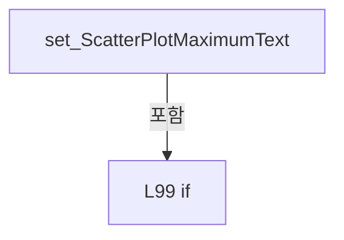

변경 전 점검: 입력/반환 타입, 위 호출자, 예외/취소 경로, 공유 상태와 저장·전송 소비자를 함께 확인합니다. 값의 단위나 물리 방향을 이름만으로 확정하지 않습니다.

### PropertyDeclaration `ScatterPlotGridUnitText` · L109–122

[Drilling.UI/Menu/Menus/CMenuCorrection.ReviewData.Display.cs:109–122](https://github.com/kjuws10-rgb/A3Drilling/blob/334b3599651b2e8e0181fd4459bafaf3cddafff3/Drilling.UI/Menu/Menus/CMenuCorrection.ReviewData.Display.cs#L109-L122)

| 항목 | 실제 추출 값 |
| --- | --- |
| 서명 | string Drilling.UI.Menu.Menus.CMenuCorrection.CReviewDataPanel.ScatterPlotGridUnitText |
| 접근/수식자 | Public / public |
| 반환/값 타입 | string |
| 소속 타입 | NamedType:Drilling.UI.Menu.Menus.CMenuCorrection.CReviewDataPanel |

현재 부분 분석에서 직접 연결된 호출자는 없습니다. XAML/이벤트/인터페이스·델리게이트·외부 진입을 추가 확인해야 하며, 미사용으로 판정한 것이 아닙니다.

변경 전 점검: 입력/반환 타입, 위 호출자, 예외/취소 경로, 공유 상태와 저장·전송 소비자를 함께 확인합니다. 값의 단위나 물리 방향을 이름만으로 확정하지 않습니다.

### GetAccessorDeclaration `get_ScatterPlotGridUnitText` · L111–111

[Drilling.UI/Menu/Menus/CMenuCorrection.ReviewData.Display.cs:111–111](https://github.com/kjuws10-rgb/A3Drilling/blob/334b3599651b2e8e0181fd4459bafaf3cddafff3/Drilling.UI/Menu/Menus/CMenuCorrection.ReviewData.Display.cs#L111-L111)

| 항목 | 실제 추출 값 |
| --- | --- |
| 서명 | string Drilling.UI.Menu.Menus.CMenuCorrection.CReviewDataPanel.ScatterPlotGridUnitText.get |
| 접근/수식자 | Public / get |
| 반환/값 타입 | string |
| 소속 타입 | NamedType:Drilling.UI.Menu.Menus.CMenuCorrection.CReviewDataPanel |

현재 부분 분석에서 직접 연결된 호출자는 없습니다. XAML/이벤트/인터페이스·델리게이트·외부 진입을 추가 확인해야 하며, 미사용으로 판정한 것이 아닙니다.

변경 전 점검: 입력/반환 타입, 위 호출자, 예외/취소 경로, 공유 상태와 저장·전송 소비자를 함께 확인합니다. 값의 단위나 물리 방향을 이름만으로 확정하지 않습니다.

### SetAccessorDeclaration `set_ScatterPlotGridUnitText` · L112–121

[Drilling.UI/Menu/Menus/CMenuCorrection.ReviewData.Display.cs:112–121](https://github.com/kjuws10-rgb/A3Drilling/blob/334b3599651b2e8e0181fd4459bafaf3cddafff3/Drilling.UI/Menu/Menus/CMenuCorrection.ReviewData.Display.cs#L112-L121)

| 항목 | 실제 추출 값 |
| --- | --- |
| 서명 | void Drilling.UI.Menu.Menus.CMenuCorrection.CReviewDataPanel.ScatterPlotGridUnitText.set |
| 접근/수식자 | Public / set |
| 반환/값 타입 | void |
| 소속 타입 | NamedType:Drilling.UI.Menu.Menus.CMenuCorrection.CReviewDataPanel |

입력 계약:

| 이름 | 타입 | 전달 | 선택/기본값 |
| --- | --- | --- | --- |
| value | string | None | False /  |

현재 부분 분석에서 직접 연결된 호출자는 없습니다. XAML/이벤트/인터페이스·델리게이트·외부 진입을 추가 확인해야 하며, 미사용으로 판정한 것이 아닙니다.

호출하는 대상과 해석 범위:

| 원본 행 | 표현식 | 분석 상태 | 대상/소스 위치 |
| --- | --- | --- | --- |
| 120 | Notify | resolved | void Drilling.UI.Menu.Menus.CMenuCorrection.CReviewDataPanel.Notify(string) · Drilling.UI/Menu/Menus/CMenuCorrection.ReviewData.cs:616 |
| 120 | nameof | unresolved | None |

본문의 실제 연산·분기·예외·반환 순서(원문 위치 순):

| 원본 행 | 종류 | 주석 해설 |
| --- | --- | --- |
| 114 | if | 조건에 따라 분기합니다: if (_scatterPlotGridUnitText == value) |
| 116 | return | 호출자에게 값 또는 제어를 반환합니다: return; |
| 119 | assignment | 값을 대상에 대입합니다: _scatterPlotGridUnitText = value |
| 120 | call | 함수·델리게이트 또는 객체 생성자를 호출합니다: Notify(nameof(ScatterPlotGridUnitText)) |
| 120 | call | 함수·델리게이트 또는 객체 생성자를 호출합니다: nameof(ScatterPlotGridUnitText) |

제어 구문의 포함 구조(실제 실행 순서/CFG가 아닌 구문 탐색 그림):

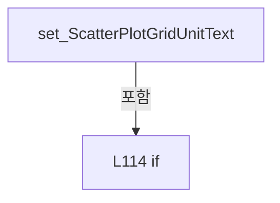

변경 전 점검: 입력/반환 타입, 위 호출자, 예외/취소 경로, 공유 상태와 저장·전송 소비자를 함께 확인합니다. 값의 단위나 물리 방향을 이름만으로 확정하지 않습니다.

### MethodDeclaration `PrepareSelectedResult` · L124–153

[Drilling.UI/Menu/Menus/CMenuCorrection.ReviewData.Display.cs:124–153](https://github.com/kjuws10-rgb/A3Drilling/blob/334b3599651b2e8e0181fd4459bafaf3cddafff3/Drilling.UI/Menu/Menus/CMenuCorrection.ReviewData.Display.cs#L124-L153)

| 항목 | 실제 추출 값 |
| --- | --- |
| 서명 | void Drilling.UI.Menu.Menus.CMenuCorrection.CReviewDataPanel.PrepareSelectedResult(Drilling.Common.Review.ST_REVIEW_RESULT_CATALOG_ITEM?) |
| 접근/수식자 | Private / private |
| 반환/값 타입 | void |
| 소속 타입 | NamedType:Drilling.UI.Menu.Menus.CMenuCorrection.CReviewDataPanel |

입력 계약:

| 이름 | 타입 | 전달 | 선택/기본값 |
| --- | --- | --- | --- |
| result | Drilling.Common.Review.ST_REVIEW_RESULT_CATALOG_ITEM? | None | False /  |

정적 호출자로 확인된 위치:

| 호출 파일/행 | 호출 표현식 | 런타임 분기 가능 |
| --- | --- | --- |
| [Drilling.UI/Menu/Menus/CMenuCorrection.ReviewData.cs:227–227](https://github.com/kjuws10-rgb/A3Drilling/blob/334b3599651b2e8e0181fd4459bafaf3cddafff3/Drilling.UI/Menu/Menus/CMenuCorrection.ReviewData.cs#L227-L227) | PrepareSelectedResult | False |
| [Drilling.UI/Menu/Menus/CMenuCorrection.ReviewData.cs:346–346](https://github.com/kjuws10-rgb/A3Drilling/blob/334b3599651b2e8e0181fd4459bafaf3cddafff3/Drilling.UI/Menu/Menus/CMenuCorrection.ReviewData.cs#L346-L346) | PrepareSelectedResult | False |

호출하는 대상과 해석 범위:

| 원본 행 | 표현식 | 분석 상태 | 대상/소스 위치 |
| --- | --- | --- | --- |
| 126 | .Cancel | resolved | void System.Threading.CancellationTokenSource.Cancel() |
| 127 | .Dispose | resolved | void System.Threading.CancellationTokenSource.Dispose() |
| 129 | Interlocked.Increment | resolved | int System.Threading.Interlocked.Increment(ref int) |
| 130 | SetDataLoading | resolved | void Drilling.UI.Menu.Menus.CMenuCorrection.CReviewDataPanel.SetDataLoading(bool) · Drilling.UI/Menu/Menus/CMenuCorrection.ReviewData.Display.cs:1355 |
| 131 | ClearLoadedDisplay | resolved | void Drilling.UI.Menu.Menus.CMenuCorrection.CReviewDataPanel.ClearLoadedDisplay() · Drilling.UI/Menu/Menus/CMenuCorrection.ReviewData.Display.cs:1317 |
| 135 | SetDataLoadHint | resolved | void Drilling.UI.Menu.Menus.CMenuCorrection.CReviewDataPanel.SetDataLoadHint(string, string) · Drilling.UI/Menu/Menus/CMenuCorrection.ReviewData.Display.cs:1377 |
| 137 | result.ResultStatus.Equals | resolved | bool string.Equals(string?, System.StringComparison) |
| 139 | string.IsNullOrWhiteSpace | resolved | bool string.IsNullOrWhiteSpace(string?) |
| 140 | SetDataLoadHint | resolved | void Drilling.UI.Menu.Menus.CMenuCorrection.CReviewDataPanel.SetDataLoadHint(string, string) · Drilling.UI/Menu/Menus/CMenuCorrection.ReviewData.Display.cs:1377 |
| 142 | result.ResultStatus.Equals | resolved | bool string.Equals(string?, System.StringComparison) |
| 144 | string.IsNullOrWhiteSpace | resolved | bool string.IsNullOrWhiteSpace(string?) |
| 145 | SetDataLoadHint | resolved | void Drilling.UI.Menu.Menus.CMenuCorrection.CReviewDataPanel.SetDataLoadHint(string, string) · Drilling.UI/Menu/Menus/CMenuCorrection.ReviewData.Display.cs:1377 |
| 149 | SetDataLoadHint | resolved | void Drilling.UI.Menu.Menus.CMenuCorrection.CReviewDataPanel.SetDataLoadHint(string, string) · Drilling.UI/Menu/Menus/CMenuCorrection.ReviewData.Display.cs:1377 |
| 152 | NotifyLoadCommandState | resolved | void Drilling.UI.Menu.Menus.CMenuCorrection.CReviewDataPanel.NotifyLoadCommandState() · Drilling.UI/Menu/Menus/CMenuCorrection.ReviewData.Display.cs:1385 |

본문의 실제 연산·분기·예외·반환 순서(원문 위치 순):

| 원본 행 | 종류 | 주석 해설 |
| --- | --- | --- |
| 126 | call | 함수·델리게이트 또는 객체 생성자를 호출합니다: .Cancel() |
| 127 | call | 함수·델리게이트 또는 객체 생성자를 호출합니다: .Dispose() |
| 128 | assignment | 값을 대상에 대입합니다: _dataLoadCancellation = null |
| 129 | call | 함수·델리게이트 또는 객체 생성자를 호출합니다: Interlocked.Increment(ref _dataLoadVersion) |
| 130 | call | 함수·델리게이트 또는 객체 생성자를 호출합니다: SetDataLoading(false) |
| 131 | call | 함수·델리게이트 또는 객체 생성자를 호출합니다: ClearLoadedDisplay() |
| 133 | if | 조건에 따라 분기합니다: if (result is null) |
| 135 | call | 함수·델리게이트 또는 객체 생성자를 호출합니다: SetDataLoadHint("DATA LOAD 불가능. 사유 : 검사 결과 파일을 선택하세요.", "WAIT") |
| 137 | call | 함수·델리게이트 또는 객체 생성자를 호출합니다: result.ResultStatus.Equals("FAILED", StringComparison.OrdinalIgnoreCase) |
| 137 | else | 앞 조건이 거짓인 경로입니다: else |
| 137 | if | 조건에 따라 분기합니다: if (result.ResultStatus.Equals("FAILED", StringComparison.OrdinalIgnoreCase)) |
| 139 | call | 함수·델리게이트 또는 객체 생성자를 호출합니다: string.IsNullOrWhiteSpace(result.ResultMessage) |
| 139 | conditional-expression | 조건에 따라 결과식을 선택합니다: string.IsNullOrWhiteSpace(result.ResultMessage) ? "실패 사유가 기록되어 있지 않습니다." : result.ResultMessage |
| 139 | local-declaration | 지역 변수를 선언합니다: var reason = string.IsNullOrWhiteSpace(result.ResultMessage) ? "실패 사유가 기록되어 있지 않습니다." : result.ResultMessage; |
| 139 | variable-initializer | 변수의 초기값을 지정합니다: reason = string.IsNullOrWhiteSpace(result.ResultMessage) ? "실패 사유가 기록되어 있지 않습니다." : result.ResultMessage |
| 140 | call | 함수·델리게이트 또는 객체 생성자를 호출합니다: SetDataLoadHint($"DATA LOAD 불가능. 사유 : 검사 실패 - {reason}", "ERROR") |
| 142 | call | 함수·델리게이트 또는 객체 생성자를 호출합니다: result.ResultStatus.Equals("INVALID", StringComparison.OrdinalIgnoreCase) |
| 142 | else | 앞 조건이 거짓인 경로입니다: else |
| 142 | if | 조건에 따라 분기합니다: if (result.ResultStatus.Equals("INVALID", StringComparison.OrdinalIgnoreCase)) |
| 144 | call | 함수·델리게이트 또는 객체 생성자를 호출합니다: string.IsNullOrWhiteSpace(result.ResultMessage) |
| 144 | conditional-expression | 조건에 따라 결과식을 선택합니다: string.IsNullOrWhiteSpace(result.ResultMessage) ? "결과 파일이 올바르지 않습니다." : result.ResultMessage |
| 144 | local-declaration | 지역 변수를 선언합니다: var reason = string.IsNullOrWhiteSpace(result.ResultMessage) ? "결과 파일이 올바르지 않습니다." : result.ResultMessage; |
| 144 | variable-initializer | 변수의 초기값을 지정합니다: reason = string.IsNullOrWhiteSpace(result.ResultMessage) ? "결과 파일이 올바르지 않습니다." : result.ResultMessage |
| 145 | call | 함수·델리게이트 또는 객체 생성자를 호출합니다: SetDataLoadHint($"DATA LOAD 불가능. 사유 : {reason}", "ERROR") |
| 147 | else | 앞 조건이 거짓인 경로입니다: else |
| 149 | call | 함수·델리게이트 또는 객체 생성자를 호출합니다: SetDataLoadHint("선택한 검사 결과를 불러오려면 DATA LOAD를 누르세요.", "WAIT") |
| 152 | call | 함수·델리게이트 또는 객체 생성자를 호출합니다: NotifyLoadCommandState() |

제어 구문의 포함 구조(실제 실행 순서/CFG가 아닌 구문 탐색 그림):


변경 전 점검: 입력/반환 타입, 위 호출자, 예외/취소 경로, 공유 상태와 저장·전송 소비자를 함께 확인합니다. 값의 단위나 물리 방향을 이름만으로 확정하지 않습니다.

### MethodDeclaration `LoadDataRequested` · L155–158

[Drilling.UI/Menu/Menus/CMenuCorrection.ReviewData.Display.cs:155–158](https://github.com/kjuws10-rgb/A3Drilling/blob/334b3599651b2e8e0181fd4459bafaf3cddafff3/Drilling.UI/Menu/Menus/CMenuCorrection.ReviewData.Display.cs#L155-L158)

| 항목 | 실제 추출 값 |
| --- | --- |
| 서명 | void Drilling.UI.Menu.Menus.CMenuCorrection.CReviewDataPanel.LoadDataRequested(object?) |
| 접근/수식자 | Private / private, async |
| 반환/값 타입 | void |
| 소속 타입 | NamedType:Drilling.UI.Menu.Menus.CMenuCorrection.CReviewDataPanel |

입력 계약:

| 이름 | 타입 | 전달 | 선택/기본값 |
| --- | --- | --- | --- |
| parameter | object? | None | False /  |

현재 부분 분석에서 직접 연결된 호출자는 없습니다. XAML/이벤트/인터페이스·델리게이트·외부 진입을 추가 확인해야 하며, 미사용으로 판정한 것이 아닙니다.

호출하는 대상과 해석 범위:

| 원본 행 | 표현식 | 분석 상태 | 대상/소스 위치 |
| --- | --- | --- | --- |
| 157 | LoadSelectedData | resolved | System.Threading.Tasks.Task Drilling.UI.Menu.Menus.CMenuCorrection.CReviewDataPanel.LoadSelectedData() · Drilling.UI/Menu/Menus/CMenuCorrection.ReviewData.Display.cs:160 |

본문의 실제 연산·분기·예외·반환 순서(원문 위치 순):

| 원본 행 | 종류 | 주석 해설 |
| --- | --- | --- |
| 157 | await | 비동기 완료를 기다립니다: await LoadSelectedData() |
| 157 | call | 함수·델리게이트 또는 객체 생성자를 호출합니다: LoadSelectedData() |

변경 전 점검: 입력/반환 타입, 위 호출자, 예외/취소 경로, 공유 상태와 저장·전송 소비자를 함께 확인합니다. 값의 단위나 물리 방향을 이름만으로 확정하지 않습니다.

### MethodDeclaration `LoadSelectedData` · L160–239

[Drilling.UI/Menu/Menus/CMenuCorrection.ReviewData.Display.cs:160–239](https://github.com/kjuws10-rgb/A3Drilling/blob/334b3599651b2e8e0181fd4459bafaf3cddafff3/Drilling.UI/Menu/Menus/CMenuCorrection.ReviewData.Display.cs#L160-L239)

| 항목 | 실제 추출 값 |
| --- | --- |
| 서명 | System.Threading.Tasks.Task Drilling.UI.Menu.Menus.CMenuCorrection.CReviewDataPanel.LoadSelectedData() |
| 접근/수식자 | Private / private, async |
| 반환/값 타입 | System.Threading.Tasks.Task |
| 소속 타입 | NamedType:Drilling.UI.Menu.Menus.CMenuCorrection.CReviewDataPanel |

정적 호출자로 확인된 위치:

| 호출 파일/행 | 호출 표현식 | 런타임 분기 가능 |
| --- | --- | --- |
| [Drilling.UI/Menu/Menus/CMenuCorrection.ReviewData.Display.cs:157–157](https://github.com/kjuws10-rgb/A3Drilling/blob/334b3599651b2e8e0181fd4459bafaf3cddafff3/Drilling.UI/Menu/Menus/CMenuCorrection.ReviewData.Display.cs#L157-L157) | LoadSelectedData | False |
| [Drilling.UI/Menu/Menus/CMenuCorrection.ReviewData.Edit.cs:525–525](https://github.com/kjuws10-rgb/A3Drilling/blob/334b3599651b2e8e0181fd4459bafaf3cddafff3/Drilling.UI/Menu/Menus/CMenuCorrection.ReviewData.Edit.cs#L525-L525) | LoadSelectedData | False |
| [Drilling.UI/Menu/Menus/CMenuCorrection.ReviewData.Reinspection.cs:445–445](https://github.com/kjuws10-rgb/A3Drilling/blob/334b3599651b2e8e0181fd4459bafaf3cddafff3/Drilling.UI/Menu/Menus/CMenuCorrection.ReviewData.Reinspection.cs#L445-L445) | LoadSelectedData | False |
| [Drilling.UI/Menu/Menus/CMenuCorrection.ReviewData.cs:206–206](https://github.com/kjuws10-rgb/A3Drilling/blob/334b3599651b2e8e0181fd4459bafaf3cddafff3/Drilling.UI/Menu/Menus/CMenuCorrection.ReviewData.cs#L206-L206) | LoadSelectedData | False |

호출하는 대상과 해석 범위:

| 원본 행 | 표현식 | 분석 상태 | 대상/소스 위치 |
| --- | --- | --- | --- |
| 162 | IsBlockedStatus | resolved | bool Drilling.UI.Menu.Menus.CMenuCorrection.CReviewDataPanel.IsBlockedStatus(string) · Drilling.UI/Menu/Menus/CMenuCorrection.ReviewData.Display.cs:1311 |
| 167 | .Cancel | resolved | void System.Threading.CancellationTokenSource.Cancel() |
| 168 | .Dispose | resolved | void System.Threading.CancellationTokenSource.Dispose() |
| 169 | new CancellationTokenSource | resolved | System.Threading.CancellationTokenSource.CancellationTokenSource() |
| 171 | Interlocked.Increment | resolved | int System.Threading.Interlocked.Increment(ref int) |
| 172 | ClearLoadedDisplay | resolved | void Drilling.UI.Menu.Menus.CMenuCorrection.CReviewDataPanel.ClearLoadedDisplay() · Drilling.UI/Menu/Menus/CMenuCorrection.ReviewData.Display.cs:1317 |
| 173 | SetDataLoading | resolved | void Drilling.UI.Menu.Menus.CMenuCorrection.CReviewDataPanel.SetDataLoading(bool) · Drilling.UI/Menu/Menus/CMenuCorrection.ReviewData.Display.cs:1355 |
| 174 | SetLoadProgress | resolved | void Drilling.UI.Menu.Menus.CMenuCorrection.CReviewDataPanel.SetLoadProgress(double, string) · Drilling.UI/Menu/Menus/CMenuCorrection.ReviewData.Display.cs:1369 |
| 175 | SetDataLoadHint | resolved | void Drilling.UI.Menu.Menus.CMenuCorrection.CReviewDataPanel.SetDataLoadHint(string, string) · Drilling.UI/Menu/Menus/CMenuCorrection.ReviewData.Display.cs:1377 |
| 179 | Task.Run | resolved | System.Threading.Tasks.Task<Drilling.Common.Review.ST_REVIEW_RESULT_FILE_DATA> System.Threading.Tasks.Task.Run<Drilling.Common.Review.ST_REVIEW_RESULT_FILE_DATA>(System.Func<System.Threading.Tasks.Task<Drilling.Common.Review.ST_REVIEW_RESULT_FILE_DATA>?>, System.Threading.CancellationToken) |
| 179 | _reviewResultFile.Load | resolved | System.Threading.Tasks.Task<Drilling.Common.Review.ST_REVIEW_RESULT_FILE_DATA> Drilling.Common.Review.CReviewResultFileBase.Load(string, System.Threading.CancellationToken) · Drilling.Common/Review/CReviewManager.cs:4353 |
| 180 | token.ThrowIfCancellationRequested | resolved | void System.Threading.CancellationToken.ThrowIfCancellationRequested() |
| 181 | Volatile.Read | resolved | int System.Threading.Volatile.Read(ref readonly int) |
| 186 | SetLoadProgress | resolved | void Drilling.UI.Menu.Menus.CMenuCorrection.CReviewDataPanel.SetLoadProgress(double, string) · Drilling.UI/Menu/Menus/CMenuCorrection.ReviewData.Display.cs:1369 |
| 187 | Task.Run | resolved | System.Threading.Tasks.Task<System.Collections.Generic.IReadOnlyList<Drilling.Common.Managers.ST_RECIPE_DEFINITION>> System.Threading.Tasks.Task.Run<System.Collections.Generic.IReadOnlyList<Drilling.Common.Managers.ST_RECIPE_DEFINITION>>(System.Func<System.Threading.Tasks.Task<System.Collections.Generic.IReadOnlyList<Drilling.Common.Managers.ST_RECIPE_DEFINITION>>?>, System.Threading.CancellationToken) |
| 187 | _recipeManager.LoadRecipes | resolved | System.Threading.Tasks.Task<System.Collections.Generic.IReadOnlyList<Drilling.Common.Managers.ST_RECIPE_DEFINITION>> Drilling.Common.Managers.CRecipeManager.LoadRecipes(System.Threading.CancellationToken) · Drilling.Common/Managers/CRecipeManager.cs:40 |
| 188 | token.ThrowIfCancellationRequested | resolved | void System.Threading.CancellationToken.ThrowIfCancellationRequested() |
| 189 | recipes.FirstOrDefault | resolved | Drilling.Common.Managers.ST_RECIPE_DEFINITION? System.Collections.Generic.IEnumerable<Drilling.Common.Managers.ST_RECIPE_DEFINITION>.FirstOrDefault<Drilling.Common.Managers.ST_RECIPE_DEFINITION>(System.Func<Drilling.Common.Managers.ST_RECIPE_DEFINITION, bool>) |
| 189 | item.Id.Equals | resolved | bool string.Equals(string?, System.StringComparison) |
| 190 | recipes.FirstOrDefault | resolved | Drilling.Common.Managers.ST_RECIPE_DEFINITION? System.Collections.Generic.IEnumerable<Drilling.Common.Managers.ST_RECIPE_DEFINITION>.FirstOrDefault<Drilling.Common.Managers.ST_RECIPE_DEFINITION>(System.Func<Drilling.Common.Managers.ST_RECIPE_DEFINITION, bool>) |
| 190 | item.Name.Equals | resolved | bool string.Equals(string?, System.StringComparison) |
| 191 | new InvalidDataException | resolved | System.IO.InvalidDataException.InvalidDataException(string?) |
| 192 | Task.Run | resolved | System.Threading.Tasks.Task<System.Collections.Generic.IReadOnlyList<Drilling.Common.Managers.ST_SYSTEM_PARAMETER>> System.Threading.Tasks.Task.Run<System.Collections.Generic.IReadOnlyList<Drilling.Common.Managers.ST_SYSTEM_PARAMETER>>(System.Func<System.Collections.Generic.IReadOnlyList<Drilling.Common.Managers.ST_SYSTEM_PARAMETER>>, System.Threading.CancellationToken) |
| 194 | new List<ST_SYSTEM_PARAMETER> | resolved | System.Collections.Generic.List<Drilling.Common.Managers.ST_SYSTEM_PARAMETER>.List() |
| 195 | values.AddRange | resolved | void System.Collections.Generic.List<Drilling.Common.Managers.ST_SYSTEM_PARAMETER>.AddRange(System.Collections.Generic.IEnumerable<Drilling.Common.Managers.ST_SYSTEM_PARAMETER>) |
| 195 | _settingManager.LoadSection | resolved | System.Collections.Generic.IReadOnlyList<Drilling.Common.Managers.ST_SYSTEM_PARAMETER> Drilling.Common.Managers.CSettingManager.LoadSection(Drilling.Common.Managers.EN_SETTING_TAB, System.Threading.CancellationToken) · Drilling.Common/Managers/CSettingManager.cs:26 |
| 196 | values.AddRange | resolved | void System.Collections.Generic.List<Drilling.Common.Managers.ST_SYSTEM_PARAMETER>.AddRange(System.Collections.Generic.IEnumerable<Drilling.Common.Managers.ST_SYSTEM_PARAMETER>) |
| 196 | _settingManager.LoadSection | resolved | System.Collections.Generic.IReadOnlyList<Drilling.Common.Managers.ST_SYSTEM_PARAMETER> Drilling.Common.Managers.CSettingManager.LoadSection(Drilling.Common.Managers.EN_SETTING_TAB, System.Threading.CancellationToken) · Drilling.Common/Managers/CSettingManager.cs:26 |
| 199 | token.ThrowIfCancellationRequested | resolved | void System.Threading.CancellationToken.ThrowIfCancellationRequested() |
| 200 | SetLoadProgress | resolved | void Drilling.UI.Menu.Menus.CMenuCorrection.CReviewDataPanel.SetLoadProgress(double, string) · Drilling.UI/Menu/Menus/CMenuCorrection.ReviewData.Display.cs:1369 |
| 202 | BuildOutputViewerParameterMap | resolved | System.Collections.Generic.Dictionary<string, string> Drilling.UI.Menu.Menus.CMenuCorrection.BuildOutputViewerParameterMap(Drilling.Common.Managers.ST_RECIPE_DEFINITION, System.Collections.Generic.IReadOnlyList<Drilling.Common.Managers.ST_SYSTEM_PARAMETER>) · Drilling.UI/Menu/Menus/CMenuCorrection.cs:868 |
| 203 | Task.Run | resolved | System.Threading.Tasks.Task<Drilling.UI.Menu.Menus.CMenuCorrection.ST_REVIEW_DATA_DISPLAY_MODEL> System.Threading.Tasks.Task.Run<Drilling.UI.Menu.Menus.CMenuCorrection.ST_REVIEW_DATA_DISPLAY_MODEL>(System.Func<Drilling.UI.Menu.Menus.CMenuCorrection.ST_REVIEW_DATA_DISPLAY_MODEL>, System.Threading.CancellationToken) |
| 203 | BuildDisplayModel | resolved | Drilling.UI.Menu.Menus.CMenuCorrection.ST_REVIEW_DATA_DISPLAY_MODEL Drilling.UI.Menu.Menus.CMenuCorrection.CReviewDataPanel.BuildDisplayModel(Drilling.Common.Review.ST_REVIEW_RESULT_FILE_DATA, System.Collections.Generic.IReadOnlyDictionary<string, string>, System.Threading.CancellationToken) · Drilling.UI/Menu/Menus/CMenuCorrection.ReviewData.Display.cs:241 |
| 204 | token.ThrowIfCancellationRequested | resolved | void System.Threading.CancellationToken.ThrowIfCancellationRequested() |
| 205 | Volatile.Read | resolved | int System.Threading.Volatile.Read(ref readonly int) |
| 210 | SetLoadProgress | resolved | void Drilling.UI.Menu.Menus.CMenuCorrection.CReviewDataPanel.SetLoadProgress(double, string) · Drilling.UI/Menu/Menus/CMenuCorrection.ReviewData.Display.cs:1369 |
| 211 | ApplyDisplayModel | resolved | void Drilling.UI.Menu.Menus.CMenuCorrection.CReviewDataPanel.ApplyDisplayModel(Drilling.UI.Menu.Menus.CMenuCorrection.ST_REVIEW_DATA_DISPLAY_MODEL, Drilling.Common.Review.ST_REVIEW_RESULT_FILE_DATA, Drilling.Common.Review.ST_REVIEW_RESULT_CATALOG_ITEM, Drilling.Common.Managers.ST_RECIPE_DEFINITION) · Drilling.UI/Menu/Menus/CMenuCorrection.ReviewData.Display.cs:501 |
| 212 | SetLoadProgress | resolved | void Drilling.UI.Menu.Menus.CMenuCorrection.CReviewDataPanel.SetLoadProgress(double, string) · Drilling.UI/Menu/Menus/CMenuCorrection.ReviewData.Display.cs:1369 |
| 213 | SetDataLoadHint | resolved | void Drilling.UI.Menu.Menus.CMenuCorrection.CReviewDataPanel.SetDataLoadHint(string, string) · Drilling.UI/Menu/Menus/CMenuCorrection.ReviewData.Display.cs:1377 |
| 214 | _statusReporter | resolved · 동적 구현 선택 가능 | void System.Action<string>.Invoke(string) |
| 218 | Volatile.Read | resolved | int System.Threading.Volatile.Read(ref readonly int) |
| 220 | SetDataLoadHint | resolved | void Drilling.UI.Menu.Menus.CMenuCorrection.CReviewDataPanel.SetDataLoadHint(string, string) · Drilling.UI/Menu/Menus/CMenuCorrection.ReviewData.Display.cs:1377 |
| 225 | Volatile.Read | resolved | int System.Threading.Volatile.Read(ref readonly int) |
| 227 | ClearLoadedDisplay | resolved | void Drilling.UI.Menu.Menus.CMenuCorrection.CReviewDataPanel.ClearLoadedDisplay() · Drilling.UI/Menu/Menus/CMenuCorrection.ReviewData.Display.cs:1317 |
| 228 | SetDataLoadHint | resolved | void Drilling.UI.Menu.Menus.CMenuCorrection.CReviewDataPanel.SetDataLoadHint(string, string) · Drilling.UI/Menu/Menus/CMenuCorrection.ReviewData.Display.cs:1377 |
| 229 | _statusReporter | resolved · 동적 구현 선택 가능 | void System.Action<string>.Invoke(string) |
| 234 | Volatile.Read | resolved | int System.Threading.Volatile.Read(ref readonly int) |
| 236 | SetDataLoading | resolved | void Drilling.UI.Menu.Menus.CMenuCorrection.CReviewDataPanel.SetDataLoading(bool) · Drilling.UI/Menu/Menus/CMenuCorrection.ReviewData.Display.cs:1355 |

본문의 실제 연산·분기·예외·반환 순서(원문 위치 순):

| 원본 행 | 종류 | 주석 해설 |
| --- | --- | --- |
| 162 | call | 함수·델리게이트 또는 객체 생성자를 호출합니다: IsBlockedStatus(catalog.ResultStatus) |
| 162 | if | 조건에 따라 분기합니다: if (_selectedNode?.Result is not { } catalog &#124;&#124; IsBlockedStatus(catalog.ResultStatus) &#124;&#124; _isDataLoading) |
| 164 | return | 호출자에게 값 또는 제어를 반환합니다: return; |
| 167 | call | 함수·델리게이트 또는 객체 생성자를 호출합니다: .Cancel() |
| 168 | call | 함수·델리게이트 또는 객체 생성자를 호출합니다: .Dispose() |
| 169 | assignment | 값을 대상에 대입합니다: _dataLoadCancellation = new CancellationTokenSource() |
| 169 | call | 함수·델리게이트 또는 객체 생성자를 호출합니다: new CancellationTokenSource() |
| 170 | local-declaration | 지역 변수를 선언합니다: var token = _dataLoadCancellation.Token; |
| 170 | variable-initializer | 변수의 초기값을 지정합니다: token = _dataLoadCancellation.Token |
| 171 | call | 함수·델리게이트 또는 객체 생성자를 호출합니다: Interlocked.Increment(ref _dataLoadVersion) |
| 171 | local-declaration | 지역 변수를 선언합니다: var version = Interlocked.Increment(ref _dataLoadVersion); |
| 171 | variable-initializer | 변수의 초기값을 지정합니다: version = Interlocked.Increment(ref _dataLoadVersion) |
| 172 | call | 함수·델리게이트 또는 객체 생성자를 호출합니다: ClearLoadedDisplay() |
| 173 | call | 함수·델리게이트 또는 객체 생성자를 호출합니다: SetDataLoading(true) |
| 174 | call | 함수·델리게이트 또는 객체 생성자를 호출합니다: SetLoadProgress(5.0, "검사 결과 준비 중...") |
| 175 | call | 함수·델리게이트 또는 객체 생성자를 호출합니다: SetDataLoadHint("선택한 검사 결과를 불러오는 중입니다.", "WAIT") |
| 177 | try | 예외 처리 범위입니다: try |
| 179 | await | 비동기 완료를 기다립니다: await Task.Run(() => _reviewResultFile.Load(catalog.FilePath, token), token) |
| 179 | call | 함수·델리게이트 또는 객체 생성자를 호출합니다: Task.Run(() => _reviewResultFile.Load(catalog.FilePath, token), token) |
| 179 | call | 함수·델리게이트 또는 객체 생성자를 호출합니다: _reviewResultFile.Load(catalog.FilePath, token) |
| 179 | local-declaration | 지역 변수를 선언합니다: var resultFile = await Task.Run(() => _reviewResultFile.Load(catalog.FilePath, token), token); |
| 179 | variable-initializer | 변수의 초기값을 지정합니다: resultFile = await Task.Run(() => _reviewResultFile.Load(catalog.FilePath, token), token) |
| 180 | call | 함수·델리게이트 또는 객체 생성자를 호출합니다: token.ThrowIfCancellationRequested() |
| 181 | call | 함수·델리게이트 또는 객체 생성자를 호출합니다: Volatile.Read(ref _dataLoadVersion) |
| 181 | if | 조건에 따라 분기합니다: if (version != Volatile.Read(ref _dataLoadVersion)) |
| 183 | return | 호출자에게 값 또는 제어를 반환합니다: return; |
| 186 | call | 함수·델리게이트 또는 객체 생성자를 호출합니다: SetLoadProgress(30.0, "결과 파일 로드 완료") |
| 187 | await | 비동기 완료를 기다립니다: await Task.Run(() => _recipeManager.LoadRecipes(token), token) |
| 187 | call | 함수·델리게이트 또는 객체 생성자를 호출합니다: Task.Run(() => _recipeManager.LoadRecipes(token), token) |
| 187 | call | 함수·델리게이트 또는 객체 생성자를 호출합니다: _recipeManager.LoadRecipes(token) |
| 187 | local-declaration | 지역 변수를 선언합니다: var recipes = await Task.Run(() => _recipeManager.LoadRecipes(token), token); |
| 187 | variable-initializer | 변수의 초기값을 지정합니다: recipes = await Task.Run(() => _recipeManager.LoadRecipes(token), token) |
| 188 | call | 함수·델리게이트 또는 객체 생성자를 호출합니다: token.ThrowIfCancellationRequested() |
| 189 | call | 함수·델리게이트 또는 객체 생성자를 호출합니다: recipes.FirstOrDefault(item => item.Id.Equals(resultFile.RecipeId, StringComparison.OrdinalIgnoreCase)) |
| 189 | call | 함수·델리게이트 또는 객체 생성자를 호출합니다: item.Id.Equals(resultFile.RecipeId, StringComparison.OrdinalIgnoreCase) |
| 189 | local-declaration | 지역 변수를 선언합니다: var recipe = recipes.FirstOrDefault(item => item.Id.Equals(resultFile.RecipeId, StringComparison.OrdinalIgnoreCase)) ?? recipes.FirstOrDefault(item => item.Name.Equals(resultFile.RecipeId, StringComparison.OrdinalIgnoreCase)) ?? t |
| 189 | variable-initializer | 변수의 초기값을 지정합니다: recipe = recipes.FirstOrDefault(item => item.Id.Equals(resultFile.RecipeId, StringComparison.OrdinalIgnoreCase)) ?? recipes.FirstOrDefault(item => item.Name.Equals(resultFile.RecipeId, StringComparison.OrdinalIgnoreCase)) ?? throw |
| 190 | call | 함수·델리게이트 또는 객체 생성자를 호출합니다: recipes.FirstOrDefault(item => item.Name.Equals(resultFile.RecipeId, StringComparison.OrdinalIgnoreCase)) |
| 190 | call | 함수·델리게이트 또는 객체 생성자를 호출합니다: item.Name.Equals(resultFile.RecipeId, StringComparison.OrdinalIgnoreCase) |
| 191 | call | 함수·델리게이트 또는 객체 생성자를 호출합니다: new InvalidDataException($"Recipe '{resultFile.RecipeId}' was not found.") |
| 191 | throw | 예외를 발생/전달합니다: throw new InvalidDataException($"Recipe '{resultFile.RecipeId}' was not found.") |
| 192 | await | 비동기 완료를 기다립니다: await Task.Run(() => { var values = new List<ST_SYSTEM_PARAMETER>(); values.AddRange(_settingManager.LoadSection(EN_SETTING_TAB.Option, token)); values.AddRange(_settingManager.LoadSection(EN_SETTING_TAB.Motor, token)); return (IR |
| 192 | call | 함수·델리게이트 또는 객체 생성자를 호출합니다: Task.Run(() => { var values = new List<ST_SYSTEM_PARAMETER>(); values.AddRange(_settingManager.LoadSection(EN_SETTING_TAB.Option, token)); values.AddRange(_settingManager.LoadSection(EN_SETTING_TAB.Motor, token)); return… |
| 192 | local-declaration | 지역 변수를 선언합니다: var settings = await Task.Run(() => { var values = new List<ST_SYSTEM_PARAMETER>(); values.AddRange(_settingManager.LoadSection(EN_SETTING_TAB.Option, token)); values.AddRange(_settingManager.LoadSection(EN_SETTING_TAB.Motor, toke |
| 192 | variable-initializer | 변수의 초기값을 지정합니다: settings = await Task.Run(() => { var values = new List<ST_SYSTEM_PARAMETER>(); values.AddRange(_settingManager.LoadSection(EN_SETTING_TAB.Option, token)); values.AddRange(_settingManager.LoadSection(EN_SETTING_TAB.Motor, token)); |
| 194 | call | 함수·델리게이트 또는 객체 생성자를 호출합니다: new List<ST_SYSTEM_PARAMETER>() |
| 194 | local-declaration | 지역 변수를 선언합니다: var values = new List<ST_SYSTEM_PARAMETER>(); |
| 194 | variable-initializer | 변수의 초기값을 지정합니다: values = new List<ST_SYSTEM_PARAMETER>() |
| 195 | call | 함수·델리게이트 또는 객체 생성자를 호출합니다: values.AddRange(_settingManager.LoadSection(EN_SETTING_TAB.Option, token)) |
| 195 | call | 함수·델리게이트 또는 객체 생성자를 호출합니다: _settingManager.LoadSection(EN_SETTING_TAB.Option, token) |
| 196 | call | 함수·델리게이트 또는 객체 생성자를 호출합니다: values.AddRange(_settingManager.LoadSection(EN_SETTING_TAB.Motor, token)) |
| 196 | call | 함수·델리게이트 또는 객체 생성자를 호출합니다: _settingManager.LoadSection(EN_SETTING_TAB.Motor, token) |
| 197 | return | 호출자에게 값 또는 제어를 반환합니다: return (IReadOnlyList<ST_SYSTEM_PARAMETER>)values; |
| 199 | call | 함수·델리게이트 또는 객체 생성자를 호출합니다: token.ThrowIfCancellationRequested() |
| 200 | call | 함수·델리게이트 또는 객체 생성자를 호출합니다: SetLoadProgress(55.0, "레시피 배치 로드 완료") |
| 202 | call | 함수·델리게이트 또는 객체 생성자를 호출합니다: BuildOutputViewerParameterMap(recipe, settings) |
| 202 | local-declaration | 지역 변수를 선언합니다: var parameters = BuildOutputViewerParameterMap(recipe, settings); |
| 202 | variable-initializer | 변수의 초기값을 지정합니다: parameters = BuildOutputViewerParameterMap(recipe, settings) |
| 203 | await | 비동기 완료를 기다립니다: await Task.Run(() => BuildDisplayModel(resultFile, parameters, token), token) |
| 203 | call | 함수·델리게이트 또는 객체 생성자를 호출합니다: Task.Run(() => BuildDisplayModel(resultFile, parameters, token), token) |
| 203 | call | 함수·델리게이트 또는 객체 생성자를 호출합니다: BuildDisplayModel(resultFile, parameters, token) |
| 203 | local-declaration | 지역 변수를 선언합니다: var model = await Task.Run(() => BuildDisplayModel(resultFile, parameters, token), token); |
| 203 | variable-initializer | 변수의 초기값을 지정합니다: model = await Task.Run(() => BuildDisplayModel(resultFile, parameters, token), token) |
| 204 | call | 함수·델리게이트 또는 객체 생성자를 호출합니다: token.ThrowIfCancellationRequested() |
| 205 | call | 함수·델리게이트 또는 객체 생성자를 호출합니다: Volatile.Read(ref _dataLoadVersion) |
| 205 | if | 조건에 따라 분기합니다: if (version != Volatile.Read(ref _dataLoadVersion)) |
| 207 | return | 호출자에게 값 또는 제어를 반환합니다: return; |
| 210 | call | 함수·델리게이트 또는 객체 생성자를 호출합니다: SetLoadProgress(90.0, "프리뷰 생성 중...") |
| 211 | call | 함수·델리게이트 또는 객체 생성자를 호출합니다: ApplyDisplayModel(model, resultFile, catalog, recipe) |
| 212 | call | 함수·델리게이트 또는 객체 생성자를 호출합니다: SetLoadProgress(100.0, "DATA LOAD 완료") |
| 213 | call | 함수·델리게이트 또는 객체 생성자를 호출합니다: SetDataLoadHint($"{catalog.FileName}에서 결과 {model.Rows.Count:N0}건을 불러왔습니다.", "OK") |
| 214 | call | 함수·델리게이트 또는 객체 생성자를 호출합니다: _statusReporter($"Review Result data loaded: {catalog.FileName} / {model.Rows.Count:N0} rows.") |
| 216 | catch | 지정 예외를 처리합니다: catch (OperationCanceledException) when (token.IsCancellationRequested) |
| 218 | call | 함수·델리게이트 또는 객체 생성자를 호출합니다: Volatile.Read(ref _dataLoadVersion) |
| 218 | if | 조건에 따라 분기합니다: if (version == Volatile.Read(ref _dataLoadVersion)) |
| 220 | call | 함수·델리게이트 또는 객체 생성자를 호출합니다: SetDataLoadHint("검사 결과 불러오기가 취소되었습니다.", "WARN") |
| 223 | catch | 지정 예외를 처리합니다: catch (Exception exception) |
| 225 | call | 함수·델리게이트 또는 객체 생성자를 호출합니다: Volatile.Read(ref _dataLoadVersion) |
| 225 | if | 조건에 따라 분기합니다: if (version == Volatile.Read(ref _dataLoadVersion)) |
| 227 | call | 함수·델리게이트 또는 객체 생성자를 호출합니다: ClearLoadedDisplay() |
| 228 | call | 함수·델리게이트 또는 객체 생성자를 호출합니다: SetDataLoadHint($"DATA LOAD 불가능. 사유 : 검사 결과 로드 실패 - {exception.Message}", "ERROR") |
| 229 | call | 함수·델리게이트 또는 객체 생성자를 호출합니다: _statusReporter($"Review Result data load failed: {exception.Message}") |
| 232 | finally | 종료 정리 구간입니다: finally |
| 234 | call | 함수·델리게이트 또는 객체 생성자를 호출합니다: Volatile.Read(ref _dataLoadVersion) |
| 234 | if | 조건에 따라 분기합니다: if (version == Volatile.Read(ref _dataLoadVersion)) |
| 236 | call | 함수·델리게이트 또는 객체 생성자를 호출합니다: SetDataLoading(false) |

제어 구문의 포함 구조(실제 실행 순서/CFG가 아닌 구문 탐색 그림):

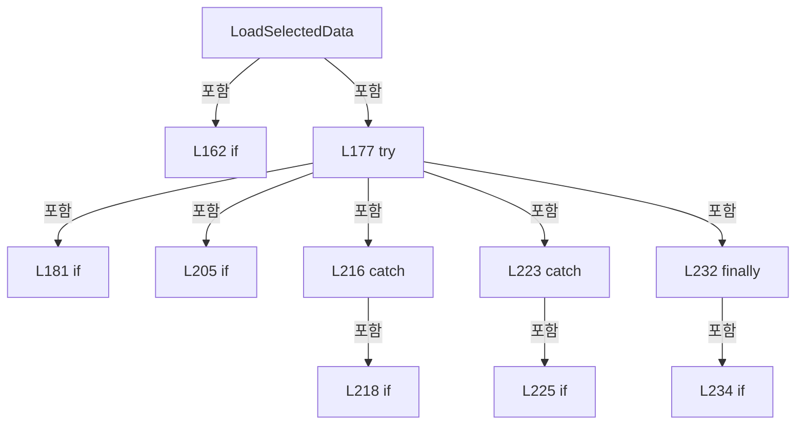

변경 전 점검: 입력/반환 타입, 위 호출자, 예외/취소 경로, 공유 상태와 저장·전송 소비자를 함께 확인합니다. 값의 단위나 물리 방향을 이름만으로 확정하지 않습니다.

### MethodDeclaration `BuildDisplayModel` · L241–390

[Drilling.UI/Menu/Menus/CMenuCorrection.ReviewData.Display.cs:241–390](https://github.com/kjuws10-rgb/A3Drilling/blob/334b3599651b2e8e0181fd4459bafaf3cddafff3/Drilling.UI/Menu/Menus/CMenuCorrection.ReviewData.Display.cs#L241-L390)

| 항목 | 실제 추출 값 |
| --- | --- |
| 서명 | Drilling.UI.Menu.Menus.CMenuCorrection.ST_REVIEW_DATA_DISPLAY_MODEL Drilling.UI.Menu.Menus.CMenuCorrection.CReviewDataPanel.BuildDisplayModel(Drilling.Common.Review.ST_REVIEW_RESULT_FILE_DATA, System.Collections.Generic.IReadOnlyDictionary<string, string>, System.Threading.CancellationToken) |
| 접근/수식자 | Private / private, static |
| 반환/값 타입 | Drilling.UI.Menu.Menus.CMenuCorrection.ST_REVIEW_DATA_DISPLAY_MODEL |
| 소속 타입 | NamedType:Drilling.UI.Menu.Menus.CMenuCorrection.CReviewDataPanel |

입력 계약:

| 이름 | 타입 | 전달 | 선택/기본값 |
| --- | --- | --- | --- |
| resultFile | Drilling.Common.Review.ST_REVIEW_RESULT_FILE_DATA | None | False /  |
| parameters | System.Collections.Generic.IReadOnlyDictionary<string, string> | None | False /  |
| token | System.Threading.CancellationToken | None | False /  |

정적 호출자로 확인된 위치:

| 호출 파일/행 | 호출 표현식 | 런타임 분기 가능 |
| --- | --- | --- |
| [Drilling.UI/Menu/Menus/CMenuCorrection.ReviewData.Display.cs:203–203](https://github.com/kjuws10-rgb/A3Drilling/blob/334b3599651b2e8e0181fd4459bafaf3cddafff3/Drilling.UI/Menu/Menus/CMenuCorrection.ReviewData.Display.cs#L203-L203) | BuildDisplayModel | False |

호출하는 대상과 해석 범위:

| 원본 행 | 표현식 | 분석 상태 | 대상/소스 위치 |
| --- | --- | --- | --- |
| 246 | ReadOutputViewerInt | resolved | int Drilling.UI.Menu.Menus.CMenuCorrection.ReadOutputViewerInt(System.Collections.Generic.IReadOnlyDictionary<string, string>, int, params string[]) · Drilling.UI/Menu/Menus/CMenuCorrection.cs:1338 |
| 249 | new InvalidDataException | resolved | System.IO.InvalidDataException.InvalidDataException(string?) |
| 252 | CReviewResultLevelSettings.Read | resolved | Drilling.Common.Review.ST_REVIEW_RESULT_LEVEL_SETTINGS Drilling.Common.Review.CReviewResultLevelSettings.Read(System.Collections.Generic.IReadOnlyDictionary<string, string>) · Drilling.Common/Review/CReviewResultLevelSettings.cs:114 |
| 254 | resultFile.Rows.Select(row => row.CellNo).Distinct().Order().ToArray | resolved | int[] System.Collections.Generic.IEnumerable<int>.ToArray<int>() |
| 254 | resultFile.Rows.Select(row => row.CellNo).Distinct().Order | resolved | System.Linq.IOrderedEnumerable<int> System.Collections.Generic.IEnumerable<int>.Order<int>() |
| 254 | resultFile.Rows.Select(row => row.CellNo).Distinct | resolved | System.Collections.Generic.IEnumerable<int> System.Collections.Generic.IEnumerable<int>.Distinct<int>() |
| 254 | resultFile.Rows.Select | resolved | System.Collections.Generic.IEnumerable<int> System.Collections.Generic.IEnumerable<Drilling.Common.Review.ST_REVIEW_RESULT_FILE_ROW>.Select<Drilling.Common.Review.ST_REVIEW_RESULT_FILE_ROW, int>(System.Func<Drilling.Common.Review.ST_REVIEW_RESULT_FILE_ROW, int>) |
| 255 | resultCells.ToHashSet | resolved | System.Collections.Generic.HashSet<int> System.Collections.Generic.IEnumerable<int>.ToHashSet<int>() |
| 256 | resultCells.Any | resolved | bool System.Collections.Generic.IEnumerable<int>.Any<int>(System.Func<int, bool>) |
| 258 | new InvalidDataException | resolved | System.IO.InvalidDataException.InvalidDataException(string?) |
| 261 | new Dictionary<int, ST_CELL_PATTERN_LAYOUT> | resolved | System.Collections.Generic.Dictionary<int, Drilling.Common.Recipe.ST_CELL_PATTERN_LAYOUT>.Dictionary() |
| 264 | token.ThrowIfCancellationRequested | resolved | void System.Threading.CancellationToken.ThrowIfCancellationRequested() |
| 265 | CalculateReviewDataCellLayout | resolved | Drilling.Common.Recipe.ST_CELL_PATTERN_LAYOUT Drilling.UI.Menu.Menus.CMenuCorrection.CReviewDataPanel.CalculateReviewDataCellLayout(System.Collections.Generic.IReadOnlyDictionary<string, string>, int) · Drilling.UI/Menu/Menus/CMenuCorrection.ReviewData.Display.cs:392 |
| 268 | new InvalidDataException | resolved | System.IO.InvalidDataException.InvalidDataException(string?) |
| 274 | new List<ST_REVIEW_DATA_GRID_ROW> | resolved | System.Collections.Generic.List<Drilling.UI.Menu.Menus.CMenuCorrection.ST_REVIEW_DATA_GRID_ROW>.List(int) |
| 275 | new Dictionary<int, HashSet<string>> | resolved | System.Collections.Generic.Dictionary<int, System.Collections.Generic.HashSet<string>>.Dictionary() |
| 276 | resultFile.Rows.Select | resolved | System.Collections.Generic.IEnumerable<(Drilling.Common.Review.ST_REVIEW_RESULT_FILE_ROW row, int index)> System.Collections.Generic.IEnumerable<Drilling.Common.Review.ST_REVIEW_RESULT_FILE_ROW>.Select<Drilling.Common.Review.ST_REVIEW_RESULT_FILE_ROW, (Drilling.Common.Review.ST_REVIEW_RESULT_FILE_ROW row, int index)>(System.Func<Drilling.Common.Review.ST_REVIEW_RESULT_FILE_ROW, int, (Drilling.Common.Review.ST_REVIEW_RESULT_FILE_ROW row, int index)>) |
| 278 | token.ThrowIfCancellationRequested | resolved | void System.Threading.CancellationToken.ThrowIfCancellationRequested() |
| 280 | ResolveShotPosition | resolved | Drilling.UI.Menu.Menus.CMenuCorrection.ST_REVIEW_DATA_SHOT_POSITION Drilling.UI.Menu.Menus.CMenuCorrection.CReviewDataPanel.ResolveShotPosition(Drilling.Common.Review.ST_REVIEW_RESULT_FILE_ROW, Drilling.Common.Recipe.ST_CELL_PATTERN_LAYOUT, int) · Drilling.UI/Menu/Menus/CMenuCorrection.ReviewData.Display.cs:418 |
| 282 | CReviewShotNameFormatter.ToMatrixName | resolved | string Drilling.Common.Review.CReviewShotNameFormatter.ToMatrixName(int, int) · Drilling.Common/Review/CReviewManager.cs:4141 |
| 283 | string.IsNullOrWhiteSpace | resolved | bool string.IsNullOrWhiteSpace(string?) |
| 284 | levelSettings.Resolve | resolved | Drilling.Common.Review.EN_REVIEW_RESULT_LEVEL Drilling.Common.Review.ST_REVIEW_RESULT_LEVEL_SETTINGS.Resolve(double, double) · Drilling.Common/Review/CReviewResultLevelSettings.cs:23 |
| 285 | new ST_REVIEW_DATA_GRID_ROW | resolved | Drilling.UI.Menu.Menus.CMenuCorrection.ST_REVIEW_DATA_GRID_ROW.ST_REVIEW_DATA_GRID_ROW(int, int, string, int, double, double, string, string, int, int, int, int, bool, Drilling.Common.Review.EN_REVIEW_RESULT_LEVEL, Brush) · Drilling.UI/Menu/Menus/CMenuCorrection.ReviewData.Display.cs:1481 |
| 300 | CreateReviewLevelBrush | resolved | Brush Drilling.UI.Menu.Menus.CMenuCorrection.CReviewDataPanel.CreateReviewLevelBrush(string, byte?) · Drilling.UI/Menu/Menus/CMenuCorrection.ReviewData.Display.cs:934 |
| 300 | levelSettings.ColorFor | resolved | string Drilling.Common.Review.ST_REVIEW_RESULT_LEVEL_SETTINGS.ColorFor(Drilling.Common.Review.EN_REVIEW_RESULT_LEVEL) · Drilling.Common/Review/CReviewResultLevelSettings.cs:46 |
| 301 | displayRows.Add | resolved | void System.Collections.Generic.List<Drilling.UI.Menu.Menus.CMenuCorrection.ST_REVIEW_DATA_GRID_ROW>.Add(Drilling.UI.Menu.Menus.CMenuCorrection.ST_REVIEW_DATA_GRID_ROW) |
| 305 | resultShotKeys.TryGetValue | resolved | bool System.Collections.Generic.Dictionary<int, System.Collections.Generic.HashSet<string>>.TryGetValue(int, out System.Collections.Generic.HashSet<string>) |
| 307 | new HashSet<string> | resolved | System.Collections.Generic.HashSet<string>.HashSet(System.Collections.Generic.IEqualityComparer<string>?) |
| 311 | cellShotKeys.Add | resolved | bool System.Collections.Generic.HashSet<string>.Add(string) |
| 315 | displayRows .OrderBy(row => row.CellNo) .ThenBy(row => row.GroupRow < 0 ? int.MaxValue : row.GroupRow) .ThenBy(row => row.GroupColumn < 0 ? int.MaxValue : row.GroupColumn) .ThenBy(row => row.BeamNo) .ToArray | resolved | Drilling.UI.Menu.Menus.CMenuCorrection.ST_REVIEW_DATA_GRID_ROW[] System.Collections.Generic.IEnumerable<Drilling.UI.Menu.Menus.CMenuCorrection.ST_REVIEW_DATA_GRID_ROW>.ToArray<Drilling.UI.Menu.Menus.CMenuCorrection.ST_REVIEW_DATA_GRID_ROW>() |
| 315 | displayRows .OrderBy(row => row.CellNo) .ThenBy(row => row.GroupRow < 0 ? int.MaxValue : row.GroupRow) .ThenBy(row => row.GroupColumn < 0 ? int.MaxValue : row.GroupColumn) .ThenBy | resolved | System.Linq.IOrderedEnumerable<Drilling.UI.Menu.Menus.CMenuCorrection.ST_REVIEW_DATA_GRID_ROW> System.Linq.IOrderedEnumerable<Drilling.UI.Menu.Menus.CMenuCorrection.ST_REVIEW_DATA_GRID_ROW>.ThenBy<Drilling.UI.Menu.Menus.CMenuCorrection.ST_REVIEW_DATA_GRID_ROW, int>(System.Func<Drilling.UI.Menu.Menus.CMenuCorrection.ST_REVIEW_DATA_GRID_ROW, int>) |
| 315 | displayRows .OrderBy(row => row.CellNo) .ThenBy(row => row.GroupRow < 0 ? int.MaxValue : row.GroupRow) .ThenBy | resolved | System.Linq.IOrderedEnumerable<Drilling.UI.Menu.Menus.CMenuCorrection.ST_REVIEW_DATA_GRID_ROW> System.Linq.IOrderedEnumerable<Drilling.UI.Menu.Menus.CMenuCorrection.ST_REVIEW_DATA_GRID_ROW>.ThenBy<Drilling.UI.Menu.Menus.CMenuCorrection.ST_REVIEW_DATA_GRID_ROW, int>(System.Func<Drilling.UI.Menu.Menus.CMenuCorrection.ST_REVIEW_DATA_GRID_ROW, int>) |
| 315 | displayRows .OrderBy(row => row.CellNo) .ThenBy | resolved | System.Linq.IOrderedEnumerable<Drilling.UI.Menu.Menus.CMenuCorrection.ST_REVIEW_DATA_GRID_ROW> System.Linq.IOrderedEnumerable<Drilling.UI.Menu.Menus.CMenuCorrection.ST_REVIEW_DATA_GRID_ROW>.ThenBy<Drilling.UI.Menu.Menus.CMenuCorrection.ST_REVIEW_DATA_GRID_ROW, int>(System.Func<Drilling.UI.Menu.Menus.CMenuCorrection.ST_REVIEW_DATA_GRID_ROW, int>) |
| 315 | displayRows .OrderBy | resolved | System.Linq.IOrderedEnumerable<Drilling.UI.Menu.Menus.CMenuCorrection.ST_REVIEW_DATA_GRID_ROW> System.Collections.Generic.IEnumerable<Drilling.UI.Menu.Menus.CMenuCorrection.ST_REVIEW_DATA_GRID_ROW>.OrderBy<Drilling.UI.Menu.Menus.CMenuCorrection.ST_REVIEW_DATA_GRID_ROW, int>(System.Func<Drilling.UI.Menu.Menus.CMenuCorrection.ST_REVIEW_DATA_GRID_ROW, int>) |
| 321 | orderedRows .GroupBy(row => row.CellNo) .ToDictionary | resolved | System.Collections.Generic.Dictionary<int, Drilling.Common.Review.EN_REVIEW_RESULT_LEVEL> System.Collections.Generic.IEnumerable<System.Linq.IGrouping<int, Drilling.UI.Menu.Menus.CMenuCorrection.ST_REVIEW_DATA_GRID_ROW>>.ToDictionary<System.Linq.IGrouping<int, Drilling.UI.Menu.Menus.CMenuCorrection.ST_REVIEW_DATA_GRID_ROW>, int, Drilling.Common.Review.EN_REVIEW_RESULT_LEVEL>(System.Func<System.Linq.IGrouping<int, Drilling.UI.Menu.Menus.CMenuCorrection.ST_REVIEW_DATA_GRID_ROW>, int>, System.Func<System.Linq.IGrouping<int, Drilling.UI.Menu.Menus.CMenuCorrection.ST_REVIEW_DATA_GRID_ROW>, Drilling.Common.Review.EN_REVIEW_RESULT_LEVEL>) |
| 321 | orderedRows .GroupBy | resolved | System.Collections.Generic.IEnumerable<System.Linq.IGrouping<int, Drilling.UI.Menu.Menus.CMenuCorrection.ST_REVIEW_DATA_GRID_ROW>> System.Collections.Generic.IEnumerable<Drilling.UI.Menu.Menus.CMenuCorrection.ST_REVIEW_DATA_GRID_ROW>.GroupBy<Drilling.UI.Menu.Menus.CMenuCorrection.ST_REVIEW_DATA_GRID_ROW, int>(System.Func<Drilling.UI.Menu.Menus.CMenuCorrection.ST_REVIEW_DATA_GRID_ROW, int>) |
| 325 | group.Max | resolved | int System.Collections.Generic.IEnumerable<Drilling.UI.Menu.Menus.CMenuCorrection.ST_REVIEW_DATA_GRID_ROW>.Max<Drilling.UI.Menu.Menus.CMenuCorrection.ST_REVIEW_DATA_GRID_ROW>(System.Func<Drilling.UI.Menu.Menus.CMenuCorrection.ST_REVIEW_DATA_GRID_ROW, int>) |
| 326 | orderedRows .Where(row => row.IsResolved) .GroupBy(row => row.ShotKey, StringComparer.OrdinalIgnoreCase) .ToDictionary | resolved | System.Collections.Generic.Dictionary<string, Drilling.UI.Menu.Menus.CMenuCorrection.ST_REVIEW_DATA_GRID_ROW> System.Collections.Generic.IEnumerable<System.Linq.IGrouping<string, Drilling.UI.Menu.Menus.CMenuCorrection.ST_REVIEW_DATA_GRID_ROW>>.ToDictionary<System.Linq.IGrouping<string, Drilling.UI.Menu.Menus.CMenuCorrection.ST_REVIEW_DATA_GRID_ROW>, string, Drilling.UI.Menu.Menus.CMenuCorrection.ST_REVIEW_DATA_GRID_ROW>(System.Func<System.Linq.IGrouping<string, Drilling.UI.Menu.Menus.CMenuCorrection.ST_REVIEW_DATA_GRID_ROW>, string>, System.Func<System.Linq.IGrouping<string, Drilling.UI.Menu.Menus.CMenuCorrection.ST_REVIEW_DATA_GRID_ROW>, Drilling.UI.Menu.Menus.CMenuCorrection.ST_REVIEW_DATA_GRID_ROW>, System.Collections.Generic.IEqualityComparer<string>?) |
| 326 | orderedRows .Where(row => row.IsResolved) .GroupBy | resolved | System.Collections.Generic.IEnumerable<System.Linq.IGrouping<string, Drilling.UI.Menu.Menus.CMenuCorrection.ST_REVIEW_DATA_GRID_ROW>> System.Collections.Generic.IEnumerable<Drilling.UI.Menu.Menus.CMenuCorrection.ST_REVIEW_DATA_GRID_ROW>.GroupBy<Drilling.UI.Menu.Menus.CMenuCorrection.ST_REVIEW_DATA_GRID_ROW, string>(System.Func<Drilling.UI.Menu.Menus.CMenuCorrection.ST_REVIEW_DATA_GRID_ROW, string>, System.Collections.Generic.IEqualityComparer<string>?) |
| 326 | orderedRows .Where | resolved | System.Collections.Generic.IEnumerable<Drilling.UI.Menu.Menus.CMenuCorrection.ST_REVIEW_DATA_GRID_ROW> System.Collections.Generic.IEnumerable<Drilling.UI.Menu.Menus.CMenuCorrection.ST_REVIEW_DATA_GRID_ROW>.Where<Drilling.UI.Menu.Menus.CMenuCorrection.ST_REVIEW_DATA_GRID_ROW>(System.Func<Drilling.UI.Menu.Menus.CMenuCorrection.ST_REVIEW_DATA_GRID_ROW, bool>) |
| 331 | group.OrderByDescending(row => row.LevelNo).First | resolved | Drilling.UI.Menu.Menus.CMenuCorrection.ST_REVIEW_DATA_GRID_ROW System.Collections.Generic.IEnumerable<Drilling.UI.Menu.Menus.CMenuCorrection.ST_REVIEW_DATA_GRID_ROW>.First<Drilling.UI.Menu.Menus.CMenuCorrection.ST_REVIEW_DATA_GRID_ROW>() |
| 331 | group.OrderByDescending | resolved | System.Linq.IOrderedEnumerable<Drilling.UI.Menu.Menus.CMenuCorrection.ST_REVIEW_DATA_GRID_ROW> System.Collections.Generic.IEnumerable<Drilling.UI.Menu.Menus.CMenuCorrection.ST_REVIEW_DATA_GRID_ROW>.OrderByDescending<Drilling.UI.Menu.Menus.CMenuCorrection.ST_REVIEW_DATA_GRID_ROW, int>(System.Func<Drilling.UI.Menu.Menus.CMenuCorrection.ST_REVIEW_DATA_GRID_ROW, int>) |
| 333 | new Dictionary<string, string> | resolved | System.Collections.Generic.Dictionary<string, string>.Dictionary(System.Collections.Generic.IEnumerable<System.Collections.Generic.KeyValuePair<string, string>>, System.Collections.Generic.IEqualityComparer<string>?) |
| 339 | token.ThrowIfCancellationRequested | resolved | void System.Threading.CancellationToken.ThrowIfCancellationRequested() |
| 340 | CShotCoordinatePlanBuilder.BuildDesignShots(coordinateParameters) .Where(shot => resultCellSet.Contains(shot.CellNo)) .ToArray | resolved | Drilling.Common.Recipe.ST_DESIGN_SHOT_POINT[] System.Collections.Generic.IEnumerable<Drilling.Common.Recipe.ST_DESIGN_SHOT_POINT>.ToArray<Drilling.Common.Recipe.ST_DESIGN_SHOT_POINT>() |
| 340 | CShotCoordinatePlanBuilder.BuildDesignShots(coordinateParameters) .Where | resolved | System.Collections.Generic.IEnumerable<Drilling.Common.Recipe.ST_DESIGN_SHOT_POINT> System.Collections.Generic.IEnumerable<Drilling.Common.Recipe.ST_DESIGN_SHOT_POINT>.Where<Drilling.Common.Recipe.ST_DESIGN_SHOT_POINT>(System.Func<Drilling.Common.Recipe.ST_DESIGN_SHOT_POINT, bool>) |
| 340 | CShotCoordinatePlanBuilder.BuildDesignShots | resolved | System.Collections.Generic.IReadOnlyList<Drilling.Common.Recipe.ST_DESIGN_SHOT_POINT> Drilling.Common.Recipe.CShotCoordinatePlanBuilder.BuildDesignShots(System.Collections.Generic.IReadOnlyDictionary<string, string>) · Drilling.Common/Recipe/CShotCoordinatePlanBuilder.cs:215 |
| 341 | resultCellSet.Contains | resolved | bool System.Collections.Generic.HashSet<int>.Contains(int) |
| 343 | token.ThrowIfCancellationRequested | resolved | void System.Threading.CancellationToken.ThrowIfCancellationRequested() |
| 344 | CShotCoordinatePlanBuilder.Build(coordinateParameters).Shots .Where(shot => resultCellSet.Contains(shot.CellNo)) .ToDictionary | resolved | System.Collections.Generic.Dictionary<string, Drilling.Common.Recipe.ST_HEAD_SHOT_POINT> System.Collections.Generic.IEnumerable<Drilling.Common.Recipe.ST_HEAD_SHOT_POINT>.ToDictionary<Drilling.Common.Recipe.ST_HEAD_SHOT_POINT, string>(System.Func<Drilling.Common.Recipe.ST_HEAD_SHOT_POINT, string>, System.Collections.Generic.IEqualityComparer<string>?) |
| 344 | CShotCoordinatePlanBuilder.Build(coordinateParameters).Shots .Where | resolved | System.Collections.Generic.IEnumerable<Drilling.Common.Recipe.ST_HEAD_SHOT_POINT> System.Collections.Generic.IEnumerable<Drilling.Common.Recipe.ST_HEAD_SHOT_POINT>.Where<Drilling.Common.Recipe.ST_HEAD_SHOT_POINT>(System.Func<Drilling.Common.Recipe.ST_HEAD_SHOT_POINT, bool>) |
| 344 | CShotCoordinatePlanBuilder.Build | resolved | Drilling.Common.Recipe.ST_SHOT_COORDINATE_PLAN Drilling.Common.Recipe.CShotCoordinatePlanBuilder.Build(System.Collections.Generic.IReadOnlyDictionary<string, string>) · Drilling.Common/Recipe/CShotCoordinatePlanBuilder.cs:11 |
| 345 | resultCellSet.Contains | resolved | bool System.Collections.Generic.HashSet<int>.Contains(int) |
| 347 | CRecipeShotMaskingPlan.Build | resolved | Drilling.Common.Recipe.CRecipeShotMaskingPlan Drilling.Common.Recipe.CRecipeShotMaskingPlan.Build(System.Collections.Generic.IReadOnlyDictionary<string, string>) · Drilling.Common/Recipe/CShotCoordinatePlanBuilder.cs:836 |
| 348 | designShots .GroupBy(shot => shot.CellNo) .ToDictionary | resolved | System.Collections.Generic.Dictionary<int, System.Collections.Generic.IReadOnlyList<Drilling.UI.Menu.Menus.CMenuCorrection.ST_REVIEW_DATA_SHOT_POSITION>> System.Collections.Generic.IEnumerable<System.Linq.IGrouping<int, Drilling.Common.Recipe.ST_DESIGN_SHOT_POINT>>.ToDictionary<System.Linq.IGrouping<int, Drilling.Common.Recipe.ST_DESIGN_SHOT_POINT>, int, System.Collections.Generic.IReadOnlyList<Drilling.UI.Menu.Menus.CMenuCorrection.ST_REVIEW_DATA_SHOT_POSITION>>(System.Func<System.Linq.IGrouping<int, Drilling.Common.Recipe.ST_DESIGN_SHOT_POINT>, int>, System.Func<System.Linq.IGrouping<int, Drilling.Common.Recipe.ST_DESIGN_SHOT_POINT>, System.Collections.Generic.IReadOnlyList<Drilling.UI.Menu.Menus.CMenuCorrection.ST_REVIEW_DATA_SHOT_POSITION>>) |
| 348 | designShots .GroupBy | resolved | System.Collections.Generic.IEnumerable<System.Linq.IGrouping<int, Drilling.Common.Recipe.ST_DESIGN_SHOT_POINT>> System.Collections.Generic.IEnumerable<Drilling.Common.Recipe.ST_DESIGN_SHOT_POINT>.GroupBy<Drilling.Common.Recipe.ST_DESIGN_SHOT_POINT, int>(System.Func<Drilling.Common.Recipe.ST_DESIGN_SHOT_POINT, int>) |
| 352 | group .OrderBy(shot => shot.GroupRow) .ThenBy(shot => shot.GroupColumn) .Select(shot => { token.ThrowIfCancellationRequested(); var assigned = assignedShots.GetValueOrDefault(shot.ShotKey); var state = assigned is null ? ST_RECIPE_SHOT_MASKING_RESULT.Empty : maskingPlan.EvaluateShot(assigned); var resultRow = resultRowsByShot.GetValueOrDefault(shot… | resolved | Drilling.UI.Menu.Menus.CMenuCorrection.ST_REVIEW_DATA_SHOT_POSITION[] System.Collections.Generic.IEnumerable<Drilling.UI.Menu.Menus.CMenuCorrection.ST_REVIEW_DATA_SHOT_POSITION>.ToArray<Drilling.UI.Menu.Menus.CMenuCorrection.ST_REVIEW_DATA_SHOT_POSITION>() |
| 352 | group .OrderBy(shot => shot.GroupRow) .ThenBy(shot => shot.GroupColumn) .Select | resolved | System.Collections.Generic.IEnumerable<Drilling.UI.Menu.Menus.CMenuCorrection.ST_REVIEW_DATA_SHOT_POSITION> System.Collections.Generic.IEnumerable<Drilling.Common.Recipe.ST_DESIGN_SHOT_POINT>.Select<Drilling.Common.Recipe.ST_DESIGN_SHOT_POINT, Drilling.UI.Menu.Menus.CMenuCorrection.ST_REVIEW_DATA_SHOT_POSITION>(System.Func<Drilling.Common.Recipe.ST_DESIGN_SHOT_POINT, Drilling.UI.Menu.Menus.CMenuCorrection.ST_REVIEW_DATA_SHOT_POSITION>) |
| 352 | group .OrderBy(shot => shot.GroupRow) .ThenBy | resolved | System.Linq.IOrderedEnumerable<Drilling.Common.Recipe.ST_DESIGN_SHOT_POINT> System.Linq.IOrderedEnumerable<Drilling.Common.Recipe.ST_DESIGN_SHOT_POINT>.ThenBy<Drilling.Common.Recipe.ST_DESIGN_SHOT_POINT, int>(System.Func<Drilling.Common.Recipe.ST_DESIGN_SHOT_POINT, int>) |
| 352 | group .OrderBy | resolved | System.Linq.IOrderedEnumerable<Drilling.Common.Recipe.ST_DESIGN_SHOT_POINT> System.Collections.Generic.IEnumerable<Drilling.Common.Recipe.ST_DESIGN_SHOT_POINT>.OrderBy<Drilling.Common.Recipe.ST_DESIGN_SHOT_POINT, int>(System.Func<Drilling.Common.Recipe.ST_DESIGN_SHOT_POINT, int>) |
| 357 | token.ThrowIfCancellationRequested | resolved | void System.Threading.CancellationToken.ThrowIfCancellationRequested() |
| 358 | assignedShots.GetValueOrDefault | resolved | Drilling.Common.Recipe.ST_HEAD_SHOT_POINT? System.Collections.Generic.IReadOnlyDictionary<string, Drilling.Common.Recipe.ST_HEAD_SHOT_POINT>.GetValueOrDefault<string, Drilling.Common.Recipe.ST_HEAD_SHOT_POINT>(string) |
| 361 | maskingPlan.EvaluateShot | resolved | Drilling.Common.Recipe.ST_RECIPE_SHOT_MASKING_RESULT Drilling.Common.Recipe.CRecipeShotMaskingPlan.EvaluateShot(Drilling.Common.Recipe.ST_HEAD_SHOT_POINT) · Drilling.Common/Recipe/CShotCoordinatePlanBuilder.cs:876 |
| 362 | resultRowsByShot.GetValueOrDefault | resolved | Drilling.UI.Menu.Menus.CMenuCorrection.ST_REVIEW_DATA_GRID_ROW? System.Collections.Generic.IReadOnlyDictionary<string, Drilling.UI.Menu.Menus.CMenuCorrection.ST_REVIEW_DATA_GRID_ROW>.GetValueOrDefault<string, Drilling.UI.Menu.Menus.CMenuCorrection.ST_REVIEW_DATA_GRID_ROW>(string) |
| 363 | new ST_REVIEW_DATA_SHOT_POSITION | resolved | Drilling.UI.Menu.Menus.CMenuCorrection.ST_REVIEW_DATA_SHOT_POSITION.ST_REVIEW_DATA_SHOT_POSITION(string, int, int, int, int, int, int, bool) · Drilling.UI/Menu/Menus/CMenuCorrection.ReviewData.Display.cs:1463 |
| 374 | resultShotKeys.GetValueOrDefault | resolved | System.Collections.Generic.HashSet<string>? System.Collections.Generic.IReadOnlyDictionary<int, System.Collections.Generic.HashSet<string>>.GetValueOrDefault<int, System.Collections.Generic.HashSet<string>>(int) |
| 374 | .Contains | resolved | bool System.Collections.Generic.HashSet<string>.Contains(string) |
| 382 | new ST_REVIEW_DATA_DISPLAY_MODEL | resolved | Drilling.UI.Menu.Menus.CMenuCorrection.ST_REVIEW_DATA_DISPLAY_MODEL.ST_REVIEW_DATA_DISPLAY_MODEL(System.Collections.Generic.IReadOnlyDictionary<string, string>, int, System.Collections.Generic.IReadOnlySet<int>, System.Collections.Generic.IReadOnlyDictionary<int, System.Collections.Generic.IReadOnlyList<Drilling.UI.Menu.Menus.CMenuCorrection.ST_REVIEW_DATA_SHOT_POSITION>>, System.Collections.Generic.IReadOnlyList<Drilling.UI.Menu.Menus.CMenuCorrection.ST_REVIEW_DATA_GRID_ROW>, Drilling.Common.Review.ST_REVIEW_RESULT_LEVEL_SETTINGS, System.Collections.Generic.IReadOnlyDictionary<int, Drilling.Common.Review.EN_REVIEW_RESULT_LEVEL>) · Drilling.UI/Menu/Menus/CMenuCorrection.ReviewData.Display.cs:1430 |
| 383 | new Dictionary<string, string> | resolved | System.Collections.Generic.Dictionary<string, string>.Dictionary(System.Collections.Generic.IEnumerable<System.Collections.Generic.KeyValuePair<string, string>>, System.Collections.Generic.IEqualityComparer<string>?) |

본문의 실제 연산·분기·예외·반환 순서(원문 위치 순):

| 원본 행 | 종류 | 주석 해설 |
| --- | --- | --- |
| 246 | call | 함수·델리게이트 또는 객체 생성자를 호출합니다: ReadOutputViewerInt(parameters, CCellPatternCalculator.MinCellCount, "MAX_CELL_NUMBER") |
| 246 | local-declaration | 지역 변수를 선언합니다: var cellCount = ReadOutputViewerInt(parameters, CCellPatternCalculator.MinCellCount, "MAX_CELL_NUMBER"); |
| 246 | variable-initializer | 변수의 초기값을 지정합니다: cellCount = ReadOutputViewerInt(parameters, CCellPatternCalculator.MinCellCount, "MAX_CELL_NUMBER") |
| 247 | if | 조건에 따라 분기합니다: if (cellCount is < CCellPatternCalculator.MinCellCount or > 100) |
| 249 | call | 함수·델리게이트 또는 객체 생성자를 호출합니다: new InvalidDataException($"MAX_CELL_NUMBER must be between 1 and 100. Current={cellCount}") |
| 249 | throw | 예외를 발생/전달합니다: throw new InvalidDataException($"MAX_CELL_NUMBER must be between 1 and 100. Current={cellCount}"); |
| 252 | call | 함수·델리게이트 또는 객체 생성자를 호출합니다: CReviewResultLevelSettings.Read(parameters) |
| 252 | local-declaration | 지역 변수를 선언합니다: var levelSettings = CReviewResultLevelSettings.Read(parameters); |
| 252 | variable-initializer | 변수의 초기값을 지정합니다: levelSettings = CReviewResultLevelSettings.Read(parameters) |
| 254 | call | 함수·델리게이트 또는 객체 생성자를 호출합니다: resultFile.Rows.Select(row => row.CellNo).Distinct().Order().ToArray() |
| 254 | call | 함수·델리게이트 또는 객체 생성자를 호출합니다: resultFile.Rows.Select(row => row.CellNo).Distinct().Order() |
| 254 | call | 함수·델리게이트 또는 객체 생성자를 호출합니다: resultFile.Rows.Select(row => row.CellNo).Distinct() |
| 254 | call | 함수·델리게이트 또는 객체 생성자를 호출합니다: resultFile.Rows.Select(row => row.CellNo) |
| 254 | local-declaration | 지역 변수를 선언합니다: var resultCells = resultFile.Rows.Select(row => row.CellNo).Distinct().Order().ToArray(); |
| 254 | variable-initializer | 변수의 초기값을 지정합니다: resultCells = resultFile.Rows.Select(row => row.CellNo).Distinct().Order().ToArray() |
| 255 | call | 함수·델리게이트 또는 객체 생성자를 호출합니다: resultCells.ToHashSet() |
| 255 | local-declaration | 지역 변수를 선언합니다: var resultCellSet = resultCells.ToHashSet(); |
| 255 | variable-initializer | 변수의 초기값을 지정합니다: resultCellSet = resultCells.ToHashSet() |
| 256 | call | 함수·델리게이트 또는 객체 생성자를 호출합니다: resultCells.Any(cellNo => cellNo < 1 &#124;&#124; cellNo > cellCount) |
| 256 | if | 조건에 따라 분기합니다: if (resultCells.Any(cellNo => cellNo < 1 &#124;&#124; cellNo > cellCount)) |
| 258 | call | 함수·델리게이트 또는 객체 생성자를 호출합니다: new InvalidDataException("The result contains a Cell outside the current Recipe range.") |
| 258 | throw | 예외를 발생/전달합니다: throw new InvalidDataException("The result contains a Cell outside the current Recipe range."); |
| 261 | call | 함수·델리게이트 또는 객체 생성자를 호출합니다: new Dictionary<int, ST_CELL_PATTERN_LAYOUT>() |
| 261 | local-declaration | 지역 변수를 선언합니다: var layouts = new Dictionary<int, ST_CELL_PATTERN_LAYOUT>(); |
| 261 | variable-initializer | 변수의 초기값을 지정합니다: layouts = new Dictionary<int, ST_CELL_PATTERN_LAYOUT>() |
| 262 | foreach | 컬렉션 요소를 순회합니다: foreach (var cellNo in resultCells) |
| 264 | call | 함수·델리게이트 또는 객체 생성자를 호출합니다: token.ThrowIfCancellationRequested() |
| 265 | call | 함수·델리게이트 또는 객체 생성자를 호출합니다: CalculateReviewDataCellLayout(parameters, cellNo) |
| 265 | local-declaration | 지역 변수를 선언합니다: var layout = CalculateReviewDataCellLayout(parameters, cellNo); |
| 265 | variable-initializer | 변수의 초기값을 지정합니다: layout = CalculateReviewDataCellLayout(parameters, cellNo) |
| 266 | if | 조건에 따라 분기합니다: if (!layout.IsValid) |
| 268 | call | 함수·델리게이트 또는 객체 생성자를 호출합니다: new InvalidDataException($"CELL{cellNo:00} pattern is invalid: {layout.ValidationMessage}") |
| 268 | throw | 예외를 발생/전달합니다: throw new InvalidDataException($"CELL{cellNo:00} pattern is invalid: {layout.ValidationMessage}"); |
| 271 | assignment | 값을 대상에 대입합니다: layouts[cellNo] = layout |
| 274 | call | 함수·델리게이트 또는 객체 생성자를 호출합니다: new List<ST_REVIEW_DATA_GRID_ROW>(resultFile.Rows.Count) |
| 274 | local-declaration | 지역 변수를 선언합니다: var displayRows = new List<ST_REVIEW_DATA_GRID_ROW>(resultFile.Rows.Count); |
| 274 | variable-initializer | 변수의 초기값을 지정합니다: displayRows = new List<ST_REVIEW_DATA_GRID_ROW>(resultFile.Rows.Count) |
| 275 | call | 함수·델리게이트 또는 객체 생성자를 호출합니다: new Dictionary<int, HashSet<string>>() |
| 275 | local-declaration | 지역 변수를 선언합니다: var resultShotKeys = new Dictionary<int, HashSet<string>>(); |
| 275 | variable-initializer | 변수의 초기값을 지정합니다: resultShotKeys = new Dictionary<int, HashSet<string>>() |
| 276 | call | 함수·델리게이트 또는 객체 생성자를 호출합니다: resultFile.Rows.Select((row, index) => (row, index)) |
| 276 | foreach | 컬렉션 요소를 순회합니다: foreach (var (source, index) in resultFile.Rows.Select((row, index) => (row, index))) { token.ThrowIfCancellationRequested(); var layout = layouts[source.CellNo]; var position = ResolveShotPosition(source, layout, index); var shot |
| 278 | call | 함수·델리게이트 또는 객체 생성자를 호출합니다: token.ThrowIfCancellationRequested() |
| 279 | local-declaration | 지역 변수를 선언합니다: var layout = layouts[source.CellNo]; |
| 279 | variable-initializer | 변수의 초기값을 지정합니다: layout = layouts[source.CellNo] |
| 280 | call | 함수·델리게이트 또는 객체 생성자를 호출합니다: ResolveShotPosition(source, layout, index) |
| 280 | local-declaration | 지역 변수를 선언합니다: var position = ResolveShotPosition(source, layout, index); |
| 280 | variable-initializer | 변수의 초기값을 지정합니다: position = ResolveShotPosition(source, layout, index) |
| 281 | conditional-expression | 조건에 따라 결과식을 선택합니다: position.IsResolved ? CReviewShotNameFormatter.ToMatrixName(position.ShotNo, position.GroupCountX) : string.IsNullOrWhiteSpace(source.ShotName) ? "-" : source.ShotName |
| 281 | local-declaration | 지역 변수를 선언합니다: var shotName = position.IsResolved ? CReviewShotNameFormatter.ToMatrixName(position.ShotNo, position.GroupCountX) : string.IsNullOrWhiteSpace(source.ShotName) ? "-" : source.ShotName; |
| 281 | variable-initializer | 변수의 초기값을 지정합니다: shotName = position.IsResolved ? CReviewShotNameFormatter.ToMatrixName(position.ShotNo, position.GroupCountX) : string.IsNullOrWhiteSpace(source.ShotName) ? "-" : source.ShotName |
| 282 | call | 함수·델리게이트 또는 객체 생성자를 호출합니다: CReviewShotNameFormatter.ToMatrixName(position.ShotNo, position.GroupCountX) |
| 283 | call | 함수·델리게이트 또는 객체 생성자를 호출합니다: string.IsNullOrWhiteSpace(source.ShotName) |
| 283 | conditional-expression | 조건에 따라 결과식을 선택합니다: string.IsNullOrWhiteSpace(source.ShotName) ? "-" : source.ShotName |
| 284 | call | 함수·델리게이트 또는 객체 생성자를 호출합니다: levelSettings.Resolve(source.ErrorX, source.ErrorY) |
| 284 | local-declaration | 지역 변수를 선언합니다: var level = levelSettings.Resolve(source.ErrorX, source.ErrorY); |
| 284 | variable-initializer | 변수의 초기값을 지정합니다: level = levelSettings.Resolve(source.ErrorX, source.ErrorY) |
| 285 | call | 함수·델리게이트 또는 객체 생성자를 호출합니다: new ST_REVIEW_DATA_GRID_ROW( source.HeadNo, source.CellNo, shotName, source.BeamNo, source.ErrorX, source.ErrorY, source.Judge, position.ShotKey, position.GroupColumn, position.GroupRow, position.GroupCountX, position.Gr… |
| 285 | local-declaration | 지역 변수를 선언합니다: var row = new ST_REVIEW_DATA_GRID_ROW( source.HeadNo, source.CellNo, shotName, source.BeamNo, source.ErrorX, source.ErrorY, source.Judge, position.ShotKey, position.GroupColumn, position.GroupRow, position.GroupCountX, position.Gr |
| 285 | variable-initializer | 변수의 초기값을 지정합니다: row = new ST_REVIEW_DATA_GRID_ROW( source.HeadNo, source.CellNo, shotName, source.BeamNo, source.ErrorX, source.ErrorY, source.Judge, position.ShotKey, position.GroupColumn, position.GroupRow, position.GroupCountX, position.GroupC |
| 300 | call | 함수·델리게이트 또는 객체 생성자를 호출합니다: CreateReviewLevelBrush(levelSettings.ColorFor(level)) |
| 300 | call | 함수·델리게이트 또는 객체 생성자를 호출합니다: levelSettings.ColorFor(level) |
| 301 | call | 함수·델리게이트 또는 객체 생성자를 호출합니다: displayRows.Add(row) |
| 303 | if | 조건에 따라 분기합니다: if (position.IsResolved) |
| 305 | call | 함수·델리게이트 또는 객체 생성자를 호출합니다: resultShotKeys.TryGetValue(source.CellNo, out var cellShotKeys) |
| 305 | if | 조건에 따라 분기합니다: if (!resultShotKeys.TryGetValue(source.CellNo, out var cellShotKeys)) |
| 307 | assignment | 값을 대상에 대입합니다: cellShotKeys = new HashSet<string>(StringComparer.OrdinalIgnoreCase) |
| 307 | call | 함수·델리게이트 또는 객체 생성자를 호출합니다: new HashSet<string>(StringComparer.OrdinalIgnoreCase) |
| 308 | assignment | 값을 대상에 대입합니다: resultShotKeys[source.CellNo] = cellShotKeys |
| 311 | call | 함수·델리게이트 또는 객체 생성자를 호출합니다: cellShotKeys.Add(position.ShotKey) |
| 315 | call | 함수·델리게이트 또는 객체 생성자를 호출합니다: displayRows .OrderBy(row => row.CellNo) |
| 315 | call | 함수·델리게이트 또는 객체 생성자를 호출합니다: displayRows .OrderBy(row => row.CellNo) .ThenBy(row => row.GroupRow < 0 ? int.MaxValue : row.GroupRow) |
| 315 | call | 함수·델리게이트 또는 객체 생성자를 호출합니다: displayRows .OrderBy(row => row.CellNo) .ThenBy(row => row.GroupRow < 0 ? int.MaxValue : row.GroupRow) .ThenBy(row => row.GroupColumn < 0 ? int.MaxValue : row.GroupColumn) |
| 315 | call | 함수·델리게이트 또는 객체 생성자를 호출합니다: displayRows .OrderBy(row => row.CellNo) .ThenBy(row => row.GroupRow < 0 ? int.MaxValue : row.GroupRow) .ThenBy(row => row.GroupColumn < 0 ? int.MaxValue : row.GroupColumn) .ThenBy(row => row.BeamNo) |
| 315 | call | 함수·델리게이트 또는 객체 생성자를 호출합니다: displayRows .OrderBy(row => row.CellNo) .ThenBy(row => row.GroupRow < 0 ? int.MaxValue : row.GroupRow) .ThenBy(row => row.GroupColumn < 0 ? int.MaxValue : row.GroupColumn) .ThenBy(row => row.BeamNo) .ToArray() |
| 315 | local-declaration | 지역 변수를 선언합니다: var orderedRows = displayRows .OrderBy(row => row.CellNo) .ThenBy(row => row.GroupRow < 0 ? int.MaxValue : row.GroupRow) .ThenBy(row => row.GroupColumn < 0 ? int.MaxValue : row.GroupColumn) .ThenBy(row => row.BeamNo) .ToArray(); |
| 315 | variable-initializer | 변수의 초기값을 지정합니다: orderedRows = displayRows .OrderBy(row => row.CellNo) .ThenBy(row => row.GroupRow < 0 ? int.MaxValue : row.GroupRow) .ThenBy(row => row.GroupColumn < 0 ? int.MaxValue : row.GroupColumn) .ThenBy(row => row.BeamNo) .ToArray() |
| 317 | conditional-expression | 조건에 따라 결과식을 선택합니다: row.GroupRow < 0 ? int.MaxValue : row.GroupRow |
| 318 | conditional-expression | 조건에 따라 결과식을 선택합니다: row.GroupColumn < 0 ? int.MaxValue : row.GroupColumn |
| 321 | call | 함수·델리게이트 또는 객체 생성자를 호출합니다: orderedRows .GroupBy(row => row.CellNo) |
| 321 | call | 함수·델리게이트 또는 객체 생성자를 호출합니다: orderedRows .GroupBy(row => row.CellNo) .ToDictionary( group => group.Key, group => (EN_REVIEW_RESULT_LEVEL)group.Max(row => row.LevelNo)) |
| 321 | local-declaration | 지역 변수를 선언합니다: var cellLevels = orderedRows .GroupBy(row => row.CellNo) .ToDictionary( group => group.Key, group => (EN_REVIEW_RESULT_LEVEL)group.Max(row => row.LevelNo)); |
| 321 | variable-initializer | 변수의 초기값을 지정합니다: cellLevels = orderedRows .GroupBy(row => row.CellNo) .ToDictionary( group => group.Key, group => (EN_REVIEW_RESULT_LEVEL)group.Max(row => row.LevelNo)) |
| 325 | call | 함수·델리게이트 또는 객체 생성자를 호출합니다: group.Max(row => row.LevelNo) |
| 326 | call | 함수·델리게이트 또는 객체 생성자를 호출합니다: orderedRows .Where(row => row.IsResolved) |
| 326 | call | 함수·델리게이트 또는 객체 생성자를 호출합니다: orderedRows .Where(row => row.IsResolved) .GroupBy(row => row.ShotKey, StringComparer.OrdinalIgnoreCase) |
| 326 | call | 함수·델리게이트 또는 객체 생성자를 호출합니다: orderedRows .Where(row => row.IsResolved) .GroupBy(row => row.ShotKey, StringComparer.OrdinalIgnoreCase) .ToDictionary( group => group.Key, group => group.OrderByDescending(row => row.LevelNo).First(), StringComparer.Ord… |
| 326 | local-declaration | 지역 변수를 선언합니다: var resultRowsByShot = orderedRows .Where(row => row.IsResolved) .GroupBy(row => row.ShotKey, StringComparer.OrdinalIgnoreCase) .ToDictionary( group => group.Key, group => group.OrderByDescending(row => row.LevelNo).First(), Strin |
| 326 | variable-initializer | 변수의 초기값을 지정합니다: resultRowsByShot = orderedRows .Where(row => row.IsResolved) .GroupBy(row => row.ShotKey, StringComparer.OrdinalIgnoreCase) .ToDictionary( group => group.Key, group => group.OrderByDescending(row => row.LevelNo).First(), StringCom |
| 331 | call | 함수·델리게이트 또는 객체 생성자를 호출합니다: group.OrderByDescending(row => row.LevelNo).First() |
| 331 | call | 함수·델리게이트 또는 객체 생성자를 호출합니다: group.OrderByDescending(row => row.LevelNo) |
| 333 | call | 함수·델리게이트 또는 객체 생성자를 호출합니다: new Dictionary<string, string>(parameters, StringComparer.OrdinalIgnoreCase) |
| 333 | local-declaration | 지역 변수를 선언합니다: var coordinateParameters = new Dictionary<string, string>(parameters, StringComparer.OrdinalIgnoreCase); |
| 333 | variable-initializer | 변수의 초기값을 지정합니다: coordinateParameters = new Dictionary<string, string>(parameters, StringComparer.OrdinalIgnoreCase) |
| 334 | variable-initializer | 변수의 초기값을 지정합니다: headNo = 1 |
| 334 | for | 초기화·조건·증감이 있는 반복입니다: for (var headNo = 1; headNo <= 8; headNo++) |
| 336 | assignment | 값을 대상에 대입합니다: coordinateParameters[$"H{headNo:00}_USE"] = "ON" |
| 339 | call | 함수·델리게이트 또는 객체 생성자를 호출합니다: token.ThrowIfCancellationRequested() |
| 340 | call | 함수·델리게이트 또는 객체 생성자를 호출합니다: CShotCoordinatePlanBuilder.BuildDesignShots(coordinateParameters) |
| 340 | call | 함수·델리게이트 또는 객체 생성자를 호출합니다: CShotCoordinatePlanBuilder.BuildDesignShots(coordinateParameters) .Where(shot => resultCellSet.Contains(shot.CellNo)) |
| 340 | call | 함수·델리게이트 또는 객체 생성자를 호출합니다: CShotCoordinatePlanBuilder.BuildDesignShots(coordinateParameters) .Where(shot => resultCellSet.Contains(shot.CellNo)) .ToArray() |
| 340 | local-declaration | 지역 변수를 선언합니다: var designShots = CShotCoordinatePlanBuilder.BuildDesignShots(coordinateParameters) .Where(shot => resultCellSet.Contains(shot.CellNo)) .ToArray(); |
| 340 | variable-initializer | 변수의 초기값을 지정합니다: designShots = CShotCoordinatePlanBuilder.BuildDesignShots(coordinateParameters) .Where(shot => resultCellSet.Contains(shot.CellNo)) .ToArray() |
| 341 | call | 함수·델리게이트 또는 객체 생성자를 호출합니다: resultCellSet.Contains(shot.CellNo) |
| 343 | call | 함수·델리게이트 또는 객체 생성자를 호출합니다: token.ThrowIfCancellationRequested() |
| 344 | call | 함수·델리게이트 또는 객체 생성자를 호출합니다: CShotCoordinatePlanBuilder.Build(coordinateParameters) |
| 344 | call | 함수·델리게이트 또는 객체 생성자를 호출합니다: CShotCoordinatePlanBuilder.Build(coordinateParameters).Shots .Where(shot => resultCellSet.Contains(shot.CellNo)) |
| 344 | call | 함수·델리게이트 또는 객체 생성자를 호출합니다: CShotCoordinatePlanBuilder.Build(coordinateParameters).Shots .Where(shot => resultCellSet.Contains(shot.CellNo)) .ToDictionary(shot => shot.ShotKey, StringComparer.OrdinalIgnoreCase) |
| 344 | local-declaration | 지역 변수를 선언합니다: var assignedShots = CShotCoordinatePlanBuilder.Build(coordinateParameters).Shots .Where(shot => resultCellSet.Contains(shot.CellNo)) .ToDictionary(shot => shot.ShotKey, StringComparer.OrdinalIgnoreCase); |
| 344 | variable-initializer | 변수의 초기값을 지정합니다: assignedShots = CShotCoordinatePlanBuilder.Build(coordinateParameters).Shots .Where(shot => resultCellSet.Contains(shot.CellNo)) .ToDictionary(shot => shot.ShotKey, StringComparer.OrdinalIgnoreCase) |
| 345 | call | 함수·델리게이트 또는 객체 생성자를 호출합니다: resultCellSet.Contains(shot.CellNo) |
| 347 | call | 함수·델리게이트 또는 객체 생성자를 호출합니다: CRecipeShotMaskingPlan.Build(coordinateParameters) |
| 347 | local-declaration | 지역 변수를 선언합니다: var maskingPlan = CRecipeShotMaskingPlan.Build(coordinateParameters); |
| 347 | variable-initializer | 변수의 초기값을 지정합니다: maskingPlan = CRecipeShotMaskingPlan.Build(coordinateParameters) |
| 348 | call | 함수·델리게이트 또는 객체 생성자를 호출합니다: designShots .GroupBy(shot => shot.CellNo) |
| 348 | call | 함수·델리게이트 또는 객체 생성자를 호출합니다: designShots .GroupBy(shot => shot.CellNo) .ToDictionary( group => group.Key, group => (IReadOnlyList<ST_REVIEW_DATA_SHOT_POSITION>)group .OrderBy(shot => shot.GroupRow) .ThenBy(shot => shot.GroupColumn) .Select(shot => {… |
| 348 | local-declaration | 지역 변수를 선언합니다: var shotsByCell = designShots .GroupBy(shot => shot.CellNo) .ToDictionary( group => group.Key, group => (IReadOnlyList<ST_REVIEW_DATA_SHOT_POSITION>)group .OrderBy(shot => shot.GroupRow) .ThenBy(shot => shot.GroupColumn) .Select(s |
| 348 | variable-initializer | 변수의 초기값을 지정합니다: shotsByCell = designShots .GroupBy(shot => shot.CellNo) .ToDictionary( group => group.Key, group => (IReadOnlyList<ST_REVIEW_DATA_SHOT_POSITION>)group .OrderBy(shot => shot.GroupRow) .ThenBy(shot => shot.GroupColumn) .Select(shot  |
| 352 | call | 함수·델리게이트 또는 객체 생성자를 호출합니다: group .OrderBy(shot => shot.GroupRow) |
| 352 | call | 함수·델리게이트 또는 객체 생성자를 호출합니다: group .OrderBy(shot => shot.GroupRow) .ThenBy(shot => shot.GroupColumn) |
| 352 | call | 함수·델리게이트 또는 객체 생성자를 호출합니다: group .OrderBy(shot => shot.GroupRow) .ThenBy(shot => shot.GroupColumn) .Select(shot => { token.ThrowIfCancellationRequested(); var assigned = assignedShots.GetValueOrDefault(shot.ShotKey); var state = assigned is null ?… |
| 352 | call | 함수·델리게이트 또는 객체 생성자를 호출합니다: group .OrderBy(shot => shot.GroupRow) .ThenBy(shot => shot.GroupColumn) .Select(shot => { token.ThrowIfCancellationRequested(); var assigned = assignedShots.GetValueOrDefault(shot.ShotKey); var state = assigned is null ?… |
| 357 | call | 함수·델리게이트 또는 객체 생성자를 호출합니다: token.ThrowIfCancellationRequested() |
| 358 | call | 함수·델리게이트 또는 객체 생성자를 호출합니다: assignedShots.GetValueOrDefault(shot.ShotKey) |
| 358 | local-declaration | 지역 변수를 선언합니다: var assigned = assignedShots.GetValueOrDefault(shot.ShotKey); |
| 358 | variable-initializer | 변수의 초기값을 지정합니다: assigned = assignedShots.GetValueOrDefault(shot.ShotKey) |
| 359 | conditional-expression | 조건에 따라 결과식을 선택합니다: assigned is null ? ST_RECIPE_SHOT_MASKING_RESULT.Empty : maskingPlan.EvaluateShot(assigned) |
| 359 | local-declaration | 지역 변수를 선언합니다: var state = assigned is null ? ST_RECIPE_SHOT_MASKING_RESULT.Empty : maskingPlan.EvaluateShot(assigned); |
| 359 | variable-initializer | 변수의 초기값을 지정합니다: state = assigned is null ? ST_RECIPE_SHOT_MASKING_RESULT.Empty : maskingPlan.EvaluateShot(assigned) |
| 361 | call | 함수·델리게이트 또는 객체 생성자를 호출합니다: maskingPlan.EvaluateShot(assigned) |
| 362 | call | 함수·델리게이트 또는 객체 생성자를 호출합니다: resultRowsByShot.GetValueOrDefault(shot.ShotKey) |
| 362 | local-declaration | 지역 변수를 선언합니다: var resultRow = resultRowsByShot.GetValueOrDefault(shot.ShotKey); |
| 362 | variable-initializer | 변수의 초기값을 지정합니다: resultRow = resultRowsByShot.GetValueOrDefault(shot.ShotKey) |
| 363 | call | 함수·델리게이트 또는 객체 생성자를 호출합니다: new ST_REVIEW_DATA_SHOT_POSITION( shot.ShotKey, shot.CellNo, shot.CellShotNo, shot.GroupColumn, shot.GroupRow, shot.GroupCountX, shot.GroupCountY, true) { HeadNo = assigned?.HeadNo ?? 0, IsResult = resultShotKeys.GetValu… |
| 363 | return | 호출자에게 값 또는 제어를 반환합니다: return new ST_REVIEW_DATA_SHOT_POSITION( shot.ShotKey, shot.CellNo, shot.CellShotNo, shot.GroupColumn, shot.GroupRow, shot.GroupCountX, shot.GroupCountY, true) { HeadNo = assigned?.HeadNo ?? 0, IsResult = resultShotKeys.GetValueOr |
| 373 | assignment | 값을 대상에 대입합니다: HeadNo = assigned?.HeadNo ?? 0 |
| 374 | assignment | 값을 대상에 대입합니다: IsResult = resultShotKeys.GetValueOrDefault(shot.CellNo)?.Contains(shot.ShotKey) == true |
| 374 | call | 함수·델리게이트 또는 객체 생성자를 호출합니다: resultShotKeys.GetValueOrDefault(shot.CellNo) |
| 374 | call | 함수·델리게이트 또는 객체 생성자를 호출합니다: .Contains(shot.ShotKey) |
| 375 | assignment | 값을 대상에 대입합니다: IsMasked = state.IsMasked |
| 376 | assignment | 값을 대상에 대입합니다: IsChessSkipped = state.IsChessSkipped |
| 377 | assignment | 값을 대상에 대입합니다: ResultLevel = resultRow?.Level |
| 378 | assignment | 값을 대상에 대입합니다: ResultLevelBrush = resultRow?.LevelBrush |
| 382 | call | 함수·델리게이트 또는 객체 생성자를 호출합니다: new ST_REVIEW_DATA_DISPLAY_MODEL( new Dictionary<string, string>(parameters, StringComparer.OrdinalIgnoreCase), cellCount, resultCellSet, shotsByCell, orderedRows, levelSettings, cellLevels) |
| 382 | return | 호출자에게 값 또는 제어를 반환합니다: return new ST_REVIEW_DATA_DISPLAY_MODEL( new Dictionary<string, string>(parameters, StringComparer.OrdinalIgnoreCase), cellCount, resultCellSet, shotsByCell, orderedRows, levelSettings, cellLevels); |
| 383 | call | 함수·델리게이트 또는 객체 생성자를 호출합니다: new Dictionary<string, string>(parameters, StringComparer.OrdinalIgnoreCase) |

제어 구문의 포함 구조(실제 실행 순서/CFG가 아닌 구문 탐색 그림):

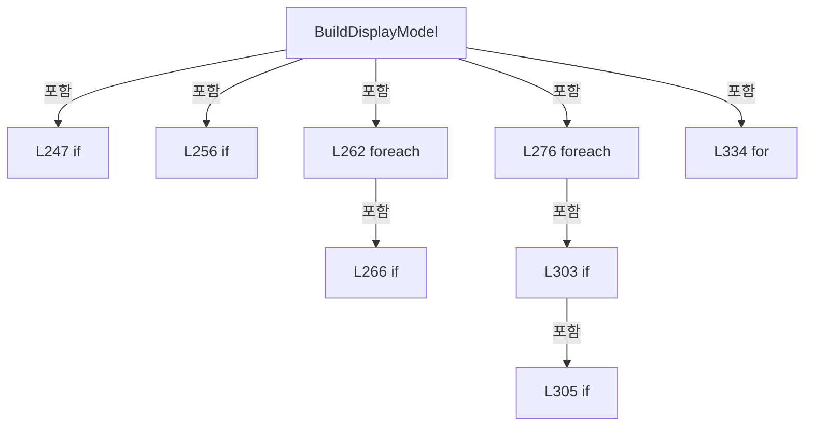

변경 전 점검: 입력/반환 타입, 위 호출자, 예외/취소 경로, 공유 상태와 저장·전송 소비자를 함께 확인합니다. 값의 단위나 물리 방향을 이름만으로 확정하지 않습니다.

### MethodDeclaration `CalculateReviewDataCellLayout` · L392–416

[Drilling.UI/Menu/Menus/CMenuCorrection.ReviewData.Display.cs:392–416](https://github.com/kjuws10-rgb/A3Drilling/blob/334b3599651b2e8e0181fd4459bafaf3cddafff3/Drilling.UI/Menu/Menus/CMenuCorrection.ReviewData.Display.cs#L392-L416)

| 항목 | 실제 추출 값 |
| --- | --- |
| 서명 | Drilling.Common.Recipe.ST_CELL_PATTERN_LAYOUT Drilling.UI.Menu.Menus.CMenuCorrection.CReviewDataPanel.CalculateReviewDataCellLayout(System.Collections.Generic.IReadOnlyDictionary<string, string>, int) |
| 접근/수식자 | Private / private, static |
| 반환/값 타입 | Drilling.Common.Recipe.ST_CELL_PATTERN_LAYOUT |
| 소속 타입 | NamedType:Drilling.UI.Menu.Menus.CMenuCorrection.CReviewDataPanel |

입력 계약:

| 이름 | 타입 | 전달 | 선택/기본값 |
| --- | --- | --- | --- |
| parameters | System.Collections.Generic.IReadOnlyDictionary<string, string> | None | False /  |
| cellNo | int | None | False /  |

정적 호출자로 확인된 위치:

| 호출 파일/행 | 호출 표현식 | 런타임 분기 가능 |
| --- | --- | --- |
| [Drilling.UI/Menu/Menus/CMenuCorrection.ReviewData.Display.cs:265–265](https://github.com/kjuws10-rgb/A3Drilling/blob/334b3599651b2e8e0181fd4459bafaf3cddafff3/Drilling.UI/Menu/Menus/CMenuCorrection.ReviewData.Display.cs#L265-L265) | CalculateReviewDataCellLayout | False |

호출하는 대상과 해석 범위:

| 원본 행 | 표현식 | 분석 상태 | 대상/소스 위치 |
| --- | --- | --- | --- |
| 396 | ReadOutputViewerDouble | resolved | double Drilling.UI.Menu.Menus.CMenuCorrection.ReadOutputViewerDouble(System.Collections.Generic.IReadOnlyDictionary<string, string>, double, params string[]) · Drilling.UI/Menu/Menus/CMenuCorrection.cs:1361 |
| 397 | ReadOutputViewerInt | resolved | int Drilling.UI.Menu.Menus.CMenuCorrection.ReadOutputViewerInt(System.Collections.Generic.IReadOnlyDictionary<string, string>, int, params string[]) · Drilling.UI/Menu/Menus/CMenuCorrection.cs:1338 |
| 398 | CAlignKeyMarginSettings.Read | resolved | Drilling.Common.Managers.ST_ALIGN_KEY_MARGINS Drilling.Common.Managers.CAlignKeyMarginSettings.Read(System.Collections.Generic.IReadOnlyDictionary<string, string>) · Drilling.Common/Managers/CAlignKeyMarginSettings.cs:21 |
| 399 | CRecipeModelPixelCountReader.ReadModelTypeCount | resolved | int Drilling.Common.Recipe.CRecipeModelPixelCountReader.ReadModelTypeCount(System.Collections.Generic.IReadOnlyDictionary<string, string>) · Drilling.Common/Recipe/CCellPatternCalculator.cs:428 |
| 400 | CRecipeModelPixelCountReader.ReadCellModelType | resolved | int Drilling.Common.Recipe.CRecipeModelPixelCountReader.ReadCellModelType(System.Collections.Generic.IReadOnlyDictionary<string, string>, int, int) · Drilling.Common/Recipe/CCellPatternCalculator.cs:433 |
| 401 | CRecipeModelPixelCountReader.ReadPatternForModel | resolved | Drilling.Common.Recipe.ST_RECIPE_MODEL_PATTERN Drilling.Common.Recipe.CRecipeModelPixelCountReader.ReadPatternForModel(System.Collections.Generic.IReadOnlyDictionary<string, string>, int) · Drilling.Common/Recipe/CCellPatternCalculator.cs:455 |
| 402 | CCellPatternCalculator.Calculate | resolved | Drilling.Common.Recipe.ST_CELL_PATTERN_LAYOUT Drilling.Common.Recipe.CCellPatternCalculator.Calculate(Drilling.Common.Recipe.ST_CELL_PATTERN_DEFINITION, bool) · Drilling.Common/Recipe/CCellPatternCalculator.cs:66 |
| 403 | new ST_CELL_PATTERN_DEFINITION | resolved | Drilling.Common.Recipe.ST_CELL_PATTERN_DEFINITION.ST_CELL_PATTERN_DEFINITION(int, double, double, double, double, int, int, int, int, double, double) · Drilling.Common/Recipe/CCellPatternCalculator.cs:277 |
| 405 | ReadOutputViewerDouble | resolved | double Drilling.UI.Menu.Menus.CMenuCorrection.ReadOutputViewerDouble(System.Collections.Generic.IReadOnlyDictionary<string, string>, double, params string[]) · Drilling.UI/Menu/Menus/CMenuCorrection.cs:1361 |
| 406 | ReadOutputViewerDouble | resolved | double Drilling.UI.Menu.Menus.CMenuCorrection.ReadOutputViewerDouble(System.Collections.Generic.IReadOnlyDictionary<string, string>, double, params string[]) · Drilling.UI/Menu/Menus/CMenuCorrection.cs:1361 |
| 407 | ReadOutputViewerDouble | resolved | double Drilling.UI.Menu.Menus.CMenuCorrection.ReadOutputViewerDouble(System.Collections.Generic.IReadOnlyDictionary<string, string>, double, params string[]) · Drilling.UI/Menu/Menus/CMenuCorrection.cs:1361 |

본문의 실제 연산·분기·예외·반환 순서(원문 위치 순):

| 원본 행 | 종류 | 주석 해설 |
| --- | --- | --- |
| 396 | call | 함수·델리게이트 또는 객체 생성자를 호출합니다: ReadOutputViewerDouble(parameters, 0.09, "PIXEL_SIZE") |
| 396 | local-declaration | 지역 변수를 선언합니다: var pixelSize = ReadOutputViewerDouble(parameters, 0.09, "PIXEL_SIZE"); |
| 396 | variable-initializer | 변수의 초기값을 지정합니다: pixelSize = ReadOutputViewerDouble(parameters, 0.09, "PIXEL_SIZE") |
| 397 | call | 함수·델리게이트 또는 객체 생성자를 호출합니다: ReadOutputViewerInt(parameters, 1, "SPLITED_BEAM_COUNT") |
| 397 | local-declaration | 지역 변수를 선언합니다: var splitBeamCount = ReadOutputViewerInt(parameters, 1, "SPLITED_BEAM_COUNT"); |
| 397 | variable-initializer | 변수의 초기값을 지정합니다: splitBeamCount = ReadOutputViewerInt(parameters, 1, "SPLITED_BEAM_COUNT") |
| 398 | call | 함수·델리게이트 또는 객체 생성자를 호출합니다: CAlignKeyMarginSettings.Read(parameters) |
| 398 | local-declaration | 지역 변수를 선언합니다: var alignKeyMargins = CAlignKeyMarginSettings.Read(parameters); |
| 398 | variable-initializer | 변수의 초기값을 지정합니다: alignKeyMargins = CAlignKeyMarginSettings.Read(parameters) |
| 399 | call | 함수·델리게이트 또는 객체 생성자를 호출합니다: CRecipeModelPixelCountReader.ReadModelTypeCount(parameters) |
| 399 | local-declaration | 지역 변수를 선언합니다: var modelTypeCount = CRecipeModelPixelCountReader.ReadModelTypeCount(parameters); |
| 399 | variable-initializer | 변수의 초기값을 지정합니다: modelTypeCount = CRecipeModelPixelCountReader.ReadModelTypeCount(parameters) |
| 400 | call | 함수·델리게이트 또는 객체 생성자를 호출합니다: CRecipeModelPixelCountReader.ReadCellModelType(parameters, cellNo, modelTypeCount) |
| 400 | local-declaration | 지역 변수를 선언합니다: var modelType = CRecipeModelPixelCountReader.ReadCellModelType(parameters, cellNo, modelTypeCount); |
| 400 | variable-initializer | 변수의 초기값을 지정합니다: modelType = CRecipeModelPixelCountReader.ReadCellModelType(parameters, cellNo, modelTypeCount) |
| 401 | call | 함수·델리게이트 또는 객체 생성자를 호출합니다: CRecipeModelPixelCountReader.ReadPatternForModel(parameters, modelType) |
| 401 | local-declaration | 지역 변수를 선언합니다: var modelPattern = CRecipeModelPixelCountReader.ReadPatternForModel(parameters, modelType); |
| 401 | variable-initializer | 변수의 초기값을 지정합니다: modelPattern = CRecipeModelPixelCountReader.ReadPatternForModel(parameters, modelType) |
| 402 | call | 함수·델리게이트 또는 객체 생성자를 호출합니다: CCellPatternCalculator.Calculate( new ST_CELL_PATTERN_DEFINITION( cellNo, ReadOutputViewerDouble(parameters, 0.0, $"CELL{cellNo}_ALIGN_TO_1ST_PIXEL_X"), ReadOutputViewerDouble(parameters, 0.0, $"CELL{cellNo}_ALIGN_TO_1ST… |
| 402 | return | 호출자에게 값 또는 제어를 반환합니다: return CCellPatternCalculator.Calculate( new ST_CELL_PATTERN_DEFINITION( cellNo, ReadOutputViewerDouble(parameters, 0.0, $"CELL{cellNo}_ALIGN_TO_1ST_PIXEL_X"), ReadOutputViewerDouble(parameters, 0.0, $"CELL{cellNo}_ALIGN_TO_1ST_PI |
| 403 | call | 함수·델리게이트 또는 객체 생성자를 호출합니다: new ST_CELL_PATTERN_DEFINITION( cellNo, ReadOutputViewerDouble(parameters, 0.0, $"CELL{cellNo}_ALIGN_TO_1ST_PIXEL_X"), ReadOutputViewerDouble(parameters, 0.0, $"CELL{cellNo}_ALIGN_TO_1ST_PIXEL_Y"), ReadOutputViewerDouble… |
| 405 | call | 함수·델리게이트 또는 객체 생성자를 호출합니다: ReadOutputViewerDouble(parameters, 0.0, $"CELL{cellNo}_ALIGN_TO_1ST_PIXEL_X") |
| 406 | call | 함수·델리게이트 또는 객체 생성자를 호출합니다: ReadOutputViewerDouble(parameters, 0.0, $"CELL{cellNo}_ALIGN_TO_1ST_PIXEL_Y") |
| 407 | call | 함수·델리게이트 또는 객체 생성자를 호출합니다: ReadOutputViewerDouble(parameters, 0.0, $"CELL{cellNo}_ROTATION") |

변경 전 점검: 입력/반환 타입, 위 호출자, 예외/취소 경로, 공유 상태와 저장·전송 소비자를 함께 확인합니다. 값의 단위나 물리 방향을 이름만으로 확정하지 않습니다.

### MethodDeclaration `ResolveShotPosition` · L418–462

[Drilling.UI/Menu/Menus/CMenuCorrection.ReviewData.Display.cs:418–462](https://github.com/kjuws10-rgb/A3Drilling/blob/334b3599651b2e8e0181fd4459bafaf3cddafff3/Drilling.UI/Menu/Menus/CMenuCorrection.ReviewData.Display.cs#L418-L462)

| 항목 | 실제 추출 값 |
| --- | --- |
| 서명 | Drilling.UI.Menu.Menus.CMenuCorrection.ST_REVIEW_DATA_SHOT_POSITION Drilling.UI.Menu.Menus.CMenuCorrection.CReviewDataPanel.ResolveShotPosition(Drilling.Common.Review.ST_REVIEW_RESULT_FILE_ROW, Drilling.Common.Recipe.ST_CELL_PATTERN_LAYOUT, int) |
| 접근/수식자 | Private / private, static |
| 반환/값 타입 | Drilling.UI.Menu.Menus.CMenuCorrection.ST_REVIEW_DATA_SHOT_POSITION |
| 소속 타입 | NamedType:Drilling.UI.Menu.Menus.CMenuCorrection.CReviewDataPanel |

입력 계약:

| 이름 | 타입 | 전달 | 선택/기본값 |
| --- | --- | --- | --- |
| row | Drilling.Common.Review.ST_REVIEW_RESULT_FILE_ROW | None | False /  |
| layout | Drilling.Common.Recipe.ST_CELL_PATTERN_LAYOUT | None | False /  |
| rowIndex | int | None | False /  |

정적 호출자로 확인된 위치:

| 호출 파일/행 | 호출 표현식 | 런타임 분기 가능 |
| --- | --- | --- |
| [Drilling.UI/Menu/Menus/CMenuCorrection.ReviewData.Display.cs:280–280](https://github.com/kjuws10-rgb/A3Drilling/blob/334b3599651b2e8e0181fd4459bafaf3cddafff3/Drilling.UI/Menu/Menus/CMenuCorrection.ReviewData.Display.cs#L280-L280) | ResolveShotPosition | False |

호출하는 대상과 해석 범위:

| 원본 행 | 표현식 | 분석 상태 | 대상/소스 위치 |
| --- | --- | --- | --- |
| 423 | ReadShotNo | resolved | int Drilling.UI.Menu.Menus.CMenuCorrection.CReviewDataPanel.ReadShotNo(string) · Drilling.UI/Menu/Menus/CMenuCorrection.ReviewData.Display.cs:464 |
| 435 | TryParseMatrixName | resolved | bool Drilling.UI.Menu.Menus.CMenuCorrection.CReviewDataPanel.TryParseMatrixName(string, out int, out int) · Drilling.UI/Menu/Menus/CMenuCorrection.ReviewData.Display.cs:474 |
| 441 | row.ShotKey.Contains | resolved | bool string.Contains(char) |
| 441 | row.ShotKey.LastIndexOf | resolved | int string.LastIndexOf(char) |
| 442 | TryParseMatrixName | resolved | bool Drilling.UI.Menu.Menus.CMenuCorrection.CReviewDataPanel.TryParseMatrixName(string, out int, out int) · Drilling.UI/Menu/Menus/CMenuCorrection.ReviewData.Display.cs:474 |
| 453 | new ST_REVIEW_DATA_SHOT_POSITION | resolved | Drilling.UI.Menu.Menus.CMenuCorrection.ST_REVIEW_DATA_SHOT_POSITION.ST_REVIEW_DATA_SHOT_POSITION(string, int, int, int, int, int, int, bool) · Drilling.UI/Menu/Menus/CMenuCorrection.ReviewData.Display.cs:1463 |
| 454 | CReviewManager.ToShotKey | resolved | string Drilling.Common.Review.CReviewManager.ToShotKey(int, int) · Drilling.Common/Review/CReviewManager.cs:1240 |

본문의 실제 연산·분기·예외·반환 순서(원문 위치 순):

| 원본 행 | 종류 | 주석 해설 |
| --- | --- | --- |
| 423 | call | 함수·델리게이트 또는 객체 생성자를 호출합니다: ReadShotNo(row.ShotKey) |
| 423 | local-declaration | 지역 변수를 선언합니다: var shotNo = ReadShotNo(row.ShotKey); |
| 423 | variable-initializer | 변수의 초기값을 지정합니다: shotNo = ReadShotNo(row.ShotKey) |
| 424 | local-declaration | 지역 변수를 선언합니다: var column = row.GroupColumn; |
| 424 | variable-initializer | 변수의 초기값을 지정합니다: column = row.GroupColumn |
| 425 | local-declaration | 지역 변수를 선언합니다: var groupRow = row.GroupRow; |
| 425 | variable-initializer | 변수의 초기값을 지정합니다: groupRow = row.GroupRow |
| 426 | if | 조건에 따라 분기합니다: if (shotNo > 0) |
| 428 | assignment | 값을 대상에 대입합니다: column = (shotNo - 1) % layout.GroupCountX |
| 429 | assignment | 값을 대상에 대입합니다: groupRow = (shotNo - 1) / layout.GroupCountX |
| 431 | else | 앞 조건이 거짓인 경로입니다: else |
| 431 | if | 조건에 따라 분기합니다: if (column >= 0 && groupRow >= 0) |
| 433 | assignment | 값을 대상에 대입합니다: shotNo = (groupRow * layout.GroupCountX) + column + 1 |
| 435 | call | 함수·델리게이트 또는 객체 생성자를 호출합니다: TryParseMatrixName(row.ShotName, out column, out groupRow) |
| 435 | else | 앞 조건이 거짓인 경로입니다: else |
| 435 | if | 조건에 따라 분기합니다: if (TryParseMatrixName(row.ShotName, out column, out groupRow)) |
| 437 | assignment | 값을 대상에 대입합니다: shotNo = (groupRow * layout.GroupCountX) + column + 1 |
| 439 | else | 앞 조건이 거짓인 경로입니다: else |
| 441 | call | 함수·델리게이트 또는 객체 생성자를 호출합니다: row.ShotKey.Contains('_') |
| 441 | call | 함수·델리게이트 또는 객체 생성자를 호출합니다: row.ShotKey.LastIndexOf('_') |
| 441 | conditional-expression | 조건에 따라 결과식을 선택합니다: row.ShotKey.Contains('_') ? row.ShotKey[(row.ShotKey.LastIndexOf('_') + 1)..] : row.ShotKey |
| 441 | local-declaration | 지역 변수를 선언합니다: var suffix = row.ShotKey.Contains('_') ? row.ShotKey[(row.ShotKey.LastIndexOf('_') + 1)..] : row.ShotKey; |
| 441 | variable-initializer | 변수의 초기값을 지정합니다: suffix = row.ShotKey.Contains('_') ? row.ShotKey[(row.ShotKey.LastIndexOf('_') + 1)..] : row.ShotKey |
| 442 | call | 함수·델리게이트 또는 객체 생성자를 호출합니다: TryParseMatrixName(suffix, out column, out groupRow) |
| 442 | if | 조건에 따라 분기합니다: if (TryParseMatrixName(suffix, out column, out groupRow)) |
| 444 | assignment | 값을 대상에 대입합니다: shotNo = (groupRow * layout.GroupCountX) + column + 1 |
| 448 | local-declaration | 지역 변수를 선언합니다: var resolved = shotNo > 0 && column >= 0 && column < layout.GroupCountX && groupRow >= 0 && groupRow < layout.GroupCountY; |
| 448 | variable-initializer | 변수의 초기값을 지정합니다: resolved = shotNo > 0 && column >= 0 && column < layout.GroupCountX && groupRow >= 0 && groupRow < layout.GroupCountY |
| 453 | call | 함수·델리게이트 또는 객체 생성자를 호출합니다: new ST_REVIEW_DATA_SHOT_POSITION( resolved ? CReviewManager.ToShotKey(row.CellNo, shotNo) : $"UNRESOLVED_{row.CellNo}_{rowIndex}", row.CellNo, resolved ? shotNo : 0, resolved ? column : -1, resolved ? groupRow : -1, layo… |
| 453 | return | 호출자에게 값 또는 제어를 반환합니다: return new ST_REVIEW_DATA_SHOT_POSITION( resolved ? CReviewManager.ToShotKey(row.CellNo, shotNo) : $"UNRESOLVED_{row.CellNo}_{rowIndex}", row.CellNo, resolved ? shotNo : 0, resolved ? column : -1, resolved ? groupRow : -1, layout. |
| 454 | call | 함수·델리게이트 또는 객체 생성자를 호출합니다: CReviewManager.ToShotKey(row.CellNo, shotNo) |
| 454 | conditional-expression | 조건에 따라 결과식을 선택합니다: resolved ? CReviewManager.ToShotKey(row.CellNo, shotNo) : $"UNRESOLVED_{row.CellNo}_{rowIndex}" |
| 456 | conditional-expression | 조건에 따라 결과식을 선택합니다: resolved ? shotNo : 0 |
| 457 | conditional-expression | 조건에 따라 결과식을 선택합니다: resolved ? column : -1 |
| 458 | conditional-expression | 조건에 따라 결과식을 선택합니다: resolved ? groupRow : -1 |

제어 구문의 포함 구조(실제 실행 순서/CFG가 아닌 구문 탐색 그림):

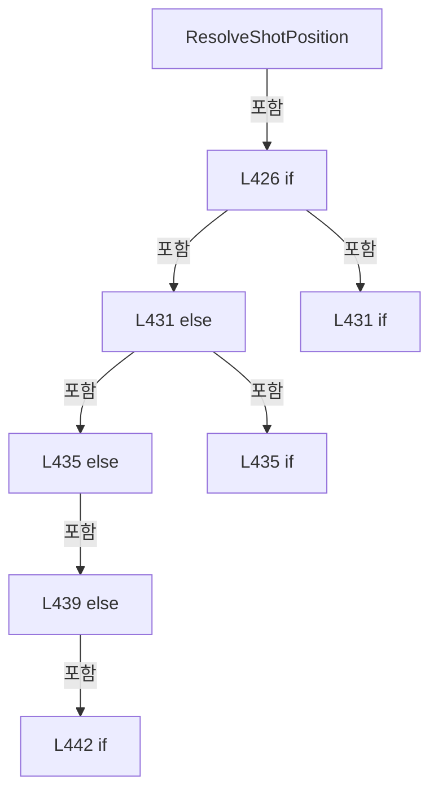

변경 전 점검: 입력/반환 타입, 위 호출자, 예외/취소 경로, 공유 상태와 저장·전송 소비자를 함께 확인합니다. 값의 단위나 물리 방향을 이름만으로 확정하지 않습니다.

### MethodDeclaration `ReadShotNo` · L464–472

[Drilling.UI/Menu/Menus/CMenuCorrection.ReviewData.Display.cs:464–472](https://github.com/kjuws10-rgb/A3Drilling/blob/334b3599651b2e8e0181fd4459bafaf3cddafff3/Drilling.UI/Menu/Menus/CMenuCorrection.ReviewData.Display.cs#L464-L472)

| 항목 | 실제 추출 값 |
| --- | --- |
| 서명 | int Drilling.UI.Menu.Menus.CMenuCorrection.CReviewDataPanel.ReadShotNo(string) |
| 접근/수식자 | Private / private, static |
| 반환/값 타입 | int |
| 소속 타입 | NamedType:Drilling.UI.Menu.Menus.CMenuCorrection.CReviewDataPanel |

입력 계약:

| 이름 | 타입 | 전달 | 선택/기본값 |
| --- | --- | --- | --- |
| shotKey | string | None | False /  |

정적 호출자로 확인된 위치:

| 호출 파일/행 | 호출 표현식 | 런타임 분기 가능 |
| --- | --- | --- |
| [Drilling.UI/Menu/Menus/CMenuCorrection.ReviewData.Display.cs:423–423](https://github.com/kjuws10-rgb/A3Drilling/blob/334b3599651b2e8e0181fd4459bafaf3cddafff3/Drilling.UI/Menu/Menus/CMenuCorrection.ReviewData.Display.cs#L423-L423) | ReadShotNo | False |

호출하는 대상과 해석 범위:

| 원본 행 | 표현식 | 분석 상태 | 대상/소스 위치 |
| --- | --- | --- | --- |
| 466 | CReviewManager.NormalizeShotKey | resolved | string Drilling.Common.Review.CReviewManager.NormalizeShotKey(string) · Drilling.Common/Review/CReviewManager.cs:1245 |
| 467 | normalized.IndexOf | resolved | int string.IndexOf(string, System.StringComparison) |
| 469 | int.TryParse | resolved | bool int.TryParse(System.ReadOnlySpan<char>, System.Globalization.NumberStyles, System.IFormatProvider?, out int) |
| 469 | normalized.AsSpan | resolved | System.ReadOnlySpan<char> string?.AsSpan(int) |

본문의 실제 연산·분기·예외·반환 순서(원문 위치 순):

| 원본 행 | 종류 | 주석 해설 |
| --- | --- | --- |
| 466 | call | 함수·델리게이트 또는 객체 생성자를 호출합니다: CReviewManager.NormalizeShotKey(shotKey) |
| 466 | local-declaration | 지역 변수를 선언합니다: var normalized = CReviewManager.NormalizeShotKey(shotKey); |
| 466 | variable-initializer | 변수의 초기값을 지정합니다: normalized = CReviewManager.NormalizeShotKey(shotKey) |
| 467 | call | 함수·델리게이트 또는 객체 생성자를 호출합니다: normalized.IndexOf("_SHOT", StringComparison.Ordinal) |
| 467 | local-declaration | 지역 변수를 선언합니다: var separator = normalized.IndexOf("_SHOT", StringComparison.Ordinal); |
| 467 | variable-initializer | 변수의 초기값을 지정합니다: separator = normalized.IndexOf("_SHOT", StringComparison.Ordinal) |
| 468 | conditional-expression | 조건에 따라 결과식을 선택합니다: separator >= 0 && int.TryParse(normalized.AsSpan(separator + 5), NumberStyles.Integer, CultureInfo.InvariantCulture, out var shotNo) ? shotNo : 0 |
| 468 | return | 호출자에게 값 또는 제어를 반환합니다: return separator >= 0 && int.TryParse(normalized.AsSpan(separator + 5), NumberStyles.Integer, CultureInfo.InvariantCulture, out var shotNo) ? shotNo : 0; |
| 469 | call | 함수·델리게이트 또는 객체 생성자를 호출합니다: int.TryParse(normalized.AsSpan(separator + 5), NumberStyles.Integer, CultureInfo.InvariantCulture, out var shotNo) |
| 469 | call | 함수·델리게이트 또는 객체 생성자를 호출합니다: normalized.AsSpan(separator + 5) |

변경 전 점검: 입력/반환 타입, 위 호출자, 예외/취소 경로, 공유 상태와 저장·전송 소비자를 함께 확인합니다. 값의 단위나 물리 방향을 이름만으로 확정하지 않습니다.

### MethodDeclaration `TryParseMatrixName` · L474–499

[Drilling.UI/Menu/Menus/CMenuCorrection.ReviewData.Display.cs:474–499](https://github.com/kjuws10-rgb/A3Drilling/blob/334b3599651b2e8e0181fd4459bafaf3cddafff3/Drilling.UI/Menu/Menus/CMenuCorrection.ReviewData.Display.cs#L474-L499)

| 항목 | 실제 추출 값 |
| --- | --- |
| 서명 | bool Drilling.UI.Menu.Menus.CMenuCorrection.CReviewDataPanel.TryParseMatrixName(string, out int, out int) |
| 접근/수식자 | Private / private, static |
| 반환/값 타입 | bool |
| 소속 타입 | NamedType:Drilling.UI.Menu.Menus.CMenuCorrection.CReviewDataPanel |

입력 계약:

| 이름 | 타입 | 전달 | 선택/기본값 |
| --- | --- | --- | --- |
| value | string | None | False /  |
| column | int | Out | False /  |
| row | int | Out | False /  |

정적 호출자로 확인된 위치:

| 호출 파일/행 | 호출 표현식 | 런타임 분기 가능 |
| --- | --- | --- |
| [Drilling.UI/Menu/Menus/CMenuCorrection.ReviewData.Display.cs:435–435](https://github.com/kjuws10-rgb/A3Drilling/blob/334b3599651b2e8e0181fd4459bafaf3cddafff3/Drilling.UI/Menu/Menus/CMenuCorrection.ReviewData.Display.cs#L435-L435) | TryParseMatrixName | False |
| [Drilling.UI/Menu/Menus/CMenuCorrection.ReviewData.Display.cs:442–442](https://github.com/kjuws10-rgb/A3Drilling/blob/334b3599651b2e8e0181fd4459bafaf3cddafff3/Drilling.UI/Menu/Menus/CMenuCorrection.ReviewData.Display.cs#L442-L442) | TryParseMatrixName | False |

호출하는 대상과 해석 범위:

| 원본 행 | 표현식 | 분석 상태 | 대상/소스 위치 |
| --- | --- | --- | --- |
| 478 | value.Trim().ToUpperInvariant | resolved | string string.ToUpperInvariant() |
| 478 | value.Trim | resolved | string string.Trim() |
| 479 | text.TakeWhile(char.IsLetter).Count | resolved | int System.Collections.Generic.IEnumerable<char>.Count<char>() |
| 479 | text.TakeWhile | resolved | System.Collections.Generic.IEnumerable<char> System.Collections.Generic.IEnumerable<char>.TakeWhile<char>(System.Func<char, bool>) |
| 480 | int.TryParse | resolved | bool int.TryParse(System.ReadOnlySpan<char>, System.Globalization.NumberStyles, System.IFormatProvider?, out int) |
| 480 | text.AsSpan | resolved | System.ReadOnlySpan<char> string?.AsSpan(int) |
| 486 | text.AsSpan | resolved | System.ReadOnlySpan<char> string?.AsSpan(int, int) |

본문의 실제 연산·분기·예외·반환 순서(원문 위치 순):

| 원본 행 | 종류 | 주석 해설 |
| --- | --- | --- |
| 476 | assignment | 값을 대상에 대입합니다: column = -1 |
| 477 | assignment | 값을 대상에 대입합니다: row = -1 |
| 478 | call | 함수·델리게이트 또는 객체 생성자를 호출합니다: value.Trim().ToUpperInvariant() |
| 478 | call | 함수·델리게이트 또는 객체 생성자를 호출합니다: value.Trim() |
| 478 | local-declaration | 지역 변수를 선언합니다: var text = value.Trim().ToUpperInvariant(); |
| 478 | variable-initializer | 변수의 초기값을 지정합니다: text = value.Trim().ToUpperInvariant() |
| 479 | call | 함수·델리게이트 또는 객체 생성자를 호출합니다: text.TakeWhile(char.IsLetter).Count() |
| 479 | call | 함수·델리게이트 또는 객체 생성자를 호출합니다: text.TakeWhile(char.IsLetter) |
| 479 | local-declaration | 지역 변수를 선언합니다: var letterCount = text.TakeWhile(char.IsLetter).Count(); |
| 479 | variable-initializer | 변수의 초기값을 지정합니다: letterCount = text.TakeWhile(char.IsLetter).Count() |
| 480 | call | 함수·델리게이트 또는 객체 생성자를 호출합니다: int.TryParse(text.AsSpan(letterCount), NumberStyles.Integer, CultureInfo.InvariantCulture, out var oneBasedRow) |
| 480 | call | 함수·델리게이트 또는 객체 생성자를 호출합니다: text.AsSpan(letterCount) |
| 480 | if | 조건에 따라 분기합니다: if (letterCount == 0 &#124;&#124; letterCount == text.Length &#124;&#124; !int.TryParse(text.AsSpan(letterCount), NumberStyles.Integer, CultureInfo.InvariantCulture, out var oneBasedRow) &#124;&#124; oneBasedRow <= 0) |
| 482 | return | 호출자에게 값 또는 제어를 반환합니다: return false; |
| 485 | local-declaration | 지역 변수를 선언합니다: var oneBasedColumn = 0; |
| 485 | variable-initializer | 변수의 초기값을 지정합니다: oneBasedColumn = 0 |
| 486 | call | 함수·델리게이트 또는 객체 생성자를 호출합니다: text.AsSpan(0, letterCount) |
| 486 | foreach | 컬렉션 요소를 순회합니다: foreach (var character in text.AsSpan(0, letterCount)) |
| 488 | if | 조건에 따라 분기합니다: if (character is < 'A' or > 'Z') |
| 490 | return | 호출자에게 값 또는 제어를 반환합니다: return false; |
| 493 | assignment | 값을 대상에 대입합니다: oneBasedColumn = checked((oneBasedColumn * 26) + (character - 'A' + 1)) |
| 496 | assignment | 값을 대상에 대입합니다: column = oneBasedColumn - 1 |
| 497 | assignment | 값을 대상에 대입합니다: row = oneBasedRow - 1 |
| 498 | return | 호출자에게 값 또는 제어를 반환합니다: return true; |

제어 구문의 포함 구조(실제 실행 순서/CFG가 아닌 구문 탐색 그림):


변경 전 점검: 입력/반환 타입, 위 호출자, 예외/취소 경로, 공유 상태와 저장·전송 소비자를 함께 확인합니다. 값의 단위나 물리 방향을 이름만으로 확정하지 않습니다.

### MethodDeclaration `ApplyDisplayModel` · L501–533

[Drilling.UI/Menu/Menus/CMenuCorrection.ReviewData.Display.cs:501–533](https://github.com/kjuws10-rgb/A3Drilling/blob/334b3599651b2e8e0181fd4459bafaf3cddafff3/Drilling.UI/Menu/Menus/CMenuCorrection.ReviewData.Display.cs#L501-L533)

| 항목 | 실제 추출 값 |
| --- | --- |
| 서명 | void Drilling.UI.Menu.Menus.CMenuCorrection.CReviewDataPanel.ApplyDisplayModel(Drilling.UI.Menu.Menus.CMenuCorrection.ST_REVIEW_DATA_DISPLAY_MODEL, Drilling.Common.Review.ST_REVIEW_RESULT_FILE_DATA, Drilling.Common.Review.ST_REVIEW_RESULT_CATALOG_ITEM, Drilling.Common.Managers.ST_RECIPE_DEFINITION) |
| 접근/수식자 | Private / private |
| 반환/값 타입 | void |
| 소속 타입 | NamedType:Drilling.UI.Menu.Menus.CMenuCorrection.CReviewDataPanel |

입력 계약:

| 이름 | 타입 | 전달 | 선택/기본값 |
| --- | --- | --- | --- |
| model | Drilling.UI.Menu.Menus.CMenuCorrection.ST_REVIEW_DATA_DISPLAY_MODEL | None | False /  |
| resultFile | Drilling.Common.Review.ST_REVIEW_RESULT_FILE_DATA | None | False /  |
| catalog | Drilling.Common.Review.ST_REVIEW_RESULT_CATALOG_ITEM | None | False /  |
| recipe | Drilling.Common.Managers.ST_RECIPE_DEFINITION | None | False /  |

정적 호출자로 확인된 위치:

| 호출 파일/행 | 호출 표현식 | 런타임 분기 가능 |
| --- | --- | --- |
| [Drilling.UI/Menu/Menus/CMenuCorrection.ReviewData.Display.cs:211–211](https://github.com/kjuws10-rgb/A3Drilling/blob/334b3599651b2e8e0181fd4459bafaf3cddafff3/Drilling.UI/Menu/Menus/CMenuCorrection.ReviewData.Display.cs#L211-L211) | ApplyDisplayModel | False |

호출하는 대상과 해석 범위:

| 원본 행 | 표현식 | 분석 상태 | 대상/소스 위치 |
| --- | --- | --- | --- |
| 510 | CreateReviewLevelBrush | resolved | Brush Drilling.UI.Menu.Menus.CMenuCorrection.CReviewDataPanel.CreateReviewLevelBrush(string, byte?) · Drilling.UI/Menu/Menus/CMenuCorrection.ReviewData.Display.cs:934 |
| 511 | CreateReviewLevelBrush | resolved | Brush Drilling.UI.Menu.Menus.CMenuCorrection.CReviewDataPanel.CreateReviewLevelBrush(string, byte?) · Drilling.UI/Menu/Menus/CMenuCorrection.ReviewData.Display.cs:934 |
| 512 | CreateReviewLevelBrush | resolved | Brush Drilling.UI.Menu.Menus.CMenuCorrection.CReviewDataPanel.CreateReviewLevelBrush(string, byte?) · Drilling.UI/Menu/Menus/CMenuCorrection.ReviewData.Display.cs:934 |
| 513 | CreateReviewLevelBrush | resolved | Brush Drilling.UI.Menu.Menus.CMenuCorrection.CReviewDataPanel.CreateReviewLevelBrush(string, byte?) · Drilling.UI/Menu/Menus/CMenuCorrection.ReviewData.Display.cs:934 |
| 522 | model.ResultCellNos.Order().FirstOrDefault | resolved | int System.Collections.Generic.IEnumerable<int>.FirstOrDefault<int>() |
| 522 | model.ResultCellNos.Order | resolved | System.Linq.IOrderedEnumerable<int> System.Collections.Generic.IEnumerable<int>.Order<int>() |
| 525 | ApplyCellSelection | resolved | void Drilling.UI.Menu.Menus.CMenuCorrection.CReviewDataPanel.ApplyCellSelection(int, bool) · Drilling.UI/Menu/Menus/CMenuCorrection.ReviewData.Display.cs:545 |
| 529 | RefreshGlassPreview | resolved | void Drilling.UI.Menu.Menus.CMenuCorrection.CReviewDataPanel.RefreshGlassPreview() · Drilling.UI/Menu/Menus/CMenuCorrection.ReviewData.Display.cs:641 |
| 532 | NotifyDisplayState | resolved | void Drilling.UI.Menu.Menus.CMenuCorrection.CReviewDataPanel.NotifyDisplayState() · Drilling.UI/Menu/Menus/CMenuCorrection.ReviewData.Display.cs:1398 |

본문의 실제 연산·분기·예외·반환 순서(원문 위치 순):

| 원본 행 | 종류 | 주석 해설 |
| --- | --- | --- |
| 507 | assignment | 값을 대상에 대입합니다: _loadedParameters = model.Parameters |
| 508 | assignment | 값을 대상에 대입합니다: _reviewLevelSettings = model.LevelSettings |
| 509 | assignment | 값을 대상에 대입합니다: _cellLevels = model.CellLevels |
| 510 | assignment | 값을 대상에 대입합니다: _reviewLevel1Brush = CreateReviewLevelBrush(model.LevelSettings.Level1Color) |
| 510 | call | 함수·델리게이트 또는 객체 생성자를 호출합니다: CreateReviewLevelBrush(model.LevelSettings.Level1Color) |
| 511 | assignment | 값을 대상에 대입합니다: _reviewLevel2Brush = CreateReviewLevelBrush(model.LevelSettings.Level2Color) |
| 511 | call | 함수·델리게이트 또는 객체 생성자를 호출합니다: CreateReviewLevelBrush(model.LevelSettings.Level2Color) |
| 512 | assignment | 값을 대상에 대입합니다: _reviewLevel3Brush = CreateReviewLevelBrush(model.LevelSettings.Level3Color) |
| 512 | call | 함수·델리게이트 또는 객체 생성자를 호출합니다: CreateReviewLevelBrush(model.LevelSettings.Level3Color) |
| 513 | assignment | 값을 대상에 대입합니다: _reviewLevel4Brush = CreateReviewLevelBrush(model.LevelSettings.Level4Color) |
| 513 | call | 함수·델리게이트 또는 객체 생성자를 호출합니다: CreateReviewLevelBrush(model.LevelSettings.Level4Color) |
| 514 | assignment | 값을 대상에 대입합니다: _loadedResultFile = resultFile |
| 515 | assignment | 값을 대상에 대입합니다: _loadedCatalog = catalog |
| 516 | assignment | 값을 대상에 대입합니다: _loadedRecipe = recipe |
| 517 | assignment | 값을 대상에 대입합니다: _loadedCellCount = model.CellCount |
| 518 | assignment | 값을 대상에 대입합니다: _resultCellNos = model.ResultCellNos |
| 519 | assignment | 값을 대상에 대입합니다: _shotsByCell = model.ShotsByCell |
| 520 | assignment | 값을 대상에 대입합니다: _allRows = model.Rows |
| 521 | assignment | 값을 대상에 대입합니다: _hasLoadedData = true |
| 522 | call | 함수·델리게이트 또는 객체 생성자를 호출합니다: model.ResultCellNos.Order().FirstOrDefault() |
| 522 | call | 함수·델리게이트 또는 객체 생성자를 호출합니다: model.ResultCellNos.Order() |
| 522 | local-declaration | 지역 변수를 선언합니다: var firstCell = model.ResultCellNos.Order().FirstOrDefault(); |
| 522 | variable-initializer | 변수의 초기값을 지정합니다: firstCell = model.ResultCellNos.Order().FirstOrDefault() |
| 523 | if | 조건에 따라 분기합니다: if (firstCell > 0) |
| 525 | call | 함수·델리게이트 또는 객체 생성자를 호출합니다: ApplyCellSelection(firstCell, true) |
| 527 | else | 앞 조건이 거짓인 경로입니다: else |
| 529 | call | 함수·델리게이트 또는 객체 생성자를 호출합니다: RefreshGlassPreview() |
| 532 | call | 함수·델리게이트 또는 객체 생성자를 호출합니다: NotifyDisplayState() |

제어 구문의 포함 구조(실제 실행 순서/CFG가 아닌 구문 탐색 그림):

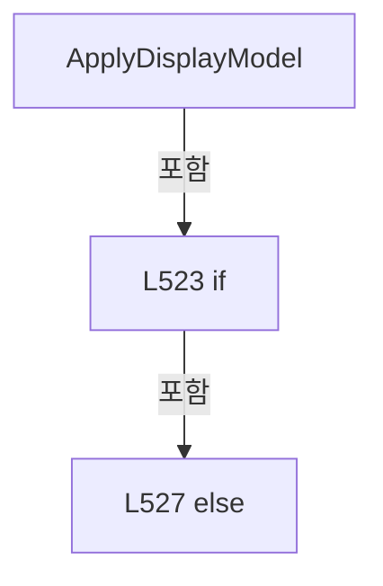

변경 전 점검: 입력/반환 타입, 위 호출자, 예외/취소 경로, 공유 상태와 저장·전송 소비자를 함께 확인합니다. 값의 단위나 물리 방향을 이름만으로 확정하지 않습니다.

### MethodDeclaration `SelectCell` · L535–543

[Drilling.UI/Menu/Menus/CMenuCorrection.ReviewData.Display.cs:535–543](https://github.com/kjuws10-rgb/A3Drilling/blob/334b3599651b2e8e0181fd4459bafaf3cddafff3/Drilling.UI/Menu/Menus/CMenuCorrection.ReviewData.Display.cs#L535-L543)

| 항목 | 실제 추출 값 |
| --- | --- |
| 서명 | void Drilling.UI.Menu.Menus.CMenuCorrection.CReviewDataPanel.SelectCell(object?) |
| 접근/수식자 | Private / private |
| 반환/값 타입 | void |
| 소속 타입 | NamedType:Drilling.UI.Menu.Menus.CMenuCorrection.CReviewDataPanel |

입력 계약:

| 이름 | 타입 | 전달 | 선택/기본값 |
| --- | --- | --- | --- |
| parameter | object? | None | False /  |

현재 부분 분석에서 직접 연결된 호출자는 없습니다. XAML/이벤트/인터페이스·델리게이트·외부 진입을 추가 확인해야 하며, 미사용으로 판정한 것이 아닙니다.

호출하는 대상과 해석 범위:

| 원본 행 | 표현식 | 분석 상태 | 대상/소스 위치 |
| --- | --- | --- | --- |
| 537 | int.TryParse | resolved | bool int.TryParse(string?, System.Globalization.NumberStyles, System.IFormatProvider?, out int) |
| 537 | .ToString | resolved · 동적 구현 선택 가능 | string? object.ToString() |
| 537 | _resultCellNos.Contains | resolved · 동적 구현 선택 가능 | bool System.Collections.Generic.IReadOnlySet<int>.Contains(int) |
| 542 | ApplyCellSelection | resolved | void Drilling.UI.Menu.Menus.CMenuCorrection.CReviewDataPanel.ApplyCellSelection(int, bool) · Drilling.UI/Menu/Menus/CMenuCorrection.ReviewData.Display.cs:545 |

본문의 실제 연산·분기·예외·반환 순서(원문 위치 순):

| 원본 행 | 종류 | 주석 해설 |
| --- | --- | --- |
| 537 | call | 함수·델리게이트 또는 객체 생성자를 호출합니다: int.TryParse(parameter?.ToString(), NumberStyles.Integer, CultureInfo.InvariantCulture, out var cellNo) |
| 537 | call | 함수·델리게이트 또는 객체 생성자를 호출합니다: .ToString() |
| 537 | call | 함수·델리게이트 또는 객체 생성자를 호출합니다: _resultCellNos.Contains(cellNo) |
| 537 | if | 조건에 따라 분기합니다: if (!_hasLoadedData &#124;&#124; !int.TryParse(parameter?.ToString(), NumberStyles.Integer, CultureInfo.InvariantCulture, out var cellNo) &#124;&#124; !_resultCellNos.Contains(cellNo)) |
| 539 | return | 호출자에게 값 또는 제어를 반환합니다: return; |
| 542 | call | 함수·델리게이트 또는 객체 생성자를 호출합니다: ApplyCellSelection(cellNo) |

제어 구문의 포함 구조(실제 실행 순서/CFG가 아닌 구문 탐색 그림):

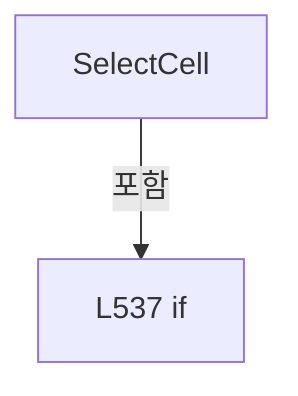

변경 전 점검: 입력/반환 타입, 위 호출자, 예외/취소 경로, 공유 상태와 저장·전송 소비자를 함께 확인합니다. 값의 단위나 물리 방향을 이름만으로 확정하지 않습니다.

### MethodDeclaration `ApplyCellSelection` · L545–584

[Drilling.UI/Menu/Menus/CMenuCorrection.ReviewData.Display.cs:545–584](https://github.com/kjuws10-rgb/A3Drilling/blob/334b3599651b2e8e0181fd4459bafaf3cddafff3/Drilling.UI/Menu/Menus/CMenuCorrection.ReviewData.Display.cs#L545-L584)

| 항목 | 실제 추출 값 |
| --- | --- |
| 서명 | void Drilling.UI.Menu.Menus.CMenuCorrection.CReviewDataPanel.ApplyCellSelection(int, bool) |
| 접근/수식자 | Private / private |
| 반환/값 타입 | void |
| 소속 타입 | NamedType:Drilling.UI.Menu.Menus.CMenuCorrection.CReviewDataPanel |

입력 계약:

| 이름 | 타입 | 전달 | 선택/기본값 |
| --- | --- | --- | --- |
| cellNo | int | None | False /  |
| renderSynchronously | bool | None | True / false |

정적 호출자로 확인된 위치:

| 호출 파일/행 | 호출 표현식 | 런타임 분기 가능 |
| --- | --- | --- |
| [Drilling.UI/Menu/Menus/CMenuCorrection.ReviewData.Display.cs:525–525](https://github.com/kjuws10-rgb/A3Drilling/blob/334b3599651b2e8e0181fd4459bafaf3cddafff3/Drilling.UI/Menu/Menus/CMenuCorrection.ReviewData.Display.cs#L525-L525) | ApplyCellSelection | False |
| [Drilling.UI/Menu/Menus/CMenuCorrection.ReviewData.Display.cs:542–542](https://github.com/kjuws10-rgb/A3Drilling/blob/334b3599651b2e8e0181fd4459bafaf3cddafff3/Drilling.UI/Menu/Menus/CMenuCorrection.ReviewData.Display.cs#L542-L542) | ApplyCellSelection | False |
| [Drilling.UI/Menu/Menus/CMenuCorrection.ReviewData.Reinspection.cs:648–648](https://github.com/kjuws10-rgb/A3Drilling/blob/334b3599651b2e8e0181fd4459bafaf3cddafff3/Drilling.UI/Menu/Menus/CMenuCorrection.ReviewData.Reinspection.cs#L648-L648) | ApplyCellSelection | False |

호출하는 대상과 해석 범위:

| 원본 행 | 표현식 | 분석 상태 | 대상/소스 위치 |
| --- | --- | --- | --- |
| 550 | _allRows.Where | resolved | System.Collections.Generic.IEnumerable<Drilling.UI.Menu.Menus.CMenuCorrection.ST_REVIEW_DATA_GRID_ROW> System.Collections.Generic.IEnumerable<Drilling.UI.Menu.Menus.CMenuCorrection.ST_REVIEW_DATA_GRID_ROW>.Where<Drilling.UI.Menu.Menus.CMenuCorrection.ST_REVIEW_DATA_GRID_ROW>(System.Func<Drilling.UI.Menu.Menus.CMenuCorrection.ST_REVIEW_DATA_GRID_ROW, bool>) |
| 555 | NotifyReinspectionCommandState | resolved | void Drilling.UI.Menu.Menus.CMenuCorrection.CReviewDataPanel.NotifyReinspectionCommandState() · Drilling.UI/Menu/Menus/CMenuCorrection.ReviewData.Reinspection.cs:700 |
| 559 | _allRows.Where(row => row.CellNo == cellNo).ToArray | resolved | Drilling.UI.Menu.Menus.CMenuCorrection.ST_REVIEW_DATA_GRID_ROW[] System.Collections.Generic.IEnumerable<Drilling.UI.Menu.Menus.CMenuCorrection.ST_REVIEW_DATA_GRID_ROW>.ToArray<Drilling.UI.Menu.Menus.CMenuCorrection.ST_REVIEW_DATA_GRID_ROW>() |
| 559 | _allRows.Where | resolved | System.Collections.Generic.IEnumerable<Drilling.UI.Menu.Menus.CMenuCorrection.ST_REVIEW_DATA_GRID_ROW> System.Collections.Generic.IEnumerable<Drilling.UI.Menu.Menus.CMenuCorrection.ST_REVIEW_DATA_GRID_ROW>.Where<Drilling.UI.Menu.Menus.CMenuCorrection.ST_REVIEW_DATA_GRID_ROW>(System.Func<Drilling.UI.Menu.Menus.CMenuCorrection.ST_REVIEW_DATA_GRID_ROW, bool>) |
| 560 | Rows.FirstOrDefault | resolved | Drilling.UI.Menu.Menus.CMenuCorrection.ST_REVIEW_DATA_GRID_ROW? System.Collections.Generic.IEnumerable<Drilling.UI.Menu.Menus.CMenuCorrection.ST_REVIEW_DATA_GRID_ROW>.FirstOrDefault<Drilling.UI.Menu.Menus.CMenuCorrection.ST_REVIEW_DATA_GRID_ROW>(System.Func<Drilling.UI.Menu.Menus.CMenuCorrection.ST_REVIEW_DATA_GRID_ROW, bool>) |
| 561 | Rows.FirstOrDefault | resolved | Drilling.UI.Menu.Menus.CMenuCorrection.ST_REVIEW_DATA_GRID_ROW? System.Collections.Generic.IEnumerable<Drilling.UI.Menu.Menus.CMenuCorrection.ST_REVIEW_DATA_GRID_ROW>.FirstOrDefault<Drilling.UI.Menu.Menus.CMenuCorrection.ST_REVIEW_DATA_GRID_ROW>() |
| 563 | RefreshScatterPlot | resolved | void Drilling.UI.Menu.Menus.CMenuCorrection.CReviewDataPanel.RefreshScatterPlot() · Drilling.UI/Menu/Menus/CMenuCorrection.ReviewData.Display.cs:760 |
| 566 | RefreshGlassPreview | resolved | void Drilling.UI.Menu.Menus.CMenuCorrection.CReviewDataPanel.RefreshGlassPreview() · Drilling.UI/Menu/Menus/CMenuCorrection.ReviewData.Display.cs:641 |
| 570 | RefreshCellSelectionOverlay | resolved | void Drilling.UI.Menu.Menus.CMenuCorrection.CReviewDataPanel.RefreshCellSelectionOverlay() · Drilling.UI/Menu/Menus/CMenuCorrection.ReviewData.Display.cs:948 |
| 575 | RefreshShotMap | resolved | void Drilling.UI.Menu.Menus.CMenuCorrection.CReviewDataPanel.RefreshShotMap() · Drilling.UI/Menu/Menus/CMenuCorrection.ReviewData.Display.cs:677 |
| 579 | QueueShotMapRender | resolved | void Drilling.UI.Menu.Menus.CMenuCorrection.CReviewDataPanel.QueueShotMapRender(int, string) · Drilling.UI/Menu/Menus/CMenuCorrection.ReviewData.Display.cs:958 |
| 582 | RefreshSelectionText | resolved | void Drilling.UI.Menu.Menus.CMenuCorrection.CReviewDataPanel.RefreshSelectionText() · Drilling.UI/Menu/Menus/CMenuCorrection.ReviewData.Display.cs:995 |
| 583 | NotifyDisplayState | resolved | void Drilling.UI.Menu.Menus.CMenuCorrection.CReviewDataPanel.NotifyDisplayState() · Drilling.UI/Menu/Menus/CMenuCorrection.ReviewData.Display.cs:1398 |

본문의 실제 연산·분기·예외·반환 순서(원문 위치 순):

| 원본 행 | 종류 | 주석 해설 |
| --- | --- | --- |
| 547 | local-declaration | 지역 변수를 선언합니다: var previousCellNo = _selectedCellNo; |
| 547 | variable-initializer | 변수의 초기값을 지정합니다: previousCellNo = _selectedCellNo |
| 548 | if | 조건에 따라 분기합니다: if (previousCellNo > 0 && previousCellNo != cellNo) |
| 550 | call | 함수·델리게이트 또는 객체 생성자를 호출합니다: _allRows.Where(row => row.CellNo == previousCellNo) |
| 550 | foreach | 컬렉션 요소를 순회합니다: foreach (var row in _allRows.Where(row => row.CellNo == previousCellNo)) |
| 552 | assignment | 값을 대상에 대입합니다: row.IsReinspectionSelected = false |
| 555 | call | 함수·델리게이트 또는 객체 생성자를 호출합니다: NotifyReinspectionCommandState() |
| 558 | assignment | 값을 대상에 대입합니다: _selectedCellNo = cellNo |
| 559 | assignment | 값을 대상에 대입합니다: Rows = _allRows.Where(row => row.CellNo == cellNo).ToArray() |
| 559 | call | 함수·델리게이트 또는 객체 생성자를 호출합니다: _allRows.Where(row => row.CellNo == cellNo).ToArray() |
| 559 | call | 함수·델리게이트 또는 객체 생성자를 호출합니다: _allRows.Where(row => row.CellNo == cellNo) |
| 560 | call | 함수·델리게이트 또는 객체 생성자를 호출합니다: Rows.FirstOrDefault(row => row.IsResolved) |
| 560 | local-declaration | 지역 변수를 선언합니다: var firstResolved = Rows.FirstOrDefault(row => row.IsResolved); |
| 560 | variable-initializer | 변수의 초기값을 지정합니다: firstResolved = Rows.FirstOrDefault(row => row.IsResolved) |
| 561 | assignment | 값을 대상에 대입합니다: SelectedRow = firstResolved ?? Rows.FirstOrDefault() |
| 561 | call | 함수·델리게이트 또는 객체 생성자를 호출합니다: Rows.FirstOrDefault() |
| 562 | assignment | 값을 대상에 대입합니다: _selectedShotKey = SelectedRow?.ShotKey ?? "" |
| 563 | call | 함수·델리게이트 또는 객체 생성자를 호출합니다: RefreshScatterPlot() |
| 564 | if | 조건에 따라 분기합니다: if (GlassPreviewImage is null) |
| 566 | call | 함수·델리게이트 또는 객체 생성자를 호출합니다: RefreshGlassPreview() |
| 568 | else | 앞 조건이 거짓인 경로입니다: else |
| 570 | call | 함수·델리게이트 또는 객체 생성자를 호출합니다: RefreshCellSelectionOverlay() |
| 573 | if | 조건에 따라 분기합니다: if (renderSynchronously) |
| 575 | call | 함수·델리게이트 또는 객체 생성자를 호출합니다: RefreshShotMap() |
| 577 | else | 앞 조건이 거짓인 경로입니다: else |
| 579 | call | 함수·델리게이트 또는 객체 생성자를 호출합니다: QueueShotMapRender(cellNo, _selectedShotKey) |
| 582 | call | 함수·델리게이트 또는 객체 생성자를 호출합니다: RefreshSelectionText() |
| 583 | call | 함수·델리게이트 또는 객체 생성자를 호출합니다: NotifyDisplayState() |

제어 구문의 포함 구조(실제 실행 순서/CFG가 아닌 구문 탐색 그림):

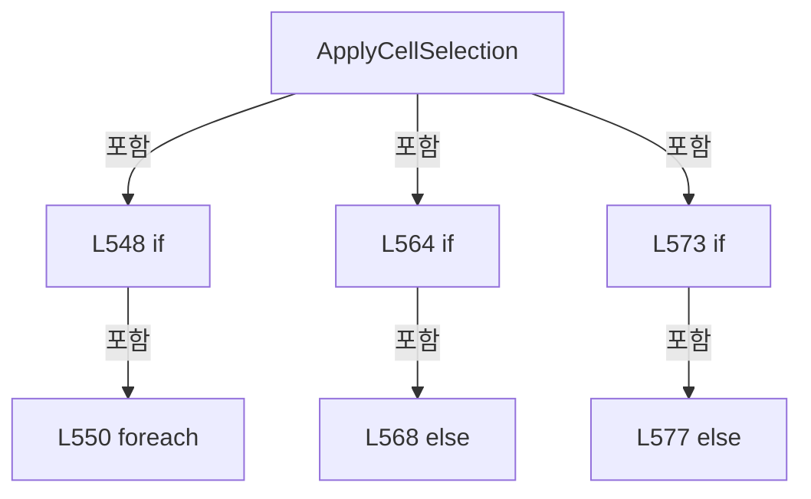

변경 전 점검: 입력/반환 타입, 위 호출자, 예외/취소 경로, 공유 상태와 저장·전송 소비자를 함께 확인합니다. 값의 단위나 물리 방향을 이름만으로 확정하지 않습니다.

### MethodDeclaration `SelectShotAt` · L586–607

[Drilling.UI/Menu/Menus/CMenuCorrection.ReviewData.Display.cs:586–607](https://github.com/kjuws10-rgb/A3Drilling/blob/334b3599651b2e8e0181fd4459bafaf3cddafff3/Drilling.UI/Menu/Menus/CMenuCorrection.ReviewData.Display.cs#L586-L607)

| 항목 | 실제 추출 값 |
| --- | --- |
| 서명 | void Drilling.UI.Menu.Menus.CMenuCorrection.CReviewDataPanel.SelectShotAt(double, double) |
| 접근/수식자 | Public / public |
| 반환/값 타입 | void |
| 소속 타입 | NamedType:Drilling.UI.Menu.Menus.CMenuCorrection.CReviewDataPanel |

입력 계약:

| 이름 | 타입 | 전달 | 선택/기본값 |
| --- | --- | --- | --- |
| x | double | None | False /  |
| y | double | None | False /  |

현재 부분 분석에서 직접 연결된 호출자는 없습니다. XAML/이벤트/인터페이스·델리게이트·외부 진입을 추가 확인해야 하며, 미사용으로 판정한 것이 아닙니다.

호출하는 대상과 해석 범위:

| 원본 행 | 표현식 | 분석 상태 | 대상/소스 위치 |
| --- | --- | --- | --- |
| 588 | _shotsByCell.TryGetValue | resolved · 동적 구현 선택 가능 | bool System.Collections.Generic.IReadOnlyDictionary<int, System.Collections.Generic.IReadOnlyList<Drilling.UI.Menu.Menus.CMenuCorrection.ST_REVIEW_DATA_SHOT_POSITION>>.TryGetValue(int, out System.Collections.Generic.IReadOnlyList<Drilling.UI.Menu.Menus.CMenuCorrection.ST_REVIEW_DATA_SHOT_POSITION>) |
| 594 | GetReviewDataShotMapRect | resolved | Rect Drilling.UI.Menu.Menus.CMenuCorrection.CReviewDataPanel.GetReviewDataShotMapRect(int, int) · Drilling.UI/Menu/Menus/CMenuCorrection.ReviewData.Display.cs:1305 |
| 595 | mapRect.Contains | unresolved | None |
| 595 | new Point | unresolved | None |
| 600 | Math.Clamp | resolved | int System.Math.Clamp(int, int, int) |
| 601 | Math.Clamp | resolved | int System.Math.Clamp(int, int, int) |
| 602 | shots.FirstOrDefault | resolved | Drilling.UI.Menu.Menus.CMenuCorrection.ST_REVIEW_DATA_SHOT_POSITION? System.Collections.Generic.IEnumerable<Drilling.UI.Menu.Menus.CMenuCorrection.ST_REVIEW_DATA_SHOT_POSITION>.FirstOrDefault<Drilling.UI.Menu.Menus.CMenuCorrection.ST_REVIEW_DATA_SHOT_POSITION>(System.Func<Drilling.UI.Menu.Menus.CMenuCorrection.ST_REVIEW_DATA_SHOT_POSITION, bool>) |
| 605 | ApplyShotSelection | resolved | void Drilling.UI.Menu.Menus.CMenuCorrection.CReviewDataPanel.ApplyShotSelection(string, Drilling.UI.Menu.Menus.CMenuCorrection.ST_REVIEW_DATA_GRID_ROW?) · Drilling.UI/Menu/Menus/CMenuCorrection.ReviewData.Display.cs:622 |

본문의 실제 연산·분기·예외·반환 순서(원문 위치 순):

| 원본 행 | 종류 | 주석 해설 |
| --- | --- | --- |
| 588 | call | 함수·델리게이트 또는 객체 생성자를 호출합니다: _shotsByCell.TryGetValue(_selectedCellNo, out var shots) |
| 588 | if | 조건에 따라 분기합니다: if (!_hasLoadedData &#124;&#124; !_shotsByCell.TryGetValue(_selectedCellNo, out var shots) &#124;&#124; shots.Count == 0) |
| 590 | return | 호출자에게 값 또는 제어를 반환합니다: return; |
| 593 | local-declaration | 지역 변수를 선언합니다: var first = shots[0]; |
| 593 | variable-initializer | 변수의 초기값을 지정합니다: first = shots[0] |
| 594 | call | 함수·델리게이트 또는 객체 생성자를 호출합니다: GetReviewDataShotMapRect(first.GroupCountX, first.GroupCountY) |
| 594 | local-declaration | 지역 변수를 선언합니다: var mapRect = GetReviewDataShotMapRect(first.GroupCountX, first.GroupCountY); |
| 594 | variable-initializer | 변수의 초기값을 지정합니다: mapRect = GetReviewDataShotMapRect(first.GroupCountX, first.GroupCountY) |
| 595 | call | 함수·델리게이트 또는 객체 생성자를 호출합니다: mapRect.Contains(new Point(x, y)) |
| 595 | call | 함수·델리게이트 또는 객체 생성자를 호출합니다: new Point(x, y) |
| 595 | if | 조건에 따라 분기합니다: if (!mapRect.Contains(new Point(x, y))) |
| 597 | return | 호출자에게 값 또는 제어를 반환합니다: return; |
| 600 | call | 함수·델리게이트 또는 객체 생성자를 호출합니다: Math.Clamp((int)((x - mapRect.Left) / mapRect.Width * first.GroupCountX), 0, first.GroupCountX - 1) |
| 600 | local-declaration | 지역 변수를 선언합니다: var column = Math.Clamp((int)((x - mapRect.Left) / mapRect.Width * first.GroupCountX), 0, first.GroupCountX - 1); |
| 600 | variable-initializer | 변수의 초기값을 지정합니다: column = Math.Clamp((int)((x - mapRect.Left) / mapRect.Width * first.GroupCountX), 0, first.GroupCountX - 1) |
| 601 | call | 함수·델리게이트 또는 객체 생성자를 호출합니다: Math.Clamp((int)((y - mapRect.Top) / mapRect.Height * first.GroupCountY), 0, first.GroupCountY - 1) |
| 601 | local-declaration | 지역 변수를 선언합니다: var row = Math.Clamp((int)((y - mapRect.Top) / mapRect.Height * first.GroupCountY), 0, first.GroupCountY - 1); |
| 601 | variable-initializer | 변수의 초기값을 지정합니다: row = Math.Clamp((int)((y - mapRect.Top) / mapRect.Height * first.GroupCountY), 0, first.GroupCountY - 1) |
| 602 | call | 함수·델리게이트 또는 객체 생성자를 호출합니다: shots.FirstOrDefault(item => item.GroupColumn == column && item.GroupRow == row) |
| 602 | local-declaration | 지역 변수를 선언합니다: var shot = shots.FirstOrDefault(item => item.GroupColumn == column && item.GroupRow == row); |
| 602 | variable-initializer | 변수의 초기값을 지정합니다: shot = shots.FirstOrDefault(item => item.GroupColumn == column && item.GroupRow == row) |
| 603 | if | 조건에 따라 분기합니다: if (shot is not null) |
| 605 | call | 함수·델리게이트 또는 객체 생성자를 호출합니다: ApplyShotSelection(shot.ShotKey, null) |

제어 구문의 포함 구조(실제 실행 순서/CFG가 아닌 구문 탐색 그림):

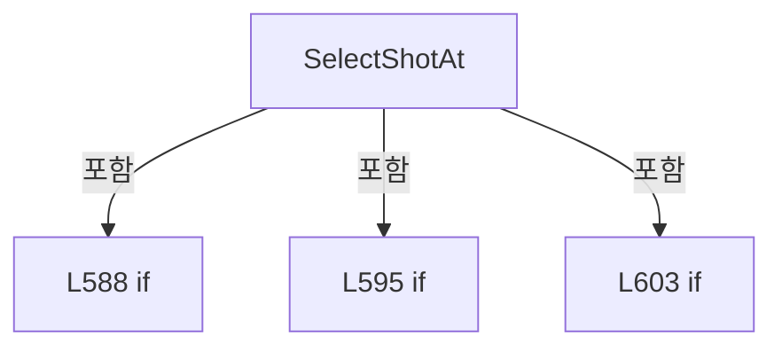

변경 전 점검: 입력/반환 타입, 위 호출자, 예외/취소 경로, 공유 상태와 저장·전송 소비자를 함께 확인합니다. 값의 단위나 물리 방향을 이름만으로 확정하지 않습니다.

### MethodDeclaration `SelectRow` · L609–620

[Drilling.UI/Menu/Menus/CMenuCorrection.ReviewData.Display.cs:609–620](https://github.com/kjuws10-rgb/A3Drilling/blob/334b3599651b2e8e0181fd4459bafaf3cddafff3/Drilling.UI/Menu/Menus/CMenuCorrection.ReviewData.Display.cs#L609-L620)

| 항목 | 실제 추출 값 |
| --- | --- |
| 서명 | void Drilling.UI.Menu.Menus.CMenuCorrection.CReviewDataPanel.SelectRow(Drilling.UI.Menu.Menus.CMenuCorrection.ST_REVIEW_DATA_GRID_ROW) |
| 접근/수식자 | Public / public |
| 반환/값 타입 | void |
| 소속 타입 | NamedType:Drilling.UI.Menu.Menus.CMenuCorrection.CReviewDataPanel |

입력 계약:

| 이름 | 타입 | 전달 | 선택/기본값 |
| --- | --- | --- | --- |
| row | Drilling.UI.Menu.Menus.CMenuCorrection.ST_REVIEW_DATA_GRID_ROW | None | False /  |

정적 호출자로 확인된 위치:

| 호출 파일/행 | 호출 표현식 | 런타임 분기 가능 |
| --- | --- | --- |
| [Drilling.UI/Views/CReviewDataView.xaml.cs:268–268](https://github.com/kjuws10-rgb/A3Drilling/blob/334b3599651b2e8e0181fd4459bafaf3cddafff3/Drilling.UI/Views/CReviewDataView.xaml.cs#L268-L268) | panel.SelectRow | False |

호출하는 대상과 해석 범위:

| 원본 행 | 표현식 | 분석 상태 | 대상/소스 위치 |
| --- | --- | --- | --- |
| 614 | Rows.Any | resolved | bool System.Collections.Generic.IEnumerable<Drilling.UI.Menu.Menus.CMenuCorrection.ST_REVIEW_DATA_GRID_ROW>.Any<Drilling.UI.Menu.Menus.CMenuCorrection.ST_REVIEW_DATA_GRID_ROW>(System.Func<Drilling.UI.Menu.Menus.CMenuCorrection.ST_REVIEW_DATA_GRID_ROW, bool>) |
| 614 | ReferenceEquals | resolved | bool object.ReferenceEquals(object?, object?) |
| 619 | ApplyShotSelection | resolved | void Drilling.UI.Menu.Menus.CMenuCorrection.CReviewDataPanel.ApplyShotSelection(string, Drilling.UI.Menu.Menus.CMenuCorrection.ST_REVIEW_DATA_GRID_ROW?) · Drilling.UI/Menu/Menus/CMenuCorrection.ReviewData.Display.cs:622 |

본문의 실제 연산·분기·예외·반환 순서(원문 위치 순):

| 원본 행 | 종류 | 주석 해설 |
| --- | --- | --- |
| 611 | if | 조건에 따라 분기합니다: if (!_hasLoadedData &#124;&#124; row is null &#124;&#124; row.CellNo != _selectedCellNo &#124;&#124; !Rows.Any(currentRow => ReferenceEquals(currentRow, row))) |
| 614 | call | 함수·델리게이트 또는 객체 생성자를 호출합니다: Rows.Any(currentRow => ReferenceEquals(currentRow, row)) |
| 614 | call | 함수·델리게이트 또는 객체 생성자를 호출합니다: ReferenceEquals(currentRow, row) |
| 616 | return | 호출자에게 값 또는 제어를 반환합니다: return; |
| 619 | call | 함수·델리게이트 또는 객체 생성자를 호출합니다: ApplyShotSelection(row.ShotKey, row) |

제어 구문의 포함 구조(실제 실행 순서/CFG가 아닌 구문 탐색 그림):


변경 전 점검: 입력/반환 타입, 위 호출자, 예외/취소 경로, 공유 상태와 저장·전송 소비자를 함께 확인합니다. 값의 단위나 물리 방향을 이름만으로 확정하지 않습니다.

### MethodDeclaration `ApplyShotSelection` · L622–639

[Drilling.UI/Menu/Menus/CMenuCorrection.ReviewData.Display.cs:622–639](https://github.com/kjuws10-rgb/A3Drilling/blob/334b3599651b2e8e0181fd4459bafaf3cddafff3/Drilling.UI/Menu/Menus/CMenuCorrection.ReviewData.Display.cs#L622-L639)

| 항목 | 실제 추출 값 |
| --- | --- |
| 서명 | void Drilling.UI.Menu.Menus.CMenuCorrection.CReviewDataPanel.ApplyShotSelection(string, Drilling.UI.Menu.Menus.CMenuCorrection.ST_REVIEW_DATA_GRID_ROW?) |
| 접근/수식자 | Private / private |
| 반환/값 타입 | void |
| 소속 타입 | NamedType:Drilling.UI.Menu.Menus.CMenuCorrection.CReviewDataPanel |

입력 계약:

| 이름 | 타입 | 전달 | 선택/기본값 |
| --- | --- | --- | --- |
| shotKey | string | None | False /  |
| preferredRow | Drilling.UI.Menu.Menus.CMenuCorrection.ST_REVIEW_DATA_GRID_ROW? | None | False /  |

정적 호출자로 확인된 위치:

| 호출 파일/행 | 호출 표현식 | 런타임 분기 가능 |
| --- | --- | --- |
| [Drilling.UI/Menu/Menus/CMenuCorrection.ReviewData.Display.cs:605–605](https://github.com/kjuws10-rgb/A3Drilling/blob/334b3599651b2e8e0181fd4459bafaf3cddafff3/Drilling.UI/Menu/Menus/CMenuCorrection.ReviewData.Display.cs#L605-L605) | ApplyShotSelection | False |
| [Drilling.UI/Menu/Menus/CMenuCorrection.ReviewData.Display.cs:619–619](https://github.com/kjuws10-rgb/A3Drilling/blob/334b3599651b2e8e0181fd4459bafaf3cddafff3/Drilling.UI/Menu/Menus/CMenuCorrection.ReviewData.Display.cs#L619-L619) | ApplyShotSelection | False |
| [Drilling.UI/Menu/Menus/CMenuCorrection.ReviewData.Display.cs:709–709](https://github.com/kjuws10-rgb/A3Drilling/blob/334b3599651b2e8e0181fd4459bafaf3cddafff3/Drilling.UI/Menu/Menus/CMenuCorrection.ReviewData.Display.cs#L709-L709) | ApplyShotSelection | False |
| [Drilling.UI/Menu/Menus/CMenuCorrection.ReviewData.Reinspection.cs:655–655](https://github.com/kjuws10-rgb/A3Drilling/blob/334b3599651b2e8e0181fd4459bafaf3cddafff3/Drilling.UI/Menu/Menus/CMenuCorrection.ReviewData.Reinspection.cs#L655-L655) | ApplyShotSelection | False |

호출하는 대상과 해석 범위:

| 원본 행 | 표현식 | 분석 상태 | 대상/소스 위치 |
| --- | --- | --- | --- |
| 624 | string.IsNullOrWhiteSpace | resolved | bool string.IsNullOrWhiteSpace(string?) |
| 630 | Rows.FirstOrDefault | resolved | Drilling.UI.Menu.Menus.CMenuCorrection.ST_REVIEW_DATA_GRID_ROW? System.Collections.Generic.IEnumerable<Drilling.UI.Menu.Menus.CMenuCorrection.ST_REVIEW_DATA_GRID_ROW>.FirstOrDefault<Drilling.UI.Menu.Menus.CMenuCorrection.ST_REVIEW_DATA_GRID_ROW>(System.Func<Drilling.UI.Menu.Menus.CMenuCorrection.ST_REVIEW_DATA_GRID_ROW, bool>) |
| 630 | row.ShotKey.Equals | resolved | bool string.Equals(string?, System.StringComparison) |
| 631 | QueueShotMapRender | resolved | void Drilling.UI.Menu.Menus.CMenuCorrection.CReviewDataPanel.QueueShotMapRender(int, string) · Drilling.UI/Menu/Menus/CMenuCorrection.ReviewData.Display.cs:958 |
| 632 | RefreshScatterPlot | resolved | void Drilling.UI.Menu.Menus.CMenuCorrection.CReviewDataPanel.RefreshScatterPlot() · Drilling.UI/Menu/Menus/CMenuCorrection.ReviewData.Display.cs:760 |
| 633 | RefreshSelectionText | resolved | void Drilling.UI.Menu.Menus.CMenuCorrection.CReviewDataPanel.RefreshSelectionText() · Drilling.UI/Menu/Menus/CMenuCorrection.ReviewData.Display.cs:995 |
| 634 | Notify | resolved | void Drilling.UI.Menu.Menus.CMenuCorrection.CReviewDataPanel.Notify(string) · Drilling.UI/Menu/Menus/CMenuCorrection.ReviewData.cs:616 |
| 634 | nameof | unresolved | None |
| 635 | Notify | resolved | void Drilling.UI.Menu.Menus.CMenuCorrection.CReviewDataPanel.Notify(string) · Drilling.UI/Menu/Menus/CMenuCorrection.ReviewData.cs:616 |
| 635 | nameof | unresolved | None |
| 636 | Notify | resolved | void Drilling.UI.Menu.Menus.CMenuCorrection.CReviewDataPanel.Notify(string) · Drilling.UI/Menu/Menus/CMenuCorrection.ReviewData.cs:616 |
| 636 | nameof | unresolved | None |
| 637 | NotifyReinspectionCommandState | resolved | void Drilling.UI.Menu.Menus.CMenuCorrection.CReviewDataPanel.NotifyReinspectionCommandState() · Drilling.UI/Menu/Menus/CMenuCorrection.ReviewData.Reinspection.cs:700 |
| 638 | NotifyResultEditCommandState | resolved | void Drilling.UI.Menu.Menus.CMenuCorrection.CReviewDataPanel.NotifyResultEditCommandState() · Drilling.UI/Menu/Menus/CMenuCorrection.ReviewData.Edit.cs:601 |

본문의 실제 연산·분기·예외·반환 순서(원문 위치 순):

| 원본 행 | 종류 | 주석 해설 |
| --- | --- | --- |
| 624 | call | 함수·델리게이트 또는 객체 생성자를 호출합니다: string.IsNullOrWhiteSpace(shotKey) |
| 624 | if | 조건에 따라 분기합니다: if (string.IsNullOrWhiteSpace(shotKey)) |
| 626 | return | 호출자에게 값 또는 제어를 반환합니다: return; |
| 629 | assignment | 값을 대상에 대입합니다: _selectedShotKey = shotKey |
| 630 | assignment | 값을 대상에 대입합니다: SelectedRow = preferredRow ?? Rows.FirstOrDefault(row => row.ShotKey.Equals(shotKey, StringComparison.OrdinalIgnoreCase)) |
| 630 | call | 함수·델리게이트 또는 객체 생성자를 호출합니다: Rows.FirstOrDefault(row => row.ShotKey.Equals(shotKey, StringComparison.OrdinalIgnoreCase)) |
| 630 | call | 함수·델리게이트 또는 객체 생성자를 호출합니다: row.ShotKey.Equals(shotKey, StringComparison.OrdinalIgnoreCase) |
| 631 | call | 함수·델리게이트 또는 객체 생성자를 호출합니다: QueueShotMapRender(_selectedCellNo, _selectedShotKey) |
| 632 | call | 함수·델리게이트 또는 객체 생성자를 호출합니다: RefreshScatterPlot() |
| 633 | call | 함수·델리게이트 또는 객체 생성자를 호출합니다: RefreshSelectionText() |
| 634 | call | 함수·델리게이트 또는 객체 생성자를 호출합니다: Notify(nameof(SelectedRow)) |
| 634 | call | 함수·델리게이트 또는 객체 생성자를 호출합니다: nameof(SelectedRow) |
| 635 | call | 함수·델리게이트 또는 객체 생성자를 호출합니다: Notify(nameof(SelectedShotTitle)) |
| 635 | call | 함수·델리게이트 또는 객체 생성자를 호출합니다: nameof(SelectedShotTitle) |
| 636 | call | 함수·델리게이트 또는 객체 생성자를 호출합니다: Notify(nameof(SelectedShotDetail)) |
| 636 | call | 함수·델리게이트 또는 객체 생성자를 호출합니다: nameof(SelectedShotDetail) |
| 637 | call | 함수·델리게이트 또는 객체 생성자를 호출합니다: NotifyReinspectionCommandState() |
| 638 | call | 함수·델리게이트 또는 객체 생성자를 호출합니다: NotifyResultEditCommandState() |

제어 구문의 포함 구조(실제 실행 순서/CFG가 아닌 구문 탐색 그림):


변경 전 점검: 입력/반환 타입, 위 호출자, 예외/취소 경로, 공유 상태와 저장·전송 소비자를 함께 확인합니다. 값의 단위나 물리 방향을 이름만으로 확정하지 않습니다.

### MethodDeclaration `RefreshGlassPreview` · L641–675

[Drilling.UI/Menu/Menus/CMenuCorrection.ReviewData.Display.cs:641–675](https://github.com/kjuws10-rgb/A3Drilling/blob/334b3599651b2e8e0181fd4459bafaf3cddafff3/Drilling.UI/Menu/Menus/CMenuCorrection.ReviewData.Display.cs#L641-L675)

| 항목 | 실제 추출 값 |
| --- | --- |
| 서명 | void Drilling.UI.Menu.Menus.CMenuCorrection.CReviewDataPanel.RefreshGlassPreview() |
| 접근/수식자 | Private / private |
| 반환/값 타입 | void |
| 소속 타입 | NamedType:Drilling.UI.Menu.Menus.CMenuCorrection.CReviewDataPanel |

정적 호출자로 확인된 위치:

| 호출 파일/행 | 호출 표현식 | 런타임 분기 가능 |
| --- | --- | --- |
| [Drilling.UI/Menu/Menus/CMenuCorrection.ReviewData.Display.cs:529–529](https://github.com/kjuws10-rgb/A3Drilling/blob/334b3599651b2e8e0181fd4459bafaf3cddafff3/Drilling.UI/Menu/Menus/CMenuCorrection.ReviewData.Display.cs#L529-L529) | RefreshGlassPreview | False |
| [Drilling.UI/Menu/Menus/CMenuCorrection.ReviewData.Display.cs:566–566](https://github.com/kjuws10-rgb/A3Drilling/blob/334b3599651b2e8e0181fd4459bafaf3cddafff3/Drilling.UI/Menu/Menus/CMenuCorrection.ReviewData.Display.cs#L566-L566) | RefreshGlassPreview | False |
| [Drilling.UI/Menu/Menus/CMenuCorrection.ReviewData.Reinspection.cs:134–134](https://github.com/kjuws10-rgb/A3Drilling/blob/334b3599651b2e8e0181fd4459bafaf3cddafff3/Drilling.UI/Menu/Menus/CMenuCorrection.ReviewData.Reinspection.cs#L134-L134) | RefreshGlassPreview | False |

호출하는 대상과 해석 범위:

| 원본 행 | 표현식 | 분석 상태 | 대상/소스 위치 |
| --- | --- | --- | --- |
| 647 | Camera.Clear | resolved | void Drilling.UI.Menu.Menus.CReviewCameraPreview.Clear() · Drilling.UI/Menu/Menus/CMenuReview.cs:6091 |
| 651 | BuildReviewDataGlassPreview | resolved | Drilling.UI.Menu.Menus.CMenuCorrection.ST_REVIEW_DATA_GLASS_PREVIEW Drilling.UI.Menu.Menus.CMenuCorrection.CReviewDataPanel.BuildReviewDataGlassPreview(System.Collections.Generic.IReadOnlyDictionary<string, string>, int, System.Collections.Generic.IReadOnlySet<int>, int, System.Collections.Generic.IReadOnlyDictionary<int, Drilling.Common.Review.EN_REVIEW_RESULT_LEVEL>?, Drilling.Common.Review.ST_REVIEW_RESULT_LEVEL_SETTINGS?) · Drilling.UI/Menu/Menus/CMenuCorrection.ReviewData.Display.cs:1016 |
| 665 | new Dictionary<string, string> | resolved | System.Collections.Generic.Dictionary<string, string>.Dictionary(System.Collections.Generic.IEnumerable<System.Collections.Generic.KeyValuePair<string, string>>, System.Collections.Generic.IEqualityComparer<string>?) |
| 669 | Camera.Configure | resolved | void Drilling.UI.Menu.Menus.CReviewCameraPreview.Configure(System.Collections.Generic.IReadOnlyDictionary<string, string>, Rect) · Drilling.UI/Menu/Menus/CMenuReview.cs:6040 |
| 673 | Camera.Clear | resolved | void Drilling.UI.Menu.Menus.CReviewCameraPreview.Clear() · Drilling.UI/Menu/Menus/CMenuReview.cs:6091 |

본문의 실제 연산·분기·예외·반환 순서(원문 위치 순):

| 원본 행 | 종류 | 주석 해설 |
| --- | --- | --- |
| 643 | if | 조건에 따라 분기합니다: if (_loadedParameters.Count == 0 &#124;&#124; _loadedCellCount <= 0) |
| 645 | assignment | 값을 대상에 대입합니다: GlassPreviewImage = null |
| 646 | assignment | 값을 대상에 대입합니다: CellLabels = [] |
| 647 | call | 함수·델리게이트 또는 객체 생성자를 호출합니다: Camera.Clear() |
| 648 | return | 호출자에게 값 또는 제어를 반환합니다: return; |
| 651 | call | 함수·델리게이트 또는 객체 생성자를 호출합니다: BuildReviewDataGlassPreview( _loadedParameters, _loadedCellCount, _resultCellNos, _selectedCellNo, _cellLevels, _reviewLevelSettings) |
| 651 | local-declaration | 지역 변수를 선언합니다: var preview = BuildReviewDataGlassPreview( _loadedParameters, _loadedCellCount, _resultCellNos, _selectedCellNo, _cellLevels, _reviewLevelSettings); |
| 651 | variable-initializer | 변수의 초기값을 지정합니다: preview = BuildReviewDataGlassPreview( _loadedParameters, _loadedCellCount, _resultCellNos, _selectedCellNo, _cellLevels, _reviewLevelSettings) |
| 658 | assignment | 값을 대상에 대입합니다: GlassPreviewImage = preview.Image |
| 659 | assignment | 값을 대상에 대입합니다: CellLabels = preview.CellLabels |
| 660 | assignment | 값을 대상에 대입합니다: GlassSurfaceWidth = preview.Width |
| 661 | assignment | 값을 대상에 대입합니다: GlassSurfaceHeight = preview.Height |
| 662 | assignment | 값을 대상에 대입합니다: GlassSummary = $"{_resultCellNos.Count:N0} Result Cells / {_allRows.Count:N0} Result Rows" |
| 663 | if | 조건에 따라 분기합니다: if (_isReinspectionMode) |
| 665 | call | 함수·델리게이트 또는 객체 생성자를 호출합니다: new Dictionary<string, string>(_loadedParameters, StringComparer.OrdinalIgnoreCase) { [CReviewCameraPreview.UseSettingKey] = "ON" } |
| 665 | local-declaration | 지역 변수를 선언합니다: var cameraParameters = new Dictionary<string, string>(_loadedParameters, StringComparer.OrdinalIgnoreCase) { [CReviewCameraPreview.UseSettingKey] = "ON" }; |
| 665 | variable-initializer | 변수의 초기값을 지정합니다: cameraParameters = new Dictionary<string, string>(_loadedParameters, StringComparer.OrdinalIgnoreCase) { [CReviewCameraPreview.UseSettingKey] = "ON" } |
| 667 | assignment | 값을 대상에 대입합니다: [CReviewCameraPreview.UseSettingKey] = "ON" |
| 669 | call | 함수·델리게이트 또는 객체 생성자를 호출합니다: Camera.Configure(cameraParameters, preview.GlassBounds) |
| 671 | else | 앞 조건이 거짓인 경로입니다: else |
| 673 | call | 함수·델리게이트 또는 객체 생성자를 호출합니다: Camera.Clear() |

제어 구문의 포함 구조(실제 실행 순서/CFG가 아닌 구문 탐색 그림):

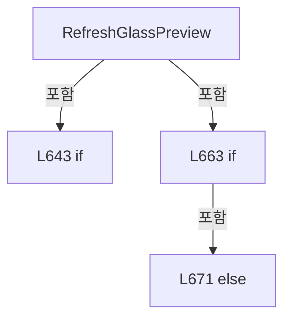

변경 전 점검: 입력/반환 타입, 위 호출자, 예외/취소 경로, 공유 상태와 저장·전송 소비자를 함께 확인합니다. 값의 단위나 물리 방향을 이름만으로 확정하지 않습니다.

### MethodDeclaration `RefreshShotMap` · L677–684

[Drilling.UI/Menu/Menus/CMenuCorrection.ReviewData.Display.cs:677–684](https://github.com/kjuws10-rgb/A3Drilling/blob/334b3599651b2e8e0181fd4459bafaf3cddafff3/Drilling.UI/Menu/Menus/CMenuCorrection.ReviewData.Display.cs#L677-L684)

| 항목 | 실제 추출 값 |
| --- | --- |
| 서명 | void Drilling.UI.Menu.Menus.CMenuCorrection.CReviewDataPanel.RefreshShotMap() |
| 접근/수식자 | Private / private |
| 반환/값 타입 | void |
| 소속 타입 | NamedType:Drilling.UI.Menu.Menus.CMenuCorrection.CReviewDataPanel |

정적 호출자로 확인된 위치:

| 호출 파일/행 | 호출 표현식 | 런타임 분기 가능 |
| --- | --- | --- |
| [Drilling.UI/Menu/Menus/CMenuCorrection.ReviewData.Display.cs:575–575](https://github.com/kjuws10-rgb/A3Drilling/blob/334b3599651b2e8e0181fd4459bafaf3cddafff3/Drilling.UI/Menu/Menus/CMenuCorrection.ReviewData.Display.cs#L575-L575) | RefreshShotMap | False |

호출하는 대상과 해석 범위:

| 원본 행 | 표현식 | 분석 상태 | 대상/소스 위치 |
| --- | --- | --- | --- |
| 679 | _shotsByCell.GetValueOrDefault | resolved | System.Collections.Generic.IReadOnlyList<Drilling.UI.Menu.Menus.CMenuCorrection.ST_REVIEW_DATA_SHOT_POSITION> System.Collections.Generic.IReadOnlyDictionary<int, System.Collections.Generic.IReadOnlyList<Drilling.UI.Menu.Menus.CMenuCorrection.ST_REVIEW_DATA_SHOT_POSITION>>.GetValueOrDefault<int, System.Collections.Generic.IReadOnlyList<Drilling.UI.Menu.Menus.CMenuCorrection.ST_REVIEW_DATA_SHOT_POSITION>>(int, System.Collections.Generic.IReadOnlyList<Drilling.UI.Menu.Menus.CMenuCorrection.ST_REVIEW_DATA_SHOT_POSITION>) |
| 680 | GetReviewDataShotMapSize | resolved | Size Drilling.UI.Menu.Menus.CMenuCorrection.CReviewDataPanel.GetReviewDataShotMapSize(System.Collections.Generic.IReadOnlyList<Drilling.UI.Menu.Menus.CMenuCorrection.ST_REVIEW_DATA_SHOT_POSITION>) · Drilling.UI/Menu/Menus/CMenuCorrection.ReviewData.Display.cs:1293 |
| 683 | BuildReviewDataShotMap | resolved | ImageSource? Drilling.UI.Menu.Menus.CMenuCorrection.CReviewDataPanel.BuildReviewDataShotMap(System.Collections.Generic.IReadOnlyList<Drilling.UI.Menu.Menus.CMenuCorrection.ST_REVIEW_DATA_SHOT_POSITION>, string, System.Collections.Generic.IReadOnlySet<string>?) · Drilling.UI/Menu/Menus/CMenuCorrection.ReviewData.Display.cs:1119 |
| 683 | GetResultEditSelectedShotKeys | resolved | System.Collections.Generic.IReadOnlySet<string> Drilling.UI.Menu.Menus.CMenuCorrection.CReviewDataPanel.GetResultEditSelectedShotKeys(int) · Drilling.UI/Menu/Menus/CMenuCorrection.ReviewData.Edit.cs:557 |

본문의 실제 연산·분기·예외·반환 순서(원문 위치 순):

| 원본 행 | 종류 | 주석 해설 |
| --- | --- | --- |
| 679 | call | 함수·델리게이트 또는 객체 생성자를 호출합니다: _shotsByCell.GetValueOrDefault(_selectedCellNo, []) |
| 679 | local-declaration | 지역 변수를 선언합니다: var shots = _shotsByCell.GetValueOrDefault(_selectedCellNo, []); |
| 679 | variable-initializer | 변수의 초기값을 지정합니다: shots = _shotsByCell.GetValueOrDefault(_selectedCellNo, []) |
| 680 | call | 함수·델리게이트 또는 객체 생성자를 호출합니다: GetReviewDataShotMapSize(shots) |
| 680 | local-declaration | 지역 변수를 선언합니다: var size = GetReviewDataShotMapSize(shots); |
| 680 | variable-initializer | 변수의 초기값을 지정합니다: size = GetReviewDataShotMapSize(shots) |
| 681 | assignment | 값을 대상에 대입합니다: ShotMapSurfaceWidth = size.Width |
| 682 | assignment | 값을 대상에 대입합니다: ShotMapSurfaceHeight = size.Height |
| 683 | assignment | 값을 대상에 대입합니다: ShotMapImage = BuildReviewDataShotMap(shots, _selectedShotKey, GetResultEditSelectedShotKeys(_selectedCellNo)) |
| 683 | call | 함수·델리게이트 또는 객체 생성자를 호출합니다: BuildReviewDataShotMap(shots, _selectedShotKey, GetResultEditSelectedShotKeys(_selectedCellNo)) |
| 683 | call | 함수·델리게이트 또는 객체 생성자를 호출합니다: GetResultEditSelectedShotKeys(_selectedCellNo) |

변경 전 점검: 입력/반환 타입, 위 호출자, 예외/취소 경로, 공유 상태와 저장·전송 소비자를 함께 확인합니다. 값의 단위나 물리 방향을 이름만으로 확정하지 않습니다.

### MethodDeclaration `SelectScatterPointAt` · L686–711

[Drilling.UI/Menu/Menus/CMenuCorrection.ReviewData.Display.cs:686–711](https://github.com/kjuws10-rgb/A3Drilling/blob/334b3599651b2e8e0181fd4459bafaf3cddafff3/Drilling.UI/Menu/Menus/CMenuCorrection.ReviewData.Display.cs#L686-L711)

| 항목 | 실제 추출 값 |
| --- | --- |
| 서명 | void Drilling.UI.Menu.Menus.CMenuCorrection.CReviewDataPanel.SelectScatterPointAt(double, double) |
| 접근/수식자 | Public / public |
| 반환/값 타입 | void |
| 소속 타입 | NamedType:Drilling.UI.Menu.Menus.CMenuCorrection.CReviewDataPanel |

입력 계약:

| 이름 | 타입 | 전달 | 선택/기본값 |
| --- | --- | --- | --- |
| x | double | None | False /  |
| y | double | None | False /  |

현재 부분 분석에서 직접 연결된 호출자는 없습니다. XAML/이벤트/인터페이스·델리게이트·외부 진입을 추가 확인해야 하며, 미사용으로 판정한 것이 아닙니다.

호출하는 대상과 해석 범위:

| 원본 행 | 표현식 | 분석 상태 | 대상/소스 위치 |
| --- | --- | --- | --- |
| 688 | double.IsFinite | resolved | bool double.IsFinite(double) |
| 688 | double.IsFinite | resolved | bool double.IsFinite(double) |
| 709 | ApplyShotSelection | resolved | void Drilling.UI.Menu.Menus.CMenuCorrection.CReviewDataPanel.ApplyShotSelection(string, Drilling.UI.Menu.Menus.CMenuCorrection.ST_REVIEW_DATA_GRID_ROW?) · Drilling.UI/Menu/Menus/CMenuCorrection.ReviewData.Display.cs:622 |

본문의 실제 연산·분기·예외·반환 순서(원문 위치 순):

| 원본 행 | 종류 | 주석 해설 |
| --- | --- | --- |
| 688 | call | 함수·델리게이트 또는 객체 생성자를 호출합니다: double.IsFinite(x) |
| 688 | call | 함수·델리게이트 또는 객체 생성자를 호출합니다: double.IsFinite(y) |
| 688 | if | 조건에 따라 분기합니다: if (!_hasLoadedData &#124;&#124; _scatterPlotHits.Count == 0 &#124;&#124; !double.IsFinite(x) &#124;&#124; !double.IsFinite(y)) |
| 690 | return | 호출자에게 값 또는 제어를 반환합니다: return; |
| 693 | local-declaration | 지역 변수를 선언합니다: ST_REVIEW_DATA_SCATTER_HIT? nearest = null; |
| 693 | variable-initializer | 변수의 초기값을 지정합니다: nearest = null |
| 694 | local-declaration | 지역 변수를 선언합니다: var nearestDistanceSquared = 100.0; |
| 694 | variable-initializer | 변수의 초기값을 지정합니다: nearestDistanceSquared = 100.0 |
| 695 | foreach | 컬렉션 요소를 순회합니다: foreach (var hit in _scatterPlotHits) |
| 697 | local-declaration | 지역 변수를 선언합니다: var deltaX = hit.Point.X - x; |
| 697 | variable-initializer | 변수의 초기값을 지정합니다: deltaX = hit.Point.X - x |
| 698 | local-declaration | 지역 변수를 선언합니다: var deltaY = hit.Point.Y - y; |
| 698 | variable-initializer | 변수의 초기값을 지정합니다: deltaY = hit.Point.Y - y |
| 699 | local-declaration | 지역 변수를 선언합니다: var distanceSquared = deltaX * deltaX + deltaY * deltaY; |
| 699 | variable-initializer | 변수의 초기값을 지정합니다: distanceSquared = deltaX * deltaX + deltaY * deltaY |
| 700 | if | 조건에 따라 분기합니다: if (distanceSquared <= nearestDistanceSquared) |
| 702 | assignment | 값을 대상에 대입합니다: nearestDistanceSquared = distanceSquared |
| 703 | assignment | 값을 대상에 대입합니다: nearest = hit |
| 707 | if | 조건에 따라 분기합니다: if (nearest is not null) |
| 709 | call | 함수·델리게이트 또는 객체 생성자를 호출합니다: ApplyShotSelection(nearest.Row.ShotKey, nearest.Row) |

제어 구문의 포함 구조(실제 실행 순서/CFG가 아닌 구문 탐색 그림):


변경 전 점검: 입력/반환 타입, 위 호출자, 예외/취소 경로, 공유 상태와 저장·전송 소비자를 함께 확인합니다. 값의 단위나 물리 방향을 이름만으로 확정하지 않습니다.

### MethodDeclaration `ApplyScatterPlotScale` · L713–747

[Drilling.UI/Menu/Menus/CMenuCorrection.ReviewData.Display.cs:713–747](https://github.com/kjuws10-rgb/A3Drilling/blob/334b3599651b2e8e0181fd4459bafaf3cddafff3/Drilling.UI/Menu/Menus/CMenuCorrection.ReviewData.Display.cs#L713-L747)

| 항목 | 실제 추출 값 |
| --- | --- |
| 서명 | void Drilling.UI.Menu.Menus.CMenuCorrection.CReviewDataPanel.ApplyScatterPlotScale(object?) |
| 접근/수식자 | Private / private |
| 반환/값 타입 | void |
| 소속 타입 | NamedType:Drilling.UI.Menu.Menus.CMenuCorrection.CReviewDataPanel |

입력 계약:

| 이름 | 타입 | 전달 | 선택/기본값 |
| --- | --- | --- | --- |
| parameter | object? | None | False /  |

현재 부분 분석에서 직접 연결된 호출자는 없습니다. XAML/이벤트/인터페이스·델리게이트·외부 진입을 추가 확인해야 하며, 미사용으로 판정한 것이 아닙니다.

호출하는 대상과 해석 범위:

| 원본 행 | 표현식 | 분석 상태 | 대상/소스 위치 |
| --- | --- | --- | --- |
| 715 | TryParseScatterScale | resolved | bool Drilling.UI.Menu.Menus.CMenuCorrection.CReviewDataPanel.TryParseScatterScale(string, out double) · Drilling.UI/Menu/Menus/CMenuCorrection.ReviewData.Display.cs:749 |
| 716 | TryParseScatterScale | resolved | bool Drilling.UI.Menu.Menus.CMenuCorrection.CReviewDataPanel.TryParseScatterScale(string, out double) · Drilling.UI/Menu/Menus/CMenuCorrection.ReviewData.Display.cs:749 |
| 717 | TryParseScatterScale | resolved | bool Drilling.UI.Menu.Menus.CMenuCorrection.CReviewDataPanel.TryParseScatterScale(string, out double) · Drilling.UI/Menu/Menus/CMenuCorrection.ReviewData.Display.cs:749 |
| 718 | double.IsFinite | resolved | bool double.IsFinite(double) |
| 719 | double.IsFinite | resolved | bool double.IsFinite(double) |
| 720 | double.IsFinite | resolved | bool double.IsFinite(double) |
| 725 | _statusReporter | resolved · 동적 구현 선택 가능 | void System.Action<string>.Invoke(string) |
| 730 | double.IsFinite | resolved | bool double.IsFinite(double) |
| 732 | _statusReporter | resolved · 동적 구현 선택 가능 | void System.Action<string>.Invoke(string) |
| 739 | FormatScatterScaleInput | resolved | string Drilling.UI.Menu.Menus.CMenuCorrection.CReviewDataPanel.FormatScatterScaleInput(double) · Drilling.UI/Menu/Menus/CMenuCorrection.ReviewData.Display.cs:755 |
| 740 | FormatScatterScaleInput | resolved | string Drilling.UI.Menu.Menus.CMenuCorrection.CReviewDataPanel.FormatScatterScaleInput(double) · Drilling.UI/Menu/Menus/CMenuCorrection.ReviewData.Display.cs:755 |
| 741 | FormatScatterScaleInput | resolved | string Drilling.UI.Menu.Menus.CMenuCorrection.CReviewDataPanel.FormatScatterScaleInput(double) · Drilling.UI/Menu/Menus/CMenuCorrection.ReviewData.Display.cs:755 |
| 742 | Notify | resolved | void Drilling.UI.Menu.Menus.CMenuCorrection.CReviewDataPanel.Notify(string) · Drilling.UI/Menu/Menus/CMenuCorrection.ReviewData.cs:616 |
| 742 | nameof | unresolved | None |
| 743 | Notify | resolved | void Drilling.UI.Menu.Menus.CMenuCorrection.CReviewDataPanel.Notify(string) · Drilling.UI/Menu/Menus/CMenuCorrection.ReviewData.cs:616 |
| 743 | nameof | unresolved | None |
| 744 | Notify | resolved | void Drilling.UI.Menu.Menus.CMenuCorrection.CReviewDataPanel.Notify(string) · Drilling.UI/Menu/Menus/CMenuCorrection.ReviewData.cs:616 |
| 744 | nameof | unresolved | None |
| 745 | RefreshScatterPlot | resolved | void Drilling.UI.Menu.Menus.CMenuCorrection.CReviewDataPanel.RefreshScatterPlot() · Drilling.UI/Menu/Menus/CMenuCorrection.ReviewData.Display.cs:760 |
| 746 | _statusReporter | resolved · 동적 구현 선택 가능 | void System.Action<string>.Invoke(string) |

본문의 실제 연산·분기·예외·반환 순서(원문 위치 순):

| 원본 행 | 종류 | 주석 해설 |
| --- | --- | --- |
| 715 | call | 함수·델리게이트 또는 객체 생성자를 호출합니다: TryParseScatterScale(_scatterPlotMinimumText, out var minimum) |
| 715 | if | 조건에 따라 분기합니다: if (!TryParseScatterScale(_scatterPlotMinimumText, out var minimum) &#124;&#124; !TryParseScatterScale(_scatterPlotMaximumText, out var maximum) &#124;&#124; !TryParseScatterScale(_scatterPlotGridUnitText, out var gridUnit) &#124;&#124; !double.IsFinite(…) |
| 716 | call | 함수·델리게이트 또는 객체 생성자를 호출합니다: TryParseScatterScale(_scatterPlotMaximumText, out var maximum) |
| 717 | call | 함수·델리게이트 또는 객체 생성자를 호출합니다: TryParseScatterScale(_scatterPlotGridUnitText, out var gridUnit) |
| 718 | call | 함수·델리게이트 또는 객체 생성자를 호출합니다: double.IsFinite(minimum) |
| 719 | call | 함수·델리게이트 또는 객체 생성자를 호출합니다: double.IsFinite(maximum) |
| 720 | call | 함수·델리게이트 또는 객체 생성자를 호출합니다: double.IsFinite(gridUnit) |
| 725 | call | 함수·델리게이트 또는 객체 생성자를 호출합니다: _statusReporter("산포도 범위는 MIN < MAX, UNIT > 0인 유한한 mm 값으로 입력해 주세요.") |
| 726 | return | 호출자에게 값 또는 제어를 반환합니다: return; |
| 729 | local-declaration | 지역 변수를 선언합니다: var gridIntervalCount = (maximum - minimum) / gridUnit; |
| 729 | variable-initializer | 변수의 초기값을 지정합니다: gridIntervalCount = (maximum - minimum) / gridUnit |
| 730 | call | 함수·델리게이트 또는 객체 생성자를 호출합니다: double.IsFinite(gridIntervalCount) |
| 730 | if | 조건에 따라 분기합니다: if (!double.IsFinite(gridIntervalCount) &#124;&#124; gridIntervalCount > 40.0) |
| 732 | call | 함수·델리게이트 또는 객체 생성자를 호출합니다: _statusReporter("산포도 눈금은 40칸 이하가 되도록 MIN, MAX, UNIT을 입력해 주세요.") |
| 733 | return | 호출자에게 값 또는 제어를 반환합니다: return; |
| 736 | assignment | 값을 대상에 대입합니다: _scatterPlotMinimum = minimum |
| 737 | assignment | 값을 대상에 대입합니다: _scatterPlotMaximum = maximum |
| 738 | assignment | 값을 대상에 대입합니다: _scatterPlotGridUnit = gridUnit |
| 739 | assignment | 값을 대상에 대입합니다: _scatterPlotMinimumText = FormatScatterScaleInput(minimum) |
| 739 | call | 함수·델리게이트 또는 객체 생성자를 호출합니다: FormatScatterScaleInput(minimum) |
| 740 | assignment | 값을 대상에 대입합니다: _scatterPlotMaximumText = FormatScatterScaleInput(maximum) |
| 740 | call | 함수·델리게이트 또는 객체 생성자를 호출합니다: FormatScatterScaleInput(maximum) |
| 741 | assignment | 값을 대상에 대입합니다: _scatterPlotGridUnitText = FormatScatterScaleInput(gridUnit) |
| 741 | call | 함수·델리게이트 또는 객체 생성자를 호출합니다: FormatScatterScaleInput(gridUnit) |
| 742 | call | 함수·델리게이트 또는 객체 생성자를 호출합니다: Notify(nameof(ScatterPlotMinimumText)) |
| 742 | call | 함수·델리게이트 또는 객체 생성자를 호출합니다: nameof(ScatterPlotMinimumText) |
| 743 | call | 함수·델리게이트 또는 객체 생성자를 호출합니다: Notify(nameof(ScatterPlotMaximumText)) |
| 743 | call | 함수·델리게이트 또는 객체 생성자를 호출합니다: nameof(ScatterPlotMaximumText) |
| 744 | call | 함수·델리게이트 또는 객체 생성자를 호출합니다: Notify(nameof(ScatterPlotGridUnitText)) |
| 744 | call | 함수·델리게이트 또는 객체 생성자를 호출합니다: nameof(ScatterPlotGridUnitText) |
| 745 | call | 함수·델리게이트 또는 객체 생성자를 호출합니다: RefreshScatterPlot() |
| 746 | call | 함수·델리게이트 또는 객체 생성자를 호출합니다: _statusReporter($"Result scatter range {minimum:0.###} ~ {maximum:0.###} mm / grid {gridUnit:0.###} mm applied.") |

제어 구문의 포함 구조(실제 실행 순서/CFG가 아닌 구문 탐색 그림):

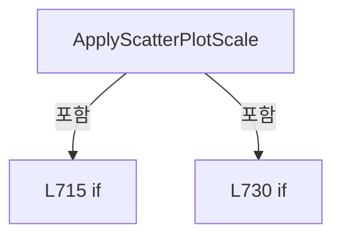

변경 전 점검: 입력/반환 타입, 위 호출자, 예외/취소 경로, 공유 상태와 저장·전송 소비자를 함께 확인합니다. 값의 단위나 물리 방향을 이름만으로 확정하지 않습니다.

### MethodDeclaration `TryParseScatterScale` · L749–753

[Drilling.UI/Menu/Menus/CMenuCorrection.ReviewData.Display.cs:749–753](https://github.com/kjuws10-rgb/A3Drilling/blob/334b3599651b2e8e0181fd4459bafaf3cddafff3/Drilling.UI/Menu/Menus/CMenuCorrection.ReviewData.Display.cs#L749-L753)

| 항목 | 실제 추출 값 |
| --- | --- |
| 서명 | bool Drilling.UI.Menu.Menus.CMenuCorrection.CReviewDataPanel.TryParseScatterScale(string, out double) |
| 접근/수식자 | Private / private, static |
| 반환/값 타입 | bool |
| 소속 타입 | NamedType:Drilling.UI.Menu.Menus.CMenuCorrection.CReviewDataPanel |

입력 계약:

| 이름 | 타입 | 전달 | 선택/기본값 |
| --- | --- | --- | --- |
| text | string | None | False /  |
| value | double | Out | False /  |

정적 호출자로 확인된 위치:

| 호출 파일/행 | 호출 표현식 | 런타임 분기 가능 |
| --- | --- | --- |
| [Drilling.UI/Menu/Menus/CMenuCorrection.ReviewData.Display.cs:715–715](https://github.com/kjuws10-rgb/A3Drilling/blob/334b3599651b2e8e0181fd4459bafaf3cddafff3/Drilling.UI/Menu/Menus/CMenuCorrection.ReviewData.Display.cs#L715-L715) | TryParseScatterScale | False |
| [Drilling.UI/Menu/Menus/CMenuCorrection.ReviewData.Display.cs:716–716](https://github.com/kjuws10-rgb/A3Drilling/blob/334b3599651b2e8e0181fd4459bafaf3cddafff3/Drilling.UI/Menu/Menus/CMenuCorrection.ReviewData.Display.cs#L716-L716) | TryParseScatterScale | False |
| [Drilling.UI/Menu/Menus/CMenuCorrection.ReviewData.Display.cs:717–717](https://github.com/kjuws10-rgb/A3Drilling/blob/334b3599651b2e8e0181fd4459bafaf3cddafff3/Drilling.UI/Menu/Menus/CMenuCorrection.ReviewData.Display.cs#L717-L717) | TryParseScatterScale | False |

호출하는 대상과 해석 범위:

| 원본 행 | 표현식 | 분석 상태 | 대상/소스 위치 |
| --- | --- | --- | --- |
| 751 | double.TryParse | resolved | bool double.TryParse(string?, System.Globalization.NumberStyles, System.IFormatProvider?, out double) |
| 752 | double.TryParse | resolved | bool double.TryParse(string?, System.Globalization.NumberStyles, System.IFormatProvider?, out double) |

본문의 실제 연산·분기·예외·반환 순서(원문 위치 순):

| 원본 행 | 종류 | 주석 해설 |
| --- | --- | --- |
| 751 | call | 함수·델리게이트 또는 객체 생성자를 호출합니다: double.TryParse(text, NumberStyles.Float, CultureInfo.InvariantCulture, out value) |
| 751 | return | 호출자에게 값 또는 제어를 반환합니다: return double.TryParse(text, NumberStyles.Float, CultureInfo.InvariantCulture, out value) &#124;&#124; double.TryParse(text, NumberStyles.Float, CultureInfo.CurrentCulture, out value); |
| 752 | call | 함수·델리게이트 또는 객체 생성자를 호출합니다: double.TryParse(text, NumberStyles.Float, CultureInfo.CurrentCulture, out value) |

변경 전 점검: 입력/반환 타입, 위 호출자, 예외/취소 경로, 공유 상태와 저장·전송 소비자를 함께 확인합니다. 값의 단위나 물리 방향을 이름만으로 확정하지 않습니다.

### MethodDeclaration `FormatScatterScaleInput` · L755–758

[Drilling.UI/Menu/Menus/CMenuCorrection.ReviewData.Display.cs:755–758](https://github.com/kjuws10-rgb/A3Drilling/blob/334b3599651b2e8e0181fd4459bafaf3cddafff3/Drilling.UI/Menu/Menus/CMenuCorrection.ReviewData.Display.cs#L755-L758)

| 항목 | 실제 추출 값 |
| --- | --- |
| 서명 | string Drilling.UI.Menu.Menus.CMenuCorrection.CReviewDataPanel.FormatScatterScaleInput(double) |
| 접근/수식자 | Private / private, static |
| 반환/값 타입 | string |
| 소속 타입 | NamedType:Drilling.UI.Menu.Menus.CMenuCorrection.CReviewDataPanel |

입력 계약:

| 이름 | 타입 | 전달 | 선택/기본값 |
| --- | --- | --- | --- |
| value | double | None | False /  |

정적 호출자로 확인된 위치:

| 호출 파일/행 | 호출 표현식 | 런타임 분기 가능 |
| --- | --- | --- |
| [Drilling.UI/Menu/Menus/CMenuCorrection.ReviewData.Display.cs:739–739](https://github.com/kjuws10-rgb/A3Drilling/blob/334b3599651b2e8e0181fd4459bafaf3cddafff3/Drilling.UI/Menu/Menus/CMenuCorrection.ReviewData.Display.cs#L739-L739) | FormatScatterScaleInput | False |
| [Drilling.UI/Menu/Menus/CMenuCorrection.ReviewData.Display.cs:740–740](https://github.com/kjuws10-rgb/A3Drilling/blob/334b3599651b2e8e0181fd4459bafaf3cddafff3/Drilling.UI/Menu/Menus/CMenuCorrection.ReviewData.Display.cs#L740-L740) | FormatScatterScaleInput | False |
| [Drilling.UI/Menu/Menus/CMenuCorrection.ReviewData.Display.cs:741–741](https://github.com/kjuws10-rgb/A3Drilling/blob/334b3599651b2e8e0181fd4459bafaf3cddafff3/Drilling.UI/Menu/Menus/CMenuCorrection.ReviewData.Display.cs#L741-L741) | FormatScatterScaleInput | False |

호출하는 대상과 해석 범위:

| 원본 행 | 표현식 | 분석 상태 | 대상/소스 위치 |
| --- | --- | --- | --- |
| 757 | value.ToString | resolved | string double.ToString(string?, System.IFormatProvider?) |

본문의 실제 연산·분기·예외·반환 순서(원문 위치 순):

| 원본 행 | 종류 | 주석 해설 |
| --- | --- | --- |
| 757 | call | 함수·델리게이트 또는 객체 생성자를 호출합니다: value.ToString("0.###", CultureInfo.InvariantCulture) |
| 757 | return | 호출자에게 값 또는 제어를 반환합니다: return value.ToString("0.###", CultureInfo.InvariantCulture); |

변경 전 점검: 입력/반환 타입, 위 호출자, 예외/취소 경로, 공유 상태와 저장·전송 소비자를 함께 확인합니다. 값의 단위나 물리 방향을 이름만으로 확정하지 않습니다.

### MethodDeclaration `RefreshScatterPlot` · L760–827

[Drilling.UI/Menu/Menus/CMenuCorrection.ReviewData.Display.cs:760–827](https://github.com/kjuws10-rgb/A3Drilling/blob/334b3599651b2e8e0181fd4459bafaf3cddafff3/Drilling.UI/Menu/Menus/CMenuCorrection.ReviewData.Display.cs#L760-L827)

| 항목 | 실제 추출 값 |
| --- | --- |
| 서명 | void Drilling.UI.Menu.Menus.CMenuCorrection.CReviewDataPanel.RefreshScatterPlot() |
| 접근/수식자 | Private / private |
| 반환/값 타입 | void |
| 소속 타입 | NamedType:Drilling.UI.Menu.Menus.CMenuCorrection.CReviewDataPanel |

정적 호출자로 확인된 위치:

| 호출 파일/행 | 호출 표현식 | 런타임 분기 가능 |
| --- | --- | --- |
| [Drilling.UI/Menu/Menus/CMenuCorrection.ReviewData.Display.cs:563–563](https://github.com/kjuws10-rgb/A3Drilling/blob/334b3599651b2e8e0181fd4459bafaf3cddafff3/Drilling.UI/Menu/Menus/CMenuCorrection.ReviewData.Display.cs#L563-L563) | RefreshScatterPlot | False |
| [Drilling.UI/Menu/Menus/CMenuCorrection.ReviewData.Display.cs:632–632](https://github.com/kjuws10-rgb/A3Drilling/blob/334b3599651b2e8e0181fd4459bafaf3cddafff3/Drilling.UI/Menu/Menus/CMenuCorrection.ReviewData.Display.cs#L632-L632) | RefreshScatterPlot | False |
| [Drilling.UI/Menu/Menus/CMenuCorrection.ReviewData.Display.cs:745–745](https://github.com/kjuws10-rgb/A3Drilling/blob/334b3599651b2e8e0181fd4459bafaf3cddafff3/Drilling.UI/Menu/Menus/CMenuCorrection.ReviewData.Display.cs#L745-L745) | RefreshScatterPlot | False |
| [Drilling.UI/Menu/Menus/CMenuCorrection.ReviewData.Edit.cs:226–226](https://github.com/kjuws10-rgb/A3Drilling/blob/334b3599651b2e8e0181fd4459bafaf3cddafff3/Drilling.UI/Menu/Menus/CMenuCorrection.ReviewData.Edit.cs#L226-L226) | RefreshScatterPlot | False |

호출하는 대상과 해석 범위:

| 원본 행 | 표현식 | 분석 상태 | 대상/소스 위치 |
| --- | --- | --- | --- |
| 766 | new Rect | unresolved | None |
| 771 | Rows .Where(row => double.IsFinite(row.ResultX) && double.IsFinite(row.ResultY)) .ToArray | resolved | Drilling.UI.Menu.Menus.CMenuCorrection.ST_REVIEW_DATA_GRID_ROW[] System.Collections.Generic.IEnumerable<Drilling.UI.Menu.Menus.CMenuCorrection.ST_REVIEW_DATA_GRID_ROW>.ToArray<Drilling.UI.Menu.Menus.CMenuCorrection.ST_REVIEW_DATA_GRID_ROW>() |
| 771 | Rows .Where | resolved | System.Collections.Generic.IEnumerable<Drilling.UI.Menu.Menus.CMenuCorrection.ST_REVIEW_DATA_GRID_ROW> System.Collections.Generic.IEnumerable<Drilling.UI.Menu.Menus.CMenuCorrection.ST_REVIEW_DATA_GRID_ROW>.Where<Drilling.UI.Menu.Menus.CMenuCorrection.ST_REVIEW_DATA_GRID_ROW>(System.Func<Drilling.UI.Menu.Menus.CMenuCorrection.ST_REVIEW_DATA_GRID_ROW, bool>) |
| 772 | double.IsFinite | resolved | bool double.IsFinite(double) |
| 772 | double.IsFinite | resolved | bool double.IsFinite(double) |
| 774 | new DrawingGroup | unresolved | None |
| 775 | new List<ST_REVIEW_DATA_SCATTER_HIT> | resolved | System.Collections.Generic.List<Drilling.UI.Menu.Menus.CMenuCorrection.ST_REVIEW_DATA_SCATTER_HIT>.List(int) |
| 776 | drawing.Open | unresolved | None |
| 778 | context.DrawRectangle | unresolved | None |
| 778 | new Rect | unresolved | None |
| 779 | DrawScatterGrid | candidate | OverloadResolutionFailure |
| 780 | DrawScatterAxes | candidate | OverloadResolutionFailure |
| 784 | DrawScatterText | candidate | OverloadResolutionFailure |
| 784 | new Point | unresolved | None |
| 784 | CStatusBrush.Frozen | resolved | SolidColorBrush Drilling.UI.Menu.Menus.CStatusBrush.Frozen(byte, byte, byte) · Drilling.UI/Menu/Menus/CMenuBase.cs:330 |
| 791 | IsInsideScatterRange | resolved | bool Drilling.UI.Menu.Menus.CMenuCorrection.CReviewDataPanel.IsInsideScatterRange(double, double, double, double) · Drilling.UI/Menu/Menus/CMenuCorrection.ReviewData.Display.cs:923 |
| 796 | ScatterPoint | resolved | Point Drilling.UI.Menu.Menus.CMenuCorrection.CReviewDataPanel.ScatterPoint(double, double, Rect, double, double) · Drilling.UI/Menu/Menus/CMenuCorrection.ReviewData.Display.cs:916 |
| 798 | context.DrawEllipse | unresolved | None |
| 801 | context.DrawEllipse | unresolved | None |
| 801 | new Pen | unresolved | None |
| 801 | CStatusBrush.Frozen | resolved | SolidColorBrush Drilling.UI.Menu.Menus.CStatusBrush.Frozen(byte, byte, byte) · Drilling.UI/Menu/Menus/CMenuBase.cs:330 |
| 804 | hits.Add | resolved | void System.Collections.Generic.List<Drilling.UI.Menu.Menus.CMenuCorrection.ST_REVIEW_DATA_SCATTER_HIT>.Add(Drilling.UI.Menu.Menus.CMenuCorrection.ST_REVIEW_DATA_SCATTER_HIT) |
| 804 | new ST_REVIEW_DATA_SCATTER_HIT | resolved | Drilling.UI.Menu.Menus.CMenuCorrection.ST_REVIEW_DATA_SCATTER_HIT.ST_REVIEW_DATA_SCATTER_HIT(Drilling.UI.Menu.Menus.CMenuCorrection.ST_REVIEW_DATA_GRID_ROW, Point) · Drilling.UI/Menu/Menus/CMenuCorrection.ReviewData.Display.cs:1439 |
| 808 | double.IsFinite | resolved | bool double.IsFinite(double) |
| 809 | double.IsFinite | resolved | bool double.IsFinite(double) |
| 810 | IsInsideScatterRange | resolved | bool Drilling.UI.Menu.Menus.CMenuCorrection.CReviewDataPanel.IsInsideScatterRange(double, double, double, double) · Drilling.UI/Menu/Menus/CMenuCorrection.ReviewData.Display.cs:923 |
| 812 | ScatterPoint | resolved | Point Drilling.UI.Menu.Menus.CMenuCorrection.CReviewDataPanel.ScatterPoint(double, double, Rect, double, double) · Drilling.UI/Menu/Menus/CMenuCorrection.ReviewData.Display.cs:916 |
| 813 | context.DrawEllipse | unresolved | None |
| 813 | CStatusBrush.Frozen | resolved | SolidColorBrush Drilling.UI.Menu.Menus.CStatusBrush.Frozen(byte, byte, byte) · Drilling.UI/Menu/Menus/CMenuBase.cs:330 |
| 813 | new Pen | unresolved | None |
| 814 | context.DrawEllipse | unresolved | None |
| 819 | drawing.Freeze | unresolved | None |
| 820 | new DrawingImage | unresolved | None |
| 821 | image.Freeze | unresolved | None |
| 824 | BuildScatterPlotSummary | resolved | string Drilling.UI.Menu.Menus.CMenuCorrection.CReviewDataPanel.BuildScatterPlotSummary(System.Collections.Generic.IReadOnlyList<Drilling.UI.Menu.Menus.CMenuCorrection.ST_REVIEW_DATA_GRID_ROW>, int) · Drilling.UI/Menu/Menus/CMenuCorrection.ReviewData.Display.cs:829 |
| 825 | Notify | resolved | void Drilling.UI.Menu.Menus.CMenuCorrection.CReviewDataPanel.Notify(string) · Drilling.UI/Menu/Menus/CMenuCorrection.ReviewData.cs:616 |
| 825 | nameof | unresolved | None |
| 826 | Notify | resolved | void Drilling.UI.Menu.Menus.CMenuCorrection.CReviewDataPanel.Notify(string) · Drilling.UI/Menu/Menus/CMenuCorrection.ReviewData.cs:616 |
| 826 | nameof | unresolved | None |

본문의 실제 연산·분기·예외·반환 순서(원문 위치 순):

| 원본 행 | 종류 | 주석 해설 |
| --- | --- | --- |
| 762 | local-declaration | 지역 변수를 선언합니다: const double left = 62.0; |
| 762 | variable-initializer | 변수의 초기값을 지정합니다: left = 62.0 |
| 763 | local-declaration | 지역 변수를 선언합니다: const double top = 14.0; |
| 763 | variable-initializer | 변수의 초기값을 지정합니다: top = 14.0 |
| 764 | local-declaration | 지역 변수를 선언합니다: const double right = 18.0; |
| 764 | variable-initializer | 변수의 초기값을 지정합니다: right = 18.0 |
| 765 | local-declaration | 지역 변수를 선언합니다: const double bottom = 40.0; |
| 765 | variable-initializer | 변수의 초기값을 지정합니다: bottom = 40.0 |
| 766 | call | 함수·델리게이트 또는 객체 생성자를 호출합니다: new Rect( left, top, ScatterPlotSurfaceWidth - left - right, ScatterPlotSurfaceHeight - top - bottom) |
| 766 | local-declaration | 지역 변수를 선언합니다: var plotRect = new Rect( left, top, ScatterPlotSurfaceWidth - left - right, ScatterPlotSurfaceHeight - top - bottom); |
| 766 | variable-initializer | 변수의 초기값을 지정합니다: plotRect = new Rect( left, top, ScatterPlotSurfaceWidth - left - right, ScatterPlotSurfaceHeight - top - bottom) |
| 771 | call | 함수·델리게이트 또는 객체 생성자를 호출합니다: Rows .Where(row => double.IsFinite(row.ResultX) && double.IsFinite(row.ResultY)) |
| 771 | call | 함수·델리게이트 또는 객체 생성자를 호출합니다: Rows .Where(row => double.IsFinite(row.ResultX) && double.IsFinite(row.ResultY)) .ToArray() |
| 771 | local-declaration | 지역 변수를 선언합니다: var finiteRows = Rows .Where(row => double.IsFinite(row.ResultX) && double.IsFinite(row.ResultY)) .ToArray(); |
| 771 | variable-initializer | 변수의 초기값을 지정합니다: finiteRows = Rows .Where(row => double.IsFinite(row.ResultX) && double.IsFinite(row.ResultY)) .ToArray() |
| 772 | call | 함수·델리게이트 또는 객체 생성자를 호출합니다: double.IsFinite(row.ResultX) |
| 772 | call | 함수·델리게이트 또는 객체 생성자를 호출합니다: double.IsFinite(row.ResultY) |
| 774 | call | 함수·델리게이트 또는 객체 생성자를 호출합니다: new DrawingGroup() |
| 774 | local-declaration | 지역 변수를 선언합니다: var drawing = new DrawingGroup(); |
| 774 | variable-initializer | 변수의 초기값을 지정합니다: drawing = new DrawingGroup() |
| 775 | call | 함수·델리게이트 또는 객체 생성자를 호출합니다: new List<ST_REVIEW_DATA_SCATTER_HIT>(finiteRows.Length) |
| 775 | local-declaration | 지역 변수를 선언합니다: var hits = new List<ST_REVIEW_DATA_SCATTER_HIT>(finiteRows.Length); |
| 775 | variable-initializer | 변수의 초기값을 지정합니다: hits = new List<ST_REVIEW_DATA_SCATTER_HIT>(finiteRows.Length) |
| 776 | call | 함수·델리게이트 또는 객체 생성자를 호출합니다: drawing.Open() |
| 776 | variable-initializer | 변수의 초기값을 지정합니다: context = drawing.Open() |
| 776 | using | 자원 사용과 정리 범위를 지정합니다: using (var context = drawing.Open()) |
| 778 | call | 함수·델리게이트 또는 객체 생성자를 호출합니다: context.DrawRectangle(Brushes.Transparent, null, new Rect(0, 0, ScatterPlotSurfaceWidth, ScatterPlotSurfaceHeight)) |
| 778 | call | 함수·델리게이트 또는 객체 생성자를 호출합니다: new Rect(0, 0, ScatterPlotSurfaceWidth, ScatterPlotSurfaceHeight) |
| 779 | call | 함수·델리게이트 또는 객체 생성자를 호출합니다: DrawScatterGrid(context, plotRect, _scatterPlotMinimum, _scatterPlotMaximum, _scatterPlotGridUnit) |
| 780 | call | 함수·델리게이트 또는 객체 생성자를 호출합니다: DrawScatterAxes(context, plotRect, _scatterPlotMinimum, _scatterPlotMaximum) |
| 782 | if | 조건에 따라 분기합니다: if (finiteRows.Length == 0) |
| 784 | call | 함수·델리게이트 또는 객체 생성자를 호출합니다: DrawScatterText(context, "NO RESULT DATA", new Point(plotRect.Left + plotRect.Width / 2.0, plotRect.Top + plotRect.Height / 2.0), 14.0, CStatusBrush.Frozen(0x64, 0x74, 0x8B), true) |
| 784 | call | 함수·델리게이트 또는 객체 생성자를 호출합니다: new Point(plotRect.Left + plotRect.Width / 2.0, plotRect.Top + plotRect.Height / 2.0) |
| 784 | call | 함수·델리게이트 또는 객체 생성자를 호출합니다: CStatusBrush.Frozen(0x64, 0x74, 0x8B) |
| 786 | else | 앞 조건이 거짓인 경로입니다: else |
| 788 | conditional-expression | 조건에 따라 결과식을 선택합니다: finiteRows.Length >= 10000 ? 1.4 : finiteRows.Length >= 3000 ? 1.8 : 2.5 |
| 788 | conditional-expression | 조건에 따라 결과식을 선택합니다: finiteRows.Length >= 3000 ? 1.8 : 2.5 |
| 788 | local-declaration | 지역 변수를 선언합니다: var radius = finiteRows.Length >= 10000 ? 1.4 : finiteRows.Length >= 3000 ? 1.8 : 2.5; |
| 788 | variable-initializer | 변수의 초기값을 지정합니다: radius = finiteRows.Length >= 10000 ? 1.4 : finiteRows.Length >= 3000 ? 1.8 : 2.5 |
| 789 | foreach | 컬렉션 요소를 순회합니다: foreach (var row in finiteRows) |
| 791 | call | 함수·델리게이트 또는 객체 생성자를 호출합니다: IsInsideScatterRange(row.ResultX, row.ResultY, _scatterPlotMinimum, _scatterPlotMaximum) |
| 791 | if | 조건에 따라 분기합니다: if (!IsInsideScatterRange(row.ResultX, row.ResultY, _scatterPlotMinimum, _scatterPlotMaximum)) |
| 793 | continue | 다음 반복으로 진행합니다: continue; |
| 796 | call | 함수·델리게이트 또는 객체 생성자를 호출합니다: ScatterPoint(row.ResultX, row.ResultY, plotRect, _scatterPlotMinimum, _scatterPlotMaximum) |
| 796 | local-declaration | 지역 변수를 선언합니다: var point = ScatterPoint(row.ResultX, row.ResultY, plotRect, _scatterPlotMinimum, _scatterPlotMaximum); |
| 796 | variable-initializer | 변수의 초기값을 지정합니다: point = ScatterPoint(row.ResultX, row.ResultY, plotRect, _scatterPlotMinimum, _scatterPlotMaximum) |
| 797 | local-declaration | 지역 변수를 선언합니다: var brush = row.LevelBrush; |
| 797 | variable-initializer | 변수의 초기값을 지정합니다: brush = row.LevelBrush |
| 798 | call | 함수·델리게이트 또는 객체 생성자를 호출합니다: context.DrawEllipse(brush, null, point, radius, radius) |
| 799 | if | 조건에 따라 분기합니다: if (_isResultEditMode && row.IsResultEditSelected) |
| 801 | call | 함수·델리게이트 또는 객체 생성자를 호출합니다: context.DrawEllipse(null, new Pen(CStatusBrush.Frozen(0xF5, 0x9E, 0x0B), 1.8), point, radius + 4.0, radius + 4.0) |
| 801 | call | 함수·델리게이트 또는 객체 생성자를 호출합니다: new Pen(CStatusBrush.Frozen(0xF5, 0x9E, 0x0B), 1.8) |
| 801 | call | 함수·델리게이트 또는 객체 생성자를 호출합니다: CStatusBrush.Frozen(0xF5, 0x9E, 0x0B) |
| 804 | call | 함수·델리게이트 또는 객체 생성자를 호출합니다: hits.Add(new ST_REVIEW_DATA_SCATTER_HIT(row, point)) |
| 804 | call | 함수·델리게이트 또는 객체 생성자를 호출합니다: new ST_REVIEW_DATA_SCATTER_HIT(row, point) |
| 807 | if | 조건에 따라 분기합니다: if (SelectedRow is { } selected && double.IsFinite(selected.ResultX) && double.IsFinite(selected.ResultY) && IsInsideScatterRange(selected.ResultX, selected.ResultY, _scatterPlotMinimum, _scatterPlotMaximum)) |
| 808 | call | 함수·델리게이트 또는 객체 생성자를 호출합니다: double.IsFinite(selected.ResultX) |
| 809 | call | 함수·델리게이트 또는 객체 생성자를 호출합니다: double.IsFinite(selected.ResultY) |
| 810 | call | 함수·델리게이트 또는 객체 생성자를 호출합니다: IsInsideScatterRange(selected.ResultX, selected.ResultY, _scatterPlotMinimum, _scatterPlotMaximum) |
| 812 | call | 함수·델리게이트 또는 객체 생성자를 호출합니다: ScatterPoint(selected.ResultX, selected.ResultY, plotRect, _scatterPlotMinimum, _scatterPlotMaximum) |
| 812 | local-declaration | 지역 변수를 선언합니다: var point = ScatterPoint(selected.ResultX, selected.ResultY, plotRect, _scatterPlotMinimum, _scatterPlotMaximum); |
| 812 | variable-initializer | 변수의 초기값을 지정합니다: point = ScatterPoint(selected.ResultX, selected.ResultY, plotRect, _scatterPlotMinimum, _scatterPlotMaximum) |
| 813 | call | 함수·델리게이트 또는 객체 생성자를 호출합니다: context.DrawEllipse(CStatusBrush.Frozen(0xF6, 0xC4, 0x53), new Pen(Brushes.White, 1.2), point, 6.0, 6.0) |
| 813 | call | 함수·델리게이트 또는 객체 생성자를 호출합니다: CStatusBrush.Frozen(0xF6, 0xC4, 0x53) |
| 813 | call | 함수·델리게이트 또는 객체 생성자를 호출합니다: new Pen(Brushes.White, 1.2) |
| 814 | call | 함수·델리게이트 또는 객체 생성자를 호출합니다: context.DrawEllipse(selected.LevelBrush, null, point, 2.6, 2.6) |
| 819 | call | 함수·델리게이트 또는 객체 생성자를 호출합니다: drawing.Freeze() |
| 820 | call | 함수·델리게이트 또는 객체 생성자를 호출합니다: new DrawingImage(drawing) |
| 820 | local-declaration | 지역 변수를 선언합니다: var image = new DrawingImage(drawing); |
| 820 | variable-initializer | 변수의 초기값을 지정합니다: image = new DrawingImage(drawing) |
| 821 | call | 함수·델리게이트 또는 객체 생성자를 호출합니다: image.Freeze() |
| 822 | assignment | 값을 대상에 대입합니다: ScatterPlotImage = image |
| 823 | assignment | 값을 대상에 대입합니다: _scatterPlotHits = hits |
| 824 | assignment | 값을 대상에 대입합니다: ScatterPlotSummary = BuildScatterPlotSummary(finiteRows, hits.Count) |
| 824 | call | 함수·델리게이트 또는 객체 생성자를 호출합니다: BuildScatterPlotSummary(finiteRows, hits.Count) |
| 825 | call | 함수·델리게이트 또는 객체 생성자를 호출합니다: Notify(nameof(ScatterPlotImage)) |
| 825 | call | 함수·델리게이트 또는 객체 생성자를 호출합니다: nameof(ScatterPlotImage) |
| 826 | call | 함수·델리게이트 또는 객체 생성자를 호출합니다: Notify(nameof(ScatterPlotSummary)) |
| 826 | call | 함수·델리게이트 또는 객체 생성자를 호출합니다: nameof(ScatterPlotSummary) |

제어 구문의 포함 구조(실제 실행 순서/CFG가 아닌 구문 탐색 그림):


변경 전 점검: 입력/반환 타입, 위 호출자, 예외/취소 경로, 공유 상태와 저장·전송 소비자를 함께 확인합니다. 값의 단위나 물리 방향을 이름만으로 확정하지 않습니다.

### MethodDeclaration `BuildScatterPlotSummary` · L829–842

[Drilling.UI/Menu/Menus/CMenuCorrection.ReviewData.Display.cs:829–842](https://github.com/kjuws10-rgb/A3Drilling/blob/334b3599651b2e8e0181fd4459bafaf3cddafff3/Drilling.UI/Menu/Menus/CMenuCorrection.ReviewData.Display.cs#L829-L842)

| 항목 | 실제 추출 값 |
| --- | --- |
| 서명 | string Drilling.UI.Menu.Menus.CMenuCorrection.CReviewDataPanel.BuildScatterPlotSummary(System.Collections.Generic.IReadOnlyList<Drilling.UI.Menu.Menus.CMenuCorrection.ST_REVIEW_DATA_GRID_ROW>, int) |
| 접근/수식자 | Private / private |
| 반환/값 타입 | string |
| 소속 타입 | NamedType:Drilling.UI.Menu.Menus.CMenuCorrection.CReviewDataPanel |

입력 계약:

| 이름 | 타입 | 전달 | 선택/기본값 |
| --- | --- | --- | --- |
| rows | System.Collections.Generic.IReadOnlyList<Drilling.UI.Menu.Menus.CMenuCorrection.ST_REVIEW_DATA_GRID_ROW> | None | False /  |
| visibleCount | int | None | False /  |

정적 호출자로 확인된 위치:

| 호출 파일/행 | 호출 표현식 | 런타임 분기 가능 |
| --- | --- | --- |
| [Drilling.UI/Menu/Menus/CMenuCorrection.ReviewData.Display.cs:824–824](https://github.com/kjuws10-rgb/A3Drilling/blob/334b3599651b2e8e0181fd4459bafaf3cddafff3/Drilling.UI/Menu/Menus/CMenuCorrection.ReviewData.Display.cs#L824-L824) | BuildScatterPlotSummary | False |

호출하는 대상과 해석 범위:

| 원본 행 | 표현식 | 분석 상태 | 대상/소스 위치 |
| --- | --- | --- | --- |
| 836 | rows.Min | resolved | double System.Collections.Generic.IEnumerable<Drilling.UI.Menu.Menus.CMenuCorrection.ST_REVIEW_DATA_GRID_ROW>.Min<Drilling.UI.Menu.Menus.CMenuCorrection.ST_REVIEW_DATA_GRID_ROW>(System.Func<Drilling.UI.Menu.Menus.CMenuCorrection.ST_REVIEW_DATA_GRID_ROW, double>) |
| 837 | rows.Max | resolved | double System.Collections.Generic.IEnumerable<Drilling.UI.Menu.Menus.CMenuCorrection.ST_REVIEW_DATA_GRID_ROW>.Max<Drilling.UI.Menu.Menus.CMenuCorrection.ST_REVIEW_DATA_GRID_ROW>(System.Func<Drilling.UI.Menu.Menus.CMenuCorrection.ST_REVIEW_DATA_GRID_ROW, double>) |
| 838 | rows.Min | resolved | double System.Collections.Generic.IEnumerable<Drilling.UI.Menu.Menus.CMenuCorrection.ST_REVIEW_DATA_GRID_ROW>.Min<Drilling.UI.Menu.Menus.CMenuCorrection.ST_REVIEW_DATA_GRID_ROW>(System.Func<Drilling.UI.Menu.Menus.CMenuCorrection.ST_REVIEW_DATA_GRID_ROW, double>) |
| 839 | rows.Max | resolved | double System.Collections.Generic.IEnumerable<Drilling.UI.Menu.Menus.CMenuCorrection.ST_REVIEW_DATA_GRID_ROW>.Max<Drilling.UI.Menu.Menus.CMenuCorrection.ST_REVIEW_DATA_GRID_ROW>(System.Func<Drilling.UI.Menu.Menus.CMenuCorrection.ST_REVIEW_DATA_GRID_ROW, double>) |

본문의 실제 연산·분기·예외·반환 순서(원문 위치 순):

| 원본 행 | 종류 | 주석 해설 |
| --- | --- | --- |
| 831 | if | 조건에 따라 분기합니다: if (rows.Count == 0) |
| 833 | conditional-expression | 조건에 따라 결과식을 선택합니다: _selectedCellNo > 0 ? $"CELL{_selectedCellNo:00} · NO RESULT DATA" : "NO RESULT DATA" |
| 833 | return | 호출자에게 값 또는 제어를 반환합니다: return _selectedCellNo > 0 ? $"CELL{_selectedCellNo:00} · NO RESULT DATA" : "NO RESULT DATA"; |
| 836 | call | 함수·델리게이트 또는 객체 생성자를 호출합니다: rows.Min(row => row.ResultX) |
| 836 | local-declaration | 지역 변수를 선언합니다: var minX = rows.Min(row => row.ResultX); |
| 836 | variable-initializer | 변수의 초기값을 지정합니다: minX = rows.Min(row => row.ResultX) |
| 837 | call | 함수·델리게이트 또는 객체 생성자를 호출합니다: rows.Max(row => row.ResultX) |
| 837 | local-declaration | 지역 변수를 선언합니다: var maxX = rows.Max(row => row.ResultX); |
| 837 | variable-initializer | 변수의 초기값을 지정합니다: maxX = rows.Max(row => row.ResultX) |
| 838 | call | 함수·델리게이트 또는 객체 생성자를 호출합니다: rows.Min(row => row.ResultY) |
| 838 | local-declaration | 지역 변수를 선언합니다: var minY = rows.Min(row => row.ResultY); |
| 838 | variable-initializer | 변수의 초기값을 지정합니다: minY = rows.Min(row => row.ResultY) |
| 839 | call | 함수·델리게이트 또는 객체 생성자를 호출합니다: rows.Max(row => row.ResultY) |
| 839 | local-declaration | 지역 변수를 선언합니다: var maxY = rows.Max(row => row.ResultY); |
| 839 | variable-initializer | 변수의 초기값을 지정합니다: maxY = rows.Max(row => row.ResultY) |
| 840 | conditional-expression | 조건에 따라 결과식을 선택합니다: visibleCount == rows.Count ? "" : $" · {visibleCount:N0} VISIBLE" |
| 840 | local-declaration | 지역 변수를 선언합니다: var visible = visibleCount == rows.Count ? "" : $" · {visibleCount:N0} VISIBLE"; |
| 840 | variable-initializer | 변수의 초기값을 지정합니다: visible = visibleCount == rows.Count ? "" : $" · {visibleCount:N0} VISIBLE" |
| 841 | return | 호출자에게 값 또는 제어를 반환합니다: return $"CELL{_selectedCellNo:00} · {rows.Count:N0} POINTS{visible} · X {minX:0.###} ~ {maxX:0.###} / Y {minY:0.###} ~ {maxY:0.###} mm"; |

제어 구문의 포함 구조(실제 실행 순서/CFG가 아닌 구문 탐색 그림):

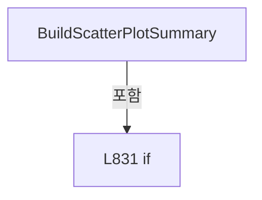

변경 전 점검: 입력/반환 타입, 위 호출자, 예외/취소 경로, 공유 상태와 저장·전송 소비자를 함께 확인합니다. 값의 단위나 물리 방향을 이름만으로 확정하지 않습니다.

### MethodDeclaration `DrawScatterGrid` · L844–870

[Drilling.UI/Menu/Menus/CMenuCorrection.ReviewData.Display.cs:844–870](https://github.com/kjuws10-rgb/A3Drilling/blob/334b3599651b2e8e0181fd4459bafaf3cddafff3/Drilling.UI/Menu/Menus/CMenuCorrection.ReviewData.Display.cs#L844-L870)

| 항목 | 실제 추출 값 |
| --- | --- |
| 서명 | void Drilling.UI.Menu.Menus.CMenuCorrection.CReviewDataPanel.DrawScatterGrid(DrawingContext, Rect, double, double, double) |
| 접근/수식자 | Private / private, static |
| 반환/값 타입 | void |
| 소속 타입 | NamedType:Drilling.UI.Menu.Menus.CMenuCorrection.CReviewDataPanel |

입력 계약:

| 이름 | 타입 | 전달 | 선택/기본값 |
| --- | --- | --- | --- |
| context | DrawingContext | None | False /  |
| plotRect | Rect | None | False /  |
| minimum | double | None | False /  |
| maximum | double | None | False /  |
| gridUnit | double | None | False /  |

현재 부분 분석에서 직접 연결된 호출자는 없습니다. XAML/이벤트/인터페이스·델리게이트·외부 진입을 추가 확인해야 하며, 미사용으로 판정한 것이 아닙니다.

호출하는 대상과 해석 범위:

| 원본 행 | 표현식 | 분석 상태 | 대상/소스 위치 |
| --- | --- | --- | --- |
| 846 | new Pen | unresolved | None |
| 846 | CStatusBrush.Frozen | resolved | SolidColorBrush Drilling.UI.Menu.Menus.CStatusBrush.Frozen(byte, byte, byte) · Drilling.UI/Menu/Menus/CMenuBase.cs:330 |
| 847 | Math.Ceiling | resolved | double System.Math.Ceiling(double) |
| 848 | Math.Floor | resolved | double System.Math.Floor(double) |
| 849 | Math.Max | resolved | int System.Math.Max(int, int) |
| 850 | Math.Max | resolved | int System.Math.Max(int, int) |
| 850 | Math.Ceiling | resolved | double System.Math.Ceiling(double) |
| 851 | CStatusBrush.Frozen | resolved | SolidColorBrush Drilling.UI.Menu.Menus.CStatusBrush.Frozen(byte, byte, byte) · Drilling.UI/Menu/Menus/CMenuBase.cs:330 |
| 858 | context.DrawLine | unresolved | None |
| 858 | new Point | unresolved | None |
| 858 | new Point | unresolved | None |
| 859 | context.DrawLine | unresolved | None |
| 859 | new Point | unresolved | None |
| 859 | new Point | unresolved | None |
| 861 | Math.Abs | resolved | double System.Math.Abs(double) |
| 863 | FormatScatterAxisValue | resolved | string Drilling.UI.Menu.Menus.CMenuCorrection.CReviewDataPanel.FormatScatterAxisValue(double, double) · Drilling.UI/Menu/Menus/CMenuCorrection.ReviewData.Display.cs:928 |
| 864 | DrawScatterText | candidate | OverloadResolutionFailure |
| 864 | new Point | unresolved | None |
| 865 | DrawScatterText | candidate | OverloadResolutionFailure |
| 865 | new Point | unresolved | None |
| 869 | context.DrawRectangle | unresolved | None |
| 869 | new Pen | unresolved | None |
| 869 | CStatusBrush.Frozen | resolved | SolidColorBrush Drilling.UI.Menu.Menus.CStatusBrush.Frozen(byte, byte, byte) · Drilling.UI/Menu/Menus/CMenuBase.cs:330 |

본문의 실제 연산·분기·예외·반환 순서(원문 위치 순):

| 원본 행 | 종류 | 주석 해설 |
| --- | --- | --- |
| 846 | call | 함수·델리게이트 또는 객체 생성자를 호출합니다: new Pen(CStatusBrush.Frozen(0x94, 0xA3, 0xB8), 0.55) |
| 846 | call | 함수·델리게이트 또는 객체 생성자를 호출합니다: CStatusBrush.Frozen(0x94, 0xA3, 0xB8) |
| 846 | local-declaration | 지역 변수를 선언합니다: var gridPen = new Pen(CStatusBrush.Frozen(0x94, 0xA3, 0xB8), 0.55); |
| 846 | variable-initializer | 변수의 초기값을 지정합니다: gridPen = new Pen(CStatusBrush.Frozen(0x94, 0xA3, 0xB8), 0.55) |
| 847 | call | 함수·델리게이트 또는 객체 생성자를 호출합니다: Math.Ceiling(minimum / gridUnit - 1e-9) |
| 847 | local-declaration | 지역 변수를 선언합니다: var firstIndex = (int)Math.Ceiling(minimum / gridUnit - 1e-9); |
| 847 | variable-initializer | 변수의 초기값을 지정합니다: firstIndex = (int)Math.Ceiling(minimum / gridUnit - 1e-9) |
| 848 | call | 함수·델리게이트 또는 객체 생성자를 호출합니다: Math.Floor(maximum / gridUnit + 1e-9) |
| 848 | local-declaration | 지역 변수를 선언합니다: var lastIndex = (int)Math.Floor(maximum / gridUnit + 1e-9); |
| 848 | variable-initializer | 변수의 초기값을 지정합니다: lastIndex = (int)Math.Floor(maximum / gridUnit + 1e-9) |
| 849 | call | 함수·델리게이트 또는 객체 생성자를 호출합니다: Math.Max(1, lastIndex - firstIndex + 1) |
| 849 | local-declaration | 지역 변수를 선언합니다: var lineCount = Math.Max(1, lastIndex - firstIndex + 1); |
| 849 | variable-initializer | 변수의 초기값을 지정합니다: lineCount = Math.Max(1, lastIndex - firstIndex + 1) |
| 850 | call | 함수·델리게이트 또는 객체 생성자를 호출합니다: Math.Max(1, (int)Math.Ceiling(lineCount / 10.0)) |
| 850 | call | 함수·델리게이트 또는 객체 생성자를 호출합니다: Math.Ceiling(lineCount / 10.0) |
| 850 | local-declaration | 지역 변수를 선언합니다: var labelStride = Math.Max(1, (int)Math.Ceiling(lineCount / 10.0)); |
| 850 | variable-initializer | 변수의 초기값을 지정합니다: labelStride = Math.Max(1, (int)Math.Ceiling(lineCount / 10.0)) |
| 851 | call | 함수·델리게이트 또는 객체 생성자를 호출합니다: CStatusBrush.Frozen(0x55, 0x70, 0x86) |
| 851 | local-declaration | 지역 변수를 선언합니다: var labelBrush = CStatusBrush.Frozen(0x55, 0x70, 0x86); |
| 851 | variable-initializer | 변수의 초기값을 지정합니다: labelBrush = CStatusBrush.Frozen(0x55, 0x70, 0x86) |
| 852 | variable-initializer | 변수의 초기값을 지정합니다: index = firstIndex |
| 852 | for | 초기화·조건·증감이 있는 반복입니다: for (var index = firstIndex; index <= lastIndex; index++) |
| 854 | local-declaration | 지역 변수를 선언합니다: var value = index * gridUnit; |
| 854 | variable-initializer | 변수의 초기값을 지정합니다: value = index * gridUnit |
| 855 | local-declaration | 지역 변수를 선언합니다: var ratio = (value - minimum) / (maximum - minimum); |
| 855 | variable-initializer | 변수의 초기값을 지정합니다: ratio = (value - minimum) / (maximum - minimum) |
| 856 | local-declaration | 지역 변수를 선언합니다: var x = plotRect.Left + plotRect.Width * ratio; |
| 856 | variable-initializer | 변수의 초기값을 지정합니다: x = plotRect.Left + plotRect.Width * ratio |
| 857 | local-declaration | 지역 변수를 선언합니다: var y = plotRect.Bottom - plotRect.Height * ratio; |
| 857 | variable-initializer | 변수의 초기값을 지정합니다: y = plotRect.Bottom - plotRect.Height * ratio |
| 858 | call | 함수·델리게이트 또는 객체 생성자를 호출합니다: context.DrawLine(gridPen, new Point(x, plotRect.Top), new Point(x, plotRect.Bottom)) |
| 858 | call | 함수·델리게이트 또는 객체 생성자를 호출합니다: new Point(x, plotRect.Top) |
| 858 | call | 함수·델리게이트 또는 객체 생성자를 호출합니다: new Point(x, plotRect.Bottom) |
| 859 | call | 함수·델리게이트 또는 객체 생성자를 호출합니다: context.DrawLine(gridPen, new Point(plotRect.Left, y), new Point(plotRect.Right, y)) |
| 859 | call | 함수·델리게이트 또는 객체 생성자를 호출합니다: new Point(plotRect.Left, y) |
| 859 | call | 함수·델리게이트 또는 객체 생성자를 호출합니다: new Point(plotRect.Right, y) |
| 861 | call | 함수·델리게이트 또는 객체 생성자를 호출합니다: Math.Abs(value) |
| 861 | if | 조건에 따라 분기합니다: if ((index - firstIndex) % labelStride == 0 &#124;&#124; Math.Abs(value) <= gridUnit * 1e-9 &#124;&#124; index == lastIndex) |
| 863 | call | 함수·델리게이트 또는 객체 생성자를 호출합니다: FormatScatterAxisValue(value, gridUnit) |
| 863 | local-declaration | 지역 변수를 선언합니다: var text = FormatScatterAxisValue(value, gridUnit); |
| 863 | variable-initializer | 변수의 초기값을 지정합니다: text = FormatScatterAxisValue(value, gridUnit) |
| 864 | call | 함수·델리게이트 또는 객체 생성자를 호출합니다: DrawScatterText(context, text, new Point(x, plotRect.Bottom + 13.0), 9.0, labelBrush, true) |
| 864 | call | 함수·델리게이트 또는 객체 생성자를 호출합니다: new Point(x, plotRect.Bottom + 13.0) |
| 865 | call | 함수·델리게이트 또는 객체 생성자를 호출합니다: DrawScatterText(context, text, new Point(plotRect.Left - 8.0, y), 9.0, labelBrush, false, true) |
| 865 | call | 함수·델리게이트 또는 객체 생성자를 호출합니다: new Point(plotRect.Left - 8.0, y) |
| 869 | call | 함수·델리게이트 또는 객체 생성자를 호출합니다: context.DrawRectangle(null, new Pen(CStatusBrush.Frozen(0x64, 0x74, 0x8B), 1.0), plotRect) |
| 869 | call | 함수·델리게이트 또는 객체 생성자를 호출합니다: new Pen(CStatusBrush.Frozen(0x64, 0x74, 0x8B), 1.0) |
| 869 | call | 함수·델리게이트 또는 객체 생성자를 호출합니다: CStatusBrush.Frozen(0x64, 0x74, 0x8B) |

제어 구문의 포함 구조(실제 실행 순서/CFG가 아닌 구문 탐색 그림):

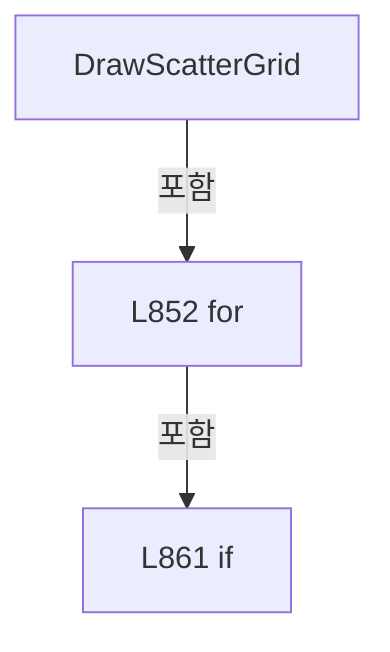

변경 전 점검: 입력/반환 타입, 위 호출자, 예외/취소 경로, 공유 상태와 저장·전송 소비자를 함께 확인합니다. 값의 단위나 물리 방향을 이름만으로 확정하지 않습니다.

### MethodDeclaration `DrawScatterAxes` · L872–887

[Drilling.UI/Menu/Menus/CMenuCorrection.ReviewData.Display.cs:872–887](https://github.com/kjuws10-rgb/A3Drilling/blob/334b3599651b2e8e0181fd4459bafaf3cddafff3/Drilling.UI/Menu/Menus/CMenuCorrection.ReviewData.Display.cs#L872-L887)

| 항목 | 실제 추출 값 |
| --- | --- |
| 서명 | void Drilling.UI.Menu.Menus.CMenuCorrection.CReviewDataPanel.DrawScatterAxes(DrawingContext, Rect, double, double) |
| 접근/수식자 | Private / private, static |
| 반환/값 타입 | void |
| 소속 타입 | NamedType:Drilling.UI.Menu.Menus.CMenuCorrection.CReviewDataPanel |

입력 계약:

| 이름 | 타입 | 전달 | 선택/기본값 |
| --- | --- | --- | --- |
| context | DrawingContext | None | False /  |
| plotRect | Rect | None | False /  |
| minimum | double | None | False /  |
| maximum | double | None | False /  |

현재 부분 분석에서 직접 연결된 호출자는 없습니다. XAML/이벤트/인터페이스·델리게이트·외부 진입을 추가 확인해야 하며, 미사용으로 판정한 것이 아닙니다.

호출하는 대상과 해석 범위:

| 원본 행 | 표현식 | 분석 상태 | 대상/소스 위치 |
| --- | --- | --- | --- |
| 874 | new Pen | unresolved | None |
| 874 | CStatusBrush.Frozen | resolved | SolidColorBrush Drilling.UI.Menu.Menus.CStatusBrush.Frozen(byte, byte, byte) · Drilling.UI/Menu/Menus/CMenuBase.cs:330 |
| 880 | context.DrawLine | unresolved | None |
| 880 | new Point | unresolved | None |
| 880 | new Point | unresolved | None |
| 881 | context.DrawLine | unresolved | None |
| 881 | new Point | unresolved | None |
| 881 | new Point | unresolved | None |
| 884 | CStatusBrush.Frozen | resolved | SolidColorBrush Drilling.UI.Menu.Menus.CStatusBrush.Frozen(byte, byte, byte) · Drilling.UI/Menu/Menus/CMenuBase.cs:330 |
| 885 | DrawScatterText | candidate | OverloadResolutionFailure |
| 885 | new Point | unresolved | None |
| 885 | ScatterPlotHeightForLabel | resolved | double Drilling.UI.Menu.Menus.CMenuCorrection.CReviewDataPanel.ScatterPlotHeightForLabel(Rect) · Drilling.UI/Menu/Menus/CMenuCorrection.ReviewData.Display.cs:889 |
| 886 | DrawScatterText | candidate | OverloadResolutionFailure |
| 886 | new Point | unresolved | None |

본문의 실제 연산·분기·예외·반환 순서(원문 위치 순):

| 원본 행 | 종류 | 주석 해설 |
| --- | --- | --- |
| 874 | call | 함수·델리게이트 또는 객체 생성자를 호출합니다: new Pen(CStatusBrush.Frozen(0x38, 0x7D, 0xA8), 1.5) |
| 874 | call | 함수·델리게이트 또는 객체 생성자를 호출합니다: CStatusBrush.Frozen(0x38, 0x7D, 0xA8) |
| 874 | local-declaration | 지역 변수를 선언합니다: var axisPen = new Pen(CStatusBrush.Frozen(0x38, 0x7D, 0xA8), 1.5); |
| 874 | variable-initializer | 변수의 초기값을 지정합니다: axisPen = new Pen(CStatusBrush.Frozen(0x38, 0x7D, 0xA8), 1.5) |
| 875 | if | 조건에 따라 분기합니다: if (minimum <= 0.0 && maximum >= 0.0) |
| 877 | local-declaration | 지역 변수를 선언합니다: var zeroRatio = (0.0 - minimum) / (maximum - minimum); |
| 877 | variable-initializer | 변수의 초기값을 지정합니다: zeroRatio = (0.0 - minimum) / (maximum - minimum) |
| 878 | local-declaration | 지역 변수를 선언합니다: var zeroX = plotRect.Left + plotRect.Width * zeroRatio; |
| 878 | variable-initializer | 변수의 초기값을 지정합니다: zeroX = plotRect.Left + plotRect.Width * zeroRatio |
| 879 | local-declaration | 지역 변수를 선언합니다: var zeroY = plotRect.Bottom - plotRect.Height * zeroRatio; |
| 879 | variable-initializer | 변수의 초기값을 지정합니다: zeroY = plotRect.Bottom - plotRect.Height * zeroRatio |
| 880 | call | 함수·델리게이트 또는 객체 생성자를 호출합니다: context.DrawLine(axisPen, new Point(zeroX, plotRect.Top), new Point(zeroX, plotRect.Bottom)) |
| 880 | call | 함수·델리게이트 또는 객체 생성자를 호출합니다: new Point(zeroX, plotRect.Top) |
| 880 | call | 함수·델리게이트 또는 객체 생성자를 호출합니다: new Point(zeroX, plotRect.Bottom) |
| 881 | call | 함수·델리게이트 또는 객체 생성자를 호출합니다: context.DrawLine(axisPen, new Point(plotRect.Left, zeroY), new Point(plotRect.Right, zeroY)) |
| 881 | call | 함수·델리게이트 또는 객체 생성자를 호출합니다: new Point(plotRect.Left, zeroY) |
| 881 | call | 함수·델리게이트 또는 객체 생성자를 호출합니다: new Point(plotRect.Right, zeroY) |
| 884 | call | 함수·델리게이트 또는 객체 생성자를 호출합니다: CStatusBrush.Frozen(0x55, 0x70, 0x86) |
| 884 | local-declaration | 지역 변수를 선언합니다: var labelBrush = CStatusBrush.Frozen(0x55, 0x70, 0x86); |
| 884 | variable-initializer | 변수의 초기값을 지정합니다: labelBrush = CStatusBrush.Frozen(0x55, 0x70, 0x86) |
| 885 | call | 함수·델리게이트 또는 객체 생성자를 호출합니다: DrawScatterText(context, "RESULT X (mm)", new Point(plotRect.Right, ScatterPlotHeightForLabel(plotRect)), 9.5, labelBrush, false, true) |
| 885 | call | 함수·델리게이트 또는 객체 생성자를 호출합니다: new Point(plotRect.Right, ScatterPlotHeightForLabel(plotRect)) |
| 885 | call | 함수·델리게이트 또는 객체 생성자를 호출합니다: ScatterPlotHeightForLabel(plotRect) |
| 886 | call | 함수·델리게이트 또는 객체 생성자를 호출합니다: DrawScatterText(context, "RESULT Y (mm)", new Point(plotRect.Left, 1.0), 9.5, labelBrush) |
| 886 | call | 함수·델리게이트 또는 객체 생성자를 호출합니다: new Point(plotRect.Left, 1.0) |

제어 구문의 포함 구조(실제 실행 순서/CFG가 아닌 구문 탐색 그림):

```mermaid
flowchart TD
 M["DrawScatterAxes"]
 N0["L875 if"]
 M -->|포함| N0
```

변경 전 점검: 입력/반환 타입, 위 호출자, 예외/취소 경로, 공유 상태와 저장·전송 소비자를 함께 확인합니다. 값의 단위나 물리 방향을 이름만으로 확정하지 않습니다.

### MethodDeclaration `ScatterPlotHeightForLabel` · L889–892

[Drilling.UI/Menu/Menus/CMenuCorrection.ReviewData.Display.cs:889–892](https://github.com/kjuws10-rgb/A3Drilling/blob/334b3599651b2e8e0181fd4459bafaf3cddafff3/Drilling.UI/Menu/Menus/CMenuCorrection.ReviewData.Display.cs#L889-L892)

| 항목 | 실제 추출 값 |
| --- | --- |
| 서명 | double Drilling.UI.Menu.Menus.CMenuCorrection.CReviewDataPanel.ScatterPlotHeightForLabel(Rect) |
| 접근/수식자 | Private / private, static |
| 반환/값 타입 | double |
| 소속 타입 | NamedType:Drilling.UI.Menu.Menus.CMenuCorrection.CReviewDataPanel |

입력 계약:

| 이름 | 타입 | 전달 | 선택/기본값 |
| --- | --- | --- | --- |
| plotRect | Rect | None | False /  |

정적 호출자로 확인된 위치:

| 호출 파일/행 | 호출 표현식 | 런타임 분기 가능 |
| --- | --- | --- |
| [Drilling.UI/Menu/Menus/CMenuCorrection.ReviewData.Display.cs:885–885](https://github.com/kjuws10-rgb/A3Drilling/blob/334b3599651b2e8e0181fd4459bafaf3cddafff3/Drilling.UI/Menu/Menus/CMenuCorrection.ReviewData.Display.cs#L885-L885) | ScatterPlotHeightForLabel | False |

본문의 실제 연산·분기·예외·반환 순서(원문 위치 순):

| 원본 행 | 종류 | 주석 해설 |
| --- | --- | --- |
| 891 | return | 호출자에게 값 또는 제어를 반환합니다: return plotRect.Bottom + 27.0; |

변경 전 점검: 입력/반환 타입, 위 호출자, 예외/취소 경로, 공유 상태와 저장·전송 소비자를 함께 확인합니다. 값의 단위나 물리 방향을 이름만으로 확정하지 않습니다.

### MethodDeclaration `DrawScatterText` · L894–914

[Drilling.UI/Menu/Menus/CMenuCorrection.ReviewData.Display.cs:894–914](https://github.com/kjuws10-rgb/A3Drilling/blob/334b3599651b2e8e0181fd4459bafaf3cddafff3/Drilling.UI/Menu/Menus/CMenuCorrection.ReviewData.Display.cs#L894-L914)

| 항목 | 실제 추출 값 |
| --- | --- |
| 서명 | void Drilling.UI.Menu.Menus.CMenuCorrection.CReviewDataPanel.DrawScatterText(DrawingContext, string, Point, double, Brush, bool, bool) |
| 접근/수식자 | Private / private, static |
| 반환/값 타입 | void |
| 소속 타입 | NamedType:Drilling.UI.Menu.Menus.CMenuCorrection.CReviewDataPanel |

입력 계약:

| 이름 | 타입 | 전달 | 선택/기본값 |
| --- | --- | --- | --- |
| context | DrawingContext | None | False /  |
| text | string | None | False /  |
| anchor | Point | None | False /  |
| fontSize | double | None | False /  |
| brush | Brush | None | False /  |
| center | bool | None | True / false |
| right | bool | None | True / false |

현재 부분 분석에서 직접 연결된 호출자는 없습니다. XAML/이벤트/인터페이스·델리게이트·외부 진입을 추가 확인해야 하며, 미사용으로 판정한 것이 아닙니다.

호출하는 대상과 해석 범위:

| 원본 행 | 표현식 | 분석 상태 | 대상/소스 위치 |
| --- | --- | --- | --- |
| 903 | new FormattedText | unresolved | None |
| 907 | new Typeface | unresolved | None |
| 913 | context.DrawText | unresolved | None |
| 913 | new Point | unresolved | None |

본문의 실제 연산·분기·예외·반환 순서(원문 위치 순):

| 원본 행 | 종류 | 주석 해설 |
| --- | --- | --- |
| 903 | call | 함수·델리게이트 또는 객체 생성자를 호출합니다: new FormattedText( text, CultureInfo.InvariantCulture, FlowDirection.LeftToRight, new Typeface("Segoe UI"), fontSize, brush, 1.0) |
| 903 | local-declaration | 지역 변수를 선언합니다: var formatted = new FormattedText( text, CultureInfo.InvariantCulture, FlowDirection.LeftToRight, new Typeface("Segoe UI"), fontSize, brush, 1.0); |
| 903 | variable-initializer | 변수의 초기값을 지정합니다: formatted = new FormattedText( text, CultureInfo.InvariantCulture, FlowDirection.LeftToRight, new Typeface("Segoe UI"), fontSize, brush, 1.0) |
| 907 | call | 함수·델리게이트 또는 객체 생성자를 호출합니다: new Typeface("Segoe UI") |
| 911 | conditional-expression | 조건에 따라 결과식을 선택합니다: center ? anchor.X - formatted.Width / 2.0 : right ? anchor.X - formatted.Width : anchor.X |
| 911 | conditional-expression | 조건에 따라 결과식을 선택합니다: right ? anchor.X - formatted.Width : anchor.X |
| 911 | local-declaration | 지역 변수를 선언합니다: var x = center ? anchor.X - formatted.Width / 2.0 : right ? anchor.X - formatted.Width : anchor.X; |
| 911 | variable-initializer | 변수의 초기값을 지정합니다: x = center ? anchor.X - formatted.Width / 2.0 : right ? anchor.X - formatted.Width : anchor.X |
| 912 | conditional-expression | 조건에 따라 결과식을 선택합니다: center ? anchor.Y - formatted.Height / 2.0 : anchor.Y - formatted.Height / 2.0 |
| 912 | local-declaration | 지역 변수를 선언합니다: var y = center ? anchor.Y - formatted.Height / 2.0 : anchor.Y - formatted.Height / 2.0; |
| 912 | variable-initializer | 변수의 초기값을 지정합니다: y = center ? anchor.Y - formatted.Height / 2.0 : anchor.Y - formatted.Height / 2.0 |
| 913 | call | 함수·델리게이트 또는 객체 생성자를 호출합니다: context.DrawText(formatted, new Point(x, y)) |
| 913 | call | 함수·델리게이트 또는 객체 생성자를 호출합니다: new Point(x, y) |

변경 전 점검: 입력/반환 타입, 위 호출자, 예외/취소 경로, 공유 상태와 저장·전송 소비자를 함께 확인합니다. 값의 단위나 물리 방향을 이름만으로 확정하지 않습니다.

### MethodDeclaration `ScatterPoint` · L916–921

[Drilling.UI/Menu/Menus/CMenuCorrection.ReviewData.Display.cs:916–921](https://github.com/kjuws10-rgb/A3Drilling/blob/334b3599651b2e8e0181fd4459bafaf3cddafff3/Drilling.UI/Menu/Menus/CMenuCorrection.ReviewData.Display.cs#L916-L921)

| 항목 | 실제 추출 값 |
| --- | --- |
| 서명 | Point Drilling.UI.Menu.Menus.CMenuCorrection.CReviewDataPanel.ScatterPoint(double, double, Rect, double, double) |
| 접근/수식자 | Private / private, static |
| 반환/값 타입 | Point |
| 소속 타입 | NamedType:Drilling.UI.Menu.Menus.CMenuCorrection.CReviewDataPanel |

입력 계약:

| 이름 | 타입 | 전달 | 선택/기본값 |
| --- | --- | --- | --- |
| x | double | None | False /  |
| y | double | None | False /  |
| plotRect | Rect | None | False /  |
| minimum | double | None | False /  |
| maximum | double | None | False /  |

정적 호출자로 확인된 위치:

| 호출 파일/행 | 호출 표현식 | 런타임 분기 가능 |
| --- | --- | --- |
| [Drilling.UI/Menu/Menus/CMenuCorrection.ReviewData.Display.cs:796–796](https://github.com/kjuws10-rgb/A3Drilling/blob/334b3599651b2e8e0181fd4459bafaf3cddafff3/Drilling.UI/Menu/Menus/CMenuCorrection.ReviewData.Display.cs#L796-L796) | ScatterPoint | False |
| [Drilling.UI/Menu/Menus/CMenuCorrection.ReviewData.Display.cs:812–812](https://github.com/kjuws10-rgb/A3Drilling/blob/334b3599651b2e8e0181fd4459bafaf3cddafff3/Drilling.UI/Menu/Menus/CMenuCorrection.ReviewData.Display.cs#L812-L812) | ScatterPoint | False |

호출하는 대상과 해석 범위:

| 원본 행 | 표현식 | 분석 상태 | 대상/소스 위치 |
| --- | --- | --- | --- |
| 918 | new Point | unresolved | None |

본문의 실제 연산·분기·예외·반환 순서(원문 위치 순):

| 원본 행 | 종류 | 주석 해설 |
| --- | --- | --- |
| 918 | call | 함수·델리게이트 또는 객체 생성자를 호출합니다: new Point( plotRect.Left + (x - minimum) / (maximum - minimum) * plotRect.Width, plotRect.Top + (maximum - y) / (maximum - minimum) * plotRect.Height) |
| 918 | return | 호출자에게 값 또는 제어를 반환합니다: return new Point( plotRect.Left + (x - minimum) / (maximum - minimum) * plotRect.Width, plotRect.Top + (maximum - y) / (maximum - minimum) * plotRect.Height); |

변경 전 점검: 입력/반환 타입, 위 호출자, 예외/취소 경로, 공유 상태와 저장·전송 소비자를 함께 확인합니다. 값의 단위나 물리 방향을 이름만으로 확정하지 않습니다.

### MethodDeclaration `IsInsideScatterRange` · L923–926

[Drilling.UI/Menu/Menus/CMenuCorrection.ReviewData.Display.cs:923–926](https://github.com/kjuws10-rgb/A3Drilling/blob/334b3599651b2e8e0181fd4459bafaf3cddafff3/Drilling.UI/Menu/Menus/CMenuCorrection.ReviewData.Display.cs#L923-L926)

| 항목 | 실제 추출 값 |
| --- | --- |
| 서명 | bool Drilling.UI.Menu.Menus.CMenuCorrection.CReviewDataPanel.IsInsideScatterRange(double, double, double, double) |
| 접근/수식자 | Private / private, static |
| 반환/값 타입 | bool |
| 소속 타입 | NamedType:Drilling.UI.Menu.Menus.CMenuCorrection.CReviewDataPanel |

입력 계약:

| 이름 | 타입 | 전달 | 선택/기본값 |
| --- | --- | --- | --- |
| x | double | None | False /  |
| y | double | None | False /  |
| minimum | double | None | False /  |
| maximum | double | None | False /  |

정적 호출자로 확인된 위치:

| 호출 파일/행 | 호출 표현식 | 런타임 분기 가능 |
| --- | --- | --- |
| [Drilling.UI/Menu/Menus/CMenuCorrection.ReviewData.Display.cs:791–791](https://github.com/kjuws10-rgb/A3Drilling/blob/334b3599651b2e8e0181fd4459bafaf3cddafff3/Drilling.UI/Menu/Menus/CMenuCorrection.ReviewData.Display.cs#L791-L791) | IsInsideScatterRange | False |
| [Drilling.UI/Menu/Menus/CMenuCorrection.ReviewData.Display.cs:810–810](https://github.com/kjuws10-rgb/A3Drilling/blob/334b3599651b2e8e0181fd4459bafaf3cddafff3/Drilling.UI/Menu/Menus/CMenuCorrection.ReviewData.Display.cs#L810-L810) | IsInsideScatterRange | False |

본문의 실제 연산·분기·예외·반환 순서(원문 위치 순):

| 원본 행 | 종류 | 주석 해설 |
| --- | --- | --- |
| 925 | return | 호출자에게 값 또는 제어를 반환합니다: return x >= minimum && x <= maximum && y >= minimum && y <= maximum; |

변경 전 점검: 입력/반환 타입, 위 호출자, 예외/취소 경로, 공유 상태와 저장·전송 소비자를 함께 확인합니다. 값의 단위나 물리 방향을 이름만으로 확정하지 않습니다.

### MethodDeclaration `FormatScatterAxisValue` · L928–932

[Drilling.UI/Menu/Menus/CMenuCorrection.ReviewData.Display.cs:928–932](https://github.com/kjuws10-rgb/A3Drilling/blob/334b3599651b2e8e0181fd4459bafaf3cddafff3/Drilling.UI/Menu/Menus/CMenuCorrection.ReviewData.Display.cs#L928-L932)

| 항목 | 실제 추출 값 |
| --- | --- |
| 서명 | string Drilling.UI.Menu.Menus.CMenuCorrection.CReviewDataPanel.FormatScatterAxisValue(double, double) |
| 접근/수식자 | Private / private, static |
| 반환/값 타입 | string |
| 소속 타입 | NamedType:Drilling.UI.Menu.Menus.CMenuCorrection.CReviewDataPanel |

입력 계약:

| 이름 | 타입 | 전달 | 선택/기본값 |
| --- | --- | --- | --- |
| value | double | None | False /  |
| gridUnit | double | None | False /  |

정적 호출자로 확인된 위치:

| 호출 파일/행 | 호출 표현식 | 런타임 분기 가능 |
| --- | --- | --- |
| [Drilling.UI/Menu/Menus/CMenuCorrection.ReviewData.Display.cs:863–863](https://github.com/kjuws10-rgb/A3Drilling/blob/334b3599651b2e8e0181fd4459bafaf3cddafff3/Drilling.UI/Menu/Menus/CMenuCorrection.ReviewData.Display.cs#L863-L863) | FormatScatterAxisValue | False |

호출하는 대상과 해석 범위:

| 원본 행 | 표현식 | 분석 상태 | 대상/소스 위치 |
| --- | --- | --- | --- |
| 931 | value.ToString | resolved | string double.ToString(string?, System.IFormatProvider?) |

본문의 실제 연산·분기·예외·반환 순서(원문 위치 순):

| 원본 행 | 종류 | 주석 해설 |
| --- | --- | --- |
| 930 | conditional-expression | 조건에 따라 결과식을 선택합니다: gridUnit >= 1.0 ? "0.##" : gridUnit >= 0.1 ? "0.0#" : "0.###" |
| 930 | conditional-expression | 조건에 따라 결과식을 선택합니다: gridUnit >= 0.1 ? "0.0#" : "0.###" |
| 930 | local-declaration | 지역 변수를 선언합니다: var format = gridUnit >= 1.0 ? "0.##" : gridUnit >= 0.1 ? "0.0#" : "0.###"; |
| 930 | variable-initializer | 변수의 초기값을 지정합니다: format = gridUnit >= 1.0 ? "0.##" : gridUnit >= 0.1 ? "0.0#" : "0.###" |
| 931 | call | 함수·델리게이트 또는 객체 생성자를 호출합니다: value.ToString(format, CultureInfo.InvariantCulture) |
| 931 | return | 호출자에게 값 또는 제어를 반환합니다: return value.ToString(format, CultureInfo.InvariantCulture); |

변경 전 점검: 입력/반환 타입, 위 호출자, 예외/취소 경로, 공유 상태와 저장·전송 소비자를 함께 확인합니다. 값의 단위나 물리 방향을 이름만으로 확정하지 않습니다.

### MethodDeclaration `CreateReviewLevelBrush` · L934–946

[Drilling.UI/Menu/Menus/CMenuCorrection.ReviewData.Display.cs:934–946](https://github.com/kjuws10-rgb/A3Drilling/blob/334b3599651b2e8e0181fd4459bafaf3cddafff3/Drilling.UI/Menu/Menus/CMenuCorrection.ReviewData.Display.cs#L934-L946)

| 항목 | 실제 추출 값 |
| --- | --- |
| 서명 | Brush Drilling.UI.Menu.Menus.CMenuCorrection.CReviewDataPanel.CreateReviewLevelBrush(string, byte?) |
| 접근/수식자 | Private / private, static |
| 반환/값 타입 | Brush |
| 소속 타입 | NamedType:Drilling.UI.Menu.Menus.CMenuCorrection.CReviewDataPanel |

입력 계약:

| 이름 | 타입 | 전달 | 선택/기본값 |
| --- | --- | --- | --- |
| colorHex | string | None | False /  |
| alpha | byte? | None | True / null |

정적 호출자로 확인된 위치:

| 호출 파일/행 | 호출 표현식 | 런타임 분기 가능 |
| --- | --- | --- |
| [Drilling.UI/Menu/Menus/CMenuCorrection.ReviewData.Display.cs:28–28](https://github.com/kjuws10-rgb/A3Drilling/blob/334b3599651b2e8e0181fd4459bafaf3cddafff3/Drilling.UI/Menu/Menus/CMenuCorrection.ReviewData.Display.cs#L28-L28) | CreateReviewLevelBrush | False |
| [Drilling.UI/Menu/Menus/CMenuCorrection.ReviewData.Display.cs:29–29](https://github.com/kjuws10-rgb/A3Drilling/blob/334b3599651b2e8e0181fd4459bafaf3cddafff3/Drilling.UI/Menu/Menus/CMenuCorrection.ReviewData.Display.cs#L29-L29) | CreateReviewLevelBrush | False |
| [Drilling.UI/Menu/Menus/CMenuCorrection.ReviewData.Display.cs:30–30](https://github.com/kjuws10-rgb/A3Drilling/blob/334b3599651b2e8e0181fd4459bafaf3cddafff3/Drilling.UI/Menu/Menus/CMenuCorrection.ReviewData.Display.cs#L30-L30) | CreateReviewLevelBrush | False |
| [Drilling.UI/Menu/Menus/CMenuCorrection.ReviewData.Display.cs:31–31](https://github.com/kjuws10-rgb/A3Drilling/blob/334b3599651b2e8e0181fd4459bafaf3cddafff3/Drilling.UI/Menu/Menus/CMenuCorrection.ReviewData.Display.cs#L31-L31) | CreateReviewLevelBrush | False |
| [Drilling.UI/Menu/Menus/CMenuCorrection.ReviewData.Display.cs:300–300](https://github.com/kjuws10-rgb/A3Drilling/blob/334b3599651b2e8e0181fd4459bafaf3cddafff3/Drilling.UI/Menu/Menus/CMenuCorrection.ReviewData.Display.cs#L300-L300) | CreateReviewLevelBrush | False |
| [Drilling.UI/Menu/Menus/CMenuCorrection.ReviewData.Display.cs:510–510](https://github.com/kjuws10-rgb/A3Drilling/blob/334b3599651b2e8e0181fd4459bafaf3cddafff3/Drilling.UI/Menu/Menus/CMenuCorrection.ReviewData.Display.cs#L510-L510) | CreateReviewLevelBrush | False |
| [Drilling.UI/Menu/Menus/CMenuCorrection.ReviewData.Display.cs:511–511](https://github.com/kjuws10-rgb/A3Drilling/blob/334b3599651b2e8e0181fd4459bafaf3cddafff3/Drilling.UI/Menu/Menus/CMenuCorrection.ReviewData.Display.cs#L511-L511) | CreateReviewLevelBrush | False |
| [Drilling.UI/Menu/Menus/CMenuCorrection.ReviewData.Display.cs:512–512](https://github.com/kjuws10-rgb/A3Drilling/blob/334b3599651b2e8e0181fd4459bafaf3cddafff3/Drilling.UI/Menu/Menus/CMenuCorrection.ReviewData.Display.cs#L512-L512) | CreateReviewLevelBrush | False |
| [Drilling.UI/Menu/Menus/CMenuCorrection.ReviewData.Display.cs:513–513](https://github.com/kjuws10-rgb/A3Drilling/blob/334b3599651b2e8e0181fd4459bafaf3cddafff3/Drilling.UI/Menu/Menus/CMenuCorrection.ReviewData.Display.cs#L513-L513) | CreateReviewLevelBrush | False |
| [Drilling.UI/Menu/Menus/CMenuCorrection.ReviewData.Display.cs:1086–1086](https://github.com/kjuws10-rgb/A3Drilling/blob/334b3599651b2e8e0181fd4459bafaf3cddafff3/Drilling.UI/Menu/Menus/CMenuCorrection.ReviewData.Display.cs#L1086-L1086) | CreateReviewLevelBrush | False |
| [Drilling.UI/Menu/Menus/CMenuCorrection.ReviewData.Display.cs:1087–1087](https://github.com/kjuws10-rgb/A3Drilling/blob/334b3599651b2e8e0181fd4459bafaf3cddafff3/Drilling.UI/Menu/Menus/CMenuCorrection.ReviewData.Display.cs#L1087-L1087) | CreateReviewLevelBrush | False |
| [Drilling.UI/Menu/Menus/CMenuCorrection.ReviewData.Display.cs:1089–1089](https://github.com/kjuws10-rgb/A3Drilling/blob/334b3599651b2e8e0181fd4459bafaf3cddafff3/Drilling.UI/Menu/Menus/CMenuCorrection.ReviewData.Display.cs#L1089-L1089) | CreateReviewLevelBrush | False |
| [Drilling.UI/Menu/Menus/CMenuCorrection.ReviewData.Display.cs:1090–1090](https://github.com/kjuws10-rgb/A3Drilling/blob/334b3599651b2e8e0181fd4459bafaf3cddafff3/Drilling.UI/Menu/Menus/CMenuCorrection.ReviewData.Display.cs#L1090-L1090) | CreateReviewLevelBrush | False |
| [Drilling.UI/Menu/Menus/CMenuCorrection.ReviewData.Display.cs:1191–1191](https://github.com/kjuws10-rgb/A3Drilling/blob/334b3599651b2e8e0181fd4459bafaf3cddafff3/Drilling.UI/Menu/Menus/CMenuCorrection.ReviewData.Display.cs#L1191-L1191) | CreateReviewLevelBrush | False |
| [Drilling.UI/Menu/Menus/CMenuCorrection.ReviewData.Display.cs:1326–1326](https://github.com/kjuws10-rgb/A3Drilling/blob/334b3599651b2e8e0181fd4459bafaf3cddafff3/Drilling.UI/Menu/Menus/CMenuCorrection.ReviewData.Display.cs#L1326-L1326) | CreateReviewLevelBrush | False |
| [Drilling.UI/Menu/Menus/CMenuCorrection.ReviewData.Display.cs:1327–1327](https://github.com/kjuws10-rgb/A3Drilling/blob/334b3599651b2e8e0181fd4459bafaf3cddafff3/Drilling.UI/Menu/Menus/CMenuCorrection.ReviewData.Display.cs#L1327-L1327) | CreateReviewLevelBrush | False |
| [Drilling.UI/Menu/Menus/CMenuCorrection.ReviewData.Display.cs:1328–1328](https://github.com/kjuws10-rgb/A3Drilling/blob/334b3599651b2e8e0181fd4459bafaf3cddafff3/Drilling.UI/Menu/Menus/CMenuCorrection.ReviewData.Display.cs#L1328-L1328) | CreateReviewLevelBrush | False |
| [Drilling.UI/Menu/Menus/CMenuCorrection.ReviewData.Display.cs:1329–1329](https://github.com/kjuws10-rgb/A3Drilling/blob/334b3599651b2e8e0181fd4459bafaf3cddafff3/Drilling.UI/Menu/Menus/CMenuCorrection.ReviewData.Display.cs#L1329-L1329) | CreateReviewLevelBrush | False |

호출하는 대상과 해석 범위:

| 원본 행 | 표현식 | 분석 상태 | 대상/소스 위치 |
| --- | --- | --- | --- |
| 936 | CReviewResultLevelSettings.NormalizeColor | resolved | string Drilling.Common.Review.CReviewResultLevelSettings.NormalizeColor(string) · Drilling.Common/Review/CReviewResultLevelSettings.cs:136 |
| 937 | ColorConverter.ConvertFromString | unresolved | None |
| 940 | Color.FromArgb | unresolved | None |
| 943 | new SolidColorBrush | unresolved | None |
| 944 | brush.Freeze | unresolved | None |

본문의 실제 연산·분기·예외·반환 순서(원문 위치 순):

| 원본 행 | 종류 | 주석 해설 |
| --- | --- | --- |
| 936 | call | 함수·델리게이트 또는 객체 생성자를 호출합니다: CReviewResultLevelSettings.NormalizeColor(colorHex) |
| 936 | local-declaration | 지역 변수를 선언합니다: var normalized = CReviewResultLevelSettings.NormalizeColor(colorHex); |
| 936 | variable-initializer | 변수의 초기값을 지정합니다: normalized = CReviewResultLevelSettings.NormalizeColor(colorHex) |
| 937 | call | 함수·델리게이트 또는 객체 생성자를 호출합니다: ColorConverter.ConvertFromString(normalized) |
| 937 | local-declaration | 지역 변수를 선언합니다: var color = (Color)ColorConverter.ConvertFromString(normalized); |
| 937 | variable-initializer | 변수의 초기값을 지정합니다: color = (Color)ColorConverter.ConvertFromString(normalized) |
| 938 | if | 조건에 따라 분기합니다: if (alpha.HasValue) |
| 940 | assignment | 값을 대상에 대입합니다: color = Color.FromArgb(alpha.Value, color.R, color.G, color.B) |
| 940 | call | 함수·델리게이트 또는 객체 생성자를 호출합니다: Color.FromArgb(alpha.Value, color.R, color.G, color.B) |
| 943 | call | 함수·델리게이트 또는 객체 생성자를 호출합니다: new SolidColorBrush(color) |
| 943 | local-declaration | 지역 변수를 선언합니다: var brush = new SolidColorBrush(color); |
| 943 | variable-initializer | 변수의 초기값을 지정합니다: brush = new SolidColorBrush(color) |
| 944 | call | 함수·델리게이트 또는 객체 생성자를 호출합니다: brush.Freeze() |
| 945 | return | 호출자에게 값 또는 제어를 반환합니다: return brush; |

제어 구문의 포함 구조(실제 실행 순서/CFG가 아닌 구문 탐색 그림):

```mermaid
flowchart TD
 M["CreateReviewLevelBrush"]
 N0["L938 if"]
 M -->|포함| N0
```

변경 전 점검: 입력/반환 타입, 위 호출자, 예외/취소 경로, 공유 상태와 저장·전송 소비자를 함께 확인합니다. 값의 단위나 물리 방향을 이름만으로 확정하지 않습니다.

### MethodDeclaration `RefreshCellSelectionOverlay` · L948–956

[Drilling.UI/Menu/Menus/CMenuCorrection.ReviewData.Display.cs:948–956](https://github.com/kjuws10-rgb/A3Drilling/blob/334b3599651b2e8e0181fd4459bafaf3cddafff3/Drilling.UI/Menu/Menus/CMenuCorrection.ReviewData.Display.cs#L948-L956)

| 항목 | 실제 추출 값 |
| --- | --- |
| 서명 | void Drilling.UI.Menu.Menus.CMenuCorrection.CReviewDataPanel.RefreshCellSelectionOverlay() |
| 접근/수식자 | Private / private |
| 반환/값 타입 | void |
| 소속 타입 | NamedType:Drilling.UI.Menu.Menus.CMenuCorrection.CReviewDataPanel |

정적 호출자로 확인된 위치:

| 호출 파일/행 | 호출 표현식 | 런타임 분기 가능 |
| --- | --- | --- |
| [Drilling.UI/Menu/Menus/CMenuCorrection.ReviewData.Display.cs:570–570](https://github.com/kjuws10-rgb/A3Drilling/blob/334b3599651b2e8e0181fd4459bafaf3cddafff3/Drilling.UI/Menu/Menus/CMenuCorrection.ReviewData.Display.cs#L570-L570) | RefreshCellSelectionOverlay | False |

호출하는 대상과 해석 범위:

| 원본 행 | 표현식 | 분석 상태 | 대상/소스 위치 |
| --- | --- | --- | --- |
| 950 | CellLabels .Select(label => label with { IsSelected = label.IsIncluded && label.CellNo == _selectedCellNo }) .ToArray | resolved | Drilling.UI.Menu.Menus.CMenuCorrection.ST_REVIEW_DATA_CELL_LABEL[] System.Collections.Generic.IEnumerable<Drilling.UI.Menu.Menus.CMenuCorrection.ST_REVIEW_DATA_CELL_LABEL>.ToArray<Drilling.UI.Menu.Menus.CMenuCorrection.ST_REVIEW_DATA_CELL_LABEL>() |
| 950 | CellLabels .Select | resolved | System.Collections.Generic.IEnumerable<Drilling.UI.Menu.Menus.CMenuCorrection.ST_REVIEW_DATA_CELL_LABEL> System.Collections.Generic.IEnumerable<Drilling.UI.Menu.Menus.CMenuCorrection.ST_REVIEW_DATA_CELL_LABEL>.Select<Drilling.UI.Menu.Menus.CMenuCorrection.ST_REVIEW_DATA_CELL_LABEL, Drilling.UI.Menu.Menus.CMenuCorrection.ST_REVIEW_DATA_CELL_LABEL>(System.Func<Drilling.UI.Menu.Menus.CMenuCorrection.ST_REVIEW_DATA_CELL_LABEL, Drilling.UI.Menu.Menus.CMenuCorrection.ST_REVIEW_DATA_CELL_LABEL>) |

본문의 실제 연산·분기·예외·반환 순서(원문 위치 순):

| 원본 행 | 종류 | 주석 해설 |
| --- | --- | --- |
| 950 | call | 함수·델리게이트 또는 객체 생성자를 호출합니다: CellLabels .Select(label => label with { IsSelected = label.IsIncluded && label.CellNo == _selectedCellNo }) |
| 950 | assignment | 값을 대상에 대입합니다: CellLabels = CellLabels .Select(label => label with { IsSelected = label.IsIncluded && label.CellNo == _selectedCellNo }) .ToArray() |
| 950 | call | 함수·델리게이트 또는 객체 생성자를 호출합니다: CellLabels .Select(label => label with { IsSelected = label.IsIncluded && label.CellNo == _selectedCellNo }) .ToArray() |
| 953 | assignment | 값을 대상에 대입합니다: IsSelected = label.IsIncluded && label.CellNo == _selectedCellNo |

변경 전 점검: 입력/반환 타입, 위 호출자, 예외/취소 경로, 공유 상태와 저장·전송 소비자를 함께 확인합니다. 값의 단위나 물리 방향을 이름만으로 확정하지 않습니다.

### MethodDeclaration `QueueShotMapRender` · L958–993

[Drilling.UI/Menu/Menus/CMenuCorrection.ReviewData.Display.cs:958–993](https://github.com/kjuws10-rgb/A3Drilling/blob/334b3599651b2e8e0181fd4459bafaf3cddafff3/Drilling.UI/Menu/Menus/CMenuCorrection.ReviewData.Display.cs#L958-L993)

| 항목 | 실제 추출 값 |
| --- | --- |
| 서명 | void Drilling.UI.Menu.Menus.CMenuCorrection.CReviewDataPanel.QueueShotMapRender(int, string) |
| 접근/수식자 | Private / private, async |
| 반환/값 타입 | void |
| 소속 타입 | NamedType:Drilling.UI.Menu.Menus.CMenuCorrection.CReviewDataPanel |

입력 계약:

| 이름 | 타입 | 전달 | 선택/기본값 |
| --- | --- | --- | --- |
| cellNo | int | None | False /  |
| selectedShotKey | string | None | False /  |

정적 호출자로 확인된 위치:

| 호출 파일/행 | 호출 표현식 | 런타임 분기 가능 |
| --- | --- | --- |
| [Drilling.UI/Menu/Menus/CMenuCorrection.ReviewData.Display.cs:579–579](https://github.com/kjuws10-rgb/A3Drilling/blob/334b3599651b2e8e0181fd4459bafaf3cddafff3/Drilling.UI/Menu/Menus/CMenuCorrection.ReviewData.Display.cs#L579-L579) | QueueShotMapRender | False |
| [Drilling.UI/Menu/Menus/CMenuCorrection.ReviewData.Display.cs:631–631](https://github.com/kjuws10-rgb/A3Drilling/blob/334b3599651b2e8e0181fd4459bafaf3cddafff3/Drilling.UI/Menu/Menus/CMenuCorrection.ReviewData.Display.cs#L631-L631) | QueueShotMapRender | False |
| [Drilling.UI/Menu/Menus/CMenuCorrection.ReviewData.Edit.cs:227–227](https://github.com/kjuws10-rgb/A3Drilling/blob/334b3599651b2e8e0181fd4459bafaf3cddafff3/Drilling.UI/Menu/Menus/CMenuCorrection.ReviewData.Edit.cs#L227-L227) | QueueShotMapRender | False |

호출하는 대상과 해석 범위:

| 원본 행 | 표현식 | 분석 상태 | 대상/소스 위치 |
| --- | --- | --- | --- |
| 960 | Interlocked.Increment | resolved | int System.Threading.Interlocked.Increment(ref int) |
| 961 | _shotsByCell.GetValueOrDefault | resolved | System.Collections.Generic.IReadOnlyList<Drilling.UI.Menu.Menus.CMenuCorrection.ST_REVIEW_DATA_SHOT_POSITION> System.Collections.Generic.IReadOnlyDictionary<int, System.Collections.Generic.IReadOnlyList<Drilling.UI.Menu.Menus.CMenuCorrection.ST_REVIEW_DATA_SHOT_POSITION>>.GetValueOrDefault<int, System.Collections.Generic.IReadOnlyList<Drilling.UI.Menu.Menus.CMenuCorrection.ST_REVIEW_DATA_SHOT_POSITION>>(int, System.Collections.Generic.IReadOnlyList<Drilling.UI.Menu.Menus.CMenuCorrection.ST_REVIEW_DATA_SHOT_POSITION>) |
| 962 | GetResultEditSelectedShotKeys | resolved | System.Collections.Generic.IReadOnlySet<string> Drilling.UI.Menu.Menus.CMenuCorrection.CReviewDataPanel.GetResultEditSelectedShotKeys(int) · Drilling.UI/Menu/Menus/CMenuCorrection.ReviewData.Edit.cs:557 |
| 965 | Task.Run | resolved | System.Threading.Tasks.Task<(Size Size, ImageSource? Image)> System.Threading.Tasks.Task.Run<(Size Size, ImageSource? Image)>(System.Func<(Size Size, ImageSource? Image)>) |
| 967 | GetReviewDataShotMapSize | resolved | Size Drilling.UI.Menu.Menus.CMenuCorrection.CReviewDataPanel.GetReviewDataShotMapSize(System.Collections.Generic.IReadOnlyList<Drilling.UI.Menu.Menus.CMenuCorrection.ST_REVIEW_DATA_SHOT_POSITION>) · Drilling.UI/Menu/Menus/CMenuCorrection.ReviewData.Display.cs:1293 |
| 968 | BuildReviewDataShotMap | resolved | ImageSource? Drilling.UI.Menu.Menus.CMenuCorrection.CReviewDataPanel.BuildReviewDataShotMap(System.Collections.Generic.IReadOnlyList<Drilling.UI.Menu.Menus.CMenuCorrection.ST_REVIEW_DATA_SHOT_POSITION>, string, System.Collections.Generic.IReadOnlySet<string>?) · Drilling.UI/Menu/Menus/CMenuCorrection.ReviewData.Display.cs:1119 |
| 971 | Volatile.Read | resolved | int System.Threading.Volatile.Read(ref readonly int) |
| 974 | _selectedShotKey.Equals | resolved | bool string.Equals(string?, System.StringComparison) |
| 982 | Notify | resolved | void Drilling.UI.Menu.Menus.CMenuCorrection.CReviewDataPanel.Notify(string) · Drilling.UI/Menu/Menus/CMenuCorrection.ReviewData.cs:616 |
| 982 | nameof | unresolved | None |
| 983 | Notify | resolved | void Drilling.UI.Menu.Menus.CMenuCorrection.CReviewDataPanel.Notify(string) · Drilling.UI/Menu/Menus/CMenuCorrection.ReviewData.cs:616 |
| 983 | nameof | unresolved | None |
| 984 | Notify | resolved | void Drilling.UI.Menu.Menus.CMenuCorrection.CReviewDataPanel.Notify(string) · Drilling.UI/Menu/Menus/CMenuCorrection.ReviewData.cs:616 |
| 984 | nameof | unresolved | None |
| 988 | Volatile.Read | resolved | int System.Threading.Volatile.Read(ref readonly int) |
| 990 | _statusReporter | resolved · 동적 구현 선택 가능 | void System.Action<string>.Invoke(string) |

본문의 실제 연산·분기·예외·반환 순서(원문 위치 순):

| 원본 행 | 종류 | 주석 해설 |
| --- | --- | --- |
| 960 | call | 함수·델리게이트 또는 객체 생성자를 호출합니다: Interlocked.Increment(ref _shotMapRenderVersion) |
| 960 | local-declaration | 지역 변수를 선언합니다: var version = Interlocked.Increment(ref _shotMapRenderVersion); |
| 960 | variable-initializer | 변수의 초기값을 지정합니다: version = Interlocked.Increment(ref _shotMapRenderVersion) |
| 961 | call | 함수·델리게이트 또는 객체 생성자를 호출합니다: _shotsByCell.GetValueOrDefault(cellNo, []) |
| 961 | local-declaration | 지역 변수를 선언합니다: var shots = _shotsByCell.GetValueOrDefault(cellNo, []); |
| 961 | variable-initializer | 변수의 초기값을 지정합니다: shots = _shotsByCell.GetValueOrDefault(cellNo, []) |
| 962 | call | 함수·델리게이트 또는 객체 생성자를 호출합니다: GetResultEditSelectedShotKeys(cellNo) |
| 962 | local-declaration | 지역 변수를 선언합니다: var editSelectedShotKeys = GetResultEditSelectedShotKeys(cellNo); |
| 962 | variable-initializer | 변수의 초기값을 지정합니다: editSelectedShotKeys = GetResultEditSelectedShotKeys(cellNo) |
| 963 | try | 예외 처리 범위입니다: try |
| 965 | await | 비동기 완료를 기다립니다: await Task.Run(() => { var size = GetReviewDataShotMapSize(shots); var image = BuildReviewDataShotMap(shots, selectedShotKey, editSelectedShotKeys); return (Size: size, Image: image); }) |
| 965 | call | 함수·델리게이트 또는 객체 생성자를 호출합니다: Task.Run(() => { var size = GetReviewDataShotMapSize(shots); var image = BuildReviewDataShotMap(shots, selectedShotKey, editSelectedShotKeys); return (Size: size, Image: image); }) |
| 965 | local-declaration | 지역 변수를 선언합니다: var render = await Task.Run(() => { var size = GetReviewDataShotMapSize(shots); var image = BuildReviewDataShotMap(shots, selectedShotKey, editSelectedShotKeys); return (Size: size, Image: image); }); |
| 965 | variable-initializer | 변수의 초기값을 지정합니다: render = await Task.Run(() => { var size = GetReviewDataShotMapSize(shots); var image = BuildReviewDataShotMap(shots, selectedShotKey, editSelectedShotKeys); return (Size: size, Image: image); }) |
| 967 | call | 함수·델리게이트 또는 객체 생성자를 호출합니다: GetReviewDataShotMapSize(shots) |
| 967 | local-declaration | 지역 변수를 선언합니다: var size = GetReviewDataShotMapSize(shots); |
| 967 | variable-initializer | 변수의 초기값을 지정합니다: size = GetReviewDataShotMapSize(shots) |
| 968 | call | 함수·델리게이트 또는 객체 생성자를 호출합니다: BuildReviewDataShotMap(shots, selectedShotKey, editSelectedShotKeys) |
| 968 | local-declaration | 지역 변수를 선언합니다: var image = BuildReviewDataShotMap(shots, selectedShotKey, editSelectedShotKeys); |
| 968 | variable-initializer | 변수의 초기값을 지정합니다: image = BuildReviewDataShotMap(shots, selectedShotKey, editSelectedShotKeys) |
| 969 | return | 호출자에게 값 또는 제어를 반환합니다: return (Size: size, Image: image); |
| 971 | call | 함수·델리게이트 또는 객체 생성자를 호출합니다: Volatile.Read(ref _shotMapRenderVersion) |
| 971 | if | 조건에 따라 분기합니다: if (version != Volatile.Read(ref _shotMapRenderVersion) &#124;&#124; !_hasLoadedData &#124;&#124; _selectedCellNo != cellNo &#124;&#124; !_selectedShotKey.Equals(selectedShotKey, StringComparison.OrdinalIgnoreCase)) |
| 974 | call | 함수·델리게이트 또는 객체 생성자를 호출합니다: _selectedShotKey.Equals(selectedShotKey, StringComparison.OrdinalIgnoreCase) |
| 976 | return | 호출자에게 값 또는 제어를 반환합니다: return; |
| 979 | assignment | 값을 대상에 대입합니다: ShotMapSurfaceWidth = render.Size.Width |
| 980 | assignment | 값을 대상에 대입합니다: ShotMapSurfaceHeight = render.Size.Height |
| 981 | assignment | 값을 대상에 대입합니다: ShotMapImage = render.Image |
| 982 | call | 함수·델리게이트 또는 객체 생성자를 호출합니다: Notify(nameof(ShotMapSurfaceWidth)) |
| 982 | call | 함수·델리게이트 또는 객체 생성자를 호출합니다: nameof(ShotMapSurfaceWidth) |
| 983 | call | 함수·델리게이트 또는 객체 생성자를 호출합니다: Notify(nameof(ShotMapSurfaceHeight)) |
| 983 | call | 함수·델리게이트 또는 객체 생성자를 호출합니다: nameof(ShotMapSurfaceHeight) |
| 984 | call | 함수·델리게이트 또는 객체 생성자를 호출합니다: Notify(nameof(ShotMapImage)) |
| 984 | call | 함수·델리게이트 또는 객체 생성자를 호출합니다: nameof(ShotMapImage) |
| 986 | catch | 지정 예외를 처리합니다: catch (Exception exception) |
| 988 | call | 함수·델리게이트 또는 객체 생성자를 호출합니다: Volatile.Read(ref _shotMapRenderVersion) |
| 988 | if | 조건에 따라 분기합니다: if (version == Volatile.Read(ref _shotMapRenderVersion)) |
| 990 | call | 함수·델리게이트 또는 객체 생성자를 호출합니다: _statusReporter($"Review Data Shot View render failed: {exception.Message}") |

제어 구문의 포함 구조(실제 실행 순서/CFG가 아닌 구문 탐색 그림):

```mermaid
flowchart TD
 M["QueueShotMapRender"]
 N0["L963 try"]
 M -->|포함| N0
 N1["L971 if"]
 N0 -->|포함| N1
 N2["L986 catch"]
 N0 -->|포함| N2
 N3["L988 if"]
 N2 -->|포함| N3
```

변경 전 점검: 입력/반환 타입, 위 호출자, 예외/취소 경로, 공유 상태와 저장·전송 소비자를 함께 확인합니다. 값의 단위나 물리 방향을 이름만으로 확정하지 않습니다.

### MethodDeclaration `RefreshSelectionText` · L995–1014

[Drilling.UI/Menu/Menus/CMenuCorrection.ReviewData.Display.cs:995–1014](https://github.com/kjuws10-rgb/A3Drilling/blob/334b3599651b2e8e0181fd4459bafaf3cddafff3/Drilling.UI/Menu/Menus/CMenuCorrection.ReviewData.Display.cs#L995-L1014)

| 항목 | 실제 추출 값 |
| --- | --- |
| 서명 | void Drilling.UI.Menu.Menus.CMenuCorrection.CReviewDataPanel.RefreshSelectionText() |
| 접근/수식자 | Private / private |
| 반환/값 타입 | void |
| 소속 타입 | NamedType:Drilling.UI.Menu.Menus.CMenuCorrection.CReviewDataPanel |

정적 호출자로 확인된 위치:

| 호출 파일/행 | 호출 표현식 | 런타임 분기 가능 |
| --- | --- | --- |
| [Drilling.UI/Menu/Menus/CMenuCorrection.ReviewData.Display.cs:582–582](https://github.com/kjuws10-rgb/A3Drilling/blob/334b3599651b2e8e0181fd4459bafaf3cddafff3/Drilling.UI/Menu/Menus/CMenuCorrection.ReviewData.Display.cs#L582-L582) | RefreshSelectionText | False |
| [Drilling.UI/Menu/Menus/CMenuCorrection.ReviewData.Display.cs:633–633](https://github.com/kjuws10-rgb/A3Drilling/blob/334b3599651b2e8e0181fd4459bafaf3cddafff3/Drilling.UI/Menu/Menus/CMenuCorrection.ReviewData.Display.cs#L633-L633) | RefreshSelectionText | False |

호출하는 대상과 해석 범위:

| 원본 행 | 표현식 | 분석 상태 | 대상/소스 위치 |
| --- | --- | --- | --- |
| 997 | _shotsByCell.GetValueOrDefault | resolved | System.Collections.Generic.IReadOnlyList<Drilling.UI.Menu.Menus.CMenuCorrection.ST_REVIEW_DATA_SHOT_POSITION> System.Collections.Generic.IReadOnlyDictionary<int, System.Collections.Generic.IReadOnlyList<Drilling.UI.Menu.Menus.CMenuCorrection.ST_REVIEW_DATA_SHOT_POSITION>>.GetValueOrDefault<int, System.Collections.Generic.IReadOnlyList<Drilling.UI.Menu.Menus.CMenuCorrection.ST_REVIEW_DATA_SHOT_POSITION>>(int, System.Collections.Generic.IReadOnlyList<Drilling.UI.Menu.Menus.CMenuCorrection.ST_REVIEW_DATA_SHOT_POSITION>) |
| 998 | string.IsNullOrWhiteSpace | resolved | bool string.IsNullOrWhiteSpace(string?) |
| 1000 | shots.FirstOrDefault | resolved | Drilling.UI.Menu.Menus.CMenuCorrection.ST_REVIEW_DATA_SHOT_POSITION? System.Collections.Generic.IEnumerable<Drilling.UI.Menu.Menus.CMenuCorrection.ST_REVIEW_DATA_SHOT_POSITION>.FirstOrDefault<Drilling.UI.Menu.Menus.CMenuCorrection.ST_REVIEW_DATA_SHOT_POSITION>(System.Func<Drilling.UI.Menu.Menus.CMenuCorrection.ST_REVIEW_DATA_SHOT_POSITION, bool>) |
| 1000 | shot.ShotKey.Equals | resolved | bool string.Equals(string?, System.StringComparison) |
| 1001 | shots.Count | resolved | int System.Collections.Generic.IEnumerable<Drilling.UI.Menu.Menus.CMenuCorrection.ST_REVIEW_DATA_SHOT_POSITION>.Count<Drilling.UI.Menu.Menus.CMenuCorrection.ST_REVIEW_DATA_SHOT_POSITION>(System.Func<Drilling.UI.Menu.Menus.CMenuCorrection.ST_REVIEW_DATA_SHOT_POSITION, bool>) |
| 1007 | CReviewShotNameFormatter.ToMatrixName | resolved | string Drilling.Common.Review.CReviewShotNameFormatter.ToMatrixName(int, int) · Drilling.Common/Review/CReviewManager.cs:4141 |

본문의 실제 연산·분기·예외·반환 순서(원문 위치 순):

| 원본 행 | 종류 | 주석 해설 |
| --- | --- | --- |
| 997 | call | 함수·델리게이트 또는 객체 생성자를 호출합니다: _shotsByCell.GetValueOrDefault(_selectedCellNo, []) |
| 997 | local-declaration | 지역 변수를 선언합니다: var shots = _shotsByCell.GetValueOrDefault(_selectedCellNo, []); |
| 997 | variable-initializer | 변수의 초기값을 지정합니다: shots = _shotsByCell.GetValueOrDefault(_selectedCellNo, []) |
| 998 | call | 함수·델리게이트 또는 객체 생성자를 호출합니다: string.IsNullOrWhiteSpace(_selectedShotKey) |
| 998 | conditional-expression | 조건에 따라 결과식을 선택합니다: string.IsNullOrWhiteSpace(_selectedShotKey) ? null : shots.FirstOrDefault(shot => shot.ShotKey.Equals(_selectedShotKey, StringComparison.OrdinalIgnoreCase)) |
| 998 | local-declaration | 지역 변수를 선언합니다: var selectedShot = string.IsNullOrWhiteSpace(_selectedShotKey) ? null : shots.FirstOrDefault(shot => shot.ShotKey.Equals(_selectedShotKey, StringComparison.OrdinalIgnoreCase)); |
| 998 | variable-initializer | 변수의 초기값을 지정합니다: selectedShot = string.IsNullOrWhiteSpace(_selectedShotKey) ? null : shots.FirstOrDefault(shot => shot.ShotKey.Equals(_selectedShotKey, StringComparison.OrdinalIgnoreCase)) |
| 1000 | call | 함수·델리게이트 또는 객체 생성자를 호출합니다: shots.FirstOrDefault(shot => shot.ShotKey.Equals(_selectedShotKey, StringComparison.OrdinalIgnoreCase)) |
| 1000 | call | 함수·델리게이트 또는 객체 생성자를 호출합니다: shot.ShotKey.Equals(_selectedShotKey, StringComparison.OrdinalIgnoreCase) |
| 1001 | call | 함수·델리게이트 또는 객체 생성자를 호출합니다: shots.Count(shot => shot.IsResult) |
| 1001 | local-declaration | 지역 변수를 선언합니다: var resultShotCount = shots.Count(shot => shot.IsResult); |
| 1001 | variable-initializer | 변수의 초기값을 지정합니다: resultShotCount = shots.Count(shot => shot.IsResult) |
| 1002 | assignment | 값을 대상에 대입합니다: SelectedCellTitle = _selectedCellNo > 0 ? $"CELL{_selectedCellNo:00} / RESULT {resultShotCount:N0} / TOTAL {shots.Count:N0}" : "NO CELL SELECTED" |
| 1002 | conditional-expression | 조건에 따라 결과식을 선택합니다: _selectedCellNo > 0 ? $"CELL{_selectedCellNo:00} / RESULT {resultShotCount:N0} / TOTAL {shots.Count:N0}" : "NO CELL SELECTED" |
| 1005 | assignment | 값을 대상에 대입합니다: SelectedShotTitle = selectedShot is null ? "NO SHOT SELECTED" : $"{CReviewShotNameFormatter.ToMatrixName(selectedShot.ShotNo, selectedShot.GroupCountX)} / " + (selectedShot.HeadNo > 0 ? $"H{selectedShot.HeadNo:00}" : "HEAD -") + ( |
| 1005 | conditional-expression | 조건에 따라 결과식을 선택합니다: selectedShot is null ? "NO SHOT SELECTED" : $"{CReviewShotNameFormatter.ToMatrixName(selectedShot.ShotNo, selectedShot.GroupCountX)} / " + (selectedShot.HeadNo > 0 ? $"H{selectedShot.HeadNo:00}" : "HEAD -") + (selectedShot.IsResul |
| 1007 | call | 함수·델리게이트 또는 객체 생성자를 호출합니다: CReviewShotNameFormatter.ToMatrixName(selectedShot.ShotNo, selectedShot.GroupCountX) |
| 1008 | conditional-expression | 조건에 따라 결과식을 선택합니다: selectedShot.HeadNo > 0 ? $"H{selectedShot.HeadNo:00}" : "HEAD -" |
| 1009 | conditional-expression | 조건에 따라 결과식을 선택합니다: selectedShot.IsResult ? "" : " / NOT INSPECTED" |
| 1010 | assignment | 값을 대상에 대입합니다: SelectedShotDetail = selectedShot is null ? "-" : $"ROW {selectedShot.GroupRow + 1:N0} / COL {selectedShot.GroupColumn + 1:N0}" + (SelectedRow is null ? " / NO RESULT" : $" / LEVEL {SelectedRow.LevelNo}") |
| 1010 | conditional-expression | 조건에 따라 결과식을 선택합니다: selectedShot is null ? "-" : $"ROW {selectedShot.GroupRow + 1:N0} / COL {selectedShot.GroupColumn + 1:N0}" + (SelectedRow is null ? " / NO RESULT" : $" / LEVEL {SelectedRow.LevelNo}") |
| 1013 | conditional-expression | 조건에 따라 결과식을 선택합니다: SelectedRow is null ? " / NO RESULT" : $" / LEVEL {SelectedRow.LevelNo}" |

변경 전 점검: 입력/반환 타입, 위 호출자, 예외/취소 경로, 공유 상태와 저장·전송 소비자를 함께 확인합니다. 값의 단위나 물리 방향을 이름만으로 확정하지 않습니다.

### MethodDeclaration `BuildReviewDataGlassPreview` · L1016–1117

[Drilling.UI/Menu/Menus/CMenuCorrection.ReviewData.Display.cs:1016–1117](https://github.com/kjuws10-rgb/A3Drilling/blob/334b3599651b2e8e0181fd4459bafaf3cddafff3/Drilling.UI/Menu/Menus/CMenuCorrection.ReviewData.Display.cs#L1016-L1117)

| 항목 | 실제 추출 값 |
| --- | --- |
| 서명 | Drilling.UI.Menu.Menus.CMenuCorrection.ST_REVIEW_DATA_GLASS_PREVIEW Drilling.UI.Menu.Menus.CMenuCorrection.CReviewDataPanel.BuildReviewDataGlassPreview(System.Collections.Generic.IReadOnlyDictionary<string, string>, int, System.Collections.Generic.IReadOnlySet<int>, int, System.Collections.Generic.IReadOnlyDictionary<int, Drilling.Common.Review.EN_REVIEW_RESULT_LEVEL>?, Drilling.Common.Review.ST_REVIEW_RESULT_LEVEL_SETTINGS?) |
| 접근/수식자 | Private / private, static |
| 반환/값 타입 | Drilling.UI.Menu.Menus.CMenuCorrection.ST_REVIEW_DATA_GLASS_PREVIEW |
| 소속 타입 | NamedType:Drilling.UI.Menu.Menus.CMenuCorrection.CReviewDataPanel |

입력 계약:

| 이름 | 타입 | 전달 | 선택/기본값 |
| --- | --- | --- | --- |
| parameters | System.Collections.Generic.IReadOnlyDictionary<string, string> | None | False /  |
| cellCount | int | None | False /  |
| resultCellNos | System.Collections.Generic.IReadOnlySet<int> | None | False /  |
| selectedCellNo | int | None | False /  |
| cellLevels | System.Collections.Generic.IReadOnlyDictionary<int, Drilling.Common.Review.EN_REVIEW_RESULT_LEVEL>? | None | True / null |
| levelSettings | Drilling.Common.Review.ST_REVIEW_RESULT_LEVEL_SETTINGS? | None | True / null |

정적 호출자로 확인된 위치:

| 호출 파일/행 | 호출 표현식 | 런타임 분기 가능 |
| --- | --- | --- |
| [Drilling.UI/Menu/Menus/CMenuCorrection.ReviewData.Display.cs:651–657](https://github.com/kjuws10-rgb/A3Drilling/blob/334b3599651b2e8e0181fd4459bafaf3cddafff3/Drilling.UI/Menu/Menus/CMenuCorrection.ReviewData.Display.cs#L651-L657) | BuildReviewDataGlassPreview | False |
| [Drilling.UI/Menu/Menus/CMenuCorrection.ReviewData.Offset.cs:679–679](https://github.com/kjuws10-rgb/A3Drilling/blob/334b3599651b2e8e0181fd4459bafaf3cddafff3/Drilling.UI/Menu/Menus/CMenuCorrection.ReviewData.Offset.cs#L679-L679) | BuildReviewDataGlassPreview | False |

호출하는 대상과 해석 범위:

| 원본 행 | 표현식 | 분석 상태 | 대상/소스 위치 |
| --- | --- | --- | --- |
| 1024 | ReadOutputViewerDouble | resolved | double Drilling.UI.Menu.Menus.CMenuCorrection.ReadOutputViewerDouble(System.Collections.Generic.IReadOnlyDictionary<string, string>, double, params string[]) · Drilling.UI/Menu/Menus/CMenuCorrection.cs:1361 |
| 1025 | ReadOutputViewerDouble | resolved | double Drilling.UI.Menu.Menus.CMenuCorrection.ReadOutputViewerDouble(System.Collections.Generic.IReadOnlyDictionary<string, string>, double, params string[]) · Drilling.UI/Menu/Menus/CMenuCorrection.cs:1361 |
| 1026 | double.IsFinite | resolved | bool double.IsFinite(double) |
| 1026 | double.IsFinite | resolved | bool double.IsFinite(double) |
| 1028 | new InvalidDataException | resolved | System.IO.InvalidDataException.InvalidDataException(string?) |
| 1035 | Math.Min | resolved | double System.Math.Min(double, double) |
| 1036 | double.IsFinite | resolved | bool double.IsFinite(double) |
| 1038 | new InvalidDataException | resolved | System.IO.InvalidDataException.InvalidDataException(string?) |
| 1045 | new ST_GLASS_PREVIEW_FRAME | resolved | Drilling.UI.Menu.Menus.ST_GLASS_PREVIEW_FRAME.ST_GLASS_PREVIEW_FRAME(double, double, double, double) · Drilling.UI/Menu/Menus/CMenuMain.cs:3560 |
| 1046 | new Rect | unresolved | None |
| 1047 | CAlignKeyMarginSettings.Read | resolved | Drilling.Common.Managers.ST_ALIGN_KEY_MARGINS Drilling.Common.Managers.CAlignKeyMarginSettings.Read(System.Collections.Generic.IReadOnlyDictionary<string, string>) · Drilling.Common/Managers/CAlignKeyMarginSettings.cs:21 |
| 1050 | ReadOutputViewerDouble | resolved | double Drilling.UI.Menu.Menus.CMenuCorrection.ReadOutputViewerDouble(System.Collections.Generic.IReadOnlyDictionary<string, string>, double, params string[]) · Drilling.UI/Menu/Menus/CMenuCorrection.cs:1361 |
| 1051 | CRecipeModelPixelCountReader.ReadModelTypeCount | resolved | int Drilling.Common.Recipe.CRecipeModelPixelCountReader.ReadModelTypeCount(System.Collections.Generic.IReadOnlyDictionary<string, string>) · Drilling.Common/Recipe/CCellPatternCalculator.cs:428 |
| 1052 | new DrawingGroup | unresolved | None |
| 1053 | new List<ST_REVIEW_DATA_CELL_LABEL> | resolved | System.Collections.Generic.List<Drilling.UI.Menu.Menus.CMenuCorrection.ST_REVIEW_DATA_CELL_LABEL>.List() |
| 1054 | drawing.Open | unresolved | None |
| 1056 | context.DrawRectangle | unresolved | None |
| 1056 | new SolidColorBrush | unresolved | None |
| 1056 | Color.FromArgb | unresolved | None |
| 1056 | new Rect | unresolved | None |
| 1057 | context.DrawRectangle | unresolved | None |
| 1057 | new SolidColorBrush | unresolved | None |
| 1057 | Color.FromArgb | unresolved | None |
| 1058 | context.PushClip | unresolved | None |
| 1058 | new RectangleGeometry | unresolved | None |
| 1061 | CRecipeModelPixelCountReader.ReadCellModelType | resolved | int Drilling.Common.Recipe.CRecipeModelPixelCountReader.ReadCellModelType(System.Collections.Generic.IReadOnlyDictionary<string, string>, int, int) · Drilling.Common/Recipe/CCellPatternCalculator.cs:433 |
| 1062 | CRecipeModelPixelCountReader.ReadPatternForModel | resolved | Drilling.Common.Recipe.ST_RECIPE_MODEL_PATTERN Drilling.Common.Recipe.CRecipeModelPixelCountReader.ReadPatternForModel(System.Collections.Generic.IReadOnlyDictionary<string, string>, int) · Drilling.Common/Recipe/CCellPatternCalculator.cs:455 |
| 1063 | BuildOutputViewerCellBoundaryGeometry | resolved | StreamGeometry? Drilling.UI.Menu.Menus.CMenuCorrection.BuildOutputViewerCellBoundaryGeometry(double, double, double, double, int, int, double, double, double) · Drilling.UI/Menu/Menus/CMenuCorrection.cs:1260 |
| 1070 | ReadOutputViewerDouble | resolved | double Drilling.UI.Menu.Menus.CMenuCorrection.ReadOutputViewerDouble(System.Collections.Generic.IReadOnlyDictionary<string, string>, double, params string[]) · Drilling.UI/Menu/Menus/CMenuCorrection.cs:1361 |
| 1071 | ReadOutputViewerDouble | resolved | double Drilling.UI.Menu.Menus.CMenuCorrection.ReadOutputViewerDouble(System.Collections.Generic.IReadOnlyDictionary<string, string>, double, params string[]) · Drilling.UI/Menu/Menus/CMenuCorrection.cs:1361 |
| 1072 | ReadOutputViewerDouble | resolved | double Drilling.UI.Menu.Menus.CMenuCorrection.ReadOutputViewerDouble(System.Collections.Generic.IReadOnlyDictionary<string, string>, double, params string[]) · Drilling.UI/Menu/Menus/CMenuCorrection.cs:1361 |
| 1078 | resultCellNos.Contains | resolved · 동적 구현 선택 가능 | bool System.Collections.Generic.IReadOnlySet<int>.Contains(int) |
| 1081 | .TryGetValue | resolved · 동적 구현 선택 가능 | bool System.Collections.Generic.IReadOnlyDictionary<int, Drilling.Common.Review.EN_REVIEW_RESULT_LEVEL>.TryGetValue(int, out Drilling.Common.Review.EN_REVIEW_RESULT_LEVEL) |
| 1083 | levelSettings!.ColorFor | resolved | string Drilling.Common.Review.ST_REVIEW_RESULT_LEVEL_SETTINGS.ColorFor(Drilling.Common.Review.EN_REVIEW_RESULT_LEVEL) · Drilling.Common/Review/CReviewResultLevelSettings.cs:46 |
| 1086 | CreateReviewLevelBrush | resolved | Brush Drilling.UI.Menu.Menus.CMenuCorrection.CReviewDataPanel.CreateReviewLevelBrush(string, byte?) · Drilling.UI/Menu/Menus/CMenuCorrection.ReviewData.Display.cs:934 |
| 1087 | CreateReviewLevelBrush | resolved | Brush Drilling.UI.Menu.Menus.CMenuCorrection.CReviewDataPanel.CreateReviewLevelBrush(string, byte?) · Drilling.UI/Menu/Menus/CMenuCorrection.ReviewData.Display.cs:934 |
| 1089 | CreateReviewLevelBrush | resolved | Brush Drilling.UI.Menu.Menus.CMenuCorrection.CReviewDataPanel.CreateReviewLevelBrush(string, byte?) · Drilling.UI/Menu/Menus/CMenuCorrection.ReviewData.Display.cs:934 |
| 1090 | CreateReviewLevelBrush | resolved | Brush Drilling.UI.Menu.Menus.CMenuCorrection.CReviewDataPanel.CreateReviewLevelBrush(string, byte?) · Drilling.UI/Menu/Menus/CMenuCorrection.ReviewData.Display.cs:934 |
| 1091 | new Pen | unresolved | None |
| 1092 | pen.Freeze | unresolved | None |
| 1093 | context.DrawGeometry | unresolved | None |
| 1094 | CCellPreviewDrawing.CreateCellLabel | candidate | OverloadResolutionFailure |
| 1097 | labels.Add | resolved | void System.Collections.Generic.List<Drilling.UI.Menu.Menus.CMenuCorrection.ST_REVIEW_DATA_CELL_LABEL>.Add(Drilling.UI.Menu.Menus.CMenuCorrection.ST_REVIEW_DATA_CELL_LABEL) |
| 1097 | new ST_REVIEW_DATA_CELL_LABEL | resolved | Drilling.UI.Menu.Menus.CMenuCorrection.ST_REVIEW_DATA_CELL_LABEL.ST_REVIEW_DATA_CELL_LABEL(int, double, double, double, bool, bool) · Drilling.UI/Menu/Menus/CMenuCorrection.ReviewData.Display.cs:1450 |
| 1101 | Math.Max | resolved | double System.Math.Max(double, double) |
| 1101 | label.CellNo.ToString | resolved | string int.ToString(System.IFormatProvider?) |
| 1107 | context.Pop | unresolved | None |
| 1108 | CCellPreviewDrawing.DrawAlignKeys | candidate | OverloadResolutionFailure |
| 1109 | context.DrawRectangle | unresolved | None |
| 1109 | new Pen | unresolved | None |
| 1109 | new SolidColorBrush | unresolved | None |
| 1109 | Color.FromRgb | unresolved | None |
| 1110 | DrawOutputViewerPreviewAxisIndicator | candidate | OverloadResolutionFailure |
| 1113 | drawing.Freeze | unresolved | None |
| 1114 | new DrawingImage | unresolved | None |
| 1115 | image.Freeze | unresolved | None |
| 1116 | new ST_REVIEW_DATA_GLASS_PREVIEW | candidate | OverloadResolutionFailure |

본문의 실제 연산·분기·예외·반환 순서(원문 위치 순):

| 원본 행 | 종류 | 주석 해설 |
| --- | --- | --- |
| 1024 | call | 함수·델리게이트 또는 객체 생성자를 호출합니다: ReadOutputViewerDouble(parameters, 500.0, "GLASS_SIZE_X") |
| 1024 | local-declaration | 지역 변수를 선언합니다: var glassWidth = ReadOutputViewerDouble(parameters, 500.0, "GLASS_SIZE_X"); |
| 1024 | variable-initializer | 변수의 초기값을 지정합니다: glassWidth = ReadOutputViewerDouble(parameters, 500.0, "GLASS_SIZE_X") |
| 1025 | call | 함수·델리게이트 또는 객체 생성자를 호출합니다: ReadOutputViewerDouble(parameters, 300.0, "GLASS_SIZE_Y") |
| 1025 | local-declaration | 지역 변수를 선언합니다: var glassHeight = ReadOutputViewerDouble(parameters, 300.0, "GLASS_SIZE_Y"); |
| 1025 | variable-initializer | 변수의 초기값을 지정합니다: glassHeight = ReadOutputViewerDouble(parameters, 300.0, "GLASS_SIZE_Y") |
| 1026 | call | 함수·델리게이트 또는 객체 생성자를 호출합니다: double.IsFinite(glassWidth) |
| 1026 | call | 함수·델리게이트 또는 객체 생성자를 호출합니다: double.IsFinite(glassHeight) |
| 1026 | if | 조건에 따라 분기합니다: if (!double.IsFinite(glassWidth) &#124;&#124; !double.IsFinite(glassHeight) &#124;&#124; glassWidth <= 0.0 &#124;&#124; glassHeight <= 0.0) |
| 1028 | call | 함수·델리게이트 또는 객체 생성자를 호출합니다: new InvalidDataException("Glass size is not valid.") |
| 1028 | throw | 예외를 발생/전달합니다: throw new InvalidDataException("Glass size is not valid."); |
| 1031 | local-declaration | 지역 변수를 선언합니다: var portrait = glassHeight > glassWidth; |
| 1031 | variable-initializer | 변수의 초기값을 지정합니다: portrait = glassHeight > glassWidth |
| 1032 | conditional-expression | 조건에 따라 결과식을 선택합니다: portrait ? 520.0 : 760.0 |
| 1032 | local-declaration | 지역 변수를 선언합니다: var canvasWidth = portrait ? 520.0 : 760.0; |
| 1032 | variable-initializer | 변수의 초기값을 지정합니다: canvasWidth = portrait ? 520.0 : 760.0 |
| 1033 | conditional-expression | 조건에 따라 결과식을 선택합니다: portrait ? 650.0 : 500.0 |
| 1033 | local-declaration | 지역 변수를 선언합니다: var canvasHeight = portrait ? 650.0 : 500.0; |
| 1033 | variable-initializer | 변수의 초기값을 지정합니다: canvasHeight = portrait ? 650.0 : 500.0 |
| 1034 | local-declaration | 지역 변수를 선언합니다: const double margin = 42.0; |
| 1034 | variable-initializer | 변수의 초기값을 지정합니다: margin = 42.0 |
| 1035 | call | 함수·델리게이트 또는 객체 생성자를 호출합니다: Math.Min((canvasWidth - margin * 2.0) / glassWidth, (canvasHeight - margin * 2.0) / glassHeight) |
| 1035 | local-declaration | 지역 변수를 선언합니다: var scale = Math.Min((canvasWidth - margin * 2.0) / glassWidth, (canvasHeight - margin * 2.0) / glassHeight); |
| 1035 | variable-initializer | 변수의 초기값을 지정합니다: scale = Math.Min((canvasWidth - margin * 2.0) / glassWidth, (canvasHeight - margin * 2.0) / glassHeight) |
| 1036 | call | 함수·델리게이트 또는 객체 생성자를 호출합니다: double.IsFinite(scale) |
| 1036 | if | 조건에 따라 분기합니다: if (!double.IsFinite(scale) &#124;&#124; scale <= 0.0) |
| 1038 | call | 함수·델리게이트 또는 객체 생성자를 호출합니다: new InvalidDataException("Glass preview scale is not valid.") |
| 1038 | throw | 예외를 발생/전달합니다: throw new InvalidDataException("Glass preview scale is not valid."); |
| 1041 | local-declaration | 지역 변수를 선언합니다: var frameWidth = glassWidth * scale; |
| 1041 | variable-initializer | 변수의 초기값을 지정합니다: frameWidth = glassWidth * scale |
| 1042 | local-declaration | 지역 변수를 선언합니다: var frameHeight = glassHeight * scale; |
| 1042 | variable-initializer | 변수의 초기값을 지정합니다: frameHeight = glassHeight * scale |
| 1043 | local-declaration | 지역 변수를 선언합니다: var frameLeft = (canvasWidth - frameWidth) / 2.0; |
| 1043 | variable-initializer | 변수의 초기값을 지정합니다: frameLeft = (canvasWidth - frameWidth) / 2.0 |
| 1044 | local-declaration | 지역 변수를 선언합니다: var frameTop = (canvasHeight - frameHeight) / 2.0; |
| 1044 | variable-initializer | 변수의 초기값을 지정합니다: frameTop = (canvasHeight - frameHeight) / 2.0 |
| 1045 | call | 함수·델리게이트 또는 객체 생성자를 호출합니다: new ST_GLASS_PREVIEW_FRAME(frameLeft, frameTop, frameWidth, frameHeight) |
| 1045 | local-declaration | 지역 변수를 선언합니다: var frame = new ST_GLASS_PREVIEW_FRAME(frameLeft, frameTop, frameWidth, frameHeight); |
| 1045 | variable-initializer | 변수의 초기값을 지정합니다: frame = new ST_GLASS_PREVIEW_FRAME(frameLeft, frameTop, frameWidth, frameHeight) |
| 1046 | call | 함수·델리게이트 또는 객체 생성자를 호출합니다: new Rect(frameLeft, frameTop, frameWidth, frameHeight) |
| 1046 | local-declaration | 지역 변수를 선언합니다: var frameBounds = new Rect(frameLeft, frameTop, frameWidth, frameHeight); |
| 1046 | variable-initializer | 변수의 초기값을 지정합니다: frameBounds = new Rect(frameLeft, frameTop, frameWidth, frameHeight) |
| 1047 | call | 함수·델리게이트 또는 객체 생성자를 호출합니다: CAlignKeyMarginSettings.Read(parameters) |
| 1047 | local-declaration | 지역 변수를 선언합니다: var alignKeyMargins = CAlignKeyMarginSettings.Read(parameters); |
| 1047 | variable-initializer | 변수의 초기값을 지정합니다: alignKeyMargins = CAlignKeyMarginSettings.Read(parameters) |
| 1048 | local-declaration | 지역 변수를 선언합니다: var akMarginX = alignKeyMargins.X; |
| 1048 | variable-initializer | 변수의 초기값을 지정합니다: akMarginX = alignKeyMargins.X |
| 1049 | local-declaration | 지역 변수를 선언합니다: var akMarginY = alignKeyMargins.Y; |
| 1049 | variable-initializer | 변수의 초기값을 지정합니다: akMarginY = alignKeyMargins.Y |
| 1050 | call | 함수·델리게이트 또는 객체 생성자를 호출합니다: ReadOutputViewerDouble(parameters, 0.09, "PIXEL_SIZE") |
| 1050 | local-declaration | 지역 변수를 선언합니다: var pixelSize = ReadOutputViewerDouble(parameters, 0.09, "PIXEL_SIZE"); |
| 1050 | variable-initializer | 변수의 초기값을 지정합니다: pixelSize = ReadOutputViewerDouble(parameters, 0.09, "PIXEL_SIZE") |
| 1051 | call | 함수·델리게이트 또는 객체 생성자를 호출합니다: CRecipeModelPixelCountReader.ReadModelTypeCount(parameters) |
| 1051 | local-declaration | 지역 변수를 선언합니다: var modelTypeCount = CRecipeModelPixelCountReader.ReadModelTypeCount(parameters); |
| 1051 | variable-initializer | 변수의 초기값을 지정합니다: modelTypeCount = CRecipeModelPixelCountReader.ReadModelTypeCount(parameters) |
| 1052 | call | 함수·델리게이트 또는 객체 생성자를 호출합니다: new DrawingGroup() |
| 1052 | local-declaration | 지역 변수를 선언합니다: var drawing = new DrawingGroup(); |
| 1052 | variable-initializer | 변수의 초기값을 지정합니다: drawing = new DrawingGroup() |
| 1053 | call | 함수·델리게이트 또는 객체 생성자를 호출합니다: new List<ST_REVIEW_DATA_CELL_LABEL>() |
| 1053 | local-declaration | 지역 변수를 선언합니다: var labels = new List<ST_REVIEW_DATA_CELL_LABEL>(); |
| 1053 | variable-initializer | 변수의 초기값을 지정합니다: labels = new List<ST_REVIEW_DATA_CELL_LABEL>() |
| 1054 | call | 함수·델리게이트 또는 객체 생성자를 호출합니다: drawing.Open() |
| 1054 | variable-initializer | 변수의 초기값을 지정합니다: context = drawing.Open() |
| 1054 | using | 자원 사용과 정리 범위를 지정합니다: using (var context = drawing.Open()) |
| 1056 | call | 함수·델리게이트 또는 객체 생성자를 호출합니다: context.DrawRectangle(new SolidColorBrush(Color.FromArgb(1, 0, 0, 0)), null, new Rect(0.0, 0.0, canvasWidth, canvasHeight)) |
| 1056 | call | 함수·델리게이트 또는 객체 생성자를 호출합니다: new SolidColorBrush(Color.FromArgb(1, 0, 0, 0)) |
| 1056 | call | 함수·델리게이트 또는 객체 생성자를 호출합니다: Color.FromArgb(1, 0, 0, 0) |
| 1056 | call | 함수·델리게이트 또는 객체 생성자를 호출합니다: new Rect(0.0, 0.0, canvasWidth, canvasHeight) |
| 1057 | call | 함수·델리게이트 또는 객체 생성자를 호출합니다: context.DrawRectangle(new SolidColorBrush(Color.FromArgb(14, 102, 136, 164)), null, frameBounds) |
| 1057 | call | 함수·델리게이트 또는 객체 생성자를 호출합니다: new SolidColorBrush(Color.FromArgb(14, 102, 136, 164)) |
| 1057 | call | 함수·델리게이트 또는 객체 생성자를 호출합니다: Color.FromArgb(14, 102, 136, 164) |
| 1058 | call | 함수·델리게이트 또는 객체 생성자를 호출합니다: context.PushClip(new RectangleGeometry(frameBounds)) |
| 1058 | call | 함수·델리게이트 또는 객체 생성자를 호출합니다: new RectangleGeometry(frameBounds) |
| 1059 | variable-initializer | 변수의 초기값을 지정합니다: cellNo = 1 |
| 1059 | for | 초기화·조건·증감이 있는 반복입니다: for (var cellNo = 1; cellNo <= cellCount; cellNo++) |
| 1061 | call | 함수·델리게이트 또는 객체 생성자를 호출합니다: CRecipeModelPixelCountReader.ReadCellModelType(parameters, cellNo, modelTypeCount) |
| 1061 | local-declaration | 지역 변수를 선언합니다: var modelType = CRecipeModelPixelCountReader.ReadCellModelType(parameters, cellNo, modelTypeCount); |
| 1061 | variable-initializer | 변수의 초기값을 지정합니다: modelType = CRecipeModelPixelCountReader.ReadCellModelType(parameters, cellNo, modelTypeCount) |
| 1062 | call | 함수·델리게이트 또는 객체 생성자를 호출합니다: CRecipeModelPixelCountReader.ReadPatternForModel(parameters, modelType) |
| 1062 | local-declaration | 지역 변수를 선언합니다: var modelPattern = CRecipeModelPixelCountReader.ReadPatternForModel(parameters, modelType); |
| 1062 | variable-initializer | 변수의 초기값을 지정합니다: modelPattern = CRecipeModelPixelCountReader.ReadPatternForModel(parameters, modelType) |
| 1063 | call | 함수·델리게이트 또는 객체 생성자를 호출합니다: BuildOutputViewerCellBoundaryGeometry( frameLeft, frameTop, scale, pixelSize, modelPattern.PixelCountX, modelPattern.PixelCountY, akMarginX + ReadOutputViewerDouble(parameters, 0.0, $"CELL{cellNo}_ALIGN_TO_1ST_PIXEL_X"),… |
| 1063 | local-declaration | 지역 변수를 선언합니다: var boundary = BuildOutputViewerCellBoundaryGeometry( frameLeft, frameTop, scale, pixelSize, modelPattern.PixelCountX, modelPattern.PixelCountY, akMarginX + ReadOutputViewerDouble(parameters, 0.0, $"CELL{cellNo}_ALIGN_TO_1ST_PIXEL |
| 1063 | variable-initializer | 변수의 초기값을 지정합니다: boundary = BuildOutputViewerCellBoundaryGeometry( frameLeft, frameTop, scale, pixelSize, modelPattern.PixelCountX, modelPattern.PixelCountY, akMarginX + ReadOutputViewerDouble(parameters, 0.0, $"CELL{cellNo}_ALIGN_TO_1ST_PIXEL_X") |
| 1070 | call | 함수·델리게이트 또는 객체 생성자를 호출합니다: ReadOutputViewerDouble(parameters, 0.0, $"CELL{cellNo}_ALIGN_TO_1ST_PIXEL_X") |
| 1071 | call | 함수·델리게이트 또는 객체 생성자를 호출합니다: ReadOutputViewerDouble(parameters, 0.0, $"CELL{cellNo}_ALIGN_TO_1ST_PIXEL_Y") |
| 1072 | call | 함수·델리게이트 또는 객체 생성자를 호출합니다: ReadOutputViewerDouble(parameters, 0.0, $"CELL{cellNo}_ROTATION") |
| 1073 | if | 조건에 따라 분기합니다: if (boundary is null) |
| 1075 | continue | 다음 반복으로 진행합니다: continue; |
| 1078 | call | 함수·델리게이트 또는 객체 생성자를 호출합니다: resultCellNos.Contains(cellNo) |
| 1078 | local-declaration | 지역 변수를 선언합니다: var isIncluded = resultCellNos.Contains(cellNo); |
| 1078 | variable-initializer | 변수의 초기값을 지정합니다: isIncluded = resultCellNos.Contains(cellNo) |
| 1079 | local-declaration | 지역 변수를 선언합니다: var isSelected = isIncluded && cellNo == selectedCellNo; |
| 1079 | variable-initializer | 변수의 초기값을 지정합니다: isSelected = isIncluded && cellNo == selectedCellNo |
| 1080 | local-declaration | 지역 변수를 선언합니다: var level = EN_REVIEW_RESULT_LEVEL.Level4; |
| 1080 | variable-initializer | 변수의 초기값을 지정합니다: level = EN_REVIEW_RESULT_LEVEL.Level4 |
| 1081 | call | 함수·델리게이트 또는 객체 생성자를 호출합니다: .TryGetValue(cellNo, out level) |
| 1081 | local-declaration | 지역 변수를 선언합니다: var hasLevel = cellLevels?.TryGetValue(cellNo, out level) == true && levelSettings is not null; |
| 1081 | variable-initializer | 변수의 초기값을 지정합니다: hasLevel = cellLevels?.TryGetValue(cellNo, out level) == true && levelSettings is not null |
| 1082 | conditional-expression | 조건에 따라 결과식을 선택합니다: hasLevel ? levelSettings!.ColorFor(level) : "#4ADE80" |
| 1082 | local-declaration | 지역 변수를 선언합니다: var levelColor = hasLevel ? levelSettings!.ColorFor(level) : "#4ADE80"; |
| 1082 | variable-initializer | 변수의 초기값을 지정합니다: levelColor = hasLevel ? levelSettings!.ColorFor(level) : "#4ADE80" |
| 1083 | call | 함수·델리게이트 또는 객체 생성자를 호출합니다: levelSettings!.ColorFor(level) |
| 1085 | conditional-expression | 조건에 따라 결과식을 선택합니다: isIncluded ? CreateReviewLevelBrush(levelColor, 92) : CreateReviewLevelBrush("#8B9DAE", 20) |
| 1085 | local-declaration | 지역 변수를 선언합니다: var fill = isIncluded ? CreateReviewLevelBrush(levelColor, 92) : CreateReviewLevelBrush("#8B9DAE", 20); |
| 1085 | variable-initializer | 변수의 초기값을 지정합니다: fill = isIncluded ? CreateReviewLevelBrush(levelColor, 92) : CreateReviewLevelBrush("#8B9DAE", 20) |
| 1086 | call | 함수·델리게이트 또는 객체 생성자를 호출합니다: CreateReviewLevelBrush(levelColor, 92) |
| 1087 | call | 함수·델리게이트 또는 객체 생성자를 호출합니다: CreateReviewLevelBrush("#8B9DAE", 20) |
| 1088 | conditional-expression | 조건에 따라 결과식을 선택합니다: isIncluded ? CreateReviewLevelBrush(levelColor) : CreateReviewLevelBrush("#8B9DAE", 110) |
| 1088 | local-declaration | 지역 변수를 선언합니다: var border = isIncluded ? CreateReviewLevelBrush(levelColor) : CreateReviewLevelBrush("#8B9DAE", 110); |
| 1088 | variable-initializer | 변수의 초기값을 지정합니다: border = isIncluded ? CreateReviewLevelBrush(levelColor) : CreateReviewLevelBrush("#8B9DAE", 110) |
| 1089 | call | 함수·델리게이트 또는 객체 생성자를 호출합니다: CreateReviewLevelBrush(levelColor) |
| 1090 | call | 함수·델리게이트 또는 객체 생성자를 호출합니다: CreateReviewLevelBrush("#8B9DAE", 110) |
| 1091 | call | 함수·델리게이트 또는 객체 생성자를 호출합니다: new Pen(border, isIncluded ? 2.0 : 1.0) |
| 1091 | conditional-expression | 조건에 따라 결과식을 선택합니다: isIncluded ? 2.0 : 1.0 |
| 1091 | local-declaration | 지역 변수를 선언합니다: var pen = new Pen(border, isIncluded ? 2.0 : 1.0); |
| 1091 | variable-initializer | 변수의 초기값을 지정합니다: pen = new Pen(border, isIncluded ? 2.0 : 1.0) |
| 1092 | call | 함수·델리게이트 또는 객체 생성자를 호출합니다: pen.Freeze() |
| 1093 | call | 함수·델리게이트 또는 객체 생성자를 호출합니다: context.DrawGeometry(fill, pen, boundary) |
| 1094 | call | 함수·델리게이트 또는 객체 생성자를 호출합니다: CCellPreviewDrawing.CreateCellLabel(cellNo, boundary.Bounds, canvasWidth, canvasHeight, isSelected) |
| 1094 | local-declaration | 지역 변수를 선언합니다: var label = CCellPreviewDrawing.CreateCellLabel(cellNo, boundary.Bounds, canvasWidth, canvasHeight, isSelected); |
| 1094 | variable-initializer | 변수의 초기값을 지정합니다: label = CCellPreviewDrawing.CreateCellLabel(cellNo, boundary.Bounds, canvasWidth, canvasHeight, isSelected) |
| 1095 | if | 조건에 따라 분기합니다: if (label is not null) |
| 1097 | call | 함수·델리게이트 또는 객체 생성자를 호출합니다: labels.Add(new ST_REVIEW_DATA_CELL_LABEL( label.CellNo, label.CanvasCenterX, label.CanvasCenterY, Math.Max(18.0, label.CellNo.ToString(CultureInfo.InvariantCulture).Length * 6.2 + 8.0), isIncluded, isSelected)) |
| 1097 | call | 함수·델리게이트 또는 객체 생성자를 호출합니다: new ST_REVIEW_DATA_CELL_LABEL( label.CellNo, label.CanvasCenterX, label.CanvasCenterY, Math.Max(18.0, label.CellNo.ToString(CultureInfo.InvariantCulture).Length * 6.2 + 8.0), isIncluded, isSelected) |
| 1101 | call | 함수·델리게이트 또는 객체 생성자를 호출합니다: Math.Max(18.0, label.CellNo.ToString(CultureInfo.InvariantCulture).Length * 6.2 + 8.0) |
| 1101 | call | 함수·델리게이트 또는 객체 생성자를 호출합니다: label.CellNo.ToString(CultureInfo.InvariantCulture) |
| 1107 | call | 함수·델리게이트 또는 객체 생성자를 호출합니다: context.Pop() |
| 1108 | call | 함수·델리게이트 또는 객체 생성자를 호출합니다: CCellPreviewDrawing.DrawAlignKeys(context, frame, glassWidth, glassHeight, akMarginX, akMarginY) |
| 1109 | call | 함수·델리게이트 또는 객체 생성자를 호출합니다: context.DrawRectangle(null, new Pen(new SolidColorBrush(Color.FromRgb(102, 136, 164)), 1.8), frameBounds) |
| 1109 | call | 함수·델리게이트 또는 객체 생성자를 호출합니다: new Pen(new SolidColorBrush(Color.FromRgb(102, 136, 164)), 1.8) |
| 1109 | call | 함수·델리게이트 또는 객체 생성자를 호출합니다: new SolidColorBrush(Color.FromRgb(102, 136, 164)) |
| 1109 | call | 함수·델리게이트 또는 객체 생성자를 호출합니다: Color.FromRgb(102, 136, 164) |
| 1110 | call | 함수·델리게이트 또는 객체 생성자를 호출합니다: DrawOutputViewerPreviewAxisIndicator(context, frameBounds) |
| 1113 | call | 함수·델리게이트 또는 객체 생성자를 호출합니다: drawing.Freeze() |
| 1114 | call | 함수·델리게이트 또는 객체 생성자를 호출합니다: new DrawingImage(drawing) |
| 1114 | local-declaration | 지역 변수를 선언합니다: var image = new DrawingImage(drawing); |
| 1114 | variable-initializer | 변수의 초기값을 지정합니다: image = new DrawingImage(drawing) |
| 1115 | call | 함수·델리게이트 또는 객체 생성자를 호출합니다: image.Freeze() |
| 1116 | call | 함수·델리게이트 또는 객체 생성자를 호출합니다: new ST_REVIEW_DATA_GLASS_PREVIEW(image, labels, canvasWidth, canvasHeight, frameBounds) |
| 1116 | return | 호출자에게 값 또는 제어를 반환합니다: return new ST_REVIEW_DATA_GLASS_PREVIEW(image, labels, canvasWidth, canvasHeight, frameBounds); |

제어 구문의 포함 구조(실제 실행 순서/CFG가 아닌 구문 탐색 그림):

```mermaid
flowchart TD
 M["BuildReviewDataGlassPreview"]
 N0["L1026 if"]
 M -->|포함| N0
 N1["L1036 if"]
 M -->|포함| N1
 N2["L1054 using"]
 M -->|포함| N2
 N3["L1059 for"]
 N2 -->|포함| N3
 N4["L1073 if"]
 N3 -->|포함| N4
 N5["L1095 if"]
 N3 -->|포함| N5
```

변경 전 점검: 입력/반환 타입, 위 호출자, 예외/취소 경로, 공유 상태와 저장·전송 소비자를 함께 확인합니다. 값의 단위나 물리 방향을 이름만으로 확정하지 않습니다.

### MethodDeclaration `BuildReviewDataShotMap` · L1119–1268

[Drilling.UI/Menu/Menus/CMenuCorrection.ReviewData.Display.cs:1119–1268](https://github.com/kjuws10-rgb/A3Drilling/blob/334b3599651b2e8e0181fd4459bafaf3cddafff3/Drilling.UI/Menu/Menus/CMenuCorrection.ReviewData.Display.cs#L1119-L1268)

| 항목 | 실제 추출 값 |
| --- | --- |
| 서명 | ImageSource? Drilling.UI.Menu.Menus.CMenuCorrection.CReviewDataPanel.BuildReviewDataShotMap(System.Collections.Generic.IReadOnlyList<Drilling.UI.Menu.Menus.CMenuCorrection.ST_REVIEW_DATA_SHOT_POSITION>, string, System.Collections.Generic.IReadOnlySet<string>?) |
| 접근/수식자 | Private / private, static |
| 반환/값 타입 | ImageSource? |
| 소속 타입 | NamedType:Drilling.UI.Menu.Menus.CMenuCorrection.CReviewDataPanel |

입력 계약:

| 이름 | 타입 | 전달 | 선택/기본값 |
| --- | --- | --- | --- |
| shots | System.Collections.Generic.IReadOnlyList<Drilling.UI.Menu.Menus.CMenuCorrection.ST_REVIEW_DATA_SHOT_POSITION> | None | False /  |
| selectedShotKey | string | None | False /  |
| editSelectedShotKeys | System.Collections.Generic.IReadOnlySet<string>? | None | True / null |

정적 호출자로 확인된 위치:

| 호출 파일/행 | 호출 표현식 | 런타임 분기 가능 |
| --- | --- | --- |
| [Drilling.UI/Menu/Menus/CMenuCorrection.ReviewData.Display.cs:683–683](https://github.com/kjuws10-rgb/A3Drilling/blob/334b3599651b2e8e0181fd4459bafaf3cddafff3/Drilling.UI/Menu/Menus/CMenuCorrection.ReviewData.Display.cs#L683-L683) | BuildReviewDataShotMap | False |
| [Drilling.UI/Menu/Menus/CMenuCorrection.ReviewData.Display.cs:968–968](https://github.com/kjuws10-rgb/A3Drilling/blob/334b3599651b2e8e0181fd4459bafaf3cddafff3/Drilling.UI/Menu/Menus/CMenuCorrection.ReviewData.Display.cs#L968-L968) | BuildReviewDataShotMap | False |
| [Drilling.UI/Menu/Menus/CMenuCorrection.ReviewData.Offset.cs:671–671](https://github.com/kjuws10-rgb/A3Drilling/blob/334b3599651b2e8e0181fd4459bafaf3cddafff3/Drilling.UI/Menu/Menus/CMenuCorrection.ReviewData.Offset.cs#L671-L671) | BuildReviewDataShotMap | False |
| [Drilling.UI/Menu/Menus/CMenuCorrection.ReviewData.Offset.cs:688–688](https://github.com/kjuws10-rgb/A3Drilling/blob/334b3599651b2e8e0181fd4459bafaf3cddafff3/Drilling.UI/Menu/Menus/CMenuCorrection.ReviewData.Offset.cs#L688-L688) | BuildReviewDataShotMap | False |

호출하는 대상과 해석 범위:

| 원본 행 | 표현식 | 분석 상태 | 대상/소스 위치 |
| --- | --- | --- | --- |
| 1130 | GetReviewDataShotMapSize | resolved | Size Drilling.UI.Menu.Menus.CMenuCorrection.CReviewDataPanel.GetReviewDataShotMapSize(System.Collections.Generic.IReadOnlyList<Drilling.UI.Menu.Menus.CMenuCorrection.ST_REVIEW_DATA_SHOT_POSITION>) · Drilling.UI/Menu/Menus/CMenuCorrection.ReviewData.Display.cs:1293 |
| 1131 | GetReviewDataShotMapRect | resolved | Rect Drilling.UI.Menu.Menus.CMenuCorrection.CReviewDataPanel.GetReviewDataShotMapRect(int, int) · Drilling.UI/Menu/Menus/CMenuCorrection.ReviewData.Display.cs:1305 |
| 1134 | Math.Min | candidate | OverloadResolutionFailure |
| 1135 | Math.Clamp | candidate | OverloadResolutionFailure |
| 1136 | new DrawingGroup | unresolved | None |
| 1137 | drawing.Open | unresolved | None |
| 1139 | context.DrawRectangle | unresolved | None |
| 1139 | new SolidColorBrush | unresolved | None |
| 1139 | Color.FromArgb | unresolved | None |
| 1139 | new Rect | unresolved | None |
| 1140 | context.DrawRectangle | unresolved | None |
| 1140 | new SolidColorBrush | unresolved | None |
| 1140 | Color.FromArgb | unresolved | None |
| 1141 | new Pen | unresolved | None |
| 1141 | new SolidColorBrush | unresolved | None |
| 1141 | Color.FromArgb | unresolved | None |
| 1142 | gridPen.Freeze | unresolved | None |
| 1143 | Math.Max | resolved | int System.Math.Max(int, int) |
| 1144 | Math.Max | resolved | int System.Math.Max(int, int) |
| 1148 | context.DrawLine | unresolved | None |
| 1148 | new Point | unresolved | None |
| 1148 | new Point | unresolved | None |
| 1154 | context.DrawLine | unresolved | None |
| 1154 | new Point | unresolved | None |
| 1154 | new Point | unresolved | None |
| 1157 | new StreamGeometry | unresolved | None |
| 1158 | new StreamGeometry | unresolved | None |
| 1159 | new StreamGeometry | unresolved | None |
| 1160 | new StreamGeometry | unresolved | None |
| 1161 | new List<(Rect Bounds, Brush Brush)> | resolved | System.Collections.Generic.List<(Rect Bounds, Brush Brush)>.List() |
| 1162 | normalGeometry.Open | unresolved | None |
| 1163 | maskingCellGeometry.Open | unresolved | None |
| 1164 | maskingGeometry.Open | unresolved | None |
| 1165 | chessGeometry.Open | unresolved | None |
| 1171 | GetReviewDataShotCellBounds | candidate | OverloadResolutionFailure |
| 1180 | AddReviewDataShotCell | candidate | OverloadResolutionFailure |
| 1181 | AddOutputViewerMaskCross | candidate | OverloadResolutionFailure |
| 1181 | Math.Max | candidate | OverloadResolutionFailure |
| 1185 | AddReviewDataShotCell | candidate | OverloadResolutionFailure |
| 1189 | resultCells.Add | candidate | OverloadResolutionFailure |
| 1191 | CreateReviewLevelBrush | resolved | Brush Drilling.UI.Menu.Menus.CMenuCorrection.CReviewDataPanel.CreateReviewLevelBrush(string, byte?) · Drilling.UI/Menu/Menus/CMenuCorrection.ReviewData.Display.cs:934 |
| 1195 | AddReviewDataShotCell | candidate | OverloadResolutionFailure |
| 1200 | normalGeometry.Freeze | unresolved | None |
| 1201 | maskingCellGeometry.Freeze | unresolved | None |
| 1202 | maskingGeometry.Freeze | unresolved | None |
| 1203 | chessGeometry.Freeze | unresolved | None |
| 1204 | new SolidColorBrush | unresolved | None |
| 1204 | Color.FromRgb | unresolved | None |
| 1205 | new SolidColorBrush | unresolved | None |
| 1205 | Color.FromRgb | unresolved | None |
| 1206 | maskingBrush.Freeze | unresolved | None |
| 1207 | chessBrush.Freeze | unresolved | None |
| 1208 | new Pen | unresolved | None |
| 1209 | new Pen | unresolved | None |
| 1210 | maskingPen.Freeze | unresolved | None |
| 1211 | chessPen.Freeze | unresolved | None |
| 1212 | context.DrawGeometry | unresolved | None |
| 1212 | new SolidColorBrush | unresolved | None |
| 1212 | Color.FromArgb | unresolved | None |
| 1215 | context.DrawRectangle | unresolved | None |
| 1217 | context.DrawGeometry | unresolved | None |
| 1217 | new SolidColorBrush | unresolved | None |
| 1217 | Color.FromArgb | unresolved | None |
| 1218 | context.DrawGeometry | unresolved | None |
| 1219 | context.DrawGeometry | unresolved | None |
| 1219 | new SolidColorBrush | unresolved | None |
| 1219 | Color.FromArgb | unresolved | None |
| 1222 | new Pen | unresolved | None |
| 1222 | new SolidColorBrush | unresolved | None |
| 1222 | Color.FromRgb | unresolved | None |
| 1223 | editPen.Freeze | unresolved | None |
| 1224 | shots.Where | resolved | System.Collections.Generic.IEnumerable<Drilling.UI.Menu.Menus.CMenuCorrection.ST_REVIEW_DATA_SHOT_POSITION> System.Collections.Generic.IEnumerable<Drilling.UI.Menu.Menus.CMenuCorrection.ST_REVIEW_DATA_SHOT_POSITION>.Where<Drilling.UI.Menu.Menus.CMenuCorrection.ST_REVIEW_DATA_SHOT_POSITION>(System.Func<Drilling.UI.Menu.Menus.CMenuCorrection.ST_REVIEW_DATA_SHOT_POSITION, bool>) |
| 1224 | editSelectedShotKeys.Contains | resolved · 동적 구현 선택 가능 | bool System.Collections.Generic.IReadOnlySet<string>.Contains(string) |
| 1226 | GetReviewDataShotCellBounds | candidate | OverloadResolutionFailure |
| 1232 | Math.Min | candidate | OverloadResolutionFailure |
| 1233 | context.DrawRectangle | unresolved | None |
| 1237 | shots.FirstOrDefault | resolved | Drilling.UI.Menu.Menus.CMenuCorrection.ST_REVIEW_DATA_SHOT_POSITION? System.Collections.Generic.IEnumerable<Drilling.UI.Menu.Menus.CMenuCorrection.ST_REVIEW_DATA_SHOT_POSITION>.FirstOrDefault<Drilling.UI.Menu.Menus.CMenuCorrection.ST_REVIEW_DATA_SHOT_POSITION>(System.Func<Drilling.UI.Menu.Menus.CMenuCorrection.ST_REVIEW_DATA_SHOT_POSITION, bool>) |
| 1237 | shot.ShotKey.Equals | resolved | bool string.Equals(string?, System.StringComparison) |
| 1242 | new SolidColorBrush | unresolved | None |
| 1242 | Color.FromRgb | unresolved | None |
| 1243 | selectedBrush.Freeze | unresolved | None |
| 1244 | new Pen | unresolved | None |
| 1245 | selectedPen.Freeze | unresolved | None |
| 1246 | GetReviewDataShotCellBounds | candidate | OverloadResolutionFailure |
| 1252 | Math.Min | candidate | OverloadResolutionFailure |
| 1253 | context.DrawRectangle | unresolved | None |
| 1253 | new SolidColorBrush | unresolved | None |
| 1253 | Color.FromArgb | unresolved | None |
| 1254 | Math.Clamp | candidate | OverloadResolutionFailure |
| 1255 | context.DrawLine | unresolved | None |
| 1255 | new Point | unresolved | None |
| 1255 | new Point | unresolved | None |
| 1256 | context.DrawLine | unresolved | None |
| 1256 | new Point | unresolved | None |
| 1256 | new Point | unresolved | None |
| 1259 | new Pen | unresolved | None |
| 1259 | new SolidColorBrush | unresolved | None |
| 1259 | Color.FromRgb | unresolved | None |
| 1260 | framePen.Freeze | unresolved | None |
| 1261 | context.DrawRectangle | unresolved | None |
| 1264 | drawing.Freeze | unresolved | None |
| 1265 | new DrawingImage | unresolved | None |
| 1266 | image.Freeze | unresolved | None |

본문의 실제 연산·분기·예외·반환 순서(원문 위치 순):

| 원본 행 | 종류 | 주석 해설 |
| --- | --- | --- |
| 1124 | if | 조건에 따라 분기합니다: if (shots.Count == 0) |
| 1126 | return | 호출자에게 값 또는 제어를 반환합니다: return null; |
| 1129 | local-declaration | 지역 변수를 선언합니다: var first = shots[0]; |
| 1129 | variable-initializer | 변수의 초기값을 지정합니다: first = shots[0] |
| 1130 | call | 함수·델리게이트 또는 객체 생성자를 호출합니다: GetReviewDataShotMapSize(shots) |
| 1130 | local-declaration | 지역 변수를 선언합니다: var size = GetReviewDataShotMapSize(shots); |
| 1130 | variable-initializer | 변수의 초기값을 지정합니다: size = GetReviewDataShotMapSize(shots) |
| 1131 | call | 함수·델리게이트 또는 객체 생성자를 호출합니다: GetReviewDataShotMapRect(first.GroupCountX, first.GroupCountY) |
| 1131 | local-declaration | 지역 변수를 선언합니다: var mapRect = GetReviewDataShotMapRect(first.GroupCountX, first.GroupCountY); |
| 1131 | variable-initializer | 변수의 초기값을 지정합니다: mapRect = GetReviewDataShotMapRect(first.GroupCountX, first.GroupCountY) |
| 1132 | local-declaration | 지역 변수를 선언합니다: var cellWidth = mapRect.Width / first.GroupCountX; |
| 1132 | variable-initializer | 변수의 초기값을 지정합니다: cellWidth = mapRect.Width / first.GroupCountX |
| 1133 | local-declaration | 지역 변수를 선언합니다: var cellHeight = mapRect.Height / first.GroupCountY; |
| 1133 | variable-initializer | 변수의 초기값을 지정합니다: cellHeight = mapRect.Height / first.GroupCountY |
| 1134 | call | 함수·델리게이트 또는 객체 생성자를 호출합니다: Math.Min(cellWidth, cellHeight) |
| 1134 | local-declaration | 지역 변수를 선언합니다: var cellExtent = Math.Min(cellWidth, cellHeight); |
| 1134 | variable-initializer | 변수의 초기값을 지정합니다: cellExtent = Math.Min(cellWidth, cellHeight) |
| 1135 | call | 함수·델리게이트 또는 객체 생성자를 호출합니다: Math.Clamp(cellExtent * 0.07, 0.15, 1.1) |
| 1135 | local-declaration | 지역 변수를 선언합니다: var cellInset = Math.Clamp(cellExtent * 0.07, 0.15, 1.1); |
| 1135 | variable-initializer | 변수의 초기값을 지정합니다: cellInset = Math.Clamp(cellExtent * 0.07, 0.15, 1.1) |
| 1136 | call | 함수·델리게이트 또는 객체 생성자를 호출합니다: new DrawingGroup() |
| 1136 | local-declaration | 지역 변수를 선언합니다: var drawing = new DrawingGroup(); |
| 1136 | variable-initializer | 변수의 초기값을 지정합니다: drawing = new DrawingGroup() |
| 1137 | call | 함수·델리게이트 또는 객체 생성자를 호출합니다: drawing.Open() |
| 1137 | variable-initializer | 변수의 초기값을 지정합니다: context = drawing.Open() |
| 1137 | using | 자원 사용과 정리 범위를 지정합니다: using (var context = drawing.Open()) |
| 1139 | call | 함수·델리게이트 또는 객체 생성자를 호출합니다: context.DrawRectangle(new SolidColorBrush(Color.FromArgb(1, 0, 0, 0)), null, new Rect(0.0, 0.0, size.Width, size.Height)) |
| 1139 | call | 함수·델리게이트 또는 객체 생성자를 호출합니다: new SolidColorBrush(Color.FromArgb(1, 0, 0, 0)) |
| 1139 | call | 함수·델리게이트 또는 객체 생성자를 호출합니다: Color.FromArgb(1, 0, 0, 0) |
| 1139 | call | 함수·델리게이트 또는 객체 생성자를 호출합니다: new Rect(0.0, 0.0, size.Width, size.Height) |
| 1140 | call | 함수·델리게이트 또는 객체 생성자를 호출합니다: context.DrawRectangle(new SolidColorBrush(Color.FromArgb(12, 102, 136, 164)), null, mapRect) |
| 1140 | call | 함수·델리게이트 또는 객체 생성자를 호출합니다: new SolidColorBrush(Color.FromArgb(12, 102, 136, 164)) |
| 1140 | call | 함수·델리게이트 또는 객체 생성자를 호출합니다: Color.FromArgb(12, 102, 136, 164) |
| 1141 | call | 함수·델리게이트 또는 객체 생성자를 호출합니다: new Pen(new SolidColorBrush(Color.FromArgb(55, 100, 116, 139)), 0.8) |
| 1141 | call | 함수·델리게이트 또는 객체 생성자를 호출합니다: new SolidColorBrush(Color.FromArgb(55, 100, 116, 139)) |
| 1141 | call | 함수·델리게이트 또는 객체 생성자를 호출합니다: Color.FromArgb(55, 100, 116, 139) |
| 1141 | local-declaration | 지역 변수를 선언합니다: var gridPen = new Pen(new SolidColorBrush(Color.FromArgb(55, 100, 116, 139)), 0.8); |
| 1141 | variable-initializer | 변수의 초기값을 지정합니다: gridPen = new Pen(new SolidColorBrush(Color.FromArgb(55, 100, 116, 139)), 0.8) |
| 1142 | call | 함수·델리게이트 또는 객체 생성자를 호출합니다: gridPen.Freeze() |
| 1143 | call | 함수·델리게이트 또는 객체 생성자를 호출합니다: Math.Max(1, first.GroupCountX / 40) |
| 1143 | conditional-expression | 조건에 따라 결과식을 선택합니다: cellWidth >= 1.25 ? 1 : Math.Max(1, first.GroupCountX / 40) |
| 1143 | local-declaration | 지역 변수를 선언합니다: var columnStep = cellWidth >= 1.25 ? 1 : Math.Max(1, first.GroupCountX / 40); |
| 1143 | variable-initializer | 변수의 초기값을 지정합니다: columnStep = cellWidth >= 1.25 ? 1 : Math.Max(1, first.GroupCountX / 40) |
| 1144 | call | 함수·델리게이트 또는 객체 생성자를 호출합니다: Math.Max(1, first.GroupCountY / 60) |
| 1144 | conditional-expression | 조건에 따라 결과식을 선택합니다: cellHeight >= 1.25 ? 1 : Math.Max(1, first.GroupCountY / 60) |
| 1144 | local-declaration | 지역 변수를 선언합니다: var rowStep = cellHeight >= 1.25 ? 1 : Math.Max(1, first.GroupCountY / 60); |
| 1144 | variable-initializer | 변수의 초기값을 지정합니다: rowStep = cellHeight >= 1.25 ? 1 : Math.Max(1, first.GroupCountY / 60) |
| 1145 | compound-assignment-or-event-subscription | 복합 대입 또는 이벤트 구독/해지 표현입니다: column += columnStep |
| 1145 | variable-initializer | 변수의 초기값을 지정합니다: column = columnStep |
| 1145 | for | 초기화·조건·증감이 있는 반복입니다: for (var column = columnStep; column < first.GroupCountX; column += columnStep) |
| 1147 | local-declaration | 지역 변수를 선언합니다: var x = mapRect.Left + mapRect.Width * column / first.GroupCountX; |
| 1147 | variable-initializer | 변수의 초기값을 지정합니다: x = mapRect.Left + mapRect.Width * column / first.GroupCountX |
| 1148 | call | 함수·델리게이트 또는 객체 생성자를 호출합니다: context.DrawLine(gridPen, new Point(x, mapRect.Top), new Point(x, mapRect.Bottom)) |
| 1148 | call | 함수·델리게이트 또는 객체 생성자를 호출합니다: new Point(x, mapRect.Top) |
| 1148 | call | 함수·델리게이트 또는 객체 생성자를 호출합니다: new Point(x, mapRect.Bottom) |
| 1151 | compound-assignment-or-event-subscription | 복합 대입 또는 이벤트 구독/해지 표현입니다: row += rowStep |
| 1151 | variable-initializer | 변수의 초기값을 지정합니다: row = rowStep |
| 1151 | for | 초기화·조건·증감이 있는 반복입니다: for (var row = rowStep; row < first.GroupCountY; row += rowStep) |
| 1153 | local-declaration | 지역 변수를 선언합니다: var y = mapRect.Top + mapRect.Height * row / first.GroupCountY; |
| 1153 | variable-initializer | 변수의 초기값을 지정합니다: y = mapRect.Top + mapRect.Height * row / first.GroupCountY |
| 1154 | call | 함수·델리게이트 또는 객체 생성자를 호출합니다: context.DrawLine(gridPen, new Point(mapRect.Left, y), new Point(mapRect.Right, y)) |
| 1154 | call | 함수·델리게이트 또는 객체 생성자를 호출합니다: new Point(mapRect.Left, y) |
| 1154 | call | 함수·델리게이트 또는 객체 생성자를 호출합니다: new Point(mapRect.Right, y) |
| 1157 | call | 함수·델리게이트 또는 객체 생성자를 호출합니다: new StreamGeometry() |
| 1157 | local-declaration | 지역 변수를 선언합니다: var normalGeometry = new StreamGeometry(); |
| 1157 | variable-initializer | 변수의 초기값을 지정합니다: normalGeometry = new StreamGeometry() |
| 1158 | call | 함수·델리게이트 또는 객체 생성자를 호출합니다: new StreamGeometry() |
| 1158 | local-declaration | 지역 변수를 선언합니다: var maskingCellGeometry = new StreamGeometry(); |
| 1158 | variable-initializer | 변수의 초기값을 지정합니다: maskingCellGeometry = new StreamGeometry() |
| 1159 | call | 함수·델리게이트 또는 객체 생성자를 호출합니다: new StreamGeometry() |
| 1159 | local-declaration | 지역 변수를 선언합니다: var maskingGeometry = new StreamGeometry(); |
| 1159 | variable-initializer | 변수의 초기값을 지정합니다: maskingGeometry = new StreamGeometry() |
| 1160 | call | 함수·델리게이트 또는 객체 생성자를 호출합니다: new StreamGeometry() |
| 1160 | local-declaration | 지역 변수를 선언합니다: var chessGeometry = new StreamGeometry(); |
| 1160 | variable-initializer | 변수의 초기값을 지정합니다: chessGeometry = new StreamGeometry() |
| 1161 | call | 함수·델리게이트 또는 객체 생성자를 호출합니다: new List<(Rect Bounds, Brush Brush)>() |
| 1161 | local-declaration | 지역 변수를 선언합니다: var resultCells = new List<(Rect Bounds, Brush Brush)>(); |
| 1161 | variable-initializer | 변수의 초기값을 지정합니다: resultCells = new List<(Rect Bounds, Brush Brush)>() |
| 1162 | call | 함수·델리게이트 또는 객체 생성자를 호출합니다: normalGeometry.Open() |
| 1162 | variable-initializer | 변수의 초기값을 지정합니다: normalContext = normalGeometry.Open() |
| 1162 | using | 자원 사용과 정리 범위를 지정합니다: using (var normalContext = normalGeometry.Open()) |
| 1163 | call | 함수·델리게이트 또는 객체 생성자를 호출합니다: maskingCellGeometry.Open() |
| 1163 | variable-initializer | 변수의 초기값을 지정합니다: maskingCellContext = maskingCellGeometry.Open() |
| 1163 | using | 자원 사용과 정리 범위를 지정합니다: using (var maskingCellContext = maskingCellGeometry.Open()) |
| 1164 | call | 함수·델리게이트 또는 객체 생성자를 호출합니다: maskingGeometry.Open() |
| 1164 | variable-initializer | 변수의 초기값을 지정합니다: maskingContext = maskingGeometry.Open() |
| 1164 | using | 자원 사용과 정리 범위를 지정합니다: using (var maskingContext = maskingGeometry.Open()) |
| 1165 | call | 함수·델리게이트 또는 객체 생성자를 호출합니다: chessGeometry.Open() |
| 1165 | variable-initializer | 변수의 초기값을 지정합니다: chessContext = chessGeometry.Open() |
| 1165 | using | 자원 사용과 정리 범위를 지정합니다: using (var chessContext = chessGeometry.Open()) |
| 1167 | foreach | 컬렉션 요소를 순회합니다: foreach (var shot in shots) |
| 1169 | local-declaration | 지역 변수를 선언합니다: var x = mapRect.Left + (shot.GroupColumn + 0.5) * cellWidth; |
| 1169 | variable-initializer | 변수의 초기값을 지정합니다: x = mapRect.Left + (shot.GroupColumn + 0.5) * cellWidth |
| 1170 | local-declaration | 지역 변수를 선언합니다: var y = mapRect.Top + (shot.GroupRow + 0.5) * cellHeight; |
| 1170 | variable-initializer | 변수의 초기값을 지정합니다: y = mapRect.Top + (shot.GroupRow + 0.5) * cellHeight |
| 1171 | call | 함수·델리게이트 또는 객체 생성자를 호출합니다: GetReviewDataShotCellBounds( mapRect, shot.GroupColumn, shot.GroupRow, cellWidth, cellHeight, cellInset) |
| 1171 | local-declaration | 지역 변수를 선언합니다: var cellBounds = GetReviewDataShotCellBounds( mapRect, shot.GroupColumn, shot.GroupRow, cellWidth, cellHeight, cellInset); |
| 1171 | variable-initializer | 변수의 초기값을 지정합니다: cellBounds = GetReviewDataShotCellBounds( mapRect, shot.GroupColumn, shot.GroupRow, cellWidth, cellHeight, cellInset) |
| 1178 | if | 조건에 따라 분기합니다: if (shot.IsMasked) |
| 1180 | call | 함수·델리게이트 또는 객체 생성자를 호출합니다: AddReviewDataShotCell(maskingCellContext, cellBounds) |
| 1181 | call | 함수·델리게이트 또는 객체 생성자를 호출합니다: AddOutputViewerMaskCross(maskingContext, x, y, Math.Max(1.8, cellExtent * 0.28)) |
| 1181 | call | 함수·델리게이트 또는 객체 생성자를 호출합니다: Math.Max(1.8, cellExtent * 0.28) |
| 1183 | else | 앞 조건이 거짓인 경로입니다: else |
| 1183 | if | 조건에 따라 분기합니다: if (shot.IsChessSkipped) |
| 1185 | call | 함수·델리게이트 또는 객체 생성자를 호출합니다: AddReviewDataShotCell(chessContext, cellBounds) |
| 1187 | else | 앞 조건이 거짓인 경로입니다: else |
| 1187 | if | 조건에 따라 분기합니다: if (shot.IsResult) |
| 1189 | call | 함수·델리게이트 또는 객체 생성자를 호출합니다: resultCells.Add(( cellBounds, shot.ResultLevelBrush ?? CreateReviewLevelBrush(CReviewResultLevelSettings.DefaultLevel4Color))) |
| 1191 | call | 함수·델리게이트 또는 객체 생성자를 호출합니다: CreateReviewLevelBrush(CReviewResultLevelSettings.DefaultLevel4Color) |
| 1193 | else | 앞 조건이 거짓인 경로입니다: else |
| 1195 | call | 함수·델리게이트 또는 객체 생성자를 호출합니다: AddReviewDataShotCell(normalContext, cellBounds) |
| 1200 | call | 함수·델리게이트 또는 객체 생성자를 호출합니다: normalGeometry.Freeze() |
| 1201 | call | 함수·델리게이트 또는 객체 생성자를 호출합니다: maskingCellGeometry.Freeze() |
| 1202 | call | 함수·델리게이트 또는 객체 생성자를 호출합니다: maskingGeometry.Freeze() |
| 1203 | call | 함수·델리게이트 또는 객체 생성자를 호출합니다: chessGeometry.Freeze() |
| 1204 | call | 함수·델리게이트 또는 객체 생성자를 호출합니다: new SolidColorBrush(Color.FromRgb(239, 68, 68)) |
| 1204 | call | 함수·델리게이트 또는 객체 생성자를 호출합니다: Color.FromRgb(239, 68, 68) |
| 1204 | local-declaration | 지역 변수를 선언합니다: var maskingBrush = new SolidColorBrush(Color.FromRgb(239, 68, 68)); |
| 1204 | variable-initializer | 변수의 초기값을 지정합니다: maskingBrush = new SolidColorBrush(Color.FromRgb(239, 68, 68)) |
| 1205 | call | 함수·델리게이트 또는 객체 생성자를 호출합니다: new SolidColorBrush(Color.FromRgb(168, 85, 247)) |
| 1205 | call | 함수·델리게이트 또는 객체 생성자를 호출합니다: Color.FromRgb(168, 85, 247) |
| 1205 | local-declaration | 지역 변수를 선언합니다: var chessBrush = new SolidColorBrush(Color.FromRgb(168, 85, 247)); |
| 1205 | variable-initializer | 변수의 초기값을 지정합니다: chessBrush = new SolidColorBrush(Color.FromRgb(168, 85, 247)) |
| 1206 | call | 함수·델리게이트 또는 객체 생성자를 호출합니다: maskingBrush.Freeze() |
| 1207 | call | 함수·델리게이트 또는 객체 생성자를 호출합니다: chessBrush.Freeze() |
| 1208 | call | 함수·델리게이트 또는 객체 생성자를 호출합니다: new Pen(maskingBrush, 1.8) |
| 1208 | local-declaration | 지역 변수를 선언합니다: var maskingPen = new Pen(maskingBrush, 1.8); |
| 1208 | variable-initializer | 변수의 초기값을 지정합니다: maskingPen = new Pen(maskingBrush, 1.8) |
| 1209 | call | 함수·델리게이트 또는 객체 생성자를 호출합니다: new Pen(chessBrush, 1.5) |
| 1209 | local-declaration | 지역 변수를 선언합니다: var chessPen = new Pen(chessBrush, 1.5); |
| 1209 | variable-initializer | 변수의 초기값을 지정합니다: chessPen = new Pen(chessBrush, 1.5) |
| 1210 | call | 함수·델리게이트 또는 객체 생성자를 호출합니다: maskingPen.Freeze() |
| 1211 | call | 함수·델리게이트 또는 객체 생성자를 호출합니다: chessPen.Freeze() |
| 1212 | call | 함수·델리게이트 또는 객체 생성자를 호출합니다: context.DrawGeometry(new SolidColorBrush(Color.FromArgb(78, 100, 116, 139)), null, normalGeometry) |
| 1212 | call | 함수·델리게이트 또는 객체 생성자를 호출합니다: new SolidColorBrush(Color.FromArgb(78, 100, 116, 139)) |
| 1212 | call | 함수·델리게이트 또는 객체 생성자를 호출합니다: Color.FromArgb(78, 100, 116, 139) |
| 1213 | foreach | 컬렉션 요소를 순회합니다: foreach (var resultCell in resultCells) |
| 1215 | call | 함수·델리게이트 또는 객체 생성자를 호출합니다: context.DrawRectangle(resultCell.Brush, null, resultCell.Bounds) |
| 1217 | call | 함수·델리게이트 또는 객체 생성자를 호출합니다: context.DrawGeometry(new SolidColorBrush(Color.FromArgb(90, 239, 68, 68)), null, maskingCellGeometry) |
| 1217 | call | 함수·델리게이트 또는 객체 생성자를 호출합니다: new SolidColorBrush(Color.FromArgb(90, 239, 68, 68)) |
| 1217 | call | 함수·델리게이트 또는 객체 생성자를 호출합니다: Color.FromArgb(90, 239, 68, 68) |
| 1218 | call | 함수·델리게이트 또는 객체 생성자를 호출합니다: context.DrawGeometry(null, maskingPen, maskingGeometry) |
| 1219 | call | 함수·델리게이트 또는 객체 생성자를 호출합니다: context.DrawGeometry(new SolidColorBrush(Color.FromArgb(105, 168, 85, 247)), chessPen, chessGeometry) |
| 1219 | call | 함수·델리게이트 또는 객체 생성자를 호출합니다: new SolidColorBrush(Color.FromArgb(105, 168, 85, 247)) |
| 1219 | call | 함수·델리게이트 또는 객체 생성자를 호출합니다: Color.FromArgb(105, 168, 85, 247) |
| 1220 | if | 조건에 따라 분기합니다: if (editSelectedShotKeys is { Count: > 0 }) |
| 1222 | call | 함수·델리게이트 또는 객체 생성자를 호출합니다: new Pen(new SolidColorBrush(Color.FromRgb(245, 158, 11)), 2.0) |
| 1222 | call | 함수·델리게이트 또는 객체 생성자를 호출합니다: new SolidColorBrush(Color.FromRgb(245, 158, 11)) |
| 1222 | call | 함수·델리게이트 또는 객체 생성자를 호출합니다: Color.FromRgb(245, 158, 11) |
| 1222 | local-declaration | 지역 변수를 선언합니다: var editPen = new Pen(new SolidColorBrush(Color.FromRgb(245, 158, 11)), 2.0); |
| 1222 | variable-initializer | 변수의 초기값을 지정합니다: editPen = new Pen(new SolidColorBrush(Color.FromRgb(245, 158, 11)), 2.0) |
| 1223 | call | 함수·델리게이트 또는 객체 생성자를 호출합니다: editPen.Freeze() |
| 1224 | call | 함수·델리게이트 또는 객체 생성자를 호출합니다: shots.Where(shot => editSelectedShotKeys.Contains(shot.ShotKey)) |
| 1224 | call | 함수·델리게이트 또는 객체 생성자를 호출합니다: editSelectedShotKeys.Contains(shot.ShotKey) |
| 1224 | foreach | 컬렉션 요소를 순회합니다: foreach (var editShot in shots.Where(shot => editSelectedShotKeys.Contains(shot.ShotKey))) |
| 1226 | call | 함수·델리게이트 또는 객체 생성자를 호출합니다: GetReviewDataShotCellBounds( mapRect, editShot.GroupColumn, editShot.GroupRow, cellWidth, cellHeight, Math.Min(0.6, cellInset)) |
| 1226 | local-declaration | 지역 변수를 선언합니다: var cellBounds = GetReviewDataShotCellBounds( mapRect, editShot.GroupColumn, editShot.GroupRow, cellWidth, cellHeight, Math.Min(0.6, cellInset)); |
| 1226 | variable-initializer | 변수의 초기값을 지정합니다: cellBounds = GetReviewDataShotCellBounds( mapRect, editShot.GroupColumn, editShot.GroupRow, cellWidth, cellHeight, Math.Min(0.6, cellInset)) |
| 1232 | call | 함수·델리게이트 또는 객체 생성자를 호출합니다: Math.Min(0.6, cellInset) |
| 1233 | call | 함수·델리게이트 또는 객체 생성자를 호출합니다: context.DrawRectangle(null, editPen, cellBounds) |
| 1237 | call | 함수·델리게이트 또는 객체 생성자를 호출합니다: shots.FirstOrDefault(shot => shot.ShotKey.Equals(selectedShotKey, StringComparison.OrdinalIgnoreCase)) |
| 1237 | call | 함수·델리게이트 또는 객체 생성자를 호출합니다: shot.ShotKey.Equals(selectedShotKey, StringComparison.OrdinalIgnoreCase) |
| 1237 | local-declaration | 지역 변수를 선언합니다: var selected = shots.FirstOrDefault(shot => shot.ShotKey.Equals(selectedShotKey, StringComparison.OrdinalIgnoreCase)); |
| 1237 | variable-initializer | 변수의 초기값을 지정합니다: selected = shots.FirstOrDefault(shot => shot.ShotKey.Equals(selectedShotKey, StringComparison.OrdinalIgnoreCase)) |
| 1238 | if | 조건에 따라 분기합니다: if (selected is not null) |
| 1240 | local-declaration | 지역 변수를 선언합니다: var x = mapRect.Left + (selected.GroupColumn + 0.5) * cellWidth; |
| 1240 | variable-initializer | 변수의 초기값을 지정합니다: x = mapRect.Left + (selected.GroupColumn + 0.5) * cellWidth |
| 1241 | local-declaration | 지역 변수를 선언합니다: var y = mapRect.Top + (selected.GroupRow + 0.5) * cellHeight; |
| 1241 | variable-initializer | 변수의 초기값을 지정합니다: y = mapRect.Top + (selected.GroupRow + 0.5) * cellHeight |
| 1242 | call | 함수·델리게이트 또는 객체 생성자를 호출합니다: new SolidColorBrush(Color.FromRgb(246, 196, 83)) |
| 1242 | call | 함수·델리게이트 또는 객체 생성자를 호출합니다: Color.FromRgb(246, 196, 83) |
| 1242 | local-declaration | 지역 변수를 선언합니다: var selectedBrush = new SolidColorBrush(Color.FromRgb(246, 196, 83)); |
| 1242 | variable-initializer | 변수의 초기값을 지정합니다: selectedBrush = new SolidColorBrush(Color.FromRgb(246, 196, 83)) |
| 1243 | call | 함수·델리게이트 또는 객체 생성자를 호출합니다: selectedBrush.Freeze() |
| 1244 | call | 함수·델리게이트 또는 객체 생성자를 호출합니다: new Pen(selectedBrush, 2.2) |
| 1244 | local-declaration | 지역 변수를 선언합니다: var selectedPen = new Pen(selectedBrush, 2.2); |
| 1244 | variable-initializer | 변수의 초기값을 지정합니다: selectedPen = new Pen(selectedBrush, 2.2) |
| 1245 | call | 함수·델리게이트 또는 객체 생성자를 호출합니다: selectedPen.Freeze() |
| 1246 | call | 함수·델리게이트 또는 객체 생성자를 호출합니다: GetReviewDataShotCellBounds( mapRect, selected.GroupColumn, selected.GroupRow, cellWidth, cellHeight, Math.Min(0.6, cellInset)) |
| 1246 | local-declaration | 지역 변수를 선언합니다: var selectedBounds = GetReviewDataShotCellBounds( mapRect, selected.GroupColumn, selected.GroupRow, cellWidth, cellHeight, Math.Min(0.6, cellInset)); |
| 1246 | variable-initializer | 변수의 초기값을 지정합니다: selectedBounds = GetReviewDataShotCellBounds( mapRect, selected.GroupColumn, selected.GroupRow, cellWidth, cellHeight, Math.Min(0.6, cellInset)) |
| 1252 | call | 함수·델리게이트 또는 객체 생성자를 호출합니다: Math.Min(0.6, cellInset) |
| 1253 | call | 함수·델리게이트 또는 객체 생성자를 호출합니다: context.DrawRectangle(new SolidColorBrush(Color.FromArgb(92, 246, 196, 83)), selectedPen, selectedBounds) |
| 1253 | call | 함수·델리게이트 또는 객체 생성자를 호출합니다: new SolidColorBrush(Color.FromArgb(92, 246, 196, 83)) |
| 1253 | call | 함수·델리게이트 또는 객체 생성자를 호출합니다: Color.FromArgb(92, 246, 196, 83) |
| 1254 | call | 함수·델리게이트 또는 객체 생성자를 호출합니다: Math.Clamp(cellExtent * 0.28, 1.5, 6.0) |
| 1254 | local-declaration | 지역 변수를 선언합니다: var crossRadius = Math.Clamp(cellExtent * 0.28, 1.5, 6.0); |
| 1254 | variable-initializer | 변수의 초기값을 지정합니다: crossRadius = Math.Clamp(cellExtent * 0.28, 1.5, 6.0) |
| 1255 | call | 함수·델리게이트 또는 객체 생성자를 호출합니다: context.DrawLine(selectedPen, new Point(x - crossRadius, y), new Point(x + crossRadius, y)) |
| 1255 | call | 함수·델리게이트 또는 객체 생성자를 호출합니다: new Point(x - crossRadius, y) |
| 1255 | call | 함수·델리게이트 또는 객체 생성자를 호출합니다: new Point(x + crossRadius, y) |
| 1256 | call | 함수·델리게이트 또는 객체 생성자를 호출합니다: context.DrawLine(selectedPen, new Point(x, y - crossRadius), new Point(x, y + crossRadius)) |
| 1256 | call | 함수·델리게이트 또는 객체 생성자를 호출합니다: new Point(x, y - crossRadius) |
| 1256 | call | 함수·델리게이트 또는 객체 생성자를 호출합니다: new Point(x, y + crossRadius) |
| 1259 | call | 함수·델리게이트 또는 객체 생성자를 호출합니다: new Pen(new SolidColorBrush(Color.FromRgb(102, 136, 164)), 1.4) |
| 1259 | call | 함수·델리게이트 또는 객체 생성자를 호출합니다: new SolidColorBrush(Color.FromRgb(102, 136, 164)) |
| 1259 | call | 함수·델리게이트 또는 객체 생성자를 호출합니다: Color.FromRgb(102, 136, 164) |
| 1259 | local-declaration | 지역 변수를 선언합니다: var framePen = new Pen(new SolidColorBrush(Color.FromRgb(102, 136, 164)), 1.4); |
| 1259 | variable-initializer | 변수의 초기값을 지정합니다: framePen = new Pen(new SolidColorBrush(Color.FromRgb(102, 136, 164)), 1.4) |
| 1260 | call | 함수·델리게이트 또는 객체 생성자를 호출합니다: framePen.Freeze() |
| 1261 | call | 함수·델리게이트 또는 객체 생성자를 호출합니다: context.DrawRectangle(null, framePen, mapRect) |
| 1264 | call | 함수·델리게이트 또는 객체 생성자를 호출합니다: drawing.Freeze() |
| 1265 | call | 함수·델리게이트 또는 객체 생성자를 호출합니다: new DrawingImage(drawing) |
| 1265 | local-declaration | 지역 변수를 선언합니다: var image = new DrawingImage(drawing); |
| 1265 | variable-initializer | 변수의 초기값을 지정합니다: image = new DrawingImage(drawing) |
| 1266 | call | 함수·델리게이트 또는 객체 생성자를 호출합니다: image.Freeze() |
| 1267 | return | 호출자에게 값 또는 제어를 반환합니다: return image; |

제어 구문의 포함 구조(실제 실행 순서/CFG가 아닌 구문 탐색 그림):

```mermaid
flowchart TD
 M["BuildReviewDataShotMap"]
 N0["L1124 if"]
 M -->|포함| N0
 N1["L1137 using"]
 M -->|포함| N1
 N2["L1145 for"]
 N1 -->|포함| N2
 N3["L1151 for"]
 N1 -->|포함| N3
 N4["L1162 using"]
 N1 -->|포함| N4
 N5["L1163 using"]
 N4 -->|포함| N5
 N6["L1164 using"]
 N5 -->|포함| N6
 N7["L1165 using"]
 N6 -->|포함| N7
 N8["L1167 foreach"]
 N7 -->|포함| N8
 N9["L1178 if"]
 N8 -->|포함| N9
 N10["L1183 else"]
 N9 -->|포함| N10
 N11["L1183 if"]
 N9 -->|포함| N11
 N12["L1187 else"]
 N10 -->|포함| N12
 N13["L1187 if"]
 N10 -->|포함| N13
 N14["L1193 else"]
 N12 -->|포함| N14
 N15["L1213 foreach"]
 N1 -->|포함| N15
 N16["L1220 if"]
 N1 -->|포함| N16
 N17["L1224 foreach"]
 N16 -->|포함| N17
 N18["L1238 if"]
 N1 -->|포함| N18
```

변경 전 점검: 입력/반환 타입, 위 호출자, 예외/취소 경로, 공유 상태와 저장·전송 소비자를 함께 확인합니다. 값의 단위나 물리 방향을 이름만으로 확정하지 않습니다.

### MethodDeclaration `GetReviewDataShotCellBounds` · L1270–1283

[Drilling.UI/Menu/Menus/CMenuCorrection.ReviewData.Display.cs:1270–1283](https://github.com/kjuws10-rgb/A3Drilling/blob/334b3599651b2e8e0181fd4459bafaf3cddafff3/Drilling.UI/Menu/Menus/CMenuCorrection.ReviewData.Display.cs#L1270-L1283)

| 항목 | 실제 추출 값 |
| --- | --- |
| 서명 | Rect Drilling.UI.Menu.Menus.CMenuCorrection.CReviewDataPanel.GetReviewDataShotCellBounds(Rect, int, int, double, double, double) |
| 접근/수식자 | Private / private, static |
| 반환/값 타입 | Rect |
| 소속 타입 | NamedType:Drilling.UI.Menu.Menus.CMenuCorrection.CReviewDataPanel |

입력 계약:

| 이름 | 타입 | 전달 | 선택/기본값 |
| --- | --- | --- | --- |
| mapRect | Rect | None | False /  |
| groupColumn | int | None | False /  |
| groupRow | int | None | False /  |
| cellWidth | double | None | False /  |
| cellHeight | double | None | False /  |
| inset | double | None | False /  |

현재 부분 분석에서 직접 연결된 호출자는 없습니다. XAML/이벤트/인터페이스·델리게이트·외부 진입을 추가 확인해야 하며, 미사용으로 판정한 것이 아닙니다.

호출하는 대상과 해석 범위:

| 원본 행 | 표현식 | 분석 상태 | 대상/소스 위치 |
| --- | --- | --- | --- |
| 1278 | new Rect | unresolved | None |
| 1281 | Math.Max | resolved | double System.Math.Max(double, double) |
| 1282 | Math.Max | resolved | double System.Math.Max(double, double) |

본문의 실제 연산·분기·예외·반환 순서(원문 위치 순):

| 원본 행 | 종류 | 주석 해설 |
| --- | --- | --- |
| 1278 | call | 함수·델리게이트 또는 객체 생성자를 호출합니다: new Rect( mapRect.Left + (groupColumn * cellWidth) + inset, mapRect.Top + (groupRow * cellHeight) + inset, Math.Max(0.1, cellWidth - (inset * 2.0)), Math.Max(0.1, cellHeight - (inset * 2.0))) |
| 1278 | return | 호출자에게 값 또는 제어를 반환합니다: return new Rect( mapRect.Left + (groupColumn * cellWidth) + inset, mapRect.Top + (groupRow * cellHeight) + inset, Math.Max(0.1, cellWidth - (inset * 2.0)), Math.Max(0.1, cellHeight - (inset * 2.0))); |
| 1281 | call | 함수·델리게이트 또는 객체 생성자를 호출합니다: Math.Max(0.1, cellWidth - (inset * 2.0)) |
| 1282 | call | 함수·델리게이트 또는 객체 생성자를 호출합니다: Math.Max(0.1, cellHeight - (inset * 2.0)) |

변경 전 점검: 입력/반환 타입, 위 호출자, 예외/취소 경로, 공유 상태와 저장·전송 소비자를 함께 확인합니다. 값의 단위나 물리 방향을 이름만으로 확정하지 않습니다.

### MethodDeclaration `AddReviewDataShotCell` · L1285–1291

[Drilling.UI/Menu/Menus/CMenuCorrection.ReviewData.Display.cs:1285–1291](https://github.com/kjuws10-rgb/A3Drilling/blob/334b3599651b2e8e0181fd4459bafaf3cddafff3/Drilling.UI/Menu/Menus/CMenuCorrection.ReviewData.Display.cs#L1285-L1291)

| 항목 | 실제 추출 값 |
| --- | --- |
| 서명 | void Drilling.UI.Menu.Menus.CMenuCorrection.CReviewDataPanel.AddReviewDataShotCell(StreamGeometryContext, Rect) |
| 접근/수식자 | Private / private, static |
| 반환/값 타입 | void |
| 소속 타입 | NamedType:Drilling.UI.Menu.Menus.CMenuCorrection.CReviewDataPanel |

입력 계약:

| 이름 | 타입 | 전달 | 선택/기본값 |
| --- | --- | --- | --- |
| context | StreamGeometryContext | None | False /  |
| bounds | Rect | None | False /  |

현재 부분 분석에서 직접 연결된 호출자는 없습니다. XAML/이벤트/인터페이스·델리게이트·외부 진입을 추가 확인해야 하며, 미사용으로 판정한 것이 아닙니다.

호출하는 대상과 해석 범위:

| 원본 행 | 표현식 | 분석 상태 | 대상/소스 위치 |
| --- | --- | --- | --- |
| 1287 | context.BeginFigure | unresolved | None |
| 1288 | context.LineTo | unresolved | None |
| 1289 | context.LineTo | unresolved | None |
| 1290 | context.LineTo | unresolved | None |

본문의 실제 연산·분기·예외·반환 순서(원문 위치 순):

| 원본 행 | 종류 | 주석 해설 |
| --- | --- | --- |
| 1287 | call | 함수·델리게이트 또는 객체 생성자를 호출합니다: context.BeginFigure(bounds.TopLeft, true, true) |
| 1288 | call | 함수·델리게이트 또는 객체 생성자를 호출합니다: context.LineTo(bounds.TopRight, true, false) |
| 1289 | call | 함수·델리게이트 또는 객체 생성자를 호출합니다: context.LineTo(bounds.BottomRight, true, false) |
| 1290 | call | 함수·델리게이트 또는 객체 생성자를 호출합니다: context.LineTo(bounds.BottomLeft, true, false) |

변경 전 점검: 입력/반환 타입, 위 호출자, 예외/취소 경로, 공유 상태와 저장·전송 소비자를 함께 확인합니다. 값의 단위나 물리 방향을 이름만으로 확정하지 않습니다.

### MethodDeclaration `GetReviewDataShotMapSize` · L1293–1303

[Drilling.UI/Menu/Menus/CMenuCorrection.ReviewData.Display.cs:1293–1303](https://github.com/kjuws10-rgb/A3Drilling/blob/334b3599651b2e8e0181fd4459bafaf3cddafff3/Drilling.UI/Menu/Menus/CMenuCorrection.ReviewData.Display.cs#L1293-L1303)

| 항목 | 실제 추출 값 |
| --- | --- |
| 서명 | Size Drilling.UI.Menu.Menus.CMenuCorrection.CReviewDataPanel.GetReviewDataShotMapSize(System.Collections.Generic.IReadOnlyList<Drilling.UI.Menu.Menus.CMenuCorrection.ST_REVIEW_DATA_SHOT_POSITION>) |
| 접근/수식자 | Private / private, static |
| 반환/값 타입 | Size |
| 소속 타입 | NamedType:Drilling.UI.Menu.Menus.CMenuCorrection.CReviewDataPanel |

입력 계약:

| 이름 | 타입 | 전달 | 선택/기본값 |
| --- | --- | --- | --- |
| shots | System.Collections.Generic.IReadOnlyList<Drilling.UI.Menu.Menus.CMenuCorrection.ST_REVIEW_DATA_SHOT_POSITION> | None | False /  |

정적 호출자로 확인된 위치:

| 호출 파일/행 | 호출 표현식 | 런타임 분기 가능 |
| --- | --- | --- |
| [Drilling.UI/Menu/Menus/CMenuCorrection.ReviewData.Display.cs:680–680](https://github.com/kjuws10-rgb/A3Drilling/blob/334b3599651b2e8e0181fd4459bafaf3cddafff3/Drilling.UI/Menu/Menus/CMenuCorrection.ReviewData.Display.cs#L680-L680) | GetReviewDataShotMapSize | False |
| [Drilling.UI/Menu/Menus/CMenuCorrection.ReviewData.Display.cs:967–967](https://github.com/kjuws10-rgb/A3Drilling/blob/334b3599651b2e8e0181fd4459bafaf3cddafff3/Drilling.UI/Menu/Menus/CMenuCorrection.ReviewData.Display.cs#L967-L967) | GetReviewDataShotMapSize | False |
| [Drilling.UI/Menu/Menus/CMenuCorrection.ReviewData.Display.cs:1130–1130](https://github.com/kjuws10-rgb/A3Drilling/blob/334b3599651b2e8e0181fd4459bafaf3cddafff3/Drilling.UI/Menu/Menus/CMenuCorrection.ReviewData.Display.cs#L1130-L1130) | GetReviewDataShotMapSize | False |
| [Drilling.UI/Menu/Menus/CMenuCorrection.ReviewData.Offset.cs:685–685](https://github.com/kjuws10-rgb/A3Drilling/blob/334b3599651b2e8e0181fd4459bafaf3cddafff3/Drilling.UI/Menu/Menus/CMenuCorrection.ReviewData.Offset.cs#L685-L685) | GetReviewDataShotMapSize | False |

호출하는 대상과 해석 범위:

| 원본 행 | 표현식 | 분석 상태 | 대상/소스 위치 |
| --- | --- | --- | --- |
| 1297 | new Size | unresolved | None |
| 1301 | new Size | unresolved | None |
| 1302 | new Size | unresolved | None |

본문의 실제 연산·분기·예외·반환 순서(원문 위치 순):

| 원본 행 | 종류 | 주석 해설 |
| --- | --- | --- |
| 1295 | if | 조건에 따라 분기합니다: if (shots.Count == 0) |
| 1297 | call | 함수·델리게이트 또는 객체 생성자를 호출합니다: new Size(680.0, 420.0) |
| 1297 | return | 호출자에게 값 또는 제어를 반환합니다: return new Size(680.0, 420.0); |
| 1300 | conditional-expression | 조건에 따라 결과식을 선택합니다: shots[0].GroupCountX > shots[0].GroupCountY ? new Size(680.0, 420.0) : new Size(420.0, 680.0) |
| 1300 | return | 호출자에게 값 또는 제어를 반환합니다: return shots[0].GroupCountX > shots[0].GroupCountY ? new Size(680.0, 420.0) : new Size(420.0, 680.0); |
| 1301 | call | 함수·델리게이트 또는 객체 생성자를 호출합니다: new Size(680.0, 420.0) |
| 1302 | call | 함수·델리게이트 또는 객체 생성자를 호출합니다: new Size(420.0, 680.0) |

제어 구문의 포함 구조(실제 실행 순서/CFG가 아닌 구문 탐색 그림):

```mermaid
flowchart TD
 M["GetReviewDataShotMapSize"]
 N0["L1295 if"]
 M -->|포함| N0
```

변경 전 점검: 입력/반환 타입, 위 호출자, 예외/취소 경로, 공유 상태와 저장·전송 소비자를 함께 확인합니다. 값의 단위나 물리 방향을 이름만으로 확정하지 않습니다.

### MethodDeclaration `GetReviewDataShotMapRect` · L1305–1309

[Drilling.UI/Menu/Menus/CMenuCorrection.ReviewData.Display.cs:1305–1309](https://github.com/kjuws10-rgb/A3Drilling/blob/334b3599651b2e8e0181fd4459bafaf3cddafff3/Drilling.UI/Menu/Menus/CMenuCorrection.ReviewData.Display.cs#L1305-L1309)

| 항목 | 실제 추출 값 |
| --- | --- |
| 서명 | Rect Drilling.UI.Menu.Menus.CMenuCorrection.CReviewDataPanel.GetReviewDataShotMapRect(int, int) |
| 접근/수식자 | Private / private, static |
| 반환/값 타입 | Rect |
| 소속 타입 | NamedType:Drilling.UI.Menu.Menus.CMenuCorrection.CReviewDataPanel |

입력 계약:

| 이름 | 타입 | 전달 | 선택/기본값 |
| --- | --- | --- | --- |
| groupCountX | int | None | False /  |
| groupCountY | int | None | False /  |

정적 호출자로 확인된 위치:

| 호출 파일/행 | 호출 표현식 | 런타임 분기 가능 |
| --- | --- | --- |
| [Drilling.UI/Menu/Menus/CMenuCorrection.ReviewData.Display.cs:594–594](https://github.com/kjuws10-rgb/A3Drilling/blob/334b3599651b2e8e0181fd4459bafaf3cddafff3/Drilling.UI/Menu/Menus/CMenuCorrection.ReviewData.Display.cs#L594-L594) | GetReviewDataShotMapRect | False |
| [Drilling.UI/Menu/Menus/CMenuCorrection.ReviewData.Display.cs:1131–1131](https://github.com/kjuws10-rgb/A3Drilling/blob/334b3599651b2e8e0181fd4459bafaf3cddafff3/Drilling.UI/Menu/Menus/CMenuCorrection.ReviewData.Display.cs#L1131-L1131) | GetReviewDataShotMapRect | False |
| [Drilling.UI/Menu/Menus/CMenuCorrection.ReviewData.Edit.cs:164–164](https://github.com/kjuws10-rgb/A3Drilling/blob/334b3599651b2e8e0181fd4459bafaf3cddafff3/Drilling.UI/Menu/Menus/CMenuCorrection.ReviewData.Edit.cs#L164-L164) | GetReviewDataShotMapRect | False |
| [Drilling.UI/Menu/Menus/CMenuCorrection.ReviewData.Offset.cs:622–622](https://github.com/kjuws10-rgb/A3Drilling/blob/334b3599651b2e8e0181fd4459bafaf3cddafff3/Drilling.UI/Menu/Menus/CMenuCorrection.ReviewData.Offset.cs#L622-L622) | GetReviewDataShotMapRect | False |

호출하는 대상과 해석 범위:

| 원본 행 | 표현식 | 분석 상태 | 대상/소스 위치 |
| --- | --- | --- | --- |
| 1307 | new Size | unresolved | None |
| 1307 | new Size | unresolved | None |
| 1308 | new Rect | unresolved | None |

본문의 실제 연산·분기·예외·반환 순서(원문 위치 순):

| 원본 행 | 종류 | 주석 해설 |
| --- | --- | --- |
| 1307 | call | 함수·델리게이트 또는 객체 생성자를 호출합니다: new Size(680.0, 420.0) |
| 1307 | call | 함수·델리게이트 또는 객체 생성자를 호출합니다: new Size(420.0, 680.0) |
| 1307 | conditional-expression | 조건에 따라 결과식을 선택합니다: groupCountX > groupCountY ? new Size(680.0, 420.0) : new Size(420.0, 680.0) |
| 1307 | local-declaration | 지역 변수를 선언합니다: var size = groupCountX > groupCountY ? new Size(680.0, 420.0) : new Size(420.0, 680.0); |
| 1307 | variable-initializer | 변수의 초기값을 지정합니다: size = groupCountX > groupCountY ? new Size(680.0, 420.0) : new Size(420.0, 680.0) |
| 1308 | call | 함수·델리게이트 또는 객체 생성자를 호출합니다: new Rect(28.0, 28.0, size.Width - 56.0, size.Height - 56.0) |
| 1308 | return | 호출자에게 값 또는 제어를 반환합니다: return new Rect(28.0, 28.0, size.Width - 56.0, size.Height - 56.0); |

변경 전 점검: 입력/반환 타입, 위 호출자, 예외/취소 경로, 공유 상태와 저장·전송 소비자를 함께 확인합니다. 값의 단위나 물리 방향을 이름만으로 확정하지 않습니다.

### MethodDeclaration `IsBlockedStatus` · L1311–1315

[Drilling.UI/Menu/Menus/CMenuCorrection.ReviewData.Display.cs:1311–1315](https://github.com/kjuws10-rgb/A3Drilling/blob/334b3599651b2e8e0181fd4459bafaf3cddafff3/Drilling.UI/Menu/Menus/CMenuCorrection.ReviewData.Display.cs#L1311-L1315)

| 항목 | 실제 추출 값 |
| --- | --- |
| 서명 | bool Drilling.UI.Menu.Menus.CMenuCorrection.CReviewDataPanel.IsBlockedStatus(string) |
| 접근/수식자 | Private / private, static |
| 반환/값 타입 | bool |
| 소속 타입 | NamedType:Drilling.UI.Menu.Menus.CMenuCorrection.CReviewDataPanel |

입력 계약:

| 이름 | 타입 | 전달 | 선택/기본값 |
| --- | --- | --- | --- |
| status | string | None | False /  |

정적 호출자로 확인된 위치:

| 호출 파일/행 | 호출 표현식 | 런타임 분기 가능 |
| --- | --- | --- |
| [Drilling.UI/Menu/Menus/CMenuCorrection.ReviewData.Display.cs:52–52](https://github.com/kjuws10-rgb/A3Drilling/blob/334b3599651b2e8e0181fd4459bafaf3cddafff3/Drilling.UI/Menu/Menus/CMenuCorrection.ReviewData.Display.cs#L52-L52) | IsBlockedStatus | False |
| [Drilling.UI/Menu/Menus/CMenuCorrection.ReviewData.Display.cs:162–162](https://github.com/kjuws10-rgb/A3Drilling/blob/334b3599651b2e8e0181fd4459bafaf3cddafff3/Drilling.UI/Menu/Menus/CMenuCorrection.ReviewData.Display.cs#L162-L162) | IsBlockedStatus | False |
| [Drilling.UI/Menu/Menus/CMenuCorrection.ReviewData.cs:203–203](https://github.com/kjuws10-rgb/A3Drilling/blob/334b3599651b2e8e0181fd4459bafaf3cddafff3/Drilling.UI/Menu/Menus/CMenuCorrection.ReviewData.cs#L203-L203) | IsBlockedStatus | False |

호출하는 대상과 해석 범위:

| 원본 행 | 표현식 | 분석 상태 | 대상/소스 위치 |
| --- | --- | --- | --- |
| 1313 | status.Equals | resolved | bool string.Equals(string?, System.StringComparison) |
| 1314 | status.Equals | resolved | bool string.Equals(string?, System.StringComparison) |

본문의 실제 연산·분기·예외·반환 순서(원문 위치 순):

| 원본 행 | 종류 | 주석 해설 |
| --- | --- | --- |
| 1313 | call | 함수·델리게이트 또는 객체 생성자를 호출합니다: status.Equals("FAILED", StringComparison.OrdinalIgnoreCase) |
| 1313 | return | 호출자에게 값 또는 제어를 반환합니다: return status.Equals("FAILED", StringComparison.OrdinalIgnoreCase) &#124;&#124; status.Equals("INVALID", StringComparison.OrdinalIgnoreCase); |
| 1314 | call | 함수·델리게이트 또는 객체 생성자를 호출합니다: status.Equals("INVALID", StringComparison.OrdinalIgnoreCase) |

변경 전 점검: 입력/반환 타입, 위 호출자, 예외/취소 경로, 공유 상태와 저장·전송 소비자를 함께 확인합니다. 값의 단위나 물리 방향을 이름만으로 확정하지 않습니다.

### MethodDeclaration `ClearLoadedDisplay` · L1317–1353

[Drilling.UI/Menu/Menus/CMenuCorrection.ReviewData.Display.cs:1317–1353](https://github.com/kjuws10-rgb/A3Drilling/blob/334b3599651b2e8e0181fd4459bafaf3cddafff3/Drilling.UI/Menu/Menus/CMenuCorrection.ReviewData.Display.cs#L1317-L1353)

| 항목 | 실제 추출 값 |
| --- | --- |
| 서명 | void Drilling.UI.Menu.Menus.CMenuCorrection.CReviewDataPanel.ClearLoadedDisplay() |
| 접근/수식자 | Private / private |
| 반환/값 타입 | void |
| 소속 타입 | NamedType:Drilling.UI.Menu.Menus.CMenuCorrection.CReviewDataPanel |

정적 호출자로 확인된 위치:

| 호출 파일/행 | 호출 표현식 | 런타임 분기 가능 |
| --- | --- | --- |
| [Drilling.UI/Menu/Menus/CMenuCorrection.ReviewData.Display.cs:131–131](https://github.com/kjuws10-rgb/A3Drilling/blob/334b3599651b2e8e0181fd4459bafaf3cddafff3/Drilling.UI/Menu/Menus/CMenuCorrection.ReviewData.Display.cs#L131-L131) | ClearLoadedDisplay | False |
| [Drilling.UI/Menu/Menus/CMenuCorrection.ReviewData.Display.cs:172–172](https://github.com/kjuws10-rgb/A3Drilling/blob/334b3599651b2e8e0181fd4459bafaf3cddafff3/Drilling.UI/Menu/Menus/CMenuCorrection.ReviewData.Display.cs#L172-L172) | ClearLoadedDisplay | False |
| [Drilling.UI/Menu/Menus/CMenuCorrection.ReviewData.Display.cs:227–227](https://github.com/kjuws10-rgb/A3Drilling/blob/334b3599651b2e8e0181fd4459bafaf3cddafff3/Drilling.UI/Menu/Menus/CMenuCorrection.ReviewData.Display.cs#L227-L227) | ClearLoadedDisplay | False |

호출하는 대상과 해석 범위:

| 원본 행 | 표현식 | 분석 상태 | 대상/소스 위치 |
| --- | --- | --- | --- |
| 1319 | ResetReinspectionState | resolved | void Drilling.UI.Menu.Menus.CMenuCorrection.CReviewDataPanel.ResetReinspectionState() · Drilling.UI/Menu/Menus/CMenuCorrection.ReviewData.Reinspection.cs:658 |
| 1320 | ResetResultEditState | resolved | void Drilling.UI.Menu.Menus.CMenuCorrection.CReviewDataPanel.ResetResultEditState() · Drilling.UI/Menu/Menus/CMenuCorrection.ReviewData.Edit.cs:565 |
| 1321 | Interlocked.Increment | resolved | int System.Threading.Interlocked.Increment(ref int) |
| 1323 | new Dictionary<string, string> | resolved | System.Collections.Generic.Dictionary<string, string>.Dictionary(System.Collections.Generic.IEqualityComparer<string>?) |
| 1325 | new Dictionary<int, EN_REVIEW_RESULT_LEVEL> | resolved | System.Collections.Generic.Dictionary<int, Drilling.Common.Review.EN_REVIEW_RESULT_LEVEL>.Dictionary() |
| 1326 | CreateReviewLevelBrush | resolved | Brush Drilling.UI.Menu.Menus.CMenuCorrection.CReviewDataPanel.CreateReviewLevelBrush(string, byte?) · Drilling.UI/Menu/Menus/CMenuCorrection.ReviewData.Display.cs:934 |
| 1327 | CreateReviewLevelBrush | resolved | Brush Drilling.UI.Menu.Menus.CMenuCorrection.CReviewDataPanel.CreateReviewLevelBrush(string, byte?) · Drilling.UI/Menu/Menus/CMenuCorrection.ReviewData.Display.cs:934 |
| 1328 | CreateReviewLevelBrush | resolved | Brush Drilling.UI.Menu.Menus.CMenuCorrection.CReviewDataPanel.CreateReviewLevelBrush(string, byte?) · Drilling.UI/Menu/Menus/CMenuCorrection.ReviewData.Display.cs:934 |
| 1329 | CreateReviewLevelBrush | resolved | Brush Drilling.UI.Menu.Menus.CMenuCorrection.CReviewDataPanel.CreateReviewLevelBrush(string, byte?) · Drilling.UI/Menu/Menus/CMenuCorrection.ReviewData.Display.cs:934 |
| 1330 | new HashSet<int> | resolved | System.Collections.Generic.HashSet<int>.HashSet() |
| 1331 | new Dictionary<int, IReadOnlyList<ST_REVIEW_DATA_SHOT_POSITION>> | resolved | System.Collections.Generic.Dictionary<int, System.Collections.Generic.IReadOnlyList<Drilling.UI.Menu.Menus.CMenuCorrection.ST_REVIEW_DATA_SHOT_POSITION>>.Dictionary() |
| 1344 | Camera.Clear | resolved | void Drilling.UI.Menu.Menus.CReviewCameraPreview.Clear() · Drilling.UI/Menu/Menus/CMenuReview.cs:6091 |
| 1352 | NotifyDisplayState | resolved | void Drilling.UI.Menu.Menus.CMenuCorrection.CReviewDataPanel.NotifyDisplayState() · Drilling.UI/Menu/Menus/CMenuCorrection.ReviewData.Display.cs:1398 |

본문의 실제 연산·분기·예외·반환 순서(원문 위치 순):

| 원본 행 | 종류 | 주석 해설 |
| --- | --- | --- |
| 1319 | call | 함수·델리게이트 또는 객체 생성자를 호출합니다: ResetReinspectionState() |
| 1320 | call | 함수·델리게이트 또는 객체 생성자를 호출합니다: ResetResultEditState() |
| 1321 | call | 함수·델리게이트 또는 객체 생성자를 호출합니다: Interlocked.Increment(ref _shotMapRenderVersion) |
| 1322 | assignment | 값을 대상에 대입합니다: _hasLoadedData = false |
| 1323 | assignment | 값을 대상에 대입합니다: _loadedParameters = new Dictionary<string, string>(StringComparer.OrdinalIgnoreCase) |
| 1323 | call | 함수·델리게이트 또는 객체 생성자를 호출합니다: new Dictionary<string, string>(StringComparer.OrdinalIgnoreCase) |
| 1324 | assignment | 값을 대상에 대입합니다: _reviewLevelSettings = CReviewResultLevelSettings.Default |
| 1325 | assignment | 값을 대상에 대입합니다: _cellLevels = new Dictionary<int, EN_REVIEW_RESULT_LEVEL>() |
| 1325 | call | 함수·델리게이트 또는 객체 생성자를 호출합니다: new Dictionary<int, EN_REVIEW_RESULT_LEVEL>() |
| 1326 | assignment | 값을 대상에 대입합니다: _reviewLevel1Brush = CreateReviewLevelBrush(CReviewResultLevelSettings.DefaultLevel1Color) |
| 1326 | call | 함수·델리게이트 또는 객체 생성자를 호출합니다: CreateReviewLevelBrush(CReviewResultLevelSettings.DefaultLevel1Color) |
| 1327 | assignment | 값을 대상에 대입합니다: _reviewLevel2Brush = CreateReviewLevelBrush(CReviewResultLevelSettings.DefaultLevel2Color) |
| 1327 | call | 함수·델리게이트 또는 객체 생성자를 호출합니다: CreateReviewLevelBrush(CReviewResultLevelSettings.DefaultLevel2Color) |
| 1328 | assignment | 값을 대상에 대입합니다: _reviewLevel3Brush = CreateReviewLevelBrush(CReviewResultLevelSettings.DefaultLevel3Color) |
| 1328 | call | 함수·델리게이트 또는 객체 생성자를 호출합니다: CreateReviewLevelBrush(CReviewResultLevelSettings.DefaultLevel3Color) |
| 1329 | assignment | 값을 대상에 대입합니다: _reviewLevel4Brush = CreateReviewLevelBrush(CReviewResultLevelSettings.DefaultLevel4Color) |
| 1329 | call | 함수·델리게이트 또는 객체 생성자를 호출합니다: CreateReviewLevelBrush(CReviewResultLevelSettings.DefaultLevel4Color) |
| 1330 | assignment | 값을 대상에 대입합니다: _resultCellNos = new HashSet<int>() |
| 1330 | call | 함수·델리게이트 또는 객체 생성자를 호출합니다: new HashSet<int>() |
| 1331 | assignment | 값을 대상에 대입합니다: _shotsByCell = new Dictionary<int, IReadOnlyList<ST_REVIEW_DATA_SHOT_POSITION>>() |
| 1331 | call | 함수·델리게이트 또는 객체 생성자를 호출합니다: new Dictionary<int, IReadOnlyList<ST_REVIEW_DATA_SHOT_POSITION>>() |
| 1332 | assignment | 값을 대상에 대입합니다: _allRows = [] |
| 1333 | assignment | 값을 대상에 대입합니다: _loadedResultFile = null |
| 1334 | assignment | 값을 대상에 대입합니다: _loadedCatalog = null |
| 1335 | assignment | 값을 대상에 대입합니다: _loadedRecipe = null |
| 1336 | assignment | 값을 대상에 대입합니다: _loadedCellCount = 0 |
| 1337 | assignment | 값을 대상에 대입합니다: _selectedCellNo = 0 |
| 1338 | assignment | 값을 대상에 대입합니다: _selectedShotKey = "" |
| 1339 | assignment | 값을 대상에 대입합니다: GlassPreviewImage = null |
| 1340 | assignment | 값을 대상에 대입합니다: ShotMapImage = null |
| 1341 | assignment | 값을 대상에 대입합니다: ScatterPlotImage = null |
| 1342 | assignment | 값을 대상에 대입합니다: ScatterPlotSummary = "NO RESULT DATA" |
| 1343 | assignment | 값을 대상에 대입합니다: _scatterPlotHits = [] |
| 1344 | call | 함수·델리게이트 또는 객체 생성자를 호출합니다: Camera.Clear() |
| 1345 | assignment | 값을 대상에 대입합니다: CellLabels = [] |
| 1346 | assignment | 값을 대상에 대입합니다: Rows = [] |
| 1347 | assignment | 값을 대상에 대입합니다: SelectedRow = null |
| 1348 | assignment | 값을 대상에 대입합니다: GlassSummary = "0 Result Cells / 0 Result Rows" |
| 1349 | assignment | 값을 대상에 대입합니다: SelectedCellTitle = "NO CELL SELECTED" |
| 1350 | assignment | 값을 대상에 대입합니다: SelectedShotTitle = "NO SHOT SELECTED" |
| 1351 | assignment | 값을 대상에 대입합니다: SelectedShotDetail = "-" |
| 1352 | call | 함수·델리게이트 또는 객체 생성자를 호출합니다: NotifyDisplayState() |

변경 전 점검: 입력/반환 타입, 위 호출자, 예외/취소 경로, 공유 상태와 저장·전송 소비자를 함께 확인합니다. 값의 단위나 물리 방향을 이름만으로 확정하지 않습니다.

### MethodDeclaration `SetDataLoading` · L1355–1367

[Drilling.UI/Menu/Menus/CMenuCorrection.ReviewData.Display.cs:1355–1367](https://github.com/kjuws10-rgb/A3Drilling/blob/334b3599651b2e8e0181fd4459bafaf3cddafff3/Drilling.UI/Menu/Menus/CMenuCorrection.ReviewData.Display.cs#L1355-L1367)

| 항목 | 실제 추출 값 |
| --- | --- |
| 서명 | void Drilling.UI.Menu.Menus.CMenuCorrection.CReviewDataPanel.SetDataLoading(bool) |
| 접근/수식자 | Private / private |
| 반환/값 타입 | void |
| 소속 타입 | NamedType:Drilling.UI.Menu.Menus.CMenuCorrection.CReviewDataPanel |

입력 계약:

| 이름 | 타입 | 전달 | 선택/기본값 |
| --- | --- | --- | --- |
| value | bool | None | False /  |

정적 호출자로 확인된 위치:

| 호출 파일/행 | 호출 표현식 | 런타임 분기 가능 |
| --- | --- | --- |
| [Drilling.UI/Menu/Menus/CMenuCorrection.ReviewData.Display.cs:130–130](https://github.com/kjuws10-rgb/A3Drilling/blob/334b3599651b2e8e0181fd4459bafaf3cddafff3/Drilling.UI/Menu/Menus/CMenuCorrection.ReviewData.Display.cs#L130-L130) | SetDataLoading | False |
| [Drilling.UI/Menu/Menus/CMenuCorrection.ReviewData.Display.cs:173–173](https://github.com/kjuws10-rgb/A3Drilling/blob/334b3599651b2e8e0181fd4459bafaf3cddafff3/Drilling.UI/Menu/Menus/CMenuCorrection.ReviewData.Display.cs#L173-L173) | SetDataLoading | False |
| [Drilling.UI/Menu/Menus/CMenuCorrection.ReviewData.Display.cs:236–236](https://github.com/kjuws10-rgb/A3Drilling/blob/334b3599651b2e8e0181fd4459bafaf3cddafff3/Drilling.UI/Menu/Menus/CMenuCorrection.ReviewData.Display.cs#L236-L236) | SetDataLoading | False |
| [Drilling.UI/Menu/Menus/CMenuCorrection.ReviewData.cs:146–146](https://github.com/kjuws10-rgb/A3Drilling/blob/334b3599651b2e8e0181fd4459bafaf3cddafff3/Drilling.UI/Menu/Menus/CMenuCorrection.ReviewData.cs#L146-L146) | SetDataLoading | False |
| [Drilling.UI/Menu/Menus/CMenuCorrection.ReviewData.cs:174–174](https://github.com/kjuws10-rgb/A3Drilling/blob/334b3599651b2e8e0181fd4459bafaf3cddafff3/Drilling.UI/Menu/Menus/CMenuCorrection.ReviewData.cs#L174-L174) | SetDataLoading | False |

호출하는 대상과 해석 범위:

| 원본 행 | 표현식 | 분석 상태 | 대상/소스 위치 |
| --- | --- | --- | --- |
| 1363 | Notify | resolved | void Drilling.UI.Menu.Menus.CMenuCorrection.CReviewDataPanel.Notify(string) · Drilling.UI/Menu/Menus/CMenuCorrection.ReviewData.cs:616 |
| 1363 | nameof | unresolved | None |
| 1364 | Notify | resolved | void Drilling.UI.Menu.Menus.CMenuCorrection.CReviewDataPanel.Notify(string) · Drilling.UI/Menu/Menus/CMenuCorrection.ReviewData.cs:616 |
| 1364 | nameof | unresolved | None |
| 1365 | NotifyLoadCommandState | resolved | void Drilling.UI.Menu.Menus.CMenuCorrection.CReviewDataPanel.NotifyLoadCommandState() · Drilling.UI/Menu/Menus/CMenuCorrection.ReviewData.Display.cs:1385 |
| 1366 | NotifyReinspectionCommandState | resolved | void Drilling.UI.Menu.Menus.CMenuCorrection.CReviewDataPanel.NotifyReinspectionCommandState() · Drilling.UI/Menu/Menus/CMenuCorrection.ReviewData.Reinspection.cs:700 |

본문의 실제 연산·분기·예외·반환 순서(원문 위치 순):

| 원본 행 | 종류 | 주석 해설 |
| --- | --- | --- |
| 1357 | if | 조건에 따라 분기합니다: if (_isDataLoading == value) |
| 1359 | return | 호출자에게 값 또는 제어를 반환합니다: return; |
| 1362 | assignment | 값을 대상에 대입합니다: _isDataLoading = value |
| 1363 | call | 함수·델리게이트 또는 객체 생성자를 호출합니다: Notify(nameof(IsDataLoading)) |
| 1363 | call | 함수·델리게이트 또는 객체 생성자를 호출합니다: nameof(IsDataLoading) |
| 1364 | call | 함수·델리게이트 또는 객체 생성자를 호출합니다: Notify(nameof(ShowDataPlaceholder)) |
| 1364 | call | 함수·델리게이트 또는 객체 생성자를 호출합니다: nameof(ShowDataPlaceholder) |
| 1365 | call | 함수·델리게이트 또는 객체 생성자를 호출합니다: NotifyLoadCommandState() |
| 1366 | call | 함수·델리게이트 또는 객체 생성자를 호출합니다: NotifyReinspectionCommandState() |

제어 구문의 포함 구조(실제 실행 순서/CFG가 아닌 구문 탐색 그림):

```mermaid
flowchart TD
 M["SetDataLoading"]
 N0["L1357 if"]
 M -->|포함| N0
```

변경 전 점검: 입력/반환 타입, 위 호출자, 예외/취소 경로, 공유 상태와 저장·전송 소비자를 함께 확인합니다. 값의 단위나 물리 방향을 이름만으로 확정하지 않습니다.

### MethodDeclaration `SetLoadProgress` · L1369–1375

[Drilling.UI/Menu/Menus/CMenuCorrection.ReviewData.Display.cs:1369–1375](https://github.com/kjuws10-rgb/A3Drilling/blob/334b3599651b2e8e0181fd4459bafaf3cddafff3/Drilling.UI/Menu/Menus/CMenuCorrection.ReviewData.Display.cs#L1369-L1375)

| 항목 | 실제 추출 값 |
| --- | --- |
| 서명 | void Drilling.UI.Menu.Menus.CMenuCorrection.CReviewDataPanel.SetLoadProgress(double, string) |
| 접근/수식자 | Private / private |
| 반환/값 타입 | void |
| 소속 타입 | NamedType:Drilling.UI.Menu.Menus.CMenuCorrection.CReviewDataPanel |

입력 계약:

| 이름 | 타입 | 전달 | 선택/기본값 |
| --- | --- | --- | --- |
| value | double | None | False /  |
| text | string | None | False /  |

정적 호출자로 확인된 위치:

| 호출 파일/행 | 호출 표현식 | 런타임 분기 가능 |
| --- | --- | --- |
| [Drilling.UI/Menu/Menus/CMenuCorrection.ReviewData.Display.cs:174–174](https://github.com/kjuws10-rgb/A3Drilling/blob/334b3599651b2e8e0181fd4459bafaf3cddafff3/Drilling.UI/Menu/Menus/CMenuCorrection.ReviewData.Display.cs#L174-L174) | SetLoadProgress | False |
| [Drilling.UI/Menu/Menus/CMenuCorrection.ReviewData.Display.cs:186–186](https://github.com/kjuws10-rgb/A3Drilling/blob/334b3599651b2e8e0181fd4459bafaf3cddafff3/Drilling.UI/Menu/Menus/CMenuCorrection.ReviewData.Display.cs#L186-L186) | SetLoadProgress | False |
| [Drilling.UI/Menu/Menus/CMenuCorrection.ReviewData.Display.cs:200–200](https://github.com/kjuws10-rgb/A3Drilling/blob/334b3599651b2e8e0181fd4459bafaf3cddafff3/Drilling.UI/Menu/Menus/CMenuCorrection.ReviewData.Display.cs#L200-L200) | SetLoadProgress | False |
| [Drilling.UI/Menu/Menus/CMenuCorrection.ReviewData.Display.cs:210–210](https://github.com/kjuws10-rgb/A3Drilling/blob/334b3599651b2e8e0181fd4459bafaf3cddafff3/Drilling.UI/Menu/Menus/CMenuCorrection.ReviewData.Display.cs#L210-L210) | SetLoadProgress | False |
| [Drilling.UI/Menu/Menus/CMenuCorrection.ReviewData.Display.cs:212–212](https://github.com/kjuws10-rgb/A3Drilling/blob/334b3599651b2e8e0181fd4459bafaf3cddafff3/Drilling.UI/Menu/Menus/CMenuCorrection.ReviewData.Display.cs#L212-L212) | SetLoadProgress | False |
| [Drilling.UI/Menu/Menus/CMenuCorrection.ReviewData.cs:144–144](https://github.com/kjuws10-rgb/A3Drilling/blob/334b3599651b2e8e0181fd4459bafaf3cddafff3/Drilling.UI/Menu/Menus/CMenuCorrection.ReviewData.cs#L144-L144) | SetLoadProgress | False |
| [Drilling.UI/Menu/Menus/CMenuCorrection.ReviewData.cs:167–167](https://github.com/kjuws10-rgb/A3Drilling/blob/334b3599651b2e8e0181fd4459bafaf3cddafff3/Drilling.UI/Menu/Menus/CMenuCorrection.ReviewData.cs#L167-L167) | SetLoadProgress | False |

호출하는 대상과 해석 범위:

| 원본 행 | 표현식 | 분석 상태 | 대상/소스 위치 |
| --- | --- | --- | --- |
| 1371 | Math.Clamp | resolved | double System.Math.Clamp(double, double, double) |
| 1373 | Notify | resolved | void Drilling.UI.Menu.Menus.CMenuCorrection.CReviewDataPanel.Notify(string) · Drilling.UI/Menu/Menus/CMenuCorrection.ReviewData.cs:616 |
| 1373 | nameof | unresolved | None |
| 1374 | Notify | resolved | void Drilling.UI.Menu.Menus.CMenuCorrection.CReviewDataPanel.Notify(string) · Drilling.UI/Menu/Menus/CMenuCorrection.ReviewData.cs:616 |
| 1374 | nameof | unresolved | None |

본문의 실제 연산·분기·예외·반환 순서(원문 위치 순):

| 원본 행 | 종류 | 주석 해설 |
| --- | --- | --- |
| 1371 | assignment | 값을 대상에 대입합니다: _loadProgress = Math.Clamp(value, 0.0, 100.0) |
| 1371 | call | 함수·델리게이트 또는 객체 생성자를 호출합니다: Math.Clamp(value, 0.0, 100.0) |
| 1372 | assignment | 값을 대상에 대입합니다: _loadProgressText = text |
| 1373 | call | 함수·델리게이트 또는 객체 생성자를 호출합니다: Notify(nameof(LoadProgress)) |
| 1373 | call | 함수·델리게이트 또는 객체 생성자를 호출합니다: nameof(LoadProgress) |
| 1374 | call | 함수·델리게이트 또는 객체 생성자를 호출합니다: Notify(nameof(LoadProgressText)) |
| 1374 | call | 함수·델리게이트 또는 객체 생성자를 호출합니다: nameof(LoadProgressText) |

변경 전 점검: 입력/반환 타입, 위 호출자, 예외/취소 경로, 공유 상태와 저장·전송 소비자를 함께 확인합니다. 값의 단위나 물리 방향을 이름만으로 확정하지 않습니다.

### MethodDeclaration `SetDataLoadHint` · L1377–1383

[Drilling.UI/Menu/Menus/CMenuCorrection.ReviewData.Display.cs:1377–1383](https://github.com/kjuws10-rgb/A3Drilling/blob/334b3599651b2e8e0181fd4459bafaf3cddafff3/Drilling.UI/Menu/Menus/CMenuCorrection.ReviewData.Display.cs#L1377-L1383)

| 항목 | 실제 추출 값 |
| --- | --- |
| 서명 | void Drilling.UI.Menu.Menus.CMenuCorrection.CReviewDataPanel.SetDataLoadHint(string, string) |
| 접근/수식자 | Private / private |
| 반환/값 타입 | void |
| 소속 타입 | NamedType:Drilling.UI.Menu.Menus.CMenuCorrection.CReviewDataPanel |

입력 계약:

| 이름 | 타입 | 전달 | 선택/기본값 |
| --- | --- | --- | --- |
| message | string | None | False /  |
| state | string | None | False /  |

정적 호출자로 확인된 위치:

| 호출 파일/행 | 호출 표현식 | 런타임 분기 가능 |
| --- | --- | --- |
| [Drilling.UI/Menu/Menus/CMenuCorrection.ReviewData.Display.cs:135–135](https://github.com/kjuws10-rgb/A3Drilling/blob/334b3599651b2e8e0181fd4459bafaf3cddafff3/Drilling.UI/Menu/Menus/CMenuCorrection.ReviewData.Display.cs#L135-L135) | SetDataLoadHint | False |
| [Drilling.UI/Menu/Menus/CMenuCorrection.ReviewData.Display.cs:140–140](https://github.com/kjuws10-rgb/A3Drilling/blob/334b3599651b2e8e0181fd4459bafaf3cddafff3/Drilling.UI/Menu/Menus/CMenuCorrection.ReviewData.Display.cs#L140-L140) | SetDataLoadHint | False |
| [Drilling.UI/Menu/Menus/CMenuCorrection.ReviewData.Display.cs:145–145](https://github.com/kjuws10-rgb/A3Drilling/blob/334b3599651b2e8e0181fd4459bafaf3cddafff3/Drilling.UI/Menu/Menus/CMenuCorrection.ReviewData.Display.cs#L145-L145) | SetDataLoadHint | False |
| [Drilling.UI/Menu/Menus/CMenuCorrection.ReviewData.Display.cs:149–149](https://github.com/kjuws10-rgb/A3Drilling/blob/334b3599651b2e8e0181fd4459bafaf3cddafff3/Drilling.UI/Menu/Menus/CMenuCorrection.ReviewData.Display.cs#L149-L149) | SetDataLoadHint | False |
| [Drilling.UI/Menu/Menus/CMenuCorrection.ReviewData.Display.cs:175–175](https://github.com/kjuws10-rgb/A3Drilling/blob/334b3599651b2e8e0181fd4459bafaf3cddafff3/Drilling.UI/Menu/Menus/CMenuCorrection.ReviewData.Display.cs#L175-L175) | SetDataLoadHint | False |
| [Drilling.UI/Menu/Menus/CMenuCorrection.ReviewData.Display.cs:213–213](https://github.com/kjuws10-rgb/A3Drilling/blob/334b3599651b2e8e0181fd4459bafaf3cddafff3/Drilling.UI/Menu/Menus/CMenuCorrection.ReviewData.Display.cs#L213-L213) | SetDataLoadHint | False |
| [Drilling.UI/Menu/Menus/CMenuCorrection.ReviewData.Display.cs:220–220](https://github.com/kjuws10-rgb/A3Drilling/blob/334b3599651b2e8e0181fd4459bafaf3cddafff3/Drilling.UI/Menu/Menus/CMenuCorrection.ReviewData.Display.cs#L220-L220) | SetDataLoadHint | False |
| [Drilling.UI/Menu/Menus/CMenuCorrection.ReviewData.Display.cs:228–228](https://github.com/kjuws10-rgb/A3Drilling/blob/334b3599651b2e8e0181fd4459bafaf3cddafff3/Drilling.UI/Menu/Menus/CMenuCorrection.ReviewData.Display.cs#L228-L228) | SetDataLoadHint | False |
| [Drilling.UI/Menu/Menus/CMenuCorrection.ReviewData.cs:145–145](https://github.com/kjuws10-rgb/A3Drilling/blob/334b3599651b2e8e0181fd4459bafaf3cddafff3/Drilling.UI/Menu/Menus/CMenuCorrection.ReviewData.cs#L145-L145) | SetDataLoadHint | False |

호출하는 대상과 해석 범위:

| 원본 행 | 표현식 | 분석 상태 | 대상/소스 위치 |
| --- | --- | --- | --- |
| 1380 | CStatusBrush.ForDisplayState | resolved | Brush Drilling.UI.Menu.Menus.CStatusBrush.ForDisplayState(string) · Drilling.UI/Menu/Menus/CMenuBase.cs:294 |
| 1381 | Notify | resolved | void Drilling.UI.Menu.Menus.CMenuCorrection.CReviewDataPanel.Notify(string) · Drilling.UI/Menu/Menus/CMenuCorrection.ReviewData.cs:616 |
| 1381 | nameof | unresolved | None |
| 1382 | Notify | resolved | void Drilling.UI.Menu.Menus.CMenuCorrection.CReviewDataPanel.Notify(string) · Drilling.UI/Menu/Menus/CMenuCorrection.ReviewData.cs:616 |
| 1382 | nameof | unresolved | None |

본문의 실제 연산·분기·예외·반환 순서(원문 위치 순):

| 원본 행 | 종류 | 주석 해설 |
| --- | --- | --- |
| 1379 | assignment | 값을 대상에 대입합니다: _dataLoadHint = message |
| 1380 | assignment | 값을 대상에 대입합니다: _dataLoadHintBrush = CStatusBrush.ForDisplayState(state) |
| 1380 | call | 함수·델리게이트 또는 객체 생성자를 호출합니다: CStatusBrush.ForDisplayState(state) |
| 1381 | call | 함수·델리게이트 또는 객체 생성자를 호출합니다: Notify(nameof(DataLoadHint)) |
| 1381 | call | 함수·델리게이트 또는 객체 생성자를 호출합니다: nameof(DataLoadHint) |
| 1382 | call | 함수·델리게이트 또는 객체 생성자를 호출합니다: Notify(nameof(DataLoadHintBrush)) |
| 1382 | call | 함수·델리게이트 또는 객체 생성자를 호출합니다: nameof(DataLoadHintBrush) |

변경 전 점검: 입력/반환 타입, 위 호출자, 예외/취소 경로, 공유 상태와 저장·전송 소비자를 함께 확인합니다. 값의 단위나 물리 방향을 이름만으로 확정하지 않습니다.

### MethodDeclaration `NotifyLoadCommandState` · L1385–1396

[Drilling.UI/Menu/Menus/CMenuCorrection.ReviewData.Display.cs:1385–1396](https://github.com/kjuws10-rgb/A3Drilling/blob/334b3599651b2e8e0181fd4459bafaf3cddafff3/Drilling.UI/Menu/Menus/CMenuCorrection.ReviewData.Display.cs#L1385-L1396)

| 항목 | 실제 추출 값 |
| --- | --- |
| 서명 | void Drilling.UI.Menu.Menus.CMenuCorrection.CReviewDataPanel.NotifyLoadCommandState() |
| 접근/수식자 | Private / private |
| 반환/값 타입 | void |
| 소속 타입 | NamedType:Drilling.UI.Menu.Menus.CMenuCorrection.CReviewDataPanel |

정적 호출자로 확인된 위치:

| 호출 파일/행 | 호출 표현식 | 런타임 분기 가능 |
| --- | --- | --- |
| [Drilling.UI/Menu/Menus/CMenuCorrection.ReviewData.Display.cs:152–152](https://github.com/kjuws10-rgb/A3Drilling/blob/334b3599651b2e8e0181fd4459bafaf3cddafff3/Drilling.UI/Menu/Menus/CMenuCorrection.ReviewData.Display.cs#L152-L152) | NotifyLoadCommandState | False |
| [Drilling.UI/Menu/Menus/CMenuCorrection.ReviewData.Display.cs:1365–1365](https://github.com/kjuws10-rgb/A3Drilling/blob/334b3599651b2e8e0181fd4459bafaf3cddafff3/Drilling.UI/Menu/Menus/CMenuCorrection.ReviewData.Display.cs#L1365-L1365) | NotifyLoadCommandState | False |
| [Drilling.UI/Menu/Menus/CMenuCorrection.ReviewData.Display.cs:1423–1423](https://github.com/kjuws10-rgb/A3Drilling/blob/334b3599651b2e8e0181fd4459bafaf3cddafff3/Drilling.UI/Menu/Menus/CMenuCorrection.ReviewData.Display.cs#L1423-L1423) | NotifyLoadCommandState | False |
| [Drilling.UI/Menu/Menus/CMenuCorrection.ReviewData.Offset.cs:561–561](https://github.com/kjuws10-rgb/A3Drilling/blob/334b3599651b2e8e0181fd4459bafaf3cddafff3/Drilling.UI/Menu/Menus/CMenuCorrection.ReviewData.Offset.cs#L561-L561) | NotifyLoadCommandState | False |
| [Drilling.UI/Menu/Menus/CMenuCorrection.ReviewData.Offset.cs:571–571](https://github.com/kjuws10-rgb/A3Drilling/blob/334b3599651b2e8e0181fd4459bafaf3cddafff3/Drilling.UI/Menu/Menus/CMenuCorrection.ReviewData.Offset.cs#L571-L571) | NotifyLoadCommandState | False |
| [Drilling.UI/Menu/Menus/CMenuCorrection.ReviewData.cs:113–113](https://github.com/kjuws10-rgb/A3Drilling/blob/334b3599651b2e8e0181fd4459bafaf3cddafff3/Drilling.UI/Menu/Menus/CMenuCorrection.ReviewData.cs#L113-L113) | NotifyLoadCommandState | False |
| [Drilling.UI/Menu/Menus/CMenuCorrection.ReviewData.cs:135–135](https://github.com/kjuws10-rgb/A3Drilling/blob/334b3599651b2e8e0181fd4459bafaf3cddafff3/Drilling.UI/Menu/Menus/CMenuCorrection.ReviewData.cs#L135-L135) | NotifyLoadCommandState | False |

호출하는 대상과 해석 범위:

| 원본 행 | 표현식 | 분석 상태 | 대상/소스 위치 |
| --- | --- | --- | --- |
| 1387 | Notify | resolved | void Drilling.UI.Menu.Menus.CMenuCorrection.CReviewDataPanel.Notify(string) · Drilling.UI/Menu/Menus/CMenuCorrection.ReviewData.cs:616 |
| 1387 | nameof | unresolved | None |
| 1388 | Notify | resolved | void Drilling.UI.Menu.Menus.CMenuCorrection.CReviewDataPanel.Notify(string) · Drilling.UI/Menu/Menus/CMenuCorrection.ReviewData.cs:616 |
| 1388 | nameof | unresolved | None |
| 1389 | Notify | resolved | void Drilling.UI.Menu.Menus.CMenuCorrection.CReviewDataPanel.Notify(string) · Drilling.UI/Menu/Menus/CMenuCorrection.ReviewData.cs:616 |
| 1389 | nameof | unresolved | None |
| 1390 | Notify | resolved | void Drilling.UI.Menu.Menus.CMenuCorrection.CReviewDataPanel.Notify(string) · Drilling.UI/Menu/Menus/CMenuCorrection.ReviewData.cs:616 |
| 1390 | nameof | unresolved | None |
| 1391 | LoadDataCommand.NotifyCanExecuteChanged | resolved | void Drilling.UI.Menu.CButtonCommand.NotifyCanExecuteChanged() · Drilling.UI/Menu/CButtonCommand.cs:24 |
| 1392 | OffsetApplyCommand.NotifyCanExecuteChanged | resolved | void Drilling.UI.Menu.CButtonCommand.NotifyCanExecuteChanged() · Drilling.UI/Menu/CButtonCommand.cs:24 |
| 1393 | OffsetRollbackCommand.NotifyCanExecuteChanged | resolved | void Drilling.UI.Menu.CButtonCommand.NotifyCanExecuteChanged() · Drilling.UI/Menu/CButtonCommand.cs:24 |
| 1394 | OffsetInitCommand.NotifyCanExecuteChanged | resolved | void Drilling.UI.Menu.CButtonCommand.NotifyCanExecuteChanged() · Drilling.UI/Menu/CButtonCommand.cs:24 |
| 1395 | OffsetViewCommand.NotifyCanExecuteChanged | resolved | void Drilling.UI.Menu.CButtonCommand.NotifyCanExecuteChanged() · Drilling.UI/Menu/CButtonCommand.cs:24 |

본문의 실제 연산·분기·예외·반환 순서(원문 위치 순):

| 원본 행 | 종류 | 주석 해설 |
| --- | --- | --- |
| 1387 | call | 함수·델리게이트 또는 객체 생성자를 호출합니다: Notify(nameof(CanLoadData)) |
| 1387 | call | 함수·델리게이트 또는 객체 생성자를 호출합니다: nameof(CanLoadData) |
| 1388 | call | 함수·델리게이트 또는 객체 생성자를 호출합니다: Notify(nameof(CanApplyOffset)) |
| 1388 | call | 함수·델리게이트 또는 객체 생성자를 호출합니다: nameof(CanApplyOffset) |
| 1389 | call | 함수·델리게이트 또는 객체 생성자를 호출합니다: Notify(nameof(CanEditOffsets)) |
| 1389 | call | 함수·델리게이트 또는 객체 생성자를 호출합니다: nameof(CanEditOffsets) |
| 1390 | call | 함수·델리게이트 또는 객체 생성자를 호출합니다: Notify(nameof(OffsetActionHint)) |
| 1390 | call | 함수·델리게이트 또는 객체 생성자를 호출합니다: nameof(OffsetActionHint) |
| 1391 | call | 함수·델리게이트 또는 객체 생성자를 호출합니다: LoadDataCommand.NotifyCanExecuteChanged() |
| 1392 | call | 함수·델리게이트 또는 객체 생성자를 호출합니다: OffsetApplyCommand.NotifyCanExecuteChanged() |
| 1393 | call | 함수·델리게이트 또는 객체 생성자를 호출합니다: OffsetRollbackCommand.NotifyCanExecuteChanged() |
| 1394 | call | 함수·델리게이트 또는 객체 생성자를 호출합니다: OffsetInitCommand.NotifyCanExecuteChanged() |
| 1395 | call | 함수·델리게이트 또는 객체 생성자를 호출합니다: OffsetViewCommand.NotifyCanExecuteChanged() |

변경 전 점검: 입력/반환 타입, 위 호출자, 예외/취소 경로, 공유 상태와 저장·전송 소비자를 함께 확인합니다. 값의 단위나 물리 방향을 이름만으로 확정하지 않습니다.

### MethodDeclaration `NotifyDisplayState` · L1398–1427

[Drilling.UI/Menu/Menus/CMenuCorrection.ReviewData.Display.cs:1398–1427](https://github.com/kjuws10-rgb/A3Drilling/blob/334b3599651b2e8e0181fd4459bafaf3cddafff3/Drilling.UI/Menu/Menus/CMenuCorrection.ReviewData.Display.cs#L1398-L1427)

| 항목 | 실제 추출 값 |
| --- | --- |
| 서명 | void Drilling.UI.Menu.Menus.CMenuCorrection.CReviewDataPanel.NotifyDisplayState() |
| 접근/수식자 | Private / private |
| 반환/값 타입 | void |
| 소속 타입 | NamedType:Drilling.UI.Menu.Menus.CMenuCorrection.CReviewDataPanel |

정적 호출자로 확인된 위치:

| 호출 파일/행 | 호출 표현식 | 런타임 분기 가능 |
| --- | --- | --- |
| [Drilling.UI/Menu/Menus/CMenuCorrection.ReviewData.Display.cs:532–532](https://github.com/kjuws10-rgb/A3Drilling/blob/334b3599651b2e8e0181fd4459bafaf3cddafff3/Drilling.UI/Menu/Menus/CMenuCorrection.ReviewData.Display.cs#L532-L532) | NotifyDisplayState | False |
| [Drilling.UI/Menu/Menus/CMenuCorrection.ReviewData.Display.cs:583–583](https://github.com/kjuws10-rgb/A3Drilling/blob/334b3599651b2e8e0181fd4459bafaf3cddafff3/Drilling.UI/Menu/Menus/CMenuCorrection.ReviewData.Display.cs#L583-L583) | NotifyDisplayState | False |
| [Drilling.UI/Menu/Menus/CMenuCorrection.ReviewData.Display.cs:1352–1352](https://github.com/kjuws10-rgb/A3Drilling/blob/334b3599651b2e8e0181fd4459bafaf3cddafff3/Drilling.UI/Menu/Menus/CMenuCorrection.ReviewData.Display.cs#L1352-L1352) | NotifyDisplayState | False |

호출하는 대상과 해석 범위:

| 원본 행 | 표현식 | 분석 상태 | 대상/소스 위치 |
| --- | --- | --- | --- |
| 1400 | Notify | resolved | void Drilling.UI.Menu.Menus.CMenuCorrection.CReviewDataPanel.Notify(string) · Drilling.UI/Menu/Menus/CMenuCorrection.ReviewData.cs:616 |
| 1400 | nameof | unresolved | None |
| 1401 | Notify | resolved | void Drilling.UI.Menu.Menus.CMenuCorrection.CReviewDataPanel.Notify(string) · Drilling.UI/Menu/Menus/CMenuCorrection.ReviewData.cs:616 |
| 1401 | nameof | unresolved | None |
| 1402 | Notify | resolved | void Drilling.UI.Menu.Menus.CMenuCorrection.CReviewDataPanel.Notify(string) · Drilling.UI/Menu/Menus/CMenuCorrection.ReviewData.cs:616 |
| 1402 | nameof | unresolved | None |
| 1403 | Notify | resolved | void Drilling.UI.Menu.Menus.CMenuCorrection.CReviewDataPanel.Notify(string) · Drilling.UI/Menu/Menus/CMenuCorrection.ReviewData.cs:616 |
| 1403 | nameof | unresolved | None |
| 1404 | Notify | resolved | void Drilling.UI.Menu.Menus.CMenuCorrection.CReviewDataPanel.Notify(string) · Drilling.UI/Menu/Menus/CMenuCorrection.ReviewData.cs:616 |
| 1404 | nameof | unresolved | None |
| 1405 | Notify | resolved | void Drilling.UI.Menu.Menus.CMenuCorrection.CReviewDataPanel.Notify(string) · Drilling.UI/Menu/Menus/CMenuCorrection.ReviewData.cs:616 |
| 1405 | nameof | unresolved | None |
| 1406 | Notify | resolved | void Drilling.UI.Menu.Menus.CMenuCorrection.CReviewDataPanel.Notify(string) · Drilling.UI/Menu/Menus/CMenuCorrection.ReviewData.cs:616 |
| 1406 | nameof | unresolved | None |
| 1407 | Notify | resolved | void Drilling.UI.Menu.Menus.CMenuCorrection.CReviewDataPanel.Notify(string) · Drilling.UI/Menu/Menus/CMenuCorrection.ReviewData.cs:616 |
| 1407 | nameof | unresolved | None |
| 1408 | Notify | resolved | void Drilling.UI.Menu.Menus.CMenuCorrection.CReviewDataPanel.Notify(string) · Drilling.UI/Menu/Menus/CMenuCorrection.ReviewData.cs:616 |
| 1408 | nameof | unresolved | None |
| 1409 | Notify | resolved | void Drilling.UI.Menu.Menus.CMenuCorrection.CReviewDataPanel.Notify(string) · Drilling.UI/Menu/Menus/CMenuCorrection.ReviewData.cs:616 |
| 1409 | nameof | unresolved | None |
| 1410 | Notify | resolved | void Drilling.UI.Menu.Menus.CMenuCorrection.CReviewDataPanel.Notify(string) · Drilling.UI/Menu/Menus/CMenuCorrection.ReviewData.cs:616 |
| 1410 | nameof | unresolved | None |
| 1411 | Notify | resolved | void Drilling.UI.Menu.Menus.CMenuCorrection.CReviewDataPanel.Notify(string) · Drilling.UI/Menu/Menus/CMenuCorrection.ReviewData.cs:616 |
| 1411 | nameof | unresolved | None |
| 1412 | Notify | resolved | void Drilling.UI.Menu.Menus.CMenuCorrection.CReviewDataPanel.Notify(string) · Drilling.UI/Menu/Menus/CMenuCorrection.ReviewData.cs:616 |
| 1412 | nameof | unresolved | None |
| 1413 | Notify | resolved | void Drilling.UI.Menu.Menus.CMenuCorrection.CReviewDataPanel.Notify(string) · Drilling.UI/Menu/Menus/CMenuCorrection.ReviewData.cs:616 |
| 1413 | nameof | unresolved | None |
| 1414 | Notify | resolved | void Drilling.UI.Menu.Menus.CMenuCorrection.CReviewDataPanel.Notify(string) · Drilling.UI/Menu/Menus/CMenuCorrection.ReviewData.cs:616 |
| 1414 | nameof | unresolved | None |
| 1415 | Notify | resolved | void Drilling.UI.Menu.Menus.CMenuCorrection.CReviewDataPanel.Notify(string) · Drilling.UI/Menu/Menus/CMenuCorrection.ReviewData.cs:616 |
| 1415 | nameof | unresolved | None |
| 1416 | Notify | resolved | void Drilling.UI.Menu.Menus.CMenuCorrection.CReviewDataPanel.Notify(string) · Drilling.UI/Menu/Menus/CMenuCorrection.ReviewData.cs:616 |
| 1416 | nameof | unresolved | None |
| 1417 | Notify | resolved | void Drilling.UI.Menu.Menus.CMenuCorrection.CReviewDataPanel.Notify(string) · Drilling.UI/Menu/Menus/CMenuCorrection.ReviewData.cs:616 |
| 1417 | nameof | unresolved | None |
| 1418 | Notify | resolved | void Drilling.UI.Menu.Menus.CMenuCorrection.CReviewDataPanel.Notify(string) · Drilling.UI/Menu/Menus/CMenuCorrection.ReviewData.cs:616 |
| 1418 | nameof | unresolved | None |
| 1419 | Notify | resolved | void Drilling.UI.Menu.Menus.CMenuCorrection.CReviewDataPanel.Notify(string) · Drilling.UI/Menu/Menus/CMenuCorrection.ReviewData.cs:616 |
| 1419 | nameof | unresolved | None |
| 1420 | Notify | resolved | void Drilling.UI.Menu.Menus.CMenuCorrection.CReviewDataPanel.Notify(string) · Drilling.UI/Menu/Menus/CMenuCorrection.ReviewData.cs:616 |
| 1420 | nameof | unresolved | None |
| 1421 | Notify | resolved | void Drilling.UI.Menu.Menus.CMenuCorrection.CReviewDataPanel.Notify(string) · Drilling.UI/Menu/Menus/CMenuCorrection.ReviewData.cs:616 |
| 1421 | nameof | unresolved | None |
| 1422 | Notify | resolved | void Drilling.UI.Menu.Menus.CMenuCorrection.CReviewDataPanel.Notify(string) · Drilling.UI/Menu/Menus/CMenuCorrection.ReviewData.cs:616 |
| 1422 | nameof | unresolved | None |
| 1423 | NotifyLoadCommandState | resolved | void Drilling.UI.Menu.Menus.CMenuCorrection.CReviewDataPanel.NotifyLoadCommandState() · Drilling.UI/Menu/Menus/CMenuCorrection.ReviewData.Display.cs:1385 |
| 1424 | NotifyReinspectionCommandState | resolved | void Drilling.UI.Menu.Menus.CMenuCorrection.CReviewDataPanel.NotifyReinspectionCommandState() · Drilling.UI/Menu/Menus/CMenuCorrection.ReviewData.Reinspection.cs:700 |
| 1425 | NotifyResultEditCommandState | resolved | void Drilling.UI.Menu.Menus.CMenuCorrection.CReviewDataPanel.NotifyResultEditCommandState() · Drilling.UI/Menu/Menus/CMenuCorrection.ReviewData.Edit.cs:601 |
| 1426 | ToggleResultEditModeCommand.NotifyCanExecuteChanged | resolved | void Drilling.UI.Menu.CButtonCommand.NotifyCanExecuteChanged() · Drilling.UI/Menu/CButtonCommand.cs:24 |

본문의 실제 연산·분기·예외·반환 순서(원문 위치 순):

| 원본 행 | 종류 | 주석 해설 |
| --- | --- | --- |
| 1400 | call | 함수·델리게이트 또는 객체 생성자를 호출합니다: Notify(nameof(HasLoadedData)) |
| 1400 | call | 함수·델리게이트 또는 객체 생성자를 호출합니다: nameof(HasLoadedData) |
| 1401 | call | 함수·델리게이트 또는 객체 생성자를 호출합니다: Notify(nameof(ShowDataPlaceholder)) |
| 1401 | call | 함수·델리게이트 또는 객체 생성자를 호출합니다: nameof(ShowDataPlaceholder) |
| 1402 | call | 함수·델리게이트 또는 객체 생성자를 호출합니다: Notify(nameof(GlassPreviewImage)) |
| 1402 | call | 함수·델리게이트 또는 객체 생성자를 호출합니다: nameof(GlassPreviewImage) |
| 1403 | call | 함수·델리게이트 또는 객체 생성자를 호출합니다: Notify(nameof(ShotMapImage)) |
| 1403 | call | 함수·델리게이트 또는 객체 생성자를 호출합니다: nameof(ShotMapImage) |
| 1404 | call | 함수·델리게이트 또는 객체 생성자를 호출합니다: Notify(nameof(ScatterPlotImage)) |
| 1404 | call | 함수·델리게이트 또는 객체 생성자를 호출합니다: nameof(ScatterPlotImage) |
| 1405 | call | 함수·델리게이트 또는 객체 생성자를 호출합니다: Notify(nameof(ScatterPlotSummary)) |
| 1405 | call | 함수·델리게이트 또는 객체 생성자를 호출합니다: nameof(ScatterPlotSummary) |
| 1406 | call | 함수·델리게이트 또는 객체 생성자를 호출합니다: Notify(nameof(ReviewLevel1Brush)) |
| 1406 | call | 함수·델리게이트 또는 객체 생성자를 호출합니다: nameof(ReviewLevel1Brush) |
| 1407 | call | 함수·델리게이트 또는 객체 생성자를 호출합니다: Notify(nameof(ReviewLevel2Brush)) |
| 1407 | call | 함수·델리게이트 또는 객체 생성자를 호출합니다: nameof(ReviewLevel2Brush) |
| 1408 | call | 함수·델리게이트 또는 객체 생성자를 호출합니다: Notify(nameof(ReviewLevel3Brush)) |
| 1408 | call | 함수·델리게이트 또는 객체 생성자를 호출합니다: nameof(ReviewLevel3Brush) |
| 1409 | call | 함수·델리게이트 또는 객체 생성자를 호출합니다: Notify(nameof(ReviewLevel4Brush)) |
| 1409 | call | 함수·델리게이트 또는 객체 생성자를 호출합니다: nameof(ReviewLevel4Brush) |
| 1410 | call | 함수·델리게이트 또는 객체 생성자를 호출합니다: Notify(nameof(IsResultEditMode)) |
| 1410 | call | 함수·델리게이트 또는 객체 생성자를 호출합니다: nameof(IsResultEditMode) |
| 1411 | call | 함수·델리게이트 또는 객체 생성자를 호출합니다: Notify(nameof(CanToggleResultEditMode)) |
| 1411 | call | 함수·델리게이트 또는 객체 생성자를 호출합니다: nameof(CanToggleResultEditMode) |
| 1412 | call | 함수·델리게이트 또는 객체 생성자를 호출합니다: Notify(nameof(CellLabels)) |
| 1412 | call | 함수·델리게이트 또는 객체 생성자를 호출합니다: nameof(CellLabels) |
| 1413 | call | 함수·델리게이트 또는 객체 생성자를 호출합니다: Notify(nameof(Rows)) |
| 1413 | call | 함수·델리게이트 또는 객체 생성자를 호출합니다: nameof(Rows) |
| 1414 | call | 함수·델리게이트 또는 객체 생성자를 호출합니다: Notify(nameof(SelectedRow)) |
| 1414 | call | 함수·델리게이트 또는 객체 생성자를 호출합니다: nameof(SelectedRow) |
| 1415 | call | 함수·델리게이트 또는 객체 생성자를 호출합니다: Notify(nameof(GlassSummary)) |
| 1415 | call | 함수·델리게이트 또는 객체 생성자를 호출합니다: nameof(GlassSummary) |
| 1416 | call | 함수·델리게이트 또는 객체 생성자를 호출합니다: Notify(nameof(SelectedCellTitle)) |
| 1416 | call | 함수·델리게이트 또는 객체 생성자를 호출합니다: nameof(SelectedCellTitle) |
| 1417 | call | 함수·델리게이트 또는 객체 생성자를 호출합니다: Notify(nameof(SelectedShotTitle)) |
| 1417 | call | 함수·델리게이트 또는 객체 생성자를 호출합니다: nameof(SelectedShotTitle) |
| 1418 | call | 함수·델리게이트 또는 객체 생성자를 호출합니다: Notify(nameof(SelectedShotDetail)) |
| 1418 | call | 함수·델리게이트 또는 객체 생성자를 호출합니다: nameof(SelectedShotDetail) |
| 1419 | call | 함수·델리게이트 또는 객체 생성자를 호출합니다: Notify(nameof(GlassSurfaceWidth)) |
| 1419 | call | 함수·델리게이트 또는 객체 생성자를 호출합니다: nameof(GlassSurfaceWidth) |
| 1420 | call | 함수·델리게이트 또는 객체 생성자를 호출합니다: Notify(nameof(GlassSurfaceHeight)) |
| 1420 | call | 함수·델리게이트 또는 객체 생성자를 호출합니다: nameof(GlassSurfaceHeight) |
| 1421 | call | 함수·델리게이트 또는 객체 생성자를 호출합니다: Notify(nameof(ShotMapSurfaceWidth)) |
| 1421 | call | 함수·델리게이트 또는 객체 생성자를 호출합니다: nameof(ShotMapSurfaceWidth) |
| 1422 | call | 함수·델리게이트 또는 객체 생성자를 호출합니다: Notify(nameof(ShotMapSurfaceHeight)) |
| 1422 | call | 함수·델리게이트 또는 객체 생성자를 호출합니다: nameof(ShotMapSurfaceHeight) |
| 1423 | call | 함수·델리게이트 또는 객체 생성자를 호출합니다: NotifyLoadCommandState() |
| 1424 | call | 함수·델리게이트 또는 객체 생성자를 호출합니다: NotifyReinspectionCommandState() |
| 1425 | call | 함수·델리게이트 또는 객체 생성자를 호출합니다: NotifyResultEditCommandState() |
| 1426 | call | 함수·델리게이트 또는 객체 생성자를 호출합니다: ToggleResultEditModeCommand.NotifyCanExecuteChanged() |

변경 전 점검: 입력/반환 타입, 위 호출자, 예외/취소 경로, 공유 상태와 저장·전송 소비자를 함께 확인합니다. 값의 단위나 물리 방향을 이름만으로 확정하지 않습니다.

### PropertyDeclaration `Height` · L1458–1458

[Drilling.UI/Menu/Menus/CMenuCorrection.ReviewData.Display.cs:1458–1458](https://github.com/kjuws10-rgb/A3Drilling/blob/334b3599651b2e8e0181fd4459bafaf3cddafff3/Drilling.UI/Menu/Menus/CMenuCorrection.ReviewData.Display.cs#L1458-L1458)

| 항목 | 실제 추출 값 |
| --- | --- |
| 서명 | double Drilling.UI.Menu.Menus.CMenuCorrection.ST_REVIEW_DATA_CELL_LABEL.Height |
| 접근/수식자 | Public / public |
| 반환/값 타입 | double |
| 소속 타입 | NamedType:Drilling.UI.Menu.Menus.CMenuCorrection.ST_REVIEW_DATA_CELL_LABEL |

현재 부분 분석에서 직접 연결된 호출자는 없습니다. XAML/이벤트/인터페이스·델리게이트·외부 진입을 추가 확인해야 하며, 미사용으로 판정한 것이 아닙니다.

변경 전 점검: 입력/반환 타입, 위 호출자, 예외/취소 경로, 공유 상태와 저장·전송 소비자를 함께 확인합니다. 값의 단위나 물리 방향을 이름만으로 확정하지 않습니다.

### PropertyDeclaration `Left` · L1459–1459

[Drilling.UI/Menu/Menus/CMenuCorrection.ReviewData.Display.cs:1459–1459](https://github.com/kjuws10-rgb/A3Drilling/blob/334b3599651b2e8e0181fd4459bafaf3cddafff3/Drilling.UI/Menu/Menus/CMenuCorrection.ReviewData.Display.cs#L1459-L1459)

| 항목 | 실제 추출 값 |
| --- | --- |
| 서명 | double Drilling.UI.Menu.Menus.CMenuCorrection.ST_REVIEW_DATA_CELL_LABEL.Left |
| 접근/수식자 | Public / public |
| 반환/값 타입 | double |
| 소속 타입 | NamedType:Drilling.UI.Menu.Menus.CMenuCorrection.ST_REVIEW_DATA_CELL_LABEL |

현재 부분 분석에서 직접 연결된 호출자는 없습니다. XAML/이벤트/인터페이스·델리게이트·외부 진입을 추가 확인해야 하며, 미사용으로 판정한 것이 아닙니다.

변경 전 점검: 입력/반환 타입, 위 호출자, 예외/취소 경로, 공유 상태와 저장·전송 소비자를 함께 확인합니다. 값의 단위나 물리 방향을 이름만으로 확정하지 않습니다.

### PropertyDeclaration `Top` · L1460–1460

[Drilling.UI/Menu/Menus/CMenuCorrection.ReviewData.Display.cs:1460–1460](https://github.com/kjuws10-rgb/A3Drilling/blob/334b3599651b2e8e0181fd4459bafaf3cddafff3/Drilling.UI/Menu/Menus/CMenuCorrection.ReviewData.Display.cs#L1460-L1460)

| 항목 | 실제 추출 값 |
| --- | --- |
| 서명 | double Drilling.UI.Menu.Menus.CMenuCorrection.ST_REVIEW_DATA_CELL_LABEL.Top |
| 접근/수식자 | Public / public |
| 반환/값 타입 | double |
| 소속 타입 | NamedType:Drilling.UI.Menu.Menus.CMenuCorrection.ST_REVIEW_DATA_CELL_LABEL |

현재 부분 분석에서 직접 연결된 호출자는 없습니다. XAML/이벤트/인터페이스·델리게이트·외부 진입을 추가 확인해야 하며, 미사용으로 판정한 것이 아닙니다.

변경 전 점검: 입력/반환 타입, 위 호출자, 예외/취소 경로, 공유 상태와 저장·전송 소비자를 함께 확인합니다. 값의 단위나 물리 방향을 이름만으로 확정하지 않습니다.

### PropertyDeclaration `HeadNo` · L1473–1473

[Drilling.UI/Menu/Menus/CMenuCorrection.ReviewData.Display.cs:1473–1473](https://github.com/kjuws10-rgb/A3Drilling/blob/334b3599651b2e8e0181fd4459bafaf3cddafff3/Drilling.UI/Menu/Menus/CMenuCorrection.ReviewData.Display.cs#L1473-L1473)

| 항목 | 실제 추출 값 |
| --- | --- |
| 서명 | int Drilling.UI.Menu.Menus.CMenuCorrection.ST_REVIEW_DATA_SHOT_POSITION.HeadNo |
| 접근/수식자 | Public / public |
| 반환/값 타입 | int |
| 소속 타입 | NamedType:Drilling.UI.Menu.Menus.CMenuCorrection.ST_REVIEW_DATA_SHOT_POSITION |

현재 부분 분석에서 직접 연결된 호출자는 없습니다. XAML/이벤트/인터페이스·델리게이트·외부 진입을 추가 확인해야 하며, 미사용으로 판정한 것이 아닙니다.

변경 전 점검: 입력/반환 타입, 위 호출자, 예외/취소 경로, 공유 상태와 저장·전송 소비자를 함께 확인합니다. 값의 단위나 물리 방향을 이름만으로 확정하지 않습니다.

### GetAccessorDeclaration `get_HeadNo` · L1473–1473

[Drilling.UI/Menu/Menus/CMenuCorrection.ReviewData.Display.cs:1473–1473](https://github.com/kjuws10-rgb/A3Drilling/blob/334b3599651b2e8e0181fd4459bafaf3cddafff3/Drilling.UI/Menu/Menus/CMenuCorrection.ReviewData.Display.cs#L1473-L1473)

| 항목 | 실제 추출 값 |
| --- | --- |
| 서명 | int Drilling.UI.Menu.Menus.CMenuCorrection.ST_REVIEW_DATA_SHOT_POSITION.HeadNo.get |
| 접근/수식자 | Public / get |
| 반환/값 타입 | int |
| 소속 타입 | NamedType:Drilling.UI.Menu.Menus.CMenuCorrection.ST_REVIEW_DATA_SHOT_POSITION |

현재 부분 분석에서 직접 연결된 호출자는 없습니다. XAML/이벤트/인터페이스·델리게이트·외부 진입을 추가 확인해야 하며, 미사용으로 판정한 것이 아닙니다.

변경 전 점검: 입력/반환 타입, 위 호출자, 예외/취소 경로, 공유 상태와 저장·전송 소비자를 함께 확인합니다. 값의 단위나 물리 방향을 이름만으로 확정하지 않습니다.

### InitAccessorDeclaration `set_HeadNo` · L1473–1473

[Drilling.UI/Menu/Menus/CMenuCorrection.ReviewData.Display.cs:1473–1473](https://github.com/kjuws10-rgb/A3Drilling/blob/334b3599651b2e8e0181fd4459bafaf3cddafff3/Drilling.UI/Menu/Menus/CMenuCorrection.ReviewData.Display.cs#L1473-L1473)

| 항목 | 실제 추출 값 |
| --- | --- |
| 서명 | void Drilling.UI.Menu.Menus.CMenuCorrection.ST_REVIEW_DATA_SHOT_POSITION.HeadNo.init |
| 접근/수식자 | Public / init |
| 반환/값 타입 | void |
| 소속 타입 | NamedType:Drilling.UI.Menu.Menus.CMenuCorrection.ST_REVIEW_DATA_SHOT_POSITION |

입력 계약:

| 이름 | 타입 | 전달 | 선택/기본값 |
| --- | --- | --- | --- |
| value | int | None | False /  |

현재 부분 분석에서 직접 연결된 호출자는 없습니다. XAML/이벤트/인터페이스·델리게이트·외부 진입을 추가 확인해야 하며, 미사용으로 판정한 것이 아닙니다.

변경 전 점검: 입력/반환 타입, 위 호출자, 예외/취소 경로, 공유 상태와 저장·전송 소비자를 함께 확인합니다. 값의 단위나 물리 방향을 이름만으로 확정하지 않습니다.

### PropertyDeclaration `IsResult` · L1474–1474

[Drilling.UI/Menu/Menus/CMenuCorrection.ReviewData.Display.cs:1474–1474](https://github.com/kjuws10-rgb/A3Drilling/blob/334b3599651b2e8e0181fd4459bafaf3cddafff3/Drilling.UI/Menu/Menus/CMenuCorrection.ReviewData.Display.cs#L1474-L1474)

| 항목 | 실제 추출 값 |
| --- | --- |
| 서명 | bool Drilling.UI.Menu.Menus.CMenuCorrection.ST_REVIEW_DATA_SHOT_POSITION.IsResult |
| 접근/수식자 | Public / public |
| 반환/값 타입 | bool |
| 소속 타입 | NamedType:Drilling.UI.Menu.Menus.CMenuCorrection.ST_REVIEW_DATA_SHOT_POSITION |

현재 부분 분석에서 직접 연결된 호출자는 없습니다. XAML/이벤트/인터페이스·델리게이트·외부 진입을 추가 확인해야 하며, 미사용으로 판정한 것이 아닙니다.

변경 전 점검: 입력/반환 타입, 위 호출자, 예외/취소 경로, 공유 상태와 저장·전송 소비자를 함께 확인합니다. 값의 단위나 물리 방향을 이름만으로 확정하지 않습니다.

### GetAccessorDeclaration `get_IsResult` · L1474–1474

[Drilling.UI/Menu/Menus/CMenuCorrection.ReviewData.Display.cs:1474–1474](https://github.com/kjuws10-rgb/A3Drilling/blob/334b3599651b2e8e0181fd4459bafaf3cddafff3/Drilling.UI/Menu/Menus/CMenuCorrection.ReviewData.Display.cs#L1474-L1474)

| 항목 | 실제 추출 값 |
| --- | --- |
| 서명 | bool Drilling.UI.Menu.Menus.CMenuCorrection.ST_REVIEW_DATA_SHOT_POSITION.IsResult.get |
| 접근/수식자 | Public / get |
| 반환/값 타입 | bool |
| 소속 타입 | NamedType:Drilling.UI.Menu.Menus.CMenuCorrection.ST_REVIEW_DATA_SHOT_POSITION |

현재 부분 분석에서 직접 연결된 호출자는 없습니다. XAML/이벤트/인터페이스·델리게이트·외부 진입을 추가 확인해야 하며, 미사용으로 판정한 것이 아닙니다.

변경 전 점검: 입력/반환 타입, 위 호출자, 예외/취소 경로, 공유 상태와 저장·전송 소비자를 함께 확인합니다. 값의 단위나 물리 방향을 이름만으로 확정하지 않습니다.

### InitAccessorDeclaration `set_IsResult` · L1474–1474

[Drilling.UI/Menu/Menus/CMenuCorrection.ReviewData.Display.cs:1474–1474](https://github.com/kjuws10-rgb/A3Drilling/blob/334b3599651b2e8e0181fd4459bafaf3cddafff3/Drilling.UI/Menu/Menus/CMenuCorrection.ReviewData.Display.cs#L1474-L1474)

| 항목 | 실제 추출 값 |
| --- | --- |
| 서명 | void Drilling.UI.Menu.Menus.CMenuCorrection.ST_REVIEW_DATA_SHOT_POSITION.IsResult.init |
| 접근/수식자 | Public / init |
| 반환/값 타입 | void |
| 소속 타입 | NamedType:Drilling.UI.Menu.Menus.CMenuCorrection.ST_REVIEW_DATA_SHOT_POSITION |

입력 계약:

| 이름 | 타입 | 전달 | 선택/기본값 |
| --- | --- | --- | --- |
| value | bool | None | False /  |

현재 부분 분석에서 직접 연결된 호출자는 없습니다. XAML/이벤트/인터페이스·델리게이트·외부 진입을 추가 확인해야 하며, 미사용으로 판정한 것이 아닙니다.

변경 전 점검: 입력/반환 타입, 위 호출자, 예외/취소 경로, 공유 상태와 저장·전송 소비자를 함께 확인합니다. 값의 단위나 물리 방향을 이름만으로 확정하지 않습니다.

### PropertyDeclaration `IsMasked` · L1475–1475

[Drilling.UI/Menu/Menus/CMenuCorrection.ReviewData.Display.cs:1475–1475](https://github.com/kjuws10-rgb/A3Drilling/blob/334b3599651b2e8e0181fd4459bafaf3cddafff3/Drilling.UI/Menu/Menus/CMenuCorrection.ReviewData.Display.cs#L1475-L1475)

| 항목 | 실제 추출 값 |
| --- | --- |
| 서명 | bool Drilling.UI.Menu.Menus.CMenuCorrection.ST_REVIEW_DATA_SHOT_POSITION.IsMasked |
| 접근/수식자 | Public / public |
| 반환/값 타입 | bool |
| 소속 타입 | NamedType:Drilling.UI.Menu.Menus.CMenuCorrection.ST_REVIEW_DATA_SHOT_POSITION |

현재 부분 분석에서 직접 연결된 호출자는 없습니다. XAML/이벤트/인터페이스·델리게이트·외부 진입을 추가 확인해야 하며, 미사용으로 판정한 것이 아닙니다.

변경 전 점검: 입력/반환 타입, 위 호출자, 예외/취소 경로, 공유 상태와 저장·전송 소비자를 함께 확인합니다. 값의 단위나 물리 방향을 이름만으로 확정하지 않습니다.

### GetAccessorDeclaration `get_IsMasked` · L1475–1475

[Drilling.UI/Menu/Menus/CMenuCorrection.ReviewData.Display.cs:1475–1475](https://github.com/kjuws10-rgb/A3Drilling/blob/334b3599651b2e8e0181fd4459bafaf3cddafff3/Drilling.UI/Menu/Menus/CMenuCorrection.ReviewData.Display.cs#L1475-L1475)

| 항목 | 실제 추출 값 |
| --- | --- |
| 서명 | bool Drilling.UI.Menu.Menus.CMenuCorrection.ST_REVIEW_DATA_SHOT_POSITION.IsMasked.get |
| 접근/수식자 | Public / get |
| 반환/값 타입 | bool |
| 소속 타입 | NamedType:Drilling.UI.Menu.Menus.CMenuCorrection.ST_REVIEW_DATA_SHOT_POSITION |

현재 부분 분석에서 직접 연결된 호출자는 없습니다. XAML/이벤트/인터페이스·델리게이트·외부 진입을 추가 확인해야 하며, 미사용으로 판정한 것이 아닙니다.

변경 전 점검: 입력/반환 타입, 위 호출자, 예외/취소 경로, 공유 상태와 저장·전송 소비자를 함께 확인합니다. 값의 단위나 물리 방향을 이름만으로 확정하지 않습니다.

### InitAccessorDeclaration `set_IsMasked` · L1475–1475

[Drilling.UI/Menu/Menus/CMenuCorrection.ReviewData.Display.cs:1475–1475](https://github.com/kjuws10-rgb/A3Drilling/blob/334b3599651b2e8e0181fd4459bafaf3cddafff3/Drilling.UI/Menu/Menus/CMenuCorrection.ReviewData.Display.cs#L1475-L1475)

| 항목 | 실제 추출 값 |
| --- | --- |
| 서명 | void Drilling.UI.Menu.Menus.CMenuCorrection.ST_REVIEW_DATA_SHOT_POSITION.IsMasked.init |
| 접근/수식자 | Public / init |
| 반환/값 타입 | void |
| 소속 타입 | NamedType:Drilling.UI.Menu.Menus.CMenuCorrection.ST_REVIEW_DATA_SHOT_POSITION |

입력 계약:

| 이름 | 타입 | 전달 | 선택/기본값 |
| --- | --- | --- | --- |
| value | bool | None | False /  |

현재 부분 분석에서 직접 연결된 호출자는 없습니다. XAML/이벤트/인터페이스·델리게이트·외부 진입을 추가 확인해야 하며, 미사용으로 판정한 것이 아닙니다.

변경 전 점검: 입력/반환 타입, 위 호출자, 예외/취소 경로, 공유 상태와 저장·전송 소비자를 함께 확인합니다. 값의 단위나 물리 방향을 이름만으로 확정하지 않습니다.

### PropertyDeclaration `IsChessSkipped` · L1476–1476

[Drilling.UI/Menu/Menus/CMenuCorrection.ReviewData.Display.cs:1476–1476](https://github.com/kjuws10-rgb/A3Drilling/blob/334b3599651b2e8e0181fd4459bafaf3cddafff3/Drilling.UI/Menu/Menus/CMenuCorrection.ReviewData.Display.cs#L1476-L1476)

| 항목 | 실제 추출 값 |
| --- | --- |
| 서명 | bool Drilling.UI.Menu.Menus.CMenuCorrection.ST_REVIEW_DATA_SHOT_POSITION.IsChessSkipped |
| 접근/수식자 | Public / public |
| 반환/값 타입 | bool |
| 소속 타입 | NamedType:Drilling.UI.Menu.Menus.CMenuCorrection.ST_REVIEW_DATA_SHOT_POSITION |

현재 부분 분석에서 직접 연결된 호출자는 없습니다. XAML/이벤트/인터페이스·델리게이트·외부 진입을 추가 확인해야 하며, 미사용으로 판정한 것이 아닙니다.

변경 전 점검: 입력/반환 타입, 위 호출자, 예외/취소 경로, 공유 상태와 저장·전송 소비자를 함께 확인합니다. 값의 단위나 물리 방향을 이름만으로 확정하지 않습니다.

### GetAccessorDeclaration `get_IsChessSkipped` · L1476–1476

[Drilling.UI/Menu/Menus/CMenuCorrection.ReviewData.Display.cs:1476–1476](https://github.com/kjuws10-rgb/A3Drilling/blob/334b3599651b2e8e0181fd4459bafaf3cddafff3/Drilling.UI/Menu/Menus/CMenuCorrection.ReviewData.Display.cs#L1476-L1476)

| 항목 | 실제 추출 값 |
| --- | --- |
| 서명 | bool Drilling.UI.Menu.Menus.CMenuCorrection.ST_REVIEW_DATA_SHOT_POSITION.IsChessSkipped.get |
| 접근/수식자 | Public / get |
| 반환/값 타입 | bool |
| 소속 타입 | NamedType:Drilling.UI.Menu.Menus.CMenuCorrection.ST_REVIEW_DATA_SHOT_POSITION |

현재 부분 분석에서 직접 연결된 호출자는 없습니다. XAML/이벤트/인터페이스·델리게이트·외부 진입을 추가 확인해야 하며, 미사용으로 판정한 것이 아닙니다.

변경 전 점검: 입력/반환 타입, 위 호출자, 예외/취소 경로, 공유 상태와 저장·전송 소비자를 함께 확인합니다. 값의 단위나 물리 방향을 이름만으로 확정하지 않습니다.

### InitAccessorDeclaration `set_IsChessSkipped` · L1476–1476

[Drilling.UI/Menu/Menus/CMenuCorrection.ReviewData.Display.cs:1476–1476](https://github.com/kjuws10-rgb/A3Drilling/blob/334b3599651b2e8e0181fd4459bafaf3cddafff3/Drilling.UI/Menu/Menus/CMenuCorrection.ReviewData.Display.cs#L1476-L1476)

| 항목 | 실제 추출 값 |
| --- | --- |
| 서명 | void Drilling.UI.Menu.Menus.CMenuCorrection.ST_REVIEW_DATA_SHOT_POSITION.IsChessSkipped.init |
| 접근/수식자 | Public / init |
| 반환/값 타입 | void |
| 소속 타입 | NamedType:Drilling.UI.Menu.Menus.CMenuCorrection.ST_REVIEW_DATA_SHOT_POSITION |

입력 계약:

| 이름 | 타입 | 전달 | 선택/기본값 |
| --- | --- | --- | --- |
| value | bool | None | False /  |

현재 부분 분석에서 직접 연결된 호출자는 없습니다. XAML/이벤트/인터페이스·델리게이트·외부 진입을 추가 확인해야 하며, 미사용으로 판정한 것이 아닙니다.

변경 전 점검: 입력/반환 타입, 위 호출자, 예외/취소 경로, 공유 상태와 저장·전송 소비자를 함께 확인합니다. 값의 단위나 물리 방향을 이름만으로 확정하지 않습니다.

### PropertyDeclaration `ResultLevel` · L1477–1477

[Drilling.UI/Menu/Menus/CMenuCorrection.ReviewData.Display.cs:1477–1477](https://github.com/kjuws10-rgb/A3Drilling/blob/334b3599651b2e8e0181fd4459bafaf3cddafff3/Drilling.UI/Menu/Menus/CMenuCorrection.ReviewData.Display.cs#L1477-L1477)

| 항목 | 실제 추출 값 |
| --- | --- |
| 서명 | Drilling.Common.Review.EN_REVIEW_RESULT_LEVEL? Drilling.UI.Menu.Menus.CMenuCorrection.ST_REVIEW_DATA_SHOT_POSITION.ResultLevel |
| 접근/수식자 | Public / public |
| 반환/값 타입 | Drilling.Common.Review.EN_REVIEW_RESULT_LEVEL? |
| 소속 타입 | NamedType:Drilling.UI.Menu.Menus.CMenuCorrection.ST_REVIEW_DATA_SHOT_POSITION |

현재 부분 분석에서 직접 연결된 호출자는 없습니다. XAML/이벤트/인터페이스·델리게이트·외부 진입을 추가 확인해야 하며, 미사용으로 판정한 것이 아닙니다.

변경 전 점검: 입력/반환 타입, 위 호출자, 예외/취소 경로, 공유 상태와 저장·전송 소비자를 함께 확인합니다. 값의 단위나 물리 방향을 이름만으로 확정하지 않습니다.

### GetAccessorDeclaration `get_ResultLevel` · L1477–1477

[Drilling.UI/Menu/Menus/CMenuCorrection.ReviewData.Display.cs:1477–1477](https://github.com/kjuws10-rgb/A3Drilling/blob/334b3599651b2e8e0181fd4459bafaf3cddafff3/Drilling.UI/Menu/Menus/CMenuCorrection.ReviewData.Display.cs#L1477-L1477)

| 항목 | 실제 추출 값 |
| --- | --- |
| 서명 | Drilling.Common.Review.EN_REVIEW_RESULT_LEVEL? Drilling.UI.Menu.Menus.CMenuCorrection.ST_REVIEW_DATA_SHOT_POSITION.ResultLevel.get |
| 접근/수식자 | Public / get |
| 반환/값 타입 | Drilling.Common.Review.EN_REVIEW_RESULT_LEVEL? |
| 소속 타입 | NamedType:Drilling.UI.Menu.Menus.CMenuCorrection.ST_REVIEW_DATA_SHOT_POSITION |

현재 부분 분석에서 직접 연결된 호출자는 없습니다. XAML/이벤트/인터페이스·델리게이트·외부 진입을 추가 확인해야 하며, 미사용으로 판정한 것이 아닙니다.

변경 전 점검: 입력/반환 타입, 위 호출자, 예외/취소 경로, 공유 상태와 저장·전송 소비자를 함께 확인합니다. 값의 단위나 물리 방향을 이름만으로 확정하지 않습니다.

### InitAccessorDeclaration `set_ResultLevel` · L1477–1477

[Drilling.UI/Menu/Menus/CMenuCorrection.ReviewData.Display.cs:1477–1477](https://github.com/kjuws10-rgb/A3Drilling/blob/334b3599651b2e8e0181fd4459bafaf3cddafff3/Drilling.UI/Menu/Menus/CMenuCorrection.ReviewData.Display.cs#L1477-L1477)

| 항목 | 실제 추출 값 |
| --- | --- |
| 서명 | void Drilling.UI.Menu.Menus.CMenuCorrection.ST_REVIEW_DATA_SHOT_POSITION.ResultLevel.init |
| 접근/수식자 | Public / init |
| 반환/값 타입 | void |
| 소속 타입 | NamedType:Drilling.UI.Menu.Menus.CMenuCorrection.ST_REVIEW_DATA_SHOT_POSITION |

입력 계약:

| 이름 | 타입 | 전달 | 선택/기본값 |
| --- | --- | --- | --- |
| value | Drilling.Common.Review.EN_REVIEW_RESULT_LEVEL? | None | False /  |

현재 부분 분석에서 직접 연결된 호출자는 없습니다. XAML/이벤트/인터페이스·델리게이트·외부 진입을 추가 확인해야 하며, 미사용으로 판정한 것이 아닙니다.

변경 전 점검: 입력/반환 타입, 위 호출자, 예외/취소 경로, 공유 상태와 저장·전송 소비자를 함께 확인합니다. 값의 단위나 물리 방향을 이름만으로 확정하지 않습니다.

### PropertyDeclaration `ResultLevelBrush` · L1478–1478

[Drilling.UI/Menu/Menus/CMenuCorrection.ReviewData.Display.cs:1478–1478](https://github.com/kjuws10-rgb/A3Drilling/blob/334b3599651b2e8e0181fd4459bafaf3cddafff3/Drilling.UI/Menu/Menus/CMenuCorrection.ReviewData.Display.cs#L1478-L1478)

| 항목 | 실제 추출 값 |
| --- | --- |
| 서명 | Brush? Drilling.UI.Menu.Menus.CMenuCorrection.ST_REVIEW_DATA_SHOT_POSITION.ResultLevelBrush |
| 접근/수식자 | Public / public |
| 반환/값 타입 | Brush? |
| 소속 타입 | NamedType:Drilling.UI.Menu.Menus.CMenuCorrection.ST_REVIEW_DATA_SHOT_POSITION |

현재 부분 분석에서 직접 연결된 호출자는 없습니다. XAML/이벤트/인터페이스·델리게이트·외부 진입을 추가 확인해야 하며, 미사용으로 판정한 것이 아닙니다.

변경 전 점검: 입력/반환 타입, 위 호출자, 예외/취소 경로, 공유 상태와 저장·전송 소비자를 함께 확인합니다. 값의 단위나 물리 방향을 이름만으로 확정하지 않습니다.

### GetAccessorDeclaration `get_ResultLevelBrush` · L1478–1478

[Drilling.UI/Menu/Menus/CMenuCorrection.ReviewData.Display.cs:1478–1478](https://github.com/kjuws10-rgb/A3Drilling/blob/334b3599651b2e8e0181fd4459bafaf3cddafff3/Drilling.UI/Menu/Menus/CMenuCorrection.ReviewData.Display.cs#L1478-L1478)

| 항목 | 실제 추출 값 |
| --- | --- |
| 서명 | Brush? Drilling.UI.Menu.Menus.CMenuCorrection.ST_REVIEW_DATA_SHOT_POSITION.ResultLevelBrush.get |
| 접근/수식자 | Public / get |
| 반환/값 타입 | Brush? |
| 소속 타입 | NamedType:Drilling.UI.Menu.Menus.CMenuCorrection.ST_REVIEW_DATA_SHOT_POSITION |

현재 부분 분석에서 직접 연결된 호출자는 없습니다. XAML/이벤트/인터페이스·델리게이트·외부 진입을 추가 확인해야 하며, 미사용으로 판정한 것이 아닙니다.

변경 전 점검: 입력/반환 타입, 위 호출자, 예외/취소 경로, 공유 상태와 저장·전송 소비자를 함께 확인합니다. 값의 단위나 물리 방향을 이름만으로 확정하지 않습니다.

### InitAccessorDeclaration `set_ResultLevelBrush` · L1478–1478

[Drilling.UI/Menu/Menus/CMenuCorrection.ReviewData.Display.cs:1478–1478](https://github.com/kjuws10-rgb/A3Drilling/blob/334b3599651b2e8e0181fd4459bafaf3cddafff3/Drilling.UI/Menu/Menus/CMenuCorrection.ReviewData.Display.cs#L1478-L1478)

| 항목 | 실제 추출 값 |
| --- | --- |
| 서명 | void Drilling.UI.Menu.Menus.CMenuCorrection.ST_REVIEW_DATA_SHOT_POSITION.ResultLevelBrush.init |
| 접근/수식자 | Public / init |
| 반환/값 타입 | void |
| 소속 타입 | NamedType:Drilling.UI.Menu.Menus.CMenuCorrection.ST_REVIEW_DATA_SHOT_POSITION |

입력 계약:

| 이름 | 타입 | 전달 | 선택/기본값 |
| --- | --- | --- | --- |
| value | Brush? | None | False /  |

현재 부분 분석에서 직접 연결된 호출자는 없습니다. XAML/이벤트/인터페이스·델리게이트·외부 진입을 추가 확인해야 하며, 미사용으로 판정한 것이 아닙니다.

변경 전 점검: 입력/반환 타입, 위 호출자, 예외/취소 경로, 공유 상태와 저장·전송 소비자를 함께 확인합니다. 값의 단위나 물리 방향을 이름만으로 확정하지 않습니다.

### PropertyDeclaration `IsReinspectionSelected` · L1498–1498

[Drilling.UI/Menu/Menus/CMenuCorrection.ReviewData.Display.cs:1498–1498](https://github.com/kjuws10-rgb/A3Drilling/blob/334b3599651b2e8e0181fd4459bafaf3cddafff3/Drilling.UI/Menu/Menus/CMenuCorrection.ReviewData.Display.cs#L1498-L1498)

| 항목 | 실제 추출 값 |
| --- | --- |
| 서명 | bool Drilling.UI.Menu.Menus.CMenuCorrection.ST_REVIEW_DATA_GRID_ROW.IsReinspectionSelected |
| 접근/수식자 | Public / public |
| 반환/값 타입 | bool |
| 소속 타입 | NamedType:Drilling.UI.Menu.Menus.CMenuCorrection.ST_REVIEW_DATA_GRID_ROW |

현재 부분 분석에서 직접 연결된 호출자는 없습니다. XAML/이벤트/인터페이스·델리게이트·외부 진입을 추가 확인해야 하며, 미사용으로 판정한 것이 아닙니다.

변경 전 점검: 입력/반환 타입, 위 호출자, 예외/취소 경로, 공유 상태와 저장·전송 소비자를 함께 확인합니다. 값의 단위나 물리 방향을 이름만으로 확정하지 않습니다.

### GetAccessorDeclaration `get_IsReinspectionSelected` · L1498–1498

[Drilling.UI/Menu/Menus/CMenuCorrection.ReviewData.Display.cs:1498–1498](https://github.com/kjuws10-rgb/A3Drilling/blob/334b3599651b2e8e0181fd4459bafaf3cddafff3/Drilling.UI/Menu/Menus/CMenuCorrection.ReviewData.Display.cs#L1498-L1498)

| 항목 | 실제 추출 값 |
| --- | --- |
| 서명 | bool Drilling.UI.Menu.Menus.CMenuCorrection.ST_REVIEW_DATA_GRID_ROW.IsReinspectionSelected.get |
| 접근/수식자 | Public / get |
| 반환/값 타입 | bool |
| 소속 타입 | NamedType:Drilling.UI.Menu.Menus.CMenuCorrection.ST_REVIEW_DATA_GRID_ROW |

현재 부분 분석에서 직접 연결된 호출자는 없습니다. XAML/이벤트/인터페이스·델리게이트·외부 진입을 추가 확인해야 하며, 미사용으로 판정한 것이 아닙니다.

변경 전 점검: 입력/반환 타입, 위 호출자, 예외/취소 경로, 공유 상태와 저장·전송 소비자를 함께 확인합니다. 값의 단위나 물리 방향을 이름만으로 확정하지 않습니다.

### SetAccessorDeclaration `set_IsReinspectionSelected` · L1498–1498

[Drilling.UI/Menu/Menus/CMenuCorrection.ReviewData.Display.cs:1498–1498](https://github.com/kjuws10-rgb/A3Drilling/blob/334b3599651b2e8e0181fd4459bafaf3cddafff3/Drilling.UI/Menu/Menus/CMenuCorrection.ReviewData.Display.cs#L1498-L1498)

| 항목 | 실제 추출 값 |
| --- | --- |
| 서명 | void Drilling.UI.Menu.Menus.CMenuCorrection.ST_REVIEW_DATA_GRID_ROW.IsReinspectionSelected.set |
| 접근/수식자 | Public / set |
| 반환/값 타입 | void |
| 소속 타입 | NamedType:Drilling.UI.Menu.Menus.CMenuCorrection.ST_REVIEW_DATA_GRID_ROW |

입력 계약:

| 이름 | 타입 | 전달 | 선택/기본값 |
| --- | --- | --- | --- |
| value | bool | None | False /  |

현재 부분 분석에서 직접 연결된 호출자는 없습니다. XAML/이벤트/인터페이스·델리게이트·외부 진입을 추가 확인해야 하며, 미사용으로 판정한 것이 아닙니다.

변경 전 점검: 입력/반환 타입, 위 호출자, 예외/취소 경로, 공유 상태와 저장·전송 소비자를 함께 확인합니다. 값의 단위나 물리 방향을 이름만으로 확정하지 않습니다.

### PropertyDeclaration `IsResultEditSelected` · L1499–1499

[Drilling.UI/Menu/Menus/CMenuCorrection.ReviewData.Display.cs:1499–1499](https://github.com/kjuws10-rgb/A3Drilling/blob/334b3599651b2e8e0181fd4459bafaf3cddafff3/Drilling.UI/Menu/Menus/CMenuCorrection.ReviewData.Display.cs#L1499-L1499)

| 항목 | 실제 추출 값 |
| --- | --- |
| 서명 | bool Drilling.UI.Menu.Menus.CMenuCorrection.ST_REVIEW_DATA_GRID_ROW.IsResultEditSelected |
| 접근/수식자 | Public / public |
| 반환/값 타입 | bool |
| 소속 타입 | NamedType:Drilling.UI.Menu.Menus.CMenuCorrection.ST_REVIEW_DATA_GRID_ROW |

현재 부분 분석에서 직접 연결된 호출자는 없습니다. XAML/이벤트/인터페이스·델리게이트·외부 진입을 추가 확인해야 하며, 미사용으로 판정한 것이 아닙니다.

변경 전 점검: 입력/반환 타입, 위 호출자, 예외/취소 경로, 공유 상태와 저장·전송 소비자를 함께 확인합니다. 값의 단위나 물리 방향을 이름만으로 확정하지 않습니다.

### GetAccessorDeclaration `get_IsResultEditSelected` · L1499–1499

[Drilling.UI/Menu/Menus/CMenuCorrection.ReviewData.Display.cs:1499–1499](https://github.com/kjuws10-rgb/A3Drilling/blob/334b3599651b2e8e0181fd4459bafaf3cddafff3/Drilling.UI/Menu/Menus/CMenuCorrection.ReviewData.Display.cs#L1499-L1499)

| 항목 | 실제 추출 값 |
| --- | --- |
| 서명 | bool Drilling.UI.Menu.Menus.CMenuCorrection.ST_REVIEW_DATA_GRID_ROW.IsResultEditSelected.get |
| 접근/수식자 | Public / get |
| 반환/값 타입 | bool |
| 소속 타입 | NamedType:Drilling.UI.Menu.Menus.CMenuCorrection.ST_REVIEW_DATA_GRID_ROW |

현재 부분 분석에서 직접 연결된 호출자는 없습니다. XAML/이벤트/인터페이스·델리게이트·외부 진입을 추가 확인해야 하며, 미사용으로 판정한 것이 아닙니다.

변경 전 점검: 입력/반환 타입, 위 호출자, 예외/취소 경로, 공유 상태와 저장·전송 소비자를 함께 확인합니다. 값의 단위나 물리 방향을 이름만으로 확정하지 않습니다.

### SetAccessorDeclaration `set_IsResultEditSelected` · L1499–1499

[Drilling.UI/Menu/Menus/CMenuCorrection.ReviewData.Display.cs:1499–1499](https://github.com/kjuws10-rgb/A3Drilling/blob/334b3599651b2e8e0181fd4459bafaf3cddafff3/Drilling.UI/Menu/Menus/CMenuCorrection.ReviewData.Display.cs#L1499-L1499)

| 항목 | 실제 추출 값 |
| --- | --- |
| 서명 | void Drilling.UI.Menu.Menus.CMenuCorrection.ST_REVIEW_DATA_GRID_ROW.IsResultEditSelected.set |
| 접근/수식자 | Public / set |
| 반환/값 타입 | void |
| 소속 타입 | NamedType:Drilling.UI.Menu.Menus.CMenuCorrection.ST_REVIEW_DATA_GRID_ROW |

입력 계약:

| 이름 | 타입 | 전달 | 선택/기본값 |
| --- | --- | --- | --- |
| value | bool | None | False /  |

현재 부분 분석에서 직접 연결된 호출자는 없습니다. XAML/이벤트/인터페이스·델리게이트·외부 진입을 추가 확인해야 하며, 미사용으로 판정한 것이 아닙니다.

변경 전 점검: 입력/반환 타입, 위 호출자, 예외/취소 경로, 공유 상태와 저장·전송 소비자를 함께 확인합니다. 값의 단위나 물리 방향을 이름만으로 확정하지 않습니다.

### PropertyDeclaration `Head` · L1500–1500

[Drilling.UI/Menu/Menus/CMenuCorrection.ReviewData.Display.cs:1500–1500](https://github.com/kjuws10-rgb/A3Drilling/blob/334b3599651b2e8e0181fd4459bafaf3cddafff3/Drilling.UI/Menu/Menus/CMenuCorrection.ReviewData.Display.cs#L1500-L1500)

| 항목 | 실제 추출 값 |
| --- | --- |
| 서명 | string Drilling.UI.Menu.Menus.CMenuCorrection.ST_REVIEW_DATA_GRID_ROW.Head |
| 접근/수식자 | Public / public |
| 반환/값 타입 | string |
| 소속 타입 | NamedType:Drilling.UI.Menu.Menus.CMenuCorrection.ST_REVIEW_DATA_GRID_ROW |

현재 부분 분석에서 직접 연결된 호출자는 없습니다. XAML/이벤트/인터페이스·델리게이트·외부 진입을 추가 확인해야 하며, 미사용으로 판정한 것이 아닙니다.

변경 전 점검: 입력/반환 타입, 위 호출자, 예외/취소 경로, 공유 상태와 저장·전송 소비자를 함께 확인합니다. 값의 단위나 물리 방향을 이름만으로 확정하지 않습니다.

### PropertyDeclaration `Cell` · L1501–1501

[Drilling.UI/Menu/Menus/CMenuCorrection.ReviewData.Display.cs:1501–1501](https://github.com/kjuws10-rgb/A3Drilling/blob/334b3599651b2e8e0181fd4459bafaf3cddafff3/Drilling.UI/Menu/Menus/CMenuCorrection.ReviewData.Display.cs#L1501-L1501)

| 항목 | 실제 추출 값 |
| --- | --- |
| 서명 | string Drilling.UI.Menu.Menus.CMenuCorrection.ST_REVIEW_DATA_GRID_ROW.Cell |
| 접근/수식자 | Public / public |
| 반환/값 타입 | string |
| 소속 타입 | NamedType:Drilling.UI.Menu.Menus.CMenuCorrection.ST_REVIEW_DATA_GRID_ROW |

현재 부분 분석에서 직접 연결된 호출자는 없습니다. XAML/이벤트/인터페이스·델리게이트·외부 진입을 추가 확인해야 하며, 미사용으로 판정한 것이 아닙니다.

변경 전 점검: 입력/반환 타입, 위 호출자, 예외/취소 경로, 공유 상태와 저장·전송 소비자를 함께 확인합니다. 값의 단위나 물리 방향을 이름만으로 확정하지 않습니다.

### PropertyDeclaration `Beam` · L1502–1502

[Drilling.UI/Menu/Menus/CMenuCorrection.ReviewData.Display.cs:1502–1502](https://github.com/kjuws10-rgb/A3Drilling/blob/334b3599651b2e8e0181fd4459bafaf3cddafff3/Drilling.UI/Menu/Menus/CMenuCorrection.ReviewData.Display.cs#L1502-L1502)

| 항목 | 실제 추출 값 |
| --- | --- |
| 서명 | string Drilling.UI.Menu.Menus.CMenuCorrection.ST_REVIEW_DATA_GRID_ROW.Beam |
| 접근/수식자 | Public / public |
| 반환/값 타입 | string |
| 소속 타입 | NamedType:Drilling.UI.Menu.Menus.CMenuCorrection.ST_REVIEW_DATA_GRID_ROW |

현재 부분 분석에서 직접 연결된 호출자는 없습니다. XAML/이벤트/인터페이스·델리게이트·외부 진입을 추가 확인해야 하며, 미사용으로 판정한 것이 아닙니다.

호출하는 대상과 해석 범위:

| 원본 행 | 표현식 | 분석 상태 | 대상/소스 위치 |
| --- | --- | --- | --- |
| 1502 | BeamNo.ToString | resolved | string int.ToString(System.IFormatProvider?) |

본문의 실제 연산·분기·예외·반환 순서(원문 위치 순):

| 원본 행 | 종류 | 주석 해설 |
| --- | --- | --- |
| 1502 | call | 함수·델리게이트 또는 객체 생성자를 호출합니다: BeamNo.ToString(CultureInfo.InvariantCulture) |
| 1502 | conditional-expression | 조건에 따라 결과식을 선택합니다: BeamNo > 0 ? BeamNo.ToString(CultureInfo.InvariantCulture) : "-" |

변경 전 점검: 입력/반환 타입, 위 호출자, 예외/취소 경로, 공유 상태와 저장·전송 소비자를 함께 확인합니다. 값의 단위나 물리 방향을 이름만으로 확정하지 않습니다.

### PropertyDeclaration `ResultXText` · L1503–1503

[Drilling.UI/Menu/Menus/CMenuCorrection.ReviewData.Display.cs:1503–1503](https://github.com/kjuws10-rgb/A3Drilling/blob/334b3599651b2e8e0181fd4459bafaf3cddafff3/Drilling.UI/Menu/Menus/CMenuCorrection.ReviewData.Display.cs#L1503-L1503)

| 항목 | 실제 추출 값 |
| --- | --- |
| 서명 | string Drilling.UI.Menu.Menus.CMenuCorrection.ST_REVIEW_DATA_GRID_ROW.ResultXText |
| 접근/수식자 | Public / public |
| 반환/값 타입 | string |
| 소속 타입 | NamedType:Drilling.UI.Menu.Menus.CMenuCorrection.ST_REVIEW_DATA_GRID_ROW |

현재 부분 분석에서 직접 연결된 호출자는 없습니다. XAML/이벤트/인터페이스·델리게이트·외부 진입을 추가 확인해야 하며, 미사용으로 판정한 것이 아닙니다.

호출하는 대상과 해석 범위:

| 원본 행 | 표현식 | 분석 상태 | 대상/소스 위치 |
| --- | --- | --- | --- |
| 1503 | ResultX.ToString | resolved | string double.ToString(string?, System.IFormatProvider?) |

본문의 실제 연산·분기·예외·반환 순서(원문 위치 순):

| 원본 행 | 종류 | 주석 해설 |
| --- | --- | --- |
| 1503 | call | 함수·델리게이트 또는 객체 생성자를 호출합니다: ResultX.ToString("F3", CultureInfo.InvariantCulture) |

변경 전 점검: 입력/반환 타입, 위 호출자, 예외/취소 경로, 공유 상태와 저장·전송 소비자를 함께 확인합니다. 값의 단위나 물리 방향을 이름만으로 확정하지 않습니다.

### PropertyDeclaration `ResultYText` · L1504–1504

[Drilling.UI/Menu/Menus/CMenuCorrection.ReviewData.Display.cs:1504–1504](https://github.com/kjuws10-rgb/A3Drilling/blob/334b3599651b2e8e0181fd4459bafaf3cddafff3/Drilling.UI/Menu/Menus/CMenuCorrection.ReviewData.Display.cs#L1504-L1504)

| 항목 | 실제 추출 값 |
| --- | --- |
| 서명 | string Drilling.UI.Menu.Menus.CMenuCorrection.ST_REVIEW_DATA_GRID_ROW.ResultYText |
| 접근/수식자 | Public / public |
| 반환/값 타입 | string |
| 소속 타입 | NamedType:Drilling.UI.Menu.Menus.CMenuCorrection.ST_REVIEW_DATA_GRID_ROW |

현재 부분 분석에서 직접 연결된 호출자는 없습니다. XAML/이벤트/인터페이스·델리게이트·외부 진입을 추가 확인해야 하며, 미사용으로 판정한 것이 아닙니다.

호출하는 대상과 해석 범위:

| 원본 행 | 표현식 | 분석 상태 | 대상/소스 위치 |
| --- | --- | --- | --- |
| 1504 | ResultY.ToString | resolved | string double.ToString(string?, System.IFormatProvider?) |

본문의 실제 연산·분기·예외·반환 순서(원문 위치 순):

| 원본 행 | 종류 | 주석 해설 |
| --- | --- | --- |
| 1504 | call | 함수·델리게이트 또는 객체 생성자를 호출합니다: ResultY.ToString("F3", CultureInfo.InvariantCulture) |

변경 전 점검: 입력/반환 타입, 위 호출자, 예외/취소 경로, 공유 상태와 저장·전송 소비자를 함께 확인합니다. 값의 단위나 물리 방향을 이름만으로 확정하지 않습니다.

### PropertyDeclaration `LevelNo` · L1505–1505

[Drilling.UI/Menu/Menus/CMenuCorrection.ReviewData.Display.cs:1505–1505](https://github.com/kjuws10-rgb/A3Drilling/blob/334b3599651b2e8e0181fd4459bafaf3cddafff3/Drilling.UI/Menu/Menus/CMenuCorrection.ReviewData.Display.cs#L1505-L1505)

| 항목 | 실제 추출 값 |
| --- | --- |
| 서명 | int Drilling.UI.Menu.Menus.CMenuCorrection.ST_REVIEW_DATA_GRID_ROW.LevelNo |
| 접근/수식자 | Public / public |
| 반환/값 타입 | int |
| 소속 타입 | NamedType:Drilling.UI.Menu.Menus.CMenuCorrection.ST_REVIEW_DATA_GRID_ROW |

현재 부분 분석에서 직접 연결된 호출자는 없습니다. XAML/이벤트/인터페이스·델리게이트·외부 진입을 추가 확인해야 하며, 미사용으로 판정한 것이 아닙니다.

변경 전 점검: 입력/반환 타입, 위 호출자, 예외/취소 경로, 공유 상태와 저장·전송 소비자를 함께 확인합니다. 값의 단위나 물리 방향을 이름만으로 확정하지 않습니다.

### PropertyDeclaration `LevelText` · L1506–1506

[Drilling.UI/Menu/Menus/CMenuCorrection.ReviewData.Display.cs:1506–1506](https://github.com/kjuws10-rgb/A3Drilling/blob/334b3599651b2e8e0181fd4459bafaf3cddafff3/Drilling.UI/Menu/Menus/CMenuCorrection.ReviewData.Display.cs#L1506-L1506)

| 항목 | 실제 추출 값 |
| --- | --- |
| 서명 | string Drilling.UI.Menu.Menus.CMenuCorrection.ST_REVIEW_DATA_GRID_ROW.LevelText |
| 접근/수식자 | Public / public |
| 반환/값 타입 | string |
| 소속 타입 | NamedType:Drilling.UI.Menu.Menus.CMenuCorrection.ST_REVIEW_DATA_GRID_ROW |

현재 부분 분석에서 직접 연결된 호출자는 없습니다. XAML/이벤트/인터페이스·델리게이트·외부 진입을 추가 확인해야 하며, 미사용으로 판정한 것이 아닙니다.

변경 전 점검: 입력/반환 타입, 위 호출자, 예외/취소 경로, 공유 상태와 저장·전송 소비자를 함께 확인합니다. 값의 단위나 물리 방향을 이름만으로 확정하지 않습니다.

### PropertyDeclaration `JudgeBrush` · L1507–1507

[Drilling.UI/Menu/Menus/CMenuCorrection.ReviewData.Display.cs:1507–1507](https://github.com/kjuws10-rgb/A3Drilling/blob/334b3599651b2e8e0181fd4459bafaf3cddafff3/Drilling.UI/Menu/Menus/CMenuCorrection.ReviewData.Display.cs#L1507-L1507)

| 항목 | 실제 추출 값 |
| --- | --- |
| 서명 | Brush Drilling.UI.Menu.Menus.CMenuCorrection.ST_REVIEW_DATA_GRID_ROW.JudgeBrush |
| 접근/수식자 | Public / public |
| 반환/값 타입 | Brush |
| 소속 타입 | NamedType:Drilling.UI.Menu.Menus.CMenuCorrection.ST_REVIEW_DATA_GRID_ROW |

현재 부분 분석에서 직접 연결된 호출자는 없습니다. XAML/이벤트/인터페이스·델리게이트·외부 진입을 추가 확인해야 하며, 미사용으로 판정한 것이 아닙니다.

호출하는 대상과 해석 범위:

| 원본 행 | 표현식 | 분석 상태 | 대상/소스 위치 |
| --- | --- | --- | --- |
| 1507 | CStatusBrush.ForDisplayState | resolved | Brush Drilling.UI.Menu.Menus.CStatusBrush.ForDisplayState(string) · Drilling.UI/Menu/Menus/CMenuBase.cs:294 |

본문의 실제 연산·분기·예외·반환 순서(원문 위치 순):

| 원본 행 | 종류 | 주석 해설 |
| --- | --- | --- |
| 1507 | call | 함수·델리게이트 또는 객체 생성자를 호출합니다: CStatusBrush.ForDisplayState(Judge) |

변경 전 점검: 입력/반환 타입, 위 호출자, 예외/취소 경로, 공유 상태와 저장·전송 소비자를 함께 확인합니다. 값의 단위나 물리 방향을 이름만으로 확정하지 않습니다.

## 구문·바인딩 한계

전체 WPF/벤더 SDK/프로젝트별 빌드 조건을 로드한 정식 빌드가 아닙니다. `resolved`는 이 부분 컴파일에서의 심볼 연결이며 virtual/interface/delegate/이벤트/Reflection/XAML의 실제 런타임 구현을 확정하지 않습니다. `candidate`와 `unresolved`는 후속 확인 대상으로 남깁니다.

## 원문 전체 주석 해설본

[원본 모든 행과 행별 해설 보기](../../../../annotated/Drilling.UI/Menu/Menus/CMenuCorrection.ReviewData.Display.cs.annotated.txt)

원본을 빠뜨리거나 임의로 줄이지 않았습니다. `L000001 |` 표시는 원본 행 번호, `// 해설`은 별도 설명입니다. 실행용 소스가 아닌 문서입니다.

## 수정·재검증 체크

- 원본 Commit과 현재 작업 파일 SHA가 같은지 먼저 확인합니다. 다르면 이 문서를 과거 버전 자료로 취급합니다.
- 선언·직접 호출·이벤트/인터페이스 경계·설정 소비를 함께 확인합니다. 정적 연결의 빈 곳을 정상 경로로 추정하지 않습니다.
- 저장 형식/단위/식별자·재시도·취소·예외·롤백에 영향을 주는 변경은 상세 해설장과 호출자를 다시 검토합니다.
- 도구의 구문 추출과 별도 정적 추적 해설, 실제 빌드·시뮬레이션·실장비 검증 결과를 분리합니다.
