# Drilling.UI/Menu/Menus/CMenuCorrection.ReviewData.Display.cs

| 항목 | 내용 |
| --- | --- |
| 원본 저장소 | https://github.com/kjuws10-rgb/A3Drilling.git |
| 원본 Commit | dfa5920e6301d9ec4b0eab1452ae59521aafc986 |
| 원본 SHA256 | 27fb4c971185eab8043ca8e3bbbca92ca4b5f7a52b4a515fc7aee2aadea77721 |
| 파일 분류 | code |
| 원본 크기/행 | 69,660 bytes / 1,399 physical lines |
| 인코딩 | utf-8-sig |
| 검토 범위 | 구문/부분 의미 분석에서 추출한 사실. 동작·물리 단위·실장비 합격을 보증하지 않습니다. |
| 원본 링크 | [고정 Commit 원본](https://github.com/kjuws10-rgb/A3Drilling/blob/dfa5920e6301d9ec4b0eab1452ae59521aafc986/Drilling.UI/Menu/Menus/CMenuCorrection.ReviewData.Display.cs) |

## 파일의 역할과 읽는 순서

WPF 화면·사용자 명령·표시 상태를 구성합니다. XAML 이벤트와 코드 비하인드, RootView의 조립 경로를 함께 추적합니다.


## 네임스페이스·타입·상속

| 타입 | 구분 | 원본 범위 | 선언/상속 |
| --- | --- | --- | --- |
| CMenuCorrection | ClassDeclaration | 12–1398 | CMenuCorrection |
| CReviewDataPanel | ClassDeclaration | 14–1325 | CReviewDataPanel |
| ST_REVIEW_DATA_DISPLAY_MODEL | RecordDeclaration | 1327–1332 | ST_REVIEW_DATA_DISPLAY_MODEL |
| ST_REVIEW_DATA_SCATTER_HIT | RecordDeclaration | 1334–1336 | ST_REVIEW_DATA_SCATTER_HIT |
| ST_REVIEW_DATA_GLASS_PREVIEW | RecordDeclaration | 1338–1343 | ST_REVIEW_DATA_GLASS_PREVIEW |
| ST_REVIEW_DATA_CELL_LABEL | RecordDeclaration | 1345–1356 | ST_REVIEW_DATA_CELL_LABEL |
| ST_REVIEW_DATA_SHOT_POSITION | RecordDeclaration | 1358–1372 | ST_REVIEW_DATA_SHOT_POSITION |
| ST_REVIEW_DATA_GRID_ROW | RecordDeclaration | 1374–1397 | ST_REVIEW_DATA_GRID_ROW |

## 멤버 빠른 목록

| 이름 | 종류 | 범위 | 서명 |
| --- | --- | --- | --- |
| _dataLoadCancellation | FieldDeclaration | L16–16 | System.Threading.CancellationTokenSource? Drilling.UI.Menu.Menus.CMenuCorrection.CReviewDataPanel._dataLoadCancellation |
| _dataLoadVersion | FieldDeclaration | L17–17 | int Drilling.UI.Menu.Menus.CMenuCorrection.CReviewDataPanel._dataLoadVersion |
| _shotMapRenderVersion | FieldDeclaration | L18–18 | int Drilling.UI.Menu.Menus.CMenuCorrection.CReviewDataPanel._shotMapRenderVersion |
| _isDataLoading | FieldDeclaration | L19–19 | bool Drilling.UI.Menu.Menus.CMenuCorrection.CReviewDataPanel._isDataLoading |
| _hasLoadedData | FieldDeclaration | L20–20 | bool Drilling.UI.Menu.Menus.CMenuCorrection.CReviewDataPanel._hasLoadedData |
| _loadProgress | FieldDeclaration | L21–21 | double Drilling.UI.Menu.Menus.CMenuCorrection.CReviewDataPanel._loadProgress |
| _loadProgressText | FieldDeclaration | L22–22 | string Drilling.UI.Menu.Menus.CMenuCorrection.CReviewDataPanel._loadProgressText |
| _dataLoadHint | FieldDeclaration | L23–23 | string Drilling.UI.Menu.Menus.CMenuCorrection.CReviewDataPanel._dataLoadHint |
| _dataLoadHintBrush | FieldDeclaration | L24–24 | Brush Drilling.UI.Menu.Menus.CMenuCorrection.CReviewDataPanel._dataLoadHintBrush |
| _loadedParameters | FieldDeclaration | L25–25 | System.Collections.Generic.IReadOnlyDictionary<string, string> Drilling.UI.Menu.Menus.CMenuCorrection.CReviewDataPanel._loadedParameters |
| _resultCellNos | FieldDeclaration | L26–26 | System.Collections.Generic.IReadOnlySet<int> Drilling.UI.Menu.Menus.CMenuCorrection.CReviewDataPanel._resultCellNos |
| _shotsByCell | FieldDeclaration | L27–27 | System.Collections.Generic.IReadOnlyDictionary<int, System.Collections.Generic.IReadOnlyList<Drilling.UI.Menu.Menus.CMenuCorrection.ST_REVIEW_DATA_SHOT_POSITION>> Drilling.UI.Menu.Menus.CMenuCorrection.CReviewDataPanel._shotsByCell |
| _allRows | FieldDeclaration | L28–28 | System.Collections.Generic.IReadOnlyList<Drilling.UI.Menu.Menus.CMenuCorrection.ST_REVIEW_DATA_GRID_ROW> Drilling.UI.Menu.Menus.CMenuCorrection.CReviewDataPanel._allRows |
| _loadedResultFile | FieldDeclaration | L29–29 | Drilling.Common.Review.ST_REVIEW_RESULT_FILE_DATA? Drilling.UI.Menu.Menus.CMenuCorrection.CReviewDataPanel._loadedResultFile |
| _loadedCatalog | FieldDeclaration | L30–30 | Drilling.Common.Review.ST_REVIEW_RESULT_CATALOG_ITEM? Drilling.UI.Menu.Menus.CMenuCorrection.CReviewDataPanel._loadedCatalog |
| _loadedRecipe | FieldDeclaration | L31–31 | Drilling.Common.Managers.ST_RECIPE_DEFINITION? Drilling.UI.Menu.Menus.CMenuCorrection.CReviewDataPanel._loadedRecipe |
| _loadedCellCount | FieldDeclaration | L32–32 | int Drilling.UI.Menu.Menus.CMenuCorrection.CReviewDataPanel._loadedCellCount |
| _selectedCellNo | FieldDeclaration | L33–33 | int Drilling.UI.Menu.Menus.CMenuCorrection.CReviewDataPanel._selectedCellNo |
| _selectedShotKey | FieldDeclaration | L34–34 | string Drilling.UI.Menu.Menus.CMenuCorrection.CReviewDataPanel._selectedShotKey |
| _scatterPlotHits | FieldDeclaration | L35–35 | System.Collections.Generic.IReadOnlyList<Drilling.UI.Menu.Menus.CMenuCorrection.ST_REVIEW_DATA_SCATTER_HIT> Drilling.UI.Menu.Menus.CMenuCorrection.CReviewDataPanel._scatterPlotHits |
| _scatterPlotMinimum | FieldDeclaration | L36–36 | double Drilling.UI.Menu.Menus.CMenuCorrection.CReviewDataPanel._scatterPlotMinimum |
| _scatterPlotMaximum | FieldDeclaration | L37–37 | double Drilling.UI.Menu.Menus.CMenuCorrection.CReviewDataPanel._scatterPlotMaximum |
| _scatterPlotGridUnit | FieldDeclaration | L38–38 | double Drilling.UI.Menu.Menus.CMenuCorrection.CReviewDataPanel._scatterPlotGridUnit |
| _scatterPlotMinimumText | FieldDeclaration | L39–39 | string Drilling.UI.Menu.Menus.CMenuCorrection.CReviewDataPanel._scatterPlotMinimumText |
| _scatterPlotMaximumText | FieldDeclaration | L40–40 | string Drilling.UI.Menu.Menus.CMenuCorrection.CReviewDataPanel._scatterPlotMaximumText |
| _scatterPlotGridUnitText | FieldDeclaration | L41–41 | string Drilling.UI.Menu.Menus.CMenuCorrection.CReviewDataPanel._scatterPlotGridUnitText |
| IsDataLoading | PropertyDeclaration | L43–43 | bool Drilling.UI.Menu.Menus.CMenuCorrection.CReviewDataPanel.IsDataLoading |
| HasLoadedData | PropertyDeclaration | L44–44 | bool Drilling.UI.Menu.Menus.CMenuCorrection.CReviewDataPanel.HasLoadedData |
| ShowDataPlaceholder | PropertyDeclaration | L45–45 | bool Drilling.UI.Menu.Menus.CMenuCorrection.CReviewDataPanel.ShowDataPlaceholder |
| CanLoadData | PropertyDeclaration | L46–46 | bool Drilling.UI.Menu.Menus.CMenuCorrection.CReviewDataPanel.CanLoadData |
| LoadProgress | PropertyDeclaration | L47–47 | double Drilling.UI.Menu.Menus.CMenuCorrection.CReviewDataPanel.LoadProgress |
| LoadProgressText | PropertyDeclaration | L48–48 | string Drilling.UI.Menu.Menus.CMenuCorrection.CReviewDataPanel.LoadProgressText |
| DataLoadHint | PropertyDeclaration | L49–49 | string Drilling.UI.Menu.Menus.CMenuCorrection.CReviewDataPanel.DataLoadHint |
| DataLoadHintBrush | PropertyDeclaration | L50–50 | Brush Drilling.UI.Menu.Menus.CMenuCorrection.CReviewDataPanel.DataLoadHintBrush |
| GlassPreviewImage | PropertyDeclaration | L51–51 | ImageSource? Drilling.UI.Menu.Menus.CMenuCorrection.CReviewDataPanel.GlassPreviewImage |
| get_GlassPreviewImage | GetAccessorDeclaration | L51–51 | ImageSource? Drilling.UI.Menu.Menus.CMenuCorrection.CReviewDataPanel.GlassPreviewImage.get |
| set_GlassPreviewImage | SetAccessorDeclaration | L51–51 | void Drilling.UI.Menu.Menus.CMenuCorrection.CReviewDataPanel.GlassPreviewImage.set |
| ShotMapImage | PropertyDeclaration | L52–52 | ImageSource? Drilling.UI.Menu.Menus.CMenuCorrection.CReviewDataPanel.ShotMapImage |
| get_ShotMapImage | GetAccessorDeclaration | L52–52 | ImageSource? Drilling.UI.Menu.Menus.CMenuCorrection.CReviewDataPanel.ShotMapImage.get |
| set_ShotMapImage | SetAccessorDeclaration | L52–52 | void Drilling.UI.Menu.Menus.CMenuCorrection.CReviewDataPanel.ShotMapImage.set |
| ScatterPlotImage | PropertyDeclaration | L53–53 | ImageSource? Drilling.UI.Menu.Menus.CMenuCorrection.CReviewDataPanel.ScatterPlotImage |
| get_ScatterPlotImage | GetAccessorDeclaration | L53–53 | ImageSource? Drilling.UI.Menu.Menus.CMenuCorrection.CReviewDataPanel.ScatterPlotImage.get |
| set_ScatterPlotImage | SetAccessorDeclaration | L53–53 | void Drilling.UI.Menu.Menus.CMenuCorrection.CReviewDataPanel.ScatterPlotImage.set |
| Camera | PropertyDeclaration | L54–54 | Drilling.UI.Menu.Menus.CReviewCameraPreview Drilling.UI.Menu.Menus.CMenuCorrection.CReviewDataPanel.Camera |
| get_Camera | GetAccessorDeclaration | L54–54 | Drilling.UI.Menu.Menus.CReviewCameraPreview Drilling.UI.Menu.Menus.CMenuCorrection.CReviewDataPanel.Camera.get |
| CellLabels | PropertyDeclaration | L55–55 | System.Collections.Generic.IReadOnlyList<Drilling.UI.Menu.Menus.CMenuCorrection.ST_REVIEW_DATA_CELL_LABEL> Drilling.UI.Menu.Menus.CMenuCorrection.CReviewDataPanel.CellLabels |
| get_CellLabels | GetAccessorDeclaration | L55–55 | System.Collections.Generic.IReadOnlyList<Drilling.UI.Menu.Menus.CMenuCorrection.ST_REVIEW_DATA_CELL_LABEL> Drilling.UI.Menu.Menus.CMenuCorrection.CReviewDataPanel.CellLabels.get |
| set_CellLabels | SetAccessorDeclaration | L55–55 | void Drilling.UI.Menu.Menus.CMenuCorrection.CReviewDataPanel.CellLabels.set |
| Rows | PropertyDeclaration | L56–56 | System.Collections.Generic.IReadOnlyList<Drilling.UI.Menu.Menus.CMenuCorrection.ST_REVIEW_DATA_GRID_ROW> Drilling.UI.Menu.Menus.CMenuCorrection.CReviewDataPanel.Rows |
| get_Rows | GetAccessorDeclaration | L56–56 | System.Collections.Generic.IReadOnlyList<Drilling.UI.Menu.Menus.CMenuCorrection.ST_REVIEW_DATA_GRID_ROW> Drilling.UI.Menu.Menus.CMenuCorrection.CReviewDataPanel.Rows.get |
| set_Rows | SetAccessorDeclaration | L56–56 | void Drilling.UI.Menu.Menus.CMenuCorrection.CReviewDataPanel.Rows.set |
| SelectedRow | PropertyDeclaration | L57–57 | Drilling.UI.Menu.Menus.CMenuCorrection.ST_REVIEW_DATA_GRID_ROW? Drilling.UI.Menu.Menus.CMenuCorrection.CReviewDataPanel.SelectedRow |
| get_SelectedRow | GetAccessorDeclaration | L57–57 | Drilling.UI.Menu.Menus.CMenuCorrection.ST_REVIEW_DATA_GRID_ROW? Drilling.UI.Menu.Menus.CMenuCorrection.CReviewDataPanel.SelectedRow.get |
| set_SelectedRow | SetAccessorDeclaration | L57–57 | void Drilling.UI.Menu.Menus.CMenuCorrection.CReviewDataPanel.SelectedRow.set |
| GlassSummary | PropertyDeclaration | L58–58 | string Drilling.UI.Menu.Menus.CMenuCorrection.CReviewDataPanel.GlassSummary |
| get_GlassSummary | GetAccessorDeclaration | L58–58 | string Drilling.UI.Menu.Menus.CMenuCorrection.CReviewDataPanel.GlassSummary.get |
| set_GlassSummary | SetAccessorDeclaration | L58–58 | void Drilling.UI.Menu.Menus.CMenuCorrection.CReviewDataPanel.GlassSummary.set |
| SelectedCellTitle | PropertyDeclaration | L59–59 | string Drilling.UI.Menu.Menus.CMenuCorrection.CReviewDataPanel.SelectedCellTitle |
| get_SelectedCellTitle | GetAccessorDeclaration | L59–59 | string Drilling.UI.Menu.Menus.CMenuCorrection.CReviewDataPanel.SelectedCellTitle.get |
| set_SelectedCellTitle | SetAccessorDeclaration | L59–59 | void Drilling.UI.Menu.Menus.CMenuCorrection.CReviewDataPanel.SelectedCellTitle.set |
| SelectedShotTitle | PropertyDeclaration | L60–60 | string Drilling.UI.Menu.Menus.CMenuCorrection.CReviewDataPanel.SelectedShotTitle |
| get_SelectedShotTitle | GetAccessorDeclaration | L60–60 | string Drilling.UI.Menu.Menus.CMenuCorrection.CReviewDataPanel.SelectedShotTitle.get |
| set_SelectedShotTitle | SetAccessorDeclaration | L60–60 | void Drilling.UI.Menu.Menus.CMenuCorrection.CReviewDataPanel.SelectedShotTitle.set |
| SelectedShotDetail | PropertyDeclaration | L61–61 | string Drilling.UI.Menu.Menus.CMenuCorrection.CReviewDataPanel.SelectedShotDetail |
| get_SelectedShotDetail | GetAccessorDeclaration | L61–61 | string Drilling.UI.Menu.Menus.CMenuCorrection.CReviewDataPanel.SelectedShotDetail.get |
| set_SelectedShotDetail | SetAccessorDeclaration | L61–61 | void Drilling.UI.Menu.Menus.CMenuCorrection.CReviewDataPanel.SelectedShotDetail.set |
| GlassSurfaceWidth | PropertyDeclaration | L62–62 | double Drilling.UI.Menu.Menus.CMenuCorrection.CReviewDataPanel.GlassSurfaceWidth |
| get_GlassSurfaceWidth | GetAccessorDeclaration | L62–62 | double Drilling.UI.Menu.Menus.CMenuCorrection.CReviewDataPanel.GlassSurfaceWidth.get |
| set_GlassSurfaceWidth | SetAccessorDeclaration | L62–62 | void Drilling.UI.Menu.Menus.CMenuCorrection.CReviewDataPanel.GlassSurfaceWidth.set |
| GlassSurfaceHeight | PropertyDeclaration | L63–63 | double Drilling.UI.Menu.Menus.CMenuCorrection.CReviewDataPanel.GlassSurfaceHeight |
| get_GlassSurfaceHeight | GetAccessorDeclaration | L63–63 | double Drilling.UI.Menu.Menus.CMenuCorrection.CReviewDataPanel.GlassSurfaceHeight.get |
| set_GlassSurfaceHeight | SetAccessorDeclaration | L63–63 | void Drilling.UI.Menu.Menus.CMenuCorrection.CReviewDataPanel.GlassSurfaceHeight.set |
| ShotMapSurfaceWidth | PropertyDeclaration | L64–64 | double Drilling.UI.Menu.Menus.CMenuCorrection.CReviewDataPanel.ShotMapSurfaceWidth |
| get_ShotMapSurfaceWidth | GetAccessorDeclaration | L64–64 | double Drilling.UI.Menu.Menus.CMenuCorrection.CReviewDataPanel.ShotMapSurfaceWidth.get |
| set_ShotMapSurfaceWidth | SetAccessorDeclaration | L64–64 | void Drilling.UI.Menu.Menus.CMenuCorrection.CReviewDataPanel.ShotMapSurfaceWidth.set |
| ShotMapSurfaceHeight | PropertyDeclaration | L65–65 | double Drilling.UI.Menu.Menus.CMenuCorrection.CReviewDataPanel.ShotMapSurfaceHeight |
| get_ShotMapSurfaceHeight | GetAccessorDeclaration | L65–65 | double Drilling.UI.Menu.Menus.CMenuCorrection.CReviewDataPanel.ShotMapSurfaceHeight.get |
| set_ShotMapSurfaceHeight | SetAccessorDeclaration | L65–65 | void Drilling.UI.Menu.Menus.CMenuCorrection.CReviewDataPanel.ShotMapSurfaceHeight.set |
| ScatterPlotSurfaceWidth | PropertyDeclaration | L66–66 | double Drilling.UI.Menu.Menus.CMenuCorrection.CReviewDataPanel.ScatterPlotSurfaceWidth |
| get_ScatterPlotSurfaceWidth | GetAccessorDeclaration | L66–66 | double Drilling.UI.Menu.Menus.CMenuCorrection.CReviewDataPanel.ScatterPlotSurfaceWidth.get |
| ScatterPlotSurfaceHeight | PropertyDeclaration | L67–67 | double Drilling.UI.Menu.Menus.CMenuCorrection.CReviewDataPanel.ScatterPlotSurfaceHeight |
| get_ScatterPlotSurfaceHeight | GetAccessorDeclaration | L67–67 | double Drilling.UI.Menu.Menus.CMenuCorrection.CReviewDataPanel.ScatterPlotSurfaceHeight.get |
| ScatterPlotSummary | PropertyDeclaration | L68–68 | string Drilling.UI.Menu.Menus.CMenuCorrection.CReviewDataPanel.ScatterPlotSummary |
| get_ScatterPlotSummary | GetAccessorDeclaration | L68–68 | string Drilling.UI.Menu.Menus.CMenuCorrection.CReviewDataPanel.ScatterPlotSummary.get |
| set_ScatterPlotSummary | SetAccessorDeclaration | L68–68 | void Drilling.UI.Menu.Menus.CMenuCorrection.CReviewDataPanel.ScatterPlotSummary.set |
| ScatterPlotMinimumText | PropertyDeclaration | L69–82 | string Drilling.UI.Menu.Menus.CMenuCorrection.CReviewDataPanel.ScatterPlotMinimumText |
| get_ScatterPlotMinimumText | GetAccessorDeclaration | L71–71 | string Drilling.UI.Menu.Menus.CMenuCorrection.CReviewDataPanel.ScatterPlotMinimumText.get |
| set_ScatterPlotMinimumText | SetAccessorDeclaration | L72–81 | void Drilling.UI.Menu.Menus.CMenuCorrection.CReviewDataPanel.ScatterPlotMinimumText.set |
| ScatterPlotMaximumText | PropertyDeclaration | L84–97 | string Drilling.UI.Menu.Menus.CMenuCorrection.CReviewDataPanel.ScatterPlotMaximumText |
| get_ScatterPlotMaximumText | GetAccessorDeclaration | L86–86 | string Drilling.UI.Menu.Menus.CMenuCorrection.CReviewDataPanel.ScatterPlotMaximumText.get |
| set_ScatterPlotMaximumText | SetAccessorDeclaration | L87–96 | void Drilling.UI.Menu.Menus.CMenuCorrection.CReviewDataPanel.ScatterPlotMaximumText.set |
| ScatterPlotGridUnitText | PropertyDeclaration | L99–112 | string Drilling.UI.Menu.Menus.CMenuCorrection.CReviewDataPanel.ScatterPlotGridUnitText |
| get_ScatterPlotGridUnitText | GetAccessorDeclaration | L101–101 | string Drilling.UI.Menu.Menus.CMenuCorrection.CReviewDataPanel.ScatterPlotGridUnitText.get |
| set_ScatterPlotGridUnitText | SetAccessorDeclaration | L102–111 | void Drilling.UI.Menu.Menus.CMenuCorrection.CReviewDataPanel.ScatterPlotGridUnitText.set |
| PrepareSelectedResult | MethodDeclaration | L114–143 | void Drilling.UI.Menu.Menus.CMenuCorrection.CReviewDataPanel.PrepareSelectedResult(Drilling.Common.Review.ST_REVIEW_RESULT_CATALOG_ITEM?) |
| LoadDataRequested | MethodDeclaration | L145–148 | void Drilling.UI.Menu.Menus.CMenuCorrection.CReviewDataPanel.LoadDataRequested(object?) |
| LoadSelectedData | MethodDeclaration | L150–229 | System.Threading.Tasks.Task Drilling.UI.Menu.Menus.CMenuCorrection.CReviewDataPanel.LoadSelectedData() |
| BuildDisplayModel | MethodDeclaration | L231–358 | Drilling.UI.Menu.Menus.CMenuCorrection.ST_REVIEW_DATA_DISPLAY_MODEL Drilling.UI.Menu.Menus.CMenuCorrection.CReviewDataPanel.BuildDisplayModel(Drilling.Common.Review.ST_REVIEW_RESULT_FILE_DATA, System.Collections.Generic.IReadOnlyDictionary<string, string>, System.Threading.CancellationToken) |
| CalculateReviewDataCellLayout | MethodDeclaration | L360–385 | Drilling.Common.Recipe.ST_CELL_PATTERN_LAYOUT Drilling.UI.Menu.Menus.CMenuCorrection.CReviewDataPanel.CalculateReviewDataCellLayout(System.Collections.Generic.IReadOnlyDictionary<string, string>, int) |
| ResolveShotPosition | MethodDeclaration | L387–431 | Drilling.UI.Menu.Menus.CMenuCorrection.ST_REVIEW_DATA_SHOT_POSITION Drilling.UI.Menu.Menus.CMenuCorrection.CReviewDataPanel.ResolveShotPosition(Drilling.Common.Review.ST_REVIEW_RESULT_FILE_ROW, Drilling.Common.Recipe.ST_CELL_PATTERN_LAYOUT, int) |
| ReadShotNo | MethodDeclaration | L433–441 | int Drilling.UI.Menu.Menus.CMenuCorrection.CReviewDataPanel.ReadShotNo(string) |
| TryParseMatrixName | MethodDeclaration | L443–468 | bool Drilling.UI.Menu.Menus.CMenuCorrection.CReviewDataPanel.TryParseMatrixName(string, out int, out int) |
| ApplyDisplayModel | MethodDeclaration | L470–496 | void Drilling.UI.Menu.Menus.CMenuCorrection.CReviewDataPanel.ApplyDisplayModel(Drilling.UI.Menu.Menus.CMenuCorrection.ST_REVIEW_DATA_DISPLAY_MODEL, Drilling.Common.Review.ST_REVIEW_RESULT_FILE_DATA, Drilling.Common.Review.ST_REVIEW_RESULT_CATALOG_ITEM, Drilling.Common.Managers.ST_RECIPE_DEFINITION) |
| SelectCell | MethodDeclaration | L498–506 | void Drilling.UI.Menu.Menus.CMenuCorrection.CReviewDataPanel.SelectCell(object?) |
| ApplyCellSelection | MethodDeclaration | L508–547 | void Drilling.UI.Menu.Menus.CMenuCorrection.CReviewDataPanel.ApplyCellSelection(int, bool) |
| SelectShotAt | MethodDeclaration | L549–570 | void Drilling.UI.Menu.Menus.CMenuCorrection.CReviewDataPanel.SelectShotAt(double, double) |
| SelectRow | MethodDeclaration | L572–583 | void Drilling.UI.Menu.Menus.CMenuCorrection.CReviewDataPanel.SelectRow(Drilling.UI.Menu.Menus.CMenuCorrection.ST_REVIEW_DATA_GRID_ROW) |
| ApplyShotSelection | MethodDeclaration | L585–602 | void Drilling.UI.Menu.Menus.CMenuCorrection.CReviewDataPanel.ApplyShotSelection(string, Drilling.UI.Menu.Menus.CMenuCorrection.ST_REVIEW_DATA_GRID_ROW?) |
| RefreshGlassPreview | MethodDeclaration | L604–632 | void Drilling.UI.Menu.Menus.CMenuCorrection.CReviewDataPanel.RefreshGlassPreview() |
| RefreshShotMap | MethodDeclaration | L634–641 | void Drilling.UI.Menu.Menus.CMenuCorrection.CReviewDataPanel.RefreshShotMap() |
| SelectScatterPointAt | MethodDeclaration | L643–668 | void Drilling.UI.Menu.Menus.CMenuCorrection.CReviewDataPanel.SelectScatterPointAt(double, double) |
| ApplyScatterPlotScale | MethodDeclaration | L670–704 | void Drilling.UI.Menu.Menus.CMenuCorrection.CReviewDataPanel.ApplyScatterPlotScale(object?) |
| TryParseScatterScale | MethodDeclaration | L706–710 | bool Drilling.UI.Menu.Menus.CMenuCorrection.CReviewDataPanel.TryParseScatterScale(string, out double) |
| FormatScatterScaleInput | MethodDeclaration | L712–715 | string Drilling.UI.Menu.Menus.CMenuCorrection.CReviewDataPanel.FormatScatterScaleInput(double) |
| RefreshScatterPlot | MethodDeclaration | L717–784 | void Drilling.UI.Menu.Menus.CMenuCorrection.CReviewDataPanel.RefreshScatterPlot() |
| BuildScatterPlotSummary | MethodDeclaration | L786–799 | string Drilling.UI.Menu.Menus.CMenuCorrection.CReviewDataPanel.BuildScatterPlotSummary(System.Collections.Generic.IReadOnlyList<Drilling.UI.Menu.Menus.CMenuCorrection.ST_REVIEW_DATA_GRID_ROW>, int) |
| DrawScatterGrid | MethodDeclaration | L801–827 | void Drilling.UI.Menu.Menus.CMenuCorrection.CReviewDataPanel.DrawScatterGrid(DrawingContext, Rect, double, double, double) |
| DrawScatterAxes | MethodDeclaration | L829–844 | void Drilling.UI.Menu.Menus.CMenuCorrection.CReviewDataPanel.DrawScatterAxes(DrawingContext, Rect, double, double) |
| ScatterPlotHeightForLabel | MethodDeclaration | L846–849 | double Drilling.UI.Menu.Menus.CMenuCorrection.CReviewDataPanel.ScatterPlotHeightForLabel(Rect) |
| DrawScatterText | MethodDeclaration | L851–871 | void Drilling.UI.Menu.Menus.CMenuCorrection.CReviewDataPanel.DrawScatterText(DrawingContext, string, Point, double, Brush, bool, bool) |
| ScatterPoint | MethodDeclaration | L873–878 | Point Drilling.UI.Menu.Menus.CMenuCorrection.CReviewDataPanel.ScatterPoint(double, double, Rect, double, double) |
| IsInsideScatterRange | MethodDeclaration | L880–883 | bool Drilling.UI.Menu.Menus.CMenuCorrection.CReviewDataPanel.IsInsideScatterRange(double, double, double, double) |
| FormatScatterAxisValue | MethodDeclaration | L885–889 | string Drilling.UI.Menu.Menus.CMenuCorrection.CReviewDataPanel.FormatScatterAxisValue(double, double) |
| ScatterBrush | MethodDeclaration | L891–907 | Brush Drilling.UI.Menu.Menus.CMenuCorrection.CReviewDataPanel.ScatterBrush(string) |
| RefreshCellSelectionOverlay | MethodDeclaration | L909–917 | void Drilling.UI.Menu.Menus.CMenuCorrection.CReviewDataPanel.RefreshCellSelectionOverlay() |
| QueueShotMapRender | MethodDeclaration | L919–954 | void Drilling.UI.Menu.Menus.CMenuCorrection.CReviewDataPanel.QueueShotMapRender(int, string) |
| RefreshSelectionText | MethodDeclaration | L956–975 | void Drilling.UI.Menu.Menus.CMenuCorrection.CReviewDataPanel.RefreshSelectionText() |
| BuildReviewDataGlassPreview | MethodDeclaration | L977–1072 | Drilling.UI.Menu.Menus.CMenuCorrection.ST_REVIEW_DATA_GLASS_PREVIEW Drilling.UI.Menu.Menus.CMenuCorrection.CReviewDataPanel.BuildReviewDataGlassPreview(System.Collections.Generic.IReadOnlyDictionary<string, string>, int, System.Collections.Generic.IReadOnlySet<int>, int) |
| BuildReviewDataShotMap | MethodDeclaration | L1074–1198 | ImageSource? Drilling.UI.Menu.Menus.CMenuCorrection.CReviewDataPanel.BuildReviewDataShotMap(System.Collections.Generic.IReadOnlyList<Drilling.UI.Menu.Menus.CMenuCorrection.ST_REVIEW_DATA_SHOT_POSITION>, string, System.Collections.Generic.IReadOnlySet<string>?) |
| GetReviewDataShotMapSize | MethodDeclaration | L1200–1210 | Size Drilling.UI.Menu.Menus.CMenuCorrection.CReviewDataPanel.GetReviewDataShotMapSize(System.Collections.Generic.IReadOnlyList<Drilling.UI.Menu.Menus.CMenuCorrection.ST_REVIEW_DATA_SHOT_POSITION>) |
| GetReviewDataShotMapRect | MethodDeclaration | L1212–1216 | Rect Drilling.UI.Menu.Menus.CMenuCorrection.CReviewDataPanel.GetReviewDataShotMapRect(int, int) |
| IsBlockedStatus | MethodDeclaration | L1218–1222 | bool Drilling.UI.Menu.Menus.CMenuCorrection.CReviewDataPanel.IsBlockedStatus(string) |
| ClearLoadedDisplay | MethodDeclaration | L1224–1254 | void Drilling.UI.Menu.Menus.CMenuCorrection.CReviewDataPanel.ClearLoadedDisplay() |
| SetDataLoading | MethodDeclaration | L1256–1268 | void Drilling.UI.Menu.Menus.CMenuCorrection.CReviewDataPanel.SetDataLoading(bool) |
| SetLoadProgress | MethodDeclaration | L1270–1276 | void Drilling.UI.Menu.Menus.CMenuCorrection.CReviewDataPanel.SetLoadProgress(double, string) |
| SetDataLoadHint | MethodDeclaration | L1278–1284 | void Drilling.UI.Menu.Menus.CMenuCorrection.CReviewDataPanel.SetDataLoadHint(string, string) |
| NotifyLoadCommandState | MethodDeclaration | L1286–1297 | void Drilling.UI.Menu.Menus.CMenuCorrection.CReviewDataPanel.NotifyLoadCommandState() |
| NotifyDisplayState | MethodDeclaration | L1299–1324 | void Drilling.UI.Menu.Menus.CMenuCorrection.CReviewDataPanel.NotifyDisplayState() |
| Height | PropertyDeclaration | L1353–1353 | double Drilling.UI.Menu.Menus.CMenuCorrection.ST_REVIEW_DATA_CELL_LABEL.Height |
| Left | PropertyDeclaration | L1354–1354 | double Drilling.UI.Menu.Menus.CMenuCorrection.ST_REVIEW_DATA_CELL_LABEL.Left |
| Top | PropertyDeclaration | L1355–1355 | double Drilling.UI.Menu.Menus.CMenuCorrection.ST_REVIEW_DATA_CELL_LABEL.Top |
| HeadNo | PropertyDeclaration | L1368–1368 | int Drilling.UI.Menu.Menus.CMenuCorrection.ST_REVIEW_DATA_SHOT_POSITION.HeadNo |
| get_HeadNo | GetAccessorDeclaration | L1368–1368 | int Drilling.UI.Menu.Menus.CMenuCorrection.ST_REVIEW_DATA_SHOT_POSITION.HeadNo.get |
| set_HeadNo | InitAccessorDeclaration | L1368–1368 | void Drilling.UI.Menu.Menus.CMenuCorrection.ST_REVIEW_DATA_SHOT_POSITION.HeadNo.init |
| IsResult | PropertyDeclaration | L1369–1369 | bool Drilling.UI.Menu.Menus.CMenuCorrection.ST_REVIEW_DATA_SHOT_POSITION.IsResult |
| get_IsResult | GetAccessorDeclaration | L1369–1369 | bool Drilling.UI.Menu.Menus.CMenuCorrection.ST_REVIEW_DATA_SHOT_POSITION.IsResult.get |
| set_IsResult | InitAccessorDeclaration | L1369–1369 | void Drilling.UI.Menu.Menus.CMenuCorrection.ST_REVIEW_DATA_SHOT_POSITION.IsResult.init |
| IsMasked | PropertyDeclaration | L1370–1370 | bool Drilling.UI.Menu.Menus.CMenuCorrection.ST_REVIEW_DATA_SHOT_POSITION.IsMasked |
| get_IsMasked | GetAccessorDeclaration | L1370–1370 | bool Drilling.UI.Menu.Menus.CMenuCorrection.ST_REVIEW_DATA_SHOT_POSITION.IsMasked.get |
| set_IsMasked | InitAccessorDeclaration | L1370–1370 | void Drilling.UI.Menu.Menus.CMenuCorrection.ST_REVIEW_DATA_SHOT_POSITION.IsMasked.init |
| IsChessSkipped | PropertyDeclaration | L1371–1371 | bool Drilling.UI.Menu.Menus.CMenuCorrection.ST_REVIEW_DATA_SHOT_POSITION.IsChessSkipped |
| get_IsChessSkipped | GetAccessorDeclaration | L1371–1371 | bool Drilling.UI.Menu.Menus.CMenuCorrection.ST_REVIEW_DATA_SHOT_POSITION.IsChessSkipped.get |
| set_IsChessSkipped | InitAccessorDeclaration | L1371–1371 | void Drilling.UI.Menu.Menus.CMenuCorrection.ST_REVIEW_DATA_SHOT_POSITION.IsChessSkipped.init |
| IsReinspectionSelected | PropertyDeclaration | L1389–1389 | bool Drilling.UI.Menu.Menus.CMenuCorrection.ST_REVIEW_DATA_GRID_ROW.IsReinspectionSelected |
| get_IsReinspectionSelected | GetAccessorDeclaration | L1389–1389 | bool Drilling.UI.Menu.Menus.CMenuCorrection.ST_REVIEW_DATA_GRID_ROW.IsReinspectionSelected.get |
| set_IsReinspectionSelected | SetAccessorDeclaration | L1389–1389 | void Drilling.UI.Menu.Menus.CMenuCorrection.ST_REVIEW_DATA_GRID_ROW.IsReinspectionSelected.set |
| IsResultEditSelected | PropertyDeclaration | L1390–1390 | bool Drilling.UI.Menu.Menus.CMenuCorrection.ST_REVIEW_DATA_GRID_ROW.IsResultEditSelected |
| get_IsResultEditSelected | GetAccessorDeclaration | L1390–1390 | bool Drilling.UI.Menu.Menus.CMenuCorrection.ST_REVIEW_DATA_GRID_ROW.IsResultEditSelected.get |
| set_IsResultEditSelected | SetAccessorDeclaration | L1390–1390 | void Drilling.UI.Menu.Menus.CMenuCorrection.ST_REVIEW_DATA_GRID_ROW.IsResultEditSelected.set |
| Head | PropertyDeclaration | L1391–1391 | string Drilling.UI.Menu.Menus.CMenuCorrection.ST_REVIEW_DATA_GRID_ROW.Head |
| Cell | PropertyDeclaration | L1392–1392 | string Drilling.UI.Menu.Menus.CMenuCorrection.ST_REVIEW_DATA_GRID_ROW.Cell |
| Beam | PropertyDeclaration | L1393–1393 | string Drilling.UI.Menu.Menus.CMenuCorrection.ST_REVIEW_DATA_GRID_ROW.Beam |
| ResultXText | PropertyDeclaration | L1394–1394 | string Drilling.UI.Menu.Menus.CMenuCorrection.ST_REVIEW_DATA_GRID_ROW.ResultXText |
| ResultYText | PropertyDeclaration | L1395–1395 | string Drilling.UI.Menu.Menus.CMenuCorrection.ST_REVIEW_DATA_GRID_ROW.ResultYText |
| JudgeBrush | PropertyDeclaration | L1396–1396 | Brush Drilling.UI.Menu.Menus.CMenuCorrection.ST_REVIEW_DATA_GRID_ROW.JudgeBrush |

## 멤버별 상세 계약·호출·처리 해설

### FieldDeclaration `_dataLoadCancellation` · L16–16

[Drilling.UI/Menu/Menus/CMenuCorrection.ReviewData.Display.cs:16–16](https://github.com/kjuws10-rgb/A3Drilling/blob/dfa5920e6301d9ec4b0eab1452ae59521aafc986/Drilling.UI/Menu/Menus/CMenuCorrection.ReviewData.Display.cs#L16-L16)

| 항목 | 실제 추출 값 |
| --- | --- |
| 서명 | System.Threading.CancellationTokenSource? Drilling.UI.Menu.Menus.CMenuCorrection.CReviewDataPanel._dataLoadCancellation |
| 접근/수식자 | Private / private |
| 반환/값 타입 | System.Threading.CancellationTokenSource? |
| 소속 타입 | NamedType:Drilling.UI.Menu.Menus.CMenuCorrection.CReviewDataPanel |

현재 부분 분석에서 직접 연결된 호출자는 없습니다. XAML/이벤트/인터페이스·델리게이트·외부 진입을 추가 확인해야 하며, 미사용으로 판정한 것이 아닙니다.

변경 전 점검: 입력/반환 타입, 위 호출자, 예외/취소 경로, 공유 상태와 저장·전송 소비자를 함께 확인합니다. 값의 단위나 물리 방향을 이름만으로 확정하지 않습니다.

### FieldDeclaration `_dataLoadVersion` · L17–17

[Drilling.UI/Menu/Menus/CMenuCorrection.ReviewData.Display.cs:17–17](https://github.com/kjuws10-rgb/A3Drilling/blob/dfa5920e6301d9ec4b0eab1452ae59521aafc986/Drilling.UI/Menu/Menus/CMenuCorrection.ReviewData.Display.cs#L17-L17)

| 항목 | 실제 추출 값 |
| --- | --- |
| 서명 | int Drilling.UI.Menu.Menus.CMenuCorrection.CReviewDataPanel._dataLoadVersion |
| 접근/수식자 | Private / private |
| 반환/값 타입 | int |
| 소속 타입 | NamedType:Drilling.UI.Menu.Menus.CMenuCorrection.CReviewDataPanel |

현재 부분 분석에서 직접 연결된 호출자는 없습니다. XAML/이벤트/인터페이스·델리게이트·외부 진입을 추가 확인해야 하며, 미사용으로 판정한 것이 아닙니다.

변경 전 점검: 입력/반환 타입, 위 호출자, 예외/취소 경로, 공유 상태와 저장·전송 소비자를 함께 확인합니다. 값의 단위나 물리 방향을 이름만으로 확정하지 않습니다.

### FieldDeclaration `_shotMapRenderVersion` · L18–18

[Drilling.UI/Menu/Menus/CMenuCorrection.ReviewData.Display.cs:18–18](https://github.com/kjuws10-rgb/A3Drilling/blob/dfa5920e6301d9ec4b0eab1452ae59521aafc986/Drilling.UI/Menu/Menus/CMenuCorrection.ReviewData.Display.cs#L18-L18)

| 항목 | 실제 추출 값 |
| --- | --- |
| 서명 | int Drilling.UI.Menu.Menus.CMenuCorrection.CReviewDataPanel._shotMapRenderVersion |
| 접근/수식자 | Private / private |
| 반환/값 타입 | int |
| 소속 타입 | NamedType:Drilling.UI.Menu.Menus.CMenuCorrection.CReviewDataPanel |

현재 부분 분석에서 직접 연결된 호출자는 없습니다. XAML/이벤트/인터페이스·델리게이트·외부 진입을 추가 확인해야 하며, 미사용으로 판정한 것이 아닙니다.

변경 전 점검: 입력/반환 타입, 위 호출자, 예외/취소 경로, 공유 상태와 저장·전송 소비자를 함께 확인합니다. 값의 단위나 물리 방향을 이름만으로 확정하지 않습니다.

### FieldDeclaration `_isDataLoading` · L19–19

[Drilling.UI/Menu/Menus/CMenuCorrection.ReviewData.Display.cs:19–19](https://github.com/kjuws10-rgb/A3Drilling/blob/dfa5920e6301d9ec4b0eab1452ae59521aafc986/Drilling.UI/Menu/Menus/CMenuCorrection.ReviewData.Display.cs#L19-L19)

| 항목 | 실제 추출 값 |
| --- | --- |
| 서명 | bool Drilling.UI.Menu.Menus.CMenuCorrection.CReviewDataPanel._isDataLoading |
| 접근/수식자 | Private / private |
| 반환/값 타입 | bool |
| 소속 타입 | NamedType:Drilling.UI.Menu.Menus.CMenuCorrection.CReviewDataPanel |

현재 부분 분석에서 직접 연결된 호출자는 없습니다. XAML/이벤트/인터페이스·델리게이트·외부 진입을 추가 확인해야 하며, 미사용으로 판정한 것이 아닙니다.

변경 전 점검: 입력/반환 타입, 위 호출자, 예외/취소 경로, 공유 상태와 저장·전송 소비자를 함께 확인합니다. 값의 단위나 물리 방향을 이름만으로 확정하지 않습니다.

### FieldDeclaration `_hasLoadedData` · L20–20

[Drilling.UI/Menu/Menus/CMenuCorrection.ReviewData.Display.cs:20–20](https://github.com/kjuws10-rgb/A3Drilling/blob/dfa5920e6301d9ec4b0eab1452ae59521aafc986/Drilling.UI/Menu/Menus/CMenuCorrection.ReviewData.Display.cs#L20-L20)

| 항목 | 실제 추출 값 |
| --- | --- |
| 서명 | bool Drilling.UI.Menu.Menus.CMenuCorrection.CReviewDataPanel._hasLoadedData |
| 접근/수식자 | Private / private |
| 반환/값 타입 | bool |
| 소속 타입 | NamedType:Drilling.UI.Menu.Menus.CMenuCorrection.CReviewDataPanel |

현재 부분 분석에서 직접 연결된 호출자는 없습니다. XAML/이벤트/인터페이스·델리게이트·외부 진입을 추가 확인해야 하며, 미사용으로 판정한 것이 아닙니다.

변경 전 점검: 입력/반환 타입, 위 호출자, 예외/취소 경로, 공유 상태와 저장·전송 소비자를 함께 확인합니다. 값의 단위나 물리 방향을 이름만으로 확정하지 않습니다.

### FieldDeclaration `_loadProgress` · L21–21

[Drilling.UI/Menu/Menus/CMenuCorrection.ReviewData.Display.cs:21–21](https://github.com/kjuws10-rgb/A3Drilling/blob/dfa5920e6301d9ec4b0eab1452ae59521aafc986/Drilling.UI/Menu/Menus/CMenuCorrection.ReviewData.Display.cs#L21-L21)

| 항목 | 실제 추출 값 |
| --- | --- |
| 서명 | double Drilling.UI.Menu.Menus.CMenuCorrection.CReviewDataPanel._loadProgress |
| 접근/수식자 | Private / private |
| 반환/값 타입 | double |
| 소속 타입 | NamedType:Drilling.UI.Menu.Menus.CMenuCorrection.CReviewDataPanel |

현재 부분 분석에서 직접 연결된 호출자는 없습니다. XAML/이벤트/인터페이스·델리게이트·외부 진입을 추가 확인해야 하며, 미사용으로 판정한 것이 아닙니다.

변경 전 점검: 입력/반환 타입, 위 호출자, 예외/취소 경로, 공유 상태와 저장·전송 소비자를 함께 확인합니다. 값의 단위나 물리 방향을 이름만으로 확정하지 않습니다.

### FieldDeclaration `_loadProgressText` · L22–22

[Drilling.UI/Menu/Menus/CMenuCorrection.ReviewData.Display.cs:22–22](https://github.com/kjuws10-rgb/A3Drilling/blob/dfa5920e6301d9ec4b0eab1452ae59521aafc986/Drilling.UI/Menu/Menus/CMenuCorrection.ReviewData.Display.cs#L22-L22)

| 항목 | 실제 추출 값 |
| --- | --- |
| 서명 | string Drilling.UI.Menu.Menus.CMenuCorrection.CReviewDataPanel._loadProgressText |
| 접근/수식자 | Private / private |
| 반환/값 타입 | string |
| 소속 타입 | NamedType:Drilling.UI.Menu.Menus.CMenuCorrection.CReviewDataPanel |

현재 부분 분석에서 직접 연결된 호출자는 없습니다. XAML/이벤트/인터페이스·델리게이트·외부 진입을 추가 확인해야 하며, 미사용으로 판정한 것이 아닙니다.

본문의 실제 연산·분기·예외·반환 순서(원문 위치 순):

| 원본 행 | 종류 | 주석 해설 |
| --- | --- | --- |
| 22 | variable-initializer | 변수의 초기값을 지정합니다: _loadProgressText = "WAITING" |

변경 전 점검: 입력/반환 타입, 위 호출자, 예외/취소 경로, 공유 상태와 저장·전송 소비자를 함께 확인합니다. 값의 단위나 물리 방향을 이름만으로 확정하지 않습니다.

### FieldDeclaration `_dataLoadHint` · L23–23

[Drilling.UI/Menu/Menus/CMenuCorrection.ReviewData.Display.cs:23–23](https://github.com/kjuws10-rgb/A3Drilling/blob/dfa5920e6301d9ec4b0eab1452ae59521aafc986/Drilling.UI/Menu/Menus/CMenuCorrection.ReviewData.Display.cs#L23-L23)

| 항목 | 실제 추출 값 |
| --- | --- |
| 서명 | string Drilling.UI.Menu.Menus.CMenuCorrection.CReviewDataPanel._dataLoadHint |
| 접근/수식자 | Private / private |
| 반환/값 타입 | string |
| 소속 타입 | NamedType:Drilling.UI.Menu.Menus.CMenuCorrection.CReviewDataPanel |

현재 부분 분석에서 직접 연결된 호출자는 없습니다. XAML/이벤트/인터페이스·델리게이트·외부 진입을 추가 확인해야 하며, 미사용으로 판정한 것이 아닙니다.

본문의 실제 연산·분기·예외·반환 순서(원문 위치 순):

| 원본 행 | 종류 | 주석 해설 |
| --- | --- | --- |
| 23 | variable-initializer | 변수의 초기값을 지정합니다: _dataLoadHint = "DATA LOAD 불가능. 사유 : 검사 결과 파일을 선택하세요." |

변경 전 점검: 입력/반환 타입, 위 호출자, 예외/취소 경로, 공유 상태와 저장·전송 소비자를 함께 확인합니다. 값의 단위나 물리 방향을 이름만으로 확정하지 않습니다.

### FieldDeclaration `_dataLoadHintBrush` · L24–24

[Drilling.UI/Menu/Menus/CMenuCorrection.ReviewData.Display.cs:24–24](https://github.com/kjuws10-rgb/A3Drilling/blob/dfa5920e6301d9ec4b0eab1452ae59521aafc986/Drilling.UI/Menu/Menus/CMenuCorrection.ReviewData.Display.cs#L24-L24)

| 항목 | 실제 추출 값 |
| --- | --- |
| 서명 | Brush Drilling.UI.Menu.Menus.CMenuCorrection.CReviewDataPanel._dataLoadHintBrush |
| 접근/수식자 | Private / private |
| 반환/값 타입 | Brush |
| 소속 타입 | NamedType:Drilling.UI.Menu.Menus.CMenuCorrection.CReviewDataPanel |

현재 부분 분석에서 직접 연결된 호출자는 없습니다. XAML/이벤트/인터페이스·델리게이트·외부 진입을 추가 확인해야 하며, 미사용으로 판정한 것이 아닙니다.

호출하는 대상과 해석 범위:

| 원본 행 | 표현식 | 분석 상태 | 대상/소스 위치 |
| --- | --- | --- | --- |
| 24 | CStatusBrush.ForDisplayState | resolved | Brush Drilling.UI.Menu.Menus.CStatusBrush.ForDisplayState(string) · Drilling.UI/Menu/Menus/CMenuBase.cs:294 |

본문의 실제 연산·분기·예외·반환 순서(원문 위치 순):

| 원본 행 | 종류 | 주석 해설 |
| --- | --- | --- |
| 24 | call | 함수·델리게이트 또는 객체 생성자를 호출합니다: CStatusBrush.ForDisplayState("WAIT") |
| 24 | variable-initializer | 변수의 초기값을 지정합니다: _dataLoadHintBrush = CStatusBrush.ForDisplayState("WAIT") |

변경 전 점검: 입력/반환 타입, 위 호출자, 예외/취소 경로, 공유 상태와 저장·전송 소비자를 함께 확인합니다. 값의 단위나 물리 방향을 이름만으로 확정하지 않습니다.

### FieldDeclaration `_loadedParameters` · L25–25

[Drilling.UI/Menu/Menus/CMenuCorrection.ReviewData.Display.cs:25–25](https://github.com/kjuws10-rgb/A3Drilling/blob/dfa5920e6301d9ec4b0eab1452ae59521aafc986/Drilling.UI/Menu/Menus/CMenuCorrection.ReviewData.Display.cs#L25-L25)

| 항목 | 실제 추출 값 |
| --- | --- |
| 서명 | System.Collections.Generic.IReadOnlyDictionary<string, string> Drilling.UI.Menu.Menus.CMenuCorrection.CReviewDataPanel._loadedParameters |
| 접근/수식자 | Private / private |
| 반환/값 타입 | System.Collections.Generic.IReadOnlyDictionary<string, string> |
| 소속 타입 | NamedType:Drilling.UI.Menu.Menus.CMenuCorrection.CReviewDataPanel |

현재 부분 분석에서 직접 연결된 호출자는 없습니다. XAML/이벤트/인터페이스·델리게이트·외부 진입을 추가 확인해야 하며, 미사용으로 판정한 것이 아닙니다.

호출하는 대상과 해석 범위:

| 원본 행 | 표현식 | 분석 상태 | 대상/소스 위치 |
| --- | --- | --- | --- |
| 25 | new Dictionary<string, string> | resolved | System.Collections.Generic.Dictionary<string, string>.Dictionary(System.Collections.Generic.IEqualityComparer<string>?) |

본문의 실제 연산·분기·예외·반환 순서(원문 위치 순):

| 원본 행 | 종류 | 주석 해설 |
| --- | --- | --- |
| 25 | call | 함수·델리게이트 또는 객체 생성자를 호출합니다: new Dictionary<string, string>(StringComparer.OrdinalIgnoreCase) |
| 25 | variable-initializer | 변수의 초기값을 지정합니다: _loadedParameters = new Dictionary<string, string>(StringComparer.OrdinalIgnoreCase) |

변경 전 점검: 입력/반환 타입, 위 호출자, 예외/취소 경로, 공유 상태와 저장·전송 소비자를 함께 확인합니다. 값의 단위나 물리 방향을 이름만으로 확정하지 않습니다.

### FieldDeclaration `_resultCellNos` · L26–26

[Drilling.UI/Menu/Menus/CMenuCorrection.ReviewData.Display.cs:26–26](https://github.com/kjuws10-rgb/A3Drilling/blob/dfa5920e6301d9ec4b0eab1452ae59521aafc986/Drilling.UI/Menu/Menus/CMenuCorrection.ReviewData.Display.cs#L26-L26)

| 항목 | 실제 추출 값 |
| --- | --- |
| 서명 | System.Collections.Generic.IReadOnlySet<int> Drilling.UI.Menu.Menus.CMenuCorrection.CReviewDataPanel._resultCellNos |
| 접근/수식자 | Private / private |
| 반환/값 타입 | System.Collections.Generic.IReadOnlySet<int> |
| 소속 타입 | NamedType:Drilling.UI.Menu.Menus.CMenuCorrection.CReviewDataPanel |

현재 부분 분석에서 직접 연결된 호출자는 없습니다. XAML/이벤트/인터페이스·델리게이트·외부 진입을 추가 확인해야 하며, 미사용으로 판정한 것이 아닙니다.

호출하는 대상과 해석 범위:

| 원본 행 | 표현식 | 분석 상태 | 대상/소스 위치 |
| --- | --- | --- | --- |
| 26 | new HashSet<int> | resolved | System.Collections.Generic.HashSet<int>.HashSet() |

본문의 실제 연산·분기·예외·반환 순서(원문 위치 순):

| 원본 행 | 종류 | 주석 해설 |
| --- | --- | --- |
| 26 | call | 함수·델리게이트 또는 객체 생성자를 호출합니다: new HashSet<int>() |
| 26 | variable-initializer | 변수의 초기값을 지정합니다: _resultCellNos = new HashSet<int>() |

변경 전 점검: 입력/반환 타입, 위 호출자, 예외/취소 경로, 공유 상태와 저장·전송 소비자를 함께 확인합니다. 값의 단위나 물리 방향을 이름만으로 확정하지 않습니다.

### FieldDeclaration `_shotsByCell` · L27–27

[Drilling.UI/Menu/Menus/CMenuCorrection.ReviewData.Display.cs:27–27](https://github.com/kjuws10-rgb/A3Drilling/blob/dfa5920e6301d9ec4b0eab1452ae59521aafc986/Drilling.UI/Menu/Menus/CMenuCorrection.ReviewData.Display.cs#L27-L27)

| 항목 | 실제 추출 값 |
| --- | --- |
| 서명 | System.Collections.Generic.IReadOnlyDictionary<int, System.Collections.Generic.IReadOnlyList<Drilling.UI.Menu.Menus.CMenuCorrection.ST_REVIEW_DATA_SHOT_POSITION>> Drilling.UI.Menu.Menus.CMenuCorrection.CReviewDataPanel._shotsByCell |
| 접근/수식자 | Private / private |
| 반환/값 타입 | System.Collections.Generic.IReadOnlyDictionary<int, System.Collections.Generic.IReadOnlyList<Drilling.UI.Menu.Menus.CMenuCorrection.ST_REVIEW_DATA_SHOT_POSITION>> |
| 소속 타입 | NamedType:Drilling.UI.Menu.Menus.CMenuCorrection.CReviewDataPanel |

현재 부분 분석에서 직접 연결된 호출자는 없습니다. XAML/이벤트/인터페이스·델리게이트·외부 진입을 추가 확인해야 하며, 미사용으로 판정한 것이 아닙니다.

호출하는 대상과 해석 범위:

| 원본 행 | 표현식 | 분석 상태 | 대상/소스 위치 |
| --- | --- | --- | --- |
| 27 | new Dictionary<int, IReadOnlyList<ST_REVIEW_DATA_SHOT_POSITION>> | resolved | System.Collections.Generic.Dictionary<int, System.Collections.Generic.IReadOnlyList<Drilling.UI.Menu.Menus.CMenuCorrection.ST_REVIEW_DATA_SHOT_POSITION>>.Dictionary() |

본문의 실제 연산·분기·예외·반환 순서(원문 위치 순):

| 원본 행 | 종류 | 주석 해설 |
| --- | --- | --- |
| 27 | call | 함수·델리게이트 또는 객체 생성자를 호출합니다: new Dictionary<int, IReadOnlyList<ST_REVIEW_DATA_SHOT_POSITION>>() |
| 27 | variable-initializer | 변수의 초기값을 지정합니다: _shotsByCell = new Dictionary<int, IReadOnlyList<ST_REVIEW_DATA_SHOT_POSITION>>() |

변경 전 점검: 입력/반환 타입, 위 호출자, 예외/취소 경로, 공유 상태와 저장·전송 소비자를 함께 확인합니다. 값의 단위나 물리 방향을 이름만으로 확정하지 않습니다.

### FieldDeclaration `_allRows` · L28–28

[Drilling.UI/Menu/Menus/CMenuCorrection.ReviewData.Display.cs:28–28](https://github.com/kjuws10-rgb/A3Drilling/blob/dfa5920e6301d9ec4b0eab1452ae59521aafc986/Drilling.UI/Menu/Menus/CMenuCorrection.ReviewData.Display.cs#L28-L28)

| 항목 | 실제 추출 값 |
| --- | --- |
| 서명 | System.Collections.Generic.IReadOnlyList<Drilling.UI.Menu.Menus.CMenuCorrection.ST_REVIEW_DATA_GRID_ROW> Drilling.UI.Menu.Menus.CMenuCorrection.CReviewDataPanel._allRows |
| 접근/수식자 | Private / private |
| 반환/값 타입 | System.Collections.Generic.IReadOnlyList<Drilling.UI.Menu.Menus.CMenuCorrection.ST_REVIEW_DATA_GRID_ROW> |
| 소속 타입 | NamedType:Drilling.UI.Menu.Menus.CMenuCorrection.CReviewDataPanel |

현재 부분 분석에서 직접 연결된 호출자는 없습니다. XAML/이벤트/인터페이스·델리게이트·외부 진입을 추가 확인해야 하며, 미사용으로 판정한 것이 아닙니다.

본문의 실제 연산·분기·예외·반환 순서(원문 위치 순):

| 원본 행 | 종류 | 주석 해설 |
| --- | --- | --- |
| 28 | variable-initializer | 변수의 초기값을 지정합니다: _allRows = [] |

변경 전 점검: 입력/반환 타입, 위 호출자, 예외/취소 경로, 공유 상태와 저장·전송 소비자를 함께 확인합니다. 값의 단위나 물리 방향을 이름만으로 확정하지 않습니다.

### FieldDeclaration `_loadedResultFile` · L29–29

[Drilling.UI/Menu/Menus/CMenuCorrection.ReviewData.Display.cs:29–29](https://github.com/kjuws10-rgb/A3Drilling/blob/dfa5920e6301d9ec4b0eab1452ae59521aafc986/Drilling.UI/Menu/Menus/CMenuCorrection.ReviewData.Display.cs#L29-L29)

| 항목 | 실제 추출 값 |
| --- | --- |
| 서명 | Drilling.Common.Review.ST_REVIEW_RESULT_FILE_DATA? Drilling.UI.Menu.Menus.CMenuCorrection.CReviewDataPanel._loadedResultFile |
| 접근/수식자 | Private / private |
| 반환/값 타입 | Drilling.Common.Review.ST_REVIEW_RESULT_FILE_DATA? |
| 소속 타입 | NamedType:Drilling.UI.Menu.Menus.CMenuCorrection.CReviewDataPanel |

현재 부분 분석에서 직접 연결된 호출자는 없습니다. XAML/이벤트/인터페이스·델리게이트·외부 진입을 추가 확인해야 하며, 미사용으로 판정한 것이 아닙니다.

변경 전 점검: 입력/반환 타입, 위 호출자, 예외/취소 경로, 공유 상태와 저장·전송 소비자를 함께 확인합니다. 값의 단위나 물리 방향을 이름만으로 확정하지 않습니다.

### FieldDeclaration `_loadedCatalog` · L30–30

[Drilling.UI/Menu/Menus/CMenuCorrection.ReviewData.Display.cs:30–30](https://github.com/kjuws10-rgb/A3Drilling/blob/dfa5920e6301d9ec4b0eab1452ae59521aafc986/Drilling.UI/Menu/Menus/CMenuCorrection.ReviewData.Display.cs#L30-L30)

| 항목 | 실제 추출 값 |
| --- | --- |
| 서명 | Drilling.Common.Review.ST_REVIEW_RESULT_CATALOG_ITEM? Drilling.UI.Menu.Menus.CMenuCorrection.CReviewDataPanel._loadedCatalog |
| 접근/수식자 | Private / private |
| 반환/값 타입 | Drilling.Common.Review.ST_REVIEW_RESULT_CATALOG_ITEM? |
| 소속 타입 | NamedType:Drilling.UI.Menu.Menus.CMenuCorrection.CReviewDataPanel |

현재 부분 분석에서 직접 연결된 호출자는 없습니다. XAML/이벤트/인터페이스·델리게이트·외부 진입을 추가 확인해야 하며, 미사용으로 판정한 것이 아닙니다.

변경 전 점검: 입력/반환 타입, 위 호출자, 예외/취소 경로, 공유 상태와 저장·전송 소비자를 함께 확인합니다. 값의 단위나 물리 방향을 이름만으로 확정하지 않습니다.

### FieldDeclaration `_loadedRecipe` · L31–31

[Drilling.UI/Menu/Menus/CMenuCorrection.ReviewData.Display.cs:31–31](https://github.com/kjuws10-rgb/A3Drilling/blob/dfa5920e6301d9ec4b0eab1452ae59521aafc986/Drilling.UI/Menu/Menus/CMenuCorrection.ReviewData.Display.cs#L31-L31)

| 항목 | 실제 추출 값 |
| --- | --- |
| 서명 | Drilling.Common.Managers.ST_RECIPE_DEFINITION? Drilling.UI.Menu.Menus.CMenuCorrection.CReviewDataPanel._loadedRecipe |
| 접근/수식자 | Private / private |
| 반환/값 타입 | Drilling.Common.Managers.ST_RECIPE_DEFINITION? |
| 소속 타입 | NamedType:Drilling.UI.Menu.Menus.CMenuCorrection.CReviewDataPanel |

현재 부분 분석에서 직접 연결된 호출자는 없습니다. XAML/이벤트/인터페이스·델리게이트·외부 진입을 추가 확인해야 하며, 미사용으로 판정한 것이 아닙니다.

변경 전 점검: 입력/반환 타입, 위 호출자, 예외/취소 경로, 공유 상태와 저장·전송 소비자를 함께 확인합니다. 값의 단위나 물리 방향을 이름만으로 확정하지 않습니다.

### FieldDeclaration `_loadedCellCount` · L32–32

[Drilling.UI/Menu/Menus/CMenuCorrection.ReviewData.Display.cs:32–32](https://github.com/kjuws10-rgb/A3Drilling/blob/dfa5920e6301d9ec4b0eab1452ae59521aafc986/Drilling.UI/Menu/Menus/CMenuCorrection.ReviewData.Display.cs#L32-L32)

| 항목 | 실제 추출 값 |
| --- | --- |
| 서명 | int Drilling.UI.Menu.Menus.CMenuCorrection.CReviewDataPanel._loadedCellCount |
| 접근/수식자 | Private / private |
| 반환/값 타입 | int |
| 소속 타입 | NamedType:Drilling.UI.Menu.Menus.CMenuCorrection.CReviewDataPanel |

현재 부분 분석에서 직접 연결된 호출자는 없습니다. XAML/이벤트/인터페이스·델리게이트·외부 진입을 추가 확인해야 하며, 미사용으로 판정한 것이 아닙니다.

변경 전 점검: 입력/반환 타입, 위 호출자, 예외/취소 경로, 공유 상태와 저장·전송 소비자를 함께 확인합니다. 값의 단위나 물리 방향을 이름만으로 확정하지 않습니다.

### FieldDeclaration `_selectedCellNo` · L33–33

[Drilling.UI/Menu/Menus/CMenuCorrection.ReviewData.Display.cs:33–33](https://github.com/kjuws10-rgb/A3Drilling/blob/dfa5920e6301d9ec4b0eab1452ae59521aafc986/Drilling.UI/Menu/Menus/CMenuCorrection.ReviewData.Display.cs#L33-L33)

| 항목 | 실제 추출 값 |
| --- | --- |
| 서명 | int Drilling.UI.Menu.Menus.CMenuCorrection.CReviewDataPanel._selectedCellNo |
| 접근/수식자 | Private / private |
| 반환/값 타입 | int |
| 소속 타입 | NamedType:Drilling.UI.Menu.Menus.CMenuCorrection.CReviewDataPanel |

현재 부분 분석에서 직접 연결된 호출자는 없습니다. XAML/이벤트/인터페이스·델리게이트·외부 진입을 추가 확인해야 하며, 미사용으로 판정한 것이 아닙니다.

변경 전 점검: 입력/반환 타입, 위 호출자, 예외/취소 경로, 공유 상태와 저장·전송 소비자를 함께 확인합니다. 값의 단위나 물리 방향을 이름만으로 확정하지 않습니다.

### FieldDeclaration `_selectedShotKey` · L34–34

[Drilling.UI/Menu/Menus/CMenuCorrection.ReviewData.Display.cs:34–34](https://github.com/kjuws10-rgb/A3Drilling/blob/dfa5920e6301d9ec4b0eab1452ae59521aafc986/Drilling.UI/Menu/Menus/CMenuCorrection.ReviewData.Display.cs#L34-L34)

| 항목 | 실제 추출 값 |
| --- | --- |
| 서명 | string Drilling.UI.Menu.Menus.CMenuCorrection.CReviewDataPanel._selectedShotKey |
| 접근/수식자 | Private / private |
| 반환/값 타입 | string |
| 소속 타입 | NamedType:Drilling.UI.Menu.Menus.CMenuCorrection.CReviewDataPanel |

현재 부분 분석에서 직접 연결된 호출자는 없습니다. XAML/이벤트/인터페이스·델리게이트·외부 진입을 추가 확인해야 하며, 미사용으로 판정한 것이 아닙니다.

본문의 실제 연산·분기·예외·반환 순서(원문 위치 순):

| 원본 행 | 종류 | 주석 해설 |
| --- | --- | --- |
| 34 | variable-initializer | 변수의 초기값을 지정합니다: _selectedShotKey = "" |

변경 전 점검: 입력/반환 타입, 위 호출자, 예외/취소 경로, 공유 상태와 저장·전송 소비자를 함께 확인합니다. 값의 단위나 물리 방향을 이름만으로 확정하지 않습니다.

### FieldDeclaration `_scatterPlotHits` · L35–35

[Drilling.UI/Menu/Menus/CMenuCorrection.ReviewData.Display.cs:35–35](https://github.com/kjuws10-rgb/A3Drilling/blob/dfa5920e6301d9ec4b0eab1452ae59521aafc986/Drilling.UI/Menu/Menus/CMenuCorrection.ReviewData.Display.cs#L35-L35)

| 항목 | 실제 추출 값 |
| --- | --- |
| 서명 | System.Collections.Generic.IReadOnlyList<Drilling.UI.Menu.Menus.CMenuCorrection.ST_REVIEW_DATA_SCATTER_HIT> Drilling.UI.Menu.Menus.CMenuCorrection.CReviewDataPanel._scatterPlotHits |
| 접근/수식자 | Private / private |
| 반환/값 타입 | System.Collections.Generic.IReadOnlyList<Drilling.UI.Menu.Menus.CMenuCorrection.ST_REVIEW_DATA_SCATTER_HIT> |
| 소속 타입 | NamedType:Drilling.UI.Menu.Menus.CMenuCorrection.CReviewDataPanel |

현재 부분 분석에서 직접 연결된 호출자는 없습니다. XAML/이벤트/인터페이스·델리게이트·외부 진입을 추가 확인해야 하며, 미사용으로 판정한 것이 아닙니다.

본문의 실제 연산·분기·예외·반환 순서(원문 위치 순):

| 원본 행 | 종류 | 주석 해설 |
| --- | --- | --- |
| 35 | variable-initializer | 변수의 초기값을 지정합니다: _scatterPlotHits = [] |

변경 전 점검: 입력/반환 타입, 위 호출자, 예외/취소 경로, 공유 상태와 저장·전송 소비자를 함께 확인합니다. 값의 단위나 물리 방향을 이름만으로 확정하지 않습니다.

### FieldDeclaration `_scatterPlotMinimum` · L36–36

[Drilling.UI/Menu/Menus/CMenuCorrection.ReviewData.Display.cs:36–36](https://github.com/kjuws10-rgb/A3Drilling/blob/dfa5920e6301d9ec4b0eab1452ae59521aafc986/Drilling.UI/Menu/Menus/CMenuCorrection.ReviewData.Display.cs#L36-L36)

| 항목 | 실제 추출 값 |
| --- | --- |
| 서명 | double Drilling.UI.Menu.Menus.CMenuCorrection.CReviewDataPanel._scatterPlotMinimum |
| 접근/수식자 | Private / private |
| 반환/값 타입 | double |
| 소속 타입 | NamedType:Drilling.UI.Menu.Menus.CMenuCorrection.CReviewDataPanel |

현재 부분 분석에서 직접 연결된 호출자는 없습니다. XAML/이벤트/인터페이스·델리게이트·외부 진입을 추가 확인해야 하며, 미사용으로 판정한 것이 아닙니다.

본문의 실제 연산·분기·예외·반환 순서(원문 위치 순):

| 원본 행 | 종류 | 주석 해설 |
| --- | --- | --- |
| 36 | variable-initializer | 변수의 초기값을 지정합니다: _scatterPlotMinimum = -5.0 |

변경 전 점검: 입력/반환 타입, 위 호출자, 예외/취소 경로, 공유 상태와 저장·전송 소비자를 함께 확인합니다. 값의 단위나 물리 방향을 이름만으로 확정하지 않습니다.

### FieldDeclaration `_scatterPlotMaximum` · L37–37

[Drilling.UI/Menu/Menus/CMenuCorrection.ReviewData.Display.cs:37–37](https://github.com/kjuws10-rgb/A3Drilling/blob/dfa5920e6301d9ec4b0eab1452ae59521aafc986/Drilling.UI/Menu/Menus/CMenuCorrection.ReviewData.Display.cs#L37-L37)

| 항목 | 실제 추출 값 |
| --- | --- |
| 서명 | double Drilling.UI.Menu.Menus.CMenuCorrection.CReviewDataPanel._scatterPlotMaximum |
| 접근/수식자 | Private / private |
| 반환/값 타입 | double |
| 소속 타입 | NamedType:Drilling.UI.Menu.Menus.CMenuCorrection.CReviewDataPanel |

현재 부분 분석에서 직접 연결된 호출자는 없습니다. XAML/이벤트/인터페이스·델리게이트·외부 진입을 추가 확인해야 하며, 미사용으로 판정한 것이 아닙니다.

본문의 실제 연산·분기·예외·반환 순서(원문 위치 순):

| 원본 행 | 종류 | 주석 해설 |
| --- | --- | --- |
| 37 | variable-initializer | 변수의 초기값을 지정합니다: _scatterPlotMaximum = 5.0 |

변경 전 점검: 입력/반환 타입, 위 호출자, 예외/취소 경로, 공유 상태와 저장·전송 소비자를 함께 확인합니다. 값의 단위나 물리 방향을 이름만으로 확정하지 않습니다.

### FieldDeclaration `_scatterPlotGridUnit` · L38–38

[Drilling.UI/Menu/Menus/CMenuCorrection.ReviewData.Display.cs:38–38](https://github.com/kjuws10-rgb/A3Drilling/blob/dfa5920e6301d9ec4b0eab1452ae59521aafc986/Drilling.UI/Menu/Menus/CMenuCorrection.ReviewData.Display.cs#L38-L38)

| 항목 | 실제 추출 값 |
| --- | --- |
| 서명 | double Drilling.UI.Menu.Menus.CMenuCorrection.CReviewDataPanel._scatterPlotGridUnit |
| 접근/수식자 | Private / private |
| 반환/값 타입 | double |
| 소속 타입 | NamedType:Drilling.UI.Menu.Menus.CMenuCorrection.CReviewDataPanel |

현재 부분 분석에서 직접 연결된 호출자는 없습니다. XAML/이벤트/인터페이스·델리게이트·외부 진입을 추가 확인해야 하며, 미사용으로 판정한 것이 아닙니다.

본문의 실제 연산·분기·예외·반환 순서(원문 위치 순):

| 원본 행 | 종류 | 주석 해설 |
| --- | --- | --- |
| 38 | variable-initializer | 변수의 초기값을 지정합니다: _scatterPlotGridUnit = 0.5 |

변경 전 점검: 입력/반환 타입, 위 호출자, 예외/취소 경로, 공유 상태와 저장·전송 소비자를 함께 확인합니다. 값의 단위나 물리 방향을 이름만으로 확정하지 않습니다.

### FieldDeclaration `_scatterPlotMinimumText` · L39–39

[Drilling.UI/Menu/Menus/CMenuCorrection.ReviewData.Display.cs:39–39](https://github.com/kjuws10-rgb/A3Drilling/blob/dfa5920e6301d9ec4b0eab1452ae59521aafc986/Drilling.UI/Menu/Menus/CMenuCorrection.ReviewData.Display.cs#L39-L39)

| 항목 | 실제 추출 값 |
| --- | --- |
| 서명 | string Drilling.UI.Menu.Menus.CMenuCorrection.CReviewDataPanel._scatterPlotMinimumText |
| 접근/수식자 | Private / private |
| 반환/값 타입 | string |
| 소속 타입 | NamedType:Drilling.UI.Menu.Menus.CMenuCorrection.CReviewDataPanel |

현재 부분 분석에서 직접 연결된 호출자는 없습니다. XAML/이벤트/인터페이스·델리게이트·외부 진입을 추가 확인해야 하며, 미사용으로 판정한 것이 아닙니다.

본문의 실제 연산·분기·예외·반환 순서(원문 위치 순):

| 원본 행 | 종류 | 주석 해설 |
| --- | --- | --- |
| 39 | variable-initializer | 변수의 초기값을 지정합니다: _scatterPlotMinimumText = "-5" |

변경 전 점검: 입력/반환 타입, 위 호출자, 예외/취소 경로, 공유 상태와 저장·전송 소비자를 함께 확인합니다. 값의 단위나 물리 방향을 이름만으로 확정하지 않습니다.

### FieldDeclaration `_scatterPlotMaximumText` · L40–40

[Drilling.UI/Menu/Menus/CMenuCorrection.ReviewData.Display.cs:40–40](https://github.com/kjuws10-rgb/A3Drilling/blob/dfa5920e6301d9ec4b0eab1452ae59521aafc986/Drilling.UI/Menu/Menus/CMenuCorrection.ReviewData.Display.cs#L40-L40)

| 항목 | 실제 추출 값 |
| --- | --- |
| 서명 | string Drilling.UI.Menu.Menus.CMenuCorrection.CReviewDataPanel._scatterPlotMaximumText |
| 접근/수식자 | Private / private |
| 반환/값 타입 | string |
| 소속 타입 | NamedType:Drilling.UI.Menu.Menus.CMenuCorrection.CReviewDataPanel |

현재 부분 분석에서 직접 연결된 호출자는 없습니다. XAML/이벤트/인터페이스·델리게이트·외부 진입을 추가 확인해야 하며, 미사용으로 판정한 것이 아닙니다.

본문의 실제 연산·분기·예외·반환 순서(원문 위치 순):

| 원본 행 | 종류 | 주석 해설 |
| --- | --- | --- |
| 40 | variable-initializer | 변수의 초기값을 지정합니다: _scatterPlotMaximumText = "5" |

변경 전 점검: 입력/반환 타입, 위 호출자, 예외/취소 경로, 공유 상태와 저장·전송 소비자를 함께 확인합니다. 값의 단위나 물리 방향을 이름만으로 확정하지 않습니다.

### FieldDeclaration `_scatterPlotGridUnitText` · L41–41

[Drilling.UI/Menu/Menus/CMenuCorrection.ReviewData.Display.cs:41–41](https://github.com/kjuws10-rgb/A3Drilling/blob/dfa5920e6301d9ec4b0eab1452ae59521aafc986/Drilling.UI/Menu/Menus/CMenuCorrection.ReviewData.Display.cs#L41-L41)

| 항목 | 실제 추출 값 |
| --- | --- |
| 서명 | string Drilling.UI.Menu.Menus.CMenuCorrection.CReviewDataPanel._scatterPlotGridUnitText |
| 접근/수식자 | Private / private |
| 반환/값 타입 | string |
| 소속 타입 | NamedType:Drilling.UI.Menu.Menus.CMenuCorrection.CReviewDataPanel |

현재 부분 분석에서 직접 연결된 호출자는 없습니다. XAML/이벤트/인터페이스·델리게이트·외부 진입을 추가 확인해야 하며, 미사용으로 판정한 것이 아닙니다.

본문의 실제 연산·분기·예외·반환 순서(원문 위치 순):

| 원본 행 | 종류 | 주석 해설 |
| --- | --- | --- |
| 41 | variable-initializer | 변수의 초기값을 지정합니다: _scatterPlotGridUnitText = "0.5" |

변경 전 점검: 입력/반환 타입, 위 호출자, 예외/취소 경로, 공유 상태와 저장·전송 소비자를 함께 확인합니다. 값의 단위나 물리 방향을 이름만으로 확정하지 않습니다.

### PropertyDeclaration `IsDataLoading` · L43–43

[Drilling.UI/Menu/Menus/CMenuCorrection.ReviewData.Display.cs:43–43](https://github.com/kjuws10-rgb/A3Drilling/blob/dfa5920e6301d9ec4b0eab1452ae59521aafc986/Drilling.UI/Menu/Menus/CMenuCorrection.ReviewData.Display.cs#L43-L43)

| 항목 | 실제 추출 값 |
| --- | --- |
| 서명 | bool Drilling.UI.Menu.Menus.CMenuCorrection.CReviewDataPanel.IsDataLoading |
| 접근/수식자 | Public / public |
| 반환/값 타입 | bool |
| 소속 타입 | NamedType:Drilling.UI.Menu.Menus.CMenuCorrection.CReviewDataPanel |

현재 부분 분석에서 직접 연결된 호출자는 없습니다. XAML/이벤트/인터페이스·델리게이트·외부 진입을 추가 확인해야 하며, 미사용으로 판정한 것이 아닙니다.

변경 전 점검: 입력/반환 타입, 위 호출자, 예외/취소 경로, 공유 상태와 저장·전송 소비자를 함께 확인합니다. 값의 단위나 물리 방향을 이름만으로 확정하지 않습니다.

### PropertyDeclaration `HasLoadedData` · L44–44

[Drilling.UI/Menu/Menus/CMenuCorrection.ReviewData.Display.cs:44–44](https://github.com/kjuws10-rgb/A3Drilling/blob/dfa5920e6301d9ec4b0eab1452ae59521aafc986/Drilling.UI/Menu/Menus/CMenuCorrection.ReviewData.Display.cs#L44-L44)

| 항목 | 실제 추출 값 |
| --- | --- |
| 서명 | bool Drilling.UI.Menu.Menus.CMenuCorrection.CReviewDataPanel.HasLoadedData |
| 접근/수식자 | Public / public |
| 반환/값 타입 | bool |
| 소속 타입 | NamedType:Drilling.UI.Menu.Menus.CMenuCorrection.CReviewDataPanel |

현재 부분 분석에서 직접 연결된 호출자는 없습니다. XAML/이벤트/인터페이스·델리게이트·외부 진입을 추가 확인해야 하며, 미사용으로 판정한 것이 아닙니다.

변경 전 점검: 입력/반환 타입, 위 호출자, 예외/취소 경로, 공유 상태와 저장·전송 소비자를 함께 확인합니다. 값의 단위나 물리 방향을 이름만으로 확정하지 않습니다.

### PropertyDeclaration `ShowDataPlaceholder` · L45–45

[Drilling.UI/Menu/Menus/CMenuCorrection.ReviewData.Display.cs:45–45](https://github.com/kjuws10-rgb/A3Drilling/blob/dfa5920e6301d9ec4b0eab1452ae59521aafc986/Drilling.UI/Menu/Menus/CMenuCorrection.ReviewData.Display.cs#L45-L45)

| 항목 | 실제 추출 값 |
| --- | --- |
| 서명 | bool Drilling.UI.Menu.Menus.CMenuCorrection.CReviewDataPanel.ShowDataPlaceholder |
| 접근/수식자 | Public / public |
| 반환/값 타입 | bool |
| 소속 타입 | NamedType:Drilling.UI.Menu.Menus.CMenuCorrection.CReviewDataPanel |

현재 부분 분석에서 직접 연결된 호출자는 없습니다. XAML/이벤트/인터페이스·델리게이트·외부 진입을 추가 확인해야 하며, 미사용으로 판정한 것이 아닙니다.

변경 전 점검: 입력/반환 타입, 위 호출자, 예외/취소 경로, 공유 상태와 저장·전송 소비자를 함께 확인합니다. 값의 단위나 물리 방향을 이름만으로 확정하지 않습니다.

### PropertyDeclaration `CanLoadData` · L46–46

[Drilling.UI/Menu/Menus/CMenuCorrection.ReviewData.Display.cs:46–46](https://github.com/kjuws10-rgb/A3Drilling/blob/dfa5920e6301d9ec4b0eab1452ae59521aafc986/Drilling.UI/Menu/Menus/CMenuCorrection.ReviewData.Display.cs#L46-L46)

| 항목 | 실제 추출 값 |
| --- | --- |
| 서명 | bool Drilling.UI.Menu.Menus.CMenuCorrection.CReviewDataPanel.CanLoadData |
| 접근/수식자 | Public / public |
| 반환/값 타입 | bool |
| 소속 타입 | NamedType:Drilling.UI.Menu.Menus.CMenuCorrection.CReviewDataPanel |

현재 부분 분석에서 직접 연결된 호출자는 없습니다. XAML/이벤트/인터페이스·델리게이트·외부 진입을 추가 확인해야 하며, 미사용으로 판정한 것이 아닙니다.

호출하는 대상과 해석 범위:

| 원본 행 | 표현식 | 분석 상태 | 대상/소스 위치 |
| --- | --- | --- | --- |
| 46 | IsBlockedStatus | resolved | bool Drilling.UI.Menu.Menus.CMenuCorrection.CReviewDataPanel.IsBlockedStatus(string) · Drilling.UI/Menu/Menus/CMenuCorrection.ReviewData.Display.cs:1218 |

본문의 실제 연산·분기·예외·반환 순서(원문 위치 순):

| 원본 행 | 종류 | 주석 해설 |
| --- | --- | --- |
| 46 | call | 함수·델리게이트 또는 객체 생성자를 호출합니다: IsBlockedStatus(result.ResultStatus) |

변경 전 점검: 입력/반환 타입, 위 호출자, 예외/취소 경로, 공유 상태와 저장·전송 소비자를 함께 확인합니다. 값의 단위나 물리 방향을 이름만으로 확정하지 않습니다.

### PropertyDeclaration `LoadProgress` · L47–47

[Drilling.UI/Menu/Menus/CMenuCorrection.ReviewData.Display.cs:47–47](https://github.com/kjuws10-rgb/A3Drilling/blob/dfa5920e6301d9ec4b0eab1452ae59521aafc986/Drilling.UI/Menu/Menus/CMenuCorrection.ReviewData.Display.cs#L47-L47)

| 항목 | 실제 추출 값 |
| --- | --- |
| 서명 | double Drilling.UI.Menu.Menus.CMenuCorrection.CReviewDataPanel.LoadProgress |
| 접근/수식자 | Public / public |
| 반환/값 타입 | double |
| 소속 타입 | NamedType:Drilling.UI.Menu.Menus.CMenuCorrection.CReviewDataPanel |

현재 부분 분석에서 직접 연결된 호출자는 없습니다. XAML/이벤트/인터페이스·델리게이트·외부 진입을 추가 확인해야 하며, 미사용으로 판정한 것이 아닙니다.

변경 전 점검: 입력/반환 타입, 위 호출자, 예외/취소 경로, 공유 상태와 저장·전송 소비자를 함께 확인합니다. 값의 단위나 물리 방향을 이름만으로 확정하지 않습니다.

### PropertyDeclaration `LoadProgressText` · L48–48

[Drilling.UI/Menu/Menus/CMenuCorrection.ReviewData.Display.cs:48–48](https://github.com/kjuws10-rgb/A3Drilling/blob/dfa5920e6301d9ec4b0eab1452ae59521aafc986/Drilling.UI/Menu/Menus/CMenuCorrection.ReviewData.Display.cs#L48-L48)

| 항목 | 실제 추출 값 |
| --- | --- |
| 서명 | string Drilling.UI.Menu.Menus.CMenuCorrection.CReviewDataPanel.LoadProgressText |
| 접근/수식자 | Public / public |
| 반환/값 타입 | string |
| 소속 타입 | NamedType:Drilling.UI.Menu.Menus.CMenuCorrection.CReviewDataPanel |

현재 부분 분석에서 직접 연결된 호출자는 없습니다. XAML/이벤트/인터페이스·델리게이트·외부 진입을 추가 확인해야 하며, 미사용으로 판정한 것이 아닙니다.

변경 전 점검: 입력/반환 타입, 위 호출자, 예외/취소 경로, 공유 상태와 저장·전송 소비자를 함께 확인합니다. 값의 단위나 물리 방향을 이름만으로 확정하지 않습니다.

### PropertyDeclaration `DataLoadHint` · L49–49

[Drilling.UI/Menu/Menus/CMenuCorrection.ReviewData.Display.cs:49–49](https://github.com/kjuws10-rgb/A3Drilling/blob/dfa5920e6301d9ec4b0eab1452ae59521aafc986/Drilling.UI/Menu/Menus/CMenuCorrection.ReviewData.Display.cs#L49-L49)

| 항목 | 실제 추출 값 |
| --- | --- |
| 서명 | string Drilling.UI.Menu.Menus.CMenuCorrection.CReviewDataPanel.DataLoadHint |
| 접근/수식자 | Public / public |
| 반환/값 타입 | string |
| 소속 타입 | NamedType:Drilling.UI.Menu.Menus.CMenuCorrection.CReviewDataPanel |

현재 부분 분석에서 직접 연결된 호출자는 없습니다. XAML/이벤트/인터페이스·델리게이트·외부 진입을 추가 확인해야 하며, 미사용으로 판정한 것이 아닙니다.

변경 전 점검: 입력/반환 타입, 위 호출자, 예외/취소 경로, 공유 상태와 저장·전송 소비자를 함께 확인합니다. 값의 단위나 물리 방향을 이름만으로 확정하지 않습니다.

### PropertyDeclaration `DataLoadHintBrush` · L50–50

[Drilling.UI/Menu/Menus/CMenuCorrection.ReviewData.Display.cs:50–50](https://github.com/kjuws10-rgb/A3Drilling/blob/dfa5920e6301d9ec4b0eab1452ae59521aafc986/Drilling.UI/Menu/Menus/CMenuCorrection.ReviewData.Display.cs#L50-L50)

| 항목 | 실제 추출 값 |
| --- | --- |
| 서명 | Brush Drilling.UI.Menu.Menus.CMenuCorrection.CReviewDataPanel.DataLoadHintBrush |
| 접근/수식자 | Public / public |
| 반환/값 타입 | Brush |
| 소속 타입 | NamedType:Drilling.UI.Menu.Menus.CMenuCorrection.CReviewDataPanel |

현재 부분 분석에서 직접 연결된 호출자는 없습니다. XAML/이벤트/인터페이스·델리게이트·외부 진입을 추가 확인해야 하며, 미사용으로 판정한 것이 아닙니다.

변경 전 점검: 입력/반환 타입, 위 호출자, 예외/취소 경로, 공유 상태와 저장·전송 소비자를 함께 확인합니다. 값의 단위나 물리 방향을 이름만으로 확정하지 않습니다.

### PropertyDeclaration `GlassPreviewImage` · L51–51

[Drilling.UI/Menu/Menus/CMenuCorrection.ReviewData.Display.cs:51–51](https://github.com/kjuws10-rgb/A3Drilling/blob/dfa5920e6301d9ec4b0eab1452ae59521aafc986/Drilling.UI/Menu/Menus/CMenuCorrection.ReviewData.Display.cs#L51-L51)

| 항목 | 실제 추출 값 |
| --- | --- |
| 서명 | ImageSource? Drilling.UI.Menu.Menus.CMenuCorrection.CReviewDataPanel.GlassPreviewImage |
| 접근/수식자 | Public / public |
| 반환/값 타입 | ImageSource? |
| 소속 타입 | NamedType:Drilling.UI.Menu.Menus.CMenuCorrection.CReviewDataPanel |

현재 부분 분석에서 직접 연결된 호출자는 없습니다. XAML/이벤트/인터페이스·델리게이트·외부 진입을 추가 확인해야 하며, 미사용으로 판정한 것이 아닙니다.

변경 전 점검: 입력/반환 타입, 위 호출자, 예외/취소 경로, 공유 상태와 저장·전송 소비자를 함께 확인합니다. 값의 단위나 물리 방향을 이름만으로 확정하지 않습니다.

### GetAccessorDeclaration `get_GlassPreviewImage` · L51–51

[Drilling.UI/Menu/Menus/CMenuCorrection.ReviewData.Display.cs:51–51](https://github.com/kjuws10-rgb/A3Drilling/blob/dfa5920e6301d9ec4b0eab1452ae59521aafc986/Drilling.UI/Menu/Menus/CMenuCorrection.ReviewData.Display.cs#L51-L51)

| 항목 | 실제 추출 값 |
| --- | --- |
| 서명 | ImageSource? Drilling.UI.Menu.Menus.CMenuCorrection.CReviewDataPanel.GlassPreviewImage.get |
| 접근/수식자 | Public / get |
| 반환/값 타입 | ImageSource? |
| 소속 타입 | NamedType:Drilling.UI.Menu.Menus.CMenuCorrection.CReviewDataPanel |

현재 부분 분석에서 직접 연결된 호출자는 없습니다. XAML/이벤트/인터페이스·델리게이트·외부 진입을 추가 확인해야 하며, 미사용으로 판정한 것이 아닙니다.

변경 전 점검: 입력/반환 타입, 위 호출자, 예외/취소 경로, 공유 상태와 저장·전송 소비자를 함께 확인합니다. 값의 단위나 물리 방향을 이름만으로 확정하지 않습니다.

### SetAccessorDeclaration `set_GlassPreviewImage` · L51–51

[Drilling.UI/Menu/Menus/CMenuCorrection.ReviewData.Display.cs:51–51](https://github.com/kjuws10-rgb/A3Drilling/blob/dfa5920e6301d9ec4b0eab1452ae59521aafc986/Drilling.UI/Menu/Menus/CMenuCorrection.ReviewData.Display.cs#L51-L51)

| 항목 | 실제 추출 값 |
| --- | --- |
| 서명 | void Drilling.UI.Menu.Menus.CMenuCorrection.CReviewDataPanel.GlassPreviewImage.set |
| 접근/수식자 | Private / private, set |
| 반환/값 타입 | void |
| 소속 타입 | NamedType:Drilling.UI.Menu.Menus.CMenuCorrection.CReviewDataPanel |

입력 계약:

| 이름 | 타입 | 전달 | 선택/기본값 |
| --- | --- | --- | --- |
| value | ImageSource? | None | False /  |

현재 부분 분석에서 직접 연결된 호출자는 없습니다. XAML/이벤트/인터페이스·델리게이트·외부 진입을 추가 확인해야 하며, 미사용으로 판정한 것이 아닙니다.

변경 전 점검: 입력/반환 타입, 위 호출자, 예외/취소 경로, 공유 상태와 저장·전송 소비자를 함께 확인합니다. 값의 단위나 물리 방향을 이름만으로 확정하지 않습니다.

### PropertyDeclaration `ShotMapImage` · L52–52

[Drilling.UI/Menu/Menus/CMenuCorrection.ReviewData.Display.cs:52–52](https://github.com/kjuws10-rgb/A3Drilling/blob/dfa5920e6301d9ec4b0eab1452ae59521aafc986/Drilling.UI/Menu/Menus/CMenuCorrection.ReviewData.Display.cs#L52-L52)

| 항목 | 실제 추출 값 |
| --- | --- |
| 서명 | ImageSource? Drilling.UI.Menu.Menus.CMenuCorrection.CReviewDataPanel.ShotMapImage |
| 접근/수식자 | Public / public |
| 반환/값 타입 | ImageSource? |
| 소속 타입 | NamedType:Drilling.UI.Menu.Menus.CMenuCorrection.CReviewDataPanel |

현재 부분 분석에서 직접 연결된 호출자는 없습니다. XAML/이벤트/인터페이스·델리게이트·외부 진입을 추가 확인해야 하며, 미사용으로 판정한 것이 아닙니다.

변경 전 점검: 입력/반환 타입, 위 호출자, 예외/취소 경로, 공유 상태와 저장·전송 소비자를 함께 확인합니다. 값의 단위나 물리 방향을 이름만으로 확정하지 않습니다.

### GetAccessorDeclaration `get_ShotMapImage` · L52–52

[Drilling.UI/Menu/Menus/CMenuCorrection.ReviewData.Display.cs:52–52](https://github.com/kjuws10-rgb/A3Drilling/blob/dfa5920e6301d9ec4b0eab1452ae59521aafc986/Drilling.UI/Menu/Menus/CMenuCorrection.ReviewData.Display.cs#L52-L52)

| 항목 | 실제 추출 값 |
| --- | --- |
| 서명 | ImageSource? Drilling.UI.Menu.Menus.CMenuCorrection.CReviewDataPanel.ShotMapImage.get |
| 접근/수식자 | Public / get |
| 반환/값 타입 | ImageSource? |
| 소속 타입 | NamedType:Drilling.UI.Menu.Menus.CMenuCorrection.CReviewDataPanel |

현재 부분 분석에서 직접 연결된 호출자는 없습니다. XAML/이벤트/인터페이스·델리게이트·외부 진입을 추가 확인해야 하며, 미사용으로 판정한 것이 아닙니다.

변경 전 점검: 입력/반환 타입, 위 호출자, 예외/취소 경로, 공유 상태와 저장·전송 소비자를 함께 확인합니다. 값의 단위나 물리 방향을 이름만으로 확정하지 않습니다.

### SetAccessorDeclaration `set_ShotMapImage` · L52–52

[Drilling.UI/Menu/Menus/CMenuCorrection.ReviewData.Display.cs:52–52](https://github.com/kjuws10-rgb/A3Drilling/blob/dfa5920e6301d9ec4b0eab1452ae59521aafc986/Drilling.UI/Menu/Menus/CMenuCorrection.ReviewData.Display.cs#L52-L52)

| 항목 | 실제 추출 값 |
| --- | --- |
| 서명 | void Drilling.UI.Menu.Menus.CMenuCorrection.CReviewDataPanel.ShotMapImage.set |
| 접근/수식자 | Private / private, set |
| 반환/값 타입 | void |
| 소속 타입 | NamedType:Drilling.UI.Menu.Menus.CMenuCorrection.CReviewDataPanel |

입력 계약:

| 이름 | 타입 | 전달 | 선택/기본값 |
| --- | --- | --- | --- |
| value | ImageSource? | None | False /  |

현재 부분 분석에서 직접 연결된 호출자는 없습니다. XAML/이벤트/인터페이스·델리게이트·외부 진입을 추가 확인해야 하며, 미사용으로 판정한 것이 아닙니다.

변경 전 점검: 입력/반환 타입, 위 호출자, 예외/취소 경로, 공유 상태와 저장·전송 소비자를 함께 확인합니다. 값의 단위나 물리 방향을 이름만으로 확정하지 않습니다.

### PropertyDeclaration `ScatterPlotImage` · L53–53

[Drilling.UI/Menu/Menus/CMenuCorrection.ReviewData.Display.cs:53–53](https://github.com/kjuws10-rgb/A3Drilling/blob/dfa5920e6301d9ec4b0eab1452ae59521aafc986/Drilling.UI/Menu/Menus/CMenuCorrection.ReviewData.Display.cs#L53-L53)

| 항목 | 실제 추출 값 |
| --- | --- |
| 서명 | ImageSource? Drilling.UI.Menu.Menus.CMenuCorrection.CReviewDataPanel.ScatterPlotImage |
| 접근/수식자 | Public / public |
| 반환/값 타입 | ImageSource? |
| 소속 타입 | NamedType:Drilling.UI.Menu.Menus.CMenuCorrection.CReviewDataPanel |

현재 부분 분석에서 직접 연결된 호출자는 없습니다. XAML/이벤트/인터페이스·델리게이트·외부 진입을 추가 확인해야 하며, 미사용으로 판정한 것이 아닙니다.

변경 전 점검: 입력/반환 타입, 위 호출자, 예외/취소 경로, 공유 상태와 저장·전송 소비자를 함께 확인합니다. 값의 단위나 물리 방향을 이름만으로 확정하지 않습니다.

### GetAccessorDeclaration `get_ScatterPlotImage` · L53–53

[Drilling.UI/Menu/Menus/CMenuCorrection.ReviewData.Display.cs:53–53](https://github.com/kjuws10-rgb/A3Drilling/blob/dfa5920e6301d9ec4b0eab1452ae59521aafc986/Drilling.UI/Menu/Menus/CMenuCorrection.ReviewData.Display.cs#L53-L53)

| 항목 | 실제 추출 값 |
| --- | --- |
| 서명 | ImageSource? Drilling.UI.Menu.Menus.CMenuCorrection.CReviewDataPanel.ScatterPlotImage.get |
| 접근/수식자 | Public / get |
| 반환/값 타입 | ImageSource? |
| 소속 타입 | NamedType:Drilling.UI.Menu.Menus.CMenuCorrection.CReviewDataPanel |

현재 부분 분석에서 직접 연결된 호출자는 없습니다. XAML/이벤트/인터페이스·델리게이트·외부 진입을 추가 확인해야 하며, 미사용으로 판정한 것이 아닙니다.

변경 전 점검: 입력/반환 타입, 위 호출자, 예외/취소 경로, 공유 상태와 저장·전송 소비자를 함께 확인합니다. 값의 단위나 물리 방향을 이름만으로 확정하지 않습니다.

### SetAccessorDeclaration `set_ScatterPlotImage` · L53–53

[Drilling.UI/Menu/Menus/CMenuCorrection.ReviewData.Display.cs:53–53](https://github.com/kjuws10-rgb/A3Drilling/blob/dfa5920e6301d9ec4b0eab1452ae59521aafc986/Drilling.UI/Menu/Menus/CMenuCorrection.ReviewData.Display.cs#L53-L53)

| 항목 | 실제 추출 값 |
| --- | --- |
| 서명 | void Drilling.UI.Menu.Menus.CMenuCorrection.CReviewDataPanel.ScatterPlotImage.set |
| 접근/수식자 | Private / private, set |
| 반환/값 타입 | void |
| 소속 타입 | NamedType:Drilling.UI.Menu.Menus.CMenuCorrection.CReviewDataPanel |

입력 계약:

| 이름 | 타입 | 전달 | 선택/기본값 |
| --- | --- | --- | --- |
| value | ImageSource? | None | False /  |

현재 부분 분석에서 직접 연결된 호출자는 없습니다. XAML/이벤트/인터페이스·델리게이트·외부 진입을 추가 확인해야 하며, 미사용으로 판정한 것이 아닙니다.

변경 전 점검: 입력/반환 타입, 위 호출자, 예외/취소 경로, 공유 상태와 저장·전송 소비자를 함께 확인합니다. 값의 단위나 물리 방향을 이름만으로 확정하지 않습니다.

### PropertyDeclaration `Camera` · L54–54

[Drilling.UI/Menu/Menus/CMenuCorrection.ReviewData.Display.cs:54–54](https://github.com/kjuws10-rgb/A3Drilling/blob/dfa5920e6301d9ec4b0eab1452ae59521aafc986/Drilling.UI/Menu/Menus/CMenuCorrection.ReviewData.Display.cs#L54-L54)

| 항목 | 실제 추출 값 |
| --- | --- |
| 서명 | Drilling.UI.Menu.Menus.CReviewCameraPreview Drilling.UI.Menu.Menus.CMenuCorrection.CReviewDataPanel.Camera |
| 접근/수식자 | Public / public |
| 반환/값 타입 | Drilling.UI.Menu.Menus.CReviewCameraPreview |
| 소속 타입 | NamedType:Drilling.UI.Menu.Menus.CMenuCorrection.CReviewDataPanel |

현재 부분 분석에서 직접 연결된 호출자는 없습니다. XAML/이벤트/인터페이스·델리게이트·외부 진입을 추가 확인해야 하며, 미사용으로 판정한 것이 아닙니다.

호출하는 대상과 해석 범위:

| 원본 행 | 표현식 | 분석 상태 | 대상/소스 위치 |
| --- | --- | --- | --- |
| 54 | new | resolved | Drilling.UI.Menu.Menus.CReviewCameraPreview.CReviewCameraPreview() · Drilling.UI/Menu/Menus/CMenuReview.cs:4204 |

본문의 실제 연산·분기·예외·반환 순서(원문 위치 순):

| 원본 행 | 종류 | 주석 해설 |
| --- | --- | --- |
| 54 | call | 함수·델리게이트 또는 객체 생성자를 호출합니다: new() |

변경 전 점검: 입력/반환 타입, 위 호출자, 예외/취소 경로, 공유 상태와 저장·전송 소비자를 함께 확인합니다. 값의 단위나 물리 방향을 이름만으로 확정하지 않습니다.

### GetAccessorDeclaration `get_Camera` · L54–54

[Drilling.UI/Menu/Menus/CMenuCorrection.ReviewData.Display.cs:54–54](https://github.com/kjuws10-rgb/A3Drilling/blob/dfa5920e6301d9ec4b0eab1452ae59521aafc986/Drilling.UI/Menu/Menus/CMenuCorrection.ReviewData.Display.cs#L54-L54)

| 항목 | 실제 추출 값 |
| --- | --- |
| 서명 | Drilling.UI.Menu.Menus.CReviewCameraPreview Drilling.UI.Menu.Menus.CMenuCorrection.CReviewDataPanel.Camera.get |
| 접근/수식자 | Public / get |
| 반환/값 타입 | Drilling.UI.Menu.Menus.CReviewCameraPreview |
| 소속 타입 | NamedType:Drilling.UI.Menu.Menus.CMenuCorrection.CReviewDataPanel |

현재 부분 분석에서 직접 연결된 호출자는 없습니다. XAML/이벤트/인터페이스·델리게이트·외부 진입을 추가 확인해야 하며, 미사용으로 판정한 것이 아닙니다.

변경 전 점검: 입력/반환 타입, 위 호출자, 예외/취소 경로, 공유 상태와 저장·전송 소비자를 함께 확인합니다. 값의 단위나 물리 방향을 이름만으로 확정하지 않습니다.

### PropertyDeclaration `CellLabels` · L55–55

[Drilling.UI/Menu/Menus/CMenuCorrection.ReviewData.Display.cs:55–55](https://github.com/kjuws10-rgb/A3Drilling/blob/dfa5920e6301d9ec4b0eab1452ae59521aafc986/Drilling.UI/Menu/Menus/CMenuCorrection.ReviewData.Display.cs#L55-L55)

| 항목 | 실제 추출 값 |
| --- | --- |
| 서명 | System.Collections.Generic.IReadOnlyList<Drilling.UI.Menu.Menus.CMenuCorrection.ST_REVIEW_DATA_CELL_LABEL> Drilling.UI.Menu.Menus.CMenuCorrection.CReviewDataPanel.CellLabels |
| 접근/수식자 | Public / public |
| 반환/값 타입 | System.Collections.Generic.IReadOnlyList<Drilling.UI.Menu.Menus.CMenuCorrection.ST_REVIEW_DATA_CELL_LABEL> |
| 소속 타입 | NamedType:Drilling.UI.Menu.Menus.CMenuCorrection.CReviewDataPanel |

현재 부분 분석에서 직접 연결된 호출자는 없습니다. XAML/이벤트/인터페이스·델리게이트·외부 진입을 추가 확인해야 하며, 미사용으로 판정한 것이 아닙니다.

변경 전 점검: 입력/반환 타입, 위 호출자, 예외/취소 경로, 공유 상태와 저장·전송 소비자를 함께 확인합니다. 값의 단위나 물리 방향을 이름만으로 확정하지 않습니다.

### GetAccessorDeclaration `get_CellLabels` · L55–55

[Drilling.UI/Menu/Menus/CMenuCorrection.ReviewData.Display.cs:55–55](https://github.com/kjuws10-rgb/A3Drilling/blob/dfa5920e6301d9ec4b0eab1452ae59521aafc986/Drilling.UI/Menu/Menus/CMenuCorrection.ReviewData.Display.cs#L55-L55)

| 항목 | 실제 추출 값 |
| --- | --- |
| 서명 | System.Collections.Generic.IReadOnlyList<Drilling.UI.Menu.Menus.CMenuCorrection.ST_REVIEW_DATA_CELL_LABEL> Drilling.UI.Menu.Menus.CMenuCorrection.CReviewDataPanel.CellLabels.get |
| 접근/수식자 | Public / get |
| 반환/값 타입 | System.Collections.Generic.IReadOnlyList<Drilling.UI.Menu.Menus.CMenuCorrection.ST_REVIEW_DATA_CELL_LABEL> |
| 소속 타입 | NamedType:Drilling.UI.Menu.Menus.CMenuCorrection.CReviewDataPanel |

현재 부분 분석에서 직접 연결된 호출자는 없습니다. XAML/이벤트/인터페이스·델리게이트·외부 진입을 추가 확인해야 하며, 미사용으로 판정한 것이 아닙니다.

변경 전 점검: 입력/반환 타입, 위 호출자, 예외/취소 경로, 공유 상태와 저장·전송 소비자를 함께 확인합니다. 값의 단위나 물리 방향을 이름만으로 확정하지 않습니다.

### SetAccessorDeclaration `set_CellLabels` · L55–55

[Drilling.UI/Menu/Menus/CMenuCorrection.ReviewData.Display.cs:55–55](https://github.com/kjuws10-rgb/A3Drilling/blob/dfa5920e6301d9ec4b0eab1452ae59521aafc986/Drilling.UI/Menu/Menus/CMenuCorrection.ReviewData.Display.cs#L55-L55)

| 항목 | 실제 추출 값 |
| --- | --- |
| 서명 | void Drilling.UI.Menu.Menus.CMenuCorrection.CReviewDataPanel.CellLabels.set |
| 접근/수식자 | Private / private, set |
| 반환/값 타입 | void |
| 소속 타입 | NamedType:Drilling.UI.Menu.Menus.CMenuCorrection.CReviewDataPanel |

입력 계약:

| 이름 | 타입 | 전달 | 선택/기본값 |
| --- | --- | --- | --- |
| value | System.Collections.Generic.IReadOnlyList<Drilling.UI.Menu.Menus.CMenuCorrection.ST_REVIEW_DATA_CELL_LABEL> | None | False /  |

현재 부분 분석에서 직접 연결된 호출자는 없습니다. XAML/이벤트/인터페이스·델리게이트·외부 진입을 추가 확인해야 하며, 미사용으로 판정한 것이 아닙니다.

변경 전 점검: 입력/반환 타입, 위 호출자, 예외/취소 경로, 공유 상태와 저장·전송 소비자를 함께 확인합니다. 값의 단위나 물리 방향을 이름만으로 확정하지 않습니다.

### PropertyDeclaration `Rows` · L56–56

[Drilling.UI/Menu/Menus/CMenuCorrection.ReviewData.Display.cs:56–56](https://github.com/kjuws10-rgb/A3Drilling/blob/dfa5920e6301d9ec4b0eab1452ae59521aafc986/Drilling.UI/Menu/Menus/CMenuCorrection.ReviewData.Display.cs#L56-L56)

| 항목 | 실제 추출 값 |
| --- | --- |
| 서명 | System.Collections.Generic.IReadOnlyList<Drilling.UI.Menu.Menus.CMenuCorrection.ST_REVIEW_DATA_GRID_ROW> Drilling.UI.Menu.Menus.CMenuCorrection.CReviewDataPanel.Rows |
| 접근/수식자 | Public / public |
| 반환/값 타입 | System.Collections.Generic.IReadOnlyList<Drilling.UI.Menu.Menus.CMenuCorrection.ST_REVIEW_DATA_GRID_ROW> |
| 소속 타입 | NamedType:Drilling.UI.Menu.Menus.CMenuCorrection.CReviewDataPanel |

현재 부분 분석에서 직접 연결된 호출자는 없습니다. XAML/이벤트/인터페이스·델리게이트·외부 진입을 추가 확인해야 하며, 미사용으로 판정한 것이 아닙니다.

변경 전 점검: 입력/반환 타입, 위 호출자, 예외/취소 경로, 공유 상태와 저장·전송 소비자를 함께 확인합니다. 값의 단위나 물리 방향을 이름만으로 확정하지 않습니다.

### GetAccessorDeclaration `get_Rows` · L56–56

[Drilling.UI/Menu/Menus/CMenuCorrection.ReviewData.Display.cs:56–56](https://github.com/kjuws10-rgb/A3Drilling/blob/dfa5920e6301d9ec4b0eab1452ae59521aafc986/Drilling.UI/Menu/Menus/CMenuCorrection.ReviewData.Display.cs#L56-L56)

| 항목 | 실제 추출 값 |
| --- | --- |
| 서명 | System.Collections.Generic.IReadOnlyList<Drilling.UI.Menu.Menus.CMenuCorrection.ST_REVIEW_DATA_GRID_ROW> Drilling.UI.Menu.Menus.CMenuCorrection.CReviewDataPanel.Rows.get |
| 접근/수식자 | Public / get |
| 반환/값 타입 | System.Collections.Generic.IReadOnlyList<Drilling.UI.Menu.Menus.CMenuCorrection.ST_REVIEW_DATA_GRID_ROW> |
| 소속 타입 | NamedType:Drilling.UI.Menu.Menus.CMenuCorrection.CReviewDataPanel |

현재 부분 분석에서 직접 연결된 호출자는 없습니다. XAML/이벤트/인터페이스·델리게이트·외부 진입을 추가 확인해야 하며, 미사용으로 판정한 것이 아닙니다.

변경 전 점검: 입력/반환 타입, 위 호출자, 예외/취소 경로, 공유 상태와 저장·전송 소비자를 함께 확인합니다. 값의 단위나 물리 방향을 이름만으로 확정하지 않습니다.

### SetAccessorDeclaration `set_Rows` · L56–56

[Drilling.UI/Menu/Menus/CMenuCorrection.ReviewData.Display.cs:56–56](https://github.com/kjuws10-rgb/A3Drilling/blob/dfa5920e6301d9ec4b0eab1452ae59521aafc986/Drilling.UI/Menu/Menus/CMenuCorrection.ReviewData.Display.cs#L56-L56)

| 항목 | 실제 추출 값 |
| --- | --- |
| 서명 | void Drilling.UI.Menu.Menus.CMenuCorrection.CReviewDataPanel.Rows.set |
| 접근/수식자 | Private / private, set |
| 반환/값 타입 | void |
| 소속 타입 | NamedType:Drilling.UI.Menu.Menus.CMenuCorrection.CReviewDataPanel |

입력 계약:

| 이름 | 타입 | 전달 | 선택/기본값 |
| --- | --- | --- | --- |
| value | System.Collections.Generic.IReadOnlyList<Drilling.UI.Menu.Menus.CMenuCorrection.ST_REVIEW_DATA_GRID_ROW> | None | False /  |

현재 부분 분석에서 직접 연결된 호출자는 없습니다. XAML/이벤트/인터페이스·델리게이트·외부 진입을 추가 확인해야 하며, 미사용으로 판정한 것이 아닙니다.

변경 전 점검: 입력/반환 타입, 위 호출자, 예외/취소 경로, 공유 상태와 저장·전송 소비자를 함께 확인합니다. 값의 단위나 물리 방향을 이름만으로 확정하지 않습니다.

### PropertyDeclaration `SelectedRow` · L57–57

[Drilling.UI/Menu/Menus/CMenuCorrection.ReviewData.Display.cs:57–57](https://github.com/kjuws10-rgb/A3Drilling/blob/dfa5920e6301d9ec4b0eab1452ae59521aafc986/Drilling.UI/Menu/Menus/CMenuCorrection.ReviewData.Display.cs#L57-L57)

| 항목 | 실제 추출 값 |
| --- | --- |
| 서명 | Drilling.UI.Menu.Menus.CMenuCorrection.ST_REVIEW_DATA_GRID_ROW? Drilling.UI.Menu.Menus.CMenuCorrection.CReviewDataPanel.SelectedRow |
| 접근/수식자 | Public / public |
| 반환/값 타입 | Drilling.UI.Menu.Menus.CMenuCorrection.ST_REVIEW_DATA_GRID_ROW? |
| 소속 타입 | NamedType:Drilling.UI.Menu.Menus.CMenuCorrection.CReviewDataPanel |

현재 부분 분석에서 직접 연결된 호출자는 없습니다. XAML/이벤트/인터페이스·델리게이트·외부 진입을 추가 확인해야 하며, 미사용으로 판정한 것이 아닙니다.

변경 전 점검: 입력/반환 타입, 위 호출자, 예외/취소 경로, 공유 상태와 저장·전송 소비자를 함께 확인합니다. 값의 단위나 물리 방향을 이름만으로 확정하지 않습니다.

### GetAccessorDeclaration `get_SelectedRow` · L57–57

[Drilling.UI/Menu/Menus/CMenuCorrection.ReviewData.Display.cs:57–57](https://github.com/kjuws10-rgb/A3Drilling/blob/dfa5920e6301d9ec4b0eab1452ae59521aafc986/Drilling.UI/Menu/Menus/CMenuCorrection.ReviewData.Display.cs#L57-L57)

| 항목 | 실제 추출 값 |
| --- | --- |
| 서명 | Drilling.UI.Menu.Menus.CMenuCorrection.ST_REVIEW_DATA_GRID_ROW? Drilling.UI.Menu.Menus.CMenuCorrection.CReviewDataPanel.SelectedRow.get |
| 접근/수식자 | Public / get |
| 반환/값 타입 | Drilling.UI.Menu.Menus.CMenuCorrection.ST_REVIEW_DATA_GRID_ROW? |
| 소속 타입 | NamedType:Drilling.UI.Menu.Menus.CMenuCorrection.CReviewDataPanel |

현재 부분 분석에서 직접 연결된 호출자는 없습니다. XAML/이벤트/인터페이스·델리게이트·외부 진입을 추가 확인해야 하며, 미사용으로 판정한 것이 아닙니다.

변경 전 점검: 입력/반환 타입, 위 호출자, 예외/취소 경로, 공유 상태와 저장·전송 소비자를 함께 확인합니다. 값의 단위나 물리 방향을 이름만으로 확정하지 않습니다.

### SetAccessorDeclaration `set_SelectedRow` · L57–57

[Drilling.UI/Menu/Menus/CMenuCorrection.ReviewData.Display.cs:57–57](https://github.com/kjuws10-rgb/A3Drilling/blob/dfa5920e6301d9ec4b0eab1452ae59521aafc986/Drilling.UI/Menu/Menus/CMenuCorrection.ReviewData.Display.cs#L57-L57)

| 항목 | 실제 추출 값 |
| --- | --- |
| 서명 | void Drilling.UI.Menu.Menus.CMenuCorrection.CReviewDataPanel.SelectedRow.set |
| 접근/수식자 | Private / private, set |
| 반환/값 타입 | void |
| 소속 타입 | NamedType:Drilling.UI.Menu.Menus.CMenuCorrection.CReviewDataPanel |

입력 계약:

| 이름 | 타입 | 전달 | 선택/기본값 |
| --- | --- | --- | --- |
| value | Drilling.UI.Menu.Menus.CMenuCorrection.ST_REVIEW_DATA_GRID_ROW? | None | False /  |

현재 부분 분석에서 직접 연결된 호출자는 없습니다. XAML/이벤트/인터페이스·델리게이트·외부 진입을 추가 확인해야 하며, 미사용으로 판정한 것이 아닙니다.

변경 전 점검: 입력/반환 타입, 위 호출자, 예외/취소 경로, 공유 상태와 저장·전송 소비자를 함께 확인합니다. 값의 단위나 물리 방향을 이름만으로 확정하지 않습니다.

### PropertyDeclaration `GlassSummary` · L58–58

[Drilling.UI/Menu/Menus/CMenuCorrection.ReviewData.Display.cs:58–58](https://github.com/kjuws10-rgb/A3Drilling/blob/dfa5920e6301d9ec4b0eab1452ae59521aafc986/Drilling.UI/Menu/Menus/CMenuCorrection.ReviewData.Display.cs#L58-L58)

| 항목 | 실제 추출 값 |
| --- | --- |
| 서명 | string Drilling.UI.Menu.Menus.CMenuCorrection.CReviewDataPanel.GlassSummary |
| 접근/수식자 | Public / public |
| 반환/값 타입 | string |
| 소속 타입 | NamedType:Drilling.UI.Menu.Menus.CMenuCorrection.CReviewDataPanel |

현재 부분 분석에서 직접 연결된 호출자는 없습니다. XAML/이벤트/인터페이스·델리게이트·외부 진입을 추가 확인해야 하며, 미사용으로 판정한 것이 아닙니다.

변경 전 점검: 입력/반환 타입, 위 호출자, 예외/취소 경로, 공유 상태와 저장·전송 소비자를 함께 확인합니다. 값의 단위나 물리 방향을 이름만으로 확정하지 않습니다.

### GetAccessorDeclaration `get_GlassSummary` · L58–58

[Drilling.UI/Menu/Menus/CMenuCorrection.ReviewData.Display.cs:58–58](https://github.com/kjuws10-rgb/A3Drilling/blob/dfa5920e6301d9ec4b0eab1452ae59521aafc986/Drilling.UI/Menu/Menus/CMenuCorrection.ReviewData.Display.cs#L58-L58)

| 항목 | 실제 추출 값 |
| --- | --- |
| 서명 | string Drilling.UI.Menu.Menus.CMenuCorrection.CReviewDataPanel.GlassSummary.get |
| 접근/수식자 | Public / get |
| 반환/값 타입 | string |
| 소속 타입 | NamedType:Drilling.UI.Menu.Menus.CMenuCorrection.CReviewDataPanel |

현재 부분 분석에서 직접 연결된 호출자는 없습니다. XAML/이벤트/인터페이스·델리게이트·외부 진입을 추가 확인해야 하며, 미사용으로 판정한 것이 아닙니다.

변경 전 점검: 입력/반환 타입, 위 호출자, 예외/취소 경로, 공유 상태와 저장·전송 소비자를 함께 확인합니다. 값의 단위나 물리 방향을 이름만으로 확정하지 않습니다.

### SetAccessorDeclaration `set_GlassSummary` · L58–58

[Drilling.UI/Menu/Menus/CMenuCorrection.ReviewData.Display.cs:58–58](https://github.com/kjuws10-rgb/A3Drilling/blob/dfa5920e6301d9ec4b0eab1452ae59521aafc986/Drilling.UI/Menu/Menus/CMenuCorrection.ReviewData.Display.cs#L58-L58)

| 항목 | 실제 추출 값 |
| --- | --- |
| 서명 | void Drilling.UI.Menu.Menus.CMenuCorrection.CReviewDataPanel.GlassSummary.set |
| 접근/수식자 | Private / private, set |
| 반환/값 타입 | void |
| 소속 타입 | NamedType:Drilling.UI.Menu.Menus.CMenuCorrection.CReviewDataPanel |

입력 계약:

| 이름 | 타입 | 전달 | 선택/기본값 |
| --- | --- | --- | --- |
| value | string | None | False /  |

현재 부분 분석에서 직접 연결된 호출자는 없습니다. XAML/이벤트/인터페이스·델리게이트·외부 진입을 추가 확인해야 하며, 미사용으로 판정한 것이 아닙니다.

변경 전 점검: 입력/반환 타입, 위 호출자, 예외/취소 경로, 공유 상태와 저장·전송 소비자를 함께 확인합니다. 값의 단위나 물리 방향을 이름만으로 확정하지 않습니다.

### PropertyDeclaration `SelectedCellTitle` · L59–59

[Drilling.UI/Menu/Menus/CMenuCorrection.ReviewData.Display.cs:59–59](https://github.com/kjuws10-rgb/A3Drilling/blob/dfa5920e6301d9ec4b0eab1452ae59521aafc986/Drilling.UI/Menu/Menus/CMenuCorrection.ReviewData.Display.cs#L59-L59)

| 항목 | 실제 추출 값 |
| --- | --- |
| 서명 | string Drilling.UI.Menu.Menus.CMenuCorrection.CReviewDataPanel.SelectedCellTitle |
| 접근/수식자 | Public / public |
| 반환/값 타입 | string |
| 소속 타입 | NamedType:Drilling.UI.Menu.Menus.CMenuCorrection.CReviewDataPanel |

현재 부분 분석에서 직접 연결된 호출자는 없습니다. XAML/이벤트/인터페이스·델리게이트·외부 진입을 추가 확인해야 하며, 미사용으로 판정한 것이 아닙니다.

변경 전 점검: 입력/반환 타입, 위 호출자, 예외/취소 경로, 공유 상태와 저장·전송 소비자를 함께 확인합니다. 값의 단위나 물리 방향을 이름만으로 확정하지 않습니다.

### GetAccessorDeclaration `get_SelectedCellTitle` · L59–59

[Drilling.UI/Menu/Menus/CMenuCorrection.ReviewData.Display.cs:59–59](https://github.com/kjuws10-rgb/A3Drilling/blob/dfa5920e6301d9ec4b0eab1452ae59521aafc986/Drilling.UI/Menu/Menus/CMenuCorrection.ReviewData.Display.cs#L59-L59)

| 항목 | 실제 추출 값 |
| --- | --- |
| 서명 | string Drilling.UI.Menu.Menus.CMenuCorrection.CReviewDataPanel.SelectedCellTitle.get |
| 접근/수식자 | Public / get |
| 반환/값 타입 | string |
| 소속 타입 | NamedType:Drilling.UI.Menu.Menus.CMenuCorrection.CReviewDataPanel |

현재 부분 분석에서 직접 연결된 호출자는 없습니다. XAML/이벤트/인터페이스·델리게이트·외부 진입을 추가 확인해야 하며, 미사용으로 판정한 것이 아닙니다.

변경 전 점검: 입력/반환 타입, 위 호출자, 예외/취소 경로, 공유 상태와 저장·전송 소비자를 함께 확인합니다. 값의 단위나 물리 방향을 이름만으로 확정하지 않습니다.

### SetAccessorDeclaration `set_SelectedCellTitle` · L59–59

[Drilling.UI/Menu/Menus/CMenuCorrection.ReviewData.Display.cs:59–59](https://github.com/kjuws10-rgb/A3Drilling/blob/dfa5920e6301d9ec4b0eab1452ae59521aafc986/Drilling.UI/Menu/Menus/CMenuCorrection.ReviewData.Display.cs#L59-L59)

| 항목 | 실제 추출 값 |
| --- | --- |
| 서명 | void Drilling.UI.Menu.Menus.CMenuCorrection.CReviewDataPanel.SelectedCellTitle.set |
| 접근/수식자 | Private / private, set |
| 반환/값 타입 | void |
| 소속 타입 | NamedType:Drilling.UI.Menu.Menus.CMenuCorrection.CReviewDataPanel |

입력 계약:

| 이름 | 타입 | 전달 | 선택/기본값 |
| --- | --- | --- | --- |
| value | string | None | False /  |

현재 부분 분석에서 직접 연결된 호출자는 없습니다. XAML/이벤트/인터페이스·델리게이트·외부 진입을 추가 확인해야 하며, 미사용으로 판정한 것이 아닙니다.

변경 전 점검: 입력/반환 타입, 위 호출자, 예외/취소 경로, 공유 상태와 저장·전송 소비자를 함께 확인합니다. 값의 단위나 물리 방향을 이름만으로 확정하지 않습니다.

### PropertyDeclaration `SelectedShotTitle` · L60–60

[Drilling.UI/Menu/Menus/CMenuCorrection.ReviewData.Display.cs:60–60](https://github.com/kjuws10-rgb/A3Drilling/blob/dfa5920e6301d9ec4b0eab1452ae59521aafc986/Drilling.UI/Menu/Menus/CMenuCorrection.ReviewData.Display.cs#L60-L60)

| 항목 | 실제 추출 값 |
| --- | --- |
| 서명 | string Drilling.UI.Menu.Menus.CMenuCorrection.CReviewDataPanel.SelectedShotTitle |
| 접근/수식자 | Public / public |
| 반환/값 타입 | string |
| 소속 타입 | NamedType:Drilling.UI.Menu.Menus.CMenuCorrection.CReviewDataPanel |

현재 부분 분석에서 직접 연결된 호출자는 없습니다. XAML/이벤트/인터페이스·델리게이트·외부 진입을 추가 확인해야 하며, 미사용으로 판정한 것이 아닙니다.

변경 전 점검: 입력/반환 타입, 위 호출자, 예외/취소 경로, 공유 상태와 저장·전송 소비자를 함께 확인합니다. 값의 단위나 물리 방향을 이름만으로 확정하지 않습니다.

### GetAccessorDeclaration `get_SelectedShotTitle` · L60–60

[Drilling.UI/Menu/Menus/CMenuCorrection.ReviewData.Display.cs:60–60](https://github.com/kjuws10-rgb/A3Drilling/blob/dfa5920e6301d9ec4b0eab1452ae59521aafc986/Drilling.UI/Menu/Menus/CMenuCorrection.ReviewData.Display.cs#L60-L60)

| 항목 | 실제 추출 값 |
| --- | --- |
| 서명 | string Drilling.UI.Menu.Menus.CMenuCorrection.CReviewDataPanel.SelectedShotTitle.get |
| 접근/수식자 | Public / get |
| 반환/값 타입 | string |
| 소속 타입 | NamedType:Drilling.UI.Menu.Menus.CMenuCorrection.CReviewDataPanel |

현재 부분 분석에서 직접 연결된 호출자는 없습니다. XAML/이벤트/인터페이스·델리게이트·외부 진입을 추가 확인해야 하며, 미사용으로 판정한 것이 아닙니다.

변경 전 점검: 입력/반환 타입, 위 호출자, 예외/취소 경로, 공유 상태와 저장·전송 소비자를 함께 확인합니다. 값의 단위나 물리 방향을 이름만으로 확정하지 않습니다.

### SetAccessorDeclaration `set_SelectedShotTitle` · L60–60

[Drilling.UI/Menu/Menus/CMenuCorrection.ReviewData.Display.cs:60–60](https://github.com/kjuws10-rgb/A3Drilling/blob/dfa5920e6301d9ec4b0eab1452ae59521aafc986/Drilling.UI/Menu/Menus/CMenuCorrection.ReviewData.Display.cs#L60-L60)

| 항목 | 실제 추출 값 |
| --- | --- |
| 서명 | void Drilling.UI.Menu.Menus.CMenuCorrection.CReviewDataPanel.SelectedShotTitle.set |
| 접근/수식자 | Private / private, set |
| 반환/값 타입 | void |
| 소속 타입 | NamedType:Drilling.UI.Menu.Menus.CMenuCorrection.CReviewDataPanel |

입력 계약:

| 이름 | 타입 | 전달 | 선택/기본값 |
| --- | --- | --- | --- |
| value | string | None | False /  |

현재 부분 분석에서 직접 연결된 호출자는 없습니다. XAML/이벤트/인터페이스·델리게이트·외부 진입을 추가 확인해야 하며, 미사용으로 판정한 것이 아닙니다.

변경 전 점검: 입력/반환 타입, 위 호출자, 예외/취소 경로, 공유 상태와 저장·전송 소비자를 함께 확인합니다. 값의 단위나 물리 방향을 이름만으로 확정하지 않습니다.

### PropertyDeclaration `SelectedShotDetail` · L61–61

[Drilling.UI/Menu/Menus/CMenuCorrection.ReviewData.Display.cs:61–61](https://github.com/kjuws10-rgb/A3Drilling/blob/dfa5920e6301d9ec4b0eab1452ae59521aafc986/Drilling.UI/Menu/Menus/CMenuCorrection.ReviewData.Display.cs#L61-L61)

| 항목 | 실제 추출 값 |
| --- | --- |
| 서명 | string Drilling.UI.Menu.Menus.CMenuCorrection.CReviewDataPanel.SelectedShotDetail |
| 접근/수식자 | Public / public |
| 반환/값 타입 | string |
| 소속 타입 | NamedType:Drilling.UI.Menu.Menus.CMenuCorrection.CReviewDataPanel |

현재 부분 분석에서 직접 연결된 호출자는 없습니다. XAML/이벤트/인터페이스·델리게이트·외부 진입을 추가 확인해야 하며, 미사용으로 판정한 것이 아닙니다.

변경 전 점검: 입력/반환 타입, 위 호출자, 예외/취소 경로, 공유 상태와 저장·전송 소비자를 함께 확인합니다. 값의 단위나 물리 방향을 이름만으로 확정하지 않습니다.

### GetAccessorDeclaration `get_SelectedShotDetail` · L61–61

[Drilling.UI/Menu/Menus/CMenuCorrection.ReviewData.Display.cs:61–61](https://github.com/kjuws10-rgb/A3Drilling/blob/dfa5920e6301d9ec4b0eab1452ae59521aafc986/Drilling.UI/Menu/Menus/CMenuCorrection.ReviewData.Display.cs#L61-L61)

| 항목 | 실제 추출 값 |
| --- | --- |
| 서명 | string Drilling.UI.Menu.Menus.CMenuCorrection.CReviewDataPanel.SelectedShotDetail.get |
| 접근/수식자 | Public / get |
| 반환/값 타입 | string |
| 소속 타입 | NamedType:Drilling.UI.Menu.Menus.CMenuCorrection.CReviewDataPanel |

현재 부분 분석에서 직접 연결된 호출자는 없습니다. XAML/이벤트/인터페이스·델리게이트·외부 진입을 추가 확인해야 하며, 미사용으로 판정한 것이 아닙니다.

변경 전 점검: 입력/반환 타입, 위 호출자, 예외/취소 경로, 공유 상태와 저장·전송 소비자를 함께 확인합니다. 값의 단위나 물리 방향을 이름만으로 확정하지 않습니다.

### SetAccessorDeclaration `set_SelectedShotDetail` · L61–61

[Drilling.UI/Menu/Menus/CMenuCorrection.ReviewData.Display.cs:61–61](https://github.com/kjuws10-rgb/A3Drilling/blob/dfa5920e6301d9ec4b0eab1452ae59521aafc986/Drilling.UI/Menu/Menus/CMenuCorrection.ReviewData.Display.cs#L61-L61)

| 항목 | 실제 추출 값 |
| --- | --- |
| 서명 | void Drilling.UI.Menu.Menus.CMenuCorrection.CReviewDataPanel.SelectedShotDetail.set |
| 접근/수식자 | Private / private, set |
| 반환/값 타입 | void |
| 소속 타입 | NamedType:Drilling.UI.Menu.Menus.CMenuCorrection.CReviewDataPanel |

입력 계약:

| 이름 | 타입 | 전달 | 선택/기본값 |
| --- | --- | --- | --- |
| value | string | None | False /  |

현재 부분 분석에서 직접 연결된 호출자는 없습니다. XAML/이벤트/인터페이스·델리게이트·외부 진입을 추가 확인해야 하며, 미사용으로 판정한 것이 아닙니다.

변경 전 점검: 입력/반환 타입, 위 호출자, 예외/취소 경로, 공유 상태와 저장·전송 소비자를 함께 확인합니다. 값의 단위나 물리 방향을 이름만으로 확정하지 않습니다.

### PropertyDeclaration `GlassSurfaceWidth` · L62–62

[Drilling.UI/Menu/Menus/CMenuCorrection.ReviewData.Display.cs:62–62](https://github.com/kjuws10-rgb/A3Drilling/blob/dfa5920e6301d9ec4b0eab1452ae59521aafc986/Drilling.UI/Menu/Menus/CMenuCorrection.ReviewData.Display.cs#L62-L62)

| 항목 | 실제 추출 값 |
| --- | --- |
| 서명 | double Drilling.UI.Menu.Menus.CMenuCorrection.CReviewDataPanel.GlassSurfaceWidth |
| 접근/수식자 | Public / public |
| 반환/값 타입 | double |
| 소속 타입 | NamedType:Drilling.UI.Menu.Menus.CMenuCorrection.CReviewDataPanel |

현재 부분 분석에서 직접 연결된 호출자는 없습니다. XAML/이벤트/인터페이스·델리게이트·외부 진입을 추가 확인해야 하며, 미사용으로 판정한 것이 아닙니다.

변경 전 점검: 입력/반환 타입, 위 호출자, 예외/취소 경로, 공유 상태와 저장·전송 소비자를 함께 확인합니다. 값의 단위나 물리 방향을 이름만으로 확정하지 않습니다.

### GetAccessorDeclaration `get_GlassSurfaceWidth` · L62–62

[Drilling.UI/Menu/Menus/CMenuCorrection.ReviewData.Display.cs:62–62](https://github.com/kjuws10-rgb/A3Drilling/blob/dfa5920e6301d9ec4b0eab1452ae59521aafc986/Drilling.UI/Menu/Menus/CMenuCorrection.ReviewData.Display.cs#L62-L62)

| 항목 | 실제 추출 값 |
| --- | --- |
| 서명 | double Drilling.UI.Menu.Menus.CMenuCorrection.CReviewDataPanel.GlassSurfaceWidth.get |
| 접근/수식자 | Public / get |
| 반환/값 타입 | double |
| 소속 타입 | NamedType:Drilling.UI.Menu.Menus.CMenuCorrection.CReviewDataPanel |

현재 부분 분석에서 직접 연결된 호출자는 없습니다. XAML/이벤트/인터페이스·델리게이트·외부 진입을 추가 확인해야 하며, 미사용으로 판정한 것이 아닙니다.

변경 전 점검: 입력/반환 타입, 위 호출자, 예외/취소 경로, 공유 상태와 저장·전송 소비자를 함께 확인합니다. 값의 단위나 물리 방향을 이름만으로 확정하지 않습니다.

### SetAccessorDeclaration `set_GlassSurfaceWidth` · L62–62

[Drilling.UI/Menu/Menus/CMenuCorrection.ReviewData.Display.cs:62–62](https://github.com/kjuws10-rgb/A3Drilling/blob/dfa5920e6301d9ec4b0eab1452ae59521aafc986/Drilling.UI/Menu/Menus/CMenuCorrection.ReviewData.Display.cs#L62-L62)

| 항목 | 실제 추출 값 |
| --- | --- |
| 서명 | void Drilling.UI.Menu.Menus.CMenuCorrection.CReviewDataPanel.GlassSurfaceWidth.set |
| 접근/수식자 | Private / private, set |
| 반환/값 타입 | void |
| 소속 타입 | NamedType:Drilling.UI.Menu.Menus.CMenuCorrection.CReviewDataPanel |

입력 계약:

| 이름 | 타입 | 전달 | 선택/기본값 |
| --- | --- | --- | --- |
| value | double | None | False /  |

현재 부분 분석에서 직접 연결된 호출자는 없습니다. XAML/이벤트/인터페이스·델리게이트·외부 진입을 추가 확인해야 하며, 미사용으로 판정한 것이 아닙니다.

변경 전 점검: 입력/반환 타입, 위 호출자, 예외/취소 경로, 공유 상태와 저장·전송 소비자를 함께 확인합니다. 값의 단위나 물리 방향을 이름만으로 확정하지 않습니다.

### PropertyDeclaration `GlassSurfaceHeight` · L63–63

[Drilling.UI/Menu/Menus/CMenuCorrection.ReviewData.Display.cs:63–63](https://github.com/kjuws10-rgb/A3Drilling/blob/dfa5920e6301d9ec4b0eab1452ae59521aafc986/Drilling.UI/Menu/Menus/CMenuCorrection.ReviewData.Display.cs#L63-L63)

| 항목 | 실제 추출 값 |
| --- | --- |
| 서명 | double Drilling.UI.Menu.Menus.CMenuCorrection.CReviewDataPanel.GlassSurfaceHeight |
| 접근/수식자 | Public / public |
| 반환/값 타입 | double |
| 소속 타입 | NamedType:Drilling.UI.Menu.Menus.CMenuCorrection.CReviewDataPanel |

현재 부분 분석에서 직접 연결된 호출자는 없습니다. XAML/이벤트/인터페이스·델리게이트·외부 진입을 추가 확인해야 하며, 미사용으로 판정한 것이 아닙니다.

변경 전 점검: 입력/반환 타입, 위 호출자, 예외/취소 경로, 공유 상태와 저장·전송 소비자를 함께 확인합니다. 값의 단위나 물리 방향을 이름만으로 확정하지 않습니다.

### GetAccessorDeclaration `get_GlassSurfaceHeight` · L63–63

[Drilling.UI/Menu/Menus/CMenuCorrection.ReviewData.Display.cs:63–63](https://github.com/kjuws10-rgb/A3Drilling/blob/dfa5920e6301d9ec4b0eab1452ae59521aafc986/Drilling.UI/Menu/Menus/CMenuCorrection.ReviewData.Display.cs#L63-L63)

| 항목 | 실제 추출 값 |
| --- | --- |
| 서명 | double Drilling.UI.Menu.Menus.CMenuCorrection.CReviewDataPanel.GlassSurfaceHeight.get |
| 접근/수식자 | Public / get |
| 반환/값 타입 | double |
| 소속 타입 | NamedType:Drilling.UI.Menu.Menus.CMenuCorrection.CReviewDataPanel |

현재 부분 분석에서 직접 연결된 호출자는 없습니다. XAML/이벤트/인터페이스·델리게이트·외부 진입을 추가 확인해야 하며, 미사용으로 판정한 것이 아닙니다.

변경 전 점검: 입력/반환 타입, 위 호출자, 예외/취소 경로, 공유 상태와 저장·전송 소비자를 함께 확인합니다. 값의 단위나 물리 방향을 이름만으로 확정하지 않습니다.

### SetAccessorDeclaration `set_GlassSurfaceHeight` · L63–63

[Drilling.UI/Menu/Menus/CMenuCorrection.ReviewData.Display.cs:63–63](https://github.com/kjuws10-rgb/A3Drilling/blob/dfa5920e6301d9ec4b0eab1452ae59521aafc986/Drilling.UI/Menu/Menus/CMenuCorrection.ReviewData.Display.cs#L63-L63)

| 항목 | 실제 추출 값 |
| --- | --- |
| 서명 | void Drilling.UI.Menu.Menus.CMenuCorrection.CReviewDataPanel.GlassSurfaceHeight.set |
| 접근/수식자 | Private / private, set |
| 반환/값 타입 | void |
| 소속 타입 | NamedType:Drilling.UI.Menu.Menus.CMenuCorrection.CReviewDataPanel |

입력 계약:

| 이름 | 타입 | 전달 | 선택/기본값 |
| --- | --- | --- | --- |
| value | double | None | False /  |

현재 부분 분석에서 직접 연결된 호출자는 없습니다. XAML/이벤트/인터페이스·델리게이트·외부 진입을 추가 확인해야 하며, 미사용으로 판정한 것이 아닙니다.

변경 전 점검: 입력/반환 타입, 위 호출자, 예외/취소 경로, 공유 상태와 저장·전송 소비자를 함께 확인합니다. 값의 단위나 물리 방향을 이름만으로 확정하지 않습니다.

### PropertyDeclaration `ShotMapSurfaceWidth` · L64–64

[Drilling.UI/Menu/Menus/CMenuCorrection.ReviewData.Display.cs:64–64](https://github.com/kjuws10-rgb/A3Drilling/blob/dfa5920e6301d9ec4b0eab1452ae59521aafc986/Drilling.UI/Menu/Menus/CMenuCorrection.ReviewData.Display.cs#L64-L64)

| 항목 | 실제 추출 값 |
| --- | --- |
| 서명 | double Drilling.UI.Menu.Menus.CMenuCorrection.CReviewDataPanel.ShotMapSurfaceWidth |
| 접근/수식자 | Public / public |
| 반환/값 타입 | double |
| 소속 타입 | NamedType:Drilling.UI.Menu.Menus.CMenuCorrection.CReviewDataPanel |

현재 부분 분석에서 직접 연결된 호출자는 없습니다. XAML/이벤트/인터페이스·델리게이트·외부 진입을 추가 확인해야 하며, 미사용으로 판정한 것이 아닙니다.

변경 전 점검: 입력/반환 타입, 위 호출자, 예외/취소 경로, 공유 상태와 저장·전송 소비자를 함께 확인합니다. 값의 단위나 물리 방향을 이름만으로 확정하지 않습니다.

### GetAccessorDeclaration `get_ShotMapSurfaceWidth` · L64–64

[Drilling.UI/Menu/Menus/CMenuCorrection.ReviewData.Display.cs:64–64](https://github.com/kjuws10-rgb/A3Drilling/blob/dfa5920e6301d9ec4b0eab1452ae59521aafc986/Drilling.UI/Menu/Menus/CMenuCorrection.ReviewData.Display.cs#L64-L64)

| 항목 | 실제 추출 값 |
| --- | --- |
| 서명 | double Drilling.UI.Menu.Menus.CMenuCorrection.CReviewDataPanel.ShotMapSurfaceWidth.get |
| 접근/수식자 | Public / get |
| 반환/값 타입 | double |
| 소속 타입 | NamedType:Drilling.UI.Menu.Menus.CMenuCorrection.CReviewDataPanel |

현재 부분 분석에서 직접 연결된 호출자는 없습니다. XAML/이벤트/인터페이스·델리게이트·외부 진입을 추가 확인해야 하며, 미사용으로 판정한 것이 아닙니다.

변경 전 점검: 입력/반환 타입, 위 호출자, 예외/취소 경로, 공유 상태와 저장·전송 소비자를 함께 확인합니다. 값의 단위나 물리 방향을 이름만으로 확정하지 않습니다.

### SetAccessorDeclaration `set_ShotMapSurfaceWidth` · L64–64

[Drilling.UI/Menu/Menus/CMenuCorrection.ReviewData.Display.cs:64–64](https://github.com/kjuws10-rgb/A3Drilling/blob/dfa5920e6301d9ec4b0eab1452ae59521aafc986/Drilling.UI/Menu/Menus/CMenuCorrection.ReviewData.Display.cs#L64-L64)

| 항목 | 실제 추출 값 |
| --- | --- |
| 서명 | void Drilling.UI.Menu.Menus.CMenuCorrection.CReviewDataPanel.ShotMapSurfaceWidth.set |
| 접근/수식자 | Private / private, set |
| 반환/값 타입 | void |
| 소속 타입 | NamedType:Drilling.UI.Menu.Menus.CMenuCorrection.CReviewDataPanel |

입력 계약:

| 이름 | 타입 | 전달 | 선택/기본값 |
| --- | --- | --- | --- |
| value | double | None | False /  |

현재 부분 분석에서 직접 연결된 호출자는 없습니다. XAML/이벤트/인터페이스·델리게이트·외부 진입을 추가 확인해야 하며, 미사용으로 판정한 것이 아닙니다.

변경 전 점검: 입력/반환 타입, 위 호출자, 예외/취소 경로, 공유 상태와 저장·전송 소비자를 함께 확인합니다. 값의 단위나 물리 방향을 이름만으로 확정하지 않습니다.

### PropertyDeclaration `ShotMapSurfaceHeight` · L65–65

[Drilling.UI/Menu/Menus/CMenuCorrection.ReviewData.Display.cs:65–65](https://github.com/kjuws10-rgb/A3Drilling/blob/dfa5920e6301d9ec4b0eab1452ae59521aafc986/Drilling.UI/Menu/Menus/CMenuCorrection.ReviewData.Display.cs#L65-L65)

| 항목 | 실제 추출 값 |
| --- | --- |
| 서명 | double Drilling.UI.Menu.Menus.CMenuCorrection.CReviewDataPanel.ShotMapSurfaceHeight |
| 접근/수식자 | Public / public |
| 반환/값 타입 | double |
| 소속 타입 | NamedType:Drilling.UI.Menu.Menus.CMenuCorrection.CReviewDataPanel |

현재 부분 분석에서 직접 연결된 호출자는 없습니다. XAML/이벤트/인터페이스·델리게이트·외부 진입을 추가 확인해야 하며, 미사용으로 판정한 것이 아닙니다.

변경 전 점검: 입력/반환 타입, 위 호출자, 예외/취소 경로, 공유 상태와 저장·전송 소비자를 함께 확인합니다. 값의 단위나 물리 방향을 이름만으로 확정하지 않습니다.

### GetAccessorDeclaration `get_ShotMapSurfaceHeight` · L65–65

[Drilling.UI/Menu/Menus/CMenuCorrection.ReviewData.Display.cs:65–65](https://github.com/kjuws10-rgb/A3Drilling/blob/dfa5920e6301d9ec4b0eab1452ae59521aafc986/Drilling.UI/Menu/Menus/CMenuCorrection.ReviewData.Display.cs#L65-L65)

| 항목 | 실제 추출 값 |
| --- | --- |
| 서명 | double Drilling.UI.Menu.Menus.CMenuCorrection.CReviewDataPanel.ShotMapSurfaceHeight.get |
| 접근/수식자 | Public / get |
| 반환/값 타입 | double |
| 소속 타입 | NamedType:Drilling.UI.Menu.Menus.CMenuCorrection.CReviewDataPanel |

현재 부분 분석에서 직접 연결된 호출자는 없습니다. XAML/이벤트/인터페이스·델리게이트·외부 진입을 추가 확인해야 하며, 미사용으로 판정한 것이 아닙니다.

변경 전 점검: 입력/반환 타입, 위 호출자, 예외/취소 경로, 공유 상태와 저장·전송 소비자를 함께 확인합니다. 값의 단위나 물리 방향을 이름만으로 확정하지 않습니다.

### SetAccessorDeclaration `set_ShotMapSurfaceHeight` · L65–65

[Drilling.UI/Menu/Menus/CMenuCorrection.ReviewData.Display.cs:65–65](https://github.com/kjuws10-rgb/A3Drilling/blob/dfa5920e6301d9ec4b0eab1452ae59521aafc986/Drilling.UI/Menu/Menus/CMenuCorrection.ReviewData.Display.cs#L65-L65)

| 항목 | 실제 추출 값 |
| --- | --- |
| 서명 | void Drilling.UI.Menu.Menus.CMenuCorrection.CReviewDataPanel.ShotMapSurfaceHeight.set |
| 접근/수식자 | Private / private, set |
| 반환/값 타입 | void |
| 소속 타입 | NamedType:Drilling.UI.Menu.Menus.CMenuCorrection.CReviewDataPanel |

입력 계약:

| 이름 | 타입 | 전달 | 선택/기본값 |
| --- | --- | --- | --- |
| value | double | None | False /  |

현재 부분 분석에서 직접 연결된 호출자는 없습니다. XAML/이벤트/인터페이스·델리게이트·외부 진입을 추가 확인해야 하며, 미사용으로 판정한 것이 아닙니다.

변경 전 점검: 입력/반환 타입, 위 호출자, 예외/취소 경로, 공유 상태와 저장·전송 소비자를 함께 확인합니다. 값의 단위나 물리 방향을 이름만으로 확정하지 않습니다.

### PropertyDeclaration `ScatterPlotSurfaceWidth` · L66–66

[Drilling.UI/Menu/Menus/CMenuCorrection.ReviewData.Display.cs:66–66](https://github.com/kjuws10-rgb/A3Drilling/blob/dfa5920e6301d9ec4b0eab1452ae59521aafc986/Drilling.UI/Menu/Menus/CMenuCorrection.ReviewData.Display.cs#L66-L66)

| 항목 | 실제 추출 값 |
| --- | --- |
| 서명 | double Drilling.UI.Menu.Menus.CMenuCorrection.CReviewDataPanel.ScatterPlotSurfaceWidth |
| 접근/수식자 | Public / public |
| 반환/값 타입 | double |
| 소속 타입 | NamedType:Drilling.UI.Menu.Menus.CMenuCorrection.CReviewDataPanel |

현재 부분 분석에서 직접 연결된 호출자는 없습니다. XAML/이벤트/인터페이스·델리게이트·외부 진입을 추가 확인해야 하며, 미사용으로 판정한 것이 아닙니다.

변경 전 점검: 입력/반환 타입, 위 호출자, 예외/취소 경로, 공유 상태와 저장·전송 소비자를 함께 확인합니다. 값의 단위나 물리 방향을 이름만으로 확정하지 않습니다.

### GetAccessorDeclaration `get_ScatterPlotSurfaceWidth` · L66–66

[Drilling.UI/Menu/Menus/CMenuCorrection.ReviewData.Display.cs:66–66](https://github.com/kjuws10-rgb/A3Drilling/blob/dfa5920e6301d9ec4b0eab1452ae59521aafc986/Drilling.UI/Menu/Menus/CMenuCorrection.ReviewData.Display.cs#L66-L66)

| 항목 | 실제 추출 값 |
| --- | --- |
| 서명 | double Drilling.UI.Menu.Menus.CMenuCorrection.CReviewDataPanel.ScatterPlotSurfaceWidth.get |
| 접근/수식자 | Public / get |
| 반환/값 타입 | double |
| 소속 타입 | NamedType:Drilling.UI.Menu.Menus.CMenuCorrection.CReviewDataPanel |

현재 부분 분석에서 직접 연결된 호출자는 없습니다. XAML/이벤트/인터페이스·델리게이트·외부 진입을 추가 확인해야 하며, 미사용으로 판정한 것이 아닙니다.

변경 전 점검: 입력/반환 타입, 위 호출자, 예외/취소 경로, 공유 상태와 저장·전송 소비자를 함께 확인합니다. 값의 단위나 물리 방향을 이름만으로 확정하지 않습니다.

### PropertyDeclaration `ScatterPlotSurfaceHeight` · L67–67

[Drilling.UI/Menu/Menus/CMenuCorrection.ReviewData.Display.cs:67–67](https://github.com/kjuws10-rgb/A3Drilling/blob/dfa5920e6301d9ec4b0eab1452ae59521aafc986/Drilling.UI/Menu/Menus/CMenuCorrection.ReviewData.Display.cs#L67-L67)

| 항목 | 실제 추출 값 |
| --- | --- |
| 서명 | double Drilling.UI.Menu.Menus.CMenuCorrection.CReviewDataPanel.ScatterPlotSurfaceHeight |
| 접근/수식자 | Public / public |
| 반환/값 타입 | double |
| 소속 타입 | NamedType:Drilling.UI.Menu.Menus.CMenuCorrection.CReviewDataPanel |

현재 부분 분석에서 직접 연결된 호출자는 없습니다. XAML/이벤트/인터페이스·델리게이트·외부 진입을 추가 확인해야 하며, 미사용으로 판정한 것이 아닙니다.

변경 전 점검: 입력/반환 타입, 위 호출자, 예외/취소 경로, 공유 상태와 저장·전송 소비자를 함께 확인합니다. 값의 단위나 물리 방향을 이름만으로 확정하지 않습니다.

### GetAccessorDeclaration `get_ScatterPlotSurfaceHeight` · L67–67

[Drilling.UI/Menu/Menus/CMenuCorrection.ReviewData.Display.cs:67–67](https://github.com/kjuws10-rgb/A3Drilling/blob/dfa5920e6301d9ec4b0eab1452ae59521aafc986/Drilling.UI/Menu/Menus/CMenuCorrection.ReviewData.Display.cs#L67-L67)

| 항목 | 실제 추출 값 |
| --- | --- |
| 서명 | double Drilling.UI.Menu.Menus.CMenuCorrection.CReviewDataPanel.ScatterPlotSurfaceHeight.get |
| 접근/수식자 | Public / get |
| 반환/값 타입 | double |
| 소속 타입 | NamedType:Drilling.UI.Menu.Menus.CMenuCorrection.CReviewDataPanel |

현재 부분 분석에서 직접 연결된 호출자는 없습니다. XAML/이벤트/인터페이스·델리게이트·외부 진입을 추가 확인해야 하며, 미사용으로 판정한 것이 아닙니다.

변경 전 점검: 입력/반환 타입, 위 호출자, 예외/취소 경로, 공유 상태와 저장·전송 소비자를 함께 확인합니다. 값의 단위나 물리 방향을 이름만으로 확정하지 않습니다.

### PropertyDeclaration `ScatterPlotSummary` · L68–68

[Drilling.UI/Menu/Menus/CMenuCorrection.ReviewData.Display.cs:68–68](https://github.com/kjuws10-rgb/A3Drilling/blob/dfa5920e6301d9ec4b0eab1452ae59521aafc986/Drilling.UI/Menu/Menus/CMenuCorrection.ReviewData.Display.cs#L68-L68)

| 항목 | 실제 추출 값 |
| --- | --- |
| 서명 | string Drilling.UI.Menu.Menus.CMenuCorrection.CReviewDataPanel.ScatterPlotSummary |
| 접근/수식자 | Public / public |
| 반환/값 타입 | string |
| 소속 타입 | NamedType:Drilling.UI.Menu.Menus.CMenuCorrection.CReviewDataPanel |

현재 부분 분석에서 직접 연결된 호출자는 없습니다. XAML/이벤트/인터페이스·델리게이트·외부 진입을 추가 확인해야 하며, 미사용으로 판정한 것이 아닙니다.

변경 전 점검: 입력/반환 타입, 위 호출자, 예외/취소 경로, 공유 상태와 저장·전송 소비자를 함께 확인합니다. 값의 단위나 물리 방향을 이름만으로 확정하지 않습니다.

### GetAccessorDeclaration `get_ScatterPlotSummary` · L68–68

[Drilling.UI/Menu/Menus/CMenuCorrection.ReviewData.Display.cs:68–68](https://github.com/kjuws10-rgb/A3Drilling/blob/dfa5920e6301d9ec4b0eab1452ae59521aafc986/Drilling.UI/Menu/Menus/CMenuCorrection.ReviewData.Display.cs#L68-L68)

| 항목 | 실제 추출 값 |
| --- | --- |
| 서명 | string Drilling.UI.Menu.Menus.CMenuCorrection.CReviewDataPanel.ScatterPlotSummary.get |
| 접근/수식자 | Public / get |
| 반환/값 타입 | string |
| 소속 타입 | NamedType:Drilling.UI.Menu.Menus.CMenuCorrection.CReviewDataPanel |

현재 부분 분석에서 직접 연결된 호출자는 없습니다. XAML/이벤트/인터페이스·델리게이트·외부 진입을 추가 확인해야 하며, 미사용으로 판정한 것이 아닙니다.

변경 전 점검: 입력/반환 타입, 위 호출자, 예외/취소 경로, 공유 상태와 저장·전송 소비자를 함께 확인합니다. 값의 단위나 물리 방향을 이름만으로 확정하지 않습니다.

### SetAccessorDeclaration `set_ScatterPlotSummary` · L68–68

[Drilling.UI/Menu/Menus/CMenuCorrection.ReviewData.Display.cs:68–68](https://github.com/kjuws10-rgb/A3Drilling/blob/dfa5920e6301d9ec4b0eab1452ae59521aafc986/Drilling.UI/Menu/Menus/CMenuCorrection.ReviewData.Display.cs#L68-L68)

| 항목 | 실제 추출 값 |
| --- | --- |
| 서명 | void Drilling.UI.Menu.Menus.CMenuCorrection.CReviewDataPanel.ScatterPlotSummary.set |
| 접근/수식자 | Private / private, set |
| 반환/값 타입 | void |
| 소속 타입 | NamedType:Drilling.UI.Menu.Menus.CMenuCorrection.CReviewDataPanel |

입력 계약:

| 이름 | 타입 | 전달 | 선택/기본값 |
| --- | --- | --- | --- |
| value | string | None | False /  |

현재 부분 분석에서 직접 연결된 호출자는 없습니다. XAML/이벤트/인터페이스·델리게이트·외부 진입을 추가 확인해야 하며, 미사용으로 판정한 것이 아닙니다.

변경 전 점검: 입력/반환 타입, 위 호출자, 예외/취소 경로, 공유 상태와 저장·전송 소비자를 함께 확인합니다. 값의 단위나 물리 방향을 이름만으로 확정하지 않습니다.

### PropertyDeclaration `ScatterPlotMinimumText` · L69–82

[Drilling.UI/Menu/Menus/CMenuCorrection.ReviewData.Display.cs:69–82](https://github.com/kjuws10-rgb/A3Drilling/blob/dfa5920e6301d9ec4b0eab1452ae59521aafc986/Drilling.UI/Menu/Menus/CMenuCorrection.ReviewData.Display.cs#L69-L82)

| 항목 | 실제 추출 값 |
| --- | --- |
| 서명 | string Drilling.UI.Menu.Menus.CMenuCorrection.CReviewDataPanel.ScatterPlotMinimumText |
| 접근/수식자 | Public / public |
| 반환/값 타입 | string |
| 소속 타입 | NamedType:Drilling.UI.Menu.Menus.CMenuCorrection.CReviewDataPanel |

현재 부분 분석에서 직접 연결된 호출자는 없습니다. XAML/이벤트/인터페이스·델리게이트·외부 진입을 추가 확인해야 하며, 미사용으로 판정한 것이 아닙니다.

변경 전 점검: 입력/반환 타입, 위 호출자, 예외/취소 경로, 공유 상태와 저장·전송 소비자를 함께 확인합니다. 값의 단위나 물리 방향을 이름만으로 확정하지 않습니다.

### GetAccessorDeclaration `get_ScatterPlotMinimumText` · L71–71

[Drilling.UI/Menu/Menus/CMenuCorrection.ReviewData.Display.cs:71–71](https://github.com/kjuws10-rgb/A3Drilling/blob/dfa5920e6301d9ec4b0eab1452ae59521aafc986/Drilling.UI/Menu/Menus/CMenuCorrection.ReviewData.Display.cs#L71-L71)

| 항목 | 실제 추출 값 |
| --- | --- |
| 서명 | string Drilling.UI.Menu.Menus.CMenuCorrection.CReviewDataPanel.ScatterPlotMinimumText.get |
| 접근/수식자 | Public / get |
| 반환/값 타입 | string |
| 소속 타입 | NamedType:Drilling.UI.Menu.Menus.CMenuCorrection.CReviewDataPanel |

현재 부분 분석에서 직접 연결된 호출자는 없습니다. XAML/이벤트/인터페이스·델리게이트·외부 진입을 추가 확인해야 하며, 미사용으로 판정한 것이 아닙니다.

변경 전 점검: 입력/반환 타입, 위 호출자, 예외/취소 경로, 공유 상태와 저장·전송 소비자를 함께 확인합니다. 값의 단위나 물리 방향을 이름만으로 확정하지 않습니다.

### SetAccessorDeclaration `set_ScatterPlotMinimumText` · L72–81

[Drilling.UI/Menu/Menus/CMenuCorrection.ReviewData.Display.cs:72–81](https://github.com/kjuws10-rgb/A3Drilling/blob/dfa5920e6301d9ec4b0eab1452ae59521aafc986/Drilling.UI/Menu/Menus/CMenuCorrection.ReviewData.Display.cs#L72-L81)

| 항목 | 실제 추출 값 |
| --- | --- |
| 서명 | void Drilling.UI.Menu.Menus.CMenuCorrection.CReviewDataPanel.ScatterPlotMinimumText.set |
| 접근/수식자 | Public / set |
| 반환/값 타입 | void |
| 소속 타입 | NamedType:Drilling.UI.Menu.Menus.CMenuCorrection.CReviewDataPanel |

입력 계약:

| 이름 | 타입 | 전달 | 선택/기본값 |
| --- | --- | --- | --- |
| value | string | None | False /  |

현재 부분 분석에서 직접 연결된 호출자는 없습니다. XAML/이벤트/인터페이스·델리게이트·외부 진입을 추가 확인해야 하며, 미사용으로 판정한 것이 아닙니다.

호출하는 대상과 해석 범위:

| 원본 행 | 표현식 | 분석 상태 | 대상/소스 위치 |
| --- | --- | --- | --- |
| 80 | Notify | resolved | void Drilling.UI.Menu.Menus.CMenuCorrection.CReviewDataPanel.Notify(string) · Drilling.UI/Menu/Menus/CMenuCorrection.ReviewData.cs:427 |
| 80 | nameof | unresolved | None |

본문의 실제 연산·분기·예외·반환 순서(원문 위치 순):

| 원본 행 | 종류 | 주석 해설 |
| --- | --- | --- |
| 74 | if | 조건에 따라 분기합니다: if (_scatterPlotMinimumText == value) |
| 76 | return | 호출자에게 값 또는 제어를 반환합니다: return; |
| 79 | assignment | 값을 대상에 대입합니다: _scatterPlotMinimumText = value |
| 80 | call | 함수·델리게이트 또는 객체 생성자를 호출합니다: Notify(nameof(ScatterPlotMinimumText)) |
| 80 | call | 함수·델리게이트 또는 객체 생성자를 호출합니다: nameof(ScatterPlotMinimumText) |

제어 구문의 포함 구조(실제 실행 순서/CFG가 아닌 구문 탐색 그림):

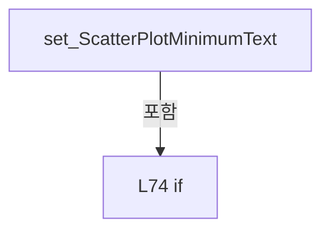

변경 전 점검: 입력/반환 타입, 위 호출자, 예외/취소 경로, 공유 상태와 저장·전송 소비자를 함께 확인합니다. 값의 단위나 물리 방향을 이름만으로 확정하지 않습니다.

### PropertyDeclaration `ScatterPlotMaximumText` · L84–97

[Drilling.UI/Menu/Menus/CMenuCorrection.ReviewData.Display.cs:84–97](https://github.com/kjuws10-rgb/A3Drilling/blob/dfa5920e6301d9ec4b0eab1452ae59521aafc986/Drilling.UI/Menu/Menus/CMenuCorrection.ReviewData.Display.cs#L84-L97)

| 항목 | 실제 추출 값 |
| --- | --- |
| 서명 | string Drilling.UI.Menu.Menus.CMenuCorrection.CReviewDataPanel.ScatterPlotMaximumText |
| 접근/수식자 | Public / public |
| 반환/값 타입 | string |
| 소속 타입 | NamedType:Drilling.UI.Menu.Menus.CMenuCorrection.CReviewDataPanel |

현재 부분 분석에서 직접 연결된 호출자는 없습니다. XAML/이벤트/인터페이스·델리게이트·외부 진입을 추가 확인해야 하며, 미사용으로 판정한 것이 아닙니다.

변경 전 점검: 입력/반환 타입, 위 호출자, 예외/취소 경로, 공유 상태와 저장·전송 소비자를 함께 확인합니다. 값의 단위나 물리 방향을 이름만으로 확정하지 않습니다.

### GetAccessorDeclaration `get_ScatterPlotMaximumText` · L86–86

[Drilling.UI/Menu/Menus/CMenuCorrection.ReviewData.Display.cs:86–86](https://github.com/kjuws10-rgb/A3Drilling/blob/dfa5920e6301d9ec4b0eab1452ae59521aafc986/Drilling.UI/Menu/Menus/CMenuCorrection.ReviewData.Display.cs#L86-L86)

| 항목 | 실제 추출 값 |
| --- | --- |
| 서명 | string Drilling.UI.Menu.Menus.CMenuCorrection.CReviewDataPanel.ScatterPlotMaximumText.get |
| 접근/수식자 | Public / get |
| 반환/값 타입 | string |
| 소속 타입 | NamedType:Drilling.UI.Menu.Menus.CMenuCorrection.CReviewDataPanel |

현재 부분 분석에서 직접 연결된 호출자는 없습니다. XAML/이벤트/인터페이스·델리게이트·외부 진입을 추가 확인해야 하며, 미사용으로 판정한 것이 아닙니다.

변경 전 점검: 입력/반환 타입, 위 호출자, 예외/취소 경로, 공유 상태와 저장·전송 소비자를 함께 확인합니다. 값의 단위나 물리 방향을 이름만으로 확정하지 않습니다.

### SetAccessorDeclaration `set_ScatterPlotMaximumText` · L87–96

[Drilling.UI/Menu/Menus/CMenuCorrection.ReviewData.Display.cs:87–96](https://github.com/kjuws10-rgb/A3Drilling/blob/dfa5920e6301d9ec4b0eab1452ae59521aafc986/Drilling.UI/Menu/Menus/CMenuCorrection.ReviewData.Display.cs#L87-L96)

| 항목 | 실제 추출 값 |
| --- | --- |
| 서명 | void Drilling.UI.Menu.Menus.CMenuCorrection.CReviewDataPanel.ScatterPlotMaximumText.set |
| 접근/수식자 | Public / set |
| 반환/값 타입 | void |
| 소속 타입 | NamedType:Drilling.UI.Menu.Menus.CMenuCorrection.CReviewDataPanel |

입력 계약:

| 이름 | 타입 | 전달 | 선택/기본값 |
| --- | --- | --- | --- |
| value | string | None | False /  |

현재 부분 분석에서 직접 연결된 호출자는 없습니다. XAML/이벤트/인터페이스·델리게이트·외부 진입을 추가 확인해야 하며, 미사용으로 판정한 것이 아닙니다.

호출하는 대상과 해석 범위:

| 원본 행 | 표현식 | 분석 상태 | 대상/소스 위치 |
| --- | --- | --- | --- |
| 95 | Notify | resolved | void Drilling.UI.Menu.Menus.CMenuCorrection.CReviewDataPanel.Notify(string) · Drilling.UI/Menu/Menus/CMenuCorrection.ReviewData.cs:427 |
| 95 | nameof | unresolved | None |

본문의 실제 연산·분기·예외·반환 순서(원문 위치 순):

| 원본 행 | 종류 | 주석 해설 |
| --- | --- | --- |
| 89 | if | 조건에 따라 분기합니다: if (_scatterPlotMaximumText == value) |
| 91 | return | 호출자에게 값 또는 제어를 반환합니다: return; |
| 94 | assignment | 값을 대상에 대입합니다: _scatterPlotMaximumText = value |
| 95 | call | 함수·델리게이트 또는 객체 생성자를 호출합니다: Notify(nameof(ScatterPlotMaximumText)) |
| 95 | call | 함수·델리게이트 또는 객체 생성자를 호출합니다: nameof(ScatterPlotMaximumText) |

제어 구문의 포함 구조(실제 실행 순서/CFG가 아닌 구문 탐색 그림):


변경 전 점검: 입력/반환 타입, 위 호출자, 예외/취소 경로, 공유 상태와 저장·전송 소비자를 함께 확인합니다. 값의 단위나 물리 방향을 이름만으로 확정하지 않습니다.

### PropertyDeclaration `ScatterPlotGridUnitText` · L99–112

[Drilling.UI/Menu/Menus/CMenuCorrection.ReviewData.Display.cs:99–112](https://github.com/kjuws10-rgb/A3Drilling/blob/dfa5920e6301d9ec4b0eab1452ae59521aafc986/Drilling.UI/Menu/Menus/CMenuCorrection.ReviewData.Display.cs#L99-L112)

| 항목 | 실제 추출 값 |
| --- | --- |
| 서명 | string Drilling.UI.Menu.Menus.CMenuCorrection.CReviewDataPanel.ScatterPlotGridUnitText |
| 접근/수식자 | Public / public |
| 반환/값 타입 | string |
| 소속 타입 | NamedType:Drilling.UI.Menu.Menus.CMenuCorrection.CReviewDataPanel |

현재 부분 분석에서 직접 연결된 호출자는 없습니다. XAML/이벤트/인터페이스·델리게이트·외부 진입을 추가 확인해야 하며, 미사용으로 판정한 것이 아닙니다.

변경 전 점검: 입력/반환 타입, 위 호출자, 예외/취소 경로, 공유 상태와 저장·전송 소비자를 함께 확인합니다. 값의 단위나 물리 방향을 이름만으로 확정하지 않습니다.

### GetAccessorDeclaration `get_ScatterPlotGridUnitText` · L101–101

[Drilling.UI/Menu/Menus/CMenuCorrection.ReviewData.Display.cs:101–101](https://github.com/kjuws10-rgb/A3Drilling/blob/dfa5920e6301d9ec4b0eab1452ae59521aafc986/Drilling.UI/Menu/Menus/CMenuCorrection.ReviewData.Display.cs#L101-L101)

| 항목 | 실제 추출 값 |
| --- | --- |
| 서명 | string Drilling.UI.Menu.Menus.CMenuCorrection.CReviewDataPanel.ScatterPlotGridUnitText.get |
| 접근/수식자 | Public / get |
| 반환/값 타입 | string |
| 소속 타입 | NamedType:Drilling.UI.Menu.Menus.CMenuCorrection.CReviewDataPanel |

현재 부분 분석에서 직접 연결된 호출자는 없습니다. XAML/이벤트/인터페이스·델리게이트·외부 진입을 추가 확인해야 하며, 미사용으로 판정한 것이 아닙니다.

변경 전 점검: 입력/반환 타입, 위 호출자, 예외/취소 경로, 공유 상태와 저장·전송 소비자를 함께 확인합니다. 값의 단위나 물리 방향을 이름만으로 확정하지 않습니다.

### SetAccessorDeclaration `set_ScatterPlotGridUnitText` · L102–111

[Drilling.UI/Menu/Menus/CMenuCorrection.ReviewData.Display.cs:102–111](https://github.com/kjuws10-rgb/A3Drilling/blob/dfa5920e6301d9ec4b0eab1452ae59521aafc986/Drilling.UI/Menu/Menus/CMenuCorrection.ReviewData.Display.cs#L102-L111)

| 항목 | 실제 추출 값 |
| --- | --- |
| 서명 | void Drilling.UI.Menu.Menus.CMenuCorrection.CReviewDataPanel.ScatterPlotGridUnitText.set |
| 접근/수식자 | Public / set |
| 반환/값 타입 | void |
| 소속 타입 | NamedType:Drilling.UI.Menu.Menus.CMenuCorrection.CReviewDataPanel |

입력 계약:

| 이름 | 타입 | 전달 | 선택/기본값 |
| --- | --- | --- | --- |
| value | string | None | False /  |

현재 부분 분석에서 직접 연결된 호출자는 없습니다. XAML/이벤트/인터페이스·델리게이트·외부 진입을 추가 확인해야 하며, 미사용으로 판정한 것이 아닙니다.

호출하는 대상과 해석 범위:

| 원본 행 | 표현식 | 분석 상태 | 대상/소스 위치 |
| --- | --- | --- | --- |
| 110 | Notify | resolved | void Drilling.UI.Menu.Menus.CMenuCorrection.CReviewDataPanel.Notify(string) · Drilling.UI/Menu/Menus/CMenuCorrection.ReviewData.cs:427 |
| 110 | nameof | unresolved | None |

본문의 실제 연산·분기·예외·반환 순서(원문 위치 순):

| 원본 행 | 종류 | 주석 해설 |
| --- | --- | --- |
| 104 | if | 조건에 따라 분기합니다: if (_scatterPlotGridUnitText == value) |
| 106 | return | 호출자에게 값 또는 제어를 반환합니다: return; |
| 109 | assignment | 값을 대상에 대입합니다: _scatterPlotGridUnitText = value |
| 110 | call | 함수·델리게이트 또는 객체 생성자를 호출합니다: Notify(nameof(ScatterPlotGridUnitText)) |
| 110 | call | 함수·델리게이트 또는 객체 생성자를 호출합니다: nameof(ScatterPlotGridUnitText) |

제어 구문의 포함 구조(실제 실행 순서/CFG가 아닌 구문 탐색 그림):

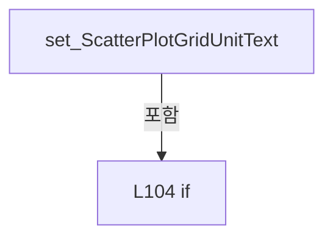

변경 전 점검: 입력/반환 타입, 위 호출자, 예외/취소 경로, 공유 상태와 저장·전송 소비자를 함께 확인합니다. 값의 단위나 물리 방향을 이름만으로 확정하지 않습니다.

### MethodDeclaration `PrepareSelectedResult` · L114–143

[Drilling.UI/Menu/Menus/CMenuCorrection.ReviewData.Display.cs:114–143](https://github.com/kjuws10-rgb/A3Drilling/blob/dfa5920e6301d9ec4b0eab1452ae59521aafc986/Drilling.UI/Menu/Menus/CMenuCorrection.ReviewData.Display.cs#L114-L143)

| 항목 | 실제 추출 값 |
| --- | --- |
| 서명 | void Drilling.UI.Menu.Menus.CMenuCorrection.CReviewDataPanel.PrepareSelectedResult(Drilling.Common.Review.ST_REVIEW_RESULT_CATALOG_ITEM?) |
| 접근/수식자 | Private / private |
| 반환/값 타입 | void |
| 소속 타입 | NamedType:Drilling.UI.Menu.Menus.CMenuCorrection.CReviewDataPanel |

입력 계약:

| 이름 | 타입 | 전달 | 선택/기본값 |
| --- | --- | --- | --- |
| result | Drilling.Common.Review.ST_REVIEW_RESULT_CATALOG_ITEM? | None | False /  |

정적 호출자로 확인된 위치:

| 호출 파일/행 | 호출 표현식 | 런타임 분기 가능 |
| --- | --- | --- |
| [Drilling.UI/Menu/Menus/CMenuCorrection.ReviewData.cs:159–159](https://github.com/kjuws10-rgb/A3Drilling/blob/dfa5920e6301d9ec4b0eab1452ae59521aafc986/Drilling.UI/Menu/Menus/CMenuCorrection.ReviewData.cs#L159-L159) | PrepareSelectedResult | False |
| [Drilling.UI/Menu/Menus/CMenuCorrection.ReviewData.cs:263–263](https://github.com/kjuws10-rgb/A3Drilling/blob/dfa5920e6301d9ec4b0eab1452ae59521aafc986/Drilling.UI/Menu/Menus/CMenuCorrection.ReviewData.cs#L263-L263) | PrepareSelectedResult | False |

호출하는 대상과 해석 범위:

| 원본 행 | 표현식 | 분석 상태 | 대상/소스 위치 |
| --- | --- | --- | --- |
| 116 | .Cancel | resolved | void System.Threading.CancellationTokenSource.Cancel() |
| 117 | .Dispose | resolved | void System.Threading.CancellationTokenSource.Dispose() |
| 119 | Interlocked.Increment | resolved | int System.Threading.Interlocked.Increment(ref int) |
| 120 | SetDataLoading | resolved | void Drilling.UI.Menu.Menus.CMenuCorrection.CReviewDataPanel.SetDataLoading(bool) · Drilling.UI/Menu/Menus/CMenuCorrection.ReviewData.Display.cs:1256 |
| 121 | ClearLoadedDisplay | resolved | void Drilling.UI.Menu.Menus.CMenuCorrection.CReviewDataPanel.ClearLoadedDisplay() · Drilling.UI/Menu/Menus/CMenuCorrection.ReviewData.Display.cs:1224 |
| 125 | SetDataLoadHint | resolved | void Drilling.UI.Menu.Menus.CMenuCorrection.CReviewDataPanel.SetDataLoadHint(string, string) · Drilling.UI/Menu/Menus/CMenuCorrection.ReviewData.Display.cs:1278 |
| 127 | result.ResultStatus.Equals | resolved | bool string.Equals(string?, System.StringComparison) |
| 129 | string.IsNullOrWhiteSpace | resolved | bool string.IsNullOrWhiteSpace(string?) |
| 130 | SetDataLoadHint | resolved | void Drilling.UI.Menu.Menus.CMenuCorrection.CReviewDataPanel.SetDataLoadHint(string, string) · Drilling.UI/Menu/Menus/CMenuCorrection.ReviewData.Display.cs:1278 |
| 132 | result.ResultStatus.Equals | resolved | bool string.Equals(string?, System.StringComparison) |
| 134 | string.IsNullOrWhiteSpace | resolved | bool string.IsNullOrWhiteSpace(string?) |
| 135 | SetDataLoadHint | resolved | void Drilling.UI.Menu.Menus.CMenuCorrection.CReviewDataPanel.SetDataLoadHint(string, string) · Drilling.UI/Menu/Menus/CMenuCorrection.ReviewData.Display.cs:1278 |
| 139 | SetDataLoadHint | resolved | void Drilling.UI.Menu.Menus.CMenuCorrection.CReviewDataPanel.SetDataLoadHint(string, string) · Drilling.UI/Menu/Menus/CMenuCorrection.ReviewData.Display.cs:1278 |
| 142 | NotifyLoadCommandState | resolved | void Drilling.UI.Menu.Menus.CMenuCorrection.CReviewDataPanel.NotifyLoadCommandState() · Drilling.UI/Menu/Menus/CMenuCorrection.ReviewData.Display.cs:1286 |

본문의 실제 연산·분기·예외·반환 순서(원문 위치 순):

| 원본 행 | 종류 | 주석 해설 |
| --- | --- | --- |
| 116 | call | 함수·델리게이트 또는 객체 생성자를 호출합니다: .Cancel() |
| 117 | call | 함수·델리게이트 또는 객체 생성자를 호출합니다: .Dispose() |
| 118 | assignment | 값을 대상에 대입합니다: _dataLoadCancellation = null |
| 119 | call | 함수·델리게이트 또는 객체 생성자를 호출합니다: Interlocked.Increment(ref _dataLoadVersion) |
| 120 | call | 함수·델리게이트 또는 객체 생성자를 호출합니다: SetDataLoading(false) |
| 121 | call | 함수·델리게이트 또는 객체 생성자를 호출합니다: ClearLoadedDisplay() |
| 123 | if | 조건에 따라 분기합니다: if (result is null) |
| 125 | call | 함수·델리게이트 또는 객체 생성자를 호출합니다: SetDataLoadHint("DATA LOAD 불가능. 사유 : 검사 결과 파일을 선택하세요.", "WAIT") |
| 127 | call | 함수·델리게이트 또는 객체 생성자를 호출합니다: result.ResultStatus.Equals("FAILED", StringComparison.OrdinalIgnoreCase) |
| 127 | else | 앞 조건이 거짓인 경로입니다: else |
| 127 | if | 조건에 따라 분기합니다: if (result.ResultStatus.Equals("FAILED", StringComparison.OrdinalIgnoreCase)) |
| 129 | call | 함수·델리게이트 또는 객체 생성자를 호출합니다: string.IsNullOrWhiteSpace(result.ResultMessage) |
| 129 | conditional-expression | 조건에 따라 결과식을 선택합니다: string.IsNullOrWhiteSpace(result.ResultMessage) ? "실패 사유가 기록되어 있지 않습니다." : result.ResultMessage |
| 129 | local-declaration | 지역 변수를 선언합니다: var reason = string.IsNullOrWhiteSpace(result.ResultMessage) ? "실패 사유가 기록되어 있지 않습니다." : result.ResultMessage; |
| 129 | variable-initializer | 변수의 초기값을 지정합니다: reason = string.IsNullOrWhiteSpace(result.ResultMessage) ? "실패 사유가 기록되어 있지 않습니다." : result.ResultMessage |
| 130 | call | 함수·델리게이트 또는 객체 생성자를 호출합니다: SetDataLoadHint($"DATA LOAD 불가능. 사유 : 검사 실패 - {reason}", "ERROR") |
| 132 | call | 함수·델리게이트 또는 객체 생성자를 호출합니다: result.ResultStatus.Equals("INVALID", StringComparison.OrdinalIgnoreCase) |
| 132 | else | 앞 조건이 거짓인 경로입니다: else |
| 132 | if | 조건에 따라 분기합니다: if (result.ResultStatus.Equals("INVALID", StringComparison.OrdinalIgnoreCase)) |
| 134 | call | 함수·델리게이트 또는 객체 생성자를 호출합니다: string.IsNullOrWhiteSpace(result.ResultMessage) |
| 134 | conditional-expression | 조건에 따라 결과식을 선택합니다: string.IsNullOrWhiteSpace(result.ResultMessage) ? "결과 파일이 올바르지 않습니다." : result.ResultMessage |
| 134 | local-declaration | 지역 변수를 선언합니다: var reason = string.IsNullOrWhiteSpace(result.ResultMessage) ? "결과 파일이 올바르지 않습니다." : result.ResultMessage; |
| 134 | variable-initializer | 변수의 초기값을 지정합니다: reason = string.IsNullOrWhiteSpace(result.ResultMessage) ? "결과 파일이 올바르지 않습니다." : result.ResultMessage |
| 135 | call | 함수·델리게이트 또는 객체 생성자를 호출합니다: SetDataLoadHint($"DATA LOAD 불가능. 사유 : {reason}", "ERROR") |
| 137 | else | 앞 조건이 거짓인 경로입니다: else |
| 139 | call | 함수·델리게이트 또는 객체 생성자를 호출합니다: SetDataLoadHint("선택한 검사 결과를 불러오려면 DATA LOAD를 누르세요.", "WAIT") |
| 142 | call | 함수·델리게이트 또는 객체 생성자를 호출합니다: NotifyLoadCommandState() |

제어 구문의 포함 구조(실제 실행 순서/CFG가 아닌 구문 탐색 그림):

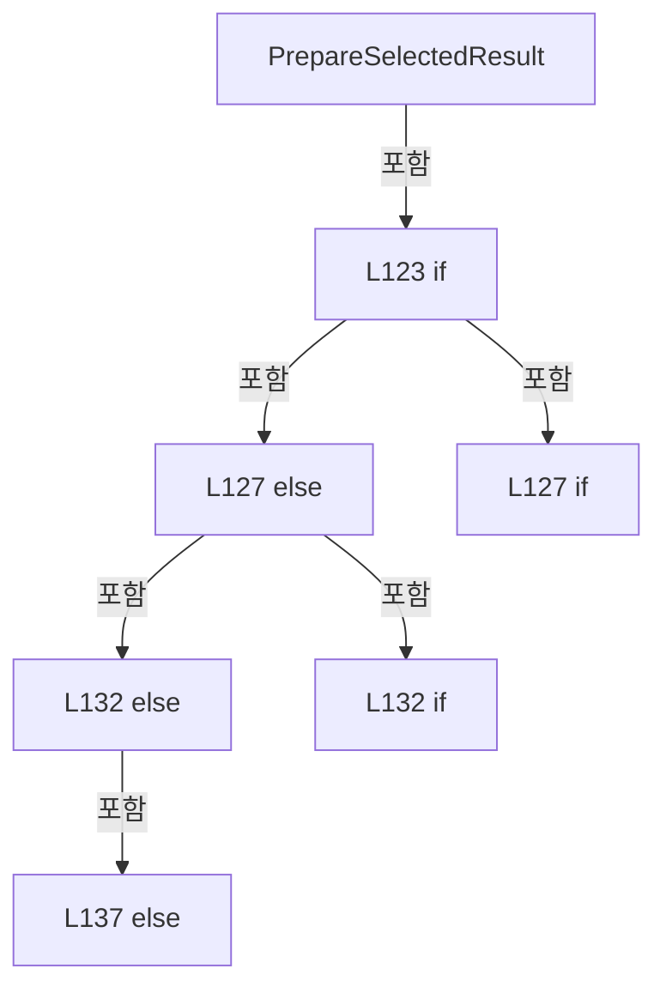

변경 전 점검: 입력/반환 타입, 위 호출자, 예외/취소 경로, 공유 상태와 저장·전송 소비자를 함께 확인합니다. 값의 단위나 물리 방향을 이름만으로 확정하지 않습니다.

### MethodDeclaration `LoadDataRequested` · L145–148

[Drilling.UI/Menu/Menus/CMenuCorrection.ReviewData.Display.cs:145–148](https://github.com/kjuws10-rgb/A3Drilling/blob/dfa5920e6301d9ec4b0eab1452ae59521aafc986/Drilling.UI/Menu/Menus/CMenuCorrection.ReviewData.Display.cs#L145-L148)

| 항목 | 실제 추출 값 |
| --- | --- |
| 서명 | void Drilling.UI.Menu.Menus.CMenuCorrection.CReviewDataPanel.LoadDataRequested(object?) |
| 접근/수식자 | Private / private, async |
| 반환/값 타입 | void |
| 소속 타입 | NamedType:Drilling.UI.Menu.Menus.CMenuCorrection.CReviewDataPanel |

입력 계약:

| 이름 | 타입 | 전달 | 선택/기본값 |
| --- | --- | --- | --- |
| parameter | object? | None | False /  |

현재 부분 분석에서 직접 연결된 호출자는 없습니다. XAML/이벤트/인터페이스·델리게이트·외부 진입을 추가 확인해야 하며, 미사용으로 판정한 것이 아닙니다.

호출하는 대상과 해석 범위:

| 원본 행 | 표현식 | 분석 상태 | 대상/소스 위치 |
| --- | --- | --- | --- |
| 147 | LoadSelectedData | resolved | System.Threading.Tasks.Task Drilling.UI.Menu.Menus.CMenuCorrection.CReviewDataPanel.LoadSelectedData() · Drilling.UI/Menu/Menus/CMenuCorrection.ReviewData.Display.cs:150 |

본문의 실제 연산·분기·예외·반환 순서(원문 위치 순):

| 원본 행 | 종류 | 주석 해설 |
| --- | --- | --- |
| 147 | await | 비동기 완료를 기다립니다: await LoadSelectedData() |
| 147 | call | 함수·델리게이트 또는 객체 생성자를 호출합니다: LoadSelectedData() |

변경 전 점검: 입력/반환 타입, 위 호출자, 예외/취소 경로, 공유 상태와 저장·전송 소비자를 함께 확인합니다. 값의 단위나 물리 방향을 이름만으로 확정하지 않습니다.

### MethodDeclaration `LoadSelectedData` · L150–229

[Drilling.UI/Menu/Menus/CMenuCorrection.ReviewData.Display.cs:150–229](https://github.com/kjuws10-rgb/A3Drilling/blob/dfa5920e6301d9ec4b0eab1452ae59521aafc986/Drilling.UI/Menu/Menus/CMenuCorrection.ReviewData.Display.cs#L150-L229)

| 항목 | 실제 추출 값 |
| --- | --- |
| 서명 | System.Threading.Tasks.Task Drilling.UI.Menu.Menus.CMenuCorrection.CReviewDataPanel.LoadSelectedData() |
| 접근/수식자 | Private / private, async |
| 반환/값 타입 | System.Threading.Tasks.Task |
| 소속 타입 | NamedType:Drilling.UI.Menu.Menus.CMenuCorrection.CReviewDataPanel |

정적 호출자로 확인된 위치:

| 호출 파일/행 | 호출 표현식 | 런타임 분기 가능 |
| --- | --- | --- |
| [Drilling.UI/Menu/Menus/CMenuCorrection.ReviewData.Display.cs:147–147](https://github.com/kjuws10-rgb/A3Drilling/blob/dfa5920e6301d9ec4b0eab1452ae59521aafc986/Drilling.UI/Menu/Menus/CMenuCorrection.ReviewData.Display.cs#L147-L147) | LoadSelectedData | False |
| [Drilling.UI/Menu/Menus/CMenuCorrection.ReviewData.Edit.cs:514–514](https://github.com/kjuws10-rgb/A3Drilling/blob/dfa5920e6301d9ec4b0eab1452ae59521aafc986/Drilling.UI/Menu/Menus/CMenuCorrection.ReviewData.Edit.cs#L514-L514) | LoadSelectedData | False |
| [Drilling.UI/Menu/Menus/CMenuCorrection.ReviewData.Reinspection.cs:445–445](https://github.com/kjuws10-rgb/A3Drilling/blob/dfa5920e6301d9ec4b0eab1452ae59521aafc986/Drilling.UI/Menu/Menus/CMenuCorrection.ReviewData.Reinspection.cs#L445-L445) | LoadSelectedData | False |
| [Drilling.UI/Menu/Menus/CMenuCorrection.ReviewData.cs:137–137](https://github.com/kjuws10-rgb/A3Drilling/blob/dfa5920e6301d9ec4b0eab1452ae59521aafc986/Drilling.UI/Menu/Menus/CMenuCorrection.ReviewData.cs#L137-L137) | LoadSelectedData | False |

호출하는 대상과 해석 범위:

| 원본 행 | 표현식 | 분석 상태 | 대상/소스 위치 |
| --- | --- | --- | --- |
| 152 | IsBlockedStatus | resolved | bool Drilling.UI.Menu.Menus.CMenuCorrection.CReviewDataPanel.IsBlockedStatus(string) · Drilling.UI/Menu/Menus/CMenuCorrection.ReviewData.Display.cs:1218 |
| 157 | .Cancel | resolved | void System.Threading.CancellationTokenSource.Cancel() |
| 158 | .Dispose | resolved | void System.Threading.CancellationTokenSource.Dispose() |
| 159 | new CancellationTokenSource | resolved | System.Threading.CancellationTokenSource.CancellationTokenSource() |
| 161 | Interlocked.Increment | resolved | int System.Threading.Interlocked.Increment(ref int) |
| 162 | ClearLoadedDisplay | resolved | void Drilling.UI.Menu.Menus.CMenuCorrection.CReviewDataPanel.ClearLoadedDisplay() · Drilling.UI/Menu/Menus/CMenuCorrection.ReviewData.Display.cs:1224 |
| 163 | SetDataLoading | resolved | void Drilling.UI.Menu.Menus.CMenuCorrection.CReviewDataPanel.SetDataLoading(bool) · Drilling.UI/Menu/Menus/CMenuCorrection.ReviewData.Display.cs:1256 |
| 164 | SetLoadProgress | resolved | void Drilling.UI.Menu.Menus.CMenuCorrection.CReviewDataPanel.SetLoadProgress(double, string) · Drilling.UI/Menu/Menus/CMenuCorrection.ReviewData.Display.cs:1270 |
| 165 | SetDataLoadHint | resolved | void Drilling.UI.Menu.Menus.CMenuCorrection.CReviewDataPanel.SetDataLoadHint(string, string) · Drilling.UI/Menu/Menus/CMenuCorrection.ReviewData.Display.cs:1278 |
| 169 | Task.Run | resolved | System.Threading.Tasks.Task<Drilling.Common.Review.ST_REVIEW_RESULT_FILE_DATA> System.Threading.Tasks.Task.Run<Drilling.Common.Review.ST_REVIEW_RESULT_FILE_DATA>(System.Func<System.Threading.Tasks.Task<Drilling.Common.Review.ST_REVIEW_RESULT_FILE_DATA>?>, System.Threading.CancellationToken) |
| 169 | _reviewResultFile.Load | resolved | System.Threading.Tasks.Task<Drilling.Common.Review.ST_REVIEW_RESULT_FILE_DATA> Drilling.Common.Review.CReviewResultFileBase.Load(string, System.Threading.CancellationToken) · Drilling.Common/Review/CReviewManager.cs:4269 |
| 170 | token.ThrowIfCancellationRequested | resolved | void System.Threading.CancellationToken.ThrowIfCancellationRequested() |
| 171 | Volatile.Read | resolved | int System.Threading.Volatile.Read(ref readonly int) |
| 176 | SetLoadProgress | resolved | void Drilling.UI.Menu.Menus.CMenuCorrection.CReviewDataPanel.SetLoadProgress(double, string) · Drilling.UI/Menu/Menus/CMenuCorrection.ReviewData.Display.cs:1270 |
| 177 | Task.Run | resolved | System.Threading.Tasks.Task<System.Collections.Generic.IReadOnlyList<Drilling.Common.Managers.ST_RECIPE_DEFINITION>> System.Threading.Tasks.Task.Run<System.Collections.Generic.IReadOnlyList<Drilling.Common.Managers.ST_RECIPE_DEFINITION>>(System.Func<System.Threading.Tasks.Task<System.Collections.Generic.IReadOnlyList<Drilling.Common.Managers.ST_RECIPE_DEFINITION>>?>, System.Threading.CancellationToken) |
| 177 | _recipeManager.LoadRecipes | resolved | System.Threading.Tasks.Task<System.Collections.Generic.IReadOnlyList<Drilling.Common.Managers.ST_RECIPE_DEFINITION>> Drilling.Common.Managers.CRecipeManager.LoadRecipes(System.Threading.CancellationToken) · Drilling.Common/Managers/CRecipeManager.cs:40 |
| 178 | token.ThrowIfCancellationRequested | resolved | void System.Threading.CancellationToken.ThrowIfCancellationRequested() |
| 179 | recipes.FirstOrDefault | resolved | Drilling.Common.Managers.ST_RECIPE_DEFINITION? System.Collections.Generic.IEnumerable<Drilling.Common.Managers.ST_RECIPE_DEFINITION>.FirstOrDefault<Drilling.Common.Managers.ST_RECIPE_DEFINITION>(System.Func<Drilling.Common.Managers.ST_RECIPE_DEFINITION, bool>) |
| 179 | item.Id.Equals | resolved | bool string.Equals(string?, System.StringComparison) |
| 180 | recipes.FirstOrDefault | resolved | Drilling.Common.Managers.ST_RECIPE_DEFINITION? System.Collections.Generic.IEnumerable<Drilling.Common.Managers.ST_RECIPE_DEFINITION>.FirstOrDefault<Drilling.Common.Managers.ST_RECIPE_DEFINITION>(System.Func<Drilling.Common.Managers.ST_RECIPE_DEFINITION, bool>) |
| 180 | item.Name.Equals | resolved | bool string.Equals(string?, System.StringComparison) |
| 181 | new InvalidDataException | resolved | System.IO.InvalidDataException.InvalidDataException(string?) |
| 182 | Task.Run | resolved | System.Threading.Tasks.Task<System.Collections.Generic.IReadOnlyList<Drilling.Common.Managers.ST_SYSTEM_PARAMETER>> System.Threading.Tasks.Task.Run<System.Collections.Generic.IReadOnlyList<Drilling.Common.Managers.ST_SYSTEM_PARAMETER>>(System.Func<System.Collections.Generic.IReadOnlyList<Drilling.Common.Managers.ST_SYSTEM_PARAMETER>>, System.Threading.CancellationToken) |
| 184 | new List<ST_SYSTEM_PARAMETER> | resolved | System.Collections.Generic.List<Drilling.Common.Managers.ST_SYSTEM_PARAMETER>.List() |
| 185 | values.AddRange | resolved | void System.Collections.Generic.List<Drilling.Common.Managers.ST_SYSTEM_PARAMETER>.AddRange(System.Collections.Generic.IEnumerable<Drilling.Common.Managers.ST_SYSTEM_PARAMETER>) |
| 185 | _settingManager.LoadSection | resolved | System.Collections.Generic.IReadOnlyList<Drilling.Common.Managers.ST_SYSTEM_PARAMETER> Drilling.Common.Managers.CSettingManager.LoadSection(Drilling.Common.Managers.EN_SETTING_TAB, System.Threading.CancellationToken) · Drilling.Common/Managers/CSettingManager.cs:26 |
| 186 | values.AddRange | resolved | void System.Collections.Generic.List<Drilling.Common.Managers.ST_SYSTEM_PARAMETER>.AddRange(System.Collections.Generic.IEnumerable<Drilling.Common.Managers.ST_SYSTEM_PARAMETER>) |
| 186 | _settingManager.LoadSection | resolved | System.Collections.Generic.IReadOnlyList<Drilling.Common.Managers.ST_SYSTEM_PARAMETER> Drilling.Common.Managers.CSettingManager.LoadSection(Drilling.Common.Managers.EN_SETTING_TAB, System.Threading.CancellationToken) · Drilling.Common/Managers/CSettingManager.cs:26 |
| 189 | token.ThrowIfCancellationRequested | resolved | void System.Threading.CancellationToken.ThrowIfCancellationRequested() |
| 190 | SetLoadProgress | resolved | void Drilling.UI.Menu.Menus.CMenuCorrection.CReviewDataPanel.SetLoadProgress(double, string) · Drilling.UI/Menu/Menus/CMenuCorrection.ReviewData.Display.cs:1270 |
| 192 | BuildOutputViewerParameterMap | resolved | System.Collections.Generic.Dictionary<string, string> Drilling.UI.Menu.Menus.CMenuCorrection.BuildOutputViewerParameterMap(Drilling.Common.Managers.ST_RECIPE_DEFINITION, System.Collections.Generic.IReadOnlyList<Drilling.Common.Managers.ST_SYSTEM_PARAMETER>) · Drilling.UI/Menu/Menus/CMenuCorrection.cs:771 |
| 193 | Task.Run | resolved | System.Threading.Tasks.Task<Drilling.UI.Menu.Menus.CMenuCorrection.ST_REVIEW_DATA_DISPLAY_MODEL> System.Threading.Tasks.Task.Run<Drilling.UI.Menu.Menus.CMenuCorrection.ST_REVIEW_DATA_DISPLAY_MODEL>(System.Func<Drilling.UI.Menu.Menus.CMenuCorrection.ST_REVIEW_DATA_DISPLAY_MODEL>, System.Threading.CancellationToken) |
| 193 | BuildDisplayModel | resolved | Drilling.UI.Menu.Menus.CMenuCorrection.ST_REVIEW_DATA_DISPLAY_MODEL Drilling.UI.Menu.Menus.CMenuCorrection.CReviewDataPanel.BuildDisplayModel(Drilling.Common.Review.ST_REVIEW_RESULT_FILE_DATA, System.Collections.Generic.IReadOnlyDictionary<string, string>, System.Threading.CancellationToken) · Drilling.UI/Menu/Menus/CMenuCorrection.ReviewData.Display.cs:231 |
| 194 | token.ThrowIfCancellationRequested | resolved | void System.Threading.CancellationToken.ThrowIfCancellationRequested() |
| 195 | Volatile.Read | resolved | int System.Threading.Volatile.Read(ref readonly int) |
| 200 | SetLoadProgress | resolved | void Drilling.UI.Menu.Menus.CMenuCorrection.CReviewDataPanel.SetLoadProgress(double, string) · Drilling.UI/Menu/Menus/CMenuCorrection.ReviewData.Display.cs:1270 |
| 201 | ApplyDisplayModel | resolved | void Drilling.UI.Menu.Menus.CMenuCorrection.CReviewDataPanel.ApplyDisplayModel(Drilling.UI.Menu.Menus.CMenuCorrection.ST_REVIEW_DATA_DISPLAY_MODEL, Drilling.Common.Review.ST_REVIEW_RESULT_FILE_DATA, Drilling.Common.Review.ST_REVIEW_RESULT_CATALOG_ITEM, Drilling.Common.Managers.ST_RECIPE_DEFINITION) · Drilling.UI/Menu/Menus/CMenuCorrection.ReviewData.Display.cs:470 |
| 202 | SetLoadProgress | resolved | void Drilling.UI.Menu.Menus.CMenuCorrection.CReviewDataPanel.SetLoadProgress(double, string) · Drilling.UI/Menu/Menus/CMenuCorrection.ReviewData.Display.cs:1270 |
| 203 | SetDataLoadHint | resolved | void Drilling.UI.Menu.Menus.CMenuCorrection.CReviewDataPanel.SetDataLoadHint(string, string) · Drilling.UI/Menu/Menus/CMenuCorrection.ReviewData.Display.cs:1278 |
| 204 | _statusReporter | resolved · 동적 구현 선택 가능 | void System.Action<string>.Invoke(string) |
| 208 | Volatile.Read | resolved | int System.Threading.Volatile.Read(ref readonly int) |
| 210 | SetDataLoadHint | resolved | void Drilling.UI.Menu.Menus.CMenuCorrection.CReviewDataPanel.SetDataLoadHint(string, string) · Drilling.UI/Menu/Menus/CMenuCorrection.ReviewData.Display.cs:1278 |
| 215 | Volatile.Read | resolved | int System.Threading.Volatile.Read(ref readonly int) |
| 217 | ClearLoadedDisplay | resolved | void Drilling.UI.Menu.Menus.CMenuCorrection.CReviewDataPanel.ClearLoadedDisplay() · Drilling.UI/Menu/Menus/CMenuCorrection.ReviewData.Display.cs:1224 |
| 218 | SetDataLoadHint | resolved | void Drilling.UI.Menu.Menus.CMenuCorrection.CReviewDataPanel.SetDataLoadHint(string, string) · Drilling.UI/Menu/Menus/CMenuCorrection.ReviewData.Display.cs:1278 |
| 219 | _statusReporter | resolved · 동적 구현 선택 가능 | void System.Action<string>.Invoke(string) |
| 224 | Volatile.Read | resolved | int System.Threading.Volatile.Read(ref readonly int) |
| 226 | SetDataLoading | resolved | void Drilling.UI.Menu.Menus.CMenuCorrection.CReviewDataPanel.SetDataLoading(bool) · Drilling.UI/Menu/Menus/CMenuCorrection.ReviewData.Display.cs:1256 |

본문의 실제 연산·분기·예외·반환 순서(원문 위치 순):

| 원본 행 | 종류 | 주석 해설 |
| --- | --- | --- |
| 152 | call | 함수·델리게이트 또는 객체 생성자를 호출합니다: IsBlockedStatus(catalog.ResultStatus) |
| 152 | if | 조건에 따라 분기합니다: if (_selectedNode?.Result is not { } catalog &#124;&#124; IsBlockedStatus(catalog.ResultStatus) &#124;&#124; _isDataLoading) |
| 154 | return | 호출자에게 값 또는 제어를 반환합니다: return; |
| 157 | call | 함수·델리게이트 또는 객체 생성자를 호출합니다: .Cancel() |
| 158 | call | 함수·델리게이트 또는 객체 생성자를 호출합니다: .Dispose() |
| 159 | assignment | 값을 대상에 대입합니다: _dataLoadCancellation = new CancellationTokenSource() |
| 159 | call | 함수·델리게이트 또는 객체 생성자를 호출합니다: new CancellationTokenSource() |
| 160 | local-declaration | 지역 변수를 선언합니다: var token = _dataLoadCancellation.Token; |
| 160 | variable-initializer | 변수의 초기값을 지정합니다: token = _dataLoadCancellation.Token |
| 161 | call | 함수·델리게이트 또는 객체 생성자를 호출합니다: Interlocked.Increment(ref _dataLoadVersion) |
| 161 | local-declaration | 지역 변수를 선언합니다: var version = Interlocked.Increment(ref _dataLoadVersion); |
| 161 | variable-initializer | 변수의 초기값을 지정합니다: version = Interlocked.Increment(ref _dataLoadVersion) |
| 162 | call | 함수·델리게이트 또는 객체 생성자를 호출합니다: ClearLoadedDisplay() |
| 163 | call | 함수·델리게이트 또는 객체 생성자를 호출합니다: SetDataLoading(true) |
| 164 | call | 함수·델리게이트 또는 객체 생성자를 호출합니다: SetLoadProgress(5.0, "검사 결과 준비 중...") |
| 165 | call | 함수·델리게이트 또는 객체 생성자를 호출합니다: SetDataLoadHint("선택한 검사 결과를 불러오는 중입니다.", "WAIT") |
| 167 | try | 예외 처리 범위입니다: try |
| 169 | await | 비동기 완료를 기다립니다: await Task.Run(() => _reviewResultFile.Load(catalog.FilePath, token), token) |
| 169 | call | 함수·델리게이트 또는 객체 생성자를 호출합니다: Task.Run(() => _reviewResultFile.Load(catalog.FilePath, token), token) |
| 169 | call | 함수·델리게이트 또는 객체 생성자를 호출합니다: _reviewResultFile.Load(catalog.FilePath, token) |
| 169 | local-declaration | 지역 변수를 선언합니다: var resultFile = await Task.Run(() => _reviewResultFile.Load(catalog.FilePath, token), token); |
| 169 | variable-initializer | 변수의 초기값을 지정합니다: resultFile = await Task.Run(() => _reviewResultFile.Load(catalog.FilePath, token), token) |
| 170 | call | 함수·델리게이트 또는 객체 생성자를 호출합니다: token.ThrowIfCancellationRequested() |
| 171 | call | 함수·델리게이트 또는 객체 생성자를 호출합니다: Volatile.Read(ref _dataLoadVersion) |
| 171 | if | 조건에 따라 분기합니다: if (version != Volatile.Read(ref _dataLoadVersion)) |
| 173 | return | 호출자에게 값 또는 제어를 반환합니다: return; |
| 176 | call | 함수·델리게이트 또는 객체 생성자를 호출합니다: SetLoadProgress(30.0, "결과 파일 로드 완료") |
| 177 | await | 비동기 완료를 기다립니다: await Task.Run(() => _recipeManager.LoadRecipes(token), token) |
| 177 | call | 함수·델리게이트 또는 객체 생성자를 호출합니다: Task.Run(() => _recipeManager.LoadRecipes(token), token) |
| 177 | call | 함수·델리게이트 또는 객체 생성자를 호출합니다: _recipeManager.LoadRecipes(token) |
| 177 | local-declaration | 지역 변수를 선언합니다: var recipes = await Task.Run(() => _recipeManager.LoadRecipes(token), token); |
| 177 | variable-initializer | 변수의 초기값을 지정합니다: recipes = await Task.Run(() => _recipeManager.LoadRecipes(token), token) |
| 178 | call | 함수·델리게이트 또는 객체 생성자를 호출합니다: token.ThrowIfCancellationRequested() |
| 179 | call | 함수·델리게이트 또는 객체 생성자를 호출합니다: recipes.FirstOrDefault(item => item.Id.Equals(resultFile.RecipeId, StringComparison.OrdinalIgnoreCase)) |
| 179 | call | 함수·델리게이트 또는 객체 생성자를 호출합니다: item.Id.Equals(resultFile.RecipeId, StringComparison.OrdinalIgnoreCase) |
| 179 | local-declaration | 지역 변수를 선언합니다: var recipe = recipes.FirstOrDefault(item => item.Id.Equals(resultFile.RecipeId, StringComparison.OrdinalIgnoreCase)) ?? recipes.FirstOrDefault(item => item.Name.Equals(resultFile.RecipeId, StringComparison.OrdinalIgnoreCase)) ?? t |
| 179 | variable-initializer | 변수의 초기값을 지정합니다: recipe = recipes.FirstOrDefault(item => item.Id.Equals(resultFile.RecipeId, StringComparison.OrdinalIgnoreCase)) ?? recipes.FirstOrDefault(item => item.Name.Equals(resultFile.RecipeId, StringComparison.OrdinalIgnoreCase)) ?? throw |
| 180 | call | 함수·델리게이트 또는 객체 생성자를 호출합니다: recipes.FirstOrDefault(item => item.Name.Equals(resultFile.RecipeId, StringComparison.OrdinalIgnoreCase)) |
| 180 | call | 함수·델리게이트 또는 객체 생성자를 호출합니다: item.Name.Equals(resultFile.RecipeId, StringComparison.OrdinalIgnoreCase) |
| 181 | call | 함수·델리게이트 또는 객체 생성자를 호출합니다: new InvalidDataException($"Recipe '{resultFile.RecipeId}' was not found.") |
| 181 | throw | 예외를 발생/전달합니다: throw new InvalidDataException($"Recipe '{resultFile.RecipeId}' was not found.") |
| 182 | await | 비동기 완료를 기다립니다: await Task.Run(() => { var values = new List<ST_SYSTEM_PARAMETER>(); values.AddRange(_settingManager.LoadSection(EN_SETTING_TAB.Option, token)); values.AddRange(_settingManager.LoadSection(EN_SETTING_TAB.Motor, token)); return (IR |
| 182 | call | 함수·델리게이트 또는 객체 생성자를 호출합니다: Task.Run(() => { var values = new List<ST_SYSTEM_PARAMETER>(); values.AddRange(_settingManager.LoadSection(EN_SETTING_TAB.Option, token)); values.AddRange(_settingManager.LoadSection(EN_SETTING_TAB.Motor, token)); return… |
| 182 | local-declaration | 지역 변수를 선언합니다: var settings = await Task.Run(() => { var values = new List<ST_SYSTEM_PARAMETER>(); values.AddRange(_settingManager.LoadSection(EN_SETTING_TAB.Option, token)); values.AddRange(_settingManager.LoadSection(EN_SETTING_TAB.Motor, toke |
| 182 | variable-initializer | 변수의 초기값을 지정합니다: settings = await Task.Run(() => { var values = new List<ST_SYSTEM_PARAMETER>(); values.AddRange(_settingManager.LoadSection(EN_SETTING_TAB.Option, token)); values.AddRange(_settingManager.LoadSection(EN_SETTING_TAB.Motor, token)); |
| 184 | call | 함수·델리게이트 또는 객체 생성자를 호출합니다: new List<ST_SYSTEM_PARAMETER>() |
| 184 | local-declaration | 지역 변수를 선언합니다: var values = new List<ST_SYSTEM_PARAMETER>(); |
| 184 | variable-initializer | 변수의 초기값을 지정합니다: values = new List<ST_SYSTEM_PARAMETER>() |
| 185 | call | 함수·델리게이트 또는 객체 생성자를 호출합니다: values.AddRange(_settingManager.LoadSection(EN_SETTING_TAB.Option, token)) |
| 185 | call | 함수·델리게이트 또는 객체 생성자를 호출합니다: _settingManager.LoadSection(EN_SETTING_TAB.Option, token) |
| 186 | call | 함수·델리게이트 또는 객체 생성자를 호출합니다: values.AddRange(_settingManager.LoadSection(EN_SETTING_TAB.Motor, token)) |
| 186 | call | 함수·델리게이트 또는 객체 생성자를 호출합니다: _settingManager.LoadSection(EN_SETTING_TAB.Motor, token) |
| 187 | return | 호출자에게 값 또는 제어를 반환합니다: return (IReadOnlyList<ST_SYSTEM_PARAMETER>)values; |
| 189 | call | 함수·델리게이트 또는 객체 생성자를 호출합니다: token.ThrowIfCancellationRequested() |
| 190 | call | 함수·델리게이트 또는 객체 생성자를 호출합니다: SetLoadProgress(55.0, "레시피 배치 로드 완료") |
| 192 | call | 함수·델리게이트 또는 객체 생성자를 호출합니다: BuildOutputViewerParameterMap(recipe, settings) |
| 192 | local-declaration | 지역 변수를 선언합니다: var parameters = BuildOutputViewerParameterMap(recipe, settings); |
| 192 | variable-initializer | 변수의 초기값을 지정합니다: parameters = BuildOutputViewerParameterMap(recipe, settings) |
| 193 | await | 비동기 완료를 기다립니다: await Task.Run(() => BuildDisplayModel(resultFile, parameters, token), token) |
| 193 | call | 함수·델리게이트 또는 객체 생성자를 호출합니다: Task.Run(() => BuildDisplayModel(resultFile, parameters, token), token) |
| 193 | call | 함수·델리게이트 또는 객체 생성자를 호출합니다: BuildDisplayModel(resultFile, parameters, token) |
| 193 | local-declaration | 지역 변수를 선언합니다: var model = await Task.Run(() => BuildDisplayModel(resultFile, parameters, token), token); |
| 193 | variable-initializer | 변수의 초기값을 지정합니다: model = await Task.Run(() => BuildDisplayModel(resultFile, parameters, token), token) |
| 194 | call | 함수·델리게이트 또는 객체 생성자를 호출합니다: token.ThrowIfCancellationRequested() |
| 195 | call | 함수·델리게이트 또는 객체 생성자를 호출합니다: Volatile.Read(ref _dataLoadVersion) |
| 195 | if | 조건에 따라 분기합니다: if (version != Volatile.Read(ref _dataLoadVersion)) |
| 197 | return | 호출자에게 값 또는 제어를 반환합니다: return; |
| 200 | call | 함수·델리게이트 또는 객체 생성자를 호출합니다: SetLoadProgress(90.0, "프리뷰 생성 중...") |
| 201 | call | 함수·델리게이트 또는 객체 생성자를 호출합니다: ApplyDisplayModel(model, resultFile, catalog, recipe) |
| 202 | call | 함수·델리게이트 또는 객체 생성자를 호출합니다: SetLoadProgress(100.0, "DATA LOAD 완료") |
| 203 | call | 함수·델리게이트 또는 객체 생성자를 호출합니다: SetDataLoadHint($"{catalog.FileName}에서 결과 {model.Rows.Count:N0}건을 불러왔습니다.", "OK") |
| 204 | call | 함수·델리게이트 또는 객체 생성자를 호출합니다: _statusReporter($"Review Result data loaded: {catalog.FileName} / {model.Rows.Count:N0} rows.") |
| 206 | catch | 지정 예외를 처리합니다: catch (OperationCanceledException) when (token.IsCancellationRequested) |
| 208 | call | 함수·델리게이트 또는 객체 생성자를 호출합니다: Volatile.Read(ref _dataLoadVersion) |
| 208 | if | 조건에 따라 분기합니다: if (version == Volatile.Read(ref _dataLoadVersion)) |
| 210 | call | 함수·델리게이트 또는 객체 생성자를 호출합니다: SetDataLoadHint("검사 결과 불러오기가 취소되었습니다.", "WARN") |
| 213 | catch | 지정 예외를 처리합니다: catch (Exception exception) |
| 215 | call | 함수·델리게이트 또는 객체 생성자를 호출합니다: Volatile.Read(ref _dataLoadVersion) |
| 215 | if | 조건에 따라 분기합니다: if (version == Volatile.Read(ref _dataLoadVersion)) |
| 217 | call | 함수·델리게이트 또는 객체 생성자를 호출합니다: ClearLoadedDisplay() |
| 218 | call | 함수·델리게이트 또는 객체 생성자를 호출합니다: SetDataLoadHint($"DATA LOAD 불가능. 사유 : 검사 결과 로드 실패 - {exception.Message}", "ERROR") |
| 219 | call | 함수·델리게이트 또는 객체 생성자를 호출합니다: _statusReporter($"Review Result data load failed: {exception.Message}") |
| 222 | finally | 종료 정리 구간입니다: finally |
| 224 | call | 함수·델리게이트 또는 객체 생성자를 호출합니다: Volatile.Read(ref _dataLoadVersion) |
| 224 | if | 조건에 따라 분기합니다: if (version == Volatile.Read(ref _dataLoadVersion)) |
| 226 | call | 함수·델리게이트 또는 객체 생성자를 호출합니다: SetDataLoading(false) |

제어 구문의 포함 구조(실제 실행 순서/CFG가 아닌 구문 탐색 그림):


변경 전 점검: 입력/반환 타입, 위 호출자, 예외/취소 경로, 공유 상태와 저장·전송 소비자를 함께 확인합니다. 값의 단위나 물리 방향을 이름만으로 확정하지 않습니다.

### MethodDeclaration `BuildDisplayModel` · L231–358

[Drilling.UI/Menu/Menus/CMenuCorrection.ReviewData.Display.cs:231–358](https://github.com/kjuws10-rgb/A3Drilling/blob/dfa5920e6301d9ec4b0eab1452ae59521aafc986/Drilling.UI/Menu/Menus/CMenuCorrection.ReviewData.Display.cs#L231-L358)

| 항목 | 실제 추출 값 |
| --- | --- |
| 서명 | Drilling.UI.Menu.Menus.CMenuCorrection.ST_REVIEW_DATA_DISPLAY_MODEL Drilling.UI.Menu.Menus.CMenuCorrection.CReviewDataPanel.BuildDisplayModel(Drilling.Common.Review.ST_REVIEW_RESULT_FILE_DATA, System.Collections.Generic.IReadOnlyDictionary<string, string>, System.Threading.CancellationToken) |
| 접근/수식자 | Private / private, static |
| 반환/값 타입 | Drilling.UI.Menu.Menus.CMenuCorrection.ST_REVIEW_DATA_DISPLAY_MODEL |
| 소속 타입 | NamedType:Drilling.UI.Menu.Menus.CMenuCorrection.CReviewDataPanel |

입력 계약:

| 이름 | 타입 | 전달 | 선택/기본값 |
| --- | --- | --- | --- |
| resultFile | Drilling.Common.Review.ST_REVIEW_RESULT_FILE_DATA | None | False /  |
| parameters | System.Collections.Generic.IReadOnlyDictionary<string, string> | None | False /  |
| token | System.Threading.CancellationToken | None | False /  |

정적 호출자로 확인된 위치:

| 호출 파일/행 | 호출 표현식 | 런타임 분기 가능 |
| --- | --- | --- |
| [Drilling.UI/Menu/Menus/CMenuCorrection.ReviewData.Display.cs:193–193](https://github.com/kjuws10-rgb/A3Drilling/blob/dfa5920e6301d9ec4b0eab1452ae59521aafc986/Drilling.UI/Menu/Menus/CMenuCorrection.ReviewData.Display.cs#L193-L193) | BuildDisplayModel | False |

호출하는 대상과 해석 범위:

| 원본 행 | 표현식 | 분석 상태 | 대상/소스 위치 |
| --- | --- | --- | --- |
| 236 | ReadOutputViewerInt | resolved | int Drilling.UI.Menu.Menus.CMenuCorrection.ReadOutputViewerInt(System.Collections.Generic.IReadOnlyDictionary<string, string>, int, params string[]) · Drilling.UI/Menu/Menus/CMenuCorrection.cs:1231 |
| 239 | new InvalidDataException | resolved | System.IO.InvalidDataException.InvalidDataException(string?) |
| 242 | resultFile.Rows.Select(row => row.CellNo).Distinct().Order().ToArray | resolved | int[] System.Collections.Generic.IEnumerable<int>.ToArray<int>() |
| 242 | resultFile.Rows.Select(row => row.CellNo).Distinct().Order | resolved | System.Linq.IOrderedEnumerable<int> System.Collections.Generic.IEnumerable<int>.Order<int>() |
| 242 | resultFile.Rows.Select(row => row.CellNo).Distinct | resolved | System.Collections.Generic.IEnumerable<int> System.Collections.Generic.IEnumerable<int>.Distinct<int>() |
| 242 | resultFile.Rows.Select | resolved | System.Collections.Generic.IEnumerable<int> System.Collections.Generic.IEnumerable<Drilling.Common.Review.ST_REVIEW_RESULT_FILE_ROW>.Select<Drilling.Common.Review.ST_REVIEW_RESULT_FILE_ROW, int>(System.Func<Drilling.Common.Review.ST_REVIEW_RESULT_FILE_ROW, int>) |
| 243 | resultCells.ToHashSet | resolved | System.Collections.Generic.HashSet<int> System.Collections.Generic.IEnumerable<int>.ToHashSet<int>() |
| 244 | resultCells.Any | resolved | bool System.Collections.Generic.IEnumerable<int>.Any<int>(System.Func<int, bool>) |
| 246 | new InvalidDataException | resolved | System.IO.InvalidDataException.InvalidDataException(string?) |
| 249 | new Dictionary<int, ST_CELL_PATTERN_LAYOUT> | resolved | System.Collections.Generic.Dictionary<int, Drilling.Common.Recipe.ST_CELL_PATTERN_LAYOUT>.Dictionary() |
| 252 | token.ThrowIfCancellationRequested | resolved | void System.Threading.CancellationToken.ThrowIfCancellationRequested() |
| 253 | CalculateReviewDataCellLayout | resolved | Drilling.Common.Recipe.ST_CELL_PATTERN_LAYOUT Drilling.UI.Menu.Menus.CMenuCorrection.CReviewDataPanel.CalculateReviewDataCellLayout(System.Collections.Generic.IReadOnlyDictionary<string, string>, int) · Drilling.UI/Menu/Menus/CMenuCorrection.ReviewData.Display.cs:360 |
| 256 | new InvalidDataException | resolved | System.IO.InvalidDataException.InvalidDataException(string?) |
| 262 | new List<ST_REVIEW_DATA_GRID_ROW> | resolved | System.Collections.Generic.List<Drilling.UI.Menu.Menus.CMenuCorrection.ST_REVIEW_DATA_GRID_ROW>.List(int) |
| 263 | new Dictionary<int, HashSet<string>> | resolved | System.Collections.Generic.Dictionary<int, System.Collections.Generic.HashSet<string>>.Dictionary() |
| 264 | resultFile.Rows.Select | resolved | System.Collections.Generic.IEnumerable<(Drilling.Common.Review.ST_REVIEW_RESULT_FILE_ROW row, int index)> System.Collections.Generic.IEnumerable<Drilling.Common.Review.ST_REVIEW_RESULT_FILE_ROW>.Select<Drilling.Common.Review.ST_REVIEW_RESULT_FILE_ROW, (Drilling.Common.Review.ST_REVIEW_RESULT_FILE_ROW row, int index)>(System.Func<Drilling.Common.Review.ST_REVIEW_RESULT_FILE_ROW, int, (Drilling.Common.Review.ST_REVIEW_RESULT_FILE_ROW row, int index)>) |
| 266 | token.ThrowIfCancellationRequested | resolved | void System.Threading.CancellationToken.ThrowIfCancellationRequested() |
| 268 | ResolveShotPosition | resolved | Drilling.UI.Menu.Menus.CMenuCorrection.ST_REVIEW_DATA_SHOT_POSITION Drilling.UI.Menu.Menus.CMenuCorrection.CReviewDataPanel.ResolveShotPosition(Drilling.Common.Review.ST_REVIEW_RESULT_FILE_ROW, Drilling.Common.Recipe.ST_CELL_PATTERN_LAYOUT, int) · Drilling.UI/Menu/Menus/CMenuCorrection.ReviewData.Display.cs:387 |
| 270 | CReviewShotNameFormatter.ToMatrixName | resolved | string Drilling.Common.Review.CReviewShotNameFormatter.ToMatrixName(int, int) · Drilling.Common/Review/CReviewManager.cs:4057 |
| 271 | string.IsNullOrWhiteSpace | resolved | bool string.IsNullOrWhiteSpace(string?) |
| 272 | new ST_REVIEW_DATA_GRID_ROW | resolved | Drilling.UI.Menu.Menus.CMenuCorrection.ST_REVIEW_DATA_GRID_ROW.ST_REVIEW_DATA_GRID_ROW(int, int, string, int, double, double, string, string, int, int, int, int, bool) · Drilling.UI/Menu/Menus/CMenuCorrection.ReviewData.Display.cs:1374 |
| 286 | displayRows.Add | resolved | void System.Collections.Generic.List<Drilling.UI.Menu.Menus.CMenuCorrection.ST_REVIEW_DATA_GRID_ROW>.Add(Drilling.UI.Menu.Menus.CMenuCorrection.ST_REVIEW_DATA_GRID_ROW) |
| 290 | resultShotKeys.TryGetValue | resolved | bool System.Collections.Generic.Dictionary<int, System.Collections.Generic.HashSet<string>>.TryGetValue(int, out System.Collections.Generic.HashSet<string>) |
| 292 | new HashSet<string> | resolved | System.Collections.Generic.HashSet<string>.HashSet(System.Collections.Generic.IEqualityComparer<string>?) |
| 296 | cellShotKeys.Add | resolved | bool System.Collections.Generic.HashSet<string>.Add(string) |
| 300 | displayRows .OrderBy(row => row.CellNo) .ThenBy(row => row.GroupRow < 0 ? int.MaxValue : row.GroupRow) .ThenBy(row => row.GroupColumn < 0 ? int.MaxValue : row.GroupColumn) .ThenBy(row => row.BeamNo) .ToArray | resolved | Drilling.UI.Menu.Menus.CMenuCorrection.ST_REVIEW_DATA_GRID_ROW[] System.Collections.Generic.IEnumerable<Drilling.UI.Menu.Menus.CMenuCorrection.ST_REVIEW_DATA_GRID_ROW>.ToArray<Drilling.UI.Menu.Menus.CMenuCorrection.ST_REVIEW_DATA_GRID_ROW>() |
| 300 | displayRows .OrderBy(row => row.CellNo) .ThenBy(row => row.GroupRow < 0 ? int.MaxValue : row.GroupRow) .ThenBy(row => row.GroupColumn < 0 ? int.MaxValue : row.GroupColumn) .ThenBy | resolved | System.Linq.IOrderedEnumerable<Drilling.UI.Menu.Menus.CMenuCorrection.ST_REVIEW_DATA_GRID_ROW> System.Linq.IOrderedEnumerable<Drilling.UI.Menu.Menus.CMenuCorrection.ST_REVIEW_DATA_GRID_ROW>.ThenBy<Drilling.UI.Menu.Menus.CMenuCorrection.ST_REVIEW_DATA_GRID_ROW, int>(System.Func<Drilling.UI.Menu.Menus.CMenuCorrection.ST_REVIEW_DATA_GRID_ROW, int>) |
| 300 | displayRows .OrderBy(row => row.CellNo) .ThenBy(row => row.GroupRow < 0 ? int.MaxValue : row.GroupRow) .ThenBy | resolved | System.Linq.IOrderedEnumerable<Drilling.UI.Menu.Menus.CMenuCorrection.ST_REVIEW_DATA_GRID_ROW> System.Linq.IOrderedEnumerable<Drilling.UI.Menu.Menus.CMenuCorrection.ST_REVIEW_DATA_GRID_ROW>.ThenBy<Drilling.UI.Menu.Menus.CMenuCorrection.ST_REVIEW_DATA_GRID_ROW, int>(System.Func<Drilling.UI.Menu.Menus.CMenuCorrection.ST_REVIEW_DATA_GRID_ROW, int>) |
| 300 | displayRows .OrderBy(row => row.CellNo) .ThenBy | resolved | System.Linq.IOrderedEnumerable<Drilling.UI.Menu.Menus.CMenuCorrection.ST_REVIEW_DATA_GRID_ROW> System.Linq.IOrderedEnumerable<Drilling.UI.Menu.Menus.CMenuCorrection.ST_REVIEW_DATA_GRID_ROW>.ThenBy<Drilling.UI.Menu.Menus.CMenuCorrection.ST_REVIEW_DATA_GRID_ROW, int>(System.Func<Drilling.UI.Menu.Menus.CMenuCorrection.ST_REVIEW_DATA_GRID_ROW, int>) |
| 300 | displayRows .OrderBy | resolved | System.Linq.IOrderedEnumerable<Drilling.UI.Menu.Menus.CMenuCorrection.ST_REVIEW_DATA_GRID_ROW> System.Collections.Generic.IEnumerable<Drilling.UI.Menu.Menus.CMenuCorrection.ST_REVIEW_DATA_GRID_ROW>.OrderBy<Drilling.UI.Menu.Menus.CMenuCorrection.ST_REVIEW_DATA_GRID_ROW, int>(System.Func<Drilling.UI.Menu.Menus.CMenuCorrection.ST_REVIEW_DATA_GRID_ROW, int>) |
| 306 | new Dictionary<string, string> | resolved | System.Collections.Generic.Dictionary<string, string>.Dictionary(System.Collections.Generic.IEnumerable<System.Collections.Generic.KeyValuePair<string, string>>, System.Collections.Generic.IEqualityComparer<string>?) |
| 312 | token.ThrowIfCancellationRequested | resolved | void System.Threading.CancellationToken.ThrowIfCancellationRequested() |
| 313 | CShotCoordinatePlanBuilder.BuildDesignShots(coordinateParameters) .Where(shot => resultCellSet.Contains(shot.CellNo)) .ToArray | resolved | Drilling.Common.Recipe.ST_DESIGN_SHOT_POINT[] System.Collections.Generic.IEnumerable<Drilling.Common.Recipe.ST_DESIGN_SHOT_POINT>.ToArray<Drilling.Common.Recipe.ST_DESIGN_SHOT_POINT>() |
| 313 | CShotCoordinatePlanBuilder.BuildDesignShots(coordinateParameters) .Where | resolved | System.Collections.Generic.IEnumerable<Drilling.Common.Recipe.ST_DESIGN_SHOT_POINT> System.Collections.Generic.IEnumerable<Drilling.Common.Recipe.ST_DESIGN_SHOT_POINT>.Where<Drilling.Common.Recipe.ST_DESIGN_SHOT_POINT>(System.Func<Drilling.Common.Recipe.ST_DESIGN_SHOT_POINT, bool>) |
| 313 | CShotCoordinatePlanBuilder.BuildDesignShots | resolved | System.Collections.Generic.IReadOnlyList<Drilling.Common.Recipe.ST_DESIGN_SHOT_POINT> Drilling.Common.Recipe.CShotCoordinatePlanBuilder.BuildDesignShots(System.Collections.Generic.IReadOnlyDictionary<string, string>) · Drilling.Common/Recipe/CShotCoordinatePlanBuilder.cs:214 |
| 314 | resultCellSet.Contains | resolved | bool System.Collections.Generic.HashSet<int>.Contains(int) |
| 316 | token.ThrowIfCancellationRequested | resolved | void System.Threading.CancellationToken.ThrowIfCancellationRequested() |
| 317 | CShotCoordinatePlanBuilder.Build(coordinateParameters).Shots .Where(shot => resultCellSet.Contains(shot.CellNo)) .ToDictionary | resolved | System.Collections.Generic.Dictionary<string, Drilling.Common.Recipe.ST_HEAD_SHOT_POINT> System.Collections.Generic.IEnumerable<Drilling.Common.Recipe.ST_HEAD_SHOT_POINT>.ToDictionary<Drilling.Common.Recipe.ST_HEAD_SHOT_POINT, string>(System.Func<Drilling.Common.Recipe.ST_HEAD_SHOT_POINT, string>, System.Collections.Generic.IEqualityComparer<string>?) |
| 317 | CShotCoordinatePlanBuilder.Build(coordinateParameters).Shots .Where | resolved | System.Collections.Generic.IEnumerable<Drilling.Common.Recipe.ST_HEAD_SHOT_POINT> System.Collections.Generic.IEnumerable<Drilling.Common.Recipe.ST_HEAD_SHOT_POINT>.Where<Drilling.Common.Recipe.ST_HEAD_SHOT_POINT>(System.Func<Drilling.Common.Recipe.ST_HEAD_SHOT_POINT, bool>) |
| 317 | CShotCoordinatePlanBuilder.Build | resolved | Drilling.Common.Recipe.ST_SHOT_COORDINATE_PLAN Drilling.Common.Recipe.CShotCoordinatePlanBuilder.Build(System.Collections.Generic.IReadOnlyDictionary<string, string>) · Drilling.Common/Recipe/CShotCoordinatePlanBuilder.cs:11 |
| 318 | resultCellSet.Contains | resolved | bool System.Collections.Generic.HashSet<int>.Contains(int) |
| 320 | CRecipeShotMaskingPlan.Build | resolved | Drilling.Common.Recipe.CRecipeShotMaskingPlan Drilling.Common.Recipe.CRecipeShotMaskingPlan.Build(System.Collections.Generic.IReadOnlyDictionary<string, string>) · Drilling.Common/Recipe/CShotCoordinatePlanBuilder.cs:813 |
| 321 | designShots .GroupBy(shot => shot.CellNo) .ToDictionary | resolved | System.Collections.Generic.Dictionary<int, System.Collections.Generic.IReadOnlyList<Drilling.UI.Menu.Menus.CMenuCorrection.ST_REVIEW_DATA_SHOT_POSITION>> System.Collections.Generic.IEnumerable<System.Linq.IGrouping<int, Drilling.Common.Recipe.ST_DESIGN_SHOT_POINT>>.ToDictionary<System.Linq.IGrouping<int, Drilling.Common.Recipe.ST_DESIGN_SHOT_POINT>, int, System.Collections.Generic.IReadOnlyList<Drilling.UI.Menu.Menus.CMenuCorrection.ST_REVIEW_DATA_SHOT_POSITION>>(System.Func<System.Linq.IGrouping<int, Drilling.Common.Recipe.ST_DESIGN_SHOT_POINT>, int>, System.Func<System.Linq.IGrouping<int, Drilling.Common.Recipe.ST_DESIGN_SHOT_POINT>, System.Collections.Generic.IReadOnlyList<Drilling.UI.Menu.Menus.CMenuCorrection.ST_REVIEW_DATA_SHOT_POSITION>>) |
| 321 | designShots .GroupBy | resolved | System.Collections.Generic.IEnumerable<System.Linq.IGrouping<int, Drilling.Common.Recipe.ST_DESIGN_SHOT_POINT>> System.Collections.Generic.IEnumerable<Drilling.Common.Recipe.ST_DESIGN_SHOT_POINT>.GroupBy<Drilling.Common.Recipe.ST_DESIGN_SHOT_POINT, int>(System.Func<Drilling.Common.Recipe.ST_DESIGN_SHOT_POINT, int>) |
| 325 | group .OrderBy(shot => shot.GroupRow) .ThenBy(shot => shot.GroupColumn) .Select(shot => { token.ThrowIfCancellationRequested(); var assigned = assignedShots.GetValueOrDefault(shot.ShotKey); var state = assigned is null ? ST_RECIPE_SHOT_MASKING_RESULT.Empty : maskingPlan.EvaluateShot(assigned); return new ST_REVIEW_DATA_SHOT_POSITION( shot.ShotKey, … | resolved | Drilling.UI.Menu.Menus.CMenuCorrection.ST_REVIEW_DATA_SHOT_POSITION[] System.Collections.Generic.IEnumerable<Drilling.UI.Menu.Menus.CMenuCorrection.ST_REVIEW_DATA_SHOT_POSITION>.ToArray<Drilling.UI.Menu.Menus.CMenuCorrection.ST_REVIEW_DATA_SHOT_POSITION>() |
| 325 | group .OrderBy(shot => shot.GroupRow) .ThenBy(shot => shot.GroupColumn) .Select | resolved | System.Collections.Generic.IEnumerable<Drilling.UI.Menu.Menus.CMenuCorrection.ST_REVIEW_DATA_SHOT_POSITION> System.Collections.Generic.IEnumerable<Drilling.Common.Recipe.ST_DESIGN_SHOT_POINT>.Select<Drilling.Common.Recipe.ST_DESIGN_SHOT_POINT, Drilling.UI.Menu.Menus.CMenuCorrection.ST_REVIEW_DATA_SHOT_POSITION>(System.Func<Drilling.Common.Recipe.ST_DESIGN_SHOT_POINT, Drilling.UI.Menu.Menus.CMenuCorrection.ST_REVIEW_DATA_SHOT_POSITION>) |
| 325 | group .OrderBy(shot => shot.GroupRow) .ThenBy | resolved | System.Linq.IOrderedEnumerable<Drilling.Common.Recipe.ST_DESIGN_SHOT_POINT> System.Linq.IOrderedEnumerable<Drilling.Common.Recipe.ST_DESIGN_SHOT_POINT>.ThenBy<Drilling.Common.Recipe.ST_DESIGN_SHOT_POINT, int>(System.Func<Drilling.Common.Recipe.ST_DESIGN_SHOT_POINT, int>) |
| 325 | group .OrderBy | resolved | System.Linq.IOrderedEnumerable<Drilling.Common.Recipe.ST_DESIGN_SHOT_POINT> System.Collections.Generic.IEnumerable<Drilling.Common.Recipe.ST_DESIGN_SHOT_POINT>.OrderBy<Drilling.Common.Recipe.ST_DESIGN_SHOT_POINT, int>(System.Func<Drilling.Common.Recipe.ST_DESIGN_SHOT_POINT, int>) |
| 330 | token.ThrowIfCancellationRequested | resolved | void System.Threading.CancellationToken.ThrowIfCancellationRequested() |
| 331 | assignedShots.GetValueOrDefault | resolved | Drilling.Common.Recipe.ST_HEAD_SHOT_POINT? System.Collections.Generic.IReadOnlyDictionary<string, Drilling.Common.Recipe.ST_HEAD_SHOT_POINT>.GetValueOrDefault<string, Drilling.Common.Recipe.ST_HEAD_SHOT_POINT>(string) |
| 334 | maskingPlan.EvaluateShot | resolved | Drilling.Common.Recipe.ST_RECIPE_SHOT_MASKING_RESULT Drilling.Common.Recipe.CRecipeShotMaskingPlan.EvaluateShot(Drilling.Common.Recipe.ST_HEAD_SHOT_POINT) · Drilling.Common/Recipe/CShotCoordinatePlanBuilder.cs:853 |
| 335 | new ST_REVIEW_DATA_SHOT_POSITION | resolved | Drilling.UI.Menu.Menus.CMenuCorrection.ST_REVIEW_DATA_SHOT_POSITION.ST_REVIEW_DATA_SHOT_POSITION(string, int, int, int, int, int, int, bool) · Drilling.UI/Menu/Menus/CMenuCorrection.ReviewData.Display.cs:1358 |
| 346 | resultShotKeys.GetValueOrDefault | resolved | System.Collections.Generic.HashSet<string>? System.Collections.Generic.IReadOnlyDictionary<int, System.Collections.Generic.HashSet<string>>.GetValueOrDefault<int, System.Collections.Generic.HashSet<string>>(int) |
| 346 | .Contains | resolved | bool System.Collections.Generic.HashSet<string>.Contains(string) |
| 352 | new ST_REVIEW_DATA_DISPLAY_MODEL | resolved | Drilling.UI.Menu.Menus.CMenuCorrection.ST_REVIEW_DATA_DISPLAY_MODEL.ST_REVIEW_DATA_DISPLAY_MODEL(System.Collections.Generic.IReadOnlyDictionary<string, string>, int, System.Collections.Generic.IReadOnlySet<int>, System.Collections.Generic.IReadOnlyDictionary<int, System.Collections.Generic.IReadOnlyList<Drilling.UI.Menu.Menus.CMenuCorrection.ST_REVIEW_DATA_SHOT_POSITION>>, System.Collections.Generic.IReadOnlyList<Drilling.UI.Menu.Menus.CMenuCorrection.ST_REVIEW_DATA_GRID_ROW>) · Drilling.UI/Menu/Menus/CMenuCorrection.ReviewData.Display.cs:1327 |
| 353 | new Dictionary<string, string> | resolved | System.Collections.Generic.Dictionary<string, string>.Dictionary(System.Collections.Generic.IEnumerable<System.Collections.Generic.KeyValuePair<string, string>>, System.Collections.Generic.IEqualityComparer<string>?) |

본문의 실제 연산·분기·예외·반환 순서(원문 위치 순):

| 원본 행 | 종류 | 주석 해설 |
| --- | --- | --- |
| 236 | call | 함수·델리게이트 또는 객체 생성자를 호출합니다: ReadOutputViewerInt(parameters, CCellPatternCalculator.MinCellCount, "MAX_CELL_NUMBER") |
| 236 | local-declaration | 지역 변수를 선언합니다: var cellCount = ReadOutputViewerInt(parameters, CCellPatternCalculator.MinCellCount, "MAX_CELL_NUMBER"); |
| 236 | variable-initializer | 변수의 초기값을 지정합니다: cellCount = ReadOutputViewerInt(parameters, CCellPatternCalculator.MinCellCount, "MAX_CELL_NUMBER") |
| 237 | if | 조건에 따라 분기합니다: if (cellCount is < CCellPatternCalculator.MinCellCount or > 100) |
| 239 | call | 함수·델리게이트 또는 객체 생성자를 호출합니다: new InvalidDataException($"MAX_CELL_NUMBER must be between 1 and 100. Current={cellCount}") |
| 239 | throw | 예외를 발생/전달합니다: throw new InvalidDataException($"MAX_CELL_NUMBER must be between 1 and 100. Current={cellCount}"); |
| 242 | call | 함수·델리게이트 또는 객체 생성자를 호출합니다: resultFile.Rows.Select(row => row.CellNo).Distinct().Order().ToArray() |
| 242 | call | 함수·델리게이트 또는 객체 생성자를 호출합니다: resultFile.Rows.Select(row => row.CellNo).Distinct().Order() |
| 242 | call | 함수·델리게이트 또는 객체 생성자를 호출합니다: resultFile.Rows.Select(row => row.CellNo).Distinct() |
| 242 | call | 함수·델리게이트 또는 객체 생성자를 호출합니다: resultFile.Rows.Select(row => row.CellNo) |
| 242 | local-declaration | 지역 변수를 선언합니다: var resultCells = resultFile.Rows.Select(row => row.CellNo).Distinct().Order().ToArray(); |
| 242 | variable-initializer | 변수의 초기값을 지정합니다: resultCells = resultFile.Rows.Select(row => row.CellNo).Distinct().Order().ToArray() |
| 243 | call | 함수·델리게이트 또는 객체 생성자를 호출합니다: resultCells.ToHashSet() |
| 243 | local-declaration | 지역 변수를 선언합니다: var resultCellSet = resultCells.ToHashSet(); |
| 243 | variable-initializer | 변수의 초기값을 지정합니다: resultCellSet = resultCells.ToHashSet() |
| 244 | call | 함수·델리게이트 또는 객체 생성자를 호출합니다: resultCells.Any(cellNo => cellNo < 1 &#124;&#124; cellNo > cellCount) |
| 244 | if | 조건에 따라 분기합니다: if (resultCells.Any(cellNo => cellNo < 1 &#124;&#124; cellNo > cellCount)) |
| 246 | call | 함수·델리게이트 또는 객체 생성자를 호출합니다: new InvalidDataException("The result contains a Cell outside the current Recipe range.") |
| 246 | throw | 예외를 발생/전달합니다: throw new InvalidDataException("The result contains a Cell outside the current Recipe range."); |
| 249 | call | 함수·델리게이트 또는 객체 생성자를 호출합니다: new Dictionary<int, ST_CELL_PATTERN_LAYOUT>() |
| 249 | local-declaration | 지역 변수를 선언합니다: var layouts = new Dictionary<int, ST_CELL_PATTERN_LAYOUT>(); |
| 249 | variable-initializer | 변수의 초기값을 지정합니다: layouts = new Dictionary<int, ST_CELL_PATTERN_LAYOUT>() |
| 250 | foreach | 컬렉션 요소를 순회합니다: foreach (var cellNo in resultCells) |
| 252 | call | 함수·델리게이트 또는 객체 생성자를 호출합니다: token.ThrowIfCancellationRequested() |
| 253 | call | 함수·델리게이트 또는 객체 생성자를 호출합니다: CalculateReviewDataCellLayout(parameters, cellNo) |
| 253 | local-declaration | 지역 변수를 선언합니다: var layout = CalculateReviewDataCellLayout(parameters, cellNo); |
| 253 | variable-initializer | 변수의 초기값을 지정합니다: layout = CalculateReviewDataCellLayout(parameters, cellNo) |
| 254 | if | 조건에 따라 분기합니다: if (!layout.IsValid) |
| 256 | call | 함수·델리게이트 또는 객체 생성자를 호출합니다: new InvalidDataException($"CELL{cellNo:00} pattern is invalid: {layout.ValidationMessage}") |
| 256 | throw | 예외를 발생/전달합니다: throw new InvalidDataException($"CELL{cellNo:00} pattern is invalid: {layout.ValidationMessage}"); |
| 259 | assignment | 값을 대상에 대입합니다: layouts[cellNo] = layout |
| 262 | call | 함수·델리게이트 또는 객체 생성자를 호출합니다: new List<ST_REVIEW_DATA_GRID_ROW>(resultFile.Rows.Count) |
| 262 | local-declaration | 지역 변수를 선언합니다: var displayRows = new List<ST_REVIEW_DATA_GRID_ROW>(resultFile.Rows.Count); |
| 262 | variable-initializer | 변수의 초기값을 지정합니다: displayRows = new List<ST_REVIEW_DATA_GRID_ROW>(resultFile.Rows.Count) |
| 263 | call | 함수·델리게이트 또는 객체 생성자를 호출합니다: new Dictionary<int, HashSet<string>>() |
| 263 | local-declaration | 지역 변수를 선언합니다: var resultShotKeys = new Dictionary<int, HashSet<string>>(); |
| 263 | variable-initializer | 변수의 초기값을 지정합니다: resultShotKeys = new Dictionary<int, HashSet<string>>() |
| 264 | call | 함수·델리게이트 또는 객체 생성자를 호출합니다: resultFile.Rows.Select((row, index) => (row, index)) |
| 264 | foreach | 컬렉션 요소를 순회합니다: foreach (var (source, index) in resultFile.Rows.Select((row, index) => (row, index))) { token.ThrowIfCancellationRequested(); var layout = layouts[source.CellNo]; var position = ResolveShotPosition(source, layout, index); var shot |
| 266 | call | 함수·델리게이트 또는 객체 생성자를 호출합니다: token.ThrowIfCancellationRequested() |
| 267 | local-declaration | 지역 변수를 선언합니다: var layout = layouts[source.CellNo]; |
| 267 | variable-initializer | 변수의 초기값을 지정합니다: layout = layouts[source.CellNo] |
| 268 | call | 함수·델리게이트 또는 객체 생성자를 호출합니다: ResolveShotPosition(source, layout, index) |
| 268 | local-declaration | 지역 변수를 선언합니다: var position = ResolveShotPosition(source, layout, index); |
| 268 | variable-initializer | 변수의 초기값을 지정합니다: position = ResolveShotPosition(source, layout, index) |
| 269 | conditional-expression | 조건에 따라 결과식을 선택합니다: position.IsResolved ? CReviewShotNameFormatter.ToMatrixName(position.ShotNo, position.GroupCountX) : string.IsNullOrWhiteSpace(source.ShotName) ? "-" : source.ShotName |
| 269 | local-declaration | 지역 변수를 선언합니다: var shotName = position.IsResolved ? CReviewShotNameFormatter.ToMatrixName(position.ShotNo, position.GroupCountX) : string.IsNullOrWhiteSpace(source.ShotName) ? "-" : source.ShotName; |
| 269 | variable-initializer | 변수의 초기값을 지정합니다: shotName = position.IsResolved ? CReviewShotNameFormatter.ToMatrixName(position.ShotNo, position.GroupCountX) : string.IsNullOrWhiteSpace(source.ShotName) ? "-" : source.ShotName |
| 270 | call | 함수·델리게이트 또는 객체 생성자를 호출합니다: CReviewShotNameFormatter.ToMatrixName(position.ShotNo, position.GroupCountX) |
| 271 | call | 함수·델리게이트 또는 객체 생성자를 호출합니다: string.IsNullOrWhiteSpace(source.ShotName) |
| 271 | conditional-expression | 조건에 따라 결과식을 선택합니다: string.IsNullOrWhiteSpace(source.ShotName) ? "-" : source.ShotName |
| 272 | call | 함수·델리게이트 또는 객체 생성자를 호출합니다: new ST_REVIEW_DATA_GRID_ROW( source.HeadNo, source.CellNo, shotName, source.BeamNo, source.ErrorX, source.ErrorY, source.Judge, position.ShotKey, position.GroupColumn, position.GroupRow, position.GroupCountX, position.Gr… |
| 272 | local-declaration | 지역 변수를 선언합니다: var row = new ST_REVIEW_DATA_GRID_ROW( source.HeadNo, source.CellNo, shotName, source.BeamNo, source.ErrorX, source.ErrorY, source.Judge, position.ShotKey, position.GroupColumn, position.GroupRow, position.GroupCountX, position.Gr |
| 272 | variable-initializer | 변수의 초기값을 지정합니다: row = new ST_REVIEW_DATA_GRID_ROW( source.HeadNo, source.CellNo, shotName, source.BeamNo, source.ErrorX, source.ErrorY, source.Judge, position.ShotKey, position.GroupColumn, position.GroupRow, position.GroupCountX, position.GroupC |
| 286 | call | 함수·델리게이트 또는 객체 생성자를 호출합니다: displayRows.Add(row) |
| 288 | if | 조건에 따라 분기합니다: if (position.IsResolved) |
| 290 | call | 함수·델리게이트 또는 객체 생성자를 호출합니다: resultShotKeys.TryGetValue(source.CellNo, out var cellShotKeys) |
| 290 | if | 조건에 따라 분기합니다: if (!resultShotKeys.TryGetValue(source.CellNo, out var cellShotKeys)) |
| 292 | assignment | 값을 대상에 대입합니다: cellShotKeys = new HashSet<string>(StringComparer.OrdinalIgnoreCase) |
| 292 | call | 함수·델리게이트 또는 객체 생성자를 호출합니다: new HashSet<string>(StringComparer.OrdinalIgnoreCase) |
| 293 | assignment | 값을 대상에 대입합니다: resultShotKeys[source.CellNo] = cellShotKeys |
| 296 | call | 함수·델리게이트 또는 객체 생성자를 호출합니다: cellShotKeys.Add(position.ShotKey) |
| 300 | call | 함수·델리게이트 또는 객체 생성자를 호출합니다: displayRows .OrderBy(row => row.CellNo) |
| 300 | call | 함수·델리게이트 또는 객체 생성자를 호출합니다: displayRows .OrderBy(row => row.CellNo) .ThenBy(row => row.GroupRow < 0 ? int.MaxValue : row.GroupRow) |
| 300 | call | 함수·델리게이트 또는 객체 생성자를 호출합니다: displayRows .OrderBy(row => row.CellNo) .ThenBy(row => row.GroupRow < 0 ? int.MaxValue : row.GroupRow) .ThenBy(row => row.GroupColumn < 0 ? int.MaxValue : row.GroupColumn) |
| 300 | call | 함수·델리게이트 또는 객체 생성자를 호출합니다: displayRows .OrderBy(row => row.CellNo) .ThenBy(row => row.GroupRow < 0 ? int.MaxValue : row.GroupRow) .ThenBy(row => row.GroupColumn < 0 ? int.MaxValue : row.GroupColumn) .ThenBy(row => row.BeamNo) |
| 300 | call | 함수·델리게이트 또는 객체 생성자를 호출합니다: displayRows .OrderBy(row => row.CellNo) .ThenBy(row => row.GroupRow < 0 ? int.MaxValue : row.GroupRow) .ThenBy(row => row.GroupColumn < 0 ? int.MaxValue : row.GroupColumn) .ThenBy(row => row.BeamNo) .ToArray() |
| 300 | local-declaration | 지역 변수를 선언합니다: var orderedRows = displayRows .OrderBy(row => row.CellNo) .ThenBy(row => row.GroupRow < 0 ? int.MaxValue : row.GroupRow) .ThenBy(row => row.GroupColumn < 0 ? int.MaxValue : row.GroupColumn) .ThenBy(row => row.BeamNo) .ToArray(); |
| 300 | variable-initializer | 변수의 초기값을 지정합니다: orderedRows = displayRows .OrderBy(row => row.CellNo) .ThenBy(row => row.GroupRow < 0 ? int.MaxValue : row.GroupRow) .ThenBy(row => row.GroupColumn < 0 ? int.MaxValue : row.GroupColumn) .ThenBy(row => row.BeamNo) .ToArray() |
| 302 | conditional-expression | 조건에 따라 결과식을 선택합니다: row.GroupRow < 0 ? int.MaxValue : row.GroupRow |
| 303 | conditional-expression | 조건에 따라 결과식을 선택합니다: row.GroupColumn < 0 ? int.MaxValue : row.GroupColumn |
| 306 | call | 함수·델리게이트 또는 객체 생성자를 호출합니다: new Dictionary<string, string>(parameters, StringComparer.OrdinalIgnoreCase) |
| 306 | local-declaration | 지역 변수를 선언합니다: var coordinateParameters = new Dictionary<string, string>(parameters, StringComparer.OrdinalIgnoreCase); |
| 306 | variable-initializer | 변수의 초기값을 지정합니다: coordinateParameters = new Dictionary<string, string>(parameters, StringComparer.OrdinalIgnoreCase) |
| 307 | variable-initializer | 변수의 초기값을 지정합니다: headNo = 1 |
| 307 | for | 초기화·조건·증감이 있는 반복입니다: for (var headNo = 1; headNo <= 8; headNo++) |
| 309 | assignment | 값을 대상에 대입합니다: coordinateParameters[$"H{headNo:00}_USE"] = "ON" |
| 312 | call | 함수·델리게이트 또는 객체 생성자를 호출합니다: token.ThrowIfCancellationRequested() |
| 313 | call | 함수·델리게이트 또는 객체 생성자를 호출합니다: CShotCoordinatePlanBuilder.BuildDesignShots(coordinateParameters) |
| 313 | call | 함수·델리게이트 또는 객체 생성자를 호출합니다: CShotCoordinatePlanBuilder.BuildDesignShots(coordinateParameters) .Where(shot => resultCellSet.Contains(shot.CellNo)) |
| 313 | call | 함수·델리게이트 또는 객체 생성자를 호출합니다: CShotCoordinatePlanBuilder.BuildDesignShots(coordinateParameters) .Where(shot => resultCellSet.Contains(shot.CellNo)) .ToArray() |
| 313 | local-declaration | 지역 변수를 선언합니다: var designShots = CShotCoordinatePlanBuilder.BuildDesignShots(coordinateParameters) .Where(shot => resultCellSet.Contains(shot.CellNo)) .ToArray(); |
| 313 | variable-initializer | 변수의 초기값을 지정합니다: designShots = CShotCoordinatePlanBuilder.BuildDesignShots(coordinateParameters) .Where(shot => resultCellSet.Contains(shot.CellNo)) .ToArray() |
| 314 | call | 함수·델리게이트 또는 객체 생성자를 호출합니다: resultCellSet.Contains(shot.CellNo) |
| 316 | call | 함수·델리게이트 또는 객체 생성자를 호출합니다: token.ThrowIfCancellationRequested() |
| 317 | call | 함수·델리게이트 또는 객체 생성자를 호출합니다: CShotCoordinatePlanBuilder.Build(coordinateParameters) |
| 317 | call | 함수·델리게이트 또는 객체 생성자를 호출합니다: CShotCoordinatePlanBuilder.Build(coordinateParameters).Shots .Where(shot => resultCellSet.Contains(shot.CellNo)) |
| 317 | call | 함수·델리게이트 또는 객체 생성자를 호출합니다: CShotCoordinatePlanBuilder.Build(coordinateParameters).Shots .Where(shot => resultCellSet.Contains(shot.CellNo)) .ToDictionary(shot => shot.ShotKey, StringComparer.OrdinalIgnoreCase) |
| 317 | local-declaration | 지역 변수를 선언합니다: var assignedShots = CShotCoordinatePlanBuilder.Build(coordinateParameters).Shots .Where(shot => resultCellSet.Contains(shot.CellNo)) .ToDictionary(shot => shot.ShotKey, StringComparer.OrdinalIgnoreCase); |
| 317 | variable-initializer | 변수의 초기값을 지정합니다: assignedShots = CShotCoordinatePlanBuilder.Build(coordinateParameters).Shots .Where(shot => resultCellSet.Contains(shot.CellNo)) .ToDictionary(shot => shot.ShotKey, StringComparer.OrdinalIgnoreCase) |
| 318 | call | 함수·델리게이트 또는 객체 생성자를 호출합니다: resultCellSet.Contains(shot.CellNo) |
| 320 | call | 함수·델리게이트 또는 객체 생성자를 호출합니다: CRecipeShotMaskingPlan.Build(coordinateParameters) |
| 320 | local-declaration | 지역 변수를 선언합니다: var maskingPlan = CRecipeShotMaskingPlan.Build(coordinateParameters); |
| 320 | variable-initializer | 변수의 초기값을 지정합니다: maskingPlan = CRecipeShotMaskingPlan.Build(coordinateParameters) |
| 321 | call | 함수·델리게이트 또는 객체 생성자를 호출합니다: designShots .GroupBy(shot => shot.CellNo) |
| 321 | call | 함수·델리게이트 또는 객체 생성자를 호출합니다: designShots .GroupBy(shot => shot.CellNo) .ToDictionary( group => group.Key, group => (IReadOnlyList<ST_REVIEW_DATA_SHOT_POSITION>)group .OrderBy(shot => shot.GroupRow) .ThenBy(shot => shot.GroupColumn) .Select(shot => {… |
| 321 | local-declaration | 지역 변수를 선언합니다: var shotsByCell = designShots .GroupBy(shot => shot.CellNo) .ToDictionary( group => group.Key, group => (IReadOnlyList<ST_REVIEW_DATA_SHOT_POSITION>)group .OrderBy(shot => shot.GroupRow) .ThenBy(shot => shot.GroupColumn) .Select(s |
| 321 | variable-initializer | 변수의 초기값을 지정합니다: shotsByCell = designShots .GroupBy(shot => shot.CellNo) .ToDictionary( group => group.Key, group => (IReadOnlyList<ST_REVIEW_DATA_SHOT_POSITION>)group .OrderBy(shot => shot.GroupRow) .ThenBy(shot => shot.GroupColumn) .Select(shot  |
| 325 | call | 함수·델리게이트 또는 객체 생성자를 호출합니다: group .OrderBy(shot => shot.GroupRow) |
| 325 | call | 함수·델리게이트 또는 객체 생성자를 호출합니다: group .OrderBy(shot => shot.GroupRow) .ThenBy(shot => shot.GroupColumn) |
| 325 | call | 함수·델리게이트 또는 객체 생성자를 호출합니다: group .OrderBy(shot => shot.GroupRow) .ThenBy(shot => shot.GroupColumn) .Select(shot => { token.ThrowIfCancellationRequested(); var assigned = assignedShots.GetValueOrDefault(shot.ShotKey); var state = assigned is null ?… |
| 325 | call | 함수·델리게이트 또는 객체 생성자를 호출합니다: group .OrderBy(shot => shot.GroupRow) .ThenBy(shot => shot.GroupColumn) .Select(shot => { token.ThrowIfCancellationRequested(); var assigned = assignedShots.GetValueOrDefault(shot.ShotKey); var state = assigned is null ?… |
| 330 | call | 함수·델리게이트 또는 객체 생성자를 호출합니다: token.ThrowIfCancellationRequested() |
| 331 | call | 함수·델리게이트 또는 객체 생성자를 호출합니다: assignedShots.GetValueOrDefault(shot.ShotKey) |
| 331 | local-declaration | 지역 변수를 선언합니다: var assigned = assignedShots.GetValueOrDefault(shot.ShotKey); |
| 331 | variable-initializer | 변수의 초기값을 지정합니다: assigned = assignedShots.GetValueOrDefault(shot.ShotKey) |
| 332 | conditional-expression | 조건에 따라 결과식을 선택합니다: assigned is null ? ST_RECIPE_SHOT_MASKING_RESULT.Empty : maskingPlan.EvaluateShot(assigned) |
| 332 | local-declaration | 지역 변수를 선언합니다: var state = assigned is null ? ST_RECIPE_SHOT_MASKING_RESULT.Empty : maskingPlan.EvaluateShot(assigned); |
| 332 | variable-initializer | 변수의 초기값을 지정합니다: state = assigned is null ? ST_RECIPE_SHOT_MASKING_RESULT.Empty : maskingPlan.EvaluateShot(assigned) |
| 334 | call | 함수·델리게이트 또는 객체 생성자를 호출합니다: maskingPlan.EvaluateShot(assigned) |
| 335 | call | 함수·델리게이트 또는 객체 생성자를 호출합니다: new ST_REVIEW_DATA_SHOT_POSITION( shot.ShotKey, shot.CellNo, shot.CellShotNo, shot.GroupColumn, shot.GroupRow, shot.GroupCountX, shot.GroupCountY, true) { HeadNo = assigned?.HeadNo ?? 0, IsResult = resultShotKeys.GetValu… |
| 335 | return | 호출자에게 값 또는 제어를 반환합니다: return new ST_REVIEW_DATA_SHOT_POSITION( shot.ShotKey, shot.CellNo, shot.CellShotNo, shot.GroupColumn, shot.GroupRow, shot.GroupCountX, shot.GroupCountY, true) { HeadNo = assigned?.HeadNo ?? 0, IsResult = resultShotKeys.GetValueOr |
| 345 | assignment | 값을 대상에 대입합니다: HeadNo = assigned?.HeadNo ?? 0 |
| 346 | assignment | 값을 대상에 대입합니다: IsResult = resultShotKeys.GetValueOrDefault(shot.CellNo)?.Contains(shot.ShotKey) == true |
| 346 | call | 함수·델리게이트 또는 객체 생성자를 호출합니다: resultShotKeys.GetValueOrDefault(shot.CellNo) |
| 346 | call | 함수·델리게이트 또는 객체 생성자를 호출합니다: .Contains(shot.ShotKey) |
| 347 | assignment | 값을 대상에 대입합니다: IsMasked = state.IsMasked |
| 348 | assignment | 값을 대상에 대입합니다: IsChessSkipped = state.IsChessSkipped |
| 352 | call | 함수·델리게이트 또는 객체 생성자를 호출합니다: new ST_REVIEW_DATA_DISPLAY_MODEL( new Dictionary<string, string>(parameters, StringComparer.OrdinalIgnoreCase), cellCount, resultCellSet, shotsByCell, orderedRows) |
| 352 | return | 호출자에게 값 또는 제어를 반환합니다: return new ST_REVIEW_DATA_DISPLAY_MODEL( new Dictionary<string, string>(parameters, StringComparer.OrdinalIgnoreCase), cellCount, resultCellSet, shotsByCell, orderedRows); |
| 353 | call | 함수·델리게이트 또는 객체 생성자를 호출합니다: new Dictionary<string, string>(parameters, StringComparer.OrdinalIgnoreCase) |

제어 구문의 포함 구조(실제 실행 순서/CFG가 아닌 구문 탐색 그림):


변경 전 점검: 입력/반환 타입, 위 호출자, 예외/취소 경로, 공유 상태와 저장·전송 소비자를 함께 확인합니다. 값의 단위나 물리 방향을 이름만으로 확정하지 않습니다.

### MethodDeclaration `CalculateReviewDataCellLayout` · L360–385

[Drilling.UI/Menu/Menus/CMenuCorrection.ReviewData.Display.cs:360–385](https://github.com/kjuws10-rgb/A3Drilling/blob/dfa5920e6301d9ec4b0eab1452ae59521aafc986/Drilling.UI/Menu/Menus/CMenuCorrection.ReviewData.Display.cs#L360-L385)

| 항목 | 실제 추출 값 |
| --- | --- |
| 서명 | Drilling.Common.Recipe.ST_CELL_PATTERN_LAYOUT Drilling.UI.Menu.Menus.CMenuCorrection.CReviewDataPanel.CalculateReviewDataCellLayout(System.Collections.Generic.IReadOnlyDictionary<string, string>, int) |
| 접근/수식자 | Private / private, static |
| 반환/값 타입 | Drilling.Common.Recipe.ST_CELL_PATTERN_LAYOUT |
| 소속 타입 | NamedType:Drilling.UI.Menu.Menus.CMenuCorrection.CReviewDataPanel |

입력 계약:

| 이름 | 타입 | 전달 | 선택/기본값 |
| --- | --- | --- | --- |
| parameters | System.Collections.Generic.IReadOnlyDictionary<string, string> | None | False /  |
| cellNo | int | None | False /  |

정적 호출자로 확인된 위치:

| 호출 파일/행 | 호출 표현식 | 런타임 분기 가능 |
| --- | --- | --- |
| [Drilling.UI/Menu/Menus/CMenuCorrection.ReviewData.Display.cs:253–253](https://github.com/kjuws10-rgb/A3Drilling/blob/dfa5920e6301d9ec4b0eab1452ae59521aafc986/Drilling.UI/Menu/Menus/CMenuCorrection.ReviewData.Display.cs#L253-L253) | CalculateReviewDataCellLayout | False |

호출하는 대상과 해석 범위:

| 원본 행 | 표현식 | 분석 상태 | 대상/소스 위치 |
| --- | --- | --- | --- |
| 364 | ReadOutputViewerDouble | resolved | double Drilling.UI.Menu.Menus.CMenuCorrection.ReadOutputViewerDouble(System.Collections.Generic.IReadOnlyDictionary<string, string>, double, params string[]) · Drilling.UI/Menu/Menus/CMenuCorrection.cs:1254 |
| 365 | ReadOutputViewerInt | resolved | int Drilling.UI.Menu.Menus.CMenuCorrection.ReadOutputViewerInt(System.Collections.Generic.IReadOnlyDictionary<string, string>, int, params string[]) · Drilling.UI/Menu/Menus/CMenuCorrection.cs:1231 |
| 366 | ReadOutputViewerDouble | resolved | double Drilling.UI.Menu.Menus.CMenuCorrection.ReadOutputViewerDouble(System.Collections.Generic.IReadOnlyDictionary<string, string>, double, params string[]) · Drilling.UI/Menu/Menus/CMenuCorrection.cs:1254 |
| 367 | ReadOutputViewerDouble | resolved | double Drilling.UI.Menu.Menus.CMenuCorrection.ReadOutputViewerDouble(System.Collections.Generic.IReadOnlyDictionary<string, string>, double, params string[]) · Drilling.UI/Menu/Menus/CMenuCorrection.cs:1254 |
| 368 | CRecipeModelPixelCountReader.ReadModelTypeCount | resolved | int Drilling.Common.Recipe.CRecipeModelPixelCountReader.ReadModelTypeCount(System.Collections.Generic.IReadOnlyDictionary<string, string>) · Drilling.Common/Recipe/CCellPatternCalculator.cs:428 |
| 369 | CRecipeModelPixelCountReader.ReadCellModelType | resolved | int Drilling.Common.Recipe.CRecipeModelPixelCountReader.ReadCellModelType(System.Collections.Generic.IReadOnlyDictionary<string, string>, int, int) · Drilling.Common/Recipe/CCellPatternCalculator.cs:433 |
| 370 | CRecipeModelPixelCountReader.ReadPatternForModel | resolved | Drilling.Common.Recipe.ST_RECIPE_MODEL_PATTERN Drilling.Common.Recipe.CRecipeModelPixelCountReader.ReadPatternForModel(System.Collections.Generic.IReadOnlyDictionary<string, string>, int) · Drilling.Common/Recipe/CCellPatternCalculator.cs:455 |
| 371 | CCellPatternCalculator.Calculate | resolved | Drilling.Common.Recipe.ST_CELL_PATTERN_LAYOUT Drilling.Common.Recipe.CCellPatternCalculator.Calculate(Drilling.Common.Recipe.ST_CELL_PATTERN_DEFINITION, bool) · Drilling.Common/Recipe/CCellPatternCalculator.cs:66 |
| 372 | new ST_CELL_PATTERN_DEFINITION | resolved | Drilling.Common.Recipe.ST_CELL_PATTERN_DEFINITION.ST_CELL_PATTERN_DEFINITION(int, double, double, double, double, int, int, int, int, double, double) · Drilling.Common/Recipe/CCellPatternCalculator.cs:277 |
| 374 | ReadOutputViewerDouble | resolved | double Drilling.UI.Menu.Menus.CMenuCorrection.ReadOutputViewerDouble(System.Collections.Generic.IReadOnlyDictionary<string, string>, double, params string[]) · Drilling.UI/Menu/Menus/CMenuCorrection.cs:1254 |
| 375 | ReadOutputViewerDouble | resolved | double Drilling.UI.Menu.Menus.CMenuCorrection.ReadOutputViewerDouble(System.Collections.Generic.IReadOnlyDictionary<string, string>, double, params string[]) · Drilling.UI/Menu/Menus/CMenuCorrection.cs:1254 |
| 376 | ReadOutputViewerDouble | resolved | double Drilling.UI.Menu.Menus.CMenuCorrection.ReadOutputViewerDouble(System.Collections.Generic.IReadOnlyDictionary<string, string>, double, params string[]) · Drilling.UI/Menu/Menus/CMenuCorrection.cs:1254 |

본문의 실제 연산·분기·예외·반환 순서(원문 위치 순):

| 원본 행 | 종류 | 주석 해설 |
| --- | --- | --- |
| 364 | call | 함수·델리게이트 또는 객체 생성자를 호출합니다: ReadOutputViewerDouble(parameters, 0.09, "PIXEL_SIZE") |
| 364 | local-declaration | 지역 변수를 선언합니다: var pixelSize = ReadOutputViewerDouble(parameters, 0.09, "PIXEL_SIZE"); |
| 364 | variable-initializer | 변수의 초기값을 지정합니다: pixelSize = ReadOutputViewerDouble(parameters, 0.09, "PIXEL_SIZE") |
| 365 | call | 함수·델리게이트 또는 객체 생성자를 호출합니다: ReadOutputViewerInt(parameters, 1, "SPLITED_BEAM_COUNT") |
| 365 | local-declaration | 지역 변수를 선언합니다: var splitBeamCount = ReadOutputViewerInt(parameters, 1, "SPLITED_BEAM_COUNT"); |
| 365 | variable-initializer | 변수의 초기값을 지정합니다: splitBeamCount = ReadOutputViewerInt(parameters, 1, "SPLITED_BEAM_COUNT") |
| 366 | call | 함수·델리게이트 또는 객체 생성자를 호출합니다: ReadOutputViewerDouble(parameters, 0.0, "AK_MARGIN_X") |
| 366 | local-declaration | 지역 변수를 선언합니다: var akMarginX = ReadOutputViewerDouble(parameters, 0.0, "AK_MARGIN_X"); |
| 366 | variable-initializer | 변수의 초기값을 지정합니다: akMarginX = ReadOutputViewerDouble(parameters, 0.0, "AK_MARGIN_X") |
| 367 | call | 함수·델리게이트 또는 객체 생성자를 호출합니다: ReadOutputViewerDouble(parameters, 0.0, "AK_MARGIN_Y") |
| 367 | local-declaration | 지역 변수를 선언합니다: var akMarginY = ReadOutputViewerDouble(parameters, 0.0, "AK_MARGIN_Y"); |
| 367 | variable-initializer | 변수의 초기값을 지정합니다: akMarginY = ReadOutputViewerDouble(parameters, 0.0, "AK_MARGIN_Y") |
| 368 | call | 함수·델리게이트 또는 객체 생성자를 호출합니다: CRecipeModelPixelCountReader.ReadModelTypeCount(parameters) |
| 368 | local-declaration | 지역 변수를 선언합니다: var modelTypeCount = CRecipeModelPixelCountReader.ReadModelTypeCount(parameters); |
| 368 | variable-initializer | 변수의 초기값을 지정합니다: modelTypeCount = CRecipeModelPixelCountReader.ReadModelTypeCount(parameters) |
| 369 | call | 함수·델리게이트 또는 객체 생성자를 호출합니다: CRecipeModelPixelCountReader.ReadCellModelType(parameters, cellNo, modelTypeCount) |
| 369 | local-declaration | 지역 변수를 선언합니다: var modelType = CRecipeModelPixelCountReader.ReadCellModelType(parameters, cellNo, modelTypeCount); |
| 369 | variable-initializer | 변수의 초기값을 지정합니다: modelType = CRecipeModelPixelCountReader.ReadCellModelType(parameters, cellNo, modelTypeCount) |
| 370 | call | 함수·델리게이트 또는 객체 생성자를 호출합니다: CRecipeModelPixelCountReader.ReadPatternForModel(parameters, modelType) |
| 370 | local-declaration | 지역 변수를 선언합니다: var modelPattern = CRecipeModelPixelCountReader.ReadPatternForModel(parameters, modelType); |
| 370 | variable-initializer | 변수의 초기값을 지정합니다: modelPattern = CRecipeModelPixelCountReader.ReadPatternForModel(parameters, modelType) |
| 371 | call | 함수·델리게이트 또는 객체 생성자를 호출합니다: CCellPatternCalculator.Calculate( new ST_CELL_PATTERN_DEFINITION( cellNo, ReadOutputViewerDouble(parameters, 0.0, $"CELL{cellNo}_ALIGN_TO_1ST_PIXEL_X"), ReadOutputViewerDouble(parameters, 0.0, $"CELL{cellNo}_ALIGN_TO_1ST… |
| 371 | return | 호출자에게 값 또는 제어를 반환합니다: return CCellPatternCalculator.Calculate( new ST_CELL_PATTERN_DEFINITION( cellNo, ReadOutputViewerDouble(parameters, 0.0, $"CELL{cellNo}_ALIGN_TO_1ST_PIXEL_X"), ReadOutputViewerDouble(parameters, 0.0, $"CELL{cellNo}_ALIGN_TO_1ST_PI |
| 372 | call | 함수·델리게이트 또는 객체 생성자를 호출합니다: new ST_CELL_PATTERN_DEFINITION( cellNo, ReadOutputViewerDouble(parameters, 0.0, $"CELL{cellNo}_ALIGN_TO_1ST_PIXEL_X"), ReadOutputViewerDouble(parameters, 0.0, $"CELL{cellNo}_ALIGN_TO_1ST_PIXEL_Y"), ReadOutputViewerDouble… |
| 374 | call | 함수·델리게이트 또는 객체 생성자를 호출합니다: ReadOutputViewerDouble(parameters, 0.0, $"CELL{cellNo}_ALIGN_TO_1ST_PIXEL_X") |
| 375 | call | 함수·델리게이트 또는 객체 생성자를 호출합니다: ReadOutputViewerDouble(parameters, 0.0, $"CELL{cellNo}_ALIGN_TO_1ST_PIXEL_Y") |
| 376 | call | 함수·델리게이트 또는 객체 생성자를 호출합니다: ReadOutputViewerDouble(parameters, 0.0, $"CELL{cellNo}_ROTATION") |

변경 전 점검: 입력/반환 타입, 위 호출자, 예외/취소 경로, 공유 상태와 저장·전송 소비자를 함께 확인합니다. 값의 단위나 물리 방향을 이름만으로 확정하지 않습니다.

### MethodDeclaration `ResolveShotPosition` · L387–431

[Drilling.UI/Menu/Menus/CMenuCorrection.ReviewData.Display.cs:387–431](https://github.com/kjuws10-rgb/A3Drilling/blob/dfa5920e6301d9ec4b0eab1452ae59521aafc986/Drilling.UI/Menu/Menus/CMenuCorrection.ReviewData.Display.cs#L387-L431)

| 항목 | 실제 추출 값 |
| --- | --- |
| 서명 | Drilling.UI.Menu.Menus.CMenuCorrection.ST_REVIEW_DATA_SHOT_POSITION Drilling.UI.Menu.Menus.CMenuCorrection.CReviewDataPanel.ResolveShotPosition(Drilling.Common.Review.ST_REVIEW_RESULT_FILE_ROW, Drilling.Common.Recipe.ST_CELL_PATTERN_LAYOUT, int) |
| 접근/수식자 | Private / private, static |
| 반환/값 타입 | Drilling.UI.Menu.Menus.CMenuCorrection.ST_REVIEW_DATA_SHOT_POSITION |
| 소속 타입 | NamedType:Drilling.UI.Menu.Menus.CMenuCorrection.CReviewDataPanel |

입력 계약:

| 이름 | 타입 | 전달 | 선택/기본값 |
| --- | --- | --- | --- |
| row | Drilling.Common.Review.ST_REVIEW_RESULT_FILE_ROW | None | False /  |
| layout | Drilling.Common.Recipe.ST_CELL_PATTERN_LAYOUT | None | False /  |
| rowIndex | int | None | False /  |

정적 호출자로 확인된 위치:

| 호출 파일/행 | 호출 표현식 | 런타임 분기 가능 |
| --- | --- | --- |
| [Drilling.UI/Menu/Menus/CMenuCorrection.ReviewData.Display.cs:268–268](https://github.com/kjuws10-rgb/A3Drilling/blob/dfa5920e6301d9ec4b0eab1452ae59521aafc986/Drilling.UI/Menu/Menus/CMenuCorrection.ReviewData.Display.cs#L268-L268) | ResolveShotPosition | False |

호출하는 대상과 해석 범위:

| 원본 행 | 표현식 | 분석 상태 | 대상/소스 위치 |
| --- | --- | --- | --- |
| 392 | ReadShotNo | resolved | int Drilling.UI.Menu.Menus.CMenuCorrection.CReviewDataPanel.ReadShotNo(string) · Drilling.UI/Menu/Menus/CMenuCorrection.ReviewData.Display.cs:433 |
| 404 | TryParseMatrixName | resolved | bool Drilling.UI.Menu.Menus.CMenuCorrection.CReviewDataPanel.TryParseMatrixName(string, out int, out int) · Drilling.UI/Menu/Menus/CMenuCorrection.ReviewData.Display.cs:443 |
| 410 | row.ShotKey.Contains | resolved | bool string.Contains(char) |
| 410 | row.ShotKey.LastIndexOf | resolved | int string.LastIndexOf(char) |
| 411 | TryParseMatrixName | resolved | bool Drilling.UI.Menu.Menus.CMenuCorrection.CReviewDataPanel.TryParseMatrixName(string, out int, out int) · Drilling.UI/Menu/Menus/CMenuCorrection.ReviewData.Display.cs:443 |
| 422 | new ST_REVIEW_DATA_SHOT_POSITION | resolved | Drilling.UI.Menu.Menus.CMenuCorrection.ST_REVIEW_DATA_SHOT_POSITION.ST_REVIEW_DATA_SHOT_POSITION(string, int, int, int, int, int, int, bool) · Drilling.UI/Menu/Menus/CMenuCorrection.ReviewData.Display.cs:1358 |
| 423 | CReviewManager.ToShotKey | resolved | string Drilling.Common.Review.CReviewManager.ToShotKey(int, int) · Drilling.Common/Review/CReviewManager.cs:1233 |

본문의 실제 연산·분기·예외·반환 순서(원문 위치 순):

| 원본 행 | 종류 | 주석 해설 |
| --- | --- | --- |
| 392 | call | 함수·델리게이트 또는 객체 생성자를 호출합니다: ReadShotNo(row.ShotKey) |
| 392 | local-declaration | 지역 변수를 선언합니다: var shotNo = ReadShotNo(row.ShotKey); |
| 392 | variable-initializer | 변수의 초기값을 지정합니다: shotNo = ReadShotNo(row.ShotKey) |
| 393 | local-declaration | 지역 변수를 선언합니다: var column = row.GroupColumn; |
| 393 | variable-initializer | 변수의 초기값을 지정합니다: column = row.GroupColumn |
| 394 | local-declaration | 지역 변수를 선언합니다: var groupRow = row.GroupRow; |
| 394 | variable-initializer | 변수의 초기값을 지정합니다: groupRow = row.GroupRow |
| 395 | if | 조건에 따라 분기합니다: if (shotNo > 0) |
| 397 | assignment | 값을 대상에 대입합니다: column = (shotNo - 1) % layout.GroupCountX |
| 398 | assignment | 값을 대상에 대입합니다: groupRow = (shotNo - 1) / layout.GroupCountX |
| 400 | else | 앞 조건이 거짓인 경로입니다: else |
| 400 | if | 조건에 따라 분기합니다: if (column >= 0 && groupRow >= 0) |
| 402 | assignment | 값을 대상에 대입합니다: shotNo = (groupRow * layout.GroupCountX) + column + 1 |
| 404 | call | 함수·델리게이트 또는 객체 생성자를 호출합니다: TryParseMatrixName(row.ShotName, out column, out groupRow) |
| 404 | else | 앞 조건이 거짓인 경로입니다: else |
| 404 | if | 조건에 따라 분기합니다: if (TryParseMatrixName(row.ShotName, out column, out groupRow)) |
| 406 | assignment | 값을 대상에 대입합니다: shotNo = (groupRow * layout.GroupCountX) + column + 1 |
| 408 | else | 앞 조건이 거짓인 경로입니다: else |
| 410 | call | 함수·델리게이트 또는 객체 생성자를 호출합니다: row.ShotKey.Contains('_') |
| 410 | call | 함수·델리게이트 또는 객체 생성자를 호출합니다: row.ShotKey.LastIndexOf('_') |
| 410 | conditional-expression | 조건에 따라 결과식을 선택합니다: row.ShotKey.Contains('_') ? row.ShotKey[(row.ShotKey.LastIndexOf('_') + 1)..] : row.ShotKey |
| 410 | local-declaration | 지역 변수를 선언합니다: var suffix = row.ShotKey.Contains('_') ? row.ShotKey[(row.ShotKey.LastIndexOf('_') + 1)..] : row.ShotKey; |
| 410 | variable-initializer | 변수의 초기값을 지정합니다: suffix = row.ShotKey.Contains('_') ? row.ShotKey[(row.ShotKey.LastIndexOf('_') + 1)..] : row.ShotKey |
| 411 | call | 함수·델리게이트 또는 객체 생성자를 호출합니다: TryParseMatrixName(suffix, out column, out groupRow) |
| 411 | if | 조건에 따라 분기합니다: if (TryParseMatrixName(suffix, out column, out groupRow)) |
| 413 | assignment | 값을 대상에 대입합니다: shotNo = (groupRow * layout.GroupCountX) + column + 1 |
| 417 | local-declaration | 지역 변수를 선언합니다: var resolved = shotNo > 0 && column >= 0 && column < layout.GroupCountX && groupRow >= 0 && groupRow < layout.GroupCountY; |
| 417 | variable-initializer | 변수의 초기값을 지정합니다: resolved = shotNo > 0 && column >= 0 && column < layout.GroupCountX && groupRow >= 0 && groupRow < layout.GroupCountY |
| 422 | call | 함수·델리게이트 또는 객체 생성자를 호출합니다: new ST_REVIEW_DATA_SHOT_POSITION( resolved ? CReviewManager.ToShotKey(row.CellNo, shotNo) : $"UNRESOLVED_{row.CellNo}_{rowIndex}", row.CellNo, resolved ? shotNo : 0, resolved ? column : -1, resolved ? groupRow : -1, layo… |
| 422 | return | 호출자에게 값 또는 제어를 반환합니다: return new ST_REVIEW_DATA_SHOT_POSITION( resolved ? CReviewManager.ToShotKey(row.CellNo, shotNo) : $"UNRESOLVED_{row.CellNo}_{rowIndex}", row.CellNo, resolved ? shotNo : 0, resolved ? column : -1, resolved ? groupRow : -1, layout. |
| 423 | call | 함수·델리게이트 또는 객체 생성자를 호출합니다: CReviewManager.ToShotKey(row.CellNo, shotNo) |
| 423 | conditional-expression | 조건에 따라 결과식을 선택합니다: resolved ? CReviewManager.ToShotKey(row.CellNo, shotNo) : $"UNRESOLVED_{row.CellNo}_{rowIndex}" |
| 425 | conditional-expression | 조건에 따라 결과식을 선택합니다: resolved ? shotNo : 0 |
| 426 | conditional-expression | 조건에 따라 결과식을 선택합니다: resolved ? column : -1 |
| 427 | conditional-expression | 조건에 따라 결과식을 선택합니다: resolved ? groupRow : -1 |

제어 구문의 포함 구조(실제 실행 순서/CFG가 아닌 구문 탐색 그림):


변경 전 점검: 입력/반환 타입, 위 호출자, 예외/취소 경로, 공유 상태와 저장·전송 소비자를 함께 확인합니다. 값의 단위나 물리 방향을 이름만으로 확정하지 않습니다.

### MethodDeclaration `ReadShotNo` · L433–441

[Drilling.UI/Menu/Menus/CMenuCorrection.ReviewData.Display.cs:433–441](https://github.com/kjuws10-rgb/A3Drilling/blob/dfa5920e6301d9ec4b0eab1452ae59521aafc986/Drilling.UI/Menu/Menus/CMenuCorrection.ReviewData.Display.cs#L433-L441)

| 항목 | 실제 추출 값 |
| --- | --- |
| 서명 | int Drilling.UI.Menu.Menus.CMenuCorrection.CReviewDataPanel.ReadShotNo(string) |
| 접근/수식자 | Private / private, static |
| 반환/값 타입 | int |
| 소속 타입 | NamedType:Drilling.UI.Menu.Menus.CMenuCorrection.CReviewDataPanel |

입력 계약:

| 이름 | 타입 | 전달 | 선택/기본값 |
| --- | --- | --- | --- |
| shotKey | string | None | False /  |

정적 호출자로 확인된 위치:

| 호출 파일/행 | 호출 표현식 | 런타임 분기 가능 |
| --- | --- | --- |
| [Drilling.UI/Menu/Menus/CMenuCorrection.ReviewData.Display.cs:392–392](https://github.com/kjuws10-rgb/A3Drilling/blob/dfa5920e6301d9ec4b0eab1452ae59521aafc986/Drilling.UI/Menu/Menus/CMenuCorrection.ReviewData.Display.cs#L392-L392) | ReadShotNo | False |

호출하는 대상과 해석 범위:

| 원본 행 | 표현식 | 분석 상태 | 대상/소스 위치 |
| --- | --- | --- | --- |
| 435 | CReviewManager.NormalizeShotKey | resolved | string Drilling.Common.Review.CReviewManager.NormalizeShotKey(string) · Drilling.Common/Review/CReviewManager.cs:1238 |
| 436 | normalized.IndexOf | resolved | int string.IndexOf(string, System.StringComparison) |
| 438 | int.TryParse | resolved | bool int.TryParse(System.ReadOnlySpan<char>, System.Globalization.NumberStyles, System.IFormatProvider?, out int) |
| 438 | normalized.AsSpan | resolved | System.ReadOnlySpan<char> string?.AsSpan(int) |

본문의 실제 연산·분기·예외·반환 순서(원문 위치 순):

| 원본 행 | 종류 | 주석 해설 |
| --- | --- | --- |
| 435 | call | 함수·델리게이트 또는 객체 생성자를 호출합니다: CReviewManager.NormalizeShotKey(shotKey) |
| 435 | local-declaration | 지역 변수를 선언합니다: var normalized = CReviewManager.NormalizeShotKey(shotKey); |
| 435 | variable-initializer | 변수의 초기값을 지정합니다: normalized = CReviewManager.NormalizeShotKey(shotKey) |
| 436 | call | 함수·델리게이트 또는 객체 생성자를 호출합니다: normalized.IndexOf("_SHOT", StringComparison.Ordinal) |
| 436 | local-declaration | 지역 변수를 선언합니다: var separator = normalized.IndexOf("_SHOT", StringComparison.Ordinal); |
| 436 | variable-initializer | 변수의 초기값을 지정합니다: separator = normalized.IndexOf("_SHOT", StringComparison.Ordinal) |
| 437 | conditional-expression | 조건에 따라 결과식을 선택합니다: separator >= 0 && int.TryParse(normalized.AsSpan(separator + 5), NumberStyles.Integer, CultureInfo.InvariantCulture, out var shotNo) ? shotNo : 0 |
| 437 | return | 호출자에게 값 또는 제어를 반환합니다: return separator >= 0 && int.TryParse(normalized.AsSpan(separator + 5), NumberStyles.Integer, CultureInfo.InvariantCulture, out var shotNo) ? shotNo : 0; |
| 438 | call | 함수·델리게이트 또는 객체 생성자를 호출합니다: int.TryParse(normalized.AsSpan(separator + 5), NumberStyles.Integer, CultureInfo.InvariantCulture, out var shotNo) |
| 438 | call | 함수·델리게이트 또는 객체 생성자를 호출합니다: normalized.AsSpan(separator + 5) |

변경 전 점검: 입력/반환 타입, 위 호출자, 예외/취소 경로, 공유 상태와 저장·전송 소비자를 함께 확인합니다. 값의 단위나 물리 방향을 이름만으로 확정하지 않습니다.

### MethodDeclaration `TryParseMatrixName` · L443–468

[Drilling.UI/Menu/Menus/CMenuCorrection.ReviewData.Display.cs:443–468](https://github.com/kjuws10-rgb/A3Drilling/blob/dfa5920e6301d9ec4b0eab1452ae59521aafc986/Drilling.UI/Menu/Menus/CMenuCorrection.ReviewData.Display.cs#L443-L468)

| 항목 | 실제 추출 값 |
| --- | --- |
| 서명 | bool Drilling.UI.Menu.Menus.CMenuCorrection.CReviewDataPanel.TryParseMatrixName(string, out int, out int) |
| 접근/수식자 | Private / private, static |
| 반환/값 타입 | bool |
| 소속 타입 | NamedType:Drilling.UI.Menu.Menus.CMenuCorrection.CReviewDataPanel |

입력 계약:

| 이름 | 타입 | 전달 | 선택/기본값 |
| --- | --- | --- | --- |
| value | string | None | False /  |
| column | int | Out | False /  |
| row | int | Out | False /  |

정적 호출자로 확인된 위치:

| 호출 파일/행 | 호출 표현식 | 런타임 분기 가능 |
| --- | --- | --- |
| [Drilling.UI/Menu/Menus/CMenuCorrection.ReviewData.Display.cs:404–404](https://github.com/kjuws10-rgb/A3Drilling/blob/dfa5920e6301d9ec4b0eab1452ae59521aafc986/Drilling.UI/Menu/Menus/CMenuCorrection.ReviewData.Display.cs#L404-L404) | TryParseMatrixName | False |
| [Drilling.UI/Menu/Menus/CMenuCorrection.ReviewData.Display.cs:411–411](https://github.com/kjuws10-rgb/A3Drilling/blob/dfa5920e6301d9ec4b0eab1452ae59521aafc986/Drilling.UI/Menu/Menus/CMenuCorrection.ReviewData.Display.cs#L411-L411) | TryParseMatrixName | False |

호출하는 대상과 해석 범위:

| 원본 행 | 표현식 | 분석 상태 | 대상/소스 위치 |
| --- | --- | --- | --- |
| 447 | value.Trim().ToUpperInvariant | resolved | string string.ToUpperInvariant() |
| 447 | value.Trim | resolved | string string.Trim() |
| 448 | text.TakeWhile(char.IsLetter).Count | resolved | int System.Collections.Generic.IEnumerable<char>.Count<char>() |
| 448 | text.TakeWhile | resolved | System.Collections.Generic.IEnumerable<char> System.Collections.Generic.IEnumerable<char>.TakeWhile<char>(System.Func<char, bool>) |
| 449 | int.TryParse | resolved | bool int.TryParse(System.ReadOnlySpan<char>, System.Globalization.NumberStyles, System.IFormatProvider?, out int) |
| 449 | text.AsSpan | resolved | System.ReadOnlySpan<char> string?.AsSpan(int) |
| 455 | text.AsSpan | resolved | System.ReadOnlySpan<char> string?.AsSpan(int, int) |

본문의 실제 연산·분기·예외·반환 순서(원문 위치 순):

| 원본 행 | 종류 | 주석 해설 |
| --- | --- | --- |
| 445 | assignment | 값을 대상에 대입합니다: column = -1 |
| 446 | assignment | 값을 대상에 대입합니다: row = -1 |
| 447 | call | 함수·델리게이트 또는 객체 생성자를 호출합니다: value.Trim().ToUpperInvariant() |
| 447 | call | 함수·델리게이트 또는 객체 생성자를 호출합니다: value.Trim() |
| 447 | local-declaration | 지역 변수를 선언합니다: var text = value.Trim().ToUpperInvariant(); |
| 447 | variable-initializer | 변수의 초기값을 지정합니다: text = value.Trim().ToUpperInvariant() |
| 448 | call | 함수·델리게이트 또는 객체 생성자를 호출합니다: text.TakeWhile(char.IsLetter).Count() |
| 448 | call | 함수·델리게이트 또는 객체 생성자를 호출합니다: text.TakeWhile(char.IsLetter) |
| 448 | local-declaration | 지역 변수를 선언합니다: var letterCount = text.TakeWhile(char.IsLetter).Count(); |
| 448 | variable-initializer | 변수의 초기값을 지정합니다: letterCount = text.TakeWhile(char.IsLetter).Count() |
| 449 | call | 함수·델리게이트 또는 객체 생성자를 호출합니다: int.TryParse(text.AsSpan(letterCount), NumberStyles.Integer, CultureInfo.InvariantCulture, out var oneBasedRow) |
| 449 | call | 함수·델리게이트 또는 객체 생성자를 호출합니다: text.AsSpan(letterCount) |
| 449 | if | 조건에 따라 분기합니다: if (letterCount == 0 &#124;&#124; letterCount == text.Length &#124;&#124; !int.TryParse(text.AsSpan(letterCount), NumberStyles.Integer, CultureInfo.InvariantCulture, out var oneBasedRow) &#124;&#124; oneBasedRow <= 0) |
| 451 | return | 호출자에게 값 또는 제어를 반환합니다: return false; |
| 454 | local-declaration | 지역 변수를 선언합니다: var oneBasedColumn = 0; |
| 454 | variable-initializer | 변수의 초기값을 지정합니다: oneBasedColumn = 0 |
| 455 | call | 함수·델리게이트 또는 객체 생성자를 호출합니다: text.AsSpan(0, letterCount) |
| 455 | foreach | 컬렉션 요소를 순회합니다: foreach (var character in text.AsSpan(0, letterCount)) |
| 457 | if | 조건에 따라 분기합니다: if (character is < 'A' or > 'Z') |
| 459 | return | 호출자에게 값 또는 제어를 반환합니다: return false; |
| 462 | assignment | 값을 대상에 대입합니다: oneBasedColumn = checked((oneBasedColumn * 26) + (character - 'A' + 1)) |
| 465 | assignment | 값을 대상에 대입합니다: column = oneBasedColumn - 1 |
| 466 | assignment | 값을 대상에 대입합니다: row = oneBasedRow - 1 |
| 467 | return | 호출자에게 값 또는 제어를 반환합니다: return true; |

제어 구문의 포함 구조(실제 실행 순서/CFG가 아닌 구문 탐색 그림):

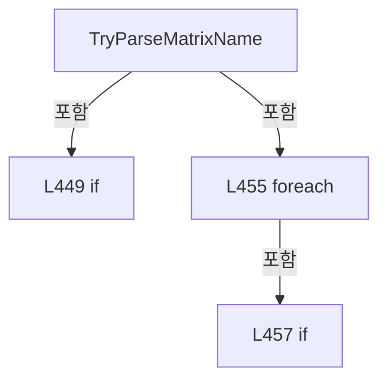

변경 전 점검: 입력/반환 타입, 위 호출자, 예외/취소 경로, 공유 상태와 저장·전송 소비자를 함께 확인합니다. 값의 단위나 물리 방향을 이름만으로 확정하지 않습니다.

### MethodDeclaration `ApplyDisplayModel` · L470–496

[Drilling.UI/Menu/Menus/CMenuCorrection.ReviewData.Display.cs:470–496](https://github.com/kjuws10-rgb/A3Drilling/blob/dfa5920e6301d9ec4b0eab1452ae59521aafc986/Drilling.UI/Menu/Menus/CMenuCorrection.ReviewData.Display.cs#L470-L496)

| 항목 | 실제 추출 값 |
| --- | --- |
| 서명 | void Drilling.UI.Menu.Menus.CMenuCorrection.CReviewDataPanel.ApplyDisplayModel(Drilling.UI.Menu.Menus.CMenuCorrection.ST_REVIEW_DATA_DISPLAY_MODEL, Drilling.Common.Review.ST_REVIEW_RESULT_FILE_DATA, Drilling.Common.Review.ST_REVIEW_RESULT_CATALOG_ITEM, Drilling.Common.Managers.ST_RECIPE_DEFINITION) |
| 접근/수식자 | Private / private |
| 반환/값 타입 | void |
| 소속 타입 | NamedType:Drilling.UI.Menu.Menus.CMenuCorrection.CReviewDataPanel |

입력 계약:

| 이름 | 타입 | 전달 | 선택/기본값 |
| --- | --- | --- | --- |
| model | Drilling.UI.Menu.Menus.CMenuCorrection.ST_REVIEW_DATA_DISPLAY_MODEL | None | False /  |
| resultFile | Drilling.Common.Review.ST_REVIEW_RESULT_FILE_DATA | None | False /  |
| catalog | Drilling.Common.Review.ST_REVIEW_RESULT_CATALOG_ITEM | None | False /  |
| recipe | Drilling.Common.Managers.ST_RECIPE_DEFINITION | None | False /  |

정적 호출자로 확인된 위치:

| 호출 파일/행 | 호출 표현식 | 런타임 분기 가능 |
| --- | --- | --- |
| [Drilling.UI/Menu/Menus/CMenuCorrection.ReviewData.Display.cs:201–201](https://github.com/kjuws10-rgb/A3Drilling/blob/dfa5920e6301d9ec4b0eab1452ae59521aafc986/Drilling.UI/Menu/Menus/CMenuCorrection.ReviewData.Display.cs#L201-L201) | ApplyDisplayModel | False |

호출하는 대상과 해석 범위:

| 원본 행 | 표현식 | 분석 상태 | 대상/소스 위치 |
| --- | --- | --- | --- |
| 485 | model.ResultCellNos.Order().FirstOrDefault | resolved | int System.Collections.Generic.IEnumerable<int>.FirstOrDefault<int>() |
| 485 | model.ResultCellNos.Order | resolved | System.Linq.IOrderedEnumerable<int> System.Collections.Generic.IEnumerable<int>.Order<int>() |
| 488 | ApplyCellSelection | resolved | void Drilling.UI.Menu.Menus.CMenuCorrection.CReviewDataPanel.ApplyCellSelection(int, bool) · Drilling.UI/Menu/Menus/CMenuCorrection.ReviewData.Display.cs:508 |
| 492 | RefreshGlassPreview | resolved | void Drilling.UI.Menu.Menus.CMenuCorrection.CReviewDataPanel.RefreshGlassPreview() · Drilling.UI/Menu/Menus/CMenuCorrection.ReviewData.Display.cs:604 |
| 495 | NotifyDisplayState | resolved | void Drilling.UI.Menu.Menus.CMenuCorrection.CReviewDataPanel.NotifyDisplayState() · Drilling.UI/Menu/Menus/CMenuCorrection.ReviewData.Display.cs:1299 |

본문의 실제 연산·분기·예외·반환 순서(원문 위치 순):

| 원본 행 | 종류 | 주석 해설 |
| --- | --- | --- |
| 476 | assignment | 값을 대상에 대입합니다: _loadedParameters = model.Parameters |
| 477 | assignment | 값을 대상에 대입합니다: _loadedResultFile = resultFile |
| 478 | assignment | 값을 대상에 대입합니다: _loadedCatalog = catalog |
| 479 | assignment | 값을 대상에 대입합니다: _loadedRecipe = recipe |
| 480 | assignment | 값을 대상에 대입합니다: _loadedCellCount = model.CellCount |
| 481 | assignment | 값을 대상에 대입합니다: _resultCellNos = model.ResultCellNos |
| 482 | assignment | 값을 대상에 대입합니다: _shotsByCell = model.ShotsByCell |
| 483 | assignment | 값을 대상에 대입합니다: _allRows = model.Rows |
| 484 | assignment | 값을 대상에 대입합니다: _hasLoadedData = true |
| 485 | call | 함수·델리게이트 또는 객체 생성자를 호출합니다: model.ResultCellNos.Order().FirstOrDefault() |
| 485 | call | 함수·델리게이트 또는 객체 생성자를 호출합니다: model.ResultCellNos.Order() |
| 485 | local-declaration | 지역 변수를 선언합니다: var firstCell = model.ResultCellNos.Order().FirstOrDefault(); |
| 485 | variable-initializer | 변수의 초기값을 지정합니다: firstCell = model.ResultCellNos.Order().FirstOrDefault() |
| 486 | if | 조건에 따라 분기합니다: if (firstCell > 0) |
| 488 | call | 함수·델리게이트 또는 객체 생성자를 호출합니다: ApplyCellSelection(firstCell, true) |
| 490 | else | 앞 조건이 거짓인 경로입니다: else |
| 492 | call | 함수·델리게이트 또는 객체 생성자를 호출합니다: RefreshGlassPreview() |
| 495 | call | 함수·델리게이트 또는 객체 생성자를 호출합니다: NotifyDisplayState() |

제어 구문의 포함 구조(실제 실행 순서/CFG가 아닌 구문 탐색 그림):

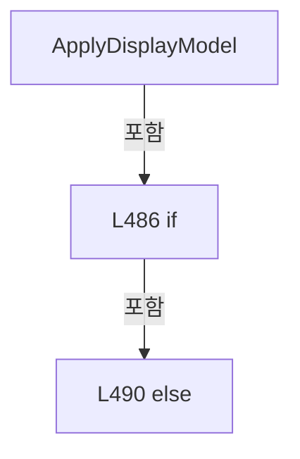

변경 전 점검: 입력/반환 타입, 위 호출자, 예외/취소 경로, 공유 상태와 저장·전송 소비자를 함께 확인합니다. 값의 단위나 물리 방향을 이름만으로 확정하지 않습니다.

### MethodDeclaration `SelectCell` · L498–506

[Drilling.UI/Menu/Menus/CMenuCorrection.ReviewData.Display.cs:498–506](https://github.com/kjuws10-rgb/A3Drilling/blob/dfa5920e6301d9ec4b0eab1452ae59521aafc986/Drilling.UI/Menu/Menus/CMenuCorrection.ReviewData.Display.cs#L498-L506)

| 항목 | 실제 추출 값 |
| --- | --- |
| 서명 | void Drilling.UI.Menu.Menus.CMenuCorrection.CReviewDataPanel.SelectCell(object?) |
| 접근/수식자 | Private / private |
| 반환/값 타입 | void |
| 소속 타입 | NamedType:Drilling.UI.Menu.Menus.CMenuCorrection.CReviewDataPanel |

입력 계약:

| 이름 | 타입 | 전달 | 선택/기본값 |
| --- | --- | --- | --- |
| parameter | object? | None | False /  |

현재 부분 분석에서 직접 연결된 호출자는 없습니다. XAML/이벤트/인터페이스·델리게이트·외부 진입을 추가 확인해야 하며, 미사용으로 판정한 것이 아닙니다.

호출하는 대상과 해석 범위:

| 원본 행 | 표현식 | 분석 상태 | 대상/소스 위치 |
| --- | --- | --- | --- |
| 500 | int.TryParse | resolved | bool int.TryParse(string?, System.Globalization.NumberStyles, System.IFormatProvider?, out int) |
| 500 | .ToString | resolved · 동적 구현 선택 가능 | string? object.ToString() |
| 500 | _resultCellNos.Contains | resolved · 동적 구현 선택 가능 | bool System.Collections.Generic.IReadOnlySet<int>.Contains(int) |
| 505 | ApplyCellSelection | resolved | void Drilling.UI.Menu.Menus.CMenuCorrection.CReviewDataPanel.ApplyCellSelection(int, bool) · Drilling.UI/Menu/Menus/CMenuCorrection.ReviewData.Display.cs:508 |

본문의 실제 연산·분기·예외·반환 순서(원문 위치 순):

| 원본 행 | 종류 | 주석 해설 |
| --- | --- | --- |
| 500 | call | 함수·델리게이트 또는 객체 생성자를 호출합니다: int.TryParse(parameter?.ToString(), NumberStyles.Integer, CultureInfo.InvariantCulture, out var cellNo) |
| 500 | call | 함수·델리게이트 또는 객체 생성자를 호출합니다: .ToString() |
| 500 | call | 함수·델리게이트 또는 객체 생성자를 호출합니다: _resultCellNos.Contains(cellNo) |
| 500 | if | 조건에 따라 분기합니다: if (!_hasLoadedData &#124;&#124; !int.TryParse(parameter?.ToString(), NumberStyles.Integer, CultureInfo.InvariantCulture, out var cellNo) &#124;&#124; !_resultCellNos.Contains(cellNo)) |
| 502 | return | 호출자에게 값 또는 제어를 반환합니다: return; |
| 505 | call | 함수·델리게이트 또는 객체 생성자를 호출합니다: ApplyCellSelection(cellNo) |

제어 구문의 포함 구조(실제 실행 순서/CFG가 아닌 구문 탐색 그림):

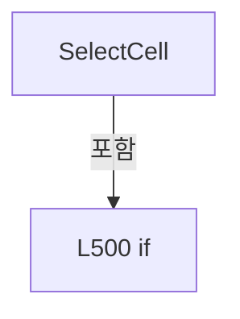

변경 전 점검: 입력/반환 타입, 위 호출자, 예외/취소 경로, 공유 상태와 저장·전송 소비자를 함께 확인합니다. 값의 단위나 물리 방향을 이름만으로 확정하지 않습니다.

### MethodDeclaration `ApplyCellSelection` · L508–547

[Drilling.UI/Menu/Menus/CMenuCorrection.ReviewData.Display.cs:508–547](https://github.com/kjuws10-rgb/A3Drilling/blob/dfa5920e6301d9ec4b0eab1452ae59521aafc986/Drilling.UI/Menu/Menus/CMenuCorrection.ReviewData.Display.cs#L508-L547)

| 항목 | 실제 추출 값 |
| --- | --- |
| 서명 | void Drilling.UI.Menu.Menus.CMenuCorrection.CReviewDataPanel.ApplyCellSelection(int, bool) |
| 접근/수식자 | Private / private |
| 반환/값 타입 | void |
| 소속 타입 | NamedType:Drilling.UI.Menu.Menus.CMenuCorrection.CReviewDataPanel |

입력 계약:

| 이름 | 타입 | 전달 | 선택/기본값 |
| --- | --- | --- | --- |
| cellNo | int | None | False /  |
| renderSynchronously | bool | None | True / false |

정적 호출자로 확인된 위치:

| 호출 파일/행 | 호출 표현식 | 런타임 분기 가능 |
| --- | --- | --- |
| [Drilling.UI/Menu/Menus/CMenuCorrection.ReviewData.Display.cs:488–488](https://github.com/kjuws10-rgb/A3Drilling/blob/dfa5920e6301d9ec4b0eab1452ae59521aafc986/Drilling.UI/Menu/Menus/CMenuCorrection.ReviewData.Display.cs#L488-L488) | ApplyCellSelection | False |
| [Drilling.UI/Menu/Menus/CMenuCorrection.ReviewData.Display.cs:505–505](https://github.com/kjuws10-rgb/A3Drilling/blob/dfa5920e6301d9ec4b0eab1452ae59521aafc986/Drilling.UI/Menu/Menus/CMenuCorrection.ReviewData.Display.cs#L505-L505) | ApplyCellSelection | False |
| [Drilling.UI/Menu/Menus/CMenuCorrection.ReviewData.Reinspection.cs:648–648](https://github.com/kjuws10-rgb/A3Drilling/blob/dfa5920e6301d9ec4b0eab1452ae59521aafc986/Drilling.UI/Menu/Menus/CMenuCorrection.ReviewData.Reinspection.cs#L648-L648) | ApplyCellSelection | False |

호출하는 대상과 해석 범위:

| 원본 행 | 표현식 | 분석 상태 | 대상/소스 위치 |
| --- | --- | --- | --- |
| 513 | _allRows.Where | resolved | System.Collections.Generic.IEnumerable<Drilling.UI.Menu.Menus.CMenuCorrection.ST_REVIEW_DATA_GRID_ROW> System.Collections.Generic.IEnumerable<Drilling.UI.Menu.Menus.CMenuCorrection.ST_REVIEW_DATA_GRID_ROW>.Where<Drilling.UI.Menu.Menus.CMenuCorrection.ST_REVIEW_DATA_GRID_ROW>(System.Func<Drilling.UI.Menu.Menus.CMenuCorrection.ST_REVIEW_DATA_GRID_ROW, bool>) |
| 518 | NotifyReinspectionCommandState | resolved | void Drilling.UI.Menu.Menus.CMenuCorrection.CReviewDataPanel.NotifyReinspectionCommandState() · Drilling.UI/Menu/Menus/CMenuCorrection.ReviewData.Reinspection.cs:700 |
| 522 | _allRows.Where(row => row.CellNo == cellNo).ToArray | resolved | Drilling.UI.Menu.Menus.CMenuCorrection.ST_REVIEW_DATA_GRID_ROW[] System.Collections.Generic.IEnumerable<Drilling.UI.Menu.Menus.CMenuCorrection.ST_REVIEW_DATA_GRID_ROW>.ToArray<Drilling.UI.Menu.Menus.CMenuCorrection.ST_REVIEW_DATA_GRID_ROW>() |
| 522 | _allRows.Where | resolved | System.Collections.Generic.IEnumerable<Drilling.UI.Menu.Menus.CMenuCorrection.ST_REVIEW_DATA_GRID_ROW> System.Collections.Generic.IEnumerable<Drilling.UI.Menu.Menus.CMenuCorrection.ST_REVIEW_DATA_GRID_ROW>.Where<Drilling.UI.Menu.Menus.CMenuCorrection.ST_REVIEW_DATA_GRID_ROW>(System.Func<Drilling.UI.Menu.Menus.CMenuCorrection.ST_REVIEW_DATA_GRID_ROW, bool>) |
| 523 | Rows.FirstOrDefault | resolved | Drilling.UI.Menu.Menus.CMenuCorrection.ST_REVIEW_DATA_GRID_ROW? System.Collections.Generic.IEnumerable<Drilling.UI.Menu.Menus.CMenuCorrection.ST_REVIEW_DATA_GRID_ROW>.FirstOrDefault<Drilling.UI.Menu.Menus.CMenuCorrection.ST_REVIEW_DATA_GRID_ROW>(System.Func<Drilling.UI.Menu.Menus.CMenuCorrection.ST_REVIEW_DATA_GRID_ROW, bool>) |
| 524 | Rows.FirstOrDefault | resolved | Drilling.UI.Menu.Menus.CMenuCorrection.ST_REVIEW_DATA_GRID_ROW? System.Collections.Generic.IEnumerable<Drilling.UI.Menu.Menus.CMenuCorrection.ST_REVIEW_DATA_GRID_ROW>.FirstOrDefault<Drilling.UI.Menu.Menus.CMenuCorrection.ST_REVIEW_DATA_GRID_ROW>() |
| 526 | RefreshScatterPlot | resolved | void Drilling.UI.Menu.Menus.CMenuCorrection.CReviewDataPanel.RefreshScatterPlot() · Drilling.UI/Menu/Menus/CMenuCorrection.ReviewData.Display.cs:717 |
| 529 | RefreshGlassPreview | resolved | void Drilling.UI.Menu.Menus.CMenuCorrection.CReviewDataPanel.RefreshGlassPreview() · Drilling.UI/Menu/Menus/CMenuCorrection.ReviewData.Display.cs:604 |
| 533 | RefreshCellSelectionOverlay | resolved | void Drilling.UI.Menu.Menus.CMenuCorrection.CReviewDataPanel.RefreshCellSelectionOverlay() · Drilling.UI/Menu/Menus/CMenuCorrection.ReviewData.Display.cs:909 |
| 538 | RefreshShotMap | resolved | void Drilling.UI.Menu.Menus.CMenuCorrection.CReviewDataPanel.RefreshShotMap() · Drilling.UI/Menu/Menus/CMenuCorrection.ReviewData.Display.cs:634 |
| 542 | QueueShotMapRender | resolved | void Drilling.UI.Menu.Menus.CMenuCorrection.CReviewDataPanel.QueueShotMapRender(int, string) · Drilling.UI/Menu/Menus/CMenuCorrection.ReviewData.Display.cs:919 |
| 545 | RefreshSelectionText | resolved | void Drilling.UI.Menu.Menus.CMenuCorrection.CReviewDataPanel.RefreshSelectionText() · Drilling.UI/Menu/Menus/CMenuCorrection.ReviewData.Display.cs:956 |
| 546 | NotifyDisplayState | resolved | void Drilling.UI.Menu.Menus.CMenuCorrection.CReviewDataPanel.NotifyDisplayState() · Drilling.UI/Menu/Menus/CMenuCorrection.ReviewData.Display.cs:1299 |

본문의 실제 연산·분기·예외·반환 순서(원문 위치 순):

| 원본 행 | 종류 | 주석 해설 |
| --- | --- | --- |
| 510 | local-declaration | 지역 변수를 선언합니다: var previousCellNo = _selectedCellNo; |
| 510 | variable-initializer | 변수의 초기값을 지정합니다: previousCellNo = _selectedCellNo |
| 511 | if | 조건에 따라 분기합니다: if (previousCellNo > 0 && previousCellNo != cellNo) |
| 513 | call | 함수·델리게이트 또는 객체 생성자를 호출합니다: _allRows.Where(row => row.CellNo == previousCellNo) |
| 513 | foreach | 컬렉션 요소를 순회합니다: foreach (var row in _allRows.Where(row => row.CellNo == previousCellNo)) |
| 515 | assignment | 값을 대상에 대입합니다: row.IsReinspectionSelected = false |
| 518 | call | 함수·델리게이트 또는 객체 생성자를 호출합니다: NotifyReinspectionCommandState() |
| 521 | assignment | 값을 대상에 대입합니다: _selectedCellNo = cellNo |
| 522 | assignment | 값을 대상에 대입합니다: Rows = _allRows.Where(row => row.CellNo == cellNo).ToArray() |
| 522 | call | 함수·델리게이트 또는 객체 생성자를 호출합니다: _allRows.Where(row => row.CellNo == cellNo).ToArray() |
| 522 | call | 함수·델리게이트 또는 객체 생성자를 호출합니다: _allRows.Where(row => row.CellNo == cellNo) |
| 523 | call | 함수·델리게이트 또는 객체 생성자를 호출합니다: Rows.FirstOrDefault(row => row.IsResolved) |
| 523 | local-declaration | 지역 변수를 선언합니다: var firstResolved = Rows.FirstOrDefault(row => row.IsResolved); |
| 523 | variable-initializer | 변수의 초기값을 지정합니다: firstResolved = Rows.FirstOrDefault(row => row.IsResolved) |
| 524 | assignment | 값을 대상에 대입합니다: SelectedRow = firstResolved ?? Rows.FirstOrDefault() |
| 524 | call | 함수·델리게이트 또는 객체 생성자를 호출합니다: Rows.FirstOrDefault() |
| 525 | assignment | 값을 대상에 대입합니다: _selectedShotKey = SelectedRow?.ShotKey ?? "" |
| 526 | call | 함수·델리게이트 또는 객체 생성자를 호출합니다: RefreshScatterPlot() |
| 527 | if | 조건에 따라 분기합니다: if (GlassPreviewImage is null) |
| 529 | call | 함수·델리게이트 또는 객체 생성자를 호출합니다: RefreshGlassPreview() |
| 531 | else | 앞 조건이 거짓인 경로입니다: else |
| 533 | call | 함수·델리게이트 또는 객체 생성자를 호출합니다: RefreshCellSelectionOverlay() |
| 536 | if | 조건에 따라 분기합니다: if (renderSynchronously) |
| 538 | call | 함수·델리게이트 또는 객체 생성자를 호출합니다: RefreshShotMap() |
| 540 | else | 앞 조건이 거짓인 경로입니다: else |
| 542 | call | 함수·델리게이트 또는 객체 생성자를 호출합니다: QueueShotMapRender(cellNo, _selectedShotKey) |
| 545 | call | 함수·델리게이트 또는 객체 생성자를 호출합니다: RefreshSelectionText() |
| 546 | call | 함수·델리게이트 또는 객체 생성자를 호출합니다: NotifyDisplayState() |

제어 구문의 포함 구조(실제 실행 순서/CFG가 아닌 구문 탐색 그림):

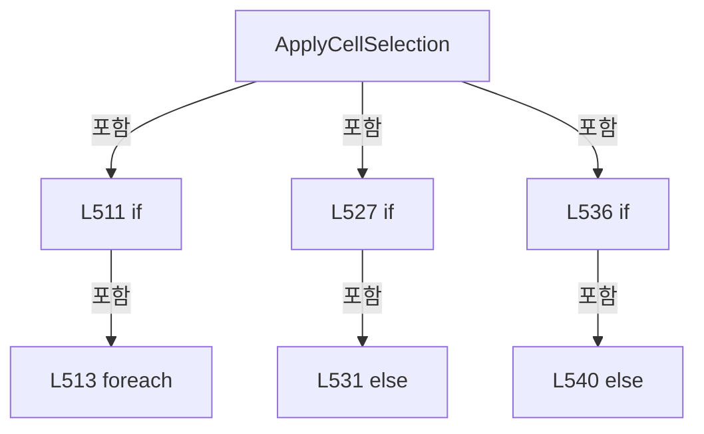

변경 전 점검: 입력/반환 타입, 위 호출자, 예외/취소 경로, 공유 상태와 저장·전송 소비자를 함께 확인합니다. 값의 단위나 물리 방향을 이름만으로 확정하지 않습니다.

### MethodDeclaration `SelectShotAt` · L549–570

[Drilling.UI/Menu/Menus/CMenuCorrection.ReviewData.Display.cs:549–570](https://github.com/kjuws10-rgb/A3Drilling/blob/dfa5920e6301d9ec4b0eab1452ae59521aafc986/Drilling.UI/Menu/Menus/CMenuCorrection.ReviewData.Display.cs#L549-L570)

| 항목 | 실제 추출 값 |
| --- | --- |
| 서명 | void Drilling.UI.Menu.Menus.CMenuCorrection.CReviewDataPanel.SelectShotAt(double, double) |
| 접근/수식자 | Public / public |
| 반환/값 타입 | void |
| 소속 타입 | NamedType:Drilling.UI.Menu.Menus.CMenuCorrection.CReviewDataPanel |

입력 계약:

| 이름 | 타입 | 전달 | 선택/기본값 |
| --- | --- | --- | --- |
| x | double | None | False /  |
| y | double | None | False /  |

현재 부분 분석에서 직접 연결된 호출자는 없습니다. XAML/이벤트/인터페이스·델리게이트·외부 진입을 추가 확인해야 하며, 미사용으로 판정한 것이 아닙니다.

호출하는 대상과 해석 범위:

| 원본 행 | 표현식 | 분석 상태 | 대상/소스 위치 |
| --- | --- | --- | --- |
| 551 | _shotsByCell.TryGetValue | resolved · 동적 구현 선택 가능 | bool System.Collections.Generic.IReadOnlyDictionary<int, System.Collections.Generic.IReadOnlyList<Drilling.UI.Menu.Menus.CMenuCorrection.ST_REVIEW_DATA_SHOT_POSITION>>.TryGetValue(int, out System.Collections.Generic.IReadOnlyList<Drilling.UI.Menu.Menus.CMenuCorrection.ST_REVIEW_DATA_SHOT_POSITION>) |
| 557 | GetReviewDataShotMapRect | resolved | Rect Drilling.UI.Menu.Menus.CMenuCorrection.CReviewDataPanel.GetReviewDataShotMapRect(int, int) · Drilling.UI/Menu/Menus/CMenuCorrection.ReviewData.Display.cs:1212 |
| 558 | mapRect.Contains | unresolved | None |
| 558 | new Point | unresolved | None |
| 563 | Math.Clamp | resolved | int System.Math.Clamp(int, int, int) |
| 564 | Math.Clamp | resolved | int System.Math.Clamp(int, int, int) |
| 565 | shots.FirstOrDefault | resolved | Drilling.UI.Menu.Menus.CMenuCorrection.ST_REVIEW_DATA_SHOT_POSITION? System.Collections.Generic.IEnumerable<Drilling.UI.Menu.Menus.CMenuCorrection.ST_REVIEW_DATA_SHOT_POSITION>.FirstOrDefault<Drilling.UI.Menu.Menus.CMenuCorrection.ST_REVIEW_DATA_SHOT_POSITION>(System.Func<Drilling.UI.Menu.Menus.CMenuCorrection.ST_REVIEW_DATA_SHOT_POSITION, bool>) |
| 568 | ApplyShotSelection | resolved | void Drilling.UI.Menu.Menus.CMenuCorrection.CReviewDataPanel.ApplyShotSelection(string, Drilling.UI.Menu.Menus.CMenuCorrection.ST_REVIEW_DATA_GRID_ROW?) · Drilling.UI/Menu/Menus/CMenuCorrection.ReviewData.Display.cs:585 |

본문의 실제 연산·분기·예외·반환 순서(원문 위치 순):

| 원본 행 | 종류 | 주석 해설 |
| --- | --- | --- |
| 551 | call | 함수·델리게이트 또는 객체 생성자를 호출합니다: _shotsByCell.TryGetValue(_selectedCellNo, out var shots) |
| 551 | if | 조건에 따라 분기합니다: if (!_hasLoadedData &#124;&#124; !_shotsByCell.TryGetValue(_selectedCellNo, out var shots) &#124;&#124; shots.Count == 0) |
| 553 | return | 호출자에게 값 또는 제어를 반환합니다: return; |
| 556 | local-declaration | 지역 변수를 선언합니다: var first = shots[0]; |
| 556 | variable-initializer | 변수의 초기값을 지정합니다: first = shots[0] |
| 557 | call | 함수·델리게이트 또는 객체 생성자를 호출합니다: GetReviewDataShotMapRect(first.GroupCountX, first.GroupCountY) |
| 557 | local-declaration | 지역 변수를 선언합니다: var mapRect = GetReviewDataShotMapRect(first.GroupCountX, first.GroupCountY); |
| 557 | variable-initializer | 변수의 초기값을 지정합니다: mapRect = GetReviewDataShotMapRect(first.GroupCountX, first.GroupCountY) |
| 558 | call | 함수·델리게이트 또는 객체 생성자를 호출합니다: mapRect.Contains(new Point(x, y)) |
| 558 | call | 함수·델리게이트 또는 객체 생성자를 호출합니다: new Point(x, y) |
| 558 | if | 조건에 따라 분기합니다: if (!mapRect.Contains(new Point(x, y))) |
| 560 | return | 호출자에게 값 또는 제어를 반환합니다: return; |
| 563 | call | 함수·델리게이트 또는 객체 생성자를 호출합니다: Math.Clamp((int)((x - mapRect.Left) / mapRect.Width * first.GroupCountX), 0, first.GroupCountX - 1) |
| 563 | local-declaration | 지역 변수를 선언합니다: var column = Math.Clamp((int)((x - mapRect.Left) / mapRect.Width * first.GroupCountX), 0, first.GroupCountX - 1); |
| 563 | variable-initializer | 변수의 초기값을 지정합니다: column = Math.Clamp((int)((x - mapRect.Left) / mapRect.Width * first.GroupCountX), 0, first.GroupCountX - 1) |
| 564 | call | 함수·델리게이트 또는 객체 생성자를 호출합니다: Math.Clamp((int)((y - mapRect.Top) / mapRect.Height * first.GroupCountY), 0, first.GroupCountY - 1) |
| 564 | local-declaration | 지역 변수를 선언합니다: var row = Math.Clamp((int)((y - mapRect.Top) / mapRect.Height * first.GroupCountY), 0, first.GroupCountY - 1); |
| 564 | variable-initializer | 변수의 초기값을 지정합니다: row = Math.Clamp((int)((y - mapRect.Top) / mapRect.Height * first.GroupCountY), 0, first.GroupCountY - 1) |
| 565 | call | 함수·델리게이트 또는 객체 생성자를 호출합니다: shots.FirstOrDefault(item => item.GroupColumn == column && item.GroupRow == row) |
| 565 | local-declaration | 지역 변수를 선언합니다: var shot = shots.FirstOrDefault(item => item.GroupColumn == column && item.GroupRow == row); |
| 565 | variable-initializer | 변수의 초기값을 지정합니다: shot = shots.FirstOrDefault(item => item.GroupColumn == column && item.GroupRow == row) |
| 566 | if | 조건에 따라 분기합니다: if (shot is not null) |
| 568 | call | 함수·델리게이트 또는 객체 생성자를 호출합니다: ApplyShotSelection(shot.ShotKey, null) |

제어 구문의 포함 구조(실제 실행 순서/CFG가 아닌 구문 탐색 그림):

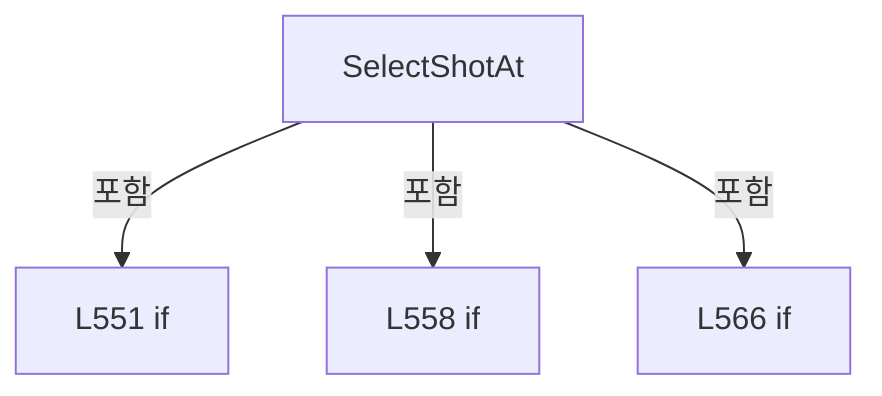

변경 전 점검: 입력/반환 타입, 위 호출자, 예외/취소 경로, 공유 상태와 저장·전송 소비자를 함께 확인합니다. 값의 단위나 물리 방향을 이름만으로 확정하지 않습니다.

### MethodDeclaration `SelectRow` · L572–583

[Drilling.UI/Menu/Menus/CMenuCorrection.ReviewData.Display.cs:572–583](https://github.com/kjuws10-rgb/A3Drilling/blob/dfa5920e6301d9ec4b0eab1452ae59521aafc986/Drilling.UI/Menu/Menus/CMenuCorrection.ReviewData.Display.cs#L572-L583)

| 항목 | 실제 추출 값 |
| --- | --- |
| 서명 | void Drilling.UI.Menu.Menus.CMenuCorrection.CReviewDataPanel.SelectRow(Drilling.UI.Menu.Menus.CMenuCorrection.ST_REVIEW_DATA_GRID_ROW) |
| 접근/수식자 | Public / public |
| 반환/값 타입 | void |
| 소속 타입 | NamedType:Drilling.UI.Menu.Menus.CMenuCorrection.CReviewDataPanel |

입력 계약:

| 이름 | 타입 | 전달 | 선택/기본값 |
| --- | --- | --- | --- |
| row | Drilling.UI.Menu.Menus.CMenuCorrection.ST_REVIEW_DATA_GRID_ROW | None | False /  |

정적 호출자로 확인된 위치:

| 호출 파일/행 | 호출 표현식 | 런타임 분기 가능 |
| --- | --- | --- |
| [Drilling.UI/Views/CReviewDataView.xaml.cs:251–251](https://github.com/kjuws10-rgb/A3Drilling/blob/dfa5920e6301d9ec4b0eab1452ae59521aafc986/Drilling.UI/Views/CReviewDataView.xaml.cs#L251-L251) | panel.SelectRow | False |

호출하는 대상과 해석 범위:

| 원본 행 | 표현식 | 분석 상태 | 대상/소스 위치 |
| --- | --- | --- | --- |
| 577 | Rows.Any | resolved | bool System.Collections.Generic.IEnumerable<Drilling.UI.Menu.Menus.CMenuCorrection.ST_REVIEW_DATA_GRID_ROW>.Any<Drilling.UI.Menu.Menus.CMenuCorrection.ST_REVIEW_DATA_GRID_ROW>(System.Func<Drilling.UI.Menu.Menus.CMenuCorrection.ST_REVIEW_DATA_GRID_ROW, bool>) |
| 577 | ReferenceEquals | resolved | bool object.ReferenceEquals(object?, object?) |
| 582 | ApplyShotSelection | resolved | void Drilling.UI.Menu.Menus.CMenuCorrection.CReviewDataPanel.ApplyShotSelection(string, Drilling.UI.Menu.Menus.CMenuCorrection.ST_REVIEW_DATA_GRID_ROW?) · Drilling.UI/Menu/Menus/CMenuCorrection.ReviewData.Display.cs:585 |

본문의 실제 연산·분기·예외·반환 순서(원문 위치 순):

| 원본 행 | 종류 | 주석 해설 |
| --- | --- | --- |
| 574 | if | 조건에 따라 분기합니다: if (!_hasLoadedData &#124;&#124; row is null &#124;&#124; row.CellNo != _selectedCellNo &#124;&#124; !Rows.Any(currentRow => ReferenceEquals(currentRow, row))) |
| 577 | call | 함수·델리게이트 또는 객체 생성자를 호출합니다: Rows.Any(currentRow => ReferenceEquals(currentRow, row)) |
| 577 | call | 함수·델리게이트 또는 객체 생성자를 호출합니다: ReferenceEquals(currentRow, row) |
| 579 | return | 호출자에게 값 또는 제어를 반환합니다: return; |
| 582 | call | 함수·델리게이트 또는 객체 생성자를 호출합니다: ApplyShotSelection(row.ShotKey, row) |

제어 구문의 포함 구조(실제 실행 순서/CFG가 아닌 구문 탐색 그림):

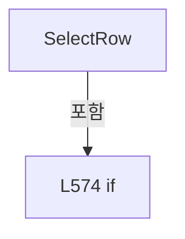

변경 전 점검: 입력/반환 타입, 위 호출자, 예외/취소 경로, 공유 상태와 저장·전송 소비자를 함께 확인합니다. 값의 단위나 물리 방향을 이름만으로 확정하지 않습니다.

### MethodDeclaration `ApplyShotSelection` · L585–602

[Drilling.UI/Menu/Menus/CMenuCorrection.ReviewData.Display.cs:585–602](https://github.com/kjuws10-rgb/A3Drilling/blob/dfa5920e6301d9ec4b0eab1452ae59521aafc986/Drilling.UI/Menu/Menus/CMenuCorrection.ReviewData.Display.cs#L585-L602)

| 항목 | 실제 추출 값 |
| --- | --- |
| 서명 | void Drilling.UI.Menu.Menus.CMenuCorrection.CReviewDataPanel.ApplyShotSelection(string, Drilling.UI.Menu.Menus.CMenuCorrection.ST_REVIEW_DATA_GRID_ROW?) |
| 접근/수식자 | Private / private |
| 반환/값 타입 | void |
| 소속 타입 | NamedType:Drilling.UI.Menu.Menus.CMenuCorrection.CReviewDataPanel |

입력 계약:

| 이름 | 타입 | 전달 | 선택/기본값 |
| --- | --- | --- | --- |
| shotKey | string | None | False /  |
| preferredRow | Drilling.UI.Menu.Menus.CMenuCorrection.ST_REVIEW_DATA_GRID_ROW? | None | False /  |

정적 호출자로 확인된 위치:

| 호출 파일/행 | 호출 표현식 | 런타임 분기 가능 |
| --- | --- | --- |
| [Drilling.UI/Menu/Menus/CMenuCorrection.ReviewData.Display.cs:568–568](https://github.com/kjuws10-rgb/A3Drilling/blob/dfa5920e6301d9ec4b0eab1452ae59521aafc986/Drilling.UI/Menu/Menus/CMenuCorrection.ReviewData.Display.cs#L568-L568) | ApplyShotSelection | False |
| [Drilling.UI/Menu/Menus/CMenuCorrection.ReviewData.Display.cs:582–582](https://github.com/kjuws10-rgb/A3Drilling/blob/dfa5920e6301d9ec4b0eab1452ae59521aafc986/Drilling.UI/Menu/Menus/CMenuCorrection.ReviewData.Display.cs#L582-L582) | ApplyShotSelection | False |
| [Drilling.UI/Menu/Menus/CMenuCorrection.ReviewData.Display.cs:666–666](https://github.com/kjuws10-rgb/A3Drilling/blob/dfa5920e6301d9ec4b0eab1452ae59521aafc986/Drilling.UI/Menu/Menus/CMenuCorrection.ReviewData.Display.cs#L666-L666) | ApplyShotSelection | False |
| [Drilling.UI/Menu/Menus/CMenuCorrection.ReviewData.Reinspection.cs:655–655](https://github.com/kjuws10-rgb/A3Drilling/blob/dfa5920e6301d9ec4b0eab1452ae59521aafc986/Drilling.UI/Menu/Menus/CMenuCorrection.ReviewData.Reinspection.cs#L655-L655) | ApplyShotSelection | False |

호출하는 대상과 해석 범위:

| 원본 행 | 표현식 | 분석 상태 | 대상/소스 위치 |
| --- | --- | --- | --- |
| 587 | string.IsNullOrWhiteSpace | resolved | bool string.IsNullOrWhiteSpace(string?) |
| 593 | Rows.FirstOrDefault | resolved | Drilling.UI.Menu.Menus.CMenuCorrection.ST_REVIEW_DATA_GRID_ROW? System.Collections.Generic.IEnumerable<Drilling.UI.Menu.Menus.CMenuCorrection.ST_REVIEW_DATA_GRID_ROW>.FirstOrDefault<Drilling.UI.Menu.Menus.CMenuCorrection.ST_REVIEW_DATA_GRID_ROW>(System.Func<Drilling.UI.Menu.Menus.CMenuCorrection.ST_REVIEW_DATA_GRID_ROW, bool>) |
| 593 | row.ShotKey.Equals | resolved | bool string.Equals(string?, System.StringComparison) |
| 594 | QueueShotMapRender | resolved | void Drilling.UI.Menu.Menus.CMenuCorrection.CReviewDataPanel.QueueShotMapRender(int, string) · Drilling.UI/Menu/Menus/CMenuCorrection.ReviewData.Display.cs:919 |
| 595 | RefreshScatterPlot | resolved | void Drilling.UI.Menu.Menus.CMenuCorrection.CReviewDataPanel.RefreshScatterPlot() · Drilling.UI/Menu/Menus/CMenuCorrection.ReviewData.Display.cs:717 |
| 596 | RefreshSelectionText | resolved | void Drilling.UI.Menu.Menus.CMenuCorrection.CReviewDataPanel.RefreshSelectionText() · Drilling.UI/Menu/Menus/CMenuCorrection.ReviewData.Display.cs:956 |
| 597 | Notify | resolved | void Drilling.UI.Menu.Menus.CMenuCorrection.CReviewDataPanel.Notify(string) · Drilling.UI/Menu/Menus/CMenuCorrection.ReviewData.cs:427 |
| 597 | nameof | unresolved | None |
| 598 | Notify | resolved | void Drilling.UI.Menu.Menus.CMenuCorrection.CReviewDataPanel.Notify(string) · Drilling.UI/Menu/Menus/CMenuCorrection.ReviewData.cs:427 |
| 598 | nameof | unresolved | None |
| 599 | Notify | resolved | void Drilling.UI.Menu.Menus.CMenuCorrection.CReviewDataPanel.Notify(string) · Drilling.UI/Menu/Menus/CMenuCorrection.ReviewData.cs:427 |
| 599 | nameof | unresolved | None |
| 600 | NotifyReinspectionCommandState | resolved | void Drilling.UI.Menu.Menus.CMenuCorrection.CReviewDataPanel.NotifyReinspectionCommandState() · Drilling.UI/Menu/Menus/CMenuCorrection.ReviewData.Reinspection.cs:700 |
| 601 | NotifyResultEditCommandState | resolved | void Drilling.UI.Menu.Menus.CMenuCorrection.CReviewDataPanel.NotifyResultEditCommandState() · Drilling.UI/Menu/Menus/CMenuCorrection.ReviewData.Edit.cs:590 |

본문의 실제 연산·분기·예외·반환 순서(원문 위치 순):

| 원본 행 | 종류 | 주석 해설 |
| --- | --- | --- |
| 587 | call | 함수·델리게이트 또는 객체 생성자를 호출합니다: string.IsNullOrWhiteSpace(shotKey) |
| 587 | if | 조건에 따라 분기합니다: if (string.IsNullOrWhiteSpace(shotKey)) |
| 589 | return | 호출자에게 값 또는 제어를 반환합니다: return; |
| 592 | assignment | 값을 대상에 대입합니다: _selectedShotKey = shotKey |
| 593 | assignment | 값을 대상에 대입합니다: SelectedRow = preferredRow ?? Rows.FirstOrDefault(row => row.ShotKey.Equals(shotKey, StringComparison.OrdinalIgnoreCase)) |
| 593 | call | 함수·델리게이트 또는 객체 생성자를 호출합니다: Rows.FirstOrDefault(row => row.ShotKey.Equals(shotKey, StringComparison.OrdinalIgnoreCase)) |
| 593 | call | 함수·델리게이트 또는 객체 생성자를 호출합니다: row.ShotKey.Equals(shotKey, StringComparison.OrdinalIgnoreCase) |
| 594 | call | 함수·델리게이트 또는 객체 생성자를 호출합니다: QueueShotMapRender(_selectedCellNo, _selectedShotKey) |
| 595 | call | 함수·델리게이트 또는 객체 생성자를 호출합니다: RefreshScatterPlot() |
| 596 | call | 함수·델리게이트 또는 객체 생성자를 호출합니다: RefreshSelectionText() |
| 597 | call | 함수·델리게이트 또는 객체 생성자를 호출합니다: Notify(nameof(SelectedRow)) |
| 597 | call | 함수·델리게이트 또는 객체 생성자를 호출합니다: nameof(SelectedRow) |
| 598 | call | 함수·델리게이트 또는 객체 생성자를 호출합니다: Notify(nameof(SelectedShotTitle)) |
| 598 | call | 함수·델리게이트 또는 객체 생성자를 호출합니다: nameof(SelectedShotTitle) |
| 599 | call | 함수·델리게이트 또는 객체 생성자를 호출합니다: Notify(nameof(SelectedShotDetail)) |
| 599 | call | 함수·델리게이트 또는 객체 생성자를 호출합니다: nameof(SelectedShotDetail) |
| 600 | call | 함수·델리게이트 또는 객체 생성자를 호출합니다: NotifyReinspectionCommandState() |
| 601 | call | 함수·델리게이트 또는 객체 생성자를 호출합니다: NotifyResultEditCommandState() |

제어 구문의 포함 구조(실제 실행 순서/CFG가 아닌 구문 탐색 그림):

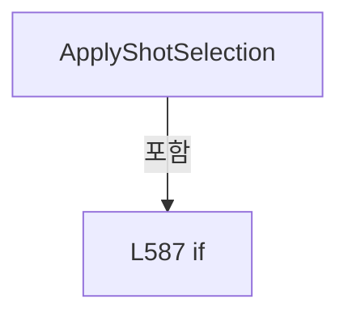

변경 전 점검: 입력/반환 타입, 위 호출자, 예외/취소 경로, 공유 상태와 저장·전송 소비자를 함께 확인합니다. 값의 단위나 물리 방향을 이름만으로 확정하지 않습니다.

### MethodDeclaration `RefreshGlassPreview` · L604–632

[Drilling.UI/Menu/Menus/CMenuCorrection.ReviewData.Display.cs:604–632](https://github.com/kjuws10-rgb/A3Drilling/blob/dfa5920e6301d9ec4b0eab1452ae59521aafc986/Drilling.UI/Menu/Menus/CMenuCorrection.ReviewData.Display.cs#L604-L632)

| 항목 | 실제 추출 값 |
| --- | --- |
| 서명 | void Drilling.UI.Menu.Menus.CMenuCorrection.CReviewDataPanel.RefreshGlassPreview() |
| 접근/수식자 | Private / private |
| 반환/값 타입 | void |
| 소속 타입 | NamedType:Drilling.UI.Menu.Menus.CMenuCorrection.CReviewDataPanel |

정적 호출자로 확인된 위치:

| 호출 파일/행 | 호출 표현식 | 런타임 분기 가능 |
| --- | --- | --- |
| [Drilling.UI/Menu/Menus/CMenuCorrection.ReviewData.Display.cs:492–492](https://github.com/kjuws10-rgb/A3Drilling/blob/dfa5920e6301d9ec4b0eab1452ae59521aafc986/Drilling.UI/Menu/Menus/CMenuCorrection.ReviewData.Display.cs#L492-L492) | RefreshGlassPreview | False |
| [Drilling.UI/Menu/Menus/CMenuCorrection.ReviewData.Display.cs:529–529](https://github.com/kjuws10-rgb/A3Drilling/blob/dfa5920e6301d9ec4b0eab1452ae59521aafc986/Drilling.UI/Menu/Menus/CMenuCorrection.ReviewData.Display.cs#L529-L529) | RefreshGlassPreview | False |
| [Drilling.UI/Menu/Menus/CMenuCorrection.ReviewData.Reinspection.cs:134–134](https://github.com/kjuws10-rgb/A3Drilling/blob/dfa5920e6301d9ec4b0eab1452ae59521aafc986/Drilling.UI/Menu/Menus/CMenuCorrection.ReviewData.Reinspection.cs#L134-L134) | RefreshGlassPreview | False |

호출하는 대상과 해석 범위:

| 원본 행 | 표현식 | 분석 상태 | 대상/소스 위치 |
| --- | --- | --- | --- |
| 610 | Camera.Clear | resolved | void Drilling.UI.Menu.Menus.CReviewCameraPreview.Clear() · Drilling.UI/Menu/Menus/CMenuReview.cs:4267 |
| 614 | BuildReviewDataGlassPreview | resolved | Drilling.UI.Menu.Menus.CMenuCorrection.ST_REVIEW_DATA_GLASS_PREVIEW Drilling.UI.Menu.Menus.CMenuCorrection.CReviewDataPanel.BuildReviewDataGlassPreview(System.Collections.Generic.IReadOnlyDictionary<string, string>, int, System.Collections.Generic.IReadOnlySet<int>, int) · Drilling.UI/Menu/Menus/CMenuCorrection.ReviewData.Display.cs:977 |
| 622 | new Dictionary<string, string> | resolved | System.Collections.Generic.Dictionary<string, string>.Dictionary(System.Collections.Generic.IEnumerable<System.Collections.Generic.KeyValuePair<string, string>>, System.Collections.Generic.IEqualityComparer<string>?) |
| 626 | Camera.Configure | resolved | void Drilling.UI.Menu.Menus.CReviewCameraPreview.Configure(System.Collections.Generic.IReadOnlyDictionary<string, string>, Rect) · Drilling.UI/Menu/Menus/CMenuReview.cs:4222 |
| 630 | Camera.Clear | resolved | void Drilling.UI.Menu.Menus.CReviewCameraPreview.Clear() · Drilling.UI/Menu/Menus/CMenuReview.cs:4267 |

본문의 실제 연산·분기·예외·반환 순서(원문 위치 순):

| 원본 행 | 종류 | 주석 해설 |
| --- | --- | --- |
| 606 | if | 조건에 따라 분기합니다: if (_loadedParameters.Count == 0 &#124;&#124; _loadedCellCount <= 0) |
| 608 | assignment | 값을 대상에 대입합니다: GlassPreviewImage = null |
| 609 | assignment | 값을 대상에 대입합니다: CellLabels = [] |
| 610 | call | 함수·델리게이트 또는 객체 생성자를 호출합니다: Camera.Clear() |
| 611 | return | 호출자에게 값 또는 제어를 반환합니다: return; |
| 614 | call | 함수·델리게이트 또는 객체 생성자를 호출합니다: BuildReviewDataGlassPreview(_loadedParameters, _loadedCellCount, _resultCellNos, _selectedCellNo) |
| 614 | local-declaration | 지역 변수를 선언합니다: var preview = BuildReviewDataGlassPreview(_loadedParameters, _loadedCellCount, _resultCellNos, _selectedCellNo); |
| 614 | variable-initializer | 변수의 초기값을 지정합니다: preview = BuildReviewDataGlassPreview(_loadedParameters, _loadedCellCount, _resultCellNos, _selectedCellNo) |
| 615 | assignment | 값을 대상에 대입합니다: GlassPreviewImage = preview.Image |
| 616 | assignment | 값을 대상에 대입합니다: CellLabels = preview.CellLabels |
| 617 | assignment | 값을 대상에 대입합니다: GlassSurfaceWidth = preview.Width |
| 618 | assignment | 값을 대상에 대입합니다: GlassSurfaceHeight = preview.Height |
| 619 | assignment | 값을 대상에 대입합니다: GlassSummary = $"{_resultCellNos.Count:N0} Result Cells / {_allRows.Count:N0} Result Rows" |
| 620 | if | 조건에 따라 분기합니다: if (_isReinspectionMode) |
| 622 | call | 함수·델리게이트 또는 객체 생성자를 호출합니다: new Dictionary<string, string>(_loadedParameters, StringComparer.OrdinalIgnoreCase) { [CReviewCameraPreview.UseSettingKey] = "ON" } |
| 622 | local-declaration | 지역 변수를 선언합니다: var cameraParameters = new Dictionary<string, string>(_loadedParameters, StringComparer.OrdinalIgnoreCase) { [CReviewCameraPreview.UseSettingKey] = "ON" }; |
| 622 | variable-initializer | 변수의 초기값을 지정합니다: cameraParameters = new Dictionary<string, string>(_loadedParameters, StringComparer.OrdinalIgnoreCase) { [CReviewCameraPreview.UseSettingKey] = "ON" } |
| 624 | assignment | 값을 대상에 대입합니다: [CReviewCameraPreview.UseSettingKey] = "ON" |
| 626 | call | 함수·델리게이트 또는 객체 생성자를 호출합니다: Camera.Configure(cameraParameters, preview.GlassBounds) |
| 628 | else | 앞 조건이 거짓인 경로입니다: else |
| 630 | call | 함수·델리게이트 또는 객체 생성자를 호출합니다: Camera.Clear() |

제어 구문의 포함 구조(실제 실행 순서/CFG가 아닌 구문 탐색 그림):

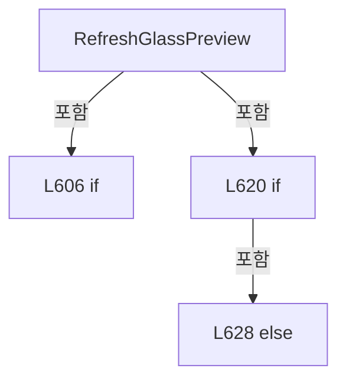

변경 전 점검: 입력/반환 타입, 위 호출자, 예외/취소 경로, 공유 상태와 저장·전송 소비자를 함께 확인합니다. 값의 단위나 물리 방향을 이름만으로 확정하지 않습니다.

### MethodDeclaration `RefreshShotMap` · L634–641

[Drilling.UI/Menu/Menus/CMenuCorrection.ReviewData.Display.cs:634–641](https://github.com/kjuws10-rgb/A3Drilling/blob/dfa5920e6301d9ec4b0eab1452ae59521aafc986/Drilling.UI/Menu/Menus/CMenuCorrection.ReviewData.Display.cs#L634-L641)

| 항목 | 실제 추출 값 |
| --- | --- |
| 서명 | void Drilling.UI.Menu.Menus.CMenuCorrection.CReviewDataPanel.RefreshShotMap() |
| 접근/수식자 | Private / private |
| 반환/값 타입 | void |
| 소속 타입 | NamedType:Drilling.UI.Menu.Menus.CMenuCorrection.CReviewDataPanel |

정적 호출자로 확인된 위치:

| 호출 파일/행 | 호출 표현식 | 런타임 분기 가능 |
| --- | --- | --- |
| [Drilling.UI/Menu/Menus/CMenuCorrection.ReviewData.Display.cs:538–538](https://github.com/kjuws10-rgb/A3Drilling/blob/dfa5920e6301d9ec4b0eab1452ae59521aafc986/Drilling.UI/Menu/Menus/CMenuCorrection.ReviewData.Display.cs#L538-L538) | RefreshShotMap | False |

호출하는 대상과 해석 범위:

| 원본 행 | 표현식 | 분석 상태 | 대상/소스 위치 |
| --- | --- | --- | --- |
| 636 | _shotsByCell.GetValueOrDefault | resolved | System.Collections.Generic.IReadOnlyList<Drilling.UI.Menu.Menus.CMenuCorrection.ST_REVIEW_DATA_SHOT_POSITION> System.Collections.Generic.IReadOnlyDictionary<int, System.Collections.Generic.IReadOnlyList<Drilling.UI.Menu.Menus.CMenuCorrection.ST_REVIEW_DATA_SHOT_POSITION>>.GetValueOrDefault<int, System.Collections.Generic.IReadOnlyList<Drilling.UI.Menu.Menus.CMenuCorrection.ST_REVIEW_DATA_SHOT_POSITION>>(int, System.Collections.Generic.IReadOnlyList<Drilling.UI.Menu.Menus.CMenuCorrection.ST_REVIEW_DATA_SHOT_POSITION>) |
| 637 | GetReviewDataShotMapSize | resolved | Size Drilling.UI.Menu.Menus.CMenuCorrection.CReviewDataPanel.GetReviewDataShotMapSize(System.Collections.Generic.IReadOnlyList<Drilling.UI.Menu.Menus.CMenuCorrection.ST_REVIEW_DATA_SHOT_POSITION>) · Drilling.UI/Menu/Menus/CMenuCorrection.ReviewData.Display.cs:1200 |
| 640 | BuildReviewDataShotMap | resolved | ImageSource? Drilling.UI.Menu.Menus.CMenuCorrection.CReviewDataPanel.BuildReviewDataShotMap(System.Collections.Generic.IReadOnlyList<Drilling.UI.Menu.Menus.CMenuCorrection.ST_REVIEW_DATA_SHOT_POSITION>, string, System.Collections.Generic.IReadOnlySet<string>?) · Drilling.UI/Menu/Menus/CMenuCorrection.ReviewData.Display.cs:1074 |
| 640 | GetResultEditSelectedShotKeys | resolved | System.Collections.Generic.IReadOnlySet<string> Drilling.UI.Menu.Menus.CMenuCorrection.CReviewDataPanel.GetResultEditSelectedShotKeys(int) · Drilling.UI/Menu/Menus/CMenuCorrection.ReviewData.Edit.cs:546 |

본문의 실제 연산·분기·예외·반환 순서(원문 위치 순):

| 원본 행 | 종류 | 주석 해설 |
| --- | --- | --- |
| 636 | call | 함수·델리게이트 또는 객체 생성자를 호출합니다: _shotsByCell.GetValueOrDefault(_selectedCellNo, []) |
| 636 | local-declaration | 지역 변수를 선언합니다: var shots = _shotsByCell.GetValueOrDefault(_selectedCellNo, []); |
| 636 | variable-initializer | 변수의 초기값을 지정합니다: shots = _shotsByCell.GetValueOrDefault(_selectedCellNo, []) |
| 637 | call | 함수·델리게이트 또는 객체 생성자를 호출합니다: GetReviewDataShotMapSize(shots) |
| 637 | local-declaration | 지역 변수를 선언합니다: var size = GetReviewDataShotMapSize(shots); |
| 637 | variable-initializer | 변수의 초기값을 지정합니다: size = GetReviewDataShotMapSize(shots) |
| 638 | assignment | 값을 대상에 대입합니다: ShotMapSurfaceWidth = size.Width |
| 639 | assignment | 값을 대상에 대입합니다: ShotMapSurfaceHeight = size.Height |
| 640 | assignment | 값을 대상에 대입합니다: ShotMapImage = BuildReviewDataShotMap(shots, _selectedShotKey, GetResultEditSelectedShotKeys(_selectedCellNo)) |
| 640 | call | 함수·델리게이트 또는 객체 생성자를 호출합니다: BuildReviewDataShotMap(shots, _selectedShotKey, GetResultEditSelectedShotKeys(_selectedCellNo)) |
| 640 | call | 함수·델리게이트 또는 객체 생성자를 호출합니다: GetResultEditSelectedShotKeys(_selectedCellNo) |

변경 전 점검: 입력/반환 타입, 위 호출자, 예외/취소 경로, 공유 상태와 저장·전송 소비자를 함께 확인합니다. 값의 단위나 물리 방향을 이름만으로 확정하지 않습니다.

### MethodDeclaration `SelectScatterPointAt` · L643–668

[Drilling.UI/Menu/Menus/CMenuCorrection.ReviewData.Display.cs:643–668](https://github.com/kjuws10-rgb/A3Drilling/blob/dfa5920e6301d9ec4b0eab1452ae59521aafc986/Drilling.UI/Menu/Menus/CMenuCorrection.ReviewData.Display.cs#L643-L668)

| 항목 | 실제 추출 값 |
| --- | --- |
| 서명 | void Drilling.UI.Menu.Menus.CMenuCorrection.CReviewDataPanel.SelectScatterPointAt(double, double) |
| 접근/수식자 | Public / public |
| 반환/값 타입 | void |
| 소속 타입 | NamedType:Drilling.UI.Menu.Menus.CMenuCorrection.CReviewDataPanel |

입력 계약:

| 이름 | 타입 | 전달 | 선택/기본값 |
| --- | --- | --- | --- |
| x | double | None | False /  |
| y | double | None | False /  |

현재 부분 분석에서 직접 연결된 호출자는 없습니다. XAML/이벤트/인터페이스·델리게이트·외부 진입을 추가 확인해야 하며, 미사용으로 판정한 것이 아닙니다.

호출하는 대상과 해석 범위:

| 원본 행 | 표현식 | 분석 상태 | 대상/소스 위치 |
| --- | --- | --- | --- |
| 645 | double.IsFinite | resolved | bool double.IsFinite(double) |
| 645 | double.IsFinite | resolved | bool double.IsFinite(double) |
| 666 | ApplyShotSelection | resolved | void Drilling.UI.Menu.Menus.CMenuCorrection.CReviewDataPanel.ApplyShotSelection(string, Drilling.UI.Menu.Menus.CMenuCorrection.ST_REVIEW_DATA_GRID_ROW?) · Drilling.UI/Menu/Menus/CMenuCorrection.ReviewData.Display.cs:585 |

본문의 실제 연산·분기·예외·반환 순서(원문 위치 순):

| 원본 행 | 종류 | 주석 해설 |
| --- | --- | --- |
| 645 | call | 함수·델리게이트 또는 객체 생성자를 호출합니다: double.IsFinite(x) |
| 645 | call | 함수·델리게이트 또는 객체 생성자를 호출합니다: double.IsFinite(y) |
| 645 | if | 조건에 따라 분기합니다: if (!_hasLoadedData &#124;&#124; _scatterPlotHits.Count == 0 &#124;&#124; !double.IsFinite(x) &#124;&#124; !double.IsFinite(y)) |
| 647 | return | 호출자에게 값 또는 제어를 반환합니다: return; |
| 650 | local-declaration | 지역 변수를 선언합니다: ST_REVIEW_DATA_SCATTER_HIT? nearest = null; |
| 650 | variable-initializer | 변수의 초기값을 지정합니다: nearest = null |
| 651 | local-declaration | 지역 변수를 선언합니다: var nearestDistanceSquared = 100.0; |
| 651 | variable-initializer | 변수의 초기값을 지정합니다: nearestDistanceSquared = 100.0 |
| 652 | foreach | 컬렉션 요소를 순회합니다: foreach (var hit in _scatterPlotHits) |
| 654 | local-declaration | 지역 변수를 선언합니다: var deltaX = hit.Point.X - x; |
| 654 | variable-initializer | 변수의 초기값을 지정합니다: deltaX = hit.Point.X - x |
| 655 | local-declaration | 지역 변수를 선언합니다: var deltaY = hit.Point.Y - y; |
| 655 | variable-initializer | 변수의 초기값을 지정합니다: deltaY = hit.Point.Y - y |
| 656 | local-declaration | 지역 변수를 선언합니다: var distanceSquared = deltaX * deltaX + deltaY * deltaY; |
| 656 | variable-initializer | 변수의 초기값을 지정합니다: distanceSquared = deltaX * deltaX + deltaY * deltaY |
| 657 | if | 조건에 따라 분기합니다: if (distanceSquared <= nearestDistanceSquared) |
| 659 | assignment | 값을 대상에 대입합니다: nearestDistanceSquared = distanceSquared |
| 660 | assignment | 값을 대상에 대입합니다: nearest = hit |
| 664 | if | 조건에 따라 분기합니다: if (nearest is not null) |
| 666 | call | 함수·델리게이트 또는 객체 생성자를 호출합니다: ApplyShotSelection(nearest.Row.ShotKey, nearest.Row) |

제어 구문의 포함 구조(실제 실행 순서/CFG가 아닌 구문 탐색 그림):

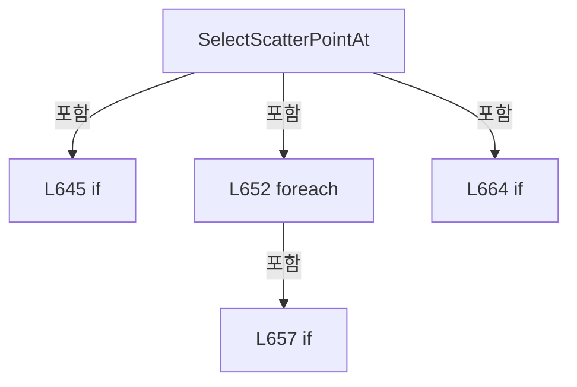

변경 전 점검: 입력/반환 타입, 위 호출자, 예외/취소 경로, 공유 상태와 저장·전송 소비자를 함께 확인합니다. 값의 단위나 물리 방향을 이름만으로 확정하지 않습니다.

### MethodDeclaration `ApplyScatterPlotScale` · L670–704

[Drilling.UI/Menu/Menus/CMenuCorrection.ReviewData.Display.cs:670–704](https://github.com/kjuws10-rgb/A3Drilling/blob/dfa5920e6301d9ec4b0eab1452ae59521aafc986/Drilling.UI/Menu/Menus/CMenuCorrection.ReviewData.Display.cs#L670-L704)

| 항목 | 실제 추출 값 |
| --- | --- |
| 서명 | void Drilling.UI.Menu.Menus.CMenuCorrection.CReviewDataPanel.ApplyScatterPlotScale(object?) |
| 접근/수식자 | Private / private |
| 반환/값 타입 | void |
| 소속 타입 | NamedType:Drilling.UI.Menu.Menus.CMenuCorrection.CReviewDataPanel |

입력 계약:

| 이름 | 타입 | 전달 | 선택/기본값 |
| --- | --- | --- | --- |
| parameter | object? | None | False /  |

현재 부분 분석에서 직접 연결된 호출자는 없습니다. XAML/이벤트/인터페이스·델리게이트·외부 진입을 추가 확인해야 하며, 미사용으로 판정한 것이 아닙니다.

호출하는 대상과 해석 범위:

| 원본 행 | 표현식 | 분석 상태 | 대상/소스 위치 |
| --- | --- | --- | --- |
| 672 | TryParseScatterScale | resolved | bool Drilling.UI.Menu.Menus.CMenuCorrection.CReviewDataPanel.TryParseScatterScale(string, out double) · Drilling.UI/Menu/Menus/CMenuCorrection.ReviewData.Display.cs:706 |
| 673 | TryParseScatterScale | resolved | bool Drilling.UI.Menu.Menus.CMenuCorrection.CReviewDataPanel.TryParseScatterScale(string, out double) · Drilling.UI/Menu/Menus/CMenuCorrection.ReviewData.Display.cs:706 |
| 674 | TryParseScatterScale | resolved | bool Drilling.UI.Menu.Menus.CMenuCorrection.CReviewDataPanel.TryParseScatterScale(string, out double) · Drilling.UI/Menu/Menus/CMenuCorrection.ReviewData.Display.cs:706 |
| 675 | double.IsFinite | resolved | bool double.IsFinite(double) |
| 676 | double.IsFinite | resolved | bool double.IsFinite(double) |
| 677 | double.IsFinite | resolved | bool double.IsFinite(double) |
| 682 | _statusReporter | resolved · 동적 구현 선택 가능 | void System.Action<string>.Invoke(string) |
| 687 | double.IsFinite | resolved | bool double.IsFinite(double) |
| 689 | _statusReporter | resolved · 동적 구현 선택 가능 | void System.Action<string>.Invoke(string) |
| 696 | FormatScatterScaleInput | resolved | string Drilling.UI.Menu.Menus.CMenuCorrection.CReviewDataPanel.FormatScatterScaleInput(double) · Drilling.UI/Menu/Menus/CMenuCorrection.ReviewData.Display.cs:712 |
| 697 | FormatScatterScaleInput | resolved | string Drilling.UI.Menu.Menus.CMenuCorrection.CReviewDataPanel.FormatScatterScaleInput(double) · Drilling.UI/Menu/Menus/CMenuCorrection.ReviewData.Display.cs:712 |
| 698 | FormatScatterScaleInput | resolved | string Drilling.UI.Menu.Menus.CMenuCorrection.CReviewDataPanel.FormatScatterScaleInput(double) · Drilling.UI/Menu/Menus/CMenuCorrection.ReviewData.Display.cs:712 |
| 699 | Notify | resolved | void Drilling.UI.Menu.Menus.CMenuCorrection.CReviewDataPanel.Notify(string) · Drilling.UI/Menu/Menus/CMenuCorrection.ReviewData.cs:427 |
| 699 | nameof | unresolved | None |
| 700 | Notify | resolved | void Drilling.UI.Menu.Menus.CMenuCorrection.CReviewDataPanel.Notify(string) · Drilling.UI/Menu/Menus/CMenuCorrection.ReviewData.cs:427 |
| 700 | nameof | unresolved | None |
| 701 | Notify | resolved | void Drilling.UI.Menu.Menus.CMenuCorrection.CReviewDataPanel.Notify(string) · Drilling.UI/Menu/Menus/CMenuCorrection.ReviewData.cs:427 |
| 701 | nameof | unresolved | None |
| 702 | RefreshScatterPlot | resolved | void Drilling.UI.Menu.Menus.CMenuCorrection.CReviewDataPanel.RefreshScatterPlot() · Drilling.UI/Menu/Menus/CMenuCorrection.ReviewData.Display.cs:717 |
| 703 | _statusReporter | resolved · 동적 구현 선택 가능 | void System.Action<string>.Invoke(string) |

본문의 실제 연산·분기·예외·반환 순서(원문 위치 순):

| 원본 행 | 종류 | 주석 해설 |
| --- | --- | --- |
| 672 | call | 함수·델리게이트 또는 객체 생성자를 호출합니다: TryParseScatterScale(_scatterPlotMinimumText, out var minimum) |
| 672 | if | 조건에 따라 분기합니다: if (!TryParseScatterScale(_scatterPlotMinimumText, out var minimum) &#124;&#124; !TryParseScatterScale(_scatterPlotMaximumText, out var maximum) &#124;&#124; !TryParseScatterScale(_scatterPlotGridUnitText, out var gridUnit) &#124;&#124; !double.IsFinite(…) |
| 673 | call | 함수·델리게이트 또는 객체 생성자를 호출합니다: TryParseScatterScale(_scatterPlotMaximumText, out var maximum) |
| 674 | call | 함수·델리게이트 또는 객체 생성자를 호출합니다: TryParseScatterScale(_scatterPlotGridUnitText, out var gridUnit) |
| 675 | call | 함수·델리게이트 또는 객체 생성자를 호출합니다: double.IsFinite(minimum) |
| 676 | call | 함수·델리게이트 또는 객체 생성자를 호출합니다: double.IsFinite(maximum) |
| 677 | call | 함수·델리게이트 또는 객체 생성자를 호출합니다: double.IsFinite(gridUnit) |
| 682 | call | 함수·델리게이트 또는 객체 생성자를 호출합니다: _statusReporter("산포도 범위는 MIN < MAX, UNIT > 0인 유한한 mm 값으로 입력해 주세요.") |
| 683 | return | 호출자에게 값 또는 제어를 반환합니다: return; |
| 686 | local-declaration | 지역 변수를 선언합니다: var gridIntervalCount = (maximum - minimum) / gridUnit; |
| 686 | variable-initializer | 변수의 초기값을 지정합니다: gridIntervalCount = (maximum - minimum) / gridUnit |
| 687 | call | 함수·델리게이트 또는 객체 생성자를 호출합니다: double.IsFinite(gridIntervalCount) |
| 687 | if | 조건에 따라 분기합니다: if (!double.IsFinite(gridIntervalCount) &#124;&#124; gridIntervalCount > 40.0) |
| 689 | call | 함수·델리게이트 또는 객체 생성자를 호출합니다: _statusReporter("산포도 눈금은 40칸 이하가 되도록 MIN, MAX, UNIT을 입력해 주세요.") |
| 690 | return | 호출자에게 값 또는 제어를 반환합니다: return; |
| 693 | assignment | 값을 대상에 대입합니다: _scatterPlotMinimum = minimum |
| 694 | assignment | 값을 대상에 대입합니다: _scatterPlotMaximum = maximum |
| 695 | assignment | 값을 대상에 대입합니다: _scatterPlotGridUnit = gridUnit |
| 696 | assignment | 값을 대상에 대입합니다: _scatterPlotMinimumText = FormatScatterScaleInput(minimum) |
| 696 | call | 함수·델리게이트 또는 객체 생성자를 호출합니다: FormatScatterScaleInput(minimum) |
| 697 | assignment | 값을 대상에 대입합니다: _scatterPlotMaximumText = FormatScatterScaleInput(maximum) |
| 697 | call | 함수·델리게이트 또는 객체 생성자를 호출합니다: FormatScatterScaleInput(maximum) |
| 698 | assignment | 값을 대상에 대입합니다: _scatterPlotGridUnitText = FormatScatterScaleInput(gridUnit) |
| 698 | call | 함수·델리게이트 또는 객체 생성자를 호출합니다: FormatScatterScaleInput(gridUnit) |
| 699 | call | 함수·델리게이트 또는 객체 생성자를 호출합니다: Notify(nameof(ScatterPlotMinimumText)) |
| 699 | call | 함수·델리게이트 또는 객체 생성자를 호출합니다: nameof(ScatterPlotMinimumText) |
| 700 | call | 함수·델리게이트 또는 객체 생성자를 호출합니다: Notify(nameof(ScatterPlotMaximumText)) |
| 700 | call | 함수·델리게이트 또는 객체 생성자를 호출합니다: nameof(ScatterPlotMaximumText) |
| 701 | call | 함수·델리게이트 또는 객체 생성자를 호출합니다: Notify(nameof(ScatterPlotGridUnitText)) |
| 701 | call | 함수·델리게이트 또는 객체 생성자를 호출합니다: nameof(ScatterPlotGridUnitText) |
| 702 | call | 함수·델리게이트 또는 객체 생성자를 호출합니다: RefreshScatterPlot() |
| 703 | call | 함수·델리게이트 또는 객체 생성자를 호출합니다: _statusReporter($"Result scatter range {minimum:0.###} ~ {maximum:0.###} mm / grid {gridUnit:0.###} mm applied.") |

제어 구문의 포함 구조(실제 실행 순서/CFG가 아닌 구문 탐색 그림):

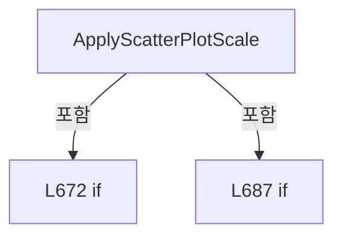

변경 전 점검: 입력/반환 타입, 위 호출자, 예외/취소 경로, 공유 상태와 저장·전송 소비자를 함께 확인합니다. 값의 단위나 물리 방향을 이름만으로 확정하지 않습니다.

### MethodDeclaration `TryParseScatterScale` · L706–710

[Drilling.UI/Menu/Menus/CMenuCorrection.ReviewData.Display.cs:706–710](https://github.com/kjuws10-rgb/A3Drilling/blob/dfa5920e6301d9ec4b0eab1452ae59521aafc986/Drilling.UI/Menu/Menus/CMenuCorrection.ReviewData.Display.cs#L706-L710)

| 항목 | 실제 추출 값 |
| --- | --- |
| 서명 | bool Drilling.UI.Menu.Menus.CMenuCorrection.CReviewDataPanel.TryParseScatterScale(string, out double) |
| 접근/수식자 | Private / private, static |
| 반환/값 타입 | bool |
| 소속 타입 | NamedType:Drilling.UI.Menu.Menus.CMenuCorrection.CReviewDataPanel |

입력 계약:

| 이름 | 타입 | 전달 | 선택/기본값 |
| --- | --- | --- | --- |
| text | string | None | False /  |
| value | double | Out | False /  |

정적 호출자로 확인된 위치:

| 호출 파일/행 | 호출 표현식 | 런타임 분기 가능 |
| --- | --- | --- |
| [Drilling.UI/Menu/Menus/CMenuCorrection.ReviewData.Display.cs:672–672](https://github.com/kjuws10-rgb/A3Drilling/blob/dfa5920e6301d9ec4b0eab1452ae59521aafc986/Drilling.UI/Menu/Menus/CMenuCorrection.ReviewData.Display.cs#L672-L672) | TryParseScatterScale | False |
| [Drilling.UI/Menu/Menus/CMenuCorrection.ReviewData.Display.cs:673–673](https://github.com/kjuws10-rgb/A3Drilling/blob/dfa5920e6301d9ec4b0eab1452ae59521aafc986/Drilling.UI/Menu/Menus/CMenuCorrection.ReviewData.Display.cs#L673-L673) | TryParseScatterScale | False |
| [Drilling.UI/Menu/Menus/CMenuCorrection.ReviewData.Display.cs:674–674](https://github.com/kjuws10-rgb/A3Drilling/blob/dfa5920e6301d9ec4b0eab1452ae59521aafc986/Drilling.UI/Menu/Menus/CMenuCorrection.ReviewData.Display.cs#L674-L674) | TryParseScatterScale | False |

호출하는 대상과 해석 범위:

| 원본 행 | 표현식 | 분석 상태 | 대상/소스 위치 |
| --- | --- | --- | --- |
| 708 | double.TryParse | resolved | bool double.TryParse(string?, System.Globalization.NumberStyles, System.IFormatProvider?, out double) |
| 709 | double.TryParse | resolved | bool double.TryParse(string?, System.Globalization.NumberStyles, System.IFormatProvider?, out double) |

본문의 실제 연산·분기·예외·반환 순서(원문 위치 순):

| 원본 행 | 종류 | 주석 해설 |
| --- | --- | --- |
| 708 | call | 함수·델리게이트 또는 객체 생성자를 호출합니다: double.TryParse(text, NumberStyles.Float, CultureInfo.InvariantCulture, out value) |
| 708 | return | 호출자에게 값 또는 제어를 반환합니다: return double.TryParse(text, NumberStyles.Float, CultureInfo.InvariantCulture, out value) &#124;&#124; double.TryParse(text, NumberStyles.Float, CultureInfo.CurrentCulture, out value); |
| 709 | call | 함수·델리게이트 또는 객체 생성자를 호출합니다: double.TryParse(text, NumberStyles.Float, CultureInfo.CurrentCulture, out value) |

변경 전 점검: 입력/반환 타입, 위 호출자, 예외/취소 경로, 공유 상태와 저장·전송 소비자를 함께 확인합니다. 값의 단위나 물리 방향을 이름만으로 확정하지 않습니다.

### MethodDeclaration `FormatScatterScaleInput` · L712–715

[Drilling.UI/Menu/Menus/CMenuCorrection.ReviewData.Display.cs:712–715](https://github.com/kjuws10-rgb/A3Drilling/blob/dfa5920e6301d9ec4b0eab1452ae59521aafc986/Drilling.UI/Menu/Menus/CMenuCorrection.ReviewData.Display.cs#L712-L715)

| 항목 | 실제 추출 값 |
| --- | --- |
| 서명 | string Drilling.UI.Menu.Menus.CMenuCorrection.CReviewDataPanel.FormatScatterScaleInput(double) |
| 접근/수식자 | Private / private, static |
| 반환/값 타입 | string |
| 소속 타입 | NamedType:Drilling.UI.Menu.Menus.CMenuCorrection.CReviewDataPanel |

입력 계약:

| 이름 | 타입 | 전달 | 선택/기본값 |
| --- | --- | --- | --- |
| value | double | None | False /  |

정적 호출자로 확인된 위치:

| 호출 파일/행 | 호출 표현식 | 런타임 분기 가능 |
| --- | --- | --- |
| [Drilling.UI/Menu/Menus/CMenuCorrection.ReviewData.Display.cs:696–696](https://github.com/kjuws10-rgb/A3Drilling/blob/dfa5920e6301d9ec4b0eab1452ae59521aafc986/Drilling.UI/Menu/Menus/CMenuCorrection.ReviewData.Display.cs#L696-L696) | FormatScatterScaleInput | False |
| [Drilling.UI/Menu/Menus/CMenuCorrection.ReviewData.Display.cs:697–697](https://github.com/kjuws10-rgb/A3Drilling/blob/dfa5920e6301d9ec4b0eab1452ae59521aafc986/Drilling.UI/Menu/Menus/CMenuCorrection.ReviewData.Display.cs#L697-L697) | FormatScatterScaleInput | False |
| [Drilling.UI/Menu/Menus/CMenuCorrection.ReviewData.Display.cs:698–698](https://github.com/kjuws10-rgb/A3Drilling/blob/dfa5920e6301d9ec4b0eab1452ae59521aafc986/Drilling.UI/Menu/Menus/CMenuCorrection.ReviewData.Display.cs#L698-L698) | FormatScatterScaleInput | False |

호출하는 대상과 해석 범위:

| 원본 행 | 표현식 | 분석 상태 | 대상/소스 위치 |
| --- | --- | --- | --- |
| 714 | value.ToString | resolved | string double.ToString(string?, System.IFormatProvider?) |

본문의 실제 연산·분기·예외·반환 순서(원문 위치 순):

| 원본 행 | 종류 | 주석 해설 |
| --- | --- | --- |
| 714 | call | 함수·델리게이트 또는 객체 생성자를 호출합니다: value.ToString("0.###", CultureInfo.InvariantCulture) |
| 714 | return | 호출자에게 값 또는 제어를 반환합니다: return value.ToString("0.###", CultureInfo.InvariantCulture); |

변경 전 점검: 입력/반환 타입, 위 호출자, 예외/취소 경로, 공유 상태와 저장·전송 소비자를 함께 확인합니다. 값의 단위나 물리 방향을 이름만으로 확정하지 않습니다.

### MethodDeclaration `RefreshScatterPlot` · L717–784

[Drilling.UI/Menu/Menus/CMenuCorrection.ReviewData.Display.cs:717–784](https://github.com/kjuws10-rgb/A3Drilling/blob/dfa5920e6301d9ec4b0eab1452ae59521aafc986/Drilling.UI/Menu/Menus/CMenuCorrection.ReviewData.Display.cs#L717-L784)

| 항목 | 실제 추출 값 |
| --- | --- |
| 서명 | void Drilling.UI.Menu.Menus.CMenuCorrection.CReviewDataPanel.RefreshScatterPlot() |
| 접근/수식자 | Private / private |
| 반환/값 타입 | void |
| 소속 타입 | NamedType:Drilling.UI.Menu.Menus.CMenuCorrection.CReviewDataPanel |

정적 호출자로 확인된 위치:

| 호출 파일/행 | 호출 표현식 | 런타임 분기 가능 |
| --- | --- | --- |
| [Drilling.UI/Menu/Menus/CMenuCorrection.ReviewData.Display.cs:526–526](https://github.com/kjuws10-rgb/A3Drilling/blob/dfa5920e6301d9ec4b0eab1452ae59521aafc986/Drilling.UI/Menu/Menus/CMenuCorrection.ReviewData.Display.cs#L526-L526) | RefreshScatterPlot | False |
| [Drilling.UI/Menu/Menus/CMenuCorrection.ReviewData.Display.cs:595–595](https://github.com/kjuws10-rgb/A3Drilling/blob/dfa5920e6301d9ec4b0eab1452ae59521aafc986/Drilling.UI/Menu/Menus/CMenuCorrection.ReviewData.Display.cs#L595-L595) | RefreshScatterPlot | False |
| [Drilling.UI/Menu/Menus/CMenuCorrection.ReviewData.Display.cs:702–702](https://github.com/kjuws10-rgb/A3Drilling/blob/dfa5920e6301d9ec4b0eab1452ae59521aafc986/Drilling.UI/Menu/Menus/CMenuCorrection.ReviewData.Display.cs#L702-L702) | RefreshScatterPlot | False |
| [Drilling.UI/Menu/Menus/CMenuCorrection.ReviewData.Edit.cs:224–224](https://github.com/kjuws10-rgb/A3Drilling/blob/dfa5920e6301d9ec4b0eab1452ae59521aafc986/Drilling.UI/Menu/Menus/CMenuCorrection.ReviewData.Edit.cs#L224-L224) | RefreshScatterPlot | False |

호출하는 대상과 해석 범위:

| 원본 행 | 표현식 | 분석 상태 | 대상/소스 위치 |
| --- | --- | --- | --- |
| 723 | new Rect | unresolved | None |
| 728 | Rows .Where(row => double.IsFinite(row.ResultX) && double.IsFinite(row.ResultY)) .ToArray | resolved | Drilling.UI.Menu.Menus.CMenuCorrection.ST_REVIEW_DATA_GRID_ROW[] System.Collections.Generic.IEnumerable<Drilling.UI.Menu.Menus.CMenuCorrection.ST_REVIEW_DATA_GRID_ROW>.ToArray<Drilling.UI.Menu.Menus.CMenuCorrection.ST_REVIEW_DATA_GRID_ROW>() |
| 728 | Rows .Where | resolved | System.Collections.Generic.IEnumerable<Drilling.UI.Menu.Menus.CMenuCorrection.ST_REVIEW_DATA_GRID_ROW> System.Collections.Generic.IEnumerable<Drilling.UI.Menu.Menus.CMenuCorrection.ST_REVIEW_DATA_GRID_ROW>.Where<Drilling.UI.Menu.Menus.CMenuCorrection.ST_REVIEW_DATA_GRID_ROW>(System.Func<Drilling.UI.Menu.Menus.CMenuCorrection.ST_REVIEW_DATA_GRID_ROW, bool>) |
| 729 | double.IsFinite | resolved | bool double.IsFinite(double) |
| 729 | double.IsFinite | resolved | bool double.IsFinite(double) |
| 731 | new DrawingGroup | unresolved | None |
| 732 | new List<ST_REVIEW_DATA_SCATTER_HIT> | resolved | System.Collections.Generic.List<Drilling.UI.Menu.Menus.CMenuCorrection.ST_REVIEW_DATA_SCATTER_HIT>.List(int) |
| 733 | drawing.Open | unresolved | None |
| 735 | context.DrawRectangle | unresolved | None |
| 735 | new Rect | unresolved | None |
| 736 | DrawScatterGrid | candidate | OverloadResolutionFailure |
| 737 | DrawScatterAxes | candidate | OverloadResolutionFailure |
| 741 | DrawScatterText | candidate | OverloadResolutionFailure |
| 741 | new Point | unresolved | None |
| 741 | CStatusBrush.Frozen | resolved | SolidColorBrush Drilling.UI.Menu.Menus.CStatusBrush.Frozen(byte, byte, byte) · Drilling.UI/Menu/Menus/CMenuBase.cs:330 |
| 748 | IsInsideScatterRange | resolved | bool Drilling.UI.Menu.Menus.CMenuCorrection.CReviewDataPanel.IsInsideScatterRange(double, double, double, double) · Drilling.UI/Menu/Menus/CMenuCorrection.ReviewData.Display.cs:880 |
| 753 | ScatterPoint | resolved | Point Drilling.UI.Menu.Menus.CMenuCorrection.CReviewDataPanel.ScatterPoint(double, double, Rect, double, double) · Drilling.UI/Menu/Menus/CMenuCorrection.ReviewData.Display.cs:873 |
| 754 | ScatterBrush | resolved | Brush Drilling.UI.Menu.Menus.CMenuCorrection.CReviewDataPanel.ScatterBrush(string) · Drilling.UI/Menu/Menus/CMenuCorrection.ReviewData.Display.cs:891 |
| 755 | context.DrawEllipse | unresolved | None |
| 758 | context.DrawEllipse | unresolved | None |
| 758 | new Pen | unresolved | None |
| 758 | CStatusBrush.Frozen | resolved | SolidColorBrush Drilling.UI.Menu.Menus.CStatusBrush.Frozen(byte, byte, byte) · Drilling.UI/Menu/Menus/CMenuBase.cs:330 |
| 761 | hits.Add | resolved | void System.Collections.Generic.List<Drilling.UI.Menu.Menus.CMenuCorrection.ST_REVIEW_DATA_SCATTER_HIT>.Add(Drilling.UI.Menu.Menus.CMenuCorrection.ST_REVIEW_DATA_SCATTER_HIT) |
| 761 | new ST_REVIEW_DATA_SCATTER_HIT | resolved | Drilling.UI.Menu.Menus.CMenuCorrection.ST_REVIEW_DATA_SCATTER_HIT.ST_REVIEW_DATA_SCATTER_HIT(Drilling.UI.Menu.Menus.CMenuCorrection.ST_REVIEW_DATA_GRID_ROW, Point) · Drilling.UI/Menu/Menus/CMenuCorrection.ReviewData.Display.cs:1334 |
| 765 | double.IsFinite | resolved | bool double.IsFinite(double) |
| 766 | double.IsFinite | resolved | bool double.IsFinite(double) |
| 767 | IsInsideScatterRange | resolved | bool Drilling.UI.Menu.Menus.CMenuCorrection.CReviewDataPanel.IsInsideScatterRange(double, double, double, double) · Drilling.UI/Menu/Menus/CMenuCorrection.ReviewData.Display.cs:880 |
| 769 | ScatterPoint | resolved | Point Drilling.UI.Menu.Menus.CMenuCorrection.CReviewDataPanel.ScatterPoint(double, double, Rect, double, double) · Drilling.UI/Menu/Menus/CMenuCorrection.ReviewData.Display.cs:873 |
| 770 | context.DrawEllipse | unresolved | None |
| 770 | CStatusBrush.Frozen | resolved | SolidColorBrush Drilling.UI.Menu.Menus.CStatusBrush.Frozen(byte, byte, byte) · Drilling.UI/Menu/Menus/CMenuBase.cs:330 |
| 770 | new Pen | unresolved | None |
| 771 | context.DrawEllipse | unresolved | None |
| 771 | ScatterBrush | resolved | Brush Drilling.UI.Menu.Menus.CMenuCorrection.CReviewDataPanel.ScatterBrush(string) · Drilling.UI/Menu/Menus/CMenuCorrection.ReviewData.Display.cs:891 |
| 776 | drawing.Freeze | unresolved | None |
| 777 | new DrawingImage | unresolved | None |
| 778 | image.Freeze | unresolved | None |
| 781 | BuildScatterPlotSummary | resolved | string Drilling.UI.Menu.Menus.CMenuCorrection.CReviewDataPanel.BuildScatterPlotSummary(System.Collections.Generic.IReadOnlyList<Drilling.UI.Menu.Menus.CMenuCorrection.ST_REVIEW_DATA_GRID_ROW>, int) · Drilling.UI/Menu/Menus/CMenuCorrection.ReviewData.Display.cs:786 |
| 782 | Notify | resolved | void Drilling.UI.Menu.Menus.CMenuCorrection.CReviewDataPanel.Notify(string) · Drilling.UI/Menu/Menus/CMenuCorrection.ReviewData.cs:427 |
| 782 | nameof | unresolved | None |
| 783 | Notify | resolved | void Drilling.UI.Menu.Menus.CMenuCorrection.CReviewDataPanel.Notify(string) · Drilling.UI/Menu/Menus/CMenuCorrection.ReviewData.cs:427 |
| 783 | nameof | unresolved | None |

본문의 실제 연산·분기·예외·반환 순서(원문 위치 순):

| 원본 행 | 종류 | 주석 해설 |
| --- | --- | --- |
| 719 | local-declaration | 지역 변수를 선언합니다: const double left = 62.0; |
| 719 | variable-initializer | 변수의 초기값을 지정합니다: left = 62.0 |
| 720 | local-declaration | 지역 변수를 선언합니다: const double top = 14.0; |
| 720 | variable-initializer | 변수의 초기값을 지정합니다: top = 14.0 |
| 721 | local-declaration | 지역 변수를 선언합니다: const double right = 18.0; |
| 721 | variable-initializer | 변수의 초기값을 지정합니다: right = 18.0 |
| 722 | local-declaration | 지역 변수를 선언합니다: const double bottom = 40.0; |
| 722 | variable-initializer | 변수의 초기값을 지정합니다: bottom = 40.0 |
| 723 | call | 함수·델리게이트 또는 객체 생성자를 호출합니다: new Rect( left, top, ScatterPlotSurfaceWidth - left - right, ScatterPlotSurfaceHeight - top - bottom) |
| 723 | local-declaration | 지역 변수를 선언합니다: var plotRect = new Rect( left, top, ScatterPlotSurfaceWidth - left - right, ScatterPlotSurfaceHeight - top - bottom); |
| 723 | variable-initializer | 변수의 초기값을 지정합니다: plotRect = new Rect( left, top, ScatterPlotSurfaceWidth - left - right, ScatterPlotSurfaceHeight - top - bottom) |
| 728 | call | 함수·델리게이트 또는 객체 생성자를 호출합니다: Rows .Where(row => double.IsFinite(row.ResultX) && double.IsFinite(row.ResultY)) |
| 728 | call | 함수·델리게이트 또는 객체 생성자를 호출합니다: Rows .Where(row => double.IsFinite(row.ResultX) && double.IsFinite(row.ResultY)) .ToArray() |
| 728 | local-declaration | 지역 변수를 선언합니다: var finiteRows = Rows .Where(row => double.IsFinite(row.ResultX) && double.IsFinite(row.ResultY)) .ToArray(); |
| 728 | variable-initializer | 변수의 초기값을 지정합니다: finiteRows = Rows .Where(row => double.IsFinite(row.ResultX) && double.IsFinite(row.ResultY)) .ToArray() |
| 729 | call | 함수·델리게이트 또는 객체 생성자를 호출합니다: double.IsFinite(row.ResultX) |
| 729 | call | 함수·델리게이트 또는 객체 생성자를 호출합니다: double.IsFinite(row.ResultY) |
| 731 | call | 함수·델리게이트 또는 객체 생성자를 호출합니다: new DrawingGroup() |
| 731 | local-declaration | 지역 변수를 선언합니다: var drawing = new DrawingGroup(); |
| 731 | variable-initializer | 변수의 초기값을 지정합니다: drawing = new DrawingGroup() |
| 732 | call | 함수·델리게이트 또는 객체 생성자를 호출합니다: new List<ST_REVIEW_DATA_SCATTER_HIT>(finiteRows.Length) |
| 732 | local-declaration | 지역 변수를 선언합니다: var hits = new List<ST_REVIEW_DATA_SCATTER_HIT>(finiteRows.Length); |
| 732 | variable-initializer | 변수의 초기값을 지정합니다: hits = new List<ST_REVIEW_DATA_SCATTER_HIT>(finiteRows.Length) |
| 733 | call | 함수·델리게이트 또는 객체 생성자를 호출합니다: drawing.Open() |
| 733 | variable-initializer | 변수의 초기값을 지정합니다: context = drawing.Open() |
| 733 | using | 자원 사용과 정리 범위를 지정합니다: using (var context = drawing.Open()) |
| 735 | call | 함수·델리게이트 또는 객체 생성자를 호출합니다: context.DrawRectangle(Brushes.Transparent, null, new Rect(0, 0, ScatterPlotSurfaceWidth, ScatterPlotSurfaceHeight)) |
| 735 | call | 함수·델리게이트 또는 객체 생성자를 호출합니다: new Rect(0, 0, ScatterPlotSurfaceWidth, ScatterPlotSurfaceHeight) |
| 736 | call | 함수·델리게이트 또는 객체 생성자를 호출합니다: DrawScatterGrid(context, plotRect, _scatterPlotMinimum, _scatterPlotMaximum, _scatterPlotGridUnit) |
| 737 | call | 함수·델리게이트 또는 객체 생성자를 호출합니다: DrawScatterAxes(context, plotRect, _scatterPlotMinimum, _scatterPlotMaximum) |
| 739 | if | 조건에 따라 분기합니다: if (finiteRows.Length == 0) |
| 741 | call | 함수·델리게이트 또는 객체 생성자를 호출합니다: DrawScatterText(context, "NO RESULT DATA", new Point(plotRect.Left + plotRect.Width / 2.0, plotRect.Top + plotRect.Height / 2.0), 14.0, CStatusBrush.Frozen(0x64, 0x74, 0x8B), true) |
| 741 | call | 함수·델리게이트 또는 객체 생성자를 호출합니다: new Point(plotRect.Left + plotRect.Width / 2.0, plotRect.Top + plotRect.Height / 2.0) |
| 741 | call | 함수·델리게이트 또는 객체 생성자를 호출합니다: CStatusBrush.Frozen(0x64, 0x74, 0x8B) |
| 743 | else | 앞 조건이 거짓인 경로입니다: else |
| 745 | conditional-expression | 조건에 따라 결과식을 선택합니다: finiteRows.Length >= 10000 ? 1.4 : finiteRows.Length >= 3000 ? 1.8 : 2.5 |
| 745 | conditional-expression | 조건에 따라 결과식을 선택합니다: finiteRows.Length >= 3000 ? 1.8 : 2.5 |
| 745 | local-declaration | 지역 변수를 선언합니다: var radius = finiteRows.Length >= 10000 ? 1.4 : finiteRows.Length >= 3000 ? 1.8 : 2.5; |
| 745 | variable-initializer | 변수의 초기값을 지정합니다: radius = finiteRows.Length >= 10000 ? 1.4 : finiteRows.Length >= 3000 ? 1.8 : 2.5 |
| 746 | foreach | 컬렉션 요소를 순회합니다: foreach (var row in finiteRows) |
| 748 | call | 함수·델리게이트 또는 객체 생성자를 호출합니다: IsInsideScatterRange(row.ResultX, row.ResultY, _scatterPlotMinimum, _scatterPlotMaximum) |
| 748 | if | 조건에 따라 분기합니다: if (!IsInsideScatterRange(row.ResultX, row.ResultY, _scatterPlotMinimum, _scatterPlotMaximum)) |
| 750 | continue | 다음 반복으로 진행합니다: continue; |
| 753 | call | 함수·델리게이트 또는 객체 생성자를 호출합니다: ScatterPoint(row.ResultX, row.ResultY, plotRect, _scatterPlotMinimum, _scatterPlotMaximum) |
| 753 | local-declaration | 지역 변수를 선언합니다: var point = ScatterPoint(row.ResultX, row.ResultY, plotRect, _scatterPlotMinimum, _scatterPlotMaximum); |
| 753 | variable-initializer | 변수의 초기값을 지정합니다: point = ScatterPoint(row.ResultX, row.ResultY, plotRect, _scatterPlotMinimum, _scatterPlotMaximum) |
| 754 | call | 함수·델리게이트 또는 객체 생성자를 호출합니다: ScatterBrush(row.Judge) |
| 754 | local-declaration | 지역 변수를 선언합니다: var brush = ScatterBrush(row.Judge); |
| 754 | variable-initializer | 변수의 초기값을 지정합니다: brush = ScatterBrush(row.Judge) |
| 755 | call | 함수·델리게이트 또는 객체 생성자를 호출합니다: context.DrawEllipse(brush, null, point, radius, radius) |
| 756 | if | 조건에 따라 분기합니다: if (_isResultEditMode && row.IsResultEditSelected) |
| 758 | call | 함수·델리게이트 또는 객체 생성자를 호출합니다: context.DrawEllipse(null, new Pen(CStatusBrush.Frozen(0xF5, 0x9E, 0x0B), 1.8), point, radius + 4.0, radius + 4.0) |
| 758 | call | 함수·델리게이트 또는 객체 생성자를 호출합니다: new Pen(CStatusBrush.Frozen(0xF5, 0x9E, 0x0B), 1.8) |
| 758 | call | 함수·델리게이트 또는 객체 생성자를 호출합니다: CStatusBrush.Frozen(0xF5, 0x9E, 0x0B) |
| 761 | call | 함수·델리게이트 또는 객체 생성자를 호출합니다: hits.Add(new ST_REVIEW_DATA_SCATTER_HIT(row, point)) |
| 761 | call | 함수·델리게이트 또는 객체 생성자를 호출합니다: new ST_REVIEW_DATA_SCATTER_HIT(row, point) |
| 764 | if | 조건에 따라 분기합니다: if (SelectedRow is { } selected && double.IsFinite(selected.ResultX) && double.IsFinite(selected.ResultY) && IsInsideScatterRange(selected.ResultX, selected.ResultY, _scatterPlotMinimum, _scatterPlotMaximum)) |
| 765 | call | 함수·델리게이트 또는 객체 생성자를 호출합니다: double.IsFinite(selected.ResultX) |
| 766 | call | 함수·델리게이트 또는 객체 생성자를 호출합니다: double.IsFinite(selected.ResultY) |
| 767 | call | 함수·델리게이트 또는 객체 생성자를 호출합니다: IsInsideScatterRange(selected.ResultX, selected.ResultY, _scatterPlotMinimum, _scatterPlotMaximum) |
| 769 | call | 함수·델리게이트 또는 객체 생성자를 호출합니다: ScatterPoint(selected.ResultX, selected.ResultY, plotRect, _scatterPlotMinimum, _scatterPlotMaximum) |
| 769 | local-declaration | 지역 변수를 선언합니다: var point = ScatterPoint(selected.ResultX, selected.ResultY, plotRect, _scatterPlotMinimum, _scatterPlotMaximum); |
| 769 | variable-initializer | 변수의 초기값을 지정합니다: point = ScatterPoint(selected.ResultX, selected.ResultY, plotRect, _scatterPlotMinimum, _scatterPlotMaximum) |
| 770 | call | 함수·델리게이트 또는 객체 생성자를 호출합니다: context.DrawEllipse(CStatusBrush.Frozen(0xF6, 0xC4, 0x53), new Pen(Brushes.White, 1.2), point, 6.0, 6.0) |
| 770 | call | 함수·델리게이트 또는 객체 생성자를 호출합니다: CStatusBrush.Frozen(0xF6, 0xC4, 0x53) |
| 770 | call | 함수·델리게이트 또는 객체 생성자를 호출합니다: new Pen(Brushes.White, 1.2) |
| 771 | call | 함수·델리게이트 또는 객체 생성자를 호출합니다: context.DrawEllipse(ScatterBrush(selected.Judge), null, point, 2.6, 2.6) |
| 771 | call | 함수·델리게이트 또는 객체 생성자를 호출합니다: ScatterBrush(selected.Judge) |
| 776 | call | 함수·델리게이트 또는 객체 생성자를 호출합니다: drawing.Freeze() |
| 777 | call | 함수·델리게이트 또는 객체 생성자를 호출합니다: new DrawingImage(drawing) |
| 777 | local-declaration | 지역 변수를 선언합니다: var image = new DrawingImage(drawing); |
| 777 | variable-initializer | 변수의 초기값을 지정합니다: image = new DrawingImage(drawing) |
| 778 | call | 함수·델리게이트 또는 객체 생성자를 호출합니다: image.Freeze() |
| 779 | assignment | 값을 대상에 대입합니다: ScatterPlotImage = image |
| 780 | assignment | 값을 대상에 대입합니다: _scatterPlotHits = hits |
| 781 | assignment | 값을 대상에 대입합니다: ScatterPlotSummary = BuildScatterPlotSummary(finiteRows, hits.Count) |
| 781 | call | 함수·델리게이트 또는 객체 생성자를 호출합니다: BuildScatterPlotSummary(finiteRows, hits.Count) |
| 782 | call | 함수·델리게이트 또는 객체 생성자를 호출합니다: Notify(nameof(ScatterPlotImage)) |
| 782 | call | 함수·델리게이트 또는 객체 생성자를 호출합니다: nameof(ScatterPlotImage) |
| 783 | call | 함수·델리게이트 또는 객체 생성자를 호출합니다: Notify(nameof(ScatterPlotSummary)) |
| 783 | call | 함수·델리게이트 또는 객체 생성자를 호출합니다: nameof(ScatterPlotSummary) |

제어 구문의 포함 구조(실제 실행 순서/CFG가 아닌 구문 탐색 그림):

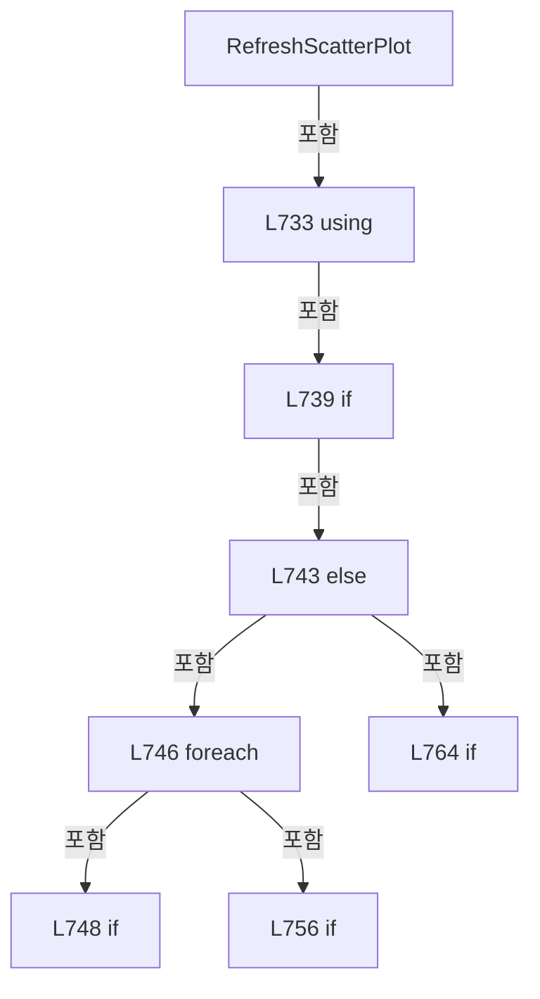

변경 전 점검: 입력/반환 타입, 위 호출자, 예외/취소 경로, 공유 상태와 저장·전송 소비자를 함께 확인합니다. 값의 단위나 물리 방향을 이름만으로 확정하지 않습니다.

### MethodDeclaration `BuildScatterPlotSummary` · L786–799

[Drilling.UI/Menu/Menus/CMenuCorrection.ReviewData.Display.cs:786–799](https://github.com/kjuws10-rgb/A3Drilling/blob/dfa5920e6301d9ec4b0eab1452ae59521aafc986/Drilling.UI/Menu/Menus/CMenuCorrection.ReviewData.Display.cs#L786-L799)

| 항목 | 실제 추출 값 |
| --- | --- |
| 서명 | string Drilling.UI.Menu.Menus.CMenuCorrection.CReviewDataPanel.BuildScatterPlotSummary(System.Collections.Generic.IReadOnlyList<Drilling.UI.Menu.Menus.CMenuCorrection.ST_REVIEW_DATA_GRID_ROW>, int) |
| 접근/수식자 | Private / private |
| 반환/값 타입 | string |
| 소속 타입 | NamedType:Drilling.UI.Menu.Menus.CMenuCorrection.CReviewDataPanel |

입력 계약:

| 이름 | 타입 | 전달 | 선택/기본값 |
| --- | --- | --- | --- |
| rows | System.Collections.Generic.IReadOnlyList<Drilling.UI.Menu.Menus.CMenuCorrection.ST_REVIEW_DATA_GRID_ROW> | None | False /  |
| visibleCount | int | None | False /  |

정적 호출자로 확인된 위치:

| 호출 파일/행 | 호출 표현식 | 런타임 분기 가능 |
| --- | --- | --- |
| [Drilling.UI/Menu/Menus/CMenuCorrection.ReviewData.Display.cs:781–781](https://github.com/kjuws10-rgb/A3Drilling/blob/dfa5920e6301d9ec4b0eab1452ae59521aafc986/Drilling.UI/Menu/Menus/CMenuCorrection.ReviewData.Display.cs#L781-L781) | BuildScatterPlotSummary | False |

호출하는 대상과 해석 범위:

| 원본 행 | 표현식 | 분석 상태 | 대상/소스 위치 |
| --- | --- | --- | --- |
| 793 | rows.Min | resolved | double System.Collections.Generic.IEnumerable<Drilling.UI.Menu.Menus.CMenuCorrection.ST_REVIEW_DATA_GRID_ROW>.Min<Drilling.UI.Menu.Menus.CMenuCorrection.ST_REVIEW_DATA_GRID_ROW>(System.Func<Drilling.UI.Menu.Menus.CMenuCorrection.ST_REVIEW_DATA_GRID_ROW, double>) |
| 794 | rows.Max | resolved | double System.Collections.Generic.IEnumerable<Drilling.UI.Menu.Menus.CMenuCorrection.ST_REVIEW_DATA_GRID_ROW>.Max<Drilling.UI.Menu.Menus.CMenuCorrection.ST_REVIEW_DATA_GRID_ROW>(System.Func<Drilling.UI.Menu.Menus.CMenuCorrection.ST_REVIEW_DATA_GRID_ROW, double>) |
| 795 | rows.Min | resolved | double System.Collections.Generic.IEnumerable<Drilling.UI.Menu.Menus.CMenuCorrection.ST_REVIEW_DATA_GRID_ROW>.Min<Drilling.UI.Menu.Menus.CMenuCorrection.ST_REVIEW_DATA_GRID_ROW>(System.Func<Drilling.UI.Menu.Menus.CMenuCorrection.ST_REVIEW_DATA_GRID_ROW, double>) |
| 796 | rows.Max | resolved | double System.Collections.Generic.IEnumerable<Drilling.UI.Menu.Menus.CMenuCorrection.ST_REVIEW_DATA_GRID_ROW>.Max<Drilling.UI.Menu.Menus.CMenuCorrection.ST_REVIEW_DATA_GRID_ROW>(System.Func<Drilling.UI.Menu.Menus.CMenuCorrection.ST_REVIEW_DATA_GRID_ROW, double>) |

본문의 실제 연산·분기·예외·반환 순서(원문 위치 순):

| 원본 행 | 종류 | 주석 해설 |
| --- | --- | --- |
| 788 | if | 조건에 따라 분기합니다: if (rows.Count == 0) |
| 790 | conditional-expression | 조건에 따라 결과식을 선택합니다: _selectedCellNo > 0 ? $"CELL{_selectedCellNo:00} · NO RESULT DATA" : "NO RESULT DATA" |
| 790 | return | 호출자에게 값 또는 제어를 반환합니다: return _selectedCellNo > 0 ? $"CELL{_selectedCellNo:00} · NO RESULT DATA" : "NO RESULT DATA"; |
| 793 | call | 함수·델리게이트 또는 객체 생성자를 호출합니다: rows.Min(row => row.ResultX) |
| 793 | local-declaration | 지역 변수를 선언합니다: var minX = rows.Min(row => row.ResultX); |
| 793 | variable-initializer | 변수의 초기값을 지정합니다: minX = rows.Min(row => row.ResultX) |
| 794 | call | 함수·델리게이트 또는 객체 생성자를 호출합니다: rows.Max(row => row.ResultX) |
| 794 | local-declaration | 지역 변수를 선언합니다: var maxX = rows.Max(row => row.ResultX); |
| 794 | variable-initializer | 변수의 초기값을 지정합니다: maxX = rows.Max(row => row.ResultX) |
| 795 | call | 함수·델리게이트 또는 객체 생성자를 호출합니다: rows.Min(row => row.ResultY) |
| 795 | local-declaration | 지역 변수를 선언합니다: var minY = rows.Min(row => row.ResultY); |
| 795 | variable-initializer | 변수의 초기값을 지정합니다: minY = rows.Min(row => row.ResultY) |
| 796 | call | 함수·델리게이트 또는 객체 생성자를 호출합니다: rows.Max(row => row.ResultY) |
| 796 | local-declaration | 지역 변수를 선언합니다: var maxY = rows.Max(row => row.ResultY); |
| 796 | variable-initializer | 변수의 초기값을 지정합니다: maxY = rows.Max(row => row.ResultY) |
| 797 | conditional-expression | 조건에 따라 결과식을 선택합니다: visibleCount == rows.Count ? "" : $" · {visibleCount:N0} VISIBLE" |
| 797 | local-declaration | 지역 변수를 선언합니다: var visible = visibleCount == rows.Count ? "" : $" · {visibleCount:N0} VISIBLE"; |
| 797 | variable-initializer | 변수의 초기값을 지정합니다: visible = visibleCount == rows.Count ? "" : $" · {visibleCount:N0} VISIBLE" |
| 798 | return | 호출자에게 값 또는 제어를 반환합니다: return $"CELL{_selectedCellNo:00} · {rows.Count:N0} POINTS{visible} · X {minX:0.###} ~ {maxX:0.###} / Y {minY:0.###} ~ {maxY:0.###} mm"; |

제어 구문의 포함 구조(실제 실행 순서/CFG가 아닌 구문 탐색 그림):

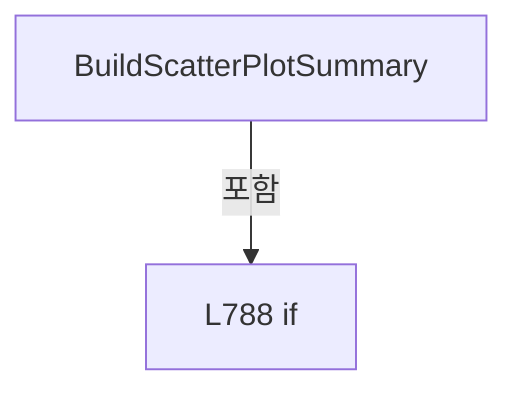

변경 전 점검: 입력/반환 타입, 위 호출자, 예외/취소 경로, 공유 상태와 저장·전송 소비자를 함께 확인합니다. 값의 단위나 물리 방향을 이름만으로 확정하지 않습니다.

### MethodDeclaration `DrawScatterGrid` · L801–827

[Drilling.UI/Menu/Menus/CMenuCorrection.ReviewData.Display.cs:801–827](https://github.com/kjuws10-rgb/A3Drilling/blob/dfa5920e6301d9ec4b0eab1452ae59521aafc986/Drilling.UI/Menu/Menus/CMenuCorrection.ReviewData.Display.cs#L801-L827)

| 항목 | 실제 추출 값 |
| --- | --- |
| 서명 | void Drilling.UI.Menu.Menus.CMenuCorrection.CReviewDataPanel.DrawScatterGrid(DrawingContext, Rect, double, double, double) |
| 접근/수식자 | Private / private, static |
| 반환/값 타입 | void |
| 소속 타입 | NamedType:Drilling.UI.Menu.Menus.CMenuCorrection.CReviewDataPanel |

입력 계약:

| 이름 | 타입 | 전달 | 선택/기본값 |
| --- | --- | --- | --- |
| context | DrawingContext | None | False /  |
| plotRect | Rect | None | False /  |
| minimum | double | None | False /  |
| maximum | double | None | False /  |
| gridUnit | double | None | False /  |

현재 부분 분석에서 직접 연결된 호출자는 없습니다. XAML/이벤트/인터페이스·델리게이트·외부 진입을 추가 확인해야 하며, 미사용으로 판정한 것이 아닙니다.

호출하는 대상과 해석 범위:

| 원본 행 | 표현식 | 분석 상태 | 대상/소스 위치 |
| --- | --- | --- | --- |
| 803 | new Pen | unresolved | None |
| 803 | CStatusBrush.Frozen | resolved | SolidColorBrush Drilling.UI.Menu.Menus.CStatusBrush.Frozen(byte, byte, byte) · Drilling.UI/Menu/Menus/CMenuBase.cs:330 |
| 804 | Math.Ceiling | resolved | double System.Math.Ceiling(double) |
| 805 | Math.Floor | resolved | double System.Math.Floor(double) |
| 806 | Math.Max | resolved | int System.Math.Max(int, int) |
| 807 | Math.Max | resolved | int System.Math.Max(int, int) |
| 807 | Math.Ceiling | resolved | double System.Math.Ceiling(double) |
| 808 | CStatusBrush.Frozen | resolved | SolidColorBrush Drilling.UI.Menu.Menus.CStatusBrush.Frozen(byte, byte, byte) · Drilling.UI/Menu/Menus/CMenuBase.cs:330 |
| 815 | context.DrawLine | unresolved | None |
| 815 | new Point | unresolved | None |
| 815 | new Point | unresolved | None |
| 816 | context.DrawLine | unresolved | None |
| 816 | new Point | unresolved | None |
| 816 | new Point | unresolved | None |
| 818 | Math.Abs | resolved | double System.Math.Abs(double) |
| 820 | FormatScatterAxisValue | resolved | string Drilling.UI.Menu.Menus.CMenuCorrection.CReviewDataPanel.FormatScatterAxisValue(double, double) · Drilling.UI/Menu/Menus/CMenuCorrection.ReviewData.Display.cs:885 |
| 821 | DrawScatterText | candidate | OverloadResolutionFailure |
| 821 | new Point | unresolved | None |
| 822 | DrawScatterText | candidate | OverloadResolutionFailure |
| 822 | new Point | unresolved | None |
| 826 | context.DrawRectangle | unresolved | None |
| 826 | new Pen | unresolved | None |
| 826 | CStatusBrush.Frozen | resolved | SolidColorBrush Drilling.UI.Menu.Menus.CStatusBrush.Frozen(byte, byte, byte) · Drilling.UI/Menu/Menus/CMenuBase.cs:330 |

본문의 실제 연산·분기·예외·반환 순서(원문 위치 순):

| 원본 행 | 종류 | 주석 해설 |
| --- | --- | --- |
| 803 | call | 함수·델리게이트 또는 객체 생성자를 호출합니다: new Pen(CStatusBrush.Frozen(0x94, 0xA3, 0xB8), 0.55) |
| 803 | call | 함수·델리게이트 또는 객체 생성자를 호출합니다: CStatusBrush.Frozen(0x94, 0xA3, 0xB8) |
| 803 | local-declaration | 지역 변수를 선언합니다: var gridPen = new Pen(CStatusBrush.Frozen(0x94, 0xA3, 0xB8), 0.55); |
| 803 | variable-initializer | 변수의 초기값을 지정합니다: gridPen = new Pen(CStatusBrush.Frozen(0x94, 0xA3, 0xB8), 0.55) |
| 804 | call | 함수·델리게이트 또는 객체 생성자를 호출합니다: Math.Ceiling(minimum / gridUnit - 1e-9) |
| 804 | local-declaration | 지역 변수를 선언합니다: var firstIndex = (int)Math.Ceiling(minimum / gridUnit - 1e-9); |
| 804 | variable-initializer | 변수의 초기값을 지정합니다: firstIndex = (int)Math.Ceiling(minimum / gridUnit - 1e-9) |
| 805 | call | 함수·델리게이트 또는 객체 생성자를 호출합니다: Math.Floor(maximum / gridUnit + 1e-9) |
| 805 | local-declaration | 지역 변수를 선언합니다: var lastIndex = (int)Math.Floor(maximum / gridUnit + 1e-9); |
| 805 | variable-initializer | 변수의 초기값을 지정합니다: lastIndex = (int)Math.Floor(maximum / gridUnit + 1e-9) |
| 806 | call | 함수·델리게이트 또는 객체 생성자를 호출합니다: Math.Max(1, lastIndex - firstIndex + 1) |
| 806 | local-declaration | 지역 변수를 선언합니다: var lineCount = Math.Max(1, lastIndex - firstIndex + 1); |
| 806 | variable-initializer | 변수의 초기값을 지정합니다: lineCount = Math.Max(1, lastIndex - firstIndex + 1) |
| 807 | call | 함수·델리게이트 또는 객체 생성자를 호출합니다: Math.Max(1, (int)Math.Ceiling(lineCount / 10.0)) |
| 807 | call | 함수·델리게이트 또는 객체 생성자를 호출합니다: Math.Ceiling(lineCount / 10.0) |
| 807 | local-declaration | 지역 변수를 선언합니다: var labelStride = Math.Max(1, (int)Math.Ceiling(lineCount / 10.0)); |
| 807 | variable-initializer | 변수의 초기값을 지정합니다: labelStride = Math.Max(1, (int)Math.Ceiling(lineCount / 10.0)) |
| 808 | call | 함수·델리게이트 또는 객체 생성자를 호출합니다: CStatusBrush.Frozen(0x55, 0x70, 0x86) |
| 808 | local-declaration | 지역 변수를 선언합니다: var labelBrush = CStatusBrush.Frozen(0x55, 0x70, 0x86); |
| 808 | variable-initializer | 변수의 초기값을 지정합니다: labelBrush = CStatusBrush.Frozen(0x55, 0x70, 0x86) |
| 809 | variable-initializer | 변수의 초기값을 지정합니다: index = firstIndex |
| 809 | for | 초기화·조건·증감이 있는 반복입니다: for (var index = firstIndex; index <= lastIndex; index++) |
| 811 | local-declaration | 지역 변수를 선언합니다: var value = index * gridUnit; |
| 811 | variable-initializer | 변수의 초기값을 지정합니다: value = index * gridUnit |
| 812 | local-declaration | 지역 변수를 선언합니다: var ratio = (value - minimum) / (maximum - minimum); |
| 812 | variable-initializer | 변수의 초기값을 지정합니다: ratio = (value - minimum) / (maximum - minimum) |
| 813 | local-declaration | 지역 변수를 선언합니다: var x = plotRect.Left + plotRect.Width * ratio; |
| 813 | variable-initializer | 변수의 초기값을 지정합니다: x = plotRect.Left + plotRect.Width * ratio |
| 814 | local-declaration | 지역 변수를 선언합니다: var y = plotRect.Bottom - plotRect.Height * ratio; |
| 814 | variable-initializer | 변수의 초기값을 지정합니다: y = plotRect.Bottom - plotRect.Height * ratio |
| 815 | call | 함수·델리게이트 또는 객체 생성자를 호출합니다: context.DrawLine(gridPen, new Point(x, plotRect.Top), new Point(x, plotRect.Bottom)) |
| 815 | call | 함수·델리게이트 또는 객체 생성자를 호출합니다: new Point(x, plotRect.Top) |
| 815 | call | 함수·델리게이트 또는 객체 생성자를 호출합니다: new Point(x, plotRect.Bottom) |
| 816 | call | 함수·델리게이트 또는 객체 생성자를 호출합니다: context.DrawLine(gridPen, new Point(plotRect.Left, y), new Point(plotRect.Right, y)) |
| 816 | call | 함수·델리게이트 또는 객체 생성자를 호출합니다: new Point(plotRect.Left, y) |
| 816 | call | 함수·델리게이트 또는 객체 생성자를 호출합니다: new Point(plotRect.Right, y) |
| 818 | call | 함수·델리게이트 또는 객체 생성자를 호출합니다: Math.Abs(value) |
| 818 | if | 조건에 따라 분기합니다: if ((index - firstIndex) % labelStride == 0 &#124;&#124; Math.Abs(value) <= gridUnit * 1e-9 &#124;&#124; index == lastIndex) |
| 820 | call | 함수·델리게이트 또는 객체 생성자를 호출합니다: FormatScatterAxisValue(value, gridUnit) |
| 820 | local-declaration | 지역 변수를 선언합니다: var text = FormatScatterAxisValue(value, gridUnit); |
| 820 | variable-initializer | 변수의 초기값을 지정합니다: text = FormatScatterAxisValue(value, gridUnit) |
| 821 | call | 함수·델리게이트 또는 객체 생성자를 호출합니다: DrawScatterText(context, text, new Point(x, plotRect.Bottom + 13.0), 9.0, labelBrush, true) |
| 821 | call | 함수·델리게이트 또는 객체 생성자를 호출합니다: new Point(x, plotRect.Bottom + 13.0) |
| 822 | call | 함수·델리게이트 또는 객체 생성자를 호출합니다: DrawScatterText(context, text, new Point(plotRect.Left - 8.0, y), 9.0, labelBrush, false, true) |
| 822 | call | 함수·델리게이트 또는 객체 생성자를 호출합니다: new Point(plotRect.Left - 8.0, y) |
| 826 | call | 함수·델리게이트 또는 객체 생성자를 호출합니다: context.DrawRectangle(null, new Pen(CStatusBrush.Frozen(0x64, 0x74, 0x8B), 1.0), plotRect) |
| 826 | call | 함수·델리게이트 또는 객체 생성자를 호출합니다: new Pen(CStatusBrush.Frozen(0x64, 0x74, 0x8B), 1.0) |
| 826 | call | 함수·델리게이트 또는 객체 생성자를 호출합니다: CStatusBrush.Frozen(0x64, 0x74, 0x8B) |

제어 구문의 포함 구조(실제 실행 순서/CFG가 아닌 구문 탐색 그림):

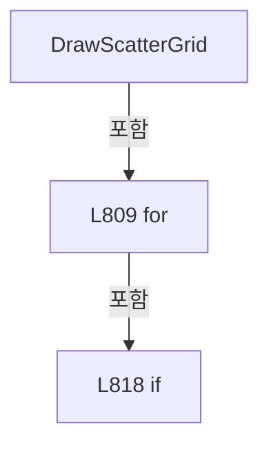

변경 전 점검: 입력/반환 타입, 위 호출자, 예외/취소 경로, 공유 상태와 저장·전송 소비자를 함께 확인합니다. 값의 단위나 물리 방향을 이름만으로 확정하지 않습니다.

### MethodDeclaration `DrawScatterAxes` · L829–844

[Drilling.UI/Menu/Menus/CMenuCorrection.ReviewData.Display.cs:829–844](https://github.com/kjuws10-rgb/A3Drilling/blob/dfa5920e6301d9ec4b0eab1452ae59521aafc986/Drilling.UI/Menu/Menus/CMenuCorrection.ReviewData.Display.cs#L829-L844)

| 항목 | 실제 추출 값 |
| --- | --- |
| 서명 | void Drilling.UI.Menu.Menus.CMenuCorrection.CReviewDataPanel.DrawScatterAxes(DrawingContext, Rect, double, double) |
| 접근/수식자 | Private / private, static |
| 반환/값 타입 | void |
| 소속 타입 | NamedType:Drilling.UI.Menu.Menus.CMenuCorrection.CReviewDataPanel |

입력 계약:

| 이름 | 타입 | 전달 | 선택/기본값 |
| --- | --- | --- | --- |
| context | DrawingContext | None | False /  |
| plotRect | Rect | None | False /  |
| minimum | double | None | False /  |
| maximum | double | None | False /  |

현재 부분 분석에서 직접 연결된 호출자는 없습니다. XAML/이벤트/인터페이스·델리게이트·외부 진입을 추가 확인해야 하며, 미사용으로 판정한 것이 아닙니다.

호출하는 대상과 해석 범위:

| 원본 행 | 표현식 | 분석 상태 | 대상/소스 위치 |
| --- | --- | --- | --- |
| 831 | new Pen | unresolved | None |
| 831 | CStatusBrush.Frozen | resolved | SolidColorBrush Drilling.UI.Menu.Menus.CStatusBrush.Frozen(byte, byte, byte) · Drilling.UI/Menu/Menus/CMenuBase.cs:330 |
| 837 | context.DrawLine | unresolved | None |
| 837 | new Point | unresolved | None |
| 837 | new Point | unresolved | None |
| 838 | context.DrawLine | unresolved | None |
| 838 | new Point | unresolved | None |
| 838 | new Point | unresolved | None |
| 841 | CStatusBrush.Frozen | resolved | SolidColorBrush Drilling.UI.Menu.Menus.CStatusBrush.Frozen(byte, byte, byte) · Drilling.UI/Menu/Menus/CMenuBase.cs:330 |
| 842 | DrawScatterText | candidate | OverloadResolutionFailure |
| 842 | new Point | unresolved | None |
| 842 | ScatterPlotHeightForLabel | resolved | double Drilling.UI.Menu.Menus.CMenuCorrection.CReviewDataPanel.ScatterPlotHeightForLabel(Rect) · Drilling.UI/Menu/Menus/CMenuCorrection.ReviewData.Display.cs:846 |
| 843 | DrawScatterText | candidate | OverloadResolutionFailure |
| 843 | new Point | unresolved | None |

본문의 실제 연산·분기·예외·반환 순서(원문 위치 순):

| 원본 행 | 종류 | 주석 해설 |
| --- | --- | --- |
| 831 | call | 함수·델리게이트 또는 객체 생성자를 호출합니다: new Pen(CStatusBrush.Frozen(0x38, 0x7D, 0xA8), 1.5) |
| 831 | call | 함수·델리게이트 또는 객체 생성자를 호출합니다: CStatusBrush.Frozen(0x38, 0x7D, 0xA8) |
| 831 | local-declaration | 지역 변수를 선언합니다: var axisPen = new Pen(CStatusBrush.Frozen(0x38, 0x7D, 0xA8), 1.5); |
| 831 | variable-initializer | 변수의 초기값을 지정합니다: axisPen = new Pen(CStatusBrush.Frozen(0x38, 0x7D, 0xA8), 1.5) |
| 832 | if | 조건에 따라 분기합니다: if (minimum <= 0.0 && maximum >= 0.0) |
| 834 | local-declaration | 지역 변수를 선언합니다: var zeroRatio = (0.0 - minimum) / (maximum - minimum); |
| 834 | variable-initializer | 변수의 초기값을 지정합니다: zeroRatio = (0.0 - minimum) / (maximum - minimum) |
| 835 | local-declaration | 지역 변수를 선언합니다: var zeroX = plotRect.Left + plotRect.Width * zeroRatio; |
| 835 | variable-initializer | 변수의 초기값을 지정합니다: zeroX = plotRect.Left + plotRect.Width * zeroRatio |
| 836 | local-declaration | 지역 변수를 선언합니다: var zeroY = plotRect.Bottom - plotRect.Height * zeroRatio; |
| 836 | variable-initializer | 변수의 초기값을 지정합니다: zeroY = plotRect.Bottom - plotRect.Height * zeroRatio |
| 837 | call | 함수·델리게이트 또는 객체 생성자를 호출합니다: context.DrawLine(axisPen, new Point(zeroX, plotRect.Top), new Point(zeroX, plotRect.Bottom)) |
| 837 | call | 함수·델리게이트 또는 객체 생성자를 호출합니다: new Point(zeroX, plotRect.Top) |
| 837 | call | 함수·델리게이트 또는 객체 생성자를 호출합니다: new Point(zeroX, plotRect.Bottom) |
| 838 | call | 함수·델리게이트 또는 객체 생성자를 호출합니다: context.DrawLine(axisPen, new Point(plotRect.Left, zeroY), new Point(plotRect.Right, zeroY)) |
| 838 | call | 함수·델리게이트 또는 객체 생성자를 호출합니다: new Point(plotRect.Left, zeroY) |
| 838 | call | 함수·델리게이트 또는 객체 생성자를 호출합니다: new Point(plotRect.Right, zeroY) |
| 841 | call | 함수·델리게이트 또는 객체 생성자를 호출합니다: CStatusBrush.Frozen(0x55, 0x70, 0x86) |
| 841 | local-declaration | 지역 변수를 선언합니다: var labelBrush = CStatusBrush.Frozen(0x55, 0x70, 0x86); |
| 841 | variable-initializer | 변수의 초기값을 지정합니다: labelBrush = CStatusBrush.Frozen(0x55, 0x70, 0x86) |
| 842 | call | 함수·델리게이트 또는 객체 생성자를 호출합니다: DrawScatterText(context, "RESULT X (mm)", new Point(plotRect.Right, ScatterPlotHeightForLabel(plotRect)), 9.5, labelBrush, false, true) |
| 842 | call | 함수·델리게이트 또는 객체 생성자를 호출합니다: new Point(plotRect.Right, ScatterPlotHeightForLabel(plotRect)) |
| 842 | call | 함수·델리게이트 또는 객체 생성자를 호출합니다: ScatterPlotHeightForLabel(plotRect) |
| 843 | call | 함수·델리게이트 또는 객체 생성자를 호출합니다: DrawScatterText(context, "RESULT Y (mm)", new Point(plotRect.Left, 1.0), 9.5, labelBrush) |
| 843 | call | 함수·델리게이트 또는 객체 생성자를 호출합니다: new Point(plotRect.Left, 1.0) |

제어 구문의 포함 구조(실제 실행 순서/CFG가 아닌 구문 탐색 그림):

```mermaid
flowchart TD
 M["DrawScatterAxes"]
 N0["L832 if"]
 M -->|포함| N0
```

변경 전 점검: 입력/반환 타입, 위 호출자, 예외/취소 경로, 공유 상태와 저장·전송 소비자를 함께 확인합니다. 값의 단위나 물리 방향을 이름만으로 확정하지 않습니다.

### MethodDeclaration `ScatterPlotHeightForLabel` · L846–849

[Drilling.UI/Menu/Menus/CMenuCorrection.ReviewData.Display.cs:846–849](https://github.com/kjuws10-rgb/A3Drilling/blob/dfa5920e6301d9ec4b0eab1452ae59521aafc986/Drilling.UI/Menu/Menus/CMenuCorrection.ReviewData.Display.cs#L846-L849)

| 항목 | 실제 추출 값 |
| --- | --- |
| 서명 | double Drilling.UI.Menu.Menus.CMenuCorrection.CReviewDataPanel.ScatterPlotHeightForLabel(Rect) |
| 접근/수식자 | Private / private, static |
| 반환/값 타입 | double |
| 소속 타입 | NamedType:Drilling.UI.Menu.Menus.CMenuCorrection.CReviewDataPanel |

입력 계약:

| 이름 | 타입 | 전달 | 선택/기본값 |
| --- | --- | --- | --- |
| plotRect | Rect | None | False /  |

정적 호출자로 확인된 위치:

| 호출 파일/행 | 호출 표현식 | 런타임 분기 가능 |
| --- | --- | --- |
| [Drilling.UI/Menu/Menus/CMenuCorrection.ReviewData.Display.cs:842–842](https://github.com/kjuws10-rgb/A3Drilling/blob/dfa5920e6301d9ec4b0eab1452ae59521aafc986/Drilling.UI/Menu/Menus/CMenuCorrection.ReviewData.Display.cs#L842-L842) | ScatterPlotHeightForLabel | False |

본문의 실제 연산·분기·예외·반환 순서(원문 위치 순):

| 원본 행 | 종류 | 주석 해설 |
| --- | --- | --- |
| 848 | return | 호출자에게 값 또는 제어를 반환합니다: return plotRect.Bottom + 27.0; |

변경 전 점검: 입력/반환 타입, 위 호출자, 예외/취소 경로, 공유 상태와 저장·전송 소비자를 함께 확인합니다. 값의 단위나 물리 방향을 이름만으로 확정하지 않습니다.

### MethodDeclaration `DrawScatterText` · L851–871

[Drilling.UI/Menu/Menus/CMenuCorrection.ReviewData.Display.cs:851–871](https://github.com/kjuws10-rgb/A3Drilling/blob/dfa5920e6301d9ec4b0eab1452ae59521aafc986/Drilling.UI/Menu/Menus/CMenuCorrection.ReviewData.Display.cs#L851-L871)

| 항목 | 실제 추출 값 |
| --- | --- |
| 서명 | void Drilling.UI.Menu.Menus.CMenuCorrection.CReviewDataPanel.DrawScatterText(DrawingContext, string, Point, double, Brush, bool, bool) |
| 접근/수식자 | Private / private, static |
| 반환/값 타입 | void |
| 소속 타입 | NamedType:Drilling.UI.Menu.Menus.CMenuCorrection.CReviewDataPanel |

입력 계약:

| 이름 | 타입 | 전달 | 선택/기본값 |
| --- | --- | --- | --- |
| context | DrawingContext | None | False /  |
| text | string | None | False /  |
| anchor | Point | None | False /  |
| fontSize | double | None | False /  |
| brush | Brush | None | False /  |
| center | bool | None | True / false |
| right | bool | None | True / false |

현재 부분 분석에서 직접 연결된 호출자는 없습니다. XAML/이벤트/인터페이스·델리게이트·외부 진입을 추가 확인해야 하며, 미사용으로 판정한 것이 아닙니다.

호출하는 대상과 해석 범위:

| 원본 행 | 표현식 | 분석 상태 | 대상/소스 위치 |
| --- | --- | --- | --- |
| 860 | new FormattedText | unresolved | None |
| 864 | new Typeface | unresolved | None |
| 870 | context.DrawText | unresolved | None |
| 870 | new Point | unresolved | None |

본문의 실제 연산·분기·예외·반환 순서(원문 위치 순):

| 원본 행 | 종류 | 주석 해설 |
| --- | --- | --- |
| 860 | call | 함수·델리게이트 또는 객체 생성자를 호출합니다: new FormattedText( text, CultureInfo.InvariantCulture, FlowDirection.LeftToRight, new Typeface("Segoe UI"), fontSize, brush, 1.0) |
| 860 | local-declaration | 지역 변수를 선언합니다: var formatted = new FormattedText( text, CultureInfo.InvariantCulture, FlowDirection.LeftToRight, new Typeface("Segoe UI"), fontSize, brush, 1.0); |
| 860 | variable-initializer | 변수의 초기값을 지정합니다: formatted = new FormattedText( text, CultureInfo.InvariantCulture, FlowDirection.LeftToRight, new Typeface("Segoe UI"), fontSize, brush, 1.0) |
| 864 | call | 함수·델리게이트 또는 객체 생성자를 호출합니다: new Typeface("Segoe UI") |
| 868 | conditional-expression | 조건에 따라 결과식을 선택합니다: center ? anchor.X - formatted.Width / 2.0 : right ? anchor.X - formatted.Width : anchor.X |
| 868 | conditional-expression | 조건에 따라 결과식을 선택합니다: right ? anchor.X - formatted.Width : anchor.X |
| 868 | local-declaration | 지역 변수를 선언합니다: var x = center ? anchor.X - formatted.Width / 2.0 : right ? anchor.X - formatted.Width : anchor.X; |
| 868 | variable-initializer | 변수의 초기값을 지정합니다: x = center ? anchor.X - formatted.Width / 2.0 : right ? anchor.X - formatted.Width : anchor.X |
| 869 | conditional-expression | 조건에 따라 결과식을 선택합니다: center ? anchor.Y - formatted.Height / 2.0 : anchor.Y - formatted.Height / 2.0 |
| 869 | local-declaration | 지역 변수를 선언합니다: var y = center ? anchor.Y - formatted.Height / 2.0 : anchor.Y - formatted.Height / 2.0; |
| 869 | variable-initializer | 변수의 초기값을 지정합니다: y = center ? anchor.Y - formatted.Height / 2.0 : anchor.Y - formatted.Height / 2.0 |
| 870 | call | 함수·델리게이트 또는 객체 생성자를 호출합니다: context.DrawText(formatted, new Point(x, y)) |
| 870 | call | 함수·델리게이트 또는 객체 생성자를 호출합니다: new Point(x, y) |

변경 전 점검: 입력/반환 타입, 위 호출자, 예외/취소 경로, 공유 상태와 저장·전송 소비자를 함께 확인합니다. 값의 단위나 물리 방향을 이름만으로 확정하지 않습니다.

### MethodDeclaration `ScatterPoint` · L873–878

[Drilling.UI/Menu/Menus/CMenuCorrection.ReviewData.Display.cs:873–878](https://github.com/kjuws10-rgb/A3Drilling/blob/dfa5920e6301d9ec4b0eab1452ae59521aafc986/Drilling.UI/Menu/Menus/CMenuCorrection.ReviewData.Display.cs#L873-L878)

| 항목 | 실제 추출 값 |
| --- | --- |
| 서명 | Point Drilling.UI.Menu.Menus.CMenuCorrection.CReviewDataPanel.ScatterPoint(double, double, Rect, double, double) |
| 접근/수식자 | Private / private, static |
| 반환/값 타입 | Point |
| 소속 타입 | NamedType:Drilling.UI.Menu.Menus.CMenuCorrection.CReviewDataPanel |

입력 계약:

| 이름 | 타입 | 전달 | 선택/기본값 |
| --- | --- | --- | --- |
| x | double | None | False /  |
| y | double | None | False /  |
| plotRect | Rect | None | False /  |
| minimum | double | None | False /  |
| maximum | double | None | False /  |

정적 호출자로 확인된 위치:

| 호출 파일/행 | 호출 표현식 | 런타임 분기 가능 |
| --- | --- | --- |
| [Drilling.UI/Menu/Menus/CMenuCorrection.ReviewData.Display.cs:753–753](https://github.com/kjuws10-rgb/A3Drilling/blob/dfa5920e6301d9ec4b0eab1452ae59521aafc986/Drilling.UI/Menu/Menus/CMenuCorrection.ReviewData.Display.cs#L753-L753) | ScatterPoint | False |
| [Drilling.UI/Menu/Menus/CMenuCorrection.ReviewData.Display.cs:769–769](https://github.com/kjuws10-rgb/A3Drilling/blob/dfa5920e6301d9ec4b0eab1452ae59521aafc986/Drilling.UI/Menu/Menus/CMenuCorrection.ReviewData.Display.cs#L769-L769) | ScatterPoint | False |

호출하는 대상과 해석 범위:

| 원본 행 | 표현식 | 분석 상태 | 대상/소스 위치 |
| --- | --- | --- | --- |
| 875 | new Point | unresolved | None |

본문의 실제 연산·분기·예외·반환 순서(원문 위치 순):

| 원본 행 | 종류 | 주석 해설 |
| --- | --- | --- |
| 875 | call | 함수·델리게이트 또는 객체 생성자를 호출합니다: new Point( plotRect.Left + (x - minimum) / (maximum - minimum) * plotRect.Width, plotRect.Top + (maximum - y) / (maximum - minimum) * plotRect.Height) |
| 875 | return | 호출자에게 값 또는 제어를 반환합니다: return new Point( plotRect.Left + (x - minimum) / (maximum - minimum) * plotRect.Width, plotRect.Top + (maximum - y) / (maximum - minimum) * plotRect.Height); |

변경 전 점검: 입력/반환 타입, 위 호출자, 예외/취소 경로, 공유 상태와 저장·전송 소비자를 함께 확인합니다. 값의 단위나 물리 방향을 이름만으로 확정하지 않습니다.

### MethodDeclaration `IsInsideScatterRange` · L880–883

[Drilling.UI/Menu/Menus/CMenuCorrection.ReviewData.Display.cs:880–883](https://github.com/kjuws10-rgb/A3Drilling/blob/dfa5920e6301d9ec4b0eab1452ae59521aafc986/Drilling.UI/Menu/Menus/CMenuCorrection.ReviewData.Display.cs#L880-L883)

| 항목 | 실제 추출 값 |
| --- | --- |
| 서명 | bool Drilling.UI.Menu.Menus.CMenuCorrection.CReviewDataPanel.IsInsideScatterRange(double, double, double, double) |
| 접근/수식자 | Private / private, static |
| 반환/값 타입 | bool |
| 소속 타입 | NamedType:Drilling.UI.Menu.Menus.CMenuCorrection.CReviewDataPanel |

입력 계약:

| 이름 | 타입 | 전달 | 선택/기본값 |
| --- | --- | --- | --- |
| x | double | None | False /  |
| y | double | None | False /  |
| minimum | double | None | False /  |
| maximum | double | None | False /  |

정적 호출자로 확인된 위치:

| 호출 파일/행 | 호출 표현식 | 런타임 분기 가능 |
| --- | --- | --- |
| [Drilling.UI/Menu/Menus/CMenuCorrection.ReviewData.Display.cs:748–748](https://github.com/kjuws10-rgb/A3Drilling/blob/dfa5920e6301d9ec4b0eab1452ae59521aafc986/Drilling.UI/Menu/Menus/CMenuCorrection.ReviewData.Display.cs#L748-L748) | IsInsideScatterRange | False |
| [Drilling.UI/Menu/Menus/CMenuCorrection.ReviewData.Display.cs:767–767](https://github.com/kjuws10-rgb/A3Drilling/blob/dfa5920e6301d9ec4b0eab1452ae59521aafc986/Drilling.UI/Menu/Menus/CMenuCorrection.ReviewData.Display.cs#L767-L767) | IsInsideScatterRange | False |

본문의 실제 연산·분기·예외·반환 순서(원문 위치 순):

| 원본 행 | 종류 | 주석 해설 |
| --- | --- | --- |
| 882 | return | 호출자에게 값 또는 제어를 반환합니다: return x >= minimum && x <= maximum && y >= minimum && y <= maximum; |

변경 전 점검: 입력/반환 타입, 위 호출자, 예외/취소 경로, 공유 상태와 저장·전송 소비자를 함께 확인합니다. 값의 단위나 물리 방향을 이름만으로 확정하지 않습니다.

### MethodDeclaration `FormatScatterAxisValue` · L885–889

[Drilling.UI/Menu/Menus/CMenuCorrection.ReviewData.Display.cs:885–889](https://github.com/kjuws10-rgb/A3Drilling/blob/dfa5920e6301d9ec4b0eab1452ae59521aafc986/Drilling.UI/Menu/Menus/CMenuCorrection.ReviewData.Display.cs#L885-L889)

| 항목 | 실제 추출 값 |
| --- | --- |
| 서명 | string Drilling.UI.Menu.Menus.CMenuCorrection.CReviewDataPanel.FormatScatterAxisValue(double, double) |
| 접근/수식자 | Private / private, static |
| 반환/값 타입 | string |
| 소속 타입 | NamedType:Drilling.UI.Menu.Menus.CMenuCorrection.CReviewDataPanel |

입력 계약:

| 이름 | 타입 | 전달 | 선택/기본값 |
| --- | --- | --- | --- |
| value | double | None | False /  |
| gridUnit | double | None | False /  |

정적 호출자로 확인된 위치:

| 호출 파일/행 | 호출 표현식 | 런타임 분기 가능 |
| --- | --- | --- |
| [Drilling.UI/Menu/Menus/CMenuCorrection.ReviewData.Display.cs:820–820](https://github.com/kjuws10-rgb/A3Drilling/blob/dfa5920e6301d9ec4b0eab1452ae59521aafc986/Drilling.UI/Menu/Menus/CMenuCorrection.ReviewData.Display.cs#L820-L820) | FormatScatterAxisValue | False |

호출하는 대상과 해석 범위:

| 원본 행 | 표현식 | 분석 상태 | 대상/소스 위치 |
| --- | --- | --- | --- |
| 888 | value.ToString | resolved | string double.ToString(string?, System.IFormatProvider?) |

본문의 실제 연산·분기·예외·반환 순서(원문 위치 순):

| 원본 행 | 종류 | 주석 해설 |
| --- | --- | --- |
| 887 | conditional-expression | 조건에 따라 결과식을 선택합니다: gridUnit >= 1.0 ? "0.##" : gridUnit >= 0.1 ? "0.0#" : "0.###" |
| 887 | conditional-expression | 조건에 따라 결과식을 선택합니다: gridUnit >= 0.1 ? "0.0#" : "0.###" |
| 887 | local-declaration | 지역 변수를 선언합니다: var format = gridUnit >= 1.0 ? "0.##" : gridUnit >= 0.1 ? "0.0#" : "0.###"; |
| 887 | variable-initializer | 변수의 초기값을 지정합니다: format = gridUnit >= 1.0 ? "0.##" : gridUnit >= 0.1 ? "0.0#" : "0.###" |
| 888 | call | 함수·델리게이트 또는 객체 생성자를 호출합니다: value.ToString(format, CultureInfo.InvariantCulture) |
| 888 | return | 호출자에게 값 또는 제어를 반환합니다: return value.ToString(format, CultureInfo.InvariantCulture); |

변경 전 점검: 입력/반환 타입, 위 호출자, 예외/취소 경로, 공유 상태와 저장·전송 소비자를 함께 확인합니다. 값의 단위나 물리 방향을 이름만으로 확정하지 않습니다.

### MethodDeclaration `ScatterBrush` · L891–907

[Drilling.UI/Menu/Menus/CMenuCorrection.ReviewData.Display.cs:891–907](https://github.com/kjuws10-rgb/A3Drilling/blob/dfa5920e6301d9ec4b0eab1452ae59521aafc986/Drilling.UI/Menu/Menus/CMenuCorrection.ReviewData.Display.cs#L891-L907)

| 항목 | 실제 추출 값 |
| --- | --- |
| 서명 | Brush Drilling.UI.Menu.Menus.CMenuCorrection.CReviewDataPanel.ScatterBrush(string) |
| 접근/수식자 | Private / private, static |
| 반환/값 타입 | Brush |
| 소속 타입 | NamedType:Drilling.UI.Menu.Menus.CMenuCorrection.CReviewDataPanel |

입력 계약:

| 이름 | 타입 | 전달 | 선택/기본값 |
| --- | --- | --- | --- |
| judge | string | None | False /  |

정적 호출자로 확인된 위치:

| 호출 파일/행 | 호출 표현식 | 런타임 분기 가능 |
| --- | --- | --- |
| [Drilling.UI/Menu/Menus/CMenuCorrection.ReviewData.Display.cs:754–754](https://github.com/kjuws10-rgb/A3Drilling/blob/dfa5920e6301d9ec4b0eab1452ae59521aafc986/Drilling.UI/Menu/Menus/CMenuCorrection.ReviewData.Display.cs#L754-L754) | ScatterBrush | False |
| [Drilling.UI/Menu/Menus/CMenuCorrection.ReviewData.Display.cs:771–771](https://github.com/kjuws10-rgb/A3Drilling/blob/dfa5920e6301d9ec4b0eab1452ae59521aafc986/Drilling.UI/Menu/Menus/CMenuCorrection.ReviewData.Display.cs#L771-L771) | ScatterBrush | False |

호출하는 대상과 해석 범위:

| 원본 행 | 표현식 | 분석 상태 | 대상/소스 위치 |
| --- | --- | --- | --- |
| 893 | judge.Equals | resolved | bool string.Equals(string?, System.StringComparison) |
| 894 | judge.Equals | resolved | bool string.Equals(string?, System.StringComparison) |
| 896 | CStatusBrush.Frozen | resolved | SolidColorBrush Drilling.UI.Menu.Menus.CStatusBrush.Frozen(byte, byte, byte) · Drilling.UI/Menu/Menus/CMenuBase.cs:330 |
| 899 | judge.Equals | resolved | bool string.Equals(string?, System.StringComparison) |
| 900 | judge.Equals | resolved | bool string.Equals(string?, System.StringComparison) |
| 901 | judge.Equals | resolved | bool string.Equals(string?, System.StringComparison) |
| 903 | CStatusBrush.Frozen | resolved | SolidColorBrush Drilling.UI.Menu.Menus.CStatusBrush.Frozen(byte, byte, byte) · Drilling.UI/Menu/Menus/CMenuBase.cs:330 |
| 906 | CStatusBrush.Frozen | resolved | SolidColorBrush Drilling.UI.Menu.Menus.CStatusBrush.Frozen(byte, byte, byte) · Drilling.UI/Menu/Menus/CMenuBase.cs:330 |

본문의 실제 연산·분기·예외·반환 순서(원문 위치 순):

| 원본 행 | 종류 | 주석 해설 |
| --- | --- | --- |
| 893 | call | 함수·델리게이트 또는 객체 생성자를 호출합니다: judge.Equals("OK", StringComparison.OrdinalIgnoreCase) |
| 893 | if | 조건에 따라 분기합니다: if (judge.Equals("OK", StringComparison.OrdinalIgnoreCase) &#124;&#124; judge.Equals("PASS", StringComparison.OrdinalIgnoreCase)) |
| 894 | call | 함수·델리게이트 또는 객체 생성자를 호출합니다: judge.Equals("PASS", StringComparison.OrdinalIgnoreCase) |
| 896 | call | 함수·델리게이트 또는 객체 생성자를 호출합니다: CStatusBrush.Frozen(0x22, 0xC5, 0x5E) |
| 896 | return | 호출자에게 값 또는 제어를 반환합니다: return CStatusBrush.Frozen(0x22, 0xC5, 0x5E); |
| 899 | call | 함수·델리게이트 또는 객체 생성자를 호출합니다: judge.Equals("NG", StringComparison.OrdinalIgnoreCase) |
| 899 | if | 조건에 따라 분기합니다: if (judge.Equals("NG", StringComparison.OrdinalIgnoreCase) &#124;&#124; judge.Equals("FAIL", StringComparison.OrdinalIgnoreCase) &#124;&#124; judge.Equals("ERROR", StringComparison.OrdinalIgnoreCase)) |
| 900 | call | 함수·델리게이트 또는 객체 생성자를 호출합니다: judge.Equals("FAIL", StringComparison.OrdinalIgnoreCase) |
| 901 | call | 함수·델리게이트 또는 객체 생성자를 호출합니다: judge.Equals("ERROR", StringComparison.OrdinalIgnoreCase) |
| 903 | call | 함수·델리게이트 또는 객체 생성자를 호출합니다: CStatusBrush.Frozen(0xEF, 0x44, 0x44) |
| 903 | return | 호출자에게 값 또는 제어를 반환합니다: return CStatusBrush.Frozen(0xEF, 0x44, 0x44); |
| 906 | call | 함수·델리게이트 또는 객체 생성자를 호출합니다: CStatusBrush.Frozen(0x94, 0xA3, 0xB8) |
| 906 | return | 호출자에게 값 또는 제어를 반환합니다: return CStatusBrush.Frozen(0x94, 0xA3, 0xB8); |

제어 구문의 포함 구조(실제 실행 순서/CFG가 아닌 구문 탐색 그림):

```mermaid
flowchart TD
 M["ScatterBrush"]
 N0["L893 if"]
 M -->|포함| N0
 N1["L899 if"]
 M -->|포함| N1
```

변경 전 점검: 입력/반환 타입, 위 호출자, 예외/취소 경로, 공유 상태와 저장·전송 소비자를 함께 확인합니다. 값의 단위나 물리 방향을 이름만으로 확정하지 않습니다.

### MethodDeclaration `RefreshCellSelectionOverlay` · L909–917

[Drilling.UI/Menu/Menus/CMenuCorrection.ReviewData.Display.cs:909–917](https://github.com/kjuws10-rgb/A3Drilling/blob/dfa5920e6301d9ec4b0eab1452ae59521aafc986/Drilling.UI/Menu/Menus/CMenuCorrection.ReviewData.Display.cs#L909-L917)

| 항목 | 실제 추출 값 |
| --- | --- |
| 서명 | void Drilling.UI.Menu.Menus.CMenuCorrection.CReviewDataPanel.RefreshCellSelectionOverlay() |
| 접근/수식자 | Private / private |
| 반환/값 타입 | void |
| 소속 타입 | NamedType:Drilling.UI.Menu.Menus.CMenuCorrection.CReviewDataPanel |

정적 호출자로 확인된 위치:

| 호출 파일/행 | 호출 표현식 | 런타임 분기 가능 |
| --- | --- | --- |
| [Drilling.UI/Menu/Menus/CMenuCorrection.ReviewData.Display.cs:533–533](https://github.com/kjuws10-rgb/A3Drilling/blob/dfa5920e6301d9ec4b0eab1452ae59521aafc986/Drilling.UI/Menu/Menus/CMenuCorrection.ReviewData.Display.cs#L533-L533) | RefreshCellSelectionOverlay | False |

호출하는 대상과 해석 범위:

| 원본 행 | 표현식 | 분석 상태 | 대상/소스 위치 |
| --- | --- | --- | --- |
| 911 | CellLabels .Select(label => label with { IsSelected = label.IsIncluded && label.CellNo == _selectedCellNo }) .ToArray | resolved | Drilling.UI.Menu.Menus.CMenuCorrection.ST_REVIEW_DATA_CELL_LABEL[] System.Collections.Generic.IEnumerable<Drilling.UI.Menu.Menus.CMenuCorrection.ST_REVIEW_DATA_CELL_LABEL>.ToArray<Drilling.UI.Menu.Menus.CMenuCorrection.ST_REVIEW_DATA_CELL_LABEL>() |
| 911 | CellLabels .Select | resolved | System.Collections.Generic.IEnumerable<Drilling.UI.Menu.Menus.CMenuCorrection.ST_REVIEW_DATA_CELL_LABEL> System.Collections.Generic.IEnumerable<Drilling.UI.Menu.Menus.CMenuCorrection.ST_REVIEW_DATA_CELL_LABEL>.Select<Drilling.UI.Menu.Menus.CMenuCorrection.ST_REVIEW_DATA_CELL_LABEL, Drilling.UI.Menu.Menus.CMenuCorrection.ST_REVIEW_DATA_CELL_LABEL>(System.Func<Drilling.UI.Menu.Menus.CMenuCorrection.ST_REVIEW_DATA_CELL_LABEL, Drilling.UI.Menu.Menus.CMenuCorrection.ST_REVIEW_DATA_CELL_LABEL>) |

본문의 실제 연산·분기·예외·반환 순서(원문 위치 순):

| 원본 행 | 종류 | 주석 해설 |
| --- | --- | --- |
| 911 | call | 함수·델리게이트 또는 객체 생성자를 호출합니다: CellLabels .Select(label => label with { IsSelected = label.IsIncluded && label.CellNo == _selectedCellNo }) |
| 911 | assignment | 값을 대상에 대입합니다: CellLabels = CellLabels .Select(label => label with { IsSelected = label.IsIncluded && label.CellNo == _selectedCellNo }) .ToArray() |
| 911 | call | 함수·델리게이트 또는 객체 생성자를 호출합니다: CellLabels .Select(label => label with { IsSelected = label.IsIncluded && label.CellNo == _selectedCellNo }) .ToArray() |
| 914 | assignment | 값을 대상에 대입합니다: IsSelected = label.IsIncluded && label.CellNo == _selectedCellNo |

변경 전 점검: 입력/반환 타입, 위 호출자, 예외/취소 경로, 공유 상태와 저장·전송 소비자를 함께 확인합니다. 값의 단위나 물리 방향을 이름만으로 확정하지 않습니다.

### MethodDeclaration `QueueShotMapRender` · L919–954

[Drilling.UI/Menu/Menus/CMenuCorrection.ReviewData.Display.cs:919–954](https://github.com/kjuws10-rgb/A3Drilling/blob/dfa5920e6301d9ec4b0eab1452ae59521aafc986/Drilling.UI/Menu/Menus/CMenuCorrection.ReviewData.Display.cs#L919-L954)

| 항목 | 실제 추출 값 |
| --- | --- |
| 서명 | void Drilling.UI.Menu.Menus.CMenuCorrection.CReviewDataPanel.QueueShotMapRender(int, string) |
| 접근/수식자 | Private / private, async |
| 반환/값 타입 | void |
| 소속 타입 | NamedType:Drilling.UI.Menu.Menus.CMenuCorrection.CReviewDataPanel |

입력 계약:

| 이름 | 타입 | 전달 | 선택/기본값 |
| --- | --- | --- | --- |
| cellNo | int | None | False /  |
| selectedShotKey | string | None | False /  |

정적 호출자로 확인된 위치:

| 호출 파일/행 | 호출 표현식 | 런타임 분기 가능 |
| --- | --- | --- |
| [Drilling.UI/Menu/Menus/CMenuCorrection.ReviewData.Display.cs:542–542](https://github.com/kjuws10-rgb/A3Drilling/blob/dfa5920e6301d9ec4b0eab1452ae59521aafc986/Drilling.UI/Menu/Menus/CMenuCorrection.ReviewData.Display.cs#L542-L542) | QueueShotMapRender | False |
| [Drilling.UI/Menu/Menus/CMenuCorrection.ReviewData.Display.cs:594–594](https://github.com/kjuws10-rgb/A3Drilling/blob/dfa5920e6301d9ec4b0eab1452ae59521aafc986/Drilling.UI/Menu/Menus/CMenuCorrection.ReviewData.Display.cs#L594-L594) | QueueShotMapRender | False |
| [Drilling.UI/Menu/Menus/CMenuCorrection.ReviewData.Edit.cs:225–225](https://github.com/kjuws10-rgb/A3Drilling/blob/dfa5920e6301d9ec4b0eab1452ae59521aafc986/Drilling.UI/Menu/Menus/CMenuCorrection.ReviewData.Edit.cs#L225-L225) | QueueShotMapRender | False |

호출하는 대상과 해석 범위:

| 원본 행 | 표현식 | 분석 상태 | 대상/소스 위치 |
| --- | --- | --- | --- |
| 921 | Interlocked.Increment | resolved | int System.Threading.Interlocked.Increment(ref int) |
| 922 | _shotsByCell.GetValueOrDefault | resolved | System.Collections.Generic.IReadOnlyList<Drilling.UI.Menu.Menus.CMenuCorrection.ST_REVIEW_DATA_SHOT_POSITION> System.Collections.Generic.IReadOnlyDictionary<int, System.Collections.Generic.IReadOnlyList<Drilling.UI.Menu.Menus.CMenuCorrection.ST_REVIEW_DATA_SHOT_POSITION>>.GetValueOrDefault<int, System.Collections.Generic.IReadOnlyList<Drilling.UI.Menu.Menus.CMenuCorrection.ST_REVIEW_DATA_SHOT_POSITION>>(int, System.Collections.Generic.IReadOnlyList<Drilling.UI.Menu.Menus.CMenuCorrection.ST_REVIEW_DATA_SHOT_POSITION>) |
| 923 | GetResultEditSelectedShotKeys | resolved | System.Collections.Generic.IReadOnlySet<string> Drilling.UI.Menu.Menus.CMenuCorrection.CReviewDataPanel.GetResultEditSelectedShotKeys(int) · Drilling.UI/Menu/Menus/CMenuCorrection.ReviewData.Edit.cs:546 |
| 926 | Task.Run | resolved | System.Threading.Tasks.Task<(Size Size, ImageSource? Image)> System.Threading.Tasks.Task.Run<(Size Size, ImageSource? Image)>(System.Func<(Size Size, ImageSource? Image)>) |
| 928 | GetReviewDataShotMapSize | resolved | Size Drilling.UI.Menu.Menus.CMenuCorrection.CReviewDataPanel.GetReviewDataShotMapSize(System.Collections.Generic.IReadOnlyList<Drilling.UI.Menu.Menus.CMenuCorrection.ST_REVIEW_DATA_SHOT_POSITION>) · Drilling.UI/Menu/Menus/CMenuCorrection.ReviewData.Display.cs:1200 |
| 929 | BuildReviewDataShotMap | resolved | ImageSource? Drilling.UI.Menu.Menus.CMenuCorrection.CReviewDataPanel.BuildReviewDataShotMap(System.Collections.Generic.IReadOnlyList<Drilling.UI.Menu.Menus.CMenuCorrection.ST_REVIEW_DATA_SHOT_POSITION>, string, System.Collections.Generic.IReadOnlySet<string>?) · Drilling.UI/Menu/Menus/CMenuCorrection.ReviewData.Display.cs:1074 |
| 932 | Volatile.Read | resolved | int System.Threading.Volatile.Read(ref readonly int) |
| 935 | _selectedShotKey.Equals | resolved | bool string.Equals(string?, System.StringComparison) |
| 943 | Notify | resolved | void Drilling.UI.Menu.Menus.CMenuCorrection.CReviewDataPanel.Notify(string) · Drilling.UI/Menu/Menus/CMenuCorrection.ReviewData.cs:427 |
| 943 | nameof | unresolved | None |
| 944 | Notify | resolved | void Drilling.UI.Menu.Menus.CMenuCorrection.CReviewDataPanel.Notify(string) · Drilling.UI/Menu/Menus/CMenuCorrection.ReviewData.cs:427 |
| 944 | nameof | unresolved | None |
| 945 | Notify | resolved | void Drilling.UI.Menu.Menus.CMenuCorrection.CReviewDataPanel.Notify(string) · Drilling.UI/Menu/Menus/CMenuCorrection.ReviewData.cs:427 |
| 945 | nameof | unresolved | None |
| 949 | Volatile.Read | resolved | int System.Threading.Volatile.Read(ref readonly int) |
| 951 | _statusReporter | resolved · 동적 구현 선택 가능 | void System.Action<string>.Invoke(string) |

본문의 실제 연산·분기·예외·반환 순서(원문 위치 순):

| 원본 행 | 종류 | 주석 해설 |
| --- | --- | --- |
| 921 | call | 함수·델리게이트 또는 객체 생성자를 호출합니다: Interlocked.Increment(ref _shotMapRenderVersion) |
| 921 | local-declaration | 지역 변수를 선언합니다: var version = Interlocked.Increment(ref _shotMapRenderVersion); |
| 921 | variable-initializer | 변수의 초기값을 지정합니다: version = Interlocked.Increment(ref _shotMapRenderVersion) |
| 922 | call | 함수·델리게이트 또는 객체 생성자를 호출합니다: _shotsByCell.GetValueOrDefault(cellNo, []) |
| 922 | local-declaration | 지역 변수를 선언합니다: var shots = _shotsByCell.GetValueOrDefault(cellNo, []); |
| 922 | variable-initializer | 변수의 초기값을 지정합니다: shots = _shotsByCell.GetValueOrDefault(cellNo, []) |
| 923 | call | 함수·델리게이트 또는 객체 생성자를 호출합니다: GetResultEditSelectedShotKeys(cellNo) |
| 923 | local-declaration | 지역 변수를 선언합니다: var editSelectedShotKeys = GetResultEditSelectedShotKeys(cellNo); |
| 923 | variable-initializer | 변수의 초기값을 지정합니다: editSelectedShotKeys = GetResultEditSelectedShotKeys(cellNo) |
| 924 | try | 예외 처리 범위입니다: try |
| 926 | await | 비동기 완료를 기다립니다: await Task.Run(() => { var size = GetReviewDataShotMapSize(shots); var image = BuildReviewDataShotMap(shots, selectedShotKey, editSelectedShotKeys); return (Size: size, Image: image); }) |
| 926 | call | 함수·델리게이트 또는 객체 생성자를 호출합니다: Task.Run(() => { var size = GetReviewDataShotMapSize(shots); var image = BuildReviewDataShotMap(shots, selectedShotKey, editSelectedShotKeys); return (Size: size, Image: image); }) |
| 926 | local-declaration | 지역 변수를 선언합니다: var render = await Task.Run(() => { var size = GetReviewDataShotMapSize(shots); var image = BuildReviewDataShotMap(shots, selectedShotKey, editSelectedShotKeys); return (Size: size, Image: image); }); |
| 926 | variable-initializer | 변수의 초기값을 지정합니다: render = await Task.Run(() => { var size = GetReviewDataShotMapSize(shots); var image = BuildReviewDataShotMap(shots, selectedShotKey, editSelectedShotKeys); return (Size: size, Image: image); }) |
| 928 | call | 함수·델리게이트 또는 객체 생성자를 호출합니다: GetReviewDataShotMapSize(shots) |
| 928 | local-declaration | 지역 변수를 선언합니다: var size = GetReviewDataShotMapSize(shots); |
| 928 | variable-initializer | 변수의 초기값을 지정합니다: size = GetReviewDataShotMapSize(shots) |
| 929 | call | 함수·델리게이트 또는 객체 생성자를 호출합니다: BuildReviewDataShotMap(shots, selectedShotKey, editSelectedShotKeys) |
| 929 | local-declaration | 지역 변수를 선언합니다: var image = BuildReviewDataShotMap(shots, selectedShotKey, editSelectedShotKeys); |
| 929 | variable-initializer | 변수의 초기값을 지정합니다: image = BuildReviewDataShotMap(shots, selectedShotKey, editSelectedShotKeys) |
| 930 | return | 호출자에게 값 또는 제어를 반환합니다: return (Size: size, Image: image); |
| 932 | call | 함수·델리게이트 또는 객체 생성자를 호출합니다: Volatile.Read(ref _shotMapRenderVersion) |
| 932 | if | 조건에 따라 분기합니다: if (version != Volatile.Read(ref _shotMapRenderVersion) &#124;&#124; !_hasLoadedData &#124;&#124; _selectedCellNo != cellNo &#124;&#124; !_selectedShotKey.Equals(selectedShotKey, StringComparison.OrdinalIgnoreCase)) |
| 935 | call | 함수·델리게이트 또는 객체 생성자를 호출합니다: _selectedShotKey.Equals(selectedShotKey, StringComparison.OrdinalIgnoreCase) |
| 937 | return | 호출자에게 값 또는 제어를 반환합니다: return; |
| 940 | assignment | 값을 대상에 대입합니다: ShotMapSurfaceWidth = render.Size.Width |
| 941 | assignment | 값을 대상에 대입합니다: ShotMapSurfaceHeight = render.Size.Height |
| 942 | assignment | 값을 대상에 대입합니다: ShotMapImage = render.Image |
| 943 | call | 함수·델리게이트 또는 객체 생성자를 호출합니다: Notify(nameof(ShotMapSurfaceWidth)) |
| 943 | call | 함수·델리게이트 또는 객체 생성자를 호출합니다: nameof(ShotMapSurfaceWidth) |
| 944 | call | 함수·델리게이트 또는 객체 생성자를 호출합니다: Notify(nameof(ShotMapSurfaceHeight)) |
| 944 | call | 함수·델리게이트 또는 객체 생성자를 호출합니다: nameof(ShotMapSurfaceHeight) |
| 945 | call | 함수·델리게이트 또는 객체 생성자를 호출합니다: Notify(nameof(ShotMapImage)) |
| 945 | call | 함수·델리게이트 또는 객체 생성자를 호출합니다: nameof(ShotMapImage) |
| 947 | catch | 지정 예외를 처리합니다: catch (Exception exception) |
| 949 | call | 함수·델리게이트 또는 객체 생성자를 호출합니다: Volatile.Read(ref _shotMapRenderVersion) |
| 949 | if | 조건에 따라 분기합니다: if (version == Volatile.Read(ref _shotMapRenderVersion)) |
| 951 | call | 함수·델리게이트 또는 객체 생성자를 호출합니다: _statusReporter($"Review Data Shot View render failed: {exception.Message}") |

제어 구문의 포함 구조(실제 실행 순서/CFG가 아닌 구문 탐색 그림):

```mermaid
flowchart TD
 M["QueueShotMapRender"]
 N0["L924 try"]
 M -->|포함| N0
 N1["L932 if"]
 N0 -->|포함| N1
 N2["L947 catch"]
 N0 -->|포함| N2
 N3["L949 if"]
 N2 -->|포함| N3
```

변경 전 점검: 입력/반환 타입, 위 호출자, 예외/취소 경로, 공유 상태와 저장·전송 소비자를 함께 확인합니다. 값의 단위나 물리 방향을 이름만으로 확정하지 않습니다.

### MethodDeclaration `RefreshSelectionText` · L956–975

[Drilling.UI/Menu/Menus/CMenuCorrection.ReviewData.Display.cs:956–975](https://github.com/kjuws10-rgb/A3Drilling/blob/dfa5920e6301d9ec4b0eab1452ae59521aafc986/Drilling.UI/Menu/Menus/CMenuCorrection.ReviewData.Display.cs#L956-L975)

| 항목 | 실제 추출 값 |
| --- | --- |
| 서명 | void Drilling.UI.Menu.Menus.CMenuCorrection.CReviewDataPanel.RefreshSelectionText() |
| 접근/수식자 | Private / private |
| 반환/값 타입 | void |
| 소속 타입 | NamedType:Drilling.UI.Menu.Menus.CMenuCorrection.CReviewDataPanel |

정적 호출자로 확인된 위치:

| 호출 파일/행 | 호출 표현식 | 런타임 분기 가능 |
| --- | --- | --- |
| [Drilling.UI/Menu/Menus/CMenuCorrection.ReviewData.Display.cs:545–545](https://github.com/kjuws10-rgb/A3Drilling/blob/dfa5920e6301d9ec4b0eab1452ae59521aafc986/Drilling.UI/Menu/Menus/CMenuCorrection.ReviewData.Display.cs#L545-L545) | RefreshSelectionText | False |
| [Drilling.UI/Menu/Menus/CMenuCorrection.ReviewData.Display.cs:596–596](https://github.com/kjuws10-rgb/A3Drilling/blob/dfa5920e6301d9ec4b0eab1452ae59521aafc986/Drilling.UI/Menu/Menus/CMenuCorrection.ReviewData.Display.cs#L596-L596) | RefreshSelectionText | False |

호출하는 대상과 해석 범위:

| 원본 행 | 표현식 | 분석 상태 | 대상/소스 위치 |
| --- | --- | --- | --- |
| 958 | _shotsByCell.GetValueOrDefault | resolved | System.Collections.Generic.IReadOnlyList<Drilling.UI.Menu.Menus.CMenuCorrection.ST_REVIEW_DATA_SHOT_POSITION> System.Collections.Generic.IReadOnlyDictionary<int, System.Collections.Generic.IReadOnlyList<Drilling.UI.Menu.Menus.CMenuCorrection.ST_REVIEW_DATA_SHOT_POSITION>>.GetValueOrDefault<int, System.Collections.Generic.IReadOnlyList<Drilling.UI.Menu.Menus.CMenuCorrection.ST_REVIEW_DATA_SHOT_POSITION>>(int, System.Collections.Generic.IReadOnlyList<Drilling.UI.Menu.Menus.CMenuCorrection.ST_REVIEW_DATA_SHOT_POSITION>) |
| 959 | string.IsNullOrWhiteSpace | resolved | bool string.IsNullOrWhiteSpace(string?) |
| 961 | shots.FirstOrDefault | resolved | Drilling.UI.Menu.Menus.CMenuCorrection.ST_REVIEW_DATA_SHOT_POSITION? System.Collections.Generic.IEnumerable<Drilling.UI.Menu.Menus.CMenuCorrection.ST_REVIEW_DATA_SHOT_POSITION>.FirstOrDefault<Drilling.UI.Menu.Menus.CMenuCorrection.ST_REVIEW_DATA_SHOT_POSITION>(System.Func<Drilling.UI.Menu.Menus.CMenuCorrection.ST_REVIEW_DATA_SHOT_POSITION, bool>) |
| 961 | shot.ShotKey.Equals | resolved | bool string.Equals(string?, System.StringComparison) |
| 962 | shots.Count | resolved | int System.Collections.Generic.IEnumerable<Drilling.UI.Menu.Menus.CMenuCorrection.ST_REVIEW_DATA_SHOT_POSITION>.Count<Drilling.UI.Menu.Menus.CMenuCorrection.ST_REVIEW_DATA_SHOT_POSITION>(System.Func<Drilling.UI.Menu.Menus.CMenuCorrection.ST_REVIEW_DATA_SHOT_POSITION, bool>) |
| 968 | CReviewShotNameFormatter.ToMatrixName | resolved | string Drilling.Common.Review.CReviewShotNameFormatter.ToMatrixName(int, int) · Drilling.Common/Review/CReviewManager.cs:4057 |

본문의 실제 연산·분기·예외·반환 순서(원문 위치 순):

| 원본 행 | 종류 | 주석 해설 |
| --- | --- | --- |
| 958 | call | 함수·델리게이트 또는 객체 생성자를 호출합니다: _shotsByCell.GetValueOrDefault(_selectedCellNo, []) |
| 958 | local-declaration | 지역 변수를 선언합니다: var shots = _shotsByCell.GetValueOrDefault(_selectedCellNo, []); |
| 958 | variable-initializer | 변수의 초기값을 지정합니다: shots = _shotsByCell.GetValueOrDefault(_selectedCellNo, []) |
| 959 | call | 함수·델리게이트 또는 객체 생성자를 호출합니다: string.IsNullOrWhiteSpace(_selectedShotKey) |
| 959 | conditional-expression | 조건에 따라 결과식을 선택합니다: string.IsNullOrWhiteSpace(_selectedShotKey) ? null : shots.FirstOrDefault(shot => shot.ShotKey.Equals(_selectedShotKey, StringComparison.OrdinalIgnoreCase)) |
| 959 | local-declaration | 지역 변수를 선언합니다: var selectedShot = string.IsNullOrWhiteSpace(_selectedShotKey) ? null : shots.FirstOrDefault(shot => shot.ShotKey.Equals(_selectedShotKey, StringComparison.OrdinalIgnoreCase)); |
| 959 | variable-initializer | 변수의 초기값을 지정합니다: selectedShot = string.IsNullOrWhiteSpace(_selectedShotKey) ? null : shots.FirstOrDefault(shot => shot.ShotKey.Equals(_selectedShotKey, StringComparison.OrdinalIgnoreCase)) |
| 961 | call | 함수·델리게이트 또는 객체 생성자를 호출합니다: shots.FirstOrDefault(shot => shot.ShotKey.Equals(_selectedShotKey, StringComparison.OrdinalIgnoreCase)) |
| 961 | call | 함수·델리게이트 또는 객체 생성자를 호출합니다: shot.ShotKey.Equals(_selectedShotKey, StringComparison.OrdinalIgnoreCase) |
| 962 | call | 함수·델리게이트 또는 객체 생성자를 호출합니다: shots.Count(shot => shot.IsResult) |
| 962 | local-declaration | 지역 변수를 선언합니다: var resultShotCount = shots.Count(shot => shot.IsResult); |
| 962 | variable-initializer | 변수의 초기값을 지정합니다: resultShotCount = shots.Count(shot => shot.IsResult) |
| 963 | assignment | 값을 대상에 대입합니다: SelectedCellTitle = _selectedCellNo > 0 ? $"CELL{_selectedCellNo:00} / RESULT {resultShotCount:N0} / TOTAL {shots.Count:N0}" : "NO CELL SELECTED" |
| 963 | conditional-expression | 조건에 따라 결과식을 선택합니다: _selectedCellNo > 0 ? $"CELL{_selectedCellNo:00} / RESULT {resultShotCount:N0} / TOTAL {shots.Count:N0}" : "NO CELL SELECTED" |
| 966 | assignment | 값을 대상에 대입합니다: SelectedShotTitle = selectedShot is null ? "NO SHOT SELECTED" : $"{CReviewShotNameFormatter.ToMatrixName(selectedShot.ShotNo, selectedShot.GroupCountX)} / " + (selectedShot.HeadNo > 0 ? $"H{selectedShot.HeadNo:00}" : "HEAD -") + ( |
| 966 | conditional-expression | 조건에 따라 결과식을 선택합니다: selectedShot is null ? "NO SHOT SELECTED" : $"{CReviewShotNameFormatter.ToMatrixName(selectedShot.ShotNo, selectedShot.GroupCountX)} / " + (selectedShot.HeadNo > 0 ? $"H{selectedShot.HeadNo:00}" : "HEAD -") + (selectedShot.IsResul |
| 968 | call | 함수·델리게이트 또는 객체 생성자를 호출합니다: CReviewShotNameFormatter.ToMatrixName(selectedShot.ShotNo, selectedShot.GroupCountX) |
| 969 | conditional-expression | 조건에 따라 결과식을 선택합니다: selectedShot.HeadNo > 0 ? $"H{selectedShot.HeadNo:00}" : "HEAD -" |
| 970 | conditional-expression | 조건에 따라 결과식을 선택합니다: selectedShot.IsResult ? "" : " / NOT INSPECTED" |
| 971 | assignment | 값을 대상에 대입합니다: SelectedShotDetail = selectedShot is null ? "-" : $"ROW {selectedShot.GroupRow + 1:N0} / COL {selectedShot.GroupColumn + 1:N0}" + (SelectedRow is null ? " / NO RESULT" : "") |
| 971 | conditional-expression | 조건에 따라 결과식을 선택합니다: selectedShot is null ? "-" : $"ROW {selectedShot.GroupRow + 1:N0} / COL {selectedShot.GroupColumn + 1:N0}" + (SelectedRow is null ? " / NO RESULT" : "") |
| 974 | conditional-expression | 조건에 따라 결과식을 선택합니다: SelectedRow is null ? " / NO RESULT" : "" |

변경 전 점검: 입력/반환 타입, 위 호출자, 예외/취소 경로, 공유 상태와 저장·전송 소비자를 함께 확인합니다. 값의 단위나 물리 방향을 이름만으로 확정하지 않습니다.

### MethodDeclaration `BuildReviewDataGlassPreview` · L977–1072

[Drilling.UI/Menu/Menus/CMenuCorrection.ReviewData.Display.cs:977–1072](https://github.com/kjuws10-rgb/A3Drilling/blob/dfa5920e6301d9ec4b0eab1452ae59521aafc986/Drilling.UI/Menu/Menus/CMenuCorrection.ReviewData.Display.cs#L977-L1072)

| 항목 | 실제 추출 값 |
| --- | --- |
| 서명 | Drilling.UI.Menu.Menus.CMenuCorrection.ST_REVIEW_DATA_GLASS_PREVIEW Drilling.UI.Menu.Menus.CMenuCorrection.CReviewDataPanel.BuildReviewDataGlassPreview(System.Collections.Generic.IReadOnlyDictionary<string, string>, int, System.Collections.Generic.IReadOnlySet<int>, int) |
| 접근/수식자 | Private / private, static |
| 반환/값 타입 | Drilling.UI.Menu.Menus.CMenuCorrection.ST_REVIEW_DATA_GLASS_PREVIEW |
| 소속 타입 | NamedType:Drilling.UI.Menu.Menus.CMenuCorrection.CReviewDataPanel |

입력 계약:

| 이름 | 타입 | 전달 | 선택/기본값 |
| --- | --- | --- | --- |
| parameters | System.Collections.Generic.IReadOnlyDictionary<string, string> | None | False /  |
| cellCount | int | None | False /  |
| resultCellNos | System.Collections.Generic.IReadOnlySet<int> | None | False /  |
| selectedCellNo | int | None | False /  |

정적 호출자로 확인된 위치:

| 호출 파일/행 | 호출 표현식 | 런타임 분기 가능 |
| --- | --- | --- |
| [Drilling.UI/Menu/Menus/CMenuCorrection.ReviewData.Display.cs:614–614](https://github.com/kjuws10-rgb/A3Drilling/blob/dfa5920e6301d9ec4b0eab1452ae59521aafc986/Drilling.UI/Menu/Menus/CMenuCorrection.ReviewData.Display.cs#L614-L614) | BuildReviewDataGlassPreview | False |
| [Drilling.UI/Menu/Menus/CMenuCorrection.ReviewData.Offset.cs:664–664](https://github.com/kjuws10-rgb/A3Drilling/blob/dfa5920e6301d9ec4b0eab1452ae59521aafc986/Drilling.UI/Menu/Menus/CMenuCorrection.ReviewData.Offset.cs#L664-L664) | BuildReviewDataGlassPreview | False |

호출하는 대상과 해석 범위:

| 원본 행 | 표현식 | 분석 상태 | 대상/소스 위치 |
| --- | --- | --- | --- |
| 983 | ReadOutputViewerDouble | resolved | double Drilling.UI.Menu.Menus.CMenuCorrection.ReadOutputViewerDouble(System.Collections.Generic.IReadOnlyDictionary<string, string>, double, params string[]) · Drilling.UI/Menu/Menus/CMenuCorrection.cs:1254 |
| 984 | ReadOutputViewerDouble | resolved | double Drilling.UI.Menu.Menus.CMenuCorrection.ReadOutputViewerDouble(System.Collections.Generic.IReadOnlyDictionary<string, string>, double, params string[]) · Drilling.UI/Menu/Menus/CMenuCorrection.cs:1254 |
| 985 | double.IsFinite | resolved | bool double.IsFinite(double) |
| 985 | double.IsFinite | resolved | bool double.IsFinite(double) |
| 987 | new InvalidDataException | resolved | System.IO.InvalidDataException.InvalidDataException(string?) |
| 994 | Math.Min | resolved | double System.Math.Min(double, double) |
| 995 | double.IsFinite | resolved | bool double.IsFinite(double) |
| 997 | new InvalidDataException | resolved | System.IO.InvalidDataException.InvalidDataException(string?) |
| 1004 | new ST_GLASS_PREVIEW_FRAME | resolved | Drilling.UI.Menu.Menus.ST_GLASS_PREVIEW_FRAME.ST_GLASS_PREVIEW_FRAME(double, double, double, double) · Drilling.UI/Menu/Menus/CMenuMain.cs:3474 |
| 1005 | new Rect | unresolved | None |
| 1006 | ReadOutputViewerDouble | resolved | double Drilling.UI.Menu.Menus.CMenuCorrection.ReadOutputViewerDouble(System.Collections.Generic.IReadOnlyDictionary<string, string>, double, params string[]) · Drilling.UI/Menu/Menus/CMenuCorrection.cs:1254 |
| 1007 | ReadOutputViewerDouble | resolved | double Drilling.UI.Menu.Menus.CMenuCorrection.ReadOutputViewerDouble(System.Collections.Generic.IReadOnlyDictionary<string, string>, double, params string[]) · Drilling.UI/Menu/Menus/CMenuCorrection.cs:1254 |
| 1008 | ReadOutputViewerDouble | resolved | double Drilling.UI.Menu.Menus.CMenuCorrection.ReadOutputViewerDouble(System.Collections.Generic.IReadOnlyDictionary<string, string>, double, params string[]) · Drilling.UI/Menu/Menus/CMenuCorrection.cs:1254 |
| 1009 | CRecipeModelPixelCountReader.ReadModelTypeCount | resolved | int Drilling.Common.Recipe.CRecipeModelPixelCountReader.ReadModelTypeCount(System.Collections.Generic.IReadOnlyDictionary<string, string>) · Drilling.Common/Recipe/CCellPatternCalculator.cs:428 |
| 1010 | new DrawingGroup | unresolved | None |
| 1011 | new List<ST_REVIEW_DATA_CELL_LABEL> | resolved | System.Collections.Generic.List<Drilling.UI.Menu.Menus.CMenuCorrection.ST_REVIEW_DATA_CELL_LABEL>.List() |
| 1012 | drawing.Open | unresolved | None |
| 1014 | context.DrawRectangle | unresolved | None |
| 1014 | new SolidColorBrush | unresolved | None |
| 1014 | Color.FromArgb | unresolved | None |
| 1014 | new Rect | unresolved | None |
| 1015 | context.DrawRectangle | unresolved | None |
| 1015 | new SolidColorBrush | unresolved | None |
| 1015 | Color.FromArgb | unresolved | None |
| 1016 | context.PushClip | unresolved | None |
| 1016 | new RectangleGeometry | unresolved | None |
| 1019 | CRecipeModelPixelCountReader.ReadCellModelType | resolved | int Drilling.Common.Recipe.CRecipeModelPixelCountReader.ReadCellModelType(System.Collections.Generic.IReadOnlyDictionary<string, string>, int, int) · Drilling.Common/Recipe/CCellPatternCalculator.cs:433 |
| 1020 | CRecipeModelPixelCountReader.ReadPatternForModel | resolved | Drilling.Common.Recipe.ST_RECIPE_MODEL_PATTERN Drilling.Common.Recipe.CRecipeModelPixelCountReader.ReadPatternForModel(System.Collections.Generic.IReadOnlyDictionary<string, string>, int) · Drilling.Common/Recipe/CCellPatternCalculator.cs:455 |
| 1021 | BuildOutputViewerCellBoundaryGeometry | resolved | StreamGeometry? Drilling.UI.Menu.Menus.CMenuCorrection.BuildOutputViewerCellBoundaryGeometry(double, double, double, double, int, int, double, double, double) · Drilling.UI/Menu/Menus/CMenuCorrection.cs:1153 |
| 1028 | ReadOutputViewerDouble | resolved | double Drilling.UI.Menu.Menus.CMenuCorrection.ReadOutputViewerDouble(System.Collections.Generic.IReadOnlyDictionary<string, string>, double, params string[]) · Drilling.UI/Menu/Menus/CMenuCorrection.cs:1254 |
| 1029 | ReadOutputViewerDouble | resolved | double Drilling.UI.Menu.Menus.CMenuCorrection.ReadOutputViewerDouble(System.Collections.Generic.IReadOnlyDictionary<string, string>, double, params string[]) · Drilling.UI/Menu/Menus/CMenuCorrection.cs:1254 |
| 1030 | ReadOutputViewerDouble | resolved | double Drilling.UI.Menu.Menus.CMenuCorrection.ReadOutputViewerDouble(System.Collections.Generic.IReadOnlyDictionary<string, string>, double, params string[]) · Drilling.UI/Menu/Menus/CMenuCorrection.cs:1254 |
| 1036 | resultCellNos.Contains | resolved · 동적 구현 선택 가능 | bool System.Collections.Generic.IReadOnlySet<int>.Contains(int) |
| 1039 | new SolidColorBrush | unresolved | None |
| 1039 | Color.FromArgb | unresolved | None |
| 1040 | new SolidColorBrush | unresolved | None |
| 1040 | Color.FromArgb | unresolved | None |
| 1042 | new SolidColorBrush | unresolved | None |
| 1042 | Color.FromRgb | unresolved | None |
| 1043 | new SolidColorBrush | unresolved | None |
| 1043 | Color.FromArgb | unresolved | None |
| 1044 | fill.Freeze | unresolved | None |
| 1045 | border.Freeze | unresolved | None |
| 1046 | new Pen | unresolved | None |
| 1047 | pen.Freeze | unresolved | None |
| 1048 | context.DrawGeometry | unresolved | None |
| 1049 | CCellPreviewDrawing.CreateCellLabel | candidate | OverloadResolutionFailure |
| 1052 | labels.Add | resolved | void System.Collections.Generic.List<Drilling.UI.Menu.Menus.CMenuCorrection.ST_REVIEW_DATA_CELL_LABEL>.Add(Drilling.UI.Menu.Menus.CMenuCorrection.ST_REVIEW_DATA_CELL_LABEL) |
| 1052 | new ST_REVIEW_DATA_CELL_LABEL | resolved | Drilling.UI.Menu.Menus.CMenuCorrection.ST_REVIEW_DATA_CELL_LABEL.ST_REVIEW_DATA_CELL_LABEL(int, double, double, double, bool, bool) · Drilling.UI/Menu/Menus/CMenuCorrection.ReviewData.Display.cs:1345 |
| 1056 | Math.Max | resolved | double System.Math.Max(double, double) |
| 1056 | label.CellNo.ToString | resolved | string int.ToString(System.IFormatProvider?) |
| 1062 | context.Pop | unresolved | None |
| 1063 | CCellPreviewDrawing.DrawAlignKeys | candidate | OverloadResolutionFailure |
| 1064 | context.DrawRectangle | unresolved | None |
| 1064 | new Pen | unresolved | None |
| 1064 | new SolidColorBrush | unresolved | None |
| 1064 | Color.FromRgb | unresolved | None |
| 1065 | DrawOutputViewerPreviewAxisIndicator | candidate | OverloadResolutionFailure |
| 1068 | drawing.Freeze | unresolved | None |
| 1069 | new DrawingImage | unresolved | None |
| 1070 | image.Freeze | unresolved | None |
| 1071 | new ST_REVIEW_DATA_GLASS_PREVIEW | candidate | OverloadResolutionFailure |

본문의 실제 연산·분기·예외·반환 순서(원문 위치 순):

| 원본 행 | 종류 | 주석 해설 |
| --- | --- | --- |
| 983 | call | 함수·델리게이트 또는 객체 생성자를 호출합니다: ReadOutputViewerDouble(parameters, 500.0, "GLASS_SIZE_X") |
| 983 | local-declaration | 지역 변수를 선언합니다: var glassWidth = ReadOutputViewerDouble(parameters, 500.0, "GLASS_SIZE_X"); |
| 983 | variable-initializer | 변수의 초기값을 지정합니다: glassWidth = ReadOutputViewerDouble(parameters, 500.0, "GLASS_SIZE_X") |
| 984 | call | 함수·델리게이트 또는 객체 생성자를 호출합니다: ReadOutputViewerDouble(parameters, 300.0, "GLASS_SIZE_Y") |
| 984 | local-declaration | 지역 변수를 선언합니다: var glassHeight = ReadOutputViewerDouble(parameters, 300.0, "GLASS_SIZE_Y"); |
| 984 | variable-initializer | 변수의 초기값을 지정합니다: glassHeight = ReadOutputViewerDouble(parameters, 300.0, "GLASS_SIZE_Y") |
| 985 | call | 함수·델리게이트 또는 객체 생성자를 호출합니다: double.IsFinite(glassWidth) |
| 985 | call | 함수·델리게이트 또는 객체 생성자를 호출합니다: double.IsFinite(glassHeight) |
| 985 | if | 조건에 따라 분기합니다: if (!double.IsFinite(glassWidth) &#124;&#124; !double.IsFinite(glassHeight) &#124;&#124; glassWidth <= 0.0 &#124;&#124; glassHeight <= 0.0) |
| 987 | call | 함수·델리게이트 또는 객체 생성자를 호출합니다: new InvalidDataException("Glass size is not valid.") |
| 987 | throw | 예외를 발생/전달합니다: throw new InvalidDataException("Glass size is not valid."); |
| 990 | local-declaration | 지역 변수를 선언합니다: var portrait = glassHeight > glassWidth; |
| 990 | variable-initializer | 변수의 초기값을 지정합니다: portrait = glassHeight > glassWidth |
| 991 | conditional-expression | 조건에 따라 결과식을 선택합니다: portrait ? 520.0 : 760.0 |
| 991 | local-declaration | 지역 변수를 선언합니다: var canvasWidth = portrait ? 520.0 : 760.0; |
| 991 | variable-initializer | 변수의 초기값을 지정합니다: canvasWidth = portrait ? 520.0 : 760.0 |
| 992 | conditional-expression | 조건에 따라 결과식을 선택합니다: portrait ? 650.0 : 500.0 |
| 992 | local-declaration | 지역 변수를 선언합니다: var canvasHeight = portrait ? 650.0 : 500.0; |
| 992 | variable-initializer | 변수의 초기값을 지정합니다: canvasHeight = portrait ? 650.0 : 500.0 |
| 993 | local-declaration | 지역 변수를 선언합니다: const double margin = 42.0; |
| 993 | variable-initializer | 변수의 초기값을 지정합니다: margin = 42.0 |
| 994 | call | 함수·델리게이트 또는 객체 생성자를 호출합니다: Math.Min((canvasWidth - margin * 2.0) / glassWidth, (canvasHeight - margin * 2.0) / glassHeight) |
| 994 | local-declaration | 지역 변수를 선언합니다: var scale = Math.Min((canvasWidth - margin * 2.0) / glassWidth, (canvasHeight - margin * 2.0) / glassHeight); |
| 994 | variable-initializer | 변수의 초기값을 지정합니다: scale = Math.Min((canvasWidth - margin * 2.0) / glassWidth, (canvasHeight - margin * 2.0) / glassHeight) |
| 995 | call | 함수·델리게이트 또는 객체 생성자를 호출합니다: double.IsFinite(scale) |
| 995 | if | 조건에 따라 분기합니다: if (!double.IsFinite(scale) &#124;&#124; scale <= 0.0) |
| 997 | call | 함수·델리게이트 또는 객체 생성자를 호출합니다: new InvalidDataException("Glass preview scale is not valid.") |
| 997 | throw | 예외를 발생/전달합니다: throw new InvalidDataException("Glass preview scale is not valid."); |
| 1000 | local-declaration | 지역 변수를 선언합니다: var frameWidth = glassWidth * scale; |
| 1000 | variable-initializer | 변수의 초기값을 지정합니다: frameWidth = glassWidth * scale |
| 1001 | local-declaration | 지역 변수를 선언합니다: var frameHeight = glassHeight * scale; |
| 1001 | variable-initializer | 변수의 초기값을 지정합니다: frameHeight = glassHeight * scale |
| 1002 | local-declaration | 지역 변수를 선언합니다: var frameLeft = (canvasWidth - frameWidth) / 2.0; |
| 1002 | variable-initializer | 변수의 초기값을 지정합니다: frameLeft = (canvasWidth - frameWidth) / 2.0 |
| 1003 | local-declaration | 지역 변수를 선언합니다: var frameTop = (canvasHeight - frameHeight) / 2.0; |
| 1003 | variable-initializer | 변수의 초기값을 지정합니다: frameTop = (canvasHeight - frameHeight) / 2.0 |
| 1004 | call | 함수·델리게이트 또는 객체 생성자를 호출합니다: new ST_GLASS_PREVIEW_FRAME(frameLeft, frameTop, frameWidth, frameHeight) |
| 1004 | local-declaration | 지역 변수를 선언합니다: var frame = new ST_GLASS_PREVIEW_FRAME(frameLeft, frameTop, frameWidth, frameHeight); |
| 1004 | variable-initializer | 변수의 초기값을 지정합니다: frame = new ST_GLASS_PREVIEW_FRAME(frameLeft, frameTop, frameWidth, frameHeight) |
| 1005 | call | 함수·델리게이트 또는 객체 생성자를 호출합니다: new Rect(frameLeft, frameTop, frameWidth, frameHeight) |
| 1005 | local-declaration | 지역 변수를 선언합니다: var frameBounds = new Rect(frameLeft, frameTop, frameWidth, frameHeight); |
| 1005 | variable-initializer | 변수의 초기값을 지정합니다: frameBounds = new Rect(frameLeft, frameTop, frameWidth, frameHeight) |
| 1006 | call | 함수·델리게이트 또는 객체 생성자를 호출합니다: ReadOutputViewerDouble(parameters, 0.0, "AK_MARGIN_X") |
| 1006 | local-declaration | 지역 변수를 선언합니다: var akMarginX = ReadOutputViewerDouble(parameters, 0.0, "AK_MARGIN_X"); |
| 1006 | variable-initializer | 변수의 초기값을 지정합니다: akMarginX = ReadOutputViewerDouble(parameters, 0.0, "AK_MARGIN_X") |
| 1007 | call | 함수·델리게이트 또는 객체 생성자를 호출합니다: ReadOutputViewerDouble(parameters, 0.0, "AK_MARGIN_Y") |
| 1007 | local-declaration | 지역 변수를 선언합니다: var akMarginY = ReadOutputViewerDouble(parameters, 0.0, "AK_MARGIN_Y"); |
| 1007 | variable-initializer | 변수의 초기값을 지정합니다: akMarginY = ReadOutputViewerDouble(parameters, 0.0, "AK_MARGIN_Y") |
| 1008 | call | 함수·델리게이트 또는 객체 생성자를 호출합니다: ReadOutputViewerDouble(parameters, 0.09, "PIXEL_SIZE") |
| 1008 | local-declaration | 지역 변수를 선언합니다: var pixelSize = ReadOutputViewerDouble(parameters, 0.09, "PIXEL_SIZE"); |
| 1008 | variable-initializer | 변수의 초기값을 지정합니다: pixelSize = ReadOutputViewerDouble(parameters, 0.09, "PIXEL_SIZE") |
| 1009 | call | 함수·델리게이트 또는 객체 생성자를 호출합니다: CRecipeModelPixelCountReader.ReadModelTypeCount(parameters) |
| 1009 | local-declaration | 지역 변수를 선언합니다: var modelTypeCount = CRecipeModelPixelCountReader.ReadModelTypeCount(parameters); |
| 1009 | variable-initializer | 변수의 초기값을 지정합니다: modelTypeCount = CRecipeModelPixelCountReader.ReadModelTypeCount(parameters) |
| 1010 | call | 함수·델리게이트 또는 객체 생성자를 호출합니다: new DrawingGroup() |
| 1010 | local-declaration | 지역 변수를 선언합니다: var drawing = new DrawingGroup(); |
| 1010 | variable-initializer | 변수의 초기값을 지정합니다: drawing = new DrawingGroup() |
| 1011 | call | 함수·델리게이트 또는 객체 생성자를 호출합니다: new List<ST_REVIEW_DATA_CELL_LABEL>() |
| 1011 | local-declaration | 지역 변수를 선언합니다: var labels = new List<ST_REVIEW_DATA_CELL_LABEL>(); |
| 1011 | variable-initializer | 변수의 초기값을 지정합니다: labels = new List<ST_REVIEW_DATA_CELL_LABEL>() |
| 1012 | call | 함수·델리게이트 또는 객체 생성자를 호출합니다: drawing.Open() |
| 1012 | variable-initializer | 변수의 초기값을 지정합니다: context = drawing.Open() |
| 1012 | using | 자원 사용과 정리 범위를 지정합니다: using (var context = drawing.Open()) |
| 1014 | call | 함수·델리게이트 또는 객체 생성자를 호출합니다: context.DrawRectangle(new SolidColorBrush(Color.FromArgb(1, 0, 0, 0)), null, new Rect(0.0, 0.0, canvasWidth, canvasHeight)) |
| 1014 | call | 함수·델리게이트 또는 객체 생성자를 호출합니다: new SolidColorBrush(Color.FromArgb(1, 0, 0, 0)) |
| 1014 | call | 함수·델리게이트 또는 객체 생성자를 호출합니다: Color.FromArgb(1, 0, 0, 0) |
| 1014 | call | 함수·델리게이트 또는 객체 생성자를 호출합니다: new Rect(0.0, 0.0, canvasWidth, canvasHeight) |
| 1015 | call | 함수·델리게이트 또는 객체 생성자를 호출합니다: context.DrawRectangle(new SolidColorBrush(Color.FromArgb(14, 102, 136, 164)), null, frameBounds) |
| 1015 | call | 함수·델리게이트 또는 객체 생성자를 호출합니다: new SolidColorBrush(Color.FromArgb(14, 102, 136, 164)) |
| 1015 | call | 함수·델리게이트 또는 객체 생성자를 호출합니다: Color.FromArgb(14, 102, 136, 164) |
| 1016 | call | 함수·델리게이트 또는 객체 생성자를 호출합니다: context.PushClip(new RectangleGeometry(frameBounds)) |
| 1016 | call | 함수·델리게이트 또는 객체 생성자를 호출합니다: new RectangleGeometry(frameBounds) |
| 1017 | variable-initializer | 변수의 초기값을 지정합니다: cellNo = 1 |
| 1017 | for | 초기화·조건·증감이 있는 반복입니다: for (var cellNo = 1; cellNo <= cellCount; cellNo++) |
| 1019 | call | 함수·델리게이트 또는 객체 생성자를 호출합니다: CRecipeModelPixelCountReader.ReadCellModelType(parameters, cellNo, modelTypeCount) |
| 1019 | local-declaration | 지역 변수를 선언합니다: var modelType = CRecipeModelPixelCountReader.ReadCellModelType(parameters, cellNo, modelTypeCount); |
| 1019 | variable-initializer | 변수의 초기값을 지정합니다: modelType = CRecipeModelPixelCountReader.ReadCellModelType(parameters, cellNo, modelTypeCount) |
| 1020 | call | 함수·델리게이트 또는 객체 생성자를 호출합니다: CRecipeModelPixelCountReader.ReadPatternForModel(parameters, modelType) |
| 1020 | local-declaration | 지역 변수를 선언합니다: var modelPattern = CRecipeModelPixelCountReader.ReadPatternForModel(parameters, modelType); |
| 1020 | variable-initializer | 변수의 초기값을 지정합니다: modelPattern = CRecipeModelPixelCountReader.ReadPatternForModel(parameters, modelType) |
| 1021 | call | 함수·델리게이트 또는 객체 생성자를 호출합니다: BuildOutputViewerCellBoundaryGeometry( frameLeft, frameTop, scale, pixelSize, modelPattern.PixelCountX, modelPattern.PixelCountY, akMarginX + ReadOutputViewerDouble(parameters, 0.0, $"CELL{cellNo}_ALIGN_TO_1ST_PIXEL_X"),… |
| 1021 | local-declaration | 지역 변수를 선언합니다: var boundary = BuildOutputViewerCellBoundaryGeometry( frameLeft, frameTop, scale, pixelSize, modelPattern.PixelCountX, modelPattern.PixelCountY, akMarginX + ReadOutputViewerDouble(parameters, 0.0, $"CELL{cellNo}_ALIGN_TO_1ST_PIXEL |
| 1021 | variable-initializer | 변수의 초기값을 지정합니다: boundary = BuildOutputViewerCellBoundaryGeometry( frameLeft, frameTop, scale, pixelSize, modelPattern.PixelCountX, modelPattern.PixelCountY, akMarginX + ReadOutputViewerDouble(parameters, 0.0, $"CELL{cellNo}_ALIGN_TO_1ST_PIXEL_X") |
| 1028 | call | 함수·델리게이트 또는 객체 생성자를 호출합니다: ReadOutputViewerDouble(parameters, 0.0, $"CELL{cellNo}_ALIGN_TO_1ST_PIXEL_X") |
| 1029 | call | 함수·델리게이트 또는 객체 생성자를 호출합니다: ReadOutputViewerDouble(parameters, 0.0, $"CELL{cellNo}_ALIGN_TO_1ST_PIXEL_Y") |
| 1030 | call | 함수·델리게이트 또는 객체 생성자를 호출합니다: ReadOutputViewerDouble(parameters, 0.0, $"CELL{cellNo}_ROTATION") |
| 1031 | if | 조건에 따라 분기합니다: if (boundary is null) |
| 1033 | continue | 다음 반복으로 진행합니다: continue; |
| 1036 | call | 함수·델리게이트 또는 객체 생성자를 호출합니다: resultCellNos.Contains(cellNo) |
| 1036 | local-declaration | 지역 변수를 선언합니다: var isIncluded = resultCellNos.Contains(cellNo); |
| 1036 | variable-initializer | 변수의 초기값을 지정합니다: isIncluded = resultCellNos.Contains(cellNo) |
| 1037 | local-declaration | 지역 변수를 선언합니다: var isSelected = isIncluded && cellNo == selectedCellNo; |
| 1037 | variable-initializer | 변수의 초기값을 지정합니다: isSelected = isIncluded && cellNo == selectedCellNo |
| 1038 | conditional-expression | 조건에 따라 결과식을 선택합니다: isIncluded ? new SolidColorBrush(Color.FromArgb(92, 74, 222, 128)) : new SolidColorBrush(Color.FromArgb(20, 139, 157, 174)) |
| 1038 | local-declaration | 지역 변수를 선언합니다: var fill = isIncluded ? new SolidColorBrush(Color.FromArgb(92, 74, 222, 128)) : new SolidColorBrush(Color.FromArgb(20, 139, 157, 174)); |
| 1038 | variable-initializer | 변수의 초기값을 지정합니다: fill = isIncluded ? new SolidColorBrush(Color.FromArgb(92, 74, 222, 128)) : new SolidColorBrush(Color.FromArgb(20, 139, 157, 174)) |
| 1039 | call | 함수·델리게이트 또는 객체 생성자를 호출합니다: new SolidColorBrush(Color.FromArgb(92, 74, 222, 128)) |
| 1039 | call | 함수·델리게이트 또는 객체 생성자를 호출합니다: Color.FromArgb(92, 74, 222, 128) |
| 1040 | call | 함수·델리게이트 또는 객체 생성자를 호출합니다: new SolidColorBrush(Color.FromArgb(20, 139, 157, 174)) |
| 1040 | call | 함수·델리게이트 또는 객체 생성자를 호출합니다: Color.FromArgb(20, 139, 157, 174) |
| 1041 | conditional-expression | 조건에 따라 결과식을 선택합니다: isIncluded ? new SolidColorBrush(Color.FromRgb(74, 222, 128)) : new SolidColorBrush(Color.FromArgb(110, 139, 157, 174)) |
| 1041 | local-declaration | 지역 변수를 선언합니다: var border = isIncluded ? new SolidColorBrush(Color.FromRgb(74, 222, 128)) : new SolidColorBrush(Color.FromArgb(110, 139, 157, 174)); |
| 1041 | variable-initializer | 변수의 초기값을 지정합니다: border = isIncluded ? new SolidColorBrush(Color.FromRgb(74, 222, 128)) : new SolidColorBrush(Color.FromArgb(110, 139, 157, 174)) |
| 1042 | call | 함수·델리게이트 또는 객체 생성자를 호출합니다: new SolidColorBrush(Color.FromRgb(74, 222, 128)) |
| 1042 | call | 함수·델리게이트 또는 객체 생성자를 호출합니다: Color.FromRgb(74, 222, 128) |
| 1043 | call | 함수·델리게이트 또는 객체 생성자를 호출합니다: new SolidColorBrush(Color.FromArgb(110, 139, 157, 174)) |
| 1043 | call | 함수·델리게이트 또는 객체 생성자를 호출합니다: Color.FromArgb(110, 139, 157, 174) |
| 1044 | call | 함수·델리게이트 또는 객체 생성자를 호출합니다: fill.Freeze() |
| 1045 | call | 함수·델리게이트 또는 객체 생성자를 호출합니다: border.Freeze() |
| 1046 | call | 함수·델리게이트 또는 객체 생성자를 호출합니다: new Pen(border, isIncluded ? 2.0 : 1.0) |
| 1046 | conditional-expression | 조건에 따라 결과식을 선택합니다: isIncluded ? 2.0 : 1.0 |
| 1046 | local-declaration | 지역 변수를 선언합니다: var pen = new Pen(border, isIncluded ? 2.0 : 1.0); |
| 1046 | variable-initializer | 변수의 초기값을 지정합니다: pen = new Pen(border, isIncluded ? 2.0 : 1.0) |
| 1047 | call | 함수·델리게이트 또는 객체 생성자를 호출합니다: pen.Freeze() |
| 1048 | call | 함수·델리게이트 또는 객체 생성자를 호출합니다: context.DrawGeometry(fill, pen, boundary) |
| 1049 | call | 함수·델리게이트 또는 객체 생성자를 호출합니다: CCellPreviewDrawing.CreateCellLabel(cellNo, boundary.Bounds, canvasWidth, canvasHeight, isSelected) |
| 1049 | local-declaration | 지역 변수를 선언합니다: var label = CCellPreviewDrawing.CreateCellLabel(cellNo, boundary.Bounds, canvasWidth, canvasHeight, isSelected); |
| 1049 | variable-initializer | 변수의 초기값을 지정합니다: label = CCellPreviewDrawing.CreateCellLabel(cellNo, boundary.Bounds, canvasWidth, canvasHeight, isSelected) |
| 1050 | if | 조건에 따라 분기합니다: if (label is not null) |
| 1052 | call | 함수·델리게이트 또는 객체 생성자를 호출합니다: labels.Add(new ST_REVIEW_DATA_CELL_LABEL( label.CellNo, label.CanvasCenterX, label.CanvasCenterY, Math.Max(18.0, label.CellNo.ToString(CultureInfo.InvariantCulture).Length * 6.2 + 8.0), isIncluded, isSelected)) |
| 1052 | call | 함수·델리게이트 또는 객체 생성자를 호출합니다: new ST_REVIEW_DATA_CELL_LABEL( label.CellNo, label.CanvasCenterX, label.CanvasCenterY, Math.Max(18.0, label.CellNo.ToString(CultureInfo.InvariantCulture).Length * 6.2 + 8.0), isIncluded, isSelected) |
| 1056 | call | 함수·델리게이트 또는 객체 생성자를 호출합니다: Math.Max(18.0, label.CellNo.ToString(CultureInfo.InvariantCulture).Length * 6.2 + 8.0) |
| 1056 | call | 함수·델리게이트 또는 객체 생성자를 호출합니다: label.CellNo.ToString(CultureInfo.InvariantCulture) |
| 1062 | call | 함수·델리게이트 또는 객체 생성자를 호출합니다: context.Pop() |
| 1063 | call | 함수·델리게이트 또는 객체 생성자를 호출합니다: CCellPreviewDrawing.DrawAlignKeys(context, frame, glassWidth, glassHeight, akMarginX, akMarginY) |
| 1064 | call | 함수·델리게이트 또는 객체 생성자를 호출합니다: context.DrawRectangle(null, new Pen(new SolidColorBrush(Color.FromRgb(102, 136, 164)), 1.8), frameBounds) |
| 1064 | call | 함수·델리게이트 또는 객체 생성자를 호출합니다: new Pen(new SolidColorBrush(Color.FromRgb(102, 136, 164)), 1.8) |
| 1064 | call | 함수·델리게이트 또는 객체 생성자를 호출합니다: new SolidColorBrush(Color.FromRgb(102, 136, 164)) |
| 1064 | call | 함수·델리게이트 또는 객체 생성자를 호출합니다: Color.FromRgb(102, 136, 164) |
| 1065 | call | 함수·델리게이트 또는 객체 생성자를 호출합니다: DrawOutputViewerPreviewAxisIndicator(context, frameBounds) |
| 1068 | call | 함수·델리게이트 또는 객체 생성자를 호출합니다: drawing.Freeze() |
| 1069 | call | 함수·델리게이트 또는 객체 생성자를 호출합니다: new DrawingImage(drawing) |
| 1069 | local-declaration | 지역 변수를 선언합니다: var image = new DrawingImage(drawing); |
| 1069 | variable-initializer | 변수의 초기값을 지정합니다: image = new DrawingImage(drawing) |
| 1070 | call | 함수·델리게이트 또는 객체 생성자를 호출합니다: image.Freeze() |
| 1071 | call | 함수·델리게이트 또는 객체 생성자를 호출합니다: new ST_REVIEW_DATA_GLASS_PREVIEW(image, labels, canvasWidth, canvasHeight, frameBounds) |
| 1071 | return | 호출자에게 값 또는 제어를 반환합니다: return new ST_REVIEW_DATA_GLASS_PREVIEW(image, labels, canvasWidth, canvasHeight, frameBounds); |

제어 구문의 포함 구조(실제 실행 순서/CFG가 아닌 구문 탐색 그림):

```mermaid
flowchart TD
 M["BuildReviewDataGlassPreview"]
 N0["L985 if"]
 M -->|포함| N0
 N1["L995 if"]
 M -->|포함| N1
 N2["L1012 using"]
 M -->|포함| N2
 N3["L1017 for"]
 N2 -->|포함| N3
 N4["L1031 if"]
 N3 -->|포함| N4
 N5["L1050 if"]
 N3 -->|포함| N5
```

변경 전 점검: 입력/반환 타입, 위 호출자, 예외/취소 경로, 공유 상태와 저장·전송 소비자를 함께 확인합니다. 값의 단위나 물리 방향을 이름만으로 확정하지 않습니다.

### MethodDeclaration `BuildReviewDataShotMap` · L1074–1198

[Drilling.UI/Menu/Menus/CMenuCorrection.ReviewData.Display.cs:1074–1198](https://github.com/kjuws10-rgb/A3Drilling/blob/dfa5920e6301d9ec4b0eab1452ae59521aafc986/Drilling.UI/Menu/Menus/CMenuCorrection.ReviewData.Display.cs#L1074-L1198)

| 항목 | 실제 추출 값 |
| --- | --- |
| 서명 | ImageSource? Drilling.UI.Menu.Menus.CMenuCorrection.CReviewDataPanel.BuildReviewDataShotMap(System.Collections.Generic.IReadOnlyList<Drilling.UI.Menu.Menus.CMenuCorrection.ST_REVIEW_DATA_SHOT_POSITION>, string, System.Collections.Generic.IReadOnlySet<string>?) |
| 접근/수식자 | Private / private, static |
| 반환/값 타입 | ImageSource? |
| 소속 타입 | NamedType:Drilling.UI.Menu.Menus.CMenuCorrection.CReviewDataPanel |

입력 계약:

| 이름 | 타입 | 전달 | 선택/기본값 |
| --- | --- | --- | --- |
| shots | System.Collections.Generic.IReadOnlyList<Drilling.UI.Menu.Menus.CMenuCorrection.ST_REVIEW_DATA_SHOT_POSITION> | None | False /  |
| selectedShotKey | string | None | False /  |
| editSelectedShotKeys | System.Collections.Generic.IReadOnlySet<string>? | None | True / null |

정적 호출자로 확인된 위치:

| 호출 파일/행 | 호출 표현식 | 런타임 분기 가능 |
| --- | --- | --- |
| [Drilling.UI/Menu/Menus/CMenuCorrection.ReviewData.Display.cs:640–640](https://github.com/kjuws10-rgb/A3Drilling/blob/dfa5920e6301d9ec4b0eab1452ae59521aafc986/Drilling.UI/Menu/Menus/CMenuCorrection.ReviewData.Display.cs#L640-L640) | BuildReviewDataShotMap | False |
| [Drilling.UI/Menu/Menus/CMenuCorrection.ReviewData.Display.cs:929–929](https://github.com/kjuws10-rgb/A3Drilling/blob/dfa5920e6301d9ec4b0eab1452ae59521aafc986/Drilling.UI/Menu/Menus/CMenuCorrection.ReviewData.Display.cs#L929-L929) | BuildReviewDataShotMap | False |
| [Drilling.UI/Menu/Menus/CMenuCorrection.ReviewData.Offset.cs:656–656](https://github.com/kjuws10-rgb/A3Drilling/blob/dfa5920e6301d9ec4b0eab1452ae59521aafc986/Drilling.UI/Menu/Menus/CMenuCorrection.ReviewData.Offset.cs#L656-L656) | BuildReviewDataShotMap | False |
| [Drilling.UI/Menu/Menus/CMenuCorrection.ReviewData.Offset.cs:673–673](https://github.com/kjuws10-rgb/A3Drilling/blob/dfa5920e6301d9ec4b0eab1452ae59521aafc986/Drilling.UI/Menu/Menus/CMenuCorrection.ReviewData.Offset.cs#L673-L673) | BuildReviewDataShotMap | False |

호출하는 대상과 해석 범위:

| 원본 행 | 표현식 | 분석 상태 | 대상/소스 위치 |
| --- | --- | --- | --- |
| 1085 | GetReviewDataShotMapSize | resolved | Size Drilling.UI.Menu.Menus.CMenuCorrection.CReviewDataPanel.GetReviewDataShotMapSize(System.Collections.Generic.IReadOnlyList<Drilling.UI.Menu.Menus.CMenuCorrection.ST_REVIEW_DATA_SHOT_POSITION>) · Drilling.UI/Menu/Menus/CMenuCorrection.ReviewData.Display.cs:1200 |
| 1086 | GetReviewDataShotMapRect | resolved | Rect Drilling.UI.Menu.Menus.CMenuCorrection.CReviewDataPanel.GetReviewDataShotMapRect(int, int) · Drilling.UI/Menu/Menus/CMenuCorrection.ReviewData.Display.cs:1212 |
| 1089 | Math.Clamp | candidate | OverloadResolutionFailure |
| 1089 | Math.Min | candidate | OverloadResolutionFailure |
| 1090 | new DrawingGroup | unresolved | None |
| 1091 | drawing.Open | unresolved | None |
| 1093 | context.DrawRectangle | unresolved | None |
| 1093 | new SolidColorBrush | unresolved | None |
| 1093 | Color.FromArgb | unresolved | None |
| 1093 | new Rect | unresolved | None |
| 1094 | context.DrawRectangle | unresolved | None |
| 1094 | new SolidColorBrush | unresolved | None |
| 1094 | Color.FromArgb | unresolved | None |
| 1095 | new Pen | unresolved | None |
| 1095 | new SolidColorBrush | unresolved | None |
| 1095 | Color.FromArgb | unresolved | None |
| 1096 | gridPen.Freeze | unresolved | None |
| 1097 | Math.Max | resolved | int System.Math.Max(int, int) |
| 1098 | Math.Max | resolved | int System.Math.Max(int, int) |
| 1102 | context.DrawLine | unresolved | None |
| 1102 | new Point | unresolved | None |
| 1102 | new Point | unresolved | None |
| 1108 | context.DrawLine | unresolved | None |
| 1108 | new Point | unresolved | None |
| 1108 | new Point | unresolved | None |
| 1111 | new StreamGeometry | unresolved | None |
| 1112 | new StreamGeometry | unresolved | None |
| 1113 | new StreamGeometry | unresolved | None |
| 1114 | new StreamGeometry | unresolved | None |
| 1115 | normalGeometry.Open | unresolved | None |
| 1116 | resultGeometry.Open | unresolved | None |
| 1117 | maskingGeometry.Open | unresolved | None |
| 1118 | chessGeometry.Open | unresolved | None |
| 1126 | AddOutputViewerMaskCross | candidate | OverloadResolutionFailure |
| 1126 | Math.Max | candidate | OverloadResolutionFailure |
| 1130 | AddOutputViewerChessDiamond | candidate | OverloadResolutionFailure |
| 1130 | Math.Max | candidate | OverloadResolutionFailure |
| 1134 | AddOutputViewerShotCircle | candidate | OverloadResolutionFailure |
| 1138 | AddOutputViewerShotCircle | candidate | OverloadResolutionFailure |
| 1143 | normalGeometry.Freeze | unresolved | None |
| 1144 | resultGeometry.Freeze | unresolved | None |
| 1145 | maskingGeometry.Freeze | unresolved | None |
| 1146 | chessGeometry.Freeze | unresolved | None |
| 1147 | new SolidColorBrush | unresolved | None |
| 1147 | Color.FromRgb | unresolved | None |
| 1148 | new SolidColorBrush | unresolved | None |
| 1148 | Color.FromRgb | unresolved | None |
| 1149 | new SolidColorBrush | unresolved | None |
| 1149 | Color.FromRgb | unresolved | None |
| 1150 | new SolidColorBrush | unresolved | None |
| 1150 | Color.FromRgb | unresolved | None |
| 1151 | normalBrush.Freeze | unresolved | None |
| 1152 | resultBrush.Freeze | unresolved | None |
| 1153 | maskingBrush.Freeze | unresolved | None |
| 1154 | chessBrush.Freeze | unresolved | None |
| 1155 | new Pen | unresolved | None |
| 1156 | new Pen | unresolved | None |
| 1157 | maskingPen.Freeze | unresolved | None |
| 1158 | chessPen.Freeze | unresolved | None |
| 1159 | context.DrawGeometry | unresolved | None |
| 1160 | context.DrawGeometry | unresolved | None |
| 1161 | context.DrawGeometry | unresolved | None |
| 1162 | context.DrawGeometry | unresolved | None |
| 1162 | new SolidColorBrush | unresolved | None |
| 1162 | Color.FromArgb | unresolved | None |
| 1165 | new Pen | unresolved | None |
| 1165 | new SolidColorBrush | unresolved | None |
| 1165 | Color.FromRgb | unresolved | None |
| 1166 | editPen.Freeze | unresolved | None |
| 1167 | shots.Where | resolved | System.Collections.Generic.IEnumerable<Drilling.UI.Menu.Menus.CMenuCorrection.ST_REVIEW_DATA_SHOT_POSITION> System.Collections.Generic.IEnumerable<Drilling.UI.Menu.Menus.CMenuCorrection.ST_REVIEW_DATA_SHOT_POSITION>.Where<Drilling.UI.Menu.Menus.CMenuCorrection.ST_REVIEW_DATA_SHOT_POSITION>(System.Func<Drilling.UI.Menu.Menus.CMenuCorrection.ST_REVIEW_DATA_SHOT_POSITION, bool>) |
| 1167 | editSelectedShotKeys.Contains | resolved · 동적 구현 선택 가능 | bool System.Collections.Generic.IReadOnlySet<string>.Contains(string) |
| 1171 | context.DrawEllipse | unresolved | None |
| 1171 | new Point | unresolved | None |
| 1171 | Math.Max | candidate | OverloadResolutionFailure |
| 1171 | Math.Max | candidate | OverloadResolutionFailure |
| 1175 | shots.FirstOrDefault | resolved | Drilling.UI.Menu.Menus.CMenuCorrection.ST_REVIEW_DATA_SHOT_POSITION? System.Collections.Generic.IEnumerable<Drilling.UI.Menu.Menus.CMenuCorrection.ST_REVIEW_DATA_SHOT_POSITION>.FirstOrDefault<Drilling.UI.Menu.Menus.CMenuCorrection.ST_REVIEW_DATA_SHOT_POSITION>(System.Func<Drilling.UI.Menu.Menus.CMenuCorrection.ST_REVIEW_DATA_SHOT_POSITION, bool>) |
| 1175 | shot.ShotKey.Equals | resolved | bool string.Equals(string?, System.StringComparison) |
| 1180 | new SolidColorBrush | unresolved | None |
| 1180 | Color.FromRgb | unresolved | None |
| 1181 | selectedBrush.Freeze | unresolved | None |
| 1182 | new Pen | unresolved | None |
| 1183 | selectedPen.Freeze | unresolved | None |
| 1184 | context.DrawEllipse | unresolved | None |
| 1184 | new SolidColorBrush | unresolved | None |
| 1184 | Color.FromArgb | unresolved | None |
| 1184 | new Point | unresolved | None |
| 1185 | context.DrawLine | unresolved | None |
| 1185 | new Point | unresolved | None |
| 1185 | new Point | unresolved | None |
| 1186 | context.DrawLine | unresolved | None |
| 1186 | new Point | unresolved | None |
| 1186 | new Point | unresolved | None |
| 1189 | new Pen | unresolved | None |
| 1189 | new SolidColorBrush | unresolved | None |
| 1189 | Color.FromRgb | unresolved | None |
| 1190 | framePen.Freeze | unresolved | None |
| 1191 | context.DrawRectangle | unresolved | None |
| 1194 | drawing.Freeze | unresolved | None |
| 1195 | new DrawingImage | unresolved | None |
| 1196 | image.Freeze | unresolved | None |

본문의 실제 연산·분기·예외·반환 순서(원문 위치 순):

| 원본 행 | 종류 | 주석 해설 |
| --- | --- | --- |
| 1079 | if | 조건에 따라 분기합니다: if (shots.Count == 0) |
| 1081 | return | 호출자에게 값 또는 제어를 반환합니다: return null; |
| 1084 | local-declaration | 지역 변수를 선언합니다: var first = shots[0]; |
| 1084 | variable-initializer | 변수의 초기값을 지정합니다: first = shots[0] |
| 1085 | call | 함수·델리게이트 또는 객체 생성자를 호출합니다: GetReviewDataShotMapSize(shots) |
| 1085 | local-declaration | 지역 변수를 선언합니다: var size = GetReviewDataShotMapSize(shots); |
| 1085 | variable-initializer | 변수의 초기값을 지정합니다: size = GetReviewDataShotMapSize(shots) |
| 1086 | call | 함수·델리게이트 또는 객체 생성자를 호출합니다: GetReviewDataShotMapRect(first.GroupCountX, first.GroupCountY) |
| 1086 | local-declaration | 지역 변수를 선언합니다: var mapRect = GetReviewDataShotMapRect(first.GroupCountX, first.GroupCountY); |
| 1086 | variable-initializer | 변수의 초기값을 지정합니다: mapRect = GetReviewDataShotMapRect(first.GroupCountX, first.GroupCountY) |
| 1087 | local-declaration | 지역 변수를 선언합니다: var cellWidth = mapRect.Width / first.GroupCountX; |
| 1087 | variable-initializer | 변수의 초기값을 지정합니다: cellWidth = mapRect.Width / first.GroupCountX |
| 1088 | local-declaration | 지역 변수를 선언합니다: var cellHeight = mapRect.Height / first.GroupCountY; |
| 1088 | variable-initializer | 변수의 초기값을 지정합니다: cellHeight = mapRect.Height / first.GroupCountY |
| 1089 | call | 함수·델리게이트 또는 객체 생성자를 호출합니다: Math.Clamp(Math.Min(cellWidth, cellHeight) * 0.30, 1.5, 4.2) |
| 1089 | call | 함수·델리게이트 또는 객체 생성자를 호출합니다: Math.Min(cellWidth, cellHeight) |
| 1089 | local-declaration | 지역 변수를 선언합니다: var pointRadius = Math.Clamp(Math.Min(cellWidth, cellHeight) * 0.30, 1.5, 4.2); |
| 1089 | variable-initializer | 변수의 초기값을 지정합니다: pointRadius = Math.Clamp(Math.Min(cellWidth, cellHeight) * 0.30, 1.5, 4.2) |
| 1090 | call | 함수·델리게이트 또는 객체 생성자를 호출합니다: new DrawingGroup() |
| 1090 | local-declaration | 지역 변수를 선언합니다: var drawing = new DrawingGroup(); |
| 1090 | variable-initializer | 변수의 초기값을 지정합니다: drawing = new DrawingGroup() |
| 1091 | call | 함수·델리게이트 또는 객체 생성자를 호출합니다: drawing.Open() |
| 1091 | variable-initializer | 변수의 초기값을 지정합니다: context = drawing.Open() |
| 1091 | using | 자원 사용과 정리 범위를 지정합니다: using (var context = drawing.Open()) |
| 1093 | call | 함수·델리게이트 또는 객체 생성자를 호출합니다: context.DrawRectangle(new SolidColorBrush(Color.FromArgb(1, 0, 0, 0)), null, new Rect(0.0, 0.0, size.Width, size.Height)) |
| 1093 | call | 함수·델리게이트 또는 객체 생성자를 호출합니다: new SolidColorBrush(Color.FromArgb(1, 0, 0, 0)) |
| 1093 | call | 함수·델리게이트 또는 객체 생성자를 호출합니다: Color.FromArgb(1, 0, 0, 0) |
| 1093 | call | 함수·델리게이트 또는 객체 생성자를 호출합니다: new Rect(0.0, 0.0, size.Width, size.Height) |
| 1094 | call | 함수·델리게이트 또는 객체 생성자를 호출합니다: context.DrawRectangle(new SolidColorBrush(Color.FromArgb(12, 102, 136, 164)), null, mapRect) |
| 1094 | call | 함수·델리게이트 또는 객체 생성자를 호출합니다: new SolidColorBrush(Color.FromArgb(12, 102, 136, 164)) |
| 1094 | call | 함수·델리게이트 또는 객체 생성자를 호출합니다: Color.FromArgb(12, 102, 136, 164) |
| 1095 | call | 함수·델리게이트 또는 객체 생성자를 호출합니다: new Pen(new SolidColorBrush(Color.FromArgb(55, 100, 116, 139)), 0.8) |
| 1095 | call | 함수·델리게이트 또는 객체 생성자를 호출합니다: new SolidColorBrush(Color.FromArgb(55, 100, 116, 139)) |
| 1095 | call | 함수·델리게이트 또는 객체 생성자를 호출합니다: Color.FromArgb(55, 100, 116, 139) |
| 1095 | local-declaration | 지역 변수를 선언합니다: var gridPen = new Pen(new SolidColorBrush(Color.FromArgb(55, 100, 116, 139)), 0.8); |
| 1095 | variable-initializer | 변수의 초기값을 지정합니다: gridPen = new Pen(new SolidColorBrush(Color.FromArgb(55, 100, 116, 139)), 0.8) |
| 1096 | call | 함수·델리게이트 또는 객체 생성자를 호출합니다: gridPen.Freeze() |
| 1097 | call | 함수·델리게이트 또는 객체 생성자를 호출합니다: Math.Max(1, first.GroupCountX / 6) |
| 1097 | local-declaration | 지역 변수를 선언합니다: var columnStep = Math.Max(1, first.GroupCountX / 6); |
| 1097 | variable-initializer | 변수의 초기값을 지정합니다: columnStep = Math.Max(1, first.GroupCountX / 6) |
| 1098 | call | 함수·델리게이트 또는 객체 생성자를 호출합니다: Math.Max(1, first.GroupCountY / 8) |
| 1098 | local-declaration | 지역 변수를 선언합니다: var rowStep = Math.Max(1, first.GroupCountY / 8); |
| 1098 | variable-initializer | 변수의 초기값을 지정합니다: rowStep = Math.Max(1, first.GroupCountY / 8) |
| 1099 | compound-assignment-or-event-subscription | 복합 대입 또는 이벤트 구독/해지 표현입니다: column += columnStep |
| 1099 | variable-initializer | 변수의 초기값을 지정합니다: column = columnStep |
| 1099 | for | 초기화·조건·증감이 있는 반복입니다: for (var column = columnStep; column < first.GroupCountX; column += columnStep) |
| 1101 | local-declaration | 지역 변수를 선언합니다: var x = mapRect.Left + mapRect.Width * column / first.GroupCountX; |
| 1101 | variable-initializer | 변수의 초기값을 지정합니다: x = mapRect.Left + mapRect.Width * column / first.GroupCountX |
| 1102 | call | 함수·델리게이트 또는 객체 생성자를 호출합니다: context.DrawLine(gridPen, new Point(x, mapRect.Top), new Point(x, mapRect.Bottom)) |
| 1102 | call | 함수·델리게이트 또는 객체 생성자를 호출합니다: new Point(x, mapRect.Top) |
| 1102 | call | 함수·델리게이트 또는 객체 생성자를 호출합니다: new Point(x, mapRect.Bottom) |
| 1105 | compound-assignment-or-event-subscription | 복합 대입 또는 이벤트 구독/해지 표현입니다: row += rowStep |
| 1105 | variable-initializer | 변수의 초기값을 지정합니다: row = rowStep |
| 1105 | for | 초기화·조건·증감이 있는 반복입니다: for (var row = rowStep; row < first.GroupCountY; row += rowStep) |
| 1107 | local-declaration | 지역 변수를 선언합니다: var y = mapRect.Top + mapRect.Height * row / first.GroupCountY; |
| 1107 | variable-initializer | 변수의 초기값을 지정합니다: y = mapRect.Top + mapRect.Height * row / first.GroupCountY |
| 1108 | call | 함수·델리게이트 또는 객체 생성자를 호출합니다: context.DrawLine(gridPen, new Point(mapRect.Left, y), new Point(mapRect.Right, y)) |
| 1108 | call | 함수·델리게이트 또는 객체 생성자를 호출합니다: new Point(mapRect.Left, y) |
| 1108 | call | 함수·델리게이트 또는 객체 생성자를 호출합니다: new Point(mapRect.Right, y) |
| 1111 | call | 함수·델리게이트 또는 객체 생성자를 호출합니다: new StreamGeometry() |
| 1111 | local-declaration | 지역 변수를 선언합니다: var normalGeometry = new StreamGeometry(); |
| 1111 | variable-initializer | 변수의 초기값을 지정합니다: normalGeometry = new StreamGeometry() |
| 1112 | call | 함수·델리게이트 또는 객체 생성자를 호출합니다: new StreamGeometry() |
| 1112 | local-declaration | 지역 변수를 선언합니다: var resultGeometry = new StreamGeometry(); |
| 1112 | variable-initializer | 변수의 초기값을 지정합니다: resultGeometry = new StreamGeometry() |
| 1113 | call | 함수·델리게이트 또는 객체 생성자를 호출합니다: new StreamGeometry() |
| 1113 | local-declaration | 지역 변수를 선언합니다: var maskingGeometry = new StreamGeometry(); |
| 1113 | variable-initializer | 변수의 초기값을 지정합니다: maskingGeometry = new StreamGeometry() |
| 1114 | call | 함수·델리게이트 또는 객체 생성자를 호출합니다: new StreamGeometry() |
| 1114 | local-declaration | 지역 변수를 선언합니다: var chessGeometry = new StreamGeometry(); |
| 1114 | variable-initializer | 변수의 초기값을 지정합니다: chessGeometry = new StreamGeometry() |
| 1115 | call | 함수·델리게이트 또는 객체 생성자를 호출합니다: normalGeometry.Open() |
| 1115 | variable-initializer | 변수의 초기값을 지정합니다: normalContext = normalGeometry.Open() |
| 1115 | using | 자원 사용과 정리 범위를 지정합니다: using (var normalContext = normalGeometry.Open()) |
| 1116 | call | 함수·델리게이트 또는 객체 생성자를 호출합니다: resultGeometry.Open() |
| 1116 | variable-initializer | 변수의 초기값을 지정합니다: resultContext = resultGeometry.Open() |
| 1116 | using | 자원 사용과 정리 범위를 지정합니다: using (var resultContext = resultGeometry.Open()) |
| 1117 | call | 함수·델리게이트 또는 객체 생성자를 호출합니다: maskingGeometry.Open() |
| 1117 | variable-initializer | 변수의 초기값을 지정합니다: maskingContext = maskingGeometry.Open() |
| 1117 | using | 자원 사용과 정리 범위를 지정합니다: using (var maskingContext = maskingGeometry.Open()) |
| 1118 | call | 함수·델리게이트 또는 객체 생성자를 호출합니다: chessGeometry.Open() |
| 1118 | variable-initializer | 변수의 초기값을 지정합니다: chessContext = chessGeometry.Open() |
| 1118 | using | 자원 사용과 정리 범위를 지정합니다: using (var chessContext = chessGeometry.Open()) |
| 1120 | foreach | 컬렉션 요소를 순회합니다: foreach (var shot in shots) |
| 1122 | local-declaration | 지역 변수를 선언합니다: var x = mapRect.Left + (shot.GroupColumn + 0.5) * cellWidth; |
| 1122 | variable-initializer | 변수의 초기값을 지정합니다: x = mapRect.Left + (shot.GroupColumn + 0.5) * cellWidth |
| 1123 | local-declaration | 지역 변수를 선언합니다: var y = mapRect.Top + (shot.GroupRow + 0.5) * cellHeight; |
| 1123 | variable-initializer | 변수의 초기값을 지정합니다: y = mapRect.Top + (shot.GroupRow + 0.5) * cellHeight |
| 1124 | if | 조건에 따라 분기합니다: if (shot.IsMasked) |
| 1126 | call | 함수·델리게이트 또는 객체 생성자를 호출합니다: AddOutputViewerMaskCross(maskingContext, x, y, Math.Max(2.2, pointRadius * 1.8)) |
| 1126 | call | 함수·델리게이트 또는 객체 생성자를 호출합니다: Math.Max(2.2, pointRadius * 1.8) |
| 1128 | else | 앞 조건이 거짓인 경로입니다: else |
| 1128 | if | 조건에 따라 분기합니다: if (shot.IsChessSkipped) |
| 1130 | call | 함수·델리게이트 또는 객체 생성자를 호출합니다: AddOutputViewerChessDiamond(chessContext, x, y, Math.Max(2.2, pointRadius * 1.8)) |
| 1130 | call | 함수·델리게이트 또는 객체 생성자를 호출합니다: Math.Max(2.2, pointRadius * 1.8) |
| 1132 | else | 앞 조건이 거짓인 경로입니다: else |
| 1132 | if | 조건에 따라 분기합니다: if (shot.IsResult) |
| 1134 | call | 함수·델리게이트 또는 객체 생성자를 호출합니다: AddOutputViewerShotCircle(resultContext, x, y, pointRadius) |
| 1136 | else | 앞 조건이 거짓인 경로입니다: else |
| 1138 | call | 함수·델리게이트 또는 객체 생성자를 호출합니다: AddOutputViewerShotCircle(normalContext, x, y, pointRadius) |
| 1143 | call | 함수·델리게이트 또는 객체 생성자를 호출합니다: normalGeometry.Freeze() |
| 1144 | call | 함수·델리게이트 또는 객체 생성자를 호출합니다: resultGeometry.Freeze() |
| 1145 | call | 함수·델리게이트 또는 객체 생성자를 호출합니다: maskingGeometry.Freeze() |
| 1146 | call | 함수·델리게이트 또는 객체 생성자를 호출합니다: chessGeometry.Freeze() |
| 1147 | call | 함수·델리게이트 또는 객체 생성자를 호출합니다: new SolidColorBrush(Color.FromRgb(100, 116, 139)) |
| 1147 | call | 함수·델리게이트 또는 객체 생성자를 호출합니다: Color.FromRgb(100, 116, 139) |
| 1147 | local-declaration | 지역 변수를 선언합니다: var normalBrush = new SolidColorBrush(Color.FromRgb(100, 116, 139)); |
| 1147 | variable-initializer | 변수의 초기값을 지정합니다: normalBrush = new SolidColorBrush(Color.FromRgb(100, 116, 139)) |
| 1148 | call | 함수·델리게이트 또는 객체 생성자를 호출합니다: new SolidColorBrush(Color.FromRgb(34, 197, 94)) |
| 1148 | call | 함수·델리게이트 또는 객체 생성자를 호출합니다: Color.FromRgb(34, 197, 94) |
| 1148 | local-declaration | 지역 변수를 선언합니다: var resultBrush = new SolidColorBrush(Color.FromRgb(34, 197, 94)); |
| 1148 | variable-initializer | 변수의 초기값을 지정합니다: resultBrush = new SolidColorBrush(Color.FromRgb(34, 197, 94)) |
| 1149 | call | 함수·델리게이트 또는 객체 생성자를 호출합니다: new SolidColorBrush(Color.FromRgb(239, 68, 68)) |
| 1149 | call | 함수·델리게이트 또는 객체 생성자를 호출합니다: Color.FromRgb(239, 68, 68) |
| 1149 | local-declaration | 지역 변수를 선언합니다: var maskingBrush = new SolidColorBrush(Color.FromRgb(239, 68, 68)); |
| 1149 | variable-initializer | 변수의 초기값을 지정합니다: maskingBrush = new SolidColorBrush(Color.FromRgb(239, 68, 68)) |
| 1150 | call | 함수·델리게이트 또는 객체 생성자를 호출합니다: new SolidColorBrush(Color.FromRgb(168, 85, 247)) |
| 1150 | call | 함수·델리게이트 또는 객체 생성자를 호출합니다: Color.FromRgb(168, 85, 247) |
| 1150 | local-declaration | 지역 변수를 선언합니다: var chessBrush = new SolidColorBrush(Color.FromRgb(168, 85, 247)); |
| 1150 | variable-initializer | 변수의 초기값을 지정합니다: chessBrush = new SolidColorBrush(Color.FromRgb(168, 85, 247)) |
| 1151 | call | 함수·델리게이트 또는 객체 생성자를 호출합니다: normalBrush.Freeze() |
| 1152 | call | 함수·델리게이트 또는 객체 생성자를 호출합니다: resultBrush.Freeze() |
| 1153 | call | 함수·델리게이트 또는 객체 생성자를 호출합니다: maskingBrush.Freeze() |
| 1154 | call | 함수·델리게이트 또는 객체 생성자를 호출합니다: chessBrush.Freeze() |
| 1155 | call | 함수·델리게이트 또는 객체 생성자를 호출합니다: new Pen(maskingBrush, 1.8) |
| 1155 | local-declaration | 지역 변수를 선언합니다: var maskingPen = new Pen(maskingBrush, 1.8); |
| 1155 | variable-initializer | 변수의 초기값을 지정합니다: maskingPen = new Pen(maskingBrush, 1.8) |
| 1156 | call | 함수·델리게이트 또는 객체 생성자를 호출합니다: new Pen(chessBrush, 1.5) |
| 1156 | local-declaration | 지역 변수를 선언합니다: var chessPen = new Pen(chessBrush, 1.5); |
| 1156 | variable-initializer | 변수의 초기값을 지정합니다: chessPen = new Pen(chessBrush, 1.5) |
| 1157 | call | 함수·델리게이트 또는 객체 생성자를 호출합니다: maskingPen.Freeze() |
| 1158 | call | 함수·델리게이트 또는 객체 생성자를 호출합니다: chessPen.Freeze() |
| 1159 | call | 함수·델리게이트 또는 객체 생성자를 호출합니다: context.DrawGeometry(normalBrush, null, normalGeometry) |
| 1160 | call | 함수·델리게이트 또는 객체 생성자를 호출합니다: context.DrawGeometry(resultBrush, null, resultGeometry) |
| 1161 | call | 함수·델리게이트 또는 객체 생성자를 호출합니다: context.DrawGeometry(null, maskingPen, maskingGeometry) |
| 1162 | call | 함수·델리게이트 또는 객체 생성자를 호출합니다: context.DrawGeometry(new SolidColorBrush(Color.FromArgb(55, 168, 85, 247)), chessPen, chessGeometry) |
| 1162 | call | 함수·델리게이트 또는 객체 생성자를 호출합니다: new SolidColorBrush(Color.FromArgb(55, 168, 85, 247)) |
| 1162 | call | 함수·델리게이트 또는 객체 생성자를 호출합니다: Color.FromArgb(55, 168, 85, 247) |
| 1163 | if | 조건에 따라 분기합니다: if (editSelectedShotKeys is { Count: > 0 }) |
| 1165 | call | 함수·델리게이트 또는 객체 생성자를 호출합니다: new Pen(new SolidColorBrush(Color.FromRgb(245, 158, 11)), 2.0) |
| 1165 | call | 함수·델리게이트 또는 객체 생성자를 호출합니다: new SolidColorBrush(Color.FromRgb(245, 158, 11)) |
| 1165 | call | 함수·델리게이트 또는 객체 생성자를 호출합니다: Color.FromRgb(245, 158, 11) |
| 1165 | local-declaration | 지역 변수를 선언합니다: var editPen = new Pen(new SolidColorBrush(Color.FromRgb(245, 158, 11)), 2.0); |
| 1165 | variable-initializer | 변수의 초기값을 지정합니다: editPen = new Pen(new SolidColorBrush(Color.FromRgb(245, 158, 11)), 2.0) |
| 1166 | call | 함수·델리게이트 또는 객체 생성자를 호출합니다: editPen.Freeze() |
| 1167 | call | 함수·델리게이트 또는 객체 생성자를 호출합니다: shots.Where(shot => editSelectedShotKeys.Contains(shot.ShotKey)) |
| 1167 | call | 함수·델리게이트 또는 객체 생성자를 호출합니다: editSelectedShotKeys.Contains(shot.ShotKey) |
| 1167 | foreach | 컬렉션 요소를 순회합니다: foreach (var editShot in shots.Where(shot => editSelectedShotKeys.Contains(shot.ShotKey))) |
| 1169 | local-declaration | 지역 변수를 선언합니다: var x = mapRect.Left + (editShot.GroupColumn + 0.5) * cellWidth; |
| 1169 | variable-initializer | 변수의 초기값을 지정합니다: x = mapRect.Left + (editShot.GroupColumn + 0.5) * cellWidth |
| 1170 | local-declaration | 지역 변수를 선언합니다: var y = mapRect.Top + (editShot.GroupRow + 0.5) * cellHeight; |
| 1170 | variable-initializer | 변수의 초기값을 지정합니다: y = mapRect.Top + (editShot.GroupRow + 0.5) * cellHeight |
| 1171 | call | 함수·델리게이트 또는 객체 생성자를 호출합니다: context.DrawEllipse(null, editPen, new Point(x, y), Math.Max(5.0, pointRadius + 3.0), Math.Max(5.0, pointRadius + 3.0)) |
| 1171 | call | 함수·델리게이트 또는 객체 생성자를 호출합니다: new Point(x, y) |
| 1171 | call | 함수·델리게이트 또는 객체 생성자를 호출합니다: Math.Max(5.0, pointRadius + 3.0) |
| 1171 | call | 함수·델리게이트 또는 객체 생성자를 호출합니다: Math.Max(5.0, pointRadius + 3.0) |
| 1175 | call | 함수·델리게이트 또는 객체 생성자를 호출합니다: shots.FirstOrDefault(shot => shot.ShotKey.Equals(selectedShotKey, StringComparison.OrdinalIgnoreCase)) |
| 1175 | call | 함수·델리게이트 또는 객체 생성자를 호출합니다: shot.ShotKey.Equals(selectedShotKey, StringComparison.OrdinalIgnoreCase) |
| 1175 | local-declaration | 지역 변수를 선언합니다: var selected = shots.FirstOrDefault(shot => shot.ShotKey.Equals(selectedShotKey, StringComparison.OrdinalIgnoreCase)); |
| 1175 | variable-initializer | 변수의 초기값을 지정합니다: selected = shots.FirstOrDefault(shot => shot.ShotKey.Equals(selectedShotKey, StringComparison.OrdinalIgnoreCase)) |
| 1176 | if | 조건에 따라 분기합니다: if (selected is not null) |
| 1178 | local-declaration | 지역 변수를 선언합니다: var x = mapRect.Left + (selected.GroupColumn + 0.5) * cellWidth; |
| 1178 | variable-initializer | 변수의 초기값을 지정합니다: x = mapRect.Left + (selected.GroupColumn + 0.5) * cellWidth |
| 1179 | local-declaration | 지역 변수를 선언합니다: var y = mapRect.Top + (selected.GroupRow + 0.5) * cellHeight; |
| 1179 | variable-initializer | 변수의 초기값을 지정합니다: y = mapRect.Top + (selected.GroupRow + 0.5) * cellHeight |
| 1180 | call | 함수·델리게이트 또는 객체 생성자를 호출합니다: new SolidColorBrush(Color.FromRgb(246, 196, 83)) |
| 1180 | call | 함수·델리게이트 또는 객체 생성자를 호출합니다: Color.FromRgb(246, 196, 83) |
| 1180 | local-declaration | 지역 변수를 선언합니다: var selectedBrush = new SolidColorBrush(Color.FromRgb(246, 196, 83)); |
| 1180 | variable-initializer | 변수의 초기값을 지정합니다: selectedBrush = new SolidColorBrush(Color.FromRgb(246, 196, 83)) |
| 1181 | call | 함수·델리게이트 또는 객체 생성자를 호출합니다: selectedBrush.Freeze() |
| 1182 | call | 함수·델리게이트 또는 객체 생성자를 호출합니다: new Pen(selectedBrush, 2.2) |
| 1182 | local-declaration | 지역 변수를 선언합니다: var selectedPen = new Pen(selectedBrush, 2.2); |
| 1182 | variable-initializer | 변수의 초기값을 지정합니다: selectedPen = new Pen(selectedBrush, 2.2) |
| 1183 | call | 함수·델리게이트 또는 객체 생성자를 호출합니다: selectedPen.Freeze() |
| 1184 | call | 함수·델리게이트 또는 객체 생성자를 호출합니다: context.DrawEllipse(new SolidColorBrush(Color.FromArgb(52, 246, 196, 83)), selectedPen, new Point(x, y), 8.0, 8.0) |
| 1184 | call | 함수·델리게이트 또는 객체 생성자를 호출합니다: new SolidColorBrush(Color.FromArgb(52, 246, 196, 83)) |
| 1184 | call | 함수·델리게이트 또는 객체 생성자를 호출합니다: Color.FromArgb(52, 246, 196, 83) |
| 1184 | call | 함수·델리게이트 또는 객체 생성자를 호출합니다: new Point(x, y) |
| 1185 | call | 함수·델리게이트 또는 객체 생성자를 호출합니다: context.DrawLine(selectedPen, new Point(x - 12.0, y), new Point(x + 12.0, y)) |
| 1185 | call | 함수·델리게이트 또는 객체 생성자를 호출합니다: new Point(x - 12.0, y) |
| 1185 | call | 함수·델리게이트 또는 객체 생성자를 호출합니다: new Point(x + 12.0, y) |
| 1186 | call | 함수·델리게이트 또는 객체 생성자를 호출합니다: context.DrawLine(selectedPen, new Point(x, y - 12.0), new Point(x, y + 12.0)) |
| 1186 | call | 함수·델리게이트 또는 객체 생성자를 호출합니다: new Point(x, y - 12.0) |
| 1186 | call | 함수·델리게이트 또는 객체 생성자를 호출합니다: new Point(x, y + 12.0) |
| 1189 | call | 함수·델리게이트 또는 객체 생성자를 호출합니다: new Pen(new SolidColorBrush(Color.FromRgb(102, 136, 164)), 1.4) |
| 1189 | call | 함수·델리게이트 또는 객체 생성자를 호출합니다: new SolidColorBrush(Color.FromRgb(102, 136, 164)) |
| 1189 | call | 함수·델리게이트 또는 객체 생성자를 호출합니다: Color.FromRgb(102, 136, 164) |
| 1189 | local-declaration | 지역 변수를 선언합니다: var framePen = new Pen(new SolidColorBrush(Color.FromRgb(102, 136, 164)), 1.4); |
| 1189 | variable-initializer | 변수의 초기값을 지정합니다: framePen = new Pen(new SolidColorBrush(Color.FromRgb(102, 136, 164)), 1.4) |
| 1190 | call | 함수·델리게이트 또는 객체 생성자를 호출합니다: framePen.Freeze() |
| 1191 | call | 함수·델리게이트 또는 객체 생성자를 호출합니다: context.DrawRectangle(null, framePen, mapRect) |
| 1194 | call | 함수·델리게이트 또는 객체 생성자를 호출합니다: drawing.Freeze() |
| 1195 | call | 함수·델리게이트 또는 객체 생성자를 호출합니다: new DrawingImage(drawing) |
| 1195 | local-declaration | 지역 변수를 선언합니다: var image = new DrawingImage(drawing); |
| 1195 | variable-initializer | 변수의 초기값을 지정합니다: image = new DrawingImage(drawing) |
| 1196 | call | 함수·델리게이트 또는 객체 생성자를 호출합니다: image.Freeze() |
| 1197 | return | 호출자에게 값 또는 제어를 반환합니다: return image; |

제어 구문의 포함 구조(실제 실행 순서/CFG가 아닌 구문 탐색 그림):

```mermaid
flowchart TD
 M["BuildReviewDataShotMap"]
 N0["L1079 if"]
 M -->|포함| N0
 N1["L1091 using"]
 M -->|포함| N1
 N2["L1099 for"]
 N1 -->|포함| N2
 N3["L1105 for"]
 N1 -->|포함| N3
 N4["L1115 using"]
 N1 -->|포함| N4
 N5["L1116 using"]
 N4 -->|포함| N5
 N6["L1117 using"]
 N5 -->|포함| N6
 N7["L1118 using"]
 N6 -->|포함| N7
 N8["L1120 foreach"]
 N7 -->|포함| N8
 N9["L1124 if"]
 N8 -->|포함| N9
 N10["L1128 else"]
 N9 -->|포함| N10
 N11["L1128 if"]
 N9 -->|포함| N11
 N12["L1132 else"]
 N10 -->|포함| N12
 N13["L1132 if"]
 N10 -->|포함| N13
 N14["L1136 else"]
 N12 -->|포함| N14
 N15["L1163 if"]
 N1 -->|포함| N15
 N16["L1167 foreach"]
 N15 -->|포함| N16
 N17["L1176 if"]
 N1 -->|포함| N17
```

변경 전 점검: 입력/반환 타입, 위 호출자, 예외/취소 경로, 공유 상태와 저장·전송 소비자를 함께 확인합니다. 값의 단위나 물리 방향을 이름만으로 확정하지 않습니다.

### MethodDeclaration `GetReviewDataShotMapSize` · L1200–1210

[Drilling.UI/Menu/Menus/CMenuCorrection.ReviewData.Display.cs:1200–1210](https://github.com/kjuws10-rgb/A3Drilling/blob/dfa5920e6301d9ec4b0eab1452ae59521aafc986/Drilling.UI/Menu/Menus/CMenuCorrection.ReviewData.Display.cs#L1200-L1210)

| 항목 | 실제 추출 값 |
| --- | --- |
| 서명 | Size Drilling.UI.Menu.Menus.CMenuCorrection.CReviewDataPanel.GetReviewDataShotMapSize(System.Collections.Generic.IReadOnlyList<Drilling.UI.Menu.Menus.CMenuCorrection.ST_REVIEW_DATA_SHOT_POSITION>) |
| 접근/수식자 | Private / private, static |
| 반환/값 타입 | Size |
| 소속 타입 | NamedType:Drilling.UI.Menu.Menus.CMenuCorrection.CReviewDataPanel |

입력 계약:

| 이름 | 타입 | 전달 | 선택/기본값 |
| --- | --- | --- | --- |
| shots | System.Collections.Generic.IReadOnlyList<Drilling.UI.Menu.Menus.CMenuCorrection.ST_REVIEW_DATA_SHOT_POSITION> | None | False /  |

정적 호출자로 확인된 위치:

| 호출 파일/행 | 호출 표현식 | 런타임 분기 가능 |
| --- | --- | --- |
| [Drilling.UI/Menu/Menus/CMenuCorrection.ReviewData.Display.cs:637–637](https://github.com/kjuws10-rgb/A3Drilling/blob/dfa5920e6301d9ec4b0eab1452ae59521aafc986/Drilling.UI/Menu/Menus/CMenuCorrection.ReviewData.Display.cs#L637-L637) | GetReviewDataShotMapSize | False |
| [Drilling.UI/Menu/Menus/CMenuCorrection.ReviewData.Display.cs:928–928](https://github.com/kjuws10-rgb/A3Drilling/blob/dfa5920e6301d9ec4b0eab1452ae59521aafc986/Drilling.UI/Menu/Menus/CMenuCorrection.ReviewData.Display.cs#L928-L928) | GetReviewDataShotMapSize | False |
| [Drilling.UI/Menu/Menus/CMenuCorrection.ReviewData.Display.cs:1085–1085](https://github.com/kjuws10-rgb/A3Drilling/blob/dfa5920e6301d9ec4b0eab1452ae59521aafc986/Drilling.UI/Menu/Menus/CMenuCorrection.ReviewData.Display.cs#L1085-L1085) | GetReviewDataShotMapSize | False |
| [Drilling.UI/Menu/Menus/CMenuCorrection.ReviewData.Offset.cs:670–670](https://github.com/kjuws10-rgb/A3Drilling/blob/dfa5920e6301d9ec4b0eab1452ae59521aafc986/Drilling.UI/Menu/Menus/CMenuCorrection.ReviewData.Offset.cs#L670-L670) | GetReviewDataShotMapSize | False |

호출하는 대상과 해석 범위:

| 원본 행 | 표현식 | 분석 상태 | 대상/소스 위치 |
| --- | --- | --- | --- |
| 1204 | new Size | unresolved | None |
| 1208 | new Size | unresolved | None |
| 1209 | new Size | unresolved | None |

본문의 실제 연산·분기·예외·반환 순서(원문 위치 순):

| 원본 행 | 종류 | 주석 해설 |
| --- | --- | --- |
| 1202 | if | 조건에 따라 분기합니다: if (shots.Count == 0) |
| 1204 | call | 함수·델리게이트 또는 객체 생성자를 호출합니다: new Size(680.0, 420.0) |
| 1204 | return | 호출자에게 값 또는 제어를 반환합니다: return new Size(680.0, 420.0); |
| 1207 | conditional-expression | 조건에 따라 결과식을 선택합니다: shots[0].GroupCountX > shots[0].GroupCountY ? new Size(680.0, 420.0) : new Size(420.0, 680.0) |
| 1207 | return | 호출자에게 값 또는 제어를 반환합니다: return shots[0].GroupCountX > shots[0].GroupCountY ? new Size(680.0, 420.0) : new Size(420.0, 680.0); |
| 1208 | call | 함수·델리게이트 또는 객체 생성자를 호출합니다: new Size(680.0, 420.0) |
| 1209 | call | 함수·델리게이트 또는 객체 생성자를 호출합니다: new Size(420.0, 680.0) |

제어 구문의 포함 구조(실제 실행 순서/CFG가 아닌 구문 탐색 그림):

```mermaid
flowchart TD
 M["GetReviewDataShotMapSize"]
 N0["L1202 if"]
 M -->|포함| N0
```

변경 전 점검: 입력/반환 타입, 위 호출자, 예외/취소 경로, 공유 상태와 저장·전송 소비자를 함께 확인합니다. 값의 단위나 물리 방향을 이름만으로 확정하지 않습니다.

### MethodDeclaration `GetReviewDataShotMapRect` · L1212–1216

[Drilling.UI/Menu/Menus/CMenuCorrection.ReviewData.Display.cs:1212–1216](https://github.com/kjuws10-rgb/A3Drilling/blob/dfa5920e6301d9ec4b0eab1452ae59521aafc986/Drilling.UI/Menu/Menus/CMenuCorrection.ReviewData.Display.cs#L1212-L1216)

| 항목 | 실제 추출 값 |
| --- | --- |
| 서명 | Rect Drilling.UI.Menu.Menus.CMenuCorrection.CReviewDataPanel.GetReviewDataShotMapRect(int, int) |
| 접근/수식자 | Private / private, static |
| 반환/값 타입 | Rect |
| 소속 타입 | NamedType:Drilling.UI.Menu.Menus.CMenuCorrection.CReviewDataPanel |

입력 계약:

| 이름 | 타입 | 전달 | 선택/기본값 |
| --- | --- | --- | --- |
| groupCountX | int | None | False /  |
| groupCountY | int | None | False /  |

정적 호출자로 확인된 위치:

| 호출 파일/행 | 호출 표현식 | 런타임 분기 가능 |
| --- | --- | --- |
| [Drilling.UI/Menu/Menus/CMenuCorrection.ReviewData.Display.cs:557–557](https://github.com/kjuws10-rgb/A3Drilling/blob/dfa5920e6301d9ec4b0eab1452ae59521aafc986/Drilling.UI/Menu/Menus/CMenuCorrection.ReviewData.Display.cs#L557-L557) | GetReviewDataShotMapRect | False |
| [Drilling.UI/Menu/Menus/CMenuCorrection.ReviewData.Display.cs:1086–1086](https://github.com/kjuws10-rgb/A3Drilling/blob/dfa5920e6301d9ec4b0eab1452ae59521aafc986/Drilling.UI/Menu/Menus/CMenuCorrection.ReviewData.Display.cs#L1086-L1086) | GetReviewDataShotMapRect | False |
| [Drilling.UI/Menu/Menus/CMenuCorrection.ReviewData.Edit.cs:162–162](https://github.com/kjuws10-rgb/A3Drilling/blob/dfa5920e6301d9ec4b0eab1452ae59521aafc986/Drilling.UI/Menu/Menus/CMenuCorrection.ReviewData.Edit.cs#L162-L162) | GetReviewDataShotMapRect | False |
| [Drilling.UI/Menu/Menus/CMenuCorrection.ReviewData.Offset.cs:607–607](https://github.com/kjuws10-rgb/A3Drilling/blob/dfa5920e6301d9ec4b0eab1452ae59521aafc986/Drilling.UI/Menu/Menus/CMenuCorrection.ReviewData.Offset.cs#L607-L607) | GetReviewDataShotMapRect | False |

호출하는 대상과 해석 범위:

| 원본 행 | 표현식 | 분석 상태 | 대상/소스 위치 |
| --- | --- | --- | --- |
| 1214 | new Size | unresolved | None |
| 1214 | new Size | unresolved | None |
| 1215 | new Rect | unresolved | None |

본문의 실제 연산·분기·예외·반환 순서(원문 위치 순):

| 원본 행 | 종류 | 주석 해설 |
| --- | --- | --- |
| 1214 | call | 함수·델리게이트 또는 객체 생성자를 호출합니다: new Size(680.0, 420.0) |
| 1214 | call | 함수·델리게이트 또는 객체 생성자를 호출합니다: new Size(420.0, 680.0) |
| 1214 | conditional-expression | 조건에 따라 결과식을 선택합니다: groupCountX > groupCountY ? new Size(680.0, 420.0) : new Size(420.0, 680.0) |
| 1214 | local-declaration | 지역 변수를 선언합니다: var size = groupCountX > groupCountY ? new Size(680.0, 420.0) : new Size(420.0, 680.0); |
| 1214 | variable-initializer | 변수의 초기값을 지정합니다: size = groupCountX > groupCountY ? new Size(680.0, 420.0) : new Size(420.0, 680.0) |
| 1215 | call | 함수·델리게이트 또는 객체 생성자를 호출합니다: new Rect(28.0, 28.0, size.Width - 56.0, size.Height - 56.0) |
| 1215 | return | 호출자에게 값 또는 제어를 반환합니다: return new Rect(28.0, 28.0, size.Width - 56.0, size.Height - 56.0); |

변경 전 점검: 입력/반환 타입, 위 호출자, 예외/취소 경로, 공유 상태와 저장·전송 소비자를 함께 확인합니다. 값의 단위나 물리 방향을 이름만으로 확정하지 않습니다.

### MethodDeclaration `IsBlockedStatus` · L1218–1222

[Drilling.UI/Menu/Menus/CMenuCorrection.ReviewData.Display.cs:1218–1222](https://github.com/kjuws10-rgb/A3Drilling/blob/dfa5920e6301d9ec4b0eab1452ae59521aafc986/Drilling.UI/Menu/Menus/CMenuCorrection.ReviewData.Display.cs#L1218-L1222)

| 항목 | 실제 추출 값 |
| --- | --- |
| 서명 | bool Drilling.UI.Menu.Menus.CMenuCorrection.CReviewDataPanel.IsBlockedStatus(string) |
| 접근/수식자 | Private / private, static |
| 반환/값 타입 | bool |
| 소속 타입 | NamedType:Drilling.UI.Menu.Menus.CMenuCorrection.CReviewDataPanel |

입력 계약:

| 이름 | 타입 | 전달 | 선택/기본값 |
| --- | --- | --- | --- |
| status | string | None | False /  |

정적 호출자로 확인된 위치:

| 호출 파일/행 | 호출 표현식 | 런타임 분기 가능 |
| --- | --- | --- |
| [Drilling.UI/Menu/Menus/CMenuCorrection.ReviewData.Display.cs:46–46](https://github.com/kjuws10-rgb/A3Drilling/blob/dfa5920e6301d9ec4b0eab1452ae59521aafc986/Drilling.UI/Menu/Menus/CMenuCorrection.ReviewData.Display.cs#L46-L46) | IsBlockedStatus | False |
| [Drilling.UI/Menu/Menus/CMenuCorrection.ReviewData.Display.cs:152–152](https://github.com/kjuws10-rgb/A3Drilling/blob/dfa5920e6301d9ec4b0eab1452ae59521aafc986/Drilling.UI/Menu/Menus/CMenuCorrection.ReviewData.Display.cs#L152-L152) | IsBlockedStatus | False |
| [Drilling.UI/Menu/Menus/CMenuCorrection.ReviewData.cs:134–134](https://github.com/kjuws10-rgb/A3Drilling/blob/dfa5920e6301d9ec4b0eab1452ae59521aafc986/Drilling.UI/Menu/Menus/CMenuCorrection.ReviewData.cs#L134-L134) | IsBlockedStatus | False |

호출하는 대상과 해석 범위:

| 원본 행 | 표현식 | 분석 상태 | 대상/소스 위치 |
| --- | --- | --- | --- |
| 1220 | status.Equals | resolved | bool string.Equals(string?, System.StringComparison) |
| 1221 | status.Equals | resolved | bool string.Equals(string?, System.StringComparison) |

본문의 실제 연산·분기·예외·반환 순서(원문 위치 순):

| 원본 행 | 종류 | 주석 해설 |
| --- | --- | --- |
| 1220 | call | 함수·델리게이트 또는 객체 생성자를 호출합니다: status.Equals("FAILED", StringComparison.OrdinalIgnoreCase) |
| 1220 | return | 호출자에게 값 또는 제어를 반환합니다: return status.Equals("FAILED", StringComparison.OrdinalIgnoreCase) &#124;&#124; status.Equals("INVALID", StringComparison.OrdinalIgnoreCase); |
| 1221 | call | 함수·델리게이트 또는 객체 생성자를 호출합니다: status.Equals("INVALID", StringComparison.OrdinalIgnoreCase) |

변경 전 점검: 입력/반환 타입, 위 호출자, 예외/취소 경로, 공유 상태와 저장·전송 소비자를 함께 확인합니다. 값의 단위나 물리 방향을 이름만으로 확정하지 않습니다.

### MethodDeclaration `ClearLoadedDisplay` · L1224–1254

[Drilling.UI/Menu/Menus/CMenuCorrection.ReviewData.Display.cs:1224–1254](https://github.com/kjuws10-rgb/A3Drilling/blob/dfa5920e6301d9ec4b0eab1452ae59521aafc986/Drilling.UI/Menu/Menus/CMenuCorrection.ReviewData.Display.cs#L1224-L1254)

| 항목 | 실제 추출 값 |
| --- | --- |
| 서명 | void Drilling.UI.Menu.Menus.CMenuCorrection.CReviewDataPanel.ClearLoadedDisplay() |
| 접근/수식자 | Private / private |
| 반환/값 타입 | void |
| 소속 타입 | NamedType:Drilling.UI.Menu.Menus.CMenuCorrection.CReviewDataPanel |

정적 호출자로 확인된 위치:

| 호출 파일/행 | 호출 표현식 | 런타임 분기 가능 |
| --- | --- | --- |
| [Drilling.UI/Menu/Menus/CMenuCorrection.ReviewData.Display.cs:121–121](https://github.com/kjuws10-rgb/A3Drilling/blob/dfa5920e6301d9ec4b0eab1452ae59521aafc986/Drilling.UI/Menu/Menus/CMenuCorrection.ReviewData.Display.cs#L121-L121) | ClearLoadedDisplay | False |
| [Drilling.UI/Menu/Menus/CMenuCorrection.ReviewData.Display.cs:162–162](https://github.com/kjuws10-rgb/A3Drilling/blob/dfa5920e6301d9ec4b0eab1452ae59521aafc986/Drilling.UI/Menu/Menus/CMenuCorrection.ReviewData.Display.cs#L162-L162) | ClearLoadedDisplay | False |
| [Drilling.UI/Menu/Menus/CMenuCorrection.ReviewData.Display.cs:217–217](https://github.com/kjuws10-rgb/A3Drilling/blob/dfa5920e6301d9ec4b0eab1452ae59521aafc986/Drilling.UI/Menu/Menus/CMenuCorrection.ReviewData.Display.cs#L217-L217) | ClearLoadedDisplay | False |

호출하는 대상과 해석 범위:

| 원본 행 | 표현식 | 분석 상태 | 대상/소스 위치 |
| --- | --- | --- | --- |
| 1226 | ResetReinspectionState | resolved | void Drilling.UI.Menu.Menus.CMenuCorrection.CReviewDataPanel.ResetReinspectionState() · Drilling.UI/Menu/Menus/CMenuCorrection.ReviewData.Reinspection.cs:658 |
| 1227 | ResetResultEditState | resolved | void Drilling.UI.Menu.Menus.CMenuCorrection.CReviewDataPanel.ResetResultEditState() · Drilling.UI/Menu/Menus/CMenuCorrection.ReviewData.Edit.cs:554 |
| 1228 | Interlocked.Increment | resolved | int System.Threading.Interlocked.Increment(ref int) |
| 1230 | new Dictionary<string, string> | resolved | System.Collections.Generic.Dictionary<string, string>.Dictionary(System.Collections.Generic.IEqualityComparer<string>?) |
| 1231 | new HashSet<int> | resolved | System.Collections.Generic.HashSet<int>.HashSet() |
| 1232 | new Dictionary<int, IReadOnlyList<ST_REVIEW_DATA_SHOT_POSITION>> | resolved | System.Collections.Generic.Dictionary<int, System.Collections.Generic.IReadOnlyList<Drilling.UI.Menu.Menus.CMenuCorrection.ST_REVIEW_DATA_SHOT_POSITION>>.Dictionary() |
| 1245 | Camera.Clear | resolved | void Drilling.UI.Menu.Menus.CReviewCameraPreview.Clear() · Drilling.UI/Menu/Menus/CMenuReview.cs:4267 |
| 1253 | NotifyDisplayState | resolved | void Drilling.UI.Menu.Menus.CMenuCorrection.CReviewDataPanel.NotifyDisplayState() · Drilling.UI/Menu/Menus/CMenuCorrection.ReviewData.Display.cs:1299 |

본문의 실제 연산·분기·예외·반환 순서(원문 위치 순):

| 원본 행 | 종류 | 주석 해설 |
| --- | --- | --- |
| 1226 | call | 함수·델리게이트 또는 객체 생성자를 호출합니다: ResetReinspectionState() |
| 1227 | call | 함수·델리게이트 또는 객체 생성자를 호출합니다: ResetResultEditState() |
| 1228 | call | 함수·델리게이트 또는 객체 생성자를 호출합니다: Interlocked.Increment(ref _shotMapRenderVersion) |
| 1229 | assignment | 값을 대상에 대입합니다: _hasLoadedData = false |
| 1230 | assignment | 값을 대상에 대입합니다: _loadedParameters = new Dictionary<string, string>(StringComparer.OrdinalIgnoreCase) |
| 1230 | call | 함수·델리게이트 또는 객체 생성자를 호출합니다: new Dictionary<string, string>(StringComparer.OrdinalIgnoreCase) |
| 1231 | assignment | 값을 대상에 대입합니다: _resultCellNos = new HashSet<int>() |
| 1231 | call | 함수·델리게이트 또는 객체 생성자를 호출합니다: new HashSet<int>() |
| 1232 | assignment | 값을 대상에 대입합니다: _shotsByCell = new Dictionary<int, IReadOnlyList<ST_REVIEW_DATA_SHOT_POSITION>>() |
| 1232 | call | 함수·델리게이트 또는 객체 생성자를 호출합니다: new Dictionary<int, IReadOnlyList<ST_REVIEW_DATA_SHOT_POSITION>>() |
| 1233 | assignment | 값을 대상에 대입합니다: _allRows = [] |
| 1234 | assignment | 값을 대상에 대입합니다: _loadedResultFile = null |
| 1235 | assignment | 값을 대상에 대입합니다: _loadedCatalog = null |
| 1236 | assignment | 값을 대상에 대입합니다: _loadedRecipe = null |
| 1237 | assignment | 값을 대상에 대입합니다: _loadedCellCount = 0 |
| 1238 | assignment | 값을 대상에 대입합니다: _selectedCellNo = 0 |
| 1239 | assignment | 값을 대상에 대입합니다: _selectedShotKey = "" |
| 1240 | assignment | 값을 대상에 대입합니다: GlassPreviewImage = null |
| 1241 | assignment | 값을 대상에 대입합니다: ShotMapImage = null |
| 1242 | assignment | 값을 대상에 대입합니다: ScatterPlotImage = null |
| 1243 | assignment | 값을 대상에 대입합니다: ScatterPlotSummary = "NO RESULT DATA" |
| 1244 | assignment | 값을 대상에 대입합니다: _scatterPlotHits = [] |
| 1245 | call | 함수·델리게이트 또는 객체 생성자를 호출합니다: Camera.Clear() |
| 1246 | assignment | 값을 대상에 대입합니다: CellLabels = [] |
| 1247 | assignment | 값을 대상에 대입합니다: Rows = [] |
| 1248 | assignment | 값을 대상에 대입합니다: SelectedRow = null |
| 1249 | assignment | 값을 대상에 대입합니다: GlassSummary = "0 Result Cells / 0 Result Rows" |
| 1250 | assignment | 값을 대상에 대입합니다: SelectedCellTitle = "NO CELL SELECTED" |
| 1251 | assignment | 값을 대상에 대입합니다: SelectedShotTitle = "NO SHOT SELECTED" |
| 1252 | assignment | 값을 대상에 대입합니다: SelectedShotDetail = "-" |
| 1253 | call | 함수·델리게이트 또는 객체 생성자를 호출합니다: NotifyDisplayState() |

변경 전 점검: 입력/반환 타입, 위 호출자, 예외/취소 경로, 공유 상태와 저장·전송 소비자를 함께 확인합니다. 값의 단위나 물리 방향을 이름만으로 확정하지 않습니다.

### MethodDeclaration `SetDataLoading` · L1256–1268

[Drilling.UI/Menu/Menus/CMenuCorrection.ReviewData.Display.cs:1256–1268](https://github.com/kjuws10-rgb/A3Drilling/blob/dfa5920e6301d9ec4b0eab1452ae59521aafc986/Drilling.UI/Menu/Menus/CMenuCorrection.ReviewData.Display.cs#L1256-L1268)

| 항목 | 실제 추출 값 |
| --- | --- |
| 서명 | void Drilling.UI.Menu.Menus.CMenuCorrection.CReviewDataPanel.SetDataLoading(bool) |
| 접근/수식자 | Private / private |
| 반환/값 타입 | void |
| 소속 타입 | NamedType:Drilling.UI.Menu.Menus.CMenuCorrection.CReviewDataPanel |

입력 계약:

| 이름 | 타입 | 전달 | 선택/기본값 |
| --- | --- | --- | --- |
| value | bool | None | False /  |

정적 호출자로 확인된 위치:

| 호출 파일/행 | 호출 표현식 | 런타임 분기 가능 |
| --- | --- | --- |
| [Drilling.UI/Menu/Menus/CMenuCorrection.ReviewData.Display.cs:120–120](https://github.com/kjuws10-rgb/A3Drilling/blob/dfa5920e6301d9ec4b0eab1452ae59521aafc986/Drilling.UI/Menu/Menus/CMenuCorrection.ReviewData.Display.cs#L120-L120) | SetDataLoading | False |
| [Drilling.UI/Menu/Menus/CMenuCorrection.ReviewData.Display.cs:163–163](https://github.com/kjuws10-rgb/A3Drilling/blob/dfa5920e6301d9ec4b0eab1452ae59521aafc986/Drilling.UI/Menu/Menus/CMenuCorrection.ReviewData.Display.cs#L163-L163) | SetDataLoading | False |
| [Drilling.UI/Menu/Menus/CMenuCorrection.ReviewData.Display.cs:226–226](https://github.com/kjuws10-rgb/A3Drilling/blob/dfa5920e6301d9ec4b0eab1452ae59521aafc986/Drilling.UI/Menu/Menus/CMenuCorrection.ReviewData.Display.cs#L226-L226) | SetDataLoading | False |

호출하는 대상과 해석 범위:

| 원본 행 | 표현식 | 분석 상태 | 대상/소스 위치 |
| --- | --- | --- | --- |
| 1264 | Notify | resolved | void Drilling.UI.Menu.Menus.CMenuCorrection.CReviewDataPanel.Notify(string) · Drilling.UI/Menu/Menus/CMenuCorrection.ReviewData.cs:427 |
| 1264 | nameof | unresolved | None |
| 1265 | Notify | resolved | void Drilling.UI.Menu.Menus.CMenuCorrection.CReviewDataPanel.Notify(string) · Drilling.UI/Menu/Menus/CMenuCorrection.ReviewData.cs:427 |
| 1265 | nameof | unresolved | None |
| 1266 | NotifyLoadCommandState | resolved | void Drilling.UI.Menu.Menus.CMenuCorrection.CReviewDataPanel.NotifyLoadCommandState() · Drilling.UI/Menu/Menus/CMenuCorrection.ReviewData.Display.cs:1286 |
| 1267 | NotifyReinspectionCommandState | resolved | void Drilling.UI.Menu.Menus.CMenuCorrection.CReviewDataPanel.NotifyReinspectionCommandState() · Drilling.UI/Menu/Menus/CMenuCorrection.ReviewData.Reinspection.cs:700 |

본문의 실제 연산·분기·예외·반환 순서(원문 위치 순):

| 원본 행 | 종류 | 주석 해설 |
| --- | --- | --- |
| 1258 | if | 조건에 따라 분기합니다: if (_isDataLoading == value) |
| 1260 | return | 호출자에게 값 또는 제어를 반환합니다: return; |
| 1263 | assignment | 값을 대상에 대입합니다: _isDataLoading = value |
| 1264 | call | 함수·델리게이트 또는 객체 생성자를 호출합니다: Notify(nameof(IsDataLoading)) |
| 1264 | call | 함수·델리게이트 또는 객체 생성자를 호출합니다: nameof(IsDataLoading) |
| 1265 | call | 함수·델리게이트 또는 객체 생성자를 호출합니다: Notify(nameof(ShowDataPlaceholder)) |
| 1265 | call | 함수·델리게이트 또는 객체 생성자를 호출합니다: nameof(ShowDataPlaceholder) |
| 1266 | call | 함수·델리게이트 또는 객체 생성자를 호출합니다: NotifyLoadCommandState() |
| 1267 | call | 함수·델리게이트 또는 객체 생성자를 호출합니다: NotifyReinspectionCommandState() |

제어 구문의 포함 구조(실제 실행 순서/CFG가 아닌 구문 탐색 그림):

```mermaid
flowchart TD
 M["SetDataLoading"]
 N0["L1258 if"]
 M -->|포함| N0
```

변경 전 점검: 입력/반환 타입, 위 호출자, 예외/취소 경로, 공유 상태와 저장·전송 소비자를 함께 확인합니다. 값의 단위나 물리 방향을 이름만으로 확정하지 않습니다.

### MethodDeclaration `SetLoadProgress` · L1270–1276

[Drilling.UI/Menu/Menus/CMenuCorrection.ReviewData.Display.cs:1270–1276](https://github.com/kjuws10-rgb/A3Drilling/blob/dfa5920e6301d9ec4b0eab1452ae59521aafc986/Drilling.UI/Menu/Menus/CMenuCorrection.ReviewData.Display.cs#L1270-L1276)

| 항목 | 실제 추출 값 |
| --- | --- |
| 서명 | void Drilling.UI.Menu.Menus.CMenuCorrection.CReviewDataPanel.SetLoadProgress(double, string) |
| 접근/수식자 | Private / private |
| 반환/값 타입 | void |
| 소속 타입 | NamedType:Drilling.UI.Menu.Menus.CMenuCorrection.CReviewDataPanel |

입력 계약:

| 이름 | 타입 | 전달 | 선택/기본값 |
| --- | --- | --- | --- |
| value | double | None | False /  |
| text | string | None | False /  |

정적 호출자로 확인된 위치:

| 호출 파일/행 | 호출 표현식 | 런타임 분기 가능 |
| --- | --- | --- |
| [Drilling.UI/Menu/Menus/CMenuCorrection.ReviewData.Display.cs:164–164](https://github.com/kjuws10-rgb/A3Drilling/blob/dfa5920e6301d9ec4b0eab1452ae59521aafc986/Drilling.UI/Menu/Menus/CMenuCorrection.ReviewData.Display.cs#L164-L164) | SetLoadProgress | False |
| [Drilling.UI/Menu/Menus/CMenuCorrection.ReviewData.Display.cs:176–176](https://github.com/kjuws10-rgb/A3Drilling/blob/dfa5920e6301d9ec4b0eab1452ae59521aafc986/Drilling.UI/Menu/Menus/CMenuCorrection.ReviewData.Display.cs#L176-L176) | SetLoadProgress | False |
| [Drilling.UI/Menu/Menus/CMenuCorrection.ReviewData.Display.cs:190–190](https://github.com/kjuws10-rgb/A3Drilling/blob/dfa5920e6301d9ec4b0eab1452ae59521aafc986/Drilling.UI/Menu/Menus/CMenuCorrection.ReviewData.Display.cs#L190-L190) | SetLoadProgress | False |
| [Drilling.UI/Menu/Menus/CMenuCorrection.ReviewData.Display.cs:200–200](https://github.com/kjuws10-rgb/A3Drilling/blob/dfa5920e6301d9ec4b0eab1452ae59521aafc986/Drilling.UI/Menu/Menus/CMenuCorrection.ReviewData.Display.cs#L200-L200) | SetLoadProgress | False |
| [Drilling.UI/Menu/Menus/CMenuCorrection.ReviewData.Display.cs:202–202](https://github.com/kjuws10-rgb/A3Drilling/blob/dfa5920e6301d9ec4b0eab1452ae59521aafc986/Drilling.UI/Menu/Menus/CMenuCorrection.ReviewData.Display.cs#L202-L202) | SetLoadProgress | False |

호출하는 대상과 해석 범위:

| 원본 행 | 표현식 | 분석 상태 | 대상/소스 위치 |
| --- | --- | --- | --- |
| 1272 | Math.Clamp | resolved | double System.Math.Clamp(double, double, double) |
| 1274 | Notify | resolved | void Drilling.UI.Menu.Menus.CMenuCorrection.CReviewDataPanel.Notify(string) · Drilling.UI/Menu/Menus/CMenuCorrection.ReviewData.cs:427 |
| 1274 | nameof | unresolved | None |
| 1275 | Notify | resolved | void Drilling.UI.Menu.Menus.CMenuCorrection.CReviewDataPanel.Notify(string) · Drilling.UI/Menu/Menus/CMenuCorrection.ReviewData.cs:427 |
| 1275 | nameof | unresolved | None |

본문의 실제 연산·분기·예외·반환 순서(원문 위치 순):

| 원본 행 | 종류 | 주석 해설 |
| --- | --- | --- |
| 1272 | assignment | 값을 대상에 대입합니다: _loadProgress = Math.Clamp(value, 0.0, 100.0) |
| 1272 | call | 함수·델리게이트 또는 객체 생성자를 호출합니다: Math.Clamp(value, 0.0, 100.0) |
| 1273 | assignment | 값을 대상에 대입합니다: _loadProgressText = text |
| 1274 | call | 함수·델리게이트 또는 객체 생성자를 호출합니다: Notify(nameof(LoadProgress)) |
| 1274 | call | 함수·델리게이트 또는 객체 생성자를 호출합니다: nameof(LoadProgress) |
| 1275 | call | 함수·델리게이트 또는 객체 생성자를 호출합니다: Notify(nameof(LoadProgressText)) |
| 1275 | call | 함수·델리게이트 또는 객체 생성자를 호출합니다: nameof(LoadProgressText) |

변경 전 점검: 입력/반환 타입, 위 호출자, 예외/취소 경로, 공유 상태와 저장·전송 소비자를 함께 확인합니다. 값의 단위나 물리 방향을 이름만으로 확정하지 않습니다.

### MethodDeclaration `SetDataLoadHint` · L1278–1284

[Drilling.UI/Menu/Menus/CMenuCorrection.ReviewData.Display.cs:1278–1284](https://github.com/kjuws10-rgb/A3Drilling/blob/dfa5920e6301d9ec4b0eab1452ae59521aafc986/Drilling.UI/Menu/Menus/CMenuCorrection.ReviewData.Display.cs#L1278-L1284)

| 항목 | 실제 추출 값 |
| --- | --- |
| 서명 | void Drilling.UI.Menu.Menus.CMenuCorrection.CReviewDataPanel.SetDataLoadHint(string, string) |
| 접근/수식자 | Private / private |
| 반환/값 타입 | void |
| 소속 타입 | NamedType:Drilling.UI.Menu.Menus.CMenuCorrection.CReviewDataPanel |

입력 계약:

| 이름 | 타입 | 전달 | 선택/기본값 |
| --- | --- | --- | --- |
| message | string | None | False /  |
| state | string | None | False /  |

정적 호출자로 확인된 위치:

| 호출 파일/행 | 호출 표현식 | 런타임 분기 가능 |
| --- | --- | --- |
| [Drilling.UI/Menu/Menus/CMenuCorrection.ReviewData.Display.cs:125–125](https://github.com/kjuws10-rgb/A3Drilling/blob/dfa5920e6301d9ec4b0eab1452ae59521aafc986/Drilling.UI/Menu/Menus/CMenuCorrection.ReviewData.Display.cs#L125-L125) | SetDataLoadHint | False |
| [Drilling.UI/Menu/Menus/CMenuCorrection.ReviewData.Display.cs:130–130](https://github.com/kjuws10-rgb/A3Drilling/blob/dfa5920e6301d9ec4b0eab1452ae59521aafc986/Drilling.UI/Menu/Menus/CMenuCorrection.ReviewData.Display.cs#L130-L130) | SetDataLoadHint | False |
| [Drilling.UI/Menu/Menus/CMenuCorrection.ReviewData.Display.cs:135–135](https://github.com/kjuws10-rgb/A3Drilling/blob/dfa5920e6301d9ec4b0eab1452ae59521aafc986/Drilling.UI/Menu/Menus/CMenuCorrection.ReviewData.Display.cs#L135-L135) | SetDataLoadHint | False |
| [Drilling.UI/Menu/Menus/CMenuCorrection.ReviewData.Display.cs:139–139](https://github.com/kjuws10-rgb/A3Drilling/blob/dfa5920e6301d9ec4b0eab1452ae59521aafc986/Drilling.UI/Menu/Menus/CMenuCorrection.ReviewData.Display.cs#L139-L139) | SetDataLoadHint | False |
| [Drilling.UI/Menu/Menus/CMenuCorrection.ReviewData.Display.cs:165–165](https://github.com/kjuws10-rgb/A3Drilling/blob/dfa5920e6301d9ec4b0eab1452ae59521aafc986/Drilling.UI/Menu/Menus/CMenuCorrection.ReviewData.Display.cs#L165-L165) | SetDataLoadHint | False |
| [Drilling.UI/Menu/Menus/CMenuCorrection.ReviewData.Display.cs:203–203](https://github.com/kjuws10-rgb/A3Drilling/blob/dfa5920e6301d9ec4b0eab1452ae59521aafc986/Drilling.UI/Menu/Menus/CMenuCorrection.ReviewData.Display.cs#L203-L203) | SetDataLoadHint | False |
| [Drilling.UI/Menu/Menus/CMenuCorrection.ReviewData.Display.cs:210–210](https://github.com/kjuws10-rgb/A3Drilling/blob/dfa5920e6301d9ec4b0eab1452ae59521aafc986/Drilling.UI/Menu/Menus/CMenuCorrection.ReviewData.Display.cs#L210-L210) | SetDataLoadHint | False |
| [Drilling.UI/Menu/Menus/CMenuCorrection.ReviewData.Display.cs:218–218](https://github.com/kjuws10-rgb/A3Drilling/blob/dfa5920e6301d9ec4b0eab1452ae59521aafc986/Drilling.UI/Menu/Menus/CMenuCorrection.ReviewData.Display.cs#L218-L218) | SetDataLoadHint | False |

호출하는 대상과 해석 범위:

| 원본 행 | 표현식 | 분석 상태 | 대상/소스 위치 |
| --- | --- | --- | --- |
| 1281 | CStatusBrush.ForDisplayState | resolved | Brush Drilling.UI.Menu.Menus.CStatusBrush.ForDisplayState(string) · Drilling.UI/Menu/Menus/CMenuBase.cs:294 |
| 1282 | Notify | resolved | void Drilling.UI.Menu.Menus.CMenuCorrection.CReviewDataPanel.Notify(string) · Drilling.UI/Menu/Menus/CMenuCorrection.ReviewData.cs:427 |
| 1282 | nameof | unresolved | None |
| 1283 | Notify | resolved | void Drilling.UI.Menu.Menus.CMenuCorrection.CReviewDataPanel.Notify(string) · Drilling.UI/Menu/Menus/CMenuCorrection.ReviewData.cs:427 |
| 1283 | nameof | unresolved | None |

본문의 실제 연산·분기·예외·반환 순서(원문 위치 순):

| 원본 행 | 종류 | 주석 해설 |
| --- | --- | --- |
| 1280 | assignment | 값을 대상에 대입합니다: _dataLoadHint = message |
| 1281 | assignment | 값을 대상에 대입합니다: _dataLoadHintBrush = CStatusBrush.ForDisplayState(state) |
| 1281 | call | 함수·델리게이트 또는 객체 생성자를 호출합니다: CStatusBrush.ForDisplayState(state) |
| 1282 | call | 함수·델리게이트 또는 객체 생성자를 호출합니다: Notify(nameof(DataLoadHint)) |
| 1282 | call | 함수·델리게이트 또는 객체 생성자를 호출합니다: nameof(DataLoadHint) |
| 1283 | call | 함수·델리게이트 또는 객체 생성자를 호출합니다: Notify(nameof(DataLoadHintBrush)) |
| 1283 | call | 함수·델리게이트 또는 객체 생성자를 호출합니다: nameof(DataLoadHintBrush) |

변경 전 점검: 입력/반환 타입, 위 호출자, 예외/취소 경로, 공유 상태와 저장·전송 소비자를 함께 확인합니다. 값의 단위나 물리 방향을 이름만으로 확정하지 않습니다.

### MethodDeclaration `NotifyLoadCommandState` · L1286–1297

[Drilling.UI/Menu/Menus/CMenuCorrection.ReviewData.Display.cs:1286–1297](https://github.com/kjuws10-rgb/A3Drilling/blob/dfa5920e6301d9ec4b0eab1452ae59521aafc986/Drilling.UI/Menu/Menus/CMenuCorrection.ReviewData.Display.cs#L1286-L1297)

| 항목 | 실제 추출 값 |
| --- | --- |
| 서명 | void Drilling.UI.Menu.Menus.CMenuCorrection.CReviewDataPanel.NotifyLoadCommandState() |
| 접근/수식자 | Private / private |
| 반환/값 타입 | void |
| 소속 타입 | NamedType:Drilling.UI.Menu.Menus.CMenuCorrection.CReviewDataPanel |

정적 호출자로 확인된 위치:

| 호출 파일/행 | 호출 표현식 | 런타임 분기 가능 |
| --- | --- | --- |
| [Drilling.UI/Menu/Menus/CMenuCorrection.ReviewData.Display.cs:142–142](https://github.com/kjuws10-rgb/A3Drilling/blob/dfa5920e6301d9ec4b0eab1452ae59521aafc986/Drilling.UI/Menu/Menus/CMenuCorrection.ReviewData.Display.cs#L142-L142) | NotifyLoadCommandState | False |
| [Drilling.UI/Menu/Menus/CMenuCorrection.ReviewData.Display.cs:1266–1266](https://github.com/kjuws10-rgb/A3Drilling/blob/dfa5920e6301d9ec4b0eab1452ae59521aafc986/Drilling.UI/Menu/Menus/CMenuCorrection.ReviewData.Display.cs#L1266-L1266) | NotifyLoadCommandState | False |
| [Drilling.UI/Menu/Menus/CMenuCorrection.ReviewData.Display.cs:1320–1320](https://github.com/kjuws10-rgb/A3Drilling/blob/dfa5920e6301d9ec4b0eab1452ae59521aafc986/Drilling.UI/Menu/Menus/CMenuCorrection.ReviewData.Display.cs#L1320-L1320) | NotifyLoadCommandState | False |
| [Drilling.UI/Menu/Menus/CMenuCorrection.ReviewData.Offset.cs:546–546](https://github.com/kjuws10-rgb/A3Drilling/blob/dfa5920e6301d9ec4b0eab1452ae59521aafc986/Drilling.UI/Menu/Menus/CMenuCorrection.ReviewData.Offset.cs#L546-L546) | NotifyLoadCommandState | False |
| [Drilling.UI/Menu/Menus/CMenuCorrection.ReviewData.Offset.cs:556–556](https://github.com/kjuws10-rgb/A3Drilling/blob/dfa5920e6301d9ec4b0eab1452ae59521aafc986/Drilling.UI/Menu/Menus/CMenuCorrection.ReviewData.Offset.cs#L556-L556) | NotifyLoadCommandState | False |
| [Drilling.UI/Menu/Menus/CMenuCorrection.ReviewData.cs:102–102](https://github.com/kjuws10-rgb/A3Drilling/blob/dfa5920e6301d9ec4b0eab1452ae59521aafc986/Drilling.UI/Menu/Menus/CMenuCorrection.ReviewData.cs#L102-L102) | NotifyLoadCommandState | False |

호출하는 대상과 해석 범위:

| 원본 행 | 표현식 | 분석 상태 | 대상/소스 위치 |
| --- | --- | --- | --- |
| 1288 | Notify | resolved | void Drilling.UI.Menu.Menus.CMenuCorrection.CReviewDataPanel.Notify(string) · Drilling.UI/Menu/Menus/CMenuCorrection.ReviewData.cs:427 |
| 1288 | nameof | unresolved | None |
| 1289 | Notify | resolved | void Drilling.UI.Menu.Menus.CMenuCorrection.CReviewDataPanel.Notify(string) · Drilling.UI/Menu/Menus/CMenuCorrection.ReviewData.cs:427 |
| 1289 | nameof | unresolved | None |
| 1290 | Notify | resolved | void Drilling.UI.Menu.Menus.CMenuCorrection.CReviewDataPanel.Notify(string) · Drilling.UI/Menu/Menus/CMenuCorrection.ReviewData.cs:427 |
| 1290 | nameof | unresolved | None |
| 1291 | Notify | resolved | void Drilling.UI.Menu.Menus.CMenuCorrection.CReviewDataPanel.Notify(string) · Drilling.UI/Menu/Menus/CMenuCorrection.ReviewData.cs:427 |
| 1291 | nameof | unresolved | None |
| 1292 | LoadDataCommand.NotifyCanExecuteChanged | resolved | void Drilling.UI.Menu.CButtonCommand.NotifyCanExecuteChanged() · Drilling.UI/Menu/CButtonCommand.cs:24 |
| 1293 | OffsetApplyCommand.NotifyCanExecuteChanged | resolved | void Drilling.UI.Menu.CButtonCommand.NotifyCanExecuteChanged() · Drilling.UI/Menu/CButtonCommand.cs:24 |
| 1294 | OffsetRollbackCommand.NotifyCanExecuteChanged | resolved | void Drilling.UI.Menu.CButtonCommand.NotifyCanExecuteChanged() · Drilling.UI/Menu/CButtonCommand.cs:24 |
| 1295 | OffsetInitCommand.NotifyCanExecuteChanged | resolved | void Drilling.UI.Menu.CButtonCommand.NotifyCanExecuteChanged() · Drilling.UI/Menu/CButtonCommand.cs:24 |
| 1296 | OffsetViewCommand.NotifyCanExecuteChanged | resolved | void Drilling.UI.Menu.CButtonCommand.NotifyCanExecuteChanged() · Drilling.UI/Menu/CButtonCommand.cs:24 |

본문의 실제 연산·분기·예외·반환 순서(원문 위치 순):

| 원본 행 | 종류 | 주석 해설 |
| --- | --- | --- |
| 1288 | call | 함수·델리게이트 또는 객체 생성자를 호출합니다: Notify(nameof(CanLoadData)) |
| 1288 | call | 함수·델리게이트 또는 객체 생성자를 호출합니다: nameof(CanLoadData) |
| 1289 | call | 함수·델리게이트 또는 객체 생성자를 호출합니다: Notify(nameof(CanApplyOffset)) |
| 1289 | call | 함수·델리게이트 또는 객체 생성자를 호출합니다: nameof(CanApplyOffset) |
| 1290 | call | 함수·델리게이트 또는 객체 생성자를 호출합니다: Notify(nameof(CanEditOffsets)) |
| 1290 | call | 함수·델리게이트 또는 객체 생성자를 호출합니다: nameof(CanEditOffsets) |
| 1291 | call | 함수·델리게이트 또는 객체 생성자를 호출합니다: Notify(nameof(OffsetActionHint)) |
| 1291 | call | 함수·델리게이트 또는 객체 생성자를 호출합니다: nameof(OffsetActionHint) |
| 1292 | call | 함수·델리게이트 또는 객체 생성자를 호출합니다: LoadDataCommand.NotifyCanExecuteChanged() |
| 1293 | call | 함수·델리게이트 또는 객체 생성자를 호출합니다: OffsetApplyCommand.NotifyCanExecuteChanged() |
| 1294 | call | 함수·델리게이트 또는 객체 생성자를 호출합니다: OffsetRollbackCommand.NotifyCanExecuteChanged() |
| 1295 | call | 함수·델리게이트 또는 객체 생성자를 호출합니다: OffsetInitCommand.NotifyCanExecuteChanged() |
| 1296 | call | 함수·델리게이트 또는 객체 생성자를 호출합니다: OffsetViewCommand.NotifyCanExecuteChanged() |

변경 전 점검: 입력/반환 타입, 위 호출자, 예외/취소 경로, 공유 상태와 저장·전송 소비자를 함께 확인합니다. 값의 단위나 물리 방향을 이름만으로 확정하지 않습니다.

### MethodDeclaration `NotifyDisplayState` · L1299–1324

[Drilling.UI/Menu/Menus/CMenuCorrection.ReviewData.Display.cs:1299–1324](https://github.com/kjuws10-rgb/A3Drilling/blob/dfa5920e6301d9ec4b0eab1452ae59521aafc986/Drilling.UI/Menu/Menus/CMenuCorrection.ReviewData.Display.cs#L1299-L1324)

| 항목 | 실제 추출 값 |
| --- | --- |
| 서명 | void Drilling.UI.Menu.Menus.CMenuCorrection.CReviewDataPanel.NotifyDisplayState() |
| 접근/수식자 | Private / private |
| 반환/값 타입 | void |
| 소속 타입 | NamedType:Drilling.UI.Menu.Menus.CMenuCorrection.CReviewDataPanel |

정적 호출자로 확인된 위치:

| 호출 파일/행 | 호출 표현식 | 런타임 분기 가능 |
| --- | --- | --- |
| [Drilling.UI/Menu/Menus/CMenuCorrection.ReviewData.Display.cs:495–495](https://github.com/kjuws10-rgb/A3Drilling/blob/dfa5920e6301d9ec4b0eab1452ae59521aafc986/Drilling.UI/Menu/Menus/CMenuCorrection.ReviewData.Display.cs#L495-L495) | NotifyDisplayState | False |
| [Drilling.UI/Menu/Menus/CMenuCorrection.ReviewData.Display.cs:546–546](https://github.com/kjuws10-rgb/A3Drilling/blob/dfa5920e6301d9ec4b0eab1452ae59521aafc986/Drilling.UI/Menu/Menus/CMenuCorrection.ReviewData.Display.cs#L546-L546) | NotifyDisplayState | False |
| [Drilling.UI/Menu/Menus/CMenuCorrection.ReviewData.Display.cs:1253–1253](https://github.com/kjuws10-rgb/A3Drilling/blob/dfa5920e6301d9ec4b0eab1452ae59521aafc986/Drilling.UI/Menu/Menus/CMenuCorrection.ReviewData.Display.cs#L1253-L1253) | NotifyDisplayState | False |

호출하는 대상과 해석 범위:

| 원본 행 | 표현식 | 분석 상태 | 대상/소스 위치 |
| --- | --- | --- | --- |
| 1301 | Notify | resolved | void Drilling.UI.Menu.Menus.CMenuCorrection.CReviewDataPanel.Notify(string) · Drilling.UI/Menu/Menus/CMenuCorrection.ReviewData.cs:427 |
| 1301 | nameof | unresolved | None |
| 1302 | Notify | resolved | void Drilling.UI.Menu.Menus.CMenuCorrection.CReviewDataPanel.Notify(string) · Drilling.UI/Menu/Menus/CMenuCorrection.ReviewData.cs:427 |
| 1302 | nameof | unresolved | None |
| 1303 | Notify | resolved | void Drilling.UI.Menu.Menus.CMenuCorrection.CReviewDataPanel.Notify(string) · Drilling.UI/Menu/Menus/CMenuCorrection.ReviewData.cs:427 |
| 1303 | nameof | unresolved | None |
| 1304 | Notify | resolved | void Drilling.UI.Menu.Menus.CMenuCorrection.CReviewDataPanel.Notify(string) · Drilling.UI/Menu/Menus/CMenuCorrection.ReviewData.cs:427 |
| 1304 | nameof | unresolved | None |
| 1305 | Notify | resolved | void Drilling.UI.Menu.Menus.CMenuCorrection.CReviewDataPanel.Notify(string) · Drilling.UI/Menu/Menus/CMenuCorrection.ReviewData.cs:427 |
| 1305 | nameof | unresolved | None |
| 1306 | Notify | resolved | void Drilling.UI.Menu.Menus.CMenuCorrection.CReviewDataPanel.Notify(string) · Drilling.UI/Menu/Menus/CMenuCorrection.ReviewData.cs:427 |
| 1306 | nameof | unresolved | None |
| 1307 | Notify | resolved | void Drilling.UI.Menu.Menus.CMenuCorrection.CReviewDataPanel.Notify(string) · Drilling.UI/Menu/Menus/CMenuCorrection.ReviewData.cs:427 |
| 1307 | nameof | unresolved | None |
| 1308 | Notify | resolved | void Drilling.UI.Menu.Menus.CMenuCorrection.CReviewDataPanel.Notify(string) · Drilling.UI/Menu/Menus/CMenuCorrection.ReviewData.cs:427 |
| 1308 | nameof | unresolved | None |
| 1309 | Notify | resolved | void Drilling.UI.Menu.Menus.CMenuCorrection.CReviewDataPanel.Notify(string) · Drilling.UI/Menu/Menus/CMenuCorrection.ReviewData.cs:427 |
| 1309 | nameof | unresolved | None |
| 1310 | Notify | resolved | void Drilling.UI.Menu.Menus.CMenuCorrection.CReviewDataPanel.Notify(string) · Drilling.UI/Menu/Menus/CMenuCorrection.ReviewData.cs:427 |
| 1310 | nameof | unresolved | None |
| 1311 | Notify | resolved | void Drilling.UI.Menu.Menus.CMenuCorrection.CReviewDataPanel.Notify(string) · Drilling.UI/Menu/Menus/CMenuCorrection.ReviewData.cs:427 |
| 1311 | nameof | unresolved | None |
| 1312 | Notify | resolved | void Drilling.UI.Menu.Menus.CMenuCorrection.CReviewDataPanel.Notify(string) · Drilling.UI/Menu/Menus/CMenuCorrection.ReviewData.cs:427 |
| 1312 | nameof | unresolved | None |
| 1313 | Notify | resolved | void Drilling.UI.Menu.Menus.CMenuCorrection.CReviewDataPanel.Notify(string) · Drilling.UI/Menu/Menus/CMenuCorrection.ReviewData.cs:427 |
| 1313 | nameof | unresolved | None |
| 1314 | Notify | resolved | void Drilling.UI.Menu.Menus.CMenuCorrection.CReviewDataPanel.Notify(string) · Drilling.UI/Menu/Menus/CMenuCorrection.ReviewData.cs:427 |
| 1314 | nameof | unresolved | None |
| 1315 | Notify | resolved | void Drilling.UI.Menu.Menus.CMenuCorrection.CReviewDataPanel.Notify(string) · Drilling.UI/Menu/Menus/CMenuCorrection.ReviewData.cs:427 |
| 1315 | nameof | unresolved | None |
| 1316 | Notify | resolved | void Drilling.UI.Menu.Menus.CMenuCorrection.CReviewDataPanel.Notify(string) · Drilling.UI/Menu/Menus/CMenuCorrection.ReviewData.cs:427 |
| 1316 | nameof | unresolved | None |
| 1317 | Notify | resolved | void Drilling.UI.Menu.Menus.CMenuCorrection.CReviewDataPanel.Notify(string) · Drilling.UI/Menu/Menus/CMenuCorrection.ReviewData.cs:427 |
| 1317 | nameof | unresolved | None |
| 1318 | Notify | resolved | void Drilling.UI.Menu.Menus.CMenuCorrection.CReviewDataPanel.Notify(string) · Drilling.UI/Menu/Menus/CMenuCorrection.ReviewData.cs:427 |
| 1318 | nameof | unresolved | None |
| 1319 | Notify | resolved | void Drilling.UI.Menu.Menus.CMenuCorrection.CReviewDataPanel.Notify(string) · Drilling.UI/Menu/Menus/CMenuCorrection.ReviewData.cs:427 |
| 1319 | nameof | unresolved | None |
| 1320 | NotifyLoadCommandState | resolved | void Drilling.UI.Menu.Menus.CMenuCorrection.CReviewDataPanel.NotifyLoadCommandState() · Drilling.UI/Menu/Menus/CMenuCorrection.ReviewData.Display.cs:1286 |
| 1321 | NotifyReinspectionCommandState | resolved | void Drilling.UI.Menu.Menus.CMenuCorrection.CReviewDataPanel.NotifyReinspectionCommandState() · Drilling.UI/Menu/Menus/CMenuCorrection.ReviewData.Reinspection.cs:700 |
| 1322 | NotifyResultEditCommandState | resolved | void Drilling.UI.Menu.Menus.CMenuCorrection.CReviewDataPanel.NotifyResultEditCommandState() · Drilling.UI/Menu/Menus/CMenuCorrection.ReviewData.Edit.cs:590 |
| 1323 | ToggleResultEditModeCommand.NotifyCanExecuteChanged | resolved | void Drilling.UI.Menu.CButtonCommand.NotifyCanExecuteChanged() · Drilling.UI/Menu/CButtonCommand.cs:24 |

본문의 실제 연산·분기·예외·반환 순서(원문 위치 순):

| 원본 행 | 종류 | 주석 해설 |
| --- | --- | --- |
| 1301 | call | 함수·델리게이트 또는 객체 생성자를 호출합니다: Notify(nameof(HasLoadedData)) |
| 1301 | call | 함수·델리게이트 또는 객체 생성자를 호출합니다: nameof(HasLoadedData) |
| 1302 | call | 함수·델리게이트 또는 객체 생성자를 호출합니다: Notify(nameof(ShowDataPlaceholder)) |
| 1302 | call | 함수·델리게이트 또는 객체 생성자를 호출합니다: nameof(ShowDataPlaceholder) |
| 1303 | call | 함수·델리게이트 또는 객체 생성자를 호출합니다: Notify(nameof(GlassPreviewImage)) |
| 1303 | call | 함수·델리게이트 또는 객체 생성자를 호출합니다: nameof(GlassPreviewImage) |
| 1304 | call | 함수·델리게이트 또는 객체 생성자를 호출합니다: Notify(nameof(ShotMapImage)) |
| 1304 | call | 함수·델리게이트 또는 객체 생성자를 호출합니다: nameof(ShotMapImage) |
| 1305 | call | 함수·델리게이트 또는 객체 생성자를 호출합니다: Notify(nameof(ScatterPlotImage)) |
| 1305 | call | 함수·델리게이트 또는 객체 생성자를 호출합니다: nameof(ScatterPlotImage) |
| 1306 | call | 함수·델리게이트 또는 객체 생성자를 호출합니다: Notify(nameof(ScatterPlotSummary)) |
| 1306 | call | 함수·델리게이트 또는 객체 생성자를 호출합니다: nameof(ScatterPlotSummary) |
| 1307 | call | 함수·델리게이트 또는 객체 생성자를 호출합니다: Notify(nameof(IsResultEditMode)) |
| 1307 | call | 함수·델리게이트 또는 객체 생성자를 호출합니다: nameof(IsResultEditMode) |
| 1308 | call | 함수·델리게이트 또는 객체 생성자를 호출합니다: Notify(nameof(CanToggleResultEditMode)) |
| 1308 | call | 함수·델리게이트 또는 객체 생성자를 호출합니다: nameof(CanToggleResultEditMode) |
| 1309 | call | 함수·델리게이트 또는 객체 생성자를 호출합니다: Notify(nameof(CellLabels)) |
| 1309 | call | 함수·델리게이트 또는 객체 생성자를 호출합니다: nameof(CellLabels) |
| 1310 | call | 함수·델리게이트 또는 객체 생성자를 호출합니다: Notify(nameof(Rows)) |
| 1310 | call | 함수·델리게이트 또는 객체 생성자를 호출합니다: nameof(Rows) |
| 1311 | call | 함수·델리게이트 또는 객체 생성자를 호출합니다: Notify(nameof(SelectedRow)) |
| 1311 | call | 함수·델리게이트 또는 객체 생성자를 호출합니다: nameof(SelectedRow) |
| 1312 | call | 함수·델리게이트 또는 객체 생성자를 호출합니다: Notify(nameof(GlassSummary)) |
| 1312 | call | 함수·델리게이트 또는 객체 생성자를 호출합니다: nameof(GlassSummary) |
| 1313 | call | 함수·델리게이트 또는 객체 생성자를 호출합니다: Notify(nameof(SelectedCellTitle)) |
| 1313 | call | 함수·델리게이트 또는 객체 생성자를 호출합니다: nameof(SelectedCellTitle) |
| 1314 | call | 함수·델리게이트 또는 객체 생성자를 호출합니다: Notify(nameof(SelectedShotTitle)) |
| 1314 | call | 함수·델리게이트 또는 객체 생성자를 호출합니다: nameof(SelectedShotTitle) |
| 1315 | call | 함수·델리게이트 또는 객체 생성자를 호출합니다: Notify(nameof(SelectedShotDetail)) |
| 1315 | call | 함수·델리게이트 또는 객체 생성자를 호출합니다: nameof(SelectedShotDetail) |
| 1316 | call | 함수·델리게이트 또는 객체 생성자를 호출합니다: Notify(nameof(GlassSurfaceWidth)) |
| 1316 | call | 함수·델리게이트 또는 객체 생성자를 호출합니다: nameof(GlassSurfaceWidth) |
| 1317 | call | 함수·델리게이트 또는 객체 생성자를 호출합니다: Notify(nameof(GlassSurfaceHeight)) |
| 1317 | call | 함수·델리게이트 또는 객체 생성자를 호출합니다: nameof(GlassSurfaceHeight) |
| 1318 | call | 함수·델리게이트 또는 객체 생성자를 호출합니다: Notify(nameof(ShotMapSurfaceWidth)) |
| 1318 | call | 함수·델리게이트 또는 객체 생성자를 호출합니다: nameof(ShotMapSurfaceWidth) |
| 1319 | call | 함수·델리게이트 또는 객체 생성자를 호출합니다: Notify(nameof(ShotMapSurfaceHeight)) |
| 1319 | call | 함수·델리게이트 또는 객체 생성자를 호출합니다: nameof(ShotMapSurfaceHeight) |
| 1320 | call | 함수·델리게이트 또는 객체 생성자를 호출합니다: NotifyLoadCommandState() |
| 1321 | call | 함수·델리게이트 또는 객체 생성자를 호출합니다: NotifyReinspectionCommandState() |
| 1322 | call | 함수·델리게이트 또는 객체 생성자를 호출합니다: NotifyResultEditCommandState() |
| 1323 | call | 함수·델리게이트 또는 객체 생성자를 호출합니다: ToggleResultEditModeCommand.NotifyCanExecuteChanged() |

변경 전 점검: 입력/반환 타입, 위 호출자, 예외/취소 경로, 공유 상태와 저장·전송 소비자를 함께 확인합니다. 값의 단위나 물리 방향을 이름만으로 확정하지 않습니다.

### PropertyDeclaration `Height` · L1353–1353

[Drilling.UI/Menu/Menus/CMenuCorrection.ReviewData.Display.cs:1353–1353](https://github.com/kjuws10-rgb/A3Drilling/blob/dfa5920e6301d9ec4b0eab1452ae59521aafc986/Drilling.UI/Menu/Menus/CMenuCorrection.ReviewData.Display.cs#L1353-L1353)

| 항목 | 실제 추출 값 |
| --- | --- |
| 서명 | double Drilling.UI.Menu.Menus.CMenuCorrection.ST_REVIEW_DATA_CELL_LABEL.Height |
| 접근/수식자 | Public / public |
| 반환/값 타입 | double |
| 소속 타입 | NamedType:Drilling.UI.Menu.Menus.CMenuCorrection.ST_REVIEW_DATA_CELL_LABEL |

현재 부분 분석에서 직접 연결된 호출자는 없습니다. XAML/이벤트/인터페이스·델리게이트·외부 진입을 추가 확인해야 하며, 미사용으로 판정한 것이 아닙니다.

변경 전 점검: 입력/반환 타입, 위 호출자, 예외/취소 경로, 공유 상태와 저장·전송 소비자를 함께 확인합니다. 값의 단위나 물리 방향을 이름만으로 확정하지 않습니다.

### PropertyDeclaration `Left` · L1354–1354

[Drilling.UI/Menu/Menus/CMenuCorrection.ReviewData.Display.cs:1354–1354](https://github.com/kjuws10-rgb/A3Drilling/blob/dfa5920e6301d9ec4b0eab1452ae59521aafc986/Drilling.UI/Menu/Menus/CMenuCorrection.ReviewData.Display.cs#L1354-L1354)

| 항목 | 실제 추출 값 |
| --- | --- |
| 서명 | double Drilling.UI.Menu.Menus.CMenuCorrection.ST_REVIEW_DATA_CELL_LABEL.Left |
| 접근/수식자 | Public / public |
| 반환/값 타입 | double |
| 소속 타입 | NamedType:Drilling.UI.Menu.Menus.CMenuCorrection.ST_REVIEW_DATA_CELL_LABEL |

현재 부분 분석에서 직접 연결된 호출자는 없습니다. XAML/이벤트/인터페이스·델리게이트·외부 진입을 추가 확인해야 하며, 미사용으로 판정한 것이 아닙니다.

변경 전 점검: 입력/반환 타입, 위 호출자, 예외/취소 경로, 공유 상태와 저장·전송 소비자를 함께 확인합니다. 값의 단위나 물리 방향을 이름만으로 확정하지 않습니다.

### PropertyDeclaration `Top` · L1355–1355

[Drilling.UI/Menu/Menus/CMenuCorrection.ReviewData.Display.cs:1355–1355](https://github.com/kjuws10-rgb/A3Drilling/blob/dfa5920e6301d9ec4b0eab1452ae59521aafc986/Drilling.UI/Menu/Menus/CMenuCorrection.ReviewData.Display.cs#L1355-L1355)

| 항목 | 실제 추출 값 |
| --- | --- |
| 서명 | double Drilling.UI.Menu.Menus.CMenuCorrection.ST_REVIEW_DATA_CELL_LABEL.Top |
| 접근/수식자 | Public / public |
| 반환/값 타입 | double |
| 소속 타입 | NamedType:Drilling.UI.Menu.Menus.CMenuCorrection.ST_REVIEW_DATA_CELL_LABEL |

현재 부분 분석에서 직접 연결된 호출자는 없습니다. XAML/이벤트/인터페이스·델리게이트·외부 진입을 추가 확인해야 하며, 미사용으로 판정한 것이 아닙니다.

변경 전 점검: 입력/반환 타입, 위 호출자, 예외/취소 경로, 공유 상태와 저장·전송 소비자를 함께 확인합니다. 값의 단위나 물리 방향을 이름만으로 확정하지 않습니다.

### PropertyDeclaration `HeadNo` · L1368–1368

[Drilling.UI/Menu/Menus/CMenuCorrection.ReviewData.Display.cs:1368–1368](https://github.com/kjuws10-rgb/A3Drilling/blob/dfa5920e6301d9ec4b0eab1452ae59521aafc986/Drilling.UI/Menu/Menus/CMenuCorrection.ReviewData.Display.cs#L1368-L1368)

| 항목 | 실제 추출 값 |
| --- | --- |
| 서명 | int Drilling.UI.Menu.Menus.CMenuCorrection.ST_REVIEW_DATA_SHOT_POSITION.HeadNo |
| 접근/수식자 | Public / public |
| 반환/값 타입 | int |
| 소속 타입 | NamedType:Drilling.UI.Menu.Menus.CMenuCorrection.ST_REVIEW_DATA_SHOT_POSITION |

현재 부분 분석에서 직접 연결된 호출자는 없습니다. XAML/이벤트/인터페이스·델리게이트·외부 진입을 추가 확인해야 하며, 미사용으로 판정한 것이 아닙니다.

변경 전 점검: 입력/반환 타입, 위 호출자, 예외/취소 경로, 공유 상태와 저장·전송 소비자를 함께 확인합니다. 값의 단위나 물리 방향을 이름만으로 확정하지 않습니다.

### GetAccessorDeclaration `get_HeadNo` · L1368–1368

[Drilling.UI/Menu/Menus/CMenuCorrection.ReviewData.Display.cs:1368–1368](https://github.com/kjuws10-rgb/A3Drilling/blob/dfa5920e6301d9ec4b0eab1452ae59521aafc986/Drilling.UI/Menu/Menus/CMenuCorrection.ReviewData.Display.cs#L1368-L1368)

| 항목 | 실제 추출 값 |
| --- | --- |
| 서명 | int Drilling.UI.Menu.Menus.CMenuCorrection.ST_REVIEW_DATA_SHOT_POSITION.HeadNo.get |
| 접근/수식자 | Public / get |
| 반환/값 타입 | int |
| 소속 타입 | NamedType:Drilling.UI.Menu.Menus.CMenuCorrection.ST_REVIEW_DATA_SHOT_POSITION |

현재 부분 분석에서 직접 연결된 호출자는 없습니다. XAML/이벤트/인터페이스·델리게이트·외부 진입을 추가 확인해야 하며, 미사용으로 판정한 것이 아닙니다.

변경 전 점검: 입력/반환 타입, 위 호출자, 예외/취소 경로, 공유 상태와 저장·전송 소비자를 함께 확인합니다. 값의 단위나 물리 방향을 이름만으로 확정하지 않습니다.

### InitAccessorDeclaration `set_HeadNo` · L1368–1368

[Drilling.UI/Menu/Menus/CMenuCorrection.ReviewData.Display.cs:1368–1368](https://github.com/kjuws10-rgb/A3Drilling/blob/dfa5920e6301d9ec4b0eab1452ae59521aafc986/Drilling.UI/Menu/Menus/CMenuCorrection.ReviewData.Display.cs#L1368-L1368)

| 항목 | 실제 추출 값 |
| --- | --- |
| 서명 | void Drilling.UI.Menu.Menus.CMenuCorrection.ST_REVIEW_DATA_SHOT_POSITION.HeadNo.init |
| 접근/수식자 | Public / init |
| 반환/값 타입 | void |
| 소속 타입 | NamedType:Drilling.UI.Menu.Menus.CMenuCorrection.ST_REVIEW_DATA_SHOT_POSITION |

입력 계약:

| 이름 | 타입 | 전달 | 선택/기본값 |
| --- | --- | --- | --- |
| value | int | None | False /  |

현재 부분 분석에서 직접 연결된 호출자는 없습니다. XAML/이벤트/인터페이스·델리게이트·외부 진입을 추가 확인해야 하며, 미사용으로 판정한 것이 아닙니다.

변경 전 점검: 입력/반환 타입, 위 호출자, 예외/취소 경로, 공유 상태와 저장·전송 소비자를 함께 확인합니다. 값의 단위나 물리 방향을 이름만으로 확정하지 않습니다.

### PropertyDeclaration `IsResult` · L1369–1369

[Drilling.UI/Menu/Menus/CMenuCorrection.ReviewData.Display.cs:1369–1369](https://github.com/kjuws10-rgb/A3Drilling/blob/dfa5920e6301d9ec4b0eab1452ae59521aafc986/Drilling.UI/Menu/Menus/CMenuCorrection.ReviewData.Display.cs#L1369-L1369)

| 항목 | 실제 추출 값 |
| --- | --- |
| 서명 | bool Drilling.UI.Menu.Menus.CMenuCorrection.ST_REVIEW_DATA_SHOT_POSITION.IsResult |
| 접근/수식자 | Public / public |
| 반환/값 타입 | bool |
| 소속 타입 | NamedType:Drilling.UI.Menu.Menus.CMenuCorrection.ST_REVIEW_DATA_SHOT_POSITION |

현재 부분 분석에서 직접 연결된 호출자는 없습니다. XAML/이벤트/인터페이스·델리게이트·외부 진입을 추가 확인해야 하며, 미사용으로 판정한 것이 아닙니다.

변경 전 점검: 입력/반환 타입, 위 호출자, 예외/취소 경로, 공유 상태와 저장·전송 소비자를 함께 확인합니다. 값의 단위나 물리 방향을 이름만으로 확정하지 않습니다.

### GetAccessorDeclaration `get_IsResult` · L1369–1369

[Drilling.UI/Menu/Menus/CMenuCorrection.ReviewData.Display.cs:1369–1369](https://github.com/kjuws10-rgb/A3Drilling/blob/dfa5920e6301d9ec4b0eab1452ae59521aafc986/Drilling.UI/Menu/Menus/CMenuCorrection.ReviewData.Display.cs#L1369-L1369)

| 항목 | 실제 추출 값 |
| --- | --- |
| 서명 | bool Drilling.UI.Menu.Menus.CMenuCorrection.ST_REVIEW_DATA_SHOT_POSITION.IsResult.get |
| 접근/수식자 | Public / get |
| 반환/값 타입 | bool |
| 소속 타입 | NamedType:Drilling.UI.Menu.Menus.CMenuCorrection.ST_REVIEW_DATA_SHOT_POSITION |

현재 부분 분석에서 직접 연결된 호출자는 없습니다. XAML/이벤트/인터페이스·델리게이트·외부 진입을 추가 확인해야 하며, 미사용으로 판정한 것이 아닙니다.

변경 전 점검: 입력/반환 타입, 위 호출자, 예외/취소 경로, 공유 상태와 저장·전송 소비자를 함께 확인합니다. 값의 단위나 물리 방향을 이름만으로 확정하지 않습니다.

### InitAccessorDeclaration `set_IsResult` · L1369–1369

[Drilling.UI/Menu/Menus/CMenuCorrection.ReviewData.Display.cs:1369–1369](https://github.com/kjuws10-rgb/A3Drilling/blob/dfa5920e6301d9ec4b0eab1452ae59521aafc986/Drilling.UI/Menu/Menus/CMenuCorrection.ReviewData.Display.cs#L1369-L1369)

| 항목 | 실제 추출 값 |
| --- | --- |
| 서명 | void Drilling.UI.Menu.Menus.CMenuCorrection.ST_REVIEW_DATA_SHOT_POSITION.IsResult.init |
| 접근/수식자 | Public / init |
| 반환/값 타입 | void |
| 소속 타입 | NamedType:Drilling.UI.Menu.Menus.CMenuCorrection.ST_REVIEW_DATA_SHOT_POSITION |

입력 계약:

| 이름 | 타입 | 전달 | 선택/기본값 |
| --- | --- | --- | --- |
| value | bool | None | False /  |

현재 부분 분석에서 직접 연결된 호출자는 없습니다. XAML/이벤트/인터페이스·델리게이트·외부 진입을 추가 확인해야 하며, 미사용으로 판정한 것이 아닙니다.

변경 전 점검: 입력/반환 타입, 위 호출자, 예외/취소 경로, 공유 상태와 저장·전송 소비자를 함께 확인합니다. 값의 단위나 물리 방향을 이름만으로 확정하지 않습니다.

### PropertyDeclaration `IsMasked` · L1370–1370

[Drilling.UI/Menu/Menus/CMenuCorrection.ReviewData.Display.cs:1370–1370](https://github.com/kjuws10-rgb/A3Drilling/blob/dfa5920e6301d9ec4b0eab1452ae59521aafc986/Drilling.UI/Menu/Menus/CMenuCorrection.ReviewData.Display.cs#L1370-L1370)

| 항목 | 실제 추출 값 |
| --- | --- |
| 서명 | bool Drilling.UI.Menu.Menus.CMenuCorrection.ST_REVIEW_DATA_SHOT_POSITION.IsMasked |
| 접근/수식자 | Public / public |
| 반환/값 타입 | bool |
| 소속 타입 | NamedType:Drilling.UI.Menu.Menus.CMenuCorrection.ST_REVIEW_DATA_SHOT_POSITION |

현재 부분 분석에서 직접 연결된 호출자는 없습니다. XAML/이벤트/인터페이스·델리게이트·외부 진입을 추가 확인해야 하며, 미사용으로 판정한 것이 아닙니다.

변경 전 점검: 입력/반환 타입, 위 호출자, 예외/취소 경로, 공유 상태와 저장·전송 소비자를 함께 확인합니다. 값의 단위나 물리 방향을 이름만으로 확정하지 않습니다.

### GetAccessorDeclaration `get_IsMasked` · L1370–1370

[Drilling.UI/Menu/Menus/CMenuCorrection.ReviewData.Display.cs:1370–1370](https://github.com/kjuws10-rgb/A3Drilling/blob/dfa5920e6301d9ec4b0eab1452ae59521aafc986/Drilling.UI/Menu/Menus/CMenuCorrection.ReviewData.Display.cs#L1370-L1370)

| 항목 | 실제 추출 값 |
| --- | --- |
| 서명 | bool Drilling.UI.Menu.Menus.CMenuCorrection.ST_REVIEW_DATA_SHOT_POSITION.IsMasked.get |
| 접근/수식자 | Public / get |
| 반환/값 타입 | bool |
| 소속 타입 | NamedType:Drilling.UI.Menu.Menus.CMenuCorrection.ST_REVIEW_DATA_SHOT_POSITION |

현재 부분 분석에서 직접 연결된 호출자는 없습니다. XAML/이벤트/인터페이스·델리게이트·외부 진입을 추가 확인해야 하며, 미사용으로 판정한 것이 아닙니다.

변경 전 점검: 입력/반환 타입, 위 호출자, 예외/취소 경로, 공유 상태와 저장·전송 소비자를 함께 확인합니다. 값의 단위나 물리 방향을 이름만으로 확정하지 않습니다.

### InitAccessorDeclaration `set_IsMasked` · L1370–1370

[Drilling.UI/Menu/Menus/CMenuCorrection.ReviewData.Display.cs:1370–1370](https://github.com/kjuws10-rgb/A3Drilling/blob/dfa5920e6301d9ec4b0eab1452ae59521aafc986/Drilling.UI/Menu/Menus/CMenuCorrection.ReviewData.Display.cs#L1370-L1370)

| 항목 | 실제 추출 값 |
| --- | --- |
| 서명 | void Drilling.UI.Menu.Menus.CMenuCorrection.ST_REVIEW_DATA_SHOT_POSITION.IsMasked.init |
| 접근/수식자 | Public / init |
| 반환/값 타입 | void |
| 소속 타입 | NamedType:Drilling.UI.Menu.Menus.CMenuCorrection.ST_REVIEW_DATA_SHOT_POSITION |

입력 계약:

| 이름 | 타입 | 전달 | 선택/기본값 |
| --- | --- | --- | --- |
| value | bool | None | False /  |

현재 부분 분석에서 직접 연결된 호출자는 없습니다. XAML/이벤트/인터페이스·델리게이트·외부 진입을 추가 확인해야 하며, 미사용으로 판정한 것이 아닙니다.

변경 전 점검: 입력/반환 타입, 위 호출자, 예외/취소 경로, 공유 상태와 저장·전송 소비자를 함께 확인합니다. 값의 단위나 물리 방향을 이름만으로 확정하지 않습니다.

### PropertyDeclaration `IsChessSkipped` · L1371–1371

[Drilling.UI/Menu/Menus/CMenuCorrection.ReviewData.Display.cs:1371–1371](https://github.com/kjuws10-rgb/A3Drilling/blob/dfa5920e6301d9ec4b0eab1452ae59521aafc986/Drilling.UI/Menu/Menus/CMenuCorrection.ReviewData.Display.cs#L1371-L1371)

| 항목 | 실제 추출 값 |
| --- | --- |
| 서명 | bool Drilling.UI.Menu.Menus.CMenuCorrection.ST_REVIEW_DATA_SHOT_POSITION.IsChessSkipped |
| 접근/수식자 | Public / public |
| 반환/값 타입 | bool |
| 소속 타입 | NamedType:Drilling.UI.Menu.Menus.CMenuCorrection.ST_REVIEW_DATA_SHOT_POSITION |

현재 부분 분석에서 직접 연결된 호출자는 없습니다. XAML/이벤트/인터페이스·델리게이트·외부 진입을 추가 확인해야 하며, 미사용으로 판정한 것이 아닙니다.

변경 전 점검: 입력/반환 타입, 위 호출자, 예외/취소 경로, 공유 상태와 저장·전송 소비자를 함께 확인합니다. 값의 단위나 물리 방향을 이름만으로 확정하지 않습니다.

### GetAccessorDeclaration `get_IsChessSkipped` · L1371–1371

[Drilling.UI/Menu/Menus/CMenuCorrection.ReviewData.Display.cs:1371–1371](https://github.com/kjuws10-rgb/A3Drilling/blob/dfa5920e6301d9ec4b0eab1452ae59521aafc986/Drilling.UI/Menu/Menus/CMenuCorrection.ReviewData.Display.cs#L1371-L1371)

| 항목 | 실제 추출 값 |
| --- | --- |
| 서명 | bool Drilling.UI.Menu.Menus.CMenuCorrection.ST_REVIEW_DATA_SHOT_POSITION.IsChessSkipped.get |
| 접근/수식자 | Public / get |
| 반환/값 타입 | bool |
| 소속 타입 | NamedType:Drilling.UI.Menu.Menus.CMenuCorrection.ST_REVIEW_DATA_SHOT_POSITION |

현재 부분 분석에서 직접 연결된 호출자는 없습니다. XAML/이벤트/인터페이스·델리게이트·외부 진입을 추가 확인해야 하며, 미사용으로 판정한 것이 아닙니다.

변경 전 점검: 입력/반환 타입, 위 호출자, 예외/취소 경로, 공유 상태와 저장·전송 소비자를 함께 확인합니다. 값의 단위나 물리 방향을 이름만으로 확정하지 않습니다.

### InitAccessorDeclaration `set_IsChessSkipped` · L1371–1371

[Drilling.UI/Menu/Menus/CMenuCorrection.ReviewData.Display.cs:1371–1371](https://github.com/kjuws10-rgb/A3Drilling/blob/dfa5920e6301d9ec4b0eab1452ae59521aafc986/Drilling.UI/Menu/Menus/CMenuCorrection.ReviewData.Display.cs#L1371-L1371)

| 항목 | 실제 추출 값 |
| --- | --- |
| 서명 | void Drilling.UI.Menu.Menus.CMenuCorrection.ST_REVIEW_DATA_SHOT_POSITION.IsChessSkipped.init |
| 접근/수식자 | Public / init |
| 반환/값 타입 | void |
| 소속 타입 | NamedType:Drilling.UI.Menu.Menus.CMenuCorrection.ST_REVIEW_DATA_SHOT_POSITION |

입력 계약:

| 이름 | 타입 | 전달 | 선택/기본값 |
| --- | --- | --- | --- |
| value | bool | None | False /  |

현재 부분 분석에서 직접 연결된 호출자는 없습니다. XAML/이벤트/인터페이스·델리게이트·외부 진입을 추가 확인해야 하며, 미사용으로 판정한 것이 아닙니다.

변경 전 점검: 입력/반환 타입, 위 호출자, 예외/취소 경로, 공유 상태와 저장·전송 소비자를 함께 확인합니다. 값의 단위나 물리 방향을 이름만으로 확정하지 않습니다.

### PropertyDeclaration `IsReinspectionSelected` · L1389–1389

[Drilling.UI/Menu/Menus/CMenuCorrection.ReviewData.Display.cs:1389–1389](https://github.com/kjuws10-rgb/A3Drilling/blob/dfa5920e6301d9ec4b0eab1452ae59521aafc986/Drilling.UI/Menu/Menus/CMenuCorrection.ReviewData.Display.cs#L1389-L1389)

| 항목 | 실제 추출 값 |
| --- | --- |
| 서명 | bool Drilling.UI.Menu.Menus.CMenuCorrection.ST_REVIEW_DATA_GRID_ROW.IsReinspectionSelected |
| 접근/수식자 | Public / public |
| 반환/값 타입 | bool |
| 소속 타입 | NamedType:Drilling.UI.Menu.Menus.CMenuCorrection.ST_REVIEW_DATA_GRID_ROW |

현재 부분 분석에서 직접 연결된 호출자는 없습니다. XAML/이벤트/인터페이스·델리게이트·외부 진입을 추가 확인해야 하며, 미사용으로 판정한 것이 아닙니다.

변경 전 점검: 입력/반환 타입, 위 호출자, 예외/취소 경로, 공유 상태와 저장·전송 소비자를 함께 확인합니다. 값의 단위나 물리 방향을 이름만으로 확정하지 않습니다.

### GetAccessorDeclaration `get_IsReinspectionSelected` · L1389–1389

[Drilling.UI/Menu/Menus/CMenuCorrection.ReviewData.Display.cs:1389–1389](https://github.com/kjuws10-rgb/A3Drilling/blob/dfa5920e6301d9ec4b0eab1452ae59521aafc986/Drilling.UI/Menu/Menus/CMenuCorrection.ReviewData.Display.cs#L1389-L1389)

| 항목 | 실제 추출 값 |
| --- | --- |
| 서명 | bool Drilling.UI.Menu.Menus.CMenuCorrection.ST_REVIEW_DATA_GRID_ROW.IsReinspectionSelected.get |
| 접근/수식자 | Public / get |
| 반환/값 타입 | bool |
| 소속 타입 | NamedType:Drilling.UI.Menu.Menus.CMenuCorrection.ST_REVIEW_DATA_GRID_ROW |

현재 부분 분석에서 직접 연결된 호출자는 없습니다. XAML/이벤트/인터페이스·델리게이트·외부 진입을 추가 확인해야 하며, 미사용으로 판정한 것이 아닙니다.

변경 전 점검: 입력/반환 타입, 위 호출자, 예외/취소 경로, 공유 상태와 저장·전송 소비자를 함께 확인합니다. 값의 단위나 물리 방향을 이름만으로 확정하지 않습니다.

### SetAccessorDeclaration `set_IsReinspectionSelected` · L1389–1389

[Drilling.UI/Menu/Menus/CMenuCorrection.ReviewData.Display.cs:1389–1389](https://github.com/kjuws10-rgb/A3Drilling/blob/dfa5920e6301d9ec4b0eab1452ae59521aafc986/Drilling.UI/Menu/Menus/CMenuCorrection.ReviewData.Display.cs#L1389-L1389)

| 항목 | 실제 추출 값 |
| --- | --- |
| 서명 | void Drilling.UI.Menu.Menus.CMenuCorrection.ST_REVIEW_DATA_GRID_ROW.IsReinspectionSelected.set |
| 접근/수식자 | Public / set |
| 반환/값 타입 | void |
| 소속 타입 | NamedType:Drilling.UI.Menu.Menus.CMenuCorrection.ST_REVIEW_DATA_GRID_ROW |

입력 계약:

| 이름 | 타입 | 전달 | 선택/기본값 |
| --- | --- | --- | --- |
| value | bool | None | False /  |

현재 부분 분석에서 직접 연결된 호출자는 없습니다. XAML/이벤트/인터페이스·델리게이트·외부 진입을 추가 확인해야 하며, 미사용으로 판정한 것이 아닙니다.

변경 전 점검: 입력/반환 타입, 위 호출자, 예외/취소 경로, 공유 상태와 저장·전송 소비자를 함께 확인합니다. 값의 단위나 물리 방향을 이름만으로 확정하지 않습니다.

### PropertyDeclaration `IsResultEditSelected` · L1390–1390

[Drilling.UI/Menu/Menus/CMenuCorrection.ReviewData.Display.cs:1390–1390](https://github.com/kjuws10-rgb/A3Drilling/blob/dfa5920e6301d9ec4b0eab1452ae59521aafc986/Drilling.UI/Menu/Menus/CMenuCorrection.ReviewData.Display.cs#L1390-L1390)

| 항목 | 실제 추출 값 |
| --- | --- |
| 서명 | bool Drilling.UI.Menu.Menus.CMenuCorrection.ST_REVIEW_DATA_GRID_ROW.IsResultEditSelected |
| 접근/수식자 | Public / public |
| 반환/값 타입 | bool |
| 소속 타입 | NamedType:Drilling.UI.Menu.Menus.CMenuCorrection.ST_REVIEW_DATA_GRID_ROW |

현재 부분 분석에서 직접 연결된 호출자는 없습니다. XAML/이벤트/인터페이스·델리게이트·외부 진입을 추가 확인해야 하며, 미사용으로 판정한 것이 아닙니다.

변경 전 점검: 입력/반환 타입, 위 호출자, 예외/취소 경로, 공유 상태와 저장·전송 소비자를 함께 확인합니다. 값의 단위나 물리 방향을 이름만으로 확정하지 않습니다.

### GetAccessorDeclaration `get_IsResultEditSelected` · L1390–1390

[Drilling.UI/Menu/Menus/CMenuCorrection.ReviewData.Display.cs:1390–1390](https://github.com/kjuws10-rgb/A3Drilling/blob/dfa5920e6301d9ec4b0eab1452ae59521aafc986/Drilling.UI/Menu/Menus/CMenuCorrection.ReviewData.Display.cs#L1390-L1390)

| 항목 | 실제 추출 값 |
| --- | --- |
| 서명 | bool Drilling.UI.Menu.Menus.CMenuCorrection.ST_REVIEW_DATA_GRID_ROW.IsResultEditSelected.get |
| 접근/수식자 | Public / get |
| 반환/값 타입 | bool |
| 소속 타입 | NamedType:Drilling.UI.Menu.Menus.CMenuCorrection.ST_REVIEW_DATA_GRID_ROW |

현재 부분 분석에서 직접 연결된 호출자는 없습니다. XAML/이벤트/인터페이스·델리게이트·외부 진입을 추가 확인해야 하며, 미사용으로 판정한 것이 아닙니다.

변경 전 점검: 입력/반환 타입, 위 호출자, 예외/취소 경로, 공유 상태와 저장·전송 소비자를 함께 확인합니다. 값의 단위나 물리 방향을 이름만으로 확정하지 않습니다.

### SetAccessorDeclaration `set_IsResultEditSelected` · L1390–1390

[Drilling.UI/Menu/Menus/CMenuCorrection.ReviewData.Display.cs:1390–1390](https://github.com/kjuws10-rgb/A3Drilling/blob/dfa5920e6301d9ec4b0eab1452ae59521aafc986/Drilling.UI/Menu/Menus/CMenuCorrection.ReviewData.Display.cs#L1390-L1390)

| 항목 | 실제 추출 값 |
| --- | --- |
| 서명 | void Drilling.UI.Menu.Menus.CMenuCorrection.ST_REVIEW_DATA_GRID_ROW.IsResultEditSelected.set |
| 접근/수식자 | Public / set |
| 반환/값 타입 | void |
| 소속 타입 | NamedType:Drilling.UI.Menu.Menus.CMenuCorrection.ST_REVIEW_DATA_GRID_ROW |

입력 계약:

| 이름 | 타입 | 전달 | 선택/기본값 |
| --- | --- | --- | --- |
| value | bool | None | False /  |

현재 부분 분석에서 직접 연결된 호출자는 없습니다. XAML/이벤트/인터페이스·델리게이트·외부 진입을 추가 확인해야 하며, 미사용으로 판정한 것이 아닙니다.

변경 전 점검: 입력/반환 타입, 위 호출자, 예외/취소 경로, 공유 상태와 저장·전송 소비자를 함께 확인합니다. 값의 단위나 물리 방향을 이름만으로 확정하지 않습니다.

### PropertyDeclaration `Head` · L1391–1391

[Drilling.UI/Menu/Menus/CMenuCorrection.ReviewData.Display.cs:1391–1391](https://github.com/kjuws10-rgb/A3Drilling/blob/dfa5920e6301d9ec4b0eab1452ae59521aafc986/Drilling.UI/Menu/Menus/CMenuCorrection.ReviewData.Display.cs#L1391-L1391)

| 항목 | 실제 추출 값 |
| --- | --- |
| 서명 | string Drilling.UI.Menu.Menus.CMenuCorrection.ST_REVIEW_DATA_GRID_ROW.Head |
| 접근/수식자 | Public / public |
| 반환/값 타입 | string |
| 소속 타입 | NamedType:Drilling.UI.Menu.Menus.CMenuCorrection.ST_REVIEW_DATA_GRID_ROW |

현재 부분 분석에서 직접 연결된 호출자는 없습니다. XAML/이벤트/인터페이스·델리게이트·외부 진입을 추가 확인해야 하며, 미사용으로 판정한 것이 아닙니다.

변경 전 점검: 입력/반환 타입, 위 호출자, 예외/취소 경로, 공유 상태와 저장·전송 소비자를 함께 확인합니다. 값의 단위나 물리 방향을 이름만으로 확정하지 않습니다.

### PropertyDeclaration `Cell` · L1392–1392

[Drilling.UI/Menu/Menus/CMenuCorrection.ReviewData.Display.cs:1392–1392](https://github.com/kjuws10-rgb/A3Drilling/blob/dfa5920e6301d9ec4b0eab1452ae59521aafc986/Drilling.UI/Menu/Menus/CMenuCorrection.ReviewData.Display.cs#L1392-L1392)

| 항목 | 실제 추출 값 |
| --- | --- |
| 서명 | string Drilling.UI.Menu.Menus.CMenuCorrection.ST_REVIEW_DATA_GRID_ROW.Cell |
| 접근/수식자 | Public / public |
| 반환/값 타입 | string |
| 소속 타입 | NamedType:Drilling.UI.Menu.Menus.CMenuCorrection.ST_REVIEW_DATA_GRID_ROW |

현재 부분 분석에서 직접 연결된 호출자는 없습니다. XAML/이벤트/인터페이스·델리게이트·외부 진입을 추가 확인해야 하며, 미사용으로 판정한 것이 아닙니다.

변경 전 점검: 입력/반환 타입, 위 호출자, 예외/취소 경로, 공유 상태와 저장·전송 소비자를 함께 확인합니다. 값의 단위나 물리 방향을 이름만으로 확정하지 않습니다.

### PropertyDeclaration `Beam` · L1393–1393

[Drilling.UI/Menu/Menus/CMenuCorrection.ReviewData.Display.cs:1393–1393](https://github.com/kjuws10-rgb/A3Drilling/blob/dfa5920e6301d9ec4b0eab1452ae59521aafc986/Drilling.UI/Menu/Menus/CMenuCorrection.ReviewData.Display.cs#L1393-L1393)

| 항목 | 실제 추출 값 |
| --- | --- |
| 서명 | string Drilling.UI.Menu.Menus.CMenuCorrection.ST_REVIEW_DATA_GRID_ROW.Beam |
| 접근/수식자 | Public / public |
| 반환/값 타입 | string |
| 소속 타입 | NamedType:Drilling.UI.Menu.Menus.CMenuCorrection.ST_REVIEW_DATA_GRID_ROW |

현재 부분 분석에서 직접 연결된 호출자는 없습니다. XAML/이벤트/인터페이스·델리게이트·외부 진입을 추가 확인해야 하며, 미사용으로 판정한 것이 아닙니다.

호출하는 대상과 해석 범위:

| 원본 행 | 표현식 | 분석 상태 | 대상/소스 위치 |
| --- | --- | --- | --- |
| 1393 | BeamNo.ToString | resolved | string int.ToString(System.IFormatProvider?) |

본문의 실제 연산·분기·예외·반환 순서(원문 위치 순):

| 원본 행 | 종류 | 주석 해설 |
| --- | --- | --- |
| 1393 | call | 함수·델리게이트 또는 객체 생성자를 호출합니다: BeamNo.ToString(CultureInfo.InvariantCulture) |
| 1393 | conditional-expression | 조건에 따라 결과식을 선택합니다: BeamNo > 0 ? BeamNo.ToString(CultureInfo.InvariantCulture) : "-" |

변경 전 점검: 입력/반환 타입, 위 호출자, 예외/취소 경로, 공유 상태와 저장·전송 소비자를 함께 확인합니다. 값의 단위나 물리 방향을 이름만으로 확정하지 않습니다.

### PropertyDeclaration `ResultXText` · L1394–1394

[Drilling.UI/Menu/Menus/CMenuCorrection.ReviewData.Display.cs:1394–1394](https://github.com/kjuws10-rgb/A3Drilling/blob/dfa5920e6301d9ec4b0eab1452ae59521aafc986/Drilling.UI/Menu/Menus/CMenuCorrection.ReviewData.Display.cs#L1394-L1394)

| 항목 | 실제 추출 값 |
| --- | --- |
| 서명 | string Drilling.UI.Menu.Menus.CMenuCorrection.ST_REVIEW_DATA_GRID_ROW.ResultXText |
| 접근/수식자 | Public / public |
| 반환/값 타입 | string |
| 소속 타입 | NamedType:Drilling.UI.Menu.Menus.CMenuCorrection.ST_REVIEW_DATA_GRID_ROW |

현재 부분 분석에서 직접 연결된 호출자는 없습니다. XAML/이벤트/인터페이스·델리게이트·외부 진입을 추가 확인해야 하며, 미사용으로 판정한 것이 아닙니다.

호출하는 대상과 해석 범위:

| 원본 행 | 표현식 | 분석 상태 | 대상/소스 위치 |
| --- | --- | --- | --- |
| 1394 | ResultX.ToString | resolved | string double.ToString(string?, System.IFormatProvider?) |

본문의 실제 연산·분기·예외·반환 순서(원문 위치 순):

| 원본 행 | 종류 | 주석 해설 |
| --- | --- | --- |
| 1394 | call | 함수·델리게이트 또는 객체 생성자를 호출합니다: ResultX.ToString("F3", CultureInfo.InvariantCulture) |

변경 전 점검: 입력/반환 타입, 위 호출자, 예외/취소 경로, 공유 상태와 저장·전송 소비자를 함께 확인합니다. 값의 단위나 물리 방향을 이름만으로 확정하지 않습니다.

### PropertyDeclaration `ResultYText` · L1395–1395

[Drilling.UI/Menu/Menus/CMenuCorrection.ReviewData.Display.cs:1395–1395](https://github.com/kjuws10-rgb/A3Drilling/blob/dfa5920e6301d9ec4b0eab1452ae59521aafc986/Drilling.UI/Menu/Menus/CMenuCorrection.ReviewData.Display.cs#L1395-L1395)

| 항목 | 실제 추출 값 |
| --- | --- |
| 서명 | string Drilling.UI.Menu.Menus.CMenuCorrection.ST_REVIEW_DATA_GRID_ROW.ResultYText |
| 접근/수식자 | Public / public |
| 반환/값 타입 | string |
| 소속 타입 | NamedType:Drilling.UI.Menu.Menus.CMenuCorrection.ST_REVIEW_DATA_GRID_ROW |

현재 부분 분석에서 직접 연결된 호출자는 없습니다. XAML/이벤트/인터페이스·델리게이트·외부 진입을 추가 확인해야 하며, 미사용으로 판정한 것이 아닙니다.

호출하는 대상과 해석 범위:

| 원본 행 | 표현식 | 분석 상태 | 대상/소스 위치 |
| --- | --- | --- | --- |
| 1395 | ResultY.ToString | resolved | string double.ToString(string?, System.IFormatProvider?) |

본문의 실제 연산·분기·예외·반환 순서(원문 위치 순):

| 원본 행 | 종류 | 주석 해설 |
| --- | --- | --- |
| 1395 | call | 함수·델리게이트 또는 객체 생성자를 호출합니다: ResultY.ToString("F3", CultureInfo.InvariantCulture) |

변경 전 점검: 입력/반환 타입, 위 호출자, 예외/취소 경로, 공유 상태와 저장·전송 소비자를 함께 확인합니다. 값의 단위나 물리 방향을 이름만으로 확정하지 않습니다.

### PropertyDeclaration `JudgeBrush` · L1396–1396

[Drilling.UI/Menu/Menus/CMenuCorrection.ReviewData.Display.cs:1396–1396](https://github.com/kjuws10-rgb/A3Drilling/blob/dfa5920e6301d9ec4b0eab1452ae59521aafc986/Drilling.UI/Menu/Menus/CMenuCorrection.ReviewData.Display.cs#L1396-L1396)

| 항목 | 실제 추출 값 |
| --- | --- |
| 서명 | Brush Drilling.UI.Menu.Menus.CMenuCorrection.ST_REVIEW_DATA_GRID_ROW.JudgeBrush |
| 접근/수식자 | Public / public |
| 반환/값 타입 | Brush |
| 소속 타입 | NamedType:Drilling.UI.Menu.Menus.CMenuCorrection.ST_REVIEW_DATA_GRID_ROW |

현재 부분 분석에서 직접 연결된 호출자는 없습니다. XAML/이벤트/인터페이스·델리게이트·외부 진입을 추가 확인해야 하며, 미사용으로 판정한 것이 아닙니다.

호출하는 대상과 해석 범위:

| 원본 행 | 표현식 | 분석 상태 | 대상/소스 위치 |
| --- | --- | --- | --- |
| 1396 | CStatusBrush.ForDisplayState | resolved | Brush Drilling.UI.Menu.Menus.CStatusBrush.ForDisplayState(string) · Drilling.UI/Menu/Menus/CMenuBase.cs:294 |

본문의 실제 연산·분기·예외·반환 순서(원문 위치 순):

| 원본 행 | 종류 | 주석 해설 |
| --- | --- | --- |
| 1396 | call | 함수·델리게이트 또는 객체 생성자를 호출합니다: CStatusBrush.ForDisplayState(Judge) |

변경 전 점검: 입력/반환 타입, 위 호출자, 예외/취소 경로, 공유 상태와 저장·전송 소비자를 함께 확인합니다. 값의 단위나 물리 방향을 이름만으로 확정하지 않습니다.

## 구문·바인딩 한계

전체 WPF/벤더 SDK/프로젝트별 빌드 조건을 로드한 정식 빌드가 아닙니다. `resolved`는 이 부분 컴파일에서의 심볼 연결이며 virtual/interface/delegate/이벤트/Reflection/XAML의 실제 런타임 구현을 확정하지 않습니다. `candidate`와 `unresolved`는 후속 확인 대상으로 남깁니다.

## 원문 전체 주석 해설본

[원본 모든 행과 행별 해설 보기](../../../../annotated/Drilling.UI/Menu/Menus/CMenuCorrection.ReviewData.Display.cs.annotated.txt)

원본을 빠뜨리거나 임의로 줄이지 않았습니다. `L000001 |` 표시는 원본 행 번호, `// 해설`은 별도 설명입니다. 실행용 소스가 아닌 문서입니다.

## 수정·재검증 체크

- 원본 Commit과 현재 작업 파일 SHA가 같은지 먼저 확인합니다. 다르면 이 문서를 과거 버전 자료로 취급합니다.
- 선언·직접 호출·이벤트/인터페이스 경계·설정 소비를 함께 확인합니다. 정적 연결의 빈 곳을 정상 경로로 추정하지 않습니다.
- 저장 형식/단위/식별자·재시도·취소·예외·롤백에 영향을 주는 변경은 상세 해설장과 호출자를 다시 검토합니다.
- 도구의 구문 추출과 별도 정적 추적 해설, 실제 빌드·시뮬레이션·실장비 검증 결과를 분리합니다.
