# Drilling.UI/Menu/Menus/CMenuCorrection.ReviewData.Display.cs

| 항목 | 내용 |
| --- | --- |
| 원본 저장소 | https://github.com/kjuws10-rgb/A3Drilling.git |
| 원본 Commit | 5aee8e58439c9b455cae7c9593c9be986c3e682e |
| 원본 SHA256 | cf5cfde634dbdba9c06353271434a9851b1942f0dcbd302fa5844ff5956a27dc |
| 파일 분류 | code |
| 원본 크기/행 | 51,896 bytes / 1,046 physical lines |
| 인코딩 | utf-8-sig |
| 검토 범위 | 구문/부분 의미 분석에서 추출한 사실. 동작·물리 단위·실장비 합격을 보증하지 않습니다. |
| 원본 링크 | [고정 Commit 원본](https://github.com/kjuws10-rgb/A3Drilling/blob/5aee8e58439c9b455cae7c9593c9be986c3e682e/Drilling.UI/Menu/Menus/CMenuCorrection.ReviewData.Display.cs) |

## 파일의 역할과 읽는 순서

WPF 화면·사용자 명령·표시 상태를 구성합니다. XAML 이벤트와 코드 비하인드, RootView의 조립 경로를 함께 추적합니다.

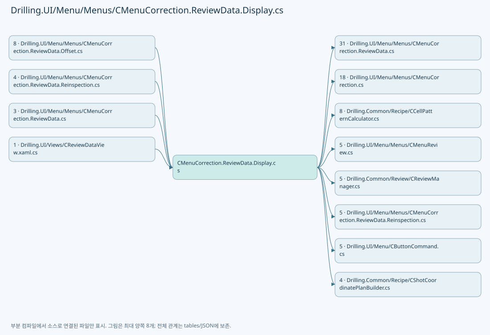

## 네임스페이스·타입·상속

| 타입 | 구분 | 원본 범위 | 선언/상속 |
| --- | --- | --- | --- |
| CMenuCorrection | ClassDeclaration | 12–1045 | CMenuCorrection |
| CReviewDataPanel | ClassDeclaration | 14–977 | CReviewDataPanel |
| ST_REVIEW_DATA_DISPLAY_MODEL | RecordDeclaration | 979–984 | ST_REVIEW_DATA_DISPLAY_MODEL |
| ST_REVIEW_DATA_GLASS_PREVIEW | RecordDeclaration | 986–991 | ST_REVIEW_DATA_GLASS_PREVIEW |
| ST_REVIEW_DATA_CELL_LABEL | RecordDeclaration | 993–1004 | ST_REVIEW_DATA_CELL_LABEL |
| ST_REVIEW_DATA_SHOT_POSITION | RecordDeclaration | 1006–1020 | ST_REVIEW_DATA_SHOT_POSITION |
| ST_REVIEW_DATA_GRID_ROW | RecordDeclaration | 1022–1044 | ST_REVIEW_DATA_GRID_ROW |

## 멤버 빠른 목록

| 이름 | 종류 | 범위 | 서명 |
| --- | --- | --- | --- |
| _dataLoadCancellation | FieldDeclaration | L16–16 | System.Threading.CancellationTokenSource? Drilling.UI.Menu.Menus.CMenuCorrection.CReviewDataPanel._dataLoadCancellation |
| _dataLoadVersion | FieldDeclaration | L17–17 | int Drilling.UI.Menu.Menus.CMenuCorrection.CReviewDataPanel._dataLoadVersion |
| _shotMapRenderVersion | FieldDeclaration | L18–18 | int Drilling.UI.Menu.Menus.CMenuCorrection.CReviewDataPanel._shotMapRenderVersion |
| _isDataLoading | FieldDeclaration | L19–19 | bool Drilling.UI.Menu.Menus.CMenuCorrection.CReviewDataPanel._isDataLoading |
| _hasLoadedData | FieldDeclaration | L20–20 | bool Drilling.UI.Menu.Menus.CMenuCorrection.CReviewDataPanel._hasLoadedData |
| _loadProgress | FieldDeclaration | L21–21 | double Drilling.UI.Menu.Menus.CMenuCorrection.CReviewDataPanel._loadProgress |
| _loadProgressText | FieldDeclaration | L22–22 | string Drilling.UI.Menu.Menus.CMenuCorrection.CReviewDataPanel._loadProgressText |
| _dataLoadHint | FieldDeclaration | L23–23 | string Drilling.UI.Menu.Menus.CMenuCorrection.CReviewDataPanel._dataLoadHint |
| _dataLoadHintBrush | FieldDeclaration | L24–24 | Brush Drilling.UI.Menu.Menus.CMenuCorrection.CReviewDataPanel._dataLoadHintBrush |
| _loadedParameters | FieldDeclaration | L25–25 | System.Collections.Generic.IReadOnlyDictionary<string, string> Drilling.UI.Menu.Menus.CMenuCorrection.CReviewDataPanel._loadedParameters |
| _resultCellNos | FieldDeclaration | L26–26 | System.Collections.Generic.IReadOnlySet<int> Drilling.UI.Menu.Menus.CMenuCorrection.CReviewDataPanel._resultCellNos |
| _shotsByCell | FieldDeclaration | L27–27 | System.Collections.Generic.IReadOnlyDictionary<int, System.Collections.Generic.IReadOnlyList<Drilling.UI.Menu.Menus.CMenuCorrection.ST_REVIEW_DATA_SHOT_POSITION>> Drilling.UI.Menu.Menus.CMenuCorrection.CReviewDataPanel._shotsByCell |
| _allRows | FieldDeclaration | L28–28 | System.Collections.Generic.IReadOnlyList<Drilling.UI.Menu.Menus.CMenuCorrection.ST_REVIEW_DATA_GRID_ROW> Drilling.UI.Menu.Menus.CMenuCorrection.CReviewDataPanel._allRows |
| _loadedResultFile | FieldDeclaration | L29–29 | Drilling.Common.Review.ST_REVIEW_RESULT_FILE_DATA? Drilling.UI.Menu.Menus.CMenuCorrection.CReviewDataPanel._loadedResultFile |
| _loadedCatalog | FieldDeclaration | L30–30 | Drilling.Common.Review.ST_REVIEW_RESULT_CATALOG_ITEM? Drilling.UI.Menu.Menus.CMenuCorrection.CReviewDataPanel._loadedCatalog |
| _loadedRecipe | FieldDeclaration | L31–31 | Drilling.Common.Managers.ST_RECIPE_DEFINITION? Drilling.UI.Menu.Menus.CMenuCorrection.CReviewDataPanel._loadedRecipe |
| _loadedCellCount | FieldDeclaration | L32–32 | int Drilling.UI.Menu.Menus.CMenuCorrection.CReviewDataPanel._loadedCellCount |
| _selectedCellNo | FieldDeclaration | L33–33 | int Drilling.UI.Menu.Menus.CMenuCorrection.CReviewDataPanel._selectedCellNo |
| _selectedShotKey | FieldDeclaration | L34–34 | string Drilling.UI.Menu.Menus.CMenuCorrection.CReviewDataPanel._selectedShotKey |
| IsDataLoading | PropertyDeclaration | L36–36 | bool Drilling.UI.Menu.Menus.CMenuCorrection.CReviewDataPanel.IsDataLoading |
| HasLoadedData | PropertyDeclaration | L37–37 | bool Drilling.UI.Menu.Menus.CMenuCorrection.CReviewDataPanel.HasLoadedData |
| ShowDataPlaceholder | PropertyDeclaration | L38–38 | bool Drilling.UI.Menu.Menus.CMenuCorrection.CReviewDataPanel.ShowDataPlaceholder |
| CanLoadData | PropertyDeclaration | L39–39 | bool Drilling.UI.Menu.Menus.CMenuCorrection.CReviewDataPanel.CanLoadData |
| LoadProgress | PropertyDeclaration | L40–40 | double Drilling.UI.Menu.Menus.CMenuCorrection.CReviewDataPanel.LoadProgress |
| LoadProgressText | PropertyDeclaration | L41–41 | string Drilling.UI.Menu.Menus.CMenuCorrection.CReviewDataPanel.LoadProgressText |
| DataLoadHint | PropertyDeclaration | L42–42 | string Drilling.UI.Menu.Menus.CMenuCorrection.CReviewDataPanel.DataLoadHint |
| DataLoadHintBrush | PropertyDeclaration | L43–43 | Brush Drilling.UI.Menu.Menus.CMenuCorrection.CReviewDataPanel.DataLoadHintBrush |
| GlassPreviewImage | PropertyDeclaration | L44–44 | ImageSource? Drilling.UI.Menu.Menus.CMenuCorrection.CReviewDataPanel.GlassPreviewImage |
| get_GlassPreviewImage | GetAccessorDeclaration | L44–44 | ImageSource? Drilling.UI.Menu.Menus.CMenuCorrection.CReviewDataPanel.GlassPreviewImage.get |
| set_GlassPreviewImage | SetAccessorDeclaration | L44–44 | void Drilling.UI.Menu.Menus.CMenuCorrection.CReviewDataPanel.GlassPreviewImage.set |
| ShotMapImage | PropertyDeclaration | L45–45 | ImageSource? Drilling.UI.Menu.Menus.CMenuCorrection.CReviewDataPanel.ShotMapImage |
| get_ShotMapImage | GetAccessorDeclaration | L45–45 | ImageSource? Drilling.UI.Menu.Menus.CMenuCorrection.CReviewDataPanel.ShotMapImage.get |
| set_ShotMapImage | SetAccessorDeclaration | L45–45 | void Drilling.UI.Menu.Menus.CMenuCorrection.CReviewDataPanel.ShotMapImage.set |
| Camera | PropertyDeclaration | L46–46 | Drilling.UI.Menu.Menus.CReviewCameraPreview Drilling.UI.Menu.Menus.CMenuCorrection.CReviewDataPanel.Camera |
| get_Camera | GetAccessorDeclaration | L46–46 | Drilling.UI.Menu.Menus.CReviewCameraPreview Drilling.UI.Menu.Menus.CMenuCorrection.CReviewDataPanel.Camera.get |
| CellLabels | PropertyDeclaration | L47–47 | System.Collections.Generic.IReadOnlyList<Drilling.UI.Menu.Menus.CMenuCorrection.ST_REVIEW_DATA_CELL_LABEL> Drilling.UI.Menu.Menus.CMenuCorrection.CReviewDataPanel.CellLabels |
| get_CellLabels | GetAccessorDeclaration | L47–47 | System.Collections.Generic.IReadOnlyList<Drilling.UI.Menu.Menus.CMenuCorrection.ST_REVIEW_DATA_CELL_LABEL> Drilling.UI.Menu.Menus.CMenuCorrection.CReviewDataPanel.CellLabels.get |
| set_CellLabels | SetAccessorDeclaration | L47–47 | void Drilling.UI.Menu.Menus.CMenuCorrection.CReviewDataPanel.CellLabels.set |
| Rows | PropertyDeclaration | L48–48 | System.Collections.Generic.IReadOnlyList<Drilling.UI.Menu.Menus.CMenuCorrection.ST_REVIEW_DATA_GRID_ROW> Drilling.UI.Menu.Menus.CMenuCorrection.CReviewDataPanel.Rows |
| get_Rows | GetAccessorDeclaration | L48–48 | System.Collections.Generic.IReadOnlyList<Drilling.UI.Menu.Menus.CMenuCorrection.ST_REVIEW_DATA_GRID_ROW> Drilling.UI.Menu.Menus.CMenuCorrection.CReviewDataPanel.Rows.get |
| set_Rows | SetAccessorDeclaration | L48–48 | void Drilling.UI.Menu.Menus.CMenuCorrection.CReviewDataPanel.Rows.set |
| SelectedRow | PropertyDeclaration | L49–49 | Drilling.UI.Menu.Menus.CMenuCorrection.ST_REVIEW_DATA_GRID_ROW? Drilling.UI.Menu.Menus.CMenuCorrection.CReviewDataPanel.SelectedRow |
| get_SelectedRow | GetAccessorDeclaration | L49–49 | Drilling.UI.Menu.Menus.CMenuCorrection.ST_REVIEW_DATA_GRID_ROW? Drilling.UI.Menu.Menus.CMenuCorrection.CReviewDataPanel.SelectedRow.get |
| set_SelectedRow | SetAccessorDeclaration | L49–49 | void Drilling.UI.Menu.Menus.CMenuCorrection.CReviewDataPanel.SelectedRow.set |
| GlassSummary | PropertyDeclaration | L50–50 | string Drilling.UI.Menu.Menus.CMenuCorrection.CReviewDataPanel.GlassSummary |
| get_GlassSummary | GetAccessorDeclaration | L50–50 | string Drilling.UI.Menu.Menus.CMenuCorrection.CReviewDataPanel.GlassSummary.get |
| set_GlassSummary | SetAccessorDeclaration | L50–50 | void Drilling.UI.Menu.Menus.CMenuCorrection.CReviewDataPanel.GlassSummary.set |
| SelectedCellTitle | PropertyDeclaration | L51–51 | string Drilling.UI.Menu.Menus.CMenuCorrection.CReviewDataPanel.SelectedCellTitle |
| get_SelectedCellTitle | GetAccessorDeclaration | L51–51 | string Drilling.UI.Menu.Menus.CMenuCorrection.CReviewDataPanel.SelectedCellTitle.get |
| set_SelectedCellTitle | SetAccessorDeclaration | L51–51 | void Drilling.UI.Menu.Menus.CMenuCorrection.CReviewDataPanel.SelectedCellTitle.set |
| SelectedShotTitle | PropertyDeclaration | L52–52 | string Drilling.UI.Menu.Menus.CMenuCorrection.CReviewDataPanel.SelectedShotTitle |
| get_SelectedShotTitle | GetAccessorDeclaration | L52–52 | string Drilling.UI.Menu.Menus.CMenuCorrection.CReviewDataPanel.SelectedShotTitle.get |
| set_SelectedShotTitle | SetAccessorDeclaration | L52–52 | void Drilling.UI.Menu.Menus.CMenuCorrection.CReviewDataPanel.SelectedShotTitle.set |
| SelectedShotDetail | PropertyDeclaration | L53–53 | string Drilling.UI.Menu.Menus.CMenuCorrection.CReviewDataPanel.SelectedShotDetail |
| get_SelectedShotDetail | GetAccessorDeclaration | L53–53 | string Drilling.UI.Menu.Menus.CMenuCorrection.CReviewDataPanel.SelectedShotDetail.get |
| set_SelectedShotDetail | SetAccessorDeclaration | L53–53 | void Drilling.UI.Menu.Menus.CMenuCorrection.CReviewDataPanel.SelectedShotDetail.set |
| GlassSurfaceWidth | PropertyDeclaration | L54–54 | double Drilling.UI.Menu.Menus.CMenuCorrection.CReviewDataPanel.GlassSurfaceWidth |
| get_GlassSurfaceWidth | GetAccessorDeclaration | L54–54 | double Drilling.UI.Menu.Menus.CMenuCorrection.CReviewDataPanel.GlassSurfaceWidth.get |
| set_GlassSurfaceWidth | SetAccessorDeclaration | L54–54 | void Drilling.UI.Menu.Menus.CMenuCorrection.CReviewDataPanel.GlassSurfaceWidth.set |
| GlassSurfaceHeight | PropertyDeclaration | L55–55 | double Drilling.UI.Menu.Menus.CMenuCorrection.CReviewDataPanel.GlassSurfaceHeight |
| get_GlassSurfaceHeight | GetAccessorDeclaration | L55–55 | double Drilling.UI.Menu.Menus.CMenuCorrection.CReviewDataPanel.GlassSurfaceHeight.get |
| set_GlassSurfaceHeight | SetAccessorDeclaration | L55–55 | void Drilling.UI.Menu.Menus.CMenuCorrection.CReviewDataPanel.GlassSurfaceHeight.set |
| ShotMapSurfaceWidth | PropertyDeclaration | L56–56 | double Drilling.UI.Menu.Menus.CMenuCorrection.CReviewDataPanel.ShotMapSurfaceWidth |
| get_ShotMapSurfaceWidth | GetAccessorDeclaration | L56–56 | double Drilling.UI.Menu.Menus.CMenuCorrection.CReviewDataPanel.ShotMapSurfaceWidth.get |
| set_ShotMapSurfaceWidth | SetAccessorDeclaration | L56–56 | void Drilling.UI.Menu.Menus.CMenuCorrection.CReviewDataPanel.ShotMapSurfaceWidth.set |
| ShotMapSurfaceHeight | PropertyDeclaration | L57–57 | double Drilling.UI.Menu.Menus.CMenuCorrection.CReviewDataPanel.ShotMapSurfaceHeight |
| get_ShotMapSurfaceHeight | GetAccessorDeclaration | L57–57 | double Drilling.UI.Menu.Menus.CMenuCorrection.CReviewDataPanel.ShotMapSurfaceHeight.get |
| set_ShotMapSurfaceHeight | SetAccessorDeclaration | L57–57 | void Drilling.UI.Menu.Menus.CMenuCorrection.CReviewDataPanel.ShotMapSurfaceHeight.set |
| PrepareSelectedResult | MethodDeclaration | L59–88 | void Drilling.UI.Menu.Menus.CMenuCorrection.CReviewDataPanel.PrepareSelectedResult(Drilling.Common.Review.ST_REVIEW_RESULT_CATALOG_ITEM?) |
| LoadDataRequested | MethodDeclaration | L90–93 | void Drilling.UI.Menu.Menus.CMenuCorrection.CReviewDataPanel.LoadDataRequested(object?) |
| LoadSelectedData | MethodDeclaration | L95–174 | System.Threading.Tasks.Task Drilling.UI.Menu.Menus.CMenuCorrection.CReviewDataPanel.LoadSelectedData() |
| BuildDisplayModel | MethodDeclaration | L176–303 | Drilling.UI.Menu.Menus.CMenuCorrection.ST_REVIEW_DATA_DISPLAY_MODEL Drilling.UI.Menu.Menus.CMenuCorrection.CReviewDataPanel.BuildDisplayModel(Drilling.Common.Review.ST_REVIEW_RESULT_FILE_DATA, System.Collections.Generic.IReadOnlyDictionary<string, string>, System.Threading.CancellationToken) |
| CalculateReviewDataCellLayout | MethodDeclaration | L305–330 | Drilling.Common.Recipe.ST_CELL_PATTERN_LAYOUT Drilling.UI.Menu.Menus.CMenuCorrection.CReviewDataPanel.CalculateReviewDataCellLayout(System.Collections.Generic.IReadOnlyDictionary<string, string>, int) |
| ResolveShotPosition | MethodDeclaration | L332–376 | Drilling.UI.Menu.Menus.CMenuCorrection.ST_REVIEW_DATA_SHOT_POSITION Drilling.UI.Menu.Menus.CMenuCorrection.CReviewDataPanel.ResolveShotPosition(Drilling.Common.Review.ST_REVIEW_RESULT_FILE_ROW, Drilling.Common.Recipe.ST_CELL_PATTERN_LAYOUT, int) |
| ReadShotNo | MethodDeclaration | L378–386 | int Drilling.UI.Menu.Menus.CMenuCorrection.CReviewDataPanel.ReadShotNo(string) |
| TryParseMatrixName | MethodDeclaration | L388–413 | bool Drilling.UI.Menu.Menus.CMenuCorrection.CReviewDataPanel.TryParseMatrixName(string, out int, out int) |
| ApplyDisplayModel | MethodDeclaration | L415–441 | void Drilling.UI.Menu.Menus.CMenuCorrection.CReviewDataPanel.ApplyDisplayModel(Drilling.UI.Menu.Menus.CMenuCorrection.ST_REVIEW_DATA_DISPLAY_MODEL, Drilling.Common.Review.ST_REVIEW_RESULT_FILE_DATA, Drilling.Common.Review.ST_REVIEW_RESULT_CATALOG_ITEM, Drilling.Common.Managers.ST_RECIPE_DEFINITION) |
| SelectCell | MethodDeclaration | L443–451 | void Drilling.UI.Menu.Menus.CMenuCorrection.CReviewDataPanel.SelectCell(object?) |
| ApplyCellSelection | MethodDeclaration | L453–491 | void Drilling.UI.Menu.Menus.CMenuCorrection.CReviewDataPanel.ApplyCellSelection(int, bool) |
| SelectShotAt | MethodDeclaration | L493–514 | void Drilling.UI.Menu.Menus.CMenuCorrection.CReviewDataPanel.SelectShotAt(double, double) |
| SelectRow | MethodDeclaration | L516–527 | void Drilling.UI.Menu.Menus.CMenuCorrection.CReviewDataPanel.SelectRow(Drilling.UI.Menu.Menus.CMenuCorrection.ST_REVIEW_DATA_GRID_ROW) |
| ApplyShotSelection | MethodDeclaration | L529–544 | void Drilling.UI.Menu.Menus.CMenuCorrection.CReviewDataPanel.ApplyShotSelection(string, Drilling.UI.Menu.Menus.CMenuCorrection.ST_REVIEW_DATA_GRID_ROW?) |
| RefreshGlassPreview | MethodDeclaration | L546–574 | void Drilling.UI.Menu.Menus.CMenuCorrection.CReviewDataPanel.RefreshGlassPreview() |
| RefreshShotMap | MethodDeclaration | L576–583 | void Drilling.UI.Menu.Menus.CMenuCorrection.CReviewDataPanel.RefreshShotMap() |
| RefreshCellSelectionOverlay | MethodDeclaration | L585–593 | void Drilling.UI.Menu.Menus.CMenuCorrection.CReviewDataPanel.RefreshCellSelectionOverlay() |
| QueueShotMapRender | MethodDeclaration | L595–629 | void Drilling.UI.Menu.Menus.CMenuCorrection.CReviewDataPanel.QueueShotMapRender(int, string) |
| RefreshSelectionText | MethodDeclaration | L631–650 | void Drilling.UI.Menu.Menus.CMenuCorrection.CReviewDataPanel.RefreshSelectionText() |
| BuildReviewDataGlassPreview | MethodDeclaration | L652–747 | Drilling.UI.Menu.Menus.CMenuCorrection.ST_REVIEW_DATA_GLASS_PREVIEW Drilling.UI.Menu.Menus.CMenuCorrection.CReviewDataPanel.BuildReviewDataGlassPreview(System.Collections.Generic.IReadOnlyDictionary<string, string>, int, System.Collections.Generic.IReadOnlySet<int>, int) |
| BuildReviewDataShotMap | MethodDeclaration | L749–860 | ImageSource? Drilling.UI.Menu.Menus.CMenuCorrection.CReviewDataPanel.BuildReviewDataShotMap(System.Collections.Generic.IReadOnlyList<Drilling.UI.Menu.Menus.CMenuCorrection.ST_REVIEW_DATA_SHOT_POSITION>, string) |
| GetReviewDataShotMapSize | MethodDeclaration | L862–872 | Size Drilling.UI.Menu.Menus.CMenuCorrection.CReviewDataPanel.GetReviewDataShotMapSize(System.Collections.Generic.IReadOnlyList<Drilling.UI.Menu.Menus.CMenuCorrection.ST_REVIEW_DATA_SHOT_POSITION>) |
| GetReviewDataShotMapRect | MethodDeclaration | L874–878 | Rect Drilling.UI.Menu.Menus.CMenuCorrection.CReviewDataPanel.GetReviewDataShotMapRect(int, int) |
| IsBlockedStatus | MethodDeclaration | L880–884 | bool Drilling.UI.Menu.Menus.CMenuCorrection.CReviewDataPanel.IsBlockedStatus(string) |
| ClearLoadedDisplay | MethodDeclaration | L886–912 | void Drilling.UI.Menu.Menus.CMenuCorrection.CReviewDataPanel.ClearLoadedDisplay() |
| SetDataLoading | MethodDeclaration | L914–926 | void Drilling.UI.Menu.Menus.CMenuCorrection.CReviewDataPanel.SetDataLoading(bool) |
| SetLoadProgress | MethodDeclaration | L928–934 | void Drilling.UI.Menu.Menus.CMenuCorrection.CReviewDataPanel.SetLoadProgress(double, string) |
| SetDataLoadHint | MethodDeclaration | L936–942 | void Drilling.UI.Menu.Menus.CMenuCorrection.CReviewDataPanel.SetDataLoadHint(string, string) |
| NotifyLoadCommandState | MethodDeclaration | L944–955 | void Drilling.UI.Menu.Menus.CMenuCorrection.CReviewDataPanel.NotifyLoadCommandState() |
| NotifyDisplayState | MethodDeclaration | L957–976 | void Drilling.UI.Menu.Menus.CMenuCorrection.CReviewDataPanel.NotifyDisplayState() |
| Height | PropertyDeclaration | L1001–1001 | double Drilling.UI.Menu.Menus.CMenuCorrection.ST_REVIEW_DATA_CELL_LABEL.Height |
| Left | PropertyDeclaration | L1002–1002 | double Drilling.UI.Menu.Menus.CMenuCorrection.ST_REVIEW_DATA_CELL_LABEL.Left |
| Top | PropertyDeclaration | L1003–1003 | double Drilling.UI.Menu.Menus.CMenuCorrection.ST_REVIEW_DATA_CELL_LABEL.Top |
| HeadNo | PropertyDeclaration | L1016–1016 | int Drilling.UI.Menu.Menus.CMenuCorrection.ST_REVIEW_DATA_SHOT_POSITION.HeadNo |
| get_HeadNo | GetAccessorDeclaration | L1016–1016 | int Drilling.UI.Menu.Menus.CMenuCorrection.ST_REVIEW_DATA_SHOT_POSITION.HeadNo.get |
| set_HeadNo | InitAccessorDeclaration | L1016–1016 | void Drilling.UI.Menu.Menus.CMenuCorrection.ST_REVIEW_DATA_SHOT_POSITION.HeadNo.init |
| IsResult | PropertyDeclaration | L1017–1017 | bool Drilling.UI.Menu.Menus.CMenuCorrection.ST_REVIEW_DATA_SHOT_POSITION.IsResult |
| get_IsResult | GetAccessorDeclaration | L1017–1017 | bool Drilling.UI.Menu.Menus.CMenuCorrection.ST_REVIEW_DATA_SHOT_POSITION.IsResult.get |
| set_IsResult | InitAccessorDeclaration | L1017–1017 | void Drilling.UI.Menu.Menus.CMenuCorrection.ST_REVIEW_DATA_SHOT_POSITION.IsResult.init |
| IsMasked | PropertyDeclaration | L1018–1018 | bool Drilling.UI.Menu.Menus.CMenuCorrection.ST_REVIEW_DATA_SHOT_POSITION.IsMasked |
| get_IsMasked | GetAccessorDeclaration | L1018–1018 | bool Drilling.UI.Menu.Menus.CMenuCorrection.ST_REVIEW_DATA_SHOT_POSITION.IsMasked.get |
| set_IsMasked | InitAccessorDeclaration | L1018–1018 | void Drilling.UI.Menu.Menus.CMenuCorrection.ST_REVIEW_DATA_SHOT_POSITION.IsMasked.init |
| IsChessSkipped | PropertyDeclaration | L1019–1019 | bool Drilling.UI.Menu.Menus.CMenuCorrection.ST_REVIEW_DATA_SHOT_POSITION.IsChessSkipped |
| get_IsChessSkipped | GetAccessorDeclaration | L1019–1019 | bool Drilling.UI.Menu.Menus.CMenuCorrection.ST_REVIEW_DATA_SHOT_POSITION.IsChessSkipped.get |
| set_IsChessSkipped | InitAccessorDeclaration | L1019–1019 | void Drilling.UI.Menu.Menus.CMenuCorrection.ST_REVIEW_DATA_SHOT_POSITION.IsChessSkipped.init |
| IsReinspectionSelected | PropertyDeclaration | L1037–1037 | bool Drilling.UI.Menu.Menus.CMenuCorrection.ST_REVIEW_DATA_GRID_ROW.IsReinspectionSelected |
| get_IsReinspectionSelected | GetAccessorDeclaration | L1037–1037 | bool Drilling.UI.Menu.Menus.CMenuCorrection.ST_REVIEW_DATA_GRID_ROW.IsReinspectionSelected.get |
| set_IsReinspectionSelected | SetAccessorDeclaration | L1037–1037 | void Drilling.UI.Menu.Menus.CMenuCorrection.ST_REVIEW_DATA_GRID_ROW.IsReinspectionSelected.set |
| Head | PropertyDeclaration | L1038–1038 | string Drilling.UI.Menu.Menus.CMenuCorrection.ST_REVIEW_DATA_GRID_ROW.Head |
| Cell | PropertyDeclaration | L1039–1039 | string Drilling.UI.Menu.Menus.CMenuCorrection.ST_REVIEW_DATA_GRID_ROW.Cell |
| Beam | PropertyDeclaration | L1040–1040 | string Drilling.UI.Menu.Menus.CMenuCorrection.ST_REVIEW_DATA_GRID_ROW.Beam |
| ResultXText | PropertyDeclaration | L1041–1041 | string Drilling.UI.Menu.Menus.CMenuCorrection.ST_REVIEW_DATA_GRID_ROW.ResultXText |
| ResultYText | PropertyDeclaration | L1042–1042 | string Drilling.UI.Menu.Menus.CMenuCorrection.ST_REVIEW_DATA_GRID_ROW.ResultYText |
| JudgeBrush | PropertyDeclaration | L1043–1043 | Brush Drilling.UI.Menu.Menus.CMenuCorrection.ST_REVIEW_DATA_GRID_ROW.JudgeBrush |

## 멤버별 상세 계약·호출·처리 해설

### FieldDeclaration `_dataLoadCancellation` · L16–16

[Drilling.UI/Menu/Menus/CMenuCorrection.ReviewData.Display.cs:16–16](https://github.com/kjuws10-rgb/A3Drilling/blob/5aee8e58439c9b455cae7c9593c9be986c3e682e/Drilling.UI/Menu/Menus/CMenuCorrection.ReviewData.Display.cs#L16-L16)

| 항목 | 실제 추출 값 |
| --- | --- |
| 서명 | System.Threading.CancellationTokenSource? Drilling.UI.Menu.Menus.CMenuCorrection.CReviewDataPanel._dataLoadCancellation |
| 접근/수식자 | Private / private |
| 반환/값 타입 | System.Threading.CancellationTokenSource? |
| 소속 타입 | NamedType:Drilling.UI.Menu.Menus.CMenuCorrection.CReviewDataPanel |

현재 부분 분석에서 직접 연결된 호출자는 없습니다. XAML/이벤트/인터페이스·델리게이트·외부 진입을 추가 확인해야 하며, 미사용으로 판정한 것이 아닙니다.

변경 전 점검: 입력/반환 타입, 위 호출자, 예외/취소 경로, 공유 상태와 저장·전송 소비자를 함께 확인합니다. 값의 단위나 물리 방향을 이름만으로 확정하지 않습니다.

### FieldDeclaration `_dataLoadVersion` · L17–17

[Drilling.UI/Menu/Menus/CMenuCorrection.ReviewData.Display.cs:17–17](https://github.com/kjuws10-rgb/A3Drilling/blob/5aee8e58439c9b455cae7c9593c9be986c3e682e/Drilling.UI/Menu/Menus/CMenuCorrection.ReviewData.Display.cs#L17-L17)

| 항목 | 실제 추출 값 |
| --- | --- |
| 서명 | int Drilling.UI.Menu.Menus.CMenuCorrection.CReviewDataPanel._dataLoadVersion |
| 접근/수식자 | Private / private |
| 반환/값 타입 | int |
| 소속 타입 | NamedType:Drilling.UI.Menu.Menus.CMenuCorrection.CReviewDataPanel |

현재 부분 분석에서 직접 연결된 호출자는 없습니다. XAML/이벤트/인터페이스·델리게이트·외부 진입을 추가 확인해야 하며, 미사용으로 판정한 것이 아닙니다.

변경 전 점검: 입력/반환 타입, 위 호출자, 예외/취소 경로, 공유 상태와 저장·전송 소비자를 함께 확인합니다. 값의 단위나 물리 방향을 이름만으로 확정하지 않습니다.

### FieldDeclaration `_shotMapRenderVersion` · L18–18

[Drilling.UI/Menu/Menus/CMenuCorrection.ReviewData.Display.cs:18–18](https://github.com/kjuws10-rgb/A3Drilling/blob/5aee8e58439c9b455cae7c9593c9be986c3e682e/Drilling.UI/Menu/Menus/CMenuCorrection.ReviewData.Display.cs#L18-L18)

| 항목 | 실제 추출 값 |
| --- | --- |
| 서명 | int Drilling.UI.Menu.Menus.CMenuCorrection.CReviewDataPanel._shotMapRenderVersion |
| 접근/수식자 | Private / private |
| 반환/값 타입 | int |
| 소속 타입 | NamedType:Drilling.UI.Menu.Menus.CMenuCorrection.CReviewDataPanel |

현재 부분 분석에서 직접 연결된 호출자는 없습니다. XAML/이벤트/인터페이스·델리게이트·외부 진입을 추가 확인해야 하며, 미사용으로 판정한 것이 아닙니다.

변경 전 점검: 입력/반환 타입, 위 호출자, 예외/취소 경로, 공유 상태와 저장·전송 소비자를 함께 확인합니다. 값의 단위나 물리 방향을 이름만으로 확정하지 않습니다.

### FieldDeclaration `_isDataLoading` · L19–19

[Drilling.UI/Menu/Menus/CMenuCorrection.ReviewData.Display.cs:19–19](https://github.com/kjuws10-rgb/A3Drilling/blob/5aee8e58439c9b455cae7c9593c9be986c3e682e/Drilling.UI/Menu/Menus/CMenuCorrection.ReviewData.Display.cs#L19-L19)

| 항목 | 실제 추출 값 |
| --- | --- |
| 서명 | bool Drilling.UI.Menu.Menus.CMenuCorrection.CReviewDataPanel._isDataLoading |
| 접근/수식자 | Private / private |
| 반환/값 타입 | bool |
| 소속 타입 | NamedType:Drilling.UI.Menu.Menus.CMenuCorrection.CReviewDataPanel |

현재 부분 분석에서 직접 연결된 호출자는 없습니다. XAML/이벤트/인터페이스·델리게이트·외부 진입을 추가 확인해야 하며, 미사용으로 판정한 것이 아닙니다.

변경 전 점검: 입력/반환 타입, 위 호출자, 예외/취소 경로, 공유 상태와 저장·전송 소비자를 함께 확인합니다. 값의 단위나 물리 방향을 이름만으로 확정하지 않습니다.

### FieldDeclaration `_hasLoadedData` · L20–20

[Drilling.UI/Menu/Menus/CMenuCorrection.ReviewData.Display.cs:20–20](https://github.com/kjuws10-rgb/A3Drilling/blob/5aee8e58439c9b455cae7c9593c9be986c3e682e/Drilling.UI/Menu/Menus/CMenuCorrection.ReviewData.Display.cs#L20-L20)

| 항목 | 실제 추출 값 |
| --- | --- |
| 서명 | bool Drilling.UI.Menu.Menus.CMenuCorrection.CReviewDataPanel._hasLoadedData |
| 접근/수식자 | Private / private |
| 반환/값 타입 | bool |
| 소속 타입 | NamedType:Drilling.UI.Menu.Menus.CMenuCorrection.CReviewDataPanel |

현재 부분 분석에서 직접 연결된 호출자는 없습니다. XAML/이벤트/인터페이스·델리게이트·외부 진입을 추가 확인해야 하며, 미사용으로 판정한 것이 아닙니다.

변경 전 점검: 입력/반환 타입, 위 호출자, 예외/취소 경로, 공유 상태와 저장·전송 소비자를 함께 확인합니다. 값의 단위나 물리 방향을 이름만으로 확정하지 않습니다.

### FieldDeclaration `_loadProgress` · L21–21

[Drilling.UI/Menu/Menus/CMenuCorrection.ReviewData.Display.cs:21–21](https://github.com/kjuws10-rgb/A3Drilling/blob/5aee8e58439c9b455cae7c9593c9be986c3e682e/Drilling.UI/Menu/Menus/CMenuCorrection.ReviewData.Display.cs#L21-L21)

| 항목 | 실제 추출 값 |
| --- | --- |
| 서명 | double Drilling.UI.Menu.Menus.CMenuCorrection.CReviewDataPanel._loadProgress |
| 접근/수식자 | Private / private |
| 반환/값 타입 | double |
| 소속 타입 | NamedType:Drilling.UI.Menu.Menus.CMenuCorrection.CReviewDataPanel |

현재 부분 분석에서 직접 연결된 호출자는 없습니다. XAML/이벤트/인터페이스·델리게이트·외부 진입을 추가 확인해야 하며, 미사용으로 판정한 것이 아닙니다.

변경 전 점검: 입력/반환 타입, 위 호출자, 예외/취소 경로, 공유 상태와 저장·전송 소비자를 함께 확인합니다. 값의 단위나 물리 방향을 이름만으로 확정하지 않습니다.

### FieldDeclaration `_loadProgressText` · L22–22

[Drilling.UI/Menu/Menus/CMenuCorrection.ReviewData.Display.cs:22–22](https://github.com/kjuws10-rgb/A3Drilling/blob/5aee8e58439c9b455cae7c9593c9be986c3e682e/Drilling.UI/Menu/Menus/CMenuCorrection.ReviewData.Display.cs#L22-L22)

| 항목 | 실제 추출 값 |
| --- | --- |
| 서명 | string Drilling.UI.Menu.Menus.CMenuCorrection.CReviewDataPanel._loadProgressText |
| 접근/수식자 | Private / private |
| 반환/값 타입 | string |
| 소속 타입 | NamedType:Drilling.UI.Menu.Menus.CMenuCorrection.CReviewDataPanel |

현재 부분 분석에서 직접 연결된 호출자는 없습니다. XAML/이벤트/인터페이스·델리게이트·외부 진입을 추가 확인해야 하며, 미사용으로 판정한 것이 아닙니다.

본문의 실제 연산·분기·예외·반환 순서(원문 위치 순):

| 원본 행 | 종류 | 주석 해설 |
| --- | --- | --- |
| 22 | variable-initializer | 변수의 초기값을 지정합니다: _loadProgressText = "WAITING" |

변경 전 점검: 입력/반환 타입, 위 호출자, 예외/취소 경로, 공유 상태와 저장·전송 소비자를 함께 확인합니다. 값의 단위나 물리 방향을 이름만으로 확정하지 않습니다.

### FieldDeclaration `_dataLoadHint` · L23–23

[Drilling.UI/Menu/Menus/CMenuCorrection.ReviewData.Display.cs:23–23](https://github.com/kjuws10-rgb/A3Drilling/blob/5aee8e58439c9b455cae7c9593c9be986c3e682e/Drilling.UI/Menu/Menus/CMenuCorrection.ReviewData.Display.cs#L23-L23)

| 항목 | 실제 추출 값 |
| --- | --- |
| 서명 | string Drilling.UI.Menu.Menus.CMenuCorrection.CReviewDataPanel._dataLoadHint |
| 접근/수식자 | Private / private |
| 반환/값 타입 | string |
| 소속 타입 | NamedType:Drilling.UI.Menu.Menus.CMenuCorrection.CReviewDataPanel |

현재 부분 분석에서 직접 연결된 호출자는 없습니다. XAML/이벤트/인터페이스·델리게이트·외부 진입을 추가 확인해야 하며, 미사용으로 판정한 것이 아닙니다.

본문의 실제 연산·분기·예외·반환 순서(원문 위치 순):

| 원본 행 | 종류 | 주석 해설 |
| --- | --- | --- |
| 23 | variable-initializer | 변수의 초기값을 지정합니다: _dataLoadHint = "DATA LOAD 불가능. 사유 : 검사 결과 파일을 선택하세요." |

변경 전 점검: 입력/반환 타입, 위 호출자, 예외/취소 경로, 공유 상태와 저장·전송 소비자를 함께 확인합니다. 값의 단위나 물리 방향을 이름만으로 확정하지 않습니다.

### FieldDeclaration `_dataLoadHintBrush` · L24–24

[Drilling.UI/Menu/Menus/CMenuCorrection.ReviewData.Display.cs:24–24](https://github.com/kjuws10-rgb/A3Drilling/blob/5aee8e58439c9b455cae7c9593c9be986c3e682e/Drilling.UI/Menu/Menus/CMenuCorrection.ReviewData.Display.cs#L24-L24)

| 항목 | 실제 추출 값 |
| --- | --- |
| 서명 | Brush Drilling.UI.Menu.Menus.CMenuCorrection.CReviewDataPanel._dataLoadHintBrush |
| 접근/수식자 | Private / private |
| 반환/값 타입 | Brush |
| 소속 타입 | NamedType:Drilling.UI.Menu.Menus.CMenuCorrection.CReviewDataPanel |

현재 부분 분석에서 직접 연결된 호출자는 없습니다. XAML/이벤트/인터페이스·델리게이트·외부 진입을 추가 확인해야 하며, 미사용으로 판정한 것이 아닙니다.

호출하는 대상과 해석 범위:

| 원본 행 | 표현식 | 분석 상태 | 대상/소스 위치 |
| --- | --- | --- | --- |
| 24 | CStatusBrush.ForDisplayState | resolved | Brush Drilling.UI.Menu.Menus.CStatusBrush.ForDisplayState(string) · Drilling.UI/Menu/Menus/CMenuBase.cs:294 |

본문의 실제 연산·분기·예외·반환 순서(원문 위치 순):

| 원본 행 | 종류 | 주석 해설 |
| --- | --- | --- |
| 24 | call | 함수·델리게이트 또는 객체 생성자를 호출합니다: CStatusBrush.ForDisplayState("WAIT") |
| 24 | variable-initializer | 변수의 초기값을 지정합니다: _dataLoadHintBrush = CStatusBrush.ForDisplayState("WAIT") |

변경 전 점검: 입력/반환 타입, 위 호출자, 예외/취소 경로, 공유 상태와 저장·전송 소비자를 함께 확인합니다. 값의 단위나 물리 방향을 이름만으로 확정하지 않습니다.

### FieldDeclaration `_loadedParameters` · L25–25

[Drilling.UI/Menu/Menus/CMenuCorrection.ReviewData.Display.cs:25–25](https://github.com/kjuws10-rgb/A3Drilling/blob/5aee8e58439c9b455cae7c9593c9be986c3e682e/Drilling.UI/Menu/Menus/CMenuCorrection.ReviewData.Display.cs#L25-L25)

| 항목 | 실제 추출 값 |
| --- | --- |
| 서명 | System.Collections.Generic.IReadOnlyDictionary<string, string> Drilling.UI.Menu.Menus.CMenuCorrection.CReviewDataPanel._loadedParameters |
| 접근/수식자 | Private / private |
| 반환/값 타입 | System.Collections.Generic.IReadOnlyDictionary<string, string> |
| 소속 타입 | NamedType:Drilling.UI.Menu.Menus.CMenuCorrection.CReviewDataPanel |

현재 부분 분석에서 직접 연결된 호출자는 없습니다. XAML/이벤트/인터페이스·델리게이트·외부 진입을 추가 확인해야 하며, 미사용으로 판정한 것이 아닙니다.

호출하는 대상과 해석 범위:

| 원본 행 | 표현식 | 분석 상태 | 대상/소스 위치 |
| --- | --- | --- | --- |
| 25 | new Dictionary<string, string> | resolved | System.Collections.Generic.Dictionary<string, string>.Dictionary(System.Collections.Generic.IEqualityComparer<string>?) |

본문의 실제 연산·분기·예외·반환 순서(원문 위치 순):

| 원본 행 | 종류 | 주석 해설 |
| --- | --- | --- |
| 25 | call | 함수·델리게이트 또는 객체 생성자를 호출합니다: new Dictionary<string, string>(StringComparer.OrdinalIgnoreCase) |
| 25 | variable-initializer | 변수의 초기값을 지정합니다: _loadedParameters = new Dictionary<string, string>(StringComparer.OrdinalIgnoreCase) |

변경 전 점검: 입력/반환 타입, 위 호출자, 예외/취소 경로, 공유 상태와 저장·전송 소비자를 함께 확인합니다. 값의 단위나 물리 방향을 이름만으로 확정하지 않습니다.

### FieldDeclaration `_resultCellNos` · L26–26

[Drilling.UI/Menu/Menus/CMenuCorrection.ReviewData.Display.cs:26–26](https://github.com/kjuws10-rgb/A3Drilling/blob/5aee8e58439c9b455cae7c9593c9be986c3e682e/Drilling.UI/Menu/Menus/CMenuCorrection.ReviewData.Display.cs#L26-L26)

| 항목 | 실제 추출 값 |
| --- | --- |
| 서명 | System.Collections.Generic.IReadOnlySet<int> Drilling.UI.Menu.Menus.CMenuCorrection.CReviewDataPanel._resultCellNos |
| 접근/수식자 | Private / private |
| 반환/값 타입 | System.Collections.Generic.IReadOnlySet<int> |
| 소속 타입 | NamedType:Drilling.UI.Menu.Menus.CMenuCorrection.CReviewDataPanel |

현재 부분 분석에서 직접 연결된 호출자는 없습니다. XAML/이벤트/인터페이스·델리게이트·외부 진입을 추가 확인해야 하며, 미사용으로 판정한 것이 아닙니다.

호출하는 대상과 해석 범위:

| 원본 행 | 표현식 | 분석 상태 | 대상/소스 위치 |
| --- | --- | --- | --- |
| 26 | new HashSet<int> | resolved | System.Collections.Generic.HashSet<int>.HashSet() |

본문의 실제 연산·분기·예외·반환 순서(원문 위치 순):

| 원본 행 | 종류 | 주석 해설 |
| --- | --- | --- |
| 26 | call | 함수·델리게이트 또는 객체 생성자를 호출합니다: new HashSet<int>() |
| 26 | variable-initializer | 변수의 초기값을 지정합니다: _resultCellNos = new HashSet<int>() |

변경 전 점검: 입력/반환 타입, 위 호출자, 예외/취소 경로, 공유 상태와 저장·전송 소비자를 함께 확인합니다. 값의 단위나 물리 방향을 이름만으로 확정하지 않습니다.

### FieldDeclaration `_shotsByCell` · L27–27

[Drilling.UI/Menu/Menus/CMenuCorrection.ReviewData.Display.cs:27–27](https://github.com/kjuws10-rgb/A3Drilling/blob/5aee8e58439c9b455cae7c9593c9be986c3e682e/Drilling.UI/Menu/Menus/CMenuCorrection.ReviewData.Display.cs#L27-L27)

| 항목 | 실제 추출 값 |
| --- | --- |
| 서명 | System.Collections.Generic.IReadOnlyDictionary<int, System.Collections.Generic.IReadOnlyList<Drilling.UI.Menu.Menus.CMenuCorrection.ST_REVIEW_DATA_SHOT_POSITION>> Drilling.UI.Menu.Menus.CMenuCorrection.CReviewDataPanel._shotsByCell |
| 접근/수식자 | Private / private |
| 반환/값 타입 | System.Collections.Generic.IReadOnlyDictionary<int, System.Collections.Generic.IReadOnlyList<Drilling.UI.Menu.Menus.CMenuCorrection.ST_REVIEW_DATA_SHOT_POSITION>> |
| 소속 타입 | NamedType:Drilling.UI.Menu.Menus.CMenuCorrection.CReviewDataPanel |

현재 부분 분석에서 직접 연결된 호출자는 없습니다. XAML/이벤트/인터페이스·델리게이트·외부 진입을 추가 확인해야 하며, 미사용으로 판정한 것이 아닙니다.

호출하는 대상과 해석 범위:

| 원본 행 | 표현식 | 분석 상태 | 대상/소스 위치 |
| --- | --- | --- | --- |
| 27 | new Dictionary<int, IReadOnlyList<ST_REVIEW_DATA_SHOT_POSITION>> | resolved | System.Collections.Generic.Dictionary<int, System.Collections.Generic.IReadOnlyList<Drilling.UI.Menu.Menus.CMenuCorrection.ST_REVIEW_DATA_SHOT_POSITION>>.Dictionary() |

본문의 실제 연산·분기·예외·반환 순서(원문 위치 순):

| 원본 행 | 종류 | 주석 해설 |
| --- | --- | --- |
| 27 | call | 함수·델리게이트 또는 객체 생성자를 호출합니다: new Dictionary<int, IReadOnlyList<ST_REVIEW_DATA_SHOT_POSITION>>() |
| 27 | variable-initializer | 변수의 초기값을 지정합니다: _shotsByCell = new Dictionary<int, IReadOnlyList<ST_REVIEW_DATA_SHOT_POSITION>>() |

변경 전 점검: 입력/반환 타입, 위 호출자, 예외/취소 경로, 공유 상태와 저장·전송 소비자를 함께 확인합니다. 값의 단위나 물리 방향을 이름만으로 확정하지 않습니다.

### FieldDeclaration `_allRows` · L28–28

[Drilling.UI/Menu/Menus/CMenuCorrection.ReviewData.Display.cs:28–28](https://github.com/kjuws10-rgb/A3Drilling/blob/5aee8e58439c9b455cae7c9593c9be986c3e682e/Drilling.UI/Menu/Menus/CMenuCorrection.ReviewData.Display.cs#L28-L28)

| 항목 | 실제 추출 값 |
| --- | --- |
| 서명 | System.Collections.Generic.IReadOnlyList<Drilling.UI.Menu.Menus.CMenuCorrection.ST_REVIEW_DATA_GRID_ROW> Drilling.UI.Menu.Menus.CMenuCorrection.CReviewDataPanel._allRows |
| 접근/수식자 | Private / private |
| 반환/값 타입 | System.Collections.Generic.IReadOnlyList<Drilling.UI.Menu.Menus.CMenuCorrection.ST_REVIEW_DATA_GRID_ROW> |
| 소속 타입 | NamedType:Drilling.UI.Menu.Menus.CMenuCorrection.CReviewDataPanel |

현재 부분 분석에서 직접 연결된 호출자는 없습니다. XAML/이벤트/인터페이스·델리게이트·외부 진입을 추가 확인해야 하며, 미사용으로 판정한 것이 아닙니다.

본문의 실제 연산·분기·예외·반환 순서(원문 위치 순):

| 원본 행 | 종류 | 주석 해설 |
| --- | --- | --- |
| 28 | variable-initializer | 변수의 초기값을 지정합니다: _allRows = [] |

변경 전 점검: 입력/반환 타입, 위 호출자, 예외/취소 경로, 공유 상태와 저장·전송 소비자를 함께 확인합니다. 값의 단위나 물리 방향을 이름만으로 확정하지 않습니다.

### FieldDeclaration `_loadedResultFile` · L29–29

[Drilling.UI/Menu/Menus/CMenuCorrection.ReviewData.Display.cs:29–29](https://github.com/kjuws10-rgb/A3Drilling/blob/5aee8e58439c9b455cae7c9593c9be986c3e682e/Drilling.UI/Menu/Menus/CMenuCorrection.ReviewData.Display.cs#L29-L29)

| 항목 | 실제 추출 값 |
| --- | --- |
| 서명 | Drilling.Common.Review.ST_REVIEW_RESULT_FILE_DATA? Drilling.UI.Menu.Menus.CMenuCorrection.CReviewDataPanel._loadedResultFile |
| 접근/수식자 | Private / private |
| 반환/값 타입 | Drilling.Common.Review.ST_REVIEW_RESULT_FILE_DATA? |
| 소속 타입 | NamedType:Drilling.UI.Menu.Menus.CMenuCorrection.CReviewDataPanel |

현재 부분 분석에서 직접 연결된 호출자는 없습니다. XAML/이벤트/인터페이스·델리게이트·외부 진입을 추가 확인해야 하며, 미사용으로 판정한 것이 아닙니다.

변경 전 점검: 입력/반환 타입, 위 호출자, 예외/취소 경로, 공유 상태와 저장·전송 소비자를 함께 확인합니다. 값의 단위나 물리 방향을 이름만으로 확정하지 않습니다.

### FieldDeclaration `_loadedCatalog` · L30–30

[Drilling.UI/Menu/Menus/CMenuCorrection.ReviewData.Display.cs:30–30](https://github.com/kjuws10-rgb/A3Drilling/blob/5aee8e58439c9b455cae7c9593c9be986c3e682e/Drilling.UI/Menu/Menus/CMenuCorrection.ReviewData.Display.cs#L30-L30)

| 항목 | 실제 추출 값 |
| --- | --- |
| 서명 | Drilling.Common.Review.ST_REVIEW_RESULT_CATALOG_ITEM? Drilling.UI.Menu.Menus.CMenuCorrection.CReviewDataPanel._loadedCatalog |
| 접근/수식자 | Private / private |
| 반환/값 타입 | Drilling.Common.Review.ST_REVIEW_RESULT_CATALOG_ITEM? |
| 소속 타입 | NamedType:Drilling.UI.Menu.Menus.CMenuCorrection.CReviewDataPanel |

현재 부분 분석에서 직접 연결된 호출자는 없습니다. XAML/이벤트/인터페이스·델리게이트·외부 진입을 추가 확인해야 하며, 미사용으로 판정한 것이 아닙니다.

변경 전 점검: 입력/반환 타입, 위 호출자, 예외/취소 경로, 공유 상태와 저장·전송 소비자를 함께 확인합니다. 값의 단위나 물리 방향을 이름만으로 확정하지 않습니다.

### FieldDeclaration `_loadedRecipe` · L31–31

[Drilling.UI/Menu/Menus/CMenuCorrection.ReviewData.Display.cs:31–31](https://github.com/kjuws10-rgb/A3Drilling/blob/5aee8e58439c9b455cae7c9593c9be986c3e682e/Drilling.UI/Menu/Menus/CMenuCorrection.ReviewData.Display.cs#L31-L31)

| 항목 | 실제 추출 값 |
| --- | --- |
| 서명 | Drilling.Common.Managers.ST_RECIPE_DEFINITION? Drilling.UI.Menu.Menus.CMenuCorrection.CReviewDataPanel._loadedRecipe |
| 접근/수식자 | Private / private |
| 반환/값 타입 | Drilling.Common.Managers.ST_RECIPE_DEFINITION? |
| 소속 타입 | NamedType:Drilling.UI.Menu.Menus.CMenuCorrection.CReviewDataPanel |

현재 부분 분석에서 직접 연결된 호출자는 없습니다. XAML/이벤트/인터페이스·델리게이트·외부 진입을 추가 확인해야 하며, 미사용으로 판정한 것이 아닙니다.

변경 전 점검: 입력/반환 타입, 위 호출자, 예외/취소 경로, 공유 상태와 저장·전송 소비자를 함께 확인합니다. 값의 단위나 물리 방향을 이름만으로 확정하지 않습니다.

### FieldDeclaration `_loadedCellCount` · L32–32

[Drilling.UI/Menu/Menus/CMenuCorrection.ReviewData.Display.cs:32–32](https://github.com/kjuws10-rgb/A3Drilling/blob/5aee8e58439c9b455cae7c9593c9be986c3e682e/Drilling.UI/Menu/Menus/CMenuCorrection.ReviewData.Display.cs#L32-L32)

| 항목 | 실제 추출 값 |
| --- | --- |
| 서명 | int Drilling.UI.Menu.Menus.CMenuCorrection.CReviewDataPanel._loadedCellCount |
| 접근/수식자 | Private / private |
| 반환/값 타입 | int |
| 소속 타입 | NamedType:Drilling.UI.Menu.Menus.CMenuCorrection.CReviewDataPanel |

현재 부분 분석에서 직접 연결된 호출자는 없습니다. XAML/이벤트/인터페이스·델리게이트·외부 진입을 추가 확인해야 하며, 미사용으로 판정한 것이 아닙니다.

변경 전 점검: 입력/반환 타입, 위 호출자, 예외/취소 경로, 공유 상태와 저장·전송 소비자를 함께 확인합니다. 값의 단위나 물리 방향을 이름만으로 확정하지 않습니다.

### FieldDeclaration `_selectedCellNo` · L33–33

[Drilling.UI/Menu/Menus/CMenuCorrection.ReviewData.Display.cs:33–33](https://github.com/kjuws10-rgb/A3Drilling/blob/5aee8e58439c9b455cae7c9593c9be986c3e682e/Drilling.UI/Menu/Menus/CMenuCorrection.ReviewData.Display.cs#L33-L33)

| 항목 | 실제 추출 값 |
| --- | --- |
| 서명 | int Drilling.UI.Menu.Menus.CMenuCorrection.CReviewDataPanel._selectedCellNo |
| 접근/수식자 | Private / private |
| 반환/값 타입 | int |
| 소속 타입 | NamedType:Drilling.UI.Menu.Menus.CMenuCorrection.CReviewDataPanel |

현재 부분 분석에서 직접 연결된 호출자는 없습니다. XAML/이벤트/인터페이스·델리게이트·외부 진입을 추가 확인해야 하며, 미사용으로 판정한 것이 아닙니다.

변경 전 점검: 입력/반환 타입, 위 호출자, 예외/취소 경로, 공유 상태와 저장·전송 소비자를 함께 확인합니다. 값의 단위나 물리 방향을 이름만으로 확정하지 않습니다.

### FieldDeclaration `_selectedShotKey` · L34–34

[Drilling.UI/Menu/Menus/CMenuCorrection.ReviewData.Display.cs:34–34](https://github.com/kjuws10-rgb/A3Drilling/blob/5aee8e58439c9b455cae7c9593c9be986c3e682e/Drilling.UI/Menu/Menus/CMenuCorrection.ReviewData.Display.cs#L34-L34)

| 항목 | 실제 추출 값 |
| --- | --- |
| 서명 | string Drilling.UI.Menu.Menus.CMenuCorrection.CReviewDataPanel._selectedShotKey |
| 접근/수식자 | Private / private |
| 반환/값 타입 | string |
| 소속 타입 | NamedType:Drilling.UI.Menu.Menus.CMenuCorrection.CReviewDataPanel |

현재 부분 분석에서 직접 연결된 호출자는 없습니다. XAML/이벤트/인터페이스·델리게이트·외부 진입을 추가 확인해야 하며, 미사용으로 판정한 것이 아닙니다.

본문의 실제 연산·분기·예외·반환 순서(원문 위치 순):

| 원본 행 | 종류 | 주석 해설 |
| --- | --- | --- |
| 34 | variable-initializer | 변수의 초기값을 지정합니다: _selectedShotKey = "" |

변경 전 점검: 입력/반환 타입, 위 호출자, 예외/취소 경로, 공유 상태와 저장·전송 소비자를 함께 확인합니다. 값의 단위나 물리 방향을 이름만으로 확정하지 않습니다.

### PropertyDeclaration `IsDataLoading` · L36–36

[Drilling.UI/Menu/Menus/CMenuCorrection.ReviewData.Display.cs:36–36](https://github.com/kjuws10-rgb/A3Drilling/blob/5aee8e58439c9b455cae7c9593c9be986c3e682e/Drilling.UI/Menu/Menus/CMenuCorrection.ReviewData.Display.cs#L36-L36)

| 항목 | 실제 추출 값 |
| --- | --- |
| 서명 | bool Drilling.UI.Menu.Menus.CMenuCorrection.CReviewDataPanel.IsDataLoading |
| 접근/수식자 | Public / public |
| 반환/값 타입 | bool |
| 소속 타입 | NamedType:Drilling.UI.Menu.Menus.CMenuCorrection.CReviewDataPanel |

현재 부분 분석에서 직접 연결된 호출자는 없습니다. XAML/이벤트/인터페이스·델리게이트·외부 진입을 추가 확인해야 하며, 미사용으로 판정한 것이 아닙니다.

변경 전 점검: 입력/반환 타입, 위 호출자, 예외/취소 경로, 공유 상태와 저장·전송 소비자를 함께 확인합니다. 값의 단위나 물리 방향을 이름만으로 확정하지 않습니다.

### PropertyDeclaration `HasLoadedData` · L37–37

[Drilling.UI/Menu/Menus/CMenuCorrection.ReviewData.Display.cs:37–37](https://github.com/kjuws10-rgb/A3Drilling/blob/5aee8e58439c9b455cae7c9593c9be986c3e682e/Drilling.UI/Menu/Menus/CMenuCorrection.ReviewData.Display.cs#L37-L37)

| 항목 | 실제 추출 값 |
| --- | --- |
| 서명 | bool Drilling.UI.Menu.Menus.CMenuCorrection.CReviewDataPanel.HasLoadedData |
| 접근/수식자 | Public / public |
| 반환/값 타입 | bool |
| 소속 타입 | NamedType:Drilling.UI.Menu.Menus.CMenuCorrection.CReviewDataPanel |

현재 부분 분석에서 직접 연결된 호출자는 없습니다. XAML/이벤트/인터페이스·델리게이트·외부 진입을 추가 확인해야 하며, 미사용으로 판정한 것이 아닙니다.

변경 전 점검: 입력/반환 타입, 위 호출자, 예외/취소 경로, 공유 상태와 저장·전송 소비자를 함께 확인합니다. 값의 단위나 물리 방향을 이름만으로 확정하지 않습니다.

### PropertyDeclaration `ShowDataPlaceholder` · L38–38

[Drilling.UI/Menu/Menus/CMenuCorrection.ReviewData.Display.cs:38–38](https://github.com/kjuws10-rgb/A3Drilling/blob/5aee8e58439c9b455cae7c9593c9be986c3e682e/Drilling.UI/Menu/Menus/CMenuCorrection.ReviewData.Display.cs#L38-L38)

| 항목 | 실제 추출 값 |
| --- | --- |
| 서명 | bool Drilling.UI.Menu.Menus.CMenuCorrection.CReviewDataPanel.ShowDataPlaceholder |
| 접근/수식자 | Public / public |
| 반환/값 타입 | bool |
| 소속 타입 | NamedType:Drilling.UI.Menu.Menus.CMenuCorrection.CReviewDataPanel |

현재 부분 분석에서 직접 연결된 호출자는 없습니다. XAML/이벤트/인터페이스·델리게이트·외부 진입을 추가 확인해야 하며, 미사용으로 판정한 것이 아닙니다.

변경 전 점검: 입력/반환 타입, 위 호출자, 예외/취소 경로, 공유 상태와 저장·전송 소비자를 함께 확인합니다. 값의 단위나 물리 방향을 이름만으로 확정하지 않습니다.

### PropertyDeclaration `CanLoadData` · L39–39

[Drilling.UI/Menu/Menus/CMenuCorrection.ReviewData.Display.cs:39–39](https://github.com/kjuws10-rgb/A3Drilling/blob/5aee8e58439c9b455cae7c9593c9be986c3e682e/Drilling.UI/Menu/Menus/CMenuCorrection.ReviewData.Display.cs#L39-L39)

| 항목 | 실제 추출 값 |
| --- | --- |
| 서명 | bool Drilling.UI.Menu.Menus.CMenuCorrection.CReviewDataPanel.CanLoadData |
| 접근/수식자 | Public / public |
| 반환/값 타입 | bool |
| 소속 타입 | NamedType:Drilling.UI.Menu.Menus.CMenuCorrection.CReviewDataPanel |

현재 부분 분석에서 직접 연결된 호출자는 없습니다. XAML/이벤트/인터페이스·델리게이트·외부 진입을 추가 확인해야 하며, 미사용으로 판정한 것이 아닙니다.

호출하는 대상과 해석 범위:

| 원본 행 | 표현식 | 분석 상태 | 대상/소스 위치 |
| --- | --- | --- | --- |
| 39 | IsBlockedStatus | resolved | bool Drilling.UI.Menu.Menus.CMenuCorrection.CReviewDataPanel.IsBlockedStatus(string) · Drilling.UI/Menu/Menus/CMenuCorrection.ReviewData.Display.cs:880 |

본문의 실제 연산·분기·예외·반환 순서(원문 위치 순):

| 원본 행 | 종류 | 주석 해설 |
| --- | --- | --- |
| 39 | call | 함수·델리게이트 또는 객체 생성자를 호출합니다: IsBlockedStatus(result.ResultStatus) |

변경 전 점검: 입력/반환 타입, 위 호출자, 예외/취소 경로, 공유 상태와 저장·전송 소비자를 함께 확인합니다. 값의 단위나 물리 방향을 이름만으로 확정하지 않습니다.

### PropertyDeclaration `LoadProgress` · L40–40

[Drilling.UI/Menu/Menus/CMenuCorrection.ReviewData.Display.cs:40–40](https://github.com/kjuws10-rgb/A3Drilling/blob/5aee8e58439c9b455cae7c9593c9be986c3e682e/Drilling.UI/Menu/Menus/CMenuCorrection.ReviewData.Display.cs#L40-L40)

| 항목 | 실제 추출 값 |
| --- | --- |
| 서명 | double Drilling.UI.Menu.Menus.CMenuCorrection.CReviewDataPanel.LoadProgress |
| 접근/수식자 | Public / public |
| 반환/값 타입 | double |
| 소속 타입 | NamedType:Drilling.UI.Menu.Menus.CMenuCorrection.CReviewDataPanel |

현재 부분 분석에서 직접 연결된 호출자는 없습니다. XAML/이벤트/인터페이스·델리게이트·외부 진입을 추가 확인해야 하며, 미사용으로 판정한 것이 아닙니다.

변경 전 점검: 입력/반환 타입, 위 호출자, 예외/취소 경로, 공유 상태와 저장·전송 소비자를 함께 확인합니다. 값의 단위나 물리 방향을 이름만으로 확정하지 않습니다.

### PropertyDeclaration `LoadProgressText` · L41–41

[Drilling.UI/Menu/Menus/CMenuCorrection.ReviewData.Display.cs:41–41](https://github.com/kjuws10-rgb/A3Drilling/blob/5aee8e58439c9b455cae7c9593c9be986c3e682e/Drilling.UI/Menu/Menus/CMenuCorrection.ReviewData.Display.cs#L41-L41)

| 항목 | 실제 추출 값 |
| --- | --- |
| 서명 | string Drilling.UI.Menu.Menus.CMenuCorrection.CReviewDataPanel.LoadProgressText |
| 접근/수식자 | Public / public |
| 반환/값 타입 | string |
| 소속 타입 | NamedType:Drilling.UI.Menu.Menus.CMenuCorrection.CReviewDataPanel |

현재 부분 분석에서 직접 연결된 호출자는 없습니다. XAML/이벤트/인터페이스·델리게이트·외부 진입을 추가 확인해야 하며, 미사용으로 판정한 것이 아닙니다.

변경 전 점검: 입력/반환 타입, 위 호출자, 예외/취소 경로, 공유 상태와 저장·전송 소비자를 함께 확인합니다. 값의 단위나 물리 방향을 이름만으로 확정하지 않습니다.

### PropertyDeclaration `DataLoadHint` · L42–42

[Drilling.UI/Menu/Menus/CMenuCorrection.ReviewData.Display.cs:42–42](https://github.com/kjuws10-rgb/A3Drilling/blob/5aee8e58439c9b455cae7c9593c9be986c3e682e/Drilling.UI/Menu/Menus/CMenuCorrection.ReviewData.Display.cs#L42-L42)

| 항목 | 실제 추출 값 |
| --- | --- |
| 서명 | string Drilling.UI.Menu.Menus.CMenuCorrection.CReviewDataPanel.DataLoadHint |
| 접근/수식자 | Public / public |
| 반환/값 타입 | string |
| 소속 타입 | NamedType:Drilling.UI.Menu.Menus.CMenuCorrection.CReviewDataPanel |

현재 부분 분석에서 직접 연결된 호출자는 없습니다. XAML/이벤트/인터페이스·델리게이트·외부 진입을 추가 확인해야 하며, 미사용으로 판정한 것이 아닙니다.

변경 전 점검: 입력/반환 타입, 위 호출자, 예외/취소 경로, 공유 상태와 저장·전송 소비자를 함께 확인합니다. 값의 단위나 물리 방향을 이름만으로 확정하지 않습니다.

### PropertyDeclaration `DataLoadHintBrush` · L43–43

[Drilling.UI/Menu/Menus/CMenuCorrection.ReviewData.Display.cs:43–43](https://github.com/kjuws10-rgb/A3Drilling/blob/5aee8e58439c9b455cae7c9593c9be986c3e682e/Drilling.UI/Menu/Menus/CMenuCorrection.ReviewData.Display.cs#L43-L43)

| 항목 | 실제 추출 값 |
| --- | --- |
| 서명 | Brush Drilling.UI.Menu.Menus.CMenuCorrection.CReviewDataPanel.DataLoadHintBrush |
| 접근/수식자 | Public / public |
| 반환/값 타입 | Brush |
| 소속 타입 | NamedType:Drilling.UI.Menu.Menus.CMenuCorrection.CReviewDataPanel |

현재 부분 분석에서 직접 연결된 호출자는 없습니다. XAML/이벤트/인터페이스·델리게이트·외부 진입을 추가 확인해야 하며, 미사용으로 판정한 것이 아닙니다.

변경 전 점검: 입력/반환 타입, 위 호출자, 예외/취소 경로, 공유 상태와 저장·전송 소비자를 함께 확인합니다. 값의 단위나 물리 방향을 이름만으로 확정하지 않습니다.

### PropertyDeclaration `GlassPreviewImage` · L44–44

[Drilling.UI/Menu/Menus/CMenuCorrection.ReviewData.Display.cs:44–44](https://github.com/kjuws10-rgb/A3Drilling/blob/5aee8e58439c9b455cae7c9593c9be986c3e682e/Drilling.UI/Menu/Menus/CMenuCorrection.ReviewData.Display.cs#L44-L44)

| 항목 | 실제 추출 값 |
| --- | --- |
| 서명 | ImageSource? Drilling.UI.Menu.Menus.CMenuCorrection.CReviewDataPanel.GlassPreviewImage |
| 접근/수식자 | Public / public |
| 반환/값 타입 | ImageSource? |
| 소속 타입 | NamedType:Drilling.UI.Menu.Menus.CMenuCorrection.CReviewDataPanel |

현재 부분 분석에서 직접 연결된 호출자는 없습니다. XAML/이벤트/인터페이스·델리게이트·외부 진입을 추가 확인해야 하며, 미사용으로 판정한 것이 아닙니다.

변경 전 점검: 입력/반환 타입, 위 호출자, 예외/취소 경로, 공유 상태와 저장·전송 소비자를 함께 확인합니다. 값의 단위나 물리 방향을 이름만으로 확정하지 않습니다.

### GetAccessorDeclaration `get_GlassPreviewImage` · L44–44

[Drilling.UI/Menu/Menus/CMenuCorrection.ReviewData.Display.cs:44–44](https://github.com/kjuws10-rgb/A3Drilling/blob/5aee8e58439c9b455cae7c9593c9be986c3e682e/Drilling.UI/Menu/Menus/CMenuCorrection.ReviewData.Display.cs#L44-L44)

| 항목 | 실제 추출 값 |
| --- | --- |
| 서명 | ImageSource? Drilling.UI.Menu.Menus.CMenuCorrection.CReviewDataPanel.GlassPreviewImage.get |
| 접근/수식자 | Public / get |
| 반환/값 타입 | ImageSource? |
| 소속 타입 | NamedType:Drilling.UI.Menu.Menus.CMenuCorrection.CReviewDataPanel |

현재 부분 분석에서 직접 연결된 호출자는 없습니다. XAML/이벤트/인터페이스·델리게이트·외부 진입을 추가 확인해야 하며, 미사용으로 판정한 것이 아닙니다.

변경 전 점검: 입력/반환 타입, 위 호출자, 예외/취소 경로, 공유 상태와 저장·전송 소비자를 함께 확인합니다. 값의 단위나 물리 방향을 이름만으로 확정하지 않습니다.

### SetAccessorDeclaration `set_GlassPreviewImage` · L44–44

[Drilling.UI/Menu/Menus/CMenuCorrection.ReviewData.Display.cs:44–44](https://github.com/kjuws10-rgb/A3Drilling/blob/5aee8e58439c9b455cae7c9593c9be986c3e682e/Drilling.UI/Menu/Menus/CMenuCorrection.ReviewData.Display.cs#L44-L44)

| 항목 | 실제 추출 값 |
| --- | --- |
| 서명 | void Drilling.UI.Menu.Menus.CMenuCorrection.CReviewDataPanel.GlassPreviewImage.set |
| 접근/수식자 | Private / private, set |
| 반환/값 타입 | void |
| 소속 타입 | NamedType:Drilling.UI.Menu.Menus.CMenuCorrection.CReviewDataPanel |

입력 계약:

| 이름 | 타입 | 전달 | 선택/기본값 |
| --- | --- | --- | --- |
| value | ImageSource? | None | False /  |

현재 부분 분석에서 직접 연결된 호출자는 없습니다. XAML/이벤트/인터페이스·델리게이트·외부 진입을 추가 확인해야 하며, 미사용으로 판정한 것이 아닙니다.

변경 전 점검: 입력/반환 타입, 위 호출자, 예외/취소 경로, 공유 상태와 저장·전송 소비자를 함께 확인합니다. 값의 단위나 물리 방향을 이름만으로 확정하지 않습니다.

### PropertyDeclaration `ShotMapImage` · L45–45

[Drilling.UI/Menu/Menus/CMenuCorrection.ReviewData.Display.cs:45–45](https://github.com/kjuws10-rgb/A3Drilling/blob/5aee8e58439c9b455cae7c9593c9be986c3e682e/Drilling.UI/Menu/Menus/CMenuCorrection.ReviewData.Display.cs#L45-L45)

| 항목 | 실제 추출 값 |
| --- | --- |
| 서명 | ImageSource? Drilling.UI.Menu.Menus.CMenuCorrection.CReviewDataPanel.ShotMapImage |
| 접근/수식자 | Public / public |
| 반환/값 타입 | ImageSource? |
| 소속 타입 | NamedType:Drilling.UI.Menu.Menus.CMenuCorrection.CReviewDataPanel |

현재 부분 분석에서 직접 연결된 호출자는 없습니다. XAML/이벤트/인터페이스·델리게이트·외부 진입을 추가 확인해야 하며, 미사용으로 판정한 것이 아닙니다.

변경 전 점검: 입력/반환 타입, 위 호출자, 예외/취소 경로, 공유 상태와 저장·전송 소비자를 함께 확인합니다. 값의 단위나 물리 방향을 이름만으로 확정하지 않습니다.

### GetAccessorDeclaration `get_ShotMapImage` · L45–45

[Drilling.UI/Menu/Menus/CMenuCorrection.ReviewData.Display.cs:45–45](https://github.com/kjuws10-rgb/A3Drilling/blob/5aee8e58439c9b455cae7c9593c9be986c3e682e/Drilling.UI/Menu/Menus/CMenuCorrection.ReviewData.Display.cs#L45-L45)

| 항목 | 실제 추출 값 |
| --- | --- |
| 서명 | ImageSource? Drilling.UI.Menu.Menus.CMenuCorrection.CReviewDataPanel.ShotMapImage.get |
| 접근/수식자 | Public / get |
| 반환/값 타입 | ImageSource? |
| 소속 타입 | NamedType:Drilling.UI.Menu.Menus.CMenuCorrection.CReviewDataPanel |

현재 부분 분석에서 직접 연결된 호출자는 없습니다. XAML/이벤트/인터페이스·델리게이트·외부 진입을 추가 확인해야 하며, 미사용으로 판정한 것이 아닙니다.

변경 전 점검: 입력/반환 타입, 위 호출자, 예외/취소 경로, 공유 상태와 저장·전송 소비자를 함께 확인합니다. 값의 단위나 물리 방향을 이름만으로 확정하지 않습니다.

### SetAccessorDeclaration `set_ShotMapImage` · L45–45

[Drilling.UI/Menu/Menus/CMenuCorrection.ReviewData.Display.cs:45–45](https://github.com/kjuws10-rgb/A3Drilling/blob/5aee8e58439c9b455cae7c9593c9be986c3e682e/Drilling.UI/Menu/Menus/CMenuCorrection.ReviewData.Display.cs#L45-L45)

| 항목 | 실제 추출 값 |
| --- | --- |
| 서명 | void Drilling.UI.Menu.Menus.CMenuCorrection.CReviewDataPanel.ShotMapImage.set |
| 접근/수식자 | Private / private, set |
| 반환/값 타입 | void |
| 소속 타입 | NamedType:Drilling.UI.Menu.Menus.CMenuCorrection.CReviewDataPanel |

입력 계약:

| 이름 | 타입 | 전달 | 선택/기본값 |
| --- | --- | --- | --- |
| value | ImageSource? | None | False /  |

현재 부분 분석에서 직접 연결된 호출자는 없습니다. XAML/이벤트/인터페이스·델리게이트·외부 진입을 추가 확인해야 하며, 미사용으로 판정한 것이 아닙니다.

변경 전 점검: 입력/반환 타입, 위 호출자, 예외/취소 경로, 공유 상태와 저장·전송 소비자를 함께 확인합니다. 값의 단위나 물리 방향을 이름만으로 확정하지 않습니다.

### PropertyDeclaration `Camera` · L46–46

[Drilling.UI/Menu/Menus/CMenuCorrection.ReviewData.Display.cs:46–46](https://github.com/kjuws10-rgb/A3Drilling/blob/5aee8e58439c9b455cae7c9593c9be986c3e682e/Drilling.UI/Menu/Menus/CMenuCorrection.ReviewData.Display.cs#L46-L46)

| 항목 | 실제 추출 값 |
| --- | --- |
| 서명 | Drilling.UI.Menu.Menus.CReviewCameraPreview Drilling.UI.Menu.Menus.CMenuCorrection.CReviewDataPanel.Camera |
| 접근/수식자 | Public / public |
| 반환/값 타입 | Drilling.UI.Menu.Menus.CReviewCameraPreview |
| 소속 타입 | NamedType:Drilling.UI.Menu.Menus.CMenuCorrection.CReviewDataPanel |

현재 부분 분석에서 직접 연결된 호출자는 없습니다. XAML/이벤트/인터페이스·델리게이트·외부 진입을 추가 확인해야 하며, 미사용으로 판정한 것이 아닙니다.

호출하는 대상과 해석 범위:

| 원본 행 | 표현식 | 분석 상태 | 대상/소스 위치 |
| --- | --- | --- | --- |
| 46 | new | resolved | Drilling.UI.Menu.Menus.CReviewCameraPreview.CReviewCameraPreview() · Drilling.UI/Menu/Menus/CMenuReview.cs:4007 |

본문의 실제 연산·분기·예외·반환 순서(원문 위치 순):

| 원본 행 | 종류 | 주석 해설 |
| --- | --- | --- |
| 46 | call | 함수·델리게이트 또는 객체 생성자를 호출합니다: new() |

변경 전 점검: 입력/반환 타입, 위 호출자, 예외/취소 경로, 공유 상태와 저장·전송 소비자를 함께 확인합니다. 값의 단위나 물리 방향을 이름만으로 확정하지 않습니다.

### GetAccessorDeclaration `get_Camera` · L46–46

[Drilling.UI/Menu/Menus/CMenuCorrection.ReviewData.Display.cs:46–46](https://github.com/kjuws10-rgb/A3Drilling/blob/5aee8e58439c9b455cae7c9593c9be986c3e682e/Drilling.UI/Menu/Menus/CMenuCorrection.ReviewData.Display.cs#L46-L46)

| 항목 | 실제 추출 값 |
| --- | --- |
| 서명 | Drilling.UI.Menu.Menus.CReviewCameraPreview Drilling.UI.Menu.Menus.CMenuCorrection.CReviewDataPanel.Camera.get |
| 접근/수식자 | Public / get |
| 반환/값 타입 | Drilling.UI.Menu.Menus.CReviewCameraPreview |
| 소속 타입 | NamedType:Drilling.UI.Menu.Menus.CMenuCorrection.CReviewDataPanel |

현재 부분 분석에서 직접 연결된 호출자는 없습니다. XAML/이벤트/인터페이스·델리게이트·외부 진입을 추가 확인해야 하며, 미사용으로 판정한 것이 아닙니다.

변경 전 점검: 입력/반환 타입, 위 호출자, 예외/취소 경로, 공유 상태와 저장·전송 소비자를 함께 확인합니다. 값의 단위나 물리 방향을 이름만으로 확정하지 않습니다.

### PropertyDeclaration `CellLabels` · L47–47

[Drilling.UI/Menu/Menus/CMenuCorrection.ReviewData.Display.cs:47–47](https://github.com/kjuws10-rgb/A3Drilling/blob/5aee8e58439c9b455cae7c9593c9be986c3e682e/Drilling.UI/Menu/Menus/CMenuCorrection.ReviewData.Display.cs#L47-L47)

| 항목 | 실제 추출 값 |
| --- | --- |
| 서명 | System.Collections.Generic.IReadOnlyList<Drilling.UI.Menu.Menus.CMenuCorrection.ST_REVIEW_DATA_CELL_LABEL> Drilling.UI.Menu.Menus.CMenuCorrection.CReviewDataPanel.CellLabels |
| 접근/수식자 | Public / public |
| 반환/값 타입 | System.Collections.Generic.IReadOnlyList<Drilling.UI.Menu.Menus.CMenuCorrection.ST_REVIEW_DATA_CELL_LABEL> |
| 소속 타입 | NamedType:Drilling.UI.Menu.Menus.CMenuCorrection.CReviewDataPanel |

현재 부분 분석에서 직접 연결된 호출자는 없습니다. XAML/이벤트/인터페이스·델리게이트·외부 진입을 추가 확인해야 하며, 미사용으로 판정한 것이 아닙니다.

변경 전 점검: 입력/반환 타입, 위 호출자, 예외/취소 경로, 공유 상태와 저장·전송 소비자를 함께 확인합니다. 값의 단위나 물리 방향을 이름만으로 확정하지 않습니다.

### GetAccessorDeclaration `get_CellLabels` · L47–47

[Drilling.UI/Menu/Menus/CMenuCorrection.ReviewData.Display.cs:47–47](https://github.com/kjuws10-rgb/A3Drilling/blob/5aee8e58439c9b455cae7c9593c9be986c3e682e/Drilling.UI/Menu/Menus/CMenuCorrection.ReviewData.Display.cs#L47-L47)

| 항목 | 실제 추출 값 |
| --- | --- |
| 서명 | System.Collections.Generic.IReadOnlyList<Drilling.UI.Menu.Menus.CMenuCorrection.ST_REVIEW_DATA_CELL_LABEL> Drilling.UI.Menu.Menus.CMenuCorrection.CReviewDataPanel.CellLabels.get |
| 접근/수식자 | Public / get |
| 반환/값 타입 | System.Collections.Generic.IReadOnlyList<Drilling.UI.Menu.Menus.CMenuCorrection.ST_REVIEW_DATA_CELL_LABEL> |
| 소속 타입 | NamedType:Drilling.UI.Menu.Menus.CMenuCorrection.CReviewDataPanel |

현재 부분 분석에서 직접 연결된 호출자는 없습니다. XAML/이벤트/인터페이스·델리게이트·외부 진입을 추가 확인해야 하며, 미사용으로 판정한 것이 아닙니다.

변경 전 점검: 입력/반환 타입, 위 호출자, 예외/취소 경로, 공유 상태와 저장·전송 소비자를 함께 확인합니다. 값의 단위나 물리 방향을 이름만으로 확정하지 않습니다.

### SetAccessorDeclaration `set_CellLabels` · L47–47

[Drilling.UI/Menu/Menus/CMenuCorrection.ReviewData.Display.cs:47–47](https://github.com/kjuws10-rgb/A3Drilling/blob/5aee8e58439c9b455cae7c9593c9be986c3e682e/Drilling.UI/Menu/Menus/CMenuCorrection.ReviewData.Display.cs#L47-L47)

| 항목 | 실제 추출 값 |
| --- | --- |
| 서명 | void Drilling.UI.Menu.Menus.CMenuCorrection.CReviewDataPanel.CellLabels.set |
| 접근/수식자 | Private / private, set |
| 반환/값 타입 | void |
| 소속 타입 | NamedType:Drilling.UI.Menu.Menus.CMenuCorrection.CReviewDataPanel |

입력 계약:

| 이름 | 타입 | 전달 | 선택/기본값 |
| --- | --- | --- | --- |
| value | System.Collections.Generic.IReadOnlyList<Drilling.UI.Menu.Menus.CMenuCorrection.ST_REVIEW_DATA_CELL_LABEL> | None | False /  |

현재 부분 분석에서 직접 연결된 호출자는 없습니다. XAML/이벤트/인터페이스·델리게이트·외부 진입을 추가 확인해야 하며, 미사용으로 판정한 것이 아닙니다.

변경 전 점검: 입력/반환 타입, 위 호출자, 예외/취소 경로, 공유 상태와 저장·전송 소비자를 함께 확인합니다. 값의 단위나 물리 방향을 이름만으로 확정하지 않습니다.

### PropertyDeclaration `Rows` · L48–48

[Drilling.UI/Menu/Menus/CMenuCorrection.ReviewData.Display.cs:48–48](https://github.com/kjuws10-rgb/A3Drilling/blob/5aee8e58439c9b455cae7c9593c9be986c3e682e/Drilling.UI/Menu/Menus/CMenuCorrection.ReviewData.Display.cs#L48-L48)

| 항목 | 실제 추출 값 |
| --- | --- |
| 서명 | System.Collections.Generic.IReadOnlyList<Drilling.UI.Menu.Menus.CMenuCorrection.ST_REVIEW_DATA_GRID_ROW> Drilling.UI.Menu.Menus.CMenuCorrection.CReviewDataPanel.Rows |
| 접근/수식자 | Public / public |
| 반환/값 타입 | System.Collections.Generic.IReadOnlyList<Drilling.UI.Menu.Menus.CMenuCorrection.ST_REVIEW_DATA_GRID_ROW> |
| 소속 타입 | NamedType:Drilling.UI.Menu.Menus.CMenuCorrection.CReviewDataPanel |

현재 부분 분석에서 직접 연결된 호출자는 없습니다. XAML/이벤트/인터페이스·델리게이트·외부 진입을 추가 확인해야 하며, 미사용으로 판정한 것이 아닙니다.

변경 전 점검: 입력/반환 타입, 위 호출자, 예외/취소 경로, 공유 상태와 저장·전송 소비자를 함께 확인합니다. 값의 단위나 물리 방향을 이름만으로 확정하지 않습니다.

### GetAccessorDeclaration `get_Rows` · L48–48

[Drilling.UI/Menu/Menus/CMenuCorrection.ReviewData.Display.cs:48–48](https://github.com/kjuws10-rgb/A3Drilling/blob/5aee8e58439c9b455cae7c9593c9be986c3e682e/Drilling.UI/Menu/Menus/CMenuCorrection.ReviewData.Display.cs#L48-L48)

| 항목 | 실제 추출 값 |
| --- | --- |
| 서명 | System.Collections.Generic.IReadOnlyList<Drilling.UI.Menu.Menus.CMenuCorrection.ST_REVIEW_DATA_GRID_ROW> Drilling.UI.Menu.Menus.CMenuCorrection.CReviewDataPanel.Rows.get |
| 접근/수식자 | Public / get |
| 반환/값 타입 | System.Collections.Generic.IReadOnlyList<Drilling.UI.Menu.Menus.CMenuCorrection.ST_REVIEW_DATA_GRID_ROW> |
| 소속 타입 | NamedType:Drilling.UI.Menu.Menus.CMenuCorrection.CReviewDataPanel |

현재 부분 분석에서 직접 연결된 호출자는 없습니다. XAML/이벤트/인터페이스·델리게이트·외부 진입을 추가 확인해야 하며, 미사용으로 판정한 것이 아닙니다.

변경 전 점검: 입력/반환 타입, 위 호출자, 예외/취소 경로, 공유 상태와 저장·전송 소비자를 함께 확인합니다. 값의 단위나 물리 방향을 이름만으로 확정하지 않습니다.

### SetAccessorDeclaration `set_Rows` · L48–48

[Drilling.UI/Menu/Menus/CMenuCorrection.ReviewData.Display.cs:48–48](https://github.com/kjuws10-rgb/A3Drilling/blob/5aee8e58439c9b455cae7c9593c9be986c3e682e/Drilling.UI/Menu/Menus/CMenuCorrection.ReviewData.Display.cs#L48-L48)

| 항목 | 실제 추출 값 |
| --- | --- |
| 서명 | void Drilling.UI.Menu.Menus.CMenuCorrection.CReviewDataPanel.Rows.set |
| 접근/수식자 | Private / private, set |
| 반환/값 타입 | void |
| 소속 타입 | NamedType:Drilling.UI.Menu.Menus.CMenuCorrection.CReviewDataPanel |

입력 계약:

| 이름 | 타입 | 전달 | 선택/기본값 |
| --- | --- | --- | --- |
| value | System.Collections.Generic.IReadOnlyList<Drilling.UI.Menu.Menus.CMenuCorrection.ST_REVIEW_DATA_GRID_ROW> | None | False /  |

현재 부분 분석에서 직접 연결된 호출자는 없습니다. XAML/이벤트/인터페이스·델리게이트·외부 진입을 추가 확인해야 하며, 미사용으로 판정한 것이 아닙니다.

변경 전 점검: 입력/반환 타입, 위 호출자, 예외/취소 경로, 공유 상태와 저장·전송 소비자를 함께 확인합니다. 값의 단위나 물리 방향을 이름만으로 확정하지 않습니다.

### PropertyDeclaration `SelectedRow` · L49–49

[Drilling.UI/Menu/Menus/CMenuCorrection.ReviewData.Display.cs:49–49](https://github.com/kjuws10-rgb/A3Drilling/blob/5aee8e58439c9b455cae7c9593c9be986c3e682e/Drilling.UI/Menu/Menus/CMenuCorrection.ReviewData.Display.cs#L49-L49)

| 항목 | 실제 추출 값 |
| --- | --- |
| 서명 | Drilling.UI.Menu.Menus.CMenuCorrection.ST_REVIEW_DATA_GRID_ROW? Drilling.UI.Menu.Menus.CMenuCorrection.CReviewDataPanel.SelectedRow |
| 접근/수식자 | Public / public |
| 반환/값 타입 | Drilling.UI.Menu.Menus.CMenuCorrection.ST_REVIEW_DATA_GRID_ROW? |
| 소속 타입 | NamedType:Drilling.UI.Menu.Menus.CMenuCorrection.CReviewDataPanel |

현재 부분 분석에서 직접 연결된 호출자는 없습니다. XAML/이벤트/인터페이스·델리게이트·외부 진입을 추가 확인해야 하며, 미사용으로 판정한 것이 아닙니다.

변경 전 점검: 입력/반환 타입, 위 호출자, 예외/취소 경로, 공유 상태와 저장·전송 소비자를 함께 확인합니다. 값의 단위나 물리 방향을 이름만으로 확정하지 않습니다.

### GetAccessorDeclaration `get_SelectedRow` · L49–49

[Drilling.UI/Menu/Menus/CMenuCorrection.ReviewData.Display.cs:49–49](https://github.com/kjuws10-rgb/A3Drilling/blob/5aee8e58439c9b455cae7c9593c9be986c3e682e/Drilling.UI/Menu/Menus/CMenuCorrection.ReviewData.Display.cs#L49-L49)

| 항목 | 실제 추출 값 |
| --- | --- |
| 서명 | Drilling.UI.Menu.Menus.CMenuCorrection.ST_REVIEW_DATA_GRID_ROW? Drilling.UI.Menu.Menus.CMenuCorrection.CReviewDataPanel.SelectedRow.get |
| 접근/수식자 | Public / get |
| 반환/값 타입 | Drilling.UI.Menu.Menus.CMenuCorrection.ST_REVIEW_DATA_GRID_ROW? |
| 소속 타입 | NamedType:Drilling.UI.Menu.Menus.CMenuCorrection.CReviewDataPanel |

현재 부분 분석에서 직접 연결된 호출자는 없습니다. XAML/이벤트/인터페이스·델리게이트·외부 진입을 추가 확인해야 하며, 미사용으로 판정한 것이 아닙니다.

변경 전 점검: 입력/반환 타입, 위 호출자, 예외/취소 경로, 공유 상태와 저장·전송 소비자를 함께 확인합니다. 값의 단위나 물리 방향을 이름만으로 확정하지 않습니다.

### SetAccessorDeclaration `set_SelectedRow` · L49–49

[Drilling.UI/Menu/Menus/CMenuCorrection.ReviewData.Display.cs:49–49](https://github.com/kjuws10-rgb/A3Drilling/blob/5aee8e58439c9b455cae7c9593c9be986c3e682e/Drilling.UI/Menu/Menus/CMenuCorrection.ReviewData.Display.cs#L49-L49)

| 항목 | 실제 추출 값 |
| --- | --- |
| 서명 | void Drilling.UI.Menu.Menus.CMenuCorrection.CReviewDataPanel.SelectedRow.set |
| 접근/수식자 | Private / private, set |
| 반환/값 타입 | void |
| 소속 타입 | NamedType:Drilling.UI.Menu.Menus.CMenuCorrection.CReviewDataPanel |

입력 계약:

| 이름 | 타입 | 전달 | 선택/기본값 |
| --- | --- | --- | --- |
| value | Drilling.UI.Menu.Menus.CMenuCorrection.ST_REVIEW_DATA_GRID_ROW? | None | False /  |

현재 부분 분석에서 직접 연결된 호출자는 없습니다. XAML/이벤트/인터페이스·델리게이트·외부 진입을 추가 확인해야 하며, 미사용으로 판정한 것이 아닙니다.

변경 전 점검: 입력/반환 타입, 위 호출자, 예외/취소 경로, 공유 상태와 저장·전송 소비자를 함께 확인합니다. 값의 단위나 물리 방향을 이름만으로 확정하지 않습니다.

### PropertyDeclaration `GlassSummary` · L50–50

[Drilling.UI/Menu/Menus/CMenuCorrection.ReviewData.Display.cs:50–50](https://github.com/kjuws10-rgb/A3Drilling/blob/5aee8e58439c9b455cae7c9593c9be986c3e682e/Drilling.UI/Menu/Menus/CMenuCorrection.ReviewData.Display.cs#L50-L50)

| 항목 | 실제 추출 값 |
| --- | --- |
| 서명 | string Drilling.UI.Menu.Menus.CMenuCorrection.CReviewDataPanel.GlassSummary |
| 접근/수식자 | Public / public |
| 반환/값 타입 | string |
| 소속 타입 | NamedType:Drilling.UI.Menu.Menus.CMenuCorrection.CReviewDataPanel |

현재 부분 분석에서 직접 연결된 호출자는 없습니다. XAML/이벤트/인터페이스·델리게이트·외부 진입을 추가 확인해야 하며, 미사용으로 판정한 것이 아닙니다.

변경 전 점검: 입력/반환 타입, 위 호출자, 예외/취소 경로, 공유 상태와 저장·전송 소비자를 함께 확인합니다. 값의 단위나 물리 방향을 이름만으로 확정하지 않습니다.

### GetAccessorDeclaration `get_GlassSummary` · L50–50

[Drilling.UI/Menu/Menus/CMenuCorrection.ReviewData.Display.cs:50–50](https://github.com/kjuws10-rgb/A3Drilling/blob/5aee8e58439c9b455cae7c9593c9be986c3e682e/Drilling.UI/Menu/Menus/CMenuCorrection.ReviewData.Display.cs#L50-L50)

| 항목 | 실제 추출 값 |
| --- | --- |
| 서명 | string Drilling.UI.Menu.Menus.CMenuCorrection.CReviewDataPanel.GlassSummary.get |
| 접근/수식자 | Public / get |
| 반환/값 타입 | string |
| 소속 타입 | NamedType:Drilling.UI.Menu.Menus.CMenuCorrection.CReviewDataPanel |

현재 부분 분석에서 직접 연결된 호출자는 없습니다. XAML/이벤트/인터페이스·델리게이트·외부 진입을 추가 확인해야 하며, 미사용으로 판정한 것이 아닙니다.

변경 전 점검: 입력/반환 타입, 위 호출자, 예외/취소 경로, 공유 상태와 저장·전송 소비자를 함께 확인합니다. 값의 단위나 물리 방향을 이름만으로 확정하지 않습니다.

### SetAccessorDeclaration `set_GlassSummary` · L50–50

[Drilling.UI/Menu/Menus/CMenuCorrection.ReviewData.Display.cs:50–50](https://github.com/kjuws10-rgb/A3Drilling/blob/5aee8e58439c9b455cae7c9593c9be986c3e682e/Drilling.UI/Menu/Menus/CMenuCorrection.ReviewData.Display.cs#L50-L50)

| 항목 | 실제 추출 값 |
| --- | --- |
| 서명 | void Drilling.UI.Menu.Menus.CMenuCorrection.CReviewDataPanel.GlassSummary.set |
| 접근/수식자 | Private / private, set |
| 반환/값 타입 | void |
| 소속 타입 | NamedType:Drilling.UI.Menu.Menus.CMenuCorrection.CReviewDataPanel |

입력 계약:

| 이름 | 타입 | 전달 | 선택/기본값 |
| --- | --- | --- | --- |
| value | string | None | False /  |

현재 부분 분석에서 직접 연결된 호출자는 없습니다. XAML/이벤트/인터페이스·델리게이트·외부 진입을 추가 확인해야 하며, 미사용으로 판정한 것이 아닙니다.

변경 전 점검: 입력/반환 타입, 위 호출자, 예외/취소 경로, 공유 상태와 저장·전송 소비자를 함께 확인합니다. 값의 단위나 물리 방향을 이름만으로 확정하지 않습니다.

### PropertyDeclaration `SelectedCellTitle` · L51–51

[Drilling.UI/Menu/Menus/CMenuCorrection.ReviewData.Display.cs:51–51](https://github.com/kjuws10-rgb/A3Drilling/blob/5aee8e58439c9b455cae7c9593c9be986c3e682e/Drilling.UI/Menu/Menus/CMenuCorrection.ReviewData.Display.cs#L51-L51)

| 항목 | 실제 추출 값 |
| --- | --- |
| 서명 | string Drilling.UI.Menu.Menus.CMenuCorrection.CReviewDataPanel.SelectedCellTitle |
| 접근/수식자 | Public / public |
| 반환/값 타입 | string |
| 소속 타입 | NamedType:Drilling.UI.Menu.Menus.CMenuCorrection.CReviewDataPanel |

현재 부분 분석에서 직접 연결된 호출자는 없습니다. XAML/이벤트/인터페이스·델리게이트·외부 진입을 추가 확인해야 하며, 미사용으로 판정한 것이 아닙니다.

변경 전 점검: 입력/반환 타입, 위 호출자, 예외/취소 경로, 공유 상태와 저장·전송 소비자를 함께 확인합니다. 값의 단위나 물리 방향을 이름만으로 확정하지 않습니다.

### GetAccessorDeclaration `get_SelectedCellTitle` · L51–51

[Drilling.UI/Menu/Menus/CMenuCorrection.ReviewData.Display.cs:51–51](https://github.com/kjuws10-rgb/A3Drilling/blob/5aee8e58439c9b455cae7c9593c9be986c3e682e/Drilling.UI/Menu/Menus/CMenuCorrection.ReviewData.Display.cs#L51-L51)

| 항목 | 실제 추출 값 |
| --- | --- |
| 서명 | string Drilling.UI.Menu.Menus.CMenuCorrection.CReviewDataPanel.SelectedCellTitle.get |
| 접근/수식자 | Public / get |
| 반환/값 타입 | string |
| 소속 타입 | NamedType:Drilling.UI.Menu.Menus.CMenuCorrection.CReviewDataPanel |

현재 부분 분석에서 직접 연결된 호출자는 없습니다. XAML/이벤트/인터페이스·델리게이트·외부 진입을 추가 확인해야 하며, 미사용으로 판정한 것이 아닙니다.

변경 전 점검: 입력/반환 타입, 위 호출자, 예외/취소 경로, 공유 상태와 저장·전송 소비자를 함께 확인합니다. 값의 단위나 물리 방향을 이름만으로 확정하지 않습니다.

### SetAccessorDeclaration `set_SelectedCellTitle` · L51–51

[Drilling.UI/Menu/Menus/CMenuCorrection.ReviewData.Display.cs:51–51](https://github.com/kjuws10-rgb/A3Drilling/blob/5aee8e58439c9b455cae7c9593c9be986c3e682e/Drilling.UI/Menu/Menus/CMenuCorrection.ReviewData.Display.cs#L51-L51)

| 항목 | 실제 추출 값 |
| --- | --- |
| 서명 | void Drilling.UI.Menu.Menus.CMenuCorrection.CReviewDataPanel.SelectedCellTitle.set |
| 접근/수식자 | Private / private, set |
| 반환/값 타입 | void |
| 소속 타입 | NamedType:Drilling.UI.Menu.Menus.CMenuCorrection.CReviewDataPanel |

입력 계약:

| 이름 | 타입 | 전달 | 선택/기본값 |
| --- | --- | --- | --- |
| value | string | None | False /  |

현재 부분 분석에서 직접 연결된 호출자는 없습니다. XAML/이벤트/인터페이스·델리게이트·외부 진입을 추가 확인해야 하며, 미사용으로 판정한 것이 아닙니다.

변경 전 점검: 입력/반환 타입, 위 호출자, 예외/취소 경로, 공유 상태와 저장·전송 소비자를 함께 확인합니다. 값의 단위나 물리 방향을 이름만으로 확정하지 않습니다.

### PropertyDeclaration `SelectedShotTitle` · L52–52

[Drilling.UI/Menu/Menus/CMenuCorrection.ReviewData.Display.cs:52–52](https://github.com/kjuws10-rgb/A3Drilling/blob/5aee8e58439c9b455cae7c9593c9be986c3e682e/Drilling.UI/Menu/Menus/CMenuCorrection.ReviewData.Display.cs#L52-L52)

| 항목 | 실제 추출 값 |
| --- | --- |
| 서명 | string Drilling.UI.Menu.Menus.CMenuCorrection.CReviewDataPanel.SelectedShotTitle |
| 접근/수식자 | Public / public |
| 반환/값 타입 | string |
| 소속 타입 | NamedType:Drilling.UI.Menu.Menus.CMenuCorrection.CReviewDataPanel |

현재 부분 분석에서 직접 연결된 호출자는 없습니다. XAML/이벤트/인터페이스·델리게이트·외부 진입을 추가 확인해야 하며, 미사용으로 판정한 것이 아닙니다.

변경 전 점검: 입력/반환 타입, 위 호출자, 예외/취소 경로, 공유 상태와 저장·전송 소비자를 함께 확인합니다. 값의 단위나 물리 방향을 이름만으로 확정하지 않습니다.

### GetAccessorDeclaration `get_SelectedShotTitle` · L52–52

[Drilling.UI/Menu/Menus/CMenuCorrection.ReviewData.Display.cs:52–52](https://github.com/kjuws10-rgb/A3Drilling/blob/5aee8e58439c9b455cae7c9593c9be986c3e682e/Drilling.UI/Menu/Menus/CMenuCorrection.ReviewData.Display.cs#L52-L52)

| 항목 | 실제 추출 값 |
| --- | --- |
| 서명 | string Drilling.UI.Menu.Menus.CMenuCorrection.CReviewDataPanel.SelectedShotTitle.get |
| 접근/수식자 | Public / get |
| 반환/값 타입 | string |
| 소속 타입 | NamedType:Drilling.UI.Menu.Menus.CMenuCorrection.CReviewDataPanel |

현재 부분 분석에서 직접 연결된 호출자는 없습니다. XAML/이벤트/인터페이스·델리게이트·외부 진입을 추가 확인해야 하며, 미사용으로 판정한 것이 아닙니다.

변경 전 점검: 입력/반환 타입, 위 호출자, 예외/취소 경로, 공유 상태와 저장·전송 소비자를 함께 확인합니다. 값의 단위나 물리 방향을 이름만으로 확정하지 않습니다.

### SetAccessorDeclaration `set_SelectedShotTitle` · L52–52

[Drilling.UI/Menu/Menus/CMenuCorrection.ReviewData.Display.cs:52–52](https://github.com/kjuws10-rgb/A3Drilling/blob/5aee8e58439c9b455cae7c9593c9be986c3e682e/Drilling.UI/Menu/Menus/CMenuCorrection.ReviewData.Display.cs#L52-L52)

| 항목 | 실제 추출 값 |
| --- | --- |
| 서명 | void Drilling.UI.Menu.Menus.CMenuCorrection.CReviewDataPanel.SelectedShotTitle.set |
| 접근/수식자 | Private / private, set |
| 반환/값 타입 | void |
| 소속 타입 | NamedType:Drilling.UI.Menu.Menus.CMenuCorrection.CReviewDataPanel |

입력 계약:

| 이름 | 타입 | 전달 | 선택/기본값 |
| --- | --- | --- | --- |
| value | string | None | False /  |

현재 부분 분석에서 직접 연결된 호출자는 없습니다. XAML/이벤트/인터페이스·델리게이트·외부 진입을 추가 확인해야 하며, 미사용으로 판정한 것이 아닙니다.

변경 전 점검: 입력/반환 타입, 위 호출자, 예외/취소 경로, 공유 상태와 저장·전송 소비자를 함께 확인합니다. 값의 단위나 물리 방향을 이름만으로 확정하지 않습니다.

### PropertyDeclaration `SelectedShotDetail` · L53–53

[Drilling.UI/Menu/Menus/CMenuCorrection.ReviewData.Display.cs:53–53](https://github.com/kjuws10-rgb/A3Drilling/blob/5aee8e58439c9b455cae7c9593c9be986c3e682e/Drilling.UI/Menu/Menus/CMenuCorrection.ReviewData.Display.cs#L53-L53)

| 항목 | 실제 추출 값 |
| --- | --- |
| 서명 | string Drilling.UI.Menu.Menus.CMenuCorrection.CReviewDataPanel.SelectedShotDetail |
| 접근/수식자 | Public / public |
| 반환/값 타입 | string |
| 소속 타입 | NamedType:Drilling.UI.Menu.Menus.CMenuCorrection.CReviewDataPanel |

현재 부분 분석에서 직접 연결된 호출자는 없습니다. XAML/이벤트/인터페이스·델리게이트·외부 진입을 추가 확인해야 하며, 미사용으로 판정한 것이 아닙니다.

변경 전 점검: 입력/반환 타입, 위 호출자, 예외/취소 경로, 공유 상태와 저장·전송 소비자를 함께 확인합니다. 값의 단위나 물리 방향을 이름만으로 확정하지 않습니다.

### GetAccessorDeclaration `get_SelectedShotDetail` · L53–53

[Drilling.UI/Menu/Menus/CMenuCorrection.ReviewData.Display.cs:53–53](https://github.com/kjuws10-rgb/A3Drilling/blob/5aee8e58439c9b455cae7c9593c9be986c3e682e/Drilling.UI/Menu/Menus/CMenuCorrection.ReviewData.Display.cs#L53-L53)

| 항목 | 실제 추출 값 |
| --- | --- |
| 서명 | string Drilling.UI.Menu.Menus.CMenuCorrection.CReviewDataPanel.SelectedShotDetail.get |
| 접근/수식자 | Public / get |
| 반환/값 타입 | string |
| 소속 타입 | NamedType:Drilling.UI.Menu.Menus.CMenuCorrection.CReviewDataPanel |

현재 부분 분석에서 직접 연결된 호출자는 없습니다. XAML/이벤트/인터페이스·델리게이트·외부 진입을 추가 확인해야 하며, 미사용으로 판정한 것이 아닙니다.

변경 전 점검: 입력/반환 타입, 위 호출자, 예외/취소 경로, 공유 상태와 저장·전송 소비자를 함께 확인합니다. 값의 단위나 물리 방향을 이름만으로 확정하지 않습니다.

### SetAccessorDeclaration `set_SelectedShotDetail` · L53–53

[Drilling.UI/Menu/Menus/CMenuCorrection.ReviewData.Display.cs:53–53](https://github.com/kjuws10-rgb/A3Drilling/blob/5aee8e58439c9b455cae7c9593c9be986c3e682e/Drilling.UI/Menu/Menus/CMenuCorrection.ReviewData.Display.cs#L53-L53)

| 항목 | 실제 추출 값 |
| --- | --- |
| 서명 | void Drilling.UI.Menu.Menus.CMenuCorrection.CReviewDataPanel.SelectedShotDetail.set |
| 접근/수식자 | Private / private, set |
| 반환/값 타입 | void |
| 소속 타입 | NamedType:Drilling.UI.Menu.Menus.CMenuCorrection.CReviewDataPanel |

입력 계약:

| 이름 | 타입 | 전달 | 선택/기본값 |
| --- | --- | --- | --- |
| value | string | None | False /  |

현재 부분 분석에서 직접 연결된 호출자는 없습니다. XAML/이벤트/인터페이스·델리게이트·외부 진입을 추가 확인해야 하며, 미사용으로 판정한 것이 아닙니다.

변경 전 점검: 입력/반환 타입, 위 호출자, 예외/취소 경로, 공유 상태와 저장·전송 소비자를 함께 확인합니다. 값의 단위나 물리 방향을 이름만으로 확정하지 않습니다.

### PropertyDeclaration `GlassSurfaceWidth` · L54–54

[Drilling.UI/Menu/Menus/CMenuCorrection.ReviewData.Display.cs:54–54](https://github.com/kjuws10-rgb/A3Drilling/blob/5aee8e58439c9b455cae7c9593c9be986c3e682e/Drilling.UI/Menu/Menus/CMenuCorrection.ReviewData.Display.cs#L54-L54)

| 항목 | 실제 추출 값 |
| --- | --- |
| 서명 | double Drilling.UI.Menu.Menus.CMenuCorrection.CReviewDataPanel.GlassSurfaceWidth |
| 접근/수식자 | Public / public |
| 반환/값 타입 | double |
| 소속 타입 | NamedType:Drilling.UI.Menu.Menus.CMenuCorrection.CReviewDataPanel |

현재 부분 분석에서 직접 연결된 호출자는 없습니다. XAML/이벤트/인터페이스·델리게이트·외부 진입을 추가 확인해야 하며, 미사용으로 판정한 것이 아닙니다.

변경 전 점검: 입력/반환 타입, 위 호출자, 예외/취소 경로, 공유 상태와 저장·전송 소비자를 함께 확인합니다. 값의 단위나 물리 방향을 이름만으로 확정하지 않습니다.

### GetAccessorDeclaration `get_GlassSurfaceWidth` · L54–54

[Drilling.UI/Menu/Menus/CMenuCorrection.ReviewData.Display.cs:54–54](https://github.com/kjuws10-rgb/A3Drilling/blob/5aee8e58439c9b455cae7c9593c9be986c3e682e/Drilling.UI/Menu/Menus/CMenuCorrection.ReviewData.Display.cs#L54-L54)

| 항목 | 실제 추출 값 |
| --- | --- |
| 서명 | double Drilling.UI.Menu.Menus.CMenuCorrection.CReviewDataPanel.GlassSurfaceWidth.get |
| 접근/수식자 | Public / get |
| 반환/값 타입 | double |
| 소속 타입 | NamedType:Drilling.UI.Menu.Menus.CMenuCorrection.CReviewDataPanel |

현재 부분 분석에서 직접 연결된 호출자는 없습니다. XAML/이벤트/인터페이스·델리게이트·외부 진입을 추가 확인해야 하며, 미사용으로 판정한 것이 아닙니다.

변경 전 점검: 입력/반환 타입, 위 호출자, 예외/취소 경로, 공유 상태와 저장·전송 소비자를 함께 확인합니다. 값의 단위나 물리 방향을 이름만으로 확정하지 않습니다.

### SetAccessorDeclaration `set_GlassSurfaceWidth` · L54–54

[Drilling.UI/Menu/Menus/CMenuCorrection.ReviewData.Display.cs:54–54](https://github.com/kjuws10-rgb/A3Drilling/blob/5aee8e58439c9b455cae7c9593c9be986c3e682e/Drilling.UI/Menu/Menus/CMenuCorrection.ReviewData.Display.cs#L54-L54)

| 항목 | 실제 추출 값 |
| --- | --- |
| 서명 | void Drilling.UI.Menu.Menus.CMenuCorrection.CReviewDataPanel.GlassSurfaceWidth.set |
| 접근/수식자 | Private / private, set |
| 반환/값 타입 | void |
| 소속 타입 | NamedType:Drilling.UI.Menu.Menus.CMenuCorrection.CReviewDataPanel |

입력 계약:

| 이름 | 타입 | 전달 | 선택/기본값 |
| --- | --- | --- | --- |
| value | double | None | False /  |

현재 부분 분석에서 직접 연결된 호출자는 없습니다. XAML/이벤트/인터페이스·델리게이트·외부 진입을 추가 확인해야 하며, 미사용으로 판정한 것이 아닙니다.

변경 전 점검: 입력/반환 타입, 위 호출자, 예외/취소 경로, 공유 상태와 저장·전송 소비자를 함께 확인합니다. 값의 단위나 물리 방향을 이름만으로 확정하지 않습니다.

### PropertyDeclaration `GlassSurfaceHeight` · L55–55

[Drilling.UI/Menu/Menus/CMenuCorrection.ReviewData.Display.cs:55–55](https://github.com/kjuws10-rgb/A3Drilling/blob/5aee8e58439c9b455cae7c9593c9be986c3e682e/Drilling.UI/Menu/Menus/CMenuCorrection.ReviewData.Display.cs#L55-L55)

| 항목 | 실제 추출 값 |
| --- | --- |
| 서명 | double Drilling.UI.Menu.Menus.CMenuCorrection.CReviewDataPanel.GlassSurfaceHeight |
| 접근/수식자 | Public / public |
| 반환/값 타입 | double |
| 소속 타입 | NamedType:Drilling.UI.Menu.Menus.CMenuCorrection.CReviewDataPanel |

현재 부분 분석에서 직접 연결된 호출자는 없습니다. XAML/이벤트/인터페이스·델리게이트·외부 진입을 추가 확인해야 하며, 미사용으로 판정한 것이 아닙니다.

변경 전 점검: 입력/반환 타입, 위 호출자, 예외/취소 경로, 공유 상태와 저장·전송 소비자를 함께 확인합니다. 값의 단위나 물리 방향을 이름만으로 확정하지 않습니다.

### GetAccessorDeclaration `get_GlassSurfaceHeight` · L55–55

[Drilling.UI/Menu/Menus/CMenuCorrection.ReviewData.Display.cs:55–55](https://github.com/kjuws10-rgb/A3Drilling/blob/5aee8e58439c9b455cae7c9593c9be986c3e682e/Drilling.UI/Menu/Menus/CMenuCorrection.ReviewData.Display.cs#L55-L55)

| 항목 | 실제 추출 값 |
| --- | --- |
| 서명 | double Drilling.UI.Menu.Menus.CMenuCorrection.CReviewDataPanel.GlassSurfaceHeight.get |
| 접근/수식자 | Public / get |
| 반환/값 타입 | double |
| 소속 타입 | NamedType:Drilling.UI.Menu.Menus.CMenuCorrection.CReviewDataPanel |

현재 부분 분석에서 직접 연결된 호출자는 없습니다. XAML/이벤트/인터페이스·델리게이트·외부 진입을 추가 확인해야 하며, 미사용으로 판정한 것이 아닙니다.

변경 전 점검: 입력/반환 타입, 위 호출자, 예외/취소 경로, 공유 상태와 저장·전송 소비자를 함께 확인합니다. 값의 단위나 물리 방향을 이름만으로 확정하지 않습니다.

### SetAccessorDeclaration `set_GlassSurfaceHeight` · L55–55

[Drilling.UI/Menu/Menus/CMenuCorrection.ReviewData.Display.cs:55–55](https://github.com/kjuws10-rgb/A3Drilling/blob/5aee8e58439c9b455cae7c9593c9be986c3e682e/Drilling.UI/Menu/Menus/CMenuCorrection.ReviewData.Display.cs#L55-L55)

| 항목 | 실제 추출 값 |
| --- | --- |
| 서명 | void Drilling.UI.Menu.Menus.CMenuCorrection.CReviewDataPanel.GlassSurfaceHeight.set |
| 접근/수식자 | Private / private, set |
| 반환/값 타입 | void |
| 소속 타입 | NamedType:Drilling.UI.Menu.Menus.CMenuCorrection.CReviewDataPanel |

입력 계약:

| 이름 | 타입 | 전달 | 선택/기본값 |
| --- | --- | --- | --- |
| value | double | None | False /  |

현재 부분 분석에서 직접 연결된 호출자는 없습니다. XAML/이벤트/인터페이스·델리게이트·외부 진입을 추가 확인해야 하며, 미사용으로 판정한 것이 아닙니다.

변경 전 점검: 입력/반환 타입, 위 호출자, 예외/취소 경로, 공유 상태와 저장·전송 소비자를 함께 확인합니다. 값의 단위나 물리 방향을 이름만으로 확정하지 않습니다.

### PropertyDeclaration `ShotMapSurfaceWidth` · L56–56

[Drilling.UI/Menu/Menus/CMenuCorrection.ReviewData.Display.cs:56–56](https://github.com/kjuws10-rgb/A3Drilling/blob/5aee8e58439c9b455cae7c9593c9be986c3e682e/Drilling.UI/Menu/Menus/CMenuCorrection.ReviewData.Display.cs#L56-L56)

| 항목 | 실제 추출 값 |
| --- | --- |
| 서명 | double Drilling.UI.Menu.Menus.CMenuCorrection.CReviewDataPanel.ShotMapSurfaceWidth |
| 접근/수식자 | Public / public |
| 반환/값 타입 | double |
| 소속 타입 | NamedType:Drilling.UI.Menu.Menus.CMenuCorrection.CReviewDataPanel |

현재 부분 분석에서 직접 연결된 호출자는 없습니다. XAML/이벤트/인터페이스·델리게이트·외부 진입을 추가 확인해야 하며, 미사용으로 판정한 것이 아닙니다.

변경 전 점검: 입력/반환 타입, 위 호출자, 예외/취소 경로, 공유 상태와 저장·전송 소비자를 함께 확인합니다. 값의 단위나 물리 방향을 이름만으로 확정하지 않습니다.

### GetAccessorDeclaration `get_ShotMapSurfaceWidth` · L56–56

[Drilling.UI/Menu/Menus/CMenuCorrection.ReviewData.Display.cs:56–56](https://github.com/kjuws10-rgb/A3Drilling/blob/5aee8e58439c9b455cae7c9593c9be986c3e682e/Drilling.UI/Menu/Menus/CMenuCorrection.ReviewData.Display.cs#L56-L56)

| 항목 | 실제 추출 값 |
| --- | --- |
| 서명 | double Drilling.UI.Menu.Menus.CMenuCorrection.CReviewDataPanel.ShotMapSurfaceWidth.get |
| 접근/수식자 | Public / get |
| 반환/값 타입 | double |
| 소속 타입 | NamedType:Drilling.UI.Menu.Menus.CMenuCorrection.CReviewDataPanel |

현재 부분 분석에서 직접 연결된 호출자는 없습니다. XAML/이벤트/인터페이스·델리게이트·외부 진입을 추가 확인해야 하며, 미사용으로 판정한 것이 아닙니다.

변경 전 점검: 입력/반환 타입, 위 호출자, 예외/취소 경로, 공유 상태와 저장·전송 소비자를 함께 확인합니다. 값의 단위나 물리 방향을 이름만으로 확정하지 않습니다.

### SetAccessorDeclaration `set_ShotMapSurfaceWidth` · L56–56

[Drilling.UI/Menu/Menus/CMenuCorrection.ReviewData.Display.cs:56–56](https://github.com/kjuws10-rgb/A3Drilling/blob/5aee8e58439c9b455cae7c9593c9be986c3e682e/Drilling.UI/Menu/Menus/CMenuCorrection.ReviewData.Display.cs#L56-L56)

| 항목 | 실제 추출 값 |
| --- | --- |
| 서명 | void Drilling.UI.Menu.Menus.CMenuCorrection.CReviewDataPanel.ShotMapSurfaceWidth.set |
| 접근/수식자 | Private / private, set |
| 반환/값 타입 | void |
| 소속 타입 | NamedType:Drilling.UI.Menu.Menus.CMenuCorrection.CReviewDataPanel |

입력 계약:

| 이름 | 타입 | 전달 | 선택/기본값 |
| --- | --- | --- | --- |
| value | double | None | False /  |

현재 부분 분석에서 직접 연결된 호출자는 없습니다. XAML/이벤트/인터페이스·델리게이트·외부 진입을 추가 확인해야 하며, 미사용으로 판정한 것이 아닙니다.

변경 전 점검: 입력/반환 타입, 위 호출자, 예외/취소 경로, 공유 상태와 저장·전송 소비자를 함께 확인합니다. 값의 단위나 물리 방향을 이름만으로 확정하지 않습니다.

### PropertyDeclaration `ShotMapSurfaceHeight` · L57–57

[Drilling.UI/Menu/Menus/CMenuCorrection.ReviewData.Display.cs:57–57](https://github.com/kjuws10-rgb/A3Drilling/blob/5aee8e58439c9b455cae7c9593c9be986c3e682e/Drilling.UI/Menu/Menus/CMenuCorrection.ReviewData.Display.cs#L57-L57)

| 항목 | 실제 추출 값 |
| --- | --- |
| 서명 | double Drilling.UI.Menu.Menus.CMenuCorrection.CReviewDataPanel.ShotMapSurfaceHeight |
| 접근/수식자 | Public / public |
| 반환/값 타입 | double |
| 소속 타입 | NamedType:Drilling.UI.Menu.Menus.CMenuCorrection.CReviewDataPanel |

현재 부분 분석에서 직접 연결된 호출자는 없습니다. XAML/이벤트/인터페이스·델리게이트·외부 진입을 추가 확인해야 하며, 미사용으로 판정한 것이 아닙니다.

변경 전 점검: 입력/반환 타입, 위 호출자, 예외/취소 경로, 공유 상태와 저장·전송 소비자를 함께 확인합니다. 값의 단위나 물리 방향을 이름만으로 확정하지 않습니다.

### GetAccessorDeclaration `get_ShotMapSurfaceHeight` · L57–57

[Drilling.UI/Menu/Menus/CMenuCorrection.ReviewData.Display.cs:57–57](https://github.com/kjuws10-rgb/A3Drilling/blob/5aee8e58439c9b455cae7c9593c9be986c3e682e/Drilling.UI/Menu/Menus/CMenuCorrection.ReviewData.Display.cs#L57-L57)

| 항목 | 실제 추출 값 |
| --- | --- |
| 서명 | double Drilling.UI.Menu.Menus.CMenuCorrection.CReviewDataPanel.ShotMapSurfaceHeight.get |
| 접근/수식자 | Public / get |
| 반환/값 타입 | double |
| 소속 타입 | NamedType:Drilling.UI.Menu.Menus.CMenuCorrection.CReviewDataPanel |

현재 부분 분석에서 직접 연결된 호출자는 없습니다. XAML/이벤트/인터페이스·델리게이트·외부 진입을 추가 확인해야 하며, 미사용으로 판정한 것이 아닙니다.

변경 전 점검: 입력/반환 타입, 위 호출자, 예외/취소 경로, 공유 상태와 저장·전송 소비자를 함께 확인합니다. 값의 단위나 물리 방향을 이름만으로 확정하지 않습니다.

### SetAccessorDeclaration `set_ShotMapSurfaceHeight` · L57–57

[Drilling.UI/Menu/Menus/CMenuCorrection.ReviewData.Display.cs:57–57](https://github.com/kjuws10-rgb/A3Drilling/blob/5aee8e58439c9b455cae7c9593c9be986c3e682e/Drilling.UI/Menu/Menus/CMenuCorrection.ReviewData.Display.cs#L57-L57)

| 항목 | 실제 추출 값 |
| --- | --- |
| 서명 | void Drilling.UI.Menu.Menus.CMenuCorrection.CReviewDataPanel.ShotMapSurfaceHeight.set |
| 접근/수식자 | Private / private, set |
| 반환/값 타입 | void |
| 소속 타입 | NamedType:Drilling.UI.Menu.Menus.CMenuCorrection.CReviewDataPanel |

입력 계약:

| 이름 | 타입 | 전달 | 선택/기본값 |
| --- | --- | --- | --- |
| value | double | None | False /  |

현재 부분 분석에서 직접 연결된 호출자는 없습니다. XAML/이벤트/인터페이스·델리게이트·외부 진입을 추가 확인해야 하며, 미사용으로 판정한 것이 아닙니다.

변경 전 점검: 입력/반환 타입, 위 호출자, 예외/취소 경로, 공유 상태와 저장·전송 소비자를 함께 확인합니다. 값의 단위나 물리 방향을 이름만으로 확정하지 않습니다.

### MethodDeclaration `PrepareSelectedResult` · L59–88

[Drilling.UI/Menu/Menus/CMenuCorrection.ReviewData.Display.cs:59–88](https://github.com/kjuws10-rgb/A3Drilling/blob/5aee8e58439c9b455cae7c9593c9be986c3e682e/Drilling.UI/Menu/Menus/CMenuCorrection.ReviewData.Display.cs#L59-L88)

| 항목 | 실제 추출 값 |
| --- | --- |
| 서명 | void Drilling.UI.Menu.Menus.CMenuCorrection.CReviewDataPanel.PrepareSelectedResult(Drilling.Common.Review.ST_REVIEW_RESULT_CATALOG_ITEM?) |
| 접근/수식자 | Private / private |
| 반환/값 타입 | void |
| 소속 타입 | NamedType:Drilling.UI.Menu.Menus.CMenuCorrection.CReviewDataPanel |

입력 계약:

| 이름 | 타입 | 전달 | 선택/기본값 |
| --- | --- | --- | --- |
| result | Drilling.Common.Review.ST_REVIEW_RESULT_CATALOG_ITEM? | None | False /  |

정적 호출자로 확인된 위치:

| 호출 파일/행 | 호출 표현식 | 런타임 분기 가능 |
| --- | --- | --- |
| [Drilling.UI/Menu/Menus/CMenuCorrection.ReviewData.cs:111–111](https://github.com/kjuws10-rgb/A3Drilling/blob/5aee8e58439c9b455cae7c9593c9be986c3e682e/Drilling.UI/Menu/Menus/CMenuCorrection.ReviewData.cs#L111-L111) | PrepareSelectedResult | False |
| [Drilling.UI/Menu/Menus/CMenuCorrection.ReviewData.cs:191–191](https://github.com/kjuws10-rgb/A3Drilling/blob/5aee8e58439c9b455cae7c9593c9be986c3e682e/Drilling.UI/Menu/Menus/CMenuCorrection.ReviewData.cs#L191-L191) | PrepareSelectedResult | False |

호출하는 대상과 해석 범위:

| 원본 행 | 표현식 | 분석 상태 | 대상/소스 위치 |
| --- | --- | --- | --- |
| 61 | .Cancel | resolved | void System.Threading.CancellationTokenSource.Cancel() |
| 62 | .Dispose | resolved | void System.Threading.CancellationTokenSource.Dispose() |
| 64 | Interlocked.Increment | resolved | int System.Threading.Interlocked.Increment(ref int) |
| 65 | SetDataLoading | resolved | void Drilling.UI.Menu.Menus.CMenuCorrection.CReviewDataPanel.SetDataLoading(bool) · Drilling.UI/Menu/Menus/CMenuCorrection.ReviewData.Display.cs:914 |
| 66 | ClearLoadedDisplay | resolved | void Drilling.UI.Menu.Menus.CMenuCorrection.CReviewDataPanel.ClearLoadedDisplay() · Drilling.UI/Menu/Menus/CMenuCorrection.ReviewData.Display.cs:886 |
| 70 | SetDataLoadHint | resolved | void Drilling.UI.Menu.Menus.CMenuCorrection.CReviewDataPanel.SetDataLoadHint(string, string) · Drilling.UI/Menu/Menus/CMenuCorrection.ReviewData.Display.cs:936 |
| 72 | result.ResultStatus.Equals | resolved | bool string.Equals(string?, System.StringComparison) |
| 74 | string.IsNullOrWhiteSpace | resolved | bool string.IsNullOrWhiteSpace(string?) |
| 75 | SetDataLoadHint | resolved | void Drilling.UI.Menu.Menus.CMenuCorrection.CReviewDataPanel.SetDataLoadHint(string, string) · Drilling.UI/Menu/Menus/CMenuCorrection.ReviewData.Display.cs:936 |
| 77 | result.ResultStatus.Equals | resolved | bool string.Equals(string?, System.StringComparison) |
| 79 | string.IsNullOrWhiteSpace | resolved | bool string.IsNullOrWhiteSpace(string?) |
| 80 | SetDataLoadHint | resolved | void Drilling.UI.Menu.Menus.CMenuCorrection.CReviewDataPanel.SetDataLoadHint(string, string) · Drilling.UI/Menu/Menus/CMenuCorrection.ReviewData.Display.cs:936 |
| 84 | SetDataLoadHint | resolved | void Drilling.UI.Menu.Menus.CMenuCorrection.CReviewDataPanel.SetDataLoadHint(string, string) · Drilling.UI/Menu/Menus/CMenuCorrection.ReviewData.Display.cs:936 |
| 87 | NotifyLoadCommandState | resolved | void Drilling.UI.Menu.Menus.CMenuCorrection.CReviewDataPanel.NotifyLoadCommandState() · Drilling.UI/Menu/Menus/CMenuCorrection.ReviewData.Display.cs:944 |

본문의 실제 연산·분기·예외·반환 순서(원문 위치 순):

| 원본 행 | 종류 | 주석 해설 |
| --- | --- | --- |
| 61 | call | 함수·델리게이트 또는 객체 생성자를 호출합니다: .Cancel() |
| 62 | call | 함수·델리게이트 또는 객체 생성자를 호출합니다: .Dispose() |
| 63 | assignment | 값을 대상에 대입합니다: _dataLoadCancellation = null |
| 64 | call | 함수·델리게이트 또는 객체 생성자를 호출합니다: Interlocked.Increment(ref _dataLoadVersion) |
| 65 | call | 함수·델리게이트 또는 객체 생성자를 호출합니다: SetDataLoading(false) |
| 66 | call | 함수·델리게이트 또는 객체 생성자를 호출합니다: ClearLoadedDisplay() |
| 68 | if | 조건에 따라 분기합니다: if (result is null) |
| 70 | call | 함수·델리게이트 또는 객체 생성자를 호출합니다: SetDataLoadHint("DATA LOAD 불가능. 사유 : 검사 결과 파일을 선택하세요.", "WAIT") |
| 72 | call | 함수·델리게이트 또는 객체 생성자를 호출합니다: result.ResultStatus.Equals("FAILED", StringComparison.OrdinalIgnoreCase) |
| 72 | else | 앞 조건이 거짓인 경로입니다: else |
| 72 | if | 조건에 따라 분기합니다: if (result.ResultStatus.Equals("FAILED", StringComparison.OrdinalIgnoreCase)) |
| 74 | call | 함수·델리게이트 또는 객체 생성자를 호출합니다: string.IsNullOrWhiteSpace(result.ResultMessage) |
| 74 | conditional-expression | 조건에 따라 결과식을 선택합니다: string.IsNullOrWhiteSpace(result.ResultMessage) ? "실패 사유가 기록되어 있지 않습니다." : result.ResultMessage |
| 74 | local-declaration | 지역 변수를 선언합니다: var reason = string.IsNullOrWhiteSpace(result.ResultMessage) ? "실패 사유가 기록되어 있지 않습니다." : result.ResultMessage; |
| 74 | variable-initializer | 변수의 초기값을 지정합니다: reason = string.IsNullOrWhiteSpace(result.ResultMessage) ? "실패 사유가 기록되어 있지 않습니다." : result.ResultMessage |
| 75 | call | 함수·델리게이트 또는 객체 생성자를 호출합니다: SetDataLoadHint($"DATA LOAD 불가능. 사유 : 검사 실패 - {reason}", "ERROR") |
| 77 | call | 함수·델리게이트 또는 객체 생성자를 호출합니다: result.ResultStatus.Equals("INVALID", StringComparison.OrdinalIgnoreCase) |
| 77 | else | 앞 조건이 거짓인 경로입니다: else |
| 77 | if | 조건에 따라 분기합니다: if (result.ResultStatus.Equals("INVALID", StringComparison.OrdinalIgnoreCase)) |
| 79 | call | 함수·델리게이트 또는 객체 생성자를 호출합니다: string.IsNullOrWhiteSpace(result.ResultMessage) |
| 79 | conditional-expression | 조건에 따라 결과식을 선택합니다: string.IsNullOrWhiteSpace(result.ResultMessage) ? "결과 파일이 올바르지 않습니다." : result.ResultMessage |
| 79 | local-declaration | 지역 변수를 선언합니다: var reason = string.IsNullOrWhiteSpace(result.ResultMessage) ? "결과 파일이 올바르지 않습니다." : result.ResultMessage; |
| 79 | variable-initializer | 변수의 초기값을 지정합니다: reason = string.IsNullOrWhiteSpace(result.ResultMessage) ? "결과 파일이 올바르지 않습니다." : result.ResultMessage |
| 80 | call | 함수·델리게이트 또는 객체 생성자를 호출합니다: SetDataLoadHint($"DATA LOAD 불가능. 사유 : {reason}", "ERROR") |
| 82 | else | 앞 조건이 거짓인 경로입니다: else |
| 84 | call | 함수·델리게이트 또는 객체 생성자를 호출합니다: SetDataLoadHint("선택한 검사 결과를 불러오려면 DATA LOAD를 누르세요.", "WAIT") |
| 87 | call | 함수·델리게이트 또는 객체 생성자를 호출합니다: NotifyLoadCommandState() |

제어 구문의 포함 구조(실제 실행 순서/CFG가 아닌 구문 탐색 그림):

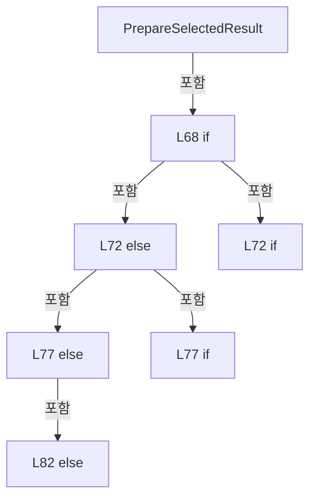

변경 전 점검: 입력/반환 타입, 위 호출자, 예외/취소 경로, 공유 상태와 저장·전송 소비자를 함께 확인합니다. 값의 단위나 물리 방향을 이름만으로 확정하지 않습니다.

### MethodDeclaration `LoadDataRequested` · L90–93

[Drilling.UI/Menu/Menus/CMenuCorrection.ReviewData.Display.cs:90–93](https://github.com/kjuws10-rgb/A3Drilling/blob/5aee8e58439c9b455cae7c9593c9be986c3e682e/Drilling.UI/Menu/Menus/CMenuCorrection.ReviewData.Display.cs#L90-L93)

| 항목 | 실제 추출 값 |
| --- | --- |
| 서명 | void Drilling.UI.Menu.Menus.CMenuCorrection.CReviewDataPanel.LoadDataRequested(object?) |
| 접근/수식자 | Private / private, async |
| 반환/값 타입 | void |
| 소속 타입 | NamedType:Drilling.UI.Menu.Menus.CMenuCorrection.CReviewDataPanel |

입력 계약:

| 이름 | 타입 | 전달 | 선택/기본값 |
| --- | --- | --- | --- |
| parameter | object? | None | False /  |

현재 부분 분석에서 직접 연결된 호출자는 없습니다. XAML/이벤트/인터페이스·델리게이트·외부 진입을 추가 확인해야 하며, 미사용으로 판정한 것이 아닙니다.

호출하는 대상과 해석 범위:

| 원본 행 | 표현식 | 분석 상태 | 대상/소스 위치 |
| --- | --- | --- | --- |
| 92 | LoadSelectedData | resolved | System.Threading.Tasks.Task Drilling.UI.Menu.Menus.CMenuCorrection.CReviewDataPanel.LoadSelectedData() · Drilling.UI/Menu/Menus/CMenuCorrection.ReviewData.Display.cs:95 |

본문의 실제 연산·분기·예외·반환 순서(원문 위치 순):

| 원본 행 | 종류 | 주석 해설 |
| --- | --- | --- |
| 92 | await | 비동기 완료를 기다립니다: await LoadSelectedData() |
| 92 | call | 함수·델리게이트 또는 객체 생성자를 호출합니다: LoadSelectedData() |

변경 전 점검: 입력/반환 타입, 위 호출자, 예외/취소 경로, 공유 상태와 저장·전송 소비자를 함께 확인합니다. 값의 단위나 물리 방향을 이름만으로 확정하지 않습니다.

### MethodDeclaration `LoadSelectedData` · L95–174

[Drilling.UI/Menu/Menus/CMenuCorrection.ReviewData.Display.cs:95–174](https://github.com/kjuws10-rgb/A3Drilling/blob/5aee8e58439c9b455cae7c9593c9be986c3e682e/Drilling.UI/Menu/Menus/CMenuCorrection.ReviewData.Display.cs#L95-L174)

| 항목 | 실제 추출 값 |
| --- | --- |
| 서명 | System.Threading.Tasks.Task Drilling.UI.Menu.Menus.CMenuCorrection.CReviewDataPanel.LoadSelectedData() |
| 접근/수식자 | Private / private, async |
| 반환/값 타입 | System.Threading.Tasks.Task |
| 소속 타입 | NamedType:Drilling.UI.Menu.Menus.CMenuCorrection.CReviewDataPanel |

정적 호출자로 확인된 위치:

| 호출 파일/행 | 호출 표현식 | 런타임 분기 가능 |
| --- | --- | --- |
| [Drilling.UI/Menu/Menus/CMenuCorrection.ReviewData.Display.cs:92–92](https://github.com/kjuws10-rgb/A3Drilling/blob/5aee8e58439c9b455cae7c9593c9be986c3e682e/Drilling.UI/Menu/Menus/CMenuCorrection.ReviewData.Display.cs#L92-L92) | LoadSelectedData | False |
| [Drilling.UI/Menu/Menus/CMenuCorrection.ReviewData.Reinspection.cs:443–443](https://github.com/kjuws10-rgb/A3Drilling/blob/5aee8e58439c9b455cae7c9593c9be986c3e682e/Drilling.UI/Menu/Menus/CMenuCorrection.ReviewData.Reinspection.cs#L443-L443) | LoadSelectedData | False |

호출하는 대상과 해석 범위:

| 원본 행 | 표현식 | 분석 상태 | 대상/소스 위치 |
| --- | --- | --- | --- |
| 97 | IsBlockedStatus | resolved | bool Drilling.UI.Menu.Menus.CMenuCorrection.CReviewDataPanel.IsBlockedStatus(string) · Drilling.UI/Menu/Menus/CMenuCorrection.ReviewData.Display.cs:880 |
| 102 | .Cancel | resolved | void System.Threading.CancellationTokenSource.Cancel() |
| 103 | .Dispose | resolved | void System.Threading.CancellationTokenSource.Dispose() |
| 104 | new CancellationTokenSource | resolved | System.Threading.CancellationTokenSource.CancellationTokenSource() |
| 106 | Interlocked.Increment | resolved | int System.Threading.Interlocked.Increment(ref int) |
| 107 | ClearLoadedDisplay | resolved | void Drilling.UI.Menu.Menus.CMenuCorrection.CReviewDataPanel.ClearLoadedDisplay() · Drilling.UI/Menu/Menus/CMenuCorrection.ReviewData.Display.cs:886 |
| 108 | SetDataLoading | resolved | void Drilling.UI.Menu.Menus.CMenuCorrection.CReviewDataPanel.SetDataLoading(bool) · Drilling.UI/Menu/Menus/CMenuCorrection.ReviewData.Display.cs:914 |
| 109 | SetLoadProgress | resolved | void Drilling.UI.Menu.Menus.CMenuCorrection.CReviewDataPanel.SetLoadProgress(double, string) · Drilling.UI/Menu/Menus/CMenuCorrection.ReviewData.Display.cs:928 |
| 110 | SetDataLoadHint | resolved | void Drilling.UI.Menu.Menus.CMenuCorrection.CReviewDataPanel.SetDataLoadHint(string, string) · Drilling.UI/Menu/Menus/CMenuCorrection.ReviewData.Display.cs:936 |
| 114 | Task.Run | resolved | System.Threading.Tasks.Task<Drilling.Common.Review.ST_REVIEW_RESULT_FILE_DATA> System.Threading.Tasks.Task.Run<Drilling.Common.Review.ST_REVIEW_RESULT_FILE_DATA>(System.Func<System.Threading.Tasks.Task<Drilling.Common.Review.ST_REVIEW_RESULT_FILE_DATA>?>, System.Threading.CancellationToken) |
| 114 | _reviewResultFile.Load | resolved | System.Threading.Tasks.Task<Drilling.Common.Review.ST_REVIEW_RESULT_FILE_DATA> Drilling.Common.Review.CReviewResultFileBase.Load(string, System.Threading.CancellationToken) · Drilling.Common/Review/CReviewManager.cs:4095 |
| 115 | token.ThrowIfCancellationRequested | resolved | void System.Threading.CancellationToken.ThrowIfCancellationRequested() |
| 116 | Volatile.Read | resolved | int System.Threading.Volatile.Read(ref readonly int) |
| 121 | SetLoadProgress | resolved | void Drilling.UI.Menu.Menus.CMenuCorrection.CReviewDataPanel.SetLoadProgress(double, string) · Drilling.UI/Menu/Menus/CMenuCorrection.ReviewData.Display.cs:928 |
| 122 | Task.Run | resolved | System.Threading.Tasks.Task<System.Collections.Generic.IReadOnlyList<Drilling.Common.Managers.ST_RECIPE_DEFINITION>> System.Threading.Tasks.Task.Run<System.Collections.Generic.IReadOnlyList<Drilling.Common.Managers.ST_RECIPE_DEFINITION>>(System.Func<System.Threading.Tasks.Task<System.Collections.Generic.IReadOnlyList<Drilling.Common.Managers.ST_RECIPE_DEFINITION>>?>, System.Threading.CancellationToken) |
| 122 | _recipeManager.LoadRecipes | resolved | System.Threading.Tasks.Task<System.Collections.Generic.IReadOnlyList<Drilling.Common.Managers.ST_RECIPE_DEFINITION>> Drilling.Common.Managers.CRecipeManager.LoadRecipes(System.Threading.CancellationToken) · Drilling.Common/Managers/CRecipeManager.cs:40 |
| 123 | token.ThrowIfCancellationRequested | resolved | void System.Threading.CancellationToken.ThrowIfCancellationRequested() |
| 124 | recipes.FirstOrDefault | resolved | Drilling.Common.Managers.ST_RECIPE_DEFINITION? System.Collections.Generic.IEnumerable<Drilling.Common.Managers.ST_RECIPE_DEFINITION>.FirstOrDefault<Drilling.Common.Managers.ST_RECIPE_DEFINITION>(System.Func<Drilling.Common.Managers.ST_RECIPE_DEFINITION, bool>) |
| 124 | item.Id.Equals | resolved | bool string.Equals(string?, System.StringComparison) |
| 125 | recipes.FirstOrDefault | resolved | Drilling.Common.Managers.ST_RECIPE_DEFINITION? System.Collections.Generic.IEnumerable<Drilling.Common.Managers.ST_RECIPE_DEFINITION>.FirstOrDefault<Drilling.Common.Managers.ST_RECIPE_DEFINITION>(System.Func<Drilling.Common.Managers.ST_RECIPE_DEFINITION, bool>) |
| 125 | item.Name.Equals | resolved | bool string.Equals(string?, System.StringComparison) |
| 126 | new InvalidDataException | resolved | System.IO.InvalidDataException.InvalidDataException(string?) |
| 127 | Task.Run | resolved | System.Threading.Tasks.Task<System.Collections.Generic.IReadOnlyList<Drilling.Common.Managers.ST_SYSTEM_PARAMETER>> System.Threading.Tasks.Task.Run<System.Collections.Generic.IReadOnlyList<Drilling.Common.Managers.ST_SYSTEM_PARAMETER>>(System.Func<System.Collections.Generic.IReadOnlyList<Drilling.Common.Managers.ST_SYSTEM_PARAMETER>>, System.Threading.CancellationToken) |
| 129 | new List<ST_SYSTEM_PARAMETER> | resolved | System.Collections.Generic.List<Drilling.Common.Managers.ST_SYSTEM_PARAMETER>.List() |
| 130 | values.AddRange | resolved | void System.Collections.Generic.List<Drilling.Common.Managers.ST_SYSTEM_PARAMETER>.AddRange(System.Collections.Generic.IEnumerable<Drilling.Common.Managers.ST_SYSTEM_PARAMETER>) |
| 130 | _settingManager.LoadSection | resolved | System.Collections.Generic.IReadOnlyList<Drilling.Common.Managers.ST_SYSTEM_PARAMETER> Drilling.Common.Managers.CSettingManager.LoadSection(Drilling.Common.Managers.EN_SETTING_TAB, System.Threading.CancellationToken) · Drilling.Common/Managers/CSettingManager.cs:26 |
| 131 | values.AddRange | resolved | void System.Collections.Generic.List<Drilling.Common.Managers.ST_SYSTEM_PARAMETER>.AddRange(System.Collections.Generic.IEnumerable<Drilling.Common.Managers.ST_SYSTEM_PARAMETER>) |
| 131 | _settingManager.LoadSection | resolved | System.Collections.Generic.IReadOnlyList<Drilling.Common.Managers.ST_SYSTEM_PARAMETER> Drilling.Common.Managers.CSettingManager.LoadSection(Drilling.Common.Managers.EN_SETTING_TAB, System.Threading.CancellationToken) · Drilling.Common/Managers/CSettingManager.cs:26 |
| 134 | token.ThrowIfCancellationRequested | resolved | void System.Threading.CancellationToken.ThrowIfCancellationRequested() |
| 135 | SetLoadProgress | resolved | void Drilling.UI.Menu.Menus.CMenuCorrection.CReviewDataPanel.SetLoadProgress(double, string) · Drilling.UI/Menu/Menus/CMenuCorrection.ReviewData.Display.cs:928 |
| 137 | BuildOutputViewerParameterMap | resolved | System.Collections.Generic.Dictionary<string, string> Drilling.UI.Menu.Menus.CMenuCorrection.BuildOutputViewerParameterMap(Drilling.Common.Managers.ST_RECIPE_DEFINITION, System.Collections.Generic.IReadOnlyList<Drilling.Common.Managers.ST_SYSTEM_PARAMETER>) · Drilling.UI/Menu/Menus/CMenuCorrection.cs:726 |
| 138 | Task.Run | resolved | System.Threading.Tasks.Task<Drilling.UI.Menu.Menus.CMenuCorrection.ST_REVIEW_DATA_DISPLAY_MODEL> System.Threading.Tasks.Task.Run<Drilling.UI.Menu.Menus.CMenuCorrection.ST_REVIEW_DATA_DISPLAY_MODEL>(System.Func<Drilling.UI.Menu.Menus.CMenuCorrection.ST_REVIEW_DATA_DISPLAY_MODEL>, System.Threading.CancellationToken) |
| 138 | BuildDisplayModel | resolved | Drilling.UI.Menu.Menus.CMenuCorrection.ST_REVIEW_DATA_DISPLAY_MODEL Drilling.UI.Menu.Menus.CMenuCorrection.CReviewDataPanel.BuildDisplayModel(Drilling.Common.Review.ST_REVIEW_RESULT_FILE_DATA, System.Collections.Generic.IReadOnlyDictionary<string, string>, System.Threading.CancellationToken) · Drilling.UI/Menu/Menus/CMenuCorrection.ReviewData.Display.cs:176 |
| 139 | token.ThrowIfCancellationRequested | resolved | void System.Threading.CancellationToken.ThrowIfCancellationRequested() |
| 140 | Volatile.Read | resolved | int System.Threading.Volatile.Read(ref readonly int) |
| 145 | SetLoadProgress | resolved | void Drilling.UI.Menu.Menus.CMenuCorrection.CReviewDataPanel.SetLoadProgress(double, string) · Drilling.UI/Menu/Menus/CMenuCorrection.ReviewData.Display.cs:928 |
| 146 | ApplyDisplayModel | resolved | void Drilling.UI.Menu.Menus.CMenuCorrection.CReviewDataPanel.ApplyDisplayModel(Drilling.UI.Menu.Menus.CMenuCorrection.ST_REVIEW_DATA_DISPLAY_MODEL, Drilling.Common.Review.ST_REVIEW_RESULT_FILE_DATA, Drilling.Common.Review.ST_REVIEW_RESULT_CATALOG_ITEM, Drilling.Common.Managers.ST_RECIPE_DEFINITION) · Drilling.UI/Menu/Menus/CMenuCorrection.ReviewData.Display.cs:415 |
| 147 | SetLoadProgress | resolved | void Drilling.UI.Menu.Menus.CMenuCorrection.CReviewDataPanel.SetLoadProgress(double, string) · Drilling.UI/Menu/Menus/CMenuCorrection.ReviewData.Display.cs:928 |
| 148 | SetDataLoadHint | resolved | void Drilling.UI.Menu.Menus.CMenuCorrection.CReviewDataPanel.SetDataLoadHint(string, string) · Drilling.UI/Menu/Menus/CMenuCorrection.ReviewData.Display.cs:936 |
| 149 | _statusReporter | resolved · 동적 구현 선택 가능 | void System.Action<string>.Invoke(string) |
| 153 | Volatile.Read | resolved | int System.Threading.Volatile.Read(ref readonly int) |
| 155 | SetDataLoadHint | resolved | void Drilling.UI.Menu.Menus.CMenuCorrection.CReviewDataPanel.SetDataLoadHint(string, string) · Drilling.UI/Menu/Menus/CMenuCorrection.ReviewData.Display.cs:936 |
| 160 | Volatile.Read | resolved | int System.Threading.Volatile.Read(ref readonly int) |
| 162 | ClearLoadedDisplay | resolved | void Drilling.UI.Menu.Menus.CMenuCorrection.CReviewDataPanel.ClearLoadedDisplay() · Drilling.UI/Menu/Menus/CMenuCorrection.ReviewData.Display.cs:886 |
| 163 | SetDataLoadHint | resolved | void Drilling.UI.Menu.Menus.CMenuCorrection.CReviewDataPanel.SetDataLoadHint(string, string) · Drilling.UI/Menu/Menus/CMenuCorrection.ReviewData.Display.cs:936 |
| 164 | _statusReporter | resolved · 동적 구현 선택 가능 | void System.Action<string>.Invoke(string) |
| 169 | Volatile.Read | resolved | int System.Threading.Volatile.Read(ref readonly int) |
| 171 | SetDataLoading | resolved | void Drilling.UI.Menu.Menus.CMenuCorrection.CReviewDataPanel.SetDataLoading(bool) · Drilling.UI/Menu/Menus/CMenuCorrection.ReviewData.Display.cs:914 |

본문의 실제 연산·분기·예외·반환 순서(원문 위치 순):

| 원본 행 | 종류 | 주석 해설 |
| --- | --- | --- |
| 97 | call | 함수·델리게이트 또는 객체 생성자를 호출합니다: IsBlockedStatus(catalog.ResultStatus) |
| 97 | if | 조건에 따라 분기합니다: if (_selectedNode?.Result is not { } catalog &#124;&#124; IsBlockedStatus(catalog.ResultStatus) &#124;&#124; _isDataLoading) |
| 99 | return | 호출자에게 값 또는 제어를 반환합니다: return; |
| 102 | call | 함수·델리게이트 또는 객체 생성자를 호출합니다: .Cancel() |
| 103 | call | 함수·델리게이트 또는 객체 생성자를 호출합니다: .Dispose() |
| 104 | assignment | 값을 대상에 대입합니다: _dataLoadCancellation = new CancellationTokenSource() |
| 104 | call | 함수·델리게이트 또는 객체 생성자를 호출합니다: new CancellationTokenSource() |
| 105 | local-declaration | 지역 변수를 선언합니다: var token = _dataLoadCancellation.Token; |
| 105 | variable-initializer | 변수의 초기값을 지정합니다: token = _dataLoadCancellation.Token |
| 106 | call | 함수·델리게이트 또는 객체 생성자를 호출합니다: Interlocked.Increment(ref _dataLoadVersion) |
| 106 | local-declaration | 지역 변수를 선언합니다: var version = Interlocked.Increment(ref _dataLoadVersion); |
| 106 | variable-initializer | 변수의 초기값을 지정합니다: version = Interlocked.Increment(ref _dataLoadVersion) |
| 107 | call | 함수·델리게이트 또는 객체 생성자를 호출합니다: ClearLoadedDisplay() |
| 108 | call | 함수·델리게이트 또는 객체 생성자를 호출합니다: SetDataLoading(true) |
| 109 | call | 함수·델리게이트 또는 객체 생성자를 호출합니다: SetLoadProgress(5.0, "검사 결과 준비 중...") |
| 110 | call | 함수·델리게이트 또는 객체 생성자를 호출합니다: SetDataLoadHint("선택한 검사 결과를 불러오는 중입니다.", "WAIT") |
| 112 | try | 예외 처리 범위입니다: try |
| 114 | await | 비동기 완료를 기다립니다: await Task.Run(() => _reviewResultFile.Load(catalog.FilePath, token), token) |
| 114 | call | 함수·델리게이트 또는 객체 생성자를 호출합니다: Task.Run(() => _reviewResultFile.Load(catalog.FilePath, token), token) |
| 114 | call | 함수·델리게이트 또는 객체 생성자를 호출합니다: _reviewResultFile.Load(catalog.FilePath, token) |
| 114 | local-declaration | 지역 변수를 선언합니다: var resultFile = await Task.Run(() => _reviewResultFile.Load(catalog.FilePath, token), token); |
| 114 | variable-initializer | 변수의 초기값을 지정합니다: resultFile = await Task.Run(() => _reviewResultFile.Load(catalog.FilePath, token), token) |
| 115 | call | 함수·델리게이트 또는 객체 생성자를 호출합니다: token.ThrowIfCancellationRequested() |
| 116 | call | 함수·델리게이트 또는 객체 생성자를 호출합니다: Volatile.Read(ref _dataLoadVersion) |
| 116 | if | 조건에 따라 분기합니다: if (version != Volatile.Read(ref _dataLoadVersion)) |
| 118 | return | 호출자에게 값 또는 제어를 반환합니다: return; |
| 121 | call | 함수·델리게이트 또는 객체 생성자를 호출합니다: SetLoadProgress(30.0, "결과 파일 로드 완료") |
| 122 | await | 비동기 완료를 기다립니다: await Task.Run(() => _recipeManager.LoadRecipes(token), token) |
| 122 | call | 함수·델리게이트 또는 객체 생성자를 호출합니다: Task.Run(() => _recipeManager.LoadRecipes(token), token) |
| 122 | call | 함수·델리게이트 또는 객체 생성자를 호출합니다: _recipeManager.LoadRecipes(token) |
| 122 | local-declaration | 지역 변수를 선언합니다: var recipes = await Task.Run(() => _recipeManager.LoadRecipes(token), token); |
| 122 | variable-initializer | 변수의 초기값을 지정합니다: recipes = await Task.Run(() => _recipeManager.LoadRecipes(token), token) |
| 123 | call | 함수·델리게이트 또는 객체 생성자를 호출합니다: token.ThrowIfCancellationRequested() |
| 124 | call | 함수·델리게이트 또는 객체 생성자를 호출합니다: recipes.FirstOrDefault(item => item.Id.Equals(resultFile.RecipeId, StringComparison.OrdinalIgnoreCase)) |
| 124 | call | 함수·델리게이트 또는 객체 생성자를 호출합니다: item.Id.Equals(resultFile.RecipeId, StringComparison.OrdinalIgnoreCase) |
| 124 | local-declaration | 지역 변수를 선언합니다: var recipe = recipes.FirstOrDefault(item => item.Id.Equals(resultFile.RecipeId, StringComparison.OrdinalIgnoreCase)) ?? recipes.FirstOrDefault(item => item.Name.Equals(resultFile.RecipeId, StringComparison.OrdinalIgnoreCase)) ?? t |
| 124 | variable-initializer | 변수의 초기값을 지정합니다: recipe = recipes.FirstOrDefault(item => item.Id.Equals(resultFile.RecipeId, StringComparison.OrdinalIgnoreCase)) ?? recipes.FirstOrDefault(item => item.Name.Equals(resultFile.RecipeId, StringComparison.OrdinalIgnoreCase)) ?? throw |
| 125 | call | 함수·델리게이트 또는 객체 생성자를 호출합니다: recipes.FirstOrDefault(item => item.Name.Equals(resultFile.RecipeId, StringComparison.OrdinalIgnoreCase)) |
| 125 | call | 함수·델리게이트 또는 객체 생성자를 호출합니다: item.Name.Equals(resultFile.RecipeId, StringComparison.OrdinalIgnoreCase) |
| 126 | call | 함수·델리게이트 또는 객체 생성자를 호출합니다: new InvalidDataException($"Recipe '{resultFile.RecipeId}' was not found.") |
| 126 | throw | 예외를 발생/전달합니다: throw new InvalidDataException($"Recipe '{resultFile.RecipeId}' was not found.") |
| 127 | await | 비동기 완료를 기다립니다: await Task.Run(() => { var values = new List<ST_SYSTEM_PARAMETER>(); values.AddRange(_settingManager.LoadSection(EN_SETTING_TAB.Option, token)); values.AddRange(_settingManager.LoadSection(EN_SETTING_TAB.Motor, token)); return (IR |
| 127 | call | 함수·델리게이트 또는 객체 생성자를 호출합니다: Task.Run(() => { var values = new List<ST_SYSTEM_PARAMETER>(); values.AddRange(_settingManager.LoadSection(EN_SETTING_TAB.Option, token)); values.AddRange(_settingManager.LoadSection(EN_SETTING_TAB.Motor, token)); return… |
| 127 | local-declaration | 지역 변수를 선언합니다: var settings = await Task.Run(() => { var values = new List<ST_SYSTEM_PARAMETER>(); values.AddRange(_settingManager.LoadSection(EN_SETTING_TAB.Option, token)); values.AddRange(_settingManager.LoadSection(EN_SETTING_TAB.Motor, toke |
| 127 | variable-initializer | 변수의 초기값을 지정합니다: settings = await Task.Run(() => { var values = new List<ST_SYSTEM_PARAMETER>(); values.AddRange(_settingManager.LoadSection(EN_SETTING_TAB.Option, token)); values.AddRange(_settingManager.LoadSection(EN_SETTING_TAB.Motor, token)); |
| 129 | call | 함수·델리게이트 또는 객체 생성자를 호출합니다: new List<ST_SYSTEM_PARAMETER>() |
| 129 | local-declaration | 지역 변수를 선언합니다: var values = new List<ST_SYSTEM_PARAMETER>(); |
| 129 | variable-initializer | 변수의 초기값을 지정합니다: values = new List<ST_SYSTEM_PARAMETER>() |
| 130 | call | 함수·델리게이트 또는 객체 생성자를 호출합니다: values.AddRange(_settingManager.LoadSection(EN_SETTING_TAB.Option, token)) |
| 130 | call | 함수·델리게이트 또는 객체 생성자를 호출합니다: _settingManager.LoadSection(EN_SETTING_TAB.Option, token) |
| 131 | call | 함수·델리게이트 또는 객체 생성자를 호출합니다: values.AddRange(_settingManager.LoadSection(EN_SETTING_TAB.Motor, token)) |
| 131 | call | 함수·델리게이트 또는 객체 생성자를 호출합니다: _settingManager.LoadSection(EN_SETTING_TAB.Motor, token) |
| 132 | return | 호출자에게 값 또는 제어를 반환합니다: return (IReadOnlyList<ST_SYSTEM_PARAMETER>)values; |
| 134 | call | 함수·델리게이트 또는 객체 생성자를 호출합니다: token.ThrowIfCancellationRequested() |
| 135 | call | 함수·델리게이트 또는 객체 생성자를 호출합니다: SetLoadProgress(55.0, "레시피 배치 로드 완료") |
| 137 | call | 함수·델리게이트 또는 객체 생성자를 호출합니다: BuildOutputViewerParameterMap(recipe, settings) |
| 137 | local-declaration | 지역 변수를 선언합니다: var parameters = BuildOutputViewerParameterMap(recipe, settings); |
| 137 | variable-initializer | 변수의 초기값을 지정합니다: parameters = BuildOutputViewerParameterMap(recipe, settings) |
| 138 | await | 비동기 완료를 기다립니다: await Task.Run(() => BuildDisplayModel(resultFile, parameters, token), token) |
| 138 | call | 함수·델리게이트 또는 객체 생성자를 호출합니다: Task.Run(() => BuildDisplayModel(resultFile, parameters, token), token) |
| 138 | call | 함수·델리게이트 또는 객체 생성자를 호출합니다: BuildDisplayModel(resultFile, parameters, token) |
| 138 | local-declaration | 지역 변수를 선언합니다: var model = await Task.Run(() => BuildDisplayModel(resultFile, parameters, token), token); |
| 138 | variable-initializer | 변수의 초기값을 지정합니다: model = await Task.Run(() => BuildDisplayModel(resultFile, parameters, token), token) |
| 139 | call | 함수·델리게이트 또는 객체 생성자를 호출합니다: token.ThrowIfCancellationRequested() |
| 140 | call | 함수·델리게이트 또는 객체 생성자를 호출합니다: Volatile.Read(ref _dataLoadVersion) |
| 140 | if | 조건에 따라 분기합니다: if (version != Volatile.Read(ref _dataLoadVersion)) |
| 142 | return | 호출자에게 값 또는 제어를 반환합니다: return; |
| 145 | call | 함수·델리게이트 또는 객체 생성자를 호출합니다: SetLoadProgress(90.0, "프리뷰 생성 중...") |
| 146 | call | 함수·델리게이트 또는 객체 생성자를 호출합니다: ApplyDisplayModel(model, resultFile, catalog, recipe) |
| 147 | call | 함수·델리게이트 또는 객체 생성자를 호출합니다: SetLoadProgress(100.0, "DATA LOAD 완료") |
| 148 | call | 함수·델리게이트 또는 객체 생성자를 호출합니다: SetDataLoadHint($"{catalog.FileName}에서 결과 {model.Rows.Count:N0}건을 불러왔습니다.", "OK") |
| 149 | call | 함수·델리게이트 또는 객체 생성자를 호출합니다: _statusReporter($"Review Result data loaded: {catalog.FileName} / {model.Rows.Count:N0} rows.") |
| 151 | catch | 지정 예외를 처리합니다: catch (OperationCanceledException) when (token.IsCancellationRequested) |
| 153 | call | 함수·델리게이트 또는 객체 생성자를 호출합니다: Volatile.Read(ref _dataLoadVersion) |
| 153 | if | 조건에 따라 분기합니다: if (version == Volatile.Read(ref _dataLoadVersion)) |
| 155 | call | 함수·델리게이트 또는 객체 생성자를 호출합니다: SetDataLoadHint("검사 결과 불러오기가 취소되었습니다.", "WARN") |
| 158 | catch | 지정 예외를 처리합니다: catch (Exception exception) |
| 160 | call | 함수·델리게이트 또는 객체 생성자를 호출합니다: Volatile.Read(ref _dataLoadVersion) |
| 160 | if | 조건에 따라 분기합니다: if (version == Volatile.Read(ref _dataLoadVersion)) |
| 162 | call | 함수·델리게이트 또는 객체 생성자를 호출합니다: ClearLoadedDisplay() |
| 163 | call | 함수·델리게이트 또는 객체 생성자를 호출합니다: SetDataLoadHint($"DATA LOAD 불가능. 사유 : 검사 결과 로드 실패 - {exception.Message}", "ERROR") |
| 164 | call | 함수·델리게이트 또는 객체 생성자를 호출합니다: _statusReporter($"Review Result data load failed: {exception.Message}") |
| 167 | finally | 종료 정리 구간입니다: finally |
| 169 | call | 함수·델리게이트 또는 객체 생성자를 호출합니다: Volatile.Read(ref _dataLoadVersion) |
| 169 | if | 조건에 따라 분기합니다: if (version == Volatile.Read(ref _dataLoadVersion)) |
| 171 | call | 함수·델리게이트 또는 객체 생성자를 호출합니다: SetDataLoading(false) |

제어 구문의 포함 구조(실제 실행 순서/CFG가 아닌 구문 탐색 그림):

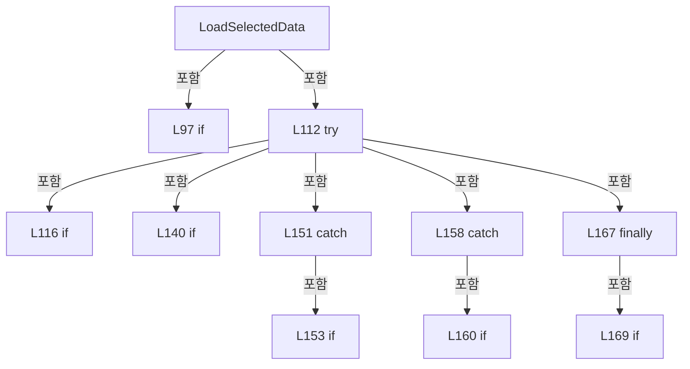

변경 전 점검: 입력/반환 타입, 위 호출자, 예외/취소 경로, 공유 상태와 저장·전송 소비자를 함께 확인합니다. 값의 단위나 물리 방향을 이름만으로 확정하지 않습니다.

### MethodDeclaration `BuildDisplayModel` · L176–303

[Drilling.UI/Menu/Menus/CMenuCorrection.ReviewData.Display.cs:176–303](https://github.com/kjuws10-rgb/A3Drilling/blob/5aee8e58439c9b455cae7c9593c9be986c3e682e/Drilling.UI/Menu/Menus/CMenuCorrection.ReviewData.Display.cs#L176-L303)

| 항목 | 실제 추출 값 |
| --- | --- |
| 서명 | Drilling.UI.Menu.Menus.CMenuCorrection.ST_REVIEW_DATA_DISPLAY_MODEL Drilling.UI.Menu.Menus.CMenuCorrection.CReviewDataPanel.BuildDisplayModel(Drilling.Common.Review.ST_REVIEW_RESULT_FILE_DATA, System.Collections.Generic.IReadOnlyDictionary<string, string>, System.Threading.CancellationToken) |
| 접근/수식자 | Private / private, static |
| 반환/값 타입 | Drilling.UI.Menu.Menus.CMenuCorrection.ST_REVIEW_DATA_DISPLAY_MODEL |
| 소속 타입 | NamedType:Drilling.UI.Menu.Menus.CMenuCorrection.CReviewDataPanel |

입력 계약:

| 이름 | 타입 | 전달 | 선택/기본값 |
| --- | --- | --- | --- |
| resultFile | Drilling.Common.Review.ST_REVIEW_RESULT_FILE_DATA | None | False /  |
| parameters | System.Collections.Generic.IReadOnlyDictionary<string, string> | None | False /  |
| token | System.Threading.CancellationToken | None | False /  |

정적 호출자로 확인된 위치:

| 호출 파일/행 | 호출 표현식 | 런타임 분기 가능 |
| --- | --- | --- |
| [Drilling.UI/Menu/Menus/CMenuCorrection.ReviewData.Display.cs:138–138](https://github.com/kjuws10-rgb/A3Drilling/blob/5aee8e58439c9b455cae7c9593c9be986c3e682e/Drilling.UI/Menu/Menus/CMenuCorrection.ReviewData.Display.cs#L138-L138) | BuildDisplayModel | False |

호출하는 대상과 해석 범위:

| 원본 행 | 표현식 | 분석 상태 | 대상/소스 위치 |
| --- | --- | --- | --- |
| 181 | ReadOutputViewerInt | resolved | int Drilling.UI.Menu.Menus.CMenuCorrection.ReadOutputViewerInt(System.Collections.Generic.IReadOnlyDictionary<string, string>, int, params string[]) · Drilling.UI/Menu/Menus/CMenuCorrection.cs:1186 |
| 184 | new InvalidDataException | resolved | System.IO.InvalidDataException.InvalidDataException(string?) |
| 187 | resultFile.Rows.Select(row => row.CellNo).Distinct().Order().ToArray | resolved | int[] System.Collections.Generic.IEnumerable<int>.ToArray<int>() |
| 187 | resultFile.Rows.Select(row => row.CellNo).Distinct().Order | resolved | System.Linq.IOrderedEnumerable<int> System.Collections.Generic.IEnumerable<int>.Order<int>() |
| 187 | resultFile.Rows.Select(row => row.CellNo).Distinct | resolved | System.Collections.Generic.IEnumerable<int> System.Collections.Generic.IEnumerable<int>.Distinct<int>() |
| 187 | resultFile.Rows.Select | resolved | System.Collections.Generic.IEnumerable<int> System.Collections.Generic.IEnumerable<Drilling.Common.Review.ST_REVIEW_RESULT_FILE_ROW>.Select<Drilling.Common.Review.ST_REVIEW_RESULT_FILE_ROW, int>(System.Func<Drilling.Common.Review.ST_REVIEW_RESULT_FILE_ROW, int>) |
| 188 | resultCells.ToHashSet | resolved | System.Collections.Generic.HashSet<int> System.Collections.Generic.IEnumerable<int>.ToHashSet<int>() |
| 189 | resultCells.Any | resolved | bool System.Collections.Generic.IEnumerable<int>.Any<int>(System.Func<int, bool>) |
| 191 | new InvalidDataException | resolved | System.IO.InvalidDataException.InvalidDataException(string?) |
| 194 | new Dictionary<int, ST_CELL_PATTERN_LAYOUT> | resolved | System.Collections.Generic.Dictionary<int, Drilling.Common.Recipe.ST_CELL_PATTERN_LAYOUT>.Dictionary() |
| 197 | token.ThrowIfCancellationRequested | resolved | void System.Threading.CancellationToken.ThrowIfCancellationRequested() |
| 198 | CalculateReviewDataCellLayout | resolved | Drilling.Common.Recipe.ST_CELL_PATTERN_LAYOUT Drilling.UI.Menu.Menus.CMenuCorrection.CReviewDataPanel.CalculateReviewDataCellLayout(System.Collections.Generic.IReadOnlyDictionary<string, string>, int) · Drilling.UI/Menu/Menus/CMenuCorrection.ReviewData.Display.cs:305 |
| 201 | new InvalidDataException | resolved | System.IO.InvalidDataException.InvalidDataException(string?) |
| 207 | new List<ST_REVIEW_DATA_GRID_ROW> | resolved | System.Collections.Generic.List<Drilling.UI.Menu.Menus.CMenuCorrection.ST_REVIEW_DATA_GRID_ROW>.List(int) |
| 208 | new Dictionary<int, HashSet<string>> | resolved | System.Collections.Generic.Dictionary<int, System.Collections.Generic.HashSet<string>>.Dictionary() |
| 209 | resultFile.Rows.Select | resolved | System.Collections.Generic.IEnumerable<(Drilling.Common.Review.ST_REVIEW_RESULT_FILE_ROW row, int index)> System.Collections.Generic.IEnumerable<Drilling.Common.Review.ST_REVIEW_RESULT_FILE_ROW>.Select<Drilling.Common.Review.ST_REVIEW_RESULT_FILE_ROW, (Drilling.Common.Review.ST_REVIEW_RESULT_FILE_ROW row, int index)>(System.Func<Drilling.Common.Review.ST_REVIEW_RESULT_FILE_ROW, int, (Drilling.Common.Review.ST_REVIEW_RESULT_FILE_ROW row, int index)>) |
| 211 | token.ThrowIfCancellationRequested | resolved | void System.Threading.CancellationToken.ThrowIfCancellationRequested() |
| 213 | ResolveShotPosition | resolved | Drilling.UI.Menu.Menus.CMenuCorrection.ST_REVIEW_DATA_SHOT_POSITION Drilling.UI.Menu.Menus.CMenuCorrection.CReviewDataPanel.ResolveShotPosition(Drilling.Common.Review.ST_REVIEW_RESULT_FILE_ROW, Drilling.Common.Recipe.ST_CELL_PATTERN_LAYOUT, int) · Drilling.UI/Menu/Menus/CMenuCorrection.ReviewData.Display.cs:332 |
| 215 | CReviewShotNameFormatter.ToMatrixName | resolved | string Drilling.Common.Review.CReviewShotNameFormatter.ToMatrixName(int, int) · Drilling.Common/Review/CReviewManager.cs:3897 |
| 216 | string.IsNullOrWhiteSpace | resolved | bool string.IsNullOrWhiteSpace(string?) |
| 217 | new ST_REVIEW_DATA_GRID_ROW | resolved | Drilling.UI.Menu.Menus.CMenuCorrection.ST_REVIEW_DATA_GRID_ROW.ST_REVIEW_DATA_GRID_ROW(int, int, string, int, double, double, string, string, int, int, int, int, bool) · Drilling.UI/Menu/Menus/CMenuCorrection.ReviewData.Display.cs:1022 |
| 231 | displayRows.Add | resolved | void System.Collections.Generic.List<Drilling.UI.Menu.Menus.CMenuCorrection.ST_REVIEW_DATA_GRID_ROW>.Add(Drilling.UI.Menu.Menus.CMenuCorrection.ST_REVIEW_DATA_GRID_ROW) |
| 235 | resultShotKeys.TryGetValue | resolved | bool System.Collections.Generic.Dictionary<int, System.Collections.Generic.HashSet<string>>.TryGetValue(int, out System.Collections.Generic.HashSet<string>) |
| 237 | new HashSet<string> | resolved | System.Collections.Generic.HashSet<string>.HashSet(System.Collections.Generic.IEqualityComparer<string>?) |
| 241 | cellShotKeys.Add | resolved | bool System.Collections.Generic.HashSet<string>.Add(string) |
| 245 | displayRows .OrderBy(row => row.CellNo) .ThenBy(row => row.GroupRow < 0 ? int.MaxValue : row.GroupRow) .ThenBy(row => row.GroupColumn < 0 ? int.MaxValue : row.GroupColumn) .ThenBy(row => row.BeamNo) .ToArray | resolved | Drilling.UI.Menu.Menus.CMenuCorrection.ST_REVIEW_DATA_GRID_ROW[] System.Collections.Generic.IEnumerable<Drilling.UI.Menu.Menus.CMenuCorrection.ST_REVIEW_DATA_GRID_ROW>.ToArray<Drilling.UI.Menu.Menus.CMenuCorrection.ST_REVIEW_DATA_GRID_ROW>() |
| 245 | displayRows .OrderBy(row => row.CellNo) .ThenBy(row => row.GroupRow < 0 ? int.MaxValue : row.GroupRow) .ThenBy(row => row.GroupColumn < 0 ? int.MaxValue : row.GroupColumn) .ThenBy | resolved | System.Linq.IOrderedEnumerable<Drilling.UI.Menu.Menus.CMenuCorrection.ST_REVIEW_DATA_GRID_ROW> System.Linq.IOrderedEnumerable<Drilling.UI.Menu.Menus.CMenuCorrection.ST_REVIEW_DATA_GRID_ROW>.ThenBy<Drilling.UI.Menu.Menus.CMenuCorrection.ST_REVIEW_DATA_GRID_ROW, int>(System.Func<Drilling.UI.Menu.Menus.CMenuCorrection.ST_REVIEW_DATA_GRID_ROW, int>) |
| 245 | displayRows .OrderBy(row => row.CellNo) .ThenBy(row => row.GroupRow < 0 ? int.MaxValue : row.GroupRow) .ThenBy | resolved | System.Linq.IOrderedEnumerable<Drilling.UI.Menu.Menus.CMenuCorrection.ST_REVIEW_DATA_GRID_ROW> System.Linq.IOrderedEnumerable<Drilling.UI.Menu.Menus.CMenuCorrection.ST_REVIEW_DATA_GRID_ROW>.ThenBy<Drilling.UI.Menu.Menus.CMenuCorrection.ST_REVIEW_DATA_GRID_ROW, int>(System.Func<Drilling.UI.Menu.Menus.CMenuCorrection.ST_REVIEW_DATA_GRID_ROW, int>) |
| 245 | displayRows .OrderBy(row => row.CellNo) .ThenBy | resolved | System.Linq.IOrderedEnumerable<Drilling.UI.Menu.Menus.CMenuCorrection.ST_REVIEW_DATA_GRID_ROW> System.Linq.IOrderedEnumerable<Drilling.UI.Menu.Menus.CMenuCorrection.ST_REVIEW_DATA_GRID_ROW>.ThenBy<Drilling.UI.Menu.Menus.CMenuCorrection.ST_REVIEW_DATA_GRID_ROW, int>(System.Func<Drilling.UI.Menu.Menus.CMenuCorrection.ST_REVIEW_DATA_GRID_ROW, int>) |
| 245 | displayRows .OrderBy | resolved | System.Linq.IOrderedEnumerable<Drilling.UI.Menu.Menus.CMenuCorrection.ST_REVIEW_DATA_GRID_ROW> System.Collections.Generic.IEnumerable<Drilling.UI.Menu.Menus.CMenuCorrection.ST_REVIEW_DATA_GRID_ROW>.OrderBy<Drilling.UI.Menu.Menus.CMenuCorrection.ST_REVIEW_DATA_GRID_ROW, int>(System.Func<Drilling.UI.Menu.Menus.CMenuCorrection.ST_REVIEW_DATA_GRID_ROW, int>) |
| 251 | new Dictionary<string, string> | resolved | System.Collections.Generic.Dictionary<string, string>.Dictionary(System.Collections.Generic.IEnumerable<System.Collections.Generic.KeyValuePair<string, string>>, System.Collections.Generic.IEqualityComparer<string>?) |
| 257 | token.ThrowIfCancellationRequested | resolved | void System.Threading.CancellationToken.ThrowIfCancellationRequested() |
| 258 | CShotCoordinatePlanBuilder.BuildDesignShots(coordinateParameters) .Where(shot => resultCellSet.Contains(shot.CellNo)) .ToArray | resolved | Drilling.Common.Recipe.ST_DESIGN_SHOT_POINT[] System.Collections.Generic.IEnumerable<Drilling.Common.Recipe.ST_DESIGN_SHOT_POINT>.ToArray<Drilling.Common.Recipe.ST_DESIGN_SHOT_POINT>() |
| 258 | CShotCoordinatePlanBuilder.BuildDesignShots(coordinateParameters) .Where | resolved | System.Collections.Generic.IEnumerable<Drilling.Common.Recipe.ST_DESIGN_SHOT_POINT> System.Collections.Generic.IEnumerable<Drilling.Common.Recipe.ST_DESIGN_SHOT_POINT>.Where<Drilling.Common.Recipe.ST_DESIGN_SHOT_POINT>(System.Func<Drilling.Common.Recipe.ST_DESIGN_SHOT_POINT, bool>) |
| 258 | CShotCoordinatePlanBuilder.BuildDesignShots | resolved | System.Collections.Generic.IReadOnlyList<Drilling.Common.Recipe.ST_DESIGN_SHOT_POINT> Drilling.Common.Recipe.CShotCoordinatePlanBuilder.BuildDesignShots(System.Collections.Generic.IReadOnlyDictionary<string, string>) · Drilling.Common/Recipe/CShotCoordinatePlanBuilder.cs:214 |
| 259 | resultCellSet.Contains | resolved | bool System.Collections.Generic.HashSet<int>.Contains(int) |
| 261 | token.ThrowIfCancellationRequested | resolved | void System.Threading.CancellationToken.ThrowIfCancellationRequested() |
| 262 | CShotCoordinatePlanBuilder.Build(coordinateParameters).Shots .Where(shot => resultCellSet.Contains(shot.CellNo)) .ToDictionary | resolved | System.Collections.Generic.Dictionary<string, Drilling.Common.Recipe.ST_HEAD_SHOT_POINT> System.Collections.Generic.IEnumerable<Drilling.Common.Recipe.ST_HEAD_SHOT_POINT>.ToDictionary<Drilling.Common.Recipe.ST_HEAD_SHOT_POINT, string>(System.Func<Drilling.Common.Recipe.ST_HEAD_SHOT_POINT, string>, System.Collections.Generic.IEqualityComparer<string>?) |
| 262 | CShotCoordinatePlanBuilder.Build(coordinateParameters).Shots .Where | resolved | System.Collections.Generic.IEnumerable<Drilling.Common.Recipe.ST_HEAD_SHOT_POINT> System.Collections.Generic.IEnumerable<Drilling.Common.Recipe.ST_HEAD_SHOT_POINT>.Where<Drilling.Common.Recipe.ST_HEAD_SHOT_POINT>(System.Func<Drilling.Common.Recipe.ST_HEAD_SHOT_POINT, bool>) |
| 262 | CShotCoordinatePlanBuilder.Build | resolved | Drilling.Common.Recipe.ST_SHOT_COORDINATE_PLAN Drilling.Common.Recipe.CShotCoordinatePlanBuilder.Build(System.Collections.Generic.IReadOnlyDictionary<string, string>) · Drilling.Common/Recipe/CShotCoordinatePlanBuilder.cs:11 |
| 263 | resultCellSet.Contains | resolved | bool System.Collections.Generic.HashSet<int>.Contains(int) |
| 265 | CRecipeShotMaskingPlan.Build | resolved | Drilling.Common.Recipe.CRecipeShotMaskingPlan Drilling.Common.Recipe.CRecipeShotMaskingPlan.Build(System.Collections.Generic.IReadOnlyDictionary<string, string>) · Drilling.Common/Recipe/CShotCoordinatePlanBuilder.cs:813 |
| 266 | designShots .GroupBy(shot => shot.CellNo) .ToDictionary | resolved | System.Collections.Generic.Dictionary<int, System.Collections.Generic.IReadOnlyList<Drilling.UI.Menu.Menus.CMenuCorrection.ST_REVIEW_DATA_SHOT_POSITION>> System.Collections.Generic.IEnumerable<System.Linq.IGrouping<int, Drilling.Common.Recipe.ST_DESIGN_SHOT_POINT>>.ToDictionary<System.Linq.IGrouping<int, Drilling.Common.Recipe.ST_DESIGN_SHOT_POINT>, int, System.Collections.Generic.IReadOnlyList<Drilling.UI.Menu.Menus.CMenuCorrection.ST_REVIEW_DATA_SHOT_POSITION>>(System.Func<System.Linq.IGrouping<int, Drilling.Common.Recipe.ST_DESIGN_SHOT_POINT>, int>, System.Func<System.Linq.IGrouping<int, Drilling.Common.Recipe.ST_DESIGN_SHOT_POINT>, System.Collections.Generic.IReadOnlyList<Drilling.UI.Menu.Menus.CMenuCorrection.ST_REVIEW_DATA_SHOT_POSITION>>) |
| 266 | designShots .GroupBy | resolved | System.Collections.Generic.IEnumerable<System.Linq.IGrouping<int, Drilling.Common.Recipe.ST_DESIGN_SHOT_POINT>> System.Collections.Generic.IEnumerable<Drilling.Common.Recipe.ST_DESIGN_SHOT_POINT>.GroupBy<Drilling.Common.Recipe.ST_DESIGN_SHOT_POINT, int>(System.Func<Drilling.Common.Recipe.ST_DESIGN_SHOT_POINT, int>) |
| 270 | group .OrderBy(shot => shot.GroupRow) .ThenBy(shot => shot.GroupColumn) .Select(shot => { token.ThrowIfCancellationRequested(); var assigned = assignedShots.GetValueOrDefault(shot.ShotKey); var state = assigned is null ? ST_RECIPE_SHOT_MASKING_RESULT.Empty : maskingPlan.EvaluateShot(assigned); return new ST_REVIEW_DATA_SHOT_POSITION( shot.ShotKey, … | resolved | Drilling.UI.Menu.Menus.CMenuCorrection.ST_REVIEW_DATA_SHOT_POSITION[] System.Collections.Generic.IEnumerable<Drilling.UI.Menu.Menus.CMenuCorrection.ST_REVIEW_DATA_SHOT_POSITION>.ToArray<Drilling.UI.Menu.Menus.CMenuCorrection.ST_REVIEW_DATA_SHOT_POSITION>() |
| 270 | group .OrderBy(shot => shot.GroupRow) .ThenBy(shot => shot.GroupColumn) .Select | resolved | System.Collections.Generic.IEnumerable<Drilling.UI.Menu.Menus.CMenuCorrection.ST_REVIEW_DATA_SHOT_POSITION> System.Collections.Generic.IEnumerable<Drilling.Common.Recipe.ST_DESIGN_SHOT_POINT>.Select<Drilling.Common.Recipe.ST_DESIGN_SHOT_POINT, Drilling.UI.Menu.Menus.CMenuCorrection.ST_REVIEW_DATA_SHOT_POSITION>(System.Func<Drilling.Common.Recipe.ST_DESIGN_SHOT_POINT, Drilling.UI.Menu.Menus.CMenuCorrection.ST_REVIEW_DATA_SHOT_POSITION>) |
| 270 | group .OrderBy(shot => shot.GroupRow) .ThenBy | resolved | System.Linq.IOrderedEnumerable<Drilling.Common.Recipe.ST_DESIGN_SHOT_POINT> System.Linq.IOrderedEnumerable<Drilling.Common.Recipe.ST_DESIGN_SHOT_POINT>.ThenBy<Drilling.Common.Recipe.ST_DESIGN_SHOT_POINT, int>(System.Func<Drilling.Common.Recipe.ST_DESIGN_SHOT_POINT, int>) |
| 270 | group .OrderBy | resolved | System.Linq.IOrderedEnumerable<Drilling.Common.Recipe.ST_DESIGN_SHOT_POINT> System.Collections.Generic.IEnumerable<Drilling.Common.Recipe.ST_DESIGN_SHOT_POINT>.OrderBy<Drilling.Common.Recipe.ST_DESIGN_SHOT_POINT, int>(System.Func<Drilling.Common.Recipe.ST_DESIGN_SHOT_POINT, int>) |
| 275 | token.ThrowIfCancellationRequested | resolved | void System.Threading.CancellationToken.ThrowIfCancellationRequested() |
| 276 | assignedShots.GetValueOrDefault | resolved | Drilling.Common.Recipe.ST_HEAD_SHOT_POINT? System.Collections.Generic.IReadOnlyDictionary<string, Drilling.Common.Recipe.ST_HEAD_SHOT_POINT>.GetValueOrDefault<string, Drilling.Common.Recipe.ST_HEAD_SHOT_POINT>(string) |
| 279 | maskingPlan.EvaluateShot | resolved | Drilling.Common.Recipe.ST_RECIPE_SHOT_MASKING_RESULT Drilling.Common.Recipe.CRecipeShotMaskingPlan.EvaluateShot(Drilling.Common.Recipe.ST_HEAD_SHOT_POINT) · Drilling.Common/Recipe/CShotCoordinatePlanBuilder.cs:853 |
| 280 | new ST_REVIEW_DATA_SHOT_POSITION | resolved | Drilling.UI.Menu.Menus.CMenuCorrection.ST_REVIEW_DATA_SHOT_POSITION.ST_REVIEW_DATA_SHOT_POSITION(string, int, int, int, int, int, int, bool) · Drilling.UI/Menu/Menus/CMenuCorrection.ReviewData.Display.cs:1006 |
| 291 | resultShotKeys.GetValueOrDefault | resolved | System.Collections.Generic.HashSet<string>? System.Collections.Generic.IReadOnlyDictionary<int, System.Collections.Generic.HashSet<string>>.GetValueOrDefault<int, System.Collections.Generic.HashSet<string>>(int) |
| 291 | .Contains | resolved | bool System.Collections.Generic.HashSet<string>.Contains(string) |
| 297 | new ST_REVIEW_DATA_DISPLAY_MODEL | resolved | Drilling.UI.Menu.Menus.CMenuCorrection.ST_REVIEW_DATA_DISPLAY_MODEL.ST_REVIEW_DATA_DISPLAY_MODEL(System.Collections.Generic.IReadOnlyDictionary<string, string>, int, System.Collections.Generic.IReadOnlySet<int>, System.Collections.Generic.IReadOnlyDictionary<int, System.Collections.Generic.IReadOnlyList<Drilling.UI.Menu.Menus.CMenuCorrection.ST_REVIEW_DATA_SHOT_POSITION>>, System.Collections.Generic.IReadOnlyList<Drilling.UI.Menu.Menus.CMenuCorrection.ST_REVIEW_DATA_GRID_ROW>) · Drilling.UI/Menu/Menus/CMenuCorrection.ReviewData.Display.cs:979 |
| 298 | new Dictionary<string, string> | resolved | System.Collections.Generic.Dictionary<string, string>.Dictionary(System.Collections.Generic.IEnumerable<System.Collections.Generic.KeyValuePair<string, string>>, System.Collections.Generic.IEqualityComparer<string>?) |

본문의 실제 연산·분기·예외·반환 순서(원문 위치 순):

| 원본 행 | 종류 | 주석 해설 |
| --- | --- | --- |
| 181 | call | 함수·델리게이트 또는 객체 생성자를 호출합니다: ReadOutputViewerInt(parameters, CCellPatternCalculator.MinCellCount, "MAX_CELL_NUMBER") |
| 181 | local-declaration | 지역 변수를 선언합니다: var cellCount = ReadOutputViewerInt(parameters, CCellPatternCalculator.MinCellCount, "MAX_CELL_NUMBER"); |
| 181 | variable-initializer | 변수의 초기값을 지정합니다: cellCount = ReadOutputViewerInt(parameters, CCellPatternCalculator.MinCellCount, "MAX_CELL_NUMBER") |
| 182 | if | 조건에 따라 분기합니다: if (cellCount is < CCellPatternCalculator.MinCellCount or > 100) |
| 184 | call | 함수·델리게이트 또는 객체 생성자를 호출합니다: new InvalidDataException($"MAX_CELL_NUMBER must be between 1 and 100. Current={cellCount}") |
| 184 | throw | 예외를 발생/전달합니다: throw new InvalidDataException($"MAX_CELL_NUMBER must be between 1 and 100. Current={cellCount}"); |
| 187 | call | 함수·델리게이트 또는 객체 생성자를 호출합니다: resultFile.Rows.Select(row => row.CellNo).Distinct().Order().ToArray() |
| 187 | call | 함수·델리게이트 또는 객체 생성자를 호출합니다: resultFile.Rows.Select(row => row.CellNo).Distinct().Order() |
| 187 | call | 함수·델리게이트 또는 객체 생성자를 호출합니다: resultFile.Rows.Select(row => row.CellNo).Distinct() |
| 187 | call | 함수·델리게이트 또는 객체 생성자를 호출합니다: resultFile.Rows.Select(row => row.CellNo) |
| 187 | local-declaration | 지역 변수를 선언합니다: var resultCells = resultFile.Rows.Select(row => row.CellNo).Distinct().Order().ToArray(); |
| 187 | variable-initializer | 변수의 초기값을 지정합니다: resultCells = resultFile.Rows.Select(row => row.CellNo).Distinct().Order().ToArray() |
| 188 | call | 함수·델리게이트 또는 객체 생성자를 호출합니다: resultCells.ToHashSet() |
| 188 | local-declaration | 지역 변수를 선언합니다: var resultCellSet = resultCells.ToHashSet(); |
| 188 | variable-initializer | 변수의 초기값을 지정합니다: resultCellSet = resultCells.ToHashSet() |
| 189 | call | 함수·델리게이트 또는 객체 생성자를 호출합니다: resultCells.Any(cellNo => cellNo < 1 &#124;&#124; cellNo > cellCount) |
| 189 | if | 조건에 따라 분기합니다: if (resultCells.Any(cellNo => cellNo < 1 &#124;&#124; cellNo > cellCount)) |
| 191 | call | 함수·델리게이트 또는 객체 생성자를 호출합니다: new InvalidDataException("The result contains a Cell outside the current Recipe range.") |
| 191 | throw | 예외를 발생/전달합니다: throw new InvalidDataException("The result contains a Cell outside the current Recipe range."); |
| 194 | call | 함수·델리게이트 또는 객체 생성자를 호출합니다: new Dictionary<int, ST_CELL_PATTERN_LAYOUT>() |
| 194 | local-declaration | 지역 변수를 선언합니다: var layouts = new Dictionary<int, ST_CELL_PATTERN_LAYOUT>(); |
| 194 | variable-initializer | 변수의 초기값을 지정합니다: layouts = new Dictionary<int, ST_CELL_PATTERN_LAYOUT>() |
| 195 | foreach | 컬렉션 요소를 순회합니다: foreach (var cellNo in resultCells) |
| 197 | call | 함수·델리게이트 또는 객체 생성자를 호출합니다: token.ThrowIfCancellationRequested() |
| 198 | call | 함수·델리게이트 또는 객체 생성자를 호출합니다: CalculateReviewDataCellLayout(parameters, cellNo) |
| 198 | local-declaration | 지역 변수를 선언합니다: var layout = CalculateReviewDataCellLayout(parameters, cellNo); |
| 198 | variable-initializer | 변수의 초기값을 지정합니다: layout = CalculateReviewDataCellLayout(parameters, cellNo) |
| 199 | if | 조건에 따라 분기합니다: if (!layout.IsValid) |
| 201 | call | 함수·델리게이트 또는 객체 생성자를 호출합니다: new InvalidDataException($"CELL{cellNo:00} pattern is invalid: {layout.ValidationMessage}") |
| 201 | throw | 예외를 발생/전달합니다: throw new InvalidDataException($"CELL{cellNo:00} pattern is invalid: {layout.ValidationMessage}"); |
| 204 | assignment | 값을 대상에 대입합니다: layouts[cellNo] = layout |
| 207 | call | 함수·델리게이트 또는 객체 생성자를 호출합니다: new List<ST_REVIEW_DATA_GRID_ROW>(resultFile.Rows.Count) |
| 207 | local-declaration | 지역 변수를 선언합니다: var displayRows = new List<ST_REVIEW_DATA_GRID_ROW>(resultFile.Rows.Count); |
| 207 | variable-initializer | 변수의 초기값을 지정합니다: displayRows = new List<ST_REVIEW_DATA_GRID_ROW>(resultFile.Rows.Count) |
| 208 | call | 함수·델리게이트 또는 객체 생성자를 호출합니다: new Dictionary<int, HashSet<string>>() |
| 208 | local-declaration | 지역 변수를 선언합니다: var resultShotKeys = new Dictionary<int, HashSet<string>>(); |
| 208 | variable-initializer | 변수의 초기값을 지정합니다: resultShotKeys = new Dictionary<int, HashSet<string>>() |
| 209 | call | 함수·델리게이트 또는 객체 생성자를 호출합니다: resultFile.Rows.Select((row, index) => (row, index)) |
| 209 | foreach | 컬렉션 요소를 순회합니다: foreach (var (source, index) in resultFile.Rows.Select((row, index) => (row, index))) { token.ThrowIfCancellationRequested(); var layout = layouts[source.CellNo]; var position = ResolveShotPosition(source, layout, index); var shot |
| 211 | call | 함수·델리게이트 또는 객체 생성자를 호출합니다: token.ThrowIfCancellationRequested() |
| 212 | local-declaration | 지역 변수를 선언합니다: var layout = layouts[source.CellNo]; |
| 212 | variable-initializer | 변수의 초기값을 지정합니다: layout = layouts[source.CellNo] |
| 213 | call | 함수·델리게이트 또는 객체 생성자를 호출합니다: ResolveShotPosition(source, layout, index) |
| 213 | local-declaration | 지역 변수를 선언합니다: var position = ResolveShotPosition(source, layout, index); |
| 213 | variable-initializer | 변수의 초기값을 지정합니다: position = ResolveShotPosition(source, layout, index) |
| 214 | conditional-expression | 조건에 따라 결과식을 선택합니다: position.IsResolved ? CReviewShotNameFormatter.ToMatrixName(position.ShotNo, position.GroupCountX) : string.IsNullOrWhiteSpace(source.ShotName) ? "-" : source.ShotName |
| 214 | local-declaration | 지역 변수를 선언합니다: var shotName = position.IsResolved ? CReviewShotNameFormatter.ToMatrixName(position.ShotNo, position.GroupCountX) : string.IsNullOrWhiteSpace(source.ShotName) ? "-" : source.ShotName; |
| 214 | variable-initializer | 변수의 초기값을 지정합니다: shotName = position.IsResolved ? CReviewShotNameFormatter.ToMatrixName(position.ShotNo, position.GroupCountX) : string.IsNullOrWhiteSpace(source.ShotName) ? "-" : source.ShotName |
| 215 | call | 함수·델리게이트 또는 객체 생성자를 호출합니다: CReviewShotNameFormatter.ToMatrixName(position.ShotNo, position.GroupCountX) |
| 216 | call | 함수·델리게이트 또는 객체 생성자를 호출합니다: string.IsNullOrWhiteSpace(source.ShotName) |
| 216 | conditional-expression | 조건에 따라 결과식을 선택합니다: string.IsNullOrWhiteSpace(source.ShotName) ? "-" : source.ShotName |
| 217 | call | 함수·델리게이트 또는 객체 생성자를 호출합니다: new ST_REVIEW_DATA_GRID_ROW( source.HeadNo, source.CellNo, shotName, source.BeamNo, source.ErrorX, source.ErrorY, source.Judge, position.ShotKey, position.GroupColumn, position.GroupRow, position.GroupCountX, position.Gr… |
| 217 | local-declaration | 지역 변수를 선언합니다: var row = new ST_REVIEW_DATA_GRID_ROW( source.HeadNo, source.CellNo, shotName, source.BeamNo, source.ErrorX, source.ErrorY, source.Judge, position.ShotKey, position.GroupColumn, position.GroupRow, position.GroupCountX, position.Gr |
| 217 | variable-initializer | 변수의 초기값을 지정합니다: row = new ST_REVIEW_DATA_GRID_ROW( source.HeadNo, source.CellNo, shotName, source.BeamNo, source.ErrorX, source.ErrorY, source.Judge, position.ShotKey, position.GroupColumn, position.GroupRow, position.GroupCountX, position.GroupC |
| 231 | call | 함수·델리게이트 또는 객체 생성자를 호출합니다: displayRows.Add(row) |
| 233 | if | 조건에 따라 분기합니다: if (position.IsResolved) |
| 235 | call | 함수·델리게이트 또는 객체 생성자를 호출합니다: resultShotKeys.TryGetValue(source.CellNo, out var cellShotKeys) |
| 235 | if | 조건에 따라 분기합니다: if (!resultShotKeys.TryGetValue(source.CellNo, out var cellShotKeys)) |
| 237 | assignment | 값을 대상에 대입합니다: cellShotKeys = new HashSet<string>(StringComparer.OrdinalIgnoreCase) |
| 237 | call | 함수·델리게이트 또는 객체 생성자를 호출합니다: new HashSet<string>(StringComparer.OrdinalIgnoreCase) |
| 238 | assignment | 값을 대상에 대입합니다: resultShotKeys[source.CellNo] = cellShotKeys |
| 241 | call | 함수·델리게이트 또는 객체 생성자를 호출합니다: cellShotKeys.Add(position.ShotKey) |
| 245 | call | 함수·델리게이트 또는 객체 생성자를 호출합니다: displayRows .OrderBy(row => row.CellNo) |
| 245 | call | 함수·델리게이트 또는 객체 생성자를 호출합니다: displayRows .OrderBy(row => row.CellNo) .ThenBy(row => row.GroupRow < 0 ? int.MaxValue : row.GroupRow) |
| 245 | call | 함수·델리게이트 또는 객체 생성자를 호출합니다: displayRows .OrderBy(row => row.CellNo) .ThenBy(row => row.GroupRow < 0 ? int.MaxValue : row.GroupRow) .ThenBy(row => row.GroupColumn < 0 ? int.MaxValue : row.GroupColumn) |
| 245 | call | 함수·델리게이트 또는 객체 생성자를 호출합니다: displayRows .OrderBy(row => row.CellNo) .ThenBy(row => row.GroupRow < 0 ? int.MaxValue : row.GroupRow) .ThenBy(row => row.GroupColumn < 0 ? int.MaxValue : row.GroupColumn) .ThenBy(row => row.BeamNo) |
| 245 | call | 함수·델리게이트 또는 객체 생성자를 호출합니다: displayRows .OrderBy(row => row.CellNo) .ThenBy(row => row.GroupRow < 0 ? int.MaxValue : row.GroupRow) .ThenBy(row => row.GroupColumn < 0 ? int.MaxValue : row.GroupColumn) .ThenBy(row => row.BeamNo) .ToArray() |
| 245 | local-declaration | 지역 변수를 선언합니다: var orderedRows = displayRows .OrderBy(row => row.CellNo) .ThenBy(row => row.GroupRow < 0 ? int.MaxValue : row.GroupRow) .ThenBy(row => row.GroupColumn < 0 ? int.MaxValue : row.GroupColumn) .ThenBy(row => row.BeamNo) .ToArray(); |
| 245 | variable-initializer | 변수의 초기값을 지정합니다: orderedRows = displayRows .OrderBy(row => row.CellNo) .ThenBy(row => row.GroupRow < 0 ? int.MaxValue : row.GroupRow) .ThenBy(row => row.GroupColumn < 0 ? int.MaxValue : row.GroupColumn) .ThenBy(row => row.BeamNo) .ToArray() |
| 247 | conditional-expression | 조건에 따라 결과식을 선택합니다: row.GroupRow < 0 ? int.MaxValue : row.GroupRow |
| 248 | conditional-expression | 조건에 따라 결과식을 선택합니다: row.GroupColumn < 0 ? int.MaxValue : row.GroupColumn |
| 251 | call | 함수·델리게이트 또는 객체 생성자를 호출합니다: new Dictionary<string, string>(parameters, StringComparer.OrdinalIgnoreCase) |
| 251 | local-declaration | 지역 변수를 선언합니다: var coordinateParameters = new Dictionary<string, string>(parameters, StringComparer.OrdinalIgnoreCase); |
| 251 | variable-initializer | 변수의 초기값을 지정합니다: coordinateParameters = new Dictionary<string, string>(parameters, StringComparer.OrdinalIgnoreCase) |
| 252 | variable-initializer | 변수의 초기값을 지정합니다: headNo = 1 |
| 252 | for | 초기화·조건·증감이 있는 반복입니다: for (var headNo = 1; headNo <= 8; headNo++) |
| 254 | assignment | 값을 대상에 대입합니다: coordinateParameters[$"H{headNo:00}_USE"] = "ON" |
| 257 | call | 함수·델리게이트 또는 객체 생성자를 호출합니다: token.ThrowIfCancellationRequested() |
| 258 | call | 함수·델리게이트 또는 객체 생성자를 호출합니다: CShotCoordinatePlanBuilder.BuildDesignShots(coordinateParameters) |
| 258 | call | 함수·델리게이트 또는 객체 생성자를 호출합니다: CShotCoordinatePlanBuilder.BuildDesignShots(coordinateParameters) .Where(shot => resultCellSet.Contains(shot.CellNo)) |
| 258 | call | 함수·델리게이트 또는 객체 생성자를 호출합니다: CShotCoordinatePlanBuilder.BuildDesignShots(coordinateParameters) .Where(shot => resultCellSet.Contains(shot.CellNo)) .ToArray() |
| 258 | local-declaration | 지역 변수를 선언합니다: var designShots = CShotCoordinatePlanBuilder.BuildDesignShots(coordinateParameters) .Where(shot => resultCellSet.Contains(shot.CellNo)) .ToArray(); |
| 258 | variable-initializer | 변수의 초기값을 지정합니다: designShots = CShotCoordinatePlanBuilder.BuildDesignShots(coordinateParameters) .Where(shot => resultCellSet.Contains(shot.CellNo)) .ToArray() |
| 259 | call | 함수·델리게이트 또는 객체 생성자를 호출합니다: resultCellSet.Contains(shot.CellNo) |
| 261 | call | 함수·델리게이트 또는 객체 생성자를 호출합니다: token.ThrowIfCancellationRequested() |
| 262 | call | 함수·델리게이트 또는 객체 생성자를 호출합니다: CShotCoordinatePlanBuilder.Build(coordinateParameters) |
| 262 | call | 함수·델리게이트 또는 객체 생성자를 호출합니다: CShotCoordinatePlanBuilder.Build(coordinateParameters).Shots .Where(shot => resultCellSet.Contains(shot.CellNo)) |
| 262 | call | 함수·델리게이트 또는 객체 생성자를 호출합니다: CShotCoordinatePlanBuilder.Build(coordinateParameters).Shots .Where(shot => resultCellSet.Contains(shot.CellNo)) .ToDictionary(shot => shot.ShotKey, StringComparer.OrdinalIgnoreCase) |
| 262 | local-declaration | 지역 변수를 선언합니다: var assignedShots = CShotCoordinatePlanBuilder.Build(coordinateParameters).Shots .Where(shot => resultCellSet.Contains(shot.CellNo)) .ToDictionary(shot => shot.ShotKey, StringComparer.OrdinalIgnoreCase); |
| 262 | variable-initializer | 변수의 초기값을 지정합니다: assignedShots = CShotCoordinatePlanBuilder.Build(coordinateParameters).Shots .Where(shot => resultCellSet.Contains(shot.CellNo)) .ToDictionary(shot => shot.ShotKey, StringComparer.OrdinalIgnoreCase) |
| 263 | call | 함수·델리게이트 또는 객체 생성자를 호출합니다: resultCellSet.Contains(shot.CellNo) |
| 265 | call | 함수·델리게이트 또는 객체 생성자를 호출합니다: CRecipeShotMaskingPlan.Build(coordinateParameters) |
| 265 | local-declaration | 지역 변수를 선언합니다: var maskingPlan = CRecipeShotMaskingPlan.Build(coordinateParameters); |
| 265 | variable-initializer | 변수의 초기값을 지정합니다: maskingPlan = CRecipeShotMaskingPlan.Build(coordinateParameters) |
| 266 | call | 함수·델리게이트 또는 객체 생성자를 호출합니다: designShots .GroupBy(shot => shot.CellNo) |
| 266 | call | 함수·델리게이트 또는 객체 생성자를 호출합니다: designShots .GroupBy(shot => shot.CellNo) .ToDictionary( group => group.Key, group => (IReadOnlyList<ST_REVIEW_DATA_SHOT_POSITION>)group .OrderBy(shot => shot.GroupRow) .ThenBy(shot => shot.GroupColumn) .Select(shot => {… |
| 266 | local-declaration | 지역 변수를 선언합니다: var shotsByCell = designShots .GroupBy(shot => shot.CellNo) .ToDictionary( group => group.Key, group => (IReadOnlyList<ST_REVIEW_DATA_SHOT_POSITION>)group .OrderBy(shot => shot.GroupRow) .ThenBy(shot => shot.GroupColumn) .Select(s |
| 266 | variable-initializer | 변수의 초기값을 지정합니다: shotsByCell = designShots .GroupBy(shot => shot.CellNo) .ToDictionary( group => group.Key, group => (IReadOnlyList<ST_REVIEW_DATA_SHOT_POSITION>)group .OrderBy(shot => shot.GroupRow) .ThenBy(shot => shot.GroupColumn) .Select(shot  |
| 270 | call | 함수·델리게이트 또는 객체 생성자를 호출합니다: group .OrderBy(shot => shot.GroupRow) |
| 270 | call | 함수·델리게이트 또는 객체 생성자를 호출합니다: group .OrderBy(shot => shot.GroupRow) .ThenBy(shot => shot.GroupColumn) |
| 270 | call | 함수·델리게이트 또는 객체 생성자를 호출합니다: group .OrderBy(shot => shot.GroupRow) .ThenBy(shot => shot.GroupColumn) .Select(shot => { token.ThrowIfCancellationRequested(); var assigned = assignedShots.GetValueOrDefault(shot.ShotKey); var state = assigned is null ?… |
| 270 | call | 함수·델리게이트 또는 객체 생성자를 호출합니다: group .OrderBy(shot => shot.GroupRow) .ThenBy(shot => shot.GroupColumn) .Select(shot => { token.ThrowIfCancellationRequested(); var assigned = assignedShots.GetValueOrDefault(shot.ShotKey); var state = assigned is null ?… |
| 275 | call | 함수·델리게이트 또는 객체 생성자를 호출합니다: token.ThrowIfCancellationRequested() |
| 276 | call | 함수·델리게이트 또는 객체 생성자를 호출합니다: assignedShots.GetValueOrDefault(shot.ShotKey) |
| 276 | local-declaration | 지역 변수를 선언합니다: var assigned = assignedShots.GetValueOrDefault(shot.ShotKey); |
| 276 | variable-initializer | 변수의 초기값을 지정합니다: assigned = assignedShots.GetValueOrDefault(shot.ShotKey) |
| 277 | conditional-expression | 조건에 따라 결과식을 선택합니다: assigned is null ? ST_RECIPE_SHOT_MASKING_RESULT.Empty : maskingPlan.EvaluateShot(assigned) |
| 277 | local-declaration | 지역 변수를 선언합니다: var state = assigned is null ? ST_RECIPE_SHOT_MASKING_RESULT.Empty : maskingPlan.EvaluateShot(assigned); |
| 277 | variable-initializer | 변수의 초기값을 지정합니다: state = assigned is null ? ST_RECIPE_SHOT_MASKING_RESULT.Empty : maskingPlan.EvaluateShot(assigned) |
| 279 | call | 함수·델리게이트 또는 객체 생성자를 호출합니다: maskingPlan.EvaluateShot(assigned) |
| 280 | call | 함수·델리게이트 또는 객체 생성자를 호출합니다: new ST_REVIEW_DATA_SHOT_POSITION( shot.ShotKey, shot.CellNo, shot.CellShotNo, shot.GroupColumn, shot.GroupRow, shot.GroupCountX, shot.GroupCountY, true) { HeadNo = assigned?.HeadNo ?? 0, IsResult = resultShotKeys.GetValu… |
| 280 | return | 호출자에게 값 또는 제어를 반환합니다: return new ST_REVIEW_DATA_SHOT_POSITION( shot.ShotKey, shot.CellNo, shot.CellShotNo, shot.GroupColumn, shot.GroupRow, shot.GroupCountX, shot.GroupCountY, true) { HeadNo = assigned?.HeadNo ?? 0, IsResult = resultShotKeys.GetValueOr |
| 290 | assignment | 값을 대상에 대입합니다: HeadNo = assigned?.HeadNo ?? 0 |
| 291 | assignment | 값을 대상에 대입합니다: IsResult = resultShotKeys.GetValueOrDefault(shot.CellNo)?.Contains(shot.ShotKey) == true |
| 291 | call | 함수·델리게이트 또는 객체 생성자를 호출합니다: resultShotKeys.GetValueOrDefault(shot.CellNo) |
| 291 | call | 함수·델리게이트 또는 객체 생성자를 호출합니다: .Contains(shot.ShotKey) |
| 292 | assignment | 값을 대상에 대입합니다: IsMasked = state.IsMasked |
| 293 | assignment | 값을 대상에 대입합니다: IsChessSkipped = state.IsChessSkipped |
| 297 | call | 함수·델리게이트 또는 객체 생성자를 호출합니다: new ST_REVIEW_DATA_DISPLAY_MODEL( new Dictionary<string, string>(parameters, StringComparer.OrdinalIgnoreCase), cellCount, resultCellSet, shotsByCell, orderedRows) |
| 297 | return | 호출자에게 값 또는 제어를 반환합니다: return new ST_REVIEW_DATA_DISPLAY_MODEL( new Dictionary<string, string>(parameters, StringComparer.OrdinalIgnoreCase), cellCount, resultCellSet, shotsByCell, orderedRows); |
| 298 | call | 함수·델리게이트 또는 객체 생성자를 호출합니다: new Dictionary<string, string>(parameters, StringComparer.OrdinalIgnoreCase) |

제어 구문의 포함 구조(실제 실행 순서/CFG가 아닌 구문 탐색 그림):

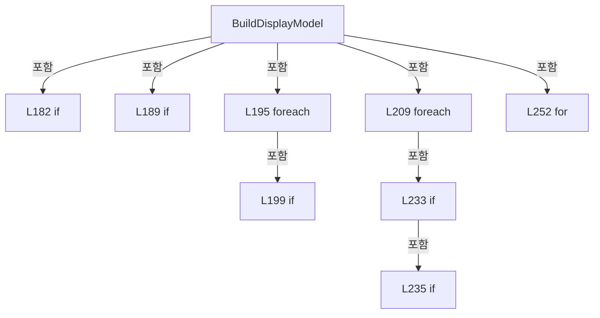

변경 전 점검: 입력/반환 타입, 위 호출자, 예외/취소 경로, 공유 상태와 저장·전송 소비자를 함께 확인합니다. 값의 단위나 물리 방향을 이름만으로 확정하지 않습니다.

### MethodDeclaration `CalculateReviewDataCellLayout` · L305–330

[Drilling.UI/Menu/Menus/CMenuCorrection.ReviewData.Display.cs:305–330](https://github.com/kjuws10-rgb/A3Drilling/blob/5aee8e58439c9b455cae7c9593c9be986c3e682e/Drilling.UI/Menu/Menus/CMenuCorrection.ReviewData.Display.cs#L305-L330)

| 항목 | 실제 추출 값 |
| --- | --- |
| 서명 | Drilling.Common.Recipe.ST_CELL_PATTERN_LAYOUT Drilling.UI.Menu.Menus.CMenuCorrection.CReviewDataPanel.CalculateReviewDataCellLayout(System.Collections.Generic.IReadOnlyDictionary<string, string>, int) |
| 접근/수식자 | Private / private, static |
| 반환/값 타입 | Drilling.Common.Recipe.ST_CELL_PATTERN_LAYOUT |
| 소속 타입 | NamedType:Drilling.UI.Menu.Menus.CMenuCorrection.CReviewDataPanel |

입력 계약:

| 이름 | 타입 | 전달 | 선택/기본값 |
| --- | --- | --- | --- |
| parameters | System.Collections.Generic.IReadOnlyDictionary<string, string> | None | False /  |
| cellNo | int | None | False /  |

정적 호출자로 확인된 위치:

| 호출 파일/행 | 호출 표현식 | 런타임 분기 가능 |
| --- | --- | --- |
| [Drilling.UI/Menu/Menus/CMenuCorrection.ReviewData.Display.cs:198–198](https://github.com/kjuws10-rgb/A3Drilling/blob/5aee8e58439c9b455cae7c9593c9be986c3e682e/Drilling.UI/Menu/Menus/CMenuCorrection.ReviewData.Display.cs#L198-L198) | CalculateReviewDataCellLayout | False |

호출하는 대상과 해석 범위:

| 원본 행 | 표현식 | 분석 상태 | 대상/소스 위치 |
| --- | --- | --- | --- |
| 309 | ReadOutputViewerDouble | resolved | double Drilling.UI.Menu.Menus.CMenuCorrection.ReadOutputViewerDouble(System.Collections.Generic.IReadOnlyDictionary<string, string>, double, params string[]) · Drilling.UI/Menu/Menus/CMenuCorrection.cs:1209 |
| 310 | ReadOutputViewerInt | resolved | int Drilling.UI.Menu.Menus.CMenuCorrection.ReadOutputViewerInt(System.Collections.Generic.IReadOnlyDictionary<string, string>, int, params string[]) · Drilling.UI/Menu/Menus/CMenuCorrection.cs:1186 |
| 311 | ReadOutputViewerDouble | resolved | double Drilling.UI.Menu.Menus.CMenuCorrection.ReadOutputViewerDouble(System.Collections.Generic.IReadOnlyDictionary<string, string>, double, params string[]) · Drilling.UI/Menu/Menus/CMenuCorrection.cs:1209 |
| 312 | ReadOutputViewerDouble | resolved | double Drilling.UI.Menu.Menus.CMenuCorrection.ReadOutputViewerDouble(System.Collections.Generic.IReadOnlyDictionary<string, string>, double, params string[]) · Drilling.UI/Menu/Menus/CMenuCorrection.cs:1209 |
| 313 | CRecipeModelPixelCountReader.ReadModelTypeCount | resolved | int Drilling.Common.Recipe.CRecipeModelPixelCountReader.ReadModelTypeCount(System.Collections.Generic.IReadOnlyDictionary<string, string>) · Drilling.Common/Recipe/CCellPatternCalculator.cs:428 |
| 314 | CRecipeModelPixelCountReader.ReadCellModelType | resolved | int Drilling.Common.Recipe.CRecipeModelPixelCountReader.ReadCellModelType(System.Collections.Generic.IReadOnlyDictionary<string, string>, int, int) · Drilling.Common/Recipe/CCellPatternCalculator.cs:433 |
| 315 | CRecipeModelPixelCountReader.ReadPatternForModel | resolved | Drilling.Common.Recipe.ST_RECIPE_MODEL_PATTERN Drilling.Common.Recipe.CRecipeModelPixelCountReader.ReadPatternForModel(System.Collections.Generic.IReadOnlyDictionary<string, string>, int) · Drilling.Common/Recipe/CCellPatternCalculator.cs:455 |
| 316 | CCellPatternCalculator.Calculate | resolved | Drilling.Common.Recipe.ST_CELL_PATTERN_LAYOUT Drilling.Common.Recipe.CCellPatternCalculator.Calculate(Drilling.Common.Recipe.ST_CELL_PATTERN_DEFINITION, bool) · Drilling.Common/Recipe/CCellPatternCalculator.cs:66 |
| 317 | new ST_CELL_PATTERN_DEFINITION | resolved | Drilling.Common.Recipe.ST_CELL_PATTERN_DEFINITION.ST_CELL_PATTERN_DEFINITION(int, double, double, double, double, int, int, int, int, double, double) · Drilling.Common/Recipe/CCellPatternCalculator.cs:277 |
| 319 | ReadOutputViewerDouble | resolved | double Drilling.UI.Menu.Menus.CMenuCorrection.ReadOutputViewerDouble(System.Collections.Generic.IReadOnlyDictionary<string, string>, double, params string[]) · Drilling.UI/Menu/Menus/CMenuCorrection.cs:1209 |
| 320 | ReadOutputViewerDouble | resolved | double Drilling.UI.Menu.Menus.CMenuCorrection.ReadOutputViewerDouble(System.Collections.Generic.IReadOnlyDictionary<string, string>, double, params string[]) · Drilling.UI/Menu/Menus/CMenuCorrection.cs:1209 |
| 321 | ReadOutputViewerDouble | resolved | double Drilling.UI.Menu.Menus.CMenuCorrection.ReadOutputViewerDouble(System.Collections.Generic.IReadOnlyDictionary<string, string>, double, params string[]) · Drilling.UI/Menu/Menus/CMenuCorrection.cs:1209 |

본문의 실제 연산·분기·예외·반환 순서(원문 위치 순):

| 원본 행 | 종류 | 주석 해설 |
| --- | --- | --- |
| 309 | call | 함수·델리게이트 또는 객체 생성자를 호출합니다: ReadOutputViewerDouble(parameters, 0.09, "PIXEL_SIZE") |
| 309 | local-declaration | 지역 변수를 선언합니다: var pixelSize = ReadOutputViewerDouble(parameters, 0.09, "PIXEL_SIZE"); |
| 309 | variable-initializer | 변수의 초기값을 지정합니다: pixelSize = ReadOutputViewerDouble(parameters, 0.09, "PIXEL_SIZE") |
| 310 | call | 함수·델리게이트 또는 객체 생성자를 호출합니다: ReadOutputViewerInt(parameters, 1, "SPLITED_BEAM_COUNT") |
| 310 | local-declaration | 지역 변수를 선언합니다: var splitBeamCount = ReadOutputViewerInt(parameters, 1, "SPLITED_BEAM_COUNT"); |
| 310 | variable-initializer | 변수의 초기값을 지정합니다: splitBeamCount = ReadOutputViewerInt(parameters, 1, "SPLITED_BEAM_COUNT") |
| 311 | call | 함수·델리게이트 또는 객체 생성자를 호출합니다: ReadOutputViewerDouble(parameters, 0.0, "AK_MARGIN_X") |
| 311 | local-declaration | 지역 변수를 선언합니다: var akMarginX = ReadOutputViewerDouble(parameters, 0.0, "AK_MARGIN_X"); |
| 311 | variable-initializer | 변수의 초기값을 지정합니다: akMarginX = ReadOutputViewerDouble(parameters, 0.0, "AK_MARGIN_X") |
| 312 | call | 함수·델리게이트 또는 객체 생성자를 호출합니다: ReadOutputViewerDouble(parameters, 0.0, "AK_MARGIN_Y") |
| 312 | local-declaration | 지역 변수를 선언합니다: var akMarginY = ReadOutputViewerDouble(parameters, 0.0, "AK_MARGIN_Y"); |
| 312 | variable-initializer | 변수의 초기값을 지정합니다: akMarginY = ReadOutputViewerDouble(parameters, 0.0, "AK_MARGIN_Y") |
| 313 | call | 함수·델리게이트 또는 객체 생성자를 호출합니다: CRecipeModelPixelCountReader.ReadModelTypeCount(parameters) |
| 313 | local-declaration | 지역 변수를 선언합니다: var modelTypeCount = CRecipeModelPixelCountReader.ReadModelTypeCount(parameters); |
| 313 | variable-initializer | 변수의 초기값을 지정합니다: modelTypeCount = CRecipeModelPixelCountReader.ReadModelTypeCount(parameters) |
| 314 | call | 함수·델리게이트 또는 객체 생성자를 호출합니다: CRecipeModelPixelCountReader.ReadCellModelType(parameters, cellNo, modelTypeCount) |
| 314 | local-declaration | 지역 변수를 선언합니다: var modelType = CRecipeModelPixelCountReader.ReadCellModelType(parameters, cellNo, modelTypeCount); |
| 314 | variable-initializer | 변수의 초기값을 지정합니다: modelType = CRecipeModelPixelCountReader.ReadCellModelType(parameters, cellNo, modelTypeCount) |
| 315 | call | 함수·델리게이트 또는 객체 생성자를 호출합니다: CRecipeModelPixelCountReader.ReadPatternForModel(parameters, modelType) |
| 315 | local-declaration | 지역 변수를 선언합니다: var modelPattern = CRecipeModelPixelCountReader.ReadPatternForModel(parameters, modelType); |
| 315 | variable-initializer | 변수의 초기값을 지정합니다: modelPattern = CRecipeModelPixelCountReader.ReadPatternForModel(parameters, modelType) |
| 316 | call | 함수·델리게이트 또는 객체 생성자를 호출합니다: CCellPatternCalculator.Calculate( new ST_CELL_PATTERN_DEFINITION( cellNo, ReadOutputViewerDouble(parameters, 0.0, $"CELL{cellNo}_ALIGN_TO_1ST_PIXEL_X"), ReadOutputViewerDouble(parameters, 0.0, $"CELL{cellNo}_ALIGN_TO_1ST… |
| 316 | return | 호출자에게 값 또는 제어를 반환합니다: return CCellPatternCalculator.Calculate( new ST_CELL_PATTERN_DEFINITION( cellNo, ReadOutputViewerDouble(parameters, 0.0, $"CELL{cellNo}_ALIGN_TO_1ST_PIXEL_X"), ReadOutputViewerDouble(parameters, 0.0, $"CELL{cellNo}_ALIGN_TO_1ST_PI |
| 317 | call | 함수·델리게이트 또는 객체 생성자를 호출합니다: new ST_CELL_PATTERN_DEFINITION( cellNo, ReadOutputViewerDouble(parameters, 0.0, $"CELL{cellNo}_ALIGN_TO_1ST_PIXEL_X"), ReadOutputViewerDouble(parameters, 0.0, $"CELL{cellNo}_ALIGN_TO_1ST_PIXEL_Y"), ReadOutputViewerDouble… |
| 319 | call | 함수·델리게이트 또는 객체 생성자를 호출합니다: ReadOutputViewerDouble(parameters, 0.0, $"CELL{cellNo}_ALIGN_TO_1ST_PIXEL_X") |
| 320 | call | 함수·델리게이트 또는 객체 생성자를 호출합니다: ReadOutputViewerDouble(parameters, 0.0, $"CELL{cellNo}_ALIGN_TO_1ST_PIXEL_Y") |
| 321 | call | 함수·델리게이트 또는 객체 생성자를 호출합니다: ReadOutputViewerDouble(parameters, 0.0, $"CELL{cellNo}_ROTATION") |

변경 전 점검: 입력/반환 타입, 위 호출자, 예외/취소 경로, 공유 상태와 저장·전송 소비자를 함께 확인합니다. 값의 단위나 물리 방향을 이름만으로 확정하지 않습니다.

### MethodDeclaration `ResolveShotPosition` · L332–376

[Drilling.UI/Menu/Menus/CMenuCorrection.ReviewData.Display.cs:332–376](https://github.com/kjuws10-rgb/A3Drilling/blob/5aee8e58439c9b455cae7c9593c9be986c3e682e/Drilling.UI/Menu/Menus/CMenuCorrection.ReviewData.Display.cs#L332-L376)

| 항목 | 실제 추출 값 |
| --- | --- |
| 서명 | Drilling.UI.Menu.Menus.CMenuCorrection.ST_REVIEW_DATA_SHOT_POSITION Drilling.UI.Menu.Menus.CMenuCorrection.CReviewDataPanel.ResolveShotPosition(Drilling.Common.Review.ST_REVIEW_RESULT_FILE_ROW, Drilling.Common.Recipe.ST_CELL_PATTERN_LAYOUT, int) |
| 접근/수식자 | Private / private, static |
| 반환/값 타입 | Drilling.UI.Menu.Menus.CMenuCorrection.ST_REVIEW_DATA_SHOT_POSITION |
| 소속 타입 | NamedType:Drilling.UI.Menu.Menus.CMenuCorrection.CReviewDataPanel |

입력 계약:

| 이름 | 타입 | 전달 | 선택/기본값 |
| --- | --- | --- | --- |
| row | Drilling.Common.Review.ST_REVIEW_RESULT_FILE_ROW | None | False /  |
| layout | Drilling.Common.Recipe.ST_CELL_PATTERN_LAYOUT | None | False /  |
| rowIndex | int | None | False /  |

정적 호출자로 확인된 위치:

| 호출 파일/행 | 호출 표현식 | 런타임 분기 가능 |
| --- | --- | --- |
| [Drilling.UI/Menu/Menus/CMenuCorrection.ReviewData.Display.cs:213–213](https://github.com/kjuws10-rgb/A3Drilling/blob/5aee8e58439c9b455cae7c9593c9be986c3e682e/Drilling.UI/Menu/Menus/CMenuCorrection.ReviewData.Display.cs#L213-L213) | ResolveShotPosition | False |

호출하는 대상과 해석 범위:

| 원본 행 | 표현식 | 분석 상태 | 대상/소스 위치 |
| --- | --- | --- | --- |
| 337 | ReadShotNo | resolved | int Drilling.UI.Menu.Menus.CMenuCorrection.CReviewDataPanel.ReadShotNo(string) · Drilling.UI/Menu/Menus/CMenuCorrection.ReviewData.Display.cs:378 |
| 349 | TryParseMatrixName | resolved | bool Drilling.UI.Menu.Menus.CMenuCorrection.CReviewDataPanel.TryParseMatrixName(string, out int, out int) · Drilling.UI/Menu/Menus/CMenuCorrection.ReviewData.Display.cs:388 |
| 355 | row.ShotKey.Contains | resolved | bool string.Contains(char) |
| 355 | row.ShotKey.LastIndexOf | resolved | int string.LastIndexOf(char) |
| 356 | TryParseMatrixName | resolved | bool Drilling.UI.Menu.Menus.CMenuCorrection.CReviewDataPanel.TryParseMatrixName(string, out int, out int) · Drilling.UI/Menu/Menus/CMenuCorrection.ReviewData.Display.cs:388 |
| 367 | new ST_REVIEW_DATA_SHOT_POSITION | resolved | Drilling.UI.Menu.Menus.CMenuCorrection.ST_REVIEW_DATA_SHOT_POSITION.ST_REVIEW_DATA_SHOT_POSITION(string, int, int, int, int, int, int, bool) · Drilling.UI/Menu/Menus/CMenuCorrection.ReviewData.Display.cs:1006 |
| 368 | CReviewManager.ToShotKey | resolved | string Drilling.Common.Review.CReviewManager.ToShotKey(int, int) · Drilling.Common/Review/CReviewManager.cs:1160 |

본문의 실제 연산·분기·예외·반환 순서(원문 위치 순):

| 원본 행 | 종류 | 주석 해설 |
| --- | --- | --- |
| 337 | call | 함수·델리게이트 또는 객체 생성자를 호출합니다: ReadShotNo(row.ShotKey) |
| 337 | local-declaration | 지역 변수를 선언합니다: var shotNo = ReadShotNo(row.ShotKey); |
| 337 | variable-initializer | 변수의 초기값을 지정합니다: shotNo = ReadShotNo(row.ShotKey) |
| 338 | local-declaration | 지역 변수를 선언합니다: var column = row.GroupColumn; |
| 338 | variable-initializer | 변수의 초기값을 지정합니다: column = row.GroupColumn |
| 339 | local-declaration | 지역 변수를 선언합니다: var groupRow = row.GroupRow; |
| 339 | variable-initializer | 변수의 초기값을 지정합니다: groupRow = row.GroupRow |
| 340 | if | 조건에 따라 분기합니다: if (shotNo > 0) |
| 342 | assignment | 값을 대상에 대입합니다: column = (shotNo - 1) % layout.GroupCountX |
| 343 | assignment | 값을 대상에 대입합니다: groupRow = (shotNo - 1) / layout.GroupCountX |
| 345 | else | 앞 조건이 거짓인 경로입니다: else |
| 345 | if | 조건에 따라 분기합니다: if (column >= 0 && groupRow >= 0) |
| 347 | assignment | 값을 대상에 대입합니다: shotNo = (groupRow * layout.GroupCountX) + column + 1 |
| 349 | call | 함수·델리게이트 또는 객체 생성자를 호출합니다: TryParseMatrixName(row.ShotName, out column, out groupRow) |
| 349 | else | 앞 조건이 거짓인 경로입니다: else |
| 349 | if | 조건에 따라 분기합니다: if (TryParseMatrixName(row.ShotName, out column, out groupRow)) |
| 351 | assignment | 값을 대상에 대입합니다: shotNo = (groupRow * layout.GroupCountX) + column + 1 |
| 353 | else | 앞 조건이 거짓인 경로입니다: else |
| 355 | call | 함수·델리게이트 또는 객체 생성자를 호출합니다: row.ShotKey.Contains('_') |
| 355 | call | 함수·델리게이트 또는 객체 생성자를 호출합니다: row.ShotKey.LastIndexOf('_') |
| 355 | conditional-expression | 조건에 따라 결과식을 선택합니다: row.ShotKey.Contains('_') ? row.ShotKey[(row.ShotKey.LastIndexOf('_') + 1)..] : row.ShotKey |
| 355 | local-declaration | 지역 변수를 선언합니다: var suffix = row.ShotKey.Contains('_') ? row.ShotKey[(row.ShotKey.LastIndexOf('_') + 1)..] : row.ShotKey; |
| 355 | variable-initializer | 변수의 초기값을 지정합니다: suffix = row.ShotKey.Contains('_') ? row.ShotKey[(row.ShotKey.LastIndexOf('_') + 1)..] : row.ShotKey |
| 356 | call | 함수·델리게이트 또는 객체 생성자를 호출합니다: TryParseMatrixName(suffix, out column, out groupRow) |
| 356 | if | 조건에 따라 분기합니다: if (TryParseMatrixName(suffix, out column, out groupRow)) |
| 358 | assignment | 값을 대상에 대입합니다: shotNo = (groupRow * layout.GroupCountX) + column + 1 |
| 362 | local-declaration | 지역 변수를 선언합니다: var resolved = shotNo > 0 && column >= 0 && column < layout.GroupCountX && groupRow >= 0 && groupRow < layout.GroupCountY; |
| 362 | variable-initializer | 변수의 초기값을 지정합니다: resolved = shotNo > 0 && column >= 0 && column < layout.GroupCountX && groupRow >= 0 && groupRow < layout.GroupCountY |
| 367 | call | 함수·델리게이트 또는 객체 생성자를 호출합니다: new ST_REVIEW_DATA_SHOT_POSITION( resolved ? CReviewManager.ToShotKey(row.CellNo, shotNo) : $"UNRESOLVED_{row.CellNo}_{rowIndex}", row.CellNo, resolved ? shotNo : 0, resolved ? column : -1, resolved ? groupRow : -1, layo… |
| 367 | return | 호출자에게 값 또는 제어를 반환합니다: return new ST_REVIEW_DATA_SHOT_POSITION( resolved ? CReviewManager.ToShotKey(row.CellNo, shotNo) : $"UNRESOLVED_{row.CellNo}_{rowIndex}", row.CellNo, resolved ? shotNo : 0, resolved ? column : -1, resolved ? groupRow : -1, layout. |
| 368 | call | 함수·델리게이트 또는 객체 생성자를 호출합니다: CReviewManager.ToShotKey(row.CellNo, shotNo) |
| 368 | conditional-expression | 조건에 따라 결과식을 선택합니다: resolved ? CReviewManager.ToShotKey(row.CellNo, shotNo) : $"UNRESOLVED_{row.CellNo}_{rowIndex}" |
| 370 | conditional-expression | 조건에 따라 결과식을 선택합니다: resolved ? shotNo : 0 |
| 371 | conditional-expression | 조건에 따라 결과식을 선택합니다: resolved ? column : -1 |
| 372 | conditional-expression | 조건에 따라 결과식을 선택합니다: resolved ? groupRow : -1 |

제어 구문의 포함 구조(실제 실행 순서/CFG가 아닌 구문 탐색 그림):

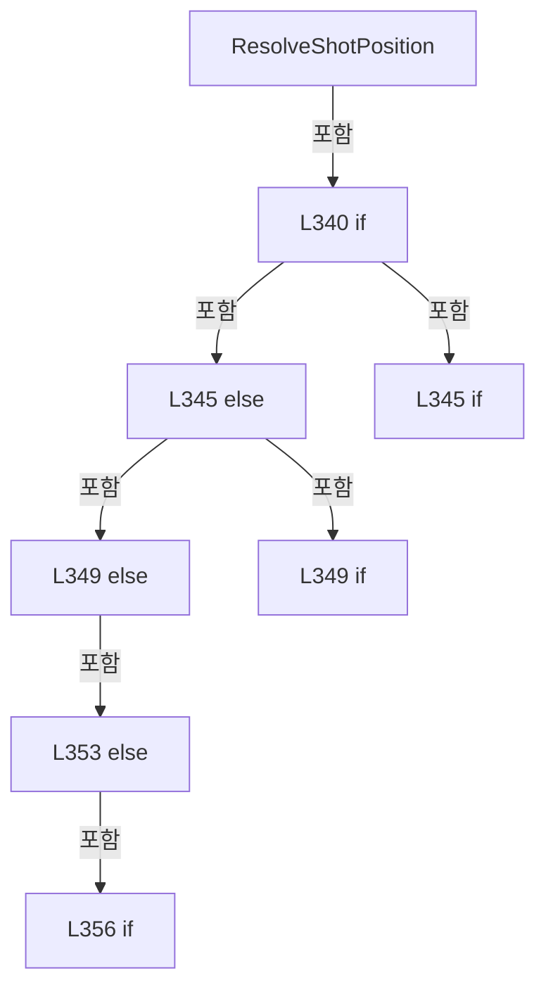

변경 전 점검: 입력/반환 타입, 위 호출자, 예외/취소 경로, 공유 상태와 저장·전송 소비자를 함께 확인합니다. 값의 단위나 물리 방향을 이름만으로 확정하지 않습니다.

### MethodDeclaration `ReadShotNo` · L378–386

[Drilling.UI/Menu/Menus/CMenuCorrection.ReviewData.Display.cs:378–386](https://github.com/kjuws10-rgb/A3Drilling/blob/5aee8e58439c9b455cae7c9593c9be986c3e682e/Drilling.UI/Menu/Menus/CMenuCorrection.ReviewData.Display.cs#L378-L386)

| 항목 | 실제 추출 값 |
| --- | --- |
| 서명 | int Drilling.UI.Menu.Menus.CMenuCorrection.CReviewDataPanel.ReadShotNo(string) |
| 접근/수식자 | Private / private, static |
| 반환/값 타입 | int |
| 소속 타입 | NamedType:Drilling.UI.Menu.Menus.CMenuCorrection.CReviewDataPanel |

입력 계약:

| 이름 | 타입 | 전달 | 선택/기본값 |
| --- | --- | --- | --- |
| shotKey | string | None | False /  |

정적 호출자로 확인된 위치:

| 호출 파일/행 | 호출 표현식 | 런타임 분기 가능 |
| --- | --- | --- |
| [Drilling.UI/Menu/Menus/CMenuCorrection.ReviewData.Display.cs:337–337](https://github.com/kjuws10-rgb/A3Drilling/blob/5aee8e58439c9b455cae7c9593c9be986c3e682e/Drilling.UI/Menu/Menus/CMenuCorrection.ReviewData.Display.cs#L337-L337) | ReadShotNo | False |

호출하는 대상과 해석 범위:

| 원본 행 | 표현식 | 분석 상태 | 대상/소스 위치 |
| --- | --- | --- | --- |
| 380 | CReviewManager.NormalizeShotKey | resolved | string Drilling.Common.Review.CReviewManager.NormalizeShotKey(string) · Drilling.Common/Review/CReviewManager.cs:1165 |
| 381 | normalized.IndexOf | resolved | int string.IndexOf(string, System.StringComparison) |
| 383 | int.TryParse | resolved | bool int.TryParse(System.ReadOnlySpan<char>, System.Globalization.NumberStyles, System.IFormatProvider?, out int) |
| 383 | normalized.AsSpan | resolved | System.ReadOnlySpan<char> string?.AsSpan(int) |

본문의 실제 연산·분기·예외·반환 순서(원문 위치 순):

| 원본 행 | 종류 | 주석 해설 |
| --- | --- | --- |
| 380 | call | 함수·델리게이트 또는 객체 생성자를 호출합니다: CReviewManager.NormalizeShotKey(shotKey) |
| 380 | local-declaration | 지역 변수를 선언합니다: var normalized = CReviewManager.NormalizeShotKey(shotKey); |
| 380 | variable-initializer | 변수의 초기값을 지정합니다: normalized = CReviewManager.NormalizeShotKey(shotKey) |
| 381 | call | 함수·델리게이트 또는 객체 생성자를 호출합니다: normalized.IndexOf("_SHOT", StringComparison.Ordinal) |
| 381 | local-declaration | 지역 변수를 선언합니다: var separator = normalized.IndexOf("_SHOT", StringComparison.Ordinal); |
| 381 | variable-initializer | 변수의 초기값을 지정합니다: separator = normalized.IndexOf("_SHOT", StringComparison.Ordinal) |
| 382 | conditional-expression | 조건에 따라 결과식을 선택합니다: separator >= 0 && int.TryParse(normalized.AsSpan(separator + 5), NumberStyles.Integer, CultureInfo.InvariantCulture, out var shotNo) ? shotNo : 0 |
| 382 | return | 호출자에게 값 또는 제어를 반환합니다: return separator >= 0 && int.TryParse(normalized.AsSpan(separator + 5), NumberStyles.Integer, CultureInfo.InvariantCulture, out var shotNo) ? shotNo : 0; |
| 383 | call | 함수·델리게이트 또는 객체 생성자를 호출합니다: int.TryParse(normalized.AsSpan(separator + 5), NumberStyles.Integer, CultureInfo.InvariantCulture, out var shotNo) |
| 383 | call | 함수·델리게이트 또는 객체 생성자를 호출합니다: normalized.AsSpan(separator + 5) |

변경 전 점검: 입력/반환 타입, 위 호출자, 예외/취소 경로, 공유 상태와 저장·전송 소비자를 함께 확인합니다. 값의 단위나 물리 방향을 이름만으로 확정하지 않습니다.

### MethodDeclaration `TryParseMatrixName` · L388–413

[Drilling.UI/Menu/Menus/CMenuCorrection.ReviewData.Display.cs:388–413](https://github.com/kjuws10-rgb/A3Drilling/blob/5aee8e58439c9b455cae7c9593c9be986c3e682e/Drilling.UI/Menu/Menus/CMenuCorrection.ReviewData.Display.cs#L388-L413)

| 항목 | 실제 추출 값 |
| --- | --- |
| 서명 | bool Drilling.UI.Menu.Menus.CMenuCorrection.CReviewDataPanel.TryParseMatrixName(string, out int, out int) |
| 접근/수식자 | Private / private, static |
| 반환/값 타입 | bool |
| 소속 타입 | NamedType:Drilling.UI.Menu.Menus.CMenuCorrection.CReviewDataPanel |

입력 계약:

| 이름 | 타입 | 전달 | 선택/기본값 |
| --- | --- | --- | --- |
| value | string | None | False /  |
| column | int | Out | False /  |
| row | int | Out | False /  |

정적 호출자로 확인된 위치:

| 호출 파일/행 | 호출 표현식 | 런타임 분기 가능 |
| --- | --- | --- |
| [Drilling.UI/Menu/Menus/CMenuCorrection.ReviewData.Display.cs:349–349](https://github.com/kjuws10-rgb/A3Drilling/blob/5aee8e58439c9b455cae7c9593c9be986c3e682e/Drilling.UI/Menu/Menus/CMenuCorrection.ReviewData.Display.cs#L349-L349) | TryParseMatrixName | False |
| [Drilling.UI/Menu/Menus/CMenuCorrection.ReviewData.Display.cs:356–356](https://github.com/kjuws10-rgb/A3Drilling/blob/5aee8e58439c9b455cae7c9593c9be986c3e682e/Drilling.UI/Menu/Menus/CMenuCorrection.ReviewData.Display.cs#L356-L356) | TryParseMatrixName | False |

호출하는 대상과 해석 범위:

| 원본 행 | 표현식 | 분석 상태 | 대상/소스 위치 |
| --- | --- | --- | --- |
| 392 | value.Trim().ToUpperInvariant | resolved | string string.ToUpperInvariant() |
| 392 | value.Trim | resolved | string string.Trim() |
| 393 | text.TakeWhile(char.IsLetter).Count | resolved | int System.Collections.Generic.IEnumerable<char>.Count<char>() |
| 393 | text.TakeWhile | resolved | System.Collections.Generic.IEnumerable<char> System.Collections.Generic.IEnumerable<char>.TakeWhile<char>(System.Func<char, bool>) |
| 394 | int.TryParse | resolved | bool int.TryParse(System.ReadOnlySpan<char>, System.Globalization.NumberStyles, System.IFormatProvider?, out int) |
| 394 | text.AsSpan | resolved | System.ReadOnlySpan<char> string?.AsSpan(int) |
| 400 | text.AsSpan | resolved | System.ReadOnlySpan<char> string?.AsSpan(int, int) |

본문의 실제 연산·분기·예외·반환 순서(원문 위치 순):

| 원본 행 | 종류 | 주석 해설 |
| --- | --- | --- |
| 390 | assignment | 값을 대상에 대입합니다: column = -1 |
| 391 | assignment | 값을 대상에 대입합니다: row = -1 |
| 392 | call | 함수·델리게이트 또는 객체 생성자를 호출합니다: value.Trim().ToUpperInvariant() |
| 392 | call | 함수·델리게이트 또는 객체 생성자를 호출합니다: value.Trim() |
| 392 | local-declaration | 지역 변수를 선언합니다: var text = value.Trim().ToUpperInvariant(); |
| 392 | variable-initializer | 변수의 초기값을 지정합니다: text = value.Trim().ToUpperInvariant() |
| 393 | call | 함수·델리게이트 또는 객체 생성자를 호출합니다: text.TakeWhile(char.IsLetter).Count() |
| 393 | call | 함수·델리게이트 또는 객체 생성자를 호출합니다: text.TakeWhile(char.IsLetter) |
| 393 | local-declaration | 지역 변수를 선언합니다: var letterCount = text.TakeWhile(char.IsLetter).Count(); |
| 393 | variable-initializer | 변수의 초기값을 지정합니다: letterCount = text.TakeWhile(char.IsLetter).Count() |
| 394 | call | 함수·델리게이트 또는 객체 생성자를 호출합니다: int.TryParse(text.AsSpan(letterCount), NumberStyles.Integer, CultureInfo.InvariantCulture, out var oneBasedRow) |
| 394 | call | 함수·델리게이트 또는 객체 생성자를 호출합니다: text.AsSpan(letterCount) |
| 394 | if | 조건에 따라 분기합니다: if (letterCount == 0 &#124;&#124; letterCount == text.Length &#124;&#124; !int.TryParse(text.AsSpan(letterCount), NumberStyles.Integer, CultureInfo.InvariantCulture, out var oneBasedRow) &#124;&#124; oneBasedRow <= 0) |
| 396 | return | 호출자에게 값 또는 제어를 반환합니다: return false; |
| 399 | local-declaration | 지역 변수를 선언합니다: var oneBasedColumn = 0; |
| 399 | variable-initializer | 변수의 초기값을 지정합니다: oneBasedColumn = 0 |
| 400 | call | 함수·델리게이트 또는 객체 생성자를 호출합니다: text.AsSpan(0, letterCount) |
| 400 | foreach | 컬렉션 요소를 순회합니다: foreach (var character in text.AsSpan(0, letterCount)) |
| 402 | if | 조건에 따라 분기합니다: if (character is < 'A' or > 'Z') |
| 404 | return | 호출자에게 값 또는 제어를 반환합니다: return false; |
| 407 | assignment | 값을 대상에 대입합니다: oneBasedColumn = checked((oneBasedColumn * 26) + (character - 'A' + 1)) |
| 410 | assignment | 값을 대상에 대입합니다: column = oneBasedColumn - 1 |
| 411 | assignment | 값을 대상에 대입합니다: row = oneBasedRow - 1 |
| 412 | return | 호출자에게 값 또는 제어를 반환합니다: return true; |

제어 구문의 포함 구조(실제 실행 순서/CFG가 아닌 구문 탐색 그림):

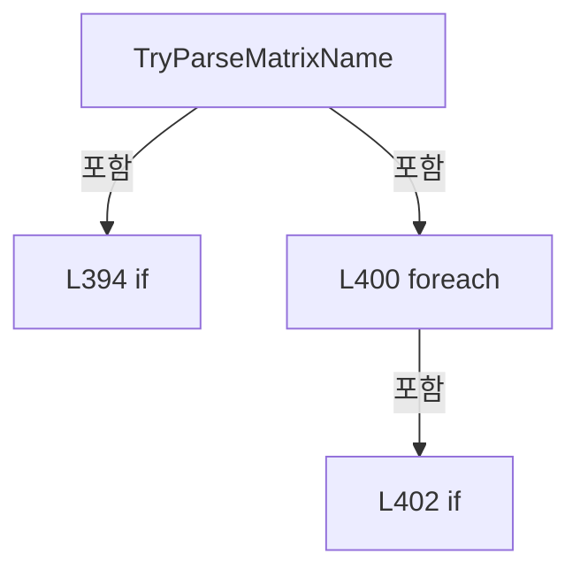

변경 전 점검: 입력/반환 타입, 위 호출자, 예외/취소 경로, 공유 상태와 저장·전송 소비자를 함께 확인합니다. 값의 단위나 물리 방향을 이름만으로 확정하지 않습니다.

### MethodDeclaration `ApplyDisplayModel` · L415–441

[Drilling.UI/Menu/Menus/CMenuCorrection.ReviewData.Display.cs:415–441](https://github.com/kjuws10-rgb/A3Drilling/blob/5aee8e58439c9b455cae7c9593c9be986c3e682e/Drilling.UI/Menu/Menus/CMenuCorrection.ReviewData.Display.cs#L415-L441)

| 항목 | 실제 추출 값 |
| --- | --- |
| 서명 | void Drilling.UI.Menu.Menus.CMenuCorrection.CReviewDataPanel.ApplyDisplayModel(Drilling.UI.Menu.Menus.CMenuCorrection.ST_REVIEW_DATA_DISPLAY_MODEL, Drilling.Common.Review.ST_REVIEW_RESULT_FILE_DATA, Drilling.Common.Review.ST_REVIEW_RESULT_CATALOG_ITEM, Drilling.Common.Managers.ST_RECIPE_DEFINITION) |
| 접근/수식자 | Private / private |
| 반환/값 타입 | void |
| 소속 타입 | NamedType:Drilling.UI.Menu.Menus.CMenuCorrection.CReviewDataPanel |

입력 계약:

| 이름 | 타입 | 전달 | 선택/기본값 |
| --- | --- | --- | --- |
| model | Drilling.UI.Menu.Menus.CMenuCorrection.ST_REVIEW_DATA_DISPLAY_MODEL | None | False /  |
| resultFile | Drilling.Common.Review.ST_REVIEW_RESULT_FILE_DATA | None | False /  |
| catalog | Drilling.Common.Review.ST_REVIEW_RESULT_CATALOG_ITEM | None | False /  |
| recipe | Drilling.Common.Managers.ST_RECIPE_DEFINITION | None | False /  |

정적 호출자로 확인된 위치:

| 호출 파일/행 | 호출 표현식 | 런타임 분기 가능 |
| --- | --- | --- |
| [Drilling.UI/Menu/Menus/CMenuCorrection.ReviewData.Display.cs:146–146](https://github.com/kjuws10-rgb/A3Drilling/blob/5aee8e58439c9b455cae7c9593c9be986c3e682e/Drilling.UI/Menu/Menus/CMenuCorrection.ReviewData.Display.cs#L146-L146) | ApplyDisplayModel | False |

호출하는 대상과 해석 범위:

| 원본 행 | 표현식 | 분석 상태 | 대상/소스 위치 |
| --- | --- | --- | --- |
| 430 | model.ResultCellNos.Order().FirstOrDefault | resolved | int System.Collections.Generic.IEnumerable<int>.FirstOrDefault<int>() |
| 430 | model.ResultCellNos.Order | resolved | System.Linq.IOrderedEnumerable<int> System.Collections.Generic.IEnumerable<int>.Order<int>() |
| 433 | ApplyCellSelection | resolved | void Drilling.UI.Menu.Menus.CMenuCorrection.CReviewDataPanel.ApplyCellSelection(int, bool) · Drilling.UI/Menu/Menus/CMenuCorrection.ReviewData.Display.cs:453 |
| 437 | RefreshGlassPreview | resolved | void Drilling.UI.Menu.Menus.CMenuCorrection.CReviewDataPanel.RefreshGlassPreview() · Drilling.UI/Menu/Menus/CMenuCorrection.ReviewData.Display.cs:546 |
| 440 | NotifyDisplayState | resolved | void Drilling.UI.Menu.Menus.CMenuCorrection.CReviewDataPanel.NotifyDisplayState() · Drilling.UI/Menu/Menus/CMenuCorrection.ReviewData.Display.cs:957 |

본문의 실제 연산·분기·예외·반환 순서(원문 위치 순):

| 원본 행 | 종류 | 주석 해설 |
| --- | --- | --- |
| 421 | assignment | 값을 대상에 대입합니다: _loadedParameters = model.Parameters |
| 422 | assignment | 값을 대상에 대입합니다: _loadedResultFile = resultFile |
| 423 | assignment | 값을 대상에 대입합니다: _loadedCatalog = catalog |
| 424 | assignment | 값을 대상에 대입합니다: _loadedRecipe = recipe |
| 425 | assignment | 값을 대상에 대입합니다: _loadedCellCount = model.CellCount |
| 426 | assignment | 값을 대상에 대입합니다: _resultCellNos = model.ResultCellNos |
| 427 | assignment | 값을 대상에 대입합니다: _shotsByCell = model.ShotsByCell |
| 428 | assignment | 값을 대상에 대입합니다: _allRows = model.Rows |
| 429 | assignment | 값을 대상에 대입합니다: _hasLoadedData = true |
| 430 | call | 함수·델리게이트 또는 객체 생성자를 호출합니다: model.ResultCellNos.Order().FirstOrDefault() |
| 430 | call | 함수·델리게이트 또는 객체 생성자를 호출합니다: model.ResultCellNos.Order() |
| 430 | local-declaration | 지역 변수를 선언합니다: var firstCell = model.ResultCellNos.Order().FirstOrDefault(); |
| 430 | variable-initializer | 변수의 초기값을 지정합니다: firstCell = model.ResultCellNos.Order().FirstOrDefault() |
| 431 | if | 조건에 따라 분기합니다: if (firstCell > 0) |
| 433 | call | 함수·델리게이트 또는 객체 생성자를 호출합니다: ApplyCellSelection(firstCell, true) |
| 435 | else | 앞 조건이 거짓인 경로입니다: else |
| 437 | call | 함수·델리게이트 또는 객체 생성자를 호출합니다: RefreshGlassPreview() |
| 440 | call | 함수·델리게이트 또는 객체 생성자를 호출합니다: NotifyDisplayState() |

제어 구문의 포함 구조(실제 실행 순서/CFG가 아닌 구문 탐색 그림):

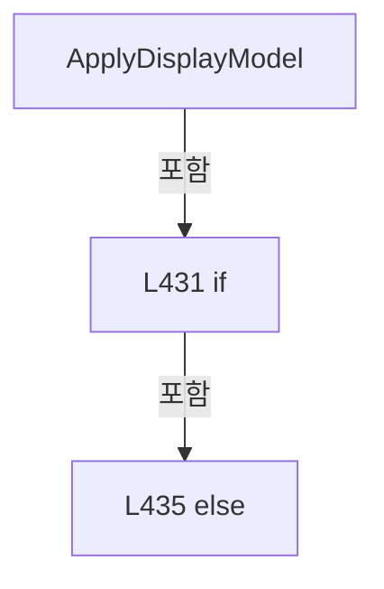

변경 전 점검: 입력/반환 타입, 위 호출자, 예외/취소 경로, 공유 상태와 저장·전송 소비자를 함께 확인합니다. 값의 단위나 물리 방향을 이름만으로 확정하지 않습니다.

### MethodDeclaration `SelectCell` · L443–451

[Drilling.UI/Menu/Menus/CMenuCorrection.ReviewData.Display.cs:443–451](https://github.com/kjuws10-rgb/A3Drilling/blob/5aee8e58439c9b455cae7c9593c9be986c3e682e/Drilling.UI/Menu/Menus/CMenuCorrection.ReviewData.Display.cs#L443-L451)

| 항목 | 실제 추출 값 |
| --- | --- |
| 서명 | void Drilling.UI.Menu.Menus.CMenuCorrection.CReviewDataPanel.SelectCell(object?) |
| 접근/수식자 | Private / private |
| 반환/값 타입 | void |
| 소속 타입 | NamedType:Drilling.UI.Menu.Menus.CMenuCorrection.CReviewDataPanel |

입력 계약:

| 이름 | 타입 | 전달 | 선택/기본값 |
| --- | --- | --- | --- |
| parameter | object? | None | False /  |

현재 부분 분석에서 직접 연결된 호출자는 없습니다. XAML/이벤트/인터페이스·델리게이트·외부 진입을 추가 확인해야 하며, 미사용으로 판정한 것이 아닙니다.

호출하는 대상과 해석 범위:

| 원본 행 | 표현식 | 분석 상태 | 대상/소스 위치 |
| --- | --- | --- | --- |
| 445 | int.TryParse | resolved | bool int.TryParse(string?, System.Globalization.NumberStyles, System.IFormatProvider?, out int) |
| 445 | .ToString | resolved · 동적 구현 선택 가능 | string? object.ToString() |
| 445 | _resultCellNos.Contains | resolved · 동적 구현 선택 가능 | bool System.Collections.Generic.IReadOnlySet<int>.Contains(int) |
| 450 | ApplyCellSelection | resolved | void Drilling.UI.Menu.Menus.CMenuCorrection.CReviewDataPanel.ApplyCellSelection(int, bool) · Drilling.UI/Menu/Menus/CMenuCorrection.ReviewData.Display.cs:453 |

본문의 실제 연산·분기·예외·반환 순서(원문 위치 순):

| 원본 행 | 종류 | 주석 해설 |
| --- | --- | --- |
| 445 | call | 함수·델리게이트 또는 객체 생성자를 호출합니다: int.TryParse(parameter?.ToString(), NumberStyles.Integer, CultureInfo.InvariantCulture, out var cellNo) |
| 445 | call | 함수·델리게이트 또는 객체 생성자를 호출합니다: .ToString() |
| 445 | call | 함수·델리게이트 또는 객체 생성자를 호출합니다: _resultCellNos.Contains(cellNo) |
| 445 | if | 조건에 따라 분기합니다: if (!_hasLoadedData &#124;&#124; !int.TryParse(parameter?.ToString(), NumberStyles.Integer, CultureInfo.InvariantCulture, out var cellNo) &#124;&#124; !_resultCellNos.Contains(cellNo)) |
| 447 | return | 호출자에게 값 또는 제어를 반환합니다: return; |
| 450 | call | 함수·델리게이트 또는 객체 생성자를 호출합니다: ApplyCellSelection(cellNo) |

제어 구문의 포함 구조(실제 실행 순서/CFG가 아닌 구문 탐색 그림):

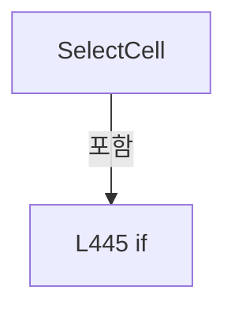

변경 전 점검: 입력/반환 타입, 위 호출자, 예외/취소 경로, 공유 상태와 저장·전송 소비자를 함께 확인합니다. 값의 단위나 물리 방향을 이름만으로 확정하지 않습니다.

### MethodDeclaration `ApplyCellSelection` · L453–491

[Drilling.UI/Menu/Menus/CMenuCorrection.ReviewData.Display.cs:453–491](https://github.com/kjuws10-rgb/A3Drilling/blob/5aee8e58439c9b455cae7c9593c9be986c3e682e/Drilling.UI/Menu/Menus/CMenuCorrection.ReviewData.Display.cs#L453-L491)

| 항목 | 실제 추출 값 |
| --- | --- |
| 서명 | void Drilling.UI.Menu.Menus.CMenuCorrection.CReviewDataPanel.ApplyCellSelection(int, bool) |
| 접근/수식자 | Private / private |
| 반환/값 타입 | void |
| 소속 타입 | NamedType:Drilling.UI.Menu.Menus.CMenuCorrection.CReviewDataPanel |

입력 계약:

| 이름 | 타입 | 전달 | 선택/기본값 |
| --- | --- | --- | --- |
| cellNo | int | None | False /  |
| renderSynchronously | bool | None | True / false |

정적 호출자로 확인된 위치:

| 호출 파일/행 | 호출 표현식 | 런타임 분기 가능 |
| --- | --- | --- |
| [Drilling.UI/Menu/Menus/CMenuCorrection.ReviewData.Display.cs:433–433](https://github.com/kjuws10-rgb/A3Drilling/blob/5aee8e58439c9b455cae7c9593c9be986c3e682e/Drilling.UI/Menu/Menus/CMenuCorrection.ReviewData.Display.cs#L433-L433) | ApplyCellSelection | False |
| [Drilling.UI/Menu/Menus/CMenuCorrection.ReviewData.Display.cs:450–450](https://github.com/kjuws10-rgb/A3Drilling/blob/5aee8e58439c9b455cae7c9593c9be986c3e682e/Drilling.UI/Menu/Menus/CMenuCorrection.ReviewData.Display.cs#L450-L450) | ApplyCellSelection | False |
| [Drilling.UI/Menu/Menus/CMenuCorrection.ReviewData.Reinspection.cs:646–646](https://github.com/kjuws10-rgb/A3Drilling/blob/5aee8e58439c9b455cae7c9593c9be986c3e682e/Drilling.UI/Menu/Menus/CMenuCorrection.ReviewData.Reinspection.cs#L646-L646) | ApplyCellSelection | False |

호출하는 대상과 해석 범위:

| 원본 행 | 표현식 | 분석 상태 | 대상/소스 위치 |
| --- | --- | --- | --- |
| 458 | _allRows.Where | resolved | System.Collections.Generic.IEnumerable<Drilling.UI.Menu.Menus.CMenuCorrection.ST_REVIEW_DATA_GRID_ROW> System.Collections.Generic.IEnumerable<Drilling.UI.Menu.Menus.CMenuCorrection.ST_REVIEW_DATA_GRID_ROW>.Where<Drilling.UI.Menu.Menus.CMenuCorrection.ST_REVIEW_DATA_GRID_ROW>(System.Func<Drilling.UI.Menu.Menus.CMenuCorrection.ST_REVIEW_DATA_GRID_ROW, bool>) |
| 463 | NotifyReinspectionCommandState | resolved | void Drilling.UI.Menu.Menus.CMenuCorrection.CReviewDataPanel.NotifyReinspectionCommandState() · Drilling.UI/Menu/Menus/CMenuCorrection.ReviewData.Reinspection.cs:698 |
| 467 | _allRows.Where(row => row.CellNo == cellNo).ToArray | resolved | Drilling.UI.Menu.Menus.CMenuCorrection.ST_REVIEW_DATA_GRID_ROW[] System.Collections.Generic.IEnumerable<Drilling.UI.Menu.Menus.CMenuCorrection.ST_REVIEW_DATA_GRID_ROW>.ToArray<Drilling.UI.Menu.Menus.CMenuCorrection.ST_REVIEW_DATA_GRID_ROW>() |
| 467 | _allRows.Where | resolved | System.Collections.Generic.IEnumerable<Drilling.UI.Menu.Menus.CMenuCorrection.ST_REVIEW_DATA_GRID_ROW> System.Collections.Generic.IEnumerable<Drilling.UI.Menu.Menus.CMenuCorrection.ST_REVIEW_DATA_GRID_ROW>.Where<Drilling.UI.Menu.Menus.CMenuCorrection.ST_REVIEW_DATA_GRID_ROW>(System.Func<Drilling.UI.Menu.Menus.CMenuCorrection.ST_REVIEW_DATA_GRID_ROW, bool>) |
| 468 | Rows.FirstOrDefault | resolved | Drilling.UI.Menu.Menus.CMenuCorrection.ST_REVIEW_DATA_GRID_ROW? System.Collections.Generic.IEnumerable<Drilling.UI.Menu.Menus.CMenuCorrection.ST_REVIEW_DATA_GRID_ROW>.FirstOrDefault<Drilling.UI.Menu.Menus.CMenuCorrection.ST_REVIEW_DATA_GRID_ROW>(System.Func<Drilling.UI.Menu.Menus.CMenuCorrection.ST_REVIEW_DATA_GRID_ROW, bool>) |
| 469 | Rows.FirstOrDefault | resolved | Drilling.UI.Menu.Menus.CMenuCorrection.ST_REVIEW_DATA_GRID_ROW? System.Collections.Generic.IEnumerable<Drilling.UI.Menu.Menus.CMenuCorrection.ST_REVIEW_DATA_GRID_ROW>.FirstOrDefault<Drilling.UI.Menu.Menus.CMenuCorrection.ST_REVIEW_DATA_GRID_ROW>() |
| 473 | RefreshGlassPreview | resolved | void Drilling.UI.Menu.Menus.CMenuCorrection.CReviewDataPanel.RefreshGlassPreview() · Drilling.UI/Menu/Menus/CMenuCorrection.ReviewData.Display.cs:546 |
| 477 | RefreshCellSelectionOverlay | resolved | void Drilling.UI.Menu.Menus.CMenuCorrection.CReviewDataPanel.RefreshCellSelectionOverlay() · Drilling.UI/Menu/Menus/CMenuCorrection.ReviewData.Display.cs:585 |
| 482 | RefreshShotMap | resolved | void Drilling.UI.Menu.Menus.CMenuCorrection.CReviewDataPanel.RefreshShotMap() · Drilling.UI/Menu/Menus/CMenuCorrection.ReviewData.Display.cs:576 |
| 486 | QueueShotMapRender | resolved | void Drilling.UI.Menu.Menus.CMenuCorrection.CReviewDataPanel.QueueShotMapRender(int, string) · Drilling.UI/Menu/Menus/CMenuCorrection.ReviewData.Display.cs:595 |
| 489 | RefreshSelectionText | resolved | void Drilling.UI.Menu.Menus.CMenuCorrection.CReviewDataPanel.RefreshSelectionText() · Drilling.UI/Menu/Menus/CMenuCorrection.ReviewData.Display.cs:631 |
| 490 | NotifyDisplayState | resolved | void Drilling.UI.Menu.Menus.CMenuCorrection.CReviewDataPanel.NotifyDisplayState() · Drilling.UI/Menu/Menus/CMenuCorrection.ReviewData.Display.cs:957 |

본문의 실제 연산·분기·예외·반환 순서(원문 위치 순):

| 원본 행 | 종류 | 주석 해설 |
| --- | --- | --- |
| 455 | local-declaration | 지역 변수를 선언합니다: var previousCellNo = _selectedCellNo; |
| 455 | variable-initializer | 변수의 초기값을 지정합니다: previousCellNo = _selectedCellNo |
| 456 | if | 조건에 따라 분기합니다: if (previousCellNo > 0 && previousCellNo != cellNo) |
| 458 | call | 함수·델리게이트 또는 객체 생성자를 호출합니다: _allRows.Where(row => row.CellNo == previousCellNo) |
| 458 | foreach | 컬렉션 요소를 순회합니다: foreach (var row in _allRows.Where(row => row.CellNo == previousCellNo)) |
| 460 | assignment | 값을 대상에 대입합니다: row.IsReinspectionSelected = false |
| 463 | call | 함수·델리게이트 또는 객체 생성자를 호출합니다: NotifyReinspectionCommandState() |
| 466 | assignment | 값을 대상에 대입합니다: _selectedCellNo = cellNo |
| 467 | assignment | 값을 대상에 대입합니다: Rows = _allRows.Where(row => row.CellNo == cellNo).ToArray() |
| 467 | call | 함수·델리게이트 또는 객체 생성자를 호출합니다: _allRows.Where(row => row.CellNo == cellNo).ToArray() |
| 467 | call | 함수·델리게이트 또는 객체 생성자를 호출합니다: _allRows.Where(row => row.CellNo == cellNo) |
| 468 | call | 함수·델리게이트 또는 객체 생성자를 호출합니다: Rows.FirstOrDefault(row => row.IsResolved) |
| 468 | local-declaration | 지역 변수를 선언합니다: var firstResolved = Rows.FirstOrDefault(row => row.IsResolved); |
| 468 | variable-initializer | 변수의 초기값을 지정합니다: firstResolved = Rows.FirstOrDefault(row => row.IsResolved) |
| 469 | assignment | 값을 대상에 대입합니다: SelectedRow = firstResolved ?? Rows.FirstOrDefault() |
| 469 | call | 함수·델리게이트 또는 객체 생성자를 호출합니다: Rows.FirstOrDefault() |
| 470 | assignment | 값을 대상에 대입합니다: _selectedShotKey = SelectedRow?.ShotKey ?? "" |
| 471 | if | 조건에 따라 분기합니다: if (GlassPreviewImage is null) |
| 473 | call | 함수·델리게이트 또는 객체 생성자를 호출합니다: RefreshGlassPreview() |
| 475 | else | 앞 조건이 거짓인 경로입니다: else |
| 477 | call | 함수·델리게이트 또는 객체 생성자를 호출합니다: RefreshCellSelectionOverlay() |
| 480 | if | 조건에 따라 분기합니다: if (renderSynchronously) |
| 482 | call | 함수·델리게이트 또는 객체 생성자를 호출합니다: RefreshShotMap() |
| 484 | else | 앞 조건이 거짓인 경로입니다: else |
| 486 | call | 함수·델리게이트 또는 객체 생성자를 호출합니다: QueueShotMapRender(cellNo, _selectedShotKey) |
| 489 | call | 함수·델리게이트 또는 객체 생성자를 호출합니다: RefreshSelectionText() |
| 490 | call | 함수·델리게이트 또는 객체 생성자를 호출합니다: NotifyDisplayState() |

제어 구문의 포함 구조(실제 실행 순서/CFG가 아닌 구문 탐색 그림):

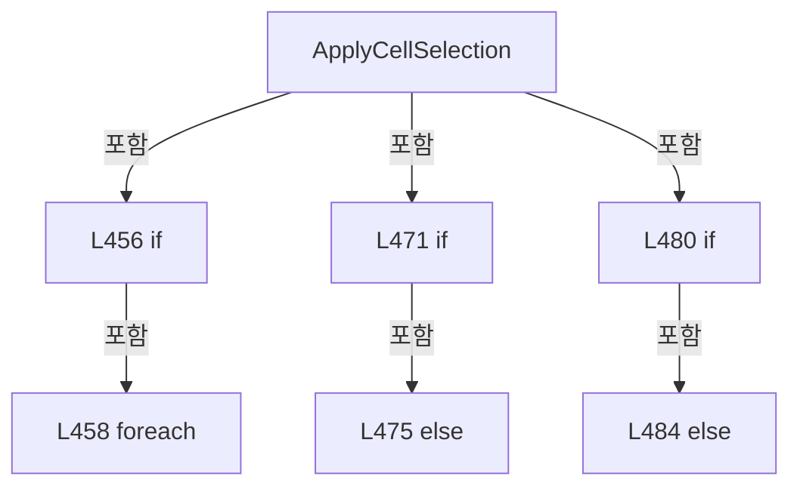

변경 전 점검: 입력/반환 타입, 위 호출자, 예외/취소 경로, 공유 상태와 저장·전송 소비자를 함께 확인합니다. 값의 단위나 물리 방향을 이름만으로 확정하지 않습니다.

### MethodDeclaration `SelectShotAt` · L493–514

[Drilling.UI/Menu/Menus/CMenuCorrection.ReviewData.Display.cs:493–514](https://github.com/kjuws10-rgb/A3Drilling/blob/5aee8e58439c9b455cae7c9593c9be986c3e682e/Drilling.UI/Menu/Menus/CMenuCorrection.ReviewData.Display.cs#L493-L514)

| 항목 | 실제 추출 값 |
| --- | --- |
| 서명 | void Drilling.UI.Menu.Menus.CMenuCorrection.CReviewDataPanel.SelectShotAt(double, double) |
| 접근/수식자 | Public / public |
| 반환/값 타입 | void |
| 소속 타입 | NamedType:Drilling.UI.Menu.Menus.CMenuCorrection.CReviewDataPanel |

입력 계약:

| 이름 | 타입 | 전달 | 선택/기본값 |
| --- | --- | --- | --- |
| x | double | None | False /  |
| y | double | None | False /  |

현재 부분 분석에서 직접 연결된 호출자는 없습니다. XAML/이벤트/인터페이스·델리게이트·외부 진입을 추가 확인해야 하며, 미사용으로 판정한 것이 아닙니다.

호출하는 대상과 해석 범위:

| 원본 행 | 표현식 | 분석 상태 | 대상/소스 위치 |
| --- | --- | --- | --- |
| 495 | _shotsByCell.TryGetValue | resolved · 동적 구현 선택 가능 | bool System.Collections.Generic.IReadOnlyDictionary<int, System.Collections.Generic.IReadOnlyList<Drilling.UI.Menu.Menus.CMenuCorrection.ST_REVIEW_DATA_SHOT_POSITION>>.TryGetValue(int, out System.Collections.Generic.IReadOnlyList<Drilling.UI.Menu.Menus.CMenuCorrection.ST_REVIEW_DATA_SHOT_POSITION>) |
| 501 | GetReviewDataShotMapRect | resolved | Rect Drilling.UI.Menu.Menus.CMenuCorrection.CReviewDataPanel.GetReviewDataShotMapRect(int, int) · Drilling.UI/Menu/Menus/CMenuCorrection.ReviewData.Display.cs:874 |
| 502 | mapRect.Contains | unresolved | None |
| 502 | new Point | unresolved | None |
| 507 | Math.Clamp | resolved | int System.Math.Clamp(int, int, int) |
| 508 | Math.Clamp | resolved | int System.Math.Clamp(int, int, int) |
| 509 | shots.FirstOrDefault | resolved | Drilling.UI.Menu.Menus.CMenuCorrection.ST_REVIEW_DATA_SHOT_POSITION? System.Collections.Generic.IEnumerable<Drilling.UI.Menu.Menus.CMenuCorrection.ST_REVIEW_DATA_SHOT_POSITION>.FirstOrDefault<Drilling.UI.Menu.Menus.CMenuCorrection.ST_REVIEW_DATA_SHOT_POSITION>(System.Func<Drilling.UI.Menu.Menus.CMenuCorrection.ST_REVIEW_DATA_SHOT_POSITION, bool>) |
| 512 | ApplyShotSelection | resolved | void Drilling.UI.Menu.Menus.CMenuCorrection.CReviewDataPanel.ApplyShotSelection(string, Drilling.UI.Menu.Menus.CMenuCorrection.ST_REVIEW_DATA_GRID_ROW?) · Drilling.UI/Menu/Menus/CMenuCorrection.ReviewData.Display.cs:529 |

본문의 실제 연산·분기·예외·반환 순서(원문 위치 순):

| 원본 행 | 종류 | 주석 해설 |
| --- | --- | --- |
| 495 | call | 함수·델리게이트 또는 객체 생성자를 호출합니다: _shotsByCell.TryGetValue(_selectedCellNo, out var shots) |
| 495 | if | 조건에 따라 분기합니다: if (!_hasLoadedData &#124;&#124; !_shotsByCell.TryGetValue(_selectedCellNo, out var shots) &#124;&#124; shots.Count == 0) |
| 497 | return | 호출자에게 값 또는 제어를 반환합니다: return; |
| 500 | local-declaration | 지역 변수를 선언합니다: var first = shots[0]; |
| 500 | variable-initializer | 변수의 초기값을 지정합니다: first = shots[0] |
| 501 | call | 함수·델리게이트 또는 객체 생성자를 호출합니다: GetReviewDataShotMapRect(first.GroupCountX, first.GroupCountY) |
| 501 | local-declaration | 지역 변수를 선언합니다: var mapRect = GetReviewDataShotMapRect(first.GroupCountX, first.GroupCountY); |
| 501 | variable-initializer | 변수의 초기값을 지정합니다: mapRect = GetReviewDataShotMapRect(first.GroupCountX, first.GroupCountY) |
| 502 | call | 함수·델리게이트 또는 객체 생성자를 호출합니다: mapRect.Contains(new Point(x, y)) |
| 502 | call | 함수·델리게이트 또는 객체 생성자를 호출합니다: new Point(x, y) |
| 502 | if | 조건에 따라 분기합니다: if (!mapRect.Contains(new Point(x, y))) |
| 504 | return | 호출자에게 값 또는 제어를 반환합니다: return; |
| 507 | call | 함수·델리게이트 또는 객체 생성자를 호출합니다: Math.Clamp((int)((x - mapRect.Left) / mapRect.Width * first.GroupCountX), 0, first.GroupCountX - 1) |
| 507 | local-declaration | 지역 변수를 선언합니다: var column = Math.Clamp((int)((x - mapRect.Left) / mapRect.Width * first.GroupCountX), 0, first.GroupCountX - 1); |
| 507 | variable-initializer | 변수의 초기값을 지정합니다: column = Math.Clamp((int)((x - mapRect.Left) / mapRect.Width * first.GroupCountX), 0, first.GroupCountX - 1) |
| 508 | call | 함수·델리게이트 또는 객체 생성자를 호출합니다: Math.Clamp((int)((y - mapRect.Top) / mapRect.Height * first.GroupCountY), 0, first.GroupCountY - 1) |
| 508 | local-declaration | 지역 변수를 선언합니다: var row = Math.Clamp((int)((y - mapRect.Top) / mapRect.Height * first.GroupCountY), 0, first.GroupCountY - 1); |
| 508 | variable-initializer | 변수의 초기값을 지정합니다: row = Math.Clamp((int)((y - mapRect.Top) / mapRect.Height * first.GroupCountY), 0, first.GroupCountY - 1) |
| 509 | call | 함수·델리게이트 또는 객체 생성자를 호출합니다: shots.FirstOrDefault(item => item.GroupColumn == column && item.GroupRow == row) |
| 509 | local-declaration | 지역 변수를 선언합니다: var shot = shots.FirstOrDefault(item => item.GroupColumn == column && item.GroupRow == row); |
| 509 | variable-initializer | 변수의 초기값을 지정합니다: shot = shots.FirstOrDefault(item => item.GroupColumn == column && item.GroupRow == row) |
| 510 | if | 조건에 따라 분기합니다: if (shot is not null) |
| 512 | call | 함수·델리게이트 또는 객체 생성자를 호출합니다: ApplyShotSelection(shot.ShotKey, null) |

제어 구문의 포함 구조(실제 실행 순서/CFG가 아닌 구문 탐색 그림):

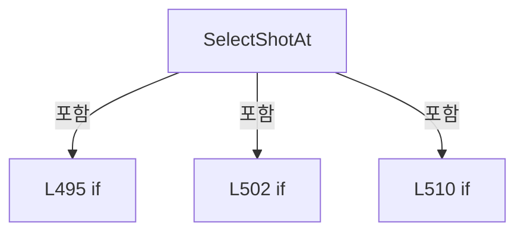

변경 전 점검: 입력/반환 타입, 위 호출자, 예외/취소 경로, 공유 상태와 저장·전송 소비자를 함께 확인합니다. 값의 단위나 물리 방향을 이름만으로 확정하지 않습니다.

### MethodDeclaration `SelectRow` · L516–527

[Drilling.UI/Menu/Menus/CMenuCorrection.ReviewData.Display.cs:516–527](https://github.com/kjuws10-rgb/A3Drilling/blob/5aee8e58439c9b455cae7c9593c9be986c3e682e/Drilling.UI/Menu/Menus/CMenuCorrection.ReviewData.Display.cs#L516-L527)

| 항목 | 실제 추출 값 |
| --- | --- |
| 서명 | void Drilling.UI.Menu.Menus.CMenuCorrection.CReviewDataPanel.SelectRow(Drilling.UI.Menu.Menus.CMenuCorrection.ST_REVIEW_DATA_GRID_ROW) |
| 접근/수식자 | Public / public |
| 반환/값 타입 | void |
| 소속 타입 | NamedType:Drilling.UI.Menu.Menus.CMenuCorrection.CReviewDataPanel |

입력 계약:

| 이름 | 타입 | 전달 | 선택/기본값 |
| --- | --- | --- | --- |
| row | Drilling.UI.Menu.Menus.CMenuCorrection.ST_REVIEW_DATA_GRID_ROW | None | False /  |

정적 호출자로 확인된 위치:

| 호출 파일/행 | 호출 표현식 | 런타임 분기 가능 |
| --- | --- | --- |
| [Drilling.UI/Views/CReviewDataView.xaml.cs:81–81](https://github.com/kjuws10-rgb/A3Drilling/blob/5aee8e58439c9b455cae7c9593c9be986c3e682e/Drilling.UI/Views/CReviewDataView.xaml.cs#L81-L81) | panel.SelectRow | False |

호출하는 대상과 해석 범위:

| 원본 행 | 표현식 | 분석 상태 | 대상/소스 위치 |
| --- | --- | --- | --- |
| 521 | Rows.Any | resolved | bool System.Collections.Generic.IEnumerable<Drilling.UI.Menu.Menus.CMenuCorrection.ST_REVIEW_DATA_GRID_ROW>.Any<Drilling.UI.Menu.Menus.CMenuCorrection.ST_REVIEW_DATA_GRID_ROW>(System.Func<Drilling.UI.Menu.Menus.CMenuCorrection.ST_REVIEW_DATA_GRID_ROW, bool>) |
| 521 | ReferenceEquals | resolved | bool object.ReferenceEquals(object?, object?) |
| 526 | ApplyShotSelection | resolved | void Drilling.UI.Menu.Menus.CMenuCorrection.CReviewDataPanel.ApplyShotSelection(string, Drilling.UI.Menu.Menus.CMenuCorrection.ST_REVIEW_DATA_GRID_ROW?) · Drilling.UI/Menu/Menus/CMenuCorrection.ReviewData.Display.cs:529 |

본문의 실제 연산·분기·예외·반환 순서(원문 위치 순):

| 원본 행 | 종류 | 주석 해설 |
| --- | --- | --- |
| 518 | if | 조건에 따라 분기합니다: if (!_hasLoadedData &#124;&#124; row is null &#124;&#124; row.CellNo != _selectedCellNo &#124;&#124; !Rows.Any(currentRow => ReferenceEquals(currentRow, row))) |
| 521 | call | 함수·델리게이트 또는 객체 생성자를 호출합니다: Rows.Any(currentRow => ReferenceEquals(currentRow, row)) |
| 521 | call | 함수·델리게이트 또는 객체 생성자를 호출합니다: ReferenceEquals(currentRow, row) |
| 523 | return | 호출자에게 값 또는 제어를 반환합니다: return; |
| 526 | call | 함수·델리게이트 또는 객체 생성자를 호출합니다: ApplyShotSelection(row.ShotKey, row) |

제어 구문의 포함 구조(실제 실행 순서/CFG가 아닌 구문 탐색 그림):

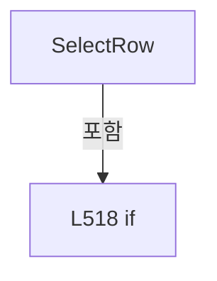

변경 전 점검: 입력/반환 타입, 위 호출자, 예외/취소 경로, 공유 상태와 저장·전송 소비자를 함께 확인합니다. 값의 단위나 물리 방향을 이름만으로 확정하지 않습니다.

### MethodDeclaration `ApplyShotSelection` · L529–544

[Drilling.UI/Menu/Menus/CMenuCorrection.ReviewData.Display.cs:529–544](https://github.com/kjuws10-rgb/A3Drilling/blob/5aee8e58439c9b455cae7c9593c9be986c3e682e/Drilling.UI/Menu/Menus/CMenuCorrection.ReviewData.Display.cs#L529-L544)

| 항목 | 실제 추출 값 |
| --- | --- |
| 서명 | void Drilling.UI.Menu.Menus.CMenuCorrection.CReviewDataPanel.ApplyShotSelection(string, Drilling.UI.Menu.Menus.CMenuCorrection.ST_REVIEW_DATA_GRID_ROW?) |
| 접근/수식자 | Private / private |
| 반환/값 타입 | void |
| 소속 타입 | NamedType:Drilling.UI.Menu.Menus.CMenuCorrection.CReviewDataPanel |

입력 계약:

| 이름 | 타입 | 전달 | 선택/기본값 |
| --- | --- | --- | --- |
| shotKey | string | None | False /  |
| preferredRow | Drilling.UI.Menu.Menus.CMenuCorrection.ST_REVIEW_DATA_GRID_ROW? | None | False /  |

정적 호출자로 확인된 위치:

| 호출 파일/행 | 호출 표현식 | 런타임 분기 가능 |
| --- | --- | --- |
| [Drilling.UI/Menu/Menus/CMenuCorrection.ReviewData.Display.cs:512–512](https://github.com/kjuws10-rgb/A3Drilling/blob/5aee8e58439c9b455cae7c9593c9be986c3e682e/Drilling.UI/Menu/Menus/CMenuCorrection.ReviewData.Display.cs#L512-L512) | ApplyShotSelection | False |
| [Drilling.UI/Menu/Menus/CMenuCorrection.ReviewData.Display.cs:526–526](https://github.com/kjuws10-rgb/A3Drilling/blob/5aee8e58439c9b455cae7c9593c9be986c3e682e/Drilling.UI/Menu/Menus/CMenuCorrection.ReviewData.Display.cs#L526-L526) | ApplyShotSelection | False |
| [Drilling.UI/Menu/Menus/CMenuCorrection.ReviewData.Reinspection.cs:653–653](https://github.com/kjuws10-rgb/A3Drilling/blob/5aee8e58439c9b455cae7c9593c9be986c3e682e/Drilling.UI/Menu/Menus/CMenuCorrection.ReviewData.Reinspection.cs#L653-L653) | ApplyShotSelection | False |

호출하는 대상과 해석 범위:

| 원본 행 | 표현식 | 분석 상태 | 대상/소스 위치 |
| --- | --- | --- | --- |
| 531 | string.IsNullOrWhiteSpace | resolved | bool string.IsNullOrWhiteSpace(string?) |
| 537 | Rows.FirstOrDefault | resolved | Drilling.UI.Menu.Menus.CMenuCorrection.ST_REVIEW_DATA_GRID_ROW? System.Collections.Generic.IEnumerable<Drilling.UI.Menu.Menus.CMenuCorrection.ST_REVIEW_DATA_GRID_ROW>.FirstOrDefault<Drilling.UI.Menu.Menus.CMenuCorrection.ST_REVIEW_DATA_GRID_ROW>(System.Func<Drilling.UI.Menu.Menus.CMenuCorrection.ST_REVIEW_DATA_GRID_ROW, bool>) |
| 537 | row.ShotKey.Equals | resolved | bool string.Equals(string?, System.StringComparison) |
| 538 | QueueShotMapRender | resolved | void Drilling.UI.Menu.Menus.CMenuCorrection.CReviewDataPanel.QueueShotMapRender(int, string) · Drilling.UI/Menu/Menus/CMenuCorrection.ReviewData.Display.cs:595 |
| 539 | RefreshSelectionText | resolved | void Drilling.UI.Menu.Menus.CMenuCorrection.CReviewDataPanel.RefreshSelectionText() · Drilling.UI/Menu/Menus/CMenuCorrection.ReviewData.Display.cs:631 |
| 540 | Notify | resolved | void Drilling.UI.Menu.Menus.CMenuCorrection.CReviewDataPanel.Notify(string) · Drilling.UI/Menu/Menus/CMenuCorrection.ReviewData.cs:355 |
| 540 | nameof | unresolved | None |
| 541 | Notify | resolved | void Drilling.UI.Menu.Menus.CMenuCorrection.CReviewDataPanel.Notify(string) · Drilling.UI/Menu/Menus/CMenuCorrection.ReviewData.cs:355 |
| 541 | nameof | unresolved | None |
| 542 | Notify | resolved | void Drilling.UI.Menu.Menus.CMenuCorrection.CReviewDataPanel.Notify(string) · Drilling.UI/Menu/Menus/CMenuCorrection.ReviewData.cs:355 |
| 542 | nameof | unresolved | None |
| 543 | NotifyReinspectionCommandState | resolved | void Drilling.UI.Menu.Menus.CMenuCorrection.CReviewDataPanel.NotifyReinspectionCommandState() · Drilling.UI/Menu/Menus/CMenuCorrection.ReviewData.Reinspection.cs:698 |

본문의 실제 연산·분기·예외·반환 순서(원문 위치 순):

| 원본 행 | 종류 | 주석 해설 |
| --- | --- | --- |
| 531 | call | 함수·델리게이트 또는 객체 생성자를 호출합니다: string.IsNullOrWhiteSpace(shotKey) |
| 531 | if | 조건에 따라 분기합니다: if (string.IsNullOrWhiteSpace(shotKey)) |
| 533 | return | 호출자에게 값 또는 제어를 반환합니다: return; |
| 536 | assignment | 값을 대상에 대입합니다: _selectedShotKey = shotKey |
| 537 | assignment | 값을 대상에 대입합니다: SelectedRow = preferredRow ?? Rows.FirstOrDefault(row => row.ShotKey.Equals(shotKey, StringComparison.OrdinalIgnoreCase)) |
| 537 | call | 함수·델리게이트 또는 객체 생성자를 호출합니다: Rows.FirstOrDefault(row => row.ShotKey.Equals(shotKey, StringComparison.OrdinalIgnoreCase)) |
| 537 | call | 함수·델리게이트 또는 객체 생성자를 호출합니다: row.ShotKey.Equals(shotKey, StringComparison.OrdinalIgnoreCase) |
| 538 | call | 함수·델리게이트 또는 객체 생성자를 호출합니다: QueueShotMapRender(_selectedCellNo, _selectedShotKey) |
| 539 | call | 함수·델리게이트 또는 객체 생성자를 호출합니다: RefreshSelectionText() |
| 540 | call | 함수·델리게이트 또는 객체 생성자를 호출합니다: Notify(nameof(SelectedRow)) |
| 540 | call | 함수·델리게이트 또는 객체 생성자를 호출합니다: nameof(SelectedRow) |
| 541 | call | 함수·델리게이트 또는 객체 생성자를 호출합니다: Notify(nameof(SelectedShotTitle)) |
| 541 | call | 함수·델리게이트 또는 객체 생성자를 호출합니다: nameof(SelectedShotTitle) |
| 542 | call | 함수·델리게이트 또는 객체 생성자를 호출합니다: Notify(nameof(SelectedShotDetail)) |
| 542 | call | 함수·델리게이트 또는 객체 생성자를 호출합니다: nameof(SelectedShotDetail) |
| 543 | call | 함수·델리게이트 또는 객체 생성자를 호출합니다: NotifyReinspectionCommandState() |

제어 구문의 포함 구조(실제 실행 순서/CFG가 아닌 구문 탐색 그림):

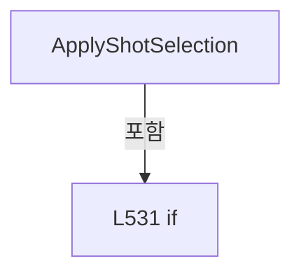

변경 전 점검: 입력/반환 타입, 위 호출자, 예외/취소 경로, 공유 상태와 저장·전송 소비자를 함께 확인합니다. 값의 단위나 물리 방향을 이름만으로 확정하지 않습니다.

### MethodDeclaration `RefreshGlassPreview` · L546–574

[Drilling.UI/Menu/Menus/CMenuCorrection.ReviewData.Display.cs:546–574](https://github.com/kjuws10-rgb/A3Drilling/blob/5aee8e58439c9b455cae7c9593c9be986c3e682e/Drilling.UI/Menu/Menus/CMenuCorrection.ReviewData.Display.cs#L546-L574)

| 항목 | 실제 추출 값 |
| --- | --- |
| 서명 | void Drilling.UI.Menu.Menus.CMenuCorrection.CReviewDataPanel.RefreshGlassPreview() |
| 접근/수식자 | Private / private |
| 반환/값 타입 | void |
| 소속 타입 | NamedType:Drilling.UI.Menu.Menus.CMenuCorrection.CReviewDataPanel |

정적 호출자로 확인된 위치:

| 호출 파일/행 | 호출 표현식 | 런타임 분기 가능 |
| --- | --- | --- |
| [Drilling.UI/Menu/Menus/CMenuCorrection.ReviewData.Display.cs:437–437](https://github.com/kjuws10-rgb/A3Drilling/blob/5aee8e58439c9b455cae7c9593c9be986c3e682e/Drilling.UI/Menu/Menus/CMenuCorrection.ReviewData.Display.cs#L437-L437) | RefreshGlassPreview | False |
| [Drilling.UI/Menu/Menus/CMenuCorrection.ReviewData.Display.cs:473–473](https://github.com/kjuws10-rgb/A3Drilling/blob/5aee8e58439c9b455cae7c9593c9be986c3e682e/Drilling.UI/Menu/Menus/CMenuCorrection.ReviewData.Display.cs#L473-L473) | RefreshGlassPreview | False |
| [Drilling.UI/Menu/Menus/CMenuCorrection.ReviewData.Reinspection.cs:132–132](https://github.com/kjuws10-rgb/A3Drilling/blob/5aee8e58439c9b455cae7c9593c9be986c3e682e/Drilling.UI/Menu/Menus/CMenuCorrection.ReviewData.Reinspection.cs#L132-L132) | RefreshGlassPreview | False |

호출하는 대상과 해석 범위:

| 원본 행 | 표현식 | 분석 상태 | 대상/소스 위치 |
| --- | --- | --- | --- |
| 552 | Camera.Clear | resolved | void Drilling.UI.Menu.Menus.CReviewCameraPreview.Clear() · Drilling.UI/Menu/Menus/CMenuReview.cs:4059 |
| 556 | BuildReviewDataGlassPreview | resolved | Drilling.UI.Menu.Menus.CMenuCorrection.ST_REVIEW_DATA_GLASS_PREVIEW Drilling.UI.Menu.Menus.CMenuCorrection.CReviewDataPanel.BuildReviewDataGlassPreview(System.Collections.Generic.IReadOnlyDictionary<string, string>, int, System.Collections.Generic.IReadOnlySet<int>, int) · Drilling.UI/Menu/Menus/CMenuCorrection.ReviewData.Display.cs:652 |
| 564 | new Dictionary<string, string> | resolved | System.Collections.Generic.Dictionary<string, string>.Dictionary(System.Collections.Generic.IEnumerable<System.Collections.Generic.KeyValuePair<string, string>>, System.Collections.Generic.IEqualityComparer<string>?) |
| 568 | Camera.Configure | resolved | void Drilling.UI.Menu.Menus.CReviewCameraPreview.Configure(System.Collections.Generic.IReadOnlyDictionary<string, string>, Rect) · Drilling.UI/Menu/Menus/CMenuReview.cs:4021 |
| 572 | Camera.Clear | resolved | void Drilling.UI.Menu.Menus.CReviewCameraPreview.Clear() · Drilling.UI/Menu/Menus/CMenuReview.cs:4059 |

본문의 실제 연산·분기·예외·반환 순서(원문 위치 순):

| 원본 행 | 종류 | 주석 해설 |
| --- | --- | --- |
| 548 | if | 조건에 따라 분기합니다: if (_loadedParameters.Count == 0 &#124;&#124; _loadedCellCount <= 0) |
| 550 | assignment | 값을 대상에 대입합니다: GlassPreviewImage = null |
| 551 | assignment | 값을 대상에 대입합니다: CellLabels = [] |
| 552 | call | 함수·델리게이트 또는 객체 생성자를 호출합니다: Camera.Clear() |
| 553 | return | 호출자에게 값 또는 제어를 반환합니다: return; |
| 556 | call | 함수·델리게이트 또는 객체 생성자를 호출합니다: BuildReviewDataGlassPreview(_loadedParameters, _loadedCellCount, _resultCellNos, _selectedCellNo) |
| 556 | local-declaration | 지역 변수를 선언합니다: var preview = BuildReviewDataGlassPreview(_loadedParameters, _loadedCellCount, _resultCellNos, _selectedCellNo); |
| 556 | variable-initializer | 변수의 초기값을 지정합니다: preview = BuildReviewDataGlassPreview(_loadedParameters, _loadedCellCount, _resultCellNos, _selectedCellNo) |
| 557 | assignment | 값을 대상에 대입합니다: GlassPreviewImage = preview.Image |
| 558 | assignment | 값을 대상에 대입합니다: CellLabels = preview.CellLabels |
| 559 | assignment | 값을 대상에 대입합니다: GlassSurfaceWidth = preview.Width |
| 560 | assignment | 값을 대상에 대입합니다: GlassSurfaceHeight = preview.Height |
| 561 | assignment | 값을 대상에 대입합니다: GlassSummary = $"{_resultCellNos.Count:N0} Result Cells / {_allRows.Count:N0} Result Rows" |
| 562 | if | 조건에 따라 분기합니다: if (_isReinspectionMode) |
| 564 | call | 함수·델리게이트 또는 객체 생성자를 호출합니다: new Dictionary<string, string>(_loadedParameters, StringComparer.OrdinalIgnoreCase) { [CReviewCameraPreview.UseSettingKey] = "ON" } |
| 564 | local-declaration | 지역 변수를 선언합니다: var cameraParameters = new Dictionary<string, string>(_loadedParameters, StringComparer.OrdinalIgnoreCase) { [CReviewCameraPreview.UseSettingKey] = "ON" }; |
| 564 | variable-initializer | 변수의 초기값을 지정합니다: cameraParameters = new Dictionary<string, string>(_loadedParameters, StringComparer.OrdinalIgnoreCase) { [CReviewCameraPreview.UseSettingKey] = "ON" } |
| 566 | assignment | 값을 대상에 대입합니다: [CReviewCameraPreview.UseSettingKey] = "ON" |
| 568 | call | 함수·델리게이트 또는 객체 생성자를 호출합니다: Camera.Configure(cameraParameters, preview.GlassBounds) |
| 570 | else | 앞 조건이 거짓인 경로입니다: else |
| 572 | call | 함수·델리게이트 또는 객체 생성자를 호출합니다: Camera.Clear() |

제어 구문의 포함 구조(실제 실행 순서/CFG가 아닌 구문 탐색 그림):

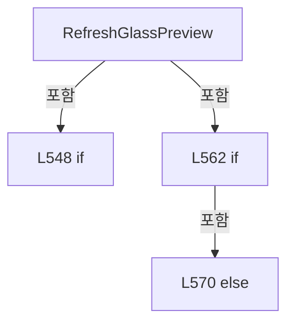

변경 전 점검: 입력/반환 타입, 위 호출자, 예외/취소 경로, 공유 상태와 저장·전송 소비자를 함께 확인합니다. 값의 단위나 물리 방향을 이름만으로 확정하지 않습니다.

### MethodDeclaration `RefreshShotMap` · L576–583

[Drilling.UI/Menu/Menus/CMenuCorrection.ReviewData.Display.cs:576–583](https://github.com/kjuws10-rgb/A3Drilling/blob/5aee8e58439c9b455cae7c9593c9be986c3e682e/Drilling.UI/Menu/Menus/CMenuCorrection.ReviewData.Display.cs#L576-L583)

| 항목 | 실제 추출 값 |
| --- | --- |
| 서명 | void Drilling.UI.Menu.Menus.CMenuCorrection.CReviewDataPanel.RefreshShotMap() |
| 접근/수식자 | Private / private |
| 반환/값 타입 | void |
| 소속 타입 | NamedType:Drilling.UI.Menu.Menus.CMenuCorrection.CReviewDataPanel |

정적 호출자로 확인된 위치:

| 호출 파일/행 | 호출 표현식 | 런타임 분기 가능 |
| --- | --- | --- |
| [Drilling.UI/Menu/Menus/CMenuCorrection.ReviewData.Display.cs:482–482](https://github.com/kjuws10-rgb/A3Drilling/blob/5aee8e58439c9b455cae7c9593c9be986c3e682e/Drilling.UI/Menu/Menus/CMenuCorrection.ReviewData.Display.cs#L482-L482) | RefreshShotMap | False |

호출하는 대상과 해석 범위:

| 원본 행 | 표현식 | 분석 상태 | 대상/소스 위치 |
| --- | --- | --- | --- |
| 578 | _shotsByCell.GetValueOrDefault | resolved | System.Collections.Generic.IReadOnlyList<Drilling.UI.Menu.Menus.CMenuCorrection.ST_REVIEW_DATA_SHOT_POSITION> System.Collections.Generic.IReadOnlyDictionary<int, System.Collections.Generic.IReadOnlyList<Drilling.UI.Menu.Menus.CMenuCorrection.ST_REVIEW_DATA_SHOT_POSITION>>.GetValueOrDefault<int, System.Collections.Generic.IReadOnlyList<Drilling.UI.Menu.Menus.CMenuCorrection.ST_REVIEW_DATA_SHOT_POSITION>>(int, System.Collections.Generic.IReadOnlyList<Drilling.UI.Menu.Menus.CMenuCorrection.ST_REVIEW_DATA_SHOT_POSITION>) |
| 579 | GetReviewDataShotMapSize | resolved | Size Drilling.UI.Menu.Menus.CMenuCorrection.CReviewDataPanel.GetReviewDataShotMapSize(System.Collections.Generic.IReadOnlyList<Drilling.UI.Menu.Menus.CMenuCorrection.ST_REVIEW_DATA_SHOT_POSITION>) · Drilling.UI/Menu/Menus/CMenuCorrection.ReviewData.Display.cs:862 |
| 582 | BuildReviewDataShotMap | resolved | ImageSource? Drilling.UI.Menu.Menus.CMenuCorrection.CReviewDataPanel.BuildReviewDataShotMap(System.Collections.Generic.IReadOnlyList<Drilling.UI.Menu.Menus.CMenuCorrection.ST_REVIEW_DATA_SHOT_POSITION>, string) · Drilling.UI/Menu/Menus/CMenuCorrection.ReviewData.Display.cs:749 |

본문의 실제 연산·분기·예외·반환 순서(원문 위치 순):

| 원본 행 | 종류 | 주석 해설 |
| --- | --- | --- |
| 578 | call | 함수·델리게이트 또는 객체 생성자를 호출합니다: _shotsByCell.GetValueOrDefault(_selectedCellNo, []) |
| 578 | local-declaration | 지역 변수를 선언합니다: var shots = _shotsByCell.GetValueOrDefault(_selectedCellNo, []); |
| 578 | variable-initializer | 변수의 초기값을 지정합니다: shots = _shotsByCell.GetValueOrDefault(_selectedCellNo, []) |
| 579 | call | 함수·델리게이트 또는 객체 생성자를 호출합니다: GetReviewDataShotMapSize(shots) |
| 579 | local-declaration | 지역 변수를 선언합니다: var size = GetReviewDataShotMapSize(shots); |
| 579 | variable-initializer | 변수의 초기값을 지정합니다: size = GetReviewDataShotMapSize(shots) |
| 580 | assignment | 값을 대상에 대입합니다: ShotMapSurfaceWidth = size.Width |
| 581 | assignment | 값을 대상에 대입합니다: ShotMapSurfaceHeight = size.Height |
| 582 | assignment | 값을 대상에 대입합니다: ShotMapImage = BuildReviewDataShotMap(shots, _selectedShotKey) |
| 582 | call | 함수·델리게이트 또는 객체 생성자를 호출합니다: BuildReviewDataShotMap(shots, _selectedShotKey) |

변경 전 점검: 입력/반환 타입, 위 호출자, 예외/취소 경로, 공유 상태와 저장·전송 소비자를 함께 확인합니다. 값의 단위나 물리 방향을 이름만으로 확정하지 않습니다.

### MethodDeclaration `RefreshCellSelectionOverlay` · L585–593

[Drilling.UI/Menu/Menus/CMenuCorrection.ReviewData.Display.cs:585–593](https://github.com/kjuws10-rgb/A3Drilling/blob/5aee8e58439c9b455cae7c9593c9be986c3e682e/Drilling.UI/Menu/Menus/CMenuCorrection.ReviewData.Display.cs#L585-L593)

| 항목 | 실제 추출 값 |
| --- | --- |
| 서명 | void Drilling.UI.Menu.Menus.CMenuCorrection.CReviewDataPanel.RefreshCellSelectionOverlay() |
| 접근/수식자 | Private / private |
| 반환/값 타입 | void |
| 소속 타입 | NamedType:Drilling.UI.Menu.Menus.CMenuCorrection.CReviewDataPanel |

정적 호출자로 확인된 위치:

| 호출 파일/행 | 호출 표현식 | 런타임 분기 가능 |
| --- | --- | --- |
| [Drilling.UI/Menu/Menus/CMenuCorrection.ReviewData.Display.cs:477–477](https://github.com/kjuws10-rgb/A3Drilling/blob/5aee8e58439c9b455cae7c9593c9be986c3e682e/Drilling.UI/Menu/Menus/CMenuCorrection.ReviewData.Display.cs#L477-L477) | RefreshCellSelectionOverlay | False |

호출하는 대상과 해석 범위:

| 원본 행 | 표현식 | 분석 상태 | 대상/소스 위치 |
| --- | --- | --- | --- |
| 587 | CellLabels .Select(label => label with { IsSelected = label.IsIncluded && label.CellNo == _selectedCellNo }) .ToArray | resolved | Drilling.UI.Menu.Menus.CMenuCorrection.ST_REVIEW_DATA_CELL_LABEL[] System.Collections.Generic.IEnumerable<Drilling.UI.Menu.Menus.CMenuCorrection.ST_REVIEW_DATA_CELL_LABEL>.ToArray<Drilling.UI.Menu.Menus.CMenuCorrection.ST_REVIEW_DATA_CELL_LABEL>() |
| 587 | CellLabels .Select | resolved | System.Collections.Generic.IEnumerable<Drilling.UI.Menu.Menus.CMenuCorrection.ST_REVIEW_DATA_CELL_LABEL> System.Collections.Generic.IEnumerable<Drilling.UI.Menu.Menus.CMenuCorrection.ST_REVIEW_DATA_CELL_LABEL>.Select<Drilling.UI.Menu.Menus.CMenuCorrection.ST_REVIEW_DATA_CELL_LABEL, Drilling.UI.Menu.Menus.CMenuCorrection.ST_REVIEW_DATA_CELL_LABEL>(System.Func<Drilling.UI.Menu.Menus.CMenuCorrection.ST_REVIEW_DATA_CELL_LABEL, Drilling.UI.Menu.Menus.CMenuCorrection.ST_REVIEW_DATA_CELL_LABEL>) |

본문의 실제 연산·분기·예외·반환 순서(원문 위치 순):

| 원본 행 | 종류 | 주석 해설 |
| --- | --- | --- |
| 587 | call | 함수·델리게이트 또는 객체 생성자를 호출합니다: CellLabels .Select(label => label with { IsSelected = label.IsIncluded && label.CellNo == _selectedCellNo }) |
| 587 | assignment | 값을 대상에 대입합니다: CellLabels = CellLabels .Select(label => label with { IsSelected = label.IsIncluded && label.CellNo == _selectedCellNo }) .ToArray() |
| 587 | call | 함수·델리게이트 또는 객체 생성자를 호출합니다: CellLabels .Select(label => label with { IsSelected = label.IsIncluded && label.CellNo == _selectedCellNo }) .ToArray() |
| 590 | assignment | 값을 대상에 대입합니다: IsSelected = label.IsIncluded && label.CellNo == _selectedCellNo |

변경 전 점검: 입력/반환 타입, 위 호출자, 예외/취소 경로, 공유 상태와 저장·전송 소비자를 함께 확인합니다. 값의 단위나 물리 방향을 이름만으로 확정하지 않습니다.

### MethodDeclaration `QueueShotMapRender` · L595–629

[Drilling.UI/Menu/Menus/CMenuCorrection.ReviewData.Display.cs:595–629](https://github.com/kjuws10-rgb/A3Drilling/blob/5aee8e58439c9b455cae7c9593c9be986c3e682e/Drilling.UI/Menu/Menus/CMenuCorrection.ReviewData.Display.cs#L595-L629)

| 항목 | 실제 추출 값 |
| --- | --- |
| 서명 | void Drilling.UI.Menu.Menus.CMenuCorrection.CReviewDataPanel.QueueShotMapRender(int, string) |
| 접근/수식자 | Private / private, async |
| 반환/값 타입 | void |
| 소속 타입 | NamedType:Drilling.UI.Menu.Menus.CMenuCorrection.CReviewDataPanel |

입력 계약:

| 이름 | 타입 | 전달 | 선택/기본값 |
| --- | --- | --- | --- |
| cellNo | int | None | False /  |
| selectedShotKey | string | None | False /  |

정적 호출자로 확인된 위치:

| 호출 파일/행 | 호출 표현식 | 런타임 분기 가능 |
| --- | --- | --- |
| [Drilling.UI/Menu/Menus/CMenuCorrection.ReviewData.Display.cs:486–486](https://github.com/kjuws10-rgb/A3Drilling/blob/5aee8e58439c9b455cae7c9593c9be986c3e682e/Drilling.UI/Menu/Menus/CMenuCorrection.ReviewData.Display.cs#L486-L486) | QueueShotMapRender | False |
| [Drilling.UI/Menu/Menus/CMenuCorrection.ReviewData.Display.cs:538–538](https://github.com/kjuws10-rgb/A3Drilling/blob/5aee8e58439c9b455cae7c9593c9be986c3e682e/Drilling.UI/Menu/Menus/CMenuCorrection.ReviewData.Display.cs#L538-L538) | QueueShotMapRender | False |

호출하는 대상과 해석 범위:

| 원본 행 | 표현식 | 분석 상태 | 대상/소스 위치 |
| --- | --- | --- | --- |
| 597 | Interlocked.Increment | resolved | int System.Threading.Interlocked.Increment(ref int) |
| 598 | _shotsByCell.GetValueOrDefault | resolved | System.Collections.Generic.IReadOnlyList<Drilling.UI.Menu.Menus.CMenuCorrection.ST_REVIEW_DATA_SHOT_POSITION> System.Collections.Generic.IReadOnlyDictionary<int, System.Collections.Generic.IReadOnlyList<Drilling.UI.Menu.Menus.CMenuCorrection.ST_REVIEW_DATA_SHOT_POSITION>>.GetValueOrDefault<int, System.Collections.Generic.IReadOnlyList<Drilling.UI.Menu.Menus.CMenuCorrection.ST_REVIEW_DATA_SHOT_POSITION>>(int, System.Collections.Generic.IReadOnlyList<Drilling.UI.Menu.Menus.CMenuCorrection.ST_REVIEW_DATA_SHOT_POSITION>) |
| 601 | Task.Run | resolved | System.Threading.Tasks.Task<(Size Size, ImageSource? Image)> System.Threading.Tasks.Task.Run<(Size Size, ImageSource? Image)>(System.Func<(Size Size, ImageSource? Image)>) |
| 603 | GetReviewDataShotMapSize | resolved | Size Drilling.UI.Menu.Menus.CMenuCorrection.CReviewDataPanel.GetReviewDataShotMapSize(System.Collections.Generic.IReadOnlyList<Drilling.UI.Menu.Menus.CMenuCorrection.ST_REVIEW_DATA_SHOT_POSITION>) · Drilling.UI/Menu/Menus/CMenuCorrection.ReviewData.Display.cs:862 |
| 604 | BuildReviewDataShotMap | resolved | ImageSource? Drilling.UI.Menu.Menus.CMenuCorrection.CReviewDataPanel.BuildReviewDataShotMap(System.Collections.Generic.IReadOnlyList<Drilling.UI.Menu.Menus.CMenuCorrection.ST_REVIEW_DATA_SHOT_POSITION>, string) · Drilling.UI/Menu/Menus/CMenuCorrection.ReviewData.Display.cs:749 |
| 607 | Volatile.Read | resolved | int System.Threading.Volatile.Read(ref readonly int) |
| 610 | _selectedShotKey.Equals | resolved | bool string.Equals(string?, System.StringComparison) |
| 618 | Notify | resolved | void Drilling.UI.Menu.Menus.CMenuCorrection.CReviewDataPanel.Notify(string) · Drilling.UI/Menu/Menus/CMenuCorrection.ReviewData.cs:355 |
| 618 | nameof | unresolved | None |
| 619 | Notify | resolved | void Drilling.UI.Menu.Menus.CMenuCorrection.CReviewDataPanel.Notify(string) · Drilling.UI/Menu/Menus/CMenuCorrection.ReviewData.cs:355 |
| 619 | nameof | unresolved | None |
| 620 | Notify | resolved | void Drilling.UI.Menu.Menus.CMenuCorrection.CReviewDataPanel.Notify(string) · Drilling.UI/Menu/Menus/CMenuCorrection.ReviewData.cs:355 |
| 620 | nameof | unresolved | None |
| 624 | Volatile.Read | resolved | int System.Threading.Volatile.Read(ref readonly int) |
| 626 | _statusReporter | resolved · 동적 구현 선택 가능 | void System.Action<string>.Invoke(string) |

본문의 실제 연산·분기·예외·반환 순서(원문 위치 순):

| 원본 행 | 종류 | 주석 해설 |
| --- | --- | --- |
| 597 | call | 함수·델리게이트 또는 객체 생성자를 호출합니다: Interlocked.Increment(ref _shotMapRenderVersion) |
| 597 | local-declaration | 지역 변수를 선언합니다: var version = Interlocked.Increment(ref _shotMapRenderVersion); |
| 597 | variable-initializer | 변수의 초기값을 지정합니다: version = Interlocked.Increment(ref _shotMapRenderVersion) |
| 598 | call | 함수·델리게이트 또는 객체 생성자를 호출합니다: _shotsByCell.GetValueOrDefault(cellNo, []) |
| 598 | local-declaration | 지역 변수를 선언합니다: var shots = _shotsByCell.GetValueOrDefault(cellNo, []); |
| 598 | variable-initializer | 변수의 초기값을 지정합니다: shots = _shotsByCell.GetValueOrDefault(cellNo, []) |
| 599 | try | 예외 처리 범위입니다: try |
| 601 | await | 비동기 완료를 기다립니다: await Task.Run(() => { var size = GetReviewDataShotMapSize(shots); var image = BuildReviewDataShotMap(shots, selectedShotKey); return (Size: size, Image: image); }) |
| 601 | call | 함수·델리게이트 또는 객체 생성자를 호출합니다: Task.Run(() => { var size = GetReviewDataShotMapSize(shots); var image = BuildReviewDataShotMap(shots, selectedShotKey); return (Size: size, Image: image); }) |
| 601 | local-declaration | 지역 변수를 선언합니다: var render = await Task.Run(() => { var size = GetReviewDataShotMapSize(shots); var image = BuildReviewDataShotMap(shots, selectedShotKey); return (Size: size, Image: image); }); |
| 601 | variable-initializer | 변수의 초기값을 지정합니다: render = await Task.Run(() => { var size = GetReviewDataShotMapSize(shots); var image = BuildReviewDataShotMap(shots, selectedShotKey); return (Size: size, Image: image); }) |
| 603 | call | 함수·델리게이트 또는 객체 생성자를 호출합니다: GetReviewDataShotMapSize(shots) |
| 603 | local-declaration | 지역 변수를 선언합니다: var size = GetReviewDataShotMapSize(shots); |
| 603 | variable-initializer | 변수의 초기값을 지정합니다: size = GetReviewDataShotMapSize(shots) |
| 604 | call | 함수·델리게이트 또는 객체 생성자를 호출합니다: BuildReviewDataShotMap(shots, selectedShotKey) |
| 604 | local-declaration | 지역 변수를 선언합니다: var image = BuildReviewDataShotMap(shots, selectedShotKey); |
| 604 | variable-initializer | 변수의 초기값을 지정합니다: image = BuildReviewDataShotMap(shots, selectedShotKey) |
| 605 | return | 호출자에게 값 또는 제어를 반환합니다: return (Size: size, Image: image); |
| 607 | call | 함수·델리게이트 또는 객체 생성자를 호출합니다: Volatile.Read(ref _shotMapRenderVersion) |
| 607 | if | 조건에 따라 분기합니다: if (version != Volatile.Read(ref _shotMapRenderVersion) &#124;&#124; !_hasLoadedData &#124;&#124; _selectedCellNo != cellNo &#124;&#124; !_selectedShotKey.Equals(selectedShotKey, StringComparison.OrdinalIgnoreCase)) |
| 610 | call | 함수·델리게이트 또는 객체 생성자를 호출합니다: _selectedShotKey.Equals(selectedShotKey, StringComparison.OrdinalIgnoreCase) |
| 612 | return | 호출자에게 값 또는 제어를 반환합니다: return; |
| 615 | assignment | 값을 대상에 대입합니다: ShotMapSurfaceWidth = render.Size.Width |
| 616 | assignment | 값을 대상에 대입합니다: ShotMapSurfaceHeight = render.Size.Height |
| 617 | assignment | 값을 대상에 대입합니다: ShotMapImage = render.Image |
| 618 | call | 함수·델리게이트 또는 객체 생성자를 호출합니다: Notify(nameof(ShotMapSurfaceWidth)) |
| 618 | call | 함수·델리게이트 또는 객체 생성자를 호출합니다: nameof(ShotMapSurfaceWidth) |
| 619 | call | 함수·델리게이트 또는 객체 생성자를 호출합니다: Notify(nameof(ShotMapSurfaceHeight)) |
| 619 | call | 함수·델리게이트 또는 객체 생성자를 호출합니다: nameof(ShotMapSurfaceHeight) |
| 620 | call | 함수·델리게이트 또는 객체 생성자를 호출합니다: Notify(nameof(ShotMapImage)) |
| 620 | call | 함수·델리게이트 또는 객체 생성자를 호출합니다: nameof(ShotMapImage) |
| 622 | catch | 지정 예외를 처리합니다: catch (Exception exception) |
| 624 | call | 함수·델리게이트 또는 객체 생성자를 호출합니다: Volatile.Read(ref _shotMapRenderVersion) |
| 624 | if | 조건에 따라 분기합니다: if (version == Volatile.Read(ref _shotMapRenderVersion)) |
| 626 | call | 함수·델리게이트 또는 객체 생성자를 호출합니다: _statusReporter($"Review Data Shot View render failed: {exception.Message}") |

제어 구문의 포함 구조(실제 실행 순서/CFG가 아닌 구문 탐색 그림):

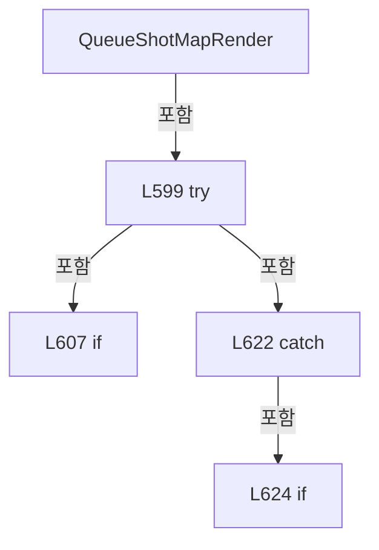

변경 전 점검: 입력/반환 타입, 위 호출자, 예외/취소 경로, 공유 상태와 저장·전송 소비자를 함께 확인합니다. 값의 단위나 물리 방향을 이름만으로 확정하지 않습니다.

### MethodDeclaration `RefreshSelectionText` · L631–650

[Drilling.UI/Menu/Menus/CMenuCorrection.ReviewData.Display.cs:631–650](https://github.com/kjuws10-rgb/A3Drilling/blob/5aee8e58439c9b455cae7c9593c9be986c3e682e/Drilling.UI/Menu/Menus/CMenuCorrection.ReviewData.Display.cs#L631-L650)

| 항목 | 실제 추출 값 |
| --- | --- |
| 서명 | void Drilling.UI.Menu.Menus.CMenuCorrection.CReviewDataPanel.RefreshSelectionText() |
| 접근/수식자 | Private / private |
| 반환/값 타입 | void |
| 소속 타입 | NamedType:Drilling.UI.Menu.Menus.CMenuCorrection.CReviewDataPanel |

정적 호출자로 확인된 위치:

| 호출 파일/행 | 호출 표현식 | 런타임 분기 가능 |
| --- | --- | --- |
| [Drilling.UI/Menu/Menus/CMenuCorrection.ReviewData.Display.cs:489–489](https://github.com/kjuws10-rgb/A3Drilling/blob/5aee8e58439c9b455cae7c9593c9be986c3e682e/Drilling.UI/Menu/Menus/CMenuCorrection.ReviewData.Display.cs#L489-L489) | RefreshSelectionText | False |
| [Drilling.UI/Menu/Menus/CMenuCorrection.ReviewData.Display.cs:539–539](https://github.com/kjuws10-rgb/A3Drilling/blob/5aee8e58439c9b455cae7c9593c9be986c3e682e/Drilling.UI/Menu/Menus/CMenuCorrection.ReviewData.Display.cs#L539-L539) | RefreshSelectionText | False |

호출하는 대상과 해석 범위:

| 원본 행 | 표현식 | 분석 상태 | 대상/소스 위치 |
| --- | --- | --- | --- |
| 633 | _shotsByCell.GetValueOrDefault | resolved | System.Collections.Generic.IReadOnlyList<Drilling.UI.Menu.Menus.CMenuCorrection.ST_REVIEW_DATA_SHOT_POSITION> System.Collections.Generic.IReadOnlyDictionary<int, System.Collections.Generic.IReadOnlyList<Drilling.UI.Menu.Menus.CMenuCorrection.ST_REVIEW_DATA_SHOT_POSITION>>.GetValueOrDefault<int, System.Collections.Generic.IReadOnlyList<Drilling.UI.Menu.Menus.CMenuCorrection.ST_REVIEW_DATA_SHOT_POSITION>>(int, System.Collections.Generic.IReadOnlyList<Drilling.UI.Menu.Menus.CMenuCorrection.ST_REVIEW_DATA_SHOT_POSITION>) |
| 634 | string.IsNullOrWhiteSpace | resolved | bool string.IsNullOrWhiteSpace(string?) |
| 636 | shots.FirstOrDefault | resolved | Drilling.UI.Menu.Menus.CMenuCorrection.ST_REVIEW_DATA_SHOT_POSITION? System.Collections.Generic.IEnumerable<Drilling.UI.Menu.Menus.CMenuCorrection.ST_REVIEW_DATA_SHOT_POSITION>.FirstOrDefault<Drilling.UI.Menu.Menus.CMenuCorrection.ST_REVIEW_DATA_SHOT_POSITION>(System.Func<Drilling.UI.Menu.Menus.CMenuCorrection.ST_REVIEW_DATA_SHOT_POSITION, bool>) |
| 636 | shot.ShotKey.Equals | resolved | bool string.Equals(string?, System.StringComparison) |
| 637 | shots.Count | resolved | int System.Collections.Generic.IEnumerable<Drilling.UI.Menu.Menus.CMenuCorrection.ST_REVIEW_DATA_SHOT_POSITION>.Count<Drilling.UI.Menu.Menus.CMenuCorrection.ST_REVIEW_DATA_SHOT_POSITION>(System.Func<Drilling.UI.Menu.Menus.CMenuCorrection.ST_REVIEW_DATA_SHOT_POSITION, bool>) |
| 643 | CReviewShotNameFormatter.ToMatrixName | resolved | string Drilling.Common.Review.CReviewShotNameFormatter.ToMatrixName(int, int) · Drilling.Common/Review/CReviewManager.cs:3897 |

본문의 실제 연산·분기·예외·반환 순서(원문 위치 순):

| 원본 행 | 종류 | 주석 해설 |
| --- | --- | --- |
| 633 | call | 함수·델리게이트 또는 객체 생성자를 호출합니다: _shotsByCell.GetValueOrDefault(_selectedCellNo, []) |
| 633 | local-declaration | 지역 변수를 선언합니다: var shots = _shotsByCell.GetValueOrDefault(_selectedCellNo, []); |
| 633 | variable-initializer | 변수의 초기값을 지정합니다: shots = _shotsByCell.GetValueOrDefault(_selectedCellNo, []) |
| 634 | call | 함수·델리게이트 또는 객체 생성자를 호출합니다: string.IsNullOrWhiteSpace(_selectedShotKey) |
| 634 | conditional-expression | 조건에 따라 결과식을 선택합니다: string.IsNullOrWhiteSpace(_selectedShotKey) ? null : shots.FirstOrDefault(shot => shot.ShotKey.Equals(_selectedShotKey, StringComparison.OrdinalIgnoreCase)) |
| 634 | local-declaration | 지역 변수를 선언합니다: var selectedShot = string.IsNullOrWhiteSpace(_selectedShotKey) ? null : shots.FirstOrDefault(shot => shot.ShotKey.Equals(_selectedShotKey, StringComparison.OrdinalIgnoreCase)); |
| 634 | variable-initializer | 변수의 초기값을 지정합니다: selectedShot = string.IsNullOrWhiteSpace(_selectedShotKey) ? null : shots.FirstOrDefault(shot => shot.ShotKey.Equals(_selectedShotKey, StringComparison.OrdinalIgnoreCase)) |
| 636 | call | 함수·델리게이트 또는 객체 생성자를 호출합니다: shots.FirstOrDefault(shot => shot.ShotKey.Equals(_selectedShotKey, StringComparison.OrdinalIgnoreCase)) |
| 636 | call | 함수·델리게이트 또는 객체 생성자를 호출합니다: shot.ShotKey.Equals(_selectedShotKey, StringComparison.OrdinalIgnoreCase) |
| 637 | call | 함수·델리게이트 또는 객체 생성자를 호출합니다: shots.Count(shot => shot.IsResult) |
| 637 | local-declaration | 지역 변수를 선언합니다: var resultShotCount = shots.Count(shot => shot.IsResult); |
| 637 | variable-initializer | 변수의 초기값을 지정합니다: resultShotCount = shots.Count(shot => shot.IsResult) |
| 638 | assignment | 값을 대상에 대입합니다: SelectedCellTitle = _selectedCellNo > 0 ? $"CELL{_selectedCellNo:00} / RESULT {resultShotCount:N0} / TOTAL {shots.Count:N0}" : "NO CELL SELECTED" |
| 638 | conditional-expression | 조건에 따라 결과식을 선택합니다: _selectedCellNo > 0 ? $"CELL{_selectedCellNo:00} / RESULT {resultShotCount:N0} / TOTAL {shots.Count:N0}" : "NO CELL SELECTED" |
| 641 | assignment | 값을 대상에 대입합니다: SelectedShotTitle = selectedShot is null ? "NO SHOT SELECTED" : $"{CReviewShotNameFormatter.ToMatrixName(selectedShot.ShotNo, selectedShot.GroupCountX)} / " + (selectedShot.HeadNo > 0 ? $"H{selectedShot.HeadNo:00}" : "HEAD -") + ( |
| 641 | conditional-expression | 조건에 따라 결과식을 선택합니다: selectedShot is null ? "NO SHOT SELECTED" : $"{CReviewShotNameFormatter.ToMatrixName(selectedShot.ShotNo, selectedShot.GroupCountX)} / " + (selectedShot.HeadNo > 0 ? $"H{selectedShot.HeadNo:00}" : "HEAD -") + (selectedShot.IsResul |
| 643 | call | 함수·델리게이트 또는 객체 생성자를 호출합니다: CReviewShotNameFormatter.ToMatrixName(selectedShot.ShotNo, selectedShot.GroupCountX) |
| 644 | conditional-expression | 조건에 따라 결과식을 선택합니다: selectedShot.HeadNo > 0 ? $"H{selectedShot.HeadNo:00}" : "HEAD -" |
| 645 | conditional-expression | 조건에 따라 결과식을 선택합니다: selectedShot.IsResult ? "" : " / NOT INSPECTED" |
| 646 | assignment | 값을 대상에 대입합니다: SelectedShotDetail = selectedShot is null ? "-" : $"ROW {selectedShot.GroupRow + 1:N0} / COL {selectedShot.GroupColumn + 1:N0}" + (SelectedRow is null ? " / NO RESULT" : "") |
| 646 | conditional-expression | 조건에 따라 결과식을 선택합니다: selectedShot is null ? "-" : $"ROW {selectedShot.GroupRow + 1:N0} / COL {selectedShot.GroupColumn + 1:N0}" + (SelectedRow is null ? " / NO RESULT" : "") |
| 649 | conditional-expression | 조건에 따라 결과식을 선택합니다: SelectedRow is null ? " / NO RESULT" : "" |

변경 전 점검: 입력/반환 타입, 위 호출자, 예외/취소 경로, 공유 상태와 저장·전송 소비자를 함께 확인합니다. 값의 단위나 물리 방향을 이름만으로 확정하지 않습니다.

### MethodDeclaration `BuildReviewDataGlassPreview` · L652–747

[Drilling.UI/Menu/Menus/CMenuCorrection.ReviewData.Display.cs:652–747](https://github.com/kjuws10-rgb/A3Drilling/blob/5aee8e58439c9b455cae7c9593c9be986c3e682e/Drilling.UI/Menu/Menus/CMenuCorrection.ReviewData.Display.cs#L652-L747)

| 항목 | 실제 추출 값 |
| --- | --- |
| 서명 | Drilling.UI.Menu.Menus.CMenuCorrection.ST_REVIEW_DATA_GLASS_PREVIEW Drilling.UI.Menu.Menus.CMenuCorrection.CReviewDataPanel.BuildReviewDataGlassPreview(System.Collections.Generic.IReadOnlyDictionary<string, string>, int, System.Collections.Generic.IReadOnlySet<int>, int) |
| 접근/수식자 | Private / private, static |
| 반환/값 타입 | Drilling.UI.Menu.Menus.CMenuCorrection.ST_REVIEW_DATA_GLASS_PREVIEW |
| 소속 타입 | NamedType:Drilling.UI.Menu.Menus.CMenuCorrection.CReviewDataPanel |

입력 계약:

| 이름 | 타입 | 전달 | 선택/기본값 |
| --- | --- | --- | --- |
| parameters | System.Collections.Generic.IReadOnlyDictionary<string, string> | None | False /  |
| cellCount | int | None | False /  |
| resultCellNos | System.Collections.Generic.IReadOnlySet<int> | None | False /  |
| selectedCellNo | int | None | False /  |

정적 호출자로 확인된 위치:

| 호출 파일/행 | 호출 표현식 | 런타임 분기 가능 |
| --- | --- | --- |
| [Drilling.UI/Menu/Menus/CMenuCorrection.ReviewData.Display.cs:556–556](https://github.com/kjuws10-rgb/A3Drilling/blob/5aee8e58439c9b455cae7c9593c9be986c3e682e/Drilling.UI/Menu/Menus/CMenuCorrection.ReviewData.Display.cs#L556-L556) | BuildReviewDataGlassPreview | False |
| [Drilling.UI/Menu/Menus/CMenuCorrection.ReviewData.Offset.cs:664–664](https://github.com/kjuws10-rgb/A3Drilling/blob/5aee8e58439c9b455cae7c9593c9be986c3e682e/Drilling.UI/Menu/Menus/CMenuCorrection.ReviewData.Offset.cs#L664-L664) | BuildReviewDataGlassPreview | False |

호출하는 대상과 해석 범위:

| 원본 행 | 표현식 | 분석 상태 | 대상/소스 위치 |
| --- | --- | --- | --- |
| 658 | ReadOutputViewerDouble | resolved | double Drilling.UI.Menu.Menus.CMenuCorrection.ReadOutputViewerDouble(System.Collections.Generic.IReadOnlyDictionary<string, string>, double, params string[]) · Drilling.UI/Menu/Menus/CMenuCorrection.cs:1209 |
| 659 | ReadOutputViewerDouble | resolved | double Drilling.UI.Menu.Menus.CMenuCorrection.ReadOutputViewerDouble(System.Collections.Generic.IReadOnlyDictionary<string, string>, double, params string[]) · Drilling.UI/Menu/Menus/CMenuCorrection.cs:1209 |
| 660 | double.IsFinite | resolved | bool double.IsFinite(double) |
| 660 | double.IsFinite | resolved | bool double.IsFinite(double) |
| 662 | new InvalidDataException | resolved | System.IO.InvalidDataException.InvalidDataException(string?) |
| 669 | Math.Min | resolved | double System.Math.Min(double, double) |
| 670 | double.IsFinite | resolved | bool double.IsFinite(double) |
| 672 | new InvalidDataException | resolved | System.IO.InvalidDataException.InvalidDataException(string?) |
| 679 | new ST_GLASS_PREVIEW_FRAME | resolved | Drilling.UI.Menu.Menus.ST_GLASS_PREVIEW_FRAME.ST_GLASS_PREVIEW_FRAME(double, double, double, double) · Drilling.UI/Menu/Menus/CMenuMain.cs:3462 |
| 680 | new Rect | unresolved | None |
| 681 | ReadOutputViewerDouble | resolved | double Drilling.UI.Menu.Menus.CMenuCorrection.ReadOutputViewerDouble(System.Collections.Generic.IReadOnlyDictionary<string, string>, double, params string[]) · Drilling.UI/Menu/Menus/CMenuCorrection.cs:1209 |
| 682 | ReadOutputViewerDouble | resolved | double Drilling.UI.Menu.Menus.CMenuCorrection.ReadOutputViewerDouble(System.Collections.Generic.IReadOnlyDictionary<string, string>, double, params string[]) · Drilling.UI/Menu/Menus/CMenuCorrection.cs:1209 |
| 683 | ReadOutputViewerDouble | resolved | double Drilling.UI.Menu.Menus.CMenuCorrection.ReadOutputViewerDouble(System.Collections.Generic.IReadOnlyDictionary<string, string>, double, params string[]) · Drilling.UI/Menu/Menus/CMenuCorrection.cs:1209 |
| 684 | CRecipeModelPixelCountReader.ReadModelTypeCount | resolved | int Drilling.Common.Recipe.CRecipeModelPixelCountReader.ReadModelTypeCount(System.Collections.Generic.IReadOnlyDictionary<string, string>) · Drilling.Common/Recipe/CCellPatternCalculator.cs:428 |
| 685 | new DrawingGroup | unresolved | None |
| 686 | new List<ST_REVIEW_DATA_CELL_LABEL> | resolved | System.Collections.Generic.List<Drilling.UI.Menu.Menus.CMenuCorrection.ST_REVIEW_DATA_CELL_LABEL>.List() |
| 687 | drawing.Open | unresolved | None |
| 689 | context.DrawRectangle | unresolved | None |
| 689 | new SolidColorBrush | unresolved | None |
| 689 | Color.FromArgb | unresolved | None |
| 689 | new Rect | unresolved | None |
| 690 | context.DrawRectangle | unresolved | None |
| 690 | new SolidColorBrush | unresolved | None |
| 690 | Color.FromArgb | unresolved | None |
| 691 | context.PushClip | unresolved | None |
| 691 | new RectangleGeometry | unresolved | None |
| 694 | CRecipeModelPixelCountReader.ReadCellModelType | resolved | int Drilling.Common.Recipe.CRecipeModelPixelCountReader.ReadCellModelType(System.Collections.Generic.IReadOnlyDictionary<string, string>, int, int) · Drilling.Common/Recipe/CCellPatternCalculator.cs:433 |
| 695 | CRecipeModelPixelCountReader.ReadPatternForModel | resolved | Drilling.Common.Recipe.ST_RECIPE_MODEL_PATTERN Drilling.Common.Recipe.CRecipeModelPixelCountReader.ReadPatternForModel(System.Collections.Generic.IReadOnlyDictionary<string, string>, int) · Drilling.Common/Recipe/CCellPatternCalculator.cs:455 |
| 696 | BuildOutputViewerCellBoundaryGeometry | resolved | StreamGeometry? Drilling.UI.Menu.Menus.CMenuCorrection.BuildOutputViewerCellBoundaryGeometry(double, double, double, double, int, int, double, double, double) · Drilling.UI/Menu/Menus/CMenuCorrection.cs:1108 |
| 703 | ReadOutputViewerDouble | resolved | double Drilling.UI.Menu.Menus.CMenuCorrection.ReadOutputViewerDouble(System.Collections.Generic.IReadOnlyDictionary<string, string>, double, params string[]) · Drilling.UI/Menu/Menus/CMenuCorrection.cs:1209 |
| 704 | ReadOutputViewerDouble | resolved | double Drilling.UI.Menu.Menus.CMenuCorrection.ReadOutputViewerDouble(System.Collections.Generic.IReadOnlyDictionary<string, string>, double, params string[]) · Drilling.UI/Menu/Menus/CMenuCorrection.cs:1209 |
| 705 | ReadOutputViewerDouble | resolved | double Drilling.UI.Menu.Menus.CMenuCorrection.ReadOutputViewerDouble(System.Collections.Generic.IReadOnlyDictionary<string, string>, double, params string[]) · Drilling.UI/Menu/Menus/CMenuCorrection.cs:1209 |
| 711 | resultCellNos.Contains | resolved · 동적 구현 선택 가능 | bool System.Collections.Generic.IReadOnlySet<int>.Contains(int) |
| 714 | new SolidColorBrush | unresolved | None |
| 714 | Color.FromArgb | unresolved | None |
| 715 | new SolidColorBrush | unresolved | None |
| 715 | Color.FromArgb | unresolved | None |
| 717 | new SolidColorBrush | unresolved | None |
| 717 | Color.FromRgb | unresolved | None |
| 718 | new SolidColorBrush | unresolved | None |
| 718 | Color.FromArgb | unresolved | None |
| 719 | fill.Freeze | unresolved | None |
| 720 | border.Freeze | unresolved | None |
| 721 | new Pen | unresolved | None |
| 722 | pen.Freeze | unresolved | None |
| 723 | context.DrawGeometry | unresolved | None |
| 724 | CCellPreviewDrawing.CreateCellLabel | candidate | OverloadResolutionFailure |
| 727 | labels.Add | resolved | void System.Collections.Generic.List<Drilling.UI.Menu.Menus.CMenuCorrection.ST_REVIEW_DATA_CELL_LABEL>.Add(Drilling.UI.Menu.Menus.CMenuCorrection.ST_REVIEW_DATA_CELL_LABEL) |
| 727 | new ST_REVIEW_DATA_CELL_LABEL | resolved | Drilling.UI.Menu.Menus.CMenuCorrection.ST_REVIEW_DATA_CELL_LABEL.ST_REVIEW_DATA_CELL_LABEL(int, double, double, double, bool, bool) · Drilling.UI/Menu/Menus/CMenuCorrection.ReviewData.Display.cs:993 |
| 731 | Math.Max | resolved | double System.Math.Max(double, double) |
| 731 | label.CellNo.ToString | resolved | string int.ToString(System.IFormatProvider?) |
| 737 | context.Pop | unresolved | None |
| 738 | CCellPreviewDrawing.DrawAlignKeys | candidate | OverloadResolutionFailure |
| 739 | context.DrawRectangle | unresolved | None |
| 739 | new Pen | unresolved | None |
| 739 | new SolidColorBrush | unresolved | None |
| 739 | Color.FromRgb | unresolved | None |
| 740 | DrawOutputViewerPreviewAxisIndicator | candidate | OverloadResolutionFailure |
| 743 | drawing.Freeze | unresolved | None |
| 744 | new DrawingImage | unresolved | None |
| 745 | image.Freeze | unresolved | None |
| 746 | new ST_REVIEW_DATA_GLASS_PREVIEW | candidate | OverloadResolutionFailure |

본문의 실제 연산·분기·예외·반환 순서(원문 위치 순):

| 원본 행 | 종류 | 주석 해설 |
| --- | --- | --- |
| 658 | call | 함수·델리게이트 또는 객체 생성자를 호출합니다: ReadOutputViewerDouble(parameters, 500.0, "GLASS_SIZE_X") |
| 658 | local-declaration | 지역 변수를 선언합니다: var glassWidth = ReadOutputViewerDouble(parameters, 500.0, "GLASS_SIZE_X"); |
| 658 | variable-initializer | 변수의 초기값을 지정합니다: glassWidth = ReadOutputViewerDouble(parameters, 500.0, "GLASS_SIZE_X") |
| 659 | call | 함수·델리게이트 또는 객체 생성자를 호출합니다: ReadOutputViewerDouble(parameters, 300.0, "GLASS_SIZE_Y") |
| 659 | local-declaration | 지역 변수를 선언합니다: var glassHeight = ReadOutputViewerDouble(parameters, 300.0, "GLASS_SIZE_Y"); |
| 659 | variable-initializer | 변수의 초기값을 지정합니다: glassHeight = ReadOutputViewerDouble(parameters, 300.0, "GLASS_SIZE_Y") |
| 660 | call | 함수·델리게이트 또는 객체 생성자를 호출합니다: double.IsFinite(glassWidth) |
| 660 | call | 함수·델리게이트 또는 객체 생성자를 호출합니다: double.IsFinite(glassHeight) |
| 660 | if | 조건에 따라 분기합니다: if (!double.IsFinite(glassWidth) &#124;&#124; !double.IsFinite(glassHeight) &#124;&#124; glassWidth <= 0.0 &#124;&#124; glassHeight <= 0.0) |
| 662 | call | 함수·델리게이트 또는 객체 생성자를 호출합니다: new InvalidDataException("Glass size is not valid.") |
| 662 | throw | 예외를 발생/전달합니다: throw new InvalidDataException("Glass size is not valid."); |
| 665 | local-declaration | 지역 변수를 선언합니다: var portrait = glassHeight > glassWidth; |
| 665 | variable-initializer | 변수의 초기값을 지정합니다: portrait = glassHeight > glassWidth |
| 666 | conditional-expression | 조건에 따라 결과식을 선택합니다: portrait ? 520.0 : 760.0 |
| 666 | local-declaration | 지역 변수를 선언합니다: var canvasWidth = portrait ? 520.0 : 760.0; |
| 666 | variable-initializer | 변수의 초기값을 지정합니다: canvasWidth = portrait ? 520.0 : 760.0 |
| 667 | conditional-expression | 조건에 따라 결과식을 선택합니다: portrait ? 650.0 : 500.0 |
| 667 | local-declaration | 지역 변수를 선언합니다: var canvasHeight = portrait ? 650.0 : 500.0; |
| 667 | variable-initializer | 변수의 초기값을 지정합니다: canvasHeight = portrait ? 650.0 : 500.0 |
| 668 | local-declaration | 지역 변수를 선언합니다: const double margin = 42.0; |
| 668 | variable-initializer | 변수의 초기값을 지정합니다: margin = 42.0 |
| 669 | call | 함수·델리게이트 또는 객체 생성자를 호출합니다: Math.Min((canvasWidth - margin * 2.0) / glassWidth, (canvasHeight - margin * 2.0) / glassHeight) |
| 669 | local-declaration | 지역 변수를 선언합니다: var scale = Math.Min((canvasWidth - margin * 2.0) / glassWidth, (canvasHeight - margin * 2.0) / glassHeight); |
| 669 | variable-initializer | 변수의 초기값을 지정합니다: scale = Math.Min((canvasWidth - margin * 2.0) / glassWidth, (canvasHeight - margin * 2.0) / glassHeight) |
| 670 | call | 함수·델리게이트 또는 객체 생성자를 호출합니다: double.IsFinite(scale) |
| 670 | if | 조건에 따라 분기합니다: if (!double.IsFinite(scale) &#124;&#124; scale <= 0.0) |
| 672 | call | 함수·델리게이트 또는 객체 생성자를 호출합니다: new InvalidDataException("Glass preview scale is not valid.") |
| 672 | throw | 예외를 발생/전달합니다: throw new InvalidDataException("Glass preview scale is not valid."); |
| 675 | local-declaration | 지역 변수를 선언합니다: var frameWidth = glassWidth * scale; |
| 675 | variable-initializer | 변수의 초기값을 지정합니다: frameWidth = glassWidth * scale |
| 676 | local-declaration | 지역 변수를 선언합니다: var frameHeight = glassHeight * scale; |
| 676 | variable-initializer | 변수의 초기값을 지정합니다: frameHeight = glassHeight * scale |
| 677 | local-declaration | 지역 변수를 선언합니다: var frameLeft = (canvasWidth - frameWidth) / 2.0; |
| 677 | variable-initializer | 변수의 초기값을 지정합니다: frameLeft = (canvasWidth - frameWidth) / 2.0 |
| 678 | local-declaration | 지역 변수를 선언합니다: var frameTop = (canvasHeight - frameHeight) / 2.0; |
| 678 | variable-initializer | 변수의 초기값을 지정합니다: frameTop = (canvasHeight - frameHeight) / 2.0 |
| 679 | call | 함수·델리게이트 또는 객체 생성자를 호출합니다: new ST_GLASS_PREVIEW_FRAME(frameLeft, frameTop, frameWidth, frameHeight) |
| 679 | local-declaration | 지역 변수를 선언합니다: var frame = new ST_GLASS_PREVIEW_FRAME(frameLeft, frameTop, frameWidth, frameHeight); |
| 679 | variable-initializer | 변수의 초기값을 지정합니다: frame = new ST_GLASS_PREVIEW_FRAME(frameLeft, frameTop, frameWidth, frameHeight) |
| 680 | call | 함수·델리게이트 또는 객체 생성자를 호출합니다: new Rect(frameLeft, frameTop, frameWidth, frameHeight) |
| 680 | local-declaration | 지역 변수를 선언합니다: var frameBounds = new Rect(frameLeft, frameTop, frameWidth, frameHeight); |
| 680 | variable-initializer | 변수의 초기값을 지정합니다: frameBounds = new Rect(frameLeft, frameTop, frameWidth, frameHeight) |
| 681 | call | 함수·델리게이트 또는 객체 생성자를 호출합니다: ReadOutputViewerDouble(parameters, 0.0, "AK_MARGIN_X") |
| 681 | local-declaration | 지역 변수를 선언합니다: var akMarginX = ReadOutputViewerDouble(parameters, 0.0, "AK_MARGIN_X"); |
| 681 | variable-initializer | 변수의 초기값을 지정합니다: akMarginX = ReadOutputViewerDouble(parameters, 0.0, "AK_MARGIN_X") |
| 682 | call | 함수·델리게이트 또는 객체 생성자를 호출합니다: ReadOutputViewerDouble(parameters, 0.0, "AK_MARGIN_Y") |
| 682 | local-declaration | 지역 변수를 선언합니다: var akMarginY = ReadOutputViewerDouble(parameters, 0.0, "AK_MARGIN_Y"); |
| 682 | variable-initializer | 변수의 초기값을 지정합니다: akMarginY = ReadOutputViewerDouble(parameters, 0.0, "AK_MARGIN_Y") |
| 683 | call | 함수·델리게이트 또는 객체 생성자를 호출합니다: ReadOutputViewerDouble(parameters, 0.09, "PIXEL_SIZE") |
| 683 | local-declaration | 지역 변수를 선언합니다: var pixelSize = ReadOutputViewerDouble(parameters, 0.09, "PIXEL_SIZE"); |
| 683 | variable-initializer | 변수의 초기값을 지정합니다: pixelSize = ReadOutputViewerDouble(parameters, 0.09, "PIXEL_SIZE") |
| 684 | call | 함수·델리게이트 또는 객체 생성자를 호출합니다: CRecipeModelPixelCountReader.ReadModelTypeCount(parameters) |
| 684 | local-declaration | 지역 변수를 선언합니다: var modelTypeCount = CRecipeModelPixelCountReader.ReadModelTypeCount(parameters); |
| 684 | variable-initializer | 변수의 초기값을 지정합니다: modelTypeCount = CRecipeModelPixelCountReader.ReadModelTypeCount(parameters) |
| 685 | call | 함수·델리게이트 또는 객체 생성자를 호출합니다: new DrawingGroup() |
| 685 | local-declaration | 지역 변수를 선언합니다: var drawing = new DrawingGroup(); |
| 685 | variable-initializer | 변수의 초기값을 지정합니다: drawing = new DrawingGroup() |
| 686 | call | 함수·델리게이트 또는 객체 생성자를 호출합니다: new List<ST_REVIEW_DATA_CELL_LABEL>() |
| 686 | local-declaration | 지역 변수를 선언합니다: var labels = new List<ST_REVIEW_DATA_CELL_LABEL>(); |
| 686 | variable-initializer | 변수의 초기값을 지정합니다: labels = new List<ST_REVIEW_DATA_CELL_LABEL>() |
| 687 | call | 함수·델리게이트 또는 객체 생성자를 호출합니다: drawing.Open() |
| 687 | variable-initializer | 변수의 초기값을 지정합니다: context = drawing.Open() |
| 687 | using | 자원 사용과 정리 범위를 지정합니다: using (var context = drawing.Open()) |
| 689 | call | 함수·델리게이트 또는 객체 생성자를 호출합니다: context.DrawRectangle(new SolidColorBrush(Color.FromArgb(1, 0, 0, 0)), null, new Rect(0.0, 0.0, canvasWidth, canvasHeight)) |
| 689 | call | 함수·델리게이트 또는 객체 생성자를 호출합니다: new SolidColorBrush(Color.FromArgb(1, 0, 0, 0)) |
| 689 | call | 함수·델리게이트 또는 객체 생성자를 호출합니다: Color.FromArgb(1, 0, 0, 0) |
| 689 | call | 함수·델리게이트 또는 객체 생성자를 호출합니다: new Rect(0.0, 0.0, canvasWidth, canvasHeight) |
| 690 | call | 함수·델리게이트 또는 객체 생성자를 호출합니다: context.DrawRectangle(new SolidColorBrush(Color.FromArgb(14, 102, 136, 164)), null, frameBounds) |
| 690 | call | 함수·델리게이트 또는 객체 생성자를 호출합니다: new SolidColorBrush(Color.FromArgb(14, 102, 136, 164)) |
| 690 | call | 함수·델리게이트 또는 객체 생성자를 호출합니다: Color.FromArgb(14, 102, 136, 164) |
| 691 | call | 함수·델리게이트 또는 객체 생성자를 호출합니다: context.PushClip(new RectangleGeometry(frameBounds)) |
| 691 | call | 함수·델리게이트 또는 객체 생성자를 호출합니다: new RectangleGeometry(frameBounds) |
| 692 | variable-initializer | 변수의 초기값을 지정합니다: cellNo = 1 |
| 692 | for | 초기화·조건·증감이 있는 반복입니다: for (var cellNo = 1; cellNo <= cellCount; cellNo++) |
| 694 | call | 함수·델리게이트 또는 객체 생성자를 호출합니다: CRecipeModelPixelCountReader.ReadCellModelType(parameters, cellNo, modelTypeCount) |
| 694 | local-declaration | 지역 변수를 선언합니다: var modelType = CRecipeModelPixelCountReader.ReadCellModelType(parameters, cellNo, modelTypeCount); |
| 694 | variable-initializer | 변수의 초기값을 지정합니다: modelType = CRecipeModelPixelCountReader.ReadCellModelType(parameters, cellNo, modelTypeCount) |
| 695 | call | 함수·델리게이트 또는 객체 생성자를 호출합니다: CRecipeModelPixelCountReader.ReadPatternForModel(parameters, modelType) |
| 695 | local-declaration | 지역 변수를 선언합니다: var modelPattern = CRecipeModelPixelCountReader.ReadPatternForModel(parameters, modelType); |
| 695 | variable-initializer | 변수의 초기값을 지정합니다: modelPattern = CRecipeModelPixelCountReader.ReadPatternForModel(parameters, modelType) |
| 696 | call | 함수·델리게이트 또는 객체 생성자를 호출합니다: BuildOutputViewerCellBoundaryGeometry( frameLeft, frameTop, scale, pixelSize, modelPattern.PixelCountX, modelPattern.PixelCountY, akMarginX + ReadOutputViewerDouble(parameters, 0.0, $"CELL{cellNo}_ALIGN_TO_1ST_PIXEL_X"),… |
| 696 | local-declaration | 지역 변수를 선언합니다: var boundary = BuildOutputViewerCellBoundaryGeometry( frameLeft, frameTop, scale, pixelSize, modelPattern.PixelCountX, modelPattern.PixelCountY, akMarginX + ReadOutputViewerDouble(parameters, 0.0, $"CELL{cellNo}_ALIGN_TO_1ST_PIXEL |
| 696 | variable-initializer | 변수의 초기값을 지정합니다: boundary = BuildOutputViewerCellBoundaryGeometry( frameLeft, frameTop, scale, pixelSize, modelPattern.PixelCountX, modelPattern.PixelCountY, akMarginX + ReadOutputViewerDouble(parameters, 0.0, $"CELL{cellNo}_ALIGN_TO_1ST_PIXEL_X") |
| 703 | call | 함수·델리게이트 또는 객체 생성자를 호출합니다: ReadOutputViewerDouble(parameters, 0.0, $"CELL{cellNo}_ALIGN_TO_1ST_PIXEL_X") |
| 704 | call | 함수·델리게이트 또는 객체 생성자를 호출합니다: ReadOutputViewerDouble(parameters, 0.0, $"CELL{cellNo}_ALIGN_TO_1ST_PIXEL_Y") |
| 705 | call | 함수·델리게이트 또는 객체 생성자를 호출합니다: ReadOutputViewerDouble(parameters, 0.0, $"CELL{cellNo}_ROTATION") |
| 706 | if | 조건에 따라 분기합니다: if (boundary is null) |
| 708 | continue | 다음 반복으로 진행합니다: continue; |
| 711 | call | 함수·델리게이트 또는 객체 생성자를 호출합니다: resultCellNos.Contains(cellNo) |
| 711 | local-declaration | 지역 변수를 선언합니다: var isIncluded = resultCellNos.Contains(cellNo); |
| 711 | variable-initializer | 변수의 초기값을 지정합니다: isIncluded = resultCellNos.Contains(cellNo) |
| 712 | local-declaration | 지역 변수를 선언합니다: var isSelected = isIncluded && cellNo == selectedCellNo; |
| 712 | variable-initializer | 변수의 초기값을 지정합니다: isSelected = isIncluded && cellNo == selectedCellNo |
| 713 | conditional-expression | 조건에 따라 결과식을 선택합니다: isIncluded ? new SolidColorBrush(Color.FromArgb(92, 74, 222, 128)) : new SolidColorBrush(Color.FromArgb(20, 139, 157, 174)) |
| 713 | local-declaration | 지역 변수를 선언합니다: var fill = isIncluded ? new SolidColorBrush(Color.FromArgb(92, 74, 222, 128)) : new SolidColorBrush(Color.FromArgb(20, 139, 157, 174)); |
| 713 | variable-initializer | 변수의 초기값을 지정합니다: fill = isIncluded ? new SolidColorBrush(Color.FromArgb(92, 74, 222, 128)) : new SolidColorBrush(Color.FromArgb(20, 139, 157, 174)) |
| 714 | call | 함수·델리게이트 또는 객체 생성자를 호출합니다: new SolidColorBrush(Color.FromArgb(92, 74, 222, 128)) |
| 714 | call | 함수·델리게이트 또는 객체 생성자를 호출합니다: Color.FromArgb(92, 74, 222, 128) |
| 715 | call | 함수·델리게이트 또는 객체 생성자를 호출합니다: new SolidColorBrush(Color.FromArgb(20, 139, 157, 174)) |
| 715 | call | 함수·델리게이트 또는 객체 생성자를 호출합니다: Color.FromArgb(20, 139, 157, 174) |
| 716 | conditional-expression | 조건에 따라 결과식을 선택합니다: isIncluded ? new SolidColorBrush(Color.FromRgb(74, 222, 128)) : new SolidColorBrush(Color.FromArgb(110, 139, 157, 174)) |
| 716 | local-declaration | 지역 변수를 선언합니다: var border = isIncluded ? new SolidColorBrush(Color.FromRgb(74, 222, 128)) : new SolidColorBrush(Color.FromArgb(110, 139, 157, 174)); |
| 716 | variable-initializer | 변수의 초기값을 지정합니다: border = isIncluded ? new SolidColorBrush(Color.FromRgb(74, 222, 128)) : new SolidColorBrush(Color.FromArgb(110, 139, 157, 174)) |
| 717 | call | 함수·델리게이트 또는 객체 생성자를 호출합니다: new SolidColorBrush(Color.FromRgb(74, 222, 128)) |
| 717 | call | 함수·델리게이트 또는 객체 생성자를 호출합니다: Color.FromRgb(74, 222, 128) |
| 718 | call | 함수·델리게이트 또는 객체 생성자를 호출합니다: new SolidColorBrush(Color.FromArgb(110, 139, 157, 174)) |
| 718 | call | 함수·델리게이트 또는 객체 생성자를 호출합니다: Color.FromArgb(110, 139, 157, 174) |
| 719 | call | 함수·델리게이트 또는 객체 생성자를 호출합니다: fill.Freeze() |
| 720 | call | 함수·델리게이트 또는 객체 생성자를 호출합니다: border.Freeze() |
| 721 | call | 함수·델리게이트 또는 객체 생성자를 호출합니다: new Pen(border, isIncluded ? 2.0 : 1.0) |
| 721 | conditional-expression | 조건에 따라 결과식을 선택합니다: isIncluded ? 2.0 : 1.0 |
| 721 | local-declaration | 지역 변수를 선언합니다: var pen = new Pen(border, isIncluded ? 2.0 : 1.0); |
| 721 | variable-initializer | 변수의 초기값을 지정합니다: pen = new Pen(border, isIncluded ? 2.0 : 1.0) |
| 722 | call | 함수·델리게이트 또는 객체 생성자를 호출합니다: pen.Freeze() |
| 723 | call | 함수·델리게이트 또는 객체 생성자를 호출합니다: context.DrawGeometry(fill, pen, boundary) |
| 724 | call | 함수·델리게이트 또는 객체 생성자를 호출합니다: CCellPreviewDrawing.CreateCellLabel(cellNo, boundary.Bounds, canvasWidth, canvasHeight, isSelected) |
| 724 | local-declaration | 지역 변수를 선언합니다: var label = CCellPreviewDrawing.CreateCellLabel(cellNo, boundary.Bounds, canvasWidth, canvasHeight, isSelected); |
| 724 | variable-initializer | 변수의 초기값을 지정합니다: label = CCellPreviewDrawing.CreateCellLabel(cellNo, boundary.Bounds, canvasWidth, canvasHeight, isSelected) |
| 725 | if | 조건에 따라 분기합니다: if (label is not null) |
| 727 | call | 함수·델리게이트 또는 객체 생성자를 호출합니다: labels.Add(new ST_REVIEW_DATA_CELL_LABEL( label.CellNo, label.CanvasCenterX, label.CanvasCenterY, Math.Max(18.0, label.CellNo.ToString(CultureInfo.InvariantCulture).Length * 6.2 + 8.0), isIncluded, isSelected)) |
| 727 | call | 함수·델리게이트 또는 객체 생성자를 호출합니다: new ST_REVIEW_DATA_CELL_LABEL( label.CellNo, label.CanvasCenterX, label.CanvasCenterY, Math.Max(18.0, label.CellNo.ToString(CultureInfo.InvariantCulture).Length * 6.2 + 8.0), isIncluded, isSelected) |
| 731 | call | 함수·델리게이트 또는 객체 생성자를 호출합니다: Math.Max(18.0, label.CellNo.ToString(CultureInfo.InvariantCulture).Length * 6.2 + 8.0) |
| 731 | call | 함수·델리게이트 또는 객체 생성자를 호출합니다: label.CellNo.ToString(CultureInfo.InvariantCulture) |
| 737 | call | 함수·델리게이트 또는 객체 생성자를 호출합니다: context.Pop() |
| 738 | call | 함수·델리게이트 또는 객체 생성자를 호출합니다: CCellPreviewDrawing.DrawAlignKeys(context, frame, glassWidth, glassHeight, akMarginX, akMarginY) |
| 739 | call | 함수·델리게이트 또는 객체 생성자를 호출합니다: context.DrawRectangle(null, new Pen(new SolidColorBrush(Color.FromRgb(102, 136, 164)), 1.8), frameBounds) |
| 739 | call | 함수·델리게이트 또는 객체 생성자를 호출합니다: new Pen(new SolidColorBrush(Color.FromRgb(102, 136, 164)), 1.8) |
| 739 | call | 함수·델리게이트 또는 객체 생성자를 호출합니다: new SolidColorBrush(Color.FromRgb(102, 136, 164)) |
| 739 | call | 함수·델리게이트 또는 객체 생성자를 호출합니다: Color.FromRgb(102, 136, 164) |
| 740 | call | 함수·델리게이트 또는 객체 생성자를 호출합니다: DrawOutputViewerPreviewAxisIndicator(context, frameBounds) |
| 743 | call | 함수·델리게이트 또는 객체 생성자를 호출합니다: drawing.Freeze() |
| 744 | call | 함수·델리게이트 또는 객체 생성자를 호출합니다: new DrawingImage(drawing) |
| 744 | local-declaration | 지역 변수를 선언합니다: var image = new DrawingImage(drawing); |
| 744 | variable-initializer | 변수의 초기값을 지정합니다: image = new DrawingImage(drawing) |
| 745 | call | 함수·델리게이트 또는 객체 생성자를 호출합니다: image.Freeze() |
| 746 | call | 함수·델리게이트 또는 객체 생성자를 호출합니다: new ST_REVIEW_DATA_GLASS_PREVIEW(image, labels, canvasWidth, canvasHeight, frameBounds) |
| 746 | return | 호출자에게 값 또는 제어를 반환합니다: return new ST_REVIEW_DATA_GLASS_PREVIEW(image, labels, canvasWidth, canvasHeight, frameBounds); |

제어 구문의 포함 구조(실제 실행 순서/CFG가 아닌 구문 탐색 그림):

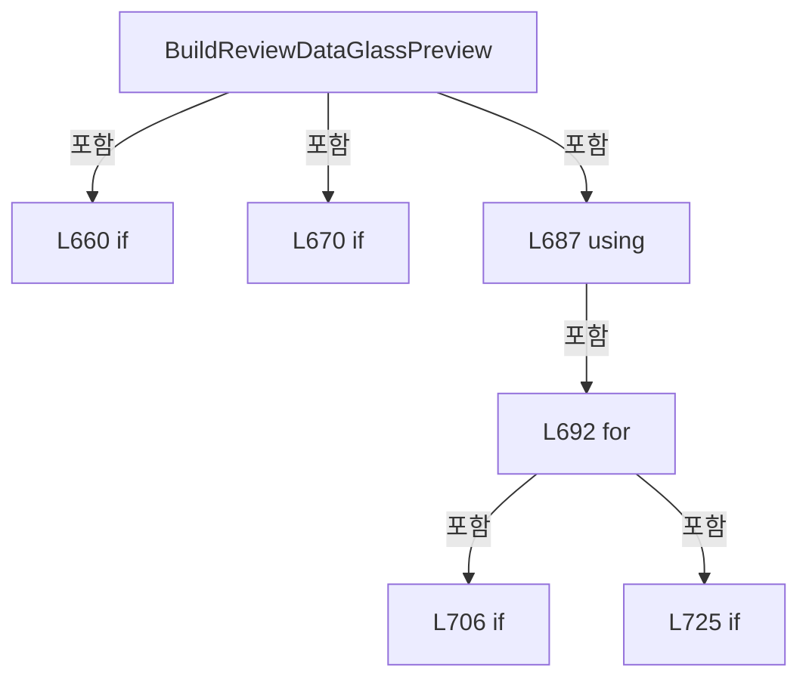

변경 전 점검: 입력/반환 타입, 위 호출자, 예외/취소 경로, 공유 상태와 저장·전송 소비자를 함께 확인합니다. 값의 단위나 물리 방향을 이름만으로 확정하지 않습니다.

### MethodDeclaration `BuildReviewDataShotMap` · L749–860

[Drilling.UI/Menu/Menus/CMenuCorrection.ReviewData.Display.cs:749–860](https://github.com/kjuws10-rgb/A3Drilling/blob/5aee8e58439c9b455cae7c9593c9be986c3e682e/Drilling.UI/Menu/Menus/CMenuCorrection.ReviewData.Display.cs#L749-L860)

| 항목 | 실제 추출 값 |
| --- | --- |
| 서명 | ImageSource? Drilling.UI.Menu.Menus.CMenuCorrection.CReviewDataPanel.BuildReviewDataShotMap(System.Collections.Generic.IReadOnlyList<Drilling.UI.Menu.Menus.CMenuCorrection.ST_REVIEW_DATA_SHOT_POSITION>, string) |
| 접근/수식자 | Private / private, static |
| 반환/값 타입 | ImageSource? |
| 소속 타입 | NamedType:Drilling.UI.Menu.Menus.CMenuCorrection.CReviewDataPanel |

입력 계약:

| 이름 | 타입 | 전달 | 선택/기본값 |
| --- | --- | --- | --- |
| shots | System.Collections.Generic.IReadOnlyList<Drilling.UI.Menu.Menus.CMenuCorrection.ST_REVIEW_DATA_SHOT_POSITION> | None | False /  |
| selectedShotKey | string | None | False /  |

정적 호출자로 확인된 위치:

| 호출 파일/행 | 호출 표현식 | 런타임 분기 가능 |
| --- | --- | --- |
| [Drilling.UI/Menu/Menus/CMenuCorrection.ReviewData.Display.cs:582–582](https://github.com/kjuws10-rgb/A3Drilling/blob/5aee8e58439c9b455cae7c9593c9be986c3e682e/Drilling.UI/Menu/Menus/CMenuCorrection.ReviewData.Display.cs#L582-L582) | BuildReviewDataShotMap | False |
| [Drilling.UI/Menu/Menus/CMenuCorrection.ReviewData.Display.cs:604–604](https://github.com/kjuws10-rgb/A3Drilling/blob/5aee8e58439c9b455cae7c9593c9be986c3e682e/Drilling.UI/Menu/Menus/CMenuCorrection.ReviewData.Display.cs#L604-L604) | BuildReviewDataShotMap | False |
| [Drilling.UI/Menu/Menus/CMenuCorrection.ReviewData.Offset.cs:656–656](https://github.com/kjuws10-rgb/A3Drilling/blob/5aee8e58439c9b455cae7c9593c9be986c3e682e/Drilling.UI/Menu/Menus/CMenuCorrection.ReviewData.Offset.cs#L656-L656) | BuildReviewDataShotMap | False |
| [Drilling.UI/Menu/Menus/CMenuCorrection.ReviewData.Offset.cs:673–673](https://github.com/kjuws10-rgb/A3Drilling/blob/5aee8e58439c9b455cae7c9593c9be986c3e682e/Drilling.UI/Menu/Menus/CMenuCorrection.ReviewData.Offset.cs#L673-L673) | BuildReviewDataShotMap | False |

호출하는 대상과 해석 범위:

| 원본 행 | 표현식 | 분석 상태 | 대상/소스 위치 |
| --- | --- | --- | --- |
| 759 | GetReviewDataShotMapSize | resolved | Size Drilling.UI.Menu.Menus.CMenuCorrection.CReviewDataPanel.GetReviewDataShotMapSize(System.Collections.Generic.IReadOnlyList<Drilling.UI.Menu.Menus.CMenuCorrection.ST_REVIEW_DATA_SHOT_POSITION>) · Drilling.UI/Menu/Menus/CMenuCorrection.ReviewData.Display.cs:862 |
| 760 | GetReviewDataShotMapRect | resolved | Rect Drilling.UI.Menu.Menus.CMenuCorrection.CReviewDataPanel.GetReviewDataShotMapRect(int, int) · Drilling.UI/Menu/Menus/CMenuCorrection.ReviewData.Display.cs:874 |
| 763 | Math.Clamp | candidate | OverloadResolutionFailure |
| 763 | Math.Min | candidate | OverloadResolutionFailure |
| 764 | new DrawingGroup | unresolved | None |
| 765 | drawing.Open | unresolved | None |
| 767 | context.DrawRectangle | unresolved | None |
| 767 | new SolidColorBrush | unresolved | None |
| 767 | Color.FromArgb | unresolved | None |
| 767 | new Rect | unresolved | None |
| 768 | context.DrawRectangle | unresolved | None |
| 768 | new SolidColorBrush | unresolved | None |
| 768 | Color.FromArgb | unresolved | None |
| 769 | new Pen | unresolved | None |
| 769 | new SolidColorBrush | unresolved | None |
| 769 | Color.FromArgb | unresolved | None |
| 770 | gridPen.Freeze | unresolved | None |
| 771 | Math.Max | resolved | int System.Math.Max(int, int) |
| 772 | Math.Max | resolved | int System.Math.Max(int, int) |
| 776 | context.DrawLine | unresolved | None |
| 776 | new Point | unresolved | None |
| 776 | new Point | unresolved | None |
| 782 | context.DrawLine | unresolved | None |
| 782 | new Point | unresolved | None |
| 782 | new Point | unresolved | None |
| 785 | new StreamGeometry | unresolved | None |
| 786 | new StreamGeometry | unresolved | None |
| 787 | new StreamGeometry | unresolved | None |
| 788 | new StreamGeometry | unresolved | None |
| 789 | normalGeometry.Open | unresolved | None |
| 790 | resultGeometry.Open | unresolved | None |
| 791 | maskingGeometry.Open | unresolved | None |
| 792 | chessGeometry.Open | unresolved | None |
| 800 | AddOutputViewerMaskCross | candidate | OverloadResolutionFailure |
| 800 | Math.Max | candidate | OverloadResolutionFailure |
| 804 | AddOutputViewerChessDiamond | candidate | OverloadResolutionFailure |
| 804 | Math.Max | candidate | OverloadResolutionFailure |
| 808 | AddOutputViewerShotCircle | candidate | OverloadResolutionFailure |
| 812 | AddOutputViewerShotCircle | candidate | OverloadResolutionFailure |
| 817 | normalGeometry.Freeze | unresolved | None |
| 818 | resultGeometry.Freeze | unresolved | None |
| 819 | maskingGeometry.Freeze | unresolved | None |
| 820 | chessGeometry.Freeze | unresolved | None |
| 821 | new SolidColorBrush | unresolved | None |
| 821 | Color.FromRgb | unresolved | None |
| 822 | new SolidColorBrush | unresolved | None |
| 822 | Color.FromRgb | unresolved | None |
| 823 | new SolidColorBrush | unresolved | None |
| 823 | Color.FromRgb | unresolved | None |
| 824 | new SolidColorBrush | unresolved | None |
| 824 | Color.FromRgb | unresolved | None |
| 825 | normalBrush.Freeze | unresolved | None |
| 826 | resultBrush.Freeze | unresolved | None |
| 827 | maskingBrush.Freeze | unresolved | None |
| 828 | chessBrush.Freeze | unresolved | None |
| 829 | new Pen | unresolved | None |
| 830 | new Pen | unresolved | None |
| 831 | maskingPen.Freeze | unresolved | None |
| 832 | chessPen.Freeze | unresolved | None |
| 833 | context.DrawGeometry | unresolved | None |
| 834 | context.DrawGeometry | unresolved | None |
| 835 | context.DrawGeometry | unresolved | None |
| 836 | context.DrawGeometry | unresolved | None |
| 836 | new SolidColorBrush | unresolved | None |
| 836 | Color.FromArgb | unresolved | None |
| 837 | shots.FirstOrDefault | resolved | Drilling.UI.Menu.Menus.CMenuCorrection.ST_REVIEW_DATA_SHOT_POSITION? System.Collections.Generic.IEnumerable<Drilling.UI.Menu.Menus.CMenuCorrection.ST_REVIEW_DATA_SHOT_POSITION>.FirstOrDefault<Drilling.UI.Menu.Menus.CMenuCorrection.ST_REVIEW_DATA_SHOT_POSITION>(System.Func<Drilling.UI.Menu.Menus.CMenuCorrection.ST_REVIEW_DATA_SHOT_POSITION, bool>) |
| 837 | shot.ShotKey.Equals | resolved | bool string.Equals(string?, System.StringComparison) |
| 842 | new SolidColorBrush | unresolved | None |
| 842 | Color.FromRgb | unresolved | None |
| 843 | selectedBrush.Freeze | unresolved | None |
| 844 | new Pen | unresolved | None |
| 845 | selectedPen.Freeze | unresolved | None |
| 846 | context.DrawEllipse | unresolved | None |
| 846 | new SolidColorBrush | unresolved | None |
| 846 | Color.FromArgb | unresolved | None |
| 846 | new Point | unresolved | None |
| 847 | context.DrawLine | unresolved | None |
| 847 | new Point | unresolved | None |
| 847 | new Point | unresolved | None |
| 848 | context.DrawLine | unresolved | None |
| 848 | new Point | unresolved | None |
| 848 | new Point | unresolved | None |
| 851 | new Pen | unresolved | None |
| 851 | new SolidColorBrush | unresolved | None |
| 851 | Color.FromRgb | unresolved | None |
| 852 | framePen.Freeze | unresolved | None |
| 853 | context.DrawRectangle | unresolved | None |
| 856 | drawing.Freeze | unresolved | None |
| 857 | new DrawingImage | unresolved | None |
| 858 | image.Freeze | unresolved | None |

본문의 실제 연산·분기·예외·반환 순서(원문 위치 순):

| 원본 행 | 종류 | 주석 해설 |
| --- | --- | --- |
| 753 | if | 조건에 따라 분기합니다: if (shots.Count == 0) |
| 755 | return | 호출자에게 값 또는 제어를 반환합니다: return null; |
| 758 | local-declaration | 지역 변수를 선언합니다: var first = shots[0]; |
| 758 | variable-initializer | 변수의 초기값을 지정합니다: first = shots[0] |
| 759 | call | 함수·델리게이트 또는 객체 생성자를 호출합니다: GetReviewDataShotMapSize(shots) |
| 759 | local-declaration | 지역 변수를 선언합니다: var size = GetReviewDataShotMapSize(shots); |
| 759 | variable-initializer | 변수의 초기값을 지정합니다: size = GetReviewDataShotMapSize(shots) |
| 760 | call | 함수·델리게이트 또는 객체 생성자를 호출합니다: GetReviewDataShotMapRect(first.GroupCountX, first.GroupCountY) |
| 760 | local-declaration | 지역 변수를 선언합니다: var mapRect = GetReviewDataShotMapRect(first.GroupCountX, first.GroupCountY); |
| 760 | variable-initializer | 변수의 초기값을 지정합니다: mapRect = GetReviewDataShotMapRect(first.GroupCountX, first.GroupCountY) |
| 761 | local-declaration | 지역 변수를 선언합니다: var cellWidth = mapRect.Width / first.GroupCountX; |
| 761 | variable-initializer | 변수의 초기값을 지정합니다: cellWidth = mapRect.Width / first.GroupCountX |
| 762 | local-declaration | 지역 변수를 선언합니다: var cellHeight = mapRect.Height / first.GroupCountY; |
| 762 | variable-initializer | 변수의 초기값을 지정합니다: cellHeight = mapRect.Height / first.GroupCountY |
| 763 | call | 함수·델리게이트 또는 객체 생성자를 호출합니다: Math.Clamp(Math.Min(cellWidth, cellHeight) * 0.30, 1.5, 4.2) |
| 763 | call | 함수·델리게이트 또는 객체 생성자를 호출합니다: Math.Min(cellWidth, cellHeight) |
| 763 | local-declaration | 지역 변수를 선언합니다: var pointRadius = Math.Clamp(Math.Min(cellWidth, cellHeight) * 0.30, 1.5, 4.2); |
| 763 | variable-initializer | 변수의 초기값을 지정합니다: pointRadius = Math.Clamp(Math.Min(cellWidth, cellHeight) * 0.30, 1.5, 4.2) |
| 764 | call | 함수·델리게이트 또는 객체 생성자를 호출합니다: new DrawingGroup() |
| 764 | local-declaration | 지역 변수를 선언합니다: var drawing = new DrawingGroup(); |
| 764 | variable-initializer | 변수의 초기값을 지정합니다: drawing = new DrawingGroup() |
| 765 | call | 함수·델리게이트 또는 객체 생성자를 호출합니다: drawing.Open() |
| 765 | variable-initializer | 변수의 초기값을 지정합니다: context = drawing.Open() |
| 765 | using | 자원 사용과 정리 범위를 지정합니다: using (var context = drawing.Open()) |
| 767 | call | 함수·델리게이트 또는 객체 생성자를 호출합니다: context.DrawRectangle(new SolidColorBrush(Color.FromArgb(1, 0, 0, 0)), null, new Rect(0.0, 0.0, size.Width, size.Height)) |
| 767 | call | 함수·델리게이트 또는 객체 생성자를 호출합니다: new SolidColorBrush(Color.FromArgb(1, 0, 0, 0)) |
| 767 | call | 함수·델리게이트 또는 객체 생성자를 호출합니다: Color.FromArgb(1, 0, 0, 0) |
| 767 | call | 함수·델리게이트 또는 객체 생성자를 호출합니다: new Rect(0.0, 0.0, size.Width, size.Height) |
| 768 | call | 함수·델리게이트 또는 객체 생성자를 호출합니다: context.DrawRectangle(new SolidColorBrush(Color.FromArgb(12, 102, 136, 164)), null, mapRect) |
| 768 | call | 함수·델리게이트 또는 객체 생성자를 호출합니다: new SolidColorBrush(Color.FromArgb(12, 102, 136, 164)) |
| 768 | call | 함수·델리게이트 또는 객체 생성자를 호출합니다: Color.FromArgb(12, 102, 136, 164) |
| 769 | call | 함수·델리게이트 또는 객체 생성자를 호출합니다: new Pen(new SolidColorBrush(Color.FromArgb(55, 100, 116, 139)), 0.8) |
| 769 | call | 함수·델리게이트 또는 객체 생성자를 호출합니다: new SolidColorBrush(Color.FromArgb(55, 100, 116, 139)) |
| 769 | call | 함수·델리게이트 또는 객체 생성자를 호출합니다: Color.FromArgb(55, 100, 116, 139) |
| 769 | local-declaration | 지역 변수를 선언합니다: var gridPen = new Pen(new SolidColorBrush(Color.FromArgb(55, 100, 116, 139)), 0.8); |
| 769 | variable-initializer | 변수의 초기값을 지정합니다: gridPen = new Pen(new SolidColorBrush(Color.FromArgb(55, 100, 116, 139)), 0.8) |
| 770 | call | 함수·델리게이트 또는 객체 생성자를 호출합니다: gridPen.Freeze() |
| 771 | call | 함수·델리게이트 또는 객체 생성자를 호출합니다: Math.Max(1, first.GroupCountX / 6) |
| 771 | local-declaration | 지역 변수를 선언합니다: var columnStep = Math.Max(1, first.GroupCountX / 6); |
| 771 | variable-initializer | 변수의 초기값을 지정합니다: columnStep = Math.Max(1, first.GroupCountX / 6) |
| 772 | call | 함수·델리게이트 또는 객체 생성자를 호출합니다: Math.Max(1, first.GroupCountY / 8) |
| 772 | local-declaration | 지역 변수를 선언합니다: var rowStep = Math.Max(1, first.GroupCountY / 8); |
| 772 | variable-initializer | 변수의 초기값을 지정합니다: rowStep = Math.Max(1, first.GroupCountY / 8) |
| 773 | compound-assignment-or-event-subscription | 복합 대입 또는 이벤트 구독/해지 표현입니다: column += columnStep |
| 773 | variable-initializer | 변수의 초기값을 지정합니다: column = columnStep |
| 773 | for | 초기화·조건·증감이 있는 반복입니다: for (var column = columnStep; column < first.GroupCountX; column += columnStep) |
| 775 | local-declaration | 지역 변수를 선언합니다: var x = mapRect.Left + mapRect.Width * column / first.GroupCountX; |
| 775 | variable-initializer | 변수의 초기값을 지정합니다: x = mapRect.Left + mapRect.Width * column / first.GroupCountX |
| 776 | call | 함수·델리게이트 또는 객체 생성자를 호출합니다: context.DrawLine(gridPen, new Point(x, mapRect.Top), new Point(x, mapRect.Bottom)) |
| 776 | call | 함수·델리게이트 또는 객체 생성자를 호출합니다: new Point(x, mapRect.Top) |
| 776 | call | 함수·델리게이트 또는 객체 생성자를 호출합니다: new Point(x, mapRect.Bottom) |
| 779 | compound-assignment-or-event-subscription | 복합 대입 또는 이벤트 구독/해지 표현입니다: row += rowStep |
| 779 | variable-initializer | 변수의 초기값을 지정합니다: row = rowStep |
| 779 | for | 초기화·조건·증감이 있는 반복입니다: for (var row = rowStep; row < first.GroupCountY; row += rowStep) |
| 781 | local-declaration | 지역 변수를 선언합니다: var y = mapRect.Top + mapRect.Height * row / first.GroupCountY; |
| 781 | variable-initializer | 변수의 초기값을 지정합니다: y = mapRect.Top + mapRect.Height * row / first.GroupCountY |
| 782 | call | 함수·델리게이트 또는 객체 생성자를 호출합니다: context.DrawLine(gridPen, new Point(mapRect.Left, y), new Point(mapRect.Right, y)) |
| 782 | call | 함수·델리게이트 또는 객체 생성자를 호출합니다: new Point(mapRect.Left, y) |
| 782 | call | 함수·델리게이트 또는 객체 생성자를 호출합니다: new Point(mapRect.Right, y) |
| 785 | call | 함수·델리게이트 또는 객체 생성자를 호출합니다: new StreamGeometry() |
| 785 | local-declaration | 지역 변수를 선언합니다: var normalGeometry = new StreamGeometry(); |
| 785 | variable-initializer | 변수의 초기값을 지정합니다: normalGeometry = new StreamGeometry() |
| 786 | call | 함수·델리게이트 또는 객체 생성자를 호출합니다: new StreamGeometry() |
| 786 | local-declaration | 지역 변수를 선언합니다: var resultGeometry = new StreamGeometry(); |
| 786 | variable-initializer | 변수의 초기값을 지정합니다: resultGeometry = new StreamGeometry() |
| 787 | call | 함수·델리게이트 또는 객체 생성자를 호출합니다: new StreamGeometry() |
| 787 | local-declaration | 지역 변수를 선언합니다: var maskingGeometry = new StreamGeometry(); |
| 787 | variable-initializer | 변수의 초기값을 지정합니다: maskingGeometry = new StreamGeometry() |
| 788 | call | 함수·델리게이트 또는 객체 생성자를 호출합니다: new StreamGeometry() |
| 788 | local-declaration | 지역 변수를 선언합니다: var chessGeometry = new StreamGeometry(); |
| 788 | variable-initializer | 변수의 초기값을 지정합니다: chessGeometry = new StreamGeometry() |
| 789 | call | 함수·델리게이트 또는 객체 생성자를 호출합니다: normalGeometry.Open() |
| 789 | variable-initializer | 변수의 초기값을 지정합니다: normalContext = normalGeometry.Open() |
| 789 | using | 자원 사용과 정리 범위를 지정합니다: using (var normalContext = normalGeometry.Open()) |
| 790 | call | 함수·델리게이트 또는 객체 생성자를 호출합니다: resultGeometry.Open() |
| 790 | variable-initializer | 변수의 초기값을 지정합니다: resultContext = resultGeometry.Open() |
| 790 | using | 자원 사용과 정리 범위를 지정합니다: using (var resultContext = resultGeometry.Open()) |
| 791 | call | 함수·델리게이트 또는 객체 생성자를 호출합니다: maskingGeometry.Open() |
| 791 | variable-initializer | 변수의 초기값을 지정합니다: maskingContext = maskingGeometry.Open() |
| 791 | using | 자원 사용과 정리 범위를 지정합니다: using (var maskingContext = maskingGeometry.Open()) |
| 792 | call | 함수·델리게이트 또는 객체 생성자를 호출합니다: chessGeometry.Open() |
| 792 | variable-initializer | 변수의 초기값을 지정합니다: chessContext = chessGeometry.Open() |
| 792 | using | 자원 사용과 정리 범위를 지정합니다: using (var chessContext = chessGeometry.Open()) |
| 794 | foreach | 컬렉션 요소를 순회합니다: foreach (var shot in shots) |
| 796 | local-declaration | 지역 변수를 선언합니다: var x = mapRect.Left + (shot.GroupColumn + 0.5) * cellWidth; |
| 796 | variable-initializer | 변수의 초기값을 지정합니다: x = mapRect.Left + (shot.GroupColumn + 0.5) * cellWidth |
| 797 | local-declaration | 지역 변수를 선언합니다: var y = mapRect.Top + (shot.GroupRow + 0.5) * cellHeight; |
| 797 | variable-initializer | 변수의 초기값을 지정합니다: y = mapRect.Top + (shot.GroupRow + 0.5) * cellHeight |
| 798 | if | 조건에 따라 분기합니다: if (shot.IsMasked) |
| 800 | call | 함수·델리게이트 또는 객체 생성자를 호출합니다: AddOutputViewerMaskCross(maskingContext, x, y, Math.Max(2.2, pointRadius * 1.8)) |
| 800 | call | 함수·델리게이트 또는 객체 생성자를 호출합니다: Math.Max(2.2, pointRadius * 1.8) |
| 802 | else | 앞 조건이 거짓인 경로입니다: else |
| 802 | if | 조건에 따라 분기합니다: if (shot.IsChessSkipped) |
| 804 | call | 함수·델리게이트 또는 객체 생성자를 호출합니다: AddOutputViewerChessDiamond(chessContext, x, y, Math.Max(2.2, pointRadius * 1.8)) |
| 804 | call | 함수·델리게이트 또는 객체 생성자를 호출합니다: Math.Max(2.2, pointRadius * 1.8) |
| 806 | else | 앞 조건이 거짓인 경로입니다: else |
| 806 | if | 조건에 따라 분기합니다: if (shot.IsResult) |
| 808 | call | 함수·델리게이트 또는 객체 생성자를 호출합니다: AddOutputViewerShotCircle(resultContext, x, y, pointRadius) |
| 810 | else | 앞 조건이 거짓인 경로입니다: else |
| 812 | call | 함수·델리게이트 또는 객체 생성자를 호출합니다: AddOutputViewerShotCircle(normalContext, x, y, pointRadius) |
| 817 | call | 함수·델리게이트 또는 객체 생성자를 호출합니다: normalGeometry.Freeze() |
| 818 | call | 함수·델리게이트 또는 객체 생성자를 호출합니다: resultGeometry.Freeze() |
| 819 | call | 함수·델리게이트 또는 객체 생성자를 호출합니다: maskingGeometry.Freeze() |
| 820 | call | 함수·델리게이트 또는 객체 생성자를 호출합니다: chessGeometry.Freeze() |
| 821 | call | 함수·델리게이트 또는 객체 생성자를 호출합니다: new SolidColorBrush(Color.FromRgb(100, 116, 139)) |
| 821 | call | 함수·델리게이트 또는 객체 생성자를 호출합니다: Color.FromRgb(100, 116, 139) |
| 821 | local-declaration | 지역 변수를 선언합니다: var normalBrush = new SolidColorBrush(Color.FromRgb(100, 116, 139)); |
| 821 | variable-initializer | 변수의 초기값을 지정합니다: normalBrush = new SolidColorBrush(Color.FromRgb(100, 116, 139)) |
| 822 | call | 함수·델리게이트 또는 객체 생성자를 호출합니다: new SolidColorBrush(Color.FromRgb(34, 197, 94)) |
| 822 | call | 함수·델리게이트 또는 객체 생성자를 호출합니다: Color.FromRgb(34, 197, 94) |
| 822 | local-declaration | 지역 변수를 선언합니다: var resultBrush = new SolidColorBrush(Color.FromRgb(34, 197, 94)); |
| 822 | variable-initializer | 변수의 초기값을 지정합니다: resultBrush = new SolidColorBrush(Color.FromRgb(34, 197, 94)) |
| 823 | call | 함수·델리게이트 또는 객체 생성자를 호출합니다: new SolidColorBrush(Color.FromRgb(239, 68, 68)) |
| 823 | call | 함수·델리게이트 또는 객체 생성자를 호출합니다: Color.FromRgb(239, 68, 68) |
| 823 | local-declaration | 지역 변수를 선언합니다: var maskingBrush = new SolidColorBrush(Color.FromRgb(239, 68, 68)); |
| 823 | variable-initializer | 변수의 초기값을 지정합니다: maskingBrush = new SolidColorBrush(Color.FromRgb(239, 68, 68)) |
| 824 | call | 함수·델리게이트 또는 객체 생성자를 호출합니다: new SolidColorBrush(Color.FromRgb(168, 85, 247)) |
| 824 | call | 함수·델리게이트 또는 객체 생성자를 호출합니다: Color.FromRgb(168, 85, 247) |
| 824 | local-declaration | 지역 변수를 선언합니다: var chessBrush = new SolidColorBrush(Color.FromRgb(168, 85, 247)); |
| 824 | variable-initializer | 변수의 초기값을 지정합니다: chessBrush = new SolidColorBrush(Color.FromRgb(168, 85, 247)) |
| 825 | call | 함수·델리게이트 또는 객체 생성자를 호출합니다: normalBrush.Freeze() |
| 826 | call | 함수·델리게이트 또는 객체 생성자를 호출합니다: resultBrush.Freeze() |
| 827 | call | 함수·델리게이트 또는 객체 생성자를 호출합니다: maskingBrush.Freeze() |
| 828 | call | 함수·델리게이트 또는 객체 생성자를 호출합니다: chessBrush.Freeze() |
| 829 | call | 함수·델리게이트 또는 객체 생성자를 호출합니다: new Pen(maskingBrush, 1.8) |
| 829 | local-declaration | 지역 변수를 선언합니다: var maskingPen = new Pen(maskingBrush, 1.8); |
| 829 | variable-initializer | 변수의 초기값을 지정합니다: maskingPen = new Pen(maskingBrush, 1.8) |
| 830 | call | 함수·델리게이트 또는 객체 생성자를 호출합니다: new Pen(chessBrush, 1.5) |
| 830 | local-declaration | 지역 변수를 선언합니다: var chessPen = new Pen(chessBrush, 1.5); |
| 830 | variable-initializer | 변수의 초기값을 지정합니다: chessPen = new Pen(chessBrush, 1.5) |
| 831 | call | 함수·델리게이트 또는 객체 생성자를 호출합니다: maskingPen.Freeze() |
| 832 | call | 함수·델리게이트 또는 객체 생성자를 호출합니다: chessPen.Freeze() |
| 833 | call | 함수·델리게이트 또는 객체 생성자를 호출합니다: context.DrawGeometry(normalBrush, null, normalGeometry) |
| 834 | call | 함수·델리게이트 또는 객체 생성자를 호출합니다: context.DrawGeometry(resultBrush, null, resultGeometry) |
| 835 | call | 함수·델리게이트 또는 객체 생성자를 호출합니다: context.DrawGeometry(null, maskingPen, maskingGeometry) |
| 836 | call | 함수·델리게이트 또는 객체 생성자를 호출합니다: context.DrawGeometry(new SolidColorBrush(Color.FromArgb(55, 168, 85, 247)), chessPen, chessGeometry) |
| 836 | call | 함수·델리게이트 또는 객체 생성자를 호출합니다: new SolidColorBrush(Color.FromArgb(55, 168, 85, 247)) |
| 836 | call | 함수·델리게이트 또는 객체 생성자를 호출합니다: Color.FromArgb(55, 168, 85, 247) |
| 837 | call | 함수·델리게이트 또는 객체 생성자를 호출합니다: shots.FirstOrDefault(shot => shot.ShotKey.Equals(selectedShotKey, StringComparison.OrdinalIgnoreCase)) |
| 837 | call | 함수·델리게이트 또는 객체 생성자를 호출합니다: shot.ShotKey.Equals(selectedShotKey, StringComparison.OrdinalIgnoreCase) |
| 837 | local-declaration | 지역 변수를 선언합니다: var selected = shots.FirstOrDefault(shot => shot.ShotKey.Equals(selectedShotKey, StringComparison.OrdinalIgnoreCase)); |
| 837 | variable-initializer | 변수의 초기값을 지정합니다: selected = shots.FirstOrDefault(shot => shot.ShotKey.Equals(selectedShotKey, StringComparison.OrdinalIgnoreCase)) |
| 838 | if | 조건에 따라 분기합니다: if (selected is not null) |
| 840 | local-declaration | 지역 변수를 선언합니다: var x = mapRect.Left + (selected.GroupColumn + 0.5) * cellWidth; |
| 840 | variable-initializer | 변수의 초기값을 지정합니다: x = mapRect.Left + (selected.GroupColumn + 0.5) * cellWidth |
| 841 | local-declaration | 지역 변수를 선언합니다: var y = mapRect.Top + (selected.GroupRow + 0.5) * cellHeight; |
| 841 | variable-initializer | 변수의 초기값을 지정합니다: y = mapRect.Top + (selected.GroupRow + 0.5) * cellHeight |
| 842 | call | 함수·델리게이트 또는 객체 생성자를 호출합니다: new SolidColorBrush(Color.FromRgb(246, 196, 83)) |
| 842 | call | 함수·델리게이트 또는 객체 생성자를 호출합니다: Color.FromRgb(246, 196, 83) |
| 842 | local-declaration | 지역 변수를 선언합니다: var selectedBrush = new SolidColorBrush(Color.FromRgb(246, 196, 83)); |
| 842 | variable-initializer | 변수의 초기값을 지정합니다: selectedBrush = new SolidColorBrush(Color.FromRgb(246, 196, 83)) |
| 843 | call | 함수·델리게이트 또는 객체 생성자를 호출합니다: selectedBrush.Freeze() |
| 844 | call | 함수·델리게이트 또는 객체 생성자를 호출합니다: new Pen(selectedBrush, 2.2) |
| 844 | local-declaration | 지역 변수를 선언합니다: var selectedPen = new Pen(selectedBrush, 2.2); |
| 844 | variable-initializer | 변수의 초기값을 지정합니다: selectedPen = new Pen(selectedBrush, 2.2) |
| 845 | call | 함수·델리게이트 또는 객체 생성자를 호출합니다: selectedPen.Freeze() |
| 846 | call | 함수·델리게이트 또는 객체 생성자를 호출합니다: context.DrawEllipse(new SolidColorBrush(Color.FromArgb(52, 246, 196, 83)), selectedPen, new Point(x, y), 8.0, 8.0) |
| 846 | call | 함수·델리게이트 또는 객체 생성자를 호출합니다: new SolidColorBrush(Color.FromArgb(52, 246, 196, 83)) |
| 846 | call | 함수·델리게이트 또는 객체 생성자를 호출합니다: Color.FromArgb(52, 246, 196, 83) |
| 846 | call | 함수·델리게이트 또는 객체 생성자를 호출합니다: new Point(x, y) |
| 847 | call | 함수·델리게이트 또는 객체 생성자를 호출합니다: context.DrawLine(selectedPen, new Point(x - 12.0, y), new Point(x + 12.0, y)) |
| 847 | call | 함수·델리게이트 또는 객체 생성자를 호출합니다: new Point(x - 12.0, y) |
| 847 | call | 함수·델리게이트 또는 객체 생성자를 호출합니다: new Point(x + 12.0, y) |
| 848 | call | 함수·델리게이트 또는 객체 생성자를 호출합니다: context.DrawLine(selectedPen, new Point(x, y - 12.0), new Point(x, y + 12.0)) |
| 848 | call | 함수·델리게이트 또는 객체 생성자를 호출합니다: new Point(x, y - 12.0) |
| 848 | call | 함수·델리게이트 또는 객체 생성자를 호출합니다: new Point(x, y + 12.0) |
| 851 | call | 함수·델리게이트 또는 객체 생성자를 호출합니다: new Pen(new SolidColorBrush(Color.FromRgb(102, 136, 164)), 1.4) |
| 851 | call | 함수·델리게이트 또는 객체 생성자를 호출합니다: new SolidColorBrush(Color.FromRgb(102, 136, 164)) |
| 851 | call | 함수·델리게이트 또는 객체 생성자를 호출합니다: Color.FromRgb(102, 136, 164) |
| 851 | local-declaration | 지역 변수를 선언합니다: var framePen = new Pen(new SolidColorBrush(Color.FromRgb(102, 136, 164)), 1.4); |
| 851 | variable-initializer | 변수의 초기값을 지정합니다: framePen = new Pen(new SolidColorBrush(Color.FromRgb(102, 136, 164)), 1.4) |
| 852 | call | 함수·델리게이트 또는 객체 생성자를 호출합니다: framePen.Freeze() |
| 853 | call | 함수·델리게이트 또는 객체 생성자를 호출합니다: context.DrawRectangle(null, framePen, mapRect) |
| 856 | call | 함수·델리게이트 또는 객체 생성자를 호출합니다: drawing.Freeze() |
| 857 | call | 함수·델리게이트 또는 객체 생성자를 호출합니다: new DrawingImage(drawing) |
| 857 | local-declaration | 지역 변수를 선언합니다: var image = new DrawingImage(drawing); |
| 857 | variable-initializer | 변수의 초기값을 지정합니다: image = new DrawingImage(drawing) |
| 858 | call | 함수·델리게이트 또는 객체 생성자를 호출합니다: image.Freeze() |
| 859 | return | 호출자에게 값 또는 제어를 반환합니다: return image; |

제어 구문의 포함 구조(실제 실행 순서/CFG가 아닌 구문 탐색 그림):

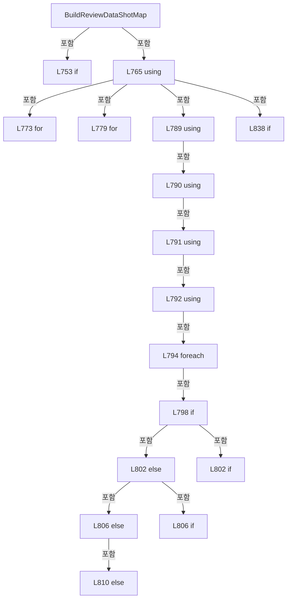

변경 전 점검: 입력/반환 타입, 위 호출자, 예외/취소 경로, 공유 상태와 저장·전송 소비자를 함께 확인합니다. 값의 단위나 물리 방향을 이름만으로 확정하지 않습니다.

### MethodDeclaration `GetReviewDataShotMapSize` · L862–872

[Drilling.UI/Menu/Menus/CMenuCorrection.ReviewData.Display.cs:862–872](https://github.com/kjuws10-rgb/A3Drilling/blob/5aee8e58439c9b455cae7c9593c9be986c3e682e/Drilling.UI/Menu/Menus/CMenuCorrection.ReviewData.Display.cs#L862-L872)

| 항목 | 실제 추출 값 |
| --- | --- |
| 서명 | Size Drilling.UI.Menu.Menus.CMenuCorrection.CReviewDataPanel.GetReviewDataShotMapSize(System.Collections.Generic.IReadOnlyList<Drilling.UI.Menu.Menus.CMenuCorrection.ST_REVIEW_DATA_SHOT_POSITION>) |
| 접근/수식자 | Private / private, static |
| 반환/값 타입 | Size |
| 소속 타입 | NamedType:Drilling.UI.Menu.Menus.CMenuCorrection.CReviewDataPanel |

입력 계약:

| 이름 | 타입 | 전달 | 선택/기본값 |
| --- | --- | --- | --- |
| shots | System.Collections.Generic.IReadOnlyList<Drilling.UI.Menu.Menus.CMenuCorrection.ST_REVIEW_DATA_SHOT_POSITION> | None | False /  |

정적 호출자로 확인된 위치:

| 호출 파일/행 | 호출 표현식 | 런타임 분기 가능 |
| --- | --- | --- |
| [Drilling.UI/Menu/Menus/CMenuCorrection.ReviewData.Display.cs:579–579](https://github.com/kjuws10-rgb/A3Drilling/blob/5aee8e58439c9b455cae7c9593c9be986c3e682e/Drilling.UI/Menu/Menus/CMenuCorrection.ReviewData.Display.cs#L579-L579) | GetReviewDataShotMapSize | False |
| [Drilling.UI/Menu/Menus/CMenuCorrection.ReviewData.Display.cs:603–603](https://github.com/kjuws10-rgb/A3Drilling/blob/5aee8e58439c9b455cae7c9593c9be986c3e682e/Drilling.UI/Menu/Menus/CMenuCorrection.ReviewData.Display.cs#L603-L603) | GetReviewDataShotMapSize | False |
| [Drilling.UI/Menu/Menus/CMenuCorrection.ReviewData.Display.cs:759–759](https://github.com/kjuws10-rgb/A3Drilling/blob/5aee8e58439c9b455cae7c9593c9be986c3e682e/Drilling.UI/Menu/Menus/CMenuCorrection.ReviewData.Display.cs#L759-L759) | GetReviewDataShotMapSize | False |
| [Drilling.UI/Menu/Menus/CMenuCorrection.ReviewData.Offset.cs:670–670](https://github.com/kjuws10-rgb/A3Drilling/blob/5aee8e58439c9b455cae7c9593c9be986c3e682e/Drilling.UI/Menu/Menus/CMenuCorrection.ReviewData.Offset.cs#L670-L670) | GetReviewDataShotMapSize | False |

호출하는 대상과 해석 범위:

| 원본 행 | 표현식 | 분석 상태 | 대상/소스 위치 |
| --- | --- | --- | --- |
| 866 | new Size | unresolved | None |
| 870 | new Size | unresolved | None |
| 871 | new Size | unresolved | None |

본문의 실제 연산·분기·예외·반환 순서(원문 위치 순):

| 원본 행 | 종류 | 주석 해설 |
| --- | --- | --- |
| 864 | if | 조건에 따라 분기합니다: if (shots.Count == 0) |
| 866 | call | 함수·델리게이트 또는 객체 생성자를 호출합니다: new Size(680.0, 420.0) |
| 866 | return | 호출자에게 값 또는 제어를 반환합니다: return new Size(680.0, 420.0); |
| 869 | conditional-expression | 조건에 따라 결과식을 선택합니다: shots[0].GroupCountX > shots[0].GroupCountY ? new Size(680.0, 420.0) : new Size(420.0, 680.0) |
| 869 | return | 호출자에게 값 또는 제어를 반환합니다: return shots[0].GroupCountX > shots[0].GroupCountY ? new Size(680.0, 420.0) : new Size(420.0, 680.0); |
| 870 | call | 함수·델리게이트 또는 객체 생성자를 호출합니다: new Size(680.0, 420.0) |
| 871 | call | 함수·델리게이트 또는 객체 생성자를 호출합니다: new Size(420.0, 680.0) |

제어 구문의 포함 구조(실제 실행 순서/CFG가 아닌 구문 탐색 그림):

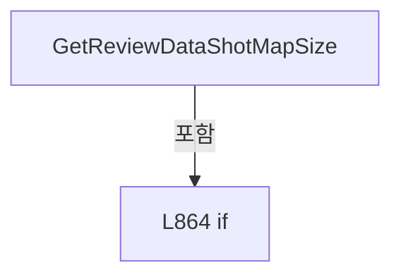

변경 전 점검: 입력/반환 타입, 위 호출자, 예외/취소 경로, 공유 상태와 저장·전송 소비자를 함께 확인합니다. 값의 단위나 물리 방향을 이름만으로 확정하지 않습니다.

### MethodDeclaration `GetReviewDataShotMapRect` · L874–878

[Drilling.UI/Menu/Menus/CMenuCorrection.ReviewData.Display.cs:874–878](https://github.com/kjuws10-rgb/A3Drilling/blob/5aee8e58439c9b455cae7c9593c9be986c3e682e/Drilling.UI/Menu/Menus/CMenuCorrection.ReviewData.Display.cs#L874-L878)

| 항목 | 실제 추출 값 |
| --- | --- |
| 서명 | Rect Drilling.UI.Menu.Menus.CMenuCorrection.CReviewDataPanel.GetReviewDataShotMapRect(int, int) |
| 접근/수식자 | Private / private, static |
| 반환/값 타입 | Rect |
| 소속 타입 | NamedType:Drilling.UI.Menu.Menus.CMenuCorrection.CReviewDataPanel |

입력 계약:

| 이름 | 타입 | 전달 | 선택/기본값 |
| --- | --- | --- | --- |
| groupCountX | int | None | False /  |
| groupCountY | int | None | False /  |

정적 호출자로 확인된 위치:

| 호출 파일/행 | 호출 표현식 | 런타임 분기 가능 |
| --- | --- | --- |
| [Drilling.UI/Menu/Menus/CMenuCorrection.ReviewData.Display.cs:501–501](https://github.com/kjuws10-rgb/A3Drilling/blob/5aee8e58439c9b455cae7c9593c9be986c3e682e/Drilling.UI/Menu/Menus/CMenuCorrection.ReviewData.Display.cs#L501-L501) | GetReviewDataShotMapRect | False |
| [Drilling.UI/Menu/Menus/CMenuCorrection.ReviewData.Display.cs:760–760](https://github.com/kjuws10-rgb/A3Drilling/blob/5aee8e58439c9b455cae7c9593c9be986c3e682e/Drilling.UI/Menu/Menus/CMenuCorrection.ReviewData.Display.cs#L760-L760) | GetReviewDataShotMapRect | False |
| [Drilling.UI/Menu/Menus/CMenuCorrection.ReviewData.Offset.cs:607–607](https://github.com/kjuws10-rgb/A3Drilling/blob/5aee8e58439c9b455cae7c9593c9be986c3e682e/Drilling.UI/Menu/Menus/CMenuCorrection.ReviewData.Offset.cs#L607-L607) | GetReviewDataShotMapRect | False |

호출하는 대상과 해석 범위:

| 원본 행 | 표현식 | 분석 상태 | 대상/소스 위치 |
| --- | --- | --- | --- |
| 876 | new Size | unresolved | None |
| 876 | new Size | unresolved | None |
| 877 | new Rect | unresolved | None |

본문의 실제 연산·분기·예외·반환 순서(원문 위치 순):

| 원본 행 | 종류 | 주석 해설 |
| --- | --- | --- |
| 876 | call | 함수·델리게이트 또는 객체 생성자를 호출합니다: new Size(680.0, 420.0) |
| 876 | call | 함수·델리게이트 또는 객체 생성자를 호출합니다: new Size(420.0, 680.0) |
| 876 | conditional-expression | 조건에 따라 결과식을 선택합니다: groupCountX > groupCountY ? new Size(680.0, 420.0) : new Size(420.0, 680.0) |
| 876 | local-declaration | 지역 변수를 선언합니다: var size = groupCountX > groupCountY ? new Size(680.0, 420.0) : new Size(420.0, 680.0); |
| 876 | variable-initializer | 변수의 초기값을 지정합니다: size = groupCountX > groupCountY ? new Size(680.0, 420.0) : new Size(420.0, 680.0) |
| 877 | call | 함수·델리게이트 또는 객체 생성자를 호출합니다: new Rect(28.0, 28.0, size.Width - 56.0, size.Height - 56.0) |
| 877 | return | 호출자에게 값 또는 제어를 반환합니다: return new Rect(28.0, 28.0, size.Width - 56.0, size.Height - 56.0); |

변경 전 점검: 입력/반환 타입, 위 호출자, 예외/취소 경로, 공유 상태와 저장·전송 소비자를 함께 확인합니다. 값의 단위나 물리 방향을 이름만으로 확정하지 않습니다.

### MethodDeclaration `IsBlockedStatus` · L880–884

[Drilling.UI/Menu/Menus/CMenuCorrection.ReviewData.Display.cs:880–884](https://github.com/kjuws10-rgb/A3Drilling/blob/5aee8e58439c9b455cae7c9593c9be986c3e682e/Drilling.UI/Menu/Menus/CMenuCorrection.ReviewData.Display.cs#L880-L884)

| 항목 | 실제 추출 값 |
| --- | --- |
| 서명 | bool Drilling.UI.Menu.Menus.CMenuCorrection.CReviewDataPanel.IsBlockedStatus(string) |
| 접근/수식자 | Private / private, static |
| 반환/값 타입 | bool |
| 소속 타입 | NamedType:Drilling.UI.Menu.Menus.CMenuCorrection.CReviewDataPanel |

입력 계약:

| 이름 | 타입 | 전달 | 선택/기본값 |
| --- | --- | --- | --- |
| status | string | None | False /  |

정적 호출자로 확인된 위치:

| 호출 파일/행 | 호출 표현식 | 런타임 분기 가능 |
| --- | --- | --- |
| [Drilling.UI/Menu/Menus/CMenuCorrection.ReviewData.Display.cs:39–39](https://github.com/kjuws10-rgb/A3Drilling/blob/5aee8e58439c9b455cae7c9593c9be986c3e682e/Drilling.UI/Menu/Menus/CMenuCorrection.ReviewData.Display.cs#L39-L39) | IsBlockedStatus | False |
| [Drilling.UI/Menu/Menus/CMenuCorrection.ReviewData.Display.cs:97–97](https://github.com/kjuws10-rgb/A3Drilling/blob/5aee8e58439c9b455cae7c9593c9be986c3e682e/Drilling.UI/Menu/Menus/CMenuCorrection.ReviewData.Display.cs#L97-L97) | IsBlockedStatus | False |

호출하는 대상과 해석 범위:

| 원본 행 | 표현식 | 분석 상태 | 대상/소스 위치 |
| --- | --- | --- | --- |
| 882 | status.Equals | resolved | bool string.Equals(string?, System.StringComparison) |
| 883 | status.Equals | resolved | bool string.Equals(string?, System.StringComparison) |

본문의 실제 연산·분기·예외·반환 순서(원문 위치 순):

| 원본 행 | 종류 | 주석 해설 |
| --- | --- | --- |
| 882 | call | 함수·델리게이트 또는 객체 생성자를 호출합니다: status.Equals("FAILED", StringComparison.OrdinalIgnoreCase) |
| 882 | return | 호출자에게 값 또는 제어를 반환합니다: return status.Equals("FAILED", StringComparison.OrdinalIgnoreCase) &#124;&#124; status.Equals("INVALID", StringComparison.OrdinalIgnoreCase); |
| 883 | call | 함수·델리게이트 또는 객체 생성자를 호출합니다: status.Equals("INVALID", StringComparison.OrdinalIgnoreCase) |

변경 전 점검: 입력/반환 타입, 위 호출자, 예외/취소 경로, 공유 상태와 저장·전송 소비자를 함께 확인합니다. 값의 단위나 물리 방향을 이름만으로 확정하지 않습니다.

### MethodDeclaration `ClearLoadedDisplay` · L886–912

[Drilling.UI/Menu/Menus/CMenuCorrection.ReviewData.Display.cs:886–912](https://github.com/kjuws10-rgb/A3Drilling/blob/5aee8e58439c9b455cae7c9593c9be986c3e682e/Drilling.UI/Menu/Menus/CMenuCorrection.ReviewData.Display.cs#L886-L912)

| 항목 | 실제 추출 값 |
| --- | --- |
| 서명 | void Drilling.UI.Menu.Menus.CMenuCorrection.CReviewDataPanel.ClearLoadedDisplay() |
| 접근/수식자 | Private / private |
| 반환/값 타입 | void |
| 소속 타입 | NamedType:Drilling.UI.Menu.Menus.CMenuCorrection.CReviewDataPanel |

정적 호출자로 확인된 위치:

| 호출 파일/행 | 호출 표현식 | 런타임 분기 가능 |
| --- | --- | --- |
| [Drilling.UI/Menu/Menus/CMenuCorrection.ReviewData.Display.cs:66–66](https://github.com/kjuws10-rgb/A3Drilling/blob/5aee8e58439c9b455cae7c9593c9be986c3e682e/Drilling.UI/Menu/Menus/CMenuCorrection.ReviewData.Display.cs#L66-L66) | ClearLoadedDisplay | False |
| [Drilling.UI/Menu/Menus/CMenuCorrection.ReviewData.Display.cs:107–107](https://github.com/kjuws10-rgb/A3Drilling/blob/5aee8e58439c9b455cae7c9593c9be986c3e682e/Drilling.UI/Menu/Menus/CMenuCorrection.ReviewData.Display.cs#L107-L107) | ClearLoadedDisplay | False |
| [Drilling.UI/Menu/Menus/CMenuCorrection.ReviewData.Display.cs:162–162](https://github.com/kjuws10-rgb/A3Drilling/blob/5aee8e58439c9b455cae7c9593c9be986c3e682e/Drilling.UI/Menu/Menus/CMenuCorrection.ReviewData.Display.cs#L162-L162) | ClearLoadedDisplay | False |

호출하는 대상과 해석 범위:

| 원본 행 | 표현식 | 분석 상태 | 대상/소스 위치 |
| --- | --- | --- | --- |
| 888 | ResetReinspectionState | resolved | void Drilling.UI.Menu.Menus.CMenuCorrection.CReviewDataPanel.ResetReinspectionState() · Drilling.UI/Menu/Menus/CMenuCorrection.ReviewData.Reinspection.cs:656 |
| 889 | Interlocked.Increment | resolved | int System.Threading.Interlocked.Increment(ref int) |
| 891 | new Dictionary<string, string> | resolved | System.Collections.Generic.Dictionary<string, string>.Dictionary(System.Collections.Generic.IEqualityComparer<string>?) |
| 892 | new HashSet<int> | resolved | System.Collections.Generic.HashSet<int>.HashSet() |
| 893 | new Dictionary<int, IReadOnlyList<ST_REVIEW_DATA_SHOT_POSITION>> | resolved | System.Collections.Generic.Dictionary<int, System.Collections.Generic.IReadOnlyList<Drilling.UI.Menu.Menus.CMenuCorrection.ST_REVIEW_DATA_SHOT_POSITION>>.Dictionary() |
| 903 | Camera.Clear | resolved | void Drilling.UI.Menu.Menus.CReviewCameraPreview.Clear() · Drilling.UI/Menu/Menus/CMenuReview.cs:4059 |
| 911 | NotifyDisplayState | resolved | void Drilling.UI.Menu.Menus.CMenuCorrection.CReviewDataPanel.NotifyDisplayState() · Drilling.UI/Menu/Menus/CMenuCorrection.ReviewData.Display.cs:957 |

본문의 실제 연산·분기·예외·반환 순서(원문 위치 순):

| 원본 행 | 종류 | 주석 해설 |
| --- | --- | --- |
| 888 | call | 함수·델리게이트 또는 객체 생성자를 호출합니다: ResetReinspectionState() |
| 889 | call | 함수·델리게이트 또는 객체 생성자를 호출합니다: Interlocked.Increment(ref _shotMapRenderVersion) |
| 890 | assignment | 값을 대상에 대입합니다: _hasLoadedData = false |
| 891 | assignment | 값을 대상에 대입합니다: _loadedParameters = new Dictionary<string, string>(StringComparer.OrdinalIgnoreCase) |
| 891 | call | 함수·델리게이트 또는 객체 생성자를 호출합니다: new Dictionary<string, string>(StringComparer.OrdinalIgnoreCase) |
| 892 | assignment | 값을 대상에 대입합니다: _resultCellNos = new HashSet<int>() |
| 892 | call | 함수·델리게이트 또는 객체 생성자를 호출합니다: new HashSet<int>() |
| 893 | assignment | 값을 대상에 대입합니다: _shotsByCell = new Dictionary<int, IReadOnlyList<ST_REVIEW_DATA_SHOT_POSITION>>() |
| 893 | call | 함수·델리게이트 또는 객체 생성자를 호출합니다: new Dictionary<int, IReadOnlyList<ST_REVIEW_DATA_SHOT_POSITION>>() |
| 894 | assignment | 값을 대상에 대입합니다: _allRows = [] |
| 895 | assignment | 값을 대상에 대입합니다: _loadedResultFile = null |
| 896 | assignment | 값을 대상에 대입합니다: _loadedCatalog = null |
| 897 | assignment | 값을 대상에 대입합니다: _loadedRecipe = null |
| 898 | assignment | 값을 대상에 대입합니다: _loadedCellCount = 0 |
| 899 | assignment | 값을 대상에 대입합니다: _selectedCellNo = 0 |
| 900 | assignment | 값을 대상에 대입합니다: _selectedShotKey = "" |
| 901 | assignment | 값을 대상에 대입합니다: GlassPreviewImage = null |
| 902 | assignment | 값을 대상에 대입합니다: ShotMapImage = null |
| 903 | call | 함수·델리게이트 또는 객체 생성자를 호출합니다: Camera.Clear() |
| 904 | assignment | 값을 대상에 대입합니다: CellLabels = [] |
| 905 | assignment | 값을 대상에 대입합니다: Rows = [] |
| 906 | assignment | 값을 대상에 대입합니다: SelectedRow = null |
| 907 | assignment | 값을 대상에 대입합니다: GlassSummary = "0 Result Cells / 0 Result Rows" |
| 908 | assignment | 값을 대상에 대입합니다: SelectedCellTitle = "NO CELL SELECTED" |
| 909 | assignment | 값을 대상에 대입합니다: SelectedShotTitle = "NO SHOT SELECTED" |
| 910 | assignment | 값을 대상에 대입합니다: SelectedShotDetail = "-" |
| 911 | call | 함수·델리게이트 또는 객체 생성자를 호출합니다: NotifyDisplayState() |

변경 전 점검: 입력/반환 타입, 위 호출자, 예외/취소 경로, 공유 상태와 저장·전송 소비자를 함께 확인합니다. 값의 단위나 물리 방향을 이름만으로 확정하지 않습니다.

### MethodDeclaration `SetDataLoading` · L914–926

[Drilling.UI/Menu/Menus/CMenuCorrection.ReviewData.Display.cs:914–926](https://github.com/kjuws10-rgb/A3Drilling/blob/5aee8e58439c9b455cae7c9593c9be986c3e682e/Drilling.UI/Menu/Menus/CMenuCorrection.ReviewData.Display.cs#L914-L926)

| 항목 | 실제 추출 값 |
| --- | --- |
| 서명 | void Drilling.UI.Menu.Menus.CMenuCorrection.CReviewDataPanel.SetDataLoading(bool) |
| 접근/수식자 | Private / private |
| 반환/값 타입 | void |
| 소속 타입 | NamedType:Drilling.UI.Menu.Menus.CMenuCorrection.CReviewDataPanel |

입력 계약:

| 이름 | 타입 | 전달 | 선택/기본값 |
| --- | --- | --- | --- |
| value | bool | None | False /  |

정적 호출자로 확인된 위치:

| 호출 파일/행 | 호출 표현식 | 런타임 분기 가능 |
| --- | --- | --- |
| [Drilling.UI/Menu/Menus/CMenuCorrection.ReviewData.Display.cs:65–65](https://github.com/kjuws10-rgb/A3Drilling/blob/5aee8e58439c9b455cae7c9593c9be986c3e682e/Drilling.UI/Menu/Menus/CMenuCorrection.ReviewData.Display.cs#L65-L65) | SetDataLoading | False |
| [Drilling.UI/Menu/Menus/CMenuCorrection.ReviewData.Display.cs:108–108](https://github.com/kjuws10-rgb/A3Drilling/blob/5aee8e58439c9b455cae7c9593c9be986c3e682e/Drilling.UI/Menu/Menus/CMenuCorrection.ReviewData.Display.cs#L108-L108) | SetDataLoading | False |
| [Drilling.UI/Menu/Menus/CMenuCorrection.ReviewData.Display.cs:171–171](https://github.com/kjuws10-rgb/A3Drilling/blob/5aee8e58439c9b455cae7c9593c9be986c3e682e/Drilling.UI/Menu/Menus/CMenuCorrection.ReviewData.Display.cs#L171-L171) | SetDataLoading | False |

호출하는 대상과 해석 범위:

| 원본 행 | 표현식 | 분석 상태 | 대상/소스 위치 |
| --- | --- | --- | --- |
| 922 | Notify | resolved | void Drilling.UI.Menu.Menus.CMenuCorrection.CReviewDataPanel.Notify(string) · Drilling.UI/Menu/Menus/CMenuCorrection.ReviewData.cs:355 |
| 922 | nameof | unresolved | None |
| 923 | Notify | resolved | void Drilling.UI.Menu.Menus.CMenuCorrection.CReviewDataPanel.Notify(string) · Drilling.UI/Menu/Menus/CMenuCorrection.ReviewData.cs:355 |
| 923 | nameof | unresolved | None |
| 924 | NotifyLoadCommandState | resolved | void Drilling.UI.Menu.Menus.CMenuCorrection.CReviewDataPanel.NotifyLoadCommandState() · Drilling.UI/Menu/Menus/CMenuCorrection.ReviewData.Display.cs:944 |
| 925 | NotifyReinspectionCommandState | resolved | void Drilling.UI.Menu.Menus.CMenuCorrection.CReviewDataPanel.NotifyReinspectionCommandState() · Drilling.UI/Menu/Menus/CMenuCorrection.ReviewData.Reinspection.cs:698 |

본문의 실제 연산·분기·예외·반환 순서(원문 위치 순):

| 원본 행 | 종류 | 주석 해설 |
| --- | --- | --- |
| 916 | if | 조건에 따라 분기합니다: if (_isDataLoading == value) |
| 918 | return | 호출자에게 값 또는 제어를 반환합니다: return; |
| 921 | assignment | 값을 대상에 대입합니다: _isDataLoading = value |
| 922 | call | 함수·델리게이트 또는 객체 생성자를 호출합니다: Notify(nameof(IsDataLoading)) |
| 922 | call | 함수·델리게이트 또는 객체 생성자를 호출합니다: nameof(IsDataLoading) |
| 923 | call | 함수·델리게이트 또는 객체 생성자를 호출합니다: Notify(nameof(ShowDataPlaceholder)) |
| 923 | call | 함수·델리게이트 또는 객체 생성자를 호출합니다: nameof(ShowDataPlaceholder) |
| 924 | call | 함수·델리게이트 또는 객체 생성자를 호출합니다: NotifyLoadCommandState() |
| 925 | call | 함수·델리게이트 또는 객체 생성자를 호출합니다: NotifyReinspectionCommandState() |

제어 구문의 포함 구조(실제 실행 순서/CFG가 아닌 구문 탐색 그림):

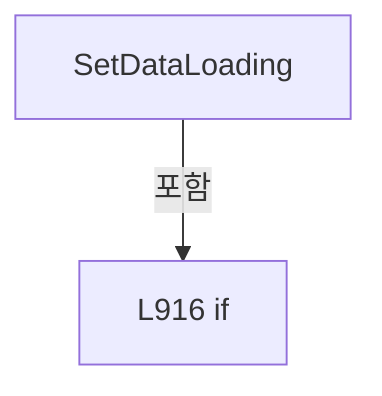

변경 전 점검: 입력/반환 타입, 위 호출자, 예외/취소 경로, 공유 상태와 저장·전송 소비자를 함께 확인합니다. 값의 단위나 물리 방향을 이름만으로 확정하지 않습니다.

### MethodDeclaration `SetLoadProgress` · L928–934

[Drilling.UI/Menu/Menus/CMenuCorrection.ReviewData.Display.cs:928–934](https://github.com/kjuws10-rgb/A3Drilling/blob/5aee8e58439c9b455cae7c9593c9be986c3e682e/Drilling.UI/Menu/Menus/CMenuCorrection.ReviewData.Display.cs#L928-L934)

| 항목 | 실제 추출 값 |
| --- | --- |
| 서명 | void Drilling.UI.Menu.Menus.CMenuCorrection.CReviewDataPanel.SetLoadProgress(double, string) |
| 접근/수식자 | Private / private |
| 반환/값 타입 | void |
| 소속 타입 | NamedType:Drilling.UI.Menu.Menus.CMenuCorrection.CReviewDataPanel |

입력 계약:

| 이름 | 타입 | 전달 | 선택/기본값 |
| --- | --- | --- | --- |
| value | double | None | False /  |
| text | string | None | False /  |

정적 호출자로 확인된 위치:

| 호출 파일/행 | 호출 표현식 | 런타임 분기 가능 |
| --- | --- | --- |
| [Drilling.UI/Menu/Menus/CMenuCorrection.ReviewData.Display.cs:109–109](https://github.com/kjuws10-rgb/A3Drilling/blob/5aee8e58439c9b455cae7c9593c9be986c3e682e/Drilling.UI/Menu/Menus/CMenuCorrection.ReviewData.Display.cs#L109-L109) | SetLoadProgress | False |
| [Drilling.UI/Menu/Menus/CMenuCorrection.ReviewData.Display.cs:121–121](https://github.com/kjuws10-rgb/A3Drilling/blob/5aee8e58439c9b455cae7c9593c9be986c3e682e/Drilling.UI/Menu/Menus/CMenuCorrection.ReviewData.Display.cs#L121-L121) | SetLoadProgress | False |
| [Drilling.UI/Menu/Menus/CMenuCorrection.ReviewData.Display.cs:135–135](https://github.com/kjuws10-rgb/A3Drilling/blob/5aee8e58439c9b455cae7c9593c9be986c3e682e/Drilling.UI/Menu/Menus/CMenuCorrection.ReviewData.Display.cs#L135-L135) | SetLoadProgress | False |
| [Drilling.UI/Menu/Menus/CMenuCorrection.ReviewData.Display.cs:145–145](https://github.com/kjuws10-rgb/A3Drilling/blob/5aee8e58439c9b455cae7c9593c9be986c3e682e/Drilling.UI/Menu/Menus/CMenuCorrection.ReviewData.Display.cs#L145-L145) | SetLoadProgress | False |
| [Drilling.UI/Menu/Menus/CMenuCorrection.ReviewData.Display.cs:147–147](https://github.com/kjuws10-rgb/A3Drilling/blob/5aee8e58439c9b455cae7c9593c9be986c3e682e/Drilling.UI/Menu/Menus/CMenuCorrection.ReviewData.Display.cs#L147-L147) | SetLoadProgress | False |

호출하는 대상과 해석 범위:

| 원본 행 | 표현식 | 분석 상태 | 대상/소스 위치 |
| --- | --- | --- | --- |
| 930 | Math.Clamp | resolved | double System.Math.Clamp(double, double, double) |
| 932 | Notify | resolved | void Drilling.UI.Menu.Menus.CMenuCorrection.CReviewDataPanel.Notify(string) · Drilling.UI/Menu/Menus/CMenuCorrection.ReviewData.cs:355 |
| 932 | nameof | unresolved | None |
| 933 | Notify | resolved | void Drilling.UI.Menu.Menus.CMenuCorrection.CReviewDataPanel.Notify(string) · Drilling.UI/Menu/Menus/CMenuCorrection.ReviewData.cs:355 |
| 933 | nameof | unresolved | None |

본문의 실제 연산·분기·예외·반환 순서(원문 위치 순):

| 원본 행 | 종류 | 주석 해설 |
| --- | --- | --- |
| 930 | assignment | 값을 대상에 대입합니다: _loadProgress = Math.Clamp(value, 0.0, 100.0) |
| 930 | call | 함수·델리게이트 또는 객체 생성자를 호출합니다: Math.Clamp(value, 0.0, 100.0) |
| 931 | assignment | 값을 대상에 대입합니다: _loadProgressText = text |
| 932 | call | 함수·델리게이트 또는 객체 생성자를 호출합니다: Notify(nameof(LoadProgress)) |
| 932 | call | 함수·델리게이트 또는 객체 생성자를 호출합니다: nameof(LoadProgress) |
| 933 | call | 함수·델리게이트 또는 객체 생성자를 호출합니다: Notify(nameof(LoadProgressText)) |
| 933 | call | 함수·델리게이트 또는 객체 생성자를 호출합니다: nameof(LoadProgressText) |

변경 전 점검: 입력/반환 타입, 위 호출자, 예외/취소 경로, 공유 상태와 저장·전송 소비자를 함께 확인합니다. 값의 단위나 물리 방향을 이름만으로 확정하지 않습니다.

### MethodDeclaration `SetDataLoadHint` · L936–942

[Drilling.UI/Menu/Menus/CMenuCorrection.ReviewData.Display.cs:936–942](https://github.com/kjuws10-rgb/A3Drilling/blob/5aee8e58439c9b455cae7c9593c9be986c3e682e/Drilling.UI/Menu/Menus/CMenuCorrection.ReviewData.Display.cs#L936-L942)

| 항목 | 실제 추출 값 |
| --- | --- |
| 서명 | void Drilling.UI.Menu.Menus.CMenuCorrection.CReviewDataPanel.SetDataLoadHint(string, string) |
| 접근/수식자 | Private / private |
| 반환/값 타입 | void |
| 소속 타입 | NamedType:Drilling.UI.Menu.Menus.CMenuCorrection.CReviewDataPanel |

입력 계약:

| 이름 | 타입 | 전달 | 선택/기본값 |
| --- | --- | --- | --- |
| message | string | None | False /  |
| state | string | None | False /  |

정적 호출자로 확인된 위치:

| 호출 파일/행 | 호출 표현식 | 런타임 분기 가능 |
| --- | --- | --- |
| [Drilling.UI/Menu/Menus/CMenuCorrection.ReviewData.Display.cs:70–70](https://github.com/kjuws10-rgb/A3Drilling/blob/5aee8e58439c9b455cae7c9593c9be986c3e682e/Drilling.UI/Menu/Menus/CMenuCorrection.ReviewData.Display.cs#L70-L70) | SetDataLoadHint | False |
| [Drilling.UI/Menu/Menus/CMenuCorrection.ReviewData.Display.cs:75–75](https://github.com/kjuws10-rgb/A3Drilling/blob/5aee8e58439c9b455cae7c9593c9be986c3e682e/Drilling.UI/Menu/Menus/CMenuCorrection.ReviewData.Display.cs#L75-L75) | SetDataLoadHint | False |
| [Drilling.UI/Menu/Menus/CMenuCorrection.ReviewData.Display.cs:80–80](https://github.com/kjuws10-rgb/A3Drilling/blob/5aee8e58439c9b455cae7c9593c9be986c3e682e/Drilling.UI/Menu/Menus/CMenuCorrection.ReviewData.Display.cs#L80-L80) | SetDataLoadHint | False |
| [Drilling.UI/Menu/Menus/CMenuCorrection.ReviewData.Display.cs:84–84](https://github.com/kjuws10-rgb/A3Drilling/blob/5aee8e58439c9b455cae7c9593c9be986c3e682e/Drilling.UI/Menu/Menus/CMenuCorrection.ReviewData.Display.cs#L84-L84) | SetDataLoadHint | False |
| [Drilling.UI/Menu/Menus/CMenuCorrection.ReviewData.Display.cs:110–110](https://github.com/kjuws10-rgb/A3Drilling/blob/5aee8e58439c9b455cae7c9593c9be986c3e682e/Drilling.UI/Menu/Menus/CMenuCorrection.ReviewData.Display.cs#L110-L110) | SetDataLoadHint | False |
| [Drilling.UI/Menu/Menus/CMenuCorrection.ReviewData.Display.cs:148–148](https://github.com/kjuws10-rgb/A3Drilling/blob/5aee8e58439c9b455cae7c9593c9be986c3e682e/Drilling.UI/Menu/Menus/CMenuCorrection.ReviewData.Display.cs#L148-L148) | SetDataLoadHint | False |
| [Drilling.UI/Menu/Menus/CMenuCorrection.ReviewData.Display.cs:155–155](https://github.com/kjuws10-rgb/A3Drilling/blob/5aee8e58439c9b455cae7c9593c9be986c3e682e/Drilling.UI/Menu/Menus/CMenuCorrection.ReviewData.Display.cs#L155-L155) | SetDataLoadHint | False |
| [Drilling.UI/Menu/Menus/CMenuCorrection.ReviewData.Display.cs:163–163](https://github.com/kjuws10-rgb/A3Drilling/blob/5aee8e58439c9b455cae7c9593c9be986c3e682e/Drilling.UI/Menu/Menus/CMenuCorrection.ReviewData.Display.cs#L163-L163) | SetDataLoadHint | False |

호출하는 대상과 해석 범위:

| 원본 행 | 표현식 | 분석 상태 | 대상/소스 위치 |
| --- | --- | --- | --- |
| 939 | CStatusBrush.ForDisplayState | resolved | Brush Drilling.UI.Menu.Menus.CStatusBrush.ForDisplayState(string) · Drilling.UI/Menu/Menus/CMenuBase.cs:294 |
| 940 | Notify | resolved | void Drilling.UI.Menu.Menus.CMenuCorrection.CReviewDataPanel.Notify(string) · Drilling.UI/Menu/Menus/CMenuCorrection.ReviewData.cs:355 |
| 940 | nameof | unresolved | None |
| 941 | Notify | resolved | void Drilling.UI.Menu.Menus.CMenuCorrection.CReviewDataPanel.Notify(string) · Drilling.UI/Menu/Menus/CMenuCorrection.ReviewData.cs:355 |
| 941 | nameof | unresolved | None |

본문의 실제 연산·분기·예외·반환 순서(원문 위치 순):

| 원본 행 | 종류 | 주석 해설 |
| --- | --- | --- |
| 938 | assignment | 값을 대상에 대입합니다: _dataLoadHint = message |
| 939 | assignment | 값을 대상에 대입합니다: _dataLoadHintBrush = CStatusBrush.ForDisplayState(state) |
| 939 | call | 함수·델리게이트 또는 객체 생성자를 호출합니다: CStatusBrush.ForDisplayState(state) |
| 940 | call | 함수·델리게이트 또는 객체 생성자를 호출합니다: Notify(nameof(DataLoadHint)) |
| 940 | call | 함수·델리게이트 또는 객체 생성자를 호출합니다: nameof(DataLoadHint) |
| 941 | call | 함수·델리게이트 또는 객체 생성자를 호출합니다: Notify(nameof(DataLoadHintBrush)) |
| 941 | call | 함수·델리게이트 또는 객체 생성자를 호출합니다: nameof(DataLoadHintBrush) |

변경 전 점검: 입력/반환 타입, 위 호출자, 예외/취소 경로, 공유 상태와 저장·전송 소비자를 함께 확인합니다. 값의 단위나 물리 방향을 이름만으로 확정하지 않습니다.

### MethodDeclaration `NotifyLoadCommandState` · L944–955

[Drilling.UI/Menu/Menus/CMenuCorrection.ReviewData.Display.cs:944–955](https://github.com/kjuws10-rgb/A3Drilling/blob/5aee8e58439c9b455cae7c9593c9be986c3e682e/Drilling.UI/Menu/Menus/CMenuCorrection.ReviewData.Display.cs#L944-L955)

| 항목 | 실제 추출 값 |
| --- | --- |
| 서명 | void Drilling.UI.Menu.Menus.CMenuCorrection.CReviewDataPanel.NotifyLoadCommandState() |
| 접근/수식자 | Private / private |
| 반환/값 타입 | void |
| 소속 타입 | NamedType:Drilling.UI.Menu.Menus.CMenuCorrection.CReviewDataPanel |

정적 호출자로 확인된 위치:

| 호출 파일/행 | 호출 표현식 | 런타임 분기 가능 |
| --- | --- | --- |
| [Drilling.UI/Menu/Menus/CMenuCorrection.ReviewData.Display.cs:87–87](https://github.com/kjuws10-rgb/A3Drilling/blob/5aee8e58439c9b455cae7c9593c9be986c3e682e/Drilling.UI/Menu/Menus/CMenuCorrection.ReviewData.Display.cs#L87-L87) | NotifyLoadCommandState | False |
| [Drilling.UI/Menu/Menus/CMenuCorrection.ReviewData.Display.cs:924–924](https://github.com/kjuws10-rgb/A3Drilling/blob/5aee8e58439c9b455cae7c9593c9be986c3e682e/Drilling.UI/Menu/Menus/CMenuCorrection.ReviewData.Display.cs#L924-L924) | NotifyLoadCommandState | False |
| [Drilling.UI/Menu/Menus/CMenuCorrection.ReviewData.Display.cs:974–974](https://github.com/kjuws10-rgb/A3Drilling/blob/5aee8e58439c9b455cae7c9593c9be986c3e682e/Drilling.UI/Menu/Menus/CMenuCorrection.ReviewData.Display.cs#L974-L974) | NotifyLoadCommandState | False |
| [Drilling.UI/Menu/Menus/CMenuCorrection.ReviewData.Offset.cs:546–546](https://github.com/kjuws10-rgb/A3Drilling/blob/5aee8e58439c9b455cae7c9593c9be986c3e682e/Drilling.UI/Menu/Menus/CMenuCorrection.ReviewData.Offset.cs#L546-L546) | NotifyLoadCommandState | False |
| [Drilling.UI/Menu/Menus/CMenuCorrection.ReviewData.Offset.cs:556–556](https://github.com/kjuws10-rgb/A3Drilling/blob/5aee8e58439c9b455cae7c9593c9be986c3e682e/Drilling.UI/Menu/Menus/CMenuCorrection.ReviewData.Offset.cs#L556-L556) | NotifyLoadCommandState | False |
| [Drilling.UI/Menu/Menus/CMenuCorrection.ReviewData.cs:89–89](https://github.com/kjuws10-rgb/A3Drilling/blob/5aee8e58439c9b455cae7c9593c9be986c3e682e/Drilling.UI/Menu/Menus/CMenuCorrection.ReviewData.cs#L89-L89) | NotifyLoadCommandState | False |

호출하는 대상과 해석 범위:

| 원본 행 | 표현식 | 분석 상태 | 대상/소스 위치 |
| --- | --- | --- | --- |
| 946 | Notify | resolved | void Drilling.UI.Menu.Menus.CMenuCorrection.CReviewDataPanel.Notify(string) · Drilling.UI/Menu/Menus/CMenuCorrection.ReviewData.cs:355 |
| 946 | nameof | unresolved | None |
| 947 | Notify | resolved | void Drilling.UI.Menu.Menus.CMenuCorrection.CReviewDataPanel.Notify(string) · Drilling.UI/Menu/Menus/CMenuCorrection.ReviewData.cs:355 |
| 947 | nameof | unresolved | None |
| 948 | Notify | resolved | void Drilling.UI.Menu.Menus.CMenuCorrection.CReviewDataPanel.Notify(string) · Drilling.UI/Menu/Menus/CMenuCorrection.ReviewData.cs:355 |
| 948 | nameof | unresolved | None |
| 949 | Notify | resolved | void Drilling.UI.Menu.Menus.CMenuCorrection.CReviewDataPanel.Notify(string) · Drilling.UI/Menu/Menus/CMenuCorrection.ReviewData.cs:355 |
| 949 | nameof | unresolved | None |
| 950 | LoadDataCommand.NotifyCanExecuteChanged | resolved | void Drilling.UI.Menu.CButtonCommand.NotifyCanExecuteChanged() · Drilling.UI/Menu/CButtonCommand.cs:24 |
| 951 | OffsetApplyCommand.NotifyCanExecuteChanged | resolved | void Drilling.UI.Menu.CButtonCommand.NotifyCanExecuteChanged() · Drilling.UI/Menu/CButtonCommand.cs:24 |
| 952 | OffsetRollbackCommand.NotifyCanExecuteChanged | resolved | void Drilling.UI.Menu.CButtonCommand.NotifyCanExecuteChanged() · Drilling.UI/Menu/CButtonCommand.cs:24 |
| 953 | OffsetInitCommand.NotifyCanExecuteChanged | resolved | void Drilling.UI.Menu.CButtonCommand.NotifyCanExecuteChanged() · Drilling.UI/Menu/CButtonCommand.cs:24 |
| 954 | OffsetViewCommand.NotifyCanExecuteChanged | resolved | void Drilling.UI.Menu.CButtonCommand.NotifyCanExecuteChanged() · Drilling.UI/Menu/CButtonCommand.cs:24 |

본문의 실제 연산·분기·예외·반환 순서(원문 위치 순):

| 원본 행 | 종류 | 주석 해설 |
| --- | --- | --- |
| 946 | call | 함수·델리게이트 또는 객체 생성자를 호출합니다: Notify(nameof(CanLoadData)) |
| 946 | call | 함수·델리게이트 또는 객체 생성자를 호출합니다: nameof(CanLoadData) |
| 947 | call | 함수·델리게이트 또는 객체 생성자를 호출합니다: Notify(nameof(CanApplyOffset)) |
| 947 | call | 함수·델리게이트 또는 객체 생성자를 호출합니다: nameof(CanApplyOffset) |
| 948 | call | 함수·델리게이트 또는 객체 생성자를 호출합니다: Notify(nameof(CanEditOffsets)) |
| 948 | call | 함수·델리게이트 또는 객체 생성자를 호출합니다: nameof(CanEditOffsets) |
| 949 | call | 함수·델리게이트 또는 객체 생성자를 호출합니다: Notify(nameof(OffsetActionHint)) |
| 949 | call | 함수·델리게이트 또는 객체 생성자를 호출합니다: nameof(OffsetActionHint) |
| 950 | call | 함수·델리게이트 또는 객체 생성자를 호출합니다: LoadDataCommand.NotifyCanExecuteChanged() |
| 951 | call | 함수·델리게이트 또는 객체 생성자를 호출합니다: OffsetApplyCommand.NotifyCanExecuteChanged() |
| 952 | call | 함수·델리게이트 또는 객체 생성자를 호출합니다: OffsetRollbackCommand.NotifyCanExecuteChanged() |
| 953 | call | 함수·델리게이트 또는 객체 생성자를 호출합니다: OffsetInitCommand.NotifyCanExecuteChanged() |
| 954 | call | 함수·델리게이트 또는 객체 생성자를 호출합니다: OffsetViewCommand.NotifyCanExecuteChanged() |

변경 전 점검: 입력/반환 타입, 위 호출자, 예외/취소 경로, 공유 상태와 저장·전송 소비자를 함께 확인합니다. 값의 단위나 물리 방향을 이름만으로 확정하지 않습니다.

### MethodDeclaration `NotifyDisplayState` · L957–976

[Drilling.UI/Menu/Menus/CMenuCorrection.ReviewData.Display.cs:957–976](https://github.com/kjuws10-rgb/A3Drilling/blob/5aee8e58439c9b455cae7c9593c9be986c3e682e/Drilling.UI/Menu/Menus/CMenuCorrection.ReviewData.Display.cs#L957-L976)

| 항목 | 실제 추출 값 |
| --- | --- |
| 서명 | void Drilling.UI.Menu.Menus.CMenuCorrection.CReviewDataPanel.NotifyDisplayState() |
| 접근/수식자 | Private / private |
| 반환/값 타입 | void |
| 소속 타입 | NamedType:Drilling.UI.Menu.Menus.CMenuCorrection.CReviewDataPanel |

정적 호출자로 확인된 위치:

| 호출 파일/행 | 호출 표현식 | 런타임 분기 가능 |
| --- | --- | --- |
| [Drilling.UI/Menu/Menus/CMenuCorrection.ReviewData.Display.cs:440–440](https://github.com/kjuws10-rgb/A3Drilling/blob/5aee8e58439c9b455cae7c9593c9be986c3e682e/Drilling.UI/Menu/Menus/CMenuCorrection.ReviewData.Display.cs#L440-L440) | NotifyDisplayState | False |
| [Drilling.UI/Menu/Menus/CMenuCorrection.ReviewData.Display.cs:490–490](https://github.com/kjuws10-rgb/A3Drilling/blob/5aee8e58439c9b455cae7c9593c9be986c3e682e/Drilling.UI/Menu/Menus/CMenuCorrection.ReviewData.Display.cs#L490-L490) | NotifyDisplayState | False |
| [Drilling.UI/Menu/Menus/CMenuCorrection.ReviewData.Display.cs:911–911](https://github.com/kjuws10-rgb/A3Drilling/blob/5aee8e58439c9b455cae7c9593c9be986c3e682e/Drilling.UI/Menu/Menus/CMenuCorrection.ReviewData.Display.cs#L911-L911) | NotifyDisplayState | False |

호출하는 대상과 해석 범위:

| 원본 행 | 표현식 | 분석 상태 | 대상/소스 위치 |
| --- | --- | --- | --- |
| 959 | Notify | resolved | void Drilling.UI.Menu.Menus.CMenuCorrection.CReviewDataPanel.Notify(string) · Drilling.UI/Menu/Menus/CMenuCorrection.ReviewData.cs:355 |
| 959 | nameof | unresolved | None |
| 960 | Notify | resolved | void Drilling.UI.Menu.Menus.CMenuCorrection.CReviewDataPanel.Notify(string) · Drilling.UI/Menu/Menus/CMenuCorrection.ReviewData.cs:355 |
| 960 | nameof | unresolved | None |
| 961 | Notify | resolved | void Drilling.UI.Menu.Menus.CMenuCorrection.CReviewDataPanel.Notify(string) · Drilling.UI/Menu/Menus/CMenuCorrection.ReviewData.cs:355 |
| 961 | nameof | unresolved | None |
| 962 | Notify | resolved | void Drilling.UI.Menu.Menus.CMenuCorrection.CReviewDataPanel.Notify(string) · Drilling.UI/Menu/Menus/CMenuCorrection.ReviewData.cs:355 |
| 962 | nameof | unresolved | None |
| 963 | Notify | resolved | void Drilling.UI.Menu.Menus.CMenuCorrection.CReviewDataPanel.Notify(string) · Drilling.UI/Menu/Menus/CMenuCorrection.ReviewData.cs:355 |
| 963 | nameof | unresolved | None |
| 964 | Notify | resolved | void Drilling.UI.Menu.Menus.CMenuCorrection.CReviewDataPanel.Notify(string) · Drilling.UI/Menu/Menus/CMenuCorrection.ReviewData.cs:355 |
| 964 | nameof | unresolved | None |
| 965 | Notify | resolved | void Drilling.UI.Menu.Menus.CMenuCorrection.CReviewDataPanel.Notify(string) · Drilling.UI/Menu/Menus/CMenuCorrection.ReviewData.cs:355 |
| 965 | nameof | unresolved | None |
| 966 | Notify | resolved | void Drilling.UI.Menu.Menus.CMenuCorrection.CReviewDataPanel.Notify(string) · Drilling.UI/Menu/Menus/CMenuCorrection.ReviewData.cs:355 |
| 966 | nameof | unresolved | None |
| 967 | Notify | resolved | void Drilling.UI.Menu.Menus.CMenuCorrection.CReviewDataPanel.Notify(string) · Drilling.UI/Menu/Menus/CMenuCorrection.ReviewData.cs:355 |
| 967 | nameof | unresolved | None |
| 968 | Notify | resolved | void Drilling.UI.Menu.Menus.CMenuCorrection.CReviewDataPanel.Notify(string) · Drilling.UI/Menu/Menus/CMenuCorrection.ReviewData.cs:355 |
| 968 | nameof | unresolved | None |
| 969 | Notify | resolved | void Drilling.UI.Menu.Menus.CMenuCorrection.CReviewDataPanel.Notify(string) · Drilling.UI/Menu/Menus/CMenuCorrection.ReviewData.cs:355 |
| 969 | nameof | unresolved | None |
| 970 | Notify | resolved | void Drilling.UI.Menu.Menus.CMenuCorrection.CReviewDataPanel.Notify(string) · Drilling.UI/Menu/Menus/CMenuCorrection.ReviewData.cs:355 |
| 970 | nameof | unresolved | None |
| 971 | Notify | resolved | void Drilling.UI.Menu.Menus.CMenuCorrection.CReviewDataPanel.Notify(string) · Drilling.UI/Menu/Menus/CMenuCorrection.ReviewData.cs:355 |
| 971 | nameof | unresolved | None |
| 972 | Notify | resolved | void Drilling.UI.Menu.Menus.CMenuCorrection.CReviewDataPanel.Notify(string) · Drilling.UI/Menu/Menus/CMenuCorrection.ReviewData.cs:355 |
| 972 | nameof | unresolved | None |
| 973 | Notify | resolved | void Drilling.UI.Menu.Menus.CMenuCorrection.CReviewDataPanel.Notify(string) · Drilling.UI/Menu/Menus/CMenuCorrection.ReviewData.cs:355 |
| 973 | nameof | unresolved | None |
| 974 | NotifyLoadCommandState | resolved | void Drilling.UI.Menu.Menus.CMenuCorrection.CReviewDataPanel.NotifyLoadCommandState() · Drilling.UI/Menu/Menus/CMenuCorrection.ReviewData.Display.cs:944 |
| 975 | NotifyReinspectionCommandState | resolved | void Drilling.UI.Menu.Menus.CMenuCorrection.CReviewDataPanel.NotifyReinspectionCommandState() · Drilling.UI/Menu/Menus/CMenuCorrection.ReviewData.Reinspection.cs:698 |

본문의 실제 연산·분기·예외·반환 순서(원문 위치 순):

| 원본 행 | 종류 | 주석 해설 |
| --- | --- | --- |
| 959 | call | 함수·델리게이트 또는 객체 생성자를 호출합니다: Notify(nameof(HasLoadedData)) |
| 959 | call | 함수·델리게이트 또는 객체 생성자를 호출합니다: nameof(HasLoadedData) |
| 960 | call | 함수·델리게이트 또는 객체 생성자를 호출합니다: Notify(nameof(ShowDataPlaceholder)) |
| 960 | call | 함수·델리게이트 또는 객체 생성자를 호출합니다: nameof(ShowDataPlaceholder) |
| 961 | call | 함수·델리게이트 또는 객체 생성자를 호출합니다: Notify(nameof(GlassPreviewImage)) |
| 961 | call | 함수·델리게이트 또는 객체 생성자를 호출합니다: nameof(GlassPreviewImage) |
| 962 | call | 함수·델리게이트 또는 객체 생성자를 호출합니다: Notify(nameof(ShotMapImage)) |
| 962 | call | 함수·델리게이트 또는 객체 생성자를 호출합니다: nameof(ShotMapImage) |
| 963 | call | 함수·델리게이트 또는 객체 생성자를 호출합니다: Notify(nameof(CellLabels)) |
| 963 | call | 함수·델리게이트 또는 객체 생성자를 호출합니다: nameof(CellLabels) |
| 964 | call | 함수·델리게이트 또는 객체 생성자를 호출합니다: Notify(nameof(Rows)) |
| 964 | call | 함수·델리게이트 또는 객체 생성자를 호출합니다: nameof(Rows) |
| 965 | call | 함수·델리게이트 또는 객체 생성자를 호출합니다: Notify(nameof(SelectedRow)) |
| 965 | call | 함수·델리게이트 또는 객체 생성자를 호출합니다: nameof(SelectedRow) |
| 966 | call | 함수·델리게이트 또는 객체 생성자를 호출합니다: Notify(nameof(GlassSummary)) |
| 966 | call | 함수·델리게이트 또는 객체 생성자를 호출합니다: nameof(GlassSummary) |
| 967 | call | 함수·델리게이트 또는 객체 생성자를 호출합니다: Notify(nameof(SelectedCellTitle)) |
| 967 | call | 함수·델리게이트 또는 객체 생성자를 호출합니다: nameof(SelectedCellTitle) |
| 968 | call | 함수·델리게이트 또는 객체 생성자를 호출합니다: Notify(nameof(SelectedShotTitle)) |
| 968 | call | 함수·델리게이트 또는 객체 생성자를 호출합니다: nameof(SelectedShotTitle) |
| 969 | call | 함수·델리게이트 또는 객체 생성자를 호출합니다: Notify(nameof(SelectedShotDetail)) |
| 969 | call | 함수·델리게이트 또는 객체 생성자를 호출합니다: nameof(SelectedShotDetail) |
| 970 | call | 함수·델리게이트 또는 객체 생성자를 호출합니다: Notify(nameof(GlassSurfaceWidth)) |
| 970 | call | 함수·델리게이트 또는 객체 생성자를 호출합니다: nameof(GlassSurfaceWidth) |
| 971 | call | 함수·델리게이트 또는 객체 생성자를 호출합니다: Notify(nameof(GlassSurfaceHeight)) |
| 971 | call | 함수·델리게이트 또는 객체 생성자를 호출합니다: nameof(GlassSurfaceHeight) |
| 972 | call | 함수·델리게이트 또는 객체 생성자를 호출합니다: Notify(nameof(ShotMapSurfaceWidth)) |
| 972 | call | 함수·델리게이트 또는 객체 생성자를 호출합니다: nameof(ShotMapSurfaceWidth) |
| 973 | call | 함수·델리게이트 또는 객체 생성자를 호출합니다: Notify(nameof(ShotMapSurfaceHeight)) |
| 973 | call | 함수·델리게이트 또는 객체 생성자를 호출합니다: nameof(ShotMapSurfaceHeight) |
| 974 | call | 함수·델리게이트 또는 객체 생성자를 호출합니다: NotifyLoadCommandState() |
| 975 | call | 함수·델리게이트 또는 객체 생성자를 호출합니다: NotifyReinspectionCommandState() |

변경 전 점검: 입력/반환 타입, 위 호출자, 예외/취소 경로, 공유 상태와 저장·전송 소비자를 함께 확인합니다. 값의 단위나 물리 방향을 이름만으로 확정하지 않습니다.

### PropertyDeclaration `Height` · L1001–1001

[Drilling.UI/Menu/Menus/CMenuCorrection.ReviewData.Display.cs:1001–1001](https://github.com/kjuws10-rgb/A3Drilling/blob/5aee8e58439c9b455cae7c9593c9be986c3e682e/Drilling.UI/Menu/Menus/CMenuCorrection.ReviewData.Display.cs#L1001-L1001)

| 항목 | 실제 추출 값 |
| --- | --- |
| 서명 | double Drilling.UI.Menu.Menus.CMenuCorrection.ST_REVIEW_DATA_CELL_LABEL.Height |
| 접근/수식자 | Public / public |
| 반환/값 타입 | double |
| 소속 타입 | NamedType:Drilling.UI.Menu.Menus.CMenuCorrection.ST_REVIEW_DATA_CELL_LABEL |

현재 부분 분석에서 직접 연결된 호출자는 없습니다. XAML/이벤트/인터페이스·델리게이트·외부 진입을 추가 확인해야 하며, 미사용으로 판정한 것이 아닙니다.

변경 전 점검: 입력/반환 타입, 위 호출자, 예외/취소 경로, 공유 상태와 저장·전송 소비자를 함께 확인합니다. 값의 단위나 물리 방향을 이름만으로 확정하지 않습니다.

### PropertyDeclaration `Left` · L1002–1002

[Drilling.UI/Menu/Menus/CMenuCorrection.ReviewData.Display.cs:1002–1002](https://github.com/kjuws10-rgb/A3Drilling/blob/5aee8e58439c9b455cae7c9593c9be986c3e682e/Drilling.UI/Menu/Menus/CMenuCorrection.ReviewData.Display.cs#L1002-L1002)

| 항목 | 실제 추출 값 |
| --- | --- |
| 서명 | double Drilling.UI.Menu.Menus.CMenuCorrection.ST_REVIEW_DATA_CELL_LABEL.Left |
| 접근/수식자 | Public / public |
| 반환/값 타입 | double |
| 소속 타입 | NamedType:Drilling.UI.Menu.Menus.CMenuCorrection.ST_REVIEW_DATA_CELL_LABEL |

현재 부분 분석에서 직접 연결된 호출자는 없습니다. XAML/이벤트/인터페이스·델리게이트·외부 진입을 추가 확인해야 하며, 미사용으로 판정한 것이 아닙니다.

변경 전 점검: 입력/반환 타입, 위 호출자, 예외/취소 경로, 공유 상태와 저장·전송 소비자를 함께 확인합니다. 값의 단위나 물리 방향을 이름만으로 확정하지 않습니다.

### PropertyDeclaration `Top` · L1003–1003

[Drilling.UI/Menu/Menus/CMenuCorrection.ReviewData.Display.cs:1003–1003](https://github.com/kjuws10-rgb/A3Drilling/blob/5aee8e58439c9b455cae7c9593c9be986c3e682e/Drilling.UI/Menu/Menus/CMenuCorrection.ReviewData.Display.cs#L1003-L1003)

| 항목 | 실제 추출 값 |
| --- | --- |
| 서명 | double Drilling.UI.Menu.Menus.CMenuCorrection.ST_REVIEW_DATA_CELL_LABEL.Top |
| 접근/수식자 | Public / public |
| 반환/값 타입 | double |
| 소속 타입 | NamedType:Drilling.UI.Menu.Menus.CMenuCorrection.ST_REVIEW_DATA_CELL_LABEL |

현재 부분 분석에서 직접 연결된 호출자는 없습니다. XAML/이벤트/인터페이스·델리게이트·외부 진입을 추가 확인해야 하며, 미사용으로 판정한 것이 아닙니다.

변경 전 점검: 입력/반환 타입, 위 호출자, 예외/취소 경로, 공유 상태와 저장·전송 소비자를 함께 확인합니다. 값의 단위나 물리 방향을 이름만으로 확정하지 않습니다.

### PropertyDeclaration `HeadNo` · L1016–1016

[Drilling.UI/Menu/Menus/CMenuCorrection.ReviewData.Display.cs:1016–1016](https://github.com/kjuws10-rgb/A3Drilling/blob/5aee8e58439c9b455cae7c9593c9be986c3e682e/Drilling.UI/Menu/Menus/CMenuCorrection.ReviewData.Display.cs#L1016-L1016)

| 항목 | 실제 추출 값 |
| --- | --- |
| 서명 | int Drilling.UI.Menu.Menus.CMenuCorrection.ST_REVIEW_DATA_SHOT_POSITION.HeadNo |
| 접근/수식자 | Public / public |
| 반환/값 타입 | int |
| 소속 타입 | NamedType:Drilling.UI.Menu.Menus.CMenuCorrection.ST_REVIEW_DATA_SHOT_POSITION |

현재 부분 분석에서 직접 연결된 호출자는 없습니다. XAML/이벤트/인터페이스·델리게이트·외부 진입을 추가 확인해야 하며, 미사용으로 판정한 것이 아닙니다.

변경 전 점검: 입력/반환 타입, 위 호출자, 예외/취소 경로, 공유 상태와 저장·전송 소비자를 함께 확인합니다. 값의 단위나 물리 방향을 이름만으로 확정하지 않습니다.

### GetAccessorDeclaration `get_HeadNo` · L1016–1016

[Drilling.UI/Menu/Menus/CMenuCorrection.ReviewData.Display.cs:1016–1016](https://github.com/kjuws10-rgb/A3Drilling/blob/5aee8e58439c9b455cae7c9593c9be986c3e682e/Drilling.UI/Menu/Menus/CMenuCorrection.ReviewData.Display.cs#L1016-L1016)

| 항목 | 실제 추출 값 |
| --- | --- |
| 서명 | int Drilling.UI.Menu.Menus.CMenuCorrection.ST_REVIEW_DATA_SHOT_POSITION.HeadNo.get |
| 접근/수식자 | Public / get |
| 반환/값 타입 | int |
| 소속 타입 | NamedType:Drilling.UI.Menu.Menus.CMenuCorrection.ST_REVIEW_DATA_SHOT_POSITION |

현재 부분 분석에서 직접 연결된 호출자는 없습니다. XAML/이벤트/인터페이스·델리게이트·외부 진입을 추가 확인해야 하며, 미사용으로 판정한 것이 아닙니다.

변경 전 점검: 입력/반환 타입, 위 호출자, 예외/취소 경로, 공유 상태와 저장·전송 소비자를 함께 확인합니다. 값의 단위나 물리 방향을 이름만으로 확정하지 않습니다.

### InitAccessorDeclaration `set_HeadNo` · L1016–1016

[Drilling.UI/Menu/Menus/CMenuCorrection.ReviewData.Display.cs:1016–1016](https://github.com/kjuws10-rgb/A3Drilling/blob/5aee8e58439c9b455cae7c9593c9be986c3e682e/Drilling.UI/Menu/Menus/CMenuCorrection.ReviewData.Display.cs#L1016-L1016)

| 항목 | 실제 추출 값 |
| --- | --- |
| 서명 | void Drilling.UI.Menu.Menus.CMenuCorrection.ST_REVIEW_DATA_SHOT_POSITION.HeadNo.init |
| 접근/수식자 | Public / init |
| 반환/값 타입 | void |
| 소속 타입 | NamedType:Drilling.UI.Menu.Menus.CMenuCorrection.ST_REVIEW_DATA_SHOT_POSITION |

입력 계약:

| 이름 | 타입 | 전달 | 선택/기본값 |
| --- | --- | --- | --- |
| value | int | None | False /  |

현재 부분 분석에서 직접 연결된 호출자는 없습니다. XAML/이벤트/인터페이스·델리게이트·외부 진입을 추가 확인해야 하며, 미사용으로 판정한 것이 아닙니다.

변경 전 점검: 입력/반환 타입, 위 호출자, 예외/취소 경로, 공유 상태와 저장·전송 소비자를 함께 확인합니다. 값의 단위나 물리 방향을 이름만으로 확정하지 않습니다.

### PropertyDeclaration `IsResult` · L1017–1017

[Drilling.UI/Menu/Menus/CMenuCorrection.ReviewData.Display.cs:1017–1017](https://github.com/kjuws10-rgb/A3Drilling/blob/5aee8e58439c9b455cae7c9593c9be986c3e682e/Drilling.UI/Menu/Menus/CMenuCorrection.ReviewData.Display.cs#L1017-L1017)

| 항목 | 실제 추출 값 |
| --- | --- |
| 서명 | bool Drilling.UI.Menu.Menus.CMenuCorrection.ST_REVIEW_DATA_SHOT_POSITION.IsResult |
| 접근/수식자 | Public / public |
| 반환/값 타입 | bool |
| 소속 타입 | NamedType:Drilling.UI.Menu.Menus.CMenuCorrection.ST_REVIEW_DATA_SHOT_POSITION |

현재 부분 분석에서 직접 연결된 호출자는 없습니다. XAML/이벤트/인터페이스·델리게이트·외부 진입을 추가 확인해야 하며, 미사용으로 판정한 것이 아닙니다.

변경 전 점검: 입력/반환 타입, 위 호출자, 예외/취소 경로, 공유 상태와 저장·전송 소비자를 함께 확인합니다. 값의 단위나 물리 방향을 이름만으로 확정하지 않습니다.

### GetAccessorDeclaration `get_IsResult` · L1017–1017

[Drilling.UI/Menu/Menus/CMenuCorrection.ReviewData.Display.cs:1017–1017](https://github.com/kjuws10-rgb/A3Drilling/blob/5aee8e58439c9b455cae7c9593c9be986c3e682e/Drilling.UI/Menu/Menus/CMenuCorrection.ReviewData.Display.cs#L1017-L1017)

| 항목 | 실제 추출 값 |
| --- | --- |
| 서명 | bool Drilling.UI.Menu.Menus.CMenuCorrection.ST_REVIEW_DATA_SHOT_POSITION.IsResult.get |
| 접근/수식자 | Public / get |
| 반환/값 타입 | bool |
| 소속 타입 | NamedType:Drilling.UI.Menu.Menus.CMenuCorrection.ST_REVIEW_DATA_SHOT_POSITION |

현재 부분 분석에서 직접 연결된 호출자는 없습니다. XAML/이벤트/인터페이스·델리게이트·외부 진입을 추가 확인해야 하며, 미사용으로 판정한 것이 아닙니다.

변경 전 점검: 입력/반환 타입, 위 호출자, 예외/취소 경로, 공유 상태와 저장·전송 소비자를 함께 확인합니다. 값의 단위나 물리 방향을 이름만으로 확정하지 않습니다.

### InitAccessorDeclaration `set_IsResult` · L1017–1017

[Drilling.UI/Menu/Menus/CMenuCorrection.ReviewData.Display.cs:1017–1017](https://github.com/kjuws10-rgb/A3Drilling/blob/5aee8e58439c9b455cae7c9593c9be986c3e682e/Drilling.UI/Menu/Menus/CMenuCorrection.ReviewData.Display.cs#L1017-L1017)

| 항목 | 실제 추출 값 |
| --- | --- |
| 서명 | void Drilling.UI.Menu.Menus.CMenuCorrection.ST_REVIEW_DATA_SHOT_POSITION.IsResult.init |
| 접근/수식자 | Public / init |
| 반환/값 타입 | void |
| 소속 타입 | NamedType:Drilling.UI.Menu.Menus.CMenuCorrection.ST_REVIEW_DATA_SHOT_POSITION |

입력 계약:

| 이름 | 타입 | 전달 | 선택/기본값 |
| --- | --- | --- | --- |
| value | bool | None | False /  |

현재 부분 분석에서 직접 연결된 호출자는 없습니다. XAML/이벤트/인터페이스·델리게이트·외부 진입을 추가 확인해야 하며, 미사용으로 판정한 것이 아닙니다.

변경 전 점검: 입력/반환 타입, 위 호출자, 예외/취소 경로, 공유 상태와 저장·전송 소비자를 함께 확인합니다. 값의 단위나 물리 방향을 이름만으로 확정하지 않습니다.

### PropertyDeclaration `IsMasked` · L1018–1018

[Drilling.UI/Menu/Menus/CMenuCorrection.ReviewData.Display.cs:1018–1018](https://github.com/kjuws10-rgb/A3Drilling/blob/5aee8e58439c9b455cae7c9593c9be986c3e682e/Drilling.UI/Menu/Menus/CMenuCorrection.ReviewData.Display.cs#L1018-L1018)

| 항목 | 실제 추출 값 |
| --- | --- |
| 서명 | bool Drilling.UI.Menu.Menus.CMenuCorrection.ST_REVIEW_DATA_SHOT_POSITION.IsMasked |
| 접근/수식자 | Public / public |
| 반환/값 타입 | bool |
| 소속 타입 | NamedType:Drilling.UI.Menu.Menus.CMenuCorrection.ST_REVIEW_DATA_SHOT_POSITION |

현재 부분 분석에서 직접 연결된 호출자는 없습니다. XAML/이벤트/인터페이스·델리게이트·외부 진입을 추가 확인해야 하며, 미사용으로 판정한 것이 아닙니다.

변경 전 점검: 입력/반환 타입, 위 호출자, 예외/취소 경로, 공유 상태와 저장·전송 소비자를 함께 확인합니다. 값의 단위나 물리 방향을 이름만으로 확정하지 않습니다.

### GetAccessorDeclaration `get_IsMasked` · L1018–1018

[Drilling.UI/Menu/Menus/CMenuCorrection.ReviewData.Display.cs:1018–1018](https://github.com/kjuws10-rgb/A3Drilling/blob/5aee8e58439c9b455cae7c9593c9be986c3e682e/Drilling.UI/Menu/Menus/CMenuCorrection.ReviewData.Display.cs#L1018-L1018)

| 항목 | 실제 추출 값 |
| --- | --- |
| 서명 | bool Drilling.UI.Menu.Menus.CMenuCorrection.ST_REVIEW_DATA_SHOT_POSITION.IsMasked.get |
| 접근/수식자 | Public / get |
| 반환/값 타입 | bool |
| 소속 타입 | NamedType:Drilling.UI.Menu.Menus.CMenuCorrection.ST_REVIEW_DATA_SHOT_POSITION |

현재 부분 분석에서 직접 연결된 호출자는 없습니다. XAML/이벤트/인터페이스·델리게이트·외부 진입을 추가 확인해야 하며, 미사용으로 판정한 것이 아닙니다.

변경 전 점검: 입력/반환 타입, 위 호출자, 예외/취소 경로, 공유 상태와 저장·전송 소비자를 함께 확인합니다. 값의 단위나 물리 방향을 이름만으로 확정하지 않습니다.

### InitAccessorDeclaration `set_IsMasked` · L1018–1018

[Drilling.UI/Menu/Menus/CMenuCorrection.ReviewData.Display.cs:1018–1018](https://github.com/kjuws10-rgb/A3Drilling/blob/5aee8e58439c9b455cae7c9593c9be986c3e682e/Drilling.UI/Menu/Menus/CMenuCorrection.ReviewData.Display.cs#L1018-L1018)

| 항목 | 실제 추출 값 |
| --- | --- |
| 서명 | void Drilling.UI.Menu.Menus.CMenuCorrection.ST_REVIEW_DATA_SHOT_POSITION.IsMasked.init |
| 접근/수식자 | Public / init |
| 반환/값 타입 | void |
| 소속 타입 | NamedType:Drilling.UI.Menu.Menus.CMenuCorrection.ST_REVIEW_DATA_SHOT_POSITION |

입력 계약:

| 이름 | 타입 | 전달 | 선택/기본값 |
| --- | --- | --- | --- |
| value | bool | None | False /  |

현재 부분 분석에서 직접 연결된 호출자는 없습니다. XAML/이벤트/인터페이스·델리게이트·외부 진입을 추가 확인해야 하며, 미사용으로 판정한 것이 아닙니다.

변경 전 점검: 입력/반환 타입, 위 호출자, 예외/취소 경로, 공유 상태와 저장·전송 소비자를 함께 확인합니다. 값의 단위나 물리 방향을 이름만으로 확정하지 않습니다.

### PropertyDeclaration `IsChessSkipped` · L1019–1019

[Drilling.UI/Menu/Menus/CMenuCorrection.ReviewData.Display.cs:1019–1019](https://github.com/kjuws10-rgb/A3Drilling/blob/5aee8e58439c9b455cae7c9593c9be986c3e682e/Drilling.UI/Menu/Menus/CMenuCorrection.ReviewData.Display.cs#L1019-L1019)

| 항목 | 실제 추출 값 |
| --- | --- |
| 서명 | bool Drilling.UI.Menu.Menus.CMenuCorrection.ST_REVIEW_DATA_SHOT_POSITION.IsChessSkipped |
| 접근/수식자 | Public / public |
| 반환/값 타입 | bool |
| 소속 타입 | NamedType:Drilling.UI.Menu.Menus.CMenuCorrection.ST_REVIEW_DATA_SHOT_POSITION |

현재 부분 분석에서 직접 연결된 호출자는 없습니다. XAML/이벤트/인터페이스·델리게이트·외부 진입을 추가 확인해야 하며, 미사용으로 판정한 것이 아닙니다.

변경 전 점검: 입력/반환 타입, 위 호출자, 예외/취소 경로, 공유 상태와 저장·전송 소비자를 함께 확인합니다. 값의 단위나 물리 방향을 이름만으로 확정하지 않습니다.

### GetAccessorDeclaration `get_IsChessSkipped` · L1019–1019

[Drilling.UI/Menu/Menus/CMenuCorrection.ReviewData.Display.cs:1019–1019](https://github.com/kjuws10-rgb/A3Drilling/blob/5aee8e58439c9b455cae7c9593c9be986c3e682e/Drilling.UI/Menu/Menus/CMenuCorrection.ReviewData.Display.cs#L1019-L1019)

| 항목 | 실제 추출 값 |
| --- | --- |
| 서명 | bool Drilling.UI.Menu.Menus.CMenuCorrection.ST_REVIEW_DATA_SHOT_POSITION.IsChessSkipped.get |
| 접근/수식자 | Public / get |
| 반환/값 타입 | bool |
| 소속 타입 | NamedType:Drilling.UI.Menu.Menus.CMenuCorrection.ST_REVIEW_DATA_SHOT_POSITION |

현재 부분 분석에서 직접 연결된 호출자는 없습니다. XAML/이벤트/인터페이스·델리게이트·외부 진입을 추가 확인해야 하며, 미사용으로 판정한 것이 아닙니다.

변경 전 점검: 입력/반환 타입, 위 호출자, 예외/취소 경로, 공유 상태와 저장·전송 소비자를 함께 확인합니다. 값의 단위나 물리 방향을 이름만으로 확정하지 않습니다.

### InitAccessorDeclaration `set_IsChessSkipped` · L1019–1019

[Drilling.UI/Menu/Menus/CMenuCorrection.ReviewData.Display.cs:1019–1019](https://github.com/kjuws10-rgb/A3Drilling/blob/5aee8e58439c9b455cae7c9593c9be986c3e682e/Drilling.UI/Menu/Menus/CMenuCorrection.ReviewData.Display.cs#L1019-L1019)

| 항목 | 실제 추출 값 |
| --- | --- |
| 서명 | void Drilling.UI.Menu.Menus.CMenuCorrection.ST_REVIEW_DATA_SHOT_POSITION.IsChessSkipped.init |
| 접근/수식자 | Public / init |
| 반환/값 타입 | void |
| 소속 타입 | NamedType:Drilling.UI.Menu.Menus.CMenuCorrection.ST_REVIEW_DATA_SHOT_POSITION |

입력 계약:

| 이름 | 타입 | 전달 | 선택/기본값 |
| --- | --- | --- | --- |
| value | bool | None | False /  |

현재 부분 분석에서 직접 연결된 호출자는 없습니다. XAML/이벤트/인터페이스·델리게이트·외부 진입을 추가 확인해야 하며, 미사용으로 판정한 것이 아닙니다.

변경 전 점검: 입력/반환 타입, 위 호출자, 예외/취소 경로, 공유 상태와 저장·전송 소비자를 함께 확인합니다. 값의 단위나 물리 방향을 이름만으로 확정하지 않습니다.

### PropertyDeclaration `IsReinspectionSelected` · L1037–1037

[Drilling.UI/Menu/Menus/CMenuCorrection.ReviewData.Display.cs:1037–1037](https://github.com/kjuws10-rgb/A3Drilling/blob/5aee8e58439c9b455cae7c9593c9be986c3e682e/Drilling.UI/Menu/Menus/CMenuCorrection.ReviewData.Display.cs#L1037-L1037)

| 항목 | 실제 추출 값 |
| --- | --- |
| 서명 | bool Drilling.UI.Menu.Menus.CMenuCorrection.ST_REVIEW_DATA_GRID_ROW.IsReinspectionSelected |
| 접근/수식자 | Public / public |
| 반환/값 타입 | bool |
| 소속 타입 | NamedType:Drilling.UI.Menu.Menus.CMenuCorrection.ST_REVIEW_DATA_GRID_ROW |

현재 부분 분석에서 직접 연결된 호출자는 없습니다. XAML/이벤트/인터페이스·델리게이트·외부 진입을 추가 확인해야 하며, 미사용으로 판정한 것이 아닙니다.

변경 전 점검: 입력/반환 타입, 위 호출자, 예외/취소 경로, 공유 상태와 저장·전송 소비자를 함께 확인합니다. 값의 단위나 물리 방향을 이름만으로 확정하지 않습니다.

### GetAccessorDeclaration `get_IsReinspectionSelected` · L1037–1037

[Drilling.UI/Menu/Menus/CMenuCorrection.ReviewData.Display.cs:1037–1037](https://github.com/kjuws10-rgb/A3Drilling/blob/5aee8e58439c9b455cae7c9593c9be986c3e682e/Drilling.UI/Menu/Menus/CMenuCorrection.ReviewData.Display.cs#L1037-L1037)

| 항목 | 실제 추출 값 |
| --- | --- |
| 서명 | bool Drilling.UI.Menu.Menus.CMenuCorrection.ST_REVIEW_DATA_GRID_ROW.IsReinspectionSelected.get |
| 접근/수식자 | Public / get |
| 반환/값 타입 | bool |
| 소속 타입 | NamedType:Drilling.UI.Menu.Menus.CMenuCorrection.ST_REVIEW_DATA_GRID_ROW |

현재 부분 분석에서 직접 연결된 호출자는 없습니다. XAML/이벤트/인터페이스·델리게이트·외부 진입을 추가 확인해야 하며, 미사용으로 판정한 것이 아닙니다.

변경 전 점검: 입력/반환 타입, 위 호출자, 예외/취소 경로, 공유 상태와 저장·전송 소비자를 함께 확인합니다. 값의 단위나 물리 방향을 이름만으로 확정하지 않습니다.

### SetAccessorDeclaration `set_IsReinspectionSelected` · L1037–1037

[Drilling.UI/Menu/Menus/CMenuCorrection.ReviewData.Display.cs:1037–1037](https://github.com/kjuws10-rgb/A3Drilling/blob/5aee8e58439c9b455cae7c9593c9be986c3e682e/Drilling.UI/Menu/Menus/CMenuCorrection.ReviewData.Display.cs#L1037-L1037)

| 항목 | 실제 추출 값 |
| --- | --- |
| 서명 | void Drilling.UI.Menu.Menus.CMenuCorrection.ST_REVIEW_DATA_GRID_ROW.IsReinspectionSelected.set |
| 접근/수식자 | Public / set |
| 반환/값 타입 | void |
| 소속 타입 | NamedType:Drilling.UI.Menu.Menus.CMenuCorrection.ST_REVIEW_DATA_GRID_ROW |

입력 계약:

| 이름 | 타입 | 전달 | 선택/기본값 |
| --- | --- | --- | --- |
| value | bool | None | False /  |

현재 부분 분석에서 직접 연결된 호출자는 없습니다. XAML/이벤트/인터페이스·델리게이트·외부 진입을 추가 확인해야 하며, 미사용으로 판정한 것이 아닙니다.

변경 전 점검: 입력/반환 타입, 위 호출자, 예외/취소 경로, 공유 상태와 저장·전송 소비자를 함께 확인합니다. 값의 단위나 물리 방향을 이름만으로 확정하지 않습니다.

### PropertyDeclaration `Head` · L1038–1038

[Drilling.UI/Menu/Menus/CMenuCorrection.ReviewData.Display.cs:1038–1038](https://github.com/kjuws10-rgb/A3Drilling/blob/5aee8e58439c9b455cae7c9593c9be986c3e682e/Drilling.UI/Menu/Menus/CMenuCorrection.ReviewData.Display.cs#L1038-L1038)

| 항목 | 실제 추출 값 |
| --- | --- |
| 서명 | string Drilling.UI.Menu.Menus.CMenuCorrection.ST_REVIEW_DATA_GRID_ROW.Head |
| 접근/수식자 | Public / public |
| 반환/값 타입 | string |
| 소속 타입 | NamedType:Drilling.UI.Menu.Menus.CMenuCorrection.ST_REVIEW_DATA_GRID_ROW |

현재 부분 분석에서 직접 연결된 호출자는 없습니다. XAML/이벤트/인터페이스·델리게이트·외부 진입을 추가 확인해야 하며, 미사용으로 판정한 것이 아닙니다.

변경 전 점검: 입력/반환 타입, 위 호출자, 예외/취소 경로, 공유 상태와 저장·전송 소비자를 함께 확인합니다. 값의 단위나 물리 방향을 이름만으로 확정하지 않습니다.

### PropertyDeclaration `Cell` · L1039–1039

[Drilling.UI/Menu/Menus/CMenuCorrection.ReviewData.Display.cs:1039–1039](https://github.com/kjuws10-rgb/A3Drilling/blob/5aee8e58439c9b455cae7c9593c9be986c3e682e/Drilling.UI/Menu/Menus/CMenuCorrection.ReviewData.Display.cs#L1039-L1039)

| 항목 | 실제 추출 값 |
| --- | --- |
| 서명 | string Drilling.UI.Menu.Menus.CMenuCorrection.ST_REVIEW_DATA_GRID_ROW.Cell |
| 접근/수식자 | Public / public |
| 반환/값 타입 | string |
| 소속 타입 | NamedType:Drilling.UI.Menu.Menus.CMenuCorrection.ST_REVIEW_DATA_GRID_ROW |

현재 부분 분석에서 직접 연결된 호출자는 없습니다. XAML/이벤트/인터페이스·델리게이트·외부 진입을 추가 확인해야 하며, 미사용으로 판정한 것이 아닙니다.

변경 전 점검: 입력/반환 타입, 위 호출자, 예외/취소 경로, 공유 상태와 저장·전송 소비자를 함께 확인합니다. 값의 단위나 물리 방향을 이름만으로 확정하지 않습니다.

### PropertyDeclaration `Beam` · L1040–1040

[Drilling.UI/Menu/Menus/CMenuCorrection.ReviewData.Display.cs:1040–1040](https://github.com/kjuws10-rgb/A3Drilling/blob/5aee8e58439c9b455cae7c9593c9be986c3e682e/Drilling.UI/Menu/Menus/CMenuCorrection.ReviewData.Display.cs#L1040-L1040)

| 항목 | 실제 추출 값 |
| --- | --- |
| 서명 | string Drilling.UI.Menu.Menus.CMenuCorrection.ST_REVIEW_DATA_GRID_ROW.Beam |
| 접근/수식자 | Public / public |
| 반환/값 타입 | string |
| 소속 타입 | NamedType:Drilling.UI.Menu.Menus.CMenuCorrection.ST_REVIEW_DATA_GRID_ROW |

현재 부분 분석에서 직접 연결된 호출자는 없습니다. XAML/이벤트/인터페이스·델리게이트·외부 진입을 추가 확인해야 하며, 미사용으로 판정한 것이 아닙니다.

호출하는 대상과 해석 범위:

| 원본 행 | 표현식 | 분석 상태 | 대상/소스 위치 |
| --- | --- | --- | --- |
| 1040 | BeamNo.ToString | resolved | string int.ToString(System.IFormatProvider?) |

본문의 실제 연산·분기·예외·반환 순서(원문 위치 순):

| 원본 행 | 종류 | 주석 해설 |
| --- | --- | --- |
| 1040 | call | 함수·델리게이트 또는 객체 생성자를 호출합니다: BeamNo.ToString(CultureInfo.InvariantCulture) |
| 1040 | conditional-expression | 조건에 따라 결과식을 선택합니다: BeamNo > 0 ? BeamNo.ToString(CultureInfo.InvariantCulture) : "-" |

변경 전 점검: 입력/반환 타입, 위 호출자, 예외/취소 경로, 공유 상태와 저장·전송 소비자를 함께 확인합니다. 값의 단위나 물리 방향을 이름만으로 확정하지 않습니다.

### PropertyDeclaration `ResultXText` · L1041–1041

[Drilling.UI/Menu/Menus/CMenuCorrection.ReviewData.Display.cs:1041–1041](https://github.com/kjuws10-rgb/A3Drilling/blob/5aee8e58439c9b455cae7c9593c9be986c3e682e/Drilling.UI/Menu/Menus/CMenuCorrection.ReviewData.Display.cs#L1041-L1041)

| 항목 | 실제 추출 값 |
| --- | --- |
| 서명 | string Drilling.UI.Menu.Menus.CMenuCorrection.ST_REVIEW_DATA_GRID_ROW.ResultXText |
| 접근/수식자 | Public / public |
| 반환/값 타입 | string |
| 소속 타입 | NamedType:Drilling.UI.Menu.Menus.CMenuCorrection.ST_REVIEW_DATA_GRID_ROW |

현재 부분 분석에서 직접 연결된 호출자는 없습니다. XAML/이벤트/인터페이스·델리게이트·외부 진입을 추가 확인해야 하며, 미사용으로 판정한 것이 아닙니다.

호출하는 대상과 해석 범위:

| 원본 행 | 표현식 | 분석 상태 | 대상/소스 위치 |
| --- | --- | --- | --- |
| 1041 | ResultX.ToString | resolved | string double.ToString(string?, System.IFormatProvider?) |

본문의 실제 연산·분기·예외·반환 순서(원문 위치 순):

| 원본 행 | 종류 | 주석 해설 |
| --- | --- | --- |
| 1041 | call | 함수·델리게이트 또는 객체 생성자를 호출합니다: ResultX.ToString("F3", CultureInfo.InvariantCulture) |

변경 전 점검: 입력/반환 타입, 위 호출자, 예외/취소 경로, 공유 상태와 저장·전송 소비자를 함께 확인합니다. 값의 단위나 물리 방향을 이름만으로 확정하지 않습니다.

### PropertyDeclaration `ResultYText` · L1042–1042

[Drilling.UI/Menu/Menus/CMenuCorrection.ReviewData.Display.cs:1042–1042](https://github.com/kjuws10-rgb/A3Drilling/blob/5aee8e58439c9b455cae7c9593c9be986c3e682e/Drilling.UI/Menu/Menus/CMenuCorrection.ReviewData.Display.cs#L1042-L1042)

| 항목 | 실제 추출 값 |
| --- | --- |
| 서명 | string Drilling.UI.Menu.Menus.CMenuCorrection.ST_REVIEW_DATA_GRID_ROW.ResultYText |
| 접근/수식자 | Public / public |
| 반환/값 타입 | string |
| 소속 타입 | NamedType:Drilling.UI.Menu.Menus.CMenuCorrection.ST_REVIEW_DATA_GRID_ROW |

현재 부분 분석에서 직접 연결된 호출자는 없습니다. XAML/이벤트/인터페이스·델리게이트·외부 진입을 추가 확인해야 하며, 미사용으로 판정한 것이 아닙니다.

호출하는 대상과 해석 범위:

| 원본 행 | 표현식 | 분석 상태 | 대상/소스 위치 |
| --- | --- | --- | --- |
| 1042 | ResultY.ToString | resolved | string double.ToString(string?, System.IFormatProvider?) |

본문의 실제 연산·분기·예외·반환 순서(원문 위치 순):

| 원본 행 | 종류 | 주석 해설 |
| --- | --- | --- |
| 1042 | call | 함수·델리게이트 또는 객체 생성자를 호출합니다: ResultY.ToString("F3", CultureInfo.InvariantCulture) |

변경 전 점검: 입력/반환 타입, 위 호출자, 예외/취소 경로, 공유 상태와 저장·전송 소비자를 함께 확인합니다. 값의 단위나 물리 방향을 이름만으로 확정하지 않습니다.

### PropertyDeclaration `JudgeBrush` · L1043–1043

[Drilling.UI/Menu/Menus/CMenuCorrection.ReviewData.Display.cs:1043–1043](https://github.com/kjuws10-rgb/A3Drilling/blob/5aee8e58439c9b455cae7c9593c9be986c3e682e/Drilling.UI/Menu/Menus/CMenuCorrection.ReviewData.Display.cs#L1043-L1043)

| 항목 | 실제 추출 값 |
| --- | --- |
| 서명 | Brush Drilling.UI.Menu.Menus.CMenuCorrection.ST_REVIEW_DATA_GRID_ROW.JudgeBrush |
| 접근/수식자 | Public / public |
| 반환/값 타입 | Brush |
| 소속 타입 | NamedType:Drilling.UI.Menu.Menus.CMenuCorrection.ST_REVIEW_DATA_GRID_ROW |

현재 부분 분석에서 직접 연결된 호출자는 없습니다. XAML/이벤트/인터페이스·델리게이트·외부 진입을 추가 확인해야 하며, 미사용으로 판정한 것이 아닙니다.

호출하는 대상과 해석 범위:

| 원본 행 | 표현식 | 분석 상태 | 대상/소스 위치 |
| --- | --- | --- | --- |
| 1043 | CStatusBrush.ForDisplayState | resolved | Brush Drilling.UI.Menu.Menus.CStatusBrush.ForDisplayState(string) · Drilling.UI/Menu/Menus/CMenuBase.cs:294 |

본문의 실제 연산·분기·예외·반환 순서(원문 위치 순):

| 원본 행 | 종류 | 주석 해설 |
| --- | --- | --- |
| 1043 | call | 함수·델리게이트 또는 객체 생성자를 호출합니다: CStatusBrush.ForDisplayState(Judge) |

변경 전 점검: 입력/반환 타입, 위 호출자, 예외/취소 경로, 공유 상태와 저장·전송 소비자를 함께 확인합니다. 값의 단위나 물리 방향을 이름만으로 확정하지 않습니다.

## 구문·바인딩 한계

전체 WPF/벤더 SDK/프로젝트별 빌드 조건을 로드한 정식 빌드가 아닙니다. `resolved`는 이 부분 컴파일에서의 심볼 연결이며 virtual/interface/delegate/이벤트/Reflection/XAML의 실제 런타임 구현을 확정하지 않습니다. `candidate`와 `unresolved`는 후속 확인 대상으로 남깁니다.

## 원문 전체 주석 해설본

[원본 모든 행과 행별 해설 보기](../../../../annotated/Drilling.UI/Menu/Menus/CMenuCorrection.ReviewData.Display.cs.annotated.txt)

원본을 빠뜨리거나 임의로 줄이지 않았습니다. `L000001 |` 표시는 원본 행 번호, `// 해설`은 별도 설명입니다. 실행용 소스가 아닌 문서입니다.

## 수정·재검증 체크

- 원본 Commit과 현재 작업 파일 SHA가 같은지 먼저 확인합니다. 다르면 이 문서를 과거 버전 자료로 취급합니다.
- 선언·직접 호출·이벤트/인터페이스 경계·설정 소비를 함께 확인합니다. 정적 연결의 빈 곳을 정상 경로로 추정하지 않습니다.
- 저장 형식/단위/식별자·재시도·취소·예외·롤백에 영향을 주는 변경은 상세 해설장과 호출자를 다시 검토합니다.
- 도구의 구문 추출과 별도 정적 추적 해설, 실제 빌드·시뮬레이션·실장비 검증 결과를 분리합니다.
