# Drilling.UI/Menu/Menus/CMenuCorrection.ReviewData.Edit.cs

| 항목 | 내용 |
| --- | --- |
| 원본 저장소 | https://github.com/kjuws10-rgb/A3Drilling.git |
| 원본 Commit | 334b3599651b2e8e0181fd4459bafaf3cddafff3 |
| 원본 SHA256 | 2b07373e13aa12a83477f7ef7708a6a5c790b19e45ec55a0938b8701526be6b3 |
| 파일 분류 | code |
| 원본 크기/행 | 34,064 bytes / 727 physical lines |
| 인코딩 | utf-8-sig |
| 검토 범위 | 구문/부분 의미 분석에서 추출한 사실. 동작·물리 단위·실장비 합격을 보증하지 않습니다. |
| 원본 링크 | [고정 Commit 원본](https://github.com/kjuws10-rgb/A3Drilling/blob/334b3599651b2e8e0181fd4459bafaf3cddafff3/Drilling.UI/Menu/Menus/CMenuCorrection.ReviewData.Edit.cs) |

## 파일의 역할과 읽는 순서

WPF 화면·사용자 명령·표시 상태를 구성합니다. XAML 이벤트와 코드 비하인드, RootView의 조립 경로를 함께 추적합니다.

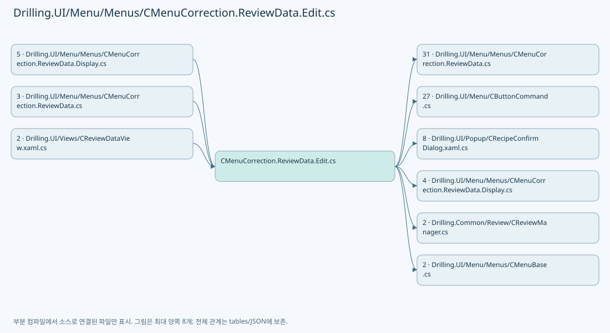

## 네임스페이스·타입·상속

| 타입 | 구분 | 원본 범위 | 선언/상속 |
| --- | --- | --- | --- |
| CMenuCorrection | ClassDeclaration | 12–726 | CMenuCorrection |
| CReviewDataPanel | ClassDeclaration | 14–629 | CReviewDataPanel |
| ST_REVIEW_DATA_EDIT_ITEM | ClassDeclaration | 631–725 | ST_REVIEW_DATA_EDIT_ITEM: INotifyPropertyChanged |

## 멤버 빠른 목록

| 이름 | 종류 | 범위 | 서명 |
| --- | --- | --- | --- |
| ResultEditKeyInMode | FieldDeclaration | L16–16 | string Drilling.UI.Menu.Menus.CMenuCorrection.CReviewDataPanel.ResultEditKeyInMode |
| ResultEditCopyMode | FieldDeclaration | L17–17 | string Drilling.UI.Menu.Menus.CMenuCorrection.CReviewDataPanel.ResultEditCopyMode |
| ResultJudgeOptions | FieldDeclaration | L18–18 | System.Collections.Generic.IReadOnlyList<string> Drilling.UI.Menu.Menus.CMenuCorrection.CReviewDataPanel.ResultJudgeOptions |
| _resultEditMode | FieldDeclaration | L19–19 | string Drilling.UI.Menu.Menus.CMenuCorrection.CReviewDataPanel._resultEditMode |
| _resultEditKeyInItems | FieldDeclaration | L20–20 | System.Collections.Generic.IReadOnlyList<Drilling.UI.Menu.Menus.CMenuCorrection.ST_REVIEW_DATA_EDIT_ITEM> Drilling.UI.Menu.Menus.CMenuCorrection.CReviewDataPanel._resultEditKeyInItems |
| _selectedResultEditKeyInItem | FieldDeclaration | L21–21 | Drilling.UI.Menu.Menus.CMenuCorrection.ST_REVIEW_DATA_EDIT_ITEM? Drilling.UI.Menu.Menus.CMenuCorrection.CReviewDataPanel._selectedResultEditKeyInItem |
| _resultEditCopySource | FieldDeclaration | L22–22 | Drilling.UI.Menu.Menus.CMenuCorrection.ST_REVIEW_DATA_EDIT_ITEM? Drilling.UI.Menu.Menus.CMenuCorrection.CReviewDataPanel._resultEditCopySource |
| _resultEditCopyTargets | FieldDeclaration | L23–23 | System.Collections.Generic.IReadOnlyList<Drilling.UI.Menu.Menus.CMenuCorrection.ST_REVIEW_DATA_EDIT_ITEM> Drilling.UI.Menu.Menus.CMenuCorrection.CReviewDataPanel._resultEditCopyTargets |
| _selectedResultEditCopyTarget | FieldDeclaration | L24–24 | Drilling.UI.Menu.Menus.CMenuCorrection.ST_REVIEW_DATA_EDIT_ITEM? Drilling.UI.Menu.Menus.CMenuCorrection.CReviewDataPanel._selectedResultEditCopyTarget |
| _resultEditStatusText | FieldDeclaration | L25–25 | string Drilling.UI.Menu.Menus.CMenuCorrection.CReviewDataPanel._resultEditStatusText |
| _isResultEditSaving | FieldDeclaration | L26–26 | bool Drilling.UI.Menu.Menus.CMenuCorrection.CReviewDataPanel._isResultEditSaving |
| IsResultEditKeyInMode | PropertyDeclaration | L28–28 | bool Drilling.UI.Menu.Menus.CMenuCorrection.CReviewDataPanel.IsResultEditKeyInMode |
| IsResultEditCopyMode | PropertyDeclaration | L29–29 | bool Drilling.UI.Menu.Menus.CMenuCorrection.CReviewDataPanel.IsResultEditCopyMode |
| ResultEditJudgeOptions | PropertyDeclaration | L30–30 | System.Collections.Generic.IReadOnlyList<string> Drilling.UI.Menu.Menus.CMenuCorrection.CReviewDataPanel.ResultEditJudgeOptions |
| ResultEditKeyInItems | PropertyDeclaration | L31–31 | System.Collections.Generic.IReadOnlyList<Drilling.UI.Menu.Menus.CMenuCorrection.ST_REVIEW_DATA_EDIT_ITEM> Drilling.UI.Menu.Menus.CMenuCorrection.CReviewDataPanel.ResultEditKeyInItems |
| ResultEditCopySourceRows | PropertyDeclaration | L32–32 | System.Collections.Generic.IReadOnlyList<Drilling.UI.Menu.Menus.CMenuCorrection.ST_REVIEW_DATA_EDIT_ITEM> Drilling.UI.Menu.Menus.CMenuCorrection.CReviewDataPanel.ResultEditCopySourceRows |
| ResultEditCopyTargets | PropertyDeclaration | L33–33 | System.Collections.Generic.IReadOnlyList<Drilling.UI.Menu.Menus.CMenuCorrection.ST_REVIEW_DATA_EDIT_ITEM> Drilling.UI.Menu.Menus.CMenuCorrection.CReviewDataPanel.ResultEditCopyTargets |
| ResultEditSelectionSummary | PropertyDeclaration | L34–34 | string Drilling.UI.Menu.Menus.CMenuCorrection.CReviewDataPanel.ResultEditSelectionSummary |
| ResultEditKeyInSummary | PropertyDeclaration | L35–35 | string Drilling.UI.Menu.Menus.CMenuCorrection.CReviewDataPanel.ResultEditKeyInSummary |
| ResultEditCopySummary | PropertyDeclaration | L36–36 | string Drilling.UI.Menu.Menus.CMenuCorrection.CReviewDataPanel.ResultEditCopySummary |
| ResultEditStatusText | PropertyDeclaration | L37–37 | string Drilling.UI.Menu.Menus.CMenuCorrection.CReviewDataPanel.ResultEditStatusText |
| IsResultEditSaving | PropertyDeclaration | L38–38 | bool Drilling.UI.Menu.Menus.CMenuCorrection.CReviewDataPanel.IsResultEditSaving |
| CanAddResultEditKeyIn | PropertyDeclaration | L39–39 | bool Drilling.UI.Menu.Menus.CMenuCorrection.CReviewDataPanel.CanAddResultEditKeyIn |
| CanAddSelectedResultEditKeyIn | PropertyDeclaration | L40–40 | bool Drilling.UI.Menu.Menus.CMenuCorrection.CReviewDataPanel.CanAddSelectedResultEditKeyIn |
| CanAddNgResultEditKeyIn | PropertyDeclaration | L41–41 | bool Drilling.UI.Menu.Menus.CMenuCorrection.CReviewDataPanel.CanAddNgResultEditKeyIn |
| CanRemoveResultEditKeyIn | PropertyDeclaration | L42–42 | bool Drilling.UI.Menu.Menus.CMenuCorrection.CReviewDataPanel.CanRemoveResultEditKeyIn |
| CanClearResultEditKeyIn | PropertyDeclaration | L43–43 | bool Drilling.UI.Menu.Menus.CMenuCorrection.CReviewDataPanel.CanClearResultEditKeyIn |
| CanAddResultEditCopySource | PropertyDeclaration | L44–44 | bool Drilling.UI.Menu.Menus.CMenuCorrection.CReviewDataPanel.CanAddResultEditCopySource |
| CanAddResultEditCopyTargets | PropertyDeclaration | L45–45 | bool Drilling.UI.Menu.Menus.CMenuCorrection.CReviewDataPanel.CanAddResultEditCopyTargets |
| CanRemoveResultEditCopyTarget | PropertyDeclaration | L46–46 | bool Drilling.UI.Menu.Menus.CMenuCorrection.CReviewDataPanel.CanRemoveResultEditCopyTarget |
| CanClearResultEditCopyTargets | PropertyDeclaration | L47–47 | bool Drilling.UI.Menu.Menus.CMenuCorrection.CReviewDataPanel.CanClearResultEditCopyTargets |
| CanApplyResultEditCopy | PropertyDeclaration | L48–48 | bool Drilling.UI.Menu.Menus.CMenuCorrection.CReviewDataPanel.CanApplyResultEditCopy |
| CanSaveResultEdit | PropertyDeclaration | L49–53 | bool Drilling.UI.Menu.Menus.CMenuCorrection.CReviewDataPanel.CanSaveResultEdit |
| SelectedResultEditKeyInItem | PropertyDeclaration | L55–69 | Drilling.UI.Menu.Menus.CMenuCorrection.ST_REVIEW_DATA_EDIT_ITEM? Drilling.UI.Menu.Menus.CMenuCorrection.CReviewDataPanel.SelectedResultEditKeyInItem |
| get_SelectedResultEditKeyInItem | GetAccessorDeclaration | L57–57 | Drilling.UI.Menu.Menus.CMenuCorrection.ST_REVIEW_DATA_EDIT_ITEM? Drilling.UI.Menu.Menus.CMenuCorrection.CReviewDataPanel.SelectedResultEditKeyInItem.get |
| set_SelectedResultEditKeyInItem | SetAccessorDeclaration | L58–68 | void Drilling.UI.Menu.Menus.CMenuCorrection.CReviewDataPanel.SelectedResultEditKeyInItem.set |
| SelectedResultEditCopyTarget | PropertyDeclaration | L71–85 | Drilling.UI.Menu.Menus.CMenuCorrection.ST_REVIEW_DATA_EDIT_ITEM? Drilling.UI.Menu.Menus.CMenuCorrection.CReviewDataPanel.SelectedResultEditCopyTarget |
| get_SelectedResultEditCopyTarget | GetAccessorDeclaration | L73–73 | Drilling.UI.Menu.Menus.CMenuCorrection.ST_REVIEW_DATA_EDIT_ITEM? Drilling.UI.Menu.Menus.CMenuCorrection.CReviewDataPanel.SelectedResultEditCopyTarget.get |
| set_SelectedResultEditCopyTarget | SetAccessorDeclaration | L74–84 | void Drilling.UI.Menu.Menus.CMenuCorrection.CReviewDataPanel.SelectedResultEditCopyTarget.set |
| SelectResultEditSubModeCommand | PropertyDeclaration | L87–87 | Drilling.UI.Menu.CButtonCommand Drilling.UI.Menu.Menus.CMenuCorrection.CReviewDataPanel.SelectResultEditSubModeCommand |
| get_SelectResultEditSubModeCommand | GetAccessorDeclaration | L87–87 | Drilling.UI.Menu.CButtonCommand Drilling.UI.Menu.Menus.CMenuCorrection.CReviewDataPanel.SelectResultEditSubModeCommand.get |
| set_SelectResultEditSubModeCommand | SetAccessorDeclaration | L87–87 | void Drilling.UI.Menu.Menus.CMenuCorrection.CReviewDataPanel.SelectResultEditSubModeCommand.set |
| AddResultEditKeyInCommand | PropertyDeclaration | L88–88 | Drilling.UI.Menu.CButtonCommand Drilling.UI.Menu.Menus.CMenuCorrection.CReviewDataPanel.AddResultEditKeyInCommand |
| get_AddResultEditKeyInCommand | GetAccessorDeclaration | L88–88 | Drilling.UI.Menu.CButtonCommand Drilling.UI.Menu.Menus.CMenuCorrection.CReviewDataPanel.AddResultEditKeyInCommand.get |
| set_AddResultEditKeyInCommand | SetAccessorDeclaration | L88–88 | void Drilling.UI.Menu.Menus.CMenuCorrection.CReviewDataPanel.AddResultEditKeyInCommand.set |
| AddSelectedResultEditKeyInCommand | PropertyDeclaration | L89–89 | Drilling.UI.Menu.CButtonCommand Drilling.UI.Menu.Menus.CMenuCorrection.CReviewDataPanel.AddSelectedResultEditKeyInCommand |
| get_AddSelectedResultEditKeyInCommand | GetAccessorDeclaration | L89–89 | Drilling.UI.Menu.CButtonCommand Drilling.UI.Menu.Menus.CMenuCorrection.CReviewDataPanel.AddSelectedResultEditKeyInCommand.get |
| set_AddSelectedResultEditKeyInCommand | SetAccessorDeclaration | L89–89 | void Drilling.UI.Menu.Menus.CMenuCorrection.CReviewDataPanel.AddSelectedResultEditKeyInCommand.set |
| AddNgResultEditKeyInCommand | PropertyDeclaration | L90–90 | Drilling.UI.Menu.CButtonCommand Drilling.UI.Menu.Menus.CMenuCorrection.CReviewDataPanel.AddNgResultEditKeyInCommand |
| get_AddNgResultEditKeyInCommand | GetAccessorDeclaration | L90–90 | Drilling.UI.Menu.CButtonCommand Drilling.UI.Menu.Menus.CMenuCorrection.CReviewDataPanel.AddNgResultEditKeyInCommand.get |
| set_AddNgResultEditKeyInCommand | SetAccessorDeclaration | L90–90 | void Drilling.UI.Menu.Menus.CMenuCorrection.CReviewDataPanel.AddNgResultEditKeyInCommand.set |
| RemoveResultEditKeyInCommand | PropertyDeclaration | L91–91 | Drilling.UI.Menu.CButtonCommand Drilling.UI.Menu.Menus.CMenuCorrection.CReviewDataPanel.RemoveResultEditKeyInCommand |
| get_RemoveResultEditKeyInCommand | GetAccessorDeclaration | L91–91 | Drilling.UI.Menu.CButtonCommand Drilling.UI.Menu.Menus.CMenuCorrection.CReviewDataPanel.RemoveResultEditKeyInCommand.get |
| set_RemoveResultEditKeyInCommand | SetAccessorDeclaration | L91–91 | void Drilling.UI.Menu.Menus.CMenuCorrection.CReviewDataPanel.RemoveResultEditKeyInCommand.set |
| ClearResultEditKeyInCommand | PropertyDeclaration | L92–92 | Drilling.UI.Menu.CButtonCommand Drilling.UI.Menu.Menus.CMenuCorrection.CReviewDataPanel.ClearResultEditKeyInCommand |
| get_ClearResultEditKeyInCommand | GetAccessorDeclaration | L92–92 | Drilling.UI.Menu.CButtonCommand Drilling.UI.Menu.Menus.CMenuCorrection.CReviewDataPanel.ClearResultEditKeyInCommand.get |
| set_ClearResultEditKeyInCommand | SetAccessorDeclaration | L92–92 | void Drilling.UI.Menu.Menus.CMenuCorrection.CReviewDataPanel.ClearResultEditKeyInCommand.set |
| AddResultEditCopySourceCommand | PropertyDeclaration | L93–93 | Drilling.UI.Menu.CButtonCommand Drilling.UI.Menu.Menus.CMenuCorrection.CReviewDataPanel.AddResultEditCopySourceCommand |
| get_AddResultEditCopySourceCommand | GetAccessorDeclaration | L93–93 | Drilling.UI.Menu.CButtonCommand Drilling.UI.Menu.Menus.CMenuCorrection.CReviewDataPanel.AddResultEditCopySourceCommand.get |
| set_AddResultEditCopySourceCommand | SetAccessorDeclaration | L93–93 | void Drilling.UI.Menu.Menus.CMenuCorrection.CReviewDataPanel.AddResultEditCopySourceCommand.set |
| AddResultEditCopyTargetsCommand | PropertyDeclaration | L94–94 | Drilling.UI.Menu.CButtonCommand Drilling.UI.Menu.Menus.CMenuCorrection.CReviewDataPanel.AddResultEditCopyTargetsCommand |
| get_AddResultEditCopyTargetsCommand | GetAccessorDeclaration | L94–94 | Drilling.UI.Menu.CButtonCommand Drilling.UI.Menu.Menus.CMenuCorrection.CReviewDataPanel.AddResultEditCopyTargetsCommand.get |
| set_AddResultEditCopyTargetsCommand | SetAccessorDeclaration | L94–94 | void Drilling.UI.Menu.Menus.CMenuCorrection.CReviewDataPanel.AddResultEditCopyTargetsCommand.set |
| RemoveResultEditCopyTargetCommand | PropertyDeclaration | L95–95 | Drilling.UI.Menu.CButtonCommand Drilling.UI.Menu.Menus.CMenuCorrection.CReviewDataPanel.RemoveResultEditCopyTargetCommand |
| get_RemoveResultEditCopyTargetCommand | GetAccessorDeclaration | L95–95 | Drilling.UI.Menu.CButtonCommand Drilling.UI.Menu.Menus.CMenuCorrection.CReviewDataPanel.RemoveResultEditCopyTargetCommand.get |
| set_RemoveResultEditCopyTargetCommand | SetAccessorDeclaration | L95–95 | void Drilling.UI.Menu.Menus.CMenuCorrection.CReviewDataPanel.RemoveResultEditCopyTargetCommand.set |
| ClearResultEditCopyTargetsCommand | PropertyDeclaration | L96–96 | Drilling.UI.Menu.CButtonCommand Drilling.UI.Menu.Menus.CMenuCorrection.CReviewDataPanel.ClearResultEditCopyTargetsCommand |
| get_ClearResultEditCopyTargetsCommand | GetAccessorDeclaration | L96–96 | Drilling.UI.Menu.CButtonCommand Drilling.UI.Menu.Menus.CMenuCorrection.CReviewDataPanel.ClearResultEditCopyTargetsCommand.get |
| set_ClearResultEditCopyTargetsCommand | SetAccessorDeclaration | L96–96 | void Drilling.UI.Menu.Menus.CMenuCorrection.CReviewDataPanel.ClearResultEditCopyTargetsCommand.set |
| CopyResultEditXCommand | PropertyDeclaration | L97–97 | Drilling.UI.Menu.CButtonCommand Drilling.UI.Menu.Menus.CMenuCorrection.CReviewDataPanel.CopyResultEditXCommand |
| get_CopyResultEditXCommand | GetAccessorDeclaration | L97–97 | Drilling.UI.Menu.CButtonCommand Drilling.UI.Menu.Menus.CMenuCorrection.CReviewDataPanel.CopyResultEditXCommand.get |
| set_CopyResultEditXCommand | SetAccessorDeclaration | L97–97 | void Drilling.UI.Menu.Menus.CMenuCorrection.CReviewDataPanel.CopyResultEditXCommand.set |
| CopyResultEditYCommand | PropertyDeclaration | L98–98 | Drilling.UI.Menu.CButtonCommand Drilling.UI.Menu.Menus.CMenuCorrection.CReviewDataPanel.CopyResultEditYCommand |
| get_CopyResultEditYCommand | GetAccessorDeclaration | L98–98 | Drilling.UI.Menu.CButtonCommand Drilling.UI.Menu.Menus.CMenuCorrection.CReviewDataPanel.CopyResultEditYCommand.get |
| set_CopyResultEditYCommand | SetAccessorDeclaration | L98–98 | void Drilling.UI.Menu.Menus.CMenuCorrection.CReviewDataPanel.CopyResultEditYCommand.set |
| CopyResultEditJudgeCommand | PropertyDeclaration | L99–99 | Drilling.UI.Menu.CButtonCommand Drilling.UI.Menu.Menus.CMenuCorrection.CReviewDataPanel.CopyResultEditJudgeCommand |
| get_CopyResultEditJudgeCommand | GetAccessorDeclaration | L99–99 | Drilling.UI.Menu.CButtonCommand Drilling.UI.Menu.Menus.CMenuCorrection.CReviewDataPanel.CopyResultEditJudgeCommand.get |
| set_CopyResultEditJudgeCommand | SetAccessorDeclaration | L99–99 | void Drilling.UI.Menu.Menus.CMenuCorrection.CReviewDataPanel.CopyResultEditJudgeCommand.set |
| CopyResultEditAllCommand | PropertyDeclaration | L100–100 | Drilling.UI.Menu.CButtonCommand Drilling.UI.Menu.Menus.CMenuCorrection.CReviewDataPanel.CopyResultEditAllCommand |
| get_CopyResultEditAllCommand | GetAccessorDeclaration | L100–100 | Drilling.UI.Menu.CButtonCommand Drilling.UI.Menu.Menus.CMenuCorrection.CReviewDataPanel.CopyResultEditAllCommand.get |
| set_CopyResultEditAllCommand | SetAccessorDeclaration | L100–100 | void Drilling.UI.Menu.Menus.CMenuCorrection.CReviewDataPanel.CopyResultEditAllCommand.set |
| SaveResultEditCommand | PropertyDeclaration | L101–101 | Drilling.UI.Menu.CButtonCommand Drilling.UI.Menu.Menus.CMenuCorrection.CReviewDataPanel.SaveResultEditCommand |
| get_SaveResultEditCommand | GetAccessorDeclaration | L101–101 | Drilling.UI.Menu.CButtonCommand Drilling.UI.Menu.Menus.CMenuCorrection.CReviewDataPanel.SaveResultEditCommand.get |
| set_SaveResultEditCommand | SetAccessorDeclaration | L101–101 | void Drilling.UI.Menu.Menus.CMenuCorrection.CReviewDataPanel.SaveResultEditCommand.set |
| InitializeResultEditCommands | MethodDeclaration | L103–120 | void Drilling.UI.Menu.Menus.CMenuCorrection.CReviewDataPanel.InitializeResultEditCommands() |
| SelectResultEditSubMode | MethodDeclaration | L122–133 | void Drilling.UI.Menu.Menus.CMenuCorrection.CReviewDataPanel.SelectResultEditSubMode(object?) |
| SetResultEditRowSelection | MethodDeclaration | L135–144 | void Drilling.UI.Menu.Menus.CMenuCorrection.CReviewDataPanel.SetResultEditRowSelection(Drilling.UI.Menu.Menus.CMenuCorrection.ST_REVIEW_DATA_GRID_ROW, bool) |
| SelectCurrentShotForResultEdit | MethodDeclaration | L146–154 | void Drilling.UI.Menu.Menus.CMenuCorrection.CReviewDataPanel.SelectCurrentShotForResultEdit() |
| SelectResultEditShotsInMap | MethodDeclaration | L156–179 | void Drilling.UI.Menu.Menus.CMenuCorrection.CReviewDataPanel.SelectResultEditShotsInMap(double, double, double, double) |
| SelectResultEditShotsInScatter | MethodDeclaration | L181–194 | void Drilling.UI.Menu.Menus.CMenuCorrection.CReviewDataPanel.SelectResultEditShotsInScatter(double, double, double, double) |
| ReplaceResultEditSelection | MethodDeclaration | L196–209 | void Drilling.UI.Menu.Menus.CMenuCorrection.CReviewDataPanel.ReplaceResultEditSelection(System.Collections.Generic.IEnumerable<Drilling.UI.Menu.Menus.CMenuCorrection.ST_REVIEW_DATA_GRID_ROW>) |
| ClearResultEditSelection | MethodDeclaration | L211–219 | void Drilling.UI.Menu.Menus.CMenuCorrection.CReviewDataPanel.ClearResultEditSelection() |
| NotifyResultEditSelectionChanged | MethodDeclaration | L221–229 | void Drilling.UI.Menu.Menus.CMenuCorrection.CReviewDataPanel.NotifyResultEditSelectionChanged() |
| ResolveResultEditSelection | MethodDeclaration | L231–235 | System.Collections.Generic.IReadOnlyList<Drilling.UI.Menu.Menus.CMenuCorrection.ST_REVIEW_DATA_GRID_ROW> Drilling.UI.Menu.Menus.CMenuCorrection.CReviewDataPanel.ResolveResultEditSelection() |
| AddResultEditKeyIn | MethodDeclaration | L237–245 | void Drilling.UI.Menu.Menus.CMenuCorrection.CReviewDataPanel.AddResultEditKeyIn(object?) |
| AddSelectedResultEditKeyIn | MethodDeclaration | L247–252 | void Drilling.UI.Menu.Menus.CMenuCorrection.CReviewDataPanel.AddSelectedResultEditKeyIn(object?) |
| AddNgResultEditKeyIn | MethodDeclaration | L254–259 | void Drilling.UI.Menu.Menus.CMenuCorrection.CReviewDataPanel.AddNgResultEditKeyIn(object?) |
| AddResultEditKeyInRows | MethodDeclaration | L261–280 | void Drilling.UI.Menu.Menus.CMenuCorrection.CReviewDataPanel.AddResultEditKeyInRows(System.Collections.Generic.IEnumerable<Drilling.UI.Menu.Menus.CMenuCorrection.ST_REVIEW_DATA_GRID_ROW>, string) |
| RemoveResultEditKeyIn | MethodDeclaration | L282–294 | void Drilling.UI.Menu.Menus.CMenuCorrection.CReviewDataPanel.RemoveResultEditKeyIn(object?) |
| ClearResultEditKeyIn | MethodDeclaration | L296–302 | void Drilling.UI.Menu.Menus.CMenuCorrection.CReviewDataPanel.ClearResultEditKeyIn(object?) |
| AddResultEditCopySource | MethodDeclaration | L304–322 | void Drilling.UI.Menu.Menus.CMenuCorrection.CReviewDataPanel.AddResultEditCopySource(object?) |
| AddResultEditCopyTargets | MethodDeclaration | L324–347 | void Drilling.UI.Menu.Menus.CMenuCorrection.CReviewDataPanel.AddResultEditCopyTargets(object?) |
| RemoveResultEditCopyTarget | MethodDeclaration | L349–361 | void Drilling.UI.Menu.Menus.CMenuCorrection.CReviewDataPanel.RemoveResultEditCopyTarget(object?) |
| ClearResultEditCopyTargets | MethodDeclaration | L363–369 | void Drilling.UI.Menu.Menus.CMenuCorrection.CReviewDataPanel.ClearResultEditCopyTargets(object?) |
| CopyResultEditX | MethodDeclaration | L371–374 | void Drilling.UI.Menu.Menus.CMenuCorrection.CReviewDataPanel.CopyResultEditX(object?) |
| CopyResultEditY | MethodDeclaration | L376–379 | void Drilling.UI.Menu.Menus.CMenuCorrection.CReviewDataPanel.CopyResultEditY(object?) |
| CopyResultEditJudge | MethodDeclaration | L381–384 | void Drilling.UI.Menu.Menus.CMenuCorrection.CReviewDataPanel.CopyResultEditJudge(object?) |
| CopyResultEditAll | MethodDeclaration | L386–389 | void Drilling.UI.Menu.Menus.CMenuCorrection.CReviewDataPanel.CopyResultEditAll(object?) |
| ApplyResultEditCopy | MethodDeclaration | L391–418 | void Drilling.UI.Menu.Menus.CMenuCorrection.CReviewDataPanel.ApplyResultEditCopy(bool, bool, bool, string) |
| SaveResultEdit | MethodDeclaration | L420–526 | void Drilling.UI.Menu.Menus.CMenuCorrection.CReviewDataPanel.SaveResultEdit(object?) |
| TryParseResultEditValue | MethodDeclaration | L528–532 | bool Drilling.UI.Menu.Menus.CMenuCorrection.CReviewDataPanel.TryParseResultEditValue(string?, out double) |
| SetResultEditSaving | MethodDeclaration | L534–544 | void Drilling.UI.Menu.Menus.CMenuCorrection.CReviewDataPanel.SetResultEditSaving(bool) |
| Renumber | MethodDeclaration | L546–555 | System.Collections.Generic.IReadOnlyList<Drilling.UI.Menu.Menus.CMenuCorrection.ST_REVIEW_DATA_EDIT_ITEM> Drilling.UI.Menu.Menus.CMenuCorrection.CReviewDataPanel.Renumber(System.Collections.Generic.IEnumerable<Drilling.UI.Menu.Menus.CMenuCorrection.ST_REVIEW_DATA_EDIT_ITEM>) |
| GetResultEditSelectedShotKeys | MethodDeclaration | L557–563 | System.Collections.Generic.IReadOnlySet<string> Drilling.UI.Menu.Menus.CMenuCorrection.CReviewDataPanel.GetResultEditSelectedShotKeys(int) |
| ResetResultEditState | MethodDeclaration | L565–582 | void Drilling.UI.Menu.Menus.CMenuCorrection.CReviewDataPanel.ResetResultEditState() |
| NotifyResultEditState | MethodDeclaration | L584–599 | void Drilling.UI.Menu.Menus.CMenuCorrection.CReviewDataPanel.NotifyResultEditState() |
| NotifyResultEditCommandState | MethodDeclaration | L601–628 | void Drilling.UI.Menu.Menus.CMenuCorrection.CReviewDataPanel.NotifyResultEditCommandState() |
| _no | FieldDeclaration | L633–633 | int Drilling.UI.Menu.Menus.CMenuCorrection.ST_REVIEW_DATA_EDIT_ITEM._no |
| _editedXText | FieldDeclaration | L634–634 | string Drilling.UI.Menu.Menus.CMenuCorrection.ST_REVIEW_DATA_EDIT_ITEM._editedXText |
| _editedYText | FieldDeclaration | L635–635 | string Drilling.UI.Menu.Menus.CMenuCorrection.ST_REVIEW_DATA_EDIT_ITEM._editedYText |
| _editedJudge | FieldDeclaration | L636–636 | string Drilling.UI.Menu.Menus.CMenuCorrection.ST_REVIEW_DATA_EDIT_ITEM._editedJudge |
| .ctor | ConstructorDeclaration | L638–645 | Drilling.UI.Menu.Menus.CMenuCorrection.ST_REVIEW_DATA_EDIT_ITEM.ST_REVIEW_DATA_EDIT_ITEM(Drilling.UI.Menu.Menus.CMenuCorrection.ST_REVIEW_DATA_GRID_ROW, int) |
| PropertyChanged | EventFieldDeclaration | L647–647 | System.ComponentModel.PropertyChangedEventHandler? Drilling.UI.Menu.Menus.CMenuCorrection.ST_REVIEW_DATA_EDIT_ITEM.PropertyChanged |
| Source | PropertyDeclaration | L648–648 | Drilling.UI.Menu.Menus.CMenuCorrection.ST_REVIEW_DATA_GRID_ROW Drilling.UI.Menu.Menus.CMenuCorrection.ST_REVIEW_DATA_EDIT_ITEM.Source |
| get_Source | GetAccessorDeclaration | L648–648 | Drilling.UI.Menu.Menus.CMenuCorrection.ST_REVIEW_DATA_GRID_ROW Drilling.UI.Menu.Menus.CMenuCorrection.ST_REVIEW_DATA_EDIT_ITEM.Source.get |
| No | PropertyDeclaration | L649–658 | int Drilling.UI.Menu.Menus.CMenuCorrection.ST_REVIEW_DATA_EDIT_ITEM.No |
| get_No | GetAccessorDeclaration | L651–651 | int Drilling.UI.Menu.Menus.CMenuCorrection.ST_REVIEW_DATA_EDIT_ITEM.No.get |
| set_No | SetAccessorDeclaration | L652–657 | void Drilling.UI.Menu.Menus.CMenuCorrection.ST_REVIEW_DATA_EDIT_ITEM.No.set |
| Identity | PropertyDeclaration | L660–660 | string Drilling.UI.Menu.Menus.CMenuCorrection.ST_REVIEW_DATA_EDIT_ITEM.Identity |
| Head | PropertyDeclaration | L661–661 | string Drilling.UI.Menu.Menus.CMenuCorrection.ST_REVIEW_DATA_EDIT_ITEM.Head |
| Cell | PropertyDeclaration | L662–662 | string Drilling.UI.Menu.Menus.CMenuCorrection.ST_REVIEW_DATA_EDIT_ITEM.Cell |
| ShotName | PropertyDeclaration | L663–663 | string Drilling.UI.Menu.Menus.CMenuCorrection.ST_REVIEW_DATA_EDIT_ITEM.ShotName |
| Beam | PropertyDeclaration | L664–664 | string Drilling.UI.Menu.Menus.CMenuCorrection.ST_REVIEW_DATA_EDIT_ITEM.Beam |
| OriginalXText | PropertyDeclaration | L665–665 | string Drilling.UI.Menu.Menus.CMenuCorrection.ST_REVIEW_DATA_EDIT_ITEM.OriginalXText |
| OriginalYText | PropertyDeclaration | L666–666 | string Drilling.UI.Menu.Menus.CMenuCorrection.ST_REVIEW_DATA_EDIT_ITEM.OriginalYText |
| OriginalJudge | PropertyDeclaration | L667–667 | string Drilling.UI.Menu.Menus.CMenuCorrection.ST_REVIEW_DATA_EDIT_ITEM.OriginalJudge |
| OriginalJudgeBrush | PropertyDeclaration | L668–668 | Brush Drilling.UI.Menu.Menus.CMenuCorrection.ST_REVIEW_DATA_EDIT_ITEM.OriginalJudgeBrush |
| EditedXText | PropertyDeclaration | L669–678 | string Drilling.UI.Menu.Menus.CMenuCorrection.ST_REVIEW_DATA_EDIT_ITEM.EditedXText |
| get_EditedXText | GetAccessorDeclaration | L671–671 | string Drilling.UI.Menu.Menus.CMenuCorrection.ST_REVIEW_DATA_EDIT_ITEM.EditedXText.get |
| set_EditedXText | SetAccessorDeclaration | L672–677 | void Drilling.UI.Menu.Menus.CMenuCorrection.ST_REVIEW_DATA_EDIT_ITEM.EditedXText.set |
| EditedYText | PropertyDeclaration | L680–689 | string Drilling.UI.Menu.Menus.CMenuCorrection.ST_REVIEW_DATA_EDIT_ITEM.EditedYText |
| get_EditedYText | GetAccessorDeclaration | L682–682 | string Drilling.UI.Menu.Menus.CMenuCorrection.ST_REVIEW_DATA_EDIT_ITEM.EditedYText.get |
| set_EditedYText | SetAccessorDeclaration | L683–688 | void Drilling.UI.Menu.Menus.CMenuCorrection.ST_REVIEW_DATA_EDIT_ITEM.EditedYText.set |
| EditedJudge | PropertyDeclaration | L691–702 | string Drilling.UI.Menu.Menus.CMenuCorrection.ST_REVIEW_DATA_EDIT_ITEM.EditedJudge |
| get_EditedJudge | GetAccessorDeclaration | L693–693 | string Drilling.UI.Menu.Menus.CMenuCorrection.ST_REVIEW_DATA_EDIT_ITEM.EditedJudge.get |
| set_EditedJudge | SetAccessorDeclaration | L694–701 | void Drilling.UI.Menu.Menus.CMenuCorrection.ST_REVIEW_DATA_EDIT_ITEM.EditedJudge.set |
| EditedJudgeBrush | PropertyDeclaration | L704–704 | Brush Drilling.UI.Menu.Menus.CMenuCorrection.ST_REVIEW_DATA_EDIT_ITEM.EditedJudgeBrush |
| Matches | MethodDeclaration | L706–711 | bool Drilling.UI.Menu.Menus.CMenuCorrection.ST_REVIEW_DATA_EDIT_ITEM.Matches(Drilling.UI.Menu.Menus.CMenuCorrection.ST_REVIEW_DATA_GRID_ROW) |
| NormalizeJudge | MethodDeclaration | L713–719 | string Drilling.UI.Menu.Menus.CMenuCorrection.ST_REVIEW_DATA_EDIT_ITEM.NormalizeJudge(string?) |
| OnPropertyChanged | MethodDeclaration | L721–724 | void Drilling.UI.Menu.Menus.CMenuCorrection.ST_REVIEW_DATA_EDIT_ITEM.OnPropertyChanged(string?) |

## 멤버별 상세 계약·호출·처리 해설

### FieldDeclaration `ResultEditKeyInMode` · L16–16

[Drilling.UI/Menu/Menus/CMenuCorrection.ReviewData.Edit.cs:16–16](https://github.com/kjuws10-rgb/A3Drilling/blob/334b3599651b2e8e0181fd4459bafaf3cddafff3/Drilling.UI/Menu/Menus/CMenuCorrection.ReviewData.Edit.cs#L16-L16)

| 항목 | 실제 추출 값 |
| --- | --- |
| 서명 | string Drilling.UI.Menu.Menus.CMenuCorrection.CReviewDataPanel.ResultEditKeyInMode |
| 접근/수식자 | Private / private, const |
| 반환/값 타입 | string |
| 소속 타입 | NamedType:Drilling.UI.Menu.Menus.CMenuCorrection.CReviewDataPanel |

현재 부분 분석에서 직접 연결된 호출자는 없습니다. XAML/이벤트/인터페이스·델리게이트·외부 진입을 추가 확인해야 하며, 미사용으로 판정한 것이 아닙니다.

본문의 실제 연산·분기·예외·반환 순서(원문 위치 순):

| 원본 행 | 종류 | 주석 해설 |
| --- | --- | --- |
| 16 | variable-initializer | 변수의 초기값을 지정합니다: ResultEditKeyInMode = "KEY_IN" |

변경 전 점검: 입력/반환 타입, 위 호출자, 예외/취소 경로, 공유 상태와 저장·전송 소비자를 함께 확인합니다. 값의 단위나 물리 방향을 이름만으로 확정하지 않습니다.

### FieldDeclaration `ResultEditCopyMode` · L17–17

[Drilling.UI/Menu/Menus/CMenuCorrection.ReviewData.Edit.cs:17–17](https://github.com/kjuws10-rgb/A3Drilling/blob/334b3599651b2e8e0181fd4459bafaf3cddafff3/Drilling.UI/Menu/Menus/CMenuCorrection.ReviewData.Edit.cs#L17-L17)

| 항목 | 실제 추출 값 |
| --- | --- |
| 서명 | string Drilling.UI.Menu.Menus.CMenuCorrection.CReviewDataPanel.ResultEditCopyMode |
| 접근/수식자 | Private / private, const |
| 반환/값 타입 | string |
| 소속 타입 | NamedType:Drilling.UI.Menu.Menus.CMenuCorrection.CReviewDataPanel |

현재 부분 분석에서 직접 연결된 호출자는 없습니다. XAML/이벤트/인터페이스·델리게이트·외부 진입을 추가 확인해야 하며, 미사용으로 판정한 것이 아닙니다.

본문의 실제 연산·분기·예외·반환 순서(원문 위치 순):

| 원본 행 | 종류 | 주석 해설 |
| --- | --- | --- |
| 17 | variable-initializer | 변수의 초기값을 지정합니다: ResultEditCopyMode = "COPY" |

변경 전 점검: 입력/반환 타입, 위 호출자, 예외/취소 경로, 공유 상태와 저장·전송 소비자를 함께 확인합니다. 값의 단위나 물리 방향을 이름만으로 확정하지 않습니다.

### FieldDeclaration `ResultJudgeOptions` · L18–18

[Drilling.UI/Menu/Menus/CMenuCorrection.ReviewData.Edit.cs:18–18](https://github.com/kjuws10-rgb/A3Drilling/blob/334b3599651b2e8e0181fd4459bafaf3cddafff3/Drilling.UI/Menu/Menus/CMenuCorrection.ReviewData.Edit.cs#L18-L18)

| 항목 | 실제 추출 값 |
| --- | --- |
| 서명 | System.Collections.Generic.IReadOnlyList<string> Drilling.UI.Menu.Menus.CMenuCorrection.CReviewDataPanel.ResultJudgeOptions |
| 접근/수식자 | Private / private, static, readonly |
| 반환/값 타입 | System.Collections.Generic.IReadOnlyList<string> |
| 소속 타입 | NamedType:Drilling.UI.Menu.Menus.CMenuCorrection.CReviewDataPanel |

현재 부분 분석에서 직접 연결된 호출자는 없습니다. XAML/이벤트/인터페이스·델리게이트·외부 진입을 추가 확인해야 하며, 미사용으로 판정한 것이 아닙니다.

본문의 실제 연산·분기·예외·반환 순서(원문 위치 순):

| 원본 행 | 종류 | 주석 해설 |
| --- | --- | --- |
| 18 | variable-initializer | 변수의 초기값을 지정합니다: ResultJudgeOptions = ["OK", "NG"] |

변경 전 점검: 입력/반환 타입, 위 호출자, 예외/취소 경로, 공유 상태와 저장·전송 소비자를 함께 확인합니다. 값의 단위나 물리 방향을 이름만으로 확정하지 않습니다.

### FieldDeclaration `_resultEditMode` · L19–19

[Drilling.UI/Menu/Menus/CMenuCorrection.ReviewData.Edit.cs:19–19](https://github.com/kjuws10-rgb/A3Drilling/blob/334b3599651b2e8e0181fd4459bafaf3cddafff3/Drilling.UI/Menu/Menus/CMenuCorrection.ReviewData.Edit.cs#L19-L19)

| 항목 | 실제 추출 값 |
| --- | --- |
| 서명 | string Drilling.UI.Menu.Menus.CMenuCorrection.CReviewDataPanel._resultEditMode |
| 접근/수식자 | Private / private |
| 반환/값 타입 | string |
| 소속 타입 | NamedType:Drilling.UI.Menu.Menus.CMenuCorrection.CReviewDataPanel |

현재 부분 분석에서 직접 연결된 호출자는 없습니다. XAML/이벤트/인터페이스·델리게이트·외부 진입을 추가 확인해야 하며, 미사용으로 판정한 것이 아닙니다.

본문의 실제 연산·분기·예외·반환 순서(원문 위치 순):

| 원본 행 | 종류 | 주석 해설 |
| --- | --- | --- |
| 19 | variable-initializer | 변수의 초기값을 지정합니다: _resultEditMode = ResultEditKeyInMode |

변경 전 점검: 입력/반환 타입, 위 호출자, 예외/취소 경로, 공유 상태와 저장·전송 소비자를 함께 확인합니다. 값의 단위나 물리 방향을 이름만으로 확정하지 않습니다.

### FieldDeclaration `_resultEditKeyInItems` · L20–20

[Drilling.UI/Menu/Menus/CMenuCorrection.ReviewData.Edit.cs:20–20](https://github.com/kjuws10-rgb/A3Drilling/blob/334b3599651b2e8e0181fd4459bafaf3cddafff3/Drilling.UI/Menu/Menus/CMenuCorrection.ReviewData.Edit.cs#L20-L20)

| 항목 | 실제 추출 값 |
| --- | --- |
| 서명 | System.Collections.Generic.IReadOnlyList<Drilling.UI.Menu.Menus.CMenuCorrection.ST_REVIEW_DATA_EDIT_ITEM> Drilling.UI.Menu.Menus.CMenuCorrection.CReviewDataPanel._resultEditKeyInItems |
| 접근/수식자 | Private / private |
| 반환/값 타입 | System.Collections.Generic.IReadOnlyList<Drilling.UI.Menu.Menus.CMenuCorrection.ST_REVIEW_DATA_EDIT_ITEM> |
| 소속 타입 | NamedType:Drilling.UI.Menu.Menus.CMenuCorrection.CReviewDataPanel |

현재 부분 분석에서 직접 연결된 호출자는 없습니다. XAML/이벤트/인터페이스·델리게이트·외부 진입을 추가 확인해야 하며, 미사용으로 판정한 것이 아닙니다.

본문의 실제 연산·분기·예외·반환 순서(원문 위치 순):

| 원본 행 | 종류 | 주석 해설 |
| --- | --- | --- |
| 20 | variable-initializer | 변수의 초기값을 지정합니다: _resultEditKeyInItems = [] |

변경 전 점검: 입력/반환 타입, 위 호출자, 예외/취소 경로, 공유 상태와 저장·전송 소비자를 함께 확인합니다. 값의 단위나 물리 방향을 이름만으로 확정하지 않습니다.

### FieldDeclaration `_selectedResultEditKeyInItem` · L21–21

[Drilling.UI/Menu/Menus/CMenuCorrection.ReviewData.Edit.cs:21–21](https://github.com/kjuws10-rgb/A3Drilling/blob/334b3599651b2e8e0181fd4459bafaf3cddafff3/Drilling.UI/Menu/Menus/CMenuCorrection.ReviewData.Edit.cs#L21-L21)

| 항목 | 실제 추출 값 |
| --- | --- |
| 서명 | Drilling.UI.Menu.Menus.CMenuCorrection.ST_REVIEW_DATA_EDIT_ITEM? Drilling.UI.Menu.Menus.CMenuCorrection.CReviewDataPanel._selectedResultEditKeyInItem |
| 접근/수식자 | Private / private |
| 반환/값 타입 | Drilling.UI.Menu.Menus.CMenuCorrection.ST_REVIEW_DATA_EDIT_ITEM? |
| 소속 타입 | NamedType:Drilling.UI.Menu.Menus.CMenuCorrection.CReviewDataPanel |

현재 부분 분석에서 직접 연결된 호출자는 없습니다. XAML/이벤트/인터페이스·델리게이트·외부 진입을 추가 확인해야 하며, 미사용으로 판정한 것이 아닙니다.

변경 전 점검: 입력/반환 타입, 위 호출자, 예외/취소 경로, 공유 상태와 저장·전송 소비자를 함께 확인합니다. 값의 단위나 물리 방향을 이름만으로 확정하지 않습니다.

### FieldDeclaration `_resultEditCopySource` · L22–22

[Drilling.UI/Menu/Menus/CMenuCorrection.ReviewData.Edit.cs:22–22](https://github.com/kjuws10-rgb/A3Drilling/blob/334b3599651b2e8e0181fd4459bafaf3cddafff3/Drilling.UI/Menu/Menus/CMenuCorrection.ReviewData.Edit.cs#L22-L22)

| 항목 | 실제 추출 값 |
| --- | --- |
| 서명 | Drilling.UI.Menu.Menus.CMenuCorrection.ST_REVIEW_DATA_EDIT_ITEM? Drilling.UI.Menu.Menus.CMenuCorrection.CReviewDataPanel._resultEditCopySource |
| 접근/수식자 | Private / private |
| 반환/값 타입 | Drilling.UI.Menu.Menus.CMenuCorrection.ST_REVIEW_DATA_EDIT_ITEM? |
| 소속 타입 | NamedType:Drilling.UI.Menu.Menus.CMenuCorrection.CReviewDataPanel |

현재 부분 분석에서 직접 연결된 호출자는 없습니다. XAML/이벤트/인터페이스·델리게이트·외부 진입을 추가 확인해야 하며, 미사용으로 판정한 것이 아닙니다.

변경 전 점검: 입력/반환 타입, 위 호출자, 예외/취소 경로, 공유 상태와 저장·전송 소비자를 함께 확인합니다. 값의 단위나 물리 방향을 이름만으로 확정하지 않습니다.

### FieldDeclaration `_resultEditCopyTargets` · L23–23

[Drilling.UI/Menu/Menus/CMenuCorrection.ReviewData.Edit.cs:23–23](https://github.com/kjuws10-rgb/A3Drilling/blob/334b3599651b2e8e0181fd4459bafaf3cddafff3/Drilling.UI/Menu/Menus/CMenuCorrection.ReviewData.Edit.cs#L23-L23)

| 항목 | 실제 추출 값 |
| --- | --- |
| 서명 | System.Collections.Generic.IReadOnlyList<Drilling.UI.Menu.Menus.CMenuCorrection.ST_REVIEW_DATA_EDIT_ITEM> Drilling.UI.Menu.Menus.CMenuCorrection.CReviewDataPanel._resultEditCopyTargets |
| 접근/수식자 | Private / private |
| 반환/값 타입 | System.Collections.Generic.IReadOnlyList<Drilling.UI.Menu.Menus.CMenuCorrection.ST_REVIEW_DATA_EDIT_ITEM> |
| 소속 타입 | NamedType:Drilling.UI.Menu.Menus.CMenuCorrection.CReviewDataPanel |

현재 부분 분석에서 직접 연결된 호출자는 없습니다. XAML/이벤트/인터페이스·델리게이트·외부 진입을 추가 확인해야 하며, 미사용으로 판정한 것이 아닙니다.

본문의 실제 연산·분기·예외·반환 순서(원문 위치 순):

| 원본 행 | 종류 | 주석 해설 |
| --- | --- | --- |
| 23 | variable-initializer | 변수의 초기값을 지정합니다: _resultEditCopyTargets = [] |

변경 전 점검: 입력/반환 타입, 위 호출자, 예외/취소 경로, 공유 상태와 저장·전송 소비자를 함께 확인합니다. 값의 단위나 물리 방향을 이름만으로 확정하지 않습니다.

### FieldDeclaration `_selectedResultEditCopyTarget` · L24–24

[Drilling.UI/Menu/Menus/CMenuCorrection.ReviewData.Edit.cs:24–24](https://github.com/kjuws10-rgb/A3Drilling/blob/334b3599651b2e8e0181fd4459bafaf3cddafff3/Drilling.UI/Menu/Menus/CMenuCorrection.ReviewData.Edit.cs#L24-L24)

| 항목 | 실제 추출 값 |
| --- | --- |
| 서명 | Drilling.UI.Menu.Menus.CMenuCorrection.ST_REVIEW_DATA_EDIT_ITEM? Drilling.UI.Menu.Menus.CMenuCorrection.CReviewDataPanel._selectedResultEditCopyTarget |
| 접근/수식자 | Private / private |
| 반환/값 타입 | Drilling.UI.Menu.Menus.CMenuCorrection.ST_REVIEW_DATA_EDIT_ITEM? |
| 소속 타입 | NamedType:Drilling.UI.Menu.Menus.CMenuCorrection.CReviewDataPanel |

현재 부분 분석에서 직접 연결된 호출자는 없습니다. XAML/이벤트/인터페이스·델리게이트·외부 진입을 추가 확인해야 하며, 미사용으로 판정한 것이 아닙니다.

변경 전 점검: 입력/반환 타입, 위 호출자, 예외/취소 경로, 공유 상태와 저장·전송 소비자를 함께 확인합니다. 값의 단위나 물리 방향을 이름만으로 확정하지 않습니다.

### FieldDeclaration `_resultEditStatusText` · L25–25

[Drilling.UI/Menu/Menus/CMenuCorrection.ReviewData.Edit.cs:25–25](https://github.com/kjuws10-rgb/A3Drilling/blob/334b3599651b2e8e0181fd4459bafaf3cddafff3/Drilling.UI/Menu/Menus/CMenuCorrection.ReviewData.Edit.cs#L25-L25)

| 항목 | 실제 추출 값 |
| --- | --- |
| 서명 | string Drilling.UI.Menu.Menus.CMenuCorrection.CReviewDataPanel._resultEditStatusText |
| 접근/수식자 | Private / private |
| 반환/값 타입 | string |
| 소속 타입 | NamedType:Drilling.UI.Menu.Menus.CMenuCorrection.CReviewDataPanel |

현재 부분 분석에서 직접 연결된 호출자는 없습니다. XAML/이벤트/인터페이스·델리게이트·외부 진입을 추가 확인해야 하며, 미사용으로 판정한 것이 아닙니다.

본문의 실제 연산·분기·예외·반환 순서(원문 위치 순):

| 원본 행 | 종류 | 주석 해설 |
| --- | --- | --- |
| 25 | variable-initializer | 변수의 초기값을 지정합니다: _resultEditStatusText = "NO EDIT ITEMS" |

변경 전 점검: 입력/반환 타입, 위 호출자, 예외/취소 경로, 공유 상태와 저장·전송 소비자를 함께 확인합니다. 값의 단위나 물리 방향을 이름만으로 확정하지 않습니다.

### FieldDeclaration `_isResultEditSaving` · L26–26

[Drilling.UI/Menu/Menus/CMenuCorrection.ReviewData.Edit.cs:26–26](https://github.com/kjuws10-rgb/A3Drilling/blob/334b3599651b2e8e0181fd4459bafaf3cddafff3/Drilling.UI/Menu/Menus/CMenuCorrection.ReviewData.Edit.cs#L26-L26)

| 항목 | 실제 추출 값 |
| --- | --- |
| 서명 | bool Drilling.UI.Menu.Menus.CMenuCorrection.CReviewDataPanel._isResultEditSaving |
| 접근/수식자 | Private / private |
| 반환/값 타입 | bool |
| 소속 타입 | NamedType:Drilling.UI.Menu.Menus.CMenuCorrection.CReviewDataPanel |

현재 부분 분석에서 직접 연결된 호출자는 없습니다. XAML/이벤트/인터페이스·델리게이트·외부 진입을 추가 확인해야 하며, 미사용으로 판정한 것이 아닙니다.

변경 전 점검: 입력/반환 타입, 위 호출자, 예외/취소 경로, 공유 상태와 저장·전송 소비자를 함께 확인합니다. 값의 단위나 물리 방향을 이름만으로 확정하지 않습니다.

### PropertyDeclaration `IsResultEditKeyInMode` · L28–28

[Drilling.UI/Menu/Menus/CMenuCorrection.ReviewData.Edit.cs:28–28](https://github.com/kjuws10-rgb/A3Drilling/blob/334b3599651b2e8e0181fd4459bafaf3cddafff3/Drilling.UI/Menu/Menus/CMenuCorrection.ReviewData.Edit.cs#L28-L28)

| 항목 | 실제 추출 값 |
| --- | --- |
| 서명 | bool Drilling.UI.Menu.Menus.CMenuCorrection.CReviewDataPanel.IsResultEditKeyInMode |
| 접근/수식자 | Public / public |
| 반환/값 타입 | bool |
| 소속 타입 | NamedType:Drilling.UI.Menu.Menus.CMenuCorrection.CReviewDataPanel |

현재 부분 분석에서 직접 연결된 호출자는 없습니다. XAML/이벤트/인터페이스·델리게이트·외부 진입을 추가 확인해야 하며, 미사용으로 판정한 것이 아닙니다.

변경 전 점검: 입력/반환 타입, 위 호출자, 예외/취소 경로, 공유 상태와 저장·전송 소비자를 함께 확인합니다. 값의 단위나 물리 방향을 이름만으로 확정하지 않습니다.

### PropertyDeclaration `IsResultEditCopyMode` · L29–29

[Drilling.UI/Menu/Menus/CMenuCorrection.ReviewData.Edit.cs:29–29](https://github.com/kjuws10-rgb/A3Drilling/blob/334b3599651b2e8e0181fd4459bafaf3cddafff3/Drilling.UI/Menu/Menus/CMenuCorrection.ReviewData.Edit.cs#L29-L29)

| 항목 | 실제 추출 값 |
| --- | --- |
| 서명 | bool Drilling.UI.Menu.Menus.CMenuCorrection.CReviewDataPanel.IsResultEditCopyMode |
| 접근/수식자 | Public / public |
| 반환/값 타입 | bool |
| 소속 타입 | NamedType:Drilling.UI.Menu.Menus.CMenuCorrection.CReviewDataPanel |

현재 부분 분석에서 직접 연결된 호출자는 없습니다. XAML/이벤트/인터페이스·델리게이트·외부 진입을 추가 확인해야 하며, 미사용으로 판정한 것이 아닙니다.

변경 전 점검: 입력/반환 타입, 위 호출자, 예외/취소 경로, 공유 상태와 저장·전송 소비자를 함께 확인합니다. 값의 단위나 물리 방향을 이름만으로 확정하지 않습니다.

### PropertyDeclaration `ResultEditJudgeOptions` · L30–30

[Drilling.UI/Menu/Menus/CMenuCorrection.ReviewData.Edit.cs:30–30](https://github.com/kjuws10-rgb/A3Drilling/blob/334b3599651b2e8e0181fd4459bafaf3cddafff3/Drilling.UI/Menu/Menus/CMenuCorrection.ReviewData.Edit.cs#L30-L30)

| 항목 | 실제 추출 값 |
| --- | --- |
| 서명 | System.Collections.Generic.IReadOnlyList<string> Drilling.UI.Menu.Menus.CMenuCorrection.CReviewDataPanel.ResultEditJudgeOptions |
| 접근/수식자 | Public / public |
| 반환/값 타입 | System.Collections.Generic.IReadOnlyList<string> |
| 소속 타입 | NamedType:Drilling.UI.Menu.Menus.CMenuCorrection.CReviewDataPanel |

현재 부분 분석에서 직접 연결된 호출자는 없습니다. XAML/이벤트/인터페이스·델리게이트·외부 진입을 추가 확인해야 하며, 미사용으로 판정한 것이 아닙니다.

변경 전 점검: 입력/반환 타입, 위 호출자, 예외/취소 경로, 공유 상태와 저장·전송 소비자를 함께 확인합니다. 값의 단위나 물리 방향을 이름만으로 확정하지 않습니다.

### PropertyDeclaration `ResultEditKeyInItems` · L31–31

[Drilling.UI/Menu/Menus/CMenuCorrection.ReviewData.Edit.cs:31–31](https://github.com/kjuws10-rgb/A3Drilling/blob/334b3599651b2e8e0181fd4459bafaf3cddafff3/Drilling.UI/Menu/Menus/CMenuCorrection.ReviewData.Edit.cs#L31-L31)

| 항목 | 실제 추출 값 |
| --- | --- |
| 서명 | System.Collections.Generic.IReadOnlyList<Drilling.UI.Menu.Menus.CMenuCorrection.ST_REVIEW_DATA_EDIT_ITEM> Drilling.UI.Menu.Menus.CMenuCorrection.CReviewDataPanel.ResultEditKeyInItems |
| 접근/수식자 | Public / public |
| 반환/값 타입 | System.Collections.Generic.IReadOnlyList<Drilling.UI.Menu.Menus.CMenuCorrection.ST_REVIEW_DATA_EDIT_ITEM> |
| 소속 타입 | NamedType:Drilling.UI.Menu.Menus.CMenuCorrection.CReviewDataPanel |

현재 부분 분석에서 직접 연결된 호출자는 없습니다. XAML/이벤트/인터페이스·델리게이트·외부 진입을 추가 확인해야 하며, 미사용으로 판정한 것이 아닙니다.

변경 전 점검: 입력/반환 타입, 위 호출자, 예외/취소 경로, 공유 상태와 저장·전송 소비자를 함께 확인합니다. 값의 단위나 물리 방향을 이름만으로 확정하지 않습니다.

### PropertyDeclaration `ResultEditCopySourceRows` · L32–32

[Drilling.UI/Menu/Menus/CMenuCorrection.ReviewData.Edit.cs:32–32](https://github.com/kjuws10-rgb/A3Drilling/blob/334b3599651b2e8e0181fd4459bafaf3cddafff3/Drilling.UI/Menu/Menus/CMenuCorrection.ReviewData.Edit.cs#L32-L32)

| 항목 | 실제 추출 값 |
| --- | --- |
| 서명 | System.Collections.Generic.IReadOnlyList<Drilling.UI.Menu.Menus.CMenuCorrection.ST_REVIEW_DATA_EDIT_ITEM> Drilling.UI.Menu.Menus.CMenuCorrection.CReviewDataPanel.ResultEditCopySourceRows |
| 접근/수식자 | Public / public |
| 반환/값 타입 | System.Collections.Generic.IReadOnlyList<Drilling.UI.Menu.Menus.CMenuCorrection.ST_REVIEW_DATA_EDIT_ITEM> |
| 소속 타입 | NamedType:Drilling.UI.Menu.Menus.CMenuCorrection.CReviewDataPanel |

현재 부분 분석에서 직접 연결된 호출자는 없습니다. XAML/이벤트/인터페이스·델리게이트·외부 진입을 추가 확인해야 하며, 미사용으로 판정한 것이 아닙니다.

본문의 실제 연산·분기·예외·반환 순서(원문 위치 순):

| 원본 행 | 종류 | 주석 해설 |
| --- | --- | --- |
| 32 | conditional-expression | 조건에 따라 결과식을 선택합니다: _resultEditCopySource is null ? [] : [_resultEditCopySource] |

변경 전 점검: 입력/반환 타입, 위 호출자, 예외/취소 경로, 공유 상태와 저장·전송 소비자를 함께 확인합니다. 값의 단위나 물리 방향을 이름만으로 확정하지 않습니다.

### PropertyDeclaration `ResultEditCopyTargets` · L33–33

[Drilling.UI/Menu/Menus/CMenuCorrection.ReviewData.Edit.cs:33–33](https://github.com/kjuws10-rgb/A3Drilling/blob/334b3599651b2e8e0181fd4459bafaf3cddafff3/Drilling.UI/Menu/Menus/CMenuCorrection.ReviewData.Edit.cs#L33-L33)

| 항목 | 실제 추출 값 |
| --- | --- |
| 서명 | System.Collections.Generic.IReadOnlyList<Drilling.UI.Menu.Menus.CMenuCorrection.ST_REVIEW_DATA_EDIT_ITEM> Drilling.UI.Menu.Menus.CMenuCorrection.CReviewDataPanel.ResultEditCopyTargets |
| 접근/수식자 | Public / public |
| 반환/값 타입 | System.Collections.Generic.IReadOnlyList<Drilling.UI.Menu.Menus.CMenuCorrection.ST_REVIEW_DATA_EDIT_ITEM> |
| 소속 타입 | NamedType:Drilling.UI.Menu.Menus.CMenuCorrection.CReviewDataPanel |

현재 부분 분석에서 직접 연결된 호출자는 없습니다. XAML/이벤트/인터페이스·델리게이트·외부 진입을 추가 확인해야 하며, 미사용으로 판정한 것이 아닙니다.

변경 전 점검: 입력/반환 타입, 위 호출자, 예외/취소 경로, 공유 상태와 저장·전송 소비자를 함께 확인합니다. 값의 단위나 물리 방향을 이름만으로 확정하지 않습니다.

### PropertyDeclaration `ResultEditSelectionSummary` · L34–34

[Drilling.UI/Menu/Menus/CMenuCorrection.ReviewData.Edit.cs:34–34](https://github.com/kjuws10-rgb/A3Drilling/blob/334b3599651b2e8e0181fd4459bafaf3cddafff3/Drilling.UI/Menu/Menus/CMenuCorrection.ReviewData.Edit.cs#L34-L34)

| 항목 | 실제 추출 값 |
| --- | --- |
| 서명 | string Drilling.UI.Menu.Menus.CMenuCorrection.CReviewDataPanel.ResultEditSelectionSummary |
| 접근/수식자 | Public / public |
| 반환/값 타입 | string |
| 소속 타입 | NamedType:Drilling.UI.Menu.Menus.CMenuCorrection.CReviewDataPanel |

현재 부분 분석에서 직접 연결된 호출자는 없습니다. XAML/이벤트/인터페이스·델리게이트·외부 진입을 추가 확인해야 하며, 미사용으로 판정한 것이 아닙니다.

호출하는 대상과 해석 범위:

| 원본 행 | 표현식 | 분석 상태 | 대상/소스 위치 |
| --- | --- | --- | --- |
| 34 | _allRows.Count | resolved | int System.Collections.Generic.IEnumerable<Drilling.UI.Menu.Menus.CMenuCorrection.ST_REVIEW_DATA_GRID_ROW>.Count<Drilling.UI.Menu.Menus.CMenuCorrection.ST_REVIEW_DATA_GRID_ROW>(System.Func<Drilling.UI.Menu.Menus.CMenuCorrection.ST_REVIEW_DATA_GRID_ROW, bool>) |

본문의 실제 연산·분기·예외·반환 순서(원문 위치 순):

| 원본 행 | 종류 | 주석 해설 |
| --- | --- | --- |
| 34 | call | 함수·델리게이트 또는 객체 생성자를 호출합니다: _allRows.Count(row => row.IsResultEditSelected) |

변경 전 점검: 입력/반환 타입, 위 호출자, 예외/취소 경로, 공유 상태와 저장·전송 소비자를 함께 확인합니다. 값의 단위나 물리 방향을 이름만으로 확정하지 않습니다.

### PropertyDeclaration `ResultEditKeyInSummary` · L35–35

[Drilling.UI/Menu/Menus/CMenuCorrection.ReviewData.Edit.cs:35–35](https://github.com/kjuws10-rgb/A3Drilling/blob/334b3599651b2e8e0181fd4459bafaf3cddafff3/Drilling.UI/Menu/Menus/CMenuCorrection.ReviewData.Edit.cs#L35-L35)

| 항목 | 실제 추출 값 |
| --- | --- |
| 서명 | string Drilling.UI.Menu.Menus.CMenuCorrection.CReviewDataPanel.ResultEditKeyInSummary |
| 접근/수식자 | Public / public |
| 반환/값 타입 | string |
| 소속 타입 | NamedType:Drilling.UI.Menu.Menus.CMenuCorrection.CReviewDataPanel |

현재 부분 분석에서 직접 연결된 호출자는 없습니다. XAML/이벤트/인터페이스·델리게이트·외부 진입을 추가 확인해야 하며, 미사용으로 판정한 것이 아닙니다.

변경 전 점검: 입력/반환 타입, 위 호출자, 예외/취소 경로, 공유 상태와 저장·전송 소비자를 함께 확인합니다. 값의 단위나 물리 방향을 이름만으로 확정하지 않습니다.

### PropertyDeclaration `ResultEditCopySummary` · L36–36

[Drilling.UI/Menu/Menus/CMenuCorrection.ReviewData.Edit.cs:36–36](https://github.com/kjuws10-rgb/A3Drilling/blob/334b3599651b2e8e0181fd4459bafaf3cddafff3/Drilling.UI/Menu/Menus/CMenuCorrection.ReviewData.Edit.cs#L36-L36)

| 항목 | 실제 추출 값 |
| --- | --- |
| 서명 | string Drilling.UI.Menu.Menus.CMenuCorrection.CReviewDataPanel.ResultEditCopySummary |
| 접근/수식자 | Public / public |
| 반환/값 타입 | string |
| 소속 타입 | NamedType:Drilling.UI.Menu.Menus.CMenuCorrection.CReviewDataPanel |

현재 부분 분석에서 직접 연결된 호출자는 없습니다. XAML/이벤트/인터페이스·델리게이트·외부 진입을 추가 확인해야 하며, 미사용으로 판정한 것이 아닙니다.

변경 전 점검: 입력/반환 타입, 위 호출자, 예외/취소 경로, 공유 상태와 저장·전송 소비자를 함께 확인합니다. 값의 단위나 물리 방향을 이름만으로 확정하지 않습니다.

### PropertyDeclaration `ResultEditStatusText` · L37–37

[Drilling.UI/Menu/Menus/CMenuCorrection.ReviewData.Edit.cs:37–37](https://github.com/kjuws10-rgb/A3Drilling/blob/334b3599651b2e8e0181fd4459bafaf3cddafff3/Drilling.UI/Menu/Menus/CMenuCorrection.ReviewData.Edit.cs#L37-L37)

| 항목 | 실제 추출 값 |
| --- | --- |
| 서명 | string Drilling.UI.Menu.Menus.CMenuCorrection.CReviewDataPanel.ResultEditStatusText |
| 접근/수식자 | Public / public |
| 반환/값 타입 | string |
| 소속 타입 | NamedType:Drilling.UI.Menu.Menus.CMenuCorrection.CReviewDataPanel |

현재 부분 분석에서 직접 연결된 호출자는 없습니다. XAML/이벤트/인터페이스·델리게이트·외부 진입을 추가 확인해야 하며, 미사용으로 판정한 것이 아닙니다.

변경 전 점검: 입력/반환 타입, 위 호출자, 예외/취소 경로, 공유 상태와 저장·전송 소비자를 함께 확인합니다. 값의 단위나 물리 방향을 이름만으로 확정하지 않습니다.

### PropertyDeclaration `IsResultEditSaving` · L38–38

[Drilling.UI/Menu/Menus/CMenuCorrection.ReviewData.Edit.cs:38–38](https://github.com/kjuws10-rgb/A3Drilling/blob/334b3599651b2e8e0181fd4459bafaf3cddafff3/Drilling.UI/Menu/Menus/CMenuCorrection.ReviewData.Edit.cs#L38-L38)

| 항목 | 실제 추출 값 |
| --- | --- |
| 서명 | bool Drilling.UI.Menu.Menus.CMenuCorrection.CReviewDataPanel.IsResultEditSaving |
| 접근/수식자 | Public / public |
| 반환/값 타입 | bool |
| 소속 타입 | NamedType:Drilling.UI.Menu.Menus.CMenuCorrection.CReviewDataPanel |

현재 부분 분석에서 직접 연결된 호출자는 없습니다. XAML/이벤트/인터페이스·델리게이트·외부 진입을 추가 확인해야 하며, 미사용으로 판정한 것이 아닙니다.

변경 전 점검: 입력/반환 타입, 위 호출자, 예외/취소 경로, 공유 상태와 저장·전송 소비자를 함께 확인합니다. 값의 단위나 물리 방향을 이름만으로 확정하지 않습니다.

### PropertyDeclaration `CanAddResultEditKeyIn` · L39–39

[Drilling.UI/Menu/Menus/CMenuCorrection.ReviewData.Edit.cs:39–39](https://github.com/kjuws10-rgb/A3Drilling/blob/334b3599651b2e8e0181fd4459bafaf3cddafff3/Drilling.UI/Menu/Menus/CMenuCorrection.ReviewData.Edit.cs#L39-L39)

| 항목 | 실제 추출 값 |
| --- | --- |
| 서명 | bool Drilling.UI.Menu.Menus.CMenuCorrection.CReviewDataPanel.CanAddResultEditKeyIn |
| 접근/수식자 | Public / public |
| 반환/값 타입 | bool |
| 소속 타입 | NamedType:Drilling.UI.Menu.Menus.CMenuCorrection.CReviewDataPanel |

현재 부분 분석에서 직접 연결된 호출자는 없습니다. XAML/이벤트/인터페이스·델리게이트·외부 진입을 추가 확인해야 하며, 미사용으로 판정한 것이 아닙니다.

변경 전 점검: 입력/반환 타입, 위 호출자, 예외/취소 경로, 공유 상태와 저장·전송 소비자를 함께 확인합니다. 값의 단위나 물리 방향을 이름만으로 확정하지 않습니다.

### PropertyDeclaration `CanAddSelectedResultEditKeyIn` · L40–40

[Drilling.UI/Menu/Menus/CMenuCorrection.ReviewData.Edit.cs:40–40](https://github.com/kjuws10-rgb/A3Drilling/blob/334b3599651b2e8e0181fd4459bafaf3cddafff3/Drilling.UI/Menu/Menus/CMenuCorrection.ReviewData.Edit.cs#L40-L40)

| 항목 | 실제 추출 값 |
| --- | --- |
| 서명 | bool Drilling.UI.Menu.Menus.CMenuCorrection.CReviewDataPanel.CanAddSelectedResultEditKeyIn |
| 접근/수식자 | Public / public |
| 반환/값 타입 | bool |
| 소속 타입 | NamedType:Drilling.UI.Menu.Menus.CMenuCorrection.CReviewDataPanel |

현재 부분 분석에서 직접 연결된 호출자는 없습니다. XAML/이벤트/인터페이스·델리게이트·외부 진입을 추가 확인해야 하며, 미사용으로 판정한 것이 아닙니다.

호출하는 대상과 해석 범위:

| 원본 행 | 표현식 | 분석 상태 | 대상/소스 위치 |
| --- | --- | --- | --- |
| 40 | _allRows.Any | resolved | bool System.Collections.Generic.IEnumerable<Drilling.UI.Menu.Menus.CMenuCorrection.ST_REVIEW_DATA_GRID_ROW>.Any<Drilling.UI.Menu.Menus.CMenuCorrection.ST_REVIEW_DATA_GRID_ROW>(System.Func<Drilling.UI.Menu.Menus.CMenuCorrection.ST_REVIEW_DATA_GRID_ROW, bool>) |

본문의 실제 연산·분기·예외·반환 순서(원문 위치 순):

| 원본 행 | 종류 | 주석 해설 |
| --- | --- | --- |
| 40 | call | 함수·델리게이트 또는 객체 생성자를 호출합니다: _allRows.Any(row => row.IsResultEditSelected) |

변경 전 점검: 입력/반환 타입, 위 호출자, 예외/취소 경로, 공유 상태와 저장·전송 소비자를 함께 확인합니다. 값의 단위나 물리 방향을 이름만으로 확정하지 않습니다.

### PropertyDeclaration `CanAddNgResultEditKeyIn` · L41–41

[Drilling.UI/Menu/Menus/CMenuCorrection.ReviewData.Edit.cs:41–41](https://github.com/kjuws10-rgb/A3Drilling/blob/334b3599651b2e8e0181fd4459bafaf3cddafff3/Drilling.UI/Menu/Menus/CMenuCorrection.ReviewData.Edit.cs#L41-L41)

| 항목 | 실제 추출 값 |
| --- | --- |
| 서명 | bool Drilling.UI.Menu.Menus.CMenuCorrection.CReviewDataPanel.CanAddNgResultEditKeyIn |
| 접근/수식자 | Public / public |
| 반환/값 타입 | bool |
| 소속 타입 | NamedType:Drilling.UI.Menu.Menus.CMenuCorrection.CReviewDataPanel |

현재 부분 분석에서 직접 연결된 호출자는 없습니다. XAML/이벤트/인터페이스·델리게이트·외부 진입을 추가 확인해야 하며, 미사용으로 판정한 것이 아닙니다.

호출하는 대상과 해석 범위:

| 원본 행 | 표현식 | 분석 상태 | 대상/소스 위치 |
| --- | --- | --- | --- |
| 41 | _allRows.Any | resolved | bool System.Collections.Generic.IEnumerable<Drilling.UI.Menu.Menus.CMenuCorrection.ST_REVIEW_DATA_GRID_ROW>.Any<Drilling.UI.Menu.Menus.CMenuCorrection.ST_REVIEW_DATA_GRID_ROW>(System.Func<Drilling.UI.Menu.Menus.CMenuCorrection.ST_REVIEW_DATA_GRID_ROW, bool>) |

본문의 실제 연산·분기·예외·반환 순서(원문 위치 순):

| 원본 행 | 종류 | 주석 해설 |
| --- | --- | --- |
| 41 | call | 함수·델리게이트 또는 객체 생성자를 호출합니다: _allRows.Any(IsNgResultRow) |

변경 전 점검: 입력/반환 타입, 위 호출자, 예외/취소 경로, 공유 상태와 저장·전송 소비자를 함께 확인합니다. 값의 단위나 물리 방향을 이름만으로 확정하지 않습니다.

### PropertyDeclaration `CanRemoveResultEditKeyIn` · L42–42

[Drilling.UI/Menu/Menus/CMenuCorrection.ReviewData.Edit.cs:42–42](https://github.com/kjuws10-rgb/A3Drilling/blob/334b3599651b2e8e0181fd4459bafaf3cddafff3/Drilling.UI/Menu/Menus/CMenuCorrection.ReviewData.Edit.cs#L42-L42)

| 항목 | 실제 추출 값 |
| --- | --- |
| 서명 | bool Drilling.UI.Menu.Menus.CMenuCorrection.CReviewDataPanel.CanRemoveResultEditKeyIn |
| 접근/수식자 | Public / public |
| 반환/값 타입 | bool |
| 소속 타입 | NamedType:Drilling.UI.Menu.Menus.CMenuCorrection.CReviewDataPanel |

현재 부분 분석에서 직접 연결된 호출자는 없습니다. XAML/이벤트/인터페이스·델리게이트·외부 진입을 추가 확인해야 하며, 미사용으로 판정한 것이 아닙니다.

변경 전 점검: 입력/반환 타입, 위 호출자, 예외/취소 경로, 공유 상태와 저장·전송 소비자를 함께 확인합니다. 값의 단위나 물리 방향을 이름만으로 확정하지 않습니다.

### PropertyDeclaration `CanClearResultEditKeyIn` · L43–43

[Drilling.UI/Menu/Menus/CMenuCorrection.ReviewData.Edit.cs:43–43](https://github.com/kjuws10-rgb/A3Drilling/blob/334b3599651b2e8e0181fd4459bafaf3cddafff3/Drilling.UI/Menu/Menus/CMenuCorrection.ReviewData.Edit.cs#L43-L43)

| 항목 | 실제 추출 값 |
| --- | --- |
| 서명 | bool Drilling.UI.Menu.Menus.CMenuCorrection.CReviewDataPanel.CanClearResultEditKeyIn |
| 접근/수식자 | Public / public |
| 반환/값 타입 | bool |
| 소속 타입 | NamedType:Drilling.UI.Menu.Menus.CMenuCorrection.CReviewDataPanel |

현재 부분 분석에서 직접 연결된 호출자는 없습니다. XAML/이벤트/인터페이스·델리게이트·외부 진입을 추가 확인해야 하며, 미사용으로 판정한 것이 아닙니다.

변경 전 점검: 입력/반환 타입, 위 호출자, 예외/취소 경로, 공유 상태와 저장·전송 소비자를 함께 확인합니다. 값의 단위나 물리 방향을 이름만으로 확정하지 않습니다.

### PropertyDeclaration `CanAddResultEditCopySource` · L44–44

[Drilling.UI/Menu/Menus/CMenuCorrection.ReviewData.Edit.cs:44–44](https://github.com/kjuws10-rgb/A3Drilling/blob/334b3599651b2e8e0181fd4459bafaf3cddafff3/Drilling.UI/Menu/Menus/CMenuCorrection.ReviewData.Edit.cs#L44-L44)

| 항목 | 실제 추출 값 |
| --- | --- |
| 서명 | bool Drilling.UI.Menu.Menus.CMenuCorrection.CReviewDataPanel.CanAddResultEditCopySource |
| 접근/수식자 | Public / public |
| 반환/값 타입 | bool |
| 소속 타입 | NamedType:Drilling.UI.Menu.Menus.CMenuCorrection.CReviewDataPanel |

현재 부분 분석에서 직접 연결된 호출자는 없습니다. XAML/이벤트/인터페이스·델리게이트·외부 진입을 추가 확인해야 하며, 미사용으로 판정한 것이 아닙니다.

호출하는 대상과 해석 범위:

| 원본 행 | 표현식 | 분석 상태 | 대상/소스 위치 |
| --- | --- | --- | --- |
| 44 | ResolveResultEditSelection | resolved | System.Collections.Generic.IReadOnlyList<Drilling.UI.Menu.Menus.CMenuCorrection.ST_REVIEW_DATA_GRID_ROW> Drilling.UI.Menu.Menus.CMenuCorrection.CReviewDataPanel.ResolveResultEditSelection() · Drilling.UI/Menu/Menus/CMenuCorrection.ReviewData.Edit.cs:231 |

본문의 실제 연산·분기·예외·반환 순서(원문 위치 순):

| 원본 행 | 종류 | 주석 해설 |
| --- | --- | --- |
| 44 | call | 함수·델리게이트 또는 객체 생성자를 호출합니다: ResolveResultEditSelection() |

변경 전 점검: 입력/반환 타입, 위 호출자, 예외/취소 경로, 공유 상태와 저장·전송 소비자를 함께 확인합니다. 값의 단위나 물리 방향을 이름만으로 확정하지 않습니다.

### PropertyDeclaration `CanAddResultEditCopyTargets` · L45–45

[Drilling.UI/Menu/Menus/CMenuCorrection.ReviewData.Edit.cs:45–45](https://github.com/kjuws10-rgb/A3Drilling/blob/334b3599651b2e8e0181fd4459bafaf3cddafff3/Drilling.UI/Menu/Menus/CMenuCorrection.ReviewData.Edit.cs#L45-L45)

| 항목 | 실제 추출 값 |
| --- | --- |
| 서명 | bool Drilling.UI.Menu.Menus.CMenuCorrection.CReviewDataPanel.CanAddResultEditCopyTargets |
| 접근/수식자 | Public / public |
| 반환/값 타입 | bool |
| 소속 타입 | NamedType:Drilling.UI.Menu.Menus.CMenuCorrection.CReviewDataPanel |

현재 부분 분석에서 직접 연결된 호출자는 없습니다. XAML/이벤트/인터페이스·델리게이트·외부 진입을 추가 확인해야 하며, 미사용으로 판정한 것이 아닙니다.

호출하는 대상과 해석 범위:

| 원본 행 | 표현식 | 분석 상태 | 대상/소스 위치 |
| --- | --- | --- | --- |
| 45 | ResolveResultEditSelection | resolved | System.Collections.Generic.IReadOnlyList<Drilling.UI.Menu.Menus.CMenuCorrection.ST_REVIEW_DATA_GRID_ROW> Drilling.UI.Menu.Menus.CMenuCorrection.CReviewDataPanel.ResolveResultEditSelection() · Drilling.UI/Menu/Menus/CMenuCorrection.ReviewData.Edit.cs:231 |

본문의 실제 연산·분기·예외·반환 순서(원문 위치 순):

| 원본 행 | 종류 | 주석 해설 |
| --- | --- | --- |
| 45 | call | 함수·델리게이트 또는 객체 생성자를 호출합니다: ResolveResultEditSelection() |

변경 전 점검: 입력/반환 타입, 위 호출자, 예외/취소 경로, 공유 상태와 저장·전송 소비자를 함께 확인합니다. 값의 단위나 물리 방향을 이름만으로 확정하지 않습니다.

### PropertyDeclaration `CanRemoveResultEditCopyTarget` · L46–46

[Drilling.UI/Menu/Menus/CMenuCorrection.ReviewData.Edit.cs:46–46](https://github.com/kjuws10-rgb/A3Drilling/blob/334b3599651b2e8e0181fd4459bafaf3cddafff3/Drilling.UI/Menu/Menus/CMenuCorrection.ReviewData.Edit.cs#L46-L46)

| 항목 | 실제 추출 값 |
| --- | --- |
| 서명 | bool Drilling.UI.Menu.Menus.CMenuCorrection.CReviewDataPanel.CanRemoveResultEditCopyTarget |
| 접근/수식자 | Public / public |
| 반환/값 타입 | bool |
| 소속 타입 | NamedType:Drilling.UI.Menu.Menus.CMenuCorrection.CReviewDataPanel |

현재 부분 분석에서 직접 연결된 호출자는 없습니다. XAML/이벤트/인터페이스·델리게이트·외부 진입을 추가 확인해야 하며, 미사용으로 판정한 것이 아닙니다.

변경 전 점검: 입력/반환 타입, 위 호출자, 예외/취소 경로, 공유 상태와 저장·전송 소비자를 함께 확인합니다. 값의 단위나 물리 방향을 이름만으로 확정하지 않습니다.

### PropertyDeclaration `CanClearResultEditCopyTargets` · L47–47

[Drilling.UI/Menu/Menus/CMenuCorrection.ReviewData.Edit.cs:47–47](https://github.com/kjuws10-rgb/A3Drilling/blob/334b3599651b2e8e0181fd4459bafaf3cddafff3/Drilling.UI/Menu/Menus/CMenuCorrection.ReviewData.Edit.cs#L47-L47)

| 항목 | 실제 추출 값 |
| --- | --- |
| 서명 | bool Drilling.UI.Menu.Menus.CMenuCorrection.CReviewDataPanel.CanClearResultEditCopyTargets |
| 접근/수식자 | Public / public |
| 반환/값 타입 | bool |
| 소속 타입 | NamedType:Drilling.UI.Menu.Menus.CMenuCorrection.CReviewDataPanel |

현재 부분 분석에서 직접 연결된 호출자는 없습니다. XAML/이벤트/인터페이스·델리게이트·외부 진입을 추가 확인해야 하며, 미사용으로 판정한 것이 아닙니다.

변경 전 점검: 입력/반환 타입, 위 호출자, 예외/취소 경로, 공유 상태와 저장·전송 소비자를 함께 확인합니다. 값의 단위나 물리 방향을 이름만으로 확정하지 않습니다.

### PropertyDeclaration `CanApplyResultEditCopy` · L48–48

[Drilling.UI/Menu/Menus/CMenuCorrection.ReviewData.Edit.cs:48–48](https://github.com/kjuws10-rgb/A3Drilling/blob/334b3599651b2e8e0181fd4459bafaf3cddafff3/Drilling.UI/Menu/Menus/CMenuCorrection.ReviewData.Edit.cs#L48-L48)

| 항목 | 실제 추출 값 |
| --- | --- |
| 서명 | bool Drilling.UI.Menu.Menus.CMenuCorrection.CReviewDataPanel.CanApplyResultEditCopy |
| 접근/수식자 | Public / public |
| 반환/값 타입 | bool |
| 소속 타입 | NamedType:Drilling.UI.Menu.Menus.CMenuCorrection.CReviewDataPanel |

현재 부분 분석에서 직접 연결된 호출자는 없습니다. XAML/이벤트/인터페이스·델리게이트·외부 진입을 추가 확인해야 하며, 미사용으로 판정한 것이 아닙니다.

변경 전 점검: 입력/반환 타입, 위 호출자, 예외/취소 경로, 공유 상태와 저장·전송 소비자를 함께 확인합니다. 값의 단위나 물리 방향을 이름만으로 확정하지 않습니다.

### PropertyDeclaration `CanSaveResultEdit` · L49–53

[Drilling.UI/Menu/Menus/CMenuCorrection.ReviewData.Edit.cs:49–53](https://github.com/kjuws10-rgb/A3Drilling/blob/334b3599651b2e8e0181fd4459bafaf3cddafff3/Drilling.UI/Menu/Menus/CMenuCorrection.ReviewData.Edit.cs#L49-L53)

| 항목 | 실제 추출 값 |
| --- | --- |
| 서명 | bool Drilling.UI.Menu.Menus.CMenuCorrection.CReviewDataPanel.CanSaveResultEdit |
| 접근/수식자 | Public / public |
| 반환/값 타입 | bool |
| 소속 타입 | NamedType:Drilling.UI.Menu.Menus.CMenuCorrection.CReviewDataPanel |

현재 부분 분석에서 직접 연결된 호출자는 없습니다. XAML/이벤트/인터페이스·델리게이트·외부 진입을 추가 확인해야 하며, 미사용으로 판정한 것이 아닙니다.

본문의 실제 연산·분기·예외·반환 순서(원문 위치 순):

| 원본 행 | 종류 | 주석 해설 |
| --- | --- | --- |
| 53 | conditional-expression | 조건에 따라 결과식을 선택합니다: IsResultEditKeyInMode ? _resultEditKeyInItems.Count > 0 : _resultEditCopyTargets.Count > 0 |

변경 전 점검: 입력/반환 타입, 위 호출자, 예외/취소 경로, 공유 상태와 저장·전송 소비자를 함께 확인합니다. 값의 단위나 물리 방향을 이름만으로 확정하지 않습니다.

### PropertyDeclaration `SelectedResultEditKeyInItem` · L55–69

[Drilling.UI/Menu/Menus/CMenuCorrection.ReviewData.Edit.cs:55–69](https://github.com/kjuws10-rgb/A3Drilling/blob/334b3599651b2e8e0181fd4459bafaf3cddafff3/Drilling.UI/Menu/Menus/CMenuCorrection.ReviewData.Edit.cs#L55-L69)

| 항목 | 실제 추출 값 |
| --- | --- |
| 서명 | Drilling.UI.Menu.Menus.CMenuCorrection.ST_REVIEW_DATA_EDIT_ITEM? Drilling.UI.Menu.Menus.CMenuCorrection.CReviewDataPanel.SelectedResultEditKeyInItem |
| 접근/수식자 | Public / public |
| 반환/값 타입 | Drilling.UI.Menu.Menus.CMenuCorrection.ST_REVIEW_DATA_EDIT_ITEM? |
| 소속 타입 | NamedType:Drilling.UI.Menu.Menus.CMenuCorrection.CReviewDataPanel |

현재 부분 분석에서 직접 연결된 호출자는 없습니다. XAML/이벤트/인터페이스·델리게이트·외부 진입을 추가 확인해야 하며, 미사용으로 판정한 것이 아닙니다.

변경 전 점검: 입력/반환 타입, 위 호출자, 예외/취소 경로, 공유 상태와 저장·전송 소비자를 함께 확인합니다. 값의 단위나 물리 방향을 이름만으로 확정하지 않습니다.

### GetAccessorDeclaration `get_SelectedResultEditKeyInItem` · L57–57

[Drilling.UI/Menu/Menus/CMenuCorrection.ReviewData.Edit.cs:57–57](https://github.com/kjuws10-rgb/A3Drilling/blob/334b3599651b2e8e0181fd4459bafaf3cddafff3/Drilling.UI/Menu/Menus/CMenuCorrection.ReviewData.Edit.cs#L57-L57)

| 항목 | 실제 추출 값 |
| --- | --- |
| 서명 | Drilling.UI.Menu.Menus.CMenuCorrection.ST_REVIEW_DATA_EDIT_ITEM? Drilling.UI.Menu.Menus.CMenuCorrection.CReviewDataPanel.SelectedResultEditKeyInItem.get |
| 접근/수식자 | Public / get |
| 반환/값 타입 | Drilling.UI.Menu.Menus.CMenuCorrection.ST_REVIEW_DATA_EDIT_ITEM? |
| 소속 타입 | NamedType:Drilling.UI.Menu.Menus.CMenuCorrection.CReviewDataPanel |

현재 부분 분석에서 직접 연결된 호출자는 없습니다. XAML/이벤트/인터페이스·델리게이트·외부 진입을 추가 확인해야 하며, 미사용으로 판정한 것이 아닙니다.

변경 전 점검: 입력/반환 타입, 위 호출자, 예외/취소 경로, 공유 상태와 저장·전송 소비자를 함께 확인합니다. 값의 단위나 물리 방향을 이름만으로 확정하지 않습니다.

### SetAccessorDeclaration `set_SelectedResultEditKeyInItem` · L58–68

[Drilling.UI/Menu/Menus/CMenuCorrection.ReviewData.Edit.cs:58–68](https://github.com/kjuws10-rgb/A3Drilling/blob/334b3599651b2e8e0181fd4459bafaf3cddafff3/Drilling.UI/Menu/Menus/CMenuCorrection.ReviewData.Edit.cs#L58-L68)

| 항목 | 실제 추출 값 |
| --- | --- |
| 서명 | void Drilling.UI.Menu.Menus.CMenuCorrection.CReviewDataPanel.SelectedResultEditKeyInItem.set |
| 접근/수식자 | Public / set |
| 반환/값 타입 | void |
| 소속 타입 | NamedType:Drilling.UI.Menu.Menus.CMenuCorrection.CReviewDataPanel |

입력 계약:

| 이름 | 타입 | 전달 | 선택/기본값 |
| --- | --- | --- | --- |
| value | Drilling.UI.Menu.Menus.CMenuCorrection.ST_REVIEW_DATA_EDIT_ITEM? | None | False /  |

현재 부분 분석에서 직접 연결된 호출자는 없습니다. XAML/이벤트/인터페이스·델리게이트·외부 진입을 추가 확인해야 하며, 미사용으로 판정한 것이 아닙니다.

호출하는 대상과 해석 범위:

| 원본 행 | 표현식 | 분석 상태 | 대상/소스 위치 |
| --- | --- | --- | --- |
| 60 | ReferenceEquals | resolved | bool object.ReferenceEquals(object?, object?) |
| 66 | Notify | resolved | void Drilling.UI.Menu.Menus.CMenuCorrection.CReviewDataPanel.Notify(string) · Drilling.UI/Menu/Menus/CMenuCorrection.ReviewData.cs:616 |
| 66 | nameof | unresolved | None |
| 67 | NotifyResultEditCommandState | resolved | void Drilling.UI.Menu.Menus.CMenuCorrection.CReviewDataPanel.NotifyResultEditCommandState() · Drilling.UI/Menu/Menus/CMenuCorrection.ReviewData.Edit.cs:601 |

본문의 실제 연산·분기·예외·반환 순서(원문 위치 순):

| 원본 행 | 종류 | 주석 해설 |
| --- | --- | --- |
| 60 | call | 함수·델리게이트 또는 객체 생성자를 호출합니다: ReferenceEquals(_selectedResultEditKeyInItem, value) |
| 60 | if | 조건에 따라 분기합니다: if (ReferenceEquals(_selectedResultEditKeyInItem, value)) |
| 62 | return | 호출자에게 값 또는 제어를 반환합니다: return; |
| 65 | assignment | 값을 대상에 대입합니다: _selectedResultEditKeyInItem = value |
| 66 | call | 함수·델리게이트 또는 객체 생성자를 호출합니다: Notify(nameof(SelectedResultEditKeyInItem)) |
| 66 | call | 함수·델리게이트 또는 객체 생성자를 호출합니다: nameof(SelectedResultEditKeyInItem) |
| 67 | call | 함수·델리게이트 또는 객체 생성자를 호출합니다: NotifyResultEditCommandState() |

제어 구문의 포함 구조(실제 실행 순서/CFG가 아닌 구문 탐색 그림):

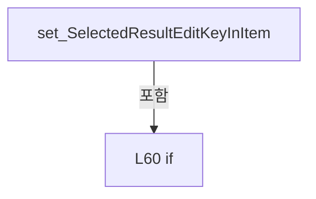

변경 전 점검: 입력/반환 타입, 위 호출자, 예외/취소 경로, 공유 상태와 저장·전송 소비자를 함께 확인합니다. 값의 단위나 물리 방향을 이름만으로 확정하지 않습니다.

### PropertyDeclaration `SelectedResultEditCopyTarget` · L71–85

[Drilling.UI/Menu/Menus/CMenuCorrection.ReviewData.Edit.cs:71–85](https://github.com/kjuws10-rgb/A3Drilling/blob/334b3599651b2e8e0181fd4459bafaf3cddafff3/Drilling.UI/Menu/Menus/CMenuCorrection.ReviewData.Edit.cs#L71-L85)

| 항목 | 실제 추출 값 |
| --- | --- |
| 서명 | Drilling.UI.Menu.Menus.CMenuCorrection.ST_REVIEW_DATA_EDIT_ITEM? Drilling.UI.Menu.Menus.CMenuCorrection.CReviewDataPanel.SelectedResultEditCopyTarget |
| 접근/수식자 | Public / public |
| 반환/값 타입 | Drilling.UI.Menu.Menus.CMenuCorrection.ST_REVIEW_DATA_EDIT_ITEM? |
| 소속 타입 | NamedType:Drilling.UI.Menu.Menus.CMenuCorrection.CReviewDataPanel |

현재 부분 분석에서 직접 연결된 호출자는 없습니다. XAML/이벤트/인터페이스·델리게이트·외부 진입을 추가 확인해야 하며, 미사용으로 판정한 것이 아닙니다.

변경 전 점검: 입력/반환 타입, 위 호출자, 예외/취소 경로, 공유 상태와 저장·전송 소비자를 함께 확인합니다. 값의 단위나 물리 방향을 이름만으로 확정하지 않습니다.

### GetAccessorDeclaration `get_SelectedResultEditCopyTarget` · L73–73

[Drilling.UI/Menu/Menus/CMenuCorrection.ReviewData.Edit.cs:73–73](https://github.com/kjuws10-rgb/A3Drilling/blob/334b3599651b2e8e0181fd4459bafaf3cddafff3/Drilling.UI/Menu/Menus/CMenuCorrection.ReviewData.Edit.cs#L73-L73)

| 항목 | 실제 추출 값 |
| --- | --- |
| 서명 | Drilling.UI.Menu.Menus.CMenuCorrection.ST_REVIEW_DATA_EDIT_ITEM? Drilling.UI.Menu.Menus.CMenuCorrection.CReviewDataPanel.SelectedResultEditCopyTarget.get |
| 접근/수식자 | Public / get |
| 반환/값 타입 | Drilling.UI.Menu.Menus.CMenuCorrection.ST_REVIEW_DATA_EDIT_ITEM? |
| 소속 타입 | NamedType:Drilling.UI.Menu.Menus.CMenuCorrection.CReviewDataPanel |

현재 부분 분석에서 직접 연결된 호출자는 없습니다. XAML/이벤트/인터페이스·델리게이트·외부 진입을 추가 확인해야 하며, 미사용으로 판정한 것이 아닙니다.

변경 전 점검: 입력/반환 타입, 위 호출자, 예외/취소 경로, 공유 상태와 저장·전송 소비자를 함께 확인합니다. 값의 단위나 물리 방향을 이름만으로 확정하지 않습니다.

### SetAccessorDeclaration `set_SelectedResultEditCopyTarget` · L74–84

[Drilling.UI/Menu/Menus/CMenuCorrection.ReviewData.Edit.cs:74–84](https://github.com/kjuws10-rgb/A3Drilling/blob/334b3599651b2e8e0181fd4459bafaf3cddafff3/Drilling.UI/Menu/Menus/CMenuCorrection.ReviewData.Edit.cs#L74-L84)

| 항목 | 실제 추출 값 |
| --- | --- |
| 서명 | void Drilling.UI.Menu.Menus.CMenuCorrection.CReviewDataPanel.SelectedResultEditCopyTarget.set |
| 접근/수식자 | Public / set |
| 반환/값 타입 | void |
| 소속 타입 | NamedType:Drilling.UI.Menu.Menus.CMenuCorrection.CReviewDataPanel |

입력 계약:

| 이름 | 타입 | 전달 | 선택/기본값 |
| --- | --- | --- | --- |
| value | Drilling.UI.Menu.Menus.CMenuCorrection.ST_REVIEW_DATA_EDIT_ITEM? | None | False /  |

현재 부분 분석에서 직접 연결된 호출자는 없습니다. XAML/이벤트/인터페이스·델리게이트·외부 진입을 추가 확인해야 하며, 미사용으로 판정한 것이 아닙니다.

호출하는 대상과 해석 범위:

| 원본 행 | 표현식 | 분석 상태 | 대상/소스 위치 |
| --- | --- | --- | --- |
| 76 | ReferenceEquals | resolved | bool object.ReferenceEquals(object?, object?) |
| 82 | Notify | resolved | void Drilling.UI.Menu.Menus.CMenuCorrection.CReviewDataPanel.Notify(string) · Drilling.UI/Menu/Menus/CMenuCorrection.ReviewData.cs:616 |
| 82 | nameof | unresolved | None |
| 83 | NotifyResultEditCommandState | resolved | void Drilling.UI.Menu.Menus.CMenuCorrection.CReviewDataPanel.NotifyResultEditCommandState() · Drilling.UI/Menu/Menus/CMenuCorrection.ReviewData.Edit.cs:601 |

본문의 실제 연산·분기·예외·반환 순서(원문 위치 순):

| 원본 행 | 종류 | 주석 해설 |
| --- | --- | --- |
| 76 | call | 함수·델리게이트 또는 객체 생성자를 호출합니다: ReferenceEquals(_selectedResultEditCopyTarget, value) |
| 76 | if | 조건에 따라 분기합니다: if (ReferenceEquals(_selectedResultEditCopyTarget, value)) |
| 78 | return | 호출자에게 값 또는 제어를 반환합니다: return; |
| 81 | assignment | 값을 대상에 대입합니다: _selectedResultEditCopyTarget = value |
| 82 | call | 함수·델리게이트 또는 객체 생성자를 호출합니다: Notify(nameof(SelectedResultEditCopyTarget)) |
| 82 | call | 함수·델리게이트 또는 객체 생성자를 호출합니다: nameof(SelectedResultEditCopyTarget) |
| 83 | call | 함수·델리게이트 또는 객체 생성자를 호출합니다: NotifyResultEditCommandState() |

제어 구문의 포함 구조(실제 실행 순서/CFG가 아닌 구문 탐색 그림):

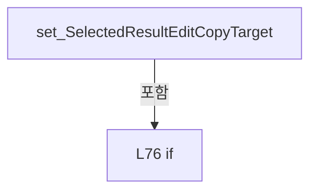

변경 전 점검: 입력/반환 타입, 위 호출자, 예외/취소 경로, 공유 상태와 저장·전송 소비자를 함께 확인합니다. 값의 단위나 물리 방향을 이름만으로 확정하지 않습니다.

### PropertyDeclaration `SelectResultEditSubModeCommand` · L87–87

[Drilling.UI/Menu/Menus/CMenuCorrection.ReviewData.Edit.cs:87–87](https://github.com/kjuws10-rgb/A3Drilling/blob/334b3599651b2e8e0181fd4459bafaf3cddafff3/Drilling.UI/Menu/Menus/CMenuCorrection.ReviewData.Edit.cs#L87-L87)

| 항목 | 실제 추출 값 |
| --- | --- |
| 서명 | Drilling.UI.Menu.CButtonCommand Drilling.UI.Menu.Menus.CMenuCorrection.CReviewDataPanel.SelectResultEditSubModeCommand |
| 접근/수식자 | Public / public |
| 반환/값 타입 | Drilling.UI.Menu.CButtonCommand |
| 소속 타입 | NamedType:Drilling.UI.Menu.Menus.CMenuCorrection.CReviewDataPanel |

현재 부분 분석에서 직접 연결된 호출자는 없습니다. XAML/이벤트/인터페이스·델리게이트·외부 진입을 추가 확인해야 하며, 미사용으로 판정한 것이 아닙니다.

변경 전 점검: 입력/반환 타입, 위 호출자, 예외/취소 경로, 공유 상태와 저장·전송 소비자를 함께 확인합니다. 값의 단위나 물리 방향을 이름만으로 확정하지 않습니다.

### GetAccessorDeclaration `get_SelectResultEditSubModeCommand` · L87–87

[Drilling.UI/Menu/Menus/CMenuCorrection.ReviewData.Edit.cs:87–87](https://github.com/kjuws10-rgb/A3Drilling/blob/334b3599651b2e8e0181fd4459bafaf3cddafff3/Drilling.UI/Menu/Menus/CMenuCorrection.ReviewData.Edit.cs#L87-L87)

| 항목 | 실제 추출 값 |
| --- | --- |
| 서명 | Drilling.UI.Menu.CButtonCommand Drilling.UI.Menu.Menus.CMenuCorrection.CReviewDataPanel.SelectResultEditSubModeCommand.get |
| 접근/수식자 | Public / get |
| 반환/값 타입 | Drilling.UI.Menu.CButtonCommand |
| 소속 타입 | NamedType:Drilling.UI.Menu.Menus.CMenuCorrection.CReviewDataPanel |

현재 부분 분석에서 직접 연결된 호출자는 없습니다. XAML/이벤트/인터페이스·델리게이트·외부 진입을 추가 확인해야 하며, 미사용으로 판정한 것이 아닙니다.

변경 전 점검: 입력/반환 타입, 위 호출자, 예외/취소 경로, 공유 상태와 저장·전송 소비자를 함께 확인합니다. 값의 단위나 물리 방향을 이름만으로 확정하지 않습니다.

### SetAccessorDeclaration `set_SelectResultEditSubModeCommand` · L87–87

[Drilling.UI/Menu/Menus/CMenuCorrection.ReviewData.Edit.cs:87–87](https://github.com/kjuws10-rgb/A3Drilling/blob/334b3599651b2e8e0181fd4459bafaf3cddafff3/Drilling.UI/Menu/Menus/CMenuCorrection.ReviewData.Edit.cs#L87-L87)

| 항목 | 실제 추출 값 |
| --- | --- |
| 서명 | void Drilling.UI.Menu.Menus.CMenuCorrection.CReviewDataPanel.SelectResultEditSubModeCommand.set |
| 접근/수식자 | Private / private, set |
| 반환/값 타입 | void |
| 소속 타입 | NamedType:Drilling.UI.Menu.Menus.CMenuCorrection.CReviewDataPanel |

입력 계약:

| 이름 | 타입 | 전달 | 선택/기본값 |
| --- | --- | --- | --- |
| value | Drilling.UI.Menu.CButtonCommand | None | False /  |

현재 부분 분석에서 직접 연결된 호출자는 없습니다. XAML/이벤트/인터페이스·델리게이트·외부 진입을 추가 확인해야 하며, 미사용으로 판정한 것이 아닙니다.

변경 전 점검: 입력/반환 타입, 위 호출자, 예외/취소 경로, 공유 상태와 저장·전송 소비자를 함께 확인합니다. 값의 단위나 물리 방향을 이름만으로 확정하지 않습니다.

### PropertyDeclaration `AddResultEditKeyInCommand` · L88–88

[Drilling.UI/Menu/Menus/CMenuCorrection.ReviewData.Edit.cs:88–88](https://github.com/kjuws10-rgb/A3Drilling/blob/334b3599651b2e8e0181fd4459bafaf3cddafff3/Drilling.UI/Menu/Menus/CMenuCorrection.ReviewData.Edit.cs#L88-L88)

| 항목 | 실제 추출 값 |
| --- | --- |
| 서명 | Drilling.UI.Menu.CButtonCommand Drilling.UI.Menu.Menus.CMenuCorrection.CReviewDataPanel.AddResultEditKeyInCommand |
| 접근/수식자 | Public / public |
| 반환/값 타입 | Drilling.UI.Menu.CButtonCommand |
| 소속 타입 | NamedType:Drilling.UI.Menu.Menus.CMenuCorrection.CReviewDataPanel |

현재 부분 분석에서 직접 연결된 호출자는 없습니다. XAML/이벤트/인터페이스·델리게이트·외부 진입을 추가 확인해야 하며, 미사용으로 판정한 것이 아닙니다.

변경 전 점검: 입력/반환 타입, 위 호출자, 예외/취소 경로, 공유 상태와 저장·전송 소비자를 함께 확인합니다. 값의 단위나 물리 방향을 이름만으로 확정하지 않습니다.

### GetAccessorDeclaration `get_AddResultEditKeyInCommand` · L88–88

[Drilling.UI/Menu/Menus/CMenuCorrection.ReviewData.Edit.cs:88–88](https://github.com/kjuws10-rgb/A3Drilling/blob/334b3599651b2e8e0181fd4459bafaf3cddafff3/Drilling.UI/Menu/Menus/CMenuCorrection.ReviewData.Edit.cs#L88-L88)

| 항목 | 실제 추출 값 |
| --- | --- |
| 서명 | Drilling.UI.Menu.CButtonCommand Drilling.UI.Menu.Menus.CMenuCorrection.CReviewDataPanel.AddResultEditKeyInCommand.get |
| 접근/수식자 | Public / get |
| 반환/값 타입 | Drilling.UI.Menu.CButtonCommand |
| 소속 타입 | NamedType:Drilling.UI.Menu.Menus.CMenuCorrection.CReviewDataPanel |

현재 부분 분석에서 직접 연결된 호출자는 없습니다. XAML/이벤트/인터페이스·델리게이트·외부 진입을 추가 확인해야 하며, 미사용으로 판정한 것이 아닙니다.

변경 전 점검: 입력/반환 타입, 위 호출자, 예외/취소 경로, 공유 상태와 저장·전송 소비자를 함께 확인합니다. 값의 단위나 물리 방향을 이름만으로 확정하지 않습니다.

### SetAccessorDeclaration `set_AddResultEditKeyInCommand` · L88–88

[Drilling.UI/Menu/Menus/CMenuCorrection.ReviewData.Edit.cs:88–88](https://github.com/kjuws10-rgb/A3Drilling/blob/334b3599651b2e8e0181fd4459bafaf3cddafff3/Drilling.UI/Menu/Menus/CMenuCorrection.ReviewData.Edit.cs#L88-L88)

| 항목 | 실제 추출 값 |
| --- | --- |
| 서명 | void Drilling.UI.Menu.Menus.CMenuCorrection.CReviewDataPanel.AddResultEditKeyInCommand.set |
| 접근/수식자 | Private / private, set |
| 반환/값 타입 | void |
| 소속 타입 | NamedType:Drilling.UI.Menu.Menus.CMenuCorrection.CReviewDataPanel |

입력 계약:

| 이름 | 타입 | 전달 | 선택/기본값 |
| --- | --- | --- | --- |
| value | Drilling.UI.Menu.CButtonCommand | None | False /  |

현재 부분 분석에서 직접 연결된 호출자는 없습니다. XAML/이벤트/인터페이스·델리게이트·외부 진입을 추가 확인해야 하며, 미사용으로 판정한 것이 아닙니다.

변경 전 점검: 입력/반환 타입, 위 호출자, 예외/취소 경로, 공유 상태와 저장·전송 소비자를 함께 확인합니다. 값의 단위나 물리 방향을 이름만으로 확정하지 않습니다.

### PropertyDeclaration `AddSelectedResultEditKeyInCommand` · L89–89

[Drilling.UI/Menu/Menus/CMenuCorrection.ReviewData.Edit.cs:89–89](https://github.com/kjuws10-rgb/A3Drilling/blob/334b3599651b2e8e0181fd4459bafaf3cddafff3/Drilling.UI/Menu/Menus/CMenuCorrection.ReviewData.Edit.cs#L89-L89)

| 항목 | 실제 추출 값 |
| --- | --- |
| 서명 | Drilling.UI.Menu.CButtonCommand Drilling.UI.Menu.Menus.CMenuCorrection.CReviewDataPanel.AddSelectedResultEditKeyInCommand |
| 접근/수식자 | Public / public |
| 반환/값 타입 | Drilling.UI.Menu.CButtonCommand |
| 소속 타입 | NamedType:Drilling.UI.Menu.Menus.CMenuCorrection.CReviewDataPanel |

현재 부분 분석에서 직접 연결된 호출자는 없습니다. XAML/이벤트/인터페이스·델리게이트·외부 진입을 추가 확인해야 하며, 미사용으로 판정한 것이 아닙니다.

변경 전 점검: 입력/반환 타입, 위 호출자, 예외/취소 경로, 공유 상태와 저장·전송 소비자를 함께 확인합니다. 값의 단위나 물리 방향을 이름만으로 확정하지 않습니다.

### GetAccessorDeclaration `get_AddSelectedResultEditKeyInCommand` · L89–89

[Drilling.UI/Menu/Menus/CMenuCorrection.ReviewData.Edit.cs:89–89](https://github.com/kjuws10-rgb/A3Drilling/blob/334b3599651b2e8e0181fd4459bafaf3cddafff3/Drilling.UI/Menu/Menus/CMenuCorrection.ReviewData.Edit.cs#L89-L89)

| 항목 | 실제 추출 값 |
| --- | --- |
| 서명 | Drilling.UI.Menu.CButtonCommand Drilling.UI.Menu.Menus.CMenuCorrection.CReviewDataPanel.AddSelectedResultEditKeyInCommand.get |
| 접근/수식자 | Public / get |
| 반환/값 타입 | Drilling.UI.Menu.CButtonCommand |
| 소속 타입 | NamedType:Drilling.UI.Menu.Menus.CMenuCorrection.CReviewDataPanel |

현재 부분 분석에서 직접 연결된 호출자는 없습니다. XAML/이벤트/인터페이스·델리게이트·외부 진입을 추가 확인해야 하며, 미사용으로 판정한 것이 아닙니다.

변경 전 점검: 입력/반환 타입, 위 호출자, 예외/취소 경로, 공유 상태와 저장·전송 소비자를 함께 확인합니다. 값의 단위나 물리 방향을 이름만으로 확정하지 않습니다.

### SetAccessorDeclaration `set_AddSelectedResultEditKeyInCommand` · L89–89

[Drilling.UI/Menu/Menus/CMenuCorrection.ReviewData.Edit.cs:89–89](https://github.com/kjuws10-rgb/A3Drilling/blob/334b3599651b2e8e0181fd4459bafaf3cddafff3/Drilling.UI/Menu/Menus/CMenuCorrection.ReviewData.Edit.cs#L89-L89)

| 항목 | 실제 추출 값 |
| --- | --- |
| 서명 | void Drilling.UI.Menu.Menus.CMenuCorrection.CReviewDataPanel.AddSelectedResultEditKeyInCommand.set |
| 접근/수식자 | Private / private, set |
| 반환/값 타입 | void |
| 소속 타입 | NamedType:Drilling.UI.Menu.Menus.CMenuCorrection.CReviewDataPanel |

입력 계약:

| 이름 | 타입 | 전달 | 선택/기본값 |
| --- | --- | --- | --- |
| value | Drilling.UI.Menu.CButtonCommand | None | False /  |

현재 부분 분석에서 직접 연결된 호출자는 없습니다. XAML/이벤트/인터페이스·델리게이트·외부 진입을 추가 확인해야 하며, 미사용으로 판정한 것이 아닙니다.

변경 전 점검: 입력/반환 타입, 위 호출자, 예외/취소 경로, 공유 상태와 저장·전송 소비자를 함께 확인합니다. 값의 단위나 물리 방향을 이름만으로 확정하지 않습니다.

### PropertyDeclaration `AddNgResultEditKeyInCommand` · L90–90

[Drilling.UI/Menu/Menus/CMenuCorrection.ReviewData.Edit.cs:90–90](https://github.com/kjuws10-rgb/A3Drilling/blob/334b3599651b2e8e0181fd4459bafaf3cddafff3/Drilling.UI/Menu/Menus/CMenuCorrection.ReviewData.Edit.cs#L90-L90)

| 항목 | 실제 추출 값 |
| --- | --- |
| 서명 | Drilling.UI.Menu.CButtonCommand Drilling.UI.Menu.Menus.CMenuCorrection.CReviewDataPanel.AddNgResultEditKeyInCommand |
| 접근/수식자 | Public / public |
| 반환/값 타입 | Drilling.UI.Menu.CButtonCommand |
| 소속 타입 | NamedType:Drilling.UI.Menu.Menus.CMenuCorrection.CReviewDataPanel |

현재 부분 분석에서 직접 연결된 호출자는 없습니다. XAML/이벤트/인터페이스·델리게이트·외부 진입을 추가 확인해야 하며, 미사용으로 판정한 것이 아닙니다.

변경 전 점검: 입력/반환 타입, 위 호출자, 예외/취소 경로, 공유 상태와 저장·전송 소비자를 함께 확인합니다. 값의 단위나 물리 방향을 이름만으로 확정하지 않습니다.

### GetAccessorDeclaration `get_AddNgResultEditKeyInCommand` · L90–90

[Drilling.UI/Menu/Menus/CMenuCorrection.ReviewData.Edit.cs:90–90](https://github.com/kjuws10-rgb/A3Drilling/blob/334b3599651b2e8e0181fd4459bafaf3cddafff3/Drilling.UI/Menu/Menus/CMenuCorrection.ReviewData.Edit.cs#L90-L90)

| 항목 | 실제 추출 값 |
| --- | --- |
| 서명 | Drilling.UI.Menu.CButtonCommand Drilling.UI.Menu.Menus.CMenuCorrection.CReviewDataPanel.AddNgResultEditKeyInCommand.get |
| 접근/수식자 | Public / get |
| 반환/값 타입 | Drilling.UI.Menu.CButtonCommand |
| 소속 타입 | NamedType:Drilling.UI.Menu.Menus.CMenuCorrection.CReviewDataPanel |

현재 부분 분석에서 직접 연결된 호출자는 없습니다. XAML/이벤트/인터페이스·델리게이트·외부 진입을 추가 확인해야 하며, 미사용으로 판정한 것이 아닙니다.

변경 전 점검: 입력/반환 타입, 위 호출자, 예외/취소 경로, 공유 상태와 저장·전송 소비자를 함께 확인합니다. 값의 단위나 물리 방향을 이름만으로 확정하지 않습니다.

### SetAccessorDeclaration `set_AddNgResultEditKeyInCommand` · L90–90

[Drilling.UI/Menu/Menus/CMenuCorrection.ReviewData.Edit.cs:90–90](https://github.com/kjuws10-rgb/A3Drilling/blob/334b3599651b2e8e0181fd4459bafaf3cddafff3/Drilling.UI/Menu/Menus/CMenuCorrection.ReviewData.Edit.cs#L90-L90)

| 항목 | 실제 추출 값 |
| --- | --- |
| 서명 | void Drilling.UI.Menu.Menus.CMenuCorrection.CReviewDataPanel.AddNgResultEditKeyInCommand.set |
| 접근/수식자 | Private / private, set |
| 반환/값 타입 | void |
| 소속 타입 | NamedType:Drilling.UI.Menu.Menus.CMenuCorrection.CReviewDataPanel |

입력 계약:

| 이름 | 타입 | 전달 | 선택/기본값 |
| --- | --- | --- | --- |
| value | Drilling.UI.Menu.CButtonCommand | None | False /  |

현재 부분 분석에서 직접 연결된 호출자는 없습니다. XAML/이벤트/인터페이스·델리게이트·외부 진입을 추가 확인해야 하며, 미사용으로 판정한 것이 아닙니다.

변경 전 점검: 입력/반환 타입, 위 호출자, 예외/취소 경로, 공유 상태와 저장·전송 소비자를 함께 확인합니다. 값의 단위나 물리 방향을 이름만으로 확정하지 않습니다.

### PropertyDeclaration `RemoveResultEditKeyInCommand` · L91–91

[Drilling.UI/Menu/Menus/CMenuCorrection.ReviewData.Edit.cs:91–91](https://github.com/kjuws10-rgb/A3Drilling/blob/334b3599651b2e8e0181fd4459bafaf3cddafff3/Drilling.UI/Menu/Menus/CMenuCorrection.ReviewData.Edit.cs#L91-L91)

| 항목 | 실제 추출 값 |
| --- | --- |
| 서명 | Drilling.UI.Menu.CButtonCommand Drilling.UI.Menu.Menus.CMenuCorrection.CReviewDataPanel.RemoveResultEditKeyInCommand |
| 접근/수식자 | Public / public |
| 반환/값 타입 | Drilling.UI.Menu.CButtonCommand |
| 소속 타입 | NamedType:Drilling.UI.Menu.Menus.CMenuCorrection.CReviewDataPanel |

현재 부분 분석에서 직접 연결된 호출자는 없습니다. XAML/이벤트/인터페이스·델리게이트·외부 진입을 추가 확인해야 하며, 미사용으로 판정한 것이 아닙니다.

변경 전 점검: 입력/반환 타입, 위 호출자, 예외/취소 경로, 공유 상태와 저장·전송 소비자를 함께 확인합니다. 값의 단위나 물리 방향을 이름만으로 확정하지 않습니다.

### GetAccessorDeclaration `get_RemoveResultEditKeyInCommand` · L91–91

[Drilling.UI/Menu/Menus/CMenuCorrection.ReviewData.Edit.cs:91–91](https://github.com/kjuws10-rgb/A3Drilling/blob/334b3599651b2e8e0181fd4459bafaf3cddafff3/Drilling.UI/Menu/Menus/CMenuCorrection.ReviewData.Edit.cs#L91-L91)

| 항목 | 실제 추출 값 |
| --- | --- |
| 서명 | Drilling.UI.Menu.CButtonCommand Drilling.UI.Menu.Menus.CMenuCorrection.CReviewDataPanel.RemoveResultEditKeyInCommand.get |
| 접근/수식자 | Public / get |
| 반환/값 타입 | Drilling.UI.Menu.CButtonCommand |
| 소속 타입 | NamedType:Drilling.UI.Menu.Menus.CMenuCorrection.CReviewDataPanel |

현재 부분 분석에서 직접 연결된 호출자는 없습니다. XAML/이벤트/인터페이스·델리게이트·외부 진입을 추가 확인해야 하며, 미사용으로 판정한 것이 아닙니다.

변경 전 점검: 입력/반환 타입, 위 호출자, 예외/취소 경로, 공유 상태와 저장·전송 소비자를 함께 확인합니다. 값의 단위나 물리 방향을 이름만으로 확정하지 않습니다.

### SetAccessorDeclaration `set_RemoveResultEditKeyInCommand` · L91–91

[Drilling.UI/Menu/Menus/CMenuCorrection.ReviewData.Edit.cs:91–91](https://github.com/kjuws10-rgb/A3Drilling/blob/334b3599651b2e8e0181fd4459bafaf3cddafff3/Drilling.UI/Menu/Menus/CMenuCorrection.ReviewData.Edit.cs#L91-L91)

| 항목 | 실제 추출 값 |
| --- | --- |
| 서명 | void Drilling.UI.Menu.Menus.CMenuCorrection.CReviewDataPanel.RemoveResultEditKeyInCommand.set |
| 접근/수식자 | Private / private, set |
| 반환/값 타입 | void |
| 소속 타입 | NamedType:Drilling.UI.Menu.Menus.CMenuCorrection.CReviewDataPanel |

입력 계약:

| 이름 | 타입 | 전달 | 선택/기본값 |
| --- | --- | --- | --- |
| value | Drilling.UI.Menu.CButtonCommand | None | False /  |

현재 부분 분석에서 직접 연결된 호출자는 없습니다. XAML/이벤트/인터페이스·델리게이트·외부 진입을 추가 확인해야 하며, 미사용으로 판정한 것이 아닙니다.

변경 전 점검: 입력/반환 타입, 위 호출자, 예외/취소 경로, 공유 상태와 저장·전송 소비자를 함께 확인합니다. 값의 단위나 물리 방향을 이름만으로 확정하지 않습니다.

### PropertyDeclaration `ClearResultEditKeyInCommand` · L92–92

[Drilling.UI/Menu/Menus/CMenuCorrection.ReviewData.Edit.cs:92–92](https://github.com/kjuws10-rgb/A3Drilling/blob/334b3599651b2e8e0181fd4459bafaf3cddafff3/Drilling.UI/Menu/Menus/CMenuCorrection.ReviewData.Edit.cs#L92-L92)

| 항목 | 실제 추출 값 |
| --- | --- |
| 서명 | Drilling.UI.Menu.CButtonCommand Drilling.UI.Menu.Menus.CMenuCorrection.CReviewDataPanel.ClearResultEditKeyInCommand |
| 접근/수식자 | Public / public |
| 반환/값 타입 | Drilling.UI.Menu.CButtonCommand |
| 소속 타입 | NamedType:Drilling.UI.Menu.Menus.CMenuCorrection.CReviewDataPanel |

현재 부분 분석에서 직접 연결된 호출자는 없습니다. XAML/이벤트/인터페이스·델리게이트·외부 진입을 추가 확인해야 하며, 미사용으로 판정한 것이 아닙니다.

변경 전 점검: 입력/반환 타입, 위 호출자, 예외/취소 경로, 공유 상태와 저장·전송 소비자를 함께 확인합니다. 값의 단위나 물리 방향을 이름만으로 확정하지 않습니다.

### GetAccessorDeclaration `get_ClearResultEditKeyInCommand` · L92–92

[Drilling.UI/Menu/Menus/CMenuCorrection.ReviewData.Edit.cs:92–92](https://github.com/kjuws10-rgb/A3Drilling/blob/334b3599651b2e8e0181fd4459bafaf3cddafff3/Drilling.UI/Menu/Menus/CMenuCorrection.ReviewData.Edit.cs#L92-L92)

| 항목 | 실제 추출 값 |
| --- | --- |
| 서명 | Drilling.UI.Menu.CButtonCommand Drilling.UI.Menu.Menus.CMenuCorrection.CReviewDataPanel.ClearResultEditKeyInCommand.get |
| 접근/수식자 | Public / get |
| 반환/값 타입 | Drilling.UI.Menu.CButtonCommand |
| 소속 타입 | NamedType:Drilling.UI.Menu.Menus.CMenuCorrection.CReviewDataPanel |

현재 부분 분석에서 직접 연결된 호출자는 없습니다. XAML/이벤트/인터페이스·델리게이트·외부 진입을 추가 확인해야 하며, 미사용으로 판정한 것이 아닙니다.

변경 전 점검: 입력/반환 타입, 위 호출자, 예외/취소 경로, 공유 상태와 저장·전송 소비자를 함께 확인합니다. 값의 단위나 물리 방향을 이름만으로 확정하지 않습니다.

### SetAccessorDeclaration `set_ClearResultEditKeyInCommand` · L92–92

[Drilling.UI/Menu/Menus/CMenuCorrection.ReviewData.Edit.cs:92–92](https://github.com/kjuws10-rgb/A3Drilling/blob/334b3599651b2e8e0181fd4459bafaf3cddafff3/Drilling.UI/Menu/Menus/CMenuCorrection.ReviewData.Edit.cs#L92-L92)

| 항목 | 실제 추출 값 |
| --- | --- |
| 서명 | void Drilling.UI.Menu.Menus.CMenuCorrection.CReviewDataPanel.ClearResultEditKeyInCommand.set |
| 접근/수식자 | Private / private, set |
| 반환/값 타입 | void |
| 소속 타입 | NamedType:Drilling.UI.Menu.Menus.CMenuCorrection.CReviewDataPanel |

입력 계약:

| 이름 | 타입 | 전달 | 선택/기본값 |
| --- | --- | --- | --- |
| value | Drilling.UI.Menu.CButtonCommand | None | False /  |

현재 부분 분석에서 직접 연결된 호출자는 없습니다. XAML/이벤트/인터페이스·델리게이트·외부 진입을 추가 확인해야 하며, 미사용으로 판정한 것이 아닙니다.

변경 전 점검: 입력/반환 타입, 위 호출자, 예외/취소 경로, 공유 상태와 저장·전송 소비자를 함께 확인합니다. 값의 단위나 물리 방향을 이름만으로 확정하지 않습니다.

### PropertyDeclaration `AddResultEditCopySourceCommand` · L93–93

[Drilling.UI/Menu/Menus/CMenuCorrection.ReviewData.Edit.cs:93–93](https://github.com/kjuws10-rgb/A3Drilling/blob/334b3599651b2e8e0181fd4459bafaf3cddafff3/Drilling.UI/Menu/Menus/CMenuCorrection.ReviewData.Edit.cs#L93-L93)

| 항목 | 실제 추출 값 |
| --- | --- |
| 서명 | Drilling.UI.Menu.CButtonCommand Drilling.UI.Menu.Menus.CMenuCorrection.CReviewDataPanel.AddResultEditCopySourceCommand |
| 접근/수식자 | Public / public |
| 반환/값 타입 | Drilling.UI.Menu.CButtonCommand |
| 소속 타입 | NamedType:Drilling.UI.Menu.Menus.CMenuCorrection.CReviewDataPanel |

현재 부분 분석에서 직접 연결된 호출자는 없습니다. XAML/이벤트/인터페이스·델리게이트·외부 진입을 추가 확인해야 하며, 미사용으로 판정한 것이 아닙니다.

변경 전 점검: 입력/반환 타입, 위 호출자, 예외/취소 경로, 공유 상태와 저장·전송 소비자를 함께 확인합니다. 값의 단위나 물리 방향을 이름만으로 확정하지 않습니다.

### GetAccessorDeclaration `get_AddResultEditCopySourceCommand` · L93–93

[Drilling.UI/Menu/Menus/CMenuCorrection.ReviewData.Edit.cs:93–93](https://github.com/kjuws10-rgb/A3Drilling/blob/334b3599651b2e8e0181fd4459bafaf3cddafff3/Drilling.UI/Menu/Menus/CMenuCorrection.ReviewData.Edit.cs#L93-L93)

| 항목 | 실제 추출 값 |
| --- | --- |
| 서명 | Drilling.UI.Menu.CButtonCommand Drilling.UI.Menu.Menus.CMenuCorrection.CReviewDataPanel.AddResultEditCopySourceCommand.get |
| 접근/수식자 | Public / get |
| 반환/값 타입 | Drilling.UI.Menu.CButtonCommand |
| 소속 타입 | NamedType:Drilling.UI.Menu.Menus.CMenuCorrection.CReviewDataPanel |

현재 부분 분석에서 직접 연결된 호출자는 없습니다. XAML/이벤트/인터페이스·델리게이트·외부 진입을 추가 확인해야 하며, 미사용으로 판정한 것이 아닙니다.

변경 전 점검: 입력/반환 타입, 위 호출자, 예외/취소 경로, 공유 상태와 저장·전송 소비자를 함께 확인합니다. 값의 단위나 물리 방향을 이름만으로 확정하지 않습니다.

### SetAccessorDeclaration `set_AddResultEditCopySourceCommand` · L93–93

[Drilling.UI/Menu/Menus/CMenuCorrection.ReviewData.Edit.cs:93–93](https://github.com/kjuws10-rgb/A3Drilling/blob/334b3599651b2e8e0181fd4459bafaf3cddafff3/Drilling.UI/Menu/Menus/CMenuCorrection.ReviewData.Edit.cs#L93-L93)

| 항목 | 실제 추출 값 |
| --- | --- |
| 서명 | void Drilling.UI.Menu.Menus.CMenuCorrection.CReviewDataPanel.AddResultEditCopySourceCommand.set |
| 접근/수식자 | Private / private, set |
| 반환/값 타입 | void |
| 소속 타입 | NamedType:Drilling.UI.Menu.Menus.CMenuCorrection.CReviewDataPanel |

입력 계약:

| 이름 | 타입 | 전달 | 선택/기본값 |
| --- | --- | --- | --- |
| value | Drilling.UI.Menu.CButtonCommand | None | False /  |

현재 부분 분석에서 직접 연결된 호출자는 없습니다. XAML/이벤트/인터페이스·델리게이트·외부 진입을 추가 확인해야 하며, 미사용으로 판정한 것이 아닙니다.

변경 전 점검: 입력/반환 타입, 위 호출자, 예외/취소 경로, 공유 상태와 저장·전송 소비자를 함께 확인합니다. 값의 단위나 물리 방향을 이름만으로 확정하지 않습니다.

### PropertyDeclaration `AddResultEditCopyTargetsCommand` · L94–94

[Drilling.UI/Menu/Menus/CMenuCorrection.ReviewData.Edit.cs:94–94](https://github.com/kjuws10-rgb/A3Drilling/blob/334b3599651b2e8e0181fd4459bafaf3cddafff3/Drilling.UI/Menu/Menus/CMenuCorrection.ReviewData.Edit.cs#L94-L94)

| 항목 | 실제 추출 값 |
| --- | --- |
| 서명 | Drilling.UI.Menu.CButtonCommand Drilling.UI.Menu.Menus.CMenuCorrection.CReviewDataPanel.AddResultEditCopyTargetsCommand |
| 접근/수식자 | Public / public |
| 반환/값 타입 | Drilling.UI.Menu.CButtonCommand |
| 소속 타입 | NamedType:Drilling.UI.Menu.Menus.CMenuCorrection.CReviewDataPanel |

현재 부분 분석에서 직접 연결된 호출자는 없습니다. XAML/이벤트/인터페이스·델리게이트·외부 진입을 추가 확인해야 하며, 미사용으로 판정한 것이 아닙니다.

변경 전 점검: 입력/반환 타입, 위 호출자, 예외/취소 경로, 공유 상태와 저장·전송 소비자를 함께 확인합니다. 값의 단위나 물리 방향을 이름만으로 확정하지 않습니다.

### GetAccessorDeclaration `get_AddResultEditCopyTargetsCommand` · L94–94

[Drilling.UI/Menu/Menus/CMenuCorrection.ReviewData.Edit.cs:94–94](https://github.com/kjuws10-rgb/A3Drilling/blob/334b3599651b2e8e0181fd4459bafaf3cddafff3/Drilling.UI/Menu/Menus/CMenuCorrection.ReviewData.Edit.cs#L94-L94)

| 항목 | 실제 추출 값 |
| --- | --- |
| 서명 | Drilling.UI.Menu.CButtonCommand Drilling.UI.Menu.Menus.CMenuCorrection.CReviewDataPanel.AddResultEditCopyTargetsCommand.get |
| 접근/수식자 | Public / get |
| 반환/값 타입 | Drilling.UI.Menu.CButtonCommand |
| 소속 타입 | NamedType:Drilling.UI.Menu.Menus.CMenuCorrection.CReviewDataPanel |

현재 부분 분석에서 직접 연결된 호출자는 없습니다. XAML/이벤트/인터페이스·델리게이트·외부 진입을 추가 확인해야 하며, 미사용으로 판정한 것이 아닙니다.

변경 전 점검: 입력/반환 타입, 위 호출자, 예외/취소 경로, 공유 상태와 저장·전송 소비자를 함께 확인합니다. 값의 단위나 물리 방향을 이름만으로 확정하지 않습니다.

### SetAccessorDeclaration `set_AddResultEditCopyTargetsCommand` · L94–94

[Drilling.UI/Menu/Menus/CMenuCorrection.ReviewData.Edit.cs:94–94](https://github.com/kjuws10-rgb/A3Drilling/blob/334b3599651b2e8e0181fd4459bafaf3cddafff3/Drilling.UI/Menu/Menus/CMenuCorrection.ReviewData.Edit.cs#L94-L94)

| 항목 | 실제 추출 값 |
| --- | --- |
| 서명 | void Drilling.UI.Menu.Menus.CMenuCorrection.CReviewDataPanel.AddResultEditCopyTargetsCommand.set |
| 접근/수식자 | Private / private, set |
| 반환/값 타입 | void |
| 소속 타입 | NamedType:Drilling.UI.Menu.Menus.CMenuCorrection.CReviewDataPanel |

입력 계약:

| 이름 | 타입 | 전달 | 선택/기본값 |
| --- | --- | --- | --- |
| value | Drilling.UI.Menu.CButtonCommand | None | False /  |

현재 부분 분석에서 직접 연결된 호출자는 없습니다. XAML/이벤트/인터페이스·델리게이트·외부 진입을 추가 확인해야 하며, 미사용으로 판정한 것이 아닙니다.

변경 전 점검: 입력/반환 타입, 위 호출자, 예외/취소 경로, 공유 상태와 저장·전송 소비자를 함께 확인합니다. 값의 단위나 물리 방향을 이름만으로 확정하지 않습니다.

### PropertyDeclaration `RemoveResultEditCopyTargetCommand` · L95–95

[Drilling.UI/Menu/Menus/CMenuCorrection.ReviewData.Edit.cs:95–95](https://github.com/kjuws10-rgb/A3Drilling/blob/334b3599651b2e8e0181fd4459bafaf3cddafff3/Drilling.UI/Menu/Menus/CMenuCorrection.ReviewData.Edit.cs#L95-L95)

| 항목 | 실제 추출 값 |
| --- | --- |
| 서명 | Drilling.UI.Menu.CButtonCommand Drilling.UI.Menu.Menus.CMenuCorrection.CReviewDataPanel.RemoveResultEditCopyTargetCommand |
| 접근/수식자 | Public / public |
| 반환/값 타입 | Drilling.UI.Menu.CButtonCommand |
| 소속 타입 | NamedType:Drilling.UI.Menu.Menus.CMenuCorrection.CReviewDataPanel |

현재 부분 분석에서 직접 연결된 호출자는 없습니다. XAML/이벤트/인터페이스·델리게이트·외부 진입을 추가 확인해야 하며, 미사용으로 판정한 것이 아닙니다.

변경 전 점검: 입력/반환 타입, 위 호출자, 예외/취소 경로, 공유 상태와 저장·전송 소비자를 함께 확인합니다. 값의 단위나 물리 방향을 이름만으로 확정하지 않습니다.

### GetAccessorDeclaration `get_RemoveResultEditCopyTargetCommand` · L95–95

[Drilling.UI/Menu/Menus/CMenuCorrection.ReviewData.Edit.cs:95–95](https://github.com/kjuws10-rgb/A3Drilling/blob/334b3599651b2e8e0181fd4459bafaf3cddafff3/Drilling.UI/Menu/Menus/CMenuCorrection.ReviewData.Edit.cs#L95-L95)

| 항목 | 실제 추출 값 |
| --- | --- |
| 서명 | Drilling.UI.Menu.CButtonCommand Drilling.UI.Menu.Menus.CMenuCorrection.CReviewDataPanel.RemoveResultEditCopyTargetCommand.get |
| 접근/수식자 | Public / get |
| 반환/값 타입 | Drilling.UI.Menu.CButtonCommand |
| 소속 타입 | NamedType:Drilling.UI.Menu.Menus.CMenuCorrection.CReviewDataPanel |

현재 부분 분석에서 직접 연결된 호출자는 없습니다. XAML/이벤트/인터페이스·델리게이트·외부 진입을 추가 확인해야 하며, 미사용으로 판정한 것이 아닙니다.

변경 전 점검: 입력/반환 타입, 위 호출자, 예외/취소 경로, 공유 상태와 저장·전송 소비자를 함께 확인합니다. 값의 단위나 물리 방향을 이름만으로 확정하지 않습니다.

### SetAccessorDeclaration `set_RemoveResultEditCopyTargetCommand` · L95–95

[Drilling.UI/Menu/Menus/CMenuCorrection.ReviewData.Edit.cs:95–95](https://github.com/kjuws10-rgb/A3Drilling/blob/334b3599651b2e8e0181fd4459bafaf3cddafff3/Drilling.UI/Menu/Menus/CMenuCorrection.ReviewData.Edit.cs#L95-L95)

| 항목 | 실제 추출 값 |
| --- | --- |
| 서명 | void Drilling.UI.Menu.Menus.CMenuCorrection.CReviewDataPanel.RemoveResultEditCopyTargetCommand.set |
| 접근/수식자 | Private / private, set |
| 반환/값 타입 | void |
| 소속 타입 | NamedType:Drilling.UI.Menu.Menus.CMenuCorrection.CReviewDataPanel |

입력 계약:

| 이름 | 타입 | 전달 | 선택/기본값 |
| --- | --- | --- | --- |
| value | Drilling.UI.Menu.CButtonCommand | None | False /  |

현재 부분 분석에서 직접 연결된 호출자는 없습니다. XAML/이벤트/인터페이스·델리게이트·외부 진입을 추가 확인해야 하며, 미사용으로 판정한 것이 아닙니다.

변경 전 점검: 입력/반환 타입, 위 호출자, 예외/취소 경로, 공유 상태와 저장·전송 소비자를 함께 확인합니다. 값의 단위나 물리 방향을 이름만으로 확정하지 않습니다.

### PropertyDeclaration `ClearResultEditCopyTargetsCommand` · L96–96

[Drilling.UI/Menu/Menus/CMenuCorrection.ReviewData.Edit.cs:96–96](https://github.com/kjuws10-rgb/A3Drilling/blob/334b3599651b2e8e0181fd4459bafaf3cddafff3/Drilling.UI/Menu/Menus/CMenuCorrection.ReviewData.Edit.cs#L96-L96)

| 항목 | 실제 추출 값 |
| --- | --- |
| 서명 | Drilling.UI.Menu.CButtonCommand Drilling.UI.Menu.Menus.CMenuCorrection.CReviewDataPanel.ClearResultEditCopyTargetsCommand |
| 접근/수식자 | Public / public |
| 반환/값 타입 | Drilling.UI.Menu.CButtonCommand |
| 소속 타입 | NamedType:Drilling.UI.Menu.Menus.CMenuCorrection.CReviewDataPanel |

현재 부분 분석에서 직접 연결된 호출자는 없습니다. XAML/이벤트/인터페이스·델리게이트·외부 진입을 추가 확인해야 하며, 미사용으로 판정한 것이 아닙니다.

변경 전 점검: 입력/반환 타입, 위 호출자, 예외/취소 경로, 공유 상태와 저장·전송 소비자를 함께 확인합니다. 값의 단위나 물리 방향을 이름만으로 확정하지 않습니다.

### GetAccessorDeclaration `get_ClearResultEditCopyTargetsCommand` · L96–96

[Drilling.UI/Menu/Menus/CMenuCorrection.ReviewData.Edit.cs:96–96](https://github.com/kjuws10-rgb/A3Drilling/blob/334b3599651b2e8e0181fd4459bafaf3cddafff3/Drilling.UI/Menu/Menus/CMenuCorrection.ReviewData.Edit.cs#L96-L96)

| 항목 | 실제 추출 값 |
| --- | --- |
| 서명 | Drilling.UI.Menu.CButtonCommand Drilling.UI.Menu.Menus.CMenuCorrection.CReviewDataPanel.ClearResultEditCopyTargetsCommand.get |
| 접근/수식자 | Public / get |
| 반환/값 타입 | Drilling.UI.Menu.CButtonCommand |
| 소속 타입 | NamedType:Drilling.UI.Menu.Menus.CMenuCorrection.CReviewDataPanel |

현재 부분 분석에서 직접 연결된 호출자는 없습니다. XAML/이벤트/인터페이스·델리게이트·외부 진입을 추가 확인해야 하며, 미사용으로 판정한 것이 아닙니다.

변경 전 점검: 입력/반환 타입, 위 호출자, 예외/취소 경로, 공유 상태와 저장·전송 소비자를 함께 확인합니다. 값의 단위나 물리 방향을 이름만으로 확정하지 않습니다.

### SetAccessorDeclaration `set_ClearResultEditCopyTargetsCommand` · L96–96

[Drilling.UI/Menu/Menus/CMenuCorrection.ReviewData.Edit.cs:96–96](https://github.com/kjuws10-rgb/A3Drilling/blob/334b3599651b2e8e0181fd4459bafaf3cddafff3/Drilling.UI/Menu/Menus/CMenuCorrection.ReviewData.Edit.cs#L96-L96)

| 항목 | 실제 추출 값 |
| --- | --- |
| 서명 | void Drilling.UI.Menu.Menus.CMenuCorrection.CReviewDataPanel.ClearResultEditCopyTargetsCommand.set |
| 접근/수식자 | Private / private, set |
| 반환/값 타입 | void |
| 소속 타입 | NamedType:Drilling.UI.Menu.Menus.CMenuCorrection.CReviewDataPanel |

입력 계약:

| 이름 | 타입 | 전달 | 선택/기본값 |
| --- | --- | --- | --- |
| value | Drilling.UI.Menu.CButtonCommand | None | False /  |

현재 부분 분석에서 직접 연결된 호출자는 없습니다. XAML/이벤트/인터페이스·델리게이트·외부 진입을 추가 확인해야 하며, 미사용으로 판정한 것이 아닙니다.

변경 전 점검: 입력/반환 타입, 위 호출자, 예외/취소 경로, 공유 상태와 저장·전송 소비자를 함께 확인합니다. 값의 단위나 물리 방향을 이름만으로 확정하지 않습니다.

### PropertyDeclaration `CopyResultEditXCommand` · L97–97

[Drilling.UI/Menu/Menus/CMenuCorrection.ReviewData.Edit.cs:97–97](https://github.com/kjuws10-rgb/A3Drilling/blob/334b3599651b2e8e0181fd4459bafaf3cddafff3/Drilling.UI/Menu/Menus/CMenuCorrection.ReviewData.Edit.cs#L97-L97)

| 항목 | 실제 추출 값 |
| --- | --- |
| 서명 | Drilling.UI.Menu.CButtonCommand Drilling.UI.Menu.Menus.CMenuCorrection.CReviewDataPanel.CopyResultEditXCommand |
| 접근/수식자 | Public / public |
| 반환/값 타입 | Drilling.UI.Menu.CButtonCommand |
| 소속 타입 | NamedType:Drilling.UI.Menu.Menus.CMenuCorrection.CReviewDataPanel |

현재 부분 분석에서 직접 연결된 호출자는 없습니다. XAML/이벤트/인터페이스·델리게이트·외부 진입을 추가 확인해야 하며, 미사용으로 판정한 것이 아닙니다.

변경 전 점검: 입력/반환 타입, 위 호출자, 예외/취소 경로, 공유 상태와 저장·전송 소비자를 함께 확인합니다. 값의 단위나 물리 방향을 이름만으로 확정하지 않습니다.

### GetAccessorDeclaration `get_CopyResultEditXCommand` · L97–97

[Drilling.UI/Menu/Menus/CMenuCorrection.ReviewData.Edit.cs:97–97](https://github.com/kjuws10-rgb/A3Drilling/blob/334b3599651b2e8e0181fd4459bafaf3cddafff3/Drilling.UI/Menu/Menus/CMenuCorrection.ReviewData.Edit.cs#L97-L97)

| 항목 | 실제 추출 값 |
| --- | --- |
| 서명 | Drilling.UI.Menu.CButtonCommand Drilling.UI.Menu.Menus.CMenuCorrection.CReviewDataPanel.CopyResultEditXCommand.get |
| 접근/수식자 | Public / get |
| 반환/값 타입 | Drilling.UI.Menu.CButtonCommand |
| 소속 타입 | NamedType:Drilling.UI.Menu.Menus.CMenuCorrection.CReviewDataPanel |

현재 부분 분석에서 직접 연결된 호출자는 없습니다. XAML/이벤트/인터페이스·델리게이트·외부 진입을 추가 확인해야 하며, 미사용으로 판정한 것이 아닙니다.

변경 전 점검: 입력/반환 타입, 위 호출자, 예외/취소 경로, 공유 상태와 저장·전송 소비자를 함께 확인합니다. 값의 단위나 물리 방향을 이름만으로 확정하지 않습니다.

### SetAccessorDeclaration `set_CopyResultEditXCommand` · L97–97

[Drilling.UI/Menu/Menus/CMenuCorrection.ReviewData.Edit.cs:97–97](https://github.com/kjuws10-rgb/A3Drilling/blob/334b3599651b2e8e0181fd4459bafaf3cddafff3/Drilling.UI/Menu/Menus/CMenuCorrection.ReviewData.Edit.cs#L97-L97)

| 항목 | 실제 추출 값 |
| --- | --- |
| 서명 | void Drilling.UI.Menu.Menus.CMenuCorrection.CReviewDataPanel.CopyResultEditXCommand.set |
| 접근/수식자 | Private / private, set |
| 반환/값 타입 | void |
| 소속 타입 | NamedType:Drilling.UI.Menu.Menus.CMenuCorrection.CReviewDataPanel |

입력 계약:

| 이름 | 타입 | 전달 | 선택/기본값 |
| --- | --- | --- | --- |
| value | Drilling.UI.Menu.CButtonCommand | None | False /  |

현재 부분 분석에서 직접 연결된 호출자는 없습니다. XAML/이벤트/인터페이스·델리게이트·외부 진입을 추가 확인해야 하며, 미사용으로 판정한 것이 아닙니다.

변경 전 점검: 입력/반환 타입, 위 호출자, 예외/취소 경로, 공유 상태와 저장·전송 소비자를 함께 확인합니다. 값의 단위나 물리 방향을 이름만으로 확정하지 않습니다.

### PropertyDeclaration `CopyResultEditYCommand` · L98–98

[Drilling.UI/Menu/Menus/CMenuCorrection.ReviewData.Edit.cs:98–98](https://github.com/kjuws10-rgb/A3Drilling/blob/334b3599651b2e8e0181fd4459bafaf3cddafff3/Drilling.UI/Menu/Menus/CMenuCorrection.ReviewData.Edit.cs#L98-L98)

| 항목 | 실제 추출 값 |
| --- | --- |
| 서명 | Drilling.UI.Menu.CButtonCommand Drilling.UI.Menu.Menus.CMenuCorrection.CReviewDataPanel.CopyResultEditYCommand |
| 접근/수식자 | Public / public |
| 반환/값 타입 | Drilling.UI.Menu.CButtonCommand |
| 소속 타입 | NamedType:Drilling.UI.Menu.Menus.CMenuCorrection.CReviewDataPanel |

현재 부분 분석에서 직접 연결된 호출자는 없습니다. XAML/이벤트/인터페이스·델리게이트·외부 진입을 추가 확인해야 하며, 미사용으로 판정한 것이 아닙니다.

변경 전 점검: 입력/반환 타입, 위 호출자, 예외/취소 경로, 공유 상태와 저장·전송 소비자를 함께 확인합니다. 값의 단위나 물리 방향을 이름만으로 확정하지 않습니다.

### GetAccessorDeclaration `get_CopyResultEditYCommand` · L98–98

[Drilling.UI/Menu/Menus/CMenuCorrection.ReviewData.Edit.cs:98–98](https://github.com/kjuws10-rgb/A3Drilling/blob/334b3599651b2e8e0181fd4459bafaf3cddafff3/Drilling.UI/Menu/Menus/CMenuCorrection.ReviewData.Edit.cs#L98-L98)

| 항목 | 실제 추출 값 |
| --- | --- |
| 서명 | Drilling.UI.Menu.CButtonCommand Drilling.UI.Menu.Menus.CMenuCorrection.CReviewDataPanel.CopyResultEditYCommand.get |
| 접근/수식자 | Public / get |
| 반환/값 타입 | Drilling.UI.Menu.CButtonCommand |
| 소속 타입 | NamedType:Drilling.UI.Menu.Menus.CMenuCorrection.CReviewDataPanel |

현재 부분 분석에서 직접 연결된 호출자는 없습니다. XAML/이벤트/인터페이스·델리게이트·외부 진입을 추가 확인해야 하며, 미사용으로 판정한 것이 아닙니다.

변경 전 점검: 입력/반환 타입, 위 호출자, 예외/취소 경로, 공유 상태와 저장·전송 소비자를 함께 확인합니다. 값의 단위나 물리 방향을 이름만으로 확정하지 않습니다.

### SetAccessorDeclaration `set_CopyResultEditYCommand` · L98–98

[Drilling.UI/Menu/Menus/CMenuCorrection.ReviewData.Edit.cs:98–98](https://github.com/kjuws10-rgb/A3Drilling/blob/334b3599651b2e8e0181fd4459bafaf3cddafff3/Drilling.UI/Menu/Menus/CMenuCorrection.ReviewData.Edit.cs#L98-L98)

| 항목 | 실제 추출 값 |
| --- | --- |
| 서명 | void Drilling.UI.Menu.Menus.CMenuCorrection.CReviewDataPanel.CopyResultEditYCommand.set |
| 접근/수식자 | Private / private, set |
| 반환/값 타입 | void |
| 소속 타입 | NamedType:Drilling.UI.Menu.Menus.CMenuCorrection.CReviewDataPanel |

입력 계약:

| 이름 | 타입 | 전달 | 선택/기본값 |
| --- | --- | --- | --- |
| value | Drilling.UI.Menu.CButtonCommand | None | False /  |

현재 부분 분석에서 직접 연결된 호출자는 없습니다. XAML/이벤트/인터페이스·델리게이트·외부 진입을 추가 확인해야 하며, 미사용으로 판정한 것이 아닙니다.

변경 전 점검: 입력/반환 타입, 위 호출자, 예외/취소 경로, 공유 상태와 저장·전송 소비자를 함께 확인합니다. 값의 단위나 물리 방향을 이름만으로 확정하지 않습니다.

### PropertyDeclaration `CopyResultEditJudgeCommand` · L99–99

[Drilling.UI/Menu/Menus/CMenuCorrection.ReviewData.Edit.cs:99–99](https://github.com/kjuws10-rgb/A3Drilling/blob/334b3599651b2e8e0181fd4459bafaf3cddafff3/Drilling.UI/Menu/Menus/CMenuCorrection.ReviewData.Edit.cs#L99-L99)

| 항목 | 실제 추출 값 |
| --- | --- |
| 서명 | Drilling.UI.Menu.CButtonCommand Drilling.UI.Menu.Menus.CMenuCorrection.CReviewDataPanel.CopyResultEditJudgeCommand |
| 접근/수식자 | Public / public |
| 반환/값 타입 | Drilling.UI.Menu.CButtonCommand |
| 소속 타입 | NamedType:Drilling.UI.Menu.Menus.CMenuCorrection.CReviewDataPanel |

현재 부분 분석에서 직접 연결된 호출자는 없습니다. XAML/이벤트/인터페이스·델리게이트·외부 진입을 추가 확인해야 하며, 미사용으로 판정한 것이 아닙니다.

변경 전 점검: 입력/반환 타입, 위 호출자, 예외/취소 경로, 공유 상태와 저장·전송 소비자를 함께 확인합니다. 값의 단위나 물리 방향을 이름만으로 확정하지 않습니다.

### GetAccessorDeclaration `get_CopyResultEditJudgeCommand` · L99–99

[Drilling.UI/Menu/Menus/CMenuCorrection.ReviewData.Edit.cs:99–99](https://github.com/kjuws10-rgb/A3Drilling/blob/334b3599651b2e8e0181fd4459bafaf3cddafff3/Drilling.UI/Menu/Menus/CMenuCorrection.ReviewData.Edit.cs#L99-L99)

| 항목 | 실제 추출 값 |
| --- | --- |
| 서명 | Drilling.UI.Menu.CButtonCommand Drilling.UI.Menu.Menus.CMenuCorrection.CReviewDataPanel.CopyResultEditJudgeCommand.get |
| 접근/수식자 | Public / get |
| 반환/값 타입 | Drilling.UI.Menu.CButtonCommand |
| 소속 타입 | NamedType:Drilling.UI.Menu.Menus.CMenuCorrection.CReviewDataPanel |

현재 부분 분석에서 직접 연결된 호출자는 없습니다. XAML/이벤트/인터페이스·델리게이트·외부 진입을 추가 확인해야 하며, 미사용으로 판정한 것이 아닙니다.

변경 전 점검: 입력/반환 타입, 위 호출자, 예외/취소 경로, 공유 상태와 저장·전송 소비자를 함께 확인합니다. 값의 단위나 물리 방향을 이름만으로 확정하지 않습니다.

### SetAccessorDeclaration `set_CopyResultEditJudgeCommand` · L99–99

[Drilling.UI/Menu/Menus/CMenuCorrection.ReviewData.Edit.cs:99–99](https://github.com/kjuws10-rgb/A3Drilling/blob/334b3599651b2e8e0181fd4459bafaf3cddafff3/Drilling.UI/Menu/Menus/CMenuCorrection.ReviewData.Edit.cs#L99-L99)

| 항목 | 실제 추출 값 |
| --- | --- |
| 서명 | void Drilling.UI.Menu.Menus.CMenuCorrection.CReviewDataPanel.CopyResultEditJudgeCommand.set |
| 접근/수식자 | Private / private, set |
| 반환/값 타입 | void |
| 소속 타입 | NamedType:Drilling.UI.Menu.Menus.CMenuCorrection.CReviewDataPanel |

입력 계약:

| 이름 | 타입 | 전달 | 선택/기본값 |
| --- | --- | --- | --- |
| value | Drilling.UI.Menu.CButtonCommand | None | False /  |

현재 부분 분석에서 직접 연결된 호출자는 없습니다. XAML/이벤트/인터페이스·델리게이트·외부 진입을 추가 확인해야 하며, 미사용으로 판정한 것이 아닙니다.

변경 전 점검: 입력/반환 타입, 위 호출자, 예외/취소 경로, 공유 상태와 저장·전송 소비자를 함께 확인합니다. 값의 단위나 물리 방향을 이름만으로 확정하지 않습니다.

### PropertyDeclaration `CopyResultEditAllCommand` · L100–100

[Drilling.UI/Menu/Menus/CMenuCorrection.ReviewData.Edit.cs:100–100](https://github.com/kjuws10-rgb/A3Drilling/blob/334b3599651b2e8e0181fd4459bafaf3cddafff3/Drilling.UI/Menu/Menus/CMenuCorrection.ReviewData.Edit.cs#L100-L100)

| 항목 | 실제 추출 값 |
| --- | --- |
| 서명 | Drilling.UI.Menu.CButtonCommand Drilling.UI.Menu.Menus.CMenuCorrection.CReviewDataPanel.CopyResultEditAllCommand |
| 접근/수식자 | Public / public |
| 반환/값 타입 | Drilling.UI.Menu.CButtonCommand |
| 소속 타입 | NamedType:Drilling.UI.Menu.Menus.CMenuCorrection.CReviewDataPanel |

현재 부분 분석에서 직접 연결된 호출자는 없습니다. XAML/이벤트/인터페이스·델리게이트·외부 진입을 추가 확인해야 하며, 미사용으로 판정한 것이 아닙니다.

변경 전 점검: 입력/반환 타입, 위 호출자, 예외/취소 경로, 공유 상태와 저장·전송 소비자를 함께 확인합니다. 값의 단위나 물리 방향을 이름만으로 확정하지 않습니다.

### GetAccessorDeclaration `get_CopyResultEditAllCommand` · L100–100

[Drilling.UI/Menu/Menus/CMenuCorrection.ReviewData.Edit.cs:100–100](https://github.com/kjuws10-rgb/A3Drilling/blob/334b3599651b2e8e0181fd4459bafaf3cddafff3/Drilling.UI/Menu/Menus/CMenuCorrection.ReviewData.Edit.cs#L100-L100)

| 항목 | 실제 추출 값 |
| --- | --- |
| 서명 | Drilling.UI.Menu.CButtonCommand Drilling.UI.Menu.Menus.CMenuCorrection.CReviewDataPanel.CopyResultEditAllCommand.get |
| 접근/수식자 | Public / get |
| 반환/값 타입 | Drilling.UI.Menu.CButtonCommand |
| 소속 타입 | NamedType:Drilling.UI.Menu.Menus.CMenuCorrection.CReviewDataPanel |

현재 부분 분석에서 직접 연결된 호출자는 없습니다. XAML/이벤트/인터페이스·델리게이트·외부 진입을 추가 확인해야 하며, 미사용으로 판정한 것이 아닙니다.

변경 전 점검: 입력/반환 타입, 위 호출자, 예외/취소 경로, 공유 상태와 저장·전송 소비자를 함께 확인합니다. 값의 단위나 물리 방향을 이름만으로 확정하지 않습니다.

### SetAccessorDeclaration `set_CopyResultEditAllCommand` · L100–100

[Drilling.UI/Menu/Menus/CMenuCorrection.ReviewData.Edit.cs:100–100](https://github.com/kjuws10-rgb/A3Drilling/blob/334b3599651b2e8e0181fd4459bafaf3cddafff3/Drilling.UI/Menu/Menus/CMenuCorrection.ReviewData.Edit.cs#L100-L100)

| 항목 | 실제 추출 값 |
| --- | --- |
| 서명 | void Drilling.UI.Menu.Menus.CMenuCorrection.CReviewDataPanel.CopyResultEditAllCommand.set |
| 접근/수식자 | Private / private, set |
| 반환/값 타입 | void |
| 소속 타입 | NamedType:Drilling.UI.Menu.Menus.CMenuCorrection.CReviewDataPanel |

입력 계약:

| 이름 | 타입 | 전달 | 선택/기본값 |
| --- | --- | --- | --- |
| value | Drilling.UI.Menu.CButtonCommand | None | False /  |

현재 부분 분석에서 직접 연결된 호출자는 없습니다. XAML/이벤트/인터페이스·델리게이트·외부 진입을 추가 확인해야 하며, 미사용으로 판정한 것이 아닙니다.

변경 전 점검: 입력/반환 타입, 위 호출자, 예외/취소 경로, 공유 상태와 저장·전송 소비자를 함께 확인합니다. 값의 단위나 물리 방향을 이름만으로 확정하지 않습니다.

### PropertyDeclaration `SaveResultEditCommand` · L101–101

[Drilling.UI/Menu/Menus/CMenuCorrection.ReviewData.Edit.cs:101–101](https://github.com/kjuws10-rgb/A3Drilling/blob/334b3599651b2e8e0181fd4459bafaf3cddafff3/Drilling.UI/Menu/Menus/CMenuCorrection.ReviewData.Edit.cs#L101-L101)

| 항목 | 실제 추출 값 |
| --- | --- |
| 서명 | Drilling.UI.Menu.CButtonCommand Drilling.UI.Menu.Menus.CMenuCorrection.CReviewDataPanel.SaveResultEditCommand |
| 접근/수식자 | Public / public |
| 반환/값 타입 | Drilling.UI.Menu.CButtonCommand |
| 소속 타입 | NamedType:Drilling.UI.Menu.Menus.CMenuCorrection.CReviewDataPanel |

현재 부분 분석에서 직접 연결된 호출자는 없습니다. XAML/이벤트/인터페이스·델리게이트·외부 진입을 추가 확인해야 하며, 미사용으로 판정한 것이 아닙니다.

변경 전 점검: 입력/반환 타입, 위 호출자, 예외/취소 경로, 공유 상태와 저장·전송 소비자를 함께 확인합니다. 값의 단위나 물리 방향을 이름만으로 확정하지 않습니다.

### GetAccessorDeclaration `get_SaveResultEditCommand` · L101–101

[Drilling.UI/Menu/Menus/CMenuCorrection.ReviewData.Edit.cs:101–101](https://github.com/kjuws10-rgb/A3Drilling/blob/334b3599651b2e8e0181fd4459bafaf3cddafff3/Drilling.UI/Menu/Menus/CMenuCorrection.ReviewData.Edit.cs#L101-L101)

| 항목 | 실제 추출 값 |
| --- | --- |
| 서명 | Drilling.UI.Menu.CButtonCommand Drilling.UI.Menu.Menus.CMenuCorrection.CReviewDataPanel.SaveResultEditCommand.get |
| 접근/수식자 | Public / get |
| 반환/값 타입 | Drilling.UI.Menu.CButtonCommand |
| 소속 타입 | NamedType:Drilling.UI.Menu.Menus.CMenuCorrection.CReviewDataPanel |

현재 부분 분석에서 직접 연결된 호출자는 없습니다. XAML/이벤트/인터페이스·델리게이트·외부 진입을 추가 확인해야 하며, 미사용으로 판정한 것이 아닙니다.

변경 전 점검: 입력/반환 타입, 위 호출자, 예외/취소 경로, 공유 상태와 저장·전송 소비자를 함께 확인합니다. 값의 단위나 물리 방향을 이름만으로 확정하지 않습니다.

### SetAccessorDeclaration `set_SaveResultEditCommand` · L101–101

[Drilling.UI/Menu/Menus/CMenuCorrection.ReviewData.Edit.cs:101–101](https://github.com/kjuws10-rgb/A3Drilling/blob/334b3599651b2e8e0181fd4459bafaf3cddafff3/Drilling.UI/Menu/Menus/CMenuCorrection.ReviewData.Edit.cs#L101-L101)

| 항목 | 실제 추출 값 |
| --- | --- |
| 서명 | void Drilling.UI.Menu.Menus.CMenuCorrection.CReviewDataPanel.SaveResultEditCommand.set |
| 접근/수식자 | Private / private, set |
| 반환/값 타입 | void |
| 소속 타입 | NamedType:Drilling.UI.Menu.Menus.CMenuCorrection.CReviewDataPanel |

입력 계약:

| 이름 | 타입 | 전달 | 선택/기본값 |
| --- | --- | --- | --- |
| value | Drilling.UI.Menu.CButtonCommand | None | False /  |

현재 부분 분석에서 직접 연결된 호출자는 없습니다. XAML/이벤트/인터페이스·델리게이트·외부 진입을 추가 확인해야 하며, 미사용으로 판정한 것이 아닙니다.

변경 전 점검: 입력/반환 타입, 위 호출자, 예외/취소 경로, 공유 상태와 저장·전송 소비자를 함께 확인합니다. 값의 단위나 물리 방향을 이름만으로 확정하지 않습니다.

### MethodDeclaration `InitializeResultEditCommands` · L103–120

[Drilling.UI/Menu/Menus/CMenuCorrection.ReviewData.Edit.cs:103–120](https://github.com/kjuws10-rgb/A3Drilling/blob/334b3599651b2e8e0181fd4459bafaf3cddafff3/Drilling.UI/Menu/Menus/CMenuCorrection.ReviewData.Edit.cs#L103-L120)

| 항목 | 실제 추출 값 |
| --- | --- |
| 서명 | void Drilling.UI.Menu.Menus.CMenuCorrection.CReviewDataPanel.InitializeResultEditCommands() |
| 접근/수식자 | Private / private |
| 반환/값 타입 | void |
| 소속 타입 | NamedType:Drilling.UI.Menu.Menus.CMenuCorrection.CReviewDataPanel |

정적 호출자로 확인된 위치:

| 호출 파일/행 | 호출 표현식 | 런타임 분기 가능 |
| --- | --- | --- |
| [Drilling.UI/Menu/Menus/CMenuCorrection.ReviewData.cs:62–62](https://github.com/kjuws10-rgb/A3Drilling/blob/334b3599651b2e8e0181fd4459bafaf3cddafff3/Drilling.UI/Menu/Menus/CMenuCorrection.ReviewData.cs#L62-L62) | InitializeResultEditCommands | False |

호출하는 대상과 해석 범위:

| 원본 행 | 표현식 | 분석 상태 | 대상/소스 위치 |
| --- | --- | --- | --- |
| 105 | new CButtonCommand | resolved | Drilling.UI.Menu.CButtonCommand.CButtonCommand(System.Action<object?>, System.Predicate<object?>?) · Drilling.UI/Menu/CButtonCommand.cs:9 |
| 106 | new CButtonCommand | resolved | Drilling.UI.Menu.CButtonCommand.CButtonCommand(System.Action<object?>, System.Predicate<object?>?) · Drilling.UI/Menu/CButtonCommand.cs:9 |
| 107 | new CButtonCommand | resolved | Drilling.UI.Menu.CButtonCommand.CButtonCommand(System.Action<object?>, System.Predicate<object?>?) · Drilling.UI/Menu/CButtonCommand.cs:9 |
| 108 | new CButtonCommand | resolved | Drilling.UI.Menu.CButtonCommand.CButtonCommand(System.Action<object?>, System.Predicate<object?>?) · Drilling.UI/Menu/CButtonCommand.cs:9 |
| 109 | new CButtonCommand | resolved | Drilling.UI.Menu.CButtonCommand.CButtonCommand(System.Action<object?>, System.Predicate<object?>?) · Drilling.UI/Menu/CButtonCommand.cs:9 |
| 110 | new CButtonCommand | resolved | Drilling.UI.Menu.CButtonCommand.CButtonCommand(System.Action<object?>, System.Predicate<object?>?) · Drilling.UI/Menu/CButtonCommand.cs:9 |
| 111 | new CButtonCommand | resolved | Drilling.UI.Menu.CButtonCommand.CButtonCommand(System.Action<object?>, System.Predicate<object?>?) · Drilling.UI/Menu/CButtonCommand.cs:9 |
| 112 | new CButtonCommand | resolved | Drilling.UI.Menu.CButtonCommand.CButtonCommand(System.Action<object?>, System.Predicate<object?>?) · Drilling.UI/Menu/CButtonCommand.cs:9 |
| 113 | new CButtonCommand | resolved | Drilling.UI.Menu.CButtonCommand.CButtonCommand(System.Action<object?>, System.Predicate<object?>?) · Drilling.UI/Menu/CButtonCommand.cs:9 |
| 114 | new CButtonCommand | resolved | Drilling.UI.Menu.CButtonCommand.CButtonCommand(System.Action<object?>, System.Predicate<object?>?) · Drilling.UI/Menu/CButtonCommand.cs:9 |
| 115 | new CButtonCommand | resolved | Drilling.UI.Menu.CButtonCommand.CButtonCommand(System.Action<object?>, System.Predicate<object?>?) · Drilling.UI/Menu/CButtonCommand.cs:9 |
| 116 | new CButtonCommand | resolved | Drilling.UI.Menu.CButtonCommand.CButtonCommand(System.Action<object?>, System.Predicate<object?>?) · Drilling.UI/Menu/CButtonCommand.cs:9 |
| 117 | new CButtonCommand | resolved | Drilling.UI.Menu.CButtonCommand.CButtonCommand(System.Action<object?>, System.Predicate<object?>?) · Drilling.UI/Menu/CButtonCommand.cs:9 |
| 118 | new CButtonCommand | resolved | Drilling.UI.Menu.CButtonCommand.CButtonCommand(System.Action<object?>, System.Predicate<object?>?) · Drilling.UI/Menu/CButtonCommand.cs:9 |
| 119 | new CButtonCommand | resolved | Drilling.UI.Menu.CButtonCommand.CButtonCommand(System.Action<object?>, System.Predicate<object?>?) · Drilling.UI/Menu/CButtonCommand.cs:9 |

본문의 실제 연산·분기·예외·반환 순서(원문 위치 순):

| 원본 행 | 종류 | 주석 해설 |
| --- | --- | --- |
| 105 | assignment | 값을 대상에 대입합니다: SelectResultEditSubModeCommand = new CButtonCommand(SelectResultEditSubMode) |
| 105 | call | 함수·델리게이트 또는 객체 생성자를 호출합니다: new CButtonCommand(SelectResultEditSubMode) |
| 106 | assignment | 값을 대상에 대입합니다: AddResultEditKeyInCommand = new CButtonCommand(AddResultEditKeyIn, _ => CanAddResultEditKeyIn) |
| 106 | call | 함수·델리게이트 또는 객체 생성자를 호출합니다: new CButtonCommand(AddResultEditKeyIn, _ => CanAddResultEditKeyIn) |
| 107 | assignment | 값을 대상에 대입합니다: AddSelectedResultEditKeyInCommand = new CButtonCommand(AddSelectedResultEditKeyIn, _ => CanAddSelectedResultEditKeyIn) |
| 107 | call | 함수·델리게이트 또는 객체 생성자를 호출합니다: new CButtonCommand(AddSelectedResultEditKeyIn, _ => CanAddSelectedResultEditKeyIn) |
| 108 | assignment | 값을 대상에 대입합니다: AddNgResultEditKeyInCommand = new CButtonCommand(AddNgResultEditKeyIn, _ => CanAddNgResultEditKeyIn) |
| 108 | call | 함수·델리게이트 또는 객체 생성자를 호출합니다: new CButtonCommand(AddNgResultEditKeyIn, _ => CanAddNgResultEditKeyIn) |
| 109 | assignment | 값을 대상에 대입합니다: RemoveResultEditKeyInCommand = new CButtonCommand(RemoveResultEditKeyIn, _ => CanRemoveResultEditKeyIn) |
| 109 | call | 함수·델리게이트 또는 객체 생성자를 호출합니다: new CButtonCommand(RemoveResultEditKeyIn, _ => CanRemoveResultEditKeyIn) |
| 110 | assignment | 값을 대상에 대입합니다: ClearResultEditKeyInCommand = new CButtonCommand(ClearResultEditKeyIn, _ => CanClearResultEditKeyIn) |
| 110 | call | 함수·델리게이트 또는 객체 생성자를 호출합니다: new CButtonCommand(ClearResultEditKeyIn, _ => CanClearResultEditKeyIn) |
| 111 | assignment | 값을 대상에 대입합니다: AddResultEditCopySourceCommand = new CButtonCommand(AddResultEditCopySource, _ => CanAddResultEditCopySource) |
| 111 | call | 함수·델리게이트 또는 객체 생성자를 호출합니다: new CButtonCommand(AddResultEditCopySource, _ => CanAddResultEditCopySource) |
| 112 | assignment | 값을 대상에 대입합니다: AddResultEditCopyTargetsCommand = new CButtonCommand(AddResultEditCopyTargets, _ => CanAddResultEditCopyTargets) |
| 112 | call | 함수·델리게이트 또는 객체 생성자를 호출합니다: new CButtonCommand(AddResultEditCopyTargets, _ => CanAddResultEditCopyTargets) |
| 113 | assignment | 값을 대상에 대입합니다: RemoveResultEditCopyTargetCommand = new CButtonCommand(RemoveResultEditCopyTarget, _ => CanRemoveResultEditCopyTarget) |
| 113 | call | 함수·델리게이트 또는 객체 생성자를 호출합니다: new CButtonCommand(RemoveResultEditCopyTarget, _ => CanRemoveResultEditCopyTarget) |
| 114 | assignment | 값을 대상에 대입합니다: ClearResultEditCopyTargetsCommand = new CButtonCommand(ClearResultEditCopyTargets, _ => CanClearResultEditCopyTargets) |
| 114 | call | 함수·델리게이트 또는 객체 생성자를 호출합니다: new CButtonCommand(ClearResultEditCopyTargets, _ => CanClearResultEditCopyTargets) |
| 115 | assignment | 값을 대상에 대입합니다: CopyResultEditXCommand = new CButtonCommand(CopyResultEditX, _ => CanApplyResultEditCopy) |
| 115 | call | 함수·델리게이트 또는 객체 생성자를 호출합니다: new CButtonCommand(CopyResultEditX, _ => CanApplyResultEditCopy) |
| 116 | assignment | 값을 대상에 대입합니다: CopyResultEditYCommand = new CButtonCommand(CopyResultEditY, _ => CanApplyResultEditCopy) |
| 116 | call | 함수·델리게이트 또는 객체 생성자를 호출합니다: new CButtonCommand(CopyResultEditY, _ => CanApplyResultEditCopy) |
| 117 | assignment | 값을 대상에 대입합니다: CopyResultEditJudgeCommand = new CButtonCommand(CopyResultEditJudge, _ => CanApplyResultEditCopy) |
| 117 | call | 함수·델리게이트 또는 객체 생성자를 호출합니다: new CButtonCommand(CopyResultEditJudge, _ => CanApplyResultEditCopy) |
| 118 | assignment | 값을 대상에 대입합니다: CopyResultEditAllCommand = new CButtonCommand(CopyResultEditAll, _ => CanApplyResultEditCopy) |
| 118 | call | 함수·델리게이트 또는 객체 생성자를 호출합니다: new CButtonCommand(CopyResultEditAll, _ => CanApplyResultEditCopy) |
| 119 | assignment | 값을 대상에 대입합니다: SaveResultEditCommand = new CButtonCommand(SaveResultEdit, _ => CanSaveResultEdit) |
| 119 | call | 함수·델리게이트 또는 객체 생성자를 호출합니다: new CButtonCommand(SaveResultEdit, _ => CanSaveResultEdit) |

변경 전 점검: 입력/반환 타입, 위 호출자, 예외/취소 경로, 공유 상태와 저장·전송 소비자를 함께 확인합니다. 값의 단위나 물리 방향을 이름만으로 확정하지 않습니다.

### MethodDeclaration `SelectResultEditSubMode` · L122–133

[Drilling.UI/Menu/Menus/CMenuCorrection.ReviewData.Edit.cs:122–133](https://github.com/kjuws10-rgb/A3Drilling/blob/334b3599651b2e8e0181fd4459bafaf3cddafff3/Drilling.UI/Menu/Menus/CMenuCorrection.ReviewData.Edit.cs#L122-L133)

| 항목 | 실제 추출 값 |
| --- | --- |
| 서명 | void Drilling.UI.Menu.Menus.CMenuCorrection.CReviewDataPanel.SelectResultEditSubMode(object?) |
| 접근/수식자 | Private / private |
| 반환/값 타입 | void |
| 소속 타입 | NamedType:Drilling.UI.Menu.Menus.CMenuCorrection.CReviewDataPanel |

입력 계약:

| 이름 | 타입 | 전달 | 선택/기본값 |
| --- | --- | --- | --- |
| parameter | object? | None | False /  |

현재 부분 분석에서 직접 연결된 호출자는 없습니다. XAML/이벤트/인터페이스·델리게이트·외부 진입을 추가 확인해야 하며, 미사용으로 판정한 것이 아닙니다.

호출하는 대상과 해석 범위:

| 원본 행 | 표현식 | 분석 상태 | 대상/소스 위치 |
| --- | --- | --- | --- |
| 124 | .ToString | resolved · 동적 구현 선택 가능 | string? object.ToString() |
| 124 | .Trim().ToUpperInvariant | resolved | string string.ToUpperInvariant() |
| 124 | .Trim | resolved | string string.Trim() |
| 132 | NotifyResultEditState | resolved | void Drilling.UI.Menu.Menus.CMenuCorrection.CReviewDataPanel.NotifyResultEditState() · Drilling.UI/Menu/Menus/CMenuCorrection.ReviewData.Edit.cs:584 |

본문의 실제 연산·분기·예외·반환 순서(원문 위치 순):

| 원본 행 | 종류 | 주석 해설 |
| --- | --- | --- |
| 124 | call | 함수·델리게이트 또는 객체 생성자를 호출합니다: .ToString() |
| 124 | call | 함수·델리게이트 또는 객체 생성자를 호출합니다: .Trim().ToUpperInvariant() |
| 124 | call | 함수·델리게이트 또는 객체 생성자를 호출합니다: .Trim() |
| 124 | local-declaration | 지역 변수를 선언합니다: var mode = parameter?.ToString()?.Trim().ToUpperInvariant(); |
| 124 | variable-initializer | 변수의 초기값을 지정합니다: mode = parameter?.ToString()?.Trim().ToUpperInvariant() |
| 125 | if | 조건에 따라 분기합니다: if (mode is not (ResultEditKeyInMode or ResultEditCopyMode) &#124;&#124; _resultEditMode == mode) |
| 127 | return | 호출자에게 값 또는 제어를 반환합니다: return; |
| 130 | assignment | 값을 대상에 대입합니다: _resultEditMode = mode |
| 131 | assignment | 값을 대상에 대입합니다: _resultEditStatusText = mode == ResultEditKeyInMode ? "KEY IN MODE READY" : "COPY MODE READY" |
| 131 | conditional-expression | 조건에 따라 결과식을 선택합니다: mode == ResultEditKeyInMode ? "KEY IN MODE READY" : "COPY MODE READY" |
| 132 | call | 함수·델리게이트 또는 객체 생성자를 호출합니다: NotifyResultEditState() |

제어 구문의 포함 구조(실제 실행 순서/CFG가 아닌 구문 탐색 그림):


변경 전 점검: 입력/반환 타입, 위 호출자, 예외/취소 경로, 공유 상태와 저장·전송 소비자를 함께 확인합니다. 값의 단위나 물리 방향을 이름만으로 확정하지 않습니다.

### MethodDeclaration `SetResultEditRowSelection` · L135–144

[Drilling.UI/Menu/Menus/CMenuCorrection.ReviewData.Edit.cs:135–144](https://github.com/kjuws10-rgb/A3Drilling/blob/334b3599651b2e8e0181fd4459bafaf3cddafff3/Drilling.UI/Menu/Menus/CMenuCorrection.ReviewData.Edit.cs#L135-L144)

| 항목 | 실제 추출 값 |
| --- | --- |
| 서명 | void Drilling.UI.Menu.Menus.CMenuCorrection.CReviewDataPanel.SetResultEditRowSelection(Drilling.UI.Menu.Menus.CMenuCorrection.ST_REVIEW_DATA_GRID_ROW, bool) |
| 접근/수식자 | Public / public |
| 반환/값 타입 | void |
| 소속 타입 | NamedType:Drilling.UI.Menu.Menus.CMenuCorrection.CReviewDataPanel |

입력 계약:

| 이름 | 타입 | 전달 | 선택/기본값 |
| --- | --- | --- | --- |
| row | Drilling.UI.Menu.Menus.CMenuCorrection.ST_REVIEW_DATA_GRID_ROW | None | False /  |
| isSelected | bool | None | False /  |

정적 호출자로 확인된 위치:

| 호출 파일/행 | 호출 표현식 | 런타임 분기 가능 |
| --- | --- | --- |
| [Drilling.UI/Views/CReviewDataView.xaml.cs:323–323](https://github.com/kjuws10-rgb/A3Drilling/blob/334b3599651b2e8e0181fd4459bafaf3cddafff3/Drilling.UI/Views/CReviewDataView.xaml.cs#L323-L323) | panel.SetResultEditRowSelection | False |

호출하는 대상과 해석 범위:

| 원본 행 | 표현식 | 분석 상태 | 대상/소스 위치 |
| --- | --- | --- | --- |
| 143 | NotifyResultEditSelectionChanged | resolved | void Drilling.UI.Menu.Menus.CMenuCorrection.CReviewDataPanel.NotifyResultEditSelectionChanged() · Drilling.UI/Menu/Menus/CMenuCorrection.ReviewData.Edit.cs:221 |

본문의 실제 연산·분기·예외·반환 순서(원문 위치 순):

| 원본 행 | 종류 | 주석 해설 |
| --- | --- | --- |
| 137 | if | 조건에 따라 분기합니다: if (!_isResultEditMode &#124;&#124; row is null) |
| 139 | return | 호출자에게 값 또는 제어를 반환합니다: return; |
| 142 | assignment | 값을 대상에 대입합니다: row.IsResultEditSelected = isSelected |
| 143 | call | 함수·델리게이트 또는 객체 생성자를 호출합니다: NotifyResultEditSelectionChanged() |

제어 구문의 포함 구조(실제 실행 순서/CFG가 아닌 구문 탐색 그림):

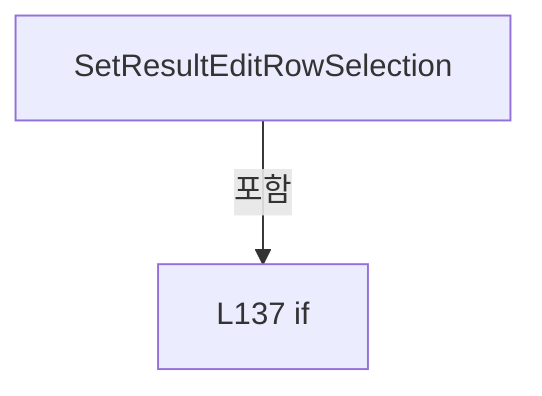

변경 전 점검: 입력/반환 타입, 위 호출자, 예외/취소 경로, 공유 상태와 저장·전송 소비자를 함께 확인합니다. 값의 단위나 물리 방향을 이름만으로 확정하지 않습니다.

### MethodDeclaration `SelectCurrentShotForResultEdit` · L146–154

[Drilling.UI/Menu/Menus/CMenuCorrection.ReviewData.Edit.cs:146–154](https://github.com/kjuws10-rgb/A3Drilling/blob/334b3599651b2e8e0181fd4459bafaf3cddafff3/Drilling.UI/Menu/Menus/CMenuCorrection.ReviewData.Edit.cs#L146-L154)

| 항목 | 실제 추출 값 |
| --- | --- |
| 서명 | void Drilling.UI.Menu.Menus.CMenuCorrection.CReviewDataPanel.SelectCurrentShotForResultEdit() |
| 접근/수식자 | Public / public |
| 반환/값 타입 | void |
| 소속 타입 | NamedType:Drilling.UI.Menu.Menus.CMenuCorrection.CReviewDataPanel |

정적 호출자로 확인된 위치:

| 호출 파일/행 | 호출 표현식 | 런타임 분기 가능 |
| --- | --- | --- |
| [Drilling.UI/Views/CReviewDataView.xaml.cs:198–198](https://github.com/kjuws10-rgb/A3Drilling/blob/334b3599651b2e8e0181fd4459bafaf3cddafff3/Drilling.UI/Views/CReviewDataView.xaml.cs#L198-L198) | panel.SelectCurrentShotForResultEdit | False |

호출하는 대상과 해석 범위:

| 원본 행 | 표현식 | 분석 상태 | 대상/소스 위치 |
| --- | --- | --- | --- |
| 153 | ReplaceResultEditSelection | resolved | void Drilling.UI.Menu.Menus.CMenuCorrection.CReviewDataPanel.ReplaceResultEditSelection(System.Collections.Generic.IEnumerable<Drilling.UI.Menu.Menus.CMenuCorrection.ST_REVIEW_DATA_GRID_ROW>) · Drilling.UI/Menu/Menus/CMenuCorrection.ReviewData.Edit.cs:196 |

본문의 실제 연산·분기·예외·반환 순서(원문 위치 순):

| 원본 행 | 종류 | 주석 해설 |
| --- | --- | --- |
| 148 | if | 조건에 따라 분기합니다: if (!_isResultEditMode &#124;&#124; SelectedRow is null) |
| 150 | return | 호출자에게 값 또는 제어를 반환합니다: return; |
| 153 | call | 함수·델리게이트 또는 객체 생성자를 호출합니다: ReplaceResultEditSelection([SelectedRow]) |

제어 구문의 포함 구조(실제 실행 순서/CFG가 아닌 구문 탐색 그림):


변경 전 점검: 입력/반환 타입, 위 호출자, 예외/취소 경로, 공유 상태와 저장·전송 소비자를 함께 확인합니다. 값의 단위나 물리 방향을 이름만으로 확정하지 않습니다.

### MethodDeclaration `SelectResultEditShotsInMap` · L156–179

[Drilling.UI/Menu/Menus/CMenuCorrection.ReviewData.Edit.cs:156–179](https://github.com/kjuws10-rgb/A3Drilling/blob/334b3599651b2e8e0181fd4459bafaf3cddafff3/Drilling.UI/Menu/Menus/CMenuCorrection.ReviewData.Edit.cs#L156-L179)

| 항목 | 실제 추출 값 |
| --- | --- |
| 서명 | void Drilling.UI.Menu.Menus.CMenuCorrection.CReviewDataPanel.SelectResultEditShotsInMap(double, double, double, double) |
| 접근/수식자 | Public / public |
| 반환/값 타입 | void |
| 소속 타입 | NamedType:Drilling.UI.Menu.Menus.CMenuCorrection.CReviewDataPanel |

입력 계약:

| 이름 | 타입 | 전달 | 선택/기본값 |
| --- | --- | --- | --- |
| left | double | None | False /  |
| top | double | None | False /  |
| right | double | None | False /  |
| bottom | double | None | False /  |

현재 부분 분석에서 직접 연결된 호출자는 없습니다. XAML/이벤트/인터페이스·델리게이트·외부 진입을 추가 확인해야 하며, 미사용으로 판정한 것이 아닙니다.

호출하는 대상과 해석 범위:

| 원본 행 | 표현식 | 분석 상태 | 대상/소스 위치 |
| --- | --- | --- | --- |
| 158 | _shotsByCell.TryGetValue | resolved · 동적 구현 선택 가능 | bool System.Collections.Generic.IReadOnlyDictionary<int, System.Collections.Generic.IReadOnlyList<Drilling.UI.Menu.Menus.CMenuCorrection.ST_REVIEW_DATA_SHOT_POSITION>>.TryGetValue(int, out System.Collections.Generic.IReadOnlyList<Drilling.UI.Menu.Menus.CMenuCorrection.ST_REVIEW_DATA_SHOT_POSITION>) |
| 164 | GetReviewDataShotMapRect | resolved | Rect Drilling.UI.Menu.Menus.CMenuCorrection.CReviewDataPanel.GetReviewDataShotMapRect(int, int) · Drilling.UI/Menu/Menus/CMenuCorrection.ReviewData.Display.cs:1305 |
| 165 | new System.Windows.Rect | unresolved | None |
| 166 | Math.Min | resolved | double System.Math.Min(double, double) |
| 167 | Math.Min | resolved | double System.Math.Min(double, double) |
| 168 | Math.Abs | resolved | double System.Math.Abs(double) |
| 169 | Math.Abs | resolved | double System.Math.Abs(double) |
| 172 | shots .Where(shot => selection.Contains(new System.Windows.Point( mapRect.Left + (shot.GroupColumn + 0.5) * cellWidth, mapRect.Top + (shot.GroupRow + 0.5) * cellHeight))) .Select(shot => shot.ShotKey) .ToHashSet | unresolved | None |
| 172 | shots .Where(shot => selection.Contains(new System.Windows.Point( mapRect.Left + (shot.GroupColumn + 0.5) * cellWidth, mapRect.Top + (shot.GroupRow + 0.5) * cellHeight))) .Select | unresolved | None |
| 172 | shots .Where | candidate | OverloadResolutionFailure |
| 173 | selection.Contains | unresolved | None |
| 173 | new System.Windows.Point | unresolved | None |
| 178 | ReplaceResultEditSelection | resolved | void Drilling.UI.Menu.Menus.CMenuCorrection.CReviewDataPanel.ReplaceResultEditSelection(System.Collections.Generic.IEnumerable<Drilling.UI.Menu.Menus.CMenuCorrection.ST_REVIEW_DATA_GRID_ROW>) · Drilling.UI/Menu/Menus/CMenuCorrection.ReviewData.Edit.cs:196 |
| 178 | _allRows.Where | resolved | System.Collections.Generic.IEnumerable<Drilling.UI.Menu.Menus.CMenuCorrection.ST_REVIEW_DATA_GRID_ROW> System.Collections.Generic.IEnumerable<Drilling.UI.Menu.Menus.CMenuCorrection.ST_REVIEW_DATA_GRID_ROW>.Where<Drilling.UI.Menu.Menus.CMenuCorrection.ST_REVIEW_DATA_GRID_ROW>(System.Func<Drilling.UI.Menu.Menus.CMenuCorrection.ST_REVIEW_DATA_GRID_ROW, bool>) |
| 178 | keys.Contains | unresolved | None |

본문의 실제 연산·분기·예외·반환 순서(원문 위치 순):

| 원본 행 | 종류 | 주석 해설 |
| --- | --- | --- |
| 158 | call | 함수·델리게이트 또는 객체 생성자를 호출합니다: _shotsByCell.TryGetValue(_selectedCellNo, out var shots) |
| 158 | if | 조건에 따라 분기합니다: if (!_isResultEditMode &#124;&#124; !_shotsByCell.TryGetValue(_selectedCellNo, out var shots) &#124;&#124; shots.Count == 0) |
| 160 | return | 호출자에게 값 또는 제어를 반환합니다: return; |
| 163 | local-declaration | 지역 변수를 선언합니다: var first = shots[0]; |
| 163 | variable-initializer | 변수의 초기값을 지정합니다: first = shots[0] |
| 164 | call | 함수·델리게이트 또는 객체 생성자를 호출합니다: GetReviewDataShotMapRect(first.GroupCountX, first.GroupCountY) |
| 164 | local-declaration | 지역 변수를 선언합니다: var mapRect = GetReviewDataShotMapRect(first.GroupCountX, first.GroupCountY); |
| 164 | variable-initializer | 변수의 초기값을 지정합니다: mapRect = GetReviewDataShotMapRect(first.GroupCountX, first.GroupCountY) |
| 165 | call | 함수·델리게이트 또는 객체 생성자를 호출합니다: new System.Windows.Rect( Math.Min(left, right), Math.Min(top, bottom), Math.Abs(right - left), Math.Abs(bottom - top)) |
| 165 | local-declaration | 지역 변수를 선언합니다: var selection = new System.Windows.Rect( Math.Min(left, right), Math.Min(top, bottom), Math.Abs(right - left), Math.Abs(bottom - top)); |
| 165 | variable-initializer | 변수의 초기값을 지정합니다: selection = new System.Windows.Rect( Math.Min(left, right), Math.Min(top, bottom), Math.Abs(right - left), Math.Abs(bottom - top)) |
| 166 | call | 함수·델리게이트 또는 객체 생성자를 호출합니다: Math.Min(left, right) |
| 167 | call | 함수·델리게이트 또는 객체 생성자를 호출합니다: Math.Min(top, bottom) |
| 168 | call | 함수·델리게이트 또는 객체 생성자를 호출합니다: Math.Abs(right - left) |
| 169 | call | 함수·델리게이트 또는 객체 생성자를 호출합니다: Math.Abs(bottom - top) |
| 170 | local-declaration | 지역 변수를 선언합니다: var cellWidth = mapRect.Width / first.GroupCountX; |
| 170 | variable-initializer | 변수의 초기값을 지정합니다: cellWidth = mapRect.Width / first.GroupCountX |
| 171 | local-declaration | 지역 변수를 선언합니다: var cellHeight = mapRect.Height / first.GroupCountY; |
| 171 | variable-initializer | 변수의 초기값을 지정합니다: cellHeight = mapRect.Height / first.GroupCountY |
| 172 | call | 함수·델리게이트 또는 객체 생성자를 호출합니다: shots .Where(shot => selection.Contains(new System.Windows.Point( mapRect.Left + (shot.GroupColumn + 0.5) * cellWidth, mapRect.Top + (shot.GroupRow + 0.5) * cellHeight))) |
| 172 | call | 함수·델리게이트 또는 객체 생성자를 호출합니다: shots .Where(shot => selection.Contains(new System.Windows.Point( mapRect.Left + (shot.GroupColumn + 0.5) * cellWidth, mapRect.Top + (shot.GroupRow + 0.5) * cellHeight))) .Select(shot => shot.ShotKey) |
| 172 | call | 함수·델리게이트 또는 객체 생성자를 호출합니다: shots .Where(shot => selection.Contains(new System.Windows.Point( mapRect.Left + (shot.GroupColumn + 0.5) * cellWidth, mapRect.Top + (shot.GroupRow + 0.5) * cellHeight))) .Select(shot => shot.ShotKey) .ToHashSet(StringCo… |
| 172 | local-declaration | 지역 변수를 선언합니다: var keys = shots .Where(shot => selection.Contains(new System.Windows.Point( mapRect.Left + (shot.GroupColumn + 0.5) * cellWidth, mapRect.Top + (shot.GroupRow + 0.5) * cellHeight))) .Select(shot => shot.ShotKey) .ToHashSet(StringC |
| 172 | variable-initializer | 변수의 초기값을 지정합니다: keys = shots .Where(shot => selection.Contains(new System.Windows.Point( mapRect.Left + (shot.GroupColumn + 0.5) * cellWidth, mapRect.Top + (shot.GroupRow + 0.5) * cellHeight))) .Select(shot => shot.ShotKey) .ToHashSet(StringCompa |
| 173 | call | 함수·델리게이트 또는 객체 생성자를 호출합니다: selection.Contains(new System.Windows.Point( mapRect.Left + (shot.GroupColumn + 0.5) * cellWidth, mapRect.Top + (shot.GroupRow + 0.5) * cellHeight)) |
| 173 | call | 함수·델리게이트 또는 객체 생성자를 호출합니다: new System.Windows.Point( mapRect.Left + (shot.GroupColumn + 0.5) * cellWidth, mapRect.Top + (shot.GroupRow + 0.5) * cellHeight) |
| 178 | call | 함수·델리게이트 또는 객체 생성자를 호출합니다: ReplaceResultEditSelection(_allRows.Where(row => row.CellNo == _selectedCellNo && keys.Contains(row.ShotKey))) |
| 178 | call | 함수·델리게이트 또는 객체 생성자를 호출합니다: _allRows.Where(row => row.CellNo == _selectedCellNo && keys.Contains(row.ShotKey)) |
| 178 | call | 함수·델리게이트 또는 객체 생성자를 호출합니다: keys.Contains(row.ShotKey) |

제어 구문의 포함 구조(실제 실행 순서/CFG가 아닌 구문 탐색 그림):

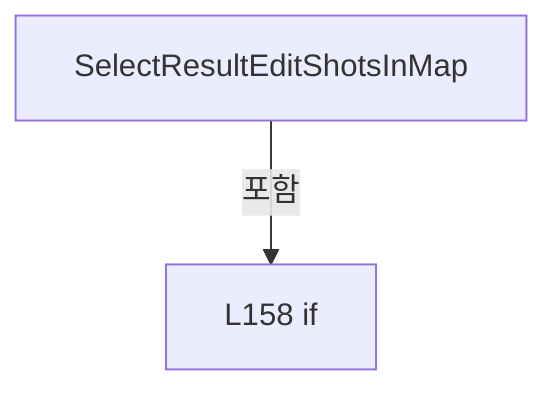

변경 전 점검: 입력/반환 타입, 위 호출자, 예외/취소 경로, 공유 상태와 저장·전송 소비자를 함께 확인합니다. 값의 단위나 물리 방향을 이름만으로 확정하지 않습니다.

### MethodDeclaration `SelectResultEditShotsInScatter` · L181–194

[Drilling.UI/Menu/Menus/CMenuCorrection.ReviewData.Edit.cs:181–194](https://github.com/kjuws10-rgb/A3Drilling/blob/334b3599651b2e8e0181fd4459bafaf3cddafff3/Drilling.UI/Menu/Menus/CMenuCorrection.ReviewData.Edit.cs#L181-L194)

| 항목 | 실제 추출 값 |
| --- | --- |
| 서명 | void Drilling.UI.Menu.Menus.CMenuCorrection.CReviewDataPanel.SelectResultEditShotsInScatter(double, double, double, double) |
| 접근/수식자 | Public / public |
| 반환/값 타입 | void |
| 소속 타입 | NamedType:Drilling.UI.Menu.Menus.CMenuCorrection.CReviewDataPanel |

입력 계약:

| 이름 | 타입 | 전달 | 선택/기본값 |
| --- | --- | --- | --- |
| left | double | None | False /  |
| top | double | None | False /  |
| right | double | None | False /  |
| bottom | double | None | False /  |

현재 부분 분석에서 직접 연결된 호출자는 없습니다. XAML/이벤트/인터페이스·델리게이트·외부 진입을 추가 확인해야 하며, 미사용으로 판정한 것이 아닙니다.

호출하는 대상과 해석 범위:

| 원본 행 | 표현식 | 분석 상태 | 대상/소스 위치 |
| --- | --- | --- | --- |
| 188 | new System.Windows.Rect | unresolved | None |
| 189 | Math.Min | resolved | double System.Math.Min(double, double) |
| 190 | Math.Min | resolved | double System.Math.Min(double, double) |
| 191 | Math.Abs | resolved | double System.Math.Abs(double) |
| 192 | Math.Abs | resolved | double System.Math.Abs(double) |
| 193 | ReplaceResultEditSelection | resolved | void Drilling.UI.Menu.Menus.CMenuCorrection.CReviewDataPanel.ReplaceResultEditSelection(System.Collections.Generic.IEnumerable<Drilling.UI.Menu.Menus.CMenuCorrection.ST_REVIEW_DATA_GRID_ROW>) · Drilling.UI/Menu/Menus/CMenuCorrection.ReviewData.Edit.cs:196 |
| 193 | _scatterPlotHits.Where(hit => selection.Contains(hit.Point)).Select | resolved | System.Collections.Generic.IEnumerable<Drilling.UI.Menu.Menus.CMenuCorrection.ST_REVIEW_DATA_GRID_ROW> System.Collections.Generic.IEnumerable<Drilling.UI.Menu.Menus.CMenuCorrection.ST_REVIEW_DATA_SCATTER_HIT>.Select<Drilling.UI.Menu.Menus.CMenuCorrection.ST_REVIEW_DATA_SCATTER_HIT, Drilling.UI.Menu.Menus.CMenuCorrection.ST_REVIEW_DATA_GRID_ROW>(System.Func<Drilling.UI.Menu.Menus.CMenuCorrection.ST_REVIEW_DATA_SCATTER_HIT, Drilling.UI.Menu.Menus.CMenuCorrection.ST_REVIEW_DATA_GRID_ROW>) |
| 193 | _scatterPlotHits.Where | resolved | System.Collections.Generic.IEnumerable<Drilling.UI.Menu.Menus.CMenuCorrection.ST_REVIEW_DATA_SCATTER_HIT> System.Collections.Generic.IEnumerable<Drilling.UI.Menu.Menus.CMenuCorrection.ST_REVIEW_DATA_SCATTER_HIT>.Where<Drilling.UI.Menu.Menus.CMenuCorrection.ST_REVIEW_DATA_SCATTER_HIT>(System.Func<Drilling.UI.Menu.Menus.CMenuCorrection.ST_REVIEW_DATA_SCATTER_HIT, bool>) |
| 193 | selection.Contains | unresolved | None |

본문의 실제 연산·분기·예외·반환 순서(원문 위치 순):

| 원본 행 | 종류 | 주석 해설 |
| --- | --- | --- |
| 183 | if | 조건에 따라 분기합니다: if (!_isResultEditMode) |
| 185 | return | 호출자에게 값 또는 제어를 반환합니다: return; |
| 188 | call | 함수·델리게이트 또는 객체 생성자를 호출합니다: new System.Windows.Rect( Math.Min(left, right), Math.Min(top, bottom), Math.Abs(right - left), Math.Abs(bottom - top)) |
| 188 | local-declaration | 지역 변수를 선언합니다: var selection = new System.Windows.Rect( Math.Min(left, right), Math.Min(top, bottom), Math.Abs(right - left), Math.Abs(bottom - top)); |
| 188 | variable-initializer | 변수의 초기값을 지정합니다: selection = new System.Windows.Rect( Math.Min(left, right), Math.Min(top, bottom), Math.Abs(right - left), Math.Abs(bottom - top)) |
| 189 | call | 함수·델리게이트 또는 객체 생성자를 호출합니다: Math.Min(left, right) |
| 190 | call | 함수·델리게이트 또는 객체 생성자를 호출합니다: Math.Min(top, bottom) |
| 191 | call | 함수·델리게이트 또는 객체 생성자를 호출합니다: Math.Abs(right - left) |
| 192 | call | 함수·델리게이트 또는 객체 생성자를 호출합니다: Math.Abs(bottom - top) |
| 193 | call | 함수·델리게이트 또는 객체 생성자를 호출합니다: ReplaceResultEditSelection(_scatterPlotHits.Where(hit => selection.Contains(hit.Point)).Select(hit => hit.Row)) |
| 193 | call | 함수·델리게이트 또는 객체 생성자를 호출합니다: _scatterPlotHits.Where(hit => selection.Contains(hit.Point)).Select(hit => hit.Row) |
| 193 | call | 함수·델리게이트 또는 객체 생성자를 호출합니다: _scatterPlotHits.Where(hit => selection.Contains(hit.Point)) |
| 193 | call | 함수·델리게이트 또는 객체 생성자를 호출합니다: selection.Contains(hit.Point) |

제어 구문의 포함 구조(실제 실행 순서/CFG가 아닌 구문 탐색 그림):

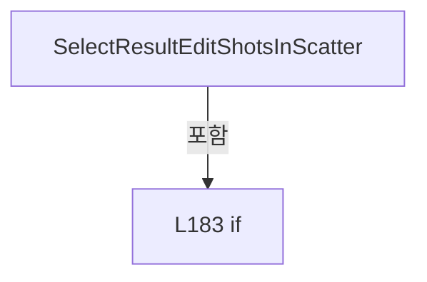

변경 전 점검: 입력/반환 타입, 위 호출자, 예외/취소 경로, 공유 상태와 저장·전송 소비자를 함께 확인합니다. 값의 단위나 물리 방향을 이름만으로 확정하지 않습니다.

### MethodDeclaration `ReplaceResultEditSelection` · L196–209

[Drilling.UI/Menu/Menus/CMenuCorrection.ReviewData.Edit.cs:196–209](https://github.com/kjuws10-rgb/A3Drilling/blob/334b3599651b2e8e0181fd4459bafaf3cddafff3/Drilling.UI/Menu/Menus/CMenuCorrection.ReviewData.Edit.cs#L196-L209)

| 항목 | 실제 추출 값 |
| --- | --- |
| 서명 | void Drilling.UI.Menu.Menus.CMenuCorrection.CReviewDataPanel.ReplaceResultEditSelection(System.Collections.Generic.IEnumerable<Drilling.UI.Menu.Menus.CMenuCorrection.ST_REVIEW_DATA_GRID_ROW>) |
| 접근/수식자 | Private / private |
| 반환/값 타입 | void |
| 소속 타입 | NamedType:Drilling.UI.Menu.Menus.CMenuCorrection.CReviewDataPanel |

입력 계약:

| 이름 | 타입 | 전달 | 선택/기본값 |
| --- | --- | --- | --- |
| rows | System.Collections.Generic.IEnumerable<Drilling.UI.Menu.Menus.CMenuCorrection.ST_REVIEW_DATA_GRID_ROW> | None | False /  |

정적 호출자로 확인된 위치:

| 호출 파일/행 | 호출 표현식 | 런타임 분기 가능 |
| --- | --- | --- |
| [Drilling.UI/Menu/Menus/CMenuCorrection.ReviewData.Edit.cs:153–153](https://github.com/kjuws10-rgb/A3Drilling/blob/334b3599651b2e8e0181fd4459bafaf3cddafff3/Drilling.UI/Menu/Menus/CMenuCorrection.ReviewData.Edit.cs#L153-L153) | ReplaceResultEditSelection | False |
| [Drilling.UI/Menu/Menus/CMenuCorrection.ReviewData.Edit.cs:178–178](https://github.com/kjuws10-rgb/A3Drilling/blob/334b3599651b2e8e0181fd4459bafaf3cddafff3/Drilling.UI/Menu/Menus/CMenuCorrection.ReviewData.Edit.cs#L178-L178) | ReplaceResultEditSelection | False |
| [Drilling.UI/Menu/Menus/CMenuCorrection.ReviewData.Edit.cs:193–193](https://github.com/kjuws10-rgb/A3Drilling/blob/334b3599651b2e8e0181fd4459bafaf3cddafff3/Drilling.UI/Menu/Menus/CMenuCorrection.ReviewData.Edit.cs#L193-L193) | ReplaceResultEditSelection | False |

호출하는 대상과 해석 범위:

| 원본 행 | 표현식 | 분석 상태 | 대상/소스 위치 |
| --- | --- | --- | --- |
| 203 | rows.Distinct | resolved | System.Collections.Generic.IEnumerable<Drilling.UI.Menu.Menus.CMenuCorrection.ST_REVIEW_DATA_GRID_ROW> System.Collections.Generic.IEnumerable<Drilling.UI.Menu.Menus.CMenuCorrection.ST_REVIEW_DATA_GRID_ROW>.Distinct<Drilling.UI.Menu.Menus.CMenuCorrection.ST_REVIEW_DATA_GRID_ROW>() |
| 208 | NotifyResultEditSelectionChanged | resolved | void Drilling.UI.Menu.Menus.CMenuCorrection.CReviewDataPanel.NotifyResultEditSelectionChanged() · Drilling.UI/Menu/Menus/CMenuCorrection.ReviewData.Edit.cs:221 |

본문의 실제 연산·분기·예외·반환 순서(원문 위치 순):

| 원본 행 | 종류 | 주석 해설 |
| --- | --- | --- |
| 198 | foreach | 컬렉션 요소를 순회합니다: foreach (var row in _allRows) |
| 200 | assignment | 값을 대상에 대입합니다: row.IsResultEditSelected = false |
| 203 | call | 함수·델리게이트 또는 객체 생성자를 호출합니다: rows.Distinct() |
| 203 | foreach | 컬렉션 요소를 순회합니다: foreach (var row in rows.Distinct()) |
| 205 | assignment | 값을 대상에 대입합니다: row.IsResultEditSelected = true |
| 208 | call | 함수·델리게이트 또는 객체 생성자를 호출합니다: NotifyResultEditSelectionChanged() |

제어 구문의 포함 구조(실제 실행 순서/CFG가 아닌 구문 탐색 그림):

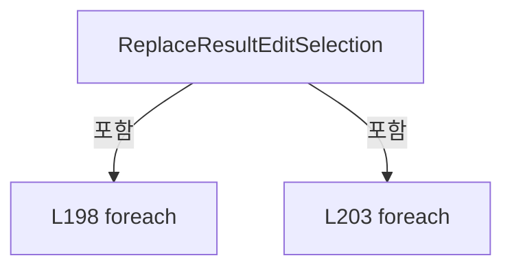

변경 전 점검: 입력/반환 타입, 위 호출자, 예외/취소 경로, 공유 상태와 저장·전송 소비자를 함께 확인합니다. 값의 단위나 물리 방향을 이름만으로 확정하지 않습니다.

### MethodDeclaration `ClearResultEditSelection` · L211–219

[Drilling.UI/Menu/Menus/CMenuCorrection.ReviewData.Edit.cs:211–219](https://github.com/kjuws10-rgb/A3Drilling/blob/334b3599651b2e8e0181fd4459bafaf3cddafff3/Drilling.UI/Menu/Menus/CMenuCorrection.ReviewData.Edit.cs#L211-L219)

| 항목 | 실제 추출 값 |
| --- | --- |
| 서명 | void Drilling.UI.Menu.Menus.CMenuCorrection.CReviewDataPanel.ClearResultEditSelection() |
| 접근/수식자 | Private / private |
| 반환/값 타입 | void |
| 소속 타입 | NamedType:Drilling.UI.Menu.Menus.CMenuCorrection.CReviewDataPanel |

정적 호출자로 확인된 위치:

| 호출 파일/행 | 호출 표현식 | 런타임 분기 가능 |
| --- | --- | --- |
| [Drilling.UI/Menu/Menus/CMenuCorrection.ReviewData.cs:248–248](https://github.com/kjuws10-rgb/A3Drilling/blob/334b3599651b2e8e0181fd4459bafaf3cddafff3/Drilling.UI/Menu/Menus/CMenuCorrection.ReviewData.cs#L248-L248) | ClearResultEditSelection | False |

호출하는 대상과 해석 범위:

| 원본 행 | 표현식 | 분석 상태 | 대상/소스 위치 |
| --- | --- | --- | --- |
| 218 | NotifyResultEditSelectionChanged | resolved | void Drilling.UI.Menu.Menus.CMenuCorrection.CReviewDataPanel.NotifyResultEditSelectionChanged() · Drilling.UI/Menu/Menus/CMenuCorrection.ReviewData.Edit.cs:221 |

본문의 실제 연산·분기·예외·반환 순서(원문 위치 순):

| 원본 행 | 종류 | 주석 해설 |
| --- | --- | --- |
| 213 | foreach | 컬렉션 요소를 순회합니다: foreach (var row in _allRows) |
| 215 | assignment | 값을 대상에 대입합니다: row.IsResultEditSelected = false |
| 218 | call | 함수·델리게이트 또는 객체 생성자를 호출합니다: NotifyResultEditSelectionChanged() |

제어 구문의 포함 구조(실제 실행 순서/CFG가 아닌 구문 탐색 그림):

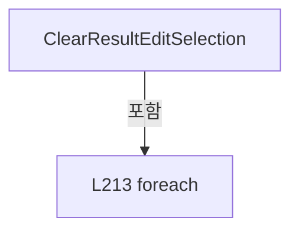

변경 전 점검: 입력/반환 타입, 위 호출자, 예외/취소 경로, 공유 상태와 저장·전송 소비자를 함께 확인합니다. 값의 단위나 물리 방향을 이름만으로 확정하지 않습니다.

### MethodDeclaration `NotifyResultEditSelectionChanged` · L221–229

[Drilling.UI/Menu/Menus/CMenuCorrection.ReviewData.Edit.cs:221–229](https://github.com/kjuws10-rgb/A3Drilling/blob/334b3599651b2e8e0181fd4459bafaf3cddafff3/Drilling.UI/Menu/Menus/CMenuCorrection.ReviewData.Edit.cs#L221-L229)

| 항목 | 실제 추출 값 |
| --- | --- |
| 서명 | void Drilling.UI.Menu.Menus.CMenuCorrection.CReviewDataPanel.NotifyResultEditSelectionChanged() |
| 접근/수식자 | Private / private |
| 반환/값 타입 | void |
| 소속 타입 | NamedType:Drilling.UI.Menu.Menus.CMenuCorrection.CReviewDataPanel |

정적 호출자로 확인된 위치:

| 호출 파일/행 | 호출 표현식 | 런타임 분기 가능 |
| --- | --- | --- |
| [Drilling.UI/Menu/Menus/CMenuCorrection.ReviewData.Edit.cs:143–143](https://github.com/kjuws10-rgb/A3Drilling/blob/334b3599651b2e8e0181fd4459bafaf3cddafff3/Drilling.UI/Menu/Menus/CMenuCorrection.ReviewData.Edit.cs#L143-L143) | NotifyResultEditSelectionChanged | False |
| [Drilling.UI/Menu/Menus/CMenuCorrection.ReviewData.Edit.cs:208–208](https://github.com/kjuws10-rgb/A3Drilling/blob/334b3599651b2e8e0181fd4459bafaf3cddafff3/Drilling.UI/Menu/Menus/CMenuCorrection.ReviewData.Edit.cs#L208-L208) | NotifyResultEditSelectionChanged | False |
| [Drilling.UI/Menu/Menus/CMenuCorrection.ReviewData.Edit.cs:218–218](https://github.com/kjuws10-rgb/A3Drilling/blob/334b3599651b2e8e0181fd4459bafaf3cddafff3/Drilling.UI/Menu/Menus/CMenuCorrection.ReviewData.Edit.cs#L218-L218) | NotifyResultEditSelectionChanged | False |

호출하는 대상과 해석 범위:

| 원본 행 | 표현식 | 분석 상태 | 대상/소스 위치 |
| --- | --- | --- | --- |
| 223 | _allRows.Where(row => row.CellNo == _selectedCellNo).ToArray | resolved | Drilling.UI.Menu.Menus.CMenuCorrection.ST_REVIEW_DATA_GRID_ROW[] System.Collections.Generic.IEnumerable<Drilling.UI.Menu.Menus.CMenuCorrection.ST_REVIEW_DATA_GRID_ROW>.ToArray<Drilling.UI.Menu.Menus.CMenuCorrection.ST_REVIEW_DATA_GRID_ROW>() |
| 223 | _allRows.Where | resolved | System.Collections.Generic.IEnumerable<Drilling.UI.Menu.Menus.CMenuCorrection.ST_REVIEW_DATA_GRID_ROW> System.Collections.Generic.IEnumerable<Drilling.UI.Menu.Menus.CMenuCorrection.ST_REVIEW_DATA_GRID_ROW>.Where<Drilling.UI.Menu.Menus.CMenuCorrection.ST_REVIEW_DATA_GRID_ROW>(System.Func<Drilling.UI.Menu.Menus.CMenuCorrection.ST_REVIEW_DATA_GRID_ROW, bool>) |
| 224 | Notify | resolved | void Drilling.UI.Menu.Menus.CMenuCorrection.CReviewDataPanel.Notify(string) · Drilling.UI/Menu/Menus/CMenuCorrection.ReviewData.cs:616 |
| 224 | nameof | unresolved | None |
| 225 | Notify | resolved | void Drilling.UI.Menu.Menus.CMenuCorrection.CReviewDataPanel.Notify(string) · Drilling.UI/Menu/Menus/CMenuCorrection.ReviewData.cs:616 |
| 225 | nameof | unresolved | None |
| 226 | RefreshScatterPlot | resolved | void Drilling.UI.Menu.Menus.CMenuCorrection.CReviewDataPanel.RefreshScatterPlot() · Drilling.UI/Menu/Menus/CMenuCorrection.ReviewData.Display.cs:760 |
| 227 | QueueShotMapRender | resolved | void Drilling.UI.Menu.Menus.CMenuCorrection.CReviewDataPanel.QueueShotMapRender(int, string) · Drilling.UI/Menu/Menus/CMenuCorrection.ReviewData.Display.cs:958 |
| 228 | NotifyResultEditCommandState | resolved | void Drilling.UI.Menu.Menus.CMenuCorrection.CReviewDataPanel.NotifyResultEditCommandState() · Drilling.UI/Menu/Menus/CMenuCorrection.ReviewData.Edit.cs:601 |

본문의 실제 연산·분기·예외·반환 순서(원문 위치 순):

| 원본 행 | 종류 | 주석 해설 |
| --- | --- | --- |
| 223 | assignment | 값을 대상에 대입합니다: Rows = _allRows.Where(row => row.CellNo == _selectedCellNo).ToArray() |
| 223 | call | 함수·델리게이트 또는 객체 생성자를 호출합니다: _allRows.Where(row => row.CellNo == _selectedCellNo).ToArray() |
| 223 | call | 함수·델리게이트 또는 객체 생성자를 호출합니다: _allRows.Where(row => row.CellNo == _selectedCellNo) |
| 224 | call | 함수·델리게이트 또는 객체 생성자를 호출합니다: Notify(nameof(Rows)) |
| 224 | call | 함수·델리게이트 또는 객체 생성자를 호출합니다: nameof(Rows) |
| 225 | call | 함수·델리게이트 또는 객체 생성자를 호출합니다: Notify(nameof(ResultEditSelectionSummary)) |
| 225 | call | 함수·델리게이트 또는 객체 생성자를 호출합니다: nameof(ResultEditSelectionSummary) |
| 226 | call | 함수·델리게이트 또는 객체 생성자를 호출합니다: RefreshScatterPlot() |
| 227 | call | 함수·델리게이트 또는 객체 생성자를 호출합니다: QueueShotMapRender(_selectedCellNo, _selectedShotKey) |
| 228 | call | 함수·델리게이트 또는 객체 생성자를 호출합니다: NotifyResultEditCommandState() |

변경 전 점검: 입력/반환 타입, 위 호출자, 예외/취소 경로, 공유 상태와 저장·전송 소비자를 함께 확인합니다. 값의 단위나 물리 방향을 이름만으로 확정하지 않습니다.

### MethodDeclaration `ResolveResultEditSelection` · L231–235

[Drilling.UI/Menu/Menus/CMenuCorrection.ReviewData.Edit.cs:231–235](https://github.com/kjuws10-rgb/A3Drilling/blob/334b3599651b2e8e0181fd4459bafaf3cddafff3/Drilling.UI/Menu/Menus/CMenuCorrection.ReviewData.Edit.cs#L231-L235)

| 항목 | 실제 추출 값 |
| --- | --- |
| 서명 | System.Collections.Generic.IReadOnlyList<Drilling.UI.Menu.Menus.CMenuCorrection.ST_REVIEW_DATA_GRID_ROW> Drilling.UI.Menu.Menus.CMenuCorrection.CReviewDataPanel.ResolveResultEditSelection() |
| 접근/수식자 | Private / private |
| 반환/값 타입 | System.Collections.Generic.IReadOnlyList<Drilling.UI.Menu.Menus.CMenuCorrection.ST_REVIEW_DATA_GRID_ROW> |
| 소속 타입 | NamedType:Drilling.UI.Menu.Menus.CMenuCorrection.CReviewDataPanel |

정적 호출자로 확인된 위치:

| 호출 파일/행 | 호출 표현식 | 런타임 분기 가능 |
| --- | --- | --- |
| [Drilling.UI/Menu/Menus/CMenuCorrection.ReviewData.Edit.cs:44–44](https://github.com/kjuws10-rgb/A3Drilling/blob/334b3599651b2e8e0181fd4459bafaf3cddafff3/Drilling.UI/Menu/Menus/CMenuCorrection.ReviewData.Edit.cs#L44-L44) | ResolveResultEditSelection | False |
| [Drilling.UI/Menu/Menus/CMenuCorrection.ReviewData.Edit.cs:45–45](https://github.com/kjuws10-rgb/A3Drilling/blob/334b3599651b2e8e0181fd4459bafaf3cddafff3/Drilling.UI/Menu/Menus/CMenuCorrection.ReviewData.Edit.cs#L45-L45) | ResolveResultEditSelection | False |
| [Drilling.UI/Menu/Menus/CMenuCorrection.ReviewData.Edit.cs:306–306](https://github.com/kjuws10-rgb/A3Drilling/blob/334b3599651b2e8e0181fd4459bafaf3cddafff3/Drilling.UI/Menu/Menus/CMenuCorrection.ReviewData.Edit.cs#L306-L306) | ResolveResultEditSelection | False |
| [Drilling.UI/Menu/Menus/CMenuCorrection.ReviewData.Edit.cs:333–333](https://github.com/kjuws10-rgb/A3Drilling/blob/334b3599651b2e8e0181fd4459bafaf3cddafff3/Drilling.UI/Menu/Menus/CMenuCorrection.ReviewData.Edit.cs#L333-L333) | ResolveResultEditSelection | False |

호출하는 대상과 해석 범위:

| 원본 행 | 표현식 | 분석 상태 | 대상/소스 위치 |
| --- | --- | --- | --- |
| 233 | _allRows.Where(row => row.IsResultEditSelected).ToArray | resolved | Drilling.UI.Menu.Menus.CMenuCorrection.ST_REVIEW_DATA_GRID_ROW[] System.Collections.Generic.IEnumerable<Drilling.UI.Menu.Menus.CMenuCorrection.ST_REVIEW_DATA_GRID_ROW>.ToArray<Drilling.UI.Menu.Menus.CMenuCorrection.ST_REVIEW_DATA_GRID_ROW>() |
| 233 | _allRows.Where | resolved | System.Collections.Generic.IEnumerable<Drilling.UI.Menu.Menus.CMenuCorrection.ST_REVIEW_DATA_GRID_ROW> System.Collections.Generic.IEnumerable<Drilling.UI.Menu.Menus.CMenuCorrection.ST_REVIEW_DATA_GRID_ROW>.Where<Drilling.UI.Menu.Menus.CMenuCorrection.ST_REVIEW_DATA_GRID_ROW>(System.Func<Drilling.UI.Menu.Menus.CMenuCorrection.ST_REVIEW_DATA_GRID_ROW, bool>) |

본문의 실제 연산·분기·예외·반환 순서(원문 위치 순):

| 원본 행 | 종류 | 주석 해설 |
| --- | --- | --- |
| 233 | call | 함수·델리게이트 또는 객체 생성자를 호출합니다: _allRows.Where(row => row.IsResultEditSelected).ToArray() |
| 233 | call | 함수·델리게이트 또는 객체 생성자를 호출합니다: _allRows.Where(row => row.IsResultEditSelected) |
| 233 | local-declaration | 지역 변수를 선언합니다: var selected = _allRows.Where(row => row.IsResultEditSelected).ToArray(); |
| 233 | variable-initializer | 변수의 초기값을 지정합니다: selected = _allRows.Where(row => row.IsResultEditSelected).ToArray() |
| 234 | conditional-expression | 조건에 따라 결과식을 선택합니다: selected.Length > 0 ? selected : SelectedRow is null ? [] : [SelectedRow] |
| 234 | conditional-expression | 조건에 따라 결과식을 선택합니다: SelectedRow is null ? [] : [SelectedRow] |
| 234 | return | 호출자에게 값 또는 제어를 반환합니다: return selected.Length > 0 ? selected : SelectedRow is null ? [] : [SelectedRow]; |

변경 전 점검: 입력/반환 타입, 위 호출자, 예외/취소 경로, 공유 상태와 저장·전송 소비자를 함께 확인합니다. 값의 단위나 물리 방향을 이름만으로 확정하지 않습니다.

### MethodDeclaration `AddResultEditKeyIn` · L237–245

[Drilling.UI/Menu/Menus/CMenuCorrection.ReviewData.Edit.cs:237–245](https://github.com/kjuws10-rgb/A3Drilling/blob/334b3599651b2e8e0181fd4459bafaf3cddafff3/Drilling.UI/Menu/Menus/CMenuCorrection.ReviewData.Edit.cs#L237-L245)

| 항목 | 실제 추출 값 |
| --- | --- |
| 서명 | void Drilling.UI.Menu.Menus.CMenuCorrection.CReviewDataPanel.AddResultEditKeyIn(object?) |
| 접근/수식자 | Private / private |
| 반환/값 타입 | void |
| 소속 타입 | NamedType:Drilling.UI.Menu.Menus.CMenuCorrection.CReviewDataPanel |

입력 계약:

| 이름 | 타입 | 전달 | 선택/기본값 |
| --- | --- | --- | --- |
| parameter | object? | None | False /  |

현재 부분 분석에서 직접 연결된 호출자는 없습니다. XAML/이벤트/인터페이스·델리게이트·외부 진입을 추가 확인해야 하며, 미사용으로 판정한 것이 아닙니다.

호출하는 대상과 해석 범위:

| 원본 행 | 표현식 | 분석 상태 | 대상/소스 위치 |
| --- | --- | --- | --- |
| 244 | AddResultEditKeyInRows | resolved | void Drilling.UI.Menu.Menus.CMenuCorrection.CReviewDataPanel.AddResultEditKeyInRows(System.Collections.Generic.IEnumerable<Drilling.UI.Menu.Menus.CMenuCorrection.ST_REVIEW_DATA_GRID_ROW>, string) · Drilling.UI/Menu/Menus/CMenuCorrection.ReviewData.Edit.cs:261 |

본문의 실제 연산·분기·예외·반환 순서(원문 위치 순):

| 원본 행 | 종류 | 주석 해설 |
| --- | --- | --- |
| 239 | if | 조건에 따라 분기합니다: if (SelectedRow is not { } selectedRow) |
| 241 | return | 호출자에게 값 또는 제어를 반환합니다: return; |
| 244 | call | 함수·델리게이트 또는 객체 생성자를 호출합니다: AddResultEditKeyInRows([selectedRow], "CURRENT SHOT") |

제어 구문의 포함 구조(실제 실행 순서/CFG가 아닌 구문 탐색 그림):

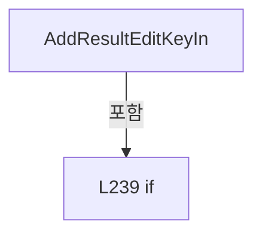

변경 전 점검: 입력/반환 타입, 위 호출자, 예외/취소 경로, 공유 상태와 저장·전송 소비자를 함께 확인합니다. 값의 단위나 물리 방향을 이름만으로 확정하지 않습니다.

### MethodDeclaration `AddSelectedResultEditKeyIn` · L247–252

[Drilling.UI/Menu/Menus/CMenuCorrection.ReviewData.Edit.cs:247–252](https://github.com/kjuws10-rgb/A3Drilling/blob/334b3599651b2e8e0181fd4459bafaf3cddafff3/Drilling.UI/Menu/Menus/CMenuCorrection.ReviewData.Edit.cs#L247-L252)

| 항목 | 실제 추출 값 |
| --- | --- |
| 서명 | void Drilling.UI.Menu.Menus.CMenuCorrection.CReviewDataPanel.AddSelectedResultEditKeyIn(object?) |
| 접근/수식자 | Private / private |
| 반환/값 타입 | void |
| 소속 타입 | NamedType:Drilling.UI.Menu.Menus.CMenuCorrection.CReviewDataPanel |

입력 계약:

| 이름 | 타입 | 전달 | 선택/기본값 |
| --- | --- | --- | --- |
| parameter | object? | None | False /  |

현재 부분 분석에서 직접 연결된 호출자는 없습니다. XAML/이벤트/인터페이스·델리게이트·외부 진입을 추가 확인해야 하며, 미사용으로 판정한 것이 아닙니다.

호출하는 대상과 해석 범위:

| 원본 행 | 표현식 | 분석 상태 | 대상/소스 위치 |
| --- | --- | --- | --- |
| 249 | AddResultEditKeyInRows | resolved | void Drilling.UI.Menu.Menus.CMenuCorrection.CReviewDataPanel.AddResultEditKeyInRows(System.Collections.Generic.IEnumerable<Drilling.UI.Menu.Menus.CMenuCorrection.ST_REVIEW_DATA_GRID_ROW>, string) · Drilling.UI/Menu/Menus/CMenuCorrection.ReviewData.Edit.cs:261 |
| 250 | _allRows.Where | resolved | System.Collections.Generic.IEnumerable<Drilling.UI.Menu.Menus.CMenuCorrection.ST_REVIEW_DATA_GRID_ROW> System.Collections.Generic.IEnumerable<Drilling.UI.Menu.Menus.CMenuCorrection.ST_REVIEW_DATA_GRID_ROW>.Where<Drilling.UI.Menu.Menus.CMenuCorrection.ST_REVIEW_DATA_GRID_ROW>(System.Func<Drilling.UI.Menu.Menus.CMenuCorrection.ST_REVIEW_DATA_GRID_ROW, bool>) |

본문의 실제 연산·분기·예외·반환 순서(원문 위치 순):

| 원본 행 | 종류 | 주석 해설 |
| --- | --- | --- |
| 249 | call | 함수·델리게이트 또는 객체 생성자를 호출합니다: AddResultEditKeyInRows( _allRows.Where(row => row.IsResultEditSelected), "SELECTED SHOTS") |
| 250 | call | 함수·델리게이트 또는 객체 생성자를 호출합니다: _allRows.Where(row => row.IsResultEditSelected) |

변경 전 점검: 입력/반환 타입, 위 호출자, 예외/취소 경로, 공유 상태와 저장·전송 소비자를 함께 확인합니다. 값의 단위나 물리 방향을 이름만으로 확정하지 않습니다.

### MethodDeclaration `AddNgResultEditKeyIn` · L254–259

[Drilling.UI/Menu/Menus/CMenuCorrection.ReviewData.Edit.cs:254–259](https://github.com/kjuws10-rgb/A3Drilling/blob/334b3599651b2e8e0181fd4459bafaf3cddafff3/Drilling.UI/Menu/Menus/CMenuCorrection.ReviewData.Edit.cs#L254-L259)

| 항목 | 실제 추출 값 |
| --- | --- |
| 서명 | void Drilling.UI.Menu.Menus.CMenuCorrection.CReviewDataPanel.AddNgResultEditKeyIn(object?) |
| 접근/수식자 | Private / private |
| 반환/값 타입 | void |
| 소속 타입 | NamedType:Drilling.UI.Menu.Menus.CMenuCorrection.CReviewDataPanel |

입력 계약:

| 이름 | 타입 | 전달 | 선택/기본값 |
| --- | --- | --- | --- |
| parameter | object? | None | False /  |

현재 부분 분석에서 직접 연결된 호출자는 없습니다. XAML/이벤트/인터페이스·델리게이트·외부 진입을 추가 확인해야 하며, 미사용으로 판정한 것이 아닙니다.

호출하는 대상과 해석 범위:

| 원본 행 | 표현식 | 분석 상태 | 대상/소스 위치 |
| --- | --- | --- | --- |
| 256 | AddResultEditKeyInRows | resolved | void Drilling.UI.Menu.Menus.CMenuCorrection.CReviewDataPanel.AddResultEditKeyInRows(System.Collections.Generic.IEnumerable<Drilling.UI.Menu.Menus.CMenuCorrection.ST_REVIEW_DATA_GRID_ROW>, string) · Drilling.UI/Menu/Menus/CMenuCorrection.ReviewData.Edit.cs:261 |
| 257 | _allRows.Where | resolved | System.Collections.Generic.IEnumerable<Drilling.UI.Menu.Menus.CMenuCorrection.ST_REVIEW_DATA_GRID_ROW> System.Collections.Generic.IEnumerable<Drilling.UI.Menu.Menus.CMenuCorrection.ST_REVIEW_DATA_GRID_ROW>.Where<Drilling.UI.Menu.Menus.CMenuCorrection.ST_REVIEW_DATA_GRID_ROW>(System.Func<Drilling.UI.Menu.Menus.CMenuCorrection.ST_REVIEW_DATA_GRID_ROW, bool>) |

본문의 실제 연산·분기·예외·반환 순서(원문 위치 순):

| 원본 행 | 종류 | 주석 해설 |
| --- | --- | --- |
| 256 | call | 함수·델리게이트 또는 객체 생성자를 호출합니다: AddResultEditKeyInRows( _allRows.Where(IsNgResultRow), "NG SHOTS") |
| 257 | call | 함수·델리게이트 또는 객체 생성자를 호출합니다: _allRows.Where(IsNgResultRow) |

변경 전 점검: 입력/반환 타입, 위 호출자, 예외/취소 경로, 공유 상태와 저장·전송 소비자를 함께 확인합니다. 값의 단위나 물리 방향을 이름만으로 확정하지 않습니다.

### MethodDeclaration `AddResultEditKeyInRows` · L261–280

[Drilling.UI/Menu/Menus/CMenuCorrection.ReviewData.Edit.cs:261–280](https://github.com/kjuws10-rgb/A3Drilling/blob/334b3599651b2e8e0181fd4459bafaf3cddafff3/Drilling.UI/Menu/Menus/CMenuCorrection.ReviewData.Edit.cs#L261-L280)

| 항목 | 실제 추출 값 |
| --- | --- |
| 서명 | void Drilling.UI.Menu.Menus.CMenuCorrection.CReviewDataPanel.AddResultEditKeyInRows(System.Collections.Generic.IEnumerable<Drilling.UI.Menu.Menus.CMenuCorrection.ST_REVIEW_DATA_GRID_ROW>, string) |
| 접근/수식자 | Private / private |
| 반환/값 타입 | void |
| 소속 타입 | NamedType:Drilling.UI.Menu.Menus.CMenuCorrection.CReviewDataPanel |

입력 계약:

| 이름 | 타입 | 전달 | 선택/기본값 |
| --- | --- | --- | --- |
| sourceRows | System.Collections.Generic.IEnumerable<Drilling.UI.Menu.Menus.CMenuCorrection.ST_REVIEW_DATA_GRID_ROW> | None | False /  |
| sourceName | string | None | False /  |

정적 호출자로 확인된 위치:

| 호출 파일/행 | 호출 표현식 | 런타임 분기 가능 |
| --- | --- | --- |
| [Drilling.UI/Menu/Menus/CMenuCorrection.ReviewData.Edit.cs:244–244](https://github.com/kjuws10-rgb/A3Drilling/blob/334b3599651b2e8e0181fd4459bafaf3cddafff3/Drilling.UI/Menu/Menus/CMenuCorrection.ReviewData.Edit.cs#L244-L244) | AddResultEditKeyInRows | False |
| [Drilling.UI/Menu/Menus/CMenuCorrection.ReviewData.Edit.cs:249–251](https://github.com/kjuws10-rgb/A3Drilling/blob/334b3599651b2e8e0181fd4459bafaf3cddafff3/Drilling.UI/Menu/Menus/CMenuCorrection.ReviewData.Edit.cs#L249-L251) | AddResultEditKeyInRows | False |
| [Drilling.UI/Menu/Menus/CMenuCorrection.ReviewData.Edit.cs:256–258](https://github.com/kjuws10-rgb/A3Drilling/blob/334b3599651b2e8e0181fd4459bafaf3cddafff3/Drilling.UI/Menu/Menus/CMenuCorrection.ReviewData.Edit.cs#L256-L258) | AddResultEditKeyInRows | False |

호출하는 대상과 해석 범위:

| 원본 행 | 표현식 | 분석 상태 | 대상/소스 위치 |
| --- | --- | --- | --- |
| 265 | _resultEditKeyInItems.ToList | resolved | System.Collections.Generic.List<Drilling.UI.Menu.Menus.CMenuCorrection.ST_REVIEW_DATA_EDIT_ITEM> System.Collections.Generic.IEnumerable<Drilling.UI.Menu.Menus.CMenuCorrection.ST_REVIEW_DATA_EDIT_ITEM>.ToList<Drilling.UI.Menu.Menus.CMenuCorrection.ST_REVIEW_DATA_EDIT_ITEM>() |
| 267 | sourceRows.Distinct | resolved | System.Collections.Generic.IEnumerable<Drilling.UI.Menu.Menus.CMenuCorrection.ST_REVIEW_DATA_GRID_ROW> System.Collections.Generic.IEnumerable<Drilling.UI.Menu.Menus.CMenuCorrection.ST_REVIEW_DATA_GRID_ROW>.Distinct<Drilling.UI.Menu.Menus.CMenuCorrection.ST_REVIEW_DATA_GRID_ROW>() |
| 269 | items.All | resolved | bool System.Collections.Generic.IEnumerable<Drilling.UI.Menu.Menus.CMenuCorrection.ST_REVIEW_DATA_EDIT_ITEM>.All<Drilling.UI.Menu.Menus.CMenuCorrection.ST_REVIEW_DATA_EDIT_ITEM>(System.Func<Drilling.UI.Menu.Menus.CMenuCorrection.ST_REVIEW_DATA_EDIT_ITEM, bool>) |
| 269 | item.Matches | resolved | bool Drilling.UI.Menu.Menus.CMenuCorrection.ST_REVIEW_DATA_EDIT_ITEM.Matches(Drilling.UI.Menu.Menus.CMenuCorrection.ST_REVIEW_DATA_GRID_ROW) · Drilling.UI/Menu/Menus/CMenuCorrection.ReviewData.Edit.cs:706 |
| 271 | items.Add | resolved | void System.Collections.Generic.List<Drilling.UI.Menu.Menus.CMenuCorrection.ST_REVIEW_DATA_EDIT_ITEM>.Add(Drilling.UI.Menu.Menus.CMenuCorrection.ST_REVIEW_DATA_EDIT_ITEM) |
| 271 | new ST_REVIEW_DATA_EDIT_ITEM | resolved | Drilling.UI.Menu.Menus.CMenuCorrection.ST_REVIEW_DATA_EDIT_ITEM.ST_REVIEW_DATA_EDIT_ITEM(Drilling.UI.Menu.Menus.CMenuCorrection.ST_REVIEW_DATA_GRID_ROW, int) · Drilling.UI/Menu/Menus/CMenuCorrection.ReviewData.Edit.cs:638 |
| 276 | Renumber | resolved | System.Collections.Generic.IReadOnlyList<Drilling.UI.Menu.Menus.CMenuCorrection.ST_REVIEW_DATA_EDIT_ITEM> Drilling.UI.Menu.Menus.CMenuCorrection.CReviewDataPanel.Renumber(System.Collections.Generic.IEnumerable<Drilling.UI.Menu.Menus.CMenuCorrection.ST_REVIEW_DATA_EDIT_ITEM>) · Drilling.UI/Menu/Menus/CMenuCorrection.ReviewData.Edit.cs:546 |
| 277 | _resultEditKeyInItems.LastOrDefault | resolved | Drilling.UI.Menu.Menus.CMenuCorrection.ST_REVIEW_DATA_EDIT_ITEM? System.Collections.Generic.IEnumerable<Drilling.UI.Menu.Menus.CMenuCorrection.ST_REVIEW_DATA_EDIT_ITEM>.LastOrDefault<Drilling.UI.Menu.Menus.CMenuCorrection.ST_REVIEW_DATA_EDIT_ITEM>() |
| 279 | NotifyResultEditState | resolved | void Drilling.UI.Menu.Menus.CMenuCorrection.CReviewDataPanel.NotifyResultEditState() · Drilling.UI/Menu/Menus/CMenuCorrection.ReviewData.Edit.cs:584 |

본문의 실제 연산·분기·예외·반환 순서(원문 위치 순):

| 원본 행 | 종류 | 주석 해설 |
| --- | --- | --- |
| 265 | call | 함수·델리게이트 또는 객체 생성자를 호출합니다: _resultEditKeyInItems.ToList() |
| 265 | local-declaration | 지역 변수를 선언합니다: var items = _resultEditKeyInItems.ToList(); |
| 265 | variable-initializer | 변수의 초기값을 지정합니다: items = _resultEditKeyInItems.ToList() |
| 266 | local-declaration | 지역 변수를 선언합니다: var addedCount = 0; |
| 266 | variable-initializer | 변수의 초기값을 지정합니다: addedCount = 0 |
| 267 | call | 함수·델리게이트 또는 객체 생성자를 호출합니다: sourceRows.Distinct() |
| 267 | foreach | 컬렉션 요소를 순회합니다: foreach (var row in sourceRows.Distinct()) |
| 269 | call | 함수·델리게이트 또는 객체 생성자를 호출합니다: items.All(item => !item.Matches(row)) |
| 269 | call | 함수·델리게이트 또는 객체 생성자를 호출합니다: item.Matches(row) |
| 269 | if | 조건에 따라 분기합니다: if (items.All(item => !item.Matches(row))) |
| 271 | call | 함수·델리게이트 또는 객체 생성자를 호출합니다: items.Add(new ST_REVIEW_DATA_EDIT_ITEM(row, items.Count + 1)) |
| 271 | call | 함수·델리게이트 또는 객체 생성자를 호출합니다: new ST_REVIEW_DATA_EDIT_ITEM(row, items.Count + 1) |
| 276 | assignment | 값을 대상에 대입합니다: _resultEditKeyInItems = Renumber(items) |
| 276 | call | 함수·델리게이트 또는 객체 생성자를 호출합니다: Renumber(items) |
| 277 | assignment | 값을 대상에 대입합니다: _selectedResultEditKeyInItem = _resultEditKeyInItems.LastOrDefault() |
| 277 | call | 함수·델리게이트 또는 객체 생성자를 호출합니다: _resultEditKeyInItems.LastOrDefault() |
| 278 | assignment | 값을 대상에 대입합니다: _resultEditStatusText = $"{addedCount:N0} {sourceName} ADDED / {_resultEditKeyInItems.Count:N0} TOTAL" |
| 279 | call | 함수·델리게이트 또는 객체 생성자를 호출합니다: NotifyResultEditState() |

제어 구문의 포함 구조(실제 실행 순서/CFG가 아닌 구문 탐색 그림):


변경 전 점검: 입력/반환 타입, 위 호출자, 예외/취소 경로, 공유 상태와 저장·전송 소비자를 함께 확인합니다. 값의 단위나 물리 방향을 이름만으로 확정하지 않습니다.

### MethodDeclaration `RemoveResultEditKeyIn` · L282–294

[Drilling.UI/Menu/Menus/CMenuCorrection.ReviewData.Edit.cs:282–294](https://github.com/kjuws10-rgb/A3Drilling/blob/334b3599651b2e8e0181fd4459bafaf3cddafff3/Drilling.UI/Menu/Menus/CMenuCorrection.ReviewData.Edit.cs#L282-L294)

| 항목 | 실제 추출 값 |
| --- | --- |
| 서명 | void Drilling.UI.Menu.Menus.CMenuCorrection.CReviewDataPanel.RemoveResultEditKeyIn(object?) |
| 접근/수식자 | Private / private |
| 반환/값 타입 | void |
| 소속 타입 | NamedType:Drilling.UI.Menu.Menus.CMenuCorrection.CReviewDataPanel |

입력 계약:

| 이름 | 타입 | 전달 | 선택/기본값 |
| --- | --- | --- | --- |
| parameter | object? | None | False /  |

현재 부분 분석에서 직접 연결된 호출자는 없습니다. XAML/이벤트/인터페이스·델리게이트·외부 진입을 추가 확인해야 하며, 미사용으로 판정한 것이 아닙니다.

호출하는 대상과 해석 범위:

| 원본 행 | 표현식 | 분석 상태 | 대상/소스 위치 |
| --- | --- | --- | --- |
| 289 | _resultEditKeyInItems.Where(item => !ReferenceEquals(item, _selectedResultEditKeyInItem)).ToArray | resolved | Drilling.UI.Menu.Menus.CMenuCorrection.ST_REVIEW_DATA_EDIT_ITEM[] System.Collections.Generic.IEnumerable<Drilling.UI.Menu.Menus.CMenuCorrection.ST_REVIEW_DATA_EDIT_ITEM>.ToArray<Drilling.UI.Menu.Menus.CMenuCorrection.ST_REVIEW_DATA_EDIT_ITEM>() |
| 289 | _resultEditKeyInItems.Where | resolved | System.Collections.Generic.IEnumerable<Drilling.UI.Menu.Menus.CMenuCorrection.ST_REVIEW_DATA_EDIT_ITEM> System.Collections.Generic.IEnumerable<Drilling.UI.Menu.Menus.CMenuCorrection.ST_REVIEW_DATA_EDIT_ITEM>.Where<Drilling.UI.Menu.Menus.CMenuCorrection.ST_REVIEW_DATA_EDIT_ITEM>(System.Func<Drilling.UI.Menu.Menus.CMenuCorrection.ST_REVIEW_DATA_EDIT_ITEM, bool>) |
| 289 | ReferenceEquals | resolved | bool object.ReferenceEquals(object?, object?) |
| 290 | Renumber | resolved | System.Collections.Generic.IReadOnlyList<Drilling.UI.Menu.Menus.CMenuCorrection.ST_REVIEW_DATA_EDIT_ITEM> Drilling.UI.Menu.Menus.CMenuCorrection.CReviewDataPanel.Renumber(System.Collections.Generic.IEnumerable<Drilling.UI.Menu.Menus.CMenuCorrection.ST_REVIEW_DATA_EDIT_ITEM>) · Drilling.UI/Menu/Menus/CMenuCorrection.ReviewData.Edit.cs:546 |
| 291 | _resultEditKeyInItems.FirstOrDefault | resolved | Drilling.UI.Menu.Menus.CMenuCorrection.ST_REVIEW_DATA_EDIT_ITEM? System.Collections.Generic.IEnumerable<Drilling.UI.Menu.Menus.CMenuCorrection.ST_REVIEW_DATA_EDIT_ITEM>.FirstOrDefault<Drilling.UI.Menu.Menus.CMenuCorrection.ST_REVIEW_DATA_EDIT_ITEM>() |
| 293 | NotifyResultEditState | resolved | void Drilling.UI.Menu.Menus.CMenuCorrection.CReviewDataPanel.NotifyResultEditState() · Drilling.UI/Menu/Menus/CMenuCorrection.ReviewData.Edit.cs:584 |

본문의 실제 연산·분기·예외·반환 순서(원문 위치 순):

| 원본 행 | 종류 | 주석 해설 |
| --- | --- | --- |
| 284 | if | 조건에 따라 분기합니다: if (_selectedResultEditKeyInItem is null) |
| 286 | return | 호출자에게 값 또는 제어를 반환합니다: return; |
| 289 | call | 함수·델리게이트 또는 객체 생성자를 호출합니다: _resultEditKeyInItems.Where(item => !ReferenceEquals(item, _selectedResultEditKeyInItem)).ToArray() |
| 289 | call | 함수·델리게이트 또는 객체 생성자를 호출합니다: _resultEditKeyInItems.Where(item => !ReferenceEquals(item, _selectedResultEditKeyInItem)) |
| 289 | call | 함수·델리게이트 또는 객체 생성자를 호출합니다: ReferenceEquals(item, _selectedResultEditKeyInItem) |
| 289 | local-declaration | 지역 변수를 선언합니다: var items = _resultEditKeyInItems.Where(item => !ReferenceEquals(item, _selectedResultEditKeyInItem)).ToArray(); |
| 289 | variable-initializer | 변수의 초기값을 지정합니다: items = _resultEditKeyInItems.Where(item => !ReferenceEquals(item, _selectedResultEditKeyInItem)).ToArray() |
| 290 | assignment | 값을 대상에 대입합니다: _resultEditKeyInItems = Renumber(items) |
| 290 | call | 함수·델리게이트 또는 객체 생성자를 호출합니다: Renumber(items) |
| 291 | assignment | 값을 대상에 대입합니다: _selectedResultEditKeyInItem = _resultEditKeyInItems.FirstOrDefault() |
| 291 | call | 함수·델리게이트 또는 객체 생성자를 호출합니다: _resultEditKeyInItems.FirstOrDefault() |
| 292 | assignment | 값을 대상에 대입합니다: _resultEditStatusText = "KEY IN ITEM REMOVED" |
| 293 | call | 함수·델리게이트 또는 객체 생성자를 호출합니다: NotifyResultEditState() |

제어 구문의 포함 구조(실제 실행 순서/CFG가 아닌 구문 탐색 그림):

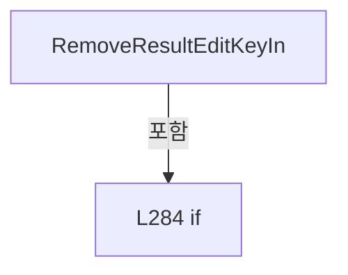

변경 전 점검: 입력/반환 타입, 위 호출자, 예외/취소 경로, 공유 상태와 저장·전송 소비자를 함께 확인합니다. 값의 단위나 물리 방향을 이름만으로 확정하지 않습니다.

### MethodDeclaration `ClearResultEditKeyIn` · L296–302

[Drilling.UI/Menu/Menus/CMenuCorrection.ReviewData.Edit.cs:296–302](https://github.com/kjuws10-rgb/A3Drilling/blob/334b3599651b2e8e0181fd4459bafaf3cddafff3/Drilling.UI/Menu/Menus/CMenuCorrection.ReviewData.Edit.cs#L296-L302)

| 항목 | 실제 추출 값 |
| --- | --- |
| 서명 | void Drilling.UI.Menu.Menus.CMenuCorrection.CReviewDataPanel.ClearResultEditKeyIn(object?) |
| 접근/수식자 | Private / private |
| 반환/값 타입 | void |
| 소속 타입 | NamedType:Drilling.UI.Menu.Menus.CMenuCorrection.CReviewDataPanel |

입력 계약:

| 이름 | 타입 | 전달 | 선택/기본값 |
| --- | --- | --- | --- |
| parameter | object? | None | False /  |

현재 부분 분석에서 직접 연결된 호출자는 없습니다. XAML/이벤트/인터페이스·델리게이트·외부 진입을 추가 확인해야 하며, 미사용으로 판정한 것이 아닙니다.

호출하는 대상과 해석 범위:

| 원본 행 | 표현식 | 분석 상태 | 대상/소스 위치 |
| --- | --- | --- | --- |
| 301 | NotifyResultEditState | resolved | void Drilling.UI.Menu.Menus.CMenuCorrection.CReviewDataPanel.NotifyResultEditState() · Drilling.UI/Menu/Menus/CMenuCorrection.ReviewData.Edit.cs:584 |

본문의 실제 연산·분기·예외·반환 순서(원문 위치 순):

| 원본 행 | 종류 | 주석 해설 |
| --- | --- | --- |
| 298 | assignment | 값을 대상에 대입합니다: _resultEditKeyInItems = [] |
| 299 | assignment | 값을 대상에 대입합니다: _selectedResultEditKeyInItem = null |
| 300 | assignment | 값을 대상에 대입합니다: _resultEditStatusText = "KEY IN LIST CLEARED" |
| 301 | call | 함수·델리게이트 또는 객체 생성자를 호출합니다: NotifyResultEditState() |

변경 전 점검: 입력/반환 타입, 위 호출자, 예외/취소 경로, 공유 상태와 저장·전송 소비자를 함께 확인합니다. 값의 단위나 물리 방향을 이름만으로 확정하지 않습니다.

### MethodDeclaration `AddResultEditCopySource` · L304–322

[Drilling.UI/Menu/Menus/CMenuCorrection.ReviewData.Edit.cs:304–322](https://github.com/kjuws10-rgb/A3Drilling/blob/334b3599651b2e8e0181fd4459bafaf3cddafff3/Drilling.UI/Menu/Menus/CMenuCorrection.ReviewData.Edit.cs#L304-L322)

| 항목 | 실제 추출 값 |
| --- | --- |
| 서명 | void Drilling.UI.Menu.Menus.CMenuCorrection.CReviewDataPanel.AddResultEditCopySource(object?) |
| 접근/수식자 | Private / private |
| 반환/값 타입 | void |
| 소속 타입 | NamedType:Drilling.UI.Menu.Menus.CMenuCorrection.CReviewDataPanel |

입력 계약:

| 이름 | 타입 | 전달 | 선택/기본값 |
| --- | --- | --- | --- |
| parameter | object? | None | False /  |

현재 부분 분석에서 직접 연결된 호출자는 없습니다. XAML/이벤트/인터페이스·델리게이트·외부 진입을 추가 확인해야 하며, 미사용으로 판정한 것이 아닙니다.

호출하는 대상과 해석 범위:

| 원본 행 | 표현식 | 분석 상태 | 대상/소스 위치 |
| --- | --- | --- | --- |
| 306 | ResolveResultEditSelection | resolved | System.Collections.Generic.IReadOnlyList<Drilling.UI.Menu.Menus.CMenuCorrection.ST_REVIEW_DATA_GRID_ROW> Drilling.UI.Menu.Menus.CMenuCorrection.CReviewDataPanel.ResolveResultEditSelection() · Drilling.UI/Menu/Menus/CMenuCorrection.ReviewData.Edit.cs:231 |
| 309 | CRecipeConfirmDialog.ShowWarning | resolved | void Drilling.UI.Popup.CRecipeConfirmDialog.ShowWarning(string, string, Window?) · Drilling.UI/Popup/CRecipeConfirmDialog.xaml.cs:86 |
| 317 | new ST_REVIEW_DATA_EDIT_ITEM | resolved | Drilling.UI.Menu.Menus.CMenuCorrection.ST_REVIEW_DATA_EDIT_ITEM.ST_REVIEW_DATA_EDIT_ITEM(Drilling.UI.Menu.Menus.CMenuCorrection.ST_REVIEW_DATA_GRID_ROW, int) · Drilling.UI/Menu/Menus/CMenuCorrection.ReviewData.Edit.cs:638 |
| 318 | _resultEditCopyTargets.Where(item => !item.Matches(selected[0])).ToArray | resolved | Drilling.UI.Menu.Menus.CMenuCorrection.ST_REVIEW_DATA_EDIT_ITEM[] System.Collections.Generic.IEnumerable<Drilling.UI.Menu.Menus.CMenuCorrection.ST_REVIEW_DATA_EDIT_ITEM>.ToArray<Drilling.UI.Menu.Menus.CMenuCorrection.ST_REVIEW_DATA_EDIT_ITEM>() |
| 318 | _resultEditCopyTargets.Where | resolved | System.Collections.Generic.IEnumerable<Drilling.UI.Menu.Menus.CMenuCorrection.ST_REVIEW_DATA_EDIT_ITEM> System.Collections.Generic.IEnumerable<Drilling.UI.Menu.Menus.CMenuCorrection.ST_REVIEW_DATA_EDIT_ITEM>.Where<Drilling.UI.Menu.Menus.CMenuCorrection.ST_REVIEW_DATA_EDIT_ITEM>(System.Func<Drilling.UI.Menu.Menus.CMenuCorrection.ST_REVIEW_DATA_EDIT_ITEM, bool>) |
| 318 | item.Matches | resolved | bool Drilling.UI.Menu.Menus.CMenuCorrection.ST_REVIEW_DATA_EDIT_ITEM.Matches(Drilling.UI.Menu.Menus.CMenuCorrection.ST_REVIEW_DATA_GRID_ROW) · Drilling.UI/Menu/Menus/CMenuCorrection.ReviewData.Edit.cs:706 |
| 319 | _resultEditCopyTargets.FirstOrDefault | resolved | Drilling.UI.Menu.Menus.CMenuCorrection.ST_REVIEW_DATA_EDIT_ITEM? System.Collections.Generic.IEnumerable<Drilling.UI.Menu.Menus.CMenuCorrection.ST_REVIEW_DATA_EDIT_ITEM>.FirstOrDefault<Drilling.UI.Menu.Menus.CMenuCorrection.ST_REVIEW_DATA_EDIT_ITEM>() |
| 321 | NotifyResultEditState | resolved | void Drilling.UI.Menu.Menus.CMenuCorrection.CReviewDataPanel.NotifyResultEditState() · Drilling.UI/Menu/Menus/CMenuCorrection.ReviewData.Edit.cs:584 |

본문의 실제 연산·분기·예외·반환 순서(원문 위치 순):

| 원본 행 | 종류 | 주석 해설 |
| --- | --- | --- |
| 306 | call | 함수·델리게이트 또는 객체 생성자를 호출합니다: ResolveResultEditSelection() |
| 306 | local-declaration | 지역 변수를 선언합니다: var selected = ResolveResultEditSelection(); |
| 306 | variable-initializer | 변수의 초기값을 지정합니다: selected = ResolveResultEditSelection() |
| 307 | if | 조건에 따라 분기합니다: if (selected.Count != 1) |
| 309 | call | 함수·델리게이트 또는 객체 생성자를 호출합니다: CRecipeConfirmDialog.ShowWarning( "Result Edit Source 확인", selected.Count == 0 ? "SOURCE로 지정할 Shot을 하나 선택해 주세요." : $"SOURCE는 하나의 Shot만 지정할 수 있습니다. 현재 {selected.Count:N0}개가 선택되었습니다.") |
| 311 | conditional-expression | 조건에 따라 결과식을 선택합니다: selected.Count == 0 ? "SOURCE로 지정할 Shot을 하나 선택해 주세요." : $"SOURCE는 하나의 Shot만 지정할 수 있습니다. 현재 {selected.Count:N0}개가 선택되었습니다." |
| 314 | return | 호출자에게 값 또는 제어를 반환합니다: return; |
| 317 | assignment | 값을 대상에 대입합니다: _resultEditCopySource = new ST_REVIEW_DATA_EDIT_ITEM(selected[0], 1) |
| 317 | call | 함수·델리게이트 또는 객체 생성자를 호출합니다: new ST_REVIEW_DATA_EDIT_ITEM(selected[0], 1) |
| 318 | assignment | 값을 대상에 대입합니다: _resultEditCopyTargets = _resultEditCopyTargets.Where(item => !item.Matches(selected[0])).ToArray() |
| 318 | call | 함수·델리게이트 또는 객체 생성자를 호출합니다: _resultEditCopyTargets.Where(item => !item.Matches(selected[0])).ToArray() |
| 318 | call | 함수·델리게이트 또는 객체 생성자를 호출합니다: _resultEditCopyTargets.Where(item => !item.Matches(selected[0])) |
| 318 | call | 함수·델리게이트 또는 객체 생성자를 호출합니다: item.Matches(selected[0]) |
| 319 | assignment | 값을 대상에 대입합니다: _selectedResultEditCopyTarget = _resultEditCopyTargets.FirstOrDefault() |
| 319 | call | 함수·델리게이트 또는 객체 생성자를 호출합니다: _resultEditCopyTargets.FirstOrDefault() |
| 320 | assignment | 값을 대상에 대입합니다: _resultEditStatusText = $"SOURCE: {_resultEditCopySource.Identity}" |
| 321 | call | 함수·델리게이트 또는 객체 생성자를 호출합니다: NotifyResultEditState() |

제어 구문의 포함 구조(실제 실행 순서/CFG가 아닌 구문 탐색 그림):

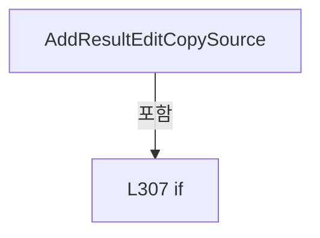

변경 전 점검: 입력/반환 타입, 위 호출자, 예외/취소 경로, 공유 상태와 저장·전송 소비자를 함께 확인합니다. 값의 단위나 물리 방향을 이름만으로 확정하지 않습니다.

### MethodDeclaration `AddResultEditCopyTargets` · L324–347

[Drilling.UI/Menu/Menus/CMenuCorrection.ReviewData.Edit.cs:324–347](https://github.com/kjuws10-rgb/A3Drilling/blob/334b3599651b2e8e0181fd4459bafaf3cddafff3/Drilling.UI/Menu/Menus/CMenuCorrection.ReviewData.Edit.cs#L324-L347)

| 항목 | 실제 추출 값 |
| --- | --- |
| 서명 | void Drilling.UI.Menu.Menus.CMenuCorrection.CReviewDataPanel.AddResultEditCopyTargets(object?) |
| 접근/수식자 | Private / private |
| 반환/값 타입 | void |
| 소속 타입 | NamedType:Drilling.UI.Menu.Menus.CMenuCorrection.CReviewDataPanel |

입력 계약:

| 이름 | 타입 | 전달 | 선택/기본값 |
| --- | --- | --- | --- |
| parameter | object? | None | False /  |

현재 부분 분석에서 직접 연결된 호출자는 없습니다. XAML/이벤트/인터페이스·델리게이트·외부 진입을 추가 확인해야 하며, 미사용으로 판정한 것이 아닙니다.

호출하는 대상과 해석 범위:

| 원본 행 | 표현식 | 분석 상태 | 대상/소스 위치 |
| --- | --- | --- | --- |
| 328 | CRecipeConfirmDialog.ShowWarning | resolved | void Drilling.UI.Popup.CRecipeConfirmDialog.ShowWarning(string, string, Window?) · Drilling.UI/Popup/CRecipeConfirmDialog.xaml.cs:86 |
| 332 | _resultEditCopyTargets.ToList | resolved | System.Collections.Generic.List<Drilling.UI.Menu.Menus.CMenuCorrection.ST_REVIEW_DATA_EDIT_ITEM> System.Collections.Generic.IEnumerable<Drilling.UI.Menu.Menus.CMenuCorrection.ST_REVIEW_DATA_EDIT_ITEM>.ToList<Drilling.UI.Menu.Menus.CMenuCorrection.ST_REVIEW_DATA_EDIT_ITEM>() |
| 333 | ResolveResultEditSelection | resolved | System.Collections.Generic.IReadOnlyList<Drilling.UI.Menu.Menus.CMenuCorrection.ST_REVIEW_DATA_GRID_ROW> Drilling.UI.Menu.Menus.CMenuCorrection.CReviewDataPanel.ResolveResultEditSelection() · Drilling.UI/Menu/Menus/CMenuCorrection.ReviewData.Edit.cs:231 |
| 335 | _resultEditCopySource.Matches | resolved | bool Drilling.UI.Menu.Menus.CMenuCorrection.ST_REVIEW_DATA_EDIT_ITEM.Matches(Drilling.UI.Menu.Menus.CMenuCorrection.ST_REVIEW_DATA_GRID_ROW) · Drilling.UI/Menu/Menus/CMenuCorrection.ReviewData.Edit.cs:706 |
| 335 | targets.Any | resolved | bool System.Collections.Generic.IEnumerable<Drilling.UI.Menu.Menus.CMenuCorrection.ST_REVIEW_DATA_EDIT_ITEM>.Any<Drilling.UI.Menu.Menus.CMenuCorrection.ST_REVIEW_DATA_EDIT_ITEM>(System.Func<Drilling.UI.Menu.Menus.CMenuCorrection.ST_REVIEW_DATA_EDIT_ITEM, bool>) |
| 335 | item.Matches | resolved | bool Drilling.UI.Menu.Menus.CMenuCorrection.ST_REVIEW_DATA_EDIT_ITEM.Matches(Drilling.UI.Menu.Menus.CMenuCorrection.ST_REVIEW_DATA_GRID_ROW) · Drilling.UI/Menu/Menus/CMenuCorrection.ReviewData.Edit.cs:706 |
| 340 | targets.Add | resolved | void System.Collections.Generic.List<Drilling.UI.Menu.Menus.CMenuCorrection.ST_REVIEW_DATA_EDIT_ITEM>.Add(Drilling.UI.Menu.Menus.CMenuCorrection.ST_REVIEW_DATA_EDIT_ITEM) |
| 340 | new ST_REVIEW_DATA_EDIT_ITEM | resolved | Drilling.UI.Menu.Menus.CMenuCorrection.ST_REVIEW_DATA_EDIT_ITEM.ST_REVIEW_DATA_EDIT_ITEM(Drilling.UI.Menu.Menus.CMenuCorrection.ST_REVIEW_DATA_GRID_ROW, int) · Drilling.UI/Menu/Menus/CMenuCorrection.ReviewData.Edit.cs:638 |
| 343 | Renumber | resolved | System.Collections.Generic.IReadOnlyList<Drilling.UI.Menu.Menus.CMenuCorrection.ST_REVIEW_DATA_EDIT_ITEM> Drilling.UI.Menu.Menus.CMenuCorrection.CReviewDataPanel.Renumber(System.Collections.Generic.IEnumerable<Drilling.UI.Menu.Menus.CMenuCorrection.ST_REVIEW_DATA_EDIT_ITEM>) · Drilling.UI/Menu/Menus/CMenuCorrection.ReviewData.Edit.cs:546 |
| 344 | _resultEditCopyTargets.LastOrDefault | resolved | Drilling.UI.Menu.Menus.CMenuCorrection.ST_REVIEW_DATA_EDIT_ITEM? System.Collections.Generic.IEnumerable<Drilling.UI.Menu.Menus.CMenuCorrection.ST_REVIEW_DATA_EDIT_ITEM>.LastOrDefault<Drilling.UI.Menu.Menus.CMenuCorrection.ST_REVIEW_DATA_EDIT_ITEM>() |
| 346 | NotifyResultEditState | resolved | void Drilling.UI.Menu.Menus.CMenuCorrection.CReviewDataPanel.NotifyResultEditState() · Drilling.UI/Menu/Menus/CMenuCorrection.ReviewData.Edit.cs:584 |

본문의 실제 연산·분기·예외·반환 순서(원문 위치 순):

| 원본 행 | 종류 | 주석 해설 |
| --- | --- | --- |
| 326 | if | 조건에 따라 분기합니다: if (_resultEditCopySource is null) |
| 328 | call | 함수·델리게이트 또는 객체 생성자를 호출합니다: CRecipeConfirmDialog.ShowWarning("Result Edit Copy 확인", "먼저 ADD TO SOURCE로 기준 Shot을 지정해 주세요.") |
| 329 | return | 호출자에게 값 또는 제어를 반환합니다: return; |
| 332 | call | 함수·델리게이트 또는 객체 생성자를 호출합니다: _resultEditCopyTargets.ToList() |
| 332 | local-declaration | 지역 변수를 선언합니다: var targets = _resultEditCopyTargets.ToList(); |
| 332 | variable-initializer | 변수의 초기값을 지정합니다: targets = _resultEditCopyTargets.ToList() |
| 333 | call | 함수·델리게이트 또는 객체 생성자를 호출합니다: ResolveResultEditSelection() |
| 333 | foreach | 컬렉션 요소를 순회합니다: foreach (var row in ResolveResultEditSelection()) |
| 335 | call | 함수·델리게이트 또는 객체 생성자를 호출합니다: _resultEditCopySource.Matches(row) |
| 335 | call | 함수·델리게이트 또는 객체 생성자를 호출합니다: targets.Any(item => item.Matches(row)) |
| 335 | call | 함수·델리게이트 또는 객체 생성자를 호출합니다: item.Matches(row) |
| 335 | if | 조건에 따라 분기합니다: if (_resultEditCopySource.Matches(row) &#124;&#124; targets.Any(item => item.Matches(row))) |
| 337 | continue | 다음 반복으로 진행합니다: continue; |
| 340 | call | 함수·델리게이트 또는 객체 생성자를 호출합니다: targets.Add(new ST_REVIEW_DATA_EDIT_ITEM(row, targets.Count + 1)) |
| 340 | call | 함수·델리게이트 또는 객체 생성자를 호출합니다: new ST_REVIEW_DATA_EDIT_ITEM(row, targets.Count + 1) |
| 343 | assignment | 값을 대상에 대입합니다: _resultEditCopyTargets = Renumber(targets) |
| 343 | call | 함수·델리게이트 또는 객체 생성자를 호출합니다: Renumber(targets) |
| 344 | assignment | 값을 대상에 대입합니다: _selectedResultEditCopyTarget = _resultEditCopyTargets.LastOrDefault() |
| 344 | call | 함수·델리게이트 또는 객체 생성자를 호출합니다: _resultEditCopyTargets.LastOrDefault() |
| 345 | assignment | 값을 대상에 대입합니다: _resultEditStatusText = $"{_resultEditCopyTargets.Count:N0} COPY TARGETS READY" |
| 346 | call | 함수·델리게이트 또는 객체 생성자를 호출합니다: NotifyResultEditState() |

제어 구문의 포함 구조(실제 실행 순서/CFG가 아닌 구문 탐색 그림):


변경 전 점검: 입력/반환 타입, 위 호출자, 예외/취소 경로, 공유 상태와 저장·전송 소비자를 함께 확인합니다. 값의 단위나 물리 방향을 이름만으로 확정하지 않습니다.

### MethodDeclaration `RemoveResultEditCopyTarget` · L349–361

[Drilling.UI/Menu/Menus/CMenuCorrection.ReviewData.Edit.cs:349–361](https://github.com/kjuws10-rgb/A3Drilling/blob/334b3599651b2e8e0181fd4459bafaf3cddafff3/Drilling.UI/Menu/Menus/CMenuCorrection.ReviewData.Edit.cs#L349-L361)

| 항목 | 실제 추출 값 |
| --- | --- |
| 서명 | void Drilling.UI.Menu.Menus.CMenuCorrection.CReviewDataPanel.RemoveResultEditCopyTarget(object?) |
| 접근/수식자 | Private / private |
| 반환/값 타입 | void |
| 소속 타입 | NamedType:Drilling.UI.Menu.Menus.CMenuCorrection.CReviewDataPanel |

입력 계약:

| 이름 | 타입 | 전달 | 선택/기본값 |
| --- | --- | --- | --- |
| parameter | object? | None | False /  |

현재 부분 분석에서 직접 연결된 호출자는 없습니다. XAML/이벤트/인터페이스·델리게이트·외부 진입을 추가 확인해야 하며, 미사용으로 판정한 것이 아닙니다.

호출하는 대상과 해석 범위:

| 원본 행 | 표현식 | 분석 상태 | 대상/소스 위치 |
| --- | --- | --- | --- |
| 356 | _resultEditCopyTargets.Where(item => !ReferenceEquals(item, _selectedResultEditCopyTarget)).ToArray | resolved | Drilling.UI.Menu.Menus.CMenuCorrection.ST_REVIEW_DATA_EDIT_ITEM[] System.Collections.Generic.IEnumerable<Drilling.UI.Menu.Menus.CMenuCorrection.ST_REVIEW_DATA_EDIT_ITEM>.ToArray<Drilling.UI.Menu.Menus.CMenuCorrection.ST_REVIEW_DATA_EDIT_ITEM>() |
| 356 | _resultEditCopyTargets.Where | resolved | System.Collections.Generic.IEnumerable<Drilling.UI.Menu.Menus.CMenuCorrection.ST_REVIEW_DATA_EDIT_ITEM> System.Collections.Generic.IEnumerable<Drilling.UI.Menu.Menus.CMenuCorrection.ST_REVIEW_DATA_EDIT_ITEM>.Where<Drilling.UI.Menu.Menus.CMenuCorrection.ST_REVIEW_DATA_EDIT_ITEM>(System.Func<Drilling.UI.Menu.Menus.CMenuCorrection.ST_REVIEW_DATA_EDIT_ITEM, bool>) |
| 356 | ReferenceEquals | resolved | bool object.ReferenceEquals(object?, object?) |
| 357 | Renumber | resolved | System.Collections.Generic.IReadOnlyList<Drilling.UI.Menu.Menus.CMenuCorrection.ST_REVIEW_DATA_EDIT_ITEM> Drilling.UI.Menu.Menus.CMenuCorrection.CReviewDataPanel.Renumber(System.Collections.Generic.IEnumerable<Drilling.UI.Menu.Menus.CMenuCorrection.ST_REVIEW_DATA_EDIT_ITEM>) · Drilling.UI/Menu/Menus/CMenuCorrection.ReviewData.Edit.cs:546 |
| 358 | _resultEditCopyTargets.FirstOrDefault | resolved | Drilling.UI.Menu.Menus.CMenuCorrection.ST_REVIEW_DATA_EDIT_ITEM? System.Collections.Generic.IEnumerable<Drilling.UI.Menu.Menus.CMenuCorrection.ST_REVIEW_DATA_EDIT_ITEM>.FirstOrDefault<Drilling.UI.Menu.Menus.CMenuCorrection.ST_REVIEW_DATA_EDIT_ITEM>() |
| 360 | NotifyResultEditState | resolved | void Drilling.UI.Menu.Menus.CMenuCorrection.CReviewDataPanel.NotifyResultEditState() · Drilling.UI/Menu/Menus/CMenuCorrection.ReviewData.Edit.cs:584 |

본문의 실제 연산·분기·예외·반환 순서(원문 위치 순):

| 원본 행 | 종류 | 주석 해설 |
| --- | --- | --- |
| 351 | if | 조건에 따라 분기합니다: if (_selectedResultEditCopyTarget is null) |
| 353 | return | 호출자에게 값 또는 제어를 반환합니다: return; |
| 356 | call | 함수·델리게이트 또는 객체 생성자를 호출합니다: _resultEditCopyTargets.Where(item => !ReferenceEquals(item, _selectedResultEditCopyTarget)).ToArray() |
| 356 | call | 함수·델리게이트 또는 객체 생성자를 호출합니다: _resultEditCopyTargets.Where(item => !ReferenceEquals(item, _selectedResultEditCopyTarget)) |
| 356 | call | 함수·델리게이트 또는 객체 생성자를 호출합니다: ReferenceEquals(item, _selectedResultEditCopyTarget) |
| 356 | local-declaration | 지역 변수를 선언합니다: var targets = _resultEditCopyTargets.Where(item => !ReferenceEquals(item, _selectedResultEditCopyTarget)).ToArray(); |
| 356 | variable-initializer | 변수의 초기값을 지정합니다: targets = _resultEditCopyTargets.Where(item => !ReferenceEquals(item, _selectedResultEditCopyTarget)).ToArray() |
| 357 | assignment | 값을 대상에 대입합니다: _resultEditCopyTargets = Renumber(targets) |
| 357 | call | 함수·델리게이트 또는 객체 생성자를 호출합니다: Renumber(targets) |
| 358 | assignment | 값을 대상에 대입합니다: _selectedResultEditCopyTarget = _resultEditCopyTargets.FirstOrDefault() |
| 358 | call | 함수·델리게이트 또는 객체 생성자를 호출합니다: _resultEditCopyTargets.FirstOrDefault() |
| 359 | assignment | 값을 대상에 대입합니다: _resultEditStatusText = "COPY TARGET REMOVED" |
| 360 | call | 함수·델리게이트 또는 객체 생성자를 호출합니다: NotifyResultEditState() |

제어 구문의 포함 구조(실제 실행 순서/CFG가 아닌 구문 탐색 그림):

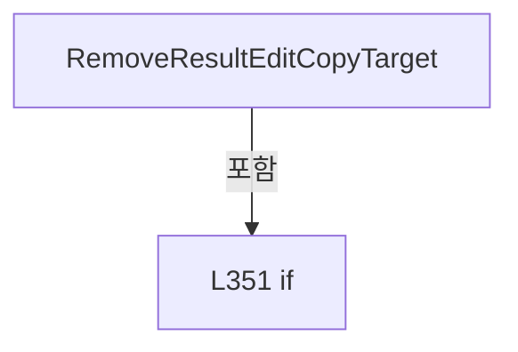

변경 전 점검: 입력/반환 타입, 위 호출자, 예외/취소 경로, 공유 상태와 저장·전송 소비자를 함께 확인합니다. 값의 단위나 물리 방향을 이름만으로 확정하지 않습니다.

### MethodDeclaration `ClearResultEditCopyTargets` · L363–369

[Drilling.UI/Menu/Menus/CMenuCorrection.ReviewData.Edit.cs:363–369](https://github.com/kjuws10-rgb/A3Drilling/blob/334b3599651b2e8e0181fd4459bafaf3cddafff3/Drilling.UI/Menu/Menus/CMenuCorrection.ReviewData.Edit.cs#L363-L369)

| 항목 | 실제 추출 값 |
| --- | --- |
| 서명 | void Drilling.UI.Menu.Menus.CMenuCorrection.CReviewDataPanel.ClearResultEditCopyTargets(object?) |
| 접근/수식자 | Private / private |
| 반환/값 타입 | void |
| 소속 타입 | NamedType:Drilling.UI.Menu.Menus.CMenuCorrection.CReviewDataPanel |

입력 계약:

| 이름 | 타입 | 전달 | 선택/기본값 |
| --- | --- | --- | --- |
| parameter | object? | None | False /  |

현재 부분 분석에서 직접 연결된 호출자는 없습니다. XAML/이벤트/인터페이스·델리게이트·외부 진입을 추가 확인해야 하며, 미사용으로 판정한 것이 아닙니다.

호출하는 대상과 해석 범위:

| 원본 행 | 표현식 | 분석 상태 | 대상/소스 위치 |
| --- | --- | --- | --- |
| 368 | NotifyResultEditState | resolved | void Drilling.UI.Menu.Menus.CMenuCorrection.CReviewDataPanel.NotifyResultEditState() · Drilling.UI/Menu/Menus/CMenuCorrection.ReviewData.Edit.cs:584 |

본문의 실제 연산·분기·예외·반환 순서(원문 위치 순):

| 원본 행 | 종류 | 주석 해설 |
| --- | --- | --- |
| 365 | assignment | 값을 대상에 대입합니다: _resultEditCopyTargets = [] |
| 366 | assignment | 값을 대상에 대입합니다: _selectedResultEditCopyTarget = null |
| 367 | assignment | 값을 대상에 대입합니다: _resultEditStatusText = "COPY TARGET LIST CLEARED" |
| 368 | call | 함수·델리게이트 또는 객체 생성자를 호출합니다: NotifyResultEditState() |

변경 전 점검: 입력/반환 타입, 위 호출자, 예외/취소 경로, 공유 상태와 저장·전송 소비자를 함께 확인합니다. 값의 단위나 물리 방향을 이름만으로 확정하지 않습니다.

### MethodDeclaration `CopyResultEditX` · L371–374

[Drilling.UI/Menu/Menus/CMenuCorrection.ReviewData.Edit.cs:371–374](https://github.com/kjuws10-rgb/A3Drilling/blob/334b3599651b2e8e0181fd4459bafaf3cddafff3/Drilling.UI/Menu/Menus/CMenuCorrection.ReviewData.Edit.cs#L371-L374)

| 항목 | 실제 추출 값 |
| --- | --- |
| 서명 | void Drilling.UI.Menu.Menus.CMenuCorrection.CReviewDataPanel.CopyResultEditX(object?) |
| 접근/수식자 | Private / private |
| 반환/값 타입 | void |
| 소속 타입 | NamedType:Drilling.UI.Menu.Menus.CMenuCorrection.CReviewDataPanel |

입력 계약:

| 이름 | 타입 | 전달 | 선택/기본값 |
| --- | --- | --- | --- |
| parameter | object? | None | False /  |

현재 부분 분석에서 직접 연결된 호출자는 없습니다. XAML/이벤트/인터페이스·델리게이트·외부 진입을 추가 확인해야 하며, 미사용으로 판정한 것이 아닙니다.

호출하는 대상과 해석 범위:

| 원본 행 | 표현식 | 분석 상태 | 대상/소스 위치 |
| --- | --- | --- | --- |
| 373 | ApplyResultEditCopy | resolved | void Drilling.UI.Menu.Menus.CMenuCorrection.CReviewDataPanel.ApplyResultEditCopy(bool, bool, bool, string) · Drilling.UI/Menu/Menus/CMenuCorrection.ReviewData.Edit.cs:391 |

본문의 실제 연산·분기·예외·반환 순서(원문 위치 순):

| 원본 행 | 종류 | 주석 해설 |
| --- | --- | --- |
| 373 | call | 함수·델리게이트 또는 객체 생성자를 호출합니다: ApplyResultEditCopy(copyX: true, copyY: false, copyJudge: false, "RESULT X COPIED") |

변경 전 점검: 입력/반환 타입, 위 호출자, 예외/취소 경로, 공유 상태와 저장·전송 소비자를 함께 확인합니다. 값의 단위나 물리 방향을 이름만으로 확정하지 않습니다.

### MethodDeclaration `CopyResultEditY` · L376–379

[Drilling.UI/Menu/Menus/CMenuCorrection.ReviewData.Edit.cs:376–379](https://github.com/kjuws10-rgb/A3Drilling/blob/334b3599651b2e8e0181fd4459bafaf3cddafff3/Drilling.UI/Menu/Menus/CMenuCorrection.ReviewData.Edit.cs#L376-L379)

| 항목 | 실제 추출 값 |
| --- | --- |
| 서명 | void Drilling.UI.Menu.Menus.CMenuCorrection.CReviewDataPanel.CopyResultEditY(object?) |
| 접근/수식자 | Private / private |
| 반환/값 타입 | void |
| 소속 타입 | NamedType:Drilling.UI.Menu.Menus.CMenuCorrection.CReviewDataPanel |

입력 계약:

| 이름 | 타입 | 전달 | 선택/기본값 |
| --- | --- | --- | --- |
| parameter | object? | None | False /  |

현재 부분 분석에서 직접 연결된 호출자는 없습니다. XAML/이벤트/인터페이스·델리게이트·외부 진입을 추가 확인해야 하며, 미사용으로 판정한 것이 아닙니다.

호출하는 대상과 해석 범위:

| 원본 행 | 표현식 | 분석 상태 | 대상/소스 위치 |
| --- | --- | --- | --- |
| 378 | ApplyResultEditCopy | resolved | void Drilling.UI.Menu.Menus.CMenuCorrection.CReviewDataPanel.ApplyResultEditCopy(bool, bool, bool, string) · Drilling.UI/Menu/Menus/CMenuCorrection.ReviewData.Edit.cs:391 |

본문의 실제 연산·분기·예외·반환 순서(원문 위치 순):

| 원본 행 | 종류 | 주석 해설 |
| --- | --- | --- |
| 378 | call | 함수·델리게이트 또는 객체 생성자를 호출합니다: ApplyResultEditCopy(copyX: false, copyY: true, copyJudge: false, "RESULT Y COPIED") |

변경 전 점검: 입력/반환 타입, 위 호출자, 예외/취소 경로, 공유 상태와 저장·전송 소비자를 함께 확인합니다. 값의 단위나 물리 방향을 이름만으로 확정하지 않습니다.

### MethodDeclaration `CopyResultEditJudge` · L381–384

[Drilling.UI/Menu/Menus/CMenuCorrection.ReviewData.Edit.cs:381–384](https://github.com/kjuws10-rgb/A3Drilling/blob/334b3599651b2e8e0181fd4459bafaf3cddafff3/Drilling.UI/Menu/Menus/CMenuCorrection.ReviewData.Edit.cs#L381-L384)

| 항목 | 실제 추출 값 |
| --- | --- |
| 서명 | void Drilling.UI.Menu.Menus.CMenuCorrection.CReviewDataPanel.CopyResultEditJudge(object?) |
| 접근/수식자 | Private / private |
| 반환/값 타입 | void |
| 소속 타입 | NamedType:Drilling.UI.Menu.Menus.CMenuCorrection.CReviewDataPanel |

입력 계약:

| 이름 | 타입 | 전달 | 선택/기본값 |
| --- | --- | --- | --- |
| parameter | object? | None | False /  |

현재 부분 분석에서 직접 연결된 호출자는 없습니다. XAML/이벤트/인터페이스·델리게이트·외부 진입을 추가 확인해야 하며, 미사용으로 판정한 것이 아닙니다.

호출하는 대상과 해석 범위:

| 원본 행 | 표현식 | 분석 상태 | 대상/소스 위치 |
| --- | --- | --- | --- |
| 383 | ApplyResultEditCopy | resolved | void Drilling.UI.Menu.Menus.CMenuCorrection.CReviewDataPanel.ApplyResultEditCopy(bool, bool, bool, string) · Drilling.UI/Menu/Menus/CMenuCorrection.ReviewData.Edit.cs:391 |

본문의 실제 연산·분기·예외·반환 순서(원문 위치 순):

| 원본 행 | 종류 | 주석 해설 |
| --- | --- | --- |
| 383 | call | 함수·델리게이트 또는 객체 생성자를 호출합니다: ApplyResultEditCopy(copyX: false, copyY: false, copyJudge: true, "JUDGE COPIED") |

변경 전 점검: 입력/반환 타입, 위 호출자, 예외/취소 경로, 공유 상태와 저장·전송 소비자를 함께 확인합니다. 값의 단위나 물리 방향을 이름만으로 확정하지 않습니다.

### MethodDeclaration `CopyResultEditAll` · L386–389

[Drilling.UI/Menu/Menus/CMenuCorrection.ReviewData.Edit.cs:386–389](https://github.com/kjuws10-rgb/A3Drilling/blob/334b3599651b2e8e0181fd4459bafaf3cddafff3/Drilling.UI/Menu/Menus/CMenuCorrection.ReviewData.Edit.cs#L386-L389)

| 항목 | 실제 추출 값 |
| --- | --- |
| 서명 | void Drilling.UI.Menu.Menus.CMenuCorrection.CReviewDataPanel.CopyResultEditAll(object?) |
| 접근/수식자 | Private / private |
| 반환/값 타입 | void |
| 소속 타입 | NamedType:Drilling.UI.Menu.Menus.CMenuCorrection.CReviewDataPanel |

입력 계약:

| 이름 | 타입 | 전달 | 선택/기본값 |
| --- | --- | --- | --- |
| parameter | object? | None | False /  |

현재 부분 분석에서 직접 연결된 호출자는 없습니다. XAML/이벤트/인터페이스·델리게이트·외부 진입을 추가 확인해야 하며, 미사용으로 판정한 것이 아닙니다.

호출하는 대상과 해석 범위:

| 원본 행 | 표현식 | 분석 상태 | 대상/소스 위치 |
| --- | --- | --- | --- |
| 388 | ApplyResultEditCopy | resolved | void Drilling.UI.Menu.Menus.CMenuCorrection.CReviewDataPanel.ApplyResultEditCopy(bool, bool, bool, string) · Drilling.UI/Menu/Menus/CMenuCorrection.ReviewData.Edit.cs:391 |

본문의 실제 연산·분기·예외·반환 순서(원문 위치 순):

| 원본 행 | 종류 | 주석 해설 |
| --- | --- | --- |
| 388 | call | 함수·델리게이트 또는 객체 생성자를 호출합니다: ApplyResultEditCopy(copyX: true, copyY: true, copyJudge: true, "RESULT X/Y AND JUDGE COPIED") |

변경 전 점검: 입력/반환 타입, 위 호출자, 예외/취소 경로, 공유 상태와 저장·전송 소비자를 함께 확인합니다. 값의 단위나 물리 방향을 이름만으로 확정하지 않습니다.

### MethodDeclaration `ApplyResultEditCopy` · L391–418

[Drilling.UI/Menu/Menus/CMenuCorrection.ReviewData.Edit.cs:391–418](https://github.com/kjuws10-rgb/A3Drilling/blob/334b3599651b2e8e0181fd4459bafaf3cddafff3/Drilling.UI/Menu/Menus/CMenuCorrection.ReviewData.Edit.cs#L391-L418)

| 항목 | 실제 추출 값 |
| --- | --- |
| 서명 | void Drilling.UI.Menu.Menus.CMenuCorrection.CReviewDataPanel.ApplyResultEditCopy(bool, bool, bool, string) |
| 접근/수식자 | Private / private |
| 반환/값 타입 | void |
| 소속 타입 | NamedType:Drilling.UI.Menu.Menus.CMenuCorrection.CReviewDataPanel |

입력 계약:

| 이름 | 타입 | 전달 | 선택/기본값 |
| --- | --- | --- | --- |
| copyX | bool | None | False /  |
| copyY | bool | None | False /  |
| copyJudge | bool | None | False /  |
| status | string | None | False /  |

정적 호출자로 확인된 위치:

| 호출 파일/행 | 호출 표현식 | 런타임 분기 가능 |
| --- | --- | --- |
| [Drilling.UI/Menu/Menus/CMenuCorrection.ReviewData.Edit.cs:373–373](https://github.com/kjuws10-rgb/A3Drilling/blob/334b3599651b2e8e0181fd4459bafaf3cddafff3/Drilling.UI/Menu/Menus/CMenuCorrection.ReviewData.Edit.cs#L373-L373) | ApplyResultEditCopy | False |
| [Drilling.UI/Menu/Menus/CMenuCorrection.ReviewData.Edit.cs:378–378](https://github.com/kjuws10-rgb/A3Drilling/blob/334b3599651b2e8e0181fd4459bafaf3cddafff3/Drilling.UI/Menu/Menus/CMenuCorrection.ReviewData.Edit.cs#L378-L378) | ApplyResultEditCopy | False |
| [Drilling.UI/Menu/Menus/CMenuCorrection.ReviewData.Edit.cs:383–383](https://github.com/kjuws10-rgb/A3Drilling/blob/334b3599651b2e8e0181fd4459bafaf3cddafff3/Drilling.UI/Menu/Menus/CMenuCorrection.ReviewData.Edit.cs#L383-L383) | ApplyResultEditCopy | False |
| [Drilling.UI/Menu/Menus/CMenuCorrection.ReviewData.Edit.cs:388–388](https://github.com/kjuws10-rgb/A3Drilling/blob/334b3599651b2e8e0181fd4459bafaf3cddafff3/Drilling.UI/Menu/Menus/CMenuCorrection.ReviewData.Edit.cs#L388-L388) | ApplyResultEditCopy | False |

호출하는 대상과 해석 범위:

| 원본 행 | 표현식 | 분석 상태 | 대상/소스 위치 |
| --- | --- | --- | --- |
| 417 | NotifyResultEditState | resolved | void Drilling.UI.Menu.Menus.CMenuCorrection.CReviewDataPanel.NotifyResultEditState() · Drilling.UI/Menu/Menus/CMenuCorrection.ReviewData.Edit.cs:584 |

본문의 실제 연산·분기·예외·반환 순서(원문 위치 순):

| 원본 행 | 종류 | 주석 해설 |
| --- | --- | --- |
| 393 | if | 조건에 따라 분기합니다: if (_resultEditCopySource is null) |
| 395 | return | 호출자에게 값 또는 제어를 반환합니다: return; |
| 398 | foreach | 컬렉션 요소를 순회합니다: foreach (var target in _resultEditCopyTargets) |
| 400 | if | 조건에 따라 분기합니다: if (copyX) |
| 402 | assignment | 값을 대상에 대입합니다: target.EditedXText = _resultEditCopySource.OriginalXText |
| 405 | if | 조건에 따라 분기합니다: if (copyY) |
| 407 | assignment | 값을 대상에 대입합니다: target.EditedYText = _resultEditCopySource.OriginalYText |
| 410 | if | 조건에 따라 분기합니다: if (copyJudge) |
| 412 | assignment | 값을 대상에 대입합니다: target.EditedJudge = _resultEditCopySource.OriginalJudge |
| 416 | assignment | 값을 대상에 대입합니다: _resultEditStatusText = status |
| 417 | call | 함수·델리게이트 또는 객체 생성자를 호출합니다: NotifyResultEditState() |

제어 구문의 포함 구조(실제 실행 순서/CFG가 아닌 구문 탐색 그림):

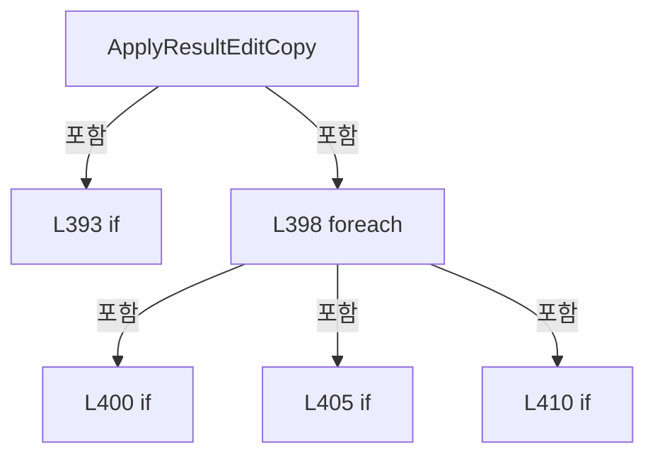

변경 전 점검: 입력/반환 타입, 위 호출자, 예외/취소 경로, 공유 상태와 저장·전송 소비자를 함께 확인합니다. 값의 단위나 물리 방향을 이름만으로 확정하지 않습니다.

### MethodDeclaration `SaveResultEdit` · L420–526

[Drilling.UI/Menu/Menus/CMenuCorrection.ReviewData.Edit.cs:420–526](https://github.com/kjuws10-rgb/A3Drilling/blob/334b3599651b2e8e0181fd4459bafaf3cddafff3/Drilling.UI/Menu/Menus/CMenuCorrection.ReviewData.Edit.cs#L420-L526)

| 항목 | 실제 추출 값 |
| --- | --- |
| 서명 | void Drilling.UI.Menu.Menus.CMenuCorrection.CReviewDataPanel.SaveResultEdit(object?) |
| 접근/수식자 | Private / private, async |
| 반환/값 타입 | void |
| 소속 타입 | NamedType:Drilling.UI.Menu.Menus.CMenuCorrection.CReviewDataPanel |

입력 계약:

| 이름 | 타입 | 전달 | 선택/기본값 |
| --- | --- | --- | --- |
| parameter | object? | None | False /  |

현재 부분 분석에서 직접 연결된 호출자는 없습니다. XAML/이벤트/인터페이스·델리게이트·외부 진입을 추가 확인해야 하며, 미사용으로 판정한 것이 아닙니다.

호출하는 대상과 해석 범위:

| 원본 행 | 표현식 | 분석 상태 | 대상/소스 위치 |
| --- | --- | --- | --- |
| 430 | new List<ST_REVIEW_RESULT_EDIT_UPDATE> | resolved | System.Collections.Generic.List<Drilling.Common.Review.ST_REVIEW_RESULT_EDIT_UPDATE>.List() |
| 433 | TryParseResultEditValue | resolved | bool Drilling.UI.Menu.Menus.CMenuCorrection.CReviewDataPanel.TryParseResultEditValue(string?, out double) · Drilling.UI/Menu/Menus/CMenuCorrection.ReviewData.Edit.cs:528 |
| 434 | TryParseResultEditValue | resolved | bool Drilling.UI.Menu.Menus.CMenuCorrection.CReviewDataPanel.TryParseResultEditValue(string?, out double) · Drilling.UI/Menu/Menus/CMenuCorrection.ReviewData.Edit.cs:528 |
| 436 | CRecipeConfirmDialog.ShowWarning | resolved | void Drilling.UI.Popup.CRecipeConfirmDialog.ShowWarning(string, string, Window?) · Drilling.UI/Popup/CRecipeConfirmDialog.xaml.cs:86 |
| 442 | double.TryParse | resolved | bool double.TryParse(string?, System.Globalization.NumberStyles, System.IFormatProvider?, out double) |
| 443 | double.TryParse | resolved | bool double.TryParse(string?, System.Globalization.NumberStyles, System.IFormatProvider?, out double) |
| 444 | editedX.Equals | resolved | bool double.Equals(double) |
| 445 | editedY.Equals | resolved | bool double.Equals(double) |
| 446 | item.EditedJudge.Equals | resolved | bool string.Equals(string?, System.StringComparison) |
| 452 | updates.Add | resolved | void System.Collections.Generic.List<Drilling.Common.Review.ST_REVIEW_RESULT_EDIT_UPDATE>.Add(Drilling.Common.Review.ST_REVIEW_RESULT_EDIT_UPDATE) |
| 452 | new ST_REVIEW_RESULT_EDIT_UPDATE | resolved | Drilling.Common.Review.ST_REVIEW_RESULT_EDIT_UPDATE.ST_REVIEW_RESULT_EDIT_UPDATE(int, string, string, int, double, double, string) · Drilling.Common/Review/CReviewManager.cs:4303 |
| 464 | CRecipeConfirmDialog.ShowWarning | resolved | void Drilling.UI.Popup.CRecipeConfirmDialog.ShowWarning(string, string, Window?) · Drilling.UI/Popup/CRecipeConfirmDialog.xaml.cs:86 |
| 470 | CRecipeConfirmDialog.ShowConfirmation | resolved | bool Drilling.UI.Popup.CRecipeConfirmDialog.ShowConfirmation(string, string, string, bool) · Drilling.UI/Popup/CRecipeConfirmDialog.xaml.cs:11 |
| 480 | SetResultEditSaving | resolved | void Drilling.UI.Menu.Menus.CMenuCorrection.CReviewDataPanel.SetResultEditSaving(bool) · Drilling.UI/Menu/Menus/CMenuCorrection.ReviewData.Edit.cs:534 |
| 482 | Notify | resolved | void Drilling.UI.Menu.Menus.CMenuCorrection.CReviewDataPanel.Notify(string) · Drilling.UI/Menu/Menus/CMenuCorrection.ReviewData.cs:616 |
| 482 | nameof | unresolved | None |
| 486 | Task.Run | resolved | System.Threading.Tasks.Task<string> System.Threading.Tasks.Task.Run<string>(System.Func<System.Threading.Tasks.Task<string>?>) |
| 487 | _reviewResultFile.SaveEditedRevision( source, updates, DateTimeOffset.Now, CancellationToken.None).ConfigureAwait | resolved | System.Runtime.CompilerServices.ConfiguredTaskAwaitable<string> System.Threading.Tasks.Task<string>.ConfigureAwait(bool) |
| 487 | _reviewResultFile.SaveEditedRevision | resolved · 동적 구현 선택 가능 | System.Threading.Tasks.Task<string> Drilling.Common.Review.CReviewResultFileBase.SaveEditedRevision(Drilling.Common.Review.ST_REVIEW_RESULT_FILE_DATA, System.Collections.Generic.IReadOnlyList<Drilling.Common.Review.ST_REVIEW_RESULT_EDIT_UPDATE>, System.DateTimeOffset, System.Threading.CancellationToken) · Drilling.Common/Review/CReviewManager.cs:4346 |
| 492 | Path.GetFileName | resolved | string? System.IO.Path.GetFileName(string?) |
| 493 | _statusReporter | resolved · 동적 구현 선택 가능 | void System.Action<string>.Invoke(string) |
| 498 | _statusReporter | resolved · 동적 구현 선택 가능 | void System.Action<string>.Invoke(string) |
| 499 | CRecipeConfirmDialog.ShowWarning | resolved | void Drilling.UI.Popup.CRecipeConfirmDialog.ShowWarning(string, string, Window?) · Drilling.UI/Popup/CRecipeConfirmDialog.xaml.cs:86 |
| 503 | SetResultEditSaving | resolved | void Drilling.UI.Menu.Menus.CMenuCorrection.CReviewDataPanel.SetResultEditSaving(bool) · Drilling.UI/Menu/Menus/CMenuCorrection.ReviewData.Edit.cs:534 |
| 504 | Notify | resolved | void Drilling.UI.Menu.Menus.CMenuCorrection.CReviewDataPanel.Notify(string) · Drilling.UI/Menu/Menus/CMenuCorrection.ReviewData.cs:616 |
| 504 | nameof | unresolved | None |
| 507 | string.IsNullOrWhiteSpace | resolved | bool string.IsNullOrWhiteSpace(string?) |
| 508 | CRecipeConfirmDialog.ShowSavedResultLoadConfirmation | resolved | bool Drilling.UI.Popup.CRecipeConfirmDialog.ShowSavedResultLoadConfirmation(string, string) · Drilling.UI/Popup/CRecipeConfirmDialog.xaml.cs:30 |
| 510 | Path.GetFileName | resolved | string? System.IO.Path.GetFileName(string?) |
| 515 | Refresh | resolved | System.Threading.Tasks.Task Drilling.UI.Menu.Menus.CMenuCorrection.CReviewDataPanel.Refresh(System.Threading.CancellationToken, string?) · Drilling.UI/Menu/Menus/CMenuCorrection.ReviewData.cs:263 |
| 517 | savedResult.FilePath.Equals | resolved | bool string.Equals(string?, System.StringComparison) |
| 519 | CRecipeConfirmDialog.ShowWarning | resolved | void Drilling.UI.Popup.CRecipeConfirmDialog.ShowWarning(string, string, Window?) · Drilling.UI/Popup/CRecipeConfirmDialog.xaml.cs:86 |
| 525 | LoadSelectedData | resolved | System.Threading.Tasks.Task Drilling.UI.Menu.Menus.CMenuCorrection.CReviewDataPanel.LoadSelectedData() · Drilling.UI/Menu/Menus/CMenuCorrection.ReviewData.Display.cs:160 |

본문의 실제 연산·분기·예외·반환 순서(원문 위치 순):

| 원본 행 | 종류 | 주석 해설 |
| --- | --- | --- |
| 422 | if | 조건에 따라 분기합니다: if (!CanSaveResultEdit &#124;&#124; _loadedResultFile is not { } source) |
| 424 | return | 호출자에게 값 또는 제어를 반환합니다: return; |
| 427 | conditional-expression | 조건에 따라 결과식을 선택합니다: IsResultEditKeyInMode ? _resultEditKeyInItems : _resultEditCopyTargets |
| 427 | local-declaration | 지역 변수를 선언합니다: var sourceItems = IsResultEditKeyInMode ? _resultEditKeyInItems : _resultEditCopyTargets; |
| 427 | variable-initializer | 변수의 초기값을 지정합니다: sourceItems = IsResultEditKeyInMode ? _resultEditKeyInItems : _resultEditCopyTargets |
| 430 | call | 함수·델리게이트 또는 객체 생성자를 호출합니다: new List<ST_REVIEW_RESULT_EDIT_UPDATE>() |
| 430 | local-declaration | 지역 변수를 선언합니다: var updates = new List<ST_REVIEW_RESULT_EDIT_UPDATE>(); |
| 430 | variable-initializer | 변수의 초기값을 지정합니다: updates = new List<ST_REVIEW_RESULT_EDIT_UPDATE>() |
| 431 | foreach | 컬렉션 요소를 순회합니다: foreach (var item in sourceItems) |
| 433 | call | 함수·델리게이트 또는 객체 생성자를 호출합니다: TryParseResultEditValue(item.EditedXText, out var editedX) |
| 433 | if | 조건에 따라 분기합니다: if (!TryParseResultEditValue(item.EditedXText, out var editedX) &#124;&#124; !TryParseResultEditValue(item.EditedYText, out var editedY)) |
| 434 | call | 함수·델리게이트 또는 객체 생성자를 호출합니다: TryParseResultEditValue(item.EditedYText, out var editedY) |
| 436 | call | 함수·델리게이트 또는 객체 생성자를 호출합니다: CRecipeConfirmDialog.ShowWarning( "결과 수정 저장 불가", $"{item.Identity}의 EDIT X/Y는 유한한 숫자로 입력해 주세요.") |
| 439 | return | 호출자에게 값 또는 제어를 반환합니다: return; |
| 442 | assignment | 값을 대상에 대입합니다: _ = double.TryParse(item.OriginalXText, NumberStyles.Float, CultureInfo.InvariantCulture, out var displayedOriginalX) |
| 442 | call | 함수·델리게이트 또는 객체 생성자를 호출합니다: double.TryParse(item.OriginalXText, NumberStyles.Float, CultureInfo.InvariantCulture, out var displayedOriginalX) |
| 443 | assignment | 값을 대상에 대입합니다: _ = double.TryParse(item.OriginalYText, NumberStyles.Float, CultureInfo.InvariantCulture, out var displayedOriginalY) |
| 443 | call | 함수·델리게이트 또는 객체 생성자를 호출합니다: double.TryParse(item.OriginalYText, NumberStyles.Float, CultureInfo.InvariantCulture, out var displayedOriginalY) |
| 444 | call | 함수·델리게이트 또는 객체 생성자를 호출합니다: editedX.Equals(displayedOriginalX) |
| 444 | local-declaration | 지역 변수를 선언합니다: var xChanged = !editedX.Equals(displayedOriginalX); |
| 444 | variable-initializer | 변수의 초기값을 지정합니다: xChanged = !editedX.Equals(displayedOriginalX) |
| 445 | call | 함수·델리게이트 또는 객체 생성자를 호출합니다: editedY.Equals(displayedOriginalY) |
| 445 | local-declaration | 지역 변수를 선언합니다: var yChanged = !editedY.Equals(displayedOriginalY); |
| 445 | variable-initializer | 변수의 초기값을 지정합니다: yChanged = !editedY.Equals(displayedOriginalY) |
| 446 | call | 함수·델리게이트 또는 객체 생성자를 호출합니다: item.EditedJudge.Equals(item.OriginalJudge, StringComparison.OrdinalIgnoreCase) |
| 446 | local-declaration | 지역 변수를 선언합니다: var judgeChanged = !item.EditedJudge.Equals(item.OriginalJudge, StringComparison.OrdinalIgnoreCase); |
| 446 | variable-initializer | 변수의 초기값을 지정합니다: judgeChanged = !item.EditedJudge.Equals(item.OriginalJudge, StringComparison.OrdinalIgnoreCase) |
| 447 | if | 조건에 따라 분기합니다: if (!xChanged && !yChanged && !judgeChanged) |
| 449 | continue | 다음 반복으로 진행합니다: continue; |
| 452 | call | 함수·델리게이트 또는 객체 생성자를 호출합니다: updates.Add(new ST_REVIEW_RESULT_EDIT_UPDATE( item.Source.CellNo, item.Source.ShotKey, item.Source.ShotName, item.Source.BeamNo, xChanged ? editedX : item.Source.ResultX, yChanged ? editedY : item.Source.ResultY, item.Ed… |
| 452 | call | 함수·델리게이트 또는 객체 생성자를 호출합니다: new ST_REVIEW_RESULT_EDIT_UPDATE( item.Source.CellNo, item.Source.ShotKey, item.Source.ShotName, item.Source.BeamNo, xChanged ? editedX : item.Source.ResultX, yChanged ? editedY : item.Source.ResultY, item.EditedJudge) |
| 457 | conditional-expression | 조건에 따라 결과식을 선택합니다: xChanged ? editedX : item.Source.ResultX |
| 458 | conditional-expression | 조건에 따라 결과식을 선택합니다: yChanged ? editedY : item.Source.ResultY |
| 462 | if | 조건에 따라 분기합니다: if (updates.Count == 0) |
| 464 | call | 함수·델리게이트 또는 객체 생성자를 호출합니다: CRecipeConfirmDialog.ShowWarning( "결과 수정 저장 불가", "원본과 달라진 RESULT X/Y 또는 JUDGE가 없습니다.") |
| 467 | return | 호출자에게 값 또는 제어를 반환합니다: return; |
| 470 | call | 함수·델리게이트 또는 객체 생성자를 호출합니다: CRecipeConfirmDialog.ShowConfirmation( "결과 수정 저장", $"BASE 결과: {source.FileName}\n" + $"수정 Shot: {updates.Count:N0}개\n\n" + "수정 결과를 새 파일로 저장하시겠습니까?", "저장") |
| 470 | if | 조건에 따라 분기합니다: if (!CRecipeConfirmDialog.ShowConfirmation( "결과 수정 저장", $"BASE 결과: {source.FileName}\n" + $"수정 Shot: {updates.Count:N0}개\n\n" + "수정 결과를 새 파일로 저장하시겠습니까?", "저장")) |
| 477 | return | 호출자에게 값 또는 제어를 반환합니다: return; |
| 480 | call | 함수·델리게이트 또는 객체 생성자를 호출합니다: SetResultEditSaving(true) |
| 481 | assignment | 값을 대상에 대입합니다: _resultEditStatusText = $"RESULT SAVE - {updates.Count:N0} SHOTS" |
| 482 | call | 함수·델리게이트 또는 객체 생성자를 호출합니다: Notify(nameof(ResultEditStatusText)) |
| 482 | call | 함수·델리게이트 또는 객체 생성자를 호출합니다: nameof(ResultEditStatusText) |
| 483 | local-declaration | 지역 변수를 선언합니다: string? savedPath = null; |
| 483 | variable-initializer | 변수의 초기값을 지정합니다: savedPath = null |
| 484 | try | 예외 처리 범위입니다: try |
| 486 | assignment | 값을 대상에 대입합니다: savedPath = await Task.Run( async () => await _reviewResultFile.SaveEditedRevision( source, updates, DateTimeOffset.Now, CancellationToken.None).ConfigureAwait(false)) |
| 486 | await | 비동기 완료를 기다립니다: await Task.Run( async () => await _reviewResultFile.SaveEditedRevision( source, updates, DateTimeOffset.Now, CancellationToken.None).ConfigureAwait(false)) |
| 486 | call | 함수·델리게이트 또는 객체 생성자를 호출합니다: Task.Run( async () => await _reviewResultFile.SaveEditedRevision( source, updates, DateTimeOffset.Now, CancellationToken.None).ConfigureAwait(false)) |
| 487 | await | 비동기 완료를 기다립니다: await _reviewResultFile.SaveEditedRevision( source, updates, DateTimeOffset.Now, CancellationToken.None).ConfigureAwait(false) |
| 487 | call | 함수·델리게이트 또는 객체 생성자를 호출합니다: _reviewResultFile.SaveEditedRevision( source, updates, DateTimeOffset.Now, CancellationToken.None).ConfigureAwait(false) |
| 487 | call | 함수·델리게이트 또는 객체 생성자를 호출합니다: _reviewResultFile.SaveEditedRevision( source, updates, DateTimeOffset.Now, CancellationToken.None) |
| 492 | assignment | 값을 대상에 대입합니다: _resultEditStatusText = $"RESULT SAVE COMPLETED - {Path.GetFileName(savedPath)}" |
| 492 | call | 함수·델리게이트 또는 객체 생성자를 호출합니다: Path.GetFileName(savedPath) |
| 493 | call | 함수·델리게이트 또는 객체 생성자를 호출합니다: _statusReporter($"Edited review result saved: {savedPath}") |
| 495 | catch | 지정 예외를 처리합니다: catch (Exception exception) |
| 497 | assignment | 값을 대상에 대입합니다: _resultEditStatusText = $"RESULT SAVE FAILED - {exception.Message}" |
| 498 | call | 함수·델리게이트 또는 객체 생성자를 호출합니다: _statusReporter(_resultEditStatusText) |
| 499 | call | 함수·델리게이트 또는 객체 생성자를 호출합니다: CRecipeConfirmDialog.ShowWarning("결과 수정 저장 실패", exception.Message) |
| 501 | finally | 종료 정리 구간입니다: finally |
| 503 | call | 함수·델리게이트 또는 객체 생성자를 호출합니다: SetResultEditSaving(false) |
| 504 | call | 함수·델리게이트 또는 객체 생성자를 호출합니다: Notify(nameof(ResultEditStatusText)) |
| 504 | call | 함수·델리게이트 또는 객체 생성자를 호출합니다: nameof(ResultEditStatusText) |
| 507 | call | 함수·델리게이트 또는 객체 생성자를 호출합니다: string.IsNullOrWhiteSpace(savedPath) |
| 507 | if | 조건에 따라 분기합니다: if (string.IsNullOrWhiteSpace(savedPath) &#124;&#124; !CRecipeConfirmDialog.ShowSavedResultLoadConfirmation( "결과 수정 저장 완료", $"저장이 완료되었습니다.\n\n{Path.GetFileName(savedPath)}\n\n새로 저장한 결과를 LOAD하시겠습니까?")) |
| 508 | call | 함수·델리게이트 또는 객체 생성자를 호출합니다: CRecipeConfirmDialog.ShowSavedResultLoadConfirmation( "결과 수정 저장 완료", $"저장이 완료되었습니다.\n\n{Path.GetFileName(savedPath)}\n\n새로 저장한 결과를 LOAD하시겠습니까?") |
| 510 | call | 함수·델리게이트 또는 객체 생성자를 호출합니다: Path.GetFileName(savedPath) |
| 512 | return | 호출자에게 값 또는 제어를 반환합니다: return; |
| 515 | await | 비동기 완료를 기다립니다: await Refresh(CancellationToken.None, savedPath) |
| 515 | call | 함수·델리게이트 또는 객체 생성자를 호출합니다: Refresh(CancellationToken.None, savedPath) |
| 516 | if | 조건에 따라 분기합니다: if (_selectedNode?.Result is not { } savedResult &#124;&#124; !savedResult.FilePath.Equals(savedPath, StringComparison.OrdinalIgnoreCase)) |
| 517 | call | 함수·델리게이트 또는 객체 생성자를 호출합니다: savedResult.FilePath.Equals(savedPath, StringComparison.OrdinalIgnoreCase) |
| 519 | call | 함수·델리게이트 또는 객체 생성자를 호출합니다: CRecipeConfirmDialog.ShowWarning( "수정 결과 LOAD 실패", "저장된 파일을 결과 트리에서 찾지 못했습니다. REFRESH 후 파일을 직접 선택해 주세요.") |
| 522 | return | 호출자에게 값 또는 제어를 반환합니다: return; |
| 525 | await | 비동기 완료를 기다립니다: await LoadSelectedData() |
| 525 | call | 함수·델리게이트 또는 객체 생성자를 호출합니다: LoadSelectedData() |

제어 구문의 포함 구조(실제 실행 순서/CFG가 아닌 구문 탐색 그림):

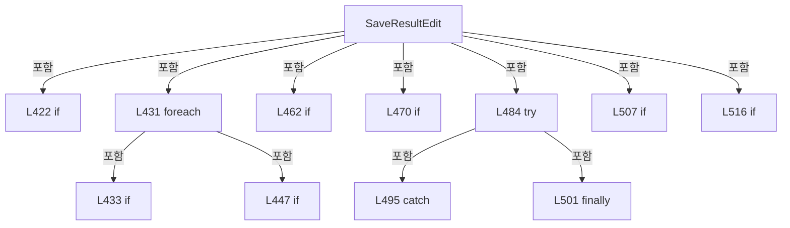

변경 전 점검: 입력/반환 타입, 위 호출자, 예외/취소 경로, 공유 상태와 저장·전송 소비자를 함께 확인합니다. 값의 단위나 물리 방향을 이름만으로 확정하지 않습니다.

### MethodDeclaration `TryParseResultEditValue` · L528–532

[Drilling.UI/Menu/Menus/CMenuCorrection.ReviewData.Edit.cs:528–532](https://github.com/kjuws10-rgb/A3Drilling/blob/334b3599651b2e8e0181fd4459bafaf3cddafff3/Drilling.UI/Menu/Menus/CMenuCorrection.ReviewData.Edit.cs#L528-L532)

| 항목 | 실제 추출 값 |
| --- | --- |
| 서명 | bool Drilling.UI.Menu.Menus.CMenuCorrection.CReviewDataPanel.TryParseResultEditValue(string?, out double) |
| 접근/수식자 | Private / private, static |
| 반환/값 타입 | bool |
| 소속 타입 | NamedType:Drilling.UI.Menu.Menus.CMenuCorrection.CReviewDataPanel |

입력 계약:

| 이름 | 타입 | 전달 | 선택/기본값 |
| --- | --- | --- | --- |
| text | string? | None | False /  |
| value | double | Out | False /  |

정적 호출자로 확인된 위치:

| 호출 파일/행 | 호출 표현식 | 런타임 분기 가능 |
| --- | --- | --- |
| [Drilling.UI/Menu/Menus/CMenuCorrection.ReviewData.Edit.cs:433–433](https://github.com/kjuws10-rgb/A3Drilling/blob/334b3599651b2e8e0181fd4459bafaf3cddafff3/Drilling.UI/Menu/Menus/CMenuCorrection.ReviewData.Edit.cs#L433-L433) | TryParseResultEditValue | False |
| [Drilling.UI/Menu/Menus/CMenuCorrection.ReviewData.Edit.cs:434–434](https://github.com/kjuws10-rgb/A3Drilling/blob/334b3599651b2e8e0181fd4459bafaf3cddafff3/Drilling.UI/Menu/Menus/CMenuCorrection.ReviewData.Edit.cs#L434-L434) | TryParseResultEditValue | False |

호출하는 대상과 해석 범위:

| 원본 행 | 표현식 | 분석 상태 | 대상/소스 위치 |
| --- | --- | --- | --- |
| 530 | double.TryParse | resolved | bool double.TryParse(string?, System.Globalization.NumberStyles, System.IFormatProvider?, out double) |
| 531 | double.IsFinite | resolved | bool double.IsFinite(double) |

본문의 실제 연산·분기·예외·반환 순서(원문 위치 순):

| 원본 행 | 종류 | 주석 해설 |
| --- | --- | --- |
| 530 | call | 함수·델리게이트 또는 객체 생성자를 호출합니다: double.TryParse(text, NumberStyles.Float, CultureInfo.InvariantCulture, out value) |
| 530 | return | 호출자에게 값 또는 제어를 반환합니다: return double.TryParse(text, NumberStyles.Float, CultureInfo.InvariantCulture, out value) && double.IsFinite(value); |
| 531 | call | 함수·델리게이트 또는 객체 생성자를 호출합니다: double.IsFinite(value) |

변경 전 점검: 입력/반환 타입, 위 호출자, 예외/취소 경로, 공유 상태와 저장·전송 소비자를 함께 확인합니다. 값의 단위나 물리 방향을 이름만으로 확정하지 않습니다.

### MethodDeclaration `SetResultEditSaving` · L534–544

[Drilling.UI/Menu/Menus/CMenuCorrection.ReviewData.Edit.cs:534–544](https://github.com/kjuws10-rgb/A3Drilling/blob/334b3599651b2e8e0181fd4459bafaf3cddafff3/Drilling.UI/Menu/Menus/CMenuCorrection.ReviewData.Edit.cs#L534-L544)

| 항목 | 실제 추출 값 |
| --- | --- |
| 서명 | void Drilling.UI.Menu.Menus.CMenuCorrection.CReviewDataPanel.SetResultEditSaving(bool) |
| 접근/수식자 | Private / private |
| 반환/값 타입 | void |
| 소속 타입 | NamedType:Drilling.UI.Menu.Menus.CMenuCorrection.CReviewDataPanel |

입력 계약:

| 이름 | 타입 | 전달 | 선택/기본값 |
| --- | --- | --- | --- |
| value | bool | None | False /  |

정적 호출자로 확인된 위치:

| 호출 파일/행 | 호출 표현식 | 런타임 분기 가능 |
| --- | --- | --- |
| [Drilling.UI/Menu/Menus/CMenuCorrection.ReviewData.Edit.cs:480–480](https://github.com/kjuws10-rgb/A3Drilling/blob/334b3599651b2e8e0181fd4459bafaf3cddafff3/Drilling.UI/Menu/Menus/CMenuCorrection.ReviewData.Edit.cs#L480-L480) | SetResultEditSaving | False |
| [Drilling.UI/Menu/Menus/CMenuCorrection.ReviewData.Edit.cs:503–503](https://github.com/kjuws10-rgb/A3Drilling/blob/334b3599651b2e8e0181fd4459bafaf3cddafff3/Drilling.UI/Menu/Menus/CMenuCorrection.ReviewData.Edit.cs#L503-L503) | SetResultEditSaving | False |

호출하는 대상과 해석 범위:

| 원본 행 | 표현식 | 분석 상태 | 대상/소스 위치 |
| --- | --- | --- | --- |
| 542 | Notify | resolved | void Drilling.UI.Menu.Menus.CMenuCorrection.CReviewDataPanel.Notify(string) · Drilling.UI/Menu/Menus/CMenuCorrection.ReviewData.cs:616 |
| 542 | nameof | unresolved | None |
| 543 | NotifyResultEditCommandState | resolved | void Drilling.UI.Menu.Menus.CMenuCorrection.CReviewDataPanel.NotifyResultEditCommandState() · Drilling.UI/Menu/Menus/CMenuCorrection.ReviewData.Edit.cs:601 |

본문의 실제 연산·분기·예외·반환 순서(원문 위치 순):

| 원본 행 | 종류 | 주석 해설 |
| --- | --- | --- |
| 536 | if | 조건에 따라 분기합니다: if (_isResultEditSaving == value) |
| 538 | return | 호출자에게 값 또는 제어를 반환합니다: return; |
| 541 | assignment | 값을 대상에 대입합니다: _isResultEditSaving = value |
| 542 | call | 함수·델리게이트 또는 객체 생성자를 호출합니다: Notify(nameof(IsResultEditSaving)) |
| 542 | call | 함수·델리게이트 또는 객체 생성자를 호출합니다: nameof(IsResultEditSaving) |
| 543 | call | 함수·델리게이트 또는 객체 생성자를 호출합니다: NotifyResultEditCommandState() |

제어 구문의 포함 구조(실제 실행 순서/CFG가 아닌 구문 탐색 그림):

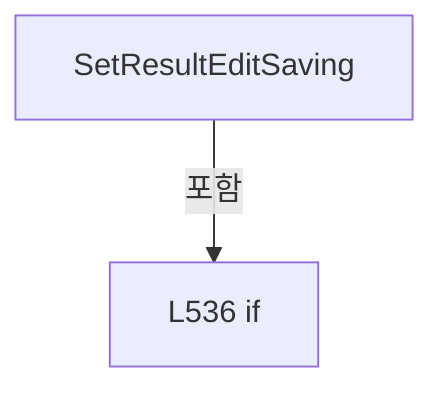

변경 전 점검: 입력/반환 타입, 위 호출자, 예외/취소 경로, 공유 상태와 저장·전송 소비자를 함께 확인합니다. 값의 단위나 물리 방향을 이름만으로 확정하지 않습니다.

### MethodDeclaration `Renumber` · L546–555

[Drilling.UI/Menu/Menus/CMenuCorrection.ReviewData.Edit.cs:546–555](https://github.com/kjuws10-rgb/A3Drilling/blob/334b3599651b2e8e0181fd4459bafaf3cddafff3/Drilling.UI/Menu/Menus/CMenuCorrection.ReviewData.Edit.cs#L546-L555)

| 항목 | 실제 추출 값 |
| --- | --- |
| 서명 | System.Collections.Generic.IReadOnlyList<Drilling.UI.Menu.Menus.CMenuCorrection.ST_REVIEW_DATA_EDIT_ITEM> Drilling.UI.Menu.Menus.CMenuCorrection.CReviewDataPanel.Renumber(System.Collections.Generic.IEnumerable<Drilling.UI.Menu.Menus.CMenuCorrection.ST_REVIEW_DATA_EDIT_ITEM>) |
| 접근/수식자 | Private / private, static |
| 반환/값 타입 | System.Collections.Generic.IReadOnlyList<Drilling.UI.Menu.Menus.CMenuCorrection.ST_REVIEW_DATA_EDIT_ITEM> |
| 소속 타입 | NamedType:Drilling.UI.Menu.Menus.CMenuCorrection.CReviewDataPanel |

입력 계약:

| 이름 | 타입 | 전달 | 선택/기본값 |
| --- | --- | --- | --- |
| source | System.Collections.Generic.IEnumerable<Drilling.UI.Menu.Menus.CMenuCorrection.ST_REVIEW_DATA_EDIT_ITEM> | None | False /  |

정적 호출자로 확인된 위치:

| 호출 파일/행 | 호출 표현식 | 런타임 분기 가능 |
| --- | --- | --- |
| [Drilling.UI/Menu/Menus/CMenuCorrection.ReviewData.Edit.cs:276–276](https://github.com/kjuws10-rgb/A3Drilling/blob/334b3599651b2e8e0181fd4459bafaf3cddafff3/Drilling.UI/Menu/Menus/CMenuCorrection.ReviewData.Edit.cs#L276-L276) | Renumber | False |
| [Drilling.UI/Menu/Menus/CMenuCorrection.ReviewData.Edit.cs:290–290](https://github.com/kjuws10-rgb/A3Drilling/blob/334b3599651b2e8e0181fd4459bafaf3cddafff3/Drilling.UI/Menu/Menus/CMenuCorrection.ReviewData.Edit.cs#L290-L290) | Renumber | False |
| [Drilling.UI/Menu/Menus/CMenuCorrection.ReviewData.Edit.cs:343–343](https://github.com/kjuws10-rgb/A3Drilling/blob/334b3599651b2e8e0181fd4459bafaf3cddafff3/Drilling.UI/Menu/Menus/CMenuCorrection.ReviewData.Edit.cs#L343-L343) | Renumber | False |
| [Drilling.UI/Menu/Menus/CMenuCorrection.ReviewData.Edit.cs:357–357](https://github.com/kjuws10-rgb/A3Drilling/blob/334b3599651b2e8e0181fd4459bafaf3cddafff3/Drilling.UI/Menu/Menus/CMenuCorrection.ReviewData.Edit.cs#L357-L357) | Renumber | False |

호출하는 대상과 해석 범위:

| 원본 행 | 표현식 | 분석 상태 | 대상/소스 위치 |
| --- | --- | --- | --- |
| 548 | source.ToArray | resolved | Drilling.UI.Menu.Menus.CMenuCorrection.ST_REVIEW_DATA_EDIT_ITEM[] System.Collections.Generic.IEnumerable<Drilling.UI.Menu.Menus.CMenuCorrection.ST_REVIEW_DATA_EDIT_ITEM>.ToArray<Drilling.UI.Menu.Menus.CMenuCorrection.ST_REVIEW_DATA_EDIT_ITEM>() |

본문의 실제 연산·분기·예외·반환 순서(원문 위치 순):

| 원본 행 | 종류 | 주석 해설 |
| --- | --- | --- |
| 548 | call | 함수·델리게이트 또는 객체 생성자를 호출합니다: source.ToArray() |
| 548 | local-declaration | 지역 변수를 선언합니다: var items = source.ToArray(); |
| 548 | variable-initializer | 변수의 초기값을 지정합니다: items = source.ToArray() |
| 549 | variable-initializer | 변수의 초기값을 지정합니다: index = 0 |
| 549 | for | 초기화·조건·증감이 있는 반복입니다: for (var index = 0; index < items.Length; index++) |
| 551 | assignment | 값을 대상에 대입합니다: items[index].No = index + 1 |
| 554 | return | 호출자에게 값 또는 제어를 반환합니다: return items; |

제어 구문의 포함 구조(실제 실행 순서/CFG가 아닌 구문 탐색 그림):

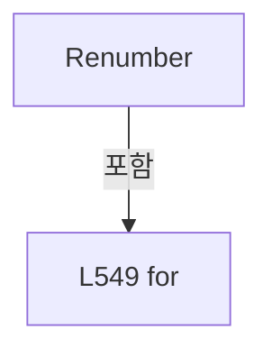

변경 전 점검: 입력/반환 타입, 위 호출자, 예외/취소 경로, 공유 상태와 저장·전송 소비자를 함께 확인합니다. 값의 단위나 물리 방향을 이름만으로 확정하지 않습니다.

### MethodDeclaration `GetResultEditSelectedShotKeys` · L557–563

[Drilling.UI/Menu/Menus/CMenuCorrection.ReviewData.Edit.cs:557–563](https://github.com/kjuws10-rgb/A3Drilling/blob/334b3599651b2e8e0181fd4459bafaf3cddafff3/Drilling.UI/Menu/Menus/CMenuCorrection.ReviewData.Edit.cs#L557-L563)

| 항목 | 실제 추출 값 |
| --- | --- |
| 서명 | System.Collections.Generic.IReadOnlySet<string> Drilling.UI.Menu.Menus.CMenuCorrection.CReviewDataPanel.GetResultEditSelectedShotKeys(int) |
| 접근/수식자 | Private / private |
| 반환/값 타입 | System.Collections.Generic.IReadOnlySet<string> |
| 소속 타입 | NamedType:Drilling.UI.Menu.Menus.CMenuCorrection.CReviewDataPanel |

입력 계약:

| 이름 | 타입 | 전달 | 선택/기본값 |
| --- | --- | --- | --- |
| cellNo | int | None | False /  |

정적 호출자로 확인된 위치:

| 호출 파일/행 | 호출 표현식 | 런타임 분기 가능 |
| --- | --- | --- |
| [Drilling.UI/Menu/Menus/CMenuCorrection.ReviewData.Display.cs:683–683](https://github.com/kjuws10-rgb/A3Drilling/blob/334b3599651b2e8e0181fd4459bafaf3cddafff3/Drilling.UI/Menu/Menus/CMenuCorrection.ReviewData.Display.cs#L683-L683) | GetResultEditSelectedShotKeys | False |
| [Drilling.UI/Menu/Menus/CMenuCorrection.ReviewData.Display.cs:962–962](https://github.com/kjuws10-rgb/A3Drilling/blob/334b3599651b2e8e0181fd4459bafaf3cddafff3/Drilling.UI/Menu/Menus/CMenuCorrection.ReviewData.Display.cs#L962-L962) | GetResultEditSelectedShotKeys | False |

호출하는 대상과 해석 범위:

| 원본 행 | 표현식 | 분석 상태 | 대상/소스 위치 |
| --- | --- | --- | --- |
| 559 | _allRows .Where(row => row.IsResultEditSelected && row.CellNo == cellNo) .Select(row => row.ShotKey) .ToHashSet | resolved | System.Collections.Generic.HashSet<string> System.Collections.Generic.IEnumerable<string>.ToHashSet<string>(System.Collections.Generic.IEqualityComparer<string>?) |
| 559 | _allRows .Where(row => row.IsResultEditSelected && row.CellNo == cellNo) .Select | resolved | System.Collections.Generic.IEnumerable<string> System.Collections.Generic.IEnumerable<Drilling.UI.Menu.Menus.CMenuCorrection.ST_REVIEW_DATA_GRID_ROW>.Select<Drilling.UI.Menu.Menus.CMenuCorrection.ST_REVIEW_DATA_GRID_ROW, string>(System.Func<Drilling.UI.Menu.Menus.CMenuCorrection.ST_REVIEW_DATA_GRID_ROW, string>) |
| 559 | _allRows .Where | resolved | System.Collections.Generic.IEnumerable<Drilling.UI.Menu.Menus.CMenuCorrection.ST_REVIEW_DATA_GRID_ROW> System.Collections.Generic.IEnumerable<Drilling.UI.Menu.Menus.CMenuCorrection.ST_REVIEW_DATA_GRID_ROW>.Where<Drilling.UI.Menu.Menus.CMenuCorrection.ST_REVIEW_DATA_GRID_ROW>(System.Func<Drilling.UI.Menu.Menus.CMenuCorrection.ST_REVIEW_DATA_GRID_ROW, bool>) |

본문의 실제 연산·분기·예외·반환 순서(원문 위치 순):

| 원본 행 | 종류 | 주석 해설 |
| --- | --- | --- |
| 559 | call | 함수·델리게이트 또는 객체 생성자를 호출합니다: _allRows .Where(row => row.IsResultEditSelected && row.CellNo == cellNo) |
| 559 | call | 함수·델리게이트 또는 객체 생성자를 호출합니다: _allRows .Where(row => row.IsResultEditSelected && row.CellNo == cellNo) .Select(row => row.ShotKey) |
| 559 | call | 함수·델리게이트 또는 객체 생성자를 호출합니다: _allRows .Where(row => row.IsResultEditSelected && row.CellNo == cellNo) .Select(row => row.ShotKey) .ToHashSet(StringComparer.OrdinalIgnoreCase) |
| 559 | return | 호출자에게 값 또는 제어를 반환합니다: return _allRows .Where(row => row.IsResultEditSelected && row.CellNo == cellNo) .Select(row => row.ShotKey) .ToHashSet(StringComparer.OrdinalIgnoreCase); |

변경 전 점검: 입력/반환 타입, 위 호출자, 예외/취소 경로, 공유 상태와 저장·전송 소비자를 함께 확인합니다. 값의 단위나 물리 방향을 이름만으로 확정하지 않습니다.

### MethodDeclaration `ResetResultEditState` · L565–582

[Drilling.UI/Menu/Menus/CMenuCorrection.ReviewData.Edit.cs:565–582](https://github.com/kjuws10-rgb/A3Drilling/blob/334b3599651b2e8e0181fd4459bafaf3cddafff3/Drilling.UI/Menu/Menus/CMenuCorrection.ReviewData.Edit.cs#L565-L582)

| 항목 | 실제 추출 값 |
| --- | --- |
| 서명 | void Drilling.UI.Menu.Menus.CMenuCorrection.CReviewDataPanel.ResetResultEditState() |
| 접근/수식자 | Private / private |
| 반환/값 타입 | void |
| 소속 타입 | NamedType:Drilling.UI.Menu.Menus.CMenuCorrection.CReviewDataPanel |

정적 호출자로 확인된 위치:

| 호출 파일/행 | 호출 표현식 | 런타임 분기 가능 |
| --- | --- | --- |
| [Drilling.UI/Menu/Menus/CMenuCorrection.ReviewData.Display.cs:1320–1320](https://github.com/kjuws10-rgb/A3Drilling/blob/334b3599651b2e8e0181fd4459bafaf3cddafff3/Drilling.UI/Menu/Menus/CMenuCorrection.ReviewData.Display.cs#L1320-L1320) | ResetResultEditState | False |

호출하는 대상과 해석 범위:

| 원본 행 | 표현식 | 분석 상태 | 대상/소스 위치 |
| --- | --- | --- | --- |
| 581 | NotifyResultEditState | resolved | void Drilling.UI.Menu.Menus.CMenuCorrection.CReviewDataPanel.NotifyResultEditState() · Drilling.UI/Menu/Menus/CMenuCorrection.ReviewData.Edit.cs:584 |

본문의 실제 연산·분기·예외·반환 순서(원문 위치 순):

| 원본 행 | 종류 | 주석 해설 |
| --- | --- | --- |
| 567 | assignment | 값을 대상에 대입합니다: _isResultEditMode = false |
| 568 | assignment | 값을 대상에 대입합니다: _resultEditMode = ResultEditKeyInMode |
| 569 | assignment | 값을 대상에 대입합니다: _resultEditKeyInItems = [] |
| 570 | assignment | 값을 대상에 대입합니다: _selectedResultEditKeyInItem = null |
| 571 | assignment | 값을 대상에 대입합니다: _resultEditCopySource = null |
| 572 | assignment | 값을 대상에 대입합니다: _resultEditCopyTargets = [] |
| 573 | assignment | 값을 대상에 대입합니다: _selectedResultEditCopyTarget = null |
| 574 | assignment | 값을 대상에 대입합니다: _resultEditStatusText = "NO EDIT ITEMS" |
| 575 | assignment | 값을 대상에 대입합니다: _isResultEditSaving = false |
| 576 | foreach | 컬렉션 요소를 순회합니다: foreach (var row in _allRows) |
| 578 | assignment | 값을 대상에 대입합니다: row.IsResultEditSelected = false |
| 581 | call | 함수·델리게이트 또는 객체 생성자를 호출합니다: NotifyResultEditState() |

제어 구문의 포함 구조(실제 실행 순서/CFG가 아닌 구문 탐색 그림):

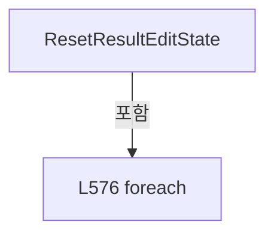

변경 전 점검: 입력/반환 타입, 위 호출자, 예외/취소 경로, 공유 상태와 저장·전송 소비자를 함께 확인합니다. 값의 단위나 물리 방향을 이름만으로 확정하지 않습니다.

### MethodDeclaration `NotifyResultEditState` · L584–599

[Drilling.UI/Menu/Menus/CMenuCorrection.ReviewData.Edit.cs:584–599](https://github.com/kjuws10-rgb/A3Drilling/blob/334b3599651b2e8e0181fd4459bafaf3cddafff3/Drilling.UI/Menu/Menus/CMenuCorrection.ReviewData.Edit.cs#L584-L599)

| 항목 | 실제 추출 값 |
| --- | --- |
| 서명 | void Drilling.UI.Menu.Menus.CMenuCorrection.CReviewDataPanel.NotifyResultEditState() |
| 접근/수식자 | Private / private |
| 반환/값 타입 | void |
| 소속 타입 | NamedType:Drilling.UI.Menu.Menus.CMenuCorrection.CReviewDataPanel |

정적 호출자로 확인된 위치:

| 호출 파일/행 | 호출 표현식 | 런타임 분기 가능 |
| --- | --- | --- |
| [Drilling.UI/Menu/Menus/CMenuCorrection.ReviewData.Edit.cs:132–132](https://github.com/kjuws10-rgb/A3Drilling/blob/334b3599651b2e8e0181fd4459bafaf3cddafff3/Drilling.UI/Menu/Menus/CMenuCorrection.ReviewData.Edit.cs#L132-L132) | NotifyResultEditState | False |
| [Drilling.UI/Menu/Menus/CMenuCorrection.ReviewData.Edit.cs:279–279](https://github.com/kjuws10-rgb/A3Drilling/blob/334b3599651b2e8e0181fd4459bafaf3cddafff3/Drilling.UI/Menu/Menus/CMenuCorrection.ReviewData.Edit.cs#L279-L279) | NotifyResultEditState | False |
| [Drilling.UI/Menu/Menus/CMenuCorrection.ReviewData.Edit.cs:293–293](https://github.com/kjuws10-rgb/A3Drilling/blob/334b3599651b2e8e0181fd4459bafaf3cddafff3/Drilling.UI/Menu/Menus/CMenuCorrection.ReviewData.Edit.cs#L293-L293) | NotifyResultEditState | False |
| [Drilling.UI/Menu/Menus/CMenuCorrection.ReviewData.Edit.cs:301–301](https://github.com/kjuws10-rgb/A3Drilling/blob/334b3599651b2e8e0181fd4459bafaf3cddafff3/Drilling.UI/Menu/Menus/CMenuCorrection.ReviewData.Edit.cs#L301-L301) | NotifyResultEditState | False |
| [Drilling.UI/Menu/Menus/CMenuCorrection.ReviewData.Edit.cs:321–321](https://github.com/kjuws10-rgb/A3Drilling/blob/334b3599651b2e8e0181fd4459bafaf3cddafff3/Drilling.UI/Menu/Menus/CMenuCorrection.ReviewData.Edit.cs#L321-L321) | NotifyResultEditState | False |
| [Drilling.UI/Menu/Menus/CMenuCorrection.ReviewData.Edit.cs:346–346](https://github.com/kjuws10-rgb/A3Drilling/blob/334b3599651b2e8e0181fd4459bafaf3cddafff3/Drilling.UI/Menu/Menus/CMenuCorrection.ReviewData.Edit.cs#L346-L346) | NotifyResultEditState | False |
| [Drilling.UI/Menu/Menus/CMenuCorrection.ReviewData.Edit.cs:360–360](https://github.com/kjuws10-rgb/A3Drilling/blob/334b3599651b2e8e0181fd4459bafaf3cddafff3/Drilling.UI/Menu/Menus/CMenuCorrection.ReviewData.Edit.cs#L360-L360) | NotifyResultEditState | False |
| [Drilling.UI/Menu/Menus/CMenuCorrection.ReviewData.Edit.cs:368–368](https://github.com/kjuws10-rgb/A3Drilling/blob/334b3599651b2e8e0181fd4459bafaf3cddafff3/Drilling.UI/Menu/Menus/CMenuCorrection.ReviewData.Edit.cs#L368-L368) | NotifyResultEditState | False |
| [Drilling.UI/Menu/Menus/CMenuCorrection.ReviewData.Edit.cs:417–417](https://github.com/kjuws10-rgb/A3Drilling/blob/334b3599651b2e8e0181fd4459bafaf3cddafff3/Drilling.UI/Menu/Menus/CMenuCorrection.ReviewData.Edit.cs#L417-L417) | NotifyResultEditState | False |
| [Drilling.UI/Menu/Menus/CMenuCorrection.ReviewData.Edit.cs:581–581](https://github.com/kjuws10-rgb/A3Drilling/blob/334b3599651b2e8e0181fd4459bafaf3cddafff3/Drilling.UI/Menu/Menus/CMenuCorrection.ReviewData.Edit.cs#L581-L581) | NotifyResultEditState | False |
| [Drilling.UI/Menu/Menus/CMenuCorrection.ReviewData.cs:251–251](https://github.com/kjuws10-rgb/A3Drilling/blob/334b3599651b2e8e0181fd4459bafaf3cddafff3/Drilling.UI/Menu/Menus/CMenuCorrection.ReviewData.cs#L251-L251) | NotifyResultEditState | False |

호출하는 대상과 해석 범위:

| 원본 행 | 표현식 | 분석 상태 | 대상/소스 위치 |
| --- | --- | --- | --- |
| 586 | Notify | resolved | void Drilling.UI.Menu.Menus.CMenuCorrection.CReviewDataPanel.Notify(string) · Drilling.UI/Menu/Menus/CMenuCorrection.ReviewData.cs:616 |
| 586 | nameof | unresolved | None |
| 587 | Notify | resolved | void Drilling.UI.Menu.Menus.CMenuCorrection.CReviewDataPanel.Notify(string) · Drilling.UI/Menu/Menus/CMenuCorrection.ReviewData.cs:616 |
| 587 | nameof | unresolved | None |
| 588 | Notify | resolved | void Drilling.UI.Menu.Menus.CMenuCorrection.CReviewDataPanel.Notify(string) · Drilling.UI/Menu/Menus/CMenuCorrection.ReviewData.cs:616 |
| 588 | nameof | unresolved | None |
| 589 | Notify | resolved | void Drilling.UI.Menu.Menus.CMenuCorrection.CReviewDataPanel.Notify(string) · Drilling.UI/Menu/Menus/CMenuCorrection.ReviewData.cs:616 |
| 589 | nameof | unresolved | None |
| 590 | Notify | resolved | void Drilling.UI.Menu.Menus.CMenuCorrection.CReviewDataPanel.Notify(string) · Drilling.UI/Menu/Menus/CMenuCorrection.ReviewData.cs:616 |
| 590 | nameof | unresolved | None |
| 591 | Notify | resolved | void Drilling.UI.Menu.Menus.CMenuCorrection.CReviewDataPanel.Notify(string) · Drilling.UI/Menu/Menus/CMenuCorrection.ReviewData.cs:616 |
| 591 | nameof | unresolved | None |
| 592 | Notify | resolved | void Drilling.UI.Menu.Menus.CMenuCorrection.CReviewDataPanel.Notify(string) · Drilling.UI/Menu/Menus/CMenuCorrection.ReviewData.cs:616 |
| 592 | nameof | unresolved | None |
| 593 | Notify | resolved | void Drilling.UI.Menu.Menus.CMenuCorrection.CReviewDataPanel.Notify(string) · Drilling.UI/Menu/Menus/CMenuCorrection.ReviewData.cs:616 |
| 593 | nameof | unresolved | None |
| 594 | Notify | resolved | void Drilling.UI.Menu.Menus.CMenuCorrection.CReviewDataPanel.Notify(string) · Drilling.UI/Menu/Menus/CMenuCorrection.ReviewData.cs:616 |
| 594 | nameof | unresolved | None |
| 595 | Notify | resolved | void Drilling.UI.Menu.Menus.CMenuCorrection.CReviewDataPanel.Notify(string) · Drilling.UI/Menu/Menus/CMenuCorrection.ReviewData.cs:616 |
| 595 | nameof | unresolved | None |
| 596 | Notify | resolved | void Drilling.UI.Menu.Menus.CMenuCorrection.CReviewDataPanel.Notify(string) · Drilling.UI/Menu/Menus/CMenuCorrection.ReviewData.cs:616 |
| 596 | nameof | unresolved | None |
| 597 | Notify | resolved | void Drilling.UI.Menu.Menus.CMenuCorrection.CReviewDataPanel.Notify(string) · Drilling.UI/Menu/Menus/CMenuCorrection.ReviewData.cs:616 |
| 597 | nameof | unresolved | None |
| 598 | NotifyResultEditCommandState | resolved | void Drilling.UI.Menu.Menus.CMenuCorrection.CReviewDataPanel.NotifyResultEditCommandState() · Drilling.UI/Menu/Menus/CMenuCorrection.ReviewData.Edit.cs:601 |

본문의 실제 연산·분기·예외·반환 순서(원문 위치 순):

| 원본 행 | 종류 | 주석 해설 |
| --- | --- | --- |
| 586 | call | 함수·델리게이트 또는 객체 생성자를 호출합니다: Notify(nameof(IsResultEditKeyInMode)) |
| 586 | call | 함수·델리게이트 또는 객체 생성자를 호출합니다: nameof(IsResultEditKeyInMode) |
| 587 | call | 함수·델리게이트 또는 객체 생성자를 호출합니다: Notify(nameof(IsResultEditCopyMode)) |
| 587 | call | 함수·델리게이트 또는 객체 생성자를 호출합니다: nameof(IsResultEditCopyMode) |
| 588 | call | 함수·델리게이트 또는 객체 생성자를 호출합니다: Notify(nameof(ResultEditKeyInItems)) |
| 588 | call | 함수·델리게이트 또는 객체 생성자를 호출합니다: nameof(ResultEditKeyInItems) |
| 589 | call | 함수·델리게이트 또는 객체 생성자를 호출합니다: Notify(nameof(SelectedResultEditKeyInItem)) |
| 589 | call | 함수·델리게이트 또는 객체 생성자를 호출합니다: nameof(SelectedResultEditKeyInItem) |
| 590 | call | 함수·델리게이트 또는 객체 생성자를 호출합니다: Notify(nameof(ResultEditCopySourceRows)) |
| 590 | call | 함수·델리게이트 또는 객체 생성자를 호출합니다: nameof(ResultEditCopySourceRows) |
| 591 | call | 함수·델리게이트 또는 객체 생성자를 호출합니다: Notify(nameof(ResultEditCopyTargets)) |
| 591 | call | 함수·델리게이트 또는 객체 생성자를 호출합니다: nameof(ResultEditCopyTargets) |
| 592 | call | 함수·델리게이트 또는 객체 생성자를 호출합니다: Notify(nameof(SelectedResultEditCopyTarget)) |
| 592 | call | 함수·델리게이트 또는 객체 생성자를 호출합니다: nameof(SelectedResultEditCopyTarget) |
| 593 | call | 함수·델리게이트 또는 객체 생성자를 호출합니다: Notify(nameof(ResultEditSelectionSummary)) |
| 593 | call | 함수·델리게이트 또는 객체 생성자를 호출합니다: nameof(ResultEditSelectionSummary) |
| 594 | call | 함수·델리게이트 또는 객체 생성자를 호출합니다: Notify(nameof(ResultEditKeyInSummary)) |
| 594 | call | 함수·델리게이트 또는 객체 생성자를 호출합니다: nameof(ResultEditKeyInSummary) |
| 595 | call | 함수·델리게이트 또는 객체 생성자를 호출합니다: Notify(nameof(ResultEditCopySummary)) |
| 595 | call | 함수·델리게이트 또는 객체 생성자를 호출합니다: nameof(ResultEditCopySummary) |
| 596 | call | 함수·델리게이트 또는 객체 생성자를 호출합니다: Notify(nameof(ResultEditStatusText)) |
| 596 | call | 함수·델리게이트 또는 객체 생성자를 호출합니다: nameof(ResultEditStatusText) |
| 597 | call | 함수·델리게이트 또는 객체 생성자를 호출합니다: Notify(nameof(IsResultEditSaving)) |
| 597 | call | 함수·델리게이트 또는 객체 생성자를 호출합니다: nameof(IsResultEditSaving) |
| 598 | call | 함수·델리게이트 또는 객체 생성자를 호출합니다: NotifyResultEditCommandState() |

변경 전 점검: 입력/반환 타입, 위 호출자, 예외/취소 경로, 공유 상태와 저장·전송 소비자를 함께 확인합니다. 값의 단위나 물리 방향을 이름만으로 확정하지 않습니다.

### MethodDeclaration `NotifyResultEditCommandState` · L601–628

[Drilling.UI/Menu/Menus/CMenuCorrection.ReviewData.Edit.cs:601–628](https://github.com/kjuws10-rgb/A3Drilling/blob/334b3599651b2e8e0181fd4459bafaf3cddafff3/Drilling.UI/Menu/Menus/CMenuCorrection.ReviewData.Edit.cs#L601-L628)

| 항목 | 실제 추출 값 |
| --- | --- |
| 서명 | void Drilling.UI.Menu.Menus.CMenuCorrection.CReviewDataPanel.NotifyResultEditCommandState() |
| 접근/수식자 | Private / private |
| 반환/값 타입 | void |
| 소속 타입 | NamedType:Drilling.UI.Menu.Menus.CMenuCorrection.CReviewDataPanel |

정적 호출자로 확인된 위치:

| 호출 파일/행 | 호출 표현식 | 런타임 분기 가능 |
| --- | --- | --- |
| [Drilling.UI/Menu/Menus/CMenuCorrection.ReviewData.Display.cs:638–638](https://github.com/kjuws10-rgb/A3Drilling/blob/334b3599651b2e8e0181fd4459bafaf3cddafff3/Drilling.UI/Menu/Menus/CMenuCorrection.ReviewData.Display.cs#L638-L638) | NotifyResultEditCommandState | False |
| [Drilling.UI/Menu/Menus/CMenuCorrection.ReviewData.Display.cs:1425–1425](https://github.com/kjuws10-rgb/A3Drilling/blob/334b3599651b2e8e0181fd4459bafaf3cddafff3/Drilling.UI/Menu/Menus/CMenuCorrection.ReviewData.Display.cs#L1425-L1425) | NotifyResultEditCommandState | False |
| [Drilling.UI/Menu/Menus/CMenuCorrection.ReviewData.Edit.cs:67–67](https://github.com/kjuws10-rgb/A3Drilling/blob/334b3599651b2e8e0181fd4459bafaf3cddafff3/Drilling.UI/Menu/Menus/CMenuCorrection.ReviewData.Edit.cs#L67-L67) | NotifyResultEditCommandState | False |
| [Drilling.UI/Menu/Menus/CMenuCorrection.ReviewData.Edit.cs:83–83](https://github.com/kjuws10-rgb/A3Drilling/blob/334b3599651b2e8e0181fd4459bafaf3cddafff3/Drilling.UI/Menu/Menus/CMenuCorrection.ReviewData.Edit.cs#L83-L83) | NotifyResultEditCommandState | False |
| [Drilling.UI/Menu/Menus/CMenuCorrection.ReviewData.Edit.cs:228–228](https://github.com/kjuws10-rgb/A3Drilling/blob/334b3599651b2e8e0181fd4459bafaf3cddafff3/Drilling.UI/Menu/Menus/CMenuCorrection.ReviewData.Edit.cs#L228-L228) | NotifyResultEditCommandState | False |
| [Drilling.UI/Menu/Menus/CMenuCorrection.ReviewData.Edit.cs:543–543](https://github.com/kjuws10-rgb/A3Drilling/blob/334b3599651b2e8e0181fd4459bafaf3cddafff3/Drilling.UI/Menu/Menus/CMenuCorrection.ReviewData.Edit.cs#L543-L543) | NotifyResultEditCommandState | False |
| [Drilling.UI/Menu/Menus/CMenuCorrection.ReviewData.Edit.cs:598–598](https://github.com/kjuws10-rgb/A3Drilling/blob/334b3599651b2e8e0181fd4459bafaf3cddafff3/Drilling.UI/Menu/Menus/CMenuCorrection.ReviewData.Edit.cs#L598-L598) | NotifyResultEditCommandState | False |

호출하는 대상과 해석 범위:

| 원본 행 | 표현식 | 분석 상태 | 대상/소스 위치 |
| --- | --- | --- | --- |
| 603 | Notify | resolved | void Drilling.UI.Menu.Menus.CMenuCorrection.CReviewDataPanel.Notify(string) · Drilling.UI/Menu/Menus/CMenuCorrection.ReviewData.cs:616 |
| 603 | nameof | unresolved | None |
| 604 | Notify | resolved | void Drilling.UI.Menu.Menus.CMenuCorrection.CReviewDataPanel.Notify(string) · Drilling.UI/Menu/Menus/CMenuCorrection.ReviewData.cs:616 |
| 604 | nameof | unresolved | None |
| 605 | Notify | resolved | void Drilling.UI.Menu.Menus.CMenuCorrection.CReviewDataPanel.Notify(string) · Drilling.UI/Menu/Menus/CMenuCorrection.ReviewData.cs:616 |
| 605 | nameof | unresolved | None |
| 606 | Notify | resolved | void Drilling.UI.Menu.Menus.CMenuCorrection.CReviewDataPanel.Notify(string) · Drilling.UI/Menu/Menus/CMenuCorrection.ReviewData.cs:616 |
| 606 | nameof | unresolved | None |
| 607 | Notify | resolved | void Drilling.UI.Menu.Menus.CMenuCorrection.CReviewDataPanel.Notify(string) · Drilling.UI/Menu/Menus/CMenuCorrection.ReviewData.cs:616 |
| 607 | nameof | unresolved | None |
| 608 | Notify | resolved | void Drilling.UI.Menu.Menus.CMenuCorrection.CReviewDataPanel.Notify(string) · Drilling.UI/Menu/Menus/CMenuCorrection.ReviewData.cs:616 |
| 608 | nameof | unresolved | None |
| 609 | Notify | resolved | void Drilling.UI.Menu.Menus.CMenuCorrection.CReviewDataPanel.Notify(string) · Drilling.UI/Menu/Menus/CMenuCorrection.ReviewData.cs:616 |
| 609 | nameof | unresolved | None |
| 610 | Notify | resolved | void Drilling.UI.Menu.Menus.CMenuCorrection.CReviewDataPanel.Notify(string) · Drilling.UI/Menu/Menus/CMenuCorrection.ReviewData.cs:616 |
| 610 | nameof | unresolved | None |
| 611 | Notify | resolved | void Drilling.UI.Menu.Menus.CMenuCorrection.CReviewDataPanel.Notify(string) · Drilling.UI/Menu/Menus/CMenuCorrection.ReviewData.cs:616 |
| 611 | nameof | unresolved | None |
| 612 | Notify | resolved | void Drilling.UI.Menu.Menus.CMenuCorrection.CReviewDataPanel.Notify(string) · Drilling.UI/Menu/Menus/CMenuCorrection.ReviewData.cs:616 |
| 612 | nameof | unresolved | None |
| 613 | Notify | resolved | void Drilling.UI.Menu.Menus.CMenuCorrection.CReviewDataPanel.Notify(string) · Drilling.UI/Menu/Menus/CMenuCorrection.ReviewData.cs:616 |
| 613 | nameof | unresolved | None |
| 614 | .NotifyCanExecuteChanged | resolved | void Drilling.UI.Menu.CButtonCommand.NotifyCanExecuteChanged() · Drilling.UI/Menu/CButtonCommand.cs:24 |
| 615 | .NotifyCanExecuteChanged | resolved | void Drilling.UI.Menu.CButtonCommand.NotifyCanExecuteChanged() · Drilling.UI/Menu/CButtonCommand.cs:24 |
| 616 | .NotifyCanExecuteChanged | resolved | void Drilling.UI.Menu.CButtonCommand.NotifyCanExecuteChanged() · Drilling.UI/Menu/CButtonCommand.cs:24 |
| 617 | .NotifyCanExecuteChanged | resolved | void Drilling.UI.Menu.CButtonCommand.NotifyCanExecuteChanged() · Drilling.UI/Menu/CButtonCommand.cs:24 |
| 618 | .NotifyCanExecuteChanged | resolved | void Drilling.UI.Menu.CButtonCommand.NotifyCanExecuteChanged() · Drilling.UI/Menu/CButtonCommand.cs:24 |
| 619 | .NotifyCanExecuteChanged | resolved | void Drilling.UI.Menu.CButtonCommand.NotifyCanExecuteChanged() · Drilling.UI/Menu/CButtonCommand.cs:24 |
| 620 | .NotifyCanExecuteChanged | resolved | void Drilling.UI.Menu.CButtonCommand.NotifyCanExecuteChanged() · Drilling.UI/Menu/CButtonCommand.cs:24 |
| 621 | .NotifyCanExecuteChanged | resolved | void Drilling.UI.Menu.CButtonCommand.NotifyCanExecuteChanged() · Drilling.UI/Menu/CButtonCommand.cs:24 |
| 622 | .NotifyCanExecuteChanged | resolved | void Drilling.UI.Menu.CButtonCommand.NotifyCanExecuteChanged() · Drilling.UI/Menu/CButtonCommand.cs:24 |
| 623 | .NotifyCanExecuteChanged | resolved | void Drilling.UI.Menu.CButtonCommand.NotifyCanExecuteChanged() · Drilling.UI/Menu/CButtonCommand.cs:24 |
| 624 | .NotifyCanExecuteChanged | resolved | void Drilling.UI.Menu.CButtonCommand.NotifyCanExecuteChanged() · Drilling.UI/Menu/CButtonCommand.cs:24 |
| 625 | .NotifyCanExecuteChanged | resolved | void Drilling.UI.Menu.CButtonCommand.NotifyCanExecuteChanged() · Drilling.UI/Menu/CButtonCommand.cs:24 |
| 626 | .NotifyCanExecuteChanged | resolved | void Drilling.UI.Menu.CButtonCommand.NotifyCanExecuteChanged() · Drilling.UI/Menu/CButtonCommand.cs:24 |
| 627 | .NotifyCanExecuteChanged | resolved | void Drilling.UI.Menu.CButtonCommand.NotifyCanExecuteChanged() · Drilling.UI/Menu/CButtonCommand.cs:24 |

본문의 실제 연산·분기·예외·반환 순서(원문 위치 순):

| 원본 행 | 종류 | 주석 해설 |
| --- | --- | --- |
| 603 | call | 함수·델리게이트 또는 객체 생성자를 호출합니다: Notify(nameof(CanAddResultEditKeyIn)) |
| 603 | call | 함수·델리게이트 또는 객체 생성자를 호출합니다: nameof(CanAddResultEditKeyIn) |
| 604 | call | 함수·델리게이트 또는 객체 생성자를 호출합니다: Notify(nameof(CanAddSelectedResultEditKeyIn)) |
| 604 | call | 함수·델리게이트 또는 객체 생성자를 호출합니다: nameof(CanAddSelectedResultEditKeyIn) |
| 605 | call | 함수·델리게이트 또는 객체 생성자를 호출합니다: Notify(nameof(CanAddNgResultEditKeyIn)) |
| 605 | call | 함수·델리게이트 또는 객체 생성자를 호출합니다: nameof(CanAddNgResultEditKeyIn) |
| 606 | call | 함수·델리게이트 또는 객체 생성자를 호출합니다: Notify(nameof(CanRemoveResultEditKeyIn)) |
| 606 | call | 함수·델리게이트 또는 객체 생성자를 호출합니다: nameof(CanRemoveResultEditKeyIn) |
| 607 | call | 함수·델리게이트 또는 객체 생성자를 호출합니다: Notify(nameof(CanClearResultEditKeyIn)) |
| 607 | call | 함수·델리게이트 또는 객체 생성자를 호출합니다: nameof(CanClearResultEditKeyIn) |
| 608 | call | 함수·델리게이트 또는 객체 생성자를 호출합니다: Notify(nameof(CanAddResultEditCopySource)) |
| 608 | call | 함수·델리게이트 또는 객체 생성자를 호출합니다: nameof(CanAddResultEditCopySource) |
| 609 | call | 함수·델리게이트 또는 객체 생성자를 호출합니다: Notify(nameof(CanAddResultEditCopyTargets)) |
| 609 | call | 함수·델리게이트 또는 객체 생성자를 호출합니다: nameof(CanAddResultEditCopyTargets) |
| 610 | call | 함수·델리게이트 또는 객체 생성자를 호출합니다: Notify(nameof(CanRemoveResultEditCopyTarget)) |
| 610 | call | 함수·델리게이트 또는 객체 생성자를 호출합니다: nameof(CanRemoveResultEditCopyTarget) |
| 611 | call | 함수·델리게이트 또는 객체 생성자를 호출합니다: Notify(nameof(CanClearResultEditCopyTargets)) |
| 611 | call | 함수·델리게이트 또는 객체 생성자를 호출합니다: nameof(CanClearResultEditCopyTargets) |
| 612 | call | 함수·델리게이트 또는 객체 생성자를 호출합니다: Notify(nameof(CanApplyResultEditCopy)) |
| 612 | call | 함수·델리게이트 또는 객체 생성자를 호출합니다: nameof(CanApplyResultEditCopy) |
| 613 | call | 함수·델리게이트 또는 객체 생성자를 호출합니다: Notify(nameof(CanSaveResultEdit)) |
| 613 | call | 함수·델리게이트 또는 객체 생성자를 호출합니다: nameof(CanSaveResultEdit) |
| 614 | call | 함수·델리게이트 또는 객체 생성자를 호출합니다: .NotifyCanExecuteChanged() |
| 615 | call | 함수·델리게이트 또는 객체 생성자를 호출합니다: .NotifyCanExecuteChanged() |
| 616 | call | 함수·델리게이트 또는 객체 생성자를 호출합니다: .NotifyCanExecuteChanged() |
| 617 | call | 함수·델리게이트 또는 객체 생성자를 호출합니다: .NotifyCanExecuteChanged() |
| 618 | call | 함수·델리게이트 또는 객체 생성자를 호출합니다: .NotifyCanExecuteChanged() |
| 619 | call | 함수·델리게이트 또는 객체 생성자를 호출합니다: .NotifyCanExecuteChanged() |
| 620 | call | 함수·델리게이트 또는 객체 생성자를 호출합니다: .NotifyCanExecuteChanged() |
| 621 | call | 함수·델리게이트 또는 객체 생성자를 호출합니다: .NotifyCanExecuteChanged() |
| 622 | call | 함수·델리게이트 또는 객체 생성자를 호출합니다: .NotifyCanExecuteChanged() |
| 623 | call | 함수·델리게이트 또는 객체 생성자를 호출합니다: .NotifyCanExecuteChanged() |
| 624 | call | 함수·델리게이트 또는 객체 생성자를 호출합니다: .NotifyCanExecuteChanged() |
| 625 | call | 함수·델리게이트 또는 객체 생성자를 호출합니다: .NotifyCanExecuteChanged() |
| 626 | call | 함수·델리게이트 또는 객체 생성자를 호출합니다: .NotifyCanExecuteChanged() |
| 627 | call | 함수·델리게이트 또는 객체 생성자를 호출합니다: .NotifyCanExecuteChanged() |

변경 전 점검: 입력/반환 타입, 위 호출자, 예외/취소 경로, 공유 상태와 저장·전송 소비자를 함께 확인합니다. 값의 단위나 물리 방향을 이름만으로 확정하지 않습니다.

### FieldDeclaration `_no` · L633–633

[Drilling.UI/Menu/Menus/CMenuCorrection.ReviewData.Edit.cs:633–633](https://github.com/kjuws10-rgb/A3Drilling/blob/334b3599651b2e8e0181fd4459bafaf3cddafff3/Drilling.UI/Menu/Menus/CMenuCorrection.ReviewData.Edit.cs#L633-L633)

| 항목 | 실제 추출 값 |
| --- | --- |
| 서명 | int Drilling.UI.Menu.Menus.CMenuCorrection.ST_REVIEW_DATA_EDIT_ITEM._no |
| 접근/수식자 | Private / private |
| 반환/값 타입 | int |
| 소속 타입 | NamedType:Drilling.UI.Menu.Menus.CMenuCorrection.ST_REVIEW_DATA_EDIT_ITEM |

현재 부분 분석에서 직접 연결된 호출자는 없습니다. XAML/이벤트/인터페이스·델리게이트·외부 진입을 추가 확인해야 하며, 미사용으로 판정한 것이 아닙니다.

변경 전 점검: 입력/반환 타입, 위 호출자, 예외/취소 경로, 공유 상태와 저장·전송 소비자를 함께 확인합니다. 값의 단위나 물리 방향을 이름만으로 확정하지 않습니다.

### FieldDeclaration `_editedXText` · L634–634

[Drilling.UI/Menu/Menus/CMenuCorrection.ReviewData.Edit.cs:634–634](https://github.com/kjuws10-rgb/A3Drilling/blob/334b3599651b2e8e0181fd4459bafaf3cddafff3/Drilling.UI/Menu/Menus/CMenuCorrection.ReviewData.Edit.cs#L634-L634)

| 항목 | 실제 추출 값 |
| --- | --- |
| 서명 | string Drilling.UI.Menu.Menus.CMenuCorrection.ST_REVIEW_DATA_EDIT_ITEM._editedXText |
| 접근/수식자 | Private / private |
| 반환/값 타입 | string |
| 소속 타입 | NamedType:Drilling.UI.Menu.Menus.CMenuCorrection.ST_REVIEW_DATA_EDIT_ITEM |

현재 부분 분석에서 직접 연결된 호출자는 없습니다. XAML/이벤트/인터페이스·델리게이트·외부 진입을 추가 확인해야 하며, 미사용으로 판정한 것이 아닙니다.

변경 전 점검: 입력/반환 타입, 위 호출자, 예외/취소 경로, 공유 상태와 저장·전송 소비자를 함께 확인합니다. 값의 단위나 물리 방향을 이름만으로 확정하지 않습니다.

### FieldDeclaration `_editedYText` · L635–635

[Drilling.UI/Menu/Menus/CMenuCorrection.ReviewData.Edit.cs:635–635](https://github.com/kjuws10-rgb/A3Drilling/blob/334b3599651b2e8e0181fd4459bafaf3cddafff3/Drilling.UI/Menu/Menus/CMenuCorrection.ReviewData.Edit.cs#L635-L635)

| 항목 | 실제 추출 값 |
| --- | --- |
| 서명 | string Drilling.UI.Menu.Menus.CMenuCorrection.ST_REVIEW_DATA_EDIT_ITEM._editedYText |
| 접근/수식자 | Private / private |
| 반환/값 타입 | string |
| 소속 타입 | NamedType:Drilling.UI.Menu.Menus.CMenuCorrection.ST_REVIEW_DATA_EDIT_ITEM |

현재 부분 분석에서 직접 연결된 호출자는 없습니다. XAML/이벤트/인터페이스·델리게이트·외부 진입을 추가 확인해야 하며, 미사용으로 판정한 것이 아닙니다.

변경 전 점검: 입력/반환 타입, 위 호출자, 예외/취소 경로, 공유 상태와 저장·전송 소비자를 함께 확인합니다. 값의 단위나 물리 방향을 이름만으로 확정하지 않습니다.

### FieldDeclaration `_editedJudge` · L636–636

[Drilling.UI/Menu/Menus/CMenuCorrection.ReviewData.Edit.cs:636–636](https://github.com/kjuws10-rgb/A3Drilling/blob/334b3599651b2e8e0181fd4459bafaf3cddafff3/Drilling.UI/Menu/Menus/CMenuCorrection.ReviewData.Edit.cs#L636-L636)

| 항목 | 실제 추출 값 |
| --- | --- |
| 서명 | string Drilling.UI.Menu.Menus.CMenuCorrection.ST_REVIEW_DATA_EDIT_ITEM._editedJudge |
| 접근/수식자 | Private / private |
| 반환/값 타입 | string |
| 소속 타입 | NamedType:Drilling.UI.Menu.Menus.CMenuCorrection.ST_REVIEW_DATA_EDIT_ITEM |

현재 부분 분석에서 직접 연결된 호출자는 없습니다. XAML/이벤트/인터페이스·델리게이트·외부 진입을 추가 확인해야 하며, 미사용으로 판정한 것이 아닙니다.

변경 전 점검: 입력/반환 타입, 위 호출자, 예외/취소 경로, 공유 상태와 저장·전송 소비자를 함께 확인합니다. 값의 단위나 물리 방향을 이름만으로 확정하지 않습니다.

### ConstructorDeclaration `.ctor` · L638–645

[Drilling.UI/Menu/Menus/CMenuCorrection.ReviewData.Edit.cs:638–645](https://github.com/kjuws10-rgb/A3Drilling/blob/334b3599651b2e8e0181fd4459bafaf3cddafff3/Drilling.UI/Menu/Menus/CMenuCorrection.ReviewData.Edit.cs#L638-L645)

| 항목 | 실제 추출 값 |
| --- | --- |
| 서명 | Drilling.UI.Menu.Menus.CMenuCorrection.ST_REVIEW_DATA_EDIT_ITEM.ST_REVIEW_DATA_EDIT_ITEM(Drilling.UI.Menu.Menus.CMenuCorrection.ST_REVIEW_DATA_GRID_ROW, int) |
| 접근/수식자 | Public / public |
| 반환/값 타입 | void |
| 소속 타입 | NamedType:Drilling.UI.Menu.Menus.CMenuCorrection.ST_REVIEW_DATA_EDIT_ITEM |

입력 계약:

| 이름 | 타입 | 전달 | 선택/기본값 |
| --- | --- | --- | --- |
| source | Drilling.UI.Menu.Menus.CMenuCorrection.ST_REVIEW_DATA_GRID_ROW | None | False /  |
| no | int | None | False /  |

정적 호출자로 확인된 위치:

| 호출 파일/행 | 호출 표현식 | 런타임 분기 가능 |
| --- | --- | --- |
| [Drilling.UI/Menu/Menus/CMenuCorrection.ReviewData.Edit.cs:271–271](https://github.com/kjuws10-rgb/A3Drilling/blob/334b3599651b2e8e0181fd4459bafaf3cddafff3/Drilling.UI/Menu/Menus/CMenuCorrection.ReviewData.Edit.cs#L271-L271) | new ST_REVIEW_DATA_EDIT_ITEM | False |
| [Drilling.UI/Menu/Menus/CMenuCorrection.ReviewData.Edit.cs:317–317](https://github.com/kjuws10-rgb/A3Drilling/blob/334b3599651b2e8e0181fd4459bafaf3cddafff3/Drilling.UI/Menu/Menus/CMenuCorrection.ReviewData.Edit.cs#L317-L317) | new ST_REVIEW_DATA_EDIT_ITEM | False |
| [Drilling.UI/Menu/Menus/CMenuCorrection.ReviewData.Edit.cs:340–340](https://github.com/kjuws10-rgb/A3Drilling/blob/334b3599651b2e8e0181fd4459bafaf3cddafff3/Drilling.UI/Menu/Menus/CMenuCorrection.ReviewData.Edit.cs#L340-L340) | new ST_REVIEW_DATA_EDIT_ITEM | False |

호출하는 대상과 해석 범위:

| 원본 행 | 표현식 | 분석 상태 | 대상/소스 위치 |
| --- | --- | --- | --- |
| 644 | NormalizeJudge | resolved | string Drilling.UI.Menu.Menus.CMenuCorrection.ST_REVIEW_DATA_EDIT_ITEM.NormalizeJudge(string?) · Drilling.UI/Menu/Menus/CMenuCorrection.ReviewData.Edit.cs:713 |

본문의 실제 연산·분기·예외·반환 순서(원문 위치 순):

| 원본 행 | 종류 | 주석 해설 |
| --- | --- | --- |
| 640 | assignment | 값을 대상에 대입합니다: Source = source |
| 641 | assignment | 값을 대상에 대입합니다: _no = no |
| 642 | assignment | 값을 대상에 대입합니다: _editedXText = OriginalXText |
| 643 | assignment | 값을 대상에 대입합니다: _editedYText = OriginalYText |
| 644 | assignment | 값을 대상에 대입합니다: _editedJudge = NormalizeJudge(source.Judge) |
| 644 | call | 함수·델리게이트 또는 객체 생성자를 호출합니다: NormalizeJudge(source.Judge) |

변경 전 점검: 입력/반환 타입, 위 호출자, 예외/취소 경로, 공유 상태와 저장·전송 소비자를 함께 확인합니다. 값의 단위나 물리 방향을 이름만으로 확정하지 않습니다.

### EventFieldDeclaration `PropertyChanged` · L647–647

[Drilling.UI/Menu/Menus/CMenuCorrection.ReviewData.Edit.cs:647–647](https://github.com/kjuws10-rgb/A3Drilling/blob/334b3599651b2e8e0181fd4459bafaf3cddafff3/Drilling.UI/Menu/Menus/CMenuCorrection.ReviewData.Edit.cs#L647-L647)

| 항목 | 실제 추출 값 |
| --- | --- |
| 서명 | System.ComponentModel.PropertyChangedEventHandler? Drilling.UI.Menu.Menus.CMenuCorrection.ST_REVIEW_DATA_EDIT_ITEM.PropertyChanged |
| 접근/수식자 | Public / public, event |
| 반환/값 타입 | System.ComponentModel.PropertyChangedEventHandler? |
| 소속 타입 | NamedType:Drilling.UI.Menu.Menus.CMenuCorrection.ST_REVIEW_DATA_EDIT_ITEM |

현재 부분 분석에서 직접 연결된 호출자는 없습니다. XAML/이벤트/인터페이스·델리게이트·외부 진입을 추가 확인해야 하며, 미사용으로 판정한 것이 아닙니다.

변경 전 점검: 입력/반환 타입, 위 호출자, 예외/취소 경로, 공유 상태와 저장·전송 소비자를 함께 확인합니다. 값의 단위나 물리 방향을 이름만으로 확정하지 않습니다.

### PropertyDeclaration `Source` · L648–648

[Drilling.UI/Menu/Menus/CMenuCorrection.ReviewData.Edit.cs:648–648](https://github.com/kjuws10-rgb/A3Drilling/blob/334b3599651b2e8e0181fd4459bafaf3cddafff3/Drilling.UI/Menu/Menus/CMenuCorrection.ReviewData.Edit.cs#L648-L648)

| 항목 | 실제 추출 값 |
| --- | --- |
| 서명 | Drilling.UI.Menu.Menus.CMenuCorrection.ST_REVIEW_DATA_GRID_ROW Drilling.UI.Menu.Menus.CMenuCorrection.ST_REVIEW_DATA_EDIT_ITEM.Source |
| 접근/수식자 | Public / public |
| 반환/값 타입 | Drilling.UI.Menu.Menus.CMenuCorrection.ST_REVIEW_DATA_GRID_ROW |
| 소속 타입 | NamedType:Drilling.UI.Menu.Menus.CMenuCorrection.ST_REVIEW_DATA_EDIT_ITEM |

현재 부분 분석에서 직접 연결된 호출자는 없습니다. XAML/이벤트/인터페이스·델리게이트·외부 진입을 추가 확인해야 하며, 미사용으로 판정한 것이 아닙니다.

변경 전 점검: 입력/반환 타입, 위 호출자, 예외/취소 경로, 공유 상태와 저장·전송 소비자를 함께 확인합니다. 값의 단위나 물리 방향을 이름만으로 확정하지 않습니다.

### GetAccessorDeclaration `get_Source` · L648–648

[Drilling.UI/Menu/Menus/CMenuCorrection.ReviewData.Edit.cs:648–648](https://github.com/kjuws10-rgb/A3Drilling/blob/334b3599651b2e8e0181fd4459bafaf3cddafff3/Drilling.UI/Menu/Menus/CMenuCorrection.ReviewData.Edit.cs#L648-L648)

| 항목 | 실제 추출 값 |
| --- | --- |
| 서명 | Drilling.UI.Menu.Menus.CMenuCorrection.ST_REVIEW_DATA_GRID_ROW Drilling.UI.Menu.Menus.CMenuCorrection.ST_REVIEW_DATA_EDIT_ITEM.Source.get |
| 접근/수식자 | Public / get |
| 반환/값 타입 | Drilling.UI.Menu.Menus.CMenuCorrection.ST_REVIEW_DATA_GRID_ROW |
| 소속 타입 | NamedType:Drilling.UI.Menu.Menus.CMenuCorrection.ST_REVIEW_DATA_EDIT_ITEM |

현재 부분 분석에서 직접 연결된 호출자는 없습니다. XAML/이벤트/인터페이스·델리게이트·외부 진입을 추가 확인해야 하며, 미사용으로 판정한 것이 아닙니다.

변경 전 점검: 입력/반환 타입, 위 호출자, 예외/취소 경로, 공유 상태와 저장·전송 소비자를 함께 확인합니다. 값의 단위나 물리 방향을 이름만으로 확정하지 않습니다.

### PropertyDeclaration `No` · L649–658

[Drilling.UI/Menu/Menus/CMenuCorrection.ReviewData.Edit.cs:649–658](https://github.com/kjuws10-rgb/A3Drilling/blob/334b3599651b2e8e0181fd4459bafaf3cddafff3/Drilling.UI/Menu/Menus/CMenuCorrection.ReviewData.Edit.cs#L649-L658)

| 항목 | 실제 추출 값 |
| --- | --- |
| 서명 | int Drilling.UI.Menu.Menus.CMenuCorrection.ST_REVIEW_DATA_EDIT_ITEM.No |
| 접근/수식자 | Public / public |
| 반환/값 타입 | int |
| 소속 타입 | NamedType:Drilling.UI.Menu.Menus.CMenuCorrection.ST_REVIEW_DATA_EDIT_ITEM |

현재 부분 분석에서 직접 연결된 호출자는 없습니다. XAML/이벤트/인터페이스·델리게이트·외부 진입을 추가 확인해야 하며, 미사용으로 판정한 것이 아닙니다.

변경 전 점검: 입력/반환 타입, 위 호출자, 예외/취소 경로, 공유 상태와 저장·전송 소비자를 함께 확인합니다. 값의 단위나 물리 방향을 이름만으로 확정하지 않습니다.

### GetAccessorDeclaration `get_No` · L651–651

[Drilling.UI/Menu/Menus/CMenuCorrection.ReviewData.Edit.cs:651–651](https://github.com/kjuws10-rgb/A3Drilling/blob/334b3599651b2e8e0181fd4459bafaf3cddafff3/Drilling.UI/Menu/Menus/CMenuCorrection.ReviewData.Edit.cs#L651-L651)

| 항목 | 실제 추출 값 |
| --- | --- |
| 서명 | int Drilling.UI.Menu.Menus.CMenuCorrection.ST_REVIEW_DATA_EDIT_ITEM.No.get |
| 접근/수식자 | Public / get |
| 반환/값 타입 | int |
| 소속 타입 | NamedType:Drilling.UI.Menu.Menus.CMenuCorrection.ST_REVIEW_DATA_EDIT_ITEM |

현재 부분 분석에서 직접 연결된 호출자는 없습니다. XAML/이벤트/인터페이스·델리게이트·외부 진입을 추가 확인해야 하며, 미사용으로 판정한 것이 아닙니다.

변경 전 점검: 입력/반환 타입, 위 호출자, 예외/취소 경로, 공유 상태와 저장·전송 소비자를 함께 확인합니다. 값의 단위나 물리 방향을 이름만으로 확정하지 않습니다.

### SetAccessorDeclaration `set_No` · L652–657

[Drilling.UI/Menu/Menus/CMenuCorrection.ReviewData.Edit.cs:652–657](https://github.com/kjuws10-rgb/A3Drilling/blob/334b3599651b2e8e0181fd4459bafaf3cddafff3/Drilling.UI/Menu/Menus/CMenuCorrection.ReviewData.Edit.cs#L652-L657)

| 항목 | 실제 추출 값 |
| --- | --- |
| 서명 | void Drilling.UI.Menu.Menus.CMenuCorrection.ST_REVIEW_DATA_EDIT_ITEM.No.set |
| 접근/수식자 | Public / set |
| 반환/값 타입 | void |
| 소속 타입 | NamedType:Drilling.UI.Menu.Menus.CMenuCorrection.ST_REVIEW_DATA_EDIT_ITEM |

입력 계약:

| 이름 | 타입 | 전달 | 선택/기본값 |
| --- | --- | --- | --- |
| value | int | None | False /  |

현재 부분 분석에서 직접 연결된 호출자는 없습니다. XAML/이벤트/인터페이스·델리게이트·외부 진입을 추가 확인해야 하며, 미사용으로 판정한 것이 아닙니다.

호출하는 대상과 해석 범위:

| 원본 행 | 표현식 | 분석 상태 | 대상/소스 위치 |
| --- | --- | --- | --- |
| 656 | OnPropertyChanged | resolved | void Drilling.UI.Menu.Menus.CMenuCorrection.ST_REVIEW_DATA_EDIT_ITEM.OnPropertyChanged(string?) · Drilling.UI/Menu/Menus/CMenuCorrection.ReviewData.Edit.cs:721 |

본문의 실제 연산·분기·예외·반환 순서(원문 위치 순):

| 원본 행 | 종류 | 주석 해설 |
| --- | --- | --- |
| 654 | if | 조건에 따라 분기합니다: if (_no == value) |
| 654 | return | 호출자에게 값 또는 제어를 반환합니다: return; |
| 655 | assignment | 값을 대상에 대입합니다: _no = value |
| 656 | call | 함수·델리게이트 또는 객체 생성자를 호출합니다: OnPropertyChanged() |

제어 구문의 포함 구조(실제 실행 순서/CFG가 아닌 구문 탐색 그림):

```mermaid
flowchart TD
 M["set_No"]
 N0["L654 if"]
 M -->|포함| N0
```

변경 전 점검: 입력/반환 타입, 위 호출자, 예외/취소 경로, 공유 상태와 저장·전송 소비자를 함께 확인합니다. 값의 단위나 물리 방향을 이름만으로 확정하지 않습니다.

### PropertyDeclaration `Identity` · L660–660

[Drilling.UI/Menu/Menus/CMenuCorrection.ReviewData.Edit.cs:660–660](https://github.com/kjuws10-rgb/A3Drilling/blob/334b3599651b2e8e0181fd4459bafaf3cddafff3/Drilling.UI/Menu/Menus/CMenuCorrection.ReviewData.Edit.cs#L660-L660)

| 항목 | 실제 추출 값 |
| --- | --- |
| 서명 | string Drilling.UI.Menu.Menus.CMenuCorrection.ST_REVIEW_DATA_EDIT_ITEM.Identity |
| 접근/수식자 | Public / public |
| 반환/값 타입 | string |
| 소속 타입 | NamedType:Drilling.UI.Menu.Menus.CMenuCorrection.ST_REVIEW_DATA_EDIT_ITEM |

현재 부분 분석에서 직접 연결된 호출자는 없습니다. XAML/이벤트/인터페이스·델리게이트·외부 진입을 추가 확인해야 하며, 미사용으로 판정한 것이 아닙니다.

변경 전 점검: 입력/반환 타입, 위 호출자, 예외/취소 경로, 공유 상태와 저장·전송 소비자를 함께 확인합니다. 값의 단위나 물리 방향을 이름만으로 확정하지 않습니다.

### PropertyDeclaration `Head` · L661–661

[Drilling.UI/Menu/Menus/CMenuCorrection.ReviewData.Edit.cs:661–661](https://github.com/kjuws10-rgb/A3Drilling/blob/334b3599651b2e8e0181fd4459bafaf3cddafff3/Drilling.UI/Menu/Menus/CMenuCorrection.ReviewData.Edit.cs#L661-L661)

| 항목 | 실제 추출 값 |
| --- | --- |
| 서명 | string Drilling.UI.Menu.Menus.CMenuCorrection.ST_REVIEW_DATA_EDIT_ITEM.Head |
| 접근/수식자 | Public / public |
| 반환/값 타입 | string |
| 소속 타입 | NamedType:Drilling.UI.Menu.Menus.CMenuCorrection.ST_REVIEW_DATA_EDIT_ITEM |

현재 부분 분석에서 직접 연결된 호출자는 없습니다. XAML/이벤트/인터페이스·델리게이트·외부 진입을 추가 확인해야 하며, 미사용으로 판정한 것이 아닙니다.

변경 전 점검: 입력/반환 타입, 위 호출자, 예외/취소 경로, 공유 상태와 저장·전송 소비자를 함께 확인합니다. 값의 단위나 물리 방향을 이름만으로 확정하지 않습니다.

### PropertyDeclaration `Cell` · L662–662

[Drilling.UI/Menu/Menus/CMenuCorrection.ReviewData.Edit.cs:662–662](https://github.com/kjuws10-rgb/A3Drilling/blob/334b3599651b2e8e0181fd4459bafaf3cddafff3/Drilling.UI/Menu/Menus/CMenuCorrection.ReviewData.Edit.cs#L662-L662)

| 항목 | 실제 추출 값 |
| --- | --- |
| 서명 | string Drilling.UI.Menu.Menus.CMenuCorrection.ST_REVIEW_DATA_EDIT_ITEM.Cell |
| 접근/수식자 | Public / public |
| 반환/값 타입 | string |
| 소속 타입 | NamedType:Drilling.UI.Menu.Menus.CMenuCorrection.ST_REVIEW_DATA_EDIT_ITEM |

현재 부분 분석에서 직접 연결된 호출자는 없습니다. XAML/이벤트/인터페이스·델리게이트·외부 진입을 추가 확인해야 하며, 미사용으로 판정한 것이 아닙니다.

변경 전 점검: 입력/반환 타입, 위 호출자, 예외/취소 경로, 공유 상태와 저장·전송 소비자를 함께 확인합니다. 값의 단위나 물리 방향을 이름만으로 확정하지 않습니다.

### PropertyDeclaration `ShotName` · L663–663

[Drilling.UI/Menu/Menus/CMenuCorrection.ReviewData.Edit.cs:663–663](https://github.com/kjuws10-rgb/A3Drilling/blob/334b3599651b2e8e0181fd4459bafaf3cddafff3/Drilling.UI/Menu/Menus/CMenuCorrection.ReviewData.Edit.cs#L663-L663)

| 항목 | 실제 추출 값 |
| --- | --- |
| 서명 | string Drilling.UI.Menu.Menus.CMenuCorrection.ST_REVIEW_DATA_EDIT_ITEM.ShotName |
| 접근/수식자 | Public / public |
| 반환/값 타입 | string |
| 소속 타입 | NamedType:Drilling.UI.Menu.Menus.CMenuCorrection.ST_REVIEW_DATA_EDIT_ITEM |

현재 부분 분석에서 직접 연결된 호출자는 없습니다. XAML/이벤트/인터페이스·델리게이트·외부 진입을 추가 확인해야 하며, 미사용으로 판정한 것이 아닙니다.

변경 전 점검: 입력/반환 타입, 위 호출자, 예외/취소 경로, 공유 상태와 저장·전송 소비자를 함께 확인합니다. 값의 단위나 물리 방향을 이름만으로 확정하지 않습니다.

### PropertyDeclaration `Beam` · L664–664

[Drilling.UI/Menu/Menus/CMenuCorrection.ReviewData.Edit.cs:664–664](https://github.com/kjuws10-rgb/A3Drilling/blob/334b3599651b2e8e0181fd4459bafaf3cddafff3/Drilling.UI/Menu/Menus/CMenuCorrection.ReviewData.Edit.cs#L664-L664)

| 항목 | 실제 추출 값 |
| --- | --- |
| 서명 | string Drilling.UI.Menu.Menus.CMenuCorrection.ST_REVIEW_DATA_EDIT_ITEM.Beam |
| 접근/수식자 | Public / public |
| 반환/값 타입 | string |
| 소속 타입 | NamedType:Drilling.UI.Menu.Menus.CMenuCorrection.ST_REVIEW_DATA_EDIT_ITEM |

현재 부분 분석에서 직접 연결된 호출자는 없습니다. XAML/이벤트/인터페이스·델리게이트·외부 진입을 추가 확인해야 하며, 미사용으로 판정한 것이 아닙니다.

변경 전 점검: 입력/반환 타입, 위 호출자, 예외/취소 경로, 공유 상태와 저장·전송 소비자를 함께 확인합니다. 값의 단위나 물리 방향을 이름만으로 확정하지 않습니다.

### PropertyDeclaration `OriginalXText` · L665–665

[Drilling.UI/Menu/Menus/CMenuCorrection.ReviewData.Edit.cs:665–665](https://github.com/kjuws10-rgb/A3Drilling/blob/334b3599651b2e8e0181fd4459bafaf3cddafff3/Drilling.UI/Menu/Menus/CMenuCorrection.ReviewData.Edit.cs#L665-L665)

| 항목 | 실제 추출 값 |
| --- | --- |
| 서명 | string Drilling.UI.Menu.Menus.CMenuCorrection.ST_REVIEW_DATA_EDIT_ITEM.OriginalXText |
| 접근/수식자 | Public / public |
| 반환/값 타입 | string |
| 소속 타입 | NamedType:Drilling.UI.Menu.Menus.CMenuCorrection.ST_REVIEW_DATA_EDIT_ITEM |

현재 부분 분석에서 직접 연결된 호출자는 없습니다. XAML/이벤트/인터페이스·델리게이트·외부 진입을 추가 확인해야 하며, 미사용으로 판정한 것이 아닙니다.

호출하는 대상과 해석 범위:

| 원본 행 | 표현식 | 분석 상태 | 대상/소스 위치 |
| --- | --- | --- | --- |
| 665 | Source.ResultX.ToString | resolved | string double.ToString(string?, System.IFormatProvider?) |

본문의 실제 연산·분기·예외·반환 순서(원문 위치 순):

| 원본 행 | 종류 | 주석 해설 |
| --- | --- | --- |
| 665 | call | 함수·델리게이트 또는 객체 생성자를 호출합니다: Source.ResultX.ToString("F3", CultureInfo.InvariantCulture) |

변경 전 점검: 입력/반환 타입, 위 호출자, 예외/취소 경로, 공유 상태와 저장·전송 소비자를 함께 확인합니다. 값의 단위나 물리 방향을 이름만으로 확정하지 않습니다.

### PropertyDeclaration `OriginalYText` · L666–666

[Drilling.UI/Menu/Menus/CMenuCorrection.ReviewData.Edit.cs:666–666](https://github.com/kjuws10-rgb/A3Drilling/blob/334b3599651b2e8e0181fd4459bafaf3cddafff3/Drilling.UI/Menu/Menus/CMenuCorrection.ReviewData.Edit.cs#L666-L666)

| 항목 | 실제 추출 값 |
| --- | --- |
| 서명 | string Drilling.UI.Menu.Menus.CMenuCorrection.ST_REVIEW_DATA_EDIT_ITEM.OriginalYText |
| 접근/수식자 | Public / public |
| 반환/값 타입 | string |
| 소속 타입 | NamedType:Drilling.UI.Menu.Menus.CMenuCorrection.ST_REVIEW_DATA_EDIT_ITEM |

현재 부분 분석에서 직접 연결된 호출자는 없습니다. XAML/이벤트/인터페이스·델리게이트·외부 진입을 추가 확인해야 하며, 미사용으로 판정한 것이 아닙니다.

호출하는 대상과 해석 범위:

| 원본 행 | 표현식 | 분석 상태 | 대상/소스 위치 |
| --- | --- | --- | --- |
| 666 | Source.ResultY.ToString | resolved | string double.ToString(string?, System.IFormatProvider?) |

본문의 실제 연산·분기·예외·반환 순서(원문 위치 순):

| 원본 행 | 종류 | 주석 해설 |
| --- | --- | --- |
| 666 | call | 함수·델리게이트 또는 객체 생성자를 호출합니다: Source.ResultY.ToString("F3", CultureInfo.InvariantCulture) |

변경 전 점검: 입력/반환 타입, 위 호출자, 예외/취소 경로, 공유 상태와 저장·전송 소비자를 함께 확인합니다. 값의 단위나 물리 방향을 이름만으로 확정하지 않습니다.

### PropertyDeclaration `OriginalJudge` · L667–667

[Drilling.UI/Menu/Menus/CMenuCorrection.ReviewData.Edit.cs:667–667](https://github.com/kjuws10-rgb/A3Drilling/blob/334b3599651b2e8e0181fd4459bafaf3cddafff3/Drilling.UI/Menu/Menus/CMenuCorrection.ReviewData.Edit.cs#L667-L667)

| 항목 | 실제 추출 값 |
| --- | --- |
| 서명 | string Drilling.UI.Menu.Menus.CMenuCorrection.ST_REVIEW_DATA_EDIT_ITEM.OriginalJudge |
| 접근/수식자 | Public / public |
| 반환/값 타입 | string |
| 소속 타입 | NamedType:Drilling.UI.Menu.Menus.CMenuCorrection.ST_REVIEW_DATA_EDIT_ITEM |

현재 부분 분석에서 직접 연결된 호출자는 없습니다. XAML/이벤트/인터페이스·델리게이트·외부 진입을 추가 확인해야 하며, 미사용으로 판정한 것이 아닙니다.

호출하는 대상과 해석 범위:

| 원본 행 | 표현식 | 분석 상태 | 대상/소스 위치 |
| --- | --- | --- | --- |
| 667 | NormalizeJudge | resolved | string Drilling.UI.Menu.Menus.CMenuCorrection.ST_REVIEW_DATA_EDIT_ITEM.NormalizeJudge(string?) · Drilling.UI/Menu/Menus/CMenuCorrection.ReviewData.Edit.cs:713 |

본문의 실제 연산·분기·예외·반환 순서(원문 위치 순):

| 원본 행 | 종류 | 주석 해설 |
| --- | --- | --- |
| 667 | call | 함수·델리게이트 또는 객체 생성자를 호출합니다: NormalizeJudge(Source.Judge) |

변경 전 점검: 입력/반환 타입, 위 호출자, 예외/취소 경로, 공유 상태와 저장·전송 소비자를 함께 확인합니다. 값의 단위나 물리 방향을 이름만으로 확정하지 않습니다.

### PropertyDeclaration `OriginalJudgeBrush` · L668–668

[Drilling.UI/Menu/Menus/CMenuCorrection.ReviewData.Edit.cs:668–668](https://github.com/kjuws10-rgb/A3Drilling/blob/334b3599651b2e8e0181fd4459bafaf3cddafff3/Drilling.UI/Menu/Menus/CMenuCorrection.ReviewData.Edit.cs#L668-L668)

| 항목 | 실제 추출 값 |
| --- | --- |
| 서명 | Brush Drilling.UI.Menu.Menus.CMenuCorrection.ST_REVIEW_DATA_EDIT_ITEM.OriginalJudgeBrush |
| 접근/수식자 | Public / public |
| 반환/값 타입 | Brush |
| 소속 타입 | NamedType:Drilling.UI.Menu.Menus.CMenuCorrection.ST_REVIEW_DATA_EDIT_ITEM |

현재 부분 분석에서 직접 연결된 호출자는 없습니다. XAML/이벤트/인터페이스·델리게이트·외부 진입을 추가 확인해야 하며, 미사용으로 판정한 것이 아닙니다.

호출하는 대상과 해석 범위:

| 원본 행 | 표현식 | 분석 상태 | 대상/소스 위치 |
| --- | --- | --- | --- |
| 668 | CStatusBrush.ForDisplayState | resolved | Brush Drilling.UI.Menu.Menus.CStatusBrush.ForDisplayState(string) · Drilling.UI/Menu/Menus/CMenuBase.cs:294 |

본문의 실제 연산·분기·예외·반환 순서(원문 위치 순):

| 원본 행 | 종류 | 주석 해설 |
| --- | --- | --- |
| 668 | call | 함수·델리게이트 또는 객체 생성자를 호출합니다: CStatusBrush.ForDisplayState(OriginalJudge) |

변경 전 점검: 입력/반환 타입, 위 호출자, 예외/취소 경로, 공유 상태와 저장·전송 소비자를 함께 확인합니다. 값의 단위나 물리 방향을 이름만으로 확정하지 않습니다.

### PropertyDeclaration `EditedXText` · L669–678

[Drilling.UI/Menu/Menus/CMenuCorrection.ReviewData.Edit.cs:669–678](https://github.com/kjuws10-rgb/A3Drilling/blob/334b3599651b2e8e0181fd4459bafaf3cddafff3/Drilling.UI/Menu/Menus/CMenuCorrection.ReviewData.Edit.cs#L669-L678)

| 항목 | 실제 추출 값 |
| --- | --- |
| 서명 | string Drilling.UI.Menu.Menus.CMenuCorrection.ST_REVIEW_DATA_EDIT_ITEM.EditedXText |
| 접근/수식자 | Public / public |
| 반환/값 타입 | string |
| 소속 타입 | NamedType:Drilling.UI.Menu.Menus.CMenuCorrection.ST_REVIEW_DATA_EDIT_ITEM |

현재 부분 분석에서 직접 연결된 호출자는 없습니다. XAML/이벤트/인터페이스·델리게이트·외부 진입을 추가 확인해야 하며, 미사용으로 판정한 것이 아닙니다.

변경 전 점검: 입력/반환 타입, 위 호출자, 예외/취소 경로, 공유 상태와 저장·전송 소비자를 함께 확인합니다. 값의 단위나 물리 방향을 이름만으로 확정하지 않습니다.

### GetAccessorDeclaration `get_EditedXText` · L671–671

[Drilling.UI/Menu/Menus/CMenuCorrection.ReviewData.Edit.cs:671–671](https://github.com/kjuws10-rgb/A3Drilling/blob/334b3599651b2e8e0181fd4459bafaf3cddafff3/Drilling.UI/Menu/Menus/CMenuCorrection.ReviewData.Edit.cs#L671-L671)

| 항목 | 실제 추출 값 |
| --- | --- |
| 서명 | string Drilling.UI.Menu.Menus.CMenuCorrection.ST_REVIEW_DATA_EDIT_ITEM.EditedXText.get |
| 접근/수식자 | Public / get |
| 반환/값 타입 | string |
| 소속 타입 | NamedType:Drilling.UI.Menu.Menus.CMenuCorrection.ST_REVIEW_DATA_EDIT_ITEM |

현재 부분 분석에서 직접 연결된 호출자는 없습니다. XAML/이벤트/인터페이스·델리게이트·외부 진입을 추가 확인해야 하며, 미사용으로 판정한 것이 아닙니다.

변경 전 점검: 입력/반환 타입, 위 호출자, 예외/취소 경로, 공유 상태와 저장·전송 소비자를 함께 확인합니다. 값의 단위나 물리 방향을 이름만으로 확정하지 않습니다.

### SetAccessorDeclaration `set_EditedXText` · L672–677

[Drilling.UI/Menu/Menus/CMenuCorrection.ReviewData.Edit.cs:672–677](https://github.com/kjuws10-rgb/A3Drilling/blob/334b3599651b2e8e0181fd4459bafaf3cddafff3/Drilling.UI/Menu/Menus/CMenuCorrection.ReviewData.Edit.cs#L672-L677)

| 항목 | 실제 추출 값 |
| --- | --- |
| 서명 | void Drilling.UI.Menu.Menus.CMenuCorrection.ST_REVIEW_DATA_EDIT_ITEM.EditedXText.set |
| 접근/수식자 | Public / set |
| 반환/값 타입 | void |
| 소속 타입 | NamedType:Drilling.UI.Menu.Menus.CMenuCorrection.ST_REVIEW_DATA_EDIT_ITEM |

입력 계약:

| 이름 | 타입 | 전달 | 선택/기본값 |
| --- | --- | --- | --- |
| value | string | None | False /  |

현재 부분 분석에서 직접 연결된 호출자는 없습니다. XAML/이벤트/인터페이스·델리게이트·외부 진입을 추가 확인해야 하며, 미사용으로 판정한 것이 아닙니다.

호출하는 대상과 해석 범위:

| 원본 행 | 표현식 | 분석 상태 | 대상/소스 위치 |
| --- | --- | --- | --- |
| 676 | OnPropertyChanged | resolved | void Drilling.UI.Menu.Menus.CMenuCorrection.ST_REVIEW_DATA_EDIT_ITEM.OnPropertyChanged(string?) · Drilling.UI/Menu/Menus/CMenuCorrection.ReviewData.Edit.cs:721 |

본문의 실제 연산·분기·예외·반환 순서(원문 위치 순):

| 원본 행 | 종류 | 주석 해설 |
| --- | --- | --- |
| 674 | if | 조건에 따라 분기합니다: if (_editedXText == value) |
| 674 | return | 호출자에게 값 또는 제어를 반환합니다: return; |
| 675 | assignment | 값을 대상에 대입합니다: _editedXText = value |
| 676 | call | 함수·델리게이트 또는 객체 생성자를 호출합니다: OnPropertyChanged() |

제어 구문의 포함 구조(실제 실행 순서/CFG가 아닌 구문 탐색 그림):

```mermaid
flowchart TD
 M["set_EditedXText"]
 N0["L674 if"]
 M -->|포함| N0
```

변경 전 점검: 입력/반환 타입, 위 호출자, 예외/취소 경로, 공유 상태와 저장·전송 소비자를 함께 확인합니다. 값의 단위나 물리 방향을 이름만으로 확정하지 않습니다.

### PropertyDeclaration `EditedYText` · L680–689

[Drilling.UI/Menu/Menus/CMenuCorrection.ReviewData.Edit.cs:680–689](https://github.com/kjuws10-rgb/A3Drilling/blob/334b3599651b2e8e0181fd4459bafaf3cddafff3/Drilling.UI/Menu/Menus/CMenuCorrection.ReviewData.Edit.cs#L680-L689)

| 항목 | 실제 추출 값 |
| --- | --- |
| 서명 | string Drilling.UI.Menu.Menus.CMenuCorrection.ST_REVIEW_DATA_EDIT_ITEM.EditedYText |
| 접근/수식자 | Public / public |
| 반환/값 타입 | string |
| 소속 타입 | NamedType:Drilling.UI.Menu.Menus.CMenuCorrection.ST_REVIEW_DATA_EDIT_ITEM |

현재 부분 분석에서 직접 연결된 호출자는 없습니다. XAML/이벤트/인터페이스·델리게이트·외부 진입을 추가 확인해야 하며, 미사용으로 판정한 것이 아닙니다.

변경 전 점검: 입력/반환 타입, 위 호출자, 예외/취소 경로, 공유 상태와 저장·전송 소비자를 함께 확인합니다. 값의 단위나 물리 방향을 이름만으로 확정하지 않습니다.

### GetAccessorDeclaration `get_EditedYText` · L682–682

[Drilling.UI/Menu/Menus/CMenuCorrection.ReviewData.Edit.cs:682–682](https://github.com/kjuws10-rgb/A3Drilling/blob/334b3599651b2e8e0181fd4459bafaf3cddafff3/Drilling.UI/Menu/Menus/CMenuCorrection.ReviewData.Edit.cs#L682-L682)

| 항목 | 실제 추출 값 |
| --- | --- |
| 서명 | string Drilling.UI.Menu.Menus.CMenuCorrection.ST_REVIEW_DATA_EDIT_ITEM.EditedYText.get |
| 접근/수식자 | Public / get |
| 반환/값 타입 | string |
| 소속 타입 | NamedType:Drilling.UI.Menu.Menus.CMenuCorrection.ST_REVIEW_DATA_EDIT_ITEM |

현재 부분 분석에서 직접 연결된 호출자는 없습니다. XAML/이벤트/인터페이스·델리게이트·외부 진입을 추가 확인해야 하며, 미사용으로 판정한 것이 아닙니다.

변경 전 점검: 입력/반환 타입, 위 호출자, 예외/취소 경로, 공유 상태와 저장·전송 소비자를 함께 확인합니다. 값의 단위나 물리 방향을 이름만으로 확정하지 않습니다.

### SetAccessorDeclaration `set_EditedYText` · L683–688

[Drilling.UI/Menu/Menus/CMenuCorrection.ReviewData.Edit.cs:683–688](https://github.com/kjuws10-rgb/A3Drilling/blob/334b3599651b2e8e0181fd4459bafaf3cddafff3/Drilling.UI/Menu/Menus/CMenuCorrection.ReviewData.Edit.cs#L683-L688)

| 항목 | 실제 추출 값 |
| --- | --- |
| 서명 | void Drilling.UI.Menu.Menus.CMenuCorrection.ST_REVIEW_DATA_EDIT_ITEM.EditedYText.set |
| 접근/수식자 | Public / set |
| 반환/값 타입 | void |
| 소속 타입 | NamedType:Drilling.UI.Menu.Menus.CMenuCorrection.ST_REVIEW_DATA_EDIT_ITEM |

입력 계약:

| 이름 | 타입 | 전달 | 선택/기본값 |
| --- | --- | --- | --- |
| value | string | None | False /  |

현재 부분 분석에서 직접 연결된 호출자는 없습니다. XAML/이벤트/인터페이스·델리게이트·외부 진입을 추가 확인해야 하며, 미사용으로 판정한 것이 아닙니다.

호출하는 대상과 해석 범위:

| 원본 행 | 표현식 | 분석 상태 | 대상/소스 위치 |
| --- | --- | --- | --- |
| 687 | OnPropertyChanged | resolved | void Drilling.UI.Menu.Menus.CMenuCorrection.ST_REVIEW_DATA_EDIT_ITEM.OnPropertyChanged(string?) · Drilling.UI/Menu/Menus/CMenuCorrection.ReviewData.Edit.cs:721 |

본문의 실제 연산·분기·예외·반환 순서(원문 위치 순):

| 원본 행 | 종류 | 주석 해설 |
| --- | --- | --- |
| 685 | if | 조건에 따라 분기합니다: if (_editedYText == value) |
| 685 | return | 호출자에게 값 또는 제어를 반환합니다: return; |
| 686 | assignment | 값을 대상에 대입합니다: _editedYText = value |
| 687 | call | 함수·델리게이트 또는 객체 생성자를 호출합니다: OnPropertyChanged() |

제어 구문의 포함 구조(실제 실행 순서/CFG가 아닌 구문 탐색 그림):

```mermaid
flowchart TD
 M["set_EditedYText"]
 N0["L685 if"]
 M -->|포함| N0
```

변경 전 점검: 입력/반환 타입, 위 호출자, 예외/취소 경로, 공유 상태와 저장·전송 소비자를 함께 확인합니다. 값의 단위나 물리 방향을 이름만으로 확정하지 않습니다.

### PropertyDeclaration `EditedJudge` · L691–702

[Drilling.UI/Menu/Menus/CMenuCorrection.ReviewData.Edit.cs:691–702](https://github.com/kjuws10-rgb/A3Drilling/blob/334b3599651b2e8e0181fd4459bafaf3cddafff3/Drilling.UI/Menu/Menus/CMenuCorrection.ReviewData.Edit.cs#L691-L702)

| 항목 | 실제 추출 값 |
| --- | --- |
| 서명 | string Drilling.UI.Menu.Menus.CMenuCorrection.ST_REVIEW_DATA_EDIT_ITEM.EditedJudge |
| 접근/수식자 | Public / public |
| 반환/값 타입 | string |
| 소속 타입 | NamedType:Drilling.UI.Menu.Menus.CMenuCorrection.ST_REVIEW_DATA_EDIT_ITEM |

현재 부분 분석에서 직접 연결된 호출자는 없습니다. XAML/이벤트/인터페이스·델리게이트·외부 진입을 추가 확인해야 하며, 미사용으로 판정한 것이 아닙니다.

변경 전 점검: 입력/반환 타입, 위 호출자, 예외/취소 경로, 공유 상태와 저장·전송 소비자를 함께 확인합니다. 값의 단위나 물리 방향을 이름만으로 확정하지 않습니다.

### GetAccessorDeclaration `get_EditedJudge` · L693–693

[Drilling.UI/Menu/Menus/CMenuCorrection.ReviewData.Edit.cs:693–693](https://github.com/kjuws10-rgb/A3Drilling/blob/334b3599651b2e8e0181fd4459bafaf3cddafff3/Drilling.UI/Menu/Menus/CMenuCorrection.ReviewData.Edit.cs#L693-L693)

| 항목 | 실제 추출 값 |
| --- | --- |
| 서명 | string Drilling.UI.Menu.Menus.CMenuCorrection.ST_REVIEW_DATA_EDIT_ITEM.EditedJudge.get |
| 접근/수식자 | Public / get |
| 반환/값 타입 | string |
| 소속 타입 | NamedType:Drilling.UI.Menu.Menus.CMenuCorrection.ST_REVIEW_DATA_EDIT_ITEM |

현재 부분 분석에서 직접 연결된 호출자는 없습니다. XAML/이벤트/인터페이스·델리게이트·외부 진입을 추가 확인해야 하며, 미사용으로 판정한 것이 아닙니다.

변경 전 점검: 입력/반환 타입, 위 호출자, 예외/취소 경로, 공유 상태와 저장·전송 소비자를 함께 확인합니다. 값의 단위나 물리 방향을 이름만으로 확정하지 않습니다.

### SetAccessorDeclaration `set_EditedJudge` · L694–701

[Drilling.UI/Menu/Menus/CMenuCorrection.ReviewData.Edit.cs:694–701](https://github.com/kjuws10-rgb/A3Drilling/blob/334b3599651b2e8e0181fd4459bafaf3cddafff3/Drilling.UI/Menu/Menus/CMenuCorrection.ReviewData.Edit.cs#L694-L701)

| 항목 | 실제 추출 값 |
| --- | --- |
| 서명 | void Drilling.UI.Menu.Menus.CMenuCorrection.ST_REVIEW_DATA_EDIT_ITEM.EditedJudge.set |
| 접근/수식자 | Public / set |
| 반환/값 타입 | void |
| 소속 타입 | NamedType:Drilling.UI.Menu.Menus.CMenuCorrection.ST_REVIEW_DATA_EDIT_ITEM |

입력 계약:

| 이름 | 타입 | 전달 | 선택/기본값 |
| --- | --- | --- | --- |
| value | string | None | False /  |

현재 부분 분석에서 직접 연결된 호출자는 없습니다. XAML/이벤트/인터페이스·델리게이트·외부 진입을 추가 확인해야 하며, 미사용으로 판정한 것이 아닙니다.

호출하는 대상과 해석 범위:

| 원본 행 | 표현식 | 분석 상태 | 대상/소스 위치 |
| --- | --- | --- | --- |
| 696 | NormalizeJudge | resolved | string Drilling.UI.Menu.Menus.CMenuCorrection.ST_REVIEW_DATA_EDIT_ITEM.NormalizeJudge(string?) · Drilling.UI/Menu/Menus/CMenuCorrection.ReviewData.Edit.cs:713 |
| 699 | OnPropertyChanged | resolved | void Drilling.UI.Menu.Menus.CMenuCorrection.ST_REVIEW_DATA_EDIT_ITEM.OnPropertyChanged(string?) · Drilling.UI/Menu/Menus/CMenuCorrection.ReviewData.Edit.cs:721 |
| 700 | OnPropertyChanged | resolved | void Drilling.UI.Menu.Menus.CMenuCorrection.ST_REVIEW_DATA_EDIT_ITEM.OnPropertyChanged(string?) · Drilling.UI/Menu/Menus/CMenuCorrection.ReviewData.Edit.cs:721 |
| 700 | nameof | unresolved | None |

본문의 실제 연산·분기·예외·반환 순서(원문 위치 순):

| 원본 행 | 종류 | 주석 해설 |
| --- | --- | --- |
| 696 | call | 함수·델리게이트 또는 객체 생성자를 호출합니다: NormalizeJudge(value) |
| 696 | local-declaration | 지역 변수를 선언합니다: var normalized = NormalizeJudge(value); |
| 696 | variable-initializer | 변수의 초기값을 지정합니다: normalized = NormalizeJudge(value) |
| 697 | if | 조건에 따라 분기합니다: if (_editedJudge == normalized) |
| 697 | return | 호출자에게 값 또는 제어를 반환합니다: return; |
| 698 | assignment | 값을 대상에 대입합니다: _editedJudge = normalized |
| 699 | call | 함수·델리게이트 또는 객체 생성자를 호출합니다: OnPropertyChanged() |
| 700 | call | 함수·델리게이트 또는 객체 생성자를 호출합니다: OnPropertyChanged(nameof(EditedJudgeBrush)) |
| 700 | call | 함수·델리게이트 또는 객체 생성자를 호출합니다: nameof(EditedJudgeBrush) |

제어 구문의 포함 구조(실제 실행 순서/CFG가 아닌 구문 탐색 그림):

```mermaid
flowchart TD
 M["set_EditedJudge"]
 N0["L697 if"]
 M -->|포함| N0
```

변경 전 점검: 입력/반환 타입, 위 호출자, 예외/취소 경로, 공유 상태와 저장·전송 소비자를 함께 확인합니다. 값의 단위나 물리 방향을 이름만으로 확정하지 않습니다.

### PropertyDeclaration `EditedJudgeBrush` · L704–704

[Drilling.UI/Menu/Menus/CMenuCorrection.ReviewData.Edit.cs:704–704](https://github.com/kjuws10-rgb/A3Drilling/blob/334b3599651b2e8e0181fd4459bafaf3cddafff3/Drilling.UI/Menu/Menus/CMenuCorrection.ReviewData.Edit.cs#L704-L704)

| 항목 | 실제 추출 값 |
| --- | --- |
| 서명 | Brush Drilling.UI.Menu.Menus.CMenuCorrection.ST_REVIEW_DATA_EDIT_ITEM.EditedJudgeBrush |
| 접근/수식자 | Public / public |
| 반환/값 타입 | Brush |
| 소속 타입 | NamedType:Drilling.UI.Menu.Menus.CMenuCorrection.ST_REVIEW_DATA_EDIT_ITEM |

현재 부분 분석에서 직접 연결된 호출자는 없습니다. XAML/이벤트/인터페이스·델리게이트·외부 진입을 추가 확인해야 하며, 미사용으로 판정한 것이 아닙니다.

호출하는 대상과 해석 범위:

| 원본 행 | 표현식 | 분석 상태 | 대상/소스 위치 |
| --- | --- | --- | --- |
| 704 | CStatusBrush.ForDisplayState | resolved | Brush Drilling.UI.Menu.Menus.CStatusBrush.ForDisplayState(string) · Drilling.UI/Menu/Menus/CMenuBase.cs:294 |

본문의 실제 연산·분기·예외·반환 순서(원문 위치 순):

| 원본 행 | 종류 | 주석 해설 |
| --- | --- | --- |
| 704 | call | 함수·델리게이트 또는 객체 생성자를 호출합니다: CStatusBrush.ForDisplayState(EditedJudge) |

변경 전 점검: 입력/반환 타입, 위 호출자, 예외/취소 경로, 공유 상태와 저장·전송 소비자를 함께 확인합니다. 값의 단위나 물리 방향을 이름만으로 확정하지 않습니다.

### MethodDeclaration `Matches` · L706–711

[Drilling.UI/Menu/Menus/CMenuCorrection.ReviewData.Edit.cs:706–711](https://github.com/kjuws10-rgb/A3Drilling/blob/334b3599651b2e8e0181fd4459bafaf3cddafff3/Drilling.UI/Menu/Menus/CMenuCorrection.ReviewData.Edit.cs#L706-L711)

| 항목 | 실제 추출 값 |
| --- | --- |
| 서명 | bool Drilling.UI.Menu.Menus.CMenuCorrection.ST_REVIEW_DATA_EDIT_ITEM.Matches(Drilling.UI.Menu.Menus.CMenuCorrection.ST_REVIEW_DATA_GRID_ROW) |
| 접근/수식자 | Public / public |
| 반환/값 타입 | bool |
| 소속 타입 | NamedType:Drilling.UI.Menu.Menus.CMenuCorrection.ST_REVIEW_DATA_EDIT_ITEM |

입력 계약:

| 이름 | 타입 | 전달 | 선택/기본값 |
| --- | --- | --- | --- |
| row | Drilling.UI.Menu.Menus.CMenuCorrection.ST_REVIEW_DATA_GRID_ROW | None | False /  |

정적 호출자로 확인된 위치:

| 호출 파일/행 | 호출 표현식 | 런타임 분기 가능 |
| --- | --- | --- |
| [Drilling.UI/Menu/Menus/CMenuCorrection.ReviewData.Edit.cs:269–269](https://github.com/kjuws10-rgb/A3Drilling/blob/334b3599651b2e8e0181fd4459bafaf3cddafff3/Drilling.UI/Menu/Menus/CMenuCorrection.ReviewData.Edit.cs#L269-L269) | item.Matches | False |
| [Drilling.UI/Menu/Menus/CMenuCorrection.ReviewData.Edit.cs:318–318](https://github.com/kjuws10-rgb/A3Drilling/blob/334b3599651b2e8e0181fd4459bafaf3cddafff3/Drilling.UI/Menu/Menus/CMenuCorrection.ReviewData.Edit.cs#L318-L318) | item.Matches | False |
| [Drilling.UI/Menu/Menus/CMenuCorrection.ReviewData.Edit.cs:335–335](https://github.com/kjuws10-rgb/A3Drilling/blob/334b3599651b2e8e0181fd4459bafaf3cddafff3/Drilling.UI/Menu/Menus/CMenuCorrection.ReviewData.Edit.cs#L335-L335) | _resultEditCopySource.Matches | False |
| [Drilling.UI/Menu/Menus/CMenuCorrection.ReviewData.Edit.cs:335–335](https://github.com/kjuws10-rgb/A3Drilling/blob/334b3599651b2e8e0181fd4459bafaf3cddafff3/Drilling.UI/Menu/Menus/CMenuCorrection.ReviewData.Edit.cs#L335-L335) | item.Matches | False |

호출하는 대상과 해석 범위:

| 원본 행 | 표현식 | 분석 상태 | 대상/소스 위치 |
| --- | --- | --- | --- |
| 710 | Source.ShotKey.Equals | resolved | bool string.Equals(string?, System.StringComparison) |

본문의 실제 연산·분기·예외·반환 순서(원문 위치 순):

| 원본 행 | 종류 | 주석 해설 |
| --- | --- | --- |
| 708 | return | 호출자에게 값 또는 제어를 반환합니다: return Source.CellNo == row.CellNo && Source.BeamNo == row.BeamNo && Source.ShotKey.Equals(row.ShotKey, StringComparison.OrdinalIgnoreCase); |
| 710 | call | 함수·델리게이트 또는 객체 생성자를 호출합니다: Source.ShotKey.Equals(row.ShotKey, StringComparison.OrdinalIgnoreCase) |

변경 전 점검: 입력/반환 타입, 위 호출자, 예외/취소 경로, 공유 상태와 저장·전송 소비자를 함께 확인합니다. 값의 단위나 물리 방향을 이름만으로 확정하지 않습니다.

### MethodDeclaration `NormalizeJudge` · L713–719

[Drilling.UI/Menu/Menus/CMenuCorrection.ReviewData.Edit.cs:713–719](https://github.com/kjuws10-rgb/A3Drilling/blob/334b3599651b2e8e0181fd4459bafaf3cddafff3/Drilling.UI/Menu/Menus/CMenuCorrection.ReviewData.Edit.cs#L713-L719)

| 항목 | 실제 추출 값 |
| --- | --- |
| 서명 | string Drilling.UI.Menu.Menus.CMenuCorrection.ST_REVIEW_DATA_EDIT_ITEM.NormalizeJudge(string?) |
| 접근/수식자 | Private / private, static |
| 반환/값 타입 | string |
| 소속 타입 | NamedType:Drilling.UI.Menu.Menus.CMenuCorrection.ST_REVIEW_DATA_EDIT_ITEM |

입력 계약:

| 이름 | 타입 | 전달 | 선택/기본값 |
| --- | --- | --- | --- |
| value | string? | None | False /  |

정적 호출자로 확인된 위치:

| 호출 파일/행 | 호출 표현식 | 런타임 분기 가능 |
| --- | --- | --- |
| [Drilling.UI/Menu/Menus/CMenuCorrection.ReviewData.Edit.cs:644–644](https://github.com/kjuws10-rgb/A3Drilling/blob/334b3599651b2e8e0181fd4459bafaf3cddafff3/Drilling.UI/Menu/Menus/CMenuCorrection.ReviewData.Edit.cs#L644-L644) | NormalizeJudge | False |
| [Drilling.UI/Menu/Menus/CMenuCorrection.ReviewData.Edit.cs:667–667](https://github.com/kjuws10-rgb/A3Drilling/blob/334b3599651b2e8e0181fd4459bafaf3cddafff3/Drilling.UI/Menu/Menus/CMenuCorrection.ReviewData.Edit.cs#L667-L667) | NormalizeJudge | False |
| [Drilling.UI/Menu/Menus/CMenuCorrection.ReviewData.Edit.cs:696–696](https://github.com/kjuws10-rgb/A3Drilling/blob/334b3599651b2e8e0181fd4459bafaf3cddafff3/Drilling.UI/Menu/Menus/CMenuCorrection.ReviewData.Edit.cs#L696-L696) | NormalizeJudge | False |

호출하는 대상과 해석 범위:

| 원본 행 | 표현식 | 분석 상태 | 대상/소스 위치 |
| --- | --- | --- | --- |
| 715 | .Equals | resolved | bool string.Equals(string?, System.StringComparison) |
| 716 | .Equals | resolved | bool string.Equals(string?, System.StringComparison) |

본문의 실제 연산·분기·예외·반환 순서(원문 위치 순):

| 원본 행 | 종류 | 주석 해설 |
| --- | --- | --- |
| 715 | call | 함수·델리게이트 또는 객체 생성자를 호출합니다: .Equals("OK", StringComparison.OrdinalIgnoreCase) |
| 715 | conditional-expression | 조건에 따라 결과식을 선택합니다: value?.Equals("OK", StringComparison.OrdinalIgnoreCase) == true &#124;&#124; value?.Equals("PASS", StringComparison.OrdinalIgnoreCase) == true ? "OK" : "NG" |
| 715 | return | 호출자에게 값 또는 제어를 반환합니다: return value?.Equals("OK", StringComparison.OrdinalIgnoreCase) == true &#124;&#124; value?.Equals("PASS", StringComparison.OrdinalIgnoreCase) == true ? "OK" : "NG"; |
| 716 | call | 함수·델리게이트 또는 객체 생성자를 호출합니다: .Equals("PASS", StringComparison.OrdinalIgnoreCase) |

변경 전 점검: 입력/반환 타입, 위 호출자, 예외/취소 경로, 공유 상태와 저장·전송 소비자를 함께 확인합니다. 값의 단위나 물리 방향을 이름만으로 확정하지 않습니다.

### MethodDeclaration `OnPropertyChanged` · L721–724

[Drilling.UI/Menu/Menus/CMenuCorrection.ReviewData.Edit.cs:721–724](https://github.com/kjuws10-rgb/A3Drilling/blob/334b3599651b2e8e0181fd4459bafaf3cddafff3/Drilling.UI/Menu/Menus/CMenuCorrection.ReviewData.Edit.cs#L721-L724)

| 항목 | 실제 추출 값 |
| --- | --- |
| 서명 | void Drilling.UI.Menu.Menus.CMenuCorrection.ST_REVIEW_DATA_EDIT_ITEM.OnPropertyChanged(string?) |
| 접근/수식자 | Private / private |
| 반환/값 타입 | void |
| 소속 타입 | NamedType:Drilling.UI.Menu.Menus.CMenuCorrection.ST_REVIEW_DATA_EDIT_ITEM |

입력 계약:

| 이름 | 타입 | 전달 | 선택/기본값 |
| --- | --- | --- | --- |
| propertyName | string? | None | True / null |

정적 호출자로 확인된 위치:

| 호출 파일/행 | 호출 표현식 | 런타임 분기 가능 |
| --- | --- | --- |
| [Drilling.UI/Menu/Menus/CMenuCorrection.ReviewData.Edit.cs:656–656](https://github.com/kjuws10-rgb/A3Drilling/blob/334b3599651b2e8e0181fd4459bafaf3cddafff3/Drilling.UI/Menu/Menus/CMenuCorrection.ReviewData.Edit.cs#L656-L656) | OnPropertyChanged | False |
| [Drilling.UI/Menu/Menus/CMenuCorrection.ReviewData.Edit.cs:676–676](https://github.com/kjuws10-rgb/A3Drilling/blob/334b3599651b2e8e0181fd4459bafaf3cddafff3/Drilling.UI/Menu/Menus/CMenuCorrection.ReviewData.Edit.cs#L676-L676) | OnPropertyChanged | False |
| [Drilling.UI/Menu/Menus/CMenuCorrection.ReviewData.Edit.cs:687–687](https://github.com/kjuws10-rgb/A3Drilling/blob/334b3599651b2e8e0181fd4459bafaf3cddafff3/Drilling.UI/Menu/Menus/CMenuCorrection.ReviewData.Edit.cs#L687-L687) | OnPropertyChanged | False |
| [Drilling.UI/Menu/Menus/CMenuCorrection.ReviewData.Edit.cs:699–699](https://github.com/kjuws10-rgb/A3Drilling/blob/334b3599651b2e8e0181fd4459bafaf3cddafff3/Drilling.UI/Menu/Menus/CMenuCorrection.ReviewData.Edit.cs#L699-L699) | OnPropertyChanged | False |
| [Drilling.UI/Menu/Menus/CMenuCorrection.ReviewData.Edit.cs:700–700](https://github.com/kjuws10-rgb/A3Drilling/blob/334b3599651b2e8e0181fd4459bafaf3cddafff3/Drilling.UI/Menu/Menus/CMenuCorrection.ReviewData.Edit.cs#L700-L700) | OnPropertyChanged | False |

호출하는 대상과 해석 범위:

| 원본 행 | 표현식 | 분석 상태 | 대상/소스 위치 |
| --- | --- | --- | --- |
| 723 | .Invoke | resolved · 동적 구현 선택 가능 | void System.ComponentModel.PropertyChangedEventHandler.Invoke(object?, System.ComponentModel.PropertyChangedEventArgs) |
| 723 | new PropertyChangedEventArgs | resolved | System.ComponentModel.PropertyChangedEventArgs.PropertyChangedEventArgs(string?) |

본문의 실제 연산·분기·예외·반환 순서(원문 위치 순):

| 원본 행 | 종류 | 주석 해설 |
| --- | --- | --- |
| 723 | call | 함수·델리게이트 또는 객체 생성자를 호출합니다: .Invoke(this, new PropertyChangedEventArgs(propertyName)) |
| 723 | call | 함수·델리게이트 또는 객체 생성자를 호출합니다: new PropertyChangedEventArgs(propertyName) |

변경 전 점검: 입력/반환 타입, 위 호출자, 예외/취소 경로, 공유 상태와 저장·전송 소비자를 함께 확인합니다. 값의 단위나 물리 방향을 이름만으로 확정하지 않습니다.

## 구문·바인딩 한계

전체 WPF/벤더 SDK/프로젝트별 빌드 조건을 로드한 정식 빌드가 아닙니다. `resolved`는 이 부분 컴파일에서의 심볼 연결이며 virtual/interface/delegate/이벤트/Reflection/XAML의 실제 런타임 구현을 확정하지 않습니다. `candidate`와 `unresolved`는 후속 확인 대상으로 남깁니다.

## 원문 전체 주석 해설본

[원본 모든 행과 행별 해설 보기](../../../../annotated/Drilling.UI/Menu/Menus/CMenuCorrection.ReviewData.Edit.cs.annotated.txt)

원본을 빠뜨리거나 임의로 줄이지 않았습니다. `L000001 |` 표시는 원본 행 번호, `// 해설`은 별도 설명입니다. 실행용 소스가 아닌 문서입니다.

## 수정·재검증 체크

- 원본 Commit과 현재 작업 파일 SHA가 같은지 먼저 확인합니다. 다르면 이 문서를 과거 버전 자료로 취급합니다.
- 선언·직접 호출·이벤트/인터페이스 경계·설정 소비를 함께 확인합니다. 정적 연결의 빈 곳을 정상 경로로 추정하지 않습니다.
- 저장 형식/단위/식별자·재시도·취소·예외·롤백에 영향을 주는 변경은 상세 해설장과 호출자를 다시 검토합니다.
- 도구의 구문 추출과 별도 정적 추적 해설, 실제 빌드·시뮬레이션·실장비 검증 결과를 분리합니다.
