# Drilling.UI/Menu/Menus/CMenuCorrection.ReviewData.Offset.cs

| 항목 | 내용 |
| --- | --- |
| 원본 저장소 | https://github.com/kjuws10-rgb/A3Drilling.git |
| 원본 Commit | 28764c91d521777b8ee068dd7aaf2d3902ce9fe2 |
| 원본 SHA256 | 1ad1b1ae961d9eb67727f9b4f8207c291ba8ec3e1baa4ed50b33f3cb387f8a9d |
| 파일 분류 | code |
| 원본 크기/행 | 40,855 bytes / 785 physical lines |
| 인코딩 | utf-8-sig |
| 검토 범위 | 구문/부분 의미 분석에서 추출한 사실. 동작·물리 단위·실장비 합격을 보증하지 않습니다. |
| 원본 링크 | [고정 Commit 원본](https://github.com/kjuws10-rgb/A3Drilling/blob/28764c91d521777b8ee068dd7aaf2d3902ce9fe2/Drilling.UI/Menu/Menus/CMenuCorrection.ReviewData.Offset.cs) |

## 파일의 역할과 읽는 순서

WPF 화면·사용자 명령·표시 상태를 구성합니다. XAML 이벤트와 코드 비하인드, RootView의 조립 경로를 함께 추적합니다.

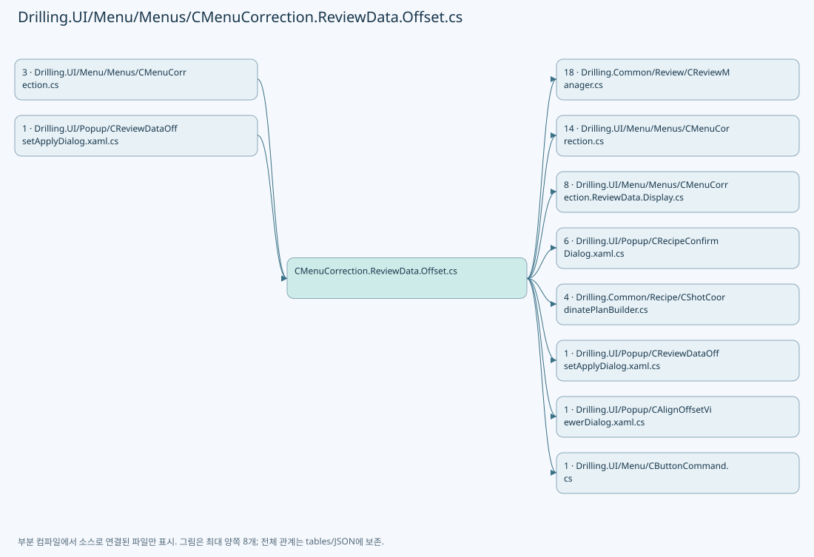

## 네임스페이스·타입·상속

| 타입 | 구분 | 원본 범위 | 선언/상속 |
| --- | --- | --- | --- |
| CMenuCorrection | ClassDeclaration | 14–784 | CMenuCorrection |
| CReviewDataPanel | ClassDeclaration | 16–713 | CReviewDataPanel |
| CReviewDataOffsetApplyPanel | ClassDeclaration | 574–710 | CReviewDataOffsetApplyPanel: INotifyPropertyChanged |
| ST_REVIEW_OFFSET_DELTA | RecordDeclaration | 712–712 | ST_REVIEW_OFFSET_DELTA |
| ST_REVIEW_OFFSET_APPLY_TYPE | RecordDeclaration | 715–715 | ST_REVIEW_OFFSET_APPLY_TYPE |
| ST_REVIEW_OFFSET_APPLY_GRID_ROW | RecordDeclaration | 717–737 | ST_REVIEW_OFFSET_APPLY_GRID_ROW |
| ST_REVIEW_OFFSET_APPLY_PLAN | RecordDeclaration | 739–748 | ST_REVIEW_OFFSET_APPLY_PLAN |
| CReviewShotNameComparer | ClassDeclaration | 750–783 | CReviewShotNameComparer: IComparer<string> |

## 멤버 빠른 목록

| 이름 | 종류 | 범위 | 서명 |
| --- | --- | --- | --- |
| _isOffsetBusy | FieldDeclaration | L18–18 | bool Drilling.UI.Menu.Menus.CMenuCorrection.CReviewDataPanel._isOffsetBusy |
| CanEditOffsets | PropertyDeclaration | L20–24 | bool Drilling.UI.Menu.Menus.CMenuCorrection.CReviewDataPanel.CanEditOffsets |
| CanApplyOffset | PropertyDeclaration | L25–28 | bool Drilling.UI.Menu.Menus.CMenuCorrection.CReviewDataPanel.CanApplyOffset |
| OffsetActionHint | PropertyDeclaration | L30–62 | string Drilling.UI.Menu.Menus.CMenuCorrection.CReviewDataPanel.OffsetActionHint |
| get_OffsetActionHint | GetAccessorDeclaration | L32–61 | string Drilling.UI.Menu.Menus.CMenuCorrection.CReviewDataPanel.OffsetActionHint.get |
| OffsetApplyRequested | MethodDeclaration | L64–67 | void Drilling.UI.Menu.Menus.CMenuCorrection.CReviewDataPanel.OffsetApplyRequested(object?) |
| OffsetInitRequested | MethodDeclaration | L69–72 | void Drilling.UI.Menu.Menus.CMenuCorrection.CReviewDataPanel.OffsetInitRequested(object?) |
| OffsetRollbackRequested | MethodDeclaration | L74–77 | void Drilling.UI.Menu.Menus.CMenuCorrection.CReviewDataPanel.OffsetRollbackRequested(object?) |
| OffsetViewRequested | MethodDeclaration | L79–82 | void Drilling.UI.Menu.Menus.CMenuCorrection.CReviewDataPanel.OffsetViewRequested(object?) |
| ShowOffsetApplyDialog | MethodDeclaration | L84–141 | System.Threading.Tasks.Task Drilling.UI.Menu.Menus.CMenuCorrection.CReviewDataPanel.ShowOffsetApplyDialog() |
| InitializeReviewOffsets | MethodDeclaration | L143–215 | System.Threading.Tasks.Task Drilling.UI.Menu.Menus.CMenuCorrection.CReviewDataPanel.InitializeReviewOffsets() |
| ShowCurrentReviewOffsets | MethodDeclaration | L217–258 | System.Threading.Tasks.Task Drilling.UI.Menu.Menus.CMenuCorrection.CReviewDataPanel.ShowCurrentReviewOffsets() |
| BuildOffsetApplyPlan | MethodDeclaration | L260–383 | Drilling.UI.Menu.Menus.CMenuCorrection.ST_REVIEW_OFFSET_APPLY_PLAN Drilling.UI.Menu.Menus.CMenuCorrection.CReviewDataPanel.BuildOffsetApplyPlan(Drilling.Common.Review.ST_REVIEW_RESULT_CATALOG_ITEM, Drilling.Common.Review.ST_REVIEW_RESULT_FILE_DATA, Drilling.Common.Managers.ST_RECIPE_DEFINITION, System.Collections.Generic.IReadOnlyDictionary<string, string>, Drilling.Common.Review.ST_REVIEW_OFFSET_FILE_DATA) |
| BuildDirectDeltas | MethodDeclaration | L385–397 | System.Collections.Generic.IReadOnlyList<Drilling.UI.Menu.Menus.CMenuCorrection.CReviewDataPanel.ST_REVIEW_OFFSET_DELTA> Drilling.UI.Menu.Menus.CMenuCorrection.CReviewDataPanel.BuildDirectDeltas(System.Collections.Generic.IReadOnlyList<Drilling.Common.Review.ST_REVIEW_RESULT_FILE_ROW>, System.Collections.Generic.IReadOnlyDictionary<string, Drilling.Common.Review.ST_REVIEW_PLAN_POINT>) |
| BuildRoughDeltas | MethodDeclaration | L399–441 | System.Collections.Generic.IReadOnlyList<Drilling.UI.Menu.Menus.CMenuCorrection.CReviewDataPanel.ST_REVIEW_OFFSET_DELTA> Drilling.UI.Menu.Menus.CMenuCorrection.CReviewDataPanel.BuildRoughDeltas(Drilling.Common.Review.ST_REVIEW_RESULT_FILE_DATA, System.Collections.Generic.IReadOnlyList<Drilling.Common.Review.ST_REVIEW_PLAN_POINT>, System.Collections.Generic.IReadOnlyDictionary<string, Drilling.Common.Review.ST_REVIEW_PLAN_POINT>) |
| BuildFineDeltas | MethodDeclaration | L443–469 | System.Collections.Generic.IReadOnlyList<Drilling.UI.Menu.Menus.CMenuCorrection.CReviewDataPanel.ST_REVIEW_OFFSET_DELTA> Drilling.UI.Menu.Menus.CMenuCorrection.CReviewDataPanel.BuildFineDeltas(Drilling.Common.Review.ST_REVIEW_RESULT_FILE_DATA, System.Collections.Generic.IReadOnlyList<Drilling.Common.Review.ST_REVIEW_PLAN_POINT>, System.Collections.Generic.IReadOnlyDictionary<string, Drilling.Common.Review.ST_REVIEW_PLAN_POINT>) |
| MeasuredRows | MethodDeclaration | L471–481 | System.Collections.Generic.IEnumerable<Drilling.Common.Review.ST_REVIEW_RESULT_FILE_ROW> Drilling.UI.Menu.Menus.CMenuCorrection.CReviewDataPanel.MeasuredRows(System.Collections.Generic.IReadOnlyList<Drilling.Common.Review.ST_REVIEW_RESULT_FILE_ROW>) |
| BuildPointLookup | MethodDeclaration | L483–494 | System.Collections.Generic.IReadOnlyDictionary<string, Drilling.Common.Review.ST_REVIEW_PLAN_POINT> Drilling.UI.Menu.Menus.CMenuCorrection.CReviewDataPanel.BuildPointLookup(System.Collections.Generic.IReadOnlyList<Drilling.Common.Review.ST_REVIEW_PLAN_POINT>) |
| ResolveResultPoint | MethodDeclaration | L496–513 | Drilling.Common.Review.ST_REVIEW_PLAN_POINT Drilling.UI.Menu.Menus.CMenuCorrection.CReviewDataPanel.ResolveResultPoint(Drilling.Common.Review.ST_REVIEW_RESULT_FILE_ROW, System.Collections.Generic.IReadOnlyDictionary<string, Drilling.Common.Review.ST_REVIEW_PLAN_POINT>) |
| CreateApplicationType | MethodDeclaration | L515–527 | Drilling.UI.Menu.Menus.CMenuCorrection.ST_REVIEW_OFFSET_APPLY_TYPE Drilling.UI.Menu.Menus.CMenuCorrection.CReviewDataPanel.CreateApplicationType(string, Drilling.Common.Review.ST_REVIEW_RESULT_FILE_DATA) |
| IsOffsetApplicableResultType | MethodDeclaration | L529–532 | bool Drilling.UI.Menu.Menus.CMenuCorrection.CReviewDataPanel.IsOffsetApplicableResultType(string) |
| EnsureLoadedResultUnchanged | MethodDeclaration | L534–544 | void Drilling.UI.Menu.Menus.CMenuCorrection.CReviewDataPanel.EnsureLoadedResultUnchanged(string, string) |
| SameOffsetSource | MethodDeclaration | L546–551 | bool Drilling.UI.Menu.Menus.CMenuCorrection.CReviewDataPanel.SameOffsetSource(Drilling.Common.Review.ST_REVIEW_OFFSET_FILE_DATA, Drilling.Common.Review.ST_REVIEW_OFFSET_FILE_DATA) |
| SetOffsetBusy | MethodDeclaration | L553–562 | void Drilling.UI.Menu.Menus.CMenuCorrection.CReviewDataPanel.SetOffsetBusy(bool) |
| SetSharedOffsetOperationRunning | MethodDeclaration | L564–567 | void Drilling.UI.Menu.Menus.CMenuCorrection.CReviewDataPanel.SetSharedOffsetOperationRunning(bool) |
| AcceptOffsetRollback | MethodDeclaration | L569–572 | void Drilling.UI.Menu.Menus.CMenuCorrection.CReviewDataPanel.AcceptOffsetRollback() |
| _plan | FieldDeclaration | L576–576 | Drilling.UI.Menu.Menus.CMenuCorrection.ST_REVIEW_OFFSET_APPLY_PLAN Drilling.UI.Menu.Menus.CMenuCorrection.CReviewDataPanel.CReviewDataOffsetApplyPanel._plan |
| _selectedCellNo | FieldDeclaration | L577–577 | int Drilling.UI.Menu.Menus.CMenuCorrection.CReviewDataPanel.CReviewDataOffsetApplyPanel._selectedCellNo |
| _selectedShotKey | FieldDeclaration | L578–578 | string Drilling.UI.Menu.Menus.CMenuCorrection.CReviewDataPanel.CReviewDataOffsetApplyPanel._selectedShotKey |
| .ctor | ConstructorDeclaration | L580–591 | Drilling.UI.Menu.Menus.CMenuCorrection.CReviewDataPanel.CReviewDataOffsetApplyPanel.CReviewDataOffsetApplyPanel(Drilling.UI.Menu.Menus.CMenuCorrection.ST_REVIEW_OFFSET_APPLY_PLAN) |
| PropertyChanged | EventFieldDeclaration | L593–593 | System.ComponentModel.PropertyChangedEventHandler? Drilling.UI.Menu.Menus.CMenuCorrection.CReviewDataPanel.CReviewDataOffsetApplyPanel.PropertyChanged |
| SelectCellCommand | PropertyDeclaration | L595–595 | Drilling.UI.Menu.CButtonCommand Drilling.UI.Menu.Menus.CMenuCorrection.CReviewDataPanel.CReviewDataOffsetApplyPanel.SelectCellCommand |
| get_SelectCellCommand | GetAccessorDeclaration | L595–595 | Drilling.UI.Menu.CButtonCommand Drilling.UI.Menu.Menus.CMenuCorrection.CReviewDataPanel.CReviewDataOffsetApplyPanel.SelectCellCommand.get |
| ApplicationTypes | PropertyDeclaration | L596–596 | System.Collections.Generic.IReadOnlyList<Drilling.UI.Menu.Menus.CMenuCorrection.ST_REVIEW_OFFSET_APPLY_TYPE> Drilling.UI.Menu.Menus.CMenuCorrection.CReviewDataPanel.CReviewDataOffsetApplyPanel.ApplicationTypes |
| get_ApplicationTypes | GetAccessorDeclaration | L596–596 | System.Collections.Generic.IReadOnlyList<Drilling.UI.Menu.Menus.CMenuCorrection.ST_REVIEW_OFFSET_APPLY_TYPE> Drilling.UI.Menu.Menus.CMenuCorrection.CReviewDataPanel.CReviewDataOffsetApplyPanel.ApplicationTypes.get |
| SelectedApplicationType | PropertyDeclaration | L597–597 | Drilling.UI.Menu.Menus.CMenuCorrection.ST_REVIEW_OFFSET_APPLY_TYPE Drilling.UI.Menu.Menus.CMenuCorrection.CReviewDataPanel.CReviewDataOffsetApplyPanel.SelectedApplicationType |
| get_SelectedApplicationType | GetAccessorDeclaration | L597–597 | Drilling.UI.Menu.Menus.CMenuCorrection.ST_REVIEW_OFFSET_APPLY_TYPE Drilling.UI.Menu.Menus.CMenuCorrection.CReviewDataPanel.CReviewDataOffsetApplyPanel.SelectedApplicationType.get |
| GlassPreviewImage | PropertyDeclaration | L598–598 | ImageSource? Drilling.UI.Menu.Menus.CMenuCorrection.CReviewDataPanel.CReviewDataOffsetApplyPanel.GlassPreviewImage |
| get_GlassPreviewImage | GetAccessorDeclaration | L598–598 | ImageSource? Drilling.UI.Menu.Menus.CMenuCorrection.CReviewDataPanel.CReviewDataOffsetApplyPanel.GlassPreviewImage.get |
| set_GlassPreviewImage | SetAccessorDeclaration | L598–598 | void Drilling.UI.Menu.Menus.CMenuCorrection.CReviewDataPanel.CReviewDataOffsetApplyPanel.GlassPreviewImage.set |
| ShotMapImage | PropertyDeclaration | L599–599 | ImageSource? Drilling.UI.Menu.Menus.CMenuCorrection.CReviewDataPanel.CReviewDataOffsetApplyPanel.ShotMapImage |
| get_ShotMapImage | GetAccessorDeclaration | L599–599 | ImageSource? Drilling.UI.Menu.Menus.CMenuCorrection.CReviewDataPanel.CReviewDataOffsetApplyPanel.ShotMapImage.get |
| set_ShotMapImage | SetAccessorDeclaration | L599–599 | void Drilling.UI.Menu.Menus.CMenuCorrection.CReviewDataPanel.CReviewDataOffsetApplyPanel.ShotMapImage.set |
| CellLabels | PropertyDeclaration | L600–600 | System.Collections.Generic.IReadOnlyList<Drilling.UI.Menu.Menus.CMenuCorrection.ST_REVIEW_DATA_CELL_LABEL> Drilling.UI.Menu.Menus.CMenuCorrection.CReviewDataPanel.CReviewDataOffsetApplyPanel.CellLabels |
| get_CellLabels | GetAccessorDeclaration | L600–600 | System.Collections.Generic.IReadOnlyList<Drilling.UI.Menu.Menus.CMenuCorrection.ST_REVIEW_DATA_CELL_LABEL> Drilling.UI.Menu.Menus.CMenuCorrection.CReviewDataPanel.CReviewDataOffsetApplyPanel.CellLabels.get |
| set_CellLabels | SetAccessorDeclaration | L600–600 | void Drilling.UI.Menu.Menus.CMenuCorrection.CReviewDataPanel.CReviewDataOffsetApplyPanel.CellLabels.set |
| Rows | PropertyDeclaration | L601–601 | System.Collections.Generic.IReadOnlyList<Drilling.UI.Menu.Menus.CMenuCorrection.ST_REVIEW_OFFSET_APPLY_GRID_ROW> Drilling.UI.Menu.Menus.CMenuCorrection.CReviewDataPanel.CReviewDataOffsetApplyPanel.Rows |
| get_Rows | GetAccessorDeclaration | L601–601 | System.Collections.Generic.IReadOnlyList<Drilling.UI.Menu.Menus.CMenuCorrection.ST_REVIEW_OFFSET_APPLY_GRID_ROW> Drilling.UI.Menu.Menus.CMenuCorrection.CReviewDataPanel.CReviewDataOffsetApplyPanel.Rows.get |
| set_Rows | SetAccessorDeclaration | L601–601 | void Drilling.UI.Menu.Menus.CMenuCorrection.CReviewDataPanel.CReviewDataOffsetApplyPanel.Rows.set |
| SelectedRow | PropertyDeclaration | L602–602 | Drilling.UI.Menu.Menus.CMenuCorrection.ST_REVIEW_OFFSET_APPLY_GRID_ROW? Drilling.UI.Menu.Menus.CMenuCorrection.CReviewDataPanel.CReviewDataOffsetApplyPanel.SelectedRow |
| get_SelectedRow | GetAccessorDeclaration | L602–602 | Drilling.UI.Menu.Menus.CMenuCorrection.ST_REVIEW_OFFSET_APPLY_GRID_ROW? Drilling.UI.Menu.Menus.CMenuCorrection.CReviewDataPanel.CReviewDataOffsetApplyPanel.SelectedRow.get |
| set_SelectedRow | SetAccessorDeclaration | L602–602 | void Drilling.UI.Menu.Menus.CMenuCorrection.CReviewDataPanel.CReviewDataOffsetApplyPanel.SelectedRow.set |
| GlassSurfaceWidth | PropertyDeclaration | L603–603 | double Drilling.UI.Menu.Menus.CMenuCorrection.CReviewDataPanel.CReviewDataOffsetApplyPanel.GlassSurfaceWidth |
| get_GlassSurfaceWidth | GetAccessorDeclaration | L603–603 | double Drilling.UI.Menu.Menus.CMenuCorrection.CReviewDataPanel.CReviewDataOffsetApplyPanel.GlassSurfaceWidth.get |
| set_GlassSurfaceWidth | SetAccessorDeclaration | L603–603 | void Drilling.UI.Menu.Menus.CMenuCorrection.CReviewDataPanel.CReviewDataOffsetApplyPanel.GlassSurfaceWidth.set |
| GlassSurfaceHeight | PropertyDeclaration | L604–604 | double Drilling.UI.Menu.Menus.CMenuCorrection.CReviewDataPanel.CReviewDataOffsetApplyPanel.GlassSurfaceHeight |
| get_GlassSurfaceHeight | GetAccessorDeclaration | L604–604 | double Drilling.UI.Menu.Menus.CMenuCorrection.CReviewDataPanel.CReviewDataOffsetApplyPanel.GlassSurfaceHeight.get |
| set_GlassSurfaceHeight | SetAccessorDeclaration | L604–604 | void Drilling.UI.Menu.Menus.CMenuCorrection.CReviewDataPanel.CReviewDataOffsetApplyPanel.GlassSurfaceHeight.set |
| ShotMapSurfaceWidth | PropertyDeclaration | L605–605 | double Drilling.UI.Menu.Menus.CMenuCorrection.CReviewDataPanel.CReviewDataOffsetApplyPanel.ShotMapSurfaceWidth |
| get_ShotMapSurfaceWidth | GetAccessorDeclaration | L605–605 | double Drilling.UI.Menu.Menus.CMenuCorrection.CReviewDataPanel.CReviewDataOffsetApplyPanel.ShotMapSurfaceWidth.get |
| set_ShotMapSurfaceWidth | SetAccessorDeclaration | L605–605 | void Drilling.UI.Menu.Menus.CMenuCorrection.CReviewDataPanel.CReviewDataOffsetApplyPanel.ShotMapSurfaceWidth.set |
| ShotMapSurfaceHeight | PropertyDeclaration | L606–606 | double Drilling.UI.Menu.Menus.CMenuCorrection.CReviewDataPanel.CReviewDataOffsetApplyPanel.ShotMapSurfaceHeight |
| get_ShotMapSurfaceHeight | GetAccessorDeclaration | L606–606 | double Drilling.UI.Menu.Menus.CMenuCorrection.CReviewDataPanel.CReviewDataOffsetApplyPanel.ShotMapSurfaceHeight.get |
| set_ShotMapSurfaceHeight | SetAccessorDeclaration | L606–606 | void Drilling.UI.Menu.Menus.CMenuCorrection.CReviewDataPanel.CReviewDataOffsetApplyPanel.ShotMapSurfaceHeight.set |
| RecipeName | PropertyDeclaration | L607–607 | string Drilling.UI.Menu.Menus.CMenuCorrection.CReviewDataPanel.CReviewDataOffsetApplyPanel.RecipeName |
| ResultFileName | PropertyDeclaration | L608–608 | string Drilling.UI.Menu.Menus.CMenuCorrection.CReviewDataPanel.CReviewDataOffsetApplyPanel.ResultFileName |
| Summary | PropertyDeclaration | L609–609 | string Drilling.UI.Menu.Menus.CMenuCorrection.CReviewDataPanel.CReviewDataOffsetApplyPanel.Summary |
| SelectedCellTitle | PropertyDeclaration | L610–610 | string Drilling.UI.Menu.Menus.CMenuCorrection.CReviewDataPanel.CReviewDataOffsetApplyPanel.SelectedCellTitle |
| SelectedShotTitle | PropertyDeclaration | L611–611 | string Drilling.UI.Menu.Menus.CMenuCorrection.CReviewDataPanel.CReviewDataOffsetApplyPanel.SelectedShotTitle |
| CanSave | PropertyDeclaration | L612–612 | bool Drilling.UI.Menu.Menus.CMenuCorrection.CReviewDataPanel.CReviewDataOffsetApplyPanel.CanSave |
| SelectShotAt | MethodDeclaration | L614–635 | void Drilling.UI.Menu.Menus.CMenuCorrection.CReviewDataPanel.CReviewDataOffsetApplyPanel.SelectShotAt(double, double) |
| SelectRow | MethodDeclaration | L637–645 | void Drilling.UI.Menu.Menus.CMenuCorrection.CReviewDataPanel.CReviewDataOffsetApplyPanel.SelectRow(Drilling.UI.Menu.Menus.CMenuCorrection.ST_REVIEW_OFFSET_APPLY_GRID_ROW) |
| SelectCell | MethodDeclaration | L647–654 | void Drilling.UI.Menu.Menus.CMenuCorrection.CReviewDataPanel.CReviewDataOffsetApplyPanel.SelectCell(object?) |
| ApplyCellSelection | MethodDeclaration | L656–664 | void Drilling.UI.Menu.Menus.CMenuCorrection.CReviewDataPanel.CReviewDataOffsetApplyPanel.ApplyCellSelection(int) |
| SelectShot | MethodDeclaration | L666–675 | void Drilling.UI.Menu.Menus.CMenuCorrection.CReviewDataPanel.CReviewDataOffsetApplyPanel.SelectShot(string, Drilling.UI.Menu.Menus.CMenuCorrection.ST_REVIEW_OFFSET_APPLY_GRID_ROW?) |
| RefreshImages | MethodDeclaration | L677–689 | void Drilling.UI.Menu.Menus.CMenuCorrection.CReviewDataPanel.CReviewDataOffsetApplyPanel.RefreshImages() |
| NotifyAll | MethodDeclaration | L691–704 | void Drilling.UI.Menu.Menus.CMenuCorrection.CReviewDataPanel.CReviewDataOffsetApplyPanel.NotifyAll() |
| Notify | MethodDeclaration | L706–709 | void Drilling.UI.Menu.Menus.CMenuCorrection.CReviewDataPanel.CReviewDataOffsetApplyPanel.Notify(string) |
| Head | PropertyDeclaration | L729–729 | string Drilling.UI.Menu.Menus.CMenuCorrection.ST_REVIEW_OFFSET_APPLY_GRID_ROW.Head |
| Cell | PropertyDeclaration | L730–730 | string Drilling.UI.Menu.Menus.CMenuCorrection.ST_REVIEW_OFFSET_APPLY_GRID_ROW.Cell |
| CurrentXText | PropertyDeclaration | L731–731 | string Drilling.UI.Menu.Menus.CMenuCorrection.ST_REVIEW_OFFSET_APPLY_GRID_ROW.CurrentXText |
| CurrentYText | PropertyDeclaration | L732–732 | string Drilling.UI.Menu.Menus.CMenuCorrection.ST_REVIEW_OFFSET_APPLY_GRID_ROW.CurrentYText |
| AddXText | PropertyDeclaration | L733–733 | string Drilling.UI.Menu.Menus.CMenuCorrection.ST_REVIEW_OFFSET_APPLY_GRID_ROW.AddXText |
| AddYText | PropertyDeclaration | L734–734 | string Drilling.UI.Menu.Menus.CMenuCorrection.ST_REVIEW_OFFSET_APPLY_GRID_ROW.AddYText |
| FinalXText | PropertyDeclaration | L735–735 | string Drilling.UI.Menu.Menus.CMenuCorrection.ST_REVIEW_OFFSET_APPLY_GRID_ROW.FinalXText |
| FinalYText | PropertyDeclaration | L736–736 | string Drilling.UI.Menu.Menus.CMenuCorrection.ST_REVIEW_OFFSET_APPLY_GRID_ROW.FinalYText |
| Instance | PropertyDeclaration | L752–752 | Drilling.UI.Menu.Menus.CMenuCorrection.CReviewShotNameComparer Drilling.UI.Menu.Menus.CMenuCorrection.CReviewShotNameComparer.Instance |
| get_Instance | GetAccessorDeclaration | L752–752 | Drilling.UI.Menu.Menus.CMenuCorrection.CReviewShotNameComparer Drilling.UI.Menu.Menus.CMenuCorrection.CReviewShotNameComparer.Instance.get |
| Compare | MethodDeclaration | L754–782 | int Drilling.UI.Menu.Menus.CMenuCorrection.CReviewShotNameComparer.Compare(string?, string?) |
| Parse | LocalFunctionStatement | L756–770 | (int Row, int Column, string Text) Parse(string?) |

## 멤버별 상세 계약·호출·처리 해설

### FieldDeclaration `_isOffsetBusy` · L18–18

[Drilling.UI/Menu/Menus/CMenuCorrection.ReviewData.Offset.cs:18–18](https://github.com/kjuws10-rgb/A3Drilling/blob/28764c91d521777b8ee068dd7aaf2d3902ce9fe2/Drilling.UI/Menu/Menus/CMenuCorrection.ReviewData.Offset.cs#L18-L18)

| 항목 | 실제 추출 값 |
| --- | --- |
| 서명 | bool Drilling.UI.Menu.Menus.CMenuCorrection.CReviewDataPanel._isOffsetBusy |
| 접근/수식자 | Private / private |
| 반환/값 타입 | bool |
| 소속 타입 | NamedType:Drilling.UI.Menu.Menus.CMenuCorrection.CReviewDataPanel |

현재 부분 분석에서 직접 연결된 호출자는 없습니다. XAML/이벤트/인터페이스·델리게이트·외부 진입을 추가 확인해야 하며, 미사용으로 판정한 것이 아닙니다.

변경 전 점검: 입력/반환 타입, 위 호출자, 예외/취소 경로, 공유 상태와 저장·전송 소비자를 함께 확인합니다. 값의 단위나 물리 방향을 이름만으로 확정하지 않습니다.

### PropertyDeclaration `CanEditOffsets` · L20–24

[Drilling.UI/Menu/Menus/CMenuCorrection.ReviewData.Offset.cs:20–24](https://github.com/kjuws10-rgb/A3Drilling/blob/28764c91d521777b8ee068dd7aaf2d3902ce9fe2/Drilling.UI/Menu/Menus/CMenuCorrection.ReviewData.Offset.cs#L20-L24)

| 항목 | 실제 추출 값 |
| --- | --- |
| 서명 | bool Drilling.UI.Menu.Menus.CMenuCorrection.CReviewDataPanel.CanEditOffsets |
| 접근/수식자 | Public / public |
| 반환/값 타입 | bool |
| 소속 타입 | NamedType:Drilling.UI.Menu.Menus.CMenuCorrection.CReviewDataPanel |

현재 부분 분석에서 직접 연결된 호출자는 없습니다. XAML/이벤트/인터페이스·델리게이트·외부 진입을 추가 확인해야 하며, 미사용으로 판정한 것이 아닙니다.

변경 전 점검: 입력/반환 타입, 위 호출자, 예외/취소 경로, 공유 상태와 저장·전송 소비자를 함께 확인합니다. 값의 단위나 물리 방향을 이름만으로 확정하지 않습니다.

### PropertyDeclaration `CanApplyOffset` · L25–28

[Drilling.UI/Menu/Menus/CMenuCorrection.ReviewData.Offset.cs:25–28](https://github.com/kjuws10-rgb/A3Drilling/blob/28764c91d521777b8ee068dd7aaf2d3902ce9fe2/Drilling.UI/Menu/Menus/CMenuCorrection.ReviewData.Offset.cs#L25-L28)

| 항목 | 실제 추출 값 |
| --- | --- |
| 서명 | bool Drilling.UI.Menu.Menus.CMenuCorrection.CReviewDataPanel.CanApplyOffset |
| 접근/수식자 | Public / public |
| 반환/값 타입 | bool |
| 소속 타입 | NamedType:Drilling.UI.Menu.Menus.CMenuCorrection.CReviewDataPanel |

현재 부분 분석에서 직접 연결된 호출자는 없습니다. XAML/이벤트/인터페이스·델리게이트·외부 진입을 추가 확인해야 하며, 미사용으로 판정한 것이 아닙니다.

호출하는 대상과 해석 범위:

| 원본 행 | 표현식 | 분석 상태 | 대상/소스 위치 |
| --- | --- | --- | --- |
| 27 | IsOffsetApplicableResultType | resolved | bool Drilling.UI.Menu.Menus.CMenuCorrection.CReviewDataPanel.IsOffsetApplicableResultType(string) · Drilling.UI/Menu/Menus/CMenuCorrection.ReviewData.Offset.cs:529 |
| 28 | catalog.ResultStatus.Equals | resolved | bool string.Equals(string?, System.StringComparison) |

본문의 실제 연산·분기·예외·반환 순서(원문 위치 순):

| 원본 행 | 종류 | 주석 해설 |
| --- | --- | --- |
| 27 | call | 함수·델리게이트 또는 객체 생성자를 호출합니다: IsOffsetApplicableResultType(catalog.ResultType) |
| 28 | call | 함수·델리게이트 또는 객체 생성자를 호출합니다: catalog.ResultStatus.Equals("COMPLETED", StringComparison.OrdinalIgnoreCase) |

변경 전 점검: 입력/반환 타입, 위 호출자, 예외/취소 경로, 공유 상태와 저장·전송 소비자를 함께 확인합니다. 값의 단위나 물리 방향을 이름만으로 확정하지 않습니다.

### PropertyDeclaration `OffsetActionHint` · L30–62

[Drilling.UI/Menu/Menus/CMenuCorrection.ReviewData.Offset.cs:30–62](https://github.com/kjuws10-rgb/A3Drilling/blob/28764c91d521777b8ee068dd7aaf2d3902ce9fe2/Drilling.UI/Menu/Menus/CMenuCorrection.ReviewData.Offset.cs#L30-L62)

| 항목 | 실제 추출 값 |
| --- | --- |
| 서명 | string Drilling.UI.Menu.Menus.CMenuCorrection.CReviewDataPanel.OffsetActionHint |
| 접근/수식자 | Public / public |
| 반환/값 타입 | string |
| 소속 타입 | NamedType:Drilling.UI.Menu.Menus.CMenuCorrection.CReviewDataPanel |

현재 부분 분석에서 직접 연결된 호출자는 없습니다. XAML/이벤트/인터페이스·델리게이트·외부 진입을 추가 확인해야 하며, 미사용으로 판정한 것이 아닙니다.

변경 전 점검: 입력/반환 타입, 위 호출자, 예외/취소 경로, 공유 상태와 저장·전송 소비자를 함께 확인합니다. 값의 단위나 물리 방향을 이름만으로 확정하지 않습니다.

### GetAccessorDeclaration `get_OffsetActionHint` · L32–61

[Drilling.UI/Menu/Menus/CMenuCorrection.ReviewData.Offset.cs:32–61](https://github.com/kjuws10-rgb/A3Drilling/blob/28764c91d521777b8ee068dd7aaf2d3902ce9fe2/Drilling.UI/Menu/Menus/CMenuCorrection.ReviewData.Offset.cs#L32-L61)

| 항목 | 실제 추출 값 |
| --- | --- |
| 서명 | string Drilling.UI.Menu.Menus.CMenuCorrection.CReviewDataPanel.OffsetActionHint.get |
| 접근/수식자 | Public / get |
| 반환/값 타입 | string |
| 소속 타입 | NamedType:Drilling.UI.Menu.Menus.CMenuCorrection.CReviewDataPanel |

현재 부분 분석에서 직접 연결된 호출자는 없습니다. XAML/이벤트/인터페이스·델리게이트·외부 진입을 추가 확인해야 하며, 미사용으로 판정한 것이 아닙니다.

호출하는 대상과 해석 범위:

| 원본 행 | 표현식 | 분석 상태 | 대상/소스 위치 |
| --- | --- | --- | --- |
| 44 | _loadedCatalog.ResultStatus.Equals | resolved | bool string.Equals(string?, System.StringComparison) |
| 49 | _loadedCatalog.ResultType.ToUpperInvariant | resolved | string string.ToUpperInvariant() |

본문의 실제 연산·분기·예외·반환 순서(원문 위치 순):

| 원본 행 | 종류 | 주석 해설 |
| --- | --- | --- |
| 34 | if | 조건에 따라 분기합니다: if (IsInspectionOffsetRestricted) |
| 36 | return | 호출자에게 값 또는 제어를 반환합니다: return InspectionOffsetRestrictionText; |
| 39 | if | 조건에 따라 분기합니다: if (!HasLoadedData &#124;&#124; _loadedCatalog is null) |
| 41 | return | 호출자에게 값 또는 제어를 반환합니다: return "검사 결과를 DATA LOAD한 뒤 Review Offset 작업을 사용할 수 있습니다."; |
| 44 | call | 함수·델리게이트 또는 객체 생성자를 호출합니다: _loadedCatalog.ResultStatus.Equals("COMPLETED", StringComparison.OrdinalIgnoreCase) |
| 44 | if | 조건에 따라 분기합니다: if (!_loadedCatalog.ResultStatus.Equals("COMPLETED", StringComparison.OrdinalIgnoreCase)) |
| 46 | return | 호출자에게 값 또는 제어를 반환합니다: return $"OFFSET APPLY 불가능. 사유 : 완료된 결과가 아닙니다. ({_loadedCatalog.ResultStatus})"; |
| 49 | call | 함수·델리게이트 또는 객체 생성자를 호출합니다: _loadedCatalog.ResultType.ToUpperInvariant() |
| 49 | return | 호출자에게 값 또는 제어를 반환합니다: return _loadedCatalog.ResultType.ToUpperInvariant() switch { "ALL_SHOT" => "ALL SHOT의 측정 OK 값을 같은 Shot의 Review Offset에 직접 누적합니다.", "ONE_SHOT" => "ONE SHOT의 측정 OK 값을 선택 Shot의 Review Offset에 직접 누적합니다.", "ONE_LINE" => "ONE LINE의 측정 O |
| 49 | switch-expression | 값별 결과식을 선택합니다: _loadedCatalog.ResultType.ToUpperInvariant() switch { "ALL_SHOT" => "ALL SHOT의 측정 OK 값을 같은 Shot의 Review Offset에 직접 누적합니다.", "ONE_SHOT" => "ONE SHOT의 측정 OK 값을 선택 Shot의 Review Offset에 직접 누적합니다.", "ONE_LINE" => "ONE LINE의 측정 OK 값을 검사 |

제어 구문의 포함 구조(실제 실행 순서/CFG가 아닌 구문 탐색 그림):

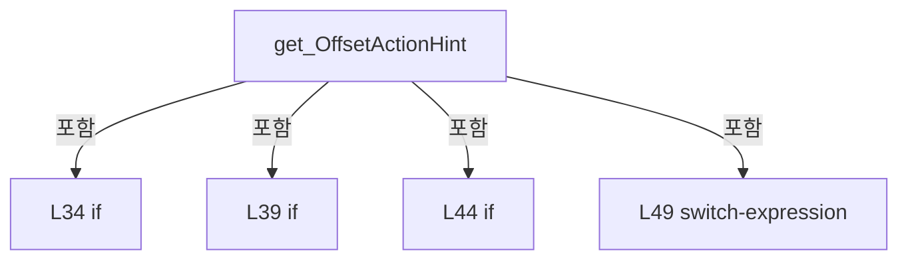

변경 전 점검: 입력/반환 타입, 위 호출자, 예외/취소 경로, 공유 상태와 저장·전송 소비자를 함께 확인합니다. 값의 단위나 물리 방향을 이름만으로 확정하지 않습니다.

### MethodDeclaration `OffsetApplyRequested` · L64–67

[Drilling.UI/Menu/Menus/CMenuCorrection.ReviewData.Offset.cs:64–67](https://github.com/kjuws10-rgb/A3Drilling/blob/28764c91d521777b8ee068dd7aaf2d3902ce9fe2/Drilling.UI/Menu/Menus/CMenuCorrection.ReviewData.Offset.cs#L64-L67)

| 항목 | 실제 추출 값 |
| --- | --- |
| 서명 | void Drilling.UI.Menu.Menus.CMenuCorrection.CReviewDataPanel.OffsetApplyRequested(object?) |
| 접근/수식자 | Private / private, async |
| 반환/값 타입 | void |
| 소속 타입 | NamedType:Drilling.UI.Menu.Menus.CMenuCorrection.CReviewDataPanel |

입력 계약:

| 이름 | 타입 | 전달 | 선택/기본값 |
| --- | --- | --- | --- |
| parameter | object? | None | False /  |

현재 부분 분석에서 직접 연결된 호출자는 없습니다. XAML/이벤트/인터페이스·델리게이트·외부 진입을 추가 확인해야 하며, 미사용으로 판정한 것이 아닙니다.

호출하는 대상과 해석 범위:

| 원본 행 | 표현식 | 분석 상태 | 대상/소스 위치 |
| --- | --- | --- | --- |
| 66 | ShowOffsetApplyDialog | resolved | System.Threading.Tasks.Task Drilling.UI.Menu.Menus.CMenuCorrection.CReviewDataPanel.ShowOffsetApplyDialog() · Drilling.UI/Menu/Menus/CMenuCorrection.ReviewData.Offset.cs:84 |

본문의 실제 연산·분기·예외·반환 순서(원문 위치 순):

| 원본 행 | 종류 | 주석 해설 |
| --- | --- | --- |
| 66 | await | 비동기 완료를 기다립니다: await ShowOffsetApplyDialog() |
| 66 | call | 함수·델리게이트 또는 객체 생성자를 호출합니다: ShowOffsetApplyDialog() |

변경 전 점검: 입력/반환 타입, 위 호출자, 예외/취소 경로, 공유 상태와 저장·전송 소비자를 함께 확인합니다. 값의 단위나 물리 방향을 이름만으로 확정하지 않습니다.

### MethodDeclaration `OffsetInitRequested` · L69–72

[Drilling.UI/Menu/Menus/CMenuCorrection.ReviewData.Offset.cs:69–72](https://github.com/kjuws10-rgb/A3Drilling/blob/28764c91d521777b8ee068dd7aaf2d3902ce9fe2/Drilling.UI/Menu/Menus/CMenuCorrection.ReviewData.Offset.cs#L69-L72)

| 항목 | 실제 추출 값 |
| --- | --- |
| 서명 | void Drilling.UI.Menu.Menus.CMenuCorrection.CReviewDataPanel.OffsetInitRequested(object?) |
| 접근/수식자 | Private / private, async |
| 반환/값 타입 | void |
| 소속 타입 | NamedType:Drilling.UI.Menu.Menus.CMenuCorrection.CReviewDataPanel |

입력 계약:

| 이름 | 타입 | 전달 | 선택/기본값 |
| --- | --- | --- | --- |
| parameter | object? | None | False /  |

현재 부분 분석에서 직접 연결된 호출자는 없습니다. XAML/이벤트/인터페이스·델리게이트·외부 진입을 추가 확인해야 하며, 미사용으로 판정한 것이 아닙니다.

호출하는 대상과 해석 범위:

| 원본 행 | 표현식 | 분석 상태 | 대상/소스 위치 |
| --- | --- | --- | --- |
| 71 | InitializeReviewOffsets | resolved | System.Threading.Tasks.Task Drilling.UI.Menu.Menus.CMenuCorrection.CReviewDataPanel.InitializeReviewOffsets() · Drilling.UI/Menu/Menus/CMenuCorrection.ReviewData.Offset.cs:143 |

본문의 실제 연산·분기·예외·반환 순서(원문 위치 순):

| 원본 행 | 종류 | 주석 해설 |
| --- | --- | --- |
| 71 | await | 비동기 완료를 기다립니다: await InitializeReviewOffsets() |
| 71 | call | 함수·델리게이트 또는 객체 생성자를 호출합니다: InitializeReviewOffsets() |

변경 전 점검: 입력/반환 타입, 위 호출자, 예외/취소 경로, 공유 상태와 저장·전송 소비자를 함께 확인합니다. 값의 단위나 물리 방향을 이름만으로 확정하지 않습니다.

### MethodDeclaration `OffsetRollbackRequested` · L74–77

[Drilling.UI/Menu/Menus/CMenuCorrection.ReviewData.Offset.cs:74–77](https://github.com/kjuws10-rgb/A3Drilling/blob/28764c91d521777b8ee068dd7aaf2d3902ce9fe2/Drilling.UI/Menu/Menus/CMenuCorrection.ReviewData.Offset.cs#L74-L77)

| 항목 | 실제 추출 값 |
| --- | --- |
| 서명 | void Drilling.UI.Menu.Menus.CMenuCorrection.CReviewDataPanel.OffsetRollbackRequested(object?) |
| 접근/수식자 | Private / private, async |
| 반환/값 타입 | void |
| 소속 타입 | NamedType:Drilling.UI.Menu.Menus.CMenuCorrection.CReviewDataPanel |

입력 계약:

| 이름 | 타입 | 전달 | 선택/기본값 |
| --- | --- | --- | --- |
| parameter | object? | None | False /  |

현재 부분 분석에서 직접 연결된 호출자는 없습니다. XAML/이벤트/인터페이스·델리게이트·외부 진입을 추가 확인해야 하며, 미사용으로 판정한 것이 아닙니다.

호출하는 대상과 해석 범위:

| 원본 행 | 표현식 | 분석 상태 | 대상/소스 위치 |
| --- | --- | --- | --- |
| 76 | _rollbackReviewOffset | resolved · 동적 구현 선택 가능 | System.Threading.Tasks.Task System.Func<System.Threading.Tasks.Task>.Invoke() |

본문의 실제 연산·분기·예외·반환 순서(원문 위치 순):

| 원본 행 | 종류 | 주석 해설 |
| --- | --- | --- |
| 76 | await | 비동기 완료를 기다립니다: await _rollbackReviewOffset() |
| 76 | call | 함수·델리게이트 또는 객체 생성자를 호출합니다: _rollbackReviewOffset() |

변경 전 점검: 입력/반환 타입, 위 호출자, 예외/취소 경로, 공유 상태와 저장·전송 소비자를 함께 확인합니다. 값의 단위나 물리 방향을 이름만으로 확정하지 않습니다.

### MethodDeclaration `OffsetViewRequested` · L79–82

[Drilling.UI/Menu/Menus/CMenuCorrection.ReviewData.Offset.cs:79–82](https://github.com/kjuws10-rgb/A3Drilling/blob/28764c91d521777b8ee068dd7aaf2d3902ce9fe2/Drilling.UI/Menu/Menus/CMenuCorrection.ReviewData.Offset.cs#L79-L82)

| 항목 | 실제 추출 값 |
| --- | --- |
| 서명 | void Drilling.UI.Menu.Menus.CMenuCorrection.CReviewDataPanel.OffsetViewRequested(object?) |
| 접근/수식자 | Private / private, async |
| 반환/값 타입 | void |
| 소속 타입 | NamedType:Drilling.UI.Menu.Menus.CMenuCorrection.CReviewDataPanel |

입력 계약:

| 이름 | 타입 | 전달 | 선택/기본값 |
| --- | --- | --- | --- |
| parameter | object? | None | False /  |

현재 부분 분석에서 직접 연결된 호출자는 없습니다. XAML/이벤트/인터페이스·델리게이트·외부 진입을 추가 확인해야 하며, 미사용으로 판정한 것이 아닙니다.

호출하는 대상과 해석 범위:

| 원본 행 | 표현식 | 분석 상태 | 대상/소스 위치 |
| --- | --- | --- | --- |
| 81 | ShowCurrentReviewOffsets | resolved | System.Threading.Tasks.Task Drilling.UI.Menu.Menus.CMenuCorrection.CReviewDataPanel.ShowCurrentReviewOffsets() · Drilling.UI/Menu/Menus/CMenuCorrection.ReviewData.Offset.cs:217 |

본문의 실제 연산·분기·예외·반환 순서(원문 위치 순):

| 원본 행 | 종류 | 주석 해설 |
| --- | --- | --- |
| 81 | await | 비동기 완료를 기다립니다: await ShowCurrentReviewOffsets() |
| 81 | call | 함수·델리게이트 또는 객체 생성자를 호출합니다: ShowCurrentReviewOffsets() |

변경 전 점검: 입력/반환 타입, 위 호출자, 예외/취소 경로, 공유 상태와 저장·전송 소비자를 함께 확인합니다. 값의 단위나 물리 방향을 이름만으로 확정하지 않습니다.

### MethodDeclaration `ShowOffsetApplyDialog` · L84–141

[Drilling.UI/Menu/Menus/CMenuCorrection.ReviewData.Offset.cs:84–141](https://github.com/kjuws10-rgb/A3Drilling/blob/28764c91d521777b8ee068dd7aaf2d3902ce9fe2/Drilling.UI/Menu/Menus/CMenuCorrection.ReviewData.Offset.cs#L84-L141)

| 항목 | 실제 추출 값 |
| --- | --- |
| 서명 | System.Threading.Tasks.Task Drilling.UI.Menu.Menus.CMenuCorrection.CReviewDataPanel.ShowOffsetApplyDialog() |
| 접근/수식자 | Private / private, async |
| 반환/값 타입 | System.Threading.Tasks.Task |
| 소속 타입 | NamedType:Drilling.UI.Menu.Menus.CMenuCorrection.CReviewDataPanel |

정적 호출자로 확인된 위치:

| 호출 파일/행 | 호출 표현식 | 런타임 분기 가능 |
| --- | --- | --- |
| [Drilling.UI/Menu/Menus/CMenuCorrection.ReviewData.Offset.cs:66–66](https://github.com/kjuws10-rgb/A3Drilling/blob/28764c91d521777b8ee068dd7aaf2d3902ce9fe2/Drilling.UI/Menu/Menus/CMenuCorrection.ReviewData.Offset.cs#L66-L66) | ShowOffsetApplyDialog | False |

호출하는 대상과 해석 범위:

| 원본 행 | 표현식 | 분석 상태 | 대상/소스 위치 |
| --- | --- | --- | --- |
| 95 | new Dictionary<string, string> | resolved | System.Collections.Generic.Dictionary<string, string>.Dictionary(System.Collections.Generic.IEnumerable<System.Collections.Generic.KeyValuePair<string, string>>, System.Collections.Generic.IEqualityComparer<string>?) |
| 96 | SetOffsetBusy | resolved | void Drilling.UI.Menu.Menus.CMenuCorrection.CReviewDataPanel.SetOffsetBusy(bool) · Drilling.UI/Menu/Menus/CMenuCorrection.ReviewData.Offset.cs:553 |
| 99 | Task.Run | resolved | System.Threading.Tasks.Task<Drilling.Common.Review.ST_REVIEW_OFFSET_FILE_DATA> System.Threading.Tasks.Task.Run<Drilling.Common.Review.ST_REVIEW_OFFSET_FILE_DATA>(System.Func<System.Threading.Tasks.Task<Drilling.Common.Review.ST_REVIEW_OFFSET_FILE_DATA>?>) |
| 99 | _reviewOffsetFile.LoadLatest | resolved | System.Threading.Tasks.Task<Drilling.Common.Review.ST_REVIEW_OFFSET_FILE_DATA> Drilling.Common.Review.CReviewOffsetFileBase.LoadLatest(string, System.Threading.CancellationToken) · Drilling.Common/Review/CReviewManager.cs:4397 |
| 100 | Task.Run | resolved | System.Threading.Tasks.Task<Drilling.UI.Menu.Menus.CMenuCorrection.ST_REVIEW_OFFSET_APPLY_PLAN> System.Threading.Tasks.Task.Run<Drilling.UI.Menu.Menus.CMenuCorrection.ST_REVIEW_OFFSET_APPLY_PLAN>(System.Func<Drilling.UI.Menu.Menus.CMenuCorrection.ST_REVIEW_OFFSET_APPLY_PLAN>) |
| 100 | BuildOffsetApplyPlan | resolved | Drilling.UI.Menu.Menus.CMenuCorrection.ST_REVIEW_OFFSET_APPLY_PLAN Drilling.UI.Menu.Menus.CMenuCorrection.CReviewDataPanel.BuildOffsetApplyPlan(Drilling.Common.Review.ST_REVIEW_RESULT_CATALOG_ITEM, Drilling.Common.Review.ST_REVIEW_RESULT_FILE_DATA, Drilling.Common.Managers.ST_RECIPE_DEFINITION, System.Collections.Generic.IReadOnlyDictionary<string, string>, Drilling.Common.Review.ST_REVIEW_OFFSET_FILE_DATA) · Drilling.UI/Menu/Menus/CMenuCorrection.ReviewData.Offset.cs:260 |
| 101 | EnsureLoadedResultUnchanged | resolved | void Drilling.UI.Menu.Menus.CMenuCorrection.CReviewDataPanel.EnsureLoadedResultUnchanged(string, string) · Drilling.UI/Menu/Menus/CMenuCorrection.ReviewData.Offset.cs:534 |
| 103 | new CReviewDataOffsetApplyPanel | resolved | Drilling.UI.Menu.Menus.CMenuCorrection.CReviewDataPanel.CReviewDataOffsetApplyPanel.CReviewDataOffsetApplyPanel(Drilling.UI.Menu.Menus.CMenuCorrection.ST_REVIEW_OFFSET_APPLY_PLAN) · Drilling.UI/Menu/Menus/CMenuCorrection.ReviewData.Offset.cs:580 |
| 104 | new CReviewDataOffsetApplyDialog | resolved | Drilling.UI.Popup.CReviewDataOffsetApplyDialog.CReviewDataOffsetApplyDialog(Drilling.UI.Menu.Menus.CMenuCorrection.CReviewDataPanel.CReviewDataOffsetApplyPanel) · Drilling.UI/Popup/CReviewDataOffsetApplyDialog.xaml.cs:10 |
| 108 | dialog.ShowDialog | unresolved | None |
| 110 | _statusReporter | resolved · 동적 구현 선택 가능 | void System.Action<string>.Invoke(string) |
| 114 | EnsureLoadedResultUnchanged | resolved | void Drilling.UI.Menu.Menus.CMenuCorrection.CReviewDataPanel.EnsureLoadedResultUnchanged(string, string) · Drilling.UI/Menu/Menus/CMenuCorrection.ReviewData.Offset.cs:534 |
| 115 | Task.Run | resolved | System.Threading.Tasks.Task<Drilling.Common.Review.ST_REVIEW_OFFSET_FILE_DATA> System.Threading.Tasks.Task.Run<Drilling.Common.Review.ST_REVIEW_OFFSET_FILE_DATA>(System.Func<System.Threading.Tasks.Task<Drilling.Common.Review.ST_REVIEW_OFFSET_FILE_DATA>?>) |
| 115 | _reviewOffsetFile.LoadLatest | resolved | System.Threading.Tasks.Task<Drilling.Common.Review.ST_REVIEW_OFFSET_FILE_DATA> Drilling.Common.Review.CReviewOffsetFileBase.LoadLatest(string, System.Threading.CancellationToken) · Drilling.Common/Review/CReviewManager.cs:4397 |
| 116 | SameOffsetSource | resolved | bool Drilling.UI.Menu.Menus.CMenuCorrection.CReviewDataPanel.SameOffsetSource(Drilling.Common.Review.ST_REVIEW_OFFSET_FILE_DATA, Drilling.Common.Review.ST_REVIEW_OFFSET_FILE_DATA) · Drilling.UI/Menu/Menus/CMenuCorrection.ReviewData.Offset.cs:546 |
| 118 | new InvalidOperationException | resolved | System.InvalidOperationException.InvalidOperationException(string?) |
| 121 | _saveReviewOffsetFromResult | resolved · 동적 구현 선택 가능 | System.Threading.Tasks.Task<Drilling.Common.Review.ST_REVIEW_OFFSET_FILE_DATA?> System.Func<string, System.Collections.Generic.IReadOnlyList<Drilling.Common.Review.ST_REVIEW_OFFSET_ROW>, string, System.Threading.Tasks.Task<Drilling.Common.Review.ST_REVIEW_OFFSET_FILE_DATA?>>.Invoke(string, System.Collections.Generic.IReadOnlyList<Drilling.Common.Review.ST_REVIEW_OFFSET_ROW>, string) |
| 124 | _statusReporter | resolved · 동적 구현 선택 가능 | void System.Action<string>.Invoke(string) |
| 129 | _statusReporter | resolved · 동적 구현 선택 가능 | void System.Action<string>.Invoke(string) |
| 129 | message.Replace | resolved | string string.Replace(string, string?) |
| 130 | CRecipeConfirmDialog.ShowCompletion | resolved | void Drilling.UI.Popup.CRecipeConfirmDialog.ShowCompletion(string, string, Window?) · Drilling.UI/Popup/CRecipeConfirmDialog.xaml.cs:81 |
| 134 | _statusReporter | resolved · 동적 구현 선택 가능 | void System.Action<string>.Invoke(string) |
| 135 | CRecipeConfirmDialog.ShowWarning | resolved | void Drilling.UI.Popup.CRecipeConfirmDialog.ShowWarning(string, string, Window?) · Drilling.UI/Popup/CRecipeConfirmDialog.xaml.cs:86 |
| 139 | SetOffsetBusy | resolved | void Drilling.UI.Menu.Menus.CMenuCorrection.CReviewDataPanel.SetOffsetBusy(bool) · Drilling.UI/Menu/Menus/CMenuCorrection.ReviewData.Offset.cs:553 |

본문의 실제 연산·분기·예외·반환 순서(원문 위치 순):

| 원본 행 | 종류 | 주석 해설 |
| --- | --- | --- |
| 86 | if | 조건에 따라 분기합니다: if (!CanApplyOffset &#124;&#124; _loadedCatalog is null &#124;&#124; _loadedResultFile is null &#124;&#124; _loadedRecipe is null) |
| 88 | return | 호출자에게 값 또는 제어를 반환합니다: return; |
| 91 | local-declaration | 지역 변수를 선언합니다: var sourcePath = _loadedResultFile.FilePath; |
| 91 | variable-initializer | 변수의 초기값을 지정합니다: sourcePath = _loadedResultFile.FilePath |
| 92 | local-declaration | 지역 변수를 선언합니다: var recipe = _loadedRecipe; |
| 92 | variable-initializer | 변수의 초기값을 지정합니다: recipe = _loadedRecipe |
| 93 | local-declaration | 지역 변수를 선언합니다: var catalog = _loadedCatalog; |
| 93 | variable-initializer | 변수의 초기값을 지정합니다: catalog = _loadedCatalog |
| 94 | local-declaration | 지역 변수를 선언합니다: var result = _loadedResultFile; |
| 94 | variable-initializer | 변수의 초기값을 지정합니다: result = _loadedResultFile |
| 95 | call | 함수·델리게이트 또는 객체 생성자를 호출합니다: new Dictionary<string, string>(_loadedParameters, StringComparer.OrdinalIgnoreCase) |
| 95 | local-declaration | 지역 변수를 선언합니다: var parameters = new Dictionary<string, string>(_loadedParameters, StringComparer.OrdinalIgnoreCase); |
| 95 | variable-initializer | 변수의 초기값을 지정합니다: parameters = new Dictionary<string, string>(_loadedParameters, StringComparer.OrdinalIgnoreCase) |
| 96 | call | 함수·델리게이트 또는 객체 생성자를 호출합니다: SetOffsetBusy(true) |
| 97 | try | 예외 처리 범위입니다: try |
| 99 | await | 비동기 완료를 기다립니다: await Task.Run(() => _reviewOffsetFile.LoadLatest(recipe.Id)) |
| 99 | call | 함수·델리게이트 또는 객체 생성자를 호출합니다: Task.Run(() => _reviewOffsetFile.LoadLatest(recipe.Id)) |
| 99 | call | 함수·델리게이트 또는 객체 생성자를 호출합니다: _reviewOffsetFile.LoadLatest(recipe.Id) |
| 99 | local-declaration | 지역 변수를 선언합니다: var latest = await Task.Run(() => _reviewOffsetFile.LoadLatest(recipe.Id)); |
| 99 | variable-initializer | 변수의 초기값을 지정합니다: latest = await Task.Run(() => _reviewOffsetFile.LoadLatest(recipe.Id)) |
| 100 | await | 비동기 완료를 기다립니다: await Task.Run(() => BuildOffsetApplyPlan(catalog, result, recipe, parameters, latest)) |
| 100 | call | 함수·델리게이트 또는 객체 생성자를 호출합니다: Task.Run(() => BuildOffsetApplyPlan(catalog, result, recipe, parameters, latest)) |
| 100 | call | 함수·델리게이트 또는 객체 생성자를 호출합니다: BuildOffsetApplyPlan(catalog, result, recipe, parameters, latest) |
| 100 | local-declaration | 지역 변수를 선언합니다: var plan = await Task.Run(() => BuildOffsetApplyPlan(catalog, result, recipe, parameters, latest)); |
| 100 | variable-initializer | 변수의 초기값을 지정합니다: plan = await Task.Run(() => BuildOffsetApplyPlan(catalog, result, recipe, parameters, latest)) |
| 101 | call | 함수·델리게이트 또는 객체 생성자를 호출합니다: EnsureLoadedResultUnchanged(sourcePath, recipe.Id) |
| 103 | call | 함수·델리게이트 또는 객체 생성자를 호출합니다: new CReviewDataOffsetApplyPanel(plan) |
| 103 | local-declaration | 지역 변수를 선언합니다: var panel = new CReviewDataOffsetApplyPanel(plan); |
| 103 | variable-initializer | 변수의 초기값을 지정합니다: panel = new CReviewDataOffsetApplyPanel(plan) |
| 104 | call | 함수·델리게이트 또는 객체 생성자를 호출합니다: new CReviewDataOffsetApplyDialog(panel) { Owner = Application.Current?.MainWindow } |
| 104 | local-declaration | 지역 변수를 선언합니다: var dialog = new CReviewDataOffsetApplyDialog(panel) { Owner = Application.Current?.MainWindow }; |
| 104 | variable-initializer | 변수의 초기값을 지정합니다: dialog = new CReviewDataOffsetApplyDialog(panel) { Owner = Application.Current?.MainWindow } |
| 106 | assignment | 값을 대상에 대입합니다: Owner = Application.Current?.MainWindow |
| 108 | call | 함수·델리게이트 또는 객체 생성자를 호출합니다: dialog.ShowDialog() |
| 108 | if | 조건에 따라 분기합니다: if (dialog.ShowDialog() != true) |
| 110 | call | 함수·델리게이트 또는 객체 생성자를 호출합니다: _statusReporter("Review Data Offset Apply를 취소했습니다.") |
| 111 | return | 호출자에게 값 또는 제어를 반환합니다: return; |
| 114 | call | 함수·델리게이트 또는 객체 생성자를 호출합니다: EnsureLoadedResultUnchanged(sourcePath, recipe.Id) |
| 115 | await | 비동기 완료를 기다립니다: await Task.Run(() => _reviewOffsetFile.LoadLatest(recipe.Id)) |
| 115 | call | 함수·델리게이트 또는 객체 생성자를 호출합니다: Task.Run(() => _reviewOffsetFile.LoadLatest(recipe.Id)) |
| 115 | call | 함수·델리게이트 또는 객체 생성자를 호출합니다: _reviewOffsetFile.LoadLatest(recipe.Id) |
| 115 | local-declaration | 지역 변수를 선언합니다: var current = await Task.Run(() => _reviewOffsetFile.LoadLatest(recipe.Id)); |
| 115 | variable-initializer | 변수의 초기값을 지정합니다: current = await Task.Run(() => _reviewOffsetFile.LoadLatest(recipe.Id)) |
| 116 | call | 함수·델리게이트 또는 객체 생성자를 호출합니다: SameOffsetSource(latest, current) |
| 116 | if | 조건에 따라 분기합니다: if (!SameOffsetSource(latest, current)) |
| 118 | call | 함수·델리게이트 또는 객체 생성자를 호출합니다: new InvalidOperationException("팝업을 확인하는 동안 Review Offset 파일이 변경되었습니다. DATA LOAD 상태는 유지되므로 OFFSET APPLY를 다시 열어 확인해 주세요.") |
| 118 | throw | 예외를 발생/전달합니다: throw new InvalidOperationException("팝업을 확인하는 동안 Review Offset 파일이 변경되었습니다. DATA LOAD 상태는 유지되므로 OFFSET APPLY를 다시 열어 확인해 주세요."); |
| 121 | await | 비동기 완료를 기다립니다: await _saveReviewOffsetFromResult(recipe.Id, plan.SavedRows, sourcePath) |
| 121 | call | 함수·델리게이트 또는 객체 생성자를 호출합니다: _saveReviewOffsetFromResult(recipe.Id, plan.SavedRows, sourcePath) |
| 121 | local-declaration | 지역 변수를 선언합니다: var saved = await _saveReviewOffsetFromResult(recipe.Id, plan.SavedRows, sourcePath); |
| 121 | variable-initializer | 변수의 초기값을 지정합니다: saved = await _saveReviewOffsetFromResult(recipe.Id, plan.SavedRows, sourcePath) |
| 122 | if | 조건에 따라 분기합니다: if (saved is null) |
| 124 | call | 함수·델리게이트 또는 객체 생성자를 호출합니다: _statusReporter("Review Data Offset Apply: 동일한 검사 결과의 중복 적용을 취소했습니다.") |
| 125 | return | 호출자에게 값 또는 제어를 반환합니다: return; |
| 128 | local-declaration | 지역 변수를 선언합니다: var message = $"{plan.ApplicationType.Name} / {plan.Rows.Count:N0}개 Shot의 Review Offset을 누적 적용했습니다.\n{saved.FileName}"; |
| 128 | variable-initializer | 변수의 초기값을 지정합니다: message = $"{plan.ApplicationType.Name} / {plan.Rows.Count:N0}개 Shot의 Review Offset을 누적 적용했습니다.\n{saved.FileName}" |
| 129 | call | 함수·델리게이트 또는 객체 생성자를 호출합니다: _statusReporter(message.Replace(Environment.NewLine, " ")) |
| 129 | call | 함수·델리게이트 또는 객체 생성자를 호출합니다: message.Replace(Environment.NewLine, " ") |
| 130 | call | 함수·델리게이트 또는 객체 생성자를 호출합니다: CRecipeConfirmDialog.ShowCompletion("Review Data Offset Apply 완료", message) |
| 132 | catch | 지정 예외를 처리합니다: catch (Exception exception) |
| 134 | call | 함수·델리게이트 또는 객체 생성자를 호출합니다: _statusReporter($"Review Data Offset Apply: {exception.Message}") |
| 135 | call | 함수·델리게이트 또는 객체 생성자를 호출합니다: CRecipeConfirmDialog.ShowWarning("Review Data Offset Apply 확인", exception.Message) |
| 137 | finally | 종료 정리 구간입니다: finally |
| 139 | call | 함수·델리게이트 또는 객체 생성자를 호출합니다: SetOffsetBusy(false) |

제어 구문의 포함 구조(실제 실행 순서/CFG가 아닌 구문 탐색 그림):

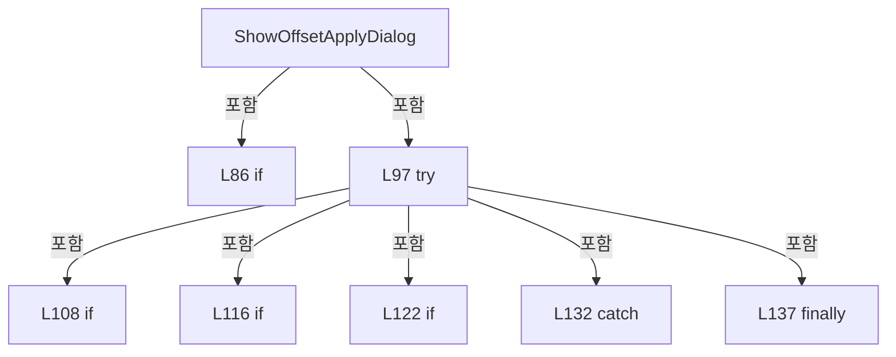

변경 전 점검: 입력/반환 타입, 위 호출자, 예외/취소 경로, 공유 상태와 저장·전송 소비자를 함께 확인합니다. 값의 단위나 물리 방향을 이름만으로 확정하지 않습니다.

### MethodDeclaration `InitializeReviewOffsets` · L143–215

[Drilling.UI/Menu/Menus/CMenuCorrection.ReviewData.Offset.cs:143–215](https://github.com/kjuws10-rgb/A3Drilling/blob/28764c91d521777b8ee068dd7aaf2d3902ce9fe2/Drilling.UI/Menu/Menus/CMenuCorrection.ReviewData.Offset.cs#L143-L215)

| 항목 | 실제 추출 값 |
| --- | --- |
| 서명 | System.Threading.Tasks.Task Drilling.UI.Menu.Menus.CMenuCorrection.CReviewDataPanel.InitializeReviewOffsets() |
| 접근/수식자 | Private / private, async |
| 반환/값 타입 | System.Threading.Tasks.Task |
| 소속 타입 | NamedType:Drilling.UI.Menu.Menus.CMenuCorrection.CReviewDataPanel |

정적 호출자로 확인된 위치:

| 호출 파일/행 | 호출 표현식 | 런타임 분기 가능 |
| --- | --- | --- |
| [Drilling.UI/Menu/Menus/CMenuCorrection.ReviewData.Offset.cs:71–71](https://github.com/kjuws10-rgb/A3Drilling/blob/28764c91d521777b8ee068dd7aaf2d3902ce9fe2/Drilling.UI/Menu/Menus/CMenuCorrection.ReviewData.Offset.cs#L71-L71) | InitializeReviewOffsets | False |

호출하는 대상과 해석 범위:

| 원본 행 | 표현식 | 분석 상태 | 대상/소스 위치 |
| --- | --- | --- | --- |
| 152 | SetOffsetBusy | resolved | void Drilling.UI.Menu.Menus.CMenuCorrection.CReviewDataPanel.SetOffsetBusy(bool) · Drilling.UI/Menu/Menus/CMenuCorrection.ReviewData.Offset.cs:553 |
| 155 | Task.Run | resolved | System.Threading.Tasks.Task<Drilling.Common.Review.ST_REVIEW_PLAN_POINT[]> System.Threading.Tasks.Task.Run<Drilling.Common.Review.ST_REVIEW_PLAN_POINT[]>(System.Func<Drilling.Common.Review.ST_REVIEW_PLAN_POINT[]>) |
| 155 | _reviewManager.CreateAllPlan(recipe, 1).Points .Where(point => point.HeadNo > 0) .ToArray | resolved | Drilling.Common.Review.ST_REVIEW_PLAN_POINT[] System.Collections.Generic.IEnumerable<Drilling.Common.Review.ST_REVIEW_PLAN_POINT>.ToArray<Drilling.Common.Review.ST_REVIEW_PLAN_POINT>() |
| 155 | _reviewManager.CreateAllPlan(recipe, 1).Points .Where | resolved | System.Collections.Generic.IEnumerable<Drilling.Common.Review.ST_REVIEW_PLAN_POINT> System.Collections.Generic.IEnumerable<Drilling.Common.Review.ST_REVIEW_PLAN_POINT>.Where<Drilling.Common.Review.ST_REVIEW_PLAN_POINT>(System.Func<Drilling.Common.Review.ST_REVIEW_PLAN_POINT, bool>) |
| 155 | _reviewManager.CreateAllPlan | resolved | Drilling.Common.Review.ST_REVIEW_PLAN Drilling.Common.Review.CReviewManager.CreateAllPlan(Drilling.Common.Managers.ST_RECIPE_DEFINITION, int) · Drilling.Common/Review/CReviewManager.cs:198 |
| 160 | new InvalidOperationException | resolved | System.InvalidOperationException.InvalidOperationException(string?) |
| 163 | CRecipeConfirmDialog.ShowConfirmation | resolved | bool Drilling.UI.Popup.CRecipeConfirmDialog.ShowConfirmation(string, string, string, bool) · Drilling.UI/Popup/CRecipeConfirmDialog.xaml.cs:11 |
| 165 | points.Select(point => point.CellNo).Distinct().Count | resolved | int System.Collections.Generic.IEnumerable<int>.Count<int>() |
| 165 | points.Select(point => point.CellNo).Distinct | resolved | System.Collections.Generic.IEnumerable<int> System.Collections.Generic.IEnumerable<int>.Distinct<int>() |
| 165 | points.Select | resolved | System.Collections.Generic.IEnumerable<int> System.Collections.Generic.IEnumerable<Drilling.Common.Review.ST_REVIEW_PLAN_POINT>.Select<Drilling.Common.Review.ST_REVIEW_PLAN_POINT, int>(System.Func<Drilling.Common.Review.ST_REVIEW_PLAN_POINT, int>) |
| 172 | EnsureLoadedResultUnchanged | resolved | void Drilling.UI.Menu.Menus.CMenuCorrection.CReviewDataPanel.EnsureLoadedResultUnchanged(string, string) · Drilling.UI/Menu/Menus/CMenuCorrection.ReviewData.Offset.cs:534 |
| 173 | Task.Run | resolved | System.Threading.Tasks.Task<Drilling.Common.Review.ST_REVIEW_OFFSET_FILE_DATA> System.Threading.Tasks.Task.Run<Drilling.Common.Review.ST_REVIEW_OFFSET_FILE_DATA>(System.Func<System.Threading.Tasks.Task<Drilling.Common.Review.ST_REVIEW_OFFSET_FILE_DATA>?>) |
| 175 | _reviewOffsetFile.LoadLatest | resolved | System.Threading.Tasks.Task<Drilling.Common.Review.ST_REVIEW_OFFSET_FILE_DATA> Drilling.Common.Review.CReviewOffsetFileBase.LoadLatest(string, System.Threading.CancellationToken) · Drilling.Common/Review/CReviewManager.cs:4397 |
| 176 | new Dictionary<(int Cell, string Shot), ST_REVIEW_OFFSET_ROW> | resolved | System.Collections.Generic.Dictionary<(int Cell, string Shot), Drilling.Common.Review.ST_REVIEW_OFFSET_ROW>.Dictionary() |
| 179 | NormalizeReviewOffsetShotId | resolved | string Drilling.UI.Menu.Menus.CMenuCorrection.NormalizeReviewOffsetShotId(string) · Drilling.UI/Menu/Menus/CMenuCorrection.cs:2551 |
| 182 | new ST_REVIEW_OFFSET_ROW | resolved | Drilling.Common.Review.ST_REVIEW_OFFSET_ROW.ST_REVIEW_OFFSET_ROW(int, string, double, double) · Drilling.Common/Review/CReviewManager.cs:4357 |
| 191 | NormalizeReviewOffsetShotId | resolved | string Drilling.UI.Menu.Menus.CMenuCorrection.NormalizeReviewOffsetShotId(string) · Drilling.UI/Menu/Menus/CMenuCorrection.cs:2551 |
| 191 | CReviewShotNameFormatter.ToMatrixName | resolved | string Drilling.Common.Review.CReviewShotNameFormatter.ToMatrixName(int, int) · Drilling.Common/Review/CReviewManager.cs:4141 |
| 192 | new ST_REVIEW_OFFSET_ROW | resolved | Drilling.Common.Review.ST_REVIEW_OFFSET_ROW.ST_REVIEW_OFFSET_ROW(int, string, double, double) · Drilling.Common/Review/CReviewManager.cs:4357 |
| 198 | _reviewOffsetFile.SaveNew | resolved | System.Threading.Tasks.Task<Drilling.Common.Review.ST_REVIEW_OFFSET_FILE_DATA> Drilling.Common.Review.CReviewOffsetFileBase.SaveNew(string, System.Collections.Generic.IReadOnlyList<Drilling.Common.Review.ST_REVIEW_OFFSET_ROW>, System.Threading.CancellationToken) · Drilling.Common/Review/CReviewManager.cs:4398 |
| 200 | rows.Values.OrderBy(row => row.CellId).ThenBy(row => row.ShotId, StringComparer.OrdinalIgnoreCase).ToArray | resolved | Drilling.Common.Review.ST_REVIEW_OFFSET_ROW[] System.Collections.Generic.IEnumerable<Drilling.Common.Review.ST_REVIEW_OFFSET_ROW>.ToArray<Drilling.Common.Review.ST_REVIEW_OFFSET_ROW>() |
| 200 | rows.Values.OrderBy(row => row.CellId).ThenBy | resolved | System.Linq.IOrderedEnumerable<Drilling.Common.Review.ST_REVIEW_OFFSET_ROW> System.Linq.IOrderedEnumerable<Drilling.Common.Review.ST_REVIEW_OFFSET_ROW>.ThenBy<Drilling.Common.Review.ST_REVIEW_OFFSET_ROW, string>(System.Func<Drilling.Common.Review.ST_REVIEW_OFFSET_ROW, string>, System.Collections.Generic.IComparer<string>?) |
| 200 | rows.Values.OrderBy | resolved | System.Linq.IOrderedEnumerable<Drilling.Common.Review.ST_REVIEW_OFFSET_ROW> System.Collections.Generic.IEnumerable<Drilling.Common.Review.ST_REVIEW_OFFSET_ROW>.OrderBy<Drilling.Common.Review.ST_REVIEW_OFFSET_ROW, int>(System.Func<Drilling.Common.Review.ST_REVIEW_OFFSET_ROW, int>) |
| 203 | _statusReporter | resolved · 동적 구현 선택 가능 | void System.Action<string>.Invoke(string) |
| 203 | message.Replace | resolved | string string.Replace(string, string?) |
| 204 | CRecipeConfirmDialog.ShowCompletion | resolved | void Drilling.UI.Popup.CRecipeConfirmDialog.ShowCompletion(string, string, Window?) · Drilling.UI/Popup/CRecipeConfirmDialog.xaml.cs:81 |
| 208 | _statusReporter | resolved · 동적 구현 선택 가능 | void System.Action<string>.Invoke(string) |
| 209 | CRecipeConfirmDialog.ShowWarning | resolved | void Drilling.UI.Popup.CRecipeConfirmDialog.ShowWarning(string, string, Window?) · Drilling.UI/Popup/CRecipeConfirmDialog.xaml.cs:86 |
| 213 | SetOffsetBusy | resolved | void Drilling.UI.Menu.Menus.CMenuCorrection.CReviewDataPanel.SetOffsetBusy(bool) · Drilling.UI/Menu/Menus/CMenuCorrection.ReviewData.Offset.cs:553 |

본문의 실제 연산·분기·예외·반환 순서(원문 위치 순):

| 원본 행 | 종류 | 주석 해설 |
| --- | --- | --- |
| 145 | if | 조건에 따라 분기합니다: if (!CanEditOffsets &#124;&#124; _loadedRecipe is null &#124;&#124; _loadedResultFile is null) |
| 147 | return | 호출자에게 값 또는 제어를 반환합니다: return; |
| 150 | local-declaration | 지역 변수를 선언합니다: var sourcePath = _loadedResultFile.FilePath; |
| 150 | variable-initializer | 변수의 초기값을 지정합니다: sourcePath = _loadedResultFile.FilePath |
| 151 | local-declaration | 지역 변수를 선언합니다: var recipe = _loadedRecipe; |
| 151 | variable-initializer | 변수의 초기값을 지정합니다: recipe = _loadedRecipe |
| 152 | call | 함수·델리게이트 또는 객체 생성자를 호출합니다: SetOffsetBusy(true) |
| 153 | try | 예외 처리 범위입니다: try |
| 155 | call | 함수·델리게이트 또는 객체 생성자를 호출합니다: _reviewManager.CreateAllPlan(recipe, 1) |
| 155 | call | 함수·델리게이트 또는 객체 생성자를 호출합니다: _reviewManager.CreateAllPlan(recipe, 1).Points .Where(point => point.HeadNo > 0) |
| 155 | await | 비동기 완료를 기다립니다: await Task.Run(() => _reviewManager.CreateAllPlan(recipe, 1).Points .Where(point => point.HeadNo > 0) .ToArray()) |
| 155 | call | 함수·델리게이트 또는 객체 생성자를 호출합니다: Task.Run(() => _reviewManager.CreateAllPlan(recipe, 1).Points .Where(point => point.HeadNo > 0) .ToArray()) |
| 155 | call | 함수·델리게이트 또는 객체 생성자를 호출합니다: _reviewManager.CreateAllPlan(recipe, 1).Points .Where(point => point.HeadNo > 0) .ToArray() |
| 155 | local-declaration | 지역 변수를 선언합니다: var points = await Task.Run(() => _reviewManager.CreateAllPlan(recipe, 1).Points .Where(point => point.HeadNo > 0) .ToArray()); |
| 155 | variable-initializer | 변수의 초기값을 지정합니다: points = await Task.Run(() => _reviewManager.CreateAllPlan(recipe, 1).Points .Where(point => point.HeadNo > 0) .ToArray()) |
| 158 | if | 조건에 따라 분기합니다: if (points.Length == 0) |
| 160 | call | 함수·델리게이트 또는 객체 생성자를 호출합니다: new InvalidOperationException("현재 레시피에 Review Offset을 초기화할 Shot이 없습니다.") |
| 160 | throw | 예외를 발생/전달합니다: throw new InvalidOperationException("현재 레시피에 Review Offset을 초기화할 Shot이 없습니다."); |
| 163 | call | 함수·델리게이트 또는 객체 생성자를 호출합니다: CRecipeConfirmDialog.ShowConfirmation( "Review Offset Init", $"현재 레시피: {recipe.Name}\n대상: {points.Select(point => point.CellNo).Distinct().Count():N0} Cells / {points.Length:N0} Shots\n\n기존 Review Offset X/Y를 모두 0.000으로 … |
| 163 | if | 조건에 따라 분기합니다: if (!CRecipeConfirmDialog.ShowConfirmation( "Review Offset Init", $"현재 레시피: {recipe.Name}\n대상: {points.Select(point => point.CellNo).Distinct().Count():N0} Cells / {points.Length:N0} Shots\n\n기존 Review Offset X/Y를 모두 0.000으로…) |
| 165 | call | 함수·델리게이트 또는 객체 생성자를 호출합니다: points.Select(point => point.CellNo).Distinct().Count() |
| 165 | call | 함수·델리게이트 또는 객체 생성자를 호출합니다: points.Select(point => point.CellNo).Distinct() |
| 165 | call | 함수·델리게이트 또는 객체 생성자를 호출합니다: points.Select(point => point.CellNo) |
| 169 | return | 호출자에게 값 또는 제어를 반환합니다: return; |
| 172 | call | 함수·델리게이트 또는 객체 생성자를 호출합니다: EnsureLoadedResultUnchanged(sourcePath, recipe.Id) |
| 173 | await | 비동기 완료를 기다립니다: await Task.Run(async () => { var latest = await _reviewOffsetFile.LoadLatest(recipe.Id); var rows = new Dictionary<(int Cell, string Shot), ST_REVIEW_OFFSET_ROW>(); foreach (var row in latest.Rows) { var shot = NormalizeReviewOffs |
| 173 | call | 함수·델리게이트 또는 객체 생성자를 호출합니다: Task.Run(async () => { var latest = await _reviewOffsetFile.LoadLatest(recipe.Id); var rows = new Dictionary<(int Cell, string Shot), ST_REVIEW_OFFSET_ROW>(); foreach (var row in latest.Rows) { var shot = NormalizeReview… |
| 173 | local-declaration | 지역 변수를 선언합니다: var saved = await Task.Run(async () => { var latest = await _reviewOffsetFile.LoadLatest(recipe.Id); var rows = new Dictionary<(int Cell, string Shot), ST_REVIEW_OFFSET_ROW>(); foreach (var row in latest.Rows) { var shot = Normali |
| 173 | variable-initializer | 변수의 초기값을 지정합니다: saved = await Task.Run(async () => { var latest = await _reviewOffsetFile.LoadLatest(recipe.Id); var rows = new Dictionary<(int Cell, string Shot), ST_REVIEW_OFFSET_ROW>(); foreach (var row in latest.Rows) { var shot = NormalizeRe |
| 175 | await | 비동기 완료를 기다립니다: await _reviewOffsetFile.LoadLatest(recipe.Id) |
| 175 | call | 함수·델리게이트 또는 객체 생성자를 호출합니다: _reviewOffsetFile.LoadLatest(recipe.Id) |
| 175 | local-declaration | 지역 변수를 선언합니다: var latest = await _reviewOffsetFile.LoadLatest(recipe.Id); |
| 175 | variable-initializer | 변수의 초기값을 지정합니다: latest = await _reviewOffsetFile.LoadLatest(recipe.Id) |
| 176 | call | 함수·델리게이트 또는 객체 생성자를 호출합니다: new Dictionary<(int Cell, string Shot), ST_REVIEW_OFFSET_ROW>() |
| 176 | local-declaration | 지역 변수를 선언합니다: var rows = new Dictionary<(int Cell, string Shot), ST_REVIEW_OFFSET_ROW>(); |
| 176 | variable-initializer | 변수의 초기값을 지정합니다: rows = new Dictionary<(int Cell, string Shot), ST_REVIEW_OFFSET_ROW>() |
| 177 | foreach | 컬렉션 요소를 순회합니다: foreach (var row in latest.Rows) |
| 179 | call | 함수·델리게이트 또는 객체 생성자를 호출합니다: NormalizeReviewOffsetShotId(row.ShotId) |
| 179 | local-declaration | 지역 변수를 선언합니다: var shot = NormalizeReviewOffsetShotId(row.ShotId); |
| 179 | variable-initializer | 변수의 초기값을 지정합니다: shot = NormalizeReviewOffsetShotId(row.ShotId) |
| 180 | if | 조건에 따라 분기합니다: if (row.CellId > 0 && shot.Length > 0) |
| 182 | assignment | 값을 대상에 대입합니다: rows[(row.CellId, shot)] = new ST_REVIEW_OFFSET_ROW(row.CellId, shot, 0.0, 0.0) { IsDesignCoordinate = true } |
| 182 | call | 함수·델리게이트 또는 객체 생성자를 호출합니다: new ST_REVIEW_OFFSET_ROW(row.CellId, shot, 0.0, 0.0) { IsDesignCoordinate = true } |
| 184 | assignment | 값을 대상에 대입합니다: IsDesignCoordinate = true |
| 189 | foreach | 컬렉션 요소를 순회합니다: foreach (var point in points) |
| 191 | call | 함수·델리게이트 또는 객체 생성자를 호출합니다: NormalizeReviewOffsetShotId(CReviewShotNameFormatter.ToMatrixName(point.ShotNo, point.PixelCountX)) |
| 191 | call | 함수·델리게이트 또는 객체 생성자를 호출합니다: CReviewShotNameFormatter.ToMatrixName(point.ShotNo, point.PixelCountX) |
| 191 | local-declaration | 지역 변수를 선언합니다: var shot = NormalizeReviewOffsetShotId(CReviewShotNameFormatter.ToMatrixName(point.ShotNo, point.PixelCountX)); |
| 191 | variable-initializer | 변수의 초기값을 지정합니다: shot = NormalizeReviewOffsetShotId(CReviewShotNameFormatter.ToMatrixName(point.ShotNo, point.PixelCountX)) |
| 192 | assignment | 값을 대상에 대입합니다: rows[(point.CellNo, shot)] = new ST_REVIEW_OFFSET_ROW(point.CellNo, shot, 0.0, 0.0) { IsDesignCoordinate = true } |
| 192 | call | 함수·델리게이트 또는 객체 생성자를 호출합니다: new ST_REVIEW_OFFSET_ROW(point.CellNo, shot, 0.0, 0.0) { IsDesignCoordinate = true } |
| 194 | assignment | 값을 대상에 대입합니다: IsDesignCoordinate = true |
| 198 | await | 비동기 완료를 기다립니다: await _reviewOffsetFile.SaveNew( recipe.Id, rows.Values.OrderBy(row => row.CellId).ThenBy(row => row.ShotId, StringComparer.OrdinalIgnoreCase).ToArray()) |
| 198 | call | 함수·델리게이트 또는 객체 생성자를 호출합니다: _reviewOffsetFile.SaveNew( recipe.Id, rows.Values.OrderBy(row => row.CellId).ThenBy(row => row.ShotId, StringComparer.OrdinalIgnoreCase).ToArray()) |
| 198 | return | 호출자에게 값 또는 제어를 반환합니다: return await _reviewOffsetFile.SaveNew( recipe.Id, rows.Values.OrderBy(row => row.CellId).ThenBy(row => row.ShotId, StringComparer.OrdinalIgnoreCase).ToArray()); |
| 200 | call | 함수·델리게이트 또는 객체 생성자를 호출합니다: rows.Values.OrderBy(row => row.CellId).ThenBy(row => row.ShotId, StringComparer.OrdinalIgnoreCase).ToArray() |
| 200 | call | 함수·델리게이트 또는 객체 생성자를 호출합니다: rows.Values.OrderBy(row => row.CellId).ThenBy(row => row.ShotId, StringComparer.OrdinalIgnoreCase) |
| 200 | call | 함수·델리게이트 또는 객체 생성자를 호출합니다: rows.Values.OrderBy(row => row.CellId) |
| 202 | local-declaration | 지역 변수를 선언합니다: var message = $"{points.Length:N0}개 Shot의 Review Offset을 0.000으로 초기화했습니다.\n{saved.FileName}"; |
| 202 | variable-initializer | 변수의 초기값을 지정합니다: message = $"{points.Length:N0}개 Shot의 Review Offset을 0.000으로 초기화했습니다.\n{saved.FileName}" |
| 203 | call | 함수·델리게이트 또는 객체 생성자를 호출합니다: _statusReporter(message.Replace(Environment.NewLine, " ")) |
| 203 | call | 함수·델리게이트 또는 객체 생성자를 호출합니다: message.Replace(Environment.NewLine, " ") |
| 204 | call | 함수·델리게이트 또는 객체 생성자를 호출합니다: CRecipeConfirmDialog.ShowCompletion("Review Offset Init 완료", message) |
| 206 | catch | 지정 예외를 처리합니다: catch (Exception exception) |
| 208 | call | 함수·델리게이트 또는 객체 생성자를 호출합니다: _statusReporter($"Review Offset Init: {exception.Message}") |
| 209 | call | 함수·델리게이트 또는 객체 생성자를 호출합니다: CRecipeConfirmDialog.ShowWarning("Review Offset Init 확인", exception.Message) |
| 211 | finally | 종료 정리 구간입니다: finally |
| 213 | call | 함수·델리게이트 또는 객체 생성자를 호출합니다: SetOffsetBusy(false) |

제어 구문의 포함 구조(실제 실행 순서/CFG가 아닌 구문 탐색 그림):

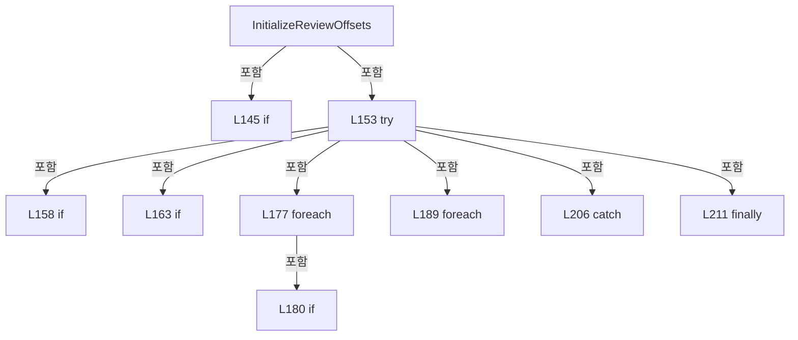

변경 전 점검: 입력/반환 타입, 위 호출자, 예외/취소 경로, 공유 상태와 저장·전송 소비자를 함께 확인합니다. 값의 단위나 물리 방향을 이름만으로 확정하지 않습니다.

### MethodDeclaration `ShowCurrentReviewOffsets` · L217–258

[Drilling.UI/Menu/Menus/CMenuCorrection.ReviewData.Offset.cs:217–258](https://github.com/kjuws10-rgb/A3Drilling/blob/28764c91d521777b8ee068dd7aaf2d3902ce9fe2/Drilling.UI/Menu/Menus/CMenuCorrection.ReviewData.Offset.cs#L217-L258)

| 항목 | 실제 추출 값 |
| --- | --- |
| 서명 | System.Threading.Tasks.Task Drilling.UI.Menu.Menus.CMenuCorrection.CReviewDataPanel.ShowCurrentReviewOffsets() |
| 접근/수식자 | Private / private, async |
| 반환/값 타입 | System.Threading.Tasks.Task |
| 소속 타입 | NamedType:Drilling.UI.Menu.Menus.CMenuCorrection.CReviewDataPanel |

정적 호출자로 확인된 위치:

| 호출 파일/행 | 호출 표현식 | 런타임 분기 가능 |
| --- | --- | --- |
| [Drilling.UI/Menu/Menus/CMenuCorrection.ReviewData.Offset.cs:81–81](https://github.com/kjuws10-rgb/A3Drilling/blob/28764c91d521777b8ee068dd7aaf2d3902ce9fe2/Drilling.UI/Menu/Menus/CMenuCorrection.ReviewData.Offset.cs#L81-L81) | ShowCurrentReviewOffsets | False |

호출하는 대상과 해석 범위:

| 원본 행 | 표현식 | 분석 상태 | 대상/소스 위치 |
| --- | --- | --- | --- |
| 226 | SetOffsetBusy | resolved | void Drilling.UI.Menu.Menus.CMenuCorrection.CReviewDataPanel.SetOffsetBusy(bool) · Drilling.UI/Menu/Menus/CMenuCorrection.ReviewData.Offset.cs:553 |
| 229 | Task.Run | resolved | System.Threading.Tasks.Task<Drilling.Common.Review.ST_REVIEW_OFFSET_FILE_DATA> System.Threading.Tasks.Task.Run<Drilling.Common.Review.ST_REVIEW_OFFSET_FILE_DATA>(System.Func<System.Threading.Tasks.Task<Drilling.Common.Review.ST_REVIEW_OFFSET_FILE_DATA>?>) |
| 229 | _reviewOffsetFile.LoadLatest | resolved | System.Threading.Tasks.Task<Drilling.Common.Review.ST_REVIEW_OFFSET_FILE_DATA> Drilling.Common.Review.CReviewOffsetFileBase.LoadLatest(string, System.Threading.CancellationToken) · Drilling.Common/Review/CReviewManager.cs:4397 |
| 230 | EnsureLoadedResultUnchanged | resolved | void Drilling.UI.Menu.Menus.CMenuCorrection.CReviewDataPanel.EnsureLoadedResultUnchanged(string, string) · Drilling.UI/Menu/Menus/CMenuCorrection.ReviewData.Offset.cs:534 |
| 231 | new Dictionary<string, string> | resolved | System.Collections.Generic.Dictionary<string, string>.Dictionary(System.Collections.Generic.IEnumerable<System.Collections.Generic.KeyValuePair<string, string>>, System.Collections.Generic.IEqualityComparer<string>?) |
| 232 | CReviewOffsetData.ApplyToParameters | resolved | void Drilling.Common.Recipe.CReviewOffsetData.ApplyToParameters(System.Collections.Generic.IDictionary<string, string>, Drilling.Common.Review.ST_REVIEW_OFFSET_FILE_DATA) · Drilling.Common/Recipe/CShotCoordinatePlanBuilder.cs:1190 |
| 233 | ReadOutputViewerInt | resolved | int Drilling.UI.Menu.Menus.CMenuCorrection.ReadOutputViewerInt(System.Collections.Generic.IReadOnlyDictionary<string, string>, int, params string[]) · Drilling.UI/Menu/Menus/CMenuCorrection.cs:1338 |
| 236 | new InvalidDataException | resolved | System.IO.InvalidDataException.InvalidDataException(string?) |
| 239 | new CAlignOffsetViewerPanel | resolved | Drilling.UI.Menu.Menus.CAlignOffsetViewerPanel.CAlignOffsetViewerPanel(Drilling.Common.Managers.ST_RECIPE_DEFINITION, System.Collections.Generic.IReadOnlyDictionary<string, string>, System.Func<int, Drilling.UI.Menu.Menus.ST_CORRECTION_OFFSET_VIEWER_PREVIEW>, bool) · Drilling.UI/Menu/Menus/CMenuCorrection.cs:5753 |
| 242 | BuildOutputViewerGlassPreview | resolved | Drilling.UI.Menu.Menus.ST_CORRECTION_OFFSET_VIEWER_PREVIEW Drilling.UI.Menu.Menus.CMenuCorrection.BuildOutputViewerGlassPreview(System.Collections.Generic.IReadOnlyDictionary<string, string>, int, int) · Drilling.UI/Menu/Menus/CMenuCorrection.cs:1118 |
| 244 | new CAlignOffsetViewerDialog(viewer) { Owner = Application.Current?.MainWindow }.ShowDialog | unresolved | None |
| 244 | new CAlignOffsetViewerDialog | resolved | Drilling.UI.Popup.CAlignOffsetViewerDialog.CAlignOffsetViewerDialog(Drilling.UI.Menu.Menus.CAlignOffsetViewerPanel) · Drilling.UI/Popup/CAlignOffsetViewerDialog.xaml.cs:10 |
| 251 | _statusReporter | resolved · 동적 구현 선택 가능 | void System.Action<string>.Invoke(string) |
| 252 | CRecipeConfirmDialog.ShowWarning | resolved | void Drilling.UI.Popup.CRecipeConfirmDialog.ShowWarning(string, string, Window?) · Drilling.UI/Popup/CRecipeConfirmDialog.xaml.cs:86 |
| 256 | SetOffsetBusy | resolved | void Drilling.UI.Menu.Menus.CMenuCorrection.CReviewDataPanel.SetOffsetBusy(bool) · Drilling.UI/Menu/Menus/CMenuCorrection.ReviewData.Offset.cs:553 |

본문의 실제 연산·분기·예외·반환 순서(원문 위치 순):

| 원본 행 | 종류 | 주석 해설 |
| --- | --- | --- |
| 219 | if | 조건에 따라 분기합니다: if (!CanEditOffsets &#124;&#124; _loadedRecipe is null &#124;&#124; _loadedResultFile is null) |
| 221 | return | 호출자에게 값 또는 제어를 반환합니다: return; |
| 224 | local-declaration | 지역 변수를 선언합니다: var sourcePath = _loadedResultFile.FilePath; |
| 224 | variable-initializer | 변수의 초기값을 지정합니다: sourcePath = _loadedResultFile.FilePath |
| 225 | local-declaration | 지역 변수를 선언합니다: var recipe = _loadedRecipe; |
| 225 | variable-initializer | 변수의 초기값을 지정합니다: recipe = _loadedRecipe |
| 226 | call | 함수·델리게이트 또는 객체 생성자를 호출합니다: SetOffsetBusy(true) |
| 227 | try | 예외 처리 범위입니다: try |
| 229 | await | 비동기 완료를 기다립니다: await Task.Run(() => _reviewOffsetFile.LoadLatest(recipe.Id)) |
| 229 | call | 함수·델리게이트 또는 객체 생성자를 호출합니다: Task.Run(() => _reviewOffsetFile.LoadLatest(recipe.Id)) |
| 229 | call | 함수·델리게이트 또는 객체 생성자를 호출합니다: _reviewOffsetFile.LoadLatest(recipe.Id) |
| 229 | local-declaration | 지역 변수를 선언합니다: var saved = await Task.Run(() => _reviewOffsetFile.LoadLatest(recipe.Id)); |
| 229 | variable-initializer | 변수의 초기값을 지정합니다: saved = await Task.Run(() => _reviewOffsetFile.LoadLatest(recipe.Id)) |
| 230 | call | 함수·델리게이트 또는 객체 생성자를 호출합니다: EnsureLoadedResultUnchanged(sourcePath, recipe.Id) |
| 231 | call | 함수·델리게이트 또는 객체 생성자를 호출합니다: new Dictionary<string, string>(_loadedParameters, StringComparer.OrdinalIgnoreCase) |
| 231 | local-declaration | 지역 변수를 선언합니다: var parameters = new Dictionary<string, string>(_loadedParameters, StringComparer.OrdinalIgnoreCase); |
| 231 | variable-initializer | 변수의 초기값을 지정합니다: parameters = new Dictionary<string, string>(_loadedParameters, StringComparer.OrdinalIgnoreCase) |
| 232 | call | 함수·델리게이트 또는 객체 생성자를 호출합니다: CReviewOffsetData.ApplyToParameters(parameters, saved) |
| 233 | call | 함수·델리게이트 또는 객체 생성자를 호출합니다: ReadOutputViewerInt(parameters, 0, "MAX_CELL_NUMBER") |
| 233 | local-declaration | 지역 변수를 선언합니다: var cellCount = ReadOutputViewerInt(parameters, 0, "MAX_CELL_NUMBER"); |
| 233 | variable-initializer | 변수의 초기값을 지정합니다: cellCount = ReadOutputViewerInt(parameters, 0, "MAX_CELL_NUMBER") |
| 234 | if | 조건에 따라 분기합니다: if (cellCount <= 0) |
| 236 | call | 함수·델리게이트 또는 객체 생성자를 호출합니다: new InvalidDataException("현재 레시피의 MAX_CELL_NUMBER를 확인할 수 없습니다.") |
| 236 | throw | 예외를 발생/전달합니다: throw new InvalidDataException("현재 레시피의 MAX_CELL_NUMBER를 확인할 수 없습니다."); |
| 239 | call | 함수·델리게이트 또는 객체 생성자를 호출합니다: new CAlignOffsetViewerPanel( recipe, parameters, cellNo => BuildOutputViewerGlassPreview(parameters, cellCount, cellNo), reviewOffsets: true) |
| 239 | local-declaration | 지역 변수를 선언합니다: var viewer = new CAlignOffsetViewerPanel( recipe, parameters, cellNo => BuildOutputViewerGlassPreview(parameters, cellCount, cellNo), reviewOffsets: true); |
| 239 | variable-initializer | 변수의 초기값을 지정합니다: viewer = new CAlignOffsetViewerPanel( recipe, parameters, cellNo => BuildOutputViewerGlassPreview(parameters, cellCount, cellNo), reviewOffsets: true) |
| 242 | call | 함수·델리게이트 또는 객체 생성자를 호출합니다: BuildOutputViewerGlassPreview(parameters, cellCount, cellNo) |
| 244 | call | 함수·델리게이트 또는 객체 생성자를 호출합니다: new CAlignOffsetViewerDialog(viewer) { Owner = Application.Current?.MainWindow }.ShowDialog() |
| 244 | call | 함수·델리게이트 또는 객체 생성자를 호출합니다: new CAlignOffsetViewerDialog(viewer) { Owner = Application.Current?.MainWindow } |
| 246 | assignment | 값을 대상에 대입합니다: Owner = Application.Current?.MainWindow |
| 249 | catch | 지정 예외를 처리합니다: catch (Exception exception) |
| 251 | call | 함수·델리게이트 또는 객체 생성자를 호출합니다: _statusReporter($"Cur Review Offset View: {exception.Message}") |
| 252 | call | 함수·델리게이트 또는 객체 생성자를 호출합니다: CRecipeConfirmDialog.ShowWarning("Cur Review Offset View 확인", exception.Message) |
| 254 | finally | 종료 정리 구간입니다: finally |
| 256 | call | 함수·델리게이트 또는 객체 생성자를 호출합니다: SetOffsetBusy(false) |

제어 구문의 포함 구조(실제 실행 순서/CFG가 아닌 구문 탐색 그림):

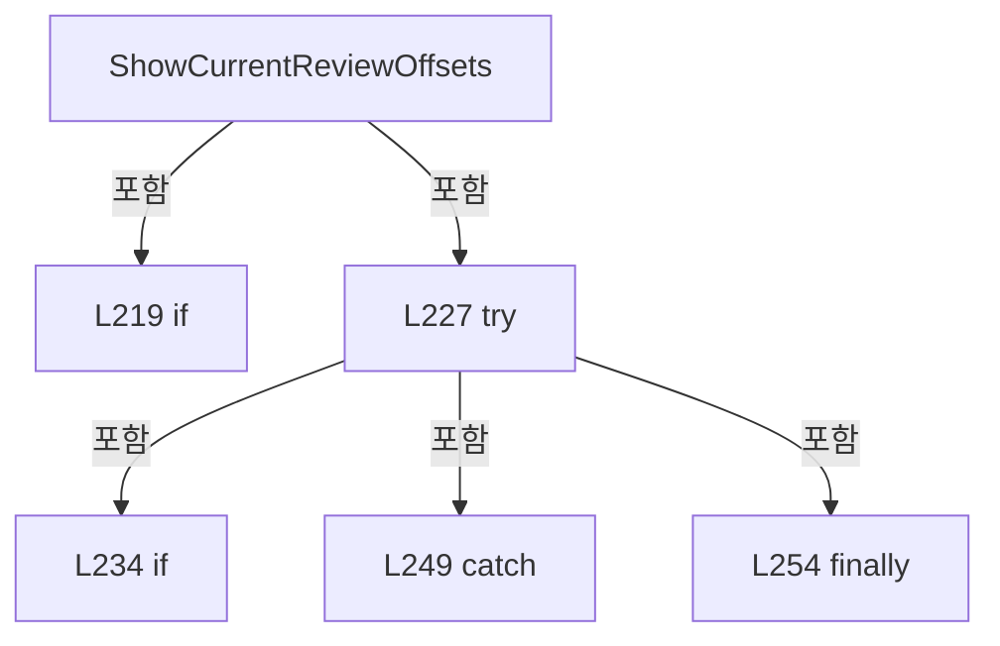

변경 전 점검: 입력/반환 타입, 위 호출자, 예외/취소 경로, 공유 상태와 저장·전송 소비자를 함께 확인합니다. 값의 단위나 물리 방향을 이름만으로 확정하지 않습니다.

### MethodDeclaration `BuildOffsetApplyPlan` · L260–383

[Drilling.UI/Menu/Menus/CMenuCorrection.ReviewData.Offset.cs:260–383](https://github.com/kjuws10-rgb/A3Drilling/blob/28764c91d521777b8ee068dd7aaf2d3902ce9fe2/Drilling.UI/Menu/Menus/CMenuCorrection.ReviewData.Offset.cs#L260-L383)

| 항목 | 실제 추출 값 |
| --- | --- |
| 서명 | Drilling.UI.Menu.Menus.CMenuCorrection.ST_REVIEW_OFFSET_APPLY_PLAN Drilling.UI.Menu.Menus.CMenuCorrection.CReviewDataPanel.BuildOffsetApplyPlan(Drilling.Common.Review.ST_REVIEW_RESULT_CATALOG_ITEM, Drilling.Common.Review.ST_REVIEW_RESULT_FILE_DATA, Drilling.Common.Managers.ST_RECIPE_DEFINITION, System.Collections.Generic.IReadOnlyDictionary<string, string>, Drilling.Common.Review.ST_REVIEW_OFFSET_FILE_DATA) |
| 접근/수식자 | Private / private |
| 반환/값 타입 | Drilling.UI.Menu.Menus.CMenuCorrection.ST_REVIEW_OFFSET_APPLY_PLAN |
| 소속 타입 | NamedType:Drilling.UI.Menu.Menus.CMenuCorrection.CReviewDataPanel |

입력 계약:

| 이름 | 타입 | 전달 | 선택/기본값 |
| --- | --- | --- | --- |
| catalog | Drilling.Common.Review.ST_REVIEW_RESULT_CATALOG_ITEM | None | False /  |
| result | Drilling.Common.Review.ST_REVIEW_RESULT_FILE_DATA | None | False /  |
| recipe | Drilling.Common.Managers.ST_RECIPE_DEFINITION | None | False /  |
| parameters | System.Collections.Generic.IReadOnlyDictionary<string, string> | None | False /  |
| latest | Drilling.Common.Review.ST_REVIEW_OFFSET_FILE_DATA | None | False /  |

정적 호출자로 확인된 위치:

| 호출 파일/행 | 호출 표현식 | 런타임 분기 가능 |
| --- | --- | --- |
| [Drilling.UI/Menu/Menus/CMenuCorrection.ReviewData.Offset.cs:100–100](https://github.com/kjuws10-rgb/A3Drilling/blob/28764c91d521777b8ee068dd7aaf2d3902ce9fe2/Drilling.UI/Menu/Menus/CMenuCorrection.ReviewData.Offset.cs#L100-L100) | BuildOffsetApplyPlan | False |

호출하는 대상과 해석 범위:

| 원본 행 | 표현식 | 분석 상태 | 대상/소스 위치 |
| --- | --- | --- | --- |
| 267 | catalog.ResultStatus.Equals | resolved | bool string.Equals(string?, System.StringComparison) |
| 268 | result.ResultStatus.Equals | resolved | bool string.Equals(string?, System.StringComparison) |
| 270 | new InvalidOperationException | resolved | System.InvalidOperationException.InvalidOperationException(string?) |
| 273 | result.Rows.Select(row => row.BeamNo).FirstOrDefault | resolved | int System.Collections.Generic.IEnumerable<int>.FirstOrDefault<int>(System.Func<int, bool>) |
| 273 | result.Rows.Select | resolved | System.Collections.Generic.IEnumerable<int> System.Collections.Generic.IEnumerable<Drilling.Common.Review.ST_REVIEW_RESULT_FILE_ROW>.Select<Drilling.Common.Review.ST_REVIEW_RESULT_FILE_ROW, int>(System.Func<Drilling.Common.Review.ST_REVIEW_RESULT_FILE_ROW, int>) |
| 274 | Math.Max | resolved | int System.Math.Max(int, int) |
| 275 | _reviewManager.CreateAllPlan | resolved | Drilling.Common.Review.ST_REVIEW_PLAN Drilling.Common.Review.CReviewManager.CreateAllPlan(Drilling.Common.Managers.ST_RECIPE_DEFINITION, int) · Drilling.Common/Review/CReviewManager.cs:198 |
| 278 | allPlan.Points.Where(point => point.HeadNo > 0 && point.Use).ToArray | resolved | Drilling.Common.Review.ST_REVIEW_PLAN_POINT[] System.Collections.Generic.IEnumerable<Drilling.Common.Review.ST_REVIEW_PLAN_POINT>.ToArray<Drilling.Common.Review.ST_REVIEW_PLAN_POINT>() |
| 278 | allPlan.Points.Where | resolved | System.Collections.Generic.IEnumerable<Drilling.Common.Review.ST_REVIEW_PLAN_POINT> System.Collections.Generic.IEnumerable<Drilling.Common.Review.ST_REVIEW_PLAN_POINT>.Where<Drilling.Common.Review.ST_REVIEW_PLAN_POINT>(System.Func<Drilling.Common.Review.ST_REVIEW_PLAN_POINT, bool>) |
| 281 | new InvalidOperationException | resolved | System.InvalidOperationException.InvalidOperationException(string?) |
| 284 | BuildPointLookup | resolved | System.Collections.Generic.IReadOnlyDictionary<string, Drilling.Common.Review.ST_REVIEW_PLAN_POINT> Drilling.UI.Menu.Menus.CMenuCorrection.CReviewDataPanel.BuildPointLookup(System.Collections.Generic.IReadOnlyList<Drilling.Common.Review.ST_REVIEW_PLAN_POINT>) · Drilling.UI/Menu/Menus/CMenuCorrection.ReviewData.Offset.cs:483 |
| 285 | catalog.ResultType.Trim().ToUpperInvariant | resolved | string string.ToUpperInvariant() |
| 285 | catalog.ResultType.Trim | resolved | string string.Trim() |
| 286 | CreateApplicationType | resolved | Drilling.UI.Menu.Menus.CMenuCorrection.ST_REVIEW_OFFSET_APPLY_TYPE Drilling.UI.Menu.Menus.CMenuCorrection.CReviewDataPanel.CreateApplicationType(string, Drilling.Common.Review.ST_REVIEW_RESULT_FILE_DATA) · Drilling.UI/Menu/Menus/CMenuCorrection.ReviewData.Offset.cs:515 |
| 289 | BuildDirectDeltas | resolved | System.Collections.Generic.IReadOnlyList<Drilling.UI.Menu.Menus.CMenuCorrection.CReviewDataPanel.ST_REVIEW_OFFSET_DELTA> Drilling.UI.Menu.Menus.CMenuCorrection.CReviewDataPanel.BuildDirectDeltas(System.Collections.Generic.IReadOnlyList<Drilling.Common.Review.ST_REVIEW_RESULT_FILE_ROW>, System.Collections.Generic.IReadOnlyDictionary<string, Drilling.Common.Review.ST_REVIEW_PLAN_POINT>) · Drilling.UI/Menu/Menus/CMenuCorrection.ReviewData.Offset.cs:385 |
| 290 | BuildRoughDeltas | resolved | System.Collections.Generic.IReadOnlyList<Drilling.UI.Menu.Menus.CMenuCorrection.CReviewDataPanel.ST_REVIEW_OFFSET_DELTA> Drilling.UI.Menu.Menus.CMenuCorrection.CReviewDataPanel.BuildRoughDeltas(Drilling.Common.Review.ST_REVIEW_RESULT_FILE_DATA, System.Collections.Generic.IReadOnlyList<Drilling.Common.Review.ST_REVIEW_PLAN_POINT>, System.Collections.Generic.IReadOnlyDictionary<string, Drilling.Common.Review.ST_REVIEW_PLAN_POINT>) · Drilling.UI/Menu/Menus/CMenuCorrection.ReviewData.Offset.cs:399 |
| 291 | BuildFineDeltas | resolved | System.Collections.Generic.IReadOnlyList<Drilling.UI.Menu.Menus.CMenuCorrection.CReviewDataPanel.ST_REVIEW_OFFSET_DELTA> Drilling.UI.Menu.Menus.CMenuCorrection.CReviewDataPanel.BuildFineDeltas(Drilling.Common.Review.ST_REVIEW_RESULT_FILE_DATA, System.Collections.Generic.IReadOnlyList<Drilling.Common.Review.ST_REVIEW_PLAN_POINT>, System.Collections.Generic.IReadOnlyDictionary<string, Drilling.Common.Review.ST_REVIEW_PLAN_POINT>) · Drilling.UI/Menu/Menus/CMenuCorrection.ReviewData.Offset.cs:443 |
| 292 | new InvalidOperationException | resolved | System.InvalidOperationException.InvalidOperationException(string?) |
| 296 | new InvalidOperationException | resolved | System.InvalidOperationException.InvalidOperationException(string?) |
| 299 | new Dictionary<(int Cell, string Shot), ST_REVIEW_OFFSET_ROW> | resolved | System.Collections.Generic.Dictionary<(int Cell, string Shot), Drilling.Common.Review.ST_REVIEW_OFFSET_ROW>.Dictionary() |
| 302 | NormalizeReviewOffsetShotId | resolved | string Drilling.UI.Menu.Menus.CMenuCorrection.NormalizeReviewOffsetShotId(string) · Drilling.UI/Menu/Menus/CMenuCorrection.cs:2551 |
| 309 | new List<ST_REVIEW_OFFSET_APPLY_GRID_ROW> | resolved | System.Collections.Generic.List<Drilling.UI.Menu.Menus.CMenuCorrection.ST_REVIEW_OFFSET_APPLY_GRID_ROW>.List(int) |
| 310 | new HashSet<(int Cell, string Shot)> | resolved | System.Collections.Generic.HashSet<(int Cell, string Shot)>.HashSet() |
| 314 | NormalizeReviewOffsetShotId | resolved | string Drilling.UI.Menu.Menus.CMenuCorrection.NormalizeReviewOffsetShotId(string) · Drilling.UI/Menu/Menus/CMenuCorrection.cs:2551 |
| 314 | CReviewShotNameFormatter.ToMatrixName | resolved | string Drilling.Common.Review.CReviewShotNameFormatter.ToMatrixName(int, int) · Drilling.Common/Review/CReviewManager.cs:4141 |
| 316 | seen.Add | resolved | bool System.Collections.Generic.HashSet<(int Cell, string Shot)>.Add((int Cell, string Shot)) |
| 318 | new InvalidDataException | resolved | System.IO.InvalidDataException.InvalidDataException(string?) |
| 321 | latestByKey.GetValueOrDefault | resolved | Drilling.Common.Review.ST_REVIEW_OFFSET_ROW? System.Collections.Generic.IReadOnlyDictionary<(int, string), Drilling.Common.Review.ST_REVIEW_OFFSET_ROW>.GetValueOrDefault<(int, string), Drilling.Common.Review.ST_REVIEW_OFFSET_ROW>((int, string)) |
| 324 | CReviewOffsetData.ToDesign | resolved | (double X, double Y) Drilling.Common.Recipe.CReviewOffsetData.ToDesign(System.Collections.Generic.IReadOnlyDictionary<string, string>, int, double, double, bool) · Drilling.Common/Recipe/CShotCoordinatePlanBuilder.cs:1216 |
| 325 | CAlignShotOffsetData.RoundValue | resolved | double Drilling.Common.Recipe.CAlignShotOffsetData.RoundValue(double) · Drilling.Common/Recipe/CShotCoordinatePlanBuilder.cs:663 |
| 326 | CAlignShotOffsetData.RoundValue | resolved | double Drilling.Common.Recipe.CAlignShotOffsetData.RoundValue(double) · Drilling.Common/Recipe/CShotCoordinatePlanBuilder.cs:663 |
| 327 | new ST_REVIEW_OFFSET_ROW | resolved | Drilling.Common.Review.ST_REVIEW_OFFSET_ROW.ST_REVIEW_OFFSET_ROW(int, string, double, double) · Drilling.Common/Review/CReviewManager.cs:4357 |
| 331 | displayRows.Add | resolved | void System.Collections.Generic.List<Drilling.UI.Menu.Menus.CMenuCorrection.ST_REVIEW_OFFSET_APPLY_GRID_ROW>.Add(Drilling.UI.Menu.Menus.CMenuCorrection.ST_REVIEW_OFFSET_APPLY_GRID_ROW) |
| 331 | new ST_REVIEW_OFFSET_APPLY_GRID_ROW | resolved | Drilling.UI.Menu.Menus.CMenuCorrection.ST_REVIEW_OFFSET_APPLY_GRID_ROW.ST_REVIEW_OFFSET_APPLY_GRID_ROW(int, int, string, string, double, double, double, double, double, double) · Drilling.UI/Menu/Menus/CMenuCorrection.ReviewData.Offset.cs:717 |
| 344 | displayRows .OrderBy(row => row.CellNo) .ThenBy(row => row.ShotName, CReviewShotNameComparer.Instance) .ToArray | resolved | Drilling.UI.Menu.Menus.CMenuCorrection.ST_REVIEW_OFFSET_APPLY_GRID_ROW[] System.Collections.Generic.IEnumerable<Drilling.UI.Menu.Menus.CMenuCorrection.ST_REVIEW_OFFSET_APPLY_GRID_ROW>.ToArray<Drilling.UI.Menu.Menus.CMenuCorrection.ST_REVIEW_OFFSET_APPLY_GRID_ROW>() |
| 344 | displayRows .OrderBy(row => row.CellNo) .ThenBy | resolved | System.Linq.IOrderedEnumerable<Drilling.UI.Menu.Menus.CMenuCorrection.ST_REVIEW_OFFSET_APPLY_GRID_ROW> System.Linq.IOrderedEnumerable<Drilling.UI.Menu.Menus.CMenuCorrection.ST_REVIEW_OFFSET_APPLY_GRID_ROW>.ThenBy<Drilling.UI.Menu.Menus.CMenuCorrection.ST_REVIEW_OFFSET_APPLY_GRID_ROW, string>(System.Func<Drilling.UI.Menu.Menus.CMenuCorrection.ST_REVIEW_OFFSET_APPLY_GRID_ROW, string>, System.Collections.Generic.IComparer<string>?) |
| 344 | displayRows .OrderBy | resolved | System.Linq.IOrderedEnumerable<Drilling.UI.Menu.Menus.CMenuCorrection.ST_REVIEW_OFFSET_APPLY_GRID_ROW> System.Collections.Generic.IEnumerable<Drilling.UI.Menu.Menus.CMenuCorrection.ST_REVIEW_OFFSET_APPLY_GRID_ROW>.OrderBy<Drilling.UI.Menu.Menus.CMenuCorrection.ST_REVIEW_OFFSET_APPLY_GRID_ROW, int>(System.Func<Drilling.UI.Menu.Menus.CMenuCorrection.ST_REVIEW_OFFSET_APPLY_GRID_ROW, int>) |
| 348 | orderedRows.Select(row => row.CellNo).ToHashSet | resolved | System.Collections.Generic.HashSet<int> System.Collections.Generic.IEnumerable<int>.ToHashSet<int>() |
| 348 | orderedRows.Select | resolved | System.Collections.Generic.IEnumerable<int> System.Collections.Generic.IEnumerable<Drilling.UI.Menu.Menus.CMenuCorrection.ST_REVIEW_OFFSET_APPLY_GRID_ROW>.Select<Drilling.UI.Menu.Menus.CMenuCorrection.ST_REVIEW_OFFSET_APPLY_GRID_ROW, int>(System.Func<Drilling.UI.Menu.Menus.CMenuCorrection.ST_REVIEW_OFFSET_APPLY_GRID_ROW, int>) |
| 349 | orderedRows.Select(row => NormalizeReviewShotKey(row.ShotKey, row.CellNo)).ToHashSet | resolved | System.Collections.Generic.HashSet<string> System.Collections.Generic.IEnumerable<string>.ToHashSet<string>(System.Collections.Generic.IEqualityComparer<string>?) |
| 349 | orderedRows.Select | resolved | System.Collections.Generic.IEnumerable<string> System.Collections.Generic.IEnumerable<Drilling.UI.Menu.Menus.CMenuCorrection.ST_REVIEW_OFFSET_APPLY_GRID_ROW>.Select<Drilling.UI.Menu.Menus.CMenuCorrection.ST_REVIEW_OFFSET_APPLY_GRID_ROW, string>(System.Func<Drilling.UI.Menu.Menus.CMenuCorrection.ST_REVIEW_OFFSET_APPLY_GRID_ROW, string>) |
| 349 | NormalizeReviewShotKey | resolved | string Drilling.UI.Menu.Menus.CMenuCorrection.NormalizeReviewShotKey(string, int) · Drilling.UI/Menu/Menus/CMenuCorrection.cs:2396 |
| 350 | new Dictionary<int, IReadOnlyList<ST_REVIEW_DATA_SHOT_POSITION>> | resolved | System.Collections.Generic.Dictionary<int, System.Collections.Generic.IReadOnlyList<Drilling.UI.Menu.Menus.CMenuCorrection.ST_REVIEW_DATA_SHOT_POSITION>>.Dictionary() |
| 351 | targetCells.Order | resolved | System.Linq.IOrderedEnumerable<int> System.Collections.Generic.IEnumerable<int>.Order<int>() |
| 353 | allPlan.GetCellPoints(cellNo) .Select(point => new ST_REVIEW_DATA_SHOT_POSITION( point.ShotKey, point.CellNo, point.ShotNo, (point.ShotNo - 1) % Math.Max(1, point.PixelCountX), (point.ShotNo - 1) / Math.Max(1, point.PixelCountX), Math.Max(1, point.PixelCountX), Math.Max(1, point.PixelCountY), true) { HeadNo = point.HeadNo, IsResult = targetKeys.Con… | resolved | Drilling.UI.Menu.Menus.CMenuCorrection.ST_REVIEW_DATA_SHOT_POSITION[] System.Collections.Generic.IEnumerable<Drilling.UI.Menu.Menus.CMenuCorrection.ST_REVIEW_DATA_SHOT_POSITION>.ToArray<Drilling.UI.Menu.Menus.CMenuCorrection.ST_REVIEW_DATA_SHOT_POSITION>() |
| 353 | allPlan.GetCellPoints(cellNo) .Select | resolved | System.Collections.Generic.IEnumerable<Drilling.UI.Menu.Menus.CMenuCorrection.ST_REVIEW_DATA_SHOT_POSITION> System.Collections.Generic.IEnumerable<Drilling.Common.Review.ST_REVIEW_PLAN_POINT>.Select<Drilling.Common.Review.ST_REVIEW_PLAN_POINT, Drilling.UI.Menu.Menus.CMenuCorrection.ST_REVIEW_DATA_SHOT_POSITION>(System.Func<Drilling.Common.Review.ST_REVIEW_PLAN_POINT, Drilling.UI.Menu.Menus.CMenuCorrection.ST_REVIEW_DATA_SHOT_POSITION>) |
| 353 | allPlan.GetCellPoints | resolved | System.Collections.Generic.IReadOnlyList<Drilling.Common.Review.ST_REVIEW_PLAN_POINT> Drilling.Common.Review.ST_REVIEW_PLAN.GetCellPoints(int) · Drilling.Common/Review/CReviewManager.cs:4175 |
| 354 | new ST_REVIEW_DATA_SHOT_POSITION | resolved | Drilling.UI.Menu.Menus.CMenuCorrection.ST_REVIEW_DATA_SHOT_POSITION.ST_REVIEW_DATA_SHOT_POSITION(string, int, int, int, int, int, int, bool) · Drilling.UI/Menu/Menus/CMenuCorrection.ReviewData.Display.cs:1463 |
| 358 | Math.Max | resolved | int System.Math.Max(int, int) |
| 359 | Math.Max | resolved | int System.Math.Max(int, int) |
| 360 | Math.Max | resolved | int System.Math.Max(int, int) |
| 361 | Math.Max | resolved | int System.Math.Max(int, int) |
| 365 | targetKeys.Contains | resolved | bool System.Collections.Generic.HashSet<string>.Contains(string) |
| 365 | NormalizeReviewShotKey | resolved | string Drilling.UI.Menu.Menus.CMenuCorrection.NormalizeReviewShotKey(string, int) · Drilling.UI/Menu/Menus/CMenuCorrection.cs:2396 |
| 366 | point.ExclusionReason.Contains | resolved | bool string.Contains(string, System.StringComparison) |
| 367 | point.ExclusionReason.Contains | resolved | bool string.Contains(string, System.StringComparison) |
| 373 | new ST_REVIEW_OFFSET_APPLY_PLAN | resolved | Drilling.UI.Menu.Menus.CMenuCorrection.ST_REVIEW_OFFSET_APPLY_PLAN.ST_REVIEW_OFFSET_APPLY_PLAN(Drilling.UI.Menu.Menus.CMenuCorrection.ST_REVIEW_OFFSET_APPLY_TYPE, string, string, System.Collections.Generic.IReadOnlyDictionary<string, string>, int, System.Collections.Generic.IReadOnlySet<int>, System.Collections.Generic.IReadOnlyDictionary<int, System.Collections.Generic.IReadOnlyList<Drilling.UI.Menu.Menus.CMenuCorrection.ST_REVIEW_DATA_SHOT_POSITION>>, System.Collections.Generic.IReadOnlyList<Drilling.UI.Menu.Menus.CMenuCorrection.ST_REVIEW_OFFSET_APPLY_GRID_ROW>, System.Collections.Generic.IReadOnlyList<Drilling.Common.Review.ST_REVIEW_OFFSET_ROW>) · Drilling.UI/Menu/Menus/CMenuCorrection.ReviewData.Offset.cs:739 |
| 377 | new Dictionary<string, string> | resolved | System.Collections.Generic.Dictionary<string, string>.Dictionary(System.Collections.Generic.IEnumerable<System.Collections.Generic.KeyValuePair<string, string>>, System.Collections.Generic.IEqualityComparer<string>?) |
| 378 | ReadOutputViewerInt | resolved | int Drilling.UI.Menu.Menus.CMenuCorrection.ReadOutputViewerInt(System.Collections.Generic.IReadOnlyDictionary<string, string>, int, params string[]) · Drilling.UI/Menu/Menus/CMenuCorrection.cs:1338 |
| 382 | latestByKey.Values.OrderBy(row => row.CellId).ThenBy(row => row.ShotId, StringComparer.OrdinalIgnoreCase).ToArray | resolved | Drilling.Common.Review.ST_REVIEW_OFFSET_ROW[] System.Collections.Generic.IEnumerable<Drilling.Common.Review.ST_REVIEW_OFFSET_ROW>.ToArray<Drilling.Common.Review.ST_REVIEW_OFFSET_ROW>() |
| 382 | latestByKey.Values.OrderBy(row => row.CellId).ThenBy | resolved | System.Linq.IOrderedEnumerable<Drilling.Common.Review.ST_REVIEW_OFFSET_ROW> System.Linq.IOrderedEnumerable<Drilling.Common.Review.ST_REVIEW_OFFSET_ROW>.ThenBy<Drilling.Common.Review.ST_REVIEW_OFFSET_ROW, string>(System.Func<Drilling.Common.Review.ST_REVIEW_OFFSET_ROW, string>, System.Collections.Generic.IComparer<string>?) |
| 382 | latestByKey.Values.OrderBy | resolved | System.Linq.IOrderedEnumerable<Drilling.Common.Review.ST_REVIEW_OFFSET_ROW> System.Collections.Generic.IEnumerable<Drilling.Common.Review.ST_REVIEW_OFFSET_ROW>.OrderBy<Drilling.Common.Review.ST_REVIEW_OFFSET_ROW, int>(System.Func<Drilling.Common.Review.ST_REVIEW_OFFSET_ROW, int>) |

본문의 실제 연산·분기·예외·반환 순서(원문 위치 순):

| 원본 행 | 종류 | 주석 해설 |
| --- | --- | --- |
| 267 | call | 함수·델리게이트 또는 객체 생성자를 호출합니다: catalog.ResultStatus.Equals("COMPLETED", StringComparison.OrdinalIgnoreCase) |
| 267 | if | 조건에 따라 분기합니다: if (!catalog.ResultStatus.Equals("COMPLETED", StringComparison.OrdinalIgnoreCase) &#124;&#124; !result.ResultStatus.Equals("COMPLETED", StringComparison.OrdinalIgnoreCase)) |
| 268 | call | 함수·델리게이트 또는 객체 생성자를 호출합니다: result.ResultStatus.Equals("COMPLETED", StringComparison.OrdinalIgnoreCase) |
| 270 | call | 함수·델리게이트 또는 객체 생성자를 호출합니다: new InvalidOperationException("COMPLETED 상태의 검사 결과만 Offset에 적용할 수 있습니다.") |
| 270 | throw | 예외를 발생/전달합니다: throw new InvalidOperationException("COMPLETED 상태의 검사 결과만 Offset에 적용할 수 있습니다."); |
| 273 | call | 함수·델리게이트 또는 객체 생성자를 호출합니다: result.Rows.Select(row => row.BeamNo).FirstOrDefault(value => value > 0) |
| 273 | call | 함수·델리게이트 또는 객체 생성자를 호출합니다: result.Rows.Select(row => row.BeamNo) |
| 273 | conditional-expression | 조건에 따라 결과식을 선택합니다: result.BeamNo > 0 ? result.BeamNo : result.Rows.Select(row => row.BeamNo).FirstOrDefault(value => value > 0) |
| 273 | local-declaration | 지역 변수를 선언합니다: var beamNo = result.BeamNo > 0 ? result.BeamNo : result.Rows.Select(row => row.BeamNo).FirstOrDefault(value => value > 0); |
| 273 | variable-initializer | 변수의 초기값을 지정합니다: beamNo = result.BeamNo > 0 ? result.BeamNo : result.Rows.Select(row => row.BeamNo).FirstOrDefault(value => value > 0) |
| 274 | assignment | 값을 대상에 대입합니다: beamNo = Math.Max(1, beamNo) |
| 274 | call | 함수·델리게이트 또는 객체 생성자를 호출합니다: Math.Max(1, beamNo) |
| 275 | call | 함수·델리게이트 또는 객체 생성자를 호출합니다: _reviewManager.CreateAllPlan(recipe, beamNo) |
| 275 | local-declaration | 지역 변수를 선언합니다: var allPlan = _reviewManager.CreateAllPlan(recipe, beamNo); |
| 275 | variable-initializer | 변수의 초기값을 지정합니다: allPlan = _reviewManager.CreateAllPlan(recipe, beamNo) |
| 278 | call | 함수·델리게이트 또는 객체 생성자를 호출합니다: allPlan.Points.Where(point => point.HeadNo > 0 && point.Use).ToArray() |
| 278 | call | 함수·델리게이트 또는 객체 생성자를 호출합니다: allPlan.Points.Where(point => point.HeadNo > 0 && point.Use) |
| 278 | local-declaration | 지역 변수를 선언합니다: var allPoints = allPlan.Points.Where(point => point.HeadNo > 0 && point.Use).ToArray(); |
| 278 | variable-initializer | 변수의 초기값을 지정합니다: allPoints = allPlan.Points.Where(point => point.HeadNo > 0 && point.Use).ToArray() |
| 279 | if | 조건에 따라 분기합니다: if (allPoints.Length == 0) |
| 281 | call | 함수·델리게이트 또는 객체 생성자를 호출합니다: new InvalidOperationException("현재 레시피에 Head가 배정된 Shot이 없습니다.") |
| 281 | throw | 예외를 발생/전달합니다: throw new InvalidOperationException("현재 레시피에 Head가 배정된 Shot이 없습니다."); |
| 284 | call | 함수·델리게이트 또는 객체 생성자를 호출합니다: BuildPointLookup(allPoints) |
| 284 | local-declaration | 지역 변수를 선언합니다: var pointLookup = BuildPointLookup(allPoints); |
| 284 | variable-initializer | 변수의 초기값을 지정합니다: pointLookup = BuildPointLookup(allPoints) |
| 285 | call | 함수·델리게이트 또는 객체 생성자를 호출합니다: catalog.ResultType.Trim().ToUpperInvariant() |
| 285 | call | 함수·델리게이트 또는 객체 생성자를 호출합니다: catalog.ResultType.Trim() |
| 285 | local-declaration | 지역 변수를 선언합니다: var resultType = catalog.ResultType.Trim().ToUpperInvariant(); |
| 285 | variable-initializer | 변수의 초기값을 지정합니다: resultType = catalog.ResultType.Trim().ToUpperInvariant() |
| 286 | call | 함수·델리게이트 또는 객체 생성자를 호출합니다: CreateApplicationType(resultType, result) |
| 286 | local-declaration | 지역 변수를 선언합니다: var applicationType = CreateApplicationType(resultType, result); |
| 286 | variable-initializer | 변수의 초기값을 지정합니다: applicationType = CreateApplicationType(resultType, result) |
| 287 | local-declaration | 지역 변수를 선언합니다: IReadOnlyList<ST_REVIEW_OFFSET_DELTA> deltas = resultType switch { "ALL_SHOT" or "ONE_SHOT" or "ONE_LINE" => BuildDirectDeltas(result.Rows, pointLookup), "ROUGH" => BuildRoughDeltas(result, allPoints, pointLookup), "FINE" or "AUTO |
| 287 | switch-expression | 값별 결과식을 선택합니다: resultType switch { "ALL_SHOT" or "ONE_SHOT" or "ONE_LINE" => BuildDirectDeltas(result.Rows, pointLookup), "ROUGH" => BuildRoughDeltas(result, allPoints, pointLookup), "FINE" or "AUTO" => BuildFineDeltas(result, allPoints, pointLo |
| 287 | variable-initializer | 변수의 초기값을 지정합니다: deltas = resultType switch { "ALL_SHOT" or "ONE_SHOT" or "ONE_LINE" => BuildDirectDeltas(result.Rows, pointLookup), "ROUGH" => BuildRoughDeltas(result, allPoints, pointLookup), "FINE" or "AUTO" => BuildFineDeltas(result, allPoints |
| 289 | call | 함수·델리게이트 또는 객체 생성자를 호출합니다: BuildDirectDeltas(result.Rows, pointLookup) |
| 290 | call | 함수·델리게이트 또는 객체 생성자를 호출합니다: BuildRoughDeltas(result, allPoints, pointLookup) |
| 291 | call | 함수·델리게이트 또는 객체 생성자를 호출합니다: BuildFineDeltas(result, allPoints, pointLookup) |
| 292 | call | 함수·델리게이트 또는 객체 생성자를 호출합니다: new InvalidOperationException($"{catalog.ResultType} 결과는 Review Offset 적용을 지원하지 않습니다.") |
| 292 | throw | 예외를 발생/전달합니다: throw new InvalidOperationException($"{catalog.ResultType} 결과는 Review Offset 적용을 지원하지 않습니다.") |
| 294 | if | 조건에 따라 분기합니다: if (deltas.Count == 0) |
| 296 | call | 함수·델리게이트 또는 객체 생성자를 호출합니다: new InvalidOperationException("검사 결과에서 Offset을 적용할 수 있는 OK Shot을 찾지 못했습니다.") |
| 296 | throw | 예외를 발생/전달합니다: throw new InvalidOperationException("검사 결과에서 Offset을 적용할 수 있는 OK Shot을 찾지 못했습니다."); |
| 299 | call | 함수·델리게이트 또는 객체 생성자를 호출합니다: new Dictionary<(int Cell, string Shot), ST_REVIEW_OFFSET_ROW>() |
| 299 | local-declaration | 지역 변수를 선언합니다: var latestByKey = new Dictionary<(int Cell, string Shot), ST_REVIEW_OFFSET_ROW>(); |
| 299 | variable-initializer | 변수의 초기값을 지정합니다: latestByKey = new Dictionary<(int Cell, string Shot), ST_REVIEW_OFFSET_ROW>() |
| 300 | foreach | 컬렉션 요소를 순회합니다: foreach (var row in latest.Rows) |
| 302 | call | 함수·델리게이트 또는 객체 생성자를 호출합니다: NormalizeReviewOffsetShotId(row.ShotId) |
| 302 | local-declaration | 지역 변수를 선언합니다: var shot = NormalizeReviewOffsetShotId(row.ShotId); |
| 302 | variable-initializer | 변수의 초기값을 지정합니다: shot = NormalizeReviewOffsetShotId(row.ShotId) |
| 303 | if | 조건에 따라 분기합니다: if (row.CellId > 0 && shot.Length > 0) |
| 305 | assignment | 값을 대상에 대입합니다: latestByKey[(row.CellId, shot)] = row with { ShotId = shot } |
| 305 | assignment | 값을 대상에 대입합니다: ShotId = shot |
| 309 | call | 함수·델리게이트 또는 객체 생성자를 호출합니다: new List<ST_REVIEW_OFFSET_APPLY_GRID_ROW>(deltas.Count) |
| 309 | local-declaration | 지역 변수를 선언합니다: var displayRows = new List<ST_REVIEW_OFFSET_APPLY_GRID_ROW>(deltas.Count); |
| 309 | variable-initializer | 변수의 초기값을 지정합니다: displayRows = new List<ST_REVIEW_OFFSET_APPLY_GRID_ROW>(deltas.Count) |
| 310 | call | 함수·델리게이트 또는 객체 생성자를 호출합니다: new HashSet<(int Cell, string Shot)>() |
| 310 | local-declaration | 지역 변수를 선언합니다: var seen = new HashSet<(int Cell, string Shot)>(); |
| 310 | variable-initializer | 변수의 초기값을 지정합니다: seen = new HashSet<(int Cell, string Shot)>() |
| 311 | foreach | 컬렉션 요소를 순회합니다: foreach (var delta in deltas) |
| 313 | local-declaration | 지역 변수를 선언합니다: var point = delta.Point; |
| 313 | variable-initializer | 변수의 초기값을 지정합니다: point = delta.Point |
| 314 | call | 함수·델리게이트 또는 객체 생성자를 호출합니다: NormalizeReviewOffsetShotId(CReviewShotNameFormatter.ToMatrixName(point.ShotNo, point.PixelCountX)) |
| 314 | call | 함수·델리게이트 또는 객체 생성자를 호출합니다: CReviewShotNameFormatter.ToMatrixName(point.ShotNo, point.PixelCountX) |
| 314 | local-declaration | 지역 변수를 선언합니다: var shotName = NormalizeReviewOffsetShotId(CReviewShotNameFormatter.ToMatrixName(point.ShotNo, point.PixelCountX)); |
| 314 | variable-initializer | 변수의 초기값을 지정합니다: shotName = NormalizeReviewOffsetShotId(CReviewShotNameFormatter.ToMatrixName(point.ShotNo, point.PixelCountX)) |
| 315 | local-declaration | 지역 변수를 선언합니다: var key = (point.CellNo, shotName); |
| 315 | variable-initializer | 변수의 초기값을 지정합니다: key = (point.CellNo, shotName) |
| 316 | call | 함수·델리게이트 또는 객체 생성자를 호출합니다: seen.Add(key) |
| 316 | if | 조건에 따라 분기합니다: if (!seen.Add(key)) |
| 318 | call | 함수·델리게이트 또는 객체 생성자를 호출합니다: new InvalidDataException($"Offset 적용 대상 Shot이 중복되었습니다: CELL{point.CellNo:00}_{shotName}") |
| 318 | throw | 예외를 발생/전달합니다: throw new InvalidDataException($"Offset 적용 대상 Shot이 중복되었습니다: CELL{point.CellNo:00}_{shotName}"); |
| 321 | call | 함수·델리게이트 또는 객체 생성자를 호출합니다: latestByKey.GetValueOrDefault(key) |
| 321 | local-declaration | 지역 변수를 선언합니다: var previous = latestByKey.GetValueOrDefault(key); |
| 321 | variable-initializer | 변수의 초기값을 지정합니다: previous = latestByKey.GetValueOrDefault(key) |
| 322 | conditional-expression | 조건에 따라 결과식을 선택합니다: previous is null ? (X: 0.0, Y: 0.0) : CReviewOffsetData.ToDesign(parameters, point.HeadNo, previous.ReviewOffsetX, previous.ReviewOffsetY, previous.IsDesignCoordinate) |
| 322 | local-declaration | 지역 변수를 선언합니다: var current = previous is null ? (X: 0.0, Y: 0.0) : CReviewOffsetData.ToDesign(parameters, point.HeadNo, previous.ReviewOffsetX, previous.ReviewOffsetY, previous.IsDesignCoordinate); |
| 322 | variable-initializer | 변수의 초기값을 지정합니다: current = previous is null ? (X: 0.0, Y: 0.0) : CReviewOffsetData.ToDesign(parameters, point.HeadNo, previous.ReviewOffsetX, previous.ReviewOffsetY, previous.IsDesignCoordinate) |
| 324 | call | 함수·델리게이트 또는 객체 생성자를 호출합니다: CReviewOffsetData.ToDesign(parameters, point.HeadNo, previous.ReviewOffsetX, previous.ReviewOffsetY, previous.IsDesignCoordinate) |
| 325 | call | 함수·델리게이트 또는 객체 생성자를 호출합니다: CAlignShotOffsetData.RoundValue(current.X + delta.X) |
| 325 | local-declaration | 지역 변수를 선언합니다: var finalX = CAlignShotOffsetData.RoundValue(current.X + delta.X); |
| 325 | variable-initializer | 변수의 초기값을 지정합니다: finalX = CAlignShotOffsetData.RoundValue(current.X + delta.X) |
| 326 | call | 함수·델리게이트 또는 객체 생성자를 호출합니다: CAlignShotOffsetData.RoundValue(current.Y + delta.Y) |
| 326 | local-declaration | 지역 변수를 선언합니다: var finalY = CAlignShotOffsetData.RoundValue(current.Y + delta.Y); |
| 326 | variable-initializer | 변수의 초기값을 지정합니다: finalY = CAlignShotOffsetData.RoundValue(current.Y + delta.Y) |
| 327 | assignment | 값을 대상에 대입합니다: latestByKey[key] = new ST_REVIEW_OFFSET_ROW(point.CellNo, shotName, finalX, finalY) { IsDesignCoordinate = true } |
| 327 | call | 함수·델리게이트 또는 객체 생성자를 호출합니다: new ST_REVIEW_OFFSET_ROW(point.CellNo, shotName, finalX, finalY) { IsDesignCoordinate = true } |
| 329 | assignment | 값을 대상에 대입합니다: IsDesignCoordinate = true |
| 331 | call | 함수·델리게이트 또는 객체 생성자를 호출합니다: displayRows.Add(new ST_REVIEW_OFFSET_APPLY_GRID_ROW( point.HeadNo, point.CellNo, shotName, point.ShotKey, current.X, current.Y, delta.X, delta.Y, finalX, finalY)) |
| 331 | call | 함수·델리게이트 또는 객체 생성자를 호출합니다: new ST_REVIEW_OFFSET_APPLY_GRID_ROW( point.HeadNo, point.CellNo, shotName, point.ShotKey, current.X, current.Y, delta.X, delta.Y, finalX, finalY) |
| 344 | call | 함수·델리게이트 또는 객체 생성자를 호출합니다: displayRows .OrderBy(row => row.CellNo) |
| 344 | call | 함수·델리게이트 또는 객체 생성자를 호출합니다: displayRows .OrderBy(row => row.CellNo) .ThenBy(row => row.ShotName, CReviewShotNameComparer.Instance) |
| 344 | call | 함수·델리게이트 또는 객체 생성자를 호출합니다: displayRows .OrderBy(row => row.CellNo) .ThenBy(row => row.ShotName, CReviewShotNameComparer.Instance) .ToArray() |
| 344 | local-declaration | 지역 변수를 선언합니다: var orderedRows = displayRows .OrderBy(row => row.CellNo) .ThenBy(row => row.ShotName, CReviewShotNameComparer.Instance) .ToArray(); |
| 344 | variable-initializer | 변수의 초기값을 지정합니다: orderedRows = displayRows .OrderBy(row => row.CellNo) .ThenBy(row => row.ShotName, CReviewShotNameComparer.Instance) .ToArray() |
| 348 | call | 함수·델리게이트 또는 객체 생성자를 호출합니다: orderedRows.Select(row => row.CellNo).ToHashSet() |
| 348 | call | 함수·델리게이트 또는 객체 생성자를 호출합니다: orderedRows.Select(row => row.CellNo) |
| 348 | local-declaration | 지역 변수를 선언합니다: var targetCells = orderedRows.Select(row => row.CellNo).ToHashSet(); |
| 348 | variable-initializer | 변수의 초기값을 지정합니다: targetCells = orderedRows.Select(row => row.CellNo).ToHashSet() |
| 349 | call | 함수·델리게이트 또는 객체 생성자를 호출합니다: orderedRows.Select(row => NormalizeReviewShotKey(row.ShotKey, row.CellNo)).ToHashSet(StringComparer.OrdinalIgnoreCase) |
| 349 | call | 함수·델리게이트 또는 객체 생성자를 호출합니다: orderedRows.Select(row => NormalizeReviewShotKey(row.ShotKey, row.CellNo)) |
| 349 | call | 함수·델리게이트 또는 객체 생성자를 호출합니다: NormalizeReviewShotKey(row.ShotKey, row.CellNo) |
| 349 | local-declaration | 지역 변수를 선언합니다: var targetKeys = orderedRows.Select(row => NormalizeReviewShotKey(row.ShotKey, row.CellNo)).ToHashSet(StringComparer.OrdinalIgnoreCase); |
| 349 | variable-initializer | 변수의 초기값을 지정합니다: targetKeys = orderedRows.Select(row => NormalizeReviewShotKey(row.ShotKey, row.CellNo)).ToHashSet(StringComparer.OrdinalIgnoreCase) |
| 350 | call | 함수·델리게이트 또는 객체 생성자를 호출합니다: new Dictionary<int, IReadOnlyList<ST_REVIEW_DATA_SHOT_POSITION>>() |
| 350 | local-declaration | 지역 변수를 선언합니다: var shotsByCell = new Dictionary<int, IReadOnlyList<ST_REVIEW_DATA_SHOT_POSITION>>(); |
| 350 | variable-initializer | 변수의 초기값을 지정합니다: shotsByCell = new Dictionary<int, IReadOnlyList<ST_REVIEW_DATA_SHOT_POSITION>>() |
| 351 | call | 함수·델리게이트 또는 객체 생성자를 호출합니다: targetCells.Order() |
| 351 | foreach | 컬렉션 요소를 순회합니다: foreach (var cellNo in targetCells.Order()) |
| 353 | call | 함수·델리게이트 또는 객체 생성자를 호출합니다: allPlan.GetCellPoints(cellNo) |
| 353 | call | 함수·델리게이트 또는 객체 생성자를 호출합니다: allPlan.GetCellPoints(cellNo) .Select(point => new ST_REVIEW_DATA_SHOT_POSITION( point.ShotKey, point.CellNo, point.ShotNo, (point.ShotNo - 1) % Math.Max(1, point.PixelCountX), (point.ShotNo - 1) / Math.Max(1, point.Pixe… |
| 353 | call | 함수·델리게이트 또는 객체 생성자를 호출합니다: allPlan.GetCellPoints(cellNo) .Select(point => new ST_REVIEW_DATA_SHOT_POSITION( point.ShotKey, point.CellNo, point.ShotNo, (point.ShotNo - 1) % Math.Max(1, point.PixelCountX), (point.ShotNo - 1) / Math.Max(1, point.Pixe… |
| 353 | local-declaration | 지역 변수를 선언합니다: var shots = allPlan.GetCellPoints(cellNo) .Select(point => new ST_REVIEW_DATA_SHOT_POSITION( point.ShotKey, point.CellNo, point.ShotNo, (point.ShotNo - 1) % Math.Max(1, point.PixelCountX), (point.ShotNo - 1) / Math.Max(1, point.Pi |
| 353 | variable-initializer | 변수의 초기값을 지정합니다: shots = allPlan.GetCellPoints(cellNo) .Select(point => new ST_REVIEW_DATA_SHOT_POSITION( point.ShotKey, point.CellNo, point.ShotNo, (point.ShotNo - 1) % Math.Max(1, point.PixelCountX), (point.ShotNo - 1) / Math.Max(1, point.PixelC |
| 354 | call | 함수·델리게이트 또는 객체 생성자를 호출합니다: new ST_REVIEW_DATA_SHOT_POSITION( point.ShotKey, point.CellNo, point.ShotNo, (point.ShotNo - 1) % Math.Max(1, point.PixelCountX), (point.ShotNo - 1) / Math.Max(1, point.PixelCountX), Math.Max(1, point.PixelCountX), Math.… |
| 358 | call | 함수·델리게이트 또는 객체 생성자를 호출합니다: Math.Max(1, point.PixelCountX) |
| 359 | call | 함수·델리게이트 또는 객체 생성자를 호출합니다: Math.Max(1, point.PixelCountX) |
| 360 | call | 함수·델리게이트 또는 객체 생성자를 호출합니다: Math.Max(1, point.PixelCountX) |
| 361 | call | 함수·델리게이트 또는 객체 생성자를 호출합니다: Math.Max(1, point.PixelCountY) |
| 364 | assignment | 값을 대상에 대입합니다: HeadNo = point.HeadNo |
| 365 | assignment | 값을 대상에 대입합니다: IsResult = targetKeys.Contains(NormalizeReviewShotKey(point.ShotKey, point.CellNo)) |
| 365 | call | 함수·델리게이트 또는 객체 생성자를 호출합니다: targetKeys.Contains(NormalizeReviewShotKey(point.ShotKey, point.CellNo)) |
| 365 | call | 함수·델리게이트 또는 객체 생성자를 호출합니다: NormalizeReviewShotKey(point.ShotKey, point.CellNo) |
| 366 | assignment | 값을 대상에 대입합니다: IsMasked = point.ExclusionReason.Contains("MASKING", StringComparison.OrdinalIgnoreCase) |
| 366 | call | 함수·델리게이트 또는 객체 생성자를 호출합니다: point.ExclusionReason.Contains("MASKING", StringComparison.OrdinalIgnoreCase) |
| 367 | assignment | 값을 대상에 대입합니다: IsChessSkipped = point.ExclusionReason.Contains("CHESS", StringComparison.OrdinalIgnoreCase) |
| 367 | call | 함수·델리게이트 또는 객체 생성자를 호출합니다: point.ExclusionReason.Contains("CHESS", StringComparison.OrdinalIgnoreCase) |
| 370 | assignment | 값을 대상에 대입합니다: shotsByCell[cellNo] = shots |
| 373 | call | 함수·델리게이트 또는 객체 생성자를 호출합니다: new ST_REVIEW_OFFSET_APPLY_PLAN( applicationType, result.FileName, recipe.Name, new Dictionary<string, string>(parameters, StringComparer.OrdinalIgnoreCase), ReadOutputViewerInt(parameters, allPlan.CellCount, "MAX_CELL_N… |
| 373 | return | 호출자에게 값 또는 제어를 반환합니다: return new ST_REVIEW_OFFSET_APPLY_PLAN( applicationType, result.FileName, recipe.Name, new Dictionary<string, string>(parameters, StringComparer.OrdinalIgnoreCase), ReadOutputViewerInt(parameters, allPlan.CellCount, "MAX_CELL_NUMB |
| 377 | call | 함수·델리게이트 또는 객체 생성자를 호출합니다: new Dictionary<string, string>(parameters, StringComparer.OrdinalIgnoreCase) |
| 378 | call | 함수·델리게이트 또는 객체 생성자를 호출합니다: ReadOutputViewerInt(parameters, allPlan.CellCount, "MAX_CELL_NUMBER") |
| 382 | call | 함수·델리게이트 또는 객체 생성자를 호출합니다: latestByKey.Values.OrderBy(row => row.CellId).ThenBy(row => row.ShotId, StringComparer.OrdinalIgnoreCase).ToArray() |
| 382 | call | 함수·델리게이트 또는 객체 생성자를 호출합니다: latestByKey.Values.OrderBy(row => row.CellId).ThenBy(row => row.ShotId, StringComparer.OrdinalIgnoreCase) |
| 382 | call | 함수·델리게이트 또는 객체 생성자를 호출합니다: latestByKey.Values.OrderBy(row => row.CellId) |

제어 구문의 포함 구조(실제 실행 순서/CFG가 아닌 구문 탐색 그림):

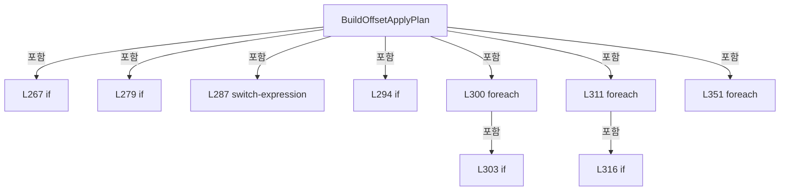

변경 전 점검: 입력/반환 타입, 위 호출자, 예외/취소 경로, 공유 상태와 저장·전송 소비자를 함께 확인합니다. 값의 단위나 물리 방향을 이름만으로 확정하지 않습니다.

### MethodDeclaration `BuildDirectDeltas` · L385–397

[Drilling.UI/Menu/Menus/CMenuCorrection.ReviewData.Offset.cs:385–397](https://github.com/kjuws10-rgb/A3Drilling/blob/28764c91d521777b8ee068dd7aaf2d3902ce9fe2/Drilling.UI/Menu/Menus/CMenuCorrection.ReviewData.Offset.cs#L385-L397)

| 항목 | 실제 추출 값 |
| --- | --- |
| 서명 | System.Collections.Generic.IReadOnlyList<Drilling.UI.Menu.Menus.CMenuCorrection.CReviewDataPanel.ST_REVIEW_OFFSET_DELTA> Drilling.UI.Menu.Menus.CMenuCorrection.CReviewDataPanel.BuildDirectDeltas(System.Collections.Generic.IReadOnlyList<Drilling.Common.Review.ST_REVIEW_RESULT_FILE_ROW>, System.Collections.Generic.IReadOnlyDictionary<string, Drilling.Common.Review.ST_REVIEW_PLAN_POINT>) |
| 접근/수식자 | Private / private, static |
| 반환/값 타입 | System.Collections.Generic.IReadOnlyList<Drilling.UI.Menu.Menus.CMenuCorrection.CReviewDataPanel.ST_REVIEW_OFFSET_DELTA> |
| 소속 타입 | NamedType:Drilling.UI.Menu.Menus.CMenuCorrection.CReviewDataPanel |

입력 계약:

| 이름 | 타입 | 전달 | 선택/기본값 |
| --- | --- | --- | --- |
| rows | System.Collections.Generic.IReadOnlyList<Drilling.Common.Review.ST_REVIEW_RESULT_FILE_ROW> | None | False /  |
| pointLookup | System.Collections.Generic.IReadOnlyDictionary<string, Drilling.Common.Review.ST_REVIEW_PLAN_POINT> | None | False /  |

정적 호출자로 확인된 위치:

| 호출 파일/행 | 호출 표현식 | 런타임 분기 가능 |
| --- | --- | --- |
| [Drilling.UI/Menu/Menus/CMenuCorrection.ReviewData.Offset.cs:289–289](https://github.com/kjuws10-rgb/A3Drilling/blob/28764c91d521777b8ee068dd7aaf2d3902ce9fe2/Drilling.UI/Menu/Menus/CMenuCorrection.ReviewData.Offset.cs#L289-L289) | BuildDirectDeltas | False |

호출하는 대상과 해석 범위:

| 원본 행 | 표현식 | 분석 상태 | 대상/소스 위치 |
| --- | --- | --- | --- |
| 389 | MeasuredRows(rows) .Where(row => row.Judge.Equals("OK", StringComparison.OrdinalIgnoreCase)) .Select(row => { var point = ResolveResultPoint(row, pointLookup); return new ST_REVIEW_OFFSET_DELTA(point, row.ErrorX, row.ErrorY); }) .ToArray | resolved | Drilling.UI.Menu.Menus.CMenuCorrection.CReviewDataPanel.ST_REVIEW_OFFSET_DELTA[] System.Collections.Generic.IEnumerable<Drilling.UI.Menu.Menus.CMenuCorrection.CReviewDataPanel.ST_REVIEW_OFFSET_DELTA>.ToArray<Drilling.UI.Menu.Menus.CMenuCorrection.CReviewDataPanel.ST_REVIEW_OFFSET_DELTA>() |
| 389 | MeasuredRows(rows) .Where(row => row.Judge.Equals("OK", StringComparison.OrdinalIgnoreCase)) .Select | resolved | System.Collections.Generic.IEnumerable<Drilling.UI.Menu.Menus.CMenuCorrection.CReviewDataPanel.ST_REVIEW_OFFSET_DELTA> System.Collections.Generic.IEnumerable<Drilling.Common.Review.ST_REVIEW_RESULT_FILE_ROW>.Select<Drilling.Common.Review.ST_REVIEW_RESULT_FILE_ROW, Drilling.UI.Menu.Menus.CMenuCorrection.CReviewDataPanel.ST_REVIEW_OFFSET_DELTA>(System.Func<Drilling.Common.Review.ST_REVIEW_RESULT_FILE_ROW, Drilling.UI.Menu.Menus.CMenuCorrection.CReviewDataPanel.ST_REVIEW_OFFSET_DELTA>) |
| 389 | MeasuredRows(rows) .Where | resolved | System.Collections.Generic.IEnumerable<Drilling.Common.Review.ST_REVIEW_RESULT_FILE_ROW> System.Collections.Generic.IEnumerable<Drilling.Common.Review.ST_REVIEW_RESULT_FILE_ROW>.Where<Drilling.Common.Review.ST_REVIEW_RESULT_FILE_ROW>(System.Func<Drilling.Common.Review.ST_REVIEW_RESULT_FILE_ROW, bool>) |
| 389 | MeasuredRows | resolved | System.Collections.Generic.IEnumerable<Drilling.Common.Review.ST_REVIEW_RESULT_FILE_ROW> Drilling.UI.Menu.Menus.CMenuCorrection.CReviewDataPanel.MeasuredRows(System.Collections.Generic.IReadOnlyList<Drilling.Common.Review.ST_REVIEW_RESULT_FILE_ROW>) · Drilling.UI/Menu/Menus/CMenuCorrection.ReviewData.Offset.cs:471 |
| 390 | row.Judge.Equals | resolved | bool string.Equals(string?, System.StringComparison) |
| 393 | ResolveResultPoint | resolved | Drilling.Common.Review.ST_REVIEW_PLAN_POINT Drilling.UI.Menu.Menus.CMenuCorrection.CReviewDataPanel.ResolveResultPoint(Drilling.Common.Review.ST_REVIEW_RESULT_FILE_ROW, System.Collections.Generic.IReadOnlyDictionary<string, Drilling.Common.Review.ST_REVIEW_PLAN_POINT>) · Drilling.UI/Menu/Menus/CMenuCorrection.ReviewData.Offset.cs:496 |
| 394 | new ST_REVIEW_OFFSET_DELTA | resolved | Drilling.UI.Menu.Menus.CMenuCorrection.CReviewDataPanel.ST_REVIEW_OFFSET_DELTA.ST_REVIEW_OFFSET_DELTA(Drilling.Common.Review.ST_REVIEW_PLAN_POINT, double, double) · Drilling.UI/Menu/Menus/CMenuCorrection.ReviewData.Offset.cs:712 |

본문의 실제 연산·분기·예외·반환 순서(원문 위치 순):

| 원본 행 | 종류 | 주석 해설 |
| --- | --- | --- |
| 389 | call | 함수·델리게이트 또는 객체 생성자를 호출합니다: MeasuredRows(rows) |
| 389 | call | 함수·델리게이트 또는 객체 생성자를 호출합니다: MeasuredRows(rows) .Where(row => row.Judge.Equals("OK", StringComparison.OrdinalIgnoreCase)) |
| 389 | call | 함수·델리게이트 또는 객체 생성자를 호출합니다: MeasuredRows(rows) .Where(row => row.Judge.Equals("OK", StringComparison.OrdinalIgnoreCase)) .Select(row => { var point = ResolveResultPoint(row, pointLookup); return new ST_REVIEW_OFFSET_DELTA(point, row.ErrorX, row.Err… |
| 389 | call | 함수·델리게이트 또는 객체 생성자를 호출합니다: MeasuredRows(rows) .Where(row => row.Judge.Equals("OK", StringComparison.OrdinalIgnoreCase)) .Select(row => { var point = ResolveResultPoint(row, pointLookup); return new ST_REVIEW_OFFSET_DELTA(point, row.ErrorX, row.Err… |
| 389 | return | 호출자에게 값 또는 제어를 반환합니다: return MeasuredRows(rows) .Where(row => row.Judge.Equals("OK", StringComparison.OrdinalIgnoreCase)) .Select(row => { var point = ResolveResultPoint(row, pointLookup); return new ST_REVIEW_OFFSET_DELTA(point, row.ErrorX, row.ErrorY |
| 390 | call | 함수·델리게이트 또는 객체 생성자를 호출합니다: row.Judge.Equals("OK", StringComparison.OrdinalIgnoreCase) |
| 393 | call | 함수·델리게이트 또는 객체 생성자를 호출합니다: ResolveResultPoint(row, pointLookup) |
| 393 | local-declaration | 지역 변수를 선언합니다: var point = ResolveResultPoint(row, pointLookup); |
| 393 | variable-initializer | 변수의 초기값을 지정합니다: point = ResolveResultPoint(row, pointLookup) |
| 394 | call | 함수·델리게이트 또는 객체 생성자를 호출합니다: new ST_REVIEW_OFFSET_DELTA(point, row.ErrorX, row.ErrorY) |
| 394 | return | 호출자에게 값 또는 제어를 반환합니다: return new ST_REVIEW_OFFSET_DELTA(point, row.ErrorX, row.ErrorY); |

변경 전 점검: 입력/반환 타입, 위 호출자, 예외/취소 경로, 공유 상태와 저장·전송 소비자를 함께 확인합니다. 값의 단위나 물리 방향을 이름만으로 확정하지 않습니다.

### MethodDeclaration `BuildRoughDeltas` · L399–441

[Drilling.UI/Menu/Menus/CMenuCorrection.ReviewData.Offset.cs:399–441](https://github.com/kjuws10-rgb/A3Drilling/blob/28764c91d521777b8ee068dd7aaf2d3902ce9fe2/Drilling.UI/Menu/Menus/CMenuCorrection.ReviewData.Offset.cs#L399-L441)

| 항목 | 실제 추출 값 |
| --- | --- |
| 서명 | System.Collections.Generic.IReadOnlyList<Drilling.UI.Menu.Menus.CMenuCorrection.CReviewDataPanel.ST_REVIEW_OFFSET_DELTA> Drilling.UI.Menu.Menus.CMenuCorrection.CReviewDataPanel.BuildRoughDeltas(Drilling.Common.Review.ST_REVIEW_RESULT_FILE_DATA, System.Collections.Generic.IReadOnlyList<Drilling.Common.Review.ST_REVIEW_PLAN_POINT>, System.Collections.Generic.IReadOnlyDictionary<string, Drilling.Common.Review.ST_REVIEW_PLAN_POINT>) |
| 접근/수식자 | Private / private, static |
| 반환/값 타입 | System.Collections.Generic.IReadOnlyList<Drilling.UI.Menu.Menus.CMenuCorrection.CReviewDataPanel.ST_REVIEW_OFFSET_DELTA> |
| 소속 타입 | NamedType:Drilling.UI.Menu.Menus.CMenuCorrection.CReviewDataPanel |

입력 계약:

| 이름 | 타입 | 전달 | 선택/기본값 |
| --- | --- | --- | --- |
| result | Drilling.Common.Review.ST_REVIEW_RESULT_FILE_DATA | None | False /  |
| allPoints | System.Collections.Generic.IReadOnlyList<Drilling.Common.Review.ST_REVIEW_PLAN_POINT> | None | False /  |
| pointLookup | System.Collections.Generic.IReadOnlyDictionary<string, Drilling.Common.Review.ST_REVIEW_PLAN_POINT> | None | False /  |

정적 호출자로 확인된 위치:

| 호출 파일/행 | 호출 표현식 | 런타임 분기 가능 |
| --- | --- | --- |
| [Drilling.UI/Menu/Menus/CMenuCorrection.ReviewData.Offset.cs:290–290](https://github.com/kjuws10-rgb/A3Drilling/blob/28764c91d521777b8ee068dd7aaf2d3902ce9fe2/Drilling.UI/Menu/Menus/CMenuCorrection.ReviewData.Offset.cs#L290-L290) | BuildRoughDeltas | False |

호출하는 대상과 해석 범위:

| 원본 행 | 표현식 | 분석 상태 | 대상/소스 위치 |
| --- | --- | --- | --- |
| 404 | result.RuleScope.Trim().ToUpperInvariant | resolved | string string.ToUpperInvariant() |
| 404 | result.RuleScope.Trim | resolved | string string.Trim() |
| 408 | new InvalidDataException | resolved | System.IO.InvalidDataException.InvalidDataException(string?) |
| 410 | MeasuredRows(result.Rows) .Where(row => row.Judge.Equals("OK", StringComparison.OrdinalIgnoreCase)) .Select(row => { var point = ResolveResultPoint(row, pointLookup); return point with { Use = true, ErrorX = row.ErrorX, ErrorY = row.ErrorY, State = EN_REVIEW_POINT_STATE.Ok, Judge = "OK" }; }) .ToArray | resolved | Drilling.Common.Review.ST_REVIEW_PLAN_POINT[] System.Collections.Generic.IEnumerable<Drilling.Common.Review.ST_REVIEW_PLAN_POINT>.ToArray<Drilling.Common.Review.ST_REVIEW_PLAN_POINT>() |
| 410 | MeasuredRows(result.Rows) .Where(row => row.Judge.Equals("OK", StringComparison.OrdinalIgnoreCase)) .Select | resolved | System.Collections.Generic.IEnumerable<Drilling.Common.Review.ST_REVIEW_PLAN_POINT> System.Collections.Generic.IEnumerable<Drilling.Common.Review.ST_REVIEW_RESULT_FILE_ROW>.Select<Drilling.Common.Review.ST_REVIEW_RESULT_FILE_ROW, Drilling.Common.Review.ST_REVIEW_PLAN_POINT>(System.Func<Drilling.Common.Review.ST_REVIEW_RESULT_FILE_ROW, Drilling.Common.Review.ST_REVIEW_PLAN_POINT>) |
| 410 | MeasuredRows(result.Rows) .Where | resolved | System.Collections.Generic.IEnumerable<Drilling.Common.Review.ST_REVIEW_RESULT_FILE_ROW> System.Collections.Generic.IEnumerable<Drilling.Common.Review.ST_REVIEW_RESULT_FILE_ROW>.Where<Drilling.Common.Review.ST_REVIEW_RESULT_FILE_ROW>(System.Func<Drilling.Common.Review.ST_REVIEW_RESULT_FILE_ROW, bool>) |
| 410 | MeasuredRows | resolved | System.Collections.Generic.IEnumerable<Drilling.Common.Review.ST_REVIEW_RESULT_FILE_ROW> Drilling.UI.Menu.Menus.CMenuCorrection.CReviewDataPanel.MeasuredRows(System.Collections.Generic.IReadOnlyList<Drilling.Common.Review.ST_REVIEW_RESULT_FILE_ROW>) · Drilling.UI/Menu/Menus/CMenuCorrection.ReviewData.Offset.cs:471 |
| 411 | row.Judge.Equals | resolved | bool string.Equals(string?, System.StringComparison) |
| 414 | ResolveResultPoint | resolved | Drilling.Common.Review.ST_REVIEW_PLAN_POINT Drilling.UI.Menu.Menus.CMenuCorrection.CReviewDataPanel.ResolveResultPoint(Drilling.Common.Review.ST_REVIEW_RESULT_FILE_ROW, System.Collections.Generic.IReadOnlyDictionary<string, Drilling.Common.Review.ST_REVIEW_PLAN_POINT>) · Drilling.UI/Menu/Menus/CMenuCorrection.ReviewData.Offset.cs:496 |
| 425 | measured .GroupBy(point => scope == EN_REVIEW_CORRECTION_SCOPE.HeadCell ? (point.HeadNo, point.CellNo) : (point.HeadNo, 0)) .FirstOrDefault | resolved | System.Linq.IGrouping<(int HeadNo, int), Drilling.Common.Review.ST_REVIEW_PLAN_POINT>? System.Collections.Generic.IEnumerable<System.Linq.IGrouping<(int HeadNo, int), Drilling.Common.Review.ST_REVIEW_PLAN_POINT>>.FirstOrDefault<System.Linq.IGrouping<(int HeadNo, int), Drilling.Common.Review.ST_REVIEW_PLAN_POINT>>(System.Func<System.Linq.IGrouping<(int HeadNo, int), Drilling.Common.Review.ST_REVIEW_PLAN_POINT>, bool>) |
| 425 | measured .GroupBy | resolved | System.Collections.Generic.IEnumerable<System.Linq.IGrouping<(int HeadNo, int), Drilling.Common.Review.ST_REVIEW_PLAN_POINT>> System.Collections.Generic.IEnumerable<Drilling.Common.Review.ST_REVIEW_PLAN_POINT>.GroupBy<Drilling.Common.Review.ST_REVIEW_PLAN_POINT, (int HeadNo, int)>(System.Func<Drilling.Common.Review.ST_REVIEW_PLAN_POINT, (int HeadNo, int)>) |
| 427 | group.Count | resolved | int System.Collections.Generic.IEnumerable<Drilling.Common.Review.ST_REVIEW_PLAN_POINT>.Count<Drilling.Common.Review.ST_REVIEW_PLAN_POINT>() |
| 430 | new InvalidDataException | resolved | System.IO.InvalidDataException.InvalidDataException(string?) |
| 433 | new ST_REVIEW_CORRECTION_PLAN | resolved | Drilling.Common.Review.ST_REVIEW_CORRECTION_PLAN.ST_REVIEW_CORRECTION_PLAN(Drilling.Common.Review.EN_REVIEW_CORRECTION_RULE, Drilling.Common.Review.EN_REVIEW_CORRECTION_SCOPE, System.Collections.Generic.IReadOnlyList<Drilling.Common.Review.ST_REVIEW_PLAN_POINT>, Drilling.Common.Review.EN_REVIEW_REFERENCE_LINE, int) · Drilling.Common/Review/CReviewManager.cs:4246 |
| 434 | new ST_REVIEW_PLAN | resolved | Drilling.Common.Review.ST_REVIEW_PLAN.ST_REVIEW_PLAN(string, int, double, double, Drilling.Common.Review.EN_VISION_FLIP_TYPE, System.DateTimeOffset, System.Collections.Generic.IReadOnlyList<Drilling.Common.Review.ST_REVIEW_PLAN_POINT>) · Drilling.Common/Review/CReviewManager.cs:4165 |
| 438 | CReviewManager.ProjectCorrectionRows(plan, measured) .Select(point => new ST_REVIEW_OFFSET_DELTA(point, point.ErrorX, point.ErrorY)) .ToArray | resolved | Drilling.UI.Menu.Menus.CMenuCorrection.CReviewDataPanel.ST_REVIEW_OFFSET_DELTA[] System.Collections.Generic.IEnumerable<Drilling.UI.Menu.Menus.CMenuCorrection.CReviewDataPanel.ST_REVIEW_OFFSET_DELTA>.ToArray<Drilling.UI.Menu.Menus.CMenuCorrection.CReviewDataPanel.ST_REVIEW_OFFSET_DELTA>() |
| 438 | CReviewManager.ProjectCorrectionRows(plan, measured) .Select | resolved | System.Collections.Generic.IEnumerable<Drilling.UI.Menu.Menus.CMenuCorrection.CReviewDataPanel.ST_REVIEW_OFFSET_DELTA> System.Collections.Generic.IEnumerable<Drilling.Common.Review.ST_REVIEW_PLAN_POINT>.Select<Drilling.Common.Review.ST_REVIEW_PLAN_POINT, Drilling.UI.Menu.Menus.CMenuCorrection.CReviewDataPanel.ST_REVIEW_OFFSET_DELTA>(System.Func<Drilling.Common.Review.ST_REVIEW_PLAN_POINT, Drilling.UI.Menu.Menus.CMenuCorrection.CReviewDataPanel.ST_REVIEW_OFFSET_DELTA>) |
| 438 | CReviewManager.ProjectCorrectionRows | resolved | System.Collections.Generic.IReadOnlyList<Drilling.Common.Review.ST_REVIEW_PLAN_POINT> Drilling.Common.Review.CReviewManager.ProjectCorrectionRows(Drilling.Common.Review.ST_REVIEW_PLAN, System.Collections.Generic.IReadOnlyList<Drilling.Common.Review.ST_REVIEW_PLAN_POINT>) · Drilling.Common/Review/CReviewManager.cs:794 |
| 439 | new ST_REVIEW_OFFSET_DELTA | resolved | Drilling.UI.Menu.Menus.CMenuCorrection.CReviewDataPanel.ST_REVIEW_OFFSET_DELTA.ST_REVIEW_OFFSET_DELTA(Drilling.Common.Review.ST_REVIEW_PLAN_POINT, double, double) · Drilling.UI/Menu/Menus/CMenuCorrection.ReviewData.Offset.cs:712 |

본문의 실제 연산·분기·예외·반환 순서(원문 위치 순):

| 원본 행 | 종류 | 주석 해설 |
| --- | --- | --- |
| 404 | call | 함수·델리게이트 또는 객체 생성자를 호출합니다: result.RuleScope.Trim().ToUpperInvariant() |
| 404 | call | 함수·델리게이트 또는 객체 생성자를 호출합니다: result.RuleScope.Trim() |
| 404 | local-declaration | 지역 변수를 선언합니다: var scope = result.RuleScope.Trim().ToUpperInvariant() switch { "HEAD" => EN_REVIEW_CORRECTION_SCOPE.Head, "HEAD_CELL" => EN_REVIEW_CORRECTION_SCOPE.HeadCell, _ => throw new InvalidDataException("ROUGH 결과의 RULE_SCOPE가 HEAD 또는 HEAD |
| 404 | switch-expression | 값별 결과식을 선택합니다: result.RuleScope.Trim().ToUpperInvariant() switch { "HEAD" => EN_REVIEW_CORRECTION_SCOPE.Head, "HEAD_CELL" => EN_REVIEW_CORRECTION_SCOPE.HeadCell, _ => throw new InvalidDataException("ROUGH 결과의 RULE_SCOPE가 HEAD 또는 HEAD_CELL이 아닙니다. |
| 404 | variable-initializer | 변수의 초기값을 지정합니다: scope = result.RuleScope.Trim().ToUpperInvariant() switch { "HEAD" => EN_REVIEW_CORRECTION_SCOPE.Head, "HEAD_CELL" => EN_REVIEW_CORRECTION_SCOPE.HeadCell, _ => throw new InvalidDataException("ROUGH 결과의 RULE_SCOPE가 HEAD 또는 HEAD_CEL |
| 408 | call | 함수·델리게이트 또는 객체 생성자를 호출합니다: new InvalidDataException("ROUGH 결과의 RULE_SCOPE가 HEAD 또는 HEAD_CELL이 아닙니다.") |
| 408 | throw | 예외를 발생/전달합니다: throw new InvalidDataException("ROUGH 결과의 RULE_SCOPE가 HEAD 또는 HEAD_CELL이 아닙니다.") |
| 410 | call | 함수·델리게이트 또는 객체 생성자를 호출합니다: MeasuredRows(result.Rows) |
| 410 | call | 함수·델리게이트 또는 객체 생성자를 호출합니다: MeasuredRows(result.Rows) .Where(row => row.Judge.Equals("OK", StringComparison.OrdinalIgnoreCase)) |
| 410 | call | 함수·델리게이트 또는 객체 생성자를 호출합니다: MeasuredRows(result.Rows) .Where(row => row.Judge.Equals("OK", StringComparison.OrdinalIgnoreCase)) .Select(row => { var point = ResolveResultPoint(row, pointLookup); return point with { Use = true, ErrorX = row.ErrorX, … |
| 410 | call | 함수·델리게이트 또는 객체 생성자를 호출합니다: MeasuredRows(result.Rows) .Where(row => row.Judge.Equals("OK", StringComparison.OrdinalIgnoreCase)) .Select(row => { var point = ResolveResultPoint(row, pointLookup); return point with { Use = true, ErrorX = row.ErrorX, … |
| 410 | local-declaration | 지역 변수를 선언합니다: var measured = MeasuredRows(result.Rows) .Where(row => row.Judge.Equals("OK", StringComparison.OrdinalIgnoreCase)) .Select(row => { var point = ResolveResultPoint(row, pointLookup); return point with { Use = true, ErrorX = row.Err |
| 410 | variable-initializer | 변수의 초기값을 지정합니다: measured = MeasuredRows(result.Rows) .Where(row => row.Judge.Equals("OK", StringComparison.OrdinalIgnoreCase)) .Select(row => { var point = ResolveResultPoint(row, pointLookup); return point with { Use = true, ErrorX = row.ErrorX, |
| 411 | call | 함수·델리게이트 또는 객체 생성자를 호출합니다: row.Judge.Equals("OK", StringComparison.OrdinalIgnoreCase) |
| 414 | call | 함수·델리게이트 또는 객체 생성자를 호출합니다: ResolveResultPoint(row, pointLookup) |
| 414 | local-declaration | 지역 변수를 선언합니다: var point = ResolveResultPoint(row, pointLookup); |
| 414 | variable-initializer | 변수의 초기값을 지정합니다: point = ResolveResultPoint(row, pointLookup) |
| 415 | return | 호출자에게 값 또는 제어를 반환합니다: return point with { Use = true, ErrorX = row.ErrorX, ErrorY = row.ErrorY, State = EN_REVIEW_POINT_STATE.Ok, Judge = "OK" }; |
| 417 | assignment | 값을 대상에 대입합니다: Use = true |
| 418 | assignment | 값을 대상에 대입합니다: ErrorX = row.ErrorX |
| 419 | assignment | 값을 대상에 대입합니다: ErrorY = row.ErrorY |
| 420 | assignment | 값을 대상에 대입합니다: State = EN_REVIEW_POINT_STATE.Ok |
| 421 | assignment | 값을 대상에 대입합니다: Judge = "OK" |
| 425 | call | 함수·델리게이트 또는 객체 생성자를 호출합니다: measured .GroupBy(point => scope == EN_REVIEW_CORRECTION_SCOPE.HeadCell ? (point.HeadNo, point.CellNo) : (point.HeadNo, 0)) |
| 425 | call | 함수·델리게이트 또는 객체 생성자를 호출합니다: measured .GroupBy(point => scope == EN_REVIEW_CORRECTION_SCOPE.HeadCell ? (point.HeadNo, point.CellNo) : (point.HeadNo, 0)) .FirstOrDefault(group => group.Count() > 1) |
| 425 | local-declaration | 지역 변수를 선언합니다: var duplicateScope = measured .GroupBy(point => scope == EN_REVIEW_CORRECTION_SCOPE.HeadCell ? (point.HeadNo, point.CellNo) : (point.HeadNo, 0)) .FirstOrDefault(group => group.Count() > 1); |
| 425 | variable-initializer | 변수의 초기값을 지정합니다: duplicateScope = measured .GroupBy(point => scope == EN_REVIEW_CORRECTION_SCOPE.HeadCell ? (point.HeadNo, point.CellNo) : (point.HeadNo, 0)) .FirstOrDefault(group => group.Count() > 1) |
| 426 | conditional-expression | 조건에 따라 결과식을 선택합니다: scope == EN_REVIEW_CORRECTION_SCOPE.HeadCell ? (point.HeadNo, point.CellNo) : (point.HeadNo, 0) |
| 427 | call | 함수·델리게이트 또는 객체 생성자를 호출합니다: group.Count() |
| 428 | if | 조건에 따라 분기합니다: if (duplicateScope is not null) |
| 430 | call | 함수·델리게이트 또는 객체 생성자를 호출합니다: new InvalidDataException($"ROUGH 결과에 같은 적용 범위의 측정값이 중복되었습니다: H{duplicateScope.Key.HeadNo:00} / CELL {duplicateScope.Key.Item2:00}") |
| 430 | throw | 예외를 발생/전달합니다: throw new InvalidDataException($"ROUGH 결과에 같은 적용 범위의 측정값이 중복되었습니다: H{duplicateScope.Key.HeadNo:00} / CELL {duplicateScope.Key.Item2:00}"); |
| 433 | call | 함수·델리게이트 또는 객체 생성자를 호출합니다: new ST_REVIEW_CORRECTION_PLAN(EN_REVIEW_CORRECTION_RULE.Rough, scope, allPoints) |
| 433 | local-declaration | 지역 변수를 선언합니다: var correctionPlan = new ST_REVIEW_CORRECTION_PLAN(EN_REVIEW_CORRECTION_RULE.Rough, scope, allPoints); |
| 433 | variable-initializer | 변수의 초기값을 지정합니다: correctionPlan = new ST_REVIEW_CORRECTION_PLAN(EN_REVIEW_CORRECTION_RULE.Rough, scope, allPoints) |
| 434 | call | 함수·델리게이트 또는 객체 생성자를 호출합니다: new ST_REVIEW_PLAN("OFFSET_PREVIEW", 0, 0, 0, EN_VISION_FLIP_TYPE.Normal, DateTimeOffset.Now, measured) { CorrectionPlan = correctionPlan } |
| 434 | local-declaration | 지역 변수를 선언합니다: var plan = new ST_REVIEW_PLAN("OFFSET_PREVIEW", 0, 0, 0, EN_VISION_FLIP_TYPE.Normal, DateTimeOffset.Now, measured) { CorrectionPlan = correctionPlan }; |
| 434 | variable-initializer | 변수의 초기값을 지정합니다: plan = new ST_REVIEW_PLAN("OFFSET_PREVIEW", 0, 0, 0, EN_VISION_FLIP_TYPE.Normal, DateTimeOffset.Now, measured) { CorrectionPlan = correctionPlan } |
| 436 | assignment | 값을 대상에 대입합니다: CorrectionPlan = correctionPlan |
| 438 | call | 함수·델리게이트 또는 객체 생성자를 호출합니다: CReviewManager.ProjectCorrectionRows(plan, measured) |
| 438 | call | 함수·델리게이트 또는 객체 생성자를 호출합니다: CReviewManager.ProjectCorrectionRows(plan, measured) .Select(point => new ST_REVIEW_OFFSET_DELTA(point, point.ErrorX, point.ErrorY)) |
| 438 | call | 함수·델리게이트 또는 객체 생성자를 호출합니다: CReviewManager.ProjectCorrectionRows(plan, measured) .Select(point => new ST_REVIEW_OFFSET_DELTA(point, point.ErrorX, point.ErrorY)) .ToArray() |
| 438 | return | 호출자에게 값 또는 제어를 반환합니다: return CReviewManager.ProjectCorrectionRows(plan, measured) .Select(point => new ST_REVIEW_OFFSET_DELTA(point, point.ErrorX, point.ErrorY)) .ToArray(); |
| 439 | call | 함수·델리게이트 또는 객체 생성자를 호출합니다: new ST_REVIEW_OFFSET_DELTA(point, point.ErrorX, point.ErrorY) |

제어 구문의 포함 구조(실제 실행 순서/CFG가 아닌 구문 탐색 그림):

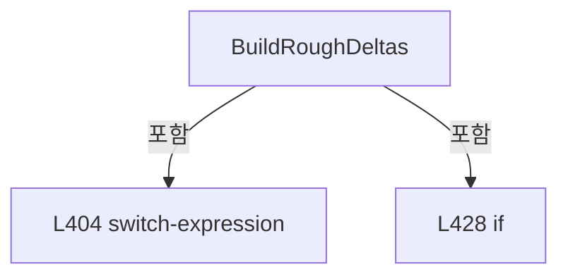

변경 전 점검: 입력/반환 타입, 위 호출자, 예외/취소 경로, 공유 상태와 저장·전송 소비자를 함께 확인합니다. 값의 단위나 물리 방향을 이름만으로 확정하지 않습니다.

### MethodDeclaration `BuildFineDeltas` · L443–469

[Drilling.UI/Menu/Menus/CMenuCorrection.ReviewData.Offset.cs:443–469](https://github.com/kjuws10-rgb/A3Drilling/blob/28764c91d521777b8ee068dd7aaf2d3902ce9fe2/Drilling.UI/Menu/Menus/CMenuCorrection.ReviewData.Offset.cs#L443-L469)

| 항목 | 실제 추출 값 |
| --- | --- |
| 서명 | System.Collections.Generic.IReadOnlyList<Drilling.UI.Menu.Menus.CMenuCorrection.CReviewDataPanel.ST_REVIEW_OFFSET_DELTA> Drilling.UI.Menu.Menus.CMenuCorrection.CReviewDataPanel.BuildFineDeltas(Drilling.Common.Review.ST_REVIEW_RESULT_FILE_DATA, System.Collections.Generic.IReadOnlyList<Drilling.Common.Review.ST_REVIEW_PLAN_POINT>, System.Collections.Generic.IReadOnlyDictionary<string, Drilling.Common.Review.ST_REVIEW_PLAN_POINT>) |
| 접근/수식자 | Private / private, static |
| 반환/값 타입 | System.Collections.Generic.IReadOnlyList<Drilling.UI.Menu.Menus.CMenuCorrection.CReviewDataPanel.ST_REVIEW_OFFSET_DELTA> |
| 소속 타입 | NamedType:Drilling.UI.Menu.Menus.CMenuCorrection.CReviewDataPanel |

입력 계약:

| 이름 | 타입 | 전달 | 선택/기본값 |
| --- | --- | --- | --- |
| result | Drilling.Common.Review.ST_REVIEW_RESULT_FILE_DATA | None | False /  |
| allPoints | System.Collections.Generic.IReadOnlyList<Drilling.Common.Review.ST_REVIEW_PLAN_POINT> | None | False /  |
| pointLookup | System.Collections.Generic.IReadOnlyDictionary<string, Drilling.Common.Review.ST_REVIEW_PLAN_POINT> | None | False /  |

정적 호출자로 확인된 위치:

| 호출 파일/행 | 호출 표현식 | 런타임 분기 가능 |
| --- | --- | --- |
| [Drilling.UI/Menu/Menus/CMenuCorrection.ReviewData.Offset.cs:291–291](https://github.com/kjuws10-rgb/A3Drilling/blob/28764c91d521777b8ee068dd7aaf2d3902ce9fe2/Drilling.UI/Menu/Menus/CMenuCorrection.ReviewData.Offset.cs#L291-L291) | BuildFineDeltas | False |

호출하는 대상과 해석 범위:

| 원본 행 | 표현식 | 분석 상태 | 대상/소스 위치 |
| --- | --- | --- | --- |
| 448 | MeasuredRows(result.Rows).ToArray | resolved | Drilling.Common.Review.ST_REVIEW_RESULT_FILE_ROW[] System.Collections.Generic.IEnumerable<Drilling.Common.Review.ST_REVIEW_RESULT_FILE_ROW>.ToArray<Drilling.Common.Review.ST_REVIEW_RESULT_FILE_ROW>() |
| 448 | MeasuredRows | resolved | System.Collections.Generic.IEnumerable<Drilling.Common.Review.ST_REVIEW_RESULT_FILE_ROW> Drilling.UI.Menu.Menus.CMenuCorrection.CReviewDataPanel.MeasuredRows(System.Collections.Generic.IReadOnlyList<Drilling.Common.Review.ST_REVIEW_RESULT_FILE_ROW>) · Drilling.UI/Menu/Menus/CMenuCorrection.ReviewData.Offset.cs:471 |
| 449 | measuredRows.Any | resolved | bool System.Collections.Generic.IEnumerable<Drilling.Common.Review.ST_REVIEW_RESULT_FILE_ROW>.Any<Drilling.Common.Review.ST_REVIEW_RESULT_FILE_ROW>(System.Func<Drilling.Common.Review.ST_REVIEW_RESULT_FILE_ROW, bool>) |
| 449 | row.Judge.Equals | resolved | bool string.Equals(string?, System.StringComparison) |
| 451 | new InvalidOperationException | resolved | System.InvalidOperationException.InvalidOperationException(string?) |
| 454 | measuredRows.Select(row => { var point = ResolveResultPoint(row, pointLookup); return point with { Use = true, ErrorX = row.ErrorX, ErrorY = row.ErrorY, State = EN_REVIEW_POINT_STATE.Ok, Judge = "OK" }; }).ToArray | resolved | Drilling.Common.Review.ST_REVIEW_PLAN_POINT[] System.Collections.Generic.IEnumerable<Drilling.Common.Review.ST_REVIEW_PLAN_POINT>.ToArray<Drilling.Common.Review.ST_REVIEW_PLAN_POINT>() |
| 454 | measuredRows.Select | resolved | System.Collections.Generic.IEnumerable<Drilling.Common.Review.ST_REVIEW_PLAN_POINT> System.Collections.Generic.IEnumerable<Drilling.Common.Review.ST_REVIEW_RESULT_FILE_ROW>.Select<Drilling.Common.Review.ST_REVIEW_RESULT_FILE_ROW, Drilling.Common.Review.ST_REVIEW_PLAN_POINT>(System.Func<Drilling.Common.Review.ST_REVIEW_RESULT_FILE_ROW, Drilling.Common.Review.ST_REVIEW_PLAN_POINT>) |
| 456 | ResolveResultPoint | resolved | Drilling.Common.Review.ST_REVIEW_PLAN_POINT Drilling.UI.Menu.Menus.CMenuCorrection.CReviewDataPanel.ResolveResultPoint(Drilling.Common.Review.ST_REVIEW_RESULT_FILE_ROW, System.Collections.Generic.IReadOnlyDictionary<string, Drilling.Common.Review.ST_REVIEW_PLAN_POINT>) · Drilling.UI/Menu/Menus/CMenuCorrection.ReviewData.Offset.cs:496 |
| 466 | CReviewManager.CalculateFineOffsets(allPoints, measurements, EN_VISION_FLIP_TYPE.Normal) .Select(delta => new ST_REVIEW_OFFSET_DELTA(delta.Shot, delta.X, delta.Y)) .ToArray | resolved | Drilling.UI.Menu.Menus.CMenuCorrection.CReviewDataPanel.ST_REVIEW_OFFSET_DELTA[] System.Collections.Generic.IEnumerable<Drilling.UI.Menu.Menus.CMenuCorrection.CReviewDataPanel.ST_REVIEW_OFFSET_DELTA>.ToArray<Drilling.UI.Menu.Menus.CMenuCorrection.CReviewDataPanel.ST_REVIEW_OFFSET_DELTA>() |
| 466 | CReviewManager.CalculateFineOffsets(allPoints, measurements, EN_VISION_FLIP_TYPE.Normal) .Select | resolved | System.Collections.Generic.IEnumerable<Drilling.UI.Menu.Menus.CMenuCorrection.CReviewDataPanel.ST_REVIEW_OFFSET_DELTA> System.Collections.Generic.IEnumerable<Drilling.Common.Review.ST_FINE_OFFSET_DELTA>.Select<Drilling.Common.Review.ST_FINE_OFFSET_DELTA, Drilling.UI.Menu.Menus.CMenuCorrection.CReviewDataPanel.ST_REVIEW_OFFSET_DELTA>(System.Func<Drilling.Common.Review.ST_FINE_OFFSET_DELTA, Drilling.UI.Menu.Menus.CMenuCorrection.CReviewDataPanel.ST_REVIEW_OFFSET_DELTA>) |
| 466 | CReviewManager.CalculateFineOffsets | resolved | System.Collections.Generic.IReadOnlyList<Drilling.Common.Review.ST_FINE_OFFSET_DELTA> Drilling.Common.Review.CReviewManager.CalculateFineOffsets(System.Collections.Generic.IReadOnlyList<Drilling.Common.Review.ST_REVIEW_PLAN_POINT>, System.Collections.Generic.IReadOnlyList<Drilling.Common.Review.ST_REVIEW_PLAN_POINT>, Drilling.Common.Review.EN_VISION_FLIP_TYPE) · Drilling.Common/Review/CReviewManager.cs:3616 |
| 467 | new ST_REVIEW_OFFSET_DELTA | resolved | Drilling.UI.Menu.Menus.CMenuCorrection.CReviewDataPanel.ST_REVIEW_OFFSET_DELTA.ST_REVIEW_OFFSET_DELTA(Drilling.Common.Review.ST_REVIEW_PLAN_POINT, double, double) · Drilling.UI/Menu/Menus/CMenuCorrection.ReviewData.Offset.cs:712 |

본문의 실제 연산·분기·예외·반환 순서(원문 위치 순):

| 원본 행 | 종류 | 주석 해설 |
| --- | --- | --- |
| 448 | call | 함수·델리게이트 또는 객체 생성자를 호출합니다: MeasuredRows(result.Rows).ToArray() |
| 448 | call | 함수·델리게이트 또는 객체 생성자를 호출합니다: MeasuredRows(result.Rows) |
| 448 | local-declaration | 지역 변수를 선언합니다: var measuredRows = MeasuredRows(result.Rows).ToArray(); |
| 448 | variable-initializer | 변수의 초기값을 지정합니다: measuredRows = MeasuredRows(result.Rows).ToArray() |
| 449 | call | 함수·델리게이트 또는 객체 생성자를 호출합니다: measuredRows.Any(row => !row.Judge.Equals("OK", StringComparison.OrdinalIgnoreCase)) |
| 449 | call | 함수·델리게이트 또는 객체 생성자를 호출합니다: row.Judge.Equals("OK", StringComparison.OrdinalIgnoreCase) |
| 449 | if | 조건에 따라 분기합니다: if (measuredRows.Any(row => !row.Judge.Equals("OK", StringComparison.OrdinalIgnoreCase))) |
| 451 | call | 함수·델리게이트 또는 객체 생성자를 호출합니다: new InvalidOperationException("FINE/AUTO 측정 결과에 NG 또는 비정상 상태가 있어 전체 Offset을 적용할 수 없습니다.") |
| 451 | throw | 예외를 발생/전달합니다: throw new InvalidOperationException("FINE/AUTO 측정 결과에 NG 또는 비정상 상태가 있어 전체 Offset을 적용할 수 없습니다."); |
| 454 | call | 함수·델리게이트 또는 객체 생성자를 호출합니다: measuredRows.Select(row => { var point = ResolveResultPoint(row, pointLookup); return point with { Use = true, ErrorX = row.ErrorX, ErrorY = row.ErrorY, State = EN_REVIEW_POINT_STATE.Ok, Judge = "OK" }; }).ToArray() |
| 454 | call | 함수·델리게이트 또는 객체 생성자를 호출합니다: measuredRows.Select(row => { var point = ResolveResultPoint(row, pointLookup); return point with { Use = true, ErrorX = row.ErrorX, ErrorY = row.ErrorY, State = EN_REVIEW_POINT_STATE.Ok, Judge = "OK" }; }) |
| 454 | local-declaration | 지역 변수를 선언합니다: var measurements = measuredRows.Select(row => { var point = ResolveResultPoint(row, pointLookup); return point with { Use = true, ErrorX = row.ErrorX, ErrorY = row.ErrorY, State = EN_REVIEW_POINT_STATE.Ok, Judge = "OK" }; }).ToArr |
| 454 | variable-initializer | 변수의 초기값을 지정합니다: measurements = measuredRows.Select(row => { var point = ResolveResultPoint(row, pointLookup); return point with { Use = true, ErrorX = row.ErrorX, ErrorY = row.ErrorY, State = EN_REVIEW_POINT_STATE.Ok, Judge = "OK" }; }).ToArray() |
| 456 | call | 함수·델리게이트 또는 객체 생성자를 호출합니다: ResolveResultPoint(row, pointLookup) |
| 456 | local-declaration | 지역 변수를 선언합니다: var point = ResolveResultPoint(row, pointLookup); |
| 456 | variable-initializer | 변수의 초기값을 지정합니다: point = ResolveResultPoint(row, pointLookup) |
| 457 | return | 호출자에게 값 또는 제어를 반환합니다: return point with { Use = true, ErrorX = row.ErrorX, ErrorY = row.ErrorY, State = EN_REVIEW_POINT_STATE.Ok, Judge = "OK" }; |
| 459 | assignment | 값을 대상에 대입합니다: Use = true |
| 460 | assignment | 값을 대상에 대입합니다: ErrorX = row.ErrorX |
| 461 | assignment | 값을 대상에 대입합니다: ErrorY = row.ErrorY |
| 462 | assignment | 값을 대상에 대입합니다: State = EN_REVIEW_POINT_STATE.Ok |
| 463 | assignment | 값을 대상에 대입합니다: Judge = "OK" |
| 466 | call | 함수·델리게이트 또는 객체 생성자를 호출합니다: CReviewManager.CalculateFineOffsets(allPoints, measurements, EN_VISION_FLIP_TYPE.Normal) |
| 466 | call | 함수·델리게이트 또는 객체 생성자를 호출합니다: CReviewManager.CalculateFineOffsets(allPoints, measurements, EN_VISION_FLIP_TYPE.Normal) .Select(delta => new ST_REVIEW_OFFSET_DELTA(delta.Shot, delta.X, delta.Y)) |
| 466 | call | 함수·델리게이트 또는 객체 생성자를 호출합니다: CReviewManager.CalculateFineOffsets(allPoints, measurements, EN_VISION_FLIP_TYPE.Normal) .Select(delta => new ST_REVIEW_OFFSET_DELTA(delta.Shot, delta.X, delta.Y)) .ToArray() |
| 466 | return | 호출자에게 값 또는 제어를 반환합니다: return CReviewManager.CalculateFineOffsets(allPoints, measurements, EN_VISION_FLIP_TYPE.Normal) .Select(delta => new ST_REVIEW_OFFSET_DELTA(delta.Shot, delta.X, delta.Y)) .ToArray(); |
| 467 | call | 함수·델리게이트 또는 객체 생성자를 호출합니다: new ST_REVIEW_OFFSET_DELTA(delta.Shot, delta.X, delta.Y) |

제어 구문의 포함 구조(실제 실행 순서/CFG가 아닌 구문 탐색 그림):

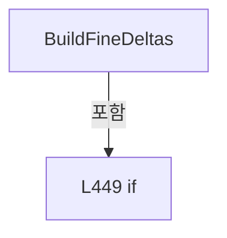

변경 전 점검: 입력/반환 타입, 위 호출자, 예외/취소 경로, 공유 상태와 저장·전송 소비자를 함께 확인합니다. 값의 단위나 물리 방향을 이름만으로 확정하지 않습니다.

### MethodDeclaration `MeasuredRows` · L471–481

[Drilling.UI/Menu/Menus/CMenuCorrection.ReviewData.Offset.cs:471–481](https://github.com/kjuws10-rgb/A3Drilling/blob/28764c91d521777b8ee068dd7aaf2d3902ce9fe2/Drilling.UI/Menu/Menus/CMenuCorrection.ReviewData.Offset.cs#L471-L481)

| 항목 | 실제 추출 값 |
| --- | --- |
| 서명 | System.Collections.Generic.IEnumerable<Drilling.Common.Review.ST_REVIEW_RESULT_FILE_ROW> Drilling.UI.Menu.Menus.CMenuCorrection.CReviewDataPanel.MeasuredRows(System.Collections.Generic.IReadOnlyList<Drilling.Common.Review.ST_REVIEW_RESULT_FILE_ROW>) |
| 접근/수식자 | Private / private, static |
| 반환/값 타입 | System.Collections.Generic.IEnumerable<Drilling.Common.Review.ST_REVIEW_RESULT_FILE_ROW> |
| 소속 타입 | NamedType:Drilling.UI.Menu.Menus.CMenuCorrection.CReviewDataPanel |

입력 계약:

| 이름 | 타입 | 전달 | 선택/기본값 |
| --- | --- | --- | --- |
| rows | System.Collections.Generic.IReadOnlyList<Drilling.Common.Review.ST_REVIEW_RESULT_FILE_ROW> | None | False /  |

정적 호출자로 확인된 위치:

| 호출 파일/행 | 호출 표현식 | 런타임 분기 가능 |
| --- | --- | --- |
| [Drilling.UI/Menu/Menus/CMenuCorrection.ReviewData.Offset.cs:389–389](https://github.com/kjuws10-rgb/A3Drilling/blob/28764c91d521777b8ee068dd7aaf2d3902ce9fe2/Drilling.UI/Menu/Menus/CMenuCorrection.ReviewData.Offset.cs#L389-L389) | MeasuredRows | False |
| [Drilling.UI/Menu/Menus/CMenuCorrection.ReviewData.Offset.cs:410–410](https://github.com/kjuws10-rgb/A3Drilling/blob/28764c91d521777b8ee068dd7aaf2d3902ce9fe2/Drilling.UI/Menu/Menus/CMenuCorrection.ReviewData.Offset.cs#L410-L410) | MeasuredRows | False |
| [Drilling.UI/Menu/Menus/CMenuCorrection.ReviewData.Offset.cs:448–448](https://github.com/kjuws10-rgb/A3Drilling/blob/28764c91d521777b8ee068dd7aaf2d3902ce9fe2/Drilling.UI/Menu/Menus/CMenuCorrection.ReviewData.Offset.cs#L448-L448) | MeasuredRows | False |

호출하는 대상과 해석 범위:

| 원본 행 | 표현식 | 분석 상태 | 대상/소스 위치 |
| --- | --- | --- | --- |
| 474 | rows.Any | resolved | bool System.Collections.Generic.IEnumerable<Drilling.Common.Review.ST_REVIEW_RESULT_FILE_ROW>.Any<Drilling.Common.Review.ST_REVIEW_RESULT_FILE_ROW>(System.Func<Drilling.Common.Review.ST_REVIEW_RESULT_FILE_ROW, bool>) |
| 474 | string.IsNullOrWhiteSpace | resolved | bool string.IsNullOrWhiteSpace(string?) |
| 476 | rows.Where | resolved | System.Collections.Generic.IEnumerable<Drilling.Common.Review.ST_REVIEW_RESULT_FILE_ROW> System.Collections.Generic.IEnumerable<Drilling.Common.Review.ST_REVIEW_RESULT_FILE_ROW>.Where<Drilling.Common.Review.ST_REVIEW_RESULT_FILE_ROW>(System.Func<Drilling.Common.Review.ST_REVIEW_RESULT_FILE_ROW, bool>) |
| 477 | row.ResultSource.Equals | resolved | bool string.Equals(string?, System.StringComparison) |
| 478 | row.ResultSource.Equals | resolved | bool string.Equals(string?, System.StringComparison) |
| 479 | row.ResultSource.Equals | resolved | bool string.Equals(string?, System.StringComparison) |
| 480 | rows.Where | resolved | System.Collections.Generic.IEnumerable<Drilling.Common.Review.ST_REVIEW_RESULT_FILE_ROW> System.Collections.Generic.IEnumerable<Drilling.Common.Review.ST_REVIEW_RESULT_FILE_ROW>.Where<Drilling.Common.Review.ST_REVIEW_RESULT_FILE_ROW>(System.Func<Drilling.Common.Review.ST_REVIEW_RESULT_FILE_ROW, bool>) |
| 480 | row.Judge.Equals | resolved | bool string.Equals(string?, System.StringComparison) |
| 480 | row.Judge.Equals | resolved | bool string.Equals(string?, System.StringComparison) |

본문의 실제 연산·분기·예외·반환 순서(원문 위치 순):

| 원본 행 | 종류 | 주석 해설 |
| --- | --- | --- |
| 474 | call | 함수·델리게이트 또는 객체 생성자를 호출합니다: rows.Any(row => !string.IsNullOrWhiteSpace(row.ResultSource)) |
| 474 | call | 함수·델리게이트 또는 객체 생성자를 호출합니다: string.IsNullOrWhiteSpace(row.ResultSource) |
| 474 | local-declaration | 지역 변수를 선언합니다: var hasSourceMetadata = rows.Any(row => !string.IsNullOrWhiteSpace(row.ResultSource)); |
| 474 | variable-initializer | 변수의 초기값을 지정합니다: hasSourceMetadata = rows.Any(row => !string.IsNullOrWhiteSpace(row.ResultSource)) |
| 475 | conditional-expression | 조건에 따라 결과식을 선택합니다: hasSourceMetadata ? rows.Where(row => row.ResultSource.Equals("MEASURED", StringComparison.OrdinalIgnoreCase) &#124;&#124; row.ResultSource.Equals("RETAINED", StringComparison.OrdinalIgnoreCase) &#124;&#124; row.ResultSource.Equals("EDITED", StringCo |
| 475 | return | 호출자에게 값 또는 제어를 반환합니다: return hasSourceMetadata ? rows.Where(row => row.ResultSource.Equals("MEASURED", StringComparison.OrdinalIgnoreCase) &#124;&#124; row.ResultSource.Equals("RETAINED", StringComparison.OrdinalIgnoreCase) &#124;&#124; row.ResultSource.Equals("EDITED", S |
| 476 | call | 함수·델리게이트 또는 객체 생성자를 호출합니다: rows.Where(row => row.ResultSource.Equals("MEASURED", StringComparison.OrdinalIgnoreCase) &#124;&#124; row.ResultSource.Equals("RETAINED", StringComparison.OrdinalIgnoreCase) &#124;&#124; row.ResultSource.Equals("EDITED", StringComparison.O… |
| 477 | call | 함수·델리게이트 또는 객체 생성자를 호출합니다: row.ResultSource.Equals("MEASURED", StringComparison.OrdinalIgnoreCase) |
| 478 | call | 함수·델리게이트 또는 객체 생성자를 호출합니다: row.ResultSource.Equals("RETAINED", StringComparison.OrdinalIgnoreCase) |
| 479 | call | 함수·델리게이트 또는 객체 생성자를 호출합니다: row.ResultSource.Equals("EDITED", StringComparison.OrdinalIgnoreCase) |
| 480 | call | 함수·델리게이트 또는 객체 생성자를 호출합니다: rows.Where(row => row.Judge.Equals("OK", StringComparison.OrdinalIgnoreCase) &#124;&#124; row.Judge.Equals("NG", StringComparison.OrdinalIgnoreCase)) |
| 480 | call | 함수·델리게이트 또는 객체 생성자를 호출합니다: row.Judge.Equals("OK", StringComparison.OrdinalIgnoreCase) |
| 480 | call | 함수·델리게이트 또는 객체 생성자를 호출합니다: row.Judge.Equals("NG", StringComparison.OrdinalIgnoreCase) |

변경 전 점검: 입력/반환 타입, 위 호출자, 예외/취소 경로, 공유 상태와 저장·전송 소비자를 함께 확인합니다. 값의 단위나 물리 방향을 이름만으로 확정하지 않습니다.

### MethodDeclaration `BuildPointLookup` · L483–494

[Drilling.UI/Menu/Menus/CMenuCorrection.ReviewData.Offset.cs:483–494](https://github.com/kjuws10-rgb/A3Drilling/blob/28764c91d521777b8ee068dd7aaf2d3902ce9fe2/Drilling.UI/Menu/Menus/CMenuCorrection.ReviewData.Offset.cs#L483-L494)

| 항목 | 실제 추출 값 |
| --- | --- |
| 서명 | System.Collections.Generic.IReadOnlyDictionary<string, Drilling.Common.Review.ST_REVIEW_PLAN_POINT> Drilling.UI.Menu.Menus.CMenuCorrection.CReviewDataPanel.BuildPointLookup(System.Collections.Generic.IReadOnlyList<Drilling.Common.Review.ST_REVIEW_PLAN_POINT>) |
| 접근/수식자 | Private / private, static |
| 반환/값 타입 | System.Collections.Generic.IReadOnlyDictionary<string, Drilling.Common.Review.ST_REVIEW_PLAN_POINT> |
| 소속 타입 | NamedType:Drilling.UI.Menu.Menus.CMenuCorrection.CReviewDataPanel |

입력 계약:

| 이름 | 타입 | 전달 | 선택/기본값 |
| --- | --- | --- | --- |
| points | System.Collections.Generic.IReadOnlyList<Drilling.Common.Review.ST_REVIEW_PLAN_POINT> | None | False /  |

정적 호출자로 확인된 위치:

| 호출 파일/행 | 호출 표현식 | 런타임 분기 가능 |
| --- | --- | --- |
| [Drilling.UI/Menu/Menus/CMenuCorrection.ReviewData.Offset.cs:284–284](https://github.com/kjuws10-rgb/A3Drilling/blob/28764c91d521777b8ee068dd7aaf2d3902ce9fe2/Drilling.UI/Menu/Menus/CMenuCorrection.ReviewData.Offset.cs#L284-L284) | BuildPointLookup | False |

호출하는 대상과 해석 범위:

| 원본 행 | 표현식 | 분석 상태 | 대상/소스 위치 |
| --- | --- | --- | --- |
| 485 | new Dictionary<string, ST_REVIEW_PLAN_POINT> | resolved | System.Collections.Generic.Dictionary<string, Drilling.Common.Review.ST_REVIEW_PLAN_POINT>.Dictionary(System.Collections.Generic.IEqualityComparer<string>?) |
| 488 | NormalizeReviewShotKey | resolved | string Drilling.UI.Menu.Menus.CMenuCorrection.NormalizeReviewShotKey(string, int) · Drilling.UI/Menu/Menus/CMenuCorrection.cs:2396 |
| 489 | CReviewShotNameFormatter.ToMatrixName | resolved | string Drilling.Common.Review.CReviewShotNameFormatter.ToMatrixName(int, int) · Drilling.Common/Review/CReviewManager.cs:4141 |
| 490 | NormalizeReviewShotKey | resolved | string Drilling.UI.Menu.Menus.CMenuCorrection.NormalizeReviewShotKey(string, int) · Drilling.UI/Menu/Menus/CMenuCorrection.cs:2396 |

본문의 실제 연산·분기·예외·반환 순서(원문 위치 순):

| 원본 행 | 종류 | 주석 해설 |
| --- | --- | --- |
| 485 | call | 함수·델리게이트 또는 객체 생성자를 호출합니다: new Dictionary<string, ST_REVIEW_PLAN_POINT>(StringComparer.OrdinalIgnoreCase) |
| 485 | local-declaration | 지역 변수를 선언합니다: var lookup = new Dictionary<string, ST_REVIEW_PLAN_POINT>(StringComparer.OrdinalIgnoreCase); |
| 485 | variable-initializer | 변수의 초기값을 지정합니다: lookup = new Dictionary<string, ST_REVIEW_PLAN_POINT>(StringComparer.OrdinalIgnoreCase) |
| 486 | foreach | 컬렉션 요소를 순회합니다: foreach (var point in points) |
| 488 | assignment | 값을 대상에 대입합니다: lookup[NormalizeReviewShotKey(point.ShotKey, point.CellNo)] = point |
| 488 | call | 함수·델리게이트 또는 객체 생성자를 호출합니다: NormalizeReviewShotKey(point.ShotKey, point.CellNo) |
| 489 | call | 함수·델리게이트 또는 객체 생성자를 호출합니다: CReviewShotNameFormatter.ToMatrixName(point.ShotNo, point.PixelCountX) |
| 489 | local-declaration | 지역 변수를 선언합니다: var shotName = CReviewShotNameFormatter.ToMatrixName(point.ShotNo, point.PixelCountX); |
| 489 | variable-initializer | 변수의 초기값을 지정합니다: shotName = CReviewShotNameFormatter.ToMatrixName(point.ShotNo, point.PixelCountX) |
| 490 | assignment | 값을 대상에 대입합니다: lookup[NormalizeReviewShotKey(shotName, point.CellNo)] = point |
| 490 | call | 함수·델리게이트 또는 객체 생성자를 호출합니다: NormalizeReviewShotKey(shotName, point.CellNo) |
| 493 | return | 호출자에게 값 또는 제어를 반환합니다: return lookup; |

제어 구문의 포함 구조(실제 실행 순서/CFG가 아닌 구문 탐색 그림):

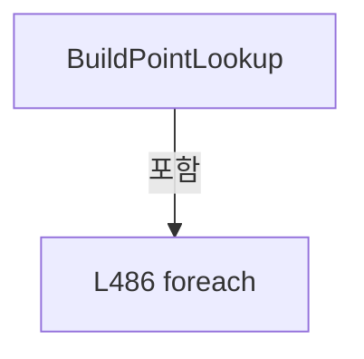

변경 전 점검: 입력/반환 타입, 위 호출자, 예외/취소 경로, 공유 상태와 저장·전송 소비자를 함께 확인합니다. 값의 단위나 물리 방향을 이름만으로 확정하지 않습니다.

### MethodDeclaration `ResolveResultPoint` · L496–513

[Drilling.UI/Menu/Menus/CMenuCorrection.ReviewData.Offset.cs:496–513](https://github.com/kjuws10-rgb/A3Drilling/blob/28764c91d521777b8ee068dd7aaf2d3902ce9fe2/Drilling.UI/Menu/Menus/CMenuCorrection.ReviewData.Offset.cs#L496-L513)

| 항목 | 실제 추출 값 |
| --- | --- |
| 서명 | Drilling.Common.Review.ST_REVIEW_PLAN_POINT Drilling.UI.Menu.Menus.CMenuCorrection.CReviewDataPanel.ResolveResultPoint(Drilling.Common.Review.ST_REVIEW_RESULT_FILE_ROW, System.Collections.Generic.IReadOnlyDictionary<string, Drilling.Common.Review.ST_REVIEW_PLAN_POINT>) |
| 접근/수식자 | Private / private, static |
| 반환/값 타입 | Drilling.Common.Review.ST_REVIEW_PLAN_POINT |
| 소속 타입 | NamedType:Drilling.UI.Menu.Menus.CMenuCorrection.CReviewDataPanel |

입력 계약:

| 이름 | 타입 | 전달 | 선택/기본값 |
| --- | --- | --- | --- |
| row | Drilling.Common.Review.ST_REVIEW_RESULT_FILE_ROW | None | False /  |
| pointLookup | System.Collections.Generic.IReadOnlyDictionary<string, Drilling.Common.Review.ST_REVIEW_PLAN_POINT> | None | False /  |

정적 호출자로 확인된 위치:

| 호출 파일/행 | 호출 표현식 | 런타임 분기 가능 |
| --- | --- | --- |
| [Drilling.UI/Menu/Menus/CMenuCorrection.ReviewData.Offset.cs:393–393](https://github.com/kjuws10-rgb/A3Drilling/blob/28764c91d521777b8ee068dd7aaf2d3902ce9fe2/Drilling.UI/Menu/Menus/CMenuCorrection.ReviewData.Offset.cs#L393-L393) | ResolveResultPoint | False |
| [Drilling.UI/Menu/Menus/CMenuCorrection.ReviewData.Offset.cs:414–414](https://github.com/kjuws10-rgb/A3Drilling/blob/28764c91d521777b8ee068dd7aaf2d3902ce9fe2/Drilling.UI/Menu/Menus/CMenuCorrection.ReviewData.Offset.cs#L414-L414) | ResolveResultPoint | False |
| [Drilling.UI/Menu/Menus/CMenuCorrection.ReviewData.Offset.cs:456–456](https://github.com/kjuws10-rgb/A3Drilling/blob/28764c91d521777b8ee068dd7aaf2d3902ce9fe2/Drilling.UI/Menu/Menus/CMenuCorrection.ReviewData.Offset.cs#L456-L456) | ResolveResultPoint | False |

호출하는 대상과 해석 범위:

| 원본 행 | 표현식 | 분석 상태 | 대상/소스 위치 |
| --- | --- | --- | --- |
| 500 | NormalizeReviewShotKey | resolved | string Drilling.UI.Menu.Menus.CMenuCorrection.NormalizeReviewShotKey(string, int) · Drilling.UI/Menu/Menus/CMenuCorrection.cs:2396 |
| 501 | pointLookup.TryGetValue | resolved · 동적 구현 선택 가능 | bool System.Collections.Generic.IReadOnlyDictionary<string, Drilling.Common.Review.ST_REVIEW_PLAN_POINT>.TryGetValue(string, out Drilling.Common.Review.ST_REVIEW_PLAN_POINT) |
| 502 | pointLookup.TryGetValue | resolved · 동적 구현 선택 가능 | bool System.Collections.Generic.IReadOnlyDictionary<string, Drilling.Common.Review.ST_REVIEW_PLAN_POINT>.TryGetValue(string, out Drilling.Common.Review.ST_REVIEW_PLAN_POINT) |
| 502 | NormalizeReviewShotKey | resolved | string Drilling.UI.Menu.Menus.CMenuCorrection.NormalizeReviewShotKey(string, int) · Drilling.UI/Menu/Menus/CMenuCorrection.cs:2396 |
| 504 | new InvalidDataException | resolved | System.IO.InvalidDataException.InvalidDataException(string?) |
| 509 | new InvalidDataException | resolved | System.IO.InvalidDataException.InvalidDataException(string?) |

본문의 실제 연산·분기·예외·반환 순서(원문 위치 순):

| 원본 행 | 종류 | 주석 해설 |
| --- | --- | --- |
| 500 | call | 함수·델리게이트 또는 객체 생성자를 호출합니다: NormalizeReviewShotKey(row.ShotKey, row.CellNo) |
| 500 | local-declaration | 지역 변수를 선언합니다: var key = NormalizeReviewShotKey(row.ShotKey, row.CellNo); |
| 500 | variable-initializer | 변수의 초기값을 지정합니다: key = NormalizeReviewShotKey(row.ShotKey, row.CellNo) |
| 501 | call | 함수·델리게이트 또는 객체 생성자를 호출합니다: pointLookup.TryGetValue(key, out var point) |
| 501 | if | 조건에 따라 분기합니다: if (!pointLookup.TryGetValue(key, out var point) && !pointLookup.TryGetValue(NormalizeReviewShotKey(row.ShotName, row.CellNo), out point)) |
| 502 | call | 함수·델리게이트 또는 객체 생성자를 호출합니다: pointLookup.TryGetValue(NormalizeReviewShotKey(row.ShotName, row.CellNo), out point) |
| 502 | call | 함수·델리게이트 또는 객체 생성자를 호출합니다: NormalizeReviewShotKey(row.ShotName, row.CellNo) |
| 504 | call | 함수·델리게이트 또는 객체 생성자를 호출합니다: new InvalidDataException($"현재 레시피에서 검사 결과 Shot을 찾지 못했습니다: CELL{row.CellNo:00} / {row.ShotName} / {row.ShotKey}") |
| 504 | throw | 예외를 발생/전달합니다: throw new InvalidDataException($"현재 레시피에서 검사 결과 Shot을 찾지 못했습니다: CELL{row.CellNo:00} / {row.ShotName} / {row.ShotKey}"); |
| 507 | if | 조건에 따라 분기합니다: if (point.HeadNo != row.HeadNo) |
| 509 | call | 함수·델리게이트 또는 객체 생성자를 호출합니다: new InvalidDataException($"검사 결과와 현재 레시피의 Head 배정이 다릅니다: CELL{row.CellNo:00}_{row.ShotName} / Result=H{row.HeadNo:00}, Recipe=H{point.HeadNo:00}") |
| 509 | throw | 예외를 발생/전달합니다: throw new InvalidDataException($"검사 결과와 현재 레시피의 Head 배정이 다릅니다: CELL{row.CellNo:00}_{row.ShotName} / Result=H{row.HeadNo:00}, Recipe=H{point.HeadNo:00}"); |
| 512 | return | 호출자에게 값 또는 제어를 반환합니다: return point; |

제어 구문의 포함 구조(실제 실행 순서/CFG가 아닌 구문 탐색 그림):

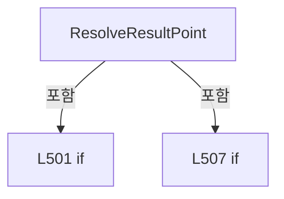

변경 전 점검: 입력/반환 타입, 위 호출자, 예외/취소 경로, 공유 상태와 저장·전송 소비자를 함께 확인합니다. 값의 단위나 물리 방향을 이름만으로 확정하지 않습니다.

### MethodDeclaration `CreateApplicationType` · L515–527

[Drilling.UI/Menu/Menus/CMenuCorrection.ReviewData.Offset.cs:515–527](https://github.com/kjuws10-rgb/A3Drilling/blob/28764c91d521777b8ee068dd7aaf2d3902ce9fe2/Drilling.UI/Menu/Menus/CMenuCorrection.ReviewData.Offset.cs#L515-L527)

| 항목 | 실제 추출 값 |
| --- | --- |
| 서명 | Drilling.UI.Menu.Menus.CMenuCorrection.ST_REVIEW_OFFSET_APPLY_TYPE Drilling.UI.Menu.Menus.CMenuCorrection.CReviewDataPanel.CreateApplicationType(string, Drilling.Common.Review.ST_REVIEW_RESULT_FILE_DATA) |
| 접근/수식자 | Private / private, static |
| 반환/값 타입 | Drilling.UI.Menu.Menus.CMenuCorrection.ST_REVIEW_OFFSET_APPLY_TYPE |
| 소속 타입 | NamedType:Drilling.UI.Menu.Menus.CMenuCorrection.CReviewDataPanel |

입력 계약:

| 이름 | 타입 | 전달 | 선택/기본값 |
| --- | --- | --- | --- |
| resultType | string | None | False /  |
| result | Drilling.Common.Review.ST_REVIEW_RESULT_FILE_DATA | None | False /  |

정적 호출자로 확인된 위치:

| 호출 파일/행 | 호출 표현식 | 런타임 분기 가능 |
| --- | --- | --- |
| [Drilling.UI/Menu/Menus/CMenuCorrection.ReviewData.Offset.cs:286–286](https://github.com/kjuws10-rgb/A3Drilling/blob/28764c91d521777b8ee068dd7aaf2d3902ce9fe2/Drilling.UI/Menu/Menus/CMenuCorrection.ReviewData.Offset.cs#L286-L286) | CreateApplicationType | False |

호출하는 대상과 해석 범위:

| 원본 행 | 표현식 | 분석 상태 | 대상/소스 위치 |
| --- | --- | --- | --- |
| 519 | new | resolved | Drilling.UI.Menu.Menus.CMenuCorrection.ST_REVIEW_OFFSET_APPLY_TYPE.ST_REVIEW_OFFSET_APPLY_TYPE(string, string, string) · Drilling.UI/Menu/Menus/CMenuCorrection.ReviewData.Offset.cs:715 |
| 520 | new | resolved | Drilling.UI.Menu.Menus.CMenuCorrection.ST_REVIEW_OFFSET_APPLY_TYPE.ST_REVIEW_OFFSET_APPLY_TYPE(string, string, string) · Drilling.UI/Menu/Menus/CMenuCorrection.ReviewData.Offset.cs:715 |
| 521 | new | resolved | Drilling.UI.Menu.Menus.CMenuCorrection.ST_REVIEW_OFFSET_APPLY_TYPE.ST_REVIEW_OFFSET_APPLY_TYPE(string, string, string) · Drilling.UI/Menu/Menus/CMenuCorrection.ReviewData.Offset.cs:715 |
| 522 | new | resolved | Drilling.UI.Menu.Menus.CMenuCorrection.ST_REVIEW_OFFSET_APPLY_TYPE.ST_REVIEW_OFFSET_APPLY_TYPE(string, string, string) · Drilling.UI/Menu/Menus/CMenuCorrection.ReviewData.Offset.cs:715 |
| 522 | result.RuleScope.Trim().ToUpperInvariant().Replace | resolved | string string.Replace(string, string?, System.StringComparison) |
| 522 | result.RuleScope.Trim().ToUpperInvariant | resolved | string string.ToUpperInvariant() |
| 522 | result.RuleScope.Trim | resolved | string string.Trim() |
| 523 | new | resolved | Drilling.UI.Menu.Menus.CMenuCorrection.ST_REVIEW_OFFSET_APPLY_TYPE.ST_REVIEW_OFFSET_APPLY_TYPE(string, string, string) · Drilling.UI/Menu/Menus/CMenuCorrection.ReviewData.Offset.cs:715 |
| 523 | Math.Max | resolved | int System.Math.Max(int, int) |
| 524 | new | resolved | Drilling.UI.Menu.Menus.CMenuCorrection.ST_REVIEW_OFFSET_APPLY_TYPE.ST_REVIEW_OFFSET_APPLY_TYPE(string, string, string) · Drilling.UI/Menu/Menus/CMenuCorrection.ReviewData.Offset.cs:715 |
| 524 | Math.Max | resolved | int System.Math.Max(int, int) |
| 525 | new InvalidOperationException | resolved | System.InvalidOperationException.InvalidOperationException(string?) |

본문의 실제 연산·분기·예외·반환 순서(원문 위치 순):

| 원본 행 | 종류 | 주석 해설 |
| --- | --- | --- |
| 517 | return | 호출자에게 값 또는 제어를 반환합니다: return resultType switch { "ALL_SHOT" => new("DIRECT_ALL", "DIRECT / ALL SHOT", "측정 OK Shot의 변환된 X/Y를 같은 Shot에 직접 누적"), "ONE_SHOT" => new("DIRECT_ONE", "DIRECT / ONE SHOT", "선택 검사 Shot의 변환된 X/Y를 같은 Shot에 직접 누적"), "ONE_LINE" => new |
| 517 | switch-expression | 값별 결과식을 선택합니다: resultType switch { "ALL_SHOT" => new("DIRECT_ALL", "DIRECT / ALL SHOT", "측정 OK Shot의 변환된 X/Y를 같은 Shot에 직접 누적"), "ONE_SHOT" => new("DIRECT_ONE", "DIRECT / ONE SHOT", "선택 검사 Shot의 변환된 X/Y를 같은 Shot에 직접 누적"), "ONE_LINE" => new("DIREC |
| 519 | call | 함수·델리게이트 또는 객체 생성자를 호출합니다: new("DIRECT_ALL", "DIRECT / ALL SHOT", "측정 OK Shot의 변환된 X/Y를 같은 Shot에 직접 누적") |
| 520 | call | 함수·델리게이트 또는 객체 생성자를 호출합니다: new("DIRECT_ONE", "DIRECT / ONE SHOT", "선택 검사 Shot의 변환된 X/Y를 같은 Shot에 직접 누적") |
| 521 | call | 함수·델리게이트 또는 객체 생성자를 호출합니다: new("DIRECT_LINE", "DIRECT / ONE LINE", "검사한 Line의 측정 OK X/Y를 같은 Shot에만 직접 누적") |
| 522 | call | 함수·델리게이트 또는 객체 생성자를 호출합니다: new("ROUGH", $"ROUGH / {result.RuleScope.Trim().ToUpperInvariant().Replace("_", " + ", StringComparison.Ordinal)}", "측정 OK 값을 같은 Head 또는 Head + Cell 범위에 누적") |
| 522 | call | 함수·델리게이트 또는 객체 생성자를 호출합니다: result.RuleScope.Trim().ToUpperInvariant().Replace("_", " + ", StringComparison.Ordinal) |
| 522 | call | 함수·델리게이트 또는 객체 생성자를 호출합니다: result.RuleScope.Trim().ToUpperInvariant() |
| 522 | call | 함수·델리게이트 또는 객체 생성자를 호출합니다: result.RuleScope.Trim() |
| 523 | call | 함수·델리게이트 또는 객체 생성자를 호출합니다: new("FINE", $"FINE / {Math.Max(result.LineCount, result.FineLineCount)} LINE", "Cell의 같은 X 열에서 측정값을 Y 방향 보간 후 누적") |
| 523 | call | 함수·델리게이트 또는 객체 생성자를 호출합니다: Math.Max(result.LineCount, result.FineLineCount) |
| 524 | call | 함수·델리게이트 또는 객체 생성자를 호출합니다: new("AUTO_FINE", $"AUTO / {Math.Max(result.LineCount, result.FineLineCount)} LINE", "자동 검사 측정값을 Cell의 같은 X 열에서 Y 방향 보간 후 누적") |
| 524 | call | 함수·델리게이트 또는 객체 생성자를 호출합니다: Math.Max(result.LineCount, result.FineLineCount) |
| 525 | call | 함수·델리게이트 또는 객체 생성자를 호출합니다: new InvalidOperationException($"{resultType} 결과는 Review Offset 적용을 지원하지 않습니다.") |
| 525 | throw | 예외를 발생/전달합니다: throw new InvalidOperationException($"{resultType} 결과는 Review Offset 적용을 지원하지 않습니다.") |

제어 구문의 포함 구조(실제 실행 순서/CFG가 아닌 구문 탐색 그림):

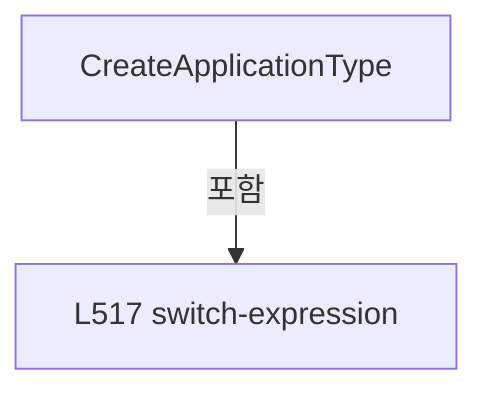

변경 전 점검: 입력/반환 타입, 위 호출자, 예외/취소 경로, 공유 상태와 저장·전송 소비자를 함께 확인합니다. 값의 단위나 물리 방향을 이름만으로 확정하지 않습니다.

### MethodDeclaration `IsOffsetApplicableResultType` · L529–532

[Drilling.UI/Menu/Menus/CMenuCorrection.ReviewData.Offset.cs:529–532](https://github.com/kjuws10-rgb/A3Drilling/blob/28764c91d521777b8ee068dd7aaf2d3902ce9fe2/Drilling.UI/Menu/Menus/CMenuCorrection.ReviewData.Offset.cs#L529-L532)

| 항목 | 실제 추출 값 |
| --- | --- |
| 서명 | bool Drilling.UI.Menu.Menus.CMenuCorrection.CReviewDataPanel.IsOffsetApplicableResultType(string) |
| 접근/수식자 | Private / private, static |
| 반환/값 타입 | bool |
| 소속 타입 | NamedType:Drilling.UI.Menu.Menus.CMenuCorrection.CReviewDataPanel |

입력 계약:

| 이름 | 타입 | 전달 | 선택/기본값 |
| --- | --- | --- | --- |
| resultType | string | None | False /  |

정적 호출자로 확인된 위치:

| 호출 파일/행 | 호출 표현식 | 런타임 분기 가능 |
| --- | --- | --- |
| [Drilling.UI/Menu/Menus/CMenuCorrection.ReviewData.Offset.cs:27–27](https://github.com/kjuws10-rgb/A3Drilling/blob/28764c91d521777b8ee068dd7aaf2d3902ce9fe2/Drilling.UI/Menu/Menus/CMenuCorrection.ReviewData.Offset.cs#L27-L27) | IsOffsetApplicableResultType | False |

호출하는 대상과 해석 범위:

| 원본 행 | 표현식 | 분석 상태 | 대상/소스 위치 |
| --- | --- | --- | --- |
| 531 | resultType.Trim().ToUpperInvariant | resolved | string string.ToUpperInvariant() |
| 531 | resultType.Trim | resolved | string string.Trim() |

본문의 실제 연산·분기·예외·반환 순서(원문 위치 순):

| 원본 행 | 종류 | 주석 해설 |
| --- | --- | --- |
| 531 | call | 함수·델리게이트 또는 객체 생성자를 호출합니다: resultType.Trim().ToUpperInvariant() |
| 531 | call | 함수·델리게이트 또는 객체 생성자를 호출합니다: resultType.Trim() |
| 531 | return | 호출자에게 값 또는 제어를 반환합니다: return resultType.Trim().ToUpperInvariant() is "ALL_SHOT" or "ONE_SHOT" or "ONE_LINE" or "ROUGH" or "FINE" or "AUTO"; |

변경 전 점검: 입력/반환 타입, 위 호출자, 예외/취소 경로, 공유 상태와 저장·전송 소비자를 함께 확인합니다. 값의 단위나 물리 방향을 이름만으로 확정하지 않습니다.

### MethodDeclaration `EnsureLoadedResultUnchanged` · L534–544

[Drilling.UI/Menu/Menus/CMenuCorrection.ReviewData.Offset.cs:534–544](https://github.com/kjuws10-rgb/A3Drilling/blob/28764c91d521777b8ee068dd7aaf2d3902ce9fe2/Drilling.UI/Menu/Menus/CMenuCorrection.ReviewData.Offset.cs#L534-L544)

| 항목 | 실제 추출 값 |
| --- | --- |
| 서명 | void Drilling.UI.Menu.Menus.CMenuCorrection.CReviewDataPanel.EnsureLoadedResultUnchanged(string, string) |
| 접근/수식자 | Private / private |
| 반환/값 타입 | void |
| 소속 타입 | NamedType:Drilling.UI.Menu.Menus.CMenuCorrection.CReviewDataPanel |

입력 계약:

| 이름 | 타입 | 전달 | 선택/기본값 |
| --- | --- | --- | --- |
| filePath | string | None | False /  |
| recipeId | string | None | False /  |

정적 호출자로 확인된 위치:

| 호출 파일/행 | 호출 표현식 | 런타임 분기 가능 |
| --- | --- | --- |
| [Drilling.UI/Menu/Menus/CMenuCorrection.ReviewData.Offset.cs:101–101](https://github.com/kjuws10-rgb/A3Drilling/blob/28764c91d521777b8ee068dd7aaf2d3902ce9fe2/Drilling.UI/Menu/Menus/CMenuCorrection.ReviewData.Offset.cs#L101-L101) | EnsureLoadedResultUnchanged | False |
| [Drilling.UI/Menu/Menus/CMenuCorrection.ReviewData.Offset.cs:114–114](https://github.com/kjuws10-rgb/A3Drilling/blob/28764c91d521777b8ee068dd7aaf2d3902ce9fe2/Drilling.UI/Menu/Menus/CMenuCorrection.ReviewData.Offset.cs#L114-L114) | EnsureLoadedResultUnchanged | False |
| [Drilling.UI/Menu/Menus/CMenuCorrection.ReviewData.Offset.cs:172–172](https://github.com/kjuws10-rgb/A3Drilling/blob/28764c91d521777b8ee068dd7aaf2d3902ce9fe2/Drilling.UI/Menu/Menus/CMenuCorrection.ReviewData.Offset.cs#L172-L172) | EnsureLoadedResultUnchanged | False |
| [Drilling.UI/Menu/Menus/CMenuCorrection.ReviewData.Offset.cs:230–230](https://github.com/kjuws10-rgb/A3Drilling/blob/28764c91d521777b8ee068dd7aaf2d3902ce9fe2/Drilling.UI/Menu/Menus/CMenuCorrection.ReviewData.Offset.cs#L230-L230) | EnsureLoadedResultUnchanged | False |

호출하는 대상과 해석 범위:

| 원본 행 | 표현식 | 분석 상태 | 대상/소스 위치 |
| --- | --- | --- | --- |
| 539 | _loadedResultFile.FilePath.Equals | resolved | bool string.Equals(string?, System.StringComparison) |
| 540 | _loadedRecipe.Id.Equals | resolved | bool string.Equals(string?, System.StringComparison) |
| 542 | new InvalidOperationException | resolved | System.InvalidOperationException.InvalidOperationException(string?) |

본문의 실제 연산·분기·예외·반환 순서(원문 위치 순):

| 원본 행 | 종류 | 주석 해설 |
| --- | --- | --- |
| 536 | if | 조건에 따라 분기합니다: if (!HasLoadedData &#124;&#124; _loadedResultFile is null &#124;&#124; _loadedRecipe is null &#124;&#124; !_loadedResultFile.FilePath.Equals(filePath, StringComparison.OrdinalIgnoreCase) &#124;&#124; !_loadedRecipe.Id.Equals(recipeId, StringComparison.OrdinalIgnor…) |
| 539 | call | 함수·델리게이트 또는 객체 생성자를 호출합니다: _loadedResultFile.FilePath.Equals(filePath, StringComparison.OrdinalIgnoreCase) |
| 540 | call | 함수·델리게이트 또는 객체 생성자를 호출합니다: _loadedRecipe.Id.Equals(recipeId, StringComparison.OrdinalIgnoreCase) |
| 542 | call | 함수·델리게이트 또는 객체 생성자를 호출합니다: new InvalidOperationException("작업 중 선택한 Review Result 또는 현재 레시피가 변경되었습니다. DATA LOAD 후 다시 실행해 주세요.") |
| 542 | throw | 예외를 발생/전달합니다: throw new InvalidOperationException("작업 중 선택한 Review Result 또는 현재 레시피가 변경되었습니다. DATA LOAD 후 다시 실행해 주세요."); |

제어 구문의 포함 구조(실제 실행 순서/CFG가 아닌 구문 탐색 그림):

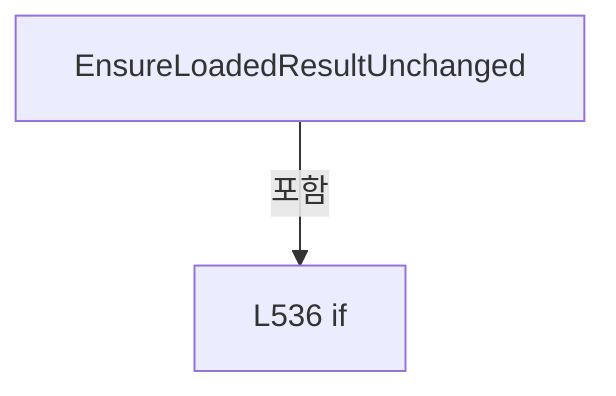

변경 전 점검: 입력/반환 타입, 위 호출자, 예외/취소 경로, 공유 상태와 저장·전송 소비자를 함께 확인합니다. 값의 단위나 물리 방향을 이름만으로 확정하지 않습니다.

### MethodDeclaration `SameOffsetSource` · L546–551

[Drilling.UI/Menu/Menus/CMenuCorrection.ReviewData.Offset.cs:546–551](https://github.com/kjuws10-rgb/A3Drilling/blob/28764c91d521777b8ee068dd7aaf2d3902ce9fe2/Drilling.UI/Menu/Menus/CMenuCorrection.ReviewData.Offset.cs#L546-L551)

| 항목 | 실제 추출 값 |
| --- | --- |
| 서명 | bool Drilling.UI.Menu.Menus.CMenuCorrection.CReviewDataPanel.SameOffsetSource(Drilling.Common.Review.ST_REVIEW_OFFSET_FILE_DATA, Drilling.Common.Review.ST_REVIEW_OFFSET_FILE_DATA) |
| 접근/수식자 | Private / private, static |
| 반환/값 타입 | bool |
| 소속 타입 | NamedType:Drilling.UI.Menu.Menus.CMenuCorrection.CReviewDataPanel |

입력 계약:

| 이름 | 타입 | 전달 | 선택/기본값 |
| --- | --- | --- | --- |
| expected | Drilling.Common.Review.ST_REVIEW_OFFSET_FILE_DATA | None | False /  |
| current | Drilling.Common.Review.ST_REVIEW_OFFSET_FILE_DATA | None | False /  |

정적 호출자로 확인된 위치:

| 호출 파일/행 | 호출 표현식 | 런타임 분기 가능 |
| --- | --- | --- |
| [Drilling.UI/Menu/Menus/CMenuCorrection.ReviewData.Offset.cs:116–116](https://github.com/kjuws10-rgb/A3Drilling/blob/28764c91d521777b8ee068dd7aaf2d3902ce9fe2/Drilling.UI/Menu/Menus/CMenuCorrection.ReviewData.Offset.cs#L116-L116) | SameOffsetSource | False |

호출하는 대상과 해석 범위:

| 원본 행 | 표현식 | 분석 상태 | 대상/소스 위치 |
| --- | --- | --- | --- |
| 548 | expected.FilePath.Equals | resolved | bool string.Equals(string?, System.StringComparison) |
| 549 | expected.SavedAt.Equals | resolved | bool System.DateTimeOffset.Equals(System.DateTimeOffset) |

본문의 실제 연산·분기·예외·반환 순서(원문 위치 순):

| 원본 행 | 종류 | 주석 해설 |
| --- | --- | --- |
| 548 | call | 함수·델리게이트 또는 객체 생성자를 호출합니다: expected.FilePath.Equals(current.FilePath, StringComparison.OrdinalIgnoreCase) |
| 548 | return | 호출자에게 값 또는 제어를 반환합니다: return expected.FilePath.Equals(current.FilePath, StringComparison.OrdinalIgnoreCase) && expected.SavedAt.Equals(current.SavedAt) && expected.Rows.Count == current.Rows.Count; |
| 549 | call | 함수·델리게이트 또는 객체 생성자를 호출합니다: expected.SavedAt.Equals(current.SavedAt) |

변경 전 점검: 입력/반환 타입, 위 호출자, 예외/취소 경로, 공유 상태와 저장·전송 소비자를 함께 확인합니다. 값의 단위나 물리 방향을 이름만으로 확정하지 않습니다.

### MethodDeclaration `SetOffsetBusy` · L553–562

[Drilling.UI/Menu/Menus/CMenuCorrection.ReviewData.Offset.cs:553–562](https://github.com/kjuws10-rgb/A3Drilling/blob/28764c91d521777b8ee068dd7aaf2d3902ce9fe2/Drilling.UI/Menu/Menus/CMenuCorrection.ReviewData.Offset.cs#L553-L562)

| 항목 | 실제 추출 값 |
| --- | --- |
| 서명 | void Drilling.UI.Menu.Menus.CMenuCorrection.CReviewDataPanel.SetOffsetBusy(bool) |
| 접근/수식자 | Private / private |
| 반환/값 타입 | void |
| 소속 타입 | NamedType:Drilling.UI.Menu.Menus.CMenuCorrection.CReviewDataPanel |

입력 계약:

| 이름 | 타입 | 전달 | 선택/기본값 |
| --- | --- | --- | --- |
| value | bool | None | False /  |

정적 호출자로 확인된 위치:

| 호출 파일/행 | 호출 표현식 | 런타임 분기 가능 |
| --- | --- | --- |
| [Drilling.UI/Menu/Menus/CMenuCorrection.ReviewData.Offset.cs:96–96](https://github.com/kjuws10-rgb/A3Drilling/blob/28764c91d521777b8ee068dd7aaf2d3902ce9fe2/Drilling.UI/Menu/Menus/CMenuCorrection.ReviewData.Offset.cs#L96-L96) | SetOffsetBusy | False |
| [Drilling.UI/Menu/Menus/CMenuCorrection.ReviewData.Offset.cs:139–139](https://github.com/kjuws10-rgb/A3Drilling/blob/28764c91d521777b8ee068dd7aaf2d3902ce9fe2/Drilling.UI/Menu/Menus/CMenuCorrection.ReviewData.Offset.cs#L139-L139) | SetOffsetBusy | False |
| [Drilling.UI/Menu/Menus/CMenuCorrection.ReviewData.Offset.cs:152–152](https://github.com/kjuws10-rgb/A3Drilling/blob/28764c91d521777b8ee068dd7aaf2d3902ce9fe2/Drilling.UI/Menu/Menus/CMenuCorrection.ReviewData.Offset.cs#L152-L152) | SetOffsetBusy | False |
| [Drilling.UI/Menu/Menus/CMenuCorrection.ReviewData.Offset.cs:213–213](https://github.com/kjuws10-rgb/A3Drilling/blob/28764c91d521777b8ee068dd7aaf2d3902ce9fe2/Drilling.UI/Menu/Menus/CMenuCorrection.ReviewData.Offset.cs#L213-L213) | SetOffsetBusy | False |
| [Drilling.UI/Menu/Menus/CMenuCorrection.ReviewData.Offset.cs:226–226](https://github.com/kjuws10-rgb/A3Drilling/blob/28764c91d521777b8ee068dd7aaf2d3902ce9fe2/Drilling.UI/Menu/Menus/CMenuCorrection.ReviewData.Offset.cs#L226-L226) | SetOffsetBusy | False |
| [Drilling.UI/Menu/Menus/CMenuCorrection.ReviewData.Offset.cs:256–256](https://github.com/kjuws10-rgb/A3Drilling/blob/28764c91d521777b8ee068dd7aaf2d3902ce9fe2/Drilling.UI/Menu/Menus/CMenuCorrection.ReviewData.Offset.cs#L256-L256) | SetOffsetBusy | False |
| [Drilling.UI/Menu/Menus/CMenuCorrection.ReviewData.Offset.cs:566–566](https://github.com/kjuws10-rgb/A3Drilling/blob/28764c91d521777b8ee068dd7aaf2d3902ce9fe2/Drilling.UI/Menu/Menus/CMenuCorrection.ReviewData.Offset.cs#L566-L566) | SetOffsetBusy | False |

호출하는 대상과 해석 범위:

| 원본 행 | 표현식 | 분석 상태 | 대상/소스 위치 |
| --- | --- | --- | --- |
| 561 | NotifyLoadCommandState | resolved | void Drilling.UI.Menu.Menus.CMenuCorrection.CReviewDataPanel.NotifyLoadCommandState() · Drilling.UI/Menu/Menus/CMenuCorrection.ReviewData.Display.cs:1385 |

본문의 실제 연산·분기·예외·반환 순서(원문 위치 순):

| 원본 행 | 종류 | 주석 해설 |
| --- | --- | --- |
| 555 | if | 조건에 따라 분기합니다: if (_isOffsetBusy == value) |
| 557 | return | 호출자에게 값 또는 제어를 반환합니다: return; |
| 560 | assignment | 값을 대상에 대입합니다: _isOffsetBusy = value |
| 561 | call | 함수·델리게이트 또는 객체 생성자를 호출합니다: NotifyLoadCommandState() |

제어 구문의 포함 구조(실제 실행 순서/CFG가 아닌 구문 탐색 그림):

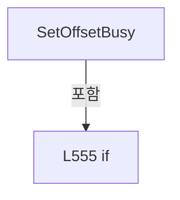

변경 전 점검: 입력/반환 타입, 위 호출자, 예외/취소 경로, 공유 상태와 저장·전송 소비자를 함께 확인합니다. 값의 단위나 물리 방향을 이름만으로 확정하지 않습니다.

### MethodDeclaration `SetSharedOffsetOperationRunning` · L564–567

[Drilling.UI/Menu/Menus/CMenuCorrection.ReviewData.Offset.cs:564–567](https://github.com/kjuws10-rgb/A3Drilling/blob/28764c91d521777b8ee068dd7aaf2d3902ce9fe2/Drilling.UI/Menu/Menus/CMenuCorrection.ReviewData.Offset.cs#L564-L567)

| 항목 | 실제 추출 값 |
| --- | --- |
| 서명 | void Drilling.UI.Menu.Menus.CMenuCorrection.CReviewDataPanel.SetSharedOffsetOperationRunning(bool) |
| 접근/수식자 | Internal / internal |
| 반환/값 타입 | void |
| 소속 타입 | NamedType:Drilling.UI.Menu.Menus.CMenuCorrection.CReviewDataPanel |

입력 계약:

| 이름 | 타입 | 전달 | 선택/기본값 |
| --- | --- | --- | --- |
| value | bool | None | False /  |

정적 호출자로 확인된 위치:

| 호출 파일/행 | 호출 표현식 | 런타임 분기 가능 |
| --- | --- | --- |
| [Drilling.UI/Menu/Menus/CMenuCorrection.cs:4185–4185](https://github.com/kjuws10-rgb/A3Drilling/blob/28764c91d521777b8ee068dd7aaf2d3902ce9fe2/Drilling.UI/Menu/Menus/CMenuCorrection.cs#L4185-L4185) | ReviewData.SetSharedOffsetOperationRunning | False |
| [Drilling.UI/Menu/Menus/CMenuCorrection.cs:4246–4246](https://github.com/kjuws10-rgb/A3Drilling/blob/28764c91d521777b8ee068dd7aaf2d3902ce9fe2/Drilling.UI/Menu/Menus/CMenuCorrection.cs#L4246-L4246) | ReviewData.SetSharedOffsetOperationRunning | False |

호출하는 대상과 해석 범위:

| 원본 행 | 표현식 | 분석 상태 | 대상/소스 위치 |
| --- | --- | --- | --- |
| 566 | SetOffsetBusy | resolved | void Drilling.UI.Menu.Menus.CMenuCorrection.CReviewDataPanel.SetOffsetBusy(bool) · Drilling.UI/Menu/Menus/CMenuCorrection.ReviewData.Offset.cs:553 |

본문의 실제 연산·분기·예외·반환 순서(원문 위치 순):

| 원본 행 | 종류 | 주석 해설 |
| --- | --- | --- |
| 566 | call | 함수·델리게이트 또는 객체 생성자를 호출합니다: SetOffsetBusy(value) |

변경 전 점검: 입력/반환 타입, 위 호출자, 예외/취소 경로, 공유 상태와 저장·전송 소비자를 함께 확인합니다. 값의 단위나 물리 방향을 이름만으로 확정하지 않습니다.

### MethodDeclaration `AcceptOffsetRollback` · L569–572

[Drilling.UI/Menu/Menus/CMenuCorrection.ReviewData.Offset.cs:569–572](https://github.com/kjuws10-rgb/A3Drilling/blob/28764c91d521777b8ee068dd7aaf2d3902ce9fe2/Drilling.UI/Menu/Menus/CMenuCorrection.ReviewData.Offset.cs#L569-L572)

| 항목 | 실제 추출 값 |
| --- | --- |
| 서명 | void Drilling.UI.Menu.Menus.CMenuCorrection.CReviewDataPanel.AcceptOffsetRollback() |
| 접근/수식자 | Internal / internal |
| 반환/값 타입 | void |
| 소속 타입 | NamedType:Drilling.UI.Menu.Menus.CMenuCorrection.CReviewDataPanel |

정적 호출자로 확인된 위치:

| 호출 파일/행 | 호출 표현식 | 런타임 분기 가능 |
| --- | --- | --- |
| [Drilling.UI/Menu/Menus/CMenuCorrection.cs:4226–4226](https://github.com/kjuws10-rgb/A3Drilling/blob/28764c91d521777b8ee068dd7aaf2d3902ce9fe2/Drilling.UI/Menu/Menus/CMenuCorrection.cs#L4226-L4226) | ReviewData.AcceptOffsetRollback | False |

호출하는 대상과 해석 범위:

| 원본 행 | 표현식 | 분석 상태 | 대상/소스 위치 |
| --- | --- | --- | --- |
| 571 | NotifyLoadCommandState | resolved | void Drilling.UI.Menu.Menus.CMenuCorrection.CReviewDataPanel.NotifyLoadCommandState() · Drilling.UI/Menu/Menus/CMenuCorrection.ReviewData.Display.cs:1385 |

본문의 실제 연산·분기·예외·반환 순서(원문 위치 순):

| 원본 행 | 종류 | 주석 해설 |
| --- | --- | --- |
| 571 | call | 함수·델리게이트 또는 객체 생성자를 호출합니다: NotifyLoadCommandState() |

변경 전 점검: 입력/반환 타입, 위 호출자, 예외/취소 경로, 공유 상태와 저장·전송 소비자를 함께 확인합니다. 값의 단위나 물리 방향을 이름만으로 확정하지 않습니다.

### FieldDeclaration `_plan` · L576–576

[Drilling.UI/Menu/Menus/CMenuCorrection.ReviewData.Offset.cs:576–576](https://github.com/kjuws10-rgb/A3Drilling/blob/28764c91d521777b8ee068dd7aaf2d3902ce9fe2/Drilling.UI/Menu/Menus/CMenuCorrection.ReviewData.Offset.cs#L576-L576)

| 항목 | 실제 추출 값 |
| --- | --- |
| 서명 | Drilling.UI.Menu.Menus.CMenuCorrection.ST_REVIEW_OFFSET_APPLY_PLAN Drilling.UI.Menu.Menus.CMenuCorrection.CReviewDataPanel.CReviewDataOffsetApplyPanel._plan |
| 접근/수식자 | Private / private, readonly |
| 반환/값 타입 | Drilling.UI.Menu.Menus.CMenuCorrection.ST_REVIEW_OFFSET_APPLY_PLAN |
| 소속 타입 | NamedType:Drilling.UI.Menu.Menus.CMenuCorrection.CReviewDataPanel.CReviewDataOffsetApplyPanel |

현재 부분 분석에서 직접 연결된 호출자는 없습니다. XAML/이벤트/인터페이스·델리게이트·외부 진입을 추가 확인해야 하며, 미사용으로 판정한 것이 아닙니다.

변경 전 점검: 입력/반환 타입, 위 호출자, 예외/취소 경로, 공유 상태와 저장·전송 소비자를 함께 확인합니다. 값의 단위나 물리 방향을 이름만으로 확정하지 않습니다.

### FieldDeclaration `_selectedCellNo` · L577–577

[Drilling.UI/Menu/Menus/CMenuCorrection.ReviewData.Offset.cs:577–577](https://github.com/kjuws10-rgb/A3Drilling/blob/28764c91d521777b8ee068dd7aaf2d3902ce9fe2/Drilling.UI/Menu/Menus/CMenuCorrection.ReviewData.Offset.cs#L577-L577)

| 항목 | 실제 추출 값 |
| --- | --- |
| 서명 | int Drilling.UI.Menu.Menus.CMenuCorrection.CReviewDataPanel.CReviewDataOffsetApplyPanel._selectedCellNo |
| 접근/수식자 | Private / private |
| 반환/값 타입 | int |
| 소속 타입 | NamedType:Drilling.UI.Menu.Menus.CMenuCorrection.CReviewDataPanel.CReviewDataOffsetApplyPanel |

현재 부분 분석에서 직접 연결된 호출자는 없습니다. XAML/이벤트/인터페이스·델리게이트·외부 진입을 추가 확인해야 하며, 미사용으로 판정한 것이 아닙니다.

변경 전 점검: 입력/반환 타입, 위 호출자, 예외/취소 경로, 공유 상태와 저장·전송 소비자를 함께 확인합니다. 값의 단위나 물리 방향을 이름만으로 확정하지 않습니다.

### FieldDeclaration `_selectedShotKey` · L578–578

[Drilling.UI/Menu/Menus/CMenuCorrection.ReviewData.Offset.cs:578–578](https://github.com/kjuws10-rgb/A3Drilling/blob/28764c91d521777b8ee068dd7aaf2d3902ce9fe2/Drilling.UI/Menu/Menus/CMenuCorrection.ReviewData.Offset.cs#L578-L578)

| 항목 | 실제 추출 값 |
| --- | --- |
| 서명 | string Drilling.UI.Menu.Menus.CMenuCorrection.CReviewDataPanel.CReviewDataOffsetApplyPanel._selectedShotKey |
| 접근/수식자 | Private / private |
| 반환/값 타입 | string |
| 소속 타입 | NamedType:Drilling.UI.Menu.Menus.CMenuCorrection.CReviewDataPanel.CReviewDataOffsetApplyPanel |

현재 부분 분석에서 직접 연결된 호출자는 없습니다. XAML/이벤트/인터페이스·델리게이트·외부 진입을 추가 확인해야 하며, 미사용으로 판정한 것이 아닙니다.

본문의 실제 연산·분기·예외·반환 순서(원문 위치 순):

| 원본 행 | 종류 | 주석 해설 |
| --- | --- | --- |
| 578 | variable-initializer | 변수의 초기값을 지정합니다: _selectedShotKey = "" |

변경 전 점검: 입력/반환 타입, 위 호출자, 예외/취소 경로, 공유 상태와 저장·전송 소비자를 함께 확인합니다. 값의 단위나 물리 방향을 이름만으로 확정하지 않습니다.

### ConstructorDeclaration `.ctor` · L580–591

[Drilling.UI/Menu/Menus/CMenuCorrection.ReviewData.Offset.cs:580–591](https://github.com/kjuws10-rgb/A3Drilling/blob/28764c91d521777b8ee068dd7aaf2d3902ce9fe2/Drilling.UI/Menu/Menus/CMenuCorrection.ReviewData.Offset.cs#L580-L591)

| 항목 | 실제 추출 값 |
| --- | --- |
| 서명 | Drilling.UI.Menu.Menus.CMenuCorrection.CReviewDataPanel.CReviewDataOffsetApplyPanel.CReviewDataOffsetApplyPanel(Drilling.UI.Menu.Menus.CMenuCorrection.ST_REVIEW_OFFSET_APPLY_PLAN) |
| 접근/수식자 | Internal / internal |
| 반환/값 타입 | void |
| 소속 타입 | NamedType:Drilling.UI.Menu.Menus.CMenuCorrection.CReviewDataPanel.CReviewDataOffsetApplyPanel |

입력 계약:

| 이름 | 타입 | 전달 | 선택/기본값 |
| --- | --- | --- | --- |
| plan | Drilling.UI.Menu.Menus.CMenuCorrection.ST_REVIEW_OFFSET_APPLY_PLAN | None | False /  |

정적 호출자로 확인된 위치:

| 호출 파일/행 | 호출 표현식 | 런타임 분기 가능 |
| --- | --- | --- |
| [Drilling.UI/Menu/Menus/CMenuCorrection.ReviewData.Offset.cs:103–103](https://github.com/kjuws10-rgb/A3Drilling/blob/28764c91d521777b8ee068dd7aaf2d3902ce9fe2/Drilling.UI/Menu/Menus/CMenuCorrection.ReviewData.Offset.cs#L103-L103) | new CReviewDataOffsetApplyPanel | False |

호출하는 대상과 해석 범위:

| 원본 행 | 표현식 | 분석 상태 | 대상/소스 위치 |
| --- | --- | --- | --- |
| 585 | new CButtonCommand | resolved | Drilling.UI.Menu.CButtonCommand.CButtonCommand(System.Action<object?>, System.Predicate<object?>?) · Drilling.UI/Menu/CButtonCommand.cs:9 |
| 586 | plan.CellNos.Order().FirstOrDefault | resolved | int System.Collections.Generic.IEnumerable<int>.FirstOrDefault<int>() |
| 586 | plan.CellNos.Order | resolved | System.Linq.IOrderedEnumerable<int> System.Collections.Generic.IEnumerable<int>.Order<int>() |
| 589 | ApplyCellSelection | resolved | void Drilling.UI.Menu.Menus.CMenuCorrection.CReviewDataPanel.CReviewDataOffsetApplyPanel.ApplyCellSelection(int) · Drilling.UI/Menu/Menus/CMenuCorrection.ReviewData.Offset.cs:656 |

본문의 실제 연산·분기·예외·반환 순서(원문 위치 순):

| 원본 행 | 종류 | 주석 해설 |
| --- | --- | --- |
| 582 | assignment | 값을 대상에 대입합니다: _plan = plan |
| 583 | assignment | 값을 대상에 대입합니다: ApplicationTypes = [plan.ApplicationType] |
| 584 | assignment | 값을 대상에 대입합니다: SelectedApplicationType = plan.ApplicationType |
| 585 | assignment | 값을 대상에 대입합니다: SelectCellCommand = new CButtonCommand(SelectCell) |
| 585 | call | 함수·델리게이트 또는 객체 생성자를 호출합니다: new CButtonCommand(SelectCell) |
| 586 | call | 함수·델리게이트 또는 객체 생성자를 호출합니다: plan.CellNos.Order().FirstOrDefault() |
| 586 | call | 함수·델리게이트 또는 객체 생성자를 호출합니다: plan.CellNos.Order() |
| 586 | local-declaration | 지역 변수를 선언합니다: var firstCell = plan.CellNos.Order().FirstOrDefault(); |
| 586 | variable-initializer | 변수의 초기값을 지정합니다: firstCell = plan.CellNos.Order().FirstOrDefault() |
| 587 | if | 조건에 따라 분기합니다: if (firstCell > 0) |
| 589 | call | 함수·델리게이트 또는 객체 생성자를 호출합니다: ApplyCellSelection(firstCell) |

제어 구문의 포함 구조(실제 실행 순서/CFG가 아닌 구문 탐색 그림):

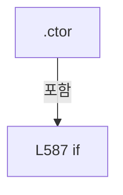

변경 전 점검: 입력/반환 타입, 위 호출자, 예외/취소 경로, 공유 상태와 저장·전송 소비자를 함께 확인합니다. 값의 단위나 물리 방향을 이름만으로 확정하지 않습니다.

### EventFieldDeclaration `PropertyChanged` · L593–593

[Drilling.UI/Menu/Menus/CMenuCorrection.ReviewData.Offset.cs:593–593](https://github.com/kjuws10-rgb/A3Drilling/blob/28764c91d521777b8ee068dd7aaf2d3902ce9fe2/Drilling.UI/Menu/Menus/CMenuCorrection.ReviewData.Offset.cs#L593-L593)

| 항목 | 실제 추출 값 |
| --- | --- |
| 서명 | System.ComponentModel.PropertyChangedEventHandler? Drilling.UI.Menu.Menus.CMenuCorrection.CReviewDataPanel.CReviewDataOffsetApplyPanel.PropertyChanged |
| 접근/수식자 | Public / public, event |
| 반환/값 타입 | System.ComponentModel.PropertyChangedEventHandler? |
| 소속 타입 | NamedType:Drilling.UI.Menu.Menus.CMenuCorrection.CReviewDataPanel.CReviewDataOffsetApplyPanel |

현재 부분 분석에서 직접 연결된 호출자는 없습니다. XAML/이벤트/인터페이스·델리게이트·외부 진입을 추가 확인해야 하며, 미사용으로 판정한 것이 아닙니다.

변경 전 점검: 입력/반환 타입, 위 호출자, 예외/취소 경로, 공유 상태와 저장·전송 소비자를 함께 확인합니다. 값의 단위나 물리 방향을 이름만으로 확정하지 않습니다.

### PropertyDeclaration `SelectCellCommand` · L595–595

[Drilling.UI/Menu/Menus/CMenuCorrection.ReviewData.Offset.cs:595–595](https://github.com/kjuws10-rgb/A3Drilling/blob/28764c91d521777b8ee068dd7aaf2d3902ce9fe2/Drilling.UI/Menu/Menus/CMenuCorrection.ReviewData.Offset.cs#L595-L595)

| 항목 | 실제 추출 값 |
| --- | --- |
| 서명 | Drilling.UI.Menu.CButtonCommand Drilling.UI.Menu.Menus.CMenuCorrection.CReviewDataPanel.CReviewDataOffsetApplyPanel.SelectCellCommand |
| 접근/수식자 | Public / public |
| 반환/값 타입 | Drilling.UI.Menu.CButtonCommand |
| 소속 타입 | NamedType:Drilling.UI.Menu.Menus.CMenuCorrection.CReviewDataPanel.CReviewDataOffsetApplyPanel |

현재 부분 분석에서 직접 연결된 호출자는 없습니다. XAML/이벤트/인터페이스·델리게이트·외부 진입을 추가 확인해야 하며, 미사용으로 판정한 것이 아닙니다.

변경 전 점검: 입력/반환 타입, 위 호출자, 예외/취소 경로, 공유 상태와 저장·전송 소비자를 함께 확인합니다. 값의 단위나 물리 방향을 이름만으로 확정하지 않습니다.

### GetAccessorDeclaration `get_SelectCellCommand` · L595–595

[Drilling.UI/Menu/Menus/CMenuCorrection.ReviewData.Offset.cs:595–595](https://github.com/kjuws10-rgb/A3Drilling/blob/28764c91d521777b8ee068dd7aaf2d3902ce9fe2/Drilling.UI/Menu/Menus/CMenuCorrection.ReviewData.Offset.cs#L595-L595)

| 항목 | 실제 추출 값 |
| --- | --- |
| 서명 | Drilling.UI.Menu.CButtonCommand Drilling.UI.Menu.Menus.CMenuCorrection.CReviewDataPanel.CReviewDataOffsetApplyPanel.SelectCellCommand.get |
| 접근/수식자 | Public / get |
| 반환/값 타입 | Drilling.UI.Menu.CButtonCommand |
| 소속 타입 | NamedType:Drilling.UI.Menu.Menus.CMenuCorrection.CReviewDataPanel.CReviewDataOffsetApplyPanel |

현재 부분 분석에서 직접 연결된 호출자는 없습니다. XAML/이벤트/인터페이스·델리게이트·외부 진입을 추가 확인해야 하며, 미사용으로 판정한 것이 아닙니다.

변경 전 점검: 입력/반환 타입, 위 호출자, 예외/취소 경로, 공유 상태와 저장·전송 소비자를 함께 확인합니다. 값의 단위나 물리 방향을 이름만으로 확정하지 않습니다.

### PropertyDeclaration `ApplicationTypes` · L596–596

[Drilling.UI/Menu/Menus/CMenuCorrection.ReviewData.Offset.cs:596–596](https://github.com/kjuws10-rgb/A3Drilling/blob/28764c91d521777b8ee068dd7aaf2d3902ce9fe2/Drilling.UI/Menu/Menus/CMenuCorrection.ReviewData.Offset.cs#L596-L596)

| 항목 | 실제 추출 값 |
| --- | --- |
| 서명 | System.Collections.Generic.IReadOnlyList<Drilling.UI.Menu.Menus.CMenuCorrection.ST_REVIEW_OFFSET_APPLY_TYPE> Drilling.UI.Menu.Menus.CMenuCorrection.CReviewDataPanel.CReviewDataOffsetApplyPanel.ApplicationTypes |
| 접근/수식자 | Public / public |
| 반환/값 타입 | System.Collections.Generic.IReadOnlyList<Drilling.UI.Menu.Menus.CMenuCorrection.ST_REVIEW_OFFSET_APPLY_TYPE> |
| 소속 타입 | NamedType:Drilling.UI.Menu.Menus.CMenuCorrection.CReviewDataPanel.CReviewDataOffsetApplyPanel |

현재 부분 분석에서 직접 연결된 호출자는 없습니다. XAML/이벤트/인터페이스·델리게이트·외부 진입을 추가 확인해야 하며, 미사용으로 판정한 것이 아닙니다.

변경 전 점검: 입력/반환 타입, 위 호출자, 예외/취소 경로, 공유 상태와 저장·전송 소비자를 함께 확인합니다. 값의 단위나 물리 방향을 이름만으로 확정하지 않습니다.

### GetAccessorDeclaration `get_ApplicationTypes` · L596–596

[Drilling.UI/Menu/Menus/CMenuCorrection.ReviewData.Offset.cs:596–596](https://github.com/kjuws10-rgb/A3Drilling/blob/28764c91d521777b8ee068dd7aaf2d3902ce9fe2/Drilling.UI/Menu/Menus/CMenuCorrection.ReviewData.Offset.cs#L596-L596)

| 항목 | 실제 추출 값 |
| --- | --- |
| 서명 | System.Collections.Generic.IReadOnlyList<Drilling.UI.Menu.Menus.CMenuCorrection.ST_REVIEW_OFFSET_APPLY_TYPE> Drilling.UI.Menu.Menus.CMenuCorrection.CReviewDataPanel.CReviewDataOffsetApplyPanel.ApplicationTypes.get |
| 접근/수식자 | Public / get |
| 반환/값 타입 | System.Collections.Generic.IReadOnlyList<Drilling.UI.Menu.Menus.CMenuCorrection.ST_REVIEW_OFFSET_APPLY_TYPE> |
| 소속 타입 | NamedType:Drilling.UI.Menu.Menus.CMenuCorrection.CReviewDataPanel.CReviewDataOffsetApplyPanel |

현재 부분 분석에서 직접 연결된 호출자는 없습니다. XAML/이벤트/인터페이스·델리게이트·외부 진입을 추가 확인해야 하며, 미사용으로 판정한 것이 아닙니다.

변경 전 점검: 입력/반환 타입, 위 호출자, 예외/취소 경로, 공유 상태와 저장·전송 소비자를 함께 확인합니다. 값의 단위나 물리 방향을 이름만으로 확정하지 않습니다.

### PropertyDeclaration `SelectedApplicationType` · L597–597

[Drilling.UI/Menu/Menus/CMenuCorrection.ReviewData.Offset.cs:597–597](https://github.com/kjuws10-rgb/A3Drilling/blob/28764c91d521777b8ee068dd7aaf2d3902ce9fe2/Drilling.UI/Menu/Menus/CMenuCorrection.ReviewData.Offset.cs#L597-L597)

| 항목 | 실제 추출 값 |
| --- | --- |
| 서명 | Drilling.UI.Menu.Menus.CMenuCorrection.ST_REVIEW_OFFSET_APPLY_TYPE Drilling.UI.Menu.Menus.CMenuCorrection.CReviewDataPanel.CReviewDataOffsetApplyPanel.SelectedApplicationType |
| 접근/수식자 | Public / public |
| 반환/값 타입 | Drilling.UI.Menu.Menus.CMenuCorrection.ST_REVIEW_OFFSET_APPLY_TYPE |
| 소속 타입 | NamedType:Drilling.UI.Menu.Menus.CMenuCorrection.CReviewDataPanel.CReviewDataOffsetApplyPanel |

현재 부분 분석에서 직접 연결된 호출자는 없습니다. XAML/이벤트/인터페이스·델리게이트·외부 진입을 추가 확인해야 하며, 미사용으로 판정한 것이 아닙니다.

변경 전 점검: 입력/반환 타입, 위 호출자, 예외/취소 경로, 공유 상태와 저장·전송 소비자를 함께 확인합니다. 값의 단위나 물리 방향을 이름만으로 확정하지 않습니다.

### GetAccessorDeclaration `get_SelectedApplicationType` · L597–597

[Drilling.UI/Menu/Menus/CMenuCorrection.ReviewData.Offset.cs:597–597](https://github.com/kjuws10-rgb/A3Drilling/blob/28764c91d521777b8ee068dd7aaf2d3902ce9fe2/Drilling.UI/Menu/Menus/CMenuCorrection.ReviewData.Offset.cs#L597-L597)

| 항목 | 실제 추출 값 |
| --- | --- |
| 서명 | Drilling.UI.Menu.Menus.CMenuCorrection.ST_REVIEW_OFFSET_APPLY_TYPE Drilling.UI.Menu.Menus.CMenuCorrection.CReviewDataPanel.CReviewDataOffsetApplyPanel.SelectedApplicationType.get |
| 접근/수식자 | Public / get |
| 반환/값 타입 | Drilling.UI.Menu.Menus.CMenuCorrection.ST_REVIEW_OFFSET_APPLY_TYPE |
| 소속 타입 | NamedType:Drilling.UI.Menu.Menus.CMenuCorrection.CReviewDataPanel.CReviewDataOffsetApplyPanel |

현재 부분 분석에서 직접 연결된 호출자는 없습니다. XAML/이벤트/인터페이스·델리게이트·외부 진입을 추가 확인해야 하며, 미사용으로 판정한 것이 아닙니다.

변경 전 점검: 입력/반환 타입, 위 호출자, 예외/취소 경로, 공유 상태와 저장·전송 소비자를 함께 확인합니다. 값의 단위나 물리 방향을 이름만으로 확정하지 않습니다.

### PropertyDeclaration `GlassPreviewImage` · L598–598

[Drilling.UI/Menu/Menus/CMenuCorrection.ReviewData.Offset.cs:598–598](https://github.com/kjuws10-rgb/A3Drilling/blob/28764c91d521777b8ee068dd7aaf2d3902ce9fe2/Drilling.UI/Menu/Menus/CMenuCorrection.ReviewData.Offset.cs#L598-L598)

| 항목 | 실제 추출 값 |
| --- | --- |
| 서명 | ImageSource? Drilling.UI.Menu.Menus.CMenuCorrection.CReviewDataPanel.CReviewDataOffsetApplyPanel.GlassPreviewImage |
| 접근/수식자 | Public / public |
| 반환/값 타입 | ImageSource? |
| 소속 타입 | NamedType:Drilling.UI.Menu.Menus.CMenuCorrection.CReviewDataPanel.CReviewDataOffsetApplyPanel |

현재 부분 분석에서 직접 연결된 호출자는 없습니다. XAML/이벤트/인터페이스·델리게이트·외부 진입을 추가 확인해야 하며, 미사용으로 판정한 것이 아닙니다.

변경 전 점검: 입력/반환 타입, 위 호출자, 예외/취소 경로, 공유 상태와 저장·전송 소비자를 함께 확인합니다. 값의 단위나 물리 방향을 이름만으로 확정하지 않습니다.

### GetAccessorDeclaration `get_GlassPreviewImage` · L598–598

[Drilling.UI/Menu/Menus/CMenuCorrection.ReviewData.Offset.cs:598–598](https://github.com/kjuws10-rgb/A3Drilling/blob/28764c91d521777b8ee068dd7aaf2d3902ce9fe2/Drilling.UI/Menu/Menus/CMenuCorrection.ReviewData.Offset.cs#L598-L598)

| 항목 | 실제 추출 값 |
| --- | --- |
| 서명 | ImageSource? Drilling.UI.Menu.Menus.CMenuCorrection.CReviewDataPanel.CReviewDataOffsetApplyPanel.GlassPreviewImage.get |
| 접근/수식자 | Public / get |
| 반환/값 타입 | ImageSource? |
| 소속 타입 | NamedType:Drilling.UI.Menu.Menus.CMenuCorrection.CReviewDataPanel.CReviewDataOffsetApplyPanel |

현재 부분 분석에서 직접 연결된 호출자는 없습니다. XAML/이벤트/인터페이스·델리게이트·외부 진입을 추가 확인해야 하며, 미사용으로 판정한 것이 아닙니다.

변경 전 점검: 입력/반환 타입, 위 호출자, 예외/취소 경로, 공유 상태와 저장·전송 소비자를 함께 확인합니다. 값의 단위나 물리 방향을 이름만으로 확정하지 않습니다.

### SetAccessorDeclaration `set_GlassPreviewImage` · L598–598

[Drilling.UI/Menu/Menus/CMenuCorrection.ReviewData.Offset.cs:598–598](https://github.com/kjuws10-rgb/A3Drilling/blob/28764c91d521777b8ee068dd7aaf2d3902ce9fe2/Drilling.UI/Menu/Menus/CMenuCorrection.ReviewData.Offset.cs#L598-L598)

| 항목 | 실제 추출 값 |
| --- | --- |
| 서명 | void Drilling.UI.Menu.Menus.CMenuCorrection.CReviewDataPanel.CReviewDataOffsetApplyPanel.GlassPreviewImage.set |
| 접근/수식자 | Private / private, set |
| 반환/값 타입 | void |
| 소속 타입 | NamedType:Drilling.UI.Menu.Menus.CMenuCorrection.CReviewDataPanel.CReviewDataOffsetApplyPanel |

입력 계약:

| 이름 | 타입 | 전달 | 선택/기본값 |
| --- | --- | --- | --- |
| value | ImageSource? | None | False /  |

현재 부분 분석에서 직접 연결된 호출자는 없습니다. XAML/이벤트/인터페이스·델리게이트·외부 진입을 추가 확인해야 하며, 미사용으로 판정한 것이 아닙니다.

변경 전 점검: 입력/반환 타입, 위 호출자, 예외/취소 경로, 공유 상태와 저장·전송 소비자를 함께 확인합니다. 값의 단위나 물리 방향을 이름만으로 확정하지 않습니다.

### PropertyDeclaration `ShotMapImage` · L599–599

[Drilling.UI/Menu/Menus/CMenuCorrection.ReviewData.Offset.cs:599–599](https://github.com/kjuws10-rgb/A3Drilling/blob/28764c91d521777b8ee068dd7aaf2d3902ce9fe2/Drilling.UI/Menu/Menus/CMenuCorrection.ReviewData.Offset.cs#L599-L599)

| 항목 | 실제 추출 값 |
| --- | --- |
| 서명 | ImageSource? Drilling.UI.Menu.Menus.CMenuCorrection.CReviewDataPanel.CReviewDataOffsetApplyPanel.ShotMapImage |
| 접근/수식자 | Public / public |
| 반환/값 타입 | ImageSource? |
| 소속 타입 | NamedType:Drilling.UI.Menu.Menus.CMenuCorrection.CReviewDataPanel.CReviewDataOffsetApplyPanel |

현재 부분 분석에서 직접 연결된 호출자는 없습니다. XAML/이벤트/인터페이스·델리게이트·외부 진입을 추가 확인해야 하며, 미사용으로 판정한 것이 아닙니다.

변경 전 점검: 입력/반환 타입, 위 호출자, 예외/취소 경로, 공유 상태와 저장·전송 소비자를 함께 확인합니다. 값의 단위나 물리 방향을 이름만으로 확정하지 않습니다.

### GetAccessorDeclaration `get_ShotMapImage` · L599–599

[Drilling.UI/Menu/Menus/CMenuCorrection.ReviewData.Offset.cs:599–599](https://github.com/kjuws10-rgb/A3Drilling/blob/28764c91d521777b8ee068dd7aaf2d3902ce9fe2/Drilling.UI/Menu/Menus/CMenuCorrection.ReviewData.Offset.cs#L599-L599)

| 항목 | 실제 추출 값 |
| --- | --- |
| 서명 | ImageSource? Drilling.UI.Menu.Menus.CMenuCorrection.CReviewDataPanel.CReviewDataOffsetApplyPanel.ShotMapImage.get |
| 접근/수식자 | Public / get |
| 반환/값 타입 | ImageSource? |
| 소속 타입 | NamedType:Drilling.UI.Menu.Menus.CMenuCorrection.CReviewDataPanel.CReviewDataOffsetApplyPanel |

현재 부분 분석에서 직접 연결된 호출자는 없습니다. XAML/이벤트/인터페이스·델리게이트·외부 진입을 추가 확인해야 하며, 미사용으로 판정한 것이 아닙니다.

변경 전 점검: 입력/반환 타입, 위 호출자, 예외/취소 경로, 공유 상태와 저장·전송 소비자를 함께 확인합니다. 값의 단위나 물리 방향을 이름만으로 확정하지 않습니다.

### SetAccessorDeclaration `set_ShotMapImage` · L599–599

[Drilling.UI/Menu/Menus/CMenuCorrection.ReviewData.Offset.cs:599–599](https://github.com/kjuws10-rgb/A3Drilling/blob/28764c91d521777b8ee068dd7aaf2d3902ce9fe2/Drilling.UI/Menu/Menus/CMenuCorrection.ReviewData.Offset.cs#L599-L599)

| 항목 | 실제 추출 값 |
| --- | --- |
| 서명 | void Drilling.UI.Menu.Menus.CMenuCorrection.CReviewDataPanel.CReviewDataOffsetApplyPanel.ShotMapImage.set |
| 접근/수식자 | Private / private, set |
| 반환/값 타입 | void |
| 소속 타입 | NamedType:Drilling.UI.Menu.Menus.CMenuCorrection.CReviewDataPanel.CReviewDataOffsetApplyPanel |

입력 계약:

| 이름 | 타입 | 전달 | 선택/기본값 |
| --- | --- | --- | --- |
| value | ImageSource? | None | False /  |

현재 부분 분석에서 직접 연결된 호출자는 없습니다. XAML/이벤트/인터페이스·델리게이트·외부 진입을 추가 확인해야 하며, 미사용으로 판정한 것이 아닙니다.

변경 전 점검: 입력/반환 타입, 위 호출자, 예외/취소 경로, 공유 상태와 저장·전송 소비자를 함께 확인합니다. 값의 단위나 물리 방향을 이름만으로 확정하지 않습니다.

### PropertyDeclaration `CellLabels` · L600–600

[Drilling.UI/Menu/Menus/CMenuCorrection.ReviewData.Offset.cs:600–600](https://github.com/kjuws10-rgb/A3Drilling/blob/28764c91d521777b8ee068dd7aaf2d3902ce9fe2/Drilling.UI/Menu/Menus/CMenuCorrection.ReviewData.Offset.cs#L600-L600)

| 항목 | 실제 추출 값 |
| --- | --- |
| 서명 | System.Collections.Generic.IReadOnlyList<Drilling.UI.Menu.Menus.CMenuCorrection.ST_REVIEW_DATA_CELL_LABEL> Drilling.UI.Menu.Menus.CMenuCorrection.CReviewDataPanel.CReviewDataOffsetApplyPanel.CellLabels |
| 접근/수식자 | Public / public |
| 반환/값 타입 | System.Collections.Generic.IReadOnlyList<Drilling.UI.Menu.Menus.CMenuCorrection.ST_REVIEW_DATA_CELL_LABEL> |
| 소속 타입 | NamedType:Drilling.UI.Menu.Menus.CMenuCorrection.CReviewDataPanel.CReviewDataOffsetApplyPanel |

현재 부분 분석에서 직접 연결된 호출자는 없습니다. XAML/이벤트/인터페이스·델리게이트·외부 진입을 추가 확인해야 하며, 미사용으로 판정한 것이 아닙니다.

변경 전 점검: 입력/반환 타입, 위 호출자, 예외/취소 경로, 공유 상태와 저장·전송 소비자를 함께 확인합니다. 값의 단위나 물리 방향을 이름만으로 확정하지 않습니다.

### GetAccessorDeclaration `get_CellLabels` · L600–600

[Drilling.UI/Menu/Menus/CMenuCorrection.ReviewData.Offset.cs:600–600](https://github.com/kjuws10-rgb/A3Drilling/blob/28764c91d521777b8ee068dd7aaf2d3902ce9fe2/Drilling.UI/Menu/Menus/CMenuCorrection.ReviewData.Offset.cs#L600-L600)

| 항목 | 실제 추출 값 |
| --- | --- |
| 서명 | System.Collections.Generic.IReadOnlyList<Drilling.UI.Menu.Menus.CMenuCorrection.ST_REVIEW_DATA_CELL_LABEL> Drilling.UI.Menu.Menus.CMenuCorrection.CReviewDataPanel.CReviewDataOffsetApplyPanel.CellLabels.get |
| 접근/수식자 | Public / get |
| 반환/값 타입 | System.Collections.Generic.IReadOnlyList<Drilling.UI.Menu.Menus.CMenuCorrection.ST_REVIEW_DATA_CELL_LABEL> |
| 소속 타입 | NamedType:Drilling.UI.Menu.Menus.CMenuCorrection.CReviewDataPanel.CReviewDataOffsetApplyPanel |

현재 부분 분석에서 직접 연결된 호출자는 없습니다. XAML/이벤트/인터페이스·델리게이트·외부 진입을 추가 확인해야 하며, 미사용으로 판정한 것이 아닙니다.

변경 전 점검: 입력/반환 타입, 위 호출자, 예외/취소 경로, 공유 상태와 저장·전송 소비자를 함께 확인합니다. 값의 단위나 물리 방향을 이름만으로 확정하지 않습니다.

### SetAccessorDeclaration `set_CellLabels` · L600–600

[Drilling.UI/Menu/Menus/CMenuCorrection.ReviewData.Offset.cs:600–600](https://github.com/kjuws10-rgb/A3Drilling/blob/28764c91d521777b8ee068dd7aaf2d3902ce9fe2/Drilling.UI/Menu/Menus/CMenuCorrection.ReviewData.Offset.cs#L600-L600)

| 항목 | 실제 추출 값 |
| --- | --- |
| 서명 | void Drilling.UI.Menu.Menus.CMenuCorrection.CReviewDataPanel.CReviewDataOffsetApplyPanel.CellLabels.set |
| 접근/수식자 | Private / private, set |
| 반환/값 타입 | void |
| 소속 타입 | NamedType:Drilling.UI.Menu.Menus.CMenuCorrection.CReviewDataPanel.CReviewDataOffsetApplyPanel |

입력 계약:

| 이름 | 타입 | 전달 | 선택/기본값 |
| --- | --- | --- | --- |
| value | System.Collections.Generic.IReadOnlyList<Drilling.UI.Menu.Menus.CMenuCorrection.ST_REVIEW_DATA_CELL_LABEL> | None | False /  |

현재 부분 분석에서 직접 연결된 호출자는 없습니다. XAML/이벤트/인터페이스·델리게이트·외부 진입을 추가 확인해야 하며, 미사용으로 판정한 것이 아닙니다.

변경 전 점검: 입력/반환 타입, 위 호출자, 예외/취소 경로, 공유 상태와 저장·전송 소비자를 함께 확인합니다. 값의 단위나 물리 방향을 이름만으로 확정하지 않습니다.

### PropertyDeclaration `Rows` · L601–601

[Drilling.UI/Menu/Menus/CMenuCorrection.ReviewData.Offset.cs:601–601](https://github.com/kjuws10-rgb/A3Drilling/blob/28764c91d521777b8ee068dd7aaf2d3902ce9fe2/Drilling.UI/Menu/Menus/CMenuCorrection.ReviewData.Offset.cs#L601-L601)

| 항목 | 실제 추출 값 |
| --- | --- |
| 서명 | System.Collections.Generic.IReadOnlyList<Drilling.UI.Menu.Menus.CMenuCorrection.ST_REVIEW_OFFSET_APPLY_GRID_ROW> Drilling.UI.Menu.Menus.CMenuCorrection.CReviewDataPanel.CReviewDataOffsetApplyPanel.Rows |
| 접근/수식자 | Public / public |
| 반환/값 타입 | System.Collections.Generic.IReadOnlyList<Drilling.UI.Menu.Menus.CMenuCorrection.ST_REVIEW_OFFSET_APPLY_GRID_ROW> |
| 소속 타입 | NamedType:Drilling.UI.Menu.Menus.CMenuCorrection.CReviewDataPanel.CReviewDataOffsetApplyPanel |

현재 부분 분석에서 직접 연결된 호출자는 없습니다. XAML/이벤트/인터페이스·델리게이트·외부 진입을 추가 확인해야 하며, 미사용으로 판정한 것이 아닙니다.

변경 전 점검: 입력/반환 타입, 위 호출자, 예외/취소 경로, 공유 상태와 저장·전송 소비자를 함께 확인합니다. 값의 단위나 물리 방향을 이름만으로 확정하지 않습니다.

### GetAccessorDeclaration `get_Rows` · L601–601

[Drilling.UI/Menu/Menus/CMenuCorrection.ReviewData.Offset.cs:601–601](https://github.com/kjuws10-rgb/A3Drilling/blob/28764c91d521777b8ee068dd7aaf2d3902ce9fe2/Drilling.UI/Menu/Menus/CMenuCorrection.ReviewData.Offset.cs#L601-L601)

| 항목 | 실제 추출 값 |
| --- | --- |
| 서명 | System.Collections.Generic.IReadOnlyList<Drilling.UI.Menu.Menus.CMenuCorrection.ST_REVIEW_OFFSET_APPLY_GRID_ROW> Drilling.UI.Menu.Menus.CMenuCorrection.CReviewDataPanel.CReviewDataOffsetApplyPanel.Rows.get |
| 접근/수식자 | Public / get |
| 반환/값 타입 | System.Collections.Generic.IReadOnlyList<Drilling.UI.Menu.Menus.CMenuCorrection.ST_REVIEW_OFFSET_APPLY_GRID_ROW> |
| 소속 타입 | NamedType:Drilling.UI.Menu.Menus.CMenuCorrection.CReviewDataPanel.CReviewDataOffsetApplyPanel |

현재 부분 분석에서 직접 연결된 호출자는 없습니다. XAML/이벤트/인터페이스·델리게이트·외부 진입을 추가 확인해야 하며, 미사용으로 판정한 것이 아닙니다.

변경 전 점검: 입력/반환 타입, 위 호출자, 예외/취소 경로, 공유 상태와 저장·전송 소비자를 함께 확인합니다. 값의 단위나 물리 방향을 이름만으로 확정하지 않습니다.

### SetAccessorDeclaration `set_Rows` · L601–601

[Drilling.UI/Menu/Menus/CMenuCorrection.ReviewData.Offset.cs:601–601](https://github.com/kjuws10-rgb/A3Drilling/blob/28764c91d521777b8ee068dd7aaf2d3902ce9fe2/Drilling.UI/Menu/Menus/CMenuCorrection.ReviewData.Offset.cs#L601-L601)

| 항목 | 실제 추출 값 |
| --- | --- |
| 서명 | void Drilling.UI.Menu.Menus.CMenuCorrection.CReviewDataPanel.CReviewDataOffsetApplyPanel.Rows.set |
| 접근/수식자 | Private / private, set |
| 반환/값 타입 | void |
| 소속 타입 | NamedType:Drilling.UI.Menu.Menus.CMenuCorrection.CReviewDataPanel.CReviewDataOffsetApplyPanel |

입력 계약:

| 이름 | 타입 | 전달 | 선택/기본값 |
| --- | --- | --- | --- |
| value | System.Collections.Generic.IReadOnlyList<Drilling.UI.Menu.Menus.CMenuCorrection.ST_REVIEW_OFFSET_APPLY_GRID_ROW> | None | False /  |

현재 부분 분석에서 직접 연결된 호출자는 없습니다. XAML/이벤트/인터페이스·델리게이트·외부 진입을 추가 확인해야 하며, 미사용으로 판정한 것이 아닙니다.

변경 전 점검: 입력/반환 타입, 위 호출자, 예외/취소 경로, 공유 상태와 저장·전송 소비자를 함께 확인합니다. 값의 단위나 물리 방향을 이름만으로 확정하지 않습니다.

### PropertyDeclaration `SelectedRow` · L602–602

[Drilling.UI/Menu/Menus/CMenuCorrection.ReviewData.Offset.cs:602–602](https://github.com/kjuws10-rgb/A3Drilling/blob/28764c91d521777b8ee068dd7aaf2d3902ce9fe2/Drilling.UI/Menu/Menus/CMenuCorrection.ReviewData.Offset.cs#L602-L602)

| 항목 | 실제 추출 값 |
| --- | --- |
| 서명 | Drilling.UI.Menu.Menus.CMenuCorrection.ST_REVIEW_OFFSET_APPLY_GRID_ROW? Drilling.UI.Menu.Menus.CMenuCorrection.CReviewDataPanel.CReviewDataOffsetApplyPanel.SelectedRow |
| 접근/수식자 | Public / public |
| 반환/값 타입 | Drilling.UI.Menu.Menus.CMenuCorrection.ST_REVIEW_OFFSET_APPLY_GRID_ROW? |
| 소속 타입 | NamedType:Drilling.UI.Menu.Menus.CMenuCorrection.CReviewDataPanel.CReviewDataOffsetApplyPanel |

현재 부분 분석에서 직접 연결된 호출자는 없습니다. XAML/이벤트/인터페이스·델리게이트·외부 진입을 추가 확인해야 하며, 미사용으로 판정한 것이 아닙니다.

변경 전 점검: 입력/반환 타입, 위 호출자, 예외/취소 경로, 공유 상태와 저장·전송 소비자를 함께 확인합니다. 값의 단위나 물리 방향을 이름만으로 확정하지 않습니다.

### GetAccessorDeclaration `get_SelectedRow` · L602–602

[Drilling.UI/Menu/Menus/CMenuCorrection.ReviewData.Offset.cs:602–602](https://github.com/kjuws10-rgb/A3Drilling/blob/28764c91d521777b8ee068dd7aaf2d3902ce9fe2/Drilling.UI/Menu/Menus/CMenuCorrection.ReviewData.Offset.cs#L602-L602)

| 항목 | 실제 추출 값 |
| --- | --- |
| 서명 | Drilling.UI.Menu.Menus.CMenuCorrection.ST_REVIEW_OFFSET_APPLY_GRID_ROW? Drilling.UI.Menu.Menus.CMenuCorrection.CReviewDataPanel.CReviewDataOffsetApplyPanel.SelectedRow.get |
| 접근/수식자 | Public / get |
| 반환/값 타입 | Drilling.UI.Menu.Menus.CMenuCorrection.ST_REVIEW_OFFSET_APPLY_GRID_ROW? |
| 소속 타입 | NamedType:Drilling.UI.Menu.Menus.CMenuCorrection.CReviewDataPanel.CReviewDataOffsetApplyPanel |

현재 부분 분석에서 직접 연결된 호출자는 없습니다. XAML/이벤트/인터페이스·델리게이트·외부 진입을 추가 확인해야 하며, 미사용으로 판정한 것이 아닙니다.

변경 전 점검: 입력/반환 타입, 위 호출자, 예외/취소 경로, 공유 상태와 저장·전송 소비자를 함께 확인합니다. 값의 단위나 물리 방향을 이름만으로 확정하지 않습니다.

### SetAccessorDeclaration `set_SelectedRow` · L602–602

[Drilling.UI/Menu/Menus/CMenuCorrection.ReviewData.Offset.cs:602–602](https://github.com/kjuws10-rgb/A3Drilling/blob/28764c91d521777b8ee068dd7aaf2d3902ce9fe2/Drilling.UI/Menu/Menus/CMenuCorrection.ReviewData.Offset.cs#L602-L602)

| 항목 | 실제 추출 값 |
| --- | --- |
| 서명 | void Drilling.UI.Menu.Menus.CMenuCorrection.CReviewDataPanel.CReviewDataOffsetApplyPanel.SelectedRow.set |
| 접근/수식자 | Private / private, set |
| 반환/값 타입 | void |
| 소속 타입 | NamedType:Drilling.UI.Menu.Menus.CMenuCorrection.CReviewDataPanel.CReviewDataOffsetApplyPanel |

입력 계약:

| 이름 | 타입 | 전달 | 선택/기본값 |
| --- | --- | --- | --- |
| value | Drilling.UI.Menu.Menus.CMenuCorrection.ST_REVIEW_OFFSET_APPLY_GRID_ROW? | None | False /  |

현재 부분 분석에서 직접 연결된 호출자는 없습니다. XAML/이벤트/인터페이스·델리게이트·외부 진입을 추가 확인해야 하며, 미사용으로 판정한 것이 아닙니다.

변경 전 점검: 입력/반환 타입, 위 호출자, 예외/취소 경로, 공유 상태와 저장·전송 소비자를 함께 확인합니다. 값의 단위나 물리 방향을 이름만으로 확정하지 않습니다.

### PropertyDeclaration `GlassSurfaceWidth` · L603–603

[Drilling.UI/Menu/Menus/CMenuCorrection.ReviewData.Offset.cs:603–603](https://github.com/kjuws10-rgb/A3Drilling/blob/28764c91d521777b8ee068dd7aaf2d3902ce9fe2/Drilling.UI/Menu/Menus/CMenuCorrection.ReviewData.Offset.cs#L603-L603)

| 항목 | 실제 추출 값 |
| --- | --- |
| 서명 | double Drilling.UI.Menu.Menus.CMenuCorrection.CReviewDataPanel.CReviewDataOffsetApplyPanel.GlassSurfaceWidth |
| 접근/수식자 | Public / public |
| 반환/값 타입 | double |
| 소속 타입 | NamedType:Drilling.UI.Menu.Menus.CMenuCorrection.CReviewDataPanel.CReviewDataOffsetApplyPanel |

현재 부분 분석에서 직접 연결된 호출자는 없습니다. XAML/이벤트/인터페이스·델리게이트·외부 진입을 추가 확인해야 하며, 미사용으로 판정한 것이 아닙니다.

변경 전 점검: 입력/반환 타입, 위 호출자, 예외/취소 경로, 공유 상태와 저장·전송 소비자를 함께 확인합니다. 값의 단위나 물리 방향을 이름만으로 확정하지 않습니다.

### GetAccessorDeclaration `get_GlassSurfaceWidth` · L603–603

[Drilling.UI/Menu/Menus/CMenuCorrection.ReviewData.Offset.cs:603–603](https://github.com/kjuws10-rgb/A3Drilling/blob/28764c91d521777b8ee068dd7aaf2d3902ce9fe2/Drilling.UI/Menu/Menus/CMenuCorrection.ReviewData.Offset.cs#L603-L603)

| 항목 | 실제 추출 값 |
| --- | --- |
| 서명 | double Drilling.UI.Menu.Menus.CMenuCorrection.CReviewDataPanel.CReviewDataOffsetApplyPanel.GlassSurfaceWidth.get |
| 접근/수식자 | Public / get |
| 반환/값 타입 | double |
| 소속 타입 | NamedType:Drilling.UI.Menu.Menus.CMenuCorrection.CReviewDataPanel.CReviewDataOffsetApplyPanel |

현재 부분 분석에서 직접 연결된 호출자는 없습니다. XAML/이벤트/인터페이스·델리게이트·외부 진입을 추가 확인해야 하며, 미사용으로 판정한 것이 아닙니다.

변경 전 점검: 입력/반환 타입, 위 호출자, 예외/취소 경로, 공유 상태와 저장·전송 소비자를 함께 확인합니다. 값의 단위나 물리 방향을 이름만으로 확정하지 않습니다.

### SetAccessorDeclaration `set_GlassSurfaceWidth` · L603–603

[Drilling.UI/Menu/Menus/CMenuCorrection.ReviewData.Offset.cs:603–603](https://github.com/kjuws10-rgb/A3Drilling/blob/28764c91d521777b8ee068dd7aaf2d3902ce9fe2/Drilling.UI/Menu/Menus/CMenuCorrection.ReviewData.Offset.cs#L603-L603)

| 항목 | 실제 추출 값 |
| --- | --- |
| 서명 | void Drilling.UI.Menu.Menus.CMenuCorrection.CReviewDataPanel.CReviewDataOffsetApplyPanel.GlassSurfaceWidth.set |
| 접근/수식자 | Private / private, set |
| 반환/값 타입 | void |
| 소속 타입 | NamedType:Drilling.UI.Menu.Menus.CMenuCorrection.CReviewDataPanel.CReviewDataOffsetApplyPanel |

입력 계약:

| 이름 | 타입 | 전달 | 선택/기본값 |
| --- | --- | --- | --- |
| value | double | None | False /  |

현재 부분 분석에서 직접 연결된 호출자는 없습니다. XAML/이벤트/인터페이스·델리게이트·외부 진입을 추가 확인해야 하며, 미사용으로 판정한 것이 아닙니다.

변경 전 점검: 입력/반환 타입, 위 호출자, 예외/취소 경로, 공유 상태와 저장·전송 소비자를 함께 확인합니다. 값의 단위나 물리 방향을 이름만으로 확정하지 않습니다.

### PropertyDeclaration `GlassSurfaceHeight` · L604–604

[Drilling.UI/Menu/Menus/CMenuCorrection.ReviewData.Offset.cs:604–604](https://github.com/kjuws10-rgb/A3Drilling/blob/28764c91d521777b8ee068dd7aaf2d3902ce9fe2/Drilling.UI/Menu/Menus/CMenuCorrection.ReviewData.Offset.cs#L604-L604)

| 항목 | 실제 추출 값 |
| --- | --- |
| 서명 | double Drilling.UI.Menu.Menus.CMenuCorrection.CReviewDataPanel.CReviewDataOffsetApplyPanel.GlassSurfaceHeight |
| 접근/수식자 | Public / public |
| 반환/값 타입 | double |
| 소속 타입 | NamedType:Drilling.UI.Menu.Menus.CMenuCorrection.CReviewDataPanel.CReviewDataOffsetApplyPanel |

현재 부분 분석에서 직접 연결된 호출자는 없습니다. XAML/이벤트/인터페이스·델리게이트·외부 진입을 추가 확인해야 하며, 미사용으로 판정한 것이 아닙니다.

변경 전 점검: 입력/반환 타입, 위 호출자, 예외/취소 경로, 공유 상태와 저장·전송 소비자를 함께 확인합니다. 값의 단위나 물리 방향을 이름만으로 확정하지 않습니다.

### GetAccessorDeclaration `get_GlassSurfaceHeight` · L604–604

[Drilling.UI/Menu/Menus/CMenuCorrection.ReviewData.Offset.cs:604–604](https://github.com/kjuws10-rgb/A3Drilling/blob/28764c91d521777b8ee068dd7aaf2d3902ce9fe2/Drilling.UI/Menu/Menus/CMenuCorrection.ReviewData.Offset.cs#L604-L604)

| 항목 | 실제 추출 값 |
| --- | --- |
| 서명 | double Drilling.UI.Menu.Menus.CMenuCorrection.CReviewDataPanel.CReviewDataOffsetApplyPanel.GlassSurfaceHeight.get |
| 접근/수식자 | Public / get |
| 반환/값 타입 | double |
| 소속 타입 | NamedType:Drilling.UI.Menu.Menus.CMenuCorrection.CReviewDataPanel.CReviewDataOffsetApplyPanel |

현재 부분 분석에서 직접 연결된 호출자는 없습니다. XAML/이벤트/인터페이스·델리게이트·외부 진입을 추가 확인해야 하며, 미사용으로 판정한 것이 아닙니다.

변경 전 점검: 입력/반환 타입, 위 호출자, 예외/취소 경로, 공유 상태와 저장·전송 소비자를 함께 확인합니다. 값의 단위나 물리 방향을 이름만으로 확정하지 않습니다.

### SetAccessorDeclaration `set_GlassSurfaceHeight` · L604–604

[Drilling.UI/Menu/Menus/CMenuCorrection.ReviewData.Offset.cs:604–604](https://github.com/kjuws10-rgb/A3Drilling/blob/28764c91d521777b8ee068dd7aaf2d3902ce9fe2/Drilling.UI/Menu/Menus/CMenuCorrection.ReviewData.Offset.cs#L604-L604)

| 항목 | 실제 추출 값 |
| --- | --- |
| 서명 | void Drilling.UI.Menu.Menus.CMenuCorrection.CReviewDataPanel.CReviewDataOffsetApplyPanel.GlassSurfaceHeight.set |
| 접근/수식자 | Private / private, set |
| 반환/값 타입 | void |
| 소속 타입 | NamedType:Drilling.UI.Menu.Menus.CMenuCorrection.CReviewDataPanel.CReviewDataOffsetApplyPanel |

입력 계약:

| 이름 | 타입 | 전달 | 선택/기본값 |
| --- | --- | --- | --- |
| value | double | None | False /  |

현재 부분 분석에서 직접 연결된 호출자는 없습니다. XAML/이벤트/인터페이스·델리게이트·외부 진입을 추가 확인해야 하며, 미사용으로 판정한 것이 아닙니다.

변경 전 점검: 입력/반환 타입, 위 호출자, 예외/취소 경로, 공유 상태와 저장·전송 소비자를 함께 확인합니다. 값의 단위나 물리 방향을 이름만으로 확정하지 않습니다.

### PropertyDeclaration `ShotMapSurfaceWidth` · L605–605

[Drilling.UI/Menu/Menus/CMenuCorrection.ReviewData.Offset.cs:605–605](https://github.com/kjuws10-rgb/A3Drilling/blob/28764c91d521777b8ee068dd7aaf2d3902ce9fe2/Drilling.UI/Menu/Menus/CMenuCorrection.ReviewData.Offset.cs#L605-L605)

| 항목 | 실제 추출 값 |
| --- | --- |
| 서명 | double Drilling.UI.Menu.Menus.CMenuCorrection.CReviewDataPanel.CReviewDataOffsetApplyPanel.ShotMapSurfaceWidth |
| 접근/수식자 | Public / public |
| 반환/값 타입 | double |
| 소속 타입 | NamedType:Drilling.UI.Menu.Menus.CMenuCorrection.CReviewDataPanel.CReviewDataOffsetApplyPanel |

현재 부분 분석에서 직접 연결된 호출자는 없습니다. XAML/이벤트/인터페이스·델리게이트·외부 진입을 추가 확인해야 하며, 미사용으로 판정한 것이 아닙니다.

변경 전 점검: 입력/반환 타입, 위 호출자, 예외/취소 경로, 공유 상태와 저장·전송 소비자를 함께 확인합니다. 값의 단위나 물리 방향을 이름만으로 확정하지 않습니다.

### GetAccessorDeclaration `get_ShotMapSurfaceWidth` · L605–605

[Drilling.UI/Menu/Menus/CMenuCorrection.ReviewData.Offset.cs:605–605](https://github.com/kjuws10-rgb/A3Drilling/blob/28764c91d521777b8ee068dd7aaf2d3902ce9fe2/Drilling.UI/Menu/Menus/CMenuCorrection.ReviewData.Offset.cs#L605-L605)

| 항목 | 실제 추출 값 |
| --- | --- |
| 서명 | double Drilling.UI.Menu.Menus.CMenuCorrection.CReviewDataPanel.CReviewDataOffsetApplyPanel.ShotMapSurfaceWidth.get |
| 접근/수식자 | Public / get |
| 반환/값 타입 | double |
| 소속 타입 | NamedType:Drilling.UI.Menu.Menus.CMenuCorrection.CReviewDataPanel.CReviewDataOffsetApplyPanel |

현재 부분 분석에서 직접 연결된 호출자는 없습니다. XAML/이벤트/인터페이스·델리게이트·외부 진입을 추가 확인해야 하며, 미사용으로 판정한 것이 아닙니다.

변경 전 점검: 입력/반환 타입, 위 호출자, 예외/취소 경로, 공유 상태와 저장·전송 소비자를 함께 확인합니다. 값의 단위나 물리 방향을 이름만으로 확정하지 않습니다.

### SetAccessorDeclaration `set_ShotMapSurfaceWidth` · L605–605

[Drilling.UI/Menu/Menus/CMenuCorrection.ReviewData.Offset.cs:605–605](https://github.com/kjuws10-rgb/A3Drilling/blob/28764c91d521777b8ee068dd7aaf2d3902ce9fe2/Drilling.UI/Menu/Menus/CMenuCorrection.ReviewData.Offset.cs#L605-L605)

| 항목 | 실제 추출 값 |
| --- | --- |
| 서명 | void Drilling.UI.Menu.Menus.CMenuCorrection.CReviewDataPanel.CReviewDataOffsetApplyPanel.ShotMapSurfaceWidth.set |
| 접근/수식자 | Private / private, set |
| 반환/값 타입 | void |
| 소속 타입 | NamedType:Drilling.UI.Menu.Menus.CMenuCorrection.CReviewDataPanel.CReviewDataOffsetApplyPanel |

입력 계약:

| 이름 | 타입 | 전달 | 선택/기본값 |
| --- | --- | --- | --- |
| value | double | None | False /  |

현재 부분 분석에서 직접 연결된 호출자는 없습니다. XAML/이벤트/인터페이스·델리게이트·외부 진입을 추가 확인해야 하며, 미사용으로 판정한 것이 아닙니다.

변경 전 점검: 입력/반환 타입, 위 호출자, 예외/취소 경로, 공유 상태와 저장·전송 소비자를 함께 확인합니다. 값의 단위나 물리 방향을 이름만으로 확정하지 않습니다.

### PropertyDeclaration `ShotMapSurfaceHeight` · L606–606

[Drilling.UI/Menu/Menus/CMenuCorrection.ReviewData.Offset.cs:606–606](https://github.com/kjuws10-rgb/A3Drilling/blob/28764c91d521777b8ee068dd7aaf2d3902ce9fe2/Drilling.UI/Menu/Menus/CMenuCorrection.ReviewData.Offset.cs#L606-L606)

| 항목 | 실제 추출 값 |
| --- | --- |
| 서명 | double Drilling.UI.Menu.Menus.CMenuCorrection.CReviewDataPanel.CReviewDataOffsetApplyPanel.ShotMapSurfaceHeight |
| 접근/수식자 | Public / public |
| 반환/값 타입 | double |
| 소속 타입 | NamedType:Drilling.UI.Menu.Menus.CMenuCorrection.CReviewDataPanel.CReviewDataOffsetApplyPanel |

현재 부분 분석에서 직접 연결된 호출자는 없습니다. XAML/이벤트/인터페이스·델리게이트·외부 진입을 추가 확인해야 하며, 미사용으로 판정한 것이 아닙니다.

변경 전 점검: 입력/반환 타입, 위 호출자, 예외/취소 경로, 공유 상태와 저장·전송 소비자를 함께 확인합니다. 값의 단위나 물리 방향을 이름만으로 확정하지 않습니다.

### GetAccessorDeclaration `get_ShotMapSurfaceHeight` · L606–606

[Drilling.UI/Menu/Menus/CMenuCorrection.ReviewData.Offset.cs:606–606](https://github.com/kjuws10-rgb/A3Drilling/blob/28764c91d521777b8ee068dd7aaf2d3902ce9fe2/Drilling.UI/Menu/Menus/CMenuCorrection.ReviewData.Offset.cs#L606-L606)

| 항목 | 실제 추출 값 |
| --- | --- |
| 서명 | double Drilling.UI.Menu.Menus.CMenuCorrection.CReviewDataPanel.CReviewDataOffsetApplyPanel.ShotMapSurfaceHeight.get |
| 접근/수식자 | Public / get |
| 반환/값 타입 | double |
| 소속 타입 | NamedType:Drilling.UI.Menu.Menus.CMenuCorrection.CReviewDataPanel.CReviewDataOffsetApplyPanel |

현재 부분 분석에서 직접 연결된 호출자는 없습니다. XAML/이벤트/인터페이스·델리게이트·외부 진입을 추가 확인해야 하며, 미사용으로 판정한 것이 아닙니다.

변경 전 점검: 입력/반환 타입, 위 호출자, 예외/취소 경로, 공유 상태와 저장·전송 소비자를 함께 확인합니다. 값의 단위나 물리 방향을 이름만으로 확정하지 않습니다.

### SetAccessorDeclaration `set_ShotMapSurfaceHeight` · L606–606

[Drilling.UI/Menu/Menus/CMenuCorrection.ReviewData.Offset.cs:606–606](https://github.com/kjuws10-rgb/A3Drilling/blob/28764c91d521777b8ee068dd7aaf2d3902ce9fe2/Drilling.UI/Menu/Menus/CMenuCorrection.ReviewData.Offset.cs#L606-L606)

| 항목 | 실제 추출 값 |
| --- | --- |
| 서명 | void Drilling.UI.Menu.Menus.CMenuCorrection.CReviewDataPanel.CReviewDataOffsetApplyPanel.ShotMapSurfaceHeight.set |
| 접근/수식자 | Private / private, set |
| 반환/값 타입 | void |
| 소속 타입 | NamedType:Drilling.UI.Menu.Menus.CMenuCorrection.CReviewDataPanel.CReviewDataOffsetApplyPanel |

입력 계약:

| 이름 | 타입 | 전달 | 선택/기본값 |
| --- | --- | --- | --- |
| value | double | None | False /  |

현재 부분 분석에서 직접 연결된 호출자는 없습니다. XAML/이벤트/인터페이스·델리게이트·외부 진입을 추가 확인해야 하며, 미사용으로 판정한 것이 아닙니다.

변경 전 점검: 입력/반환 타입, 위 호출자, 예외/취소 경로, 공유 상태와 저장·전송 소비자를 함께 확인합니다. 값의 단위나 물리 방향을 이름만으로 확정하지 않습니다.

### PropertyDeclaration `RecipeName` · L607–607

[Drilling.UI/Menu/Menus/CMenuCorrection.ReviewData.Offset.cs:607–607](https://github.com/kjuws10-rgb/A3Drilling/blob/28764c91d521777b8ee068dd7aaf2d3902ce9fe2/Drilling.UI/Menu/Menus/CMenuCorrection.ReviewData.Offset.cs#L607-L607)

| 항목 | 실제 추출 값 |
| --- | --- |
| 서명 | string Drilling.UI.Menu.Menus.CMenuCorrection.CReviewDataPanel.CReviewDataOffsetApplyPanel.RecipeName |
| 접근/수식자 | Public / public |
| 반환/값 타입 | string |
| 소속 타입 | NamedType:Drilling.UI.Menu.Menus.CMenuCorrection.CReviewDataPanel.CReviewDataOffsetApplyPanel |

현재 부분 분석에서 직접 연결된 호출자는 없습니다. XAML/이벤트/인터페이스·델리게이트·외부 진입을 추가 확인해야 하며, 미사용으로 판정한 것이 아닙니다.

변경 전 점검: 입력/반환 타입, 위 호출자, 예외/취소 경로, 공유 상태와 저장·전송 소비자를 함께 확인합니다. 값의 단위나 물리 방향을 이름만으로 확정하지 않습니다.

### PropertyDeclaration `ResultFileName` · L608–608

[Drilling.UI/Menu/Menus/CMenuCorrection.ReviewData.Offset.cs:608–608](https://github.com/kjuws10-rgb/A3Drilling/blob/28764c91d521777b8ee068dd7aaf2d3902ce9fe2/Drilling.UI/Menu/Menus/CMenuCorrection.ReviewData.Offset.cs#L608-L608)

| 항목 | 실제 추출 값 |
| --- | --- |
| 서명 | string Drilling.UI.Menu.Menus.CMenuCorrection.CReviewDataPanel.CReviewDataOffsetApplyPanel.ResultFileName |
| 접근/수식자 | Public / public |
| 반환/값 타입 | string |
| 소속 타입 | NamedType:Drilling.UI.Menu.Menus.CMenuCorrection.CReviewDataPanel.CReviewDataOffsetApplyPanel |

현재 부분 분석에서 직접 연결된 호출자는 없습니다. XAML/이벤트/인터페이스·델리게이트·외부 진입을 추가 확인해야 하며, 미사용으로 판정한 것이 아닙니다.

변경 전 점검: 입력/반환 타입, 위 호출자, 예외/취소 경로, 공유 상태와 저장·전송 소비자를 함께 확인합니다. 값의 단위나 물리 방향을 이름만으로 확정하지 않습니다.

### PropertyDeclaration `Summary` · L609–609

[Drilling.UI/Menu/Menus/CMenuCorrection.ReviewData.Offset.cs:609–609](https://github.com/kjuws10-rgb/A3Drilling/blob/28764c91d521777b8ee068dd7aaf2d3902ce9fe2/Drilling.UI/Menu/Menus/CMenuCorrection.ReviewData.Offset.cs#L609-L609)

| 항목 | 실제 추출 값 |
| --- | --- |
| 서명 | string Drilling.UI.Menu.Menus.CMenuCorrection.CReviewDataPanel.CReviewDataOffsetApplyPanel.Summary |
| 접근/수식자 | Public / public |
| 반환/값 타입 | string |
| 소속 타입 | NamedType:Drilling.UI.Menu.Menus.CMenuCorrection.CReviewDataPanel.CReviewDataOffsetApplyPanel |

현재 부분 분석에서 직접 연결된 호출자는 없습니다. XAML/이벤트/인터페이스·델리게이트·외부 진입을 추가 확인해야 하며, 미사용으로 판정한 것이 아닙니다.

변경 전 점검: 입력/반환 타입, 위 호출자, 예외/취소 경로, 공유 상태와 저장·전송 소비자를 함께 확인합니다. 값의 단위나 물리 방향을 이름만으로 확정하지 않습니다.

### PropertyDeclaration `SelectedCellTitle` · L610–610

[Drilling.UI/Menu/Menus/CMenuCorrection.ReviewData.Offset.cs:610–610](https://github.com/kjuws10-rgb/A3Drilling/blob/28764c91d521777b8ee068dd7aaf2d3902ce9fe2/Drilling.UI/Menu/Menus/CMenuCorrection.ReviewData.Offset.cs#L610-L610)

| 항목 | 실제 추출 값 |
| --- | --- |
| 서명 | string Drilling.UI.Menu.Menus.CMenuCorrection.CReviewDataPanel.CReviewDataOffsetApplyPanel.SelectedCellTitle |
| 접근/수식자 | Public / public |
| 반환/값 타입 | string |
| 소속 타입 | NamedType:Drilling.UI.Menu.Menus.CMenuCorrection.CReviewDataPanel.CReviewDataOffsetApplyPanel |

현재 부분 분석에서 직접 연결된 호출자는 없습니다. XAML/이벤트/인터페이스·델리게이트·외부 진입을 추가 확인해야 하며, 미사용으로 판정한 것이 아닙니다.

본문의 실제 연산·분기·예외·반환 순서(원문 위치 순):

| 원본 행 | 종류 | 주석 해설 |
| --- | --- | --- |
| 610 | conditional-expression | 조건에 따라 결과식을 선택합니다: _selectedCellNo > 0 ? $"CELL{_selectedCellNo:00} / {Rows.Count:N0} APPLY SHOTS" : "NO CELL SELECTED" |

변경 전 점검: 입력/반환 타입, 위 호출자, 예외/취소 경로, 공유 상태와 저장·전송 소비자를 함께 확인합니다. 값의 단위나 물리 방향을 이름만으로 확정하지 않습니다.

### PropertyDeclaration `SelectedShotTitle` · L611–611

[Drilling.UI/Menu/Menus/CMenuCorrection.ReviewData.Offset.cs:611–611](https://github.com/kjuws10-rgb/A3Drilling/blob/28764c91d521777b8ee068dd7aaf2d3902ce9fe2/Drilling.UI/Menu/Menus/CMenuCorrection.ReviewData.Offset.cs#L611-L611)

| 항목 | 실제 추출 값 |
| --- | --- |
| 서명 | string Drilling.UI.Menu.Menus.CMenuCorrection.CReviewDataPanel.CReviewDataOffsetApplyPanel.SelectedShotTitle |
| 접근/수식자 | Public / public |
| 반환/값 타입 | string |
| 소속 타입 | NamedType:Drilling.UI.Menu.Menus.CMenuCorrection.CReviewDataPanel.CReviewDataOffsetApplyPanel |

현재 부분 분석에서 직접 연결된 호출자는 없습니다. XAML/이벤트/인터페이스·델리게이트·외부 진입을 추가 확인해야 하며, 미사용으로 판정한 것이 아닙니다.

본문의 실제 연산·분기·예외·반환 순서(원문 위치 순):

| 원본 행 | 종류 | 주석 해설 |
| --- | --- | --- |
| 611 | conditional-expression | 조건에 따라 결과식을 선택합니다: SelectedRow is null ? "NO SHOT SELECTED" : $"{SelectedRow.Cell} / {SelectedRow.ShotName} / {SelectedRow.Head}" |

변경 전 점검: 입력/반환 타입, 위 호출자, 예외/취소 경로, 공유 상태와 저장·전송 소비자를 함께 확인합니다. 값의 단위나 물리 방향을 이름만으로 확정하지 않습니다.

### PropertyDeclaration `CanSave` · L612–612

[Drilling.UI/Menu/Menus/CMenuCorrection.ReviewData.Offset.cs:612–612](https://github.com/kjuws10-rgb/A3Drilling/blob/28764c91d521777b8ee068dd7aaf2d3902ce9fe2/Drilling.UI/Menu/Menus/CMenuCorrection.ReviewData.Offset.cs#L612-L612)

| 항목 | 실제 추출 값 |
| --- | --- |
| 서명 | bool Drilling.UI.Menu.Menus.CMenuCorrection.CReviewDataPanel.CReviewDataOffsetApplyPanel.CanSave |
| 접근/수식자 | Public / public |
| 반환/값 타입 | bool |
| 소속 타입 | NamedType:Drilling.UI.Menu.Menus.CMenuCorrection.CReviewDataPanel.CReviewDataOffsetApplyPanel |

현재 부분 분석에서 직접 연결된 호출자는 없습니다. XAML/이벤트/인터페이스·델리게이트·외부 진입을 추가 확인해야 하며, 미사용으로 판정한 것이 아닙니다.

변경 전 점검: 입력/반환 타입, 위 호출자, 예외/취소 경로, 공유 상태와 저장·전송 소비자를 함께 확인합니다. 값의 단위나 물리 방향을 이름만으로 확정하지 않습니다.

### MethodDeclaration `SelectShotAt` · L614–635

[Drilling.UI/Menu/Menus/CMenuCorrection.ReviewData.Offset.cs:614–635](https://github.com/kjuws10-rgb/A3Drilling/blob/28764c91d521777b8ee068dd7aaf2d3902ce9fe2/Drilling.UI/Menu/Menus/CMenuCorrection.ReviewData.Offset.cs#L614-L635)

| 항목 | 실제 추출 값 |
| --- | --- |
| 서명 | void Drilling.UI.Menu.Menus.CMenuCorrection.CReviewDataPanel.CReviewDataOffsetApplyPanel.SelectShotAt(double, double) |
| 접근/수식자 | Public / public |
| 반환/값 타입 | void |
| 소속 타입 | NamedType:Drilling.UI.Menu.Menus.CMenuCorrection.CReviewDataPanel.CReviewDataOffsetApplyPanel |

입력 계약:

| 이름 | 타입 | 전달 | 선택/기본값 |
| --- | --- | --- | --- |
| x | double | None | False /  |
| y | double | None | False /  |

현재 부분 분석에서 직접 연결된 호출자는 없습니다. XAML/이벤트/인터페이스·델리게이트·외부 진입을 추가 확인해야 하며, 미사용으로 판정한 것이 아닙니다.

호출하는 대상과 해석 범위:

| 원본 행 | 표현식 | 분석 상태 | 대상/소스 위치 |
| --- | --- | --- | --- |
| 616 | _plan.ShotsByCell.TryGetValue | resolved · 동적 구현 선택 가능 | bool System.Collections.Generic.IReadOnlyDictionary<int, System.Collections.Generic.IReadOnlyList<Drilling.UI.Menu.Menus.CMenuCorrection.ST_REVIEW_DATA_SHOT_POSITION>>.TryGetValue(int, out System.Collections.Generic.IReadOnlyList<Drilling.UI.Menu.Menus.CMenuCorrection.ST_REVIEW_DATA_SHOT_POSITION>) |
| 622 | GetReviewDataShotMapRect | resolved | Rect Drilling.UI.Menu.Menus.CMenuCorrection.CReviewDataPanel.GetReviewDataShotMapRect(int, int) · Drilling.UI/Menu/Menus/CMenuCorrection.ReviewData.Display.cs:1305 |
| 623 | mapRect.Contains | unresolved | None |
| 623 | new Point | unresolved | None |
| 628 | Math.Clamp | resolved | int System.Math.Clamp(int, int, int) |
| 629 | Math.Clamp | resolved | int System.Math.Clamp(int, int, int) |
| 630 | shots.FirstOrDefault | resolved | Drilling.UI.Menu.Menus.CMenuCorrection.ST_REVIEW_DATA_SHOT_POSITION? System.Collections.Generic.IEnumerable<Drilling.UI.Menu.Menus.CMenuCorrection.ST_REVIEW_DATA_SHOT_POSITION>.FirstOrDefault<Drilling.UI.Menu.Menus.CMenuCorrection.ST_REVIEW_DATA_SHOT_POSITION>(System.Func<Drilling.UI.Menu.Menus.CMenuCorrection.ST_REVIEW_DATA_SHOT_POSITION, bool>) |
| 633 | SelectShot | resolved | void Drilling.UI.Menu.Menus.CMenuCorrection.CReviewDataPanel.CReviewDataOffsetApplyPanel.SelectShot(string, Drilling.UI.Menu.Menus.CMenuCorrection.ST_REVIEW_OFFSET_APPLY_GRID_ROW?) · Drilling.UI/Menu/Menus/CMenuCorrection.ReviewData.Offset.cs:666 |

본문의 실제 연산·분기·예외·반환 순서(원문 위치 순):

| 원본 행 | 종류 | 주석 해설 |
| --- | --- | --- |
| 616 | call | 함수·델리게이트 또는 객체 생성자를 호출합니다: _plan.ShotsByCell.TryGetValue(_selectedCellNo, out var shots) |
| 616 | if | 조건에 따라 분기합니다: if (!_plan.ShotsByCell.TryGetValue(_selectedCellNo, out var shots) &#124;&#124; shots.Count == 0) |
| 618 | return | 호출자에게 값 또는 제어를 반환합니다: return; |
| 621 | local-declaration | 지역 변수를 선언합니다: var first = shots[0]; |
| 621 | variable-initializer | 변수의 초기값을 지정합니다: first = shots[0] |
| 622 | call | 함수·델리게이트 또는 객체 생성자를 호출합니다: GetReviewDataShotMapRect(first.GroupCountX, first.GroupCountY) |
| 622 | local-declaration | 지역 변수를 선언합니다: var mapRect = GetReviewDataShotMapRect(first.GroupCountX, first.GroupCountY); |
| 622 | variable-initializer | 변수의 초기값을 지정합니다: mapRect = GetReviewDataShotMapRect(first.GroupCountX, first.GroupCountY) |
| 623 | call | 함수·델리게이트 또는 객체 생성자를 호출합니다: mapRect.Contains(new Point(x, y)) |
| 623 | call | 함수·델리게이트 또는 객체 생성자를 호출합니다: new Point(x, y) |
| 623 | if | 조건에 따라 분기합니다: if (!mapRect.Contains(new Point(x, y))) |
| 625 | return | 호출자에게 값 또는 제어를 반환합니다: return; |
| 628 | call | 함수·델리게이트 또는 객체 생성자를 호출합니다: Math.Clamp((int)((x - mapRect.Left) / mapRect.Width * first.GroupCountX), 0, first.GroupCountX - 1) |
| 628 | local-declaration | 지역 변수를 선언합니다: var column = Math.Clamp((int)((x - mapRect.Left) / mapRect.Width * first.GroupCountX), 0, first.GroupCountX - 1); |
| 628 | variable-initializer | 변수의 초기값을 지정합니다: column = Math.Clamp((int)((x - mapRect.Left) / mapRect.Width * first.GroupCountX), 0, first.GroupCountX - 1) |
| 629 | call | 함수·델리게이트 또는 객체 생성자를 호출합니다: Math.Clamp((int)((y - mapRect.Top) / mapRect.Height * first.GroupCountY), 0, first.GroupCountY - 1) |
| 629 | local-declaration | 지역 변수를 선언합니다: var row = Math.Clamp((int)((y - mapRect.Top) / mapRect.Height * first.GroupCountY), 0, first.GroupCountY - 1); |
| 629 | variable-initializer | 변수의 초기값을 지정합니다: row = Math.Clamp((int)((y - mapRect.Top) / mapRect.Height * first.GroupCountY), 0, first.GroupCountY - 1) |
| 630 | call | 함수·델리게이트 또는 객체 생성자를 호출합니다: shots.FirstOrDefault(item => item.GroupColumn == column && item.GroupRow == row && item.IsResult) |
| 630 | local-declaration | 지역 변수를 선언합니다: var shot = shots.FirstOrDefault(item => item.GroupColumn == column && item.GroupRow == row && item.IsResult); |
| 630 | variable-initializer | 변수의 초기값을 지정합니다: shot = shots.FirstOrDefault(item => item.GroupColumn == column && item.GroupRow == row && item.IsResult) |
| 631 | if | 조건에 따라 분기합니다: if (shot is not null) |
| 633 | call | 함수·델리게이트 또는 객체 생성자를 호출합니다: SelectShot(shot.ShotKey, null) |

제어 구문의 포함 구조(실제 실행 순서/CFG가 아닌 구문 탐색 그림):

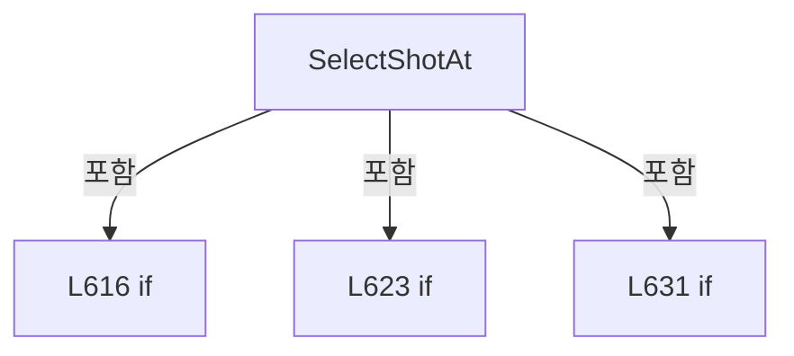

변경 전 점검: 입력/반환 타입, 위 호출자, 예외/취소 경로, 공유 상태와 저장·전송 소비자를 함께 확인합니다. 값의 단위나 물리 방향을 이름만으로 확정하지 않습니다.

### MethodDeclaration `SelectRow` · L637–645

[Drilling.UI/Menu/Menus/CMenuCorrection.ReviewData.Offset.cs:637–645](https://github.com/kjuws10-rgb/A3Drilling/blob/28764c91d521777b8ee068dd7aaf2d3902ce9fe2/Drilling.UI/Menu/Menus/CMenuCorrection.ReviewData.Offset.cs#L637-L645)

| 항목 | 실제 추출 값 |
| --- | --- |
| 서명 | void Drilling.UI.Menu.Menus.CMenuCorrection.CReviewDataPanel.CReviewDataOffsetApplyPanel.SelectRow(Drilling.UI.Menu.Menus.CMenuCorrection.ST_REVIEW_OFFSET_APPLY_GRID_ROW) |
| 접근/수식자 | Public / public |
| 반환/값 타입 | void |
| 소속 타입 | NamedType:Drilling.UI.Menu.Menus.CMenuCorrection.CReviewDataPanel.CReviewDataOffsetApplyPanel |

입력 계약:

| 이름 | 타입 | 전달 | 선택/기본값 |
| --- | --- | --- | --- |
| row | Drilling.UI.Menu.Menus.CMenuCorrection.ST_REVIEW_OFFSET_APPLY_GRID_ROW | None | False /  |

정적 호출자로 확인된 위치:

| 호출 파일/행 | 호출 표현식 | 런타임 분기 가능 |
| --- | --- | --- |
| [Drilling.UI/Popup/CReviewDataOffsetApplyDialog.xaml.cs:38–38](https://github.com/kjuws10-rgb/A3Drilling/blob/28764c91d521777b8ee068dd7aaf2d3902ce9fe2/Drilling.UI/Popup/CReviewDataOffsetApplyDialog.xaml.cs#L38-L38) | panel.SelectRow | False |

호출하는 대상과 해석 범위:

| 원본 행 | 표현식 | 분석 상태 | 대상/소스 위치 |
| --- | --- | --- | --- |
| 641 | ApplyCellSelection | resolved | void Drilling.UI.Menu.Menus.CMenuCorrection.CReviewDataPanel.CReviewDataOffsetApplyPanel.ApplyCellSelection(int) · Drilling.UI/Menu/Menus/CMenuCorrection.ReviewData.Offset.cs:656 |
| 644 | SelectShot | resolved | void Drilling.UI.Menu.Menus.CMenuCorrection.CReviewDataPanel.CReviewDataOffsetApplyPanel.SelectShot(string, Drilling.UI.Menu.Menus.CMenuCorrection.ST_REVIEW_OFFSET_APPLY_GRID_ROW?) · Drilling.UI/Menu/Menus/CMenuCorrection.ReviewData.Offset.cs:666 |

본문의 실제 연산·분기·예외·반환 순서(원문 위치 순):

| 원본 행 | 종류 | 주석 해설 |
| --- | --- | --- |
| 639 | if | 조건에 따라 분기합니다: if (_selectedCellNo != row.CellNo) |
| 641 | call | 함수·델리게이트 또는 객체 생성자를 호출합니다: ApplyCellSelection(row.CellNo) |
| 644 | call | 함수·델리게이트 또는 객체 생성자를 호출합니다: SelectShot(row.ShotKey, row) |

제어 구문의 포함 구조(실제 실행 순서/CFG가 아닌 구문 탐색 그림):

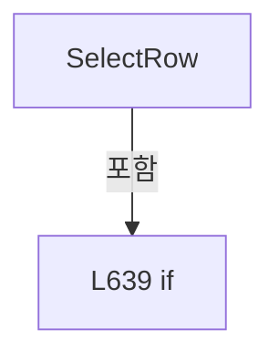

변경 전 점검: 입력/반환 타입, 위 호출자, 예외/취소 경로, 공유 상태와 저장·전송 소비자를 함께 확인합니다. 값의 단위나 물리 방향을 이름만으로 확정하지 않습니다.

### MethodDeclaration `SelectCell` · L647–654

[Drilling.UI/Menu/Menus/CMenuCorrection.ReviewData.Offset.cs:647–654](https://github.com/kjuws10-rgb/A3Drilling/blob/28764c91d521777b8ee068dd7aaf2d3902ce9fe2/Drilling.UI/Menu/Menus/CMenuCorrection.ReviewData.Offset.cs#L647-L654)

| 항목 | 실제 추출 값 |
| --- | --- |
| 서명 | void Drilling.UI.Menu.Menus.CMenuCorrection.CReviewDataPanel.CReviewDataOffsetApplyPanel.SelectCell(object?) |
| 접근/수식자 | Private / private |
| 반환/값 타입 | void |
| 소속 타입 | NamedType:Drilling.UI.Menu.Menus.CMenuCorrection.CReviewDataPanel.CReviewDataOffsetApplyPanel |

입력 계약:

| 이름 | 타입 | 전달 | 선택/기본값 |
| --- | --- | --- | --- |
| parameter | object? | None | False /  |

현재 부분 분석에서 직접 연결된 호출자는 없습니다. XAML/이벤트/인터페이스·델리게이트·외부 진입을 추가 확인해야 하며, 미사용으로 판정한 것이 아닙니다.

호출하는 대상과 해석 범위:

| 원본 행 | 표현식 | 분석 상태 | 대상/소스 위치 |
| --- | --- | --- | --- |
| 649 | int.TryParse | resolved | bool int.TryParse(string?, System.Globalization.NumberStyles, System.IFormatProvider?, out int) |
| 649 | .ToString | resolved · 동적 구현 선택 가능 | string? object.ToString() |
| 650 | _plan.CellNos.Contains | resolved · 동적 구현 선택 가능 | bool System.Collections.Generic.IReadOnlySet<int>.Contains(int) |
| 652 | ApplyCellSelection | resolved | void Drilling.UI.Menu.Menus.CMenuCorrection.CReviewDataPanel.CReviewDataOffsetApplyPanel.ApplyCellSelection(int) · Drilling.UI/Menu/Menus/CMenuCorrection.ReviewData.Offset.cs:656 |

본문의 실제 연산·분기·예외·반환 순서(원문 위치 순):

| 원본 행 | 종류 | 주석 해설 |
| --- | --- | --- |
| 649 | call | 함수·델리게이트 또는 객체 생성자를 호출합니다: int.TryParse(parameter?.ToString(), NumberStyles.Integer, CultureInfo.InvariantCulture, out var cellNo) |
| 649 | call | 함수·델리게이트 또는 객체 생성자를 호출합니다: .ToString() |
| 649 | if | 조건에 따라 분기합니다: if (int.TryParse(parameter?.ToString(), NumberStyles.Integer, CultureInfo.InvariantCulture, out var cellNo) && _plan.CellNos.Contains(cellNo)) |
| 650 | call | 함수·델리게이트 또는 객체 생성자를 호출합니다: _plan.CellNos.Contains(cellNo) |
| 652 | call | 함수·델리게이트 또는 객체 생성자를 호출합니다: ApplyCellSelection(cellNo) |

제어 구문의 포함 구조(실제 실행 순서/CFG가 아닌 구문 탐색 그림):

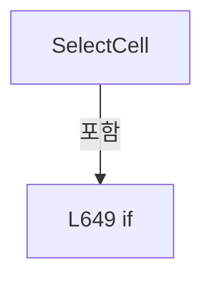

변경 전 점검: 입력/반환 타입, 위 호출자, 예외/취소 경로, 공유 상태와 저장·전송 소비자를 함께 확인합니다. 값의 단위나 물리 방향을 이름만으로 확정하지 않습니다.

### MethodDeclaration `ApplyCellSelection` · L656–664

[Drilling.UI/Menu/Menus/CMenuCorrection.ReviewData.Offset.cs:656–664](https://github.com/kjuws10-rgb/A3Drilling/blob/28764c91d521777b8ee068dd7aaf2d3902ce9fe2/Drilling.UI/Menu/Menus/CMenuCorrection.ReviewData.Offset.cs#L656-L664)

| 항목 | 실제 추출 값 |
| --- | --- |
| 서명 | void Drilling.UI.Menu.Menus.CMenuCorrection.CReviewDataPanel.CReviewDataOffsetApplyPanel.ApplyCellSelection(int) |
| 접근/수식자 | Private / private |
| 반환/값 타입 | void |
| 소속 타입 | NamedType:Drilling.UI.Menu.Menus.CMenuCorrection.CReviewDataPanel.CReviewDataOffsetApplyPanel |

입력 계약:

| 이름 | 타입 | 전달 | 선택/기본값 |
| --- | --- | --- | --- |
| cellNo | int | None | False /  |

정적 호출자로 확인된 위치:

| 호출 파일/행 | 호출 표현식 | 런타임 분기 가능 |
| --- | --- | --- |
| [Drilling.UI/Menu/Menus/CMenuCorrection.ReviewData.Offset.cs:589–589](https://github.com/kjuws10-rgb/A3Drilling/blob/28764c91d521777b8ee068dd7aaf2d3902ce9fe2/Drilling.UI/Menu/Menus/CMenuCorrection.ReviewData.Offset.cs#L589-L589) | ApplyCellSelection | False |
| [Drilling.UI/Menu/Menus/CMenuCorrection.ReviewData.Offset.cs:641–641](https://github.com/kjuws10-rgb/A3Drilling/blob/28764c91d521777b8ee068dd7aaf2d3902ce9fe2/Drilling.UI/Menu/Menus/CMenuCorrection.ReviewData.Offset.cs#L641-L641) | ApplyCellSelection | False |
| [Drilling.UI/Menu/Menus/CMenuCorrection.ReviewData.Offset.cs:652–652](https://github.com/kjuws10-rgb/A3Drilling/blob/28764c91d521777b8ee068dd7aaf2d3902ce9fe2/Drilling.UI/Menu/Menus/CMenuCorrection.ReviewData.Offset.cs#L652-L652) | ApplyCellSelection | False |

호출하는 대상과 해석 범위:

| 원본 행 | 표현식 | 분석 상태 | 대상/소스 위치 |
| --- | --- | --- | --- |
| 659 | _plan.Rows.Where(row => row.CellNo == cellNo).ToArray | resolved | Drilling.UI.Menu.Menus.CMenuCorrection.ST_REVIEW_OFFSET_APPLY_GRID_ROW[] System.Collections.Generic.IEnumerable<Drilling.UI.Menu.Menus.CMenuCorrection.ST_REVIEW_OFFSET_APPLY_GRID_ROW>.ToArray<Drilling.UI.Menu.Menus.CMenuCorrection.ST_REVIEW_OFFSET_APPLY_GRID_ROW>() |
| 659 | _plan.Rows.Where | resolved | System.Collections.Generic.IEnumerable<Drilling.UI.Menu.Menus.CMenuCorrection.ST_REVIEW_OFFSET_APPLY_GRID_ROW> System.Collections.Generic.IEnumerable<Drilling.UI.Menu.Menus.CMenuCorrection.ST_REVIEW_OFFSET_APPLY_GRID_ROW>.Where<Drilling.UI.Menu.Menus.CMenuCorrection.ST_REVIEW_OFFSET_APPLY_GRID_ROW>(System.Func<Drilling.UI.Menu.Menus.CMenuCorrection.ST_REVIEW_OFFSET_APPLY_GRID_ROW, bool>) |
| 660 | Rows.FirstOrDefault | resolved | Drilling.UI.Menu.Menus.CMenuCorrection.ST_REVIEW_OFFSET_APPLY_GRID_ROW? System.Collections.Generic.IEnumerable<Drilling.UI.Menu.Menus.CMenuCorrection.ST_REVIEW_OFFSET_APPLY_GRID_ROW>.FirstOrDefault<Drilling.UI.Menu.Menus.CMenuCorrection.ST_REVIEW_OFFSET_APPLY_GRID_ROW>() |
| 662 | RefreshImages | resolved | void Drilling.UI.Menu.Menus.CMenuCorrection.CReviewDataPanel.CReviewDataOffsetApplyPanel.RefreshImages() · Drilling.UI/Menu/Menus/CMenuCorrection.ReviewData.Offset.cs:677 |
| 663 | NotifyAll | resolved | void Drilling.UI.Menu.Menus.CMenuCorrection.CReviewDataPanel.CReviewDataOffsetApplyPanel.NotifyAll() · Drilling.UI/Menu/Menus/CMenuCorrection.ReviewData.Offset.cs:691 |

본문의 실제 연산·분기·예외·반환 순서(원문 위치 순):

| 원본 행 | 종류 | 주석 해설 |
| --- | --- | --- |
| 658 | assignment | 값을 대상에 대입합니다: _selectedCellNo = cellNo |
| 659 | assignment | 값을 대상에 대입합니다: Rows = _plan.Rows.Where(row => row.CellNo == cellNo).ToArray() |
| 659 | call | 함수·델리게이트 또는 객체 생성자를 호출합니다: _plan.Rows.Where(row => row.CellNo == cellNo).ToArray() |
| 659 | call | 함수·델리게이트 또는 객체 생성자를 호출합니다: _plan.Rows.Where(row => row.CellNo == cellNo) |
| 660 | assignment | 값을 대상에 대입합니다: SelectedRow = Rows.FirstOrDefault() |
| 660 | call | 함수·델리게이트 또는 객체 생성자를 호출합니다: Rows.FirstOrDefault() |
| 661 | assignment | 값을 대상에 대입합니다: _selectedShotKey = SelectedRow?.ShotKey ?? "" |
| 662 | call | 함수·델리게이트 또는 객체 생성자를 호출합니다: RefreshImages() |
| 663 | call | 함수·델리게이트 또는 객체 생성자를 호출합니다: NotifyAll() |

변경 전 점검: 입력/반환 타입, 위 호출자, 예외/취소 경로, 공유 상태와 저장·전송 소비자를 함께 확인합니다. 값의 단위나 물리 방향을 이름만으로 확정하지 않습니다.

### MethodDeclaration `SelectShot` · L666–675

[Drilling.UI/Menu/Menus/CMenuCorrection.ReviewData.Offset.cs:666–675](https://github.com/kjuws10-rgb/A3Drilling/blob/28764c91d521777b8ee068dd7aaf2d3902ce9fe2/Drilling.UI/Menu/Menus/CMenuCorrection.ReviewData.Offset.cs#L666-L675)

| 항목 | 실제 추출 값 |
| --- | --- |
| 서명 | void Drilling.UI.Menu.Menus.CMenuCorrection.CReviewDataPanel.CReviewDataOffsetApplyPanel.SelectShot(string, Drilling.UI.Menu.Menus.CMenuCorrection.ST_REVIEW_OFFSET_APPLY_GRID_ROW?) |
| 접근/수식자 | Private / private |
| 반환/값 타입 | void |
| 소속 타입 | NamedType:Drilling.UI.Menu.Menus.CMenuCorrection.CReviewDataPanel.CReviewDataOffsetApplyPanel |

입력 계약:

| 이름 | 타입 | 전달 | 선택/기본값 |
| --- | --- | --- | --- |
| shotKey | string | None | False /  |
| preferred | Drilling.UI.Menu.Menus.CMenuCorrection.ST_REVIEW_OFFSET_APPLY_GRID_ROW? | None | False /  |

정적 호출자로 확인된 위치:

| 호출 파일/행 | 호출 표현식 | 런타임 분기 가능 |
| --- | --- | --- |
| [Drilling.UI/Menu/Menus/CMenuCorrection.ReviewData.Offset.cs:633–633](https://github.com/kjuws10-rgb/A3Drilling/blob/28764c91d521777b8ee068dd7aaf2d3902ce9fe2/Drilling.UI/Menu/Menus/CMenuCorrection.ReviewData.Offset.cs#L633-L633) | SelectShot | False |
| [Drilling.UI/Menu/Menus/CMenuCorrection.ReviewData.Offset.cs:644–644](https://github.com/kjuws10-rgb/A3Drilling/blob/28764c91d521777b8ee068dd7aaf2d3902ce9fe2/Drilling.UI/Menu/Menus/CMenuCorrection.ReviewData.Offset.cs#L644-L644) | SelectShot | False |

호출하는 대상과 해석 범위:

| 원본 행 | 표현식 | 분석 상태 | 대상/소스 위치 |
| --- | --- | --- | --- |
| 669 | Rows.FirstOrDefault | resolved | Drilling.UI.Menu.Menus.CMenuCorrection.ST_REVIEW_OFFSET_APPLY_GRID_ROW? System.Collections.Generic.IEnumerable<Drilling.UI.Menu.Menus.CMenuCorrection.ST_REVIEW_OFFSET_APPLY_GRID_ROW>.FirstOrDefault<Drilling.UI.Menu.Menus.CMenuCorrection.ST_REVIEW_OFFSET_APPLY_GRID_ROW>(System.Func<Drilling.UI.Menu.Menus.CMenuCorrection.ST_REVIEW_OFFSET_APPLY_GRID_ROW, bool>) |
| 669 | row.ShotKey.Equals | resolved | bool string.Equals(string?, System.StringComparison) |
| 670 | _plan.ShotsByCell.GetValueOrDefault | resolved | System.Collections.Generic.IReadOnlyList<Drilling.UI.Menu.Menus.CMenuCorrection.ST_REVIEW_DATA_SHOT_POSITION> System.Collections.Generic.IReadOnlyDictionary<int, System.Collections.Generic.IReadOnlyList<Drilling.UI.Menu.Menus.CMenuCorrection.ST_REVIEW_DATA_SHOT_POSITION>>.GetValueOrDefault<int, System.Collections.Generic.IReadOnlyList<Drilling.UI.Menu.Menus.CMenuCorrection.ST_REVIEW_DATA_SHOT_POSITION>>(int, System.Collections.Generic.IReadOnlyList<Drilling.UI.Menu.Menus.CMenuCorrection.ST_REVIEW_DATA_SHOT_POSITION>) |
| 671 | BuildReviewDataShotMap | resolved | ImageSource? Drilling.UI.Menu.Menus.CMenuCorrection.CReviewDataPanel.BuildReviewDataShotMap(System.Collections.Generic.IReadOnlyList<Drilling.UI.Menu.Menus.CMenuCorrection.ST_REVIEW_DATA_SHOT_POSITION>, string, System.Collections.Generic.IReadOnlySet<string>?) · Drilling.UI/Menu/Menus/CMenuCorrection.ReviewData.Display.cs:1119 |
| 672 | Notify | resolved | void Drilling.UI.Menu.Menus.CMenuCorrection.CReviewDataPanel.CReviewDataOffsetApplyPanel.Notify(string) · Drilling.UI/Menu/Menus/CMenuCorrection.ReviewData.Offset.cs:706 |
| 672 | nameof | unresolved | None |
| 673 | Notify | resolved | void Drilling.UI.Menu.Menus.CMenuCorrection.CReviewDataPanel.CReviewDataOffsetApplyPanel.Notify(string) · Drilling.UI/Menu/Menus/CMenuCorrection.ReviewData.Offset.cs:706 |
| 673 | nameof | unresolved | None |
| 674 | Notify | resolved | void Drilling.UI.Menu.Menus.CMenuCorrection.CReviewDataPanel.CReviewDataOffsetApplyPanel.Notify(string) · Drilling.UI/Menu/Menus/CMenuCorrection.ReviewData.Offset.cs:706 |
| 674 | nameof | unresolved | None |

본문의 실제 연산·분기·예외·반환 순서(원문 위치 순):

| 원본 행 | 종류 | 주석 해설 |
| --- | --- | --- |
| 668 | assignment | 값을 대상에 대입합니다: _selectedShotKey = shotKey |
| 669 | assignment | 값을 대상에 대입합니다: SelectedRow = preferred ?? Rows.FirstOrDefault(row => row.ShotKey.Equals(shotKey, StringComparison.OrdinalIgnoreCase)) |
| 669 | call | 함수·델리게이트 또는 객체 생성자를 호출합니다: Rows.FirstOrDefault(row => row.ShotKey.Equals(shotKey, StringComparison.OrdinalIgnoreCase)) |
| 669 | call | 함수·델리게이트 또는 객체 생성자를 호출합니다: row.ShotKey.Equals(shotKey, StringComparison.OrdinalIgnoreCase) |
| 670 | call | 함수·델리게이트 또는 객체 생성자를 호출합니다: _plan.ShotsByCell.GetValueOrDefault(_selectedCellNo, []) |
| 670 | local-declaration | 지역 변수를 선언합니다: var shots = _plan.ShotsByCell.GetValueOrDefault(_selectedCellNo, []); |
| 670 | variable-initializer | 변수의 초기값을 지정합니다: shots = _plan.ShotsByCell.GetValueOrDefault(_selectedCellNo, []) |
| 671 | assignment | 값을 대상에 대입합니다: ShotMapImage = BuildReviewDataShotMap(shots, _selectedShotKey) |
| 671 | call | 함수·델리게이트 또는 객체 생성자를 호출합니다: BuildReviewDataShotMap(shots, _selectedShotKey) |
| 672 | call | 함수·델리게이트 또는 객체 생성자를 호출합니다: Notify(nameof(ShotMapImage)) |
| 672 | call | 함수·델리게이트 또는 객체 생성자를 호출합니다: nameof(ShotMapImage) |
| 673 | call | 함수·델리게이트 또는 객체 생성자를 호출합니다: Notify(nameof(SelectedRow)) |
| 673 | call | 함수·델리게이트 또는 객체 생성자를 호출합니다: nameof(SelectedRow) |
| 674 | call | 함수·델리게이트 또는 객체 생성자를 호출합니다: Notify(nameof(SelectedShotTitle)) |
| 674 | call | 함수·델리게이트 또는 객체 생성자를 호출합니다: nameof(SelectedShotTitle) |

변경 전 점검: 입력/반환 타입, 위 호출자, 예외/취소 경로, 공유 상태와 저장·전송 소비자를 함께 확인합니다. 값의 단위나 물리 방향을 이름만으로 확정하지 않습니다.

### MethodDeclaration `RefreshImages` · L677–689

[Drilling.UI/Menu/Menus/CMenuCorrection.ReviewData.Offset.cs:677–689](https://github.com/kjuws10-rgb/A3Drilling/blob/28764c91d521777b8ee068dd7aaf2d3902ce9fe2/Drilling.UI/Menu/Menus/CMenuCorrection.ReviewData.Offset.cs#L677-L689)

| 항목 | 실제 추출 값 |
| --- | --- |
| 서명 | void Drilling.UI.Menu.Menus.CMenuCorrection.CReviewDataPanel.CReviewDataOffsetApplyPanel.RefreshImages() |
| 접근/수식자 | Private / private |
| 반환/값 타입 | void |
| 소속 타입 | NamedType:Drilling.UI.Menu.Menus.CMenuCorrection.CReviewDataPanel.CReviewDataOffsetApplyPanel |

정적 호출자로 확인된 위치:

| 호출 파일/행 | 호출 표현식 | 런타임 분기 가능 |
| --- | --- | --- |
| [Drilling.UI/Menu/Menus/CMenuCorrection.ReviewData.Offset.cs:662–662](https://github.com/kjuws10-rgb/A3Drilling/blob/28764c91d521777b8ee068dd7aaf2d3902ce9fe2/Drilling.UI/Menu/Menus/CMenuCorrection.ReviewData.Offset.cs#L662-L662) | RefreshImages | False |

호출하는 대상과 해석 범위:

| 원본 행 | 표현식 | 분석 상태 | 대상/소스 위치 |
| --- | --- | --- | --- |
| 679 | BuildReviewDataGlassPreview | resolved | Drilling.UI.Menu.Menus.CMenuCorrection.ST_REVIEW_DATA_GLASS_PREVIEW Drilling.UI.Menu.Menus.CMenuCorrection.CReviewDataPanel.BuildReviewDataGlassPreview(System.Collections.Generic.IReadOnlyDictionary<string, string>, int, System.Collections.Generic.IReadOnlySet<int>, int, System.Collections.Generic.IReadOnlyDictionary<int, Drilling.Common.Review.EN_REVIEW_RESULT_LEVEL>?, Drilling.Common.Review.ST_REVIEW_RESULT_LEVEL_SETTINGS?) · Drilling.UI/Menu/Menus/CMenuCorrection.ReviewData.Display.cs:1016 |
| 684 | _plan.ShotsByCell.GetValueOrDefault | resolved | System.Collections.Generic.IReadOnlyList<Drilling.UI.Menu.Menus.CMenuCorrection.ST_REVIEW_DATA_SHOT_POSITION> System.Collections.Generic.IReadOnlyDictionary<int, System.Collections.Generic.IReadOnlyList<Drilling.UI.Menu.Menus.CMenuCorrection.ST_REVIEW_DATA_SHOT_POSITION>>.GetValueOrDefault<int, System.Collections.Generic.IReadOnlyList<Drilling.UI.Menu.Menus.CMenuCorrection.ST_REVIEW_DATA_SHOT_POSITION>>(int, System.Collections.Generic.IReadOnlyList<Drilling.UI.Menu.Menus.CMenuCorrection.ST_REVIEW_DATA_SHOT_POSITION>) |
| 685 | GetReviewDataShotMapSize | resolved | Size Drilling.UI.Menu.Menus.CMenuCorrection.CReviewDataPanel.GetReviewDataShotMapSize(System.Collections.Generic.IReadOnlyList<Drilling.UI.Menu.Menus.CMenuCorrection.ST_REVIEW_DATA_SHOT_POSITION>) · Drilling.UI/Menu/Menus/CMenuCorrection.ReviewData.Display.cs:1293 |
| 688 | BuildReviewDataShotMap | resolved | ImageSource? Drilling.UI.Menu.Menus.CMenuCorrection.CReviewDataPanel.BuildReviewDataShotMap(System.Collections.Generic.IReadOnlyList<Drilling.UI.Menu.Menus.CMenuCorrection.ST_REVIEW_DATA_SHOT_POSITION>, string, System.Collections.Generic.IReadOnlySet<string>?) · Drilling.UI/Menu/Menus/CMenuCorrection.ReviewData.Display.cs:1119 |

본문의 실제 연산·분기·예외·반환 순서(원문 위치 순):

| 원본 행 | 종류 | 주석 해설 |
| --- | --- | --- |
| 679 | call | 함수·델리게이트 또는 객체 생성자를 호출합니다: BuildReviewDataGlassPreview(_plan.Parameters, _plan.CellCount, _plan.CellNos, _selectedCellNo) |
| 679 | local-declaration | 지역 변수를 선언합니다: var preview = BuildReviewDataGlassPreview(_plan.Parameters, _plan.CellCount, _plan.CellNos, _selectedCellNo); |
| 679 | variable-initializer | 변수의 초기값을 지정합니다: preview = BuildReviewDataGlassPreview(_plan.Parameters, _plan.CellCount, _plan.CellNos, _selectedCellNo) |
| 680 | assignment | 값을 대상에 대입합니다: GlassPreviewImage = preview.Image |
| 681 | assignment | 값을 대상에 대입합니다: CellLabels = preview.CellLabels |
| 682 | assignment | 값을 대상에 대입합니다: GlassSurfaceWidth = preview.Width |
| 683 | assignment | 값을 대상에 대입합니다: GlassSurfaceHeight = preview.Height |
| 684 | call | 함수·델리게이트 또는 객체 생성자를 호출합니다: _plan.ShotsByCell.GetValueOrDefault(_selectedCellNo, []) |
| 684 | local-declaration | 지역 변수를 선언합니다: var shots = _plan.ShotsByCell.GetValueOrDefault(_selectedCellNo, []); |
| 684 | variable-initializer | 변수의 초기값을 지정합니다: shots = _plan.ShotsByCell.GetValueOrDefault(_selectedCellNo, []) |
| 685 | call | 함수·델리게이트 또는 객체 생성자를 호출합니다: GetReviewDataShotMapSize(shots) |
| 685 | local-declaration | 지역 변수를 선언합니다: var size = GetReviewDataShotMapSize(shots); |
| 685 | variable-initializer | 변수의 초기값을 지정합니다: size = GetReviewDataShotMapSize(shots) |
| 686 | assignment | 값을 대상에 대입합니다: ShotMapSurfaceWidth = size.Width |
| 687 | assignment | 값을 대상에 대입합니다: ShotMapSurfaceHeight = size.Height |
| 688 | assignment | 값을 대상에 대입합니다: ShotMapImage = BuildReviewDataShotMap(shots, _selectedShotKey) |
| 688 | call | 함수·델리게이트 또는 객체 생성자를 호출합니다: BuildReviewDataShotMap(shots, _selectedShotKey) |

변경 전 점검: 입력/반환 타입, 위 호출자, 예외/취소 경로, 공유 상태와 저장·전송 소비자를 함께 확인합니다. 값의 단위나 물리 방향을 이름만으로 확정하지 않습니다.

### MethodDeclaration `NotifyAll` · L691–704

[Drilling.UI/Menu/Menus/CMenuCorrection.ReviewData.Offset.cs:691–704](https://github.com/kjuws10-rgb/A3Drilling/blob/28764c91d521777b8ee068dd7aaf2d3902ce9fe2/Drilling.UI/Menu/Menus/CMenuCorrection.ReviewData.Offset.cs#L691-L704)

| 항목 | 실제 추출 값 |
| --- | --- |
| 서명 | void Drilling.UI.Menu.Menus.CMenuCorrection.CReviewDataPanel.CReviewDataOffsetApplyPanel.NotifyAll() |
| 접근/수식자 | Private / private |
| 반환/값 타입 | void |
| 소속 타입 | NamedType:Drilling.UI.Menu.Menus.CMenuCorrection.CReviewDataPanel.CReviewDataOffsetApplyPanel |

정적 호출자로 확인된 위치:

| 호출 파일/행 | 호출 표현식 | 런타임 분기 가능 |
| --- | --- | --- |
| [Drilling.UI/Menu/Menus/CMenuCorrection.ReviewData.Offset.cs:663–663](https://github.com/kjuws10-rgb/A3Drilling/blob/28764c91d521777b8ee068dd7aaf2d3902ce9fe2/Drilling.UI/Menu/Menus/CMenuCorrection.ReviewData.Offset.cs#L663-L663) | NotifyAll | False |

호출하는 대상과 해석 범위:

| 원본 행 | 표현식 | 분석 상태 | 대상/소스 위치 |
| --- | --- | --- | --- |
| 693 | Notify | resolved | void Drilling.UI.Menu.Menus.CMenuCorrection.CReviewDataPanel.CReviewDataOffsetApplyPanel.Notify(string) · Drilling.UI/Menu/Menus/CMenuCorrection.ReviewData.Offset.cs:706 |
| 693 | nameof | unresolved | None |
| 694 | Notify | resolved | void Drilling.UI.Menu.Menus.CMenuCorrection.CReviewDataPanel.CReviewDataOffsetApplyPanel.Notify(string) · Drilling.UI/Menu/Menus/CMenuCorrection.ReviewData.Offset.cs:706 |
| 694 | nameof | unresolved | None |
| 695 | Notify | resolved | void Drilling.UI.Menu.Menus.CMenuCorrection.CReviewDataPanel.CReviewDataOffsetApplyPanel.Notify(string) · Drilling.UI/Menu/Menus/CMenuCorrection.ReviewData.Offset.cs:706 |
| 695 | nameof | unresolved | None |
| 696 | Notify | resolved | void Drilling.UI.Menu.Menus.CMenuCorrection.CReviewDataPanel.CReviewDataOffsetApplyPanel.Notify(string) · Drilling.UI/Menu/Menus/CMenuCorrection.ReviewData.Offset.cs:706 |
| 696 | nameof | unresolved | None |
| 697 | Notify | resolved | void Drilling.UI.Menu.Menus.CMenuCorrection.CReviewDataPanel.CReviewDataOffsetApplyPanel.Notify(string) · Drilling.UI/Menu/Menus/CMenuCorrection.ReviewData.Offset.cs:706 |
| 697 | nameof | unresolved | None |
| 698 | Notify | resolved | void Drilling.UI.Menu.Menus.CMenuCorrection.CReviewDataPanel.CReviewDataOffsetApplyPanel.Notify(string) · Drilling.UI/Menu/Menus/CMenuCorrection.ReviewData.Offset.cs:706 |
| 698 | nameof | unresolved | None |
| 699 | Notify | resolved | void Drilling.UI.Menu.Menus.CMenuCorrection.CReviewDataPanel.CReviewDataOffsetApplyPanel.Notify(string) · Drilling.UI/Menu/Menus/CMenuCorrection.ReviewData.Offset.cs:706 |
| 699 | nameof | unresolved | None |
| 700 | Notify | resolved | void Drilling.UI.Menu.Menus.CMenuCorrection.CReviewDataPanel.CReviewDataOffsetApplyPanel.Notify(string) · Drilling.UI/Menu/Menus/CMenuCorrection.ReviewData.Offset.cs:706 |
| 700 | nameof | unresolved | None |
| 701 | Notify | resolved | void Drilling.UI.Menu.Menus.CMenuCorrection.CReviewDataPanel.CReviewDataOffsetApplyPanel.Notify(string) · Drilling.UI/Menu/Menus/CMenuCorrection.ReviewData.Offset.cs:706 |
| 701 | nameof | unresolved | None |
| 702 | Notify | resolved | void Drilling.UI.Menu.Menus.CMenuCorrection.CReviewDataPanel.CReviewDataOffsetApplyPanel.Notify(string) · Drilling.UI/Menu/Menus/CMenuCorrection.ReviewData.Offset.cs:706 |
| 702 | nameof | unresolved | None |
| 703 | Notify | resolved | void Drilling.UI.Menu.Menus.CMenuCorrection.CReviewDataPanel.CReviewDataOffsetApplyPanel.Notify(string) · Drilling.UI/Menu/Menus/CMenuCorrection.ReviewData.Offset.cs:706 |
| 703 | nameof | unresolved | None |

본문의 실제 연산·분기·예외·반환 순서(원문 위치 순):

| 원본 행 | 종류 | 주석 해설 |
| --- | --- | --- |
| 693 | call | 함수·델리게이트 또는 객체 생성자를 호출합니다: Notify(nameof(GlassPreviewImage)) |
| 693 | call | 함수·델리게이트 또는 객체 생성자를 호출합니다: nameof(GlassPreviewImage) |
| 694 | call | 함수·델리게이트 또는 객체 생성자를 호출합니다: Notify(nameof(ShotMapImage)) |
| 694 | call | 함수·델리게이트 또는 객체 생성자를 호출합니다: nameof(ShotMapImage) |
| 695 | call | 함수·델리게이트 또는 객체 생성자를 호출합니다: Notify(nameof(CellLabels)) |
| 695 | call | 함수·델리게이트 또는 객체 생성자를 호출합니다: nameof(CellLabels) |
| 696 | call | 함수·델리게이트 또는 객체 생성자를 호출합니다: Notify(nameof(Rows)) |
| 696 | call | 함수·델리게이트 또는 객체 생성자를 호출합니다: nameof(Rows) |
| 697 | call | 함수·델리게이트 또는 객체 생성자를 호출합니다: Notify(nameof(SelectedRow)) |
| 697 | call | 함수·델리게이트 또는 객체 생성자를 호출합니다: nameof(SelectedRow) |
| 698 | call | 함수·델리게이트 또는 객체 생성자를 호출합니다: Notify(nameof(SelectedCellTitle)) |
| 698 | call | 함수·델리게이트 또는 객체 생성자를 호출합니다: nameof(SelectedCellTitle) |
| 699 | call | 함수·델리게이트 또는 객체 생성자를 호출합니다: Notify(nameof(SelectedShotTitle)) |
| 699 | call | 함수·델리게이트 또는 객체 생성자를 호출합니다: nameof(SelectedShotTitle) |
| 700 | call | 함수·델리게이트 또는 객체 생성자를 호출합니다: Notify(nameof(GlassSurfaceWidth)) |
| 700 | call | 함수·델리게이트 또는 객체 생성자를 호출합니다: nameof(GlassSurfaceWidth) |
| 701 | call | 함수·델리게이트 또는 객체 생성자를 호출합니다: Notify(nameof(GlassSurfaceHeight)) |
| 701 | call | 함수·델리게이트 또는 객체 생성자를 호출합니다: nameof(GlassSurfaceHeight) |
| 702 | call | 함수·델리게이트 또는 객체 생성자를 호출합니다: Notify(nameof(ShotMapSurfaceWidth)) |
| 702 | call | 함수·델리게이트 또는 객체 생성자를 호출합니다: nameof(ShotMapSurfaceWidth) |
| 703 | call | 함수·델리게이트 또는 객체 생성자를 호출합니다: Notify(nameof(ShotMapSurfaceHeight)) |
| 703 | call | 함수·델리게이트 또는 객체 생성자를 호출합니다: nameof(ShotMapSurfaceHeight) |

변경 전 점검: 입력/반환 타입, 위 호출자, 예외/취소 경로, 공유 상태와 저장·전송 소비자를 함께 확인합니다. 값의 단위나 물리 방향을 이름만으로 확정하지 않습니다.

### MethodDeclaration `Notify` · L706–709

[Drilling.UI/Menu/Menus/CMenuCorrection.ReviewData.Offset.cs:706–709](https://github.com/kjuws10-rgb/A3Drilling/blob/28764c91d521777b8ee068dd7aaf2d3902ce9fe2/Drilling.UI/Menu/Menus/CMenuCorrection.ReviewData.Offset.cs#L706-L709)

| 항목 | 실제 추출 값 |
| --- | --- |
| 서명 | void Drilling.UI.Menu.Menus.CMenuCorrection.CReviewDataPanel.CReviewDataOffsetApplyPanel.Notify(string) |
| 접근/수식자 | Private / private |
| 반환/값 타입 | void |
| 소속 타입 | NamedType:Drilling.UI.Menu.Menus.CMenuCorrection.CReviewDataPanel.CReviewDataOffsetApplyPanel |

입력 계약:

| 이름 | 타입 | 전달 | 선택/기본값 |
| --- | --- | --- | --- |
| propertyName | string | None | False /  |

정적 호출자로 확인된 위치:

| 호출 파일/행 | 호출 표현식 | 런타임 분기 가능 |
| --- | --- | --- |
| [Drilling.UI/Menu/Menus/CMenuCorrection.ReviewData.Offset.cs:672–672](https://github.com/kjuws10-rgb/A3Drilling/blob/28764c91d521777b8ee068dd7aaf2d3902ce9fe2/Drilling.UI/Menu/Menus/CMenuCorrection.ReviewData.Offset.cs#L672-L672) | Notify | False |
| [Drilling.UI/Menu/Menus/CMenuCorrection.ReviewData.Offset.cs:673–673](https://github.com/kjuws10-rgb/A3Drilling/blob/28764c91d521777b8ee068dd7aaf2d3902ce9fe2/Drilling.UI/Menu/Menus/CMenuCorrection.ReviewData.Offset.cs#L673-L673) | Notify | False |
| [Drilling.UI/Menu/Menus/CMenuCorrection.ReviewData.Offset.cs:674–674](https://github.com/kjuws10-rgb/A3Drilling/blob/28764c91d521777b8ee068dd7aaf2d3902ce9fe2/Drilling.UI/Menu/Menus/CMenuCorrection.ReviewData.Offset.cs#L674-L674) | Notify | False |
| [Drilling.UI/Menu/Menus/CMenuCorrection.ReviewData.Offset.cs:693–693](https://github.com/kjuws10-rgb/A3Drilling/blob/28764c91d521777b8ee068dd7aaf2d3902ce9fe2/Drilling.UI/Menu/Menus/CMenuCorrection.ReviewData.Offset.cs#L693-L693) | Notify | False |
| [Drilling.UI/Menu/Menus/CMenuCorrection.ReviewData.Offset.cs:694–694](https://github.com/kjuws10-rgb/A3Drilling/blob/28764c91d521777b8ee068dd7aaf2d3902ce9fe2/Drilling.UI/Menu/Menus/CMenuCorrection.ReviewData.Offset.cs#L694-L694) | Notify | False |
| [Drilling.UI/Menu/Menus/CMenuCorrection.ReviewData.Offset.cs:695–695](https://github.com/kjuws10-rgb/A3Drilling/blob/28764c91d521777b8ee068dd7aaf2d3902ce9fe2/Drilling.UI/Menu/Menus/CMenuCorrection.ReviewData.Offset.cs#L695-L695) | Notify | False |
| [Drilling.UI/Menu/Menus/CMenuCorrection.ReviewData.Offset.cs:696–696](https://github.com/kjuws10-rgb/A3Drilling/blob/28764c91d521777b8ee068dd7aaf2d3902ce9fe2/Drilling.UI/Menu/Menus/CMenuCorrection.ReviewData.Offset.cs#L696-L696) | Notify | False |
| [Drilling.UI/Menu/Menus/CMenuCorrection.ReviewData.Offset.cs:697–697](https://github.com/kjuws10-rgb/A3Drilling/blob/28764c91d521777b8ee068dd7aaf2d3902ce9fe2/Drilling.UI/Menu/Menus/CMenuCorrection.ReviewData.Offset.cs#L697-L697) | Notify | False |
| [Drilling.UI/Menu/Menus/CMenuCorrection.ReviewData.Offset.cs:698–698](https://github.com/kjuws10-rgb/A3Drilling/blob/28764c91d521777b8ee068dd7aaf2d3902ce9fe2/Drilling.UI/Menu/Menus/CMenuCorrection.ReviewData.Offset.cs#L698-L698) | Notify | False |
| [Drilling.UI/Menu/Menus/CMenuCorrection.ReviewData.Offset.cs:699–699](https://github.com/kjuws10-rgb/A3Drilling/blob/28764c91d521777b8ee068dd7aaf2d3902ce9fe2/Drilling.UI/Menu/Menus/CMenuCorrection.ReviewData.Offset.cs#L699-L699) | Notify | False |
| [Drilling.UI/Menu/Menus/CMenuCorrection.ReviewData.Offset.cs:700–700](https://github.com/kjuws10-rgb/A3Drilling/blob/28764c91d521777b8ee068dd7aaf2d3902ce9fe2/Drilling.UI/Menu/Menus/CMenuCorrection.ReviewData.Offset.cs#L700-L700) | Notify | False |
| [Drilling.UI/Menu/Menus/CMenuCorrection.ReviewData.Offset.cs:701–701](https://github.com/kjuws10-rgb/A3Drilling/blob/28764c91d521777b8ee068dd7aaf2d3902ce9fe2/Drilling.UI/Menu/Menus/CMenuCorrection.ReviewData.Offset.cs#L701-L701) | Notify | False |
| [Drilling.UI/Menu/Menus/CMenuCorrection.ReviewData.Offset.cs:702–702](https://github.com/kjuws10-rgb/A3Drilling/blob/28764c91d521777b8ee068dd7aaf2d3902ce9fe2/Drilling.UI/Menu/Menus/CMenuCorrection.ReviewData.Offset.cs#L702-L702) | Notify | False |
| [Drilling.UI/Menu/Menus/CMenuCorrection.ReviewData.Offset.cs:703–703](https://github.com/kjuws10-rgb/A3Drilling/blob/28764c91d521777b8ee068dd7aaf2d3902ce9fe2/Drilling.UI/Menu/Menus/CMenuCorrection.ReviewData.Offset.cs#L703-L703) | Notify | False |

호출하는 대상과 해석 범위:

| 원본 행 | 표현식 | 분석 상태 | 대상/소스 위치 |
| --- | --- | --- | --- |
| 708 | .Invoke | resolved · 동적 구현 선택 가능 | void System.ComponentModel.PropertyChangedEventHandler.Invoke(object?, System.ComponentModel.PropertyChangedEventArgs) |
| 708 | new PropertyChangedEventArgs | resolved | System.ComponentModel.PropertyChangedEventArgs.PropertyChangedEventArgs(string?) |

본문의 실제 연산·분기·예외·반환 순서(원문 위치 순):

| 원본 행 | 종류 | 주석 해설 |
| --- | --- | --- |
| 708 | call | 함수·델리게이트 또는 객체 생성자를 호출합니다: .Invoke(this, new PropertyChangedEventArgs(propertyName)) |
| 708 | call | 함수·델리게이트 또는 객체 생성자를 호출합니다: new PropertyChangedEventArgs(propertyName) |

변경 전 점검: 입력/반환 타입, 위 호출자, 예외/취소 경로, 공유 상태와 저장·전송 소비자를 함께 확인합니다. 값의 단위나 물리 방향을 이름만으로 확정하지 않습니다.

### PropertyDeclaration `Head` · L729–729

[Drilling.UI/Menu/Menus/CMenuCorrection.ReviewData.Offset.cs:729–729](https://github.com/kjuws10-rgb/A3Drilling/blob/28764c91d521777b8ee068dd7aaf2d3902ce9fe2/Drilling.UI/Menu/Menus/CMenuCorrection.ReviewData.Offset.cs#L729-L729)

| 항목 | 실제 추출 값 |
| --- | --- |
| 서명 | string Drilling.UI.Menu.Menus.CMenuCorrection.ST_REVIEW_OFFSET_APPLY_GRID_ROW.Head |
| 접근/수식자 | Public / public |
| 반환/값 타입 | string |
| 소속 타입 | NamedType:Drilling.UI.Menu.Menus.CMenuCorrection.ST_REVIEW_OFFSET_APPLY_GRID_ROW |

현재 부분 분석에서 직접 연결된 호출자는 없습니다. XAML/이벤트/인터페이스·델리게이트·외부 진입을 추가 확인해야 하며, 미사용으로 판정한 것이 아닙니다.

변경 전 점검: 입력/반환 타입, 위 호출자, 예외/취소 경로, 공유 상태와 저장·전송 소비자를 함께 확인합니다. 값의 단위나 물리 방향을 이름만으로 확정하지 않습니다.

### PropertyDeclaration `Cell` · L730–730

[Drilling.UI/Menu/Menus/CMenuCorrection.ReviewData.Offset.cs:730–730](https://github.com/kjuws10-rgb/A3Drilling/blob/28764c91d521777b8ee068dd7aaf2d3902ce9fe2/Drilling.UI/Menu/Menus/CMenuCorrection.ReviewData.Offset.cs#L730-L730)

| 항목 | 실제 추출 값 |
| --- | --- |
| 서명 | string Drilling.UI.Menu.Menus.CMenuCorrection.ST_REVIEW_OFFSET_APPLY_GRID_ROW.Cell |
| 접근/수식자 | Public / public |
| 반환/값 타입 | string |
| 소속 타입 | NamedType:Drilling.UI.Menu.Menus.CMenuCorrection.ST_REVIEW_OFFSET_APPLY_GRID_ROW |

현재 부분 분석에서 직접 연결된 호출자는 없습니다. XAML/이벤트/인터페이스·델리게이트·외부 진입을 추가 확인해야 하며, 미사용으로 판정한 것이 아닙니다.

변경 전 점검: 입력/반환 타입, 위 호출자, 예외/취소 경로, 공유 상태와 저장·전송 소비자를 함께 확인합니다. 값의 단위나 물리 방향을 이름만으로 확정하지 않습니다.

### PropertyDeclaration `CurrentXText` · L731–731

[Drilling.UI/Menu/Menus/CMenuCorrection.ReviewData.Offset.cs:731–731](https://github.com/kjuws10-rgb/A3Drilling/blob/28764c91d521777b8ee068dd7aaf2d3902ce9fe2/Drilling.UI/Menu/Menus/CMenuCorrection.ReviewData.Offset.cs#L731-L731)

| 항목 | 실제 추출 값 |
| --- | --- |
| 서명 | string Drilling.UI.Menu.Menus.CMenuCorrection.ST_REVIEW_OFFSET_APPLY_GRID_ROW.CurrentXText |
| 접근/수식자 | Public / public |
| 반환/값 타입 | string |
| 소속 타입 | NamedType:Drilling.UI.Menu.Menus.CMenuCorrection.ST_REVIEW_OFFSET_APPLY_GRID_ROW |

현재 부분 분석에서 직접 연결된 호출자는 없습니다. XAML/이벤트/인터페이스·델리게이트·외부 진입을 추가 확인해야 하며, 미사용으로 판정한 것이 아닙니다.

호출하는 대상과 해석 범위:

| 원본 행 | 표현식 | 분석 상태 | 대상/소스 위치 |
| --- | --- | --- | --- |
| 731 | CurrentX.ToString | resolved | string double.ToString(string?, System.IFormatProvider?) |

본문의 실제 연산·분기·예외·반환 순서(원문 위치 순):

| 원본 행 | 종류 | 주석 해설 |
| --- | --- | --- |
| 731 | call | 함수·델리게이트 또는 객체 생성자를 호출합니다: CurrentX.ToString("F3", CultureInfo.InvariantCulture) |

변경 전 점검: 입력/반환 타입, 위 호출자, 예외/취소 경로, 공유 상태와 저장·전송 소비자를 함께 확인합니다. 값의 단위나 물리 방향을 이름만으로 확정하지 않습니다.

### PropertyDeclaration `CurrentYText` · L732–732

[Drilling.UI/Menu/Menus/CMenuCorrection.ReviewData.Offset.cs:732–732](https://github.com/kjuws10-rgb/A3Drilling/blob/28764c91d521777b8ee068dd7aaf2d3902ce9fe2/Drilling.UI/Menu/Menus/CMenuCorrection.ReviewData.Offset.cs#L732-L732)

| 항목 | 실제 추출 값 |
| --- | --- |
| 서명 | string Drilling.UI.Menu.Menus.CMenuCorrection.ST_REVIEW_OFFSET_APPLY_GRID_ROW.CurrentYText |
| 접근/수식자 | Public / public |
| 반환/값 타입 | string |
| 소속 타입 | NamedType:Drilling.UI.Menu.Menus.CMenuCorrection.ST_REVIEW_OFFSET_APPLY_GRID_ROW |

현재 부분 분석에서 직접 연결된 호출자는 없습니다. XAML/이벤트/인터페이스·델리게이트·외부 진입을 추가 확인해야 하며, 미사용으로 판정한 것이 아닙니다.

호출하는 대상과 해석 범위:

| 원본 행 | 표현식 | 분석 상태 | 대상/소스 위치 |
| --- | --- | --- | --- |
| 732 | CurrentY.ToString | resolved | string double.ToString(string?, System.IFormatProvider?) |

본문의 실제 연산·분기·예외·반환 순서(원문 위치 순):

| 원본 행 | 종류 | 주석 해설 |
| --- | --- | --- |
| 732 | call | 함수·델리게이트 또는 객체 생성자를 호출합니다: CurrentY.ToString("F3", CultureInfo.InvariantCulture) |

변경 전 점검: 입력/반환 타입, 위 호출자, 예외/취소 경로, 공유 상태와 저장·전송 소비자를 함께 확인합니다. 값의 단위나 물리 방향을 이름만으로 확정하지 않습니다.

### PropertyDeclaration `AddXText` · L733–733

[Drilling.UI/Menu/Menus/CMenuCorrection.ReviewData.Offset.cs:733–733](https://github.com/kjuws10-rgb/A3Drilling/blob/28764c91d521777b8ee068dd7aaf2d3902ce9fe2/Drilling.UI/Menu/Menus/CMenuCorrection.ReviewData.Offset.cs#L733-L733)

| 항목 | 실제 추출 값 |
| --- | --- |
| 서명 | string Drilling.UI.Menu.Menus.CMenuCorrection.ST_REVIEW_OFFSET_APPLY_GRID_ROW.AddXText |
| 접근/수식자 | Public / public |
| 반환/값 타입 | string |
| 소속 타입 | NamedType:Drilling.UI.Menu.Menus.CMenuCorrection.ST_REVIEW_OFFSET_APPLY_GRID_ROW |

현재 부분 분석에서 직접 연결된 호출자는 없습니다. XAML/이벤트/인터페이스·델리게이트·외부 진입을 추가 확인해야 하며, 미사용으로 판정한 것이 아닙니다.

호출하는 대상과 해석 범위:

| 원본 행 | 표현식 | 분석 상태 | 대상/소스 위치 |
| --- | --- | --- | --- |
| 733 | AddX.ToString | resolved | string double.ToString(string?, System.IFormatProvider?) |

본문의 실제 연산·분기·예외·반환 순서(원문 위치 순):

| 원본 행 | 종류 | 주석 해설 |
| --- | --- | --- |
| 733 | call | 함수·델리게이트 또는 객체 생성자를 호출합니다: AddX.ToString("F3", CultureInfo.InvariantCulture) |

변경 전 점검: 입력/반환 타입, 위 호출자, 예외/취소 경로, 공유 상태와 저장·전송 소비자를 함께 확인합니다. 값의 단위나 물리 방향을 이름만으로 확정하지 않습니다.

### PropertyDeclaration `AddYText` · L734–734

[Drilling.UI/Menu/Menus/CMenuCorrection.ReviewData.Offset.cs:734–734](https://github.com/kjuws10-rgb/A3Drilling/blob/28764c91d521777b8ee068dd7aaf2d3902ce9fe2/Drilling.UI/Menu/Menus/CMenuCorrection.ReviewData.Offset.cs#L734-L734)

| 항목 | 실제 추출 값 |
| --- | --- |
| 서명 | string Drilling.UI.Menu.Menus.CMenuCorrection.ST_REVIEW_OFFSET_APPLY_GRID_ROW.AddYText |
| 접근/수식자 | Public / public |
| 반환/값 타입 | string |
| 소속 타입 | NamedType:Drilling.UI.Menu.Menus.CMenuCorrection.ST_REVIEW_OFFSET_APPLY_GRID_ROW |

현재 부분 분석에서 직접 연결된 호출자는 없습니다. XAML/이벤트/인터페이스·델리게이트·외부 진입을 추가 확인해야 하며, 미사용으로 판정한 것이 아닙니다.

호출하는 대상과 해석 범위:

| 원본 행 | 표현식 | 분석 상태 | 대상/소스 위치 |
| --- | --- | --- | --- |
| 734 | AddY.ToString | resolved | string double.ToString(string?, System.IFormatProvider?) |

본문의 실제 연산·분기·예외·반환 순서(원문 위치 순):

| 원본 행 | 종류 | 주석 해설 |
| --- | --- | --- |
| 734 | call | 함수·델리게이트 또는 객체 생성자를 호출합니다: AddY.ToString("F3", CultureInfo.InvariantCulture) |

변경 전 점검: 입력/반환 타입, 위 호출자, 예외/취소 경로, 공유 상태와 저장·전송 소비자를 함께 확인합니다. 값의 단위나 물리 방향을 이름만으로 확정하지 않습니다.

### PropertyDeclaration `FinalXText` · L735–735

[Drilling.UI/Menu/Menus/CMenuCorrection.ReviewData.Offset.cs:735–735](https://github.com/kjuws10-rgb/A3Drilling/blob/28764c91d521777b8ee068dd7aaf2d3902ce9fe2/Drilling.UI/Menu/Menus/CMenuCorrection.ReviewData.Offset.cs#L735-L735)

| 항목 | 실제 추출 값 |
| --- | --- |
| 서명 | string Drilling.UI.Menu.Menus.CMenuCorrection.ST_REVIEW_OFFSET_APPLY_GRID_ROW.FinalXText |
| 접근/수식자 | Public / public |
| 반환/값 타입 | string |
| 소속 타입 | NamedType:Drilling.UI.Menu.Menus.CMenuCorrection.ST_REVIEW_OFFSET_APPLY_GRID_ROW |

현재 부분 분석에서 직접 연결된 호출자는 없습니다. XAML/이벤트/인터페이스·델리게이트·외부 진입을 추가 확인해야 하며, 미사용으로 판정한 것이 아닙니다.

호출하는 대상과 해석 범위:

| 원본 행 | 표현식 | 분석 상태 | 대상/소스 위치 |
| --- | --- | --- | --- |
| 735 | FinalX.ToString | resolved | string double.ToString(string?, System.IFormatProvider?) |

본문의 실제 연산·분기·예외·반환 순서(원문 위치 순):

| 원본 행 | 종류 | 주석 해설 |
| --- | --- | --- |
| 735 | call | 함수·델리게이트 또는 객체 생성자를 호출합니다: FinalX.ToString("F3", CultureInfo.InvariantCulture) |

변경 전 점검: 입력/반환 타입, 위 호출자, 예외/취소 경로, 공유 상태와 저장·전송 소비자를 함께 확인합니다. 값의 단위나 물리 방향을 이름만으로 확정하지 않습니다.

### PropertyDeclaration `FinalYText` · L736–736

[Drilling.UI/Menu/Menus/CMenuCorrection.ReviewData.Offset.cs:736–736](https://github.com/kjuws10-rgb/A3Drilling/blob/28764c91d521777b8ee068dd7aaf2d3902ce9fe2/Drilling.UI/Menu/Menus/CMenuCorrection.ReviewData.Offset.cs#L736-L736)

| 항목 | 실제 추출 값 |
| --- | --- |
| 서명 | string Drilling.UI.Menu.Menus.CMenuCorrection.ST_REVIEW_OFFSET_APPLY_GRID_ROW.FinalYText |
| 접근/수식자 | Public / public |
| 반환/값 타입 | string |
| 소속 타입 | NamedType:Drilling.UI.Menu.Menus.CMenuCorrection.ST_REVIEW_OFFSET_APPLY_GRID_ROW |

현재 부분 분석에서 직접 연결된 호출자는 없습니다. XAML/이벤트/인터페이스·델리게이트·외부 진입을 추가 확인해야 하며, 미사용으로 판정한 것이 아닙니다.

호출하는 대상과 해석 범위:

| 원본 행 | 표현식 | 분석 상태 | 대상/소스 위치 |
| --- | --- | --- | --- |
| 736 | FinalY.ToString | resolved | string double.ToString(string?, System.IFormatProvider?) |

본문의 실제 연산·분기·예외·반환 순서(원문 위치 순):

| 원본 행 | 종류 | 주석 해설 |
| --- | --- | --- |
| 736 | call | 함수·델리게이트 또는 객체 생성자를 호출합니다: FinalY.ToString("F3", CultureInfo.InvariantCulture) |

변경 전 점검: 입력/반환 타입, 위 호출자, 예외/취소 경로, 공유 상태와 저장·전송 소비자를 함께 확인합니다. 값의 단위나 물리 방향을 이름만으로 확정하지 않습니다.

### PropertyDeclaration `Instance` · L752–752

[Drilling.UI/Menu/Menus/CMenuCorrection.ReviewData.Offset.cs:752–752](https://github.com/kjuws10-rgb/A3Drilling/blob/28764c91d521777b8ee068dd7aaf2d3902ce9fe2/Drilling.UI/Menu/Menus/CMenuCorrection.ReviewData.Offset.cs#L752-L752)

| 항목 | 실제 추출 값 |
| --- | --- |
| 서명 | Drilling.UI.Menu.Menus.CMenuCorrection.CReviewShotNameComparer Drilling.UI.Menu.Menus.CMenuCorrection.CReviewShotNameComparer.Instance |
| 접근/수식자 | Public / public, static |
| 반환/값 타입 | Drilling.UI.Menu.Menus.CMenuCorrection.CReviewShotNameComparer |
| 소속 타입 | NamedType:Drilling.UI.Menu.Menus.CMenuCorrection.CReviewShotNameComparer |

현재 부분 분석에서 직접 연결된 호출자는 없습니다. XAML/이벤트/인터페이스·델리게이트·외부 진입을 추가 확인해야 하며, 미사용으로 판정한 것이 아닙니다.

호출하는 대상과 해석 범위:

| 원본 행 | 표현식 | 분석 상태 | 대상/소스 위치 |
| --- | --- | --- | --- |
| 752 | new | resolved | Drilling.UI.Menu.Menus.CMenuCorrection.CReviewShotNameComparer.CReviewShotNameComparer() · Drilling.UI/Menu/Menus/CMenuCorrection.ReviewData.Offset.cs:750 |

본문의 실제 연산·분기·예외·반환 순서(원문 위치 순):

| 원본 행 | 종류 | 주석 해설 |
| --- | --- | --- |
| 752 | call | 함수·델리게이트 또는 객체 생성자를 호출합니다: new() |

변경 전 점검: 입력/반환 타입, 위 호출자, 예외/취소 경로, 공유 상태와 저장·전송 소비자를 함께 확인합니다. 값의 단위나 물리 방향을 이름만으로 확정하지 않습니다.

### GetAccessorDeclaration `get_Instance` · L752–752

[Drilling.UI/Menu/Menus/CMenuCorrection.ReviewData.Offset.cs:752–752](https://github.com/kjuws10-rgb/A3Drilling/blob/28764c91d521777b8ee068dd7aaf2d3902ce9fe2/Drilling.UI/Menu/Menus/CMenuCorrection.ReviewData.Offset.cs#L752-L752)

| 항목 | 실제 추출 값 |
| --- | --- |
| 서명 | Drilling.UI.Menu.Menus.CMenuCorrection.CReviewShotNameComparer Drilling.UI.Menu.Menus.CMenuCorrection.CReviewShotNameComparer.Instance.get |
| 접근/수식자 | Public / get |
| 반환/값 타입 | Drilling.UI.Menu.Menus.CMenuCorrection.CReviewShotNameComparer |
| 소속 타입 | NamedType:Drilling.UI.Menu.Menus.CMenuCorrection.CReviewShotNameComparer |

현재 부분 분석에서 직접 연결된 호출자는 없습니다. XAML/이벤트/인터페이스·델리게이트·외부 진입을 추가 확인해야 하며, 미사용으로 판정한 것이 아닙니다.

변경 전 점검: 입력/반환 타입, 위 호출자, 예외/취소 경로, 공유 상태와 저장·전송 소비자를 함께 확인합니다. 값의 단위나 물리 방향을 이름만으로 확정하지 않습니다.

### MethodDeclaration `Compare` · L754–782

[Drilling.UI/Menu/Menus/CMenuCorrection.ReviewData.Offset.cs:754–782](https://github.com/kjuws10-rgb/A3Drilling/blob/28764c91d521777b8ee068dd7aaf2d3902ce9fe2/Drilling.UI/Menu/Menus/CMenuCorrection.ReviewData.Offset.cs#L754-L782)

| 항목 | 실제 추출 값 |
| --- | --- |
| 서명 | int Drilling.UI.Menu.Menus.CMenuCorrection.CReviewShotNameComparer.Compare(string?, string?) |
| 접근/수식자 | Public / public |
| 반환/값 타입 | int |
| 소속 타입 | NamedType:Drilling.UI.Menu.Menus.CMenuCorrection.CReviewShotNameComparer |

입력 계약:

| 이름 | 타입 | 전달 | 선택/기본값 |
| --- | --- | --- | --- |
| x | string? | None | False /  |
| y | string? | None | False /  |

현재 부분 분석에서 직접 연결된 호출자는 없습니다. XAML/이벤트/인터페이스·델리게이트·외부 진입을 추가 확인해야 하며, 미사용으로 판정한 것이 아닙니다.

호출하는 대상과 해석 범위:

| 원본 행 | 표현식 | 분석 상태 | 대상/소스 위치 |
| --- | --- | --- | --- |
| 772 | Parse | resolved | (int Row, int Column, string Text) Parse(string?) · Drilling.UI/Menu/Menus/CMenuCorrection.ReviewData.Offset.cs:756 |
| 773 | Parse | resolved | (int Row, int Column, string Text) Parse(string?) · Drilling.UI/Menu/Menus/CMenuCorrection.ReviewData.Offset.cs:756 |
| 774 | left.Row.CompareTo | resolved | int int.CompareTo(int) |
| 780 | left.Column.CompareTo | resolved | int int.CompareTo(int) |
| 781 | StringComparer.OrdinalIgnoreCase.Compare | resolved | int System.StringComparer.Compare(string?, string?) |

본문의 실제 연산·분기·예외·반환 순서(원문 위치 순):

| 원본 행 | 종류 | 주석 해설 |
| --- | --- | --- |
| 772 | call | 함수·델리게이트 또는 객체 생성자를 호출합니다: Parse(x) |
| 772 | local-declaration | 지역 변수를 선언합니다: var left = Parse(x); |
| 772 | variable-initializer | 변수의 초기값을 지정합니다: left = Parse(x) |
| 773 | call | 함수·델리게이트 또는 객체 생성자를 호출합니다: Parse(y) |
| 773 | local-declaration | 지역 변수를 선언합니다: var right = Parse(y); |
| 773 | variable-initializer | 변수의 초기값을 지정합니다: right = Parse(y) |
| 774 | call | 함수·델리게이트 또는 객체 생성자를 호출합니다: left.Row.CompareTo(right.Row) |
| 774 | local-declaration | 지역 변수를 선언합니다: var rowCompare = left.Row.CompareTo(right.Row); |
| 774 | variable-initializer | 변수의 초기값을 지정합니다: rowCompare = left.Row.CompareTo(right.Row) |
| 775 | if | 조건에 따라 분기합니다: if (rowCompare != 0) |
| 777 | return | 호출자에게 값 또는 제어를 반환합니다: return rowCompare; |
| 780 | call | 함수·델리게이트 또는 객체 생성자를 호출합니다: left.Column.CompareTo(right.Column) |
| 780 | local-declaration | 지역 변수를 선언합니다: var columnCompare = left.Column.CompareTo(right.Column); |
| 780 | variable-initializer | 변수의 초기값을 지정합니다: columnCompare = left.Column.CompareTo(right.Column) |
| 781 | call | 함수·델리게이트 또는 객체 생성자를 호출합니다: StringComparer.OrdinalIgnoreCase.Compare(left.Text, right.Text) |
| 781 | conditional-expression | 조건에 따라 결과식을 선택합니다: columnCompare != 0 ? columnCompare : StringComparer.OrdinalIgnoreCase.Compare(left.Text, right.Text) |
| 781 | return | 호출자에게 값 또는 제어를 반환합니다: return columnCompare != 0 ? columnCompare : StringComparer.OrdinalIgnoreCase.Compare(left.Text, right.Text); |

제어 구문의 포함 구조(실제 실행 순서/CFG가 아닌 구문 탐색 그림):

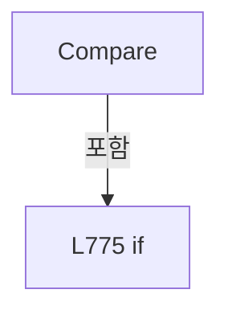

변경 전 점검: 입력/반환 타입, 위 호출자, 예외/취소 경로, 공유 상태와 저장·전송 소비자를 함께 확인합니다. 값의 단위나 물리 방향을 이름만으로 확정하지 않습니다.

### LocalFunctionStatement `Parse` · L756–770

[Drilling.UI/Menu/Menus/CMenuCorrection.ReviewData.Offset.cs:756–770](https://github.com/kjuws10-rgb/A3Drilling/blob/28764c91d521777b8ee068dd7aaf2d3902ce9fe2/Drilling.UI/Menu/Menus/CMenuCorrection.ReviewData.Offset.cs#L756-L770)

| 항목 | 실제 추출 값 |
| --- | --- |
| 서명 | (int Row, int Column, string Text) Parse(string?) |
| 접근/수식자 | Private / static |
| 반환/값 타입 | (int Row, int Column, string Text) |
| 소속 타입 | NamedType:Drilling.UI.Menu.Menus.CMenuCorrection.CReviewShotNameComparer |

입력 계약:

| 이름 | 타입 | 전달 | 선택/기본값 |
| --- | --- | --- | --- |
| value | string? | None | False /  |

정적 호출자로 확인된 위치:

| 호출 파일/행 | 호출 표현식 | 런타임 분기 가능 |
| --- | --- | --- |
| [Drilling.UI/Menu/Menus/CMenuCorrection.ReviewData.Offset.cs:772–772](https://github.com/kjuws10-rgb/A3Drilling/blob/28764c91d521777b8ee068dd7aaf2d3902ce9fe2/Drilling.UI/Menu/Menus/CMenuCorrection.ReviewData.Offset.cs#L772-L772) | Parse | False |
| [Drilling.UI/Menu/Menus/CMenuCorrection.ReviewData.Offset.cs:773–773](https://github.com/kjuws10-rgb/A3Drilling/blob/28764c91d521777b8ee068dd7aaf2d3902ce9fe2/Drilling.UI/Menu/Menus/CMenuCorrection.ReviewData.Offset.cs#L773-L773) | Parse | False |

호출하는 대상과 해석 범위:

| 원본 행 | 표현식 | 분석 상태 | 대상/소스 위치 |
| --- | --- | --- | --- |
| 758 | .Trim().ToUpperInvariant | resolved | string string.ToUpperInvariant() |
| 758 | .Trim | resolved | string string.Trim() |
| 759 | text.TakeWhile(char.IsLetter).ToArray | resolved | char[] System.Collections.Generic.IEnumerable<char>.ToArray<char>() |
| 759 | text.TakeWhile | resolved | System.Collections.Generic.IEnumerable<char> System.Collections.Generic.IEnumerable<char>.TakeWhile<char>(System.Func<char, bool>) |
| 766 | int.TryParse | resolved | bool int.TryParse(System.ReadOnlySpan<char>, System.Globalization.NumberStyles, System.IFormatProvider?, out int) |
| 766 | text.AsSpan | resolved | System.ReadOnlySpan<char> string?.AsSpan(int) |

본문의 실제 연산·분기·예외·반환 순서(원문 위치 순):

| 원본 행 | 종류 | 주석 해설 |
| --- | --- | --- |
| 758 | call | 함수·델리게이트 또는 객체 생성자를 호출합니다: .Trim().ToUpperInvariant() |
| 758 | call | 함수·델리게이트 또는 객체 생성자를 호출합니다: .Trim() |
| 758 | local-declaration | 지역 변수를 선언합니다: var text = value?.Trim().ToUpperInvariant() ?? ""; |
| 758 | variable-initializer | 변수의 초기값을 지정합니다: text = value?.Trim().ToUpperInvariant() ?? "" |
| 759 | call | 함수·델리게이트 또는 객체 생성자를 호출합니다: text.TakeWhile(char.IsLetter).ToArray() |
| 759 | call | 함수·델리게이트 또는 객체 생성자를 호출합니다: text.TakeWhile(char.IsLetter) |
| 759 | local-declaration | 지역 변수를 선언합니다: var letters = text.TakeWhile(char.IsLetter).ToArray(); |
| 759 | variable-initializer | 변수의 초기값을 지정합니다: letters = text.TakeWhile(char.IsLetter).ToArray() |
| 760 | local-declaration | 지역 변수를 선언합니다: var column = 0; |
| 760 | variable-initializer | 변수의 초기값을 지정합니다: column = 0 |
| 761 | foreach | 컬렉션 요소를 순회합니다: foreach (var letter in letters) |
| 763 | assignment | 값을 대상에 대입합니다: column = (column * 26) + letter - 'A' + 1 |
| 766 | call | 함수·델리게이트 또는 객체 생성자를 호출합니다: int.TryParse(text.AsSpan(letters.Length), NumberStyles.Integer, CultureInfo.InvariantCulture, out var parsed) |
| 766 | call | 함수·델리게이트 또는 객체 생성자를 호출합니다: text.AsSpan(letters.Length) |
| 766 | conditional-expression | 조건에 따라 결과식을 선택합니다: int.TryParse(text.AsSpan(letters.Length), NumberStyles.Integer, CultureInfo.InvariantCulture, out var parsed) ? parsed : int.MaxValue |
| 766 | local-declaration | 지역 변수를 선언합니다: var row = int.TryParse(text.AsSpan(letters.Length), NumberStyles.Integer, CultureInfo.InvariantCulture, out var parsed) ? parsed : int.MaxValue; |
| 766 | variable-initializer | 변수의 초기값을 지정합니다: row = int.TryParse(text.AsSpan(letters.Length), NumberStyles.Integer, CultureInfo.InvariantCulture, out var parsed) ? parsed : int.MaxValue |
| 769 | return | 호출자에게 값 또는 제어를 반환합니다: return (row, column, text); |

제어 구문의 포함 구조(실제 실행 순서/CFG가 아닌 구문 탐색 그림):

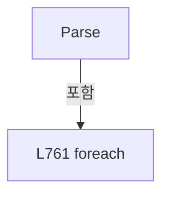

변경 전 점검: 입력/반환 타입, 위 호출자, 예외/취소 경로, 공유 상태와 저장·전송 소비자를 함께 확인합니다. 값의 단위나 물리 방향을 이름만으로 확정하지 않습니다.

## 구문·바인딩 한계

전체 WPF/벤더 SDK/프로젝트별 빌드 조건을 로드한 정식 빌드가 아닙니다. `resolved`는 이 부분 컴파일에서의 심볼 연결이며 virtual/interface/delegate/이벤트/Reflection/XAML의 실제 런타임 구현을 확정하지 않습니다. `candidate`와 `unresolved`는 후속 확인 대상으로 남깁니다.

## 원문 전체 주석 해설본

[원본 모든 행과 행별 해설 보기](../../../../annotated/Drilling.UI/Menu/Menus/CMenuCorrection.ReviewData.Offset.cs.annotated.txt)

원본을 빠뜨리거나 임의로 줄이지 않았습니다. `L000001 |` 표시는 원본 행 번호, `// 해설`은 별도 설명입니다. 실행용 소스가 아닌 문서입니다.

## 수정·재검증 체크

- 원본 Commit과 현재 작업 파일 SHA가 같은지 먼저 확인합니다. 다르면 이 문서를 과거 버전 자료로 취급합니다.
- 선언·직접 호출·이벤트/인터페이스 경계·설정 소비를 함께 확인합니다. 정적 연결의 빈 곳을 정상 경로로 추정하지 않습니다.
- 저장 형식/단위/식별자·재시도·취소·예외·롤백에 영향을 주는 변경은 상세 해설장과 호출자를 다시 검토합니다.
- 도구의 구문 추출과 별도 정적 추적 해설, 실제 빌드·시뮬레이션·실장비 검증 결과를 분리합니다.
