# Drilling.UI/Menu/Menus/CMenuCorrection.ReviewData.Reinspection.cs

| 항목 | 내용 |
| --- | --- |
| 원본 저장소 | https://github.com/kjuws10-rgb/A3Drilling.git |
| 원본 Commit | 334b3599651b2e8e0181fd4459bafaf3cddafff3 |
| 원본 SHA256 | f5ba162be1fb07f05954469f04a5cb959a3f47734f6ec0babd36e170762b91ff |
| 파일 분류 | code |
| 원본 크기/행 | 43,511 bytes / 994 physical lines |
| 인코딩 | utf-8-sig |
| 검토 범위 | 구문/부분 의미 분석에서 추출한 사실. 동작·물리 단위·실장비 합격을 보증하지 않습니다. |
| 원본 링크 | [고정 Commit 원본](https://github.com/kjuws10-rgb/A3Drilling/blob/334b3599651b2e8e0181fd4459bafaf3cddafff3/Drilling.UI/Menu/Menus/CMenuCorrection.ReviewData.Reinspection.cs) |

## 파일의 역할과 읽는 순서

WPF 화면·사용자 명령·표시 상태를 구성합니다. XAML 이벤트와 코드 비하인드, RootView의 조립 경로를 함께 추적합니다.

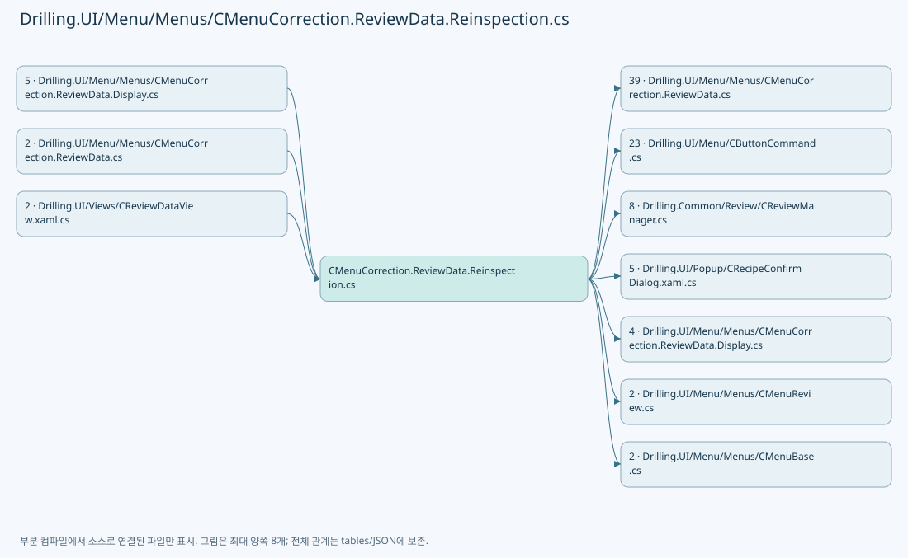

## 네임스페이스·타입·상속

| 타입 | 구분 | 원본 범위 | 선언/상속 |
| --- | --- | --- | --- |
| CMenuCorrection | ClassDeclaration | 11–993 | CMenuCorrection |
| CReviewDataPanel | ClassDeclaration | 13–803 | CReviewDataPanel |
| ST_REVIEW_DATA_REINSPECTION_ITEM | ClassDeclaration | 805–992 | ST_REVIEW_DATA_REINSPECTION_ITEM: INotifyPropertyChanged |

## 멤버 빠른 목록

| 이름 | 종류 | 범위 | 서명 |
| --- | --- | --- | --- |
| ReinspectionBeamNumbers | FieldDeclaration | L15–15 | System.Collections.Generic.IReadOnlyList<int> Drilling.UI.Menu.Menus.CMenuCorrection.CReviewDataPanel.ReinspectionBeamNumbers |
| _isReinspectionMode | FieldDeclaration | L16–16 | bool Drilling.UI.Menu.Menus.CMenuCorrection.CReviewDataPanel._isReinspectionMode |
| _reinspectionShots | FieldDeclaration | L17–17 | System.Collections.Generic.IReadOnlyList<Drilling.UI.Menu.Menus.CMenuCorrection.ST_REVIEW_DATA_REINSPECTION_ITEM> Drilling.UI.Menu.Menus.CMenuCorrection.CReviewDataPanel._reinspectionShots |
| _selectedReinspectionShot | FieldDeclaration | L18–18 | Drilling.UI.Menu.Menus.CMenuCorrection.ST_REVIEW_DATA_REINSPECTION_ITEM? Drilling.UI.Menu.Menus.CMenuCorrection.CReviewDataPanel._selectedReinspectionShot |
| _reinspectionStatusText | FieldDeclaration | L19–19 | string Drilling.UI.Menu.Menus.CMenuCorrection.CReviewDataPanel._reinspectionStatusText |
| _reinspectionCancellation | FieldDeclaration | L20–20 | System.Threading.CancellationTokenSource? Drilling.UI.Menu.Menus.CMenuCorrection.CReviewDataPanel._reinspectionCancellation |
| _reinspectionSaveCancellation | FieldDeclaration | L21–21 | System.Threading.CancellationTokenSource? Drilling.UI.Menu.Menus.CMenuCorrection.CReviewDataPanel._reinspectionSaveCancellation |
| _isReinspectionRunning | FieldDeclaration | L22–22 | bool Drilling.UI.Menu.Menus.CMenuCorrection.CReviewDataPanel._isReinspectionRunning |
| _isReinspectionSaving | FieldDeclaration | L23–23 | bool Drilling.UI.Menu.Menus.CMenuCorrection.CReviewDataPanel._isReinspectionSaving |
| _hasUnsavedReinspectionMeasurements | FieldDeclaration | L24–24 | bool Drilling.UI.Menu.Menus.CMenuCorrection.CReviewDataPanel._hasUnsavedReinspectionMeasurements |
| IsReinspectionMode | PropertyDeclaration | L26–26 | bool Drilling.UI.Menu.Menus.CMenuCorrection.CReviewDataPanel.IsReinspectionMode |
| IsReinspectionRunning | PropertyDeclaration | L27–27 | bool Drilling.UI.Menu.Menus.CMenuCorrection.CReviewDataPanel.IsReinspectionRunning |
| IsReinspectionSaving | PropertyDeclaration | L28–28 | bool Drilling.UI.Menu.Menus.CMenuCorrection.CReviewDataPanel.IsReinspectionSaving |
| IsBeamInspectionResult | PropertyDeclaration | L29–29 | bool Drilling.UI.Menu.Menus.CMenuCorrection.CReviewDataPanel.IsBeamInspectionResult |
| CanEditReinspectionList | PropertyDeclaration | L30–30 | bool Drilling.UI.Menu.Menus.CMenuCorrection.CReviewDataPanel.CanEditReinspectionList |
| ReinspectionShots | PropertyDeclaration | L31–31 | System.Collections.Generic.IReadOnlyList<Drilling.UI.Menu.Menus.CMenuCorrection.ST_REVIEW_DATA_REINSPECTION_ITEM> Drilling.UI.Menu.Menus.CMenuCorrection.CReviewDataPanel.ReinspectionShots |
| ReinspectionBeamOptions | PropertyDeclaration | L32–32 | System.Collections.Generic.IReadOnlyList<int> Drilling.UI.Menu.Menus.CMenuCorrection.CReviewDataPanel.ReinspectionBeamOptions |
| ReinspectionSummary | PropertyDeclaration | L33–33 | string Drilling.UI.Menu.Menus.CMenuCorrection.CReviewDataPanel.ReinspectionSummary |
| ReinspectionStatusText | PropertyDeclaration | L34–34 | string Drilling.UI.Menu.Menus.CMenuCorrection.CReviewDataPanel.ReinspectionStatusText |
| ReinspectionAvailabilityText | PropertyDeclaration | L35–39 | string Drilling.UI.Menu.Menus.CMenuCorrection.CReviewDataPanel.ReinspectionAvailabilityText |
| CanToggleReinspection | PropertyDeclaration | L40–46 | bool Drilling.UI.Menu.Menus.CMenuCorrection.CReviewDataPanel.CanToggleReinspection |
| CanAddReinspectionShot | PropertyDeclaration | L47–51 | bool Drilling.UI.Menu.Menus.CMenuCorrection.CReviewDataPanel.CanAddReinspectionShot |
| CanAddSelectedReinspectionShots | PropertyDeclaration | L52–56 | bool Drilling.UI.Menu.Menus.CMenuCorrection.CReviewDataPanel.CanAddSelectedReinspectionShots |
| CanAddNgReinspectionShots | PropertyDeclaration | L57–61 | bool Drilling.UI.Menu.Menus.CMenuCorrection.CReviewDataPanel.CanAddNgReinspectionShots |
| CanDeleteReinspectionShot | PropertyDeclaration | L62–62 | bool Drilling.UI.Menu.Menus.CMenuCorrection.CReviewDataPanel.CanDeleteReinspectionShot |
| CanClearReinspectionShots | PropertyDeclaration | L63–63 | bool Drilling.UI.Menu.Menus.CMenuCorrection.CReviewDataPanel.CanClearReinspectionShots |
| CanMoveToReinspectionShot | PropertyDeclaration | L64–64 | bool Drilling.UI.Menu.Menus.CMenuCorrection.CReviewDataPanel.CanMoveToReinspectionShot |
| CanInspectReinspectionShot | PropertyDeclaration | L65–65 | bool Drilling.UI.Menu.Menus.CMenuCorrection.CReviewDataPanel.CanInspectReinspectionShot |
| CanInspectAllReinspectionShots | PropertyDeclaration | L66–66 | bool Drilling.UI.Menu.Menus.CMenuCorrection.CReviewDataPanel.CanInspectAllReinspectionShots |
| CanStopReinspection | PropertyDeclaration | L67–67 | bool Drilling.UI.Menu.Menus.CMenuCorrection.CReviewDataPanel.CanStopReinspection |
| CanSaveReinspectionResult | PropertyDeclaration | L68–74 | bool Drilling.UI.Menu.Menus.CMenuCorrection.CReviewDataPanel.CanSaveReinspectionResult |
| SelectedReinspectionShot | PropertyDeclaration | L76–90 | Drilling.UI.Menu.Menus.CMenuCorrection.ST_REVIEW_DATA_REINSPECTION_ITEM? Drilling.UI.Menu.Menus.CMenuCorrection.CReviewDataPanel.SelectedReinspectionShot |
| get_SelectedReinspectionShot | GetAccessorDeclaration | L78–78 | Drilling.UI.Menu.Menus.CMenuCorrection.ST_REVIEW_DATA_REINSPECTION_ITEM? Drilling.UI.Menu.Menus.CMenuCorrection.CReviewDataPanel.SelectedReinspectionShot.get |
| set_SelectedReinspectionShot | SetAccessorDeclaration | L79–89 | void Drilling.UI.Menu.Menus.CMenuCorrection.CReviewDataPanel.SelectedReinspectionShot.set |
| ToggleReinspectionCommand | PropertyDeclaration | L92–92 | Drilling.UI.Menu.CButtonCommand Drilling.UI.Menu.Menus.CMenuCorrection.CReviewDataPanel.ToggleReinspectionCommand |
| get_ToggleReinspectionCommand | GetAccessorDeclaration | L92–92 | Drilling.UI.Menu.CButtonCommand Drilling.UI.Menu.Menus.CMenuCorrection.CReviewDataPanel.ToggleReinspectionCommand.get |
| set_ToggleReinspectionCommand | SetAccessorDeclaration | L92–92 | void Drilling.UI.Menu.Menus.CMenuCorrection.CReviewDataPanel.ToggleReinspectionCommand.set |
| AddReinspectionShotCommand | PropertyDeclaration | L93–93 | Drilling.UI.Menu.CButtonCommand Drilling.UI.Menu.Menus.CMenuCorrection.CReviewDataPanel.AddReinspectionShotCommand |
| get_AddReinspectionShotCommand | GetAccessorDeclaration | L93–93 | Drilling.UI.Menu.CButtonCommand Drilling.UI.Menu.Menus.CMenuCorrection.CReviewDataPanel.AddReinspectionShotCommand.get |
| set_AddReinspectionShotCommand | SetAccessorDeclaration | L93–93 | void Drilling.UI.Menu.Menus.CMenuCorrection.CReviewDataPanel.AddReinspectionShotCommand.set |
| AddSelectedReinspectionShotsCommand | PropertyDeclaration | L94–94 | Drilling.UI.Menu.CButtonCommand Drilling.UI.Menu.Menus.CMenuCorrection.CReviewDataPanel.AddSelectedReinspectionShotsCommand |
| get_AddSelectedReinspectionShotsCommand | GetAccessorDeclaration | L94–94 | Drilling.UI.Menu.CButtonCommand Drilling.UI.Menu.Menus.CMenuCorrection.CReviewDataPanel.AddSelectedReinspectionShotsCommand.get |
| set_AddSelectedReinspectionShotsCommand | SetAccessorDeclaration | L94–94 | void Drilling.UI.Menu.Menus.CMenuCorrection.CReviewDataPanel.AddSelectedReinspectionShotsCommand.set |
| AddNgReinspectionShotsCommand | PropertyDeclaration | L95–95 | Drilling.UI.Menu.CButtonCommand Drilling.UI.Menu.Menus.CMenuCorrection.CReviewDataPanel.AddNgReinspectionShotsCommand |
| get_AddNgReinspectionShotsCommand | GetAccessorDeclaration | L95–95 | Drilling.UI.Menu.CButtonCommand Drilling.UI.Menu.Menus.CMenuCorrection.CReviewDataPanel.AddNgReinspectionShotsCommand.get |
| set_AddNgReinspectionShotsCommand | SetAccessorDeclaration | L95–95 | void Drilling.UI.Menu.Menus.CMenuCorrection.CReviewDataPanel.AddNgReinspectionShotsCommand.set |
| DeleteReinspectionShotCommand | PropertyDeclaration | L96–96 | Drilling.UI.Menu.CButtonCommand Drilling.UI.Menu.Menus.CMenuCorrection.CReviewDataPanel.DeleteReinspectionShotCommand |
| get_DeleteReinspectionShotCommand | GetAccessorDeclaration | L96–96 | Drilling.UI.Menu.CButtonCommand Drilling.UI.Menu.Menus.CMenuCorrection.CReviewDataPanel.DeleteReinspectionShotCommand.get |
| set_DeleteReinspectionShotCommand | SetAccessorDeclaration | L96–96 | void Drilling.UI.Menu.Menus.CMenuCorrection.CReviewDataPanel.DeleteReinspectionShotCommand.set |
| ClearReinspectionShotsCommand | PropertyDeclaration | L97–97 | Drilling.UI.Menu.CButtonCommand Drilling.UI.Menu.Menus.CMenuCorrection.CReviewDataPanel.ClearReinspectionShotsCommand |
| get_ClearReinspectionShotsCommand | GetAccessorDeclaration | L97–97 | Drilling.UI.Menu.CButtonCommand Drilling.UI.Menu.Menus.CMenuCorrection.CReviewDataPanel.ClearReinspectionShotsCommand.get |
| set_ClearReinspectionShotsCommand | SetAccessorDeclaration | L97–97 | void Drilling.UI.Menu.Menus.CMenuCorrection.CReviewDataPanel.ClearReinspectionShotsCommand.set |
| MoveToReinspectionShotCommand | PropertyDeclaration | L98–98 | Drilling.UI.Menu.CButtonCommand Drilling.UI.Menu.Menus.CMenuCorrection.CReviewDataPanel.MoveToReinspectionShotCommand |
| get_MoveToReinspectionShotCommand | GetAccessorDeclaration | L98–98 | Drilling.UI.Menu.CButtonCommand Drilling.UI.Menu.Menus.CMenuCorrection.CReviewDataPanel.MoveToReinspectionShotCommand.get |
| set_MoveToReinspectionShotCommand | SetAccessorDeclaration | L98–98 | void Drilling.UI.Menu.Menus.CMenuCorrection.CReviewDataPanel.MoveToReinspectionShotCommand.set |
| MoveAndInspectReinspectionShotCommand | PropertyDeclaration | L99–99 | Drilling.UI.Menu.CButtonCommand Drilling.UI.Menu.Menus.CMenuCorrection.CReviewDataPanel.MoveAndInspectReinspectionShotCommand |
| get_MoveAndInspectReinspectionShotCommand | GetAccessorDeclaration | L99–99 | Drilling.UI.Menu.CButtonCommand Drilling.UI.Menu.Menus.CMenuCorrection.CReviewDataPanel.MoveAndInspectReinspectionShotCommand.get |
| set_MoveAndInspectReinspectionShotCommand | SetAccessorDeclaration | L99–99 | void Drilling.UI.Menu.Menus.CMenuCorrection.CReviewDataPanel.MoveAndInspectReinspectionShotCommand.set |
| InspectAllReinspectionShotsCommand | PropertyDeclaration | L100–100 | Drilling.UI.Menu.CButtonCommand Drilling.UI.Menu.Menus.CMenuCorrection.CReviewDataPanel.InspectAllReinspectionShotsCommand |
| get_InspectAllReinspectionShotsCommand | GetAccessorDeclaration | L100–100 | Drilling.UI.Menu.CButtonCommand Drilling.UI.Menu.Menus.CMenuCorrection.CReviewDataPanel.InspectAllReinspectionShotsCommand.get |
| set_InspectAllReinspectionShotsCommand | SetAccessorDeclaration | L100–100 | void Drilling.UI.Menu.Menus.CMenuCorrection.CReviewDataPanel.InspectAllReinspectionShotsCommand.set |
| StopReinspectionCommand | PropertyDeclaration | L101–101 | Drilling.UI.Menu.CButtonCommand Drilling.UI.Menu.Menus.CMenuCorrection.CReviewDataPanel.StopReinspectionCommand |
| get_StopReinspectionCommand | GetAccessorDeclaration | L101–101 | Drilling.UI.Menu.CButtonCommand Drilling.UI.Menu.Menus.CMenuCorrection.CReviewDataPanel.StopReinspectionCommand.get |
| set_StopReinspectionCommand | SetAccessorDeclaration | L101–101 | void Drilling.UI.Menu.Menus.CMenuCorrection.CReviewDataPanel.StopReinspectionCommand.set |
| SaveReinspectionResultCommand | PropertyDeclaration | L102–102 | Drilling.UI.Menu.CButtonCommand Drilling.UI.Menu.Menus.CMenuCorrection.CReviewDataPanel.SaveReinspectionResultCommand |
| get_SaveReinspectionResultCommand | GetAccessorDeclaration | L102–102 | Drilling.UI.Menu.CButtonCommand Drilling.UI.Menu.Menus.CMenuCorrection.CReviewDataPanel.SaveReinspectionResultCommand.get |
| set_SaveReinspectionResultCommand | SetAccessorDeclaration | L102–102 | void Drilling.UI.Menu.Menus.CMenuCorrection.CReviewDataPanel.SaveReinspectionResultCommand.set |
| InitializeReinspectionCommands | MethodDeclaration | L104–117 | void Drilling.UI.Menu.Menus.CMenuCorrection.CReviewDataPanel.InitializeReinspectionCommands() |
| ToggleReinspection | MethodDeclaration | L119–141 | void Drilling.UI.Menu.Menus.CMenuCorrection.CReviewDataPanel.ToggleReinspection(object?) |
| AddReinspectionShot | MethodDeclaration | L143–181 | void Drilling.UI.Menu.Menus.CMenuCorrection.CReviewDataPanel.AddReinspectionShot(object?) |
| AddSelectedReinspectionShots | MethodDeclaration | L183–188 | void Drilling.UI.Menu.Menus.CMenuCorrection.CReviewDataPanel.AddSelectedReinspectionShots(object?) |
| AddNgReinspectionShots | MethodDeclaration | L190–195 | void Drilling.UI.Menu.Menus.CMenuCorrection.CReviewDataPanel.AddNgReinspectionShots(object?) |
| AddReinspectionRows | MethodDeclaration | L197–248 | void Drilling.UI.Menu.Menus.CMenuCorrection.CReviewDataPanel.AddReinspectionRows(System.Collections.Generic.IEnumerable<Drilling.UI.Menu.Menus.CMenuCorrection.ST_REVIEW_DATA_GRID_ROW>, string) |
| DeleteReinspectionShot | MethodDeclaration | L250–280 | void Drilling.UI.Menu.Menus.CMenuCorrection.CReviewDataPanel.DeleteReinspectionShot(object?) |
| ClearReinspectionShots | MethodDeclaration | L282–294 | void Drilling.UI.Menu.Menus.CMenuCorrection.CReviewDataPanel.ClearReinspectionShots(object?) |
| MoveToReinspectionShot | MethodDeclaration | L296–304 | void Drilling.UI.Menu.Menus.CMenuCorrection.CReviewDataPanel.MoveToReinspectionShot(object?) |
| MoveAndInspectReinspectionShot | MethodDeclaration | L306–314 | void Drilling.UI.Menu.Menus.CMenuCorrection.CReviewDataPanel.MoveAndInspectReinspectionShot(object?) |
| InspectAllReinspectionShots | MethodDeclaration | L316–324 | void Drilling.UI.Menu.Menus.CMenuCorrection.CReviewDataPanel.InspectAllReinspectionShots(object?) |
| StopReinspection | MethodDeclaration | L326–337 | void Drilling.UI.Menu.Menus.CMenuCorrection.CReviewDataPanel.StopReinspection(object?) |
| SaveReinspectionResult | MethodDeclaration | L339–446 | void Drilling.UI.Menu.Menus.CMenuCorrection.CReviewDataPanel.SaveReinspectionResult(object?) |
| RunReinspection | MethodDeclaration | L448–515 | System.Threading.Tasks.Task Drilling.UI.Menu.Menus.CMenuCorrection.CReviewDataPanel.RunReinspection(System.Collections.Generic.IReadOnlyList<Drilling.UI.Menu.Menus.CMenuCorrection.ST_REVIEW_DATA_REINSPECTION_ITEM>, Drilling.Common.Review.EN_ONE_SHOT_ACTION, bool) |
| ExecuteReinspectionItem | MethodDeclaration | L517–586 | System.Threading.Tasks.Task Drilling.UI.Menu.Menus.CMenuCorrection.CReviewDataPanel.ExecuteReinspectionItem(Drilling.UI.Menu.Menus.CMenuCorrection.ST_REVIEW_DATA_REINSPECTION_ITEM, Drilling.Common.Review.EN_ONE_SHOT_ACTION, System.Threading.CancellationToken) |
| ReportProgress | LocalFunctionStatement | L544–552 | void ReportProgress(string) |
| UpdateReinspectionCamera | MethodDeclaration | L588–594 | void Drilling.UI.Menu.Menus.CMenuCorrection.CReviewDataPanel.UpdateReinspectionCamera(Drilling.Common.Review.ST_REVIEW_PLAN_POINT, string) |
| SetReinspectionRunning | MethodDeclaration | L596–607 | void Drilling.UI.Menu.Menus.CMenuCorrection.CReviewDataPanel.SetReinspectionRunning(bool) |
| SetReinspectionSaving | MethodDeclaration | L609–620 | void Drilling.UI.Menu.Menus.CMenuCorrection.CReviewDataPanel.SetReinspectionSaving(bool) |
| SetReinspectionRowSelection | MethodDeclaration | L622–626 | void Drilling.UI.Menu.Menus.CMenuCorrection.CReviewDataPanel.SetReinspectionRowSelection(Drilling.UI.Menu.Menus.CMenuCorrection.ST_REVIEW_DATA_GRID_ROW, bool) |
| SelectReinspectionShot | MethodDeclaration | L628–637 | void Drilling.UI.Menu.Menus.CMenuCorrection.CReviewDataPanel.SelectReinspectionShot(Drilling.UI.Menu.Menus.CMenuCorrection.ST_REVIEW_DATA_REINSPECTION_ITEM) |
| FocusReinspectionShot | MethodDeclaration | L639–656 | void Drilling.UI.Menu.Menus.CMenuCorrection.CReviewDataPanel.FocusReinspectionShot(Drilling.UI.Menu.Menus.CMenuCorrection.ST_REVIEW_DATA_REINSPECTION_ITEM) |
| ResetReinspectionState | MethodDeclaration | L658–689 | void Drilling.UI.Menu.Menus.CMenuCorrection.CReviewDataPanel.ResetReinspectionState() |
| NotifyReinspectionListState | MethodDeclaration | L691–698 | void Drilling.UI.Menu.Menus.CMenuCorrection.CReviewDataPanel.NotifyReinspectionListState() |
| NotifyReinspectionCommandState | MethodDeclaration | L700–728 | void Drilling.UI.Menu.Menus.CMenuCorrection.CReviewDataPanel.NotifyReinspectionCommandState() |
| FindReinspectionShot | MethodDeclaration | L730–737 | Drilling.UI.Menu.Menus.CMenuCorrection.ST_REVIEW_DATA_REINSPECTION_ITEM? Drilling.UI.Menu.Menus.CMenuCorrection.CReviewDataPanel.FindReinspectionShot(int, string) |
| FindShot | MethodDeclaration | L739–744 | Drilling.UI.Menu.Menus.CMenuCorrection.ST_REVIEW_DATA_SHOT_POSITION? Drilling.UI.Menu.Menus.CMenuCorrection.CReviewDataPanel.FindShot(int, string) |
| CreateReinspectionItem | MethodDeclaration | L746–762 | Drilling.UI.Menu.Menus.CMenuCorrection.ST_REVIEW_DATA_REINSPECTION_ITEM Drilling.UI.Menu.Menus.CMenuCorrection.CReviewDataPanel.CreateReinspectionItem(Drilling.UI.Menu.Menus.CMenuCorrection.ST_REVIEW_DATA_SHOT_POSITION, Drilling.UI.Menu.Menus.CMenuCorrection.ST_REVIEW_DATA_GRID_ROW?, int, int) |
| ReinspectionItemPropertyChanged | MethodDeclaration | L764–779 | void Drilling.UI.Menu.Menus.CMenuCorrection.CReviewDataPanel.ReinspectionItemPropertyChanged(object?, System.ComponentModel.PropertyChangedEventArgs) |
| UntrackReinspectionItems | MethodDeclaration | L781–787 | void Drilling.UI.Menu.Menus.CMenuCorrection.CReviewDataPanel.UntrackReinspectionItems(System.Collections.Generic.IEnumerable<Drilling.UI.Menu.Menus.CMenuCorrection.ST_REVIEW_DATA_REINSPECTION_ITEM>) |
| NormalizeBeamNo | MethodDeclaration | L789–792 | int Drilling.UI.Menu.Menus.CMenuCorrection.CReviewDataPanel.NormalizeBeamNo(int) |
| IsNgResultRow | MethodDeclaration | L794–797 | bool Drilling.UI.Menu.Menus.CMenuCorrection.CReviewDataPanel.IsNgResultRow(Drilling.UI.Menu.Menus.CMenuCorrection.ST_REVIEW_DATA_GRID_ROW) |
| BuildReinspectionKey | MethodDeclaration | L799–802 | string Drilling.UI.Menu.Menus.CMenuCorrection.CReviewDataPanel.BuildReinspectionKey(int, string) |
| _sequence | FieldDeclaration | L807–807 | int Drilling.UI.Menu.Menus.CMenuCorrection.ST_REVIEW_DATA_REINSPECTION_ITEM._sequence |
| _beamNo | FieldDeclaration | L808–808 | int Drilling.UI.Menu.Menus.CMenuCorrection.ST_REVIEW_DATA_REINSPECTION_ITEM._beamNo |
| _rawResultX | FieldDeclaration | L809–809 | double? Drilling.UI.Menu.Menus.CMenuCorrection.ST_REVIEW_DATA_REINSPECTION_ITEM._rawResultX |
| _rawResultY | FieldDeclaration | L810–810 | double? Drilling.UI.Menu.Menus.CMenuCorrection.ST_REVIEW_DATA_REINSPECTION_ITEM._rawResultY |
| _resultX | FieldDeclaration | L811–811 | double? Drilling.UI.Menu.Menus.CMenuCorrection.ST_REVIEW_DATA_REINSPECTION_ITEM._resultX |
| _resultY | FieldDeclaration | L812–812 | double? Drilling.UI.Menu.Menus.CMenuCorrection.ST_REVIEW_DATA_REINSPECTION_ITEM._resultY |
| _state | FieldDeclaration | L813–813 | string Drilling.UI.Menu.Menus.CMenuCorrection.ST_REVIEW_DATA_REINSPECTION_ITEM._state |
| _isRunning | FieldDeclaration | L814–814 | bool Drilling.UI.Menu.Menus.CMenuCorrection.ST_REVIEW_DATA_REINSPECTION_ITEM._isRunning |
| .ctor | ConstructorDeclaration | L816–833 | Drilling.UI.Menu.Menus.CMenuCorrection.ST_REVIEW_DATA_REINSPECTION_ITEM.ST_REVIEW_DATA_REINSPECTION_ITEM(int, int, int, string, int, string, Drilling.UI.Menu.Menus.CMenuCorrection.ST_REVIEW_DATA_GRID_ROW?) |
| PropertyChanged | EventFieldDeclaration | L835–835 | System.ComponentModel.PropertyChangedEventHandler? Drilling.UI.Menu.Menus.CMenuCorrection.ST_REVIEW_DATA_REINSPECTION_ITEM.PropertyChanged |
| Sequence | PropertyDeclaration | L837–837 | int Drilling.UI.Menu.Menus.CMenuCorrection.ST_REVIEW_DATA_REINSPECTION_ITEM.Sequence |
| HeadNo | PropertyDeclaration | L838–838 | int Drilling.UI.Menu.Menus.CMenuCorrection.ST_REVIEW_DATA_REINSPECTION_ITEM.HeadNo |
| get_HeadNo | GetAccessorDeclaration | L838–838 | int Drilling.UI.Menu.Menus.CMenuCorrection.ST_REVIEW_DATA_REINSPECTION_ITEM.HeadNo.get |
| CellNo | PropertyDeclaration | L839–839 | int Drilling.UI.Menu.Menus.CMenuCorrection.ST_REVIEW_DATA_REINSPECTION_ITEM.CellNo |
| get_CellNo | GetAccessorDeclaration | L839–839 | int Drilling.UI.Menu.Menus.CMenuCorrection.ST_REVIEW_DATA_REINSPECTION_ITEM.CellNo.get |
| ShotName | PropertyDeclaration | L840–840 | string Drilling.UI.Menu.Menus.CMenuCorrection.ST_REVIEW_DATA_REINSPECTION_ITEM.ShotName |
| get_ShotName | GetAccessorDeclaration | L840–840 | string Drilling.UI.Menu.Menus.CMenuCorrection.ST_REVIEW_DATA_REINSPECTION_ITEM.ShotName.get |
| SourceBeamNo | PropertyDeclaration | L841–841 | int Drilling.UI.Menu.Menus.CMenuCorrection.ST_REVIEW_DATA_REINSPECTION_ITEM.SourceBeamNo |
| get_SourceBeamNo | GetAccessorDeclaration | L841–841 | int Drilling.UI.Menu.Menus.CMenuCorrection.ST_REVIEW_DATA_REINSPECTION_ITEM.SourceBeamNo.get |
| BeamNo | PropertyDeclaration | L842–856 | int Drilling.UI.Menu.Menus.CMenuCorrection.ST_REVIEW_DATA_REINSPECTION_ITEM.BeamNo |
| get_BeamNo | GetAccessorDeclaration | L844–844 | int Drilling.UI.Menu.Menus.CMenuCorrection.ST_REVIEW_DATA_REINSPECTION_ITEM.BeamNo.get |
| set_BeamNo | SetAccessorDeclaration | L845–855 | void Drilling.UI.Menu.Menus.CMenuCorrection.ST_REVIEW_DATA_REINSPECTION_ITEM.BeamNo.set |
| ResultX | PropertyDeclaration | L858–872 | double? Drilling.UI.Menu.Menus.CMenuCorrection.ST_REVIEW_DATA_REINSPECTION_ITEM.ResultX |
| get_ResultX | GetAccessorDeclaration | L860–860 | double? Drilling.UI.Menu.Menus.CMenuCorrection.ST_REVIEW_DATA_REINSPECTION_ITEM.ResultX.get |
| set_ResultX | SetAccessorDeclaration | L861–871 | void Drilling.UI.Menu.Menus.CMenuCorrection.ST_REVIEW_DATA_REINSPECTION_ITEM.ResultX.set |
| ResultY | PropertyDeclaration | L874–888 | double? Drilling.UI.Menu.Menus.CMenuCorrection.ST_REVIEW_DATA_REINSPECTION_ITEM.ResultY |
| get_ResultY | GetAccessorDeclaration | L876–876 | double? Drilling.UI.Menu.Menus.CMenuCorrection.ST_REVIEW_DATA_REINSPECTION_ITEM.ResultY.get |
| set_ResultY | SetAccessorDeclaration | L877–887 | void Drilling.UI.Menu.Menus.CMenuCorrection.ST_REVIEW_DATA_REINSPECTION_ITEM.ResultY.set |
| State | PropertyDeclaration | L890–905 | string Drilling.UI.Menu.Menus.CMenuCorrection.ST_REVIEW_DATA_REINSPECTION_ITEM.State |
| get_State | GetAccessorDeclaration | L892–892 | string Drilling.UI.Menu.Menus.CMenuCorrection.ST_REVIEW_DATA_REINSPECTION_ITEM.State.get |
| set_State | SetAccessorDeclaration | L893–904 | void Drilling.UI.Menu.Menus.CMenuCorrection.ST_REVIEW_DATA_REINSPECTION_ITEM.State.set |
| IsRunning | PropertyDeclaration | L907–920 | bool Drilling.UI.Menu.Menus.CMenuCorrection.ST_REVIEW_DATA_REINSPECTION_ITEM.IsRunning |
| get_IsRunning | GetAccessorDeclaration | L909–909 | bool Drilling.UI.Menu.Menus.CMenuCorrection.ST_REVIEW_DATA_REINSPECTION_ITEM.IsRunning.get |
| set_IsRunning | SetAccessorDeclaration | L910–919 | void Drilling.UI.Menu.Menus.CMenuCorrection.ST_REVIEW_DATA_REINSPECTION_ITEM.IsRunning.set |
| ShotKey | PropertyDeclaration | L922–922 | string Drilling.UI.Menu.Menus.CMenuCorrection.ST_REVIEW_DATA_REINSPECTION_ITEM.ShotKey |
| get_ShotKey | GetAccessorDeclaration | L922–922 | string Drilling.UI.Menu.Menus.CMenuCorrection.ST_REVIEW_DATA_REINSPECTION_ITEM.ShotKey.get |
| SourceRow | PropertyDeclaration | L923–923 | Drilling.UI.Menu.Menus.CMenuCorrection.ST_REVIEW_DATA_GRID_ROW? Drilling.UI.Menu.Menus.CMenuCorrection.ST_REVIEW_DATA_REINSPECTION_ITEM.SourceRow |
| get_SourceRow | GetAccessorDeclaration | L923–923 | Drilling.UI.Menu.Menus.CMenuCorrection.ST_REVIEW_DATA_GRID_ROW? Drilling.UI.Menu.Menus.CMenuCorrection.ST_REVIEW_DATA_REINSPECTION_ITEM.SourceRow.get |
| RawResultX | PropertyDeclaration | L924–924 | double? Drilling.UI.Menu.Menus.CMenuCorrection.ST_REVIEW_DATA_REINSPECTION_ITEM.RawResultX |
| RawResultY | PropertyDeclaration | L925–925 | double? Drilling.UI.Menu.Menus.CMenuCorrection.ST_REVIEW_DATA_REINSPECTION_ITEM.RawResultY |
| HasCompletedMeasurement | PropertyDeclaration | L926–935 | bool Drilling.UI.Menu.Menus.CMenuCorrection.ST_REVIEW_DATA_REINSPECTION_ITEM.HasCompletedMeasurement |
| No | PropertyDeclaration | L936–936 | string Drilling.UI.Menu.Menus.CMenuCorrection.ST_REVIEW_DATA_REINSPECTION_ITEM.No |
| Head | PropertyDeclaration | L937–937 | string Drilling.UI.Menu.Menus.CMenuCorrection.ST_REVIEW_DATA_REINSPECTION_ITEM.Head |
| Cell | PropertyDeclaration | L938–938 | string Drilling.UI.Menu.Menus.CMenuCorrection.ST_REVIEW_DATA_REINSPECTION_ITEM.Cell |
| ResultXText | PropertyDeclaration | L939–939 | string Drilling.UI.Menu.Menus.CMenuCorrection.ST_REVIEW_DATA_REINSPECTION_ITEM.ResultXText |
| ResultYText | PropertyDeclaration | L940–940 | string Drilling.UI.Menu.Menus.CMenuCorrection.ST_REVIEW_DATA_REINSPECTION_ITEM.ResultYText |
| ResultBrush | PropertyDeclaration | L941–941 | Brush Drilling.UI.Menu.Menus.CMenuCorrection.ST_REVIEW_DATA_REINSPECTION_ITEM.ResultBrush |
| StateBrush | PropertyDeclaration | L942–942 | Brush Drilling.UI.Menu.Menus.CMenuCorrection.ST_REVIEW_DATA_REINSPECTION_ITEM.StateBrush |
| ClearMeasurement | MethodDeclaration | L944–951 | void Drilling.UI.Menu.Menus.CMenuCorrection.ST_REVIEW_DATA_REINSPECTION_ITEM.ClearMeasurement() |
| BeginInspection | MethodDeclaration | L953–960 | void Drilling.UI.Menu.Menus.CMenuCorrection.ST_REVIEW_DATA_REINSPECTION_ITEM.BeginInspection() |
| ApplyMeasurement | MethodDeclaration | L962–974 | void Drilling.UI.Menu.Menus.CMenuCorrection.ST_REVIEW_DATA_REINSPECTION_ITEM.ApplyMeasurement(double, double, double, double, string) |
| Renumber | MethodDeclaration | L976–986 | void Drilling.UI.Menu.Menus.CMenuCorrection.ST_REVIEW_DATA_REINSPECTION_ITEM.Renumber(int) |
| OnPropertyChanged | MethodDeclaration | L988–991 | void Drilling.UI.Menu.Menus.CMenuCorrection.ST_REVIEW_DATA_REINSPECTION_ITEM.OnPropertyChanged(string?) |

## 멤버별 상세 계약·호출·처리 해설

### FieldDeclaration `ReinspectionBeamNumbers` · L15–15

[Drilling.UI/Menu/Menus/CMenuCorrection.ReviewData.Reinspection.cs:15–15](https://github.com/kjuws10-rgb/A3Drilling/blob/334b3599651b2e8e0181fd4459bafaf3cddafff3/Drilling.UI/Menu/Menus/CMenuCorrection.ReviewData.Reinspection.cs#L15-L15)

| 항목 | 실제 추출 값 |
| --- | --- |
| 서명 | System.Collections.Generic.IReadOnlyList<int> Drilling.UI.Menu.Menus.CMenuCorrection.CReviewDataPanel.ReinspectionBeamNumbers |
| 접근/수식자 | Private / private, static, readonly |
| 반환/값 타입 | System.Collections.Generic.IReadOnlyList<int> |
| 소속 타입 | NamedType:Drilling.UI.Menu.Menus.CMenuCorrection.CReviewDataPanel |

현재 부분 분석에서 직접 연결된 호출자는 없습니다. XAML/이벤트/인터페이스·델리게이트·외부 진입을 추가 확인해야 하며, 미사용으로 판정한 것이 아닙니다.

호출하는 대상과 해석 범위:

| 원본 행 | 표현식 | 분석 상태 | 대상/소스 위치 |
| --- | --- | --- | --- |
| 15 | Enumerable.Range(1, 16).ToArray | resolved | int[] System.Collections.Generic.IEnumerable<int>.ToArray<int>() |
| 15 | Enumerable.Range | resolved | System.Collections.Generic.IEnumerable<int> System.Linq.Enumerable.Range(int, int) |

본문의 실제 연산·분기·예외·반환 순서(원문 위치 순):

| 원본 행 | 종류 | 주석 해설 |
| --- | --- | --- |
| 15 | call | 함수·델리게이트 또는 객체 생성자를 호출합니다: Enumerable.Range(1, 16).ToArray() |
| 15 | call | 함수·델리게이트 또는 객체 생성자를 호출합니다: Enumerable.Range(1, 16) |
| 15 | variable-initializer | 변수의 초기값을 지정합니다: ReinspectionBeamNumbers = Enumerable.Range(1, 16).ToArray() |

변경 전 점검: 입력/반환 타입, 위 호출자, 예외/취소 경로, 공유 상태와 저장·전송 소비자를 함께 확인합니다. 값의 단위나 물리 방향을 이름만으로 확정하지 않습니다.

### FieldDeclaration `_isReinspectionMode` · L16–16

[Drilling.UI/Menu/Menus/CMenuCorrection.ReviewData.Reinspection.cs:16–16](https://github.com/kjuws10-rgb/A3Drilling/blob/334b3599651b2e8e0181fd4459bafaf3cddafff3/Drilling.UI/Menu/Menus/CMenuCorrection.ReviewData.Reinspection.cs#L16-L16)

| 항목 | 실제 추출 값 |
| --- | --- |
| 서명 | bool Drilling.UI.Menu.Menus.CMenuCorrection.CReviewDataPanel._isReinspectionMode |
| 접근/수식자 | Private / private |
| 반환/값 타입 | bool |
| 소속 타입 | NamedType:Drilling.UI.Menu.Menus.CMenuCorrection.CReviewDataPanel |

현재 부분 분석에서 직접 연결된 호출자는 없습니다. XAML/이벤트/인터페이스·델리게이트·외부 진입을 추가 확인해야 하며, 미사용으로 판정한 것이 아닙니다.

변경 전 점검: 입력/반환 타입, 위 호출자, 예외/취소 경로, 공유 상태와 저장·전송 소비자를 함께 확인합니다. 값의 단위나 물리 방향을 이름만으로 확정하지 않습니다.

### FieldDeclaration `_reinspectionShots` · L17–17

[Drilling.UI/Menu/Menus/CMenuCorrection.ReviewData.Reinspection.cs:17–17](https://github.com/kjuws10-rgb/A3Drilling/blob/334b3599651b2e8e0181fd4459bafaf3cddafff3/Drilling.UI/Menu/Menus/CMenuCorrection.ReviewData.Reinspection.cs#L17-L17)

| 항목 | 실제 추출 값 |
| --- | --- |
| 서명 | System.Collections.Generic.IReadOnlyList<Drilling.UI.Menu.Menus.CMenuCorrection.ST_REVIEW_DATA_REINSPECTION_ITEM> Drilling.UI.Menu.Menus.CMenuCorrection.CReviewDataPanel._reinspectionShots |
| 접근/수식자 | Private / private |
| 반환/값 타입 | System.Collections.Generic.IReadOnlyList<Drilling.UI.Menu.Menus.CMenuCorrection.ST_REVIEW_DATA_REINSPECTION_ITEM> |
| 소속 타입 | NamedType:Drilling.UI.Menu.Menus.CMenuCorrection.CReviewDataPanel |

현재 부분 분석에서 직접 연결된 호출자는 없습니다. XAML/이벤트/인터페이스·델리게이트·외부 진입을 추가 확인해야 하며, 미사용으로 판정한 것이 아닙니다.

본문의 실제 연산·분기·예외·반환 순서(원문 위치 순):

| 원본 행 | 종류 | 주석 해설 |
| --- | --- | --- |
| 17 | variable-initializer | 변수의 초기값을 지정합니다: _reinspectionShots = [] |

변경 전 점검: 입력/반환 타입, 위 호출자, 예외/취소 경로, 공유 상태와 저장·전송 소비자를 함께 확인합니다. 값의 단위나 물리 방향을 이름만으로 확정하지 않습니다.

### FieldDeclaration `_selectedReinspectionShot` · L18–18

[Drilling.UI/Menu/Menus/CMenuCorrection.ReviewData.Reinspection.cs:18–18](https://github.com/kjuws10-rgb/A3Drilling/blob/334b3599651b2e8e0181fd4459bafaf3cddafff3/Drilling.UI/Menu/Menus/CMenuCorrection.ReviewData.Reinspection.cs#L18-L18)

| 항목 | 실제 추출 값 |
| --- | --- |
| 서명 | Drilling.UI.Menu.Menus.CMenuCorrection.ST_REVIEW_DATA_REINSPECTION_ITEM? Drilling.UI.Menu.Menus.CMenuCorrection.CReviewDataPanel._selectedReinspectionShot |
| 접근/수식자 | Private / private |
| 반환/값 타입 | Drilling.UI.Menu.Menus.CMenuCorrection.ST_REVIEW_DATA_REINSPECTION_ITEM? |
| 소속 타입 | NamedType:Drilling.UI.Menu.Menus.CMenuCorrection.CReviewDataPanel |

현재 부분 분석에서 직접 연결된 호출자는 없습니다. XAML/이벤트/인터페이스·델리게이트·외부 진입을 추가 확인해야 하며, 미사용으로 판정한 것이 아닙니다.

변경 전 점검: 입력/반환 타입, 위 호출자, 예외/취소 경로, 공유 상태와 저장·전송 소비자를 함께 확인합니다. 값의 단위나 물리 방향을 이름만으로 확정하지 않습니다.

### FieldDeclaration `_reinspectionStatusText` · L19–19

[Drilling.UI/Menu/Menus/CMenuCorrection.ReviewData.Reinspection.cs:19–19](https://github.com/kjuws10-rgb/A3Drilling/blob/334b3599651b2e8e0181fd4459bafaf3cddafff3/Drilling.UI/Menu/Menus/CMenuCorrection.ReviewData.Reinspection.cs#L19-L19)

| 항목 | 실제 추출 값 |
| --- | --- |
| 서명 | string Drilling.UI.Menu.Menus.CMenuCorrection.CReviewDataPanel._reinspectionStatusText |
| 접근/수식자 | Private / private |
| 반환/값 타입 | string |
| 소속 타입 | NamedType:Drilling.UI.Menu.Menus.CMenuCorrection.CReviewDataPanel |

현재 부분 분석에서 직접 연결된 호출자는 없습니다. XAML/이벤트/인터페이스·델리게이트·외부 진입을 추가 확인해야 하며, 미사용으로 판정한 것이 아닙니다.

본문의 실제 연산·분기·예외·반환 순서(원문 위치 순):

| 원본 행 | 종류 | 주석 해설 |
| --- | --- | --- |
| 19 | variable-initializer | 변수의 초기값을 지정합니다: _reinspectionStatusText = "NO SHOTS ADDED" |

변경 전 점검: 입력/반환 타입, 위 호출자, 예외/취소 경로, 공유 상태와 저장·전송 소비자를 함께 확인합니다. 값의 단위나 물리 방향을 이름만으로 확정하지 않습니다.

### FieldDeclaration `_reinspectionCancellation` · L20–20

[Drilling.UI/Menu/Menus/CMenuCorrection.ReviewData.Reinspection.cs:20–20](https://github.com/kjuws10-rgb/A3Drilling/blob/334b3599651b2e8e0181fd4459bafaf3cddafff3/Drilling.UI/Menu/Menus/CMenuCorrection.ReviewData.Reinspection.cs#L20-L20)

| 항목 | 실제 추출 값 |
| --- | --- |
| 서명 | System.Threading.CancellationTokenSource? Drilling.UI.Menu.Menus.CMenuCorrection.CReviewDataPanel._reinspectionCancellation |
| 접근/수식자 | Private / private |
| 반환/값 타입 | System.Threading.CancellationTokenSource? |
| 소속 타입 | NamedType:Drilling.UI.Menu.Menus.CMenuCorrection.CReviewDataPanel |

현재 부분 분석에서 직접 연결된 호출자는 없습니다. XAML/이벤트/인터페이스·델리게이트·외부 진입을 추가 확인해야 하며, 미사용으로 판정한 것이 아닙니다.

변경 전 점검: 입력/반환 타입, 위 호출자, 예외/취소 경로, 공유 상태와 저장·전송 소비자를 함께 확인합니다. 값의 단위나 물리 방향을 이름만으로 확정하지 않습니다.

### FieldDeclaration `_reinspectionSaveCancellation` · L21–21

[Drilling.UI/Menu/Menus/CMenuCorrection.ReviewData.Reinspection.cs:21–21](https://github.com/kjuws10-rgb/A3Drilling/blob/334b3599651b2e8e0181fd4459bafaf3cddafff3/Drilling.UI/Menu/Menus/CMenuCorrection.ReviewData.Reinspection.cs#L21-L21)

| 항목 | 실제 추출 값 |
| --- | --- |
| 서명 | System.Threading.CancellationTokenSource? Drilling.UI.Menu.Menus.CMenuCorrection.CReviewDataPanel._reinspectionSaveCancellation |
| 접근/수식자 | Private / private |
| 반환/값 타입 | System.Threading.CancellationTokenSource? |
| 소속 타입 | NamedType:Drilling.UI.Menu.Menus.CMenuCorrection.CReviewDataPanel |

현재 부분 분석에서 직접 연결된 호출자는 없습니다. XAML/이벤트/인터페이스·델리게이트·외부 진입을 추가 확인해야 하며, 미사용으로 판정한 것이 아닙니다.

변경 전 점검: 입력/반환 타입, 위 호출자, 예외/취소 경로, 공유 상태와 저장·전송 소비자를 함께 확인합니다. 값의 단위나 물리 방향을 이름만으로 확정하지 않습니다.

### FieldDeclaration `_isReinspectionRunning` · L22–22

[Drilling.UI/Menu/Menus/CMenuCorrection.ReviewData.Reinspection.cs:22–22](https://github.com/kjuws10-rgb/A3Drilling/blob/334b3599651b2e8e0181fd4459bafaf3cddafff3/Drilling.UI/Menu/Menus/CMenuCorrection.ReviewData.Reinspection.cs#L22-L22)

| 항목 | 실제 추출 값 |
| --- | --- |
| 서명 | bool Drilling.UI.Menu.Menus.CMenuCorrection.CReviewDataPanel._isReinspectionRunning |
| 접근/수식자 | Private / private |
| 반환/값 타입 | bool |
| 소속 타입 | NamedType:Drilling.UI.Menu.Menus.CMenuCorrection.CReviewDataPanel |

현재 부분 분석에서 직접 연결된 호출자는 없습니다. XAML/이벤트/인터페이스·델리게이트·외부 진입을 추가 확인해야 하며, 미사용으로 판정한 것이 아닙니다.

변경 전 점검: 입력/반환 타입, 위 호출자, 예외/취소 경로, 공유 상태와 저장·전송 소비자를 함께 확인합니다. 값의 단위나 물리 방향을 이름만으로 확정하지 않습니다.

### FieldDeclaration `_isReinspectionSaving` · L23–23

[Drilling.UI/Menu/Menus/CMenuCorrection.ReviewData.Reinspection.cs:23–23](https://github.com/kjuws10-rgb/A3Drilling/blob/334b3599651b2e8e0181fd4459bafaf3cddafff3/Drilling.UI/Menu/Menus/CMenuCorrection.ReviewData.Reinspection.cs#L23-L23)

| 항목 | 실제 추출 값 |
| --- | --- |
| 서명 | bool Drilling.UI.Menu.Menus.CMenuCorrection.CReviewDataPanel._isReinspectionSaving |
| 접근/수식자 | Private / private |
| 반환/값 타입 | bool |
| 소속 타입 | NamedType:Drilling.UI.Menu.Menus.CMenuCorrection.CReviewDataPanel |

현재 부분 분석에서 직접 연결된 호출자는 없습니다. XAML/이벤트/인터페이스·델리게이트·외부 진입을 추가 확인해야 하며, 미사용으로 판정한 것이 아닙니다.

변경 전 점검: 입력/반환 타입, 위 호출자, 예외/취소 경로, 공유 상태와 저장·전송 소비자를 함께 확인합니다. 값의 단위나 물리 방향을 이름만으로 확정하지 않습니다.

### FieldDeclaration `_hasUnsavedReinspectionMeasurements` · L24–24

[Drilling.UI/Menu/Menus/CMenuCorrection.ReviewData.Reinspection.cs:24–24](https://github.com/kjuws10-rgb/A3Drilling/blob/334b3599651b2e8e0181fd4459bafaf3cddafff3/Drilling.UI/Menu/Menus/CMenuCorrection.ReviewData.Reinspection.cs#L24-L24)

| 항목 | 실제 추출 값 |
| --- | --- |
| 서명 | bool Drilling.UI.Menu.Menus.CMenuCorrection.CReviewDataPanel._hasUnsavedReinspectionMeasurements |
| 접근/수식자 | Private / private |
| 반환/값 타입 | bool |
| 소속 타입 | NamedType:Drilling.UI.Menu.Menus.CMenuCorrection.CReviewDataPanel |

현재 부분 분석에서 직접 연결된 호출자는 없습니다. XAML/이벤트/인터페이스·델리게이트·외부 진입을 추가 확인해야 하며, 미사용으로 판정한 것이 아닙니다.

변경 전 점검: 입력/반환 타입, 위 호출자, 예외/취소 경로, 공유 상태와 저장·전송 소비자를 함께 확인합니다. 값의 단위나 물리 방향을 이름만으로 확정하지 않습니다.

### PropertyDeclaration `IsReinspectionMode` · L26–26

[Drilling.UI/Menu/Menus/CMenuCorrection.ReviewData.Reinspection.cs:26–26](https://github.com/kjuws10-rgb/A3Drilling/blob/334b3599651b2e8e0181fd4459bafaf3cddafff3/Drilling.UI/Menu/Menus/CMenuCorrection.ReviewData.Reinspection.cs#L26-L26)

| 항목 | 실제 추출 값 |
| --- | --- |
| 서명 | bool Drilling.UI.Menu.Menus.CMenuCorrection.CReviewDataPanel.IsReinspectionMode |
| 접근/수식자 | Public / public |
| 반환/값 타입 | bool |
| 소속 타입 | NamedType:Drilling.UI.Menu.Menus.CMenuCorrection.CReviewDataPanel |

현재 부분 분석에서 직접 연결된 호출자는 없습니다. XAML/이벤트/인터페이스·델리게이트·외부 진입을 추가 확인해야 하며, 미사용으로 판정한 것이 아닙니다.

변경 전 점검: 입력/반환 타입, 위 호출자, 예외/취소 경로, 공유 상태와 저장·전송 소비자를 함께 확인합니다. 값의 단위나 물리 방향을 이름만으로 확정하지 않습니다.

### PropertyDeclaration `IsReinspectionRunning` · L27–27

[Drilling.UI/Menu/Menus/CMenuCorrection.ReviewData.Reinspection.cs:27–27](https://github.com/kjuws10-rgb/A3Drilling/blob/334b3599651b2e8e0181fd4459bafaf3cddafff3/Drilling.UI/Menu/Menus/CMenuCorrection.ReviewData.Reinspection.cs#L27-L27)

| 항목 | 실제 추출 값 |
| --- | --- |
| 서명 | bool Drilling.UI.Menu.Menus.CMenuCorrection.CReviewDataPanel.IsReinspectionRunning |
| 접근/수식자 | Public / public |
| 반환/값 타입 | bool |
| 소속 타입 | NamedType:Drilling.UI.Menu.Menus.CMenuCorrection.CReviewDataPanel |

현재 부분 분석에서 직접 연결된 호출자는 없습니다. XAML/이벤트/인터페이스·델리게이트·외부 진입을 추가 확인해야 하며, 미사용으로 판정한 것이 아닙니다.

변경 전 점검: 입력/반환 타입, 위 호출자, 예외/취소 경로, 공유 상태와 저장·전송 소비자를 함께 확인합니다. 값의 단위나 물리 방향을 이름만으로 확정하지 않습니다.

### PropertyDeclaration `IsReinspectionSaving` · L28–28

[Drilling.UI/Menu/Menus/CMenuCorrection.ReviewData.Reinspection.cs:28–28](https://github.com/kjuws10-rgb/A3Drilling/blob/334b3599651b2e8e0181fd4459bafaf3cddafff3/Drilling.UI/Menu/Menus/CMenuCorrection.ReviewData.Reinspection.cs#L28-L28)

| 항목 | 실제 추출 값 |
| --- | --- |
| 서명 | bool Drilling.UI.Menu.Menus.CMenuCorrection.CReviewDataPanel.IsReinspectionSaving |
| 접근/수식자 | Public / public |
| 반환/값 타입 | bool |
| 소속 타입 | NamedType:Drilling.UI.Menu.Menus.CMenuCorrection.CReviewDataPanel |

현재 부분 분석에서 직접 연결된 호출자는 없습니다. XAML/이벤트/인터페이스·델리게이트·외부 진입을 추가 확인해야 하며, 미사용으로 판정한 것이 아닙니다.

변경 전 점검: 입력/반환 타입, 위 호출자, 예외/취소 경로, 공유 상태와 저장·전송 소비자를 함께 확인합니다. 값의 단위나 물리 방향을 이름만으로 확정하지 않습니다.

### PropertyDeclaration `IsBeamInspectionResult` · L29–29

[Drilling.UI/Menu/Menus/CMenuCorrection.ReviewData.Reinspection.cs:29–29](https://github.com/kjuws10-rgb/A3Drilling/blob/334b3599651b2e8e0181fd4459bafaf3cddafff3/Drilling.UI/Menu/Menus/CMenuCorrection.ReviewData.Reinspection.cs#L29-L29)

| 항목 | 실제 추출 값 |
| --- | --- |
| 서명 | bool Drilling.UI.Menu.Menus.CMenuCorrection.CReviewDataPanel.IsBeamInspectionResult |
| 접근/수식자 | Public / public |
| 반환/값 타입 | bool |
| 소속 타입 | NamedType:Drilling.UI.Menu.Menus.CMenuCorrection.CReviewDataPanel |

현재 부분 분석에서 직접 연결된 호출자는 없습니다. XAML/이벤트/인터페이스·델리게이트·외부 진입을 추가 확인해야 하며, 미사용으로 판정한 것이 아닙니다.

호출하는 대상과 해석 범위:

| 원본 행 | 표현식 | 분석 상태 | 대상/소스 위치 |
| --- | --- | --- | --- |
| 29 | .ResultType.Equals | resolved | bool string.Equals(string?, System.StringComparison) |

본문의 실제 연산·분기·예외·반환 순서(원문 위치 순):

| 원본 행 | 종류 | 주석 해설 |
| --- | --- | --- |
| 29 | call | 함수·델리게이트 또는 객체 생성자를 호출합니다: .ResultType.Equals("BEAM_INSPECTION", StringComparison.OrdinalIgnoreCase) |

변경 전 점검: 입력/반환 타입, 위 호출자, 예외/취소 경로, 공유 상태와 저장·전송 소비자를 함께 확인합니다. 값의 단위나 물리 방향을 이름만으로 확정하지 않습니다.

### PropertyDeclaration `CanEditReinspectionList` · L30–30

[Drilling.UI/Menu/Menus/CMenuCorrection.ReviewData.Reinspection.cs:30–30](https://github.com/kjuws10-rgb/A3Drilling/blob/334b3599651b2e8e0181fd4459bafaf3cddafff3/Drilling.UI/Menu/Menus/CMenuCorrection.ReviewData.Reinspection.cs#L30-L30)

| 항목 | 실제 추출 값 |
| --- | --- |
| 서명 | bool Drilling.UI.Menu.Menus.CMenuCorrection.CReviewDataPanel.CanEditReinspectionList |
| 접근/수식자 | Public / public |
| 반환/값 타입 | bool |
| 소속 타입 | NamedType:Drilling.UI.Menu.Menus.CMenuCorrection.CReviewDataPanel |

현재 부분 분석에서 직접 연결된 호출자는 없습니다. XAML/이벤트/인터페이스·델리게이트·외부 진입을 추가 확인해야 하며, 미사용으로 판정한 것이 아닙니다.

변경 전 점검: 입력/반환 타입, 위 호출자, 예외/취소 경로, 공유 상태와 저장·전송 소비자를 함께 확인합니다. 값의 단위나 물리 방향을 이름만으로 확정하지 않습니다.

### PropertyDeclaration `ReinspectionShots` · L31–31

[Drilling.UI/Menu/Menus/CMenuCorrection.ReviewData.Reinspection.cs:31–31](https://github.com/kjuws10-rgb/A3Drilling/blob/334b3599651b2e8e0181fd4459bafaf3cddafff3/Drilling.UI/Menu/Menus/CMenuCorrection.ReviewData.Reinspection.cs#L31-L31)

| 항목 | 실제 추출 값 |
| --- | --- |
| 서명 | System.Collections.Generic.IReadOnlyList<Drilling.UI.Menu.Menus.CMenuCorrection.ST_REVIEW_DATA_REINSPECTION_ITEM> Drilling.UI.Menu.Menus.CMenuCorrection.CReviewDataPanel.ReinspectionShots |
| 접근/수식자 | Public / public |
| 반환/값 타입 | System.Collections.Generic.IReadOnlyList<Drilling.UI.Menu.Menus.CMenuCorrection.ST_REVIEW_DATA_REINSPECTION_ITEM> |
| 소속 타입 | NamedType:Drilling.UI.Menu.Menus.CMenuCorrection.CReviewDataPanel |

현재 부분 분석에서 직접 연결된 호출자는 없습니다. XAML/이벤트/인터페이스·델리게이트·외부 진입을 추가 확인해야 하며, 미사용으로 판정한 것이 아닙니다.

변경 전 점검: 입력/반환 타입, 위 호출자, 예외/취소 경로, 공유 상태와 저장·전송 소비자를 함께 확인합니다. 값의 단위나 물리 방향을 이름만으로 확정하지 않습니다.

### PropertyDeclaration `ReinspectionBeamOptions` · L32–32

[Drilling.UI/Menu/Menus/CMenuCorrection.ReviewData.Reinspection.cs:32–32](https://github.com/kjuws10-rgb/A3Drilling/blob/334b3599651b2e8e0181fd4459bafaf3cddafff3/Drilling.UI/Menu/Menus/CMenuCorrection.ReviewData.Reinspection.cs#L32-L32)

| 항목 | 실제 추출 값 |
| --- | --- |
| 서명 | System.Collections.Generic.IReadOnlyList<int> Drilling.UI.Menu.Menus.CMenuCorrection.CReviewDataPanel.ReinspectionBeamOptions |
| 접근/수식자 | Public / public |
| 반환/값 타입 | System.Collections.Generic.IReadOnlyList<int> |
| 소속 타입 | NamedType:Drilling.UI.Menu.Menus.CMenuCorrection.CReviewDataPanel |

현재 부분 분석에서 직접 연결된 호출자는 없습니다. XAML/이벤트/인터페이스·델리게이트·외부 진입을 추가 확인해야 하며, 미사용으로 판정한 것이 아닙니다.

변경 전 점검: 입력/반환 타입, 위 호출자, 예외/취소 경로, 공유 상태와 저장·전송 소비자를 함께 확인합니다. 값의 단위나 물리 방향을 이름만으로 확정하지 않습니다.

### PropertyDeclaration `ReinspectionSummary` · L33–33

[Drilling.UI/Menu/Menus/CMenuCorrection.ReviewData.Reinspection.cs:33–33](https://github.com/kjuws10-rgb/A3Drilling/blob/334b3599651b2e8e0181fd4459bafaf3cddafff3/Drilling.UI/Menu/Menus/CMenuCorrection.ReviewData.Reinspection.cs#L33-L33)

| 항목 | 실제 추출 값 |
| --- | --- |
| 서명 | string Drilling.UI.Menu.Menus.CMenuCorrection.CReviewDataPanel.ReinspectionSummary |
| 접근/수식자 | Public / public |
| 반환/값 타입 | string |
| 소속 타입 | NamedType:Drilling.UI.Menu.Menus.CMenuCorrection.CReviewDataPanel |

현재 부분 분석에서 직접 연결된 호출자는 없습니다. XAML/이벤트/인터페이스·델리게이트·외부 진입을 추가 확인해야 하며, 미사용으로 판정한 것이 아닙니다.

변경 전 점검: 입력/반환 타입, 위 호출자, 예외/취소 경로, 공유 상태와 저장·전송 소비자를 함께 확인합니다. 값의 단위나 물리 방향을 이름만으로 확정하지 않습니다.

### PropertyDeclaration `ReinspectionStatusText` · L34–34

[Drilling.UI/Menu/Menus/CMenuCorrection.ReviewData.Reinspection.cs:34–34](https://github.com/kjuws10-rgb/A3Drilling/blob/334b3599651b2e8e0181fd4459bafaf3cddafff3/Drilling.UI/Menu/Menus/CMenuCorrection.ReviewData.Reinspection.cs#L34-L34)

| 항목 | 실제 추출 값 |
| --- | --- |
| 서명 | string Drilling.UI.Menu.Menus.CMenuCorrection.CReviewDataPanel.ReinspectionStatusText |
| 접근/수식자 | Public / public |
| 반환/값 타입 | string |
| 소속 타입 | NamedType:Drilling.UI.Menu.Menus.CMenuCorrection.CReviewDataPanel |

현재 부분 분석에서 직접 연결된 호출자는 없습니다. XAML/이벤트/인터페이스·델리게이트·외부 진입을 추가 확인해야 하며, 미사용으로 판정한 것이 아닙니다.

변경 전 점검: 입력/반환 타입, 위 호출자, 예외/취소 경로, 공유 상태와 저장·전송 소비자를 함께 확인합니다. 값의 단위나 물리 방향을 이름만으로 확정하지 않습니다.

### PropertyDeclaration `ReinspectionAvailabilityText` · L35–39

[Drilling.UI/Menu/Menus/CMenuCorrection.ReviewData.Reinspection.cs:35–39](https://github.com/kjuws10-rgb/A3Drilling/blob/334b3599651b2e8e0181fd4459bafaf3cddafff3/Drilling.UI/Menu/Menus/CMenuCorrection.ReviewData.Reinspection.cs#L35-L39)

| 항목 | 실제 추출 값 |
| --- | --- |
| 서명 | string Drilling.UI.Menu.Menus.CMenuCorrection.CReviewDataPanel.ReinspectionAvailabilityText |
| 접근/수식자 | Public / public |
| 반환/값 타입 | string |
| 소속 타입 | NamedType:Drilling.UI.Menu.Menus.CMenuCorrection.CReviewDataPanel |

현재 부분 분석에서 직접 연결된 호출자는 없습니다. XAML/이벤트/인터페이스·델리게이트·외부 진입을 추가 확인해야 하며, 미사용으로 판정한 것이 아닙니다.

본문의 실제 연산·분기·예외·반환 순서(원문 위치 순):

| 원본 행 | 종류 | 주석 해설 |
| --- | --- | --- |
| 35 | conditional-expression | 조건에 따라 결과식을 선택합니다: IsBeamInspectionResult ? "BEAM INSPECTION 결과는 전용 16-Beam 검사 구조이므로 RE-INSPECTION MODE를 사용할 수 없습니다." : _hasLoadedData ? "선택한 BASE 검사 결과의 분류와 형식을 유지한 채 Shot을 재검사합니다." : "먼저 검사 결과를 DATA LOAD 하세요." |
| 37 | conditional-expression | 조건에 따라 결과식을 선택합니다: _hasLoadedData ? "선택한 BASE 검사 결과의 분류와 형식을 유지한 채 Shot을 재검사합니다." : "먼저 검사 결과를 DATA LOAD 하세요." |

변경 전 점검: 입력/반환 타입, 위 호출자, 예외/취소 경로, 공유 상태와 저장·전송 소비자를 함께 확인합니다. 값의 단위나 물리 방향을 이름만으로 확정하지 않습니다.

### PropertyDeclaration `CanToggleReinspection` · L40–46

[Drilling.UI/Menu/Menus/CMenuCorrection.ReviewData.Reinspection.cs:40–46](https://github.com/kjuws10-rgb/A3Drilling/blob/334b3599651b2e8e0181fd4459bafaf3cddafff3/Drilling.UI/Menu/Menus/CMenuCorrection.ReviewData.Reinspection.cs#L40-L46)

| 항목 | 실제 추출 값 |
| --- | --- |
| 서명 | bool Drilling.UI.Menu.Menus.CMenuCorrection.CReviewDataPanel.CanToggleReinspection |
| 접근/수식자 | Public / public |
| 반환/값 타입 | bool |
| 소속 타입 | NamedType:Drilling.UI.Menu.Menus.CMenuCorrection.CReviewDataPanel |

현재 부분 분석에서 직접 연결된 호출자는 없습니다. XAML/이벤트/인터페이스·델리게이트·외부 진입을 추가 확인해야 하며, 미사용으로 판정한 것이 아닙니다.

변경 전 점검: 입력/반환 타입, 위 호출자, 예외/취소 경로, 공유 상태와 저장·전송 소비자를 함께 확인합니다. 값의 단위나 물리 방향을 이름만으로 확정하지 않습니다.

### PropertyDeclaration `CanAddReinspectionShot` · L47–51

[Drilling.UI/Menu/Menus/CMenuCorrection.ReviewData.Reinspection.cs:47–51](https://github.com/kjuws10-rgb/A3Drilling/blob/334b3599651b2e8e0181fd4459bafaf3cddafff3/Drilling.UI/Menu/Menus/CMenuCorrection.ReviewData.Reinspection.cs#L47-L51)

| 항목 | 실제 추출 값 |
| --- | --- |
| 서명 | bool Drilling.UI.Menu.Menus.CMenuCorrection.CReviewDataPanel.CanAddReinspectionShot |
| 접근/수식자 | Public / public |
| 반환/값 타입 | bool |
| 소속 타입 | NamedType:Drilling.UI.Menu.Menus.CMenuCorrection.CReviewDataPanel |

현재 부분 분석에서 직접 연결된 호출자는 없습니다. XAML/이벤트/인터페이스·델리게이트·외부 진입을 추가 확인해야 하며, 미사용으로 판정한 것이 아닙니다.

호출하는 대상과 해석 범위:

| 원본 행 | 표현식 | 분석 상태 | 대상/소스 위치 |
| --- | --- | --- | --- |
| 51 | string.IsNullOrWhiteSpace | resolved | bool string.IsNullOrWhiteSpace(string?) |

본문의 실제 연산·분기·예외·반환 순서(원문 위치 순):

| 원본 행 | 종류 | 주석 해설 |
| --- | --- | --- |
| 51 | call | 함수·델리게이트 또는 객체 생성자를 호출합니다: string.IsNullOrWhiteSpace(_selectedShotKey) |

변경 전 점검: 입력/반환 타입, 위 호출자, 예외/취소 경로, 공유 상태와 저장·전송 소비자를 함께 확인합니다. 값의 단위나 물리 방향을 이름만으로 확정하지 않습니다.

### PropertyDeclaration `CanAddSelectedReinspectionShots` · L52–56

[Drilling.UI/Menu/Menus/CMenuCorrection.ReviewData.Reinspection.cs:52–56](https://github.com/kjuws10-rgb/A3Drilling/blob/334b3599651b2e8e0181fd4459bafaf3cddafff3/Drilling.UI/Menu/Menus/CMenuCorrection.ReviewData.Reinspection.cs#L52-L56)

| 항목 | 실제 추출 값 |
| --- | --- |
| 서명 | bool Drilling.UI.Menu.Menus.CMenuCorrection.CReviewDataPanel.CanAddSelectedReinspectionShots |
| 접근/수식자 | Public / public |
| 반환/값 타입 | bool |
| 소속 타입 | NamedType:Drilling.UI.Menu.Menus.CMenuCorrection.CReviewDataPanel |

현재 부분 분석에서 직접 연결된 호출자는 없습니다. XAML/이벤트/인터페이스·델리게이트·외부 진입을 추가 확인해야 하며, 미사용으로 판정한 것이 아닙니다.

호출하는 대상과 해석 범위:

| 원본 행 | 표현식 | 분석 상태 | 대상/소스 위치 |
| --- | --- | --- | --- |
| 56 | _allRows.Any | resolved | bool System.Collections.Generic.IEnumerable<Drilling.UI.Menu.Menus.CMenuCorrection.ST_REVIEW_DATA_GRID_ROW>.Any<Drilling.UI.Menu.Menus.CMenuCorrection.ST_REVIEW_DATA_GRID_ROW>(System.Func<Drilling.UI.Menu.Menus.CMenuCorrection.ST_REVIEW_DATA_GRID_ROW, bool>) |

본문의 실제 연산·분기·예외·반환 순서(원문 위치 순):

| 원본 행 | 종류 | 주석 해설 |
| --- | --- | --- |
| 56 | call | 함수·델리게이트 또는 객체 생성자를 호출합니다: _allRows.Any(row => row.IsReinspectionSelected) |

변경 전 점검: 입력/반환 타입, 위 호출자, 예외/취소 경로, 공유 상태와 저장·전송 소비자를 함께 확인합니다. 값의 단위나 물리 방향을 이름만으로 확정하지 않습니다.

### PropertyDeclaration `CanAddNgReinspectionShots` · L57–61

[Drilling.UI/Menu/Menus/CMenuCorrection.ReviewData.Reinspection.cs:57–61](https://github.com/kjuws10-rgb/A3Drilling/blob/334b3599651b2e8e0181fd4459bafaf3cddafff3/Drilling.UI/Menu/Menus/CMenuCorrection.ReviewData.Reinspection.cs#L57-L61)

| 항목 | 실제 추출 값 |
| --- | --- |
| 서명 | bool Drilling.UI.Menu.Menus.CMenuCorrection.CReviewDataPanel.CanAddNgReinspectionShots |
| 접근/수식자 | Public / public |
| 반환/값 타입 | bool |
| 소속 타입 | NamedType:Drilling.UI.Menu.Menus.CMenuCorrection.CReviewDataPanel |

현재 부분 분석에서 직접 연결된 호출자는 없습니다. XAML/이벤트/인터페이스·델리게이트·외부 진입을 추가 확인해야 하며, 미사용으로 판정한 것이 아닙니다.

호출하는 대상과 해석 범위:

| 원본 행 | 표현식 | 분석 상태 | 대상/소스 위치 |
| --- | --- | --- | --- |
| 61 | _allRows.Any | resolved | bool System.Collections.Generic.IEnumerable<Drilling.UI.Menu.Menus.CMenuCorrection.ST_REVIEW_DATA_GRID_ROW>.Any<Drilling.UI.Menu.Menus.CMenuCorrection.ST_REVIEW_DATA_GRID_ROW>(System.Func<Drilling.UI.Menu.Menus.CMenuCorrection.ST_REVIEW_DATA_GRID_ROW, bool>) |

본문의 실제 연산·분기·예외·반환 순서(원문 위치 순):

| 원본 행 | 종류 | 주석 해설 |
| --- | --- | --- |
| 61 | call | 함수·델리게이트 또는 객체 생성자를 호출합니다: _allRows.Any(IsNgResultRow) |

변경 전 점검: 입력/반환 타입, 위 호출자, 예외/취소 경로, 공유 상태와 저장·전송 소비자를 함께 확인합니다. 값의 단위나 물리 방향을 이름만으로 확정하지 않습니다.

### PropertyDeclaration `CanDeleteReinspectionShot` · L62–62

[Drilling.UI/Menu/Menus/CMenuCorrection.ReviewData.Reinspection.cs:62–62](https://github.com/kjuws10-rgb/A3Drilling/blob/334b3599651b2e8e0181fd4459bafaf3cddafff3/Drilling.UI/Menu/Menus/CMenuCorrection.ReviewData.Reinspection.cs#L62-L62)

| 항목 | 실제 추출 값 |
| --- | --- |
| 서명 | bool Drilling.UI.Menu.Menus.CMenuCorrection.CReviewDataPanel.CanDeleteReinspectionShot |
| 접근/수식자 | Public / public |
| 반환/값 타입 | bool |
| 소속 타입 | NamedType:Drilling.UI.Menu.Menus.CMenuCorrection.CReviewDataPanel |

현재 부분 분석에서 직접 연결된 호출자는 없습니다. XAML/이벤트/인터페이스·델리게이트·외부 진입을 추가 확인해야 하며, 미사용으로 판정한 것이 아닙니다.

변경 전 점검: 입력/반환 타입, 위 호출자, 예외/취소 경로, 공유 상태와 저장·전송 소비자를 함께 확인합니다. 값의 단위나 물리 방향을 이름만으로 확정하지 않습니다.

### PropertyDeclaration `CanClearReinspectionShots` · L63–63

[Drilling.UI/Menu/Menus/CMenuCorrection.ReviewData.Reinspection.cs:63–63](https://github.com/kjuws10-rgb/A3Drilling/blob/334b3599651b2e8e0181fd4459bafaf3cddafff3/Drilling.UI/Menu/Menus/CMenuCorrection.ReviewData.Reinspection.cs#L63-L63)

| 항목 | 실제 추출 값 |
| --- | --- |
| 서명 | bool Drilling.UI.Menu.Menus.CMenuCorrection.CReviewDataPanel.CanClearReinspectionShots |
| 접근/수식자 | Public / public |
| 반환/값 타입 | bool |
| 소속 타입 | NamedType:Drilling.UI.Menu.Menus.CMenuCorrection.CReviewDataPanel |

현재 부분 분석에서 직접 연결된 호출자는 없습니다. XAML/이벤트/인터페이스·델리게이트·외부 진입을 추가 확인해야 하며, 미사용으로 판정한 것이 아닙니다.

변경 전 점검: 입력/반환 타입, 위 호출자, 예외/취소 경로, 공유 상태와 저장·전송 소비자를 함께 확인합니다. 값의 단위나 물리 방향을 이름만으로 확정하지 않습니다.

### PropertyDeclaration `CanMoveToReinspectionShot` · L64–64

[Drilling.UI/Menu/Menus/CMenuCorrection.ReviewData.Reinspection.cs:64–64](https://github.com/kjuws10-rgb/A3Drilling/blob/334b3599651b2e8e0181fd4459bafaf3cddafff3/Drilling.UI/Menu/Menus/CMenuCorrection.ReviewData.Reinspection.cs#L64-L64)

| 항목 | 실제 추출 값 |
| --- | --- |
| 서명 | bool Drilling.UI.Menu.Menus.CMenuCorrection.CReviewDataPanel.CanMoveToReinspectionShot |
| 접근/수식자 | Public / public |
| 반환/값 타입 | bool |
| 소속 타입 | NamedType:Drilling.UI.Menu.Menus.CMenuCorrection.CReviewDataPanel |

현재 부분 분석에서 직접 연결된 호출자는 없습니다. XAML/이벤트/인터페이스·델리게이트·외부 진입을 추가 확인해야 하며, 미사용으로 판정한 것이 아닙니다.

변경 전 점검: 입력/반환 타입, 위 호출자, 예외/취소 경로, 공유 상태와 저장·전송 소비자를 함께 확인합니다. 값의 단위나 물리 방향을 이름만으로 확정하지 않습니다.

### PropertyDeclaration `CanInspectReinspectionShot` · L65–65

[Drilling.UI/Menu/Menus/CMenuCorrection.ReviewData.Reinspection.cs:65–65](https://github.com/kjuws10-rgb/A3Drilling/blob/334b3599651b2e8e0181fd4459bafaf3cddafff3/Drilling.UI/Menu/Menus/CMenuCorrection.ReviewData.Reinspection.cs#L65-L65)

| 항목 | 실제 추출 값 |
| --- | --- |
| 서명 | bool Drilling.UI.Menu.Menus.CMenuCorrection.CReviewDataPanel.CanInspectReinspectionShot |
| 접근/수식자 | Public / public |
| 반환/값 타입 | bool |
| 소속 타입 | NamedType:Drilling.UI.Menu.Menus.CMenuCorrection.CReviewDataPanel |

현재 부분 분석에서 직접 연결된 호출자는 없습니다. XAML/이벤트/인터페이스·델리게이트·외부 진입을 추가 확인해야 하며, 미사용으로 판정한 것이 아닙니다.

변경 전 점검: 입력/반환 타입, 위 호출자, 예외/취소 경로, 공유 상태와 저장·전송 소비자를 함께 확인합니다. 값의 단위나 물리 방향을 이름만으로 확정하지 않습니다.

### PropertyDeclaration `CanInspectAllReinspectionShots` · L66–66

[Drilling.UI/Menu/Menus/CMenuCorrection.ReviewData.Reinspection.cs:66–66](https://github.com/kjuws10-rgb/A3Drilling/blob/334b3599651b2e8e0181fd4459bafaf3cddafff3/Drilling.UI/Menu/Menus/CMenuCorrection.ReviewData.Reinspection.cs#L66-L66)

| 항목 | 실제 추출 값 |
| --- | --- |
| 서명 | bool Drilling.UI.Menu.Menus.CMenuCorrection.CReviewDataPanel.CanInspectAllReinspectionShots |
| 접근/수식자 | Public / public |
| 반환/값 타입 | bool |
| 소속 타입 | NamedType:Drilling.UI.Menu.Menus.CMenuCorrection.CReviewDataPanel |

현재 부분 분석에서 직접 연결된 호출자는 없습니다. XAML/이벤트/인터페이스·델리게이트·외부 진입을 추가 확인해야 하며, 미사용으로 판정한 것이 아닙니다.

변경 전 점검: 입력/반환 타입, 위 호출자, 예외/취소 경로, 공유 상태와 저장·전송 소비자를 함께 확인합니다. 값의 단위나 물리 방향을 이름만으로 확정하지 않습니다.

### PropertyDeclaration `CanStopReinspection` · L67–67

[Drilling.UI/Menu/Menus/CMenuCorrection.ReviewData.Reinspection.cs:67–67](https://github.com/kjuws10-rgb/A3Drilling/blob/334b3599651b2e8e0181fd4459bafaf3cddafff3/Drilling.UI/Menu/Menus/CMenuCorrection.ReviewData.Reinspection.cs#L67-L67)

| 항목 | 실제 추출 값 |
| --- | --- |
| 서명 | bool Drilling.UI.Menu.Menus.CMenuCorrection.CReviewDataPanel.CanStopReinspection |
| 접근/수식자 | Public / public |
| 반환/값 타입 | bool |
| 소속 타입 | NamedType:Drilling.UI.Menu.Menus.CMenuCorrection.CReviewDataPanel |

현재 부분 분석에서 직접 연결된 호출자는 없습니다. XAML/이벤트/인터페이스·델리게이트·외부 진입을 추가 확인해야 하며, 미사용으로 판정한 것이 아닙니다.

변경 전 점검: 입력/반환 타입, 위 호출자, 예외/취소 경로, 공유 상태와 저장·전송 소비자를 함께 확인합니다. 값의 단위나 물리 방향을 이름만으로 확정하지 않습니다.

### PropertyDeclaration `CanSaveReinspectionResult` · L68–74

[Drilling.UI/Menu/Menus/CMenuCorrection.ReviewData.Reinspection.cs:68–74](https://github.com/kjuws10-rgb/A3Drilling/blob/334b3599651b2e8e0181fd4459bafaf3cddafff3/Drilling.UI/Menu/Menus/CMenuCorrection.ReviewData.Reinspection.cs#L68-L74)

| 항목 | 실제 추출 값 |
| --- | --- |
| 서명 | bool Drilling.UI.Menu.Menus.CMenuCorrection.CReviewDataPanel.CanSaveReinspectionResult |
| 접근/수식자 | Public / public |
| 반환/값 타입 | bool |
| 소속 타입 | NamedType:Drilling.UI.Menu.Menus.CMenuCorrection.CReviewDataPanel |

현재 부분 분석에서 직접 연결된 호출자는 없습니다. XAML/이벤트/인터페이스·델리게이트·외부 진입을 추가 확인해야 하며, 미사용으로 판정한 것이 아닙니다.

호출하는 대상과 해석 범위:

| 원본 행 | 표현식 | 분석 상태 | 대상/소스 위치 |
| --- | --- | --- | --- |
| 74 | _reinspectionShots.Any | resolved | bool System.Collections.Generic.IEnumerable<Drilling.UI.Menu.Menus.CMenuCorrection.ST_REVIEW_DATA_REINSPECTION_ITEM>.Any<Drilling.UI.Menu.Menus.CMenuCorrection.ST_REVIEW_DATA_REINSPECTION_ITEM>(System.Func<Drilling.UI.Menu.Menus.CMenuCorrection.ST_REVIEW_DATA_REINSPECTION_ITEM, bool>) |

본문의 실제 연산·분기·예외·반환 순서(원문 위치 순):

| 원본 행 | 종류 | 주석 해설 |
| --- | --- | --- |
| 74 | call | 함수·델리게이트 또는 객체 생성자를 호출합니다: _reinspectionShots.Any(item => item.HasCompletedMeasurement) |

변경 전 점검: 입력/반환 타입, 위 호출자, 예외/취소 경로, 공유 상태와 저장·전송 소비자를 함께 확인합니다. 값의 단위나 물리 방향을 이름만으로 확정하지 않습니다.

### PropertyDeclaration `SelectedReinspectionShot` · L76–90

[Drilling.UI/Menu/Menus/CMenuCorrection.ReviewData.Reinspection.cs:76–90](https://github.com/kjuws10-rgb/A3Drilling/blob/334b3599651b2e8e0181fd4459bafaf3cddafff3/Drilling.UI/Menu/Menus/CMenuCorrection.ReviewData.Reinspection.cs#L76-L90)

| 항목 | 실제 추출 값 |
| --- | --- |
| 서명 | Drilling.UI.Menu.Menus.CMenuCorrection.ST_REVIEW_DATA_REINSPECTION_ITEM? Drilling.UI.Menu.Menus.CMenuCorrection.CReviewDataPanel.SelectedReinspectionShot |
| 접근/수식자 | Public / public |
| 반환/값 타입 | Drilling.UI.Menu.Menus.CMenuCorrection.ST_REVIEW_DATA_REINSPECTION_ITEM? |
| 소속 타입 | NamedType:Drilling.UI.Menu.Menus.CMenuCorrection.CReviewDataPanel |

현재 부분 분석에서 직접 연결된 호출자는 없습니다. XAML/이벤트/인터페이스·델리게이트·외부 진입을 추가 확인해야 하며, 미사용으로 판정한 것이 아닙니다.

변경 전 점검: 입력/반환 타입, 위 호출자, 예외/취소 경로, 공유 상태와 저장·전송 소비자를 함께 확인합니다. 값의 단위나 물리 방향을 이름만으로 확정하지 않습니다.

### GetAccessorDeclaration `get_SelectedReinspectionShot` · L78–78

[Drilling.UI/Menu/Menus/CMenuCorrection.ReviewData.Reinspection.cs:78–78](https://github.com/kjuws10-rgb/A3Drilling/blob/334b3599651b2e8e0181fd4459bafaf3cddafff3/Drilling.UI/Menu/Menus/CMenuCorrection.ReviewData.Reinspection.cs#L78-L78)

| 항목 | 실제 추출 값 |
| --- | --- |
| 서명 | Drilling.UI.Menu.Menus.CMenuCorrection.ST_REVIEW_DATA_REINSPECTION_ITEM? Drilling.UI.Menu.Menus.CMenuCorrection.CReviewDataPanel.SelectedReinspectionShot.get |
| 접근/수식자 | Public / get |
| 반환/값 타입 | Drilling.UI.Menu.Menus.CMenuCorrection.ST_REVIEW_DATA_REINSPECTION_ITEM? |
| 소속 타입 | NamedType:Drilling.UI.Menu.Menus.CMenuCorrection.CReviewDataPanel |

현재 부분 분석에서 직접 연결된 호출자는 없습니다. XAML/이벤트/인터페이스·델리게이트·외부 진입을 추가 확인해야 하며, 미사용으로 판정한 것이 아닙니다.

변경 전 점검: 입력/반환 타입, 위 호출자, 예외/취소 경로, 공유 상태와 저장·전송 소비자를 함께 확인합니다. 값의 단위나 물리 방향을 이름만으로 확정하지 않습니다.

### SetAccessorDeclaration `set_SelectedReinspectionShot` · L79–89

[Drilling.UI/Menu/Menus/CMenuCorrection.ReviewData.Reinspection.cs:79–89](https://github.com/kjuws10-rgb/A3Drilling/blob/334b3599651b2e8e0181fd4459bafaf3cddafff3/Drilling.UI/Menu/Menus/CMenuCorrection.ReviewData.Reinspection.cs#L79-L89)

| 항목 | 실제 추출 값 |
| --- | --- |
| 서명 | void Drilling.UI.Menu.Menus.CMenuCorrection.CReviewDataPanel.SelectedReinspectionShot.set |
| 접근/수식자 | Public / set |
| 반환/값 타입 | void |
| 소속 타입 | NamedType:Drilling.UI.Menu.Menus.CMenuCorrection.CReviewDataPanel |

입력 계약:

| 이름 | 타입 | 전달 | 선택/기본값 |
| --- | --- | --- | --- |
| value | Drilling.UI.Menu.Menus.CMenuCorrection.ST_REVIEW_DATA_REINSPECTION_ITEM? | None | False /  |

현재 부분 분석에서 직접 연결된 호출자는 없습니다. XAML/이벤트/인터페이스·델리게이트·외부 진입을 추가 확인해야 하며, 미사용으로 판정한 것이 아닙니다.

호출하는 대상과 해석 범위:

| 원본 행 | 표현식 | 분석 상태 | 대상/소스 위치 |
| --- | --- | --- | --- |
| 81 | ReferenceEquals | resolved | bool object.ReferenceEquals(object?, object?) |
| 87 | Notify | resolved | void Drilling.UI.Menu.Menus.CMenuCorrection.CReviewDataPanel.Notify(string) · Drilling.UI/Menu/Menus/CMenuCorrection.ReviewData.cs:616 |
| 87 | nameof | unresolved | None |
| 88 | NotifyReinspectionCommandState | resolved | void Drilling.UI.Menu.Menus.CMenuCorrection.CReviewDataPanel.NotifyReinspectionCommandState() · Drilling.UI/Menu/Menus/CMenuCorrection.ReviewData.Reinspection.cs:700 |

본문의 실제 연산·분기·예외·반환 순서(원문 위치 순):

| 원본 행 | 종류 | 주석 해설 |
| --- | --- | --- |
| 81 | call | 함수·델리게이트 또는 객체 생성자를 호출합니다: ReferenceEquals(_selectedReinspectionShot, value) |
| 81 | if | 조건에 따라 분기합니다: if (ReferenceEquals(_selectedReinspectionShot, value)) |
| 83 | return | 호출자에게 값 또는 제어를 반환합니다: return; |
| 86 | assignment | 값을 대상에 대입합니다: _selectedReinspectionShot = value |
| 87 | call | 함수·델리게이트 또는 객체 생성자를 호출합니다: Notify(nameof(SelectedReinspectionShot)) |
| 87 | call | 함수·델리게이트 또는 객체 생성자를 호출합니다: nameof(SelectedReinspectionShot) |
| 88 | call | 함수·델리게이트 또는 객체 생성자를 호출합니다: NotifyReinspectionCommandState() |

제어 구문의 포함 구조(실제 실행 순서/CFG가 아닌 구문 탐색 그림):

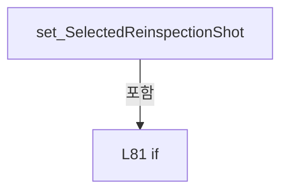

변경 전 점검: 입력/반환 타입, 위 호출자, 예외/취소 경로, 공유 상태와 저장·전송 소비자를 함께 확인합니다. 값의 단위나 물리 방향을 이름만으로 확정하지 않습니다.

### PropertyDeclaration `ToggleReinspectionCommand` · L92–92

[Drilling.UI/Menu/Menus/CMenuCorrection.ReviewData.Reinspection.cs:92–92](https://github.com/kjuws10-rgb/A3Drilling/blob/334b3599651b2e8e0181fd4459bafaf3cddafff3/Drilling.UI/Menu/Menus/CMenuCorrection.ReviewData.Reinspection.cs#L92-L92)

| 항목 | 실제 추출 값 |
| --- | --- |
| 서명 | Drilling.UI.Menu.CButtonCommand Drilling.UI.Menu.Menus.CMenuCorrection.CReviewDataPanel.ToggleReinspectionCommand |
| 접근/수식자 | Public / public |
| 반환/값 타입 | Drilling.UI.Menu.CButtonCommand |
| 소속 타입 | NamedType:Drilling.UI.Menu.Menus.CMenuCorrection.CReviewDataPanel |

현재 부분 분석에서 직접 연결된 호출자는 없습니다. XAML/이벤트/인터페이스·델리게이트·외부 진입을 추가 확인해야 하며, 미사용으로 판정한 것이 아닙니다.

변경 전 점검: 입력/반환 타입, 위 호출자, 예외/취소 경로, 공유 상태와 저장·전송 소비자를 함께 확인합니다. 값의 단위나 물리 방향을 이름만으로 확정하지 않습니다.

### GetAccessorDeclaration `get_ToggleReinspectionCommand` · L92–92

[Drilling.UI/Menu/Menus/CMenuCorrection.ReviewData.Reinspection.cs:92–92](https://github.com/kjuws10-rgb/A3Drilling/blob/334b3599651b2e8e0181fd4459bafaf3cddafff3/Drilling.UI/Menu/Menus/CMenuCorrection.ReviewData.Reinspection.cs#L92-L92)

| 항목 | 실제 추출 값 |
| --- | --- |
| 서명 | Drilling.UI.Menu.CButtonCommand Drilling.UI.Menu.Menus.CMenuCorrection.CReviewDataPanel.ToggleReinspectionCommand.get |
| 접근/수식자 | Public / get |
| 반환/값 타입 | Drilling.UI.Menu.CButtonCommand |
| 소속 타입 | NamedType:Drilling.UI.Menu.Menus.CMenuCorrection.CReviewDataPanel |

현재 부분 분석에서 직접 연결된 호출자는 없습니다. XAML/이벤트/인터페이스·델리게이트·외부 진입을 추가 확인해야 하며, 미사용으로 판정한 것이 아닙니다.

변경 전 점검: 입력/반환 타입, 위 호출자, 예외/취소 경로, 공유 상태와 저장·전송 소비자를 함께 확인합니다. 값의 단위나 물리 방향을 이름만으로 확정하지 않습니다.

### SetAccessorDeclaration `set_ToggleReinspectionCommand` · L92–92

[Drilling.UI/Menu/Menus/CMenuCorrection.ReviewData.Reinspection.cs:92–92](https://github.com/kjuws10-rgb/A3Drilling/blob/334b3599651b2e8e0181fd4459bafaf3cddafff3/Drilling.UI/Menu/Menus/CMenuCorrection.ReviewData.Reinspection.cs#L92-L92)

| 항목 | 실제 추출 값 |
| --- | --- |
| 서명 | void Drilling.UI.Menu.Menus.CMenuCorrection.CReviewDataPanel.ToggleReinspectionCommand.set |
| 접근/수식자 | Private / private, set |
| 반환/값 타입 | void |
| 소속 타입 | NamedType:Drilling.UI.Menu.Menus.CMenuCorrection.CReviewDataPanel |

입력 계약:

| 이름 | 타입 | 전달 | 선택/기본값 |
| --- | --- | --- | --- |
| value | Drilling.UI.Menu.CButtonCommand | None | False /  |

현재 부분 분석에서 직접 연결된 호출자는 없습니다. XAML/이벤트/인터페이스·델리게이트·외부 진입을 추가 확인해야 하며, 미사용으로 판정한 것이 아닙니다.

변경 전 점검: 입력/반환 타입, 위 호출자, 예외/취소 경로, 공유 상태와 저장·전송 소비자를 함께 확인합니다. 값의 단위나 물리 방향을 이름만으로 확정하지 않습니다.

### PropertyDeclaration `AddReinspectionShotCommand` · L93–93

[Drilling.UI/Menu/Menus/CMenuCorrection.ReviewData.Reinspection.cs:93–93](https://github.com/kjuws10-rgb/A3Drilling/blob/334b3599651b2e8e0181fd4459bafaf3cddafff3/Drilling.UI/Menu/Menus/CMenuCorrection.ReviewData.Reinspection.cs#L93-L93)

| 항목 | 실제 추출 값 |
| --- | --- |
| 서명 | Drilling.UI.Menu.CButtonCommand Drilling.UI.Menu.Menus.CMenuCorrection.CReviewDataPanel.AddReinspectionShotCommand |
| 접근/수식자 | Public / public |
| 반환/값 타입 | Drilling.UI.Menu.CButtonCommand |
| 소속 타입 | NamedType:Drilling.UI.Menu.Menus.CMenuCorrection.CReviewDataPanel |

현재 부분 분석에서 직접 연결된 호출자는 없습니다. XAML/이벤트/인터페이스·델리게이트·외부 진입을 추가 확인해야 하며, 미사용으로 판정한 것이 아닙니다.

변경 전 점검: 입력/반환 타입, 위 호출자, 예외/취소 경로, 공유 상태와 저장·전송 소비자를 함께 확인합니다. 값의 단위나 물리 방향을 이름만으로 확정하지 않습니다.

### GetAccessorDeclaration `get_AddReinspectionShotCommand` · L93–93

[Drilling.UI/Menu/Menus/CMenuCorrection.ReviewData.Reinspection.cs:93–93](https://github.com/kjuws10-rgb/A3Drilling/blob/334b3599651b2e8e0181fd4459bafaf3cddafff3/Drilling.UI/Menu/Menus/CMenuCorrection.ReviewData.Reinspection.cs#L93-L93)

| 항목 | 실제 추출 값 |
| --- | --- |
| 서명 | Drilling.UI.Menu.CButtonCommand Drilling.UI.Menu.Menus.CMenuCorrection.CReviewDataPanel.AddReinspectionShotCommand.get |
| 접근/수식자 | Public / get |
| 반환/값 타입 | Drilling.UI.Menu.CButtonCommand |
| 소속 타입 | NamedType:Drilling.UI.Menu.Menus.CMenuCorrection.CReviewDataPanel |

현재 부분 분석에서 직접 연결된 호출자는 없습니다. XAML/이벤트/인터페이스·델리게이트·외부 진입을 추가 확인해야 하며, 미사용으로 판정한 것이 아닙니다.

변경 전 점검: 입력/반환 타입, 위 호출자, 예외/취소 경로, 공유 상태와 저장·전송 소비자를 함께 확인합니다. 값의 단위나 물리 방향을 이름만으로 확정하지 않습니다.

### SetAccessorDeclaration `set_AddReinspectionShotCommand` · L93–93

[Drilling.UI/Menu/Menus/CMenuCorrection.ReviewData.Reinspection.cs:93–93](https://github.com/kjuws10-rgb/A3Drilling/blob/334b3599651b2e8e0181fd4459bafaf3cddafff3/Drilling.UI/Menu/Menus/CMenuCorrection.ReviewData.Reinspection.cs#L93-L93)

| 항목 | 실제 추출 값 |
| --- | --- |
| 서명 | void Drilling.UI.Menu.Menus.CMenuCorrection.CReviewDataPanel.AddReinspectionShotCommand.set |
| 접근/수식자 | Private / private, set |
| 반환/값 타입 | void |
| 소속 타입 | NamedType:Drilling.UI.Menu.Menus.CMenuCorrection.CReviewDataPanel |

입력 계약:

| 이름 | 타입 | 전달 | 선택/기본값 |
| --- | --- | --- | --- |
| value | Drilling.UI.Menu.CButtonCommand | None | False /  |

현재 부분 분석에서 직접 연결된 호출자는 없습니다. XAML/이벤트/인터페이스·델리게이트·외부 진입을 추가 확인해야 하며, 미사용으로 판정한 것이 아닙니다.

변경 전 점검: 입력/반환 타입, 위 호출자, 예외/취소 경로, 공유 상태와 저장·전송 소비자를 함께 확인합니다. 값의 단위나 물리 방향을 이름만으로 확정하지 않습니다.

### PropertyDeclaration `AddSelectedReinspectionShotsCommand` · L94–94

[Drilling.UI/Menu/Menus/CMenuCorrection.ReviewData.Reinspection.cs:94–94](https://github.com/kjuws10-rgb/A3Drilling/blob/334b3599651b2e8e0181fd4459bafaf3cddafff3/Drilling.UI/Menu/Menus/CMenuCorrection.ReviewData.Reinspection.cs#L94-L94)

| 항목 | 실제 추출 값 |
| --- | --- |
| 서명 | Drilling.UI.Menu.CButtonCommand Drilling.UI.Menu.Menus.CMenuCorrection.CReviewDataPanel.AddSelectedReinspectionShotsCommand |
| 접근/수식자 | Public / public |
| 반환/값 타입 | Drilling.UI.Menu.CButtonCommand |
| 소속 타입 | NamedType:Drilling.UI.Menu.Menus.CMenuCorrection.CReviewDataPanel |

현재 부분 분석에서 직접 연결된 호출자는 없습니다. XAML/이벤트/인터페이스·델리게이트·외부 진입을 추가 확인해야 하며, 미사용으로 판정한 것이 아닙니다.

변경 전 점검: 입력/반환 타입, 위 호출자, 예외/취소 경로, 공유 상태와 저장·전송 소비자를 함께 확인합니다. 값의 단위나 물리 방향을 이름만으로 확정하지 않습니다.

### GetAccessorDeclaration `get_AddSelectedReinspectionShotsCommand` · L94–94

[Drilling.UI/Menu/Menus/CMenuCorrection.ReviewData.Reinspection.cs:94–94](https://github.com/kjuws10-rgb/A3Drilling/blob/334b3599651b2e8e0181fd4459bafaf3cddafff3/Drilling.UI/Menu/Menus/CMenuCorrection.ReviewData.Reinspection.cs#L94-L94)

| 항목 | 실제 추출 값 |
| --- | --- |
| 서명 | Drilling.UI.Menu.CButtonCommand Drilling.UI.Menu.Menus.CMenuCorrection.CReviewDataPanel.AddSelectedReinspectionShotsCommand.get |
| 접근/수식자 | Public / get |
| 반환/값 타입 | Drilling.UI.Menu.CButtonCommand |
| 소속 타입 | NamedType:Drilling.UI.Menu.Menus.CMenuCorrection.CReviewDataPanel |

현재 부분 분석에서 직접 연결된 호출자는 없습니다. XAML/이벤트/인터페이스·델리게이트·외부 진입을 추가 확인해야 하며, 미사용으로 판정한 것이 아닙니다.

변경 전 점검: 입력/반환 타입, 위 호출자, 예외/취소 경로, 공유 상태와 저장·전송 소비자를 함께 확인합니다. 값의 단위나 물리 방향을 이름만으로 확정하지 않습니다.

### SetAccessorDeclaration `set_AddSelectedReinspectionShotsCommand` · L94–94

[Drilling.UI/Menu/Menus/CMenuCorrection.ReviewData.Reinspection.cs:94–94](https://github.com/kjuws10-rgb/A3Drilling/blob/334b3599651b2e8e0181fd4459bafaf3cddafff3/Drilling.UI/Menu/Menus/CMenuCorrection.ReviewData.Reinspection.cs#L94-L94)

| 항목 | 실제 추출 값 |
| --- | --- |
| 서명 | void Drilling.UI.Menu.Menus.CMenuCorrection.CReviewDataPanel.AddSelectedReinspectionShotsCommand.set |
| 접근/수식자 | Private / private, set |
| 반환/값 타입 | void |
| 소속 타입 | NamedType:Drilling.UI.Menu.Menus.CMenuCorrection.CReviewDataPanel |

입력 계약:

| 이름 | 타입 | 전달 | 선택/기본값 |
| --- | --- | --- | --- |
| value | Drilling.UI.Menu.CButtonCommand | None | False /  |

현재 부분 분석에서 직접 연결된 호출자는 없습니다. XAML/이벤트/인터페이스·델리게이트·외부 진입을 추가 확인해야 하며, 미사용으로 판정한 것이 아닙니다.

변경 전 점검: 입력/반환 타입, 위 호출자, 예외/취소 경로, 공유 상태와 저장·전송 소비자를 함께 확인합니다. 값의 단위나 물리 방향을 이름만으로 확정하지 않습니다.

### PropertyDeclaration `AddNgReinspectionShotsCommand` · L95–95

[Drilling.UI/Menu/Menus/CMenuCorrection.ReviewData.Reinspection.cs:95–95](https://github.com/kjuws10-rgb/A3Drilling/blob/334b3599651b2e8e0181fd4459bafaf3cddafff3/Drilling.UI/Menu/Menus/CMenuCorrection.ReviewData.Reinspection.cs#L95-L95)

| 항목 | 실제 추출 값 |
| --- | --- |
| 서명 | Drilling.UI.Menu.CButtonCommand Drilling.UI.Menu.Menus.CMenuCorrection.CReviewDataPanel.AddNgReinspectionShotsCommand |
| 접근/수식자 | Public / public |
| 반환/값 타입 | Drilling.UI.Menu.CButtonCommand |
| 소속 타입 | NamedType:Drilling.UI.Menu.Menus.CMenuCorrection.CReviewDataPanel |

현재 부분 분석에서 직접 연결된 호출자는 없습니다. XAML/이벤트/인터페이스·델리게이트·외부 진입을 추가 확인해야 하며, 미사용으로 판정한 것이 아닙니다.

변경 전 점검: 입력/반환 타입, 위 호출자, 예외/취소 경로, 공유 상태와 저장·전송 소비자를 함께 확인합니다. 값의 단위나 물리 방향을 이름만으로 확정하지 않습니다.

### GetAccessorDeclaration `get_AddNgReinspectionShotsCommand` · L95–95

[Drilling.UI/Menu/Menus/CMenuCorrection.ReviewData.Reinspection.cs:95–95](https://github.com/kjuws10-rgb/A3Drilling/blob/334b3599651b2e8e0181fd4459bafaf3cddafff3/Drilling.UI/Menu/Menus/CMenuCorrection.ReviewData.Reinspection.cs#L95-L95)

| 항목 | 실제 추출 값 |
| --- | --- |
| 서명 | Drilling.UI.Menu.CButtonCommand Drilling.UI.Menu.Menus.CMenuCorrection.CReviewDataPanel.AddNgReinspectionShotsCommand.get |
| 접근/수식자 | Public / get |
| 반환/값 타입 | Drilling.UI.Menu.CButtonCommand |
| 소속 타입 | NamedType:Drilling.UI.Menu.Menus.CMenuCorrection.CReviewDataPanel |

현재 부분 분석에서 직접 연결된 호출자는 없습니다. XAML/이벤트/인터페이스·델리게이트·외부 진입을 추가 확인해야 하며, 미사용으로 판정한 것이 아닙니다.

변경 전 점검: 입력/반환 타입, 위 호출자, 예외/취소 경로, 공유 상태와 저장·전송 소비자를 함께 확인합니다. 값의 단위나 물리 방향을 이름만으로 확정하지 않습니다.

### SetAccessorDeclaration `set_AddNgReinspectionShotsCommand` · L95–95

[Drilling.UI/Menu/Menus/CMenuCorrection.ReviewData.Reinspection.cs:95–95](https://github.com/kjuws10-rgb/A3Drilling/blob/334b3599651b2e8e0181fd4459bafaf3cddafff3/Drilling.UI/Menu/Menus/CMenuCorrection.ReviewData.Reinspection.cs#L95-L95)

| 항목 | 실제 추출 값 |
| --- | --- |
| 서명 | void Drilling.UI.Menu.Menus.CMenuCorrection.CReviewDataPanel.AddNgReinspectionShotsCommand.set |
| 접근/수식자 | Private / private, set |
| 반환/값 타입 | void |
| 소속 타입 | NamedType:Drilling.UI.Menu.Menus.CMenuCorrection.CReviewDataPanel |

입력 계약:

| 이름 | 타입 | 전달 | 선택/기본값 |
| --- | --- | --- | --- |
| value | Drilling.UI.Menu.CButtonCommand | None | False /  |

현재 부분 분석에서 직접 연결된 호출자는 없습니다. XAML/이벤트/인터페이스·델리게이트·외부 진입을 추가 확인해야 하며, 미사용으로 판정한 것이 아닙니다.

변경 전 점검: 입력/반환 타입, 위 호출자, 예외/취소 경로, 공유 상태와 저장·전송 소비자를 함께 확인합니다. 값의 단위나 물리 방향을 이름만으로 확정하지 않습니다.

### PropertyDeclaration `DeleteReinspectionShotCommand` · L96–96

[Drilling.UI/Menu/Menus/CMenuCorrection.ReviewData.Reinspection.cs:96–96](https://github.com/kjuws10-rgb/A3Drilling/blob/334b3599651b2e8e0181fd4459bafaf3cddafff3/Drilling.UI/Menu/Menus/CMenuCorrection.ReviewData.Reinspection.cs#L96-L96)

| 항목 | 실제 추출 값 |
| --- | --- |
| 서명 | Drilling.UI.Menu.CButtonCommand Drilling.UI.Menu.Menus.CMenuCorrection.CReviewDataPanel.DeleteReinspectionShotCommand |
| 접근/수식자 | Public / public |
| 반환/값 타입 | Drilling.UI.Menu.CButtonCommand |
| 소속 타입 | NamedType:Drilling.UI.Menu.Menus.CMenuCorrection.CReviewDataPanel |

현재 부분 분석에서 직접 연결된 호출자는 없습니다. XAML/이벤트/인터페이스·델리게이트·외부 진입을 추가 확인해야 하며, 미사용으로 판정한 것이 아닙니다.

변경 전 점검: 입력/반환 타입, 위 호출자, 예외/취소 경로, 공유 상태와 저장·전송 소비자를 함께 확인합니다. 값의 단위나 물리 방향을 이름만으로 확정하지 않습니다.

### GetAccessorDeclaration `get_DeleteReinspectionShotCommand` · L96–96

[Drilling.UI/Menu/Menus/CMenuCorrection.ReviewData.Reinspection.cs:96–96](https://github.com/kjuws10-rgb/A3Drilling/blob/334b3599651b2e8e0181fd4459bafaf3cddafff3/Drilling.UI/Menu/Menus/CMenuCorrection.ReviewData.Reinspection.cs#L96-L96)

| 항목 | 실제 추출 값 |
| --- | --- |
| 서명 | Drilling.UI.Menu.CButtonCommand Drilling.UI.Menu.Menus.CMenuCorrection.CReviewDataPanel.DeleteReinspectionShotCommand.get |
| 접근/수식자 | Public / get |
| 반환/값 타입 | Drilling.UI.Menu.CButtonCommand |
| 소속 타입 | NamedType:Drilling.UI.Menu.Menus.CMenuCorrection.CReviewDataPanel |

현재 부분 분석에서 직접 연결된 호출자는 없습니다. XAML/이벤트/인터페이스·델리게이트·외부 진입을 추가 확인해야 하며, 미사용으로 판정한 것이 아닙니다.

변경 전 점검: 입력/반환 타입, 위 호출자, 예외/취소 경로, 공유 상태와 저장·전송 소비자를 함께 확인합니다. 값의 단위나 물리 방향을 이름만으로 확정하지 않습니다.

### SetAccessorDeclaration `set_DeleteReinspectionShotCommand` · L96–96

[Drilling.UI/Menu/Menus/CMenuCorrection.ReviewData.Reinspection.cs:96–96](https://github.com/kjuws10-rgb/A3Drilling/blob/334b3599651b2e8e0181fd4459bafaf3cddafff3/Drilling.UI/Menu/Menus/CMenuCorrection.ReviewData.Reinspection.cs#L96-L96)

| 항목 | 실제 추출 값 |
| --- | --- |
| 서명 | void Drilling.UI.Menu.Menus.CMenuCorrection.CReviewDataPanel.DeleteReinspectionShotCommand.set |
| 접근/수식자 | Private / private, set |
| 반환/값 타입 | void |
| 소속 타입 | NamedType:Drilling.UI.Menu.Menus.CMenuCorrection.CReviewDataPanel |

입력 계약:

| 이름 | 타입 | 전달 | 선택/기본값 |
| --- | --- | --- | --- |
| value | Drilling.UI.Menu.CButtonCommand | None | False /  |

현재 부분 분석에서 직접 연결된 호출자는 없습니다. XAML/이벤트/인터페이스·델리게이트·외부 진입을 추가 확인해야 하며, 미사용으로 판정한 것이 아닙니다.

변경 전 점검: 입력/반환 타입, 위 호출자, 예외/취소 경로, 공유 상태와 저장·전송 소비자를 함께 확인합니다. 값의 단위나 물리 방향을 이름만으로 확정하지 않습니다.

### PropertyDeclaration `ClearReinspectionShotsCommand` · L97–97

[Drilling.UI/Menu/Menus/CMenuCorrection.ReviewData.Reinspection.cs:97–97](https://github.com/kjuws10-rgb/A3Drilling/blob/334b3599651b2e8e0181fd4459bafaf3cddafff3/Drilling.UI/Menu/Menus/CMenuCorrection.ReviewData.Reinspection.cs#L97-L97)

| 항목 | 실제 추출 값 |
| --- | --- |
| 서명 | Drilling.UI.Menu.CButtonCommand Drilling.UI.Menu.Menus.CMenuCorrection.CReviewDataPanel.ClearReinspectionShotsCommand |
| 접근/수식자 | Public / public |
| 반환/값 타입 | Drilling.UI.Menu.CButtonCommand |
| 소속 타입 | NamedType:Drilling.UI.Menu.Menus.CMenuCorrection.CReviewDataPanel |

현재 부분 분석에서 직접 연결된 호출자는 없습니다. XAML/이벤트/인터페이스·델리게이트·외부 진입을 추가 확인해야 하며, 미사용으로 판정한 것이 아닙니다.

변경 전 점검: 입력/반환 타입, 위 호출자, 예외/취소 경로, 공유 상태와 저장·전송 소비자를 함께 확인합니다. 값의 단위나 물리 방향을 이름만으로 확정하지 않습니다.

### GetAccessorDeclaration `get_ClearReinspectionShotsCommand` · L97–97

[Drilling.UI/Menu/Menus/CMenuCorrection.ReviewData.Reinspection.cs:97–97](https://github.com/kjuws10-rgb/A3Drilling/blob/334b3599651b2e8e0181fd4459bafaf3cddafff3/Drilling.UI/Menu/Menus/CMenuCorrection.ReviewData.Reinspection.cs#L97-L97)

| 항목 | 실제 추출 값 |
| --- | --- |
| 서명 | Drilling.UI.Menu.CButtonCommand Drilling.UI.Menu.Menus.CMenuCorrection.CReviewDataPanel.ClearReinspectionShotsCommand.get |
| 접근/수식자 | Public / get |
| 반환/값 타입 | Drilling.UI.Menu.CButtonCommand |
| 소속 타입 | NamedType:Drilling.UI.Menu.Menus.CMenuCorrection.CReviewDataPanel |

현재 부분 분석에서 직접 연결된 호출자는 없습니다. XAML/이벤트/인터페이스·델리게이트·외부 진입을 추가 확인해야 하며, 미사용으로 판정한 것이 아닙니다.

변경 전 점검: 입력/반환 타입, 위 호출자, 예외/취소 경로, 공유 상태와 저장·전송 소비자를 함께 확인합니다. 값의 단위나 물리 방향을 이름만으로 확정하지 않습니다.

### SetAccessorDeclaration `set_ClearReinspectionShotsCommand` · L97–97

[Drilling.UI/Menu/Menus/CMenuCorrection.ReviewData.Reinspection.cs:97–97](https://github.com/kjuws10-rgb/A3Drilling/blob/334b3599651b2e8e0181fd4459bafaf3cddafff3/Drilling.UI/Menu/Menus/CMenuCorrection.ReviewData.Reinspection.cs#L97-L97)

| 항목 | 실제 추출 값 |
| --- | --- |
| 서명 | void Drilling.UI.Menu.Menus.CMenuCorrection.CReviewDataPanel.ClearReinspectionShotsCommand.set |
| 접근/수식자 | Private / private, set |
| 반환/값 타입 | void |
| 소속 타입 | NamedType:Drilling.UI.Menu.Menus.CMenuCorrection.CReviewDataPanel |

입력 계약:

| 이름 | 타입 | 전달 | 선택/기본값 |
| --- | --- | --- | --- |
| value | Drilling.UI.Menu.CButtonCommand | None | False /  |

현재 부분 분석에서 직접 연결된 호출자는 없습니다. XAML/이벤트/인터페이스·델리게이트·외부 진입을 추가 확인해야 하며, 미사용으로 판정한 것이 아닙니다.

변경 전 점검: 입력/반환 타입, 위 호출자, 예외/취소 경로, 공유 상태와 저장·전송 소비자를 함께 확인합니다. 값의 단위나 물리 방향을 이름만으로 확정하지 않습니다.

### PropertyDeclaration `MoveToReinspectionShotCommand` · L98–98

[Drilling.UI/Menu/Menus/CMenuCorrection.ReviewData.Reinspection.cs:98–98](https://github.com/kjuws10-rgb/A3Drilling/blob/334b3599651b2e8e0181fd4459bafaf3cddafff3/Drilling.UI/Menu/Menus/CMenuCorrection.ReviewData.Reinspection.cs#L98-L98)

| 항목 | 실제 추출 값 |
| --- | --- |
| 서명 | Drilling.UI.Menu.CButtonCommand Drilling.UI.Menu.Menus.CMenuCorrection.CReviewDataPanel.MoveToReinspectionShotCommand |
| 접근/수식자 | Public / public |
| 반환/값 타입 | Drilling.UI.Menu.CButtonCommand |
| 소속 타입 | NamedType:Drilling.UI.Menu.Menus.CMenuCorrection.CReviewDataPanel |

현재 부분 분석에서 직접 연결된 호출자는 없습니다. XAML/이벤트/인터페이스·델리게이트·외부 진입을 추가 확인해야 하며, 미사용으로 판정한 것이 아닙니다.

변경 전 점검: 입력/반환 타입, 위 호출자, 예외/취소 경로, 공유 상태와 저장·전송 소비자를 함께 확인합니다. 값의 단위나 물리 방향을 이름만으로 확정하지 않습니다.

### GetAccessorDeclaration `get_MoveToReinspectionShotCommand` · L98–98

[Drilling.UI/Menu/Menus/CMenuCorrection.ReviewData.Reinspection.cs:98–98](https://github.com/kjuws10-rgb/A3Drilling/blob/334b3599651b2e8e0181fd4459bafaf3cddafff3/Drilling.UI/Menu/Menus/CMenuCorrection.ReviewData.Reinspection.cs#L98-L98)

| 항목 | 실제 추출 값 |
| --- | --- |
| 서명 | Drilling.UI.Menu.CButtonCommand Drilling.UI.Menu.Menus.CMenuCorrection.CReviewDataPanel.MoveToReinspectionShotCommand.get |
| 접근/수식자 | Public / get |
| 반환/값 타입 | Drilling.UI.Menu.CButtonCommand |
| 소속 타입 | NamedType:Drilling.UI.Menu.Menus.CMenuCorrection.CReviewDataPanel |

현재 부분 분석에서 직접 연결된 호출자는 없습니다. XAML/이벤트/인터페이스·델리게이트·외부 진입을 추가 확인해야 하며, 미사용으로 판정한 것이 아닙니다.

변경 전 점검: 입력/반환 타입, 위 호출자, 예외/취소 경로, 공유 상태와 저장·전송 소비자를 함께 확인합니다. 값의 단위나 물리 방향을 이름만으로 확정하지 않습니다.

### SetAccessorDeclaration `set_MoveToReinspectionShotCommand` · L98–98

[Drilling.UI/Menu/Menus/CMenuCorrection.ReviewData.Reinspection.cs:98–98](https://github.com/kjuws10-rgb/A3Drilling/blob/334b3599651b2e8e0181fd4459bafaf3cddafff3/Drilling.UI/Menu/Menus/CMenuCorrection.ReviewData.Reinspection.cs#L98-L98)

| 항목 | 실제 추출 값 |
| --- | --- |
| 서명 | void Drilling.UI.Menu.Menus.CMenuCorrection.CReviewDataPanel.MoveToReinspectionShotCommand.set |
| 접근/수식자 | Private / private, set |
| 반환/값 타입 | void |
| 소속 타입 | NamedType:Drilling.UI.Menu.Menus.CMenuCorrection.CReviewDataPanel |

입력 계약:

| 이름 | 타입 | 전달 | 선택/기본값 |
| --- | --- | --- | --- |
| value | Drilling.UI.Menu.CButtonCommand | None | False /  |

현재 부분 분석에서 직접 연결된 호출자는 없습니다. XAML/이벤트/인터페이스·델리게이트·외부 진입을 추가 확인해야 하며, 미사용으로 판정한 것이 아닙니다.

변경 전 점검: 입력/반환 타입, 위 호출자, 예외/취소 경로, 공유 상태와 저장·전송 소비자를 함께 확인합니다. 값의 단위나 물리 방향을 이름만으로 확정하지 않습니다.

### PropertyDeclaration `MoveAndInspectReinspectionShotCommand` · L99–99

[Drilling.UI/Menu/Menus/CMenuCorrection.ReviewData.Reinspection.cs:99–99](https://github.com/kjuws10-rgb/A3Drilling/blob/334b3599651b2e8e0181fd4459bafaf3cddafff3/Drilling.UI/Menu/Menus/CMenuCorrection.ReviewData.Reinspection.cs#L99-L99)

| 항목 | 실제 추출 값 |
| --- | --- |
| 서명 | Drilling.UI.Menu.CButtonCommand Drilling.UI.Menu.Menus.CMenuCorrection.CReviewDataPanel.MoveAndInspectReinspectionShotCommand |
| 접근/수식자 | Public / public |
| 반환/값 타입 | Drilling.UI.Menu.CButtonCommand |
| 소속 타입 | NamedType:Drilling.UI.Menu.Menus.CMenuCorrection.CReviewDataPanel |

현재 부분 분석에서 직접 연결된 호출자는 없습니다. XAML/이벤트/인터페이스·델리게이트·외부 진입을 추가 확인해야 하며, 미사용으로 판정한 것이 아닙니다.

변경 전 점검: 입력/반환 타입, 위 호출자, 예외/취소 경로, 공유 상태와 저장·전송 소비자를 함께 확인합니다. 값의 단위나 물리 방향을 이름만으로 확정하지 않습니다.

### GetAccessorDeclaration `get_MoveAndInspectReinspectionShotCommand` · L99–99

[Drilling.UI/Menu/Menus/CMenuCorrection.ReviewData.Reinspection.cs:99–99](https://github.com/kjuws10-rgb/A3Drilling/blob/334b3599651b2e8e0181fd4459bafaf3cddafff3/Drilling.UI/Menu/Menus/CMenuCorrection.ReviewData.Reinspection.cs#L99-L99)

| 항목 | 실제 추출 값 |
| --- | --- |
| 서명 | Drilling.UI.Menu.CButtonCommand Drilling.UI.Menu.Menus.CMenuCorrection.CReviewDataPanel.MoveAndInspectReinspectionShotCommand.get |
| 접근/수식자 | Public / get |
| 반환/값 타입 | Drilling.UI.Menu.CButtonCommand |
| 소속 타입 | NamedType:Drilling.UI.Menu.Menus.CMenuCorrection.CReviewDataPanel |

현재 부분 분석에서 직접 연결된 호출자는 없습니다. XAML/이벤트/인터페이스·델리게이트·외부 진입을 추가 확인해야 하며, 미사용으로 판정한 것이 아닙니다.

변경 전 점검: 입력/반환 타입, 위 호출자, 예외/취소 경로, 공유 상태와 저장·전송 소비자를 함께 확인합니다. 값의 단위나 물리 방향을 이름만으로 확정하지 않습니다.

### SetAccessorDeclaration `set_MoveAndInspectReinspectionShotCommand` · L99–99

[Drilling.UI/Menu/Menus/CMenuCorrection.ReviewData.Reinspection.cs:99–99](https://github.com/kjuws10-rgb/A3Drilling/blob/334b3599651b2e8e0181fd4459bafaf3cddafff3/Drilling.UI/Menu/Menus/CMenuCorrection.ReviewData.Reinspection.cs#L99-L99)

| 항목 | 실제 추출 값 |
| --- | --- |
| 서명 | void Drilling.UI.Menu.Menus.CMenuCorrection.CReviewDataPanel.MoveAndInspectReinspectionShotCommand.set |
| 접근/수식자 | Private / private, set |
| 반환/값 타입 | void |
| 소속 타입 | NamedType:Drilling.UI.Menu.Menus.CMenuCorrection.CReviewDataPanel |

입력 계약:

| 이름 | 타입 | 전달 | 선택/기본값 |
| --- | --- | --- | --- |
| value | Drilling.UI.Menu.CButtonCommand | None | False /  |

현재 부분 분석에서 직접 연결된 호출자는 없습니다. XAML/이벤트/인터페이스·델리게이트·외부 진입을 추가 확인해야 하며, 미사용으로 판정한 것이 아닙니다.

변경 전 점검: 입력/반환 타입, 위 호출자, 예외/취소 경로, 공유 상태와 저장·전송 소비자를 함께 확인합니다. 값의 단위나 물리 방향을 이름만으로 확정하지 않습니다.

### PropertyDeclaration `InspectAllReinspectionShotsCommand` · L100–100

[Drilling.UI/Menu/Menus/CMenuCorrection.ReviewData.Reinspection.cs:100–100](https://github.com/kjuws10-rgb/A3Drilling/blob/334b3599651b2e8e0181fd4459bafaf3cddafff3/Drilling.UI/Menu/Menus/CMenuCorrection.ReviewData.Reinspection.cs#L100-L100)

| 항목 | 실제 추출 값 |
| --- | --- |
| 서명 | Drilling.UI.Menu.CButtonCommand Drilling.UI.Menu.Menus.CMenuCorrection.CReviewDataPanel.InspectAllReinspectionShotsCommand |
| 접근/수식자 | Public / public |
| 반환/값 타입 | Drilling.UI.Menu.CButtonCommand |
| 소속 타입 | NamedType:Drilling.UI.Menu.Menus.CMenuCorrection.CReviewDataPanel |

현재 부분 분석에서 직접 연결된 호출자는 없습니다. XAML/이벤트/인터페이스·델리게이트·외부 진입을 추가 확인해야 하며, 미사용으로 판정한 것이 아닙니다.

변경 전 점검: 입력/반환 타입, 위 호출자, 예외/취소 경로, 공유 상태와 저장·전송 소비자를 함께 확인합니다. 값의 단위나 물리 방향을 이름만으로 확정하지 않습니다.

### GetAccessorDeclaration `get_InspectAllReinspectionShotsCommand` · L100–100

[Drilling.UI/Menu/Menus/CMenuCorrection.ReviewData.Reinspection.cs:100–100](https://github.com/kjuws10-rgb/A3Drilling/blob/334b3599651b2e8e0181fd4459bafaf3cddafff3/Drilling.UI/Menu/Menus/CMenuCorrection.ReviewData.Reinspection.cs#L100-L100)

| 항목 | 실제 추출 값 |
| --- | --- |
| 서명 | Drilling.UI.Menu.CButtonCommand Drilling.UI.Menu.Menus.CMenuCorrection.CReviewDataPanel.InspectAllReinspectionShotsCommand.get |
| 접근/수식자 | Public / get |
| 반환/값 타입 | Drilling.UI.Menu.CButtonCommand |
| 소속 타입 | NamedType:Drilling.UI.Menu.Menus.CMenuCorrection.CReviewDataPanel |

현재 부분 분석에서 직접 연결된 호출자는 없습니다. XAML/이벤트/인터페이스·델리게이트·외부 진입을 추가 확인해야 하며, 미사용으로 판정한 것이 아닙니다.

변경 전 점검: 입력/반환 타입, 위 호출자, 예외/취소 경로, 공유 상태와 저장·전송 소비자를 함께 확인합니다. 값의 단위나 물리 방향을 이름만으로 확정하지 않습니다.

### SetAccessorDeclaration `set_InspectAllReinspectionShotsCommand` · L100–100

[Drilling.UI/Menu/Menus/CMenuCorrection.ReviewData.Reinspection.cs:100–100](https://github.com/kjuws10-rgb/A3Drilling/blob/334b3599651b2e8e0181fd4459bafaf3cddafff3/Drilling.UI/Menu/Menus/CMenuCorrection.ReviewData.Reinspection.cs#L100-L100)

| 항목 | 실제 추출 값 |
| --- | --- |
| 서명 | void Drilling.UI.Menu.Menus.CMenuCorrection.CReviewDataPanel.InspectAllReinspectionShotsCommand.set |
| 접근/수식자 | Private / private, set |
| 반환/값 타입 | void |
| 소속 타입 | NamedType:Drilling.UI.Menu.Menus.CMenuCorrection.CReviewDataPanel |

입력 계약:

| 이름 | 타입 | 전달 | 선택/기본값 |
| --- | --- | --- | --- |
| value | Drilling.UI.Menu.CButtonCommand | None | False /  |

현재 부분 분석에서 직접 연결된 호출자는 없습니다. XAML/이벤트/인터페이스·델리게이트·외부 진입을 추가 확인해야 하며, 미사용으로 판정한 것이 아닙니다.

변경 전 점검: 입력/반환 타입, 위 호출자, 예외/취소 경로, 공유 상태와 저장·전송 소비자를 함께 확인합니다. 값의 단위나 물리 방향을 이름만으로 확정하지 않습니다.

### PropertyDeclaration `StopReinspectionCommand` · L101–101

[Drilling.UI/Menu/Menus/CMenuCorrection.ReviewData.Reinspection.cs:101–101](https://github.com/kjuws10-rgb/A3Drilling/blob/334b3599651b2e8e0181fd4459bafaf3cddafff3/Drilling.UI/Menu/Menus/CMenuCorrection.ReviewData.Reinspection.cs#L101-L101)

| 항목 | 실제 추출 값 |
| --- | --- |
| 서명 | Drilling.UI.Menu.CButtonCommand Drilling.UI.Menu.Menus.CMenuCorrection.CReviewDataPanel.StopReinspectionCommand |
| 접근/수식자 | Public / public |
| 반환/값 타입 | Drilling.UI.Menu.CButtonCommand |
| 소속 타입 | NamedType:Drilling.UI.Menu.Menus.CMenuCorrection.CReviewDataPanel |

현재 부분 분석에서 직접 연결된 호출자는 없습니다. XAML/이벤트/인터페이스·델리게이트·외부 진입을 추가 확인해야 하며, 미사용으로 판정한 것이 아닙니다.

변경 전 점검: 입력/반환 타입, 위 호출자, 예외/취소 경로, 공유 상태와 저장·전송 소비자를 함께 확인합니다. 값의 단위나 물리 방향을 이름만으로 확정하지 않습니다.

### GetAccessorDeclaration `get_StopReinspectionCommand` · L101–101

[Drilling.UI/Menu/Menus/CMenuCorrection.ReviewData.Reinspection.cs:101–101](https://github.com/kjuws10-rgb/A3Drilling/blob/334b3599651b2e8e0181fd4459bafaf3cddafff3/Drilling.UI/Menu/Menus/CMenuCorrection.ReviewData.Reinspection.cs#L101-L101)

| 항목 | 실제 추출 값 |
| --- | --- |
| 서명 | Drilling.UI.Menu.CButtonCommand Drilling.UI.Menu.Menus.CMenuCorrection.CReviewDataPanel.StopReinspectionCommand.get |
| 접근/수식자 | Public / get |
| 반환/값 타입 | Drilling.UI.Menu.CButtonCommand |
| 소속 타입 | NamedType:Drilling.UI.Menu.Menus.CMenuCorrection.CReviewDataPanel |

현재 부분 분석에서 직접 연결된 호출자는 없습니다. XAML/이벤트/인터페이스·델리게이트·외부 진입을 추가 확인해야 하며, 미사용으로 판정한 것이 아닙니다.

변경 전 점검: 입력/반환 타입, 위 호출자, 예외/취소 경로, 공유 상태와 저장·전송 소비자를 함께 확인합니다. 값의 단위나 물리 방향을 이름만으로 확정하지 않습니다.

### SetAccessorDeclaration `set_StopReinspectionCommand` · L101–101

[Drilling.UI/Menu/Menus/CMenuCorrection.ReviewData.Reinspection.cs:101–101](https://github.com/kjuws10-rgb/A3Drilling/blob/334b3599651b2e8e0181fd4459bafaf3cddafff3/Drilling.UI/Menu/Menus/CMenuCorrection.ReviewData.Reinspection.cs#L101-L101)

| 항목 | 실제 추출 값 |
| --- | --- |
| 서명 | void Drilling.UI.Menu.Menus.CMenuCorrection.CReviewDataPanel.StopReinspectionCommand.set |
| 접근/수식자 | Private / private, set |
| 반환/값 타입 | void |
| 소속 타입 | NamedType:Drilling.UI.Menu.Menus.CMenuCorrection.CReviewDataPanel |

입력 계약:

| 이름 | 타입 | 전달 | 선택/기본값 |
| --- | --- | --- | --- |
| value | Drilling.UI.Menu.CButtonCommand | None | False /  |

현재 부분 분석에서 직접 연결된 호출자는 없습니다. XAML/이벤트/인터페이스·델리게이트·외부 진입을 추가 확인해야 하며, 미사용으로 판정한 것이 아닙니다.

변경 전 점검: 입력/반환 타입, 위 호출자, 예외/취소 경로, 공유 상태와 저장·전송 소비자를 함께 확인합니다. 값의 단위나 물리 방향을 이름만으로 확정하지 않습니다.

### PropertyDeclaration `SaveReinspectionResultCommand` · L102–102

[Drilling.UI/Menu/Menus/CMenuCorrection.ReviewData.Reinspection.cs:102–102](https://github.com/kjuws10-rgb/A3Drilling/blob/334b3599651b2e8e0181fd4459bafaf3cddafff3/Drilling.UI/Menu/Menus/CMenuCorrection.ReviewData.Reinspection.cs#L102-L102)

| 항목 | 실제 추출 값 |
| --- | --- |
| 서명 | Drilling.UI.Menu.CButtonCommand Drilling.UI.Menu.Menus.CMenuCorrection.CReviewDataPanel.SaveReinspectionResultCommand |
| 접근/수식자 | Public / public |
| 반환/값 타입 | Drilling.UI.Menu.CButtonCommand |
| 소속 타입 | NamedType:Drilling.UI.Menu.Menus.CMenuCorrection.CReviewDataPanel |

현재 부분 분석에서 직접 연결된 호출자는 없습니다. XAML/이벤트/인터페이스·델리게이트·외부 진입을 추가 확인해야 하며, 미사용으로 판정한 것이 아닙니다.

변경 전 점검: 입력/반환 타입, 위 호출자, 예외/취소 경로, 공유 상태와 저장·전송 소비자를 함께 확인합니다. 값의 단위나 물리 방향을 이름만으로 확정하지 않습니다.

### GetAccessorDeclaration `get_SaveReinspectionResultCommand` · L102–102

[Drilling.UI/Menu/Menus/CMenuCorrection.ReviewData.Reinspection.cs:102–102](https://github.com/kjuws10-rgb/A3Drilling/blob/334b3599651b2e8e0181fd4459bafaf3cddafff3/Drilling.UI/Menu/Menus/CMenuCorrection.ReviewData.Reinspection.cs#L102-L102)

| 항목 | 실제 추출 값 |
| --- | --- |
| 서명 | Drilling.UI.Menu.CButtonCommand Drilling.UI.Menu.Menus.CMenuCorrection.CReviewDataPanel.SaveReinspectionResultCommand.get |
| 접근/수식자 | Public / get |
| 반환/값 타입 | Drilling.UI.Menu.CButtonCommand |
| 소속 타입 | NamedType:Drilling.UI.Menu.Menus.CMenuCorrection.CReviewDataPanel |

현재 부분 분석에서 직접 연결된 호출자는 없습니다. XAML/이벤트/인터페이스·델리게이트·외부 진입을 추가 확인해야 하며, 미사용으로 판정한 것이 아닙니다.

변경 전 점검: 입력/반환 타입, 위 호출자, 예외/취소 경로, 공유 상태와 저장·전송 소비자를 함께 확인합니다. 값의 단위나 물리 방향을 이름만으로 확정하지 않습니다.

### SetAccessorDeclaration `set_SaveReinspectionResultCommand` · L102–102

[Drilling.UI/Menu/Menus/CMenuCorrection.ReviewData.Reinspection.cs:102–102](https://github.com/kjuws10-rgb/A3Drilling/blob/334b3599651b2e8e0181fd4459bafaf3cddafff3/Drilling.UI/Menu/Menus/CMenuCorrection.ReviewData.Reinspection.cs#L102-L102)

| 항목 | 실제 추출 값 |
| --- | --- |
| 서명 | void Drilling.UI.Menu.Menus.CMenuCorrection.CReviewDataPanel.SaveReinspectionResultCommand.set |
| 접근/수식자 | Private / private, set |
| 반환/값 타입 | void |
| 소속 타입 | NamedType:Drilling.UI.Menu.Menus.CMenuCorrection.CReviewDataPanel |

입력 계약:

| 이름 | 타입 | 전달 | 선택/기본값 |
| --- | --- | --- | --- |
| value | Drilling.UI.Menu.CButtonCommand | None | False /  |

현재 부분 분석에서 직접 연결된 호출자는 없습니다. XAML/이벤트/인터페이스·델리게이트·외부 진입을 추가 확인해야 하며, 미사용으로 판정한 것이 아닙니다.

변경 전 점검: 입력/반환 타입, 위 호출자, 예외/취소 경로, 공유 상태와 저장·전송 소비자를 함께 확인합니다. 값의 단위나 물리 방향을 이름만으로 확정하지 않습니다.

### MethodDeclaration `InitializeReinspectionCommands` · L104–117

[Drilling.UI/Menu/Menus/CMenuCorrection.ReviewData.Reinspection.cs:104–117](https://github.com/kjuws10-rgb/A3Drilling/blob/334b3599651b2e8e0181fd4459bafaf3cddafff3/Drilling.UI/Menu/Menus/CMenuCorrection.ReviewData.Reinspection.cs#L104-L117)

| 항목 | 실제 추출 값 |
| --- | --- |
| 서명 | void Drilling.UI.Menu.Menus.CMenuCorrection.CReviewDataPanel.InitializeReinspectionCommands() |
| 접근/수식자 | Private / private |
| 반환/값 타입 | void |
| 소속 타입 | NamedType:Drilling.UI.Menu.Menus.CMenuCorrection.CReviewDataPanel |

정적 호출자로 확인된 위치:

| 호출 파일/행 | 호출 표현식 | 런타임 분기 가능 |
| --- | --- | --- |
| [Drilling.UI/Menu/Menus/CMenuCorrection.ReviewData.cs:67–67](https://github.com/kjuws10-rgb/A3Drilling/blob/334b3599651b2e8e0181fd4459bafaf3cddafff3/Drilling.UI/Menu/Menus/CMenuCorrection.ReviewData.cs#L67-L67) | InitializeReinspectionCommands | False |

호출하는 대상과 해석 범위:

| 원본 행 | 표현식 | 분석 상태 | 대상/소스 위치 |
| --- | --- | --- | --- |
| 106 | new CButtonCommand | resolved | Drilling.UI.Menu.CButtonCommand.CButtonCommand(System.Action<object?>, System.Predicate<object?>?) · Drilling.UI/Menu/CButtonCommand.cs:9 |
| 107 | new CButtonCommand | resolved | Drilling.UI.Menu.CButtonCommand.CButtonCommand(System.Action<object?>, System.Predicate<object?>?) · Drilling.UI/Menu/CButtonCommand.cs:9 |
| 108 | new CButtonCommand | resolved | Drilling.UI.Menu.CButtonCommand.CButtonCommand(System.Action<object?>, System.Predicate<object?>?) · Drilling.UI/Menu/CButtonCommand.cs:9 |
| 109 | new CButtonCommand | resolved | Drilling.UI.Menu.CButtonCommand.CButtonCommand(System.Action<object?>, System.Predicate<object?>?) · Drilling.UI/Menu/CButtonCommand.cs:9 |
| 110 | new CButtonCommand | resolved | Drilling.UI.Menu.CButtonCommand.CButtonCommand(System.Action<object?>, System.Predicate<object?>?) · Drilling.UI/Menu/CButtonCommand.cs:9 |
| 111 | new CButtonCommand | resolved | Drilling.UI.Menu.CButtonCommand.CButtonCommand(System.Action<object?>, System.Predicate<object?>?) · Drilling.UI/Menu/CButtonCommand.cs:9 |
| 112 | new CButtonCommand | resolved | Drilling.UI.Menu.CButtonCommand.CButtonCommand(System.Action<object?>, System.Predicate<object?>?) · Drilling.UI/Menu/CButtonCommand.cs:9 |
| 113 | new CButtonCommand | resolved | Drilling.UI.Menu.CButtonCommand.CButtonCommand(System.Action<object?>, System.Predicate<object?>?) · Drilling.UI/Menu/CButtonCommand.cs:9 |
| 114 | new CButtonCommand | resolved | Drilling.UI.Menu.CButtonCommand.CButtonCommand(System.Action<object?>, System.Predicate<object?>?) · Drilling.UI/Menu/CButtonCommand.cs:9 |
| 115 | new CButtonCommand | resolved | Drilling.UI.Menu.CButtonCommand.CButtonCommand(System.Action<object?>, System.Predicate<object?>?) · Drilling.UI/Menu/CButtonCommand.cs:9 |
| 116 | new CButtonCommand | resolved | Drilling.UI.Menu.CButtonCommand.CButtonCommand(System.Action<object?>, System.Predicate<object?>?) · Drilling.UI/Menu/CButtonCommand.cs:9 |

본문의 실제 연산·분기·예외·반환 순서(원문 위치 순):

| 원본 행 | 종류 | 주석 해설 |
| --- | --- | --- |
| 106 | assignment | 값을 대상에 대입합니다: ToggleReinspectionCommand = new CButtonCommand(ToggleReinspection, _ => CanToggleReinspection) |
| 106 | call | 함수·델리게이트 또는 객체 생성자를 호출합니다: new CButtonCommand(ToggleReinspection, _ => CanToggleReinspection) |
| 107 | assignment | 값을 대상에 대입합니다: AddReinspectionShotCommand = new CButtonCommand(AddReinspectionShot, _ => CanAddReinspectionShot) |
| 107 | call | 함수·델리게이트 또는 객체 생성자를 호출합니다: new CButtonCommand(AddReinspectionShot, _ => CanAddReinspectionShot) |
| 108 | assignment | 값을 대상에 대입합니다: AddSelectedReinspectionShotsCommand = new CButtonCommand(AddSelectedReinspectionShots, _ => CanAddSelectedReinspectionShots) |
| 108 | call | 함수·델리게이트 또는 객체 생성자를 호출합니다: new CButtonCommand(AddSelectedReinspectionShots, _ => CanAddSelectedReinspectionShots) |
| 109 | assignment | 값을 대상에 대입합니다: AddNgReinspectionShotsCommand = new CButtonCommand(AddNgReinspectionShots, _ => CanAddNgReinspectionShots) |
| 109 | call | 함수·델리게이트 또는 객체 생성자를 호출합니다: new CButtonCommand(AddNgReinspectionShots, _ => CanAddNgReinspectionShots) |
| 110 | assignment | 값을 대상에 대입합니다: DeleteReinspectionShotCommand = new CButtonCommand(DeleteReinspectionShot, _ => CanDeleteReinspectionShot) |
| 110 | call | 함수·델리게이트 또는 객체 생성자를 호출합니다: new CButtonCommand(DeleteReinspectionShot, _ => CanDeleteReinspectionShot) |
| 111 | assignment | 값을 대상에 대입합니다: ClearReinspectionShotsCommand = new CButtonCommand(ClearReinspectionShots, _ => CanClearReinspectionShots) |
| 111 | call | 함수·델리게이트 또는 객체 생성자를 호출합니다: new CButtonCommand(ClearReinspectionShots, _ => CanClearReinspectionShots) |
| 112 | assignment | 값을 대상에 대입합니다: MoveToReinspectionShotCommand = new CButtonCommand(MoveToReinspectionShot, _ => CanMoveToReinspectionShot) |
| 112 | call | 함수·델리게이트 또는 객체 생성자를 호출합니다: new CButtonCommand(MoveToReinspectionShot, _ => CanMoveToReinspectionShot) |
| 113 | assignment | 값을 대상에 대입합니다: MoveAndInspectReinspectionShotCommand = new CButtonCommand(MoveAndInspectReinspectionShot, _ => CanInspectReinspectionShot) |
| 113 | call | 함수·델리게이트 또는 객체 생성자를 호출합니다: new CButtonCommand(MoveAndInspectReinspectionShot, _ => CanInspectReinspectionShot) |
| 114 | assignment | 값을 대상에 대입합니다: InspectAllReinspectionShotsCommand = new CButtonCommand(InspectAllReinspectionShots, _ => CanInspectAllReinspectionShots) |
| 114 | call | 함수·델리게이트 또는 객체 생성자를 호출합니다: new CButtonCommand(InspectAllReinspectionShots, _ => CanInspectAllReinspectionShots) |
| 115 | assignment | 값을 대상에 대입합니다: StopReinspectionCommand = new CButtonCommand(StopReinspection, _ => CanStopReinspection) |
| 115 | call | 함수·델리게이트 또는 객체 생성자를 호출합니다: new CButtonCommand(StopReinspection, _ => CanStopReinspection) |
| 116 | assignment | 값을 대상에 대입합니다: SaveReinspectionResultCommand = new CButtonCommand(SaveReinspectionResult, _ => CanSaveReinspectionResult) |
| 116 | call | 함수·델리게이트 또는 객체 생성자를 호출합니다: new CButtonCommand(SaveReinspectionResult, _ => CanSaveReinspectionResult) |

변경 전 점검: 입력/반환 타입, 위 호출자, 예외/취소 경로, 공유 상태와 저장·전송 소비자를 함께 확인합니다. 값의 단위나 물리 방향을 이름만으로 확정하지 않습니다.

### MethodDeclaration `ToggleReinspection` · L119–141

[Drilling.UI/Menu/Menus/CMenuCorrection.ReviewData.Reinspection.cs:119–141](https://github.com/kjuws10-rgb/A3Drilling/blob/334b3599651b2e8e0181fd4459bafaf3cddafff3/Drilling.UI/Menu/Menus/CMenuCorrection.ReviewData.Reinspection.cs#L119-L141)

| 항목 | 실제 추출 값 |
| --- | --- |
| 서명 | void Drilling.UI.Menu.Menus.CMenuCorrection.CReviewDataPanel.ToggleReinspection(object?) |
| 접근/수식자 | Private / private |
| 반환/값 타입 | void |
| 소속 타입 | NamedType:Drilling.UI.Menu.Menus.CMenuCorrection.CReviewDataPanel |

입력 계약:

| 이름 | 타입 | 전달 | 선택/기본값 |
| --- | --- | --- | --- |
| parameter | object? | None | False /  |

현재 부분 분석에서 직접 연결된 호출자는 없습니다. XAML/이벤트/인터페이스·델리게이트·외부 진입을 추가 확인해야 하며, 미사용으로 판정한 것이 아닙니다.

호출하는 대상과 해석 범위:

| 원본 행 | 표현식 | 분석 상태 | 대상/소스 위치 |
| --- | --- | --- | --- |
| 130 | Notify | resolved | void Drilling.UI.Menu.Menus.CMenuCorrection.CReviewDataPanel.Notify(string) · Drilling.UI/Menu/Menus/CMenuCorrection.ReviewData.cs:616 |
| 130 | nameof | unresolved | None |
| 131 | Notify | resolved | void Drilling.UI.Menu.Menus.CMenuCorrection.CReviewDataPanel.Notify(string) · Drilling.UI/Menu/Menus/CMenuCorrection.ReviewData.cs:616 |
| 131 | nameof | unresolved | None |
| 134 | RefreshGlassPreview | resolved | void Drilling.UI.Menu.Menus.CMenuCorrection.CReviewDataPanel.RefreshGlassPreview() · Drilling.UI/Menu/Menus/CMenuCorrection.ReviewData.Display.cs:641 |
| 138 | Camera.Clear | resolved | void Drilling.UI.Menu.Menus.CReviewCameraPreview.Clear() · Drilling.UI/Menu/Menus/CMenuReview.cs:6091 |
| 140 | NotifyReinspectionCommandState | resolved | void Drilling.UI.Menu.Menus.CMenuCorrection.CReviewDataPanel.NotifyReinspectionCommandState() · Drilling.UI/Menu/Menus/CMenuCorrection.ReviewData.Reinspection.cs:700 |

본문의 실제 연산·분기·예외·반환 순서(원문 위치 순):

| 원본 행 | 종류 | 주석 해설 |
| --- | --- | --- |
| 121 | if | 조건에 따라 분기합니다: if (!CanToggleReinspection) |
| 123 | return | 호출자에게 값 또는 제어를 반환합니다: return; |
| 126 | assignment | 값을 대상에 대입합니다: _isReinspectionMode = !_isReinspectionMode |
| 127 | assignment | 값을 대상에 대입합니다: _reinspectionStatusText = _isReinspectionMode ? (_reinspectionShots.Count == 0 ? "NO SHOTS ADDED" : "RE-INSPECTION LIST READY") : "RE-INSPECTION CLOSED" |
| 127 | conditional-expression | 조건에 따라 결과식을 선택합니다: _isReinspectionMode ? (_reinspectionShots.Count == 0 ? "NO SHOTS ADDED" : "RE-INSPECTION LIST READY") : "RE-INSPECTION CLOSED" |
| 128 | conditional-expression | 조건에 따라 결과식을 선택합니다: _reinspectionShots.Count == 0 ? "NO SHOTS ADDED" : "RE-INSPECTION LIST READY" |
| 130 | call | 함수·델리게이트 또는 객체 생성자를 호출합니다: Notify(nameof(IsReinspectionMode)) |
| 130 | call | 함수·델리게이트 또는 객체 생성자를 호출합니다: nameof(IsReinspectionMode) |
| 131 | call | 함수·델리게이트 또는 객체 생성자를 호출합니다: Notify(nameof(ReinspectionStatusText)) |
| 131 | call | 함수·델리게이트 또는 객체 생성자를 호출합니다: nameof(ReinspectionStatusText) |
| 132 | if | 조건에 따라 분기합니다: if (_isReinspectionMode) |
| 134 | call | 함수·델리게이트 또는 객체 생성자를 호출합니다: RefreshGlassPreview() |
| 136 | else | 앞 조건이 거짓인 경로입니다: else |
| 138 | call | 함수·델리게이트 또는 객체 생성자를 호출합니다: Camera.Clear() |
| 140 | call | 함수·델리게이트 또는 객체 생성자를 호출합니다: NotifyReinspectionCommandState() |

제어 구문의 포함 구조(실제 실행 순서/CFG가 아닌 구문 탐색 그림):

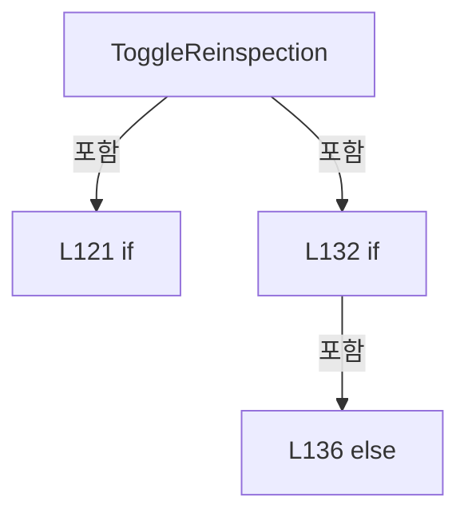

변경 전 점검: 입력/반환 타입, 위 호출자, 예외/취소 경로, 공유 상태와 저장·전송 소비자를 함께 확인합니다. 값의 단위나 물리 방향을 이름만으로 확정하지 않습니다.

### MethodDeclaration `AddReinspectionShot` · L143–181

[Drilling.UI/Menu/Menus/CMenuCorrection.ReviewData.Reinspection.cs:143–181](https://github.com/kjuws10-rgb/A3Drilling/blob/334b3599651b2e8e0181fd4459bafaf3cddafff3/Drilling.UI/Menu/Menus/CMenuCorrection.ReviewData.Reinspection.cs#L143-L181)

| 항목 | 실제 추출 값 |
| --- | --- |
| 서명 | void Drilling.UI.Menu.Menus.CMenuCorrection.CReviewDataPanel.AddReinspectionShot(object?) |
| 접근/수식자 | Private / private |
| 반환/값 타입 | void |
| 소속 타입 | NamedType:Drilling.UI.Menu.Menus.CMenuCorrection.CReviewDataPanel |

입력 계약:

| 이름 | 타입 | 전달 | 선택/기본값 |
| --- | --- | --- | --- |
| parameter | object? | None | False /  |

현재 부분 분석에서 직접 연결된 호출자는 없습니다. XAML/이벤트/인터페이스·델리게이트·외부 진입을 추가 확인해야 하며, 미사용으로 판정한 것이 아닙니다.

호출하는 대상과 해석 범위:

| 원본 행 | 표현식 | 분석 상태 | 대상/소스 위치 |
| --- | --- | --- | --- |
| 146 | _shotsByCell.TryGetValue | resolved · 동적 구현 선택 가능 | bool System.Collections.Generic.IReadOnlyDictionary<int, System.Collections.Generic.IReadOnlyList<Drilling.UI.Menu.Menus.CMenuCorrection.ST_REVIEW_DATA_SHOT_POSITION>>.TryGetValue(int, out System.Collections.Generic.IReadOnlyList<Drilling.UI.Menu.Menus.CMenuCorrection.ST_REVIEW_DATA_SHOT_POSITION>) |
| 151 | shots.FirstOrDefault | resolved | Drilling.UI.Menu.Menus.CMenuCorrection.ST_REVIEW_DATA_SHOT_POSITION? System.Collections.Generic.IEnumerable<Drilling.UI.Menu.Menus.CMenuCorrection.ST_REVIEW_DATA_SHOT_POSITION>.FirstOrDefault<Drilling.UI.Menu.Menus.CMenuCorrection.ST_REVIEW_DATA_SHOT_POSITION>(System.Func<Drilling.UI.Menu.Menus.CMenuCorrection.ST_REVIEW_DATA_SHOT_POSITION, bool>) |
| 151 | item.ShotKey.Equals | resolved | bool string.Equals(string?, System.StringComparison) |
| 158 | SelectedRow.ShotKey.Equals | resolved | bool string.Equals(string?, System.StringComparison) |
| 160 | Rows.FirstOrDefault | resolved | Drilling.UI.Menu.Menus.CMenuCorrection.ST_REVIEW_DATA_GRID_ROW? System.Collections.Generic.IEnumerable<Drilling.UI.Menu.Menus.CMenuCorrection.ST_REVIEW_DATA_GRID_ROW>.FirstOrDefault<Drilling.UI.Menu.Menus.CMenuCorrection.ST_REVIEW_DATA_GRID_ROW>(System.Func<Drilling.UI.Menu.Menus.CMenuCorrection.ST_REVIEW_DATA_GRID_ROW, bool>) |
| 162 | row.ShotKey.Equals | resolved | bool string.Equals(string?, System.StringComparison) |
| 163 | NormalizeBeamNo | resolved | int Drilling.UI.Menu.Menus.CMenuCorrection.CReviewDataPanel.NormalizeBeamNo(int) · Drilling.UI/Menu/Menus/CMenuCorrection.ReviewData.Reinspection.cs:789 |
| 164 | FindReinspectionShot | resolved | Drilling.UI.Menu.Menus.CMenuCorrection.ST_REVIEW_DATA_REINSPECTION_ITEM? Drilling.UI.Menu.Menus.CMenuCorrection.CReviewDataPanel.FindReinspectionShot(int, string) · Drilling.UI/Menu/Menus/CMenuCorrection.ReviewData.Reinspection.cs:730 |
| 169 | Notify | resolved | void Drilling.UI.Menu.Menus.CMenuCorrection.CReviewDataPanel.Notify(string) · Drilling.UI/Menu/Menus/CMenuCorrection.ReviewData.cs:616 |
| 169 | nameof | unresolved | None |
| 170 | Notify | resolved | void Drilling.UI.Menu.Menus.CMenuCorrection.CReviewDataPanel.Notify(string) · Drilling.UI/Menu/Menus/CMenuCorrection.ReviewData.cs:616 |
| 170 | nameof | unresolved | None |
| 171 | NotifyReinspectionCommandState | resolved | void Drilling.UI.Menu.Menus.CMenuCorrection.CReviewDataPanel.NotifyReinspectionCommandState() · Drilling.UI/Menu/Menus/CMenuCorrection.ReviewData.Reinspection.cs:700 |
| 175 | CreateReinspectionItem | resolved | Drilling.UI.Menu.Menus.CMenuCorrection.ST_REVIEW_DATA_REINSPECTION_ITEM Drilling.UI.Menu.Menus.CMenuCorrection.CReviewDataPanel.CreateReinspectionItem(Drilling.UI.Menu.Menus.CMenuCorrection.ST_REVIEW_DATA_SHOT_POSITION, Drilling.UI.Menu.Menus.CMenuCorrection.ST_REVIEW_DATA_GRID_ROW?, int, int) · Drilling.UI/Menu/Menus/CMenuCorrection.ReviewData.Reinspection.cs:746 |
| 180 | NotifyReinspectionListState | resolved | void Drilling.UI.Menu.Menus.CMenuCorrection.CReviewDataPanel.NotifyReinspectionListState() · Drilling.UI/Menu/Menus/CMenuCorrection.ReviewData.Reinspection.cs:691 |

본문의 실제 연산·분기·예외·반환 순서(원문 위치 순):

| 원본 행 | 종류 | 주석 해설 |
| --- | --- | --- |
| 145 | if | 조건에 따라 분기합니다: if (!CanAddReinspectionShot &#124;&#124; !_shotsByCell.TryGetValue(_selectedCellNo, out var shots)) |
| 146 | call | 함수·델리게이트 또는 객체 생성자를 호출합니다: _shotsByCell.TryGetValue(_selectedCellNo, out var shots) |
| 148 | return | 호출자에게 값 또는 제어를 반환합니다: return; |
| 151 | call | 함수·델리게이트 또는 객체 생성자를 호출합니다: shots.FirstOrDefault(item => item.ShotKey.Equals(_selectedShotKey, StringComparison.OrdinalIgnoreCase)) |
| 151 | call | 함수·델리게이트 또는 객체 생성자를 호출합니다: item.ShotKey.Equals(_selectedShotKey, StringComparison.OrdinalIgnoreCase) |
| 151 | local-declaration | 지역 변수를 선언합니다: var shot = shots.FirstOrDefault(item => item.ShotKey.Equals(_selectedShotKey, StringComparison.OrdinalIgnoreCase)); |
| 151 | variable-initializer | 변수의 초기값을 지정합니다: shot = shots.FirstOrDefault(item => item.ShotKey.Equals(_selectedShotKey, StringComparison.OrdinalIgnoreCase)) |
| 152 | if | 조건에 따라 분기합니다: if (shot is null) |
| 154 | return | 호출자에게 값 또는 제어를 반환합니다: return; |
| 157 | conditional-expression | 조건에 따라 결과식을 선택합니다: SelectedRow?.CellNo == shot.CellNo && SelectedRow.ShotKey.Equals(shot.ShotKey, StringComparison.OrdinalIgnoreCase) ? SelectedRow : Rows.FirstOrDefault(row => row.CellNo == shot.CellNo && row.ShotKey.Equals(shot.ShotKey, StringComp |
| 157 | local-declaration | 지역 변수를 선언합니다: var sourceRow = SelectedRow?.CellNo == shot.CellNo && SelectedRow.ShotKey.Equals(shot.ShotKey, StringComparison.OrdinalIgnoreCase) ? SelectedRow : Rows.FirstOrDefault(row => row.CellNo == shot.CellNo && row.ShotKey.Equals(shot.Sho |
| 157 | variable-initializer | 변수의 초기값을 지정합니다: sourceRow = SelectedRow?.CellNo == shot.CellNo && SelectedRow.ShotKey.Equals(shot.ShotKey, StringComparison.OrdinalIgnoreCase) ? SelectedRow : Rows.FirstOrDefault(row => row.CellNo == shot.CellNo && row.ShotKey.Equals(shot.ShotKey |
| 158 | call | 함수·델리게이트 또는 객체 생성자를 호출합니다: SelectedRow.ShotKey.Equals(shot.ShotKey, StringComparison.OrdinalIgnoreCase) |
| 160 | call | 함수·델리게이트 또는 객체 생성자를 호출합니다: Rows.FirstOrDefault(row => row.CellNo == shot.CellNo && row.ShotKey.Equals(shot.ShotKey, StringComparison.OrdinalIgnoreCase)) |
| 162 | call | 함수·델리게이트 또는 객체 생성자를 호출합니다: row.ShotKey.Equals(shot.ShotKey, StringComparison.OrdinalIgnoreCase) |
| 163 | call | 함수·델리게이트 또는 객체 생성자를 호출합니다: NormalizeBeamNo(sourceRow?.BeamNo ?? 1) |
| 163 | local-declaration | 지역 변수를 선언합니다: var beamNo = NormalizeBeamNo(sourceRow?.BeamNo ?? 1); |
| 163 | variable-initializer | 변수의 초기값을 지정합니다: beamNo = NormalizeBeamNo(sourceRow?.BeamNo ?? 1) |
| 164 | call | 함수·델리게이트 또는 객체 생성자를 호출합니다: FindReinspectionShot(shot.CellNo, shot.ShotKey) |
| 164 | local-declaration | 지역 변수를 선언합니다: var existing = FindReinspectionShot(shot.CellNo, shot.ShotKey); |
| 164 | variable-initializer | 변수의 초기값을 지정합니다: existing = FindReinspectionShot(shot.CellNo, shot.ShotKey) |
| 165 | if | 조건에 따라 분기합니다: if (existing is not null) |
| 167 | assignment | 값을 대상에 대입합니다: _selectedReinspectionShot = existing |
| 168 | assignment | 값을 대상에 대입합니다: _reinspectionStatusText = $"{existing.Cell} / {existing.ShotName} / BEAM {existing.BeamNo} ALREADY ADDED" |
| 169 | call | 함수·델리게이트 또는 객체 생성자를 호출합니다: Notify(nameof(SelectedReinspectionShot)) |
| 169 | call | 함수·델리게이트 또는 객체 생성자를 호출합니다: nameof(SelectedReinspectionShot) |
| 170 | call | 함수·델리게이트 또는 객체 생성자를 호출합니다: Notify(nameof(ReinspectionStatusText)) |
| 170 | call | 함수·델리게이트 또는 객체 생성자를 호출합니다: nameof(ReinspectionStatusText) |
| 171 | call | 함수·델리게이트 또는 객체 생성자를 호출합니다: NotifyReinspectionCommandState() |
| 172 | return | 호출자에게 값 또는 제어를 반환합니다: return; |
| 175 | call | 함수·델리게이트 또는 객체 생성자를 호출합니다: CreateReinspectionItem(shot, sourceRow, beamNo, _reinspectionShots.Count + 1) |
| 175 | local-declaration | 지역 변수를 선언합니다: var item = CreateReinspectionItem(shot, sourceRow, beamNo, _reinspectionShots.Count + 1); |
| 175 | variable-initializer | 변수의 초기값을 지정합니다: item = CreateReinspectionItem(shot, sourceRow, beamNo, _reinspectionShots.Count + 1) |
| 177 | assignment | 값을 대상에 대입합니다: _reinspectionShots = [.. _reinspectionShots, item] |
| 178 | assignment | 값을 대상에 대입합니다: _selectedReinspectionShot = item |
| 179 | assignment | 값을 대상에 대입합니다: _reinspectionStatusText = $"{item.Cell} / {item.ShotName} / BEAM {item.BeamNo} ADDED" |
| 180 | call | 함수·델리게이트 또는 객체 생성자를 호출합니다: NotifyReinspectionListState() |

제어 구문의 포함 구조(실제 실행 순서/CFG가 아닌 구문 탐색 그림):

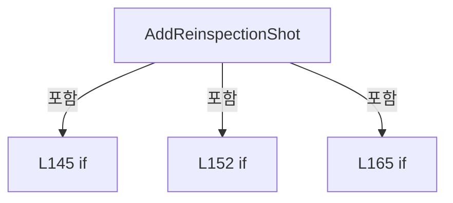

변경 전 점검: 입력/반환 타입, 위 호출자, 예외/취소 경로, 공유 상태와 저장·전송 소비자를 함께 확인합니다. 값의 단위나 물리 방향을 이름만으로 확정하지 않습니다.

### MethodDeclaration `AddSelectedReinspectionShots` · L183–188

[Drilling.UI/Menu/Menus/CMenuCorrection.ReviewData.Reinspection.cs:183–188](https://github.com/kjuws10-rgb/A3Drilling/blob/334b3599651b2e8e0181fd4459bafaf3cddafff3/Drilling.UI/Menu/Menus/CMenuCorrection.ReviewData.Reinspection.cs#L183-L188)

| 항목 | 실제 추출 값 |
| --- | --- |
| 서명 | void Drilling.UI.Menu.Menus.CMenuCorrection.CReviewDataPanel.AddSelectedReinspectionShots(object?) |
| 접근/수식자 | Private / private |
| 반환/값 타입 | void |
| 소속 타입 | NamedType:Drilling.UI.Menu.Menus.CMenuCorrection.CReviewDataPanel |

입력 계약:

| 이름 | 타입 | 전달 | 선택/기본값 |
| --- | --- | --- | --- |
| parameter | object? | None | False /  |

현재 부분 분석에서 직접 연결된 호출자는 없습니다. XAML/이벤트/인터페이스·델리게이트·외부 진입을 추가 확인해야 하며, 미사용으로 판정한 것이 아닙니다.

호출하는 대상과 해석 범위:

| 원본 행 | 표현식 | 분석 상태 | 대상/소스 위치 |
| --- | --- | --- | --- |
| 185 | AddReinspectionRows | resolved | void Drilling.UI.Menu.Menus.CMenuCorrection.CReviewDataPanel.AddReinspectionRows(System.Collections.Generic.IEnumerable<Drilling.UI.Menu.Menus.CMenuCorrection.ST_REVIEW_DATA_GRID_ROW>, string) · Drilling.UI/Menu/Menus/CMenuCorrection.ReviewData.Reinspection.cs:197 |
| 186 | _allRows.Where | resolved | System.Collections.Generic.IEnumerable<Drilling.UI.Menu.Menus.CMenuCorrection.ST_REVIEW_DATA_GRID_ROW> System.Collections.Generic.IEnumerable<Drilling.UI.Menu.Menus.CMenuCorrection.ST_REVIEW_DATA_GRID_ROW>.Where<Drilling.UI.Menu.Menus.CMenuCorrection.ST_REVIEW_DATA_GRID_ROW>(System.Func<Drilling.UI.Menu.Menus.CMenuCorrection.ST_REVIEW_DATA_GRID_ROW, bool>) |

본문의 실제 연산·분기·예외·반환 순서(원문 위치 순):

| 원본 행 | 종류 | 주석 해설 |
| --- | --- | --- |
| 185 | call | 함수·델리게이트 또는 객체 생성자를 호출합니다: AddReinspectionRows( _allRows.Where(row => row.IsReinspectionSelected), "SELECTED") |
| 186 | call | 함수·델리게이트 또는 객체 생성자를 호출합니다: _allRows.Where(row => row.IsReinspectionSelected) |

변경 전 점검: 입력/반환 타입, 위 호출자, 예외/취소 경로, 공유 상태와 저장·전송 소비자를 함께 확인합니다. 값의 단위나 물리 방향을 이름만으로 확정하지 않습니다.

### MethodDeclaration `AddNgReinspectionShots` · L190–195

[Drilling.UI/Menu/Menus/CMenuCorrection.ReviewData.Reinspection.cs:190–195](https://github.com/kjuws10-rgb/A3Drilling/blob/334b3599651b2e8e0181fd4459bafaf3cddafff3/Drilling.UI/Menu/Menus/CMenuCorrection.ReviewData.Reinspection.cs#L190-L195)

| 항목 | 실제 추출 값 |
| --- | --- |
| 서명 | void Drilling.UI.Menu.Menus.CMenuCorrection.CReviewDataPanel.AddNgReinspectionShots(object?) |
| 접근/수식자 | Private / private |
| 반환/값 타입 | void |
| 소속 타입 | NamedType:Drilling.UI.Menu.Menus.CMenuCorrection.CReviewDataPanel |

입력 계약:

| 이름 | 타입 | 전달 | 선택/기본값 |
| --- | --- | --- | --- |
| parameter | object? | None | False /  |

현재 부분 분석에서 직접 연결된 호출자는 없습니다. XAML/이벤트/인터페이스·델리게이트·외부 진입을 추가 확인해야 하며, 미사용으로 판정한 것이 아닙니다.

호출하는 대상과 해석 범위:

| 원본 행 | 표현식 | 분석 상태 | 대상/소스 위치 |
| --- | --- | --- | --- |
| 192 | AddReinspectionRows | resolved | void Drilling.UI.Menu.Menus.CMenuCorrection.CReviewDataPanel.AddReinspectionRows(System.Collections.Generic.IEnumerable<Drilling.UI.Menu.Menus.CMenuCorrection.ST_REVIEW_DATA_GRID_ROW>, string) · Drilling.UI/Menu/Menus/CMenuCorrection.ReviewData.Reinspection.cs:197 |
| 193 | _allRows.Where | resolved | System.Collections.Generic.IEnumerable<Drilling.UI.Menu.Menus.CMenuCorrection.ST_REVIEW_DATA_GRID_ROW> System.Collections.Generic.IEnumerable<Drilling.UI.Menu.Menus.CMenuCorrection.ST_REVIEW_DATA_GRID_ROW>.Where<Drilling.UI.Menu.Menus.CMenuCorrection.ST_REVIEW_DATA_GRID_ROW>(System.Func<Drilling.UI.Menu.Menus.CMenuCorrection.ST_REVIEW_DATA_GRID_ROW, bool>) |

본문의 실제 연산·분기·예외·반환 순서(원문 위치 순):

| 원본 행 | 종류 | 주석 해설 |
| --- | --- | --- |
| 192 | call | 함수·델리게이트 또는 객체 생성자를 호출합니다: AddReinspectionRows( _allRows.Where(IsNgResultRow), "NG") |
| 193 | call | 함수·델리게이트 또는 객체 생성자를 호출합니다: _allRows.Where(IsNgResultRow) |

변경 전 점검: 입력/반환 타입, 위 호출자, 예외/취소 경로, 공유 상태와 저장·전송 소비자를 함께 확인합니다. 값의 단위나 물리 방향을 이름만으로 확정하지 않습니다.

### MethodDeclaration `AddReinspectionRows` · L197–248

[Drilling.UI/Menu/Menus/CMenuCorrection.ReviewData.Reinspection.cs:197–248](https://github.com/kjuws10-rgb/A3Drilling/blob/334b3599651b2e8e0181fd4459bafaf3cddafff3/Drilling.UI/Menu/Menus/CMenuCorrection.ReviewData.Reinspection.cs#L197-L248)

| 항목 | 실제 추출 값 |
| --- | --- |
| 서명 | void Drilling.UI.Menu.Menus.CMenuCorrection.CReviewDataPanel.AddReinspectionRows(System.Collections.Generic.IEnumerable<Drilling.UI.Menu.Menus.CMenuCorrection.ST_REVIEW_DATA_GRID_ROW>, string) |
| 접근/수식자 | Private / private |
| 반환/값 타입 | void |
| 소속 타입 | NamedType:Drilling.UI.Menu.Menus.CMenuCorrection.CReviewDataPanel |

입력 계약:

| 이름 | 타입 | 전달 | 선택/기본값 |
| --- | --- | --- | --- |
| candidates | System.Collections.Generic.IEnumerable<Drilling.UI.Menu.Menus.CMenuCorrection.ST_REVIEW_DATA_GRID_ROW> | None | False /  |
| sourceName | string | None | False /  |

정적 호출자로 확인된 위치:

| 호출 파일/행 | 호출 표현식 | 런타임 분기 가능 |
| --- | --- | --- |
| [Drilling.UI/Menu/Menus/CMenuCorrection.ReviewData.Reinspection.cs:185–187](https://github.com/kjuws10-rgb/A3Drilling/blob/334b3599651b2e8e0181fd4459bafaf3cddafff3/Drilling.UI/Menu/Menus/CMenuCorrection.ReviewData.Reinspection.cs#L185-L187) | AddReinspectionRows | False |
| [Drilling.UI/Menu/Menus/CMenuCorrection.ReviewData.Reinspection.cs:192–194](https://github.com/kjuws10-rgb/A3Drilling/blob/334b3599651b2e8e0181fd4459bafaf3cddafff3/Drilling.UI/Menu/Menus/CMenuCorrection.ReviewData.Reinspection.cs#L192-L194) | AddReinspectionRows | False |

호출하는 대상과 해석 범위:

| 원본 행 | 표현식 | 분석 상태 | 대상/소스 위치 |
| --- | --- | --- | --- |
| 201 | candidates.ToArray | resolved | Drilling.UI.Menu.Menus.CMenuCorrection.ST_REVIEW_DATA_GRID_ROW[] System.Collections.Generic.IEnumerable<Drilling.UI.Menu.Menus.CMenuCorrection.ST_REVIEW_DATA_GRID_ROW>.ToArray<Drilling.UI.Menu.Menus.CMenuCorrection.ST_REVIEW_DATA_GRID_ROW>() |
| 205 | Notify | resolved | void Drilling.UI.Menu.Menus.CMenuCorrection.CReviewDataPanel.Notify(string) · Drilling.UI/Menu/Menus/CMenuCorrection.ReviewData.cs:616 |
| 205 | nameof | unresolved | None |
| 209 | _reinspectionShots.ToList | resolved | System.Collections.Generic.List<Drilling.UI.Menu.Menus.CMenuCorrection.ST_REVIEW_DATA_REINSPECTION_ITEM> System.Collections.Generic.IEnumerable<Drilling.UI.Menu.Menus.CMenuCorrection.ST_REVIEW_DATA_REINSPECTION_ITEM>.ToList<Drilling.UI.Menu.Menus.CMenuCorrection.ST_REVIEW_DATA_REINSPECTION_ITEM>() |
| 211 | new HashSet<string> | resolved | System.Collections.Generic.HashSet<string>.HashSet(System.Collections.Generic.IEnumerable<string>, System.Collections.Generic.IEqualityComparer<string>?) |
| 212 | items.Select | resolved | System.Collections.Generic.IEnumerable<string> System.Collections.Generic.IEnumerable<Drilling.UI.Menu.Menus.CMenuCorrection.ST_REVIEW_DATA_REINSPECTION_ITEM>.Select<Drilling.UI.Menu.Menus.CMenuCorrection.ST_REVIEW_DATA_REINSPECTION_ITEM, string>(System.Func<Drilling.UI.Menu.Menus.CMenuCorrection.ST_REVIEW_DATA_REINSPECTION_ITEM, string>) |
| 212 | BuildReinspectionKey | resolved | string Drilling.UI.Menu.Menus.CMenuCorrection.CReviewDataPanel.BuildReinspectionKey(int, string) · Drilling.UI/Menu/Menus/CMenuCorrection.ReviewData.Reinspection.cs:799 |
| 220 | FindShot | resolved | Drilling.UI.Menu.Menus.CMenuCorrection.ST_REVIEW_DATA_SHOT_POSITION? Drilling.UI.Menu.Menus.CMenuCorrection.CReviewDataPanel.FindShot(int, string) · Drilling.UI/Menu/Menus/CMenuCorrection.ReviewData.Reinspection.cs:739 |
| 227 | NormalizeBeamNo | resolved | int Drilling.UI.Menu.Menus.CMenuCorrection.CReviewDataPanel.NormalizeBeamNo(int) · Drilling.UI/Menu/Menus/CMenuCorrection.ReviewData.Reinspection.cs:789 |
| 228 | BuildReinspectionKey | resolved | string Drilling.UI.Menu.Menus.CMenuCorrection.CReviewDataPanel.BuildReinspectionKey(int, string) · Drilling.UI/Menu/Menus/CMenuCorrection.ReviewData.Reinspection.cs:799 |
| 229 | keys.Add | resolved | bool System.Collections.Generic.HashSet<string>.Add(string) |
| 235 | CreateReinspectionItem | resolved | Drilling.UI.Menu.Menus.CMenuCorrection.ST_REVIEW_DATA_REINSPECTION_ITEM Drilling.UI.Menu.Menus.CMenuCorrection.CReviewDataPanel.CreateReinspectionItem(Drilling.UI.Menu.Menus.CMenuCorrection.ST_REVIEW_DATA_SHOT_POSITION, Drilling.UI.Menu.Menus.CMenuCorrection.ST_REVIEW_DATA_GRID_ROW?, int, int) · Drilling.UI/Menu/Menus/CMenuCorrection.ReviewData.Reinspection.cs:746 |
| 236 | items.Add | resolved | void System.Collections.Generic.List<Drilling.UI.Menu.Menus.CMenuCorrection.ST_REVIEW_DATA_REINSPECTION_ITEM>.Add(Drilling.UI.Menu.Menus.CMenuCorrection.ST_REVIEW_DATA_REINSPECTION_ITEM) |
| 239 | items.ToArray | resolved | Drilling.UI.Menu.Menus.CMenuCorrection.ST_REVIEW_DATA_REINSPECTION_ITEM[] System.Collections.Generic.List<Drilling.UI.Menu.Menus.CMenuCorrection.ST_REVIEW_DATA_REINSPECTION_ITEM>.ToArray() |
| 247 | NotifyReinspectionListState | resolved | void Drilling.UI.Menu.Menus.CMenuCorrection.CReviewDataPanel.NotifyReinspectionListState() · Drilling.UI/Menu/Menus/CMenuCorrection.ReviewData.Reinspection.cs:691 |

본문의 실제 연산·분기·예외·반환 순서(원문 위치 순):

| 원본 행 | 종류 | 주석 해설 |
| --- | --- | --- |
| 201 | call | 함수·델리게이트 또는 객체 생성자를 호출합니다: candidates.ToArray() |
| 201 | local-declaration | 지역 변수를 선언합니다: var rows = candidates.ToArray(); |
| 201 | variable-initializer | 변수의 초기값을 지정합니다: rows = candidates.ToArray() |
| 202 | if | 조건에 따라 분기합니다: if (rows.Length == 0) |
| 204 | assignment | 값을 대상에 대입합니다: _reinspectionStatusText = $"NO {sourceName} SHOTS FOUND" |
| 205 | call | 함수·델리게이트 또는 객체 생성자를 호출합니다: Notify(nameof(ReinspectionStatusText)) |
| 205 | call | 함수·델리게이트 또는 객체 생성자를 호출합니다: nameof(ReinspectionStatusText) |
| 206 | return | 호출자에게 값 또는 제어를 반환합니다: return; |
| 209 | call | 함수·델리게이트 또는 객체 생성자를 호출합니다: _reinspectionShots.ToList() |
| 209 | local-declaration | 지역 변수를 선언합니다: var items = _reinspectionShots.ToList(); |
| 209 | variable-initializer | 변수의 초기값을 지정합니다: items = _reinspectionShots.ToList() |
| 210 | local-declaration | 지역 변수를 선언합니다: var originalCount = items.Count; |
| 210 | variable-initializer | 변수의 초기값을 지정합니다: originalCount = items.Count |
| 211 | call | 함수·델리게이트 또는 객체 생성자를 호출합니다: new HashSet<string>( items.Select(item => BuildReinspectionKey(item.CellNo, item.ShotKey)), StringComparer.OrdinalIgnoreCase) |
| 211 | local-declaration | 지역 변수를 선언합니다: var keys = new HashSet<string>( items.Select(item => BuildReinspectionKey(item.CellNo, item.ShotKey)), StringComparer.OrdinalIgnoreCase); |
| 211 | variable-initializer | 변수의 초기값을 지정합니다: keys = new HashSet<string>( items.Select(item => BuildReinspectionKey(item.CellNo, item.ShotKey)), StringComparer.OrdinalIgnoreCase) |
| 212 | call | 함수·델리게이트 또는 객체 생성자를 호출합니다: items.Select(item => BuildReinspectionKey(item.CellNo, item.ShotKey)) |
| 212 | call | 함수·델리게이트 또는 객체 생성자를 호출합니다: BuildReinspectionKey(item.CellNo, item.ShotKey) |
| 214 | local-declaration | 지역 변수를 선언합니다: ST_REVIEW_DATA_REINSPECTION_ITEM? lastAdded = null; |
| 214 | variable-initializer | 변수의 초기값을 지정합니다: lastAdded = null |
| 215 | local-declaration | 지역 변수를 선언합니다: var duplicateCount = 0; |
| 215 | variable-initializer | 변수의 초기값을 지정합니다: duplicateCount = 0 |
| 216 | local-declaration | 지역 변수를 선언합니다: var skippedCount = 0; |
| 216 | variable-initializer | 변수의 초기값을 지정합니다: skippedCount = 0 |
| 218 | foreach | 컬렉션 요소를 순회합니다: foreach (var row in rows) |
| 220 | call | 함수·델리게이트 또는 객체 생성자를 호출합니다: FindShot(row.CellNo, row.ShotKey) |
| 220 | local-declaration | 지역 변수를 선언합니다: var shot = FindShot(row.CellNo, row.ShotKey); |
| 220 | variable-initializer | 변수의 초기값을 지정합니다: shot = FindShot(row.CellNo, row.ShotKey) |
| 221 | if | 조건에 따라 분기합니다: if (shot is null) |
| 224 | continue | 다음 반복으로 진행합니다: continue; |
| 227 | call | 함수·델리게이트 또는 객체 생성자를 호출합니다: NormalizeBeamNo(row.BeamNo) |
| 227 | local-declaration | 지역 변수를 선언합니다: var beamNo = NormalizeBeamNo(row.BeamNo); |
| 227 | variable-initializer | 변수의 초기값을 지정합니다: beamNo = NormalizeBeamNo(row.BeamNo) |
| 228 | call | 함수·델리게이트 또는 객체 생성자를 호출합니다: BuildReinspectionKey(row.CellNo, row.ShotKey) |
| 228 | local-declaration | 지역 변수를 선언합니다: var key = BuildReinspectionKey(row.CellNo, row.ShotKey); |
| 228 | variable-initializer | 변수의 초기값을 지정합니다: key = BuildReinspectionKey(row.CellNo, row.ShotKey) |
| 229 | call | 함수·델리게이트 또는 객체 생성자를 호출합니다: keys.Add(key) |
| 229 | if | 조건에 따라 분기합니다: if (!keys.Add(key)) |
| 232 | continue | 다음 반복으로 진행합니다: continue; |
| 235 | assignment | 값을 대상에 대입합니다: lastAdded = CreateReinspectionItem(shot, row, beamNo, items.Count + 1) |
| 235 | call | 함수·델리게이트 또는 객체 생성자를 호출합니다: CreateReinspectionItem(shot, row, beamNo, items.Count + 1) |
| 236 | call | 함수·델리게이트 또는 객체 생성자를 호출합니다: items.Add(lastAdded) |
| 239 | assignment | 값을 대상에 대입합니다: _reinspectionShots = items.ToArray() |
| 239 | call | 함수·델리게이트 또는 객체 생성자를 호출합니다: items.ToArray() |
| 240 | if | 조건에 따라 분기합니다: if (lastAdded is not null) |
| 242 | assignment | 값을 대상에 대입합니다: _selectedReinspectionShot = lastAdded |
| 245 | local-declaration | 지역 변수를 선언합니다: var addedCount = items.Count - originalCount; |
| 245 | variable-initializer | 변수의 초기값을 지정합니다: addedCount = items.Count - originalCount |
| 246 | assignment | 값을 대상에 대입합니다: _reinspectionStatusText = $"{sourceName}: {addedCount:N0} ADDED / {duplicateCount:N0} DUPLICATE / {skippedCount:N0} SKIPPED" |
| 247 | call | 함수·델리게이트 또는 객체 생성자를 호출합니다: NotifyReinspectionListState() |

제어 구문의 포함 구조(실제 실행 순서/CFG가 아닌 구문 탐색 그림):

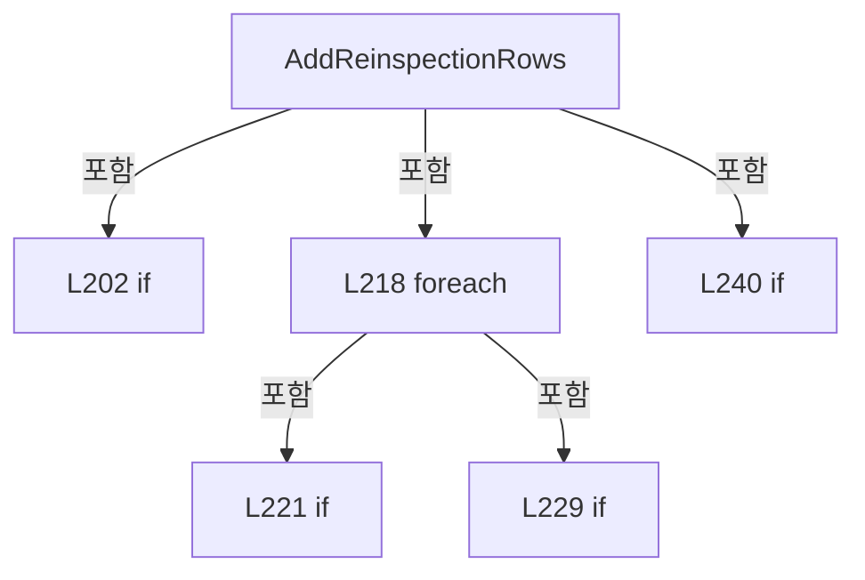

변경 전 점검: 입력/반환 타입, 위 호출자, 예외/취소 경로, 공유 상태와 저장·전송 소비자를 함께 확인합니다. 값의 단위나 물리 방향을 이름만으로 확정하지 않습니다.

### MethodDeclaration `DeleteReinspectionShot` · L250–280

[Drilling.UI/Menu/Menus/CMenuCorrection.ReviewData.Reinspection.cs:250–280](https://github.com/kjuws10-rgb/A3Drilling/blob/334b3599651b2e8e0181fd4459bafaf3cddafff3/Drilling.UI/Menu/Menus/CMenuCorrection.ReviewData.Reinspection.cs#L250-L280)

| 항목 | 실제 추출 값 |
| --- | --- |
| 서명 | void Drilling.UI.Menu.Menus.CMenuCorrection.CReviewDataPanel.DeleteReinspectionShot(object?) |
| 접근/수식자 | Private / private |
| 반환/값 타입 | void |
| 소속 타입 | NamedType:Drilling.UI.Menu.Menus.CMenuCorrection.CReviewDataPanel |

입력 계약:

| 이름 | 타입 | 전달 | 선택/기본값 |
| --- | --- | --- | --- |
| parameter | object? | None | False /  |

현재 부분 분석에서 직접 연결된 호출자는 없습니다. XAML/이벤트/인터페이스·델리게이트·외부 진입을 추가 확인해야 하며, 미사용으로 판정한 것이 아닙니다.

호출하는 대상과 해석 범위:

| 원본 행 | 표현식 | 분석 상태 | 대상/소스 위치 |
| --- | --- | --- | --- |
| 257 | _reinspectionShots .Select((item, index) => (item, index)) .First | resolved | (Drilling.UI.Menu.Menus.CMenuCorrection.ST_REVIEW_DATA_REINSPECTION_ITEM item, int index) System.Collections.Generic.IEnumerable<(Drilling.UI.Menu.Menus.CMenuCorrection.ST_REVIEW_DATA_REINSPECTION_ITEM item, int index)>.First<(Drilling.UI.Menu.Menus.CMenuCorrection.ST_REVIEW_DATA_REINSPECTION_ITEM item, int index)>(System.Func<(Drilling.UI.Menu.Menus.CMenuCorrection.ST_REVIEW_DATA_REINSPECTION_ITEM item, int index), bool>) |
| 257 | _reinspectionShots .Select | resolved | System.Collections.Generic.IEnumerable<(Drilling.UI.Menu.Menus.CMenuCorrection.ST_REVIEW_DATA_REINSPECTION_ITEM item, int index)> System.Collections.Generic.IEnumerable<Drilling.UI.Menu.Menus.CMenuCorrection.ST_REVIEW_DATA_REINSPECTION_ITEM>.Select<Drilling.UI.Menu.Menus.CMenuCorrection.ST_REVIEW_DATA_REINSPECTION_ITEM, (Drilling.UI.Menu.Menus.CMenuCorrection.ST_REVIEW_DATA_REINSPECTION_ITEM item, int index)>(System.Func<Drilling.UI.Menu.Menus.CMenuCorrection.ST_REVIEW_DATA_REINSPECTION_ITEM, int, (Drilling.UI.Menu.Menus.CMenuCorrection.ST_REVIEW_DATA_REINSPECTION_ITEM item, int index)>) |
| 259 | ReferenceEquals | resolved | bool object.ReferenceEquals(object?, object?) |
| 261 | _reinspectionShots .Where(item => !ReferenceEquals(item, selected)) .ToArray | resolved | Drilling.UI.Menu.Menus.CMenuCorrection.ST_REVIEW_DATA_REINSPECTION_ITEM[] System.Collections.Generic.IEnumerable<Drilling.UI.Menu.Menus.CMenuCorrection.ST_REVIEW_DATA_REINSPECTION_ITEM>.ToArray<Drilling.UI.Menu.Menus.CMenuCorrection.ST_REVIEW_DATA_REINSPECTION_ITEM>() |
| 261 | _reinspectionShots .Where | resolved | System.Collections.Generic.IEnumerable<Drilling.UI.Menu.Menus.CMenuCorrection.ST_REVIEW_DATA_REINSPECTION_ITEM> System.Collections.Generic.IEnumerable<Drilling.UI.Menu.Menus.CMenuCorrection.ST_REVIEW_DATA_REINSPECTION_ITEM>.Where<Drilling.UI.Menu.Menus.CMenuCorrection.ST_REVIEW_DATA_REINSPECTION_ITEM>(System.Func<Drilling.UI.Menu.Menus.CMenuCorrection.ST_REVIEW_DATA_REINSPECTION_ITEM, bool>) |
| 262 | ReferenceEquals | resolved | bool object.ReferenceEquals(object?, object?) |
| 267 | remaining[index].Renumber | resolved | void Drilling.UI.Menu.Menus.CMenuCorrection.ST_REVIEW_DATA_REINSPECTION_ITEM.Renumber(int) · Drilling.UI/Menu/Menus/CMenuCorrection.ReviewData.Reinspection.cs:976 |
| 273 | Math.Min | resolved | int System.Math.Min(int, int) |
| 275 | NotifyReinspectionListState | resolved | void Drilling.UI.Menu.Menus.CMenuCorrection.CReviewDataPanel.NotifyReinspectionListState() · Drilling.UI/Menu/Menus/CMenuCorrection.ReviewData.Reinspection.cs:691 |
| 278 | FocusReinspectionShot | resolved | void Drilling.UI.Menu.Menus.CMenuCorrection.CReviewDataPanel.FocusReinspectionShot(Drilling.UI.Menu.Menus.CMenuCorrection.ST_REVIEW_DATA_REINSPECTION_ITEM) · Drilling.UI/Menu/Menus/CMenuCorrection.ReviewData.Reinspection.cs:639 |

본문의 실제 연산·분기·예외·반환 순서(원문 위치 순):

| 원본 행 | 종류 | 주석 해설 |
| --- | --- | --- |
| 252 | if | 조건에 따라 분기합니다: if (!CanDeleteReinspectionShot &#124;&#124; _selectedReinspectionShot is not { } selected) |
| 254 | return | 호출자에게 값 또는 제어를 반환합니다: return; |
| 257 | call | 함수·델리게이트 또는 객체 생성자를 호출합니다: _reinspectionShots .Select((item, index) => (item, index)) |
| 257 | call | 함수·델리게이트 또는 객체 생성자를 호출합니다: _reinspectionShots .Select((item, index) => (item, index)) .First(pair => ReferenceEquals(pair.item, selected)) |
| 257 | local-declaration | 지역 변수를 선언합니다: var selectedIndex = _reinspectionShots .Select((item, index) => (item, index)) .First(pair => ReferenceEquals(pair.item, selected)) .index; |
| 257 | variable-initializer | 변수의 초기값을 지정합니다: selectedIndex = _reinspectionShots .Select((item, index) => (item, index)) .First(pair => ReferenceEquals(pair.item, selected)) .index |
| 259 | call | 함수·델리게이트 또는 객체 생성자를 호출합니다: ReferenceEquals(pair.item, selected) |
| 261 | call | 함수·델리게이트 또는 객체 생성자를 호출합니다: _reinspectionShots .Where(item => !ReferenceEquals(item, selected)) |
| 261 | call | 함수·델리게이트 또는 객체 생성자를 호출합니다: _reinspectionShots .Where(item => !ReferenceEquals(item, selected)) .ToArray() |
| 261 | local-declaration | 지역 변수를 선언합니다: var remaining = _reinspectionShots .Where(item => !ReferenceEquals(item, selected)) .ToArray(); |
| 261 | variable-initializer | 변수의 초기값을 지정합니다: remaining = _reinspectionShots .Where(item => !ReferenceEquals(item, selected)) .ToArray() |
| 262 | call | 함수·델리게이트 또는 객체 생성자를 호출합니다: ReferenceEquals(item, selected) |
| 264 | compound-assignment-or-event-subscription | 복합 대입 또는 이벤트 구독/해지 표현입니다: selected.PropertyChanged -= ReinspectionItemPropertyChanged |
| 265 | variable-initializer | 변수의 초기값을 지정합니다: index = 0 |
| 265 | for | 초기화·조건·증감이 있는 반복입니다: for (var index = 0; index < remaining.Length; index++) |
| 267 | call | 함수·델리게이트 또는 객체 생성자를 호출합니다: remaining[index].Renumber(index + 1) |
| 270 | assignment | 값을 대상에 대입합니다: _reinspectionShots = remaining |
| 271 | assignment | 값을 대상에 대입합니다: _selectedReinspectionShot = remaining.Length == 0 ? null : remaining[Math.Min(selectedIndex, remaining.Length - 1)] |
| 271 | conditional-expression | 조건에 따라 결과식을 선택합니다: remaining.Length == 0 ? null : remaining[Math.Min(selectedIndex, remaining.Length - 1)] |
| 273 | call | 함수·델리게이트 또는 객체 생성자를 호출합니다: Math.Min(selectedIndex, remaining.Length - 1) |
| 274 | assignment | 값을 대상에 대입합니다: _reinspectionStatusText = $"{selected.Cell} / {selected.ShotName} DELETED" |
| 275 | call | 함수·델리게이트 또는 객체 생성자를 호출합니다: NotifyReinspectionListState() |
| 276 | if | 조건에 따라 분기합니다: if (_selectedReinspectionShot is not null) |
| 278 | call | 함수·델리게이트 또는 객체 생성자를 호출합니다: FocusReinspectionShot(_selectedReinspectionShot) |

제어 구문의 포함 구조(실제 실행 순서/CFG가 아닌 구문 탐색 그림):

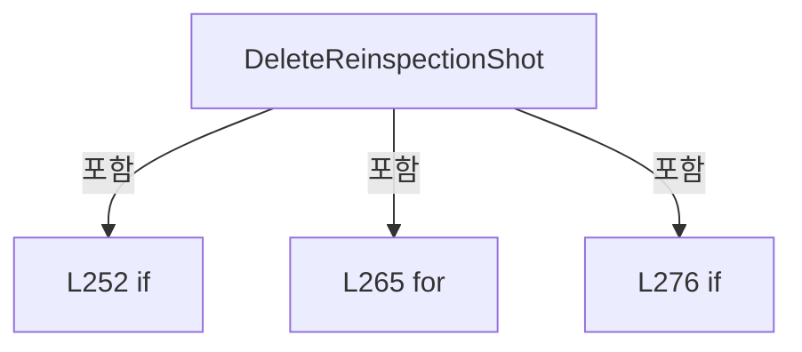

변경 전 점검: 입력/반환 타입, 위 호출자, 예외/취소 경로, 공유 상태와 저장·전송 소비자를 함께 확인합니다. 값의 단위나 물리 방향을 이름만으로 확정하지 않습니다.

### MethodDeclaration `ClearReinspectionShots` · L282–294

[Drilling.UI/Menu/Menus/CMenuCorrection.ReviewData.Reinspection.cs:282–294](https://github.com/kjuws10-rgb/A3Drilling/blob/334b3599651b2e8e0181fd4459bafaf3cddafff3/Drilling.UI/Menu/Menus/CMenuCorrection.ReviewData.Reinspection.cs#L282-L294)

| 항목 | 실제 추출 값 |
| --- | --- |
| 서명 | void Drilling.UI.Menu.Menus.CMenuCorrection.CReviewDataPanel.ClearReinspectionShots(object?) |
| 접근/수식자 | Private / private |
| 반환/값 타입 | void |
| 소속 타입 | NamedType:Drilling.UI.Menu.Menus.CMenuCorrection.CReviewDataPanel |

입력 계약:

| 이름 | 타입 | 전달 | 선택/기본값 |
| --- | --- | --- | --- |
| parameter | object? | None | False /  |

현재 부분 분석에서 직접 연결된 호출자는 없습니다. XAML/이벤트/인터페이스·델리게이트·외부 진입을 추가 확인해야 하며, 미사용으로 판정한 것이 아닙니다.

호출하는 대상과 해석 범위:

| 원본 행 | 표현식 | 분석 상태 | 대상/소스 위치 |
| --- | --- | --- | --- |
| 289 | UntrackReinspectionItems | resolved | void Drilling.UI.Menu.Menus.CMenuCorrection.CReviewDataPanel.UntrackReinspectionItems(System.Collections.Generic.IEnumerable<Drilling.UI.Menu.Menus.CMenuCorrection.ST_REVIEW_DATA_REINSPECTION_ITEM>) · Drilling.UI/Menu/Menus/CMenuCorrection.ReviewData.Reinspection.cs:781 |
| 293 | NotifyReinspectionListState | resolved | void Drilling.UI.Menu.Menus.CMenuCorrection.CReviewDataPanel.NotifyReinspectionListState() · Drilling.UI/Menu/Menus/CMenuCorrection.ReviewData.Reinspection.cs:691 |

본문의 실제 연산·분기·예외·반환 순서(원문 위치 순):

| 원본 행 | 종류 | 주석 해설 |
| --- | --- | --- |
| 284 | if | 조건에 따라 분기합니다: if (!CanClearReinspectionShots) |
| 286 | return | 호출자에게 값 또는 제어를 반환합니다: return; |
| 289 | call | 함수·델리게이트 또는 객체 생성자를 호출합니다: UntrackReinspectionItems(_reinspectionShots) |
| 290 | assignment | 값을 대상에 대입합니다: _reinspectionShots = [] |
| 291 | assignment | 값을 대상에 대입합니다: _selectedReinspectionShot = null |
| 292 | assignment | 값을 대상에 대입합니다: _reinspectionStatusText = "NO SHOTS ADDED" |
| 293 | call | 함수·델리게이트 또는 객체 생성자를 호출합니다: NotifyReinspectionListState() |

제어 구문의 포함 구조(실제 실행 순서/CFG가 아닌 구문 탐색 그림):

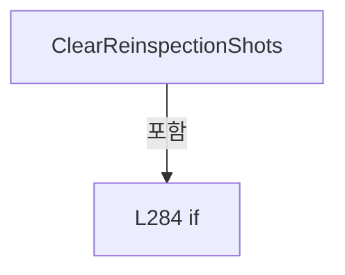

변경 전 점검: 입력/반환 타입, 위 호출자, 예외/취소 경로, 공유 상태와 저장·전송 소비자를 함께 확인합니다. 값의 단위나 물리 방향을 이름만으로 확정하지 않습니다.

### MethodDeclaration `MoveToReinspectionShot` · L296–304

[Drilling.UI/Menu/Menus/CMenuCorrection.ReviewData.Reinspection.cs:296–304](https://github.com/kjuws10-rgb/A3Drilling/blob/334b3599651b2e8e0181fd4459bafaf3cddafff3/Drilling.UI/Menu/Menus/CMenuCorrection.ReviewData.Reinspection.cs#L296-L304)

| 항목 | 실제 추출 값 |
| --- | --- |
| 서명 | void Drilling.UI.Menu.Menus.CMenuCorrection.CReviewDataPanel.MoveToReinspectionShot(object?) |
| 접근/수식자 | Private / private, async |
| 반환/값 타입 | void |
| 소속 타입 | NamedType:Drilling.UI.Menu.Menus.CMenuCorrection.CReviewDataPanel |

입력 계약:

| 이름 | 타입 | 전달 | 선택/기본값 |
| --- | --- | --- | --- |
| parameter | object? | None | False /  |

현재 부분 분석에서 직접 연결된 호출자는 없습니다. XAML/이벤트/인터페이스·델리게이트·외부 진입을 추가 확인해야 하며, 미사용으로 판정한 것이 아닙니다.

호출하는 대상과 해석 범위:

| 원본 행 | 표현식 | 분석 상태 | 대상/소스 위치 |
| --- | --- | --- | --- |
| 303 | RunReinspection | resolved | System.Threading.Tasks.Task Drilling.UI.Menu.Menus.CMenuCorrection.CReviewDataPanel.RunReinspection(System.Collections.Generic.IReadOnlyList<Drilling.UI.Menu.Menus.CMenuCorrection.ST_REVIEW_DATA_REINSPECTION_ITEM>, Drilling.Common.Review.EN_ONE_SHOT_ACTION, bool) · Drilling.UI/Menu/Menus/CMenuCorrection.ReviewData.Reinspection.cs:448 |

본문의 실제 연산·분기·예외·반환 순서(원문 위치 순):

| 원본 행 | 종류 | 주석 해설 |
| --- | --- | --- |
| 298 | if | 조건에 따라 분기합니다: if (!CanMoveToReinspectionShot &#124;&#124; _selectedReinspectionShot is not { } item) |
| 300 | return | 호출자에게 값 또는 제어를 반환합니다: return; |
| 303 | await | 비동기 완료를 기다립니다: await RunReinspection([item], EN_ONE_SHOT_ACTION.Move, false) |
| 303 | call | 함수·델리게이트 또는 객체 생성자를 호출합니다: RunReinspection([item], EN_ONE_SHOT_ACTION.Move, false) |

제어 구문의 포함 구조(실제 실행 순서/CFG가 아닌 구문 탐색 그림):

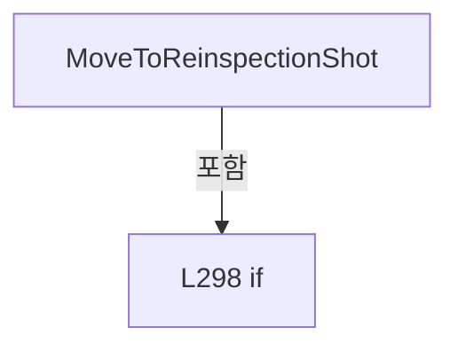

변경 전 점검: 입력/반환 타입, 위 호출자, 예외/취소 경로, 공유 상태와 저장·전송 소비자를 함께 확인합니다. 값의 단위나 물리 방향을 이름만으로 확정하지 않습니다.

### MethodDeclaration `MoveAndInspectReinspectionShot` · L306–314

[Drilling.UI/Menu/Menus/CMenuCorrection.ReviewData.Reinspection.cs:306–314](https://github.com/kjuws10-rgb/A3Drilling/blob/334b3599651b2e8e0181fd4459bafaf3cddafff3/Drilling.UI/Menu/Menus/CMenuCorrection.ReviewData.Reinspection.cs#L306-L314)

| 항목 | 실제 추출 값 |
| --- | --- |
| 서명 | void Drilling.UI.Menu.Menus.CMenuCorrection.CReviewDataPanel.MoveAndInspectReinspectionShot(object?) |
| 접근/수식자 | Private / private, async |
| 반환/값 타입 | void |
| 소속 타입 | NamedType:Drilling.UI.Menu.Menus.CMenuCorrection.CReviewDataPanel |

입력 계약:

| 이름 | 타입 | 전달 | 선택/기본값 |
| --- | --- | --- | --- |
| parameter | object? | None | False /  |

현재 부분 분석에서 직접 연결된 호출자는 없습니다. XAML/이벤트/인터페이스·델리게이트·외부 진입을 추가 확인해야 하며, 미사용으로 판정한 것이 아닙니다.

호출하는 대상과 해석 범위:

| 원본 행 | 표현식 | 분석 상태 | 대상/소스 위치 |
| --- | --- | --- | --- |
| 313 | RunReinspection | resolved | System.Threading.Tasks.Task Drilling.UI.Menu.Menus.CMenuCorrection.CReviewDataPanel.RunReinspection(System.Collections.Generic.IReadOnlyList<Drilling.UI.Menu.Menus.CMenuCorrection.ST_REVIEW_DATA_REINSPECTION_ITEM>, Drilling.Common.Review.EN_ONE_SHOT_ACTION, bool) · Drilling.UI/Menu/Menus/CMenuCorrection.ReviewData.Reinspection.cs:448 |

본문의 실제 연산·분기·예외·반환 순서(원문 위치 순):

| 원본 행 | 종류 | 주석 해설 |
| --- | --- | --- |
| 308 | if | 조건에 따라 분기합니다: if (!CanInspectReinspectionShot &#124;&#124; _selectedReinspectionShot is not { } item) |
| 310 | return | 호출자에게 값 또는 제어를 반환합니다: return; |
| 313 | await | 비동기 완료를 기다립니다: await RunReinspection([item], EN_ONE_SHOT_ACTION.MoveAndInspection, false) |
| 313 | call | 함수·델리게이트 또는 객체 생성자를 호출합니다: RunReinspection([item], EN_ONE_SHOT_ACTION.MoveAndInspection, false) |

제어 구문의 포함 구조(실제 실행 순서/CFG가 아닌 구문 탐색 그림):

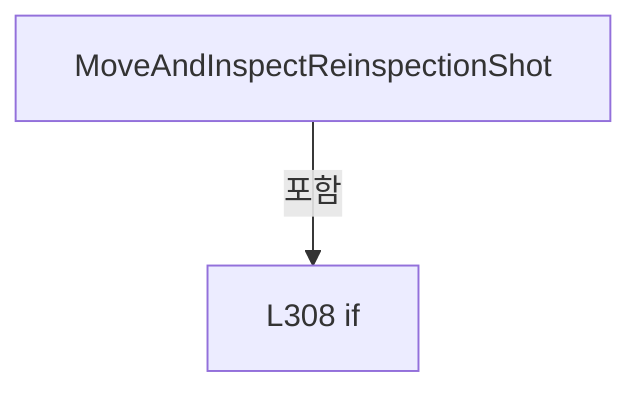

변경 전 점검: 입력/반환 타입, 위 호출자, 예외/취소 경로, 공유 상태와 저장·전송 소비자를 함께 확인합니다. 값의 단위나 물리 방향을 이름만으로 확정하지 않습니다.

### MethodDeclaration `InspectAllReinspectionShots` · L316–324

[Drilling.UI/Menu/Menus/CMenuCorrection.ReviewData.Reinspection.cs:316–324](https://github.com/kjuws10-rgb/A3Drilling/blob/334b3599651b2e8e0181fd4459bafaf3cddafff3/Drilling.UI/Menu/Menus/CMenuCorrection.ReviewData.Reinspection.cs#L316-L324)

| 항목 | 실제 추출 값 |
| --- | --- |
| 서명 | void Drilling.UI.Menu.Menus.CMenuCorrection.CReviewDataPanel.InspectAllReinspectionShots(object?) |
| 접근/수식자 | Private / private, async |
| 반환/값 타입 | void |
| 소속 타입 | NamedType:Drilling.UI.Menu.Menus.CMenuCorrection.CReviewDataPanel |

입력 계약:

| 이름 | 타입 | 전달 | 선택/기본값 |
| --- | --- | --- | --- |
| parameter | object? | None | False /  |

현재 부분 분석에서 직접 연결된 호출자는 없습니다. XAML/이벤트/인터페이스·델리게이트·외부 진입을 추가 확인해야 하며, 미사용으로 판정한 것이 아닙니다.

호출하는 대상과 해석 범위:

| 원본 행 | 표현식 | 분석 상태 | 대상/소스 위치 |
| --- | --- | --- | --- |
| 323 | RunReinspection | resolved | System.Threading.Tasks.Task Drilling.UI.Menu.Menus.CMenuCorrection.CReviewDataPanel.RunReinspection(System.Collections.Generic.IReadOnlyList<Drilling.UI.Menu.Menus.CMenuCorrection.ST_REVIEW_DATA_REINSPECTION_ITEM>, Drilling.Common.Review.EN_ONE_SHOT_ACTION, bool) · Drilling.UI/Menu/Menus/CMenuCorrection.ReviewData.Reinspection.cs:448 |
| 323 | _reinspectionShots.ToArray | resolved | Drilling.UI.Menu.Menus.CMenuCorrection.ST_REVIEW_DATA_REINSPECTION_ITEM[] System.Collections.Generic.IEnumerable<Drilling.UI.Menu.Menus.CMenuCorrection.ST_REVIEW_DATA_REINSPECTION_ITEM>.ToArray<Drilling.UI.Menu.Menus.CMenuCorrection.ST_REVIEW_DATA_REINSPECTION_ITEM>() |

본문의 실제 연산·분기·예외·반환 순서(원문 위치 순):

| 원본 행 | 종류 | 주석 해설 |
| --- | --- | --- |
| 318 | if | 조건에 따라 분기합니다: if (!CanInspectAllReinspectionShots) |
| 320 | return | 호출자에게 값 또는 제어를 반환합니다: return; |
| 323 | await | 비동기 완료를 기다립니다: await RunReinspection(_reinspectionShots.ToArray(), EN_ONE_SHOT_ACTION.MoveAndInspection, true) |
| 323 | call | 함수·델리게이트 또는 객체 생성자를 호출합니다: RunReinspection(_reinspectionShots.ToArray(), EN_ONE_SHOT_ACTION.MoveAndInspection, true) |
| 323 | call | 함수·델리게이트 또는 객체 생성자를 호출합니다: _reinspectionShots.ToArray() |

제어 구문의 포함 구조(실제 실행 순서/CFG가 아닌 구문 탐색 그림):

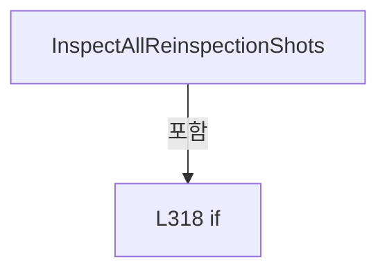

변경 전 점검: 입력/반환 타입, 위 호출자, 예외/취소 경로, 공유 상태와 저장·전송 소비자를 함께 확인합니다. 값의 단위나 물리 방향을 이름만으로 확정하지 않습니다.

### MethodDeclaration `StopReinspection` · L326–337

[Drilling.UI/Menu/Menus/CMenuCorrection.ReviewData.Reinspection.cs:326–337](https://github.com/kjuws10-rgb/A3Drilling/blob/334b3599651b2e8e0181fd4459bafaf3cddafff3/Drilling.UI/Menu/Menus/CMenuCorrection.ReviewData.Reinspection.cs#L326-L337)

| 항목 | 실제 추출 값 |
| --- | --- |
| 서명 | void Drilling.UI.Menu.Menus.CMenuCorrection.CReviewDataPanel.StopReinspection(object?) |
| 접근/수식자 | Private / private |
| 반환/값 타입 | void |
| 소속 타입 | NamedType:Drilling.UI.Menu.Menus.CMenuCorrection.CReviewDataPanel |

입력 계약:

| 이름 | 타입 | 전달 | 선택/기본값 |
| --- | --- | --- | --- |
| parameter | object? | None | False /  |

현재 부분 분석에서 직접 연결된 호출자는 없습니다. XAML/이벤트/인터페이스·델리게이트·외부 진입을 추가 확인해야 하며, 미사용으로 판정한 것이 아닙니다.

호출하는 대상과 해석 범위:

| 원본 행 | 표현식 | 분석 상태 | 대상/소스 위치 |
| --- | --- | --- | --- |
| 334 | Notify | resolved | void Drilling.UI.Menu.Menus.CMenuCorrection.CReviewDataPanel.Notify(string) · Drilling.UI/Menu/Menus/CMenuCorrection.ReviewData.cs:616 |
| 334 | nameof | unresolved | None |
| 335 | .Cancel | resolved | void System.Threading.CancellationTokenSource.Cancel() |
| 336 | _reviewManager.Stop | resolved | void Drilling.Common.Review.CReviewManager.Stop() · Drilling.Common/Review/CReviewManager.cs:446 |

본문의 실제 연산·분기·예외·반환 순서(원문 위치 순):

| 원본 행 | 종류 | 주석 해설 |
| --- | --- | --- |
| 328 | if | 조건에 따라 분기합니다: if (!CanStopReinspection) |
| 330 | return | 호출자에게 값 또는 제어를 반환합니다: return; |
| 333 | assignment | 값을 대상에 대입합니다: _reinspectionStatusText = "RE-INSPECTION STOP REQUESTED" |
| 334 | call | 함수·델리게이트 또는 객체 생성자를 호출합니다: Notify(nameof(ReinspectionStatusText)) |
| 334 | call | 함수·델리게이트 또는 객체 생성자를 호출합니다: nameof(ReinspectionStatusText) |
| 335 | call | 함수·델리게이트 또는 객체 생성자를 호출합니다: .Cancel() |
| 336 | call | 함수·델리게이트 또는 객체 생성자를 호출합니다: _reviewManager.Stop() |

제어 구문의 포함 구조(실제 실행 순서/CFG가 아닌 구문 탐색 그림):

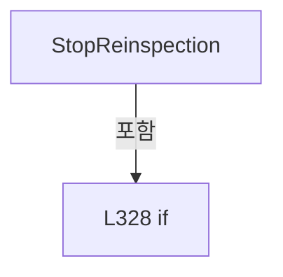

변경 전 점검: 입력/반환 타입, 위 호출자, 예외/취소 경로, 공유 상태와 저장·전송 소비자를 함께 확인합니다. 값의 단위나 물리 방향을 이름만으로 확정하지 않습니다.

### MethodDeclaration `SaveReinspectionResult` · L339–446

[Drilling.UI/Menu/Menus/CMenuCorrection.ReviewData.Reinspection.cs:339–446](https://github.com/kjuws10-rgb/A3Drilling/blob/334b3599651b2e8e0181fd4459bafaf3cddafff3/Drilling.UI/Menu/Menus/CMenuCorrection.ReviewData.Reinspection.cs#L339-L446)

| 항목 | 실제 추출 값 |
| --- | --- |
| 서명 | void Drilling.UI.Menu.Menus.CMenuCorrection.CReviewDataPanel.SaveReinspectionResult(object?) |
| 접근/수식자 | Private / private, async |
| 반환/값 타입 | void |
| 소속 타입 | NamedType:Drilling.UI.Menu.Menus.CMenuCorrection.CReviewDataPanel |

입력 계약:

| 이름 | 타입 | 전달 | 선택/기본값 |
| --- | --- | --- | --- |
| parameter | object? | None | False /  |

현재 부분 분석에서 직접 연결된 호출자는 없습니다. XAML/이벤트/인터페이스·델리게이트·외부 진입을 추가 확인해야 하며, 미사용으로 판정한 것이 아닙니다.

호출하는 대상과 해석 범위:

| 원본 행 | 표현식 | 분석 상태 | 대상/소스 위치 |
| --- | --- | --- | --- |
| 346 | _reinspectionShots .Where(item => item.HasCompletedMeasurement) .Select(item => new ST_REVIEW_REINSPECTION_UPDATE( item.CellNo, item.ShotKey, item.ShotName, item.SourceBeamNo, item.BeamNo, item.RawResultX!.Value, item.RawResultY!.Value, item.ResultX!.Value, item.ResultY!.Value, item.State)) .ToArray | resolved | Drilling.Common.Review.ST_REVIEW_REINSPECTION_UPDATE[] System.Collections.Generic.IEnumerable<Drilling.Common.Review.ST_REVIEW_REINSPECTION_UPDATE>.ToArray<Drilling.Common.Review.ST_REVIEW_REINSPECTION_UPDATE>() |
| 346 | _reinspectionShots .Where(item => item.HasCompletedMeasurement) .Select | resolved | System.Collections.Generic.IEnumerable<Drilling.Common.Review.ST_REVIEW_REINSPECTION_UPDATE> System.Collections.Generic.IEnumerable<Drilling.UI.Menu.Menus.CMenuCorrection.ST_REVIEW_DATA_REINSPECTION_ITEM>.Select<Drilling.UI.Menu.Menus.CMenuCorrection.ST_REVIEW_DATA_REINSPECTION_ITEM, Drilling.Common.Review.ST_REVIEW_REINSPECTION_UPDATE>(System.Func<Drilling.UI.Menu.Menus.CMenuCorrection.ST_REVIEW_DATA_REINSPECTION_ITEM, Drilling.Common.Review.ST_REVIEW_REINSPECTION_UPDATE>) |
| 346 | _reinspectionShots .Where | resolved | System.Collections.Generic.IEnumerable<Drilling.UI.Menu.Menus.CMenuCorrection.ST_REVIEW_DATA_REINSPECTION_ITEM> System.Collections.Generic.IEnumerable<Drilling.UI.Menu.Menus.CMenuCorrection.ST_REVIEW_DATA_REINSPECTION_ITEM>.Where<Drilling.UI.Menu.Menus.CMenuCorrection.ST_REVIEW_DATA_REINSPECTION_ITEM>(System.Func<Drilling.UI.Menu.Menus.CMenuCorrection.ST_REVIEW_DATA_REINSPECTION_ITEM, bool>) |
| 348 | new ST_REVIEW_REINSPECTION_UPDATE | resolved | Drilling.Common.Review.ST_REVIEW_REINSPECTION_UPDATE.ST_REVIEW_REINSPECTION_UPDATE(int, string, string, int, int, double, double, double, double, string) · Drilling.Common/Review/CReviewManager.cs:4291 |
| 362 | CRecipeConfirmDialog.ShowWarning | resolved | void Drilling.UI.Popup.CRecipeConfirmDialog.ShowWarning(string, string, Window?) · Drilling.UI/Popup/CRecipeConfirmDialog.xaml.cs:86 |
| 368 | CRecipeConfirmDialog.ShowConfirmation | resolved | bool Drilling.UI.Popup.CRecipeConfirmDialog.ShowConfirmation(string, string, string, bool) · Drilling.UI/Popup/CRecipeConfirmDialog.xaml.cs:11 |
| 378 | .Cancel | resolved | void System.Threading.CancellationTokenSource.Cancel() |
| 379 | .Dispose | resolved | void System.Threading.CancellationTokenSource.Dispose() |
| 380 | new CancellationTokenSource | resolved | System.Threading.CancellationTokenSource.CancellationTokenSource() |
| 382 | SetReinspectionSaving | resolved | void Drilling.UI.Menu.Menus.CMenuCorrection.CReviewDataPanel.SetReinspectionSaving(bool) · Drilling.UI/Menu/Menus/CMenuCorrection.ReviewData.Reinspection.cs:609 |
| 384 | Notify | resolved | void Drilling.UI.Menu.Menus.CMenuCorrection.CReviewDataPanel.Notify(string) · Drilling.UI/Menu/Menus/CMenuCorrection.ReviewData.cs:616 |
| 384 | nameof | unresolved | None |
| 389 | Task.Run | resolved | System.Threading.Tasks.Task<string> System.Threading.Tasks.Task.Run<string>(System.Func<System.Threading.Tasks.Task<string>?>, System.Threading.CancellationToken) |
| 390 | _reviewResultFile.SaveReinspectionRevision( source, updates, savedAt, cancellationToken).ConfigureAwait | resolved | System.Runtime.CompilerServices.ConfiguredTaskAwaitable<string> System.Threading.Tasks.Task<string>.ConfigureAwait(bool) |
| 390 | _reviewResultFile.SaveReinspectionRevision | resolved · 동적 구현 선택 가능 | System.Threading.Tasks.Task<string> Drilling.Common.Review.CReviewResultFileBase.SaveReinspectionRevision(Drilling.Common.Review.ST_REVIEW_RESULT_FILE_DATA, System.Collections.Generic.IReadOnlyList<Drilling.Common.Review.ST_REVIEW_REINSPECTION_UPDATE>, System.DateTimeOffset, System.Threading.CancellationToken) · Drilling.Common/Review/CReviewManager.cs:4345 |
| 397 | Path.GetFileName | resolved | string? System.IO.Path.GetFileName(string?) |
| 398 | _statusReporter | resolved · 동적 구현 선택 가능 | void System.Action<string>.Invoke(string) |
| 403 | _statusReporter | resolved · 동적 구현 선택 가능 | void System.Action<string>.Invoke(string) |
| 408 | _statusReporter | resolved · 동적 구현 선택 가능 | void System.Action<string>.Invoke(string) |
| 409 | CRecipeConfirmDialog.ShowWarning | resolved | void Drilling.UI.Popup.CRecipeConfirmDialog.ShowWarning(string, string, Window?) · Drilling.UI/Popup/CRecipeConfirmDialog.xaml.cs:86 |
| 415 | .Dispose | resolved | void System.Threading.CancellationTokenSource.Dispose() |
| 417 | SetReinspectionSaving | resolved | void Drilling.UI.Menu.Menus.CMenuCorrection.CReviewDataPanel.SetReinspectionSaving(bool) · Drilling.UI/Menu/Menus/CMenuCorrection.ReviewData.Reinspection.cs:609 |
| 418 | Notify | resolved | void Drilling.UI.Menu.Menus.CMenuCorrection.CReviewDataPanel.Notify(string) · Drilling.UI/Menu/Menus/CMenuCorrection.ReviewData.cs:616 |
| 418 | nameof | unresolved | None |
| 422 | string.IsNullOrWhiteSpace | resolved | bool string.IsNullOrWhiteSpace(string?) |
| 427 | CRecipeConfirmDialog.ShowSavedResultLoadConfirmation | resolved | bool Drilling.UI.Popup.CRecipeConfirmDialog.ShowSavedResultLoadConfirmation(string, string) · Drilling.UI/Popup/CRecipeConfirmDialog.xaml.cs:30 |
| 429 | Path.GetFileName | resolved | string? System.IO.Path.GetFileName(string?) |
| 435 | Refresh | resolved | System.Threading.Tasks.Task Drilling.UI.Menu.Menus.CMenuCorrection.CReviewDataPanel.Refresh(System.Threading.CancellationToken, string?) · Drilling.UI/Menu/Menus/CMenuCorrection.ReviewData.cs:263 |
| 437 | savedResult.FilePath.Equals | resolved | bool string.Equals(string?, System.StringComparison) |
| 439 | CRecipeConfirmDialog.ShowWarning | resolved | void Drilling.UI.Popup.CRecipeConfirmDialog.ShowWarning(string, string, Window?) · Drilling.UI/Popup/CRecipeConfirmDialog.xaml.cs:86 |
| 445 | LoadSelectedData | resolved | System.Threading.Tasks.Task Drilling.UI.Menu.Menus.CMenuCorrection.CReviewDataPanel.LoadSelectedData() · Drilling.UI/Menu/Menus/CMenuCorrection.ReviewData.Display.cs:160 |

본문의 실제 연산·분기·예외·반환 순서(원문 위치 순):

| 원본 행 | 종류 | 주석 해설 |
| --- | --- | --- |
| 341 | if | 조건에 따라 분기합니다: if (!CanSaveReinspectionResult &#124;&#124; _loadedResultFile is not { } source) |
| 343 | return | 호출자에게 값 또는 제어를 반환합니다: return; |
| 346 | call | 함수·델리게이트 또는 객체 생성자를 호출합니다: _reinspectionShots .Where(item => item.HasCompletedMeasurement) |
| 346 | call | 함수·델리게이트 또는 객체 생성자를 호출합니다: _reinspectionShots .Where(item => item.HasCompletedMeasurement) .Select(item => new ST_REVIEW_REINSPECTION_UPDATE( item.CellNo, item.ShotKey, item.ShotName, item.SourceBeamNo, item.BeamNo, item.RawResultX!.Value, item.Ra… |
| 346 | call | 함수·델리게이트 또는 객체 생성자를 호출합니다: _reinspectionShots .Where(item => item.HasCompletedMeasurement) .Select(item => new ST_REVIEW_REINSPECTION_UPDATE( item.CellNo, item.ShotKey, item.ShotName, item.SourceBeamNo, item.BeamNo, item.RawResultX!.Value, item.Ra… |
| 346 | local-declaration | 지역 변수를 선언합니다: var updates = _reinspectionShots .Where(item => item.HasCompletedMeasurement) .Select(item => new ST_REVIEW_REINSPECTION_UPDATE( item.CellNo, item.ShotKey, item.ShotName, item.SourceBeamNo, item.BeamNo, item.RawResultX!.Value, ite |
| 346 | variable-initializer | 변수의 초기값을 지정합니다: updates = _reinspectionShots .Where(item => item.HasCompletedMeasurement) .Select(item => new ST_REVIEW_REINSPECTION_UPDATE( item.CellNo, item.ShotKey, item.ShotName, item.SourceBeamNo, item.BeamNo, item.RawResultX!.Value, item.Ra |
| 348 | call | 함수·델리게이트 또는 객체 생성자를 호출합니다: new ST_REVIEW_REINSPECTION_UPDATE( item.CellNo, item.ShotKey, item.ShotName, item.SourceBeamNo, item.BeamNo, item.RawResultX!.Value, item.RawResultY!.Value, item.ResultX!.Value, item.ResultY!.Value, item.State) |
| 360 | if | 조건에 따라 분기합니다: if (updates.Length == 0) |
| 362 | call | 함수·델리게이트 또는 객체 생성자를 호출합니다: CRecipeConfirmDialog.ShowWarning( "재검사 결과 저장 불가", "OK 또는 NG로 완료된 재검사 Shot이 없습니다.") |
| 365 | return | 호출자에게 값 또는 제어를 반환합니다: return; |
| 368 | call | 함수·델리게이트 또는 객체 생성자를 호출합니다: CRecipeConfirmDialog.ShowConfirmation( "재검사 결과 저장", $"BASE 결과: {source.FileName}\n" + $"갱신 Shot: {updates.Length:N0}개\n\n" + "재검사 결과를 새 파일로 저장하시겠습니까?", "저장") |
| 368 | if | 조건에 따라 분기합니다: if (!CRecipeConfirmDialog.ShowConfirmation( "재검사 결과 저장", $"BASE 결과: {source.FileName}\n" + $"갱신 Shot: {updates.Length:N0}개\n\n" + "재검사 결과를 새 파일로 저장하시겠습니까?", "저장")) |
| 375 | return | 호출자에게 값 또는 제어를 반환합니다: return; |
| 378 | call | 함수·델리게이트 또는 객체 생성자를 호출합니다: .Cancel() |
| 379 | call | 함수·델리게이트 또는 객체 생성자를 호출합니다: .Dispose() |
| 380 | assignment | 값을 대상에 대입합니다: _reinspectionSaveCancellation = new CancellationTokenSource() |
| 380 | call | 함수·델리게이트 또는 객체 생성자를 호출합니다: new CancellationTokenSource() |
| 381 | local-declaration | 지역 변수를 선언합니다: var cancellationToken = _reinspectionSaveCancellation.Token; |
| 381 | variable-initializer | 변수의 초기값을 지정합니다: cancellationToken = _reinspectionSaveCancellation.Token |
| 382 | call | 함수·델리게이트 또는 객체 생성자를 호출합니다: SetReinspectionSaving(true) |
| 383 | assignment | 값을 대상에 대입합니다: _reinspectionStatusText = $"SAVE RESULT - BASE {(_loadedCatalog?.ResultType ?? "RESULT")} / {updates.Length:N0} SHOTS" |
| 384 | call | 함수·델리게이트 또는 객체 생성자를 호출합니다: Notify(nameof(ReinspectionStatusText)) |
| 384 | call | 함수·델리게이트 또는 객체 생성자를 호출합니다: nameof(ReinspectionStatusText) |
| 385 | local-declaration | 지역 변수를 선언합니다: string? savedPath = null; |
| 385 | variable-initializer | 변수의 초기값을 지정합니다: savedPath = null |
| 386 | try | 예외 처리 범위입니다: try |
| 388 | local-declaration | 지역 변수를 선언합니다: var savedAt = DateTimeOffset.Now; |
| 388 | variable-initializer | 변수의 초기값을 지정합니다: savedAt = DateTimeOffset.Now |
| 389 | assignment | 값을 대상에 대입합니다: savedPath = await Task.Run( async () => await _reviewResultFile.SaveReinspectionRevision( source, updates, savedAt, cancellationToken).ConfigureAwait(false), cancellationToken) |
| 389 | await | 비동기 완료를 기다립니다: await Task.Run( async () => await _reviewResultFile.SaveReinspectionRevision( source, updates, savedAt, cancellationToken).ConfigureAwait(false), cancellationToken) |
| 389 | call | 함수·델리게이트 또는 객체 생성자를 호출합니다: Task.Run( async () => await _reviewResultFile.SaveReinspectionRevision( source, updates, savedAt, cancellationToken).ConfigureAwait(false), cancellationToken) |
| 390 | await | 비동기 완료를 기다립니다: await _reviewResultFile.SaveReinspectionRevision( source, updates, savedAt, cancellationToken).ConfigureAwait(false) |
| 390 | call | 함수·델리게이트 또는 객체 생성자를 호출합니다: _reviewResultFile.SaveReinspectionRevision( source, updates, savedAt, cancellationToken).ConfigureAwait(false) |
| 390 | call | 함수·델리게이트 또는 객체 생성자를 호출합니다: _reviewResultFile.SaveReinspectionRevision( source, updates, savedAt, cancellationToken) |
| 396 | assignment | 값을 대상에 대입합니다: _hasUnsavedReinspectionMeasurements = false |
| 397 | assignment | 값을 대상에 대입합니다: _reinspectionStatusText = $"SAVE RESULT COMPLETED - {Path.GetFileName(savedPath)}" |
| 397 | call | 함수·델리게이트 또는 객체 생성자를 호출합니다: Path.GetFileName(savedPath) |
| 398 | call | 함수·델리게이트 또는 객체 생성자를 호출합니다: _statusReporter($"Re-inspection result saved from BASE {_loadedCatalog?.ResultType ?? "RESULT"}: {savedPath}") |
| 400 | catch | 지정 예외를 처리합니다: catch (OperationCanceledException) when (cancellationToken.IsCancellationRequested) |
| 402 | assignment | 값을 대상에 대입합니다: _reinspectionStatusText = "SAVE RESULT CANCELED" |
| 403 | call | 함수·델리게이트 또는 객체 생성자를 호출합니다: _statusReporter(_reinspectionStatusText) |
| 405 | catch | 지정 예외를 처리합니다: catch (Exception exception) |
| 407 | assignment | 값을 대상에 대입합니다: _reinspectionStatusText = $"SAVE RESULT FAILED - {exception.Message}" |
| 408 | call | 함수·델리게이트 또는 객체 생성자를 호출합니다: _statusReporter(_reinspectionStatusText) |
| 409 | call | 함수·델리게이트 또는 객체 생성자를 호출합니다: CRecipeConfirmDialog.ShowWarning( "재검사 결과 저장 실패", exception.Message) |
| 413 | finally | 종료 정리 구간입니다: finally |
| 415 | call | 함수·델리게이트 또는 객체 생성자를 호출합니다: .Dispose() |
| 416 | assignment | 값을 대상에 대입합니다: _reinspectionSaveCancellation = null |
| 417 | call | 함수·델리게이트 또는 객체 생성자를 호출합니다: SetReinspectionSaving(false) |
| 418 | call | 함수·델리게이트 또는 객체 생성자를 호출합니다: Notify(nameof(ReinspectionStatusText)) |
| 418 | call | 함수·델리게이트 또는 객체 생성자를 호출합니다: nameof(ReinspectionStatusText) |
| 422 | call | 함수·델리게이트 또는 객체 생성자를 호출합니다: string.IsNullOrWhiteSpace(savedPath) |
| 422 | if | 조건에 따라 분기합니다: if (string.IsNullOrWhiteSpace(savedPath)) |
| 424 | return | 호출자에게 값 또는 제어를 반환합니다: return; |
| 427 | call | 함수·델리게이트 또는 객체 생성자를 호출합니다: CRecipeConfirmDialog.ShowSavedResultLoadConfirmation( "재검사 결과 저장 완료", $"저장이 완료되었습니다.\n\n{Path.GetFileName(savedPath)}\n\n새로 저장한 결과를 LOAD하시겠습니까?") |
| 427 | local-declaration | 지역 변수를 선언합니다: var shouldLoad = CRecipeConfirmDialog.ShowSavedResultLoadConfirmation( "재검사 결과 저장 완료", $"저장이 완료되었습니다.\n\n{Path.GetFileName(savedPath)}\n\n새로 저장한 결과를 LOAD하시겠습니까?"); |
| 427 | variable-initializer | 변수의 초기값을 지정합니다: shouldLoad = CRecipeConfirmDialog.ShowSavedResultLoadConfirmation( "재검사 결과 저장 완료", $"저장이 완료되었습니다.\n\n{Path.GetFileName(savedPath)}\n\n새로 저장한 결과를 LOAD하시겠습니까?") |
| 429 | call | 함수·델리게이트 또는 객체 생성자를 호출합니다: Path.GetFileName(savedPath) |
| 430 | if | 조건에 따라 분기합니다: if (!shouldLoad) |
| 432 | return | 호출자에게 값 또는 제어를 반환합니다: return; |
| 435 | await | 비동기 완료를 기다립니다: await Refresh(CancellationToken.None, savedPath) |
| 435 | call | 함수·델리게이트 또는 객체 생성자를 호출합니다: Refresh(CancellationToken.None, savedPath) |
| 436 | if | 조건에 따라 분기합니다: if (_selectedNode?.Result is not { } savedResult &#124;&#124; !savedResult.FilePath.Equals(savedPath, StringComparison.OrdinalIgnoreCase)) |
| 437 | call | 함수·델리게이트 또는 객체 생성자를 호출합니다: savedResult.FilePath.Equals(savedPath, StringComparison.OrdinalIgnoreCase) |
| 439 | call | 함수·델리게이트 또는 객체 생성자를 호출합니다: CRecipeConfirmDialog.ShowWarning( "재검사 결과 LOAD 실패", "저장된 파일을 결과 트리에서 찾지 못했습니다. REFRESH 후 파일을 직접 선택해 주세요.") |
| 442 | return | 호출자에게 값 또는 제어를 반환합니다: return; |
| 445 | await | 비동기 완료를 기다립니다: await LoadSelectedData() |
| 445 | call | 함수·델리게이트 또는 객체 생성자를 호출합니다: LoadSelectedData() |

제어 구문의 포함 구조(실제 실행 순서/CFG가 아닌 구문 탐색 그림):

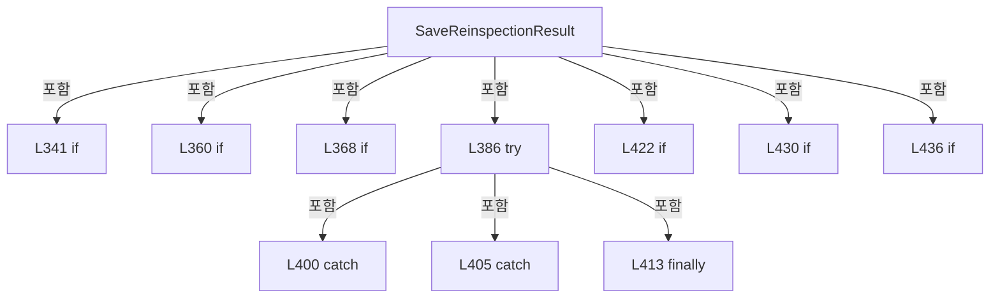

변경 전 점검: 입력/반환 타입, 위 호출자, 예외/취소 경로, 공유 상태와 저장·전송 소비자를 함께 확인합니다. 값의 단위나 물리 방향을 이름만으로 확정하지 않습니다.

### MethodDeclaration `RunReinspection` · L448–515

[Drilling.UI/Menu/Menus/CMenuCorrection.ReviewData.Reinspection.cs:448–515](https://github.com/kjuws10-rgb/A3Drilling/blob/334b3599651b2e8e0181fd4459bafaf3cddafff3/Drilling.UI/Menu/Menus/CMenuCorrection.ReviewData.Reinspection.cs#L448-L515)

| 항목 | 실제 추출 값 |
| --- | --- |
| 서명 | System.Threading.Tasks.Task Drilling.UI.Menu.Menus.CMenuCorrection.CReviewDataPanel.RunReinspection(System.Collections.Generic.IReadOnlyList<Drilling.UI.Menu.Menus.CMenuCorrection.ST_REVIEW_DATA_REINSPECTION_ITEM>, Drilling.Common.Review.EN_ONE_SHOT_ACTION, bool) |
| 접근/수식자 | Private / private, async |
| 반환/값 타입 | System.Threading.Tasks.Task |
| 소속 타입 | NamedType:Drilling.UI.Menu.Menus.CMenuCorrection.CReviewDataPanel |

입력 계약:

| 이름 | 타입 | 전달 | 선택/기본값 |
| --- | --- | --- | --- |
| items | System.Collections.Generic.IReadOnlyList<Drilling.UI.Menu.Menus.CMenuCorrection.ST_REVIEW_DATA_REINSPECTION_ITEM> | None | False /  |
| action | Drilling.Common.Review.EN_ONE_SHOT_ACTION | None | False /  |
| isBatch | bool | None | False /  |

정적 호출자로 확인된 위치:

| 호출 파일/행 | 호출 표현식 | 런타임 분기 가능 |
| --- | --- | --- |
| [Drilling.UI/Menu/Menus/CMenuCorrection.ReviewData.Reinspection.cs:303–303](https://github.com/kjuws10-rgb/A3Drilling/blob/334b3599651b2e8e0181fd4459bafaf3cddafff3/Drilling.UI/Menu/Menus/CMenuCorrection.ReviewData.Reinspection.cs#L303-L303) | RunReinspection | False |
| [Drilling.UI/Menu/Menus/CMenuCorrection.ReviewData.Reinspection.cs:313–313](https://github.com/kjuws10-rgb/A3Drilling/blob/334b3599651b2e8e0181fd4459bafaf3cddafff3/Drilling.UI/Menu/Menus/CMenuCorrection.ReviewData.Reinspection.cs#L313-L313) | RunReinspection | False |
| [Drilling.UI/Menu/Menus/CMenuCorrection.ReviewData.Reinspection.cs:323–323](https://github.com/kjuws10-rgb/A3Drilling/blob/334b3599651b2e8e0181fd4459bafaf3cddafff3/Drilling.UI/Menu/Menus/CMenuCorrection.ReviewData.Reinspection.cs#L323-L323) | RunReinspection | False |

호출하는 대상과 해석 범위:

| 원본 행 | 표현식 | 분석 상태 | 대상/소스 위치 |
| --- | --- | --- | --- |
| 458 | .Dispose | resolved | void System.Threading.CancellationTokenSource.Dispose() |
| 459 | new CancellationTokenSource | resolved | System.Threading.CancellationTokenSource.CancellationTokenSource() |
| 462 | SetReinspectionRunning | resolved | void Drilling.UI.Menu.Menus.CMenuCorrection.CReviewDataPanel.SetReinspectionRunning(bool) · Drilling.UI/Menu/Menus/CMenuCorrection.ReviewData.Reinspection.cs:596 |
| 467 | token.ThrowIfCancellationRequested | resolved | void System.Threading.CancellationToken.ThrowIfCancellationRequested() |
| 470 | FocusReinspectionShot | resolved | void Drilling.UI.Menu.Menus.CMenuCorrection.CReviewDataPanel.FocusReinspectionShot(Drilling.UI.Menu.Menus.CMenuCorrection.ST_REVIEW_DATA_REINSPECTION_ITEM) · Drilling.UI/Menu/Menus/CMenuCorrection.ReviewData.Reinspection.cs:639 |
| 474 | Notify | resolved | void Drilling.UI.Menu.Menus.CMenuCorrection.CReviewDataPanel.Notify(string) · Drilling.UI/Menu/Menus/CMenuCorrection.ReviewData.cs:616 |
| 474 | nameof | unresolved | None |
| 475 | ExecuteReinspectionItem | resolved | System.Threading.Tasks.Task Drilling.UI.Menu.Menus.CMenuCorrection.CReviewDataPanel.ExecuteReinspectionItem(Drilling.UI.Menu.Menus.CMenuCorrection.ST_REVIEW_DATA_REINSPECTION_ITEM, Drilling.Common.Review.EN_ONE_SHOT_ACTION, System.Threading.CancellationToken) · Drilling.UI/Menu/Menus/CMenuCorrection.ReviewData.Reinspection.cs:517 |
| 481 | _statusReporter | resolved · 동적 구현 선택 가능 | void System.Action<string>.Invoke(string) |
| 491 | _statusReporter | resolved · 동적 구현 선택 가능 | void System.Action<string>.Invoke(string) |
| 501 | _statusReporter | resolved · 동적 구현 선택 가능 | void System.Action<string>.Invoke(string) |
| 510 | .Dispose | resolved | void System.Threading.CancellationTokenSource.Dispose() |
| 512 | SetReinspectionRunning | resolved | void Drilling.UI.Menu.Menus.CMenuCorrection.CReviewDataPanel.SetReinspectionRunning(bool) · Drilling.UI/Menu/Menus/CMenuCorrection.ReviewData.Reinspection.cs:596 |
| 513 | Notify | resolved | void Drilling.UI.Menu.Menus.CMenuCorrection.CReviewDataPanel.Notify(string) · Drilling.UI/Menu/Menus/CMenuCorrection.ReviewData.cs:616 |
| 513 | nameof | unresolved | None |

본문의 실제 연산·분기·예외·반환 순서(원문 위치 순):

| 원본 행 | 종류 | 주석 해설 |
| --- | --- | --- |
| 453 | if | 조건에 따라 분기합니다: if (_isReinspectionRunning &#124;&#124; items.Count == 0) |
| 455 | return | 호출자에게 값 또는 제어를 반환합니다: return; |
| 458 | call | 함수·델리게이트 또는 객체 생성자를 호출합니다: .Dispose() |
| 459 | assignment | 값을 대상에 대입합니다: _reinspectionCancellation = new CancellationTokenSource() |
| 459 | call | 함수·델리게이트 또는 객체 생성자를 호출합니다: new CancellationTokenSource() |
| 460 | local-declaration | 지역 변수를 선언합니다: var token = _reinspectionCancellation.Token; |
| 460 | variable-initializer | 변수의 초기값을 지정합니다: token = _reinspectionCancellation.Token |
| 461 | local-declaration | 지역 변수를 선언합니다: ST_REVIEW_DATA_REINSPECTION_ITEM? activeItem = null; |
| 461 | variable-initializer | 변수의 초기값을 지정합니다: activeItem = null |
| 462 | call | 함수·델리게이트 또는 객체 생성자를 호출합니다: SetReinspectionRunning(true) |
| 463 | try | 예외 처리 범위입니다: try |
| 465 | variable-initializer | 변수의 초기값을 지정합니다: index = 0 |
| 465 | for | 초기화·조건·증감이 있는 반복입니다: for (var index = 0; index < items.Count; index++) |
| 467 | call | 함수·델리게이트 또는 객체 생성자를 호출합니다: token.ThrowIfCancellationRequested() |
| 468 | assignment | 값을 대상에 대입합니다: activeItem = items[index] |
| 469 | assignment | 값을 대상에 대입합니다: SelectedReinspectionShot = activeItem |
| 470 | call | 함수·델리게이트 또는 객체 생성자를 호출합니다: FocusReinspectionShot(activeItem) |
| 471 | assignment | 값을 대상에 대입합니다: _reinspectionStatusText = isBatch ? $"RE-INSPECTION {index + 1:N0} / {items.Count:N0} - {activeItem.Cell} / {activeItem.ShotName} / BEAM {activeItem.BeamNo}" : $"{activeItem.Cell} / {activeItem.ShotName} / BEAM {activeItem.BeamNo} |
| 471 | conditional-expression | 조건에 따라 결과식을 선택합니다: isBatch ? $"RE-INSPECTION {index + 1:N0} / {items.Count:N0} - {activeItem.Cell} / {activeItem.ShotName} / BEAM {activeItem.BeamNo}" : $"{activeItem.Cell} / {activeItem.ShotName} / BEAM {activeItem.BeamNo}" |
| 474 | call | 함수·델리게이트 또는 객체 생성자를 호출합니다: Notify(nameof(ReinspectionStatusText)) |
| 474 | call | 함수·델리게이트 또는 객체 생성자를 호출합니다: nameof(ReinspectionStatusText) |
| 475 | await | 비동기 완료를 기다립니다: await ExecuteReinspectionItem(activeItem, action, token) |
| 475 | call | 함수·델리게이트 또는 객체 생성자를 호출합니다: ExecuteReinspectionItem(activeItem, action, token) |
| 478 | assignment | 값을 대상에 대입합니다: _reinspectionStatusText = action == EN_ONE_SHOT_ACTION.Move ? "MOVE TO SHOT COMPLETED" : $"RE-INSPECTION COMPLETED - {items.Count:N0} SHOTS" |
| 478 | conditional-expression | 조건에 따라 결과식을 선택합니다: action == EN_ONE_SHOT_ACTION.Move ? "MOVE TO SHOT COMPLETED" : $"RE-INSPECTION COMPLETED - {items.Count:N0} SHOTS" |
| 481 | call | 함수·델리게이트 또는 객체 생성자를 호출합니다: _statusReporter(_reinspectionStatusText) |
| 483 | catch | 지정 예외를 처리합니다: catch (OperationCanceledException) when (token.IsCancellationRequested) |
| 485 | if | 조건에 따라 분기합니다: if (activeItem is not null && action != EN_ONE_SHOT_ACTION.Move) |
| 487 | assignment | 값을 대상에 대입합니다: activeItem.State = "STOPPED" |
| 490 | assignment | 값을 대상에 대입합니다: _reinspectionStatusText = "RE-INSPECTION STOPPED" |
| 491 | call | 함수·델리게이트 또는 객체 생성자를 호출합니다: _statusReporter(_reinspectionStatusText) |
| 493 | catch | 지정 예외를 처리합니다: catch (Exception exception) |
| 495 | if | 조건에 따라 분기합니다: if (activeItem is not null && action != EN_ONE_SHOT_ACTION.Move) |
| 497 | assignment | 값을 대상에 대입합니다: activeItem.State = "FAILED" |
| 500 | assignment | 값을 대상에 대입합니다: _reinspectionStatusText = $"RE-INSPECTION FAILED - {exception.Message}" |
| 501 | call | 함수·델리게이트 또는 객체 생성자를 호출합니다: _statusReporter(_reinspectionStatusText) |
| 503 | finally | 종료 정리 구간입니다: finally |
| 505 | foreach | 컬렉션 요소를 순회합니다: foreach (var item in items) |
| 507 | assignment | 값을 대상에 대입합니다: item.IsRunning = false |
| 510 | call | 함수·델리게이트 또는 객체 생성자를 호출합니다: .Dispose() |
| 511 | assignment | 값을 대상에 대입합니다: _reinspectionCancellation = null |
| 512 | call | 함수·델리게이트 또는 객체 생성자를 호출합니다: SetReinspectionRunning(false) |
| 513 | call | 함수·델리게이트 또는 객체 생성자를 호출합니다: Notify(nameof(ReinspectionStatusText)) |
| 513 | call | 함수·델리게이트 또는 객체 생성자를 호출합니다: nameof(ReinspectionStatusText) |

제어 구문의 포함 구조(실제 실행 순서/CFG가 아닌 구문 탐색 그림):

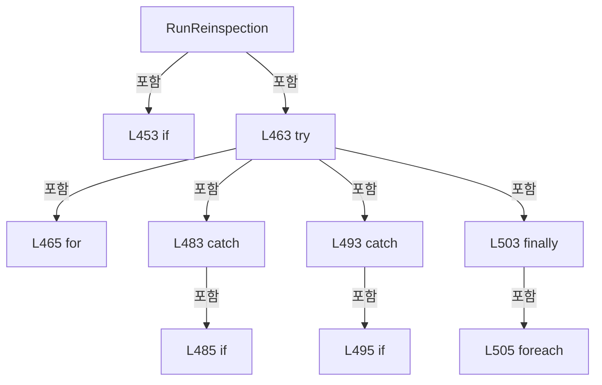

변경 전 점검: 입력/반환 타입, 위 호출자, 예외/취소 경로, 공유 상태와 저장·전송 소비자를 함께 확인합니다. 값의 단위나 물리 방향을 이름만으로 확정하지 않습니다.

### MethodDeclaration `ExecuteReinspectionItem` · L517–586

[Drilling.UI/Menu/Menus/CMenuCorrection.ReviewData.Reinspection.cs:517–586](https://github.com/kjuws10-rgb/A3Drilling/blob/334b3599651b2e8e0181fd4459bafaf3cddafff3/Drilling.UI/Menu/Menus/CMenuCorrection.ReviewData.Reinspection.cs#L517-L586)

| 항목 | 실제 추출 값 |
| --- | --- |
| 서명 | System.Threading.Tasks.Task Drilling.UI.Menu.Menus.CMenuCorrection.CReviewDataPanel.ExecuteReinspectionItem(Drilling.UI.Menu.Menus.CMenuCorrection.ST_REVIEW_DATA_REINSPECTION_ITEM, Drilling.Common.Review.EN_ONE_SHOT_ACTION, System.Threading.CancellationToken) |
| 접근/수식자 | Private / private, async |
| 반환/값 타입 | System.Threading.Tasks.Task |
| 소속 타입 | NamedType:Drilling.UI.Menu.Menus.CMenuCorrection.CReviewDataPanel |

입력 계약:

| 이름 | 타입 | 전달 | 선택/기본값 |
| --- | --- | --- | --- |
| item | Drilling.UI.Menu.Menus.CMenuCorrection.ST_REVIEW_DATA_REINSPECTION_ITEM | None | False /  |
| action | Drilling.Common.Review.EN_ONE_SHOT_ACTION | None | False /  |
| cancellationToken | System.Threading.CancellationToken | None | False /  |

정적 호출자로 확인된 위치:

| 호출 파일/행 | 호출 표현식 | 런타임 분기 가능 |
| --- | --- | --- |
| [Drilling.UI/Menu/Menus/CMenuCorrection.ReviewData.Reinspection.cs:475–475](https://github.com/kjuws10-rgb/A3Drilling/blob/334b3599651b2e8e0181fd4459bafaf3cddafff3/Drilling.UI/Menu/Menus/CMenuCorrection.ReviewData.Reinspection.cs#L475-L475) | ExecuteReinspectionItem | False |

호출하는 대상과 해석 범위:

| 원본 행 | 표현식 | 분석 상태 | 대상/소스 위치 |
| --- | --- | --- | --- |
| 524 | new InvalidOperationException | resolved | System.InvalidOperationException.InvalidOperationException(string?) |
| 527 | _reviewManager.CreatePlan | resolved | Drilling.Common.Review.ST_REVIEW_PLAN Drilling.Common.Review.CReviewManager.CreatePlan(Drilling.Common.Managers.ST_RECIPE_DEFINITION, System.Collections.Generic.IReadOnlyCollection<string>, int, double, double) · Drilling.Common/Review/CReviewManager.cs:75 |
| 533 | plan.Points.FirstOrDefault | resolved | Drilling.Common.Review.ST_REVIEW_PLAN_POINT? System.Collections.Generic.IEnumerable<Drilling.Common.Review.ST_REVIEW_PLAN_POINT>.FirstOrDefault<Drilling.Common.Review.ST_REVIEW_PLAN_POINT>(System.Func<Drilling.Common.Review.ST_REVIEW_PLAN_POINT, bool>) |
| 535 | candidate.ShotKey.Equals | resolved | bool string.Equals(string?, System.StringComparison) |
| 536 | new InvalidOperationException | resolved | System.InvalidOperationException.InvalidOperationException(string?) |
| 541 | item.BeginInspection | resolved | void Drilling.UI.Menu.Menus.CMenuCorrection.ST_REVIEW_DATA_REINSPECTION_ITEM.BeginInspection() · Drilling.UI/Menu/Menus/CMenuCorrection.ReviewData.Reinspection.cs:953 |
| 554 | _reviewManager.ExecuteOneShot | resolved | System.Threading.Tasks.Task<Drilling.Common.Review.ST_ONE_SHOT_RESULT> Drilling.Common.Review.CReviewManager.ExecuteOneShot(Drilling.Common.Review.ST_REVIEW_PLAN, Drilling.Common.Review.ST_REVIEW_PLAN_POINT, Drilling.Common.Review.EN_ONE_SHOT_ACTION, Drilling.Common.Review.EN_ONE_SHOT_METHOD, System.Action<string>, System.Threading.CancellationToken, bool) · Drilling.Common/Review/CReviewManager.cs:3230 |
| 562 | UpdateReinspectionCamera | resolved | void Drilling.UI.Menu.Menus.CMenuCorrection.CReviewDataPanel.UpdateReinspectionCamera(Drilling.Common.Review.ST_REVIEW_PLAN_POINT, string) · Drilling.UI/Menu/Menus/CMenuCorrection.ReviewData.Reinspection.cs:588 |
| 569 | CReviewManager.VisionErrorToStageOffset | resolved | Drilling.Common.Review.ST_REVIEW_COORDINATE_OFFSET Drilling.Common.Review.CReviewManager.VisionErrorToStageOffset(double, double, Drilling.Common.Review.EN_VISION_FLIP_TYPE) · Drilling.Common/Review/CReviewManager.cs:3687 |
| 573 | result.Point.Judge.Trim().ToUpperInvariant | resolved | string string.ToUpperInvariant() |
| 573 | result.Point.Judge.Trim | resolved | string string.Trim() |
| 577 | new InvalidDataException | resolved | System.IO.InvalidDataException.InvalidDataException(string?) |
| 579 | item.ApplyMeasurement | resolved | void Drilling.UI.Menu.Menus.CMenuCorrection.ST_REVIEW_DATA_REINSPECTION_ITEM.ApplyMeasurement(double, double, double, double, string) · Drilling.UI/Menu/Menus/CMenuCorrection.ReviewData.Reinspection.cs:962 |

본문의 실제 연산·분기·예외·반환 순서(원문 위치 순):

| 원본 행 | 종류 | 주석 해설 |
| --- | --- | --- |
| 522 | if | 조건에 따라 분기합니다: if (_loadedRecipe is null &#124;&#124; _loadedResultFile is null) |
| 524 | call | 함수·델리게이트 또는 객체 생성자를 호출합니다: new InvalidOperationException("불러온 Review Data 또는 Recipe가 없습니다.") |
| 524 | throw | 예외를 발생/전달합니다: throw new InvalidOperationException("불러온 Review Data 또는 Recipe가 없습니다."); |
| 527 | call | 함수·델리게이트 또는 객체 생성자를 호출합니다: _reviewManager.CreatePlan( _loadedRecipe, [item.ShotKey], item.BeamNo, _loadedResultFile.ShiftOffsetX, _loadedResultFile.ShiftOffsetY) |
| 527 | local-declaration | 지역 변수를 선언합니다: var plan = _reviewManager.CreatePlan( _loadedRecipe, [item.ShotKey], item.BeamNo, _loadedResultFile.ShiftOffsetX, _loadedResultFile.ShiftOffsetY); |
| 527 | variable-initializer | 변수의 초기값을 지정합니다: plan = _reviewManager.CreatePlan( _loadedRecipe, [item.ShotKey], item.BeamNo, _loadedResultFile.ShiftOffsetX, _loadedResultFile.ShiftOffsetY) |
| 533 | call | 함수·델리게이트 또는 객체 생성자를 호출합니다: plan.Points.FirstOrDefault(candidate => candidate.CellNo == item.CellNo && candidate.ShotKey.Equals(item.ShotKey, StringComparison.OrdinalIgnoreCase)) |
| 533 | local-declaration | 지역 변수를 선언합니다: var point = plan.Points.FirstOrDefault(candidate => candidate.CellNo == item.CellNo && candidate.ShotKey.Equals(item.ShotKey, StringComparison.OrdinalIgnoreCase)) ?? throw new InvalidOperationException($"{item.Cell} / {item.ShotNa |
| 533 | variable-initializer | 변수의 초기값을 지정합니다: point = plan.Points.FirstOrDefault(candidate => candidate.CellNo == item.CellNo && candidate.ShotKey.Equals(item.ShotKey, StringComparison.OrdinalIgnoreCase)) ?? throw new InvalidOperationException($"{item.Cell} / {item.ShotName}의 |
| 535 | call | 함수·델리게이트 또는 객체 생성자를 호출합니다: candidate.ShotKey.Equals(item.ShotKey, StringComparison.OrdinalIgnoreCase) |
| 536 | call | 함수·델리게이트 또는 객체 생성자를 호출합니다: new InvalidOperationException($"{item.Cell} / {item.ShotName}의 검사 좌표를 생성할 수 없습니다.") |
| 536 | throw | 예외를 발생/전달합니다: throw new InvalidOperationException($"{item.Cell} / {item.ShotName}의 검사 좌표를 생성할 수 없습니다.") |
| 538 | assignment | 값을 대상에 대입합니다: item.IsRunning = true |
| 539 | if | 조건에 따라 분기합니다: if (action != EN_ONE_SHOT_ACTION.Move) |
| 541 | call | 함수·델리게이트 또는 객체 생성자를 호출합니다: item.BeginInspection() |
| 554 | await | 비동기 완료를 기다립니다: await _reviewManager.ExecuteOneShot( plan, point, action, EN_ONE_SHOT_METHOD.MarkFindSingle, ReportProgress, cancellationToken, saveResult: false) |
| 554 | call | 함수·델리게이트 또는 객체 생성자를 호출합니다: _reviewManager.ExecuteOneShot( plan, point, action, EN_ONE_SHOT_METHOD.MarkFindSingle, ReportProgress, cancellationToken, saveResult: false) |
| 554 | local-declaration | 지역 변수를 선언합니다: var result = await _reviewManager.ExecuteOneShot( plan, point, action, EN_ONE_SHOT_METHOD.MarkFindSingle, ReportProgress, cancellationToken, saveResult: false); |
| 554 | variable-initializer | 변수의 초기값을 지정합니다: result = await _reviewManager.ExecuteOneShot( plan, point, action, EN_ONE_SHOT_METHOD.MarkFindSingle, ReportProgress, cancellationToken, saveResult: false) |
| 562 | call | 함수·델리게이트 또는 객체 생성자를 호출합니다: UpdateReinspectionCamera(result.Point, result.IsStageSimulation ? "SIMULATION" : "ONLINE") |
| 562 | conditional-expression | 조건에 따라 결과식을 선택합니다: result.IsStageSimulation ? "SIMULATION" : "ONLINE" |
| 563 | if | 조건에 따라 분기합니다: if (action == EN_ONE_SHOT_ACTION.Move) |
| 565 | assignment | 값을 대상에 대입합니다: item.IsRunning = false |
| 566 | return | 호출자에게 값 또는 제어를 반환합니다: return; |
| 569 | call | 함수·델리게이트 또는 객체 생성자를 호출합니다: CReviewManager.VisionErrorToStageOffset( result.Point.ErrorX, result.Point.ErrorY, plan.VisionFlipType) |
| 569 | local-declaration | 지역 변수를 선언합니다: var converted = CReviewManager.VisionErrorToStageOffset( result.Point.ErrorX, result.Point.ErrorY, plan.VisionFlipType); |
| 569 | variable-initializer | 변수의 초기값을 지정합니다: converted = CReviewManager.VisionErrorToStageOffset( result.Point.ErrorX, result.Point.ErrorY, plan.VisionFlipType) |
| 573 | call | 함수·델리게이트 또는 객체 생성자를 호출합니다: result.Point.Judge.Trim().ToUpperInvariant() |
| 573 | call | 함수·델리게이트 또는 객체 생성자를 호출합니다: result.Point.Judge.Trim() |
| 573 | local-declaration | 지역 변수를 선언합니다: var state = result.Point.Judge.Trim().ToUpperInvariant() switch { "OK" => "OK", "NG" => "NG", _ => throw new InvalidDataException($"Vision 재검사 판정이 OK/NG가 아닙니다. Judge={result.Point.Judge}") }; |
| 573 | switch-expression | 값별 결과식을 선택합니다: result.Point.Judge.Trim().ToUpperInvariant() switch { "OK" => "OK", "NG" => "NG", _ => throw new InvalidDataException($"Vision 재검사 판정이 OK/NG가 아닙니다. Judge={result.Point.Judge}") } |
| 573 | variable-initializer | 변수의 초기값을 지정합니다: state = result.Point.Judge.Trim().ToUpperInvariant() switch { "OK" => "OK", "NG" => "NG", _ => throw new InvalidDataException($"Vision 재검사 판정이 OK/NG가 아닙니다. Judge={result.Point.Judge}") } |
| 577 | call | 함수·델리게이트 또는 객체 생성자를 호출합니다: new InvalidDataException($"Vision 재검사 판정이 OK/NG가 아닙니다. Judge={result.Point.Judge}") |
| 577 | throw | 예외를 발생/전달합니다: throw new InvalidDataException($"Vision 재검사 판정이 OK/NG가 아닙니다. Judge={result.Point.Judge}") |
| 579 | call | 함수·델리게이트 또는 객체 생성자를 호출합니다: item.ApplyMeasurement( result.Point.ErrorX, result.Point.ErrorY, converted.X, converted.Y, state) |
| 585 | assignment | 값을 대상에 대입합니다: item.IsRunning = false |

제어 구문의 포함 구조(실제 실행 순서/CFG가 아닌 구문 탐색 그림):

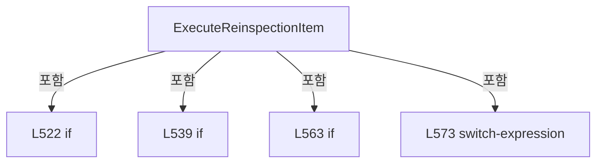

변경 전 점검: 입력/반환 타입, 위 호출자, 예외/취소 경로, 공유 상태와 저장·전송 소비자를 함께 확인합니다. 값의 단위나 물리 방향을 이름만으로 확정하지 않습니다.

### LocalFunctionStatement `ReportProgress` · L544–552

[Drilling.UI/Menu/Menus/CMenuCorrection.ReviewData.Reinspection.cs:544–552](https://github.com/kjuws10-rgb/A3Drilling/blob/334b3599651b2e8e0181fd4459bafaf3cddafff3/Drilling.UI/Menu/Menus/CMenuCorrection.ReviewData.Reinspection.cs#L544-L552)

| 항목 | 실제 추출 값 |
| --- | --- |
| 서명 | void ReportProgress(string) |
| 접근/수식자 | Private /  |
| 반환/값 타입 | void |
| 소속 타입 | NamedType:Drilling.UI.Menu.Menus.CMenuCorrection.CReviewDataPanel |

입력 계약:

| 이름 | 타입 | 전달 | 선택/기본값 |
| --- | --- | --- | --- |
| message | string | None | False /  |

현재 부분 분석에서 직접 연결된 호출자는 없습니다. XAML/이벤트/인터페이스·델리게이트·외부 진입을 추가 확인해야 하며, 미사용으로 판정한 것이 아닙니다.

호출하는 대상과 해석 범위:

| 원본 행 | 표현식 | 분석 상태 | 대상/소스 위치 |
| --- | --- | --- | --- |
| 547 | Notify | resolved | void Drilling.UI.Menu.Menus.CMenuCorrection.CReviewDataPanel.Notify(string) · Drilling.UI/Menu/Menus/CMenuCorrection.ReviewData.cs:616 |
| 547 | nameof | unresolved | None |
| 548 | message.Contains | resolved | bool string.Contains(string, System.StringComparison) |
| 550 | UpdateReinspectionCamera | resolved | void Drilling.UI.Menu.Menus.CMenuCorrection.CReviewDataPanel.UpdateReinspectionCamera(Drilling.Common.Review.ST_REVIEW_PLAN_POINT, string) · Drilling.UI/Menu/Menus/CMenuCorrection.ReviewData.Reinspection.cs:588 |

본문의 실제 연산·분기·예외·반환 순서(원문 위치 순):

| 원본 행 | 종류 | 주석 해설 |
| --- | --- | --- |
| 546 | assignment | 값을 대상에 대입합니다: _reinspectionStatusText = $"{item.Cell} / {item.ShotName} / BEAM {item.BeamNo} - {message}" |
| 547 | call | 함수·델리게이트 또는 객체 생성자를 호출합니다: Notify(nameof(ReinspectionStatusText)) |
| 547 | call | 함수·델리게이트 또는 객체 생성자를 호출합니다: nameof(ReinspectionStatusText) |
| 548 | call | 함수·델리게이트 또는 객체 생성자를 호출합니다: message.Contains("이동 완료", StringComparison.Ordinal) |
| 548 | if | 조건에 따라 분기합니다: if (message.Contains("이동 완료", StringComparison.Ordinal)) |
| 550 | call | 함수·델리게이트 또는 객체 생성자를 호출합니다: UpdateReinspectionCamera(point, "SIMULATION") |

제어 구문의 포함 구조(실제 실행 순서/CFG가 아닌 구문 탐색 그림):

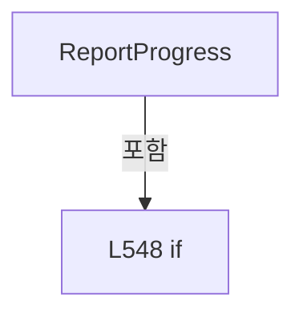

변경 전 점검: 입력/반환 타입, 위 호출자, 예외/취소 경로, 공유 상태와 저장·전송 소비자를 함께 확인합니다. 값의 단위나 물리 방향을 이름만으로 확정하지 않습니다.

### MethodDeclaration `UpdateReinspectionCamera` · L588–594

[Drilling.UI/Menu/Menus/CMenuCorrection.ReviewData.Reinspection.cs:588–594](https://github.com/kjuws10-rgb/A3Drilling/blob/334b3599651b2e8e0181fd4459bafaf3cddafff3/Drilling.UI/Menu/Menus/CMenuCorrection.ReviewData.Reinspection.cs#L588-L594)

| 항목 | 실제 추출 값 |
| --- | --- |
| 서명 | void Drilling.UI.Menu.Menus.CMenuCorrection.CReviewDataPanel.UpdateReinspectionCamera(Drilling.Common.Review.ST_REVIEW_PLAN_POINT, string) |
| 접근/수식자 | Private / private |
| 반환/값 타입 | void |
| 소속 타입 | NamedType:Drilling.UI.Menu.Menus.CMenuCorrection.CReviewDataPanel |

입력 계약:

| 이름 | 타입 | 전달 | 선택/기본값 |
| --- | --- | --- | --- |
| point | Drilling.Common.Review.ST_REVIEW_PLAN_POINT | None | False /  |
| mode | string | None | False /  |

정적 호출자로 확인된 위치:

| 호출 파일/행 | 호출 표현식 | 런타임 분기 가능 |
| --- | --- | --- |
| [Drilling.UI/Menu/Menus/CMenuCorrection.ReviewData.Reinspection.cs:550–550](https://github.com/kjuws10-rgb/A3Drilling/blob/334b3599651b2e8e0181fd4459bafaf3cddafff3/Drilling.UI/Menu/Menus/CMenuCorrection.ReviewData.Reinspection.cs#L550-L550) | UpdateReinspectionCamera | False |
| [Drilling.UI/Menu/Menus/CMenuCorrection.ReviewData.Reinspection.cs:562–562](https://github.com/kjuws10-rgb/A3Drilling/blob/334b3599651b2e8e0181fd4459bafaf3cddafff3/Drilling.UI/Menu/Menus/CMenuCorrection.ReviewData.Reinspection.cs#L562-L562) | UpdateReinspectionCamera | False |

호출하는 대상과 해석 범위:

| 원본 행 | 표현식 | 분석 상태 | 대상/소스 위치 |
| --- | --- | --- | --- |
| 590 | Camera.UpdateFeedback | resolved | void Drilling.UI.Menu.Menus.CReviewCameraPreview.UpdateFeedback(string, string, string, string, string) · Drilling.UI/Menu/Menus/CMenuReview.cs:6074 |
| 591 | point.ReviewTargetY.ToString | resolved | string double.ToString(string?, System.IFormatProvider?) |
| 592 | point.ReviewTargetX.ToString | resolved | string double.ToString(string?, System.IFormatProvider?) |

본문의 실제 연산·분기·예외·반환 순서(원문 위치 순):

| 원본 행 | 종류 | 주석 해설 |
| --- | --- | --- |
| 590 | call | 함수·델리게이트 또는 객체 생성자를 호출합니다: Camera.UpdateFeedback( point.ReviewTargetY.ToString("R", CultureInfo.InvariantCulture), point.ReviewTargetX.ToString("R", CultureInfo.InvariantCulture), mode) |
| 591 | call | 함수·델리게이트 또는 객체 생성자를 호출합니다: point.ReviewTargetY.ToString("R", CultureInfo.InvariantCulture) |
| 592 | call | 함수·델리게이트 또는 객체 생성자를 호출합니다: point.ReviewTargetX.ToString("R", CultureInfo.InvariantCulture) |

변경 전 점검: 입력/반환 타입, 위 호출자, 예외/취소 경로, 공유 상태와 저장·전송 소비자를 함께 확인합니다. 값의 단위나 물리 방향을 이름만으로 확정하지 않습니다.

### MethodDeclaration `SetReinspectionRunning` · L596–607

[Drilling.UI/Menu/Menus/CMenuCorrection.ReviewData.Reinspection.cs:596–607](https://github.com/kjuws10-rgb/A3Drilling/blob/334b3599651b2e8e0181fd4459bafaf3cddafff3/Drilling.UI/Menu/Menus/CMenuCorrection.ReviewData.Reinspection.cs#L596-L607)

| 항목 | 실제 추출 값 |
| --- | --- |
| 서명 | void Drilling.UI.Menu.Menus.CMenuCorrection.CReviewDataPanel.SetReinspectionRunning(bool) |
| 접근/수식자 | Private / private |
| 반환/값 타입 | void |
| 소속 타입 | NamedType:Drilling.UI.Menu.Menus.CMenuCorrection.CReviewDataPanel |

입력 계약:

| 이름 | 타입 | 전달 | 선택/기본값 |
| --- | --- | --- | --- |
| value | bool | None | False /  |

정적 호출자로 확인된 위치:

| 호출 파일/행 | 호출 표현식 | 런타임 분기 가능 |
| --- | --- | --- |
| [Drilling.UI/Menu/Menus/CMenuCorrection.ReviewData.Reinspection.cs:462–462](https://github.com/kjuws10-rgb/A3Drilling/blob/334b3599651b2e8e0181fd4459bafaf3cddafff3/Drilling.UI/Menu/Menus/CMenuCorrection.ReviewData.Reinspection.cs#L462-L462) | SetReinspectionRunning | False |
| [Drilling.UI/Menu/Menus/CMenuCorrection.ReviewData.Reinspection.cs:512–512](https://github.com/kjuws10-rgb/A3Drilling/blob/334b3599651b2e8e0181fd4459bafaf3cddafff3/Drilling.UI/Menu/Menus/CMenuCorrection.ReviewData.Reinspection.cs#L512-L512) | SetReinspectionRunning | False |

호출하는 대상과 해석 범위:

| 원본 행 | 표현식 | 분석 상태 | 대상/소스 위치 |
| --- | --- | --- | --- |
| 604 | Notify | resolved | void Drilling.UI.Menu.Menus.CMenuCorrection.CReviewDataPanel.Notify(string) · Drilling.UI/Menu/Menus/CMenuCorrection.ReviewData.cs:616 |
| 604 | nameof | unresolved | None |
| 605 | Notify | resolved | void Drilling.UI.Menu.Menus.CMenuCorrection.CReviewDataPanel.Notify(string) · Drilling.UI/Menu/Menus/CMenuCorrection.ReviewData.cs:616 |
| 605 | nameof | unresolved | None |
| 606 | NotifyReinspectionCommandState | resolved | void Drilling.UI.Menu.Menus.CMenuCorrection.CReviewDataPanel.NotifyReinspectionCommandState() · Drilling.UI/Menu/Menus/CMenuCorrection.ReviewData.Reinspection.cs:700 |

본문의 실제 연산·분기·예외·반환 순서(원문 위치 순):

| 원본 행 | 종류 | 주석 해설 |
| --- | --- | --- |
| 598 | if | 조건에 따라 분기합니다: if (_isReinspectionRunning == value) |
| 600 | return | 호출자에게 값 또는 제어를 반환합니다: return; |
| 603 | assignment | 값을 대상에 대입합니다: _isReinspectionRunning = value |
| 604 | call | 함수·델리게이트 또는 객체 생성자를 호출합니다: Notify(nameof(IsReinspectionRunning)) |
| 604 | call | 함수·델리게이트 또는 객체 생성자를 호출합니다: nameof(IsReinspectionRunning) |
| 605 | call | 함수·델리게이트 또는 객체 생성자를 호출합니다: Notify(nameof(CanEditReinspectionList)) |
| 605 | call | 함수·델리게이트 또는 객체 생성자를 호출합니다: nameof(CanEditReinspectionList) |
| 606 | call | 함수·델리게이트 또는 객체 생성자를 호출합니다: NotifyReinspectionCommandState() |

제어 구문의 포함 구조(실제 실행 순서/CFG가 아닌 구문 탐색 그림):

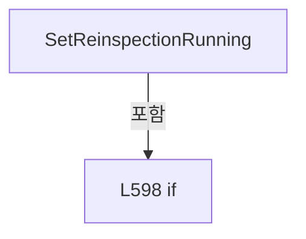

변경 전 점검: 입력/반환 타입, 위 호출자, 예외/취소 경로, 공유 상태와 저장·전송 소비자를 함께 확인합니다. 값의 단위나 물리 방향을 이름만으로 확정하지 않습니다.

### MethodDeclaration `SetReinspectionSaving` · L609–620

[Drilling.UI/Menu/Menus/CMenuCorrection.ReviewData.Reinspection.cs:609–620](https://github.com/kjuws10-rgb/A3Drilling/blob/334b3599651b2e8e0181fd4459bafaf3cddafff3/Drilling.UI/Menu/Menus/CMenuCorrection.ReviewData.Reinspection.cs#L609-L620)

| 항목 | 실제 추출 값 |
| --- | --- |
| 서명 | void Drilling.UI.Menu.Menus.CMenuCorrection.CReviewDataPanel.SetReinspectionSaving(bool) |
| 접근/수식자 | Private / private |
| 반환/값 타입 | void |
| 소속 타입 | NamedType:Drilling.UI.Menu.Menus.CMenuCorrection.CReviewDataPanel |

입력 계약:

| 이름 | 타입 | 전달 | 선택/기본값 |
| --- | --- | --- | --- |
| value | bool | None | False /  |

정적 호출자로 확인된 위치:

| 호출 파일/행 | 호출 표현식 | 런타임 분기 가능 |
| --- | --- | --- |
| [Drilling.UI/Menu/Menus/CMenuCorrection.ReviewData.Reinspection.cs:382–382](https://github.com/kjuws10-rgb/A3Drilling/blob/334b3599651b2e8e0181fd4459bafaf3cddafff3/Drilling.UI/Menu/Menus/CMenuCorrection.ReviewData.Reinspection.cs#L382-L382) | SetReinspectionSaving | False |
| [Drilling.UI/Menu/Menus/CMenuCorrection.ReviewData.Reinspection.cs:417–417](https://github.com/kjuws10-rgb/A3Drilling/blob/334b3599651b2e8e0181fd4459bafaf3cddafff3/Drilling.UI/Menu/Menus/CMenuCorrection.ReviewData.Reinspection.cs#L417-L417) | SetReinspectionSaving | False |

호출하는 대상과 해석 범위:

| 원본 행 | 표현식 | 분석 상태 | 대상/소스 위치 |
| --- | --- | --- | --- |
| 617 | Notify | resolved | void Drilling.UI.Menu.Menus.CMenuCorrection.CReviewDataPanel.Notify(string) · Drilling.UI/Menu/Menus/CMenuCorrection.ReviewData.cs:616 |
| 617 | nameof | unresolved | None |
| 618 | Notify | resolved | void Drilling.UI.Menu.Menus.CMenuCorrection.CReviewDataPanel.Notify(string) · Drilling.UI/Menu/Menus/CMenuCorrection.ReviewData.cs:616 |
| 618 | nameof | unresolved | None |
| 619 | NotifyReinspectionCommandState | resolved | void Drilling.UI.Menu.Menus.CMenuCorrection.CReviewDataPanel.NotifyReinspectionCommandState() · Drilling.UI/Menu/Menus/CMenuCorrection.ReviewData.Reinspection.cs:700 |

본문의 실제 연산·분기·예외·반환 순서(원문 위치 순):

| 원본 행 | 종류 | 주석 해설 |
| --- | --- | --- |
| 611 | if | 조건에 따라 분기합니다: if (_isReinspectionSaving == value) |
| 613 | return | 호출자에게 값 또는 제어를 반환합니다: return; |
| 616 | assignment | 값을 대상에 대입합니다: _isReinspectionSaving = value |
| 617 | call | 함수·델리게이트 또는 객체 생성자를 호출합니다: Notify(nameof(IsReinspectionSaving)) |
| 617 | call | 함수·델리게이트 또는 객체 생성자를 호출합니다: nameof(IsReinspectionSaving) |
| 618 | call | 함수·델리게이트 또는 객체 생성자를 호출합니다: Notify(nameof(CanEditReinspectionList)) |
| 618 | call | 함수·델리게이트 또는 객체 생성자를 호출합니다: nameof(CanEditReinspectionList) |
| 619 | call | 함수·델리게이트 또는 객체 생성자를 호출합니다: NotifyReinspectionCommandState() |

제어 구문의 포함 구조(실제 실행 순서/CFG가 아닌 구문 탐색 그림):


변경 전 점검: 입력/반환 타입, 위 호출자, 예외/취소 경로, 공유 상태와 저장·전송 소비자를 함께 확인합니다. 값의 단위나 물리 방향을 이름만으로 확정하지 않습니다.

### MethodDeclaration `SetReinspectionRowSelection` · L622–626

[Drilling.UI/Menu/Menus/CMenuCorrection.ReviewData.Reinspection.cs:622–626](https://github.com/kjuws10-rgb/A3Drilling/blob/334b3599651b2e8e0181fd4459bafaf3cddafff3/Drilling.UI/Menu/Menus/CMenuCorrection.ReviewData.Reinspection.cs#L622-L626)

| 항목 | 실제 추출 값 |
| --- | --- |
| 서명 | void Drilling.UI.Menu.Menus.CMenuCorrection.CReviewDataPanel.SetReinspectionRowSelection(Drilling.UI.Menu.Menus.CMenuCorrection.ST_REVIEW_DATA_GRID_ROW, bool) |
| 접근/수식자 | Public / public |
| 반환/값 타입 | void |
| 소속 타입 | NamedType:Drilling.UI.Menu.Menus.CMenuCorrection.CReviewDataPanel |

입력 계약:

| 이름 | 타입 | 전달 | 선택/기본값 |
| --- | --- | --- | --- |
| row | Drilling.UI.Menu.Menus.CMenuCorrection.ST_REVIEW_DATA_GRID_ROW | None | False /  |
| isSelected | bool | None | False /  |

정적 호출자로 확인된 위치:

| 호출 파일/행 | 호출 표현식 | 런타임 분기 가능 |
| --- | --- | --- |
| [Drilling.UI/Views/CReviewDataView.xaml.cs:310–310](https://github.com/kjuws10-rgb/A3Drilling/blob/334b3599651b2e8e0181fd4459bafaf3cddafff3/Drilling.UI/Views/CReviewDataView.xaml.cs#L310-L310) | panel.SetReinspectionRowSelection | False |

호출하는 대상과 해석 범위:

| 원본 행 | 표현식 | 분석 상태 | 대상/소스 위치 |
| --- | --- | --- | --- |
| 625 | NotifyReinspectionCommandState | resolved | void Drilling.UI.Menu.Menus.CMenuCorrection.CReviewDataPanel.NotifyReinspectionCommandState() · Drilling.UI/Menu/Menus/CMenuCorrection.ReviewData.Reinspection.cs:700 |

본문의 실제 연산·분기·예외·반환 순서(원문 위치 순):

| 원본 행 | 종류 | 주석 해설 |
| --- | --- | --- |
| 624 | assignment | 값을 대상에 대입합니다: row.IsReinspectionSelected = isSelected |
| 625 | call | 함수·델리게이트 또는 객체 생성자를 호출합니다: NotifyReinspectionCommandState() |

변경 전 점검: 입력/반환 타입, 위 호출자, 예외/취소 경로, 공유 상태와 저장·전송 소비자를 함께 확인합니다. 값의 단위나 물리 방향을 이름만으로 확정하지 않습니다.

### MethodDeclaration `SelectReinspectionShot` · L628–637

[Drilling.UI/Menu/Menus/CMenuCorrection.ReviewData.Reinspection.cs:628–637](https://github.com/kjuws10-rgb/A3Drilling/blob/334b3599651b2e8e0181fd4459bafaf3cddafff3/Drilling.UI/Menu/Menus/CMenuCorrection.ReviewData.Reinspection.cs#L628-L637)

| 항목 | 실제 추출 값 |
| --- | --- |
| 서명 | void Drilling.UI.Menu.Menus.CMenuCorrection.CReviewDataPanel.SelectReinspectionShot(Drilling.UI.Menu.Menus.CMenuCorrection.ST_REVIEW_DATA_REINSPECTION_ITEM) |
| 접근/수식자 | Public / public |
| 반환/값 타입 | void |
| 소속 타입 | NamedType:Drilling.UI.Menu.Menus.CMenuCorrection.CReviewDataPanel |

입력 계약:

| 이름 | 타입 | 전달 | 선택/기본값 |
| --- | --- | --- | --- |
| item | Drilling.UI.Menu.Menus.CMenuCorrection.ST_REVIEW_DATA_REINSPECTION_ITEM | None | False /  |

정적 호출자로 확인된 위치:

| 호출 파일/행 | 호출 표현식 | 런타임 분기 가능 |
| --- | --- | --- |
| [Drilling.UI/Views/CReviewDataView.xaml.cs:297–297](https://github.com/kjuws10-rgb/A3Drilling/blob/334b3599651b2e8e0181fd4459bafaf3cddafff3/Drilling.UI/Views/CReviewDataView.xaml.cs#L297-L297) | panel.SelectReinspectionShot | False |

호출하는 대상과 해석 범위:

| 원본 행 | 표현식 | 분석 상태 | 대상/소스 위치 |
| --- | --- | --- | --- |
| 630 | _reinspectionShots.Contains | resolved | bool System.Collections.Generic.IEnumerable<Drilling.UI.Menu.Menus.CMenuCorrection.ST_REVIEW_DATA_REINSPECTION_ITEM>.Contains<Drilling.UI.Menu.Menus.CMenuCorrection.ST_REVIEW_DATA_REINSPECTION_ITEM>(Drilling.UI.Menu.Menus.CMenuCorrection.ST_REVIEW_DATA_REINSPECTION_ITEM) |
| 636 | FocusReinspectionShot | resolved | void Drilling.UI.Menu.Menus.CMenuCorrection.CReviewDataPanel.FocusReinspectionShot(Drilling.UI.Menu.Menus.CMenuCorrection.ST_REVIEW_DATA_REINSPECTION_ITEM) · Drilling.UI/Menu/Menus/CMenuCorrection.ReviewData.Reinspection.cs:639 |

본문의 실제 연산·분기·예외·반환 순서(원문 위치 순):

| 원본 행 | 종류 | 주석 해설 |
| --- | --- | --- |
| 630 | call | 함수·델리게이트 또는 객체 생성자를 호출합니다: _reinspectionShots.Contains(item) |
| 630 | if | 조건에 따라 분기합니다: if (!_isReinspectionMode &#124;&#124; !_reinspectionShots.Contains(item)) |
| 632 | return | 호출자에게 값 또는 제어를 반환합니다: return; |
| 635 | assignment | 값을 대상에 대입합니다: SelectedReinspectionShot = item |
| 636 | call | 함수·델리게이트 또는 객체 생성자를 호출합니다: FocusReinspectionShot(item) |

제어 구문의 포함 구조(실제 실행 순서/CFG가 아닌 구문 탐색 그림):


변경 전 점검: 입력/반환 타입, 위 호출자, 예외/취소 경로, 공유 상태와 저장·전송 소비자를 함께 확인합니다. 값의 단위나 물리 방향을 이름만으로 확정하지 않습니다.

### MethodDeclaration `FocusReinspectionShot` · L639–656

[Drilling.UI/Menu/Menus/CMenuCorrection.ReviewData.Reinspection.cs:639–656](https://github.com/kjuws10-rgb/A3Drilling/blob/334b3599651b2e8e0181fd4459bafaf3cddafff3/Drilling.UI/Menu/Menus/CMenuCorrection.ReviewData.Reinspection.cs#L639-L656)

| 항목 | 실제 추출 값 |
| --- | --- |
| 서명 | void Drilling.UI.Menu.Menus.CMenuCorrection.CReviewDataPanel.FocusReinspectionShot(Drilling.UI.Menu.Menus.CMenuCorrection.ST_REVIEW_DATA_REINSPECTION_ITEM) |
| 접근/수식자 | Private / private |
| 반환/값 타입 | void |
| 소속 타입 | NamedType:Drilling.UI.Menu.Menus.CMenuCorrection.CReviewDataPanel |

입력 계약:

| 이름 | 타입 | 전달 | 선택/기본값 |
| --- | --- | --- | --- |
| item | Drilling.UI.Menu.Menus.CMenuCorrection.ST_REVIEW_DATA_REINSPECTION_ITEM | None | False /  |

정적 호출자로 확인된 위치:

| 호출 파일/행 | 호출 표현식 | 런타임 분기 가능 |
| --- | --- | --- |
| [Drilling.UI/Menu/Menus/CMenuCorrection.ReviewData.Reinspection.cs:278–278](https://github.com/kjuws10-rgb/A3Drilling/blob/334b3599651b2e8e0181fd4459bafaf3cddafff3/Drilling.UI/Menu/Menus/CMenuCorrection.ReviewData.Reinspection.cs#L278-L278) | FocusReinspectionShot | False |
| [Drilling.UI/Menu/Menus/CMenuCorrection.ReviewData.Reinspection.cs:470–470](https://github.com/kjuws10-rgb/A3Drilling/blob/334b3599651b2e8e0181fd4459bafaf3cddafff3/Drilling.UI/Menu/Menus/CMenuCorrection.ReviewData.Reinspection.cs#L470-L470) | FocusReinspectionShot | False |
| [Drilling.UI/Menu/Menus/CMenuCorrection.ReviewData.Reinspection.cs:636–636](https://github.com/kjuws10-rgb/A3Drilling/blob/334b3599651b2e8e0181fd4459bafaf3cddafff3/Drilling.UI/Menu/Menus/CMenuCorrection.ReviewData.Reinspection.cs#L636-L636) | FocusReinspectionShot | False |

호출하는 대상과 해석 범위:

| 원본 행 | 표현식 | 분석 상태 | 대상/소스 위치 |
| --- | --- | --- | --- |
| 648 | ApplyCellSelection | resolved | void Drilling.UI.Menu.Menus.CMenuCorrection.CReviewDataPanel.ApplyCellSelection(int, bool) · Drilling.UI/Menu/Menus/CMenuCorrection.ReviewData.Display.cs:545 |
| 652 | Rows.FirstOrDefault | resolved | Drilling.UI.Menu.Menus.CMenuCorrection.ST_REVIEW_DATA_GRID_ROW? System.Collections.Generic.IEnumerable<Drilling.UI.Menu.Menus.CMenuCorrection.ST_REVIEW_DATA_GRID_ROW>.FirstOrDefault<Drilling.UI.Menu.Menus.CMenuCorrection.ST_REVIEW_DATA_GRID_ROW>(System.Func<Drilling.UI.Menu.Menus.CMenuCorrection.ST_REVIEW_DATA_GRID_ROW, bool>) |
| 654 | candidate.ShotKey.Equals | resolved | bool string.Equals(string?, System.StringComparison) |
| 655 | ApplyShotSelection | resolved | void Drilling.UI.Menu.Menus.CMenuCorrection.CReviewDataPanel.ApplyShotSelection(string, Drilling.UI.Menu.Menus.CMenuCorrection.ST_REVIEW_DATA_GRID_ROW?) · Drilling.UI/Menu/Menus/CMenuCorrection.ReviewData.Display.cs:622 |

본문의 실제 연산·분기·예외·반환 순서(원문 위치 순):

| 원본 행 | 종류 | 주석 해설 |
| --- | --- | --- |
| 641 | if | 조건에 따라 분기합니다: if (!_hasLoadedData) |
| 643 | return | 호출자에게 값 또는 제어를 반환합니다: return; |
| 646 | if | 조건에 따라 분기합니다: if (_selectedCellNo != item.CellNo) |
| 648 | call | 함수·델리게이트 또는 객체 생성자를 호출합니다: ApplyCellSelection(item.CellNo) |
| 651 | local-declaration | 지역 변수를 선언합니다: var row = item.SourceRow ?? Rows.FirstOrDefault(candidate => candidate.CellNo == item.CellNo && candidate.ShotKey.Equals(item.ShotKey, StringComparison.OrdinalIgnoreCase)); |
| 651 | variable-initializer | 변수의 초기값을 지정합니다: row = item.SourceRow ?? Rows.FirstOrDefault(candidate => candidate.CellNo == item.CellNo && candidate.ShotKey.Equals(item.ShotKey, StringComparison.OrdinalIgnoreCase)) |
| 652 | call | 함수·델리게이트 또는 객체 생성자를 호출합니다: Rows.FirstOrDefault(candidate => candidate.CellNo == item.CellNo && candidate.ShotKey.Equals(item.ShotKey, StringComparison.OrdinalIgnoreCase)) |
| 654 | call | 함수·델리게이트 또는 객체 생성자를 호출합니다: candidate.ShotKey.Equals(item.ShotKey, StringComparison.OrdinalIgnoreCase) |
| 655 | call | 함수·델리게이트 또는 객체 생성자를 호출합니다: ApplyShotSelection(item.ShotKey, row) |

제어 구문의 포함 구조(실제 실행 순서/CFG가 아닌 구문 탐색 그림):

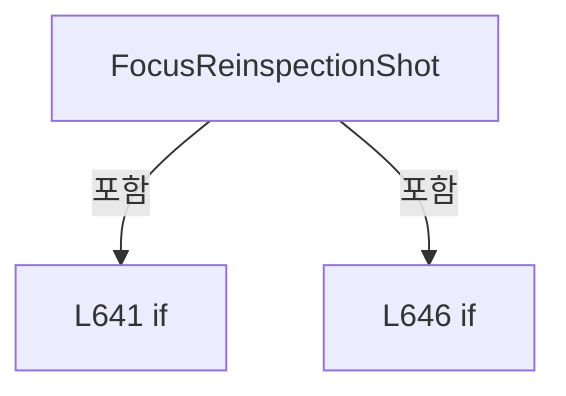

변경 전 점검: 입력/반환 타입, 위 호출자, 예외/취소 경로, 공유 상태와 저장·전송 소비자를 함께 확인합니다. 값의 단위나 물리 방향을 이름만으로 확정하지 않습니다.

### MethodDeclaration `ResetReinspectionState` · L658–689

[Drilling.UI/Menu/Menus/CMenuCorrection.ReviewData.Reinspection.cs:658–689](https://github.com/kjuws10-rgb/A3Drilling/blob/334b3599651b2e8e0181fd4459bafaf3cddafff3/Drilling.UI/Menu/Menus/CMenuCorrection.ReviewData.Reinspection.cs#L658-L689)

| 항목 | 실제 추출 값 |
| --- | --- |
| 서명 | void Drilling.UI.Menu.Menus.CMenuCorrection.CReviewDataPanel.ResetReinspectionState() |
| 접근/수식자 | Private / private |
| 반환/값 타입 | void |
| 소속 타입 | NamedType:Drilling.UI.Menu.Menus.CMenuCorrection.CReviewDataPanel |

정적 호출자로 확인된 위치:

| 호출 파일/행 | 호출 표현식 | 런타임 분기 가능 |
| --- | --- | --- |
| [Drilling.UI/Menu/Menus/CMenuCorrection.ReviewData.Display.cs:1319–1319](https://github.com/kjuws10-rgb/A3Drilling/blob/334b3599651b2e8e0181fd4459bafaf3cddafff3/Drilling.UI/Menu/Menus/CMenuCorrection.ReviewData.Display.cs#L1319-L1319) | ResetReinspectionState | False |

호출하는 대상과 해석 범위:

| 원본 행 | 표현식 | 분석 상태 | 대상/소스 위치 |
| --- | --- | --- | --- |
| 660 | .Cancel | resolved | void System.Threading.CancellationTokenSource.Cancel() |
| 661 | .Cancel | resolved | void System.Threading.CancellationTokenSource.Cancel() |
| 664 | _reviewManager.Stop | resolved | void Drilling.Common.Review.CReviewManager.Stop() · Drilling.Common/Review/CReviewManager.cs:446 |
| 667 | .Dispose | resolved | void System.Threading.CancellationTokenSource.Dispose() |
| 669 | .Dispose | resolved | void System.Threading.CancellationTokenSource.Dispose() |
| 680 | UntrackReinspectionItems | resolved | void Drilling.UI.Menu.Menus.CMenuCorrection.CReviewDataPanel.UntrackReinspectionItems(System.Collections.Generic.IEnumerable<Drilling.UI.Menu.Menus.CMenuCorrection.ST_REVIEW_DATA_REINSPECTION_ITEM>) · Drilling.UI/Menu/Menus/CMenuCorrection.ReviewData.Reinspection.cs:781 |
| 684 | Notify | resolved | void Drilling.UI.Menu.Menus.CMenuCorrection.CReviewDataPanel.Notify(string) · Drilling.UI/Menu/Menus/CMenuCorrection.ReviewData.cs:616 |
| 684 | nameof | unresolved | None |
| 685 | Notify | resolved | void Drilling.UI.Menu.Menus.CMenuCorrection.CReviewDataPanel.Notify(string) · Drilling.UI/Menu/Menus/CMenuCorrection.ReviewData.cs:616 |
| 685 | nameof | unresolved | None |
| 686 | Notify | resolved | void Drilling.UI.Menu.Menus.CMenuCorrection.CReviewDataPanel.Notify(string) · Drilling.UI/Menu/Menus/CMenuCorrection.ReviewData.cs:616 |
| 686 | nameof | unresolved | None |
| 687 | Notify | resolved | void Drilling.UI.Menu.Menus.CMenuCorrection.CReviewDataPanel.Notify(string) · Drilling.UI/Menu/Menus/CMenuCorrection.ReviewData.cs:616 |
| 687 | nameof | unresolved | None |
| 688 | NotifyReinspectionListState | resolved | void Drilling.UI.Menu.Menus.CMenuCorrection.CReviewDataPanel.NotifyReinspectionListState() · Drilling.UI/Menu/Menus/CMenuCorrection.ReviewData.Reinspection.cs:691 |

본문의 실제 연산·분기·예외·반환 순서(원문 위치 순):

| 원본 행 | 종류 | 주석 해설 |
| --- | --- | --- |
| 660 | call | 함수·델리게이트 또는 객체 생성자를 호출합니다: .Cancel() |
| 661 | call | 함수·델리게이트 또는 객체 생성자를 호출합니다: .Cancel() |
| 662 | if | 조건에 따라 분기합니다: if (_isReinspectionRunning) |
| 664 | call | 함수·델리게이트 또는 객체 생성자를 호출합니다: _reviewManager.Stop() |
| 667 | call | 함수·델리게이트 또는 객체 생성자를 호출합니다: .Dispose() |
| 668 | assignment | 값을 대상에 대입합니다: _reinspectionCancellation = null |
| 669 | call | 함수·델리게이트 또는 객체 생성자를 호출합니다: .Dispose() |
| 670 | assignment | 값을 대상에 대입합니다: _reinspectionSaveCancellation = null |
| 671 | assignment | 값을 대상에 대입합니다: _isReinspectionRunning = false |
| 672 | assignment | 값을 대상에 대입합니다: _isReinspectionSaving = false |
| 673 | assignment | 값을 대상에 대입합니다: _hasUnsavedReinspectionMeasurements = false |
| 674 | foreach | 컬렉션 요소를 순회합니다: foreach (var row in _allRows) |
| 676 | assignment | 값을 대상에 대입합니다: row.IsReinspectionSelected = false |
| 679 | assignment | 값을 대상에 대입합니다: _isReinspectionMode = false |
| 680 | call | 함수·델리게이트 또는 객체 생성자를 호출합니다: UntrackReinspectionItems(_reinspectionShots) |
| 681 | assignment | 값을 대상에 대입합니다: _reinspectionShots = [] |
| 682 | assignment | 값을 대상에 대입합니다: _selectedReinspectionShot = null |
| 683 | assignment | 값을 대상에 대입합니다: _reinspectionStatusText = "NO SHOTS ADDED" |
| 684 | call | 함수·델리게이트 또는 객체 생성자를 호출합니다: Notify(nameof(IsReinspectionMode)) |
| 684 | call | 함수·델리게이트 또는 객체 생성자를 호출합니다: nameof(IsReinspectionMode) |
| 685 | call | 함수·델리게이트 또는 객체 생성자를 호출합니다: Notify(nameof(IsReinspectionRunning)) |
| 685 | call | 함수·델리게이트 또는 객체 생성자를 호출합니다: nameof(IsReinspectionRunning) |
| 686 | call | 함수·델리게이트 또는 객체 생성자를 호출합니다: Notify(nameof(IsReinspectionSaving)) |
| 686 | call | 함수·델리게이트 또는 객체 생성자를 호출합니다: nameof(IsReinspectionSaving) |
| 687 | call | 함수·델리게이트 또는 객체 생성자를 호출합니다: Notify(nameof(CanEditReinspectionList)) |
| 687 | call | 함수·델리게이트 또는 객체 생성자를 호출합니다: nameof(CanEditReinspectionList) |
| 688 | call | 함수·델리게이트 또는 객체 생성자를 호출합니다: NotifyReinspectionListState() |

제어 구문의 포함 구조(실제 실행 순서/CFG가 아닌 구문 탐색 그림):

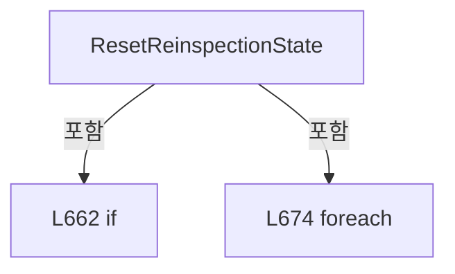

변경 전 점검: 입력/반환 타입, 위 호출자, 예외/취소 경로, 공유 상태와 저장·전송 소비자를 함께 확인합니다. 값의 단위나 물리 방향을 이름만으로 확정하지 않습니다.

### MethodDeclaration `NotifyReinspectionListState` · L691–698

[Drilling.UI/Menu/Menus/CMenuCorrection.ReviewData.Reinspection.cs:691–698](https://github.com/kjuws10-rgb/A3Drilling/blob/334b3599651b2e8e0181fd4459bafaf3cddafff3/Drilling.UI/Menu/Menus/CMenuCorrection.ReviewData.Reinspection.cs#L691-L698)

| 항목 | 실제 추출 값 |
| --- | --- |
| 서명 | void Drilling.UI.Menu.Menus.CMenuCorrection.CReviewDataPanel.NotifyReinspectionListState() |
| 접근/수식자 | Private / private |
| 반환/값 타입 | void |
| 소속 타입 | NamedType:Drilling.UI.Menu.Menus.CMenuCorrection.CReviewDataPanel |

정적 호출자로 확인된 위치:

| 호출 파일/행 | 호출 표현식 | 런타임 분기 가능 |
| --- | --- | --- |
| [Drilling.UI/Menu/Menus/CMenuCorrection.ReviewData.Reinspection.cs:180–180](https://github.com/kjuws10-rgb/A3Drilling/blob/334b3599651b2e8e0181fd4459bafaf3cddafff3/Drilling.UI/Menu/Menus/CMenuCorrection.ReviewData.Reinspection.cs#L180-L180) | NotifyReinspectionListState | False |
| [Drilling.UI/Menu/Menus/CMenuCorrection.ReviewData.Reinspection.cs:247–247](https://github.com/kjuws10-rgb/A3Drilling/blob/334b3599651b2e8e0181fd4459bafaf3cddafff3/Drilling.UI/Menu/Menus/CMenuCorrection.ReviewData.Reinspection.cs#L247-L247) | NotifyReinspectionListState | False |
| [Drilling.UI/Menu/Menus/CMenuCorrection.ReviewData.Reinspection.cs:275–275](https://github.com/kjuws10-rgb/A3Drilling/blob/334b3599651b2e8e0181fd4459bafaf3cddafff3/Drilling.UI/Menu/Menus/CMenuCorrection.ReviewData.Reinspection.cs#L275-L275) | NotifyReinspectionListState | False |
| [Drilling.UI/Menu/Menus/CMenuCorrection.ReviewData.Reinspection.cs:293–293](https://github.com/kjuws10-rgb/A3Drilling/blob/334b3599651b2e8e0181fd4459bafaf3cddafff3/Drilling.UI/Menu/Menus/CMenuCorrection.ReviewData.Reinspection.cs#L293-L293) | NotifyReinspectionListState | False |
| [Drilling.UI/Menu/Menus/CMenuCorrection.ReviewData.Reinspection.cs:688–688](https://github.com/kjuws10-rgb/A3Drilling/blob/334b3599651b2e8e0181fd4459bafaf3cddafff3/Drilling.UI/Menu/Menus/CMenuCorrection.ReviewData.Reinspection.cs#L688-L688) | NotifyReinspectionListState | False |

호출하는 대상과 해석 범위:

| 원본 행 | 표현식 | 분석 상태 | 대상/소스 위치 |
| --- | --- | --- | --- |
| 693 | Notify | resolved | void Drilling.UI.Menu.Menus.CMenuCorrection.CReviewDataPanel.Notify(string) · Drilling.UI/Menu/Menus/CMenuCorrection.ReviewData.cs:616 |
| 693 | nameof | unresolved | None |
| 694 | Notify | resolved | void Drilling.UI.Menu.Menus.CMenuCorrection.CReviewDataPanel.Notify(string) · Drilling.UI/Menu/Menus/CMenuCorrection.ReviewData.cs:616 |
| 694 | nameof | unresolved | None |
| 695 | Notify | resolved | void Drilling.UI.Menu.Menus.CMenuCorrection.CReviewDataPanel.Notify(string) · Drilling.UI/Menu/Menus/CMenuCorrection.ReviewData.cs:616 |
| 695 | nameof | unresolved | None |
| 696 | Notify | resolved | void Drilling.UI.Menu.Menus.CMenuCorrection.CReviewDataPanel.Notify(string) · Drilling.UI/Menu/Menus/CMenuCorrection.ReviewData.cs:616 |
| 696 | nameof | unresolved | None |
| 697 | NotifyReinspectionCommandState | resolved | void Drilling.UI.Menu.Menus.CMenuCorrection.CReviewDataPanel.NotifyReinspectionCommandState() · Drilling.UI/Menu/Menus/CMenuCorrection.ReviewData.Reinspection.cs:700 |

본문의 실제 연산·분기·예외·반환 순서(원문 위치 순):

| 원본 행 | 종류 | 주석 해설 |
| --- | --- | --- |
| 693 | call | 함수·델리게이트 또는 객체 생성자를 호출합니다: Notify(nameof(ReinspectionShots)) |
| 693 | call | 함수·델리게이트 또는 객체 생성자를 호출합니다: nameof(ReinspectionShots) |
| 694 | call | 함수·델리게이트 또는 객체 생성자를 호출합니다: Notify(nameof(ReinspectionSummary)) |
| 694 | call | 함수·델리게이트 또는 객체 생성자를 호출합니다: nameof(ReinspectionSummary) |
| 695 | call | 함수·델리게이트 또는 객체 생성자를 호출합니다: Notify(nameof(SelectedReinspectionShot)) |
| 695 | call | 함수·델리게이트 또는 객체 생성자를 호출합니다: nameof(SelectedReinspectionShot) |
| 696 | call | 함수·델리게이트 또는 객체 생성자를 호출합니다: Notify(nameof(ReinspectionStatusText)) |
| 696 | call | 함수·델리게이트 또는 객체 생성자를 호출합니다: nameof(ReinspectionStatusText) |
| 697 | call | 함수·델리게이트 또는 객체 생성자를 호출합니다: NotifyReinspectionCommandState() |

변경 전 점검: 입력/반환 타입, 위 호출자, 예외/취소 경로, 공유 상태와 저장·전송 소비자를 함께 확인합니다. 값의 단위나 물리 방향을 이름만으로 확정하지 않습니다.

### MethodDeclaration `NotifyReinspectionCommandState` · L700–728

[Drilling.UI/Menu/Menus/CMenuCorrection.ReviewData.Reinspection.cs:700–728](https://github.com/kjuws10-rgb/A3Drilling/blob/334b3599651b2e8e0181fd4459bafaf3cddafff3/Drilling.UI/Menu/Menus/CMenuCorrection.ReviewData.Reinspection.cs#L700-L728)

| 항목 | 실제 추출 값 |
| --- | --- |
| 서명 | void Drilling.UI.Menu.Menus.CMenuCorrection.CReviewDataPanel.NotifyReinspectionCommandState() |
| 접근/수식자 | Private / private |
| 반환/값 타입 | void |
| 소속 타입 | NamedType:Drilling.UI.Menu.Menus.CMenuCorrection.CReviewDataPanel |

정적 호출자로 확인된 위치:

| 호출 파일/행 | 호출 표현식 | 런타임 분기 가능 |
| --- | --- | --- |
| [Drilling.UI/Menu/Menus/CMenuCorrection.ReviewData.Display.cs:555–555](https://github.com/kjuws10-rgb/A3Drilling/blob/334b3599651b2e8e0181fd4459bafaf3cddafff3/Drilling.UI/Menu/Menus/CMenuCorrection.ReviewData.Display.cs#L555-L555) | NotifyReinspectionCommandState | False |
| [Drilling.UI/Menu/Menus/CMenuCorrection.ReviewData.Display.cs:637–637](https://github.com/kjuws10-rgb/A3Drilling/blob/334b3599651b2e8e0181fd4459bafaf3cddafff3/Drilling.UI/Menu/Menus/CMenuCorrection.ReviewData.Display.cs#L637-L637) | NotifyReinspectionCommandState | False |
| [Drilling.UI/Menu/Menus/CMenuCorrection.ReviewData.Display.cs:1366–1366](https://github.com/kjuws10-rgb/A3Drilling/blob/334b3599651b2e8e0181fd4459bafaf3cddafff3/Drilling.UI/Menu/Menus/CMenuCorrection.ReviewData.Display.cs#L1366-L1366) | NotifyReinspectionCommandState | False |
| [Drilling.UI/Menu/Menus/CMenuCorrection.ReviewData.Display.cs:1424–1424](https://github.com/kjuws10-rgb/A3Drilling/blob/334b3599651b2e8e0181fd4459bafaf3cddafff3/Drilling.UI/Menu/Menus/CMenuCorrection.ReviewData.Display.cs#L1424-L1424) | NotifyReinspectionCommandState | False |
| [Drilling.UI/Menu/Menus/CMenuCorrection.ReviewData.Reinspection.cs:88–88](https://github.com/kjuws10-rgb/A3Drilling/blob/334b3599651b2e8e0181fd4459bafaf3cddafff3/Drilling.UI/Menu/Menus/CMenuCorrection.ReviewData.Reinspection.cs#L88-L88) | NotifyReinspectionCommandState | False |
| [Drilling.UI/Menu/Menus/CMenuCorrection.ReviewData.Reinspection.cs:140–140](https://github.com/kjuws10-rgb/A3Drilling/blob/334b3599651b2e8e0181fd4459bafaf3cddafff3/Drilling.UI/Menu/Menus/CMenuCorrection.ReviewData.Reinspection.cs#L140-L140) | NotifyReinspectionCommandState | False |
| [Drilling.UI/Menu/Menus/CMenuCorrection.ReviewData.Reinspection.cs:171–171](https://github.com/kjuws10-rgb/A3Drilling/blob/334b3599651b2e8e0181fd4459bafaf3cddafff3/Drilling.UI/Menu/Menus/CMenuCorrection.ReviewData.Reinspection.cs#L171-L171) | NotifyReinspectionCommandState | False |
| [Drilling.UI/Menu/Menus/CMenuCorrection.ReviewData.Reinspection.cs:606–606](https://github.com/kjuws10-rgb/A3Drilling/blob/334b3599651b2e8e0181fd4459bafaf3cddafff3/Drilling.UI/Menu/Menus/CMenuCorrection.ReviewData.Reinspection.cs#L606-L606) | NotifyReinspectionCommandState | False |
| [Drilling.UI/Menu/Menus/CMenuCorrection.ReviewData.Reinspection.cs:619–619](https://github.com/kjuws10-rgb/A3Drilling/blob/334b3599651b2e8e0181fd4459bafaf3cddafff3/Drilling.UI/Menu/Menus/CMenuCorrection.ReviewData.Reinspection.cs#L619-L619) | NotifyReinspectionCommandState | False |
| [Drilling.UI/Menu/Menus/CMenuCorrection.ReviewData.Reinspection.cs:625–625](https://github.com/kjuws10-rgb/A3Drilling/blob/334b3599651b2e8e0181fd4459bafaf3cddafff3/Drilling.UI/Menu/Menus/CMenuCorrection.ReviewData.Reinspection.cs#L625-L625) | NotifyReinspectionCommandState | False |
| [Drilling.UI/Menu/Menus/CMenuCorrection.ReviewData.Reinspection.cs:697–697](https://github.com/kjuws10-rgb/A3Drilling/blob/334b3599651b2e8e0181fd4459bafaf3cddafff3/Drilling.UI/Menu/Menus/CMenuCorrection.ReviewData.Reinspection.cs#L697-L697) | NotifyReinspectionCommandState | False |
| [Drilling.UI/Menu/Menus/CMenuCorrection.ReviewData.Reinspection.cs:777–777](https://github.com/kjuws10-rgb/A3Drilling/blob/334b3599651b2e8e0181fd4459bafaf3cddafff3/Drilling.UI/Menu/Menus/CMenuCorrection.ReviewData.Reinspection.cs#L777-L777) | NotifyReinspectionCommandState | False |
| [Drilling.UI/Menu/Menus/CMenuCorrection.ReviewData.cs:252–252](https://github.com/kjuws10-rgb/A3Drilling/blob/334b3599651b2e8e0181fd4459bafaf3cddafff3/Drilling.UI/Menu/Menus/CMenuCorrection.ReviewData.cs#L252-L252) | NotifyReinspectionCommandState | False |

호출하는 대상과 해석 범위:

| 원본 행 | 표현식 | 분석 상태 | 대상/소스 위치 |
| --- | --- | --- | --- |
| 702 | Notify | resolved | void Drilling.UI.Menu.Menus.CMenuCorrection.CReviewDataPanel.Notify(string) · Drilling.UI/Menu/Menus/CMenuCorrection.ReviewData.cs:616 |
| 702 | nameof | unresolved | None |
| 703 | Notify | resolved | void Drilling.UI.Menu.Menus.CMenuCorrection.CReviewDataPanel.Notify(string) · Drilling.UI/Menu/Menus/CMenuCorrection.ReviewData.cs:616 |
| 703 | nameof | unresolved | None |
| 704 | Notify | resolved | void Drilling.UI.Menu.Menus.CMenuCorrection.CReviewDataPanel.Notify(string) · Drilling.UI/Menu/Menus/CMenuCorrection.ReviewData.cs:616 |
| 704 | nameof | unresolved | None |
| 705 | Notify | resolved | void Drilling.UI.Menu.Menus.CMenuCorrection.CReviewDataPanel.Notify(string) · Drilling.UI/Menu/Menus/CMenuCorrection.ReviewData.cs:616 |
| 705 | nameof | unresolved | None |
| 706 | Notify | resolved | void Drilling.UI.Menu.Menus.CMenuCorrection.CReviewDataPanel.Notify(string) · Drilling.UI/Menu/Menus/CMenuCorrection.ReviewData.cs:616 |
| 706 | nameof | unresolved | None |
| 707 | Notify | resolved | void Drilling.UI.Menu.Menus.CMenuCorrection.CReviewDataPanel.Notify(string) · Drilling.UI/Menu/Menus/CMenuCorrection.ReviewData.cs:616 |
| 707 | nameof | unresolved | None |
| 708 | Notify | resolved | void Drilling.UI.Menu.Menus.CMenuCorrection.CReviewDataPanel.Notify(string) · Drilling.UI/Menu/Menus/CMenuCorrection.ReviewData.cs:616 |
| 708 | nameof | unresolved | None |
| 709 | Notify | resolved | void Drilling.UI.Menu.Menus.CMenuCorrection.CReviewDataPanel.Notify(string) · Drilling.UI/Menu/Menus/CMenuCorrection.ReviewData.cs:616 |
| 709 | nameof | unresolved | None |
| 710 | Notify | resolved | void Drilling.UI.Menu.Menus.CMenuCorrection.CReviewDataPanel.Notify(string) · Drilling.UI/Menu/Menus/CMenuCorrection.ReviewData.cs:616 |
| 710 | nameof | unresolved | None |
| 711 | Notify | resolved | void Drilling.UI.Menu.Menus.CMenuCorrection.CReviewDataPanel.Notify(string) · Drilling.UI/Menu/Menus/CMenuCorrection.ReviewData.cs:616 |
| 711 | nameof | unresolved | None |
| 712 | Notify | resolved | void Drilling.UI.Menu.Menus.CMenuCorrection.CReviewDataPanel.Notify(string) · Drilling.UI/Menu/Menus/CMenuCorrection.ReviewData.cs:616 |
| 712 | nameof | unresolved | None |
| 713 | Notify | resolved | void Drilling.UI.Menu.Menus.CMenuCorrection.CReviewDataPanel.Notify(string) · Drilling.UI/Menu/Menus/CMenuCorrection.ReviewData.cs:616 |
| 713 | nameof | unresolved | None |
| 714 | Notify | resolved | void Drilling.UI.Menu.Menus.CMenuCorrection.CReviewDataPanel.Notify(string) · Drilling.UI/Menu/Menus/CMenuCorrection.ReviewData.cs:616 |
| 714 | nameof | unresolved | None |
| 715 | Notify | resolved | void Drilling.UI.Menu.Menus.CMenuCorrection.CReviewDataPanel.Notify(string) · Drilling.UI/Menu/Menus/CMenuCorrection.ReviewData.cs:616 |
| 715 | nameof | unresolved | None |
| 716 | .NotifyCanExecuteChanged | resolved | void Drilling.UI.Menu.CButtonCommand.NotifyCanExecuteChanged() · Drilling.UI/Menu/CButtonCommand.cs:24 |
| 717 | .NotifyCanExecuteChanged | resolved | void Drilling.UI.Menu.CButtonCommand.NotifyCanExecuteChanged() · Drilling.UI/Menu/CButtonCommand.cs:24 |
| 718 | .NotifyCanExecuteChanged | resolved | void Drilling.UI.Menu.CButtonCommand.NotifyCanExecuteChanged() · Drilling.UI/Menu/CButtonCommand.cs:24 |
| 719 | .NotifyCanExecuteChanged | resolved | void Drilling.UI.Menu.CButtonCommand.NotifyCanExecuteChanged() · Drilling.UI/Menu/CButtonCommand.cs:24 |
| 720 | .NotifyCanExecuteChanged | resolved | void Drilling.UI.Menu.CButtonCommand.NotifyCanExecuteChanged() · Drilling.UI/Menu/CButtonCommand.cs:24 |
| 721 | .NotifyCanExecuteChanged | resolved | void Drilling.UI.Menu.CButtonCommand.NotifyCanExecuteChanged() · Drilling.UI/Menu/CButtonCommand.cs:24 |
| 722 | .NotifyCanExecuteChanged | resolved | void Drilling.UI.Menu.CButtonCommand.NotifyCanExecuteChanged() · Drilling.UI/Menu/CButtonCommand.cs:24 |
| 723 | .NotifyCanExecuteChanged | resolved | void Drilling.UI.Menu.CButtonCommand.NotifyCanExecuteChanged() · Drilling.UI/Menu/CButtonCommand.cs:24 |
| 724 | .NotifyCanExecuteChanged | resolved | void Drilling.UI.Menu.CButtonCommand.NotifyCanExecuteChanged() · Drilling.UI/Menu/CButtonCommand.cs:24 |
| 725 | .NotifyCanExecuteChanged | resolved | void Drilling.UI.Menu.CButtonCommand.NotifyCanExecuteChanged() · Drilling.UI/Menu/CButtonCommand.cs:24 |
| 726 | .NotifyCanExecuteChanged | resolved | void Drilling.UI.Menu.CButtonCommand.NotifyCanExecuteChanged() · Drilling.UI/Menu/CButtonCommand.cs:24 |
| 727 | .NotifyCanExecuteChanged | resolved | void Drilling.UI.Menu.CButtonCommand.NotifyCanExecuteChanged() · Drilling.UI/Menu/CButtonCommand.cs:24 |

본문의 실제 연산·분기·예외·반환 순서(원문 위치 순):

| 원본 행 | 종류 | 주석 해설 |
| --- | --- | --- |
| 702 | call | 함수·델리게이트 또는 객체 생성자를 호출합니다: Notify(nameof(CanToggleReinspection)) |
| 702 | call | 함수·델리게이트 또는 객체 생성자를 호출합니다: nameof(CanToggleReinspection) |
| 703 | call | 함수·델리게이트 또는 객체 생성자를 호출합니다: Notify(nameof(CanToggleResultEditMode)) |
| 703 | call | 함수·델리게이트 또는 객체 생성자를 호출합니다: nameof(CanToggleResultEditMode) |
| 704 | call | 함수·델리게이트 또는 객체 생성자를 호출합니다: Notify(nameof(CanAddReinspectionShot)) |
| 704 | call | 함수·델리게이트 또는 객체 생성자를 호출합니다: nameof(CanAddReinspectionShot) |
| 705 | call | 함수·델리게이트 또는 객체 생성자를 호출합니다: Notify(nameof(CanAddSelectedReinspectionShots)) |
| 705 | call | 함수·델리게이트 또는 객체 생성자를 호출합니다: nameof(CanAddSelectedReinspectionShots) |
| 706 | call | 함수·델리게이트 또는 객체 생성자를 호출합니다: Notify(nameof(CanAddNgReinspectionShots)) |
| 706 | call | 함수·델리게이트 또는 객체 생성자를 호출합니다: nameof(CanAddNgReinspectionShots) |
| 707 | call | 함수·델리게이트 또는 객체 생성자를 호출합니다: Notify(nameof(CanDeleteReinspectionShot)) |
| 707 | call | 함수·델리게이트 또는 객체 생성자를 호출합니다: nameof(CanDeleteReinspectionShot) |
| 708 | call | 함수·델리게이트 또는 객체 생성자를 호출합니다: Notify(nameof(CanClearReinspectionShots)) |
| 708 | call | 함수·델리게이트 또는 객체 생성자를 호출합니다: nameof(CanClearReinspectionShots) |
| 709 | call | 함수·델리게이트 또는 객체 생성자를 호출합니다: Notify(nameof(CanMoveToReinspectionShot)) |
| 709 | call | 함수·델리게이트 또는 객체 생성자를 호출합니다: nameof(CanMoveToReinspectionShot) |
| 710 | call | 함수·델리게이트 또는 객체 생성자를 호출합니다: Notify(nameof(CanInspectReinspectionShot)) |
| 710 | call | 함수·델리게이트 또는 객체 생성자를 호출합니다: nameof(CanInspectReinspectionShot) |
| 711 | call | 함수·델리게이트 또는 객체 생성자를 호출합니다: Notify(nameof(CanInspectAllReinspectionShots)) |
| 711 | call | 함수·델리게이트 또는 객체 생성자를 호출합니다: nameof(CanInspectAllReinspectionShots) |
| 712 | call | 함수·델리게이트 또는 객체 생성자를 호출합니다: Notify(nameof(CanStopReinspection)) |
| 712 | call | 함수·델리게이트 또는 객체 생성자를 호출합니다: nameof(CanStopReinspection) |
| 713 | call | 함수·델리게이트 또는 객체 생성자를 호출합니다: Notify(nameof(CanSaveReinspectionResult)) |
| 713 | call | 함수·델리게이트 또는 객체 생성자를 호출합니다: nameof(CanSaveReinspectionResult) |
| 714 | call | 함수·델리게이트 또는 객체 생성자를 호출합니다: Notify(nameof(IsBeamInspectionResult)) |
| 714 | call | 함수·델리게이트 또는 객체 생성자를 호출합니다: nameof(IsBeamInspectionResult) |
| 715 | call | 함수·델리게이트 또는 객체 생성자를 호출합니다: Notify(nameof(ReinspectionAvailabilityText)) |
| 715 | call | 함수·델리게이트 또는 객체 생성자를 호출합니다: nameof(ReinspectionAvailabilityText) |
| 716 | call | 함수·델리게이트 또는 객체 생성자를 호출합니다: .NotifyCanExecuteChanged() |
| 717 | call | 함수·델리게이트 또는 객체 생성자를 호출합니다: .NotifyCanExecuteChanged() |
| 718 | call | 함수·델리게이트 또는 객체 생성자를 호출합니다: .NotifyCanExecuteChanged() |
| 719 | call | 함수·델리게이트 또는 객체 생성자를 호출합니다: .NotifyCanExecuteChanged() |
| 720 | call | 함수·델리게이트 또는 객체 생성자를 호출합니다: .NotifyCanExecuteChanged() |
| 721 | call | 함수·델리게이트 또는 객체 생성자를 호출합니다: .NotifyCanExecuteChanged() |
| 722 | call | 함수·델리게이트 또는 객체 생성자를 호출합니다: .NotifyCanExecuteChanged() |
| 723 | call | 함수·델리게이트 또는 객체 생성자를 호출합니다: .NotifyCanExecuteChanged() |
| 724 | call | 함수·델리게이트 또는 객체 생성자를 호출합니다: .NotifyCanExecuteChanged() |
| 725 | call | 함수·델리게이트 또는 객체 생성자를 호출합니다: .NotifyCanExecuteChanged() |
| 726 | call | 함수·델리게이트 또는 객체 생성자를 호출합니다: .NotifyCanExecuteChanged() |
| 727 | call | 함수·델리게이트 또는 객체 생성자를 호출합니다: .NotifyCanExecuteChanged() |

변경 전 점검: 입력/반환 타입, 위 호출자, 예외/취소 경로, 공유 상태와 저장·전송 소비자를 함께 확인합니다. 값의 단위나 물리 방향을 이름만으로 확정하지 않습니다.

### MethodDeclaration `FindReinspectionShot` · L730–737

[Drilling.UI/Menu/Menus/CMenuCorrection.ReviewData.Reinspection.cs:730–737](https://github.com/kjuws10-rgb/A3Drilling/blob/334b3599651b2e8e0181fd4459bafaf3cddafff3/Drilling.UI/Menu/Menus/CMenuCorrection.ReviewData.Reinspection.cs#L730-L737)

| 항목 | 실제 추출 값 |
| --- | --- |
| 서명 | Drilling.UI.Menu.Menus.CMenuCorrection.ST_REVIEW_DATA_REINSPECTION_ITEM? Drilling.UI.Menu.Menus.CMenuCorrection.CReviewDataPanel.FindReinspectionShot(int, string) |
| 접근/수식자 | Private / private |
| 반환/값 타입 | Drilling.UI.Menu.Menus.CMenuCorrection.ST_REVIEW_DATA_REINSPECTION_ITEM? |
| 소속 타입 | NamedType:Drilling.UI.Menu.Menus.CMenuCorrection.CReviewDataPanel |

입력 계약:

| 이름 | 타입 | 전달 | 선택/기본값 |
| --- | --- | --- | --- |
| cellNo | int | None | False /  |
| shotKey | string | None | False /  |

정적 호출자로 확인된 위치:

| 호출 파일/행 | 호출 표현식 | 런타임 분기 가능 |
| --- | --- | --- |
| [Drilling.UI/Menu/Menus/CMenuCorrection.ReviewData.Reinspection.cs:164–164](https://github.com/kjuws10-rgb/A3Drilling/blob/334b3599651b2e8e0181fd4459bafaf3cddafff3/Drilling.UI/Menu/Menus/CMenuCorrection.ReviewData.Reinspection.cs#L164-L164) | FindReinspectionShot | False |

호출하는 대상과 해석 범위:

| 원본 행 | 표현식 | 분석 상태 | 대상/소스 위치 |
| --- | --- | --- | --- |
| 734 | _reinspectionShots.FirstOrDefault | resolved | Drilling.UI.Menu.Menus.CMenuCorrection.ST_REVIEW_DATA_REINSPECTION_ITEM? System.Collections.Generic.IEnumerable<Drilling.UI.Menu.Menus.CMenuCorrection.ST_REVIEW_DATA_REINSPECTION_ITEM>.FirstOrDefault<Drilling.UI.Menu.Menus.CMenuCorrection.ST_REVIEW_DATA_REINSPECTION_ITEM>(System.Func<Drilling.UI.Menu.Menus.CMenuCorrection.ST_REVIEW_DATA_REINSPECTION_ITEM, bool>) |
| 736 | item.ShotKey.Equals | resolved | bool string.Equals(string?, System.StringComparison) |

본문의 실제 연산·분기·예외·반환 순서(원문 위치 순):

| 원본 행 | 종류 | 주석 해설 |
| --- | --- | --- |
| 734 | call | 함수·델리게이트 또는 객체 생성자를 호출합니다: _reinspectionShots.FirstOrDefault(item => item.CellNo == cellNo && item.ShotKey.Equals(shotKey, StringComparison.OrdinalIgnoreCase)) |
| 734 | return | 호출자에게 값 또는 제어를 반환합니다: return _reinspectionShots.FirstOrDefault(item => item.CellNo == cellNo && item.ShotKey.Equals(shotKey, StringComparison.OrdinalIgnoreCase)); |
| 736 | call | 함수·델리게이트 또는 객체 생성자를 호출합니다: item.ShotKey.Equals(shotKey, StringComparison.OrdinalIgnoreCase) |

변경 전 점검: 입력/반환 타입, 위 호출자, 예외/취소 경로, 공유 상태와 저장·전송 소비자를 함께 확인합니다. 값의 단위나 물리 방향을 이름만으로 확정하지 않습니다.

### MethodDeclaration `FindShot` · L739–744

[Drilling.UI/Menu/Menus/CMenuCorrection.ReviewData.Reinspection.cs:739–744](https://github.com/kjuws10-rgb/A3Drilling/blob/334b3599651b2e8e0181fd4459bafaf3cddafff3/Drilling.UI/Menu/Menus/CMenuCorrection.ReviewData.Reinspection.cs#L739-L744)

| 항목 | 실제 추출 값 |
| --- | --- |
| 서명 | Drilling.UI.Menu.Menus.CMenuCorrection.ST_REVIEW_DATA_SHOT_POSITION? Drilling.UI.Menu.Menus.CMenuCorrection.CReviewDataPanel.FindShot(int, string) |
| 접근/수식자 | Private / private |
| 반환/값 타입 | Drilling.UI.Menu.Menus.CMenuCorrection.ST_REVIEW_DATA_SHOT_POSITION? |
| 소속 타입 | NamedType:Drilling.UI.Menu.Menus.CMenuCorrection.CReviewDataPanel |

입력 계약:

| 이름 | 타입 | 전달 | 선택/기본값 |
| --- | --- | --- | --- |
| cellNo | int | None | False /  |
| shotKey | string | None | False /  |

정적 호출자로 확인된 위치:

| 호출 파일/행 | 호출 표현식 | 런타임 분기 가능 |
| --- | --- | --- |
| [Drilling.UI/Menu/Menus/CMenuCorrection.ReviewData.Reinspection.cs:220–220](https://github.com/kjuws10-rgb/A3Drilling/blob/334b3599651b2e8e0181fd4459bafaf3cddafff3/Drilling.UI/Menu/Menus/CMenuCorrection.ReviewData.Reinspection.cs#L220-L220) | FindShot | False |

호출하는 대상과 해석 범위:

| 원본 행 | 표현식 | 분석 상태 | 대상/소스 위치 |
| --- | --- | --- | --- |
| 741 | _shotsByCell.TryGetValue | resolved · 동적 구현 선택 가능 | bool System.Collections.Generic.IReadOnlyDictionary<int, System.Collections.Generic.IReadOnlyList<Drilling.UI.Menu.Menus.CMenuCorrection.ST_REVIEW_DATA_SHOT_POSITION>>.TryGetValue(int, out System.Collections.Generic.IReadOnlyList<Drilling.UI.Menu.Menus.CMenuCorrection.ST_REVIEW_DATA_SHOT_POSITION>) |
| 742 | shots.FirstOrDefault | resolved | Drilling.UI.Menu.Menus.CMenuCorrection.ST_REVIEW_DATA_SHOT_POSITION? System.Collections.Generic.IEnumerable<Drilling.UI.Menu.Menus.CMenuCorrection.ST_REVIEW_DATA_SHOT_POSITION>.FirstOrDefault<Drilling.UI.Menu.Menus.CMenuCorrection.ST_REVIEW_DATA_SHOT_POSITION>(System.Func<Drilling.UI.Menu.Menus.CMenuCorrection.ST_REVIEW_DATA_SHOT_POSITION, bool>) |
| 742 | item.ShotKey.Equals | resolved | bool string.Equals(string?, System.StringComparison) |

본문의 실제 연산·분기·예외·반환 순서(원문 위치 순):

| 원본 행 | 종류 | 주석 해설 |
| --- | --- | --- |
| 741 | call | 함수·델리게이트 또는 객체 생성자를 호출합니다: _shotsByCell.TryGetValue(cellNo, out var shots) |
| 741 | conditional-expression | 조건에 따라 결과식을 선택합니다: _shotsByCell.TryGetValue(cellNo, out var shots) ? shots.FirstOrDefault(item => item.ShotKey.Equals(shotKey, StringComparison.OrdinalIgnoreCase)) : null |
| 741 | return | 호출자에게 값 또는 제어를 반환합니다: return _shotsByCell.TryGetValue(cellNo, out var shots) ? shots.FirstOrDefault(item => item.ShotKey.Equals(shotKey, StringComparison.OrdinalIgnoreCase)) : null; |
| 742 | call | 함수·델리게이트 또는 객체 생성자를 호출합니다: shots.FirstOrDefault(item => item.ShotKey.Equals(shotKey, StringComparison.OrdinalIgnoreCase)) |
| 742 | call | 함수·델리게이트 또는 객체 생성자를 호출합니다: item.ShotKey.Equals(shotKey, StringComparison.OrdinalIgnoreCase) |

변경 전 점검: 입력/반환 타입, 위 호출자, 예외/취소 경로, 공유 상태와 저장·전송 소비자를 함께 확인합니다. 값의 단위나 물리 방향을 이름만으로 확정하지 않습니다.

### MethodDeclaration `CreateReinspectionItem` · L746–762

[Drilling.UI/Menu/Menus/CMenuCorrection.ReviewData.Reinspection.cs:746–762](https://github.com/kjuws10-rgb/A3Drilling/blob/334b3599651b2e8e0181fd4459bafaf3cddafff3/Drilling.UI/Menu/Menus/CMenuCorrection.ReviewData.Reinspection.cs#L746-L762)

| 항목 | 실제 추출 값 |
| --- | --- |
| 서명 | Drilling.UI.Menu.Menus.CMenuCorrection.ST_REVIEW_DATA_REINSPECTION_ITEM Drilling.UI.Menu.Menus.CMenuCorrection.CReviewDataPanel.CreateReinspectionItem(Drilling.UI.Menu.Menus.CMenuCorrection.ST_REVIEW_DATA_SHOT_POSITION, Drilling.UI.Menu.Menus.CMenuCorrection.ST_REVIEW_DATA_GRID_ROW?, int, int) |
| 접근/수식자 | Private / private |
| 반환/값 타입 | Drilling.UI.Menu.Menus.CMenuCorrection.ST_REVIEW_DATA_REINSPECTION_ITEM |
| 소속 타입 | NamedType:Drilling.UI.Menu.Menus.CMenuCorrection.CReviewDataPanel |

입력 계약:

| 이름 | 타입 | 전달 | 선택/기본값 |
| --- | --- | --- | --- |
| shot | Drilling.UI.Menu.Menus.CMenuCorrection.ST_REVIEW_DATA_SHOT_POSITION | None | False /  |
| sourceRow | Drilling.UI.Menu.Menus.CMenuCorrection.ST_REVIEW_DATA_GRID_ROW? | None | False /  |
| beamNo | int | None | False /  |
| sequence | int | None | False /  |

정적 호출자로 확인된 위치:

| 호출 파일/행 | 호출 표현식 | 런타임 분기 가능 |
| --- | --- | --- |
| [Drilling.UI/Menu/Menus/CMenuCorrection.ReviewData.Reinspection.cs:175–175](https://github.com/kjuws10-rgb/A3Drilling/blob/334b3599651b2e8e0181fd4459bafaf3cddafff3/Drilling.UI/Menu/Menus/CMenuCorrection.ReviewData.Reinspection.cs#L175-L175) | CreateReinspectionItem | False |
| [Drilling.UI/Menu/Menus/CMenuCorrection.ReviewData.Reinspection.cs:235–235](https://github.com/kjuws10-rgb/A3Drilling/blob/334b3599651b2e8e0181fd4459bafaf3cddafff3/Drilling.UI/Menu/Menus/CMenuCorrection.ReviewData.Reinspection.cs#L235-L235) | CreateReinspectionItem | False |

호출하는 대상과 해석 범위:

| 원본 행 | 표현식 | 분석 상태 | 대상/소스 위치 |
| --- | --- | --- | --- |
| 752 | new ST_REVIEW_DATA_REINSPECTION_ITEM | resolved | Drilling.UI.Menu.Menus.CMenuCorrection.ST_REVIEW_DATA_REINSPECTION_ITEM.ST_REVIEW_DATA_REINSPECTION_ITEM(int, int, int, string, int, string, Drilling.UI.Menu.Menus.CMenuCorrection.ST_REVIEW_DATA_GRID_ROW?) · Drilling.UI/Menu/Menus/CMenuCorrection.ReviewData.Reinspection.cs:816 |
| 756 | CReviewShotNameFormatter.ToMatrixName | resolved | string Drilling.Common.Review.CReviewShotNameFormatter.ToMatrixName(int, int) · Drilling.Common/Review/CReviewManager.cs:4141 |

본문의 실제 연산·분기·예외·반환 순서(원문 위치 순):

| 원본 행 | 종류 | 주석 해설 |
| --- | --- | --- |
| 752 | call | 함수·델리게이트 또는 객체 생성자를 호출합니다: new ST_REVIEW_DATA_REINSPECTION_ITEM( sequence, sourceRow?.HeadNo ?? shot.HeadNo, shot.CellNo, CReviewShotNameFormatter.ToMatrixName(shot.ShotNo, shot.GroupCountX), beamNo, shot.ShotKey, sourceRow) |
| 752 | local-declaration | 지역 변수를 선언합니다: var item = new ST_REVIEW_DATA_REINSPECTION_ITEM( sequence, sourceRow?.HeadNo ?? shot.HeadNo, shot.CellNo, CReviewShotNameFormatter.ToMatrixName(shot.ShotNo, shot.GroupCountX), beamNo, shot.ShotKey, sourceRow); |
| 752 | variable-initializer | 변수의 초기값을 지정합니다: item = new ST_REVIEW_DATA_REINSPECTION_ITEM( sequence, sourceRow?.HeadNo ?? shot.HeadNo, shot.CellNo, CReviewShotNameFormatter.ToMatrixName(shot.ShotNo, shot.GroupCountX), beamNo, shot.ShotKey, sourceRow) |
| 756 | call | 함수·델리게이트 또는 객체 생성자를 호출합니다: CReviewShotNameFormatter.ToMatrixName(shot.ShotNo, shot.GroupCountX) |
| 760 | compound-assignment-or-event-subscription | 복합 대입 또는 이벤트 구독/해지 표현입니다: item.PropertyChanged += ReinspectionItemPropertyChanged |
| 761 | return | 호출자에게 값 또는 제어를 반환합니다: return item; |

변경 전 점검: 입력/반환 타입, 위 호출자, 예외/취소 경로, 공유 상태와 저장·전송 소비자를 함께 확인합니다. 값의 단위나 물리 방향을 이름만으로 확정하지 않습니다.

### MethodDeclaration `ReinspectionItemPropertyChanged` · L764–779

[Drilling.UI/Menu/Menus/CMenuCorrection.ReviewData.Reinspection.cs:764–779](https://github.com/kjuws10-rgb/A3Drilling/blob/334b3599651b2e8e0181fd4459bafaf3cddafff3/Drilling.UI/Menu/Menus/CMenuCorrection.ReviewData.Reinspection.cs#L764-L779)

| 항목 | 실제 추출 값 |
| --- | --- |
| 서명 | void Drilling.UI.Menu.Menus.CMenuCorrection.CReviewDataPanel.ReinspectionItemPropertyChanged(object?, System.ComponentModel.PropertyChangedEventArgs) |
| 접근/수식자 | Private / private |
| 반환/값 타입 | void |
| 소속 타입 | NamedType:Drilling.UI.Menu.Menus.CMenuCorrection.CReviewDataPanel |

입력 계약:

| 이름 | 타입 | 전달 | 선택/기본값 |
| --- | --- | --- | --- |
| sender | object? | None | False /  |
| eventArgs | System.ComponentModel.PropertyChangedEventArgs | None | False /  |

현재 부분 분석에서 직접 연결된 호출자는 없습니다. XAML/이벤트/인터페이스·델리게이트·외부 진입을 추가 확인해야 하며, 미사용으로 판정한 것이 아닙니다.

호출하는 대상과 해석 범위:

| 원본 행 | 표현식 | 분석 상태 | 대상/소스 위치 |
| --- | --- | --- | --- |
| 772 | nameof | unresolved | None |
| 773 | nameof | unresolved | None |
| 774 | nameof | unresolved | None |
| 775 | nameof | unresolved | None |
| 777 | NotifyReinspectionCommandState | resolved | void Drilling.UI.Menu.Menus.CMenuCorrection.CReviewDataPanel.NotifyReinspectionCommandState() · Drilling.UI/Menu/Menus/CMenuCorrection.ReviewData.Reinspection.cs:700 |

본문의 실제 연산·분기·예외·반환 순서(원문 위치 순):

| 원본 행 | 종류 | 주석 해설 |
| --- | --- | --- |
| 766 | if | 조건에 따라 분기합니다: if (sender is ST_REVIEW_DATA_REINSPECTION_ITEM item && item.HasCompletedMeasurement) |
| 769 | assignment | 값을 대상에 대입합니다: _hasUnsavedReinspectionMeasurements = true |
| 772 | call | 함수·델리게이트 또는 객체 생성자를 호출합니다: nameof(ST_REVIEW_DATA_REINSPECTION_ITEM.BeamNo) |
| 772 | if | 조건에 따라 분기합니다: if (eventArgs.PropertyName is nameof(ST_REVIEW_DATA_REINSPECTION_ITEM.BeamNo) or nameof(ST_REVIEW_DATA_REINSPECTION_ITEM.ResultX) or nameof(ST_REVIEW_DATA_REINSPECTION_ITEM.ResultY) or nameof(ST_REVIEW_DATA_REINSPECTION_ITEM…) |
| 773 | call | 함수·델리게이트 또는 객체 생성자를 호출합니다: nameof(ST_REVIEW_DATA_REINSPECTION_ITEM.ResultX) |
| 774 | call | 함수·델리게이트 또는 객체 생성자를 호출합니다: nameof(ST_REVIEW_DATA_REINSPECTION_ITEM.ResultY) |
| 775 | call | 함수·델리게이트 또는 객체 생성자를 호출합니다: nameof(ST_REVIEW_DATA_REINSPECTION_ITEM.State) |
| 777 | call | 함수·델리게이트 또는 객체 생성자를 호출합니다: NotifyReinspectionCommandState() |

제어 구문의 포함 구조(실제 실행 순서/CFG가 아닌 구문 탐색 그림):

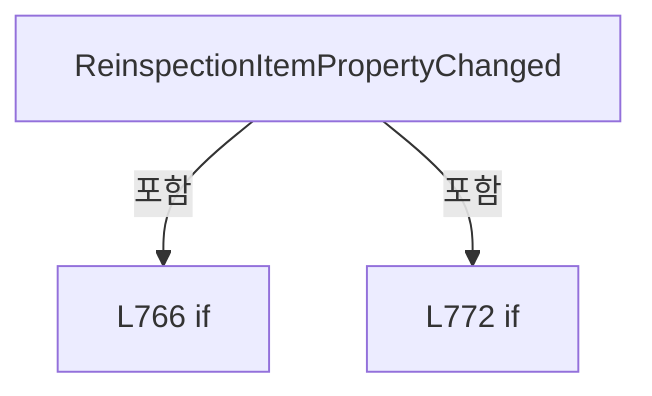

변경 전 점검: 입력/반환 타입, 위 호출자, 예외/취소 경로, 공유 상태와 저장·전송 소비자를 함께 확인합니다. 값의 단위나 물리 방향을 이름만으로 확정하지 않습니다.

### MethodDeclaration `UntrackReinspectionItems` · L781–787

[Drilling.UI/Menu/Menus/CMenuCorrection.ReviewData.Reinspection.cs:781–787](https://github.com/kjuws10-rgb/A3Drilling/blob/334b3599651b2e8e0181fd4459bafaf3cddafff3/Drilling.UI/Menu/Menus/CMenuCorrection.ReviewData.Reinspection.cs#L781-L787)

| 항목 | 실제 추출 값 |
| --- | --- |
| 서명 | void Drilling.UI.Menu.Menus.CMenuCorrection.CReviewDataPanel.UntrackReinspectionItems(System.Collections.Generic.IEnumerable<Drilling.UI.Menu.Menus.CMenuCorrection.ST_REVIEW_DATA_REINSPECTION_ITEM>) |
| 접근/수식자 | Private / private |
| 반환/값 타입 | void |
| 소속 타입 | NamedType:Drilling.UI.Menu.Menus.CMenuCorrection.CReviewDataPanel |

입력 계약:

| 이름 | 타입 | 전달 | 선택/기본값 |
| --- | --- | --- | --- |
| items | System.Collections.Generic.IEnumerable<Drilling.UI.Menu.Menus.CMenuCorrection.ST_REVIEW_DATA_REINSPECTION_ITEM> | None | False /  |

정적 호출자로 확인된 위치:

| 호출 파일/행 | 호출 표현식 | 런타임 분기 가능 |
| --- | --- | --- |
| [Drilling.UI/Menu/Menus/CMenuCorrection.ReviewData.Reinspection.cs:289–289](https://github.com/kjuws10-rgb/A3Drilling/blob/334b3599651b2e8e0181fd4459bafaf3cddafff3/Drilling.UI/Menu/Menus/CMenuCorrection.ReviewData.Reinspection.cs#L289-L289) | UntrackReinspectionItems | False |
| [Drilling.UI/Menu/Menus/CMenuCorrection.ReviewData.Reinspection.cs:680–680](https://github.com/kjuws10-rgb/A3Drilling/blob/334b3599651b2e8e0181fd4459bafaf3cddafff3/Drilling.UI/Menu/Menus/CMenuCorrection.ReviewData.Reinspection.cs#L680-L680) | UntrackReinspectionItems | False |

본문의 실제 연산·분기·예외·반환 순서(원문 위치 순):

| 원본 행 | 종류 | 주석 해설 |
| --- | --- | --- |
| 783 | foreach | 컬렉션 요소를 순회합니다: foreach (var item in items) |
| 785 | compound-assignment-or-event-subscription | 복합 대입 또는 이벤트 구독/해지 표현입니다: item.PropertyChanged -= ReinspectionItemPropertyChanged |

제어 구문의 포함 구조(실제 실행 순서/CFG가 아닌 구문 탐색 그림):

```mermaid
flowchart TD
 M["UntrackReinspectionItems"]
 N0["L783 foreach"]
 M -->|포함| N0
```

변경 전 점검: 입력/반환 타입, 위 호출자, 예외/취소 경로, 공유 상태와 저장·전송 소비자를 함께 확인합니다. 값의 단위나 물리 방향을 이름만으로 확정하지 않습니다.

### MethodDeclaration `NormalizeBeamNo` · L789–792

[Drilling.UI/Menu/Menus/CMenuCorrection.ReviewData.Reinspection.cs:789–792](https://github.com/kjuws10-rgb/A3Drilling/blob/334b3599651b2e8e0181fd4459bafaf3cddafff3/Drilling.UI/Menu/Menus/CMenuCorrection.ReviewData.Reinspection.cs#L789-L792)

| 항목 | 실제 추출 값 |
| --- | --- |
| 서명 | int Drilling.UI.Menu.Menus.CMenuCorrection.CReviewDataPanel.NormalizeBeamNo(int) |
| 접근/수식자 | Private / private, static |
| 반환/값 타입 | int |
| 소속 타입 | NamedType:Drilling.UI.Menu.Menus.CMenuCorrection.CReviewDataPanel |

입력 계약:

| 이름 | 타입 | 전달 | 선택/기본값 |
| --- | --- | --- | --- |
| beamNo | int | None | False /  |

정적 호출자로 확인된 위치:

| 호출 파일/행 | 호출 표현식 | 런타임 분기 가능 |
| --- | --- | --- |
| [Drilling.UI/Menu/Menus/CMenuCorrection.ReviewData.Reinspection.cs:163–163](https://github.com/kjuws10-rgb/A3Drilling/blob/334b3599651b2e8e0181fd4459bafaf3cddafff3/Drilling.UI/Menu/Menus/CMenuCorrection.ReviewData.Reinspection.cs#L163-L163) | NormalizeBeamNo | False |
| [Drilling.UI/Menu/Menus/CMenuCorrection.ReviewData.Reinspection.cs:227–227](https://github.com/kjuws10-rgb/A3Drilling/blob/334b3599651b2e8e0181fd4459bafaf3cddafff3/Drilling.UI/Menu/Menus/CMenuCorrection.ReviewData.Reinspection.cs#L227-L227) | NormalizeBeamNo | False |

본문의 실제 연산·분기·예외·반환 순서(원문 위치 순):

| 원본 행 | 종류 | 주석 해설 |
| --- | --- | --- |
| 791 | conditional-expression | 조건에 따라 결과식을 선택합니다: beamNo is >= 1 and <= 16 ? beamNo : 1 |
| 791 | return | 호출자에게 값 또는 제어를 반환합니다: return beamNo is >= 1 and <= 16 ? beamNo : 1; |

변경 전 점검: 입력/반환 타입, 위 호출자, 예외/취소 경로, 공유 상태와 저장·전송 소비자를 함께 확인합니다. 값의 단위나 물리 방향을 이름만으로 확정하지 않습니다.

### MethodDeclaration `IsNgResultRow` · L794–797

[Drilling.UI/Menu/Menus/CMenuCorrection.ReviewData.Reinspection.cs:794–797](https://github.com/kjuws10-rgb/A3Drilling/blob/334b3599651b2e8e0181fd4459bafaf3cddafff3/Drilling.UI/Menu/Menus/CMenuCorrection.ReviewData.Reinspection.cs#L794-L797)

| 항목 | 실제 추출 값 |
| --- | --- |
| 서명 | bool Drilling.UI.Menu.Menus.CMenuCorrection.CReviewDataPanel.IsNgResultRow(Drilling.UI.Menu.Menus.CMenuCorrection.ST_REVIEW_DATA_GRID_ROW) |
| 접근/수식자 | Private / private, static |
| 반환/값 타입 | bool |
| 소속 타입 | NamedType:Drilling.UI.Menu.Menus.CMenuCorrection.CReviewDataPanel |

입력 계약:

| 이름 | 타입 | 전달 | 선택/기본값 |
| --- | --- | --- | --- |
| row | Drilling.UI.Menu.Menus.CMenuCorrection.ST_REVIEW_DATA_GRID_ROW | None | False /  |

현재 부분 분석에서 직접 연결된 호출자는 없습니다. XAML/이벤트/인터페이스·델리게이트·외부 진입을 추가 확인해야 하며, 미사용으로 판정한 것이 아닙니다.

호출하는 대상과 해석 범위:

| 원본 행 | 표현식 | 분석 상태 | 대상/소스 위치 |
| --- | --- | --- | --- |
| 796 | row.Judge.Equals | resolved | bool string.Equals(string?, System.StringComparison) |

본문의 실제 연산·분기·예외·반환 순서(원문 위치 순):

| 원본 행 | 종류 | 주석 해설 |
| --- | --- | --- |
| 796 | call | 함수·델리게이트 또는 객체 생성자를 호출합니다: row.Judge.Equals("NG", StringComparison.OrdinalIgnoreCase) |
| 796 | return | 호출자에게 값 또는 제어를 반환합니다: return row.Judge.Equals("NG", StringComparison.OrdinalIgnoreCase); |

변경 전 점검: 입력/반환 타입, 위 호출자, 예외/취소 경로, 공유 상태와 저장·전송 소비자를 함께 확인합니다. 값의 단위나 물리 방향을 이름만으로 확정하지 않습니다.

### MethodDeclaration `BuildReinspectionKey` · L799–802

[Drilling.UI/Menu/Menus/CMenuCorrection.ReviewData.Reinspection.cs:799–802](https://github.com/kjuws10-rgb/A3Drilling/blob/334b3599651b2e8e0181fd4459bafaf3cddafff3/Drilling.UI/Menu/Menus/CMenuCorrection.ReviewData.Reinspection.cs#L799-L802)

| 항목 | 실제 추출 값 |
| --- | --- |
| 서명 | string Drilling.UI.Menu.Menus.CMenuCorrection.CReviewDataPanel.BuildReinspectionKey(int, string) |
| 접근/수식자 | Private / private, static |
| 반환/값 타입 | string |
| 소속 타입 | NamedType:Drilling.UI.Menu.Menus.CMenuCorrection.CReviewDataPanel |

입력 계약:

| 이름 | 타입 | 전달 | 선택/기본값 |
| --- | --- | --- | --- |
| cellNo | int | None | False /  |
| shotKey | string | None | False /  |

정적 호출자로 확인된 위치:

| 호출 파일/행 | 호출 표현식 | 런타임 분기 가능 |
| --- | --- | --- |
| [Drilling.UI/Menu/Menus/CMenuCorrection.ReviewData.Reinspection.cs:212–212](https://github.com/kjuws10-rgb/A3Drilling/blob/334b3599651b2e8e0181fd4459bafaf3cddafff3/Drilling.UI/Menu/Menus/CMenuCorrection.ReviewData.Reinspection.cs#L212-L212) | BuildReinspectionKey | False |
| [Drilling.UI/Menu/Menus/CMenuCorrection.ReviewData.Reinspection.cs:228–228](https://github.com/kjuws10-rgb/A3Drilling/blob/334b3599651b2e8e0181fd4459bafaf3cddafff3/Drilling.UI/Menu/Menus/CMenuCorrection.ReviewData.Reinspection.cs#L228-L228) | BuildReinspectionKey | False |

본문의 실제 연산·분기·예외·반환 순서(원문 위치 순):

| 원본 행 | 종류 | 주석 해설 |
| --- | --- | --- |
| 801 | return | 호출자에게 값 또는 제어를 반환합니다: return $"{cellNo}:{shotKey}"; |

변경 전 점검: 입력/반환 타입, 위 호출자, 예외/취소 경로, 공유 상태와 저장·전송 소비자를 함께 확인합니다. 값의 단위나 물리 방향을 이름만으로 확정하지 않습니다.

### FieldDeclaration `_sequence` · L807–807

[Drilling.UI/Menu/Menus/CMenuCorrection.ReviewData.Reinspection.cs:807–807](https://github.com/kjuws10-rgb/A3Drilling/blob/334b3599651b2e8e0181fd4459bafaf3cddafff3/Drilling.UI/Menu/Menus/CMenuCorrection.ReviewData.Reinspection.cs#L807-L807)

| 항목 | 실제 추출 값 |
| --- | --- |
| 서명 | int Drilling.UI.Menu.Menus.CMenuCorrection.ST_REVIEW_DATA_REINSPECTION_ITEM._sequence |
| 접근/수식자 | Private / private |
| 반환/값 타입 | int |
| 소속 타입 | NamedType:Drilling.UI.Menu.Menus.CMenuCorrection.ST_REVIEW_DATA_REINSPECTION_ITEM |

현재 부분 분석에서 직접 연결된 호출자는 없습니다. XAML/이벤트/인터페이스·델리게이트·외부 진입을 추가 확인해야 하며, 미사용으로 판정한 것이 아닙니다.

변경 전 점검: 입력/반환 타입, 위 호출자, 예외/취소 경로, 공유 상태와 저장·전송 소비자를 함께 확인합니다. 값의 단위나 물리 방향을 이름만으로 확정하지 않습니다.

### FieldDeclaration `_beamNo` · L808–808

[Drilling.UI/Menu/Menus/CMenuCorrection.ReviewData.Reinspection.cs:808–808](https://github.com/kjuws10-rgb/A3Drilling/blob/334b3599651b2e8e0181fd4459bafaf3cddafff3/Drilling.UI/Menu/Menus/CMenuCorrection.ReviewData.Reinspection.cs#L808-L808)

| 항목 | 실제 추출 값 |
| --- | --- |
| 서명 | int Drilling.UI.Menu.Menus.CMenuCorrection.ST_REVIEW_DATA_REINSPECTION_ITEM._beamNo |
| 접근/수식자 | Private / private |
| 반환/값 타입 | int |
| 소속 타입 | NamedType:Drilling.UI.Menu.Menus.CMenuCorrection.ST_REVIEW_DATA_REINSPECTION_ITEM |

현재 부분 분석에서 직접 연결된 호출자는 없습니다. XAML/이벤트/인터페이스·델리게이트·외부 진입을 추가 확인해야 하며, 미사용으로 판정한 것이 아닙니다.

변경 전 점검: 입력/반환 타입, 위 호출자, 예외/취소 경로, 공유 상태와 저장·전송 소비자를 함께 확인합니다. 값의 단위나 물리 방향을 이름만으로 확정하지 않습니다.

### FieldDeclaration `_rawResultX` · L809–809

[Drilling.UI/Menu/Menus/CMenuCorrection.ReviewData.Reinspection.cs:809–809](https://github.com/kjuws10-rgb/A3Drilling/blob/334b3599651b2e8e0181fd4459bafaf3cddafff3/Drilling.UI/Menu/Menus/CMenuCorrection.ReviewData.Reinspection.cs#L809-L809)

| 항목 | 실제 추출 값 |
| --- | --- |
| 서명 | double? Drilling.UI.Menu.Menus.CMenuCorrection.ST_REVIEW_DATA_REINSPECTION_ITEM._rawResultX |
| 접근/수식자 | Private / private |
| 반환/값 타입 | double? |
| 소속 타입 | NamedType:Drilling.UI.Menu.Menus.CMenuCorrection.ST_REVIEW_DATA_REINSPECTION_ITEM |

현재 부분 분석에서 직접 연결된 호출자는 없습니다. XAML/이벤트/인터페이스·델리게이트·외부 진입을 추가 확인해야 하며, 미사용으로 판정한 것이 아닙니다.

변경 전 점검: 입력/반환 타입, 위 호출자, 예외/취소 경로, 공유 상태와 저장·전송 소비자를 함께 확인합니다. 값의 단위나 물리 방향을 이름만으로 확정하지 않습니다.

### FieldDeclaration `_rawResultY` · L810–810

[Drilling.UI/Menu/Menus/CMenuCorrection.ReviewData.Reinspection.cs:810–810](https://github.com/kjuws10-rgb/A3Drilling/blob/334b3599651b2e8e0181fd4459bafaf3cddafff3/Drilling.UI/Menu/Menus/CMenuCorrection.ReviewData.Reinspection.cs#L810-L810)

| 항목 | 실제 추출 값 |
| --- | --- |
| 서명 | double? Drilling.UI.Menu.Menus.CMenuCorrection.ST_REVIEW_DATA_REINSPECTION_ITEM._rawResultY |
| 접근/수식자 | Private / private |
| 반환/값 타입 | double? |
| 소속 타입 | NamedType:Drilling.UI.Menu.Menus.CMenuCorrection.ST_REVIEW_DATA_REINSPECTION_ITEM |

현재 부분 분석에서 직접 연결된 호출자는 없습니다. XAML/이벤트/인터페이스·델리게이트·외부 진입을 추가 확인해야 하며, 미사용으로 판정한 것이 아닙니다.

변경 전 점검: 입력/반환 타입, 위 호출자, 예외/취소 경로, 공유 상태와 저장·전송 소비자를 함께 확인합니다. 값의 단위나 물리 방향을 이름만으로 확정하지 않습니다.

### FieldDeclaration `_resultX` · L811–811

[Drilling.UI/Menu/Menus/CMenuCorrection.ReviewData.Reinspection.cs:811–811](https://github.com/kjuws10-rgb/A3Drilling/blob/334b3599651b2e8e0181fd4459bafaf3cddafff3/Drilling.UI/Menu/Menus/CMenuCorrection.ReviewData.Reinspection.cs#L811-L811)

| 항목 | 실제 추출 값 |
| --- | --- |
| 서명 | double? Drilling.UI.Menu.Menus.CMenuCorrection.ST_REVIEW_DATA_REINSPECTION_ITEM._resultX |
| 접근/수식자 | Private / private |
| 반환/값 타입 | double? |
| 소속 타입 | NamedType:Drilling.UI.Menu.Menus.CMenuCorrection.ST_REVIEW_DATA_REINSPECTION_ITEM |

현재 부분 분석에서 직접 연결된 호출자는 없습니다. XAML/이벤트/인터페이스·델리게이트·외부 진입을 추가 확인해야 하며, 미사용으로 판정한 것이 아닙니다.

변경 전 점검: 입력/반환 타입, 위 호출자, 예외/취소 경로, 공유 상태와 저장·전송 소비자를 함께 확인합니다. 값의 단위나 물리 방향을 이름만으로 확정하지 않습니다.

### FieldDeclaration `_resultY` · L812–812

[Drilling.UI/Menu/Menus/CMenuCorrection.ReviewData.Reinspection.cs:812–812](https://github.com/kjuws10-rgb/A3Drilling/blob/334b3599651b2e8e0181fd4459bafaf3cddafff3/Drilling.UI/Menu/Menus/CMenuCorrection.ReviewData.Reinspection.cs#L812-L812)

| 항목 | 실제 추출 값 |
| --- | --- |
| 서명 | double? Drilling.UI.Menu.Menus.CMenuCorrection.ST_REVIEW_DATA_REINSPECTION_ITEM._resultY |
| 접근/수식자 | Private / private |
| 반환/값 타입 | double? |
| 소속 타입 | NamedType:Drilling.UI.Menu.Menus.CMenuCorrection.ST_REVIEW_DATA_REINSPECTION_ITEM |

현재 부분 분석에서 직접 연결된 호출자는 없습니다. XAML/이벤트/인터페이스·델리게이트·외부 진입을 추가 확인해야 하며, 미사용으로 판정한 것이 아닙니다.

변경 전 점검: 입력/반환 타입, 위 호출자, 예외/취소 경로, 공유 상태와 저장·전송 소비자를 함께 확인합니다. 값의 단위나 물리 방향을 이름만으로 확정하지 않습니다.

### FieldDeclaration `_state` · L813–813

[Drilling.UI/Menu/Menus/CMenuCorrection.ReviewData.Reinspection.cs:813–813](https://github.com/kjuws10-rgb/A3Drilling/blob/334b3599651b2e8e0181fd4459bafaf3cddafff3/Drilling.UI/Menu/Menus/CMenuCorrection.ReviewData.Reinspection.cs#L813-L813)

| 항목 | 실제 추출 값 |
| --- | --- |
| 서명 | string Drilling.UI.Menu.Menus.CMenuCorrection.ST_REVIEW_DATA_REINSPECTION_ITEM._state |
| 접근/수식자 | Private / private |
| 반환/값 타입 | string |
| 소속 타입 | NamedType:Drilling.UI.Menu.Menus.CMenuCorrection.ST_REVIEW_DATA_REINSPECTION_ITEM |

현재 부분 분석에서 직접 연결된 호출자는 없습니다. XAML/이벤트/인터페이스·델리게이트·외부 진입을 추가 확인해야 하며, 미사용으로 판정한 것이 아닙니다.

본문의 실제 연산·분기·예외·반환 순서(원문 위치 순):

| 원본 행 | 종류 | 주석 해설 |
| --- | --- | --- |
| 813 | variable-initializer | 변수의 초기값을 지정합니다: _state = "WAIT" |

변경 전 점검: 입력/반환 타입, 위 호출자, 예외/취소 경로, 공유 상태와 저장·전송 소비자를 함께 확인합니다. 값의 단위나 물리 방향을 이름만으로 확정하지 않습니다.

### FieldDeclaration `_isRunning` · L814–814

[Drilling.UI/Menu/Menus/CMenuCorrection.ReviewData.Reinspection.cs:814–814](https://github.com/kjuws10-rgb/A3Drilling/blob/334b3599651b2e8e0181fd4459bafaf3cddafff3/Drilling.UI/Menu/Menus/CMenuCorrection.ReviewData.Reinspection.cs#L814-L814)

| 항목 | 실제 추출 값 |
| --- | --- |
| 서명 | bool Drilling.UI.Menu.Menus.CMenuCorrection.ST_REVIEW_DATA_REINSPECTION_ITEM._isRunning |
| 접근/수식자 | Private / private |
| 반환/값 타입 | bool |
| 소속 타입 | NamedType:Drilling.UI.Menu.Menus.CMenuCorrection.ST_REVIEW_DATA_REINSPECTION_ITEM |

현재 부분 분석에서 직접 연결된 호출자는 없습니다. XAML/이벤트/인터페이스·델리게이트·외부 진입을 추가 확인해야 하며, 미사용으로 판정한 것이 아닙니다.

변경 전 점검: 입력/반환 타입, 위 호출자, 예외/취소 경로, 공유 상태와 저장·전송 소비자를 함께 확인합니다. 값의 단위나 물리 방향을 이름만으로 확정하지 않습니다.

### ConstructorDeclaration `.ctor` · L816–833

[Drilling.UI/Menu/Menus/CMenuCorrection.ReviewData.Reinspection.cs:816–833](https://github.com/kjuws10-rgb/A3Drilling/blob/334b3599651b2e8e0181fd4459bafaf3cddafff3/Drilling.UI/Menu/Menus/CMenuCorrection.ReviewData.Reinspection.cs#L816-L833)

| 항목 | 실제 추출 값 |
| --- | --- |
| 서명 | Drilling.UI.Menu.Menus.CMenuCorrection.ST_REVIEW_DATA_REINSPECTION_ITEM.ST_REVIEW_DATA_REINSPECTION_ITEM(int, int, int, string, int, string, Drilling.UI.Menu.Menus.CMenuCorrection.ST_REVIEW_DATA_GRID_ROW?) |
| 접근/수식자 | Public / public |
| 반환/값 타입 | void |
| 소속 타입 | NamedType:Drilling.UI.Menu.Menus.CMenuCorrection.ST_REVIEW_DATA_REINSPECTION_ITEM |

입력 계약:

| 이름 | 타입 | 전달 | 선택/기본값 |
| --- | --- | --- | --- |
| sequence | int | None | False /  |
| headNo | int | None | False /  |
| cellNo | int | None | False /  |
| shotName | string | None | False /  |
| beamNo | int | None | False /  |
| shotKey | string | None | False /  |
| sourceRow | Drilling.UI.Menu.Menus.CMenuCorrection.ST_REVIEW_DATA_GRID_ROW? | None | False /  |

정적 호출자로 확인된 위치:

| 호출 파일/행 | 호출 표현식 | 런타임 분기 가능 |
| --- | --- | --- |
| [Drilling.UI/Menu/Menus/CMenuCorrection.ReviewData.Reinspection.cs:752–759](https://github.com/kjuws10-rgb/A3Drilling/blob/334b3599651b2e8e0181fd4459bafaf3cddafff3/Drilling.UI/Menu/Menus/CMenuCorrection.ReviewData.Reinspection.cs#L752-L759) | new ST_REVIEW_DATA_REINSPECTION_ITEM | False |

본문의 실제 연산·분기·예외·반환 순서(원문 위치 순):

| 원본 행 | 종류 | 주석 해설 |
| --- | --- | --- |
| 825 | assignment | 값을 대상에 대입합니다: _sequence = sequence |
| 826 | assignment | 값을 대상에 대입합니다: HeadNo = headNo |
| 827 | assignment | 값을 대상에 대입합니다: CellNo = cellNo |
| 828 | assignment | 값을 대상에 대입합니다: ShotName = shotName |
| 829 | assignment | 값을 대상에 대입합니다: _beamNo = beamNo |
| 830 | assignment | 값을 대상에 대입합니다: ShotKey = shotKey |
| 831 | assignment | 값을 대상에 대입합니다: SourceRow = sourceRow |
| 832 | assignment | 값을 대상에 대입합니다: SourceBeamNo = sourceRow?.BeamNo ?? beamNo |

변경 전 점검: 입력/반환 타입, 위 호출자, 예외/취소 경로, 공유 상태와 저장·전송 소비자를 함께 확인합니다. 값의 단위나 물리 방향을 이름만으로 확정하지 않습니다.

### EventFieldDeclaration `PropertyChanged` · L835–835

[Drilling.UI/Menu/Menus/CMenuCorrection.ReviewData.Reinspection.cs:835–835](https://github.com/kjuws10-rgb/A3Drilling/blob/334b3599651b2e8e0181fd4459bafaf3cddafff3/Drilling.UI/Menu/Menus/CMenuCorrection.ReviewData.Reinspection.cs#L835-L835)

| 항목 | 실제 추출 값 |
| --- | --- |
| 서명 | System.ComponentModel.PropertyChangedEventHandler? Drilling.UI.Menu.Menus.CMenuCorrection.ST_REVIEW_DATA_REINSPECTION_ITEM.PropertyChanged |
| 접근/수식자 | Public / public, event |
| 반환/값 타입 | System.ComponentModel.PropertyChangedEventHandler? |
| 소속 타입 | NamedType:Drilling.UI.Menu.Menus.CMenuCorrection.ST_REVIEW_DATA_REINSPECTION_ITEM |

현재 부분 분석에서 직접 연결된 호출자는 없습니다. XAML/이벤트/인터페이스·델리게이트·외부 진입을 추가 확인해야 하며, 미사용으로 판정한 것이 아닙니다.

변경 전 점검: 입력/반환 타입, 위 호출자, 예외/취소 경로, 공유 상태와 저장·전송 소비자를 함께 확인합니다. 값의 단위나 물리 방향을 이름만으로 확정하지 않습니다.

### PropertyDeclaration `Sequence` · L837–837

[Drilling.UI/Menu/Menus/CMenuCorrection.ReviewData.Reinspection.cs:837–837](https://github.com/kjuws10-rgb/A3Drilling/blob/334b3599651b2e8e0181fd4459bafaf3cddafff3/Drilling.UI/Menu/Menus/CMenuCorrection.ReviewData.Reinspection.cs#L837-L837)

| 항목 | 실제 추출 값 |
| --- | --- |
| 서명 | int Drilling.UI.Menu.Menus.CMenuCorrection.ST_REVIEW_DATA_REINSPECTION_ITEM.Sequence |
| 접근/수식자 | Public / public |
| 반환/값 타입 | int |
| 소속 타입 | NamedType:Drilling.UI.Menu.Menus.CMenuCorrection.ST_REVIEW_DATA_REINSPECTION_ITEM |

현재 부분 분석에서 직접 연결된 호출자는 없습니다. XAML/이벤트/인터페이스·델리게이트·외부 진입을 추가 확인해야 하며, 미사용으로 판정한 것이 아닙니다.

변경 전 점검: 입력/반환 타입, 위 호출자, 예외/취소 경로, 공유 상태와 저장·전송 소비자를 함께 확인합니다. 값의 단위나 물리 방향을 이름만으로 확정하지 않습니다.

### PropertyDeclaration `HeadNo` · L838–838

[Drilling.UI/Menu/Menus/CMenuCorrection.ReviewData.Reinspection.cs:838–838](https://github.com/kjuws10-rgb/A3Drilling/blob/334b3599651b2e8e0181fd4459bafaf3cddafff3/Drilling.UI/Menu/Menus/CMenuCorrection.ReviewData.Reinspection.cs#L838-L838)

| 항목 | 실제 추출 값 |
| --- | --- |
| 서명 | int Drilling.UI.Menu.Menus.CMenuCorrection.ST_REVIEW_DATA_REINSPECTION_ITEM.HeadNo |
| 접근/수식자 | Public / public |
| 반환/값 타입 | int |
| 소속 타입 | NamedType:Drilling.UI.Menu.Menus.CMenuCorrection.ST_REVIEW_DATA_REINSPECTION_ITEM |

현재 부분 분석에서 직접 연결된 호출자는 없습니다. XAML/이벤트/인터페이스·델리게이트·외부 진입을 추가 확인해야 하며, 미사용으로 판정한 것이 아닙니다.

변경 전 점검: 입력/반환 타입, 위 호출자, 예외/취소 경로, 공유 상태와 저장·전송 소비자를 함께 확인합니다. 값의 단위나 물리 방향을 이름만으로 확정하지 않습니다.

### GetAccessorDeclaration `get_HeadNo` · L838–838

[Drilling.UI/Menu/Menus/CMenuCorrection.ReviewData.Reinspection.cs:838–838](https://github.com/kjuws10-rgb/A3Drilling/blob/334b3599651b2e8e0181fd4459bafaf3cddafff3/Drilling.UI/Menu/Menus/CMenuCorrection.ReviewData.Reinspection.cs#L838-L838)

| 항목 | 실제 추출 값 |
| --- | --- |
| 서명 | int Drilling.UI.Menu.Menus.CMenuCorrection.ST_REVIEW_DATA_REINSPECTION_ITEM.HeadNo.get |
| 접근/수식자 | Public / get |
| 반환/값 타입 | int |
| 소속 타입 | NamedType:Drilling.UI.Menu.Menus.CMenuCorrection.ST_REVIEW_DATA_REINSPECTION_ITEM |

현재 부분 분석에서 직접 연결된 호출자는 없습니다. XAML/이벤트/인터페이스·델리게이트·외부 진입을 추가 확인해야 하며, 미사용으로 판정한 것이 아닙니다.

변경 전 점검: 입력/반환 타입, 위 호출자, 예외/취소 경로, 공유 상태와 저장·전송 소비자를 함께 확인합니다. 값의 단위나 물리 방향을 이름만으로 확정하지 않습니다.

### PropertyDeclaration `CellNo` · L839–839

[Drilling.UI/Menu/Menus/CMenuCorrection.ReviewData.Reinspection.cs:839–839](https://github.com/kjuws10-rgb/A3Drilling/blob/334b3599651b2e8e0181fd4459bafaf3cddafff3/Drilling.UI/Menu/Menus/CMenuCorrection.ReviewData.Reinspection.cs#L839-L839)

| 항목 | 실제 추출 값 |
| --- | --- |
| 서명 | int Drilling.UI.Menu.Menus.CMenuCorrection.ST_REVIEW_DATA_REINSPECTION_ITEM.CellNo |
| 접근/수식자 | Public / public |
| 반환/값 타입 | int |
| 소속 타입 | NamedType:Drilling.UI.Menu.Menus.CMenuCorrection.ST_REVIEW_DATA_REINSPECTION_ITEM |

현재 부분 분석에서 직접 연결된 호출자는 없습니다. XAML/이벤트/인터페이스·델리게이트·외부 진입을 추가 확인해야 하며, 미사용으로 판정한 것이 아닙니다.

변경 전 점검: 입력/반환 타입, 위 호출자, 예외/취소 경로, 공유 상태와 저장·전송 소비자를 함께 확인합니다. 값의 단위나 물리 방향을 이름만으로 확정하지 않습니다.

### GetAccessorDeclaration `get_CellNo` · L839–839

[Drilling.UI/Menu/Menus/CMenuCorrection.ReviewData.Reinspection.cs:839–839](https://github.com/kjuws10-rgb/A3Drilling/blob/334b3599651b2e8e0181fd4459bafaf3cddafff3/Drilling.UI/Menu/Menus/CMenuCorrection.ReviewData.Reinspection.cs#L839-L839)

| 항목 | 실제 추출 값 |
| --- | --- |
| 서명 | int Drilling.UI.Menu.Menus.CMenuCorrection.ST_REVIEW_DATA_REINSPECTION_ITEM.CellNo.get |
| 접근/수식자 | Public / get |
| 반환/값 타입 | int |
| 소속 타입 | NamedType:Drilling.UI.Menu.Menus.CMenuCorrection.ST_REVIEW_DATA_REINSPECTION_ITEM |

현재 부분 분석에서 직접 연결된 호출자는 없습니다. XAML/이벤트/인터페이스·델리게이트·외부 진입을 추가 확인해야 하며, 미사용으로 판정한 것이 아닙니다.

변경 전 점검: 입력/반환 타입, 위 호출자, 예외/취소 경로, 공유 상태와 저장·전송 소비자를 함께 확인합니다. 값의 단위나 물리 방향을 이름만으로 확정하지 않습니다.

### PropertyDeclaration `ShotName` · L840–840

[Drilling.UI/Menu/Menus/CMenuCorrection.ReviewData.Reinspection.cs:840–840](https://github.com/kjuws10-rgb/A3Drilling/blob/334b3599651b2e8e0181fd4459bafaf3cddafff3/Drilling.UI/Menu/Menus/CMenuCorrection.ReviewData.Reinspection.cs#L840-L840)

| 항목 | 실제 추출 값 |
| --- | --- |
| 서명 | string Drilling.UI.Menu.Menus.CMenuCorrection.ST_REVIEW_DATA_REINSPECTION_ITEM.ShotName |
| 접근/수식자 | Public / public |
| 반환/값 타입 | string |
| 소속 타입 | NamedType:Drilling.UI.Menu.Menus.CMenuCorrection.ST_REVIEW_DATA_REINSPECTION_ITEM |

현재 부분 분석에서 직접 연결된 호출자는 없습니다. XAML/이벤트/인터페이스·델리게이트·외부 진입을 추가 확인해야 하며, 미사용으로 판정한 것이 아닙니다.

변경 전 점검: 입력/반환 타입, 위 호출자, 예외/취소 경로, 공유 상태와 저장·전송 소비자를 함께 확인합니다. 값의 단위나 물리 방향을 이름만으로 확정하지 않습니다.

### GetAccessorDeclaration `get_ShotName` · L840–840

[Drilling.UI/Menu/Menus/CMenuCorrection.ReviewData.Reinspection.cs:840–840](https://github.com/kjuws10-rgb/A3Drilling/blob/334b3599651b2e8e0181fd4459bafaf3cddafff3/Drilling.UI/Menu/Menus/CMenuCorrection.ReviewData.Reinspection.cs#L840-L840)

| 항목 | 실제 추출 값 |
| --- | --- |
| 서명 | string Drilling.UI.Menu.Menus.CMenuCorrection.ST_REVIEW_DATA_REINSPECTION_ITEM.ShotName.get |
| 접근/수식자 | Public / get |
| 반환/값 타입 | string |
| 소속 타입 | NamedType:Drilling.UI.Menu.Menus.CMenuCorrection.ST_REVIEW_DATA_REINSPECTION_ITEM |

현재 부분 분석에서 직접 연결된 호출자는 없습니다. XAML/이벤트/인터페이스·델리게이트·외부 진입을 추가 확인해야 하며, 미사용으로 판정한 것이 아닙니다.

변경 전 점검: 입력/반환 타입, 위 호출자, 예외/취소 경로, 공유 상태와 저장·전송 소비자를 함께 확인합니다. 값의 단위나 물리 방향을 이름만으로 확정하지 않습니다.

### PropertyDeclaration `SourceBeamNo` · L841–841

[Drilling.UI/Menu/Menus/CMenuCorrection.ReviewData.Reinspection.cs:841–841](https://github.com/kjuws10-rgb/A3Drilling/blob/334b3599651b2e8e0181fd4459bafaf3cddafff3/Drilling.UI/Menu/Menus/CMenuCorrection.ReviewData.Reinspection.cs#L841-L841)

| 항목 | 실제 추출 값 |
| --- | --- |
| 서명 | int Drilling.UI.Menu.Menus.CMenuCorrection.ST_REVIEW_DATA_REINSPECTION_ITEM.SourceBeamNo |
| 접근/수식자 | Public / public |
| 반환/값 타입 | int |
| 소속 타입 | NamedType:Drilling.UI.Menu.Menus.CMenuCorrection.ST_REVIEW_DATA_REINSPECTION_ITEM |

현재 부분 분석에서 직접 연결된 호출자는 없습니다. XAML/이벤트/인터페이스·델리게이트·외부 진입을 추가 확인해야 하며, 미사용으로 판정한 것이 아닙니다.

변경 전 점검: 입력/반환 타입, 위 호출자, 예외/취소 경로, 공유 상태와 저장·전송 소비자를 함께 확인합니다. 값의 단위나 물리 방향을 이름만으로 확정하지 않습니다.

### GetAccessorDeclaration `get_SourceBeamNo` · L841–841

[Drilling.UI/Menu/Menus/CMenuCorrection.ReviewData.Reinspection.cs:841–841](https://github.com/kjuws10-rgb/A3Drilling/blob/334b3599651b2e8e0181fd4459bafaf3cddafff3/Drilling.UI/Menu/Menus/CMenuCorrection.ReviewData.Reinspection.cs#L841-L841)

| 항목 | 실제 추출 값 |
| --- | --- |
| 서명 | int Drilling.UI.Menu.Menus.CMenuCorrection.ST_REVIEW_DATA_REINSPECTION_ITEM.SourceBeamNo.get |
| 접근/수식자 | Public / get |
| 반환/값 타입 | int |
| 소속 타입 | NamedType:Drilling.UI.Menu.Menus.CMenuCorrection.ST_REVIEW_DATA_REINSPECTION_ITEM |

현재 부분 분석에서 직접 연결된 호출자는 없습니다. XAML/이벤트/인터페이스·델리게이트·외부 진입을 추가 확인해야 하며, 미사용으로 판정한 것이 아닙니다.

변경 전 점검: 입력/반환 타입, 위 호출자, 예외/취소 경로, 공유 상태와 저장·전송 소비자를 함께 확인합니다. 값의 단위나 물리 방향을 이름만으로 확정하지 않습니다.

### PropertyDeclaration `BeamNo` · L842–856

[Drilling.UI/Menu/Menus/CMenuCorrection.ReviewData.Reinspection.cs:842–856](https://github.com/kjuws10-rgb/A3Drilling/blob/334b3599651b2e8e0181fd4459bafaf3cddafff3/Drilling.UI/Menu/Menus/CMenuCorrection.ReviewData.Reinspection.cs#L842-L856)

| 항목 | 실제 추출 값 |
| --- | --- |
| 서명 | int Drilling.UI.Menu.Menus.CMenuCorrection.ST_REVIEW_DATA_REINSPECTION_ITEM.BeamNo |
| 접근/수식자 | Public / public |
| 반환/값 타입 | int |
| 소속 타입 | NamedType:Drilling.UI.Menu.Menus.CMenuCorrection.ST_REVIEW_DATA_REINSPECTION_ITEM |

현재 부분 분석에서 직접 연결된 호출자는 없습니다. XAML/이벤트/인터페이스·델리게이트·외부 진입을 추가 확인해야 하며, 미사용으로 판정한 것이 아닙니다.

변경 전 점검: 입력/반환 타입, 위 호출자, 예외/취소 경로, 공유 상태와 저장·전송 소비자를 함께 확인합니다. 값의 단위나 물리 방향을 이름만으로 확정하지 않습니다.

### GetAccessorDeclaration `get_BeamNo` · L844–844

[Drilling.UI/Menu/Menus/CMenuCorrection.ReviewData.Reinspection.cs:844–844](https://github.com/kjuws10-rgb/A3Drilling/blob/334b3599651b2e8e0181fd4459bafaf3cddafff3/Drilling.UI/Menu/Menus/CMenuCorrection.ReviewData.Reinspection.cs#L844-L844)

| 항목 | 실제 추출 값 |
| --- | --- |
| 서명 | int Drilling.UI.Menu.Menus.CMenuCorrection.ST_REVIEW_DATA_REINSPECTION_ITEM.BeamNo.get |
| 접근/수식자 | Public / get |
| 반환/값 타입 | int |
| 소속 타입 | NamedType:Drilling.UI.Menu.Menus.CMenuCorrection.ST_REVIEW_DATA_REINSPECTION_ITEM |

현재 부분 분석에서 직접 연결된 호출자는 없습니다. XAML/이벤트/인터페이스·델리게이트·외부 진입을 추가 확인해야 하며, 미사용으로 판정한 것이 아닙니다.

변경 전 점검: 입력/반환 타입, 위 호출자, 예외/취소 경로, 공유 상태와 저장·전송 소비자를 함께 확인합니다. 값의 단위나 물리 방향을 이름만으로 확정하지 않습니다.

### SetAccessorDeclaration `set_BeamNo` · L845–855

[Drilling.UI/Menu/Menus/CMenuCorrection.ReviewData.Reinspection.cs:845–855](https://github.com/kjuws10-rgb/A3Drilling/blob/334b3599651b2e8e0181fd4459bafaf3cddafff3/Drilling.UI/Menu/Menus/CMenuCorrection.ReviewData.Reinspection.cs#L845-L855)

| 항목 | 실제 추출 값 |
| --- | --- |
| 서명 | void Drilling.UI.Menu.Menus.CMenuCorrection.ST_REVIEW_DATA_REINSPECTION_ITEM.BeamNo.set |
| 접근/수식자 | Public / set |
| 반환/값 타입 | void |
| 소속 타입 | NamedType:Drilling.UI.Menu.Menus.CMenuCorrection.ST_REVIEW_DATA_REINSPECTION_ITEM |

입력 계약:

| 이름 | 타입 | 전달 | 선택/기본값 |
| --- | --- | --- | --- |
| value | int | None | False /  |

현재 부분 분석에서 직접 연결된 호출자는 없습니다. XAML/이벤트/인터페이스·델리게이트·외부 진입을 추가 확인해야 하며, 미사용으로 판정한 것이 아닙니다.

호출하는 대상과 해석 범위:

| 원본 행 | 표현식 | 분석 상태 | 대상/소스 위치 |
| --- | --- | --- | --- |
| 853 | OnPropertyChanged | resolved | void Drilling.UI.Menu.Menus.CMenuCorrection.ST_REVIEW_DATA_REINSPECTION_ITEM.OnPropertyChanged(string?) · Drilling.UI/Menu/Menus/CMenuCorrection.ReviewData.Reinspection.cs:988 |
| 854 | ClearMeasurement | resolved | void Drilling.UI.Menu.Menus.CMenuCorrection.ST_REVIEW_DATA_REINSPECTION_ITEM.ClearMeasurement() · Drilling.UI/Menu/Menus/CMenuCorrection.ReviewData.Reinspection.cs:944 |

본문의 실제 연산·분기·예외·반환 순서(원문 위치 순):

| 원본 행 | 종류 | 주석 해설 |
| --- | --- | --- |
| 847 | if | 조건에 따라 분기합니다: if (_beamNo == value) |
| 849 | return | 호출자에게 값 또는 제어를 반환합니다: return; |
| 852 | assignment | 값을 대상에 대입합니다: _beamNo = value |
| 853 | call | 함수·델리게이트 또는 객체 생성자를 호출합니다: OnPropertyChanged() |
| 854 | call | 함수·델리게이트 또는 객체 생성자를 호출합니다: ClearMeasurement() |

제어 구문의 포함 구조(실제 실행 순서/CFG가 아닌 구문 탐색 그림):

```mermaid
flowchart TD
 M["set_BeamNo"]
 N0["L847 if"]
 M -->|포함| N0
```

변경 전 점검: 입력/반환 타입, 위 호출자, 예외/취소 경로, 공유 상태와 저장·전송 소비자를 함께 확인합니다. 값의 단위나 물리 방향을 이름만으로 확정하지 않습니다.

### PropertyDeclaration `ResultX` · L858–872

[Drilling.UI/Menu/Menus/CMenuCorrection.ReviewData.Reinspection.cs:858–872](https://github.com/kjuws10-rgb/A3Drilling/blob/334b3599651b2e8e0181fd4459bafaf3cddafff3/Drilling.UI/Menu/Menus/CMenuCorrection.ReviewData.Reinspection.cs#L858-L872)

| 항목 | 실제 추출 값 |
| --- | --- |
| 서명 | double? Drilling.UI.Menu.Menus.CMenuCorrection.ST_REVIEW_DATA_REINSPECTION_ITEM.ResultX |
| 접근/수식자 | Public / public |
| 반환/값 타입 | double? |
| 소속 타입 | NamedType:Drilling.UI.Menu.Menus.CMenuCorrection.ST_REVIEW_DATA_REINSPECTION_ITEM |

현재 부분 분석에서 직접 연결된 호출자는 없습니다. XAML/이벤트/인터페이스·델리게이트·외부 진입을 추가 확인해야 하며, 미사용으로 판정한 것이 아닙니다.

변경 전 점검: 입력/반환 타입, 위 호출자, 예외/취소 경로, 공유 상태와 저장·전송 소비자를 함께 확인합니다. 값의 단위나 물리 방향을 이름만으로 확정하지 않습니다.

### GetAccessorDeclaration `get_ResultX` · L860–860

[Drilling.UI/Menu/Menus/CMenuCorrection.ReviewData.Reinspection.cs:860–860](https://github.com/kjuws10-rgb/A3Drilling/blob/334b3599651b2e8e0181fd4459bafaf3cddafff3/Drilling.UI/Menu/Menus/CMenuCorrection.ReviewData.Reinspection.cs#L860-L860)

| 항목 | 실제 추출 값 |
| --- | --- |
| 서명 | double? Drilling.UI.Menu.Menus.CMenuCorrection.ST_REVIEW_DATA_REINSPECTION_ITEM.ResultX.get |
| 접근/수식자 | Public / get |
| 반환/값 타입 | double? |
| 소속 타입 | NamedType:Drilling.UI.Menu.Menus.CMenuCorrection.ST_REVIEW_DATA_REINSPECTION_ITEM |

현재 부분 분석에서 직접 연결된 호출자는 없습니다. XAML/이벤트/인터페이스·델리게이트·외부 진입을 추가 확인해야 하며, 미사용으로 판정한 것이 아닙니다.

변경 전 점검: 입력/반환 타입, 위 호출자, 예외/취소 경로, 공유 상태와 저장·전송 소비자를 함께 확인합니다. 값의 단위나 물리 방향을 이름만으로 확정하지 않습니다.

### SetAccessorDeclaration `set_ResultX` · L861–871

[Drilling.UI/Menu/Menus/CMenuCorrection.ReviewData.Reinspection.cs:861–871](https://github.com/kjuws10-rgb/A3Drilling/blob/334b3599651b2e8e0181fd4459bafaf3cddafff3/Drilling.UI/Menu/Menus/CMenuCorrection.ReviewData.Reinspection.cs#L861-L871)

| 항목 | 실제 추출 값 |
| --- | --- |
| 서명 | void Drilling.UI.Menu.Menus.CMenuCorrection.ST_REVIEW_DATA_REINSPECTION_ITEM.ResultX.set |
| 접근/수식자 | Public / set |
| 반환/값 타입 | void |
| 소속 타입 | NamedType:Drilling.UI.Menu.Menus.CMenuCorrection.ST_REVIEW_DATA_REINSPECTION_ITEM |

입력 계약:

| 이름 | 타입 | 전달 | 선택/기본값 |
| --- | --- | --- | --- |
| value | double? | None | False /  |

현재 부분 분석에서 직접 연결된 호출자는 없습니다. XAML/이벤트/인터페이스·델리게이트·외부 진입을 추가 확인해야 하며, 미사용으로 판정한 것이 아닙니다.

호출하는 대상과 해석 범위:

| 원본 행 | 표현식 | 분석 상태 | 대상/소스 위치 |
| --- | --- | --- | --- |
| 869 | OnPropertyChanged | resolved | void Drilling.UI.Menu.Menus.CMenuCorrection.ST_REVIEW_DATA_REINSPECTION_ITEM.OnPropertyChanged(string?) · Drilling.UI/Menu/Menus/CMenuCorrection.ReviewData.Reinspection.cs:988 |
| 870 | OnPropertyChanged | resolved | void Drilling.UI.Menu.Menus.CMenuCorrection.ST_REVIEW_DATA_REINSPECTION_ITEM.OnPropertyChanged(string?) · Drilling.UI/Menu/Menus/CMenuCorrection.ReviewData.Reinspection.cs:988 |
| 870 | nameof | unresolved | None |

본문의 실제 연산·분기·예외·반환 순서(원문 위치 순):

| 원본 행 | 종류 | 주석 해설 |
| --- | --- | --- |
| 863 | if | 조건에 따라 분기합니다: if (_resultX == value) |
| 865 | return | 호출자에게 값 또는 제어를 반환합니다: return; |
| 868 | assignment | 값을 대상에 대입합니다: _resultX = value |
| 869 | call | 함수·델리게이트 또는 객체 생성자를 호출합니다: OnPropertyChanged() |
| 870 | call | 함수·델리게이트 또는 객체 생성자를 호출합니다: OnPropertyChanged(nameof(ResultXText)) |
| 870 | call | 함수·델리게이트 또는 객체 생성자를 호출합니다: nameof(ResultXText) |

제어 구문의 포함 구조(실제 실행 순서/CFG가 아닌 구문 탐색 그림):

```mermaid
flowchart TD
 M["set_ResultX"]
 N0["L863 if"]
 M -->|포함| N0
```

변경 전 점검: 입력/반환 타입, 위 호출자, 예외/취소 경로, 공유 상태와 저장·전송 소비자를 함께 확인합니다. 값의 단위나 물리 방향을 이름만으로 확정하지 않습니다.

### PropertyDeclaration `ResultY` · L874–888

[Drilling.UI/Menu/Menus/CMenuCorrection.ReviewData.Reinspection.cs:874–888](https://github.com/kjuws10-rgb/A3Drilling/blob/334b3599651b2e8e0181fd4459bafaf3cddafff3/Drilling.UI/Menu/Menus/CMenuCorrection.ReviewData.Reinspection.cs#L874-L888)

| 항목 | 실제 추출 값 |
| --- | --- |
| 서명 | double? Drilling.UI.Menu.Menus.CMenuCorrection.ST_REVIEW_DATA_REINSPECTION_ITEM.ResultY |
| 접근/수식자 | Public / public |
| 반환/값 타입 | double? |
| 소속 타입 | NamedType:Drilling.UI.Menu.Menus.CMenuCorrection.ST_REVIEW_DATA_REINSPECTION_ITEM |

현재 부분 분석에서 직접 연결된 호출자는 없습니다. XAML/이벤트/인터페이스·델리게이트·외부 진입을 추가 확인해야 하며, 미사용으로 판정한 것이 아닙니다.

변경 전 점검: 입력/반환 타입, 위 호출자, 예외/취소 경로, 공유 상태와 저장·전송 소비자를 함께 확인합니다. 값의 단위나 물리 방향을 이름만으로 확정하지 않습니다.

### GetAccessorDeclaration `get_ResultY` · L876–876

[Drilling.UI/Menu/Menus/CMenuCorrection.ReviewData.Reinspection.cs:876–876](https://github.com/kjuws10-rgb/A3Drilling/blob/334b3599651b2e8e0181fd4459bafaf3cddafff3/Drilling.UI/Menu/Menus/CMenuCorrection.ReviewData.Reinspection.cs#L876-L876)

| 항목 | 실제 추출 값 |
| --- | --- |
| 서명 | double? Drilling.UI.Menu.Menus.CMenuCorrection.ST_REVIEW_DATA_REINSPECTION_ITEM.ResultY.get |
| 접근/수식자 | Public / get |
| 반환/값 타입 | double? |
| 소속 타입 | NamedType:Drilling.UI.Menu.Menus.CMenuCorrection.ST_REVIEW_DATA_REINSPECTION_ITEM |

현재 부분 분석에서 직접 연결된 호출자는 없습니다. XAML/이벤트/인터페이스·델리게이트·외부 진입을 추가 확인해야 하며, 미사용으로 판정한 것이 아닙니다.

변경 전 점검: 입력/반환 타입, 위 호출자, 예외/취소 경로, 공유 상태와 저장·전송 소비자를 함께 확인합니다. 값의 단위나 물리 방향을 이름만으로 확정하지 않습니다.

### SetAccessorDeclaration `set_ResultY` · L877–887

[Drilling.UI/Menu/Menus/CMenuCorrection.ReviewData.Reinspection.cs:877–887](https://github.com/kjuws10-rgb/A3Drilling/blob/334b3599651b2e8e0181fd4459bafaf3cddafff3/Drilling.UI/Menu/Menus/CMenuCorrection.ReviewData.Reinspection.cs#L877-L887)

| 항목 | 실제 추출 값 |
| --- | --- |
| 서명 | void Drilling.UI.Menu.Menus.CMenuCorrection.ST_REVIEW_DATA_REINSPECTION_ITEM.ResultY.set |
| 접근/수식자 | Public / set |
| 반환/값 타입 | void |
| 소속 타입 | NamedType:Drilling.UI.Menu.Menus.CMenuCorrection.ST_REVIEW_DATA_REINSPECTION_ITEM |

입력 계약:

| 이름 | 타입 | 전달 | 선택/기본값 |
| --- | --- | --- | --- |
| value | double? | None | False /  |

현재 부분 분석에서 직접 연결된 호출자는 없습니다. XAML/이벤트/인터페이스·델리게이트·외부 진입을 추가 확인해야 하며, 미사용으로 판정한 것이 아닙니다.

호출하는 대상과 해석 범위:

| 원본 행 | 표현식 | 분석 상태 | 대상/소스 위치 |
| --- | --- | --- | --- |
| 885 | OnPropertyChanged | resolved | void Drilling.UI.Menu.Menus.CMenuCorrection.ST_REVIEW_DATA_REINSPECTION_ITEM.OnPropertyChanged(string?) · Drilling.UI/Menu/Menus/CMenuCorrection.ReviewData.Reinspection.cs:988 |
| 886 | OnPropertyChanged | resolved | void Drilling.UI.Menu.Menus.CMenuCorrection.ST_REVIEW_DATA_REINSPECTION_ITEM.OnPropertyChanged(string?) · Drilling.UI/Menu/Menus/CMenuCorrection.ReviewData.Reinspection.cs:988 |
| 886 | nameof | unresolved | None |

본문의 실제 연산·분기·예외·반환 순서(원문 위치 순):

| 원본 행 | 종류 | 주석 해설 |
| --- | --- | --- |
| 879 | if | 조건에 따라 분기합니다: if (_resultY == value) |
| 881 | return | 호출자에게 값 또는 제어를 반환합니다: return; |
| 884 | assignment | 값을 대상에 대입합니다: _resultY = value |
| 885 | call | 함수·델리게이트 또는 객체 생성자를 호출합니다: OnPropertyChanged() |
| 886 | call | 함수·델리게이트 또는 객체 생성자를 호출합니다: OnPropertyChanged(nameof(ResultYText)) |
| 886 | call | 함수·델리게이트 또는 객체 생성자를 호출합니다: nameof(ResultYText) |

제어 구문의 포함 구조(실제 실행 순서/CFG가 아닌 구문 탐색 그림):

```mermaid
flowchart TD
 M["set_ResultY"]
 N0["L879 if"]
 M -->|포함| N0
```

변경 전 점검: 입력/반환 타입, 위 호출자, 예외/취소 경로, 공유 상태와 저장·전송 소비자를 함께 확인합니다. 값의 단위나 물리 방향을 이름만으로 확정하지 않습니다.

### PropertyDeclaration `State` · L890–905

[Drilling.UI/Menu/Menus/CMenuCorrection.ReviewData.Reinspection.cs:890–905](https://github.com/kjuws10-rgb/A3Drilling/blob/334b3599651b2e8e0181fd4459bafaf3cddafff3/Drilling.UI/Menu/Menus/CMenuCorrection.ReviewData.Reinspection.cs#L890-L905)

| 항목 | 실제 추출 값 |
| --- | --- |
| 서명 | string Drilling.UI.Menu.Menus.CMenuCorrection.ST_REVIEW_DATA_REINSPECTION_ITEM.State |
| 접근/수식자 | Public / public |
| 반환/값 타입 | string |
| 소속 타입 | NamedType:Drilling.UI.Menu.Menus.CMenuCorrection.ST_REVIEW_DATA_REINSPECTION_ITEM |

현재 부분 분석에서 직접 연결된 호출자는 없습니다. XAML/이벤트/인터페이스·델리게이트·외부 진입을 추가 확인해야 하며, 미사용으로 판정한 것이 아닙니다.

변경 전 점검: 입력/반환 타입, 위 호출자, 예외/취소 경로, 공유 상태와 저장·전송 소비자를 함께 확인합니다. 값의 단위나 물리 방향을 이름만으로 확정하지 않습니다.

### GetAccessorDeclaration `get_State` · L892–892

[Drilling.UI/Menu/Menus/CMenuCorrection.ReviewData.Reinspection.cs:892–892](https://github.com/kjuws10-rgb/A3Drilling/blob/334b3599651b2e8e0181fd4459bafaf3cddafff3/Drilling.UI/Menu/Menus/CMenuCorrection.ReviewData.Reinspection.cs#L892-L892)

| 항목 | 실제 추출 값 |
| --- | --- |
| 서명 | string Drilling.UI.Menu.Menus.CMenuCorrection.ST_REVIEW_DATA_REINSPECTION_ITEM.State.get |
| 접근/수식자 | Public / get |
| 반환/값 타입 | string |
| 소속 타입 | NamedType:Drilling.UI.Menu.Menus.CMenuCorrection.ST_REVIEW_DATA_REINSPECTION_ITEM |

현재 부분 분석에서 직접 연결된 호출자는 없습니다. XAML/이벤트/인터페이스·델리게이트·외부 진입을 추가 확인해야 하며, 미사용으로 판정한 것이 아닙니다.

변경 전 점검: 입력/반환 타입, 위 호출자, 예외/취소 경로, 공유 상태와 저장·전송 소비자를 함께 확인합니다. 값의 단위나 물리 방향을 이름만으로 확정하지 않습니다.

### SetAccessorDeclaration `set_State` · L893–904

[Drilling.UI/Menu/Menus/CMenuCorrection.ReviewData.Reinspection.cs:893–904](https://github.com/kjuws10-rgb/A3Drilling/blob/334b3599651b2e8e0181fd4459bafaf3cddafff3/Drilling.UI/Menu/Menus/CMenuCorrection.ReviewData.Reinspection.cs#L893-L904)

| 항목 | 실제 추출 값 |
| --- | --- |
| 서명 | void Drilling.UI.Menu.Menus.CMenuCorrection.ST_REVIEW_DATA_REINSPECTION_ITEM.State.set |
| 접근/수식자 | Public / set |
| 반환/값 타입 | void |
| 소속 타입 | NamedType:Drilling.UI.Menu.Menus.CMenuCorrection.ST_REVIEW_DATA_REINSPECTION_ITEM |

입력 계약:

| 이름 | 타입 | 전달 | 선택/기본값 |
| --- | --- | --- | --- |
| value | string | None | False /  |

현재 부분 분석에서 직접 연결된 호출자는 없습니다. XAML/이벤트/인터페이스·델리게이트·외부 진입을 추가 확인해야 하며, 미사용으로 판정한 것이 아닙니다.

호출하는 대상과 해석 범위:

| 원본 행 | 표현식 | 분석 상태 | 대상/소스 위치 |
| --- | --- | --- | --- |
| 895 | _state.Equals | resolved | bool string.Equals(string?, System.StringComparison) |
| 901 | OnPropertyChanged | resolved | void Drilling.UI.Menu.Menus.CMenuCorrection.ST_REVIEW_DATA_REINSPECTION_ITEM.OnPropertyChanged(string?) · Drilling.UI/Menu/Menus/CMenuCorrection.ReviewData.Reinspection.cs:988 |
| 902 | OnPropertyChanged | resolved | void Drilling.UI.Menu.Menus.CMenuCorrection.ST_REVIEW_DATA_REINSPECTION_ITEM.OnPropertyChanged(string?) · Drilling.UI/Menu/Menus/CMenuCorrection.ReviewData.Reinspection.cs:988 |
| 902 | nameof | unresolved | None |
| 903 | OnPropertyChanged | resolved | void Drilling.UI.Menu.Menus.CMenuCorrection.ST_REVIEW_DATA_REINSPECTION_ITEM.OnPropertyChanged(string?) · Drilling.UI/Menu/Menus/CMenuCorrection.ReviewData.Reinspection.cs:988 |
| 903 | nameof | unresolved | None |

본문의 실제 연산·분기·예외·반환 순서(원문 위치 순):

| 원본 행 | 종류 | 주석 해설 |
| --- | --- | --- |
| 895 | call | 함수·델리게이트 또는 객체 생성자를 호출합니다: _state.Equals(value, StringComparison.Ordinal) |
| 895 | if | 조건에 따라 분기합니다: if (_state.Equals(value, StringComparison.Ordinal)) |
| 897 | return | 호출자에게 값 또는 제어를 반환합니다: return; |
| 900 | assignment | 값을 대상에 대입합니다: _state = value |
| 901 | call | 함수·델리게이트 또는 객체 생성자를 호출합니다: OnPropertyChanged() |
| 902 | call | 함수·델리게이트 또는 객체 생성자를 호출합니다: OnPropertyChanged(nameof(ResultBrush)) |
| 902 | call | 함수·델리게이트 또는 객체 생성자를 호출합니다: nameof(ResultBrush) |
| 903 | call | 함수·델리게이트 또는 객체 생성자를 호출합니다: OnPropertyChanged(nameof(StateBrush)) |
| 903 | call | 함수·델리게이트 또는 객체 생성자를 호출합니다: nameof(StateBrush) |

제어 구문의 포함 구조(실제 실행 순서/CFG가 아닌 구문 탐색 그림):

```mermaid
flowchart TD
 M["set_State"]
 N0["L895 if"]
 M -->|포함| N0
```

변경 전 점검: 입력/반환 타입, 위 호출자, 예외/취소 경로, 공유 상태와 저장·전송 소비자를 함께 확인합니다. 값의 단위나 물리 방향을 이름만으로 확정하지 않습니다.

### PropertyDeclaration `IsRunning` · L907–920

[Drilling.UI/Menu/Menus/CMenuCorrection.ReviewData.Reinspection.cs:907–920](https://github.com/kjuws10-rgb/A3Drilling/blob/334b3599651b2e8e0181fd4459bafaf3cddafff3/Drilling.UI/Menu/Menus/CMenuCorrection.ReviewData.Reinspection.cs#L907-L920)

| 항목 | 실제 추출 값 |
| --- | --- |
| 서명 | bool Drilling.UI.Menu.Menus.CMenuCorrection.ST_REVIEW_DATA_REINSPECTION_ITEM.IsRunning |
| 접근/수식자 | Public / public |
| 반환/값 타입 | bool |
| 소속 타입 | NamedType:Drilling.UI.Menu.Menus.CMenuCorrection.ST_REVIEW_DATA_REINSPECTION_ITEM |

현재 부분 분석에서 직접 연결된 호출자는 없습니다. XAML/이벤트/인터페이스·델리게이트·외부 진입을 추가 확인해야 하며, 미사용으로 판정한 것이 아닙니다.

변경 전 점검: 입력/반환 타입, 위 호출자, 예외/취소 경로, 공유 상태와 저장·전송 소비자를 함께 확인합니다. 값의 단위나 물리 방향을 이름만으로 확정하지 않습니다.

### GetAccessorDeclaration `get_IsRunning` · L909–909

[Drilling.UI/Menu/Menus/CMenuCorrection.ReviewData.Reinspection.cs:909–909](https://github.com/kjuws10-rgb/A3Drilling/blob/334b3599651b2e8e0181fd4459bafaf3cddafff3/Drilling.UI/Menu/Menus/CMenuCorrection.ReviewData.Reinspection.cs#L909-L909)

| 항목 | 실제 추출 값 |
| --- | --- |
| 서명 | bool Drilling.UI.Menu.Menus.CMenuCorrection.ST_REVIEW_DATA_REINSPECTION_ITEM.IsRunning.get |
| 접근/수식자 | Public / get |
| 반환/값 타입 | bool |
| 소속 타입 | NamedType:Drilling.UI.Menu.Menus.CMenuCorrection.ST_REVIEW_DATA_REINSPECTION_ITEM |

현재 부분 분석에서 직접 연결된 호출자는 없습니다. XAML/이벤트/인터페이스·델리게이트·외부 진입을 추가 확인해야 하며, 미사용으로 판정한 것이 아닙니다.

변경 전 점검: 입력/반환 타입, 위 호출자, 예외/취소 경로, 공유 상태와 저장·전송 소비자를 함께 확인합니다. 값의 단위나 물리 방향을 이름만으로 확정하지 않습니다.

### SetAccessorDeclaration `set_IsRunning` · L910–919

[Drilling.UI/Menu/Menus/CMenuCorrection.ReviewData.Reinspection.cs:910–919](https://github.com/kjuws10-rgb/A3Drilling/blob/334b3599651b2e8e0181fd4459bafaf3cddafff3/Drilling.UI/Menu/Menus/CMenuCorrection.ReviewData.Reinspection.cs#L910-L919)

| 항목 | 실제 추출 값 |
| --- | --- |
| 서명 | void Drilling.UI.Menu.Menus.CMenuCorrection.ST_REVIEW_DATA_REINSPECTION_ITEM.IsRunning.set |
| 접근/수식자 | Public / set |
| 반환/값 타입 | void |
| 소속 타입 | NamedType:Drilling.UI.Menu.Menus.CMenuCorrection.ST_REVIEW_DATA_REINSPECTION_ITEM |

입력 계약:

| 이름 | 타입 | 전달 | 선택/기본값 |
| --- | --- | --- | --- |
| value | bool | None | False /  |

현재 부분 분석에서 직접 연결된 호출자는 없습니다. XAML/이벤트/인터페이스·델리게이트·외부 진입을 추가 확인해야 하며, 미사용으로 판정한 것이 아닙니다.

호출하는 대상과 해석 범위:

| 원본 행 | 표현식 | 분석 상태 | 대상/소스 위치 |
| --- | --- | --- | --- |
| 918 | OnPropertyChanged | resolved | void Drilling.UI.Menu.Menus.CMenuCorrection.ST_REVIEW_DATA_REINSPECTION_ITEM.OnPropertyChanged(string?) · Drilling.UI/Menu/Menus/CMenuCorrection.ReviewData.Reinspection.cs:988 |

본문의 실제 연산·분기·예외·반환 순서(원문 위치 순):

| 원본 행 | 종류 | 주석 해설 |
| --- | --- | --- |
| 912 | if | 조건에 따라 분기합니다: if (_isRunning == value) |
| 914 | return | 호출자에게 값 또는 제어를 반환합니다: return; |
| 917 | assignment | 값을 대상에 대입합니다: _isRunning = value |
| 918 | call | 함수·델리게이트 또는 객체 생성자를 호출합니다: OnPropertyChanged() |

제어 구문의 포함 구조(실제 실행 순서/CFG가 아닌 구문 탐색 그림):

```mermaid
flowchart TD
 M["set_IsRunning"]
 N0["L912 if"]
 M -->|포함| N0
```

변경 전 점검: 입력/반환 타입, 위 호출자, 예외/취소 경로, 공유 상태와 저장·전송 소비자를 함께 확인합니다. 값의 단위나 물리 방향을 이름만으로 확정하지 않습니다.

### PropertyDeclaration `ShotKey` · L922–922

[Drilling.UI/Menu/Menus/CMenuCorrection.ReviewData.Reinspection.cs:922–922](https://github.com/kjuws10-rgb/A3Drilling/blob/334b3599651b2e8e0181fd4459bafaf3cddafff3/Drilling.UI/Menu/Menus/CMenuCorrection.ReviewData.Reinspection.cs#L922-L922)

| 항목 | 실제 추출 값 |
| --- | --- |
| 서명 | string Drilling.UI.Menu.Menus.CMenuCorrection.ST_REVIEW_DATA_REINSPECTION_ITEM.ShotKey |
| 접근/수식자 | Public / public |
| 반환/값 타입 | string |
| 소속 타입 | NamedType:Drilling.UI.Menu.Menus.CMenuCorrection.ST_REVIEW_DATA_REINSPECTION_ITEM |

현재 부분 분석에서 직접 연결된 호출자는 없습니다. XAML/이벤트/인터페이스·델리게이트·외부 진입을 추가 확인해야 하며, 미사용으로 판정한 것이 아닙니다.

변경 전 점검: 입력/반환 타입, 위 호출자, 예외/취소 경로, 공유 상태와 저장·전송 소비자를 함께 확인합니다. 값의 단위나 물리 방향을 이름만으로 확정하지 않습니다.

### GetAccessorDeclaration `get_ShotKey` · L922–922

[Drilling.UI/Menu/Menus/CMenuCorrection.ReviewData.Reinspection.cs:922–922](https://github.com/kjuws10-rgb/A3Drilling/blob/334b3599651b2e8e0181fd4459bafaf3cddafff3/Drilling.UI/Menu/Menus/CMenuCorrection.ReviewData.Reinspection.cs#L922-L922)

| 항목 | 실제 추출 값 |
| --- | --- |
| 서명 | string Drilling.UI.Menu.Menus.CMenuCorrection.ST_REVIEW_DATA_REINSPECTION_ITEM.ShotKey.get |
| 접근/수식자 | Public / get |
| 반환/값 타입 | string |
| 소속 타입 | NamedType:Drilling.UI.Menu.Menus.CMenuCorrection.ST_REVIEW_DATA_REINSPECTION_ITEM |

현재 부분 분석에서 직접 연결된 호출자는 없습니다. XAML/이벤트/인터페이스·델리게이트·외부 진입을 추가 확인해야 하며, 미사용으로 판정한 것이 아닙니다.

변경 전 점검: 입력/반환 타입, 위 호출자, 예외/취소 경로, 공유 상태와 저장·전송 소비자를 함께 확인합니다. 값의 단위나 물리 방향을 이름만으로 확정하지 않습니다.

### PropertyDeclaration `SourceRow` · L923–923

[Drilling.UI/Menu/Menus/CMenuCorrection.ReviewData.Reinspection.cs:923–923](https://github.com/kjuws10-rgb/A3Drilling/blob/334b3599651b2e8e0181fd4459bafaf3cddafff3/Drilling.UI/Menu/Menus/CMenuCorrection.ReviewData.Reinspection.cs#L923-L923)

| 항목 | 실제 추출 값 |
| --- | --- |
| 서명 | Drilling.UI.Menu.Menus.CMenuCorrection.ST_REVIEW_DATA_GRID_ROW? Drilling.UI.Menu.Menus.CMenuCorrection.ST_REVIEW_DATA_REINSPECTION_ITEM.SourceRow |
| 접근/수식자 | Public / public |
| 반환/값 타입 | Drilling.UI.Menu.Menus.CMenuCorrection.ST_REVIEW_DATA_GRID_ROW? |
| 소속 타입 | NamedType:Drilling.UI.Menu.Menus.CMenuCorrection.ST_REVIEW_DATA_REINSPECTION_ITEM |

현재 부분 분석에서 직접 연결된 호출자는 없습니다. XAML/이벤트/인터페이스·델리게이트·외부 진입을 추가 확인해야 하며, 미사용으로 판정한 것이 아닙니다.

변경 전 점검: 입력/반환 타입, 위 호출자, 예외/취소 경로, 공유 상태와 저장·전송 소비자를 함께 확인합니다. 값의 단위나 물리 방향을 이름만으로 확정하지 않습니다.

### GetAccessorDeclaration `get_SourceRow` · L923–923

[Drilling.UI/Menu/Menus/CMenuCorrection.ReviewData.Reinspection.cs:923–923](https://github.com/kjuws10-rgb/A3Drilling/blob/334b3599651b2e8e0181fd4459bafaf3cddafff3/Drilling.UI/Menu/Menus/CMenuCorrection.ReviewData.Reinspection.cs#L923-L923)

| 항목 | 실제 추출 값 |
| --- | --- |
| 서명 | Drilling.UI.Menu.Menus.CMenuCorrection.ST_REVIEW_DATA_GRID_ROW? Drilling.UI.Menu.Menus.CMenuCorrection.ST_REVIEW_DATA_REINSPECTION_ITEM.SourceRow.get |
| 접근/수식자 | Public / get |
| 반환/값 타입 | Drilling.UI.Menu.Menus.CMenuCorrection.ST_REVIEW_DATA_GRID_ROW? |
| 소속 타입 | NamedType:Drilling.UI.Menu.Menus.CMenuCorrection.ST_REVIEW_DATA_REINSPECTION_ITEM |

현재 부분 분석에서 직접 연결된 호출자는 없습니다. XAML/이벤트/인터페이스·델리게이트·외부 진입을 추가 확인해야 하며, 미사용으로 판정한 것이 아닙니다.

변경 전 점검: 입력/반환 타입, 위 호출자, 예외/취소 경로, 공유 상태와 저장·전송 소비자를 함께 확인합니다. 값의 단위나 물리 방향을 이름만으로 확정하지 않습니다.

### PropertyDeclaration `RawResultX` · L924–924

[Drilling.UI/Menu/Menus/CMenuCorrection.ReviewData.Reinspection.cs:924–924](https://github.com/kjuws10-rgb/A3Drilling/blob/334b3599651b2e8e0181fd4459bafaf3cddafff3/Drilling.UI/Menu/Menus/CMenuCorrection.ReviewData.Reinspection.cs#L924-L924)

| 항목 | 실제 추출 값 |
| --- | --- |
| 서명 | double? Drilling.UI.Menu.Menus.CMenuCorrection.ST_REVIEW_DATA_REINSPECTION_ITEM.RawResultX |
| 접근/수식자 | Internal / internal |
| 반환/값 타입 | double? |
| 소속 타입 | NamedType:Drilling.UI.Menu.Menus.CMenuCorrection.ST_REVIEW_DATA_REINSPECTION_ITEM |

현재 부분 분석에서 직접 연결된 호출자는 없습니다. XAML/이벤트/인터페이스·델리게이트·외부 진입을 추가 확인해야 하며, 미사용으로 판정한 것이 아닙니다.

변경 전 점검: 입력/반환 타입, 위 호출자, 예외/취소 경로, 공유 상태와 저장·전송 소비자를 함께 확인합니다. 값의 단위나 물리 방향을 이름만으로 확정하지 않습니다.

### PropertyDeclaration `RawResultY` · L925–925

[Drilling.UI/Menu/Menus/CMenuCorrection.ReviewData.Reinspection.cs:925–925](https://github.com/kjuws10-rgb/A3Drilling/blob/334b3599651b2e8e0181fd4459bafaf3cddafff3/Drilling.UI/Menu/Menus/CMenuCorrection.ReviewData.Reinspection.cs#L925-L925)

| 항목 | 실제 추출 값 |
| --- | --- |
| 서명 | double? Drilling.UI.Menu.Menus.CMenuCorrection.ST_REVIEW_DATA_REINSPECTION_ITEM.RawResultY |
| 접근/수식자 | Internal / internal |
| 반환/값 타입 | double? |
| 소속 타입 | NamedType:Drilling.UI.Menu.Menus.CMenuCorrection.ST_REVIEW_DATA_REINSPECTION_ITEM |

현재 부분 분석에서 직접 연결된 호출자는 없습니다. XAML/이벤트/인터페이스·델리게이트·외부 진입을 추가 확인해야 하며, 미사용으로 판정한 것이 아닙니다.

변경 전 점검: 입력/반환 타입, 위 호출자, 예외/취소 경로, 공유 상태와 저장·전송 소비자를 함께 확인합니다. 값의 단위나 물리 방향을 이름만으로 확정하지 않습니다.

### PropertyDeclaration `HasCompletedMeasurement` · L926–935

[Drilling.UI/Menu/Menus/CMenuCorrection.ReviewData.Reinspection.cs:926–935](https://github.com/kjuws10-rgb/A3Drilling/blob/334b3599651b2e8e0181fd4459bafaf3cddafff3/Drilling.UI/Menu/Menus/CMenuCorrection.ReviewData.Reinspection.cs#L926-L935)

| 항목 | 실제 추출 값 |
| --- | --- |
| 서명 | bool Drilling.UI.Menu.Menus.CMenuCorrection.ST_REVIEW_DATA_REINSPECTION_ITEM.HasCompletedMeasurement |
| 접근/수식자 | Internal / internal |
| 반환/값 타입 | bool |
| 소속 타입 | NamedType:Drilling.UI.Menu.Menus.CMenuCorrection.ST_REVIEW_DATA_REINSPECTION_ITEM |

현재 부분 분석에서 직접 연결된 호출자는 없습니다. XAML/이벤트/인터페이스·델리게이트·외부 진입을 추가 확인해야 하며, 미사용으로 판정한 것이 아닙니다.

호출하는 대상과 해석 범위:

| 원본 행 | 표현식 | 분석 상태 | 대상/소스 위치 |
| --- | --- | --- | --- |
| 930 | double.IsFinite | resolved | bool double.IsFinite(double) |
| 931 | double.IsFinite | resolved | bool double.IsFinite(double) |
| 932 | double.IsFinite | resolved | bool double.IsFinite(double) |
| 933 | double.IsFinite | resolved | bool double.IsFinite(double) |
| 934 | State.Equals | resolved | bool string.Equals(string?, System.StringComparison) |
| 935 | State.Equals | resolved | bool string.Equals(string?, System.StringComparison) |

본문의 실제 연산·분기·예외·반환 순서(원문 위치 순):

| 원본 행 | 종류 | 주석 해설 |
| --- | --- | --- |
| 930 | call | 함수·델리게이트 또는 객체 생성자를 호출합니다: double.IsFinite(RawResultX.Value) |
| 931 | call | 함수·델리게이트 또는 객체 생성자를 호출합니다: double.IsFinite(RawResultY.Value) |
| 932 | call | 함수·델리게이트 또는 객체 생성자를 호출합니다: double.IsFinite(ResultX.Value) |
| 933 | call | 함수·델리게이트 또는 객체 생성자를 호출합니다: double.IsFinite(ResultY.Value) |
| 934 | call | 함수·델리게이트 또는 객체 생성자를 호출합니다: State.Equals("OK", StringComparison.OrdinalIgnoreCase) |
| 935 | call | 함수·델리게이트 또는 객체 생성자를 호출합니다: State.Equals("NG", StringComparison.OrdinalIgnoreCase) |

변경 전 점검: 입력/반환 타입, 위 호출자, 예외/취소 경로, 공유 상태와 저장·전송 소비자를 함께 확인합니다. 값의 단위나 물리 방향을 이름만으로 확정하지 않습니다.

### PropertyDeclaration `No` · L936–936

[Drilling.UI/Menu/Menus/CMenuCorrection.ReviewData.Reinspection.cs:936–936](https://github.com/kjuws10-rgb/A3Drilling/blob/334b3599651b2e8e0181fd4459bafaf3cddafff3/Drilling.UI/Menu/Menus/CMenuCorrection.ReviewData.Reinspection.cs#L936-L936)

| 항목 | 실제 추출 값 |
| --- | --- |
| 서명 | string Drilling.UI.Menu.Menus.CMenuCorrection.ST_REVIEW_DATA_REINSPECTION_ITEM.No |
| 접근/수식자 | Public / public |
| 반환/값 타입 | string |
| 소속 타입 | NamedType:Drilling.UI.Menu.Menus.CMenuCorrection.ST_REVIEW_DATA_REINSPECTION_ITEM |

현재 부분 분석에서 직접 연결된 호출자는 없습니다. XAML/이벤트/인터페이스·델리게이트·외부 진입을 추가 확인해야 하며, 미사용으로 판정한 것이 아닙니다.

호출하는 대상과 해석 범위:

| 원본 행 | 표현식 | 분석 상태 | 대상/소스 위치 |
| --- | --- | --- | --- |
| 936 | Sequence.ToString | resolved | string int.ToString(string?, System.IFormatProvider?) |

본문의 실제 연산·분기·예외·반환 순서(원문 위치 순):

| 원본 행 | 종류 | 주석 해설 |
| --- | --- | --- |
| 936 | call | 함수·델리게이트 또는 객체 생성자를 호출합니다: Sequence.ToString("D2", CultureInfo.InvariantCulture) |

변경 전 점검: 입력/반환 타입, 위 호출자, 예외/취소 경로, 공유 상태와 저장·전송 소비자를 함께 확인합니다. 값의 단위나 물리 방향을 이름만으로 확정하지 않습니다.

### PropertyDeclaration `Head` · L937–937

[Drilling.UI/Menu/Menus/CMenuCorrection.ReviewData.Reinspection.cs:937–937](https://github.com/kjuws10-rgb/A3Drilling/blob/334b3599651b2e8e0181fd4459bafaf3cddafff3/Drilling.UI/Menu/Menus/CMenuCorrection.ReviewData.Reinspection.cs#L937-L937)

| 항목 | 실제 추출 값 |
| --- | --- |
| 서명 | string Drilling.UI.Menu.Menus.CMenuCorrection.ST_REVIEW_DATA_REINSPECTION_ITEM.Head |
| 접근/수식자 | Public / public |
| 반환/값 타입 | string |
| 소속 타입 | NamedType:Drilling.UI.Menu.Menus.CMenuCorrection.ST_REVIEW_DATA_REINSPECTION_ITEM |

현재 부분 분석에서 직접 연결된 호출자는 없습니다. XAML/이벤트/인터페이스·델리게이트·외부 진입을 추가 확인해야 하며, 미사용으로 판정한 것이 아닙니다.

본문의 실제 연산·분기·예외·반환 순서(원문 위치 순):

| 원본 행 | 종류 | 주석 해설 |
| --- | --- | --- |
| 937 | conditional-expression | 조건에 따라 결과식을 선택합니다: HeadNo > 0 ? $"H{HeadNo:00}" : "-" |

변경 전 점검: 입력/반환 타입, 위 호출자, 예외/취소 경로, 공유 상태와 저장·전송 소비자를 함께 확인합니다. 값의 단위나 물리 방향을 이름만으로 확정하지 않습니다.

### PropertyDeclaration `Cell` · L938–938

[Drilling.UI/Menu/Menus/CMenuCorrection.ReviewData.Reinspection.cs:938–938](https://github.com/kjuws10-rgb/A3Drilling/blob/334b3599651b2e8e0181fd4459bafaf3cddafff3/Drilling.UI/Menu/Menus/CMenuCorrection.ReviewData.Reinspection.cs#L938-L938)

| 항목 | 실제 추출 값 |
| --- | --- |
| 서명 | string Drilling.UI.Menu.Menus.CMenuCorrection.ST_REVIEW_DATA_REINSPECTION_ITEM.Cell |
| 접근/수식자 | Public / public |
| 반환/값 타입 | string |
| 소속 타입 | NamedType:Drilling.UI.Menu.Menus.CMenuCorrection.ST_REVIEW_DATA_REINSPECTION_ITEM |

현재 부분 분석에서 직접 연결된 호출자는 없습니다. XAML/이벤트/인터페이스·델리게이트·외부 진입을 추가 확인해야 하며, 미사용으로 판정한 것이 아닙니다.

변경 전 점검: 입력/반환 타입, 위 호출자, 예외/취소 경로, 공유 상태와 저장·전송 소비자를 함께 확인합니다. 값의 단위나 물리 방향을 이름만으로 확정하지 않습니다.

### PropertyDeclaration `ResultXText` · L939–939

[Drilling.UI/Menu/Menus/CMenuCorrection.ReviewData.Reinspection.cs:939–939](https://github.com/kjuws10-rgb/A3Drilling/blob/334b3599651b2e8e0181fd4459bafaf3cddafff3/Drilling.UI/Menu/Menus/CMenuCorrection.ReviewData.Reinspection.cs#L939-L939)

| 항목 | 실제 추출 값 |
| --- | --- |
| 서명 | string Drilling.UI.Menu.Menus.CMenuCorrection.ST_REVIEW_DATA_REINSPECTION_ITEM.ResultXText |
| 접근/수식자 | Public / public |
| 반환/값 타입 | string |
| 소속 타입 | NamedType:Drilling.UI.Menu.Menus.CMenuCorrection.ST_REVIEW_DATA_REINSPECTION_ITEM |

현재 부분 분석에서 직접 연결된 호출자는 없습니다. XAML/이벤트/인터페이스·델리게이트·외부 진입을 추가 확인해야 하며, 미사용으로 판정한 것이 아닙니다.

호출하는 대상과 해석 범위:

| 원본 행 | 표현식 | 분석 상태 | 대상/소스 위치 |
| --- | --- | --- | --- |
| 939 | .ToString | resolved | string double.ToString(string?, System.IFormatProvider?) |

본문의 실제 연산·분기·예외·반환 순서(원문 위치 순):

| 원본 행 | 종류 | 주석 해설 |
| --- | --- | --- |
| 939 | call | 함수·델리게이트 또는 객체 생성자를 호출합니다: .ToString("F3", CultureInfo.InvariantCulture) |

변경 전 점검: 입력/반환 타입, 위 호출자, 예외/취소 경로, 공유 상태와 저장·전송 소비자를 함께 확인합니다. 값의 단위나 물리 방향을 이름만으로 확정하지 않습니다.

### PropertyDeclaration `ResultYText` · L940–940

[Drilling.UI/Menu/Menus/CMenuCorrection.ReviewData.Reinspection.cs:940–940](https://github.com/kjuws10-rgb/A3Drilling/blob/334b3599651b2e8e0181fd4459bafaf3cddafff3/Drilling.UI/Menu/Menus/CMenuCorrection.ReviewData.Reinspection.cs#L940-L940)

| 항목 | 실제 추출 값 |
| --- | --- |
| 서명 | string Drilling.UI.Menu.Menus.CMenuCorrection.ST_REVIEW_DATA_REINSPECTION_ITEM.ResultYText |
| 접근/수식자 | Public / public |
| 반환/값 타입 | string |
| 소속 타입 | NamedType:Drilling.UI.Menu.Menus.CMenuCorrection.ST_REVIEW_DATA_REINSPECTION_ITEM |

현재 부분 분석에서 직접 연결된 호출자는 없습니다. XAML/이벤트/인터페이스·델리게이트·외부 진입을 추가 확인해야 하며, 미사용으로 판정한 것이 아닙니다.

호출하는 대상과 해석 범위:

| 원본 행 | 표현식 | 분석 상태 | 대상/소스 위치 |
| --- | --- | --- | --- |
| 940 | .ToString | resolved | string double.ToString(string?, System.IFormatProvider?) |

본문의 실제 연산·분기·예외·반환 순서(원문 위치 순):

| 원본 행 | 종류 | 주석 해설 |
| --- | --- | --- |
| 940 | call | 함수·델리게이트 또는 객체 생성자를 호출합니다: .ToString("F3", CultureInfo.InvariantCulture) |

변경 전 점검: 입력/반환 타입, 위 호출자, 예외/취소 경로, 공유 상태와 저장·전송 소비자를 함께 확인합니다. 값의 단위나 물리 방향을 이름만으로 확정하지 않습니다.

### PropertyDeclaration `ResultBrush` · L941–941

[Drilling.UI/Menu/Menus/CMenuCorrection.ReviewData.Reinspection.cs:941–941](https://github.com/kjuws10-rgb/A3Drilling/blob/334b3599651b2e8e0181fd4459bafaf3cddafff3/Drilling.UI/Menu/Menus/CMenuCorrection.ReviewData.Reinspection.cs#L941-L941)

| 항목 | 실제 추출 값 |
| --- | --- |
| 서명 | Brush Drilling.UI.Menu.Menus.CMenuCorrection.ST_REVIEW_DATA_REINSPECTION_ITEM.ResultBrush |
| 접근/수식자 | Public / public |
| 반환/값 타입 | Brush |
| 소속 타입 | NamedType:Drilling.UI.Menu.Menus.CMenuCorrection.ST_REVIEW_DATA_REINSPECTION_ITEM |

현재 부분 분석에서 직접 연결된 호출자는 없습니다. XAML/이벤트/인터페이스·델리게이트·외부 진입을 추가 확인해야 하며, 미사용으로 판정한 것이 아닙니다.

호출하는 대상과 해석 범위:

| 원본 행 | 표현식 | 분석 상태 | 대상/소스 위치 |
| --- | --- | --- | --- |
| 941 | CStatusBrush.ForDisplayState | resolved | Brush Drilling.UI.Menu.Menus.CStatusBrush.ForDisplayState(string) · Drilling.UI/Menu/Menus/CMenuBase.cs:294 |

본문의 실제 연산·분기·예외·반환 순서(원문 위치 순):

| 원본 행 | 종류 | 주석 해설 |
| --- | --- | --- |
| 941 | call | 함수·델리게이트 또는 객체 생성자를 호출합니다: CStatusBrush.ForDisplayState(State) |

변경 전 점검: 입력/반환 타입, 위 호출자, 예외/취소 경로, 공유 상태와 저장·전송 소비자를 함께 확인합니다. 값의 단위나 물리 방향을 이름만으로 확정하지 않습니다.

### PropertyDeclaration `StateBrush` · L942–942

[Drilling.UI/Menu/Menus/CMenuCorrection.ReviewData.Reinspection.cs:942–942](https://github.com/kjuws10-rgb/A3Drilling/blob/334b3599651b2e8e0181fd4459bafaf3cddafff3/Drilling.UI/Menu/Menus/CMenuCorrection.ReviewData.Reinspection.cs#L942-L942)

| 항목 | 실제 추출 값 |
| --- | --- |
| 서명 | Brush Drilling.UI.Menu.Menus.CMenuCorrection.ST_REVIEW_DATA_REINSPECTION_ITEM.StateBrush |
| 접근/수식자 | Public / public |
| 반환/값 타입 | Brush |
| 소속 타입 | NamedType:Drilling.UI.Menu.Menus.CMenuCorrection.ST_REVIEW_DATA_REINSPECTION_ITEM |

현재 부분 분석에서 직접 연결된 호출자는 없습니다. XAML/이벤트/인터페이스·델리게이트·외부 진입을 추가 확인해야 하며, 미사용으로 판정한 것이 아닙니다.

호출하는 대상과 해석 범위:

| 원본 행 | 표현식 | 분석 상태 | 대상/소스 위치 |
| --- | --- | --- | --- |
| 942 | CStatusBrush.ForDisplayState | resolved | Brush Drilling.UI.Menu.Menus.CStatusBrush.ForDisplayState(string) · Drilling.UI/Menu/Menus/CMenuBase.cs:294 |

본문의 실제 연산·분기·예외·반환 순서(원문 위치 순):

| 원본 행 | 종류 | 주석 해설 |
| --- | --- | --- |
| 942 | call | 함수·델리게이트 또는 객체 생성자를 호출합니다: CStatusBrush.ForDisplayState(State) |

변경 전 점검: 입력/반환 타입, 위 호출자, 예외/취소 경로, 공유 상태와 저장·전송 소비자를 함께 확인합니다. 값의 단위나 물리 방향을 이름만으로 확정하지 않습니다.

### MethodDeclaration `ClearMeasurement` · L944–951

[Drilling.UI/Menu/Menus/CMenuCorrection.ReviewData.Reinspection.cs:944–951](https://github.com/kjuws10-rgb/A3Drilling/blob/334b3599651b2e8e0181fd4459bafaf3cddafff3/Drilling.UI/Menu/Menus/CMenuCorrection.ReviewData.Reinspection.cs#L944-L951)

| 항목 | 실제 추출 값 |
| --- | --- |
| 서명 | void Drilling.UI.Menu.Menus.CMenuCorrection.ST_REVIEW_DATA_REINSPECTION_ITEM.ClearMeasurement() |
| 접근/수식자 | Internal / internal |
| 반환/값 타입 | void |
| 소속 타입 | NamedType:Drilling.UI.Menu.Menus.CMenuCorrection.ST_REVIEW_DATA_REINSPECTION_ITEM |

정적 호출자로 확인된 위치:

| 호출 파일/행 | 호출 표현식 | 런타임 분기 가능 |
| --- | --- | --- |
| [Drilling.UI/Menu/Menus/CMenuCorrection.ReviewData.Reinspection.cs:854–854](https://github.com/kjuws10-rgb/A3Drilling/blob/334b3599651b2e8e0181fd4459bafaf3cddafff3/Drilling.UI/Menu/Menus/CMenuCorrection.ReviewData.Reinspection.cs#L854-L854) | ClearMeasurement | False |

본문의 실제 연산·분기·예외·반환 순서(원문 위치 순):

| 원본 행 | 종류 | 주석 해설 |
| --- | --- | --- |
| 946 | assignment | 값을 대상에 대입합니다: _rawResultX = null |
| 947 | assignment | 값을 대상에 대입합니다: _rawResultY = null |
| 948 | assignment | 값을 대상에 대입합니다: ResultX = null |
| 949 | assignment | 값을 대상에 대입합니다: ResultY = null |
| 950 | assignment | 값을 대상에 대입합니다: State = "WAIT" |

변경 전 점검: 입력/반환 타입, 위 호출자, 예외/취소 경로, 공유 상태와 저장·전송 소비자를 함께 확인합니다. 값의 단위나 물리 방향을 이름만으로 확정하지 않습니다.

### MethodDeclaration `BeginInspection` · L953–960

[Drilling.UI/Menu/Menus/CMenuCorrection.ReviewData.Reinspection.cs:953–960](https://github.com/kjuws10-rgb/A3Drilling/blob/334b3599651b2e8e0181fd4459bafaf3cddafff3/Drilling.UI/Menu/Menus/CMenuCorrection.ReviewData.Reinspection.cs#L953-L960)

| 항목 | 실제 추출 값 |
| --- | --- |
| 서명 | void Drilling.UI.Menu.Menus.CMenuCorrection.ST_REVIEW_DATA_REINSPECTION_ITEM.BeginInspection() |
| 접근/수식자 | Internal / internal |
| 반환/값 타입 | void |
| 소속 타입 | NamedType:Drilling.UI.Menu.Menus.CMenuCorrection.ST_REVIEW_DATA_REINSPECTION_ITEM |

정적 호출자로 확인된 위치:

| 호출 파일/행 | 호출 표현식 | 런타임 분기 가능 |
| --- | --- | --- |
| [Drilling.UI/Menu/Menus/CMenuCorrection.ReviewData.Reinspection.cs:541–541](https://github.com/kjuws10-rgb/A3Drilling/blob/334b3599651b2e8e0181fd4459bafaf3cddafff3/Drilling.UI/Menu/Menus/CMenuCorrection.ReviewData.Reinspection.cs#L541-L541) | item.BeginInspection | False |

본문의 실제 연산·분기·예외·반환 순서(원문 위치 순):

| 원본 행 | 종류 | 주석 해설 |
| --- | --- | --- |
| 955 | assignment | 값을 대상에 대입합니다: _rawResultX = null |
| 956 | assignment | 값을 대상에 대입합니다: _rawResultY = null |
| 957 | assignment | 값을 대상에 대입합니다: ResultX = null |
| 958 | assignment | 값을 대상에 대입합니다: ResultY = null |
| 959 | assignment | 값을 대상에 대입합니다: State = "RUNNING" |

변경 전 점검: 입력/반환 타입, 위 호출자, 예외/취소 경로, 공유 상태와 저장·전송 소비자를 함께 확인합니다. 값의 단위나 물리 방향을 이름만으로 확정하지 않습니다.

### MethodDeclaration `ApplyMeasurement` · L962–974

[Drilling.UI/Menu/Menus/CMenuCorrection.ReviewData.Reinspection.cs:962–974](https://github.com/kjuws10-rgb/A3Drilling/blob/334b3599651b2e8e0181fd4459bafaf3cddafff3/Drilling.UI/Menu/Menus/CMenuCorrection.ReviewData.Reinspection.cs#L962-L974)

| 항목 | 실제 추출 값 |
| --- | --- |
| 서명 | void Drilling.UI.Menu.Menus.CMenuCorrection.ST_REVIEW_DATA_REINSPECTION_ITEM.ApplyMeasurement(double, double, double, double, string) |
| 접근/수식자 | Internal / internal |
| 반환/값 타입 | void |
| 소속 타입 | NamedType:Drilling.UI.Menu.Menus.CMenuCorrection.ST_REVIEW_DATA_REINSPECTION_ITEM |

입력 계약:

| 이름 | 타입 | 전달 | 선택/기본값 |
| --- | --- | --- | --- |
| rawResultX | double | None | False /  |
| rawResultY | double | None | False /  |
| resultX | double | None | False /  |
| resultY | double | None | False /  |
| state | string | None | False /  |

정적 호출자로 확인된 위치:

| 호출 파일/행 | 호출 표현식 | 런타임 분기 가능 |
| --- | --- | --- |
| [Drilling.UI/Menu/Menus/CMenuCorrection.ReviewData.Reinspection.cs:579–584](https://github.com/kjuws10-rgb/A3Drilling/blob/334b3599651b2e8e0181fd4459bafaf3cddafff3/Drilling.UI/Menu/Menus/CMenuCorrection.ReviewData.Reinspection.cs#L579-L584) | item.ApplyMeasurement | False |

본문의 실제 연산·분기·예외·반환 순서(원문 위치 순):

| 원본 행 | 종류 | 주석 해설 |
| --- | --- | --- |
| 969 | assignment | 값을 대상에 대입합니다: _rawResultX = rawResultX |
| 970 | assignment | 값을 대상에 대입합니다: _rawResultY = rawResultY |
| 971 | assignment | 값을 대상에 대입합니다: ResultX = resultX |
| 972 | assignment | 값을 대상에 대입합니다: ResultY = resultY |
| 973 | assignment | 값을 대상에 대입합니다: State = state |

변경 전 점검: 입력/반환 타입, 위 호출자, 예외/취소 경로, 공유 상태와 저장·전송 소비자를 함께 확인합니다. 값의 단위나 물리 방향을 이름만으로 확정하지 않습니다.

### MethodDeclaration `Renumber` · L976–986

[Drilling.UI/Menu/Menus/CMenuCorrection.ReviewData.Reinspection.cs:976–986](https://github.com/kjuws10-rgb/A3Drilling/blob/334b3599651b2e8e0181fd4459bafaf3cddafff3/Drilling.UI/Menu/Menus/CMenuCorrection.ReviewData.Reinspection.cs#L976-L986)

| 항목 | 실제 추출 값 |
| --- | --- |
| 서명 | void Drilling.UI.Menu.Menus.CMenuCorrection.ST_REVIEW_DATA_REINSPECTION_ITEM.Renumber(int) |
| 접근/수식자 | Internal / internal |
| 반환/값 타입 | void |
| 소속 타입 | NamedType:Drilling.UI.Menu.Menus.CMenuCorrection.ST_REVIEW_DATA_REINSPECTION_ITEM |

입력 계약:

| 이름 | 타입 | 전달 | 선택/기본값 |
| --- | --- | --- | --- |
| sequence | int | None | False /  |

정적 호출자로 확인된 위치:

| 호출 파일/행 | 호출 표현식 | 런타임 분기 가능 |
| --- | --- | --- |
| [Drilling.UI/Menu/Menus/CMenuCorrection.ReviewData.Reinspection.cs:267–267](https://github.com/kjuws10-rgb/A3Drilling/blob/334b3599651b2e8e0181fd4459bafaf3cddafff3/Drilling.UI/Menu/Menus/CMenuCorrection.ReviewData.Reinspection.cs#L267-L267) | remaining[index].Renumber | False |

호출하는 대상과 해석 범위:

| 원본 행 | 표현식 | 분석 상태 | 대상/소스 위치 |
| --- | --- | --- | --- |
| 984 | OnPropertyChanged | resolved | void Drilling.UI.Menu.Menus.CMenuCorrection.ST_REVIEW_DATA_REINSPECTION_ITEM.OnPropertyChanged(string?) · Drilling.UI/Menu/Menus/CMenuCorrection.ReviewData.Reinspection.cs:988 |
| 984 | nameof | unresolved | None |
| 985 | OnPropertyChanged | resolved | void Drilling.UI.Menu.Menus.CMenuCorrection.ST_REVIEW_DATA_REINSPECTION_ITEM.OnPropertyChanged(string?) · Drilling.UI/Menu/Menus/CMenuCorrection.ReviewData.Reinspection.cs:988 |
| 985 | nameof | unresolved | None |

본문의 실제 연산·분기·예외·반환 순서(원문 위치 순):

| 원본 행 | 종류 | 주석 해설 |
| --- | --- | --- |
| 978 | if | 조건에 따라 분기합니다: if (_sequence == sequence) |
| 980 | return | 호출자에게 값 또는 제어를 반환합니다: return; |
| 983 | assignment | 값을 대상에 대입합니다: _sequence = sequence |
| 984 | call | 함수·델리게이트 또는 객체 생성자를 호출합니다: OnPropertyChanged(nameof(Sequence)) |
| 984 | call | 함수·델리게이트 또는 객체 생성자를 호출합니다: nameof(Sequence) |
| 985 | call | 함수·델리게이트 또는 객체 생성자를 호출합니다: OnPropertyChanged(nameof(No)) |
| 985 | call | 함수·델리게이트 또는 객체 생성자를 호출합니다: nameof(No) |

제어 구문의 포함 구조(실제 실행 순서/CFG가 아닌 구문 탐색 그림):

```mermaid
flowchart TD
 M["Renumber"]
 N0["L978 if"]
 M -->|포함| N0
```

변경 전 점검: 입력/반환 타입, 위 호출자, 예외/취소 경로, 공유 상태와 저장·전송 소비자를 함께 확인합니다. 값의 단위나 물리 방향을 이름만으로 확정하지 않습니다.

### MethodDeclaration `OnPropertyChanged` · L988–991

[Drilling.UI/Menu/Menus/CMenuCorrection.ReviewData.Reinspection.cs:988–991](https://github.com/kjuws10-rgb/A3Drilling/blob/334b3599651b2e8e0181fd4459bafaf3cddafff3/Drilling.UI/Menu/Menus/CMenuCorrection.ReviewData.Reinspection.cs#L988-L991)

| 항목 | 실제 추출 값 |
| --- | --- |
| 서명 | void Drilling.UI.Menu.Menus.CMenuCorrection.ST_REVIEW_DATA_REINSPECTION_ITEM.OnPropertyChanged(string?) |
| 접근/수식자 | Private / private |
| 반환/값 타입 | void |
| 소속 타입 | NamedType:Drilling.UI.Menu.Menus.CMenuCorrection.ST_REVIEW_DATA_REINSPECTION_ITEM |

입력 계약:

| 이름 | 타입 | 전달 | 선택/기본값 |
| --- | --- | --- | --- |
| propertyName | string? | None | True / null |

정적 호출자로 확인된 위치:

| 호출 파일/행 | 호출 표현식 | 런타임 분기 가능 |
| --- | --- | --- |
| [Drilling.UI/Menu/Menus/CMenuCorrection.ReviewData.Reinspection.cs:853–853](https://github.com/kjuws10-rgb/A3Drilling/blob/334b3599651b2e8e0181fd4459bafaf3cddafff3/Drilling.UI/Menu/Menus/CMenuCorrection.ReviewData.Reinspection.cs#L853-L853) | OnPropertyChanged | False |
| [Drilling.UI/Menu/Menus/CMenuCorrection.ReviewData.Reinspection.cs:869–869](https://github.com/kjuws10-rgb/A3Drilling/blob/334b3599651b2e8e0181fd4459bafaf3cddafff3/Drilling.UI/Menu/Menus/CMenuCorrection.ReviewData.Reinspection.cs#L869-L869) | OnPropertyChanged | False |
| [Drilling.UI/Menu/Menus/CMenuCorrection.ReviewData.Reinspection.cs:870–870](https://github.com/kjuws10-rgb/A3Drilling/blob/334b3599651b2e8e0181fd4459bafaf3cddafff3/Drilling.UI/Menu/Menus/CMenuCorrection.ReviewData.Reinspection.cs#L870-L870) | OnPropertyChanged | False |
| [Drilling.UI/Menu/Menus/CMenuCorrection.ReviewData.Reinspection.cs:885–885](https://github.com/kjuws10-rgb/A3Drilling/blob/334b3599651b2e8e0181fd4459bafaf3cddafff3/Drilling.UI/Menu/Menus/CMenuCorrection.ReviewData.Reinspection.cs#L885-L885) | OnPropertyChanged | False |
| [Drilling.UI/Menu/Menus/CMenuCorrection.ReviewData.Reinspection.cs:886–886](https://github.com/kjuws10-rgb/A3Drilling/blob/334b3599651b2e8e0181fd4459bafaf3cddafff3/Drilling.UI/Menu/Menus/CMenuCorrection.ReviewData.Reinspection.cs#L886-L886) | OnPropertyChanged | False |
| [Drilling.UI/Menu/Menus/CMenuCorrection.ReviewData.Reinspection.cs:901–901](https://github.com/kjuws10-rgb/A3Drilling/blob/334b3599651b2e8e0181fd4459bafaf3cddafff3/Drilling.UI/Menu/Menus/CMenuCorrection.ReviewData.Reinspection.cs#L901-L901) | OnPropertyChanged | False |
| [Drilling.UI/Menu/Menus/CMenuCorrection.ReviewData.Reinspection.cs:902–902](https://github.com/kjuws10-rgb/A3Drilling/blob/334b3599651b2e8e0181fd4459bafaf3cddafff3/Drilling.UI/Menu/Menus/CMenuCorrection.ReviewData.Reinspection.cs#L902-L902) | OnPropertyChanged | False |
| [Drilling.UI/Menu/Menus/CMenuCorrection.ReviewData.Reinspection.cs:903–903](https://github.com/kjuws10-rgb/A3Drilling/blob/334b3599651b2e8e0181fd4459bafaf3cddafff3/Drilling.UI/Menu/Menus/CMenuCorrection.ReviewData.Reinspection.cs#L903-L903) | OnPropertyChanged | False |
| [Drilling.UI/Menu/Menus/CMenuCorrection.ReviewData.Reinspection.cs:918–918](https://github.com/kjuws10-rgb/A3Drilling/blob/334b3599651b2e8e0181fd4459bafaf3cddafff3/Drilling.UI/Menu/Menus/CMenuCorrection.ReviewData.Reinspection.cs#L918-L918) | OnPropertyChanged | False |
| [Drilling.UI/Menu/Menus/CMenuCorrection.ReviewData.Reinspection.cs:984–984](https://github.com/kjuws10-rgb/A3Drilling/blob/334b3599651b2e8e0181fd4459bafaf3cddafff3/Drilling.UI/Menu/Menus/CMenuCorrection.ReviewData.Reinspection.cs#L984-L984) | OnPropertyChanged | False |
| [Drilling.UI/Menu/Menus/CMenuCorrection.ReviewData.Reinspection.cs:985–985](https://github.com/kjuws10-rgb/A3Drilling/blob/334b3599651b2e8e0181fd4459bafaf3cddafff3/Drilling.UI/Menu/Menus/CMenuCorrection.ReviewData.Reinspection.cs#L985-L985) | OnPropertyChanged | False |

호출하는 대상과 해석 범위:

| 원본 행 | 표현식 | 분석 상태 | 대상/소스 위치 |
| --- | --- | --- | --- |
| 990 | .Invoke | resolved · 동적 구현 선택 가능 | void System.ComponentModel.PropertyChangedEventHandler.Invoke(object?, System.ComponentModel.PropertyChangedEventArgs) |
| 990 | new PropertyChangedEventArgs | resolved | System.ComponentModel.PropertyChangedEventArgs.PropertyChangedEventArgs(string?) |

본문의 실제 연산·분기·예외·반환 순서(원문 위치 순):

| 원본 행 | 종류 | 주석 해설 |
| --- | --- | --- |
| 990 | call | 함수·델리게이트 또는 객체 생성자를 호출합니다: .Invoke(this, new PropertyChangedEventArgs(propertyName)) |
| 990 | call | 함수·델리게이트 또는 객체 생성자를 호출합니다: new PropertyChangedEventArgs(propertyName) |

변경 전 점검: 입력/반환 타입, 위 호출자, 예외/취소 경로, 공유 상태와 저장·전송 소비자를 함께 확인합니다. 값의 단위나 물리 방향을 이름만으로 확정하지 않습니다.

## 구문·바인딩 한계

전체 WPF/벤더 SDK/프로젝트별 빌드 조건을 로드한 정식 빌드가 아닙니다. `resolved`는 이 부분 컴파일에서의 심볼 연결이며 virtual/interface/delegate/이벤트/Reflection/XAML의 실제 런타임 구현을 확정하지 않습니다. `candidate`와 `unresolved`는 후속 확인 대상으로 남깁니다.

## 원문 전체 주석 해설본

[원본 모든 행과 행별 해설 보기](../../../../annotated/Drilling.UI/Menu/Menus/CMenuCorrection.ReviewData.Reinspection.cs.annotated.txt)

원본을 빠뜨리거나 임의로 줄이지 않았습니다. `L000001 |` 표시는 원본 행 번호, `// 해설`은 별도 설명입니다. 실행용 소스가 아닌 문서입니다.

## 수정·재검증 체크

- 원본 Commit과 현재 작업 파일 SHA가 같은지 먼저 확인합니다. 다르면 이 문서를 과거 버전 자료로 취급합니다.
- 선언·직접 호출·이벤트/인터페이스 경계·설정 소비를 함께 확인합니다. 정적 연결의 빈 곳을 정상 경로로 추정하지 않습니다.
- 저장 형식/단위/식별자·재시도·취소·예외·롤백에 영향을 주는 변경은 상세 해설장과 호출자를 다시 검토합니다.
- 도구의 구문 추출과 별도 정적 추적 해설, 실제 빌드·시뮬레이션·실장비 검증 결과를 분리합니다.
