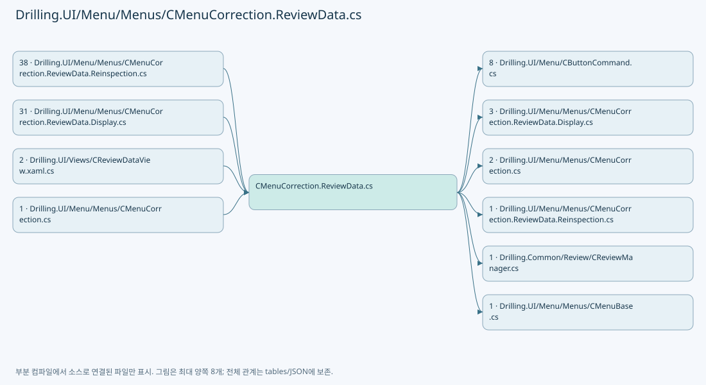
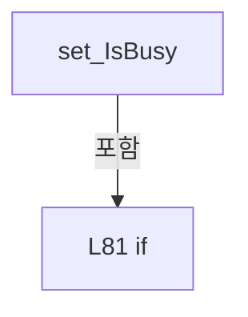
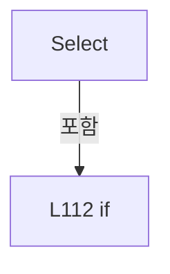
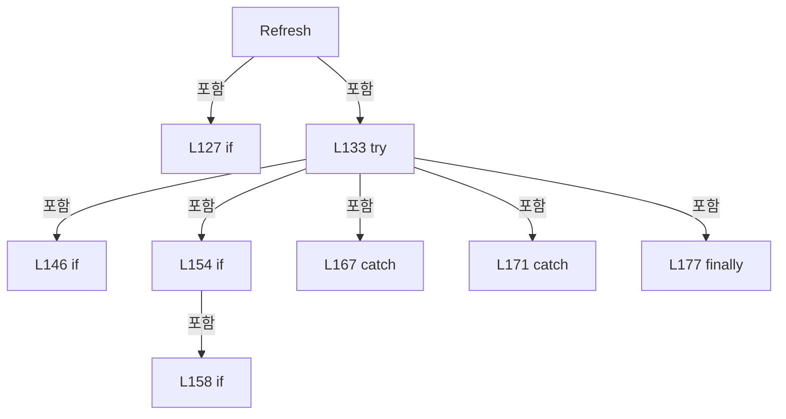
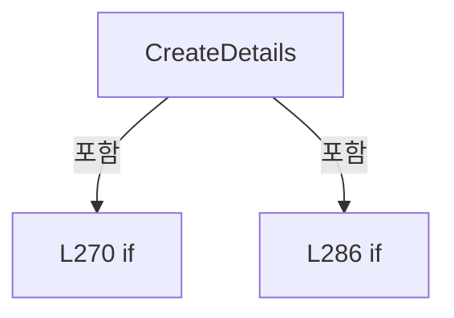
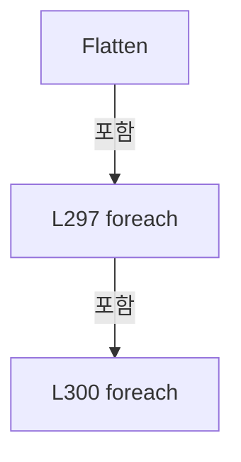
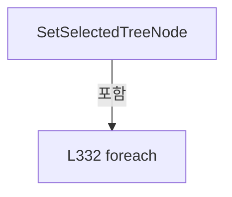
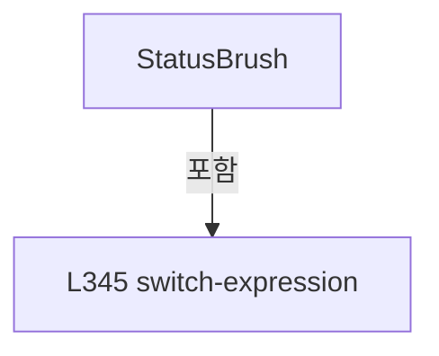
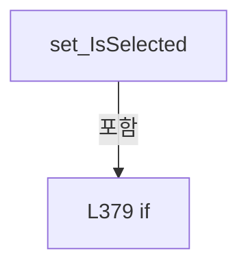

# Drilling.UI/Menu/Menus/CMenuCorrection.ReviewData.cs

| 항목 | 내용 |
| --- | --- |
| 원본 저장소 | https://github.com/kjuws10-rgb/A3Drilling.git |
| 원본 Commit | 5aee8e58439c9b455cae7c9593c9be986c3e682e |
| 원본 SHA256 | 3bc50de7214a0d012751f8c084f589d20d06e1298e3d89e2b3b7350a9ea14c4c |
| 파일 분류 | code |
| 원본 크기/행 | 18,363 bytes / 392 physical lines |
| 인코딩 | utf-8-sig |
| 검토 범위 | 구문/부분 의미 분석에서 추출한 사실. 동작·물리 단위·실장비 합격을 보증하지 않습니다. |
| 원본 링크 | [고정 Commit 원본](https://github.com/kjuws10-rgb/A3Drilling/blob/5aee8e58439c9b455cae7c9593c9be986c3e682e/Drilling.UI/Menu/Menus/CMenuCorrection.ReviewData.cs) |

## 파일의 역할과 읽는 순서

WPF 화면·사용자 명령·표시 상태를 구성합니다. XAML 이벤트와 코드 비하인드, RootView의 조립 경로를 함께 추적합니다.

## 네임스페이스·타입·상속

| 타입 | 구분 | 원본 범위 | 선언/상속 |
| --- | --- | --- | --- |
| CMenuCorrection | ClassDeclaration | 12–391 | CMenuCorrection |
| CReviewDataPanel | ClassDeclaration | 14–359 | CReviewDataPanel: INotifyPropertyChanged |
| ST_REVIEW_RESULT_TREE_NODE | RecordDeclaration | 361–388 | ST_REVIEW_RESULT_TREE_NODE |
| ST_REVIEW_DATA_DETAIL_ITEM | RecordDeclaration | 390–390 | ST_REVIEW_DATA_DETAIL_ITEM |

## 멤버 빠른 목록

| 이름 | 종류 | 범위 | 서명 |
| --- | --- | --- | --- |
| _reviewResultFile | FieldDeclaration | L16–16 | Drilling.Common.Review.CReviewResultFileBase Drilling.UI.Menu.Menus.CMenuCorrection.CReviewDataPanel._reviewResultFile |
| _reviewOffsetFile | FieldDeclaration | L17–17 | Drilling.Common.Review.CReviewOffsetFileBase Drilling.UI.Menu.Menus.CMenuCorrection.CReviewDataPanel._reviewOffsetFile |
| _reviewManager | FieldDeclaration | L18–18 | Drilling.Common.Review.CReviewManager Drilling.UI.Menu.Menus.CMenuCorrection.CReviewDataPanel._reviewManager |
| _recipeManager | FieldDeclaration | L19–19 | Drilling.Common.Managers.CRecipeManager Drilling.UI.Menu.Menus.CMenuCorrection.CReviewDataPanel._recipeManager |
| _settingManager | FieldDeclaration | L20–20 | Drilling.Common.Managers.CSettingManager Drilling.UI.Menu.Menus.CMenuCorrection.CReviewDataPanel._settingManager |
| _selectedRecipeIdProvider | FieldDeclaration | L21–21 | System.Func<string> Drilling.UI.Menu.Menus.CMenuCorrection.CReviewDataPanel._selectedRecipeIdProvider |
| _statusReporter | FieldDeclaration | L22–22 | System.Action<string> Drilling.UI.Menu.Menus.CMenuCorrection.CReviewDataPanel._statusReporter |
| _rollbackReviewOffset | FieldDeclaration | L23–23 | System.Func<System.Threading.Tasks.Task> Drilling.UI.Menu.Menus.CMenuCorrection.CReviewDataPanel._rollbackReviewOffset |
| _saveReviewOffsetFromResult | FieldDeclaration | L24–24 | System.Func<string, System.Collections.Generic.IReadOnlyList<Drilling.Common.Review.ST_REVIEW_OFFSET_ROW>, string, System.Threading.Tasks.Task<Drilling.Common.Review.ST_REVIEW_OFFSET_FILE_DATA?>> Drilling.UI.Menu.Menus.CMenuCorrection.CReviewDataPanel._saveReviewOffsetFromResult |
| _isBusy | FieldDeclaration | L25–25 | bool Drilling.UI.Menu.Menus.CMenuCorrection.CReviewDataPanel._isBusy |
| _selectedNode | FieldDeclaration | L26–26 | Drilling.UI.Menu.Menus.CMenuCorrection.ST_REVIEW_RESULT_TREE_NODE? Drilling.UI.Menu.Menus.CMenuCorrection.CReviewDataPanel._selectedNode |
| .ctor | ConstructorDeclaration | L28–57 | Drilling.UI.Menu.Menus.CMenuCorrection.CReviewDataPanel.CReviewDataPanel(Drilling.Common.Review.CReviewResultFileBase, Drilling.Common.Review.CReviewOffsetFileBase, Drilling.Common.Review.CReviewManager, Drilling.Common.Managers.CRecipeManager, Drilling.Common.Managers.CSettingManager, System.Func<string>, System.Action<string>, System.Func<System.Threading.Tasks.Task>, System.Func<string, System.Collections.Generic.IReadOnlyList<Drilling.Common.Review.ST_REVIEW_OFFSET_ROW>, string, System.Threading.Tasks.Task<Drilling.Common.Review.ST_REVIEW_OFFSET_FILE_DATA?>>) |
| PropertyChanged | EventFieldDeclaration | L59–59 | System.ComponentModel.PropertyChangedEventHandler? Drilling.UI.Menu.Menus.CMenuCorrection.CReviewDataPanel.PropertyChanged |
| RefreshCommand | PropertyDeclaration | L61–61 | Drilling.UI.Menu.CButtonCommand Drilling.UI.Menu.Menus.CMenuCorrection.CReviewDataPanel.RefreshCommand |
| get_RefreshCommand | GetAccessorDeclaration | L61–61 | Drilling.UI.Menu.CButtonCommand Drilling.UI.Menu.Menus.CMenuCorrection.CReviewDataPanel.RefreshCommand.get |
| LoadDataCommand | PropertyDeclaration | L62–62 | Drilling.UI.Menu.CButtonCommand Drilling.UI.Menu.Menus.CMenuCorrection.CReviewDataPanel.LoadDataCommand |
| get_LoadDataCommand | GetAccessorDeclaration | L62–62 | Drilling.UI.Menu.CButtonCommand Drilling.UI.Menu.Menus.CMenuCorrection.CReviewDataPanel.LoadDataCommand.get |
| SelectCellCommand | PropertyDeclaration | L63–63 | Drilling.UI.Menu.CButtonCommand Drilling.UI.Menu.Menus.CMenuCorrection.CReviewDataPanel.SelectCellCommand |
| get_SelectCellCommand | GetAccessorDeclaration | L63–63 | Drilling.UI.Menu.CButtonCommand Drilling.UI.Menu.Menus.CMenuCorrection.CReviewDataPanel.SelectCellCommand.get |
| OffsetApplyCommand | PropertyDeclaration | L64–64 | Drilling.UI.Menu.CButtonCommand Drilling.UI.Menu.Menus.CMenuCorrection.CReviewDataPanel.OffsetApplyCommand |
| get_OffsetApplyCommand | GetAccessorDeclaration | L64–64 | Drilling.UI.Menu.CButtonCommand Drilling.UI.Menu.Menus.CMenuCorrection.CReviewDataPanel.OffsetApplyCommand.get |
| OffsetRollbackCommand | PropertyDeclaration | L65–65 | Drilling.UI.Menu.CButtonCommand Drilling.UI.Menu.Menus.CMenuCorrection.CReviewDataPanel.OffsetRollbackCommand |
| get_OffsetRollbackCommand | GetAccessorDeclaration | L65–65 | Drilling.UI.Menu.CButtonCommand Drilling.UI.Menu.Menus.CMenuCorrection.CReviewDataPanel.OffsetRollbackCommand.get |
| OffsetInitCommand | PropertyDeclaration | L66–66 | Drilling.UI.Menu.CButtonCommand Drilling.UI.Menu.Menus.CMenuCorrection.CReviewDataPanel.OffsetInitCommand |
| get_OffsetInitCommand | GetAccessorDeclaration | L66–66 | Drilling.UI.Menu.CButtonCommand Drilling.UI.Menu.Menus.CMenuCorrection.CReviewDataPanel.OffsetInitCommand.get |
| OffsetViewCommand | PropertyDeclaration | L67–67 | Drilling.UI.Menu.CButtonCommand Drilling.UI.Menu.Menus.CMenuCorrection.CReviewDataPanel.OffsetViewCommand |
| get_OffsetViewCommand | GetAccessorDeclaration | L67–67 | Drilling.UI.Menu.CButtonCommand Drilling.UI.Menu.Menus.CMenuCorrection.CReviewDataPanel.OffsetViewCommand.get |
| Nodes | PropertyDeclaration | L68–68 | System.Collections.Generic.IReadOnlyList<Drilling.UI.Menu.Menus.CMenuCorrection.ST_REVIEW_RESULT_TREE_NODE> Drilling.UI.Menu.Menus.CMenuCorrection.CReviewDataPanel.Nodes |
| get_Nodes | GetAccessorDeclaration | L68–68 | System.Collections.Generic.IReadOnlyList<Drilling.UI.Menu.Menus.CMenuCorrection.ST_REVIEW_RESULT_TREE_NODE> Drilling.UI.Menu.Menus.CMenuCorrection.CReviewDataPanel.Nodes.get |
| set_Nodes | SetAccessorDeclaration | L68–68 | void Drilling.UI.Menu.Menus.CMenuCorrection.CReviewDataPanel.Nodes.set |
| SelectedDetails | PropertyDeclaration | L69–69 | System.Collections.Generic.IReadOnlyList<Drilling.UI.Menu.Menus.CMenuCorrection.ST_REVIEW_DATA_DETAIL_ITEM> Drilling.UI.Menu.Menus.CMenuCorrection.CReviewDataPanel.SelectedDetails |
| get_SelectedDetails | GetAccessorDeclaration | L69–69 | System.Collections.Generic.IReadOnlyList<Drilling.UI.Menu.Menus.CMenuCorrection.ST_REVIEW_DATA_DETAIL_ITEM> Drilling.UI.Menu.Menus.CMenuCorrection.CReviewDataPanel.SelectedDetails.get |
| set_SelectedDetails | SetAccessorDeclaration | L69–69 | void Drilling.UI.Menu.Menus.CMenuCorrection.CReviewDataPanel.SelectedDetails.set |
| StatusText | PropertyDeclaration | L70–70 | string Drilling.UI.Menu.Menus.CMenuCorrection.CReviewDataPanel.StatusText |
| get_StatusText | GetAccessorDeclaration | L70–70 | string Drilling.UI.Menu.Menus.CMenuCorrection.CReviewDataPanel.StatusText.get |
| set_StatusText | SetAccessorDeclaration | L70–70 | void Drilling.UI.Menu.Menus.CMenuCorrection.CReviewDataPanel.StatusText.set |
| SelectedTitle | PropertyDeclaration | L71–71 | string Drilling.UI.Menu.Menus.CMenuCorrection.CReviewDataPanel.SelectedTitle |
| get_SelectedTitle | GetAccessorDeclaration | L71–71 | string Drilling.UI.Menu.Menus.CMenuCorrection.CReviewDataPanel.SelectedTitle.get |
| set_SelectedTitle | SetAccessorDeclaration | L71–71 | void Drilling.UI.Menu.Menus.CMenuCorrection.CReviewDataPanel.SelectedTitle.set |
| SelectedStatus | PropertyDeclaration | L72–72 | string Drilling.UI.Menu.Menus.CMenuCorrection.CReviewDataPanel.SelectedStatus |
| get_SelectedStatus | GetAccessorDeclaration | L72–72 | string Drilling.UI.Menu.Menus.CMenuCorrection.CReviewDataPanel.SelectedStatus.get |
| set_SelectedStatus | SetAccessorDeclaration | L72–72 | void Drilling.UI.Menu.Menus.CMenuCorrection.CReviewDataPanel.SelectedStatus.set |
| SelectedPath | PropertyDeclaration | L73–73 | string Drilling.UI.Menu.Menus.CMenuCorrection.CReviewDataPanel.SelectedPath |
| get_SelectedPath | GetAccessorDeclaration | L73–73 | string Drilling.UI.Menu.Menus.CMenuCorrection.CReviewDataPanel.SelectedPath.get |
| set_SelectedPath | SetAccessorDeclaration | L73–73 | void Drilling.UI.Menu.Menus.CMenuCorrection.CReviewDataPanel.SelectedPath.set |
| SelectedStatusBrush | PropertyDeclaration | L74–74 | Brush Drilling.UI.Menu.Menus.CMenuCorrection.CReviewDataPanel.SelectedStatusBrush |
| IsBusy | PropertyDeclaration | L76–91 | bool Drilling.UI.Menu.Menus.CMenuCorrection.CReviewDataPanel.IsBusy |
| get_IsBusy | GetAccessorDeclaration | L78–78 | bool Drilling.UI.Menu.Menus.CMenuCorrection.CReviewDataPanel.IsBusy.get |
| set_IsBusy | SetAccessorDeclaration | L79–90 | void Drilling.UI.Menu.Menus.CMenuCorrection.CReviewDataPanel.IsBusy.set |
| Reload | MethodDeclaration | L93–96 | System.Threading.Tasks.Task Drilling.UI.Menu.Menus.CMenuCorrection.CReviewDataPanel.Reload(System.Threading.CancellationToken) |
| Select | MethodDeclaration | L98–116 | void Drilling.UI.Menu.Menus.CMenuCorrection.CReviewDataPanel.Select(Drilling.UI.Menu.Menus.CMenuCorrection.ST_REVIEW_RESULT_TREE_NODE) |
| RefreshRequested | MethodDeclaration | L118–121 | void Drilling.UI.Menu.Menus.CMenuCorrection.CReviewDataPanel.RefreshRequested(object?) |
| Refresh | MethodDeclaration | L123–181 | System.Threading.Tasks.Task Drilling.UI.Menu.Menus.CMenuCorrection.CReviewDataPanel.Refresh(System.Threading.CancellationToken, string?) |
| ClearSelection | MethodDeclaration | L183–197 | void Drilling.UI.Menu.Menus.CMenuCorrection.CReviewDataPanel.ClearSelection() |
| BuildTree | MethodDeclaration | L199–261 | System.Collections.Generic.IReadOnlyList<Drilling.UI.Menu.Menus.CMenuCorrection.ST_REVIEW_RESULT_TREE_NODE> Drilling.UI.Menu.Menus.CMenuCorrection.CReviewDataPanel.BuildTree(System.Collections.Generic.IReadOnlyList<Drilling.Common.Review.ST_REVIEW_RESULT_CATALOG_ITEM>) |
| CreateResultNode | MethodDeclaration | L263–266 | Drilling.UI.Menu.Menus.CMenuCorrection.ST_REVIEW_RESULT_TREE_NODE Drilling.UI.Menu.Menus.CMenuCorrection.CReviewDataPanel.CreateResultNode(Drilling.Common.Review.ST_REVIEW_RESULT_CATALOG_ITEM) |
| CreateDetails | MethodDeclaration | L268–292 | System.Collections.Generic.IReadOnlyList<Drilling.UI.Menu.Menus.CMenuCorrection.ST_REVIEW_DATA_DETAIL_ITEM> Drilling.UI.Menu.Menus.CMenuCorrection.CReviewDataPanel.CreateDetails(Drilling.UI.Menu.Menus.CMenuCorrection.ST_REVIEW_RESULT_TREE_NODE) |
| Flatten | MethodDeclaration | L294–305 | System.Collections.Generic.IEnumerable<Drilling.UI.Menu.Menus.CMenuCorrection.ST_REVIEW_RESULT_TREE_NODE> Drilling.UI.Menu.Menus.CMenuCorrection.CReviewDataPanel.Flatten(System.Collections.Generic.IEnumerable<Drilling.UI.Menu.Menus.CMenuCorrection.ST_REVIEW_RESULT_TREE_NODE>) |
| ExpandResultPath | MethodDeclaration | L307–328 | System.Collections.Generic.IReadOnlyList<Drilling.UI.Menu.Menus.CMenuCorrection.ST_REVIEW_RESULT_TREE_NODE> Drilling.UI.Menu.Menus.CMenuCorrection.CReviewDataPanel.ExpandResultPath(System.Collections.Generic.IEnumerable<Drilling.UI.Menu.Menus.CMenuCorrection.ST_REVIEW_RESULT_TREE_NODE>, string) |
| ContainsExpandedResult | LocalFunctionStatement | L323–327 | bool ContainsExpandedResult(Drilling.UI.Menu.Menus.CMenuCorrection.ST_REVIEW_RESULT_TREE_NODE) |
| SetSelectedTreeNode | MethodDeclaration | L330–336 | void Drilling.UI.Menu.Menus.CMenuCorrection.CReviewDataPanel.SetSelectedTreeNode(Drilling.UI.Menu.Menus.CMenuCorrection.ST_REVIEW_RESULT_TREE_NODE?) |
| CountResults | MethodDeclaration | L338–341 | int Drilling.UI.Menu.Menus.CMenuCorrection.CReviewDataPanel.CountResults(Drilling.UI.Menu.Menus.CMenuCorrection.ST_REVIEW_RESULT_TREE_NODE) |
| StatusBrush | MethodDeclaration | L343–353 | Brush Drilling.UI.Menu.Menus.CMenuCorrection.CReviewDataPanel.StatusBrush(string) |
| Notify | MethodDeclaration | L355–358 | void Drilling.UI.Menu.Menus.CMenuCorrection.CReviewDataPanel.Notify(string) |
| _isSelected | FieldDeclaration | L369–369 | bool Drilling.UI.Menu.Menus.CMenuCorrection.ST_REVIEW_RESULT_TREE_NODE._isSelected |
| PropertyChanged | EventFieldDeclaration | L371–371 | System.ComponentModel.PropertyChangedEventHandler? Drilling.UI.Menu.Menus.CMenuCorrection.ST_REVIEW_RESULT_TREE_NODE.PropertyChanged |
| DetailBrush | PropertyDeclaration | L372–372 | Brush Drilling.UI.Menu.Menus.CMenuCorrection.ST_REVIEW_RESULT_TREE_NODE.DetailBrush |
| IsDirectory | PropertyDeclaration | L373–373 | bool Drilling.UI.Menu.Menus.CMenuCorrection.ST_REVIEW_RESULT_TREE_NODE.IsDirectory |
| IsSelected | PropertyDeclaration | L374–387 | bool Drilling.UI.Menu.Menus.CMenuCorrection.ST_REVIEW_RESULT_TREE_NODE.IsSelected |
| get_IsSelected | GetAccessorDeclaration | L376–376 | bool Drilling.UI.Menu.Menus.CMenuCorrection.ST_REVIEW_RESULT_TREE_NODE.IsSelected.get |
| set_IsSelected | SetAccessorDeclaration | L377–386 | void Drilling.UI.Menu.Menus.CMenuCorrection.ST_REVIEW_RESULT_TREE_NODE.IsSelected.set |

## 멤버별 상세 계약·호출·처리 해설

### FieldDeclaration `_reviewResultFile` · L16–16

[Drilling.UI/Menu/Menus/CMenuCorrection.ReviewData.cs:16–16](https://github.com/kjuws10-rgb/A3Drilling/blob/5aee8e58439c9b455cae7c9593c9be986c3e682e/Drilling.UI/Menu/Menus/CMenuCorrection.ReviewData.cs#L16-L16)

| 항목 | 실제 추출 값 |
| --- | --- |
| 서명 | Drilling.Common.Review.CReviewResultFileBase Drilling.UI.Menu.Menus.CMenuCorrection.CReviewDataPanel._reviewResultFile |
| 접근/수식자 | Private / private, readonly |
| 반환/값 타입 | Drilling.Common.Review.CReviewResultFileBase |
| 소속 타입 | NamedType:Drilling.UI.Menu.Menus.CMenuCorrection.CReviewDataPanel |

현재 부분 분석에서 직접 연결된 호출자는 없습니다. XAML/이벤트/인터페이스·델리게이트·외부 진입을 추가 확인해야 하며, 미사용으로 판정한 것이 아닙니다.

변경 전 점검: 입력/반환 타입, 위 호출자, 예외/취소 경로, 공유 상태와 저장·전송 소비자를 함께 확인합니다. 값의 단위나 물리 방향을 이름만으로 확정하지 않습니다.

### FieldDeclaration `_reviewOffsetFile` · L17–17

[Drilling.UI/Menu/Menus/CMenuCorrection.ReviewData.cs:17–17](https://github.com/kjuws10-rgb/A3Drilling/blob/5aee8e58439c9b455cae7c9593c9be986c3e682e/Drilling.UI/Menu/Menus/CMenuCorrection.ReviewData.cs#L17-L17)

| 항목 | 실제 추출 값 |
| --- | --- |
| 서명 | Drilling.Common.Review.CReviewOffsetFileBase Drilling.UI.Menu.Menus.CMenuCorrection.CReviewDataPanel._reviewOffsetFile |
| 접근/수식자 | Private / private, readonly |
| 반환/값 타입 | Drilling.Common.Review.CReviewOffsetFileBase |
| 소속 타입 | NamedType:Drilling.UI.Menu.Menus.CMenuCorrection.CReviewDataPanel |

현재 부분 분석에서 직접 연결된 호출자는 없습니다. XAML/이벤트/인터페이스·델리게이트·외부 진입을 추가 확인해야 하며, 미사용으로 판정한 것이 아닙니다.

변경 전 점검: 입력/반환 타입, 위 호출자, 예외/취소 경로, 공유 상태와 저장·전송 소비자를 함께 확인합니다. 값의 단위나 물리 방향을 이름만으로 확정하지 않습니다.

### FieldDeclaration `_reviewManager` · L18–18

[Drilling.UI/Menu/Menus/CMenuCorrection.ReviewData.cs:18–18](https://github.com/kjuws10-rgb/A3Drilling/blob/5aee8e58439c9b455cae7c9593c9be986c3e682e/Drilling.UI/Menu/Menus/CMenuCorrection.ReviewData.cs#L18-L18)

| 항목 | 실제 추출 값 |
| --- | --- |
| 서명 | Drilling.Common.Review.CReviewManager Drilling.UI.Menu.Menus.CMenuCorrection.CReviewDataPanel._reviewManager |
| 접근/수식자 | Private / private, readonly |
| 반환/값 타입 | Drilling.Common.Review.CReviewManager |
| 소속 타입 | NamedType:Drilling.UI.Menu.Menus.CMenuCorrection.CReviewDataPanel |

현재 부분 분석에서 직접 연결된 호출자는 없습니다. XAML/이벤트/인터페이스·델리게이트·외부 진입을 추가 확인해야 하며, 미사용으로 판정한 것이 아닙니다.

변경 전 점검: 입력/반환 타입, 위 호출자, 예외/취소 경로, 공유 상태와 저장·전송 소비자를 함께 확인합니다. 값의 단위나 물리 방향을 이름만으로 확정하지 않습니다.

### FieldDeclaration `_recipeManager` · L19–19

[Drilling.UI/Menu/Menus/CMenuCorrection.ReviewData.cs:19–19](https://github.com/kjuws10-rgb/A3Drilling/blob/5aee8e58439c9b455cae7c9593c9be986c3e682e/Drilling.UI/Menu/Menus/CMenuCorrection.ReviewData.cs#L19-L19)

| 항목 | 실제 추출 값 |
| --- | --- |
| 서명 | Drilling.Common.Managers.CRecipeManager Drilling.UI.Menu.Menus.CMenuCorrection.CReviewDataPanel._recipeManager |
| 접근/수식자 | Private / private, readonly |
| 반환/값 타입 | Drilling.Common.Managers.CRecipeManager |
| 소속 타입 | NamedType:Drilling.UI.Menu.Menus.CMenuCorrection.CReviewDataPanel |

현재 부분 분석에서 직접 연결된 호출자는 없습니다. XAML/이벤트/인터페이스·델리게이트·외부 진입을 추가 확인해야 하며, 미사용으로 판정한 것이 아닙니다.

변경 전 점검: 입력/반환 타입, 위 호출자, 예외/취소 경로, 공유 상태와 저장·전송 소비자를 함께 확인합니다. 값의 단위나 물리 방향을 이름만으로 확정하지 않습니다.

### FieldDeclaration `_settingManager` · L20–20

[Drilling.UI/Menu/Menus/CMenuCorrection.ReviewData.cs:20–20](https://github.com/kjuws10-rgb/A3Drilling/blob/5aee8e58439c9b455cae7c9593c9be986c3e682e/Drilling.UI/Menu/Menus/CMenuCorrection.ReviewData.cs#L20-L20)

| 항목 | 실제 추출 값 |
| --- | --- |
| 서명 | Drilling.Common.Managers.CSettingManager Drilling.UI.Menu.Menus.CMenuCorrection.CReviewDataPanel._settingManager |
| 접근/수식자 | Private / private, readonly |
| 반환/값 타입 | Drilling.Common.Managers.CSettingManager |
| 소속 타입 | NamedType:Drilling.UI.Menu.Menus.CMenuCorrection.CReviewDataPanel |

현재 부분 분석에서 직접 연결된 호출자는 없습니다. XAML/이벤트/인터페이스·델리게이트·외부 진입을 추가 확인해야 하며, 미사용으로 판정한 것이 아닙니다.

변경 전 점검: 입력/반환 타입, 위 호출자, 예외/취소 경로, 공유 상태와 저장·전송 소비자를 함께 확인합니다. 값의 단위나 물리 방향을 이름만으로 확정하지 않습니다.

### FieldDeclaration `_selectedRecipeIdProvider` · L21–21

[Drilling.UI/Menu/Menus/CMenuCorrection.ReviewData.cs:21–21](https://github.com/kjuws10-rgb/A3Drilling/blob/5aee8e58439c9b455cae7c9593c9be986c3e682e/Drilling.UI/Menu/Menus/CMenuCorrection.ReviewData.cs#L21-L21)

| 항목 | 실제 추출 값 |
| --- | --- |
| 서명 | System.Func<string> Drilling.UI.Menu.Menus.CMenuCorrection.CReviewDataPanel._selectedRecipeIdProvider |
| 접근/수식자 | Private / private, readonly |
| 반환/값 타입 | System.Func<string> |
| 소속 타입 | NamedType:Drilling.UI.Menu.Menus.CMenuCorrection.CReviewDataPanel |

현재 부분 분석에서 직접 연결된 호출자는 없습니다. XAML/이벤트/인터페이스·델리게이트·외부 진입을 추가 확인해야 하며, 미사용으로 판정한 것이 아닙니다.

변경 전 점검: 입력/반환 타입, 위 호출자, 예외/취소 경로, 공유 상태와 저장·전송 소비자를 함께 확인합니다. 값의 단위나 물리 방향을 이름만으로 확정하지 않습니다.

### FieldDeclaration `_statusReporter` · L22–22

[Drilling.UI/Menu/Menus/CMenuCorrection.ReviewData.cs:22–22](https://github.com/kjuws10-rgb/A3Drilling/blob/5aee8e58439c9b455cae7c9593c9be986c3e682e/Drilling.UI/Menu/Menus/CMenuCorrection.ReviewData.cs#L22-L22)

| 항목 | 실제 추출 값 |
| --- | --- |
| 서명 | System.Action<string> Drilling.UI.Menu.Menus.CMenuCorrection.CReviewDataPanel._statusReporter |
| 접근/수식자 | Private / private, readonly |
| 반환/값 타입 | System.Action<string> |
| 소속 타입 | NamedType:Drilling.UI.Menu.Menus.CMenuCorrection.CReviewDataPanel |

현재 부분 분석에서 직접 연결된 호출자는 없습니다. XAML/이벤트/인터페이스·델리게이트·외부 진입을 추가 확인해야 하며, 미사용으로 판정한 것이 아닙니다.

변경 전 점검: 입력/반환 타입, 위 호출자, 예외/취소 경로, 공유 상태와 저장·전송 소비자를 함께 확인합니다. 값의 단위나 물리 방향을 이름만으로 확정하지 않습니다.

### FieldDeclaration `_rollbackReviewOffset` · L23–23

[Drilling.UI/Menu/Menus/CMenuCorrection.ReviewData.cs:23–23](https://github.com/kjuws10-rgb/A3Drilling/blob/5aee8e58439c9b455cae7c9593c9be986c3e682e/Drilling.UI/Menu/Menus/CMenuCorrection.ReviewData.cs#L23-L23)

| 항목 | 실제 추출 값 |
| --- | --- |
| 서명 | System.Func<System.Threading.Tasks.Task> Drilling.UI.Menu.Menus.CMenuCorrection.CReviewDataPanel._rollbackReviewOffset |
| 접근/수식자 | Private / private, readonly |
| 반환/값 타입 | System.Func<System.Threading.Tasks.Task> |
| 소속 타입 | NamedType:Drilling.UI.Menu.Menus.CMenuCorrection.CReviewDataPanel |

현재 부분 분석에서 직접 연결된 호출자는 없습니다. XAML/이벤트/인터페이스·델리게이트·외부 진입을 추가 확인해야 하며, 미사용으로 판정한 것이 아닙니다.

변경 전 점검: 입력/반환 타입, 위 호출자, 예외/취소 경로, 공유 상태와 저장·전송 소비자를 함께 확인합니다. 값의 단위나 물리 방향을 이름만으로 확정하지 않습니다.

### FieldDeclaration `_saveReviewOffsetFromResult` · L24–24

[Drilling.UI/Menu/Menus/CMenuCorrection.ReviewData.cs:24–24](https://github.com/kjuws10-rgb/A3Drilling/blob/5aee8e58439c9b455cae7c9593c9be986c3e682e/Drilling.UI/Menu/Menus/CMenuCorrection.ReviewData.cs#L24-L24)

| 항목 | 실제 추출 값 |
| --- | --- |
| 서명 | System.Func<string, System.Collections.Generic.IReadOnlyList<Drilling.Common.Review.ST_REVIEW_OFFSET_ROW>, string, System.Threading.Tasks.Task<Drilling.Common.Review.ST_REVIEW_OFFSET_FILE_DATA?>> Drilling.UI.Menu.Menus.CMenuCorrection.CReviewDataPanel._saveReviewOffsetFromResult |
| 접근/수식자 | Private / private, readonly |
| 반환/값 타입 | System.Func<string, System.Collections.Generic.IReadOnlyList<Drilling.Common.Review.ST_REVIEW_OFFSET_ROW>, string, System.Threading.Tasks.Task<Drilling.Common.Review.ST_REVIEW_OFFSET_FILE_DATA?>> |
| 소속 타입 | NamedType:Drilling.UI.Menu.Menus.CMenuCorrection.CReviewDataPanel |

현재 부분 분석에서 직접 연결된 호출자는 없습니다. XAML/이벤트/인터페이스·델리게이트·외부 진입을 추가 확인해야 하며, 미사용으로 판정한 것이 아닙니다.

변경 전 점검: 입력/반환 타입, 위 호출자, 예외/취소 경로, 공유 상태와 저장·전송 소비자를 함께 확인합니다. 값의 단위나 물리 방향을 이름만으로 확정하지 않습니다.

### FieldDeclaration `_isBusy` · L25–25

[Drilling.UI/Menu/Menus/CMenuCorrection.ReviewData.cs:25–25](https://github.com/kjuws10-rgb/A3Drilling/blob/5aee8e58439c9b455cae7c9593c9be986c3e682e/Drilling.UI/Menu/Menus/CMenuCorrection.ReviewData.cs#L25-L25)

| 항목 | 실제 추출 값 |
| --- | --- |
| 서명 | bool Drilling.UI.Menu.Menus.CMenuCorrection.CReviewDataPanel._isBusy |
| 접근/수식자 | Private / private |
| 반환/값 타입 | bool |
| 소속 타입 | NamedType:Drilling.UI.Menu.Menus.CMenuCorrection.CReviewDataPanel |

현재 부분 분석에서 직접 연결된 호출자는 없습니다. XAML/이벤트/인터페이스·델리게이트·외부 진입을 추가 확인해야 하며, 미사용으로 판정한 것이 아닙니다.

변경 전 점검: 입력/반환 타입, 위 호출자, 예외/취소 경로, 공유 상태와 저장·전송 소비자를 함께 확인합니다. 값의 단위나 물리 방향을 이름만으로 확정하지 않습니다.

### FieldDeclaration `_selectedNode` · L26–26

[Drilling.UI/Menu/Menus/CMenuCorrection.ReviewData.cs:26–26](https://github.com/kjuws10-rgb/A3Drilling/blob/5aee8e58439c9b455cae7c9593c9be986c3e682e/Drilling.UI/Menu/Menus/CMenuCorrection.ReviewData.cs#L26-L26)

| 항목 | 실제 추출 값 |
| --- | --- |
| 서명 | Drilling.UI.Menu.Menus.CMenuCorrection.ST_REVIEW_RESULT_TREE_NODE? Drilling.UI.Menu.Menus.CMenuCorrection.CReviewDataPanel._selectedNode |
| 접근/수식자 | Private / private |
| 반환/값 타입 | Drilling.UI.Menu.Menus.CMenuCorrection.ST_REVIEW_RESULT_TREE_NODE? |
| 소속 타입 | NamedType:Drilling.UI.Menu.Menus.CMenuCorrection.CReviewDataPanel |

현재 부분 분석에서 직접 연결된 호출자는 없습니다. XAML/이벤트/인터페이스·델리게이트·외부 진입을 추가 확인해야 하며, 미사용으로 판정한 것이 아닙니다.

변경 전 점검: 입력/반환 타입, 위 호출자, 예외/취소 경로, 공유 상태와 저장·전송 소비자를 함께 확인합니다. 값의 단위나 물리 방향을 이름만으로 확정하지 않습니다.

### ConstructorDeclaration `.ctor` · L28–57

[Drilling.UI/Menu/Menus/CMenuCorrection.ReviewData.cs:28–57](https://github.com/kjuws10-rgb/A3Drilling/blob/5aee8e58439c9b455cae7c9593c9be986c3e682e/Drilling.UI/Menu/Menus/CMenuCorrection.ReviewData.cs#L28-L57)

| 항목 | 실제 추출 값 |
| --- | --- |
| 서명 | Drilling.UI.Menu.Menus.CMenuCorrection.CReviewDataPanel.CReviewDataPanel(Drilling.Common.Review.CReviewResultFileBase, Drilling.Common.Review.CReviewOffsetFileBase, Drilling.Common.Review.CReviewManager, Drilling.Common.Managers.CRecipeManager, Drilling.Common.Managers.CSettingManager, System.Func<string>, System.Action<string>, System.Func<System.Threading.Tasks.Task>, System.Func<string, System.Collections.Generic.IReadOnlyList<Drilling.Common.Review.ST_REVIEW_OFFSET_ROW>, string, System.Threading.Tasks.Task<Drilling.Common.Review.ST_REVIEW_OFFSET_FILE_DATA?>>) |
| 접근/수식자 | Public / public |
| 반환/값 타입 | void |
| 소속 타입 | NamedType:Drilling.UI.Menu.Menus.CMenuCorrection.CReviewDataPanel |

입력 계약:

| 이름 | 타입 | 전달 | 선택/기본값 |
| --- | --- | --- | --- |
| reviewResultFile | Drilling.Common.Review.CReviewResultFileBase | None | False /  |
| reviewOffsetFile | Drilling.Common.Review.CReviewOffsetFileBase | None | False /  |
| reviewManager | Drilling.Common.Review.CReviewManager | None | False /  |
| recipeManager | Drilling.Common.Managers.CRecipeManager | None | False /  |
| settingManager | Drilling.Common.Managers.CSettingManager | None | False /  |
| selectedRecipeIdProvider | System.Func<string> | None | False /  |
| statusReporter | System.Action<string> | None | False /  |
| rollbackReviewOffset | System.Func<System.Threading.Tasks.Task> | None | False /  |
| saveReviewOffsetFromResult | System.Func<string, System.Collections.Generic.IReadOnlyList<Drilling.Common.Review.ST_REVIEW_OFFSET_ROW>, string, System.Threading.Tasks.Task<Drilling.Common.Review.ST_REVIEW_OFFSET_FILE_DATA?>> | None | False /  |

정적 호출자로 확인된 위치:

| 호출 파일/행 | 호출 표현식 | 런타임 분기 가능 |
| --- | --- | --- |
| [Drilling.UI/Menu/Menus/CMenuCorrection.cs:138–147](https://github.com/kjuws10-rgb/A3Drilling/blob/5aee8e58439c9b455cae7c9593c9be986c3e682e/Drilling.UI/Menu/Menus/CMenuCorrection.cs#L138-L147) | new CReviewDataPanel | False |

호출하는 대상과 해석 범위:

| 원본 행 | 표현식 | 분석 상태 | 대상/소스 위치 |
| --- | --- | --- | --- |
| 48 | new CButtonCommand | resolved | Drilling.UI.Menu.CButtonCommand.CButtonCommand(System.Action<object?>, System.Predicate<object?>?) · Drilling.UI/Menu/CButtonCommand.cs:9 |
| 49 | new CButtonCommand | resolved | Drilling.UI.Menu.CButtonCommand.CButtonCommand(System.Action<object?>, System.Predicate<object?>?) · Drilling.UI/Menu/CButtonCommand.cs:9 |
| 50 | new CButtonCommand | resolved | Drilling.UI.Menu.CButtonCommand.CButtonCommand(System.Action<object?>, System.Predicate<object?>?) · Drilling.UI/Menu/CButtonCommand.cs:9 |
| 51 | new CButtonCommand | resolved | Drilling.UI.Menu.CButtonCommand.CButtonCommand(System.Action<object?>, System.Predicate<object?>?) · Drilling.UI/Menu/CButtonCommand.cs:9 |
| 52 | new CButtonCommand | resolved | Drilling.UI.Menu.CButtonCommand.CButtonCommand(System.Action<object?>, System.Predicate<object?>?) · Drilling.UI/Menu/CButtonCommand.cs:9 |
| 53 | new CButtonCommand | resolved | Drilling.UI.Menu.CButtonCommand.CButtonCommand(System.Action<object?>, System.Predicate<object?>?) · Drilling.UI/Menu/CButtonCommand.cs:9 |
| 54 | new CButtonCommand | resolved | Drilling.UI.Menu.CButtonCommand.CButtonCommand(System.Action<object?>, System.Predicate<object?>?) · Drilling.UI/Menu/CButtonCommand.cs:9 |
| 55 | InitializeReinspectionCommands | resolved | void Drilling.UI.Menu.Menus.CMenuCorrection.CReviewDataPanel.InitializeReinspectionCommands() · Drilling.UI/Menu/Menus/CMenuCorrection.ReviewData.Reinspection.cs:102 |
| 56 | BuildTree | resolved | System.Collections.Generic.IReadOnlyList<Drilling.UI.Menu.Menus.CMenuCorrection.ST_REVIEW_RESULT_TREE_NODE> Drilling.UI.Menu.Menus.CMenuCorrection.CReviewDataPanel.BuildTree(System.Collections.Generic.IReadOnlyList<Drilling.Common.Review.ST_REVIEW_RESULT_CATALOG_ITEM>) · Drilling.UI/Menu/Menus/CMenuCorrection.ReviewData.cs:199 |

본문의 실제 연산·분기·예외·반환 순서(원문 위치 순):

| 원본 행 | 종류 | 주석 해설 |
| --- | --- | --- |
| 39 | assignment | 값을 대상에 대입합니다: _reviewResultFile = reviewResultFile |
| 40 | assignment | 값을 대상에 대입합니다: _reviewOffsetFile = reviewOffsetFile |
| 41 | assignment | 값을 대상에 대입합니다: _reviewManager = reviewManager |
| 42 | assignment | 값을 대상에 대입합니다: _recipeManager = recipeManager |
| 43 | assignment | 값을 대상에 대입합니다: _settingManager = settingManager |
| 44 | assignment | 값을 대상에 대입합니다: _selectedRecipeIdProvider = selectedRecipeIdProvider |
| 45 | assignment | 값을 대상에 대입합니다: _statusReporter = statusReporter |
| 46 | assignment | 값을 대상에 대입합니다: _rollbackReviewOffset = rollbackReviewOffset |
| 47 | assignment | 값을 대상에 대입합니다: _saveReviewOffsetFromResult = saveReviewOffsetFromResult |
| 48 | assignment | 값을 대상에 대입합니다: RefreshCommand = new CButtonCommand(RefreshRequested, _ => !IsBusy) |
| 48 | call | 함수·델리게이트 또는 객체 생성자를 호출합니다: new CButtonCommand(RefreshRequested, _ => !IsBusy) |
| 49 | assignment | 값을 대상에 대입합니다: LoadDataCommand = new CButtonCommand(LoadDataRequested, _ => CanLoadData) |
| 49 | call | 함수·델리게이트 또는 객체 생성자를 호출합니다: new CButtonCommand(LoadDataRequested, _ => CanLoadData) |
| 50 | assignment | 값을 대상에 대입합니다: SelectCellCommand = new CButtonCommand(SelectCell) |
| 50 | call | 함수·델리게이트 또는 객체 생성자를 호출합니다: new CButtonCommand(SelectCell) |
| 51 | assignment | 값을 대상에 대입합니다: OffsetApplyCommand = new CButtonCommand(OffsetApplyRequested, _ => CanApplyOffset) |
| 51 | call | 함수·델리게이트 또는 객체 생성자를 호출합니다: new CButtonCommand(OffsetApplyRequested, _ => CanApplyOffset) |
| 52 | assignment | 값을 대상에 대입합니다: OffsetRollbackCommand = new CButtonCommand(OffsetRollbackRequested, _ => CanEditOffsets) |
| 52 | call | 함수·델리게이트 또는 객체 생성자를 호출합니다: new CButtonCommand(OffsetRollbackRequested, _ => CanEditOffsets) |
| 53 | assignment | 값을 대상에 대입합니다: OffsetInitCommand = new CButtonCommand(OffsetInitRequested, _ => CanEditOffsets) |
| 53 | call | 함수·델리게이트 또는 객체 생성자를 호출합니다: new CButtonCommand(OffsetInitRequested, _ => CanEditOffsets) |
| 54 | assignment | 값을 대상에 대입합니다: OffsetViewCommand = new CButtonCommand(OffsetViewRequested, _ => CanEditOffsets) |
| 54 | call | 함수·델리게이트 또는 객체 생성자를 호출합니다: new CButtonCommand(OffsetViewRequested, _ => CanEditOffsets) |
| 55 | call | 함수·델리게이트 또는 객체 생성자를 호출합니다: InitializeReinspectionCommands() |
| 56 | assignment | 값을 대상에 대입합니다: Nodes = BuildTree([]) |
| 56 | call | 함수·델리게이트 또는 객체 생성자를 호출합니다: BuildTree([]) |

변경 전 점검: 입력/반환 타입, 위 호출자, 예외/취소 경로, 공유 상태와 저장·전송 소비자를 함께 확인합니다. 값의 단위나 물리 방향을 이름만으로 확정하지 않습니다.

### EventFieldDeclaration `PropertyChanged` · L59–59

[Drilling.UI/Menu/Menus/CMenuCorrection.ReviewData.cs:59–59](https://github.com/kjuws10-rgb/A3Drilling/blob/5aee8e58439c9b455cae7c9593c9be986c3e682e/Drilling.UI/Menu/Menus/CMenuCorrection.ReviewData.cs#L59-L59)

| 항목 | 실제 추출 값 |
| --- | --- |
| 서명 | System.ComponentModel.PropertyChangedEventHandler? Drilling.UI.Menu.Menus.CMenuCorrection.CReviewDataPanel.PropertyChanged |
| 접근/수식자 | Public / public, event |
| 반환/값 타입 | System.ComponentModel.PropertyChangedEventHandler? |
| 소속 타입 | NamedType:Drilling.UI.Menu.Menus.CMenuCorrection.CReviewDataPanel |

현재 부분 분석에서 직접 연결된 호출자는 없습니다. XAML/이벤트/인터페이스·델리게이트·외부 진입을 추가 확인해야 하며, 미사용으로 판정한 것이 아닙니다.

변경 전 점검: 입력/반환 타입, 위 호출자, 예외/취소 경로, 공유 상태와 저장·전송 소비자를 함께 확인합니다. 값의 단위나 물리 방향을 이름만으로 확정하지 않습니다.

### PropertyDeclaration `RefreshCommand` · L61–61

[Drilling.UI/Menu/Menus/CMenuCorrection.ReviewData.cs:61–61](https://github.com/kjuws10-rgb/A3Drilling/blob/5aee8e58439c9b455cae7c9593c9be986c3e682e/Drilling.UI/Menu/Menus/CMenuCorrection.ReviewData.cs#L61-L61)

| 항목 | 실제 추출 값 |
| --- | --- |
| 서명 | Drilling.UI.Menu.CButtonCommand Drilling.UI.Menu.Menus.CMenuCorrection.CReviewDataPanel.RefreshCommand |
| 접근/수식자 | Public / public |
| 반환/값 타입 | Drilling.UI.Menu.CButtonCommand |
| 소속 타입 | NamedType:Drilling.UI.Menu.Menus.CMenuCorrection.CReviewDataPanel |

현재 부분 분석에서 직접 연결된 호출자는 없습니다. XAML/이벤트/인터페이스·델리게이트·외부 진입을 추가 확인해야 하며, 미사용으로 판정한 것이 아닙니다.

변경 전 점검: 입력/반환 타입, 위 호출자, 예외/취소 경로, 공유 상태와 저장·전송 소비자를 함께 확인합니다. 값의 단위나 물리 방향을 이름만으로 확정하지 않습니다.

### GetAccessorDeclaration `get_RefreshCommand` · L61–61

[Drilling.UI/Menu/Menus/CMenuCorrection.ReviewData.cs:61–61](https://github.com/kjuws10-rgb/A3Drilling/blob/5aee8e58439c9b455cae7c9593c9be986c3e682e/Drilling.UI/Menu/Menus/CMenuCorrection.ReviewData.cs#L61-L61)

| 항목 | 실제 추출 값 |
| --- | --- |
| 서명 | Drilling.UI.Menu.CButtonCommand Drilling.UI.Menu.Menus.CMenuCorrection.CReviewDataPanel.RefreshCommand.get |
| 접근/수식자 | Public / get |
| 반환/값 타입 | Drilling.UI.Menu.CButtonCommand |
| 소속 타입 | NamedType:Drilling.UI.Menu.Menus.CMenuCorrection.CReviewDataPanel |

현재 부분 분석에서 직접 연결된 호출자는 없습니다. XAML/이벤트/인터페이스·델리게이트·외부 진입을 추가 확인해야 하며, 미사용으로 판정한 것이 아닙니다.

변경 전 점검: 입력/반환 타입, 위 호출자, 예외/취소 경로, 공유 상태와 저장·전송 소비자를 함께 확인합니다. 값의 단위나 물리 방향을 이름만으로 확정하지 않습니다.

### PropertyDeclaration `LoadDataCommand` · L62–62

[Drilling.UI/Menu/Menus/CMenuCorrection.ReviewData.cs:62–62](https://github.com/kjuws10-rgb/A3Drilling/blob/5aee8e58439c9b455cae7c9593c9be986c3e682e/Drilling.UI/Menu/Menus/CMenuCorrection.ReviewData.cs#L62-L62)

| 항목 | 실제 추출 값 |
| --- | --- |
| 서명 | Drilling.UI.Menu.CButtonCommand Drilling.UI.Menu.Menus.CMenuCorrection.CReviewDataPanel.LoadDataCommand |
| 접근/수식자 | Public / public |
| 반환/값 타입 | Drilling.UI.Menu.CButtonCommand |
| 소속 타입 | NamedType:Drilling.UI.Menu.Menus.CMenuCorrection.CReviewDataPanel |

현재 부분 분석에서 직접 연결된 호출자는 없습니다. XAML/이벤트/인터페이스·델리게이트·외부 진입을 추가 확인해야 하며, 미사용으로 판정한 것이 아닙니다.

변경 전 점검: 입력/반환 타입, 위 호출자, 예외/취소 경로, 공유 상태와 저장·전송 소비자를 함께 확인합니다. 값의 단위나 물리 방향을 이름만으로 확정하지 않습니다.

### GetAccessorDeclaration `get_LoadDataCommand` · L62–62

[Drilling.UI/Menu/Menus/CMenuCorrection.ReviewData.cs:62–62](https://github.com/kjuws10-rgb/A3Drilling/blob/5aee8e58439c9b455cae7c9593c9be986c3e682e/Drilling.UI/Menu/Menus/CMenuCorrection.ReviewData.cs#L62-L62)

| 항목 | 실제 추출 값 |
| --- | --- |
| 서명 | Drilling.UI.Menu.CButtonCommand Drilling.UI.Menu.Menus.CMenuCorrection.CReviewDataPanel.LoadDataCommand.get |
| 접근/수식자 | Public / get |
| 반환/값 타입 | Drilling.UI.Menu.CButtonCommand |
| 소속 타입 | NamedType:Drilling.UI.Menu.Menus.CMenuCorrection.CReviewDataPanel |

현재 부분 분석에서 직접 연결된 호출자는 없습니다. XAML/이벤트/인터페이스·델리게이트·외부 진입을 추가 확인해야 하며, 미사용으로 판정한 것이 아닙니다.

변경 전 점검: 입력/반환 타입, 위 호출자, 예외/취소 경로, 공유 상태와 저장·전송 소비자를 함께 확인합니다. 값의 단위나 물리 방향을 이름만으로 확정하지 않습니다.

### PropertyDeclaration `SelectCellCommand` · L63–63

[Drilling.UI/Menu/Menus/CMenuCorrection.ReviewData.cs:63–63](https://github.com/kjuws10-rgb/A3Drilling/blob/5aee8e58439c9b455cae7c9593c9be986c3e682e/Drilling.UI/Menu/Menus/CMenuCorrection.ReviewData.cs#L63-L63)

| 항목 | 실제 추출 값 |
| --- | --- |
| 서명 | Drilling.UI.Menu.CButtonCommand Drilling.UI.Menu.Menus.CMenuCorrection.CReviewDataPanel.SelectCellCommand |
| 접근/수식자 | Public / public |
| 반환/값 타입 | Drilling.UI.Menu.CButtonCommand |
| 소속 타입 | NamedType:Drilling.UI.Menu.Menus.CMenuCorrection.CReviewDataPanel |

현재 부분 분석에서 직접 연결된 호출자는 없습니다. XAML/이벤트/인터페이스·델리게이트·외부 진입을 추가 확인해야 하며, 미사용으로 판정한 것이 아닙니다.

변경 전 점검: 입력/반환 타입, 위 호출자, 예외/취소 경로, 공유 상태와 저장·전송 소비자를 함께 확인합니다. 값의 단위나 물리 방향을 이름만으로 확정하지 않습니다.

### GetAccessorDeclaration `get_SelectCellCommand` · L63–63

[Drilling.UI/Menu/Menus/CMenuCorrection.ReviewData.cs:63–63](https://github.com/kjuws10-rgb/A3Drilling/blob/5aee8e58439c9b455cae7c9593c9be986c3e682e/Drilling.UI/Menu/Menus/CMenuCorrection.ReviewData.cs#L63-L63)

| 항목 | 실제 추출 값 |
| --- | --- |
| 서명 | Drilling.UI.Menu.CButtonCommand Drilling.UI.Menu.Menus.CMenuCorrection.CReviewDataPanel.SelectCellCommand.get |
| 접근/수식자 | Public / get |
| 반환/값 타입 | Drilling.UI.Menu.CButtonCommand |
| 소속 타입 | NamedType:Drilling.UI.Menu.Menus.CMenuCorrection.CReviewDataPanel |

현재 부분 분석에서 직접 연결된 호출자는 없습니다. XAML/이벤트/인터페이스·델리게이트·외부 진입을 추가 확인해야 하며, 미사용으로 판정한 것이 아닙니다.

변경 전 점검: 입력/반환 타입, 위 호출자, 예외/취소 경로, 공유 상태와 저장·전송 소비자를 함께 확인합니다. 값의 단위나 물리 방향을 이름만으로 확정하지 않습니다.

### PropertyDeclaration `OffsetApplyCommand` · L64–64

[Drilling.UI/Menu/Menus/CMenuCorrection.ReviewData.cs:64–64](https://github.com/kjuws10-rgb/A3Drilling/blob/5aee8e58439c9b455cae7c9593c9be986c3e682e/Drilling.UI/Menu/Menus/CMenuCorrection.ReviewData.cs#L64-L64)

| 항목 | 실제 추출 값 |
| --- | --- |
| 서명 | Drilling.UI.Menu.CButtonCommand Drilling.UI.Menu.Menus.CMenuCorrection.CReviewDataPanel.OffsetApplyCommand |
| 접근/수식자 | Public / public |
| 반환/값 타입 | Drilling.UI.Menu.CButtonCommand |
| 소속 타입 | NamedType:Drilling.UI.Menu.Menus.CMenuCorrection.CReviewDataPanel |

현재 부분 분석에서 직접 연결된 호출자는 없습니다. XAML/이벤트/인터페이스·델리게이트·외부 진입을 추가 확인해야 하며, 미사용으로 판정한 것이 아닙니다.

변경 전 점검: 입력/반환 타입, 위 호출자, 예외/취소 경로, 공유 상태와 저장·전송 소비자를 함께 확인합니다. 값의 단위나 물리 방향을 이름만으로 확정하지 않습니다.

### GetAccessorDeclaration `get_OffsetApplyCommand` · L64–64

[Drilling.UI/Menu/Menus/CMenuCorrection.ReviewData.cs:64–64](https://github.com/kjuws10-rgb/A3Drilling/blob/5aee8e58439c9b455cae7c9593c9be986c3e682e/Drilling.UI/Menu/Menus/CMenuCorrection.ReviewData.cs#L64-L64)

| 항목 | 실제 추출 값 |
| --- | --- |
| 서명 | Drilling.UI.Menu.CButtonCommand Drilling.UI.Menu.Menus.CMenuCorrection.CReviewDataPanel.OffsetApplyCommand.get |
| 접근/수식자 | Public / get |
| 반환/값 타입 | Drilling.UI.Menu.CButtonCommand |
| 소속 타입 | NamedType:Drilling.UI.Menu.Menus.CMenuCorrection.CReviewDataPanel |

현재 부분 분석에서 직접 연결된 호출자는 없습니다. XAML/이벤트/인터페이스·델리게이트·외부 진입을 추가 확인해야 하며, 미사용으로 판정한 것이 아닙니다.

변경 전 점검: 입력/반환 타입, 위 호출자, 예외/취소 경로, 공유 상태와 저장·전송 소비자를 함께 확인합니다. 값의 단위나 물리 방향을 이름만으로 확정하지 않습니다.

### PropertyDeclaration `OffsetRollbackCommand` · L65–65

[Drilling.UI/Menu/Menus/CMenuCorrection.ReviewData.cs:65–65](https://github.com/kjuws10-rgb/A3Drilling/blob/5aee8e58439c9b455cae7c9593c9be986c3e682e/Drilling.UI/Menu/Menus/CMenuCorrection.ReviewData.cs#L65-L65)

| 항목 | 실제 추출 값 |
| --- | --- |
| 서명 | Drilling.UI.Menu.CButtonCommand Drilling.UI.Menu.Menus.CMenuCorrection.CReviewDataPanel.OffsetRollbackCommand |
| 접근/수식자 | Public / public |
| 반환/값 타입 | Drilling.UI.Menu.CButtonCommand |
| 소속 타입 | NamedType:Drilling.UI.Menu.Menus.CMenuCorrection.CReviewDataPanel |

현재 부분 분석에서 직접 연결된 호출자는 없습니다. XAML/이벤트/인터페이스·델리게이트·외부 진입을 추가 확인해야 하며, 미사용으로 판정한 것이 아닙니다.

변경 전 점검: 입력/반환 타입, 위 호출자, 예외/취소 경로, 공유 상태와 저장·전송 소비자를 함께 확인합니다. 값의 단위나 물리 방향을 이름만으로 확정하지 않습니다.

### GetAccessorDeclaration `get_OffsetRollbackCommand` · L65–65

[Drilling.UI/Menu/Menus/CMenuCorrection.ReviewData.cs:65–65](https://github.com/kjuws10-rgb/A3Drilling/blob/5aee8e58439c9b455cae7c9593c9be986c3e682e/Drilling.UI/Menu/Menus/CMenuCorrection.ReviewData.cs#L65-L65)

| 항목 | 실제 추출 값 |
| --- | --- |
| 서명 | Drilling.UI.Menu.CButtonCommand Drilling.UI.Menu.Menus.CMenuCorrection.CReviewDataPanel.OffsetRollbackCommand.get |
| 접근/수식자 | Public / get |
| 반환/값 타입 | Drilling.UI.Menu.CButtonCommand |
| 소속 타입 | NamedType:Drilling.UI.Menu.Menus.CMenuCorrection.CReviewDataPanel |

현재 부분 분석에서 직접 연결된 호출자는 없습니다. XAML/이벤트/인터페이스·델리게이트·외부 진입을 추가 확인해야 하며, 미사용으로 판정한 것이 아닙니다.

변경 전 점검: 입력/반환 타입, 위 호출자, 예외/취소 경로, 공유 상태와 저장·전송 소비자를 함께 확인합니다. 값의 단위나 물리 방향을 이름만으로 확정하지 않습니다.

### PropertyDeclaration `OffsetInitCommand` · L66–66

[Drilling.UI/Menu/Menus/CMenuCorrection.ReviewData.cs:66–66](https://github.com/kjuws10-rgb/A3Drilling/blob/5aee8e58439c9b455cae7c9593c9be986c3e682e/Drilling.UI/Menu/Menus/CMenuCorrection.ReviewData.cs#L66-L66)

| 항목 | 실제 추출 값 |
| --- | --- |
| 서명 | Drilling.UI.Menu.CButtonCommand Drilling.UI.Menu.Menus.CMenuCorrection.CReviewDataPanel.OffsetInitCommand |
| 접근/수식자 | Public / public |
| 반환/값 타입 | Drilling.UI.Menu.CButtonCommand |
| 소속 타입 | NamedType:Drilling.UI.Menu.Menus.CMenuCorrection.CReviewDataPanel |

현재 부분 분석에서 직접 연결된 호출자는 없습니다. XAML/이벤트/인터페이스·델리게이트·외부 진입을 추가 확인해야 하며, 미사용으로 판정한 것이 아닙니다.

변경 전 점검: 입력/반환 타입, 위 호출자, 예외/취소 경로, 공유 상태와 저장·전송 소비자를 함께 확인합니다. 값의 단위나 물리 방향을 이름만으로 확정하지 않습니다.

### GetAccessorDeclaration `get_OffsetInitCommand` · L66–66

[Drilling.UI/Menu/Menus/CMenuCorrection.ReviewData.cs:66–66](https://github.com/kjuws10-rgb/A3Drilling/blob/5aee8e58439c9b455cae7c9593c9be986c3e682e/Drilling.UI/Menu/Menus/CMenuCorrection.ReviewData.cs#L66-L66)

| 항목 | 실제 추출 값 |
| --- | --- |
| 서명 | Drilling.UI.Menu.CButtonCommand Drilling.UI.Menu.Menus.CMenuCorrection.CReviewDataPanel.OffsetInitCommand.get |
| 접근/수식자 | Public / get |
| 반환/값 타입 | Drilling.UI.Menu.CButtonCommand |
| 소속 타입 | NamedType:Drilling.UI.Menu.Menus.CMenuCorrection.CReviewDataPanel |

현재 부분 분석에서 직접 연결된 호출자는 없습니다. XAML/이벤트/인터페이스·델리게이트·외부 진입을 추가 확인해야 하며, 미사용으로 판정한 것이 아닙니다.

변경 전 점검: 입력/반환 타입, 위 호출자, 예외/취소 경로, 공유 상태와 저장·전송 소비자를 함께 확인합니다. 값의 단위나 물리 방향을 이름만으로 확정하지 않습니다.

### PropertyDeclaration `OffsetViewCommand` · L67–67

[Drilling.UI/Menu/Menus/CMenuCorrection.ReviewData.cs:67–67](https://github.com/kjuws10-rgb/A3Drilling/blob/5aee8e58439c9b455cae7c9593c9be986c3e682e/Drilling.UI/Menu/Menus/CMenuCorrection.ReviewData.cs#L67-L67)

| 항목 | 실제 추출 값 |
| --- | --- |
| 서명 | Drilling.UI.Menu.CButtonCommand Drilling.UI.Menu.Menus.CMenuCorrection.CReviewDataPanel.OffsetViewCommand |
| 접근/수식자 | Public / public |
| 반환/값 타입 | Drilling.UI.Menu.CButtonCommand |
| 소속 타입 | NamedType:Drilling.UI.Menu.Menus.CMenuCorrection.CReviewDataPanel |

현재 부분 분석에서 직접 연결된 호출자는 없습니다. XAML/이벤트/인터페이스·델리게이트·외부 진입을 추가 확인해야 하며, 미사용으로 판정한 것이 아닙니다.

변경 전 점검: 입력/반환 타입, 위 호출자, 예외/취소 경로, 공유 상태와 저장·전송 소비자를 함께 확인합니다. 값의 단위나 물리 방향을 이름만으로 확정하지 않습니다.

### GetAccessorDeclaration `get_OffsetViewCommand` · L67–67

[Drilling.UI/Menu/Menus/CMenuCorrection.ReviewData.cs:67–67](https://github.com/kjuws10-rgb/A3Drilling/blob/5aee8e58439c9b455cae7c9593c9be986c3e682e/Drilling.UI/Menu/Menus/CMenuCorrection.ReviewData.cs#L67-L67)

| 항목 | 실제 추출 값 |
| --- | --- |
| 서명 | Drilling.UI.Menu.CButtonCommand Drilling.UI.Menu.Menus.CMenuCorrection.CReviewDataPanel.OffsetViewCommand.get |
| 접근/수식자 | Public / get |
| 반환/값 타입 | Drilling.UI.Menu.CButtonCommand |
| 소속 타입 | NamedType:Drilling.UI.Menu.Menus.CMenuCorrection.CReviewDataPanel |

현재 부분 분석에서 직접 연결된 호출자는 없습니다. XAML/이벤트/인터페이스·델리게이트·외부 진입을 추가 확인해야 하며, 미사용으로 판정한 것이 아닙니다.

변경 전 점검: 입력/반환 타입, 위 호출자, 예외/취소 경로, 공유 상태와 저장·전송 소비자를 함께 확인합니다. 값의 단위나 물리 방향을 이름만으로 확정하지 않습니다.

### PropertyDeclaration `Nodes` · L68–68

[Drilling.UI/Menu/Menus/CMenuCorrection.ReviewData.cs:68–68](https://github.com/kjuws10-rgb/A3Drilling/blob/5aee8e58439c9b455cae7c9593c9be986c3e682e/Drilling.UI/Menu/Menus/CMenuCorrection.ReviewData.cs#L68-L68)

| 항목 | 실제 추출 값 |
| --- | --- |
| 서명 | System.Collections.Generic.IReadOnlyList<Drilling.UI.Menu.Menus.CMenuCorrection.ST_REVIEW_RESULT_TREE_NODE> Drilling.UI.Menu.Menus.CMenuCorrection.CReviewDataPanel.Nodes |
| 접근/수식자 | Public / public |
| 반환/값 타입 | System.Collections.Generic.IReadOnlyList<Drilling.UI.Menu.Menus.CMenuCorrection.ST_REVIEW_RESULT_TREE_NODE> |
| 소속 타입 | NamedType:Drilling.UI.Menu.Menus.CMenuCorrection.CReviewDataPanel |

현재 부분 분석에서 직접 연결된 호출자는 없습니다. XAML/이벤트/인터페이스·델리게이트·외부 진입을 추가 확인해야 하며, 미사용으로 판정한 것이 아닙니다.

변경 전 점검: 입력/반환 타입, 위 호출자, 예외/취소 경로, 공유 상태와 저장·전송 소비자를 함께 확인합니다. 값의 단위나 물리 방향을 이름만으로 확정하지 않습니다.

### GetAccessorDeclaration `get_Nodes` · L68–68

[Drilling.UI/Menu/Menus/CMenuCorrection.ReviewData.cs:68–68](https://github.com/kjuws10-rgb/A3Drilling/blob/5aee8e58439c9b455cae7c9593c9be986c3e682e/Drilling.UI/Menu/Menus/CMenuCorrection.ReviewData.cs#L68-L68)

| 항목 | 실제 추출 값 |
| --- | --- |
| 서명 | System.Collections.Generic.IReadOnlyList<Drilling.UI.Menu.Menus.CMenuCorrection.ST_REVIEW_RESULT_TREE_NODE> Drilling.UI.Menu.Menus.CMenuCorrection.CReviewDataPanel.Nodes.get |
| 접근/수식자 | Public / get |
| 반환/값 타입 | System.Collections.Generic.IReadOnlyList<Drilling.UI.Menu.Menus.CMenuCorrection.ST_REVIEW_RESULT_TREE_NODE> |
| 소속 타입 | NamedType:Drilling.UI.Menu.Menus.CMenuCorrection.CReviewDataPanel |

현재 부분 분석에서 직접 연결된 호출자는 없습니다. XAML/이벤트/인터페이스·델리게이트·외부 진입을 추가 확인해야 하며, 미사용으로 판정한 것이 아닙니다.

변경 전 점검: 입력/반환 타입, 위 호출자, 예외/취소 경로, 공유 상태와 저장·전송 소비자를 함께 확인합니다. 값의 단위나 물리 방향을 이름만으로 확정하지 않습니다.

### SetAccessorDeclaration `set_Nodes` · L68–68

[Drilling.UI/Menu/Menus/CMenuCorrection.ReviewData.cs:68–68](https://github.com/kjuws10-rgb/A3Drilling/blob/5aee8e58439c9b455cae7c9593c9be986c3e682e/Drilling.UI/Menu/Menus/CMenuCorrection.ReviewData.cs#L68-L68)

| 항목 | 실제 추출 값 |
| --- | --- |
| 서명 | void Drilling.UI.Menu.Menus.CMenuCorrection.CReviewDataPanel.Nodes.set |
| 접근/수식자 | Private / private, set |
| 반환/값 타입 | void |
| 소속 타입 | NamedType:Drilling.UI.Menu.Menus.CMenuCorrection.CReviewDataPanel |

입력 계약:

| 이름 | 타입 | 전달 | 선택/기본값 |
| --- | --- | --- | --- |
| value | System.Collections.Generic.IReadOnlyList<Drilling.UI.Menu.Menus.CMenuCorrection.ST_REVIEW_RESULT_TREE_NODE> | None | False /  |

현재 부분 분석에서 직접 연결된 호출자는 없습니다. XAML/이벤트/인터페이스·델리게이트·외부 진입을 추가 확인해야 하며, 미사용으로 판정한 것이 아닙니다.

변경 전 점검: 입력/반환 타입, 위 호출자, 예외/취소 경로, 공유 상태와 저장·전송 소비자를 함께 확인합니다. 값의 단위나 물리 방향을 이름만으로 확정하지 않습니다.

### PropertyDeclaration `SelectedDetails` · L69–69

[Drilling.UI/Menu/Menus/CMenuCorrection.ReviewData.cs:69–69](https://github.com/kjuws10-rgb/A3Drilling/blob/5aee8e58439c9b455cae7c9593c9be986c3e682e/Drilling.UI/Menu/Menus/CMenuCorrection.ReviewData.cs#L69-L69)

| 항목 | 실제 추출 값 |
| --- | --- |
| 서명 | System.Collections.Generic.IReadOnlyList<Drilling.UI.Menu.Menus.CMenuCorrection.ST_REVIEW_DATA_DETAIL_ITEM> Drilling.UI.Menu.Menus.CMenuCorrection.CReviewDataPanel.SelectedDetails |
| 접근/수식자 | Public / public |
| 반환/값 타입 | System.Collections.Generic.IReadOnlyList<Drilling.UI.Menu.Menus.CMenuCorrection.ST_REVIEW_DATA_DETAIL_ITEM> |
| 소속 타입 | NamedType:Drilling.UI.Menu.Menus.CMenuCorrection.CReviewDataPanel |

현재 부분 분석에서 직접 연결된 호출자는 없습니다. XAML/이벤트/인터페이스·델리게이트·외부 진입을 추가 확인해야 하며, 미사용으로 판정한 것이 아닙니다.

변경 전 점검: 입력/반환 타입, 위 호출자, 예외/취소 경로, 공유 상태와 저장·전송 소비자를 함께 확인합니다. 값의 단위나 물리 방향을 이름만으로 확정하지 않습니다.

### GetAccessorDeclaration `get_SelectedDetails` · L69–69

[Drilling.UI/Menu/Menus/CMenuCorrection.ReviewData.cs:69–69](https://github.com/kjuws10-rgb/A3Drilling/blob/5aee8e58439c9b455cae7c9593c9be986c3e682e/Drilling.UI/Menu/Menus/CMenuCorrection.ReviewData.cs#L69-L69)

| 항목 | 실제 추출 값 |
| --- | --- |
| 서명 | System.Collections.Generic.IReadOnlyList<Drilling.UI.Menu.Menus.CMenuCorrection.ST_REVIEW_DATA_DETAIL_ITEM> Drilling.UI.Menu.Menus.CMenuCorrection.CReviewDataPanel.SelectedDetails.get |
| 접근/수식자 | Public / get |
| 반환/값 타입 | System.Collections.Generic.IReadOnlyList<Drilling.UI.Menu.Menus.CMenuCorrection.ST_REVIEW_DATA_DETAIL_ITEM> |
| 소속 타입 | NamedType:Drilling.UI.Menu.Menus.CMenuCorrection.CReviewDataPanel |

현재 부분 분석에서 직접 연결된 호출자는 없습니다. XAML/이벤트/인터페이스·델리게이트·외부 진입을 추가 확인해야 하며, 미사용으로 판정한 것이 아닙니다.

변경 전 점검: 입력/반환 타입, 위 호출자, 예외/취소 경로, 공유 상태와 저장·전송 소비자를 함께 확인합니다. 값의 단위나 물리 방향을 이름만으로 확정하지 않습니다.

### SetAccessorDeclaration `set_SelectedDetails` · L69–69

[Drilling.UI/Menu/Menus/CMenuCorrection.ReviewData.cs:69–69](https://github.com/kjuws10-rgb/A3Drilling/blob/5aee8e58439c9b455cae7c9593c9be986c3e682e/Drilling.UI/Menu/Menus/CMenuCorrection.ReviewData.cs#L69-L69)

| 항목 | 실제 추출 값 |
| --- | --- |
| 서명 | void Drilling.UI.Menu.Menus.CMenuCorrection.CReviewDataPanel.SelectedDetails.set |
| 접근/수식자 | Private / private, set |
| 반환/값 타입 | void |
| 소속 타입 | NamedType:Drilling.UI.Menu.Menus.CMenuCorrection.CReviewDataPanel |

입력 계약:

| 이름 | 타입 | 전달 | 선택/기본값 |
| --- | --- | --- | --- |
| value | System.Collections.Generic.IReadOnlyList<Drilling.UI.Menu.Menus.CMenuCorrection.ST_REVIEW_DATA_DETAIL_ITEM> | None | False /  |

현재 부분 분석에서 직접 연결된 호출자는 없습니다. XAML/이벤트/인터페이스·델리게이트·외부 진입을 추가 확인해야 하며, 미사용으로 판정한 것이 아닙니다.

변경 전 점검: 입력/반환 타입, 위 호출자, 예외/취소 경로, 공유 상태와 저장·전송 소비자를 함께 확인합니다. 값의 단위나 물리 방향을 이름만으로 확정하지 않습니다.

### PropertyDeclaration `StatusText` · L70–70

[Drilling.UI/Menu/Menus/CMenuCorrection.ReviewData.cs:70–70](https://github.com/kjuws10-rgb/A3Drilling/blob/5aee8e58439c9b455cae7c9593c9be986c3e682e/Drilling.UI/Menu/Menus/CMenuCorrection.ReviewData.cs#L70-L70)

| 항목 | 실제 추출 값 |
| --- | --- |
| 서명 | string Drilling.UI.Menu.Menus.CMenuCorrection.CReviewDataPanel.StatusText |
| 접근/수식자 | Public / public |
| 반환/값 타입 | string |
| 소속 타입 | NamedType:Drilling.UI.Menu.Menus.CMenuCorrection.CReviewDataPanel |

현재 부분 분석에서 직접 연결된 호출자는 없습니다. XAML/이벤트/인터페이스·델리게이트·외부 진입을 추가 확인해야 하며, 미사용으로 판정한 것이 아닙니다.

변경 전 점검: 입력/반환 타입, 위 호출자, 예외/취소 경로, 공유 상태와 저장·전송 소비자를 함께 확인합니다. 값의 단위나 물리 방향을 이름만으로 확정하지 않습니다.

### GetAccessorDeclaration `get_StatusText` · L70–70

[Drilling.UI/Menu/Menus/CMenuCorrection.ReviewData.cs:70–70](https://github.com/kjuws10-rgb/A3Drilling/blob/5aee8e58439c9b455cae7c9593c9be986c3e682e/Drilling.UI/Menu/Menus/CMenuCorrection.ReviewData.cs#L70-L70)

| 항목 | 실제 추출 값 |
| --- | --- |
| 서명 | string Drilling.UI.Menu.Menus.CMenuCorrection.CReviewDataPanel.StatusText.get |
| 접근/수식자 | Public / get |
| 반환/값 타입 | string |
| 소속 타입 | NamedType:Drilling.UI.Menu.Menus.CMenuCorrection.CReviewDataPanel |

현재 부분 분석에서 직접 연결된 호출자는 없습니다. XAML/이벤트/인터페이스·델리게이트·외부 진입을 추가 확인해야 하며, 미사용으로 판정한 것이 아닙니다.

변경 전 점검: 입력/반환 타입, 위 호출자, 예외/취소 경로, 공유 상태와 저장·전송 소비자를 함께 확인합니다. 값의 단위나 물리 방향을 이름만으로 확정하지 않습니다.

### SetAccessorDeclaration `set_StatusText` · L70–70

[Drilling.UI/Menu/Menus/CMenuCorrection.ReviewData.cs:70–70](https://github.com/kjuws10-rgb/A3Drilling/blob/5aee8e58439c9b455cae7c9593c9be986c3e682e/Drilling.UI/Menu/Menus/CMenuCorrection.ReviewData.cs#L70-L70)

| 항목 | 실제 추출 값 |
| --- | --- |
| 서명 | void Drilling.UI.Menu.Menus.CMenuCorrection.CReviewDataPanel.StatusText.set |
| 접근/수식자 | Private / private, set |
| 반환/값 타입 | void |
| 소속 타입 | NamedType:Drilling.UI.Menu.Menus.CMenuCorrection.CReviewDataPanel |

입력 계약:

| 이름 | 타입 | 전달 | 선택/기본값 |
| --- | --- | --- | --- |
| value | string | None | False /  |

현재 부분 분석에서 직접 연결된 호출자는 없습니다. XAML/이벤트/인터페이스·델리게이트·외부 진입을 추가 확인해야 하며, 미사용으로 판정한 것이 아닙니다.

변경 전 점검: 입력/반환 타입, 위 호출자, 예외/취소 경로, 공유 상태와 저장·전송 소비자를 함께 확인합니다. 값의 단위나 물리 방향을 이름만으로 확정하지 않습니다.

### PropertyDeclaration `SelectedTitle` · L71–71

[Drilling.UI/Menu/Menus/CMenuCorrection.ReviewData.cs:71–71](https://github.com/kjuws10-rgb/A3Drilling/blob/5aee8e58439c9b455cae7c9593c9be986c3e682e/Drilling.UI/Menu/Menus/CMenuCorrection.ReviewData.cs#L71-L71)

| 항목 | 실제 추출 값 |
| --- | --- |
| 서명 | string Drilling.UI.Menu.Menus.CMenuCorrection.CReviewDataPanel.SelectedTitle |
| 접근/수식자 | Public / public |
| 반환/값 타입 | string |
| 소속 타입 | NamedType:Drilling.UI.Menu.Menus.CMenuCorrection.CReviewDataPanel |

현재 부분 분석에서 직접 연결된 호출자는 없습니다. XAML/이벤트/인터페이스·델리게이트·외부 진입을 추가 확인해야 하며, 미사용으로 판정한 것이 아닙니다.

변경 전 점검: 입력/반환 타입, 위 호출자, 예외/취소 경로, 공유 상태와 저장·전송 소비자를 함께 확인합니다. 값의 단위나 물리 방향을 이름만으로 확정하지 않습니다.

### GetAccessorDeclaration `get_SelectedTitle` · L71–71

[Drilling.UI/Menu/Menus/CMenuCorrection.ReviewData.cs:71–71](https://github.com/kjuws10-rgb/A3Drilling/blob/5aee8e58439c9b455cae7c9593c9be986c3e682e/Drilling.UI/Menu/Menus/CMenuCorrection.ReviewData.cs#L71-L71)

| 항목 | 실제 추출 값 |
| --- | --- |
| 서명 | string Drilling.UI.Menu.Menus.CMenuCorrection.CReviewDataPanel.SelectedTitle.get |
| 접근/수식자 | Public / get |
| 반환/값 타입 | string |
| 소속 타입 | NamedType:Drilling.UI.Menu.Menus.CMenuCorrection.CReviewDataPanel |

현재 부분 분석에서 직접 연결된 호출자는 없습니다. XAML/이벤트/인터페이스·델리게이트·외부 진입을 추가 확인해야 하며, 미사용으로 판정한 것이 아닙니다.

변경 전 점검: 입력/반환 타입, 위 호출자, 예외/취소 경로, 공유 상태와 저장·전송 소비자를 함께 확인합니다. 값의 단위나 물리 방향을 이름만으로 확정하지 않습니다.

### SetAccessorDeclaration `set_SelectedTitle` · L71–71

[Drilling.UI/Menu/Menus/CMenuCorrection.ReviewData.cs:71–71](https://github.com/kjuws10-rgb/A3Drilling/blob/5aee8e58439c9b455cae7c9593c9be986c3e682e/Drilling.UI/Menu/Menus/CMenuCorrection.ReviewData.cs#L71-L71)

| 항목 | 실제 추출 값 |
| --- | --- |
| 서명 | void Drilling.UI.Menu.Menus.CMenuCorrection.CReviewDataPanel.SelectedTitle.set |
| 접근/수식자 | Private / private, set |
| 반환/값 타입 | void |
| 소속 타입 | NamedType:Drilling.UI.Menu.Menus.CMenuCorrection.CReviewDataPanel |

입력 계약:

| 이름 | 타입 | 전달 | 선택/기본값 |
| --- | --- | --- | --- |
| value | string | None | False /  |

현재 부분 분석에서 직접 연결된 호출자는 없습니다. XAML/이벤트/인터페이스·델리게이트·외부 진입을 추가 확인해야 하며, 미사용으로 판정한 것이 아닙니다.

변경 전 점검: 입력/반환 타입, 위 호출자, 예외/취소 경로, 공유 상태와 저장·전송 소비자를 함께 확인합니다. 값의 단위나 물리 방향을 이름만으로 확정하지 않습니다.

### PropertyDeclaration `SelectedStatus` · L72–72

[Drilling.UI/Menu/Menus/CMenuCorrection.ReviewData.cs:72–72](https://github.com/kjuws10-rgb/A3Drilling/blob/5aee8e58439c9b455cae7c9593c9be986c3e682e/Drilling.UI/Menu/Menus/CMenuCorrection.ReviewData.cs#L72-L72)

| 항목 | 실제 추출 값 |
| --- | --- |
| 서명 | string Drilling.UI.Menu.Menus.CMenuCorrection.CReviewDataPanel.SelectedStatus |
| 접근/수식자 | Public / public |
| 반환/값 타입 | string |
| 소속 타입 | NamedType:Drilling.UI.Menu.Menus.CMenuCorrection.CReviewDataPanel |

현재 부분 분석에서 직접 연결된 호출자는 없습니다. XAML/이벤트/인터페이스·델리게이트·외부 진입을 추가 확인해야 하며, 미사용으로 판정한 것이 아닙니다.

변경 전 점검: 입력/반환 타입, 위 호출자, 예외/취소 경로, 공유 상태와 저장·전송 소비자를 함께 확인합니다. 값의 단위나 물리 방향을 이름만으로 확정하지 않습니다.

### GetAccessorDeclaration `get_SelectedStatus` · L72–72

[Drilling.UI/Menu/Menus/CMenuCorrection.ReviewData.cs:72–72](https://github.com/kjuws10-rgb/A3Drilling/blob/5aee8e58439c9b455cae7c9593c9be986c3e682e/Drilling.UI/Menu/Menus/CMenuCorrection.ReviewData.cs#L72-L72)

| 항목 | 실제 추출 값 |
| --- | --- |
| 서명 | string Drilling.UI.Menu.Menus.CMenuCorrection.CReviewDataPanel.SelectedStatus.get |
| 접근/수식자 | Public / get |
| 반환/값 타입 | string |
| 소속 타입 | NamedType:Drilling.UI.Menu.Menus.CMenuCorrection.CReviewDataPanel |

현재 부분 분석에서 직접 연결된 호출자는 없습니다. XAML/이벤트/인터페이스·델리게이트·외부 진입을 추가 확인해야 하며, 미사용으로 판정한 것이 아닙니다.

변경 전 점검: 입력/반환 타입, 위 호출자, 예외/취소 경로, 공유 상태와 저장·전송 소비자를 함께 확인합니다. 값의 단위나 물리 방향을 이름만으로 확정하지 않습니다.

### SetAccessorDeclaration `set_SelectedStatus` · L72–72

[Drilling.UI/Menu/Menus/CMenuCorrection.ReviewData.cs:72–72](https://github.com/kjuws10-rgb/A3Drilling/blob/5aee8e58439c9b455cae7c9593c9be986c3e682e/Drilling.UI/Menu/Menus/CMenuCorrection.ReviewData.cs#L72-L72)

| 항목 | 실제 추출 값 |
| --- | --- |
| 서명 | void Drilling.UI.Menu.Menus.CMenuCorrection.CReviewDataPanel.SelectedStatus.set |
| 접근/수식자 | Private / private, set |
| 반환/값 타입 | void |
| 소속 타입 | NamedType:Drilling.UI.Menu.Menus.CMenuCorrection.CReviewDataPanel |

입력 계약:

| 이름 | 타입 | 전달 | 선택/기본값 |
| --- | --- | --- | --- |
| value | string | None | False /  |

현재 부분 분석에서 직접 연결된 호출자는 없습니다. XAML/이벤트/인터페이스·델리게이트·외부 진입을 추가 확인해야 하며, 미사용으로 판정한 것이 아닙니다.

변경 전 점검: 입력/반환 타입, 위 호출자, 예외/취소 경로, 공유 상태와 저장·전송 소비자를 함께 확인합니다. 값의 단위나 물리 방향을 이름만으로 확정하지 않습니다.

### PropertyDeclaration `SelectedPath` · L73–73

[Drilling.UI/Menu/Menus/CMenuCorrection.ReviewData.cs:73–73](https://github.com/kjuws10-rgb/A3Drilling/blob/5aee8e58439c9b455cae7c9593c9be986c3e682e/Drilling.UI/Menu/Menus/CMenuCorrection.ReviewData.cs#L73-L73)

| 항목 | 실제 추출 값 |
| --- | --- |
| 서명 | string Drilling.UI.Menu.Menus.CMenuCorrection.CReviewDataPanel.SelectedPath |
| 접근/수식자 | Public / public |
| 반환/값 타입 | string |
| 소속 타입 | NamedType:Drilling.UI.Menu.Menus.CMenuCorrection.CReviewDataPanel |

현재 부분 분석에서 직접 연결된 호출자는 없습니다. XAML/이벤트/인터페이스·델리게이트·외부 진입을 추가 확인해야 하며, 미사용으로 판정한 것이 아닙니다.

변경 전 점검: 입력/반환 타입, 위 호출자, 예외/취소 경로, 공유 상태와 저장·전송 소비자를 함께 확인합니다. 값의 단위나 물리 방향을 이름만으로 확정하지 않습니다.

### GetAccessorDeclaration `get_SelectedPath` · L73–73

[Drilling.UI/Menu/Menus/CMenuCorrection.ReviewData.cs:73–73](https://github.com/kjuws10-rgb/A3Drilling/blob/5aee8e58439c9b455cae7c9593c9be986c3e682e/Drilling.UI/Menu/Menus/CMenuCorrection.ReviewData.cs#L73-L73)

| 항목 | 실제 추출 값 |
| --- | --- |
| 서명 | string Drilling.UI.Menu.Menus.CMenuCorrection.CReviewDataPanel.SelectedPath.get |
| 접근/수식자 | Public / get |
| 반환/값 타입 | string |
| 소속 타입 | NamedType:Drilling.UI.Menu.Menus.CMenuCorrection.CReviewDataPanel |

현재 부분 분석에서 직접 연결된 호출자는 없습니다. XAML/이벤트/인터페이스·델리게이트·외부 진입을 추가 확인해야 하며, 미사용으로 판정한 것이 아닙니다.

변경 전 점검: 입력/반환 타입, 위 호출자, 예외/취소 경로, 공유 상태와 저장·전송 소비자를 함께 확인합니다. 값의 단위나 물리 방향을 이름만으로 확정하지 않습니다.

### SetAccessorDeclaration `set_SelectedPath` · L73–73

[Drilling.UI/Menu/Menus/CMenuCorrection.ReviewData.cs:73–73](https://github.com/kjuws10-rgb/A3Drilling/blob/5aee8e58439c9b455cae7c9593c9be986c3e682e/Drilling.UI/Menu/Menus/CMenuCorrection.ReviewData.cs#L73-L73)

| 항목 | 실제 추출 값 |
| --- | --- |
| 서명 | void Drilling.UI.Menu.Menus.CMenuCorrection.CReviewDataPanel.SelectedPath.set |
| 접근/수식자 | Private / private, set |
| 반환/값 타입 | void |
| 소속 타입 | NamedType:Drilling.UI.Menu.Menus.CMenuCorrection.CReviewDataPanel |

입력 계약:

| 이름 | 타입 | 전달 | 선택/기본값 |
| --- | --- | --- | --- |
| value | string | None | False /  |

현재 부분 분석에서 직접 연결된 호출자는 없습니다. XAML/이벤트/인터페이스·델리게이트·외부 진입을 추가 확인해야 하며, 미사용으로 판정한 것이 아닙니다.

변경 전 점검: 입력/반환 타입, 위 호출자, 예외/취소 경로, 공유 상태와 저장·전송 소비자를 함께 확인합니다. 값의 단위나 물리 방향을 이름만으로 확정하지 않습니다.

### PropertyDeclaration `SelectedStatusBrush` · L74–74

[Drilling.UI/Menu/Menus/CMenuCorrection.ReviewData.cs:74–74](https://github.com/kjuws10-rgb/A3Drilling/blob/5aee8e58439c9b455cae7c9593c9be986c3e682e/Drilling.UI/Menu/Menus/CMenuCorrection.ReviewData.cs#L74-L74)

| 항목 | 실제 추출 값 |
| --- | --- |
| 서명 | Brush Drilling.UI.Menu.Menus.CMenuCorrection.CReviewDataPanel.SelectedStatusBrush |
| 접근/수식자 | Public / public |
| 반환/값 타입 | Brush |
| 소속 타입 | NamedType:Drilling.UI.Menu.Menus.CMenuCorrection.CReviewDataPanel |

현재 부분 분석에서 직접 연결된 호출자는 없습니다. XAML/이벤트/인터페이스·델리게이트·외부 진입을 추가 확인해야 하며, 미사용으로 판정한 것이 아닙니다.

호출하는 대상과 해석 범위:

| 원본 행 | 표현식 | 분석 상태 | 대상/소스 위치 |
| --- | --- | --- | --- |
| 74 | StatusBrush | resolved | Brush Drilling.UI.Menu.Menus.CMenuCorrection.CReviewDataPanel.StatusBrush(string) · Drilling.UI/Menu/Menus/CMenuCorrection.ReviewData.cs:343 |

본문의 실제 연산·분기·예외·반환 순서(원문 위치 순):

| 원본 행 | 종류 | 주석 해설 |
| --- | --- | --- |
| 74 | call | 함수·델리게이트 또는 객체 생성자를 호출합니다: StatusBrush(SelectedStatus) |

변경 전 점검: 입력/반환 타입, 위 호출자, 예외/취소 경로, 공유 상태와 저장·전송 소비자를 함께 확인합니다. 값의 단위나 물리 방향을 이름만으로 확정하지 않습니다.

### PropertyDeclaration `IsBusy` · L76–91

[Drilling.UI/Menu/Menus/CMenuCorrection.ReviewData.cs:76–91](https://github.com/kjuws10-rgb/A3Drilling/blob/5aee8e58439c9b455cae7c9593c9be986c3e682e/Drilling.UI/Menu/Menus/CMenuCorrection.ReviewData.cs#L76-L91)

| 항목 | 실제 추출 값 |
| --- | --- |
| 서명 | bool Drilling.UI.Menu.Menus.CMenuCorrection.CReviewDataPanel.IsBusy |
| 접근/수식자 | Public / public |
| 반환/값 타입 | bool |
| 소속 타입 | NamedType:Drilling.UI.Menu.Menus.CMenuCorrection.CReviewDataPanel |

현재 부분 분석에서 직접 연결된 호출자는 없습니다. XAML/이벤트/인터페이스·델리게이트·외부 진입을 추가 확인해야 하며, 미사용으로 판정한 것이 아닙니다.

변경 전 점검: 입력/반환 타입, 위 호출자, 예외/취소 경로, 공유 상태와 저장·전송 소비자를 함께 확인합니다. 값의 단위나 물리 방향을 이름만으로 확정하지 않습니다.

### GetAccessorDeclaration `get_IsBusy` · L78–78

[Drilling.UI/Menu/Menus/CMenuCorrection.ReviewData.cs:78–78](https://github.com/kjuws10-rgb/A3Drilling/blob/5aee8e58439c9b455cae7c9593c9be986c3e682e/Drilling.UI/Menu/Menus/CMenuCorrection.ReviewData.cs#L78-L78)

| 항목 | 실제 추출 값 |
| --- | --- |
| 서명 | bool Drilling.UI.Menu.Menus.CMenuCorrection.CReviewDataPanel.IsBusy.get |
| 접근/수식자 | Public / get |
| 반환/값 타입 | bool |
| 소속 타입 | NamedType:Drilling.UI.Menu.Menus.CMenuCorrection.CReviewDataPanel |

현재 부분 분석에서 직접 연결된 호출자는 없습니다. XAML/이벤트/인터페이스·델리게이트·외부 진입을 추가 확인해야 하며, 미사용으로 판정한 것이 아닙니다.

변경 전 점검: 입력/반환 타입, 위 호출자, 예외/취소 경로, 공유 상태와 저장·전송 소비자를 함께 확인합니다. 값의 단위나 물리 방향을 이름만으로 확정하지 않습니다.

### SetAccessorDeclaration `set_IsBusy` · L79–90

[Drilling.UI/Menu/Menus/CMenuCorrection.ReviewData.cs:79–90](https://github.com/kjuws10-rgb/A3Drilling/blob/5aee8e58439c9b455cae7c9593c9be986c3e682e/Drilling.UI/Menu/Menus/CMenuCorrection.ReviewData.cs#L79-L90)

| 항목 | 실제 추출 값 |
| --- | --- |
| 서명 | void Drilling.UI.Menu.Menus.CMenuCorrection.CReviewDataPanel.IsBusy.set |
| 접근/수식자 | Private / private, set |
| 반환/값 타입 | void |
| 소속 타입 | NamedType:Drilling.UI.Menu.Menus.CMenuCorrection.CReviewDataPanel |

입력 계약:

| 이름 | 타입 | 전달 | 선택/기본값 |
| --- | --- | --- | --- |
| value | bool | None | False /  |

현재 부분 분석에서 직접 연결된 호출자는 없습니다. XAML/이벤트/인터페이스·델리게이트·외부 진입을 추가 확인해야 하며, 미사용으로 판정한 것이 아닙니다.

호출하는 대상과 해석 범위:

| 원본 행 | 표현식 | 분석 상태 | 대상/소스 위치 |
| --- | --- | --- | --- |
| 87 | Notify | resolved | void Drilling.UI.Menu.Menus.CMenuCorrection.CReviewDataPanel.Notify(string) · Drilling.UI/Menu/Menus/CMenuCorrection.ReviewData.cs:355 |
| 87 | nameof | unresolved | None |
| 88 | RefreshCommand.NotifyCanExecuteChanged | resolved | void Drilling.UI.Menu.CButtonCommand.NotifyCanExecuteChanged() · Drilling.UI/Menu/CButtonCommand.cs:24 |
| 89 | NotifyLoadCommandState | resolved | void Drilling.UI.Menu.Menus.CMenuCorrection.CReviewDataPanel.NotifyLoadCommandState() · Drilling.UI/Menu/Menus/CMenuCorrection.ReviewData.Display.cs:944 |

본문의 실제 연산·분기·예외·반환 순서(원문 위치 순):

| 원본 행 | 종류 | 주석 해설 |
| --- | --- | --- |
| 81 | if | 조건에 따라 분기합니다: if (_isBusy == value) |
| 83 | return | 호출자에게 값 또는 제어를 반환합니다: return; |
| 86 | assignment | 값을 대상에 대입합니다: _isBusy = value |
| 87 | call | 함수·델리게이트 또는 객체 생성자를 호출합니다: Notify(nameof(IsBusy)) |
| 87 | call | 함수·델리게이트 또는 객체 생성자를 호출합니다: nameof(IsBusy) |
| 88 | call | 함수·델리게이트 또는 객체 생성자를 호출합니다: RefreshCommand.NotifyCanExecuteChanged() |
| 89 | call | 함수·델리게이트 또는 객체 생성자를 호출합니다: NotifyLoadCommandState() |

제어 구문의 포함 구조(실제 실행 순서/CFG가 아닌 구문 탐색 그림):

변경 전 점검: 입력/반환 타입, 위 호출자, 예외/취소 경로, 공유 상태와 저장·전송 소비자를 함께 확인합니다. 값의 단위나 물리 방향을 이름만으로 확정하지 않습니다.

### MethodDeclaration `Reload` · L93–96

[Drilling.UI/Menu/Menus/CMenuCorrection.ReviewData.cs:93–96](https://github.com/kjuws10-rgb/A3Drilling/blob/5aee8e58439c9b455cae7c9593c9be986c3e682e/Drilling.UI/Menu/Menus/CMenuCorrection.ReviewData.cs#L93-L96)

| 항목 | 실제 추출 값 |
| --- | --- |
| 서명 | System.Threading.Tasks.Task Drilling.UI.Menu.Menus.CMenuCorrection.CReviewDataPanel.Reload(System.Threading.CancellationToken) |
| 접근/수식자 | Public / public |
| 반환/값 타입 | System.Threading.Tasks.Task |
| 소속 타입 | NamedType:Drilling.UI.Menu.Menus.CMenuCorrection.CReviewDataPanel |

입력 계약:

| 이름 | 타입 | 전달 | 선택/기본값 |
| --- | --- | --- | --- |
| cancellationToken | System.Threading.CancellationToken | None | True / null |

정적 호출자로 확인된 위치:

| 호출 파일/행 | 호출 표현식 | 런타임 분기 가능 |
| --- | --- | --- |
| [Drilling.UI/Views/CReviewDataView.xaml.cs:42–42](https://github.com/kjuws10-rgb/A3Drilling/blob/5aee8e58439c9b455cae7c9593c9be986c3e682e/Drilling.UI/Views/CReviewDataView.xaml.cs#L42-L42) | panel.Reload | False |

호출하는 대상과 해석 범위:

| 원본 행 | 표현식 | 분석 상태 | 대상/소스 위치 |
| --- | --- | --- | --- |
| 95 | Refresh | resolved | System.Threading.Tasks.Task Drilling.UI.Menu.Menus.CMenuCorrection.CReviewDataPanel.Refresh(System.Threading.CancellationToken, string?) · Drilling.UI/Menu/Menus/CMenuCorrection.ReviewData.cs:123 |

본문의 실제 연산·분기·예외·반환 순서(원문 위치 순):

| 원본 행 | 종류 | 주석 해설 |
| --- | --- | --- |
| 95 | call | 함수·델리게이트 또는 객체 생성자를 호출합니다: Refresh(cancellationToken) |
| 95 | return | 호출자에게 값 또는 제어를 반환합니다: return Refresh(cancellationToken); |

변경 전 점검: 입력/반환 타입, 위 호출자, 예외/취소 경로, 공유 상태와 저장·전송 소비자를 함께 확인합니다. 값의 단위나 물리 방향을 이름만으로 확정하지 않습니다.

### MethodDeclaration `Select` · L98–116

[Drilling.UI/Menu/Menus/CMenuCorrection.ReviewData.cs:98–116](https://github.com/kjuws10-rgb/A3Drilling/blob/5aee8e58439c9b455cae7c9593c9be986c3e682e/Drilling.UI/Menu/Menus/CMenuCorrection.ReviewData.cs#L98-L116)

| 항목 | 실제 추출 값 |
| --- | --- |
| 서명 | void Drilling.UI.Menu.Menus.CMenuCorrection.CReviewDataPanel.Select(Drilling.UI.Menu.Menus.CMenuCorrection.ST_REVIEW_RESULT_TREE_NODE) |
| 접근/수식자 | Public / public |
| 반환/값 타입 | void |
| 소속 타입 | NamedType:Drilling.UI.Menu.Menus.CMenuCorrection.CReviewDataPanel |

입력 계약:

| 이름 | 타입 | 전달 | 선택/기본값 |
| --- | --- | --- | --- |
| node | Drilling.UI.Menu.Menus.CMenuCorrection.ST_REVIEW_RESULT_TREE_NODE | None | False /  |

정적 호출자로 확인된 위치:

| 호출 파일/행 | 호출 표현식 | 런타임 분기 가능 |
| --- | --- | --- |
| [Drilling.UI/Menu/Menus/CMenuCorrection.ReviewData.cs:160–160](https://github.com/kjuws10-rgb/A3Drilling/blob/5aee8e58439c9b455cae7c9593c9be986c3e682e/Drilling.UI/Menu/Menus/CMenuCorrection.ReviewData.cs#L160-L160) | Select | False |
| [Drilling.UI/Views/CReviewDataView.xaml.cs:53–53](https://github.com/kjuws10-rgb/A3Drilling/blob/5aee8e58439c9b455cae7c9593c9be986c3e682e/Drilling.UI/Views/CReviewDataView.xaml.cs#L53-L53) | panel.Select | False |

호출하는 대상과 해석 범위:

| 원본 행 | 표현식 | 분석 상태 | 대상/소스 위치 |
| --- | --- | --- | --- |
| 100 | SetSelectedTreeNode | resolved | void Drilling.UI.Menu.Menus.CMenuCorrection.CReviewDataPanel.SetSelectedTreeNode(Drilling.UI.Menu.Menus.CMenuCorrection.ST_REVIEW_RESULT_TREE_NODE?) · Drilling.UI/Menu/Menus/CMenuCorrection.ReviewData.cs:330 |
| 105 | CreateDetails | resolved | System.Collections.Generic.IReadOnlyList<Drilling.UI.Menu.Menus.CMenuCorrection.ST_REVIEW_DATA_DETAIL_ITEM> Drilling.UI.Menu.Menus.CMenuCorrection.CReviewDataPanel.CreateDetails(Drilling.UI.Menu.Menus.CMenuCorrection.ST_REVIEW_RESULT_TREE_NODE) · Drilling.UI/Menu/Menus/CMenuCorrection.ReviewData.cs:268 |
| 106 | Notify | resolved | void Drilling.UI.Menu.Menus.CMenuCorrection.CReviewDataPanel.Notify(string) · Drilling.UI/Menu/Menus/CMenuCorrection.ReviewData.cs:355 |
| 106 | nameof | unresolved | None |
| 107 | Notify | resolved | void Drilling.UI.Menu.Menus.CMenuCorrection.CReviewDataPanel.Notify(string) · Drilling.UI/Menu/Menus/CMenuCorrection.ReviewData.cs:355 |
| 107 | nameof | unresolved | None |
| 108 | Notify | resolved | void Drilling.UI.Menu.Menus.CMenuCorrection.CReviewDataPanel.Notify(string) · Drilling.UI/Menu/Menus/CMenuCorrection.ReviewData.cs:355 |
| 108 | nameof | unresolved | None |
| 109 | Notify | resolved | void Drilling.UI.Menu.Menus.CMenuCorrection.CReviewDataPanel.Notify(string) · Drilling.UI/Menu/Menus/CMenuCorrection.ReviewData.cs:355 |
| 109 | nameof | unresolved | None |
| 110 | Notify | resolved | void Drilling.UI.Menu.Menus.CMenuCorrection.CReviewDataPanel.Notify(string) · Drilling.UI/Menu/Menus/CMenuCorrection.ReviewData.cs:355 |
| 110 | nameof | unresolved | None |
| 111 | PrepareSelectedResult | resolved | void Drilling.UI.Menu.Menus.CMenuCorrection.CReviewDataPanel.PrepareSelectedResult(Drilling.Common.Review.ST_REVIEW_RESULT_CATALOG_ITEM?) · Drilling.UI/Menu/Menus/CMenuCorrection.ReviewData.Display.cs:59 |
| 114 | _statusReporter | resolved · 동적 구현 선택 가능 | void System.Action<string>.Invoke(string) |

본문의 실제 연산·분기·예외·반환 순서(원문 위치 순):

| 원본 행 | 종류 | 주석 해설 |
| --- | --- | --- |
| 100 | call | 함수·델리게이트 또는 객체 생성자를 호출합니다: SetSelectedTreeNode(node) |
| 101 | assignment | 값을 대상에 대입합니다: _selectedNode = node |
| 102 | assignment | 값을 대상에 대입합니다: SelectedTitle = node.Name |
| 103 | assignment | 값을 대상에 대입합니다: SelectedStatus = node.Result?.ResultStatus ?? node.Kind |
| 104 | assignment | 값을 대상에 대입합니다: SelectedPath = node.Result?.FilePath ?? "" |
| 105 | assignment | 값을 대상에 대입합니다: SelectedDetails = CreateDetails(node) |
| 105 | call | 함수·델리게이트 또는 객체 생성자를 호출합니다: CreateDetails(node) |
| 106 | call | 함수·델리게이트 또는 객체 생성자를 호출합니다: Notify(nameof(SelectedTitle)) |
| 106 | call | 함수·델리게이트 또는 객체 생성자를 호출합니다: nameof(SelectedTitle) |
| 107 | call | 함수·델리게이트 또는 객체 생성자를 호출합니다: Notify(nameof(SelectedStatus)) |
| 107 | call | 함수·델리게이트 또는 객체 생성자를 호출합니다: nameof(SelectedStatus) |
| 108 | call | 함수·델리게이트 또는 객체 생성자를 호출합니다: Notify(nameof(SelectedStatusBrush)) |
| 108 | call | 함수·델리게이트 또는 객체 생성자를 호출합니다: nameof(SelectedStatusBrush) |
| 109 | call | 함수·델리게이트 또는 객체 생성자를 호출합니다: Notify(nameof(SelectedPath)) |
| 109 | call | 함수·델리게이트 또는 객체 생성자를 호출합니다: nameof(SelectedPath) |
| 110 | call | 함수·델리게이트 또는 객체 생성자를 호출합니다: Notify(nameof(SelectedDetails)) |
| 110 | call | 함수·델리게이트 또는 객체 생성자를 호출합니다: nameof(SelectedDetails) |
| 111 | call | 함수·델리게이트 또는 객체 생성자를 호출합니다: PrepareSelectedResult(node.Result) |
| 112 | if | 조건에 따라 분기합니다: if (node.Result is not null) |
| 114 | call | 함수·델리게이트 또는 객체 생성자를 호출합니다: _statusReporter($"Review Result selected: {node.Result.FileName}.") |

제어 구문의 포함 구조(실제 실행 순서/CFG가 아닌 구문 탐색 그림):

변경 전 점검: 입력/반환 타입, 위 호출자, 예외/취소 경로, 공유 상태와 저장·전송 소비자를 함께 확인합니다. 값의 단위나 물리 방향을 이름만으로 확정하지 않습니다.

### MethodDeclaration `RefreshRequested` · L118–121

[Drilling.UI/Menu/Menus/CMenuCorrection.ReviewData.cs:118–121](https://github.com/kjuws10-rgb/A3Drilling/blob/5aee8e58439c9b455cae7c9593c9be986c3e682e/Drilling.UI/Menu/Menus/CMenuCorrection.ReviewData.cs#L118-L121)

| 항목 | 실제 추출 값 |
| --- | --- |
| 서명 | void Drilling.UI.Menu.Menus.CMenuCorrection.CReviewDataPanel.RefreshRequested(object?) |
| 접근/수식자 | Private / private, async |
| 반환/값 타입 | void |
| 소속 타입 | NamedType:Drilling.UI.Menu.Menus.CMenuCorrection.CReviewDataPanel |

입력 계약:

| 이름 | 타입 | 전달 | 선택/기본값 |
| --- | --- | --- | --- |
| parameter | object? | None | False /  |

현재 부분 분석에서 직접 연결된 호출자는 없습니다. XAML/이벤트/인터페이스·델리게이트·외부 진입을 추가 확인해야 하며, 미사용으로 판정한 것이 아닙니다.

호출하는 대상과 해석 범위:

| 원본 행 | 표현식 | 분석 상태 | 대상/소스 위치 |
| --- | --- | --- | --- |
| 120 | Refresh | resolved | System.Threading.Tasks.Task Drilling.UI.Menu.Menus.CMenuCorrection.CReviewDataPanel.Refresh(System.Threading.CancellationToken, string?) · Drilling.UI/Menu/Menus/CMenuCorrection.ReviewData.cs:123 |

본문의 실제 연산·분기·예외·반환 순서(원문 위치 순):

| 원본 행 | 종류 | 주석 해설 |
| --- | --- | --- |
| 120 | await | 비동기 완료를 기다립니다: await Refresh() |
| 120 | call | 함수·델리게이트 또는 객체 생성자를 호출합니다: Refresh() |

변경 전 점검: 입력/반환 타입, 위 호출자, 예외/취소 경로, 공유 상태와 저장·전송 소비자를 함께 확인합니다. 값의 단위나 물리 방향을 이름만으로 확정하지 않습니다.

### MethodDeclaration `Refresh` · L123–181

[Drilling.UI/Menu/Menus/CMenuCorrection.ReviewData.cs:123–181](https://github.com/kjuws10-rgb/A3Drilling/blob/5aee8e58439c9b455cae7c9593c9be986c3e682e/Drilling.UI/Menu/Menus/CMenuCorrection.ReviewData.cs#L123-L181)

| 항목 | 실제 추출 값 |
| --- | --- |
| 서명 | System.Threading.Tasks.Task Drilling.UI.Menu.Menus.CMenuCorrection.CReviewDataPanel.Refresh(System.Threading.CancellationToken, string?) |
| 접근/수식자 | Private / private, async |
| 반환/값 타입 | System.Threading.Tasks.Task |
| 소속 타입 | NamedType:Drilling.UI.Menu.Menus.CMenuCorrection.CReviewDataPanel |

입력 계약:

| 이름 | 타입 | 전달 | 선택/기본값 |
| --- | --- | --- | --- |
| cancellationToken | System.Threading.CancellationToken | None | True / null |
| preferredResultPath | string? | None | True / null |

정적 호출자로 확인된 위치:

| 호출 파일/행 | 호출 표현식 | 런타임 분기 가능 |
| --- | --- | --- |
| [Drilling.UI/Menu/Menus/CMenuCorrection.ReviewData.Reinspection.cs:433–433](https://github.com/kjuws10-rgb/A3Drilling/blob/5aee8e58439c9b455cae7c9593c9be986c3e682e/Drilling.UI/Menu/Menus/CMenuCorrection.ReviewData.Reinspection.cs#L433-L433) | Refresh | False |
| [Drilling.UI/Menu/Menus/CMenuCorrection.ReviewData.cs:95–95](https://github.com/kjuws10-rgb/A3Drilling/blob/5aee8e58439c9b455cae7c9593c9be986c3e682e/Drilling.UI/Menu/Menus/CMenuCorrection.ReviewData.cs#L95-L95) | Refresh | False |
| [Drilling.UI/Menu/Menus/CMenuCorrection.ReviewData.cs:120–120](https://github.com/kjuws10-rgb/A3Drilling/blob/5aee8e58439c9b455cae7c9593c9be986c3e682e/Drilling.UI/Menu/Menus/CMenuCorrection.ReviewData.cs#L120-L120) | Refresh | False |

호출하는 대상과 해석 범위:

| 원본 행 | 표현식 | 분석 상태 | 대상/소스 위치 |
| --- | --- | --- | --- |
| 135 | string.IsNullOrWhiteSpace | resolved | bool string.IsNullOrWhiteSpace(string?) |
| 138 | NormalizeRecipeId | resolved | string Drilling.UI.Menu.Menus.CMenuCorrection.NormalizeRecipeId(string) · Drilling.UI/Menu/Menus/CMenuCorrection.cs:2239 |
| 138 | _selectedRecipeIdProvider | resolved · 동적 구현 선택 가능 | string System.Func<string>.Invoke() |
| 139 | _reviewResultFile.ListCorrectionResults | resolved · 동적 구현 선택 가능 | System.Threading.Tasks.Task<System.Collections.Generic.IReadOnlyList<Drilling.Common.Review.ST_REVIEW_RESULT_CATALOG_ITEM>> Drilling.Common.Review.CReviewResultFileBase.ListCorrectionResults(System.Threading.CancellationToken) · Drilling.Common/Review/CReviewManager.cs:4092 |
| 140 | string.IsNullOrWhiteSpace | resolved | bool string.IsNullOrWhiteSpace(string?) |
| 141 | Array.Empty<ST_REVIEW_RESULT_CATALOG_ITEM> | resolved | Drilling.Common.Review.ST_REVIEW_RESULT_CATALOG_ITEM[] System.Array.Empty<Drilling.Common.Review.ST_REVIEW_RESULT_CATALOG_ITEM>() |
| 142 | allResults .Where(result => NormalizeRecipeId(result.RecipeId).Equals(selectedRecipeId, StringComparison.OrdinalIgnoreCase)) .ToArray | resolved | Drilling.Common.Review.ST_REVIEW_RESULT_CATALOG_ITEM[] System.Collections.Generic.IEnumerable<Drilling.Common.Review.ST_REVIEW_RESULT_CATALOG_ITEM>.ToArray<Drilling.Common.Review.ST_REVIEW_RESULT_CATALOG_ITEM>() |
| 142 | allResults .Where | resolved | System.Collections.Generic.IEnumerable<Drilling.Common.Review.ST_REVIEW_RESULT_CATALOG_ITEM> System.Collections.Generic.IEnumerable<Drilling.Common.Review.ST_REVIEW_RESULT_CATALOG_ITEM>.Where<Drilling.Common.Review.ST_REVIEW_RESULT_CATALOG_ITEM>(System.Func<Drilling.Common.Review.ST_REVIEW_RESULT_CATALOG_ITEM, bool>) |
| 143 | NormalizeRecipeId(result.RecipeId).Equals | resolved | bool string.Equals(string?, System.StringComparison) |
| 143 | NormalizeRecipeId | resolved | string Drilling.UI.Menu.Menus.CMenuCorrection.NormalizeRecipeId(string) · Drilling.UI/Menu/Menus/CMenuCorrection.cs:2239 |
| 145 | BuildTree | resolved | System.Collections.Generic.IReadOnlyList<Drilling.UI.Menu.Menus.CMenuCorrection.ST_REVIEW_RESULT_TREE_NODE> Drilling.UI.Menu.Menus.CMenuCorrection.CReviewDataPanel.BuildTree(System.Collections.Generic.IReadOnlyList<Drilling.Common.Review.ST_REVIEW_RESULT_CATALOG_ITEM>) · Drilling.UI/Menu/Menus/CMenuCorrection.ReviewData.cs:199 |
| 146 | string.IsNullOrWhiteSpace | resolved | bool string.IsNullOrWhiteSpace(string?) |
| 148 | ExpandResultPath | resolved | System.Collections.Generic.IReadOnlyList<Drilling.UI.Menu.Menus.CMenuCorrection.ST_REVIEW_RESULT_TREE_NODE> Drilling.UI.Menu.Menus.CMenuCorrection.CReviewDataPanel.ExpandResultPath(System.Collections.Generic.IEnumerable<Drilling.UI.Menu.Menus.CMenuCorrection.ST_REVIEW_RESULT_TREE_NODE>, string) · Drilling.UI/Menu/Menus/CMenuCorrection.ReviewData.cs:307 |
| 151 | Notify | resolved | void Drilling.UI.Menu.Menus.CMenuCorrection.CReviewDataPanel.Notify(string) · Drilling.UI/Menu/Menus/CMenuCorrection.ReviewData.cs:355 |
| 151 | nameof | unresolved | None |
| 152 | Notify | resolved | void Drilling.UI.Menu.Menus.CMenuCorrection.CReviewDataPanel.Notify(string) · Drilling.UI/Menu/Menus/CMenuCorrection.ReviewData.cs:355 |
| 152 | nameof | unresolved | None |
| 154 | string.IsNullOrWhiteSpace | resolved | bool string.IsNullOrWhiteSpace(string?) |
| 156 | Flatten(Nodes) .FirstOrDefault | resolved | Drilling.UI.Menu.Menus.CMenuCorrection.ST_REVIEW_RESULT_TREE_NODE? System.Collections.Generic.IEnumerable<Drilling.UI.Menu.Menus.CMenuCorrection.ST_REVIEW_RESULT_TREE_NODE>.FirstOrDefault<Drilling.UI.Menu.Menus.CMenuCorrection.ST_REVIEW_RESULT_TREE_NODE>(System.Func<Drilling.UI.Menu.Menus.CMenuCorrection.ST_REVIEW_RESULT_TREE_NODE, bool>) |
| 156 | Flatten | resolved | System.Collections.Generic.IEnumerable<Drilling.UI.Menu.Menus.CMenuCorrection.ST_REVIEW_RESULT_TREE_NODE> Drilling.UI.Menu.Menus.CMenuCorrection.CReviewDataPanel.Flatten(System.Collections.Generic.IEnumerable<Drilling.UI.Menu.Menus.CMenuCorrection.ST_REVIEW_RESULT_TREE_NODE>) · Drilling.UI/Menu/Menus/CMenuCorrection.ReviewData.cs:294 |
| 157 | .FilePath.Equals | resolved | bool string.Equals(string?, System.StringComparison) |
| 160 | Select | resolved | void Drilling.UI.Menu.Menus.CMenuCorrection.CReviewDataPanel.Select(Drilling.UI.Menu.Menus.CMenuCorrection.ST_REVIEW_RESULT_TREE_NODE) · Drilling.UI/Menu/Menus/CMenuCorrection.ReviewData.cs:98 |
| 165 | ClearSelection | resolved | void Drilling.UI.Menu.Menus.CMenuCorrection.CReviewDataPanel.ClearSelection() · Drilling.UI/Menu/Menus/CMenuCorrection.ReviewData.cs:183 |
| 174 | Notify | resolved | void Drilling.UI.Menu.Menus.CMenuCorrection.CReviewDataPanel.Notify(string) · Drilling.UI/Menu/Menus/CMenuCorrection.ReviewData.cs:355 |
| 174 | nameof | unresolved | None |
| 175 | _statusReporter | resolved · 동적 구현 선택 가능 | void System.Action<string>.Invoke(string) |

본문의 실제 연산·분기·예외·반환 순서(원문 위치 순):

| 원본 행 | 종류 | 주석 해설 |
| --- | --- | --- |
| 127 | if | 조건에 따라 분기합니다: if (IsBusy) |
| 129 | return | 호출자에게 값 또는 제어를 반환합니다: return; |
| 132 | assignment | 값을 대상에 대입합니다: IsBusy = true |
| 133 | try | 예외 처리 범위입니다: try |
| 135 | call | 함수·델리게이트 또는 객체 생성자를 호출합니다: string.IsNullOrWhiteSpace(preferredResultPath) |
| 135 | conditional-expression | 조건에 따라 결과식을 선택합니다: string.IsNullOrWhiteSpace(preferredResultPath) ? _selectedNode?.Result?.FilePath : preferredResultPath |
| 135 | local-declaration | 지역 변수를 선언합니다: var selectedPath = string.IsNullOrWhiteSpace(preferredResultPath) ? _selectedNode?.Result?.FilePath : preferredResultPath; |
| 135 | variable-initializer | 변수의 초기값을 지정합니다: selectedPath = string.IsNullOrWhiteSpace(preferredResultPath) ? _selectedNode?.Result?.FilePath : preferredResultPath |
| 138 | call | 함수·델리게이트 또는 객체 생성자를 호출합니다: NormalizeRecipeId(_selectedRecipeIdProvider()) |
| 138 | call | 함수·델리게이트 또는 객체 생성자를 호출합니다: _selectedRecipeIdProvider() |
| 138 | local-declaration | 지역 변수를 선언합니다: var selectedRecipeId = NormalizeRecipeId(_selectedRecipeIdProvider()); |
| 138 | variable-initializer | 변수의 초기값을 지정합니다: selectedRecipeId = NormalizeRecipeId(_selectedRecipeIdProvider()) |
| 139 | await | 비동기 완료를 기다립니다: await _reviewResultFile.ListCorrectionResults(cancellationToken) |
| 139 | call | 함수·델리게이트 또는 객체 생성자를 호출합니다: _reviewResultFile.ListCorrectionResults(cancellationToken) |
| 139 | local-declaration | 지역 변수를 선언합니다: var allResults = await _reviewResultFile.ListCorrectionResults(cancellationToken); |
| 139 | variable-initializer | 변수의 초기값을 지정합니다: allResults = await _reviewResultFile.ListCorrectionResults(cancellationToken) |
| 140 | call | 함수·델리게이트 또는 객체 생성자를 호출합니다: string.IsNullOrWhiteSpace(selectedRecipeId) |
| 140 | conditional-expression | 조건에 따라 결과식을 선택합니다: string.IsNullOrWhiteSpace(selectedRecipeId) ? Array.Empty<ST_REVIEW_RESULT_CATALOG_ITEM>() : allResults .Where(result => NormalizeRecipeId(result.RecipeId).Equals(selectedRecipeId, StringComparison.OrdinalIgnoreCase)) .ToArray() |
| 140 | local-declaration | 지역 변수를 선언합니다: var results = string.IsNullOrWhiteSpace(selectedRecipeId) ? Array.Empty<ST_REVIEW_RESULT_CATALOG_ITEM>() : allResults .Where(result => NormalizeRecipeId(result.RecipeId).Equals(selectedRecipeId, StringComparison.OrdinalIgnoreCase) |
| 140 | variable-initializer | 변수의 초기값을 지정합니다: results = string.IsNullOrWhiteSpace(selectedRecipeId) ? Array.Empty<ST_REVIEW_RESULT_CATALOG_ITEM>() : allResults .Where(result => NormalizeRecipeId(result.RecipeId).Equals(selectedRecipeId, StringComparison.OrdinalIgnoreCase)) .T |
| 141 | call | 함수·델리게이트 또는 객체 생성자를 호출합니다: Array.Empty<ST_REVIEW_RESULT_CATALOG_ITEM>() |
| 142 | call | 함수·델리게이트 또는 객체 생성자를 호출합니다: allResults .Where(result => NormalizeRecipeId(result.RecipeId).Equals(selectedRecipeId, StringComparison.OrdinalIgnoreCase)) |
| 142 | call | 함수·델리게이트 또는 객체 생성자를 호출합니다: allResults .Where(result => NormalizeRecipeId(result.RecipeId).Equals(selectedRecipeId, StringComparison.OrdinalIgnoreCase)) .ToArray() |
| 143 | call | 함수·델리게이트 또는 객체 생성자를 호출합니다: NormalizeRecipeId(result.RecipeId).Equals(selectedRecipeId, StringComparison.OrdinalIgnoreCase) |
| 143 | call | 함수·델리게이트 또는 객체 생성자를 호출합니다: NormalizeRecipeId(result.RecipeId) |
| 145 | assignment | 값을 대상에 대입합니다: Nodes = BuildTree(results) |
| 145 | call | 함수·델리게이트 또는 객체 생성자를 호출합니다: BuildTree(results) |
| 146 | call | 함수·델리게이트 또는 객체 생성자를 호출합니다: string.IsNullOrWhiteSpace(selectedPath) |
| 146 | if | 조건에 따라 분기합니다: if (!string.IsNullOrWhiteSpace(selectedPath)) |
| 148 | assignment | 값을 대상에 대입합니다: Nodes = ExpandResultPath(Nodes, selectedPath) |
| 148 | call | 함수·델리게이트 또는 객체 생성자를 호출합니다: ExpandResultPath(Nodes, selectedPath) |
| 150 | assignment | 값을 대상에 대입합니다: StatusText = $"{results.Length:N0} RESULTS" |
| 151 | call | 함수·델리게이트 또는 객체 생성자를 호출합니다: Notify(nameof(Nodes)) |
| 151 | call | 함수·델리게이트 또는 객체 생성자를 호출합니다: nameof(Nodes) |
| 152 | call | 함수·델리게이트 또는 객체 생성자를 호출합니다: Notify(nameof(StatusText)) |
| 152 | call | 함수·델리게이트 또는 객체 생성자를 호출합니다: nameof(StatusText) |
| 154 | call | 함수·델리게이트 또는 객체 생성자를 호출합니다: string.IsNullOrWhiteSpace(selectedPath) |
| 154 | if | 조건에 따라 분기합니다: if (!string.IsNullOrWhiteSpace(selectedPath)) |
| 156 | call | 함수·델리게이트 또는 객체 생성자를 호출합니다: Flatten(Nodes) |
| 156 | call | 함수·델리게이트 또는 객체 생성자를 호출합니다: Flatten(Nodes) .FirstOrDefault(node => node.Result?.FilePath.Equals(selectedPath, StringComparison.OrdinalIgnoreCase) == true) |
| 156 | local-declaration | 지역 변수를 선언합니다: var selected = Flatten(Nodes) .FirstOrDefault(node => node.Result?.FilePath.Equals(selectedPath, StringComparison.OrdinalIgnoreCase) == true); |
| 156 | variable-initializer | 변수의 초기값을 지정합니다: selected = Flatten(Nodes) .FirstOrDefault(node => node.Result?.FilePath.Equals(selectedPath, StringComparison.OrdinalIgnoreCase) == true) |
| 157 | call | 함수·델리게이트 또는 객체 생성자를 호출합니다: .FilePath.Equals(selectedPath, StringComparison.OrdinalIgnoreCase) |
| 158 | if | 조건에 따라 분기합니다: if (selected is not null) |
| 160 | call | 함수·델리게이트 또는 객체 생성자를 호출합니다: Select(selected) |
| 161 | return | 호출자에게 값 또는 제어를 반환합니다: return; |
| 165 | call | 함수·델리게이트 또는 객체 생성자를 호출합니다: ClearSelection() |
| 167 | catch | 지정 예외를 처리합니다: catch (OperationCanceledException) when (cancellationToken.IsCancellationRequested) |
| 169 | throw | 예외를 발생/전달합니다: throw; |
| 171 | catch | 지정 예외를 처리합니다: catch (Exception exception) |
| 173 | assignment | 값을 대상에 대입합니다: StatusText = "LOAD FAILED" |
| 174 | call | 함수·델리게이트 또는 객체 생성자를 호출합니다: Notify(nameof(StatusText)) |
| 174 | call | 함수·델리게이트 또는 객체 생성자를 호출합니다: nameof(StatusText) |
| 175 | call | 함수·델리게이트 또는 객체 생성자를 호출합니다: _statusReporter($"Review Result list load failed: {exception.Message}") |
| 177 | finally | 종료 정리 구간입니다: finally |
| 179 | assignment | 값을 대상에 대입합니다: IsBusy = false |

제어 구문의 포함 구조(실제 실행 순서/CFG가 아닌 구문 탐색 그림):

변경 전 점검: 입력/반환 타입, 위 호출자, 예외/취소 경로, 공유 상태와 저장·전송 소비자를 함께 확인합니다. 값의 단위나 물리 방향을 이름만으로 확정하지 않습니다.

### MethodDeclaration `ClearSelection` · L183–197

[Drilling.UI/Menu/Menus/CMenuCorrection.ReviewData.cs:183–197](https://github.com/kjuws10-rgb/A3Drilling/blob/5aee8e58439c9b455cae7c9593c9be986c3e682e/Drilling.UI/Menu/Menus/CMenuCorrection.ReviewData.cs#L183-L197)

| 항목 | 실제 추출 값 |
| --- | --- |
| 서명 | void Drilling.UI.Menu.Menus.CMenuCorrection.CReviewDataPanel.ClearSelection() |
| 접근/수식자 | Private / private |
| 반환/값 타입 | void |
| 소속 타입 | NamedType:Drilling.UI.Menu.Menus.CMenuCorrection.CReviewDataPanel |

정적 호출자로 확인된 위치:

| 호출 파일/행 | 호출 표현식 | 런타임 분기 가능 |
| --- | --- | --- |
| [Drilling.UI/Menu/Menus/CMenuCorrection.ReviewData.cs:165–165](https://github.com/kjuws10-rgb/A3Drilling/blob/5aee8e58439c9b455cae7c9593c9be986c3e682e/Drilling.UI/Menu/Menus/CMenuCorrection.ReviewData.cs#L165-L165) | ClearSelection | False |

호출하는 대상과 해석 범위:

| 원본 행 | 표현식 | 분석 상태 | 대상/소스 위치 |
| --- | --- | --- | --- |
| 185 | SetSelectedTreeNode | resolved | void Drilling.UI.Menu.Menus.CMenuCorrection.CReviewDataPanel.SetSelectedTreeNode(Drilling.UI.Menu.Menus.CMenuCorrection.ST_REVIEW_RESULT_TREE_NODE?) · Drilling.UI/Menu/Menus/CMenuCorrection.ReviewData.cs:330 |
| 191 | PrepareSelectedResult | resolved | void Drilling.UI.Menu.Menus.CMenuCorrection.CReviewDataPanel.PrepareSelectedResult(Drilling.Common.Review.ST_REVIEW_RESULT_CATALOG_ITEM?) · Drilling.UI/Menu/Menus/CMenuCorrection.ReviewData.Display.cs:59 |
| 192 | Notify | resolved | void Drilling.UI.Menu.Menus.CMenuCorrection.CReviewDataPanel.Notify(string) · Drilling.UI/Menu/Menus/CMenuCorrection.ReviewData.cs:355 |
| 192 | nameof | unresolved | None |
| 193 | Notify | resolved | void Drilling.UI.Menu.Menus.CMenuCorrection.CReviewDataPanel.Notify(string) · Drilling.UI/Menu/Menus/CMenuCorrection.ReviewData.cs:355 |
| 193 | nameof | unresolved | None |
| 194 | Notify | resolved | void Drilling.UI.Menu.Menus.CMenuCorrection.CReviewDataPanel.Notify(string) · Drilling.UI/Menu/Menus/CMenuCorrection.ReviewData.cs:355 |
| 194 | nameof | unresolved | None |
| 195 | Notify | resolved | void Drilling.UI.Menu.Menus.CMenuCorrection.CReviewDataPanel.Notify(string) · Drilling.UI/Menu/Menus/CMenuCorrection.ReviewData.cs:355 |
| 195 | nameof | unresolved | None |
| 196 | Notify | resolved | void Drilling.UI.Menu.Menus.CMenuCorrection.CReviewDataPanel.Notify(string) · Drilling.UI/Menu/Menus/CMenuCorrection.ReviewData.cs:355 |
| 196 | nameof | unresolved | None |

본문의 실제 연산·분기·예외·반환 순서(원문 위치 순):

| 원본 행 | 종류 | 주석 해설 |
| --- | --- | --- |
| 185 | call | 함수·델리게이트 또는 객체 생성자를 호출합니다: SetSelectedTreeNode(null) |
| 186 | assignment | 값을 대상에 대입합니다: _selectedNode = null |
| 187 | assignment | 값을 대상에 대입합니다: SelectedTitle = "NO RESULT SELECTED" |
| 188 | assignment | 값을 대상에 대입합니다: SelectedStatus = "WAIT" |
| 189 | assignment | 값을 대상에 대입합니다: SelectedPath = "" |
| 190 | assignment | 값을 대상에 대입합니다: SelectedDetails = [] |
| 191 | call | 함수·델리게이트 또는 객체 생성자를 호출합니다: PrepareSelectedResult(null) |
| 192 | call | 함수·델리게이트 또는 객체 생성자를 호출합니다: Notify(nameof(SelectedTitle)) |
| 192 | call | 함수·델리게이트 또는 객체 생성자를 호출합니다: nameof(SelectedTitle) |
| 193 | call | 함수·델리게이트 또는 객체 생성자를 호출합니다: Notify(nameof(SelectedStatus)) |
| 193 | call | 함수·델리게이트 또는 객체 생성자를 호출합니다: nameof(SelectedStatus) |
| 194 | call | 함수·델리게이트 또는 객체 생성자를 호출합니다: Notify(nameof(SelectedStatusBrush)) |
| 194 | call | 함수·델리게이트 또는 객체 생성자를 호출합니다: nameof(SelectedStatusBrush) |
| 195 | call | 함수·델리게이트 또는 객체 생성자를 호출합니다: Notify(nameof(SelectedPath)) |
| 195 | call | 함수·델리게이트 또는 객체 생성자를 호출합니다: nameof(SelectedPath) |
| 196 | call | 함수·델리게이트 또는 객체 생성자를 호출합니다: Notify(nameof(SelectedDetails)) |
| 196 | call | 함수·델리게이트 또는 객체 생성자를 호출합니다: nameof(SelectedDetails) |

변경 전 점검: 입력/반환 타입, 위 호출자, 예외/취소 경로, 공유 상태와 저장·전송 소비자를 함께 확인합니다. 값의 단위나 물리 방향을 이름만으로 확정하지 않습니다.

### MethodDeclaration `BuildTree` · L199–261

[Drilling.UI/Menu/Menus/CMenuCorrection.ReviewData.cs:199–261](https://github.com/kjuws10-rgb/A3Drilling/blob/5aee8e58439c9b455cae7c9593c9be986c3e682e/Drilling.UI/Menu/Menus/CMenuCorrection.ReviewData.cs#L199-L261)

| 항목 | 실제 추출 값 |
| --- | --- |
| 서명 | System.Collections.Generic.IReadOnlyList<Drilling.UI.Menu.Menus.CMenuCorrection.ST_REVIEW_RESULT_TREE_NODE> Drilling.UI.Menu.Menus.CMenuCorrection.CReviewDataPanel.BuildTree(System.Collections.Generic.IReadOnlyList<Drilling.Common.Review.ST_REVIEW_RESULT_CATALOG_ITEM>) |
| 접근/수식자 | Private / private, static |
| 반환/값 타입 | System.Collections.Generic.IReadOnlyList<Drilling.UI.Menu.Menus.CMenuCorrection.ST_REVIEW_RESULT_TREE_NODE> |
| 소속 타입 | NamedType:Drilling.UI.Menu.Menus.CMenuCorrection.CReviewDataPanel |

입력 계약:

| 이름 | 타입 | 전달 | 선택/기본값 |
| --- | --- | --- | --- |
| results | System.Collections.Generic.IReadOnlyList<Drilling.Common.Review.ST_REVIEW_RESULT_CATALOG_ITEM> | None | False /  |

정적 호출자로 확인된 위치:

| 호출 파일/행 | 호출 표현식 | 런타임 분기 가능 |
| --- | --- | --- |
| [Drilling.UI/Menu/Menus/CMenuCorrection.ReviewData.cs:56–56](https://github.com/kjuws10-rgb/A3Drilling/blob/5aee8e58439c9b455cae7c9593c9be986c3e682e/Drilling.UI/Menu/Menus/CMenuCorrection.ReviewData.cs#L56-L56) | BuildTree | False |
| [Drilling.UI/Menu/Menus/CMenuCorrection.ReviewData.cs:145–145](https://github.com/kjuws10-rgb/A3Drilling/blob/5aee8e58439c9b455cae7c9593c9be986c3e682e/Drilling.UI/Menu/Menus/CMenuCorrection.ReviewData.cs#L145-L145) | BuildTree | False |

호출하는 대상과 해석 범위:

| 원본 행 | 표현식 | 분석 상태 | 대상/소스 위치 |
| --- | --- | --- | --- |
| 202 | results.Where(result => result.Source.Equals("MANUAL", StringComparison.OrdinalIgnoreCase)).ToArray | resolved | Drilling.Common.Review.ST_REVIEW_RESULT_CATALOG_ITEM[] System.Collections.Generic.IEnumerable<Drilling.Common.Review.ST_REVIEW_RESULT_CATALOG_ITEM>.ToArray<Drilling.Common.Review.ST_REVIEW_RESULT_CATALOG_ITEM>() |
| 202 | results.Where | resolved | System.Collections.Generic.IEnumerable<Drilling.Common.Review.ST_REVIEW_RESULT_CATALOG_ITEM> System.Collections.Generic.IEnumerable<Drilling.Common.Review.ST_REVIEW_RESULT_CATALOG_ITEM>.Where<Drilling.Common.Review.ST_REVIEW_RESULT_CATALOG_ITEM>(System.Func<Drilling.Common.Review.ST_REVIEW_RESULT_CATALOG_ITEM, bool>) |
| 202 | result.Source.Equals | resolved | bool string.Equals(string?, System.StringComparison) |
| 203 | manualResults .GroupBy(result => result.RecipeId, StringComparer.OrdinalIgnoreCase) .OrderBy(group => group.Key, StringComparer.OrdinalIgnoreCase) .Select(recipe => new ST_REVIEW_RESULT_TREE_NODE( recipe.Key, "RECIPE", $"{recipe.Count():N0}", new[] { "ALL_SHOT", "ONE_SHOT", "BEAM_INSPECTION", "ROUGH", "FINE" } .Select(type => { var typeResults = re… | resolved | Drilling.UI.Menu.Menus.CMenuCorrection.ST_REVIEW_RESULT_TREE_NODE[] System.Collections.Generic.IEnumerable<Drilling.UI.Menu.Menus.CMenuCorrection.ST_REVIEW_RESULT_TREE_NODE>.ToArray<Drilling.UI.Menu.Menus.CMenuCorrection.ST_REVIEW_RESULT_TREE_NODE>() |
| 203 | manualResults .GroupBy(result => result.RecipeId, StringComparer.OrdinalIgnoreCase) .OrderBy(group => group.Key, StringComparer.OrdinalIgnoreCase) .Select | resolved | System.Collections.Generic.IEnumerable<Drilling.UI.Menu.Menus.CMenuCorrection.ST_REVIEW_RESULT_TREE_NODE> System.Collections.Generic.IEnumerable<System.Linq.IGrouping<string, Drilling.Common.Review.ST_REVIEW_RESULT_CATALOG_ITEM>>.Select<System.Linq.IGrouping<string, Drilling.Common.Review.ST_REVIEW_RESULT_CATALOG_ITEM>, Drilling.UI.Menu.Menus.CMenuCorrection.ST_REVIEW_RESULT_TREE_NODE>(System.Func<System.Linq.IGrouping<string, Drilling.Common.Review.ST_REVIEW_RESULT_CATALOG_ITEM>, Drilling.UI.Menu.Menus.CMenuCorrection.ST_REVIEW_RESULT_TREE_NODE>) |
| 203 | manualResults .GroupBy(result => result.RecipeId, StringComparer.OrdinalIgnoreCase) .OrderBy | resolved | System.Linq.IOrderedEnumerable<System.Linq.IGrouping<string, Drilling.Common.Review.ST_REVIEW_RESULT_CATALOG_ITEM>> System.Collections.Generic.IEnumerable<System.Linq.IGrouping<string, Drilling.Common.Review.ST_REVIEW_RESULT_CATALOG_ITEM>>.OrderBy<System.Linq.IGrouping<string, Drilling.Common.Review.ST_REVIEW_RESULT_CATALOG_ITEM>, string>(System.Func<System.Linq.IGrouping<string, Drilling.Common.Review.ST_REVIEW_RESULT_CATALOG_ITEM>, string>, System.Collections.Generic.IComparer<string>?) |
| 203 | manualResults .GroupBy | resolved | System.Collections.Generic.IEnumerable<System.Linq.IGrouping<string, Drilling.Common.Review.ST_REVIEW_RESULT_CATALOG_ITEM>> System.Collections.Generic.IEnumerable<Drilling.Common.Review.ST_REVIEW_RESULT_CATALOG_ITEM>.GroupBy<Drilling.Common.Review.ST_REVIEW_RESULT_CATALOG_ITEM, string>(System.Func<Drilling.Common.Review.ST_REVIEW_RESULT_CATALOG_ITEM, string>, System.Collections.Generic.IEqualityComparer<string>?) |
| 206 | new ST_REVIEW_RESULT_TREE_NODE | resolved | Drilling.UI.Menu.Menus.CMenuCorrection.ST_REVIEW_RESULT_TREE_NODE.ST_REVIEW_RESULT_TREE_NODE(string, string, string, System.Collections.Generic.IReadOnlyList<Drilling.UI.Menu.Menus.CMenuCorrection.ST_REVIEW_RESULT_TREE_NODE>, Drilling.Common.Review.ST_REVIEW_RESULT_CATALOG_ITEM?, bool) · Drilling.UI/Menu/Menus/CMenuCorrection.ReviewData.cs:361 |
| 209 | recipe.Count | resolved | int System.Collections.Generic.IEnumerable<Drilling.Common.Review.ST_REVIEW_RESULT_CATALOG_ITEM>.Count<Drilling.Common.Review.ST_REVIEW_RESULT_CATALOG_ITEM>() |
| 210 | new[] { "ALL_SHOT", "ONE_SHOT", "BEAM_INSPECTION", "ROUGH", "FINE" } .Select(type => { var typeResults = recipe.Where(result => result.ResultType.Equals(type, StringComparison.OrdinalIgnoreCase)).OrderByDescending(result => result.SavedAt).ToArray(); return new ST_REVIEW_RESULT_TREE_NODE(type.Replace('_', ' '), "TYPE", $"{typeResults.Length:N0}", t… | resolved | Drilling.UI.Menu.Menus.CMenuCorrection.ST_REVIEW_RESULT_TREE_NODE[] System.Collections.Generic.IEnumerable<Drilling.UI.Menu.Menus.CMenuCorrection.ST_REVIEW_RESULT_TREE_NODE>.ToArray<Drilling.UI.Menu.Menus.CMenuCorrection.ST_REVIEW_RESULT_TREE_NODE>() |
| 210 | new[] { "ALL_SHOT", "ONE_SHOT", "BEAM_INSPECTION", "ROUGH", "FINE" } .Select | resolved | System.Collections.Generic.IEnumerable<Drilling.UI.Menu.Menus.CMenuCorrection.ST_REVIEW_RESULT_TREE_NODE> System.Collections.Generic.IEnumerable<string>.Select<string, Drilling.UI.Menu.Menus.CMenuCorrection.ST_REVIEW_RESULT_TREE_NODE>(System.Func<string, Drilling.UI.Menu.Menus.CMenuCorrection.ST_REVIEW_RESULT_TREE_NODE>) |
| 213 | recipe.Where(result => result.ResultType.Equals(type, StringComparison.OrdinalIgnoreCase)).OrderByDescending(result => result.SavedAt).ToArray | resolved | Drilling.Common.Review.ST_REVIEW_RESULT_CATALOG_ITEM[] System.Collections.Generic.IEnumerable<Drilling.Common.Review.ST_REVIEW_RESULT_CATALOG_ITEM>.ToArray<Drilling.Common.Review.ST_REVIEW_RESULT_CATALOG_ITEM>() |
| 213 | recipe.Where(result => result.ResultType.Equals(type, StringComparison.OrdinalIgnoreCase)).OrderByDescending | resolved | System.Linq.IOrderedEnumerable<Drilling.Common.Review.ST_REVIEW_RESULT_CATALOG_ITEM> System.Collections.Generic.IEnumerable<Drilling.Common.Review.ST_REVIEW_RESULT_CATALOG_ITEM>.OrderByDescending<Drilling.Common.Review.ST_REVIEW_RESULT_CATALOG_ITEM, System.DateTimeOffset>(System.Func<Drilling.Common.Review.ST_REVIEW_RESULT_CATALOG_ITEM, System.DateTimeOffset>) |
| 213 | recipe.Where | resolved | System.Collections.Generic.IEnumerable<Drilling.Common.Review.ST_REVIEW_RESULT_CATALOG_ITEM> System.Collections.Generic.IEnumerable<Drilling.Common.Review.ST_REVIEW_RESULT_CATALOG_ITEM>.Where<Drilling.Common.Review.ST_REVIEW_RESULT_CATALOG_ITEM>(System.Func<Drilling.Common.Review.ST_REVIEW_RESULT_CATALOG_ITEM, bool>) |
| 213 | result.ResultType.Equals | resolved | bool string.Equals(string?, System.StringComparison) |
| 214 | new ST_REVIEW_RESULT_TREE_NODE | resolved | Drilling.UI.Menu.Menus.CMenuCorrection.ST_REVIEW_RESULT_TREE_NODE.ST_REVIEW_RESULT_TREE_NODE(string, string, string, System.Collections.Generic.IReadOnlyList<Drilling.UI.Menu.Menus.CMenuCorrection.ST_REVIEW_RESULT_TREE_NODE>, Drilling.Common.Review.ST_REVIEW_RESULT_CATALOG_ITEM?, bool) · Drilling.UI/Menu/Menus/CMenuCorrection.ReviewData.cs:361 |
| 214 | type.Replace | resolved | string string.Replace(char, char) |
| 214 | typeResults.Select(CreateResultNode).ToArray | resolved | Drilling.UI.Menu.Menus.CMenuCorrection.ST_REVIEW_RESULT_TREE_NODE[] System.Collections.Generic.IEnumerable<Drilling.UI.Menu.Menus.CMenuCorrection.ST_REVIEW_RESULT_TREE_NODE>.ToArray<Drilling.UI.Menu.Menus.CMenuCorrection.ST_REVIEW_RESULT_TREE_NODE>() |
| 214 | typeResults.Select | resolved | System.Collections.Generic.IEnumerable<Drilling.UI.Menu.Menus.CMenuCorrection.ST_REVIEW_RESULT_TREE_NODE> System.Collections.Generic.IEnumerable<Drilling.Common.Review.ST_REVIEW_RESULT_CATALOG_ITEM>.Select<Drilling.Common.Review.ST_REVIEW_RESULT_CATALOG_ITEM, Drilling.UI.Menu.Menus.CMenuCorrection.ST_REVIEW_RESULT_TREE_NODE>(System.Func<Drilling.Common.Review.ST_REVIEW_RESULT_CATALOG_ITEM, Drilling.UI.Menu.Menus.CMenuCorrection.ST_REVIEW_RESULT_TREE_NODE>) |
| 221 | results.Where(result => result.Source.Equals("AUTO", StringComparison.OrdinalIgnoreCase)).ToArray | resolved | Drilling.Common.Review.ST_REVIEW_RESULT_CATALOG_ITEM[] System.Collections.Generic.IEnumerable<Drilling.Common.Review.ST_REVIEW_RESULT_CATALOG_ITEM>.ToArray<Drilling.Common.Review.ST_REVIEW_RESULT_CATALOG_ITEM>() |
| 221 | results.Where | resolved | System.Collections.Generic.IEnumerable<Drilling.Common.Review.ST_REVIEW_RESULT_CATALOG_ITEM> System.Collections.Generic.IEnumerable<Drilling.Common.Review.ST_REVIEW_RESULT_CATALOG_ITEM>.Where<Drilling.Common.Review.ST_REVIEW_RESULT_CATALOG_ITEM>(System.Func<Drilling.Common.Review.ST_REVIEW_RESULT_CATALOG_ITEM, bool>) |
| 221 | result.Source.Equals | resolved | bool string.Equals(string?, System.StringComparison) |
| 222 | autoResults .GroupBy(result => result.RecipeId, StringComparer.OrdinalIgnoreCase) .OrderBy(group => group.Key, StringComparer.OrdinalIgnoreCase) .Select(recipe => new ST_REVIEW_RESULT_TREE_NODE(recipe.Key, "RECIPE", $"{recipe.Count():N0}", recipe.OrderByDescending(result => result.SavedAt).Select(CreateResultNode).ToArray(), null, false)) .ToArray | resolved | Drilling.UI.Menu.Menus.CMenuCorrection.ST_REVIEW_RESULT_TREE_NODE[] System.Collections.Generic.IEnumerable<Drilling.UI.Menu.Menus.CMenuCorrection.ST_REVIEW_RESULT_TREE_NODE>.ToArray<Drilling.UI.Menu.Menus.CMenuCorrection.ST_REVIEW_RESULT_TREE_NODE>() |
| 222 | autoResults .GroupBy(result => result.RecipeId, StringComparer.OrdinalIgnoreCase) .OrderBy(group => group.Key, StringComparer.OrdinalIgnoreCase) .Select | resolved | System.Collections.Generic.IEnumerable<Drilling.UI.Menu.Menus.CMenuCorrection.ST_REVIEW_RESULT_TREE_NODE> System.Collections.Generic.IEnumerable<System.Linq.IGrouping<string, Drilling.Common.Review.ST_REVIEW_RESULT_CATALOG_ITEM>>.Select<System.Linq.IGrouping<string, Drilling.Common.Review.ST_REVIEW_RESULT_CATALOG_ITEM>, Drilling.UI.Menu.Menus.CMenuCorrection.ST_REVIEW_RESULT_TREE_NODE>(System.Func<System.Linq.IGrouping<string, Drilling.Common.Review.ST_REVIEW_RESULT_CATALOG_ITEM>, Drilling.UI.Menu.Menus.CMenuCorrection.ST_REVIEW_RESULT_TREE_NODE>) |
| 222 | autoResults .GroupBy(result => result.RecipeId, StringComparer.OrdinalIgnoreCase) .OrderBy | resolved | System.Linq.IOrderedEnumerable<System.Linq.IGrouping<string, Drilling.Common.Review.ST_REVIEW_RESULT_CATALOG_ITEM>> System.Collections.Generic.IEnumerable<System.Linq.IGrouping<string, Drilling.Common.Review.ST_REVIEW_RESULT_CATALOG_ITEM>>.OrderBy<System.Linq.IGrouping<string, Drilling.Common.Review.ST_REVIEW_RESULT_CATALOG_ITEM>, string>(System.Func<System.Linq.IGrouping<string, Drilling.Common.Review.ST_REVIEW_RESULT_CATALOG_ITEM>, string>, System.Collections.Generic.IComparer<string>?) |
| 222 | autoResults .GroupBy | resolved | System.Collections.Generic.IEnumerable<System.Linq.IGrouping<string, Drilling.Common.Review.ST_REVIEW_RESULT_CATALOG_ITEM>> System.Collections.Generic.IEnumerable<Drilling.Common.Review.ST_REVIEW_RESULT_CATALOG_ITEM>.GroupBy<Drilling.Common.Review.ST_REVIEW_RESULT_CATALOG_ITEM, string>(System.Func<Drilling.Common.Review.ST_REVIEW_RESULT_CATALOG_ITEM, string>, System.Collections.Generic.IEqualityComparer<string>?) |
| 225 | new ST_REVIEW_RESULT_TREE_NODE | resolved | Drilling.UI.Menu.Menus.CMenuCorrection.ST_REVIEW_RESULT_TREE_NODE.ST_REVIEW_RESULT_TREE_NODE(string, string, string, System.Collections.Generic.IReadOnlyList<Drilling.UI.Menu.Menus.CMenuCorrection.ST_REVIEW_RESULT_TREE_NODE>, Drilling.Common.Review.ST_REVIEW_RESULT_CATALOG_ITEM?, bool) · Drilling.UI/Menu/Menus/CMenuCorrection.ReviewData.cs:361 |
| 225 | recipe.Count | resolved | int System.Collections.Generic.IEnumerable<Drilling.Common.Review.ST_REVIEW_RESULT_CATALOG_ITEM>.Count<Drilling.Common.Review.ST_REVIEW_RESULT_CATALOG_ITEM>() |
| 225 | recipe.OrderByDescending(result => result.SavedAt).Select(CreateResultNode).ToArray | resolved | Drilling.UI.Menu.Menus.CMenuCorrection.ST_REVIEW_RESULT_TREE_NODE[] System.Collections.Generic.IEnumerable<Drilling.UI.Menu.Menus.CMenuCorrection.ST_REVIEW_RESULT_TREE_NODE>.ToArray<Drilling.UI.Menu.Menus.CMenuCorrection.ST_REVIEW_RESULT_TREE_NODE>() |
| 225 | recipe.OrderByDescending(result => result.SavedAt).Select | resolved | System.Collections.Generic.IEnumerable<Drilling.UI.Menu.Menus.CMenuCorrection.ST_REVIEW_RESULT_TREE_NODE> System.Collections.Generic.IEnumerable<Drilling.Common.Review.ST_REVIEW_RESULT_CATALOG_ITEM>.Select<Drilling.Common.Review.ST_REVIEW_RESULT_CATALOG_ITEM, Drilling.UI.Menu.Menus.CMenuCorrection.ST_REVIEW_RESULT_TREE_NODE>(System.Func<Drilling.Common.Review.ST_REVIEW_RESULT_CATALOG_ITEM, Drilling.UI.Menu.Menus.CMenuCorrection.ST_REVIEW_RESULT_TREE_NODE>) |
| 225 | recipe.OrderByDescending | resolved | System.Linq.IOrderedEnumerable<Drilling.Common.Review.ST_REVIEW_RESULT_CATALOG_ITEM> System.Collections.Generic.IEnumerable<Drilling.Common.Review.ST_REVIEW_RESULT_CATALOG_ITEM>.OrderByDescending<Drilling.Common.Review.ST_REVIEW_RESULT_CATALOG_ITEM, System.DateTimeOffset>(System.Func<Drilling.Common.Review.ST_REVIEW_RESULT_CATALOG_ITEM, System.DateTimeOffset>) |
| 228 | results.Where(result => result.Source.Equals("ZERO_DEFENCE", StringComparison.OrdinalIgnoreCase)).ToArray | resolved | Drilling.Common.Review.ST_REVIEW_RESULT_CATALOG_ITEM[] System.Collections.Generic.IEnumerable<Drilling.Common.Review.ST_REVIEW_RESULT_CATALOG_ITEM>.ToArray<Drilling.Common.Review.ST_REVIEW_RESULT_CATALOG_ITEM>() |
| 228 | results.Where | resolved | System.Collections.Generic.IEnumerable<Drilling.Common.Review.ST_REVIEW_RESULT_CATALOG_ITEM> System.Collections.Generic.IEnumerable<Drilling.Common.Review.ST_REVIEW_RESULT_CATALOG_ITEM>.Where<Drilling.Common.Review.ST_REVIEW_RESULT_CATALOG_ITEM>(System.Func<Drilling.Common.Review.ST_REVIEW_RESULT_CATALOG_ITEM, bool>) |
| 228 | result.Source.Equals | resolved | bool string.Equals(string?, System.StringComparison) |
| 229 | zeroResults .GroupBy(result => result.RecipeId, StringComparer.OrdinalIgnoreCase) .OrderBy(group => group.Key, StringComparer.OrdinalIgnoreCase) .Select(recipe => new ST_REVIEW_RESULT_TREE_NODE( recipe.Key, "RECIPE", $"{recipe.Count():N0}", recipe.GroupBy(result => result.GlassId, StringComparer.OrdinalIgnoreCase) .OrderBy(group => group.Key, Strin… | resolved | Drilling.UI.Menu.Menus.CMenuCorrection.ST_REVIEW_RESULT_TREE_NODE[] System.Collections.Generic.IEnumerable<Drilling.UI.Menu.Menus.CMenuCorrection.ST_REVIEW_RESULT_TREE_NODE>.ToArray<Drilling.UI.Menu.Menus.CMenuCorrection.ST_REVIEW_RESULT_TREE_NODE>() |
| 229 | zeroResults .GroupBy(result => result.RecipeId, StringComparer.OrdinalIgnoreCase) .OrderBy(group => group.Key, StringComparer.OrdinalIgnoreCase) .Select | resolved | System.Collections.Generic.IEnumerable<Drilling.UI.Menu.Menus.CMenuCorrection.ST_REVIEW_RESULT_TREE_NODE> System.Collections.Generic.IEnumerable<System.Linq.IGrouping<string, Drilling.Common.Review.ST_REVIEW_RESULT_CATALOG_ITEM>>.Select<System.Linq.IGrouping<string, Drilling.Common.Review.ST_REVIEW_RESULT_CATALOG_ITEM>, Drilling.UI.Menu.Menus.CMenuCorrection.ST_REVIEW_RESULT_TREE_NODE>(System.Func<System.Linq.IGrouping<string, Drilling.Common.Review.ST_REVIEW_RESULT_CATALOG_ITEM>, Drilling.UI.Menu.Menus.CMenuCorrection.ST_REVIEW_RESULT_TREE_NODE>) |
| 229 | zeroResults .GroupBy(result => result.RecipeId, StringComparer.OrdinalIgnoreCase) .OrderBy | resolved | System.Linq.IOrderedEnumerable<System.Linq.IGrouping<string, Drilling.Common.Review.ST_REVIEW_RESULT_CATALOG_ITEM>> System.Collections.Generic.IEnumerable<System.Linq.IGrouping<string, Drilling.Common.Review.ST_REVIEW_RESULT_CATALOG_ITEM>>.OrderBy<System.Linq.IGrouping<string, Drilling.Common.Review.ST_REVIEW_RESULT_CATALOG_ITEM>, string>(System.Func<System.Linq.IGrouping<string, Drilling.Common.Review.ST_REVIEW_RESULT_CATALOG_ITEM>, string>, System.Collections.Generic.IComparer<string>?) |
| 229 | zeroResults .GroupBy | resolved | System.Collections.Generic.IEnumerable<System.Linq.IGrouping<string, Drilling.Common.Review.ST_REVIEW_RESULT_CATALOG_ITEM>> System.Collections.Generic.IEnumerable<Drilling.Common.Review.ST_REVIEW_RESULT_CATALOG_ITEM>.GroupBy<Drilling.Common.Review.ST_REVIEW_RESULT_CATALOG_ITEM, string>(System.Func<Drilling.Common.Review.ST_REVIEW_RESULT_CATALOG_ITEM, string>, System.Collections.Generic.IEqualityComparer<string>?) |
| 232 | new ST_REVIEW_RESULT_TREE_NODE | resolved | Drilling.UI.Menu.Menus.CMenuCorrection.ST_REVIEW_RESULT_TREE_NODE.ST_REVIEW_RESULT_TREE_NODE(string, string, string, System.Collections.Generic.IReadOnlyList<Drilling.UI.Menu.Menus.CMenuCorrection.ST_REVIEW_RESULT_TREE_NODE>, Drilling.Common.Review.ST_REVIEW_RESULT_CATALOG_ITEM?, bool) · Drilling.UI/Menu/Menus/CMenuCorrection.ReviewData.cs:361 |
| 235 | recipe.Count | resolved | int System.Collections.Generic.IEnumerable<Drilling.Common.Review.ST_REVIEW_RESULT_CATALOG_ITEM>.Count<Drilling.Common.Review.ST_REVIEW_RESULT_CATALOG_ITEM>() |
| 236 | recipe.GroupBy(result => result.GlassId, StringComparer.OrdinalIgnoreCase) .OrderBy(group => group.Key, StringComparer.OrdinalIgnoreCase) .Select(glass => new ST_REVIEW_RESULT_TREE_NODE(glass.Key, "GLASS", $"{glass.Count():N0}", glass.OrderByDescending(result => result.SavedAt).Select(CreateResultNode).ToArray(), null, false)) .ToArray | resolved | Drilling.UI.Menu.Menus.CMenuCorrection.ST_REVIEW_RESULT_TREE_NODE[] System.Collections.Generic.IEnumerable<Drilling.UI.Menu.Menus.CMenuCorrection.ST_REVIEW_RESULT_TREE_NODE>.ToArray<Drilling.UI.Menu.Menus.CMenuCorrection.ST_REVIEW_RESULT_TREE_NODE>() |
| 236 | recipe.GroupBy(result => result.GlassId, StringComparer.OrdinalIgnoreCase) .OrderBy(group => group.Key, StringComparer.OrdinalIgnoreCase) .Select | resolved | System.Collections.Generic.IEnumerable<Drilling.UI.Menu.Menus.CMenuCorrection.ST_REVIEW_RESULT_TREE_NODE> System.Collections.Generic.IEnumerable<System.Linq.IGrouping<string, Drilling.Common.Review.ST_REVIEW_RESULT_CATALOG_ITEM>>.Select<System.Linq.IGrouping<string, Drilling.Common.Review.ST_REVIEW_RESULT_CATALOG_ITEM>, Drilling.UI.Menu.Menus.CMenuCorrection.ST_REVIEW_RESULT_TREE_NODE>(System.Func<System.Linq.IGrouping<string, Drilling.Common.Review.ST_REVIEW_RESULT_CATALOG_ITEM>, Drilling.UI.Menu.Menus.CMenuCorrection.ST_REVIEW_RESULT_TREE_NODE>) |
| 236 | recipe.GroupBy(result => result.GlassId, StringComparer.OrdinalIgnoreCase) .OrderBy | resolved | System.Linq.IOrderedEnumerable<System.Linq.IGrouping<string, Drilling.Common.Review.ST_REVIEW_RESULT_CATALOG_ITEM>> System.Collections.Generic.IEnumerable<System.Linq.IGrouping<string, Drilling.Common.Review.ST_REVIEW_RESULT_CATALOG_ITEM>>.OrderBy<System.Linq.IGrouping<string, Drilling.Common.Review.ST_REVIEW_RESULT_CATALOG_ITEM>, string>(System.Func<System.Linq.IGrouping<string, Drilling.Common.Review.ST_REVIEW_RESULT_CATALOG_ITEM>, string>, System.Collections.Generic.IComparer<string>?) |
| 236 | recipe.GroupBy | resolved | System.Collections.Generic.IEnumerable<System.Linq.IGrouping<string, Drilling.Common.Review.ST_REVIEW_RESULT_CATALOG_ITEM>> System.Collections.Generic.IEnumerable<Drilling.Common.Review.ST_REVIEW_RESULT_CATALOG_ITEM>.GroupBy<Drilling.Common.Review.ST_REVIEW_RESULT_CATALOG_ITEM, string>(System.Func<Drilling.Common.Review.ST_REVIEW_RESULT_CATALOG_ITEM, string>, System.Collections.Generic.IEqualityComparer<string>?) |
| 238 | new ST_REVIEW_RESULT_TREE_NODE | resolved | Drilling.UI.Menu.Menus.CMenuCorrection.ST_REVIEW_RESULT_TREE_NODE.ST_REVIEW_RESULT_TREE_NODE(string, string, string, System.Collections.Generic.IReadOnlyList<Drilling.UI.Menu.Menus.CMenuCorrection.ST_REVIEW_RESULT_TREE_NODE>, Drilling.Common.Review.ST_REVIEW_RESULT_CATALOG_ITEM?, bool) · Drilling.UI/Menu/Menus/CMenuCorrection.ReviewData.cs:361 |
| 238 | glass.Count | resolved | int System.Collections.Generic.IEnumerable<Drilling.Common.Review.ST_REVIEW_RESULT_CATALOG_ITEM>.Count<Drilling.Common.Review.ST_REVIEW_RESULT_CATALOG_ITEM>() |
| 238 | glass.OrderByDescending(result => result.SavedAt).Select(CreateResultNode).ToArray | resolved | Drilling.UI.Menu.Menus.CMenuCorrection.ST_REVIEW_RESULT_TREE_NODE[] System.Collections.Generic.IEnumerable<Drilling.UI.Menu.Menus.CMenuCorrection.ST_REVIEW_RESULT_TREE_NODE>.ToArray<Drilling.UI.Menu.Menus.CMenuCorrection.ST_REVIEW_RESULT_TREE_NODE>() |
| 238 | glass.OrderByDescending(result => result.SavedAt).Select | resolved | System.Collections.Generic.IEnumerable<Drilling.UI.Menu.Menus.CMenuCorrection.ST_REVIEW_RESULT_TREE_NODE> System.Collections.Generic.IEnumerable<Drilling.Common.Review.ST_REVIEW_RESULT_CATALOG_ITEM>.Select<Drilling.Common.Review.ST_REVIEW_RESULT_CATALOG_ITEM, Drilling.UI.Menu.Menus.CMenuCorrection.ST_REVIEW_RESULT_TREE_NODE>(System.Func<Drilling.Common.Review.ST_REVIEW_RESULT_CATALOG_ITEM, Drilling.UI.Menu.Menus.CMenuCorrection.ST_REVIEW_RESULT_TREE_NODE>) |
| 238 | glass.OrderByDescending | resolved | System.Linq.IOrderedEnumerable<Drilling.Common.Review.ST_REVIEW_RESULT_CATALOG_ITEM> System.Collections.Generic.IEnumerable<Drilling.Common.Review.ST_REVIEW_RESULT_CATALOG_ITEM>.OrderByDescending<Drilling.Common.Review.ST_REVIEW_RESULT_CATALOG_ITEM, System.DateTimeOffset>(System.Func<Drilling.Common.Review.ST_REVIEW_RESULT_CATALOG_ITEM, System.DateTimeOffset>) |
| 246 | new ST_REVIEW_RESULT_TREE_NODE | resolved | Drilling.UI.Menu.Menus.CMenuCorrection.ST_REVIEW_RESULT_TREE_NODE.ST_REVIEW_RESULT_TREE_NODE(string, string, string, System.Collections.Generic.IReadOnlyList<Drilling.UI.Menu.Menus.CMenuCorrection.ST_REVIEW_RESULT_TREE_NODE>, Drilling.Common.Review.ST_REVIEW_RESULT_CATALOG_ITEM?, bool) · Drilling.UI/Menu/Menus/CMenuCorrection.ReviewData.cs:361 |
| 247 | new ST_REVIEW_RESULT_TREE_NODE | resolved | Drilling.UI.Menu.Menus.CMenuCorrection.ST_REVIEW_RESULT_TREE_NODE.ST_REVIEW_RESULT_TREE_NODE(string, string, string, System.Collections.Generic.IReadOnlyList<Drilling.UI.Menu.Menus.CMenuCorrection.ST_REVIEW_RESULT_TREE_NODE>, Drilling.Common.Review.ST_REVIEW_RESULT_CATALOG_ITEM?, bool) · Drilling.UI/Menu/Menus/CMenuCorrection.ReviewData.cs:361 |
| 248 | new ST_REVIEW_RESULT_TREE_NODE | resolved | Drilling.UI.Menu.Menus.CMenuCorrection.ST_REVIEW_RESULT_TREE_NODE.ST_REVIEW_RESULT_TREE_NODE(string, string, string, System.Collections.Generic.IReadOnlyList<Drilling.UI.Menu.Menus.CMenuCorrection.ST_REVIEW_RESULT_TREE_NODE>, Drilling.Common.Review.ST_REVIEW_RESULT_CATALOG_ITEM?, bool) · Drilling.UI/Menu/Menus/CMenuCorrection.ReviewData.cs:361 |
| 253 | new ST_REVIEW_RESULT_TREE_NODE | resolved | Drilling.UI.Menu.Menus.CMenuCorrection.ST_REVIEW_RESULT_TREE_NODE.ST_REVIEW_RESULT_TREE_NODE(string, string, string, System.Collections.Generic.IReadOnlyList<Drilling.UI.Menu.Menus.CMenuCorrection.ST_REVIEW_RESULT_TREE_NODE>, Drilling.Common.Review.ST_REVIEW_RESULT_CATALOG_ITEM?, bool) · Drilling.UI/Menu/Menus/CMenuCorrection.ReviewData.cs:361 |

본문의 실제 연산·분기·예외·반환 순서(원문 위치 순):

| 원본 행 | 종류 | 주석 해설 |
| --- | --- | --- |
| 202 | call | 함수·델리게이트 또는 객체 생성자를 호출합니다: results.Where(result => result.Source.Equals("MANUAL", StringComparison.OrdinalIgnoreCase)).ToArray() |
| 202 | call | 함수·델리게이트 또는 객체 생성자를 호출합니다: results.Where(result => result.Source.Equals("MANUAL", StringComparison.OrdinalIgnoreCase)) |
| 202 | call | 함수·델리게이트 또는 객체 생성자를 호출합니다: result.Source.Equals("MANUAL", StringComparison.OrdinalIgnoreCase) |
| 202 | local-declaration | 지역 변수를 선언합니다: var manualResults = results.Where(result => result.Source.Equals("MANUAL", StringComparison.OrdinalIgnoreCase)).ToArray(); |
| 202 | variable-initializer | 변수의 초기값을 지정합니다: manualResults = results.Where(result => result.Source.Equals("MANUAL", StringComparison.OrdinalIgnoreCase)).ToArray() |
| 203 | call | 함수·델리게이트 또는 객체 생성자를 호출합니다: manualResults .GroupBy(result => result.RecipeId, StringComparer.OrdinalIgnoreCase) |
| 203 | call | 함수·델리게이트 또는 객체 생성자를 호출합니다: manualResults .GroupBy(result => result.RecipeId, StringComparer.OrdinalIgnoreCase) .OrderBy(group => group.Key, StringComparer.OrdinalIgnoreCase) |
| 203 | call | 함수·델리게이트 또는 객체 생성자를 호출합니다: manualResults .GroupBy(result => result.RecipeId, StringComparer.OrdinalIgnoreCase) .OrderBy(group => group.Key, StringComparer.OrdinalIgnoreCase) .Select(recipe => new ST_REVIEW_RESULT_TREE_NODE( recipe.Key, "RECIPE", $… |
| 203 | call | 함수·델리게이트 또는 객체 생성자를 호출합니다: manualResults .GroupBy(result => result.RecipeId, StringComparer.OrdinalIgnoreCase) .OrderBy(group => group.Key, StringComparer.OrdinalIgnoreCase) .Select(recipe => new ST_REVIEW_RESULT_TREE_NODE( recipe.Key, "RECIPE", $… |
| 203 | local-declaration | 지역 변수를 선언합니다: var manualRecipes = manualResults .GroupBy(result => result.RecipeId, StringComparer.OrdinalIgnoreCase) .OrderBy(group => group.Key, StringComparer.OrdinalIgnoreCase) .Select(recipe => new ST_REVIEW_RESULT_TREE_NODE( recipe.Key, " |
| 203 | variable-initializer | 변수의 초기값을 지정합니다: manualRecipes = manualResults .GroupBy(result => result.RecipeId, StringComparer.OrdinalIgnoreCase) .OrderBy(group => group.Key, StringComparer.OrdinalIgnoreCase) .Select(recipe => new ST_REVIEW_RESULT_TREE_NODE( recipe.Key, "RECI |
| 206 | call | 함수·델리게이트 또는 객체 생성자를 호출합니다: new ST_REVIEW_RESULT_TREE_NODE( recipe.Key, "RECIPE", $"{recipe.Count():N0}", new[] { "ALL_SHOT", "ONE_SHOT", "BEAM_INSPECTION", "ROUGH", "FINE" } .Select(type => { var typeResults = recipe.Where(result => result.ResultT… |
| 209 | call | 함수·델리게이트 또는 객체 생성자를 호출합니다: recipe.Count() |
| 210 | call | 함수·델리게이트 또는 객체 생성자를 호출합니다: new[] { "ALL_SHOT", "ONE_SHOT", "BEAM_INSPECTION", "ROUGH", "FINE" } .Select(type => { var typeResults = recipe.Where(result => result.ResultType.Equals(type, StringComparison.OrdinalIgnoreCase)).OrderByDescending(result… |
| 210 | call | 함수·델리게이트 또는 객체 생성자를 호출합니다: new[] { "ALL_SHOT", "ONE_SHOT", "BEAM_INSPECTION", "ROUGH", "FINE" } .Select(type => { var typeResults = recipe.Where(result => result.ResultType.Equals(type, StringComparison.OrdinalIgnoreCase)).OrderByDescending(result… |
| 213 | call | 함수·델리게이트 또는 객체 생성자를 호출합니다: recipe.Where(result => result.ResultType.Equals(type, StringComparison.OrdinalIgnoreCase)).OrderByDescending(result => result.SavedAt).ToArray() |
| 213 | call | 함수·델리게이트 또는 객체 생성자를 호출합니다: recipe.Where(result => result.ResultType.Equals(type, StringComparison.OrdinalIgnoreCase)).OrderByDescending(result => result.SavedAt) |
| 213 | call | 함수·델리게이트 또는 객체 생성자를 호출합니다: recipe.Where(result => result.ResultType.Equals(type, StringComparison.OrdinalIgnoreCase)) |
| 213 | call | 함수·델리게이트 또는 객체 생성자를 호출합니다: result.ResultType.Equals(type, StringComparison.OrdinalIgnoreCase) |
| 213 | local-declaration | 지역 변수를 선언합니다: var typeResults = recipe.Where(result => result.ResultType.Equals(type, StringComparison.OrdinalIgnoreCase)).OrderByDescending(result => result.SavedAt).ToArray(); |
| 213 | variable-initializer | 변수의 초기값을 지정합니다: typeResults = recipe.Where(result => result.ResultType.Equals(type, StringComparison.OrdinalIgnoreCase)).OrderByDescending(result => result.SavedAt).ToArray() |
| 214 | call | 함수·델리게이트 또는 객체 생성자를 호출합니다: new ST_REVIEW_RESULT_TREE_NODE(type.Replace('_', ' '), "TYPE", $"{typeResults.Length:N0}", typeResults.Select(CreateResultNode).ToArray(), null, false) |
| 214 | call | 함수·델리게이트 또는 객체 생성자를 호출합니다: type.Replace('_', ' ') |
| 214 | call | 함수·델리게이트 또는 객체 생성자를 호출합니다: typeResults.Select(CreateResultNode).ToArray() |
| 214 | call | 함수·델리게이트 또는 객체 생성자를 호출합니다: typeResults.Select(CreateResultNode) |
| 214 | return | 호출자에게 값 또는 제어를 반환합니다: return new ST_REVIEW_RESULT_TREE_NODE(type.Replace('_', ' '), "TYPE", $"{typeResults.Length:N0}", typeResults.Select(CreateResultNode).ToArray(), null, false); |
| 221 | call | 함수·델리게이트 또는 객체 생성자를 호출합니다: results.Where(result => result.Source.Equals("AUTO", StringComparison.OrdinalIgnoreCase)).ToArray() |
| 221 | call | 함수·델리게이트 또는 객체 생성자를 호출합니다: results.Where(result => result.Source.Equals("AUTO", StringComparison.OrdinalIgnoreCase)) |
| 221 | call | 함수·델리게이트 또는 객체 생성자를 호출합니다: result.Source.Equals("AUTO", StringComparison.OrdinalIgnoreCase) |
| 221 | local-declaration | 지역 변수를 선언합니다: var autoResults = results.Where(result => result.Source.Equals("AUTO", StringComparison.OrdinalIgnoreCase)).ToArray(); |
| 221 | variable-initializer | 변수의 초기값을 지정합니다: autoResults = results.Where(result => result.Source.Equals("AUTO", StringComparison.OrdinalIgnoreCase)).ToArray() |
| 222 | call | 함수·델리게이트 또는 객체 생성자를 호출합니다: autoResults .GroupBy(result => result.RecipeId, StringComparer.OrdinalIgnoreCase) |
| 222 | call | 함수·델리게이트 또는 객체 생성자를 호출합니다: autoResults .GroupBy(result => result.RecipeId, StringComparer.OrdinalIgnoreCase) .OrderBy(group => group.Key, StringComparer.OrdinalIgnoreCase) |
| 222 | call | 함수·델리게이트 또는 객체 생성자를 호출합니다: autoResults .GroupBy(result => result.RecipeId, StringComparer.OrdinalIgnoreCase) .OrderBy(group => group.Key, StringComparer.OrdinalIgnoreCase) .Select(recipe => new ST_REVIEW_RESULT_TREE_NODE(recipe.Key, "RECIPE", $"{r… |
| 222 | call | 함수·델리게이트 또는 객체 생성자를 호출합니다: autoResults .GroupBy(result => result.RecipeId, StringComparer.OrdinalIgnoreCase) .OrderBy(group => group.Key, StringComparer.OrdinalIgnoreCase) .Select(recipe => new ST_REVIEW_RESULT_TREE_NODE(recipe.Key, "RECIPE", $"{r… |
| 222 | local-declaration | 지역 변수를 선언합니다: var autoRecipes = autoResults .GroupBy(result => result.RecipeId, StringComparer.OrdinalIgnoreCase) .OrderBy(group => group.Key, StringComparer.OrdinalIgnoreCase) .Select(recipe => new ST_REVIEW_RESULT_TREE_NODE(recipe.Key, "RECIP |
| 222 | variable-initializer | 변수의 초기값을 지정합니다: autoRecipes = autoResults .GroupBy(result => result.RecipeId, StringComparer.OrdinalIgnoreCase) .OrderBy(group => group.Key, StringComparer.OrdinalIgnoreCase) .Select(recipe => new ST_REVIEW_RESULT_TREE_NODE(recipe.Key, "RECIPE",  |
| 225 | call | 함수·델리게이트 또는 객체 생성자를 호출합니다: new ST_REVIEW_RESULT_TREE_NODE(recipe.Key, "RECIPE", $"{recipe.Count():N0}", recipe.OrderByDescending(result => result.SavedAt).Select(CreateResultNode).ToArray(), null, false) |
| 225 | call | 함수·델리게이트 또는 객체 생성자를 호출합니다: recipe.Count() |
| 225 | call | 함수·델리게이트 또는 객체 생성자를 호출합니다: recipe.OrderByDescending(result => result.SavedAt).Select(CreateResultNode).ToArray() |
| 225 | call | 함수·델리게이트 또는 객체 생성자를 호출합니다: recipe.OrderByDescending(result => result.SavedAt).Select(CreateResultNode) |
| 225 | call | 함수·델리게이트 또는 객체 생성자를 호출합니다: recipe.OrderByDescending(result => result.SavedAt) |
| 228 | call | 함수·델리게이트 또는 객체 생성자를 호출합니다: results.Where(result => result.Source.Equals("ZERO_DEFENCE", StringComparison.OrdinalIgnoreCase)).ToArray() |
| 228 | call | 함수·델리게이트 또는 객체 생성자를 호출합니다: results.Where(result => result.Source.Equals("ZERO_DEFENCE", StringComparison.OrdinalIgnoreCase)) |
| 228 | call | 함수·델리게이트 또는 객체 생성자를 호출합니다: result.Source.Equals("ZERO_DEFENCE", StringComparison.OrdinalIgnoreCase) |
| 228 | local-declaration | 지역 변수를 선언합니다: var zeroResults = results.Where(result => result.Source.Equals("ZERO_DEFENCE", StringComparison.OrdinalIgnoreCase)).ToArray(); |
| 228 | variable-initializer | 변수의 초기값을 지정합니다: zeroResults = results.Where(result => result.Source.Equals("ZERO_DEFENCE", StringComparison.OrdinalIgnoreCase)).ToArray() |
| 229 | call | 함수·델리게이트 또는 객체 생성자를 호출합니다: zeroResults .GroupBy(result => result.RecipeId, StringComparer.OrdinalIgnoreCase) |
| 229 | call | 함수·델리게이트 또는 객체 생성자를 호출합니다: zeroResults .GroupBy(result => result.RecipeId, StringComparer.OrdinalIgnoreCase) .OrderBy(group => group.Key, StringComparer.OrdinalIgnoreCase) |
| 229 | call | 함수·델리게이트 또는 객체 생성자를 호출합니다: zeroResults .GroupBy(result => result.RecipeId, StringComparer.OrdinalIgnoreCase) .OrderBy(group => group.Key, StringComparer.OrdinalIgnoreCase) .Select(recipe => new ST_REVIEW_RESULT_TREE_NODE( recipe.Key, "RECIPE", $"{… |
| 229 | call | 함수·델리게이트 또는 객체 생성자를 호출합니다: zeroResults .GroupBy(result => result.RecipeId, StringComparer.OrdinalIgnoreCase) .OrderBy(group => group.Key, StringComparer.OrdinalIgnoreCase) .Select(recipe => new ST_REVIEW_RESULT_TREE_NODE( recipe.Key, "RECIPE", $"{… |
| 229 | local-declaration | 지역 변수를 선언합니다: var zeroRecipes = zeroResults .GroupBy(result => result.RecipeId, StringComparer.OrdinalIgnoreCase) .OrderBy(group => group.Key, StringComparer.OrdinalIgnoreCase) .Select(recipe => new ST_REVIEW_RESULT_TREE_NODE( recipe.Key, "RECI |
| 229 | variable-initializer | 변수의 초기값을 지정합니다: zeroRecipes = zeroResults .GroupBy(result => result.RecipeId, StringComparer.OrdinalIgnoreCase) .OrderBy(group => group.Key, StringComparer.OrdinalIgnoreCase) .Select(recipe => new ST_REVIEW_RESULT_TREE_NODE( recipe.Key, "RECIPE", |
| 232 | call | 함수·델리게이트 또는 객체 생성자를 호출합니다: new ST_REVIEW_RESULT_TREE_NODE( recipe.Key, "RECIPE", $"{recipe.Count():N0}", recipe.GroupBy(result => result.GlassId, StringComparer.OrdinalIgnoreCase) .OrderBy(group => group.Key, StringComparer.OrdinalIgnoreCase) .Sel… |
| 235 | call | 함수·델리게이트 또는 객체 생성자를 호출합니다: recipe.Count() |
| 236 | call | 함수·델리게이트 또는 객체 생성자를 호출합니다: recipe.GroupBy(result => result.GlassId, StringComparer.OrdinalIgnoreCase) |
| 236 | call | 함수·델리게이트 또는 객체 생성자를 호출합니다: recipe.GroupBy(result => result.GlassId, StringComparer.OrdinalIgnoreCase) .OrderBy(group => group.Key, StringComparer.OrdinalIgnoreCase) |
| 236 | call | 함수·델리게이트 또는 객체 생성자를 호출합니다: recipe.GroupBy(result => result.GlassId, StringComparer.OrdinalIgnoreCase) .OrderBy(group => group.Key, StringComparer.OrdinalIgnoreCase) .Select(glass => new ST_REVIEW_RESULT_TREE_NODE(glass.Key, "GLASS", $"{glass.Count… |
| 236 | call | 함수·델리게이트 또는 객체 생성자를 호출합니다: recipe.GroupBy(result => result.GlassId, StringComparer.OrdinalIgnoreCase) .OrderBy(group => group.Key, StringComparer.OrdinalIgnoreCase) .Select(glass => new ST_REVIEW_RESULT_TREE_NODE(glass.Key, "GLASS", $"{glass.Count… |
| 238 | call | 함수·델리게이트 또는 객체 생성자를 호출합니다: new ST_REVIEW_RESULT_TREE_NODE(glass.Key, "GLASS", $"{glass.Count():N0}", glass.OrderByDescending(result => result.SavedAt).Select(CreateResultNode).ToArray(), null, false) |
| 238 | call | 함수·델리게이트 또는 객체 생성자를 호출합니다: glass.Count() |
| 238 | call | 함수·델리게이트 또는 객체 생성자를 호출합니다: glass.OrderByDescending(result => result.SavedAt).Select(CreateResultNode).ToArray() |
| 238 | call | 함수·델리게이트 또는 객체 생성자를 호출합니다: glass.OrderByDescending(result => result.SavedAt).Select(CreateResultNode) |
| 238 | call | 함수·델리게이트 또는 객체 생성자를 호출합니다: glass.OrderByDescending(result => result.SavedAt) |
| 244 | local-declaration | 지역 변수를 선언합니다: var sourceNodes = new[] { new ST_REVIEW_RESULT_TREE_NODE("MANUAL", "SOURCE", $"{manualResults.Length:N0}", manualRecipes, null, true), new ST_REVIEW_RESULT_TREE_NODE("AUTO", "SOURCE", $"{autoResults.Length:N0}", autoRecipes, null, |
| 244 | variable-initializer | 변수의 초기값을 지정합니다: sourceNodes = new[] { new ST_REVIEW_RESULT_TREE_NODE("MANUAL", "SOURCE", $"{manualResults.Length:N0}", manualRecipes, null, true), new ST_REVIEW_RESULT_TREE_NODE("AUTO", "SOURCE", $"{autoResults.Length:N0}", autoRecipes, null, tru |
| 246 | call | 함수·델리게이트 또는 객체 생성자를 호출합니다: new ST_REVIEW_RESULT_TREE_NODE("MANUAL", "SOURCE", $"{manualResults.Length:N0}", manualRecipes, null, true) |
| 247 | call | 함수·델리게이트 또는 객체 생성자를 호출합니다: new ST_REVIEW_RESULT_TREE_NODE("AUTO", "SOURCE", $"{autoResults.Length:N0}", autoRecipes, null, true) |
| 248 | call | 함수·델리게이트 또는 객체 생성자를 호출합니다: new ST_REVIEW_RESULT_TREE_NODE("ZERO DEFENCE", "SOURCE", $"{zeroResults.Length:N0}", zeroRecipes, null, true) |
| 251 | return | 호출자에게 값 또는 제어를 반환합니다: return [ new ST_REVIEW_RESULT_TREE_NODE( "REVIEW RESULTS", "ROOT", $"{results.Count:N0}", sourceNodes, null, true) ]; |
| 253 | call | 함수·델리게이트 또는 객체 생성자를 호출합니다: new ST_REVIEW_RESULT_TREE_NODE( "REVIEW RESULTS", "ROOT", $"{results.Count:N0}", sourceNodes, null, true) |

변경 전 점검: 입력/반환 타입, 위 호출자, 예외/취소 경로, 공유 상태와 저장·전송 소비자를 함께 확인합니다. 값의 단위나 물리 방향을 이름만으로 확정하지 않습니다.

### MethodDeclaration `CreateResultNode` · L263–266

[Drilling.UI/Menu/Menus/CMenuCorrection.ReviewData.cs:263–266](https://github.com/kjuws10-rgb/A3Drilling/blob/5aee8e58439c9b455cae7c9593c9be986c3e682e/Drilling.UI/Menu/Menus/CMenuCorrection.ReviewData.cs#L263-L266)

| 항목 | 실제 추출 값 |
| --- | --- |
| 서명 | Drilling.UI.Menu.Menus.CMenuCorrection.ST_REVIEW_RESULT_TREE_NODE Drilling.UI.Menu.Menus.CMenuCorrection.CReviewDataPanel.CreateResultNode(Drilling.Common.Review.ST_REVIEW_RESULT_CATALOG_ITEM) |
| 접근/수식자 | Private / private, static |
| 반환/값 타입 | Drilling.UI.Menu.Menus.CMenuCorrection.ST_REVIEW_RESULT_TREE_NODE |
| 소속 타입 | NamedType:Drilling.UI.Menu.Menus.CMenuCorrection.CReviewDataPanel |

입력 계약:

| 이름 | 타입 | 전달 | 선택/기본값 |
| --- | --- | --- | --- |
| result | Drilling.Common.Review.ST_REVIEW_RESULT_CATALOG_ITEM | None | False /  |

현재 부분 분석에서 직접 연결된 호출자는 없습니다. XAML/이벤트/인터페이스·델리게이트·외부 진입을 추가 확인해야 하며, 미사용으로 판정한 것이 아닙니다.

호출하는 대상과 해석 범위:

| 원본 행 | 표현식 | 분석 상태 | 대상/소스 위치 |
| --- | --- | --- | --- |
| 265 | new ST_REVIEW_RESULT_TREE_NODE | resolved | Drilling.UI.Menu.Menus.CMenuCorrection.ST_REVIEW_RESULT_TREE_NODE.ST_REVIEW_RESULT_TREE_NODE(string, string, string, System.Collections.Generic.IReadOnlyList<Drilling.UI.Menu.Menus.CMenuCorrection.ST_REVIEW_RESULT_TREE_NODE>, Drilling.Common.Review.ST_REVIEW_RESULT_CATALOG_ITEM?, bool) · Drilling.UI/Menu/Menus/CMenuCorrection.ReviewData.cs:361 |

본문의 실제 연산·분기·예외·반환 순서(원문 위치 순):

| 원본 행 | 종류 | 주석 해설 |
| --- | --- | --- |
| 265 | call | 함수·델리게이트 또는 객체 생성자를 호출합니다: new ST_REVIEW_RESULT_TREE_NODE(result.FileName, "RESULT", "", [], result, false) |
| 265 | return | 호출자에게 값 또는 제어를 반환합니다: return new ST_REVIEW_RESULT_TREE_NODE(result.FileName, "RESULT", "", [], result, false); |

변경 전 점검: 입력/반환 타입, 위 호출자, 예외/취소 경로, 공유 상태와 저장·전송 소비자를 함께 확인합니다. 값의 단위나 물리 방향을 이름만으로 확정하지 않습니다.

### MethodDeclaration `CreateDetails` · L268–292

[Drilling.UI/Menu/Menus/CMenuCorrection.ReviewData.cs:268–292](https://github.com/kjuws10-rgb/A3Drilling/blob/5aee8e58439c9b455cae7c9593c9be986c3e682e/Drilling.UI/Menu/Menus/CMenuCorrection.ReviewData.cs#L268-L292)

| 항목 | 실제 추출 값 |
| --- | --- |
| 서명 | System.Collections.Generic.IReadOnlyList<Drilling.UI.Menu.Menus.CMenuCorrection.ST_REVIEW_DATA_DETAIL_ITEM> Drilling.UI.Menu.Menus.CMenuCorrection.CReviewDataPanel.CreateDetails(Drilling.UI.Menu.Menus.CMenuCorrection.ST_REVIEW_RESULT_TREE_NODE) |
| 접근/수식자 | Private / private, static |
| 반환/값 타입 | System.Collections.Generic.IReadOnlyList<Drilling.UI.Menu.Menus.CMenuCorrection.ST_REVIEW_DATA_DETAIL_ITEM> |
| 소속 타입 | NamedType:Drilling.UI.Menu.Menus.CMenuCorrection.CReviewDataPanel |

입력 계약:

| 이름 | 타입 | 전달 | 선택/기본값 |
| --- | --- | --- | --- |
| node | Drilling.UI.Menu.Menus.CMenuCorrection.ST_REVIEW_RESULT_TREE_NODE | None | False /  |

정적 호출자로 확인된 위치:

| 호출 파일/행 | 호출 표현식 | 런타임 분기 가능 |
| --- | --- | --- |
| [Drilling.UI/Menu/Menus/CMenuCorrection.ReviewData.cs:105–105](https://github.com/kjuws10-rgb/A3Drilling/blob/5aee8e58439c9b455cae7c9593c9be986c3e682e/Drilling.UI/Menu/Menus/CMenuCorrection.ReviewData.cs#L105-L105) | CreateDetails | False |

호출하는 대상과 해석 범위:

| 원본 행 | 표현식 | 분석 상태 | 대상/소스 위치 |
| --- | --- | --- | --- |
| 272 | new | resolved | Drilling.UI.Menu.Menus.CMenuCorrection.ST_REVIEW_DATA_DETAIL_ITEM.ST_REVIEW_DATA_DETAIL_ITEM(string, string) · Drilling.UI/Menu/Menus/CMenuCorrection.ReviewData.cs:390 |
| 272 | CountResults(node).ToString | resolved | string int.ToString(string?, System.IFormatProvider?) |
| 272 | CountResults | resolved | int Drilling.UI.Menu.Menus.CMenuCorrection.CReviewDataPanel.CountResults(Drilling.UI.Menu.Menus.CMenuCorrection.ST_REVIEW_RESULT_TREE_NODE) · Drilling.UI/Menu/Menus/CMenuCorrection.ReviewData.cs:338 |
| 275 | new List<ST_REVIEW_DATA_DETAIL_ITEM> | resolved | System.Collections.Generic.List<Drilling.UI.Menu.Menus.CMenuCorrection.ST_REVIEW_DATA_DETAIL_ITEM>.List() |
| 277 | new | resolved | Drilling.UI.Menu.Menus.CMenuCorrection.ST_REVIEW_DATA_DETAIL_ITEM.ST_REVIEW_DATA_DETAIL_ITEM(string, string) · Drilling.UI/Menu/Menus/CMenuCorrection.ReviewData.cs:390 |
| 278 | new | resolved | Drilling.UI.Menu.Menus.CMenuCorrection.ST_REVIEW_DATA_DETAIL_ITEM.ST_REVIEW_DATA_DETAIL_ITEM(string, string) · Drilling.UI/Menu/Menus/CMenuCorrection.ReviewData.cs:390 |
| 279 | new | resolved | Drilling.UI.Menu.Menus.CMenuCorrection.ST_REVIEW_DATA_DETAIL_ITEM.ST_REVIEW_DATA_DETAIL_ITEM(string, string) · Drilling.UI/Menu/Menus/CMenuCorrection.ReviewData.cs:390 |
| 280 | new | resolved | Drilling.UI.Menu.Menus.CMenuCorrection.ST_REVIEW_DATA_DETAIL_ITEM.ST_REVIEW_DATA_DETAIL_ITEM(string, string) · Drilling.UI/Menu/Menus/CMenuCorrection.ReviewData.cs:390 |
| 280 | result.SavedAt.ToString | resolved | string System.DateTimeOffset.ToString(string?, System.IFormatProvider?) |
| 281 | new | resolved | Drilling.UI.Menu.Menus.CMenuCorrection.ST_REVIEW_DATA_DETAIL_ITEM.ST_REVIEW_DATA_DETAIL_ITEM(string, string) · Drilling.UI/Menu/Menus/CMenuCorrection.ReviewData.cs:390 |
| 282 | new | resolved | Drilling.UI.Menu.Menus.CMenuCorrection.ST_REVIEW_DATA_DETAIL_ITEM.ST_REVIEW_DATA_DETAIL_ITEM(string, string) · Drilling.UI/Menu/Menus/CMenuCorrection.ReviewData.cs:390 |
| 283 | new | resolved | Drilling.UI.Menu.Menus.CMenuCorrection.ST_REVIEW_DATA_DETAIL_ITEM.ST_REVIEW_DATA_DETAIL_ITEM(string, string) · Drilling.UI/Menu/Menus/CMenuCorrection.ReviewData.cs:390 |
| 284 | new | resolved | Drilling.UI.Menu.Menus.CMenuCorrection.ST_REVIEW_DATA_DETAIL_ITEM.ST_REVIEW_DATA_DETAIL_ITEM(string, string) · Drilling.UI/Menu/Menus/CMenuCorrection.ReviewData.cs:390 |
| 284 | .ToString | resolved | string int.ToString(string?, System.IFormatProvider?) |
| 286 | string.IsNullOrWhiteSpace | resolved | bool string.IsNullOrWhiteSpace(string?) |
| 288 | details.Add | resolved | void System.Collections.Generic.List<Drilling.UI.Menu.Menus.CMenuCorrection.ST_REVIEW_DATA_DETAIL_ITEM>.Add(Drilling.UI.Menu.Menus.CMenuCorrection.ST_REVIEW_DATA_DETAIL_ITEM) |
| 288 | new | resolved | Drilling.UI.Menu.Menus.CMenuCorrection.ST_REVIEW_DATA_DETAIL_ITEM.ST_REVIEW_DATA_DETAIL_ITEM(string, string) · Drilling.UI/Menu/Menus/CMenuCorrection.ReviewData.cs:390 |

본문의 실제 연산·분기·예외·반환 순서(원문 위치 순):

| 원본 행 | 종류 | 주석 해설 |
| --- | --- | --- |
| 270 | if | 조건에 따라 분기합니다: if (node.Result is not { } result) |
| 272 | call | 함수·델리게이트 또는 객체 생성자를 호출합니다: new("Result Count", CountResults(node).ToString("N0", CultureInfo.CurrentCulture)) |
| 272 | call | 함수·델리게이트 또는 객체 생성자를 호출합니다: CountResults(node).ToString("N0", CultureInfo.CurrentCulture) |
| 272 | call | 함수·델리게이트 또는 객체 생성자를 호출합니다: CountResults(node) |
| 272 | return | 호출자에게 값 또는 제어를 반환합니다: return [new("Result Count", CountResults(node).ToString("N0", CultureInfo.CurrentCulture))]; |
| 275 | call | 함수·델리게이트 또는 객체 생성자를 호출합니다: new List<ST_REVIEW_DATA_DETAIL_ITEM> { new("Source", result.Source), new("Type", result.ResultType), new("Recipe", result.RecipeId), new("Saved At", result.SavedAt.ToString("yyyy-MM-dd HH:mm:ss.fff", CultureInfo.Invarian… |
| 275 | local-declaration | 지역 변수를 선언합니다: var details = new List<ST_REVIEW_DATA_DETAIL_ITEM> { new("Source", result.Source), new("Type", result.ResultType), new("Recipe", result.RecipeId), new("Saved At", result.SavedAt.ToString("yyyy-MM-dd HH:mm:ss.fff", CultureInfo.Inva |
| 275 | variable-initializer | 변수의 초기값을 지정합니다: details = new List<ST_REVIEW_DATA_DETAIL_ITEM> { new("Source", result.Source), new("Type", result.ResultType), new("Recipe", result.RecipeId), new("Saved At", result.SavedAt.ToString("yyyy-MM-dd HH:mm:ss.fff", CultureInfo.Invarian |
| 277 | call | 함수·델리게이트 또는 객체 생성자를 호출합니다: new("Source", result.Source) |
| 278 | call | 함수·델리게이트 또는 객체 생성자를 호출합니다: new("Type", result.ResultType) |
| 279 | call | 함수·델리게이트 또는 객체 생성자를 호출합니다: new("Recipe", result.RecipeId) |
| 280 | call | 함수·델리게이트 또는 객체 생성자를 호출합니다: new("Saved At", result.SavedAt.ToString("yyyy-MM-dd HH:mm:ss.fff", CultureInfo.InvariantCulture)) |
| 280 | call | 함수·델리게이트 또는 객체 생성자를 호출합니다: result.SavedAt.ToString("yyyy-MM-dd HH:mm:ss.fff", CultureInfo.InvariantCulture) |
| 281 | call | 함수·델리게이트 또는 객체 생성자를 호출합니다: new("Glass", result.GlassId) |
| 282 | call | 함수·델리게이트 또는 객체 생성자를 호출합니다: new("Run Type", result.RunType) |
| 283 | call | 함수·델리게이트 또는 객체 생성자를 호출합니다: new("Method", result.Method) |
| 284 | call | 함수·델리게이트 또는 객체 생성자를 호출합니다: new("Total Count", result.TotalCount?.ToString("N0", CultureInfo.CurrentCulture) ?? "-") |
| 284 | call | 함수·델리게이트 또는 객체 생성자를 호출합니다: .ToString("N0", CultureInfo.CurrentCulture) |
| 286 | call | 함수·델리게이트 또는 객체 생성자를 호출합니다: string.IsNullOrWhiteSpace(result.ResultMessage) |
| 286 | if | 조건에 따라 분기합니다: if (!string.IsNullOrWhiteSpace(result.ResultMessage)) |
| 288 | call | 함수·델리게이트 또는 객체 생성자를 호출합니다: details.Add(new("Message", result.ResultMessage)) |
| 288 | call | 함수·델리게이트 또는 객체 생성자를 호출합니다: new("Message", result.ResultMessage) |
| 291 | return | 호출자에게 값 또는 제어를 반환합니다: return details; |

제어 구문의 포함 구조(실제 실행 순서/CFG가 아닌 구문 탐색 그림):

변경 전 점검: 입력/반환 타입, 위 호출자, 예외/취소 경로, 공유 상태와 저장·전송 소비자를 함께 확인합니다. 값의 단위나 물리 방향을 이름만으로 확정하지 않습니다.

### MethodDeclaration `Flatten` · L294–305

[Drilling.UI/Menu/Menus/CMenuCorrection.ReviewData.cs:294–305](https://github.com/kjuws10-rgb/A3Drilling/blob/5aee8e58439c9b455cae7c9593c9be986c3e682e/Drilling.UI/Menu/Menus/CMenuCorrection.ReviewData.cs#L294-L305)

| 항목 | 실제 추출 값 |
| --- | --- |
| 서명 | System.Collections.Generic.IEnumerable<Drilling.UI.Menu.Menus.CMenuCorrection.ST_REVIEW_RESULT_TREE_NODE> Drilling.UI.Menu.Menus.CMenuCorrection.CReviewDataPanel.Flatten(System.Collections.Generic.IEnumerable<Drilling.UI.Menu.Menus.CMenuCorrection.ST_REVIEW_RESULT_TREE_NODE>) |
| 접근/수식자 | Private / private, static |
| 반환/값 타입 | System.Collections.Generic.IEnumerable<Drilling.UI.Menu.Menus.CMenuCorrection.ST_REVIEW_RESULT_TREE_NODE> |
| 소속 타입 | NamedType:Drilling.UI.Menu.Menus.CMenuCorrection.CReviewDataPanel |

입력 계약:

| 이름 | 타입 | 전달 | 선택/기본값 |
| --- | --- | --- | --- |
| nodes | System.Collections.Generic.IEnumerable<Drilling.UI.Menu.Menus.CMenuCorrection.ST_REVIEW_RESULT_TREE_NODE> | None | False /  |

정적 호출자로 확인된 위치:

| 호출 파일/행 | 호출 표현식 | 런타임 분기 가능 |
| --- | --- | --- |
| [Drilling.UI/Menu/Menus/CMenuCorrection.ReviewData.cs:156–156](https://github.com/kjuws10-rgb/A3Drilling/blob/5aee8e58439c9b455cae7c9593c9be986c3e682e/Drilling.UI/Menu/Menus/CMenuCorrection.ReviewData.cs#L156-L156) | Flatten | False |
| [Drilling.UI/Menu/Menus/CMenuCorrection.ReviewData.cs:300–300](https://github.com/kjuws10-rgb/A3Drilling/blob/5aee8e58439c9b455cae7c9593c9be986c3e682e/Drilling.UI/Menu/Menus/CMenuCorrection.ReviewData.cs#L300-L300) | Flatten | False |
| [Drilling.UI/Menu/Menus/CMenuCorrection.ReviewData.cs:332–332](https://github.com/kjuws10-rgb/A3Drilling/blob/5aee8e58439c9b455cae7c9593c9be986c3e682e/Drilling.UI/Menu/Menus/CMenuCorrection.ReviewData.cs#L332-L332) | Flatten | False |

호출하는 대상과 해석 범위:

| 원본 행 | 표현식 | 분석 상태 | 대상/소스 위치 |
| --- | --- | --- | --- |
| 300 | Flatten | resolved | System.Collections.Generic.IEnumerable<Drilling.UI.Menu.Menus.CMenuCorrection.ST_REVIEW_RESULT_TREE_NODE> Drilling.UI.Menu.Menus.CMenuCorrection.CReviewDataPanel.Flatten(System.Collections.Generic.IEnumerable<Drilling.UI.Menu.Menus.CMenuCorrection.ST_REVIEW_RESULT_TREE_NODE>) · Drilling.UI/Menu/Menus/CMenuCorrection.ReviewData.cs:294 |

본문의 실제 연산·분기·예외·반환 순서(원문 위치 순):

| 원본 행 | 종류 | 주석 해설 |
| --- | --- | --- |
| 297 | foreach | 컬렉션 요소를 순회합니다: foreach (var node in nodes) |
| 299 | yield | 열거값/종료를 전달합니다: yield return node; |
| 300 | call | 함수·델리게이트 또는 객체 생성자를 호출합니다: Flatten(node.Children) |
| 300 | foreach | 컬렉션 요소를 순회합니다: foreach (var child in Flatten(node.Children)) |
| 302 | yield | 열거값/종료를 전달합니다: yield return child; |

제어 구문의 포함 구조(실제 실행 순서/CFG가 아닌 구문 탐색 그림):

변경 전 점검: 입력/반환 타입, 위 호출자, 예외/취소 경로, 공유 상태와 저장·전송 소비자를 함께 확인합니다. 값의 단위나 물리 방향을 이름만으로 확정하지 않습니다.

### MethodDeclaration `ExpandResultPath` · L307–328

[Drilling.UI/Menu/Menus/CMenuCorrection.ReviewData.cs:307–328](https://github.com/kjuws10-rgb/A3Drilling/blob/5aee8e58439c9b455cae7c9593c9be986c3e682e/Drilling.UI/Menu/Menus/CMenuCorrection.ReviewData.cs#L307-L328)

| 항목 | 실제 추출 값 |
| --- | --- |
| 서명 | System.Collections.Generic.IReadOnlyList<Drilling.UI.Menu.Menus.CMenuCorrection.ST_REVIEW_RESULT_TREE_NODE> Drilling.UI.Menu.Menus.CMenuCorrection.CReviewDataPanel.ExpandResultPath(System.Collections.Generic.IEnumerable<Drilling.UI.Menu.Menus.CMenuCorrection.ST_REVIEW_RESULT_TREE_NODE>, string) |
| 접근/수식자 | Private / private, static |
| 반환/값 타입 | System.Collections.Generic.IReadOnlyList<Drilling.UI.Menu.Menus.CMenuCorrection.ST_REVIEW_RESULT_TREE_NODE> |
| 소속 타입 | NamedType:Drilling.UI.Menu.Menus.CMenuCorrection.CReviewDataPanel |

입력 계약:

| 이름 | 타입 | 전달 | 선택/기본값 |
| --- | --- | --- | --- |
| nodes | System.Collections.Generic.IEnumerable<Drilling.UI.Menu.Menus.CMenuCorrection.ST_REVIEW_RESULT_TREE_NODE> | None | False /  |
| resultPath | string | None | False /  |

정적 호출자로 확인된 위치:

| 호출 파일/행 | 호출 표현식 | 런타임 분기 가능 |
| --- | --- | --- |
| [Drilling.UI/Menu/Menus/CMenuCorrection.ReviewData.cs:148–148](https://github.com/kjuws10-rgb/A3Drilling/blob/5aee8e58439c9b455cae7c9593c9be986c3e682e/Drilling.UI/Menu/Menus/CMenuCorrection.ReviewData.cs#L148-L148) | ExpandResultPath | False |
| [Drilling.UI/Menu/Menus/CMenuCorrection.ReviewData.cs:313–313](https://github.com/kjuws10-rgb/A3Drilling/blob/5aee8e58439c9b455cae7c9593c9be986c3e682e/Drilling.UI/Menu/Menus/CMenuCorrection.ReviewData.cs#L313-L313) | ExpandResultPath | False |

호출하는 대상과 해석 범위:

| 원본 행 | 표현식 | 분석 상태 | 대상/소스 위치 |
| --- | --- | --- | --- |
| 311 | nodes.Select(node => { var children = ExpandResultPath(node.Children, resultPath); var containsResult = node.Result?.FilePath.Equals(resultPath, StringComparison.OrdinalIgnoreCase) == true &#124;&#124; children.Any(ContainsExpandedResult); return node with { Children = children, IsExpanded = node.IsExpanded &#124;&#124; containsResult }; }).ToArray | resolved | Drilling.UI.Menu.Menus.CMenuCorrection.ST_REVIEW_RESULT_TREE_NODE[] System.Collections.Generic.IEnumerable<Drilling.UI.Menu.Menus.CMenuCorrection.ST_REVIEW_RESULT_TREE_NODE>.ToArray<Drilling.UI.Menu.Menus.CMenuCorrection.ST_REVIEW_RESULT_TREE_NODE>() |
| 311 | nodes.Select | resolved | System.Collections.Generic.IEnumerable<Drilling.UI.Menu.Menus.CMenuCorrection.ST_REVIEW_RESULT_TREE_NODE> System.Collections.Generic.IEnumerable<Drilling.UI.Menu.Menus.CMenuCorrection.ST_REVIEW_RESULT_TREE_NODE>.Select<Drilling.UI.Menu.Menus.CMenuCorrection.ST_REVIEW_RESULT_TREE_NODE, Drilling.UI.Menu.Menus.CMenuCorrection.ST_REVIEW_RESULT_TREE_NODE>(System.Func<Drilling.UI.Menu.Menus.CMenuCorrection.ST_REVIEW_RESULT_TREE_NODE, Drilling.UI.Menu.Menus.CMenuCorrection.ST_REVIEW_RESULT_TREE_NODE>) |
| 313 | ExpandResultPath | resolved | System.Collections.Generic.IReadOnlyList<Drilling.UI.Menu.Menus.CMenuCorrection.ST_REVIEW_RESULT_TREE_NODE> Drilling.UI.Menu.Menus.CMenuCorrection.CReviewDataPanel.ExpandResultPath(System.Collections.Generic.IEnumerable<Drilling.UI.Menu.Menus.CMenuCorrection.ST_REVIEW_RESULT_TREE_NODE>, string) · Drilling.UI/Menu/Menus/CMenuCorrection.ReviewData.cs:307 |
| 314 | .FilePath.Equals | resolved | bool string.Equals(string?, System.StringComparison) |
| 315 | children.Any | resolved | bool System.Collections.Generic.IEnumerable<Drilling.UI.Menu.Menus.CMenuCorrection.ST_REVIEW_RESULT_TREE_NODE>.Any<Drilling.UI.Menu.Menus.CMenuCorrection.ST_REVIEW_RESULT_TREE_NODE>(System.Func<Drilling.UI.Menu.Menus.CMenuCorrection.ST_REVIEW_RESULT_TREE_NODE, bool>) |

본문의 실제 연산·분기·예외·반환 순서(원문 위치 순):

| 원본 행 | 종류 | 주석 해설 |
| --- | --- | --- |
| 311 | call | 함수·델리게이트 또는 객체 생성자를 호출합니다: nodes.Select(node => { var children = ExpandResultPath(node.Children, resultPath); var containsResult = node.Result?.FilePath.Equals(resultPath, StringComparison.OrdinalIgnoreCase) == true &#124;&#124; children.Any(ContainsExpande… |
| 311 | call | 함수·델리게이트 또는 객체 생성자를 호출합니다: nodes.Select(node => { var children = ExpandResultPath(node.Children, resultPath); var containsResult = node.Result?.FilePath.Equals(resultPath, StringComparison.OrdinalIgnoreCase) == true &#124;&#124; children.Any(ContainsExpande… |
| 311 | return | 호출자에게 값 또는 제어를 반환합니다: return nodes.Select(node => { var children = ExpandResultPath(node.Children, resultPath); var containsResult = node.Result?.FilePath.Equals(resultPath, StringComparison.OrdinalIgnoreCase) == true &#124;&#124; children.Any(ContainsExpandedRe |
| 313 | call | 함수·델리게이트 또는 객체 생성자를 호출합니다: ExpandResultPath(node.Children, resultPath) |
| 313 | local-declaration | 지역 변수를 선언합니다: var children = ExpandResultPath(node.Children, resultPath); |
| 313 | variable-initializer | 변수의 초기값을 지정합니다: children = ExpandResultPath(node.Children, resultPath) |
| 314 | call | 함수·델리게이트 또는 객체 생성자를 호출합니다: .FilePath.Equals(resultPath, StringComparison.OrdinalIgnoreCase) |
| 314 | local-declaration | 지역 변수를 선언합니다: var containsResult = node.Result?.FilePath.Equals(resultPath, StringComparison.OrdinalIgnoreCase) == true &#124;&#124; children.Any(ContainsExpandedResult); |
| 314 | variable-initializer | 변수의 초기값을 지정합니다: containsResult = node.Result?.FilePath.Equals(resultPath, StringComparison.OrdinalIgnoreCase) == true &#124;&#124; children.Any(ContainsExpandedResult) |
| 315 | call | 함수·델리게이트 또는 객체 생성자를 호출합니다: children.Any(ContainsExpandedResult) |
| 316 | return | 호출자에게 값 또는 제어를 반환합니다: return node with { Children = children, IsExpanded = node.IsExpanded &#124;&#124; containsResult }; |
| 318 | assignment | 값을 대상에 대입합니다: Children = children |
| 319 | assignment | 값을 대상에 대입합니다: IsExpanded = node.IsExpanded &#124;&#124; containsResult |

변경 전 점검: 입력/반환 타입, 위 호출자, 예외/취소 경로, 공유 상태와 저장·전송 소비자를 함께 확인합니다. 값의 단위나 물리 방향을 이름만으로 확정하지 않습니다.

### LocalFunctionStatement `ContainsExpandedResult` · L323–327

[Drilling.UI/Menu/Menus/CMenuCorrection.ReviewData.cs:323–327](https://github.com/kjuws10-rgb/A3Drilling/blob/5aee8e58439c9b455cae7c9593c9be986c3e682e/Drilling.UI/Menu/Menus/CMenuCorrection.ReviewData.cs#L323-L327)

| 항목 | 실제 추출 값 |
| --- | --- |
| 서명 | bool ContainsExpandedResult(Drilling.UI.Menu.Menus.CMenuCorrection.ST_REVIEW_RESULT_TREE_NODE) |
| 접근/수식자 | Private /  |
| 반환/값 타입 | bool |
| 소속 타입 | NamedType:Drilling.UI.Menu.Menus.CMenuCorrection.CReviewDataPanel |

입력 계약:

| 이름 | 타입 | 전달 | 선택/기본값 |
| --- | --- | --- | --- |
| node | Drilling.UI.Menu.Menus.CMenuCorrection.ST_REVIEW_RESULT_TREE_NODE | None | False /  |

현재 부분 분석에서 직접 연결된 호출자는 없습니다. XAML/이벤트/인터페이스·델리게이트·외부 진입을 추가 확인해야 하며, 미사용으로 판정한 것이 아닙니다.

호출하는 대상과 해석 범위:

| 원본 행 | 표현식 | 분석 상태 | 대상/소스 위치 |
| --- | --- | --- | --- |
| 325 | .FilePath.Equals | resolved | bool string.Equals(string?, System.StringComparison) |
| 326 | node.Children.Any | resolved | bool System.Collections.Generic.IEnumerable<Drilling.UI.Menu.Menus.CMenuCorrection.ST_REVIEW_RESULT_TREE_NODE>.Any<Drilling.UI.Menu.Menus.CMenuCorrection.ST_REVIEW_RESULT_TREE_NODE>(System.Func<Drilling.UI.Menu.Menus.CMenuCorrection.ST_REVIEW_RESULT_TREE_NODE, bool>) |

본문의 실제 연산·분기·예외·반환 순서(원문 위치 순):

| 원본 행 | 종류 | 주석 해설 |
| --- | --- | --- |
| 325 | call | 함수·델리게이트 또는 객체 생성자를 호출합니다: .FilePath.Equals(resultPath, StringComparison.OrdinalIgnoreCase) |
| 325 | return | 호출자에게 값 또는 제어를 반환합니다: return node.Result?.FilePath.Equals(resultPath, StringComparison.OrdinalIgnoreCase) == true &#124;&#124; node.Children.Any(ContainsExpandedResult); |
| 326 | call | 함수·델리게이트 또는 객체 생성자를 호출합니다: node.Children.Any(ContainsExpandedResult) |

변경 전 점검: 입력/반환 타입, 위 호출자, 예외/취소 경로, 공유 상태와 저장·전송 소비자를 함께 확인합니다. 값의 단위나 물리 방향을 이름만으로 확정하지 않습니다.

### MethodDeclaration `SetSelectedTreeNode` · L330–336

[Drilling.UI/Menu/Menus/CMenuCorrection.ReviewData.cs:330–336](https://github.com/kjuws10-rgb/A3Drilling/blob/5aee8e58439c9b455cae7c9593c9be986c3e682e/Drilling.UI/Menu/Menus/CMenuCorrection.ReviewData.cs#L330-L336)

| 항목 | 실제 추출 값 |
| --- | --- |
| 서명 | void Drilling.UI.Menu.Menus.CMenuCorrection.CReviewDataPanel.SetSelectedTreeNode(Drilling.UI.Menu.Menus.CMenuCorrection.ST_REVIEW_RESULT_TREE_NODE?) |
| 접근/수식자 | Private / private |
| 반환/값 타입 | void |
| 소속 타입 | NamedType:Drilling.UI.Menu.Menus.CMenuCorrection.CReviewDataPanel |

입력 계약:

| 이름 | 타입 | 전달 | 선택/기본값 |
| --- | --- | --- | --- |
| selectedNode | Drilling.UI.Menu.Menus.CMenuCorrection.ST_REVIEW_RESULT_TREE_NODE? | None | False /  |

정적 호출자로 확인된 위치:

| 호출 파일/행 | 호출 표현식 | 런타임 분기 가능 |
| --- | --- | --- |
| [Drilling.UI/Menu/Menus/CMenuCorrection.ReviewData.cs:100–100](https://github.com/kjuws10-rgb/A3Drilling/blob/5aee8e58439c9b455cae7c9593c9be986c3e682e/Drilling.UI/Menu/Menus/CMenuCorrection.ReviewData.cs#L100-L100) | SetSelectedTreeNode | False |
| [Drilling.UI/Menu/Menus/CMenuCorrection.ReviewData.cs:185–185](https://github.com/kjuws10-rgb/A3Drilling/blob/5aee8e58439c9b455cae7c9593c9be986c3e682e/Drilling.UI/Menu/Menus/CMenuCorrection.ReviewData.cs#L185-L185) | SetSelectedTreeNode | False |

호출하는 대상과 해석 범위:

| 원본 행 | 표현식 | 분석 상태 | 대상/소스 위치 |
| --- | --- | --- | --- |
| 332 | Flatten | resolved | System.Collections.Generic.IEnumerable<Drilling.UI.Menu.Menus.CMenuCorrection.ST_REVIEW_RESULT_TREE_NODE> Drilling.UI.Menu.Menus.CMenuCorrection.CReviewDataPanel.Flatten(System.Collections.Generic.IEnumerable<Drilling.UI.Menu.Menus.CMenuCorrection.ST_REVIEW_RESULT_TREE_NODE>) · Drilling.UI/Menu/Menus/CMenuCorrection.ReviewData.cs:294 |
| 334 | ReferenceEquals | resolved | bool object.ReferenceEquals(object?, object?) |

본문의 실제 연산·분기·예외·반환 순서(원문 위치 순):

| 원본 행 | 종류 | 주석 해설 |
| --- | --- | --- |
| 332 | call | 함수·델리게이트 또는 객체 생성자를 호출합니다: Flatten(Nodes) |
| 332 | foreach | 컬렉션 요소를 순회합니다: foreach (var node in Flatten(Nodes)) |
| 334 | assignment | 값을 대상에 대입합니다: node.IsSelected = ReferenceEquals(node, selectedNode) |
| 334 | call | 함수·델리게이트 또는 객체 생성자를 호출합니다: ReferenceEquals(node, selectedNode) |

제어 구문의 포함 구조(실제 실행 순서/CFG가 아닌 구문 탐색 그림):

변경 전 점검: 입력/반환 타입, 위 호출자, 예외/취소 경로, 공유 상태와 저장·전송 소비자를 함께 확인합니다. 값의 단위나 물리 방향을 이름만으로 확정하지 않습니다.

### MethodDeclaration `CountResults` · L338–341

[Drilling.UI/Menu/Menus/CMenuCorrection.ReviewData.cs:338–341](https://github.com/kjuws10-rgb/A3Drilling/blob/5aee8e58439c9b455cae7c9593c9be986c3e682e/Drilling.UI/Menu/Menus/CMenuCorrection.ReviewData.cs#L338-L341)

| 항목 | 실제 추출 값 |
| --- | --- |
| 서명 | int Drilling.UI.Menu.Menus.CMenuCorrection.CReviewDataPanel.CountResults(Drilling.UI.Menu.Menus.CMenuCorrection.ST_REVIEW_RESULT_TREE_NODE) |
| 접근/수식자 | Private / private, static |
| 반환/값 타입 | int |
| 소속 타입 | NamedType:Drilling.UI.Menu.Menus.CMenuCorrection.CReviewDataPanel |

입력 계약:

| 이름 | 타입 | 전달 | 선택/기본값 |
| --- | --- | --- | --- |
| node | Drilling.UI.Menu.Menus.CMenuCorrection.ST_REVIEW_RESULT_TREE_NODE | None | False /  |

정적 호출자로 확인된 위치:

| 호출 파일/행 | 호출 표현식 | 런타임 분기 가능 |
| --- | --- | --- |
| [Drilling.UI/Menu/Menus/CMenuCorrection.ReviewData.cs:272–272](https://github.com/kjuws10-rgb/A3Drilling/blob/5aee8e58439c9b455cae7c9593c9be986c3e682e/Drilling.UI/Menu/Menus/CMenuCorrection.ReviewData.cs#L272-L272) | CountResults | False |

호출하는 대상과 해석 범위:

| 원본 행 | 표현식 | 분석 상태 | 대상/소스 위치 |
| --- | --- | --- | --- |
| 340 | node.Children.Sum | resolved | int System.Collections.Generic.IEnumerable<Drilling.UI.Menu.Menus.CMenuCorrection.ST_REVIEW_RESULT_TREE_NODE>.Sum<Drilling.UI.Menu.Menus.CMenuCorrection.ST_REVIEW_RESULT_TREE_NODE>(System.Func<Drilling.UI.Menu.Menus.CMenuCorrection.ST_REVIEW_RESULT_TREE_NODE, int>) |

본문의 실제 연산·분기·예외·반환 순서(원문 위치 순):

| 원본 행 | 종류 | 주석 해설 |
| --- | --- | --- |
| 340 | call | 함수·델리게이트 또는 객체 생성자를 호출합니다: node.Children.Sum(CountResults) |
| 340 | conditional-expression | 조건에 따라 결과식을 선택합니다: node.Result is null ? node.Children.Sum(CountResults) : 1 |
| 340 | return | 호출자에게 값 또는 제어를 반환합니다: return node.Result is null ? node.Children.Sum(CountResults) : 1; |

변경 전 점검: 입력/반환 타입, 위 호출자, 예외/취소 경로, 공유 상태와 저장·전송 소비자를 함께 확인합니다. 값의 단위나 물리 방향을 이름만으로 확정하지 않습니다.

### MethodDeclaration `StatusBrush` · L343–353

[Drilling.UI/Menu/Menus/CMenuCorrection.ReviewData.cs:343–353](https://github.com/kjuws10-rgb/A3Drilling/blob/5aee8e58439c9b455cae7c9593c9be986c3e682e/Drilling.UI/Menu/Menus/CMenuCorrection.ReviewData.cs#L343-L353)

| 항목 | 실제 추출 값 |
| --- | --- |
| 서명 | Brush Drilling.UI.Menu.Menus.CMenuCorrection.CReviewDataPanel.StatusBrush(string) |
| 접근/수식자 | Internal / internal, static |
| 반환/값 타입 | Brush |
| 소속 타입 | NamedType:Drilling.UI.Menu.Menus.CMenuCorrection.CReviewDataPanel |

입력 계약:

| 이름 | 타입 | 전달 | 선택/기본값 |
| --- | --- | --- | --- |
| status | string | None | False /  |

정적 호출자로 확인된 위치:

| 호출 파일/행 | 호출 표현식 | 런타임 분기 가능 |
| --- | --- | --- |
| [Drilling.UI/Menu/Menus/CMenuCorrection.ReviewData.cs:74–74](https://github.com/kjuws10-rgb/A3Drilling/blob/5aee8e58439c9b455cae7c9593c9be986c3e682e/Drilling.UI/Menu/Menus/CMenuCorrection.ReviewData.cs#L74-L74) | StatusBrush | False |
| [Drilling.UI/Menu/Menus/CMenuCorrection.ReviewData.cs:372–372](https://github.com/kjuws10-rgb/A3Drilling/blob/5aee8e58439c9b455cae7c9593c9be986c3e682e/Drilling.UI/Menu/Menus/CMenuCorrection.ReviewData.cs#L372-L372) | CReviewDataPanel.StatusBrush | False |

호출하는 대상과 해석 범위:

| 원본 행 | 표현식 | 분석 상태 | 대상/소스 위치 |
| --- | --- | --- | --- |
| 345 | status.ToUpperInvariant | resolved | string string.ToUpperInvariant() |
| 352 | CStatusBrush.ForDisplayState | resolved | Brush Drilling.UI.Menu.Menus.CStatusBrush.ForDisplayState(string) · Drilling.UI/Menu/Menus/CMenuBase.cs:294 |

본문의 실제 연산·분기·예외·반환 순서(원문 위치 순):

| 원본 행 | 종류 | 주석 해설 |
| --- | --- | --- |
| 345 | call | 함수·델리게이트 또는 객체 생성자를 호출합니다: status.ToUpperInvariant() |
| 345 | local-declaration | 지역 변수를 선언합니다: var displayState = status.ToUpperInvariant() switch { "COMPLETED" or "DONE" => "OK", "FAILED" or "INVALID" => "ERROR", "STOPPED" or "NG_PAUSED" => "WARN", _ => status }; |
| 345 | switch-expression | 값별 결과식을 선택합니다: status.ToUpperInvariant() switch { "COMPLETED" or "DONE" => "OK", "FAILED" or "INVALID" => "ERROR", "STOPPED" or "NG_PAUSED" => "WARN", _ => status } |
| 345 | variable-initializer | 변수의 초기값을 지정합니다: displayState = status.ToUpperInvariant() switch { "COMPLETED" or "DONE" => "OK", "FAILED" or "INVALID" => "ERROR", "STOPPED" or "NG_PAUSED" => "WARN", _ => status } |
| 352 | call | 함수·델리게이트 또는 객체 생성자를 호출합니다: CStatusBrush.ForDisplayState(displayState) |
| 352 | return | 호출자에게 값 또는 제어를 반환합니다: return CStatusBrush.ForDisplayState(displayState); |

제어 구문의 포함 구조(실제 실행 순서/CFG가 아닌 구문 탐색 그림):

변경 전 점검: 입력/반환 타입, 위 호출자, 예외/취소 경로, 공유 상태와 저장·전송 소비자를 함께 확인합니다. 값의 단위나 물리 방향을 이름만으로 확정하지 않습니다.

### MethodDeclaration `Notify` · L355–358

[Drilling.UI/Menu/Menus/CMenuCorrection.ReviewData.cs:355–358](https://github.com/kjuws10-rgb/A3Drilling/blob/5aee8e58439c9b455cae7c9593c9be986c3e682e/Drilling.UI/Menu/Menus/CMenuCorrection.ReviewData.cs#L355-L358)

| 항목 | 실제 추출 값 |
| --- | --- |
| 서명 | void Drilling.UI.Menu.Menus.CMenuCorrection.CReviewDataPanel.Notify(string) |
| 접근/수식자 | Private / private |
| 반환/값 타입 | void |
| 소속 타입 | NamedType:Drilling.UI.Menu.Menus.CMenuCorrection.CReviewDataPanel |

입력 계약:

| 이름 | 타입 | 전달 | 선택/기본값 |
| --- | --- | --- | --- |
| propertyName | string | None | False /  |

정적 호출자로 확인된 위치:

| 호출 파일/행 | 호출 표현식 | 런타임 분기 가능 |
| --- | --- | --- |
| [Drilling.UI/Menu/Menus/CMenuCorrection.ReviewData.Display.cs:540–540](https://github.com/kjuws10-rgb/A3Drilling/blob/5aee8e58439c9b455cae7c9593c9be986c3e682e/Drilling.UI/Menu/Menus/CMenuCorrection.ReviewData.Display.cs#L540-L540) | Notify | False |
| [Drilling.UI/Menu/Menus/CMenuCorrection.ReviewData.Display.cs:541–541](https://github.com/kjuws10-rgb/A3Drilling/blob/5aee8e58439c9b455cae7c9593c9be986c3e682e/Drilling.UI/Menu/Menus/CMenuCorrection.ReviewData.Display.cs#L541-L541) | Notify | False |
| [Drilling.UI/Menu/Menus/CMenuCorrection.ReviewData.Display.cs:542–542](https://github.com/kjuws10-rgb/A3Drilling/blob/5aee8e58439c9b455cae7c9593c9be986c3e682e/Drilling.UI/Menu/Menus/CMenuCorrection.ReviewData.Display.cs#L542-L542) | Notify | False |
| [Drilling.UI/Menu/Menus/CMenuCorrection.ReviewData.Display.cs:618–618](https://github.com/kjuws10-rgb/A3Drilling/blob/5aee8e58439c9b455cae7c9593c9be986c3e682e/Drilling.UI/Menu/Menus/CMenuCorrection.ReviewData.Display.cs#L618-L618) | Notify | False |
| [Drilling.UI/Menu/Menus/CMenuCorrection.ReviewData.Display.cs:619–619](https://github.com/kjuws10-rgb/A3Drilling/blob/5aee8e58439c9b455cae7c9593c9be986c3e682e/Drilling.UI/Menu/Menus/CMenuCorrection.ReviewData.Display.cs#L619-L619) | Notify | False |
| [Drilling.UI/Menu/Menus/CMenuCorrection.ReviewData.Display.cs:620–620](https://github.com/kjuws10-rgb/A3Drilling/blob/5aee8e58439c9b455cae7c9593c9be986c3e682e/Drilling.UI/Menu/Menus/CMenuCorrection.ReviewData.Display.cs#L620-L620) | Notify | False |
| [Drilling.UI/Menu/Menus/CMenuCorrection.ReviewData.Display.cs:922–922](https://github.com/kjuws10-rgb/A3Drilling/blob/5aee8e58439c9b455cae7c9593c9be986c3e682e/Drilling.UI/Menu/Menus/CMenuCorrection.ReviewData.Display.cs#L922-L922) | Notify | False |
| [Drilling.UI/Menu/Menus/CMenuCorrection.ReviewData.Display.cs:923–923](https://github.com/kjuws10-rgb/A3Drilling/blob/5aee8e58439c9b455cae7c9593c9be986c3e682e/Drilling.UI/Menu/Menus/CMenuCorrection.ReviewData.Display.cs#L923-L923) | Notify | False |
| [Drilling.UI/Menu/Menus/CMenuCorrection.ReviewData.Display.cs:932–932](https://github.com/kjuws10-rgb/A3Drilling/blob/5aee8e58439c9b455cae7c9593c9be986c3e682e/Drilling.UI/Menu/Menus/CMenuCorrection.ReviewData.Display.cs#L932-L932) | Notify | False |
| [Drilling.UI/Menu/Menus/CMenuCorrection.ReviewData.Display.cs:933–933](https://github.com/kjuws10-rgb/A3Drilling/blob/5aee8e58439c9b455cae7c9593c9be986c3e682e/Drilling.UI/Menu/Menus/CMenuCorrection.ReviewData.Display.cs#L933-L933) | Notify | False |
| [Drilling.UI/Menu/Menus/CMenuCorrection.ReviewData.Display.cs:940–940](https://github.com/kjuws10-rgb/A3Drilling/blob/5aee8e58439c9b455cae7c9593c9be986c3e682e/Drilling.UI/Menu/Menus/CMenuCorrection.ReviewData.Display.cs#L940-L940) | Notify | False |
| [Drilling.UI/Menu/Menus/CMenuCorrection.ReviewData.Display.cs:941–941](https://github.com/kjuws10-rgb/A3Drilling/blob/5aee8e58439c9b455cae7c9593c9be986c3e682e/Drilling.UI/Menu/Menus/CMenuCorrection.ReviewData.Display.cs#L941-L941) | Notify | False |
| [Drilling.UI/Menu/Menus/CMenuCorrection.ReviewData.Display.cs:946–946](https://github.com/kjuws10-rgb/A3Drilling/blob/5aee8e58439c9b455cae7c9593c9be986c3e682e/Drilling.UI/Menu/Menus/CMenuCorrection.ReviewData.Display.cs#L946-L946) | Notify | False |
| [Drilling.UI/Menu/Menus/CMenuCorrection.ReviewData.Display.cs:947–947](https://github.com/kjuws10-rgb/A3Drilling/blob/5aee8e58439c9b455cae7c9593c9be986c3e682e/Drilling.UI/Menu/Menus/CMenuCorrection.ReviewData.Display.cs#L947-L947) | Notify | False |
| [Drilling.UI/Menu/Menus/CMenuCorrection.ReviewData.Display.cs:948–948](https://github.com/kjuws10-rgb/A3Drilling/blob/5aee8e58439c9b455cae7c9593c9be986c3e682e/Drilling.UI/Menu/Menus/CMenuCorrection.ReviewData.Display.cs#L948-L948) | Notify | False |
| [Drilling.UI/Menu/Menus/CMenuCorrection.ReviewData.Display.cs:949–949](https://github.com/kjuws10-rgb/A3Drilling/blob/5aee8e58439c9b455cae7c9593c9be986c3e682e/Drilling.UI/Menu/Menus/CMenuCorrection.ReviewData.Display.cs#L949-L949) | Notify | False |
| [Drilling.UI/Menu/Menus/CMenuCorrection.ReviewData.Display.cs:959–959](https://github.com/kjuws10-rgb/A3Drilling/blob/5aee8e58439c9b455cae7c9593c9be986c3e682e/Drilling.UI/Menu/Menus/CMenuCorrection.ReviewData.Display.cs#L959-L959) | Notify | False |
| [Drilling.UI/Menu/Menus/CMenuCorrection.ReviewData.Display.cs:960–960](https://github.com/kjuws10-rgb/A3Drilling/blob/5aee8e58439c9b455cae7c9593c9be986c3e682e/Drilling.UI/Menu/Menus/CMenuCorrection.ReviewData.Display.cs#L960-L960) | Notify | False |
| [Drilling.UI/Menu/Menus/CMenuCorrection.ReviewData.Display.cs:961–961](https://github.com/kjuws10-rgb/A3Drilling/blob/5aee8e58439c9b455cae7c9593c9be986c3e682e/Drilling.UI/Menu/Menus/CMenuCorrection.ReviewData.Display.cs#L961-L961) | Notify | False |
| [Drilling.UI/Menu/Menus/CMenuCorrection.ReviewData.Display.cs:962–962](https://github.com/kjuws10-rgb/A3Drilling/blob/5aee8e58439c9b455cae7c9593c9be986c3e682e/Drilling.UI/Menu/Menus/CMenuCorrection.ReviewData.Display.cs#L962-L962) | Notify | False |
| [Drilling.UI/Menu/Menus/CMenuCorrection.ReviewData.Display.cs:963–963](https://github.com/kjuws10-rgb/A3Drilling/blob/5aee8e58439c9b455cae7c9593c9be986c3e682e/Drilling.UI/Menu/Menus/CMenuCorrection.ReviewData.Display.cs#L963-L963) | Notify | False |
| [Drilling.UI/Menu/Menus/CMenuCorrection.ReviewData.Display.cs:964–964](https://github.com/kjuws10-rgb/A3Drilling/blob/5aee8e58439c9b455cae7c9593c9be986c3e682e/Drilling.UI/Menu/Menus/CMenuCorrection.ReviewData.Display.cs#L964-L964) | Notify | False |
| [Drilling.UI/Menu/Menus/CMenuCorrection.ReviewData.Display.cs:965–965](https://github.com/kjuws10-rgb/A3Drilling/blob/5aee8e58439c9b455cae7c9593c9be986c3e682e/Drilling.UI/Menu/Menus/CMenuCorrection.ReviewData.Display.cs#L965-L965) | Notify | False |
| [Drilling.UI/Menu/Menus/CMenuCorrection.ReviewData.Display.cs:966–966](https://github.com/kjuws10-rgb/A3Drilling/blob/5aee8e58439c9b455cae7c9593c9be986c3e682e/Drilling.UI/Menu/Menus/CMenuCorrection.ReviewData.Display.cs#L966-L966) | Notify | False |
| [Drilling.UI/Menu/Menus/CMenuCorrection.ReviewData.Display.cs:967–967](https://github.com/kjuws10-rgb/A3Drilling/blob/5aee8e58439c9b455cae7c9593c9be986c3e682e/Drilling.UI/Menu/Menus/CMenuCorrection.ReviewData.Display.cs#L967-L967) | Notify | False |
| [Drilling.UI/Menu/Menus/CMenuCorrection.ReviewData.Display.cs:968–968](https://github.com/kjuws10-rgb/A3Drilling/blob/5aee8e58439c9b455cae7c9593c9be986c3e682e/Drilling.UI/Menu/Menus/CMenuCorrection.ReviewData.Display.cs#L968-L968) | Notify | False |
| [Drilling.UI/Menu/Menus/CMenuCorrection.ReviewData.Display.cs:969–969](https://github.com/kjuws10-rgb/A3Drilling/blob/5aee8e58439c9b455cae7c9593c9be986c3e682e/Drilling.UI/Menu/Menus/CMenuCorrection.ReviewData.Display.cs#L969-L969) | Notify | False |
| [Drilling.UI/Menu/Menus/CMenuCorrection.ReviewData.Display.cs:970–970](https://github.com/kjuws10-rgb/A3Drilling/blob/5aee8e58439c9b455cae7c9593c9be986c3e682e/Drilling.UI/Menu/Menus/CMenuCorrection.ReviewData.Display.cs#L970-L970) | Notify | False |
| [Drilling.UI/Menu/Menus/CMenuCorrection.ReviewData.Display.cs:971–971](https://github.com/kjuws10-rgb/A3Drilling/blob/5aee8e58439c9b455cae7c9593c9be986c3e682e/Drilling.UI/Menu/Menus/CMenuCorrection.ReviewData.Display.cs#L971-L971) | Notify | False |
| [Drilling.UI/Menu/Menus/CMenuCorrection.ReviewData.Display.cs:972–972](https://github.com/kjuws10-rgb/A3Drilling/blob/5aee8e58439c9b455cae7c9593c9be986c3e682e/Drilling.UI/Menu/Menus/CMenuCorrection.ReviewData.Display.cs#L972-L972) | Notify | False |
| [Drilling.UI/Menu/Menus/CMenuCorrection.ReviewData.Display.cs:973–973](https://github.com/kjuws10-rgb/A3Drilling/blob/5aee8e58439c9b455cae7c9593c9be986c3e682e/Drilling.UI/Menu/Menus/CMenuCorrection.ReviewData.Display.cs#L973-L973) | Notify | False |
| [Drilling.UI/Menu/Menus/CMenuCorrection.ReviewData.Reinspection.cs:85–85](https://github.com/kjuws10-rgb/A3Drilling/blob/5aee8e58439c9b455cae7c9593c9be986c3e682e/Drilling.UI/Menu/Menus/CMenuCorrection.ReviewData.Reinspection.cs#L85-L85) | Notify | False |
| [Drilling.UI/Menu/Menus/CMenuCorrection.ReviewData.Reinspection.cs:128–128](https://github.com/kjuws10-rgb/A3Drilling/blob/5aee8e58439c9b455cae7c9593c9be986c3e682e/Drilling.UI/Menu/Menus/CMenuCorrection.ReviewData.Reinspection.cs#L128-L128) | Notify | False |
| [Drilling.UI/Menu/Menus/CMenuCorrection.ReviewData.Reinspection.cs:129–129](https://github.com/kjuws10-rgb/A3Drilling/blob/5aee8e58439c9b455cae7c9593c9be986c3e682e/Drilling.UI/Menu/Menus/CMenuCorrection.ReviewData.Reinspection.cs#L129-L129) | Notify | False |
| [Drilling.UI/Menu/Menus/CMenuCorrection.ReviewData.Reinspection.cs:167–167](https://github.com/kjuws10-rgb/A3Drilling/blob/5aee8e58439c9b455cae7c9593c9be986c3e682e/Drilling.UI/Menu/Menus/CMenuCorrection.ReviewData.Reinspection.cs#L167-L167) | Notify | False |
| [Drilling.UI/Menu/Menus/CMenuCorrection.ReviewData.Reinspection.cs:168–168](https://github.com/kjuws10-rgb/A3Drilling/blob/5aee8e58439c9b455cae7c9593c9be986c3e682e/Drilling.UI/Menu/Menus/CMenuCorrection.ReviewData.Reinspection.cs#L168-L168) | Notify | False |
| [Drilling.UI/Menu/Menus/CMenuCorrection.ReviewData.Reinspection.cs:203–203](https://github.com/kjuws10-rgb/A3Drilling/blob/5aee8e58439c9b455cae7c9593c9be986c3e682e/Drilling.UI/Menu/Menus/CMenuCorrection.ReviewData.Reinspection.cs#L203-L203) | Notify | False |
| [Drilling.UI/Menu/Menus/CMenuCorrection.ReviewData.Reinspection.cs:332–332](https://github.com/kjuws10-rgb/A3Drilling/blob/5aee8e58439c9b455cae7c9593c9be986c3e682e/Drilling.UI/Menu/Menus/CMenuCorrection.ReviewData.Reinspection.cs#L332-L332) | Notify | False |
| [Drilling.UI/Menu/Menus/CMenuCorrection.ReviewData.Reinspection.cs:382–382](https://github.com/kjuws10-rgb/A3Drilling/blob/5aee8e58439c9b455cae7c9593c9be986c3e682e/Drilling.UI/Menu/Menus/CMenuCorrection.ReviewData.Reinspection.cs#L382-L382) | Notify | False |
| [Drilling.UI/Menu/Menus/CMenuCorrection.ReviewData.Reinspection.cs:416–416](https://github.com/kjuws10-rgb/A3Drilling/blob/5aee8e58439c9b455cae7c9593c9be986c3e682e/Drilling.UI/Menu/Menus/CMenuCorrection.ReviewData.Reinspection.cs#L416-L416) | Notify | False |
| [Drilling.UI/Menu/Menus/CMenuCorrection.ReviewData.Reinspection.cs:472–472](https://github.com/kjuws10-rgb/A3Drilling/blob/5aee8e58439c9b455cae7c9593c9be986c3e682e/Drilling.UI/Menu/Menus/CMenuCorrection.ReviewData.Reinspection.cs#L472-L472) | Notify | False |
| [Drilling.UI/Menu/Menus/CMenuCorrection.ReviewData.Reinspection.cs:511–511](https://github.com/kjuws10-rgb/A3Drilling/blob/5aee8e58439c9b455cae7c9593c9be986c3e682e/Drilling.UI/Menu/Menus/CMenuCorrection.ReviewData.Reinspection.cs#L511-L511) | Notify | False |
| [Drilling.UI/Menu/Menus/CMenuCorrection.ReviewData.Reinspection.cs:545–545](https://github.com/kjuws10-rgb/A3Drilling/blob/5aee8e58439c9b455cae7c9593c9be986c3e682e/Drilling.UI/Menu/Menus/CMenuCorrection.ReviewData.Reinspection.cs#L545-L545) | Notify | False |
| [Drilling.UI/Menu/Menus/CMenuCorrection.ReviewData.Reinspection.cs:602–602](https://github.com/kjuws10-rgb/A3Drilling/blob/5aee8e58439c9b455cae7c9593c9be986c3e682e/Drilling.UI/Menu/Menus/CMenuCorrection.ReviewData.Reinspection.cs#L602-L602) | Notify | False |
| [Drilling.UI/Menu/Menus/CMenuCorrection.ReviewData.Reinspection.cs:603–603](https://github.com/kjuws10-rgb/A3Drilling/blob/5aee8e58439c9b455cae7c9593c9be986c3e682e/Drilling.UI/Menu/Menus/CMenuCorrection.ReviewData.Reinspection.cs#L603-L603) | Notify | False |
| [Drilling.UI/Menu/Menus/CMenuCorrection.ReviewData.Reinspection.cs:615–615](https://github.com/kjuws10-rgb/A3Drilling/blob/5aee8e58439c9b455cae7c9593c9be986c3e682e/Drilling.UI/Menu/Menus/CMenuCorrection.ReviewData.Reinspection.cs#L615-L615) | Notify | False |
| [Drilling.UI/Menu/Menus/CMenuCorrection.ReviewData.Reinspection.cs:616–616](https://github.com/kjuws10-rgb/A3Drilling/blob/5aee8e58439c9b455cae7c9593c9be986c3e682e/Drilling.UI/Menu/Menus/CMenuCorrection.ReviewData.Reinspection.cs#L616-L616) | Notify | False |
| [Drilling.UI/Menu/Menus/CMenuCorrection.ReviewData.Reinspection.cs:682–682](https://github.com/kjuws10-rgb/A3Drilling/blob/5aee8e58439c9b455cae7c9593c9be986c3e682e/Drilling.UI/Menu/Menus/CMenuCorrection.ReviewData.Reinspection.cs#L682-L682) | Notify | False |
| [Drilling.UI/Menu/Menus/CMenuCorrection.ReviewData.Reinspection.cs:683–683](https://github.com/kjuws10-rgb/A3Drilling/blob/5aee8e58439c9b455cae7c9593c9be986c3e682e/Drilling.UI/Menu/Menus/CMenuCorrection.ReviewData.Reinspection.cs#L683-L683) | Notify | False |
| [Drilling.UI/Menu/Menus/CMenuCorrection.ReviewData.Reinspection.cs:684–684](https://github.com/kjuws10-rgb/A3Drilling/blob/5aee8e58439c9b455cae7c9593c9be986c3e682e/Drilling.UI/Menu/Menus/CMenuCorrection.ReviewData.Reinspection.cs#L684-L684) | Notify | False |
| [Drilling.UI/Menu/Menus/CMenuCorrection.ReviewData.Reinspection.cs:685–685](https://github.com/kjuws10-rgb/A3Drilling/blob/5aee8e58439c9b455cae7c9593c9be986c3e682e/Drilling.UI/Menu/Menus/CMenuCorrection.ReviewData.Reinspection.cs#L685-L685) | Notify | False |
| [Drilling.UI/Menu/Menus/CMenuCorrection.ReviewData.Reinspection.cs:691–691](https://github.com/kjuws10-rgb/A3Drilling/blob/5aee8e58439c9b455cae7c9593c9be986c3e682e/Drilling.UI/Menu/Menus/CMenuCorrection.ReviewData.Reinspection.cs#L691-L691) | Notify | False |
| [Drilling.UI/Menu/Menus/CMenuCorrection.ReviewData.Reinspection.cs:692–692](https://github.com/kjuws10-rgb/A3Drilling/blob/5aee8e58439c9b455cae7c9593c9be986c3e682e/Drilling.UI/Menu/Menus/CMenuCorrection.ReviewData.Reinspection.cs#L692-L692) | Notify | False |
| [Drilling.UI/Menu/Menus/CMenuCorrection.ReviewData.Reinspection.cs:693–693](https://github.com/kjuws10-rgb/A3Drilling/blob/5aee8e58439c9b455cae7c9593c9be986c3e682e/Drilling.UI/Menu/Menus/CMenuCorrection.ReviewData.Reinspection.cs#L693-L693) | Notify | False |
| [Drilling.UI/Menu/Menus/CMenuCorrection.ReviewData.Reinspection.cs:694–694](https://github.com/kjuws10-rgb/A3Drilling/blob/5aee8e58439c9b455cae7c9593c9be986c3e682e/Drilling.UI/Menu/Menus/CMenuCorrection.ReviewData.Reinspection.cs#L694-L694) | Notify | False |
| [Drilling.UI/Menu/Menus/CMenuCorrection.ReviewData.Reinspection.cs:700–700](https://github.com/kjuws10-rgb/A3Drilling/blob/5aee8e58439c9b455cae7c9593c9be986c3e682e/Drilling.UI/Menu/Menus/CMenuCorrection.ReviewData.Reinspection.cs#L700-L700) | Notify | False |
| [Drilling.UI/Menu/Menus/CMenuCorrection.ReviewData.Reinspection.cs:701–701](https://github.com/kjuws10-rgb/A3Drilling/blob/5aee8e58439c9b455cae7c9593c9be986c3e682e/Drilling.UI/Menu/Menus/CMenuCorrection.ReviewData.Reinspection.cs#L701-L701) | Notify | False |
| [Drilling.UI/Menu/Menus/CMenuCorrection.ReviewData.Reinspection.cs:702–702](https://github.com/kjuws10-rgb/A3Drilling/blob/5aee8e58439c9b455cae7c9593c9be986c3e682e/Drilling.UI/Menu/Menus/CMenuCorrection.ReviewData.Reinspection.cs#L702-L702) | Notify | False |
| [Drilling.UI/Menu/Menus/CMenuCorrection.ReviewData.Reinspection.cs:703–703](https://github.com/kjuws10-rgb/A3Drilling/blob/5aee8e58439c9b455cae7c9593c9be986c3e682e/Drilling.UI/Menu/Menus/CMenuCorrection.ReviewData.Reinspection.cs#L703-L703) | Notify | False |
| [Drilling.UI/Menu/Menus/CMenuCorrection.ReviewData.Reinspection.cs:704–704](https://github.com/kjuws10-rgb/A3Drilling/blob/5aee8e58439c9b455cae7c9593c9be986c3e682e/Drilling.UI/Menu/Menus/CMenuCorrection.ReviewData.Reinspection.cs#L704-L704) | Notify | False |
| [Drilling.UI/Menu/Menus/CMenuCorrection.ReviewData.Reinspection.cs:705–705](https://github.com/kjuws10-rgb/A3Drilling/blob/5aee8e58439c9b455cae7c9593c9be986c3e682e/Drilling.UI/Menu/Menus/CMenuCorrection.ReviewData.Reinspection.cs#L705-L705) | Notify | False |
| [Drilling.UI/Menu/Menus/CMenuCorrection.ReviewData.Reinspection.cs:706–706](https://github.com/kjuws10-rgb/A3Drilling/blob/5aee8e58439c9b455cae7c9593c9be986c3e682e/Drilling.UI/Menu/Menus/CMenuCorrection.ReviewData.Reinspection.cs#L706-L706) | Notify | False |
| [Drilling.UI/Menu/Menus/CMenuCorrection.ReviewData.Reinspection.cs:707–707](https://github.com/kjuws10-rgb/A3Drilling/blob/5aee8e58439c9b455cae7c9593c9be986c3e682e/Drilling.UI/Menu/Menus/CMenuCorrection.ReviewData.Reinspection.cs#L707-L707) | Notify | False |
| [Drilling.UI/Menu/Menus/CMenuCorrection.ReviewData.Reinspection.cs:708–708](https://github.com/kjuws10-rgb/A3Drilling/blob/5aee8e58439c9b455cae7c9593c9be986c3e682e/Drilling.UI/Menu/Menus/CMenuCorrection.ReviewData.Reinspection.cs#L708-L708) | Notify | False |
| [Drilling.UI/Menu/Menus/CMenuCorrection.ReviewData.Reinspection.cs:709–709](https://github.com/kjuws10-rgb/A3Drilling/blob/5aee8e58439c9b455cae7c9593c9be986c3e682e/Drilling.UI/Menu/Menus/CMenuCorrection.ReviewData.Reinspection.cs#L709-L709) | Notify | False |
| [Drilling.UI/Menu/Menus/CMenuCorrection.ReviewData.Reinspection.cs:710–710](https://github.com/kjuws10-rgb/A3Drilling/blob/5aee8e58439c9b455cae7c9593c9be986c3e682e/Drilling.UI/Menu/Menus/CMenuCorrection.ReviewData.Reinspection.cs#L710-L710) | Notify | False |
| [Drilling.UI/Menu/Menus/CMenuCorrection.ReviewData.Reinspection.cs:711–711](https://github.com/kjuws10-rgb/A3Drilling/blob/5aee8e58439c9b455cae7c9593c9be986c3e682e/Drilling.UI/Menu/Menus/CMenuCorrection.ReviewData.Reinspection.cs#L711-L711) | Notify | False |
| [Drilling.UI/Menu/Menus/CMenuCorrection.ReviewData.Reinspection.cs:712–712](https://github.com/kjuws10-rgb/A3Drilling/blob/5aee8e58439c9b455cae7c9593c9be986c3e682e/Drilling.UI/Menu/Menus/CMenuCorrection.ReviewData.Reinspection.cs#L712-L712) | Notify | False |
| [Drilling.UI/Menu/Menus/CMenuCorrection.ReviewData.cs:87–87](https://github.com/kjuws10-rgb/A3Drilling/blob/5aee8e58439c9b455cae7c9593c9be986c3e682e/Drilling.UI/Menu/Menus/CMenuCorrection.ReviewData.cs#L87-L87) | Notify | False |
| [Drilling.UI/Menu/Menus/CMenuCorrection.ReviewData.cs:106–106](https://github.com/kjuws10-rgb/A3Drilling/blob/5aee8e58439c9b455cae7c9593c9be986c3e682e/Drilling.UI/Menu/Menus/CMenuCorrection.ReviewData.cs#L106-L106) | Notify | False |
| [Drilling.UI/Menu/Menus/CMenuCorrection.ReviewData.cs:107–107](https://github.com/kjuws10-rgb/A3Drilling/blob/5aee8e58439c9b455cae7c9593c9be986c3e682e/Drilling.UI/Menu/Menus/CMenuCorrection.ReviewData.cs#L107-L107) | Notify | False |
| [Drilling.UI/Menu/Menus/CMenuCorrection.ReviewData.cs:108–108](https://github.com/kjuws10-rgb/A3Drilling/blob/5aee8e58439c9b455cae7c9593c9be986c3e682e/Drilling.UI/Menu/Menus/CMenuCorrection.ReviewData.cs#L108-L108) | Notify | False |
| [Drilling.UI/Menu/Menus/CMenuCorrection.ReviewData.cs:109–109](https://github.com/kjuws10-rgb/A3Drilling/blob/5aee8e58439c9b455cae7c9593c9be986c3e682e/Drilling.UI/Menu/Menus/CMenuCorrection.ReviewData.cs#L109-L109) | Notify | False |
| [Drilling.UI/Menu/Menus/CMenuCorrection.ReviewData.cs:110–110](https://github.com/kjuws10-rgb/A3Drilling/blob/5aee8e58439c9b455cae7c9593c9be986c3e682e/Drilling.UI/Menu/Menus/CMenuCorrection.ReviewData.cs#L110-L110) | Notify | False |
| [Drilling.UI/Menu/Menus/CMenuCorrection.ReviewData.cs:151–151](https://github.com/kjuws10-rgb/A3Drilling/blob/5aee8e58439c9b455cae7c9593c9be986c3e682e/Drilling.UI/Menu/Menus/CMenuCorrection.ReviewData.cs#L151-L151) | Notify | False |
| [Drilling.UI/Menu/Menus/CMenuCorrection.ReviewData.cs:152–152](https://github.com/kjuws10-rgb/A3Drilling/blob/5aee8e58439c9b455cae7c9593c9be986c3e682e/Drilling.UI/Menu/Menus/CMenuCorrection.ReviewData.cs#L152-L152) | Notify | False |
| [Drilling.UI/Menu/Menus/CMenuCorrection.ReviewData.cs:174–174](https://github.com/kjuws10-rgb/A3Drilling/blob/5aee8e58439c9b455cae7c9593c9be986c3e682e/Drilling.UI/Menu/Menus/CMenuCorrection.ReviewData.cs#L174-L174) | Notify | False |
| [Drilling.UI/Menu/Menus/CMenuCorrection.ReviewData.cs:192–192](https://github.com/kjuws10-rgb/A3Drilling/blob/5aee8e58439c9b455cae7c9593c9be986c3e682e/Drilling.UI/Menu/Menus/CMenuCorrection.ReviewData.cs#L192-L192) | Notify | False |
| [Drilling.UI/Menu/Menus/CMenuCorrection.ReviewData.cs:193–193](https://github.com/kjuws10-rgb/A3Drilling/blob/5aee8e58439c9b455cae7c9593c9be986c3e682e/Drilling.UI/Menu/Menus/CMenuCorrection.ReviewData.cs#L193-L193) | Notify | False |
| [Drilling.UI/Menu/Menus/CMenuCorrection.ReviewData.cs:194–194](https://github.com/kjuws10-rgb/A3Drilling/blob/5aee8e58439c9b455cae7c9593c9be986c3e682e/Drilling.UI/Menu/Menus/CMenuCorrection.ReviewData.cs#L194-L194) | Notify | False |
| [Drilling.UI/Menu/Menus/CMenuCorrection.ReviewData.cs:195–195](https://github.com/kjuws10-rgb/A3Drilling/blob/5aee8e58439c9b455cae7c9593c9be986c3e682e/Drilling.UI/Menu/Menus/CMenuCorrection.ReviewData.cs#L195-L195) | Notify | False |
| [Drilling.UI/Menu/Menus/CMenuCorrection.ReviewData.cs:196–196](https://github.com/kjuws10-rgb/A3Drilling/blob/5aee8e58439c9b455cae7c9593c9be986c3e682e/Drilling.UI/Menu/Menus/CMenuCorrection.ReviewData.cs#L196-L196) | Notify | False |

호출하는 대상과 해석 범위:

| 원본 행 | 표현식 | 분석 상태 | 대상/소스 위치 |
| --- | --- | --- | --- |
| 357 | .Invoke | resolved · 동적 구현 선택 가능 | void System.ComponentModel.PropertyChangedEventHandler.Invoke(object?, System.ComponentModel.PropertyChangedEventArgs) |
| 357 | new PropertyChangedEventArgs | resolved | System.ComponentModel.PropertyChangedEventArgs.PropertyChangedEventArgs(string?) |

본문의 실제 연산·분기·예외·반환 순서(원문 위치 순):

| 원본 행 | 종류 | 주석 해설 |
| --- | --- | --- |
| 357 | call | 함수·델리게이트 또는 객체 생성자를 호출합니다: .Invoke(this, new PropertyChangedEventArgs(propertyName)) |
| 357 | call | 함수·델리게이트 또는 객체 생성자를 호출합니다: new PropertyChangedEventArgs(propertyName) |

변경 전 점검: 입력/반환 타입, 위 호출자, 예외/취소 경로, 공유 상태와 저장·전송 소비자를 함께 확인합니다. 값의 단위나 물리 방향을 이름만으로 확정하지 않습니다.

### FieldDeclaration `_isSelected` · L369–369

[Drilling.UI/Menu/Menus/CMenuCorrection.ReviewData.cs:369–369](https://github.com/kjuws10-rgb/A3Drilling/blob/5aee8e58439c9b455cae7c9593c9be986c3e682e/Drilling.UI/Menu/Menus/CMenuCorrection.ReviewData.cs#L369-L369)

| 항목 | 실제 추출 값 |
| --- | --- |
| 서명 | bool Drilling.UI.Menu.Menus.CMenuCorrection.ST_REVIEW_RESULT_TREE_NODE._isSelected |
| 접근/수식자 | Private / private |
| 반환/값 타입 | bool |
| 소속 타입 | NamedType:Drilling.UI.Menu.Menus.CMenuCorrection.ST_REVIEW_RESULT_TREE_NODE |

현재 부분 분석에서 직접 연결된 호출자는 없습니다. XAML/이벤트/인터페이스·델리게이트·외부 진입을 추가 확인해야 하며, 미사용으로 판정한 것이 아닙니다.

변경 전 점검: 입력/반환 타입, 위 호출자, 예외/취소 경로, 공유 상태와 저장·전송 소비자를 함께 확인합니다. 값의 단위나 물리 방향을 이름만으로 확정하지 않습니다.

### EventFieldDeclaration `PropertyChanged` · L371–371

[Drilling.UI/Menu/Menus/CMenuCorrection.ReviewData.cs:371–371](https://github.com/kjuws10-rgb/A3Drilling/blob/5aee8e58439c9b455cae7c9593c9be986c3e682e/Drilling.UI/Menu/Menus/CMenuCorrection.ReviewData.cs#L371-L371)

| 항목 | 실제 추출 값 |
| --- | --- |
| 서명 | System.ComponentModel.PropertyChangedEventHandler? Drilling.UI.Menu.Menus.CMenuCorrection.ST_REVIEW_RESULT_TREE_NODE.PropertyChanged |
| 접근/수식자 | Public / public, event |
| 반환/값 타입 | System.ComponentModel.PropertyChangedEventHandler? |
| 소속 타입 | NamedType:Drilling.UI.Menu.Menus.CMenuCorrection.ST_REVIEW_RESULT_TREE_NODE |

현재 부분 분석에서 직접 연결된 호출자는 없습니다. XAML/이벤트/인터페이스·델리게이트·외부 진입을 추가 확인해야 하며, 미사용으로 판정한 것이 아닙니다.

변경 전 점검: 입력/반환 타입, 위 호출자, 예외/취소 경로, 공유 상태와 저장·전송 소비자를 함께 확인합니다. 값의 단위나 물리 방향을 이름만으로 확정하지 않습니다.

### PropertyDeclaration `DetailBrush` · L372–372

[Drilling.UI/Menu/Menus/CMenuCorrection.ReviewData.cs:372–372](https://github.com/kjuws10-rgb/A3Drilling/blob/5aee8e58439c9b455cae7c9593c9be986c3e682e/Drilling.UI/Menu/Menus/CMenuCorrection.ReviewData.cs#L372-L372)

| 항목 | 실제 추출 값 |
| --- | --- |
| 서명 | Brush Drilling.UI.Menu.Menus.CMenuCorrection.ST_REVIEW_RESULT_TREE_NODE.DetailBrush |
| 접근/수식자 | Public / public |
| 반환/값 타입 | Brush |
| 소속 타입 | NamedType:Drilling.UI.Menu.Menus.CMenuCorrection.ST_REVIEW_RESULT_TREE_NODE |

현재 부분 분석에서 직접 연결된 호출자는 없습니다. XAML/이벤트/인터페이스·델리게이트·외부 진입을 추가 확인해야 하며, 미사용으로 판정한 것이 아닙니다.

호출하는 대상과 해석 범위:

| 원본 행 | 표현식 | 분석 상태 | 대상/소스 위치 |
| --- | --- | --- | --- |
| 372 | CReviewDataPanel.StatusBrush | resolved | Brush Drilling.UI.Menu.Menus.CMenuCorrection.CReviewDataPanel.StatusBrush(string) · Drilling.UI/Menu/Menus/CMenuCorrection.ReviewData.cs:343 |

본문의 실제 연산·분기·예외·반환 순서(원문 위치 순):

| 원본 행 | 종류 | 주석 해설 |
| --- | --- | --- |
| 372 | call | 함수·델리게이트 또는 객체 생성자를 호출합니다: CReviewDataPanel.StatusBrush(Result?.ResultStatus ?? Kind) |

변경 전 점검: 입력/반환 타입, 위 호출자, 예외/취소 경로, 공유 상태와 저장·전송 소비자를 함께 확인합니다. 값의 단위나 물리 방향을 이름만으로 확정하지 않습니다.

### PropertyDeclaration `IsDirectory` · L373–373

[Drilling.UI/Menu/Menus/CMenuCorrection.ReviewData.cs:373–373](https://github.com/kjuws10-rgb/A3Drilling/blob/5aee8e58439c9b455cae7c9593c9be986c3e682e/Drilling.UI/Menu/Menus/CMenuCorrection.ReviewData.cs#L373-L373)

| 항목 | 실제 추출 값 |
| --- | --- |
| 서명 | bool Drilling.UI.Menu.Menus.CMenuCorrection.ST_REVIEW_RESULT_TREE_NODE.IsDirectory |
| 접근/수식자 | Public / public |
| 반환/값 타입 | bool |
| 소속 타입 | NamedType:Drilling.UI.Menu.Menus.CMenuCorrection.ST_REVIEW_RESULT_TREE_NODE |

현재 부분 분석에서 직접 연결된 호출자는 없습니다. XAML/이벤트/인터페이스·델리게이트·외부 진입을 추가 확인해야 하며, 미사용으로 판정한 것이 아닙니다.

변경 전 점검: 입력/반환 타입, 위 호출자, 예외/취소 경로, 공유 상태와 저장·전송 소비자를 함께 확인합니다. 값의 단위나 물리 방향을 이름만으로 확정하지 않습니다.

### PropertyDeclaration `IsSelected` · L374–387

[Drilling.UI/Menu/Menus/CMenuCorrection.ReviewData.cs:374–387](https://github.com/kjuws10-rgb/A3Drilling/blob/5aee8e58439c9b455cae7c9593c9be986c3e682e/Drilling.UI/Menu/Menus/CMenuCorrection.ReviewData.cs#L374-L387)

| 항목 | 실제 추출 값 |
| --- | --- |
| 서명 | bool Drilling.UI.Menu.Menus.CMenuCorrection.ST_REVIEW_RESULT_TREE_NODE.IsSelected |
| 접근/수식자 | Public / public |
| 반환/값 타입 | bool |
| 소속 타입 | NamedType:Drilling.UI.Menu.Menus.CMenuCorrection.ST_REVIEW_RESULT_TREE_NODE |

현재 부분 분석에서 직접 연결된 호출자는 없습니다. XAML/이벤트/인터페이스·델리게이트·외부 진입을 추가 확인해야 하며, 미사용으로 판정한 것이 아닙니다.

변경 전 점검: 입력/반환 타입, 위 호출자, 예외/취소 경로, 공유 상태와 저장·전송 소비자를 함께 확인합니다. 값의 단위나 물리 방향을 이름만으로 확정하지 않습니다.

### GetAccessorDeclaration `get_IsSelected` · L376–376

[Drilling.UI/Menu/Menus/CMenuCorrection.ReviewData.cs:376–376](https://github.com/kjuws10-rgb/A3Drilling/blob/5aee8e58439c9b455cae7c9593c9be986c3e682e/Drilling.UI/Menu/Menus/CMenuCorrection.ReviewData.cs#L376-L376)

| 항목 | 실제 추출 값 |
| --- | --- |
| 서명 | bool Drilling.UI.Menu.Menus.CMenuCorrection.ST_REVIEW_RESULT_TREE_NODE.IsSelected.get |
| 접근/수식자 | Public / get |
| 반환/값 타입 | bool |
| 소속 타입 | NamedType:Drilling.UI.Menu.Menus.CMenuCorrection.ST_REVIEW_RESULT_TREE_NODE |

현재 부분 분석에서 직접 연결된 호출자는 없습니다. XAML/이벤트/인터페이스·델리게이트·외부 진입을 추가 확인해야 하며, 미사용으로 판정한 것이 아닙니다.

변경 전 점검: 입력/반환 타입, 위 호출자, 예외/취소 경로, 공유 상태와 저장·전송 소비자를 함께 확인합니다. 값의 단위나 물리 방향을 이름만으로 확정하지 않습니다.

### SetAccessorDeclaration `set_IsSelected` · L377–386

[Drilling.UI/Menu/Menus/CMenuCorrection.ReviewData.cs:377–386](https://github.com/kjuws10-rgb/A3Drilling/blob/5aee8e58439c9b455cae7c9593c9be986c3e682e/Drilling.UI/Menu/Menus/CMenuCorrection.ReviewData.cs#L377-L386)

| 항목 | 실제 추출 값 |
| --- | --- |
| 서명 | void Drilling.UI.Menu.Menus.CMenuCorrection.ST_REVIEW_RESULT_TREE_NODE.IsSelected.set |
| 접근/수식자 | Public / set |
| 반환/값 타입 | void |
| 소속 타입 | NamedType:Drilling.UI.Menu.Menus.CMenuCorrection.ST_REVIEW_RESULT_TREE_NODE |

입력 계약:

| 이름 | 타입 | 전달 | 선택/기본값 |
| --- | --- | --- | --- |
| value | bool | None | False /  |

현재 부분 분석에서 직접 연결된 호출자는 없습니다. XAML/이벤트/인터페이스·델리게이트·외부 진입을 추가 확인해야 하며, 미사용으로 판정한 것이 아닙니다.

호출하는 대상과 해석 범위:

| 원본 행 | 표현식 | 분석 상태 | 대상/소스 위치 |
| --- | --- | --- | --- |
| 385 | .Invoke | resolved · 동적 구현 선택 가능 | void System.ComponentModel.PropertyChangedEventHandler.Invoke(object?, System.ComponentModel.PropertyChangedEventArgs) |
| 385 | new PropertyChangedEventArgs | resolved | System.ComponentModel.PropertyChangedEventArgs.PropertyChangedEventArgs(string?) |
| 385 | nameof | unresolved | None |

본문의 실제 연산·분기·예외·반환 순서(원문 위치 순):

| 원본 행 | 종류 | 주석 해설 |
| --- | --- | --- |
| 379 | if | 조건에 따라 분기합니다: if (_isSelected == value) |
| 381 | return | 호출자에게 값 또는 제어를 반환합니다: return; |
| 384 | assignment | 값을 대상에 대입합니다: _isSelected = value |
| 385 | call | 함수·델리게이트 또는 객체 생성자를 호출합니다: .Invoke(this, new PropertyChangedEventArgs(nameof(IsSelected))) |
| 385 | call | 함수·델리게이트 또는 객체 생성자를 호출합니다: new PropertyChangedEventArgs(nameof(IsSelected)) |
| 385 | call | 함수·델리게이트 또는 객체 생성자를 호출합니다: nameof(IsSelected) |

제어 구문의 포함 구조(실제 실행 순서/CFG가 아닌 구문 탐색 그림):

변경 전 점검: 입력/반환 타입, 위 호출자, 예외/취소 경로, 공유 상태와 저장·전송 소비자를 함께 확인합니다. 값의 단위나 물리 방향을 이름만으로 확정하지 않습니다.

## 구문·바인딩 한계

전체 WPF/벤더 SDK/프로젝트별 빌드 조건을 로드한 정식 빌드가 아닙니다. `resolved`는 이 부분 컴파일에서의 심볼 연결이며 virtual/interface/delegate/이벤트/Reflection/XAML의 실제 런타임 구현을 확정하지 않습니다. `candidate`와 `unresolved`는 후속 확인 대상으로 남깁니다.

## 원문 전체 주석 해설본

[원본 모든 행과 행별 해설 보기](../../../../annotated/Drilling.UI/Menu/Menus/CMenuCorrection.ReviewData.cs.annotated.txt)

원본을 빠뜨리거나 임의로 줄이지 않았습니다. `L000001 |` 표시는 원본 행 번호, `// 해설`은 별도 설명입니다. 실행용 소스가 아닌 문서입니다.

## 수정·재검증 체크

- 원본 Commit과 현재 작업 파일 SHA가 같은지 먼저 확인합니다. 다르면 이 문서를 과거 버전 자료로 취급합니다.
- 선언·직접 호출·이벤트/인터페이스 경계·설정 소비를 함께 확인합니다. 정적 연결의 빈 곳을 정상 경로로 추정하지 않습니다.
- 저장 형식/단위/식별자·재시도·취소·예외·롤백에 영향을 주는 변경은 상세 해설장과 호출자를 다시 검토합니다.
- 도구의 구문 추출과 별도 정적 추적 해설, 실제 빌드·시뮬레이션·실장비 검증 결과를 분리합니다.
