# Drilling.UI/Menu/Menus/CMenuCorrection.ReviewData.cs

| 항목 | 내용 |
| --- | --- |
| 원본 저장소 | https://github.com/kjuws10-rgb/A3Drilling.git |
| 원본 Commit | 0219666f9053b907d96d7e0aa7d0c6c1be3a73d4 |
| 원본 SHA256 | acec42fd57de6832c2dce11d4f8d0456adb8d2c4ce2591e05034c89b0be66926 |
| 파일 분류 | code |
| 원본 크기/행 | 31,402 bytes / 653 physical lines |
| 인코딩 | utf-8-sig |
| 검토 범위 | 구문/부분 의미 분석에서 추출한 사실. 동작·물리 단위·실장비 합격을 보증하지 않습니다. |
| 원본 링크 | [고정 Commit 원본](https://github.com/kjuws10-rgb/A3Drilling/blob/0219666f9053b907d96d7e0aa7d0c6c1be3a73d4/Drilling.UI/Menu/Menus/CMenuCorrection.ReviewData.cs) |

## 파일의 역할과 읽는 순서

WPF 화면·사용자 명령·표시 상태를 구성합니다. XAML 이벤트와 코드 비하인드, RootView의 조립 경로를 함께 추적합니다.

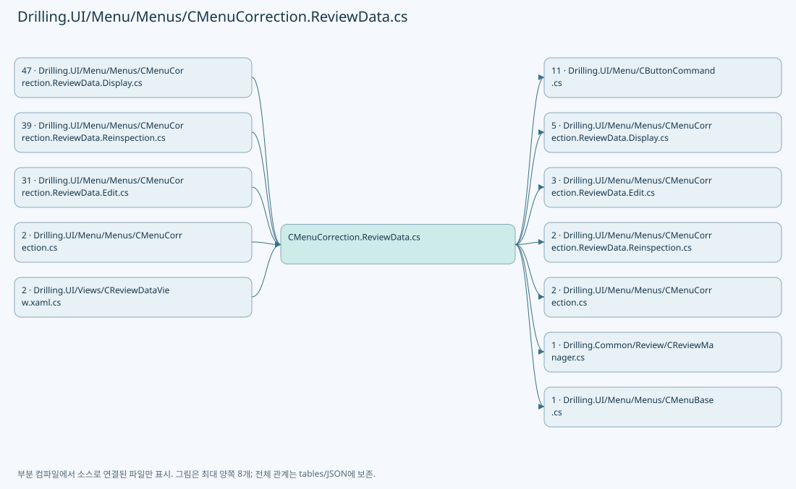

## 네임스페이스·타입·상속

| 타입 | 구분 | 원본 범위 | 선언/상속 |
| --- | --- | --- | --- |
| CMenuCorrection | ClassDeclaration | 12–652 | CMenuCorrection |
| CReviewDataPanel | ClassDeclaration | 14–620 | CReviewDataPanel: INotifyPropertyChanged |
| ST_REVIEW_RESULT_TREE_NODE | RecordDeclaration | 622–649 | ST_REVIEW_RESULT_TREE_NODE |
| ST_REVIEW_DATA_DETAIL_ITEM | RecordDeclaration | 651–651 | ST_REVIEW_DATA_DETAIL_ITEM |

## 멤버 빠른 목록

| 이름 | 종류 | 범위 | 서명 |
| --- | --- | --- | --- |
| _reviewResultFile | FieldDeclaration | L16–16 | Drilling.Common.Review.CReviewResultFileBase Drilling.UI.Menu.Menus.CMenuCorrection.CReviewDataPanel._reviewResultFile |
| _reviewOffsetFile | FieldDeclaration | L17–17 | Drilling.Common.Review.CReviewOffsetFileBase Drilling.UI.Menu.Menus.CMenuCorrection.CReviewDataPanel._reviewOffsetFile |
| _reviewManager | FieldDeclaration | L18–18 | Drilling.Common.Review.CReviewManager Drilling.UI.Menu.Menus.CMenuCorrection.CReviewDataPanel._reviewManager |
| _recipeManager | FieldDeclaration | L19–19 | Drilling.Common.Managers.CRecipeManager Drilling.UI.Menu.Menus.CMenuCorrection.CReviewDataPanel._recipeManager |
| _settingManager | FieldDeclaration | L20–20 | Drilling.Common.Managers.CSettingManager Drilling.UI.Menu.Menus.CMenuCorrection.CReviewDataPanel._settingManager |
| _selectedRecipeIdProvider | FieldDeclaration | L21–21 | System.Func<string> Drilling.UI.Menu.Menus.CMenuCorrection.CReviewDataPanel._selectedRecipeIdProvider |
| _statusReporter | FieldDeclaration | L22–22 | System.Action<string> Drilling.UI.Menu.Menus.CMenuCorrection.CReviewDataPanel._statusReporter |
| _rollbackReviewOffset | FieldDeclaration | L23–23 | System.Func<System.Threading.Tasks.Task> Drilling.UI.Menu.Menus.CMenuCorrection.CReviewDataPanel._rollbackReviewOffset |
| _saveReviewOffsetFromResult | FieldDeclaration | L24–24 | System.Func<string, System.Collections.Generic.IReadOnlyList<Drilling.Common.Review.ST_REVIEW_OFFSET_ROW>, string, System.Threading.Tasks.Task<Drilling.Common.Review.ST_REVIEW_OFFSET_FILE_DATA?>> Drilling.UI.Menu.Menus.CMenuCorrection.CReviewDataPanel._saveReviewOffsetFromResult |
| _inspectionResultsOnly | FieldDeclaration | L25–25 | bool Drilling.UI.Menu.Menus.CMenuCorrection.CReviewDataPanel._inspectionResultsOnly |
| _inspectionResultTypeProvider | FieldDeclaration | L26–26 | System.Func<string>? Drilling.UI.Menu.Menus.CMenuCorrection.CReviewDataPanel._inspectionResultTypeProvider |
| _isBusy | FieldDeclaration | L27–27 | bool Drilling.UI.Menu.Menus.CMenuCorrection.CReviewDataPanel._isBusy |
| _isResultEditMode | FieldDeclaration | L28–28 | bool Drilling.UI.Menu.Menus.CMenuCorrection.CReviewDataPanel._isResultEditMode |
| _skipNextVisibleReload | FieldDeclaration | L29–29 | int Drilling.UI.Menu.Menus.CMenuCorrection.CReviewDataPanel._skipNextVisibleReload |
| _inspectionRefreshVersion | FieldDeclaration | L30–30 | int Drilling.UI.Menu.Menus.CMenuCorrection.CReviewDataPanel._inspectionRefreshVersion |
| _selectedNode | FieldDeclaration | L31–31 | Drilling.UI.Menu.Menus.CMenuCorrection.ST_REVIEW_RESULT_TREE_NODE? Drilling.UI.Menu.Menus.CMenuCorrection.CReviewDataPanel._selectedNode |
| .ctor | ConstructorDeclaration | L33–69 | Drilling.UI.Menu.Menus.CMenuCorrection.CReviewDataPanel.CReviewDataPanel(Drilling.Common.Review.CReviewResultFileBase, Drilling.Common.Review.CReviewOffsetFileBase, Drilling.Common.Review.CReviewManager, Drilling.Common.Managers.CRecipeManager, Drilling.Common.Managers.CSettingManager, System.Func<string>, System.Action<string>, System.Func<System.Threading.Tasks.Task>, System.Func<string, System.Collections.Generic.IReadOnlyList<Drilling.Common.Review.ST_REVIEW_OFFSET_ROW>, string, System.Threading.Tasks.Task<Drilling.Common.Review.ST_REVIEW_OFFSET_FILE_DATA?>>, bool, System.Func<string>?) |
| PropertyChanged | EventFieldDeclaration | L71–71 | System.ComponentModel.PropertyChangedEventHandler? Drilling.UI.Menu.Menus.CMenuCorrection.CReviewDataPanel.PropertyChanged |
| RefreshCommand | PropertyDeclaration | L73–73 | Drilling.UI.Menu.CButtonCommand Drilling.UI.Menu.Menus.CMenuCorrection.CReviewDataPanel.RefreshCommand |
| get_RefreshCommand | GetAccessorDeclaration | L73–73 | Drilling.UI.Menu.CButtonCommand Drilling.UI.Menu.Menus.CMenuCorrection.CReviewDataPanel.RefreshCommand.get |
| LoadDataCommand | PropertyDeclaration | L74–74 | Drilling.UI.Menu.CButtonCommand Drilling.UI.Menu.Menus.CMenuCorrection.CReviewDataPanel.LoadDataCommand |
| get_LoadDataCommand | GetAccessorDeclaration | L74–74 | Drilling.UI.Menu.CButtonCommand Drilling.UI.Menu.Menus.CMenuCorrection.CReviewDataPanel.LoadDataCommand.get |
| SelectCellCommand | PropertyDeclaration | L75–75 | Drilling.UI.Menu.CButtonCommand Drilling.UI.Menu.Menus.CMenuCorrection.CReviewDataPanel.SelectCellCommand |
| get_SelectCellCommand | GetAccessorDeclaration | L75–75 | Drilling.UI.Menu.CButtonCommand Drilling.UI.Menu.Menus.CMenuCorrection.CReviewDataPanel.SelectCellCommand.get |
| ApplyScatterPlotScaleCommand | PropertyDeclaration | L76–76 | Drilling.UI.Menu.CButtonCommand Drilling.UI.Menu.Menus.CMenuCorrection.CReviewDataPanel.ApplyScatterPlotScaleCommand |
| get_ApplyScatterPlotScaleCommand | GetAccessorDeclaration | L76–76 | Drilling.UI.Menu.CButtonCommand Drilling.UI.Menu.Menus.CMenuCorrection.CReviewDataPanel.ApplyScatterPlotScaleCommand.get |
| ToggleResultEditModeCommand | PropertyDeclaration | L77–77 | Drilling.UI.Menu.CButtonCommand Drilling.UI.Menu.Menus.CMenuCorrection.CReviewDataPanel.ToggleResultEditModeCommand |
| get_ToggleResultEditModeCommand | GetAccessorDeclaration | L77–77 | Drilling.UI.Menu.CButtonCommand Drilling.UI.Menu.Menus.CMenuCorrection.CReviewDataPanel.ToggleResultEditModeCommand.get |
| OffsetApplyCommand | PropertyDeclaration | L78–78 | Drilling.UI.Menu.CButtonCommand Drilling.UI.Menu.Menus.CMenuCorrection.CReviewDataPanel.OffsetApplyCommand |
| get_OffsetApplyCommand | GetAccessorDeclaration | L78–78 | Drilling.UI.Menu.CButtonCommand Drilling.UI.Menu.Menus.CMenuCorrection.CReviewDataPanel.OffsetApplyCommand.get |
| OffsetRollbackCommand | PropertyDeclaration | L79–79 | Drilling.UI.Menu.CButtonCommand Drilling.UI.Menu.Menus.CMenuCorrection.CReviewDataPanel.OffsetRollbackCommand |
| get_OffsetRollbackCommand | GetAccessorDeclaration | L79–79 | Drilling.UI.Menu.CButtonCommand Drilling.UI.Menu.Menus.CMenuCorrection.CReviewDataPanel.OffsetRollbackCommand.get |
| OffsetInitCommand | PropertyDeclaration | L80–80 | Drilling.UI.Menu.CButtonCommand Drilling.UI.Menu.Menus.CMenuCorrection.CReviewDataPanel.OffsetInitCommand |
| get_OffsetInitCommand | GetAccessorDeclaration | L80–80 | Drilling.UI.Menu.CButtonCommand Drilling.UI.Menu.Menus.CMenuCorrection.CReviewDataPanel.OffsetInitCommand.get |
| OffsetViewCommand | PropertyDeclaration | L81–81 | Drilling.UI.Menu.CButtonCommand Drilling.UI.Menu.Menus.CMenuCorrection.CReviewDataPanel.OffsetViewCommand |
| get_OffsetViewCommand | GetAccessorDeclaration | L81–81 | Drilling.UI.Menu.CButtonCommand Drilling.UI.Menu.Menus.CMenuCorrection.CReviewDataPanel.OffsetViewCommand.get |
| Nodes | PropertyDeclaration | L82–82 | System.Collections.Generic.IReadOnlyList<Drilling.UI.Menu.Menus.CMenuCorrection.ST_REVIEW_RESULT_TREE_NODE> Drilling.UI.Menu.Menus.CMenuCorrection.CReviewDataPanel.Nodes |
| get_Nodes | GetAccessorDeclaration | L82–82 | System.Collections.Generic.IReadOnlyList<Drilling.UI.Menu.Menus.CMenuCorrection.ST_REVIEW_RESULT_TREE_NODE> Drilling.UI.Menu.Menus.CMenuCorrection.CReviewDataPanel.Nodes.get |
| set_Nodes | SetAccessorDeclaration | L82–82 | void Drilling.UI.Menu.Menus.CMenuCorrection.CReviewDataPanel.Nodes.set |
| SelectedDetails | PropertyDeclaration | L83–83 | System.Collections.Generic.IReadOnlyList<Drilling.UI.Menu.Menus.CMenuCorrection.ST_REVIEW_DATA_DETAIL_ITEM> Drilling.UI.Menu.Menus.CMenuCorrection.CReviewDataPanel.SelectedDetails |
| get_SelectedDetails | GetAccessorDeclaration | L83–83 | System.Collections.Generic.IReadOnlyList<Drilling.UI.Menu.Menus.CMenuCorrection.ST_REVIEW_DATA_DETAIL_ITEM> Drilling.UI.Menu.Menus.CMenuCorrection.CReviewDataPanel.SelectedDetails.get |
| set_SelectedDetails | SetAccessorDeclaration | L83–83 | void Drilling.UI.Menu.Menus.CMenuCorrection.CReviewDataPanel.SelectedDetails.set |
| ResultListTitle | PropertyDeclaration | L84–84 | string Drilling.UI.Menu.Menus.CMenuCorrection.CReviewDataPanel.ResultListTitle |
| get_ResultListTitle | GetAccessorDeclaration | L84–84 | string Drilling.UI.Menu.Menus.CMenuCorrection.CReviewDataPanel.ResultListTitle.get |
| set_ResultListTitle | SetAccessorDeclaration | L84–84 | void Drilling.UI.Menu.Menus.CMenuCorrection.CReviewDataPanel.ResultListTitle.set |
| StatusText | PropertyDeclaration | L85–85 | string Drilling.UI.Menu.Menus.CMenuCorrection.CReviewDataPanel.StatusText |
| get_StatusText | GetAccessorDeclaration | L85–85 | string Drilling.UI.Menu.Menus.CMenuCorrection.CReviewDataPanel.StatusText.get |
| set_StatusText | SetAccessorDeclaration | L85–85 | void Drilling.UI.Menu.Menus.CMenuCorrection.CReviewDataPanel.StatusText.set |
| SelectedTitle | PropertyDeclaration | L86–86 | string Drilling.UI.Menu.Menus.CMenuCorrection.CReviewDataPanel.SelectedTitle |
| get_SelectedTitle | GetAccessorDeclaration | L86–86 | string Drilling.UI.Menu.Menus.CMenuCorrection.CReviewDataPanel.SelectedTitle.get |
| set_SelectedTitle | SetAccessorDeclaration | L86–86 | void Drilling.UI.Menu.Menus.CMenuCorrection.CReviewDataPanel.SelectedTitle.set |
| SelectedStatus | PropertyDeclaration | L87–87 | string Drilling.UI.Menu.Menus.CMenuCorrection.CReviewDataPanel.SelectedStatus |
| get_SelectedStatus | GetAccessorDeclaration | L87–87 | string Drilling.UI.Menu.Menus.CMenuCorrection.CReviewDataPanel.SelectedStatus.get |
| set_SelectedStatus | SetAccessorDeclaration | L87–87 | void Drilling.UI.Menu.Menus.CMenuCorrection.CReviewDataPanel.SelectedStatus.set |
| SelectedPath | PropertyDeclaration | L88–88 | string Drilling.UI.Menu.Menus.CMenuCorrection.CReviewDataPanel.SelectedPath |
| get_SelectedPath | GetAccessorDeclaration | L88–88 | string Drilling.UI.Menu.Menus.CMenuCorrection.CReviewDataPanel.SelectedPath.get |
| set_SelectedPath | SetAccessorDeclaration | L88–88 | void Drilling.UI.Menu.Menus.CMenuCorrection.CReviewDataPanel.SelectedPath.set |
| SelectedStatusBrush | PropertyDeclaration | L89–89 | Brush Drilling.UI.Menu.Menus.CMenuCorrection.CReviewDataPanel.SelectedStatusBrush |
| IsInspectionOffsetRestricted | PropertyDeclaration | L90–91 | bool Drilling.UI.Menu.Menus.CMenuCorrection.CReviewDataPanel.IsInspectionOffsetRestricted |
| InspectionOffsetRestrictionText | PropertyDeclaration | L92–92 | string Drilling.UI.Menu.Menus.CMenuCorrection.CReviewDataPanel.InspectionOffsetRestrictionText |
| IsResultEditMode | PropertyDeclaration | L93–93 | bool Drilling.UI.Menu.Menus.CMenuCorrection.CReviewDataPanel.IsResultEditMode |
| CanToggleResultEditMode | PropertyDeclaration | L94–98 | bool Drilling.UI.Menu.Menus.CMenuCorrection.CReviewDataPanel.CanToggleResultEditMode |
| IsBusy | PropertyDeclaration | L100–115 | bool Drilling.UI.Menu.Menus.CMenuCorrection.CReviewDataPanel.IsBusy |
| get_IsBusy | GetAccessorDeclaration | L102–102 | bool Drilling.UI.Menu.Menus.CMenuCorrection.CReviewDataPanel.IsBusy.get |
| set_IsBusy | SetAccessorDeclaration | L103–114 | void Drilling.UI.Menu.Menus.CMenuCorrection.CReviewDataPanel.IsBusy.set |
| Reload | MethodDeclaration | L117–120 | System.Threading.Tasks.Task Drilling.UI.Menu.Menus.CMenuCorrection.CReviewDataPanel.Reload(System.Threading.CancellationToken) |
| ReloadForInspectionModeChange | MethodDeclaration | L122–177 | System.Threading.Tasks.Task Drilling.UI.Menu.Menus.CMenuCorrection.CReviewDataPanel.ReloadForInspectionModeChange(System.Threading.CancellationToken) |
| ReloadWhenVisible | MethodDeclaration | L179–187 | System.Threading.Tasks.Task Drilling.UI.Menu.Menus.CMenuCorrection.CReviewDataPanel.ReloadWhenVisible(System.Threading.CancellationToken) |
| OpenResult | MethodDeclaration | L189–207 | System.Threading.Tasks.Task Drilling.UI.Menu.Menus.CMenuCorrection.CReviewDataPanel.OpenResult(string, System.Threading.CancellationToken) |
| Select | MethodDeclaration | L209–233 | void Drilling.UI.Menu.Menus.CMenuCorrection.CReviewDataPanel.Select(Drilling.UI.Menu.Menus.CMenuCorrection.ST_REVIEW_RESULT_TREE_NODE) |
| ToggleResultEditMode | MethodDeclaration | L235–256 | void Drilling.UI.Menu.Menus.CMenuCorrection.CReviewDataPanel.ToggleResultEditMode(object?) |
| RefreshRequested | MethodDeclaration | L258–261 | void Drilling.UI.Menu.Menus.CMenuCorrection.CReviewDataPanel.RefreshRequested(object?) |
| Refresh | MethodDeclaration | L263–336 | System.Threading.Tasks.Task Drilling.UI.Menu.Menus.CMenuCorrection.CReviewDataPanel.Refresh(System.Threading.CancellationToken, string?) |
| ClearSelection | MethodDeclaration | L338–352 | void Drilling.UI.Menu.Menus.CMenuCorrection.CReviewDataPanel.ClearSelection() |
| BuildTree | MethodDeclaration | L354–416 | System.Collections.Generic.IReadOnlyList<Drilling.UI.Menu.Menus.CMenuCorrection.ST_REVIEW_RESULT_TREE_NODE> Drilling.UI.Menu.Menus.CMenuCorrection.CReviewDataPanel.BuildTree(System.Collections.Generic.IReadOnlyList<Drilling.Common.Review.ST_REVIEW_RESULT_CATALOG_ITEM>) |
| BuildInspectionTree | MethodDeclaration | L418–484 | System.Collections.Generic.IReadOnlyList<Drilling.UI.Menu.Menus.CMenuCorrection.ST_REVIEW_RESULT_TREE_NODE> Drilling.UI.Menu.Menus.CMenuCorrection.CReviewDataPanel.BuildInspectionTree(System.Collections.Generic.IReadOnlyList<Drilling.Common.Review.ST_REVIEW_RESULT_CATALOG_ITEM>, string, string) |
| IsInspectionResultMatch | MethodDeclaration | L486–498 | bool Drilling.UI.Menu.Menus.CMenuCorrection.CReviewDataPanel.IsInspectionResultMatch(Drilling.Common.Review.ST_REVIEW_RESULT_CATALOG_ITEM, string) |
| InspectionResultDisplayName | MethodDeclaration | L500–505 | string Drilling.UI.Menu.Menus.CMenuCorrection.CReviewDataPanel.InspectionResultDisplayName(string) |
| NormalizeInspectionResultType | MethodDeclaration | L507–517 | string Drilling.UI.Menu.Menus.CMenuCorrection.CReviewDataPanel.NormalizeInspectionResultType(string?) |
| IsInspectionOffsetResultType | MethodDeclaration | L519–522 | bool Drilling.UI.Menu.Menus.CMenuCorrection.CReviewDataPanel.IsInspectionOffsetResultType(string?) |
| CreateResultNode | MethodDeclaration | L524–527 | Drilling.UI.Menu.Menus.CMenuCorrection.ST_REVIEW_RESULT_TREE_NODE Drilling.UI.Menu.Menus.CMenuCorrection.CReviewDataPanel.CreateResultNode(Drilling.Common.Review.ST_REVIEW_RESULT_CATALOG_ITEM) |
| CreateDetails | MethodDeclaration | L529–553 | System.Collections.Generic.IReadOnlyList<Drilling.UI.Menu.Menus.CMenuCorrection.ST_REVIEW_DATA_DETAIL_ITEM> Drilling.UI.Menu.Menus.CMenuCorrection.CReviewDataPanel.CreateDetails(Drilling.UI.Menu.Menus.CMenuCorrection.ST_REVIEW_RESULT_TREE_NODE) |
| Flatten | MethodDeclaration | L555–566 | System.Collections.Generic.IEnumerable<Drilling.UI.Menu.Menus.CMenuCorrection.ST_REVIEW_RESULT_TREE_NODE> Drilling.UI.Menu.Menus.CMenuCorrection.CReviewDataPanel.Flatten(System.Collections.Generic.IEnumerable<Drilling.UI.Menu.Menus.CMenuCorrection.ST_REVIEW_RESULT_TREE_NODE>) |
| ExpandResultPath | MethodDeclaration | L568–589 | System.Collections.Generic.IReadOnlyList<Drilling.UI.Menu.Menus.CMenuCorrection.ST_REVIEW_RESULT_TREE_NODE> Drilling.UI.Menu.Menus.CMenuCorrection.CReviewDataPanel.ExpandResultPath(System.Collections.Generic.IEnumerable<Drilling.UI.Menu.Menus.CMenuCorrection.ST_REVIEW_RESULT_TREE_NODE>, string) |
| ContainsExpandedResult | LocalFunctionStatement | L584–588 | bool ContainsExpandedResult(Drilling.UI.Menu.Menus.CMenuCorrection.ST_REVIEW_RESULT_TREE_NODE) |
| SetSelectedTreeNode | MethodDeclaration | L591–597 | void Drilling.UI.Menu.Menus.CMenuCorrection.CReviewDataPanel.SetSelectedTreeNode(Drilling.UI.Menu.Menus.CMenuCorrection.ST_REVIEW_RESULT_TREE_NODE?) |
| CountResults | MethodDeclaration | L599–602 | int Drilling.UI.Menu.Menus.CMenuCorrection.CReviewDataPanel.CountResults(Drilling.UI.Menu.Menus.CMenuCorrection.ST_REVIEW_RESULT_TREE_NODE) |
| StatusBrush | MethodDeclaration | L604–614 | Brush Drilling.UI.Menu.Menus.CMenuCorrection.CReviewDataPanel.StatusBrush(string) |
| Notify | MethodDeclaration | L616–619 | void Drilling.UI.Menu.Menus.CMenuCorrection.CReviewDataPanel.Notify(string) |
| _isSelected | FieldDeclaration | L630–630 | bool Drilling.UI.Menu.Menus.CMenuCorrection.ST_REVIEW_RESULT_TREE_NODE._isSelected |
| PropertyChanged | EventFieldDeclaration | L632–632 | System.ComponentModel.PropertyChangedEventHandler? Drilling.UI.Menu.Menus.CMenuCorrection.ST_REVIEW_RESULT_TREE_NODE.PropertyChanged |
| DetailBrush | PropertyDeclaration | L633–633 | Brush Drilling.UI.Menu.Menus.CMenuCorrection.ST_REVIEW_RESULT_TREE_NODE.DetailBrush |
| IsDirectory | PropertyDeclaration | L634–634 | bool Drilling.UI.Menu.Menus.CMenuCorrection.ST_REVIEW_RESULT_TREE_NODE.IsDirectory |
| IsSelected | PropertyDeclaration | L635–648 | bool Drilling.UI.Menu.Menus.CMenuCorrection.ST_REVIEW_RESULT_TREE_NODE.IsSelected |
| get_IsSelected | GetAccessorDeclaration | L637–637 | bool Drilling.UI.Menu.Menus.CMenuCorrection.ST_REVIEW_RESULT_TREE_NODE.IsSelected.get |
| set_IsSelected | SetAccessorDeclaration | L638–647 | void Drilling.UI.Menu.Menus.CMenuCorrection.ST_REVIEW_RESULT_TREE_NODE.IsSelected.set |

## 멤버별 상세 계약·호출·처리 해설

### FieldDeclaration `_reviewResultFile` · L16–16

[Drilling.UI/Menu/Menus/CMenuCorrection.ReviewData.cs:16–16](https://github.com/kjuws10-rgb/A3Drilling/blob/0219666f9053b907d96d7e0aa7d0c6c1be3a73d4/Drilling.UI/Menu/Menus/CMenuCorrection.ReviewData.cs#L16-L16)

| 항목 | 실제 추출 값 |
| --- | --- |
| 서명 | Drilling.Common.Review.CReviewResultFileBase Drilling.UI.Menu.Menus.CMenuCorrection.CReviewDataPanel._reviewResultFile |
| 접근/수식자 | Private / private, readonly |
| 반환/값 타입 | Drilling.Common.Review.CReviewResultFileBase |
| 소속 타입 | NamedType:Drilling.UI.Menu.Menus.CMenuCorrection.CReviewDataPanel |

현재 부분 분석에서 직접 연결된 호출자는 없습니다. XAML/이벤트/인터페이스·델리게이트·외부 진입을 추가 확인해야 하며, 미사용으로 판정한 것이 아닙니다.

변경 전 점검: 입력/반환 타입, 위 호출자, 예외/취소 경로, 공유 상태와 저장·전송 소비자를 함께 확인합니다. 값의 단위나 물리 방향을 이름만으로 확정하지 않습니다.

### FieldDeclaration `_reviewOffsetFile` · L17–17

[Drilling.UI/Menu/Menus/CMenuCorrection.ReviewData.cs:17–17](https://github.com/kjuws10-rgb/A3Drilling/blob/0219666f9053b907d96d7e0aa7d0c6c1be3a73d4/Drilling.UI/Menu/Menus/CMenuCorrection.ReviewData.cs#L17-L17)

| 항목 | 실제 추출 값 |
| --- | --- |
| 서명 | Drilling.Common.Review.CReviewOffsetFileBase Drilling.UI.Menu.Menus.CMenuCorrection.CReviewDataPanel._reviewOffsetFile |
| 접근/수식자 | Private / private, readonly |
| 반환/값 타입 | Drilling.Common.Review.CReviewOffsetFileBase |
| 소속 타입 | NamedType:Drilling.UI.Menu.Menus.CMenuCorrection.CReviewDataPanel |

현재 부분 분석에서 직접 연결된 호출자는 없습니다. XAML/이벤트/인터페이스·델리게이트·외부 진입을 추가 확인해야 하며, 미사용으로 판정한 것이 아닙니다.

변경 전 점검: 입력/반환 타입, 위 호출자, 예외/취소 경로, 공유 상태와 저장·전송 소비자를 함께 확인합니다. 값의 단위나 물리 방향을 이름만으로 확정하지 않습니다.

### FieldDeclaration `_reviewManager` · L18–18

[Drilling.UI/Menu/Menus/CMenuCorrection.ReviewData.cs:18–18](https://github.com/kjuws10-rgb/A3Drilling/blob/0219666f9053b907d96d7e0aa7d0c6c1be3a73d4/Drilling.UI/Menu/Menus/CMenuCorrection.ReviewData.cs#L18-L18)

| 항목 | 실제 추출 값 |
| --- | --- |
| 서명 | Drilling.Common.Review.CReviewManager Drilling.UI.Menu.Menus.CMenuCorrection.CReviewDataPanel._reviewManager |
| 접근/수식자 | Private / private, readonly |
| 반환/값 타입 | Drilling.Common.Review.CReviewManager |
| 소속 타입 | NamedType:Drilling.UI.Menu.Menus.CMenuCorrection.CReviewDataPanel |

현재 부분 분석에서 직접 연결된 호출자는 없습니다. XAML/이벤트/인터페이스·델리게이트·외부 진입을 추가 확인해야 하며, 미사용으로 판정한 것이 아닙니다.

변경 전 점검: 입력/반환 타입, 위 호출자, 예외/취소 경로, 공유 상태와 저장·전송 소비자를 함께 확인합니다. 값의 단위나 물리 방향을 이름만으로 확정하지 않습니다.

### FieldDeclaration `_recipeManager` · L19–19

[Drilling.UI/Menu/Menus/CMenuCorrection.ReviewData.cs:19–19](https://github.com/kjuws10-rgb/A3Drilling/blob/0219666f9053b907d96d7e0aa7d0c6c1be3a73d4/Drilling.UI/Menu/Menus/CMenuCorrection.ReviewData.cs#L19-L19)

| 항목 | 실제 추출 값 |
| --- | --- |
| 서명 | Drilling.Common.Managers.CRecipeManager Drilling.UI.Menu.Menus.CMenuCorrection.CReviewDataPanel._recipeManager |
| 접근/수식자 | Private / private, readonly |
| 반환/값 타입 | Drilling.Common.Managers.CRecipeManager |
| 소속 타입 | NamedType:Drilling.UI.Menu.Menus.CMenuCorrection.CReviewDataPanel |

현재 부분 분석에서 직접 연결된 호출자는 없습니다. XAML/이벤트/인터페이스·델리게이트·외부 진입을 추가 확인해야 하며, 미사용으로 판정한 것이 아닙니다.

변경 전 점검: 입력/반환 타입, 위 호출자, 예외/취소 경로, 공유 상태와 저장·전송 소비자를 함께 확인합니다. 값의 단위나 물리 방향을 이름만으로 확정하지 않습니다.

### FieldDeclaration `_settingManager` · L20–20

[Drilling.UI/Menu/Menus/CMenuCorrection.ReviewData.cs:20–20](https://github.com/kjuws10-rgb/A3Drilling/blob/0219666f9053b907d96d7e0aa7d0c6c1be3a73d4/Drilling.UI/Menu/Menus/CMenuCorrection.ReviewData.cs#L20-L20)

| 항목 | 실제 추출 값 |
| --- | --- |
| 서명 | Drilling.Common.Managers.CSettingManager Drilling.UI.Menu.Menus.CMenuCorrection.CReviewDataPanel._settingManager |
| 접근/수식자 | Private / private, readonly |
| 반환/값 타입 | Drilling.Common.Managers.CSettingManager |
| 소속 타입 | NamedType:Drilling.UI.Menu.Menus.CMenuCorrection.CReviewDataPanel |

현재 부분 분석에서 직접 연결된 호출자는 없습니다. XAML/이벤트/인터페이스·델리게이트·외부 진입을 추가 확인해야 하며, 미사용으로 판정한 것이 아닙니다.

변경 전 점검: 입력/반환 타입, 위 호출자, 예외/취소 경로, 공유 상태와 저장·전송 소비자를 함께 확인합니다. 값의 단위나 물리 방향을 이름만으로 확정하지 않습니다.

### FieldDeclaration `_selectedRecipeIdProvider` · L21–21

[Drilling.UI/Menu/Menus/CMenuCorrection.ReviewData.cs:21–21](https://github.com/kjuws10-rgb/A3Drilling/blob/0219666f9053b907d96d7e0aa7d0c6c1be3a73d4/Drilling.UI/Menu/Menus/CMenuCorrection.ReviewData.cs#L21-L21)

| 항목 | 실제 추출 값 |
| --- | --- |
| 서명 | System.Func<string> Drilling.UI.Menu.Menus.CMenuCorrection.CReviewDataPanel._selectedRecipeIdProvider |
| 접근/수식자 | Private / private, readonly |
| 반환/값 타입 | System.Func<string> |
| 소속 타입 | NamedType:Drilling.UI.Menu.Menus.CMenuCorrection.CReviewDataPanel |

현재 부분 분석에서 직접 연결된 호출자는 없습니다. XAML/이벤트/인터페이스·델리게이트·외부 진입을 추가 확인해야 하며, 미사용으로 판정한 것이 아닙니다.

변경 전 점검: 입력/반환 타입, 위 호출자, 예외/취소 경로, 공유 상태와 저장·전송 소비자를 함께 확인합니다. 값의 단위나 물리 방향을 이름만으로 확정하지 않습니다.

### FieldDeclaration `_statusReporter` · L22–22

[Drilling.UI/Menu/Menus/CMenuCorrection.ReviewData.cs:22–22](https://github.com/kjuws10-rgb/A3Drilling/blob/0219666f9053b907d96d7e0aa7d0c6c1be3a73d4/Drilling.UI/Menu/Menus/CMenuCorrection.ReviewData.cs#L22-L22)

| 항목 | 실제 추출 값 |
| --- | --- |
| 서명 | System.Action<string> Drilling.UI.Menu.Menus.CMenuCorrection.CReviewDataPanel._statusReporter |
| 접근/수식자 | Private / private, readonly |
| 반환/값 타입 | System.Action<string> |
| 소속 타입 | NamedType:Drilling.UI.Menu.Menus.CMenuCorrection.CReviewDataPanel |

현재 부분 분석에서 직접 연결된 호출자는 없습니다. XAML/이벤트/인터페이스·델리게이트·외부 진입을 추가 확인해야 하며, 미사용으로 판정한 것이 아닙니다.

변경 전 점검: 입력/반환 타입, 위 호출자, 예외/취소 경로, 공유 상태와 저장·전송 소비자를 함께 확인합니다. 값의 단위나 물리 방향을 이름만으로 확정하지 않습니다.

### FieldDeclaration `_rollbackReviewOffset` · L23–23

[Drilling.UI/Menu/Menus/CMenuCorrection.ReviewData.cs:23–23](https://github.com/kjuws10-rgb/A3Drilling/blob/0219666f9053b907d96d7e0aa7d0c6c1be3a73d4/Drilling.UI/Menu/Menus/CMenuCorrection.ReviewData.cs#L23-L23)

| 항목 | 실제 추출 값 |
| --- | --- |
| 서명 | System.Func<System.Threading.Tasks.Task> Drilling.UI.Menu.Menus.CMenuCorrection.CReviewDataPanel._rollbackReviewOffset |
| 접근/수식자 | Private / private, readonly |
| 반환/값 타입 | System.Func<System.Threading.Tasks.Task> |
| 소속 타입 | NamedType:Drilling.UI.Menu.Menus.CMenuCorrection.CReviewDataPanel |

현재 부분 분석에서 직접 연결된 호출자는 없습니다. XAML/이벤트/인터페이스·델리게이트·외부 진입을 추가 확인해야 하며, 미사용으로 판정한 것이 아닙니다.

변경 전 점검: 입력/반환 타입, 위 호출자, 예외/취소 경로, 공유 상태와 저장·전송 소비자를 함께 확인합니다. 값의 단위나 물리 방향을 이름만으로 확정하지 않습니다.

### FieldDeclaration `_saveReviewOffsetFromResult` · L24–24

[Drilling.UI/Menu/Menus/CMenuCorrection.ReviewData.cs:24–24](https://github.com/kjuws10-rgb/A3Drilling/blob/0219666f9053b907d96d7e0aa7d0c6c1be3a73d4/Drilling.UI/Menu/Menus/CMenuCorrection.ReviewData.cs#L24-L24)

| 항목 | 실제 추출 값 |
| --- | --- |
| 서명 | System.Func<string, System.Collections.Generic.IReadOnlyList<Drilling.Common.Review.ST_REVIEW_OFFSET_ROW>, string, System.Threading.Tasks.Task<Drilling.Common.Review.ST_REVIEW_OFFSET_FILE_DATA?>> Drilling.UI.Menu.Menus.CMenuCorrection.CReviewDataPanel._saveReviewOffsetFromResult |
| 접근/수식자 | Private / private, readonly |
| 반환/값 타입 | System.Func<string, System.Collections.Generic.IReadOnlyList<Drilling.Common.Review.ST_REVIEW_OFFSET_ROW>, string, System.Threading.Tasks.Task<Drilling.Common.Review.ST_REVIEW_OFFSET_FILE_DATA?>> |
| 소속 타입 | NamedType:Drilling.UI.Menu.Menus.CMenuCorrection.CReviewDataPanel |

현재 부분 분석에서 직접 연결된 호출자는 없습니다. XAML/이벤트/인터페이스·델리게이트·외부 진입을 추가 확인해야 하며, 미사용으로 판정한 것이 아닙니다.

변경 전 점검: 입력/반환 타입, 위 호출자, 예외/취소 경로, 공유 상태와 저장·전송 소비자를 함께 확인합니다. 값의 단위나 물리 방향을 이름만으로 확정하지 않습니다.

### FieldDeclaration `_inspectionResultsOnly` · L25–25

[Drilling.UI/Menu/Menus/CMenuCorrection.ReviewData.cs:25–25](https://github.com/kjuws10-rgb/A3Drilling/blob/0219666f9053b907d96d7e0aa7d0c6c1be3a73d4/Drilling.UI/Menu/Menus/CMenuCorrection.ReviewData.cs#L25-L25)

| 항목 | 실제 추출 값 |
| --- | --- |
| 서명 | bool Drilling.UI.Menu.Menus.CMenuCorrection.CReviewDataPanel._inspectionResultsOnly |
| 접근/수식자 | Private / private, readonly |
| 반환/값 타입 | bool |
| 소속 타입 | NamedType:Drilling.UI.Menu.Menus.CMenuCorrection.CReviewDataPanel |

현재 부분 분석에서 직접 연결된 호출자는 없습니다. XAML/이벤트/인터페이스·델리게이트·외부 진입을 추가 확인해야 하며, 미사용으로 판정한 것이 아닙니다.

변경 전 점검: 입력/반환 타입, 위 호출자, 예외/취소 경로, 공유 상태와 저장·전송 소비자를 함께 확인합니다. 값의 단위나 물리 방향을 이름만으로 확정하지 않습니다.

### FieldDeclaration `_inspectionResultTypeProvider` · L26–26

[Drilling.UI/Menu/Menus/CMenuCorrection.ReviewData.cs:26–26](https://github.com/kjuws10-rgb/A3Drilling/blob/0219666f9053b907d96d7e0aa7d0c6c1be3a73d4/Drilling.UI/Menu/Menus/CMenuCorrection.ReviewData.cs#L26-L26)

| 항목 | 실제 추출 값 |
| --- | --- |
| 서명 | System.Func<string>? Drilling.UI.Menu.Menus.CMenuCorrection.CReviewDataPanel._inspectionResultTypeProvider |
| 접근/수식자 | Private / private, readonly |
| 반환/값 타입 | System.Func<string>? |
| 소속 타입 | NamedType:Drilling.UI.Menu.Menus.CMenuCorrection.CReviewDataPanel |

현재 부분 분석에서 직접 연결된 호출자는 없습니다. XAML/이벤트/인터페이스·델리게이트·외부 진입을 추가 확인해야 하며, 미사용으로 판정한 것이 아닙니다.

변경 전 점검: 입력/반환 타입, 위 호출자, 예외/취소 경로, 공유 상태와 저장·전송 소비자를 함께 확인합니다. 값의 단위나 물리 방향을 이름만으로 확정하지 않습니다.

### FieldDeclaration `_isBusy` · L27–27

[Drilling.UI/Menu/Menus/CMenuCorrection.ReviewData.cs:27–27](https://github.com/kjuws10-rgb/A3Drilling/blob/0219666f9053b907d96d7e0aa7d0c6c1be3a73d4/Drilling.UI/Menu/Menus/CMenuCorrection.ReviewData.cs#L27-L27)

| 항목 | 실제 추출 값 |
| --- | --- |
| 서명 | bool Drilling.UI.Menu.Menus.CMenuCorrection.CReviewDataPanel._isBusy |
| 접근/수식자 | Private / private |
| 반환/값 타입 | bool |
| 소속 타입 | NamedType:Drilling.UI.Menu.Menus.CMenuCorrection.CReviewDataPanel |

현재 부분 분석에서 직접 연결된 호출자는 없습니다. XAML/이벤트/인터페이스·델리게이트·외부 진입을 추가 확인해야 하며, 미사용으로 판정한 것이 아닙니다.

변경 전 점검: 입력/반환 타입, 위 호출자, 예외/취소 경로, 공유 상태와 저장·전송 소비자를 함께 확인합니다. 값의 단위나 물리 방향을 이름만으로 확정하지 않습니다.

### FieldDeclaration `_isResultEditMode` · L28–28

[Drilling.UI/Menu/Menus/CMenuCorrection.ReviewData.cs:28–28](https://github.com/kjuws10-rgb/A3Drilling/blob/0219666f9053b907d96d7e0aa7d0c6c1be3a73d4/Drilling.UI/Menu/Menus/CMenuCorrection.ReviewData.cs#L28-L28)

| 항목 | 실제 추출 값 |
| --- | --- |
| 서명 | bool Drilling.UI.Menu.Menus.CMenuCorrection.CReviewDataPanel._isResultEditMode |
| 접근/수식자 | Private / private |
| 반환/값 타입 | bool |
| 소속 타입 | NamedType:Drilling.UI.Menu.Menus.CMenuCorrection.CReviewDataPanel |

현재 부분 분석에서 직접 연결된 호출자는 없습니다. XAML/이벤트/인터페이스·델리게이트·외부 진입을 추가 확인해야 하며, 미사용으로 판정한 것이 아닙니다.

변경 전 점검: 입력/반환 타입, 위 호출자, 예외/취소 경로, 공유 상태와 저장·전송 소비자를 함께 확인합니다. 값의 단위나 물리 방향을 이름만으로 확정하지 않습니다.

### FieldDeclaration `_skipNextVisibleReload` · L29–29

[Drilling.UI/Menu/Menus/CMenuCorrection.ReviewData.cs:29–29](https://github.com/kjuws10-rgb/A3Drilling/blob/0219666f9053b907d96d7e0aa7d0c6c1be3a73d4/Drilling.UI/Menu/Menus/CMenuCorrection.ReviewData.cs#L29-L29)

| 항목 | 실제 추출 값 |
| --- | --- |
| 서명 | int Drilling.UI.Menu.Menus.CMenuCorrection.CReviewDataPanel._skipNextVisibleReload |
| 접근/수식자 | Private / private |
| 반환/값 타입 | int |
| 소속 타입 | NamedType:Drilling.UI.Menu.Menus.CMenuCorrection.CReviewDataPanel |

현재 부분 분석에서 직접 연결된 호출자는 없습니다. XAML/이벤트/인터페이스·델리게이트·외부 진입을 추가 확인해야 하며, 미사용으로 판정한 것이 아닙니다.

변경 전 점검: 입력/반환 타입, 위 호출자, 예외/취소 경로, 공유 상태와 저장·전송 소비자를 함께 확인합니다. 값의 단위나 물리 방향을 이름만으로 확정하지 않습니다.

### FieldDeclaration `_inspectionRefreshVersion` · L30–30

[Drilling.UI/Menu/Menus/CMenuCorrection.ReviewData.cs:30–30](https://github.com/kjuws10-rgb/A3Drilling/blob/0219666f9053b907d96d7e0aa7d0c6c1be3a73d4/Drilling.UI/Menu/Menus/CMenuCorrection.ReviewData.cs#L30-L30)

| 항목 | 실제 추출 값 |
| --- | --- |
| 서명 | int Drilling.UI.Menu.Menus.CMenuCorrection.CReviewDataPanel._inspectionRefreshVersion |
| 접근/수식자 | Private / private |
| 반환/값 타입 | int |
| 소속 타입 | NamedType:Drilling.UI.Menu.Menus.CMenuCorrection.CReviewDataPanel |

현재 부분 분석에서 직접 연결된 호출자는 없습니다. XAML/이벤트/인터페이스·델리게이트·외부 진입을 추가 확인해야 하며, 미사용으로 판정한 것이 아닙니다.

변경 전 점검: 입력/반환 타입, 위 호출자, 예외/취소 경로, 공유 상태와 저장·전송 소비자를 함께 확인합니다. 값의 단위나 물리 방향을 이름만으로 확정하지 않습니다.

### FieldDeclaration `_selectedNode` · L31–31

[Drilling.UI/Menu/Menus/CMenuCorrection.ReviewData.cs:31–31](https://github.com/kjuws10-rgb/A3Drilling/blob/0219666f9053b907d96d7e0aa7d0c6c1be3a73d4/Drilling.UI/Menu/Menus/CMenuCorrection.ReviewData.cs#L31-L31)

| 항목 | 실제 추출 값 |
| --- | --- |
| 서명 | Drilling.UI.Menu.Menus.CMenuCorrection.ST_REVIEW_RESULT_TREE_NODE? Drilling.UI.Menu.Menus.CMenuCorrection.CReviewDataPanel._selectedNode |
| 접근/수식자 | Private / private |
| 반환/값 타입 | Drilling.UI.Menu.Menus.CMenuCorrection.ST_REVIEW_RESULT_TREE_NODE? |
| 소속 타입 | NamedType:Drilling.UI.Menu.Menus.CMenuCorrection.CReviewDataPanel |

현재 부분 분석에서 직접 연결된 호출자는 없습니다. XAML/이벤트/인터페이스·델리게이트·외부 진입을 추가 확인해야 하며, 미사용으로 판정한 것이 아닙니다.

변경 전 점검: 입력/반환 타입, 위 호출자, 예외/취소 경로, 공유 상태와 저장·전송 소비자를 함께 확인합니다. 값의 단위나 물리 방향을 이름만으로 확정하지 않습니다.

### ConstructorDeclaration `.ctor` · L33–69

[Drilling.UI/Menu/Menus/CMenuCorrection.ReviewData.cs:33–69](https://github.com/kjuws10-rgb/A3Drilling/blob/0219666f9053b907d96d7e0aa7d0c6c1be3a73d4/Drilling.UI/Menu/Menus/CMenuCorrection.ReviewData.cs#L33-L69)

| 항목 | 실제 추출 값 |
| --- | --- |
| 서명 | Drilling.UI.Menu.Menus.CMenuCorrection.CReviewDataPanel.CReviewDataPanel(Drilling.Common.Review.CReviewResultFileBase, Drilling.Common.Review.CReviewOffsetFileBase, Drilling.Common.Review.CReviewManager, Drilling.Common.Managers.CRecipeManager, Drilling.Common.Managers.CSettingManager, System.Func<string>, System.Action<string>, System.Func<System.Threading.Tasks.Task>, System.Func<string, System.Collections.Generic.IReadOnlyList<Drilling.Common.Review.ST_REVIEW_OFFSET_ROW>, string, System.Threading.Tasks.Task<Drilling.Common.Review.ST_REVIEW_OFFSET_FILE_DATA?>>, bool, System.Func<string>?) |
| 접근/수식자 | Public / public |
| 반환/값 타입 | void |
| 소속 타입 | NamedType:Drilling.UI.Menu.Menus.CMenuCorrection.CReviewDataPanel |

입력 계약:

| 이름 | 타입 | 전달 | 선택/기본값 |
| --- | --- | --- | --- |
| reviewResultFile | Drilling.Common.Review.CReviewResultFileBase | None | False /  |
| reviewOffsetFile | Drilling.Common.Review.CReviewOffsetFileBase | None | False /  |
| reviewManager | Drilling.Common.Review.CReviewManager | None | False /  |
| recipeManager | Drilling.Common.Managers.CRecipeManager | None | False /  |
| settingManager | Drilling.Common.Managers.CSettingManager | None | False /  |
| selectedRecipeIdProvider | System.Func<string> | None | False /  |
| statusReporter | System.Action<string> | None | False /  |
| rollbackReviewOffset | System.Func<System.Threading.Tasks.Task> | None | False /  |
| saveReviewOffsetFromResult | System.Func<string, System.Collections.Generic.IReadOnlyList<Drilling.Common.Review.ST_REVIEW_OFFSET_ROW>, string, System.Threading.Tasks.Task<Drilling.Common.Review.ST_REVIEW_OFFSET_FILE_DATA?>> | None | False /  |
| inspectionResultsOnly | bool | None | True / false |
| inspectionResultTypeProvider | System.Func<string>? | None | True / null |

정적 호출자로 확인된 위치:

| 호출 파일/행 | 호출 표현식 | 런타임 분기 가능 |
| --- | --- | --- |
| [Drilling.UI/Menu/Menus/CMenuCorrection.cs:143–152](https://github.com/kjuws10-rgb/A3Drilling/blob/0219666f9053b907d96d7e0aa7d0c6c1be3a73d4/Drilling.UI/Menu/Menus/CMenuCorrection.cs#L143-L152) | new CReviewDataPanel | False |
| [Drilling.UI/Menu/Menus/CMenuCorrection.cs:153–164](https://github.com/kjuws10-rgb/A3Drilling/blob/0219666f9053b907d96d7e0aa7d0c6c1be3a73d4/Drilling.UI/Menu/Menus/CMenuCorrection.cs#L153-L164) | new CReviewDataPanel | False |

호출하는 대상과 해석 범위:

| 원본 행 | 표현식 | 분석 상태 | 대상/소스 위치 |
| --- | --- | --- | --- |
| 57 | new CButtonCommand | resolved | Drilling.UI.Menu.CButtonCommand.CButtonCommand(System.Action<object?>, System.Predicate<object?>?) · Drilling.UI/Menu/CButtonCommand.cs:9 |
| 58 | new CButtonCommand | resolved | Drilling.UI.Menu.CButtonCommand.CButtonCommand(System.Action<object?>, System.Predicate<object?>?) · Drilling.UI/Menu/CButtonCommand.cs:9 |
| 59 | new CButtonCommand | resolved | Drilling.UI.Menu.CButtonCommand.CButtonCommand(System.Action<object?>, System.Predicate<object?>?) · Drilling.UI/Menu/CButtonCommand.cs:9 |
| 60 | new CButtonCommand | resolved | Drilling.UI.Menu.CButtonCommand.CButtonCommand(System.Action<object?>, System.Predicate<object?>?) · Drilling.UI/Menu/CButtonCommand.cs:9 |
| 61 | new CButtonCommand | resolved | Drilling.UI.Menu.CButtonCommand.CButtonCommand(System.Action<object?>, System.Predicate<object?>?) · Drilling.UI/Menu/CButtonCommand.cs:9 |
| 62 | InitializeResultEditCommands | resolved | void Drilling.UI.Menu.Menus.CMenuCorrection.CReviewDataPanel.InitializeResultEditCommands() · Drilling.UI/Menu/Menus/CMenuCorrection.ReviewData.Edit.cs:103 |
| 63 | new CButtonCommand | resolved | Drilling.UI.Menu.CButtonCommand.CButtonCommand(System.Action<object?>, System.Predicate<object?>?) · Drilling.UI/Menu/CButtonCommand.cs:9 |
| 64 | new CButtonCommand | resolved | Drilling.UI.Menu.CButtonCommand.CButtonCommand(System.Action<object?>, System.Predicate<object?>?) · Drilling.UI/Menu/CButtonCommand.cs:9 |
| 65 | new CButtonCommand | resolved | Drilling.UI.Menu.CButtonCommand.CButtonCommand(System.Action<object?>, System.Predicate<object?>?) · Drilling.UI/Menu/CButtonCommand.cs:9 |
| 66 | new CButtonCommand | resolved | Drilling.UI.Menu.CButtonCommand.CButtonCommand(System.Action<object?>, System.Predicate<object?>?) · Drilling.UI/Menu/CButtonCommand.cs:9 |
| 67 | InitializeReinspectionCommands | resolved | void Drilling.UI.Menu.Menus.CMenuCorrection.CReviewDataPanel.InitializeReinspectionCommands() · Drilling.UI/Menu/Menus/CMenuCorrection.ReviewData.Reinspection.cs:104 |
| 68 | BuildTree | resolved | System.Collections.Generic.IReadOnlyList<Drilling.UI.Menu.Menus.CMenuCorrection.ST_REVIEW_RESULT_TREE_NODE> Drilling.UI.Menu.Menus.CMenuCorrection.CReviewDataPanel.BuildTree(System.Collections.Generic.IReadOnlyList<Drilling.Common.Review.ST_REVIEW_RESULT_CATALOG_ITEM>) · Drilling.UI/Menu/Menus/CMenuCorrection.ReviewData.cs:354 |

본문의 실제 연산·분기·예외·반환 순서(원문 위치 순):

| 원본 행 | 종류 | 주석 해설 |
| --- | --- | --- |
| 46 | assignment | 값을 대상에 대입합니다: _reviewResultFile = reviewResultFile |
| 47 | assignment | 값을 대상에 대입합니다: _reviewOffsetFile = reviewOffsetFile |
| 48 | assignment | 값을 대상에 대입합니다: _reviewManager = reviewManager |
| 49 | assignment | 값을 대상에 대입합니다: _recipeManager = recipeManager |
| 50 | assignment | 값을 대상에 대입합니다: _settingManager = settingManager |
| 51 | assignment | 값을 대상에 대입합니다: _selectedRecipeIdProvider = selectedRecipeIdProvider |
| 52 | assignment | 값을 대상에 대입합니다: _statusReporter = statusReporter |
| 53 | assignment | 값을 대상에 대입합니다: _rollbackReviewOffset = rollbackReviewOffset |
| 54 | assignment | 값을 대상에 대입합니다: _saveReviewOffsetFromResult = saveReviewOffsetFromResult |
| 55 | assignment | 값을 대상에 대입합니다: _inspectionResultsOnly = inspectionResultsOnly |
| 56 | assignment | 값을 대상에 대입합니다: _inspectionResultTypeProvider = inspectionResultTypeProvider |
| 57 | assignment | 값을 대상에 대입합니다: RefreshCommand = new CButtonCommand(RefreshRequested, _ => !IsBusy) |
| 57 | call | 함수·델리게이트 또는 객체 생성자를 호출합니다: new CButtonCommand(RefreshRequested, _ => !IsBusy) |
| 58 | assignment | 값을 대상에 대입합니다: LoadDataCommand = new CButtonCommand(LoadDataRequested, _ => CanLoadData) |
| 58 | call | 함수·델리게이트 또는 객체 생성자를 호출합니다: new CButtonCommand(LoadDataRequested, _ => CanLoadData) |
| 59 | assignment | 값을 대상에 대입합니다: SelectCellCommand = new CButtonCommand(SelectCell) |
| 59 | call | 함수·델리게이트 또는 객체 생성자를 호출합니다: new CButtonCommand(SelectCell) |
| 60 | assignment | 값을 대상에 대입합니다: ApplyScatterPlotScaleCommand = new CButtonCommand(ApplyScatterPlotScale) |
| 60 | call | 함수·델리게이트 또는 객체 생성자를 호출합니다: new CButtonCommand(ApplyScatterPlotScale) |
| 61 | assignment | 값을 대상에 대입합니다: ToggleResultEditModeCommand = new CButtonCommand(ToggleResultEditMode, _ => CanToggleResultEditMode) |
| 61 | call | 함수·델리게이트 또는 객체 생성자를 호출합니다: new CButtonCommand(ToggleResultEditMode, _ => CanToggleResultEditMode) |
| 62 | call | 함수·델리게이트 또는 객체 생성자를 호출합니다: InitializeResultEditCommands() |
| 63 | assignment | 값을 대상에 대입합니다: OffsetApplyCommand = new CButtonCommand(OffsetApplyRequested, _ => CanApplyOffset) |
| 63 | call | 함수·델리게이트 또는 객체 생성자를 호출합니다: new CButtonCommand(OffsetApplyRequested, _ => CanApplyOffset) |
| 64 | assignment | 값을 대상에 대입합니다: OffsetRollbackCommand = new CButtonCommand(OffsetRollbackRequested, _ => CanEditOffsets) |
| 64 | call | 함수·델리게이트 또는 객체 생성자를 호출합니다: new CButtonCommand(OffsetRollbackRequested, _ => CanEditOffsets) |
| 65 | assignment | 값을 대상에 대입합니다: OffsetInitCommand = new CButtonCommand(OffsetInitRequested, _ => CanEditOffsets) |
| 65 | call | 함수·델리게이트 또는 객체 생성자를 호출합니다: new CButtonCommand(OffsetInitRequested, _ => CanEditOffsets) |
| 66 | assignment | 값을 대상에 대입합니다: OffsetViewCommand = new CButtonCommand(OffsetViewRequested, _ => CanEditOffsets) |
| 66 | call | 함수·델리게이트 또는 객체 생성자를 호출합니다: new CButtonCommand(OffsetViewRequested, _ => CanEditOffsets) |
| 67 | call | 함수·델리게이트 또는 객체 생성자를 호출합니다: InitializeReinspectionCommands() |
| 68 | assignment | 값을 대상에 대입합니다: Nodes = BuildTree([]) |
| 68 | call | 함수·델리게이트 또는 객체 생성자를 호출합니다: BuildTree([]) |

변경 전 점검: 입력/반환 타입, 위 호출자, 예외/취소 경로, 공유 상태와 저장·전송 소비자를 함께 확인합니다. 값의 단위나 물리 방향을 이름만으로 확정하지 않습니다.

### EventFieldDeclaration `PropertyChanged` · L71–71

[Drilling.UI/Menu/Menus/CMenuCorrection.ReviewData.cs:71–71](https://github.com/kjuws10-rgb/A3Drilling/blob/0219666f9053b907d96d7e0aa7d0c6c1be3a73d4/Drilling.UI/Menu/Menus/CMenuCorrection.ReviewData.cs#L71-L71)

| 항목 | 실제 추출 값 |
| --- | --- |
| 서명 | System.ComponentModel.PropertyChangedEventHandler? Drilling.UI.Menu.Menus.CMenuCorrection.CReviewDataPanel.PropertyChanged |
| 접근/수식자 | Public / public, event |
| 반환/값 타입 | System.ComponentModel.PropertyChangedEventHandler? |
| 소속 타입 | NamedType:Drilling.UI.Menu.Menus.CMenuCorrection.CReviewDataPanel |

현재 부분 분석에서 직접 연결된 호출자는 없습니다. XAML/이벤트/인터페이스·델리게이트·외부 진입을 추가 확인해야 하며, 미사용으로 판정한 것이 아닙니다.

변경 전 점검: 입력/반환 타입, 위 호출자, 예외/취소 경로, 공유 상태와 저장·전송 소비자를 함께 확인합니다. 값의 단위나 물리 방향을 이름만으로 확정하지 않습니다.

### PropertyDeclaration `RefreshCommand` · L73–73

[Drilling.UI/Menu/Menus/CMenuCorrection.ReviewData.cs:73–73](https://github.com/kjuws10-rgb/A3Drilling/blob/0219666f9053b907d96d7e0aa7d0c6c1be3a73d4/Drilling.UI/Menu/Menus/CMenuCorrection.ReviewData.cs#L73-L73)

| 항목 | 실제 추출 값 |
| --- | --- |
| 서명 | Drilling.UI.Menu.CButtonCommand Drilling.UI.Menu.Menus.CMenuCorrection.CReviewDataPanel.RefreshCommand |
| 접근/수식자 | Public / public |
| 반환/값 타입 | Drilling.UI.Menu.CButtonCommand |
| 소속 타입 | NamedType:Drilling.UI.Menu.Menus.CMenuCorrection.CReviewDataPanel |

현재 부분 분석에서 직접 연결된 호출자는 없습니다. XAML/이벤트/인터페이스·델리게이트·외부 진입을 추가 확인해야 하며, 미사용으로 판정한 것이 아닙니다.

변경 전 점검: 입력/반환 타입, 위 호출자, 예외/취소 경로, 공유 상태와 저장·전송 소비자를 함께 확인합니다. 값의 단위나 물리 방향을 이름만으로 확정하지 않습니다.

### GetAccessorDeclaration `get_RefreshCommand` · L73–73

[Drilling.UI/Menu/Menus/CMenuCorrection.ReviewData.cs:73–73](https://github.com/kjuws10-rgb/A3Drilling/blob/0219666f9053b907d96d7e0aa7d0c6c1be3a73d4/Drilling.UI/Menu/Menus/CMenuCorrection.ReviewData.cs#L73-L73)

| 항목 | 실제 추출 값 |
| --- | --- |
| 서명 | Drilling.UI.Menu.CButtonCommand Drilling.UI.Menu.Menus.CMenuCorrection.CReviewDataPanel.RefreshCommand.get |
| 접근/수식자 | Public / get |
| 반환/값 타입 | Drilling.UI.Menu.CButtonCommand |
| 소속 타입 | NamedType:Drilling.UI.Menu.Menus.CMenuCorrection.CReviewDataPanel |

현재 부분 분석에서 직접 연결된 호출자는 없습니다. XAML/이벤트/인터페이스·델리게이트·외부 진입을 추가 확인해야 하며, 미사용으로 판정한 것이 아닙니다.

변경 전 점검: 입력/반환 타입, 위 호출자, 예외/취소 경로, 공유 상태와 저장·전송 소비자를 함께 확인합니다. 값의 단위나 물리 방향을 이름만으로 확정하지 않습니다.

### PropertyDeclaration `LoadDataCommand` · L74–74

[Drilling.UI/Menu/Menus/CMenuCorrection.ReviewData.cs:74–74](https://github.com/kjuws10-rgb/A3Drilling/blob/0219666f9053b907d96d7e0aa7d0c6c1be3a73d4/Drilling.UI/Menu/Menus/CMenuCorrection.ReviewData.cs#L74-L74)

| 항목 | 실제 추출 값 |
| --- | --- |
| 서명 | Drilling.UI.Menu.CButtonCommand Drilling.UI.Menu.Menus.CMenuCorrection.CReviewDataPanel.LoadDataCommand |
| 접근/수식자 | Public / public |
| 반환/값 타입 | Drilling.UI.Menu.CButtonCommand |
| 소속 타입 | NamedType:Drilling.UI.Menu.Menus.CMenuCorrection.CReviewDataPanel |

현재 부분 분석에서 직접 연결된 호출자는 없습니다. XAML/이벤트/인터페이스·델리게이트·외부 진입을 추가 확인해야 하며, 미사용으로 판정한 것이 아닙니다.

변경 전 점검: 입력/반환 타입, 위 호출자, 예외/취소 경로, 공유 상태와 저장·전송 소비자를 함께 확인합니다. 값의 단위나 물리 방향을 이름만으로 확정하지 않습니다.

### GetAccessorDeclaration `get_LoadDataCommand` · L74–74

[Drilling.UI/Menu/Menus/CMenuCorrection.ReviewData.cs:74–74](https://github.com/kjuws10-rgb/A3Drilling/blob/0219666f9053b907d96d7e0aa7d0c6c1be3a73d4/Drilling.UI/Menu/Menus/CMenuCorrection.ReviewData.cs#L74-L74)

| 항목 | 실제 추출 값 |
| --- | --- |
| 서명 | Drilling.UI.Menu.CButtonCommand Drilling.UI.Menu.Menus.CMenuCorrection.CReviewDataPanel.LoadDataCommand.get |
| 접근/수식자 | Public / get |
| 반환/값 타입 | Drilling.UI.Menu.CButtonCommand |
| 소속 타입 | NamedType:Drilling.UI.Menu.Menus.CMenuCorrection.CReviewDataPanel |

현재 부분 분석에서 직접 연결된 호출자는 없습니다. XAML/이벤트/인터페이스·델리게이트·외부 진입을 추가 확인해야 하며, 미사용으로 판정한 것이 아닙니다.

변경 전 점검: 입력/반환 타입, 위 호출자, 예외/취소 경로, 공유 상태와 저장·전송 소비자를 함께 확인합니다. 값의 단위나 물리 방향을 이름만으로 확정하지 않습니다.

### PropertyDeclaration `SelectCellCommand` · L75–75

[Drilling.UI/Menu/Menus/CMenuCorrection.ReviewData.cs:75–75](https://github.com/kjuws10-rgb/A3Drilling/blob/0219666f9053b907d96d7e0aa7d0c6c1be3a73d4/Drilling.UI/Menu/Menus/CMenuCorrection.ReviewData.cs#L75-L75)

| 항목 | 실제 추출 값 |
| --- | --- |
| 서명 | Drilling.UI.Menu.CButtonCommand Drilling.UI.Menu.Menus.CMenuCorrection.CReviewDataPanel.SelectCellCommand |
| 접근/수식자 | Public / public |
| 반환/값 타입 | Drilling.UI.Menu.CButtonCommand |
| 소속 타입 | NamedType:Drilling.UI.Menu.Menus.CMenuCorrection.CReviewDataPanel |

현재 부분 분석에서 직접 연결된 호출자는 없습니다. XAML/이벤트/인터페이스·델리게이트·외부 진입을 추가 확인해야 하며, 미사용으로 판정한 것이 아닙니다.

변경 전 점검: 입력/반환 타입, 위 호출자, 예외/취소 경로, 공유 상태와 저장·전송 소비자를 함께 확인합니다. 값의 단위나 물리 방향을 이름만으로 확정하지 않습니다.

### GetAccessorDeclaration `get_SelectCellCommand` · L75–75

[Drilling.UI/Menu/Menus/CMenuCorrection.ReviewData.cs:75–75](https://github.com/kjuws10-rgb/A3Drilling/blob/0219666f9053b907d96d7e0aa7d0c6c1be3a73d4/Drilling.UI/Menu/Menus/CMenuCorrection.ReviewData.cs#L75-L75)

| 항목 | 실제 추출 값 |
| --- | --- |
| 서명 | Drilling.UI.Menu.CButtonCommand Drilling.UI.Menu.Menus.CMenuCorrection.CReviewDataPanel.SelectCellCommand.get |
| 접근/수식자 | Public / get |
| 반환/값 타입 | Drilling.UI.Menu.CButtonCommand |
| 소속 타입 | NamedType:Drilling.UI.Menu.Menus.CMenuCorrection.CReviewDataPanel |

현재 부분 분석에서 직접 연결된 호출자는 없습니다. XAML/이벤트/인터페이스·델리게이트·외부 진입을 추가 확인해야 하며, 미사용으로 판정한 것이 아닙니다.

변경 전 점검: 입력/반환 타입, 위 호출자, 예외/취소 경로, 공유 상태와 저장·전송 소비자를 함께 확인합니다. 값의 단위나 물리 방향을 이름만으로 확정하지 않습니다.

### PropertyDeclaration `ApplyScatterPlotScaleCommand` · L76–76

[Drilling.UI/Menu/Menus/CMenuCorrection.ReviewData.cs:76–76](https://github.com/kjuws10-rgb/A3Drilling/blob/0219666f9053b907d96d7e0aa7d0c6c1be3a73d4/Drilling.UI/Menu/Menus/CMenuCorrection.ReviewData.cs#L76-L76)

| 항목 | 실제 추출 값 |
| --- | --- |
| 서명 | Drilling.UI.Menu.CButtonCommand Drilling.UI.Menu.Menus.CMenuCorrection.CReviewDataPanel.ApplyScatterPlotScaleCommand |
| 접근/수식자 | Public / public |
| 반환/값 타입 | Drilling.UI.Menu.CButtonCommand |
| 소속 타입 | NamedType:Drilling.UI.Menu.Menus.CMenuCorrection.CReviewDataPanel |

현재 부분 분석에서 직접 연결된 호출자는 없습니다. XAML/이벤트/인터페이스·델리게이트·외부 진입을 추가 확인해야 하며, 미사용으로 판정한 것이 아닙니다.

변경 전 점검: 입력/반환 타입, 위 호출자, 예외/취소 경로, 공유 상태와 저장·전송 소비자를 함께 확인합니다. 값의 단위나 물리 방향을 이름만으로 확정하지 않습니다.

### GetAccessorDeclaration `get_ApplyScatterPlotScaleCommand` · L76–76

[Drilling.UI/Menu/Menus/CMenuCorrection.ReviewData.cs:76–76](https://github.com/kjuws10-rgb/A3Drilling/blob/0219666f9053b907d96d7e0aa7d0c6c1be3a73d4/Drilling.UI/Menu/Menus/CMenuCorrection.ReviewData.cs#L76-L76)

| 항목 | 실제 추출 값 |
| --- | --- |
| 서명 | Drilling.UI.Menu.CButtonCommand Drilling.UI.Menu.Menus.CMenuCorrection.CReviewDataPanel.ApplyScatterPlotScaleCommand.get |
| 접근/수식자 | Public / get |
| 반환/값 타입 | Drilling.UI.Menu.CButtonCommand |
| 소속 타입 | NamedType:Drilling.UI.Menu.Menus.CMenuCorrection.CReviewDataPanel |

현재 부분 분석에서 직접 연결된 호출자는 없습니다. XAML/이벤트/인터페이스·델리게이트·외부 진입을 추가 확인해야 하며, 미사용으로 판정한 것이 아닙니다.

변경 전 점검: 입력/반환 타입, 위 호출자, 예외/취소 경로, 공유 상태와 저장·전송 소비자를 함께 확인합니다. 값의 단위나 물리 방향을 이름만으로 확정하지 않습니다.

### PropertyDeclaration `ToggleResultEditModeCommand` · L77–77

[Drilling.UI/Menu/Menus/CMenuCorrection.ReviewData.cs:77–77](https://github.com/kjuws10-rgb/A3Drilling/blob/0219666f9053b907d96d7e0aa7d0c6c1be3a73d4/Drilling.UI/Menu/Menus/CMenuCorrection.ReviewData.cs#L77-L77)

| 항목 | 실제 추출 값 |
| --- | --- |
| 서명 | Drilling.UI.Menu.CButtonCommand Drilling.UI.Menu.Menus.CMenuCorrection.CReviewDataPanel.ToggleResultEditModeCommand |
| 접근/수식자 | Public / public |
| 반환/값 타입 | Drilling.UI.Menu.CButtonCommand |
| 소속 타입 | NamedType:Drilling.UI.Menu.Menus.CMenuCorrection.CReviewDataPanel |

현재 부분 분석에서 직접 연결된 호출자는 없습니다. XAML/이벤트/인터페이스·델리게이트·외부 진입을 추가 확인해야 하며, 미사용으로 판정한 것이 아닙니다.

변경 전 점검: 입력/반환 타입, 위 호출자, 예외/취소 경로, 공유 상태와 저장·전송 소비자를 함께 확인합니다. 값의 단위나 물리 방향을 이름만으로 확정하지 않습니다.

### GetAccessorDeclaration `get_ToggleResultEditModeCommand` · L77–77

[Drilling.UI/Menu/Menus/CMenuCorrection.ReviewData.cs:77–77](https://github.com/kjuws10-rgb/A3Drilling/blob/0219666f9053b907d96d7e0aa7d0c6c1be3a73d4/Drilling.UI/Menu/Menus/CMenuCorrection.ReviewData.cs#L77-L77)

| 항목 | 실제 추출 값 |
| --- | --- |
| 서명 | Drilling.UI.Menu.CButtonCommand Drilling.UI.Menu.Menus.CMenuCorrection.CReviewDataPanel.ToggleResultEditModeCommand.get |
| 접근/수식자 | Public / get |
| 반환/값 타입 | Drilling.UI.Menu.CButtonCommand |
| 소속 타입 | NamedType:Drilling.UI.Menu.Menus.CMenuCorrection.CReviewDataPanel |

현재 부분 분석에서 직접 연결된 호출자는 없습니다. XAML/이벤트/인터페이스·델리게이트·외부 진입을 추가 확인해야 하며, 미사용으로 판정한 것이 아닙니다.

변경 전 점검: 입력/반환 타입, 위 호출자, 예외/취소 경로, 공유 상태와 저장·전송 소비자를 함께 확인합니다. 값의 단위나 물리 방향을 이름만으로 확정하지 않습니다.

### PropertyDeclaration `OffsetApplyCommand` · L78–78

[Drilling.UI/Menu/Menus/CMenuCorrection.ReviewData.cs:78–78](https://github.com/kjuws10-rgb/A3Drilling/blob/0219666f9053b907d96d7e0aa7d0c6c1be3a73d4/Drilling.UI/Menu/Menus/CMenuCorrection.ReviewData.cs#L78-L78)

| 항목 | 실제 추출 값 |
| --- | --- |
| 서명 | Drilling.UI.Menu.CButtonCommand Drilling.UI.Menu.Menus.CMenuCorrection.CReviewDataPanel.OffsetApplyCommand |
| 접근/수식자 | Public / public |
| 반환/값 타입 | Drilling.UI.Menu.CButtonCommand |
| 소속 타입 | NamedType:Drilling.UI.Menu.Menus.CMenuCorrection.CReviewDataPanel |

현재 부분 분석에서 직접 연결된 호출자는 없습니다. XAML/이벤트/인터페이스·델리게이트·외부 진입을 추가 확인해야 하며, 미사용으로 판정한 것이 아닙니다.

변경 전 점검: 입력/반환 타입, 위 호출자, 예외/취소 경로, 공유 상태와 저장·전송 소비자를 함께 확인합니다. 값의 단위나 물리 방향을 이름만으로 확정하지 않습니다.

### GetAccessorDeclaration `get_OffsetApplyCommand` · L78–78

[Drilling.UI/Menu/Menus/CMenuCorrection.ReviewData.cs:78–78](https://github.com/kjuws10-rgb/A3Drilling/blob/0219666f9053b907d96d7e0aa7d0c6c1be3a73d4/Drilling.UI/Menu/Menus/CMenuCorrection.ReviewData.cs#L78-L78)

| 항목 | 실제 추출 값 |
| --- | --- |
| 서명 | Drilling.UI.Menu.CButtonCommand Drilling.UI.Menu.Menus.CMenuCorrection.CReviewDataPanel.OffsetApplyCommand.get |
| 접근/수식자 | Public / get |
| 반환/값 타입 | Drilling.UI.Menu.CButtonCommand |
| 소속 타입 | NamedType:Drilling.UI.Menu.Menus.CMenuCorrection.CReviewDataPanel |

현재 부분 분석에서 직접 연결된 호출자는 없습니다. XAML/이벤트/인터페이스·델리게이트·외부 진입을 추가 확인해야 하며, 미사용으로 판정한 것이 아닙니다.

변경 전 점검: 입력/반환 타입, 위 호출자, 예외/취소 경로, 공유 상태와 저장·전송 소비자를 함께 확인합니다. 값의 단위나 물리 방향을 이름만으로 확정하지 않습니다.

### PropertyDeclaration `OffsetRollbackCommand` · L79–79

[Drilling.UI/Menu/Menus/CMenuCorrection.ReviewData.cs:79–79](https://github.com/kjuws10-rgb/A3Drilling/blob/0219666f9053b907d96d7e0aa7d0c6c1be3a73d4/Drilling.UI/Menu/Menus/CMenuCorrection.ReviewData.cs#L79-L79)

| 항목 | 실제 추출 값 |
| --- | --- |
| 서명 | Drilling.UI.Menu.CButtonCommand Drilling.UI.Menu.Menus.CMenuCorrection.CReviewDataPanel.OffsetRollbackCommand |
| 접근/수식자 | Public / public |
| 반환/값 타입 | Drilling.UI.Menu.CButtonCommand |
| 소속 타입 | NamedType:Drilling.UI.Menu.Menus.CMenuCorrection.CReviewDataPanel |

현재 부분 분석에서 직접 연결된 호출자는 없습니다. XAML/이벤트/인터페이스·델리게이트·외부 진입을 추가 확인해야 하며, 미사용으로 판정한 것이 아닙니다.

변경 전 점검: 입력/반환 타입, 위 호출자, 예외/취소 경로, 공유 상태와 저장·전송 소비자를 함께 확인합니다. 값의 단위나 물리 방향을 이름만으로 확정하지 않습니다.

### GetAccessorDeclaration `get_OffsetRollbackCommand` · L79–79

[Drilling.UI/Menu/Menus/CMenuCorrection.ReviewData.cs:79–79](https://github.com/kjuws10-rgb/A3Drilling/blob/0219666f9053b907d96d7e0aa7d0c6c1be3a73d4/Drilling.UI/Menu/Menus/CMenuCorrection.ReviewData.cs#L79-L79)

| 항목 | 실제 추출 값 |
| --- | --- |
| 서명 | Drilling.UI.Menu.CButtonCommand Drilling.UI.Menu.Menus.CMenuCorrection.CReviewDataPanel.OffsetRollbackCommand.get |
| 접근/수식자 | Public / get |
| 반환/값 타입 | Drilling.UI.Menu.CButtonCommand |
| 소속 타입 | NamedType:Drilling.UI.Menu.Menus.CMenuCorrection.CReviewDataPanel |

현재 부분 분석에서 직접 연결된 호출자는 없습니다. XAML/이벤트/인터페이스·델리게이트·외부 진입을 추가 확인해야 하며, 미사용으로 판정한 것이 아닙니다.

변경 전 점검: 입력/반환 타입, 위 호출자, 예외/취소 경로, 공유 상태와 저장·전송 소비자를 함께 확인합니다. 값의 단위나 물리 방향을 이름만으로 확정하지 않습니다.

### PropertyDeclaration `OffsetInitCommand` · L80–80

[Drilling.UI/Menu/Menus/CMenuCorrection.ReviewData.cs:80–80](https://github.com/kjuws10-rgb/A3Drilling/blob/0219666f9053b907d96d7e0aa7d0c6c1be3a73d4/Drilling.UI/Menu/Menus/CMenuCorrection.ReviewData.cs#L80-L80)

| 항목 | 실제 추출 값 |
| --- | --- |
| 서명 | Drilling.UI.Menu.CButtonCommand Drilling.UI.Menu.Menus.CMenuCorrection.CReviewDataPanel.OffsetInitCommand |
| 접근/수식자 | Public / public |
| 반환/값 타입 | Drilling.UI.Menu.CButtonCommand |
| 소속 타입 | NamedType:Drilling.UI.Menu.Menus.CMenuCorrection.CReviewDataPanel |

현재 부분 분석에서 직접 연결된 호출자는 없습니다. XAML/이벤트/인터페이스·델리게이트·외부 진입을 추가 확인해야 하며, 미사용으로 판정한 것이 아닙니다.

변경 전 점검: 입력/반환 타입, 위 호출자, 예외/취소 경로, 공유 상태와 저장·전송 소비자를 함께 확인합니다. 값의 단위나 물리 방향을 이름만으로 확정하지 않습니다.

### GetAccessorDeclaration `get_OffsetInitCommand` · L80–80

[Drilling.UI/Menu/Menus/CMenuCorrection.ReviewData.cs:80–80](https://github.com/kjuws10-rgb/A3Drilling/blob/0219666f9053b907d96d7e0aa7d0c6c1be3a73d4/Drilling.UI/Menu/Menus/CMenuCorrection.ReviewData.cs#L80-L80)

| 항목 | 실제 추출 값 |
| --- | --- |
| 서명 | Drilling.UI.Menu.CButtonCommand Drilling.UI.Menu.Menus.CMenuCorrection.CReviewDataPanel.OffsetInitCommand.get |
| 접근/수식자 | Public / get |
| 반환/값 타입 | Drilling.UI.Menu.CButtonCommand |
| 소속 타입 | NamedType:Drilling.UI.Menu.Menus.CMenuCorrection.CReviewDataPanel |

현재 부분 분석에서 직접 연결된 호출자는 없습니다. XAML/이벤트/인터페이스·델리게이트·외부 진입을 추가 확인해야 하며, 미사용으로 판정한 것이 아닙니다.

변경 전 점검: 입력/반환 타입, 위 호출자, 예외/취소 경로, 공유 상태와 저장·전송 소비자를 함께 확인합니다. 값의 단위나 물리 방향을 이름만으로 확정하지 않습니다.

### PropertyDeclaration `OffsetViewCommand` · L81–81

[Drilling.UI/Menu/Menus/CMenuCorrection.ReviewData.cs:81–81](https://github.com/kjuws10-rgb/A3Drilling/blob/0219666f9053b907d96d7e0aa7d0c6c1be3a73d4/Drilling.UI/Menu/Menus/CMenuCorrection.ReviewData.cs#L81-L81)

| 항목 | 실제 추출 값 |
| --- | --- |
| 서명 | Drilling.UI.Menu.CButtonCommand Drilling.UI.Menu.Menus.CMenuCorrection.CReviewDataPanel.OffsetViewCommand |
| 접근/수식자 | Public / public |
| 반환/값 타입 | Drilling.UI.Menu.CButtonCommand |
| 소속 타입 | NamedType:Drilling.UI.Menu.Menus.CMenuCorrection.CReviewDataPanel |

현재 부분 분석에서 직접 연결된 호출자는 없습니다. XAML/이벤트/인터페이스·델리게이트·외부 진입을 추가 확인해야 하며, 미사용으로 판정한 것이 아닙니다.

변경 전 점검: 입력/반환 타입, 위 호출자, 예외/취소 경로, 공유 상태와 저장·전송 소비자를 함께 확인합니다. 값의 단위나 물리 방향을 이름만으로 확정하지 않습니다.

### GetAccessorDeclaration `get_OffsetViewCommand` · L81–81

[Drilling.UI/Menu/Menus/CMenuCorrection.ReviewData.cs:81–81](https://github.com/kjuws10-rgb/A3Drilling/blob/0219666f9053b907d96d7e0aa7d0c6c1be3a73d4/Drilling.UI/Menu/Menus/CMenuCorrection.ReviewData.cs#L81-L81)

| 항목 | 실제 추출 값 |
| --- | --- |
| 서명 | Drilling.UI.Menu.CButtonCommand Drilling.UI.Menu.Menus.CMenuCorrection.CReviewDataPanel.OffsetViewCommand.get |
| 접근/수식자 | Public / get |
| 반환/값 타입 | Drilling.UI.Menu.CButtonCommand |
| 소속 타입 | NamedType:Drilling.UI.Menu.Menus.CMenuCorrection.CReviewDataPanel |

현재 부분 분석에서 직접 연결된 호출자는 없습니다. XAML/이벤트/인터페이스·델리게이트·외부 진입을 추가 확인해야 하며, 미사용으로 판정한 것이 아닙니다.

변경 전 점검: 입력/반환 타입, 위 호출자, 예외/취소 경로, 공유 상태와 저장·전송 소비자를 함께 확인합니다. 값의 단위나 물리 방향을 이름만으로 확정하지 않습니다.

### PropertyDeclaration `Nodes` · L82–82

[Drilling.UI/Menu/Menus/CMenuCorrection.ReviewData.cs:82–82](https://github.com/kjuws10-rgb/A3Drilling/blob/0219666f9053b907d96d7e0aa7d0c6c1be3a73d4/Drilling.UI/Menu/Menus/CMenuCorrection.ReviewData.cs#L82-L82)

| 항목 | 실제 추출 값 |
| --- | --- |
| 서명 | System.Collections.Generic.IReadOnlyList<Drilling.UI.Menu.Menus.CMenuCorrection.ST_REVIEW_RESULT_TREE_NODE> Drilling.UI.Menu.Menus.CMenuCorrection.CReviewDataPanel.Nodes |
| 접근/수식자 | Public / public |
| 반환/값 타입 | System.Collections.Generic.IReadOnlyList<Drilling.UI.Menu.Menus.CMenuCorrection.ST_REVIEW_RESULT_TREE_NODE> |
| 소속 타입 | NamedType:Drilling.UI.Menu.Menus.CMenuCorrection.CReviewDataPanel |

현재 부분 분석에서 직접 연결된 호출자는 없습니다. XAML/이벤트/인터페이스·델리게이트·외부 진입을 추가 확인해야 하며, 미사용으로 판정한 것이 아닙니다.

변경 전 점검: 입력/반환 타입, 위 호출자, 예외/취소 경로, 공유 상태와 저장·전송 소비자를 함께 확인합니다. 값의 단위나 물리 방향을 이름만으로 확정하지 않습니다.

### GetAccessorDeclaration `get_Nodes` · L82–82

[Drilling.UI/Menu/Menus/CMenuCorrection.ReviewData.cs:82–82](https://github.com/kjuws10-rgb/A3Drilling/blob/0219666f9053b907d96d7e0aa7d0c6c1be3a73d4/Drilling.UI/Menu/Menus/CMenuCorrection.ReviewData.cs#L82-L82)

| 항목 | 실제 추출 값 |
| --- | --- |
| 서명 | System.Collections.Generic.IReadOnlyList<Drilling.UI.Menu.Menus.CMenuCorrection.ST_REVIEW_RESULT_TREE_NODE> Drilling.UI.Menu.Menus.CMenuCorrection.CReviewDataPanel.Nodes.get |
| 접근/수식자 | Public / get |
| 반환/값 타입 | System.Collections.Generic.IReadOnlyList<Drilling.UI.Menu.Menus.CMenuCorrection.ST_REVIEW_RESULT_TREE_NODE> |
| 소속 타입 | NamedType:Drilling.UI.Menu.Menus.CMenuCorrection.CReviewDataPanel |

현재 부분 분석에서 직접 연결된 호출자는 없습니다. XAML/이벤트/인터페이스·델리게이트·외부 진입을 추가 확인해야 하며, 미사용으로 판정한 것이 아닙니다.

변경 전 점검: 입력/반환 타입, 위 호출자, 예외/취소 경로, 공유 상태와 저장·전송 소비자를 함께 확인합니다. 값의 단위나 물리 방향을 이름만으로 확정하지 않습니다.

### SetAccessorDeclaration `set_Nodes` · L82–82

[Drilling.UI/Menu/Menus/CMenuCorrection.ReviewData.cs:82–82](https://github.com/kjuws10-rgb/A3Drilling/blob/0219666f9053b907d96d7e0aa7d0c6c1be3a73d4/Drilling.UI/Menu/Menus/CMenuCorrection.ReviewData.cs#L82-L82)

| 항목 | 실제 추출 값 |
| --- | --- |
| 서명 | void Drilling.UI.Menu.Menus.CMenuCorrection.CReviewDataPanel.Nodes.set |
| 접근/수식자 | Private / private, set |
| 반환/값 타입 | void |
| 소속 타입 | NamedType:Drilling.UI.Menu.Menus.CMenuCorrection.CReviewDataPanel |

입력 계약:

| 이름 | 타입 | 전달 | 선택/기본값 |
| --- | --- | --- | --- |
| value | System.Collections.Generic.IReadOnlyList<Drilling.UI.Menu.Menus.CMenuCorrection.ST_REVIEW_RESULT_TREE_NODE> | None | False /  |

현재 부분 분석에서 직접 연결된 호출자는 없습니다. XAML/이벤트/인터페이스·델리게이트·외부 진입을 추가 확인해야 하며, 미사용으로 판정한 것이 아닙니다.

변경 전 점검: 입력/반환 타입, 위 호출자, 예외/취소 경로, 공유 상태와 저장·전송 소비자를 함께 확인합니다. 값의 단위나 물리 방향을 이름만으로 확정하지 않습니다.

### PropertyDeclaration `SelectedDetails` · L83–83

[Drilling.UI/Menu/Menus/CMenuCorrection.ReviewData.cs:83–83](https://github.com/kjuws10-rgb/A3Drilling/blob/0219666f9053b907d96d7e0aa7d0c6c1be3a73d4/Drilling.UI/Menu/Menus/CMenuCorrection.ReviewData.cs#L83-L83)

| 항목 | 실제 추출 값 |
| --- | --- |
| 서명 | System.Collections.Generic.IReadOnlyList<Drilling.UI.Menu.Menus.CMenuCorrection.ST_REVIEW_DATA_DETAIL_ITEM> Drilling.UI.Menu.Menus.CMenuCorrection.CReviewDataPanel.SelectedDetails |
| 접근/수식자 | Public / public |
| 반환/값 타입 | System.Collections.Generic.IReadOnlyList<Drilling.UI.Menu.Menus.CMenuCorrection.ST_REVIEW_DATA_DETAIL_ITEM> |
| 소속 타입 | NamedType:Drilling.UI.Menu.Menus.CMenuCorrection.CReviewDataPanel |

현재 부분 분석에서 직접 연결된 호출자는 없습니다. XAML/이벤트/인터페이스·델리게이트·외부 진입을 추가 확인해야 하며, 미사용으로 판정한 것이 아닙니다.

변경 전 점검: 입력/반환 타입, 위 호출자, 예외/취소 경로, 공유 상태와 저장·전송 소비자를 함께 확인합니다. 값의 단위나 물리 방향을 이름만으로 확정하지 않습니다.

### GetAccessorDeclaration `get_SelectedDetails` · L83–83

[Drilling.UI/Menu/Menus/CMenuCorrection.ReviewData.cs:83–83](https://github.com/kjuws10-rgb/A3Drilling/blob/0219666f9053b907d96d7e0aa7d0c6c1be3a73d4/Drilling.UI/Menu/Menus/CMenuCorrection.ReviewData.cs#L83-L83)

| 항목 | 실제 추출 값 |
| --- | --- |
| 서명 | System.Collections.Generic.IReadOnlyList<Drilling.UI.Menu.Menus.CMenuCorrection.ST_REVIEW_DATA_DETAIL_ITEM> Drilling.UI.Menu.Menus.CMenuCorrection.CReviewDataPanel.SelectedDetails.get |
| 접근/수식자 | Public / get |
| 반환/값 타입 | System.Collections.Generic.IReadOnlyList<Drilling.UI.Menu.Menus.CMenuCorrection.ST_REVIEW_DATA_DETAIL_ITEM> |
| 소속 타입 | NamedType:Drilling.UI.Menu.Menus.CMenuCorrection.CReviewDataPanel |

현재 부분 분석에서 직접 연결된 호출자는 없습니다. XAML/이벤트/인터페이스·델리게이트·외부 진입을 추가 확인해야 하며, 미사용으로 판정한 것이 아닙니다.

변경 전 점검: 입력/반환 타입, 위 호출자, 예외/취소 경로, 공유 상태와 저장·전송 소비자를 함께 확인합니다. 값의 단위나 물리 방향을 이름만으로 확정하지 않습니다.

### SetAccessorDeclaration `set_SelectedDetails` · L83–83

[Drilling.UI/Menu/Menus/CMenuCorrection.ReviewData.cs:83–83](https://github.com/kjuws10-rgb/A3Drilling/blob/0219666f9053b907d96d7e0aa7d0c6c1be3a73d4/Drilling.UI/Menu/Menus/CMenuCorrection.ReviewData.cs#L83-L83)

| 항목 | 실제 추출 값 |
| --- | --- |
| 서명 | void Drilling.UI.Menu.Menus.CMenuCorrection.CReviewDataPanel.SelectedDetails.set |
| 접근/수식자 | Private / private, set |
| 반환/값 타입 | void |
| 소속 타입 | NamedType:Drilling.UI.Menu.Menus.CMenuCorrection.CReviewDataPanel |

입력 계약:

| 이름 | 타입 | 전달 | 선택/기본값 |
| --- | --- | --- | --- |
| value | System.Collections.Generic.IReadOnlyList<Drilling.UI.Menu.Menus.CMenuCorrection.ST_REVIEW_DATA_DETAIL_ITEM> | None | False /  |

현재 부분 분석에서 직접 연결된 호출자는 없습니다. XAML/이벤트/인터페이스·델리게이트·외부 진입을 추가 확인해야 하며, 미사용으로 판정한 것이 아닙니다.

변경 전 점검: 입력/반환 타입, 위 호출자, 예외/취소 경로, 공유 상태와 저장·전송 소비자를 함께 확인합니다. 값의 단위나 물리 방향을 이름만으로 확정하지 않습니다.

### PropertyDeclaration `ResultListTitle` · L84–84

[Drilling.UI/Menu/Menus/CMenuCorrection.ReviewData.cs:84–84](https://github.com/kjuws10-rgb/A3Drilling/blob/0219666f9053b907d96d7e0aa7d0c6c1be3a73d4/Drilling.UI/Menu/Menus/CMenuCorrection.ReviewData.cs#L84-L84)

| 항목 | 실제 추출 값 |
| --- | --- |
| 서명 | string Drilling.UI.Menu.Menus.CMenuCorrection.CReviewDataPanel.ResultListTitle |
| 접근/수식자 | Public / public |
| 반환/값 타입 | string |
| 소속 타입 | NamedType:Drilling.UI.Menu.Menus.CMenuCorrection.CReviewDataPanel |

현재 부분 분석에서 직접 연결된 호출자는 없습니다. XAML/이벤트/인터페이스·델리게이트·외부 진입을 추가 확인해야 하며, 미사용으로 판정한 것이 아닙니다.

변경 전 점검: 입력/반환 타입, 위 호출자, 예외/취소 경로, 공유 상태와 저장·전송 소비자를 함께 확인합니다. 값의 단위나 물리 방향을 이름만으로 확정하지 않습니다.

### GetAccessorDeclaration `get_ResultListTitle` · L84–84

[Drilling.UI/Menu/Menus/CMenuCorrection.ReviewData.cs:84–84](https://github.com/kjuws10-rgb/A3Drilling/blob/0219666f9053b907d96d7e0aa7d0c6c1be3a73d4/Drilling.UI/Menu/Menus/CMenuCorrection.ReviewData.cs#L84-L84)

| 항목 | 실제 추출 값 |
| --- | --- |
| 서명 | string Drilling.UI.Menu.Menus.CMenuCorrection.CReviewDataPanel.ResultListTitle.get |
| 접근/수식자 | Public / get |
| 반환/값 타입 | string |
| 소속 타입 | NamedType:Drilling.UI.Menu.Menus.CMenuCorrection.CReviewDataPanel |

현재 부분 분석에서 직접 연결된 호출자는 없습니다. XAML/이벤트/인터페이스·델리게이트·외부 진입을 추가 확인해야 하며, 미사용으로 판정한 것이 아닙니다.

변경 전 점검: 입력/반환 타입, 위 호출자, 예외/취소 경로, 공유 상태와 저장·전송 소비자를 함께 확인합니다. 값의 단위나 물리 방향을 이름만으로 확정하지 않습니다.

### SetAccessorDeclaration `set_ResultListTitle` · L84–84

[Drilling.UI/Menu/Menus/CMenuCorrection.ReviewData.cs:84–84](https://github.com/kjuws10-rgb/A3Drilling/blob/0219666f9053b907d96d7e0aa7d0c6c1be3a73d4/Drilling.UI/Menu/Menus/CMenuCorrection.ReviewData.cs#L84-L84)

| 항목 | 실제 추출 값 |
| --- | --- |
| 서명 | void Drilling.UI.Menu.Menus.CMenuCorrection.CReviewDataPanel.ResultListTitle.set |
| 접근/수식자 | Private / private, set |
| 반환/값 타입 | void |
| 소속 타입 | NamedType:Drilling.UI.Menu.Menus.CMenuCorrection.CReviewDataPanel |

입력 계약:

| 이름 | 타입 | 전달 | 선택/기본값 |
| --- | --- | --- | --- |
| value | string | None | False /  |

현재 부분 분석에서 직접 연결된 호출자는 없습니다. XAML/이벤트/인터페이스·델리게이트·외부 진입을 추가 확인해야 하며, 미사용으로 판정한 것이 아닙니다.

변경 전 점검: 입력/반환 타입, 위 호출자, 예외/취소 경로, 공유 상태와 저장·전송 소비자를 함께 확인합니다. 값의 단위나 물리 방향을 이름만으로 확정하지 않습니다.

### PropertyDeclaration `StatusText` · L85–85

[Drilling.UI/Menu/Menus/CMenuCorrection.ReviewData.cs:85–85](https://github.com/kjuws10-rgb/A3Drilling/blob/0219666f9053b907d96d7e0aa7d0c6c1be3a73d4/Drilling.UI/Menu/Menus/CMenuCorrection.ReviewData.cs#L85-L85)

| 항목 | 실제 추출 값 |
| --- | --- |
| 서명 | string Drilling.UI.Menu.Menus.CMenuCorrection.CReviewDataPanel.StatusText |
| 접근/수식자 | Public / public |
| 반환/값 타입 | string |
| 소속 타입 | NamedType:Drilling.UI.Menu.Menus.CMenuCorrection.CReviewDataPanel |

현재 부분 분석에서 직접 연결된 호출자는 없습니다. XAML/이벤트/인터페이스·델리게이트·외부 진입을 추가 확인해야 하며, 미사용으로 판정한 것이 아닙니다.

변경 전 점검: 입력/반환 타입, 위 호출자, 예외/취소 경로, 공유 상태와 저장·전송 소비자를 함께 확인합니다. 값의 단위나 물리 방향을 이름만으로 확정하지 않습니다.

### GetAccessorDeclaration `get_StatusText` · L85–85

[Drilling.UI/Menu/Menus/CMenuCorrection.ReviewData.cs:85–85](https://github.com/kjuws10-rgb/A3Drilling/blob/0219666f9053b907d96d7e0aa7d0c6c1be3a73d4/Drilling.UI/Menu/Menus/CMenuCorrection.ReviewData.cs#L85-L85)

| 항목 | 실제 추출 값 |
| --- | --- |
| 서명 | string Drilling.UI.Menu.Menus.CMenuCorrection.CReviewDataPanel.StatusText.get |
| 접근/수식자 | Public / get |
| 반환/값 타입 | string |
| 소속 타입 | NamedType:Drilling.UI.Menu.Menus.CMenuCorrection.CReviewDataPanel |

현재 부분 분석에서 직접 연결된 호출자는 없습니다. XAML/이벤트/인터페이스·델리게이트·외부 진입을 추가 확인해야 하며, 미사용으로 판정한 것이 아닙니다.

변경 전 점검: 입력/반환 타입, 위 호출자, 예외/취소 경로, 공유 상태와 저장·전송 소비자를 함께 확인합니다. 값의 단위나 물리 방향을 이름만으로 확정하지 않습니다.

### SetAccessorDeclaration `set_StatusText` · L85–85

[Drilling.UI/Menu/Menus/CMenuCorrection.ReviewData.cs:85–85](https://github.com/kjuws10-rgb/A3Drilling/blob/0219666f9053b907d96d7e0aa7d0c6c1be3a73d4/Drilling.UI/Menu/Menus/CMenuCorrection.ReviewData.cs#L85-L85)

| 항목 | 실제 추출 값 |
| --- | --- |
| 서명 | void Drilling.UI.Menu.Menus.CMenuCorrection.CReviewDataPanel.StatusText.set |
| 접근/수식자 | Private / private, set |
| 반환/값 타입 | void |
| 소속 타입 | NamedType:Drilling.UI.Menu.Menus.CMenuCorrection.CReviewDataPanel |

입력 계약:

| 이름 | 타입 | 전달 | 선택/기본값 |
| --- | --- | --- | --- |
| value | string | None | False /  |

현재 부분 분석에서 직접 연결된 호출자는 없습니다. XAML/이벤트/인터페이스·델리게이트·외부 진입을 추가 확인해야 하며, 미사용으로 판정한 것이 아닙니다.

변경 전 점검: 입력/반환 타입, 위 호출자, 예외/취소 경로, 공유 상태와 저장·전송 소비자를 함께 확인합니다. 값의 단위나 물리 방향을 이름만으로 확정하지 않습니다.

### PropertyDeclaration `SelectedTitle` · L86–86

[Drilling.UI/Menu/Menus/CMenuCorrection.ReviewData.cs:86–86](https://github.com/kjuws10-rgb/A3Drilling/blob/0219666f9053b907d96d7e0aa7d0c6c1be3a73d4/Drilling.UI/Menu/Menus/CMenuCorrection.ReviewData.cs#L86-L86)

| 항목 | 실제 추출 값 |
| --- | --- |
| 서명 | string Drilling.UI.Menu.Menus.CMenuCorrection.CReviewDataPanel.SelectedTitle |
| 접근/수식자 | Public / public |
| 반환/값 타입 | string |
| 소속 타입 | NamedType:Drilling.UI.Menu.Menus.CMenuCorrection.CReviewDataPanel |

현재 부분 분석에서 직접 연결된 호출자는 없습니다. XAML/이벤트/인터페이스·델리게이트·외부 진입을 추가 확인해야 하며, 미사용으로 판정한 것이 아닙니다.

변경 전 점검: 입력/반환 타입, 위 호출자, 예외/취소 경로, 공유 상태와 저장·전송 소비자를 함께 확인합니다. 값의 단위나 물리 방향을 이름만으로 확정하지 않습니다.

### GetAccessorDeclaration `get_SelectedTitle` · L86–86

[Drilling.UI/Menu/Menus/CMenuCorrection.ReviewData.cs:86–86](https://github.com/kjuws10-rgb/A3Drilling/blob/0219666f9053b907d96d7e0aa7d0c6c1be3a73d4/Drilling.UI/Menu/Menus/CMenuCorrection.ReviewData.cs#L86-L86)

| 항목 | 실제 추출 값 |
| --- | --- |
| 서명 | string Drilling.UI.Menu.Menus.CMenuCorrection.CReviewDataPanel.SelectedTitle.get |
| 접근/수식자 | Public / get |
| 반환/값 타입 | string |
| 소속 타입 | NamedType:Drilling.UI.Menu.Menus.CMenuCorrection.CReviewDataPanel |

현재 부분 분석에서 직접 연결된 호출자는 없습니다. XAML/이벤트/인터페이스·델리게이트·외부 진입을 추가 확인해야 하며, 미사용으로 판정한 것이 아닙니다.

변경 전 점검: 입력/반환 타입, 위 호출자, 예외/취소 경로, 공유 상태와 저장·전송 소비자를 함께 확인합니다. 값의 단위나 물리 방향을 이름만으로 확정하지 않습니다.

### SetAccessorDeclaration `set_SelectedTitle` · L86–86

[Drilling.UI/Menu/Menus/CMenuCorrection.ReviewData.cs:86–86](https://github.com/kjuws10-rgb/A3Drilling/blob/0219666f9053b907d96d7e0aa7d0c6c1be3a73d4/Drilling.UI/Menu/Menus/CMenuCorrection.ReviewData.cs#L86-L86)

| 항목 | 실제 추출 값 |
| --- | --- |
| 서명 | void Drilling.UI.Menu.Menus.CMenuCorrection.CReviewDataPanel.SelectedTitle.set |
| 접근/수식자 | Private / private, set |
| 반환/값 타입 | void |
| 소속 타입 | NamedType:Drilling.UI.Menu.Menus.CMenuCorrection.CReviewDataPanel |

입력 계약:

| 이름 | 타입 | 전달 | 선택/기본값 |
| --- | --- | --- | --- |
| value | string | None | False /  |

현재 부분 분석에서 직접 연결된 호출자는 없습니다. XAML/이벤트/인터페이스·델리게이트·외부 진입을 추가 확인해야 하며, 미사용으로 판정한 것이 아닙니다.

변경 전 점검: 입력/반환 타입, 위 호출자, 예외/취소 경로, 공유 상태와 저장·전송 소비자를 함께 확인합니다. 값의 단위나 물리 방향을 이름만으로 확정하지 않습니다.

### PropertyDeclaration `SelectedStatus` · L87–87

[Drilling.UI/Menu/Menus/CMenuCorrection.ReviewData.cs:87–87](https://github.com/kjuws10-rgb/A3Drilling/blob/0219666f9053b907d96d7e0aa7d0c6c1be3a73d4/Drilling.UI/Menu/Menus/CMenuCorrection.ReviewData.cs#L87-L87)

| 항목 | 실제 추출 값 |
| --- | --- |
| 서명 | string Drilling.UI.Menu.Menus.CMenuCorrection.CReviewDataPanel.SelectedStatus |
| 접근/수식자 | Public / public |
| 반환/값 타입 | string |
| 소속 타입 | NamedType:Drilling.UI.Menu.Menus.CMenuCorrection.CReviewDataPanel |

현재 부분 분석에서 직접 연결된 호출자는 없습니다. XAML/이벤트/인터페이스·델리게이트·외부 진입을 추가 확인해야 하며, 미사용으로 판정한 것이 아닙니다.

변경 전 점검: 입력/반환 타입, 위 호출자, 예외/취소 경로, 공유 상태와 저장·전송 소비자를 함께 확인합니다. 값의 단위나 물리 방향을 이름만으로 확정하지 않습니다.

### GetAccessorDeclaration `get_SelectedStatus` · L87–87

[Drilling.UI/Menu/Menus/CMenuCorrection.ReviewData.cs:87–87](https://github.com/kjuws10-rgb/A3Drilling/blob/0219666f9053b907d96d7e0aa7d0c6c1be3a73d4/Drilling.UI/Menu/Menus/CMenuCorrection.ReviewData.cs#L87-L87)

| 항목 | 실제 추출 값 |
| --- | --- |
| 서명 | string Drilling.UI.Menu.Menus.CMenuCorrection.CReviewDataPanel.SelectedStatus.get |
| 접근/수식자 | Public / get |
| 반환/값 타입 | string |
| 소속 타입 | NamedType:Drilling.UI.Menu.Menus.CMenuCorrection.CReviewDataPanel |

현재 부분 분석에서 직접 연결된 호출자는 없습니다. XAML/이벤트/인터페이스·델리게이트·외부 진입을 추가 확인해야 하며, 미사용으로 판정한 것이 아닙니다.

변경 전 점검: 입력/반환 타입, 위 호출자, 예외/취소 경로, 공유 상태와 저장·전송 소비자를 함께 확인합니다. 값의 단위나 물리 방향을 이름만으로 확정하지 않습니다.

### SetAccessorDeclaration `set_SelectedStatus` · L87–87

[Drilling.UI/Menu/Menus/CMenuCorrection.ReviewData.cs:87–87](https://github.com/kjuws10-rgb/A3Drilling/blob/0219666f9053b907d96d7e0aa7d0c6c1be3a73d4/Drilling.UI/Menu/Menus/CMenuCorrection.ReviewData.cs#L87-L87)

| 항목 | 실제 추출 값 |
| --- | --- |
| 서명 | void Drilling.UI.Menu.Menus.CMenuCorrection.CReviewDataPanel.SelectedStatus.set |
| 접근/수식자 | Private / private, set |
| 반환/값 타입 | void |
| 소속 타입 | NamedType:Drilling.UI.Menu.Menus.CMenuCorrection.CReviewDataPanel |

입력 계약:

| 이름 | 타입 | 전달 | 선택/기본값 |
| --- | --- | --- | --- |
| value | string | None | False /  |

현재 부분 분석에서 직접 연결된 호출자는 없습니다. XAML/이벤트/인터페이스·델리게이트·외부 진입을 추가 확인해야 하며, 미사용으로 판정한 것이 아닙니다.

변경 전 점검: 입력/반환 타입, 위 호출자, 예외/취소 경로, 공유 상태와 저장·전송 소비자를 함께 확인합니다. 값의 단위나 물리 방향을 이름만으로 확정하지 않습니다.

### PropertyDeclaration `SelectedPath` · L88–88

[Drilling.UI/Menu/Menus/CMenuCorrection.ReviewData.cs:88–88](https://github.com/kjuws10-rgb/A3Drilling/blob/0219666f9053b907d96d7e0aa7d0c6c1be3a73d4/Drilling.UI/Menu/Menus/CMenuCorrection.ReviewData.cs#L88-L88)

| 항목 | 실제 추출 값 |
| --- | --- |
| 서명 | string Drilling.UI.Menu.Menus.CMenuCorrection.CReviewDataPanel.SelectedPath |
| 접근/수식자 | Public / public |
| 반환/값 타입 | string |
| 소속 타입 | NamedType:Drilling.UI.Menu.Menus.CMenuCorrection.CReviewDataPanel |

현재 부분 분석에서 직접 연결된 호출자는 없습니다. XAML/이벤트/인터페이스·델리게이트·외부 진입을 추가 확인해야 하며, 미사용으로 판정한 것이 아닙니다.

변경 전 점검: 입력/반환 타입, 위 호출자, 예외/취소 경로, 공유 상태와 저장·전송 소비자를 함께 확인합니다. 값의 단위나 물리 방향을 이름만으로 확정하지 않습니다.

### GetAccessorDeclaration `get_SelectedPath` · L88–88

[Drilling.UI/Menu/Menus/CMenuCorrection.ReviewData.cs:88–88](https://github.com/kjuws10-rgb/A3Drilling/blob/0219666f9053b907d96d7e0aa7d0c6c1be3a73d4/Drilling.UI/Menu/Menus/CMenuCorrection.ReviewData.cs#L88-L88)

| 항목 | 실제 추출 값 |
| --- | --- |
| 서명 | string Drilling.UI.Menu.Menus.CMenuCorrection.CReviewDataPanel.SelectedPath.get |
| 접근/수식자 | Public / get |
| 반환/값 타입 | string |
| 소속 타입 | NamedType:Drilling.UI.Menu.Menus.CMenuCorrection.CReviewDataPanel |

현재 부분 분석에서 직접 연결된 호출자는 없습니다. XAML/이벤트/인터페이스·델리게이트·외부 진입을 추가 확인해야 하며, 미사용으로 판정한 것이 아닙니다.

변경 전 점검: 입력/반환 타입, 위 호출자, 예외/취소 경로, 공유 상태와 저장·전송 소비자를 함께 확인합니다. 값의 단위나 물리 방향을 이름만으로 확정하지 않습니다.

### SetAccessorDeclaration `set_SelectedPath` · L88–88

[Drilling.UI/Menu/Menus/CMenuCorrection.ReviewData.cs:88–88](https://github.com/kjuws10-rgb/A3Drilling/blob/0219666f9053b907d96d7e0aa7d0c6c1be3a73d4/Drilling.UI/Menu/Menus/CMenuCorrection.ReviewData.cs#L88-L88)

| 항목 | 실제 추출 값 |
| --- | --- |
| 서명 | void Drilling.UI.Menu.Menus.CMenuCorrection.CReviewDataPanel.SelectedPath.set |
| 접근/수식자 | Private / private, set |
| 반환/값 타입 | void |
| 소속 타입 | NamedType:Drilling.UI.Menu.Menus.CMenuCorrection.CReviewDataPanel |

입력 계약:

| 이름 | 타입 | 전달 | 선택/기본값 |
| --- | --- | --- | --- |
| value | string | None | False /  |

현재 부분 분석에서 직접 연결된 호출자는 없습니다. XAML/이벤트/인터페이스·델리게이트·외부 진입을 추가 확인해야 하며, 미사용으로 판정한 것이 아닙니다.

변경 전 점검: 입력/반환 타입, 위 호출자, 예외/취소 경로, 공유 상태와 저장·전송 소비자를 함께 확인합니다. 값의 단위나 물리 방향을 이름만으로 확정하지 않습니다.

### PropertyDeclaration `SelectedStatusBrush` · L89–89

[Drilling.UI/Menu/Menus/CMenuCorrection.ReviewData.cs:89–89](https://github.com/kjuws10-rgb/A3Drilling/blob/0219666f9053b907d96d7e0aa7d0c6c1be3a73d4/Drilling.UI/Menu/Menus/CMenuCorrection.ReviewData.cs#L89-L89)

| 항목 | 실제 추출 값 |
| --- | --- |
| 서명 | Brush Drilling.UI.Menu.Menus.CMenuCorrection.CReviewDataPanel.SelectedStatusBrush |
| 접근/수식자 | Public / public |
| 반환/값 타입 | Brush |
| 소속 타입 | NamedType:Drilling.UI.Menu.Menus.CMenuCorrection.CReviewDataPanel |

현재 부분 분석에서 직접 연결된 호출자는 없습니다. XAML/이벤트/인터페이스·델리게이트·외부 진입을 추가 확인해야 하며, 미사용으로 판정한 것이 아닙니다.

호출하는 대상과 해석 범위:

| 원본 행 | 표현식 | 분석 상태 | 대상/소스 위치 |
| --- | --- | --- | --- |
| 89 | StatusBrush | resolved | Brush Drilling.UI.Menu.Menus.CMenuCorrection.CReviewDataPanel.StatusBrush(string) · Drilling.UI/Menu/Menus/CMenuCorrection.ReviewData.cs:604 |

본문의 실제 연산·분기·예외·반환 순서(원문 위치 순):

| 원본 행 | 종류 | 주석 해설 |
| --- | --- | --- |
| 89 | call | 함수·델리게이트 또는 객체 생성자를 호출합니다: StatusBrush(SelectedStatus) |

변경 전 점검: 입력/반환 타입, 위 호출자, 예외/취소 경로, 공유 상태와 저장·전송 소비자를 함께 확인합니다. 값의 단위나 물리 방향을 이름만으로 확정하지 않습니다.

### PropertyDeclaration `IsInspectionOffsetRestricted` · L90–91

[Drilling.UI/Menu/Menus/CMenuCorrection.ReviewData.cs:90–91](https://github.com/kjuws10-rgb/A3Drilling/blob/0219666f9053b907d96d7e0aa7d0c6c1be3a73d4/Drilling.UI/Menu/Menus/CMenuCorrection.ReviewData.cs#L90-L91)

| 항목 | 실제 추출 값 |
| --- | --- |
| 서명 | bool Drilling.UI.Menu.Menus.CMenuCorrection.CReviewDataPanel.IsInspectionOffsetRestricted |
| 접근/수식자 | Public / public |
| 반환/값 타입 | bool |
| 소속 타입 | NamedType:Drilling.UI.Menu.Menus.CMenuCorrection.CReviewDataPanel |

현재 부분 분석에서 직접 연결된 호출자는 없습니다. XAML/이벤트/인터페이스·델리게이트·외부 진입을 추가 확인해야 하며, 미사용으로 판정한 것이 아닙니다.

호출하는 대상과 해석 범위:

| 원본 행 | 표현식 | 분석 상태 | 대상/소스 위치 |
| --- | --- | --- | --- |
| 91 | IsInspectionOffsetResultType | resolved | bool Drilling.UI.Menu.Menus.CMenuCorrection.CReviewDataPanel.IsInspectionOffsetResultType(string?) · Drilling.UI/Menu/Menus/CMenuCorrection.ReviewData.cs:519 |
| 91 | .Invoke | resolved · 동적 구현 선택 가능 | string System.Func<string>.Invoke() |

본문의 실제 연산·분기·예외·반환 순서(원문 위치 순):

| 원본 행 | 종류 | 주석 해설 |
| --- | --- | --- |
| 91 | call | 함수·델리게이트 또는 객체 생성자를 호출합니다: IsInspectionOffsetResultType(_inspectionResultTypeProvider?.Invoke()) |
| 91 | call | 함수·델리게이트 또는 객체 생성자를 호출합니다: .Invoke() |

변경 전 점검: 입력/반환 타입, 위 호출자, 예외/취소 경로, 공유 상태와 저장·전송 소비자를 함께 확인합니다. 값의 단위나 물리 방향을 이름만으로 확정하지 않습니다.

### PropertyDeclaration `InspectionOffsetRestrictionText` · L92–92

[Drilling.UI/Menu/Menus/CMenuCorrection.ReviewData.cs:92–92](https://github.com/kjuws10-rgb/A3Drilling/blob/0219666f9053b907d96d7e0aa7d0c6c1be3a73d4/Drilling.UI/Menu/Menus/CMenuCorrection.ReviewData.cs#L92-L92)

| 항목 | 실제 추출 값 |
| --- | --- |
| 서명 | string Drilling.UI.Menu.Menus.CMenuCorrection.CReviewDataPanel.InspectionOffsetRestrictionText |
| 접근/수식자 | Public / public |
| 반환/값 타입 | string |
| 소속 타입 | NamedType:Drilling.UI.Menu.Menus.CMenuCorrection.CReviewDataPanel |

현재 부분 분석에서 직접 연결된 호출자는 없습니다. XAML/이벤트/인터페이스·델리게이트·외부 진입을 추가 확인해야 하며, 미사용으로 판정한 것이 아닙니다.

변경 전 점검: 입력/반환 타입, 위 호출자, 예외/취소 경로, 공유 상태와 저장·전송 소비자를 함께 확인합니다. 값의 단위나 물리 방향을 이름만으로 확정하지 않습니다.

### PropertyDeclaration `IsResultEditMode` · L93–93

[Drilling.UI/Menu/Menus/CMenuCorrection.ReviewData.cs:93–93](https://github.com/kjuws10-rgb/A3Drilling/blob/0219666f9053b907d96d7e0aa7d0c6c1be3a73d4/Drilling.UI/Menu/Menus/CMenuCorrection.ReviewData.cs#L93-L93)

| 항목 | 실제 추출 값 |
| --- | --- |
| 서명 | bool Drilling.UI.Menu.Menus.CMenuCorrection.CReviewDataPanel.IsResultEditMode |
| 접근/수식자 | Public / public |
| 반환/값 타입 | bool |
| 소속 타입 | NamedType:Drilling.UI.Menu.Menus.CMenuCorrection.CReviewDataPanel |

현재 부분 분석에서 직접 연결된 호출자는 없습니다. XAML/이벤트/인터페이스·델리게이트·외부 진입을 추가 확인해야 하며, 미사용으로 판정한 것이 아닙니다.

변경 전 점검: 입력/반환 타입, 위 호출자, 예외/취소 경로, 공유 상태와 저장·전송 소비자를 함께 확인합니다. 값의 단위나 물리 방향을 이름만으로 확정하지 않습니다.

### PropertyDeclaration `CanToggleResultEditMode` · L94–98

[Drilling.UI/Menu/Menus/CMenuCorrection.ReviewData.cs:94–98](https://github.com/kjuws10-rgb/A3Drilling/blob/0219666f9053b907d96d7e0aa7d0c6c1be3a73d4/Drilling.UI/Menu/Menus/CMenuCorrection.ReviewData.cs#L94-L98)

| 항목 | 실제 추출 값 |
| --- | --- |
| 서명 | bool Drilling.UI.Menu.Menus.CMenuCorrection.CReviewDataPanel.CanToggleResultEditMode |
| 접근/수식자 | Public / public |
| 반환/값 타입 | bool |
| 소속 타입 | NamedType:Drilling.UI.Menu.Menus.CMenuCorrection.CReviewDataPanel |

현재 부분 분석에서 직접 연결된 호출자는 없습니다. XAML/이벤트/인터페이스·델리게이트·외부 진입을 추가 확인해야 하며, 미사용으로 판정한 것이 아닙니다.

변경 전 점검: 입력/반환 타입, 위 호출자, 예외/취소 경로, 공유 상태와 저장·전송 소비자를 함께 확인합니다. 값의 단위나 물리 방향을 이름만으로 확정하지 않습니다.

### PropertyDeclaration `IsBusy` · L100–115

[Drilling.UI/Menu/Menus/CMenuCorrection.ReviewData.cs:100–115](https://github.com/kjuws10-rgb/A3Drilling/blob/0219666f9053b907d96d7e0aa7d0c6c1be3a73d4/Drilling.UI/Menu/Menus/CMenuCorrection.ReviewData.cs#L100-L115)

| 항목 | 실제 추출 값 |
| --- | --- |
| 서명 | bool Drilling.UI.Menu.Menus.CMenuCorrection.CReviewDataPanel.IsBusy |
| 접근/수식자 | Public / public |
| 반환/값 타입 | bool |
| 소속 타입 | NamedType:Drilling.UI.Menu.Menus.CMenuCorrection.CReviewDataPanel |

현재 부분 분석에서 직접 연결된 호출자는 없습니다. XAML/이벤트/인터페이스·델리게이트·외부 진입을 추가 확인해야 하며, 미사용으로 판정한 것이 아닙니다.

변경 전 점검: 입력/반환 타입, 위 호출자, 예외/취소 경로, 공유 상태와 저장·전송 소비자를 함께 확인합니다. 값의 단위나 물리 방향을 이름만으로 확정하지 않습니다.

### GetAccessorDeclaration `get_IsBusy` · L102–102

[Drilling.UI/Menu/Menus/CMenuCorrection.ReviewData.cs:102–102](https://github.com/kjuws10-rgb/A3Drilling/blob/0219666f9053b907d96d7e0aa7d0c6c1be3a73d4/Drilling.UI/Menu/Menus/CMenuCorrection.ReviewData.cs#L102-L102)

| 항목 | 실제 추출 값 |
| --- | --- |
| 서명 | bool Drilling.UI.Menu.Menus.CMenuCorrection.CReviewDataPanel.IsBusy.get |
| 접근/수식자 | Public / get |
| 반환/값 타입 | bool |
| 소속 타입 | NamedType:Drilling.UI.Menu.Menus.CMenuCorrection.CReviewDataPanel |

현재 부분 분석에서 직접 연결된 호출자는 없습니다. XAML/이벤트/인터페이스·델리게이트·외부 진입을 추가 확인해야 하며, 미사용으로 판정한 것이 아닙니다.

변경 전 점검: 입력/반환 타입, 위 호출자, 예외/취소 경로, 공유 상태와 저장·전송 소비자를 함께 확인합니다. 값의 단위나 물리 방향을 이름만으로 확정하지 않습니다.

### SetAccessorDeclaration `set_IsBusy` · L103–114

[Drilling.UI/Menu/Menus/CMenuCorrection.ReviewData.cs:103–114](https://github.com/kjuws10-rgb/A3Drilling/blob/0219666f9053b907d96d7e0aa7d0c6c1be3a73d4/Drilling.UI/Menu/Menus/CMenuCorrection.ReviewData.cs#L103-L114)

| 항목 | 실제 추출 값 |
| --- | --- |
| 서명 | void Drilling.UI.Menu.Menus.CMenuCorrection.CReviewDataPanel.IsBusy.set |
| 접근/수식자 | Private / private, set |
| 반환/값 타입 | void |
| 소속 타입 | NamedType:Drilling.UI.Menu.Menus.CMenuCorrection.CReviewDataPanel |

입력 계약:

| 이름 | 타입 | 전달 | 선택/기본값 |
| --- | --- | --- | --- |
| value | bool | None | False /  |

현재 부분 분석에서 직접 연결된 호출자는 없습니다. XAML/이벤트/인터페이스·델리게이트·외부 진입을 추가 확인해야 하며, 미사용으로 판정한 것이 아닙니다.

호출하는 대상과 해석 범위:

| 원본 행 | 표현식 | 분석 상태 | 대상/소스 위치 |
| --- | --- | --- | --- |
| 111 | Notify | resolved | void Drilling.UI.Menu.Menus.CMenuCorrection.CReviewDataPanel.Notify(string) · Drilling.UI/Menu/Menus/CMenuCorrection.ReviewData.cs:616 |
| 111 | nameof | unresolved | None |
| 112 | RefreshCommand.NotifyCanExecuteChanged | resolved | void Drilling.UI.Menu.CButtonCommand.NotifyCanExecuteChanged() · Drilling.UI/Menu/CButtonCommand.cs:24 |
| 113 | NotifyLoadCommandState | resolved | void Drilling.UI.Menu.Menus.CMenuCorrection.CReviewDataPanel.NotifyLoadCommandState() · Drilling.UI/Menu/Menus/CMenuCorrection.ReviewData.Display.cs:1385 |

본문의 실제 연산·분기·예외·반환 순서(원문 위치 순):

| 원본 행 | 종류 | 주석 해설 |
| --- | --- | --- |
| 105 | if | 조건에 따라 분기합니다: if (_isBusy == value) |
| 107 | return | 호출자에게 값 또는 제어를 반환합니다: return; |
| 110 | assignment | 값을 대상에 대입합니다: _isBusy = value |
| 111 | call | 함수·델리게이트 또는 객체 생성자를 호출합니다: Notify(nameof(IsBusy)) |
| 111 | call | 함수·델리게이트 또는 객체 생성자를 호출합니다: nameof(IsBusy) |
| 112 | call | 함수·델리게이트 또는 객체 생성자를 호출합니다: RefreshCommand.NotifyCanExecuteChanged() |
| 113 | call | 함수·델리게이트 또는 객체 생성자를 호출합니다: NotifyLoadCommandState() |

제어 구문의 포함 구조(실제 실행 순서/CFG가 아닌 구문 탐색 그림):

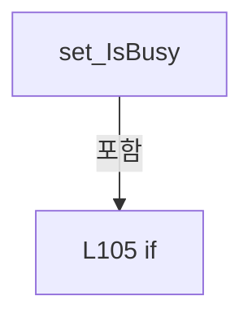

변경 전 점검: 입력/반환 타입, 위 호출자, 예외/취소 경로, 공유 상태와 저장·전송 소비자를 함께 확인합니다. 값의 단위나 물리 방향을 이름만으로 확정하지 않습니다.

### MethodDeclaration `Reload` · L117–120

[Drilling.UI/Menu/Menus/CMenuCorrection.ReviewData.cs:117–120](https://github.com/kjuws10-rgb/A3Drilling/blob/0219666f9053b907d96d7e0aa7d0c6c1be3a73d4/Drilling.UI/Menu/Menus/CMenuCorrection.ReviewData.cs#L117-L120)

| 항목 | 실제 추출 값 |
| --- | --- |
| 서명 | System.Threading.Tasks.Task Drilling.UI.Menu.Menus.CMenuCorrection.CReviewDataPanel.Reload(System.Threading.CancellationToken) |
| 접근/수식자 | Public / public |
| 반환/값 타입 | System.Threading.Tasks.Task |
| 소속 타입 | NamedType:Drilling.UI.Menu.Menus.CMenuCorrection.CReviewDataPanel |

입력 계약:

| 이름 | 타입 | 전달 | 선택/기본값 |
| --- | --- | --- | --- |
| cancellationToken | System.Threading.CancellationToken | None | True / null |

정적 호출자로 확인된 위치:

| 호출 파일/행 | 호출 표현식 | 런타임 분기 가능 |
| --- | --- | --- |
| [Drilling.UI/Menu/Menus/CMenuCorrection.ReviewData.cs:126–126](https://github.com/kjuws10-rgb/A3Drilling/blob/0219666f9053b907d96d7e0aa7d0c6c1be3a73d4/Drilling.UI/Menu/Menus/CMenuCorrection.ReviewData.cs#L126-L126) | Reload | False |

호출하는 대상과 해석 범위:

| 원본 행 | 표현식 | 분석 상태 | 대상/소스 위치 |
| --- | --- | --- | --- |
| 119 | Refresh | resolved | System.Threading.Tasks.Task Drilling.UI.Menu.Menus.CMenuCorrection.CReviewDataPanel.Refresh(System.Threading.CancellationToken, string?) · Drilling.UI/Menu/Menus/CMenuCorrection.ReviewData.cs:263 |

본문의 실제 연산·분기·예외·반환 순서(원문 위치 순):

| 원본 행 | 종류 | 주석 해설 |
| --- | --- | --- |
| 119 | call | 함수·델리게이트 또는 객체 생성자를 호출합니다: Refresh(cancellationToken) |
| 119 | return | 호출자에게 값 또는 제어를 반환합니다: return Refresh(cancellationToken); |

변경 전 점검: 입력/반환 타입, 위 호출자, 예외/취소 경로, 공유 상태와 저장·전송 소비자를 함께 확인합니다. 값의 단위나 물리 방향을 이름만으로 확정하지 않습니다.

### MethodDeclaration `ReloadForInspectionModeChange` · L122–177

[Drilling.UI/Menu/Menus/CMenuCorrection.ReviewData.cs:122–177](https://github.com/kjuws10-rgb/A3Drilling/blob/0219666f9053b907d96d7e0aa7d0c6c1be3a73d4/Drilling.UI/Menu/Menus/CMenuCorrection.ReviewData.cs#L122-L177)

| 항목 | 실제 추출 값 |
| --- | --- |
| 서명 | System.Threading.Tasks.Task Drilling.UI.Menu.Menus.CMenuCorrection.CReviewDataPanel.ReloadForInspectionModeChange(System.Threading.CancellationToken) |
| 접근/수식자 | Public / public, async |
| 반환/값 타입 | System.Threading.Tasks.Task |
| 소속 타입 | NamedType:Drilling.UI.Menu.Menus.CMenuCorrection.CReviewDataPanel |

입력 계약:

| 이름 | 타입 | 전달 | 선택/기본값 |
| --- | --- | --- | --- |
| cancellationToken | System.Threading.CancellationToken | None | True / null |

정적 호출자로 확인된 위치:

| 호출 파일/행 | 호출 표현식 | 런타임 분기 가능 |
| --- | --- | --- |
| [Drilling.UI/Menu/Menus/CMenuCorrection.cs:407–407](https://github.com/kjuws10-rgb/A3Drilling/blob/0219666f9053b907d96d7e0aa7d0c6c1be3a73d4/Drilling.UI/Menu/Menus/CMenuCorrection.cs#L407-L407) | InspectionReviewData.ReloadForInspectionModeChange | False |

호출하는 대상과 해석 범위:

| 원본 행 | 표현식 | 분석 상태 | 대상/소스 위치 |
| --- | --- | --- | --- |
| 126 | Reload | resolved | System.Threading.Tasks.Task Drilling.UI.Menu.Menus.CMenuCorrection.CReviewDataPanel.Reload(System.Threading.CancellationToken) · Drilling.UI/Menu/Menus/CMenuCorrection.ReviewData.cs:117 |
| 130 | Interlocked.Increment | resolved | int System.Threading.Interlocked.Increment(ref int) |
| 131 | NormalizeInspectionResultType | resolved | string Drilling.UI.Menu.Menus.CMenuCorrection.CReviewDataPanel.NormalizeInspectionResultType(string?) · Drilling.UI/Menu/Menus/CMenuCorrection.ReviewData.cs:507 |
| 131 | .Invoke | resolved · 동적 구현 선택 가능 | string System.Func<string>.Invoke() |
| 132 | InspectionResultDisplayName | resolved | string Drilling.UI.Menu.Menus.CMenuCorrection.CReviewDataPanel.InspectionResultDisplayName(string) · Drilling.UI/Menu/Menus/CMenuCorrection.ReviewData.cs:500 |
| 133 | Notify | resolved | void Drilling.UI.Menu.Menus.CMenuCorrection.CReviewDataPanel.Notify(string) · Drilling.UI/Menu/Menus/CMenuCorrection.ReviewData.cs:616 |
| 133 | nameof | unresolved | None |
| 134 | Notify | resolved | void Drilling.UI.Menu.Menus.CMenuCorrection.CReviewDataPanel.Notify(string) · Drilling.UI/Menu/Menus/CMenuCorrection.ReviewData.cs:616 |
| 134 | nameof | unresolved | None |
| 135 | NotifyLoadCommandState | resolved | void Drilling.UI.Menu.Menus.CMenuCorrection.CReviewDataPanel.NotifyLoadCommandState() · Drilling.UI/Menu/Menus/CMenuCorrection.ReviewData.Display.cs:1385 |
| 136 | (_selectedRecipeIdProvider() ?? "").Trim | resolved | string string.Trim() |
| 136 | _selectedRecipeIdProvider | resolved · 동적 구현 선택 가능 | string System.Func<string>.Invoke() |
| 137 | BuildInspectionTree | resolved | System.Collections.Generic.IReadOnlyList<Drilling.UI.Menu.Menus.CMenuCorrection.ST_REVIEW_RESULT_TREE_NODE> Drilling.UI.Menu.Menus.CMenuCorrection.CReviewDataPanel.BuildInspectionTree(System.Collections.Generic.IReadOnlyList<Drilling.Common.Review.ST_REVIEW_RESULT_CATALOG_ITEM>, string, string) · Drilling.UI/Menu/Menus/CMenuCorrection.ReviewData.cs:418 |
| 140 | Notify | resolved | void Drilling.UI.Menu.Menus.CMenuCorrection.CReviewDataPanel.Notify(string) · Drilling.UI/Menu/Menus/CMenuCorrection.ReviewData.cs:616 |
| 140 | nameof | unresolved | None |
| 141 | Notify | resolved | void Drilling.UI.Menu.Menus.CMenuCorrection.CReviewDataPanel.Notify(string) · Drilling.UI/Menu/Menus/CMenuCorrection.ReviewData.cs:616 |
| 141 | nameof | unresolved | None |
| 142 | Notify | resolved | void Drilling.UI.Menu.Menus.CMenuCorrection.CReviewDataPanel.Notify(string) · Drilling.UI/Menu/Menus/CMenuCorrection.ReviewData.cs:616 |
| 142 | nameof | unresolved | None |
| 143 | ClearSelection | resolved | void Drilling.UI.Menu.Menus.CMenuCorrection.CReviewDataPanel.ClearSelection() · Drilling.UI/Menu/Menus/CMenuCorrection.ReviewData.cs:338 |
| 144 | SetLoadProgress | resolved | void Drilling.UI.Menu.Menus.CMenuCorrection.CReviewDataPanel.SetLoadProgress(double, string) · Drilling.UI/Menu/Menus/CMenuCorrection.ReviewData.Display.cs:1369 |
| 145 | SetDataLoadHint | resolved | void Drilling.UI.Menu.Menus.CMenuCorrection.CReviewDataPanel.SetDataLoadHint(string, string) · Drilling.UI/Menu/Menus/CMenuCorrection.ReviewData.Display.cs:1377 |
| 146 | SetDataLoading | resolved | void Drilling.UI.Menu.Menus.CMenuCorrection.CReviewDataPanel.SetDataLoading(bool) · Drilling.UI/Menu/Menus/CMenuCorrection.ReviewData.Display.cs:1355 |
| 152 | Task.Delay | resolved | System.Threading.Tasks.Task System.Threading.Tasks.Task.Delay(int, System.Threading.CancellationToken) |
| 153 | Volatile.Read | resolved | int System.Threading.Volatile.Read(ref readonly int) |
| 159 | Volatile.Read | resolved | int System.Threading.Volatile.Read(ref readonly int) |
| 164 | Refresh | resolved | System.Threading.Tasks.Task Drilling.UI.Menu.Menus.CMenuCorrection.CReviewDataPanel.Refresh(System.Threading.CancellationToken, string?) · Drilling.UI/Menu/Menus/CMenuCorrection.ReviewData.cs:263 |
| 165 | Volatile.Read | resolved | int System.Threading.Volatile.Read(ref readonly int) |
| 167 | SetLoadProgress | resolved | void Drilling.UI.Menu.Menus.CMenuCorrection.CReviewDataPanel.SetLoadProgress(double, string) · Drilling.UI/Menu/Menus/CMenuCorrection.ReviewData.Display.cs:1369 |
| 167 | resultType.Replace | resolved | string string.Replace(char, char) |
| 172 | Volatile.Read | resolved | int System.Threading.Volatile.Read(ref readonly int) |
| 174 | SetDataLoading | resolved | void Drilling.UI.Menu.Menus.CMenuCorrection.CReviewDataPanel.SetDataLoading(bool) · Drilling.UI/Menu/Menus/CMenuCorrection.ReviewData.Display.cs:1355 |

본문의 실제 연산·분기·예외·반환 순서(원문 위치 순):

| 원본 행 | 종류 | 주석 해설 |
| --- | --- | --- |
| 124 | if | 조건에 따라 분기합니다: if (!_inspectionResultsOnly) |
| 126 | await | 비동기 완료를 기다립니다: await Reload(cancellationToken) |
| 126 | call | 함수·델리게이트 또는 객체 생성자를 호출합니다: Reload(cancellationToken) |
| 127 | return | 호출자에게 값 또는 제어를 반환합니다: return; |
| 130 | call | 함수·델리게이트 또는 객체 생성자를 호출합니다: Interlocked.Increment(ref _inspectionRefreshVersion) |
| 130 | local-declaration | 지역 변수를 선언합니다: var version = Interlocked.Increment(ref _inspectionRefreshVersion); |
| 130 | variable-initializer | 변수의 초기값을 지정합니다: version = Interlocked.Increment(ref _inspectionRefreshVersion) |
| 131 | call | 함수·델리게이트 또는 객체 생성자를 호출합니다: NormalizeInspectionResultType(_inspectionResultTypeProvider?.Invoke()) |
| 131 | call | 함수·델리게이트 또는 객체 생성자를 호출합니다: .Invoke() |
| 131 | local-declaration | 지역 변수를 선언합니다: var resultType = NormalizeInspectionResultType(_inspectionResultTypeProvider?.Invoke()); |
| 131 | variable-initializer | 변수의 초기값을 지정합니다: resultType = NormalizeInspectionResultType(_inspectionResultTypeProvider?.Invoke()) |
| 132 | call | 함수·델리게이트 또는 객체 생성자를 호출합니다: InspectionResultDisplayName(resultType) |
| 132 | local-declaration | 지역 변수를 선언합니다: var displayType = InspectionResultDisplayName(resultType); |
| 132 | variable-initializer | 변수의 초기값을 지정합니다: displayType = InspectionResultDisplayName(resultType) |
| 133 | call | 함수·델리게이트 또는 객체 생성자를 호출합니다: Notify(nameof(IsInspectionOffsetRestricted)) |
| 133 | call | 함수·델리게이트 또는 객체 생성자를 호출합니다: nameof(IsInspectionOffsetRestricted) |
| 134 | call | 함수·델리게이트 또는 객체 생성자를 호출합니다: Notify(nameof(InspectionOffsetRestrictionText)) |
| 134 | call | 함수·델리게이트 또는 객체 생성자를 호출합니다: nameof(InspectionOffsetRestrictionText) |
| 135 | call | 함수·델리게이트 또는 객체 생성자를 호출합니다: NotifyLoadCommandState() |
| 136 | call | 함수·델리게이트 또는 객체 생성자를 호출합니다: (_selectedRecipeIdProvider() ?? "").Trim() |
| 136 | call | 함수·델리게이트 또는 객체 생성자를 호출합니다: _selectedRecipeIdProvider() |
| 136 | local-declaration | 지역 변수를 선언합니다: var recipeId = (_selectedRecipeIdProvider() ?? "").Trim(); |
| 136 | variable-initializer | 변수의 초기값을 지정합니다: recipeId = (_selectedRecipeIdProvider() ?? "").Trim() |
| 137 | assignment | 값을 대상에 대입합니다: Nodes = BuildInspectionTree([], resultType, recipeId) |
| 137 | call | 함수·델리게이트 또는 객체 생성자를 호출합니다: BuildInspectionTree([], resultType, recipeId) |
| 138 | assignment | 값을 대상에 대입합니다: ResultListTitle = "REVIEW RESULTS" |
| 139 | assignment | 값을 대상에 대입합니다: StatusText = $"{displayType} / LOADING..." |
| 140 | call | 함수·델리게이트 또는 객체 생성자를 호출합니다: Notify(nameof(Nodes)) |
| 140 | call | 함수·델리게이트 또는 객체 생성자를 호출합니다: nameof(Nodes) |
| 141 | call | 함수·델리게이트 또는 객체 생성자를 호출합니다: Notify(nameof(ResultListTitle)) |
| 141 | call | 함수·델리게이트 또는 객체 생성자를 호출합니다: nameof(ResultListTitle) |
| 142 | call | 함수·델리게이트 또는 객체 생성자를 호출합니다: Notify(nameof(StatusText)) |
| 142 | call | 함수·델리게이트 또는 객체 생성자를 호출합니다: nameof(StatusText) |
| 143 | call | 함수·델리게이트 또는 객체 생성자를 호출합니다: ClearSelection() |
| 144 | call | 함수·델리게이트 또는 객체 생성자를 호출합니다: SetLoadProgress(5.0, $"{displayType} 결과 목록을 불러오는 중...") |
| 145 | call | 함수·델리게이트 또는 객체 생성자를 호출합니다: SetDataLoadHint("선택한 검사 모드의 결과 목록을 불러오는 중입니다.", "WAIT") |
| 146 | call | 함수·델리게이트 또는 객체 생성자를 호출합니다: SetDataLoading(true) |
| 148 | try | 예외 처리 범위입니다: try |
| 150 | while | 조건을 먼저 확인하며 반복합니다: while (IsBusy) |
| 152 | await | 비동기 완료를 기다립니다: await Task.Delay(20, cancellationToken) |
| 152 | call | 함수·델리게이트 또는 객체 생성자를 호출합니다: Task.Delay(20, cancellationToken) |
| 153 | call | 함수·델리게이트 또는 객체 생성자를 호출합니다: Volatile.Read(ref _inspectionRefreshVersion) |
| 153 | if | 조건에 따라 분기합니다: if (version != Volatile.Read(ref _inspectionRefreshVersion)) |
| 155 | return | 호출자에게 값 또는 제어를 반환합니다: return; |
| 159 | call | 함수·델리게이트 또는 객체 생성자를 호출합니다: Volatile.Read(ref _inspectionRefreshVersion) |
| 159 | if | 조건에 따라 분기합니다: if (version != Volatile.Read(ref _inspectionRefreshVersion)) |
| 161 | return | 호출자에게 값 또는 제어를 반환합니다: return; |
| 164 | await | 비동기 완료를 기다립니다: await Refresh(cancellationToken) |
| 164 | call | 함수·델리게이트 또는 객체 생성자를 호출합니다: Refresh(cancellationToken) |
| 165 | call | 함수·델리게이트 또는 객체 생성자를 호출합니다: Volatile.Read(ref _inspectionRefreshVersion) |
| 165 | if | 조건에 따라 분기합니다: if (version == Volatile.Read(ref _inspectionRefreshVersion)) |
| 167 | call | 함수·델리게이트 또는 객체 생성자를 호출합니다: SetLoadProgress(100.0, $"{resultType.Replace('_', ' ')} 결과 목록 로드 완료") |
| 167 | call | 함수·델리게이트 또는 객체 생성자를 호출합니다: resultType.Replace('_', ' ') |
| 170 | finally | 종료 정리 구간입니다: finally |
| 172 | call | 함수·델리게이트 또는 객체 생성자를 호출합니다: Volatile.Read(ref _inspectionRefreshVersion) |
| 172 | if | 조건에 따라 분기합니다: if (version == Volatile.Read(ref _inspectionRefreshVersion)) |
| 174 | call | 함수·델리게이트 또는 객체 생성자를 호출합니다: SetDataLoading(false) |

제어 구문의 포함 구조(실제 실행 순서/CFG가 아닌 구문 탐색 그림):

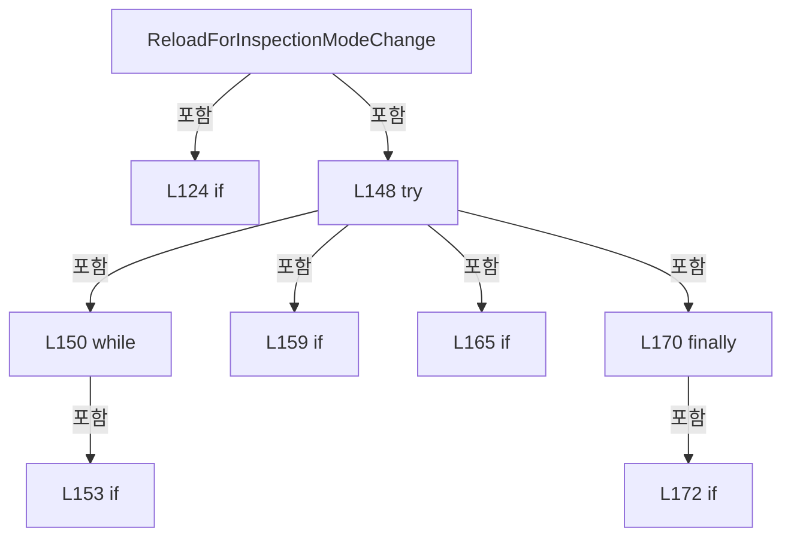

변경 전 점검: 입력/반환 타입, 위 호출자, 예외/취소 경로, 공유 상태와 저장·전송 소비자를 함께 확인합니다. 값의 단위나 물리 방향을 이름만으로 확정하지 않습니다.

### MethodDeclaration `ReloadWhenVisible` · L179–187

[Drilling.UI/Menu/Menus/CMenuCorrection.ReviewData.cs:179–187](https://github.com/kjuws10-rgb/A3Drilling/blob/0219666f9053b907d96d7e0aa7d0c6c1be3a73d4/Drilling.UI/Menu/Menus/CMenuCorrection.ReviewData.cs#L179-L187)

| 항목 | 실제 추출 값 |
| --- | --- |
| 서명 | System.Threading.Tasks.Task Drilling.UI.Menu.Menus.CMenuCorrection.CReviewDataPanel.ReloadWhenVisible(System.Threading.CancellationToken) |
| 접근/수식자 | Public / public |
| 반환/값 타입 | System.Threading.Tasks.Task |
| 소속 타입 | NamedType:Drilling.UI.Menu.Menus.CMenuCorrection.CReviewDataPanel |

입력 계약:

| 이름 | 타입 | 전달 | 선택/기본값 |
| --- | --- | --- | --- |
| cancellationToken | System.Threading.CancellationToken | None | True / null |

정적 호출자로 확인된 위치:

| 호출 파일/행 | 호출 표현식 | 런타임 분기 가능 |
| --- | --- | --- |
| [Drilling.UI/Views/CReviewDataView.xaml.cs:65–65](https://github.com/kjuws10-rgb/A3Drilling/blob/0219666f9053b907d96d7e0aa7d0c6c1be3a73d4/Drilling.UI/Views/CReviewDataView.xaml.cs#L65-L65) | panel.ReloadWhenVisible | False |

호출하는 대상과 해석 범위:

| 원본 행 | 표현식 | 분석 상태 | 대상/소스 위치 |
| --- | --- | --- | --- |
| 181 | Interlocked.Exchange | resolved | int System.Threading.Interlocked.Exchange(ref int, int) |
| 186 | Refresh | resolved | System.Threading.Tasks.Task Drilling.UI.Menu.Menus.CMenuCorrection.CReviewDataPanel.Refresh(System.Threading.CancellationToken, string?) · Drilling.UI/Menu/Menus/CMenuCorrection.ReviewData.cs:263 |

본문의 실제 연산·분기·예외·반환 순서(원문 위치 순):

| 원본 행 | 종류 | 주석 해설 |
| --- | --- | --- |
| 181 | call | 함수·델리게이트 또는 객체 생성자를 호출합니다: Interlocked.Exchange(ref _skipNextVisibleReload, 0) |
| 181 | if | 조건에 따라 분기합니다: if (Interlocked.Exchange(ref _skipNextVisibleReload, 0) != 0) |
| 183 | return | 호출자에게 값 또는 제어를 반환합니다: return Task.CompletedTask; |
| 186 | call | 함수·델리게이트 또는 객체 생성자를 호출합니다: Refresh(cancellationToken) |
| 186 | return | 호출자에게 값 또는 제어를 반환합니다: return Refresh(cancellationToken); |

제어 구문의 포함 구조(실제 실행 순서/CFG가 아닌 구문 탐색 그림):

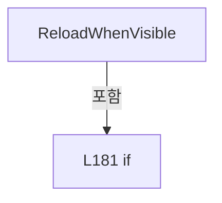

변경 전 점검: 입력/반환 타입, 위 호출자, 예외/취소 경로, 공유 상태와 저장·전송 소비자를 함께 확인합니다. 값의 단위나 물리 방향을 이름만으로 확정하지 않습니다.

### MethodDeclaration `OpenResult` · L189–207

[Drilling.UI/Menu/Menus/CMenuCorrection.ReviewData.cs:189–207](https://github.com/kjuws10-rgb/A3Drilling/blob/0219666f9053b907d96d7e0aa7d0c6c1be3a73d4/Drilling.UI/Menu/Menus/CMenuCorrection.ReviewData.cs#L189-L207)

| 항목 | 실제 추출 값 |
| --- | --- |
| 서명 | System.Threading.Tasks.Task Drilling.UI.Menu.Menus.CMenuCorrection.CReviewDataPanel.OpenResult(string, System.Threading.CancellationToken) |
| 접근/수식자 | Public / public, async |
| 반환/값 타입 | System.Threading.Tasks.Task |
| 소속 타입 | NamedType:Drilling.UI.Menu.Menus.CMenuCorrection.CReviewDataPanel |

입력 계약:

| 이름 | 타입 | 전달 | 선택/기본값 |
| --- | --- | --- | --- |
| resultPath | string | None | False /  |
| cancellationToken | System.Threading.CancellationToken | None | True / null |

정적 호출자로 확인된 위치:

| 호출 파일/행 | 호출 표현식 | 런타임 분기 가능 |
| --- | --- | --- |
| [Drilling.UI/Menu/Menus/CMenuCorrection.cs:513–513](https://github.com/kjuws10-rgb/A3Drilling/blob/0219666f9053b907d96d7e0aa7d0c6c1be3a73d4/Drilling.UI/Menu/Menus/CMenuCorrection.cs#L513-L513) | InspectionReviewData.OpenResult | False |

호출하는 대상과 해석 범위:

| 원본 행 | 표현식 | 분석 상태 | 대상/소스 위치 |
| --- | --- | --- | --- |
| 191 | string.IsNullOrWhiteSpace | resolved | bool string.IsNullOrWhiteSpace(string?) |
| 192 | new ArgumentException | resolved | System.ArgumentException.ArgumentException(string?, string?) |
| 192 | nameof | unresolved | None |
| 193 | File.Exists | resolved | bool System.IO.File.Exists(string?) |
| 194 | new FileNotFoundException | resolved | System.IO.FileNotFoundException.FileNotFoundException(string?, string?) |
| 196 | Interlocked.Exchange | resolved | int System.Threading.Interlocked.Exchange(ref int, int) |
| 197 | Refresh | resolved | System.Threading.Tasks.Task Drilling.UI.Menu.Menus.CMenuCorrection.CReviewDataPanel.Refresh(System.Threading.CancellationToken, string?) · Drilling.UI/Menu/Menus/CMenuCorrection.ReviewData.cs:263 |
| 198 | cancellationToken.ThrowIfCancellationRequested | resolved | void System.Threading.CancellationToken.ThrowIfCancellationRequested() |
| 201 | selectedResult.FilePath.Equals | resolved | bool string.Equals(string?, System.StringComparison) |
| 202 | new InvalidOperationException | resolved | System.InvalidOperationException.InvalidOperationException(string?) |
| 203 | IsBlockedStatus | resolved | bool Drilling.UI.Menu.Menus.CMenuCorrection.CReviewDataPanel.IsBlockedStatus(string) · Drilling.UI/Menu/Menus/CMenuCorrection.ReviewData.Display.cs:1311 |
| 204 | new InvalidOperationException | resolved | System.InvalidOperationException.InvalidOperationException(string?) |
| 206 | LoadSelectedData | resolved | System.Threading.Tasks.Task Drilling.UI.Menu.Menus.CMenuCorrection.CReviewDataPanel.LoadSelectedData() · Drilling.UI/Menu/Menus/CMenuCorrection.ReviewData.Display.cs:160 |

본문의 실제 연산·분기·예외·반환 순서(원문 위치 순):

| 원본 행 | 종류 | 주석 해설 |
| --- | --- | --- |
| 191 | call | 함수·델리게이트 또는 객체 생성자를 호출합니다: string.IsNullOrWhiteSpace(resultPath) |
| 191 | if | 조건에 따라 분기합니다: if (string.IsNullOrWhiteSpace(resultPath)) |
| 192 | call | 함수·델리게이트 또는 객체 생성자를 호출합니다: new ArgumentException("검사 결과 경로가 없습니다.", nameof(resultPath)) |
| 192 | call | 함수·델리게이트 또는 객체 생성자를 호출합니다: nameof(resultPath) |
| 192 | throw | 예외를 발생/전달합니다: throw new ArgumentException("검사 결과 경로가 없습니다.", nameof(resultPath)); |
| 193 | call | 함수·델리게이트 또는 객체 생성자를 호출합니다: File.Exists(resultPath) |
| 193 | if | 조건에 따라 분기합니다: if (!File.Exists(resultPath)) |
| 194 | call | 함수·델리게이트 또는 객체 생성자를 호출합니다: new FileNotFoundException("방금 저장한 검사 결과 파일을 찾을 수 없습니다.", resultPath) |
| 194 | throw | 예외를 발생/전달합니다: throw new FileNotFoundException("방금 저장한 검사 결과 파일을 찾을 수 없습니다.", resultPath); |
| 196 | call | 함수·델리게이트 또는 객체 생성자를 호출합니다: Interlocked.Exchange(ref _skipNextVisibleReload, 1) |
| 197 | await | 비동기 완료를 기다립니다: await Refresh(cancellationToken, resultPath) |
| 197 | call | 함수·델리게이트 또는 객체 생성자를 호출합니다: Refresh(cancellationToken, resultPath) |
| 198 | call | 함수·델리게이트 또는 객체 생성자를 호출합니다: cancellationToken.ThrowIfCancellationRequested() |
| 200 | local-declaration | 지역 변수를 선언합니다: var selectedResult = _selectedNode?.Result; |
| 200 | variable-initializer | 변수의 초기값을 지정합니다: selectedResult = _selectedNode?.Result |
| 201 | call | 함수·델리게이트 또는 객체 생성자를 호출합니다: selectedResult.FilePath.Equals(resultPath, StringComparison.OrdinalIgnoreCase) |
| 201 | if | 조건에 따라 분기합니다: if (selectedResult is null &#124;&#124; !selectedResult.FilePath.Equals(resultPath, StringComparison.OrdinalIgnoreCase)) |
| 202 | call | 함수·델리게이트 또는 객체 생성자를 호출합니다: new InvalidOperationException("방금 저장한 검사 결과를 REVIEW DATA 목록에서 찾을 수 없습니다.") |
| 202 | throw | 예외를 발생/전달합니다: throw new InvalidOperationException("방금 저장한 검사 결과를 REVIEW DATA 목록에서 찾을 수 없습니다."); |
| 203 | call | 함수·델리게이트 또는 객체 생성자를 호출합니다: IsBlockedStatus(selectedResult.ResultStatus) |
| 203 | if | 조건에 따라 분기합니다: if (IsBlockedStatus(selectedResult.ResultStatus)) |
| 204 | call | 함수·델리게이트 또는 객체 생성자를 호출합니다: new InvalidOperationException($"검사 결과를 불러올 수 없습니다. 상태: {selectedResult.ResultStatus}") |
| 204 | throw | 예외를 발생/전달합니다: throw new InvalidOperationException($"검사 결과를 불러올 수 없습니다. 상태: {selectedResult.ResultStatus}"); |
| 206 | await | 비동기 완료를 기다립니다: await LoadSelectedData() |
| 206 | call | 함수·델리게이트 또는 객체 생성자를 호출합니다: LoadSelectedData() |

제어 구문의 포함 구조(실제 실행 순서/CFG가 아닌 구문 탐색 그림):

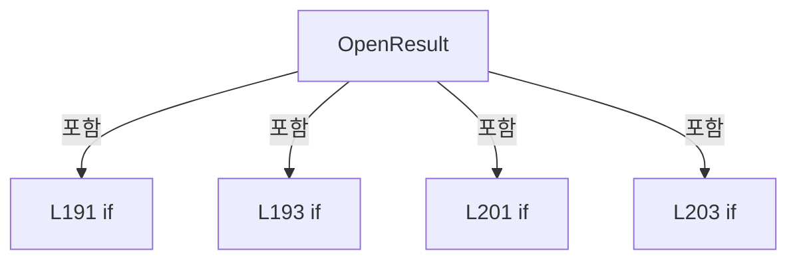

변경 전 점검: 입력/반환 타입, 위 호출자, 예외/취소 경로, 공유 상태와 저장·전송 소비자를 함께 확인합니다. 값의 단위나 물리 방향을 이름만으로 확정하지 않습니다.

### MethodDeclaration `Select` · L209–233

[Drilling.UI/Menu/Menus/CMenuCorrection.ReviewData.cs:209–233](https://github.com/kjuws10-rgb/A3Drilling/blob/0219666f9053b907d96d7e0aa7d0c6c1be3a73d4/Drilling.UI/Menu/Menus/CMenuCorrection.ReviewData.cs#L209-L233)

| 항목 | 실제 추출 값 |
| --- | --- |
| 서명 | void Drilling.UI.Menu.Menus.CMenuCorrection.CReviewDataPanel.Select(Drilling.UI.Menu.Menus.CMenuCorrection.ST_REVIEW_RESULT_TREE_NODE) |
| 접근/수식자 | Public / public |
| 반환/값 타입 | void |
| 소속 타입 | NamedType:Drilling.UI.Menu.Menus.CMenuCorrection.CReviewDataPanel |

입력 계약:

| 이름 | 타입 | 전달 | 선택/기본값 |
| --- | --- | --- | --- |
| node | Drilling.UI.Menu.Menus.CMenuCorrection.ST_REVIEW_RESULT_TREE_NODE | None | False /  |

정적 호출자로 확인된 위치:

| 호출 파일/행 | 호출 표현식 | 런타임 분기 가능 |
| --- | --- | --- |
| [Drilling.UI/Menu/Menus/CMenuCorrection.ReviewData.cs:315–315](https://github.com/kjuws10-rgb/A3Drilling/blob/0219666f9053b907d96d7e0aa7d0c6c1be3a73d4/Drilling.UI/Menu/Menus/CMenuCorrection.ReviewData.cs#L315-L315) | Select | False |
| [Drilling.UI/Views/CReviewDataView.xaml.cs:76–76](https://github.com/kjuws10-rgb/A3Drilling/blob/0219666f9053b907d96d7e0aa7d0c6c1be3a73d4/Drilling.UI/Views/CReviewDataView.xaml.cs#L76-L76) | panel.Select | False |

호출하는 대상과 해석 범위:

| 원본 행 | 표현식 | 분석 상태 | 대상/소스 위치 |
| --- | --- | --- | --- |
| 213 | .FilePath.Equals | resolved | bool string.Equals(string?, System.StringComparison) |
| 214 | SetSelectedTreeNode | resolved | void Drilling.UI.Menu.Menus.CMenuCorrection.CReviewDataPanel.SetSelectedTreeNode(Drilling.UI.Menu.Menus.CMenuCorrection.ST_REVIEW_RESULT_TREE_NODE?) · Drilling.UI/Menu/Menus/CMenuCorrection.ReviewData.cs:591 |
| 219 | CreateDetails | resolved | System.Collections.Generic.IReadOnlyList<Drilling.UI.Menu.Menus.CMenuCorrection.ST_REVIEW_DATA_DETAIL_ITEM> Drilling.UI.Menu.Menus.CMenuCorrection.CReviewDataPanel.CreateDetails(Drilling.UI.Menu.Menus.CMenuCorrection.ST_REVIEW_RESULT_TREE_NODE) · Drilling.UI/Menu/Menus/CMenuCorrection.ReviewData.cs:529 |
| 220 | Notify | resolved | void Drilling.UI.Menu.Menus.CMenuCorrection.CReviewDataPanel.Notify(string) · Drilling.UI/Menu/Menus/CMenuCorrection.ReviewData.cs:616 |
| 220 | nameof | unresolved | None |
| 221 | Notify | resolved | void Drilling.UI.Menu.Menus.CMenuCorrection.CReviewDataPanel.Notify(string) · Drilling.UI/Menu/Menus/CMenuCorrection.ReviewData.cs:616 |
| 221 | nameof | unresolved | None |
| 222 | Notify | resolved | void Drilling.UI.Menu.Menus.CMenuCorrection.CReviewDataPanel.Notify(string) · Drilling.UI/Menu/Menus/CMenuCorrection.ReviewData.cs:616 |
| 222 | nameof | unresolved | None |
| 223 | Notify | resolved | void Drilling.UI.Menu.Menus.CMenuCorrection.CReviewDataPanel.Notify(string) · Drilling.UI/Menu/Menus/CMenuCorrection.ReviewData.cs:616 |
| 223 | nameof | unresolved | None |
| 224 | Notify | resolved | void Drilling.UI.Menu.Menus.CMenuCorrection.CReviewDataPanel.Notify(string) · Drilling.UI/Menu/Menus/CMenuCorrection.ReviewData.cs:616 |
| 224 | nameof | unresolved | None |
| 227 | PrepareSelectedResult | resolved | void Drilling.UI.Menu.Menus.CMenuCorrection.CReviewDataPanel.PrepareSelectedResult(Drilling.Common.Review.ST_REVIEW_RESULT_CATALOG_ITEM?) · Drilling.UI/Menu/Menus/CMenuCorrection.ReviewData.Display.cs:124 |
| 231 | _statusReporter | resolved · 동적 구현 선택 가능 | void System.Action<string>.Invoke(string) |

본문의 실제 연산·분기·예외·반환 순서(원문 위치 순):

| 원본 행 | 종류 | 주석 해설 |
| --- | --- | --- |
| 211 | local-declaration | 지역 변수를 선언합니다: var preserveLoadedData = node.Result is { } selectedResult && _hasLoadedData && _loadedCatalog?.FilePath.Equals(selectedResult.FilePath, StringComparison.OrdinalIgnoreCase) == true; |
| 211 | variable-initializer | 변수의 초기값을 지정합니다: preserveLoadedData = node.Result is { } selectedResult && _hasLoadedData && _loadedCatalog?.FilePath.Equals(selectedResult.FilePath, StringComparison.OrdinalIgnoreCase) == true |
| 213 | call | 함수·델리게이트 또는 객체 생성자를 호출합니다: .FilePath.Equals(selectedResult.FilePath, StringComparison.OrdinalIgnoreCase) |
| 214 | call | 함수·델리게이트 또는 객체 생성자를 호출합니다: SetSelectedTreeNode(node) |
| 215 | assignment | 값을 대상에 대입합니다: _selectedNode = node |
| 216 | assignment | 값을 대상에 대입합니다: SelectedTitle = node.Name |
| 217 | assignment | 값을 대상에 대입합니다: SelectedStatus = node.Result?.ResultStatus ?? node.Kind |
| 218 | assignment | 값을 대상에 대입합니다: SelectedPath = node.Result?.FilePath ?? "" |
| 219 | assignment | 값을 대상에 대입합니다: SelectedDetails = CreateDetails(node) |
| 219 | call | 함수·델리게이트 또는 객체 생성자를 호출합니다: CreateDetails(node) |
| 220 | call | 함수·델리게이트 또는 객체 생성자를 호출합니다: Notify(nameof(SelectedTitle)) |
| 220 | call | 함수·델리게이트 또는 객체 생성자를 호출합니다: nameof(SelectedTitle) |
| 221 | call | 함수·델리게이트 또는 객체 생성자를 호출합니다: Notify(nameof(SelectedStatus)) |
| 221 | call | 함수·델리게이트 또는 객체 생성자를 호출합니다: nameof(SelectedStatus) |
| 222 | call | 함수·델리게이트 또는 객체 생성자를 호출합니다: Notify(nameof(SelectedStatusBrush)) |
| 222 | call | 함수·델리게이트 또는 객체 생성자를 호출합니다: nameof(SelectedStatusBrush) |
| 223 | call | 함수·델리게이트 또는 객체 생성자를 호출합니다: Notify(nameof(SelectedPath)) |
| 223 | call | 함수·델리게이트 또는 객체 생성자를 호출합니다: nameof(SelectedPath) |
| 224 | call | 함수·델리게이트 또는 객체 생성자를 호출합니다: Notify(nameof(SelectedDetails)) |
| 224 | call | 함수·델리게이트 또는 객체 생성자를 호출합니다: nameof(SelectedDetails) |
| 225 | if | 조건에 따라 분기합니다: if (!preserveLoadedData) |
| 227 | call | 함수·델리게이트 또는 객체 생성자를 호출합니다: PrepareSelectedResult(node.Result) |
| 229 | if | 조건에 따라 분기합니다: if (node.Result is not null) |
| 231 | call | 함수·델리게이트 또는 객체 생성자를 호출합니다: _statusReporter($"Review Result selected: {node.Result.FileName}.") |

제어 구문의 포함 구조(실제 실행 순서/CFG가 아닌 구문 탐색 그림):

변경 전 점검: 입력/반환 타입, 위 호출자, 예외/취소 경로, 공유 상태와 저장·전송 소비자를 함께 확인합니다. 값의 단위나 물리 방향을 이름만으로 확정하지 않습니다.

### MethodDeclaration `ToggleResultEditMode` · L235–256

[Drilling.UI/Menu/Menus/CMenuCorrection.ReviewData.cs:235–256](https://github.com/kjuws10-rgb/A3Drilling/blob/0219666f9053b907d96d7e0aa7d0c6c1be3a73d4/Drilling.UI/Menu/Menus/CMenuCorrection.ReviewData.cs#L235-L256)

| 항목 | 실제 추출 값 |
| --- | --- |
| 서명 | void Drilling.UI.Menu.Menus.CMenuCorrection.CReviewDataPanel.ToggleResultEditMode(object?) |
| 접근/수식자 | Private / private |
| 반환/값 타입 | void |
| 소속 타입 | NamedType:Drilling.UI.Menu.Menus.CMenuCorrection.CReviewDataPanel |

입력 계약:

| 이름 | 타입 | 전달 | 선택/기본값 |
| --- | --- | --- | --- |
| parameter | object? | None | False /  |

현재 부분 분석에서 직접 연결된 호출자는 없습니다. XAML/이벤트/인터페이스·델리게이트·외부 진입을 추가 확인해야 하며, 미사용으로 판정한 것이 아닙니다.

호출하는 대상과 해석 범위:

| 원본 행 | 표현식 | 분석 상태 | 대상/소스 위치 |
| --- | --- | --- | --- |
| 243 | Notify | resolved | void Drilling.UI.Menu.Menus.CMenuCorrection.CReviewDataPanel.Notify(string) · Drilling.UI/Menu/Menus/CMenuCorrection.ReviewData.cs:616 |
| 243 | nameof | unresolved | None |
| 244 | Notify | resolved | void Drilling.UI.Menu.Menus.CMenuCorrection.CReviewDataPanel.Notify(string) · Drilling.UI/Menu/Menus/CMenuCorrection.ReviewData.cs:616 |
| 244 | nameof | unresolved | None |
| 245 | ToggleResultEditModeCommand.NotifyCanExecuteChanged | resolved | void Drilling.UI.Menu.CButtonCommand.NotifyCanExecuteChanged() · Drilling.UI/Menu/CButtonCommand.cs:24 |
| 248 | ClearResultEditSelection | resolved | void Drilling.UI.Menu.Menus.CMenuCorrection.CReviewDataPanel.ClearResultEditSelection() · Drilling.UI/Menu/Menus/CMenuCorrection.ReviewData.Edit.cs:211 |
| 251 | NotifyResultEditState | resolved | void Drilling.UI.Menu.Menus.CMenuCorrection.CReviewDataPanel.NotifyResultEditState() · Drilling.UI/Menu/Menus/CMenuCorrection.ReviewData.Edit.cs:584 |
| 252 | NotifyReinspectionCommandState | resolved | void Drilling.UI.Menu.Menus.CMenuCorrection.CReviewDataPanel.NotifyReinspectionCommandState() · Drilling.UI/Menu/Menus/CMenuCorrection.ReviewData.Reinspection.cs:700 |
| 253 | _statusReporter | resolved · 동적 구현 선택 가능 | void System.Action<string>.Invoke(string) |

본문의 실제 연산·분기·예외·반환 순서(원문 위치 순):

| 원본 행 | 종류 | 주석 해설 |
| --- | --- | --- |
| 237 | if | 조건에 따라 분기합니다: if (!CanToggleResultEditMode) |
| 239 | return | 호출자에게 값 또는 제어를 반환합니다: return; |
| 242 | assignment | 값을 대상에 대입합니다: _isResultEditMode = !_isResultEditMode |
| 243 | call | 함수·델리게이트 또는 객체 생성자를 호출합니다: Notify(nameof(IsResultEditMode)) |
| 243 | call | 함수·델리게이트 또는 객체 생성자를 호출합니다: nameof(IsResultEditMode) |
| 244 | call | 함수·델리게이트 또는 객체 생성자를 호출합니다: Notify(nameof(CanToggleResultEditMode)) |
| 244 | call | 함수·델리게이트 또는 객체 생성자를 호출합니다: nameof(CanToggleResultEditMode) |
| 245 | call | 함수·델리게이트 또는 객체 생성자를 호출합니다: ToggleResultEditModeCommand.NotifyCanExecuteChanged() |
| 246 | if | 조건에 따라 분기합니다: if (!_isResultEditMode) |
| 248 | call | 함수·델리게이트 또는 객체 생성자를 호출합니다: ClearResultEditSelection() |
| 251 | call | 함수·델리게이트 또는 객체 생성자를 호출합니다: NotifyResultEditState() |
| 252 | call | 함수·델리게이트 또는 객체 생성자를 호출합니다: NotifyReinspectionCommandState() |
| 253 | call | 함수·델리게이트 또는 객체 생성자를 호출합니다: _statusReporter(_isResultEditMode ? "RESULT EDIT MODE opened." : "RESULT EDIT MODE closed.") |
| 253 | conditional-expression | 조건에 따라 결과식을 선택합니다: _isResultEditMode ? "RESULT EDIT MODE opened." : "RESULT EDIT MODE closed." |

제어 구문의 포함 구조(실제 실행 순서/CFG가 아닌 구문 탐색 그림):

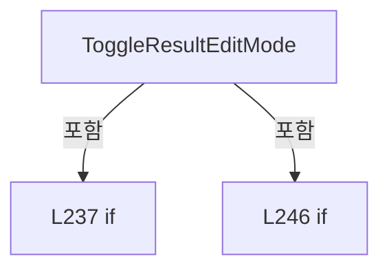

변경 전 점검: 입력/반환 타입, 위 호출자, 예외/취소 경로, 공유 상태와 저장·전송 소비자를 함께 확인합니다. 값의 단위나 물리 방향을 이름만으로 확정하지 않습니다.

### MethodDeclaration `RefreshRequested` · L258–261

[Drilling.UI/Menu/Menus/CMenuCorrection.ReviewData.cs:258–261](https://github.com/kjuws10-rgb/A3Drilling/blob/0219666f9053b907d96d7e0aa7d0c6c1be3a73d4/Drilling.UI/Menu/Menus/CMenuCorrection.ReviewData.cs#L258-L261)

| 항목 | 실제 추출 값 |
| --- | --- |
| 서명 | void Drilling.UI.Menu.Menus.CMenuCorrection.CReviewDataPanel.RefreshRequested(object?) |
| 접근/수식자 | Private / private, async |
| 반환/값 타입 | void |
| 소속 타입 | NamedType:Drilling.UI.Menu.Menus.CMenuCorrection.CReviewDataPanel |

입력 계약:

| 이름 | 타입 | 전달 | 선택/기본값 |
| --- | --- | --- | --- |
| parameter | object? | None | False /  |

현재 부분 분석에서 직접 연결된 호출자는 없습니다. XAML/이벤트/인터페이스·델리게이트·외부 진입을 추가 확인해야 하며, 미사용으로 판정한 것이 아닙니다.

호출하는 대상과 해석 범위:

| 원본 행 | 표현식 | 분석 상태 | 대상/소스 위치 |
| --- | --- | --- | --- |
| 260 | Refresh | resolved | System.Threading.Tasks.Task Drilling.UI.Menu.Menus.CMenuCorrection.CReviewDataPanel.Refresh(System.Threading.CancellationToken, string?) · Drilling.UI/Menu/Menus/CMenuCorrection.ReviewData.cs:263 |

본문의 실제 연산·분기·예외·반환 순서(원문 위치 순):

| 원본 행 | 종류 | 주석 해설 |
| --- | --- | --- |
| 260 | await | 비동기 완료를 기다립니다: await Refresh() |
| 260 | call | 함수·델리게이트 또는 객체 생성자를 호출합니다: Refresh() |

변경 전 점검: 입력/반환 타입, 위 호출자, 예외/취소 경로, 공유 상태와 저장·전송 소비자를 함께 확인합니다. 값의 단위나 물리 방향을 이름만으로 확정하지 않습니다.

### MethodDeclaration `Refresh` · L263–336

[Drilling.UI/Menu/Menus/CMenuCorrection.ReviewData.cs:263–336](https://github.com/kjuws10-rgb/A3Drilling/blob/0219666f9053b907d96d7e0aa7d0c6c1be3a73d4/Drilling.UI/Menu/Menus/CMenuCorrection.ReviewData.cs#L263-L336)

| 항목 | 실제 추출 값 |
| --- | --- |
| 서명 | System.Threading.Tasks.Task Drilling.UI.Menu.Menus.CMenuCorrection.CReviewDataPanel.Refresh(System.Threading.CancellationToken, string?) |
| 접근/수식자 | Private / private, async |
| 반환/값 타입 | System.Threading.Tasks.Task |
| 소속 타입 | NamedType:Drilling.UI.Menu.Menus.CMenuCorrection.CReviewDataPanel |

입력 계약:

| 이름 | 타입 | 전달 | 선택/기본값 |
| --- | --- | --- | --- |
| cancellationToken | System.Threading.CancellationToken | None | True / null |
| preferredResultPath | string? | None | True / null |

정적 호출자로 확인된 위치:

| 호출 파일/행 | 호출 표현식 | 런타임 분기 가능 |
| --- | --- | --- |
| [Drilling.UI/Menu/Menus/CMenuCorrection.ReviewData.Edit.cs:515–515](https://github.com/kjuws10-rgb/A3Drilling/blob/0219666f9053b907d96d7e0aa7d0c6c1be3a73d4/Drilling.UI/Menu/Menus/CMenuCorrection.ReviewData.Edit.cs#L515-L515) | Refresh | False |
| [Drilling.UI/Menu/Menus/CMenuCorrection.ReviewData.Reinspection.cs:435–435](https://github.com/kjuws10-rgb/A3Drilling/blob/0219666f9053b907d96d7e0aa7d0c6c1be3a73d4/Drilling.UI/Menu/Menus/CMenuCorrection.ReviewData.Reinspection.cs#L435-L435) | Refresh | False |
| [Drilling.UI/Menu/Menus/CMenuCorrection.ReviewData.cs:119–119](https://github.com/kjuws10-rgb/A3Drilling/blob/0219666f9053b907d96d7e0aa7d0c6c1be3a73d4/Drilling.UI/Menu/Menus/CMenuCorrection.ReviewData.cs#L119-L119) | Refresh | False |
| [Drilling.UI/Menu/Menus/CMenuCorrection.ReviewData.cs:164–164](https://github.com/kjuws10-rgb/A3Drilling/blob/0219666f9053b907d96d7e0aa7d0c6c1be3a73d4/Drilling.UI/Menu/Menus/CMenuCorrection.ReviewData.cs#L164-L164) | Refresh | False |
| [Drilling.UI/Menu/Menus/CMenuCorrection.ReviewData.cs:186–186](https://github.com/kjuws10-rgb/A3Drilling/blob/0219666f9053b907d96d7e0aa7d0c6c1be3a73d4/Drilling.UI/Menu/Menus/CMenuCorrection.ReviewData.cs#L186-L186) | Refresh | False |
| [Drilling.UI/Menu/Menus/CMenuCorrection.ReviewData.cs:197–197](https://github.com/kjuws10-rgb/A3Drilling/blob/0219666f9053b907d96d7e0aa7d0c6c1be3a73d4/Drilling.UI/Menu/Menus/CMenuCorrection.ReviewData.cs#L197-L197) | Refresh | False |
| [Drilling.UI/Menu/Menus/CMenuCorrection.ReviewData.cs:260–260](https://github.com/kjuws10-rgb/A3Drilling/blob/0219666f9053b907d96d7e0aa7d0c6c1be3a73d4/Drilling.UI/Menu/Menus/CMenuCorrection.ReviewData.cs#L260-L260) | Refresh | False |

호출하는 대상과 해석 범위:

| 원본 행 | 표현식 | 분석 상태 | 대상/소스 위치 |
| --- | --- | --- | --- |
| 275 | string.IsNullOrWhiteSpace | resolved | bool string.IsNullOrWhiteSpace(string?) |
| 278 | NormalizeRecipeId | resolved | string Drilling.UI.Menu.Menus.CMenuCorrection.NormalizeRecipeId(string) · Drilling.UI/Menu/Menus/CMenuCorrection.cs:2391 |
| 278 | _selectedRecipeIdProvider | resolved · 동적 구현 선택 가능 | string System.Func<string>.Invoke() |
| 279 | _reviewResultFile.ListCorrectionResults | resolved · 동적 구현 선택 가능 | System.Threading.Tasks.Task<System.Collections.Generic.IReadOnlyList<Drilling.Common.Review.ST_REVIEW_RESULT_CATALOG_ITEM>> Drilling.Common.Review.CReviewResultFileBase.ListCorrectionResults(System.Threading.CancellationToken) · Drilling.Common/Review/CReviewManager.cs:4350 |
| 280 | string.IsNullOrWhiteSpace | resolved | bool string.IsNullOrWhiteSpace(string?) |
| 281 | Array.Empty<ST_REVIEW_RESULT_CATALOG_ITEM> | resolved | Drilling.Common.Review.ST_REVIEW_RESULT_CATALOG_ITEM[] System.Array.Empty<Drilling.Common.Review.ST_REVIEW_RESULT_CATALOG_ITEM>() |
| 282 | allResults .Where(result => NormalizeRecipeId(result.RecipeId).Equals(selectedRecipeId, StringComparison.OrdinalIgnoreCase)) .ToArray | resolved | Drilling.Common.Review.ST_REVIEW_RESULT_CATALOG_ITEM[] System.Collections.Generic.IEnumerable<Drilling.Common.Review.ST_REVIEW_RESULT_CATALOG_ITEM>.ToArray<Drilling.Common.Review.ST_REVIEW_RESULT_CATALOG_ITEM>() |
| 282 | allResults .Where | resolved | System.Collections.Generic.IEnumerable<Drilling.Common.Review.ST_REVIEW_RESULT_CATALOG_ITEM> System.Collections.Generic.IEnumerable<Drilling.Common.Review.ST_REVIEW_RESULT_CATALOG_ITEM>.Where<Drilling.Common.Review.ST_REVIEW_RESULT_CATALOG_ITEM>(System.Func<Drilling.Common.Review.ST_REVIEW_RESULT_CATALOG_ITEM, bool>) |
| 283 | NormalizeRecipeId(result.RecipeId).Equals | resolved | bool string.Equals(string?, System.StringComparison) |
| 283 | NormalizeRecipeId | resolved | string Drilling.UI.Menu.Menus.CMenuCorrection.NormalizeRecipeId(string) · Drilling.UI/Menu/Menus/CMenuCorrection.cs:2391 |
| 285 | NormalizeInspectionResultType | resolved | string Drilling.UI.Menu.Menus.CMenuCorrection.CReviewDataPanel.NormalizeInspectionResultType(string?) · Drilling.UI/Menu/Menus/CMenuCorrection.ReviewData.cs:507 |
| 285 | .Invoke | resolved · 동적 구현 선택 가능 | string System.Func<string>.Invoke() |
| 287 | recipeResults .Where(result => IsInspectionResultMatch(result, inspectionResultType)) .ToArray | resolved | Drilling.Common.Review.ST_REVIEW_RESULT_CATALOG_ITEM[] System.Collections.Generic.IEnumerable<Drilling.Common.Review.ST_REVIEW_RESULT_CATALOG_ITEM>.ToArray<Drilling.Common.Review.ST_REVIEW_RESULT_CATALOG_ITEM>() |
| 287 | recipeResults .Where | resolved | System.Collections.Generic.IEnumerable<Drilling.Common.Review.ST_REVIEW_RESULT_CATALOG_ITEM> System.Collections.Generic.IEnumerable<Drilling.Common.Review.ST_REVIEW_RESULT_CATALOG_ITEM>.Where<Drilling.Common.Review.ST_REVIEW_RESULT_CATALOG_ITEM>(System.Func<Drilling.Common.Review.ST_REVIEW_RESULT_CATALOG_ITEM, bool>) |
| 288 | IsInspectionResultMatch | resolved | bool Drilling.UI.Menu.Menus.CMenuCorrection.CReviewDataPanel.IsInspectionResultMatch(Drilling.Common.Review.ST_REVIEW_RESULT_CATALOG_ITEM, string) · Drilling.UI/Menu/Menus/CMenuCorrection.ReviewData.cs:486 |
| 292 | results.FirstOrDefault | resolved | Drilling.Common.Review.ST_REVIEW_RESULT_CATALOG_ITEM? System.Collections.Generic.IEnumerable<Drilling.Common.Review.ST_REVIEW_RESULT_CATALOG_ITEM>.FirstOrDefault<Drilling.Common.Review.ST_REVIEW_RESULT_CATALOG_ITEM>() |
| 293 | recipeResults.FirstOrDefault | resolved | Drilling.Common.Review.ST_REVIEW_RESULT_CATALOG_ITEM? System.Collections.Generic.IEnumerable<Drilling.Common.Review.ST_REVIEW_RESULT_CATALOG_ITEM>.FirstOrDefault<Drilling.Common.Review.ST_REVIEW_RESULT_CATALOG_ITEM>() |
| 294 | (_selectedRecipeIdProvider() ?? "").Trim | resolved | string string.Trim() |
| 294 | _selectedRecipeIdProvider | resolved · 동적 구현 선택 가능 | string System.Func<string>.Invoke() |
| 296 | BuildInspectionTree | resolved | System.Collections.Generic.IReadOnlyList<Drilling.UI.Menu.Menus.CMenuCorrection.ST_REVIEW_RESULT_TREE_NODE> Drilling.UI.Menu.Menus.CMenuCorrection.CReviewDataPanel.BuildInspectionTree(System.Collections.Generic.IReadOnlyList<Drilling.Common.Review.ST_REVIEW_RESULT_CATALOG_ITEM>, string, string) · Drilling.UI/Menu/Menus/CMenuCorrection.ReviewData.cs:418 |
| 297 | BuildTree | resolved | System.Collections.Generic.IReadOnlyList<Drilling.UI.Menu.Menus.CMenuCorrection.ST_REVIEW_RESULT_TREE_NODE> Drilling.UI.Menu.Menus.CMenuCorrection.CReviewDataPanel.BuildTree(System.Collections.Generic.IReadOnlyList<Drilling.Common.Review.ST_REVIEW_RESULT_CATALOG_ITEM>) · Drilling.UI/Menu/Menus/CMenuCorrection.ReviewData.cs:354 |
| 298 | string.IsNullOrWhiteSpace | resolved | bool string.IsNullOrWhiteSpace(string?) |
| 300 | ExpandResultPath | resolved | System.Collections.Generic.IReadOnlyList<Drilling.UI.Menu.Menus.CMenuCorrection.ST_REVIEW_RESULT_TREE_NODE> Drilling.UI.Menu.Menus.CMenuCorrection.CReviewDataPanel.ExpandResultPath(System.Collections.Generic.IEnumerable<Drilling.UI.Menu.Menus.CMenuCorrection.ST_REVIEW_RESULT_TREE_NODE>, string) · Drilling.UI/Menu/Menus/CMenuCorrection.ReviewData.cs:568 |
| 303 | InspectionResultDisplayName | resolved | string Drilling.UI.Menu.Menus.CMenuCorrection.CReviewDataPanel.InspectionResultDisplayName(string) · Drilling.UI/Menu/Menus/CMenuCorrection.ReviewData.cs:500 |
| 305 | Notify | resolved | void Drilling.UI.Menu.Menus.CMenuCorrection.CReviewDataPanel.Notify(string) · Drilling.UI/Menu/Menus/CMenuCorrection.ReviewData.cs:616 |
| 305 | nameof | unresolved | None |
| 306 | Notify | resolved | void Drilling.UI.Menu.Menus.CMenuCorrection.CReviewDataPanel.Notify(string) · Drilling.UI/Menu/Menus/CMenuCorrection.ReviewData.cs:616 |
| 306 | nameof | unresolved | None |
| 307 | Notify | resolved | void Drilling.UI.Menu.Menus.CMenuCorrection.CReviewDataPanel.Notify(string) · Drilling.UI/Menu/Menus/CMenuCorrection.ReviewData.cs:616 |
| 307 | nameof | unresolved | None |
| 309 | string.IsNullOrWhiteSpace | resolved | bool string.IsNullOrWhiteSpace(string?) |
| 311 | Flatten(Nodes) .FirstOrDefault | resolved | Drilling.UI.Menu.Menus.CMenuCorrection.ST_REVIEW_RESULT_TREE_NODE? System.Collections.Generic.IEnumerable<Drilling.UI.Menu.Menus.CMenuCorrection.ST_REVIEW_RESULT_TREE_NODE>.FirstOrDefault<Drilling.UI.Menu.Menus.CMenuCorrection.ST_REVIEW_RESULT_TREE_NODE>(System.Func<Drilling.UI.Menu.Menus.CMenuCorrection.ST_REVIEW_RESULT_TREE_NODE, bool>) |
| 311 | Flatten | resolved | System.Collections.Generic.IEnumerable<Drilling.UI.Menu.Menus.CMenuCorrection.ST_REVIEW_RESULT_TREE_NODE> Drilling.UI.Menu.Menus.CMenuCorrection.CReviewDataPanel.Flatten(System.Collections.Generic.IEnumerable<Drilling.UI.Menu.Menus.CMenuCorrection.ST_REVIEW_RESULT_TREE_NODE>) · Drilling.UI/Menu/Menus/CMenuCorrection.ReviewData.cs:555 |
| 312 | .FilePath.Equals | resolved | bool string.Equals(string?, System.StringComparison) |
| 315 | Select | resolved | void Drilling.UI.Menu.Menus.CMenuCorrection.CReviewDataPanel.Select(Drilling.UI.Menu.Menus.CMenuCorrection.ST_REVIEW_RESULT_TREE_NODE) · Drilling.UI/Menu/Menus/CMenuCorrection.ReviewData.cs:209 |
| 320 | ClearSelection | resolved | void Drilling.UI.Menu.Menus.CMenuCorrection.CReviewDataPanel.ClearSelection() · Drilling.UI/Menu/Menus/CMenuCorrection.ReviewData.cs:338 |
| 329 | Notify | resolved | void Drilling.UI.Menu.Menus.CMenuCorrection.CReviewDataPanel.Notify(string) · Drilling.UI/Menu/Menus/CMenuCorrection.ReviewData.cs:616 |
| 329 | nameof | unresolved | None |
| 330 | _statusReporter | resolved · 동적 구현 선택 가능 | void System.Action<string>.Invoke(string) |

본문의 실제 연산·분기·예외·반환 순서(원문 위치 순):

| 원본 행 | 종류 | 주석 해설 |
| --- | --- | --- |
| 267 | if | 조건에 따라 분기합니다: if (IsBusy) |
| 269 | return | 호출자에게 값 또는 제어를 반환합니다: return; |
| 272 | assignment | 값을 대상에 대입합니다: IsBusy = true |
| 273 | try | 예외 처리 범위입니다: try |
| 275 | call | 함수·델리게이트 또는 객체 생성자를 호출합니다: string.IsNullOrWhiteSpace(preferredResultPath) |
| 275 | conditional-expression | 조건에 따라 결과식을 선택합니다: string.IsNullOrWhiteSpace(preferredResultPath) ? _selectedNode?.Result?.FilePath : preferredResultPath |
| 275 | local-declaration | 지역 변수를 선언합니다: var selectedPath = string.IsNullOrWhiteSpace(preferredResultPath) ? _selectedNode?.Result?.FilePath : preferredResultPath; |
| 275 | variable-initializer | 변수의 초기값을 지정합니다: selectedPath = string.IsNullOrWhiteSpace(preferredResultPath) ? _selectedNode?.Result?.FilePath : preferredResultPath |
| 278 | call | 함수·델리게이트 또는 객체 생성자를 호출합니다: NormalizeRecipeId(_selectedRecipeIdProvider()) |
| 278 | call | 함수·델리게이트 또는 객체 생성자를 호출합니다: _selectedRecipeIdProvider() |
| 278 | local-declaration | 지역 변수를 선언합니다: var selectedRecipeId = NormalizeRecipeId(_selectedRecipeIdProvider()); |
| 278 | variable-initializer | 변수의 초기값을 지정합니다: selectedRecipeId = NormalizeRecipeId(_selectedRecipeIdProvider()) |
| 279 | await | 비동기 완료를 기다립니다: await _reviewResultFile.ListCorrectionResults(cancellationToken) |
| 279 | call | 함수·델리게이트 또는 객체 생성자를 호출합니다: _reviewResultFile.ListCorrectionResults(cancellationToken) |
| 279 | local-declaration | 지역 변수를 선언합니다: var allResults = await _reviewResultFile.ListCorrectionResults(cancellationToken); |
| 279 | variable-initializer | 변수의 초기값을 지정합니다: allResults = await _reviewResultFile.ListCorrectionResults(cancellationToken) |
| 280 | call | 함수·델리게이트 또는 객체 생성자를 호출합니다: string.IsNullOrWhiteSpace(selectedRecipeId) |
| 280 | conditional-expression | 조건에 따라 결과식을 선택합니다: string.IsNullOrWhiteSpace(selectedRecipeId) ? Array.Empty<ST_REVIEW_RESULT_CATALOG_ITEM>() : allResults .Where(result => NormalizeRecipeId(result.RecipeId).Equals(selectedRecipeId, StringComparison.OrdinalIgnoreCase)) .ToArray() |
| 280 | local-declaration | 지역 변수를 선언합니다: var recipeResults = string.IsNullOrWhiteSpace(selectedRecipeId) ? Array.Empty<ST_REVIEW_RESULT_CATALOG_ITEM>() : allResults .Where(result => NormalizeRecipeId(result.RecipeId).Equals(selectedRecipeId, StringComparison.OrdinalIgnor |
| 280 | variable-initializer | 변수의 초기값을 지정합니다: recipeResults = string.IsNullOrWhiteSpace(selectedRecipeId) ? Array.Empty<ST_REVIEW_RESULT_CATALOG_ITEM>() : allResults .Where(result => NormalizeRecipeId(result.RecipeId).Equals(selectedRecipeId, StringComparison.OrdinalIgnoreCas |
| 281 | call | 함수·델리게이트 또는 객체 생성자를 호출합니다: Array.Empty<ST_REVIEW_RESULT_CATALOG_ITEM>() |
| 282 | call | 함수·델리게이트 또는 객체 생성자를 호출합니다: allResults .Where(result => NormalizeRecipeId(result.RecipeId).Equals(selectedRecipeId, StringComparison.OrdinalIgnoreCase)) |
| 282 | call | 함수·델리게이트 또는 객체 생성자를 호출합니다: allResults .Where(result => NormalizeRecipeId(result.RecipeId).Equals(selectedRecipeId, StringComparison.OrdinalIgnoreCase)) .ToArray() |
| 283 | call | 함수·델리게이트 또는 객체 생성자를 호출합니다: NormalizeRecipeId(result.RecipeId).Equals(selectedRecipeId, StringComparison.OrdinalIgnoreCase) |
| 283 | call | 함수·델리게이트 또는 객체 생성자를 호출합니다: NormalizeRecipeId(result.RecipeId) |
| 285 | call | 함수·델리게이트 또는 객체 생성자를 호출합니다: NormalizeInspectionResultType(_inspectionResultTypeProvider?.Invoke()) |
| 285 | call | 함수·델리게이트 또는 객체 생성자를 호출합니다: .Invoke() |
| 285 | local-declaration | 지역 변수를 선언합니다: var inspectionResultType = NormalizeInspectionResultType(_inspectionResultTypeProvider?.Invoke()); |
| 285 | variable-initializer | 변수의 초기값을 지정합니다: inspectionResultType = NormalizeInspectionResultType(_inspectionResultTypeProvider?.Invoke()) |
| 286 | conditional-expression | 조건에 따라 결과식을 선택합니다: _inspectionResultsOnly ? recipeResults .Where(result => IsInspectionResultMatch(result, inspectionResultType)) .ToArray() : recipeResults |
| 286 | local-declaration | 지역 변수를 선언합니다: var results = _inspectionResultsOnly ? recipeResults .Where(result => IsInspectionResultMatch(result, inspectionResultType)) .ToArray() : recipeResults; |
| 286 | variable-initializer | 변수의 초기값을 지정합니다: results = _inspectionResultsOnly ? recipeResults .Where(result => IsInspectionResultMatch(result, inspectionResultType)) .ToArray() : recipeResults |
| 287 | call | 함수·델리게이트 또는 객체 생성자를 호출합니다: recipeResults .Where(result => IsInspectionResultMatch(result, inspectionResultType)) |
| 287 | call | 함수·델리게이트 또는 객체 생성자를 호출합니다: recipeResults .Where(result => IsInspectionResultMatch(result, inspectionResultType)) .ToArray() |
| 288 | call | 함수·델리게이트 또는 객체 생성자를 호출합니다: IsInspectionResultMatch(result, inspectionResultType) |
| 291 | assignment | 값을 대상에 대입합니다: ResultListTitle = "REVIEW RESULTS" |
| 292 | call | 함수·델리게이트 또는 객체 생성자를 호출합니다: results.FirstOrDefault() |
| 292 | local-declaration | 지역 변수를 선언합니다: var inspectionRecipeId = results.FirstOrDefault()?.RecipeId ?? recipeResults.FirstOrDefault()?.RecipeId ?? (_selectedRecipeIdProvider() ?? "").Trim(); |
| 292 | variable-initializer | 변수의 초기값을 지정합니다: inspectionRecipeId = results.FirstOrDefault()?.RecipeId ?? recipeResults.FirstOrDefault()?.RecipeId ?? (_selectedRecipeIdProvider() ?? "").Trim() |
| 293 | call | 함수·델리게이트 또는 객체 생성자를 호출합니다: recipeResults.FirstOrDefault() |
| 294 | call | 함수·델리게이트 또는 객체 생성자를 호출합니다: (_selectedRecipeIdProvider() ?? "").Trim() |
| 294 | call | 함수·델리게이트 또는 객체 생성자를 호출합니다: _selectedRecipeIdProvider() |
| 295 | assignment | 값을 대상에 대입합니다: Nodes = _inspectionResultsOnly ? BuildInspectionTree(results, inspectionResultType, inspectionRecipeId) : BuildTree(results) |
| 295 | conditional-expression | 조건에 따라 결과식을 선택합니다: _inspectionResultsOnly ? BuildInspectionTree(results, inspectionResultType, inspectionRecipeId) : BuildTree(results) |
| 296 | call | 함수·델리게이트 또는 객체 생성자를 호출합니다: BuildInspectionTree(results, inspectionResultType, inspectionRecipeId) |
| 297 | call | 함수·델리게이트 또는 객체 생성자를 호출합니다: BuildTree(results) |
| 298 | call | 함수·델리게이트 또는 객체 생성자를 호출합니다: string.IsNullOrWhiteSpace(selectedPath) |
| 298 | if | 조건에 따라 분기합니다: if (!string.IsNullOrWhiteSpace(selectedPath)) |
| 300 | assignment | 값을 대상에 대입합니다: Nodes = ExpandResultPath(Nodes, selectedPath) |
| 300 | call | 함수·델리게이트 또는 객체 생성자를 호출합니다: ExpandResultPath(Nodes, selectedPath) |
| 302 | assignment | 값을 대상에 대입합니다: StatusText = _inspectionResultsOnly ? $"{InspectionResultDisplayName(inspectionResultType)} / {results.Length:N0} RESULTS" : $"{results.Length:N0} RESULTS" |
| 302 | conditional-expression | 조건에 따라 결과식을 선택합니다: _inspectionResultsOnly ? $"{InspectionResultDisplayName(inspectionResultType)} / {results.Length:N0} RESULTS" : $"{results.Length:N0} RESULTS" |
| 303 | call | 함수·델리게이트 또는 객체 생성자를 호출합니다: InspectionResultDisplayName(inspectionResultType) |
| 305 | call | 함수·델리게이트 또는 객체 생성자를 호출합니다: Notify(nameof(Nodes)) |
| 305 | call | 함수·델리게이트 또는 객체 생성자를 호출합니다: nameof(Nodes) |
| 306 | call | 함수·델리게이트 또는 객체 생성자를 호출합니다: Notify(nameof(ResultListTitle)) |
| 306 | call | 함수·델리게이트 또는 객체 생성자를 호출합니다: nameof(ResultListTitle) |
| 307 | call | 함수·델리게이트 또는 객체 생성자를 호출합니다: Notify(nameof(StatusText)) |
| 307 | call | 함수·델리게이트 또는 객체 생성자를 호출합니다: nameof(StatusText) |
| 309 | call | 함수·델리게이트 또는 객체 생성자를 호출합니다: string.IsNullOrWhiteSpace(selectedPath) |
| 309 | if | 조건에 따라 분기합니다: if (!string.IsNullOrWhiteSpace(selectedPath)) |
| 311 | call | 함수·델리게이트 또는 객체 생성자를 호출합니다: Flatten(Nodes) |
| 311 | call | 함수·델리게이트 또는 객체 생성자를 호출합니다: Flatten(Nodes) .FirstOrDefault(node => node.Result?.FilePath.Equals(selectedPath, StringComparison.OrdinalIgnoreCase) == true) |
| 311 | local-declaration | 지역 변수를 선언합니다: var selected = Flatten(Nodes) .FirstOrDefault(node => node.Result?.FilePath.Equals(selectedPath, StringComparison.OrdinalIgnoreCase) == true); |
| 311 | variable-initializer | 변수의 초기값을 지정합니다: selected = Flatten(Nodes) .FirstOrDefault(node => node.Result?.FilePath.Equals(selectedPath, StringComparison.OrdinalIgnoreCase) == true) |
| 312 | call | 함수·델리게이트 또는 객체 생성자를 호출합니다: .FilePath.Equals(selectedPath, StringComparison.OrdinalIgnoreCase) |
| 313 | if | 조건에 따라 분기합니다: if (selected is not null) |
| 315 | call | 함수·델리게이트 또는 객체 생성자를 호출합니다: Select(selected) |
| 316 | return | 호출자에게 값 또는 제어를 반환합니다: return; |
| 320 | call | 함수·델리게이트 또는 객체 생성자를 호출합니다: ClearSelection() |
| 322 | catch | 지정 예외를 처리합니다: catch (OperationCanceledException) when (cancellationToken.IsCancellationRequested) |
| 324 | throw | 예외를 발생/전달합니다: throw; |
| 326 | catch | 지정 예외를 처리합니다: catch (Exception exception) |
| 328 | assignment | 값을 대상에 대입합니다: StatusText = "LOAD FAILED" |
| 329 | call | 함수·델리게이트 또는 객체 생성자를 호출합니다: Notify(nameof(StatusText)) |
| 329 | call | 함수·델리게이트 또는 객체 생성자를 호출합니다: nameof(StatusText) |
| 330 | call | 함수·델리게이트 또는 객체 생성자를 호출합니다: _statusReporter($"Review Result list load failed: {exception.Message}") |
| 332 | finally | 종료 정리 구간입니다: finally |
| 334 | assignment | 값을 대상에 대입합니다: IsBusy = false |

제어 구문의 포함 구조(실제 실행 순서/CFG가 아닌 구문 탐색 그림):

변경 전 점검: 입력/반환 타입, 위 호출자, 예외/취소 경로, 공유 상태와 저장·전송 소비자를 함께 확인합니다. 값의 단위나 물리 방향을 이름만으로 확정하지 않습니다.

### MethodDeclaration `ClearSelection` · L338–352

[Drilling.UI/Menu/Menus/CMenuCorrection.ReviewData.cs:338–352](https://github.com/kjuws10-rgb/A3Drilling/blob/0219666f9053b907d96d7e0aa7d0c6c1be3a73d4/Drilling.UI/Menu/Menus/CMenuCorrection.ReviewData.cs#L338-L352)

| 항목 | 실제 추출 값 |
| --- | --- |
| 서명 | void Drilling.UI.Menu.Menus.CMenuCorrection.CReviewDataPanel.ClearSelection() |
| 접근/수식자 | Private / private |
| 반환/값 타입 | void |
| 소속 타입 | NamedType:Drilling.UI.Menu.Menus.CMenuCorrection.CReviewDataPanel |

정적 호출자로 확인된 위치:

| 호출 파일/행 | 호출 표현식 | 런타임 분기 가능 |
| --- | --- | --- |
| [Drilling.UI/Menu/Menus/CMenuCorrection.ReviewData.cs:143–143](https://github.com/kjuws10-rgb/A3Drilling/blob/0219666f9053b907d96d7e0aa7d0c6c1be3a73d4/Drilling.UI/Menu/Menus/CMenuCorrection.ReviewData.cs#L143-L143) | ClearSelection | False |
| [Drilling.UI/Menu/Menus/CMenuCorrection.ReviewData.cs:320–320](https://github.com/kjuws10-rgb/A3Drilling/blob/0219666f9053b907d96d7e0aa7d0c6c1be3a73d4/Drilling.UI/Menu/Menus/CMenuCorrection.ReviewData.cs#L320-L320) | ClearSelection | False |

호출하는 대상과 해석 범위:

| 원본 행 | 표현식 | 분석 상태 | 대상/소스 위치 |
| --- | --- | --- | --- |
| 340 | SetSelectedTreeNode | resolved | void Drilling.UI.Menu.Menus.CMenuCorrection.CReviewDataPanel.SetSelectedTreeNode(Drilling.UI.Menu.Menus.CMenuCorrection.ST_REVIEW_RESULT_TREE_NODE?) · Drilling.UI/Menu/Menus/CMenuCorrection.ReviewData.cs:591 |
| 346 | PrepareSelectedResult | resolved | void Drilling.UI.Menu.Menus.CMenuCorrection.CReviewDataPanel.PrepareSelectedResult(Drilling.Common.Review.ST_REVIEW_RESULT_CATALOG_ITEM?) · Drilling.UI/Menu/Menus/CMenuCorrection.ReviewData.Display.cs:124 |
| 347 | Notify | resolved | void Drilling.UI.Menu.Menus.CMenuCorrection.CReviewDataPanel.Notify(string) · Drilling.UI/Menu/Menus/CMenuCorrection.ReviewData.cs:616 |
| 347 | nameof | unresolved | None |
| 348 | Notify | resolved | void Drilling.UI.Menu.Menus.CMenuCorrection.CReviewDataPanel.Notify(string) · Drilling.UI/Menu/Menus/CMenuCorrection.ReviewData.cs:616 |
| 348 | nameof | unresolved | None |
| 349 | Notify | resolved | void Drilling.UI.Menu.Menus.CMenuCorrection.CReviewDataPanel.Notify(string) · Drilling.UI/Menu/Menus/CMenuCorrection.ReviewData.cs:616 |
| 349 | nameof | unresolved | None |
| 350 | Notify | resolved | void Drilling.UI.Menu.Menus.CMenuCorrection.CReviewDataPanel.Notify(string) · Drilling.UI/Menu/Menus/CMenuCorrection.ReviewData.cs:616 |
| 350 | nameof | unresolved | None |
| 351 | Notify | resolved | void Drilling.UI.Menu.Menus.CMenuCorrection.CReviewDataPanel.Notify(string) · Drilling.UI/Menu/Menus/CMenuCorrection.ReviewData.cs:616 |
| 351 | nameof | unresolved | None |

본문의 실제 연산·분기·예외·반환 순서(원문 위치 순):

| 원본 행 | 종류 | 주석 해설 |
| --- | --- | --- |
| 340 | call | 함수·델리게이트 또는 객체 생성자를 호출합니다: SetSelectedTreeNode(null) |
| 341 | assignment | 값을 대상에 대입합니다: _selectedNode = null |
| 342 | assignment | 값을 대상에 대입합니다: SelectedTitle = "NO RESULT SELECTED" |
| 343 | assignment | 값을 대상에 대입합니다: SelectedStatus = "WAIT" |
| 344 | assignment | 값을 대상에 대입합니다: SelectedPath = "" |
| 345 | assignment | 값을 대상에 대입합니다: SelectedDetails = [] |
| 346 | call | 함수·델리게이트 또는 객체 생성자를 호출합니다: PrepareSelectedResult(null) |
| 347 | call | 함수·델리게이트 또는 객체 생성자를 호출합니다: Notify(nameof(SelectedTitle)) |
| 347 | call | 함수·델리게이트 또는 객체 생성자를 호출합니다: nameof(SelectedTitle) |
| 348 | call | 함수·델리게이트 또는 객체 생성자를 호출합니다: Notify(nameof(SelectedStatus)) |
| 348 | call | 함수·델리게이트 또는 객체 생성자를 호출합니다: nameof(SelectedStatus) |
| 349 | call | 함수·델리게이트 또는 객체 생성자를 호출합니다: Notify(nameof(SelectedStatusBrush)) |
| 349 | call | 함수·델리게이트 또는 객체 생성자를 호출합니다: nameof(SelectedStatusBrush) |
| 350 | call | 함수·델리게이트 또는 객체 생성자를 호출합니다: Notify(nameof(SelectedPath)) |
| 350 | call | 함수·델리게이트 또는 객체 생성자를 호출합니다: nameof(SelectedPath) |
| 351 | call | 함수·델리게이트 또는 객체 생성자를 호출합니다: Notify(nameof(SelectedDetails)) |
| 351 | call | 함수·델리게이트 또는 객체 생성자를 호출합니다: nameof(SelectedDetails) |

변경 전 점검: 입력/반환 타입, 위 호출자, 예외/취소 경로, 공유 상태와 저장·전송 소비자를 함께 확인합니다. 값의 단위나 물리 방향을 이름만으로 확정하지 않습니다.

### MethodDeclaration `BuildTree` · L354–416

[Drilling.UI/Menu/Menus/CMenuCorrection.ReviewData.cs:354–416](https://github.com/kjuws10-rgb/A3Drilling/blob/0219666f9053b907d96d7e0aa7d0c6c1be3a73d4/Drilling.UI/Menu/Menus/CMenuCorrection.ReviewData.cs#L354-L416)

| 항목 | 실제 추출 값 |
| --- | --- |
| 서명 | System.Collections.Generic.IReadOnlyList<Drilling.UI.Menu.Menus.CMenuCorrection.ST_REVIEW_RESULT_TREE_NODE> Drilling.UI.Menu.Menus.CMenuCorrection.CReviewDataPanel.BuildTree(System.Collections.Generic.IReadOnlyList<Drilling.Common.Review.ST_REVIEW_RESULT_CATALOG_ITEM>) |
| 접근/수식자 | Private / private, static |
| 반환/값 타입 | System.Collections.Generic.IReadOnlyList<Drilling.UI.Menu.Menus.CMenuCorrection.ST_REVIEW_RESULT_TREE_NODE> |
| 소속 타입 | NamedType:Drilling.UI.Menu.Menus.CMenuCorrection.CReviewDataPanel |

입력 계약:

| 이름 | 타입 | 전달 | 선택/기본값 |
| --- | --- | --- | --- |
| results | System.Collections.Generic.IReadOnlyList<Drilling.Common.Review.ST_REVIEW_RESULT_CATALOG_ITEM> | None | False /  |

정적 호출자로 확인된 위치:

| 호출 파일/행 | 호출 표현식 | 런타임 분기 가능 |
| --- | --- | --- |
| [Drilling.UI/Menu/Menus/CMenuCorrection.ReviewData.cs:68–68](https://github.com/kjuws10-rgb/A3Drilling/blob/0219666f9053b907d96d7e0aa7d0c6c1be3a73d4/Drilling.UI/Menu/Menus/CMenuCorrection.ReviewData.cs#L68-L68) | BuildTree | False |
| [Drilling.UI/Menu/Menus/CMenuCorrection.ReviewData.cs:297–297](https://github.com/kjuws10-rgb/A3Drilling/blob/0219666f9053b907d96d7e0aa7d0c6c1be3a73d4/Drilling.UI/Menu/Menus/CMenuCorrection.ReviewData.cs#L297-L297) | BuildTree | False |

호출하는 대상과 해석 범위:

| 원본 행 | 표현식 | 분석 상태 | 대상/소스 위치 |
| --- | --- | --- | --- |
| 357 | results.Where(result => result.Source.Equals("MANUAL", StringComparison.OrdinalIgnoreCase)).ToArray | resolved | Drilling.Common.Review.ST_REVIEW_RESULT_CATALOG_ITEM[] System.Collections.Generic.IEnumerable<Drilling.Common.Review.ST_REVIEW_RESULT_CATALOG_ITEM>.ToArray<Drilling.Common.Review.ST_REVIEW_RESULT_CATALOG_ITEM>() |
| 357 | results.Where | resolved | System.Collections.Generic.IEnumerable<Drilling.Common.Review.ST_REVIEW_RESULT_CATALOG_ITEM> System.Collections.Generic.IEnumerable<Drilling.Common.Review.ST_REVIEW_RESULT_CATALOG_ITEM>.Where<Drilling.Common.Review.ST_REVIEW_RESULT_CATALOG_ITEM>(System.Func<Drilling.Common.Review.ST_REVIEW_RESULT_CATALOG_ITEM, bool>) |
| 357 | result.Source.Equals | resolved | bool string.Equals(string?, System.StringComparison) |
| 358 | manualResults .GroupBy(result => result.RecipeId, StringComparer.OrdinalIgnoreCase) .OrderBy(group => group.Key, StringComparer.OrdinalIgnoreCase) .Select(recipe => new ST_REVIEW_RESULT_TREE_NODE( recipe.Key, "RECIPE", $"{recipe.Count():N0}", new[] { "ALL_SHOT", "ONE_SHOT", "ONE_LINE", "BEAM_INSPECTION", "ROUGH", "FINE" } .Select(type => { var type… | resolved | Drilling.UI.Menu.Menus.CMenuCorrection.ST_REVIEW_RESULT_TREE_NODE[] System.Collections.Generic.IEnumerable<Drilling.UI.Menu.Menus.CMenuCorrection.ST_REVIEW_RESULT_TREE_NODE>.ToArray<Drilling.UI.Menu.Menus.CMenuCorrection.ST_REVIEW_RESULT_TREE_NODE>() |
| 358 | manualResults .GroupBy(result => result.RecipeId, StringComparer.OrdinalIgnoreCase) .OrderBy(group => group.Key, StringComparer.OrdinalIgnoreCase) .Select | resolved | System.Collections.Generic.IEnumerable<Drilling.UI.Menu.Menus.CMenuCorrection.ST_REVIEW_RESULT_TREE_NODE> System.Collections.Generic.IEnumerable<System.Linq.IGrouping<string, Drilling.Common.Review.ST_REVIEW_RESULT_CATALOG_ITEM>>.Select<System.Linq.IGrouping<string, Drilling.Common.Review.ST_REVIEW_RESULT_CATALOG_ITEM>, Drilling.UI.Menu.Menus.CMenuCorrection.ST_REVIEW_RESULT_TREE_NODE>(System.Func<System.Linq.IGrouping<string, Drilling.Common.Review.ST_REVIEW_RESULT_CATALOG_ITEM>, Drilling.UI.Menu.Menus.CMenuCorrection.ST_REVIEW_RESULT_TREE_NODE>) |
| 358 | manualResults .GroupBy(result => result.RecipeId, StringComparer.OrdinalIgnoreCase) .OrderBy | resolved | System.Linq.IOrderedEnumerable<System.Linq.IGrouping<string, Drilling.Common.Review.ST_REVIEW_RESULT_CATALOG_ITEM>> System.Collections.Generic.IEnumerable<System.Linq.IGrouping<string, Drilling.Common.Review.ST_REVIEW_RESULT_CATALOG_ITEM>>.OrderBy<System.Linq.IGrouping<string, Drilling.Common.Review.ST_REVIEW_RESULT_CATALOG_ITEM>, string>(System.Func<System.Linq.IGrouping<string, Drilling.Common.Review.ST_REVIEW_RESULT_CATALOG_ITEM>, string>, System.Collections.Generic.IComparer<string>?) |
| 358 | manualResults .GroupBy | resolved | System.Collections.Generic.IEnumerable<System.Linq.IGrouping<string, Drilling.Common.Review.ST_REVIEW_RESULT_CATALOG_ITEM>> System.Collections.Generic.IEnumerable<Drilling.Common.Review.ST_REVIEW_RESULT_CATALOG_ITEM>.GroupBy<Drilling.Common.Review.ST_REVIEW_RESULT_CATALOG_ITEM, string>(System.Func<Drilling.Common.Review.ST_REVIEW_RESULT_CATALOG_ITEM, string>, System.Collections.Generic.IEqualityComparer<string>?) |
| 361 | new ST_REVIEW_RESULT_TREE_NODE | resolved | Drilling.UI.Menu.Menus.CMenuCorrection.ST_REVIEW_RESULT_TREE_NODE.ST_REVIEW_RESULT_TREE_NODE(string, string, string, System.Collections.Generic.IReadOnlyList<Drilling.UI.Menu.Menus.CMenuCorrection.ST_REVIEW_RESULT_TREE_NODE>, Drilling.Common.Review.ST_REVIEW_RESULT_CATALOG_ITEM?, bool) · Drilling.UI/Menu/Menus/CMenuCorrection.ReviewData.cs:622 |
| 364 | recipe.Count | resolved | int System.Collections.Generic.IEnumerable<Drilling.Common.Review.ST_REVIEW_RESULT_CATALOG_ITEM>.Count<Drilling.Common.Review.ST_REVIEW_RESULT_CATALOG_ITEM>() |
| 365 | new[] { "ALL_SHOT", "ONE_SHOT", "ONE_LINE", "BEAM_INSPECTION", "ROUGH", "FINE" } .Select(type => { var typeResults = recipe.Where(result => result.ResultType.Equals(type, StringComparison.OrdinalIgnoreCase)).OrderByDescending(result => result.SavedAt).ToArray(); return new ST_REVIEW_RESULT_TREE_NODE(type.Replace('_', ' '), "TYPE", $"{typeResults.Le… | resolved | Drilling.UI.Menu.Menus.CMenuCorrection.ST_REVIEW_RESULT_TREE_NODE[] System.Collections.Generic.IEnumerable<Drilling.UI.Menu.Menus.CMenuCorrection.ST_REVIEW_RESULT_TREE_NODE>.ToArray<Drilling.UI.Menu.Menus.CMenuCorrection.ST_REVIEW_RESULT_TREE_NODE>() |
| 365 | new[] { "ALL_SHOT", "ONE_SHOT", "ONE_LINE", "BEAM_INSPECTION", "ROUGH", "FINE" } .Select | resolved | System.Collections.Generic.IEnumerable<Drilling.UI.Menu.Menus.CMenuCorrection.ST_REVIEW_RESULT_TREE_NODE> System.Collections.Generic.IEnumerable<string>.Select<string, Drilling.UI.Menu.Menus.CMenuCorrection.ST_REVIEW_RESULT_TREE_NODE>(System.Func<string, Drilling.UI.Menu.Menus.CMenuCorrection.ST_REVIEW_RESULT_TREE_NODE>) |
| 368 | recipe.Where(result => result.ResultType.Equals(type, StringComparison.OrdinalIgnoreCase)).OrderByDescending(result => result.SavedAt).ToArray | resolved | Drilling.Common.Review.ST_REVIEW_RESULT_CATALOG_ITEM[] System.Collections.Generic.IEnumerable<Drilling.Common.Review.ST_REVIEW_RESULT_CATALOG_ITEM>.ToArray<Drilling.Common.Review.ST_REVIEW_RESULT_CATALOG_ITEM>() |
| 368 | recipe.Where(result => result.ResultType.Equals(type, StringComparison.OrdinalIgnoreCase)).OrderByDescending | resolved | System.Linq.IOrderedEnumerable<Drilling.Common.Review.ST_REVIEW_RESULT_CATALOG_ITEM> System.Collections.Generic.IEnumerable<Drilling.Common.Review.ST_REVIEW_RESULT_CATALOG_ITEM>.OrderByDescending<Drilling.Common.Review.ST_REVIEW_RESULT_CATALOG_ITEM, System.DateTimeOffset>(System.Func<Drilling.Common.Review.ST_REVIEW_RESULT_CATALOG_ITEM, System.DateTimeOffset>) |
| 368 | recipe.Where | resolved | System.Collections.Generic.IEnumerable<Drilling.Common.Review.ST_REVIEW_RESULT_CATALOG_ITEM> System.Collections.Generic.IEnumerable<Drilling.Common.Review.ST_REVIEW_RESULT_CATALOG_ITEM>.Where<Drilling.Common.Review.ST_REVIEW_RESULT_CATALOG_ITEM>(System.Func<Drilling.Common.Review.ST_REVIEW_RESULT_CATALOG_ITEM, bool>) |
| 368 | result.ResultType.Equals | resolved | bool string.Equals(string?, System.StringComparison) |
| 369 | new ST_REVIEW_RESULT_TREE_NODE | resolved | Drilling.UI.Menu.Menus.CMenuCorrection.ST_REVIEW_RESULT_TREE_NODE.ST_REVIEW_RESULT_TREE_NODE(string, string, string, System.Collections.Generic.IReadOnlyList<Drilling.UI.Menu.Menus.CMenuCorrection.ST_REVIEW_RESULT_TREE_NODE>, Drilling.Common.Review.ST_REVIEW_RESULT_CATALOG_ITEM?, bool) · Drilling.UI/Menu/Menus/CMenuCorrection.ReviewData.cs:622 |
| 369 | type.Replace | resolved | string string.Replace(char, char) |
| 369 | typeResults.Select(CreateResultNode).ToArray | resolved | Drilling.UI.Menu.Menus.CMenuCorrection.ST_REVIEW_RESULT_TREE_NODE[] System.Collections.Generic.IEnumerable<Drilling.UI.Menu.Menus.CMenuCorrection.ST_REVIEW_RESULT_TREE_NODE>.ToArray<Drilling.UI.Menu.Menus.CMenuCorrection.ST_REVIEW_RESULT_TREE_NODE>() |
| 369 | typeResults.Select | resolved | System.Collections.Generic.IEnumerable<Drilling.UI.Menu.Menus.CMenuCorrection.ST_REVIEW_RESULT_TREE_NODE> System.Collections.Generic.IEnumerable<Drilling.Common.Review.ST_REVIEW_RESULT_CATALOG_ITEM>.Select<Drilling.Common.Review.ST_REVIEW_RESULT_CATALOG_ITEM, Drilling.UI.Menu.Menus.CMenuCorrection.ST_REVIEW_RESULT_TREE_NODE>(System.Func<Drilling.Common.Review.ST_REVIEW_RESULT_CATALOG_ITEM, Drilling.UI.Menu.Menus.CMenuCorrection.ST_REVIEW_RESULT_TREE_NODE>) |
| 376 | results.Where(result => result.Source.Equals("AUTO", StringComparison.OrdinalIgnoreCase)).ToArray | resolved | Drilling.Common.Review.ST_REVIEW_RESULT_CATALOG_ITEM[] System.Collections.Generic.IEnumerable<Drilling.Common.Review.ST_REVIEW_RESULT_CATALOG_ITEM>.ToArray<Drilling.Common.Review.ST_REVIEW_RESULT_CATALOG_ITEM>() |
| 376 | results.Where | resolved | System.Collections.Generic.IEnumerable<Drilling.Common.Review.ST_REVIEW_RESULT_CATALOG_ITEM> System.Collections.Generic.IEnumerable<Drilling.Common.Review.ST_REVIEW_RESULT_CATALOG_ITEM>.Where<Drilling.Common.Review.ST_REVIEW_RESULT_CATALOG_ITEM>(System.Func<Drilling.Common.Review.ST_REVIEW_RESULT_CATALOG_ITEM, bool>) |
| 376 | result.Source.Equals | resolved | bool string.Equals(string?, System.StringComparison) |
| 377 | autoResults .GroupBy(result => result.RecipeId, StringComparer.OrdinalIgnoreCase) .OrderBy(group => group.Key, StringComparer.OrdinalIgnoreCase) .Select(recipe => new ST_REVIEW_RESULT_TREE_NODE(recipe.Key, "RECIPE", $"{recipe.Count():N0}", recipe.OrderByDescending(result => result.SavedAt).Select(CreateResultNode).ToArray(), null, false)) .ToArray | resolved | Drilling.UI.Menu.Menus.CMenuCorrection.ST_REVIEW_RESULT_TREE_NODE[] System.Collections.Generic.IEnumerable<Drilling.UI.Menu.Menus.CMenuCorrection.ST_REVIEW_RESULT_TREE_NODE>.ToArray<Drilling.UI.Menu.Menus.CMenuCorrection.ST_REVIEW_RESULT_TREE_NODE>() |
| 377 | autoResults .GroupBy(result => result.RecipeId, StringComparer.OrdinalIgnoreCase) .OrderBy(group => group.Key, StringComparer.OrdinalIgnoreCase) .Select | resolved | System.Collections.Generic.IEnumerable<Drilling.UI.Menu.Menus.CMenuCorrection.ST_REVIEW_RESULT_TREE_NODE> System.Collections.Generic.IEnumerable<System.Linq.IGrouping<string, Drilling.Common.Review.ST_REVIEW_RESULT_CATALOG_ITEM>>.Select<System.Linq.IGrouping<string, Drilling.Common.Review.ST_REVIEW_RESULT_CATALOG_ITEM>, Drilling.UI.Menu.Menus.CMenuCorrection.ST_REVIEW_RESULT_TREE_NODE>(System.Func<System.Linq.IGrouping<string, Drilling.Common.Review.ST_REVIEW_RESULT_CATALOG_ITEM>, Drilling.UI.Menu.Menus.CMenuCorrection.ST_REVIEW_RESULT_TREE_NODE>) |
| 377 | autoResults .GroupBy(result => result.RecipeId, StringComparer.OrdinalIgnoreCase) .OrderBy | resolved | System.Linq.IOrderedEnumerable<System.Linq.IGrouping<string, Drilling.Common.Review.ST_REVIEW_RESULT_CATALOG_ITEM>> System.Collections.Generic.IEnumerable<System.Linq.IGrouping<string, Drilling.Common.Review.ST_REVIEW_RESULT_CATALOG_ITEM>>.OrderBy<System.Linq.IGrouping<string, Drilling.Common.Review.ST_REVIEW_RESULT_CATALOG_ITEM>, string>(System.Func<System.Linq.IGrouping<string, Drilling.Common.Review.ST_REVIEW_RESULT_CATALOG_ITEM>, string>, System.Collections.Generic.IComparer<string>?) |
| 377 | autoResults .GroupBy | resolved | System.Collections.Generic.IEnumerable<System.Linq.IGrouping<string, Drilling.Common.Review.ST_REVIEW_RESULT_CATALOG_ITEM>> System.Collections.Generic.IEnumerable<Drilling.Common.Review.ST_REVIEW_RESULT_CATALOG_ITEM>.GroupBy<Drilling.Common.Review.ST_REVIEW_RESULT_CATALOG_ITEM, string>(System.Func<Drilling.Common.Review.ST_REVIEW_RESULT_CATALOG_ITEM, string>, System.Collections.Generic.IEqualityComparer<string>?) |
| 380 | new ST_REVIEW_RESULT_TREE_NODE | resolved | Drilling.UI.Menu.Menus.CMenuCorrection.ST_REVIEW_RESULT_TREE_NODE.ST_REVIEW_RESULT_TREE_NODE(string, string, string, System.Collections.Generic.IReadOnlyList<Drilling.UI.Menu.Menus.CMenuCorrection.ST_REVIEW_RESULT_TREE_NODE>, Drilling.Common.Review.ST_REVIEW_RESULT_CATALOG_ITEM?, bool) · Drilling.UI/Menu/Menus/CMenuCorrection.ReviewData.cs:622 |
| 380 | recipe.Count | resolved | int System.Collections.Generic.IEnumerable<Drilling.Common.Review.ST_REVIEW_RESULT_CATALOG_ITEM>.Count<Drilling.Common.Review.ST_REVIEW_RESULT_CATALOG_ITEM>() |
| 380 | recipe.OrderByDescending(result => result.SavedAt).Select(CreateResultNode).ToArray | resolved | Drilling.UI.Menu.Menus.CMenuCorrection.ST_REVIEW_RESULT_TREE_NODE[] System.Collections.Generic.IEnumerable<Drilling.UI.Menu.Menus.CMenuCorrection.ST_REVIEW_RESULT_TREE_NODE>.ToArray<Drilling.UI.Menu.Menus.CMenuCorrection.ST_REVIEW_RESULT_TREE_NODE>() |
| 380 | recipe.OrderByDescending(result => result.SavedAt).Select | resolved | System.Collections.Generic.IEnumerable<Drilling.UI.Menu.Menus.CMenuCorrection.ST_REVIEW_RESULT_TREE_NODE> System.Collections.Generic.IEnumerable<Drilling.Common.Review.ST_REVIEW_RESULT_CATALOG_ITEM>.Select<Drilling.Common.Review.ST_REVIEW_RESULT_CATALOG_ITEM, Drilling.UI.Menu.Menus.CMenuCorrection.ST_REVIEW_RESULT_TREE_NODE>(System.Func<Drilling.Common.Review.ST_REVIEW_RESULT_CATALOG_ITEM, Drilling.UI.Menu.Menus.CMenuCorrection.ST_REVIEW_RESULT_TREE_NODE>) |
| 380 | recipe.OrderByDescending | resolved | System.Linq.IOrderedEnumerable<Drilling.Common.Review.ST_REVIEW_RESULT_CATALOG_ITEM> System.Collections.Generic.IEnumerable<Drilling.Common.Review.ST_REVIEW_RESULT_CATALOG_ITEM>.OrderByDescending<Drilling.Common.Review.ST_REVIEW_RESULT_CATALOG_ITEM, System.DateTimeOffset>(System.Func<Drilling.Common.Review.ST_REVIEW_RESULT_CATALOG_ITEM, System.DateTimeOffset>) |
| 383 | results.Where(result => result.Source.Equals("ZERO_DEFENCE", StringComparison.OrdinalIgnoreCase)).ToArray | resolved | Drilling.Common.Review.ST_REVIEW_RESULT_CATALOG_ITEM[] System.Collections.Generic.IEnumerable<Drilling.Common.Review.ST_REVIEW_RESULT_CATALOG_ITEM>.ToArray<Drilling.Common.Review.ST_REVIEW_RESULT_CATALOG_ITEM>() |
| 383 | results.Where | resolved | System.Collections.Generic.IEnumerable<Drilling.Common.Review.ST_REVIEW_RESULT_CATALOG_ITEM> System.Collections.Generic.IEnumerable<Drilling.Common.Review.ST_REVIEW_RESULT_CATALOG_ITEM>.Where<Drilling.Common.Review.ST_REVIEW_RESULT_CATALOG_ITEM>(System.Func<Drilling.Common.Review.ST_REVIEW_RESULT_CATALOG_ITEM, bool>) |
| 383 | result.Source.Equals | resolved | bool string.Equals(string?, System.StringComparison) |
| 384 | zeroResults .GroupBy(result => result.RecipeId, StringComparer.OrdinalIgnoreCase) .OrderBy(group => group.Key, StringComparer.OrdinalIgnoreCase) .Select(recipe => new ST_REVIEW_RESULT_TREE_NODE( recipe.Key, "RECIPE", $"{recipe.Count():N0}", recipe.GroupBy(result => result.GlassId, StringComparer.OrdinalIgnoreCase) .OrderBy(group => group.Key, Strin… | resolved | Drilling.UI.Menu.Menus.CMenuCorrection.ST_REVIEW_RESULT_TREE_NODE[] System.Collections.Generic.IEnumerable<Drilling.UI.Menu.Menus.CMenuCorrection.ST_REVIEW_RESULT_TREE_NODE>.ToArray<Drilling.UI.Menu.Menus.CMenuCorrection.ST_REVIEW_RESULT_TREE_NODE>() |
| 384 | zeroResults .GroupBy(result => result.RecipeId, StringComparer.OrdinalIgnoreCase) .OrderBy(group => group.Key, StringComparer.OrdinalIgnoreCase) .Select | resolved | System.Collections.Generic.IEnumerable<Drilling.UI.Menu.Menus.CMenuCorrection.ST_REVIEW_RESULT_TREE_NODE> System.Collections.Generic.IEnumerable<System.Linq.IGrouping<string, Drilling.Common.Review.ST_REVIEW_RESULT_CATALOG_ITEM>>.Select<System.Linq.IGrouping<string, Drilling.Common.Review.ST_REVIEW_RESULT_CATALOG_ITEM>, Drilling.UI.Menu.Menus.CMenuCorrection.ST_REVIEW_RESULT_TREE_NODE>(System.Func<System.Linq.IGrouping<string, Drilling.Common.Review.ST_REVIEW_RESULT_CATALOG_ITEM>, Drilling.UI.Menu.Menus.CMenuCorrection.ST_REVIEW_RESULT_TREE_NODE>) |
| 384 | zeroResults .GroupBy(result => result.RecipeId, StringComparer.OrdinalIgnoreCase) .OrderBy | resolved | System.Linq.IOrderedEnumerable<System.Linq.IGrouping<string, Drilling.Common.Review.ST_REVIEW_RESULT_CATALOG_ITEM>> System.Collections.Generic.IEnumerable<System.Linq.IGrouping<string, Drilling.Common.Review.ST_REVIEW_RESULT_CATALOG_ITEM>>.OrderBy<System.Linq.IGrouping<string, Drilling.Common.Review.ST_REVIEW_RESULT_CATALOG_ITEM>, string>(System.Func<System.Linq.IGrouping<string, Drilling.Common.Review.ST_REVIEW_RESULT_CATALOG_ITEM>, string>, System.Collections.Generic.IComparer<string>?) |
| 384 | zeroResults .GroupBy | resolved | System.Collections.Generic.IEnumerable<System.Linq.IGrouping<string, Drilling.Common.Review.ST_REVIEW_RESULT_CATALOG_ITEM>> System.Collections.Generic.IEnumerable<Drilling.Common.Review.ST_REVIEW_RESULT_CATALOG_ITEM>.GroupBy<Drilling.Common.Review.ST_REVIEW_RESULT_CATALOG_ITEM, string>(System.Func<Drilling.Common.Review.ST_REVIEW_RESULT_CATALOG_ITEM, string>, System.Collections.Generic.IEqualityComparer<string>?) |
| 387 | new ST_REVIEW_RESULT_TREE_NODE | resolved | Drilling.UI.Menu.Menus.CMenuCorrection.ST_REVIEW_RESULT_TREE_NODE.ST_REVIEW_RESULT_TREE_NODE(string, string, string, System.Collections.Generic.IReadOnlyList<Drilling.UI.Menu.Menus.CMenuCorrection.ST_REVIEW_RESULT_TREE_NODE>, Drilling.Common.Review.ST_REVIEW_RESULT_CATALOG_ITEM?, bool) · Drilling.UI/Menu/Menus/CMenuCorrection.ReviewData.cs:622 |
| 390 | recipe.Count | resolved | int System.Collections.Generic.IEnumerable<Drilling.Common.Review.ST_REVIEW_RESULT_CATALOG_ITEM>.Count<Drilling.Common.Review.ST_REVIEW_RESULT_CATALOG_ITEM>() |
| 391 | recipe.GroupBy(result => result.GlassId, StringComparer.OrdinalIgnoreCase) .OrderBy(group => group.Key, StringComparer.OrdinalIgnoreCase) .Select(glass => new ST_REVIEW_RESULT_TREE_NODE(glass.Key, "GLASS", $"{glass.Count():N0}", glass.OrderByDescending(result => result.SavedAt).Select(CreateResultNode).ToArray(), null, false)) .ToArray | resolved | Drilling.UI.Menu.Menus.CMenuCorrection.ST_REVIEW_RESULT_TREE_NODE[] System.Collections.Generic.IEnumerable<Drilling.UI.Menu.Menus.CMenuCorrection.ST_REVIEW_RESULT_TREE_NODE>.ToArray<Drilling.UI.Menu.Menus.CMenuCorrection.ST_REVIEW_RESULT_TREE_NODE>() |
| 391 | recipe.GroupBy(result => result.GlassId, StringComparer.OrdinalIgnoreCase) .OrderBy(group => group.Key, StringComparer.OrdinalIgnoreCase) .Select | resolved | System.Collections.Generic.IEnumerable<Drilling.UI.Menu.Menus.CMenuCorrection.ST_REVIEW_RESULT_TREE_NODE> System.Collections.Generic.IEnumerable<System.Linq.IGrouping<string, Drilling.Common.Review.ST_REVIEW_RESULT_CATALOG_ITEM>>.Select<System.Linq.IGrouping<string, Drilling.Common.Review.ST_REVIEW_RESULT_CATALOG_ITEM>, Drilling.UI.Menu.Menus.CMenuCorrection.ST_REVIEW_RESULT_TREE_NODE>(System.Func<System.Linq.IGrouping<string, Drilling.Common.Review.ST_REVIEW_RESULT_CATALOG_ITEM>, Drilling.UI.Menu.Menus.CMenuCorrection.ST_REVIEW_RESULT_TREE_NODE>) |
| 391 | recipe.GroupBy(result => result.GlassId, StringComparer.OrdinalIgnoreCase) .OrderBy | resolved | System.Linq.IOrderedEnumerable<System.Linq.IGrouping<string, Drilling.Common.Review.ST_REVIEW_RESULT_CATALOG_ITEM>> System.Collections.Generic.IEnumerable<System.Linq.IGrouping<string, Drilling.Common.Review.ST_REVIEW_RESULT_CATALOG_ITEM>>.OrderBy<System.Linq.IGrouping<string, Drilling.Common.Review.ST_REVIEW_RESULT_CATALOG_ITEM>, string>(System.Func<System.Linq.IGrouping<string, Drilling.Common.Review.ST_REVIEW_RESULT_CATALOG_ITEM>, string>, System.Collections.Generic.IComparer<string>?) |
| 391 | recipe.GroupBy | resolved | System.Collections.Generic.IEnumerable<System.Linq.IGrouping<string, Drilling.Common.Review.ST_REVIEW_RESULT_CATALOG_ITEM>> System.Collections.Generic.IEnumerable<Drilling.Common.Review.ST_REVIEW_RESULT_CATALOG_ITEM>.GroupBy<Drilling.Common.Review.ST_REVIEW_RESULT_CATALOG_ITEM, string>(System.Func<Drilling.Common.Review.ST_REVIEW_RESULT_CATALOG_ITEM, string>, System.Collections.Generic.IEqualityComparer<string>?) |
| 393 | new ST_REVIEW_RESULT_TREE_NODE | resolved | Drilling.UI.Menu.Menus.CMenuCorrection.ST_REVIEW_RESULT_TREE_NODE.ST_REVIEW_RESULT_TREE_NODE(string, string, string, System.Collections.Generic.IReadOnlyList<Drilling.UI.Menu.Menus.CMenuCorrection.ST_REVIEW_RESULT_TREE_NODE>, Drilling.Common.Review.ST_REVIEW_RESULT_CATALOG_ITEM?, bool) · Drilling.UI/Menu/Menus/CMenuCorrection.ReviewData.cs:622 |
| 393 | glass.Count | resolved | int System.Collections.Generic.IEnumerable<Drilling.Common.Review.ST_REVIEW_RESULT_CATALOG_ITEM>.Count<Drilling.Common.Review.ST_REVIEW_RESULT_CATALOG_ITEM>() |
| 393 | glass.OrderByDescending(result => result.SavedAt).Select(CreateResultNode).ToArray | resolved | Drilling.UI.Menu.Menus.CMenuCorrection.ST_REVIEW_RESULT_TREE_NODE[] System.Collections.Generic.IEnumerable<Drilling.UI.Menu.Menus.CMenuCorrection.ST_REVIEW_RESULT_TREE_NODE>.ToArray<Drilling.UI.Menu.Menus.CMenuCorrection.ST_REVIEW_RESULT_TREE_NODE>() |
| 393 | glass.OrderByDescending(result => result.SavedAt).Select | resolved | System.Collections.Generic.IEnumerable<Drilling.UI.Menu.Menus.CMenuCorrection.ST_REVIEW_RESULT_TREE_NODE> System.Collections.Generic.IEnumerable<Drilling.Common.Review.ST_REVIEW_RESULT_CATALOG_ITEM>.Select<Drilling.Common.Review.ST_REVIEW_RESULT_CATALOG_ITEM, Drilling.UI.Menu.Menus.CMenuCorrection.ST_REVIEW_RESULT_TREE_NODE>(System.Func<Drilling.Common.Review.ST_REVIEW_RESULT_CATALOG_ITEM, Drilling.UI.Menu.Menus.CMenuCorrection.ST_REVIEW_RESULT_TREE_NODE>) |
| 393 | glass.OrderByDescending | resolved | System.Linq.IOrderedEnumerable<Drilling.Common.Review.ST_REVIEW_RESULT_CATALOG_ITEM> System.Collections.Generic.IEnumerable<Drilling.Common.Review.ST_REVIEW_RESULT_CATALOG_ITEM>.OrderByDescending<Drilling.Common.Review.ST_REVIEW_RESULT_CATALOG_ITEM, System.DateTimeOffset>(System.Func<Drilling.Common.Review.ST_REVIEW_RESULT_CATALOG_ITEM, System.DateTimeOffset>) |
| 401 | new ST_REVIEW_RESULT_TREE_NODE | resolved | Drilling.UI.Menu.Menus.CMenuCorrection.ST_REVIEW_RESULT_TREE_NODE.ST_REVIEW_RESULT_TREE_NODE(string, string, string, System.Collections.Generic.IReadOnlyList<Drilling.UI.Menu.Menus.CMenuCorrection.ST_REVIEW_RESULT_TREE_NODE>, Drilling.Common.Review.ST_REVIEW_RESULT_CATALOG_ITEM?, bool) · Drilling.UI/Menu/Menus/CMenuCorrection.ReviewData.cs:622 |
| 402 | new ST_REVIEW_RESULT_TREE_NODE | resolved | Drilling.UI.Menu.Menus.CMenuCorrection.ST_REVIEW_RESULT_TREE_NODE.ST_REVIEW_RESULT_TREE_NODE(string, string, string, System.Collections.Generic.IReadOnlyList<Drilling.UI.Menu.Menus.CMenuCorrection.ST_REVIEW_RESULT_TREE_NODE>, Drilling.Common.Review.ST_REVIEW_RESULT_CATALOG_ITEM?, bool) · Drilling.UI/Menu/Menus/CMenuCorrection.ReviewData.cs:622 |
| 403 | new ST_REVIEW_RESULT_TREE_NODE | resolved | Drilling.UI.Menu.Menus.CMenuCorrection.ST_REVIEW_RESULT_TREE_NODE.ST_REVIEW_RESULT_TREE_NODE(string, string, string, System.Collections.Generic.IReadOnlyList<Drilling.UI.Menu.Menus.CMenuCorrection.ST_REVIEW_RESULT_TREE_NODE>, Drilling.Common.Review.ST_REVIEW_RESULT_CATALOG_ITEM?, bool) · Drilling.UI/Menu/Menus/CMenuCorrection.ReviewData.cs:622 |
| 408 | new ST_REVIEW_RESULT_TREE_NODE | resolved | Drilling.UI.Menu.Menus.CMenuCorrection.ST_REVIEW_RESULT_TREE_NODE.ST_REVIEW_RESULT_TREE_NODE(string, string, string, System.Collections.Generic.IReadOnlyList<Drilling.UI.Menu.Menus.CMenuCorrection.ST_REVIEW_RESULT_TREE_NODE>, Drilling.Common.Review.ST_REVIEW_RESULT_CATALOG_ITEM?, bool) · Drilling.UI/Menu/Menus/CMenuCorrection.ReviewData.cs:622 |

본문의 실제 연산·분기·예외·반환 순서(원문 위치 순):

| 원본 행 | 종류 | 주석 해설 |
| --- | --- | --- |
| 357 | call | 함수·델리게이트 또는 객체 생성자를 호출합니다: results.Where(result => result.Source.Equals("MANUAL", StringComparison.OrdinalIgnoreCase)).ToArray() |
| 357 | call | 함수·델리게이트 또는 객체 생성자를 호출합니다: results.Where(result => result.Source.Equals("MANUAL", StringComparison.OrdinalIgnoreCase)) |
| 357 | call | 함수·델리게이트 또는 객체 생성자를 호출합니다: result.Source.Equals("MANUAL", StringComparison.OrdinalIgnoreCase) |
| 357 | local-declaration | 지역 변수를 선언합니다: var manualResults = results.Where(result => result.Source.Equals("MANUAL", StringComparison.OrdinalIgnoreCase)).ToArray(); |
| 357 | variable-initializer | 변수의 초기값을 지정합니다: manualResults = results.Where(result => result.Source.Equals("MANUAL", StringComparison.OrdinalIgnoreCase)).ToArray() |
| 358 | call | 함수·델리게이트 또는 객체 생성자를 호출합니다: manualResults .GroupBy(result => result.RecipeId, StringComparer.OrdinalIgnoreCase) |
| 358 | call | 함수·델리게이트 또는 객체 생성자를 호출합니다: manualResults .GroupBy(result => result.RecipeId, StringComparer.OrdinalIgnoreCase) .OrderBy(group => group.Key, StringComparer.OrdinalIgnoreCase) |
| 358 | call | 함수·델리게이트 또는 객체 생성자를 호출합니다: manualResults .GroupBy(result => result.RecipeId, StringComparer.OrdinalIgnoreCase) .OrderBy(group => group.Key, StringComparer.OrdinalIgnoreCase) .Select(recipe => new ST_REVIEW_RESULT_TREE_NODE( recipe.Key, "RECIPE", $… |
| 358 | call | 함수·델리게이트 또는 객체 생성자를 호출합니다: manualResults .GroupBy(result => result.RecipeId, StringComparer.OrdinalIgnoreCase) .OrderBy(group => group.Key, StringComparer.OrdinalIgnoreCase) .Select(recipe => new ST_REVIEW_RESULT_TREE_NODE( recipe.Key, "RECIPE", $… |
| 358 | local-declaration | 지역 변수를 선언합니다: var manualRecipes = manualResults .GroupBy(result => result.RecipeId, StringComparer.OrdinalIgnoreCase) .OrderBy(group => group.Key, StringComparer.OrdinalIgnoreCase) .Select(recipe => new ST_REVIEW_RESULT_TREE_NODE( recipe.Key, " |
| 358 | variable-initializer | 변수의 초기값을 지정합니다: manualRecipes = manualResults .GroupBy(result => result.RecipeId, StringComparer.OrdinalIgnoreCase) .OrderBy(group => group.Key, StringComparer.OrdinalIgnoreCase) .Select(recipe => new ST_REVIEW_RESULT_TREE_NODE( recipe.Key, "RECI |
| 361 | call | 함수·델리게이트 또는 객체 생성자를 호출합니다: new ST_REVIEW_RESULT_TREE_NODE( recipe.Key, "RECIPE", $"{recipe.Count():N0}", new[] { "ALL_SHOT", "ONE_SHOT", "ONE_LINE", "BEAM_INSPECTION", "ROUGH", "FINE" } .Select(type => { var typeResults = recipe.Where(result => re… |
| 364 | call | 함수·델리게이트 또는 객체 생성자를 호출합니다: recipe.Count() |
| 365 | call | 함수·델리게이트 또는 객체 생성자를 호출합니다: new[] { "ALL_SHOT", "ONE_SHOT", "ONE_LINE", "BEAM_INSPECTION", "ROUGH", "FINE" } .Select(type => { var typeResults = recipe.Where(result => result.ResultType.Equals(type, StringComparison.OrdinalIgnoreCase)).OrderByDesce… |
| 365 | call | 함수·델리게이트 또는 객체 생성자를 호출합니다: new[] { "ALL_SHOT", "ONE_SHOT", "ONE_LINE", "BEAM_INSPECTION", "ROUGH", "FINE" } .Select(type => { var typeResults = recipe.Where(result => result.ResultType.Equals(type, StringComparison.OrdinalIgnoreCase)).OrderByDesce… |
| 368 | call | 함수·델리게이트 또는 객체 생성자를 호출합니다: recipe.Where(result => result.ResultType.Equals(type, StringComparison.OrdinalIgnoreCase)).OrderByDescending(result => result.SavedAt).ToArray() |
| 368 | call | 함수·델리게이트 또는 객체 생성자를 호출합니다: recipe.Where(result => result.ResultType.Equals(type, StringComparison.OrdinalIgnoreCase)).OrderByDescending(result => result.SavedAt) |
| 368 | call | 함수·델리게이트 또는 객체 생성자를 호출합니다: recipe.Where(result => result.ResultType.Equals(type, StringComparison.OrdinalIgnoreCase)) |
| 368 | call | 함수·델리게이트 또는 객체 생성자를 호출합니다: result.ResultType.Equals(type, StringComparison.OrdinalIgnoreCase) |
| 368 | local-declaration | 지역 변수를 선언합니다: var typeResults = recipe.Where(result => result.ResultType.Equals(type, StringComparison.OrdinalIgnoreCase)).OrderByDescending(result => result.SavedAt).ToArray(); |
| 368 | variable-initializer | 변수의 초기값을 지정합니다: typeResults = recipe.Where(result => result.ResultType.Equals(type, StringComparison.OrdinalIgnoreCase)).OrderByDescending(result => result.SavedAt).ToArray() |
| 369 | call | 함수·델리게이트 또는 객체 생성자를 호출합니다: new ST_REVIEW_RESULT_TREE_NODE(type.Replace('_', ' '), "TYPE", $"{typeResults.Length:N0}", typeResults.Select(CreateResultNode).ToArray(), null, false) |
| 369 | call | 함수·델리게이트 또는 객체 생성자를 호출합니다: type.Replace('_', ' ') |
| 369 | call | 함수·델리게이트 또는 객체 생성자를 호출합니다: typeResults.Select(CreateResultNode).ToArray() |
| 369 | call | 함수·델리게이트 또는 객체 생성자를 호출합니다: typeResults.Select(CreateResultNode) |
| 369 | return | 호출자에게 값 또는 제어를 반환합니다: return new ST_REVIEW_RESULT_TREE_NODE(type.Replace('_', ' '), "TYPE", $"{typeResults.Length:N0}", typeResults.Select(CreateResultNode).ToArray(), null, false); |
| 376 | call | 함수·델리게이트 또는 객체 생성자를 호출합니다: results.Where(result => result.Source.Equals("AUTO", StringComparison.OrdinalIgnoreCase)).ToArray() |
| 376 | call | 함수·델리게이트 또는 객체 생성자를 호출합니다: results.Where(result => result.Source.Equals("AUTO", StringComparison.OrdinalIgnoreCase)) |
| 376 | call | 함수·델리게이트 또는 객체 생성자를 호출합니다: result.Source.Equals("AUTO", StringComparison.OrdinalIgnoreCase) |
| 376 | local-declaration | 지역 변수를 선언합니다: var autoResults = results.Where(result => result.Source.Equals("AUTO", StringComparison.OrdinalIgnoreCase)).ToArray(); |
| 376 | variable-initializer | 변수의 초기값을 지정합니다: autoResults = results.Where(result => result.Source.Equals("AUTO", StringComparison.OrdinalIgnoreCase)).ToArray() |
| 377 | call | 함수·델리게이트 또는 객체 생성자를 호출합니다: autoResults .GroupBy(result => result.RecipeId, StringComparer.OrdinalIgnoreCase) |
| 377 | call | 함수·델리게이트 또는 객체 생성자를 호출합니다: autoResults .GroupBy(result => result.RecipeId, StringComparer.OrdinalIgnoreCase) .OrderBy(group => group.Key, StringComparer.OrdinalIgnoreCase) |
| 377 | call | 함수·델리게이트 또는 객체 생성자를 호출합니다: autoResults .GroupBy(result => result.RecipeId, StringComparer.OrdinalIgnoreCase) .OrderBy(group => group.Key, StringComparer.OrdinalIgnoreCase) .Select(recipe => new ST_REVIEW_RESULT_TREE_NODE(recipe.Key, "RECIPE", $"{r… |
| 377 | call | 함수·델리게이트 또는 객체 생성자를 호출합니다: autoResults .GroupBy(result => result.RecipeId, StringComparer.OrdinalIgnoreCase) .OrderBy(group => group.Key, StringComparer.OrdinalIgnoreCase) .Select(recipe => new ST_REVIEW_RESULT_TREE_NODE(recipe.Key, "RECIPE", $"{r… |
| 377 | local-declaration | 지역 변수를 선언합니다: var autoRecipes = autoResults .GroupBy(result => result.RecipeId, StringComparer.OrdinalIgnoreCase) .OrderBy(group => group.Key, StringComparer.OrdinalIgnoreCase) .Select(recipe => new ST_REVIEW_RESULT_TREE_NODE(recipe.Key, "RECIP |
| 377 | variable-initializer | 변수의 초기값을 지정합니다: autoRecipes = autoResults .GroupBy(result => result.RecipeId, StringComparer.OrdinalIgnoreCase) .OrderBy(group => group.Key, StringComparer.OrdinalIgnoreCase) .Select(recipe => new ST_REVIEW_RESULT_TREE_NODE(recipe.Key, "RECIPE",  |
| 380 | call | 함수·델리게이트 또는 객체 생성자를 호출합니다: new ST_REVIEW_RESULT_TREE_NODE(recipe.Key, "RECIPE", $"{recipe.Count():N0}", recipe.OrderByDescending(result => result.SavedAt).Select(CreateResultNode).ToArray(), null, false) |
| 380 | call | 함수·델리게이트 또는 객체 생성자를 호출합니다: recipe.Count() |
| 380 | call | 함수·델리게이트 또는 객체 생성자를 호출합니다: recipe.OrderByDescending(result => result.SavedAt).Select(CreateResultNode).ToArray() |
| 380 | call | 함수·델리게이트 또는 객체 생성자를 호출합니다: recipe.OrderByDescending(result => result.SavedAt).Select(CreateResultNode) |
| 380 | call | 함수·델리게이트 또는 객체 생성자를 호출합니다: recipe.OrderByDescending(result => result.SavedAt) |
| 383 | call | 함수·델리게이트 또는 객체 생성자를 호출합니다: results.Where(result => result.Source.Equals("ZERO_DEFENCE", StringComparison.OrdinalIgnoreCase)).ToArray() |
| 383 | call | 함수·델리게이트 또는 객체 생성자를 호출합니다: results.Where(result => result.Source.Equals("ZERO_DEFENCE", StringComparison.OrdinalIgnoreCase)) |
| 383 | call | 함수·델리게이트 또는 객체 생성자를 호출합니다: result.Source.Equals("ZERO_DEFENCE", StringComparison.OrdinalIgnoreCase) |
| 383 | local-declaration | 지역 변수를 선언합니다: var zeroResults = results.Where(result => result.Source.Equals("ZERO_DEFENCE", StringComparison.OrdinalIgnoreCase)).ToArray(); |
| 383 | variable-initializer | 변수의 초기값을 지정합니다: zeroResults = results.Where(result => result.Source.Equals("ZERO_DEFENCE", StringComparison.OrdinalIgnoreCase)).ToArray() |
| 384 | call | 함수·델리게이트 또는 객체 생성자를 호출합니다: zeroResults .GroupBy(result => result.RecipeId, StringComparer.OrdinalIgnoreCase) |
| 384 | call | 함수·델리게이트 또는 객체 생성자를 호출합니다: zeroResults .GroupBy(result => result.RecipeId, StringComparer.OrdinalIgnoreCase) .OrderBy(group => group.Key, StringComparer.OrdinalIgnoreCase) |
| 384 | call | 함수·델리게이트 또는 객체 생성자를 호출합니다: zeroResults .GroupBy(result => result.RecipeId, StringComparer.OrdinalIgnoreCase) .OrderBy(group => group.Key, StringComparer.OrdinalIgnoreCase) .Select(recipe => new ST_REVIEW_RESULT_TREE_NODE( recipe.Key, "RECIPE", $"{… |
| 384 | call | 함수·델리게이트 또는 객체 생성자를 호출합니다: zeroResults .GroupBy(result => result.RecipeId, StringComparer.OrdinalIgnoreCase) .OrderBy(group => group.Key, StringComparer.OrdinalIgnoreCase) .Select(recipe => new ST_REVIEW_RESULT_TREE_NODE( recipe.Key, "RECIPE", $"{… |
| 384 | local-declaration | 지역 변수를 선언합니다: var zeroRecipes = zeroResults .GroupBy(result => result.RecipeId, StringComparer.OrdinalIgnoreCase) .OrderBy(group => group.Key, StringComparer.OrdinalIgnoreCase) .Select(recipe => new ST_REVIEW_RESULT_TREE_NODE( recipe.Key, "RECI |
| 384 | variable-initializer | 변수의 초기값을 지정합니다: zeroRecipes = zeroResults .GroupBy(result => result.RecipeId, StringComparer.OrdinalIgnoreCase) .OrderBy(group => group.Key, StringComparer.OrdinalIgnoreCase) .Select(recipe => new ST_REVIEW_RESULT_TREE_NODE( recipe.Key, "RECIPE", |
| 387 | call | 함수·델리게이트 또는 객체 생성자를 호출합니다: new ST_REVIEW_RESULT_TREE_NODE( recipe.Key, "RECIPE", $"{recipe.Count():N0}", recipe.GroupBy(result => result.GlassId, StringComparer.OrdinalIgnoreCase) .OrderBy(group => group.Key, StringComparer.OrdinalIgnoreCase) .Sel… |
| 390 | call | 함수·델리게이트 또는 객체 생성자를 호출합니다: recipe.Count() |
| 391 | call | 함수·델리게이트 또는 객체 생성자를 호출합니다: recipe.GroupBy(result => result.GlassId, StringComparer.OrdinalIgnoreCase) |
| 391 | call | 함수·델리게이트 또는 객체 생성자를 호출합니다: recipe.GroupBy(result => result.GlassId, StringComparer.OrdinalIgnoreCase) .OrderBy(group => group.Key, StringComparer.OrdinalIgnoreCase) |
| 391 | call | 함수·델리게이트 또는 객체 생성자를 호출합니다: recipe.GroupBy(result => result.GlassId, StringComparer.OrdinalIgnoreCase) .OrderBy(group => group.Key, StringComparer.OrdinalIgnoreCase) .Select(glass => new ST_REVIEW_RESULT_TREE_NODE(glass.Key, "GLASS", $"{glass.Count… |
| 391 | call | 함수·델리게이트 또는 객체 생성자를 호출합니다: recipe.GroupBy(result => result.GlassId, StringComparer.OrdinalIgnoreCase) .OrderBy(group => group.Key, StringComparer.OrdinalIgnoreCase) .Select(glass => new ST_REVIEW_RESULT_TREE_NODE(glass.Key, "GLASS", $"{glass.Count… |
| 393 | call | 함수·델리게이트 또는 객체 생성자를 호출합니다: new ST_REVIEW_RESULT_TREE_NODE(glass.Key, "GLASS", $"{glass.Count():N0}", glass.OrderByDescending(result => result.SavedAt).Select(CreateResultNode).ToArray(), null, false) |
| 393 | call | 함수·델리게이트 또는 객체 생성자를 호출합니다: glass.Count() |
| 393 | call | 함수·델리게이트 또는 객체 생성자를 호출합니다: glass.OrderByDescending(result => result.SavedAt).Select(CreateResultNode).ToArray() |
| 393 | call | 함수·델리게이트 또는 객체 생성자를 호출합니다: glass.OrderByDescending(result => result.SavedAt).Select(CreateResultNode) |
| 393 | call | 함수·델리게이트 또는 객체 생성자를 호출합니다: glass.OrderByDescending(result => result.SavedAt) |
| 399 | local-declaration | 지역 변수를 선언합니다: var sourceNodes = new[] { new ST_REVIEW_RESULT_TREE_NODE("MANUAL", "SOURCE", $"{manualResults.Length:N0}", manualRecipes, null, true), new ST_REVIEW_RESULT_TREE_NODE("AUTO", "SOURCE", $"{autoResults.Length:N0}", autoRecipes, null, |
| 399 | variable-initializer | 변수의 초기값을 지정합니다: sourceNodes = new[] { new ST_REVIEW_RESULT_TREE_NODE("MANUAL", "SOURCE", $"{manualResults.Length:N0}", manualRecipes, null, true), new ST_REVIEW_RESULT_TREE_NODE("AUTO", "SOURCE", $"{autoResults.Length:N0}", autoRecipes, null, tru |
| 401 | call | 함수·델리게이트 또는 객체 생성자를 호출합니다: new ST_REVIEW_RESULT_TREE_NODE("MANUAL", "SOURCE", $"{manualResults.Length:N0}", manualRecipes, null, true) |
| 402 | call | 함수·델리게이트 또는 객체 생성자를 호출합니다: new ST_REVIEW_RESULT_TREE_NODE("AUTO", "SOURCE", $"{autoResults.Length:N0}", autoRecipes, null, true) |
| 403 | call | 함수·델리게이트 또는 객체 생성자를 호출합니다: new ST_REVIEW_RESULT_TREE_NODE("ZERO DEFENCE", "SOURCE", $"{zeroResults.Length:N0}", zeroRecipes, null, true) |
| 406 | return | 호출자에게 값 또는 제어를 반환합니다: return [ new ST_REVIEW_RESULT_TREE_NODE( "REVIEW RESULTS", "ROOT", $"{results.Count:N0}", sourceNodes, null, true) ]; |
| 408 | call | 함수·델리게이트 또는 객체 생성자를 호출합니다: new ST_REVIEW_RESULT_TREE_NODE( "REVIEW RESULTS", "ROOT", $"{results.Count:N0}", sourceNodes, null, true) |

변경 전 점검: 입력/반환 타입, 위 호출자, 예외/취소 경로, 공유 상태와 저장·전송 소비자를 함께 확인합니다. 값의 단위나 물리 방향을 이름만으로 확정하지 않습니다.

### MethodDeclaration `BuildInspectionTree` · L418–484

[Drilling.UI/Menu/Menus/CMenuCorrection.ReviewData.cs:418–484](https://github.com/kjuws10-rgb/A3Drilling/blob/0219666f9053b907d96d7e0aa7d0c6c1be3a73d4/Drilling.UI/Menu/Menus/CMenuCorrection.ReviewData.cs#L418-L484)

| 항목 | 실제 추출 값 |
| --- | --- |
| 서명 | System.Collections.Generic.IReadOnlyList<Drilling.UI.Menu.Menus.CMenuCorrection.ST_REVIEW_RESULT_TREE_NODE> Drilling.UI.Menu.Menus.CMenuCorrection.CReviewDataPanel.BuildInspectionTree(System.Collections.Generic.IReadOnlyList<Drilling.Common.Review.ST_REVIEW_RESULT_CATALOG_ITEM>, string, string) |
| 접근/수식자 | Private / private, static |
| 반환/값 타입 | System.Collections.Generic.IReadOnlyList<Drilling.UI.Menu.Menus.CMenuCorrection.ST_REVIEW_RESULT_TREE_NODE> |
| 소속 타입 | NamedType:Drilling.UI.Menu.Menus.CMenuCorrection.CReviewDataPanel |

입력 계약:

| 이름 | 타입 | 전달 | 선택/기본값 |
| --- | --- | --- | --- |
| results | System.Collections.Generic.IReadOnlyList<Drilling.Common.Review.ST_REVIEW_RESULT_CATALOG_ITEM> | None | False /  |
| resultType | string | None | False /  |
| recipeId | string | None | False /  |

정적 호출자로 확인된 위치:

| 호출 파일/행 | 호출 표현식 | 런타임 분기 가능 |
| --- | --- | --- |
| [Drilling.UI/Menu/Menus/CMenuCorrection.ReviewData.cs:137–137](https://github.com/kjuws10-rgb/A3Drilling/blob/0219666f9053b907d96d7e0aa7d0c6c1be3a73d4/Drilling.UI/Menu/Menus/CMenuCorrection.ReviewData.cs#L137-L137) | BuildInspectionTree | False |
| [Drilling.UI/Menu/Menus/CMenuCorrection.ReviewData.cs:296–296](https://github.com/kjuws10-rgb/A3Drilling/blob/0219666f9053b907d96d7e0aa7d0c6c1be3a73d4/Drilling.UI/Menu/Menus/CMenuCorrection.ReviewData.cs#L296-L296) | BuildInspectionTree | False |

호출하는 대상과 해석 범위:

| 원본 행 | 표현식 | 분석 상태 | 대상/소스 위치 |
| --- | --- | --- | --- |
| 423 | results .Where(result => result.Source.Equals("MANUAL", StringComparison.OrdinalIgnoreCase)) .OrderByDescending(result => result.SavedAt) .ToArray | resolved | Drilling.Common.Review.ST_REVIEW_RESULT_CATALOG_ITEM[] System.Collections.Generic.IEnumerable<Drilling.Common.Review.ST_REVIEW_RESULT_CATALOG_ITEM>.ToArray<Drilling.Common.Review.ST_REVIEW_RESULT_CATALOG_ITEM>() |
| 423 | results .Where(result => result.Source.Equals("MANUAL", StringComparison.OrdinalIgnoreCase)) .OrderByDescending | resolved | System.Linq.IOrderedEnumerable<Drilling.Common.Review.ST_REVIEW_RESULT_CATALOG_ITEM> System.Collections.Generic.IEnumerable<Drilling.Common.Review.ST_REVIEW_RESULT_CATALOG_ITEM>.OrderByDescending<Drilling.Common.Review.ST_REVIEW_RESULT_CATALOG_ITEM, System.DateTimeOffset>(System.Func<Drilling.Common.Review.ST_REVIEW_RESULT_CATALOG_ITEM, System.DateTimeOffset>) |
| 423 | results .Where | resolved | System.Collections.Generic.IEnumerable<Drilling.Common.Review.ST_REVIEW_RESULT_CATALOG_ITEM> System.Collections.Generic.IEnumerable<Drilling.Common.Review.ST_REVIEW_RESULT_CATALOG_ITEM>.Where<Drilling.Common.Review.ST_REVIEW_RESULT_CATALOG_ITEM>(System.Func<Drilling.Common.Review.ST_REVIEW_RESULT_CATALOG_ITEM, bool>) |
| 424 | result.Source.Equals | resolved | bool string.Equals(string?, System.StringComparison) |
| 427 | manualResults.Select(CreateResultNode).ToArray | resolved | Drilling.UI.Menu.Menus.CMenuCorrection.ST_REVIEW_RESULT_TREE_NODE[] System.Collections.Generic.IEnumerable<Drilling.UI.Menu.Menus.CMenuCorrection.ST_REVIEW_RESULT_TREE_NODE>.ToArray<Drilling.UI.Menu.Menus.CMenuCorrection.ST_REVIEW_RESULT_TREE_NODE>() |
| 427 | manualResults.Select | resolved | System.Collections.Generic.IEnumerable<Drilling.UI.Menu.Menus.CMenuCorrection.ST_REVIEW_RESULT_TREE_NODE> System.Collections.Generic.IEnumerable<Drilling.Common.Review.ST_REVIEW_RESULT_CATALOG_ITEM>.Select<Drilling.Common.Review.ST_REVIEW_RESULT_CATALOG_ITEM, Drilling.UI.Menu.Menus.CMenuCorrection.ST_REVIEW_RESULT_TREE_NODE>(System.Func<Drilling.Common.Review.ST_REVIEW_RESULT_CATALOG_ITEM, Drilling.UI.Menu.Menus.CMenuCorrection.ST_REVIEW_RESULT_TREE_NODE>) |
| 428 | new ST_REVIEW_RESULT_TREE_NODE | resolved | Drilling.UI.Menu.Menus.CMenuCorrection.ST_REVIEW_RESULT_TREE_NODE.ST_REVIEW_RESULT_TREE_NODE(string, string, string, System.Collections.Generic.IReadOnlyList<Drilling.UI.Menu.Menus.CMenuCorrection.ST_REVIEW_RESULT_TREE_NODE>, Drilling.Common.Review.ST_REVIEW_RESULT_CATALOG_ITEM?, bool) · Drilling.UI/Menu/Menus/CMenuCorrection.ReviewData.cs:622 |
| 429 | resultType.Replace | resolved | string string.Replace(char, char) |
| 435 | new ST_REVIEW_RESULT_TREE_NODE | resolved | Drilling.UI.Menu.Menus.CMenuCorrection.ST_REVIEW_RESULT_TREE_NODE.ST_REVIEW_RESULT_TREE_NODE(string, string, string, System.Collections.Generic.IReadOnlyList<Drilling.UI.Menu.Menus.CMenuCorrection.ST_REVIEW_RESULT_TREE_NODE>, Drilling.Common.Review.ST_REVIEW_RESULT_CATALOG_ITEM?, bool) · Drilling.UI/Menu/Menus/CMenuCorrection.ReviewData.cs:622 |
| 436 | string.IsNullOrWhiteSpace | resolved | bool string.IsNullOrWhiteSpace(string?) |
| 442 | new ST_REVIEW_RESULT_TREE_NODE | resolved | Drilling.UI.Menu.Menus.CMenuCorrection.ST_REVIEW_RESULT_TREE_NODE.ST_REVIEW_RESULT_TREE_NODE(string, string, string, System.Collections.Generic.IReadOnlyList<Drilling.UI.Menu.Menus.CMenuCorrection.ST_REVIEW_RESULT_TREE_NODE>, Drilling.Common.Review.ST_REVIEW_RESULT_CATALOG_ITEM?, bool) · Drilling.UI/Menu/Menus/CMenuCorrection.ReviewData.cs:622 |
| 450 | new List<ST_REVIEW_RESULT_TREE_NODE> | resolved | System.Collections.Generic.List<Drilling.UI.Menu.Menus.CMenuCorrection.ST_REVIEW_RESULT_TREE_NODE>.List() |
| 451 | resultType.Equals | resolved | bool string.Equals(string?, System.StringComparison) |
| 453 | results .Where(result => result.Source.Equals("AUTO", StringComparison.OrdinalIgnoreCase)) .OrderByDescending(result => result.SavedAt) .ToArray | resolved | Drilling.Common.Review.ST_REVIEW_RESULT_CATALOG_ITEM[] System.Collections.Generic.IEnumerable<Drilling.Common.Review.ST_REVIEW_RESULT_CATALOG_ITEM>.ToArray<Drilling.Common.Review.ST_REVIEW_RESULT_CATALOG_ITEM>() |
| 453 | results .Where(result => result.Source.Equals("AUTO", StringComparison.OrdinalIgnoreCase)) .OrderByDescending | resolved | System.Linq.IOrderedEnumerable<Drilling.Common.Review.ST_REVIEW_RESULT_CATALOG_ITEM> System.Collections.Generic.IEnumerable<Drilling.Common.Review.ST_REVIEW_RESULT_CATALOG_ITEM>.OrderByDescending<Drilling.Common.Review.ST_REVIEW_RESULT_CATALOG_ITEM, System.DateTimeOffset>(System.Func<Drilling.Common.Review.ST_REVIEW_RESULT_CATALOG_ITEM, System.DateTimeOffset>) |
| 453 | results .Where | resolved | System.Collections.Generic.IEnumerable<Drilling.Common.Review.ST_REVIEW_RESULT_CATALOG_ITEM> System.Collections.Generic.IEnumerable<Drilling.Common.Review.ST_REVIEW_RESULT_CATALOG_ITEM>.Where<Drilling.Common.Review.ST_REVIEW_RESULT_CATALOG_ITEM>(System.Func<Drilling.Common.Review.ST_REVIEW_RESULT_CATALOG_ITEM, bool>) |
| 454 | result.Source.Equals | resolved | bool string.Equals(string?, System.StringComparison) |
| 457 | autoResults.Select(CreateResultNode).ToArray | resolved | Drilling.UI.Menu.Menus.CMenuCorrection.ST_REVIEW_RESULT_TREE_NODE[] System.Collections.Generic.IEnumerable<Drilling.UI.Menu.Menus.CMenuCorrection.ST_REVIEW_RESULT_TREE_NODE>.ToArray<Drilling.UI.Menu.Menus.CMenuCorrection.ST_REVIEW_RESULT_TREE_NODE>() |
| 457 | autoResults.Select | resolved | System.Collections.Generic.IEnumerable<Drilling.UI.Menu.Menus.CMenuCorrection.ST_REVIEW_RESULT_TREE_NODE> System.Collections.Generic.IEnumerable<Drilling.Common.Review.ST_REVIEW_RESULT_CATALOG_ITEM>.Select<Drilling.Common.Review.ST_REVIEW_RESULT_CATALOG_ITEM, Drilling.UI.Menu.Menus.CMenuCorrection.ST_REVIEW_RESULT_TREE_NODE>(System.Func<Drilling.Common.Review.ST_REVIEW_RESULT_CATALOG_ITEM, Drilling.UI.Menu.Menus.CMenuCorrection.ST_REVIEW_RESULT_TREE_NODE>) |
| 458 | new ST_REVIEW_RESULT_TREE_NODE | resolved | Drilling.UI.Menu.Menus.CMenuCorrection.ST_REVIEW_RESULT_TREE_NODE.ST_REVIEW_RESULT_TREE_NODE(string, string, string, System.Collections.Generic.IReadOnlyList<Drilling.UI.Menu.Menus.CMenuCorrection.ST_REVIEW_RESULT_TREE_NODE>, Drilling.Common.Review.ST_REVIEW_RESULT_CATALOG_ITEM?, bool) · Drilling.UI/Menu/Menus/CMenuCorrection.ReviewData.cs:622 |
| 459 | string.IsNullOrWhiteSpace | resolved | bool string.IsNullOrWhiteSpace(string?) |
| 465 | sourceNodes.Add | resolved | void System.Collections.Generic.List<Drilling.UI.Menu.Menus.CMenuCorrection.ST_REVIEW_RESULT_TREE_NODE>.Add(Drilling.UI.Menu.Menus.CMenuCorrection.ST_REVIEW_RESULT_TREE_NODE) |
| 465 | new ST_REVIEW_RESULT_TREE_NODE | resolved | Drilling.UI.Menu.Menus.CMenuCorrection.ST_REVIEW_RESULT_TREE_NODE.ST_REVIEW_RESULT_TREE_NODE(string, string, string, System.Collections.Generic.IReadOnlyList<Drilling.UI.Menu.Menus.CMenuCorrection.ST_REVIEW_RESULT_TREE_NODE>, Drilling.Common.Review.ST_REVIEW_RESULT_CATALOG_ITEM?, bool) · Drilling.UI/Menu/Menus/CMenuCorrection.ReviewData.cs:622 |
| 476 | new ST_REVIEW_RESULT_TREE_NODE | resolved | Drilling.UI.Menu.Menus.CMenuCorrection.ST_REVIEW_RESULT_TREE_NODE.ST_REVIEW_RESULT_TREE_NODE(string, string, string, System.Collections.Generic.IReadOnlyList<Drilling.UI.Menu.Menus.CMenuCorrection.ST_REVIEW_RESULT_TREE_NODE>, Drilling.Common.Review.ST_REVIEW_RESULT_CATALOG_ITEM?, bool) · Drilling.UI/Menu/Menus/CMenuCorrection.ReviewData.cs:622 |

본문의 실제 연산·분기·예외·반환 순서(원문 위치 순):

| 원본 행 | 종류 | 주석 해설 |
| --- | --- | --- |
| 423 | call | 함수·델리게이트 또는 객체 생성자를 호출합니다: results .Where(result => result.Source.Equals("MANUAL", StringComparison.OrdinalIgnoreCase)) |
| 423 | call | 함수·델리게이트 또는 객체 생성자를 호출합니다: results .Where(result => result.Source.Equals("MANUAL", StringComparison.OrdinalIgnoreCase)) .OrderByDescending(result => result.SavedAt) |
| 423 | call | 함수·델리게이트 또는 객체 생성자를 호출합니다: results .Where(result => result.Source.Equals("MANUAL", StringComparison.OrdinalIgnoreCase)) .OrderByDescending(result => result.SavedAt) .ToArray() |
| 423 | local-declaration | 지역 변수를 선언합니다: var manualResults = results .Where(result => result.Source.Equals("MANUAL", StringComparison.OrdinalIgnoreCase)) .OrderByDescending(result => result.SavedAt) .ToArray(); |
| 423 | variable-initializer | 변수의 초기값을 지정합니다: manualResults = results .Where(result => result.Source.Equals("MANUAL", StringComparison.OrdinalIgnoreCase)) .OrderByDescending(result => result.SavedAt) .ToArray() |
| 424 | call | 함수·델리게이트 또는 객체 생성자를 호출합니다: result.Source.Equals("MANUAL", StringComparison.OrdinalIgnoreCase) |
| 427 | call | 함수·델리게이트 또는 객체 생성자를 호출합니다: manualResults.Select(CreateResultNode).ToArray() |
| 427 | call | 함수·델리게이트 또는 객체 생성자를 호출합니다: manualResults.Select(CreateResultNode) |
| 427 | local-declaration | 지역 변수를 선언합니다: var manualResultNodes = manualResults.Select(CreateResultNode).ToArray(); |
| 427 | variable-initializer | 변수의 초기값을 지정합니다: manualResultNodes = manualResults.Select(CreateResultNode).ToArray() |
| 428 | call | 함수·델리게이트 또는 객체 생성자를 호출합니다: new ST_REVIEW_RESULT_TREE_NODE( resultType.Replace('_', ' '), "TYPE", $"{manualResultNodes.Length:N0}", manualResultNodes, null, false) |
| 428 | local-declaration | 지역 변수를 선언합니다: var manualTypeNode = new ST_REVIEW_RESULT_TREE_NODE( resultType.Replace('_', ' '), "TYPE", $"{manualResultNodes.Length:N0}", manualResultNodes, null, false); |
| 428 | variable-initializer | 변수의 초기값을 지정합니다: manualTypeNode = new ST_REVIEW_RESULT_TREE_NODE( resultType.Replace('_', ' '), "TYPE", $"{manualResultNodes.Length:N0}", manualResultNodes, null, false) |
| 429 | call | 함수·델리게이트 또는 객체 생성자를 호출합니다: resultType.Replace('_', ' ') |
| 435 | call | 함수·델리게이트 또는 객체 생성자를 호출합니다: new ST_REVIEW_RESULT_TREE_NODE( string.IsNullOrWhiteSpace(recipeId) ? "NO RECIPE" : recipeId, "RECIPE", $"{manualResultNodes.Length:N0}", [manualTypeNode], null, false) |
| 435 | local-declaration | 지역 변수를 선언합니다: var manualRecipeNode = new ST_REVIEW_RESULT_TREE_NODE( string.IsNullOrWhiteSpace(recipeId) ? "NO RECIPE" : recipeId, "RECIPE", $"{manualResultNodes.Length:N0}", [manualTypeNode], null, false); |
| 435 | variable-initializer | 변수의 초기값을 지정합니다: manualRecipeNode = new ST_REVIEW_RESULT_TREE_NODE( string.IsNullOrWhiteSpace(recipeId) ? "NO RECIPE" : recipeId, "RECIPE", $"{manualResultNodes.Length:N0}", [manualTypeNode], null, false) |
| 436 | call | 함수·델리게이트 또는 객체 생성자를 호출합니다: string.IsNullOrWhiteSpace(recipeId) |
| 436 | conditional-expression | 조건에 따라 결과식을 선택합니다: string.IsNullOrWhiteSpace(recipeId) ? "NO RECIPE" : recipeId |
| 442 | call | 함수·델리게이트 또는 객체 생성자를 호출합니다: new ST_REVIEW_RESULT_TREE_NODE( "MANUAL", "SOURCE", $"{manualResultNodes.Length:N0}", [manualRecipeNode], null, true) |
| 442 | local-declaration | 지역 변수를 선언합니다: var manualNode = new ST_REVIEW_RESULT_TREE_NODE( "MANUAL", "SOURCE", $"{manualResultNodes.Length:N0}", [manualRecipeNode], null, true); |
| 442 | variable-initializer | 변수의 초기값을 지정합니다: manualNode = new ST_REVIEW_RESULT_TREE_NODE( "MANUAL", "SOURCE", $"{manualResultNodes.Length:N0}", [manualRecipeNode], null, true) |
| 450 | call | 함수·델리게이트 또는 객체 생성자를 호출합니다: new List<ST_REVIEW_RESULT_TREE_NODE> { manualNode } |
| 450 | local-declaration | 지역 변수를 선언합니다: var sourceNodes = new List<ST_REVIEW_RESULT_TREE_NODE> { manualNode }; |
| 450 | variable-initializer | 변수의 초기값을 지정합니다: sourceNodes = new List<ST_REVIEW_RESULT_TREE_NODE> { manualNode } |
| 451 | call | 함수·델리게이트 또는 객체 생성자를 호출합니다: resultType.Equals("FINE", StringComparison.OrdinalIgnoreCase) |
| 451 | if | 조건에 따라 분기합니다: if (resultType.Equals("FINE", StringComparison.OrdinalIgnoreCase)) |
| 453 | call | 함수·델리게이트 또는 객체 생성자를 호출합니다: results .Where(result => result.Source.Equals("AUTO", StringComparison.OrdinalIgnoreCase)) |
| 453 | call | 함수·델리게이트 또는 객체 생성자를 호출합니다: results .Where(result => result.Source.Equals("AUTO", StringComparison.OrdinalIgnoreCase)) .OrderByDescending(result => result.SavedAt) |
| 453 | call | 함수·델리게이트 또는 객체 생성자를 호출합니다: results .Where(result => result.Source.Equals("AUTO", StringComparison.OrdinalIgnoreCase)) .OrderByDescending(result => result.SavedAt) .ToArray() |
| 453 | local-declaration | 지역 변수를 선언합니다: var autoResults = results .Where(result => result.Source.Equals("AUTO", StringComparison.OrdinalIgnoreCase)) .OrderByDescending(result => result.SavedAt) .ToArray(); |
| 453 | variable-initializer | 변수의 초기값을 지정합니다: autoResults = results .Where(result => result.Source.Equals("AUTO", StringComparison.OrdinalIgnoreCase)) .OrderByDescending(result => result.SavedAt) .ToArray() |
| 454 | call | 함수·델리게이트 또는 객체 생성자를 호출합니다: result.Source.Equals("AUTO", StringComparison.OrdinalIgnoreCase) |
| 457 | call | 함수·델리게이트 또는 객체 생성자를 호출합니다: autoResults.Select(CreateResultNode).ToArray() |
| 457 | call | 함수·델리게이트 또는 객체 생성자를 호출합니다: autoResults.Select(CreateResultNode) |
| 457 | local-declaration | 지역 변수를 선언합니다: var autoResultNodes = autoResults.Select(CreateResultNode).ToArray(); |
| 457 | variable-initializer | 변수의 초기값을 지정합니다: autoResultNodes = autoResults.Select(CreateResultNode).ToArray() |
| 458 | call | 함수·델리게이트 또는 객체 생성자를 호출합니다: new ST_REVIEW_RESULT_TREE_NODE( string.IsNullOrWhiteSpace(recipeId) ? "NO RECIPE" : recipeId, "RECIPE", $"{autoResultNodes.Length:N0}", autoResultNodes, null, false) |
| 458 | local-declaration | 지역 변수를 선언합니다: var autoRecipeNode = new ST_REVIEW_RESULT_TREE_NODE( string.IsNullOrWhiteSpace(recipeId) ? "NO RECIPE" : recipeId, "RECIPE", $"{autoResultNodes.Length:N0}", autoResultNodes, null, false); |
| 458 | variable-initializer | 변수의 초기값을 지정합니다: autoRecipeNode = new ST_REVIEW_RESULT_TREE_NODE( string.IsNullOrWhiteSpace(recipeId) ? "NO RECIPE" : recipeId, "RECIPE", $"{autoResultNodes.Length:N0}", autoResultNodes, null, false) |
| 459 | call | 함수·델리게이트 또는 객체 생성자를 호출합니다: string.IsNullOrWhiteSpace(recipeId) |
| 459 | conditional-expression | 조건에 따라 결과식을 선택합니다: string.IsNullOrWhiteSpace(recipeId) ? "NO RECIPE" : recipeId |
| 465 | call | 함수·델리게이트 또는 객체 생성자를 호출합니다: sourceNodes.Add(new ST_REVIEW_RESULT_TREE_NODE( "AUTO", "SOURCE", $"{autoResultNodes.Length:N0}", [autoRecipeNode], null, true)) |
| 465 | call | 함수·델리게이트 또는 객체 생성자를 호출합니다: new ST_REVIEW_RESULT_TREE_NODE( "AUTO", "SOURCE", $"{autoResultNodes.Length:N0}", [autoRecipeNode], null, true) |
| 474 | return | 호출자에게 값 또는 제어를 반환합니다: return [ new ST_REVIEW_RESULT_TREE_NODE( "REVIEW RESULTS", "ROOT", $"{results.Count:N0}", sourceNodes, null, true) ]; |
| 476 | call | 함수·델리게이트 또는 객체 생성자를 호출합니다: new ST_REVIEW_RESULT_TREE_NODE( "REVIEW RESULTS", "ROOT", $"{results.Count:N0}", sourceNodes, null, true) |

제어 구문의 포함 구조(실제 실행 순서/CFG가 아닌 구문 탐색 그림):

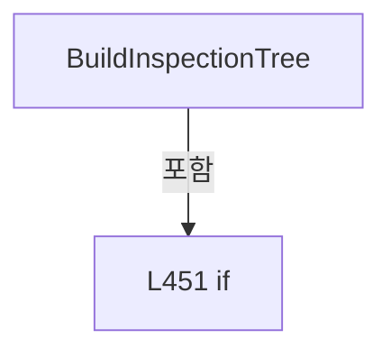

변경 전 점검: 입력/반환 타입, 위 호출자, 예외/취소 경로, 공유 상태와 저장·전송 소비자를 함께 확인합니다. 값의 단위나 물리 방향을 이름만으로 확정하지 않습니다.

### MethodDeclaration `IsInspectionResultMatch` · L486–498

[Drilling.UI/Menu/Menus/CMenuCorrection.ReviewData.cs:486–498](https://github.com/kjuws10-rgb/A3Drilling/blob/0219666f9053b907d96d7e0aa7d0c6c1be3a73d4/Drilling.UI/Menu/Menus/CMenuCorrection.ReviewData.cs#L486-L498)

| 항목 | 실제 추출 값 |
| --- | --- |
| 서명 | bool Drilling.UI.Menu.Menus.CMenuCorrection.CReviewDataPanel.IsInspectionResultMatch(Drilling.Common.Review.ST_REVIEW_RESULT_CATALOG_ITEM, string) |
| 접근/수식자 | Private / private, static |
| 반환/값 타입 | bool |
| 소속 타입 | NamedType:Drilling.UI.Menu.Menus.CMenuCorrection.CReviewDataPanel |

입력 계약:

| 이름 | 타입 | 전달 | 선택/기본값 |
| --- | --- | --- | --- |
| result | Drilling.Common.Review.ST_REVIEW_RESULT_CATALOG_ITEM | None | False /  |
| inspectionResultType | string | None | False /  |

정적 호출자로 확인된 위치:

| 호출 파일/행 | 호출 표현식 | 런타임 분기 가능 |
| --- | --- | --- |
| [Drilling.UI/Menu/Menus/CMenuCorrection.ReviewData.cs:288–288](https://github.com/kjuws10-rgb/A3Drilling/blob/0219666f9053b907d96d7e0aa7d0c6c1be3a73d4/Drilling.UI/Menu/Menus/CMenuCorrection.ReviewData.cs#L288-L288) | IsInspectionResultMatch | False |

호출하는 대상과 해석 범위:

| 원본 행 | 표현식 | 분석 상태 | 대상/소스 위치 |
| --- | --- | --- | --- |
| 488 | inspectionResultType.Equals | resolved | bool string.Equals(string?, System.StringComparison) |
| 490 | result.Source.Equals | resolved | bool string.Equals(string?, System.StringComparison) |
| 491 | result.ResultType.Equals | resolved | bool string.Equals(string?, System.StringComparison) |
| 492 | result.Source.Equals | resolved | bool string.Equals(string?, System.StringComparison) |
| 493 | result.ResultType.Equals | resolved | bool string.Equals(string?, System.StringComparison) |
| 496 | result.Source.Equals | resolved | bool string.Equals(string?, System.StringComparison) |
| 497 | result.ResultType.Equals | resolved | bool string.Equals(string?, System.StringComparison) |

본문의 실제 연산·분기·예외·반환 순서(원문 위치 순):

| 원본 행 | 종류 | 주석 해설 |
| --- | --- | --- |
| 488 | call | 함수·델리게이트 또는 객체 생성자를 호출합니다: inspectionResultType.Equals("FINE", StringComparison.OrdinalIgnoreCase) |
| 488 | if | 조건에 따라 분기합니다: if (inspectionResultType.Equals("FINE", StringComparison.OrdinalIgnoreCase)) |
| 490 | call | 함수·델리게이트 또는 객체 생성자를 호출합니다: result.Source.Equals("MANUAL", StringComparison.OrdinalIgnoreCase) |
| 490 | return | 호출자에게 값 또는 제어를 반환합니다: return result.Source.Equals("MANUAL", StringComparison.OrdinalIgnoreCase) && result.ResultType.Equals("FINE", StringComparison.OrdinalIgnoreCase) &#124;&#124; result.Source.Equals("AUTO", StringComparison.OrdinalIgnoreCase) && result.Result |
| 491 | call | 함수·델리게이트 또는 객체 생성자를 호출합니다: result.ResultType.Equals("FINE", StringComparison.OrdinalIgnoreCase) |
| 492 | call | 함수·델리게이트 또는 객체 생성자를 호출합니다: result.Source.Equals("AUTO", StringComparison.OrdinalIgnoreCase) |
| 493 | call | 함수·델리게이트 또는 객체 생성자를 호출합니다: result.ResultType.Equals("AUTO", StringComparison.OrdinalIgnoreCase) |
| 496 | call | 함수·델리게이트 또는 객체 생성자를 호출합니다: result.Source.Equals("MANUAL", StringComparison.OrdinalIgnoreCase) |
| 496 | return | 호출자에게 값 또는 제어를 반환합니다: return result.Source.Equals("MANUAL", StringComparison.OrdinalIgnoreCase) && result.ResultType.Equals(inspectionResultType, StringComparison.OrdinalIgnoreCase); |
| 497 | call | 함수·델리게이트 또는 객체 생성자를 호출합니다: result.ResultType.Equals(inspectionResultType, StringComparison.OrdinalIgnoreCase) |

제어 구문의 포함 구조(실제 실행 순서/CFG가 아닌 구문 탐색 그림):

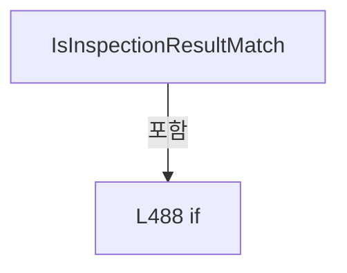

변경 전 점검: 입력/반환 타입, 위 호출자, 예외/취소 경로, 공유 상태와 저장·전송 소비자를 함께 확인합니다. 값의 단위나 물리 방향을 이름만으로 확정하지 않습니다.

### MethodDeclaration `InspectionResultDisplayName` · L500–505

[Drilling.UI/Menu/Menus/CMenuCorrection.ReviewData.cs:500–505](https://github.com/kjuws10-rgb/A3Drilling/blob/0219666f9053b907d96d7e0aa7d0c6c1be3a73d4/Drilling.UI/Menu/Menus/CMenuCorrection.ReviewData.cs#L500-L505)

| 항목 | 실제 추출 값 |
| --- | --- |
| 서명 | string Drilling.UI.Menu.Menus.CMenuCorrection.CReviewDataPanel.InspectionResultDisplayName(string) |
| 접근/수식자 | Private / private, static |
| 반환/값 타입 | string |
| 소속 타입 | NamedType:Drilling.UI.Menu.Menus.CMenuCorrection.CReviewDataPanel |

입력 계약:

| 이름 | 타입 | 전달 | 선택/기본값 |
| --- | --- | --- | --- |
| resultType | string | None | False /  |

정적 호출자로 확인된 위치:

| 호출 파일/행 | 호출 표현식 | 런타임 분기 가능 |
| --- | --- | --- |
| [Drilling.UI/Menu/Menus/CMenuCorrection.ReviewData.cs:132–132](https://github.com/kjuws10-rgb/A3Drilling/blob/0219666f9053b907d96d7e0aa7d0c6c1be3a73d4/Drilling.UI/Menu/Menus/CMenuCorrection.ReviewData.cs#L132-L132) | InspectionResultDisplayName | False |
| [Drilling.UI/Menu/Menus/CMenuCorrection.ReviewData.cs:303–303](https://github.com/kjuws10-rgb/A3Drilling/blob/0219666f9053b907d96d7e0aa7d0c6c1be3a73d4/Drilling.UI/Menu/Menus/CMenuCorrection.ReviewData.cs#L303-L303) | InspectionResultDisplayName | False |

호출하는 대상과 해석 범위:

| 원본 행 | 표현식 | 분석 상태 | 대상/소스 위치 |
| --- | --- | --- | --- |
| 502 | resultType.Equals | resolved | bool string.Equals(string?, System.StringComparison) |
| 504 | resultType.Replace | resolved | string string.Replace(char, char) |

본문의 실제 연산·분기·예외·반환 순서(원문 위치 순):

| 원본 행 | 종류 | 주석 해설 |
| --- | --- | --- |
| 502 | call | 함수·델리게이트 또는 객체 생성자를 호출합니다: resultType.Equals("FINE", StringComparison.OrdinalIgnoreCase) |
| 502 | conditional-expression | 조건에 따라 결과식을 선택합니다: resultType.Equals("FINE", StringComparison.OrdinalIgnoreCase) ? "FINE + AUTO REVIEW" : resultType.Replace('_', ' ') |
| 502 | return | 호출자에게 값 또는 제어를 반환합니다: return resultType.Equals("FINE", StringComparison.OrdinalIgnoreCase) ? "FINE + AUTO REVIEW" : resultType.Replace('_', ' '); |
| 504 | call | 함수·델리게이트 또는 객체 생성자를 호출합니다: resultType.Replace('_', ' ') |

변경 전 점검: 입력/반환 타입, 위 호출자, 예외/취소 경로, 공유 상태와 저장·전송 소비자를 함께 확인합니다. 값의 단위나 물리 방향을 이름만으로 확정하지 않습니다.

### MethodDeclaration `NormalizeInspectionResultType` · L507–517

[Drilling.UI/Menu/Menus/CMenuCorrection.ReviewData.cs:507–517](https://github.com/kjuws10-rgb/A3Drilling/blob/0219666f9053b907d96d7e0aa7d0c6c1be3a73d4/Drilling.UI/Menu/Menus/CMenuCorrection.ReviewData.cs#L507-L517)

| 항목 | 실제 추출 값 |
| --- | --- |
| 서명 | string Drilling.UI.Menu.Menus.CMenuCorrection.CReviewDataPanel.NormalizeInspectionResultType(string?) |
| 접근/수식자 | Private / private, static |
| 반환/값 타입 | string |
| 소속 타입 | NamedType:Drilling.UI.Menu.Menus.CMenuCorrection.CReviewDataPanel |

입력 계약:

| 이름 | 타입 | 전달 | 선택/기본값 |
| --- | --- | --- | --- |
| resultType | string? | None | False /  |

정적 호출자로 확인된 위치:

| 호출 파일/행 | 호출 표현식 | 런타임 분기 가능 |
| --- | --- | --- |
| [Drilling.UI/Menu/Menus/CMenuCorrection.ReviewData.cs:131–131](https://github.com/kjuws10-rgb/A3Drilling/blob/0219666f9053b907d96d7e0aa7d0c6c1be3a73d4/Drilling.UI/Menu/Menus/CMenuCorrection.ReviewData.cs#L131-L131) | NormalizeInspectionResultType | False |
| [Drilling.UI/Menu/Menus/CMenuCorrection.ReviewData.cs:285–285](https://github.com/kjuws10-rgb/A3Drilling/blob/0219666f9053b907d96d7e0aa7d0c6c1be3a73d4/Drilling.UI/Menu/Menus/CMenuCorrection.ReviewData.cs#L285-L285) | NormalizeInspectionResultType | False |
| [Drilling.UI/Menu/Menus/CMenuCorrection.ReviewData.cs:521–521](https://github.com/kjuws10-rgb/A3Drilling/blob/0219666f9053b907d96d7e0aa7d0c6c1be3a73d4/Drilling.UI/Menu/Menus/CMenuCorrection.ReviewData.cs#L521-L521) | NormalizeInspectionResultType | False |

호출하는 대상과 해석 범위:

| 원본 행 | 표현식 | 분석 상태 | 대상/소스 위치 |
| --- | --- | --- | --- |
| 509 | (resultType ?? "ALL_SHOT") .Trim() .Replace('-', '_') .Replace(' ', '_') .ToUpperInvariant | resolved | string string.ToUpperInvariant() |
| 509 | (resultType ?? "ALL_SHOT") .Trim() .Replace('-', '_') .Replace | resolved | string string.Replace(char, char) |
| 509 | (resultType ?? "ALL_SHOT") .Trim() .Replace | resolved | string string.Replace(char, char) |
| 509 | (resultType ?? "ALL_SHOT") .Trim | resolved | string string.Trim() |

본문의 실제 연산·분기·예외·반환 순서(원문 위치 순):

| 원본 행 | 종류 | 주석 해설 |
| --- | --- | --- |
| 509 | call | 함수·델리게이트 또는 객체 생성자를 호출합니다: (resultType ?? "ALL_SHOT") .Trim() |
| 509 | call | 함수·델리게이트 또는 객체 생성자를 호출합니다: (resultType ?? "ALL_SHOT") .Trim() .Replace('-', '_') |
| 509 | call | 함수·델리게이트 또는 객체 생성자를 호출합니다: (resultType ?? "ALL_SHOT") .Trim() .Replace('-', '_') .Replace(' ', '_') |
| 509 | call | 함수·델리게이트 또는 객체 생성자를 호출합니다: (resultType ?? "ALL_SHOT") .Trim() .Replace('-', '_') .Replace(' ', '_') .ToUpperInvariant() |
| 509 | local-declaration | 지역 변수를 선언합니다: var normalized = (resultType ?? "ALL_SHOT") .Trim() .Replace('-', '_') .Replace(' ', '_') .ToUpperInvariant(); |
| 509 | variable-initializer | 변수의 초기값을 지정합니다: normalized = (resultType ?? "ALL_SHOT") .Trim() .Replace('-', '_') .Replace(' ', '_') .ToUpperInvariant() |
| 514 | conditional-expression | 조건에 따라 결과식을 선택합니다: normalized is "ALL_SHOT" or "ONE_SHOT" or "ONE_LINE" or "BEAM_INSPECTION" or "ROUGH" or "FINE" ? normalized : "ALL_SHOT" |
| 514 | return | 호출자에게 값 또는 제어를 반환합니다: return normalized is "ALL_SHOT" or "ONE_SHOT" or "ONE_LINE" or "BEAM_INSPECTION" or "ROUGH" or "FINE" ? normalized : "ALL_SHOT"; |

변경 전 점검: 입력/반환 타입, 위 호출자, 예외/취소 경로, 공유 상태와 저장·전송 소비자를 함께 확인합니다. 값의 단위나 물리 방향을 이름만으로 확정하지 않습니다.

### MethodDeclaration `IsInspectionOffsetResultType` · L519–522

[Drilling.UI/Menu/Menus/CMenuCorrection.ReviewData.cs:519–522](https://github.com/kjuws10-rgb/A3Drilling/blob/0219666f9053b907d96d7e0aa7d0c6c1be3a73d4/Drilling.UI/Menu/Menus/CMenuCorrection.ReviewData.cs#L519-L522)

| 항목 | 실제 추출 값 |
| --- | --- |
| 서명 | bool Drilling.UI.Menu.Menus.CMenuCorrection.CReviewDataPanel.IsInspectionOffsetResultType(string?) |
| 접근/수식자 | Private / private, static |
| 반환/값 타입 | bool |
| 소속 타입 | NamedType:Drilling.UI.Menu.Menus.CMenuCorrection.CReviewDataPanel |

입력 계약:

| 이름 | 타입 | 전달 | 선택/기본값 |
| --- | --- | --- | --- |
| resultType | string? | None | False /  |

정적 호출자로 확인된 위치:

| 호출 파일/행 | 호출 표현식 | 런타임 분기 가능 |
| --- | --- | --- |
| [Drilling.UI/Menu/Menus/CMenuCorrection.ReviewData.cs:91–91](https://github.com/kjuws10-rgb/A3Drilling/blob/0219666f9053b907d96d7e0aa7d0c6c1be3a73d4/Drilling.UI/Menu/Menus/CMenuCorrection.ReviewData.cs#L91-L91) | IsInspectionOffsetResultType | False |

호출하는 대상과 해석 범위:

| 원본 행 | 표현식 | 분석 상태 | 대상/소스 위치 |
| --- | --- | --- | --- |
| 521 | NormalizeInspectionResultType | resolved | string Drilling.UI.Menu.Menus.CMenuCorrection.CReviewDataPanel.NormalizeInspectionResultType(string?) · Drilling.UI/Menu/Menus/CMenuCorrection.ReviewData.cs:507 |

본문의 실제 연산·분기·예외·반환 순서(원문 위치 순):

| 원본 행 | 종류 | 주석 해설 |
| --- | --- | --- |
| 521 | call | 함수·델리게이트 또는 객체 생성자를 호출합니다: NormalizeInspectionResultType(resultType) |
| 521 | return | 호출자에게 값 또는 제어를 반환합니다: return NormalizeInspectionResultType(resultType) is "ALL_SHOT" or "ONE_SHOT" or "ONE_LINE" or "ROUGH" or "FINE"; |

변경 전 점검: 입력/반환 타입, 위 호출자, 예외/취소 경로, 공유 상태와 저장·전송 소비자를 함께 확인합니다. 값의 단위나 물리 방향을 이름만으로 확정하지 않습니다.

### MethodDeclaration `CreateResultNode` · L524–527

[Drilling.UI/Menu/Menus/CMenuCorrection.ReviewData.cs:524–527](https://github.com/kjuws10-rgb/A3Drilling/blob/0219666f9053b907d96d7e0aa7d0c6c1be3a73d4/Drilling.UI/Menu/Menus/CMenuCorrection.ReviewData.cs#L524-L527)

| 항목 | 실제 추출 값 |
| --- | --- |
| 서명 | Drilling.UI.Menu.Menus.CMenuCorrection.ST_REVIEW_RESULT_TREE_NODE Drilling.UI.Menu.Menus.CMenuCorrection.CReviewDataPanel.CreateResultNode(Drilling.Common.Review.ST_REVIEW_RESULT_CATALOG_ITEM) |
| 접근/수식자 | Private / private, static |
| 반환/값 타입 | Drilling.UI.Menu.Menus.CMenuCorrection.ST_REVIEW_RESULT_TREE_NODE |
| 소속 타입 | NamedType:Drilling.UI.Menu.Menus.CMenuCorrection.CReviewDataPanel |

입력 계약:

| 이름 | 타입 | 전달 | 선택/기본값 |
| --- | --- | --- | --- |
| result | Drilling.Common.Review.ST_REVIEW_RESULT_CATALOG_ITEM | None | False /  |

현재 부분 분석에서 직접 연결된 호출자는 없습니다. XAML/이벤트/인터페이스·델리게이트·외부 진입을 추가 확인해야 하며, 미사용으로 판정한 것이 아닙니다.

호출하는 대상과 해석 범위:

| 원본 행 | 표현식 | 분석 상태 | 대상/소스 위치 |
| --- | --- | --- | --- |
| 526 | new ST_REVIEW_RESULT_TREE_NODE | resolved | Drilling.UI.Menu.Menus.CMenuCorrection.ST_REVIEW_RESULT_TREE_NODE.ST_REVIEW_RESULT_TREE_NODE(string, string, string, System.Collections.Generic.IReadOnlyList<Drilling.UI.Menu.Menus.CMenuCorrection.ST_REVIEW_RESULT_TREE_NODE>, Drilling.Common.Review.ST_REVIEW_RESULT_CATALOG_ITEM?, bool) · Drilling.UI/Menu/Menus/CMenuCorrection.ReviewData.cs:622 |

본문의 실제 연산·분기·예외·반환 순서(원문 위치 순):

| 원본 행 | 종류 | 주석 해설 |
| --- | --- | --- |
| 526 | call | 함수·델리게이트 또는 객체 생성자를 호출합니다: new ST_REVIEW_RESULT_TREE_NODE(result.FileName, "RESULT", "", [], result, false) |
| 526 | return | 호출자에게 값 또는 제어를 반환합니다: return new ST_REVIEW_RESULT_TREE_NODE(result.FileName, "RESULT", "", [], result, false); |

변경 전 점검: 입력/반환 타입, 위 호출자, 예외/취소 경로, 공유 상태와 저장·전송 소비자를 함께 확인합니다. 값의 단위나 물리 방향을 이름만으로 확정하지 않습니다.

### MethodDeclaration `CreateDetails` · L529–553

[Drilling.UI/Menu/Menus/CMenuCorrection.ReviewData.cs:529–553](https://github.com/kjuws10-rgb/A3Drilling/blob/0219666f9053b907d96d7e0aa7d0c6c1be3a73d4/Drilling.UI/Menu/Menus/CMenuCorrection.ReviewData.cs#L529-L553)

| 항목 | 실제 추출 값 |
| --- | --- |
| 서명 | System.Collections.Generic.IReadOnlyList<Drilling.UI.Menu.Menus.CMenuCorrection.ST_REVIEW_DATA_DETAIL_ITEM> Drilling.UI.Menu.Menus.CMenuCorrection.CReviewDataPanel.CreateDetails(Drilling.UI.Menu.Menus.CMenuCorrection.ST_REVIEW_RESULT_TREE_NODE) |
| 접근/수식자 | Private / private, static |
| 반환/값 타입 | System.Collections.Generic.IReadOnlyList<Drilling.UI.Menu.Menus.CMenuCorrection.ST_REVIEW_DATA_DETAIL_ITEM> |
| 소속 타입 | NamedType:Drilling.UI.Menu.Menus.CMenuCorrection.CReviewDataPanel |

입력 계약:

| 이름 | 타입 | 전달 | 선택/기본값 |
| --- | --- | --- | --- |
| node | Drilling.UI.Menu.Menus.CMenuCorrection.ST_REVIEW_RESULT_TREE_NODE | None | False /  |

정적 호출자로 확인된 위치:

| 호출 파일/행 | 호출 표현식 | 런타임 분기 가능 |
| --- | --- | --- |
| [Drilling.UI/Menu/Menus/CMenuCorrection.ReviewData.cs:219–219](https://github.com/kjuws10-rgb/A3Drilling/blob/0219666f9053b907d96d7e0aa7d0c6c1be3a73d4/Drilling.UI/Menu/Menus/CMenuCorrection.ReviewData.cs#L219-L219) | CreateDetails | False |

호출하는 대상과 해석 범위:

| 원본 행 | 표현식 | 분석 상태 | 대상/소스 위치 |
| --- | --- | --- | --- |
| 533 | new | resolved | Drilling.UI.Menu.Menus.CMenuCorrection.ST_REVIEW_DATA_DETAIL_ITEM.ST_REVIEW_DATA_DETAIL_ITEM(string, string) · Drilling.UI/Menu/Menus/CMenuCorrection.ReviewData.cs:651 |
| 533 | CountResults(node).ToString | resolved | string int.ToString(string?, System.IFormatProvider?) |
| 533 | CountResults | resolved | int Drilling.UI.Menu.Menus.CMenuCorrection.CReviewDataPanel.CountResults(Drilling.UI.Menu.Menus.CMenuCorrection.ST_REVIEW_RESULT_TREE_NODE) · Drilling.UI/Menu/Menus/CMenuCorrection.ReviewData.cs:599 |
| 536 | new List<ST_REVIEW_DATA_DETAIL_ITEM> | resolved | System.Collections.Generic.List<Drilling.UI.Menu.Menus.CMenuCorrection.ST_REVIEW_DATA_DETAIL_ITEM>.List() |
| 538 | new | resolved | Drilling.UI.Menu.Menus.CMenuCorrection.ST_REVIEW_DATA_DETAIL_ITEM.ST_REVIEW_DATA_DETAIL_ITEM(string, string) · Drilling.UI/Menu/Menus/CMenuCorrection.ReviewData.cs:651 |
| 539 | new | resolved | Drilling.UI.Menu.Menus.CMenuCorrection.ST_REVIEW_DATA_DETAIL_ITEM.ST_REVIEW_DATA_DETAIL_ITEM(string, string) · Drilling.UI/Menu/Menus/CMenuCorrection.ReviewData.cs:651 |
| 540 | new | resolved | Drilling.UI.Menu.Menus.CMenuCorrection.ST_REVIEW_DATA_DETAIL_ITEM.ST_REVIEW_DATA_DETAIL_ITEM(string, string) · Drilling.UI/Menu/Menus/CMenuCorrection.ReviewData.cs:651 |
| 541 | new | resolved | Drilling.UI.Menu.Menus.CMenuCorrection.ST_REVIEW_DATA_DETAIL_ITEM.ST_REVIEW_DATA_DETAIL_ITEM(string, string) · Drilling.UI/Menu/Menus/CMenuCorrection.ReviewData.cs:651 |
| 541 | result.SavedAt.ToString | resolved | string System.DateTimeOffset.ToString(string?, System.IFormatProvider?) |
| 542 | new | resolved | Drilling.UI.Menu.Menus.CMenuCorrection.ST_REVIEW_DATA_DETAIL_ITEM.ST_REVIEW_DATA_DETAIL_ITEM(string, string) · Drilling.UI/Menu/Menus/CMenuCorrection.ReviewData.cs:651 |
| 543 | new | resolved | Drilling.UI.Menu.Menus.CMenuCorrection.ST_REVIEW_DATA_DETAIL_ITEM.ST_REVIEW_DATA_DETAIL_ITEM(string, string) · Drilling.UI/Menu/Menus/CMenuCorrection.ReviewData.cs:651 |
| 544 | new | resolved | Drilling.UI.Menu.Menus.CMenuCorrection.ST_REVIEW_DATA_DETAIL_ITEM.ST_REVIEW_DATA_DETAIL_ITEM(string, string) · Drilling.UI/Menu/Menus/CMenuCorrection.ReviewData.cs:651 |
| 545 | new | resolved | Drilling.UI.Menu.Menus.CMenuCorrection.ST_REVIEW_DATA_DETAIL_ITEM.ST_REVIEW_DATA_DETAIL_ITEM(string, string) · Drilling.UI/Menu/Menus/CMenuCorrection.ReviewData.cs:651 |
| 545 | .ToString | resolved | string int.ToString(string?, System.IFormatProvider?) |
| 547 | string.IsNullOrWhiteSpace | resolved | bool string.IsNullOrWhiteSpace(string?) |
| 549 | details.Add | resolved | void System.Collections.Generic.List<Drilling.UI.Menu.Menus.CMenuCorrection.ST_REVIEW_DATA_DETAIL_ITEM>.Add(Drilling.UI.Menu.Menus.CMenuCorrection.ST_REVIEW_DATA_DETAIL_ITEM) |
| 549 | new | resolved | Drilling.UI.Menu.Menus.CMenuCorrection.ST_REVIEW_DATA_DETAIL_ITEM.ST_REVIEW_DATA_DETAIL_ITEM(string, string) · Drilling.UI/Menu/Menus/CMenuCorrection.ReviewData.cs:651 |

본문의 실제 연산·분기·예외·반환 순서(원문 위치 순):

| 원본 행 | 종류 | 주석 해설 |
| --- | --- | --- |
| 531 | if | 조건에 따라 분기합니다: if (node.Result is not { } result) |
| 533 | call | 함수·델리게이트 또는 객체 생성자를 호출합니다: new("Result Count", CountResults(node).ToString("N0", CultureInfo.CurrentCulture)) |
| 533 | call | 함수·델리게이트 또는 객체 생성자를 호출합니다: CountResults(node).ToString("N0", CultureInfo.CurrentCulture) |
| 533 | call | 함수·델리게이트 또는 객체 생성자를 호출합니다: CountResults(node) |
| 533 | return | 호출자에게 값 또는 제어를 반환합니다: return [new("Result Count", CountResults(node).ToString("N0", CultureInfo.CurrentCulture))]; |
| 536 | call | 함수·델리게이트 또는 객체 생성자를 호출합니다: new List<ST_REVIEW_DATA_DETAIL_ITEM> { new("Source", result.Source), new("Type", result.ResultType), new("Recipe", result.RecipeId), new("Saved At", result.SavedAt.ToString("yyyy-MM-dd HH:mm:ss.fff", CultureInfo.Invarian… |
| 536 | local-declaration | 지역 변수를 선언합니다: var details = new List<ST_REVIEW_DATA_DETAIL_ITEM> { new("Source", result.Source), new("Type", result.ResultType), new("Recipe", result.RecipeId), new("Saved At", result.SavedAt.ToString("yyyy-MM-dd HH:mm:ss.fff", CultureInfo.Inva |
| 536 | variable-initializer | 변수의 초기값을 지정합니다: details = new List<ST_REVIEW_DATA_DETAIL_ITEM> { new("Source", result.Source), new("Type", result.ResultType), new("Recipe", result.RecipeId), new("Saved At", result.SavedAt.ToString("yyyy-MM-dd HH:mm:ss.fff", CultureInfo.Invarian |
| 538 | call | 함수·델리게이트 또는 객체 생성자를 호출합니다: new("Source", result.Source) |
| 539 | call | 함수·델리게이트 또는 객체 생성자를 호출합니다: new("Type", result.ResultType) |
| 540 | call | 함수·델리게이트 또는 객체 생성자를 호출합니다: new("Recipe", result.RecipeId) |
| 541 | call | 함수·델리게이트 또는 객체 생성자를 호출합니다: new("Saved At", result.SavedAt.ToString("yyyy-MM-dd HH:mm:ss.fff", CultureInfo.InvariantCulture)) |
| 541 | call | 함수·델리게이트 또는 객체 생성자를 호출합니다: result.SavedAt.ToString("yyyy-MM-dd HH:mm:ss.fff", CultureInfo.InvariantCulture) |
| 542 | call | 함수·델리게이트 또는 객체 생성자를 호출합니다: new("Glass", result.GlassId) |
| 543 | call | 함수·델리게이트 또는 객체 생성자를 호출합니다: new("Run Type", result.RunType) |
| 544 | call | 함수·델리게이트 또는 객체 생성자를 호출합니다: new("Method", result.Method) |
| 545 | call | 함수·델리게이트 또는 객체 생성자를 호출합니다: new("Total Count", result.TotalCount?.ToString("N0", CultureInfo.CurrentCulture) ?? "-") |
| 545 | call | 함수·델리게이트 또는 객체 생성자를 호출합니다: .ToString("N0", CultureInfo.CurrentCulture) |
| 547 | call | 함수·델리게이트 또는 객체 생성자를 호출합니다: string.IsNullOrWhiteSpace(result.ResultMessage) |
| 547 | if | 조건에 따라 분기합니다: if (!string.IsNullOrWhiteSpace(result.ResultMessage)) |
| 549 | call | 함수·델리게이트 또는 객체 생성자를 호출합니다: details.Add(new("Message", result.ResultMessage)) |
| 549 | call | 함수·델리게이트 또는 객체 생성자를 호출합니다: new("Message", result.ResultMessage) |
| 552 | return | 호출자에게 값 또는 제어를 반환합니다: return details; |

제어 구문의 포함 구조(실제 실행 순서/CFG가 아닌 구문 탐색 그림):

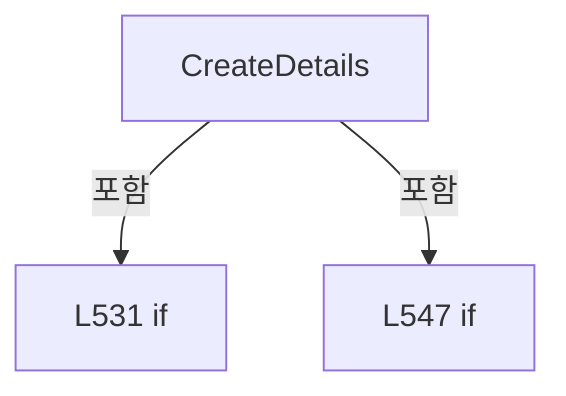

변경 전 점검: 입력/반환 타입, 위 호출자, 예외/취소 경로, 공유 상태와 저장·전송 소비자를 함께 확인합니다. 값의 단위나 물리 방향을 이름만으로 확정하지 않습니다.

### MethodDeclaration `Flatten` · L555–566

[Drilling.UI/Menu/Menus/CMenuCorrection.ReviewData.cs:555–566](https://github.com/kjuws10-rgb/A3Drilling/blob/0219666f9053b907d96d7e0aa7d0c6c1be3a73d4/Drilling.UI/Menu/Menus/CMenuCorrection.ReviewData.cs#L555-L566)

| 항목 | 실제 추출 값 |
| --- | --- |
| 서명 | System.Collections.Generic.IEnumerable<Drilling.UI.Menu.Menus.CMenuCorrection.ST_REVIEW_RESULT_TREE_NODE> Drilling.UI.Menu.Menus.CMenuCorrection.CReviewDataPanel.Flatten(System.Collections.Generic.IEnumerable<Drilling.UI.Menu.Menus.CMenuCorrection.ST_REVIEW_RESULT_TREE_NODE>) |
| 접근/수식자 | Private / private, static |
| 반환/값 타입 | System.Collections.Generic.IEnumerable<Drilling.UI.Menu.Menus.CMenuCorrection.ST_REVIEW_RESULT_TREE_NODE> |
| 소속 타입 | NamedType:Drilling.UI.Menu.Menus.CMenuCorrection.CReviewDataPanel |

입력 계약:

| 이름 | 타입 | 전달 | 선택/기본값 |
| --- | --- | --- | --- |
| nodes | System.Collections.Generic.IEnumerable<Drilling.UI.Menu.Menus.CMenuCorrection.ST_REVIEW_RESULT_TREE_NODE> | None | False /  |

정적 호출자로 확인된 위치:

| 호출 파일/행 | 호출 표현식 | 런타임 분기 가능 |
| --- | --- | --- |
| [Drilling.UI/Menu/Menus/CMenuCorrection.ReviewData.cs:311–311](https://github.com/kjuws10-rgb/A3Drilling/blob/0219666f9053b907d96d7e0aa7d0c6c1be3a73d4/Drilling.UI/Menu/Menus/CMenuCorrection.ReviewData.cs#L311-L311) | Flatten | False |
| [Drilling.UI/Menu/Menus/CMenuCorrection.ReviewData.cs:561–561](https://github.com/kjuws10-rgb/A3Drilling/blob/0219666f9053b907d96d7e0aa7d0c6c1be3a73d4/Drilling.UI/Menu/Menus/CMenuCorrection.ReviewData.cs#L561-L561) | Flatten | False |
| [Drilling.UI/Menu/Menus/CMenuCorrection.ReviewData.cs:593–593](https://github.com/kjuws10-rgb/A3Drilling/blob/0219666f9053b907d96d7e0aa7d0c6c1be3a73d4/Drilling.UI/Menu/Menus/CMenuCorrection.ReviewData.cs#L593-L593) | Flatten | False |

호출하는 대상과 해석 범위:

| 원본 행 | 표현식 | 분석 상태 | 대상/소스 위치 |
| --- | --- | --- | --- |
| 561 | Flatten | resolved | System.Collections.Generic.IEnumerable<Drilling.UI.Menu.Menus.CMenuCorrection.ST_REVIEW_RESULT_TREE_NODE> Drilling.UI.Menu.Menus.CMenuCorrection.CReviewDataPanel.Flatten(System.Collections.Generic.IEnumerable<Drilling.UI.Menu.Menus.CMenuCorrection.ST_REVIEW_RESULT_TREE_NODE>) · Drilling.UI/Menu/Menus/CMenuCorrection.ReviewData.cs:555 |

본문의 실제 연산·분기·예외·반환 순서(원문 위치 순):

| 원본 행 | 종류 | 주석 해설 |
| --- | --- | --- |
| 558 | foreach | 컬렉션 요소를 순회합니다: foreach (var node in nodes) |
| 560 | yield | 열거값/종료를 전달합니다: yield return node; |
| 561 | call | 함수·델리게이트 또는 객체 생성자를 호출합니다: Flatten(node.Children) |
| 561 | foreach | 컬렉션 요소를 순회합니다: foreach (var child in Flatten(node.Children)) |
| 563 | yield | 열거값/종료를 전달합니다: yield return child; |

제어 구문의 포함 구조(실제 실행 순서/CFG가 아닌 구문 탐색 그림):

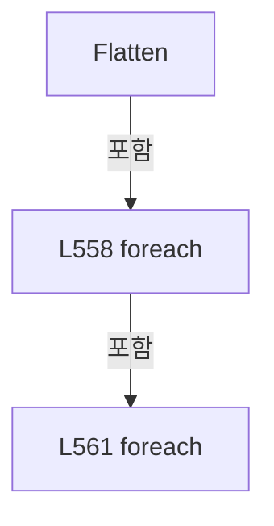

변경 전 점검: 입력/반환 타입, 위 호출자, 예외/취소 경로, 공유 상태와 저장·전송 소비자를 함께 확인합니다. 값의 단위나 물리 방향을 이름만으로 확정하지 않습니다.

### MethodDeclaration `ExpandResultPath` · L568–589

[Drilling.UI/Menu/Menus/CMenuCorrection.ReviewData.cs:568–589](https://github.com/kjuws10-rgb/A3Drilling/blob/0219666f9053b907d96d7e0aa7d0c6c1be3a73d4/Drilling.UI/Menu/Menus/CMenuCorrection.ReviewData.cs#L568-L589)

| 항목 | 실제 추출 값 |
| --- | --- |
| 서명 | System.Collections.Generic.IReadOnlyList<Drilling.UI.Menu.Menus.CMenuCorrection.ST_REVIEW_RESULT_TREE_NODE> Drilling.UI.Menu.Menus.CMenuCorrection.CReviewDataPanel.ExpandResultPath(System.Collections.Generic.IEnumerable<Drilling.UI.Menu.Menus.CMenuCorrection.ST_REVIEW_RESULT_TREE_NODE>, string) |
| 접근/수식자 | Private / private, static |
| 반환/값 타입 | System.Collections.Generic.IReadOnlyList<Drilling.UI.Menu.Menus.CMenuCorrection.ST_REVIEW_RESULT_TREE_NODE> |
| 소속 타입 | NamedType:Drilling.UI.Menu.Menus.CMenuCorrection.CReviewDataPanel |

입력 계약:

| 이름 | 타입 | 전달 | 선택/기본값 |
| --- | --- | --- | --- |
| nodes | System.Collections.Generic.IEnumerable<Drilling.UI.Menu.Menus.CMenuCorrection.ST_REVIEW_RESULT_TREE_NODE> | None | False /  |
| resultPath | string | None | False /  |

정적 호출자로 확인된 위치:

| 호출 파일/행 | 호출 표현식 | 런타임 분기 가능 |
| --- | --- | --- |
| [Drilling.UI/Menu/Menus/CMenuCorrection.ReviewData.cs:300–300](https://github.com/kjuws10-rgb/A3Drilling/blob/0219666f9053b907d96d7e0aa7d0c6c1be3a73d4/Drilling.UI/Menu/Menus/CMenuCorrection.ReviewData.cs#L300-L300) | ExpandResultPath | False |
| [Drilling.UI/Menu/Menus/CMenuCorrection.ReviewData.cs:574–574](https://github.com/kjuws10-rgb/A3Drilling/blob/0219666f9053b907d96d7e0aa7d0c6c1be3a73d4/Drilling.UI/Menu/Menus/CMenuCorrection.ReviewData.cs#L574-L574) | ExpandResultPath | False |

호출하는 대상과 해석 범위:

| 원본 행 | 표현식 | 분석 상태 | 대상/소스 위치 |
| --- | --- | --- | --- |
| 572 | nodes.Select(node => { var children = ExpandResultPath(node.Children, resultPath); var containsResult = node.Result?.FilePath.Equals(resultPath, StringComparison.OrdinalIgnoreCase) == true &#124;&#124; children.Any(ContainsExpandedResult); return node with { Children = children, IsExpanded = node.IsExpanded &#124;&#124; containsResult }; }).ToArray | resolved | Drilling.UI.Menu.Menus.CMenuCorrection.ST_REVIEW_RESULT_TREE_NODE[] System.Collections.Generic.IEnumerable<Drilling.UI.Menu.Menus.CMenuCorrection.ST_REVIEW_RESULT_TREE_NODE>.ToArray<Drilling.UI.Menu.Menus.CMenuCorrection.ST_REVIEW_RESULT_TREE_NODE>() |
| 572 | nodes.Select | resolved | System.Collections.Generic.IEnumerable<Drilling.UI.Menu.Menus.CMenuCorrection.ST_REVIEW_RESULT_TREE_NODE> System.Collections.Generic.IEnumerable<Drilling.UI.Menu.Menus.CMenuCorrection.ST_REVIEW_RESULT_TREE_NODE>.Select<Drilling.UI.Menu.Menus.CMenuCorrection.ST_REVIEW_RESULT_TREE_NODE, Drilling.UI.Menu.Menus.CMenuCorrection.ST_REVIEW_RESULT_TREE_NODE>(System.Func<Drilling.UI.Menu.Menus.CMenuCorrection.ST_REVIEW_RESULT_TREE_NODE, Drilling.UI.Menu.Menus.CMenuCorrection.ST_REVIEW_RESULT_TREE_NODE>) |
| 574 | ExpandResultPath | resolved | System.Collections.Generic.IReadOnlyList<Drilling.UI.Menu.Menus.CMenuCorrection.ST_REVIEW_RESULT_TREE_NODE> Drilling.UI.Menu.Menus.CMenuCorrection.CReviewDataPanel.ExpandResultPath(System.Collections.Generic.IEnumerable<Drilling.UI.Menu.Menus.CMenuCorrection.ST_REVIEW_RESULT_TREE_NODE>, string) · Drilling.UI/Menu/Menus/CMenuCorrection.ReviewData.cs:568 |
| 575 | .FilePath.Equals | resolved | bool string.Equals(string?, System.StringComparison) |
| 576 | children.Any | resolved | bool System.Collections.Generic.IEnumerable<Drilling.UI.Menu.Menus.CMenuCorrection.ST_REVIEW_RESULT_TREE_NODE>.Any<Drilling.UI.Menu.Menus.CMenuCorrection.ST_REVIEW_RESULT_TREE_NODE>(System.Func<Drilling.UI.Menu.Menus.CMenuCorrection.ST_REVIEW_RESULT_TREE_NODE, bool>) |

본문의 실제 연산·분기·예외·반환 순서(원문 위치 순):

| 원본 행 | 종류 | 주석 해설 |
| --- | --- | --- |
| 572 | call | 함수·델리게이트 또는 객체 생성자를 호출합니다: nodes.Select(node => { var children = ExpandResultPath(node.Children, resultPath); var containsResult = node.Result?.FilePath.Equals(resultPath, StringComparison.OrdinalIgnoreCase) == true &#124;&#124; children.Any(ContainsExpande… |
| 572 | call | 함수·델리게이트 또는 객체 생성자를 호출합니다: nodes.Select(node => { var children = ExpandResultPath(node.Children, resultPath); var containsResult = node.Result?.FilePath.Equals(resultPath, StringComparison.OrdinalIgnoreCase) == true &#124;&#124; children.Any(ContainsExpande… |
| 572 | return | 호출자에게 값 또는 제어를 반환합니다: return nodes.Select(node => { var children = ExpandResultPath(node.Children, resultPath); var containsResult = node.Result?.FilePath.Equals(resultPath, StringComparison.OrdinalIgnoreCase) == true &#124;&#124; children.Any(ContainsExpandedRe |
| 574 | call | 함수·델리게이트 또는 객체 생성자를 호출합니다: ExpandResultPath(node.Children, resultPath) |
| 574 | local-declaration | 지역 변수를 선언합니다: var children = ExpandResultPath(node.Children, resultPath); |
| 574 | variable-initializer | 변수의 초기값을 지정합니다: children = ExpandResultPath(node.Children, resultPath) |
| 575 | call | 함수·델리게이트 또는 객체 생성자를 호출합니다: .FilePath.Equals(resultPath, StringComparison.OrdinalIgnoreCase) |
| 575 | local-declaration | 지역 변수를 선언합니다: var containsResult = node.Result?.FilePath.Equals(resultPath, StringComparison.OrdinalIgnoreCase) == true &#124;&#124; children.Any(ContainsExpandedResult); |
| 575 | variable-initializer | 변수의 초기값을 지정합니다: containsResult = node.Result?.FilePath.Equals(resultPath, StringComparison.OrdinalIgnoreCase) == true &#124;&#124; children.Any(ContainsExpandedResult) |
| 576 | call | 함수·델리게이트 또는 객체 생성자를 호출합니다: children.Any(ContainsExpandedResult) |
| 577 | return | 호출자에게 값 또는 제어를 반환합니다: return node with { Children = children, IsExpanded = node.IsExpanded &#124;&#124; containsResult }; |
| 579 | assignment | 값을 대상에 대입합니다: Children = children |
| 580 | assignment | 값을 대상에 대입합니다: IsExpanded = node.IsExpanded &#124;&#124; containsResult |

변경 전 점검: 입력/반환 타입, 위 호출자, 예외/취소 경로, 공유 상태와 저장·전송 소비자를 함께 확인합니다. 값의 단위나 물리 방향을 이름만으로 확정하지 않습니다.

### LocalFunctionStatement `ContainsExpandedResult` · L584–588

[Drilling.UI/Menu/Menus/CMenuCorrection.ReviewData.cs:584–588](https://github.com/kjuws10-rgb/A3Drilling/blob/0219666f9053b907d96d7e0aa7d0c6c1be3a73d4/Drilling.UI/Menu/Menus/CMenuCorrection.ReviewData.cs#L584-L588)

| 항목 | 실제 추출 값 |
| --- | --- |
| 서명 | bool ContainsExpandedResult(Drilling.UI.Menu.Menus.CMenuCorrection.ST_REVIEW_RESULT_TREE_NODE) |
| 접근/수식자 | Private /  |
| 반환/값 타입 | bool |
| 소속 타입 | NamedType:Drilling.UI.Menu.Menus.CMenuCorrection.CReviewDataPanel |

입력 계약:

| 이름 | 타입 | 전달 | 선택/기본값 |
| --- | --- | --- | --- |
| node | Drilling.UI.Menu.Menus.CMenuCorrection.ST_REVIEW_RESULT_TREE_NODE | None | False /  |

현재 부분 분석에서 직접 연결된 호출자는 없습니다. XAML/이벤트/인터페이스·델리게이트·외부 진입을 추가 확인해야 하며, 미사용으로 판정한 것이 아닙니다.

호출하는 대상과 해석 범위:

| 원본 행 | 표현식 | 분석 상태 | 대상/소스 위치 |
| --- | --- | --- | --- |
| 586 | .FilePath.Equals | resolved | bool string.Equals(string?, System.StringComparison) |
| 587 | node.Children.Any | resolved | bool System.Collections.Generic.IEnumerable<Drilling.UI.Menu.Menus.CMenuCorrection.ST_REVIEW_RESULT_TREE_NODE>.Any<Drilling.UI.Menu.Menus.CMenuCorrection.ST_REVIEW_RESULT_TREE_NODE>(System.Func<Drilling.UI.Menu.Menus.CMenuCorrection.ST_REVIEW_RESULT_TREE_NODE, bool>) |

본문의 실제 연산·분기·예외·반환 순서(원문 위치 순):

| 원본 행 | 종류 | 주석 해설 |
| --- | --- | --- |
| 586 | call | 함수·델리게이트 또는 객체 생성자를 호출합니다: .FilePath.Equals(resultPath, StringComparison.OrdinalIgnoreCase) |
| 586 | return | 호출자에게 값 또는 제어를 반환합니다: return node.Result?.FilePath.Equals(resultPath, StringComparison.OrdinalIgnoreCase) == true &#124;&#124; node.Children.Any(ContainsExpandedResult); |
| 587 | call | 함수·델리게이트 또는 객체 생성자를 호출합니다: node.Children.Any(ContainsExpandedResult) |

변경 전 점검: 입력/반환 타입, 위 호출자, 예외/취소 경로, 공유 상태와 저장·전송 소비자를 함께 확인합니다. 값의 단위나 물리 방향을 이름만으로 확정하지 않습니다.

### MethodDeclaration `SetSelectedTreeNode` · L591–597

[Drilling.UI/Menu/Menus/CMenuCorrection.ReviewData.cs:591–597](https://github.com/kjuws10-rgb/A3Drilling/blob/0219666f9053b907d96d7e0aa7d0c6c1be3a73d4/Drilling.UI/Menu/Menus/CMenuCorrection.ReviewData.cs#L591-L597)

| 항목 | 실제 추출 값 |
| --- | --- |
| 서명 | void Drilling.UI.Menu.Menus.CMenuCorrection.CReviewDataPanel.SetSelectedTreeNode(Drilling.UI.Menu.Menus.CMenuCorrection.ST_REVIEW_RESULT_TREE_NODE?) |
| 접근/수식자 | Private / private |
| 반환/값 타입 | void |
| 소속 타입 | NamedType:Drilling.UI.Menu.Menus.CMenuCorrection.CReviewDataPanel |

입력 계약:

| 이름 | 타입 | 전달 | 선택/기본값 |
| --- | --- | --- | --- |
| selectedNode | Drilling.UI.Menu.Menus.CMenuCorrection.ST_REVIEW_RESULT_TREE_NODE? | None | False /  |

정적 호출자로 확인된 위치:

| 호출 파일/행 | 호출 표현식 | 런타임 분기 가능 |
| --- | --- | --- |
| [Drilling.UI/Menu/Menus/CMenuCorrection.ReviewData.cs:214–214](https://github.com/kjuws10-rgb/A3Drilling/blob/0219666f9053b907d96d7e0aa7d0c6c1be3a73d4/Drilling.UI/Menu/Menus/CMenuCorrection.ReviewData.cs#L214-L214) | SetSelectedTreeNode | False |
| [Drilling.UI/Menu/Menus/CMenuCorrection.ReviewData.cs:340–340](https://github.com/kjuws10-rgb/A3Drilling/blob/0219666f9053b907d96d7e0aa7d0c6c1be3a73d4/Drilling.UI/Menu/Menus/CMenuCorrection.ReviewData.cs#L340-L340) | SetSelectedTreeNode | False |

호출하는 대상과 해석 범위:

| 원본 행 | 표현식 | 분석 상태 | 대상/소스 위치 |
| --- | --- | --- | --- |
| 593 | Flatten | resolved | System.Collections.Generic.IEnumerable<Drilling.UI.Menu.Menus.CMenuCorrection.ST_REVIEW_RESULT_TREE_NODE> Drilling.UI.Menu.Menus.CMenuCorrection.CReviewDataPanel.Flatten(System.Collections.Generic.IEnumerable<Drilling.UI.Menu.Menus.CMenuCorrection.ST_REVIEW_RESULT_TREE_NODE>) · Drilling.UI/Menu/Menus/CMenuCorrection.ReviewData.cs:555 |
| 595 | ReferenceEquals | resolved | bool object.ReferenceEquals(object?, object?) |

본문의 실제 연산·분기·예외·반환 순서(원문 위치 순):

| 원본 행 | 종류 | 주석 해설 |
| --- | --- | --- |
| 593 | call | 함수·델리게이트 또는 객체 생성자를 호출합니다: Flatten(Nodes) |
| 593 | foreach | 컬렉션 요소를 순회합니다: foreach (var node in Flatten(Nodes)) |
| 595 | assignment | 값을 대상에 대입합니다: node.IsSelected = ReferenceEquals(node, selectedNode) |
| 595 | call | 함수·델리게이트 또는 객체 생성자를 호출합니다: ReferenceEquals(node, selectedNode) |

제어 구문의 포함 구조(실제 실행 순서/CFG가 아닌 구문 탐색 그림):

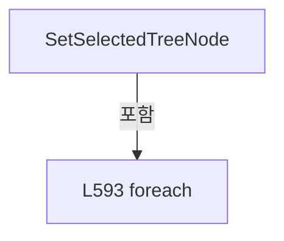

변경 전 점검: 입력/반환 타입, 위 호출자, 예외/취소 경로, 공유 상태와 저장·전송 소비자를 함께 확인합니다. 값의 단위나 물리 방향을 이름만으로 확정하지 않습니다.

### MethodDeclaration `CountResults` · L599–602

[Drilling.UI/Menu/Menus/CMenuCorrection.ReviewData.cs:599–602](https://github.com/kjuws10-rgb/A3Drilling/blob/0219666f9053b907d96d7e0aa7d0c6c1be3a73d4/Drilling.UI/Menu/Menus/CMenuCorrection.ReviewData.cs#L599-L602)

| 항목 | 실제 추출 값 |
| --- | --- |
| 서명 | int Drilling.UI.Menu.Menus.CMenuCorrection.CReviewDataPanel.CountResults(Drilling.UI.Menu.Menus.CMenuCorrection.ST_REVIEW_RESULT_TREE_NODE) |
| 접근/수식자 | Private / private, static |
| 반환/값 타입 | int |
| 소속 타입 | NamedType:Drilling.UI.Menu.Menus.CMenuCorrection.CReviewDataPanel |

입력 계약:

| 이름 | 타입 | 전달 | 선택/기본값 |
| --- | --- | --- | --- |
| node | Drilling.UI.Menu.Menus.CMenuCorrection.ST_REVIEW_RESULT_TREE_NODE | None | False /  |

정적 호출자로 확인된 위치:

| 호출 파일/행 | 호출 표현식 | 런타임 분기 가능 |
| --- | --- | --- |
| [Drilling.UI/Menu/Menus/CMenuCorrection.ReviewData.cs:533–533](https://github.com/kjuws10-rgb/A3Drilling/blob/0219666f9053b907d96d7e0aa7d0c6c1be3a73d4/Drilling.UI/Menu/Menus/CMenuCorrection.ReviewData.cs#L533-L533) | CountResults | False |

호출하는 대상과 해석 범위:

| 원본 행 | 표현식 | 분석 상태 | 대상/소스 위치 |
| --- | --- | --- | --- |
| 601 | node.Children.Sum | resolved | int System.Collections.Generic.IEnumerable<Drilling.UI.Menu.Menus.CMenuCorrection.ST_REVIEW_RESULT_TREE_NODE>.Sum<Drilling.UI.Menu.Menus.CMenuCorrection.ST_REVIEW_RESULT_TREE_NODE>(System.Func<Drilling.UI.Menu.Menus.CMenuCorrection.ST_REVIEW_RESULT_TREE_NODE, int>) |

본문의 실제 연산·분기·예외·반환 순서(원문 위치 순):

| 원본 행 | 종류 | 주석 해설 |
| --- | --- | --- |
| 601 | call | 함수·델리게이트 또는 객체 생성자를 호출합니다: node.Children.Sum(CountResults) |
| 601 | conditional-expression | 조건에 따라 결과식을 선택합니다: node.Result is null ? node.Children.Sum(CountResults) : 1 |
| 601 | return | 호출자에게 값 또는 제어를 반환합니다: return node.Result is null ? node.Children.Sum(CountResults) : 1; |

변경 전 점검: 입력/반환 타입, 위 호출자, 예외/취소 경로, 공유 상태와 저장·전송 소비자를 함께 확인합니다. 값의 단위나 물리 방향을 이름만으로 확정하지 않습니다.

### MethodDeclaration `StatusBrush` · L604–614

[Drilling.UI/Menu/Menus/CMenuCorrection.ReviewData.cs:604–614](https://github.com/kjuws10-rgb/A3Drilling/blob/0219666f9053b907d96d7e0aa7d0c6c1be3a73d4/Drilling.UI/Menu/Menus/CMenuCorrection.ReviewData.cs#L604-L614)

| 항목 | 실제 추출 값 |
| --- | --- |
| 서명 | Brush Drilling.UI.Menu.Menus.CMenuCorrection.CReviewDataPanel.StatusBrush(string) |
| 접근/수식자 | Internal / internal, static |
| 반환/값 타입 | Brush |
| 소속 타입 | NamedType:Drilling.UI.Menu.Menus.CMenuCorrection.CReviewDataPanel |

입력 계약:

| 이름 | 타입 | 전달 | 선택/기본값 |
| --- | --- | --- | --- |
| status | string | None | False /  |

정적 호출자로 확인된 위치:

| 호출 파일/행 | 호출 표현식 | 런타임 분기 가능 |
| --- | --- | --- |
| [Drilling.UI/Menu/Menus/CMenuCorrection.ReviewData.cs:89–89](https://github.com/kjuws10-rgb/A3Drilling/blob/0219666f9053b907d96d7e0aa7d0c6c1be3a73d4/Drilling.UI/Menu/Menus/CMenuCorrection.ReviewData.cs#L89-L89) | StatusBrush | False |
| [Drilling.UI/Menu/Menus/CMenuCorrection.ReviewData.cs:633–633](https://github.com/kjuws10-rgb/A3Drilling/blob/0219666f9053b907d96d7e0aa7d0c6c1be3a73d4/Drilling.UI/Menu/Menus/CMenuCorrection.ReviewData.cs#L633-L633) | CReviewDataPanel.StatusBrush | False |

호출하는 대상과 해석 범위:

| 원본 행 | 표현식 | 분석 상태 | 대상/소스 위치 |
| --- | --- | --- | --- |
| 606 | status.ToUpperInvariant | resolved | string string.ToUpperInvariant() |
| 613 | CStatusBrush.ForDisplayState | resolved | Brush Drilling.UI.Menu.Menus.CStatusBrush.ForDisplayState(string) · Drilling.UI/Menu/Menus/CMenuBase.cs:294 |

본문의 실제 연산·분기·예외·반환 순서(원문 위치 순):

| 원본 행 | 종류 | 주석 해설 |
| --- | --- | --- |
| 606 | call | 함수·델리게이트 또는 객체 생성자를 호출합니다: status.ToUpperInvariant() |
| 606 | local-declaration | 지역 변수를 선언합니다: var displayState = status.ToUpperInvariant() switch { "COMPLETED" or "DONE" => "OK", "FAILED" or "INVALID" => "ERROR", "STOPPED" or "NG_PAUSED" => "WARN", _ => status }; |
| 606 | switch-expression | 값별 결과식을 선택합니다: status.ToUpperInvariant() switch { "COMPLETED" or "DONE" => "OK", "FAILED" or "INVALID" => "ERROR", "STOPPED" or "NG_PAUSED" => "WARN", _ => status } |
| 606 | variable-initializer | 변수의 초기값을 지정합니다: displayState = status.ToUpperInvariant() switch { "COMPLETED" or "DONE" => "OK", "FAILED" or "INVALID" => "ERROR", "STOPPED" or "NG_PAUSED" => "WARN", _ => status } |
| 613 | call | 함수·델리게이트 또는 객체 생성자를 호출합니다: CStatusBrush.ForDisplayState(displayState) |
| 613 | return | 호출자에게 값 또는 제어를 반환합니다: return CStatusBrush.ForDisplayState(displayState); |

제어 구문의 포함 구조(실제 실행 순서/CFG가 아닌 구문 탐색 그림):

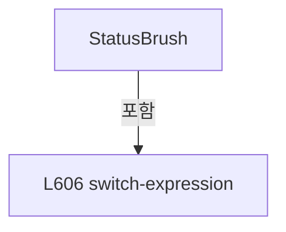

변경 전 점검: 입력/반환 타입, 위 호출자, 예외/취소 경로, 공유 상태와 저장·전송 소비자를 함께 확인합니다. 값의 단위나 물리 방향을 이름만으로 확정하지 않습니다.

### MethodDeclaration `Notify` · L616–619

[Drilling.UI/Menu/Menus/CMenuCorrection.ReviewData.cs:616–619](https://github.com/kjuws10-rgb/A3Drilling/blob/0219666f9053b907d96d7e0aa7d0c6c1be3a73d4/Drilling.UI/Menu/Menus/CMenuCorrection.ReviewData.cs#L616-L619)

| 항목 | 실제 추출 값 |
| --- | --- |
| 서명 | void Drilling.UI.Menu.Menus.CMenuCorrection.CReviewDataPanel.Notify(string) |
| 접근/수식자 | Private / private |
| 반환/값 타입 | void |
| 소속 타입 | NamedType:Drilling.UI.Menu.Menus.CMenuCorrection.CReviewDataPanel |

입력 계약:

| 이름 | 타입 | 전달 | 선택/기본값 |
| --- | --- | --- | --- |
| propertyName | string | None | False /  |

정적 호출자로 확인된 위치:

| 호출 파일/행 | 호출 표현식 | 런타임 분기 가능 |
| --- | --- | --- |
| [Drilling.UI/Menu/Menus/CMenuCorrection.ReviewData.Display.cs:90–90](https://github.com/kjuws10-rgb/A3Drilling/blob/0219666f9053b907d96d7e0aa7d0c6c1be3a73d4/Drilling.UI/Menu/Menus/CMenuCorrection.ReviewData.Display.cs#L90-L90) | Notify | False |
| [Drilling.UI/Menu/Menus/CMenuCorrection.ReviewData.Display.cs:105–105](https://github.com/kjuws10-rgb/A3Drilling/blob/0219666f9053b907d96d7e0aa7d0c6c1be3a73d4/Drilling.UI/Menu/Menus/CMenuCorrection.ReviewData.Display.cs#L105-L105) | Notify | False |
| [Drilling.UI/Menu/Menus/CMenuCorrection.ReviewData.Display.cs:120–120](https://github.com/kjuws10-rgb/A3Drilling/blob/0219666f9053b907d96d7e0aa7d0c6c1be3a73d4/Drilling.UI/Menu/Menus/CMenuCorrection.ReviewData.Display.cs#L120-L120) | Notify | False |
| [Drilling.UI/Menu/Menus/CMenuCorrection.ReviewData.Display.cs:634–634](https://github.com/kjuws10-rgb/A3Drilling/blob/0219666f9053b907d96d7e0aa7d0c6c1be3a73d4/Drilling.UI/Menu/Menus/CMenuCorrection.ReviewData.Display.cs#L634-L634) | Notify | False |
| [Drilling.UI/Menu/Menus/CMenuCorrection.ReviewData.Display.cs:635–635](https://github.com/kjuws10-rgb/A3Drilling/blob/0219666f9053b907d96d7e0aa7d0c6c1be3a73d4/Drilling.UI/Menu/Menus/CMenuCorrection.ReviewData.Display.cs#L635-L635) | Notify | False |
| [Drilling.UI/Menu/Menus/CMenuCorrection.ReviewData.Display.cs:636–636](https://github.com/kjuws10-rgb/A3Drilling/blob/0219666f9053b907d96d7e0aa7d0c6c1be3a73d4/Drilling.UI/Menu/Menus/CMenuCorrection.ReviewData.Display.cs#L636-L636) | Notify | False |
| [Drilling.UI/Menu/Menus/CMenuCorrection.ReviewData.Display.cs:742–742](https://github.com/kjuws10-rgb/A3Drilling/blob/0219666f9053b907d96d7e0aa7d0c6c1be3a73d4/Drilling.UI/Menu/Menus/CMenuCorrection.ReviewData.Display.cs#L742-L742) | Notify | False |
| [Drilling.UI/Menu/Menus/CMenuCorrection.ReviewData.Display.cs:743–743](https://github.com/kjuws10-rgb/A3Drilling/blob/0219666f9053b907d96d7e0aa7d0c6c1be3a73d4/Drilling.UI/Menu/Menus/CMenuCorrection.ReviewData.Display.cs#L743-L743) | Notify | False |
| [Drilling.UI/Menu/Menus/CMenuCorrection.ReviewData.Display.cs:744–744](https://github.com/kjuws10-rgb/A3Drilling/blob/0219666f9053b907d96d7e0aa7d0c6c1be3a73d4/Drilling.UI/Menu/Menus/CMenuCorrection.ReviewData.Display.cs#L744-L744) | Notify | False |
| [Drilling.UI/Menu/Menus/CMenuCorrection.ReviewData.Display.cs:825–825](https://github.com/kjuws10-rgb/A3Drilling/blob/0219666f9053b907d96d7e0aa7d0c6c1be3a73d4/Drilling.UI/Menu/Menus/CMenuCorrection.ReviewData.Display.cs#L825-L825) | Notify | False |
| [Drilling.UI/Menu/Menus/CMenuCorrection.ReviewData.Display.cs:826–826](https://github.com/kjuws10-rgb/A3Drilling/blob/0219666f9053b907d96d7e0aa7d0c6c1be3a73d4/Drilling.UI/Menu/Menus/CMenuCorrection.ReviewData.Display.cs#L826-L826) | Notify | False |
| [Drilling.UI/Menu/Menus/CMenuCorrection.ReviewData.Display.cs:982–982](https://github.com/kjuws10-rgb/A3Drilling/blob/0219666f9053b907d96d7e0aa7d0c6c1be3a73d4/Drilling.UI/Menu/Menus/CMenuCorrection.ReviewData.Display.cs#L982-L982) | Notify | False |
| [Drilling.UI/Menu/Menus/CMenuCorrection.ReviewData.Display.cs:983–983](https://github.com/kjuws10-rgb/A3Drilling/blob/0219666f9053b907d96d7e0aa7d0c6c1be3a73d4/Drilling.UI/Menu/Menus/CMenuCorrection.ReviewData.Display.cs#L983-L983) | Notify | False |
| [Drilling.UI/Menu/Menus/CMenuCorrection.ReviewData.Display.cs:984–984](https://github.com/kjuws10-rgb/A3Drilling/blob/0219666f9053b907d96d7e0aa7d0c6c1be3a73d4/Drilling.UI/Menu/Menus/CMenuCorrection.ReviewData.Display.cs#L984-L984) | Notify | False |
| [Drilling.UI/Menu/Menus/CMenuCorrection.ReviewData.Display.cs:1363–1363](https://github.com/kjuws10-rgb/A3Drilling/blob/0219666f9053b907d96d7e0aa7d0c6c1be3a73d4/Drilling.UI/Menu/Menus/CMenuCorrection.ReviewData.Display.cs#L1363-L1363) | Notify | False |
| [Drilling.UI/Menu/Menus/CMenuCorrection.ReviewData.Display.cs:1364–1364](https://github.com/kjuws10-rgb/A3Drilling/blob/0219666f9053b907d96d7e0aa7d0c6c1be3a73d4/Drilling.UI/Menu/Menus/CMenuCorrection.ReviewData.Display.cs#L1364-L1364) | Notify | False |
| [Drilling.UI/Menu/Menus/CMenuCorrection.ReviewData.Display.cs:1373–1373](https://github.com/kjuws10-rgb/A3Drilling/blob/0219666f9053b907d96d7e0aa7d0c6c1be3a73d4/Drilling.UI/Menu/Menus/CMenuCorrection.ReviewData.Display.cs#L1373-L1373) | Notify | False |
| [Drilling.UI/Menu/Menus/CMenuCorrection.ReviewData.Display.cs:1374–1374](https://github.com/kjuws10-rgb/A3Drilling/blob/0219666f9053b907d96d7e0aa7d0c6c1be3a73d4/Drilling.UI/Menu/Menus/CMenuCorrection.ReviewData.Display.cs#L1374-L1374) | Notify | False |
| [Drilling.UI/Menu/Menus/CMenuCorrection.ReviewData.Display.cs:1381–1381](https://github.com/kjuws10-rgb/A3Drilling/blob/0219666f9053b907d96d7e0aa7d0c6c1be3a73d4/Drilling.UI/Menu/Menus/CMenuCorrection.ReviewData.Display.cs#L1381-L1381) | Notify | False |
| [Drilling.UI/Menu/Menus/CMenuCorrection.ReviewData.Display.cs:1382–1382](https://github.com/kjuws10-rgb/A3Drilling/blob/0219666f9053b907d96d7e0aa7d0c6c1be3a73d4/Drilling.UI/Menu/Menus/CMenuCorrection.ReviewData.Display.cs#L1382-L1382) | Notify | False |
| [Drilling.UI/Menu/Menus/CMenuCorrection.ReviewData.Display.cs:1387–1387](https://github.com/kjuws10-rgb/A3Drilling/blob/0219666f9053b907d96d7e0aa7d0c6c1be3a73d4/Drilling.UI/Menu/Menus/CMenuCorrection.ReviewData.Display.cs#L1387-L1387) | Notify | False |
| [Drilling.UI/Menu/Menus/CMenuCorrection.ReviewData.Display.cs:1388–1388](https://github.com/kjuws10-rgb/A3Drilling/blob/0219666f9053b907d96d7e0aa7d0c6c1be3a73d4/Drilling.UI/Menu/Menus/CMenuCorrection.ReviewData.Display.cs#L1388-L1388) | Notify | False |
| [Drilling.UI/Menu/Menus/CMenuCorrection.ReviewData.Display.cs:1389–1389](https://github.com/kjuws10-rgb/A3Drilling/blob/0219666f9053b907d96d7e0aa7d0c6c1be3a73d4/Drilling.UI/Menu/Menus/CMenuCorrection.ReviewData.Display.cs#L1389-L1389) | Notify | False |
| [Drilling.UI/Menu/Menus/CMenuCorrection.ReviewData.Display.cs:1390–1390](https://github.com/kjuws10-rgb/A3Drilling/blob/0219666f9053b907d96d7e0aa7d0c6c1be3a73d4/Drilling.UI/Menu/Menus/CMenuCorrection.ReviewData.Display.cs#L1390-L1390) | Notify | False |
| [Drilling.UI/Menu/Menus/CMenuCorrection.ReviewData.Display.cs:1400–1400](https://github.com/kjuws10-rgb/A3Drilling/blob/0219666f9053b907d96d7e0aa7d0c6c1be3a73d4/Drilling.UI/Menu/Menus/CMenuCorrection.ReviewData.Display.cs#L1400-L1400) | Notify | False |
| [Drilling.UI/Menu/Menus/CMenuCorrection.ReviewData.Display.cs:1401–1401](https://github.com/kjuws10-rgb/A3Drilling/blob/0219666f9053b907d96d7e0aa7d0c6c1be3a73d4/Drilling.UI/Menu/Menus/CMenuCorrection.ReviewData.Display.cs#L1401-L1401) | Notify | False |
| [Drilling.UI/Menu/Menus/CMenuCorrection.ReviewData.Display.cs:1402–1402](https://github.com/kjuws10-rgb/A3Drilling/blob/0219666f9053b907d96d7e0aa7d0c6c1be3a73d4/Drilling.UI/Menu/Menus/CMenuCorrection.ReviewData.Display.cs#L1402-L1402) | Notify | False |
| [Drilling.UI/Menu/Menus/CMenuCorrection.ReviewData.Display.cs:1403–1403](https://github.com/kjuws10-rgb/A3Drilling/blob/0219666f9053b907d96d7e0aa7d0c6c1be3a73d4/Drilling.UI/Menu/Menus/CMenuCorrection.ReviewData.Display.cs#L1403-L1403) | Notify | False |
| [Drilling.UI/Menu/Menus/CMenuCorrection.ReviewData.Display.cs:1404–1404](https://github.com/kjuws10-rgb/A3Drilling/blob/0219666f9053b907d96d7e0aa7d0c6c1be3a73d4/Drilling.UI/Menu/Menus/CMenuCorrection.ReviewData.Display.cs#L1404-L1404) | Notify | False |
| [Drilling.UI/Menu/Menus/CMenuCorrection.ReviewData.Display.cs:1405–1405](https://github.com/kjuws10-rgb/A3Drilling/blob/0219666f9053b907d96d7e0aa7d0c6c1be3a73d4/Drilling.UI/Menu/Menus/CMenuCorrection.ReviewData.Display.cs#L1405-L1405) | Notify | False |
| [Drilling.UI/Menu/Menus/CMenuCorrection.ReviewData.Display.cs:1406–1406](https://github.com/kjuws10-rgb/A3Drilling/blob/0219666f9053b907d96d7e0aa7d0c6c1be3a73d4/Drilling.UI/Menu/Menus/CMenuCorrection.ReviewData.Display.cs#L1406-L1406) | Notify | False |
| [Drilling.UI/Menu/Menus/CMenuCorrection.ReviewData.Display.cs:1407–1407](https://github.com/kjuws10-rgb/A3Drilling/blob/0219666f9053b907d96d7e0aa7d0c6c1be3a73d4/Drilling.UI/Menu/Menus/CMenuCorrection.ReviewData.Display.cs#L1407-L1407) | Notify | False |
| [Drilling.UI/Menu/Menus/CMenuCorrection.ReviewData.Display.cs:1408–1408](https://github.com/kjuws10-rgb/A3Drilling/blob/0219666f9053b907d96d7e0aa7d0c6c1be3a73d4/Drilling.UI/Menu/Menus/CMenuCorrection.ReviewData.Display.cs#L1408-L1408) | Notify | False |
| [Drilling.UI/Menu/Menus/CMenuCorrection.ReviewData.Display.cs:1409–1409](https://github.com/kjuws10-rgb/A3Drilling/blob/0219666f9053b907d96d7e0aa7d0c6c1be3a73d4/Drilling.UI/Menu/Menus/CMenuCorrection.ReviewData.Display.cs#L1409-L1409) | Notify | False |
| [Drilling.UI/Menu/Menus/CMenuCorrection.ReviewData.Display.cs:1410–1410](https://github.com/kjuws10-rgb/A3Drilling/blob/0219666f9053b907d96d7e0aa7d0c6c1be3a73d4/Drilling.UI/Menu/Menus/CMenuCorrection.ReviewData.Display.cs#L1410-L1410) | Notify | False |
| [Drilling.UI/Menu/Menus/CMenuCorrection.ReviewData.Display.cs:1411–1411](https://github.com/kjuws10-rgb/A3Drilling/blob/0219666f9053b907d96d7e0aa7d0c6c1be3a73d4/Drilling.UI/Menu/Menus/CMenuCorrection.ReviewData.Display.cs#L1411-L1411) | Notify | False |
| [Drilling.UI/Menu/Menus/CMenuCorrection.ReviewData.Display.cs:1412–1412](https://github.com/kjuws10-rgb/A3Drilling/blob/0219666f9053b907d96d7e0aa7d0c6c1be3a73d4/Drilling.UI/Menu/Menus/CMenuCorrection.ReviewData.Display.cs#L1412-L1412) | Notify | False |
| [Drilling.UI/Menu/Menus/CMenuCorrection.ReviewData.Display.cs:1413–1413](https://github.com/kjuws10-rgb/A3Drilling/blob/0219666f9053b907d96d7e0aa7d0c6c1be3a73d4/Drilling.UI/Menu/Menus/CMenuCorrection.ReviewData.Display.cs#L1413-L1413) | Notify | False |
| [Drilling.UI/Menu/Menus/CMenuCorrection.ReviewData.Display.cs:1414–1414](https://github.com/kjuws10-rgb/A3Drilling/blob/0219666f9053b907d96d7e0aa7d0c6c1be3a73d4/Drilling.UI/Menu/Menus/CMenuCorrection.ReviewData.Display.cs#L1414-L1414) | Notify | False |
| [Drilling.UI/Menu/Menus/CMenuCorrection.ReviewData.Display.cs:1415–1415](https://github.com/kjuws10-rgb/A3Drilling/blob/0219666f9053b907d96d7e0aa7d0c6c1be3a73d4/Drilling.UI/Menu/Menus/CMenuCorrection.ReviewData.Display.cs#L1415-L1415) | Notify | False |
| [Drilling.UI/Menu/Menus/CMenuCorrection.ReviewData.Display.cs:1416–1416](https://github.com/kjuws10-rgb/A3Drilling/blob/0219666f9053b907d96d7e0aa7d0c6c1be3a73d4/Drilling.UI/Menu/Menus/CMenuCorrection.ReviewData.Display.cs#L1416-L1416) | Notify | False |
| [Drilling.UI/Menu/Menus/CMenuCorrection.ReviewData.Display.cs:1417–1417](https://github.com/kjuws10-rgb/A3Drilling/blob/0219666f9053b907d96d7e0aa7d0c6c1be3a73d4/Drilling.UI/Menu/Menus/CMenuCorrection.ReviewData.Display.cs#L1417-L1417) | Notify | False |
| [Drilling.UI/Menu/Menus/CMenuCorrection.ReviewData.Display.cs:1418–1418](https://github.com/kjuws10-rgb/A3Drilling/blob/0219666f9053b907d96d7e0aa7d0c6c1be3a73d4/Drilling.UI/Menu/Menus/CMenuCorrection.ReviewData.Display.cs#L1418-L1418) | Notify | False |
| [Drilling.UI/Menu/Menus/CMenuCorrection.ReviewData.Display.cs:1419–1419](https://github.com/kjuws10-rgb/A3Drilling/blob/0219666f9053b907d96d7e0aa7d0c6c1be3a73d4/Drilling.UI/Menu/Menus/CMenuCorrection.ReviewData.Display.cs#L1419-L1419) | Notify | False |
| [Drilling.UI/Menu/Menus/CMenuCorrection.ReviewData.Display.cs:1420–1420](https://github.com/kjuws10-rgb/A3Drilling/blob/0219666f9053b907d96d7e0aa7d0c6c1be3a73d4/Drilling.UI/Menu/Menus/CMenuCorrection.ReviewData.Display.cs#L1420-L1420) | Notify | False |
| [Drilling.UI/Menu/Menus/CMenuCorrection.ReviewData.Display.cs:1421–1421](https://github.com/kjuws10-rgb/A3Drilling/blob/0219666f9053b907d96d7e0aa7d0c6c1be3a73d4/Drilling.UI/Menu/Menus/CMenuCorrection.ReviewData.Display.cs#L1421-L1421) | Notify | False |
| [Drilling.UI/Menu/Menus/CMenuCorrection.ReviewData.Display.cs:1422–1422](https://github.com/kjuws10-rgb/A3Drilling/blob/0219666f9053b907d96d7e0aa7d0c6c1be3a73d4/Drilling.UI/Menu/Menus/CMenuCorrection.ReviewData.Display.cs#L1422-L1422) | Notify | False |
| [Drilling.UI/Menu/Menus/CMenuCorrection.ReviewData.Edit.cs:66–66](https://github.com/kjuws10-rgb/A3Drilling/blob/0219666f9053b907d96d7e0aa7d0c6c1be3a73d4/Drilling.UI/Menu/Menus/CMenuCorrection.ReviewData.Edit.cs#L66-L66) | Notify | False |
| [Drilling.UI/Menu/Menus/CMenuCorrection.ReviewData.Edit.cs:82–82](https://github.com/kjuws10-rgb/A3Drilling/blob/0219666f9053b907d96d7e0aa7d0c6c1be3a73d4/Drilling.UI/Menu/Menus/CMenuCorrection.ReviewData.Edit.cs#L82-L82) | Notify | False |
| [Drilling.UI/Menu/Menus/CMenuCorrection.ReviewData.Edit.cs:224–224](https://github.com/kjuws10-rgb/A3Drilling/blob/0219666f9053b907d96d7e0aa7d0c6c1be3a73d4/Drilling.UI/Menu/Menus/CMenuCorrection.ReviewData.Edit.cs#L224-L224) | Notify | False |
| [Drilling.UI/Menu/Menus/CMenuCorrection.ReviewData.Edit.cs:225–225](https://github.com/kjuws10-rgb/A3Drilling/blob/0219666f9053b907d96d7e0aa7d0c6c1be3a73d4/Drilling.UI/Menu/Menus/CMenuCorrection.ReviewData.Edit.cs#L225-L225) | Notify | False |
| [Drilling.UI/Menu/Menus/CMenuCorrection.ReviewData.Edit.cs:482–482](https://github.com/kjuws10-rgb/A3Drilling/blob/0219666f9053b907d96d7e0aa7d0c6c1be3a73d4/Drilling.UI/Menu/Menus/CMenuCorrection.ReviewData.Edit.cs#L482-L482) | Notify | False |
| [Drilling.UI/Menu/Menus/CMenuCorrection.ReviewData.Edit.cs:504–504](https://github.com/kjuws10-rgb/A3Drilling/blob/0219666f9053b907d96d7e0aa7d0c6c1be3a73d4/Drilling.UI/Menu/Menus/CMenuCorrection.ReviewData.Edit.cs#L504-L504) | Notify | False |
| [Drilling.UI/Menu/Menus/CMenuCorrection.ReviewData.Edit.cs:542–542](https://github.com/kjuws10-rgb/A3Drilling/blob/0219666f9053b907d96d7e0aa7d0c6c1be3a73d4/Drilling.UI/Menu/Menus/CMenuCorrection.ReviewData.Edit.cs#L542-L542) | Notify | False |
| [Drilling.UI/Menu/Menus/CMenuCorrection.ReviewData.Edit.cs:586–586](https://github.com/kjuws10-rgb/A3Drilling/blob/0219666f9053b907d96d7e0aa7d0c6c1be3a73d4/Drilling.UI/Menu/Menus/CMenuCorrection.ReviewData.Edit.cs#L586-L586) | Notify | False |
| [Drilling.UI/Menu/Menus/CMenuCorrection.ReviewData.Edit.cs:587–587](https://github.com/kjuws10-rgb/A3Drilling/blob/0219666f9053b907d96d7e0aa7d0c6c1be3a73d4/Drilling.UI/Menu/Menus/CMenuCorrection.ReviewData.Edit.cs#L587-L587) | Notify | False |
| [Drilling.UI/Menu/Menus/CMenuCorrection.ReviewData.Edit.cs:588–588](https://github.com/kjuws10-rgb/A3Drilling/blob/0219666f9053b907d96d7e0aa7d0c6c1be3a73d4/Drilling.UI/Menu/Menus/CMenuCorrection.ReviewData.Edit.cs#L588-L588) | Notify | False |
| [Drilling.UI/Menu/Menus/CMenuCorrection.ReviewData.Edit.cs:589–589](https://github.com/kjuws10-rgb/A3Drilling/blob/0219666f9053b907d96d7e0aa7d0c6c1be3a73d4/Drilling.UI/Menu/Menus/CMenuCorrection.ReviewData.Edit.cs#L589-L589) | Notify | False |
| [Drilling.UI/Menu/Menus/CMenuCorrection.ReviewData.Edit.cs:590–590](https://github.com/kjuws10-rgb/A3Drilling/blob/0219666f9053b907d96d7e0aa7d0c6c1be3a73d4/Drilling.UI/Menu/Menus/CMenuCorrection.ReviewData.Edit.cs#L590-L590) | Notify | False |
| [Drilling.UI/Menu/Menus/CMenuCorrection.ReviewData.Edit.cs:591–591](https://github.com/kjuws10-rgb/A3Drilling/blob/0219666f9053b907d96d7e0aa7d0c6c1be3a73d4/Drilling.UI/Menu/Menus/CMenuCorrection.ReviewData.Edit.cs#L591-L591) | Notify | False |
| [Drilling.UI/Menu/Menus/CMenuCorrection.ReviewData.Edit.cs:592–592](https://github.com/kjuws10-rgb/A3Drilling/blob/0219666f9053b907d96d7e0aa7d0c6c1be3a73d4/Drilling.UI/Menu/Menus/CMenuCorrection.ReviewData.Edit.cs#L592-L592) | Notify | False |
| [Drilling.UI/Menu/Menus/CMenuCorrection.ReviewData.Edit.cs:593–593](https://github.com/kjuws10-rgb/A3Drilling/blob/0219666f9053b907d96d7e0aa7d0c6c1be3a73d4/Drilling.UI/Menu/Menus/CMenuCorrection.ReviewData.Edit.cs#L593-L593) | Notify | False |
| [Drilling.UI/Menu/Menus/CMenuCorrection.ReviewData.Edit.cs:594–594](https://github.com/kjuws10-rgb/A3Drilling/blob/0219666f9053b907d96d7e0aa7d0c6c1be3a73d4/Drilling.UI/Menu/Menus/CMenuCorrection.ReviewData.Edit.cs#L594-L594) | Notify | False |
| [Drilling.UI/Menu/Menus/CMenuCorrection.ReviewData.Edit.cs:595–595](https://github.com/kjuws10-rgb/A3Drilling/blob/0219666f9053b907d96d7e0aa7d0c6c1be3a73d4/Drilling.UI/Menu/Menus/CMenuCorrection.ReviewData.Edit.cs#L595-L595) | Notify | False |
| [Drilling.UI/Menu/Menus/CMenuCorrection.ReviewData.Edit.cs:596–596](https://github.com/kjuws10-rgb/A3Drilling/blob/0219666f9053b907d96d7e0aa7d0c6c1be3a73d4/Drilling.UI/Menu/Menus/CMenuCorrection.ReviewData.Edit.cs#L596-L596) | Notify | False |
| [Drilling.UI/Menu/Menus/CMenuCorrection.ReviewData.Edit.cs:597–597](https://github.com/kjuws10-rgb/A3Drilling/blob/0219666f9053b907d96d7e0aa7d0c6c1be3a73d4/Drilling.UI/Menu/Menus/CMenuCorrection.ReviewData.Edit.cs#L597-L597) | Notify | False |
| [Drilling.UI/Menu/Menus/CMenuCorrection.ReviewData.Edit.cs:603–603](https://github.com/kjuws10-rgb/A3Drilling/blob/0219666f9053b907d96d7e0aa7d0c6c1be3a73d4/Drilling.UI/Menu/Menus/CMenuCorrection.ReviewData.Edit.cs#L603-L603) | Notify | False |
| [Drilling.UI/Menu/Menus/CMenuCorrection.ReviewData.Edit.cs:604–604](https://github.com/kjuws10-rgb/A3Drilling/blob/0219666f9053b907d96d7e0aa7d0c6c1be3a73d4/Drilling.UI/Menu/Menus/CMenuCorrection.ReviewData.Edit.cs#L604-L604) | Notify | False |
| [Drilling.UI/Menu/Menus/CMenuCorrection.ReviewData.Edit.cs:605–605](https://github.com/kjuws10-rgb/A3Drilling/blob/0219666f9053b907d96d7e0aa7d0c6c1be3a73d4/Drilling.UI/Menu/Menus/CMenuCorrection.ReviewData.Edit.cs#L605-L605) | Notify | False |
| [Drilling.UI/Menu/Menus/CMenuCorrection.ReviewData.Edit.cs:606–606](https://github.com/kjuws10-rgb/A3Drilling/blob/0219666f9053b907d96d7e0aa7d0c6c1be3a73d4/Drilling.UI/Menu/Menus/CMenuCorrection.ReviewData.Edit.cs#L606-L606) | Notify | False |
| [Drilling.UI/Menu/Menus/CMenuCorrection.ReviewData.Edit.cs:607–607](https://github.com/kjuws10-rgb/A3Drilling/blob/0219666f9053b907d96d7e0aa7d0c6c1be3a73d4/Drilling.UI/Menu/Menus/CMenuCorrection.ReviewData.Edit.cs#L607-L607) | Notify | False |
| [Drilling.UI/Menu/Menus/CMenuCorrection.ReviewData.Edit.cs:608–608](https://github.com/kjuws10-rgb/A3Drilling/blob/0219666f9053b907d96d7e0aa7d0c6c1be3a73d4/Drilling.UI/Menu/Menus/CMenuCorrection.ReviewData.Edit.cs#L608-L608) | Notify | False |
| [Drilling.UI/Menu/Menus/CMenuCorrection.ReviewData.Edit.cs:609–609](https://github.com/kjuws10-rgb/A3Drilling/blob/0219666f9053b907d96d7e0aa7d0c6c1be3a73d4/Drilling.UI/Menu/Menus/CMenuCorrection.ReviewData.Edit.cs#L609-L609) | Notify | False |
| [Drilling.UI/Menu/Menus/CMenuCorrection.ReviewData.Edit.cs:610–610](https://github.com/kjuws10-rgb/A3Drilling/blob/0219666f9053b907d96d7e0aa7d0c6c1be3a73d4/Drilling.UI/Menu/Menus/CMenuCorrection.ReviewData.Edit.cs#L610-L610) | Notify | False |
| [Drilling.UI/Menu/Menus/CMenuCorrection.ReviewData.Edit.cs:611–611](https://github.com/kjuws10-rgb/A3Drilling/blob/0219666f9053b907d96d7e0aa7d0c6c1be3a73d4/Drilling.UI/Menu/Menus/CMenuCorrection.ReviewData.Edit.cs#L611-L611) | Notify | False |
| [Drilling.UI/Menu/Menus/CMenuCorrection.ReviewData.Edit.cs:612–612](https://github.com/kjuws10-rgb/A3Drilling/blob/0219666f9053b907d96d7e0aa7d0c6c1be3a73d4/Drilling.UI/Menu/Menus/CMenuCorrection.ReviewData.Edit.cs#L612-L612) | Notify | False |
| [Drilling.UI/Menu/Menus/CMenuCorrection.ReviewData.Edit.cs:613–613](https://github.com/kjuws10-rgb/A3Drilling/blob/0219666f9053b907d96d7e0aa7d0c6c1be3a73d4/Drilling.UI/Menu/Menus/CMenuCorrection.ReviewData.Edit.cs#L613-L613) | Notify | False |
| [Drilling.UI/Menu/Menus/CMenuCorrection.ReviewData.Reinspection.cs:87–87](https://github.com/kjuws10-rgb/A3Drilling/blob/0219666f9053b907d96d7e0aa7d0c6c1be3a73d4/Drilling.UI/Menu/Menus/CMenuCorrection.ReviewData.Reinspection.cs#L87-L87) | Notify | False |
| [Drilling.UI/Menu/Menus/CMenuCorrection.ReviewData.Reinspection.cs:130–130](https://github.com/kjuws10-rgb/A3Drilling/blob/0219666f9053b907d96d7e0aa7d0c6c1be3a73d4/Drilling.UI/Menu/Menus/CMenuCorrection.ReviewData.Reinspection.cs#L130-L130) | Notify | False |
| [Drilling.UI/Menu/Menus/CMenuCorrection.ReviewData.Reinspection.cs:131–131](https://github.com/kjuws10-rgb/A3Drilling/blob/0219666f9053b907d96d7e0aa7d0c6c1be3a73d4/Drilling.UI/Menu/Menus/CMenuCorrection.ReviewData.Reinspection.cs#L131-L131) | Notify | False |
| [Drilling.UI/Menu/Menus/CMenuCorrection.ReviewData.Reinspection.cs:169–169](https://github.com/kjuws10-rgb/A3Drilling/blob/0219666f9053b907d96d7e0aa7d0c6c1be3a73d4/Drilling.UI/Menu/Menus/CMenuCorrection.ReviewData.Reinspection.cs#L169-L169) | Notify | False |
| [Drilling.UI/Menu/Menus/CMenuCorrection.ReviewData.Reinspection.cs:170–170](https://github.com/kjuws10-rgb/A3Drilling/blob/0219666f9053b907d96d7e0aa7d0c6c1be3a73d4/Drilling.UI/Menu/Menus/CMenuCorrection.ReviewData.Reinspection.cs#L170-L170) | Notify | False |
| [Drilling.UI/Menu/Menus/CMenuCorrection.ReviewData.Reinspection.cs:205–205](https://github.com/kjuws10-rgb/A3Drilling/blob/0219666f9053b907d96d7e0aa7d0c6c1be3a73d4/Drilling.UI/Menu/Menus/CMenuCorrection.ReviewData.Reinspection.cs#L205-L205) | Notify | False |
| [Drilling.UI/Menu/Menus/CMenuCorrection.ReviewData.Reinspection.cs:334–334](https://github.com/kjuws10-rgb/A3Drilling/blob/0219666f9053b907d96d7e0aa7d0c6c1be3a73d4/Drilling.UI/Menu/Menus/CMenuCorrection.ReviewData.Reinspection.cs#L334-L334) | Notify | False |
| [Drilling.UI/Menu/Menus/CMenuCorrection.ReviewData.Reinspection.cs:384–384](https://github.com/kjuws10-rgb/A3Drilling/blob/0219666f9053b907d96d7e0aa7d0c6c1be3a73d4/Drilling.UI/Menu/Menus/CMenuCorrection.ReviewData.Reinspection.cs#L384-L384) | Notify | False |
| [Drilling.UI/Menu/Menus/CMenuCorrection.ReviewData.Reinspection.cs:418–418](https://github.com/kjuws10-rgb/A3Drilling/blob/0219666f9053b907d96d7e0aa7d0c6c1be3a73d4/Drilling.UI/Menu/Menus/CMenuCorrection.ReviewData.Reinspection.cs#L418-L418) | Notify | False |
| [Drilling.UI/Menu/Menus/CMenuCorrection.ReviewData.Reinspection.cs:474–474](https://github.com/kjuws10-rgb/A3Drilling/blob/0219666f9053b907d96d7e0aa7d0c6c1be3a73d4/Drilling.UI/Menu/Menus/CMenuCorrection.ReviewData.Reinspection.cs#L474-L474) | Notify | False |
| [Drilling.UI/Menu/Menus/CMenuCorrection.ReviewData.Reinspection.cs:513–513](https://github.com/kjuws10-rgb/A3Drilling/blob/0219666f9053b907d96d7e0aa7d0c6c1be3a73d4/Drilling.UI/Menu/Menus/CMenuCorrection.ReviewData.Reinspection.cs#L513-L513) | Notify | False |
| [Drilling.UI/Menu/Menus/CMenuCorrection.ReviewData.Reinspection.cs:547–547](https://github.com/kjuws10-rgb/A3Drilling/blob/0219666f9053b907d96d7e0aa7d0c6c1be3a73d4/Drilling.UI/Menu/Menus/CMenuCorrection.ReviewData.Reinspection.cs#L547-L547) | Notify | False |
| [Drilling.UI/Menu/Menus/CMenuCorrection.ReviewData.Reinspection.cs:604–604](https://github.com/kjuws10-rgb/A3Drilling/blob/0219666f9053b907d96d7e0aa7d0c6c1be3a73d4/Drilling.UI/Menu/Menus/CMenuCorrection.ReviewData.Reinspection.cs#L604-L604) | Notify | False |
| [Drilling.UI/Menu/Menus/CMenuCorrection.ReviewData.Reinspection.cs:605–605](https://github.com/kjuws10-rgb/A3Drilling/blob/0219666f9053b907d96d7e0aa7d0c6c1be3a73d4/Drilling.UI/Menu/Menus/CMenuCorrection.ReviewData.Reinspection.cs#L605-L605) | Notify | False |
| [Drilling.UI/Menu/Menus/CMenuCorrection.ReviewData.Reinspection.cs:617–617](https://github.com/kjuws10-rgb/A3Drilling/blob/0219666f9053b907d96d7e0aa7d0c6c1be3a73d4/Drilling.UI/Menu/Menus/CMenuCorrection.ReviewData.Reinspection.cs#L617-L617) | Notify | False |
| [Drilling.UI/Menu/Menus/CMenuCorrection.ReviewData.Reinspection.cs:618–618](https://github.com/kjuws10-rgb/A3Drilling/blob/0219666f9053b907d96d7e0aa7d0c6c1be3a73d4/Drilling.UI/Menu/Menus/CMenuCorrection.ReviewData.Reinspection.cs#L618-L618) | Notify | False |
| [Drilling.UI/Menu/Menus/CMenuCorrection.ReviewData.Reinspection.cs:684–684](https://github.com/kjuws10-rgb/A3Drilling/blob/0219666f9053b907d96d7e0aa7d0c6c1be3a73d4/Drilling.UI/Menu/Menus/CMenuCorrection.ReviewData.Reinspection.cs#L684-L684) | Notify | False |
| [Drilling.UI/Menu/Menus/CMenuCorrection.ReviewData.Reinspection.cs:685–685](https://github.com/kjuws10-rgb/A3Drilling/blob/0219666f9053b907d96d7e0aa7d0c6c1be3a73d4/Drilling.UI/Menu/Menus/CMenuCorrection.ReviewData.Reinspection.cs#L685-L685) | Notify | False |
| [Drilling.UI/Menu/Menus/CMenuCorrection.ReviewData.Reinspection.cs:686–686](https://github.com/kjuws10-rgb/A3Drilling/blob/0219666f9053b907d96d7e0aa7d0c6c1be3a73d4/Drilling.UI/Menu/Menus/CMenuCorrection.ReviewData.Reinspection.cs#L686-L686) | Notify | False |
| [Drilling.UI/Menu/Menus/CMenuCorrection.ReviewData.Reinspection.cs:687–687](https://github.com/kjuws10-rgb/A3Drilling/blob/0219666f9053b907d96d7e0aa7d0c6c1be3a73d4/Drilling.UI/Menu/Menus/CMenuCorrection.ReviewData.Reinspection.cs#L687-L687) | Notify | False |
| [Drilling.UI/Menu/Menus/CMenuCorrection.ReviewData.Reinspection.cs:693–693](https://github.com/kjuws10-rgb/A3Drilling/blob/0219666f9053b907d96d7e0aa7d0c6c1be3a73d4/Drilling.UI/Menu/Menus/CMenuCorrection.ReviewData.Reinspection.cs#L693-L693) | Notify | False |
| [Drilling.UI/Menu/Menus/CMenuCorrection.ReviewData.Reinspection.cs:694–694](https://github.com/kjuws10-rgb/A3Drilling/blob/0219666f9053b907d96d7e0aa7d0c6c1be3a73d4/Drilling.UI/Menu/Menus/CMenuCorrection.ReviewData.Reinspection.cs#L694-L694) | Notify | False |
| [Drilling.UI/Menu/Menus/CMenuCorrection.ReviewData.Reinspection.cs:695–695](https://github.com/kjuws10-rgb/A3Drilling/blob/0219666f9053b907d96d7e0aa7d0c6c1be3a73d4/Drilling.UI/Menu/Menus/CMenuCorrection.ReviewData.Reinspection.cs#L695-L695) | Notify | False |
| [Drilling.UI/Menu/Menus/CMenuCorrection.ReviewData.Reinspection.cs:696–696](https://github.com/kjuws10-rgb/A3Drilling/blob/0219666f9053b907d96d7e0aa7d0c6c1be3a73d4/Drilling.UI/Menu/Menus/CMenuCorrection.ReviewData.Reinspection.cs#L696-L696) | Notify | False |
| [Drilling.UI/Menu/Menus/CMenuCorrection.ReviewData.Reinspection.cs:702–702](https://github.com/kjuws10-rgb/A3Drilling/blob/0219666f9053b907d96d7e0aa7d0c6c1be3a73d4/Drilling.UI/Menu/Menus/CMenuCorrection.ReviewData.Reinspection.cs#L702-L702) | Notify | False |
| [Drilling.UI/Menu/Menus/CMenuCorrection.ReviewData.Reinspection.cs:703–703](https://github.com/kjuws10-rgb/A3Drilling/blob/0219666f9053b907d96d7e0aa7d0c6c1be3a73d4/Drilling.UI/Menu/Menus/CMenuCorrection.ReviewData.Reinspection.cs#L703-L703) | Notify | False |
| [Drilling.UI/Menu/Menus/CMenuCorrection.ReviewData.Reinspection.cs:704–704](https://github.com/kjuws10-rgb/A3Drilling/blob/0219666f9053b907d96d7e0aa7d0c6c1be3a73d4/Drilling.UI/Menu/Menus/CMenuCorrection.ReviewData.Reinspection.cs#L704-L704) | Notify | False |
| [Drilling.UI/Menu/Menus/CMenuCorrection.ReviewData.Reinspection.cs:705–705](https://github.com/kjuws10-rgb/A3Drilling/blob/0219666f9053b907d96d7e0aa7d0c6c1be3a73d4/Drilling.UI/Menu/Menus/CMenuCorrection.ReviewData.Reinspection.cs#L705-L705) | Notify | False |
| [Drilling.UI/Menu/Menus/CMenuCorrection.ReviewData.Reinspection.cs:706–706](https://github.com/kjuws10-rgb/A3Drilling/blob/0219666f9053b907d96d7e0aa7d0c6c1be3a73d4/Drilling.UI/Menu/Menus/CMenuCorrection.ReviewData.Reinspection.cs#L706-L706) | Notify | False |
| [Drilling.UI/Menu/Menus/CMenuCorrection.ReviewData.Reinspection.cs:707–707](https://github.com/kjuws10-rgb/A3Drilling/blob/0219666f9053b907d96d7e0aa7d0c6c1be3a73d4/Drilling.UI/Menu/Menus/CMenuCorrection.ReviewData.Reinspection.cs#L707-L707) | Notify | False |
| [Drilling.UI/Menu/Menus/CMenuCorrection.ReviewData.Reinspection.cs:708–708](https://github.com/kjuws10-rgb/A3Drilling/blob/0219666f9053b907d96d7e0aa7d0c6c1be3a73d4/Drilling.UI/Menu/Menus/CMenuCorrection.ReviewData.Reinspection.cs#L708-L708) | Notify | False |
| [Drilling.UI/Menu/Menus/CMenuCorrection.ReviewData.Reinspection.cs:709–709](https://github.com/kjuws10-rgb/A3Drilling/blob/0219666f9053b907d96d7e0aa7d0c6c1be3a73d4/Drilling.UI/Menu/Menus/CMenuCorrection.ReviewData.Reinspection.cs#L709-L709) | Notify | False |
| [Drilling.UI/Menu/Menus/CMenuCorrection.ReviewData.Reinspection.cs:710–710](https://github.com/kjuws10-rgb/A3Drilling/blob/0219666f9053b907d96d7e0aa7d0c6c1be3a73d4/Drilling.UI/Menu/Menus/CMenuCorrection.ReviewData.Reinspection.cs#L710-L710) | Notify | False |
| [Drilling.UI/Menu/Menus/CMenuCorrection.ReviewData.Reinspection.cs:711–711](https://github.com/kjuws10-rgb/A3Drilling/blob/0219666f9053b907d96d7e0aa7d0c6c1be3a73d4/Drilling.UI/Menu/Menus/CMenuCorrection.ReviewData.Reinspection.cs#L711-L711) | Notify | False |
| [Drilling.UI/Menu/Menus/CMenuCorrection.ReviewData.Reinspection.cs:712–712](https://github.com/kjuws10-rgb/A3Drilling/blob/0219666f9053b907d96d7e0aa7d0c6c1be3a73d4/Drilling.UI/Menu/Menus/CMenuCorrection.ReviewData.Reinspection.cs#L712-L712) | Notify | False |
| [Drilling.UI/Menu/Menus/CMenuCorrection.ReviewData.Reinspection.cs:713–713](https://github.com/kjuws10-rgb/A3Drilling/blob/0219666f9053b907d96d7e0aa7d0c6c1be3a73d4/Drilling.UI/Menu/Menus/CMenuCorrection.ReviewData.Reinspection.cs#L713-L713) | Notify | False |
| [Drilling.UI/Menu/Menus/CMenuCorrection.ReviewData.Reinspection.cs:714–714](https://github.com/kjuws10-rgb/A3Drilling/blob/0219666f9053b907d96d7e0aa7d0c6c1be3a73d4/Drilling.UI/Menu/Menus/CMenuCorrection.ReviewData.Reinspection.cs#L714-L714) | Notify | False |
| [Drilling.UI/Menu/Menus/CMenuCorrection.ReviewData.Reinspection.cs:715–715](https://github.com/kjuws10-rgb/A3Drilling/blob/0219666f9053b907d96d7e0aa7d0c6c1be3a73d4/Drilling.UI/Menu/Menus/CMenuCorrection.ReviewData.Reinspection.cs#L715-L715) | Notify | False |
| [Drilling.UI/Menu/Menus/CMenuCorrection.ReviewData.cs:111–111](https://github.com/kjuws10-rgb/A3Drilling/blob/0219666f9053b907d96d7e0aa7d0c6c1be3a73d4/Drilling.UI/Menu/Menus/CMenuCorrection.ReviewData.cs#L111-L111) | Notify | False |
| [Drilling.UI/Menu/Menus/CMenuCorrection.ReviewData.cs:133–133](https://github.com/kjuws10-rgb/A3Drilling/blob/0219666f9053b907d96d7e0aa7d0c6c1be3a73d4/Drilling.UI/Menu/Menus/CMenuCorrection.ReviewData.cs#L133-L133) | Notify | False |
| [Drilling.UI/Menu/Menus/CMenuCorrection.ReviewData.cs:134–134](https://github.com/kjuws10-rgb/A3Drilling/blob/0219666f9053b907d96d7e0aa7d0c6c1be3a73d4/Drilling.UI/Menu/Menus/CMenuCorrection.ReviewData.cs#L134-L134) | Notify | False |
| [Drilling.UI/Menu/Menus/CMenuCorrection.ReviewData.cs:140–140](https://github.com/kjuws10-rgb/A3Drilling/blob/0219666f9053b907d96d7e0aa7d0c6c1be3a73d4/Drilling.UI/Menu/Menus/CMenuCorrection.ReviewData.cs#L140-L140) | Notify | False |
| [Drilling.UI/Menu/Menus/CMenuCorrection.ReviewData.cs:141–141](https://github.com/kjuws10-rgb/A3Drilling/blob/0219666f9053b907d96d7e0aa7d0c6c1be3a73d4/Drilling.UI/Menu/Menus/CMenuCorrection.ReviewData.cs#L141-L141) | Notify | False |
| [Drilling.UI/Menu/Menus/CMenuCorrection.ReviewData.cs:142–142](https://github.com/kjuws10-rgb/A3Drilling/blob/0219666f9053b907d96d7e0aa7d0c6c1be3a73d4/Drilling.UI/Menu/Menus/CMenuCorrection.ReviewData.cs#L142-L142) | Notify | False |
| [Drilling.UI/Menu/Menus/CMenuCorrection.ReviewData.cs:220–220](https://github.com/kjuws10-rgb/A3Drilling/blob/0219666f9053b907d96d7e0aa7d0c6c1be3a73d4/Drilling.UI/Menu/Menus/CMenuCorrection.ReviewData.cs#L220-L220) | Notify | False |
| [Drilling.UI/Menu/Menus/CMenuCorrection.ReviewData.cs:221–221](https://github.com/kjuws10-rgb/A3Drilling/blob/0219666f9053b907d96d7e0aa7d0c6c1be3a73d4/Drilling.UI/Menu/Menus/CMenuCorrection.ReviewData.cs#L221-L221) | Notify | False |
| [Drilling.UI/Menu/Menus/CMenuCorrection.ReviewData.cs:222–222](https://github.com/kjuws10-rgb/A3Drilling/blob/0219666f9053b907d96d7e0aa7d0c6c1be3a73d4/Drilling.UI/Menu/Menus/CMenuCorrection.ReviewData.cs#L222-L222) | Notify | False |
| [Drilling.UI/Menu/Menus/CMenuCorrection.ReviewData.cs:223–223](https://github.com/kjuws10-rgb/A3Drilling/blob/0219666f9053b907d96d7e0aa7d0c6c1be3a73d4/Drilling.UI/Menu/Menus/CMenuCorrection.ReviewData.cs#L223-L223) | Notify | False |
| [Drilling.UI/Menu/Menus/CMenuCorrection.ReviewData.cs:224–224](https://github.com/kjuws10-rgb/A3Drilling/blob/0219666f9053b907d96d7e0aa7d0c6c1be3a73d4/Drilling.UI/Menu/Menus/CMenuCorrection.ReviewData.cs#L224-L224) | Notify | False |
| [Drilling.UI/Menu/Menus/CMenuCorrection.ReviewData.cs:243–243](https://github.com/kjuws10-rgb/A3Drilling/blob/0219666f9053b907d96d7e0aa7d0c6c1be3a73d4/Drilling.UI/Menu/Menus/CMenuCorrection.ReviewData.cs#L243-L243) | Notify | False |
| [Drilling.UI/Menu/Menus/CMenuCorrection.ReviewData.cs:244–244](https://github.com/kjuws10-rgb/A3Drilling/blob/0219666f9053b907d96d7e0aa7d0c6c1be3a73d4/Drilling.UI/Menu/Menus/CMenuCorrection.ReviewData.cs#L244-L244) | Notify | False |
| [Drilling.UI/Menu/Menus/CMenuCorrection.ReviewData.cs:305–305](https://github.com/kjuws10-rgb/A3Drilling/blob/0219666f9053b907d96d7e0aa7d0c6c1be3a73d4/Drilling.UI/Menu/Menus/CMenuCorrection.ReviewData.cs#L305-L305) | Notify | False |
| [Drilling.UI/Menu/Menus/CMenuCorrection.ReviewData.cs:306–306](https://github.com/kjuws10-rgb/A3Drilling/blob/0219666f9053b907d96d7e0aa7d0c6c1be3a73d4/Drilling.UI/Menu/Menus/CMenuCorrection.ReviewData.cs#L306-L306) | Notify | False |
| [Drilling.UI/Menu/Menus/CMenuCorrection.ReviewData.cs:307–307](https://github.com/kjuws10-rgb/A3Drilling/blob/0219666f9053b907d96d7e0aa7d0c6c1be3a73d4/Drilling.UI/Menu/Menus/CMenuCorrection.ReviewData.cs#L307-L307) | Notify | False |
| [Drilling.UI/Menu/Menus/CMenuCorrection.ReviewData.cs:329–329](https://github.com/kjuws10-rgb/A3Drilling/blob/0219666f9053b907d96d7e0aa7d0c6c1be3a73d4/Drilling.UI/Menu/Menus/CMenuCorrection.ReviewData.cs#L329-L329) | Notify | False |
| [Drilling.UI/Menu/Menus/CMenuCorrection.ReviewData.cs:347–347](https://github.com/kjuws10-rgb/A3Drilling/blob/0219666f9053b907d96d7e0aa7d0c6c1be3a73d4/Drilling.UI/Menu/Menus/CMenuCorrection.ReviewData.cs#L347-L347) | Notify | False |
| [Drilling.UI/Menu/Menus/CMenuCorrection.ReviewData.cs:348–348](https://github.com/kjuws10-rgb/A3Drilling/blob/0219666f9053b907d96d7e0aa7d0c6c1be3a73d4/Drilling.UI/Menu/Menus/CMenuCorrection.ReviewData.cs#L348-L348) | Notify | False |
| [Drilling.UI/Menu/Menus/CMenuCorrection.ReviewData.cs:349–349](https://github.com/kjuws10-rgb/A3Drilling/blob/0219666f9053b907d96d7e0aa7d0c6c1be3a73d4/Drilling.UI/Menu/Menus/CMenuCorrection.ReviewData.cs#L349-L349) | Notify | False |
| [Drilling.UI/Menu/Menus/CMenuCorrection.ReviewData.cs:350–350](https://github.com/kjuws10-rgb/A3Drilling/blob/0219666f9053b907d96d7e0aa7d0c6c1be3a73d4/Drilling.UI/Menu/Menus/CMenuCorrection.ReviewData.cs#L350-L350) | Notify | False |
| [Drilling.UI/Menu/Menus/CMenuCorrection.ReviewData.cs:351–351](https://github.com/kjuws10-rgb/A3Drilling/blob/0219666f9053b907d96d7e0aa7d0c6c1be3a73d4/Drilling.UI/Menu/Menus/CMenuCorrection.ReviewData.cs#L351-L351) | Notify | False |

호출하는 대상과 해석 범위:

| 원본 행 | 표현식 | 분석 상태 | 대상/소스 위치 |
| --- | --- | --- | --- |
| 618 | .Invoke | resolved · 동적 구현 선택 가능 | void System.ComponentModel.PropertyChangedEventHandler.Invoke(object?, System.ComponentModel.PropertyChangedEventArgs) |
| 618 | new PropertyChangedEventArgs | resolved | System.ComponentModel.PropertyChangedEventArgs.PropertyChangedEventArgs(string?) |

본문의 실제 연산·분기·예외·반환 순서(원문 위치 순):

| 원본 행 | 종류 | 주석 해설 |
| --- | --- | --- |
| 618 | call | 함수·델리게이트 또는 객체 생성자를 호출합니다: .Invoke(this, new PropertyChangedEventArgs(propertyName)) |
| 618 | call | 함수·델리게이트 또는 객체 생성자를 호출합니다: new PropertyChangedEventArgs(propertyName) |

변경 전 점검: 입력/반환 타입, 위 호출자, 예외/취소 경로, 공유 상태와 저장·전송 소비자를 함께 확인합니다. 값의 단위나 물리 방향을 이름만으로 확정하지 않습니다.

### FieldDeclaration `_isSelected` · L630–630

[Drilling.UI/Menu/Menus/CMenuCorrection.ReviewData.cs:630–630](https://github.com/kjuws10-rgb/A3Drilling/blob/0219666f9053b907d96d7e0aa7d0c6c1be3a73d4/Drilling.UI/Menu/Menus/CMenuCorrection.ReviewData.cs#L630-L630)

| 항목 | 실제 추출 값 |
| --- | --- |
| 서명 | bool Drilling.UI.Menu.Menus.CMenuCorrection.ST_REVIEW_RESULT_TREE_NODE._isSelected |
| 접근/수식자 | Private / private |
| 반환/값 타입 | bool |
| 소속 타입 | NamedType:Drilling.UI.Menu.Menus.CMenuCorrection.ST_REVIEW_RESULT_TREE_NODE |

현재 부분 분석에서 직접 연결된 호출자는 없습니다. XAML/이벤트/인터페이스·델리게이트·외부 진입을 추가 확인해야 하며, 미사용으로 판정한 것이 아닙니다.

변경 전 점검: 입력/반환 타입, 위 호출자, 예외/취소 경로, 공유 상태와 저장·전송 소비자를 함께 확인합니다. 값의 단위나 물리 방향을 이름만으로 확정하지 않습니다.

### EventFieldDeclaration `PropertyChanged` · L632–632

[Drilling.UI/Menu/Menus/CMenuCorrection.ReviewData.cs:632–632](https://github.com/kjuws10-rgb/A3Drilling/blob/0219666f9053b907d96d7e0aa7d0c6c1be3a73d4/Drilling.UI/Menu/Menus/CMenuCorrection.ReviewData.cs#L632-L632)

| 항목 | 실제 추출 값 |
| --- | --- |
| 서명 | System.ComponentModel.PropertyChangedEventHandler? Drilling.UI.Menu.Menus.CMenuCorrection.ST_REVIEW_RESULT_TREE_NODE.PropertyChanged |
| 접근/수식자 | Public / public, event |
| 반환/값 타입 | System.ComponentModel.PropertyChangedEventHandler? |
| 소속 타입 | NamedType:Drilling.UI.Menu.Menus.CMenuCorrection.ST_REVIEW_RESULT_TREE_NODE |

현재 부분 분석에서 직접 연결된 호출자는 없습니다. XAML/이벤트/인터페이스·델리게이트·외부 진입을 추가 확인해야 하며, 미사용으로 판정한 것이 아닙니다.

변경 전 점검: 입력/반환 타입, 위 호출자, 예외/취소 경로, 공유 상태와 저장·전송 소비자를 함께 확인합니다. 값의 단위나 물리 방향을 이름만으로 확정하지 않습니다.

### PropertyDeclaration `DetailBrush` · L633–633

[Drilling.UI/Menu/Menus/CMenuCorrection.ReviewData.cs:633–633](https://github.com/kjuws10-rgb/A3Drilling/blob/0219666f9053b907d96d7e0aa7d0c6c1be3a73d4/Drilling.UI/Menu/Menus/CMenuCorrection.ReviewData.cs#L633-L633)

| 항목 | 실제 추출 값 |
| --- | --- |
| 서명 | Brush Drilling.UI.Menu.Menus.CMenuCorrection.ST_REVIEW_RESULT_TREE_NODE.DetailBrush |
| 접근/수식자 | Public / public |
| 반환/값 타입 | Brush |
| 소속 타입 | NamedType:Drilling.UI.Menu.Menus.CMenuCorrection.ST_REVIEW_RESULT_TREE_NODE |

현재 부분 분석에서 직접 연결된 호출자는 없습니다. XAML/이벤트/인터페이스·델리게이트·외부 진입을 추가 확인해야 하며, 미사용으로 판정한 것이 아닙니다.

호출하는 대상과 해석 범위:

| 원본 행 | 표현식 | 분석 상태 | 대상/소스 위치 |
| --- | --- | --- | --- |
| 633 | CReviewDataPanel.StatusBrush | resolved | Brush Drilling.UI.Menu.Menus.CMenuCorrection.CReviewDataPanel.StatusBrush(string) · Drilling.UI/Menu/Menus/CMenuCorrection.ReviewData.cs:604 |

본문의 실제 연산·분기·예외·반환 순서(원문 위치 순):

| 원본 행 | 종류 | 주석 해설 |
| --- | --- | --- |
| 633 | call | 함수·델리게이트 또는 객체 생성자를 호출합니다: CReviewDataPanel.StatusBrush(Result?.ResultStatus ?? Kind) |

변경 전 점검: 입력/반환 타입, 위 호출자, 예외/취소 경로, 공유 상태와 저장·전송 소비자를 함께 확인합니다. 값의 단위나 물리 방향을 이름만으로 확정하지 않습니다.

### PropertyDeclaration `IsDirectory` · L634–634

[Drilling.UI/Menu/Menus/CMenuCorrection.ReviewData.cs:634–634](https://github.com/kjuws10-rgb/A3Drilling/blob/0219666f9053b907d96d7e0aa7d0c6c1be3a73d4/Drilling.UI/Menu/Menus/CMenuCorrection.ReviewData.cs#L634-L634)

| 항목 | 실제 추출 값 |
| --- | --- |
| 서명 | bool Drilling.UI.Menu.Menus.CMenuCorrection.ST_REVIEW_RESULT_TREE_NODE.IsDirectory |
| 접근/수식자 | Public / public |
| 반환/값 타입 | bool |
| 소속 타입 | NamedType:Drilling.UI.Menu.Menus.CMenuCorrection.ST_REVIEW_RESULT_TREE_NODE |

현재 부분 분석에서 직접 연결된 호출자는 없습니다. XAML/이벤트/인터페이스·델리게이트·외부 진입을 추가 확인해야 하며, 미사용으로 판정한 것이 아닙니다.

변경 전 점검: 입력/반환 타입, 위 호출자, 예외/취소 경로, 공유 상태와 저장·전송 소비자를 함께 확인합니다. 값의 단위나 물리 방향을 이름만으로 확정하지 않습니다.

### PropertyDeclaration `IsSelected` · L635–648

[Drilling.UI/Menu/Menus/CMenuCorrection.ReviewData.cs:635–648](https://github.com/kjuws10-rgb/A3Drilling/blob/0219666f9053b907d96d7e0aa7d0c6c1be3a73d4/Drilling.UI/Menu/Menus/CMenuCorrection.ReviewData.cs#L635-L648)

| 항목 | 실제 추출 값 |
| --- | --- |
| 서명 | bool Drilling.UI.Menu.Menus.CMenuCorrection.ST_REVIEW_RESULT_TREE_NODE.IsSelected |
| 접근/수식자 | Public / public |
| 반환/값 타입 | bool |
| 소속 타입 | NamedType:Drilling.UI.Menu.Menus.CMenuCorrection.ST_REVIEW_RESULT_TREE_NODE |

현재 부분 분석에서 직접 연결된 호출자는 없습니다. XAML/이벤트/인터페이스·델리게이트·외부 진입을 추가 확인해야 하며, 미사용으로 판정한 것이 아닙니다.

변경 전 점검: 입력/반환 타입, 위 호출자, 예외/취소 경로, 공유 상태와 저장·전송 소비자를 함께 확인합니다. 값의 단위나 물리 방향을 이름만으로 확정하지 않습니다.

### GetAccessorDeclaration `get_IsSelected` · L637–637

[Drilling.UI/Menu/Menus/CMenuCorrection.ReviewData.cs:637–637](https://github.com/kjuws10-rgb/A3Drilling/blob/0219666f9053b907d96d7e0aa7d0c6c1be3a73d4/Drilling.UI/Menu/Menus/CMenuCorrection.ReviewData.cs#L637-L637)

| 항목 | 실제 추출 값 |
| --- | --- |
| 서명 | bool Drilling.UI.Menu.Menus.CMenuCorrection.ST_REVIEW_RESULT_TREE_NODE.IsSelected.get |
| 접근/수식자 | Public / get |
| 반환/값 타입 | bool |
| 소속 타입 | NamedType:Drilling.UI.Menu.Menus.CMenuCorrection.ST_REVIEW_RESULT_TREE_NODE |

현재 부분 분석에서 직접 연결된 호출자는 없습니다. XAML/이벤트/인터페이스·델리게이트·외부 진입을 추가 확인해야 하며, 미사용으로 판정한 것이 아닙니다.

변경 전 점검: 입력/반환 타입, 위 호출자, 예외/취소 경로, 공유 상태와 저장·전송 소비자를 함께 확인합니다. 값의 단위나 물리 방향을 이름만으로 확정하지 않습니다.

### SetAccessorDeclaration `set_IsSelected` · L638–647

[Drilling.UI/Menu/Menus/CMenuCorrection.ReviewData.cs:638–647](https://github.com/kjuws10-rgb/A3Drilling/blob/0219666f9053b907d96d7e0aa7d0c6c1be3a73d4/Drilling.UI/Menu/Menus/CMenuCorrection.ReviewData.cs#L638-L647)

| 항목 | 실제 추출 값 |
| --- | --- |
| 서명 | void Drilling.UI.Menu.Menus.CMenuCorrection.ST_REVIEW_RESULT_TREE_NODE.IsSelected.set |
| 접근/수식자 | Public / set |
| 반환/값 타입 | void |
| 소속 타입 | NamedType:Drilling.UI.Menu.Menus.CMenuCorrection.ST_REVIEW_RESULT_TREE_NODE |

입력 계약:

| 이름 | 타입 | 전달 | 선택/기본값 |
| --- | --- | --- | --- |
| value | bool | None | False /  |

현재 부분 분석에서 직접 연결된 호출자는 없습니다. XAML/이벤트/인터페이스·델리게이트·외부 진입을 추가 확인해야 하며, 미사용으로 판정한 것이 아닙니다.

호출하는 대상과 해석 범위:

| 원본 행 | 표현식 | 분석 상태 | 대상/소스 위치 |
| --- | --- | --- | --- |
| 646 | .Invoke | resolved · 동적 구현 선택 가능 | void System.ComponentModel.PropertyChangedEventHandler.Invoke(object?, System.ComponentModel.PropertyChangedEventArgs) |
| 646 | new PropertyChangedEventArgs | resolved | System.ComponentModel.PropertyChangedEventArgs.PropertyChangedEventArgs(string?) |
| 646 | nameof | unresolved | None |

본문의 실제 연산·분기·예외·반환 순서(원문 위치 순):

| 원본 행 | 종류 | 주석 해설 |
| --- | --- | --- |
| 640 | if | 조건에 따라 분기합니다: if (_isSelected == value) |
| 642 | return | 호출자에게 값 또는 제어를 반환합니다: return; |
| 645 | assignment | 값을 대상에 대입합니다: _isSelected = value |
| 646 | call | 함수·델리게이트 또는 객체 생성자를 호출합니다: .Invoke(this, new PropertyChangedEventArgs(nameof(IsSelected))) |
| 646 | call | 함수·델리게이트 또는 객체 생성자를 호출합니다: new PropertyChangedEventArgs(nameof(IsSelected)) |
| 646 | call | 함수·델리게이트 또는 객체 생성자를 호출합니다: nameof(IsSelected) |

제어 구문의 포함 구조(실제 실행 순서/CFG가 아닌 구문 탐색 그림):

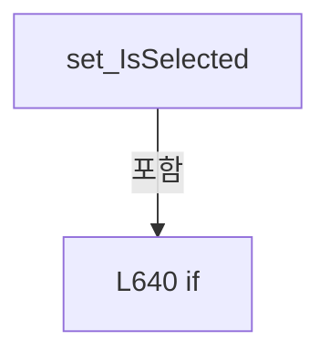

변경 전 점검: 입력/반환 타입, 위 호출자, 예외/취소 경로, 공유 상태와 저장·전송 소비자를 함께 확인합니다. 값의 단위나 물리 방향을 이름만으로 확정하지 않습니다.

## 구문·바인딩 한계

전체 WPF/벤더 SDK/프로젝트별 빌드 조건을 로드한 정식 빌드가 아닙니다. `resolved`는 이 부분 컴파일에서의 심볼 연결이며 virtual/interface/delegate/이벤트/Reflection/XAML의 실제 런타임 구현을 확정하지 않습니다. `candidate`와 `unresolved`는 후속 확인 대상으로 남깁니다.

## 원문 전체 주석 해설본

[원본 모든 행과 행별 해설 보기](../../../../annotated/Drilling.UI/Menu/Menus/CMenuCorrection.ReviewData.cs.annotated.txt)

원본을 빠뜨리거나 임의로 줄이지 않았습니다. `L000001 |` 표시는 원본 행 번호, `// 해설`은 별도 설명입니다. 실행용 소스가 아닌 문서입니다.

## 수정·재검증 체크

- 원본 Commit과 현재 작업 파일 SHA가 같은지 먼저 확인합니다. 다르면 이 문서를 과거 버전 자료로 취급합니다.
- 선언·직접 호출·이벤트/인터페이스 경계·설정 소비를 함께 확인합니다. 정적 연결의 빈 곳을 정상 경로로 추정하지 않습니다.
- 저장 형식/단위/식별자·재시도·취소·예외·롤백에 영향을 주는 변경은 상세 해설장과 호출자를 다시 검토합니다.
- 도구의 구문 추출과 별도 정적 추적 해설, 실제 빌드·시뮬레이션·실장비 검증 결과를 분리합니다.
