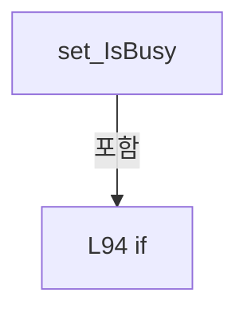
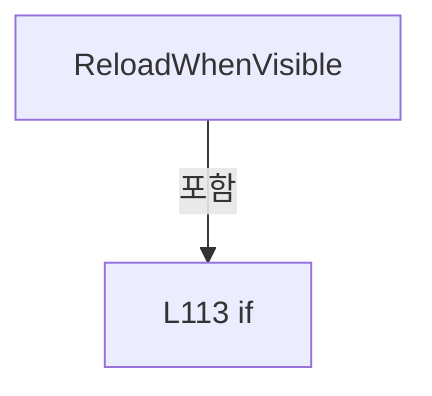
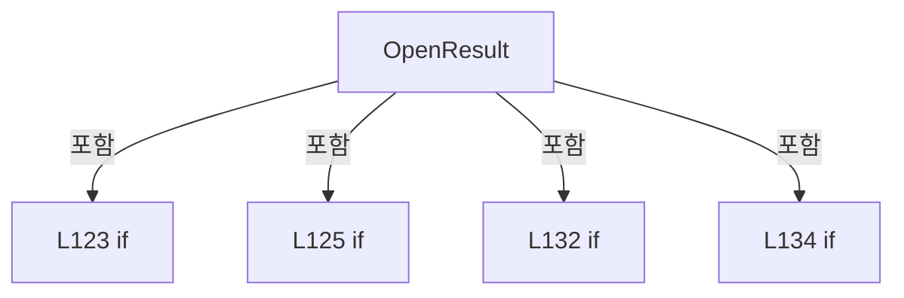
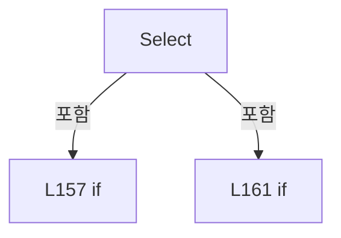
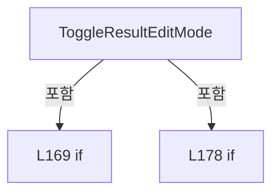
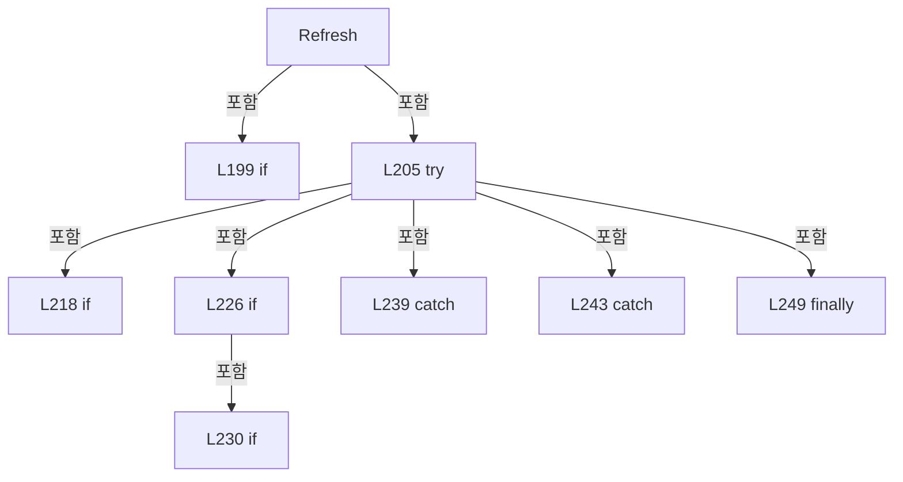
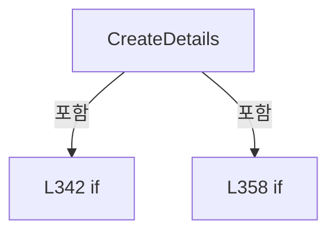
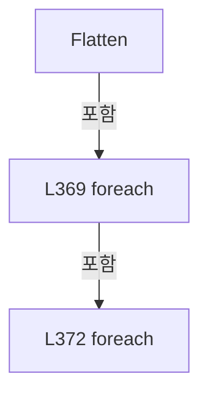
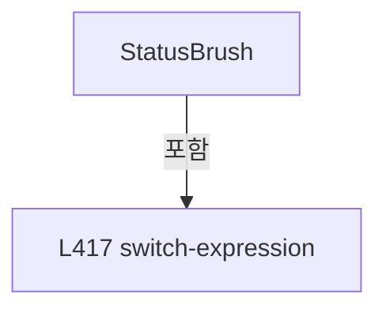

# Drilling.UI/Menu/Menus/CMenuCorrection.ReviewData.cs

| 항목 | 내용 |
| --- | --- |
| 원본 저장소 | https://github.com/kjuws10-rgb/A3Drilling.git |
| 원본 Commit | dfa5920e6301d9ec4b0eab1452ae59521aafc986 |
| 원본 SHA256 | a98f68b5dfca62eabb101212e505b496a9654353b880eb9f38bb90b77bc181fd |
| 파일 분류 | code |
| 원본 크기/행 | 21,943 bytes / 464 physical lines |
| 인코딩 | utf-8-sig |
| 검토 범위 | 구문/부분 의미 분석에서 추출한 사실. 동작·물리 단위·실장비 합격을 보증하지 않습니다. |
| 원본 링크 | [고정 Commit 원본](https://github.com/kjuws10-rgb/A3Drilling/blob/dfa5920e6301d9ec4b0eab1452ae59521aafc986/Drilling.UI/Menu/Menus/CMenuCorrection.ReviewData.cs) |

## 파일의 역할과 읽는 순서

WPF 화면·사용자 명령·표시 상태를 구성합니다. XAML 이벤트와 코드 비하인드, RootView의 조립 경로를 함께 추적합니다.

## 네임스페이스·타입·상속

| 타입 | 구분 | 원본 범위 | 선언/상속 |
| --- | --- | --- | --- |
| CMenuCorrection | ClassDeclaration | 12–463 | CMenuCorrection |
| CReviewDataPanel | ClassDeclaration | 14–431 | CReviewDataPanel: INotifyPropertyChanged |
| ST_REVIEW_RESULT_TREE_NODE | RecordDeclaration | 433–460 | ST_REVIEW_RESULT_TREE_NODE |
| ST_REVIEW_DATA_DETAIL_ITEM | RecordDeclaration | 462–462 | ST_REVIEW_DATA_DETAIL_ITEM |

## 멤버 빠른 목록

| 이름 | 종류 | 범위 | 서명 |
| --- | --- | --- | --- |
| _reviewResultFile | FieldDeclaration | L16–16 | Drilling.Common.Review.CReviewResultFileBase Drilling.UI.Menu.Menus.CMenuCorrection.CReviewDataPanel._reviewResultFile |
| _reviewOffsetFile | FieldDeclaration | L17–17 | Drilling.Common.Review.CReviewOffsetFileBase Drilling.UI.Menu.Menus.CMenuCorrection.CReviewDataPanel._reviewOffsetFile |
| _reviewManager | FieldDeclaration | L18–18 | Drilling.Common.Review.CReviewManager Drilling.UI.Menu.Menus.CMenuCorrection.CReviewDataPanel._reviewManager |
| _recipeManager | FieldDeclaration | L19–19 | Drilling.Common.Managers.CRecipeManager Drilling.UI.Menu.Menus.CMenuCorrection.CReviewDataPanel._recipeManager |
| _settingManager | FieldDeclaration | L20–20 | Drilling.Common.Managers.CSettingManager Drilling.UI.Menu.Menus.CMenuCorrection.CReviewDataPanel._settingManager |
| _selectedRecipeIdProvider | FieldDeclaration | L21–21 | System.Func<string> Drilling.UI.Menu.Menus.CMenuCorrection.CReviewDataPanel._selectedRecipeIdProvider |
| _statusReporter | FieldDeclaration | L22–22 | System.Action<string> Drilling.UI.Menu.Menus.CMenuCorrection.CReviewDataPanel._statusReporter |
| _rollbackReviewOffset | FieldDeclaration | L23–23 | System.Func<System.Threading.Tasks.Task> Drilling.UI.Menu.Menus.CMenuCorrection.CReviewDataPanel._rollbackReviewOffset |
| _saveReviewOffsetFromResult | FieldDeclaration | L24–24 | System.Func<string, System.Collections.Generic.IReadOnlyList<Drilling.Common.Review.ST_REVIEW_OFFSET_ROW>, string, System.Threading.Tasks.Task<Drilling.Common.Review.ST_REVIEW_OFFSET_FILE_DATA?>> Drilling.UI.Menu.Menus.CMenuCorrection.CReviewDataPanel._saveReviewOffsetFromResult |
| _isBusy | FieldDeclaration | L25–25 | bool Drilling.UI.Menu.Menus.CMenuCorrection.CReviewDataPanel._isBusy |
| _isResultEditMode | FieldDeclaration | L26–26 | bool Drilling.UI.Menu.Menus.CMenuCorrection.CReviewDataPanel._isResultEditMode |
| _skipNextVisibleReload | FieldDeclaration | L27–27 | int Drilling.UI.Menu.Menus.CMenuCorrection.CReviewDataPanel._skipNextVisibleReload |
| _selectedNode | FieldDeclaration | L28–28 | Drilling.UI.Menu.Menus.CMenuCorrection.ST_REVIEW_RESULT_TREE_NODE? Drilling.UI.Menu.Menus.CMenuCorrection.CReviewDataPanel._selectedNode |
| .ctor | ConstructorDeclaration | L30–62 | Drilling.UI.Menu.Menus.CMenuCorrection.CReviewDataPanel.CReviewDataPanel(Drilling.Common.Review.CReviewResultFileBase, Drilling.Common.Review.CReviewOffsetFileBase, Drilling.Common.Review.CReviewManager, Drilling.Common.Managers.CRecipeManager, Drilling.Common.Managers.CSettingManager, System.Func<string>, System.Action<string>, System.Func<System.Threading.Tasks.Task>, System.Func<string, System.Collections.Generic.IReadOnlyList<Drilling.Common.Review.ST_REVIEW_OFFSET_ROW>, string, System.Threading.Tasks.Task<Drilling.Common.Review.ST_REVIEW_OFFSET_FILE_DATA?>>) |
| PropertyChanged | EventFieldDeclaration | L64–64 | System.ComponentModel.PropertyChangedEventHandler? Drilling.UI.Menu.Menus.CMenuCorrection.CReviewDataPanel.PropertyChanged |
| RefreshCommand | PropertyDeclaration | L66–66 | Drilling.UI.Menu.CButtonCommand Drilling.UI.Menu.Menus.CMenuCorrection.CReviewDataPanel.RefreshCommand |
| get_RefreshCommand | GetAccessorDeclaration | L66–66 | Drilling.UI.Menu.CButtonCommand Drilling.UI.Menu.Menus.CMenuCorrection.CReviewDataPanel.RefreshCommand.get |
| LoadDataCommand | PropertyDeclaration | L67–67 | Drilling.UI.Menu.CButtonCommand Drilling.UI.Menu.Menus.CMenuCorrection.CReviewDataPanel.LoadDataCommand |
| get_LoadDataCommand | GetAccessorDeclaration | L67–67 | Drilling.UI.Menu.CButtonCommand Drilling.UI.Menu.Menus.CMenuCorrection.CReviewDataPanel.LoadDataCommand.get |
| SelectCellCommand | PropertyDeclaration | L68–68 | Drilling.UI.Menu.CButtonCommand Drilling.UI.Menu.Menus.CMenuCorrection.CReviewDataPanel.SelectCellCommand |
| get_SelectCellCommand | GetAccessorDeclaration | L68–68 | Drilling.UI.Menu.CButtonCommand Drilling.UI.Menu.Menus.CMenuCorrection.CReviewDataPanel.SelectCellCommand.get |
| ApplyScatterPlotScaleCommand | PropertyDeclaration | L69–69 | Drilling.UI.Menu.CButtonCommand Drilling.UI.Menu.Menus.CMenuCorrection.CReviewDataPanel.ApplyScatterPlotScaleCommand |
| get_ApplyScatterPlotScaleCommand | GetAccessorDeclaration | L69–69 | Drilling.UI.Menu.CButtonCommand Drilling.UI.Menu.Menus.CMenuCorrection.CReviewDataPanel.ApplyScatterPlotScaleCommand.get |
| ToggleResultEditModeCommand | PropertyDeclaration | L70–70 | Drilling.UI.Menu.CButtonCommand Drilling.UI.Menu.Menus.CMenuCorrection.CReviewDataPanel.ToggleResultEditModeCommand |
| get_ToggleResultEditModeCommand | GetAccessorDeclaration | L70–70 | Drilling.UI.Menu.CButtonCommand Drilling.UI.Menu.Menus.CMenuCorrection.CReviewDataPanel.ToggleResultEditModeCommand.get |
| OffsetApplyCommand | PropertyDeclaration | L71–71 | Drilling.UI.Menu.CButtonCommand Drilling.UI.Menu.Menus.CMenuCorrection.CReviewDataPanel.OffsetApplyCommand |
| get_OffsetApplyCommand | GetAccessorDeclaration | L71–71 | Drilling.UI.Menu.CButtonCommand Drilling.UI.Menu.Menus.CMenuCorrection.CReviewDataPanel.OffsetApplyCommand.get |
| OffsetRollbackCommand | PropertyDeclaration | L72–72 | Drilling.UI.Menu.CButtonCommand Drilling.UI.Menu.Menus.CMenuCorrection.CReviewDataPanel.OffsetRollbackCommand |
| get_OffsetRollbackCommand | GetAccessorDeclaration | L72–72 | Drilling.UI.Menu.CButtonCommand Drilling.UI.Menu.Menus.CMenuCorrection.CReviewDataPanel.OffsetRollbackCommand.get |
| OffsetInitCommand | PropertyDeclaration | L73–73 | Drilling.UI.Menu.CButtonCommand Drilling.UI.Menu.Menus.CMenuCorrection.CReviewDataPanel.OffsetInitCommand |
| get_OffsetInitCommand | GetAccessorDeclaration | L73–73 | Drilling.UI.Menu.CButtonCommand Drilling.UI.Menu.Menus.CMenuCorrection.CReviewDataPanel.OffsetInitCommand.get |
| OffsetViewCommand | PropertyDeclaration | L74–74 | Drilling.UI.Menu.CButtonCommand Drilling.UI.Menu.Menus.CMenuCorrection.CReviewDataPanel.OffsetViewCommand |
| get_OffsetViewCommand | GetAccessorDeclaration | L74–74 | Drilling.UI.Menu.CButtonCommand Drilling.UI.Menu.Menus.CMenuCorrection.CReviewDataPanel.OffsetViewCommand.get |
| Nodes | PropertyDeclaration | L75–75 | System.Collections.Generic.IReadOnlyList<Drilling.UI.Menu.Menus.CMenuCorrection.ST_REVIEW_RESULT_TREE_NODE> Drilling.UI.Menu.Menus.CMenuCorrection.CReviewDataPanel.Nodes |
| get_Nodes | GetAccessorDeclaration | L75–75 | System.Collections.Generic.IReadOnlyList<Drilling.UI.Menu.Menus.CMenuCorrection.ST_REVIEW_RESULT_TREE_NODE> Drilling.UI.Menu.Menus.CMenuCorrection.CReviewDataPanel.Nodes.get |
| set_Nodes | SetAccessorDeclaration | L75–75 | void Drilling.UI.Menu.Menus.CMenuCorrection.CReviewDataPanel.Nodes.set |
| SelectedDetails | PropertyDeclaration | L76–76 | System.Collections.Generic.IReadOnlyList<Drilling.UI.Menu.Menus.CMenuCorrection.ST_REVIEW_DATA_DETAIL_ITEM> Drilling.UI.Menu.Menus.CMenuCorrection.CReviewDataPanel.SelectedDetails |
| get_SelectedDetails | GetAccessorDeclaration | L76–76 | System.Collections.Generic.IReadOnlyList<Drilling.UI.Menu.Menus.CMenuCorrection.ST_REVIEW_DATA_DETAIL_ITEM> Drilling.UI.Menu.Menus.CMenuCorrection.CReviewDataPanel.SelectedDetails.get |
| set_SelectedDetails | SetAccessorDeclaration | L76–76 | void Drilling.UI.Menu.Menus.CMenuCorrection.CReviewDataPanel.SelectedDetails.set |
| StatusText | PropertyDeclaration | L77–77 | string Drilling.UI.Menu.Menus.CMenuCorrection.CReviewDataPanel.StatusText |
| get_StatusText | GetAccessorDeclaration | L77–77 | string Drilling.UI.Menu.Menus.CMenuCorrection.CReviewDataPanel.StatusText.get |
| set_StatusText | SetAccessorDeclaration | L77–77 | void Drilling.UI.Menu.Menus.CMenuCorrection.CReviewDataPanel.StatusText.set |
| SelectedTitle | PropertyDeclaration | L78–78 | string Drilling.UI.Menu.Menus.CMenuCorrection.CReviewDataPanel.SelectedTitle |
| get_SelectedTitle | GetAccessorDeclaration | L78–78 | string Drilling.UI.Menu.Menus.CMenuCorrection.CReviewDataPanel.SelectedTitle.get |
| set_SelectedTitle | SetAccessorDeclaration | L78–78 | void Drilling.UI.Menu.Menus.CMenuCorrection.CReviewDataPanel.SelectedTitle.set |
| SelectedStatus | PropertyDeclaration | L79–79 | string Drilling.UI.Menu.Menus.CMenuCorrection.CReviewDataPanel.SelectedStatus |
| get_SelectedStatus | GetAccessorDeclaration | L79–79 | string Drilling.UI.Menu.Menus.CMenuCorrection.CReviewDataPanel.SelectedStatus.get |
| set_SelectedStatus | SetAccessorDeclaration | L79–79 | void Drilling.UI.Menu.Menus.CMenuCorrection.CReviewDataPanel.SelectedStatus.set |
| SelectedPath | PropertyDeclaration | L80–80 | string Drilling.UI.Menu.Menus.CMenuCorrection.CReviewDataPanel.SelectedPath |
| get_SelectedPath | GetAccessorDeclaration | L80–80 | string Drilling.UI.Menu.Menus.CMenuCorrection.CReviewDataPanel.SelectedPath.get |
| set_SelectedPath | SetAccessorDeclaration | L80–80 | void Drilling.UI.Menu.Menus.CMenuCorrection.CReviewDataPanel.SelectedPath.set |
| SelectedStatusBrush | PropertyDeclaration | L81–81 | Brush Drilling.UI.Menu.Menus.CMenuCorrection.CReviewDataPanel.SelectedStatusBrush |
| IsResultEditMode | PropertyDeclaration | L82–82 | bool Drilling.UI.Menu.Menus.CMenuCorrection.CReviewDataPanel.IsResultEditMode |
| CanToggleResultEditMode | PropertyDeclaration | L83–87 | bool Drilling.UI.Menu.Menus.CMenuCorrection.CReviewDataPanel.CanToggleResultEditMode |
| IsBusy | PropertyDeclaration | L89–104 | bool Drilling.UI.Menu.Menus.CMenuCorrection.CReviewDataPanel.IsBusy |
| get_IsBusy | GetAccessorDeclaration | L91–91 | bool Drilling.UI.Menu.Menus.CMenuCorrection.CReviewDataPanel.IsBusy.get |
| set_IsBusy | SetAccessorDeclaration | L92–103 | void Drilling.UI.Menu.Menus.CMenuCorrection.CReviewDataPanel.IsBusy.set |
| Reload | MethodDeclaration | L106–109 | System.Threading.Tasks.Task Drilling.UI.Menu.Menus.CMenuCorrection.CReviewDataPanel.Reload(System.Threading.CancellationToken) |
| ReloadWhenVisible | MethodDeclaration | L111–119 | System.Threading.Tasks.Task Drilling.UI.Menu.Menus.CMenuCorrection.CReviewDataPanel.ReloadWhenVisible(System.Threading.CancellationToken) |
| OpenResult | MethodDeclaration | L121–139 | System.Threading.Tasks.Task Drilling.UI.Menu.Menus.CMenuCorrection.CReviewDataPanel.OpenResult(string, System.Threading.CancellationToken) |
| Select | MethodDeclaration | L141–165 | void Drilling.UI.Menu.Menus.CMenuCorrection.CReviewDataPanel.Select(Drilling.UI.Menu.Menus.CMenuCorrection.ST_REVIEW_RESULT_TREE_NODE) |
| ToggleResultEditMode | MethodDeclaration | L167–188 | void Drilling.UI.Menu.Menus.CMenuCorrection.CReviewDataPanel.ToggleResultEditMode(object?) |
| RefreshRequested | MethodDeclaration | L190–193 | void Drilling.UI.Menu.Menus.CMenuCorrection.CReviewDataPanel.RefreshRequested(object?) |
| Refresh | MethodDeclaration | L195–253 | System.Threading.Tasks.Task Drilling.UI.Menu.Menus.CMenuCorrection.CReviewDataPanel.Refresh(System.Threading.CancellationToken, string?) |
| ClearSelection | MethodDeclaration | L255–269 | void Drilling.UI.Menu.Menus.CMenuCorrection.CReviewDataPanel.ClearSelection() |
| BuildTree | MethodDeclaration | L271–333 | System.Collections.Generic.IReadOnlyList<Drilling.UI.Menu.Menus.CMenuCorrection.ST_REVIEW_RESULT_TREE_NODE> Drilling.UI.Menu.Menus.CMenuCorrection.CReviewDataPanel.BuildTree(System.Collections.Generic.IReadOnlyList<Drilling.Common.Review.ST_REVIEW_RESULT_CATALOG_ITEM>) |
| CreateResultNode | MethodDeclaration | L335–338 | Drilling.UI.Menu.Menus.CMenuCorrection.ST_REVIEW_RESULT_TREE_NODE Drilling.UI.Menu.Menus.CMenuCorrection.CReviewDataPanel.CreateResultNode(Drilling.Common.Review.ST_REVIEW_RESULT_CATALOG_ITEM) |
| CreateDetails | MethodDeclaration | L340–364 | System.Collections.Generic.IReadOnlyList<Drilling.UI.Menu.Menus.CMenuCorrection.ST_REVIEW_DATA_DETAIL_ITEM> Drilling.UI.Menu.Menus.CMenuCorrection.CReviewDataPanel.CreateDetails(Drilling.UI.Menu.Menus.CMenuCorrection.ST_REVIEW_RESULT_TREE_NODE) |
| Flatten | MethodDeclaration | L366–377 | System.Collections.Generic.IEnumerable<Drilling.UI.Menu.Menus.CMenuCorrection.ST_REVIEW_RESULT_TREE_NODE> Drilling.UI.Menu.Menus.CMenuCorrection.CReviewDataPanel.Flatten(System.Collections.Generic.IEnumerable<Drilling.UI.Menu.Menus.CMenuCorrection.ST_REVIEW_RESULT_TREE_NODE>) |
| ExpandResultPath | MethodDeclaration | L379–400 | System.Collections.Generic.IReadOnlyList<Drilling.UI.Menu.Menus.CMenuCorrection.ST_REVIEW_RESULT_TREE_NODE> Drilling.UI.Menu.Menus.CMenuCorrection.CReviewDataPanel.ExpandResultPath(System.Collections.Generic.IEnumerable<Drilling.UI.Menu.Menus.CMenuCorrection.ST_REVIEW_RESULT_TREE_NODE>, string) |
| ContainsExpandedResult | LocalFunctionStatement | L395–399 | bool ContainsExpandedResult(Drilling.UI.Menu.Menus.CMenuCorrection.ST_REVIEW_RESULT_TREE_NODE) |
| SetSelectedTreeNode | MethodDeclaration | L402–408 | void Drilling.UI.Menu.Menus.CMenuCorrection.CReviewDataPanel.SetSelectedTreeNode(Drilling.UI.Menu.Menus.CMenuCorrection.ST_REVIEW_RESULT_TREE_NODE?) |
| CountResults | MethodDeclaration | L410–413 | int Drilling.UI.Menu.Menus.CMenuCorrection.CReviewDataPanel.CountResults(Drilling.UI.Menu.Menus.CMenuCorrection.ST_REVIEW_RESULT_TREE_NODE) |
| StatusBrush | MethodDeclaration | L415–425 | Brush Drilling.UI.Menu.Menus.CMenuCorrection.CReviewDataPanel.StatusBrush(string) |
| Notify | MethodDeclaration | L427–430 | void Drilling.UI.Menu.Menus.CMenuCorrection.CReviewDataPanel.Notify(string) |
| _isSelected | FieldDeclaration | L441–441 | bool Drilling.UI.Menu.Menus.CMenuCorrection.ST_REVIEW_RESULT_TREE_NODE._isSelected |
| PropertyChanged | EventFieldDeclaration | L443–443 | System.ComponentModel.PropertyChangedEventHandler? Drilling.UI.Menu.Menus.CMenuCorrection.ST_REVIEW_RESULT_TREE_NODE.PropertyChanged |
| DetailBrush | PropertyDeclaration | L444–444 | Brush Drilling.UI.Menu.Menus.CMenuCorrection.ST_REVIEW_RESULT_TREE_NODE.DetailBrush |
| IsDirectory | PropertyDeclaration | L445–445 | bool Drilling.UI.Menu.Menus.CMenuCorrection.ST_REVIEW_RESULT_TREE_NODE.IsDirectory |
| IsSelected | PropertyDeclaration | L446–459 | bool Drilling.UI.Menu.Menus.CMenuCorrection.ST_REVIEW_RESULT_TREE_NODE.IsSelected |
| get_IsSelected | GetAccessorDeclaration | L448–448 | bool Drilling.UI.Menu.Menus.CMenuCorrection.ST_REVIEW_RESULT_TREE_NODE.IsSelected.get |
| set_IsSelected | SetAccessorDeclaration | L449–458 | void Drilling.UI.Menu.Menus.CMenuCorrection.ST_REVIEW_RESULT_TREE_NODE.IsSelected.set |

## 멤버별 상세 계약·호출·처리 해설

### FieldDeclaration `_reviewResultFile` · L16–16

[Drilling.UI/Menu/Menus/CMenuCorrection.ReviewData.cs:16–16](https://github.com/kjuws10-rgb/A3Drilling/blob/dfa5920e6301d9ec4b0eab1452ae59521aafc986/Drilling.UI/Menu/Menus/CMenuCorrection.ReviewData.cs#L16-L16)

| 항목 | 실제 추출 값 |
| --- | --- |
| 서명 | Drilling.Common.Review.CReviewResultFileBase Drilling.UI.Menu.Menus.CMenuCorrection.CReviewDataPanel._reviewResultFile |
| 접근/수식자 | Private / private, readonly |
| 반환/값 타입 | Drilling.Common.Review.CReviewResultFileBase |
| 소속 타입 | NamedType:Drilling.UI.Menu.Menus.CMenuCorrection.CReviewDataPanel |

현재 부분 분석에서 직접 연결된 호출자는 없습니다. XAML/이벤트/인터페이스·델리게이트·외부 진입을 추가 확인해야 하며, 미사용으로 판정한 것이 아닙니다.

변경 전 점검: 입력/반환 타입, 위 호출자, 예외/취소 경로, 공유 상태와 저장·전송 소비자를 함께 확인합니다. 값의 단위나 물리 방향을 이름만으로 확정하지 않습니다.

### FieldDeclaration `_reviewOffsetFile` · L17–17

[Drilling.UI/Menu/Menus/CMenuCorrection.ReviewData.cs:17–17](https://github.com/kjuws10-rgb/A3Drilling/blob/dfa5920e6301d9ec4b0eab1452ae59521aafc986/Drilling.UI/Menu/Menus/CMenuCorrection.ReviewData.cs#L17-L17)

| 항목 | 실제 추출 값 |
| --- | --- |
| 서명 | Drilling.Common.Review.CReviewOffsetFileBase Drilling.UI.Menu.Menus.CMenuCorrection.CReviewDataPanel._reviewOffsetFile |
| 접근/수식자 | Private / private, readonly |
| 반환/값 타입 | Drilling.Common.Review.CReviewOffsetFileBase |
| 소속 타입 | NamedType:Drilling.UI.Menu.Menus.CMenuCorrection.CReviewDataPanel |

현재 부분 분석에서 직접 연결된 호출자는 없습니다. XAML/이벤트/인터페이스·델리게이트·외부 진입을 추가 확인해야 하며, 미사용으로 판정한 것이 아닙니다.

변경 전 점검: 입력/반환 타입, 위 호출자, 예외/취소 경로, 공유 상태와 저장·전송 소비자를 함께 확인합니다. 값의 단위나 물리 방향을 이름만으로 확정하지 않습니다.

### FieldDeclaration `_reviewManager` · L18–18

[Drilling.UI/Menu/Menus/CMenuCorrection.ReviewData.cs:18–18](https://github.com/kjuws10-rgb/A3Drilling/blob/dfa5920e6301d9ec4b0eab1452ae59521aafc986/Drilling.UI/Menu/Menus/CMenuCorrection.ReviewData.cs#L18-L18)

| 항목 | 실제 추출 값 |
| --- | --- |
| 서명 | Drilling.Common.Review.CReviewManager Drilling.UI.Menu.Menus.CMenuCorrection.CReviewDataPanel._reviewManager |
| 접근/수식자 | Private / private, readonly |
| 반환/값 타입 | Drilling.Common.Review.CReviewManager |
| 소속 타입 | NamedType:Drilling.UI.Menu.Menus.CMenuCorrection.CReviewDataPanel |

현재 부분 분석에서 직접 연결된 호출자는 없습니다. XAML/이벤트/인터페이스·델리게이트·외부 진입을 추가 확인해야 하며, 미사용으로 판정한 것이 아닙니다.

변경 전 점검: 입력/반환 타입, 위 호출자, 예외/취소 경로, 공유 상태와 저장·전송 소비자를 함께 확인합니다. 값의 단위나 물리 방향을 이름만으로 확정하지 않습니다.

### FieldDeclaration `_recipeManager` · L19–19

[Drilling.UI/Menu/Menus/CMenuCorrection.ReviewData.cs:19–19](https://github.com/kjuws10-rgb/A3Drilling/blob/dfa5920e6301d9ec4b0eab1452ae59521aafc986/Drilling.UI/Menu/Menus/CMenuCorrection.ReviewData.cs#L19-L19)

| 항목 | 실제 추출 값 |
| --- | --- |
| 서명 | Drilling.Common.Managers.CRecipeManager Drilling.UI.Menu.Menus.CMenuCorrection.CReviewDataPanel._recipeManager |
| 접근/수식자 | Private / private, readonly |
| 반환/값 타입 | Drilling.Common.Managers.CRecipeManager |
| 소속 타입 | NamedType:Drilling.UI.Menu.Menus.CMenuCorrection.CReviewDataPanel |

현재 부분 분석에서 직접 연결된 호출자는 없습니다. XAML/이벤트/인터페이스·델리게이트·외부 진입을 추가 확인해야 하며, 미사용으로 판정한 것이 아닙니다.

변경 전 점검: 입력/반환 타입, 위 호출자, 예외/취소 경로, 공유 상태와 저장·전송 소비자를 함께 확인합니다. 값의 단위나 물리 방향을 이름만으로 확정하지 않습니다.

### FieldDeclaration `_settingManager` · L20–20

[Drilling.UI/Menu/Menus/CMenuCorrection.ReviewData.cs:20–20](https://github.com/kjuws10-rgb/A3Drilling/blob/dfa5920e6301d9ec4b0eab1452ae59521aafc986/Drilling.UI/Menu/Menus/CMenuCorrection.ReviewData.cs#L20-L20)

| 항목 | 실제 추출 값 |
| --- | --- |
| 서명 | Drilling.Common.Managers.CSettingManager Drilling.UI.Menu.Menus.CMenuCorrection.CReviewDataPanel._settingManager |
| 접근/수식자 | Private / private, readonly |
| 반환/값 타입 | Drilling.Common.Managers.CSettingManager |
| 소속 타입 | NamedType:Drilling.UI.Menu.Menus.CMenuCorrection.CReviewDataPanel |

현재 부분 분석에서 직접 연결된 호출자는 없습니다. XAML/이벤트/인터페이스·델리게이트·외부 진입을 추가 확인해야 하며, 미사용으로 판정한 것이 아닙니다.

변경 전 점검: 입력/반환 타입, 위 호출자, 예외/취소 경로, 공유 상태와 저장·전송 소비자를 함께 확인합니다. 값의 단위나 물리 방향을 이름만으로 확정하지 않습니다.

### FieldDeclaration `_selectedRecipeIdProvider` · L21–21

[Drilling.UI/Menu/Menus/CMenuCorrection.ReviewData.cs:21–21](https://github.com/kjuws10-rgb/A3Drilling/blob/dfa5920e6301d9ec4b0eab1452ae59521aafc986/Drilling.UI/Menu/Menus/CMenuCorrection.ReviewData.cs#L21-L21)

| 항목 | 실제 추출 값 |
| --- | --- |
| 서명 | System.Func<string> Drilling.UI.Menu.Menus.CMenuCorrection.CReviewDataPanel._selectedRecipeIdProvider |
| 접근/수식자 | Private / private, readonly |
| 반환/값 타입 | System.Func<string> |
| 소속 타입 | NamedType:Drilling.UI.Menu.Menus.CMenuCorrection.CReviewDataPanel |

현재 부분 분석에서 직접 연결된 호출자는 없습니다. XAML/이벤트/인터페이스·델리게이트·외부 진입을 추가 확인해야 하며, 미사용으로 판정한 것이 아닙니다.

변경 전 점검: 입력/반환 타입, 위 호출자, 예외/취소 경로, 공유 상태와 저장·전송 소비자를 함께 확인합니다. 값의 단위나 물리 방향을 이름만으로 확정하지 않습니다.

### FieldDeclaration `_statusReporter` · L22–22

[Drilling.UI/Menu/Menus/CMenuCorrection.ReviewData.cs:22–22](https://github.com/kjuws10-rgb/A3Drilling/blob/dfa5920e6301d9ec4b0eab1452ae59521aafc986/Drilling.UI/Menu/Menus/CMenuCorrection.ReviewData.cs#L22-L22)

| 항목 | 실제 추출 값 |
| --- | --- |
| 서명 | System.Action<string> Drilling.UI.Menu.Menus.CMenuCorrection.CReviewDataPanel._statusReporter |
| 접근/수식자 | Private / private, readonly |
| 반환/값 타입 | System.Action<string> |
| 소속 타입 | NamedType:Drilling.UI.Menu.Menus.CMenuCorrection.CReviewDataPanel |

현재 부분 분석에서 직접 연결된 호출자는 없습니다. XAML/이벤트/인터페이스·델리게이트·외부 진입을 추가 확인해야 하며, 미사용으로 판정한 것이 아닙니다.

변경 전 점검: 입력/반환 타입, 위 호출자, 예외/취소 경로, 공유 상태와 저장·전송 소비자를 함께 확인합니다. 값의 단위나 물리 방향을 이름만으로 확정하지 않습니다.

### FieldDeclaration `_rollbackReviewOffset` · L23–23

[Drilling.UI/Menu/Menus/CMenuCorrection.ReviewData.cs:23–23](https://github.com/kjuws10-rgb/A3Drilling/blob/dfa5920e6301d9ec4b0eab1452ae59521aafc986/Drilling.UI/Menu/Menus/CMenuCorrection.ReviewData.cs#L23-L23)

| 항목 | 실제 추출 값 |
| --- | --- |
| 서명 | System.Func<System.Threading.Tasks.Task> Drilling.UI.Menu.Menus.CMenuCorrection.CReviewDataPanel._rollbackReviewOffset |
| 접근/수식자 | Private / private, readonly |
| 반환/값 타입 | System.Func<System.Threading.Tasks.Task> |
| 소속 타입 | NamedType:Drilling.UI.Menu.Menus.CMenuCorrection.CReviewDataPanel |

현재 부분 분석에서 직접 연결된 호출자는 없습니다. XAML/이벤트/인터페이스·델리게이트·외부 진입을 추가 확인해야 하며, 미사용으로 판정한 것이 아닙니다.

변경 전 점검: 입력/반환 타입, 위 호출자, 예외/취소 경로, 공유 상태와 저장·전송 소비자를 함께 확인합니다. 값의 단위나 물리 방향을 이름만으로 확정하지 않습니다.

### FieldDeclaration `_saveReviewOffsetFromResult` · L24–24

[Drilling.UI/Menu/Menus/CMenuCorrection.ReviewData.cs:24–24](https://github.com/kjuws10-rgb/A3Drilling/blob/dfa5920e6301d9ec4b0eab1452ae59521aafc986/Drilling.UI/Menu/Menus/CMenuCorrection.ReviewData.cs#L24-L24)

| 항목 | 실제 추출 값 |
| --- | --- |
| 서명 | System.Func<string, System.Collections.Generic.IReadOnlyList<Drilling.Common.Review.ST_REVIEW_OFFSET_ROW>, string, System.Threading.Tasks.Task<Drilling.Common.Review.ST_REVIEW_OFFSET_FILE_DATA?>> Drilling.UI.Menu.Menus.CMenuCorrection.CReviewDataPanel._saveReviewOffsetFromResult |
| 접근/수식자 | Private / private, readonly |
| 반환/값 타입 | System.Func<string, System.Collections.Generic.IReadOnlyList<Drilling.Common.Review.ST_REVIEW_OFFSET_ROW>, string, System.Threading.Tasks.Task<Drilling.Common.Review.ST_REVIEW_OFFSET_FILE_DATA?>> |
| 소속 타입 | NamedType:Drilling.UI.Menu.Menus.CMenuCorrection.CReviewDataPanel |

현재 부분 분석에서 직접 연결된 호출자는 없습니다. XAML/이벤트/인터페이스·델리게이트·외부 진입을 추가 확인해야 하며, 미사용으로 판정한 것이 아닙니다.

변경 전 점검: 입력/반환 타입, 위 호출자, 예외/취소 경로, 공유 상태와 저장·전송 소비자를 함께 확인합니다. 값의 단위나 물리 방향을 이름만으로 확정하지 않습니다.

### FieldDeclaration `_isBusy` · L25–25

[Drilling.UI/Menu/Menus/CMenuCorrection.ReviewData.cs:25–25](https://github.com/kjuws10-rgb/A3Drilling/blob/dfa5920e6301d9ec4b0eab1452ae59521aafc986/Drilling.UI/Menu/Menus/CMenuCorrection.ReviewData.cs#L25-L25)

| 항목 | 실제 추출 값 |
| --- | --- |
| 서명 | bool Drilling.UI.Menu.Menus.CMenuCorrection.CReviewDataPanel._isBusy |
| 접근/수식자 | Private / private |
| 반환/값 타입 | bool |
| 소속 타입 | NamedType:Drilling.UI.Menu.Menus.CMenuCorrection.CReviewDataPanel |

현재 부분 분석에서 직접 연결된 호출자는 없습니다. XAML/이벤트/인터페이스·델리게이트·외부 진입을 추가 확인해야 하며, 미사용으로 판정한 것이 아닙니다.

변경 전 점검: 입력/반환 타입, 위 호출자, 예외/취소 경로, 공유 상태와 저장·전송 소비자를 함께 확인합니다. 값의 단위나 물리 방향을 이름만으로 확정하지 않습니다.

### FieldDeclaration `_isResultEditMode` · L26–26

[Drilling.UI/Menu/Menus/CMenuCorrection.ReviewData.cs:26–26](https://github.com/kjuws10-rgb/A3Drilling/blob/dfa5920e6301d9ec4b0eab1452ae59521aafc986/Drilling.UI/Menu/Menus/CMenuCorrection.ReviewData.cs#L26-L26)

| 항목 | 실제 추출 값 |
| --- | --- |
| 서명 | bool Drilling.UI.Menu.Menus.CMenuCorrection.CReviewDataPanel._isResultEditMode |
| 접근/수식자 | Private / private |
| 반환/값 타입 | bool |
| 소속 타입 | NamedType:Drilling.UI.Menu.Menus.CMenuCorrection.CReviewDataPanel |

현재 부분 분석에서 직접 연결된 호출자는 없습니다. XAML/이벤트/인터페이스·델리게이트·외부 진입을 추가 확인해야 하며, 미사용으로 판정한 것이 아닙니다.

변경 전 점검: 입력/반환 타입, 위 호출자, 예외/취소 경로, 공유 상태와 저장·전송 소비자를 함께 확인합니다. 값의 단위나 물리 방향을 이름만으로 확정하지 않습니다.

### FieldDeclaration `_skipNextVisibleReload` · L27–27

[Drilling.UI/Menu/Menus/CMenuCorrection.ReviewData.cs:27–27](https://github.com/kjuws10-rgb/A3Drilling/blob/dfa5920e6301d9ec4b0eab1452ae59521aafc986/Drilling.UI/Menu/Menus/CMenuCorrection.ReviewData.cs#L27-L27)

| 항목 | 실제 추출 값 |
| --- | --- |
| 서명 | int Drilling.UI.Menu.Menus.CMenuCorrection.CReviewDataPanel._skipNextVisibleReload |
| 접근/수식자 | Private / private |
| 반환/값 타입 | int |
| 소속 타입 | NamedType:Drilling.UI.Menu.Menus.CMenuCorrection.CReviewDataPanel |

현재 부분 분석에서 직접 연결된 호출자는 없습니다. XAML/이벤트/인터페이스·델리게이트·외부 진입을 추가 확인해야 하며, 미사용으로 판정한 것이 아닙니다.

변경 전 점검: 입력/반환 타입, 위 호출자, 예외/취소 경로, 공유 상태와 저장·전송 소비자를 함께 확인합니다. 값의 단위나 물리 방향을 이름만으로 확정하지 않습니다.

### FieldDeclaration `_selectedNode` · L28–28

[Drilling.UI/Menu/Menus/CMenuCorrection.ReviewData.cs:28–28](https://github.com/kjuws10-rgb/A3Drilling/blob/dfa5920e6301d9ec4b0eab1452ae59521aafc986/Drilling.UI/Menu/Menus/CMenuCorrection.ReviewData.cs#L28-L28)

| 항목 | 실제 추출 값 |
| --- | --- |
| 서명 | Drilling.UI.Menu.Menus.CMenuCorrection.ST_REVIEW_RESULT_TREE_NODE? Drilling.UI.Menu.Menus.CMenuCorrection.CReviewDataPanel._selectedNode |
| 접근/수식자 | Private / private |
| 반환/값 타입 | Drilling.UI.Menu.Menus.CMenuCorrection.ST_REVIEW_RESULT_TREE_NODE? |
| 소속 타입 | NamedType:Drilling.UI.Menu.Menus.CMenuCorrection.CReviewDataPanel |

현재 부분 분석에서 직접 연결된 호출자는 없습니다. XAML/이벤트/인터페이스·델리게이트·외부 진입을 추가 확인해야 하며, 미사용으로 판정한 것이 아닙니다.

변경 전 점검: 입력/반환 타입, 위 호출자, 예외/취소 경로, 공유 상태와 저장·전송 소비자를 함께 확인합니다. 값의 단위나 물리 방향을 이름만으로 확정하지 않습니다.

### ConstructorDeclaration `.ctor` · L30–62

[Drilling.UI/Menu/Menus/CMenuCorrection.ReviewData.cs:30–62](https://github.com/kjuws10-rgb/A3Drilling/blob/dfa5920e6301d9ec4b0eab1452ae59521aafc986/Drilling.UI/Menu/Menus/CMenuCorrection.ReviewData.cs#L30-L62)

| 항목 | 실제 추출 값 |
| --- | --- |
| 서명 | Drilling.UI.Menu.Menus.CMenuCorrection.CReviewDataPanel.CReviewDataPanel(Drilling.Common.Review.CReviewResultFileBase, Drilling.Common.Review.CReviewOffsetFileBase, Drilling.Common.Review.CReviewManager, Drilling.Common.Managers.CRecipeManager, Drilling.Common.Managers.CSettingManager, System.Func<string>, System.Action<string>, System.Func<System.Threading.Tasks.Task>, System.Func<string, System.Collections.Generic.IReadOnlyList<Drilling.Common.Review.ST_REVIEW_OFFSET_ROW>, string, System.Threading.Tasks.Task<Drilling.Common.Review.ST_REVIEW_OFFSET_FILE_DATA?>>) |
| 접근/수식자 | Public / public |
| 반환/값 타입 | void |
| 소속 타입 | NamedType:Drilling.UI.Menu.Menus.CMenuCorrection.CReviewDataPanel |

입력 계약:

| 이름 | 타입 | 전달 | 선택/기본값 |
| --- | --- | --- | --- |
| reviewResultFile | Drilling.Common.Review.CReviewResultFileBase | None | False /  |
| reviewOffsetFile | Drilling.Common.Review.CReviewOffsetFileBase | None | False /  |
| reviewManager | Drilling.Common.Review.CReviewManager | None | False /  |
| recipeManager | Drilling.Common.Managers.CRecipeManager | None | False /  |
| settingManager | Drilling.Common.Managers.CSettingManager | None | False /  |
| selectedRecipeIdProvider | System.Func<string> | None | False /  |
| statusReporter | System.Action<string> | None | False /  |
| rollbackReviewOffset | System.Func<System.Threading.Tasks.Task> | None | False /  |
| saveReviewOffsetFromResult | System.Func<string, System.Collections.Generic.IReadOnlyList<Drilling.Common.Review.ST_REVIEW_OFFSET_ROW>, string, System.Threading.Tasks.Task<Drilling.Common.Review.ST_REVIEW_OFFSET_FILE_DATA?>> | None | False /  |

정적 호출자로 확인된 위치:

| 호출 파일/행 | 호출 표현식 | 런타임 분기 가능 |
| --- | --- | --- |
| [Drilling.UI/Menu/Menus/CMenuCorrection.cs:141–150](https://github.com/kjuws10-rgb/A3Drilling/blob/dfa5920e6301d9ec4b0eab1452ae59521aafc986/Drilling.UI/Menu/Menus/CMenuCorrection.cs#L141-L150) | new CReviewDataPanel | False |

호출하는 대상과 해석 범위:

| 원본 행 | 표현식 | 분석 상태 | 대상/소스 위치 |
| --- | --- | --- | --- |
| 50 | new CButtonCommand | resolved | Drilling.UI.Menu.CButtonCommand.CButtonCommand(System.Action<object?>, System.Predicate<object?>?) · Drilling.UI/Menu/CButtonCommand.cs:9 |
| 51 | new CButtonCommand | resolved | Drilling.UI.Menu.CButtonCommand.CButtonCommand(System.Action<object?>, System.Predicate<object?>?) · Drilling.UI/Menu/CButtonCommand.cs:9 |
| 52 | new CButtonCommand | resolved | Drilling.UI.Menu.CButtonCommand.CButtonCommand(System.Action<object?>, System.Predicate<object?>?) · Drilling.UI/Menu/CButtonCommand.cs:9 |
| 53 | new CButtonCommand | resolved | Drilling.UI.Menu.CButtonCommand.CButtonCommand(System.Action<object?>, System.Predicate<object?>?) · Drilling.UI/Menu/CButtonCommand.cs:9 |
| 54 | new CButtonCommand | resolved | Drilling.UI.Menu.CButtonCommand.CButtonCommand(System.Action<object?>, System.Predicate<object?>?) · Drilling.UI/Menu/CButtonCommand.cs:9 |
| 55 | InitializeResultEditCommands | resolved | void Drilling.UI.Menu.Menus.CMenuCorrection.CReviewDataPanel.InitializeResultEditCommands() · Drilling.UI/Menu/Menus/CMenuCorrection.ReviewData.Edit.cs:102 |
| 56 | new CButtonCommand | resolved | Drilling.UI.Menu.CButtonCommand.CButtonCommand(System.Action<object?>, System.Predicate<object?>?) · Drilling.UI/Menu/CButtonCommand.cs:9 |
| 57 | new CButtonCommand | resolved | Drilling.UI.Menu.CButtonCommand.CButtonCommand(System.Action<object?>, System.Predicate<object?>?) · Drilling.UI/Menu/CButtonCommand.cs:9 |
| 58 | new CButtonCommand | resolved | Drilling.UI.Menu.CButtonCommand.CButtonCommand(System.Action<object?>, System.Predicate<object?>?) · Drilling.UI/Menu/CButtonCommand.cs:9 |
| 59 | new CButtonCommand | resolved | Drilling.UI.Menu.CButtonCommand.CButtonCommand(System.Action<object?>, System.Predicate<object?>?) · Drilling.UI/Menu/CButtonCommand.cs:9 |
| 60 | InitializeReinspectionCommands | resolved | void Drilling.UI.Menu.Menus.CMenuCorrection.CReviewDataPanel.InitializeReinspectionCommands() · Drilling.UI/Menu/Menus/CMenuCorrection.ReviewData.Reinspection.cs:104 |
| 61 | BuildTree | resolved | System.Collections.Generic.IReadOnlyList<Drilling.UI.Menu.Menus.CMenuCorrection.ST_REVIEW_RESULT_TREE_NODE> Drilling.UI.Menu.Menus.CMenuCorrection.CReviewDataPanel.BuildTree(System.Collections.Generic.IReadOnlyList<Drilling.Common.Review.ST_REVIEW_RESULT_CATALOG_ITEM>) · Drilling.UI/Menu/Menus/CMenuCorrection.ReviewData.cs:271 |

본문의 실제 연산·분기·예외·반환 순서(원문 위치 순):

| 원본 행 | 종류 | 주석 해설 |
| --- | --- | --- |
| 41 | assignment | 값을 대상에 대입합니다: _reviewResultFile = reviewResultFile |
| 42 | assignment | 값을 대상에 대입합니다: _reviewOffsetFile = reviewOffsetFile |
| 43 | assignment | 값을 대상에 대입합니다: _reviewManager = reviewManager |
| 44 | assignment | 값을 대상에 대입합니다: _recipeManager = recipeManager |
| 45 | assignment | 값을 대상에 대입합니다: _settingManager = settingManager |
| 46 | assignment | 값을 대상에 대입합니다: _selectedRecipeIdProvider = selectedRecipeIdProvider |
| 47 | assignment | 값을 대상에 대입합니다: _statusReporter = statusReporter |
| 48 | assignment | 값을 대상에 대입합니다: _rollbackReviewOffset = rollbackReviewOffset |
| 49 | assignment | 값을 대상에 대입합니다: _saveReviewOffsetFromResult = saveReviewOffsetFromResult |
| 50 | assignment | 값을 대상에 대입합니다: RefreshCommand = new CButtonCommand(RefreshRequested, _ => !IsBusy) |
| 50 | call | 함수·델리게이트 또는 객체 생성자를 호출합니다: new CButtonCommand(RefreshRequested, _ => !IsBusy) |
| 51 | assignment | 값을 대상에 대입합니다: LoadDataCommand = new CButtonCommand(LoadDataRequested, _ => CanLoadData) |
| 51 | call | 함수·델리게이트 또는 객체 생성자를 호출합니다: new CButtonCommand(LoadDataRequested, _ => CanLoadData) |
| 52 | assignment | 값을 대상에 대입합니다: SelectCellCommand = new CButtonCommand(SelectCell) |
| 52 | call | 함수·델리게이트 또는 객체 생성자를 호출합니다: new CButtonCommand(SelectCell) |
| 53 | assignment | 값을 대상에 대입합니다: ApplyScatterPlotScaleCommand = new CButtonCommand(ApplyScatterPlotScale) |
| 53 | call | 함수·델리게이트 또는 객체 생성자를 호출합니다: new CButtonCommand(ApplyScatterPlotScale) |
| 54 | assignment | 값을 대상에 대입합니다: ToggleResultEditModeCommand = new CButtonCommand(ToggleResultEditMode, _ => CanToggleResultEditMode) |
| 54 | call | 함수·델리게이트 또는 객체 생성자를 호출합니다: new CButtonCommand(ToggleResultEditMode, _ => CanToggleResultEditMode) |
| 55 | call | 함수·델리게이트 또는 객체 생성자를 호출합니다: InitializeResultEditCommands() |
| 56 | assignment | 값을 대상에 대입합니다: OffsetApplyCommand = new CButtonCommand(OffsetApplyRequested, _ => CanApplyOffset) |
| 56 | call | 함수·델리게이트 또는 객체 생성자를 호출합니다: new CButtonCommand(OffsetApplyRequested, _ => CanApplyOffset) |
| 57 | assignment | 값을 대상에 대입합니다: OffsetRollbackCommand = new CButtonCommand(OffsetRollbackRequested, _ => CanEditOffsets) |
| 57 | call | 함수·델리게이트 또는 객체 생성자를 호출합니다: new CButtonCommand(OffsetRollbackRequested, _ => CanEditOffsets) |
| 58 | assignment | 값을 대상에 대입합니다: OffsetInitCommand = new CButtonCommand(OffsetInitRequested, _ => CanEditOffsets) |
| 58 | call | 함수·델리게이트 또는 객체 생성자를 호출합니다: new CButtonCommand(OffsetInitRequested, _ => CanEditOffsets) |
| 59 | assignment | 값을 대상에 대입합니다: OffsetViewCommand = new CButtonCommand(OffsetViewRequested, _ => CanEditOffsets) |
| 59 | call | 함수·델리게이트 또는 객체 생성자를 호출합니다: new CButtonCommand(OffsetViewRequested, _ => CanEditOffsets) |
| 60 | call | 함수·델리게이트 또는 객체 생성자를 호출합니다: InitializeReinspectionCommands() |
| 61 | assignment | 값을 대상에 대입합니다: Nodes = BuildTree([]) |
| 61 | call | 함수·델리게이트 또는 객체 생성자를 호출합니다: BuildTree([]) |

변경 전 점검: 입력/반환 타입, 위 호출자, 예외/취소 경로, 공유 상태와 저장·전송 소비자를 함께 확인합니다. 값의 단위나 물리 방향을 이름만으로 확정하지 않습니다.

### EventFieldDeclaration `PropertyChanged` · L64–64

[Drilling.UI/Menu/Menus/CMenuCorrection.ReviewData.cs:64–64](https://github.com/kjuws10-rgb/A3Drilling/blob/dfa5920e6301d9ec4b0eab1452ae59521aafc986/Drilling.UI/Menu/Menus/CMenuCorrection.ReviewData.cs#L64-L64)

| 항목 | 실제 추출 값 |
| --- | --- |
| 서명 | System.ComponentModel.PropertyChangedEventHandler? Drilling.UI.Menu.Menus.CMenuCorrection.CReviewDataPanel.PropertyChanged |
| 접근/수식자 | Public / public, event |
| 반환/값 타입 | System.ComponentModel.PropertyChangedEventHandler? |
| 소속 타입 | NamedType:Drilling.UI.Menu.Menus.CMenuCorrection.CReviewDataPanel |

현재 부분 분석에서 직접 연결된 호출자는 없습니다. XAML/이벤트/인터페이스·델리게이트·외부 진입을 추가 확인해야 하며, 미사용으로 판정한 것이 아닙니다.

변경 전 점검: 입력/반환 타입, 위 호출자, 예외/취소 경로, 공유 상태와 저장·전송 소비자를 함께 확인합니다. 값의 단위나 물리 방향을 이름만으로 확정하지 않습니다.

### PropertyDeclaration `RefreshCommand` · L66–66

[Drilling.UI/Menu/Menus/CMenuCorrection.ReviewData.cs:66–66](https://github.com/kjuws10-rgb/A3Drilling/blob/dfa5920e6301d9ec4b0eab1452ae59521aafc986/Drilling.UI/Menu/Menus/CMenuCorrection.ReviewData.cs#L66-L66)

| 항목 | 실제 추출 값 |
| --- | --- |
| 서명 | Drilling.UI.Menu.CButtonCommand Drilling.UI.Menu.Menus.CMenuCorrection.CReviewDataPanel.RefreshCommand |
| 접근/수식자 | Public / public |
| 반환/값 타입 | Drilling.UI.Menu.CButtonCommand |
| 소속 타입 | NamedType:Drilling.UI.Menu.Menus.CMenuCorrection.CReviewDataPanel |

현재 부분 분석에서 직접 연결된 호출자는 없습니다. XAML/이벤트/인터페이스·델리게이트·외부 진입을 추가 확인해야 하며, 미사용으로 판정한 것이 아닙니다.

변경 전 점검: 입력/반환 타입, 위 호출자, 예외/취소 경로, 공유 상태와 저장·전송 소비자를 함께 확인합니다. 값의 단위나 물리 방향을 이름만으로 확정하지 않습니다.

### GetAccessorDeclaration `get_RefreshCommand` · L66–66

[Drilling.UI/Menu/Menus/CMenuCorrection.ReviewData.cs:66–66](https://github.com/kjuws10-rgb/A3Drilling/blob/dfa5920e6301d9ec4b0eab1452ae59521aafc986/Drilling.UI/Menu/Menus/CMenuCorrection.ReviewData.cs#L66-L66)

| 항목 | 실제 추출 값 |
| --- | --- |
| 서명 | Drilling.UI.Menu.CButtonCommand Drilling.UI.Menu.Menus.CMenuCorrection.CReviewDataPanel.RefreshCommand.get |
| 접근/수식자 | Public / get |
| 반환/값 타입 | Drilling.UI.Menu.CButtonCommand |
| 소속 타입 | NamedType:Drilling.UI.Menu.Menus.CMenuCorrection.CReviewDataPanel |

현재 부분 분석에서 직접 연결된 호출자는 없습니다. XAML/이벤트/인터페이스·델리게이트·외부 진입을 추가 확인해야 하며, 미사용으로 판정한 것이 아닙니다.

변경 전 점검: 입력/반환 타입, 위 호출자, 예외/취소 경로, 공유 상태와 저장·전송 소비자를 함께 확인합니다. 값의 단위나 물리 방향을 이름만으로 확정하지 않습니다.

### PropertyDeclaration `LoadDataCommand` · L67–67

[Drilling.UI/Menu/Menus/CMenuCorrection.ReviewData.cs:67–67](https://github.com/kjuws10-rgb/A3Drilling/blob/dfa5920e6301d9ec4b0eab1452ae59521aafc986/Drilling.UI/Menu/Menus/CMenuCorrection.ReviewData.cs#L67-L67)

| 항목 | 실제 추출 값 |
| --- | --- |
| 서명 | Drilling.UI.Menu.CButtonCommand Drilling.UI.Menu.Menus.CMenuCorrection.CReviewDataPanel.LoadDataCommand |
| 접근/수식자 | Public / public |
| 반환/값 타입 | Drilling.UI.Menu.CButtonCommand |
| 소속 타입 | NamedType:Drilling.UI.Menu.Menus.CMenuCorrection.CReviewDataPanel |

현재 부분 분석에서 직접 연결된 호출자는 없습니다. XAML/이벤트/인터페이스·델리게이트·외부 진입을 추가 확인해야 하며, 미사용으로 판정한 것이 아닙니다.

변경 전 점검: 입력/반환 타입, 위 호출자, 예외/취소 경로, 공유 상태와 저장·전송 소비자를 함께 확인합니다. 값의 단위나 물리 방향을 이름만으로 확정하지 않습니다.

### GetAccessorDeclaration `get_LoadDataCommand` · L67–67

[Drilling.UI/Menu/Menus/CMenuCorrection.ReviewData.cs:67–67](https://github.com/kjuws10-rgb/A3Drilling/blob/dfa5920e6301d9ec4b0eab1452ae59521aafc986/Drilling.UI/Menu/Menus/CMenuCorrection.ReviewData.cs#L67-L67)

| 항목 | 실제 추출 값 |
| --- | --- |
| 서명 | Drilling.UI.Menu.CButtonCommand Drilling.UI.Menu.Menus.CMenuCorrection.CReviewDataPanel.LoadDataCommand.get |
| 접근/수식자 | Public / get |
| 반환/값 타입 | Drilling.UI.Menu.CButtonCommand |
| 소속 타입 | NamedType:Drilling.UI.Menu.Menus.CMenuCorrection.CReviewDataPanel |

현재 부분 분석에서 직접 연결된 호출자는 없습니다. XAML/이벤트/인터페이스·델리게이트·외부 진입을 추가 확인해야 하며, 미사용으로 판정한 것이 아닙니다.

변경 전 점검: 입력/반환 타입, 위 호출자, 예외/취소 경로, 공유 상태와 저장·전송 소비자를 함께 확인합니다. 값의 단위나 물리 방향을 이름만으로 확정하지 않습니다.

### PropertyDeclaration `SelectCellCommand` · L68–68

[Drilling.UI/Menu/Menus/CMenuCorrection.ReviewData.cs:68–68](https://github.com/kjuws10-rgb/A3Drilling/blob/dfa5920e6301d9ec4b0eab1452ae59521aafc986/Drilling.UI/Menu/Menus/CMenuCorrection.ReviewData.cs#L68-L68)

| 항목 | 실제 추출 값 |
| --- | --- |
| 서명 | Drilling.UI.Menu.CButtonCommand Drilling.UI.Menu.Menus.CMenuCorrection.CReviewDataPanel.SelectCellCommand |
| 접근/수식자 | Public / public |
| 반환/값 타입 | Drilling.UI.Menu.CButtonCommand |
| 소속 타입 | NamedType:Drilling.UI.Menu.Menus.CMenuCorrection.CReviewDataPanel |

현재 부분 분석에서 직접 연결된 호출자는 없습니다. XAML/이벤트/인터페이스·델리게이트·외부 진입을 추가 확인해야 하며, 미사용으로 판정한 것이 아닙니다.

변경 전 점검: 입력/반환 타입, 위 호출자, 예외/취소 경로, 공유 상태와 저장·전송 소비자를 함께 확인합니다. 값의 단위나 물리 방향을 이름만으로 확정하지 않습니다.

### GetAccessorDeclaration `get_SelectCellCommand` · L68–68

[Drilling.UI/Menu/Menus/CMenuCorrection.ReviewData.cs:68–68](https://github.com/kjuws10-rgb/A3Drilling/blob/dfa5920e6301d9ec4b0eab1452ae59521aafc986/Drilling.UI/Menu/Menus/CMenuCorrection.ReviewData.cs#L68-L68)

| 항목 | 실제 추출 값 |
| --- | --- |
| 서명 | Drilling.UI.Menu.CButtonCommand Drilling.UI.Menu.Menus.CMenuCorrection.CReviewDataPanel.SelectCellCommand.get |
| 접근/수식자 | Public / get |
| 반환/값 타입 | Drilling.UI.Menu.CButtonCommand |
| 소속 타입 | NamedType:Drilling.UI.Menu.Menus.CMenuCorrection.CReviewDataPanel |

현재 부분 분석에서 직접 연결된 호출자는 없습니다. XAML/이벤트/인터페이스·델리게이트·외부 진입을 추가 확인해야 하며, 미사용으로 판정한 것이 아닙니다.

변경 전 점검: 입력/반환 타입, 위 호출자, 예외/취소 경로, 공유 상태와 저장·전송 소비자를 함께 확인합니다. 값의 단위나 물리 방향을 이름만으로 확정하지 않습니다.

### PropertyDeclaration `ApplyScatterPlotScaleCommand` · L69–69

[Drilling.UI/Menu/Menus/CMenuCorrection.ReviewData.cs:69–69](https://github.com/kjuws10-rgb/A3Drilling/blob/dfa5920e6301d9ec4b0eab1452ae59521aafc986/Drilling.UI/Menu/Menus/CMenuCorrection.ReviewData.cs#L69-L69)

| 항목 | 실제 추출 값 |
| --- | --- |
| 서명 | Drilling.UI.Menu.CButtonCommand Drilling.UI.Menu.Menus.CMenuCorrection.CReviewDataPanel.ApplyScatterPlotScaleCommand |
| 접근/수식자 | Public / public |
| 반환/값 타입 | Drilling.UI.Menu.CButtonCommand |
| 소속 타입 | NamedType:Drilling.UI.Menu.Menus.CMenuCorrection.CReviewDataPanel |

현재 부분 분석에서 직접 연결된 호출자는 없습니다. XAML/이벤트/인터페이스·델리게이트·외부 진입을 추가 확인해야 하며, 미사용으로 판정한 것이 아닙니다.

변경 전 점검: 입력/반환 타입, 위 호출자, 예외/취소 경로, 공유 상태와 저장·전송 소비자를 함께 확인합니다. 값의 단위나 물리 방향을 이름만으로 확정하지 않습니다.

### GetAccessorDeclaration `get_ApplyScatterPlotScaleCommand` · L69–69

[Drilling.UI/Menu/Menus/CMenuCorrection.ReviewData.cs:69–69](https://github.com/kjuws10-rgb/A3Drilling/blob/dfa5920e6301d9ec4b0eab1452ae59521aafc986/Drilling.UI/Menu/Menus/CMenuCorrection.ReviewData.cs#L69-L69)

| 항목 | 실제 추출 값 |
| --- | --- |
| 서명 | Drilling.UI.Menu.CButtonCommand Drilling.UI.Menu.Menus.CMenuCorrection.CReviewDataPanel.ApplyScatterPlotScaleCommand.get |
| 접근/수식자 | Public / get |
| 반환/값 타입 | Drilling.UI.Menu.CButtonCommand |
| 소속 타입 | NamedType:Drilling.UI.Menu.Menus.CMenuCorrection.CReviewDataPanel |

현재 부분 분석에서 직접 연결된 호출자는 없습니다. XAML/이벤트/인터페이스·델리게이트·외부 진입을 추가 확인해야 하며, 미사용으로 판정한 것이 아닙니다.

변경 전 점검: 입력/반환 타입, 위 호출자, 예외/취소 경로, 공유 상태와 저장·전송 소비자를 함께 확인합니다. 값의 단위나 물리 방향을 이름만으로 확정하지 않습니다.

### PropertyDeclaration `ToggleResultEditModeCommand` · L70–70

[Drilling.UI/Menu/Menus/CMenuCorrection.ReviewData.cs:70–70](https://github.com/kjuws10-rgb/A3Drilling/blob/dfa5920e6301d9ec4b0eab1452ae59521aafc986/Drilling.UI/Menu/Menus/CMenuCorrection.ReviewData.cs#L70-L70)

| 항목 | 실제 추출 값 |
| --- | --- |
| 서명 | Drilling.UI.Menu.CButtonCommand Drilling.UI.Menu.Menus.CMenuCorrection.CReviewDataPanel.ToggleResultEditModeCommand |
| 접근/수식자 | Public / public |
| 반환/값 타입 | Drilling.UI.Menu.CButtonCommand |
| 소속 타입 | NamedType:Drilling.UI.Menu.Menus.CMenuCorrection.CReviewDataPanel |

현재 부분 분석에서 직접 연결된 호출자는 없습니다. XAML/이벤트/인터페이스·델리게이트·외부 진입을 추가 확인해야 하며, 미사용으로 판정한 것이 아닙니다.

변경 전 점검: 입력/반환 타입, 위 호출자, 예외/취소 경로, 공유 상태와 저장·전송 소비자를 함께 확인합니다. 값의 단위나 물리 방향을 이름만으로 확정하지 않습니다.

### GetAccessorDeclaration `get_ToggleResultEditModeCommand` · L70–70

[Drilling.UI/Menu/Menus/CMenuCorrection.ReviewData.cs:70–70](https://github.com/kjuws10-rgb/A3Drilling/blob/dfa5920e6301d9ec4b0eab1452ae59521aafc986/Drilling.UI/Menu/Menus/CMenuCorrection.ReviewData.cs#L70-L70)

| 항목 | 실제 추출 값 |
| --- | --- |
| 서명 | Drilling.UI.Menu.CButtonCommand Drilling.UI.Menu.Menus.CMenuCorrection.CReviewDataPanel.ToggleResultEditModeCommand.get |
| 접근/수식자 | Public / get |
| 반환/값 타입 | Drilling.UI.Menu.CButtonCommand |
| 소속 타입 | NamedType:Drilling.UI.Menu.Menus.CMenuCorrection.CReviewDataPanel |

현재 부분 분석에서 직접 연결된 호출자는 없습니다. XAML/이벤트/인터페이스·델리게이트·외부 진입을 추가 확인해야 하며, 미사용으로 판정한 것이 아닙니다.

변경 전 점검: 입력/반환 타입, 위 호출자, 예외/취소 경로, 공유 상태와 저장·전송 소비자를 함께 확인합니다. 값의 단위나 물리 방향을 이름만으로 확정하지 않습니다.

### PropertyDeclaration `OffsetApplyCommand` · L71–71

[Drilling.UI/Menu/Menus/CMenuCorrection.ReviewData.cs:71–71](https://github.com/kjuws10-rgb/A3Drilling/blob/dfa5920e6301d9ec4b0eab1452ae59521aafc986/Drilling.UI/Menu/Menus/CMenuCorrection.ReviewData.cs#L71-L71)

| 항목 | 실제 추출 값 |
| --- | --- |
| 서명 | Drilling.UI.Menu.CButtonCommand Drilling.UI.Menu.Menus.CMenuCorrection.CReviewDataPanel.OffsetApplyCommand |
| 접근/수식자 | Public / public |
| 반환/값 타입 | Drilling.UI.Menu.CButtonCommand |
| 소속 타입 | NamedType:Drilling.UI.Menu.Menus.CMenuCorrection.CReviewDataPanel |

현재 부분 분석에서 직접 연결된 호출자는 없습니다. XAML/이벤트/인터페이스·델리게이트·외부 진입을 추가 확인해야 하며, 미사용으로 판정한 것이 아닙니다.

변경 전 점검: 입력/반환 타입, 위 호출자, 예외/취소 경로, 공유 상태와 저장·전송 소비자를 함께 확인합니다. 값의 단위나 물리 방향을 이름만으로 확정하지 않습니다.

### GetAccessorDeclaration `get_OffsetApplyCommand` · L71–71

[Drilling.UI/Menu/Menus/CMenuCorrection.ReviewData.cs:71–71](https://github.com/kjuws10-rgb/A3Drilling/blob/dfa5920e6301d9ec4b0eab1452ae59521aafc986/Drilling.UI/Menu/Menus/CMenuCorrection.ReviewData.cs#L71-L71)

| 항목 | 실제 추출 값 |
| --- | --- |
| 서명 | Drilling.UI.Menu.CButtonCommand Drilling.UI.Menu.Menus.CMenuCorrection.CReviewDataPanel.OffsetApplyCommand.get |
| 접근/수식자 | Public / get |
| 반환/값 타입 | Drilling.UI.Menu.CButtonCommand |
| 소속 타입 | NamedType:Drilling.UI.Menu.Menus.CMenuCorrection.CReviewDataPanel |

현재 부분 분석에서 직접 연결된 호출자는 없습니다. XAML/이벤트/인터페이스·델리게이트·외부 진입을 추가 확인해야 하며, 미사용으로 판정한 것이 아닙니다.

변경 전 점검: 입력/반환 타입, 위 호출자, 예외/취소 경로, 공유 상태와 저장·전송 소비자를 함께 확인합니다. 값의 단위나 물리 방향을 이름만으로 확정하지 않습니다.

### PropertyDeclaration `OffsetRollbackCommand` · L72–72

[Drilling.UI/Menu/Menus/CMenuCorrection.ReviewData.cs:72–72](https://github.com/kjuws10-rgb/A3Drilling/blob/dfa5920e6301d9ec4b0eab1452ae59521aafc986/Drilling.UI/Menu/Menus/CMenuCorrection.ReviewData.cs#L72-L72)

| 항목 | 실제 추출 값 |
| --- | --- |
| 서명 | Drilling.UI.Menu.CButtonCommand Drilling.UI.Menu.Menus.CMenuCorrection.CReviewDataPanel.OffsetRollbackCommand |
| 접근/수식자 | Public / public |
| 반환/값 타입 | Drilling.UI.Menu.CButtonCommand |
| 소속 타입 | NamedType:Drilling.UI.Menu.Menus.CMenuCorrection.CReviewDataPanel |

현재 부분 분석에서 직접 연결된 호출자는 없습니다. XAML/이벤트/인터페이스·델리게이트·외부 진입을 추가 확인해야 하며, 미사용으로 판정한 것이 아닙니다.

변경 전 점검: 입력/반환 타입, 위 호출자, 예외/취소 경로, 공유 상태와 저장·전송 소비자를 함께 확인합니다. 값의 단위나 물리 방향을 이름만으로 확정하지 않습니다.

### GetAccessorDeclaration `get_OffsetRollbackCommand` · L72–72

[Drilling.UI/Menu/Menus/CMenuCorrection.ReviewData.cs:72–72](https://github.com/kjuws10-rgb/A3Drilling/blob/dfa5920e6301d9ec4b0eab1452ae59521aafc986/Drilling.UI/Menu/Menus/CMenuCorrection.ReviewData.cs#L72-L72)

| 항목 | 실제 추출 값 |
| --- | --- |
| 서명 | Drilling.UI.Menu.CButtonCommand Drilling.UI.Menu.Menus.CMenuCorrection.CReviewDataPanel.OffsetRollbackCommand.get |
| 접근/수식자 | Public / get |
| 반환/값 타입 | Drilling.UI.Menu.CButtonCommand |
| 소속 타입 | NamedType:Drilling.UI.Menu.Menus.CMenuCorrection.CReviewDataPanel |

현재 부분 분석에서 직접 연결된 호출자는 없습니다. XAML/이벤트/인터페이스·델리게이트·외부 진입을 추가 확인해야 하며, 미사용으로 판정한 것이 아닙니다.

변경 전 점검: 입력/반환 타입, 위 호출자, 예외/취소 경로, 공유 상태와 저장·전송 소비자를 함께 확인합니다. 값의 단위나 물리 방향을 이름만으로 확정하지 않습니다.

### PropertyDeclaration `OffsetInitCommand` · L73–73

[Drilling.UI/Menu/Menus/CMenuCorrection.ReviewData.cs:73–73](https://github.com/kjuws10-rgb/A3Drilling/blob/dfa5920e6301d9ec4b0eab1452ae59521aafc986/Drilling.UI/Menu/Menus/CMenuCorrection.ReviewData.cs#L73-L73)

| 항목 | 실제 추출 값 |
| --- | --- |
| 서명 | Drilling.UI.Menu.CButtonCommand Drilling.UI.Menu.Menus.CMenuCorrection.CReviewDataPanel.OffsetInitCommand |
| 접근/수식자 | Public / public |
| 반환/값 타입 | Drilling.UI.Menu.CButtonCommand |
| 소속 타입 | NamedType:Drilling.UI.Menu.Menus.CMenuCorrection.CReviewDataPanel |

현재 부분 분석에서 직접 연결된 호출자는 없습니다. XAML/이벤트/인터페이스·델리게이트·외부 진입을 추가 확인해야 하며, 미사용으로 판정한 것이 아닙니다.

변경 전 점검: 입력/반환 타입, 위 호출자, 예외/취소 경로, 공유 상태와 저장·전송 소비자를 함께 확인합니다. 값의 단위나 물리 방향을 이름만으로 확정하지 않습니다.

### GetAccessorDeclaration `get_OffsetInitCommand` · L73–73

[Drilling.UI/Menu/Menus/CMenuCorrection.ReviewData.cs:73–73](https://github.com/kjuws10-rgb/A3Drilling/blob/dfa5920e6301d9ec4b0eab1452ae59521aafc986/Drilling.UI/Menu/Menus/CMenuCorrection.ReviewData.cs#L73-L73)

| 항목 | 실제 추출 값 |
| --- | --- |
| 서명 | Drilling.UI.Menu.CButtonCommand Drilling.UI.Menu.Menus.CMenuCorrection.CReviewDataPanel.OffsetInitCommand.get |
| 접근/수식자 | Public / get |
| 반환/값 타입 | Drilling.UI.Menu.CButtonCommand |
| 소속 타입 | NamedType:Drilling.UI.Menu.Menus.CMenuCorrection.CReviewDataPanel |

현재 부분 분석에서 직접 연결된 호출자는 없습니다. XAML/이벤트/인터페이스·델리게이트·외부 진입을 추가 확인해야 하며, 미사용으로 판정한 것이 아닙니다.

변경 전 점검: 입력/반환 타입, 위 호출자, 예외/취소 경로, 공유 상태와 저장·전송 소비자를 함께 확인합니다. 값의 단위나 물리 방향을 이름만으로 확정하지 않습니다.

### PropertyDeclaration `OffsetViewCommand` · L74–74

[Drilling.UI/Menu/Menus/CMenuCorrection.ReviewData.cs:74–74](https://github.com/kjuws10-rgb/A3Drilling/blob/dfa5920e6301d9ec4b0eab1452ae59521aafc986/Drilling.UI/Menu/Menus/CMenuCorrection.ReviewData.cs#L74-L74)

| 항목 | 실제 추출 값 |
| --- | --- |
| 서명 | Drilling.UI.Menu.CButtonCommand Drilling.UI.Menu.Menus.CMenuCorrection.CReviewDataPanel.OffsetViewCommand |
| 접근/수식자 | Public / public |
| 반환/값 타입 | Drilling.UI.Menu.CButtonCommand |
| 소속 타입 | NamedType:Drilling.UI.Menu.Menus.CMenuCorrection.CReviewDataPanel |

현재 부분 분석에서 직접 연결된 호출자는 없습니다. XAML/이벤트/인터페이스·델리게이트·외부 진입을 추가 확인해야 하며, 미사용으로 판정한 것이 아닙니다.

변경 전 점검: 입력/반환 타입, 위 호출자, 예외/취소 경로, 공유 상태와 저장·전송 소비자를 함께 확인합니다. 값의 단위나 물리 방향을 이름만으로 확정하지 않습니다.

### GetAccessorDeclaration `get_OffsetViewCommand` · L74–74

[Drilling.UI/Menu/Menus/CMenuCorrection.ReviewData.cs:74–74](https://github.com/kjuws10-rgb/A3Drilling/blob/dfa5920e6301d9ec4b0eab1452ae59521aafc986/Drilling.UI/Menu/Menus/CMenuCorrection.ReviewData.cs#L74-L74)

| 항목 | 실제 추출 값 |
| --- | --- |
| 서명 | Drilling.UI.Menu.CButtonCommand Drilling.UI.Menu.Menus.CMenuCorrection.CReviewDataPanel.OffsetViewCommand.get |
| 접근/수식자 | Public / get |
| 반환/값 타입 | Drilling.UI.Menu.CButtonCommand |
| 소속 타입 | NamedType:Drilling.UI.Menu.Menus.CMenuCorrection.CReviewDataPanel |

현재 부분 분석에서 직접 연결된 호출자는 없습니다. XAML/이벤트/인터페이스·델리게이트·외부 진입을 추가 확인해야 하며, 미사용으로 판정한 것이 아닙니다.

변경 전 점검: 입력/반환 타입, 위 호출자, 예외/취소 경로, 공유 상태와 저장·전송 소비자를 함께 확인합니다. 값의 단위나 물리 방향을 이름만으로 확정하지 않습니다.

### PropertyDeclaration `Nodes` · L75–75

[Drilling.UI/Menu/Menus/CMenuCorrection.ReviewData.cs:75–75](https://github.com/kjuws10-rgb/A3Drilling/blob/dfa5920e6301d9ec4b0eab1452ae59521aafc986/Drilling.UI/Menu/Menus/CMenuCorrection.ReviewData.cs#L75-L75)

| 항목 | 실제 추출 값 |
| --- | --- |
| 서명 | System.Collections.Generic.IReadOnlyList<Drilling.UI.Menu.Menus.CMenuCorrection.ST_REVIEW_RESULT_TREE_NODE> Drilling.UI.Menu.Menus.CMenuCorrection.CReviewDataPanel.Nodes |
| 접근/수식자 | Public / public |
| 반환/값 타입 | System.Collections.Generic.IReadOnlyList<Drilling.UI.Menu.Menus.CMenuCorrection.ST_REVIEW_RESULT_TREE_NODE> |
| 소속 타입 | NamedType:Drilling.UI.Menu.Menus.CMenuCorrection.CReviewDataPanel |

현재 부분 분석에서 직접 연결된 호출자는 없습니다. XAML/이벤트/인터페이스·델리게이트·외부 진입을 추가 확인해야 하며, 미사용으로 판정한 것이 아닙니다.

변경 전 점검: 입력/반환 타입, 위 호출자, 예외/취소 경로, 공유 상태와 저장·전송 소비자를 함께 확인합니다. 값의 단위나 물리 방향을 이름만으로 확정하지 않습니다.

### GetAccessorDeclaration `get_Nodes` · L75–75

[Drilling.UI/Menu/Menus/CMenuCorrection.ReviewData.cs:75–75](https://github.com/kjuws10-rgb/A3Drilling/blob/dfa5920e6301d9ec4b0eab1452ae59521aafc986/Drilling.UI/Menu/Menus/CMenuCorrection.ReviewData.cs#L75-L75)

| 항목 | 실제 추출 값 |
| --- | --- |
| 서명 | System.Collections.Generic.IReadOnlyList<Drilling.UI.Menu.Menus.CMenuCorrection.ST_REVIEW_RESULT_TREE_NODE> Drilling.UI.Menu.Menus.CMenuCorrection.CReviewDataPanel.Nodes.get |
| 접근/수식자 | Public / get |
| 반환/값 타입 | System.Collections.Generic.IReadOnlyList<Drilling.UI.Menu.Menus.CMenuCorrection.ST_REVIEW_RESULT_TREE_NODE> |
| 소속 타입 | NamedType:Drilling.UI.Menu.Menus.CMenuCorrection.CReviewDataPanel |

현재 부분 분석에서 직접 연결된 호출자는 없습니다. XAML/이벤트/인터페이스·델리게이트·외부 진입을 추가 확인해야 하며, 미사용으로 판정한 것이 아닙니다.

변경 전 점검: 입력/반환 타입, 위 호출자, 예외/취소 경로, 공유 상태와 저장·전송 소비자를 함께 확인합니다. 값의 단위나 물리 방향을 이름만으로 확정하지 않습니다.

### SetAccessorDeclaration `set_Nodes` · L75–75

[Drilling.UI/Menu/Menus/CMenuCorrection.ReviewData.cs:75–75](https://github.com/kjuws10-rgb/A3Drilling/blob/dfa5920e6301d9ec4b0eab1452ae59521aafc986/Drilling.UI/Menu/Menus/CMenuCorrection.ReviewData.cs#L75-L75)

| 항목 | 실제 추출 값 |
| --- | --- |
| 서명 | void Drilling.UI.Menu.Menus.CMenuCorrection.CReviewDataPanel.Nodes.set |
| 접근/수식자 | Private / private, set |
| 반환/값 타입 | void |
| 소속 타입 | NamedType:Drilling.UI.Menu.Menus.CMenuCorrection.CReviewDataPanel |

입력 계약:

| 이름 | 타입 | 전달 | 선택/기본값 |
| --- | --- | --- | --- |
| value | System.Collections.Generic.IReadOnlyList<Drilling.UI.Menu.Menus.CMenuCorrection.ST_REVIEW_RESULT_TREE_NODE> | None | False /  |

현재 부분 분석에서 직접 연결된 호출자는 없습니다. XAML/이벤트/인터페이스·델리게이트·외부 진입을 추가 확인해야 하며, 미사용으로 판정한 것이 아닙니다.

변경 전 점검: 입력/반환 타입, 위 호출자, 예외/취소 경로, 공유 상태와 저장·전송 소비자를 함께 확인합니다. 값의 단위나 물리 방향을 이름만으로 확정하지 않습니다.

### PropertyDeclaration `SelectedDetails` · L76–76

[Drilling.UI/Menu/Menus/CMenuCorrection.ReviewData.cs:76–76](https://github.com/kjuws10-rgb/A3Drilling/blob/dfa5920e6301d9ec4b0eab1452ae59521aafc986/Drilling.UI/Menu/Menus/CMenuCorrection.ReviewData.cs#L76-L76)

| 항목 | 실제 추출 값 |
| --- | --- |
| 서명 | System.Collections.Generic.IReadOnlyList<Drilling.UI.Menu.Menus.CMenuCorrection.ST_REVIEW_DATA_DETAIL_ITEM> Drilling.UI.Menu.Menus.CMenuCorrection.CReviewDataPanel.SelectedDetails |
| 접근/수식자 | Public / public |
| 반환/값 타입 | System.Collections.Generic.IReadOnlyList<Drilling.UI.Menu.Menus.CMenuCorrection.ST_REVIEW_DATA_DETAIL_ITEM> |
| 소속 타입 | NamedType:Drilling.UI.Menu.Menus.CMenuCorrection.CReviewDataPanel |

현재 부분 분석에서 직접 연결된 호출자는 없습니다. XAML/이벤트/인터페이스·델리게이트·외부 진입을 추가 확인해야 하며, 미사용으로 판정한 것이 아닙니다.

변경 전 점검: 입력/반환 타입, 위 호출자, 예외/취소 경로, 공유 상태와 저장·전송 소비자를 함께 확인합니다. 값의 단위나 물리 방향을 이름만으로 확정하지 않습니다.

### GetAccessorDeclaration `get_SelectedDetails` · L76–76

[Drilling.UI/Menu/Menus/CMenuCorrection.ReviewData.cs:76–76](https://github.com/kjuws10-rgb/A3Drilling/blob/dfa5920e6301d9ec4b0eab1452ae59521aafc986/Drilling.UI/Menu/Menus/CMenuCorrection.ReviewData.cs#L76-L76)

| 항목 | 실제 추출 값 |
| --- | --- |
| 서명 | System.Collections.Generic.IReadOnlyList<Drilling.UI.Menu.Menus.CMenuCorrection.ST_REVIEW_DATA_DETAIL_ITEM> Drilling.UI.Menu.Menus.CMenuCorrection.CReviewDataPanel.SelectedDetails.get |
| 접근/수식자 | Public / get |
| 반환/값 타입 | System.Collections.Generic.IReadOnlyList<Drilling.UI.Menu.Menus.CMenuCorrection.ST_REVIEW_DATA_DETAIL_ITEM> |
| 소속 타입 | NamedType:Drilling.UI.Menu.Menus.CMenuCorrection.CReviewDataPanel |

현재 부분 분석에서 직접 연결된 호출자는 없습니다. XAML/이벤트/인터페이스·델리게이트·외부 진입을 추가 확인해야 하며, 미사용으로 판정한 것이 아닙니다.

변경 전 점검: 입력/반환 타입, 위 호출자, 예외/취소 경로, 공유 상태와 저장·전송 소비자를 함께 확인합니다. 값의 단위나 물리 방향을 이름만으로 확정하지 않습니다.

### SetAccessorDeclaration `set_SelectedDetails` · L76–76

[Drilling.UI/Menu/Menus/CMenuCorrection.ReviewData.cs:76–76](https://github.com/kjuws10-rgb/A3Drilling/blob/dfa5920e6301d9ec4b0eab1452ae59521aafc986/Drilling.UI/Menu/Menus/CMenuCorrection.ReviewData.cs#L76-L76)

| 항목 | 실제 추출 값 |
| --- | --- |
| 서명 | void Drilling.UI.Menu.Menus.CMenuCorrection.CReviewDataPanel.SelectedDetails.set |
| 접근/수식자 | Private / private, set |
| 반환/값 타입 | void |
| 소속 타입 | NamedType:Drilling.UI.Menu.Menus.CMenuCorrection.CReviewDataPanel |

입력 계약:

| 이름 | 타입 | 전달 | 선택/기본값 |
| --- | --- | --- | --- |
| value | System.Collections.Generic.IReadOnlyList<Drilling.UI.Menu.Menus.CMenuCorrection.ST_REVIEW_DATA_DETAIL_ITEM> | None | False /  |

현재 부분 분석에서 직접 연결된 호출자는 없습니다. XAML/이벤트/인터페이스·델리게이트·외부 진입을 추가 확인해야 하며, 미사용으로 판정한 것이 아닙니다.

변경 전 점검: 입력/반환 타입, 위 호출자, 예외/취소 경로, 공유 상태와 저장·전송 소비자를 함께 확인합니다. 값의 단위나 물리 방향을 이름만으로 확정하지 않습니다.

### PropertyDeclaration `StatusText` · L77–77

[Drilling.UI/Menu/Menus/CMenuCorrection.ReviewData.cs:77–77](https://github.com/kjuws10-rgb/A3Drilling/blob/dfa5920e6301d9ec4b0eab1452ae59521aafc986/Drilling.UI/Menu/Menus/CMenuCorrection.ReviewData.cs#L77-L77)

| 항목 | 실제 추출 값 |
| --- | --- |
| 서명 | string Drilling.UI.Menu.Menus.CMenuCorrection.CReviewDataPanel.StatusText |
| 접근/수식자 | Public / public |
| 반환/값 타입 | string |
| 소속 타입 | NamedType:Drilling.UI.Menu.Menus.CMenuCorrection.CReviewDataPanel |

현재 부분 분석에서 직접 연결된 호출자는 없습니다. XAML/이벤트/인터페이스·델리게이트·외부 진입을 추가 확인해야 하며, 미사용으로 판정한 것이 아닙니다.

변경 전 점검: 입력/반환 타입, 위 호출자, 예외/취소 경로, 공유 상태와 저장·전송 소비자를 함께 확인합니다. 값의 단위나 물리 방향을 이름만으로 확정하지 않습니다.

### GetAccessorDeclaration `get_StatusText` · L77–77

[Drilling.UI/Menu/Menus/CMenuCorrection.ReviewData.cs:77–77](https://github.com/kjuws10-rgb/A3Drilling/blob/dfa5920e6301d9ec4b0eab1452ae59521aafc986/Drilling.UI/Menu/Menus/CMenuCorrection.ReviewData.cs#L77-L77)

| 항목 | 실제 추출 값 |
| --- | --- |
| 서명 | string Drilling.UI.Menu.Menus.CMenuCorrection.CReviewDataPanel.StatusText.get |
| 접근/수식자 | Public / get |
| 반환/값 타입 | string |
| 소속 타입 | NamedType:Drilling.UI.Menu.Menus.CMenuCorrection.CReviewDataPanel |

현재 부분 분석에서 직접 연결된 호출자는 없습니다. XAML/이벤트/인터페이스·델리게이트·외부 진입을 추가 확인해야 하며, 미사용으로 판정한 것이 아닙니다.

변경 전 점검: 입력/반환 타입, 위 호출자, 예외/취소 경로, 공유 상태와 저장·전송 소비자를 함께 확인합니다. 값의 단위나 물리 방향을 이름만으로 확정하지 않습니다.

### SetAccessorDeclaration `set_StatusText` · L77–77

[Drilling.UI/Menu/Menus/CMenuCorrection.ReviewData.cs:77–77](https://github.com/kjuws10-rgb/A3Drilling/blob/dfa5920e6301d9ec4b0eab1452ae59521aafc986/Drilling.UI/Menu/Menus/CMenuCorrection.ReviewData.cs#L77-L77)

| 항목 | 실제 추출 값 |
| --- | --- |
| 서명 | void Drilling.UI.Menu.Menus.CMenuCorrection.CReviewDataPanel.StatusText.set |
| 접근/수식자 | Private / private, set |
| 반환/값 타입 | void |
| 소속 타입 | NamedType:Drilling.UI.Menu.Menus.CMenuCorrection.CReviewDataPanel |

입력 계약:

| 이름 | 타입 | 전달 | 선택/기본값 |
| --- | --- | --- | --- |
| value | string | None | False /  |

현재 부분 분석에서 직접 연결된 호출자는 없습니다. XAML/이벤트/인터페이스·델리게이트·외부 진입을 추가 확인해야 하며, 미사용으로 판정한 것이 아닙니다.

변경 전 점검: 입력/반환 타입, 위 호출자, 예외/취소 경로, 공유 상태와 저장·전송 소비자를 함께 확인합니다. 값의 단위나 물리 방향을 이름만으로 확정하지 않습니다.

### PropertyDeclaration `SelectedTitle` · L78–78

[Drilling.UI/Menu/Menus/CMenuCorrection.ReviewData.cs:78–78](https://github.com/kjuws10-rgb/A3Drilling/blob/dfa5920e6301d9ec4b0eab1452ae59521aafc986/Drilling.UI/Menu/Menus/CMenuCorrection.ReviewData.cs#L78-L78)

| 항목 | 실제 추출 값 |
| --- | --- |
| 서명 | string Drilling.UI.Menu.Menus.CMenuCorrection.CReviewDataPanel.SelectedTitle |
| 접근/수식자 | Public / public |
| 반환/값 타입 | string |
| 소속 타입 | NamedType:Drilling.UI.Menu.Menus.CMenuCorrection.CReviewDataPanel |

현재 부분 분석에서 직접 연결된 호출자는 없습니다. XAML/이벤트/인터페이스·델리게이트·외부 진입을 추가 확인해야 하며, 미사용으로 판정한 것이 아닙니다.

변경 전 점검: 입력/반환 타입, 위 호출자, 예외/취소 경로, 공유 상태와 저장·전송 소비자를 함께 확인합니다. 값의 단위나 물리 방향을 이름만으로 확정하지 않습니다.

### GetAccessorDeclaration `get_SelectedTitle` · L78–78

[Drilling.UI/Menu/Menus/CMenuCorrection.ReviewData.cs:78–78](https://github.com/kjuws10-rgb/A3Drilling/blob/dfa5920e6301d9ec4b0eab1452ae59521aafc986/Drilling.UI/Menu/Menus/CMenuCorrection.ReviewData.cs#L78-L78)

| 항목 | 실제 추출 값 |
| --- | --- |
| 서명 | string Drilling.UI.Menu.Menus.CMenuCorrection.CReviewDataPanel.SelectedTitle.get |
| 접근/수식자 | Public / get |
| 반환/값 타입 | string |
| 소속 타입 | NamedType:Drilling.UI.Menu.Menus.CMenuCorrection.CReviewDataPanel |

현재 부분 분석에서 직접 연결된 호출자는 없습니다. XAML/이벤트/인터페이스·델리게이트·외부 진입을 추가 확인해야 하며, 미사용으로 판정한 것이 아닙니다.

변경 전 점검: 입력/반환 타입, 위 호출자, 예외/취소 경로, 공유 상태와 저장·전송 소비자를 함께 확인합니다. 값의 단위나 물리 방향을 이름만으로 확정하지 않습니다.

### SetAccessorDeclaration `set_SelectedTitle` · L78–78

[Drilling.UI/Menu/Menus/CMenuCorrection.ReviewData.cs:78–78](https://github.com/kjuws10-rgb/A3Drilling/blob/dfa5920e6301d9ec4b0eab1452ae59521aafc986/Drilling.UI/Menu/Menus/CMenuCorrection.ReviewData.cs#L78-L78)

| 항목 | 실제 추출 값 |
| --- | --- |
| 서명 | void Drilling.UI.Menu.Menus.CMenuCorrection.CReviewDataPanel.SelectedTitle.set |
| 접근/수식자 | Private / private, set |
| 반환/값 타입 | void |
| 소속 타입 | NamedType:Drilling.UI.Menu.Menus.CMenuCorrection.CReviewDataPanel |

입력 계약:

| 이름 | 타입 | 전달 | 선택/기본값 |
| --- | --- | --- | --- |
| value | string | None | False /  |

현재 부분 분석에서 직접 연결된 호출자는 없습니다. XAML/이벤트/인터페이스·델리게이트·외부 진입을 추가 확인해야 하며, 미사용으로 판정한 것이 아닙니다.

변경 전 점검: 입력/반환 타입, 위 호출자, 예외/취소 경로, 공유 상태와 저장·전송 소비자를 함께 확인합니다. 값의 단위나 물리 방향을 이름만으로 확정하지 않습니다.

### PropertyDeclaration `SelectedStatus` · L79–79

[Drilling.UI/Menu/Menus/CMenuCorrection.ReviewData.cs:79–79](https://github.com/kjuws10-rgb/A3Drilling/blob/dfa5920e6301d9ec4b0eab1452ae59521aafc986/Drilling.UI/Menu/Menus/CMenuCorrection.ReviewData.cs#L79-L79)

| 항목 | 실제 추출 값 |
| --- | --- |
| 서명 | string Drilling.UI.Menu.Menus.CMenuCorrection.CReviewDataPanel.SelectedStatus |
| 접근/수식자 | Public / public |
| 반환/값 타입 | string |
| 소속 타입 | NamedType:Drilling.UI.Menu.Menus.CMenuCorrection.CReviewDataPanel |

현재 부분 분석에서 직접 연결된 호출자는 없습니다. XAML/이벤트/인터페이스·델리게이트·외부 진입을 추가 확인해야 하며, 미사용으로 판정한 것이 아닙니다.

변경 전 점검: 입력/반환 타입, 위 호출자, 예외/취소 경로, 공유 상태와 저장·전송 소비자를 함께 확인합니다. 값의 단위나 물리 방향을 이름만으로 확정하지 않습니다.

### GetAccessorDeclaration `get_SelectedStatus` · L79–79

[Drilling.UI/Menu/Menus/CMenuCorrection.ReviewData.cs:79–79](https://github.com/kjuws10-rgb/A3Drilling/blob/dfa5920e6301d9ec4b0eab1452ae59521aafc986/Drilling.UI/Menu/Menus/CMenuCorrection.ReviewData.cs#L79-L79)

| 항목 | 실제 추출 값 |
| --- | --- |
| 서명 | string Drilling.UI.Menu.Menus.CMenuCorrection.CReviewDataPanel.SelectedStatus.get |
| 접근/수식자 | Public / get |
| 반환/값 타입 | string |
| 소속 타입 | NamedType:Drilling.UI.Menu.Menus.CMenuCorrection.CReviewDataPanel |

현재 부분 분석에서 직접 연결된 호출자는 없습니다. XAML/이벤트/인터페이스·델리게이트·외부 진입을 추가 확인해야 하며, 미사용으로 판정한 것이 아닙니다.

변경 전 점검: 입력/반환 타입, 위 호출자, 예외/취소 경로, 공유 상태와 저장·전송 소비자를 함께 확인합니다. 값의 단위나 물리 방향을 이름만으로 확정하지 않습니다.

### SetAccessorDeclaration `set_SelectedStatus` · L79–79

[Drilling.UI/Menu/Menus/CMenuCorrection.ReviewData.cs:79–79](https://github.com/kjuws10-rgb/A3Drilling/blob/dfa5920e6301d9ec4b0eab1452ae59521aafc986/Drilling.UI/Menu/Menus/CMenuCorrection.ReviewData.cs#L79-L79)

| 항목 | 실제 추출 값 |
| --- | --- |
| 서명 | void Drilling.UI.Menu.Menus.CMenuCorrection.CReviewDataPanel.SelectedStatus.set |
| 접근/수식자 | Private / private, set |
| 반환/값 타입 | void |
| 소속 타입 | NamedType:Drilling.UI.Menu.Menus.CMenuCorrection.CReviewDataPanel |

입력 계약:

| 이름 | 타입 | 전달 | 선택/기본값 |
| --- | --- | --- | --- |
| value | string | None | False /  |

현재 부분 분석에서 직접 연결된 호출자는 없습니다. XAML/이벤트/인터페이스·델리게이트·외부 진입을 추가 확인해야 하며, 미사용으로 판정한 것이 아닙니다.

변경 전 점검: 입력/반환 타입, 위 호출자, 예외/취소 경로, 공유 상태와 저장·전송 소비자를 함께 확인합니다. 값의 단위나 물리 방향을 이름만으로 확정하지 않습니다.

### PropertyDeclaration `SelectedPath` · L80–80

[Drilling.UI/Menu/Menus/CMenuCorrection.ReviewData.cs:80–80](https://github.com/kjuws10-rgb/A3Drilling/blob/dfa5920e6301d9ec4b0eab1452ae59521aafc986/Drilling.UI/Menu/Menus/CMenuCorrection.ReviewData.cs#L80-L80)

| 항목 | 실제 추출 값 |
| --- | --- |
| 서명 | string Drilling.UI.Menu.Menus.CMenuCorrection.CReviewDataPanel.SelectedPath |
| 접근/수식자 | Public / public |
| 반환/값 타입 | string |
| 소속 타입 | NamedType:Drilling.UI.Menu.Menus.CMenuCorrection.CReviewDataPanel |

현재 부분 분석에서 직접 연결된 호출자는 없습니다. XAML/이벤트/인터페이스·델리게이트·외부 진입을 추가 확인해야 하며, 미사용으로 판정한 것이 아닙니다.

변경 전 점검: 입력/반환 타입, 위 호출자, 예외/취소 경로, 공유 상태와 저장·전송 소비자를 함께 확인합니다. 값의 단위나 물리 방향을 이름만으로 확정하지 않습니다.

### GetAccessorDeclaration `get_SelectedPath` · L80–80

[Drilling.UI/Menu/Menus/CMenuCorrection.ReviewData.cs:80–80](https://github.com/kjuws10-rgb/A3Drilling/blob/dfa5920e6301d9ec4b0eab1452ae59521aafc986/Drilling.UI/Menu/Menus/CMenuCorrection.ReviewData.cs#L80-L80)

| 항목 | 실제 추출 값 |
| --- | --- |
| 서명 | string Drilling.UI.Menu.Menus.CMenuCorrection.CReviewDataPanel.SelectedPath.get |
| 접근/수식자 | Public / get |
| 반환/값 타입 | string |
| 소속 타입 | NamedType:Drilling.UI.Menu.Menus.CMenuCorrection.CReviewDataPanel |

현재 부분 분석에서 직접 연결된 호출자는 없습니다. XAML/이벤트/인터페이스·델리게이트·외부 진입을 추가 확인해야 하며, 미사용으로 판정한 것이 아닙니다.

변경 전 점검: 입력/반환 타입, 위 호출자, 예외/취소 경로, 공유 상태와 저장·전송 소비자를 함께 확인합니다. 값의 단위나 물리 방향을 이름만으로 확정하지 않습니다.

### SetAccessorDeclaration `set_SelectedPath` · L80–80

[Drilling.UI/Menu/Menus/CMenuCorrection.ReviewData.cs:80–80](https://github.com/kjuws10-rgb/A3Drilling/blob/dfa5920e6301d9ec4b0eab1452ae59521aafc986/Drilling.UI/Menu/Menus/CMenuCorrection.ReviewData.cs#L80-L80)

| 항목 | 실제 추출 값 |
| --- | --- |
| 서명 | void Drilling.UI.Menu.Menus.CMenuCorrection.CReviewDataPanel.SelectedPath.set |
| 접근/수식자 | Private / private, set |
| 반환/값 타입 | void |
| 소속 타입 | NamedType:Drilling.UI.Menu.Menus.CMenuCorrection.CReviewDataPanel |

입력 계약:

| 이름 | 타입 | 전달 | 선택/기본값 |
| --- | --- | --- | --- |
| value | string | None | False /  |

현재 부분 분석에서 직접 연결된 호출자는 없습니다. XAML/이벤트/인터페이스·델리게이트·외부 진입을 추가 확인해야 하며, 미사용으로 판정한 것이 아닙니다.

변경 전 점검: 입력/반환 타입, 위 호출자, 예외/취소 경로, 공유 상태와 저장·전송 소비자를 함께 확인합니다. 값의 단위나 물리 방향을 이름만으로 확정하지 않습니다.

### PropertyDeclaration `SelectedStatusBrush` · L81–81

[Drilling.UI/Menu/Menus/CMenuCorrection.ReviewData.cs:81–81](https://github.com/kjuws10-rgb/A3Drilling/blob/dfa5920e6301d9ec4b0eab1452ae59521aafc986/Drilling.UI/Menu/Menus/CMenuCorrection.ReviewData.cs#L81-L81)

| 항목 | 실제 추출 값 |
| --- | --- |
| 서명 | Brush Drilling.UI.Menu.Menus.CMenuCorrection.CReviewDataPanel.SelectedStatusBrush |
| 접근/수식자 | Public / public |
| 반환/값 타입 | Brush |
| 소속 타입 | NamedType:Drilling.UI.Menu.Menus.CMenuCorrection.CReviewDataPanel |

현재 부분 분석에서 직접 연결된 호출자는 없습니다. XAML/이벤트/인터페이스·델리게이트·외부 진입을 추가 확인해야 하며, 미사용으로 판정한 것이 아닙니다.

호출하는 대상과 해석 범위:

| 원본 행 | 표현식 | 분석 상태 | 대상/소스 위치 |
| --- | --- | --- | --- |
| 81 | StatusBrush | resolved | Brush Drilling.UI.Menu.Menus.CMenuCorrection.CReviewDataPanel.StatusBrush(string) · Drilling.UI/Menu/Menus/CMenuCorrection.ReviewData.cs:415 |

본문의 실제 연산·분기·예외·반환 순서(원문 위치 순):

| 원본 행 | 종류 | 주석 해설 |
| --- | --- | --- |
| 81 | call | 함수·델리게이트 또는 객체 생성자를 호출합니다: StatusBrush(SelectedStatus) |

변경 전 점검: 입력/반환 타입, 위 호출자, 예외/취소 경로, 공유 상태와 저장·전송 소비자를 함께 확인합니다. 값의 단위나 물리 방향을 이름만으로 확정하지 않습니다.

### PropertyDeclaration `IsResultEditMode` · L82–82

[Drilling.UI/Menu/Menus/CMenuCorrection.ReviewData.cs:82–82](https://github.com/kjuws10-rgb/A3Drilling/blob/dfa5920e6301d9ec4b0eab1452ae59521aafc986/Drilling.UI/Menu/Menus/CMenuCorrection.ReviewData.cs#L82-L82)

| 항목 | 실제 추출 값 |
| --- | --- |
| 서명 | bool Drilling.UI.Menu.Menus.CMenuCorrection.CReviewDataPanel.IsResultEditMode |
| 접근/수식자 | Public / public |
| 반환/값 타입 | bool |
| 소속 타입 | NamedType:Drilling.UI.Menu.Menus.CMenuCorrection.CReviewDataPanel |

현재 부분 분석에서 직접 연결된 호출자는 없습니다. XAML/이벤트/인터페이스·델리게이트·외부 진입을 추가 확인해야 하며, 미사용으로 판정한 것이 아닙니다.

변경 전 점검: 입력/반환 타입, 위 호출자, 예외/취소 경로, 공유 상태와 저장·전송 소비자를 함께 확인합니다. 값의 단위나 물리 방향을 이름만으로 확정하지 않습니다.

### PropertyDeclaration `CanToggleResultEditMode` · L83–87

[Drilling.UI/Menu/Menus/CMenuCorrection.ReviewData.cs:83–87](https://github.com/kjuws10-rgb/A3Drilling/blob/dfa5920e6301d9ec4b0eab1452ae59521aafc986/Drilling.UI/Menu/Menus/CMenuCorrection.ReviewData.cs#L83-L87)

| 항목 | 실제 추출 값 |
| --- | --- |
| 서명 | bool Drilling.UI.Menu.Menus.CMenuCorrection.CReviewDataPanel.CanToggleResultEditMode |
| 접근/수식자 | Public / public |
| 반환/값 타입 | bool |
| 소속 타입 | NamedType:Drilling.UI.Menu.Menus.CMenuCorrection.CReviewDataPanel |

현재 부분 분석에서 직접 연결된 호출자는 없습니다. XAML/이벤트/인터페이스·델리게이트·외부 진입을 추가 확인해야 하며, 미사용으로 판정한 것이 아닙니다.

변경 전 점검: 입력/반환 타입, 위 호출자, 예외/취소 경로, 공유 상태와 저장·전송 소비자를 함께 확인합니다. 값의 단위나 물리 방향을 이름만으로 확정하지 않습니다.

### PropertyDeclaration `IsBusy` · L89–104

[Drilling.UI/Menu/Menus/CMenuCorrection.ReviewData.cs:89–104](https://github.com/kjuws10-rgb/A3Drilling/blob/dfa5920e6301d9ec4b0eab1452ae59521aafc986/Drilling.UI/Menu/Menus/CMenuCorrection.ReviewData.cs#L89-L104)

| 항목 | 실제 추출 값 |
| --- | --- |
| 서명 | bool Drilling.UI.Menu.Menus.CMenuCorrection.CReviewDataPanel.IsBusy |
| 접근/수식자 | Public / public |
| 반환/값 타입 | bool |
| 소속 타입 | NamedType:Drilling.UI.Menu.Menus.CMenuCorrection.CReviewDataPanel |

현재 부분 분석에서 직접 연결된 호출자는 없습니다. XAML/이벤트/인터페이스·델리게이트·외부 진입을 추가 확인해야 하며, 미사용으로 판정한 것이 아닙니다.

변경 전 점검: 입력/반환 타입, 위 호출자, 예외/취소 경로, 공유 상태와 저장·전송 소비자를 함께 확인합니다. 값의 단위나 물리 방향을 이름만으로 확정하지 않습니다.

### GetAccessorDeclaration `get_IsBusy` · L91–91

[Drilling.UI/Menu/Menus/CMenuCorrection.ReviewData.cs:91–91](https://github.com/kjuws10-rgb/A3Drilling/blob/dfa5920e6301d9ec4b0eab1452ae59521aafc986/Drilling.UI/Menu/Menus/CMenuCorrection.ReviewData.cs#L91-L91)

| 항목 | 실제 추출 값 |
| --- | --- |
| 서명 | bool Drilling.UI.Menu.Menus.CMenuCorrection.CReviewDataPanel.IsBusy.get |
| 접근/수식자 | Public / get |
| 반환/값 타입 | bool |
| 소속 타입 | NamedType:Drilling.UI.Menu.Menus.CMenuCorrection.CReviewDataPanel |

현재 부분 분석에서 직접 연결된 호출자는 없습니다. XAML/이벤트/인터페이스·델리게이트·외부 진입을 추가 확인해야 하며, 미사용으로 판정한 것이 아닙니다.

변경 전 점검: 입력/반환 타입, 위 호출자, 예외/취소 경로, 공유 상태와 저장·전송 소비자를 함께 확인합니다. 값의 단위나 물리 방향을 이름만으로 확정하지 않습니다.

### SetAccessorDeclaration `set_IsBusy` · L92–103

[Drilling.UI/Menu/Menus/CMenuCorrection.ReviewData.cs:92–103](https://github.com/kjuws10-rgb/A3Drilling/blob/dfa5920e6301d9ec4b0eab1452ae59521aafc986/Drilling.UI/Menu/Menus/CMenuCorrection.ReviewData.cs#L92-L103)

| 항목 | 실제 추출 값 |
| --- | --- |
| 서명 | void Drilling.UI.Menu.Menus.CMenuCorrection.CReviewDataPanel.IsBusy.set |
| 접근/수식자 | Private / private, set |
| 반환/값 타입 | void |
| 소속 타입 | NamedType:Drilling.UI.Menu.Menus.CMenuCorrection.CReviewDataPanel |

입력 계약:

| 이름 | 타입 | 전달 | 선택/기본값 |
| --- | --- | --- | --- |
| value | bool | None | False /  |

현재 부분 분석에서 직접 연결된 호출자는 없습니다. XAML/이벤트/인터페이스·델리게이트·외부 진입을 추가 확인해야 하며, 미사용으로 판정한 것이 아닙니다.

호출하는 대상과 해석 범위:

| 원본 행 | 표현식 | 분석 상태 | 대상/소스 위치 |
| --- | --- | --- | --- |
| 100 | Notify | resolved | void Drilling.UI.Menu.Menus.CMenuCorrection.CReviewDataPanel.Notify(string) · Drilling.UI/Menu/Menus/CMenuCorrection.ReviewData.cs:427 |
| 100 | nameof | unresolved | None |
| 101 | RefreshCommand.NotifyCanExecuteChanged | resolved | void Drilling.UI.Menu.CButtonCommand.NotifyCanExecuteChanged() · Drilling.UI/Menu/CButtonCommand.cs:24 |
| 102 | NotifyLoadCommandState | resolved | void Drilling.UI.Menu.Menus.CMenuCorrection.CReviewDataPanel.NotifyLoadCommandState() · Drilling.UI/Menu/Menus/CMenuCorrection.ReviewData.Display.cs:1286 |

본문의 실제 연산·분기·예외·반환 순서(원문 위치 순):

| 원본 행 | 종류 | 주석 해설 |
| --- | --- | --- |
| 94 | if | 조건에 따라 분기합니다: if (_isBusy == value) |
| 96 | return | 호출자에게 값 또는 제어를 반환합니다: return; |
| 99 | assignment | 값을 대상에 대입합니다: _isBusy = value |
| 100 | call | 함수·델리게이트 또는 객체 생성자를 호출합니다: Notify(nameof(IsBusy)) |
| 100 | call | 함수·델리게이트 또는 객체 생성자를 호출합니다: nameof(IsBusy) |
| 101 | call | 함수·델리게이트 또는 객체 생성자를 호출합니다: RefreshCommand.NotifyCanExecuteChanged() |
| 102 | call | 함수·델리게이트 또는 객체 생성자를 호출합니다: NotifyLoadCommandState() |

제어 구문의 포함 구조(실제 실행 순서/CFG가 아닌 구문 탐색 그림):

변경 전 점검: 입력/반환 타입, 위 호출자, 예외/취소 경로, 공유 상태와 저장·전송 소비자를 함께 확인합니다. 값의 단위나 물리 방향을 이름만으로 확정하지 않습니다.

### MethodDeclaration `Reload` · L106–109

[Drilling.UI/Menu/Menus/CMenuCorrection.ReviewData.cs:106–109](https://github.com/kjuws10-rgb/A3Drilling/blob/dfa5920e6301d9ec4b0eab1452ae59521aafc986/Drilling.UI/Menu/Menus/CMenuCorrection.ReviewData.cs#L106-L109)

| 항목 | 실제 추출 값 |
| --- | --- |
| 서명 | System.Threading.Tasks.Task Drilling.UI.Menu.Menus.CMenuCorrection.CReviewDataPanel.Reload(System.Threading.CancellationToken) |
| 접근/수식자 | Public / public |
| 반환/값 타입 | System.Threading.Tasks.Task |
| 소속 타입 | NamedType:Drilling.UI.Menu.Menus.CMenuCorrection.CReviewDataPanel |

입력 계약:

| 이름 | 타입 | 전달 | 선택/기본값 |
| --- | --- | --- | --- |
| cancellationToken | System.Threading.CancellationToken | None | True / null |

현재 부분 분석에서 직접 연결된 호출자는 없습니다. XAML/이벤트/인터페이스·델리게이트·외부 진입을 추가 확인해야 하며, 미사용으로 판정한 것이 아닙니다.

호출하는 대상과 해석 범위:

| 원본 행 | 표현식 | 분석 상태 | 대상/소스 위치 |
| --- | --- | --- | --- |
| 108 | Refresh | resolved | System.Threading.Tasks.Task Drilling.UI.Menu.Menus.CMenuCorrection.CReviewDataPanel.Refresh(System.Threading.CancellationToken, string?) · Drilling.UI/Menu/Menus/CMenuCorrection.ReviewData.cs:195 |

본문의 실제 연산·분기·예외·반환 순서(원문 위치 순):

| 원본 행 | 종류 | 주석 해설 |
| --- | --- | --- |
| 108 | call | 함수·델리게이트 또는 객체 생성자를 호출합니다: Refresh(cancellationToken) |
| 108 | return | 호출자에게 값 또는 제어를 반환합니다: return Refresh(cancellationToken); |

변경 전 점검: 입력/반환 타입, 위 호출자, 예외/취소 경로, 공유 상태와 저장·전송 소비자를 함께 확인합니다. 값의 단위나 물리 방향을 이름만으로 확정하지 않습니다.

### MethodDeclaration `ReloadWhenVisible` · L111–119

[Drilling.UI/Menu/Menus/CMenuCorrection.ReviewData.cs:111–119](https://github.com/kjuws10-rgb/A3Drilling/blob/dfa5920e6301d9ec4b0eab1452ae59521aafc986/Drilling.UI/Menu/Menus/CMenuCorrection.ReviewData.cs#L111-L119)

| 항목 | 실제 추출 값 |
| --- | --- |
| 서명 | System.Threading.Tasks.Task Drilling.UI.Menu.Menus.CMenuCorrection.CReviewDataPanel.ReloadWhenVisible(System.Threading.CancellationToken) |
| 접근/수식자 | Public / public |
| 반환/값 타입 | System.Threading.Tasks.Task |
| 소속 타입 | NamedType:Drilling.UI.Menu.Menus.CMenuCorrection.CReviewDataPanel |

입력 계약:

| 이름 | 타입 | 전달 | 선택/기본값 |
| --- | --- | --- | --- |
| cancellationToken | System.Threading.CancellationToken | None | True / null |

정적 호출자로 확인된 위치:

| 호출 파일/행 | 호출 표현식 | 런타임 분기 가능 |
| --- | --- | --- |
| [Drilling.UI/Views/CReviewDataView.xaml.cs:48–48](https://github.com/kjuws10-rgb/A3Drilling/blob/dfa5920e6301d9ec4b0eab1452ae59521aafc986/Drilling.UI/Views/CReviewDataView.xaml.cs#L48-L48) | panel.ReloadWhenVisible | False |

호출하는 대상과 해석 범위:

| 원본 행 | 표현식 | 분석 상태 | 대상/소스 위치 |
| --- | --- | --- | --- |
| 113 | Interlocked.Exchange | resolved | int System.Threading.Interlocked.Exchange(ref int, int) |
| 118 | Refresh | resolved | System.Threading.Tasks.Task Drilling.UI.Menu.Menus.CMenuCorrection.CReviewDataPanel.Refresh(System.Threading.CancellationToken, string?) · Drilling.UI/Menu/Menus/CMenuCorrection.ReviewData.cs:195 |

본문의 실제 연산·분기·예외·반환 순서(원문 위치 순):

| 원본 행 | 종류 | 주석 해설 |
| --- | --- | --- |
| 113 | call | 함수·델리게이트 또는 객체 생성자를 호출합니다: Interlocked.Exchange(ref _skipNextVisibleReload, 0) |
| 113 | if | 조건에 따라 분기합니다: if (Interlocked.Exchange(ref _skipNextVisibleReload, 0) != 0) |
| 115 | return | 호출자에게 값 또는 제어를 반환합니다: return Task.CompletedTask; |
| 118 | call | 함수·델리게이트 또는 객체 생성자를 호출합니다: Refresh(cancellationToken) |
| 118 | return | 호출자에게 값 또는 제어를 반환합니다: return Refresh(cancellationToken); |

제어 구문의 포함 구조(실제 실행 순서/CFG가 아닌 구문 탐색 그림):

변경 전 점검: 입력/반환 타입, 위 호출자, 예외/취소 경로, 공유 상태와 저장·전송 소비자를 함께 확인합니다. 값의 단위나 물리 방향을 이름만으로 확정하지 않습니다.

### MethodDeclaration `OpenResult` · L121–139

[Drilling.UI/Menu/Menus/CMenuCorrection.ReviewData.cs:121–139](https://github.com/kjuws10-rgb/A3Drilling/blob/dfa5920e6301d9ec4b0eab1452ae59521aafc986/Drilling.UI/Menu/Menus/CMenuCorrection.ReviewData.cs#L121-L139)

| 항목 | 실제 추출 값 |
| --- | --- |
| 서명 | System.Threading.Tasks.Task Drilling.UI.Menu.Menus.CMenuCorrection.CReviewDataPanel.OpenResult(string, System.Threading.CancellationToken) |
| 접근/수식자 | Public / public, async |
| 반환/값 타입 | System.Threading.Tasks.Task |
| 소속 타입 | NamedType:Drilling.UI.Menu.Menus.CMenuCorrection.CReviewDataPanel |

입력 계약:

| 이름 | 타입 | 전달 | 선택/기본값 |
| --- | --- | --- | --- |
| resultPath | string | None | False /  |
| cancellationToken | System.Threading.CancellationToken | None | True / null |

정적 호출자로 확인된 위치:

| 호출 파일/행 | 호출 표현식 | 런타임 분기 가능 |
| --- | --- | --- |
| [Drilling.UI/Menu/Menus/CMenuCorrection.cs:398–398](https://github.com/kjuws10-rgb/A3Drilling/blob/dfa5920e6301d9ec4b0eab1452ae59521aafc986/Drilling.UI/Menu/Menus/CMenuCorrection.cs#L398-L398) | ReviewData.OpenResult | False |

호출하는 대상과 해석 범위:

| 원본 행 | 표현식 | 분석 상태 | 대상/소스 위치 |
| --- | --- | --- | --- |
| 123 | string.IsNullOrWhiteSpace | resolved | bool string.IsNullOrWhiteSpace(string?) |
| 124 | new ArgumentException | resolved | System.ArgumentException.ArgumentException(string?, string?) |
| 124 | nameof | unresolved | None |
| 125 | File.Exists | resolved | bool System.IO.File.Exists(string?) |
| 126 | new FileNotFoundException | resolved | System.IO.FileNotFoundException.FileNotFoundException(string?, string?) |
| 128 | Refresh | resolved | System.Threading.Tasks.Task Drilling.UI.Menu.Menus.CMenuCorrection.CReviewDataPanel.Refresh(System.Threading.CancellationToken, string?) · Drilling.UI/Menu/Menus/CMenuCorrection.ReviewData.cs:195 |
| 129 | cancellationToken.ThrowIfCancellationRequested | resolved | void System.Threading.CancellationToken.ThrowIfCancellationRequested() |
| 132 | selectedResult.FilePath.Equals | resolved | bool string.Equals(string?, System.StringComparison) |
| 133 | new InvalidOperationException | resolved | System.InvalidOperationException.InvalidOperationException(string?) |
| 134 | IsBlockedStatus | resolved | bool Drilling.UI.Menu.Menus.CMenuCorrection.CReviewDataPanel.IsBlockedStatus(string) · Drilling.UI/Menu/Menus/CMenuCorrection.ReviewData.Display.cs:1218 |
| 135 | new InvalidOperationException | resolved | System.InvalidOperationException.InvalidOperationException(string?) |
| 137 | LoadSelectedData | resolved | System.Threading.Tasks.Task Drilling.UI.Menu.Menus.CMenuCorrection.CReviewDataPanel.LoadSelectedData() · Drilling.UI/Menu/Menus/CMenuCorrection.ReviewData.Display.cs:150 |
| 138 | Interlocked.Exchange | resolved | int System.Threading.Interlocked.Exchange(ref int, int) |

본문의 실제 연산·분기·예외·반환 순서(원문 위치 순):

| 원본 행 | 종류 | 주석 해설 |
| --- | --- | --- |
| 123 | call | 함수·델리게이트 또는 객체 생성자를 호출합니다: string.IsNullOrWhiteSpace(resultPath) |
| 123 | if | 조건에 따라 분기합니다: if (string.IsNullOrWhiteSpace(resultPath)) |
| 124 | call | 함수·델리게이트 또는 객체 생성자를 호출합니다: new ArgumentException("검사 결과 경로가 없습니다.", nameof(resultPath)) |
| 124 | call | 함수·델리게이트 또는 객체 생성자를 호출합니다: nameof(resultPath) |
| 124 | throw | 예외를 발생/전달합니다: throw new ArgumentException("검사 결과 경로가 없습니다.", nameof(resultPath)); |
| 125 | call | 함수·델리게이트 또는 객체 생성자를 호출합니다: File.Exists(resultPath) |
| 125 | if | 조건에 따라 분기합니다: if (!File.Exists(resultPath)) |
| 126 | call | 함수·델리게이트 또는 객체 생성자를 호출합니다: new FileNotFoundException("방금 저장한 검사 결과 파일을 찾을 수 없습니다.", resultPath) |
| 126 | throw | 예외를 발생/전달합니다: throw new FileNotFoundException("방금 저장한 검사 결과 파일을 찾을 수 없습니다.", resultPath); |
| 128 | await | 비동기 완료를 기다립니다: await Refresh(cancellationToken, resultPath) |
| 128 | call | 함수·델리게이트 또는 객체 생성자를 호출합니다: Refresh(cancellationToken, resultPath) |
| 129 | call | 함수·델리게이트 또는 객체 생성자를 호출합니다: cancellationToken.ThrowIfCancellationRequested() |
| 131 | local-declaration | 지역 변수를 선언합니다: var selectedResult = _selectedNode?.Result; |
| 131 | variable-initializer | 변수의 초기값을 지정합니다: selectedResult = _selectedNode?.Result |
| 132 | call | 함수·델리게이트 또는 객체 생성자를 호출합니다: selectedResult.FilePath.Equals(resultPath, StringComparison.OrdinalIgnoreCase) |
| 132 | if | 조건에 따라 분기합니다: if (selectedResult is null &#124;&#124; !selectedResult.FilePath.Equals(resultPath, StringComparison.OrdinalIgnoreCase)) |
| 133 | call | 함수·델리게이트 또는 객체 생성자를 호출합니다: new InvalidOperationException("방금 저장한 검사 결과를 REVIEW DATA 목록에서 찾을 수 없습니다.") |
| 133 | throw | 예외를 발생/전달합니다: throw new InvalidOperationException("방금 저장한 검사 결과를 REVIEW DATA 목록에서 찾을 수 없습니다."); |
| 134 | call | 함수·델리게이트 또는 객체 생성자를 호출합니다: IsBlockedStatus(selectedResult.ResultStatus) |
| 134 | if | 조건에 따라 분기합니다: if (IsBlockedStatus(selectedResult.ResultStatus)) |
| 135 | call | 함수·델리게이트 또는 객체 생성자를 호출합니다: new InvalidOperationException($"검사 결과를 불러올 수 없습니다. 상태: {selectedResult.ResultStatus}") |
| 135 | throw | 예외를 발생/전달합니다: throw new InvalidOperationException($"검사 결과를 불러올 수 없습니다. 상태: {selectedResult.ResultStatus}"); |
| 137 | await | 비동기 완료를 기다립니다: await LoadSelectedData() |
| 137 | call | 함수·델리게이트 또는 객체 생성자를 호출합니다: LoadSelectedData() |
| 138 | call | 함수·델리게이트 또는 객체 생성자를 호출합니다: Interlocked.Exchange(ref _skipNextVisibleReload, 1) |

제어 구문의 포함 구조(실제 실행 순서/CFG가 아닌 구문 탐색 그림):

변경 전 점검: 입력/반환 타입, 위 호출자, 예외/취소 경로, 공유 상태와 저장·전송 소비자를 함께 확인합니다. 값의 단위나 물리 방향을 이름만으로 확정하지 않습니다.

### MethodDeclaration `Select` · L141–165

[Drilling.UI/Menu/Menus/CMenuCorrection.ReviewData.cs:141–165](https://github.com/kjuws10-rgb/A3Drilling/blob/dfa5920e6301d9ec4b0eab1452ae59521aafc986/Drilling.UI/Menu/Menus/CMenuCorrection.ReviewData.cs#L141-L165)

| 항목 | 실제 추출 값 |
| --- | --- |
| 서명 | void Drilling.UI.Menu.Menus.CMenuCorrection.CReviewDataPanel.Select(Drilling.UI.Menu.Menus.CMenuCorrection.ST_REVIEW_RESULT_TREE_NODE) |
| 접근/수식자 | Public / public |
| 반환/값 타입 | void |
| 소속 타입 | NamedType:Drilling.UI.Menu.Menus.CMenuCorrection.CReviewDataPanel |

입력 계약:

| 이름 | 타입 | 전달 | 선택/기본값 |
| --- | --- | --- | --- |
| node | Drilling.UI.Menu.Menus.CMenuCorrection.ST_REVIEW_RESULT_TREE_NODE | None | False /  |

정적 호출자로 확인된 위치:

| 호출 파일/행 | 호출 표현식 | 런타임 분기 가능 |
| --- | --- | --- |
| [Drilling.UI/Menu/Menus/CMenuCorrection.ReviewData.cs:232–232](https://github.com/kjuws10-rgb/A3Drilling/blob/dfa5920e6301d9ec4b0eab1452ae59521aafc986/Drilling.UI/Menu/Menus/CMenuCorrection.ReviewData.cs#L232-L232) | Select | False |
| [Drilling.UI/Views/CReviewDataView.xaml.cs:59–59](https://github.com/kjuws10-rgb/A3Drilling/blob/dfa5920e6301d9ec4b0eab1452ae59521aafc986/Drilling.UI/Views/CReviewDataView.xaml.cs#L59-L59) | panel.Select | False |

호출하는 대상과 해석 범위:

| 원본 행 | 표현식 | 분석 상태 | 대상/소스 위치 |
| --- | --- | --- | --- |
| 145 | .FilePath.Equals | resolved | bool string.Equals(string?, System.StringComparison) |
| 146 | SetSelectedTreeNode | resolved | void Drilling.UI.Menu.Menus.CMenuCorrection.CReviewDataPanel.SetSelectedTreeNode(Drilling.UI.Menu.Menus.CMenuCorrection.ST_REVIEW_RESULT_TREE_NODE?) · Drilling.UI/Menu/Menus/CMenuCorrection.ReviewData.cs:402 |
| 151 | CreateDetails | resolved | System.Collections.Generic.IReadOnlyList<Drilling.UI.Menu.Menus.CMenuCorrection.ST_REVIEW_DATA_DETAIL_ITEM> Drilling.UI.Menu.Menus.CMenuCorrection.CReviewDataPanel.CreateDetails(Drilling.UI.Menu.Menus.CMenuCorrection.ST_REVIEW_RESULT_TREE_NODE) · Drilling.UI/Menu/Menus/CMenuCorrection.ReviewData.cs:340 |
| 152 | Notify | resolved | void Drilling.UI.Menu.Menus.CMenuCorrection.CReviewDataPanel.Notify(string) · Drilling.UI/Menu/Menus/CMenuCorrection.ReviewData.cs:427 |
| 152 | nameof | unresolved | None |
| 153 | Notify | resolved | void Drilling.UI.Menu.Menus.CMenuCorrection.CReviewDataPanel.Notify(string) · Drilling.UI/Menu/Menus/CMenuCorrection.ReviewData.cs:427 |
| 153 | nameof | unresolved | None |
| 154 | Notify | resolved | void Drilling.UI.Menu.Menus.CMenuCorrection.CReviewDataPanel.Notify(string) · Drilling.UI/Menu/Menus/CMenuCorrection.ReviewData.cs:427 |
| 154 | nameof | unresolved | None |
| 155 | Notify | resolved | void Drilling.UI.Menu.Menus.CMenuCorrection.CReviewDataPanel.Notify(string) · Drilling.UI/Menu/Menus/CMenuCorrection.ReviewData.cs:427 |
| 155 | nameof | unresolved | None |
| 156 | Notify | resolved | void Drilling.UI.Menu.Menus.CMenuCorrection.CReviewDataPanel.Notify(string) · Drilling.UI/Menu/Menus/CMenuCorrection.ReviewData.cs:427 |
| 156 | nameof | unresolved | None |
| 159 | PrepareSelectedResult | resolved | void Drilling.UI.Menu.Menus.CMenuCorrection.CReviewDataPanel.PrepareSelectedResult(Drilling.Common.Review.ST_REVIEW_RESULT_CATALOG_ITEM?) · Drilling.UI/Menu/Menus/CMenuCorrection.ReviewData.Display.cs:114 |
| 163 | _statusReporter | resolved · 동적 구현 선택 가능 | void System.Action<string>.Invoke(string) |

본문의 실제 연산·분기·예외·반환 순서(원문 위치 순):

| 원본 행 | 종류 | 주석 해설 |
| --- | --- | --- |
| 143 | local-declaration | 지역 변수를 선언합니다: var preserveLoadedData = node.Result is { } selectedResult && _hasLoadedData && _loadedCatalog?.FilePath.Equals(selectedResult.FilePath, StringComparison.OrdinalIgnoreCase) == true; |
| 143 | variable-initializer | 변수의 초기값을 지정합니다: preserveLoadedData = node.Result is { } selectedResult && _hasLoadedData && _loadedCatalog?.FilePath.Equals(selectedResult.FilePath, StringComparison.OrdinalIgnoreCase) == true |
| 145 | call | 함수·델리게이트 또는 객체 생성자를 호출합니다: .FilePath.Equals(selectedResult.FilePath, StringComparison.OrdinalIgnoreCase) |
| 146 | call | 함수·델리게이트 또는 객체 생성자를 호출합니다: SetSelectedTreeNode(node) |
| 147 | assignment | 값을 대상에 대입합니다: _selectedNode = node |
| 148 | assignment | 값을 대상에 대입합니다: SelectedTitle = node.Name |
| 149 | assignment | 값을 대상에 대입합니다: SelectedStatus = node.Result?.ResultStatus ?? node.Kind |
| 150 | assignment | 값을 대상에 대입합니다: SelectedPath = node.Result?.FilePath ?? "" |
| 151 | assignment | 값을 대상에 대입합니다: SelectedDetails = CreateDetails(node) |
| 151 | call | 함수·델리게이트 또는 객체 생성자를 호출합니다: CreateDetails(node) |
| 152 | call | 함수·델리게이트 또는 객체 생성자를 호출합니다: Notify(nameof(SelectedTitle)) |
| 152 | call | 함수·델리게이트 또는 객체 생성자를 호출합니다: nameof(SelectedTitle) |
| 153 | call | 함수·델리게이트 또는 객체 생성자를 호출합니다: Notify(nameof(SelectedStatus)) |
| 153 | call | 함수·델리게이트 또는 객체 생성자를 호출합니다: nameof(SelectedStatus) |
| 154 | call | 함수·델리게이트 또는 객체 생성자를 호출합니다: Notify(nameof(SelectedStatusBrush)) |
| 154 | call | 함수·델리게이트 또는 객체 생성자를 호출합니다: nameof(SelectedStatusBrush) |
| 155 | call | 함수·델리게이트 또는 객체 생성자를 호출합니다: Notify(nameof(SelectedPath)) |
| 155 | call | 함수·델리게이트 또는 객체 생성자를 호출합니다: nameof(SelectedPath) |
| 156 | call | 함수·델리게이트 또는 객체 생성자를 호출합니다: Notify(nameof(SelectedDetails)) |
| 156 | call | 함수·델리게이트 또는 객체 생성자를 호출합니다: nameof(SelectedDetails) |
| 157 | if | 조건에 따라 분기합니다: if (!preserveLoadedData) |
| 159 | call | 함수·델리게이트 또는 객체 생성자를 호출합니다: PrepareSelectedResult(node.Result) |
| 161 | if | 조건에 따라 분기합니다: if (node.Result is not null) |
| 163 | call | 함수·델리게이트 또는 객체 생성자를 호출합니다: _statusReporter($"Review Result selected: {node.Result.FileName}.") |

제어 구문의 포함 구조(실제 실행 순서/CFG가 아닌 구문 탐색 그림):

변경 전 점검: 입력/반환 타입, 위 호출자, 예외/취소 경로, 공유 상태와 저장·전송 소비자를 함께 확인합니다. 값의 단위나 물리 방향을 이름만으로 확정하지 않습니다.

### MethodDeclaration `ToggleResultEditMode` · L167–188

[Drilling.UI/Menu/Menus/CMenuCorrection.ReviewData.cs:167–188](https://github.com/kjuws10-rgb/A3Drilling/blob/dfa5920e6301d9ec4b0eab1452ae59521aafc986/Drilling.UI/Menu/Menus/CMenuCorrection.ReviewData.cs#L167-L188)

| 항목 | 실제 추출 값 |
| --- | --- |
| 서명 | void Drilling.UI.Menu.Menus.CMenuCorrection.CReviewDataPanel.ToggleResultEditMode(object?) |
| 접근/수식자 | Private / private |
| 반환/값 타입 | void |
| 소속 타입 | NamedType:Drilling.UI.Menu.Menus.CMenuCorrection.CReviewDataPanel |

입력 계약:

| 이름 | 타입 | 전달 | 선택/기본값 |
| --- | --- | --- | --- |
| parameter | object? | None | False /  |

현재 부분 분석에서 직접 연결된 호출자는 없습니다. XAML/이벤트/인터페이스·델리게이트·외부 진입을 추가 확인해야 하며, 미사용으로 판정한 것이 아닙니다.

호출하는 대상과 해석 범위:

| 원본 행 | 표현식 | 분석 상태 | 대상/소스 위치 |
| --- | --- | --- | --- |
| 175 | Notify | resolved | void Drilling.UI.Menu.Menus.CMenuCorrection.CReviewDataPanel.Notify(string) · Drilling.UI/Menu/Menus/CMenuCorrection.ReviewData.cs:427 |
| 175 | nameof | unresolved | None |
| 176 | Notify | resolved | void Drilling.UI.Menu.Menus.CMenuCorrection.CReviewDataPanel.Notify(string) · Drilling.UI/Menu/Menus/CMenuCorrection.ReviewData.cs:427 |
| 176 | nameof | unresolved | None |
| 177 | ToggleResultEditModeCommand.NotifyCanExecuteChanged | resolved | void Drilling.UI.Menu.CButtonCommand.NotifyCanExecuteChanged() · Drilling.UI/Menu/CButtonCommand.cs:24 |
| 180 | ClearResultEditSelection | resolved | void Drilling.UI.Menu.Menus.CMenuCorrection.CReviewDataPanel.ClearResultEditSelection() · Drilling.UI/Menu/Menus/CMenuCorrection.ReviewData.Edit.cs:209 |
| 183 | NotifyResultEditState | resolved | void Drilling.UI.Menu.Menus.CMenuCorrection.CReviewDataPanel.NotifyResultEditState() · Drilling.UI/Menu/Menus/CMenuCorrection.ReviewData.Edit.cs:573 |
| 184 | NotifyReinspectionCommandState | resolved | void Drilling.UI.Menu.Menus.CMenuCorrection.CReviewDataPanel.NotifyReinspectionCommandState() · Drilling.UI/Menu/Menus/CMenuCorrection.ReviewData.Reinspection.cs:700 |
| 185 | _statusReporter | resolved · 동적 구현 선택 가능 | void System.Action<string>.Invoke(string) |

본문의 실제 연산·분기·예외·반환 순서(원문 위치 순):

| 원본 행 | 종류 | 주석 해설 |
| --- | --- | --- |
| 169 | if | 조건에 따라 분기합니다: if (!CanToggleResultEditMode) |
| 171 | return | 호출자에게 값 또는 제어를 반환합니다: return; |
| 174 | assignment | 값을 대상에 대입합니다: _isResultEditMode = !_isResultEditMode |
| 175 | call | 함수·델리게이트 또는 객체 생성자를 호출합니다: Notify(nameof(IsResultEditMode)) |
| 175 | call | 함수·델리게이트 또는 객체 생성자를 호출합니다: nameof(IsResultEditMode) |
| 176 | call | 함수·델리게이트 또는 객체 생성자를 호출합니다: Notify(nameof(CanToggleResultEditMode)) |
| 176 | call | 함수·델리게이트 또는 객체 생성자를 호출합니다: nameof(CanToggleResultEditMode) |
| 177 | call | 함수·델리게이트 또는 객체 생성자를 호출합니다: ToggleResultEditModeCommand.NotifyCanExecuteChanged() |
| 178 | if | 조건에 따라 분기합니다: if (!_isResultEditMode) |
| 180 | call | 함수·델리게이트 또는 객체 생성자를 호출합니다: ClearResultEditSelection() |
| 183 | call | 함수·델리게이트 또는 객체 생성자를 호출합니다: NotifyResultEditState() |
| 184 | call | 함수·델리게이트 또는 객체 생성자를 호출합니다: NotifyReinspectionCommandState() |
| 185 | call | 함수·델리게이트 또는 객체 생성자를 호출합니다: _statusReporter(_isResultEditMode ? "RESULT EDIT MODE opened." : "RESULT EDIT MODE closed.") |
| 185 | conditional-expression | 조건에 따라 결과식을 선택합니다: _isResultEditMode ? "RESULT EDIT MODE opened." : "RESULT EDIT MODE closed." |

제어 구문의 포함 구조(실제 실행 순서/CFG가 아닌 구문 탐색 그림):

변경 전 점검: 입력/반환 타입, 위 호출자, 예외/취소 경로, 공유 상태와 저장·전송 소비자를 함께 확인합니다. 값의 단위나 물리 방향을 이름만으로 확정하지 않습니다.

### MethodDeclaration `RefreshRequested` · L190–193

[Drilling.UI/Menu/Menus/CMenuCorrection.ReviewData.cs:190–193](https://github.com/kjuws10-rgb/A3Drilling/blob/dfa5920e6301d9ec4b0eab1452ae59521aafc986/Drilling.UI/Menu/Menus/CMenuCorrection.ReviewData.cs#L190-L193)

| 항목 | 실제 추출 값 |
| --- | --- |
| 서명 | void Drilling.UI.Menu.Menus.CMenuCorrection.CReviewDataPanel.RefreshRequested(object?) |
| 접근/수식자 | Private / private, async |
| 반환/값 타입 | void |
| 소속 타입 | NamedType:Drilling.UI.Menu.Menus.CMenuCorrection.CReviewDataPanel |

입력 계약:

| 이름 | 타입 | 전달 | 선택/기본값 |
| --- | --- | --- | --- |
| parameter | object? | None | False /  |

현재 부분 분석에서 직접 연결된 호출자는 없습니다. XAML/이벤트/인터페이스·델리게이트·외부 진입을 추가 확인해야 하며, 미사용으로 판정한 것이 아닙니다.

호출하는 대상과 해석 범위:

| 원본 행 | 표현식 | 분석 상태 | 대상/소스 위치 |
| --- | --- | --- | --- |
| 192 | Refresh | resolved | System.Threading.Tasks.Task Drilling.UI.Menu.Menus.CMenuCorrection.CReviewDataPanel.Refresh(System.Threading.CancellationToken, string?) · Drilling.UI/Menu/Menus/CMenuCorrection.ReviewData.cs:195 |

본문의 실제 연산·분기·예외·반환 순서(원문 위치 순):

| 원본 행 | 종류 | 주석 해설 |
| --- | --- | --- |
| 192 | await | 비동기 완료를 기다립니다: await Refresh() |
| 192 | call | 함수·델리게이트 또는 객체 생성자를 호출합니다: Refresh() |

변경 전 점검: 입력/반환 타입, 위 호출자, 예외/취소 경로, 공유 상태와 저장·전송 소비자를 함께 확인합니다. 값의 단위나 물리 방향을 이름만으로 확정하지 않습니다.

### MethodDeclaration `Refresh` · L195–253

[Drilling.UI/Menu/Menus/CMenuCorrection.ReviewData.cs:195–253](https://github.com/kjuws10-rgb/A3Drilling/blob/dfa5920e6301d9ec4b0eab1452ae59521aafc986/Drilling.UI/Menu/Menus/CMenuCorrection.ReviewData.cs#L195-L253)

| 항목 | 실제 추출 값 |
| --- | --- |
| 서명 | System.Threading.Tasks.Task Drilling.UI.Menu.Menus.CMenuCorrection.CReviewDataPanel.Refresh(System.Threading.CancellationToken, string?) |
| 접근/수식자 | Private / private, async |
| 반환/값 타입 | System.Threading.Tasks.Task |
| 소속 타입 | NamedType:Drilling.UI.Menu.Menus.CMenuCorrection.CReviewDataPanel |

입력 계약:

| 이름 | 타입 | 전달 | 선택/기본값 |
| --- | --- | --- | --- |
| cancellationToken | System.Threading.CancellationToken | None | True / null |
| preferredResultPath | string? | None | True / null |

정적 호출자로 확인된 위치:

| 호출 파일/행 | 호출 표현식 | 런타임 분기 가능 |
| --- | --- | --- |
| [Drilling.UI/Menu/Menus/CMenuCorrection.ReviewData.Edit.cs:504–504](https://github.com/kjuws10-rgb/A3Drilling/blob/dfa5920e6301d9ec4b0eab1452ae59521aafc986/Drilling.UI/Menu/Menus/CMenuCorrection.ReviewData.Edit.cs#L504-L504) | Refresh | False |
| [Drilling.UI/Menu/Menus/CMenuCorrection.ReviewData.Reinspection.cs:435–435](https://github.com/kjuws10-rgb/A3Drilling/blob/dfa5920e6301d9ec4b0eab1452ae59521aafc986/Drilling.UI/Menu/Menus/CMenuCorrection.ReviewData.Reinspection.cs#L435-L435) | Refresh | False |
| [Drilling.UI/Menu/Menus/CMenuCorrection.ReviewData.cs:108–108](https://github.com/kjuws10-rgb/A3Drilling/blob/dfa5920e6301d9ec4b0eab1452ae59521aafc986/Drilling.UI/Menu/Menus/CMenuCorrection.ReviewData.cs#L108-L108) | Refresh | False |
| [Drilling.UI/Menu/Menus/CMenuCorrection.ReviewData.cs:118–118](https://github.com/kjuws10-rgb/A3Drilling/blob/dfa5920e6301d9ec4b0eab1452ae59521aafc986/Drilling.UI/Menu/Menus/CMenuCorrection.ReviewData.cs#L118-L118) | Refresh | False |
| [Drilling.UI/Menu/Menus/CMenuCorrection.ReviewData.cs:128–128](https://github.com/kjuws10-rgb/A3Drilling/blob/dfa5920e6301d9ec4b0eab1452ae59521aafc986/Drilling.UI/Menu/Menus/CMenuCorrection.ReviewData.cs#L128-L128) | Refresh | False |
| [Drilling.UI/Menu/Menus/CMenuCorrection.ReviewData.cs:192–192](https://github.com/kjuws10-rgb/A3Drilling/blob/dfa5920e6301d9ec4b0eab1452ae59521aafc986/Drilling.UI/Menu/Menus/CMenuCorrection.ReviewData.cs#L192-L192) | Refresh | False |

호출하는 대상과 해석 범위:

| 원본 행 | 표현식 | 분석 상태 | 대상/소스 위치 |
| --- | --- | --- | --- |
| 207 | string.IsNullOrWhiteSpace | resolved | bool string.IsNullOrWhiteSpace(string?) |
| 210 | NormalizeRecipeId | resolved | string Drilling.UI.Menu.Menus.CMenuCorrection.NormalizeRecipeId(string) · Drilling.UI/Menu/Menus/CMenuCorrection.cs:2284 |
| 210 | _selectedRecipeIdProvider | resolved · 동적 구현 선택 가능 | string System.Func<string>.Invoke() |
| 211 | _reviewResultFile.ListCorrectionResults | resolved · 동적 구현 선택 가능 | System.Threading.Tasks.Task<System.Collections.Generic.IReadOnlyList<Drilling.Common.Review.ST_REVIEW_RESULT_CATALOG_ITEM>> Drilling.Common.Review.CReviewResultFileBase.ListCorrectionResults(System.Threading.CancellationToken) · Drilling.Common/Review/CReviewManager.cs:4266 |
| 212 | string.IsNullOrWhiteSpace | resolved | bool string.IsNullOrWhiteSpace(string?) |
| 213 | Array.Empty<ST_REVIEW_RESULT_CATALOG_ITEM> | resolved | Drilling.Common.Review.ST_REVIEW_RESULT_CATALOG_ITEM[] System.Array.Empty<Drilling.Common.Review.ST_REVIEW_RESULT_CATALOG_ITEM>() |
| 214 | allResults .Where(result => NormalizeRecipeId(result.RecipeId).Equals(selectedRecipeId, StringComparison.OrdinalIgnoreCase)) .ToArray | resolved | Drilling.Common.Review.ST_REVIEW_RESULT_CATALOG_ITEM[] System.Collections.Generic.IEnumerable<Drilling.Common.Review.ST_REVIEW_RESULT_CATALOG_ITEM>.ToArray<Drilling.Common.Review.ST_REVIEW_RESULT_CATALOG_ITEM>() |
| 214 | allResults .Where | resolved | System.Collections.Generic.IEnumerable<Drilling.Common.Review.ST_REVIEW_RESULT_CATALOG_ITEM> System.Collections.Generic.IEnumerable<Drilling.Common.Review.ST_REVIEW_RESULT_CATALOG_ITEM>.Where<Drilling.Common.Review.ST_REVIEW_RESULT_CATALOG_ITEM>(System.Func<Drilling.Common.Review.ST_REVIEW_RESULT_CATALOG_ITEM, bool>) |
| 215 | NormalizeRecipeId(result.RecipeId).Equals | resolved | bool string.Equals(string?, System.StringComparison) |
| 215 | NormalizeRecipeId | resolved | string Drilling.UI.Menu.Menus.CMenuCorrection.NormalizeRecipeId(string) · Drilling.UI/Menu/Menus/CMenuCorrection.cs:2284 |
| 217 | BuildTree | resolved | System.Collections.Generic.IReadOnlyList<Drilling.UI.Menu.Menus.CMenuCorrection.ST_REVIEW_RESULT_TREE_NODE> Drilling.UI.Menu.Menus.CMenuCorrection.CReviewDataPanel.BuildTree(System.Collections.Generic.IReadOnlyList<Drilling.Common.Review.ST_REVIEW_RESULT_CATALOG_ITEM>) · Drilling.UI/Menu/Menus/CMenuCorrection.ReviewData.cs:271 |
| 218 | string.IsNullOrWhiteSpace | resolved | bool string.IsNullOrWhiteSpace(string?) |
| 220 | ExpandResultPath | resolved | System.Collections.Generic.IReadOnlyList<Drilling.UI.Menu.Menus.CMenuCorrection.ST_REVIEW_RESULT_TREE_NODE> Drilling.UI.Menu.Menus.CMenuCorrection.CReviewDataPanel.ExpandResultPath(System.Collections.Generic.IEnumerable<Drilling.UI.Menu.Menus.CMenuCorrection.ST_REVIEW_RESULT_TREE_NODE>, string) · Drilling.UI/Menu/Menus/CMenuCorrection.ReviewData.cs:379 |
| 223 | Notify | resolved | void Drilling.UI.Menu.Menus.CMenuCorrection.CReviewDataPanel.Notify(string) · Drilling.UI/Menu/Menus/CMenuCorrection.ReviewData.cs:427 |
| 223 | nameof | unresolved | None |
| 224 | Notify | resolved | void Drilling.UI.Menu.Menus.CMenuCorrection.CReviewDataPanel.Notify(string) · Drilling.UI/Menu/Menus/CMenuCorrection.ReviewData.cs:427 |
| 224 | nameof | unresolved | None |
| 226 | string.IsNullOrWhiteSpace | resolved | bool string.IsNullOrWhiteSpace(string?) |
| 228 | Flatten(Nodes) .FirstOrDefault | resolved | Drilling.UI.Menu.Menus.CMenuCorrection.ST_REVIEW_RESULT_TREE_NODE? System.Collections.Generic.IEnumerable<Drilling.UI.Menu.Menus.CMenuCorrection.ST_REVIEW_RESULT_TREE_NODE>.FirstOrDefault<Drilling.UI.Menu.Menus.CMenuCorrection.ST_REVIEW_RESULT_TREE_NODE>(System.Func<Drilling.UI.Menu.Menus.CMenuCorrection.ST_REVIEW_RESULT_TREE_NODE, bool>) |
| 228 | Flatten | resolved | System.Collections.Generic.IEnumerable<Drilling.UI.Menu.Menus.CMenuCorrection.ST_REVIEW_RESULT_TREE_NODE> Drilling.UI.Menu.Menus.CMenuCorrection.CReviewDataPanel.Flatten(System.Collections.Generic.IEnumerable<Drilling.UI.Menu.Menus.CMenuCorrection.ST_REVIEW_RESULT_TREE_NODE>) · Drilling.UI/Menu/Menus/CMenuCorrection.ReviewData.cs:366 |
| 229 | .FilePath.Equals | resolved | bool string.Equals(string?, System.StringComparison) |
| 232 | Select | resolved | void Drilling.UI.Menu.Menus.CMenuCorrection.CReviewDataPanel.Select(Drilling.UI.Menu.Menus.CMenuCorrection.ST_REVIEW_RESULT_TREE_NODE) · Drilling.UI/Menu/Menus/CMenuCorrection.ReviewData.cs:141 |
| 237 | ClearSelection | resolved | void Drilling.UI.Menu.Menus.CMenuCorrection.CReviewDataPanel.ClearSelection() · Drilling.UI/Menu/Menus/CMenuCorrection.ReviewData.cs:255 |
| 246 | Notify | resolved | void Drilling.UI.Menu.Menus.CMenuCorrection.CReviewDataPanel.Notify(string) · Drilling.UI/Menu/Menus/CMenuCorrection.ReviewData.cs:427 |
| 246 | nameof | unresolved | None |
| 247 | _statusReporter | resolved · 동적 구현 선택 가능 | void System.Action<string>.Invoke(string) |

본문의 실제 연산·분기·예외·반환 순서(원문 위치 순):

| 원본 행 | 종류 | 주석 해설 |
| --- | --- | --- |
| 199 | if | 조건에 따라 분기합니다: if (IsBusy) |
| 201 | return | 호출자에게 값 또는 제어를 반환합니다: return; |
| 204 | assignment | 값을 대상에 대입합니다: IsBusy = true |
| 205 | try | 예외 처리 범위입니다: try |
| 207 | call | 함수·델리게이트 또는 객체 생성자를 호출합니다: string.IsNullOrWhiteSpace(preferredResultPath) |
| 207 | conditional-expression | 조건에 따라 결과식을 선택합니다: string.IsNullOrWhiteSpace(preferredResultPath) ? _selectedNode?.Result?.FilePath : preferredResultPath |
| 207 | local-declaration | 지역 변수를 선언합니다: var selectedPath = string.IsNullOrWhiteSpace(preferredResultPath) ? _selectedNode?.Result?.FilePath : preferredResultPath; |
| 207 | variable-initializer | 변수의 초기값을 지정합니다: selectedPath = string.IsNullOrWhiteSpace(preferredResultPath) ? _selectedNode?.Result?.FilePath : preferredResultPath |
| 210 | call | 함수·델리게이트 또는 객체 생성자를 호출합니다: NormalizeRecipeId(_selectedRecipeIdProvider()) |
| 210 | call | 함수·델리게이트 또는 객체 생성자를 호출합니다: _selectedRecipeIdProvider() |
| 210 | local-declaration | 지역 변수를 선언합니다: var selectedRecipeId = NormalizeRecipeId(_selectedRecipeIdProvider()); |
| 210 | variable-initializer | 변수의 초기값을 지정합니다: selectedRecipeId = NormalizeRecipeId(_selectedRecipeIdProvider()) |
| 211 | await | 비동기 완료를 기다립니다: await _reviewResultFile.ListCorrectionResults(cancellationToken) |
| 211 | call | 함수·델리게이트 또는 객체 생성자를 호출합니다: _reviewResultFile.ListCorrectionResults(cancellationToken) |
| 211 | local-declaration | 지역 변수를 선언합니다: var allResults = await _reviewResultFile.ListCorrectionResults(cancellationToken); |
| 211 | variable-initializer | 변수의 초기값을 지정합니다: allResults = await _reviewResultFile.ListCorrectionResults(cancellationToken) |
| 212 | call | 함수·델리게이트 또는 객체 생성자를 호출합니다: string.IsNullOrWhiteSpace(selectedRecipeId) |
| 212 | conditional-expression | 조건에 따라 결과식을 선택합니다: string.IsNullOrWhiteSpace(selectedRecipeId) ? Array.Empty<ST_REVIEW_RESULT_CATALOG_ITEM>() : allResults .Where(result => NormalizeRecipeId(result.RecipeId).Equals(selectedRecipeId, StringComparison.OrdinalIgnoreCase)) .ToArray() |
| 212 | local-declaration | 지역 변수를 선언합니다: var results = string.IsNullOrWhiteSpace(selectedRecipeId) ? Array.Empty<ST_REVIEW_RESULT_CATALOG_ITEM>() : allResults .Where(result => NormalizeRecipeId(result.RecipeId).Equals(selectedRecipeId, StringComparison.OrdinalIgnoreCase) |
| 212 | variable-initializer | 변수의 초기값을 지정합니다: results = string.IsNullOrWhiteSpace(selectedRecipeId) ? Array.Empty<ST_REVIEW_RESULT_CATALOG_ITEM>() : allResults .Where(result => NormalizeRecipeId(result.RecipeId).Equals(selectedRecipeId, StringComparison.OrdinalIgnoreCase)) .T |
| 213 | call | 함수·델리게이트 또는 객체 생성자를 호출합니다: Array.Empty<ST_REVIEW_RESULT_CATALOG_ITEM>() |
| 214 | call | 함수·델리게이트 또는 객체 생성자를 호출합니다: allResults .Where(result => NormalizeRecipeId(result.RecipeId).Equals(selectedRecipeId, StringComparison.OrdinalIgnoreCase)) |
| 214 | call | 함수·델리게이트 또는 객체 생성자를 호출합니다: allResults .Where(result => NormalizeRecipeId(result.RecipeId).Equals(selectedRecipeId, StringComparison.OrdinalIgnoreCase)) .ToArray() |
| 215 | call | 함수·델리게이트 또는 객체 생성자를 호출합니다: NormalizeRecipeId(result.RecipeId).Equals(selectedRecipeId, StringComparison.OrdinalIgnoreCase) |
| 215 | call | 함수·델리게이트 또는 객체 생성자를 호출합니다: NormalizeRecipeId(result.RecipeId) |
| 217 | assignment | 값을 대상에 대입합니다: Nodes = BuildTree(results) |
| 217 | call | 함수·델리게이트 또는 객체 생성자를 호출합니다: BuildTree(results) |
| 218 | call | 함수·델리게이트 또는 객체 생성자를 호출합니다: string.IsNullOrWhiteSpace(selectedPath) |
| 218 | if | 조건에 따라 분기합니다: if (!string.IsNullOrWhiteSpace(selectedPath)) |
| 220 | assignment | 값을 대상에 대입합니다: Nodes = ExpandResultPath(Nodes, selectedPath) |
| 220 | call | 함수·델리게이트 또는 객체 생성자를 호출합니다: ExpandResultPath(Nodes, selectedPath) |
| 222 | assignment | 값을 대상에 대입합니다: StatusText = $"{results.Length:N0} RESULTS" |
| 223 | call | 함수·델리게이트 또는 객체 생성자를 호출합니다: Notify(nameof(Nodes)) |
| 223 | call | 함수·델리게이트 또는 객체 생성자를 호출합니다: nameof(Nodes) |
| 224 | call | 함수·델리게이트 또는 객체 생성자를 호출합니다: Notify(nameof(StatusText)) |
| 224 | call | 함수·델리게이트 또는 객체 생성자를 호출합니다: nameof(StatusText) |
| 226 | call | 함수·델리게이트 또는 객체 생성자를 호출합니다: string.IsNullOrWhiteSpace(selectedPath) |
| 226 | if | 조건에 따라 분기합니다: if (!string.IsNullOrWhiteSpace(selectedPath)) |
| 228 | call | 함수·델리게이트 또는 객체 생성자를 호출합니다: Flatten(Nodes) |
| 228 | call | 함수·델리게이트 또는 객체 생성자를 호출합니다: Flatten(Nodes) .FirstOrDefault(node => node.Result?.FilePath.Equals(selectedPath, StringComparison.OrdinalIgnoreCase) == true) |
| 228 | local-declaration | 지역 변수를 선언합니다: var selected = Flatten(Nodes) .FirstOrDefault(node => node.Result?.FilePath.Equals(selectedPath, StringComparison.OrdinalIgnoreCase) == true); |
| 228 | variable-initializer | 변수의 초기값을 지정합니다: selected = Flatten(Nodes) .FirstOrDefault(node => node.Result?.FilePath.Equals(selectedPath, StringComparison.OrdinalIgnoreCase) == true) |
| 229 | call | 함수·델리게이트 또는 객체 생성자를 호출합니다: .FilePath.Equals(selectedPath, StringComparison.OrdinalIgnoreCase) |
| 230 | if | 조건에 따라 분기합니다: if (selected is not null) |
| 232 | call | 함수·델리게이트 또는 객체 생성자를 호출합니다: Select(selected) |
| 233 | return | 호출자에게 값 또는 제어를 반환합니다: return; |
| 237 | call | 함수·델리게이트 또는 객체 생성자를 호출합니다: ClearSelection() |
| 239 | catch | 지정 예외를 처리합니다: catch (OperationCanceledException) when (cancellationToken.IsCancellationRequested) |
| 241 | throw | 예외를 발생/전달합니다: throw; |
| 243 | catch | 지정 예외를 처리합니다: catch (Exception exception) |
| 245 | assignment | 값을 대상에 대입합니다: StatusText = "LOAD FAILED" |
| 246 | call | 함수·델리게이트 또는 객체 생성자를 호출합니다: Notify(nameof(StatusText)) |
| 246 | call | 함수·델리게이트 또는 객체 생성자를 호출합니다: nameof(StatusText) |
| 247 | call | 함수·델리게이트 또는 객체 생성자를 호출합니다: _statusReporter($"Review Result list load failed: {exception.Message}") |
| 249 | finally | 종료 정리 구간입니다: finally |
| 251 | assignment | 값을 대상에 대입합니다: IsBusy = false |

제어 구문의 포함 구조(실제 실행 순서/CFG가 아닌 구문 탐색 그림):

변경 전 점검: 입력/반환 타입, 위 호출자, 예외/취소 경로, 공유 상태와 저장·전송 소비자를 함께 확인합니다. 값의 단위나 물리 방향을 이름만으로 확정하지 않습니다.

### MethodDeclaration `ClearSelection` · L255–269

[Drilling.UI/Menu/Menus/CMenuCorrection.ReviewData.cs:255–269](https://github.com/kjuws10-rgb/A3Drilling/blob/dfa5920e6301d9ec4b0eab1452ae59521aafc986/Drilling.UI/Menu/Menus/CMenuCorrection.ReviewData.cs#L255-L269)

| 항목 | 실제 추출 값 |
| --- | --- |
| 서명 | void Drilling.UI.Menu.Menus.CMenuCorrection.CReviewDataPanel.ClearSelection() |
| 접근/수식자 | Private / private |
| 반환/값 타입 | void |
| 소속 타입 | NamedType:Drilling.UI.Menu.Menus.CMenuCorrection.CReviewDataPanel |

정적 호출자로 확인된 위치:

| 호출 파일/행 | 호출 표현식 | 런타임 분기 가능 |
| --- | --- | --- |
| [Drilling.UI/Menu/Menus/CMenuCorrection.ReviewData.cs:237–237](https://github.com/kjuws10-rgb/A3Drilling/blob/dfa5920e6301d9ec4b0eab1452ae59521aafc986/Drilling.UI/Menu/Menus/CMenuCorrection.ReviewData.cs#L237-L237) | ClearSelection | False |

호출하는 대상과 해석 범위:

| 원본 행 | 표현식 | 분석 상태 | 대상/소스 위치 |
| --- | --- | --- | --- |
| 257 | SetSelectedTreeNode | resolved | void Drilling.UI.Menu.Menus.CMenuCorrection.CReviewDataPanel.SetSelectedTreeNode(Drilling.UI.Menu.Menus.CMenuCorrection.ST_REVIEW_RESULT_TREE_NODE?) · Drilling.UI/Menu/Menus/CMenuCorrection.ReviewData.cs:402 |
| 263 | PrepareSelectedResult | resolved | void Drilling.UI.Menu.Menus.CMenuCorrection.CReviewDataPanel.PrepareSelectedResult(Drilling.Common.Review.ST_REVIEW_RESULT_CATALOG_ITEM?) · Drilling.UI/Menu/Menus/CMenuCorrection.ReviewData.Display.cs:114 |
| 264 | Notify | resolved | void Drilling.UI.Menu.Menus.CMenuCorrection.CReviewDataPanel.Notify(string) · Drilling.UI/Menu/Menus/CMenuCorrection.ReviewData.cs:427 |
| 264 | nameof | unresolved | None |
| 265 | Notify | resolved | void Drilling.UI.Menu.Menus.CMenuCorrection.CReviewDataPanel.Notify(string) · Drilling.UI/Menu/Menus/CMenuCorrection.ReviewData.cs:427 |
| 265 | nameof | unresolved | None |
| 266 | Notify | resolved | void Drilling.UI.Menu.Menus.CMenuCorrection.CReviewDataPanel.Notify(string) · Drilling.UI/Menu/Menus/CMenuCorrection.ReviewData.cs:427 |
| 266 | nameof | unresolved | None |
| 267 | Notify | resolved | void Drilling.UI.Menu.Menus.CMenuCorrection.CReviewDataPanel.Notify(string) · Drilling.UI/Menu/Menus/CMenuCorrection.ReviewData.cs:427 |
| 267 | nameof | unresolved | None |
| 268 | Notify | resolved | void Drilling.UI.Menu.Menus.CMenuCorrection.CReviewDataPanel.Notify(string) · Drilling.UI/Menu/Menus/CMenuCorrection.ReviewData.cs:427 |
| 268 | nameof | unresolved | None |

본문의 실제 연산·분기·예외·반환 순서(원문 위치 순):

| 원본 행 | 종류 | 주석 해설 |
| --- | --- | --- |
| 257 | call | 함수·델리게이트 또는 객체 생성자를 호출합니다: SetSelectedTreeNode(null) |
| 258 | assignment | 값을 대상에 대입합니다: _selectedNode = null |
| 259 | assignment | 값을 대상에 대입합니다: SelectedTitle = "NO RESULT SELECTED" |
| 260 | assignment | 값을 대상에 대입합니다: SelectedStatus = "WAIT" |
| 261 | assignment | 값을 대상에 대입합니다: SelectedPath = "" |
| 262 | assignment | 값을 대상에 대입합니다: SelectedDetails = [] |
| 263 | call | 함수·델리게이트 또는 객체 생성자를 호출합니다: PrepareSelectedResult(null) |
| 264 | call | 함수·델리게이트 또는 객체 생성자를 호출합니다: Notify(nameof(SelectedTitle)) |
| 264 | call | 함수·델리게이트 또는 객체 생성자를 호출합니다: nameof(SelectedTitle) |
| 265 | call | 함수·델리게이트 또는 객체 생성자를 호출합니다: Notify(nameof(SelectedStatus)) |
| 265 | call | 함수·델리게이트 또는 객체 생성자를 호출합니다: nameof(SelectedStatus) |
| 266 | call | 함수·델리게이트 또는 객체 생성자를 호출합니다: Notify(nameof(SelectedStatusBrush)) |
| 266 | call | 함수·델리게이트 또는 객체 생성자를 호출합니다: nameof(SelectedStatusBrush) |
| 267 | call | 함수·델리게이트 또는 객체 생성자를 호출합니다: Notify(nameof(SelectedPath)) |
| 267 | call | 함수·델리게이트 또는 객체 생성자를 호출합니다: nameof(SelectedPath) |
| 268 | call | 함수·델리게이트 또는 객체 생성자를 호출합니다: Notify(nameof(SelectedDetails)) |
| 268 | call | 함수·델리게이트 또는 객체 생성자를 호출합니다: nameof(SelectedDetails) |

변경 전 점검: 입력/반환 타입, 위 호출자, 예외/취소 경로, 공유 상태와 저장·전송 소비자를 함께 확인합니다. 값의 단위나 물리 방향을 이름만으로 확정하지 않습니다.

### MethodDeclaration `BuildTree` · L271–333

[Drilling.UI/Menu/Menus/CMenuCorrection.ReviewData.cs:271–333](https://github.com/kjuws10-rgb/A3Drilling/blob/dfa5920e6301d9ec4b0eab1452ae59521aafc986/Drilling.UI/Menu/Menus/CMenuCorrection.ReviewData.cs#L271-L333)

| 항목 | 실제 추출 값 |
| --- | --- |
| 서명 | System.Collections.Generic.IReadOnlyList<Drilling.UI.Menu.Menus.CMenuCorrection.ST_REVIEW_RESULT_TREE_NODE> Drilling.UI.Menu.Menus.CMenuCorrection.CReviewDataPanel.BuildTree(System.Collections.Generic.IReadOnlyList<Drilling.Common.Review.ST_REVIEW_RESULT_CATALOG_ITEM>) |
| 접근/수식자 | Private / private, static |
| 반환/값 타입 | System.Collections.Generic.IReadOnlyList<Drilling.UI.Menu.Menus.CMenuCorrection.ST_REVIEW_RESULT_TREE_NODE> |
| 소속 타입 | NamedType:Drilling.UI.Menu.Menus.CMenuCorrection.CReviewDataPanel |

입력 계약:

| 이름 | 타입 | 전달 | 선택/기본값 |
| --- | --- | --- | --- |
| results | System.Collections.Generic.IReadOnlyList<Drilling.Common.Review.ST_REVIEW_RESULT_CATALOG_ITEM> | None | False /  |

정적 호출자로 확인된 위치:

| 호출 파일/행 | 호출 표현식 | 런타임 분기 가능 |
| --- | --- | --- |
| [Drilling.UI/Menu/Menus/CMenuCorrection.ReviewData.cs:61–61](https://github.com/kjuws10-rgb/A3Drilling/blob/dfa5920e6301d9ec4b0eab1452ae59521aafc986/Drilling.UI/Menu/Menus/CMenuCorrection.ReviewData.cs#L61-L61) | BuildTree | False |
| [Drilling.UI/Menu/Menus/CMenuCorrection.ReviewData.cs:217–217](https://github.com/kjuws10-rgb/A3Drilling/blob/dfa5920e6301d9ec4b0eab1452ae59521aafc986/Drilling.UI/Menu/Menus/CMenuCorrection.ReviewData.cs#L217-L217) | BuildTree | False |

호출하는 대상과 해석 범위:

| 원본 행 | 표현식 | 분석 상태 | 대상/소스 위치 |
| --- | --- | --- | --- |
| 274 | results.Where(result => result.Source.Equals("MANUAL", StringComparison.OrdinalIgnoreCase)).ToArray | resolved | Drilling.Common.Review.ST_REVIEW_RESULT_CATALOG_ITEM[] System.Collections.Generic.IEnumerable<Drilling.Common.Review.ST_REVIEW_RESULT_CATALOG_ITEM>.ToArray<Drilling.Common.Review.ST_REVIEW_RESULT_CATALOG_ITEM>() |
| 274 | results.Where | resolved | System.Collections.Generic.IEnumerable<Drilling.Common.Review.ST_REVIEW_RESULT_CATALOG_ITEM> System.Collections.Generic.IEnumerable<Drilling.Common.Review.ST_REVIEW_RESULT_CATALOG_ITEM>.Where<Drilling.Common.Review.ST_REVIEW_RESULT_CATALOG_ITEM>(System.Func<Drilling.Common.Review.ST_REVIEW_RESULT_CATALOG_ITEM, bool>) |
| 274 | result.Source.Equals | resolved | bool string.Equals(string?, System.StringComparison) |
| 275 | manualResults .GroupBy(result => result.RecipeId, StringComparer.OrdinalIgnoreCase) .OrderBy(group => group.Key, StringComparer.OrdinalIgnoreCase) .Select(recipe => new ST_REVIEW_RESULT_TREE_NODE( recipe.Key, "RECIPE", $"{recipe.Count():N0}", new[] { "ALL_SHOT", "ONE_SHOT", "ONE_LINE", "BEAM_INSPECTION", "ROUGH", "FINE" } .Select(type => { var type… | resolved | Drilling.UI.Menu.Menus.CMenuCorrection.ST_REVIEW_RESULT_TREE_NODE[] System.Collections.Generic.IEnumerable<Drilling.UI.Menu.Menus.CMenuCorrection.ST_REVIEW_RESULT_TREE_NODE>.ToArray<Drilling.UI.Menu.Menus.CMenuCorrection.ST_REVIEW_RESULT_TREE_NODE>() |
| 275 | manualResults .GroupBy(result => result.RecipeId, StringComparer.OrdinalIgnoreCase) .OrderBy(group => group.Key, StringComparer.OrdinalIgnoreCase) .Select | resolved | System.Collections.Generic.IEnumerable<Drilling.UI.Menu.Menus.CMenuCorrection.ST_REVIEW_RESULT_TREE_NODE> System.Collections.Generic.IEnumerable<System.Linq.IGrouping<string, Drilling.Common.Review.ST_REVIEW_RESULT_CATALOG_ITEM>>.Select<System.Linq.IGrouping<string, Drilling.Common.Review.ST_REVIEW_RESULT_CATALOG_ITEM>, Drilling.UI.Menu.Menus.CMenuCorrection.ST_REVIEW_RESULT_TREE_NODE>(System.Func<System.Linq.IGrouping<string, Drilling.Common.Review.ST_REVIEW_RESULT_CATALOG_ITEM>, Drilling.UI.Menu.Menus.CMenuCorrection.ST_REVIEW_RESULT_TREE_NODE>) |
| 275 | manualResults .GroupBy(result => result.RecipeId, StringComparer.OrdinalIgnoreCase) .OrderBy | resolved | System.Linq.IOrderedEnumerable<System.Linq.IGrouping<string, Drilling.Common.Review.ST_REVIEW_RESULT_CATALOG_ITEM>> System.Collections.Generic.IEnumerable<System.Linq.IGrouping<string, Drilling.Common.Review.ST_REVIEW_RESULT_CATALOG_ITEM>>.OrderBy<System.Linq.IGrouping<string, Drilling.Common.Review.ST_REVIEW_RESULT_CATALOG_ITEM>, string>(System.Func<System.Linq.IGrouping<string, Drilling.Common.Review.ST_REVIEW_RESULT_CATALOG_ITEM>, string>, System.Collections.Generic.IComparer<string>?) |
| 275 | manualResults .GroupBy | resolved | System.Collections.Generic.IEnumerable<System.Linq.IGrouping<string, Drilling.Common.Review.ST_REVIEW_RESULT_CATALOG_ITEM>> System.Collections.Generic.IEnumerable<Drilling.Common.Review.ST_REVIEW_RESULT_CATALOG_ITEM>.GroupBy<Drilling.Common.Review.ST_REVIEW_RESULT_CATALOG_ITEM, string>(System.Func<Drilling.Common.Review.ST_REVIEW_RESULT_CATALOG_ITEM, string>, System.Collections.Generic.IEqualityComparer<string>?) |
| 278 | new ST_REVIEW_RESULT_TREE_NODE | resolved | Drilling.UI.Menu.Menus.CMenuCorrection.ST_REVIEW_RESULT_TREE_NODE.ST_REVIEW_RESULT_TREE_NODE(string, string, string, System.Collections.Generic.IReadOnlyList<Drilling.UI.Menu.Menus.CMenuCorrection.ST_REVIEW_RESULT_TREE_NODE>, Drilling.Common.Review.ST_REVIEW_RESULT_CATALOG_ITEM?, bool) · Drilling.UI/Menu/Menus/CMenuCorrection.ReviewData.cs:433 |
| 281 | recipe.Count | resolved | int System.Collections.Generic.IEnumerable<Drilling.Common.Review.ST_REVIEW_RESULT_CATALOG_ITEM>.Count<Drilling.Common.Review.ST_REVIEW_RESULT_CATALOG_ITEM>() |
| 282 | new[] { "ALL_SHOT", "ONE_SHOT", "ONE_LINE", "BEAM_INSPECTION", "ROUGH", "FINE" } .Select(type => { var typeResults = recipe.Where(result => result.ResultType.Equals(type, StringComparison.OrdinalIgnoreCase)).OrderByDescending(result => result.SavedAt).ToArray(); return new ST_REVIEW_RESULT_TREE_NODE(type.Replace('_', ' '), "TYPE", $"{typeResults.Le… | resolved | Drilling.UI.Menu.Menus.CMenuCorrection.ST_REVIEW_RESULT_TREE_NODE[] System.Collections.Generic.IEnumerable<Drilling.UI.Menu.Menus.CMenuCorrection.ST_REVIEW_RESULT_TREE_NODE>.ToArray<Drilling.UI.Menu.Menus.CMenuCorrection.ST_REVIEW_RESULT_TREE_NODE>() |
| 282 | new[] { "ALL_SHOT", "ONE_SHOT", "ONE_LINE", "BEAM_INSPECTION", "ROUGH", "FINE" } .Select | resolved | System.Collections.Generic.IEnumerable<Drilling.UI.Menu.Menus.CMenuCorrection.ST_REVIEW_RESULT_TREE_NODE> System.Collections.Generic.IEnumerable<string>.Select<string, Drilling.UI.Menu.Menus.CMenuCorrection.ST_REVIEW_RESULT_TREE_NODE>(System.Func<string, Drilling.UI.Menu.Menus.CMenuCorrection.ST_REVIEW_RESULT_TREE_NODE>) |
| 285 | recipe.Where(result => result.ResultType.Equals(type, StringComparison.OrdinalIgnoreCase)).OrderByDescending(result => result.SavedAt).ToArray | resolved | Drilling.Common.Review.ST_REVIEW_RESULT_CATALOG_ITEM[] System.Collections.Generic.IEnumerable<Drilling.Common.Review.ST_REVIEW_RESULT_CATALOG_ITEM>.ToArray<Drilling.Common.Review.ST_REVIEW_RESULT_CATALOG_ITEM>() |
| 285 | recipe.Where(result => result.ResultType.Equals(type, StringComparison.OrdinalIgnoreCase)).OrderByDescending | resolved | System.Linq.IOrderedEnumerable<Drilling.Common.Review.ST_REVIEW_RESULT_CATALOG_ITEM> System.Collections.Generic.IEnumerable<Drilling.Common.Review.ST_REVIEW_RESULT_CATALOG_ITEM>.OrderByDescending<Drilling.Common.Review.ST_REVIEW_RESULT_CATALOG_ITEM, System.DateTimeOffset>(System.Func<Drilling.Common.Review.ST_REVIEW_RESULT_CATALOG_ITEM, System.DateTimeOffset>) |
| 285 | recipe.Where | resolved | System.Collections.Generic.IEnumerable<Drilling.Common.Review.ST_REVIEW_RESULT_CATALOG_ITEM> System.Collections.Generic.IEnumerable<Drilling.Common.Review.ST_REVIEW_RESULT_CATALOG_ITEM>.Where<Drilling.Common.Review.ST_REVIEW_RESULT_CATALOG_ITEM>(System.Func<Drilling.Common.Review.ST_REVIEW_RESULT_CATALOG_ITEM, bool>) |
| 285 | result.ResultType.Equals | resolved | bool string.Equals(string?, System.StringComparison) |
| 286 | new ST_REVIEW_RESULT_TREE_NODE | resolved | Drilling.UI.Menu.Menus.CMenuCorrection.ST_REVIEW_RESULT_TREE_NODE.ST_REVIEW_RESULT_TREE_NODE(string, string, string, System.Collections.Generic.IReadOnlyList<Drilling.UI.Menu.Menus.CMenuCorrection.ST_REVIEW_RESULT_TREE_NODE>, Drilling.Common.Review.ST_REVIEW_RESULT_CATALOG_ITEM?, bool) · Drilling.UI/Menu/Menus/CMenuCorrection.ReviewData.cs:433 |
| 286 | type.Replace | resolved | string string.Replace(char, char) |
| 286 | typeResults.Select(CreateResultNode).ToArray | resolved | Drilling.UI.Menu.Menus.CMenuCorrection.ST_REVIEW_RESULT_TREE_NODE[] System.Collections.Generic.IEnumerable<Drilling.UI.Menu.Menus.CMenuCorrection.ST_REVIEW_RESULT_TREE_NODE>.ToArray<Drilling.UI.Menu.Menus.CMenuCorrection.ST_REVIEW_RESULT_TREE_NODE>() |
| 286 | typeResults.Select | resolved | System.Collections.Generic.IEnumerable<Drilling.UI.Menu.Menus.CMenuCorrection.ST_REVIEW_RESULT_TREE_NODE> System.Collections.Generic.IEnumerable<Drilling.Common.Review.ST_REVIEW_RESULT_CATALOG_ITEM>.Select<Drilling.Common.Review.ST_REVIEW_RESULT_CATALOG_ITEM, Drilling.UI.Menu.Menus.CMenuCorrection.ST_REVIEW_RESULT_TREE_NODE>(System.Func<Drilling.Common.Review.ST_REVIEW_RESULT_CATALOG_ITEM, Drilling.UI.Menu.Menus.CMenuCorrection.ST_REVIEW_RESULT_TREE_NODE>) |
| 293 | results.Where(result => result.Source.Equals("AUTO", StringComparison.OrdinalIgnoreCase)).ToArray | resolved | Drilling.Common.Review.ST_REVIEW_RESULT_CATALOG_ITEM[] System.Collections.Generic.IEnumerable<Drilling.Common.Review.ST_REVIEW_RESULT_CATALOG_ITEM>.ToArray<Drilling.Common.Review.ST_REVIEW_RESULT_CATALOG_ITEM>() |
| 293 | results.Where | resolved | System.Collections.Generic.IEnumerable<Drilling.Common.Review.ST_REVIEW_RESULT_CATALOG_ITEM> System.Collections.Generic.IEnumerable<Drilling.Common.Review.ST_REVIEW_RESULT_CATALOG_ITEM>.Where<Drilling.Common.Review.ST_REVIEW_RESULT_CATALOG_ITEM>(System.Func<Drilling.Common.Review.ST_REVIEW_RESULT_CATALOG_ITEM, bool>) |
| 293 | result.Source.Equals | resolved | bool string.Equals(string?, System.StringComparison) |
| 294 | autoResults .GroupBy(result => result.RecipeId, StringComparer.OrdinalIgnoreCase) .OrderBy(group => group.Key, StringComparer.OrdinalIgnoreCase) .Select(recipe => new ST_REVIEW_RESULT_TREE_NODE(recipe.Key, "RECIPE", $"{recipe.Count():N0}", recipe.OrderByDescending(result => result.SavedAt).Select(CreateResultNode).ToArray(), null, false)) .ToArray | resolved | Drilling.UI.Menu.Menus.CMenuCorrection.ST_REVIEW_RESULT_TREE_NODE[] System.Collections.Generic.IEnumerable<Drilling.UI.Menu.Menus.CMenuCorrection.ST_REVIEW_RESULT_TREE_NODE>.ToArray<Drilling.UI.Menu.Menus.CMenuCorrection.ST_REVIEW_RESULT_TREE_NODE>() |
| 294 | autoResults .GroupBy(result => result.RecipeId, StringComparer.OrdinalIgnoreCase) .OrderBy(group => group.Key, StringComparer.OrdinalIgnoreCase) .Select | resolved | System.Collections.Generic.IEnumerable<Drilling.UI.Menu.Menus.CMenuCorrection.ST_REVIEW_RESULT_TREE_NODE> System.Collections.Generic.IEnumerable<System.Linq.IGrouping<string, Drilling.Common.Review.ST_REVIEW_RESULT_CATALOG_ITEM>>.Select<System.Linq.IGrouping<string, Drilling.Common.Review.ST_REVIEW_RESULT_CATALOG_ITEM>, Drilling.UI.Menu.Menus.CMenuCorrection.ST_REVIEW_RESULT_TREE_NODE>(System.Func<System.Linq.IGrouping<string, Drilling.Common.Review.ST_REVIEW_RESULT_CATALOG_ITEM>, Drilling.UI.Menu.Menus.CMenuCorrection.ST_REVIEW_RESULT_TREE_NODE>) |
| 294 | autoResults .GroupBy(result => result.RecipeId, StringComparer.OrdinalIgnoreCase) .OrderBy | resolved | System.Linq.IOrderedEnumerable<System.Linq.IGrouping<string, Drilling.Common.Review.ST_REVIEW_RESULT_CATALOG_ITEM>> System.Collections.Generic.IEnumerable<System.Linq.IGrouping<string, Drilling.Common.Review.ST_REVIEW_RESULT_CATALOG_ITEM>>.OrderBy<System.Linq.IGrouping<string, Drilling.Common.Review.ST_REVIEW_RESULT_CATALOG_ITEM>, string>(System.Func<System.Linq.IGrouping<string, Drilling.Common.Review.ST_REVIEW_RESULT_CATALOG_ITEM>, string>, System.Collections.Generic.IComparer<string>?) |
| 294 | autoResults .GroupBy | resolved | System.Collections.Generic.IEnumerable<System.Linq.IGrouping<string, Drilling.Common.Review.ST_REVIEW_RESULT_CATALOG_ITEM>> System.Collections.Generic.IEnumerable<Drilling.Common.Review.ST_REVIEW_RESULT_CATALOG_ITEM>.GroupBy<Drilling.Common.Review.ST_REVIEW_RESULT_CATALOG_ITEM, string>(System.Func<Drilling.Common.Review.ST_REVIEW_RESULT_CATALOG_ITEM, string>, System.Collections.Generic.IEqualityComparer<string>?) |
| 297 | new ST_REVIEW_RESULT_TREE_NODE | resolved | Drilling.UI.Menu.Menus.CMenuCorrection.ST_REVIEW_RESULT_TREE_NODE.ST_REVIEW_RESULT_TREE_NODE(string, string, string, System.Collections.Generic.IReadOnlyList<Drilling.UI.Menu.Menus.CMenuCorrection.ST_REVIEW_RESULT_TREE_NODE>, Drilling.Common.Review.ST_REVIEW_RESULT_CATALOG_ITEM?, bool) · Drilling.UI/Menu/Menus/CMenuCorrection.ReviewData.cs:433 |
| 297 | recipe.Count | resolved | int System.Collections.Generic.IEnumerable<Drilling.Common.Review.ST_REVIEW_RESULT_CATALOG_ITEM>.Count<Drilling.Common.Review.ST_REVIEW_RESULT_CATALOG_ITEM>() |
| 297 | recipe.OrderByDescending(result => result.SavedAt).Select(CreateResultNode).ToArray | resolved | Drilling.UI.Menu.Menus.CMenuCorrection.ST_REVIEW_RESULT_TREE_NODE[] System.Collections.Generic.IEnumerable<Drilling.UI.Menu.Menus.CMenuCorrection.ST_REVIEW_RESULT_TREE_NODE>.ToArray<Drilling.UI.Menu.Menus.CMenuCorrection.ST_REVIEW_RESULT_TREE_NODE>() |
| 297 | recipe.OrderByDescending(result => result.SavedAt).Select | resolved | System.Collections.Generic.IEnumerable<Drilling.UI.Menu.Menus.CMenuCorrection.ST_REVIEW_RESULT_TREE_NODE> System.Collections.Generic.IEnumerable<Drilling.Common.Review.ST_REVIEW_RESULT_CATALOG_ITEM>.Select<Drilling.Common.Review.ST_REVIEW_RESULT_CATALOG_ITEM, Drilling.UI.Menu.Menus.CMenuCorrection.ST_REVIEW_RESULT_TREE_NODE>(System.Func<Drilling.Common.Review.ST_REVIEW_RESULT_CATALOG_ITEM, Drilling.UI.Menu.Menus.CMenuCorrection.ST_REVIEW_RESULT_TREE_NODE>) |
| 297 | recipe.OrderByDescending | resolved | System.Linq.IOrderedEnumerable<Drilling.Common.Review.ST_REVIEW_RESULT_CATALOG_ITEM> System.Collections.Generic.IEnumerable<Drilling.Common.Review.ST_REVIEW_RESULT_CATALOG_ITEM>.OrderByDescending<Drilling.Common.Review.ST_REVIEW_RESULT_CATALOG_ITEM, System.DateTimeOffset>(System.Func<Drilling.Common.Review.ST_REVIEW_RESULT_CATALOG_ITEM, System.DateTimeOffset>) |
| 300 | results.Where(result => result.Source.Equals("ZERO_DEFENCE", StringComparison.OrdinalIgnoreCase)).ToArray | resolved | Drilling.Common.Review.ST_REVIEW_RESULT_CATALOG_ITEM[] System.Collections.Generic.IEnumerable<Drilling.Common.Review.ST_REVIEW_RESULT_CATALOG_ITEM>.ToArray<Drilling.Common.Review.ST_REVIEW_RESULT_CATALOG_ITEM>() |
| 300 | results.Where | resolved | System.Collections.Generic.IEnumerable<Drilling.Common.Review.ST_REVIEW_RESULT_CATALOG_ITEM> System.Collections.Generic.IEnumerable<Drilling.Common.Review.ST_REVIEW_RESULT_CATALOG_ITEM>.Where<Drilling.Common.Review.ST_REVIEW_RESULT_CATALOG_ITEM>(System.Func<Drilling.Common.Review.ST_REVIEW_RESULT_CATALOG_ITEM, bool>) |
| 300 | result.Source.Equals | resolved | bool string.Equals(string?, System.StringComparison) |
| 301 | zeroResults .GroupBy(result => result.RecipeId, StringComparer.OrdinalIgnoreCase) .OrderBy(group => group.Key, StringComparer.OrdinalIgnoreCase) .Select(recipe => new ST_REVIEW_RESULT_TREE_NODE( recipe.Key, "RECIPE", $"{recipe.Count():N0}", recipe.GroupBy(result => result.GlassId, StringComparer.OrdinalIgnoreCase) .OrderBy(group => group.Key, Strin… | resolved | Drilling.UI.Menu.Menus.CMenuCorrection.ST_REVIEW_RESULT_TREE_NODE[] System.Collections.Generic.IEnumerable<Drilling.UI.Menu.Menus.CMenuCorrection.ST_REVIEW_RESULT_TREE_NODE>.ToArray<Drilling.UI.Menu.Menus.CMenuCorrection.ST_REVIEW_RESULT_TREE_NODE>() |
| 301 | zeroResults .GroupBy(result => result.RecipeId, StringComparer.OrdinalIgnoreCase) .OrderBy(group => group.Key, StringComparer.OrdinalIgnoreCase) .Select | resolved | System.Collections.Generic.IEnumerable<Drilling.UI.Menu.Menus.CMenuCorrection.ST_REVIEW_RESULT_TREE_NODE> System.Collections.Generic.IEnumerable<System.Linq.IGrouping<string, Drilling.Common.Review.ST_REVIEW_RESULT_CATALOG_ITEM>>.Select<System.Linq.IGrouping<string, Drilling.Common.Review.ST_REVIEW_RESULT_CATALOG_ITEM>, Drilling.UI.Menu.Menus.CMenuCorrection.ST_REVIEW_RESULT_TREE_NODE>(System.Func<System.Linq.IGrouping<string, Drilling.Common.Review.ST_REVIEW_RESULT_CATALOG_ITEM>, Drilling.UI.Menu.Menus.CMenuCorrection.ST_REVIEW_RESULT_TREE_NODE>) |
| 301 | zeroResults .GroupBy(result => result.RecipeId, StringComparer.OrdinalIgnoreCase) .OrderBy | resolved | System.Linq.IOrderedEnumerable<System.Linq.IGrouping<string, Drilling.Common.Review.ST_REVIEW_RESULT_CATALOG_ITEM>> System.Collections.Generic.IEnumerable<System.Linq.IGrouping<string, Drilling.Common.Review.ST_REVIEW_RESULT_CATALOG_ITEM>>.OrderBy<System.Linq.IGrouping<string, Drilling.Common.Review.ST_REVIEW_RESULT_CATALOG_ITEM>, string>(System.Func<System.Linq.IGrouping<string, Drilling.Common.Review.ST_REVIEW_RESULT_CATALOG_ITEM>, string>, System.Collections.Generic.IComparer<string>?) |
| 301 | zeroResults .GroupBy | resolved | System.Collections.Generic.IEnumerable<System.Linq.IGrouping<string, Drilling.Common.Review.ST_REVIEW_RESULT_CATALOG_ITEM>> System.Collections.Generic.IEnumerable<Drilling.Common.Review.ST_REVIEW_RESULT_CATALOG_ITEM>.GroupBy<Drilling.Common.Review.ST_REVIEW_RESULT_CATALOG_ITEM, string>(System.Func<Drilling.Common.Review.ST_REVIEW_RESULT_CATALOG_ITEM, string>, System.Collections.Generic.IEqualityComparer<string>?) |
| 304 | new ST_REVIEW_RESULT_TREE_NODE | resolved | Drilling.UI.Menu.Menus.CMenuCorrection.ST_REVIEW_RESULT_TREE_NODE.ST_REVIEW_RESULT_TREE_NODE(string, string, string, System.Collections.Generic.IReadOnlyList<Drilling.UI.Menu.Menus.CMenuCorrection.ST_REVIEW_RESULT_TREE_NODE>, Drilling.Common.Review.ST_REVIEW_RESULT_CATALOG_ITEM?, bool) · Drilling.UI/Menu/Menus/CMenuCorrection.ReviewData.cs:433 |
| 307 | recipe.Count | resolved | int System.Collections.Generic.IEnumerable<Drilling.Common.Review.ST_REVIEW_RESULT_CATALOG_ITEM>.Count<Drilling.Common.Review.ST_REVIEW_RESULT_CATALOG_ITEM>() |
| 308 | recipe.GroupBy(result => result.GlassId, StringComparer.OrdinalIgnoreCase) .OrderBy(group => group.Key, StringComparer.OrdinalIgnoreCase) .Select(glass => new ST_REVIEW_RESULT_TREE_NODE(glass.Key, "GLASS", $"{glass.Count():N0}", glass.OrderByDescending(result => result.SavedAt).Select(CreateResultNode).ToArray(), null, false)) .ToArray | resolved | Drilling.UI.Menu.Menus.CMenuCorrection.ST_REVIEW_RESULT_TREE_NODE[] System.Collections.Generic.IEnumerable<Drilling.UI.Menu.Menus.CMenuCorrection.ST_REVIEW_RESULT_TREE_NODE>.ToArray<Drilling.UI.Menu.Menus.CMenuCorrection.ST_REVIEW_RESULT_TREE_NODE>() |
| 308 | recipe.GroupBy(result => result.GlassId, StringComparer.OrdinalIgnoreCase) .OrderBy(group => group.Key, StringComparer.OrdinalIgnoreCase) .Select | resolved | System.Collections.Generic.IEnumerable<Drilling.UI.Menu.Menus.CMenuCorrection.ST_REVIEW_RESULT_TREE_NODE> System.Collections.Generic.IEnumerable<System.Linq.IGrouping<string, Drilling.Common.Review.ST_REVIEW_RESULT_CATALOG_ITEM>>.Select<System.Linq.IGrouping<string, Drilling.Common.Review.ST_REVIEW_RESULT_CATALOG_ITEM>, Drilling.UI.Menu.Menus.CMenuCorrection.ST_REVIEW_RESULT_TREE_NODE>(System.Func<System.Linq.IGrouping<string, Drilling.Common.Review.ST_REVIEW_RESULT_CATALOG_ITEM>, Drilling.UI.Menu.Menus.CMenuCorrection.ST_REVIEW_RESULT_TREE_NODE>) |
| 308 | recipe.GroupBy(result => result.GlassId, StringComparer.OrdinalIgnoreCase) .OrderBy | resolved | System.Linq.IOrderedEnumerable<System.Linq.IGrouping<string, Drilling.Common.Review.ST_REVIEW_RESULT_CATALOG_ITEM>> System.Collections.Generic.IEnumerable<System.Linq.IGrouping<string, Drilling.Common.Review.ST_REVIEW_RESULT_CATALOG_ITEM>>.OrderBy<System.Linq.IGrouping<string, Drilling.Common.Review.ST_REVIEW_RESULT_CATALOG_ITEM>, string>(System.Func<System.Linq.IGrouping<string, Drilling.Common.Review.ST_REVIEW_RESULT_CATALOG_ITEM>, string>, System.Collections.Generic.IComparer<string>?) |
| 308 | recipe.GroupBy | resolved | System.Collections.Generic.IEnumerable<System.Linq.IGrouping<string, Drilling.Common.Review.ST_REVIEW_RESULT_CATALOG_ITEM>> System.Collections.Generic.IEnumerable<Drilling.Common.Review.ST_REVIEW_RESULT_CATALOG_ITEM>.GroupBy<Drilling.Common.Review.ST_REVIEW_RESULT_CATALOG_ITEM, string>(System.Func<Drilling.Common.Review.ST_REVIEW_RESULT_CATALOG_ITEM, string>, System.Collections.Generic.IEqualityComparer<string>?) |
| 310 | new ST_REVIEW_RESULT_TREE_NODE | resolved | Drilling.UI.Menu.Menus.CMenuCorrection.ST_REVIEW_RESULT_TREE_NODE.ST_REVIEW_RESULT_TREE_NODE(string, string, string, System.Collections.Generic.IReadOnlyList<Drilling.UI.Menu.Menus.CMenuCorrection.ST_REVIEW_RESULT_TREE_NODE>, Drilling.Common.Review.ST_REVIEW_RESULT_CATALOG_ITEM?, bool) · Drilling.UI/Menu/Menus/CMenuCorrection.ReviewData.cs:433 |
| 310 | glass.Count | resolved | int System.Collections.Generic.IEnumerable<Drilling.Common.Review.ST_REVIEW_RESULT_CATALOG_ITEM>.Count<Drilling.Common.Review.ST_REVIEW_RESULT_CATALOG_ITEM>() |
| 310 | glass.OrderByDescending(result => result.SavedAt).Select(CreateResultNode).ToArray | resolved | Drilling.UI.Menu.Menus.CMenuCorrection.ST_REVIEW_RESULT_TREE_NODE[] System.Collections.Generic.IEnumerable<Drilling.UI.Menu.Menus.CMenuCorrection.ST_REVIEW_RESULT_TREE_NODE>.ToArray<Drilling.UI.Menu.Menus.CMenuCorrection.ST_REVIEW_RESULT_TREE_NODE>() |
| 310 | glass.OrderByDescending(result => result.SavedAt).Select | resolved | System.Collections.Generic.IEnumerable<Drilling.UI.Menu.Menus.CMenuCorrection.ST_REVIEW_RESULT_TREE_NODE> System.Collections.Generic.IEnumerable<Drilling.Common.Review.ST_REVIEW_RESULT_CATALOG_ITEM>.Select<Drilling.Common.Review.ST_REVIEW_RESULT_CATALOG_ITEM, Drilling.UI.Menu.Menus.CMenuCorrection.ST_REVIEW_RESULT_TREE_NODE>(System.Func<Drilling.Common.Review.ST_REVIEW_RESULT_CATALOG_ITEM, Drilling.UI.Menu.Menus.CMenuCorrection.ST_REVIEW_RESULT_TREE_NODE>) |
| 310 | glass.OrderByDescending | resolved | System.Linq.IOrderedEnumerable<Drilling.Common.Review.ST_REVIEW_RESULT_CATALOG_ITEM> System.Collections.Generic.IEnumerable<Drilling.Common.Review.ST_REVIEW_RESULT_CATALOG_ITEM>.OrderByDescending<Drilling.Common.Review.ST_REVIEW_RESULT_CATALOG_ITEM, System.DateTimeOffset>(System.Func<Drilling.Common.Review.ST_REVIEW_RESULT_CATALOG_ITEM, System.DateTimeOffset>) |
| 318 | new ST_REVIEW_RESULT_TREE_NODE | resolved | Drilling.UI.Menu.Menus.CMenuCorrection.ST_REVIEW_RESULT_TREE_NODE.ST_REVIEW_RESULT_TREE_NODE(string, string, string, System.Collections.Generic.IReadOnlyList<Drilling.UI.Menu.Menus.CMenuCorrection.ST_REVIEW_RESULT_TREE_NODE>, Drilling.Common.Review.ST_REVIEW_RESULT_CATALOG_ITEM?, bool) · Drilling.UI/Menu/Menus/CMenuCorrection.ReviewData.cs:433 |
| 319 | new ST_REVIEW_RESULT_TREE_NODE | resolved | Drilling.UI.Menu.Menus.CMenuCorrection.ST_REVIEW_RESULT_TREE_NODE.ST_REVIEW_RESULT_TREE_NODE(string, string, string, System.Collections.Generic.IReadOnlyList<Drilling.UI.Menu.Menus.CMenuCorrection.ST_REVIEW_RESULT_TREE_NODE>, Drilling.Common.Review.ST_REVIEW_RESULT_CATALOG_ITEM?, bool) · Drilling.UI/Menu/Menus/CMenuCorrection.ReviewData.cs:433 |
| 320 | new ST_REVIEW_RESULT_TREE_NODE | resolved | Drilling.UI.Menu.Menus.CMenuCorrection.ST_REVIEW_RESULT_TREE_NODE.ST_REVIEW_RESULT_TREE_NODE(string, string, string, System.Collections.Generic.IReadOnlyList<Drilling.UI.Menu.Menus.CMenuCorrection.ST_REVIEW_RESULT_TREE_NODE>, Drilling.Common.Review.ST_REVIEW_RESULT_CATALOG_ITEM?, bool) · Drilling.UI/Menu/Menus/CMenuCorrection.ReviewData.cs:433 |
| 325 | new ST_REVIEW_RESULT_TREE_NODE | resolved | Drilling.UI.Menu.Menus.CMenuCorrection.ST_REVIEW_RESULT_TREE_NODE.ST_REVIEW_RESULT_TREE_NODE(string, string, string, System.Collections.Generic.IReadOnlyList<Drilling.UI.Menu.Menus.CMenuCorrection.ST_REVIEW_RESULT_TREE_NODE>, Drilling.Common.Review.ST_REVIEW_RESULT_CATALOG_ITEM?, bool) · Drilling.UI/Menu/Menus/CMenuCorrection.ReviewData.cs:433 |

본문의 실제 연산·분기·예외·반환 순서(원문 위치 순):

| 원본 행 | 종류 | 주석 해설 |
| --- | --- | --- |
| 274 | call | 함수·델리게이트 또는 객체 생성자를 호출합니다: results.Where(result => result.Source.Equals("MANUAL", StringComparison.OrdinalIgnoreCase)).ToArray() |
| 274 | call | 함수·델리게이트 또는 객체 생성자를 호출합니다: results.Where(result => result.Source.Equals("MANUAL", StringComparison.OrdinalIgnoreCase)) |
| 274 | call | 함수·델리게이트 또는 객체 생성자를 호출합니다: result.Source.Equals("MANUAL", StringComparison.OrdinalIgnoreCase) |
| 274 | local-declaration | 지역 변수를 선언합니다: var manualResults = results.Where(result => result.Source.Equals("MANUAL", StringComparison.OrdinalIgnoreCase)).ToArray(); |
| 274 | variable-initializer | 변수의 초기값을 지정합니다: manualResults = results.Where(result => result.Source.Equals("MANUAL", StringComparison.OrdinalIgnoreCase)).ToArray() |
| 275 | call | 함수·델리게이트 또는 객체 생성자를 호출합니다: manualResults .GroupBy(result => result.RecipeId, StringComparer.OrdinalIgnoreCase) |
| 275 | call | 함수·델리게이트 또는 객체 생성자를 호출합니다: manualResults .GroupBy(result => result.RecipeId, StringComparer.OrdinalIgnoreCase) .OrderBy(group => group.Key, StringComparer.OrdinalIgnoreCase) |
| 275 | call | 함수·델리게이트 또는 객체 생성자를 호출합니다: manualResults .GroupBy(result => result.RecipeId, StringComparer.OrdinalIgnoreCase) .OrderBy(group => group.Key, StringComparer.OrdinalIgnoreCase) .Select(recipe => new ST_REVIEW_RESULT_TREE_NODE( recipe.Key, "RECIPE", $… |
| 275 | call | 함수·델리게이트 또는 객체 생성자를 호출합니다: manualResults .GroupBy(result => result.RecipeId, StringComparer.OrdinalIgnoreCase) .OrderBy(group => group.Key, StringComparer.OrdinalIgnoreCase) .Select(recipe => new ST_REVIEW_RESULT_TREE_NODE( recipe.Key, "RECIPE", $… |
| 275 | local-declaration | 지역 변수를 선언합니다: var manualRecipes = manualResults .GroupBy(result => result.RecipeId, StringComparer.OrdinalIgnoreCase) .OrderBy(group => group.Key, StringComparer.OrdinalIgnoreCase) .Select(recipe => new ST_REVIEW_RESULT_TREE_NODE( recipe.Key, " |
| 275 | variable-initializer | 변수의 초기값을 지정합니다: manualRecipes = manualResults .GroupBy(result => result.RecipeId, StringComparer.OrdinalIgnoreCase) .OrderBy(group => group.Key, StringComparer.OrdinalIgnoreCase) .Select(recipe => new ST_REVIEW_RESULT_TREE_NODE( recipe.Key, "RECI |
| 278 | call | 함수·델리게이트 또는 객체 생성자를 호출합니다: new ST_REVIEW_RESULT_TREE_NODE( recipe.Key, "RECIPE", $"{recipe.Count():N0}", new[] { "ALL_SHOT", "ONE_SHOT", "ONE_LINE", "BEAM_INSPECTION", "ROUGH", "FINE" } .Select(type => { var typeResults = recipe.Where(result => re… |
| 281 | call | 함수·델리게이트 또는 객체 생성자를 호출합니다: recipe.Count() |
| 282 | call | 함수·델리게이트 또는 객체 생성자를 호출합니다: new[] { "ALL_SHOT", "ONE_SHOT", "ONE_LINE", "BEAM_INSPECTION", "ROUGH", "FINE" } .Select(type => { var typeResults = recipe.Where(result => result.ResultType.Equals(type, StringComparison.OrdinalIgnoreCase)).OrderByDesce… |
| 282 | call | 함수·델리게이트 또는 객체 생성자를 호출합니다: new[] { "ALL_SHOT", "ONE_SHOT", "ONE_LINE", "BEAM_INSPECTION", "ROUGH", "FINE" } .Select(type => { var typeResults = recipe.Where(result => result.ResultType.Equals(type, StringComparison.OrdinalIgnoreCase)).OrderByDesce… |
| 285 | call | 함수·델리게이트 또는 객체 생성자를 호출합니다: recipe.Where(result => result.ResultType.Equals(type, StringComparison.OrdinalIgnoreCase)).OrderByDescending(result => result.SavedAt).ToArray() |
| 285 | call | 함수·델리게이트 또는 객체 생성자를 호출합니다: recipe.Where(result => result.ResultType.Equals(type, StringComparison.OrdinalIgnoreCase)).OrderByDescending(result => result.SavedAt) |
| 285 | call | 함수·델리게이트 또는 객체 생성자를 호출합니다: recipe.Where(result => result.ResultType.Equals(type, StringComparison.OrdinalIgnoreCase)) |
| 285 | call | 함수·델리게이트 또는 객체 생성자를 호출합니다: result.ResultType.Equals(type, StringComparison.OrdinalIgnoreCase) |
| 285 | local-declaration | 지역 변수를 선언합니다: var typeResults = recipe.Where(result => result.ResultType.Equals(type, StringComparison.OrdinalIgnoreCase)).OrderByDescending(result => result.SavedAt).ToArray(); |
| 285 | variable-initializer | 변수의 초기값을 지정합니다: typeResults = recipe.Where(result => result.ResultType.Equals(type, StringComparison.OrdinalIgnoreCase)).OrderByDescending(result => result.SavedAt).ToArray() |
| 286 | call | 함수·델리게이트 또는 객체 생성자를 호출합니다: new ST_REVIEW_RESULT_TREE_NODE(type.Replace('_', ' '), "TYPE", $"{typeResults.Length:N0}", typeResults.Select(CreateResultNode).ToArray(), null, false) |
| 286 | call | 함수·델리게이트 또는 객체 생성자를 호출합니다: type.Replace('_', ' ') |
| 286 | call | 함수·델리게이트 또는 객체 생성자를 호출합니다: typeResults.Select(CreateResultNode).ToArray() |
| 286 | call | 함수·델리게이트 또는 객체 생성자를 호출합니다: typeResults.Select(CreateResultNode) |
| 286 | return | 호출자에게 값 또는 제어를 반환합니다: return new ST_REVIEW_RESULT_TREE_NODE(type.Replace('_', ' '), "TYPE", $"{typeResults.Length:N0}", typeResults.Select(CreateResultNode).ToArray(), null, false); |
| 293 | call | 함수·델리게이트 또는 객체 생성자를 호출합니다: results.Where(result => result.Source.Equals("AUTO", StringComparison.OrdinalIgnoreCase)).ToArray() |
| 293 | call | 함수·델리게이트 또는 객체 생성자를 호출합니다: results.Where(result => result.Source.Equals("AUTO", StringComparison.OrdinalIgnoreCase)) |
| 293 | call | 함수·델리게이트 또는 객체 생성자를 호출합니다: result.Source.Equals("AUTO", StringComparison.OrdinalIgnoreCase) |
| 293 | local-declaration | 지역 변수를 선언합니다: var autoResults = results.Where(result => result.Source.Equals("AUTO", StringComparison.OrdinalIgnoreCase)).ToArray(); |
| 293 | variable-initializer | 변수의 초기값을 지정합니다: autoResults = results.Where(result => result.Source.Equals("AUTO", StringComparison.OrdinalIgnoreCase)).ToArray() |
| 294 | call | 함수·델리게이트 또는 객체 생성자를 호출합니다: autoResults .GroupBy(result => result.RecipeId, StringComparer.OrdinalIgnoreCase) |
| 294 | call | 함수·델리게이트 또는 객체 생성자를 호출합니다: autoResults .GroupBy(result => result.RecipeId, StringComparer.OrdinalIgnoreCase) .OrderBy(group => group.Key, StringComparer.OrdinalIgnoreCase) |
| 294 | call | 함수·델리게이트 또는 객체 생성자를 호출합니다: autoResults .GroupBy(result => result.RecipeId, StringComparer.OrdinalIgnoreCase) .OrderBy(group => group.Key, StringComparer.OrdinalIgnoreCase) .Select(recipe => new ST_REVIEW_RESULT_TREE_NODE(recipe.Key, "RECIPE", $"{r… |
| 294 | call | 함수·델리게이트 또는 객체 생성자를 호출합니다: autoResults .GroupBy(result => result.RecipeId, StringComparer.OrdinalIgnoreCase) .OrderBy(group => group.Key, StringComparer.OrdinalIgnoreCase) .Select(recipe => new ST_REVIEW_RESULT_TREE_NODE(recipe.Key, "RECIPE", $"{r… |
| 294 | local-declaration | 지역 변수를 선언합니다: var autoRecipes = autoResults .GroupBy(result => result.RecipeId, StringComparer.OrdinalIgnoreCase) .OrderBy(group => group.Key, StringComparer.OrdinalIgnoreCase) .Select(recipe => new ST_REVIEW_RESULT_TREE_NODE(recipe.Key, "RECIP |
| 294 | variable-initializer | 변수의 초기값을 지정합니다: autoRecipes = autoResults .GroupBy(result => result.RecipeId, StringComparer.OrdinalIgnoreCase) .OrderBy(group => group.Key, StringComparer.OrdinalIgnoreCase) .Select(recipe => new ST_REVIEW_RESULT_TREE_NODE(recipe.Key, "RECIPE",  |
| 297 | call | 함수·델리게이트 또는 객체 생성자를 호출합니다: new ST_REVIEW_RESULT_TREE_NODE(recipe.Key, "RECIPE", $"{recipe.Count():N0}", recipe.OrderByDescending(result => result.SavedAt).Select(CreateResultNode).ToArray(), null, false) |
| 297 | call | 함수·델리게이트 또는 객체 생성자를 호출합니다: recipe.Count() |
| 297 | call | 함수·델리게이트 또는 객체 생성자를 호출합니다: recipe.OrderByDescending(result => result.SavedAt).Select(CreateResultNode).ToArray() |
| 297 | call | 함수·델리게이트 또는 객체 생성자를 호출합니다: recipe.OrderByDescending(result => result.SavedAt).Select(CreateResultNode) |
| 297 | call | 함수·델리게이트 또는 객체 생성자를 호출합니다: recipe.OrderByDescending(result => result.SavedAt) |
| 300 | call | 함수·델리게이트 또는 객체 생성자를 호출합니다: results.Where(result => result.Source.Equals("ZERO_DEFENCE", StringComparison.OrdinalIgnoreCase)).ToArray() |
| 300 | call | 함수·델리게이트 또는 객체 생성자를 호출합니다: results.Where(result => result.Source.Equals("ZERO_DEFENCE", StringComparison.OrdinalIgnoreCase)) |
| 300 | call | 함수·델리게이트 또는 객체 생성자를 호출합니다: result.Source.Equals("ZERO_DEFENCE", StringComparison.OrdinalIgnoreCase) |
| 300 | local-declaration | 지역 변수를 선언합니다: var zeroResults = results.Where(result => result.Source.Equals("ZERO_DEFENCE", StringComparison.OrdinalIgnoreCase)).ToArray(); |
| 300 | variable-initializer | 변수의 초기값을 지정합니다: zeroResults = results.Where(result => result.Source.Equals("ZERO_DEFENCE", StringComparison.OrdinalIgnoreCase)).ToArray() |
| 301 | call | 함수·델리게이트 또는 객체 생성자를 호출합니다: zeroResults .GroupBy(result => result.RecipeId, StringComparer.OrdinalIgnoreCase) |
| 301 | call | 함수·델리게이트 또는 객체 생성자를 호출합니다: zeroResults .GroupBy(result => result.RecipeId, StringComparer.OrdinalIgnoreCase) .OrderBy(group => group.Key, StringComparer.OrdinalIgnoreCase) |
| 301 | call | 함수·델리게이트 또는 객체 생성자를 호출합니다: zeroResults .GroupBy(result => result.RecipeId, StringComparer.OrdinalIgnoreCase) .OrderBy(group => group.Key, StringComparer.OrdinalIgnoreCase) .Select(recipe => new ST_REVIEW_RESULT_TREE_NODE( recipe.Key, "RECIPE", $"{… |
| 301 | call | 함수·델리게이트 또는 객체 생성자를 호출합니다: zeroResults .GroupBy(result => result.RecipeId, StringComparer.OrdinalIgnoreCase) .OrderBy(group => group.Key, StringComparer.OrdinalIgnoreCase) .Select(recipe => new ST_REVIEW_RESULT_TREE_NODE( recipe.Key, "RECIPE", $"{… |
| 301 | local-declaration | 지역 변수를 선언합니다: var zeroRecipes = zeroResults .GroupBy(result => result.RecipeId, StringComparer.OrdinalIgnoreCase) .OrderBy(group => group.Key, StringComparer.OrdinalIgnoreCase) .Select(recipe => new ST_REVIEW_RESULT_TREE_NODE( recipe.Key, "RECI |
| 301 | variable-initializer | 변수의 초기값을 지정합니다: zeroRecipes = zeroResults .GroupBy(result => result.RecipeId, StringComparer.OrdinalIgnoreCase) .OrderBy(group => group.Key, StringComparer.OrdinalIgnoreCase) .Select(recipe => new ST_REVIEW_RESULT_TREE_NODE( recipe.Key, "RECIPE", |
| 304 | call | 함수·델리게이트 또는 객체 생성자를 호출합니다: new ST_REVIEW_RESULT_TREE_NODE( recipe.Key, "RECIPE", $"{recipe.Count():N0}", recipe.GroupBy(result => result.GlassId, StringComparer.OrdinalIgnoreCase) .OrderBy(group => group.Key, StringComparer.OrdinalIgnoreCase) .Sel… |
| 307 | call | 함수·델리게이트 또는 객체 생성자를 호출합니다: recipe.Count() |
| 308 | call | 함수·델리게이트 또는 객체 생성자를 호출합니다: recipe.GroupBy(result => result.GlassId, StringComparer.OrdinalIgnoreCase) |
| 308 | call | 함수·델리게이트 또는 객체 생성자를 호출합니다: recipe.GroupBy(result => result.GlassId, StringComparer.OrdinalIgnoreCase) .OrderBy(group => group.Key, StringComparer.OrdinalIgnoreCase) |
| 308 | call | 함수·델리게이트 또는 객체 생성자를 호출합니다: recipe.GroupBy(result => result.GlassId, StringComparer.OrdinalIgnoreCase) .OrderBy(group => group.Key, StringComparer.OrdinalIgnoreCase) .Select(glass => new ST_REVIEW_RESULT_TREE_NODE(glass.Key, "GLASS", $"{glass.Count… |
| 308 | call | 함수·델리게이트 또는 객체 생성자를 호출합니다: recipe.GroupBy(result => result.GlassId, StringComparer.OrdinalIgnoreCase) .OrderBy(group => group.Key, StringComparer.OrdinalIgnoreCase) .Select(glass => new ST_REVIEW_RESULT_TREE_NODE(glass.Key, "GLASS", $"{glass.Count… |
| 310 | call | 함수·델리게이트 또는 객체 생성자를 호출합니다: new ST_REVIEW_RESULT_TREE_NODE(glass.Key, "GLASS", $"{glass.Count():N0}", glass.OrderByDescending(result => result.SavedAt).Select(CreateResultNode).ToArray(), null, false) |
| 310 | call | 함수·델리게이트 또는 객체 생성자를 호출합니다: glass.Count() |
| 310 | call | 함수·델리게이트 또는 객체 생성자를 호출합니다: glass.OrderByDescending(result => result.SavedAt).Select(CreateResultNode).ToArray() |
| 310 | call | 함수·델리게이트 또는 객체 생성자를 호출합니다: glass.OrderByDescending(result => result.SavedAt).Select(CreateResultNode) |
| 310 | call | 함수·델리게이트 또는 객체 생성자를 호출합니다: glass.OrderByDescending(result => result.SavedAt) |
| 316 | local-declaration | 지역 변수를 선언합니다: var sourceNodes = new[] { new ST_REVIEW_RESULT_TREE_NODE("MANUAL", "SOURCE", $"{manualResults.Length:N0}", manualRecipes, null, true), new ST_REVIEW_RESULT_TREE_NODE("AUTO", "SOURCE", $"{autoResults.Length:N0}", autoRecipes, null, |
| 316 | variable-initializer | 변수의 초기값을 지정합니다: sourceNodes = new[] { new ST_REVIEW_RESULT_TREE_NODE("MANUAL", "SOURCE", $"{manualResults.Length:N0}", manualRecipes, null, true), new ST_REVIEW_RESULT_TREE_NODE("AUTO", "SOURCE", $"{autoResults.Length:N0}", autoRecipes, null, tru |
| 318 | call | 함수·델리게이트 또는 객체 생성자를 호출합니다: new ST_REVIEW_RESULT_TREE_NODE("MANUAL", "SOURCE", $"{manualResults.Length:N0}", manualRecipes, null, true) |
| 319 | call | 함수·델리게이트 또는 객체 생성자를 호출합니다: new ST_REVIEW_RESULT_TREE_NODE("AUTO", "SOURCE", $"{autoResults.Length:N0}", autoRecipes, null, true) |
| 320 | call | 함수·델리게이트 또는 객체 생성자를 호출합니다: new ST_REVIEW_RESULT_TREE_NODE("ZERO DEFENCE", "SOURCE", $"{zeroResults.Length:N0}", zeroRecipes, null, true) |
| 323 | return | 호출자에게 값 또는 제어를 반환합니다: return [ new ST_REVIEW_RESULT_TREE_NODE( "REVIEW RESULTS", "ROOT", $"{results.Count:N0}", sourceNodes, null, true) ]; |
| 325 | call | 함수·델리게이트 또는 객체 생성자를 호출합니다: new ST_REVIEW_RESULT_TREE_NODE( "REVIEW RESULTS", "ROOT", $"{results.Count:N0}", sourceNodes, null, true) |

변경 전 점검: 입력/반환 타입, 위 호출자, 예외/취소 경로, 공유 상태와 저장·전송 소비자를 함께 확인합니다. 값의 단위나 물리 방향을 이름만으로 확정하지 않습니다.

### MethodDeclaration `CreateResultNode` · L335–338

[Drilling.UI/Menu/Menus/CMenuCorrection.ReviewData.cs:335–338](https://github.com/kjuws10-rgb/A3Drilling/blob/dfa5920e6301d9ec4b0eab1452ae59521aafc986/Drilling.UI/Menu/Menus/CMenuCorrection.ReviewData.cs#L335-L338)

| 항목 | 실제 추출 값 |
| --- | --- |
| 서명 | Drilling.UI.Menu.Menus.CMenuCorrection.ST_REVIEW_RESULT_TREE_NODE Drilling.UI.Menu.Menus.CMenuCorrection.CReviewDataPanel.CreateResultNode(Drilling.Common.Review.ST_REVIEW_RESULT_CATALOG_ITEM) |
| 접근/수식자 | Private / private, static |
| 반환/값 타입 | Drilling.UI.Menu.Menus.CMenuCorrection.ST_REVIEW_RESULT_TREE_NODE |
| 소속 타입 | NamedType:Drilling.UI.Menu.Menus.CMenuCorrection.CReviewDataPanel |

입력 계약:

| 이름 | 타입 | 전달 | 선택/기본값 |
| --- | --- | --- | --- |
| result | Drilling.Common.Review.ST_REVIEW_RESULT_CATALOG_ITEM | None | False /  |

현재 부분 분석에서 직접 연결된 호출자는 없습니다. XAML/이벤트/인터페이스·델리게이트·외부 진입을 추가 확인해야 하며, 미사용으로 판정한 것이 아닙니다.

호출하는 대상과 해석 범위:

| 원본 행 | 표현식 | 분석 상태 | 대상/소스 위치 |
| --- | --- | --- | --- |
| 337 | new ST_REVIEW_RESULT_TREE_NODE | resolved | Drilling.UI.Menu.Menus.CMenuCorrection.ST_REVIEW_RESULT_TREE_NODE.ST_REVIEW_RESULT_TREE_NODE(string, string, string, System.Collections.Generic.IReadOnlyList<Drilling.UI.Menu.Menus.CMenuCorrection.ST_REVIEW_RESULT_TREE_NODE>, Drilling.Common.Review.ST_REVIEW_RESULT_CATALOG_ITEM?, bool) · Drilling.UI/Menu/Menus/CMenuCorrection.ReviewData.cs:433 |

본문의 실제 연산·분기·예외·반환 순서(원문 위치 순):

| 원본 행 | 종류 | 주석 해설 |
| --- | --- | --- |
| 337 | call | 함수·델리게이트 또는 객체 생성자를 호출합니다: new ST_REVIEW_RESULT_TREE_NODE(result.FileName, "RESULT", "", [], result, false) |
| 337 | return | 호출자에게 값 또는 제어를 반환합니다: return new ST_REVIEW_RESULT_TREE_NODE(result.FileName, "RESULT", "", [], result, false); |

변경 전 점검: 입력/반환 타입, 위 호출자, 예외/취소 경로, 공유 상태와 저장·전송 소비자를 함께 확인합니다. 값의 단위나 물리 방향을 이름만으로 확정하지 않습니다.

### MethodDeclaration `CreateDetails` · L340–364

[Drilling.UI/Menu/Menus/CMenuCorrection.ReviewData.cs:340–364](https://github.com/kjuws10-rgb/A3Drilling/blob/dfa5920e6301d9ec4b0eab1452ae59521aafc986/Drilling.UI/Menu/Menus/CMenuCorrection.ReviewData.cs#L340-L364)

| 항목 | 실제 추출 값 |
| --- | --- |
| 서명 | System.Collections.Generic.IReadOnlyList<Drilling.UI.Menu.Menus.CMenuCorrection.ST_REVIEW_DATA_DETAIL_ITEM> Drilling.UI.Menu.Menus.CMenuCorrection.CReviewDataPanel.CreateDetails(Drilling.UI.Menu.Menus.CMenuCorrection.ST_REVIEW_RESULT_TREE_NODE) |
| 접근/수식자 | Private / private, static |
| 반환/값 타입 | System.Collections.Generic.IReadOnlyList<Drilling.UI.Menu.Menus.CMenuCorrection.ST_REVIEW_DATA_DETAIL_ITEM> |
| 소속 타입 | NamedType:Drilling.UI.Menu.Menus.CMenuCorrection.CReviewDataPanel |

입력 계약:

| 이름 | 타입 | 전달 | 선택/기본값 |
| --- | --- | --- | --- |
| node | Drilling.UI.Menu.Menus.CMenuCorrection.ST_REVIEW_RESULT_TREE_NODE | None | False /  |

정적 호출자로 확인된 위치:

| 호출 파일/행 | 호출 표현식 | 런타임 분기 가능 |
| --- | --- | --- |
| [Drilling.UI/Menu/Menus/CMenuCorrection.ReviewData.cs:151–151](https://github.com/kjuws10-rgb/A3Drilling/blob/dfa5920e6301d9ec4b0eab1452ae59521aafc986/Drilling.UI/Menu/Menus/CMenuCorrection.ReviewData.cs#L151-L151) | CreateDetails | False |

호출하는 대상과 해석 범위:

| 원본 행 | 표현식 | 분석 상태 | 대상/소스 위치 |
| --- | --- | --- | --- |
| 344 | new | resolved | Drilling.UI.Menu.Menus.CMenuCorrection.ST_REVIEW_DATA_DETAIL_ITEM.ST_REVIEW_DATA_DETAIL_ITEM(string, string) · Drilling.UI/Menu/Menus/CMenuCorrection.ReviewData.cs:462 |
| 344 | CountResults(node).ToString | resolved | string int.ToString(string?, System.IFormatProvider?) |
| 344 | CountResults | resolved | int Drilling.UI.Menu.Menus.CMenuCorrection.CReviewDataPanel.CountResults(Drilling.UI.Menu.Menus.CMenuCorrection.ST_REVIEW_RESULT_TREE_NODE) · Drilling.UI/Menu/Menus/CMenuCorrection.ReviewData.cs:410 |
| 347 | new List<ST_REVIEW_DATA_DETAIL_ITEM> | resolved | System.Collections.Generic.List<Drilling.UI.Menu.Menus.CMenuCorrection.ST_REVIEW_DATA_DETAIL_ITEM>.List() |
| 349 | new | resolved | Drilling.UI.Menu.Menus.CMenuCorrection.ST_REVIEW_DATA_DETAIL_ITEM.ST_REVIEW_DATA_DETAIL_ITEM(string, string) · Drilling.UI/Menu/Menus/CMenuCorrection.ReviewData.cs:462 |
| 350 | new | resolved | Drilling.UI.Menu.Menus.CMenuCorrection.ST_REVIEW_DATA_DETAIL_ITEM.ST_REVIEW_DATA_DETAIL_ITEM(string, string) · Drilling.UI/Menu/Menus/CMenuCorrection.ReviewData.cs:462 |
| 351 | new | resolved | Drilling.UI.Menu.Menus.CMenuCorrection.ST_REVIEW_DATA_DETAIL_ITEM.ST_REVIEW_DATA_DETAIL_ITEM(string, string) · Drilling.UI/Menu/Menus/CMenuCorrection.ReviewData.cs:462 |
| 352 | new | resolved | Drilling.UI.Menu.Menus.CMenuCorrection.ST_REVIEW_DATA_DETAIL_ITEM.ST_REVIEW_DATA_DETAIL_ITEM(string, string) · Drilling.UI/Menu/Menus/CMenuCorrection.ReviewData.cs:462 |
| 352 | result.SavedAt.ToString | resolved | string System.DateTimeOffset.ToString(string?, System.IFormatProvider?) |
| 353 | new | resolved | Drilling.UI.Menu.Menus.CMenuCorrection.ST_REVIEW_DATA_DETAIL_ITEM.ST_REVIEW_DATA_DETAIL_ITEM(string, string) · Drilling.UI/Menu/Menus/CMenuCorrection.ReviewData.cs:462 |
| 354 | new | resolved | Drilling.UI.Menu.Menus.CMenuCorrection.ST_REVIEW_DATA_DETAIL_ITEM.ST_REVIEW_DATA_DETAIL_ITEM(string, string) · Drilling.UI/Menu/Menus/CMenuCorrection.ReviewData.cs:462 |
| 355 | new | resolved | Drilling.UI.Menu.Menus.CMenuCorrection.ST_REVIEW_DATA_DETAIL_ITEM.ST_REVIEW_DATA_DETAIL_ITEM(string, string) · Drilling.UI/Menu/Menus/CMenuCorrection.ReviewData.cs:462 |
| 356 | new | resolved | Drilling.UI.Menu.Menus.CMenuCorrection.ST_REVIEW_DATA_DETAIL_ITEM.ST_REVIEW_DATA_DETAIL_ITEM(string, string) · Drilling.UI/Menu/Menus/CMenuCorrection.ReviewData.cs:462 |
| 356 | .ToString | resolved | string int.ToString(string?, System.IFormatProvider?) |
| 358 | string.IsNullOrWhiteSpace | resolved | bool string.IsNullOrWhiteSpace(string?) |
| 360 | details.Add | resolved | void System.Collections.Generic.List<Drilling.UI.Menu.Menus.CMenuCorrection.ST_REVIEW_DATA_DETAIL_ITEM>.Add(Drilling.UI.Menu.Menus.CMenuCorrection.ST_REVIEW_DATA_DETAIL_ITEM) |
| 360 | new | resolved | Drilling.UI.Menu.Menus.CMenuCorrection.ST_REVIEW_DATA_DETAIL_ITEM.ST_REVIEW_DATA_DETAIL_ITEM(string, string) · Drilling.UI/Menu/Menus/CMenuCorrection.ReviewData.cs:462 |

본문의 실제 연산·분기·예외·반환 순서(원문 위치 순):

| 원본 행 | 종류 | 주석 해설 |
| --- | --- | --- |
| 342 | if | 조건에 따라 분기합니다: if (node.Result is not { } result) |
| 344 | call | 함수·델리게이트 또는 객체 생성자를 호출합니다: new("Result Count", CountResults(node).ToString("N0", CultureInfo.CurrentCulture)) |
| 344 | call | 함수·델리게이트 또는 객체 생성자를 호출합니다: CountResults(node).ToString("N0", CultureInfo.CurrentCulture) |
| 344 | call | 함수·델리게이트 또는 객체 생성자를 호출합니다: CountResults(node) |
| 344 | return | 호출자에게 값 또는 제어를 반환합니다: return [new("Result Count", CountResults(node).ToString("N0", CultureInfo.CurrentCulture))]; |
| 347 | call | 함수·델리게이트 또는 객체 생성자를 호출합니다: new List<ST_REVIEW_DATA_DETAIL_ITEM> { new("Source", result.Source), new("Type", result.ResultType), new("Recipe", result.RecipeId), new("Saved At", result.SavedAt.ToString("yyyy-MM-dd HH:mm:ss.fff", CultureInfo.Invarian… |
| 347 | local-declaration | 지역 변수를 선언합니다: var details = new List<ST_REVIEW_DATA_DETAIL_ITEM> { new("Source", result.Source), new("Type", result.ResultType), new("Recipe", result.RecipeId), new("Saved At", result.SavedAt.ToString("yyyy-MM-dd HH:mm:ss.fff", CultureInfo.Inva |
| 347 | variable-initializer | 변수의 초기값을 지정합니다: details = new List<ST_REVIEW_DATA_DETAIL_ITEM> { new("Source", result.Source), new("Type", result.ResultType), new("Recipe", result.RecipeId), new("Saved At", result.SavedAt.ToString("yyyy-MM-dd HH:mm:ss.fff", CultureInfo.Invarian |
| 349 | call | 함수·델리게이트 또는 객체 생성자를 호출합니다: new("Source", result.Source) |
| 350 | call | 함수·델리게이트 또는 객체 생성자를 호출합니다: new("Type", result.ResultType) |
| 351 | call | 함수·델리게이트 또는 객체 생성자를 호출합니다: new("Recipe", result.RecipeId) |
| 352 | call | 함수·델리게이트 또는 객체 생성자를 호출합니다: new("Saved At", result.SavedAt.ToString("yyyy-MM-dd HH:mm:ss.fff", CultureInfo.InvariantCulture)) |
| 352 | call | 함수·델리게이트 또는 객체 생성자를 호출합니다: result.SavedAt.ToString("yyyy-MM-dd HH:mm:ss.fff", CultureInfo.InvariantCulture) |
| 353 | call | 함수·델리게이트 또는 객체 생성자를 호출합니다: new("Glass", result.GlassId) |
| 354 | call | 함수·델리게이트 또는 객체 생성자를 호출합니다: new("Run Type", result.RunType) |
| 355 | call | 함수·델리게이트 또는 객체 생성자를 호출합니다: new("Method", result.Method) |
| 356 | call | 함수·델리게이트 또는 객체 생성자를 호출합니다: new("Total Count", result.TotalCount?.ToString("N0", CultureInfo.CurrentCulture) ?? "-") |
| 356 | call | 함수·델리게이트 또는 객체 생성자를 호출합니다: .ToString("N0", CultureInfo.CurrentCulture) |
| 358 | call | 함수·델리게이트 또는 객체 생성자를 호출합니다: string.IsNullOrWhiteSpace(result.ResultMessage) |
| 358 | if | 조건에 따라 분기합니다: if (!string.IsNullOrWhiteSpace(result.ResultMessage)) |
| 360 | call | 함수·델리게이트 또는 객체 생성자를 호출합니다: details.Add(new("Message", result.ResultMessage)) |
| 360 | call | 함수·델리게이트 또는 객체 생성자를 호출합니다: new("Message", result.ResultMessage) |
| 363 | return | 호출자에게 값 또는 제어를 반환합니다: return details; |

제어 구문의 포함 구조(실제 실행 순서/CFG가 아닌 구문 탐색 그림):

변경 전 점검: 입력/반환 타입, 위 호출자, 예외/취소 경로, 공유 상태와 저장·전송 소비자를 함께 확인합니다. 값의 단위나 물리 방향을 이름만으로 확정하지 않습니다.

### MethodDeclaration `Flatten` · L366–377

[Drilling.UI/Menu/Menus/CMenuCorrection.ReviewData.cs:366–377](https://github.com/kjuws10-rgb/A3Drilling/blob/dfa5920e6301d9ec4b0eab1452ae59521aafc986/Drilling.UI/Menu/Menus/CMenuCorrection.ReviewData.cs#L366-L377)

| 항목 | 실제 추출 값 |
| --- | --- |
| 서명 | System.Collections.Generic.IEnumerable<Drilling.UI.Menu.Menus.CMenuCorrection.ST_REVIEW_RESULT_TREE_NODE> Drilling.UI.Menu.Menus.CMenuCorrection.CReviewDataPanel.Flatten(System.Collections.Generic.IEnumerable<Drilling.UI.Menu.Menus.CMenuCorrection.ST_REVIEW_RESULT_TREE_NODE>) |
| 접근/수식자 | Private / private, static |
| 반환/값 타입 | System.Collections.Generic.IEnumerable<Drilling.UI.Menu.Menus.CMenuCorrection.ST_REVIEW_RESULT_TREE_NODE> |
| 소속 타입 | NamedType:Drilling.UI.Menu.Menus.CMenuCorrection.CReviewDataPanel |

입력 계약:

| 이름 | 타입 | 전달 | 선택/기본값 |
| --- | --- | --- | --- |
| nodes | System.Collections.Generic.IEnumerable<Drilling.UI.Menu.Menus.CMenuCorrection.ST_REVIEW_RESULT_TREE_NODE> | None | False /  |

정적 호출자로 확인된 위치:

| 호출 파일/행 | 호출 표현식 | 런타임 분기 가능 |
| --- | --- | --- |
| [Drilling.UI/Menu/Menus/CMenuCorrection.ReviewData.cs:228–228](https://github.com/kjuws10-rgb/A3Drilling/blob/dfa5920e6301d9ec4b0eab1452ae59521aafc986/Drilling.UI/Menu/Menus/CMenuCorrection.ReviewData.cs#L228-L228) | Flatten | False |
| [Drilling.UI/Menu/Menus/CMenuCorrection.ReviewData.cs:372–372](https://github.com/kjuws10-rgb/A3Drilling/blob/dfa5920e6301d9ec4b0eab1452ae59521aafc986/Drilling.UI/Menu/Menus/CMenuCorrection.ReviewData.cs#L372-L372) | Flatten | False |
| [Drilling.UI/Menu/Menus/CMenuCorrection.ReviewData.cs:404–404](https://github.com/kjuws10-rgb/A3Drilling/blob/dfa5920e6301d9ec4b0eab1452ae59521aafc986/Drilling.UI/Menu/Menus/CMenuCorrection.ReviewData.cs#L404-L404) | Flatten | False |

호출하는 대상과 해석 범위:

| 원본 행 | 표현식 | 분석 상태 | 대상/소스 위치 |
| --- | --- | --- | --- |
| 372 | Flatten | resolved | System.Collections.Generic.IEnumerable<Drilling.UI.Menu.Menus.CMenuCorrection.ST_REVIEW_RESULT_TREE_NODE> Drilling.UI.Menu.Menus.CMenuCorrection.CReviewDataPanel.Flatten(System.Collections.Generic.IEnumerable<Drilling.UI.Menu.Menus.CMenuCorrection.ST_REVIEW_RESULT_TREE_NODE>) · Drilling.UI/Menu/Menus/CMenuCorrection.ReviewData.cs:366 |

본문의 실제 연산·분기·예외·반환 순서(원문 위치 순):

| 원본 행 | 종류 | 주석 해설 |
| --- | --- | --- |
| 369 | foreach | 컬렉션 요소를 순회합니다: foreach (var node in nodes) |
| 371 | yield | 열거값/종료를 전달합니다: yield return node; |
| 372 | call | 함수·델리게이트 또는 객체 생성자를 호출합니다: Flatten(node.Children) |
| 372 | foreach | 컬렉션 요소를 순회합니다: foreach (var child in Flatten(node.Children)) |
| 374 | yield | 열거값/종료를 전달합니다: yield return child; |

제어 구문의 포함 구조(실제 실행 순서/CFG가 아닌 구문 탐색 그림):

변경 전 점검: 입력/반환 타입, 위 호출자, 예외/취소 경로, 공유 상태와 저장·전송 소비자를 함께 확인합니다. 값의 단위나 물리 방향을 이름만으로 확정하지 않습니다.

### MethodDeclaration `ExpandResultPath` · L379–400

[Drilling.UI/Menu/Menus/CMenuCorrection.ReviewData.cs:379–400](https://github.com/kjuws10-rgb/A3Drilling/blob/dfa5920e6301d9ec4b0eab1452ae59521aafc986/Drilling.UI/Menu/Menus/CMenuCorrection.ReviewData.cs#L379-L400)

| 항목 | 실제 추출 값 |
| --- | --- |
| 서명 | System.Collections.Generic.IReadOnlyList<Drilling.UI.Menu.Menus.CMenuCorrection.ST_REVIEW_RESULT_TREE_NODE> Drilling.UI.Menu.Menus.CMenuCorrection.CReviewDataPanel.ExpandResultPath(System.Collections.Generic.IEnumerable<Drilling.UI.Menu.Menus.CMenuCorrection.ST_REVIEW_RESULT_TREE_NODE>, string) |
| 접근/수식자 | Private / private, static |
| 반환/값 타입 | System.Collections.Generic.IReadOnlyList<Drilling.UI.Menu.Menus.CMenuCorrection.ST_REVIEW_RESULT_TREE_NODE> |
| 소속 타입 | NamedType:Drilling.UI.Menu.Menus.CMenuCorrection.CReviewDataPanel |

입력 계약:

| 이름 | 타입 | 전달 | 선택/기본값 |
| --- | --- | --- | --- |
| nodes | System.Collections.Generic.IEnumerable<Drilling.UI.Menu.Menus.CMenuCorrection.ST_REVIEW_RESULT_TREE_NODE> | None | False /  |
| resultPath | string | None | False /  |

정적 호출자로 확인된 위치:

| 호출 파일/행 | 호출 표현식 | 런타임 분기 가능 |
| --- | --- | --- |
| [Drilling.UI/Menu/Menus/CMenuCorrection.ReviewData.cs:220–220](https://github.com/kjuws10-rgb/A3Drilling/blob/dfa5920e6301d9ec4b0eab1452ae59521aafc986/Drilling.UI/Menu/Menus/CMenuCorrection.ReviewData.cs#L220-L220) | ExpandResultPath | False |
| [Drilling.UI/Menu/Menus/CMenuCorrection.ReviewData.cs:385–385](https://github.com/kjuws10-rgb/A3Drilling/blob/dfa5920e6301d9ec4b0eab1452ae59521aafc986/Drilling.UI/Menu/Menus/CMenuCorrection.ReviewData.cs#L385-L385) | ExpandResultPath | False |

호출하는 대상과 해석 범위:

| 원본 행 | 표현식 | 분석 상태 | 대상/소스 위치 |
| --- | --- | --- | --- |
| 383 | nodes.Select(node => { var children = ExpandResultPath(node.Children, resultPath); var containsResult = node.Result?.FilePath.Equals(resultPath, StringComparison.OrdinalIgnoreCase) == true &#124;&#124; children.Any(ContainsExpandedResult); return node with { Children = children, IsExpanded = node.IsExpanded &#124;&#124; containsResult }; }).ToArray | resolved | Drilling.UI.Menu.Menus.CMenuCorrection.ST_REVIEW_RESULT_TREE_NODE[] System.Collections.Generic.IEnumerable<Drilling.UI.Menu.Menus.CMenuCorrection.ST_REVIEW_RESULT_TREE_NODE>.ToArray<Drilling.UI.Menu.Menus.CMenuCorrection.ST_REVIEW_RESULT_TREE_NODE>() |
| 383 | nodes.Select | resolved | System.Collections.Generic.IEnumerable<Drilling.UI.Menu.Menus.CMenuCorrection.ST_REVIEW_RESULT_TREE_NODE> System.Collections.Generic.IEnumerable<Drilling.UI.Menu.Menus.CMenuCorrection.ST_REVIEW_RESULT_TREE_NODE>.Select<Drilling.UI.Menu.Menus.CMenuCorrection.ST_REVIEW_RESULT_TREE_NODE, Drilling.UI.Menu.Menus.CMenuCorrection.ST_REVIEW_RESULT_TREE_NODE>(System.Func<Drilling.UI.Menu.Menus.CMenuCorrection.ST_REVIEW_RESULT_TREE_NODE, Drilling.UI.Menu.Menus.CMenuCorrection.ST_REVIEW_RESULT_TREE_NODE>) |
| 385 | ExpandResultPath | resolved | System.Collections.Generic.IReadOnlyList<Drilling.UI.Menu.Menus.CMenuCorrection.ST_REVIEW_RESULT_TREE_NODE> Drilling.UI.Menu.Menus.CMenuCorrection.CReviewDataPanel.ExpandResultPath(System.Collections.Generic.IEnumerable<Drilling.UI.Menu.Menus.CMenuCorrection.ST_REVIEW_RESULT_TREE_NODE>, string) · Drilling.UI/Menu/Menus/CMenuCorrection.ReviewData.cs:379 |
| 386 | .FilePath.Equals | resolved | bool string.Equals(string?, System.StringComparison) |
| 387 | children.Any | resolved | bool System.Collections.Generic.IEnumerable<Drilling.UI.Menu.Menus.CMenuCorrection.ST_REVIEW_RESULT_TREE_NODE>.Any<Drilling.UI.Menu.Menus.CMenuCorrection.ST_REVIEW_RESULT_TREE_NODE>(System.Func<Drilling.UI.Menu.Menus.CMenuCorrection.ST_REVIEW_RESULT_TREE_NODE, bool>) |

본문의 실제 연산·분기·예외·반환 순서(원문 위치 순):

| 원본 행 | 종류 | 주석 해설 |
| --- | --- | --- |
| 383 | call | 함수·델리게이트 또는 객체 생성자를 호출합니다: nodes.Select(node => { var children = ExpandResultPath(node.Children, resultPath); var containsResult = node.Result?.FilePath.Equals(resultPath, StringComparison.OrdinalIgnoreCase) == true &#124;&#124; children.Any(ContainsExpande… |
| 383 | call | 함수·델리게이트 또는 객체 생성자를 호출합니다: nodes.Select(node => { var children = ExpandResultPath(node.Children, resultPath); var containsResult = node.Result?.FilePath.Equals(resultPath, StringComparison.OrdinalIgnoreCase) == true &#124;&#124; children.Any(ContainsExpande… |
| 383 | return | 호출자에게 값 또는 제어를 반환합니다: return nodes.Select(node => { var children = ExpandResultPath(node.Children, resultPath); var containsResult = node.Result?.FilePath.Equals(resultPath, StringComparison.OrdinalIgnoreCase) == true &#124;&#124; children.Any(ContainsExpandedRe |
| 385 | call | 함수·델리게이트 또는 객체 생성자를 호출합니다: ExpandResultPath(node.Children, resultPath) |
| 385 | local-declaration | 지역 변수를 선언합니다: var children = ExpandResultPath(node.Children, resultPath); |
| 385 | variable-initializer | 변수의 초기값을 지정합니다: children = ExpandResultPath(node.Children, resultPath) |
| 386 | call | 함수·델리게이트 또는 객체 생성자를 호출합니다: .FilePath.Equals(resultPath, StringComparison.OrdinalIgnoreCase) |
| 386 | local-declaration | 지역 변수를 선언합니다: var containsResult = node.Result?.FilePath.Equals(resultPath, StringComparison.OrdinalIgnoreCase) == true &#124;&#124; children.Any(ContainsExpandedResult); |
| 386 | variable-initializer | 변수의 초기값을 지정합니다: containsResult = node.Result?.FilePath.Equals(resultPath, StringComparison.OrdinalIgnoreCase) == true &#124;&#124; children.Any(ContainsExpandedResult) |
| 387 | call | 함수·델리게이트 또는 객체 생성자를 호출합니다: children.Any(ContainsExpandedResult) |
| 388 | return | 호출자에게 값 또는 제어를 반환합니다: return node with { Children = children, IsExpanded = node.IsExpanded &#124;&#124; containsResult }; |
| 390 | assignment | 값을 대상에 대입합니다: Children = children |
| 391 | assignment | 값을 대상에 대입합니다: IsExpanded = node.IsExpanded &#124;&#124; containsResult |

변경 전 점검: 입력/반환 타입, 위 호출자, 예외/취소 경로, 공유 상태와 저장·전송 소비자를 함께 확인합니다. 값의 단위나 물리 방향을 이름만으로 확정하지 않습니다.

### LocalFunctionStatement `ContainsExpandedResult` · L395–399

[Drilling.UI/Menu/Menus/CMenuCorrection.ReviewData.cs:395–399](https://github.com/kjuws10-rgb/A3Drilling/blob/dfa5920e6301d9ec4b0eab1452ae59521aafc986/Drilling.UI/Menu/Menus/CMenuCorrection.ReviewData.cs#L395-L399)

| 항목 | 실제 추출 값 |
| --- | --- |
| 서명 | bool ContainsExpandedResult(Drilling.UI.Menu.Menus.CMenuCorrection.ST_REVIEW_RESULT_TREE_NODE) |
| 접근/수식자 | Private /  |
| 반환/값 타입 | bool |
| 소속 타입 | NamedType:Drilling.UI.Menu.Menus.CMenuCorrection.CReviewDataPanel |

입력 계약:

| 이름 | 타입 | 전달 | 선택/기본값 |
| --- | --- | --- | --- |
| node | Drilling.UI.Menu.Menus.CMenuCorrection.ST_REVIEW_RESULT_TREE_NODE | None | False /  |

현재 부분 분석에서 직접 연결된 호출자는 없습니다. XAML/이벤트/인터페이스·델리게이트·외부 진입을 추가 확인해야 하며, 미사용으로 판정한 것이 아닙니다.

호출하는 대상과 해석 범위:

| 원본 행 | 표현식 | 분석 상태 | 대상/소스 위치 |
| --- | --- | --- | --- |
| 397 | .FilePath.Equals | resolved | bool string.Equals(string?, System.StringComparison) |
| 398 | node.Children.Any | resolved | bool System.Collections.Generic.IEnumerable<Drilling.UI.Menu.Menus.CMenuCorrection.ST_REVIEW_RESULT_TREE_NODE>.Any<Drilling.UI.Menu.Menus.CMenuCorrection.ST_REVIEW_RESULT_TREE_NODE>(System.Func<Drilling.UI.Menu.Menus.CMenuCorrection.ST_REVIEW_RESULT_TREE_NODE, bool>) |

본문의 실제 연산·분기·예외·반환 순서(원문 위치 순):

| 원본 행 | 종류 | 주석 해설 |
| --- | --- | --- |
| 397 | call | 함수·델리게이트 또는 객체 생성자를 호출합니다: .FilePath.Equals(resultPath, StringComparison.OrdinalIgnoreCase) |
| 397 | return | 호출자에게 값 또는 제어를 반환합니다: return node.Result?.FilePath.Equals(resultPath, StringComparison.OrdinalIgnoreCase) == true &#124;&#124; node.Children.Any(ContainsExpandedResult); |
| 398 | call | 함수·델리게이트 또는 객체 생성자를 호출합니다: node.Children.Any(ContainsExpandedResult) |

변경 전 점검: 입력/반환 타입, 위 호출자, 예외/취소 경로, 공유 상태와 저장·전송 소비자를 함께 확인합니다. 값의 단위나 물리 방향을 이름만으로 확정하지 않습니다.

### MethodDeclaration `SetSelectedTreeNode` · L402–408

[Drilling.UI/Menu/Menus/CMenuCorrection.ReviewData.cs:402–408](https://github.com/kjuws10-rgb/A3Drilling/blob/dfa5920e6301d9ec4b0eab1452ae59521aafc986/Drilling.UI/Menu/Menus/CMenuCorrection.ReviewData.cs#L402-L408)

| 항목 | 실제 추출 값 |
| --- | --- |
| 서명 | void Drilling.UI.Menu.Menus.CMenuCorrection.CReviewDataPanel.SetSelectedTreeNode(Drilling.UI.Menu.Menus.CMenuCorrection.ST_REVIEW_RESULT_TREE_NODE?) |
| 접근/수식자 | Private / private |
| 반환/값 타입 | void |
| 소속 타입 | NamedType:Drilling.UI.Menu.Menus.CMenuCorrection.CReviewDataPanel |

입력 계약:

| 이름 | 타입 | 전달 | 선택/기본값 |
| --- | --- | --- | --- |
| selectedNode | Drilling.UI.Menu.Menus.CMenuCorrection.ST_REVIEW_RESULT_TREE_NODE? | None | False /  |

정적 호출자로 확인된 위치:

| 호출 파일/행 | 호출 표현식 | 런타임 분기 가능 |
| --- | --- | --- |
| [Drilling.UI/Menu/Menus/CMenuCorrection.ReviewData.cs:146–146](https://github.com/kjuws10-rgb/A3Drilling/blob/dfa5920e6301d9ec4b0eab1452ae59521aafc986/Drilling.UI/Menu/Menus/CMenuCorrection.ReviewData.cs#L146-L146) | SetSelectedTreeNode | False |
| [Drilling.UI/Menu/Menus/CMenuCorrection.ReviewData.cs:257–257](https://github.com/kjuws10-rgb/A3Drilling/blob/dfa5920e6301d9ec4b0eab1452ae59521aafc986/Drilling.UI/Menu/Menus/CMenuCorrection.ReviewData.cs#L257-L257) | SetSelectedTreeNode | False |

호출하는 대상과 해석 범위:

| 원본 행 | 표현식 | 분석 상태 | 대상/소스 위치 |
| --- | --- | --- | --- |
| 404 | Flatten | resolved | System.Collections.Generic.IEnumerable<Drilling.UI.Menu.Menus.CMenuCorrection.ST_REVIEW_RESULT_TREE_NODE> Drilling.UI.Menu.Menus.CMenuCorrection.CReviewDataPanel.Flatten(System.Collections.Generic.IEnumerable<Drilling.UI.Menu.Menus.CMenuCorrection.ST_REVIEW_RESULT_TREE_NODE>) · Drilling.UI/Menu/Menus/CMenuCorrection.ReviewData.cs:366 |
| 406 | ReferenceEquals | resolved | bool object.ReferenceEquals(object?, object?) |

본문의 실제 연산·분기·예외·반환 순서(원문 위치 순):

| 원본 행 | 종류 | 주석 해설 |
| --- | --- | --- |
| 404 | call | 함수·델리게이트 또는 객체 생성자를 호출합니다: Flatten(Nodes) |
| 404 | foreach | 컬렉션 요소를 순회합니다: foreach (var node in Flatten(Nodes)) |
| 406 | assignment | 값을 대상에 대입합니다: node.IsSelected = ReferenceEquals(node, selectedNode) |
| 406 | call | 함수·델리게이트 또는 객체 생성자를 호출합니다: ReferenceEquals(node, selectedNode) |

제어 구문의 포함 구조(실제 실행 순서/CFG가 아닌 구문 탐색 그림):

변경 전 점검: 입력/반환 타입, 위 호출자, 예외/취소 경로, 공유 상태와 저장·전송 소비자를 함께 확인합니다. 값의 단위나 물리 방향을 이름만으로 확정하지 않습니다.

### MethodDeclaration `CountResults` · L410–413

[Drilling.UI/Menu/Menus/CMenuCorrection.ReviewData.cs:410–413](https://github.com/kjuws10-rgb/A3Drilling/blob/dfa5920e6301d9ec4b0eab1452ae59521aafc986/Drilling.UI/Menu/Menus/CMenuCorrection.ReviewData.cs#L410-L413)

| 항목 | 실제 추출 값 |
| --- | --- |
| 서명 | int Drilling.UI.Menu.Menus.CMenuCorrection.CReviewDataPanel.CountResults(Drilling.UI.Menu.Menus.CMenuCorrection.ST_REVIEW_RESULT_TREE_NODE) |
| 접근/수식자 | Private / private, static |
| 반환/값 타입 | int |
| 소속 타입 | NamedType:Drilling.UI.Menu.Menus.CMenuCorrection.CReviewDataPanel |

입력 계약:

| 이름 | 타입 | 전달 | 선택/기본값 |
| --- | --- | --- | --- |
| node | Drilling.UI.Menu.Menus.CMenuCorrection.ST_REVIEW_RESULT_TREE_NODE | None | False /  |

정적 호출자로 확인된 위치:

| 호출 파일/행 | 호출 표현식 | 런타임 분기 가능 |
| --- | --- | --- |
| [Drilling.UI/Menu/Menus/CMenuCorrection.ReviewData.cs:344–344](https://github.com/kjuws10-rgb/A3Drilling/blob/dfa5920e6301d9ec4b0eab1452ae59521aafc986/Drilling.UI/Menu/Menus/CMenuCorrection.ReviewData.cs#L344-L344) | CountResults | False |

호출하는 대상과 해석 범위:

| 원본 행 | 표현식 | 분석 상태 | 대상/소스 위치 |
| --- | --- | --- | --- |
| 412 | node.Children.Sum | resolved | int System.Collections.Generic.IEnumerable<Drilling.UI.Menu.Menus.CMenuCorrection.ST_REVIEW_RESULT_TREE_NODE>.Sum<Drilling.UI.Menu.Menus.CMenuCorrection.ST_REVIEW_RESULT_TREE_NODE>(System.Func<Drilling.UI.Menu.Menus.CMenuCorrection.ST_REVIEW_RESULT_TREE_NODE, int>) |

본문의 실제 연산·분기·예외·반환 순서(원문 위치 순):

| 원본 행 | 종류 | 주석 해설 |
| --- | --- | --- |
| 412 | call | 함수·델리게이트 또는 객체 생성자를 호출합니다: node.Children.Sum(CountResults) |
| 412 | conditional-expression | 조건에 따라 결과식을 선택합니다: node.Result is null ? node.Children.Sum(CountResults) : 1 |
| 412 | return | 호출자에게 값 또는 제어를 반환합니다: return node.Result is null ? node.Children.Sum(CountResults) : 1; |

변경 전 점검: 입력/반환 타입, 위 호출자, 예외/취소 경로, 공유 상태와 저장·전송 소비자를 함께 확인합니다. 값의 단위나 물리 방향을 이름만으로 확정하지 않습니다.

### MethodDeclaration `StatusBrush` · L415–425

[Drilling.UI/Menu/Menus/CMenuCorrection.ReviewData.cs:415–425](https://github.com/kjuws10-rgb/A3Drilling/blob/dfa5920e6301d9ec4b0eab1452ae59521aafc986/Drilling.UI/Menu/Menus/CMenuCorrection.ReviewData.cs#L415-L425)

| 항목 | 실제 추출 값 |
| --- | --- |
| 서명 | Brush Drilling.UI.Menu.Menus.CMenuCorrection.CReviewDataPanel.StatusBrush(string) |
| 접근/수식자 | Internal / internal, static |
| 반환/값 타입 | Brush |
| 소속 타입 | NamedType:Drilling.UI.Menu.Menus.CMenuCorrection.CReviewDataPanel |

입력 계약:

| 이름 | 타입 | 전달 | 선택/기본값 |
| --- | --- | --- | --- |
| status | string | None | False /  |

정적 호출자로 확인된 위치:

| 호출 파일/행 | 호출 표현식 | 런타임 분기 가능 |
| --- | --- | --- |
| [Drilling.UI/Menu/Menus/CMenuCorrection.ReviewData.cs:81–81](https://github.com/kjuws10-rgb/A3Drilling/blob/dfa5920e6301d9ec4b0eab1452ae59521aafc986/Drilling.UI/Menu/Menus/CMenuCorrection.ReviewData.cs#L81-L81) | StatusBrush | False |
| [Drilling.UI/Menu/Menus/CMenuCorrection.ReviewData.cs:444–444](https://github.com/kjuws10-rgb/A3Drilling/blob/dfa5920e6301d9ec4b0eab1452ae59521aafc986/Drilling.UI/Menu/Menus/CMenuCorrection.ReviewData.cs#L444-L444) | CReviewDataPanel.StatusBrush | False |

호출하는 대상과 해석 범위:

| 원본 행 | 표현식 | 분석 상태 | 대상/소스 위치 |
| --- | --- | --- | --- |
| 417 | status.ToUpperInvariant | resolved | string string.ToUpperInvariant() |
| 424 | CStatusBrush.ForDisplayState | resolved | Brush Drilling.UI.Menu.Menus.CStatusBrush.ForDisplayState(string) · Drilling.UI/Menu/Menus/CMenuBase.cs:294 |

본문의 실제 연산·분기·예외·반환 순서(원문 위치 순):

| 원본 행 | 종류 | 주석 해설 |
| --- | --- | --- |
| 417 | call | 함수·델리게이트 또는 객체 생성자를 호출합니다: status.ToUpperInvariant() |
| 417 | local-declaration | 지역 변수를 선언합니다: var displayState = status.ToUpperInvariant() switch { "COMPLETED" or "DONE" => "OK", "FAILED" or "INVALID" => "ERROR", "STOPPED" or "NG_PAUSED" => "WARN", _ => status }; |
| 417 | switch-expression | 값별 결과식을 선택합니다: status.ToUpperInvariant() switch { "COMPLETED" or "DONE" => "OK", "FAILED" or "INVALID" => "ERROR", "STOPPED" or "NG_PAUSED" => "WARN", _ => status } |
| 417 | variable-initializer | 변수의 초기값을 지정합니다: displayState = status.ToUpperInvariant() switch { "COMPLETED" or "DONE" => "OK", "FAILED" or "INVALID" => "ERROR", "STOPPED" or "NG_PAUSED" => "WARN", _ => status } |
| 424 | call | 함수·델리게이트 또는 객체 생성자를 호출합니다: CStatusBrush.ForDisplayState(displayState) |
| 424 | return | 호출자에게 값 또는 제어를 반환합니다: return CStatusBrush.ForDisplayState(displayState); |

제어 구문의 포함 구조(실제 실행 순서/CFG가 아닌 구문 탐색 그림):

변경 전 점검: 입력/반환 타입, 위 호출자, 예외/취소 경로, 공유 상태와 저장·전송 소비자를 함께 확인합니다. 값의 단위나 물리 방향을 이름만으로 확정하지 않습니다.

### MethodDeclaration `Notify` · L427–430

[Drilling.UI/Menu/Menus/CMenuCorrection.ReviewData.cs:427–430](https://github.com/kjuws10-rgb/A3Drilling/blob/dfa5920e6301d9ec4b0eab1452ae59521aafc986/Drilling.UI/Menu/Menus/CMenuCorrection.ReviewData.cs#L427-L430)

| 항목 | 실제 추출 값 |
| --- | --- |
| 서명 | void Drilling.UI.Menu.Menus.CMenuCorrection.CReviewDataPanel.Notify(string) |
| 접근/수식자 | Private / private |
| 반환/값 타입 | void |
| 소속 타입 | NamedType:Drilling.UI.Menu.Menus.CMenuCorrection.CReviewDataPanel |

입력 계약:

| 이름 | 타입 | 전달 | 선택/기본값 |
| --- | --- | --- | --- |
| propertyName | string | None | False /  |

정적 호출자로 확인된 위치:

| 호출 파일/행 | 호출 표현식 | 런타임 분기 가능 |
| --- | --- | --- |
| [Drilling.UI/Menu/Menus/CMenuCorrection.ReviewData.Display.cs:80–80](https://github.com/kjuws10-rgb/A3Drilling/blob/dfa5920e6301d9ec4b0eab1452ae59521aafc986/Drilling.UI/Menu/Menus/CMenuCorrection.ReviewData.Display.cs#L80-L80) | Notify | False |
| [Drilling.UI/Menu/Menus/CMenuCorrection.ReviewData.Display.cs:95–95](https://github.com/kjuws10-rgb/A3Drilling/blob/dfa5920e6301d9ec4b0eab1452ae59521aafc986/Drilling.UI/Menu/Menus/CMenuCorrection.ReviewData.Display.cs#L95-L95) | Notify | False |
| [Drilling.UI/Menu/Menus/CMenuCorrection.ReviewData.Display.cs:110–110](https://github.com/kjuws10-rgb/A3Drilling/blob/dfa5920e6301d9ec4b0eab1452ae59521aafc986/Drilling.UI/Menu/Menus/CMenuCorrection.ReviewData.Display.cs#L110-L110) | Notify | False |
| [Drilling.UI/Menu/Menus/CMenuCorrection.ReviewData.Display.cs:597–597](https://github.com/kjuws10-rgb/A3Drilling/blob/dfa5920e6301d9ec4b0eab1452ae59521aafc986/Drilling.UI/Menu/Menus/CMenuCorrection.ReviewData.Display.cs#L597-L597) | Notify | False |
| [Drilling.UI/Menu/Menus/CMenuCorrection.ReviewData.Display.cs:598–598](https://github.com/kjuws10-rgb/A3Drilling/blob/dfa5920e6301d9ec4b0eab1452ae59521aafc986/Drilling.UI/Menu/Menus/CMenuCorrection.ReviewData.Display.cs#L598-L598) | Notify | False |
| [Drilling.UI/Menu/Menus/CMenuCorrection.ReviewData.Display.cs:599–599](https://github.com/kjuws10-rgb/A3Drilling/blob/dfa5920e6301d9ec4b0eab1452ae59521aafc986/Drilling.UI/Menu/Menus/CMenuCorrection.ReviewData.Display.cs#L599-L599) | Notify | False |
| [Drilling.UI/Menu/Menus/CMenuCorrection.ReviewData.Display.cs:699–699](https://github.com/kjuws10-rgb/A3Drilling/blob/dfa5920e6301d9ec4b0eab1452ae59521aafc986/Drilling.UI/Menu/Menus/CMenuCorrection.ReviewData.Display.cs#L699-L699) | Notify | False |
| [Drilling.UI/Menu/Menus/CMenuCorrection.ReviewData.Display.cs:700–700](https://github.com/kjuws10-rgb/A3Drilling/blob/dfa5920e6301d9ec4b0eab1452ae59521aafc986/Drilling.UI/Menu/Menus/CMenuCorrection.ReviewData.Display.cs#L700-L700) | Notify | False |
| [Drilling.UI/Menu/Menus/CMenuCorrection.ReviewData.Display.cs:701–701](https://github.com/kjuws10-rgb/A3Drilling/blob/dfa5920e6301d9ec4b0eab1452ae59521aafc986/Drilling.UI/Menu/Menus/CMenuCorrection.ReviewData.Display.cs#L701-L701) | Notify | False |
| [Drilling.UI/Menu/Menus/CMenuCorrection.ReviewData.Display.cs:782–782](https://github.com/kjuws10-rgb/A3Drilling/blob/dfa5920e6301d9ec4b0eab1452ae59521aafc986/Drilling.UI/Menu/Menus/CMenuCorrection.ReviewData.Display.cs#L782-L782) | Notify | False |
| [Drilling.UI/Menu/Menus/CMenuCorrection.ReviewData.Display.cs:783–783](https://github.com/kjuws10-rgb/A3Drilling/blob/dfa5920e6301d9ec4b0eab1452ae59521aafc986/Drilling.UI/Menu/Menus/CMenuCorrection.ReviewData.Display.cs#L783-L783) | Notify | False |
| [Drilling.UI/Menu/Menus/CMenuCorrection.ReviewData.Display.cs:943–943](https://github.com/kjuws10-rgb/A3Drilling/blob/dfa5920e6301d9ec4b0eab1452ae59521aafc986/Drilling.UI/Menu/Menus/CMenuCorrection.ReviewData.Display.cs#L943-L943) | Notify | False |
| [Drilling.UI/Menu/Menus/CMenuCorrection.ReviewData.Display.cs:944–944](https://github.com/kjuws10-rgb/A3Drilling/blob/dfa5920e6301d9ec4b0eab1452ae59521aafc986/Drilling.UI/Menu/Menus/CMenuCorrection.ReviewData.Display.cs#L944-L944) | Notify | False |
| [Drilling.UI/Menu/Menus/CMenuCorrection.ReviewData.Display.cs:945–945](https://github.com/kjuws10-rgb/A3Drilling/blob/dfa5920e6301d9ec4b0eab1452ae59521aafc986/Drilling.UI/Menu/Menus/CMenuCorrection.ReviewData.Display.cs#L945-L945) | Notify | False |
| [Drilling.UI/Menu/Menus/CMenuCorrection.ReviewData.Display.cs:1264–1264](https://github.com/kjuws10-rgb/A3Drilling/blob/dfa5920e6301d9ec4b0eab1452ae59521aafc986/Drilling.UI/Menu/Menus/CMenuCorrection.ReviewData.Display.cs#L1264-L1264) | Notify | False |
| [Drilling.UI/Menu/Menus/CMenuCorrection.ReviewData.Display.cs:1265–1265](https://github.com/kjuws10-rgb/A3Drilling/blob/dfa5920e6301d9ec4b0eab1452ae59521aafc986/Drilling.UI/Menu/Menus/CMenuCorrection.ReviewData.Display.cs#L1265-L1265) | Notify | False |
| [Drilling.UI/Menu/Menus/CMenuCorrection.ReviewData.Display.cs:1274–1274](https://github.com/kjuws10-rgb/A3Drilling/blob/dfa5920e6301d9ec4b0eab1452ae59521aafc986/Drilling.UI/Menu/Menus/CMenuCorrection.ReviewData.Display.cs#L1274-L1274) | Notify | False |
| [Drilling.UI/Menu/Menus/CMenuCorrection.ReviewData.Display.cs:1275–1275](https://github.com/kjuws10-rgb/A3Drilling/blob/dfa5920e6301d9ec4b0eab1452ae59521aafc986/Drilling.UI/Menu/Menus/CMenuCorrection.ReviewData.Display.cs#L1275-L1275) | Notify | False |
| [Drilling.UI/Menu/Menus/CMenuCorrection.ReviewData.Display.cs:1282–1282](https://github.com/kjuws10-rgb/A3Drilling/blob/dfa5920e6301d9ec4b0eab1452ae59521aafc986/Drilling.UI/Menu/Menus/CMenuCorrection.ReviewData.Display.cs#L1282-L1282) | Notify | False |
| [Drilling.UI/Menu/Menus/CMenuCorrection.ReviewData.Display.cs:1283–1283](https://github.com/kjuws10-rgb/A3Drilling/blob/dfa5920e6301d9ec4b0eab1452ae59521aafc986/Drilling.UI/Menu/Menus/CMenuCorrection.ReviewData.Display.cs#L1283-L1283) | Notify | False |
| [Drilling.UI/Menu/Menus/CMenuCorrection.ReviewData.Display.cs:1288–1288](https://github.com/kjuws10-rgb/A3Drilling/blob/dfa5920e6301d9ec4b0eab1452ae59521aafc986/Drilling.UI/Menu/Menus/CMenuCorrection.ReviewData.Display.cs#L1288-L1288) | Notify | False |
| [Drilling.UI/Menu/Menus/CMenuCorrection.ReviewData.Display.cs:1289–1289](https://github.com/kjuws10-rgb/A3Drilling/blob/dfa5920e6301d9ec4b0eab1452ae59521aafc986/Drilling.UI/Menu/Menus/CMenuCorrection.ReviewData.Display.cs#L1289-L1289) | Notify | False |
| [Drilling.UI/Menu/Menus/CMenuCorrection.ReviewData.Display.cs:1290–1290](https://github.com/kjuws10-rgb/A3Drilling/blob/dfa5920e6301d9ec4b0eab1452ae59521aafc986/Drilling.UI/Menu/Menus/CMenuCorrection.ReviewData.Display.cs#L1290-L1290) | Notify | False |
| [Drilling.UI/Menu/Menus/CMenuCorrection.ReviewData.Display.cs:1291–1291](https://github.com/kjuws10-rgb/A3Drilling/blob/dfa5920e6301d9ec4b0eab1452ae59521aafc986/Drilling.UI/Menu/Menus/CMenuCorrection.ReviewData.Display.cs#L1291-L1291) | Notify | False |
| [Drilling.UI/Menu/Menus/CMenuCorrection.ReviewData.Display.cs:1301–1301](https://github.com/kjuws10-rgb/A3Drilling/blob/dfa5920e6301d9ec4b0eab1452ae59521aafc986/Drilling.UI/Menu/Menus/CMenuCorrection.ReviewData.Display.cs#L1301-L1301) | Notify | False |
| [Drilling.UI/Menu/Menus/CMenuCorrection.ReviewData.Display.cs:1302–1302](https://github.com/kjuws10-rgb/A3Drilling/blob/dfa5920e6301d9ec4b0eab1452ae59521aafc986/Drilling.UI/Menu/Menus/CMenuCorrection.ReviewData.Display.cs#L1302-L1302) | Notify | False |
| [Drilling.UI/Menu/Menus/CMenuCorrection.ReviewData.Display.cs:1303–1303](https://github.com/kjuws10-rgb/A3Drilling/blob/dfa5920e6301d9ec4b0eab1452ae59521aafc986/Drilling.UI/Menu/Menus/CMenuCorrection.ReviewData.Display.cs#L1303-L1303) | Notify | False |
| [Drilling.UI/Menu/Menus/CMenuCorrection.ReviewData.Display.cs:1304–1304](https://github.com/kjuws10-rgb/A3Drilling/blob/dfa5920e6301d9ec4b0eab1452ae59521aafc986/Drilling.UI/Menu/Menus/CMenuCorrection.ReviewData.Display.cs#L1304-L1304) | Notify | False |
| [Drilling.UI/Menu/Menus/CMenuCorrection.ReviewData.Display.cs:1305–1305](https://github.com/kjuws10-rgb/A3Drilling/blob/dfa5920e6301d9ec4b0eab1452ae59521aafc986/Drilling.UI/Menu/Menus/CMenuCorrection.ReviewData.Display.cs#L1305-L1305) | Notify | False |
| [Drilling.UI/Menu/Menus/CMenuCorrection.ReviewData.Display.cs:1306–1306](https://github.com/kjuws10-rgb/A3Drilling/blob/dfa5920e6301d9ec4b0eab1452ae59521aafc986/Drilling.UI/Menu/Menus/CMenuCorrection.ReviewData.Display.cs#L1306-L1306) | Notify | False |
| [Drilling.UI/Menu/Menus/CMenuCorrection.ReviewData.Display.cs:1307–1307](https://github.com/kjuws10-rgb/A3Drilling/blob/dfa5920e6301d9ec4b0eab1452ae59521aafc986/Drilling.UI/Menu/Menus/CMenuCorrection.ReviewData.Display.cs#L1307-L1307) | Notify | False |
| [Drilling.UI/Menu/Menus/CMenuCorrection.ReviewData.Display.cs:1308–1308](https://github.com/kjuws10-rgb/A3Drilling/blob/dfa5920e6301d9ec4b0eab1452ae59521aafc986/Drilling.UI/Menu/Menus/CMenuCorrection.ReviewData.Display.cs#L1308-L1308) | Notify | False |
| [Drilling.UI/Menu/Menus/CMenuCorrection.ReviewData.Display.cs:1309–1309](https://github.com/kjuws10-rgb/A3Drilling/blob/dfa5920e6301d9ec4b0eab1452ae59521aafc986/Drilling.UI/Menu/Menus/CMenuCorrection.ReviewData.Display.cs#L1309-L1309) | Notify | False |
| [Drilling.UI/Menu/Menus/CMenuCorrection.ReviewData.Display.cs:1310–1310](https://github.com/kjuws10-rgb/A3Drilling/blob/dfa5920e6301d9ec4b0eab1452ae59521aafc986/Drilling.UI/Menu/Menus/CMenuCorrection.ReviewData.Display.cs#L1310-L1310) | Notify | False |
| [Drilling.UI/Menu/Menus/CMenuCorrection.ReviewData.Display.cs:1311–1311](https://github.com/kjuws10-rgb/A3Drilling/blob/dfa5920e6301d9ec4b0eab1452ae59521aafc986/Drilling.UI/Menu/Menus/CMenuCorrection.ReviewData.Display.cs#L1311-L1311) | Notify | False |
| [Drilling.UI/Menu/Menus/CMenuCorrection.ReviewData.Display.cs:1312–1312](https://github.com/kjuws10-rgb/A3Drilling/blob/dfa5920e6301d9ec4b0eab1452ae59521aafc986/Drilling.UI/Menu/Menus/CMenuCorrection.ReviewData.Display.cs#L1312-L1312) | Notify | False |
| [Drilling.UI/Menu/Menus/CMenuCorrection.ReviewData.Display.cs:1313–1313](https://github.com/kjuws10-rgb/A3Drilling/blob/dfa5920e6301d9ec4b0eab1452ae59521aafc986/Drilling.UI/Menu/Menus/CMenuCorrection.ReviewData.Display.cs#L1313-L1313) | Notify | False |
| [Drilling.UI/Menu/Menus/CMenuCorrection.ReviewData.Display.cs:1314–1314](https://github.com/kjuws10-rgb/A3Drilling/blob/dfa5920e6301d9ec4b0eab1452ae59521aafc986/Drilling.UI/Menu/Menus/CMenuCorrection.ReviewData.Display.cs#L1314-L1314) | Notify | False |
| [Drilling.UI/Menu/Menus/CMenuCorrection.ReviewData.Display.cs:1315–1315](https://github.com/kjuws10-rgb/A3Drilling/blob/dfa5920e6301d9ec4b0eab1452ae59521aafc986/Drilling.UI/Menu/Menus/CMenuCorrection.ReviewData.Display.cs#L1315-L1315) | Notify | False |
| [Drilling.UI/Menu/Menus/CMenuCorrection.ReviewData.Display.cs:1316–1316](https://github.com/kjuws10-rgb/A3Drilling/blob/dfa5920e6301d9ec4b0eab1452ae59521aafc986/Drilling.UI/Menu/Menus/CMenuCorrection.ReviewData.Display.cs#L1316-L1316) | Notify | False |
| [Drilling.UI/Menu/Menus/CMenuCorrection.ReviewData.Display.cs:1317–1317](https://github.com/kjuws10-rgb/A3Drilling/blob/dfa5920e6301d9ec4b0eab1452ae59521aafc986/Drilling.UI/Menu/Menus/CMenuCorrection.ReviewData.Display.cs#L1317-L1317) | Notify | False |
| [Drilling.UI/Menu/Menus/CMenuCorrection.ReviewData.Display.cs:1318–1318](https://github.com/kjuws10-rgb/A3Drilling/blob/dfa5920e6301d9ec4b0eab1452ae59521aafc986/Drilling.UI/Menu/Menus/CMenuCorrection.ReviewData.Display.cs#L1318-L1318) | Notify | False |
| [Drilling.UI/Menu/Menus/CMenuCorrection.ReviewData.Display.cs:1319–1319](https://github.com/kjuws10-rgb/A3Drilling/blob/dfa5920e6301d9ec4b0eab1452ae59521aafc986/Drilling.UI/Menu/Menus/CMenuCorrection.ReviewData.Display.cs#L1319-L1319) | Notify | False |
| [Drilling.UI/Menu/Menus/CMenuCorrection.ReviewData.Edit.cs:66–66](https://github.com/kjuws10-rgb/A3Drilling/blob/dfa5920e6301d9ec4b0eab1452ae59521aafc986/Drilling.UI/Menu/Menus/CMenuCorrection.ReviewData.Edit.cs#L66-L66) | Notify | False |
| [Drilling.UI/Menu/Menus/CMenuCorrection.ReviewData.Edit.cs:82–82](https://github.com/kjuws10-rgb/A3Drilling/blob/dfa5920e6301d9ec4b0eab1452ae59521aafc986/Drilling.UI/Menu/Menus/CMenuCorrection.ReviewData.Edit.cs#L82-L82) | Notify | False |
| [Drilling.UI/Menu/Menus/CMenuCorrection.ReviewData.Edit.cs:222–222](https://github.com/kjuws10-rgb/A3Drilling/blob/dfa5920e6301d9ec4b0eab1452ae59521aafc986/Drilling.UI/Menu/Menus/CMenuCorrection.ReviewData.Edit.cs#L222-L222) | Notify | False |
| [Drilling.UI/Menu/Menus/CMenuCorrection.ReviewData.Edit.cs:223–223](https://github.com/kjuws10-rgb/A3Drilling/blob/dfa5920e6301d9ec4b0eab1452ae59521aafc986/Drilling.UI/Menu/Menus/CMenuCorrection.ReviewData.Edit.cs#L223-L223) | Notify | False |
| [Drilling.UI/Menu/Menus/CMenuCorrection.ReviewData.Edit.cs:471–471](https://github.com/kjuws10-rgb/A3Drilling/blob/dfa5920e6301d9ec4b0eab1452ae59521aafc986/Drilling.UI/Menu/Menus/CMenuCorrection.ReviewData.Edit.cs#L471-L471) | Notify | False |
| [Drilling.UI/Menu/Menus/CMenuCorrection.ReviewData.Edit.cs:493–493](https://github.com/kjuws10-rgb/A3Drilling/blob/dfa5920e6301d9ec4b0eab1452ae59521aafc986/Drilling.UI/Menu/Menus/CMenuCorrection.ReviewData.Edit.cs#L493-L493) | Notify | False |
| [Drilling.UI/Menu/Menus/CMenuCorrection.ReviewData.Edit.cs:531–531](https://github.com/kjuws10-rgb/A3Drilling/blob/dfa5920e6301d9ec4b0eab1452ae59521aafc986/Drilling.UI/Menu/Menus/CMenuCorrection.ReviewData.Edit.cs#L531-L531) | Notify | False |
| [Drilling.UI/Menu/Menus/CMenuCorrection.ReviewData.Edit.cs:575–575](https://github.com/kjuws10-rgb/A3Drilling/blob/dfa5920e6301d9ec4b0eab1452ae59521aafc986/Drilling.UI/Menu/Menus/CMenuCorrection.ReviewData.Edit.cs#L575-L575) | Notify | False |
| [Drilling.UI/Menu/Menus/CMenuCorrection.ReviewData.Edit.cs:576–576](https://github.com/kjuws10-rgb/A3Drilling/blob/dfa5920e6301d9ec4b0eab1452ae59521aafc986/Drilling.UI/Menu/Menus/CMenuCorrection.ReviewData.Edit.cs#L576-L576) | Notify | False |
| [Drilling.UI/Menu/Menus/CMenuCorrection.ReviewData.Edit.cs:577–577](https://github.com/kjuws10-rgb/A3Drilling/blob/dfa5920e6301d9ec4b0eab1452ae59521aafc986/Drilling.UI/Menu/Menus/CMenuCorrection.ReviewData.Edit.cs#L577-L577) | Notify | False |
| [Drilling.UI/Menu/Menus/CMenuCorrection.ReviewData.Edit.cs:578–578](https://github.com/kjuws10-rgb/A3Drilling/blob/dfa5920e6301d9ec4b0eab1452ae59521aafc986/Drilling.UI/Menu/Menus/CMenuCorrection.ReviewData.Edit.cs#L578-L578) | Notify | False |
| [Drilling.UI/Menu/Menus/CMenuCorrection.ReviewData.Edit.cs:579–579](https://github.com/kjuws10-rgb/A3Drilling/blob/dfa5920e6301d9ec4b0eab1452ae59521aafc986/Drilling.UI/Menu/Menus/CMenuCorrection.ReviewData.Edit.cs#L579-L579) | Notify | False |
| [Drilling.UI/Menu/Menus/CMenuCorrection.ReviewData.Edit.cs:580–580](https://github.com/kjuws10-rgb/A3Drilling/blob/dfa5920e6301d9ec4b0eab1452ae59521aafc986/Drilling.UI/Menu/Menus/CMenuCorrection.ReviewData.Edit.cs#L580-L580) | Notify | False |
| [Drilling.UI/Menu/Menus/CMenuCorrection.ReviewData.Edit.cs:581–581](https://github.com/kjuws10-rgb/A3Drilling/blob/dfa5920e6301d9ec4b0eab1452ae59521aafc986/Drilling.UI/Menu/Menus/CMenuCorrection.ReviewData.Edit.cs#L581-L581) | Notify | False |
| [Drilling.UI/Menu/Menus/CMenuCorrection.ReviewData.Edit.cs:582–582](https://github.com/kjuws10-rgb/A3Drilling/blob/dfa5920e6301d9ec4b0eab1452ae59521aafc986/Drilling.UI/Menu/Menus/CMenuCorrection.ReviewData.Edit.cs#L582-L582) | Notify | False |
| [Drilling.UI/Menu/Menus/CMenuCorrection.ReviewData.Edit.cs:583–583](https://github.com/kjuws10-rgb/A3Drilling/blob/dfa5920e6301d9ec4b0eab1452ae59521aafc986/Drilling.UI/Menu/Menus/CMenuCorrection.ReviewData.Edit.cs#L583-L583) | Notify | False |
| [Drilling.UI/Menu/Menus/CMenuCorrection.ReviewData.Edit.cs:584–584](https://github.com/kjuws10-rgb/A3Drilling/blob/dfa5920e6301d9ec4b0eab1452ae59521aafc986/Drilling.UI/Menu/Menus/CMenuCorrection.ReviewData.Edit.cs#L584-L584) | Notify | False |
| [Drilling.UI/Menu/Menus/CMenuCorrection.ReviewData.Edit.cs:585–585](https://github.com/kjuws10-rgb/A3Drilling/blob/dfa5920e6301d9ec4b0eab1452ae59521aafc986/Drilling.UI/Menu/Menus/CMenuCorrection.ReviewData.Edit.cs#L585-L585) | Notify | False |
| [Drilling.UI/Menu/Menus/CMenuCorrection.ReviewData.Edit.cs:586–586](https://github.com/kjuws10-rgb/A3Drilling/blob/dfa5920e6301d9ec4b0eab1452ae59521aafc986/Drilling.UI/Menu/Menus/CMenuCorrection.ReviewData.Edit.cs#L586-L586) | Notify | False |
| [Drilling.UI/Menu/Menus/CMenuCorrection.ReviewData.Edit.cs:592–592](https://github.com/kjuws10-rgb/A3Drilling/blob/dfa5920e6301d9ec4b0eab1452ae59521aafc986/Drilling.UI/Menu/Menus/CMenuCorrection.ReviewData.Edit.cs#L592-L592) | Notify | False |
| [Drilling.UI/Menu/Menus/CMenuCorrection.ReviewData.Edit.cs:593–593](https://github.com/kjuws10-rgb/A3Drilling/blob/dfa5920e6301d9ec4b0eab1452ae59521aafc986/Drilling.UI/Menu/Menus/CMenuCorrection.ReviewData.Edit.cs#L593-L593) | Notify | False |
| [Drilling.UI/Menu/Menus/CMenuCorrection.ReviewData.Edit.cs:594–594](https://github.com/kjuws10-rgb/A3Drilling/blob/dfa5920e6301d9ec4b0eab1452ae59521aafc986/Drilling.UI/Menu/Menus/CMenuCorrection.ReviewData.Edit.cs#L594-L594) | Notify | False |
| [Drilling.UI/Menu/Menus/CMenuCorrection.ReviewData.Edit.cs:595–595](https://github.com/kjuws10-rgb/A3Drilling/blob/dfa5920e6301d9ec4b0eab1452ae59521aafc986/Drilling.UI/Menu/Menus/CMenuCorrection.ReviewData.Edit.cs#L595-L595) | Notify | False |
| [Drilling.UI/Menu/Menus/CMenuCorrection.ReviewData.Edit.cs:596–596](https://github.com/kjuws10-rgb/A3Drilling/blob/dfa5920e6301d9ec4b0eab1452ae59521aafc986/Drilling.UI/Menu/Menus/CMenuCorrection.ReviewData.Edit.cs#L596-L596) | Notify | False |
| [Drilling.UI/Menu/Menus/CMenuCorrection.ReviewData.Edit.cs:597–597](https://github.com/kjuws10-rgb/A3Drilling/blob/dfa5920e6301d9ec4b0eab1452ae59521aafc986/Drilling.UI/Menu/Menus/CMenuCorrection.ReviewData.Edit.cs#L597-L597) | Notify | False |
| [Drilling.UI/Menu/Menus/CMenuCorrection.ReviewData.Edit.cs:598–598](https://github.com/kjuws10-rgb/A3Drilling/blob/dfa5920e6301d9ec4b0eab1452ae59521aafc986/Drilling.UI/Menu/Menus/CMenuCorrection.ReviewData.Edit.cs#L598-L598) | Notify | False |
| [Drilling.UI/Menu/Menus/CMenuCorrection.ReviewData.Edit.cs:599–599](https://github.com/kjuws10-rgb/A3Drilling/blob/dfa5920e6301d9ec4b0eab1452ae59521aafc986/Drilling.UI/Menu/Menus/CMenuCorrection.ReviewData.Edit.cs#L599-L599) | Notify | False |
| [Drilling.UI/Menu/Menus/CMenuCorrection.ReviewData.Edit.cs:600–600](https://github.com/kjuws10-rgb/A3Drilling/blob/dfa5920e6301d9ec4b0eab1452ae59521aafc986/Drilling.UI/Menu/Menus/CMenuCorrection.ReviewData.Edit.cs#L600-L600) | Notify | False |
| [Drilling.UI/Menu/Menus/CMenuCorrection.ReviewData.Edit.cs:601–601](https://github.com/kjuws10-rgb/A3Drilling/blob/dfa5920e6301d9ec4b0eab1452ae59521aafc986/Drilling.UI/Menu/Menus/CMenuCorrection.ReviewData.Edit.cs#L601-L601) | Notify | False |
| [Drilling.UI/Menu/Menus/CMenuCorrection.ReviewData.Edit.cs:602–602](https://github.com/kjuws10-rgb/A3Drilling/blob/dfa5920e6301d9ec4b0eab1452ae59521aafc986/Drilling.UI/Menu/Menus/CMenuCorrection.ReviewData.Edit.cs#L602-L602) | Notify | False |
| [Drilling.UI/Menu/Menus/CMenuCorrection.ReviewData.Reinspection.cs:87–87](https://github.com/kjuws10-rgb/A3Drilling/blob/dfa5920e6301d9ec4b0eab1452ae59521aafc986/Drilling.UI/Menu/Menus/CMenuCorrection.ReviewData.Reinspection.cs#L87-L87) | Notify | False |
| [Drilling.UI/Menu/Menus/CMenuCorrection.ReviewData.Reinspection.cs:130–130](https://github.com/kjuws10-rgb/A3Drilling/blob/dfa5920e6301d9ec4b0eab1452ae59521aafc986/Drilling.UI/Menu/Menus/CMenuCorrection.ReviewData.Reinspection.cs#L130-L130) | Notify | False |
| [Drilling.UI/Menu/Menus/CMenuCorrection.ReviewData.Reinspection.cs:131–131](https://github.com/kjuws10-rgb/A3Drilling/blob/dfa5920e6301d9ec4b0eab1452ae59521aafc986/Drilling.UI/Menu/Menus/CMenuCorrection.ReviewData.Reinspection.cs#L131-L131) | Notify | False |
| [Drilling.UI/Menu/Menus/CMenuCorrection.ReviewData.Reinspection.cs:169–169](https://github.com/kjuws10-rgb/A3Drilling/blob/dfa5920e6301d9ec4b0eab1452ae59521aafc986/Drilling.UI/Menu/Menus/CMenuCorrection.ReviewData.Reinspection.cs#L169-L169) | Notify | False |
| [Drilling.UI/Menu/Menus/CMenuCorrection.ReviewData.Reinspection.cs:170–170](https://github.com/kjuws10-rgb/A3Drilling/blob/dfa5920e6301d9ec4b0eab1452ae59521aafc986/Drilling.UI/Menu/Menus/CMenuCorrection.ReviewData.Reinspection.cs#L170-L170) | Notify | False |
| [Drilling.UI/Menu/Menus/CMenuCorrection.ReviewData.Reinspection.cs:205–205](https://github.com/kjuws10-rgb/A3Drilling/blob/dfa5920e6301d9ec4b0eab1452ae59521aafc986/Drilling.UI/Menu/Menus/CMenuCorrection.ReviewData.Reinspection.cs#L205-L205) | Notify | False |
| [Drilling.UI/Menu/Menus/CMenuCorrection.ReviewData.Reinspection.cs:334–334](https://github.com/kjuws10-rgb/A3Drilling/blob/dfa5920e6301d9ec4b0eab1452ae59521aafc986/Drilling.UI/Menu/Menus/CMenuCorrection.ReviewData.Reinspection.cs#L334-L334) | Notify | False |
| [Drilling.UI/Menu/Menus/CMenuCorrection.ReviewData.Reinspection.cs:384–384](https://github.com/kjuws10-rgb/A3Drilling/blob/dfa5920e6301d9ec4b0eab1452ae59521aafc986/Drilling.UI/Menu/Menus/CMenuCorrection.ReviewData.Reinspection.cs#L384-L384) | Notify | False |
| [Drilling.UI/Menu/Menus/CMenuCorrection.ReviewData.Reinspection.cs:418–418](https://github.com/kjuws10-rgb/A3Drilling/blob/dfa5920e6301d9ec4b0eab1452ae59521aafc986/Drilling.UI/Menu/Menus/CMenuCorrection.ReviewData.Reinspection.cs#L418-L418) | Notify | False |
| [Drilling.UI/Menu/Menus/CMenuCorrection.ReviewData.Reinspection.cs:474–474](https://github.com/kjuws10-rgb/A3Drilling/blob/dfa5920e6301d9ec4b0eab1452ae59521aafc986/Drilling.UI/Menu/Menus/CMenuCorrection.ReviewData.Reinspection.cs#L474-L474) | Notify | False |
| [Drilling.UI/Menu/Menus/CMenuCorrection.ReviewData.Reinspection.cs:513–513](https://github.com/kjuws10-rgb/A3Drilling/blob/dfa5920e6301d9ec4b0eab1452ae59521aafc986/Drilling.UI/Menu/Menus/CMenuCorrection.ReviewData.Reinspection.cs#L513-L513) | Notify | False |
| [Drilling.UI/Menu/Menus/CMenuCorrection.ReviewData.Reinspection.cs:547–547](https://github.com/kjuws10-rgb/A3Drilling/blob/dfa5920e6301d9ec4b0eab1452ae59521aafc986/Drilling.UI/Menu/Menus/CMenuCorrection.ReviewData.Reinspection.cs#L547-L547) | Notify | False |
| [Drilling.UI/Menu/Menus/CMenuCorrection.ReviewData.Reinspection.cs:604–604](https://github.com/kjuws10-rgb/A3Drilling/blob/dfa5920e6301d9ec4b0eab1452ae59521aafc986/Drilling.UI/Menu/Menus/CMenuCorrection.ReviewData.Reinspection.cs#L604-L604) | Notify | False |
| [Drilling.UI/Menu/Menus/CMenuCorrection.ReviewData.Reinspection.cs:605–605](https://github.com/kjuws10-rgb/A3Drilling/blob/dfa5920e6301d9ec4b0eab1452ae59521aafc986/Drilling.UI/Menu/Menus/CMenuCorrection.ReviewData.Reinspection.cs#L605-L605) | Notify | False |
| [Drilling.UI/Menu/Menus/CMenuCorrection.ReviewData.Reinspection.cs:617–617](https://github.com/kjuws10-rgb/A3Drilling/blob/dfa5920e6301d9ec4b0eab1452ae59521aafc986/Drilling.UI/Menu/Menus/CMenuCorrection.ReviewData.Reinspection.cs#L617-L617) | Notify | False |
| [Drilling.UI/Menu/Menus/CMenuCorrection.ReviewData.Reinspection.cs:618–618](https://github.com/kjuws10-rgb/A3Drilling/blob/dfa5920e6301d9ec4b0eab1452ae59521aafc986/Drilling.UI/Menu/Menus/CMenuCorrection.ReviewData.Reinspection.cs#L618-L618) | Notify | False |
| [Drilling.UI/Menu/Menus/CMenuCorrection.ReviewData.Reinspection.cs:684–684](https://github.com/kjuws10-rgb/A3Drilling/blob/dfa5920e6301d9ec4b0eab1452ae59521aafc986/Drilling.UI/Menu/Menus/CMenuCorrection.ReviewData.Reinspection.cs#L684-L684) | Notify | False |
| [Drilling.UI/Menu/Menus/CMenuCorrection.ReviewData.Reinspection.cs:685–685](https://github.com/kjuws10-rgb/A3Drilling/blob/dfa5920e6301d9ec4b0eab1452ae59521aafc986/Drilling.UI/Menu/Menus/CMenuCorrection.ReviewData.Reinspection.cs#L685-L685) | Notify | False |
| [Drilling.UI/Menu/Menus/CMenuCorrection.ReviewData.Reinspection.cs:686–686](https://github.com/kjuws10-rgb/A3Drilling/blob/dfa5920e6301d9ec4b0eab1452ae59521aafc986/Drilling.UI/Menu/Menus/CMenuCorrection.ReviewData.Reinspection.cs#L686-L686) | Notify | False |
| [Drilling.UI/Menu/Menus/CMenuCorrection.ReviewData.Reinspection.cs:687–687](https://github.com/kjuws10-rgb/A3Drilling/blob/dfa5920e6301d9ec4b0eab1452ae59521aafc986/Drilling.UI/Menu/Menus/CMenuCorrection.ReviewData.Reinspection.cs#L687-L687) | Notify | False |
| [Drilling.UI/Menu/Menus/CMenuCorrection.ReviewData.Reinspection.cs:693–693](https://github.com/kjuws10-rgb/A3Drilling/blob/dfa5920e6301d9ec4b0eab1452ae59521aafc986/Drilling.UI/Menu/Menus/CMenuCorrection.ReviewData.Reinspection.cs#L693-L693) | Notify | False |
| [Drilling.UI/Menu/Menus/CMenuCorrection.ReviewData.Reinspection.cs:694–694](https://github.com/kjuws10-rgb/A3Drilling/blob/dfa5920e6301d9ec4b0eab1452ae59521aafc986/Drilling.UI/Menu/Menus/CMenuCorrection.ReviewData.Reinspection.cs#L694-L694) | Notify | False |
| [Drilling.UI/Menu/Menus/CMenuCorrection.ReviewData.Reinspection.cs:695–695](https://github.com/kjuws10-rgb/A3Drilling/blob/dfa5920e6301d9ec4b0eab1452ae59521aafc986/Drilling.UI/Menu/Menus/CMenuCorrection.ReviewData.Reinspection.cs#L695-L695) | Notify | False |
| [Drilling.UI/Menu/Menus/CMenuCorrection.ReviewData.Reinspection.cs:696–696](https://github.com/kjuws10-rgb/A3Drilling/blob/dfa5920e6301d9ec4b0eab1452ae59521aafc986/Drilling.UI/Menu/Menus/CMenuCorrection.ReviewData.Reinspection.cs#L696-L696) | Notify | False |
| [Drilling.UI/Menu/Menus/CMenuCorrection.ReviewData.Reinspection.cs:702–702](https://github.com/kjuws10-rgb/A3Drilling/blob/dfa5920e6301d9ec4b0eab1452ae59521aafc986/Drilling.UI/Menu/Menus/CMenuCorrection.ReviewData.Reinspection.cs#L702-L702) | Notify | False |
| [Drilling.UI/Menu/Menus/CMenuCorrection.ReviewData.Reinspection.cs:703–703](https://github.com/kjuws10-rgb/A3Drilling/blob/dfa5920e6301d9ec4b0eab1452ae59521aafc986/Drilling.UI/Menu/Menus/CMenuCorrection.ReviewData.Reinspection.cs#L703-L703) | Notify | False |
| [Drilling.UI/Menu/Menus/CMenuCorrection.ReviewData.Reinspection.cs:704–704](https://github.com/kjuws10-rgb/A3Drilling/blob/dfa5920e6301d9ec4b0eab1452ae59521aafc986/Drilling.UI/Menu/Menus/CMenuCorrection.ReviewData.Reinspection.cs#L704-L704) | Notify | False |
| [Drilling.UI/Menu/Menus/CMenuCorrection.ReviewData.Reinspection.cs:705–705](https://github.com/kjuws10-rgb/A3Drilling/blob/dfa5920e6301d9ec4b0eab1452ae59521aafc986/Drilling.UI/Menu/Menus/CMenuCorrection.ReviewData.Reinspection.cs#L705-L705) | Notify | False |
| [Drilling.UI/Menu/Menus/CMenuCorrection.ReviewData.Reinspection.cs:706–706](https://github.com/kjuws10-rgb/A3Drilling/blob/dfa5920e6301d9ec4b0eab1452ae59521aafc986/Drilling.UI/Menu/Menus/CMenuCorrection.ReviewData.Reinspection.cs#L706-L706) | Notify | False |
| [Drilling.UI/Menu/Menus/CMenuCorrection.ReviewData.Reinspection.cs:707–707](https://github.com/kjuws10-rgb/A3Drilling/blob/dfa5920e6301d9ec4b0eab1452ae59521aafc986/Drilling.UI/Menu/Menus/CMenuCorrection.ReviewData.Reinspection.cs#L707-L707) | Notify | False |
| [Drilling.UI/Menu/Menus/CMenuCorrection.ReviewData.Reinspection.cs:708–708](https://github.com/kjuws10-rgb/A3Drilling/blob/dfa5920e6301d9ec4b0eab1452ae59521aafc986/Drilling.UI/Menu/Menus/CMenuCorrection.ReviewData.Reinspection.cs#L708-L708) | Notify | False |
| [Drilling.UI/Menu/Menus/CMenuCorrection.ReviewData.Reinspection.cs:709–709](https://github.com/kjuws10-rgb/A3Drilling/blob/dfa5920e6301d9ec4b0eab1452ae59521aafc986/Drilling.UI/Menu/Menus/CMenuCorrection.ReviewData.Reinspection.cs#L709-L709) | Notify | False |
| [Drilling.UI/Menu/Menus/CMenuCorrection.ReviewData.Reinspection.cs:710–710](https://github.com/kjuws10-rgb/A3Drilling/blob/dfa5920e6301d9ec4b0eab1452ae59521aafc986/Drilling.UI/Menu/Menus/CMenuCorrection.ReviewData.Reinspection.cs#L710-L710) | Notify | False |
| [Drilling.UI/Menu/Menus/CMenuCorrection.ReviewData.Reinspection.cs:711–711](https://github.com/kjuws10-rgb/A3Drilling/blob/dfa5920e6301d9ec4b0eab1452ae59521aafc986/Drilling.UI/Menu/Menus/CMenuCorrection.ReviewData.Reinspection.cs#L711-L711) | Notify | False |
| [Drilling.UI/Menu/Menus/CMenuCorrection.ReviewData.Reinspection.cs:712–712](https://github.com/kjuws10-rgb/A3Drilling/blob/dfa5920e6301d9ec4b0eab1452ae59521aafc986/Drilling.UI/Menu/Menus/CMenuCorrection.ReviewData.Reinspection.cs#L712-L712) | Notify | False |
| [Drilling.UI/Menu/Menus/CMenuCorrection.ReviewData.Reinspection.cs:713–713](https://github.com/kjuws10-rgb/A3Drilling/blob/dfa5920e6301d9ec4b0eab1452ae59521aafc986/Drilling.UI/Menu/Menus/CMenuCorrection.ReviewData.Reinspection.cs#L713-L713) | Notify | False |
| [Drilling.UI/Menu/Menus/CMenuCorrection.ReviewData.Reinspection.cs:714–714](https://github.com/kjuws10-rgb/A3Drilling/blob/dfa5920e6301d9ec4b0eab1452ae59521aafc986/Drilling.UI/Menu/Menus/CMenuCorrection.ReviewData.Reinspection.cs#L714-L714) | Notify | False |
| [Drilling.UI/Menu/Menus/CMenuCorrection.ReviewData.Reinspection.cs:715–715](https://github.com/kjuws10-rgb/A3Drilling/blob/dfa5920e6301d9ec4b0eab1452ae59521aafc986/Drilling.UI/Menu/Menus/CMenuCorrection.ReviewData.Reinspection.cs#L715-L715) | Notify | False |
| [Drilling.UI/Menu/Menus/CMenuCorrection.ReviewData.cs:100–100](https://github.com/kjuws10-rgb/A3Drilling/blob/dfa5920e6301d9ec4b0eab1452ae59521aafc986/Drilling.UI/Menu/Menus/CMenuCorrection.ReviewData.cs#L100-L100) | Notify | False |
| [Drilling.UI/Menu/Menus/CMenuCorrection.ReviewData.cs:152–152](https://github.com/kjuws10-rgb/A3Drilling/blob/dfa5920e6301d9ec4b0eab1452ae59521aafc986/Drilling.UI/Menu/Menus/CMenuCorrection.ReviewData.cs#L152-L152) | Notify | False |
| [Drilling.UI/Menu/Menus/CMenuCorrection.ReviewData.cs:153–153](https://github.com/kjuws10-rgb/A3Drilling/blob/dfa5920e6301d9ec4b0eab1452ae59521aafc986/Drilling.UI/Menu/Menus/CMenuCorrection.ReviewData.cs#L153-L153) | Notify | False |
| [Drilling.UI/Menu/Menus/CMenuCorrection.ReviewData.cs:154–154](https://github.com/kjuws10-rgb/A3Drilling/blob/dfa5920e6301d9ec4b0eab1452ae59521aafc986/Drilling.UI/Menu/Menus/CMenuCorrection.ReviewData.cs#L154-L154) | Notify | False |
| [Drilling.UI/Menu/Menus/CMenuCorrection.ReviewData.cs:155–155](https://github.com/kjuws10-rgb/A3Drilling/blob/dfa5920e6301d9ec4b0eab1452ae59521aafc986/Drilling.UI/Menu/Menus/CMenuCorrection.ReviewData.cs#L155-L155) | Notify | False |
| [Drilling.UI/Menu/Menus/CMenuCorrection.ReviewData.cs:156–156](https://github.com/kjuws10-rgb/A3Drilling/blob/dfa5920e6301d9ec4b0eab1452ae59521aafc986/Drilling.UI/Menu/Menus/CMenuCorrection.ReviewData.cs#L156-L156) | Notify | False |
| [Drilling.UI/Menu/Menus/CMenuCorrection.ReviewData.cs:175–175](https://github.com/kjuws10-rgb/A3Drilling/blob/dfa5920e6301d9ec4b0eab1452ae59521aafc986/Drilling.UI/Menu/Menus/CMenuCorrection.ReviewData.cs#L175-L175) | Notify | False |
| [Drilling.UI/Menu/Menus/CMenuCorrection.ReviewData.cs:176–176](https://github.com/kjuws10-rgb/A3Drilling/blob/dfa5920e6301d9ec4b0eab1452ae59521aafc986/Drilling.UI/Menu/Menus/CMenuCorrection.ReviewData.cs#L176-L176) | Notify | False |
| [Drilling.UI/Menu/Menus/CMenuCorrection.ReviewData.cs:223–223](https://github.com/kjuws10-rgb/A3Drilling/blob/dfa5920e6301d9ec4b0eab1452ae59521aafc986/Drilling.UI/Menu/Menus/CMenuCorrection.ReviewData.cs#L223-L223) | Notify | False |
| [Drilling.UI/Menu/Menus/CMenuCorrection.ReviewData.cs:224–224](https://github.com/kjuws10-rgb/A3Drilling/blob/dfa5920e6301d9ec4b0eab1452ae59521aafc986/Drilling.UI/Menu/Menus/CMenuCorrection.ReviewData.cs#L224-L224) | Notify | False |
| [Drilling.UI/Menu/Menus/CMenuCorrection.ReviewData.cs:246–246](https://github.com/kjuws10-rgb/A3Drilling/blob/dfa5920e6301d9ec4b0eab1452ae59521aafc986/Drilling.UI/Menu/Menus/CMenuCorrection.ReviewData.cs#L246-L246) | Notify | False |
| [Drilling.UI/Menu/Menus/CMenuCorrection.ReviewData.cs:264–264](https://github.com/kjuws10-rgb/A3Drilling/blob/dfa5920e6301d9ec4b0eab1452ae59521aafc986/Drilling.UI/Menu/Menus/CMenuCorrection.ReviewData.cs#L264-L264) | Notify | False |
| [Drilling.UI/Menu/Menus/CMenuCorrection.ReviewData.cs:265–265](https://github.com/kjuws10-rgb/A3Drilling/blob/dfa5920e6301d9ec4b0eab1452ae59521aafc986/Drilling.UI/Menu/Menus/CMenuCorrection.ReviewData.cs#L265-L265) | Notify | False |
| [Drilling.UI/Menu/Menus/CMenuCorrection.ReviewData.cs:266–266](https://github.com/kjuws10-rgb/A3Drilling/blob/dfa5920e6301d9ec4b0eab1452ae59521aafc986/Drilling.UI/Menu/Menus/CMenuCorrection.ReviewData.cs#L266-L266) | Notify | False |
| [Drilling.UI/Menu/Menus/CMenuCorrection.ReviewData.cs:267–267](https://github.com/kjuws10-rgb/A3Drilling/blob/dfa5920e6301d9ec4b0eab1452ae59521aafc986/Drilling.UI/Menu/Menus/CMenuCorrection.ReviewData.cs#L267-L267) | Notify | False |
| [Drilling.UI/Menu/Menus/CMenuCorrection.ReviewData.cs:268–268](https://github.com/kjuws10-rgb/A3Drilling/blob/dfa5920e6301d9ec4b0eab1452ae59521aafc986/Drilling.UI/Menu/Menus/CMenuCorrection.ReviewData.cs#L268-L268) | Notify | False |

호출하는 대상과 해석 범위:

| 원본 행 | 표현식 | 분석 상태 | 대상/소스 위치 |
| --- | --- | --- | --- |
| 429 | .Invoke | resolved · 동적 구현 선택 가능 | void System.ComponentModel.PropertyChangedEventHandler.Invoke(object?, System.ComponentModel.PropertyChangedEventArgs) |
| 429 | new PropertyChangedEventArgs | resolved | System.ComponentModel.PropertyChangedEventArgs.PropertyChangedEventArgs(string?) |

본문의 실제 연산·분기·예외·반환 순서(원문 위치 순):

| 원본 행 | 종류 | 주석 해설 |
| --- | --- | --- |
| 429 | call | 함수·델리게이트 또는 객체 생성자를 호출합니다: .Invoke(this, new PropertyChangedEventArgs(propertyName)) |
| 429 | call | 함수·델리게이트 또는 객체 생성자를 호출합니다: new PropertyChangedEventArgs(propertyName) |

변경 전 점검: 입력/반환 타입, 위 호출자, 예외/취소 경로, 공유 상태와 저장·전송 소비자를 함께 확인합니다. 값의 단위나 물리 방향을 이름만으로 확정하지 않습니다.

### FieldDeclaration `_isSelected` · L441–441

[Drilling.UI/Menu/Menus/CMenuCorrection.ReviewData.cs:441–441](https://github.com/kjuws10-rgb/A3Drilling/blob/dfa5920e6301d9ec4b0eab1452ae59521aafc986/Drilling.UI/Menu/Menus/CMenuCorrection.ReviewData.cs#L441-L441)

| 항목 | 실제 추출 값 |
| --- | --- |
| 서명 | bool Drilling.UI.Menu.Menus.CMenuCorrection.ST_REVIEW_RESULT_TREE_NODE._isSelected |
| 접근/수식자 | Private / private |
| 반환/값 타입 | bool |
| 소속 타입 | NamedType:Drilling.UI.Menu.Menus.CMenuCorrection.ST_REVIEW_RESULT_TREE_NODE |

현재 부분 분석에서 직접 연결된 호출자는 없습니다. XAML/이벤트/인터페이스·델리게이트·외부 진입을 추가 확인해야 하며, 미사용으로 판정한 것이 아닙니다.

변경 전 점검: 입력/반환 타입, 위 호출자, 예외/취소 경로, 공유 상태와 저장·전송 소비자를 함께 확인합니다. 값의 단위나 물리 방향을 이름만으로 확정하지 않습니다.

### EventFieldDeclaration `PropertyChanged` · L443–443

[Drilling.UI/Menu/Menus/CMenuCorrection.ReviewData.cs:443–443](https://github.com/kjuws10-rgb/A3Drilling/blob/dfa5920e6301d9ec4b0eab1452ae59521aafc986/Drilling.UI/Menu/Menus/CMenuCorrection.ReviewData.cs#L443-L443)

| 항목 | 실제 추출 값 |
| --- | --- |
| 서명 | System.ComponentModel.PropertyChangedEventHandler? Drilling.UI.Menu.Menus.CMenuCorrection.ST_REVIEW_RESULT_TREE_NODE.PropertyChanged |
| 접근/수식자 | Public / public, event |
| 반환/값 타입 | System.ComponentModel.PropertyChangedEventHandler? |
| 소속 타입 | NamedType:Drilling.UI.Menu.Menus.CMenuCorrection.ST_REVIEW_RESULT_TREE_NODE |

현재 부분 분석에서 직접 연결된 호출자는 없습니다. XAML/이벤트/인터페이스·델리게이트·외부 진입을 추가 확인해야 하며, 미사용으로 판정한 것이 아닙니다.

변경 전 점검: 입력/반환 타입, 위 호출자, 예외/취소 경로, 공유 상태와 저장·전송 소비자를 함께 확인합니다. 값의 단위나 물리 방향을 이름만으로 확정하지 않습니다.

### PropertyDeclaration `DetailBrush` · L444–444

[Drilling.UI/Menu/Menus/CMenuCorrection.ReviewData.cs:444–444](https://github.com/kjuws10-rgb/A3Drilling/blob/dfa5920e6301d9ec4b0eab1452ae59521aafc986/Drilling.UI/Menu/Menus/CMenuCorrection.ReviewData.cs#L444-L444)

| 항목 | 실제 추출 값 |
| --- | --- |
| 서명 | Brush Drilling.UI.Menu.Menus.CMenuCorrection.ST_REVIEW_RESULT_TREE_NODE.DetailBrush |
| 접근/수식자 | Public / public |
| 반환/값 타입 | Brush |
| 소속 타입 | NamedType:Drilling.UI.Menu.Menus.CMenuCorrection.ST_REVIEW_RESULT_TREE_NODE |

현재 부분 분석에서 직접 연결된 호출자는 없습니다. XAML/이벤트/인터페이스·델리게이트·외부 진입을 추가 확인해야 하며, 미사용으로 판정한 것이 아닙니다.

호출하는 대상과 해석 범위:

| 원본 행 | 표현식 | 분석 상태 | 대상/소스 위치 |
| --- | --- | --- | --- |
| 444 | CReviewDataPanel.StatusBrush | resolved | Brush Drilling.UI.Menu.Menus.CMenuCorrection.CReviewDataPanel.StatusBrush(string) · Drilling.UI/Menu/Menus/CMenuCorrection.ReviewData.cs:415 |

본문의 실제 연산·분기·예외·반환 순서(원문 위치 순):

| 원본 행 | 종류 | 주석 해설 |
| --- | --- | --- |
| 444 | call | 함수·델리게이트 또는 객체 생성자를 호출합니다: CReviewDataPanel.StatusBrush(Result?.ResultStatus ?? Kind) |

변경 전 점검: 입력/반환 타입, 위 호출자, 예외/취소 경로, 공유 상태와 저장·전송 소비자를 함께 확인합니다. 값의 단위나 물리 방향을 이름만으로 확정하지 않습니다.

### PropertyDeclaration `IsDirectory` · L445–445

[Drilling.UI/Menu/Menus/CMenuCorrection.ReviewData.cs:445–445](https://github.com/kjuws10-rgb/A3Drilling/blob/dfa5920e6301d9ec4b0eab1452ae59521aafc986/Drilling.UI/Menu/Menus/CMenuCorrection.ReviewData.cs#L445-L445)

| 항목 | 실제 추출 값 |
| --- | --- |
| 서명 | bool Drilling.UI.Menu.Menus.CMenuCorrection.ST_REVIEW_RESULT_TREE_NODE.IsDirectory |
| 접근/수식자 | Public / public |
| 반환/값 타입 | bool |
| 소속 타입 | NamedType:Drilling.UI.Menu.Menus.CMenuCorrection.ST_REVIEW_RESULT_TREE_NODE |

현재 부분 분석에서 직접 연결된 호출자는 없습니다. XAML/이벤트/인터페이스·델리게이트·외부 진입을 추가 확인해야 하며, 미사용으로 판정한 것이 아닙니다.

변경 전 점검: 입력/반환 타입, 위 호출자, 예외/취소 경로, 공유 상태와 저장·전송 소비자를 함께 확인합니다. 값의 단위나 물리 방향을 이름만으로 확정하지 않습니다.

### PropertyDeclaration `IsSelected` · L446–459

[Drilling.UI/Menu/Menus/CMenuCorrection.ReviewData.cs:446–459](https://github.com/kjuws10-rgb/A3Drilling/blob/dfa5920e6301d9ec4b0eab1452ae59521aafc986/Drilling.UI/Menu/Menus/CMenuCorrection.ReviewData.cs#L446-L459)

| 항목 | 실제 추출 값 |
| --- | --- |
| 서명 | bool Drilling.UI.Menu.Menus.CMenuCorrection.ST_REVIEW_RESULT_TREE_NODE.IsSelected |
| 접근/수식자 | Public / public |
| 반환/값 타입 | bool |
| 소속 타입 | NamedType:Drilling.UI.Menu.Menus.CMenuCorrection.ST_REVIEW_RESULT_TREE_NODE |

현재 부분 분석에서 직접 연결된 호출자는 없습니다. XAML/이벤트/인터페이스·델리게이트·외부 진입을 추가 확인해야 하며, 미사용으로 판정한 것이 아닙니다.

변경 전 점검: 입력/반환 타입, 위 호출자, 예외/취소 경로, 공유 상태와 저장·전송 소비자를 함께 확인합니다. 값의 단위나 물리 방향을 이름만으로 확정하지 않습니다.

### GetAccessorDeclaration `get_IsSelected` · L448–448

[Drilling.UI/Menu/Menus/CMenuCorrection.ReviewData.cs:448–448](https://github.com/kjuws10-rgb/A3Drilling/blob/dfa5920e6301d9ec4b0eab1452ae59521aafc986/Drilling.UI/Menu/Menus/CMenuCorrection.ReviewData.cs#L448-L448)

| 항목 | 실제 추출 값 |
| --- | --- |
| 서명 | bool Drilling.UI.Menu.Menus.CMenuCorrection.ST_REVIEW_RESULT_TREE_NODE.IsSelected.get |
| 접근/수식자 | Public / get |
| 반환/값 타입 | bool |
| 소속 타입 | NamedType:Drilling.UI.Menu.Menus.CMenuCorrection.ST_REVIEW_RESULT_TREE_NODE |

현재 부분 분석에서 직접 연결된 호출자는 없습니다. XAML/이벤트/인터페이스·델리게이트·외부 진입을 추가 확인해야 하며, 미사용으로 판정한 것이 아닙니다.

변경 전 점검: 입력/반환 타입, 위 호출자, 예외/취소 경로, 공유 상태와 저장·전송 소비자를 함께 확인합니다. 값의 단위나 물리 방향을 이름만으로 확정하지 않습니다.

### SetAccessorDeclaration `set_IsSelected` · L449–458

[Drilling.UI/Menu/Menus/CMenuCorrection.ReviewData.cs:449–458](https://github.com/kjuws10-rgb/A3Drilling/blob/dfa5920e6301d9ec4b0eab1452ae59521aafc986/Drilling.UI/Menu/Menus/CMenuCorrection.ReviewData.cs#L449-L458)

| 항목 | 실제 추출 값 |
| --- | --- |
| 서명 | void Drilling.UI.Menu.Menus.CMenuCorrection.ST_REVIEW_RESULT_TREE_NODE.IsSelected.set |
| 접근/수식자 | Public / set |
| 반환/값 타입 | void |
| 소속 타입 | NamedType:Drilling.UI.Menu.Menus.CMenuCorrection.ST_REVIEW_RESULT_TREE_NODE |

입력 계약:

| 이름 | 타입 | 전달 | 선택/기본값 |
| --- | --- | --- | --- |
| value | bool | None | False /  |

현재 부분 분석에서 직접 연결된 호출자는 없습니다. XAML/이벤트/인터페이스·델리게이트·외부 진입을 추가 확인해야 하며, 미사용으로 판정한 것이 아닙니다.

호출하는 대상과 해석 범위:

| 원본 행 | 표현식 | 분석 상태 | 대상/소스 위치 |
| --- | --- | --- | --- |
| 457 | .Invoke | resolved · 동적 구현 선택 가능 | void System.ComponentModel.PropertyChangedEventHandler.Invoke(object?, System.ComponentModel.PropertyChangedEventArgs) |
| 457 | new PropertyChangedEventArgs | resolved | System.ComponentModel.PropertyChangedEventArgs.PropertyChangedEventArgs(string?) |
| 457 | nameof | unresolved | None |

본문의 실제 연산·분기·예외·반환 순서(원문 위치 순):

| 원본 행 | 종류 | 주석 해설 |
| --- | --- | --- |
| 451 | if | 조건에 따라 분기합니다: if (_isSelected == value) |
| 453 | return | 호출자에게 값 또는 제어를 반환합니다: return; |
| 456 | assignment | 값을 대상에 대입합니다: _isSelected = value |
| 457 | call | 함수·델리게이트 또는 객체 생성자를 호출합니다: .Invoke(this, new PropertyChangedEventArgs(nameof(IsSelected))) |
| 457 | call | 함수·델리게이트 또는 객체 생성자를 호출합니다: new PropertyChangedEventArgs(nameof(IsSelected)) |
| 457 | call | 함수·델리게이트 또는 객체 생성자를 호출합니다: nameof(IsSelected) |

제어 구문의 포함 구조(실제 실행 순서/CFG가 아닌 구문 탐색 그림):

변경 전 점검: 입력/반환 타입, 위 호출자, 예외/취소 경로, 공유 상태와 저장·전송 소비자를 함께 확인합니다. 값의 단위나 물리 방향을 이름만으로 확정하지 않습니다.

## 구문·바인딩 한계

전체 WPF/벤더 SDK/프로젝트별 빌드 조건을 로드한 정식 빌드가 아닙니다. `resolved`는 이 부분 컴파일에서의 심볼 연결이며 virtual/interface/delegate/이벤트/Reflection/XAML의 실제 런타임 구현을 확정하지 않습니다. `candidate`와 `unresolved`는 후속 확인 대상으로 남깁니다.

## 원문 전체 주석 해설본

[원본 모든 행과 행별 해설 보기](../../../../annotated/Drilling.UI/Menu/Menus/CMenuCorrection.ReviewData.cs.annotated.txt)

원본을 빠뜨리거나 임의로 줄이지 않았습니다. `L000001 |` 표시는 원본 행 번호, `// 해설`은 별도 설명입니다. 실행용 소스가 아닌 문서입니다.

## 수정·재검증 체크

- 원본 Commit과 현재 작업 파일 SHA가 같은지 먼저 확인합니다. 다르면 이 문서를 과거 버전 자료로 취급합니다.
- 선언·직접 호출·이벤트/인터페이스 경계·설정 소비를 함께 확인합니다. 정적 연결의 빈 곳을 정상 경로로 추정하지 않습니다.
- 저장 형식/단위/식별자·재시도·취소·예외·롤백에 영향을 주는 변경은 상세 해설장과 호출자를 다시 검토합니다.
- 도구의 구문 추출과 별도 정적 추적 해설, 실제 빌드·시뮬레이션·실장비 검증 결과를 분리합니다.
