# Drilling.UI/Menu/Menus/CMenuCorrection.cs

| 항목 | 내용 |
| --- | --- |
| 원본 저장소 | https://github.com/kjuws10-rgb/A3Drilling.git |
| 원본 Commit | 334b3599651b2e8e0181fd4459bafaf3cddafff3 |
| 원본 SHA256 | e45f235bab8991eba535014da51ef0da0d745b5b191a05123186e9e1a8a21f70 |
| 파일 분류 | code |
| 원본 크기/행 | 479,407 bytes / 8,382 physical lines |
| 인코딩 | utf-8-sig |
| 검토 범위 | 구문/부분 의미 분석에서 추출한 사실. 동작·물리 단위·실장비 합격을 보증하지 않습니다. |
| 원본 링크 | [고정 Commit 원본](https://github.com/kjuws10-rgb/A3Drilling/blob/334b3599651b2e8e0181fd4459bafaf3cddafff3/Drilling.UI/Menu/Menus/CMenuCorrection.cs) |

## 파일의 역할과 읽는 순서

WPF 화면·사용자 명령·표시 상태를 구성합니다. XAML 이벤트와 코드 비하인드, RootView의 조립 경로를 함께 추적합니다.


## 네임스페이스·타입·상속

| 타입 | 구분 | 원본 범위 | 선언/상속 |
| --- | --- | --- | --- |
| CMenuCorrection | ClassDeclaration | 21–4360 | CMenuCorrection: CMenuBase |
| CDefaultTest | RecordDeclaration | 3954–3954 | CDefaultTest |
| CDefaultSetupRun | ClassDeclaration | 3955–3973 | CDefaultSetupRun |
| CAlignBaseData | ClassDeclaration | 4362–4420 | CAlignBaseData |
| CAlignBaseEditPanel | ClassDeclaration | 4422–4450 | CAlignBaseEditPanel |
| CDefaultOffsetPanel | ClassDeclaration | 4454–4950 | CDefaultOffsetPanel: INotifyPropertyChanged |
| CDefaultOffsetHead | ClassDeclaration | 4952–4995 | CDefaultOffsetHead: INotifyPropertyChanged |
| CDefaultOffsetStep | RecordDeclaration | 4997–5005 | CDefaultOffsetStep: INotifyPropertyChanged |
| CAlignBaseEditKey | ClassDeclaration | 5007–5054 | CAlignBaseEditKey: INotifyPropertyChanged |
| CAlignDistortionPanel | ClassDeclaration | 5056–5502 | CAlignDistortionPanel: INotifyPropertyChanged |
| CAlignDistortionDkSelection | ClassDeclaration | 5504–5523 | CAlignDistortionDkSelection: INotifyPropertyChanged |
| CAlignBaseEditPair | RecordDeclaration | 5525–5531 | CAlignBaseEditPair |
| ST_ALIGN_DISTORTION_PAIR | RecordDeclaration | 5533–5541 | ST_ALIGN_DISTORTION_PAIR |
| ST_ALIGN_DISTORTION_KEY | RecordDeclaration | 5543–5573 | ST_ALIGN_DISTORTION_KEY |
| ST_WAPAGE_ALIGNBASE_ROW | RecordDeclaration | 5577–5586 | ST_WAPAGE_ALIGNBASE_ROW |
| CAlignWapagePanel | ClassDeclaration | 5588–5642 | CAlignWapagePanel: INotifyPropertyChanged |
| CAlignLastLoadService | ClassDeclaration | 5645–5738 | CAlignLastLoadService |
| CAlignOffsetViewerPanel | ClassDeclaration | 5740–6064 | CAlignOffsetViewerPanel: INotifyPropertyChanged |
| ST_ALIGN_OFFSET_VIEW_ROW | RecordDeclaration | 6066–6091 | ST_ALIGN_OFFSET_VIEW_ROW |
| EN_FINE_LINE_STATE | EnumDeclaration | 6092–6099 | EN_FINE_LINE_STATE |
| CFineCorrectionPanel | ClassDeclaration | 6102–6798 | CFineCorrectionPanel: INotifyPropertyChanged |
| ST_FINE_LINE_VISUAL | RecordDeclaration | 6800–6800 | ST_FINE_LINE_VISUAL |
| ST_FINE_CELL_VISUAL | RecordDeclaration | 6801–6804 | ST_FINE_CELL_VISUAL |
| ST_FINE_OFFSET_INPUT | RecordDeclaration | 6806–6806 | ST_FINE_OFFSET_INPUT |
| ST_FINE_SHOT_RESULT | RecordDeclaration | 6808–6808 | ST_FINE_SHOT_RESULT |
| CFineInspectionLine | ClassDeclaration | 6809–6964 | CFineInspectionLine: INotifyPropertyChanged |
| ST_FINE_SHOT_DETAIL | RecordDeclaration | 6966–6978 | ST_FINE_SHOT_DETAIL |
| ST_FINE_AXIS_STATISTICS | RecordDeclaration | 6980–6987 | ST_FINE_AXIS_STATISTICS |
| ST_CORRECTION_TAB | RecordDeclaration | 6989–6989 | ST_CORRECTION_TAB |
| ST_CORRECTION_SOURCE_ROW | RecordDeclaration | 6990–6999 | ST_CORRECTION_SOURCE_ROW |
| ST_CORRECTION_VALUE_ROW | RecordDeclaration | 7001–7018 | ST_CORRECTION_VALUE_ROW |
| ST_CORRECTION_HISTORY_ROW | RecordDeclaration | 7020–7074 | ST_CORRECTION_HISTORY_ROW |
| ST_CORRECTION_OFFSET_SHOT_MATRIX_ROW | RecordDeclaration | 7076–7076 | ST_CORRECTION_OFFSET_SHOT_MATRIX_ROW |
| ST_CORRECTION_OFFSET_SHOT_ITEM | RecordDeclaration | 7077–7086 | ST_CORRECTION_OFFSET_SHOT_ITEM |
| ST_CORRECTION_OUTPUT_VIEWER_HEAD_CARD | RecordDeclaration | 7087–7090 | ST_CORRECTION_OUTPUT_VIEWER_HEAD_CARD |
| ST_CORRECTION_OFFSET_VIEWER_PREVIEW | RecordDeclaration | 7091–7091 | ST_CORRECTION_OFFSET_VIEWER_PREVIEW |
| ST_CORRECTION_AXIS_SETTING_STATE | RecordStructDeclaration | 7092–7092 | ST_CORRECTION_AXIS_SETTING_STATE |
| ST_CORRECTION_AXIS_FLIP_ROW | RecordDeclaration | 7093–7098 | ST_CORRECTION_AXIS_FLIP_ROW |
| ST_CORRECTION_REVIEW_RESULT_ROW | RecordDeclaration | 7100–7130 | ST_CORRECTION_REVIEW_RESULT_ROW |
| ST_CORRECTION_REVIEW_OFFSET_ROW | RecordDeclaration | 7132–7175 | ST_CORRECTION_REVIEW_OFFSET_ROW |
| COutputOffsetViewerPanel | ClassDeclaration | 7178–7334 | COutputOffsetViewerPanel: INotifyPropertyChanged |
| CLazyOffsetShotItems | ClassDeclaration | 7288–7327 | CLazyOffsetShotItems: IReadOnlyList<ST_CORRECTION_OFFSET_SHOT_ITEM>, System.Collections.IList |
| ST_CORRECTION_OFFSET_KIND | RecordDeclaration | 7336–7336 | ST_CORRECTION_OFFSET_KIND |
| CRoughCorrectionPanel | ClassDeclaration | 7338–7625 | CRoughCorrectionPanel: INotifyPropertyChanged |
| CRoughCorrectionRow | ClassDeclaration | 7627–7675 | CRoughCorrectionRow: INotifyPropertyChanged |
| CSimpleCorrectionPanel | ClassDeclaration | 7678–8263 | CSimpleCorrectionPanel: INotifyPropertyChanged |
| ST_SIMPLE_CORRECTION_HEAD | RecordDeclaration | 8265–8269 | ST_SIMPLE_CORRECTION_HEAD |
| ST_SIMPLE_CORRECTION_SHOT | RecordDeclaration | 8271–8282 | ST_SIMPLE_CORRECTION_SHOT |
| ST_SIMPLE_CORRECTION_SHOT_ROW | RecordDeclaration | 8284–8284 | ST_SIMPLE_CORRECTION_SHOT_ROW |
| ST_SIMPLE_CORRECTION_FIRST_SHOT | RecordDeclaration | 8285–8290 | ST_SIMPLE_CORRECTION_FIRST_SHOT |
| ST_SIMPLE_CORRECTION_CALLOUT | RecordDeclaration | 8292–8310 | ST_SIMPLE_CORRECTION_CALLOUT |
| CSimpleCorrectionInput | ClassDeclaration | 8313–8375 | CSimpleCorrectionInput: INotifyPropertyChanged |
| ST_SIMPLE_OFFSET_CHANGE | RecordDeclaration | 8377–8381 | ST_SIMPLE_OFFSET_CHANGE |

## 멤버 빠른 목록

| 이름 | 종류 | 범위 | 서명 |
| --- | --- | --- | --- |
| CorrectionTabs | FieldDeclaration | L24–24 | string[] Drilling.UI.Menu.Menus.CMenuCorrection.CorrectionTabs |
| _reviewResultFile | FieldDeclaration | L25–25 | Drilling.Common.Review.CReviewResultFileBase Drilling.UI.Menu.Menus.CMenuCorrection._reviewResultFile |
| _reviewOffsetFile | FieldDeclaration | L26–26 | Drilling.Common.Review.CReviewOffsetFileBase Drilling.UI.Menu.Menus.CMenuCorrection._reviewOffsetFile |
| _reviewManager | FieldDeclaration | L27–27 | Drilling.Common.Review.CReviewManager Drilling.UI.Menu.Menus.CMenuCorrection._reviewManager |
| _recipeManager | FieldDeclaration | L28–28 | Drilling.Common.Managers.CRecipeManager Drilling.UI.Menu.Menus.CMenuCorrection._recipeManager |
| _settingManager | FieldDeclaration | L29–29 | Drilling.Common.Managers.CSettingManager Drilling.UI.Menu.Menus.CMenuCorrection._settingManager |
| _selectedRecipeIdProvider | FieldDeclaration | L30–30 | System.Func<string> Drilling.UI.Menu.Menus.CMenuCorrection._selectedRecipeIdProvider |
| _statusReporter | FieldDeclaration | L31–31 | System.Action<string> Drilling.UI.Menu.Menus.CMenuCorrection._statusReporter |
| _refreshCurrentScreen | FieldDeclaration | L32–32 | System.Func<System.Threading.Tasks.Task> Drilling.UI.Menu.Menus.CMenuCorrection._refreshCurrentScreen |
| _alignLastLoad | FieldDeclaration | L33–33 | Drilling.UI.Menu.Menus.CAlignLastLoadService Drilling.UI.Menu.Menus.CMenuCorrection._alignLastLoad |
| _wapage | FieldDeclaration | L34–34 | Drilling.Common.Correction.CAlignWapageService Drilling.UI.Menu.Menus.CMenuCorrection._wapage |
| _alignOffsetLogFile | FieldDeclaration | L35–35 | Drilling.Common.Correction.CAlignOffsetLogFileBase? Drilling.UI.Menu.Menus.CMenuCorrection._alignOffsetLogFile |
| _reviewDataHistory | FieldDeclaration | L36–36 | System.Collections.Generic.List<Drilling.UI.Menu.Menus.ST_CORRECTION_HISTORY_ROW> Drilling.UI.Menu.Menus.CMenuCorrection._reviewDataHistory |
| _loadedReviewResult | FieldDeclaration | L37–37 | Drilling.Common.Review.ST_REVIEW_RESULT_FILE_DATA? Drilling.UI.Menu.Menus.CMenuCorrection._loadedReviewResult |
| _hasPendingReviewOffsetApply | FieldDeclaration | L38–38 | bool Drilling.UI.Menu.Menus.CMenuCorrection._hasPendingReviewOffsetApply |
| _reviewLoadStatus | FieldDeclaration | L39–39 | string Drilling.UI.Menu.Menus.CMenuCorrection._reviewLoadStatus |
| _reviewLoadState | FieldDeclaration | L40–40 | string Drilling.UI.Menu.Menus.CMenuCorrection._reviewLoadState |
| _currentSettingState | FieldDeclaration | L41–41 | string Drilling.UI.Menu.Menus.CMenuCorrection._currentSettingState |
| _currentVisionSettingState | FieldDeclaration | L42–42 | string Drilling.UI.Menu.Menus.CMenuCorrection._currentVisionSettingState |
| _currentScannerSettingState | FieldDeclaration | L43–43 | string Drilling.UI.Menu.Menus.CMenuCorrection._currentScannerSettingState |
| _currentSettingDetail | FieldDeclaration | L44–44 | string Drilling.UI.Menu.Menus.CMenuCorrection._currentSettingDetail |
| _calculatedSettingDetail | FieldDeclaration | L45–45 | string Drilling.UI.Menu.Menus.CMenuCorrection._calculatedSettingDetail |
| _currentReviewOffsetRecipeName | FieldDeclaration | L46–46 | string Drilling.UI.Menu.Menus.CMenuCorrection._currentReviewOffsetRecipeName |
| _outputViewerIsCellDetailVisible | FieldDeclaration | L47–47 | bool Drilling.UI.Menu.Menus.CMenuCorrection._outputViewerIsCellDetailVisible |
| _outputViewerSelectedCellNo | FieldDeclaration | L48–48 | int Drilling.UI.Menu.Menus.CMenuCorrection._outputViewerSelectedCellNo |
| _outputViewerRefreshVersion | FieldDeclaration | L49–49 | int Drilling.UI.Menu.Menus.CMenuCorrection._outputViewerRefreshVersion |
| _outputViewerPreviewParameters | FieldDeclaration | L50–50 | System.Collections.Generic.IReadOnlyDictionary<string, string>? Drilling.UI.Menu.Menus.CMenuCorrection._outputViewerPreviewParameters |
| _outputViewerPreviewCellCount | FieldDeclaration | L51–51 | int Drilling.UI.Menu.Menus.CMenuCorrection._outputViewerPreviewCellCount |
| _outputViewerPreviewSelectedCellNo | FieldDeclaration | L52–52 | int Drilling.UI.Menu.Menus.CMenuCorrection._outputViewerPreviewSelectedCellNo |
| _outputViewerPreviewCache | FieldDeclaration | L53–53 | Drilling.UI.Menu.Menus.ST_CORRECTION_OFFSET_VIEWER_PREVIEW? Drilling.UI.Menu.Menus.CMenuCorrection._outputViewerPreviewCache |
| _outputViewerShotParameters | FieldDeclaration | L54–54 | System.Collections.Generic.IReadOnlyDictionary<string, string>? Drilling.UI.Menu.Menus.CMenuCorrection._outputViewerShotParameters |
| _outputViewerShotCellNo | FieldDeclaration | L55–55 | int Drilling.UI.Menu.Menus.CMenuCorrection._outputViewerShotCellNo |
| _outputViewerShotCache | FieldDeclaration | L56–56 | System.Collections.Generic.IReadOnlyList<Drilling.Common.Recipe.ST_HEAD_SHOT_POINT> Drilling.UI.Menu.Menus.CMenuCorrection._outputViewerShotCache |
| _outputViewerSelectedCellShots | FieldDeclaration | L57–57 | System.Collections.Generic.IReadOnlyList<Drilling.Common.Recipe.ST_HEAD_SHOT_POINT> Drilling.UI.Menu.Menus.CMenuCorrection._outputViewerSelectedCellShots |
| _outputViewerSelectedShotStates | FieldDeclaration | L58–58 | System.Collections.Generic.IReadOnlyDictionary<string, Drilling.Common.Recipe.ST_RECIPE_SHOT_MASKING_RESULT> Drilling.UI.Menu.Menus.CMenuCorrection._outputViewerSelectedShotStates |
| _outputViewerSelectedShotKey | FieldDeclaration | L59–59 | string Drilling.UI.Menu.Menus.CMenuCorrection._outputViewerSelectedShotKey |
| _selectedTab | FieldDeclaration | L60–60 | string Drilling.UI.Menu.Menus.CMenuCorrection._selectedTab |
| _selectedReviewTabIndex | FieldDeclaration | L61–61 | int Drilling.UI.Menu.Menus.CMenuCorrection._selectedReviewTabIndex |
| _simpleOffsetRecipeId | FieldDeclaration | L62–62 | string Drilling.UI.Menu.Menus.CMenuCorrection._simpleOffsetRecipeId |
| _simpleOffsetLoad | FieldDeclaration | L63–63 | System.Threading.Tasks.Task<Drilling.Common.Review.ST_REVIEW_OFFSET_FILE_DATA>? Drilling.UI.Menu.Menus.CMenuCorrection._simpleOffsetLoad |
| _isReviewOperationRunning | FieldDeclaration | L64–64 | bool Drilling.UI.Menu.Menus.CMenuCorrection._isReviewOperationRunning |
| Tabs | PropertyDeclaration | L65–65 | System.Collections.Generic.IReadOnlyList<Drilling.UI.Menu.Menus.ST_CORRECTION_TAB> Drilling.UI.Menu.Menus.CMenuCorrection.Tabs |
| get_Tabs | GetAccessorDeclaration | L65–65 | System.Collections.Generic.IReadOnlyList<Drilling.UI.Menu.Menus.ST_CORRECTION_TAB> Drilling.UI.Menu.Menus.CMenuCorrection.Tabs.get |
| set_Tabs | SetAccessorDeclaration | L65–65 | void Drilling.UI.Menu.Menus.CMenuCorrection.Tabs.set |
| SummaryItems | PropertyDeclaration | L66–66 | System.Collections.Generic.IReadOnlyList<Drilling.UI.Menu.Menus.ST_DISPLAY_ITEM> Drilling.UI.Menu.Menus.CMenuCorrection.SummaryItems |
| get_SummaryItems | GetAccessorDeclaration | L66–66 | System.Collections.Generic.IReadOnlyList<Drilling.UI.Menu.Menus.ST_DISPLAY_ITEM> Drilling.UI.Menu.Menus.CMenuCorrection.SummaryItems.get |
| set_SummaryItems | SetAccessorDeclaration | L66–66 | void Drilling.UI.Menu.Menus.CMenuCorrection.SummaryItems.set |
| SourceRows | PropertyDeclaration | L67–67 | System.Collections.Generic.IReadOnlyList<Drilling.UI.Menu.Menus.ST_CORRECTION_SOURCE_ROW> Drilling.UI.Menu.Menus.CMenuCorrection.SourceRows |
| get_SourceRows | GetAccessorDeclaration | L67–67 | System.Collections.Generic.IReadOnlyList<Drilling.UI.Menu.Menus.ST_CORRECTION_SOURCE_ROW> Drilling.UI.Menu.Menus.CMenuCorrection.SourceRows.get |
| set_SourceRows | SetAccessorDeclaration | L67–67 | void Drilling.UI.Menu.Menus.CMenuCorrection.SourceRows.set |
| CandidateRows | PropertyDeclaration | L68–68 | System.Collections.Generic.IReadOnlyList<Drilling.UI.Menu.Menus.ST_CORRECTION_VALUE_ROW> Drilling.UI.Menu.Menus.CMenuCorrection.CandidateRows |
| get_CandidateRows | GetAccessorDeclaration | L68–68 | System.Collections.Generic.IReadOnlyList<Drilling.UI.Menu.Menus.ST_CORRECTION_VALUE_ROW> Drilling.UI.Menu.Menus.CMenuCorrection.CandidateRows.get |
| set_CandidateRows | SetAccessorDeclaration | L68–68 | void Drilling.UI.Menu.Menus.CMenuCorrection.CandidateRows.set |
| ApplyRows | PropertyDeclaration | L69–69 | System.Collections.Generic.IReadOnlyList<Drilling.UI.Menu.Menus.ST_CORRECTION_VALUE_ROW> Drilling.UI.Menu.Menus.CMenuCorrection.ApplyRows |
| get_ApplyRows | GetAccessorDeclaration | L69–69 | System.Collections.Generic.IReadOnlyList<Drilling.UI.Menu.Menus.ST_CORRECTION_VALUE_ROW> Drilling.UI.Menu.Menus.CMenuCorrection.ApplyRows.get |
| set_ApplyRows | SetAccessorDeclaration | L69–69 | void Drilling.UI.Menu.Menus.CMenuCorrection.ApplyRows.set |
| HistoryRows | PropertyDeclaration | L70–70 | System.Collections.Generic.IReadOnlyList<Drilling.UI.Menu.Menus.ST_CORRECTION_HISTORY_ROW> Drilling.UI.Menu.Menus.CMenuCorrection.HistoryRows |
| get_HistoryRows | GetAccessorDeclaration | L70–70 | System.Collections.Generic.IReadOnlyList<Drilling.UI.Menu.Menus.ST_CORRECTION_HISTORY_ROW> Drilling.UI.Menu.Menus.CMenuCorrection.HistoryRows.get |
| set_HistoryRows | SetAccessorDeclaration | L70–70 | void Drilling.UI.Menu.Menus.CMenuCorrection.HistoryRows.set |
| DetailItems | PropertyDeclaration | L71–71 | System.Collections.Generic.IReadOnlyList<Drilling.UI.Menu.Menus.ST_DISPLAY_ITEM> Drilling.UI.Menu.Menus.CMenuCorrection.DetailItems |
| get_DetailItems | GetAccessorDeclaration | L71–71 | System.Collections.Generic.IReadOnlyList<Drilling.UI.Menu.Menus.ST_DISPLAY_ITEM> Drilling.UI.Menu.Menus.CMenuCorrection.DetailItems.get |
| set_DetailItems | SetAccessorDeclaration | L71–71 | void Drilling.UI.Menu.Menus.CMenuCorrection.DetailItems.set |
| ReviewResultRows | PropertyDeclaration | L72–72 | System.Collections.Generic.IReadOnlyList<Drilling.UI.Menu.Menus.ST_CORRECTION_REVIEW_RESULT_ROW> Drilling.UI.Menu.Menus.CMenuCorrection.ReviewResultRows |
| get_ReviewResultRows | GetAccessorDeclaration | L72–72 | System.Collections.Generic.IReadOnlyList<Drilling.UI.Menu.Menus.ST_CORRECTION_REVIEW_RESULT_ROW> Drilling.UI.Menu.Menus.CMenuCorrection.ReviewResultRows.get |
| set_ReviewResultRows | SetAccessorDeclaration | L72–72 | void Drilling.UI.Menu.Menus.CMenuCorrection.ReviewResultRows.set |
| CalculatedOffsetRows | PropertyDeclaration | L73–73 | System.Collections.Generic.IReadOnlyList<Drilling.UI.Menu.Menus.ST_CORRECTION_REVIEW_OFFSET_ROW> Drilling.UI.Menu.Menus.CMenuCorrection.CalculatedOffsetRows |
| get_CalculatedOffsetRows | GetAccessorDeclaration | L73–73 | System.Collections.Generic.IReadOnlyList<Drilling.UI.Menu.Menus.ST_CORRECTION_REVIEW_OFFSET_ROW> Drilling.UI.Menu.Menus.CMenuCorrection.CalculatedOffsetRows.get |
| set_CalculatedOffsetRows | SetAccessorDeclaration | L73–73 | void Drilling.UI.Menu.Menus.CMenuCorrection.CalculatedOffsetRows.set |
| CurrentOffsetRows | PropertyDeclaration | L74–74 | System.Collections.Generic.IReadOnlyList<Drilling.UI.Menu.Menus.ST_CORRECTION_REVIEW_OFFSET_ROW> Drilling.UI.Menu.Menus.CMenuCorrection.CurrentOffsetRows |
| get_CurrentOffsetRows | GetAccessorDeclaration | L74–74 | System.Collections.Generic.IReadOnlyList<Drilling.UI.Menu.Menus.ST_CORRECTION_REVIEW_OFFSET_ROW> Drilling.UI.Menu.Menus.CMenuCorrection.CurrentOffsetRows.get |
| set_CurrentOffsetRows | SetAccessorDeclaration | L74–74 | void Drilling.UI.Menu.Menus.CMenuCorrection.CurrentOffsetRows.set |
| ApplyPreviewRows | PropertyDeclaration | L75–75 | System.Collections.Generic.IReadOnlyList<Drilling.UI.Menu.Menus.ST_CORRECTION_REVIEW_OFFSET_ROW> Drilling.UI.Menu.Menus.CMenuCorrection.ApplyPreviewRows |
| get_ApplyPreviewRows | GetAccessorDeclaration | L75–75 | System.Collections.Generic.IReadOnlyList<Drilling.UI.Menu.Menus.ST_CORRECTION_REVIEW_OFFSET_ROW> Drilling.UI.Menu.Menus.CMenuCorrection.ApplyPreviewRows.get |
| set_ApplyPreviewRows | SetAccessorDeclaration | L75–75 | void Drilling.UI.Menu.Menus.CMenuCorrection.ApplyPreviewRows.set |
| OutputViewerCellPreviewLabels | PropertyDeclaration | L76–76 | System.Collections.Generic.IReadOnlyList<Drilling.UI.Menu.Menus.ST_CELL_PREVIEW_LABEL> Drilling.UI.Menu.Menus.CMenuCorrection.OutputViewerCellPreviewLabels |
| get_OutputViewerCellPreviewLabels | GetAccessorDeclaration | L76–76 | System.Collections.Generic.IReadOnlyList<Drilling.UI.Menu.Menus.ST_CELL_PREVIEW_LABEL> Drilling.UI.Menu.Menus.CMenuCorrection.OutputViewerCellPreviewLabels.get |
| set_OutputViewerCellPreviewLabels | SetAccessorDeclaration | L76–76 | void Drilling.UI.Menu.Menus.CMenuCorrection.OutputViewerCellPreviewLabels.set |
| OutputViewerHeadCards | PropertyDeclaration | L77–77 | System.Collections.Generic.IReadOnlyList<Drilling.UI.Menu.Menus.ST_CORRECTION_OUTPUT_VIEWER_HEAD_CARD> Drilling.UI.Menu.Menus.CMenuCorrection.OutputViewerHeadCards |
| get_OutputViewerHeadCards | GetAccessorDeclaration | L77–77 | System.Collections.Generic.IReadOnlyList<Drilling.UI.Menu.Menus.ST_CORRECTION_OUTPUT_VIEWER_HEAD_CARD> Drilling.UI.Menu.Menus.CMenuCorrection.OutputViewerHeadCards.get |
| set_OutputViewerHeadCards | SetAccessorDeclaration | L77–77 | void Drilling.UI.Menu.Menus.CMenuCorrection.OutputViewerHeadCards.set |
| OutputOffsets | PropertyDeclaration | L78–78 | Drilling.UI.Menu.Menus.COutputOffsetViewerPanel Drilling.UI.Menu.Menus.CMenuCorrection.OutputOffsets |
| get_OutputOffsets | GetAccessorDeclaration | L78–78 | Drilling.UI.Menu.Menus.COutputOffsetViewerPanel Drilling.UI.Menu.Menus.CMenuCorrection.OutputOffsets.get |
| DefaultOffset | PropertyDeclaration | L79–79 | Drilling.UI.Menu.Menus.CDefaultOffsetPanel Drilling.UI.Menu.Menus.CMenuCorrection.DefaultOffset |
| get_DefaultOffset | GetAccessorDeclaration | L79–79 | Drilling.UI.Menu.Menus.CDefaultOffsetPanel Drilling.UI.Menu.Menus.CMenuCorrection.DefaultOffset.get |
| ReviewData | PropertyDeclaration | L80–80 | Drilling.UI.Menu.Menus.CMenuCorrection.CReviewDataPanel Drilling.UI.Menu.Menus.CMenuCorrection.ReviewData |
| get_ReviewData | GetAccessorDeclaration | L80–80 | Drilling.UI.Menu.Menus.CMenuCorrection.CReviewDataPanel Drilling.UI.Menu.Menus.CMenuCorrection.ReviewData.get |
| InspectionReviewData | PropertyDeclaration | L81–81 | Drilling.UI.Menu.Menus.CMenuCorrection.CReviewDataPanel Drilling.UI.Menu.Menus.CMenuCorrection.InspectionReviewData |
| get_InspectionReviewData | GetAccessorDeclaration | L81–81 | Drilling.UI.Menu.Menus.CMenuCorrection.CReviewDataPanel Drilling.UI.Menu.Menus.CMenuCorrection.InspectionReviewData.get |
| Review | PropertyDeclaration | L82–82 | Drilling.UI.Menu.Menus.CMenuReview? Drilling.UI.Menu.Menus.CMenuCorrection.Review |
| get_Review | GetAccessorDeclaration | L82–82 | Drilling.UI.Menu.Menus.CMenuReview? Drilling.UI.Menu.Menus.CMenuCorrection.Review.get |
| set_Review | SetAccessorDeclaration | L82–82 | void Drilling.UI.Menu.Menus.CMenuCorrection.Review.set |
| OutputViewerSummary | PropertyDeclaration | L83–83 | string Drilling.UI.Menu.Menus.CMenuCorrection.OutputViewerSummary |
| get_OutputViewerSummary | GetAccessorDeclaration | L83–83 | string Drilling.UI.Menu.Menus.CMenuCorrection.OutputViewerSummary.get |
| set_OutputViewerSummary | SetAccessorDeclaration | L83–83 | void Drilling.UI.Menu.Menus.CMenuCorrection.OutputViewerSummary.set |
| OutputViewerCellShotMapImage | PropertyDeclaration | L84–84 | ImageSource? Drilling.UI.Menu.Menus.CMenuCorrection.OutputViewerCellShotMapImage |
| get_OutputViewerCellShotMapImage | GetAccessorDeclaration | L84–84 | ImageSource? Drilling.UI.Menu.Menus.CMenuCorrection.OutputViewerCellShotMapImage.get |
| set_OutputViewerCellShotMapImage | SetAccessorDeclaration | L84–84 | void Drilling.UI.Menu.Menus.CMenuCorrection.OutputViewerCellShotMapImage.set |
| OutputViewerCellShotMapImageChanged | EventFieldDeclaration | L85–85 | System.EventHandler? Drilling.UI.Menu.Menus.CMenuCorrection.OutputViewerCellShotMapImageChanged |
| OutputViewerSelectedShotNameChanged | EventFieldDeclaration | L86–86 | System.EventHandler? Drilling.UI.Menu.Menus.CMenuCorrection.OutputViewerSelectedShotNameChanged |
| OutputViewerSelectedShotDetailChanged | EventFieldDeclaration | L87–87 | System.EventHandler? Drilling.UI.Menu.Menus.CMenuCorrection.OutputViewerSelectedShotDetailChanged |
| CurrentVisionFlipRow | PropertyDeclaration | L88–88 | Drilling.UI.Menu.Menus.ST_CORRECTION_AXIS_FLIP_ROW Drilling.UI.Menu.Menus.CMenuCorrection.CurrentVisionFlipRow |
| get_CurrentVisionFlipRow | GetAccessorDeclaration | L88–88 | Drilling.UI.Menu.Menus.ST_CORRECTION_AXIS_FLIP_ROW Drilling.UI.Menu.Menus.CMenuCorrection.CurrentVisionFlipRow.get |
| set_CurrentVisionFlipRow | SetAccessorDeclaration | L88–88 | void Drilling.UI.Menu.Menus.CMenuCorrection.CurrentVisionFlipRow.set |
| CurrentScannerFlipRows | PropertyDeclaration | L89–89 | System.Collections.Generic.IReadOnlyList<Drilling.UI.Menu.Menus.ST_CORRECTION_AXIS_FLIP_ROW> Drilling.UI.Menu.Menus.CMenuCorrection.CurrentScannerFlipRows |
| get_CurrentScannerFlipRows | GetAccessorDeclaration | L89–89 | System.Collections.Generic.IReadOnlyList<Drilling.UI.Menu.Menus.ST_CORRECTION_AXIS_FLIP_ROW> Drilling.UI.Menu.Menus.CMenuCorrection.CurrentScannerFlipRows.get |
| set_CurrentScannerFlipRows | SetAccessorDeclaration | L89–89 | void Drilling.UI.Menu.Menus.CMenuCorrection.CurrentScannerFlipRows.set |
| _fineCancellation | FieldDeclaration | L91–91 | System.Threading.CancellationTokenSource? Drilling.UI.Menu.Menus.CMenuCorrection._fineCancellation |
| _lastReviewOffsetWarning | FieldDeclaration | L92–92 | string Drilling.UI.Menu.Menus.CMenuCorrection._lastReviewOffsetWarning |
| ReviewOffsetWarning | PropertyDeclaration | L93–93 | System.Action<string, string> Drilling.UI.Menu.Menus.CMenuCorrection.ReviewOffsetWarning |
| get_ReviewOffsetWarning | GetAccessorDeclaration | L93–93 | System.Action<string, string> Drilling.UI.Menu.Menus.CMenuCorrection.ReviewOffsetWarning.get |
| set_ReviewOffsetWarning | SetAccessorDeclaration | L93–93 | void Drilling.UI.Menu.Menus.CMenuCorrection.ReviewOffsetWarning.set |
| DuplicateReviewOffsetConfirmation | PropertyDeclaration | L94–95 | System.Func<string, string, bool> Drilling.UI.Menu.Menus.CMenuCorrection.DuplicateReviewOffsetConfirmation |
| get_DuplicateReviewOffsetConfirmation | GetAccessorDeclaration | L94–94 | System.Func<string, string, bool> Drilling.UI.Menu.Menus.CMenuCorrection.DuplicateReviewOffsetConfirmation.get |
| set_DuplicateReviewOffsetConfirmation | SetAccessorDeclaration | L94–94 | void Drilling.UI.Menu.Menus.CMenuCorrection.DuplicateReviewOffsetConfirmation.set |
| _roughCancellation | FieldDeclaration | L97–97 | System.Threading.CancellationTokenSource? Drilling.UI.Menu.Menus.CMenuCorrection._roughCancellation |
| BlocksMenuNavigation | PropertyDeclaration | L98–102 | bool Drilling.UI.Menu.Menus.CMenuCorrection.BlocksMenuNavigation |
| _defaultManager | FieldDeclaration | L103–103 | Drilling.Common.Managers.CManager? Drilling.UI.Menu.Menus.CMenuCorrection._defaultManager |
| _defaultScriptFile | FieldDeclaration | L104–104 | Drilling.Common.Station.CAutomationScriptFileBase? Drilling.UI.Menu.Menus.CMenuCorrection._defaultScriptFile |
| _defaultRun | FieldDeclaration | L105–105 | Drilling.UI.Menu.Menus.CMenuCorrection.CDefaultSetupRun? Drilling.UI.Menu.Menus.CMenuCorrection._defaultRun |
| _defaultCancellation | FieldDeclaration | L106–106 | System.Threading.CancellationTokenSource? Drilling.UI.Menu.Menus.CMenuCorrection._defaultCancellation |
| _defaultOwnSave | FieldDeclaration | L107–107 | bool Drilling.UI.Menu.Menus.CMenuCorrection._defaultOwnSave |
| _defaultStopped | FieldDeclaration | L108–108 | System.Threading.Tasks.TaskCompletionSource? Drilling.UI.Menu.Menus.CMenuCorrection._defaultStopped |
| DefaultBlocksAuto | PropertyDeclaration | L109–109 | bool Drilling.UI.Menu.Menus.CMenuCorrection.DefaultBlocksAuto |
| DefaultConfirmation | PropertyDeclaration | L110–110 | System.Func<string, string, bool> Drilling.UI.Menu.Menus.CMenuCorrection.DefaultConfirmation |
| get_DefaultConfirmation | GetAccessorDeclaration | L110–110 | System.Func<string, string, bool> Drilling.UI.Menu.Menus.CMenuCorrection.DefaultConfirmation.get |
| set_DefaultConfirmation | SetAccessorDeclaration | L110–110 | void Drilling.UI.Menu.Menus.CMenuCorrection.DefaultConfirmation.set |
| DefaultRestartChoice | PropertyDeclaration | L111–111 | System.Func<string, Drilling.UI.Popup.EN_DEFAULT_RESTART_CHOICE> Drilling.UI.Menu.Menus.CMenuCorrection.DefaultRestartChoice |
| get_DefaultRestartChoice | GetAccessorDeclaration | L111–111 | System.Func<string, Drilling.UI.Popup.EN_DEFAULT_RESTART_CHOICE> Drilling.UI.Menu.Menus.CMenuCorrection.DefaultRestartChoice.get |
| set_DefaultRestartChoice | SetAccessorDeclaration | L111–111 | void Drilling.UI.Menu.Menus.CMenuCorrection.DefaultRestartChoice.set |
| DefaultWarning | PropertyDeclaration | L112–112 | System.Action<string, string> Drilling.UI.Menu.Menus.CMenuCorrection.DefaultWarning |
| get_DefaultWarning | GetAccessorDeclaration | L112–112 | System.Action<string, string> Drilling.UI.Menu.Menus.CMenuCorrection.DefaultWarning.get |
| set_DefaultWarning | SetAccessorDeclaration | L112–112 | void Drilling.UI.Menu.Menus.CMenuCorrection.DefaultWarning.set |
| .ctor | ConstructorDeclaration | L115–192 | Drilling.UI.Menu.Menus.CMenuCorrection.CMenuCorrection(Drilling.Common.Review.CReviewResultFileBase, Drilling.Common.Review.CReviewOffsetFileBase, Drilling.Common.Review.CReviewManager, Drilling.Common.Managers.CRecipeManager, Drilling.Common.Managers.CSettingManager, System.Func<string>, System.Action<string>, System.Func<System.Threading.Tasks.Task>, Drilling.Common.Interface.CInterfaceManager?, Drilling.Common.Correction.CAlignOffsetLogFileBase?, Drilling.Common.Managers.CManager?, Drilling.Common.Station.CAutomationScriptFileBase?) |
| SelectOutputViewerCellCallback | LocalFunctionStatement | L179–182 | void SelectOutputViewerCellCallback(object?) |
| BackToOutputViewerGlassCallback | LocalFunctionStatement | L186–189 | void BackToOutputViewerGlassCallback(object?) |
| TryConfirmInitialReviewStart | MethodDeclaration | L194–226 | bool Drilling.UI.Menu.Menus.CMenuCorrection.TryConfirmInitialReviewStart(string, string, string, System.Func<string, string, bool>?, out double, out double) |
| Menu | PropertyDeclaration | L230–236 | Drilling.UI.Menu.Menus.EN_MENU Drilling.UI.Menu.Menus.CMenuCorrection.Menu |
| get_Menu | GetAccessorDeclaration | L232–235 | Drilling.UI.Menu.Menus.EN_MENU Drilling.UI.Menu.Menus.CMenuCorrection.Menu.get |
| Title | PropertyDeclaration | L238–244 | string Drilling.UI.Menu.Menus.CMenuCorrection.Title |
| get_Title | GetAccessorDeclaration | L240–243 | string Drilling.UI.Menu.Menus.CMenuCorrection.Title.get |
| Subtitle | PropertyDeclaration | L246–252 | string Drilling.UI.Menu.Menus.CMenuCorrection.Subtitle |
| get_Subtitle | GetAccessorDeclaration | L248–251 | string Drilling.UI.Menu.Menus.CMenuCorrection.Subtitle.get |
| SelectedTab | PropertyDeclaration | L254–260 | string Drilling.UI.Menu.Menus.CMenuCorrection.SelectedTab |
| get_SelectedTab | GetAccessorDeclaration | L256–259 | string Drilling.UI.Menu.Menus.CMenuCorrection.SelectedTab.get |
| SelectedReviewTabIndex | PropertyDeclaration | L262–276 | int Drilling.UI.Menu.Menus.CMenuCorrection.SelectedReviewTabIndex |
| get_SelectedReviewTabIndex | GetAccessorDeclaration | L264–264 | int Drilling.UI.Menu.Menus.CMenuCorrection.SelectedReviewTabIndex.get |
| set_SelectedReviewTabIndex | SetAccessorDeclaration | L265–275 | void Drilling.UI.Menu.Menus.CMenuCorrection.SelectedReviewTabIndex.set |
| IsOtherCorrectionTab | PropertyDeclaration | L278–284 | bool Drilling.UI.Menu.Menus.CMenuCorrection.IsOtherCorrectionTab |
| get_IsOtherCorrectionTab | GetAccessorDeclaration | L280–283 | bool Drilling.UI.Menu.Menus.CMenuCorrection.IsOtherCorrectionTab.get |
| IsDefaultTab | PropertyDeclaration | L286–286 | bool Drilling.UI.Menu.Menus.CMenuCorrection.IsDefaultTab |
| IsAlignDistortionTab | PropertyDeclaration | L287–287 | bool Drilling.UI.Menu.Menus.CMenuCorrection.IsAlignDistortionTab |
| IsReviewCorrectionTab | PropertyDeclaration | L288–288 | bool Drilling.UI.Menu.Menus.CMenuCorrection.IsReviewCorrectionTab |
| Simple | PropertyDeclaration | L289–289 | Drilling.UI.Menu.Menus.CSimpleCorrectionPanel Drilling.UI.Menu.Menus.CMenuCorrection.Simple |
| get_Simple | GetAccessorDeclaration | L289–289 | Drilling.UI.Menu.Menus.CSimpleCorrectionPanel Drilling.UI.Menu.Menus.CMenuCorrection.Simple.get |
| Rough | PropertyDeclaration | L290–290 | Drilling.UI.Menu.Menus.CSimpleCorrectionPanel Drilling.UI.Menu.Menus.CMenuCorrection.Rough |
| get_Rough | GetAccessorDeclaration | L290–290 | Drilling.UI.Menu.Menus.CSimpleCorrectionPanel Drilling.UI.Menu.Menus.CMenuCorrection.Rough.get |
| Fine | PropertyDeclaration | L291–291 | Drilling.UI.Menu.Menus.CFineCorrectionPanel Drilling.UI.Menu.Menus.CMenuCorrection.Fine |
| get_Fine | GetAccessorDeclaration | L291–291 | Drilling.UI.Menu.Menus.CFineCorrectionPanel Drilling.UI.Menu.Menus.CMenuCorrection.Fine.get |
| IsCorrectionCommandsVisible | PropertyDeclaration | L292–292 | bool Drilling.UI.Menu.Menus.CMenuCorrection.IsCorrectionCommandsVisible |
| AlignDistortion | PropertyDeclaration | L293–293 | Drilling.UI.Menu.Menus.CAlignDistortionPanel Drilling.UI.Menu.Menus.CMenuCorrection.AlignDistortion |
| get_AlignDistortion | GetAccessorDeclaration | L293–293 | Drilling.UI.Menu.Menus.CAlignDistortionPanel Drilling.UI.Menu.Menus.CMenuCorrection.AlignDistortion.get |
| IsOutputHistoryTab | PropertyDeclaration | L295–301 | bool Drilling.UI.Menu.Menus.CMenuCorrection.IsOutputHistoryTab |
| get_IsOutputHistoryTab | GetAccessorDeclaration | L297–300 | bool Drilling.UI.Menu.Menus.CMenuCorrection.IsOutputHistoryTab.get |
| IsCorrectionHistoryVisible | PropertyDeclaration | L303–309 | bool Drilling.UI.Menu.Menus.CMenuCorrection.IsCorrectionHistoryVisible |
| get_IsCorrectionHistoryVisible | GetAccessorDeclaration | L305–308 | bool Drilling.UI.Menu.Menus.CMenuCorrection.IsCorrectionHistoryVisible.get |
| OutputViewerGlassPreviewImage | PropertyDeclaration | L311–311 | ImageSource? Drilling.UI.Menu.Menus.CMenuCorrection.OutputViewerGlassPreviewImage |
| get_OutputViewerGlassPreviewImage | GetAccessorDeclaration | L311–311 | ImageSource? Drilling.UI.Menu.Menus.CMenuCorrection.OutputViewerGlassPreviewImage.get |
| set_OutputViewerGlassPreviewImage | SetAccessorDeclaration | L311–311 | void Drilling.UI.Menu.Menus.CMenuCorrection.OutputViewerGlassPreviewImage.set |
| OutputViewerSelectedCellName | PropertyDeclaration | L312–312 | string Drilling.UI.Menu.Menus.CMenuCorrection.OutputViewerSelectedCellName |
| OutputViewerSelectedShotName | PropertyDeclaration | L313–313 | string Drilling.UI.Menu.Menus.CMenuCorrection.OutputViewerSelectedShotName |
| OutputViewerSelectedShotDetail | PropertyDeclaration | L314–314 | string Drilling.UI.Menu.Menus.CMenuCorrection.OutputViewerSelectedShotDetail |
| OutputViewerCellShotMapSurfaceWidth | PropertyDeclaration | L315–315 | double Drilling.UI.Menu.Menus.CMenuCorrection.OutputViewerCellShotMapSurfaceWidth |
| OutputViewerCellShotMapSurfaceHeight | PropertyDeclaration | L316–316 | double Drilling.UI.Menu.Menus.CMenuCorrection.OutputViewerCellShotMapSurfaceHeight |
| OutputViewerIsGlassPreviewVisible | PropertyDeclaration | L317–317 | bool Drilling.UI.Menu.Menus.CMenuCorrection.OutputViewerIsGlassPreviewVisible |
| OutputViewerIsCellDetailVisible | PropertyDeclaration | L318–318 | bool Drilling.UI.Menu.Menus.CMenuCorrection.OutputViewerIsCellDetailVisible |
| OutputViewerHasNoCellSelection | PropertyDeclaration | L319–319 | bool Drilling.UI.Menu.Menus.CMenuCorrection.OutputViewerHasNoCellSelection |
| LoadedReviewFileName | PropertyDeclaration | L321–327 | string Drilling.UI.Menu.Menus.CMenuCorrection.LoadedReviewFileName |
| get_LoadedReviewFileName | GetAccessorDeclaration | L323–326 | string Drilling.UI.Menu.Menus.CMenuCorrection.LoadedReviewFileName.get |
| LoadedReviewSettingSummary | PropertyDeclaration | L329–336 | string Drilling.UI.Menu.Menus.CMenuCorrection.LoadedReviewSettingSummary |
| get_LoadedReviewSettingSummary | GetAccessorDeclaration | L331–335 | string Drilling.UI.Menu.Menus.CMenuCorrection.LoadedReviewSettingSummary.get |
| LoadedReviewRule | PropertyDeclaration | L338–338 | string Drilling.UI.Menu.Menus.CMenuCorrection.LoadedReviewRule |
| LoadedReviewSettingDetail | PropertyDeclaration | L339–339 | string Drilling.UI.Menu.Menus.CMenuCorrection.LoadedReviewSettingDetail |
| ReviewLoadStatus | PropertyDeclaration | L341–347 | string Drilling.UI.Menu.Menus.CMenuCorrection.ReviewLoadStatus |
| get_ReviewLoadStatus | GetAccessorDeclaration | L343–346 | string Drilling.UI.Menu.Menus.CMenuCorrection.ReviewLoadStatus.get |
| ReviewLoadStatusBrush | PropertyDeclaration | L349–355 | Brush Drilling.UI.Menu.Menus.CMenuCorrection.ReviewLoadStatusBrush |
| get_ReviewLoadStatusBrush | GetAccessorDeclaration | L351–354 | Brush Drilling.UI.Menu.Menus.CMenuCorrection.ReviewLoadStatusBrush.get |
| CurrentSettingState | PropertyDeclaration | L357–363 | string Drilling.UI.Menu.Menus.CMenuCorrection.CurrentSettingState |
| get_CurrentSettingState | GetAccessorDeclaration | L359–362 | string Drilling.UI.Menu.Menus.CMenuCorrection.CurrentSettingState.get |
| CurrentSettingDetail | PropertyDeclaration | L365–371 | string Drilling.UI.Menu.Menus.CMenuCorrection.CurrentSettingDetail |
| get_CurrentSettingDetail | GetAccessorDeclaration | L367–370 | string Drilling.UI.Menu.Menus.CMenuCorrection.CurrentSettingDetail.get |
| CurrentVisionSettingState | PropertyDeclaration | L373–379 | string Drilling.UI.Menu.Menus.CMenuCorrection.CurrentVisionSettingState |
| get_CurrentVisionSettingState | GetAccessorDeclaration | L375–378 | string Drilling.UI.Menu.Menus.CMenuCorrection.CurrentVisionSettingState.get |
| CurrentScannerSettingState | PropertyDeclaration | L381–387 | string Drilling.UI.Menu.Menus.CMenuCorrection.CurrentScannerSettingState |
| get_CurrentScannerSettingState | GetAccessorDeclaration | L383–386 | string Drilling.UI.Menu.Menus.CMenuCorrection.CurrentScannerSettingState.get |
| CurrentReviewOffsetRecipeName | PropertyDeclaration | L389–395 | string Drilling.UI.Menu.Menus.CMenuCorrection.CurrentReviewOffsetRecipeName |
| get_CurrentReviewOffsetRecipeName | GetAccessorDeclaration | L391–394 | string Drilling.UI.Menu.Menus.CMenuCorrection.CurrentReviewOffsetRecipeName.get |
| SelectTabCommand | PropertyDeclaration | L397–397 | Drilling.UI.Menu.CButtonCommand Drilling.UI.Menu.Menus.CMenuCorrection.SelectTabCommand |
| get_SelectTabCommand | GetAccessorDeclaration | L397–397 | Drilling.UI.Menu.CButtonCommand Drilling.UI.Menu.Menus.CMenuCorrection.SelectTabCommand.get |
| ExecuteCommand | PropertyDeclaration | L398–398 | Drilling.UI.Menu.CButtonCommand Drilling.UI.Menu.Menus.CMenuCorrection.ExecuteCommand |
| get_ExecuteCommand | GetAccessorDeclaration | L398–398 | Drilling.UI.Menu.CButtonCommand Drilling.UI.Menu.Menus.CMenuCorrection.ExecuteCommand.get |
| SelectOutputViewerCellCommand | PropertyDeclaration | L399–399 | Drilling.UI.Menu.CButtonCommand Drilling.UI.Menu.Menus.CMenuCorrection.SelectOutputViewerCellCommand |
| get_SelectOutputViewerCellCommand | GetAccessorDeclaration | L399–399 | Drilling.UI.Menu.CButtonCommand Drilling.UI.Menu.Menus.CMenuCorrection.SelectOutputViewerCellCommand.get |
| SelectOutputViewerShotCommand | PropertyDeclaration | L400–400 | Drilling.UI.Menu.CButtonCommand Drilling.UI.Menu.Menus.CMenuCorrection.SelectOutputViewerShotCommand |
| get_SelectOutputViewerShotCommand | GetAccessorDeclaration | L400–400 | Drilling.UI.Menu.CButtonCommand Drilling.UI.Menu.Menus.CMenuCorrection.SelectOutputViewerShotCommand.get |
| BackToOutputViewerGlassCommand | PropertyDeclaration | L401–401 | Drilling.UI.Menu.CButtonCommand Drilling.UI.Menu.Menus.CMenuCorrection.BackToOutputViewerGlassCommand |
| get_BackToOutputViewerGlassCommand | GetAccessorDeclaration | L401–401 | Drilling.UI.Menu.CButtonCommand Drilling.UI.Menu.Menus.CMenuCorrection.BackToOutputViewerGlassCommand.get |
| ConfigureReview | MethodDeclaration | L403–410 | void Drilling.UI.Menu.Menus.CMenuCorrection.ConfigureReview(Drilling.UI.Menu.Menus.CMenuReview) |
| RefreshInspectionRunModePanel | MethodDeclaration | L412–445 | System.Threading.Tasks.Task Drilling.UI.Menu.Menus.CMenuCorrection.RefreshInspectionRunModePanel() |
| UpdateReviewCorrectionPanel | MethodDeclaration | L447–495 | System.Threading.Tasks.Task Drilling.UI.Menu.Menus.CMenuCorrection.UpdateReviewCorrectionPanel(bool, bool, bool, System.Threading.CancellationToken) |
| SetReviewOperationRunning | MethodDeclaration | L497–506 | void Drilling.UI.Menu.Menus.CMenuCorrection.SetReviewOperationRunning(bool) |
| OpenSavedReviewResult | MethodDeclaration | L508–517 | System.Threading.Tasks.Task Drilling.UI.Menu.Menus.CMenuCorrection.OpenSavedReviewResult(string) |
| Build | MethodDeclaration | L519–604 | System.Threading.Tasks.Task<Drilling.UI.Menu.Menus.CScreenViewModel> Drilling.UI.Menu.Menus.CMenuCorrection.Build(System.Threading.CancellationToken) |
| SelectTab | MethodDeclaration | L606–634 | void Drilling.UI.Menu.Menus.CMenuCorrection.SelectTab(object?) |
| MatchesItem | LocalFunctionStatement | L614–617 | bool MatchesItem(string) |
| SelectOutputViewerCell | MethodDeclaration | L636–648 | System.Threading.Tasks.Task Drilling.UI.Menu.Menus.CMenuCorrection.SelectOutputViewerCell(object?) |
| SelectOutputViewerShot | MethodDeclaration | L650–659 | void Drilling.UI.Menu.Menus.CMenuCorrection.SelectOutputViewerShot(object?) |
| SelectOutputViewerShotByKey | MethodDeclaration | L661–664 | void Drilling.UI.Menu.Menus.CMenuCorrection.SelectOutputViewerShotByKey(string) |
| SelectOutputViewerShotAt | MethodDeclaration | L666–687 | void Drilling.UI.Menu.Menus.CMenuCorrection.SelectOutputViewerShotAt(double, double) |
| ApplyOutputViewerShotSelection | MethodDeclaration | L689–703 | void Drilling.UI.Menu.Menus.CMenuCorrection.ApplyOutputViewerShotSelection(string) |
| BackToOutputViewerGlass | MethodDeclaration | L705–712 | System.Threading.Tasks.Task Drilling.UI.Menu.Menus.CMenuCorrection.BackToOutputViewerGlass(object?) |
| RefreshOutputViewerData | MethodDeclaration | L714–849 | System.Threading.Tasks.Task Drilling.UI.Menu.Menus.CMenuCorrection.RefreshOutputViewerData(System.Threading.CancellationToken) |
| LoadSelectedOutputViewerRecipe | MethodDeclaration | L851–866 | System.Threading.Tasks.Task<Drilling.Common.Managers.ST_RECIPE_DEFINITION?> Drilling.UI.Menu.Menus.CMenuCorrection.LoadSelectedOutputViewerRecipe(System.Threading.CancellationToken, bool) |
| MatchById | LocalFunctionStatement | L855–858 | bool MatchById(Drilling.Common.Managers.ST_RECIPE_DEFINITION) |
| MatchByName | LocalFunctionStatement | L860–863 | bool MatchByName(Drilling.Common.Managers.ST_RECIPE_DEFINITION) |
| BuildOutputViewerParameterMap | MethodDeclaration | L868–885 | System.Collections.Generic.Dictionary<string, string> Drilling.UI.Menu.Menus.CMenuCorrection.BuildOutputViewerParameterMap(Drilling.Common.Managers.ST_RECIPE_DEFINITION, System.Collections.Generic.IReadOnlyList<Drilling.Common.Managers.ST_SYSTEM_PARAMETER>) |
| SetOutputViewerParameter | MethodDeclaration | L887–893 | void Drilling.UI.Menu.Menus.CMenuCorrection.SetOutputViewerParameter(System.Collections.Generic.IDictionary<string, string>, string, string) |
| CopyOutputViewerParameters | MethodDeclaration | L895–898 | System.Collections.Generic.IReadOnlyDictionary<string, string> Drilling.UI.Menu.Menus.CMenuCorrection.CopyOutputViewerParameters(System.Collections.Generic.IReadOnlyDictionary<string, string>) |
| OutputViewerParametersMatch | MethodDeclaration | L900–916 | bool Drilling.UI.Menu.Menus.CMenuCorrection.OutputViewerParametersMatch(System.Collections.Generic.IReadOnlyDictionary<string, string>?, System.Collections.Generic.IReadOnlyDictionary<string, string>) |
| ClearOutputViewerCellSelectionData | MethodDeclaration | L918–925 | void Drilling.UI.Menu.Menus.CMenuCorrection.ClearOutputViewerCellSelectionData() |
| GetOutputViewerSelectedShot | MethodDeclaration | L927–935 | Drilling.Common.Recipe.ST_HEAD_SHOT_POINT? Drilling.UI.Menu.Menus.CMenuCorrection.GetOutputViewerSelectedShot() |
| GetOutputViewerShotMapSize | MethodDeclaration | L937–945 | Size Drilling.UI.Menu.Menus.CMenuCorrection.GetOutputViewerShotMapSize() |
| GetOutputViewerShotMapRect | MethodDeclaration | L947–951 | Rect Drilling.UI.Menu.Menus.CMenuCorrection.GetOutputViewerShotMapRect(int, int) |
| CreateOutputViewerHeadCards | MethodDeclaration | L953–972 | System.Collections.Generic.IReadOnlyList<Drilling.UI.Menu.Menus.ST_CORRECTION_OUTPUT_VIEWER_HEAD_CARD> Drilling.UI.Menu.Menus.CMenuCorrection.CreateOutputViewerHeadCards(System.Collections.Generic.IReadOnlyList<Drilling.Common.Recipe.ST_HEAD_SHOT_POINT>) |
| BuildOutputViewerCellShotMap | MethodDeclaration | L974–1084 | ImageSource? Drilling.UI.Menu.Menus.CMenuCorrection.BuildOutputViewerCellShotMap(System.Collections.Generic.IReadOnlyList<Drilling.Common.Recipe.ST_HEAD_SHOT_POINT>, System.Collections.Generic.IReadOnlyDictionary<string, Drilling.Common.Recipe.ST_RECIPE_SHOT_MASKING_RESULT>, string) |
| AddOutputViewerShotCircle | MethodDeclaration | L1086–1095 | void Drilling.UI.Menu.Menus.CMenuCorrection.AddOutputViewerShotCircle(StreamGeometryContext, double, double, double) |
| AddOutputViewerMaskCross | MethodDeclaration | L1097–1103 | void Drilling.UI.Menu.Menus.CMenuCorrection.AddOutputViewerMaskCross(StreamGeometryContext, double, double, double) |
| AddOutputViewerChessDiamond | MethodDeclaration | L1105–1111 | void Drilling.UI.Menu.Menus.CMenuCorrection.AddOutputViewerChessDiamond(StreamGeometryContext, double, double, double) |
| ApplyReviewOffsetsToOutputViewerParameters | MethodDeclaration | L1113–1116 | void Drilling.UI.Menu.Menus.CMenuCorrection.ApplyReviewOffsetsToOutputViewerParameters(System.Collections.Generic.IDictionary<string, string>, Drilling.Common.Review.ST_REVIEW_OFFSET_FILE_DATA) |
| BuildOutputViewerGlassPreview | MethodDeclaration | L1118–1258 | Drilling.UI.Menu.Menus.ST_CORRECTION_OFFSET_VIEWER_PREVIEW Drilling.UI.Menu.Menus.CMenuCorrection.BuildOutputViewerGlassPreview(System.Collections.Generic.IReadOnlyDictionary<string, string>, int, int) |
| ReadDistortionValue | LocalFunctionStatement | L1148–1151 | double? ReadDistortionValue(string) |
| BuildOutputViewerCellBoundaryGeometry | MethodDeclaration | L1260–1295 | StreamGeometry? Drilling.UI.Menu.Menus.CMenuCorrection.BuildOutputViewerCellBoundaryGeometry(double, double, double, double, int, int, double, double, double) |
| DrawOutputViewerPreviewAxisIndicator | MethodDeclaration | L1297–1318 | void Drilling.UI.Menu.Menus.CMenuCorrection.DrawOutputViewerPreviewAxisIndicator(DrawingContext, Rect) |
| DrawOutputViewerPreviewAxisText | MethodDeclaration | L1320–1324 | void Drilling.UI.Menu.Menus.CMenuCorrection.DrawOutputViewerPreviewAxisText(DrawingContext, string, Point, Brush) |
| BuildOutputViewerCoordinateParameterMap | MethodDeclaration | L1326–1336 | System.Collections.Generic.IReadOnlyDictionary<string, string> Drilling.UI.Menu.Menus.CMenuCorrection.BuildOutputViewerCoordinateParameterMap(System.Collections.Generic.IReadOnlyDictionary<string, string>) |
| ReadOutputViewerInt | MethodDeclaration | L1338–1359 | int Drilling.UI.Menu.Menus.CMenuCorrection.ReadOutputViewerInt(System.Collections.Generic.IReadOnlyDictionary<string, string>, int, params string[]) |
| ReadOutputViewerDouble | MethodDeclaration | L1361–1377 | double Drilling.UI.Menu.Menus.CMenuCorrection.ReadOutputViewerDouble(System.Collections.Generic.IReadOnlyDictionary<string, string>, double, params string[]) |
| ReadOutputViewerNullableDouble | MethodDeclaration | L1379–1382 | double? Drilling.UI.Menu.Menus.CMenuCorrection.ReadOutputViewerNullableDouble(System.Collections.Generic.IReadOnlyDictionary<string, string>, string) |
| FormatOutputViewerPreviewDouble | MethodDeclaration | L1384–1387 | string Drilling.UI.Menu.Menus.CMenuCorrection.FormatOutputViewerPreviewDouble(double) |
| FormatOffsetPair | MethodDeclaration | L1389–1392 | string Drilling.UI.Menu.Menus.CMenuCorrection.FormatOffsetPair(double, double) |
| FormatOffsetValue | MethodDeclaration | L1394–1397 | string Drilling.UI.Menu.Menus.CMenuCorrection.FormatOffsetValue(double) |
| Execute | MethodDeclaration | L1399–1434 | void Drilling.UI.Menu.Menus.CMenuCorrection.Execute(object?) |
| ApplyTabData | MethodDeclaration | L1436–1461 | void Drilling.UI.Menu.Menus.CMenuCorrection.ApplyTabData(string) |
| BuildCORRECTION_TAB | LocalFunctionStatement | L1438–1441 | Drilling.UI.Menu.Menus.ST_CORRECTION_TAB BuildCORRECTION_TAB(string) |
| LoadReviewResult | MethodDeclaration | L1463–1480 | System.Threading.Tasks.Task Drilling.UI.Menu.Menus.CMenuCorrection.LoadReviewResult() |
| LoadReviewResultFile | MethodDeclaration | L1482–1552 | System.Threading.Tasks.Task<bool> Drilling.UI.Menu.Menus.CMenuCorrection.LoadReviewResultFile(string, bool, bool) |
| CalculateReviewOffsets | MethodDeclaration | L1554–1638 | System.Threading.Tasks.Task Drilling.UI.Menu.Menus.CMenuCorrection.CalculateReviewOffsets(bool) |
| ApplyReviewOffsets | MethodDeclaration | L1640–1769 | System.Threading.Tasks.Task Drilling.UI.Menu.Menus.CMenuCorrection.ApplyReviewOffsets() |
| SelectShotKey | LocalFunctionStatement | L1698–1701 | string SelectShotKey(Drilling.UI.Menu.Menus.ST_CORRECTION_REVIEW_OFFSET_ROW) |
| MatchesItem | LocalFunctionStatement | L1704–1707 | bool MatchesItem(Drilling.UI.Menu.Menus.ST_CORRECTION_REVIEW_OFFSET_ROW) |
| SelectShotKey2 | LocalFunctionStatement | L1715–1718 | string SelectShotKey2(Drilling.UI.Menu.Menus.ST_CORRECTION_REVIEW_OFFSET_ROW) |
| SelectKey | LocalFunctionStatement | L1720–1723 | string SelectKey(System.Linq.IGrouping<string, Drilling.UI.Menu.Menus.ST_CORRECTION_REVIEW_OFFSET_ROW>) |
| SelectValue | LocalFunctionStatement | L1725–1728 | Drilling.UI.Menu.Menus.ST_CORRECTION_REVIEW_OFFSET_ROW SelectValue(System.Linq.IGrouping<string, Drilling.UI.Menu.Menus.ST_CORRECTION_REVIEW_OFFSET_ROW>) |
| SelectItem | LocalFunctionStatement | L1731–1743 | Drilling.UI.Menu.Menus.ST_CORRECTION_REVIEW_OFFSET_ROW SelectItem(Drilling.UI.Menu.Menus.ST_CORRECTION_REVIEW_OFFSET_ROW) |
| MatchesItem2 | LocalFunctionStatement | L1746–1749 | bool MatchesItem2(Drilling.UI.Menu.Menus.ST_CORRECTION_REVIEW_OFFSET_ROW) |
| MatchesState | LocalFunctionStatement | L1758–1761 | bool MatchesState(Drilling.UI.Menu.Menus.ST_CORRECTION_REVIEW_OFFSET_ROW) |
| MatchesState2 | LocalFunctionStatement | L1763–1766 | bool MatchesState2(Drilling.UI.Menu.Menus.ST_CORRECTION_REVIEW_OFFSET_ROW) |
| SaveAppliedReviewOffsets | MethodDeclaration | L1771–1872 | System.Threading.Tasks.Task Drilling.UI.Menu.Menus.CMenuCorrection.SaveAppliedReviewOffsets() |
| MatchesState | LocalFunctionStatement | L1791–1794 | bool MatchesState(Drilling.UI.Menu.Menus.ST_CORRECTION_REVIEW_OFFSET_ROW) |
| SelectValue | LocalFunctionStatement | L1796–1802 | Drilling.UI.Menu.Menus.ST_CORRECTION_REVIEW_OFFSET_ROW SelectValue(Drilling.UI.Menu.Menus.ST_CORRECTION_REVIEW_OFFSET_ROW) |
| SelectCORRECTION_REVIEW_OFFSET_ROW | LocalFunctionStatement | L1804–1810 | Drilling.UI.Menu.Menus.ST_CORRECTION_REVIEW_OFFSET_ROW SelectCORRECTION_REVIEW_OFFSET_ROW(Drilling.UI.Menu.Menus.ST_CORRECTION_REVIEW_OFFSET_ROW) |
| HasOffsetChanged | MethodDeclaration | L1874–1878 | bool Drilling.UI.Menu.Menus.CMenuCorrection.HasOffsetChanged(Drilling.UI.Menu.Menus.ST_CORRECTION_REVIEW_OFFSET_ROW, Drilling.UI.Menu.Menus.ST_CORRECTION_REVIEW_OFFSET_ROW) |
| ReportReviewDataCommand | MethodDeclaration | L1880–1889 | System.Threading.Tasks.Task Drilling.UI.Menu.Menus.CMenuCorrection.ReportReviewDataCommand(string, string, string, string?) |
| NotifyReviewDataPropertiesChanged | MethodDeclaration | L1891–1916 | void Drilling.UI.Menu.Menus.CMenuCorrection.NotifyReviewDataPropertiesChanged() |
| LoadCurrentReviewOffsets | MethodDeclaration | L1918–1935 | System.Threading.Tasks.Task<System.Collections.Generic.IReadOnlyList<Drilling.UI.Menu.Menus.ST_CORRECTION_REVIEW_OFFSET_ROW>> Drilling.UI.Menu.Menus.CMenuCorrection.LoadCurrentReviewOffsets(Drilling.Common.Review.ST_REVIEW_RESULT_FILE_DATA) |
| LoadReviewResultRecipe | MethodDeclaration | L1937–1952 | System.Threading.Tasks.Task<Drilling.Common.Managers.ST_RECIPE_DEFINITION> Drilling.UI.Menu.Menus.CMenuCorrection.LoadReviewResultRecipe(Drilling.Common.Review.ST_REVIEW_RESULT_FILE_DATA) |
| MatchesItem | LocalFunctionStatement | L1940–1943 | bool MatchesItem(Drilling.Common.Managers.ST_RECIPE_DEFINITION) |
| CreateCorrectionRows | MethodDeclaration | L1954–2018 | System.Collections.Generic.IReadOnlyList<Drilling.Common.Review.ST_REVIEW_PLAN_POINT> Drilling.UI.Menu.Menus.CMenuCorrection.CreateCorrectionRows(Drilling.Common.Review.ST_REVIEW_RESULT_FILE_DATA, Drilling.Common.Managers.ST_RECIPE_DEFINITION) |
| UseDisplayShotKeys | MethodDeclaration | L2020–2029 | System.Collections.Generic.IReadOnlyList<Drilling.Common.Review.ST_REVIEW_PLAN_POINT> Drilling.UI.Menu.Menus.CMenuCorrection.UseDisplayShotKeys(System.Collections.Generic.IReadOnlyList<Drilling.Common.Review.ST_REVIEW_PLAN_POINT>) |
| ParseCorrectionRule | MethodDeclaration | L2031–2054 | Drilling.Common.Review.EN_REVIEW_CORRECTION_RULE? Drilling.UI.Menu.Menus.CMenuCorrection.ParseCorrectionRule(string) |
| ParseRoughReference | MethodDeclaration | L2056–2069 | Drilling.Common.Review.EN_REVIEW_REFERENCE_LINE Drilling.UI.Menu.Menus.CMenuCorrection.ParseRoughReference(string) |
| CreateCurrentReviewOffsets | MethodDeclaration | L2071–2084 | System.Collections.Generic.IReadOnlyList<Drilling.UI.Menu.Menus.ST_CORRECTION_REVIEW_OFFSET_ROW> Drilling.UI.Menu.Menus.CMenuCorrection.CreateCurrentReviewOffsets(Drilling.Common.Review.ST_REVIEW_OFFSET_FILE_DATA, System.Collections.Generic.IReadOnlyList<Drilling.Common.Review.ST_REVIEW_PLAN_POINT>, System.Collections.Generic.IReadOnlyDictionary<string, string>) |
| GetCorrectionHeadNos | MethodDeclaration | L2086–2092 | System.Collections.Generic.IEnumerable<int> Drilling.UI.Menu.Menus.CMenuCorrection.GetCorrectionHeadNos(System.Collections.Generic.IReadOnlyList<Drilling.Common.Review.ST_REVIEW_PLAN_POINT>) |
| LoadCurrentSettingState | MethodDeclaration | L2094–2101 | System.Threading.Tasks.Task<Drilling.UI.Menu.Menus.ST_CORRECTION_AXIS_SETTING_STATE> Drilling.UI.Menu.Menus.CMenuCorrection.LoadCurrentSettingState(System.Collections.Generic.IEnumerable<int>) |
| ApplyCurrentSettingState | MethodDeclaration | L2103–2111 | void Drilling.UI.Menu.Menus.CMenuCorrection.ApplyCurrentSettingState(Drilling.UI.Menu.Menus.ST_CORRECTION_AXIS_SETTING_STATE) |
| CreateVisionFlipRow | MethodDeclaration | L2113–2116 | Drilling.UI.Menu.Menus.ST_CORRECTION_AXIS_FLIP_ROW Drilling.UI.Menu.Menus.CMenuCorrection.CreateVisionFlipRow(Drilling.Common.Review.EN_VISION_FLIP_TYPE) |
| FormatReviewSettingDetail | MethodDeclaration | L2118–2154 | string Drilling.UI.Menu.Menus.CMenuCorrection.FormatReviewSettingDetail(Drilling.Common.Review.ST_REVIEW_RESULT_FILE_DATA?) |
| CreateScannerFlipRows | MethodDeclaration | L2156–2170 | System.Collections.Generic.IReadOnlyList<Drilling.UI.Menu.Menus.ST_CORRECTION_AXIS_FLIP_ROW> Drilling.UI.Menu.Menus.CMenuCorrection.CreateScannerFlipRows(System.Collections.Generic.IReadOnlyDictionary<int, Drilling.Common.Recipe.ST_SCANNER_AXIS_TRANSFORM>) |
| GetHeadNo | LocalFunctionStatement | L2158–2161 | int GetHeadNo(System.Collections.Generic.KeyValuePair<int, Drilling.Common.Recipe.ST_SCANNER_AXIS_TRANSFORM>) |
| GetReviewResultHeadNos | MethodDeclaration | L2172–2178 | System.Collections.Generic.IEnumerable<int> Drilling.UI.Menu.Menus.CMenuCorrection.GetReviewResultHeadNos(Drilling.Common.Review.ST_REVIEW_RESULT_FILE_DATA) |
| FormatAxisSettingSummary | MethodDeclaration | L2180–2183 | string Drilling.UI.Menu.Menus.CMenuCorrection.FormatAxisSettingSummary(string, string) |
| FormatScannerSettingSummary | MethodDeclaration | L2185–2217 | string Drilling.UI.Menu.Menus.CMenuCorrection.FormatScannerSettingSummary(System.Collections.Generic.IReadOnlyDictionary<int, Drilling.Common.Recipe.ST_SCANNER_AXIS_TRANSFORM>) |
| GetHeadNo | LocalFunctionStatement | L2187–2190 | int GetHeadNo(System.Collections.Generic.KeyValuePair<int, Drilling.Common.Recipe.ST_SCANNER_AXIS_TRANSFORM>) |
| FormatHeadRange | MethodDeclaration | L2219–2245 | string Drilling.UI.Menu.Menus.CMenuCorrection.FormatHeadRange(System.Collections.Generic.IReadOnlyList<int>) |
| FormatHeadRangePart | MethodDeclaration | L2247–2250 | string Drilling.UI.Menu.Menus.CMenuCorrection.FormatHeadRangePart(int, int) |
| FormatVisionFlipSummary | MethodDeclaration | L2252–2271 | string Drilling.UI.Menu.Menus.CMenuCorrection.FormatVisionFlipSummary(Drilling.Common.Review.EN_VISION_FLIP_TYPE) |
| FormatScannerFlipSummary | MethodDeclaration | L2273–2292 | string Drilling.UI.Menu.Menus.CMenuCorrection.FormatScannerFlipSummary(Drilling.Common.Recipe.ST_SCANNER_AXIS_TRANSFORM) |
| FormatAxisSettingDetail | MethodDeclaration | L2294–2317 | string Drilling.UI.Menu.Menus.CMenuCorrection.FormatAxisSettingDetail(Drilling.Common.Review.EN_VISION_FLIP_TYPE, System.Collections.Generic.IReadOnlyDictionary<int, Drilling.Common.Recipe.ST_SCANNER_AXIS_TRANSFORM>) |
| GetHeadNo | LocalFunctionStatement | L2296–2299 | int GetHeadNo(System.Collections.Generic.KeyValuePair<int, Drilling.Common.Recipe.ST_SCANNER_AXIS_TRANSFORM>) |
| LoadCurrentVisionFlipType | MethodDeclaration | L2319–2325 | System.Threading.Tasks.Task<Drilling.Common.Review.EN_VISION_FLIP_TYPE> Drilling.UI.Menu.Menus.CMenuCorrection.LoadCurrentVisionFlipType() |
| LoadCurrentScannerAxisTransforms | MethodDeclaration | L2327–2356 | System.Collections.Generic.IReadOnlyDictionary<int, Drilling.Common.Recipe.ST_SCANNER_AXIS_TRANSFORM> Drilling.UI.Menu.Menus.CMenuCorrection.LoadCurrentScannerAxisTransforms(System.Collections.Generic.IEnumerable<int>) |
| GetHeadNo | LocalFunctionStatement | L2329–2332 | int GetHeadNo(int) |
| IsInvalidHeadNo | LocalFunctionStatement | L2334–2337 | bool IsInvalidHeadNo(int) |
| HasSelectedRecipeMismatch | MethodDeclaration | L2358–2367 | bool Drilling.UI.Menu.Menus.CMenuCorrection.HasSelectedRecipeMismatch(Drilling.Common.Review.ST_REVIEW_RESULT_FILE_DATA) |
| CreateRecipeMismatchException | MethodDeclaration | L2369–2372 | System.IO.InvalidDataException Drilling.UI.Menu.Menus.CMenuCorrection.CreateRecipeMismatchException(Drilling.Common.Review.ST_REVIEW_RESULT_FILE_DATA) |
| CreateReviewData | MethodDeclaration | L2374–2389 | (System.Collections.Generic.IReadOnlyList<Drilling.UI.Menu.Menus.ST_DISPLAY_ITEM> Summary, System.Collections.Generic.IReadOnlyList<Drilling.UI.Menu.Menus.ST_CORRECTION_SOURCE_ROW> Source, System.Collections.Generic.IReadOnlyList<Drilling.UI.Menu.Menus.ST_CORRECTION_VALUE_ROW> Candidate, System.Collections.Generic.IReadOnlyList<Drilling.UI.Menu.Menus.ST_CORRECTION_VALUE_ROW> Apply, System.Collections.Generic.IReadOnlyList<Drilling.UI.Menu.Menus.ST_DISPLAY_ITEM> Detail, System.Collections.Generic.IReadOnlyList<Drilling.UI.Menu.Menus.ST_CORRECTION_HISTORY_ROW> History) Drilling.UI.Menu.Menus.CMenuCorrection.CreateReviewData() |
| MatchesJudge | LocalFunctionStatement | L2377–2380 | bool MatchesJudge(Drilling.Common.Review.ST_REVIEW_RESULT_FILE_ROW) |
| NormalizeRecipeId | MethodDeclaration | L2391–2394 | string Drilling.UI.Menu.Menus.CMenuCorrection.NormalizeRecipeId(string) |
| NormalizeReviewShotKey | MethodDeclaration | L2396–2400 | string Drilling.UI.Menu.Menus.CMenuCorrection.NormalizeReviewShotKey(string, int) |
| SaveReviewOffsetFromResult | MethodDeclaration | L2402–2450 | System.Threading.Tasks.Task<Drilling.Common.Review.ST_REVIEW_OFFSET_FILE_DATA?> Drilling.UI.Menu.Menus.CMenuCorrection.SaveReviewOffsetFromResult(string, System.Collections.Generic.IReadOnlyList<Drilling.Common.Review.ST_REVIEW_OFFSET_ROW>, string) |
| ConfirmDuplicateReviewOffset | MethodDeclaration | L2452–2465 | bool Drilling.UI.Menu.Menus.CMenuCorrection.ConfirmDuplicateReviewOffset(Drilling.Common.Review.ST_REVIEW_OFFSET_SOURCE_APPLICATION) |
| FormatReviewOffsetSource | MethodDeclaration | L2467–2471 | string Drilling.UI.Menu.Menus.CMenuCorrection.FormatReviewOffsetSource(string, Drilling.Common.Review.ST_REVIEW_OFFSET_FILE_DATA) |
| CreateReviewOffsetLookup | MethodDeclaration | L2473–2488 | System.Collections.Generic.IReadOnlyDictionary<string, Drilling.Common.Review.ST_REVIEW_OFFSET_ROW> Drilling.UI.Menu.Menus.CMenuCorrection.CreateReviewOffsetLookup(System.Collections.Generic.IReadOnlyList<Drilling.Common.Review.ST_REVIEW_OFFSET_ROW>) |
| MergeReviewOffsetRows | MethodDeclaration | L2490–2524 | System.Collections.Generic.IReadOnlyList<Drilling.Common.Review.ST_REVIEW_OFFSET_ROW> Drilling.UI.Menu.Menus.CMenuCorrection.MergeReviewOffsetRows(System.Collections.Generic.IReadOnlyList<Drilling.Common.Review.ST_REVIEW_OFFSET_ROW>, System.Collections.Generic.IReadOnlyList<Drilling.UI.Menu.Menus.ST_CORRECTION_REVIEW_OFFSET_ROW>, System.Collections.Generic.IReadOnlyDictionary<string, string>) |
| TryParseReviewOffsetShotKey | MethodDeclaration | L2526–2549 | bool Drilling.UI.Menu.Menus.CMenuCorrection.TryParseReviewOffsetShotKey(string, out int, out string) |
| NormalizeReviewOffsetShotId | MethodDeclaration | L2551–2554 | string Drilling.UI.Menu.Menus.CMenuCorrection.NormalizeReviewOffsetShotId(string) |
| FormatReviewShotName | MethodDeclaration | L2556–2559 | string Drilling.UI.Menu.Menus.CMenuCorrection.FormatReviewShotName(Drilling.Common.Review.ST_REVIEW_PLAN_POINT) |
| CreateAlignCompData | MethodDeclaration | L2561–2578 | (System.Collections.Generic.IReadOnlyList<Drilling.UI.Menu.Menus.ST_DISPLAY_ITEM> Summary, System.Collections.Generic.IReadOnlyList<Drilling.UI.Menu.Menus.ST_CORRECTION_SOURCE_ROW> Source, System.Collections.Generic.IReadOnlyList<Drilling.UI.Menu.Menus.ST_CORRECTION_VALUE_ROW> Candidate, System.Collections.Generic.IReadOnlyList<Drilling.UI.Menu.Menus.ST_CORRECTION_VALUE_ROW> Apply, System.Collections.Generic.IReadOnlyList<Drilling.UI.Menu.Menus.ST_DISPLAY_ITEM> Detail, System.Collections.Generic.IReadOnlyList<Drilling.UI.Menu.Menus.ST_CORRECTION_HISTORY_ROW> History) Drilling.UI.Menu.Menus.CMenuCorrection.CreateAlignCompData() |
| CreateOffsetCompData | MethodDeclaration | L2580–2596 | (System.Collections.Generic.IReadOnlyList<Drilling.UI.Menu.Menus.ST_DISPLAY_ITEM> Summary, System.Collections.Generic.IReadOnlyList<Drilling.UI.Menu.Menus.ST_CORRECTION_SOURCE_ROW> Source, System.Collections.Generic.IReadOnlyList<Drilling.UI.Menu.Menus.ST_CORRECTION_VALUE_ROW> Candidate, System.Collections.Generic.IReadOnlyList<Drilling.UI.Menu.Menus.ST_CORRECTION_VALUE_ROW> Apply, System.Collections.Generic.IReadOnlyList<Drilling.UI.Menu.Menus.ST_DISPLAY_ITEM> Detail, System.Collections.Generic.IReadOnlyList<Drilling.UI.Menu.Menus.ST_CORRECTION_HISTORY_ROW> History) Drilling.UI.Menu.Menus.CMenuCorrection.CreateOffsetCompData() |
| CreateApcIcrData | MethodDeclaration | L2598–2609 | (System.Collections.Generic.IReadOnlyList<Drilling.UI.Menu.Menus.ST_DISPLAY_ITEM> Summary, System.Collections.Generic.IReadOnlyList<Drilling.UI.Menu.Menus.ST_CORRECTION_SOURCE_ROW> Source, System.Collections.Generic.IReadOnlyList<Drilling.UI.Menu.Menus.ST_CORRECTION_VALUE_ROW> Candidate, System.Collections.Generic.IReadOnlyList<Drilling.UI.Menu.Menus.ST_CORRECTION_VALUE_ROW> Apply, System.Collections.Generic.IReadOnlyList<Drilling.UI.Menu.Menus.ST_DISPLAY_ITEM> Detail, System.Collections.Generic.IReadOnlyList<Drilling.UI.Menu.Menus.ST_CORRECTION_HISTORY_ROW> History) Drilling.UI.Menu.Menus.CMenuCorrection.CreateApcIcrData() |
| CreateZeroDefenseData | MethodDeclaration | L2611–2618 | (System.Collections.Generic.IReadOnlyList<Drilling.UI.Menu.Menus.ST_DISPLAY_ITEM> Summary, System.Collections.Generic.IReadOnlyList<Drilling.UI.Menu.Menus.ST_CORRECTION_SOURCE_ROW> Source, System.Collections.Generic.IReadOnlyList<Drilling.UI.Menu.Menus.ST_CORRECTION_VALUE_ROW> Candidate, System.Collections.Generic.IReadOnlyList<Drilling.UI.Menu.Menus.ST_CORRECTION_VALUE_ROW> Apply, System.Collections.Generic.IReadOnlyList<Drilling.UI.Menu.Menus.ST_DISPLAY_ITEM> Detail, System.Collections.Generic.IReadOnlyList<Drilling.UI.Menu.Menus.ST_CORRECTION_HISTORY_ROW> History) Drilling.UI.Menu.Menus.CMenuCorrection.CreateZeroDefenseData() |
| CreateOutputHistoryData | MethodDeclaration | L2620–2640 | (System.Collections.Generic.IReadOnlyList<Drilling.UI.Menu.Menus.ST_DISPLAY_ITEM> Summary, System.Collections.Generic.IReadOnlyList<Drilling.UI.Menu.Menus.ST_CORRECTION_SOURCE_ROW> Source, System.Collections.Generic.IReadOnlyList<Drilling.UI.Menu.Menus.ST_CORRECTION_VALUE_ROW> Candidate, System.Collections.Generic.IReadOnlyList<Drilling.UI.Menu.Menus.ST_CORRECTION_VALUE_ROW> Apply, System.Collections.Generic.IReadOnlyList<Drilling.UI.Menu.Menus.ST_DISPLAY_ITEM> Detail, System.Collections.Generic.IReadOnlyList<Drilling.UI.Menu.Menus.ST_CORRECTION_HISTORY_ROW> History) Drilling.UI.Menu.Menus.CMenuCorrection.CreateOutputHistoryData() |
| CreateCommonHistory | MethodDeclaration | L2642–2650 | System.Collections.Generic.IReadOnlyList<Drilling.UI.Menu.Menus.ST_CORRECTION_HISTORY_ROW> Drilling.UI.Menu.Menus.CMenuCorrection.CreateCommonHistory() |
| GetSubtitle | MethodDeclaration | L2652–2664 | string Drilling.UI.Menu.Menus.CMenuCorrection.GetSubtitle(string) |
| GetSourceName | MethodDeclaration | L2666–2677 | string Drilling.UI.Menu.Menus.CMenuCorrection.GetSourceName(string) |
| GetStateName | MethodDeclaration | L2679–2682 | string Drilling.UI.Menu.Menus.CMenuCorrection.GetStateName(string) |
| StopForHeavyAlarm | MethodDeclaration | L2686–2696 | System.Threading.Tasks.Task Drilling.UI.Menu.Menus.CMenuCorrection.StopForHeavyAlarm() |
| ExecuteAlignBaseAction | MethodDeclaration | L2700–2790 | System.Threading.Tasks.Task Drilling.UI.Menu.Menus.CMenuCorrection.ExecuteAlignBaseAction(string) |
| ExecuteWapageAction | MethodDeclaration | L2792–2829 | System.Threading.Tasks.Task Drilling.UI.Menu.Menus.CMenuCorrection.ExecuteWapageAction(string) |
| LoadAlignLastData | MethodDeclaration | L2831–2864 | System.Threading.Tasks.Task Drilling.UI.Menu.Menus.CMenuCorrection.LoadAlignLastData(System.Func<string, string, bool>?, System.Action<string, string>?) |
| SaveAlignBaseValues | MethodDeclaration | L2866–2877 | System.Threading.Tasks.Task Drilling.UI.Menu.Menus.CMenuCorrection.SaveAlignBaseValues(string, System.Collections.Generic.IReadOnlyDictionary<string, string>) |
| ExecuteAlignOffsetAction | MethodDeclaration | L2881–2987 | System.Threading.Tasks.Task Drilling.UI.Menu.Menus.CMenuCorrection.ExecuteAlignOffsetAction(string, System.Func<string, string, bool>?, System.Action<string, string>?, System.Action<Drilling.UI.Menu.Menus.CAlignOffsetViewerPanel>?, System.Func<Drilling.Common.Correction.ST_ALIGN_OFFSET_TOLERANCE_CHECK, bool>?) |
| UpdateAlignPreview | MethodDeclaration | L2989–2992 | void Drilling.UI.Menu.Menus.CMenuCorrection.UpdateAlignPreview(Drilling.Common.Managers.ST_RECIPE_DEFINITION?) |
| RefreshAlignOffsetTolerance | MethodDeclaration | L2994–3008 | double? Drilling.UI.Menu.Menus.CMenuCorrection.RefreshAlignOffsetTolerance() |
| EnsureAlignOffsetRecipeUnchanged | MethodDeclaration | L3010–3018 | System.Threading.Tasks.Task Drilling.UI.Menu.Menus.CMenuCorrection.EnsureAlignOffsetRecipeUnchanged(Drilling.Common.Managers.ST_RECIPE_DEFINITION) |
| ExecuteFineAction | MethodDeclaration | L3022–3142 | System.Threading.Tasks.Task Drilling.UI.Menu.Menus.CMenuCorrection.ExecuteFineAction(string, System.Func<string, string, bool>?, System.Action<string, string>?, System.Func<System.Collections.Generic.IReadOnlyList<Drilling.Common.Review.ST_REVIEW_PLAN_POINT>, System.Threading.CancellationToken, System.Threading.Tasks.Task<System.Collections.Generic.IReadOnlyList<Drilling.Common.Interface.Vision.ST_VISION_MARK_FIND>>>?) |
| Publish | LocalFunctionStatement | L3106–3112 | void Publish(Drilling.Common.Review.ST_FINE_REVIEW_SNAPSHOT) |
| ExecuteFineOffsetAction | MethodDeclaration | L3146–3260 | System.Threading.Tasks.Task Drilling.UI.Menu.Menus.CMenuCorrection.ExecuteFineOffsetAction(string, System.Func<string, string, bool>?, System.Action<string, string>?, System.Action<string, string>?, System.Action<Drilling.UI.Menu.Menus.CAlignOffsetViewerPanel>?) |
| EnsureSource | LocalFunctionStatement | L3254–3259 | void EnsureSource(Drilling.Common.Managers.ST_RECIPE_DEFINITION, System.Collections.Generic.IReadOnlyList<Drilling.Common.Managers.ST_SYSTEM_PARAMETER>) |
| ReportInvalidReviewOffset | MethodDeclaration | L3264–3272 | void Drilling.UI.Menu.Menus.CMenuCorrection.ReportInvalidReviewOffset(System.Exception) |
| ExecuteDefaultAction | MethodDeclaration | L3277–3457 | System.Threading.Tasks.Task Drilling.UI.Menu.Menus.CMenuCorrection.ExecuteDefaultAction(string) |
| CreateDefaultOptions | MethodDeclaration | L3459–3459 | Drilling.Common.Correction.ST_DEFAULT_OFFSET_OPTIONS Drilling.UI.Menu.Menus.CMenuCorrection.CreateDefaultOptions(System.Collections.Generic.IReadOnlyDictionary<string, string>, double?) |
| RunDefaultPairs | MethodDeclaration | L3461–3559 | System.Threading.Tasks.Task Drilling.UI.Menu.Menus.CMenuCorrection.RunDefaultPairs(Drilling.UI.Menu.Menus.CMenuCorrection.CDefaultSetupRun, System.Threading.CancellationToken) |
| ApplyDefaultValues | MethodDeclaration | L3561–3587 | System.Threading.Tasks.Task Drilling.UI.Menu.Menus.CMenuCorrection.ApplyDefaultValues(Drilling.UI.Menu.Menus.CMenuCorrection.CDefaultSetupRun, System.Collections.Generic.IReadOnlyDictionary<string, string>, string, System.Threading.CancellationToken) |
| ValidateDefaultOptions | MethodDeclaration | L3588–3591 | void Drilling.UI.Menu.Menus.CMenuCorrection.ValidateDefaultOptions(Drilling.Common.Correction.ST_DEFAULT_OFFSET_OPTIONS) |
| CanRunDefaultTask | MethodDeclaration | L3593–3594 | bool Drilling.UI.Menu.Menus.CMenuCorrection.CanRunDefaultTask(string?, bool) |
| PreflightDefault | MethodDeclaration | L3598–3644 | System.Threading.Tasks.Task Drilling.UI.Menu.Menus.CMenuCorrection.PreflightDefault(Drilling.UI.Menu.Menus.CMenuCorrection.CDefaultSetupRun, System.Collections.Generic.IReadOnlyList<int>, System.Collections.Generic.IReadOnlyList<int>, bool, System.Threading.CancellationToken) |
| N | LocalFunctionStatement | L3615–3615 | double N(string) |
| WaitDefaultReadiness | MethodDeclaration | L3646–3693 | System.Threading.Tasks.Task Drilling.UI.Menu.Menus.CMenuCorrection.WaitDefaultReadiness(Drilling.UI.Menu.Menus.CMenuCorrection.CDefaultSetupRun, System.Collections.Generic.IReadOnlyList<int>, System.Collections.Generic.IReadOnlyList<int>, System.Threading.CancellationToken) |
| DefaultReadinessDetails | MethodDeclaration | L3695–3699 | string Drilling.UI.Menu.Menus.CMenuCorrection.DefaultReadinessDetails(System.Collections.Generic.IEnumerable<string>) |
| DefaultReferenceCell | MethodDeclaration | L3701–3706 | int Drilling.UI.Menu.Menus.CMenuCorrection.DefaultReferenceCell(Drilling.UI.Menu.Menus.CMenuCorrection.CDefaultSetupRun) |
| GuardDefaultOperation | MethodDeclaration | L3707–3712 | void Drilling.UI.Menu.Menus.CMenuCorrection.GuardDefaultOperation() |
| EnsureDefaultSource | MethodDeclaration | L3713–3728 | System.Threading.Tasks.Task Drilling.UI.Menu.Menus.CMenuCorrection.EnsureDefaultSource(Drilling.UI.Menu.Menus.CMenuCorrection.CDefaultSetupRun, System.Threading.CancellationToken) |
| DefaultRoute | MethodDeclaration | L3729–3738 | (int Controller, int Task, string X, string Y) Drilling.UI.Menu.Menus.CMenuCorrection.DefaultRoute(Drilling.UI.Menu.Menus.CMenuCorrection.CDefaultSetupRun, int) |
| Read | LocalFunctionStatement | L3731–3731 | double Read(string) |
| DefaultStageDevice | PropertyDeclaration | L3739–3739 | int Drilling.UI.Menu.Menus.CMenuCorrection.DefaultStageDevice |
| FireDefaultCenter | MethodDeclaration | L3740–3839 | System.Threading.Tasks.Task Drilling.UI.Menu.Menus.CMenuCorrection.FireDefaultCenter(Drilling.UI.Menu.Menus.CMenuCorrection.CDefaultSetupRun, int, System.Threading.CancellationToken) |
| N | LocalFunctionStatement | L3751–3751 | double N(string) |
| AppendDefaultCenterPattern | MethodDeclaration | L3840–3867 | void Drilling.UI.Menu.Menus.CMenuCorrection.AppendDefaultCenterPattern(Drilling.Common.Station.CAutomation1ScriptBase, System.Collections.Generic.IReadOnlyDictionary<string, string>, int, Drilling.Common.Correction.ST_DEFAULT_OFFSET_OPTIONS, string, string) |
| N | LocalFunctionStatement | L3843–3843 | double N(string) |
| Delay | LocalFunctionStatement | L3844–3844 | void Delay(double) |
| MeasureDefaultCenter | MethodDeclaration | L3868–3925 | System.Threading.Tasks.Task<Drilling.Common.Correction.ST_DEFAULT_OFFSET_HEAD_RESULT> Drilling.UI.Menu.Menus.CMenuCorrection.MeasureDefaultCenter(Drilling.UI.Menu.Menus.CMenuCorrection.CDefaultSetupRun, int, System.Threading.CancellationToken) |
| RestoreDefault | MethodDeclaration | L3926–3930 | System.Threading.Tasks.Task Drilling.UI.Menu.Menus.CMenuCorrection.RestoreDefault(Drilling.UI.Menu.Menus.CMenuCorrection.CDefaultSetupRun) |
| RestoreDefaultValues | MethodDeclaration | L3931–3950 | System.Threading.Tasks.Task Drilling.UI.Menu.Menus.CMenuCorrection.RestoreDefaultValues(Drilling.UI.Menu.Menus.CMenuCorrection.CDefaultSetupRun, System.Collections.Generic.IReadOnlyDictionary<string, string>, string, System.Threading.CancellationToken) |
| SaveDefaultLog | MethodDeclaration | L3951–3952 | System.Threading.Tasks.Task<string> Drilling.UI.Menu.Menus.CMenuCorrection.SaveDefaultLog(Drilling.UI.Menu.Menus.CMenuCorrection.CDefaultSetupRun, string, System.Collections.Generic.IReadOnlyDictionary<string, string>?, System.Threading.CancellationToken, System.Collections.Generic.IReadOnlyDictionary<int, Drilling.Common.Correction.ST_DEFAULT_OFFSET_HEAD_RESULT>?, System.Collections.Generic.IReadOnlyDictionary<string, string>?) |
| DefaultSourceMode | MethodDeclaration | L3953–3953 | string Drilling.UI.Menu.Menus.CMenuCorrection.DefaultSourceMode(Drilling.UI.Menu.Menus.CMenuCorrection.CDefaultSetupRun) |
| Id | PropertyDeclaration | L3957–3957 | System.Guid Drilling.UI.Menu.Menus.CMenuCorrection.CDefaultSetupRun.Id |
| get_Id | GetAccessorDeclaration | L3957–3957 | System.Guid Drilling.UI.Menu.Menus.CMenuCorrection.CDefaultSetupRun.Id.get |
| Recipe | FieldDeclaration | L3958–3958 | Drilling.Common.Managers.ST_RECIPE_DEFINITION Drilling.UI.Menu.Menus.CMenuCorrection.CDefaultSetupRun.Recipe |
| Settings | FieldDeclaration | L3959–3959 | Drilling.Common.Managers.ST_SYSTEM_PARAMETER[] Drilling.UI.Menu.Menus.CMenuCorrection.CDefaultSetupRun.Settings |
| Values | FieldDeclaration | L3960–3960 | System.Collections.Generic.IReadOnlyDictionary<string, string> Drilling.UI.Menu.Menus.CMenuCorrection.CDefaultSetupRun.Values |
| Original | PropertyDeclaration | L3961–3961 | System.Collections.Generic.IReadOnlyDictionary<string, string> Drilling.UI.Menu.Menus.CMenuCorrection.CDefaultSetupRun.Original |
| get_Original | GetAccessorDeclaration | L3961–3961 | System.Collections.Generic.IReadOnlyDictionary<string, string> Drilling.UI.Menu.Menus.CMenuCorrection.CDefaultSetupRun.Original.get |
| Options | PropertyDeclaration | L3962–3962 | Drilling.Common.Correction.ST_DEFAULT_OFFSET_OPTIONS Drilling.UI.Menu.Menus.CMenuCorrection.CDefaultSetupRun.Options |
| get_Options | GetAccessorDeclaration | L3962–3962 | Drilling.Common.Correction.ST_DEFAULT_OFFSET_OPTIONS Drilling.UI.Menu.Menus.CMenuCorrection.CDefaultSetupRun.Options.get |
| Model | PropertyDeclaration | L3963–3963 | int Drilling.UI.Menu.Menus.CMenuCorrection.CDefaultSetupRun.Model |
| get_Model | GetAccessorDeclaration | L3963–3963 | int Drilling.UI.Menu.Menus.CMenuCorrection.CDefaultSetupRun.Model.get |
| Pitch | PropertyDeclaration | L3964–3964 | double Drilling.UI.Menu.Menus.CMenuCorrection.CDefaultSetupRun.Pitch |
| get_Pitch | GetAccessorDeclaration | L3964–3964 | double Drilling.UI.Menu.Menus.CMenuCorrection.CDefaultSetupRun.Pitch.get |
| Tests | PropertyDeclaration | L3965–3965 | System.Collections.Generic.Dictionary<int, Drilling.UI.Menu.Menus.CMenuCorrection.CDefaultTest> Drilling.UI.Menu.Menus.CMenuCorrection.CDefaultSetupRun.Tests |
| get_Tests | GetAccessorDeclaration | L3965–3965 | System.Collections.Generic.Dictionary<int, Drilling.UI.Menu.Menus.CMenuCorrection.CDefaultTest> Drilling.UI.Menu.Menus.CMenuCorrection.CDefaultSetupRun.Tests.get |
| Results | PropertyDeclaration | L3966–3966 | System.Collections.Generic.Dictionary<int, Drilling.Common.Correction.ST_DEFAULT_OFFSET_HEAD_RESULT> Drilling.UI.Menu.Menus.CMenuCorrection.CDefaultSetupRun.Results |
| get_Results | GetAccessorDeclaration | L3966–3966 | System.Collections.Generic.Dictionary<int, Drilling.Common.Correction.ST_DEFAULT_OFFSET_HEAD_RESULT> Drilling.UI.Menu.Menus.CMenuCorrection.CDefaultSetupRun.Results.get |
| VerifiedResults | PropertyDeclaration | L3967–3967 | System.Collections.Generic.Dictionary<int, Drilling.Common.Correction.ST_DEFAULT_OFFSET_HEAD_RESULT> Drilling.UI.Menu.Menus.CMenuCorrection.CDefaultSetupRun.VerifiedResults |
| get_VerifiedResults | GetAccessorDeclaration | L3967–3967 | System.Collections.Generic.Dictionary<int, Drilling.Common.Correction.ST_DEFAULT_OFFSET_HEAD_RESULT> Drilling.UI.Menu.Menus.CMenuCorrection.CDefaultSetupRun.VerifiedResults.get |
| AppliedDefaults | PropertyDeclaration | L3969–3969 | System.Collections.Generic.Dictionary<string, string> Drilling.UI.Menu.Menus.CMenuCorrection.CDefaultSetupRun.AppliedDefaults |
| get_AppliedDefaults | GetAccessorDeclaration | L3969–3969 | System.Collections.Generic.Dictionary<string, string> Drilling.UI.Menu.Menus.CMenuCorrection.CDefaultSetupRun.AppliedDefaults.get |
| Candidate | FieldDeclaration | L3970–3970 | System.Collections.Generic.IReadOnlyDictionary<string, string>? Drilling.UI.Menu.Menus.CMenuCorrection.CDefaultSetupRun.Candidate |
| Applied | FieldDeclaration | L3971–3971 | bool Drilling.UI.Menu.Menus.CMenuCorrection.CDefaultSetupRun.Applied |
| Verified | FieldDeclaration | L3971–3971 | bool Drilling.UI.Menu.Menus.CMenuCorrection.CDefaultSetupRun.Verified |
| AllInterrupted | FieldDeclaration | L3972–3972 | bool Drilling.UI.Menu.Menus.CMenuCorrection.CDefaultSetupRun.AllInterrupted |
| InitializeRough | MethodDeclaration | L3975–3989 | void Drilling.UI.Menu.Menus.CMenuCorrection.InitializeRough(Drilling.Common.Interface.CInterfaceManager?) |
| ExecuteRoughAction | MethodDeclaration | L3991–4160 | System.Threading.Tasks.Task Drilling.UI.Menu.Menus.CMenuCorrection.ExecuteRoughAction(string, System.Func<string, string, bool>?, System.Action<string, string>?, System.Action<string, string>?, System.Action<Drilling.UI.Menu.Menus.CAlignOffsetViewerPanel>?, System.Func<Drilling.Common.Review.ST_REVIEW_PLAN_POINT, System.Threading.CancellationToken, System.Threading.Tasks.Task<Drilling.Common.Review.ST_ROUGH_REVIEW_MEASUREMENT>>?) |
| Publish | LocalFunctionStatement | L4073–4079 | void Publish(Drilling.Common.Review.ST_ROUGH_REVIEW_SNAPSHOT) |
| ExecuteReviewOffsetRollback | MethodDeclaration | L4164–4249 | System.Threading.Tasks.Task Drilling.UI.Menu.Menus.CMenuCorrection.ExecuteReviewOffsetRollback(System.Func<string, string, bool>?, System.Action<string, string>?, System.Action<string, string>?) |
| ExecuteSimpleOffsetAction | MethodDeclaration | L4251–4345 | System.Threading.Tasks.Task Drilling.UI.Menu.Menus.CMenuCorrection.ExecuteSimpleOffsetAction(string, System.Func<string, string, bool>?, System.Action<string, string>?, System.Action<string, string>?, System.Action<Drilling.UI.Menu.Menus.CAlignOffsetViewerPanel>?) |
| LoadSimpleOffsetSettings | MethodDeclaration | L4347–4347 | Drilling.Common.Managers.ST_SYSTEM_PARAMETER[] Drilling.UI.Menu.Menus.CMenuCorrection.LoadSimpleOffsetSettings() |
| EnsureSimpleOffsetSource | MethodDeclaration | L4348–4358 | void Drilling.UI.Menu.Menus.CMenuCorrection.EnsureSimpleOffsetSource(Drilling.UI.Menu.Menus.ST_SIMPLE_OFFSET_CHANGE, Drilling.Common.Managers.ST_RECIPE_DEFINITION, System.Collections.Generic.IReadOnlyList<Drilling.Common.Managers.ST_SYSTEM_PARAMETER>) |
| KeyNames | PropertyDeclaration | L4364–4364 | System.Collections.Generic.IReadOnlyList<string> Drilling.UI.Menu.Menus.CAlignBaseData.KeyNames |
| get_KeyNames | GetAccessorDeclaration | L4364–4364 | System.Collections.Generic.IReadOnlyList<string> Drilling.UI.Menu.Menus.CAlignBaseData.KeyNames.get |
| ParameterKeys | PropertyDeclaration | L4365–4365 | System.Collections.Generic.IReadOnlyList<string> Drilling.UI.Menu.Menus.CAlignBaseData.ParameterKeys |
| get_ParameterKeys | GetAccessorDeclaration | L4365–4365 | System.Collections.Generic.IReadOnlyList<string> Drilling.UI.Menu.Menus.CAlignBaseData.ParameterKeys.get |
| ZeroValues | MethodDeclaration | L4367–4367 | System.Collections.Generic.IReadOnlyDictionary<string, string> Drilling.UI.Menu.Menus.CAlignBaseData.ZeroValues() |
| ReadLastLoads | MethodDeclaration | L4368–4386 | System.Collections.Generic.IReadOnlyDictionary<string, string> Drilling.UI.Menu.Menus.CAlignBaseData.ReadLastLoads(Drilling.UI.Menu.Menus.CAlignDistortionPanel) |
| Apply | MethodDeclaration | L4388–4417 | Drilling.Common.Managers.ST_RECIPE_DEFINITION Drilling.UI.Menu.Menus.CAlignBaseData.Apply(Drilling.Common.Managers.ST_RECIPE_DEFINITION, System.Collections.Generic.IReadOnlyDictionary<string, string>) |
| IsFinite | MethodDeclaration | L4419–4419 | bool Drilling.UI.Menu.Menus.CAlignBaseData.IsFinite(string) |
| _recipe | FieldDeclaration | L4424–4424 | Drilling.Common.Managers.ST_RECIPE_DEFINITION Drilling.UI.Menu.Menus.CAlignBaseEditPanel._recipe |
| .ctor | ConstructorDeclaration | L4425–4434 | Drilling.UI.Menu.Menus.CAlignBaseEditPanel.CAlignBaseEditPanel(Drilling.Common.Managers.ST_RECIPE_DEFINITION, Drilling.UI.Menu.Menus.CAlignDistortionPanel) |
| RecipeName | PropertyDeclaration | L4436–4436 | string Drilling.UI.Menu.Menus.CAlignBaseEditPanel.RecipeName |
| get_RecipeName | GetAccessorDeclaration | L4436–4436 | string Drilling.UI.Menu.Menus.CAlignBaseEditPanel.RecipeName.get |
| PreviewImage | PropertyDeclaration | L4437–4437 | ImageSource? Drilling.UI.Menu.Menus.CAlignBaseEditPanel.PreviewImage |
| get_PreviewImage | GetAccessorDeclaration | L4437–4437 | ImageSource? Drilling.UI.Menu.Menus.CAlignBaseEditPanel.PreviewImage.get |
| PreviewHeight | PropertyDeclaration | L4438–4438 | double Drilling.UI.Menu.Menus.CAlignBaseEditPanel.PreviewHeight |
| get_PreviewHeight | GetAccessorDeclaration | L4438–4438 | double Drilling.UI.Menu.Menus.CAlignBaseEditPanel.PreviewHeight.get |
| Keys | PropertyDeclaration | L4439–4439 | System.Collections.Generic.IReadOnlyList<Drilling.UI.Menu.Menus.CAlignBaseEditKey> Drilling.UI.Menu.Menus.CAlignBaseEditPanel.Keys |
| get_Keys | GetAccessorDeclaration | L4439–4439 | System.Collections.Generic.IReadOnlyList<Drilling.UI.Menu.Menus.CAlignBaseEditKey> Drilling.UI.Menu.Menus.CAlignBaseEditPanel.Keys.get |
| AlignKeys | PropertyDeclaration | L4440–4440 | System.Collections.Generic.IReadOnlyList<Drilling.UI.Menu.Menus.CAlignBaseEditKey> Drilling.UI.Menu.Menus.CAlignBaseEditPanel.AlignKeys |
| DistortionPairs | PropertyDeclaration | L4441–4442 | System.Collections.Generic.IReadOnlyList<Drilling.UI.Menu.Menus.CAlignBaseEditPair> Drilling.UI.Menu.Menus.CAlignBaseEditPanel.DistortionPairs |
| BuildValues | MethodDeclaration | L4444–4449 | System.Collections.Generic.IReadOnlyDictionary<string, string> Drilling.UI.Menu.Menus.CAlignBaseEditPanel.BuildValues() |
| _parameters | FieldDeclaration | L4456–4456 | System.Collections.Generic.IReadOnlyDictionary<string, string> Drilling.UI.Menu.Menus.CDefaultOffsetPanel._parameters |
| _selectedHead | FieldDeclaration | L4457–4457 | Drilling.UI.Menu.Menus.CDefaultOffsetHead Drilling.UI.Menu.Menus.CDefaultOffsetPanel._selectedHead |
| _selectedModelNumber | FieldDeclaration | L4458–4458 | int Drilling.UI.Menu.Menus.CDefaultOffsetPanel._selectedModelNumber |
| _signature | FieldDeclaration | L4459–4459 | string Drilling.UI.Menu.Menus.CDefaultOffsetPanel._signature |
| _fired | FieldDeclaration | L4460–4460 | System.Collections.Generic.Dictionary<int, double> Drilling.UI.Menu.Menus.CDefaultOffsetPanel._fired |
| _recipeId | FieldDeclaration | L4461–4461 | string Drilling.UI.Menu.Menus.CDefaultOffsetPanel._recipeId |
| _marks | FieldDeclaration | L4462–4462 | System.Collections.Generic.Dictionary<int, System.Collections.Generic.IReadOnlyList<Drilling.Common.Correction.ST_DEFAULT_OFFSET_MARK>> Drilling.UI.Menu.Menus.CDefaultOffsetPanel._marks |
| _results | FieldDeclaration | L4463–4463 | System.Collections.Generic.Dictionary<int, Drilling.Common.Correction.ST_DEFAULT_OFFSET_HEAD_RESULT> Drilling.UI.Menu.Menus.CDefaultOffsetPanel._results |
| ExecuteAction | PropertyDeclaration | L4464–4464 | System.Func<string, System.Threading.Tasks.Task>? Drilling.UI.Menu.Menus.CDefaultOffsetPanel.ExecuteAction |
| get_ExecuteAction | GetAccessorDeclaration | L4464–4464 | System.Func<string, System.Threading.Tasks.Task>? Drilling.UI.Menu.Menus.CDefaultOffsetPanel.ExecuteAction.get |
| set_ExecuteAction | SetAccessorDeclaration | L4464–4464 | void Drilling.UI.Menu.Menus.CDefaultOffsetPanel.ExecuteAction.set |
| SourceInvalidated | EventFieldDeclaration | L4465–4465 | System.Action? Drilling.UI.Menu.Menus.CDefaultOffsetPanel.SourceInvalidated |
| Options | PropertyDeclaration | L4466–4466 | Drilling.Common.Correction.ST_DEFAULT_OFFSET_OPTIONS? Drilling.UI.Menu.Menus.CDefaultOffsetPanel.Options |
| get_Options | GetAccessorDeclaration | L4466–4466 | Drilling.Common.Correction.ST_DEFAULT_OFFSET_OPTIONS? Drilling.UI.Menu.Menus.CDefaultOffsetPanel.Options.get |
| set_Options | SetAccessorDeclaration | L4466–4466 | void Drilling.UI.Menu.Menus.CDefaultOffsetPanel.Options.set |
| IsBusy | PropertyDeclaration | L4467–4467 | bool Drilling.UI.Menu.Menus.CDefaultOffsetPanel.IsBusy |
| get_IsBusy | GetAccessorDeclaration | L4467–4467 | bool Drilling.UI.Menu.Menus.CDefaultOffsetPanel.IsBusy.get |
| set_IsBusy | SetAccessorDeclaration | L4467–4467 | void Drilling.UI.Menu.Menus.CDefaultOffsetPanel.IsBusy.set |
| HasSetup | PropertyDeclaration | L4468–4468 | bool Drilling.UI.Menu.Menus.CDefaultOffsetPanel.HasSetup |
| get_HasSetup | GetAccessorDeclaration | L4468–4468 | bool Drilling.UI.Menu.Menus.CDefaultOffsetPanel.HasSetup.get |
| set_HasSetup | SetAccessorDeclaration | L4468–4468 | void Drilling.UI.Menu.Menus.CDefaultOffsetPanel.HasSetup.set |
| HasCandidate | PropertyDeclaration | L4469–4469 | bool Drilling.UI.Menu.Menus.CDefaultOffsetPanel.HasCandidate |
| get_HasCandidate | GetAccessorDeclaration | L4469–4469 | bool Drilling.UI.Menu.Menus.CDefaultOffsetPanel.HasCandidate.get |
| set_HasCandidate | SetAccessorDeclaration | L4469–4469 | void Drilling.UI.Menu.Menus.CDefaultOffsetPanel.HasCandidate.set |
| IsApplied | PropertyDeclaration | L4470–4470 | bool Drilling.UI.Menu.Menus.CDefaultOffsetPanel.IsApplied |
| get_IsApplied | GetAccessorDeclaration | L4470–4470 | bool Drilling.UI.Menu.Menus.CDefaultOffsetPanel.IsApplied.get |
| set_IsApplied | SetAccessorDeclaration | L4470–4470 | void Drilling.UI.Menu.Menus.CDefaultOffsetPanel.IsApplied.set |
| AppliedHeadCount | PropertyDeclaration | L4471–4471 | int Drilling.UI.Menu.Menus.CDefaultOffsetPanel.AppliedHeadCount |
| get_AppliedHeadCount | GetAccessorDeclaration | L4471–4471 | int Drilling.UI.Menu.Menus.CDefaultOffsetPanel.AppliedHeadCount.get |
| set_AppliedHeadCount | SetAccessorDeclaration | L4471–4471 | void Drilling.UI.Menu.Menus.CDefaultOffsetPanel.AppliedHeadCount.set |
| VerifiedHeadCount | PropertyDeclaration | L4472–4472 | int Drilling.UI.Menu.Menus.CDefaultOffsetPanel.VerifiedHeadCount |
| get_VerifiedHeadCount | GetAccessorDeclaration | L4472–4472 | int Drilling.UI.Menu.Menus.CDefaultOffsetPanel.VerifiedHeadCount.get |
| set_VerifiedHeadCount | SetAccessorDeclaration | L4472–4472 | void Drilling.UI.Menu.Menus.CDefaultOffsetPanel.VerifiedHeadCount.set |
| ActiveHeadCount | PropertyDeclaration | L4473–4473 | int Drilling.UI.Menu.Menus.CDefaultOffsetPanel.ActiveHeadCount |
| CanSelect | PropertyDeclaration | L4474–4474 | bool Drilling.UI.Menu.Menus.CDefaultOffsetPanel.CanSelect |
| ExecutionModes | PropertyDeclaration | L4475–4475 | System.Collections.Generic.IReadOnlyList<string> Drilling.UI.Menu.Menus.CDefaultOffsetPanel.ExecutionModes |
| get_ExecutionModes | GetAccessorDeclaration | L4475–4475 | System.Collections.Generic.IReadOnlyList<string> Drilling.UI.Menu.Menus.CDefaultOffsetPanel.ExecutionModes.get |
| _executionMode | FieldDeclaration | L4476–4476 | string Drilling.UI.Menu.Menus.CDefaultOffsetPanel._executionMode |
| ExecutionMode | PropertyDeclaration | L4477–4487 | string Drilling.UI.Menu.Menus.CDefaultOffsetPanel.ExecutionMode |
| get_ExecutionMode | GetAccessorDeclaration | L4479–4479 | string Drilling.UI.Menu.Menus.CDefaultOffsetPanel.ExecutionMode.get |
| set_ExecutionMode | SetAccessorDeclaration | L4480–4486 | void Drilling.UI.Menu.Menus.CDefaultOffsetPanel.ExecutionMode.set |
| IsPairMode | PropertyDeclaration | L4488–4488 | bool Drilling.UI.Menu.Menus.CDefaultOffsetPanel.IsPairMode |
| ActionCommand | PropertyDeclaration | L4489–4489 | Drilling.UI.Menu.CButtonCommand Drilling.UI.Menu.Menus.CDefaultOffsetPanel.ActionCommand |
| get_ActionCommand | GetAccessorDeclaration | L4489–4489 | Drilling.UI.Menu.CButtonCommand Drilling.UI.Menu.Menus.CDefaultOffsetPanel.ActionCommand.get |
| .ctor | ConstructorDeclaration | L4490–4502 | Drilling.UI.Menu.Menus.CDefaultOffsetPanel.CDefaultOffsetPanel() |
| PropertyChanged | EventFieldDeclaration | L4504–4504 | System.ComponentModel.PropertyChangedEventHandler? Drilling.UI.Menu.Menus.CDefaultOffsetPanel.PropertyChanged |
| SelectHeadCommand | PropertyDeclaration | L4505–4505 | Drilling.UI.Menu.CButtonCommand Drilling.UI.Menu.Menus.CDefaultOffsetPanel.SelectHeadCommand |
| get_SelectHeadCommand | GetAccessorDeclaration | L4505–4505 | Drilling.UI.Menu.CButtonCommand Drilling.UI.Menu.Menus.CDefaultOffsetPanel.SelectHeadCommand.get |
| Heads | PropertyDeclaration | L4506–4506 | System.Collections.Generic.IReadOnlyList<Drilling.UI.Menu.Menus.CDefaultOffsetHead> Drilling.UI.Menu.Menus.CDefaultOffsetPanel.Heads |
| get_Heads | GetAccessorDeclaration | L4506–4506 | System.Collections.Generic.IReadOnlyList<Drilling.UI.Menu.Menus.CDefaultOffsetHead> Drilling.UI.Menu.Menus.CDefaultOffsetPanel.Heads.get |
| set_Heads | SetAccessorDeclaration | L4506–4506 | void Drilling.UI.Menu.Menus.CDefaultOffsetPanel.Heads.set |
| ModelNumbers | PropertyDeclaration | L4507–4507 | System.Collections.Generic.IReadOnlyList<int> Drilling.UI.Menu.Menus.CDefaultOffsetPanel.ModelNumbers |
| get_ModelNumbers | GetAccessorDeclaration | L4507–4507 | System.Collections.Generic.IReadOnlyList<int> Drilling.UI.Menu.Menus.CDefaultOffsetPanel.ModelNumbers.get |
| set_ModelNumbers | SetAccessorDeclaration | L4507–4507 | void Drilling.UI.Menu.Menus.CDefaultOffsetPanel.ModelNumbers.set |
| Camera | PropertyDeclaration | L4508–4508 | Drilling.UI.Menu.Menus.CReviewCameraPreview Drilling.UI.Menu.Menus.CDefaultOffsetPanel.Camera |
| get_Camera | GetAccessorDeclaration | L4508–4508 | Drilling.UI.Menu.Menus.CReviewCameraPreview Drilling.UI.Menu.Menus.CDefaultOffsetPanel.Camera.get |
| ReadFeedback | PropertyDeclaration | L4509–4509 | System.Func<(string StageY, string ReviewX, string Mode)>? Drilling.UI.Menu.Menus.CDefaultOffsetPanel.ReadFeedback |
| get_ReadFeedback | GetAccessorDeclaration | L4509–4509 | System.Func<(string StageY, string ReviewX, string Mode)>? Drilling.UI.Menu.Menus.CDefaultOffsetPanel.ReadFeedback.get |
| set_ReadFeedback | SetAccessorDeclaration | L4509–4509 | void Drilling.UI.Menu.Menus.CDefaultOffsetPanel.ReadFeedback.set |
| RecipeName | PropertyDeclaration | L4510–4510 | string Drilling.UI.Menu.Menus.CDefaultOffsetPanel.RecipeName |
| get_RecipeName | GetAccessorDeclaration | L4510–4510 | string Drilling.UI.Menu.Menus.CDefaultOffsetPanel.RecipeName.get |
| set_RecipeName | SetAccessorDeclaration | L4510–4510 | void Drilling.UI.Menu.Menus.CDefaultOffsetPanel.RecipeName.set |
| StageY | PropertyDeclaration | L4511–4511 | string Drilling.UI.Menu.Menus.CDefaultOffsetPanel.StageY |
| get_StageY | GetAccessorDeclaration | L4511–4511 | string Drilling.UI.Menu.Menus.CDefaultOffsetPanel.StageY.get |
| set_StageY | SetAccessorDeclaration | L4511–4511 | void Drilling.UI.Menu.Menus.CDefaultOffsetPanel.StageY.set |
| ReviewX | PropertyDeclaration | L4512–4512 | string Drilling.UI.Menu.Menus.CDefaultOffsetPanel.ReviewX |
| get_ReviewX | GetAccessorDeclaration | L4512–4512 | string Drilling.UI.Menu.Menus.CDefaultOffsetPanel.ReviewX.get |
| set_ReviewX | SetAccessorDeclaration | L4512–4512 | void Drilling.UI.Menu.Menus.CDefaultOffsetPanel.ReviewX.set |
| Mode | PropertyDeclaration | L4513–4513 | string Drilling.UI.Menu.Menus.CDefaultOffsetPanel.Mode |
| get_Mode | GetAccessorDeclaration | L4513–4513 | string Drilling.UI.Menu.Menus.CDefaultOffsetPanel.Mode.get |
| set_Mode | SetAccessorDeclaration | L4513–4513 | void Drilling.UI.Menu.Menus.CDefaultOffsetPanel.Mode.set |
| ModeBrush | PropertyDeclaration | L4514–4514 | Brush Drilling.UI.Menu.Menus.CDefaultOffsetPanel.ModeBrush |
| BoardReference | PropertyDeclaration | L4515–4517 | string Drilling.UI.Menu.Menus.CDefaultOffsetPanel.BoardReference |
| State | PropertyDeclaration | L4518–4518 | string Drilling.UI.Menu.Menus.CDefaultOffsetPanel.State |
| MeasuredCenter | PropertyDeclaration | L4519–4519 | string Drilling.UI.Menu.Menus.CDefaultOffsetPanel.MeasuredCenter |
| CenterError | PropertyDeclaration | L4520–4520 | string Drilling.UI.Menu.Menus.CDefaultOffsetPanel.CenterError |
| HeadMeasurementSummary | PropertyDeclaration | L4521–4521 | string Drilling.UI.Menu.Menus.CDefaultOffsetPanel.HeadMeasurementSummary |
| SelectedHeadTitle | PropertyDeclaration | L4522–4522 | string Drilling.UI.Menu.Menus.CDefaultOffsetPanel.SelectedHeadTitle |
| SelectedDefault | PropertyDeclaration | L4523–4523 | string Drilling.UI.Menu.Menus.CDefaultOffsetPanel.SelectedDefault |
| BeamSummary | PropertyDeclaration | L4524–4524 | string Drilling.UI.Menu.Menus.CDefaultOffsetPanel.BeamSummary |
| get_BeamSummary | GetAccessorDeclaration | L4524–4524 | string Drilling.UI.Menu.Menus.CDefaultOffsetPanel.BeamSummary.get |
| set_BeamSummary | SetAccessorDeclaration | L4524–4524 | void Drilling.UI.Menu.Menus.CDefaultOffsetPanel.BeamSummary.set |
| GeometryText | PropertyDeclaration | L4525–4525 | string Drilling.UI.Menu.Menus.CDefaultOffsetPanel.GeometryText |
| get_GeometryText | GetAccessorDeclaration | L4525–4525 | string Drilling.UI.Menu.Menus.CDefaultOffsetPanel.GeometryText.get |
| set_GeometryText | SetAccessorDeclaration | L4525–4525 | void Drilling.UI.Menu.Menus.CDefaultOffsetPanel.GeometryText.set |
| PatternCaption | PropertyDeclaration | L4526–4528 | string Drilling.UI.Menu.Menus.CDefaultOffsetPanel.PatternCaption |
| StatusText | PropertyDeclaration | L4529–4529 | string Drilling.UI.Menu.Menus.CDefaultOffsetPanel.StatusText |
| get_StatusText | GetAccessorDeclaration | L4529–4529 | string Drilling.UI.Menu.Menus.CDefaultOffsetPanel.StatusText.get |
| set_StatusText | SetAccessorDeclaration | L4529–4529 | void Drilling.UI.Menu.Menus.CDefaultOffsetPanel.StatusText.set |
| GlassImage | PropertyDeclaration | L4530–4530 | ImageSource? Drilling.UI.Menu.Menus.CDefaultOffsetPanel.GlassImage |
| get_GlassImage | GetAccessorDeclaration | L4530–4530 | ImageSource? Drilling.UI.Menu.Menus.CDefaultOffsetPanel.GlassImage.get |
| set_GlassImage | SetAccessorDeclaration | L4530–4530 | void Drilling.UI.Menu.Menus.CDefaultOffsetPanel.GlassImage.set |
| BeamImage | PropertyDeclaration | L4531–4531 | ImageSource? Drilling.UI.Menu.Menus.CDefaultOffsetPanel.BeamImage |
| get_BeamImage | GetAccessorDeclaration | L4531–4531 | ImageSource? Drilling.UI.Menu.Menus.CDefaultOffsetPanel.BeamImage.get |
| set_BeamImage | SetAccessorDeclaration | L4531–4531 | void Drilling.UI.Menu.Menus.CDefaultOffsetPanel.BeamImage.set |
| MachiningPoints | PropertyDeclaration | L4532–4532 | System.Collections.Generic.IReadOnlyList<Drilling.Common.Correction.ST_DEFAULT_PREVIEW_POINT> Drilling.UI.Menu.Menus.CDefaultOffsetPanel.MachiningPoints |
| get_MachiningPoints | GetAccessorDeclaration | L4532–4532 | System.Collections.Generic.IReadOnlyList<Drilling.Common.Correction.ST_DEFAULT_PREVIEW_POINT> Drilling.UI.Menu.Menus.CDefaultOffsetPanel.MachiningPoints.get |
| set_MachiningPoints | SetAccessorDeclaration | L4532–4532 | void Drilling.UI.Menu.Menus.CDefaultOffsetPanel.MachiningPoints.set |
| _machiningPositionError | FieldDeclaration | L4533–4533 | string? Drilling.UI.Menu.Menus.CDefaultOffsetPanel._machiningPositionError |
| SelectedMachiningPoint | PropertyDeclaration | L4534–4534 | Drilling.Common.Correction.ST_DEFAULT_PREVIEW_POINT? Drilling.UI.Menu.Menus.CDefaultOffsetPanel.SelectedMachiningPoint |
| MachiningPositionText | PropertyDeclaration | L4535–4535 | string Drilling.UI.Menu.Menus.CDefaultOffsetPanel.MachiningPositionText |
| MachiningPositionBrush | PropertyDeclaration | L4536–4536 | Brush Drilling.UI.Menu.Menus.CDefaultOffsetPanel.MachiningPositionBrush |
| MachiningPositionDetail | PropertyDeclaration | L4537–4539 | string Drilling.UI.Menu.Menus.CDefaultOffsetPanel.MachiningPositionDetail |
| Steps | PropertyDeclaration | L4540–4542 | System.Collections.Generic.IReadOnlyList<Drilling.UI.Menu.Menus.CDefaultOffsetStep> Drilling.UI.Menu.Menus.CDefaultOffsetPanel.Steps |
| get_Steps | GetAccessorDeclaration | L4540–4540 | System.Collections.Generic.IReadOnlyList<Drilling.UI.Menu.Menus.CDefaultOffsetStep> Drilling.UI.Menu.Menus.CDefaultOffsetPanel.Steps.get |
| SelectedHead | PropertyDeclaration | L4544–4557 | Drilling.UI.Menu.Menus.CDefaultOffsetHead Drilling.UI.Menu.Menus.CDefaultOffsetPanel.SelectedHead |
| get_SelectedHead | GetAccessorDeclaration | L4546–4546 | Drilling.UI.Menu.Menus.CDefaultOffsetHead Drilling.UI.Menu.Menus.CDefaultOffsetPanel.SelectedHead.get |
| set_SelectedHead | SetAccessorDeclaration | L4547–4556 | void Drilling.UI.Menu.Menus.CDefaultOffsetPanel.SelectedHead.set |
| SelectedModelNumber | PropertyDeclaration | L4558–4570 | int Drilling.UI.Menu.Menus.CDefaultOffsetPanel.SelectedModelNumber |
| get_SelectedModelNumber | GetAccessorDeclaration | L4560–4560 | int Drilling.UI.Menu.Menus.CDefaultOffsetPanel.SelectedModelNumber.get |
| set_SelectedModelNumber | SetAccessorDeclaration | L4561–4569 | void Drilling.UI.Menu.Menus.CDefaultOffsetPanel.SelectedModelNumber.set |
| Update | MethodDeclaration | L4572–4602 | void Drilling.UI.Menu.Menus.CDefaultOffsetPanel.Update(Drilling.Common.Managers.ST_RECIPE_DEFINITION?, System.Collections.Generic.IReadOnlyList<Drilling.Common.Managers.ST_SYSTEM_PARAMETER>) |
| Clear | MethodDeclaration | L4604–4619 | void Drilling.UI.Menu.Menus.CDefaultOffsetPanel.Clear(string) |
| CanExecute | MethodDeclaration | L4621–4632 | bool Drilling.UI.Menu.Menus.CDefaultOffsetPanel.CanExecute(string) |
| Invalidate | MethodDeclaration | L4633–4640 | void Drilling.UI.Menu.Menus.CDefaultOffsetPanel.Invalidate() |
| ApplyConditions | MethodDeclaration | L4641–4653 | void Drilling.UI.Menu.Menus.CDefaultOffsetPanel.ApplyConditions(Drilling.Common.Correction.ST_DEFAULT_OFFSET_OPTIONS, int?) |
| SetBusy | MethodDeclaration | L4654–4659 | void Drilling.UI.Menu.Menus.CDefaultOffsetPanel.SetBusy(bool) |
| SetMessage | MethodDeclaration | L4660–4665 | void Drilling.UI.Menu.Menus.CDefaultOffsetPanel.SetMessage(string, int, bool) |
| SetRunState | MethodDeclaration | L4666–4671 | void Drilling.UI.Menu.Menus.CDefaultOffsetPanel.SetRunState(bool, bool, int?) |
| SetVerificationCount | MethodDeclaration | L4672–4676 | void Drilling.UI.Menu.Menus.CDefaultOffsetPanel.SetVerificationCount(int) |
| MarkFired | MethodDeclaration | L4677–4677 | void Drilling.UI.Menu.Menus.CDefaultOffsetPanel.MarkFired(int, double) |
| SelectHeadForRun | MethodDeclaration | L4678–4682 | void Drilling.UI.Menu.Menus.CDefaultOffsetPanel.SelectHeadForRun(int) |
| ShowMarks | MethodDeclaration | L4683–4684 | void Drilling.UI.Menu.Menus.CDefaultOffsetPanel.ShowMarks(int, System.Collections.Generic.IReadOnlyList<Drilling.Common.Correction.ST_DEFAULT_OFFSET_MARK>) |
| ShowResults | MethodDeclaration | L4685–4693 | void Drilling.UI.Menu.Menus.CDefaultOffsetPanel.ShowResults(System.Collections.Generic.IReadOnlyDictionary<int, Drilling.Common.Correction.ST_DEFAULT_OFFSET_HEAD_RESULT>, System.Collections.Generic.IReadOnlyDictionary<string, string>?, string, System.Collections.Generic.IReadOnlySet<int>?) |
| NotifyRun | MethodDeclaration | L4694–4695 | void Drilling.UI.Menu.Menus.CDefaultOffsetPanel.NotifyRun() |
| RefreshFeedback | MethodDeclaration | L4697–4705 | void Drilling.UI.Menu.Menus.CDefaultOffsetPanel.RefreshFeedback() |
| RefreshPreview | MethodDeclaration | L4707–4933 | void Drilling.UI.Menu.Menus.CDefaultOffsetPanel.RefreshPreview() |
| Read | MethodDeclaration | L4934–4935 | double? Drilling.UI.Menu.Menus.CDefaultOffsetPanel.Read(string) |
| ReadText | MethodDeclaration | L4936–4936 | string Drilling.UI.Menu.Menus.CDefaultOffsetPanel.ReadText(string) |
| Freeze | MethodDeclaration | L4937–4937 | ImageSource Drilling.UI.Menu.Menus.CDefaultOffsetPanel.Freeze(DrawingGroup) |
| DrawCross | MethodDeclaration | L4938–4942 | void Drilling.UI.Menu.Menus.CDefaultOffsetPanel.DrawCross(DrawingContext, Point, double, Pen) |
| Label | MethodDeclaration | L4943–4948 | void Drilling.UI.Menu.Menus.CDefaultOffsetPanel.Label(DrawingContext, string, double, double, double) |
| Changed | MethodDeclaration | L4949–4949 | void Drilling.UI.Menu.Menus.CDefaultOffsetPanel.Changed(params string[]) |
| _isSelected | FieldDeclaration | L4954–4954 | bool Drilling.UI.Menu.Menus.CDefaultOffsetHead._isSelected |
| _result | FieldDeclaration | L4955–4955 | Drilling.Common.Correction.ST_DEFAULT_OFFSET_HEAD_RESULT? Drilling.UI.Menu.Menus.CDefaultOffsetHead._result |
| _candidate | FieldDeclaration | L4956–4956 | System.Collections.Generic.IReadOnlyDictionary<string, string>? Drilling.UI.Menu.Menus.CDefaultOffsetHead._candidate |
| _state | FieldDeclaration | L4957–4957 | string? Drilling.UI.Menu.Menus.CDefaultOffsetHead._state |
| PropertyChanged | EventFieldDeclaration | L4958–4958 | System.ComponentModel.PropertyChangedEventHandler? Drilling.UI.Menu.Menus.CDefaultOffsetHead.PropertyChanged |
| HeadNo | PropertyDeclaration | L4959–4959 | int Drilling.UI.Menu.Menus.CDefaultOffsetHead.HeadNo |
| get_HeadNo | GetAccessorDeclaration | L4959–4959 | int Drilling.UI.Menu.Menus.CDefaultOffsetHead.HeadNo.get |
| IsUsed | PropertyDeclaration | L4960–4960 | bool Drilling.UI.Menu.Menus.CDefaultOffsetHead.IsUsed |
| DoeExists | PropertyDeclaration | L4961–4961 | bool Drilling.UI.Menu.Menus.CDefaultOffsetHead.DoeExists |
| DoeState | PropertyDeclaration | L4962–4962 | string Drilling.UI.Menu.Menus.CDefaultOffsetHead.DoeState |
| Name | PropertyDeclaration | L4963–4963 | string Drilling.UI.Menu.Menus.CDefaultOffsetHead.Name |
| CurrentX | PropertyDeclaration | L4964–4964 | string Drilling.UI.Menu.Menus.CDefaultOffsetHead.CurrentX |
| get_CurrentX | GetAccessorDeclaration | L4964–4964 | string Drilling.UI.Menu.Menus.CDefaultOffsetHead.CurrentX.get |
| CurrentY | PropertyDeclaration | L4965–4965 | string Drilling.UI.Menu.Menus.CDefaultOffsetHead.CurrentY |
| get_CurrentY | GetAccessorDeclaration | L4965–4965 | string Drilling.UI.Menu.Menus.CDefaultOffsetHead.CurrentY.get |
| Current | PropertyDeclaration | L4966–4966 | string Drilling.UI.Menu.Menus.CDefaultOffsetHead.Current |
| CompactCurrent | PropertyDeclaration | L4967–4967 | string Drilling.UI.Menu.Menus.CDefaultOffsetHead.CompactCurrent |
| EmptyXY | PropertyDeclaration | L4968–4968 | string Drilling.UI.Menu.Menus.CDefaultOffsetHead.EmptyXY |
| Measured | PropertyDeclaration | L4969–4969 | string Drilling.UI.Menu.Menus.CDefaultOffsetHead.Measured |
| Target | PropertyDeclaration | L4970–4970 | string Drilling.UI.Menu.Menus.CDefaultOffsetHead.Target |
| Recommended | PropertyDeclaration | L4971–4971 | string Drilling.UI.Menu.Menus.CDefaultOffsetHead.Recommended |
| Delta | PropertyDeclaration | L4972–4972 | string Drilling.UI.Menu.Menus.CDefaultOffsetHead.Delta |
| CompactMeasured | PropertyDeclaration | L4973–4973 | string Drilling.UI.Menu.Menus.CDefaultOffsetHead.CompactMeasured |
| CompactTarget | PropertyDeclaration | L4974–4974 | string Drilling.UI.Menu.Menus.CDefaultOffsetHead.CompactTarget |
| CompactRecommended | PropertyDeclaration | L4975–4975 | string Drilling.UI.Menu.Menus.CDefaultOffsetHead.CompactRecommended |
| CompactDelta | PropertyDeclaration | L4976–4976 | string Drilling.UI.Menu.Menus.CDefaultOffsetHead.CompactDelta |
| State | PropertyDeclaration | L4977–4977 | string Drilling.UI.Menu.Menus.CDefaultOffsetHead.State |
| Detail | PropertyDeclaration | L4978–4978 | string Drilling.UI.Menu.Menus.CDefaultOffsetHead.Detail |
| Background | PropertyDeclaration | L4979–4979 | Brush Drilling.UI.Menu.Menus.CDefaultOffsetHead.Background |
| Foreground | PropertyDeclaration | L4980–4980 | Brush Drilling.UI.Menu.Menus.CDefaultOffsetHead.Foreground |
| StateBrush | PropertyDeclaration | L4981–4981 | Brush Drilling.UI.Menu.Menus.CDefaultOffsetHead.StateBrush |
| SetResult | MethodDeclaration | L4982–4986 | void Drilling.UI.Menu.Menus.CDefaultOffsetHead.SetResult(Drilling.Common.Correction.ST_DEFAULT_OFFSET_HEAD_RESULT?, System.Collections.Generic.IReadOnlyDictionary<string, string>?, string?) |
| SetSelected | MethodDeclaration | L4987–4994 | void Drilling.UI.Menu.Menus.CDefaultOffsetHead.SetSelected(bool) |
| PropertyChanged | EventFieldDeclaration | L4999–4999 | System.ComponentModel.PropertyChangedEventHandler? Drilling.UI.Menu.Menus.CDefaultOffsetStep.PropertyChanged |
| Order | PropertyDeclaration | L5000–5000 | string Drilling.UI.Menu.Menus.CDefaultOffsetStep.Order |
| State | PropertyDeclaration | L5001–5001 | string Drilling.UI.Menu.Menus.CDefaultOffsetStep.State |
| get_State | GetAccessorDeclaration | L5001–5001 | string Drilling.UI.Menu.Menus.CDefaultOffsetStep.State.get |
| set_State | SetAccessorDeclaration | L5001–5001 | void Drilling.UI.Menu.Menus.CDefaultOffsetStep.State.set |
| Background | PropertyDeclaration | L5002–5002 | Brush Drilling.UI.Menu.Menus.CDefaultOffsetStep.Background |
| Foreground | PropertyDeclaration | L5003–5003 | Brush Drilling.UI.Menu.Menus.CDefaultOffsetStep.Foreground |
| Set | MethodDeclaration | L5004–5004 | void Drilling.UI.Menu.Menus.CDefaultOffsetStep.Set(string) |
| _baseX | FieldDeclaration | L5009–5009 | string Drilling.UI.Menu.Menus.CAlignBaseEditKey._baseX |
| _baseY | FieldDeclaration | L5010–5010 | string Drilling.UI.Menu.Menus.CAlignBaseEditKey._baseY |
| .ctor | ConstructorDeclaration | L5011–5021 | Drilling.UI.Menu.Menus.CAlignBaseEditKey.CAlignBaseEditKey(Drilling.UI.Menu.Menus.ST_ALIGN_DISTORTION_KEY, Drilling.Common.Managers.ST_RECIPE_PARAMETER, Drilling.Common.Managers.ST_RECIPE_PARAMETER) |
| PropertyChanged | EventFieldDeclaration | L5023–5023 | System.ComponentModel.PropertyChangedEventHandler? Drilling.UI.Menu.Menus.CAlignBaseEditKey.PropertyChanged |
| Name | PropertyDeclaration | L5024–5024 | string Drilling.UI.Menu.Menus.CAlignBaseEditKey.Name |
| get_Name | GetAccessorDeclaration | L5024–5024 | string Drilling.UI.Menu.Menus.CAlignBaseEditKey.Name.get |
| KeyBrush | PropertyDeclaration | L5025–5025 | Brush Drilling.UI.Menu.Menus.CAlignBaseEditKey.KeyBrush |
| get_KeyBrush | GetAccessorDeclaration | L5025–5025 | Brush Drilling.UI.Menu.Menus.CAlignBaseEditKey.KeyBrush.get |
| EditorLeft | PropertyDeclaration | L5026–5026 | double Drilling.UI.Menu.Menus.CAlignBaseEditKey.EditorLeft |
| get_EditorLeft | GetAccessorDeclaration | L5026–5026 | double Drilling.UI.Menu.Menus.CAlignBaseEditKey.EditorLeft.get |
| EditorTop | PropertyDeclaration | L5027–5027 | double Drilling.UI.Menu.Menus.CAlignBaseEditKey.EditorTop |
| get_EditorTop | GetAccessorDeclaration | L5027–5027 | double Drilling.UI.Menu.Menus.CAlignBaseEditKey.EditorTop.get |
| ParameterX | PropertyDeclaration | L5028–5028 | Drilling.Common.Managers.ST_RECIPE_PARAMETER Drilling.UI.Menu.Menus.CAlignBaseEditKey.ParameterX |
| get_ParameterX | GetAccessorDeclaration | L5028–5028 | Drilling.Common.Managers.ST_RECIPE_PARAMETER Drilling.UI.Menu.Menus.CAlignBaseEditKey.ParameterX.get |
| ParameterY | PropertyDeclaration | L5029–5029 | Drilling.Common.Managers.ST_RECIPE_PARAMETER Drilling.UI.Menu.Menus.CAlignBaseEditKey.ParameterY |
| get_ParameterY | GetAccessorDeclaration | L5029–5029 | Drilling.Common.Managers.ST_RECIPE_PARAMETER Drilling.UI.Menu.Menus.CAlignBaseEditKey.ParameterY.get |
| BaseX | PropertyDeclaration | L5031–5041 | string Drilling.UI.Menu.Menus.CAlignBaseEditKey.BaseX |
| get_BaseX | GetAccessorDeclaration | L5033–5033 | string Drilling.UI.Menu.Menus.CAlignBaseEditKey.BaseX.get |
| set_BaseX | SetAccessorDeclaration | L5034–5040 | void Drilling.UI.Menu.Menus.CAlignBaseEditKey.BaseX.set |
| BaseY | PropertyDeclaration | L5043–5053 | string Drilling.UI.Menu.Menus.CAlignBaseEditKey.BaseY |
| get_BaseY | GetAccessorDeclaration | L5045–5045 | string Drilling.UI.Menu.Menus.CAlignBaseEditKey.BaseY.get |
| set_BaseY | SetAccessorDeclaration | L5046–5052 | void Drilling.UI.Menu.Menus.CAlignBaseEditKey.BaseY.set |
| AlgorithmPreviewHint | PropertyDeclaration | L5059–5059 | string Drilling.UI.Menu.Menus.CAlignDistortionPanel.AlgorithmPreviewHint |
| get_AlgorithmPreviewHint | GetAccessorDeclaration | L5059–5059 | string Drilling.UI.Menu.Menus.CAlignDistortionPanel.AlgorithmPreviewHint.get |
| set_AlgorithmPreviewHint | SetAccessorDeclaration | L5059–5059 | void Drilling.UI.Menu.Menus.CAlignDistortionPanel.AlgorithmPreviewHint.set |
| OffsetTolerance | PropertyDeclaration | L5060–5060 | double? Drilling.UI.Menu.Menus.CAlignDistortionPanel.OffsetTolerance |
| get_OffsetTolerance | GetAccessorDeclaration | L5060–5060 | double? Drilling.UI.Menu.Menus.CAlignDistortionPanel.OffsetTolerance.get |
| set_OffsetTolerance | SetAccessorDeclaration | L5060–5060 | void Drilling.UI.Menu.Menus.CAlignDistortionPanel.OffsetTolerance.set |
| CanvasWidth | FieldDeclaration | L5062–5062 | double Drilling.UI.Menu.Menus.CAlignDistortionPanel.CanvasWidth |
| CanvasHeight | FieldDeclaration | L5063–5063 | double Drilling.UI.Menu.Menus.CAlignDistortionPanel.CanvasHeight |
| SelectedDkBrush | FieldDeclaration | L5064–5064 | SolidColorBrush Drilling.UI.Menu.Menus.CAlignDistortionPanel.SelectedDkBrush |
| UnselectedDkBrush | FieldDeclaration | L5065–5065 | SolidColorBrush Drilling.UI.Menu.Menus.CAlignDistortionPanel.UnselectedDkBrush |
| _signature | FieldDeclaration | L5066–5066 | string Drilling.UI.Menu.Menus.CAlignDistortionPanel._signature |
| _stageYPositions | FieldDeclaration | L5067–5067 | System.Collections.Generic.IReadOnlyList<double> Drilling.UI.Menu.Menus.CAlignDistortionPanel._stageYPositions |
| _glassFrame | FieldDeclaration | L5068–5068 | Rect Drilling.UI.Menu.Menus.CAlignDistortionPanel._glassFrame |
| _lastLoadedPositions | FieldDeclaration | L5069–5069 | System.Collections.Generic.IReadOnlyDictionary<string, (double X, double Y)> Drilling.UI.Menu.Menus.CAlignDistortionPanel._lastLoadedPositions |
| _baseActionRunning | FieldDeclaration | L5070–5070 | bool Drilling.UI.Menu.Menus.CAlignDistortionPanel._baseActionRunning |
| _executeBaseAction | FieldDeclaration | L5071–5071 | System.Func<string, System.Threading.Tasks.Task>? Drilling.UI.Menu.Menus.CAlignDistortionPanel._executeBaseAction |
| DkSelections | PropertyDeclaration | L5072–5072 | System.Collections.Generic.IReadOnlyList<Drilling.UI.Menu.Menus.CAlignDistortionDkSelection> Drilling.UI.Menu.Menus.CAlignDistortionPanel.DkSelections |
| get_DkSelections | GetAccessorDeclaration | L5072–5072 | System.Collections.Generic.IReadOnlyList<Drilling.UI.Menu.Menus.CAlignDistortionDkSelection> Drilling.UI.Menu.Menus.CAlignDistortionPanel.DkSelections.get |
| set_DkSelections | SetAccessorDeclaration | L5072–5072 | void Drilling.UI.Menu.Menus.CAlignDistortionPanel.DkSelections.set |
| Wapage | PropertyDeclaration | L5073–5073 | Drilling.UI.Menu.Menus.CAlignWapagePanel Drilling.UI.Menu.Menus.CAlignDistortionPanel.Wapage |
| get_Wapage | GetAccessorDeclaration | L5073–5073 | Drilling.UI.Menu.Menus.CAlignWapagePanel Drilling.UI.Menu.Menus.CAlignDistortionPanel.Wapage.get |
| PropertyChanged | EventFieldDeclaration | L5075–5075 | System.ComponentModel.PropertyChangedEventHandler? Drilling.UI.Menu.Menus.CAlignDistortionPanel.PropertyChanged |
| Keys | PropertyDeclaration | L5076–5076 | System.Collections.Generic.IReadOnlyList<Drilling.UI.Menu.Menus.ST_ALIGN_DISTORTION_KEY> Drilling.UI.Menu.Menus.CAlignDistortionPanel.Keys |
| get_Keys | GetAccessorDeclaration | L5076–5076 | System.Collections.Generic.IReadOnlyList<Drilling.UI.Menu.Menus.ST_ALIGN_DISTORTION_KEY> Drilling.UI.Menu.Menus.CAlignDistortionPanel.Keys.get |
| set_Keys | SetAccessorDeclaration | L5076–5076 | void Drilling.UI.Menu.Menus.CAlignDistortionPanel.Keys.set |
| AlignKeys | PropertyDeclaration | L5077–5077 | System.Collections.Generic.IReadOnlyList<Drilling.UI.Menu.Menus.ST_ALIGN_DISTORTION_KEY> Drilling.UI.Menu.Menus.CAlignDistortionPanel.AlignKeys |
| DistortionPairs | PropertyDeclaration | L5078–5079 | System.Collections.Generic.IReadOnlyList<Drilling.UI.Menu.Menus.ST_ALIGN_DISTORTION_PAIR> Drilling.UI.Menu.Menus.CAlignDistortionPanel.DistortionPairs |
| Summary | PropertyDeclaration | L5080–5080 | string Drilling.UI.Menu.Menus.CAlignDistortionPanel.Summary |
| get_Summary | GetAccessorDeclaration | L5080–5080 | string Drilling.UI.Menu.Menus.CAlignDistortionPanel.Summary.get |
| set_Summary | SetAccessorDeclaration | L5080–5080 | void Drilling.UI.Menu.Menus.CAlignDistortionPanel.Summary.set |
| RecipeName | PropertyDeclaration | L5081–5081 | string Drilling.UI.Menu.Menus.CAlignDistortionPanel.RecipeName |
| get_RecipeName | GetAccessorDeclaration | L5081–5081 | string Drilling.UI.Menu.Menus.CAlignDistortionPanel.RecipeName.get |
| set_RecipeName | SetAccessorDeclaration | L5081–5081 | void Drilling.UI.Menu.Menus.CAlignDistortionPanel.RecipeName.set |
| RecipeId | PropertyDeclaration | L5082–5082 | string Drilling.UI.Menu.Menus.CAlignDistortionPanel.RecipeId |
| get_RecipeId | GetAccessorDeclaration | L5082–5082 | string Drilling.UI.Menu.Menus.CAlignDistortionPanel.RecipeId.get |
| set_RecipeId | SetAccessorDeclaration | L5082–5082 | void Drilling.UI.Menu.Menus.CAlignDistortionPanel.RecipeId.set |
| PreviewHeight | PropertyDeclaration | L5083–5083 | double Drilling.UI.Menu.Menus.CAlignDistortionPanel.PreviewHeight |
| get_PreviewHeight | GetAccessorDeclaration | L5083–5083 | double Drilling.UI.Menu.Menus.CAlignDistortionPanel.PreviewHeight.get |
| set_PreviewHeight | SetAccessorDeclaration | L5083–5083 | void Drilling.UI.Menu.Menus.CAlignDistortionPanel.PreviewHeight.set |
| .ctor | ConstructorDeclaration | L5087–5094 | Drilling.UI.Menu.Menus.CAlignDistortionPanel.CAlignDistortionPanel(System.Func<string, System.Threading.Tasks.Task>?) |
| RunBaseAction | MethodDeclaration | L5098–5113 | void Drilling.UI.Menu.Menus.CAlignDistortionPanel.RunBaseAction(object?) |
| BaseActionCommand | PropertyDeclaration | L5115–5115 | Drilling.UI.Menu.CButtonCommand Drilling.UI.Menu.Menus.CAlignDistortionPanel.BaseActionCommand |
| get_BaseActionCommand | GetAccessorDeclaration | L5115–5115 | Drilling.UI.Menu.CButtonCommand Drilling.UI.Menu.Menus.CAlignDistortionPanel.BaseActionCommand.get |
| LoadCommand | PropertyDeclaration | L5116–5116 | Drilling.UI.Menu.CButtonCommand Drilling.UI.Menu.Menus.CAlignDistortionPanel.LoadCommand |
| get_LoadCommand | GetAccessorDeclaration | L5116–5116 | Drilling.UI.Menu.CButtonCommand Drilling.UI.Menu.Menus.CAlignDistortionPanel.LoadCommand.get |
| PreviewImage | PropertyDeclaration | L5117–5117 | ImageSource? Drilling.UI.Menu.Menus.CAlignDistortionPanel.PreviewImage |
| get_PreviewImage | GetAccessorDeclaration | L5117–5117 | ImageSource? Drilling.UI.Menu.Menus.CAlignDistortionPanel.PreviewImage.get |
| set_PreviewImage | SetAccessorDeclaration | L5117–5117 | void Drilling.UI.Menu.Menus.CAlignDistortionPanel.PreviewImage.set |
| LastLoadedAt | PropertyDeclaration | L5118–5118 | System.DateTimeOffset? Drilling.UI.Menu.Menus.CAlignDistortionPanel.LastLoadedAt |
| get_LastLoadedAt | GetAccessorDeclaration | L5118–5118 | System.DateTimeOffset? Drilling.UI.Menu.Menus.CAlignDistortionPanel.LastLoadedAt.get |
| set_LastLoadedAt | SetAccessorDeclaration | L5118–5118 | void Drilling.UI.Menu.Menus.CAlignDistortionPanel.LastLoadedAt.set |
| LastLoadTime | PropertyDeclaration | L5119–5119 | string Drilling.UI.Menu.Menus.CAlignDistortionPanel.LastLoadTime |
| LastLoadIsSimulation | PropertyDeclaration | L5120–5120 | bool Drilling.UI.Menu.Menus.CAlignDistortionPanel.LastLoadIsSimulation |
| get_LastLoadIsSimulation | GetAccessorDeclaration | L5120–5120 | bool Drilling.UI.Menu.Menus.CAlignDistortionPanel.LastLoadIsSimulation.get |
| set_LastLoadIsSimulation | SetAccessorDeclaration | L5120–5120 | void Drilling.UI.Menu.Menus.CAlignDistortionPanel.LastLoadIsSimulation.set |
| LoadKeyNames | PropertyDeclaration | L5121–5121 | System.Collections.Generic.IReadOnlyList<string> Drilling.UI.Menu.Menus.CAlignDistortionPanel.LoadKeyNames |
| LoadParameterKeys | PropertyDeclaration | L5122–5122 | System.Collections.Generic.IReadOnlyList<string> Drilling.UI.Menu.Menus.CAlignDistortionPanel.LoadParameterKeys |
| LoadSelectionSignature | PropertyDeclaration | L5123–5123 | string Drilling.UI.Menu.Menus.CAlignDistortionPanel.LoadSelectionSignature |
| ApplyLastLoad | MethodDeclaration | L5126–5144 | void Drilling.UI.Menu.Menus.CAlignDistortionPanel.ApplyLastLoad(string, System.Collections.Generic.IReadOnlyDictionary<string, double>, System.DateTimeOffset, System.Collections.Generic.IReadOnlyCollection<string>?, bool) |
| Update | MethodDeclaration | L5146–5250 | void Drilling.UI.Menu.Menus.CAlignDistortionPanel.Update(Drilling.Common.Managers.ST_RECIPE_DEFINITION?, System.Collections.Generic.IReadOnlyList<double>?, Drilling.Common.Managers.ST_ALIGN_KEY_MARGINS?) |
| Read | LocalFunctionStatement | L5186–5186 | double? Read(string) |
| UpdateDkSelections | MethodDeclaration | L5252–5259 | void Drilling.UI.Menu.Menus.CAlignDistortionPanel.UpdateDkSelections() |
| IsDkSelected | MethodDeclaration | L5261–5261 | bool Drilling.UI.Menu.Menus.CAlignDistortionPanel.IsDkSelected(string) |
| GetDkBrush | MethodDeclaration | L5262–5262 | Brush Drilling.UI.Menu.Menus.CAlignDistortionPanel.GetDkBrush(string) |
| RefreshDkSelection | MethodDeclaration | L5263–5274 | void Drilling.UI.Menu.Menus.CAlignDistortionPanel.RefreshDkSelection() |
| RefreshPreviewImage | MethodDeclaration | L5276–5337 | void Drilling.UI.Menu.Menus.CAlignDistortionPanel.RefreshPreviewImage() |
| AkDistanceX | PropertyDeclaration | L5339–5339 | double? Drilling.UI.Menu.Menus.CAlignDistortionPanel.AkDistanceX |
| KeyDistancesY | PropertyDeclaration | L5340–5341 | System.Collections.Generic.IReadOnlyList<double> Drilling.UI.Menu.Menus.CAlignDistortionPanel.KeyDistancesY |
| DrawKeyDistances | MethodDeclaration | L5342–5372 | void Drilling.UI.Menu.Menus.CAlignDistortionPanel.DrawKeyDistances(DrawingContext) |
| Label | LocalFunctionStatement | L5350–5356 | void Label(string, double, double, bool) |
| Clear | MethodDeclaration | L5374–5392 | void Drilling.UI.Menu.Menus.CAlignDistortionPanel.Clear(string, Drilling.Common.Managers.ST_RECIPE_DEFINITION?) |
| MakeBrush | MethodDeclaration | L5394–5399 | SolidColorBrush Drilling.UI.Menu.Menus.CAlignDistortionPanel.MakeBrush(byte, byte, byte, byte) |
| PreviewRegionCount | PropertyDeclaration | L5403–5403 | int Drilling.UI.Menu.Menus.CAlignDistortionPanel.PreviewRegionCount |
| get_PreviewRegionCount | GetAccessorDeclaration | L5403–5403 | int Drilling.UI.Menu.Menus.CAlignDistortionPanel.PreviewRegionCount.get |
| set_PreviewRegionCount | SetAccessorDeclaration | L5403–5403 | void Drilling.UI.Menu.Menus.CAlignDistortionPanel.PreviewRegionCount.set |
| SettingToleranceText | PropertyDeclaration | L5404–5404 | string Drilling.UI.Menu.Menus.CAlignDistortionPanel.SettingToleranceText |
| UpdateOffsetTolerance | MethodDeclaration | L5406–5412 | void Drilling.UI.Menu.Menus.CAlignDistortionPanel.UpdateOffsetTolerance(double?) |
| InterpolationKeys | MethodDeclaration | L5414–5414 | Drilling.Common.Correction.ST_ALIGN_INTERPOLATION_KEY[] Drilling.UI.Menu.Menus.CAlignDistortionPanel.InterpolationKeys() |
| CreateInterpolationModel | MethodDeclaration | L5415–5423 | Drilling.Common.Correction.CAlignInterpolation Drilling.UI.Menu.Menus.CAlignDistortionPanel.CreateInterpolationModel() |
| OffsetInputSignature | PropertyDeclaration | L5425–5425 | string Drilling.UI.Menu.Menus.CAlignDistortionPanel.OffsetInputSignature |
| CreateLoadedInterpolationModel | MethodDeclaration | L5427–5442 | Drilling.Common.Correction.CAlignInterpolation Drilling.UI.Menu.Menus.CAlignDistortionPanel.CreateLoadedInterpolationModel() |
| DrawAlgorithmPreview | MethodDeclaration | L5444–5476 | void Drilling.UI.Menu.Menus.CAlignDistortionPanel.DrawAlgorithmPreview(DrawingContext) |
| Position | LocalFunctionStatement | L5458–5462 | Point Position(Drilling.Common.Correction.ST_ALIGN_INTERPOLATION_KEY) |
| Polygon | MethodDeclaration | L5478–5489 | StreamGeometry Drilling.UI.Menu.Menus.CAlignDistortionPanel.Polygon(System.Collections.Generic.IReadOnlyList<Point>) |
| DrawRegionLabel | MethodDeclaration | L5491–5500 | void Drilling.UI.Menu.Menus.CAlignDistortionPanel.DrawRegionLabel(DrawingContext, string, Point, Brush) |
| _isSelected | FieldDeclaration | L5506–5506 | bool Drilling.UI.Menu.Menus.CAlignDistortionDkSelection._isSelected |
| KeyNames | PropertyDeclaration | L5507–5507 | System.Collections.Generic.IReadOnlyList<string> Drilling.UI.Menu.Menus.CAlignDistortionDkSelection.KeyNames |
| get_KeyNames | GetAccessorDeclaration | L5507–5507 | System.Collections.Generic.IReadOnlyList<string> Drilling.UI.Menu.Menus.CAlignDistortionDkSelection.KeyNames.get |
| Name | PropertyDeclaration | L5508–5508 | string Drilling.UI.Menu.Menus.CAlignDistortionDkSelection.Name |
| PropertyChanged | EventFieldDeclaration | L5510–5510 | System.ComponentModel.PropertyChangedEventHandler? Drilling.UI.Menu.Menus.CAlignDistortionDkSelection.PropertyChanged |
| IsSelected | PropertyDeclaration | L5511–5522 | bool Drilling.UI.Menu.Menus.CAlignDistortionDkSelection.IsSelected |
| get_IsSelected | GetAccessorDeclaration | L5513–5513 | bool Drilling.UI.Menu.Menus.CAlignDistortionDkSelection.IsSelected.get |
| set_IsSelected | SetAccessorDeclaration | L5514–5521 | void Drilling.UI.Menu.Menus.CAlignDistortionDkSelection.IsSelected.set |
| Name | PropertyDeclaration | L5527–5527 | string Drilling.UI.Menu.Menus.CAlignBaseEditPair.Name |
| EditorLeft | PropertyDeclaration | L5528–5528 | double Drilling.UI.Menu.Menus.CAlignBaseEditPair.EditorLeft |
| EditorTop | PropertyDeclaration | L5529–5529 | double Drilling.UI.Menu.Menus.CAlignBaseEditPair.EditorTop |
| KeyBrush | PropertyDeclaration | L5530–5530 | Brush Drilling.UI.Menu.Menus.CAlignBaseEditPair.KeyBrush |
| EditorHeight | FieldDeclaration | L5535–5535 | double Drilling.UI.Menu.Menus.ST_ALIGN_DISTORTION_PAIR.EditorHeight |
| Name | PropertyDeclaration | L5536–5536 | string Drilling.UI.Menu.Menus.ST_ALIGN_DISTORTION_PAIR.Name |
| StageYText | PropertyDeclaration | L5537–5537 | string Drilling.UI.Menu.Menus.ST_ALIGN_DISTORTION_PAIR.StageYText |
| EditorLeft | PropertyDeclaration | L5538–5538 | double Drilling.UI.Menu.Menus.ST_ALIGN_DISTORTION_PAIR.EditorLeft |
| EditorTop | PropertyDeclaration | L5539–5539 | double Drilling.UI.Menu.Menus.ST_ALIGN_DISTORTION_PAIR.EditorTop |
| KeyBrush | PropertyDeclaration | L5540–5540 | Brush Drilling.UI.Menu.Menus.ST_ALIGN_DISTORTION_PAIR.KeyBrush |
| EditorWidth | FieldDeclaration | L5545–5545 | double Drilling.UI.Menu.Menus.ST_ALIGN_DISTORTION_KEY.EditorWidth |
| EditorHeight | FieldDeclaration | L5546–5546 | double Drilling.UI.Menu.Menus.ST_ALIGN_DISTORTION_KEY.EditorHeight |
| EditorLeft | PropertyDeclaration | L5547–5547 | double Drilling.UI.Menu.Menus.ST_ALIGN_DISTORTION_KEY.EditorLeft |
| get_EditorLeft | GetAccessorDeclaration | L5547–5547 | double Drilling.UI.Menu.Menus.ST_ALIGN_DISTORTION_KEY.EditorLeft.get |
| set_EditorLeft | SetAccessorDeclaration | L5547–5547 | void Drilling.UI.Menu.Menus.ST_ALIGN_DISTORTION_KEY.EditorLeft.set |
| EditorTop | PropertyDeclaration | L5548–5548 | double Drilling.UI.Menu.Menus.ST_ALIGN_DISTORTION_KEY.EditorTop |
| get_EditorTop | GetAccessorDeclaration | L5548–5548 | double Drilling.UI.Menu.Menus.ST_ALIGN_DISTORTION_KEY.EditorTop.get |
| set_EditorTop | SetAccessorDeclaration | L5548–5548 | void Drilling.UI.Menu.Menus.ST_ALIGN_DISTORTION_KEY.EditorTop.set |
| MarkerX | PropertyDeclaration | L5549–5549 | double Drilling.UI.Menu.Menus.ST_ALIGN_DISTORTION_KEY.MarkerX |
| get_MarkerX | GetAccessorDeclaration | L5549–5549 | double Drilling.UI.Menu.Menus.ST_ALIGN_DISTORTION_KEY.MarkerX.get |
| set_MarkerX | SetAccessorDeclaration | L5549–5549 | void Drilling.UI.Menu.Menus.ST_ALIGN_DISTORTION_KEY.MarkerX.set |
| MarkerY | PropertyDeclaration | L5550–5550 | double Drilling.UI.Menu.Menus.ST_ALIGN_DISTORTION_KEY.MarkerY |
| get_MarkerY | GetAccessorDeclaration | L5550–5550 | double Drilling.UI.Menu.Menus.ST_ALIGN_DISTORTION_KEY.MarkerY.get |
| set_MarkerY | SetAccessorDeclaration | L5550–5550 | void Drilling.UI.Menu.Menus.ST_ALIGN_DISTORTION_KEY.MarkerY.set |
| IsInsideGlass | PropertyDeclaration | L5551–5551 | bool Drilling.UI.Menu.Menus.ST_ALIGN_DISTORTION_KEY.IsInsideGlass |
| get_IsInsideGlass | GetAccessorDeclaration | L5551–5551 | bool Drilling.UI.Menu.Menus.ST_ALIGN_DISTORTION_KEY.IsInsideGlass.get |
| set_IsInsideGlass | SetAccessorDeclaration | L5551–5551 | void Drilling.UI.Menu.Menus.ST_ALIGN_DISTORTION_KEY.IsInsideGlass.set |
| BaseX | PropertyDeclaration | L5552–5552 | string Drilling.UI.Menu.Menus.ST_ALIGN_DISTORTION_KEY.BaseX |
| get_BaseX | GetAccessorDeclaration | L5552–5552 | string Drilling.UI.Menu.Menus.ST_ALIGN_DISTORTION_KEY.BaseX.get |
| set_BaseX | SetAccessorDeclaration | L5552–5552 | void Drilling.UI.Menu.Menus.ST_ALIGN_DISTORTION_KEY.BaseX.set |
| BaseY | PropertyDeclaration | L5553–5553 | string Drilling.UI.Menu.Menus.ST_ALIGN_DISTORTION_KEY.BaseY |
| get_BaseY | GetAccessorDeclaration | L5553–5553 | string Drilling.UI.Menu.Menus.ST_ALIGN_DISTORTION_KEY.BaseY.get |
| set_BaseY | SetAccessorDeclaration | L5553–5553 | void Drilling.UI.Menu.Menus.ST_ALIGN_DISTORTION_KEY.BaseY.set |
| LastLoadX | PropertyDeclaration | L5554–5554 | string Drilling.UI.Menu.Menus.ST_ALIGN_DISTORTION_KEY.LastLoadX |
| get_LastLoadX | GetAccessorDeclaration | L5554–5554 | string Drilling.UI.Menu.Menus.ST_ALIGN_DISTORTION_KEY.LastLoadX.get |
| set_LastLoadX | SetAccessorDeclaration | L5554–5554 | void Drilling.UI.Menu.Menus.ST_ALIGN_DISTORTION_KEY.LastLoadX.set |
| LastLoadY | PropertyDeclaration | L5555–5555 | string Drilling.UI.Menu.Menus.ST_ALIGN_DISTORTION_KEY.LastLoadY |
| get_LastLoadY | GetAccessorDeclaration | L5555–5555 | string Drilling.UI.Menu.Menus.ST_ALIGN_DISTORTION_KEY.LastLoadY.get |
| set_LastLoadY | SetAccessorDeclaration | L5555–5555 | void Drilling.UI.Menu.Menus.ST_ALIGN_DISTORTION_KEY.LastLoadY.set |
| BaseRawX | PropertyDeclaration | L5556–5556 | double? Drilling.UI.Menu.Menus.ST_ALIGN_DISTORTION_KEY.BaseRawX |
| get_BaseRawX | GetAccessorDeclaration | L5556–5556 | double? Drilling.UI.Menu.Menus.ST_ALIGN_DISTORTION_KEY.BaseRawX.get |
| set_BaseRawX | SetAccessorDeclaration | L5556–5556 | void Drilling.UI.Menu.Menus.ST_ALIGN_DISTORTION_KEY.BaseRawX.set |
| BaseRawY | PropertyDeclaration | L5557–5557 | double? Drilling.UI.Menu.Menus.ST_ALIGN_DISTORTION_KEY.BaseRawY |
| get_BaseRawY | GetAccessorDeclaration | L5557–5557 | double? Drilling.UI.Menu.Menus.ST_ALIGN_DISTORTION_KEY.BaseRawY.get |
| set_BaseRawY | SetAccessorDeclaration | L5557–5557 | void Drilling.UI.Menu.Menus.ST_ALIGN_DISTORTION_KEY.BaseRawY.set |
| BaseSourceX | PropertyDeclaration | L5558–5558 | string Drilling.UI.Menu.Menus.ST_ALIGN_DISTORTION_KEY.BaseSourceX |
| get_BaseSourceX | GetAccessorDeclaration | L5558–5558 | string Drilling.UI.Menu.Menus.ST_ALIGN_DISTORTION_KEY.BaseSourceX.get |
| set_BaseSourceX | SetAccessorDeclaration | L5558–5558 | void Drilling.UI.Menu.Menus.ST_ALIGN_DISTORTION_KEY.BaseSourceX.set |
| BaseSourceY | PropertyDeclaration | L5559–5559 | string Drilling.UI.Menu.Menus.ST_ALIGN_DISTORTION_KEY.BaseSourceY |
| get_BaseSourceY | GetAccessorDeclaration | L5559–5559 | string Drilling.UI.Menu.Menus.ST_ALIGN_DISTORTION_KEY.BaseSourceY.get |
| set_BaseSourceY | SetAccessorDeclaration | L5559–5559 | void Drilling.UI.Menu.Menus.ST_ALIGN_DISTORTION_KEY.BaseSourceY.set |
| LastLoadRawX | PropertyDeclaration | L5560–5560 | double? Drilling.UI.Menu.Menus.ST_ALIGN_DISTORTION_KEY.LastLoadRawX |
| get_LastLoadRawX | GetAccessorDeclaration | L5560–5560 | double? Drilling.UI.Menu.Menus.ST_ALIGN_DISTORTION_KEY.LastLoadRawX.get |
| set_LastLoadRawX | SetAccessorDeclaration | L5560–5560 | void Drilling.UI.Menu.Menus.ST_ALIGN_DISTORTION_KEY.LastLoadRawX.set |
| LastLoadRawY | PropertyDeclaration | L5561–5561 | double? Drilling.UI.Menu.Menus.ST_ALIGN_DISTORTION_KEY.LastLoadRawY |
| get_LastLoadRawY | GetAccessorDeclaration | L5561–5561 | double? Drilling.UI.Menu.Menus.ST_ALIGN_DISTORTION_KEY.LastLoadRawY.get |
| set_LastLoadRawY | SetAccessorDeclaration | L5561–5561 | void Drilling.UI.Menu.Menus.ST_ALIGN_DISTORTION_KEY.LastLoadRawY.set |
| BaseMinusLoadX | PropertyDeclaration | L5562–5562 | string Drilling.UI.Menu.Menus.ST_ALIGN_DISTORTION_KEY.BaseMinusLoadX |
| BaseMinusLoadY | PropertyDeclaration | L5563–5563 | string Drilling.UI.Menu.Menus.ST_ALIGN_DISTORTION_KEY.BaseMinusLoadY |
| PositionText | PropertyDeclaration | L5564–5564 | string Drilling.UI.Menu.Menus.ST_ALIGN_DISTORTION_KEY.PositionText |
| Subtract | MethodDeclaration | L5566–5572 | string Drilling.UI.Menu.Menus.ST_ALIGN_DISTORTION_KEY.Subtract(double?, double?) |
| Name | PropertyDeclaration | L5579–5579 | string Drilling.UI.Menu.Menus.ST_WAPAGE_ALIGNBASE_ROW.Name |
| Detail | PropertyDeclaration | L5580–5580 | string Drilling.UI.Menu.Menus.ST_WAPAGE_ALIGNBASE_ROW.Detail |
| VisionText | PropertyDeclaration | L5581–5581 | string Drilling.UI.Menu.Menus.ST_WAPAGE_ALIGNBASE_ROW.VisionText |
| BaseText | PropertyDeclaration | L5582–5582 | string Drilling.UI.Menu.Menus.ST_WAPAGE_ALIGNBASE_ROW.BaseText |
| RangeText | PropertyDeclaration | L5583–5583 | string Drilling.UI.Menu.Menus.ST_WAPAGE_ALIGNBASE_ROW.RangeText |
| CalculatedText | PropertyDeclaration | L5584–5584 | string Drilling.UI.Menu.Menus.ST_WAPAGE_ALIGNBASE_ROW.CalculatedText |
| Format | MethodDeclaration | L5585–5585 | string Drilling.UI.Menu.Menus.ST_WAPAGE_ALIGNBASE_ROW.Format(double?) |
| PropertyChanged | EventFieldDeclaration | L5590–5590 | System.ComponentModel.PropertyChangedEventHandler? Drilling.UI.Menu.Menus.CAlignWapagePanel.PropertyChanged |
| Rows | PropertyDeclaration | L5591–5591 | System.Collections.Generic.IReadOnlyList<Drilling.UI.Menu.Menus.ST_WAPAGE_ALIGNBASE_ROW> Drilling.UI.Menu.Menus.CAlignWapagePanel.Rows |
| get_Rows | GetAccessorDeclaration | L5591–5591 | System.Collections.Generic.IReadOnlyList<Drilling.UI.Menu.Menus.ST_WAPAGE_ALIGNBASE_ROW> Drilling.UI.Menu.Menus.CAlignWapagePanel.Rows.get |
| set_Rows | SetAccessorDeclaration | L5591–5591 | void Drilling.UI.Menu.Menus.CAlignWapagePanel.Rows.set |
| LoadedVisionValues | PropertyDeclaration | L5592–5592 | System.Collections.Generic.IReadOnlyDictionary<string, double>? Drilling.UI.Menu.Menus.CAlignWapagePanel.LoadedVisionValues |
| get_LoadedVisionValues | GetAccessorDeclaration | L5592–5592 | System.Collections.Generic.IReadOnlyDictionary<string, double>? Drilling.UI.Menu.Menus.CAlignWapagePanel.LoadedVisionValues.get |
| set_LoadedVisionValues | SetAccessorDeclaration | L5592–5592 | void Drilling.UI.Menu.Menus.CAlignWapagePanel.LoadedVisionValues.set |
| LastLoadedAt | PropertyDeclaration | L5593–5593 | System.DateTimeOffset? Drilling.UI.Menu.Menus.CAlignWapagePanel.LastLoadedAt |
| get_LastLoadedAt | GetAccessorDeclaration | L5593–5593 | System.DateTimeOffset? Drilling.UI.Menu.Menus.CAlignWapagePanel.LastLoadedAt.get |
| set_LastLoadedAt | SetAccessorDeclaration | L5593–5593 | void Drilling.UI.Menu.Menus.CAlignWapagePanel.LastLoadedAt.set |
| LastLoadTime | PropertyDeclaration | L5594–5594 | string Drilling.UI.Menu.Menus.CAlignWapagePanel.LastLoadTime |
| CalculatedPixels | PropertyDeclaration | L5595–5595 | double? Drilling.UI.Menu.Menus.CAlignWapagePanel.CalculatedPixels |
| get_CalculatedPixels | GetAccessorDeclaration | L5595–5595 | double? Drilling.UI.Menu.Menus.CAlignWapagePanel.CalculatedPixels.get |
| set_CalculatedPixels | SetAccessorDeclaration | L5595–5595 | void Drilling.UI.Menu.Menus.CAlignWapagePanel.CalculatedPixels.set |
| CalculationText | PropertyDeclaration | L5596–5596 | string Drilling.UI.Menu.Menus.CAlignWapagePanel.CalculationText |
| get_CalculationText | GetAccessorDeclaration | L5596–5596 | string Drilling.UI.Menu.Menus.CAlignWapagePanel.CalculationText.get |
| set_CalculationText | SetAccessorDeclaration | L5596–5596 | void Drilling.UI.Menu.Menus.CAlignWapagePanel.CalculationText.set |
| Status | PropertyDeclaration | L5597–5597 | string Drilling.UI.Menu.Menus.CAlignWapagePanel.Status |
| get_Status | GetAccessorDeclaration | L5597–5597 | string Drilling.UI.Menu.Menus.CAlignWapagePanel.Status.get |
| set_Status | SetAccessorDeclaration | L5597–5597 | void Drilling.UI.Menu.Menus.CAlignWapagePanel.Status.set |
| UpdateSettings | MethodDeclaration | L5599–5617 | void Drilling.UI.Menu.Menus.CAlignWapagePanel.UpdateSettings(System.Collections.Generic.IReadOnlyList<Drilling.Common.Managers.ST_SYSTEM_PARAMETER>) |
| Read | LocalFunctionStatement | L5601–5605 | double? Read(string) |
| ApplyLoad | MethodDeclaration | L5619–5629 | void Drilling.UI.Menu.Menus.CAlignWapagePanel.ApplyLoad(System.Collections.Generic.IReadOnlyDictionary<string, double>, System.DateTimeOffset) |
| ApplyBase | MethodDeclaration | L5630–5634 | void Drilling.UI.Menu.Menus.CAlignWapagePanel.ApplyBase(System.Collections.Generic.IReadOnlyDictionary<string, double>) |
| ApplyRange | MethodDeclaration | L5635–5639 | void Drilling.UI.Menu.Menus.CAlignWapagePanel.ApplyRange(System.Collections.Generic.IReadOnlyDictionary<string, double>) |
| SetStatus | MethodDeclaration | L5640–5640 | void Drilling.UI.Menu.Menus.CAlignWapagePanel.SetStatus(string) |
| Changed | MethodDeclaration | L5641–5641 | void Drilling.UI.Menu.Menus.CAlignWapagePanel.Changed() |
| _connections | FieldDeclaration | L5647–5647 | System.Func<System.Collections.Generic.IReadOnlyList<Drilling.Common.Interface.ST_INTERFACE_COMM_STATUS>> Drilling.UI.Menu.Menus.CAlignLastLoadService._connections |
| _map | FieldDeclaration | L5648–5648 | System.Func<System.Collections.Generic.IReadOnlyList<Drilling.Common.Interface.ST_MELSEC_MAP_DATA>> Drilling.UI.Menu.Menus.CAlignLastLoadService._map |
| _read | FieldDeclaration | L5649–5649 | System.Func<string, System.Threading.CancellationToken, double> Drilling.UI.Menu.Menus.CAlignLastLoadService._read |
| .ctor | ConstructorDeclaration | L5650–5652 | Drilling.UI.Menu.Menus.CAlignLastLoadService.CAlignLastLoadService(Drilling.Common.Interface.CInterfaceManager?) |
| .ctor | ConstructorDeclaration | L5654–5659 | Drilling.UI.Menu.Menus.CAlignLastLoadService.CAlignLastLoadService(System.Func<System.Collections.Generic.IReadOnlyList<Drilling.Common.Interface.ST_INTERFACE_COMM_STATUS>>, System.Func<System.Collections.Generic.IReadOnlyList<Drilling.Common.Interface.ST_MELSEC_MAP_DATA>>, System.Func<string, System.Threading.CancellationToken, double>) |
| GetMode | MethodDeclaration | L5661–5671 | Drilling.Common.Interface.EN_COMM_STATE Drilling.UI.Menu.Menus.CAlignLastLoadService.GetMode(System.Collections.Generic.IReadOnlyCollection<string>?) |
| CreateSimulationValues | MethodDeclaration | L5673–5689 | System.Collections.Generic.IReadOnlyDictionary<string, double> Drilling.UI.Menu.Menus.CAlignLastLoadService.CreateSimulationValues(Drilling.Common.Managers.ST_RECIPE_DEFINITION, System.Func<double>?, System.Collections.Generic.IReadOnlyCollection<string>?) |
| ReadOnlineAsync | MethodDeclaration | L5691–5728 | System.Threading.Tasks.Task<System.Collections.Generic.IReadOnlyDictionary<string, double>> Drilling.UI.Menu.Menus.CAlignLastLoadService.ReadOnlineAsync(System.Threading.CancellationToken, System.Collections.Generic.IReadOnlyCollection<string>?) |
| MapId | MethodDeclaration | L5730–5730 | string Drilling.UI.Menu.Menus.CAlignLastLoadService.MapId(string) |
| Targets | MethodDeclaration | L5731–5737 | string[] Drilling.UI.Menu.Menus.CAlignLastLoadService.Targets(System.Collections.Generic.IReadOnlyCollection<string>?) |
| _shotsByCell | FieldDeclaration | L5742–5742 | System.Collections.Generic.IReadOnlyDictionary<int, Drilling.Common.Recipe.ST_DESIGN_SHOT_POINT[]> Drilling.UI.Menu.Menus.CAlignOffsetViewerPanel._shotsByCell |
| _headShots | FieldDeclaration | L5743–5743 | System.Collections.Generic.IReadOnlyDictionary<string, Drilling.Common.Recipe.ST_HEAD_SHOT_POINT> Drilling.UI.Menu.Menus.CAlignOffsetViewerPanel._headShots |
| _parameters | FieldDeclaration | L5744–5744 | System.Collections.Generic.IReadOnlyDictionary<string, string> Drilling.UI.Menu.Menus.CAlignOffsetViewerPanel._parameters |
| _maskingPlan | FieldDeclaration | L5745–5745 | Drilling.Common.Recipe.CRecipeShotMaskingPlan Drilling.UI.Menu.Menus.CAlignOffsetViewerPanel._maskingPlan |
| _buildPreview | FieldDeclaration | L5746–5746 | System.Func<int, Drilling.UI.Menu.Menus.ST_CORRECTION_OFFSET_VIEWER_PREVIEW> Drilling.UI.Menu.Menus.CAlignOffsetViewerPanel._buildPreview |
| _reviewOffsets | FieldDeclaration | L5747–5747 | bool Drilling.UI.Menu.Menus.CAlignOffsetViewerPanel._reviewOffsets |
| _selectedCellShots | FieldDeclaration | L5748–5748 | Drilling.Common.Recipe.ST_DESIGN_SHOT_POINT[] Drilling.UI.Menu.Menus.CAlignOffsetViewerPanel._selectedCellShots |
| _selectedShotStates | FieldDeclaration | L5749–5750 | System.Collections.Generic.IReadOnlyDictionary<string, Drilling.Common.Recipe.ST_RECIPE_SHOT_MASKING_RESULT> Drilling.UI.Menu.Menus.CAlignOffsetViewerPanel._selectedShotStates |
| _selectedShotKey | FieldDeclaration | L5751–5751 | string Drilling.UI.Menu.Menus.CAlignOffsetViewerPanel._selectedShotKey |
| .ctor | ConstructorDeclaration | L5753–5775 | Drilling.UI.Menu.Menus.CAlignOffsetViewerPanel.CAlignOffsetViewerPanel(Drilling.Common.Managers.ST_RECIPE_DEFINITION, System.Collections.Generic.IReadOnlyDictionary<string, string>, System.Func<int, Drilling.UI.Menu.Menus.ST_CORRECTION_OFFSET_VIEWER_PREVIEW>, bool) |
| PropertyChanged | EventFieldDeclaration | L5777–5777 | System.ComponentModel.PropertyChangedEventHandler? Drilling.UI.Menu.Menus.CAlignOffsetViewerPanel.PropertyChanged |
| SelectCellCommand | PropertyDeclaration | L5778–5778 | Drilling.UI.Menu.CButtonCommand Drilling.UI.Menu.Menus.CAlignOffsetViewerPanel.SelectCellCommand |
| get_SelectCellCommand | GetAccessorDeclaration | L5778–5778 | Drilling.UI.Menu.CButtonCommand Drilling.UI.Menu.Menus.CAlignOffsetViewerPanel.SelectCellCommand.get |
| RecipeName | PropertyDeclaration | L5779–5779 | string Drilling.UI.Menu.Menus.CAlignOffsetViewerPanel.RecipeName |
| get_RecipeName | GetAccessorDeclaration | L5779–5779 | string Drilling.UI.Menu.Menus.CAlignOffsetViewerPanel.RecipeName.get |
| ViewerTitle | PropertyDeclaration | L5780–5780 | string Drilling.UI.Menu.Menus.CAlignOffsetViewerPanel.ViewerTitle |
| OffsetDescription | PropertyDeclaration | L5781–5783 | string Drilling.UI.Menu.Menus.CAlignOffsetViewerPanel.OffsetDescription |
| TotalShotCount | PropertyDeclaration | L5784–5784 | int Drilling.UI.Menu.Menus.CAlignOffsetViewerPanel.TotalShotCount |
| get_TotalShotCount | GetAccessorDeclaration | L5784–5784 | int Drilling.UI.Menu.Menus.CAlignOffsetViewerPanel.TotalShotCount.get |
| PreviewImage | PropertyDeclaration | L5785–5785 | ImageSource? Drilling.UI.Menu.Menus.CAlignOffsetViewerPanel.PreviewImage |
| get_PreviewImage | GetAccessorDeclaration | L5785–5785 | ImageSource? Drilling.UI.Menu.Menus.CAlignOffsetViewerPanel.PreviewImage.get |
| set_PreviewImage | SetAccessorDeclaration | L5785–5785 | void Drilling.UI.Menu.Menus.CAlignOffsetViewerPanel.PreviewImage.set |
| ShotMapImage | PropertyDeclaration | L5786–5786 | ImageSource? Drilling.UI.Menu.Menus.CAlignOffsetViewerPanel.ShotMapImage |
| get_ShotMapImage | GetAccessorDeclaration | L5786–5786 | ImageSource? Drilling.UI.Menu.Menus.CAlignOffsetViewerPanel.ShotMapImage.get |
| set_ShotMapImage | SetAccessorDeclaration | L5786–5786 | void Drilling.UI.Menu.Menus.CAlignOffsetViewerPanel.ShotMapImage.set |
| CellLabels | PropertyDeclaration | L5787–5787 | System.Collections.Generic.IReadOnlyList<Drilling.UI.Menu.Menus.ST_CELL_PREVIEW_LABEL> Drilling.UI.Menu.Menus.CAlignOffsetViewerPanel.CellLabels |
| get_CellLabels | GetAccessorDeclaration | L5787–5787 | System.Collections.Generic.IReadOnlyList<Drilling.UI.Menu.Menus.ST_CELL_PREVIEW_LABEL> Drilling.UI.Menu.Menus.CAlignOffsetViewerPanel.CellLabels.get |
| set_CellLabels | SetAccessorDeclaration | L5787–5787 | void Drilling.UI.Menu.Menus.CAlignOffsetViewerPanel.CellLabels.set |
| HeadCards | PropertyDeclaration | L5788–5788 | System.Collections.Generic.IReadOnlyList<Drilling.UI.Menu.Menus.ST_CORRECTION_OUTPUT_VIEWER_HEAD_CARD> Drilling.UI.Menu.Menus.CAlignOffsetViewerPanel.HeadCards |
| get_HeadCards | GetAccessorDeclaration | L5788–5788 | System.Collections.Generic.IReadOnlyList<Drilling.UI.Menu.Menus.ST_CORRECTION_OUTPUT_VIEWER_HEAD_CARD> Drilling.UI.Menu.Menus.CAlignOffsetViewerPanel.HeadCards.get |
| set_HeadCards | SetAccessorDeclaration | L5788–5788 | void Drilling.UI.Menu.Menus.CAlignOffsetViewerPanel.HeadCards.set |
| Rows | PropertyDeclaration | L5789–5789 | System.Collections.Generic.IReadOnlyList<Drilling.UI.Menu.Menus.ST_ALIGN_OFFSET_VIEW_ROW> Drilling.UI.Menu.Menus.CAlignOffsetViewerPanel.Rows |
| get_Rows | GetAccessorDeclaration | L5789–5789 | System.Collections.Generic.IReadOnlyList<Drilling.UI.Menu.Menus.ST_ALIGN_OFFSET_VIEW_ROW> Drilling.UI.Menu.Menus.CAlignOffsetViewerPanel.Rows.get |
| set_Rows | SetAccessorDeclaration | L5789–5789 | void Drilling.UI.Menu.Menus.CAlignOffsetViewerPanel.Rows.set |
| SelectedRow | PropertyDeclaration | L5790–5790 | Drilling.UI.Menu.Menus.ST_ALIGN_OFFSET_VIEW_ROW? Drilling.UI.Menu.Menus.CAlignOffsetViewerPanel.SelectedRow |
| get_SelectedRow | GetAccessorDeclaration | L5790–5790 | Drilling.UI.Menu.Menus.ST_ALIGN_OFFSET_VIEW_ROW? Drilling.UI.Menu.Menus.CAlignOffsetViewerPanel.SelectedRow.get |
| set_SelectedRow | SetAccessorDeclaration | L5790–5790 | void Drilling.UI.Menu.Menus.CAlignOffsetViewerPanel.SelectedRow.set |
| HasSelectedCell | PropertyDeclaration | L5791–5791 | bool Drilling.UI.Menu.Menus.CAlignOffsetViewerPanel.HasSelectedCell |
| HasNoSelectedCell | PropertyDeclaration | L5792–5792 | bool Drilling.UI.Menu.Menus.CAlignOffsetViewerPanel.HasNoSelectedCell |
| Summary | PropertyDeclaration | L5793–5793 | string Drilling.UI.Menu.Menus.CAlignOffsetViewerPanel.Summary |
| get_Summary | GetAccessorDeclaration | L5793–5793 | string Drilling.UI.Menu.Menus.CAlignOffsetViewerPanel.Summary.get |
| set_Summary | SetAccessorDeclaration | L5793–5793 | void Drilling.UI.Menu.Menus.CAlignOffsetViewerPanel.Summary.set |
| SelectedCellTitle | PropertyDeclaration | L5794–5794 | string Drilling.UI.Menu.Menus.CAlignOffsetViewerPanel.SelectedCellTitle |
| get_SelectedCellTitle | GetAccessorDeclaration | L5794–5794 | string Drilling.UI.Menu.Menus.CAlignOffsetViewerPanel.SelectedCellTitle.get |
| set_SelectedCellTitle | SetAccessorDeclaration | L5794–5794 | void Drilling.UI.Menu.Menus.CAlignOffsetViewerPanel.SelectedCellTitle.set |
| SelectedShotName | PropertyDeclaration | L5795–5795 | string Drilling.UI.Menu.Menus.CAlignOffsetViewerPanel.SelectedShotName |
| SelectedShotDetail | PropertyDeclaration | L5796–5796 | string Drilling.UI.Menu.Menus.CAlignOffsetViewerPanel.SelectedShotDetail |
| ShotMapSurfaceWidth | PropertyDeclaration | L5797–5797 | double Drilling.UI.Menu.Menus.CAlignOffsetViewerPanel.ShotMapSurfaceWidth |
| ShotMapSurfaceHeight | PropertyDeclaration | L5798–5798 | double Drilling.UI.Menu.Menus.CAlignOffsetViewerPanel.ShotMapSurfaceHeight |
| SelectCell | MethodDeclaration | L5800–5825 | void Drilling.UI.Menu.Menus.CAlignOffsetViewerPanel.SelectCell(object?) |
| SelectShotByKey | MethodDeclaration | L5827–5841 | void Drilling.UI.Menu.Menus.CAlignOffsetViewerPanel.SelectShotByKey(string) |
| SelectShotAt | MethodDeclaration | L5843–5857 | void Drilling.UI.Menu.Menus.CAlignOffsetViewerPanel.SelectShotAt(double, double) |
| CreateRow | MethodDeclaration | L5859–5892 | Drilling.UI.Menu.Menus.ST_ALIGN_OFFSET_VIEW_ROW Drilling.UI.Menu.Menus.CAlignOffsetViewerPanel.CreateRow(Drilling.Common.Recipe.ST_DESIGN_SHOT_POINT) |
| ApplyPreview | MethodDeclaration | L5894–5900 | void Drilling.UI.Menu.Menus.CAlignOffsetViewerPanel.ApplyPreview(int) |
| GetShotMapSize | MethodDeclaration | L5902–5907 | Size Drilling.UI.Menu.Menus.CAlignOffsetViewerPanel.GetShotMapSize() |
| GetShotMapRect | MethodDeclaration | L5909–5913 | Rect Drilling.UI.Menu.Menus.CAlignOffsetViewerPanel.GetShotMapRect(int, int) |
| CreateHeadCards | MethodDeclaration | L5915–5934 | System.Collections.Generic.IReadOnlyList<Drilling.UI.Menu.Menus.ST_CORRECTION_OUTPUT_VIEWER_HEAD_CARD> Drilling.UI.Menu.Menus.CAlignOffsetViewerPanel.CreateHeadCards(System.Collections.Generic.IReadOnlyList<Drilling.Common.Recipe.ST_HEAD_SHOT_POINT>) |
| BuildShotMap | MethodDeclaration | L5936–6036 | ImageSource? Drilling.UI.Menu.Menus.CAlignOffsetViewerPanel.BuildShotMap(System.Collections.Generic.IReadOnlyList<Drilling.Common.Recipe.ST_DESIGN_SHOT_POINT>, System.Collections.Generic.IReadOnlyDictionary<string, Drilling.Common.Recipe.ST_RECIPE_SHOT_MASKING_RESULT>, string) |
| AddShotCircle | MethodDeclaration | L6038–6047 | void Drilling.UI.Menu.Menus.CAlignOffsetViewerPanel.AddShotCircle(StreamGeometryContext, double, double, double) |
| AddMaskCross | MethodDeclaration | L6049–6055 | void Drilling.UI.Menu.Menus.CAlignOffsetViewerPanel.AddMaskCross(StreamGeometryContext, double, double, double) |
| AddChessDiamond | MethodDeclaration | L6057–6063 | void Drilling.UI.Menu.Menus.CAlignOffsetViewerPanel.AddChessDiamond(StreamGeometryContext, double, double, double) |
| ShotKey | PropertyDeclaration | L6075–6075 | string Drilling.UI.Menu.Menus.ST_ALIGN_OFFSET_VIEW_ROW.ShotKey |
| get_ShotKey | GetAccessorDeclaration | L6075–6075 | string Drilling.UI.Menu.Menus.ST_ALIGN_OFFSET_VIEW_ROW.ShotKey.get |
| set_ShotKey | InitAccessorDeclaration | L6075–6075 | void Drilling.UI.Menu.Menus.ST_ALIGN_OFFSET_VIEW_ROW.ShotKey.init |
| GroupColumn | PropertyDeclaration | L6076–6076 | int Drilling.UI.Menu.Menus.ST_ALIGN_OFFSET_VIEW_ROW.GroupColumn |
| get_GroupColumn | GetAccessorDeclaration | L6076–6076 | int Drilling.UI.Menu.Menus.ST_ALIGN_OFFSET_VIEW_ROW.GroupColumn.get |
| set_GroupColumn | InitAccessorDeclaration | L6076–6076 | void Drilling.UI.Menu.Menus.ST_ALIGN_OFFSET_VIEW_ROW.GroupColumn.init |
| GroupRow | PropertyDeclaration | L6077–6077 | int Drilling.UI.Menu.Menus.ST_ALIGN_OFFSET_VIEW_ROW.GroupRow |
| get_GroupRow | GetAccessorDeclaration | L6077–6077 | int Drilling.UI.Menu.Menus.ST_ALIGN_OFFSET_VIEW_ROW.GroupRow.get |
| set_GroupRow | InitAccessorDeclaration | L6077–6077 | void Drilling.UI.Menu.Menus.ST_ALIGN_OFFSET_VIEW_ROW.GroupRow.init |
| GroupCountX | PropertyDeclaration | L6078–6078 | int Drilling.UI.Menu.Menus.ST_ALIGN_OFFSET_VIEW_ROW.GroupCountX |
| get_GroupCountX | GetAccessorDeclaration | L6078–6078 | int Drilling.UI.Menu.Menus.ST_ALIGN_OFFSET_VIEW_ROW.GroupCountX.get |
| set_GroupCountX | InitAccessorDeclaration | L6078–6078 | void Drilling.UI.Menu.Menus.ST_ALIGN_OFFSET_VIEW_ROW.GroupCountX.init |
| GroupCountY | PropertyDeclaration | L6079–6079 | int Drilling.UI.Menu.Menus.ST_ALIGN_OFFSET_VIEW_ROW.GroupCountY |
| get_GroupCountY | GetAccessorDeclaration | L6079–6079 | int Drilling.UI.Menu.Menus.ST_ALIGN_OFFSET_VIEW_ROW.GroupCountY.get |
| set_GroupCountY | InitAccessorDeclaration | L6079–6079 | void Drilling.UI.Menu.Menus.ST_ALIGN_OFFSET_VIEW_ROW.GroupCountY.init |
| IsMasked | PropertyDeclaration | L6080–6080 | bool Drilling.UI.Menu.Menus.ST_ALIGN_OFFSET_VIEW_ROW.IsMasked |
| get_IsMasked | GetAccessorDeclaration | L6080–6080 | bool Drilling.UI.Menu.Menus.ST_ALIGN_OFFSET_VIEW_ROW.IsMasked.get |
| set_IsMasked | InitAccessorDeclaration | L6080–6080 | void Drilling.UI.Menu.Menus.ST_ALIGN_OFFSET_VIEW_ROW.IsMasked.init |
| IsChessSkipped | PropertyDeclaration | L6081–6081 | bool Drilling.UI.Menu.Menus.ST_ALIGN_OFFSET_VIEW_ROW.IsChessSkipped |
| get_IsChessSkipped | GetAccessorDeclaration | L6081–6081 | bool Drilling.UI.Menu.Menus.ST_ALIGN_OFFSET_VIEW_ROW.IsChessSkipped.get |
| set_IsChessSkipped | InitAccessorDeclaration | L6081–6081 | void Drilling.UI.Menu.Menus.ST_ALIGN_OFFSET_VIEW_ROW.IsChessSkipped.init |
| StoredTitle | PropertyDeclaration | L6082–6082 | string Drilling.UI.Menu.Menus.ST_ALIGN_OFFSET_VIEW_ROW.StoredTitle |
| get_StoredTitle | GetAccessorDeclaration | L6082–6082 | string Drilling.UI.Menu.Menus.ST_ALIGN_OFFSET_VIEW_ROW.StoredTitle.get |
| set_StoredTitle | InitAccessorDeclaration | L6082–6082 | void Drilling.UI.Menu.Menus.ST_ALIGN_OFFSET_VIEW_ROW.StoredTitle.init |
| DesignOffsetX | PropertyDeclaration | L6083–6083 | string Drilling.UI.Menu.Menus.ST_ALIGN_OFFSET_VIEW_ROW.DesignOffsetX |
| DesignOffsetY | PropertyDeclaration | L6084–6084 | string Drilling.UI.Menu.Menus.ST_ALIGN_OFFSET_VIEW_ROW.DesignOffsetY |
| ScannerOffsetGx | PropertyDeclaration | L6085–6085 | string Drilling.UI.Menu.Menus.ST_ALIGN_OFFSET_VIEW_ROW.ScannerOffsetGx |
| ScannerOffsetGy | PropertyDeclaration | L6086–6086 | string Drilling.UI.Menu.Menus.ST_ALIGN_OFFSET_VIEW_ROW.ScannerOffsetGy |
| CoordinateDetail | PropertyDeclaration | L6087–6087 | string Drilling.UI.Menu.Menus.ST_ALIGN_OFFSET_VIEW_ROW.CoordinateDetail |
| Format | MethodDeclaration | L6089–6089 | string Drilling.UI.Menu.Menus.ST_ALIGN_OFFSET_VIEW_ROW.Format(double) |
| Format | MethodDeclaration | L6090–6090 | string Drilling.UI.Menu.Menus.ST_ALIGN_OFFSET_VIEW_ROW.Format(double?) |
| Wait | EnumMemberDeclaration | L6094–6094 | Drilling.UI.Menu.Menus.EN_FINE_LINE_STATE.Wait |
| Running | EnumMemberDeclaration | L6095–6095 | Drilling.UI.Menu.Menus.EN_FINE_LINE_STATE.Running |
| Complete | EnumMemberDeclaration | L6096–6096 | Drilling.UI.Menu.Menus.EN_FINE_LINE_STATE.Complete |
| Ng | EnumMemberDeclaration | L6097–6097 | Drilling.UI.Menu.Menus.EN_FINE_LINE_STATE.Ng |
| Error | EnumMemberDeclaration | L6098–6098 | Drilling.UI.Menu.Menus.EN_FINE_LINE_STATE.Error |
| DefaultBeamNo | FieldDeclaration | L6105–6105 | int Drilling.UI.Menu.Menus.CFineCorrectionPanel.DefaultBeamNo |
| _requestAction | FieldDeclaration | L6106–6106 | System.Action<string>? Drilling.UI.Menu.Menus.CFineCorrectionPanel._requestAction |
| _chooseRetry | FieldDeclaration | L6107–6107 | System.Func<string, Drilling.UI.Popup.EN_REVIEW_RESUME_CHOICE>? Drilling.UI.Menu.Menus.CFineCorrectionPanel._chooseRetry |
| _parameters | FieldDeclaration | L6108–6108 | System.Collections.Generic.IReadOnlyDictionary<string, string> Drilling.UI.Menu.Menus.CFineCorrectionPanel._parameters |
| _source | FieldDeclaration | L6109–6109 | Drilling.Common.Review.ST_REVIEW_PLAN? Drilling.UI.Menu.Menus.CFineCorrectionPanel._source |
| _sourceFrame | FieldDeclaration | L6110–6110 | Drilling.UI.Menu.Menus.ST_GLASS_PREVIEW_FRAME Drilling.UI.Menu.Menus.CFineCorrectionPanel._sourceFrame |
| _sourceCells | FieldDeclaration | L6111–6111 | System.Collections.Generic.IReadOnlyList<Drilling.UI.Menu.Menus.ST_CELL_PREVIEW_LABEL> Drilling.UI.Menu.Menus.CFineCorrectionPanel._sourceCells |
| _selectedBeam | FieldDeclaration | L6112–6112 | int Drilling.UI.Menu.Menus.CFineCorrectionPanel._selectedBeam |
| _shiftOffsetX | FieldDeclaration | L6113–6113 | double Drilling.UI.Menu.Menus.CFineCorrectionPanel._shiftOffsetX |
| _shiftOffsetY | FieldDeclaration | L6114–6114 | double Drilling.UI.Menu.Menus.CFineCorrectionPanel._shiftOffsetY |
| _recipe | FieldDeclaration | L6115–6115 | Drilling.Common.Managers.ST_RECIPE_DEFINITION? Drilling.UI.Menu.Menus.CFineCorrectionPanel._recipe |
| _alignKeyMargins | FieldDeclaration | L6116–6118 | Drilling.Common.Managers.ST_ALIGN_KEY_MARGINS Drilling.UI.Menu.Menus.CFineCorrectionPanel._alignKeyMargins |
| _sourceVersion | FieldDeclaration | L6119–6119 | int Drilling.UI.Menu.Menus.CFineCorrectionPanel._sourceVersion |
| _operationRunning | FieldDeclaration | L6120–6120 | bool Drilling.UI.Menu.Menus.CFineCorrectionPanel._operationRunning |
| _lastSnapshots | FieldDeclaration | L6121–6121 | System.Collections.Generic.Dictionary<string, Drilling.Common.Review.ST_FINE_REVIEW_LINE> Drilling.UI.Menu.Menus.CFineCorrectionPanel._lastSnapshots |
| _width | FieldDeclaration | L6122–6122 | double Drilling.UI.Menu.Menus.CFineCorrectionPanel._width |
| _height | FieldDeclaration | L6122–6122 | double Drilling.UI.Menu.Menus.CFineCorrectionPanel._height |
| PropertyChanged | EventFieldDeclaration | L6123–6123 | System.ComponentModel.PropertyChangedEventHandler? Drilling.UI.Menu.Menus.CFineCorrectionPanel.PropertyChanged |
| SourceInvalidated | EventFieldDeclaration | L6124–6124 | System.Action? Drilling.UI.Menu.Menus.CFineCorrectionPanel.SourceInvalidated |
| Camera | PropertyDeclaration | L6125–6125 | Drilling.UI.Menu.Menus.CReviewCameraPreview Drilling.UI.Menu.Menus.CFineCorrectionPanel.Camera |
| get_Camera | GetAccessorDeclaration | L6125–6125 | Drilling.UI.Menu.Menus.CReviewCameraPreview Drilling.UI.Menu.Menus.CFineCorrectionPanel.Camera.get |
| RecipeId | PropertyDeclaration | L6126–6126 | string Drilling.UI.Menu.Menus.CFineCorrectionPanel.RecipeId |
| get_RecipeId | GetAccessorDeclaration | L6126–6126 | string Drilling.UI.Menu.Menus.CFineCorrectionPanel.RecipeId.get |
| set_RecipeId | SetAccessorDeclaration | L6126–6126 | void Drilling.UI.Menu.Menus.CFineCorrectionPanel.RecipeId.set |
| RecipeName | PropertyDeclaration | L6127–6127 | string Drilling.UI.Menu.Menus.CFineCorrectionPanel.RecipeName |
| get_RecipeName | GetAccessorDeclaration | L6127–6127 | string Drilling.UI.Menu.Menus.CFineCorrectionPanel.RecipeName.get |
| set_RecipeName | SetAccessorDeclaration | L6127–6127 | void Drilling.UI.Menu.Menus.CFineCorrectionPanel.RecipeName.set |
| StageY | PropertyDeclaration | L6128–6128 | string Drilling.UI.Menu.Menus.CFineCorrectionPanel.StageY |
| get_StageY | GetAccessorDeclaration | L6128–6128 | string Drilling.UI.Menu.Menus.CFineCorrectionPanel.StageY.get |
| set_StageY | SetAccessorDeclaration | L6128–6128 | void Drilling.UI.Menu.Menus.CFineCorrectionPanel.StageY.set |
| ReviewX | PropertyDeclaration | L6129–6129 | string Drilling.UI.Menu.Menus.CFineCorrectionPanel.ReviewX |
| get_ReviewX | GetAccessorDeclaration | L6129–6129 | string Drilling.UI.Menu.Menus.CFineCorrectionPanel.ReviewX.get |
| set_ReviewX | SetAccessorDeclaration | L6129–6129 | void Drilling.UI.Menu.Menus.CFineCorrectionPanel.ReviewX.set |
| Mode | PropertyDeclaration | L6130–6130 | string Drilling.UI.Menu.Menus.CFineCorrectionPanel.Mode |
| get_Mode | GetAccessorDeclaration | L6130–6130 | string Drilling.UI.Menu.Menus.CFineCorrectionPanel.Mode.get |
| set_Mode | SetAccessorDeclaration | L6130–6130 | void Drilling.UI.Menu.Menus.CFineCorrectionPanel.Mode.set |
| LineCount | PropertyDeclaration | L6131–6131 | int Drilling.UI.Menu.Menus.CFineCorrectionPanel.LineCount |
| get_LineCount | GetAccessorDeclaration | L6131–6131 | int Drilling.UI.Menu.Menus.CFineCorrectionPanel.LineCount.get |
| set_LineCount | SetAccessorDeclaration | L6131–6131 | void Drilling.UI.Menu.Menus.CFineCorrectionPanel.LineCount.set |
| InspectionMethod | PropertyDeclaration | L6132–6132 | string Drilling.UI.Menu.Menus.CFineCorrectionPanel.InspectionMethod |
| get_InspectionMethod | GetAccessorDeclaration | L6132–6132 | string Drilling.UI.Menu.Menus.CFineCorrectionPanel.InspectionMethod.get |
| set_InspectionMethod | SetAccessorDeclaration | L6132–6132 | void Drilling.UI.Menu.Menus.CFineCorrectionPanel.InspectionMethod.set |
| BeamNumbers | PropertyDeclaration | L6133–6133 | System.Collections.Generic.IReadOnlyList<int> Drilling.UI.Menu.Menus.CFineCorrectionPanel.BeamNumbers |
| get_BeamNumbers | GetAccessorDeclaration | L6133–6133 | System.Collections.Generic.IReadOnlyList<int> Drilling.UI.Menu.Menus.CFineCorrectionPanel.BeamNumbers.get |
| set_BeamNumbers | SetAccessorDeclaration | L6133–6133 | void Drilling.UI.Menu.Menus.CFineCorrectionPanel.BeamNumbers.set |
| LastResultPath | PropertyDeclaration | L6134–6134 | string Drilling.UI.Menu.Menus.CFineCorrectionPanel.LastResultPath |
| get_LastResultPath | GetAccessorDeclaration | L6134–6134 | string Drilling.UI.Menu.Menus.CFineCorrectionPanel.LastResultPath.get |
| set_LastResultPath | SetAccessorDeclaration | L6134–6134 | void Drilling.UI.Menu.Menus.CFineCorrectionPanel.LastResultPath.set |
| Status | PropertyDeclaration | L6135–6135 | string Drilling.UI.Menu.Menus.CFineCorrectionPanel.Status |
| get_Status | GetAccessorDeclaration | L6135–6135 | string Drilling.UI.Menu.Menus.CFineCorrectionPanel.Status.get |
| set_Status | SetAccessorDeclaration | L6135–6135 | void Drilling.UI.Menu.Menus.CFineCorrectionPanel.Status.set |
| PreviewTransform | PropertyDeclaration | L6136–6136 | Transform Drilling.UI.Menu.Menus.CFineCorrectionPanel.PreviewTransform |
| get_PreviewTransform | GetAccessorDeclaration | L6136–6136 | Transform Drilling.UI.Menu.Menus.CFineCorrectionPanel.PreviewTransform.get |
| set_PreviewTransform | SetAccessorDeclaration | L6136–6136 | void Drilling.UI.Menu.Menus.CFineCorrectionPanel.PreviewTransform.set |
| PreviewWidth | PropertyDeclaration | L6137–6137 | double Drilling.UI.Menu.Menus.CFineCorrectionPanel.PreviewWidth |
| get_PreviewWidth | GetAccessorDeclaration | L6137–6137 | double Drilling.UI.Menu.Menus.CFineCorrectionPanel.PreviewWidth.get |
| set_PreviewWidth | SetAccessorDeclaration | L6137–6137 | void Drilling.UI.Menu.Menus.CFineCorrectionPanel.PreviewWidth.set |
| PreviewHeight | PropertyDeclaration | L6138–6138 | double Drilling.UI.Menu.Menus.CFineCorrectionPanel.PreviewHeight |
| get_PreviewHeight | GetAccessorDeclaration | L6138–6138 | double Drilling.UI.Menu.Menus.CFineCorrectionPanel.PreviewHeight.get |
| set_PreviewHeight | SetAccessorDeclaration | L6138–6138 | void Drilling.UI.Menu.Menus.CFineCorrectionPanel.PreviewHeight.set |
| Cells | PropertyDeclaration | L6139–6139 | System.Collections.Generic.IReadOnlyList<Drilling.UI.Menu.Menus.ST_FINE_CELL_VISUAL> Drilling.UI.Menu.Menus.CFineCorrectionPanel.Cells |
| get_Cells | GetAccessorDeclaration | L6139–6139 | System.Collections.Generic.IReadOnlyList<Drilling.UI.Menu.Menus.ST_FINE_CELL_VISUAL> Drilling.UI.Menu.Menus.CFineCorrectionPanel.Cells.get |
| set_Cells | SetAccessorDeclaration | L6139–6139 | void Drilling.UI.Menu.Menus.CFineCorrectionPanel.Cells.set |
| Lines | PropertyDeclaration | L6140–6140 | System.Collections.Generic.IReadOnlyList<Drilling.UI.Menu.Menus.CFineInspectionLine> Drilling.UI.Menu.Menus.CFineCorrectionPanel.Lines |
| get_Lines | GetAccessorDeclaration | L6140–6140 | System.Collections.Generic.IReadOnlyList<Drilling.UI.Menu.Menus.CFineInspectionLine> Drilling.UI.Menu.Menus.CFineCorrectionPanel.Lines.get |
| set_Lines | SetAccessorDeclaration | L6140–6140 | void Drilling.UI.Menu.Menus.CFineCorrectionPanel.Lines.set |
| LineVisuals | PropertyDeclaration | L6141–6141 | System.Collections.Generic.IReadOnlyList<Drilling.UI.Menu.Menus.ST_FINE_LINE_VISUAL> Drilling.UI.Menu.Menus.CFineCorrectionPanel.LineVisuals |
| get_LineVisuals | GetAccessorDeclaration | L6141–6141 | System.Collections.Generic.IReadOnlyList<Drilling.UI.Menu.Menus.ST_FINE_LINE_VISUAL> Drilling.UI.Menu.Menus.CFineCorrectionPanel.LineVisuals.get |
| set_LineVisuals | SetAccessorDeclaration | L6141–6141 | void Drilling.UI.Menu.Menus.CFineCorrectionPanel.LineVisuals.set |
| Connections | PropertyDeclaration | L6142–6142 | System.Collections.Generic.IReadOnlyList<PointCollection> Drilling.UI.Menu.Menus.CFineCorrectionPanel.Connections |
| get_Connections | GetAccessorDeclaration | L6142–6142 | System.Collections.Generic.IReadOnlyList<PointCollection> Drilling.UI.Menu.Menus.CFineCorrectionPanel.Connections.get |
| set_Connections | SetAccessorDeclaration | L6142–6142 | void Drilling.UI.Menu.Menus.CFineCorrectionPanel.Connections.set |
| _monitorFocus | FieldDeclaration | L6144–6144 | Drilling.Common.Review.ST_REVIEW_PLAN_POINT? Drilling.UI.Menu.Menus.CFineCorrectionPanel._monitorFocus |
| _monitorNgPoints | FieldDeclaration | L6145–6145 | System.Collections.Generic.IReadOnlyList<Drilling.Common.Review.ST_REVIEW_PLAN_POINT> Drilling.UI.Menu.Menus.CFineCorrectionPanel._monitorNgPoints |
| _offsetApplied | FieldDeclaration | L6146–6146 | bool Drilling.UI.Menu.Menus.CFineCorrectionPanel._offsetApplied |
| _allOffsetResultsOk | FieldDeclaration | L6147–6147 | bool Drilling.UI.Menu.Menus.CFineCorrectionPanel._allOffsetResultsOk |
| .ctor | ConstructorDeclaration | L6150–6172 | Drilling.UI.Menu.Menus.CFineCorrectionPanel.CFineCorrectionPanel(System.Action<string>?, System.Func<string, Drilling.UI.Popup.EN_REVIEW_RESUME_CHOICE>?) |
| SelectLineCountCommand | PropertyDeclaration | L6176–6176 | Drilling.UI.Menu.CButtonCommand Drilling.UI.Menu.Menus.CFineCorrectionPanel.SelectLineCountCommand |
| get_SelectLineCountCommand | GetAccessorDeclaration | L6176–6176 | Drilling.UI.Menu.CButtonCommand Drilling.UI.Menu.Menus.CFineCorrectionPanel.SelectLineCountCommand.get |
| SelectMethodCommand | PropertyDeclaration | L6177–6177 | Drilling.UI.Menu.CButtonCommand Drilling.UI.Menu.Menus.CFineCorrectionPanel.SelectMethodCommand |
| get_SelectMethodCommand | GetAccessorDeclaration | L6177–6177 | Drilling.UI.Menu.CButtonCommand Drilling.UI.Menu.Menus.CFineCorrectionPanel.SelectMethodCommand.get |
| ActionCommand | PropertyDeclaration | L6178–6178 | Drilling.UI.Menu.CButtonCommand Drilling.UI.Menu.Menus.CFineCorrectionPanel.ActionCommand |
| get_ActionCommand | GetAccessorDeclaration | L6178–6178 | Drilling.UI.Menu.CButtonCommand Drilling.UI.Menu.Menus.CFineCorrectionPanel.ActionCommand.get |
| OpenLineDetailsCommand | PropertyDeclaration | L6179–6179 | Drilling.UI.Menu.CButtonCommand Drilling.UI.Menu.Menus.CFineCorrectionPanel.OpenLineDetailsCommand |
| get_OpenLineDetailsCommand | GetAccessorDeclaration | L6179–6179 | Drilling.UI.Menu.CButtonCommand Drilling.UI.Menu.Menus.CFineCorrectionPanel.OpenLineDetailsCommand.get |
| ShowLineDetails | PropertyDeclaration | L6180–6180 | System.Action<Drilling.UI.Menu.Menus.CFineInspectionLine>? Drilling.UI.Menu.Menus.CFineCorrectionPanel.ShowLineDetails |
| get_ShowLineDetails | GetAccessorDeclaration | L6180–6180 | System.Action<Drilling.UI.Menu.Menus.CFineInspectionLine>? Drilling.UI.Menu.Menus.CFineCorrectionPanel.ShowLineDetails.get |
| set_ShowLineDetails | SetAccessorDeclaration | L6180–6180 | void Drilling.UI.Menu.Menus.CFineCorrectionPanel.ShowLineDetails.set |
| ReadFeedback | PropertyDeclaration | L6181–6181 | System.Func<(string StageY, string ReviewX, string Mode)>? Drilling.UI.Menu.Menus.CFineCorrectionPanel.ReadFeedback |
| get_ReadFeedback | GetAccessorDeclaration | L6181–6181 | System.Func<(string StageY, string ReviewX, string Mode)>? Drilling.UI.Menu.Menus.CFineCorrectionPanel.ReadFeedback.get |
| set_ReadFeedback | SetAccessorDeclaration | L6181–6181 | void Drilling.UI.Menu.Menus.CFineCorrectionPanel.ReadFeedback.set |
| IsOneLine | PropertyDeclaration | L6182–6182 | bool Drilling.UI.Menu.Menus.CFineCorrectionPanel.IsOneLine |
| IsThreeLine | PropertyDeclaration | L6183–6183 | bool Drilling.UI.Menu.Menus.CFineCorrectionPanel.IsThreeLine |
| IsFiveLine | PropertyDeclaration | L6184–6184 | bool Drilling.UI.Menu.Menus.CFineCorrectionPanel.IsFiveLine |
| IsSevenLine | PropertyDeclaration | L6185–6185 | bool Drilling.UI.Menu.Menus.CFineCorrectionPanel.IsSevenLine |
| IsFlying | PropertyDeclaration | L6186–6186 | bool Drilling.UI.Menu.Menus.CFineCorrectionPanel.IsFlying |
| IsPtoP | PropertyDeclaration | L6187–6187 | bool Drilling.UI.Menu.Menus.CFineCorrectionPanel.IsPtoP |
| SelectedBeam | PropertyDeclaration | L6189–6199 | int Drilling.UI.Menu.Menus.CFineCorrectionPanel.SelectedBeam |
| get_SelectedBeam | GetAccessorDeclaration | L6191–6191 | int Drilling.UI.Menu.Menus.CFineCorrectionPanel.SelectedBeam.get |
| set_SelectedBeam | SetAccessorDeclaration | L6192–6198 | void Drilling.UI.Menu.Menus.CFineCorrectionPanel.SelectedBeam.set |
| IsRunning | PropertyDeclaration | L6201–6201 | bool Drilling.UI.Menu.Menus.CFineCorrectionPanel.IsRunning |
| get_IsRunning | GetAccessorDeclaration | L6201–6201 | bool Drilling.UI.Menu.Menus.CFineCorrectionPanel.IsRunning.get |
| set_IsRunning | SetAccessorDeclaration | L6201–6201 | void Drilling.UI.Menu.Menus.CFineCorrectionPanel.IsRunning.set |
| CanConfigure | PropertyDeclaration | L6202–6202 | bool Drilling.UI.Menu.Menus.CFineCorrectionPanel.CanConfigure |
| SourceVersion | PropertyDeclaration | L6203–6203 | int Drilling.UI.Menu.Menus.CFineCorrectionPanel.SourceVersion |
| MonitorRunId | PropertyDeclaration | L6204–6204 | System.Guid Drilling.UI.Menu.Menus.CFineCorrectionPanel.MonitorRunId |
| get_MonitorRunId | GetAccessorDeclaration | L6204–6204 | System.Guid Drilling.UI.Menu.Menus.CFineCorrectionPanel.MonitorRunId.get |
| set_MonitorRunId | SetAccessorDeclaration | L6204–6204 | void Drilling.UI.Menu.Menus.CFineCorrectionPanel.MonitorRunId.set |
| RetryStartLineNo | PropertyDeclaration | L6205–6205 | int? Drilling.UI.Menu.Menus.CFineCorrectionPanel.RetryStartLineNo |
| get_RetryStartLineNo | GetAccessorDeclaration | L6205–6205 | int? Drilling.UI.Menu.Menus.CFineCorrectionPanel.RetryStartLineNo.get |
| set_RetryStartLineNo | SetAccessorDeclaration | L6205–6205 | void Drilling.UI.Menu.Menus.CFineCorrectionPanel.RetryStartLineNo.set |
| PreviewImage | PropertyDeclaration | L6206–6206 | ImageSource? Drilling.UI.Menu.Menus.CFineCorrectionPanel.PreviewImage |
| get_PreviewImage | GetAccessorDeclaration | L6206–6206 | ImageSource? Drilling.UI.Menu.Menus.CFineCorrectionPanel.PreviewImage.get |
| set_PreviewImage | SetAccessorDeclaration | L6206–6206 | void Drilling.UI.Menu.Menus.CFineCorrectionPanel.PreviewImage.set |
| GlassBounds | PropertyDeclaration | L6207–6207 | Rect Drilling.UI.Menu.Menus.CFineCorrectionPanel.GlassBounds |
| get_GlassBounds | GetAccessorDeclaration | L6207–6207 | Rect Drilling.UI.Menu.Menus.CFineCorrectionPanel.GlassBounds.get |
| set_GlassBounds | SetAccessorDeclaration | L6207–6207 | void Drilling.UI.Menu.Menus.CFineCorrectionPanel.GlassBounds.set |
| Summary | PropertyDeclaration | L6208–6208 | string Drilling.UI.Menu.Menus.CFineCorrectionPanel.Summary |
| ModelOrder | PropertyDeclaration | L6209–6209 | string Drilling.UI.Menu.Menus.CFineCorrectionPanel.ModelOrder |
| Update | MethodDeclaration | L6211–6286 | void Drilling.UI.Menu.Menus.CFineCorrectionPanel.Update(Drilling.Common.Managers.ST_RECIPE_DEFINITION?, System.Collections.Generic.IReadOnlyList<Drilling.Common.Managers.ST_SYSTEM_PARAMETER>) |
| Clear | MethodDeclaration | L6288–6319 | void Drilling.UI.Menu.Menus.CFineCorrectionPanel.Clear(string) |
| BuildLines | MethodDeclaration | L6321–6381 | void Drilling.UI.Menu.Menus.CFineCorrectionPanel.BuildLines() |
| Position | LocalFunctionStatement | L6343–6343 | Drilling.Common.Review.ST_REVIEW_BEAM_POSITION Position(Drilling.Common.Review.ST_REVIEW_PLAN_POINT) |
| SelectLineCount | MethodDeclaration | L6383–6389 | void Drilling.UI.Menu.Menus.CFineCorrectionPanel.SelectLineCount(object?) |
| SelectMethod | MethodDeclaration | L6391–6398 | void Drilling.UI.Menu.Menus.CFineCorrectionPanel.SelectMethod(object?) |
| ExecuteAction | MethodDeclaration | L6400–6418 | void Drilling.UI.Menu.Menus.CFineCorrectionPanel.ExecuteAction(object?) |
| ApplyLineStates | MethodDeclaration | L6421–6430 | void Drilling.UI.Menu.Menus.CFineCorrectionPanel.ApplyLineStates(System.Collections.Generic.IReadOnlyDictionary<string, Drilling.UI.Menu.Menus.EN_FINE_LINE_STATE>, bool) |
| CreateRequest | MethodDeclaration | L6432–6461 | Drilling.Common.Review.ST_FINE_REVIEW_REQUEST Drilling.UI.Menu.Menus.CFineCorrectionPanel.CreateRequest(int, bool) |
| SetShiftOffset | MethodDeclaration | L6463–6485 | void Drilling.UI.Menu.Menus.CFineCorrectionPanel.SetShiftOffset(double, double) |
| SetOperationRunning | MethodDeclaration | L6487–6491 | void Drilling.UI.Menu.Menus.CFineCorrectionPanel.SetOperationRunning(bool) |
| Prepare | MethodDeclaration | L6493–6498 | void Drilling.UI.Menu.Menus.CFineCorrectionPanel.Prepare() |
| Begin | MethodDeclaration | L6500–6509 | void Drilling.UI.Menu.Menus.CFineCorrectionPanel.Begin() |
| End | MethodDeclaration | L6511–6515 | void Drilling.UI.Menu.Menus.CFineCorrectionPanel.End() |
| SetError | MethodDeclaration | L6517–6521 | void Drilling.UI.Menu.Menus.CFineCorrectionPanel.SetError(string) |
| ApplyProgress | MethodDeclaration | L6523–6545 | void Drilling.UI.Menu.Menus.CFineCorrectionPanel.ApplyProgress(Drilling.Common.Review.ST_FINE_REVIEW_SNAPSHOT, int) |
| ReadTolerance | MethodDeclaration | L6547–6547 | double Drilling.UI.Menu.Menus.CFineCorrectionPanel.ReadTolerance(System.Collections.Generic.IReadOnlyDictionary<string, string>, string) |
| ApplyLineResults | MethodDeclaration | L6550–6556 | void Drilling.UI.Menu.Menus.CFineCorrectionPanel.ApplyLineResults(string, System.Collections.Generic.IReadOnlyList<Drilling.UI.Menu.Menus.ST_FINE_SHOT_RESULT>) |
| RefreshFeedback | MethodDeclaration | L6558–6570 | void Drilling.UI.Menu.Menus.CFineCorrectionPanel.RefreshFeedback() |
| ResizePreview | MethodDeclaration | L6572–6580 | void Drilling.UI.Menu.Menus.CFineCorrectionPanel.ResizePreview(double, double) |
| Layout | MethodDeclaration | L6582–6666 | void Drilling.UI.Menu.Menus.CFineCorrectionPanel.Layout() |
| Columns | LocalFunctionStatement | L6592–6592 | int Columns(bool) |
| Project | LocalFunctionStatement | L6605–6605 | Point Project(double, double) |
| Points | MethodDeclaration | L6668–6673 | PointCollection Drilling.UI.Menu.Menus.CFineCorrectionPanel.Points(params Point[]) |
| Read | MethodDeclaration | L6675–6675 | double Drilling.UI.Menu.Menus.CFineCorrectionPanel.Read(string, double) |
| Notify | MethodDeclaration | L6676–6682 | void Drilling.UI.Menu.Menus.CFineCorrectionPanel.Notify() |
| MonitorNgImage | PropertyDeclaration | L6686–6686 | ImageSource? Drilling.UI.Menu.Menus.CFineCorrectionPanel.MonitorNgImage |
| get_MonitorNgImage | GetAccessorDeclaration | L6686–6686 | ImageSource? Drilling.UI.Menu.Menus.CFineCorrectionPanel.MonitorNgImage.get |
| set_MonitorNgImage | SetAccessorDeclaration | L6686–6686 | void Drilling.UI.Menu.Menus.CFineCorrectionPanel.MonitorNgImage.set |
| MonitorFocusVisibility | PropertyDeclaration | L6687–6687 | Visibility Drilling.UI.Menu.Menus.CFineCorrectionPanel.MonitorFocusVisibility |
| MonitorFocusX | PropertyDeclaration | L6688–6688 | double Drilling.UI.Menu.Menus.CFineCorrectionPanel.MonitorFocusX |
| MonitorFocusY | PropertyDeclaration | L6689–6689 | double Drilling.UI.Menu.Menus.CFineCorrectionPanel.MonitorFocusY |
| SetMonitorFocus | MethodDeclaration | L6691–6695 | void Drilling.UI.Menu.Menus.CFineCorrectionPanel.SetMonitorFocus(Drilling.Common.Review.ST_REVIEW_PLAN_POINT?) |
| SetMonitorNgPoints | MethodDeclaration | L6697–6704 | void Drilling.UI.Menu.Menus.CFineCorrectionPanel.SetMonitorNgPoints(System.Collections.Generic.IReadOnlyList<Drilling.Common.Review.ST_REVIEW_PLAN_POINT>) |
| RefreshMonitorMarkers | MethodDeclaration | L6706–6727 | void Drilling.UI.Menu.Menus.CFineCorrectionPanel.RefreshMonitorMarkers() |
| AttachMonitor | MethodDeclaration | L6730–6756 | void Drilling.UI.Menu.Menus.CFineCorrectionPanel.AttachMonitor(Drilling.Common.Review.ST_FINE_REVIEW_REQUEST) |
| ProjectMonitorPoint | MethodDeclaration | L6758–6762 | Point Drilling.UI.Menu.Menus.CFineCorrectionPanel.ProjectMonitorPoint(Drilling.Common.Review.ST_REVIEW_PLAN_POINT) |
| CanApplyOffset | PropertyDeclaration | L6766–6766 | bool Drilling.UI.Menu.Menus.CFineCorrectionPanel.CanApplyOffset |
| OffsetStatus | PropertyDeclaration | L6767–6767 | string Drilling.UI.Menu.Menus.CFineCorrectionPanel.OffsetStatus |
| GetOffsetTargets | MethodDeclaration | L6769–6769 | System.Collections.Generic.IReadOnlyList<Drilling.Common.Review.ST_REVIEW_PLAN_POINT> Drilling.UI.Menu.Menus.CFineCorrectionPanel.GetOffsetTargets() |
| CreateOffsetInput | MethodDeclaration | L6770–6779 | Drilling.UI.Menu.Menus.ST_FINE_OFFSET_INPUT Drilling.UI.Menu.Menus.CFineCorrectionPanel.CreateOffsetInput() |
| RefreshOffsetEligibility | MethodDeclaration | L6781–6781 | void Drilling.UI.Menu.Menus.CFineCorrectionPanel.RefreshOffsetEligibility() |
| AcceptOffsetSave | MethodDeclaration | L6782–6787 | void Drilling.UI.Menu.Menus.CFineCorrectionPanel.AcceptOffsetSave(bool, string) |
| AcceptOffsetRollback | MethodDeclaration | L6789–6796 | void Drilling.UI.Menu.Menus.CFineCorrectionPanel.AcceptOffsetRollback(string) |
| Tooltip | PropertyDeclaration | L6803–6803 | string Drilling.UI.Menu.Menus.ST_FINE_CELL_VISUAL.Tooltip |
| .ctor | ConstructorDeclaration | L6811–6833 | Drilling.UI.Menu.Menus.CFineInspectionLine.CFineInspectionLine(string, int, int, int, double, bool, System.Collections.Generic.IReadOnlyList<Drilling.Common.Review.ST_REVIEW_PLAN_POINT>, Drilling.Common.Review.ST_REVIEW_BEAM_POSITION?, Drilling.Common.Review.ST_REVIEW_BEAM_POSITION?) |
| PropertyChanged | EventFieldDeclaration | L6835–6835 | System.ComponentModel.PropertyChangedEventHandler? Drilling.UI.Menu.Menus.CFineInspectionLine.PropertyChanged |
| Key | PropertyDeclaration | L6836–6836 | string Drilling.UI.Menu.Menus.CFineInspectionLine.Key |
| get_Key | GetAccessorDeclaration | L6836–6836 | string Drilling.UI.Menu.Menus.CFineInspectionLine.Key.get |
| OrderNo | PropertyDeclaration | L6837–6837 | int Drilling.UI.Menu.Menus.CFineInspectionLine.OrderNo |
| get_OrderNo | GetAccessorDeclaration | L6837–6837 | int Drilling.UI.Menu.Menus.CFineInspectionLine.OrderNo.get |
| ModelNo | PropertyDeclaration | L6838–6838 | int Drilling.UI.Menu.Menus.CFineInspectionLine.ModelNo |
| get_ModelNo | GetAccessorDeclaration | L6838–6838 | int Drilling.UI.Menu.Menus.CFineInspectionLine.ModelNo.get |
| ModelCellCount | PropertyDeclaration | L6839–6839 | int Drilling.UI.Menu.Menus.CFineInspectionLine.ModelCellCount |
| get_ModelCellCount | GetAccessorDeclaration | L6839–6839 | int Drilling.UI.Menu.Menus.CFineInspectionLine.ModelCellCount.get |
| DesignY | PropertyDeclaration | L6840–6840 | double Drilling.UI.Menu.Menus.CFineInspectionLine.DesignY |
| get_DesignY | GetAccessorDeclaration | L6840–6840 | double Drilling.UI.Menu.Menus.CFineInspectionLine.DesignY.get |
| LeftToRight | PropertyDeclaration | L6841–6841 | bool Drilling.UI.Menu.Menus.CFineInspectionLine.LeftToRight |
| get_LeftToRight | GetAccessorDeclaration | L6841–6841 | bool Drilling.UI.Menu.Menus.CFineInspectionLine.LeftToRight.get |
| set_LeftToRight | SetAccessorDeclaration | L6841–6841 | void Drilling.UI.Menu.Menus.CFineInspectionLine.LeftToRight.set |
| Points | PropertyDeclaration | L6842–6842 | System.Collections.Generic.IReadOnlyList<Drilling.Common.Review.ST_REVIEW_PLAN_POINT> Drilling.UI.Menu.Menus.CFineInspectionLine.Points |
| get_Points | GetAccessorDeclaration | L6842–6842 | System.Collections.Generic.IReadOnlyList<Drilling.Common.Review.ST_REVIEW_PLAN_POINT> Drilling.UI.Menu.Menus.CFineInspectionLine.Points.get |
| set_Points | SetAccessorDeclaration | L6842–6842 | void Drilling.UI.Menu.Menus.CFineInspectionLine.Points.set |
| State | PropertyDeclaration | L6843–6843 | Drilling.UI.Menu.Menus.EN_FINE_LINE_STATE Drilling.UI.Menu.Menus.CFineInspectionLine.State |
| get_State | GetAccessorDeclaration | L6843–6843 | Drilling.UI.Menu.Menus.EN_FINE_LINE_STATE Drilling.UI.Menu.Menus.CFineInspectionLine.State.get |
| set_State | SetAccessorDeclaration | L6843–6843 | void Drilling.UI.Menu.Menus.CFineInspectionLine.State.set |
| StateText | PropertyDeclaration | L6844–6851 | string Drilling.UI.Menu.Menus.CFineInspectionLine.StateText |
| StateBrush | PropertyDeclaration | L6852–6857 | Brush Drilling.UI.Menu.Menus.CFineInspectionLine.StateBrush |
| Title | PropertyDeclaration | L6858–6858 | string Drilling.UI.Menu.Menus.CFineInspectionLine.Title |
| Detail | PropertyDeclaration | L6859–6859 | string Drilling.UI.Menu.Menus.CFineInspectionLine.Detail |
| StartPosition | PropertyDeclaration | L6860–6860 | Drilling.Common.Review.ST_REVIEW_BEAM_POSITION? Drilling.UI.Menu.Menus.CFineInspectionLine.StartPosition |
| get_StartPosition | GetAccessorDeclaration | L6860–6860 | Drilling.Common.Review.ST_REVIEW_BEAM_POSITION? Drilling.UI.Menu.Menus.CFineInspectionLine.StartPosition.get |
| set_StartPosition | SetAccessorDeclaration | L6860–6860 | void Drilling.UI.Menu.Menus.CFineInspectionLine.StartPosition.set |
| EndPosition | PropertyDeclaration | L6861–6861 | Drilling.Common.Review.ST_REVIEW_BEAM_POSITION? Drilling.UI.Menu.Menus.CFineInspectionLine.EndPosition |
| get_EndPosition | GetAccessorDeclaration | L6861–6861 | Drilling.Common.Review.ST_REVIEW_BEAM_POSITION? Drilling.UI.Menu.Menus.CFineInspectionLine.EndPosition.get |
| set_EndPosition | SetAccessorDeclaration | L6861–6861 | void Drilling.UI.Menu.Menus.CFineInspectionLine.EndPosition.set |
| StartStageY | PropertyDeclaration | L6862–6862 | string Drilling.UI.Menu.Menus.CFineInspectionLine.StartStageY |
| EndStageY | PropertyDeclaration | L6863–6863 | string Drilling.UI.Menu.Menus.CFineInspectionLine.EndStageY |
| StartReviewX | PropertyDeclaration | L6864–6864 | string Drilling.UI.Menu.Menus.CFineInspectionLine.StartReviewX |
| EndReviewX | PropertyDeclaration | L6865–6865 | string Drilling.UI.Menu.Menus.CFineInspectionLine.EndReviewX |
| ShotResults | PropertyDeclaration | L6866–6866 | System.Collections.Generic.IReadOnlyList<Drilling.UI.Menu.Menus.ST_FINE_SHOT_DETAIL> Drilling.UI.Menu.Menus.CFineInspectionLine.ShotResults |
| get_ShotResults | GetAccessorDeclaration | L6866–6866 | System.Collections.Generic.IReadOnlyList<Drilling.UI.Menu.Menus.ST_FINE_SHOT_DETAIL> Drilling.UI.Menu.Menus.CFineInspectionLine.ShotResults.get |
| set_ShotResults | SetAccessorDeclaration | L6866–6866 | void Drilling.UI.Menu.Menus.CFineInspectionLine.ShotResults.set |
| Statistics | PropertyDeclaration | L6867–6867 | System.Collections.Generic.IReadOnlyList<Drilling.UI.Menu.Menus.ST_FINE_AXIS_STATISTICS> Drilling.UI.Menu.Menus.CFineInspectionLine.Statistics |
| get_Statistics | GetAccessorDeclaration | L6867–6867 | System.Collections.Generic.IReadOnlyList<Drilling.UI.Menu.Menus.ST_FINE_AXIS_STATISTICS> Drilling.UI.Menu.Menus.CFineInspectionLine.Statistics.get |
| set_Statistics | SetAccessorDeclaration | L6867–6867 | void Drilling.UI.Menu.Menus.CFineInspectionLine.Statistics.set |
| MeasuredCount | PropertyDeclaration | L6868–6868 | int Drilling.UI.Menu.Menus.CFineInspectionLine.MeasuredCount |
| get_MeasuredCount | GetAccessorDeclaration | L6868–6868 | int Drilling.UI.Menu.Menus.CFineInspectionLine.MeasuredCount.get |
| set_MeasuredCount | SetAccessorDeclaration | L6868–6868 | void Drilling.UI.Menu.Menus.CFineInspectionLine.MeasuredCount.set |
| NgCount | PropertyDeclaration | L6869–6869 | int Drilling.UI.Menu.Menus.CFineInspectionLine.NgCount |
| get_NgCount | GetAccessorDeclaration | L6869–6869 | int Drilling.UI.Menu.Menus.CFineInspectionLine.NgCount.get |
| set_NgCount | SetAccessorDeclaration | L6869–6869 | void Drilling.UI.Menu.Menus.CFineInspectionLine.NgCount.set |
| UnmeasuredCount | PropertyDeclaration | L6870–6870 | int Drilling.UI.Menu.Menus.CFineInspectionLine.UnmeasuredCount |
| ResultSummary | PropertyDeclaration | L6871–6871 | string Drilling.UI.Menu.Menus.CFineInspectionLine.ResultSummary |
| NgBrush | PropertyDeclaration | L6872–6872 | Brush Drilling.UI.Menu.Menus.CFineInspectionLine.NgBrush |
| Update | MethodDeclaration | L6874–6880 | void Drilling.UI.Menu.Menus.CFineInspectionLine.Update(Drilling.UI.Menu.Menus.EN_FINE_LINE_STATE) |
| UpdateRoute | MethodDeclaration | L6882–6892 | void Drilling.UI.Menu.Menus.CFineInspectionLine.UpdateRoute(System.Collections.Generic.IReadOnlyList<Drilling.Common.Review.ST_REVIEW_PLAN_POINT>) |
| ApplyProgress | MethodDeclaration | L6894–6917 | bool Drilling.UI.Menu.Menus.CFineInspectionLine.ApplyProgress(Drilling.Common.Review.ST_FINE_REVIEW_LINE, Drilling.Common.Review.EN_VISION_FLIP_TYPE) |
| ApplyResults | MethodDeclaration | L6919–6961 | void Drilling.UI.Menu.Menus.CFineInspectionLine.ApplyResults(System.Collections.Generic.IReadOnlyList<Drilling.UI.Menu.Menus.ST_FINE_SHOT_RESULT>, Drilling.Common.Review.EN_VISION_FLIP_TYPE) |
| Format | MethodDeclaration | L6963–6963 | string Drilling.UI.Menu.Menus.CFineInspectionLine.Format(double?) |
| ReceivedXText | PropertyDeclaration | L6968–6968 | string Drilling.UI.Menu.Menus.ST_FINE_SHOT_DETAIL.ReceivedXText |
| ReceivedYText | PropertyDeclaration | L6969–6969 | string Drilling.UI.Menu.Menus.ST_FINE_SHOT_DETAIL.ReceivedYText |
| ConvertedXText | PropertyDeclaration | L6970–6970 | string Drilling.UI.Menu.Menus.ST_FINE_SHOT_DETAIL.ConvertedXText |
| ConvertedYText | PropertyDeclaration | L6971–6971 | string Drilling.UI.Menu.Menus.ST_FINE_SHOT_DETAIL.ConvertedYText |
| JudgeBrush | PropertyDeclaration | L6972–6977 | Brush Drilling.UI.Menu.Menus.ST_FINE_SHOT_DETAIL.JudgeBrush |
| Create | MethodDeclaration | L6982–6986 | Drilling.UI.Menu.Menus.ST_FINE_AXIS_STATISTICS Drilling.UI.Menu.Menus.ST_FINE_AXIS_STATISTICS.Create(string, System.Collections.Generic.IEnumerable<double?>) |
| StateBrush | PropertyDeclaration | L6992–6998 | Brush Drilling.UI.Menu.Menus.ST_CORRECTION_SOURCE_ROW.StateBrush |
| get_StateBrush | GetAccessorDeclaration | L6994–6997 | Brush Drilling.UI.Menu.Menus.ST_CORRECTION_SOURCE_ROW.StateBrush.get |
| ValueBrush | PropertyDeclaration | L7003–7009 | Brush Drilling.UI.Menu.Menus.ST_CORRECTION_VALUE_ROW.ValueBrush |
| get_ValueBrush | GetAccessorDeclaration | L7005–7008 | Brush Drilling.UI.Menu.Menus.ST_CORRECTION_VALUE_ROW.ValueBrush.get |
| StateBrush | PropertyDeclaration | L7011–7017 | Brush Drilling.UI.Menu.Menus.ST_CORRECTION_VALUE_ROW.StateBrush |
| get_StateBrush | GetAccessorDeclaration | L7013–7016 | Brush Drilling.UI.Menu.Menus.ST_CORRECTION_VALUE_ROW.StateBrush.get |
| DisplayTime | PropertyDeclaration | L7022–7028 | string Drilling.UI.Menu.Menus.ST_CORRECTION_HISTORY_ROW.DisplayTime |
| get_DisplayTime | GetAccessorDeclaration | L7024–7027 | string Drilling.UI.Menu.Menus.ST_CORRECTION_HISTORY_ROW.DisplayTime.get |
| ApplyResult | PropertyDeclaration | L7030–7036 | string Drilling.UI.Menu.Menus.ST_CORRECTION_HISTORY_ROW.ApplyResult |
| get_ApplyResult | GetAccessorDeclaration | L7032–7035 | string Drilling.UI.Menu.Menus.ST_CORRECTION_HISTORY_ROW.ApplyResult.get |
| ResultBrush | PropertyDeclaration | L7038–7044 | Brush Drilling.UI.Menu.Menus.ST_CORRECTION_HISTORY_ROW.ResultBrush |
| get_ResultBrush | GetAccessorDeclaration | L7040–7043 | Brush Drilling.UI.Menu.Menus.ST_CORRECTION_HISTORY_ROW.ResultBrush.get |
| ApplyResultBrush | PropertyDeclaration | L7046–7052 | Brush Drilling.UI.Menu.Menus.ST_CORRECTION_HISTORY_ROW.ApplyResultBrush |
| get_ApplyResultBrush | GetAccessorDeclaration | L7048–7051 | Brush Drilling.UI.Menu.Menus.ST_CORRECTION_HISTORY_ROW.ApplyResultBrush.get |
| FormatDisplayTime | MethodDeclaration | L7054–7068 | string Drilling.UI.Menu.Menus.ST_CORRECTION_HISTORY_ROW.FormatDisplayTime(string) |
| IsApplyOk | MethodDeclaration | L7070–7073 | bool Drilling.UI.Menu.Menus.ST_CORRECTION_HISTORY_ROW.IsApplyOk(string) |
| Name | PropertyDeclaration | L7089–7089 | string Drilling.UI.Menu.Menus.ST_CORRECTION_OUTPUT_VIEWER_HEAD_CARD.Name |
| XState | PropertyDeclaration | L7095–7095 | string Drilling.UI.Menu.Menus.ST_CORRECTION_AXIS_FLIP_ROW.XState |
| YState | PropertyDeclaration | L7096–7096 | string Drilling.UI.Menu.Menus.ST_CORRECTION_AXIS_FLIP_ROW.YState |
| XyState | PropertyDeclaration | L7097–7097 | string Drilling.UI.Menu.Menus.ST_CORRECTION_AXIS_FLIP_ROW.XyState |
| ErrorX | PropertyDeclaration | L7102–7108 | string Drilling.UI.Menu.Menus.ST_CORRECTION_REVIEW_RESULT_ROW.ErrorX |
| get_ErrorX | GetAccessorDeclaration | L7104–7107 | string Drilling.UI.Menu.Menus.ST_CORRECTION_REVIEW_RESULT_ROW.ErrorX.get |
| ErrorY | PropertyDeclaration | L7110–7116 | string Drilling.UI.Menu.Menus.ST_CORRECTION_REVIEW_RESULT_ROW.ErrorY |
| get_ErrorY | GetAccessorDeclaration | L7112–7115 | string Drilling.UI.Menu.Menus.ST_CORRECTION_REVIEW_RESULT_ROW.ErrorY.get |
| JudgeBrush | PropertyDeclaration | L7118–7124 | Brush Drilling.UI.Menu.Menus.ST_CORRECTION_REVIEW_RESULT_ROW.JudgeBrush |
| get_JudgeBrush | GetAccessorDeclaration | L7120–7123 | Brush Drilling.UI.Menu.Menus.ST_CORRECTION_REVIEW_RESULT_ROW.JudgeBrush.get |
| FormatDisplayValue | MethodDeclaration | L7126–7129 | string Drilling.UI.Menu.Menus.ST_CORRECTION_REVIEW_RESULT_ROW.FormatDisplayValue(double) |
| OffsetX | PropertyDeclaration | L7134–7140 | string Drilling.UI.Menu.Menus.ST_CORRECTION_REVIEW_OFFSET_ROW.OffsetX |
| get_OffsetX | GetAccessorDeclaration | L7136–7139 | string Drilling.UI.Menu.Menus.ST_CORRECTION_REVIEW_OFFSET_ROW.OffsetX.get |
| OffsetY | PropertyDeclaration | L7142–7148 | string Drilling.UI.Menu.Menus.ST_CORRECTION_REVIEW_OFFSET_ROW.OffsetY |
| get_OffsetY | GetAccessorDeclaration | L7144–7147 | string Drilling.UI.Menu.Menus.ST_CORRECTION_REVIEW_OFFSET_ROW.OffsetY.get |
| StateBrush | PropertyDeclaration | L7150–7156 | Brush Drilling.UI.Menu.Menus.ST_CORRECTION_REVIEW_OFFSET_ROW.StateBrush |
| get_StateBrush | GetAccessorDeclaration | L7152–7155 | Brush Drilling.UI.Menu.Menus.ST_CORRECTION_REVIEW_OFFSET_ROW.StateBrush.get |
| OffsetValueBrush | PropertyDeclaration | L7158–7169 | Brush Drilling.UI.Menu.Menus.ST_CORRECTION_REVIEW_OFFSET_ROW.OffsetValueBrush |
| get_OffsetValueBrush | GetAccessorDeclaration | L7160–7168 | Brush Drilling.UI.Menu.Menus.ST_CORRECTION_REVIEW_OFFSET_ROW.OffsetValueBrush.get |
| FormatDisplayValue | MethodDeclaration | L7171–7174 | string Drilling.UI.Menu.Menus.ST_CORRECTION_REVIEW_OFFSET_ROW.FormatDisplayValue(double) |
| Options | FieldDeclaration | L7180–7180 | (string Key, string Name)[] Drilling.UI.Menu.Menus.COutputOffsetViewerPanel.Options |
| _parameters | FieldDeclaration | L7181–7181 | System.Collections.Generic.IReadOnlyDictionary<string, string> Drilling.UI.Menu.Menus.COutputOffsetViewerPanel._parameters |
| _shots | FieldDeclaration | L7182–7182 | System.Collections.Generic.IReadOnlyList<Drilling.Common.Recipe.ST_HEAD_SHOT_POINT> Drilling.UI.Menu.Menus.COutputOffsetViewerPanel._shots |
| _selectedShotKey | FieldDeclaration | L7183–7183 | string Drilling.UI.Menu.Menus.COutputOffsetViewerPanel._selectedShotKey |
| .ctor | ConstructorDeclaration | L7184–7184 | Drilling.UI.Menu.Menus.COutputOffsetViewerPanel.COutputOffsetViewerPanel() |
| PropertyChanged | EventFieldDeclaration | L7185–7185 | System.ComponentModel.PropertyChangedEventHandler? Drilling.UI.Menu.Menus.COutputOffsetViewerPanel.PropertyChanged |
| SelectKindCommand | PropertyDeclaration | L7186–7186 | Drilling.UI.Menu.CButtonCommand Drilling.UI.Menu.Menus.COutputOffsetViewerPanel.SelectKindCommand |
| get_SelectKindCommand | GetAccessorDeclaration | L7186–7186 | Drilling.UI.Menu.CButtonCommand Drilling.UI.Menu.Menus.COutputOffsetViewerPanel.SelectKindCommand.get |
| SelectedKind | PropertyDeclaration | L7187–7187 | string Drilling.UI.Menu.Menus.COutputOffsetViewerPanel.SelectedKind |
| get_SelectedKind | GetAccessorDeclaration | L7187–7187 | string Drilling.UI.Menu.Menus.COutputOffsetViewerPanel.SelectedKind.get |
| set_SelectedKind | SetAccessorDeclaration | L7187–7187 | void Drilling.UI.Menu.Menus.COutputOffsetViewerPanel.SelectedKind.set |
| Kinds | PropertyDeclaration | L7188–7188 | System.Collections.Generic.IReadOnlyList<Drilling.UI.Menu.Menus.ST_CORRECTION_OFFSET_KIND> Drilling.UI.Menu.Menus.COutputOffsetViewerPanel.Kinds |
| Description | PropertyDeclaration | L7189–7189 | string Drilling.UI.Menu.Menus.COutputOffsetViewerPanel.Description |
| ShotRows | PropertyDeclaration | L7190–7190 | System.Collections.Generic.IReadOnlyList<Drilling.UI.Menu.Menus.ST_CORRECTION_OFFSET_SHOT_MATRIX_ROW> Drilling.UI.Menu.Menus.COutputOffsetViewerPanel.ShotRows |
| get_ShotRows | GetAccessorDeclaration | L7190–7190 | System.Collections.Generic.IReadOnlyList<Drilling.UI.Menu.Menus.ST_CORRECTION_OFFSET_SHOT_MATRIX_ROW> Drilling.UI.Menu.Menus.COutputOffsetViewerPanel.ShotRows.get |
| set_ShotRows | SetAccessorDeclaration | L7190–7190 | void Drilling.UI.Menu.Menus.COutputOffsetViewerPanel.ShotRows.set |
| ShotItems | PropertyDeclaration | L7191–7191 | System.Collections.Generic.IReadOnlyList<Drilling.UI.Menu.Menus.ST_CORRECTION_OFFSET_SHOT_ITEM> Drilling.UI.Menu.Menus.COutputOffsetViewerPanel.ShotItems |
| get_ShotItems | GetAccessorDeclaration | L7191–7191 | System.Collections.Generic.IReadOnlyList<Drilling.UI.Menu.Menus.ST_CORRECTION_OFFSET_SHOT_ITEM> Drilling.UI.Menu.Menus.COutputOffsetViewerPanel.ShotItems.get |
| set_ShotItems | SetAccessorDeclaration | L7191–7191 | void Drilling.UI.Menu.Menus.COutputOffsetViewerPanel.ShotItems.set |
| SelectedShotItem | PropertyDeclaration | L7192–7192 | Drilling.UI.Menu.Menus.ST_CORRECTION_OFFSET_SHOT_ITEM? Drilling.UI.Menu.Menus.COutputOffsetViewerPanel.SelectedShotItem |
| get_SelectedShotItem | GetAccessorDeclaration | L7192–7192 | Drilling.UI.Menu.Menus.ST_CORRECTION_OFFSET_SHOT_ITEM? Drilling.UI.Menu.Menus.COutputOffsetViewerPanel.SelectedShotItem.get |
| set_SelectedShotItem | SetAccessorDeclaration | L7192–7192 | void Drilling.UI.Menu.Menus.COutputOffsetViewerPanel.SelectedShotItem.set |
| Update | MethodDeclaration | L7194–7200 | void Drilling.UI.Menu.Menus.COutputOffsetViewerPanel.Update(System.Collections.Generic.IReadOnlyDictionary<string, string>, System.Collections.Generic.IReadOnlyList<Drilling.Common.Recipe.ST_HEAD_SHOT_POINT>, string) |
| Clear | MethodDeclaration | L7202–7207 | void Drilling.UI.Menu.Menus.COutputOffsetViewerPanel.Clear() |
| SelectShot | MethodDeclaration | L7209–7218 | void Drilling.UI.Menu.Menus.COutputOffsetViewerPanel.SelectShot(string) |
| SelectKind | MethodDeclaration | L7220–7227 | void Drilling.UI.Menu.Menus.COutputOffsetViewerPanel.SelectKind(object?) |
| RefreshRows | MethodDeclaration | L7229–7238 | void Drilling.UI.Menu.Menus.COutputOffsetViewerPanel.RefreshRows() |
| CreateCard | MethodDeclaration | L7240–7286 | Drilling.UI.Menu.Menus.ST_CORRECTION_OFFSET_SHOT_ITEM Drilling.UI.Menu.Menus.COutputOffsetViewerPanel.CreateCard(Drilling.Common.Recipe.ST_HEAD_SHOT_POINT, string) |
| _cache | FieldDeclaration | L7290–7290 | Drilling.UI.Menu.Menus.ST_CORRECTION_OFFSET_SHOT_ITEM?[] Drilling.UI.Menu.Menus.COutputOffsetViewerPanel.CLazyOffsetShotItems._cache |
| Count | PropertyDeclaration | L7291–7291 | int Drilling.UI.Menu.Menus.COutputOffsetViewerPanel.CLazyOffsetShotItems.Count |
| this[] | IndexerDeclaration | L7292–7292 | Drilling.UI.Menu.Menus.ST_CORRECTION_OFFSET_SHOT_ITEM Drilling.UI.Menu.Menus.COutputOffsetViewerPanel.CLazyOffsetShotItems.this[int] |
| System.Collections.IList.this[] | IndexerDeclaration | L7293–7297 | object? Drilling.UI.Menu.Menus.COutputOffsetViewerPanel.CLazyOffsetShotItems.System.Collections.IList.this[int] |
| System.Collections.IList.get_Item | GetAccessorDeclaration | L7295–7295 | object? Drilling.UI.Menu.Menus.COutputOffsetViewerPanel.CLazyOffsetShotItems.System.Collections.IList.this[int].get |
| System.Collections.IList.set_Item | SetAccessorDeclaration | L7296–7296 | void Drilling.UI.Menu.Menus.COutputOffsetViewerPanel.CLazyOffsetShotItems.System.Collections.IList.this[int].set |
| System.Collections.IList.IsFixedSize | PropertyDeclaration | L7299–7299 | bool Drilling.UI.Menu.Menus.COutputOffsetViewerPanel.CLazyOffsetShotItems.System.Collections.IList.IsFixedSize |
| System.Collections.IList.IsReadOnly | PropertyDeclaration | L7300–7300 | bool Drilling.UI.Menu.Menus.COutputOffsetViewerPanel.CLazyOffsetShotItems.System.Collections.IList.IsReadOnly |
| System.Collections.ICollection.IsSynchronized | PropertyDeclaration | L7301–7301 | bool Drilling.UI.Menu.Menus.COutputOffsetViewerPanel.CLazyOffsetShotItems.System.Collections.ICollection.IsSynchronized |
| System.Collections.ICollection.SyncRoot | PropertyDeclaration | L7302–7302 | object Drilling.UI.Menu.Menus.COutputOffsetViewerPanel.CLazyOffsetShotItems.System.Collections.ICollection.SyncRoot |
| GetEnumerator | MethodDeclaration | L7304–7310 | System.Collections.Generic.IEnumerator<Drilling.UI.Menu.Menus.ST_CORRECTION_OFFSET_SHOT_ITEM> Drilling.UI.Menu.Menus.COutputOffsetViewerPanel.CLazyOffsetShotItems.GetEnumerator() |
| System.Collections.IEnumerable.GetEnumerator | MethodDeclaration | L7312–7312 | System.Collections.IEnumerator Drilling.UI.Menu.Menus.COutputOffsetViewerPanel.CLazyOffsetShotItems.System.Collections.IEnumerable.GetEnumerator() |
| System.Collections.IList.Add | MethodDeclaration | L7313–7313 | int Drilling.UI.Menu.Menus.COutputOffsetViewerPanel.CLazyOffsetShotItems.System.Collections.IList.Add(object?) |
| System.Collections.IList.Clear | MethodDeclaration | L7314–7314 | void Drilling.UI.Menu.Menus.COutputOffsetViewerPanel.CLazyOffsetShotItems.System.Collections.IList.Clear() |
| System.Collections.IList.Contains | MethodDeclaration | L7315–7315 | bool Drilling.UI.Menu.Menus.COutputOffsetViewerPanel.CLazyOffsetShotItems.System.Collections.IList.Contains(object?) |
| System.Collections.IList.IndexOf | MethodDeclaration | L7316–7316 | int Drilling.UI.Menu.Menus.COutputOffsetViewerPanel.CLazyOffsetShotItems.System.Collections.IList.IndexOf(object?) |
| System.Collections.IList.Insert | MethodDeclaration | L7317–7317 | void Drilling.UI.Menu.Menus.COutputOffsetViewerPanel.CLazyOffsetShotItems.System.Collections.IList.Insert(int, object?) |
| System.Collections.IList.Remove | MethodDeclaration | L7318–7318 | void Drilling.UI.Menu.Menus.COutputOffsetViewerPanel.CLazyOffsetShotItems.System.Collections.IList.Remove(object?) |
| System.Collections.IList.RemoveAt | MethodDeclaration | L7319–7319 | void Drilling.UI.Menu.Menus.COutputOffsetViewerPanel.CLazyOffsetShotItems.System.Collections.IList.RemoveAt(int) |
| System.Collections.ICollection.CopyTo | MethodDeclaration | L7320–7326 | void Drilling.UI.Menu.Menus.COutputOffsetViewerPanel.CLazyOffsetShotItems.System.Collections.ICollection.CopyTo(System.Array, int) |
| Number | MethodDeclaration | L7329–7333 | string Drilling.UI.Menu.Menus.COutputOffsetViewerPanel.Number(double) |
| _recipe | FieldDeclaration | L7340–7340 | Drilling.Common.Managers.ST_RECIPE_DEFINITION? Drilling.UI.Menu.Menus.CRoughCorrectionPanel._recipe |
| _alignKeyMargins | FieldDeclaration | L7341–7343 | Drilling.Common.Managers.ST_ALIGN_KEY_MARGINS Drilling.UI.Menu.Menus.CRoughCorrectionPanel._alignKeyMargins |
| _parameters | FieldDeclaration | L7344–7344 | System.Collections.Generic.IReadOnlyDictionary<string, string> Drilling.UI.Menu.Menus.CRoughCorrectionPanel._parameters |
| _targetSignature | FieldDeclaration | L7345–7345 | string Drilling.UI.Menu.Menus.CRoughCorrectionPanel._targetSignature |
| _sourceVersion | FieldDeclaration | L7346–7346 | int Drilling.UI.Menu.Menus.CRoughCorrectionPanel._sourceVersion |
| DefaultBeamNo | FieldDeclaration | L7347–7347 | int Drilling.UI.Menu.Menus.CRoughCorrectionPanel.DefaultBeamNo |
| _selectedBeam | FieldDeclaration | L7348–7348 | int Drilling.UI.Menu.Menus.CRoughCorrectionPanel._selectedBeam |
| _shiftOffsetX | FieldDeclaration | L7349–7349 | double Drilling.UI.Menu.Menus.CRoughCorrectionPanel._shiftOffsetX |
| _shiftOffsetY | FieldDeclaration | L7350–7350 | double Drilling.UI.Menu.Menus.CRoughCorrectionPanel._shiftOffsetY |
| _references | FieldDeclaration | L7351–7351 | Drilling.UI.Menu.Menus.ST_SIMPLE_CORRECTION_FIRST_SHOT[] Drilling.UI.Menu.Menus.CRoughCorrectionPanel._references |
| _assigned | FieldDeclaration | L7352–7352 | Drilling.UI.Menu.Menus.ST_SIMPLE_CORRECTION_SHOT[] Drilling.UI.Menu.Menus.CRoughCorrectionPanel._assigned |
| PropertyChanged | EventFieldDeclaration | L7353–7353 | System.ComponentModel.PropertyChangedEventHandler? Drilling.UI.Menu.Menus.CRoughCorrectionPanel.PropertyChanged |
| SourceInvalidated | EventFieldDeclaration | L7354–7354 | System.Action? Drilling.UI.Menu.Menus.CRoughCorrectionPanel.SourceInvalidated |
| ReadFeedback | PropertyDeclaration | L7355–7355 | System.Func<(string StageY, string ReviewX, string Mode)>? Drilling.UI.Menu.Menus.CRoughCorrectionPanel.ReadFeedback |
| get_ReadFeedback | GetAccessorDeclaration | L7355–7355 | System.Func<(string StageY, string ReviewX, string Mode)>? Drilling.UI.Menu.Menus.CRoughCorrectionPanel.ReadFeedback.get |
| set_ReadFeedback | SetAccessorDeclaration | L7355–7355 | void Drilling.UI.Menu.Menus.CRoughCorrectionPanel.ReadFeedback.set |
| Rows | PropertyDeclaration | L7356–7356 | System.Collections.Generic.IReadOnlyList<Drilling.UI.Menu.Menus.CRoughCorrectionRow> Drilling.UI.Menu.Menus.CRoughCorrectionPanel.Rows |
| get_Rows | GetAccessorDeclaration | L7356–7356 | System.Collections.Generic.IReadOnlyList<Drilling.UI.Menu.Menus.CRoughCorrectionRow> Drilling.UI.Menu.Menus.CRoughCorrectionPanel.Rows.get |
| set_Rows | SetAccessorDeclaration | L7356–7356 | void Drilling.UI.Menu.Menus.CRoughCorrectionPanel.Rows.set |
| BeamNumbers | PropertyDeclaration | L7357–7357 | System.Collections.Generic.IReadOnlyList<int> Drilling.UI.Menu.Menus.CRoughCorrectionPanel.BeamNumbers |
| get_BeamNumbers | GetAccessorDeclaration | L7357–7357 | System.Collections.Generic.IReadOnlyList<int> Drilling.UI.Menu.Menus.CRoughCorrectionPanel.BeamNumbers.get |
| set_BeamNumbers | SetAccessorDeclaration | L7357–7357 | void Drilling.UI.Menu.Menus.CRoughCorrectionPanel.BeamNumbers.set |
| IsRunning | PropertyDeclaration | L7358–7358 | bool Drilling.UI.Menu.Menus.CRoughCorrectionPanel.IsRunning |
| get_IsRunning | GetAccessorDeclaration | L7358–7358 | bool Drilling.UI.Menu.Menus.CRoughCorrectionPanel.IsRunning.get |
| set_IsRunning | SetAccessorDeclaration | L7358–7358 | void Drilling.UI.Menu.Menus.CRoughCorrectionPanel.IsRunning.set |
| SourceVersion | PropertyDeclaration | L7359–7359 | int Drilling.UI.Menu.Menus.CRoughCorrectionPanel.SourceVersion |
| StageY | PropertyDeclaration | L7360–7360 | string Drilling.UI.Menu.Menus.CRoughCorrectionPanel.StageY |
| get_StageY | GetAccessorDeclaration | L7360–7360 | string Drilling.UI.Menu.Menus.CRoughCorrectionPanel.StageY.get |
| set_StageY | SetAccessorDeclaration | L7360–7360 | void Drilling.UI.Menu.Menus.CRoughCorrectionPanel.StageY.set |
| ReviewX | PropertyDeclaration | L7361–7361 | string Drilling.UI.Menu.Menus.CRoughCorrectionPanel.ReviewX |
| get_ReviewX | GetAccessorDeclaration | L7361–7361 | string Drilling.UI.Menu.Menus.CRoughCorrectionPanel.ReviewX.get |
| set_ReviewX | SetAccessorDeclaration | L7361–7361 | void Drilling.UI.Menu.Menus.CRoughCorrectionPanel.ReviewX.set |
| Mode | PropertyDeclaration | L7362–7362 | string Drilling.UI.Menu.Menus.CRoughCorrectionPanel.Mode |
| get_Mode | GetAccessorDeclaration | L7362–7362 | string Drilling.UI.Menu.Menus.CRoughCorrectionPanel.Mode.get |
| set_Mode | SetAccessorDeclaration | L7362–7362 | void Drilling.UI.Menu.Menus.CRoughCorrectionPanel.Mode.set |
| Status | PropertyDeclaration | L7363–7363 | string Drilling.UI.Menu.Menus.CRoughCorrectionPanel.Status |
| get_Status | GetAccessorDeclaration | L7363–7363 | string Drilling.UI.Menu.Menus.CRoughCorrectionPanel.Status.get |
| set_Status | SetAccessorDeclaration | L7363–7363 | void Drilling.UI.Menu.Menus.CRoughCorrectionPanel.Status.set |
| LastResultPath | PropertyDeclaration | L7364–7364 | string Drilling.UI.Menu.Menus.CRoughCorrectionPanel.LastResultPath |
| get_LastResultPath | GetAccessorDeclaration | L7364–7364 | string Drilling.UI.Menu.Menus.CRoughCorrectionPanel.LastResultPath.get |
| set_LastResultPath | SetAccessorDeclaration | L7364–7364 | void Drilling.UI.Menu.Menus.CRoughCorrectionPanel.LastResultPath.set |
| SelectedBeam | PropertyDeclaration | L7366–7377 | int Drilling.UI.Menu.Menus.CRoughCorrectionPanel.SelectedBeam |
| get_SelectedBeam | GetAccessorDeclaration | L7368–7368 | int Drilling.UI.Menu.Menus.CRoughCorrectionPanel.SelectedBeam.get |
| set_SelectedBeam | SetAccessorDeclaration | L7369–7376 | void Drilling.UI.Menu.Menus.CRoughCorrectionPanel.SelectedBeam.set |
| CanConfigure | PropertyDeclaration | L7379–7379 | bool Drilling.UI.Menu.Menus.CRoughCorrectionPanel.CanConfigure |
| Summary | PropertyDeclaration | L7380–7380 | string Drilling.UI.Menu.Menus.CRoughCorrectionPanel.Summary |
| CanExecute | MethodDeclaration | L7382–7392 | bool Drilling.UI.Menu.Menus.CRoughCorrectionPanel.CanExecute(string) |
| UpdateSource | MethodDeclaration | L7393–7416 | void Drilling.UI.Menu.Menus.CRoughCorrectionPanel.UpdateSource(Drilling.Common.Managers.ST_RECIPE_DEFINITION, System.Collections.Generic.IReadOnlyDictionary<string, string>) |
| Clear | MethodDeclaration | L7418–7431 | void Drilling.UI.Menu.Menus.CRoughCorrectionPanel.Clear() |
| SyncTargets | MethodDeclaration | L7433–7475 | void Drilling.UI.Menu.Menus.CRoughCorrectionPanel.SyncTargets(System.Collections.Generic.IReadOnlyList<Drilling.UI.Menu.Menus.ST_SIMPLE_CORRECTION_FIRST_SHOT>, System.Collections.Generic.IReadOnlyList<Drilling.UI.Menu.Menus.ST_SIMPLE_CORRECTION_SHOT>, System.Collections.Generic.IReadOnlyDictionary<string, string>) |
| CreatePlan | MethodDeclaration | L7477–7498 | Drilling.Common.Review.ST_REVIEW_PLAN Drilling.UI.Menu.Menus.CRoughCorrectionPanel.CreatePlan() |
| SetShiftOffset | MethodDeclaration | L7500–7511 | void Drilling.UI.Menu.Menus.CRoughCorrectionPanel.SetShiftOffset(double, double) |
| Begin | MethodDeclaration | L7513–7525 | void Drilling.UI.Menu.Menus.CRoughCorrectionPanel.Begin(bool) |
| ApplyProgress | MethodDeclaration | L7527–7540 | void Drilling.UI.Menu.Menus.CRoughCorrectionPanel.ApplyProgress(Drilling.Common.Review.ST_ROUGH_REVIEW_SNAPSHOT, int) |
| End | MethodDeclaration | L7542–7547 | void Drilling.UI.Menu.Menus.CRoughCorrectionPanel.End() |
| RefreshCommands | MethodDeclaration | L7549–7553 | void Drilling.UI.Menu.Menus.CRoughCorrectionPanel.RefreshCommands() |
| FindRow | MethodDeclaration | L7555–7555 | Drilling.UI.Menu.Menus.CRoughCorrectionRow? Drilling.UI.Menu.Menus.CRoughCorrectionPanel.FindRow(string) |
| RefreshFeedback | MethodDeclaration | L7556–7568 | void Drilling.UI.Menu.Menus.CRoughCorrectionPanel.RefreshFeedback() |
| CreateOffsetRequest | MethodDeclaration | L7570–7579 | Drilling.UI.Menu.Menus.ST_SIMPLE_OFFSET_CHANGE Drilling.UI.Menu.Menus.CRoughCorrectionPanel.CreateOffsetRequest(bool) |
| IncrementForCell | MethodDeclaration | L7581–7581 | (double X, double Y) Drilling.UI.Menu.Menus.CRoughCorrectionPanel.IncrementForCell(int) |
| IncrementForShot | MethodDeclaration | L7582–7586 | (double X, double Y) Drilling.UI.Menu.Menus.CRoughCorrectionPanel.IncrementForShot(int, int) |
| MarkApplied | MethodDeclaration | L7588–7603 | void Drilling.UI.Menu.Menus.CRoughCorrectionPanel.MarkApplied(bool) |
| ReadDesignOffset | MethodDeclaration | L7605–7610 | (double X, double Y) Drilling.UI.Menu.Menus.CRoughCorrectionPanel.ReadDesignOffset(int, int, string) |
| Read | LocalFunctionStatement | L7608–7608 | double Read(string) |
| DeltaToDesign | MethodDeclaration | L7612–7619 | (double X, double Y) Drilling.UI.Menu.Menus.CRoughCorrectionPanel.DeltaToDesign(Drilling.Common.Review.ST_REVIEW_PLAN_POINT) |
| ReadTolerance | MethodDeclaration | L7621–7621 | double Drilling.UI.Menu.Menus.CRoughCorrectionPanel.ReadTolerance(string) |
| SourceMap | MethodDeclaration | L7622–7622 | System.Collections.Generic.Dictionary<string, string> Drilling.UI.Menu.Menus.CRoughCorrectionPanel.SourceMap(System.Collections.Generic.IReadOnlyDictionary<string, string>) |
| Round | MethodDeclaration | L7623–7623 | double Drilling.UI.Menu.Menus.CRoughCorrectionPanel.Round(double) |
| Notify | MethodDeclaration | L7624–7624 | void Drilling.UI.Menu.Menus.CRoughCorrectionPanel.Notify() |
| PropertyChanged | EventFieldDeclaration | L7629–7629 | System.ComponentModel.PropertyChangedEventHandler? Drilling.UI.Menu.Menus.CRoughCorrectionRow.PropertyChanged |
| Point | PropertyDeclaration | L7630–7630 | Drilling.Common.Review.ST_REVIEW_PLAN_POINT Drilling.UI.Menu.Menus.CRoughCorrectionRow.Point |
| get_Point | GetAccessorDeclaration | L7630–7630 | Drilling.Common.Review.ST_REVIEW_PLAN_POINT Drilling.UI.Menu.Menus.CRoughCorrectionRow.Point.get |
| set_Point | SetAccessorDeclaration | L7630–7630 | void Drilling.UI.Menu.Menus.CRoughCorrectionRow.Point.set |
| ShotName | PropertyDeclaration | L7631–7631 | string Drilling.UI.Menu.Menus.CRoughCorrectionRow.ShotName |
| get_ShotName | GetAccessorDeclaration | L7631–7631 | string Drilling.UI.Menu.Menus.CRoughCorrectionRow.ShotName.get |
| Title | PropertyDeclaration | L7632–7632 | string Drilling.UI.Menu.Menus.CRoughCorrectionRow.Title |
| ReviewX | PropertyDeclaration | L7633–7633 | string Drilling.UI.Menu.Menus.CRoughCorrectionRow.ReviewX |
| StageY | PropertyDeclaration | L7634–7634 | string Drilling.UI.Menu.Menus.CRoughCorrectionRow.StageY |
| CurrentX | PropertyDeclaration | L7635–7635 | string Drilling.UI.Menu.Menus.CRoughCorrectionRow.CurrentX |
| get_CurrentX | GetAccessorDeclaration | L7635–7635 | string Drilling.UI.Menu.Menus.CRoughCorrectionRow.CurrentX.get |
| set_CurrentX | SetAccessorDeclaration | L7635–7635 | void Drilling.UI.Menu.Menus.CRoughCorrectionRow.CurrentX.set |
| CurrentY | PropertyDeclaration | L7636–7636 | string Drilling.UI.Menu.Menus.CRoughCorrectionRow.CurrentY |
| get_CurrentY | GetAccessorDeclaration | L7636–7636 | string Drilling.UI.Menu.Menus.CRoughCorrectionRow.CurrentY.get |
| set_CurrentY | SetAccessorDeclaration | L7636–7636 | void Drilling.UI.Menu.Menus.CRoughCorrectionRow.CurrentY.set |
| Applied | PropertyDeclaration | L7637–7637 | bool Drilling.UI.Menu.Menus.CRoughCorrectionRow.Applied |
| get_Applied | GetAccessorDeclaration | L7637–7637 | bool Drilling.UI.Menu.Menus.CRoughCorrectionRow.Applied.get |
| set_Applied | SetAccessorDeclaration | L7637–7637 | void Drilling.UI.Menu.Menus.CRoughCorrectionRow.Applied.set |
| DesignDelta | PropertyDeclaration | L7638–7638 | (double X, double Y) Drilling.UI.Menu.Menus.CRoughCorrectionRow.DesignDelta |
| DeltaX | PropertyDeclaration | L7639–7639 | string Drilling.UI.Menu.Menus.CRoughCorrectionRow.DeltaX |
| DeltaY | PropertyDeclaration | L7640–7640 | string Drilling.UI.Menu.Menus.CRoughCorrectionRow.DeltaY |
| ConvertedX | PropertyDeclaration | L7641–7641 | string Drilling.UI.Menu.Menus.CRoughCorrectionRow.ConvertedX |
| ConvertedY | PropertyDeclaration | L7642–7642 | string Drilling.UI.Menu.Menus.CRoughCorrectionRow.ConvertedY |
| State | PropertyDeclaration | L7643–7649 | string Drilling.UI.Menu.Menus.CRoughCorrectionRow.State |
| StateBrush | PropertyDeclaration | L7650–7655 | Brush Drilling.UI.Menu.Menus.CRoughCorrectionRow.StateBrush |
| Update | MethodDeclaration | L7657–7661 | void Drilling.UI.Menu.Menus.CRoughCorrectionRow.Update(Drilling.Common.Review.ST_REVIEW_PLAN_POINT) |
| SetCurrent | MethodDeclaration | L7663–7672 | void Drilling.UI.Menu.Menus.CRoughCorrectionRow.SetCurrent((double X, double Y)) |
| Notify | MethodDeclaration | L7674–7674 | void Drilling.UI.Menu.Menus.CRoughCorrectionRow.Notify() |
| _parameters | FieldDeclaration | L7680–7680 | System.Collections.Generic.IReadOnlyDictionary<string, string> Drilling.UI.Menu.Menus.CSimpleCorrectionPanel._parameters |
| _cells | FieldDeclaration | L7681–7681 | System.Collections.Generic.IReadOnlyDictionary<int, Drilling.UI.Menu.Menus.ST_SIMPLE_CORRECTION_SHOT[]> Drilling.UI.Menu.Menus.CSimpleCorrectionPanel._cells |
| _enabledHeads | FieldDeclaration | L7682–7682 | System.Collections.Generic.IReadOnlySet<int> Drilling.UI.Menu.Menus.CSimpleCorrectionPanel._enabledHeads |
| _assignment | FieldDeclaration | L7683–7683 | System.Collections.Generic.IReadOnlyDictionary<string, string> Drilling.UI.Menu.Menus.CSimpleCorrectionPanel._assignment |
| _headLayout | FieldDeclaration | L7684–7684 | Drilling.UI.Menu.Menus.ST_PREVIEW_HEAD_LAYOUT Drilling.UI.Menu.Menus.CSimpleCorrectionPanel._headLayout |
| _selectedHead | FieldDeclaration | L7685–7685 | int Drilling.UI.Menu.Menus.CSimpleCorrectionPanel._selectedHead |
| _selectedHeads | FieldDeclaration | L7686–7686 | System.Collections.Generic.HashSet<int> Drilling.UI.Menu.Menus.CSimpleCorrectionPanel._selectedHeads |
| _representatives | FieldDeclaration | L7687–7687 | System.Collections.Generic.Dictionary<(string Scope, int Head, int Cell), string> Drilling.UI.Menu.Menus.CSimpleCorrectionPanel._representatives |
| _selectedCell | FieldDeclaration | L7688–7688 | int Drilling.UI.Menu.Menus.CSimpleCorrectionPanel._selectedCell |
| _selectedScope | FieldDeclaration | L7689–7689 | string Drilling.UI.Menu.Menus.CSimpleCorrectionPanel._selectedScope |
| _selectedCorrectionShotKey | FieldDeclaration | L7690–7690 | string Drilling.UI.Menu.Menus.CSimpleCorrectionPanel._selectedCorrectionShotKey |
| _referenceShotKeys | FieldDeclaration | L7691–7691 | System.Collections.Generic.IReadOnlySet<string> Drilling.UI.Menu.Menus.CSimpleCorrectionPanel._referenceShotKeys |
| _inputDrafts | FieldDeclaration | L7692–7692 | System.Collections.Generic.Dictionary<string, Drilling.UI.Menu.Menus.CSimpleCorrectionInput> Drilling.UI.Menu.Menus.CSimpleCorrectionPanel._inputDrafts |
| _viewportWidth | FieldDeclaration | L7693–7693 | double Drilling.UI.Menu.Menus.CSimpleCorrectionPanel._viewportWidth |
| _viewportHeight | FieldDeclaration | L7694–7694 | double Drilling.UI.Menu.Menus.CSimpleCorrectionPanel._viewportHeight |
| _executeOffsetAction | FieldDeclaration | L7695–7695 | System.Func<string, System.Threading.Tasks.Task>? Drilling.UI.Menu.Menus.CSimpleCorrectionPanel._executeOffsetAction |
| IsOffsetOperationRunning | PropertyDeclaration | L7696–7696 | bool Drilling.UI.Menu.Menus.CSimpleCorrectionPanel.IsOffsetOperationRunning |
| get_IsOffsetOperationRunning | GetAccessorDeclaration | L7696–7696 | bool Drilling.UI.Menu.Menus.CSimpleCorrectionPanel.IsOffsetOperationRunning.get |
| set_IsOffsetOperationRunning | SetAccessorDeclaration | L7696–7696 | void Drilling.UI.Menu.Menus.CSimpleCorrectionPanel.IsOffsetOperationRunning.set |
| PropertyChanged | EventFieldDeclaration | L7698–7698 | System.ComponentModel.PropertyChangedEventHandler? Drilling.UI.Menu.Menus.CSimpleCorrectionPanel.PropertyChanged |
| .ctor | ConstructorDeclaration | L7699–7711 | Drilling.UI.Menu.Menus.CSimpleCorrectionPanel.CSimpleCorrectionPanel(System.Func<string, System.Threading.Tasks.Task>?, bool) |
| SelectCellCommand | PropertyDeclaration | L7713–7713 | Drilling.UI.Menu.CButtonCommand Drilling.UI.Menu.Menus.CSimpleCorrectionPanel.SelectCellCommand |
| get_SelectCellCommand | GetAccessorDeclaration | L7713–7713 | Drilling.UI.Menu.CButtonCommand Drilling.UI.Menu.Menus.CSimpleCorrectionPanel.SelectCellCommand.get |
| SelectHeadCommand | PropertyDeclaration | L7714–7714 | Drilling.UI.Menu.CButtonCommand Drilling.UI.Menu.Menus.CSimpleCorrectionPanel.SelectHeadCommand |
| get_SelectHeadCommand | GetAccessorDeclaration | L7714–7714 | Drilling.UI.Menu.CButtonCommand Drilling.UI.Menu.Menus.CSimpleCorrectionPanel.SelectHeadCommand.get |
| SelectedHeadNo | PropertyDeclaration | L7715–7715 | int Drilling.UI.Menu.Menus.CSimpleCorrectionPanel.SelectedHeadNo |
| SelectedHeadNos | PropertyDeclaration | L7716–7716 | System.Collections.Generic.IReadOnlyList<int> Drilling.UI.Menu.Menus.CSimpleCorrectionPanel.SelectedHeadNos |
| SelectedHeadsText | PropertyDeclaration | L7717–7717 | string Drilling.UI.Menu.Menus.CSimpleCorrectionPanel.SelectedHeadsText |
| SelectScopeCommand | PropertyDeclaration | L7718–7718 | Drilling.UI.Menu.CButtonCommand Drilling.UI.Menu.Menus.CSimpleCorrectionPanel.SelectScopeCommand |
| get_SelectScopeCommand | GetAccessorDeclaration | L7718–7718 | Drilling.UI.Menu.CButtonCommand Drilling.UI.Menu.Menus.CSimpleCorrectionPanel.SelectScopeCommand.get |
| SelectCorrectionShotCommand | PropertyDeclaration | L7719–7719 | Drilling.UI.Menu.CButtonCommand Drilling.UI.Menu.Menus.CSimpleCorrectionPanel.SelectCorrectionShotCommand |
| get_SelectCorrectionShotCommand | GetAccessorDeclaration | L7719–7719 | Drilling.UI.Menu.CButtonCommand Drilling.UI.Menu.Menus.CSimpleCorrectionPanel.SelectCorrectionShotCommand.get |
| OffsetActionCommand | PropertyDeclaration | L7720–7720 | Drilling.UI.Menu.CButtonCommand Drilling.UI.Menu.Menus.CSimpleCorrectionPanel.OffsetActionCommand |
| get_OffsetActionCommand | GetAccessorDeclaration | L7720–7720 | Drilling.UI.Menu.CButtonCommand Drilling.UI.Menu.Menus.CSimpleCorrectionPanel.OffsetActionCommand.get |
| Inspection | PropertyDeclaration | L7721–7721 | Drilling.UI.Menu.Menus.CRoughCorrectionPanel? Drilling.UI.Menu.Menus.CSimpleCorrectionPanel.Inspection |
| get_Inspection | GetAccessorDeclaration | L7721–7721 | Drilling.UI.Menu.Menus.CRoughCorrectionPanel? Drilling.UI.Menu.Menus.CSimpleCorrectionPanel.Inspection.get |
| Camera | PropertyDeclaration | L7722–7722 | Drilling.UI.Menu.Menus.CReviewCameraPreview Drilling.UI.Menu.Menus.CSimpleCorrectionPanel.Camera |
| get_Camera | GetAccessorDeclaration | L7722–7722 | Drilling.UI.Menu.Menus.CReviewCameraPreview Drilling.UI.Menu.Menus.CSimpleCorrectionPanel.Camera.get |
| RefreshFeedback | MethodDeclaration | L7724–7724 | void Drilling.UI.Menu.Menus.CSimpleCorrectionPanel.RefreshFeedback() |
| IsRough | PropertyDeclaration | L7725–7725 | bool Drilling.UI.Menu.Menus.CSimpleCorrectionPanel.IsRough |
| IsSimple | PropertyDeclaration | L7726–7726 | bool Drilling.UI.Menu.Menus.CSimpleCorrectionPanel.IsSimple |
| HeadSelectionTitle | PropertyDeclaration | L7727–7727 | string Drilling.UI.Menu.Menus.CSimpleCorrectionPanel.HeadSelectionTitle |
| IsHeadScope | PropertyDeclaration | L7728–7728 | bool Drilling.UI.Menu.Menus.CSimpleCorrectionPanel.IsHeadScope |
| IsHeadCellScope | PropertyDeclaration | L7729–7729 | bool Drilling.UI.Menu.Menus.CSimpleCorrectionPanel.IsHeadCellScope |
| FirstShotRows | PropertyDeclaration | L7730–7730 | System.Collections.Generic.IReadOnlyList<Drilling.UI.Menu.Menus.ST_SIMPLE_CORRECTION_FIRST_SHOT> Drilling.UI.Menu.Menus.CSimpleCorrectionPanel.FirstShotRows |
| get_FirstShotRows | GetAccessorDeclaration | L7730–7730 | System.Collections.Generic.IReadOnlyList<Drilling.UI.Menu.Menus.ST_SIMPLE_CORRECTION_FIRST_SHOT> Drilling.UI.Menu.Menus.CSimpleCorrectionPanel.FirstShotRows.get |
| set_FirstShotRows | SetAccessorDeclaration | L7730–7730 | void Drilling.UI.Menu.Menus.CSimpleCorrectionPanel.FirstShotRows.set |
| FirstShotCallouts | PropertyDeclaration | L7731–7731 | System.Collections.Generic.IReadOnlyList<Drilling.UI.Menu.Menus.ST_SIMPLE_CORRECTION_CALLOUT> Drilling.UI.Menu.Menus.CSimpleCorrectionPanel.FirstShotCallouts |
| get_FirstShotCallouts | GetAccessorDeclaration | L7731–7731 | System.Collections.Generic.IReadOnlyList<Drilling.UI.Menu.Menus.ST_SIMPLE_CORRECTION_CALLOUT> Drilling.UI.Menu.Menus.CSimpleCorrectionPanel.FirstShotCallouts.get |
| set_FirstShotCallouts | SetAccessorDeclaration | L7731–7731 | void Drilling.UI.Menu.Menus.CSimpleCorrectionPanel.FirstShotCallouts.set |
| CorrectionRows | PropertyDeclaration | L7732–7732 | System.Collections.Generic.IReadOnlyList<Drilling.UI.Menu.Menus.CSimpleCorrectionInput> Drilling.UI.Menu.Menus.CSimpleCorrectionPanel.CorrectionRows |
| get_CorrectionRows | GetAccessorDeclaration | L7732–7732 | System.Collections.Generic.IReadOnlyList<Drilling.UI.Menu.Menus.CSimpleCorrectionInput> Drilling.UI.Menu.Menus.CSimpleCorrectionPanel.CorrectionRows.get |
| set_CorrectionRows | SetAccessorDeclaration | L7732–7732 | void Drilling.UI.Menu.Menus.CSimpleCorrectionPanel.CorrectionRows.set |
| CorrectionEmptyVisibility | PropertyDeclaration | L7733–7733 | Visibility Drilling.UI.Menu.Menus.CSimpleCorrectionPanel.CorrectionEmptyVisibility |
| CorrectionEmptyText | PropertyDeclaration | L7734–7734 | string Drilling.UI.Menu.Menus.CSimpleCorrectionPanel.CorrectionEmptyText |
| BackToGlassCommand | PropertyDeclaration | L7735–7735 | Drilling.UI.Menu.CButtonCommand Drilling.UI.Menu.Menus.CSimpleCorrectionPanel.BackToGlassCommand |
| get_BackToGlassCommand | GetAccessorDeclaration | L7735–7735 | Drilling.UI.Menu.CButtonCommand Drilling.UI.Menu.Menus.CSimpleCorrectionPanel.BackToGlassCommand.get |
| RecipeName | PropertyDeclaration | L7736–7736 | string Drilling.UI.Menu.Menus.CSimpleCorrectionPanel.RecipeName |
| get_RecipeName | GetAccessorDeclaration | L7736–7736 | string Drilling.UI.Menu.Menus.CSimpleCorrectionPanel.RecipeName.get |
| set_RecipeName | SetAccessorDeclaration | L7736–7736 | void Drilling.UI.Menu.Menus.CSimpleCorrectionPanel.RecipeName.set |
| RecipeId | PropertyDeclaration | L7737–7737 | string Drilling.UI.Menu.Menus.CSimpleCorrectionPanel.RecipeId |
| get_RecipeId | GetAccessorDeclaration | L7737–7737 | string Drilling.UI.Menu.Menus.CSimpleCorrectionPanel.RecipeId.get |
| set_RecipeId | SetAccessorDeclaration | L7737–7737 | void Drilling.UI.Menu.Menus.CSimpleCorrectionPanel.RecipeId.set |
| ErrorText | PropertyDeclaration | L7738–7738 | string Drilling.UI.Menu.Menus.CSimpleCorrectionPanel.ErrorText |
| get_ErrorText | GetAccessorDeclaration | L7738–7738 | string Drilling.UI.Menu.Menus.CSimpleCorrectionPanel.ErrorText.get |
| set_ErrorText | SetAccessorDeclaration | L7738–7738 | void Drilling.UI.Menu.Menus.CSimpleCorrectionPanel.ErrorText.set |
| PreviewImage | PropertyDeclaration | L7739–7739 | ImageSource? Drilling.UI.Menu.Menus.CSimpleCorrectionPanel.PreviewImage |
| get_PreviewImage | GetAccessorDeclaration | L7739–7739 | ImageSource? Drilling.UI.Menu.Menus.CSimpleCorrectionPanel.PreviewImage.get |
| set_PreviewImage | SetAccessorDeclaration | L7739–7739 | void Drilling.UI.Menu.Menus.CSimpleCorrectionPanel.PreviewImage.set |
| GlassFrame | PropertyDeclaration | L7740–7740 | Drilling.UI.Menu.Menus.ST_GLASS_PREVIEW_FRAME Drilling.UI.Menu.Menus.CSimpleCorrectionPanel.GlassFrame |
| get_GlassFrame | GetAccessorDeclaration | L7740–7740 | Drilling.UI.Menu.Menus.ST_GLASS_PREVIEW_FRAME Drilling.UI.Menu.Menus.CSimpleCorrectionPanel.GlassFrame.get |
| set_GlassFrame | SetAccessorDeclaration | L7740–7740 | void Drilling.UI.Menu.Menus.CSimpleCorrectionPanel.GlassFrame.set |
| PreviewContentWidth | PropertyDeclaration | L7741–7741 | double Drilling.UI.Menu.Menus.CSimpleCorrectionPanel.PreviewContentWidth |
| get_PreviewContentWidth | GetAccessorDeclaration | L7741–7741 | double Drilling.UI.Menu.Menus.CSimpleCorrectionPanel.PreviewContentWidth.get |
| set_PreviewContentWidth | SetAccessorDeclaration | L7741–7741 | void Drilling.UI.Menu.Menus.CSimpleCorrectionPanel.PreviewContentWidth.set |
| PreviewContentHeight | PropertyDeclaration | L7742–7742 | double Drilling.UI.Menu.Menus.CSimpleCorrectionPanel.PreviewContentHeight |
| get_PreviewContentHeight | GetAccessorDeclaration | L7742–7742 | double Drilling.UI.Menu.Menus.CSimpleCorrectionPanel.PreviewContentHeight.get |
| set_PreviewContentHeight | SetAccessorDeclaration | L7742–7742 | void Drilling.UI.Menu.Menus.CSimpleCorrectionPanel.PreviewContentHeight.set |
| PreviewTransform | PropertyDeclaration | L7743–7743 | Transform Drilling.UI.Menu.Menus.CSimpleCorrectionPanel.PreviewTransform |
| get_PreviewTransform | GetAccessorDeclaration | L7743–7743 | Transform Drilling.UI.Menu.Menus.CSimpleCorrectionPanel.PreviewTransform.get |
| set_PreviewTransform | SetAccessorDeclaration | L7743–7743 | void Drilling.UI.Menu.Menus.CSimpleCorrectionPanel.PreviewTransform.set |
| ResizePreview | MethodDeclaration | L7745–7753 | void Drilling.UI.Menu.Menus.CSimpleCorrectionPanel.ResizePreview(double, double) |
| CellLabels | PropertyDeclaration | L7755–7755 | System.Collections.Generic.IReadOnlyList<Drilling.UI.Menu.Menus.ST_CELL_PREVIEW_LABEL> Drilling.UI.Menu.Menus.CSimpleCorrectionPanel.CellLabels |
| get_CellLabels | GetAccessorDeclaration | L7755–7755 | System.Collections.Generic.IReadOnlyList<Drilling.UI.Menu.Menus.ST_CELL_PREVIEW_LABEL> Drilling.UI.Menu.Menus.CSimpleCorrectionPanel.CellLabels.get |
| set_CellLabels | SetAccessorDeclaration | L7755–7755 | void Drilling.UI.Menu.Menus.CSimpleCorrectionPanel.CellLabels.set |
| HeadSelections | PropertyDeclaration | L7756–7756 | System.Collections.Generic.IReadOnlyList<Drilling.UI.Menu.Menus.ST_SIMPLE_CORRECTION_HEAD> Drilling.UI.Menu.Menus.CSimpleCorrectionPanel.HeadSelections |
| get_HeadSelections | GetAccessorDeclaration | L7756–7756 | System.Collections.Generic.IReadOnlyList<Drilling.UI.Menu.Menus.ST_SIMPLE_CORRECTION_HEAD> Drilling.UI.Menu.Menus.CSimpleCorrectionPanel.HeadSelections.get |
| set_HeadSelections | SetAccessorDeclaration | L7756–7756 | void Drilling.UI.Menu.Menus.CSimpleCorrectionPanel.HeadSelections.set |
| ShotRows | PropertyDeclaration | L7757–7757 | System.Collections.Generic.IReadOnlyList<Drilling.UI.Menu.Menus.ST_SIMPLE_CORRECTION_SHOT_ROW> Drilling.UI.Menu.Menus.CSimpleCorrectionPanel.ShotRows |
| get_ShotRows | GetAccessorDeclaration | L7757–7757 | System.Collections.Generic.IReadOnlyList<Drilling.UI.Menu.Menus.ST_SIMPLE_CORRECTION_SHOT_ROW> Drilling.UI.Menu.Menus.CSimpleCorrectionPanel.ShotRows.get |
| set_ShotRows | SetAccessorDeclaration | L7757–7757 | void Drilling.UI.Menu.Menus.CSimpleCorrectionPanel.ShotRows.set |
| GlassVisibility | PropertyDeclaration | L7758–7758 | Visibility Drilling.UI.Menu.Menus.CSimpleCorrectionPanel.GlassVisibility |
| CellVisibility | PropertyDeclaration | L7759–7759 | Visibility Drilling.UI.Menu.Menus.CSimpleCorrectionPanel.CellVisibility |
| PreviewTitle | PropertyDeclaration | L7760–7760 | string Drilling.UI.Menu.Menus.CSimpleCorrectionPanel.PreviewTitle |
| SelectHeadHintVisibility | PropertyDeclaration | L7761–7761 | Visibility Drilling.UI.Menu.Menus.CSimpleCorrectionPanel.SelectHeadHintVisibility |
| Summary | PropertyDeclaration | L7762–7762 | string Drilling.UI.Menu.Menus.CSimpleCorrectionPanel.Summary |
| get_Summary | GetAccessorDeclaration | L7762–7762 | string Drilling.UI.Menu.Menus.CSimpleCorrectionPanel.Summary.get |
| set_Summary | SetAccessorDeclaration | L7762–7762 | void Drilling.UI.Menu.Menus.CSimpleCorrectionPanel.Summary.set |
| CellSummary | PropertyDeclaration | L7763–7763 | string Drilling.UI.Menu.Menus.CSimpleCorrectionPanel.CellSummary |
| get_CellSummary | GetAccessorDeclaration | L7763–7763 | string Drilling.UI.Menu.Menus.CSimpleCorrectionPanel.CellSummary.get |
| set_CellSummary | SetAccessorDeclaration | L7763–7763 | void Drilling.UI.Menu.Menus.CSimpleCorrectionPanel.CellSummary.set |
| Update | MethodDeclaration | L7765–7855 | void Drilling.UI.Menu.Menus.CSimpleCorrectionPanel.Update(Drilling.Common.Managers.ST_RECIPE_DEFINITION?, System.Collections.Generic.IReadOnlyList<Drilling.Common.Managers.ST_SYSTEM_PARAMETER>, Drilling.Common.Review.ST_REVIEW_OFFSET_FILE_DATA?) |
| Clear | MethodDeclaration | L7857–7882 | void Drilling.UI.Menu.Menus.CSimpleCorrectionPanel.Clear(string) |
| SelectHead | MethodDeclaration | L7884–7902 | void Drilling.UI.Menu.Menus.CSimpleCorrectionPanel.SelectHead(object?) |
| SelectScope | MethodDeclaration | L7904–7913 | void Drilling.UI.Menu.Menus.CSimpleCorrectionPanel.SelectScope(object?) |
| SelectCorrectionShot | MethodDeclaration | L7915–7928 | void Drilling.UI.Menu.Menus.CSimpleCorrectionPanel.SelectCorrectionShot(object?) |
| RunOffsetAction | MethodDeclaration | L7930–7935 | void Drilling.UI.Menu.Menus.CSimpleCorrectionPanel.RunOffsetAction(object?) |
| CanExecuteOffsetAction | MethodDeclaration | L7937–7962 | bool Drilling.UI.Menu.Menus.CSimpleCorrectionPanel.CanExecuteOffsetAction(object?) |
| SetOffsetOperationRunning | MethodDeclaration | L7964–7973 | void Drilling.UI.Menu.Menus.CSimpleCorrectionPanel.SetOffsetOperationRunning(bool) |
| CreateOffsetChange | MethodDeclaration | L7975–7992 | Drilling.UI.Menu.Menus.ST_SIMPLE_OFFSET_CHANGE Drilling.UI.Menu.Menus.CSimpleCorrectionPanel.CreateOffsetChange(bool) |
| AcceptSavedOffsets | MethodDeclaration | L7994–8008 | void Drilling.UI.Menu.Menus.CSimpleCorrectionPanel.AcceptSavedOffsets(Drilling.Common.Review.ST_REVIEW_OFFSET_FILE_DATA, System.Collections.Generic.IReadOnlyList<Drilling.Common.Review.ST_REVIEW_OFFSET_ROW>, Drilling.Common.Managers.ST_RECIPE_DEFINITION, System.Collections.Generic.IReadOnlyList<Drilling.Common.Managers.ST_SYSTEM_PARAMETER>) |
| RefreshReferenceShots | MethodDeclaration | L8010–8042 | void Drilling.UI.Menu.Menus.CSimpleCorrectionPanel.RefreshReferenceShots() |
| First | LocalFunctionStatement | L8026–8035 | Drilling.UI.Menu.Menus.ST_SIMPLE_CORRECTION_FIRST_SHOT First(int, int, System.Collections.Generic.IEnumerable<Drilling.UI.Menu.Menus.ST_SIMPLE_CORRECTION_SHOT>) |
| RefreshCorrectionRows | MethodDeclaration | L8044–8077 | void Drilling.UI.Menu.Menus.CSimpleCorrectionPanel.RefreshCorrectionRows() |
| Current | LocalFunctionStatement | L8064–8070 | double Current(string) |
| OnSimpleCorrectionInputChanged | MethodDeclaration | L8079–8082 | void Drilling.UI.Menu.Menus.CSimpleCorrectionPanel.OnSimpleCorrectionInputChanged(object?, System.ComponentModel.PropertyChangedEventArgs) |
| ClearInputDrafts | MethodDeclaration | L8084–8092 | void Drilling.UI.Menu.Menus.CSimpleCorrectionPanel.ClearInputDrafts() |
| RefreshCallouts | MethodDeclaration | L8094–8172 | void Drilling.UI.Menu.Menus.CSimpleCorrectionPanel.RefreshCallouts() |
| Columns | LocalFunctionStatement | L8107–8107 | int Columns(int) |
| Rows | LocalFunctionStatement | L8110–8110 | int Rows(int, int) |
| Gutter | LocalFunctionStatement | L8111–8111 | double Gutter(int) |
| AddSide | LocalFunctionStatement | L8131–8171 | void AddSide(Drilling.UI.Menu.Menus.ST_SIMPLE_CORRECTION_FIRST_SHOT[], bool, int) |
| RefreshHeadPreview | MethodDeclaration | L8174–8186 | void Drilling.UI.Menu.Menus.CSimpleCorrectionPanel.RefreshHeadPreview() |
| SelectCell | MethodDeclaration | L8188–8195 | void Drilling.UI.Menu.Menus.CSimpleCorrectionPanel.SelectCell(object?) |
| ShowGlass | MethodDeclaration | L8197–8202 | void Drilling.UI.Menu.Menus.CSimpleCorrectionPanel.ShowGlass() |
| UpdateCell | MethodDeclaration | L8204–8211 | void Drilling.UI.Menu.Menus.CSimpleCorrectionPanel.UpdateCell() |
| UpdateHeads | MethodDeclaration | L8213–8217 | void Drilling.UI.Menu.Menus.CSimpleCorrectionPanel.UpdateHeads() |
| CreateUnassignedPoint | MethodDeclaration | L8220–8251 | Drilling.Common.Recipe.ST_HEAD_SHOT_POINT Drilling.UI.Menu.Menus.CSimpleCorrectionPanel.CreateUnassignedPoint(Drilling.Common.Recipe.ST_DESIGN_SHOT_POINT) |
| Notify | MethodDeclaration | L8252–8256 | void Drilling.UI.Menu.Menus.CSimpleCorrectionPanel.Notify() |
| RefreshInspectionDisplay | MethodDeclaration | L8258–8262 | void Drilling.UI.Menu.Menus.CSimpleCorrectionPanel.RefreshInspectionDisplay() |
| Name | PropertyDeclaration | L8267–8267 | string Drilling.UI.Menu.Menus.ST_SIMPLE_CORRECTION_HEAD.Name |
| Detail | PropertyDeclaration | L8268–8268 | string Drilling.UI.Menu.Menus.ST_SIMPLE_CORRECTION_HEAD.Detail |
| Head | PropertyDeclaration | L8273–8273 | string Drilling.UI.Menu.Menus.ST_SIMPLE_CORRECTION_SHOT.Head |
| CellNo | PropertyDeclaration | L8274–8274 | int Drilling.UI.Menu.Menus.ST_SIMPLE_CORRECTION_SHOT.CellNo |
| get_CellNo | GetAccessorDeclaration | L8274–8274 | int Drilling.UI.Menu.Menus.ST_SIMPLE_CORRECTION_SHOT.CellNo.get |
| set_CellNo | InitAccessorDeclaration | L8274–8274 | void Drilling.UI.Menu.Menus.ST_SIMPLE_CORRECTION_SHOT.CellNo.init |
| SequenceNo | PropertyDeclaration | L8275–8275 | int Drilling.UI.Menu.Menus.ST_SIMPLE_CORRECTION_SHOT.SequenceNo |
| get_SequenceNo | GetAccessorDeclaration | L8275–8275 | int Drilling.UI.Menu.Menus.ST_SIMPLE_CORRECTION_SHOT.SequenceNo.get |
| set_SequenceNo | InitAccessorDeclaration | L8275–8275 | void Drilling.UI.Menu.Menus.ST_SIMPLE_CORRECTION_SHOT.SequenceNo.init |
| IsReference | PropertyDeclaration | L8276–8276 | bool Drilling.UI.Menu.Menus.ST_SIMPLE_CORRECTION_SHOT.IsReference |
| get_IsReference | GetAccessorDeclaration | L8276–8276 | bool Drilling.UI.Menu.Menus.ST_SIMPLE_CORRECTION_SHOT.IsReference.get |
| set_IsReference | InitAccessorDeclaration | L8276–8276 | void Drilling.UI.Menu.Menus.ST_SIMPLE_CORRECTION_SHOT.IsReference.init |
| DesignX | PropertyDeclaration | L8277–8277 | double Drilling.UI.Menu.Menus.ST_SIMPLE_CORRECTION_SHOT.DesignX |
| get_DesignX | GetAccessorDeclaration | L8277–8277 | double Drilling.UI.Menu.Menus.ST_SIMPLE_CORRECTION_SHOT.DesignX.get |
| set_DesignX | InitAccessorDeclaration | L8277–8277 | void Drilling.UI.Menu.Menus.ST_SIMPLE_CORRECTION_SHOT.DesignX.init |
| DesignY | PropertyDeclaration | L8278–8278 | double Drilling.UI.Menu.Menus.ST_SIMPLE_CORRECTION_SHOT.DesignY |
| get_DesignY | GetAccessorDeclaration | L8278–8278 | double Drilling.UI.Menu.Menus.ST_SIMPLE_CORRECTION_SHOT.DesignY.get |
| set_DesignY | InitAccessorDeclaration | L8278–8278 | void Drilling.UI.Menu.Menus.ST_SIMPLE_CORRECTION_SHOT.DesignY.init |
| CellShotNo | PropertyDeclaration | L8279–8279 | int Drilling.UI.Menu.Menus.ST_SIMPLE_CORRECTION_SHOT.CellShotNo |
| get_CellShotNo | GetAccessorDeclaration | L8279–8279 | int Drilling.UI.Menu.Menus.ST_SIMPLE_CORRECTION_SHOT.CellShotNo.get |
| set_CellShotNo | InitAccessorDeclaration | L8279–8279 | void Drilling.UI.Menu.Menus.ST_SIMPLE_CORRECTION_SHOT.CellShotNo.init |
| GroupCountX | PropertyDeclaration | L8280–8280 | int Drilling.UI.Menu.Menus.ST_SIMPLE_CORRECTION_SHOT.GroupCountX |
| get_GroupCountX | GetAccessorDeclaration | L8280–8280 | int Drilling.UI.Menu.Menus.ST_SIMPLE_CORRECTION_SHOT.GroupCountX.get |
| set_GroupCountX | InitAccessorDeclaration | L8280–8280 | void Drilling.UI.Menu.Menus.ST_SIMPLE_CORRECTION_SHOT.GroupCountX.init |
| GroupCountY | PropertyDeclaration | L8281–8281 | int Drilling.UI.Menu.Menus.ST_SIMPLE_CORRECTION_SHOT.GroupCountY |
| get_GroupCountY | GetAccessorDeclaration | L8281–8281 | int Drilling.UI.Menu.Menus.ST_SIMPLE_CORRECTION_SHOT.GroupCountY.get |
| set_GroupCountY | InitAccessorDeclaration | L8281–8281 | void Drilling.UI.Menu.Menus.ST_SIMPLE_CORRECTION_SHOT.GroupCountY.init |
| HeadNo | PropertyDeclaration | L8287–8287 | int Drilling.UI.Menu.Menus.ST_SIMPLE_CORRECTION_FIRST_SHOT.HeadNo |
| get_HeadNo | GetAccessorDeclaration | L8287–8287 | int Drilling.UI.Menu.Menus.ST_SIMPLE_CORRECTION_FIRST_SHOT.HeadNo.get |
| set_HeadNo | InitAccessorDeclaration | L8287–8287 | void Drilling.UI.Menu.Menus.ST_SIMPLE_CORRECTION_FIRST_SHOT.HeadNo.init |
| Cell | PropertyDeclaration | L8288–8288 | string Drilling.UI.Menu.Menus.ST_SIMPLE_CORRECTION_FIRST_SHOT.Cell |
| Shot | PropertyDeclaration | L8289–8289 | string Drilling.UI.Menu.Menus.ST_SIMPLE_CORRECTION_FIRST_SHOT.Shot |
| IsSelected | PropertyDeclaration | L8304–8304 | bool Drilling.UI.Menu.Menus.ST_SIMPLE_CORRECTION_CALLOUT.IsSelected |
| get_IsSelected | GetAccessorDeclaration | L8304–8304 | bool Drilling.UI.Menu.Menus.ST_SIMPLE_CORRECTION_CALLOUT.IsSelected.get |
| set_IsSelected | InitAccessorDeclaration | L8304–8304 | void Drilling.UI.Menu.Menus.ST_SIMPLE_CORRECTION_CALLOUT.IsSelected.init |
| InspectionState | PropertyDeclaration | L8305–8305 | string Drilling.UI.Menu.Menus.ST_SIMPLE_CORRECTION_CALLOUT.InspectionState |
| get_InspectionState | GetAccessorDeclaration | L8305–8305 | string Drilling.UI.Menu.Menus.ST_SIMPLE_CORRECTION_CALLOUT.InspectionState.get |
| set_InspectionState | InitAccessorDeclaration | L8305–8305 | void Drilling.UI.Menu.Menus.ST_SIMPLE_CORRECTION_CALLOUT.InspectionState.init |
| InspectionBrush | PropertyDeclaration | L8306–8306 | Brush? Drilling.UI.Menu.Menus.ST_SIMPLE_CORRECTION_CALLOUT.InspectionBrush |
| get_InspectionBrush | GetAccessorDeclaration | L8306–8306 | Brush? Drilling.UI.Menu.Menus.ST_SIMPLE_CORRECTION_CALLOUT.InspectionBrush.get |
| set_InspectionBrush | InitAccessorDeclaration | L8306–8306 | void Drilling.UI.Menu.Menus.ST_SIMPLE_CORRECTION_CALLOUT.InspectionBrush.init |
| HasInspectionState | PropertyDeclaration | L8307–8307 | bool Drilling.UI.Menu.Menus.ST_SIMPLE_CORRECTION_CALLOUT.HasInspectionState |
| Detail | PropertyDeclaration | L8308–8308 | string Drilling.UI.Menu.Menus.ST_SIMPLE_CORRECTION_CALLOUT.Detail |
| Label | PropertyDeclaration | L8309–8309 | string Drilling.UI.Menu.Menus.ST_SIMPLE_CORRECTION_CALLOUT.Label |
| _inputX | FieldDeclaration | L8315–8315 | string Drilling.UI.Menu.Menus.CSimpleCorrectionInput._inputX |
| _inputY | FieldDeclaration | L8315–8315 | string Drilling.UI.Menu.Menus.CSimpleCorrectionInput._inputY |
| _editedX | FieldDeclaration | L8316–8316 | bool Drilling.UI.Menu.Menus.CSimpleCorrectionInput._editedX |
| _editedY | FieldDeclaration | L8316–8316 | bool Drilling.UI.Menu.Menus.CSimpleCorrectionInput._editedY |
| PropertyChanged | EventFieldDeclaration | L8317–8317 | System.ComponentModel.PropertyChangedEventHandler? Drilling.UI.Menu.Menus.CSimpleCorrectionInput.PropertyChanged |
| HeadNo | PropertyDeclaration | L8318–8318 | int Drilling.UI.Menu.Menus.CSimpleCorrectionInput.HeadNo |
| get_HeadNo | GetAccessorDeclaration | L8318–8318 | int Drilling.UI.Menu.Menus.CSimpleCorrectionInput.HeadNo.get |
| CellNo | PropertyDeclaration | L8319–8319 | int Drilling.UI.Menu.Menus.CSimpleCorrectionInput.CellNo |
| get_CellNo | GetAccessorDeclaration | L8319–8319 | int Drilling.UI.Menu.Menus.CSimpleCorrectionInput.CellNo.get |
| ShotKey | PropertyDeclaration | L8320–8320 | string Drilling.UI.Menu.Menus.CSimpleCorrectionInput.ShotKey |
| get_ShotKey | GetAccessorDeclaration | L8320–8320 | string Drilling.UI.Menu.Menus.CSimpleCorrectionInput.ShotKey.get |
| ShotName | PropertyDeclaration | L8321–8321 | string Drilling.UI.Menu.Menus.CSimpleCorrectionInput.ShotName |
| get_ShotName | GetAccessorDeclaration | L8321–8321 | string Drilling.UI.Menu.Menus.CSimpleCorrectionInput.ShotName.get |
| Title | PropertyDeclaration | L8322–8322 | string Drilling.UI.Menu.Menus.CSimpleCorrectionInput.Title |
| get_Title | GetAccessorDeclaration | L8322–8322 | string Drilling.UI.Menu.Menus.CSimpleCorrectionInput.Title.get |
| CurrentX | PropertyDeclaration | L8323–8323 | string Drilling.UI.Menu.Menus.CSimpleCorrectionInput.CurrentX |
| get_CurrentX | GetAccessorDeclaration | L8323–8323 | string Drilling.UI.Menu.Menus.CSimpleCorrectionInput.CurrentX.get |
| set_CurrentX | SetAccessorDeclaration | L8323–8323 | void Drilling.UI.Menu.Menus.CSimpleCorrectionInput.CurrentX.set |
| CurrentY | PropertyDeclaration | L8324–8324 | string Drilling.UI.Menu.Menus.CSimpleCorrectionInput.CurrentY |
| get_CurrentY | GetAccessorDeclaration | L8324–8324 | string Drilling.UI.Menu.Menus.CSimpleCorrectionInput.CurrentY.get |
| set_CurrentY | SetAccessorDeclaration | L8324–8324 | void Drilling.UI.Menu.Menus.CSimpleCorrectionInput.CurrentY.set |
| HasPendingChanges | PropertyDeclaration | L8325–8327 | bool Drilling.UI.Menu.Menus.CSimpleCorrectionInput.HasPendingChanges |
| InputX | PropertyDeclaration | L8329–8338 | string Drilling.UI.Menu.Menus.CSimpleCorrectionInput.InputX |
| get_InputX | GetAccessorDeclaration | L8331–8331 | string Drilling.UI.Menu.Menus.CSimpleCorrectionInput.InputX.get |
| set_InputX | SetAccessorDeclaration | L8332–8337 | void Drilling.UI.Menu.Menus.CSimpleCorrectionInput.InputX.set |
| InputY | PropertyDeclaration | L8340–8349 | string Drilling.UI.Menu.Menus.CSimpleCorrectionInput.InputY |
| get_InputY | GetAccessorDeclaration | L8342–8342 | string Drilling.UI.Menu.Menus.CSimpleCorrectionInput.InputY.get |
| set_InputY | SetAccessorDeclaration | L8343–8348 | void Drilling.UI.Menu.Menus.CSimpleCorrectionInput.InputY.set |
| UpdateCurrent | MethodDeclaration | L8351–8364 | void Drilling.UI.Menu.Menus.CSimpleCorrectionInput.UpdateCurrent(double, double) |
| Normalize | MethodDeclaration | L8366–8371 | string Drilling.UI.Menu.Menus.CSimpleCorrectionInput.Normalize(string) |
| Format | MethodDeclaration | L8373–8373 | string Drilling.UI.Menu.Menus.CSimpleCorrectionInput.Format(double) |
| Notify | MethodDeclaration | L8374–8374 | void Drilling.UI.Menu.Menus.CSimpleCorrectionInput.Notify() |
| TargetHeads | PropertyDeclaration | L8379–8379 | System.Collections.Generic.IReadOnlyDictionary<(int Cell, string Shot), int> Drilling.UI.Menu.Menus.ST_SIMPLE_OFFSET_CHANGE.TargetHeads |
| get_TargetHeads | GetAccessorDeclaration | L8379–8379 | System.Collections.Generic.IReadOnlyDictionary<(int Cell, string Shot), int> Drilling.UI.Menu.Menus.ST_SIMPLE_OFFSET_CHANGE.TargetHeads.get |
| set_TargetHeads | InitAccessorDeclaration | L8379–8379 | void Drilling.UI.Menu.Menus.ST_SIMPLE_OFFSET_CHANGE.TargetHeads.init |
| Scope | PropertyDeclaration | L8380–8380 | string Drilling.UI.Menu.Menus.ST_SIMPLE_OFFSET_CHANGE.Scope |

## 멤버별 상세 계약·호출·처리 해설

### FieldDeclaration `CorrectionTabs` · L24–24

[Drilling.UI/Menu/Menus/CMenuCorrection.cs:24–24](https://github.com/kjuws10-rgb/A3Drilling/blob/334b3599651b2e8e0181fd4459bafaf3cddafff3/Drilling.UI/Menu/Menus/CMenuCorrection.cs#L24-L24)

| 항목 | 실제 추출 값 |
| --- | --- |
| 서명 | string[] Drilling.UI.Menu.Menus.CMenuCorrection.CorrectionTabs |
| 접근/수식자 | Private / private, static, readonly |
| 반환/값 타입 | string[] |
| 소속 타입 | NamedType:Drilling.UI.Menu.Menus.CMenuCorrection |

현재 부분 분석에서 직접 연결된 호출자는 없습니다. XAML/이벤트/인터페이스·델리게이트·외부 진입을 추가 확인해야 하며, 미사용으로 판정한 것이 아닙니다.

본문의 실제 연산·분기·예외·반환 순서(원문 위치 순):

| 원본 행 | 종류 | 주석 해설 |
| --- | --- | --- |
| 24 | variable-initializer | 변수의 초기값을 지정합니다: CorrectionTabs = ["DEFAULT", "ALIGN/DISTORTION", "REVIEW", "APC / ICR", "VIEWER"] |

변경 전 점검: 입력/반환 타입, 위 호출자, 예외/취소 경로, 공유 상태와 저장·전송 소비자를 함께 확인합니다. 값의 단위나 물리 방향을 이름만으로 확정하지 않습니다.

### FieldDeclaration `_reviewResultFile` · L25–25

[Drilling.UI/Menu/Menus/CMenuCorrection.cs:25–25](https://github.com/kjuws10-rgb/A3Drilling/blob/334b3599651b2e8e0181fd4459bafaf3cddafff3/Drilling.UI/Menu/Menus/CMenuCorrection.cs#L25-L25)

| 항목 | 실제 추출 값 |
| --- | --- |
| 서명 | Drilling.Common.Review.CReviewResultFileBase Drilling.UI.Menu.Menus.CMenuCorrection._reviewResultFile |
| 접근/수식자 | Private / private, readonly |
| 반환/값 타입 | Drilling.Common.Review.CReviewResultFileBase |
| 소속 타입 | NamedType:Drilling.UI.Menu.Menus.CMenuCorrection |

현재 부분 분석에서 직접 연결된 호출자는 없습니다. XAML/이벤트/인터페이스·델리게이트·외부 진입을 추가 확인해야 하며, 미사용으로 판정한 것이 아닙니다.

변경 전 점검: 입력/반환 타입, 위 호출자, 예외/취소 경로, 공유 상태와 저장·전송 소비자를 함께 확인합니다. 값의 단위나 물리 방향을 이름만으로 확정하지 않습니다.

### FieldDeclaration `_reviewOffsetFile` · L26–26

[Drilling.UI/Menu/Menus/CMenuCorrection.cs:26–26](https://github.com/kjuws10-rgb/A3Drilling/blob/334b3599651b2e8e0181fd4459bafaf3cddafff3/Drilling.UI/Menu/Menus/CMenuCorrection.cs#L26-L26)

| 항목 | 실제 추출 값 |
| --- | --- |
| 서명 | Drilling.Common.Review.CReviewOffsetFileBase Drilling.UI.Menu.Menus.CMenuCorrection._reviewOffsetFile |
| 접근/수식자 | Private / private, readonly |
| 반환/값 타입 | Drilling.Common.Review.CReviewOffsetFileBase |
| 소속 타입 | NamedType:Drilling.UI.Menu.Menus.CMenuCorrection |

현재 부분 분석에서 직접 연결된 호출자는 없습니다. XAML/이벤트/인터페이스·델리게이트·외부 진입을 추가 확인해야 하며, 미사용으로 판정한 것이 아닙니다.

변경 전 점검: 입력/반환 타입, 위 호출자, 예외/취소 경로, 공유 상태와 저장·전송 소비자를 함께 확인합니다. 값의 단위나 물리 방향을 이름만으로 확정하지 않습니다.

### FieldDeclaration `_reviewManager` · L27–27

[Drilling.UI/Menu/Menus/CMenuCorrection.cs:27–27](https://github.com/kjuws10-rgb/A3Drilling/blob/334b3599651b2e8e0181fd4459bafaf3cddafff3/Drilling.UI/Menu/Menus/CMenuCorrection.cs#L27-L27)

| 항목 | 실제 추출 값 |
| --- | --- |
| 서명 | Drilling.Common.Review.CReviewManager Drilling.UI.Menu.Menus.CMenuCorrection._reviewManager |
| 접근/수식자 | Private / private, readonly |
| 반환/값 타입 | Drilling.Common.Review.CReviewManager |
| 소속 타입 | NamedType:Drilling.UI.Menu.Menus.CMenuCorrection |

현재 부분 분석에서 직접 연결된 호출자는 없습니다. XAML/이벤트/인터페이스·델리게이트·외부 진입을 추가 확인해야 하며, 미사용으로 판정한 것이 아닙니다.

변경 전 점검: 입력/반환 타입, 위 호출자, 예외/취소 경로, 공유 상태와 저장·전송 소비자를 함께 확인합니다. 값의 단위나 물리 방향을 이름만으로 확정하지 않습니다.

### FieldDeclaration `_recipeManager` · L28–28

[Drilling.UI/Menu/Menus/CMenuCorrection.cs:28–28](https://github.com/kjuws10-rgb/A3Drilling/blob/334b3599651b2e8e0181fd4459bafaf3cddafff3/Drilling.UI/Menu/Menus/CMenuCorrection.cs#L28-L28)

| 항목 | 실제 추출 값 |
| --- | --- |
| 서명 | Drilling.Common.Managers.CRecipeManager Drilling.UI.Menu.Menus.CMenuCorrection._recipeManager |
| 접근/수식자 | Private / private, readonly |
| 반환/값 타입 | Drilling.Common.Managers.CRecipeManager |
| 소속 타입 | NamedType:Drilling.UI.Menu.Menus.CMenuCorrection |

현재 부분 분석에서 직접 연결된 호출자는 없습니다. XAML/이벤트/인터페이스·델리게이트·외부 진입을 추가 확인해야 하며, 미사용으로 판정한 것이 아닙니다.

변경 전 점검: 입력/반환 타입, 위 호출자, 예외/취소 경로, 공유 상태와 저장·전송 소비자를 함께 확인합니다. 값의 단위나 물리 방향을 이름만으로 확정하지 않습니다.

### FieldDeclaration `_settingManager` · L29–29

[Drilling.UI/Menu/Menus/CMenuCorrection.cs:29–29](https://github.com/kjuws10-rgb/A3Drilling/blob/334b3599651b2e8e0181fd4459bafaf3cddafff3/Drilling.UI/Menu/Menus/CMenuCorrection.cs#L29-L29)

| 항목 | 실제 추출 값 |
| --- | --- |
| 서명 | Drilling.Common.Managers.CSettingManager Drilling.UI.Menu.Menus.CMenuCorrection._settingManager |
| 접근/수식자 | Private / private, readonly |
| 반환/값 타입 | Drilling.Common.Managers.CSettingManager |
| 소속 타입 | NamedType:Drilling.UI.Menu.Menus.CMenuCorrection |

현재 부분 분석에서 직접 연결된 호출자는 없습니다. XAML/이벤트/인터페이스·델리게이트·외부 진입을 추가 확인해야 하며, 미사용으로 판정한 것이 아닙니다.

변경 전 점검: 입력/반환 타입, 위 호출자, 예외/취소 경로, 공유 상태와 저장·전송 소비자를 함께 확인합니다. 값의 단위나 물리 방향을 이름만으로 확정하지 않습니다.

### FieldDeclaration `_selectedRecipeIdProvider` · L30–30

[Drilling.UI/Menu/Menus/CMenuCorrection.cs:30–30](https://github.com/kjuws10-rgb/A3Drilling/blob/334b3599651b2e8e0181fd4459bafaf3cddafff3/Drilling.UI/Menu/Menus/CMenuCorrection.cs#L30-L30)

| 항목 | 실제 추출 값 |
| --- | --- |
| 서명 | System.Func<string> Drilling.UI.Menu.Menus.CMenuCorrection._selectedRecipeIdProvider |
| 접근/수식자 | Private / private, readonly |
| 반환/값 타입 | System.Func<string> |
| 소속 타입 | NamedType:Drilling.UI.Menu.Menus.CMenuCorrection |

현재 부분 분석에서 직접 연결된 호출자는 없습니다. XAML/이벤트/인터페이스·델리게이트·외부 진입을 추가 확인해야 하며, 미사용으로 판정한 것이 아닙니다.

변경 전 점검: 입력/반환 타입, 위 호출자, 예외/취소 경로, 공유 상태와 저장·전송 소비자를 함께 확인합니다. 값의 단위나 물리 방향을 이름만으로 확정하지 않습니다.

### FieldDeclaration `_statusReporter` · L31–31

[Drilling.UI/Menu/Menus/CMenuCorrection.cs:31–31](https://github.com/kjuws10-rgb/A3Drilling/blob/334b3599651b2e8e0181fd4459bafaf3cddafff3/Drilling.UI/Menu/Menus/CMenuCorrection.cs#L31-L31)

| 항목 | 실제 추출 값 |
| --- | --- |
| 서명 | System.Action<string> Drilling.UI.Menu.Menus.CMenuCorrection._statusReporter |
| 접근/수식자 | Private / private, readonly |
| 반환/값 타입 | System.Action<string> |
| 소속 타입 | NamedType:Drilling.UI.Menu.Menus.CMenuCorrection |

현재 부분 분석에서 직접 연결된 호출자는 없습니다. XAML/이벤트/인터페이스·델리게이트·외부 진입을 추가 확인해야 하며, 미사용으로 판정한 것이 아닙니다.

변경 전 점검: 입력/반환 타입, 위 호출자, 예외/취소 경로, 공유 상태와 저장·전송 소비자를 함께 확인합니다. 값의 단위나 물리 방향을 이름만으로 확정하지 않습니다.

### FieldDeclaration `_refreshCurrentScreen` · L32–32

[Drilling.UI/Menu/Menus/CMenuCorrection.cs:32–32](https://github.com/kjuws10-rgb/A3Drilling/blob/334b3599651b2e8e0181fd4459bafaf3cddafff3/Drilling.UI/Menu/Menus/CMenuCorrection.cs#L32-L32)

| 항목 | 실제 추출 값 |
| --- | --- |
| 서명 | System.Func<System.Threading.Tasks.Task> Drilling.UI.Menu.Menus.CMenuCorrection._refreshCurrentScreen |
| 접근/수식자 | Private / private, readonly |
| 반환/값 타입 | System.Func<System.Threading.Tasks.Task> |
| 소속 타입 | NamedType:Drilling.UI.Menu.Menus.CMenuCorrection |

현재 부분 분석에서 직접 연결된 호출자는 없습니다. XAML/이벤트/인터페이스·델리게이트·외부 진입을 추가 확인해야 하며, 미사용으로 판정한 것이 아닙니다.

변경 전 점검: 입력/반환 타입, 위 호출자, 예외/취소 경로, 공유 상태와 저장·전송 소비자를 함께 확인합니다. 값의 단위나 물리 방향을 이름만으로 확정하지 않습니다.

### FieldDeclaration `_alignLastLoad` · L33–33

[Drilling.UI/Menu/Menus/CMenuCorrection.cs:33–33](https://github.com/kjuws10-rgb/A3Drilling/blob/334b3599651b2e8e0181fd4459bafaf3cddafff3/Drilling.UI/Menu/Menus/CMenuCorrection.cs#L33-L33)

| 항목 | 실제 추출 값 |
| --- | --- |
| 서명 | Drilling.UI.Menu.Menus.CAlignLastLoadService Drilling.UI.Menu.Menus.CMenuCorrection._alignLastLoad |
| 접근/수식자 | Private / private, readonly |
| 반환/값 타입 | Drilling.UI.Menu.Menus.CAlignLastLoadService |
| 소속 타입 | NamedType:Drilling.UI.Menu.Menus.CMenuCorrection |

현재 부분 분석에서 직접 연결된 호출자는 없습니다. XAML/이벤트/인터페이스·델리게이트·외부 진입을 추가 확인해야 하며, 미사용으로 판정한 것이 아닙니다.

변경 전 점검: 입력/반환 타입, 위 호출자, 예외/취소 경로, 공유 상태와 저장·전송 소비자를 함께 확인합니다. 값의 단위나 물리 방향을 이름만으로 확정하지 않습니다.

### FieldDeclaration `_wapage` · L34–34

[Drilling.UI/Menu/Menus/CMenuCorrection.cs:34–34](https://github.com/kjuws10-rgb/A3Drilling/blob/334b3599651b2e8e0181fd4459bafaf3cddafff3/Drilling.UI/Menu/Menus/CMenuCorrection.cs#L34-L34)

| 항목 | 실제 추출 값 |
| --- | --- |
| 서명 | Drilling.Common.Correction.CAlignWapageService Drilling.UI.Menu.Menus.CMenuCorrection._wapage |
| 접근/수식자 | Private / private, readonly |
| 반환/값 타입 | Drilling.Common.Correction.CAlignWapageService |
| 소속 타입 | NamedType:Drilling.UI.Menu.Menus.CMenuCorrection |

현재 부분 분석에서 직접 연결된 호출자는 없습니다. XAML/이벤트/인터페이스·델리게이트·외부 진입을 추가 확인해야 하며, 미사용으로 판정한 것이 아닙니다.

변경 전 점검: 입력/반환 타입, 위 호출자, 예외/취소 경로, 공유 상태와 저장·전송 소비자를 함께 확인합니다. 값의 단위나 물리 방향을 이름만으로 확정하지 않습니다.

### FieldDeclaration `_alignOffsetLogFile` · L35–35

[Drilling.UI/Menu/Menus/CMenuCorrection.cs:35–35](https://github.com/kjuws10-rgb/A3Drilling/blob/334b3599651b2e8e0181fd4459bafaf3cddafff3/Drilling.UI/Menu/Menus/CMenuCorrection.cs#L35-L35)

| 항목 | 실제 추출 값 |
| --- | --- |
| 서명 | Drilling.Common.Correction.CAlignOffsetLogFileBase? Drilling.UI.Menu.Menus.CMenuCorrection._alignOffsetLogFile |
| 접근/수식자 | Private / private, readonly |
| 반환/값 타입 | Drilling.Common.Correction.CAlignOffsetLogFileBase? |
| 소속 타입 | NamedType:Drilling.UI.Menu.Menus.CMenuCorrection |

현재 부분 분석에서 직접 연결된 호출자는 없습니다. XAML/이벤트/인터페이스·델리게이트·외부 진입을 추가 확인해야 하며, 미사용으로 판정한 것이 아닙니다.

변경 전 점검: 입력/반환 타입, 위 호출자, 예외/취소 경로, 공유 상태와 저장·전송 소비자를 함께 확인합니다. 값의 단위나 물리 방향을 이름만으로 확정하지 않습니다.

### FieldDeclaration `_reviewDataHistory` · L36–36

[Drilling.UI/Menu/Menus/CMenuCorrection.cs:36–36](https://github.com/kjuws10-rgb/A3Drilling/blob/334b3599651b2e8e0181fd4459bafaf3cddafff3/Drilling.UI/Menu/Menus/CMenuCorrection.cs#L36-L36)

| 항목 | 실제 추출 값 |
| --- | --- |
| 서명 | System.Collections.Generic.List<Drilling.UI.Menu.Menus.ST_CORRECTION_HISTORY_ROW> Drilling.UI.Menu.Menus.CMenuCorrection._reviewDataHistory |
| 접근/수식자 | Private / private, readonly |
| 반환/값 타입 | System.Collections.Generic.List<Drilling.UI.Menu.Menus.ST_CORRECTION_HISTORY_ROW> |
| 소속 타입 | NamedType:Drilling.UI.Menu.Menus.CMenuCorrection |

현재 부분 분석에서 직접 연결된 호출자는 없습니다. XAML/이벤트/인터페이스·델리게이트·외부 진입을 추가 확인해야 하며, 미사용으로 판정한 것이 아닙니다.

본문의 실제 연산·분기·예외·반환 순서(원문 위치 순):

| 원본 행 | 종류 | 주석 해설 |
| --- | --- | --- |
| 36 | variable-initializer | 변수의 초기값을 지정합니다: _reviewDataHistory = [] |

변경 전 점검: 입력/반환 타입, 위 호출자, 예외/취소 경로, 공유 상태와 저장·전송 소비자를 함께 확인합니다. 값의 단위나 물리 방향을 이름만으로 확정하지 않습니다.

### FieldDeclaration `_loadedReviewResult` · L37–37

[Drilling.UI/Menu/Menus/CMenuCorrection.cs:37–37](https://github.com/kjuws10-rgb/A3Drilling/blob/334b3599651b2e8e0181fd4459bafaf3cddafff3/Drilling.UI/Menu/Menus/CMenuCorrection.cs#L37-L37)

| 항목 | 실제 추출 값 |
| --- | --- |
| 서명 | Drilling.Common.Review.ST_REVIEW_RESULT_FILE_DATA? Drilling.UI.Menu.Menus.CMenuCorrection._loadedReviewResult |
| 접근/수식자 | Private / private |
| 반환/값 타입 | Drilling.Common.Review.ST_REVIEW_RESULT_FILE_DATA? |
| 소속 타입 | NamedType:Drilling.UI.Menu.Menus.CMenuCorrection |

현재 부분 분석에서 직접 연결된 호출자는 없습니다. XAML/이벤트/인터페이스·델리게이트·외부 진입을 추가 확인해야 하며, 미사용으로 판정한 것이 아닙니다.

변경 전 점검: 입력/반환 타입, 위 호출자, 예외/취소 경로, 공유 상태와 저장·전송 소비자를 함께 확인합니다. 값의 단위나 물리 방향을 이름만으로 확정하지 않습니다.

### FieldDeclaration `_hasPendingReviewOffsetApply` · L38–38

[Drilling.UI/Menu/Menus/CMenuCorrection.cs:38–38](https://github.com/kjuws10-rgb/A3Drilling/blob/334b3599651b2e8e0181fd4459bafaf3cddafff3/Drilling.UI/Menu/Menus/CMenuCorrection.cs#L38-L38)

| 항목 | 실제 추출 값 |
| --- | --- |
| 서명 | bool Drilling.UI.Menu.Menus.CMenuCorrection._hasPendingReviewOffsetApply |
| 접근/수식자 | Private / private |
| 반환/값 타입 | bool |
| 소속 타입 | NamedType:Drilling.UI.Menu.Menus.CMenuCorrection |

현재 부분 분석에서 직접 연결된 호출자는 없습니다. XAML/이벤트/인터페이스·델리게이트·외부 진입을 추가 확인해야 하며, 미사용으로 판정한 것이 아닙니다.

변경 전 점검: 입력/반환 타입, 위 호출자, 예외/취소 경로, 공유 상태와 저장·전송 소비자를 함께 확인합니다. 값의 단위나 물리 방향을 이름만으로 확정하지 않습니다.

### FieldDeclaration `_reviewLoadStatus` · L39–39

[Drilling.UI/Menu/Menus/CMenuCorrection.cs:39–39](https://github.com/kjuws10-rgb/A3Drilling/blob/334b3599651b2e8e0181fd4459bafaf3cddafff3/Drilling.UI/Menu/Menus/CMenuCorrection.cs#L39-L39)

| 항목 | 실제 추출 값 |
| --- | --- |
| 서명 | string Drilling.UI.Menu.Menus.CMenuCorrection._reviewLoadStatus |
| 접근/수식자 | Private / private |
| 반환/값 타입 | string |
| 소속 타입 | NamedType:Drilling.UI.Menu.Menus.CMenuCorrection |

현재 부분 분석에서 직접 연결된 호출자는 없습니다. XAML/이벤트/인터페이스·델리게이트·외부 진입을 추가 확인해야 하며, 미사용으로 판정한 것이 아닙니다.

본문의 실제 연산·분기·예외·반환 순서(원문 위치 순):

| 원본 행 | 종류 | 주석 해설 |
| --- | --- | --- |
| 39 | variable-initializer | 변수의 초기값을 지정합니다: _reviewLoadStatus = "Select a Review Result CSV." |

변경 전 점검: 입력/반환 타입, 위 호출자, 예외/취소 경로, 공유 상태와 저장·전송 소비자를 함께 확인합니다. 값의 단위나 물리 방향을 이름만으로 확정하지 않습니다.

### FieldDeclaration `_reviewLoadState` · L40–40

[Drilling.UI/Menu/Menus/CMenuCorrection.cs:40–40](https://github.com/kjuws10-rgb/A3Drilling/blob/334b3599651b2e8e0181fd4459bafaf3cddafff3/Drilling.UI/Menu/Menus/CMenuCorrection.cs#L40-L40)

| 항목 | 실제 추출 값 |
| --- | --- |
| 서명 | string Drilling.UI.Menu.Menus.CMenuCorrection._reviewLoadState |
| 접근/수식자 | Private / private |
| 반환/값 타입 | string |
| 소속 타입 | NamedType:Drilling.UI.Menu.Menus.CMenuCorrection |

현재 부분 분석에서 직접 연결된 호출자는 없습니다. XAML/이벤트/인터페이스·델리게이트·외부 진입을 추가 확인해야 하며, 미사용으로 판정한 것이 아닙니다.

본문의 실제 연산·분기·예외·반환 순서(원문 위치 순):

| 원본 행 | 종류 | 주석 해설 |
| --- | --- | --- |
| 40 | variable-initializer | 변수의 초기값을 지정합니다: _reviewLoadState = "WAIT" |

변경 전 점검: 입력/반환 타입, 위 호출자, 예외/취소 경로, 공유 상태와 저장·전송 소비자를 함께 확인합니다. 값의 단위나 물리 방향을 이름만으로 확정하지 않습니다.

### FieldDeclaration `_currentSettingState` · L41–41

[Drilling.UI/Menu/Menus/CMenuCorrection.cs:41–41](https://github.com/kjuws10-rgb/A3Drilling/blob/334b3599651b2e8e0181fd4459bafaf3cddafff3/Drilling.UI/Menu/Menus/CMenuCorrection.cs#L41-L41)

| 항목 | 실제 추출 값 |
| --- | --- |
| 서명 | string Drilling.UI.Menu.Menus.CMenuCorrection._currentSettingState |
| 접근/수식자 | Private / private |
| 반환/값 타입 | string |
| 소속 타입 | NamedType:Drilling.UI.Menu.Menus.CMenuCorrection |

현재 부분 분석에서 직접 연결된 호출자는 없습니다. XAML/이벤트/인터페이스·델리게이트·외부 진입을 추가 확인해야 하며, 미사용으로 판정한 것이 아닙니다.

본문의 실제 연산·분기·예외·반환 순서(원문 위치 순):

| 원본 행 | 종류 | 주석 해설 |
| --- | --- | --- |
| 41 | variable-initializer | 변수의 초기값을 지정합니다: _currentSettingState = "Vision: - &#124; Scanner: -" |

변경 전 점검: 입력/반환 타입, 위 호출자, 예외/취소 경로, 공유 상태와 저장·전송 소비자를 함께 확인합니다. 값의 단위나 물리 방향을 이름만으로 확정하지 않습니다.

### FieldDeclaration `_currentVisionSettingState` · L42–42

[Drilling.UI/Menu/Menus/CMenuCorrection.cs:42–42](https://github.com/kjuws10-rgb/A3Drilling/blob/334b3599651b2e8e0181fd4459bafaf3cddafff3/Drilling.UI/Menu/Menus/CMenuCorrection.cs#L42-L42)

| 항목 | 실제 추출 값 |
| --- | --- |
| 서명 | string Drilling.UI.Menu.Menus.CMenuCorrection._currentVisionSettingState |
| 접근/수식자 | Private / private |
| 반환/값 타입 | string |
| 소속 타입 | NamedType:Drilling.UI.Menu.Menus.CMenuCorrection |

현재 부분 분석에서 직접 연결된 호출자는 없습니다. XAML/이벤트/인터페이스·델리게이트·외부 진입을 추가 확인해야 하며, 미사용으로 판정한 것이 아닙니다.

본문의 실제 연산·분기·예외·반환 순서(원문 위치 순):

| 원본 행 | 종류 | 주석 해설 |
| --- | --- | --- |
| 42 | variable-initializer | 변수의 초기값을 지정합니다: _currentVisionSettingState = "-" |

변경 전 점검: 입력/반환 타입, 위 호출자, 예외/취소 경로, 공유 상태와 저장·전송 소비자를 함께 확인합니다. 값의 단위나 물리 방향을 이름만으로 확정하지 않습니다.

### FieldDeclaration `_currentScannerSettingState` · L43–43

[Drilling.UI/Menu/Menus/CMenuCorrection.cs:43–43](https://github.com/kjuws10-rgb/A3Drilling/blob/334b3599651b2e8e0181fd4459bafaf3cddafff3/Drilling.UI/Menu/Menus/CMenuCorrection.cs#L43-L43)

| 항목 | 실제 추출 값 |
| --- | --- |
| 서명 | string Drilling.UI.Menu.Menus.CMenuCorrection._currentScannerSettingState |
| 접근/수식자 | Private / private |
| 반환/값 타입 | string |
| 소속 타입 | NamedType:Drilling.UI.Menu.Menus.CMenuCorrection |

현재 부분 분석에서 직접 연결된 호출자는 없습니다. XAML/이벤트/인터페이스·델리게이트·외부 진입을 추가 확인해야 하며, 미사용으로 판정한 것이 아닙니다.

본문의 실제 연산·분기·예외·반환 순서(원문 위치 순):

| 원본 행 | 종류 | 주석 해설 |
| --- | --- | --- |
| 43 | variable-initializer | 변수의 초기값을 지정합니다: _currentScannerSettingState = "-" |

변경 전 점검: 입력/반환 타입, 위 호출자, 예외/취소 경로, 공유 상태와 저장·전송 소비자를 함께 확인합니다. 값의 단위나 물리 방향을 이름만으로 확정하지 않습니다.

### FieldDeclaration `_currentSettingDetail` · L44–44

[Drilling.UI/Menu/Menus/CMenuCorrection.cs:44–44](https://github.com/kjuws10-rgb/A3Drilling/blob/334b3599651b2e8e0181fd4459bafaf3cddafff3/Drilling.UI/Menu/Menus/CMenuCorrection.cs#L44-L44)

| 항목 | 실제 추출 값 |
| --- | --- |
| 서명 | string Drilling.UI.Menu.Menus.CMenuCorrection._currentSettingDetail |
| 접근/수식자 | Private / private |
| 반환/값 타입 | string |
| 소속 타입 | NamedType:Drilling.UI.Menu.Menus.CMenuCorrection |

현재 부분 분석에서 직접 연결된 호출자는 없습니다. XAML/이벤트/인터페이스·델리게이트·외부 진입을 추가 확인해야 하며, 미사용으로 판정한 것이 아닙니다.

본문의 실제 연산·분기·예외·반환 순서(원문 위치 순):

| 원본 행 | 종류 | 주석 해설 |
| --- | --- | --- |
| 44 | variable-initializer | 변수의 초기값을 지정합니다: _currentSettingDetail = "Vision Flip: -\nScanner Flip: -" |

변경 전 점검: 입력/반환 타입, 위 호출자, 예외/취소 경로, 공유 상태와 저장·전송 소비자를 함께 확인합니다. 값의 단위나 물리 방향을 이름만으로 확정하지 않습니다.

### FieldDeclaration `_calculatedSettingDetail` · L45–45

[Drilling.UI/Menu/Menus/CMenuCorrection.cs:45–45](https://github.com/kjuws10-rgb/A3Drilling/blob/334b3599651b2e8e0181fd4459bafaf3cddafff3/Drilling.UI/Menu/Menus/CMenuCorrection.cs#L45-L45)

| 항목 | 실제 추출 값 |
| --- | --- |
| 서명 | string Drilling.UI.Menu.Menus.CMenuCorrection._calculatedSettingDetail |
| 접근/수식자 | Private / private |
| 반환/값 타입 | string |
| 소속 타입 | NamedType:Drilling.UI.Menu.Menus.CMenuCorrection |

현재 부분 분석에서 직접 연결된 호출자는 없습니다. XAML/이벤트/인터페이스·델리게이트·외부 진입을 추가 확인해야 하며, 미사용으로 판정한 것이 아닙니다.

본문의 실제 연산·분기·예외·반환 순서(원문 위치 순):

| 원본 행 | 종류 | 주석 해설 |
| --- | --- | --- |
| 45 | variable-initializer | 변수의 초기값을 지정합니다: _calculatedSettingDetail = "" |

변경 전 점검: 입력/반환 타입, 위 호출자, 예외/취소 경로, 공유 상태와 저장·전송 소비자를 함께 확인합니다. 값의 단위나 물리 방향을 이름만으로 확정하지 않습니다.

### FieldDeclaration `_currentReviewOffsetRecipeName` · L46–46

[Drilling.UI/Menu/Menus/CMenuCorrection.cs:46–46](https://github.com/kjuws10-rgb/A3Drilling/blob/334b3599651b2e8e0181fd4459bafaf3cddafff3/Drilling.UI/Menu/Menus/CMenuCorrection.cs#L46-L46)

| 항목 | 실제 추출 값 |
| --- | --- |
| 서명 | string Drilling.UI.Menu.Menus.CMenuCorrection._currentReviewOffsetRecipeName |
| 접근/수식자 | Private / private |
| 반환/값 타입 | string |
| 소속 타입 | NamedType:Drilling.UI.Menu.Menus.CMenuCorrection |

현재 부분 분석에서 직접 연결된 호출자는 없습니다. XAML/이벤트/인터페이스·델리게이트·외부 진입을 추가 확인해야 하며, 미사용으로 판정한 것이 아닙니다.

본문의 실제 연산·분기·예외·반환 순서(원문 위치 순):

| 원본 행 | 종류 | 주석 해설 |
| --- | --- | --- |
| 46 | variable-initializer | 변수의 초기값을 지정합니다: _currentReviewOffsetRecipeName = "Recipe: -" |

변경 전 점검: 입력/반환 타입, 위 호출자, 예외/취소 경로, 공유 상태와 저장·전송 소비자를 함께 확인합니다. 값의 단위나 물리 방향을 이름만으로 확정하지 않습니다.

### FieldDeclaration `_outputViewerIsCellDetailVisible` · L47–47

[Drilling.UI/Menu/Menus/CMenuCorrection.cs:47–47](https://github.com/kjuws10-rgb/A3Drilling/blob/334b3599651b2e8e0181fd4459bafaf3cddafff3/Drilling.UI/Menu/Menus/CMenuCorrection.cs#L47-L47)

| 항목 | 실제 추출 값 |
| --- | --- |
| 서명 | bool Drilling.UI.Menu.Menus.CMenuCorrection._outputViewerIsCellDetailVisible |
| 접근/수식자 | Private / private |
| 반환/값 타입 | bool |
| 소속 타입 | NamedType:Drilling.UI.Menu.Menus.CMenuCorrection |

현재 부분 분석에서 직접 연결된 호출자는 없습니다. XAML/이벤트/인터페이스·델리게이트·외부 진입을 추가 확인해야 하며, 미사용으로 판정한 것이 아닙니다.

변경 전 점검: 입력/반환 타입, 위 호출자, 예외/취소 경로, 공유 상태와 저장·전송 소비자를 함께 확인합니다. 값의 단위나 물리 방향을 이름만으로 확정하지 않습니다.

### FieldDeclaration `_outputViewerSelectedCellNo` · L48–48

[Drilling.UI/Menu/Menus/CMenuCorrection.cs:48–48](https://github.com/kjuws10-rgb/A3Drilling/blob/334b3599651b2e8e0181fd4459bafaf3cddafff3/Drilling.UI/Menu/Menus/CMenuCorrection.cs#L48-L48)

| 항목 | 실제 추출 값 |
| --- | --- |
| 서명 | int Drilling.UI.Menu.Menus.CMenuCorrection._outputViewerSelectedCellNo |
| 접근/수식자 | Private / private |
| 반환/값 타입 | int |
| 소속 타입 | NamedType:Drilling.UI.Menu.Menus.CMenuCorrection |

현재 부분 분석에서 직접 연결된 호출자는 없습니다. XAML/이벤트/인터페이스·델리게이트·외부 진입을 추가 확인해야 하며, 미사용으로 판정한 것이 아닙니다.

변경 전 점검: 입력/반환 타입, 위 호출자, 예외/취소 경로, 공유 상태와 저장·전송 소비자를 함께 확인합니다. 값의 단위나 물리 방향을 이름만으로 확정하지 않습니다.

### FieldDeclaration `_outputViewerRefreshVersion` · L49–49

[Drilling.UI/Menu/Menus/CMenuCorrection.cs:49–49](https://github.com/kjuws10-rgb/A3Drilling/blob/334b3599651b2e8e0181fd4459bafaf3cddafff3/Drilling.UI/Menu/Menus/CMenuCorrection.cs#L49-L49)

| 항목 | 실제 추출 값 |
| --- | --- |
| 서명 | int Drilling.UI.Menu.Menus.CMenuCorrection._outputViewerRefreshVersion |
| 접근/수식자 | Private / private |
| 반환/값 타입 | int |
| 소속 타입 | NamedType:Drilling.UI.Menu.Menus.CMenuCorrection |

현재 부분 분석에서 직접 연결된 호출자는 없습니다. XAML/이벤트/인터페이스·델리게이트·외부 진입을 추가 확인해야 하며, 미사용으로 판정한 것이 아닙니다.

변경 전 점검: 입력/반환 타입, 위 호출자, 예외/취소 경로, 공유 상태와 저장·전송 소비자를 함께 확인합니다. 값의 단위나 물리 방향을 이름만으로 확정하지 않습니다.

### FieldDeclaration `_outputViewerPreviewParameters` · L50–50

[Drilling.UI/Menu/Menus/CMenuCorrection.cs:50–50](https://github.com/kjuws10-rgb/A3Drilling/blob/334b3599651b2e8e0181fd4459bafaf3cddafff3/Drilling.UI/Menu/Menus/CMenuCorrection.cs#L50-L50)

| 항목 | 실제 추출 값 |
| --- | --- |
| 서명 | System.Collections.Generic.IReadOnlyDictionary<string, string>? Drilling.UI.Menu.Menus.CMenuCorrection._outputViewerPreviewParameters |
| 접근/수식자 | Private / private |
| 반환/값 타입 | System.Collections.Generic.IReadOnlyDictionary<string, string>? |
| 소속 타입 | NamedType:Drilling.UI.Menu.Menus.CMenuCorrection |

현재 부분 분석에서 직접 연결된 호출자는 없습니다. XAML/이벤트/인터페이스·델리게이트·외부 진입을 추가 확인해야 하며, 미사용으로 판정한 것이 아닙니다.

변경 전 점검: 입력/반환 타입, 위 호출자, 예외/취소 경로, 공유 상태와 저장·전송 소비자를 함께 확인합니다. 값의 단위나 물리 방향을 이름만으로 확정하지 않습니다.

### FieldDeclaration `_outputViewerPreviewCellCount` · L51–51

[Drilling.UI/Menu/Menus/CMenuCorrection.cs:51–51](https://github.com/kjuws10-rgb/A3Drilling/blob/334b3599651b2e8e0181fd4459bafaf3cddafff3/Drilling.UI/Menu/Menus/CMenuCorrection.cs#L51-L51)

| 항목 | 실제 추출 값 |
| --- | --- |
| 서명 | int Drilling.UI.Menu.Menus.CMenuCorrection._outputViewerPreviewCellCount |
| 접근/수식자 | Private / private |
| 반환/값 타입 | int |
| 소속 타입 | NamedType:Drilling.UI.Menu.Menus.CMenuCorrection |

현재 부분 분석에서 직접 연결된 호출자는 없습니다. XAML/이벤트/인터페이스·델리게이트·외부 진입을 추가 확인해야 하며, 미사용으로 판정한 것이 아닙니다.

변경 전 점검: 입력/반환 타입, 위 호출자, 예외/취소 경로, 공유 상태와 저장·전송 소비자를 함께 확인합니다. 값의 단위나 물리 방향을 이름만으로 확정하지 않습니다.

### FieldDeclaration `_outputViewerPreviewSelectedCellNo` · L52–52

[Drilling.UI/Menu/Menus/CMenuCorrection.cs:52–52](https://github.com/kjuws10-rgb/A3Drilling/blob/334b3599651b2e8e0181fd4459bafaf3cddafff3/Drilling.UI/Menu/Menus/CMenuCorrection.cs#L52-L52)

| 항목 | 실제 추출 값 |
| --- | --- |
| 서명 | int Drilling.UI.Menu.Menus.CMenuCorrection._outputViewerPreviewSelectedCellNo |
| 접근/수식자 | Private / private |
| 반환/값 타입 | int |
| 소속 타입 | NamedType:Drilling.UI.Menu.Menus.CMenuCorrection |

현재 부분 분석에서 직접 연결된 호출자는 없습니다. XAML/이벤트/인터페이스·델리게이트·외부 진입을 추가 확인해야 하며, 미사용으로 판정한 것이 아닙니다.

변경 전 점검: 입력/반환 타입, 위 호출자, 예외/취소 경로, 공유 상태와 저장·전송 소비자를 함께 확인합니다. 값의 단위나 물리 방향을 이름만으로 확정하지 않습니다.

### FieldDeclaration `_outputViewerPreviewCache` · L53–53

[Drilling.UI/Menu/Menus/CMenuCorrection.cs:53–53](https://github.com/kjuws10-rgb/A3Drilling/blob/334b3599651b2e8e0181fd4459bafaf3cddafff3/Drilling.UI/Menu/Menus/CMenuCorrection.cs#L53-L53)

| 항목 | 실제 추출 값 |
| --- | --- |
| 서명 | Drilling.UI.Menu.Menus.ST_CORRECTION_OFFSET_VIEWER_PREVIEW? Drilling.UI.Menu.Menus.CMenuCorrection._outputViewerPreviewCache |
| 접근/수식자 | Private / private |
| 반환/값 타입 | Drilling.UI.Menu.Menus.ST_CORRECTION_OFFSET_VIEWER_PREVIEW? |
| 소속 타입 | NamedType:Drilling.UI.Menu.Menus.CMenuCorrection |

현재 부분 분석에서 직접 연결된 호출자는 없습니다. XAML/이벤트/인터페이스·델리게이트·외부 진입을 추가 확인해야 하며, 미사용으로 판정한 것이 아닙니다.

변경 전 점검: 입력/반환 타입, 위 호출자, 예외/취소 경로, 공유 상태와 저장·전송 소비자를 함께 확인합니다. 값의 단위나 물리 방향을 이름만으로 확정하지 않습니다.

### FieldDeclaration `_outputViewerShotParameters` · L54–54

[Drilling.UI/Menu/Menus/CMenuCorrection.cs:54–54](https://github.com/kjuws10-rgb/A3Drilling/blob/334b3599651b2e8e0181fd4459bafaf3cddafff3/Drilling.UI/Menu/Menus/CMenuCorrection.cs#L54-L54)

| 항목 | 실제 추출 값 |
| --- | --- |
| 서명 | System.Collections.Generic.IReadOnlyDictionary<string, string>? Drilling.UI.Menu.Menus.CMenuCorrection._outputViewerShotParameters |
| 접근/수식자 | Private / private |
| 반환/값 타입 | System.Collections.Generic.IReadOnlyDictionary<string, string>? |
| 소속 타입 | NamedType:Drilling.UI.Menu.Menus.CMenuCorrection |

현재 부분 분석에서 직접 연결된 호출자는 없습니다. XAML/이벤트/인터페이스·델리게이트·외부 진입을 추가 확인해야 하며, 미사용으로 판정한 것이 아닙니다.

변경 전 점검: 입력/반환 타입, 위 호출자, 예외/취소 경로, 공유 상태와 저장·전송 소비자를 함께 확인합니다. 값의 단위나 물리 방향을 이름만으로 확정하지 않습니다.

### FieldDeclaration `_outputViewerShotCellNo` · L55–55

[Drilling.UI/Menu/Menus/CMenuCorrection.cs:55–55](https://github.com/kjuws10-rgb/A3Drilling/blob/334b3599651b2e8e0181fd4459bafaf3cddafff3/Drilling.UI/Menu/Menus/CMenuCorrection.cs#L55-L55)

| 항목 | 실제 추출 값 |
| --- | --- |
| 서명 | int Drilling.UI.Menu.Menus.CMenuCorrection._outputViewerShotCellNo |
| 접근/수식자 | Private / private |
| 반환/값 타입 | int |
| 소속 타입 | NamedType:Drilling.UI.Menu.Menus.CMenuCorrection |

현재 부분 분석에서 직접 연결된 호출자는 없습니다. XAML/이벤트/인터페이스·델리게이트·외부 진입을 추가 확인해야 하며, 미사용으로 판정한 것이 아닙니다.

변경 전 점검: 입력/반환 타입, 위 호출자, 예외/취소 경로, 공유 상태와 저장·전송 소비자를 함께 확인합니다. 값의 단위나 물리 방향을 이름만으로 확정하지 않습니다.

### FieldDeclaration `_outputViewerShotCache` · L56–56

[Drilling.UI/Menu/Menus/CMenuCorrection.cs:56–56](https://github.com/kjuws10-rgb/A3Drilling/blob/334b3599651b2e8e0181fd4459bafaf3cddafff3/Drilling.UI/Menu/Menus/CMenuCorrection.cs#L56-L56)

| 항목 | 실제 추출 값 |
| --- | --- |
| 서명 | System.Collections.Generic.IReadOnlyList<Drilling.Common.Recipe.ST_HEAD_SHOT_POINT> Drilling.UI.Menu.Menus.CMenuCorrection._outputViewerShotCache |
| 접근/수식자 | Private / private |
| 반환/값 타입 | System.Collections.Generic.IReadOnlyList<Drilling.Common.Recipe.ST_HEAD_SHOT_POINT> |
| 소속 타입 | NamedType:Drilling.UI.Menu.Menus.CMenuCorrection |

현재 부분 분석에서 직접 연결된 호출자는 없습니다. XAML/이벤트/인터페이스·델리게이트·외부 진입을 추가 확인해야 하며, 미사용으로 판정한 것이 아닙니다.

본문의 실제 연산·분기·예외·반환 순서(원문 위치 순):

| 원본 행 | 종류 | 주석 해설 |
| --- | --- | --- |
| 56 | variable-initializer | 변수의 초기값을 지정합니다: _outputViewerShotCache = [] |

변경 전 점검: 입력/반환 타입, 위 호출자, 예외/취소 경로, 공유 상태와 저장·전송 소비자를 함께 확인합니다. 값의 단위나 물리 방향을 이름만으로 확정하지 않습니다.

### FieldDeclaration `_outputViewerSelectedCellShots` · L57–57

[Drilling.UI/Menu/Menus/CMenuCorrection.cs:57–57](https://github.com/kjuws10-rgb/A3Drilling/blob/334b3599651b2e8e0181fd4459bafaf3cddafff3/Drilling.UI/Menu/Menus/CMenuCorrection.cs#L57-L57)

| 항목 | 실제 추출 값 |
| --- | --- |
| 서명 | System.Collections.Generic.IReadOnlyList<Drilling.Common.Recipe.ST_HEAD_SHOT_POINT> Drilling.UI.Menu.Menus.CMenuCorrection._outputViewerSelectedCellShots |
| 접근/수식자 | Private / private |
| 반환/값 타입 | System.Collections.Generic.IReadOnlyList<Drilling.Common.Recipe.ST_HEAD_SHOT_POINT> |
| 소속 타입 | NamedType:Drilling.UI.Menu.Menus.CMenuCorrection |

현재 부분 분석에서 직접 연결된 호출자는 없습니다. XAML/이벤트/인터페이스·델리게이트·외부 진입을 추가 확인해야 하며, 미사용으로 판정한 것이 아닙니다.

본문의 실제 연산·분기·예외·반환 순서(원문 위치 순):

| 원본 행 | 종류 | 주석 해설 |
| --- | --- | --- |
| 57 | variable-initializer | 변수의 초기값을 지정합니다: _outputViewerSelectedCellShots = [] |

변경 전 점검: 입력/반환 타입, 위 호출자, 예외/취소 경로, 공유 상태와 저장·전송 소비자를 함께 확인합니다. 값의 단위나 물리 방향을 이름만으로 확정하지 않습니다.

### FieldDeclaration `_outputViewerSelectedShotStates` · L58–58

[Drilling.UI/Menu/Menus/CMenuCorrection.cs:58–58](https://github.com/kjuws10-rgb/A3Drilling/blob/334b3599651b2e8e0181fd4459bafaf3cddafff3/Drilling.UI/Menu/Menus/CMenuCorrection.cs#L58-L58)

| 항목 | 실제 추출 값 |
| --- | --- |
| 서명 | System.Collections.Generic.IReadOnlyDictionary<string, Drilling.Common.Recipe.ST_RECIPE_SHOT_MASKING_RESULT> Drilling.UI.Menu.Menus.CMenuCorrection._outputViewerSelectedShotStates |
| 접근/수식자 | Private / private |
| 반환/값 타입 | System.Collections.Generic.IReadOnlyDictionary<string, Drilling.Common.Recipe.ST_RECIPE_SHOT_MASKING_RESULT> |
| 소속 타입 | NamedType:Drilling.UI.Menu.Menus.CMenuCorrection |

현재 부분 분석에서 직접 연결된 호출자는 없습니다. XAML/이벤트/인터페이스·델리게이트·외부 진입을 추가 확인해야 하며, 미사용으로 판정한 것이 아닙니다.

호출하는 대상과 해석 범위:

| 원본 행 | 표현식 | 분석 상태 | 대상/소스 위치 |
| --- | --- | --- | --- |
| 58 | new Dictionary<string, ST_RECIPE_SHOT_MASKING_RESULT> | resolved | System.Collections.Generic.Dictionary<string, Drilling.Common.Recipe.ST_RECIPE_SHOT_MASKING_RESULT>.Dictionary(System.Collections.Generic.IEqualityComparer<string>?) |

본문의 실제 연산·분기·예외·반환 순서(원문 위치 순):

| 원본 행 | 종류 | 주석 해설 |
| --- | --- | --- |
| 58 | call | 함수·델리게이트 또는 객체 생성자를 호출합니다: new Dictionary<string, ST_RECIPE_SHOT_MASKING_RESULT>(StringComparer.OrdinalIgnoreCase) |
| 58 | variable-initializer | 변수의 초기값을 지정합니다: _outputViewerSelectedShotStates = new Dictionary<string, ST_RECIPE_SHOT_MASKING_RESULT>(StringComparer.OrdinalIgnoreCase) |

변경 전 점검: 입력/반환 타입, 위 호출자, 예외/취소 경로, 공유 상태와 저장·전송 소비자를 함께 확인합니다. 값의 단위나 물리 방향을 이름만으로 확정하지 않습니다.

### FieldDeclaration `_outputViewerSelectedShotKey` · L59–59

[Drilling.UI/Menu/Menus/CMenuCorrection.cs:59–59](https://github.com/kjuws10-rgb/A3Drilling/blob/334b3599651b2e8e0181fd4459bafaf3cddafff3/Drilling.UI/Menu/Menus/CMenuCorrection.cs#L59-L59)

| 항목 | 실제 추출 값 |
| --- | --- |
| 서명 | string Drilling.UI.Menu.Menus.CMenuCorrection._outputViewerSelectedShotKey |
| 접근/수식자 | Private / private |
| 반환/값 타입 | string |
| 소속 타입 | NamedType:Drilling.UI.Menu.Menus.CMenuCorrection |

현재 부분 분석에서 직접 연결된 호출자는 없습니다. XAML/이벤트/인터페이스·델리게이트·외부 진입을 추가 확인해야 하며, 미사용으로 판정한 것이 아닙니다.

본문의 실제 연산·분기·예외·반환 순서(원문 위치 순):

| 원본 행 | 종류 | 주석 해설 |
| --- | --- | --- |
| 59 | variable-initializer | 변수의 초기값을 지정합니다: _outputViewerSelectedShotKey = "" |

변경 전 점검: 입력/반환 타입, 위 호출자, 예외/취소 경로, 공유 상태와 저장·전송 소비자를 함께 확인합니다. 값의 단위나 물리 방향을 이름만으로 확정하지 않습니다.

### FieldDeclaration `_selectedTab` · L60–60

[Drilling.UI/Menu/Menus/CMenuCorrection.cs:60–60](https://github.com/kjuws10-rgb/A3Drilling/blob/334b3599651b2e8e0181fd4459bafaf3cddafff3/Drilling.UI/Menu/Menus/CMenuCorrection.cs#L60-L60)

| 항목 | 실제 추출 값 |
| --- | --- |
| 서명 | string Drilling.UI.Menu.Menus.CMenuCorrection._selectedTab |
| 접근/수식자 | Private / private |
| 반환/값 타입 | string |
| 소속 타입 | NamedType:Drilling.UI.Menu.Menus.CMenuCorrection |

현재 부분 분석에서 직접 연결된 호출자는 없습니다. XAML/이벤트/인터페이스·델리게이트·외부 진입을 추가 확인해야 하며, 미사용으로 판정한 것이 아닙니다.

본문의 실제 연산·분기·예외·반환 순서(원문 위치 순):

| 원본 행 | 종류 | 주석 해설 |
| --- | --- | --- |
| 60 | variable-initializer | 변수의 초기값을 지정합니다: _selectedTab = "ALIGN/DISTORTION" |

변경 전 점검: 입력/반환 타입, 위 호출자, 예외/취소 경로, 공유 상태와 저장·전송 소비자를 함께 확인합니다. 값의 단위나 물리 방향을 이름만으로 확정하지 않습니다.

### FieldDeclaration `_selectedReviewTabIndex` · L61–61

[Drilling.UI/Menu/Menus/CMenuCorrection.cs:61–61](https://github.com/kjuws10-rgb/A3Drilling/blob/334b3599651b2e8e0181fd4459bafaf3cddafff3/Drilling.UI/Menu/Menus/CMenuCorrection.cs#L61-L61)

| 항목 | 실제 추출 값 |
| --- | --- |
| 서명 | int Drilling.UI.Menu.Menus.CMenuCorrection._selectedReviewTabIndex |
| 접근/수식자 | Private / private |
| 반환/값 타입 | int |
| 소속 타입 | NamedType:Drilling.UI.Menu.Menus.CMenuCorrection |

현재 부분 분석에서 직접 연결된 호출자는 없습니다. XAML/이벤트/인터페이스·델리게이트·외부 진입을 추가 확인해야 하며, 미사용으로 판정한 것이 아닙니다.

변경 전 점검: 입력/반환 타입, 위 호출자, 예외/취소 경로, 공유 상태와 저장·전송 소비자를 함께 확인합니다. 값의 단위나 물리 방향을 이름만으로 확정하지 않습니다.

### FieldDeclaration `_simpleOffsetRecipeId` · L62–62

[Drilling.UI/Menu/Menus/CMenuCorrection.cs:62–62](https://github.com/kjuws10-rgb/A3Drilling/blob/334b3599651b2e8e0181fd4459bafaf3cddafff3/Drilling.UI/Menu/Menus/CMenuCorrection.cs#L62-L62)

| 항목 | 실제 추출 값 |
| --- | --- |
| 서명 | string Drilling.UI.Menu.Menus.CMenuCorrection._simpleOffsetRecipeId |
| 접근/수식자 | Private / private |
| 반환/값 타입 | string |
| 소속 타입 | NamedType:Drilling.UI.Menu.Menus.CMenuCorrection |

현재 부분 분석에서 직접 연결된 호출자는 없습니다. XAML/이벤트/인터페이스·델리게이트·외부 진입을 추가 확인해야 하며, 미사용으로 판정한 것이 아닙니다.

본문의 실제 연산·분기·예외·반환 순서(원문 위치 순):

| 원본 행 | 종류 | 주석 해설 |
| --- | --- | --- |
| 62 | variable-initializer | 변수의 초기값을 지정합니다: _simpleOffsetRecipeId = "" |

변경 전 점검: 입력/반환 타입, 위 호출자, 예외/취소 경로, 공유 상태와 저장·전송 소비자를 함께 확인합니다. 값의 단위나 물리 방향을 이름만으로 확정하지 않습니다.

### FieldDeclaration `_simpleOffsetLoad` · L63–63

[Drilling.UI/Menu/Menus/CMenuCorrection.cs:63–63](https://github.com/kjuws10-rgb/A3Drilling/blob/334b3599651b2e8e0181fd4459bafaf3cddafff3/Drilling.UI/Menu/Menus/CMenuCorrection.cs#L63-L63)

| 항목 | 실제 추출 값 |
| --- | --- |
| 서명 | System.Threading.Tasks.Task<Drilling.Common.Review.ST_REVIEW_OFFSET_FILE_DATA>? Drilling.UI.Menu.Menus.CMenuCorrection._simpleOffsetLoad |
| 접근/수식자 | Private / private |
| 반환/값 타입 | System.Threading.Tasks.Task<Drilling.Common.Review.ST_REVIEW_OFFSET_FILE_DATA>? |
| 소속 타입 | NamedType:Drilling.UI.Menu.Menus.CMenuCorrection |

현재 부분 분석에서 직접 연결된 호출자는 없습니다. XAML/이벤트/인터페이스·델리게이트·외부 진입을 추가 확인해야 하며, 미사용으로 판정한 것이 아닙니다.

변경 전 점검: 입력/반환 타입, 위 호출자, 예외/취소 경로, 공유 상태와 저장·전송 소비자를 함께 확인합니다. 값의 단위나 물리 방향을 이름만으로 확정하지 않습니다.

### FieldDeclaration `_isReviewOperationRunning` · L64–64

[Drilling.UI/Menu/Menus/CMenuCorrection.cs:64–64](https://github.com/kjuws10-rgb/A3Drilling/blob/334b3599651b2e8e0181fd4459bafaf3cddafff3/Drilling.UI/Menu/Menus/CMenuCorrection.cs#L64-L64)

| 항목 | 실제 추출 값 |
| --- | --- |
| 서명 | bool Drilling.UI.Menu.Menus.CMenuCorrection._isReviewOperationRunning |
| 접근/수식자 | Private / private |
| 반환/값 타입 | bool |
| 소속 타입 | NamedType:Drilling.UI.Menu.Menus.CMenuCorrection |

현재 부분 분석에서 직접 연결된 호출자는 없습니다. XAML/이벤트/인터페이스·델리게이트·외부 진입을 추가 확인해야 하며, 미사용으로 판정한 것이 아닙니다.

변경 전 점검: 입력/반환 타입, 위 호출자, 예외/취소 경로, 공유 상태와 저장·전송 소비자를 함께 확인합니다. 값의 단위나 물리 방향을 이름만으로 확정하지 않습니다.

### PropertyDeclaration `Tabs` · L65–65

[Drilling.UI/Menu/Menus/CMenuCorrection.cs:65–65](https://github.com/kjuws10-rgb/A3Drilling/blob/334b3599651b2e8e0181fd4459bafaf3cddafff3/Drilling.UI/Menu/Menus/CMenuCorrection.cs#L65-L65)

| 항목 | 실제 추출 값 |
| --- | --- |
| 서명 | System.Collections.Generic.IReadOnlyList<Drilling.UI.Menu.Menus.ST_CORRECTION_TAB> Drilling.UI.Menu.Menus.CMenuCorrection.Tabs |
| 접근/수식자 | Public / public |
| 반환/값 타입 | System.Collections.Generic.IReadOnlyList<Drilling.UI.Menu.Menus.ST_CORRECTION_TAB> |
| 소속 타입 | NamedType:Drilling.UI.Menu.Menus.CMenuCorrection |

현재 부분 분석에서 직접 연결된 호출자는 없습니다. XAML/이벤트/인터페이스·델리게이트·외부 진입을 추가 확인해야 하며, 미사용으로 판정한 것이 아닙니다.

변경 전 점검: 입력/반환 타입, 위 호출자, 예외/취소 경로, 공유 상태와 저장·전송 소비자를 함께 확인합니다. 값의 단위나 물리 방향을 이름만으로 확정하지 않습니다.

### GetAccessorDeclaration `get_Tabs` · L65–65

[Drilling.UI/Menu/Menus/CMenuCorrection.cs:65–65](https://github.com/kjuws10-rgb/A3Drilling/blob/334b3599651b2e8e0181fd4459bafaf3cddafff3/Drilling.UI/Menu/Menus/CMenuCorrection.cs#L65-L65)

| 항목 | 실제 추출 값 |
| --- | --- |
| 서명 | System.Collections.Generic.IReadOnlyList<Drilling.UI.Menu.Menus.ST_CORRECTION_TAB> Drilling.UI.Menu.Menus.CMenuCorrection.Tabs.get |
| 접근/수식자 | Public / get |
| 반환/값 타입 | System.Collections.Generic.IReadOnlyList<Drilling.UI.Menu.Menus.ST_CORRECTION_TAB> |
| 소속 타입 | NamedType:Drilling.UI.Menu.Menus.CMenuCorrection |

현재 부분 분석에서 직접 연결된 호출자는 없습니다. XAML/이벤트/인터페이스·델리게이트·외부 진입을 추가 확인해야 하며, 미사용으로 판정한 것이 아닙니다.

변경 전 점검: 입력/반환 타입, 위 호출자, 예외/취소 경로, 공유 상태와 저장·전송 소비자를 함께 확인합니다. 값의 단위나 물리 방향을 이름만으로 확정하지 않습니다.

### SetAccessorDeclaration `set_Tabs` · L65–65

[Drilling.UI/Menu/Menus/CMenuCorrection.cs:65–65](https://github.com/kjuws10-rgb/A3Drilling/blob/334b3599651b2e8e0181fd4459bafaf3cddafff3/Drilling.UI/Menu/Menus/CMenuCorrection.cs#L65-L65)

| 항목 | 실제 추출 값 |
| --- | --- |
| 서명 | void Drilling.UI.Menu.Menus.CMenuCorrection.Tabs.set |
| 접근/수식자 | Private / private, set |
| 반환/값 타입 | void |
| 소속 타입 | NamedType:Drilling.UI.Menu.Menus.CMenuCorrection |

입력 계약:

| 이름 | 타입 | 전달 | 선택/기본값 |
| --- | --- | --- | --- |
| value | System.Collections.Generic.IReadOnlyList<Drilling.UI.Menu.Menus.ST_CORRECTION_TAB> | None | False /  |

현재 부분 분석에서 직접 연결된 호출자는 없습니다. XAML/이벤트/인터페이스·델리게이트·외부 진입을 추가 확인해야 하며, 미사용으로 판정한 것이 아닙니다.

변경 전 점검: 입력/반환 타입, 위 호출자, 예외/취소 경로, 공유 상태와 저장·전송 소비자를 함께 확인합니다. 값의 단위나 물리 방향을 이름만으로 확정하지 않습니다.

### PropertyDeclaration `SummaryItems` · L66–66

[Drilling.UI/Menu/Menus/CMenuCorrection.cs:66–66](https://github.com/kjuws10-rgb/A3Drilling/blob/334b3599651b2e8e0181fd4459bafaf3cddafff3/Drilling.UI/Menu/Menus/CMenuCorrection.cs#L66-L66)

| 항목 | 실제 추출 값 |
| --- | --- |
| 서명 | System.Collections.Generic.IReadOnlyList<Drilling.UI.Menu.Menus.ST_DISPLAY_ITEM> Drilling.UI.Menu.Menus.CMenuCorrection.SummaryItems |
| 접근/수식자 | Public / public |
| 반환/값 타입 | System.Collections.Generic.IReadOnlyList<Drilling.UI.Menu.Menus.ST_DISPLAY_ITEM> |
| 소속 타입 | NamedType:Drilling.UI.Menu.Menus.CMenuCorrection |

현재 부분 분석에서 직접 연결된 호출자는 없습니다. XAML/이벤트/인터페이스·델리게이트·외부 진입을 추가 확인해야 하며, 미사용으로 판정한 것이 아닙니다.

변경 전 점검: 입력/반환 타입, 위 호출자, 예외/취소 경로, 공유 상태와 저장·전송 소비자를 함께 확인합니다. 값의 단위나 물리 방향을 이름만으로 확정하지 않습니다.

### GetAccessorDeclaration `get_SummaryItems` · L66–66

[Drilling.UI/Menu/Menus/CMenuCorrection.cs:66–66](https://github.com/kjuws10-rgb/A3Drilling/blob/334b3599651b2e8e0181fd4459bafaf3cddafff3/Drilling.UI/Menu/Menus/CMenuCorrection.cs#L66-L66)

| 항목 | 실제 추출 값 |
| --- | --- |
| 서명 | System.Collections.Generic.IReadOnlyList<Drilling.UI.Menu.Menus.ST_DISPLAY_ITEM> Drilling.UI.Menu.Menus.CMenuCorrection.SummaryItems.get |
| 접근/수식자 | Public / get |
| 반환/값 타입 | System.Collections.Generic.IReadOnlyList<Drilling.UI.Menu.Menus.ST_DISPLAY_ITEM> |
| 소속 타입 | NamedType:Drilling.UI.Menu.Menus.CMenuCorrection |

현재 부분 분석에서 직접 연결된 호출자는 없습니다. XAML/이벤트/인터페이스·델리게이트·외부 진입을 추가 확인해야 하며, 미사용으로 판정한 것이 아닙니다.

변경 전 점검: 입력/반환 타입, 위 호출자, 예외/취소 경로, 공유 상태와 저장·전송 소비자를 함께 확인합니다. 값의 단위나 물리 방향을 이름만으로 확정하지 않습니다.

### SetAccessorDeclaration `set_SummaryItems` · L66–66

[Drilling.UI/Menu/Menus/CMenuCorrection.cs:66–66](https://github.com/kjuws10-rgb/A3Drilling/blob/334b3599651b2e8e0181fd4459bafaf3cddafff3/Drilling.UI/Menu/Menus/CMenuCorrection.cs#L66-L66)

| 항목 | 실제 추출 값 |
| --- | --- |
| 서명 | void Drilling.UI.Menu.Menus.CMenuCorrection.SummaryItems.set |
| 접근/수식자 | Private / private, set |
| 반환/값 타입 | void |
| 소속 타입 | NamedType:Drilling.UI.Menu.Menus.CMenuCorrection |

입력 계약:

| 이름 | 타입 | 전달 | 선택/기본값 |
| --- | --- | --- | --- |
| value | System.Collections.Generic.IReadOnlyList<Drilling.UI.Menu.Menus.ST_DISPLAY_ITEM> | None | False /  |

현재 부분 분석에서 직접 연결된 호출자는 없습니다. XAML/이벤트/인터페이스·델리게이트·외부 진입을 추가 확인해야 하며, 미사용으로 판정한 것이 아닙니다.

변경 전 점검: 입력/반환 타입, 위 호출자, 예외/취소 경로, 공유 상태와 저장·전송 소비자를 함께 확인합니다. 값의 단위나 물리 방향을 이름만으로 확정하지 않습니다.

### PropertyDeclaration `SourceRows` · L67–67

[Drilling.UI/Menu/Menus/CMenuCorrection.cs:67–67](https://github.com/kjuws10-rgb/A3Drilling/blob/334b3599651b2e8e0181fd4459bafaf3cddafff3/Drilling.UI/Menu/Menus/CMenuCorrection.cs#L67-L67)

| 항목 | 실제 추출 값 |
| --- | --- |
| 서명 | System.Collections.Generic.IReadOnlyList<Drilling.UI.Menu.Menus.ST_CORRECTION_SOURCE_ROW> Drilling.UI.Menu.Menus.CMenuCorrection.SourceRows |
| 접근/수식자 | Public / public |
| 반환/값 타입 | System.Collections.Generic.IReadOnlyList<Drilling.UI.Menu.Menus.ST_CORRECTION_SOURCE_ROW> |
| 소속 타입 | NamedType:Drilling.UI.Menu.Menus.CMenuCorrection |

현재 부분 분석에서 직접 연결된 호출자는 없습니다. XAML/이벤트/인터페이스·델리게이트·외부 진입을 추가 확인해야 하며, 미사용으로 판정한 것이 아닙니다.

변경 전 점검: 입력/반환 타입, 위 호출자, 예외/취소 경로, 공유 상태와 저장·전송 소비자를 함께 확인합니다. 값의 단위나 물리 방향을 이름만으로 확정하지 않습니다.

### GetAccessorDeclaration `get_SourceRows` · L67–67

[Drilling.UI/Menu/Menus/CMenuCorrection.cs:67–67](https://github.com/kjuws10-rgb/A3Drilling/blob/334b3599651b2e8e0181fd4459bafaf3cddafff3/Drilling.UI/Menu/Menus/CMenuCorrection.cs#L67-L67)

| 항목 | 실제 추출 값 |
| --- | --- |
| 서명 | System.Collections.Generic.IReadOnlyList<Drilling.UI.Menu.Menus.ST_CORRECTION_SOURCE_ROW> Drilling.UI.Menu.Menus.CMenuCorrection.SourceRows.get |
| 접근/수식자 | Public / get |
| 반환/값 타입 | System.Collections.Generic.IReadOnlyList<Drilling.UI.Menu.Menus.ST_CORRECTION_SOURCE_ROW> |
| 소속 타입 | NamedType:Drilling.UI.Menu.Menus.CMenuCorrection |

현재 부분 분석에서 직접 연결된 호출자는 없습니다. XAML/이벤트/인터페이스·델리게이트·외부 진입을 추가 확인해야 하며, 미사용으로 판정한 것이 아닙니다.

변경 전 점검: 입력/반환 타입, 위 호출자, 예외/취소 경로, 공유 상태와 저장·전송 소비자를 함께 확인합니다. 값의 단위나 물리 방향을 이름만으로 확정하지 않습니다.

### SetAccessorDeclaration `set_SourceRows` · L67–67

[Drilling.UI/Menu/Menus/CMenuCorrection.cs:67–67](https://github.com/kjuws10-rgb/A3Drilling/blob/334b3599651b2e8e0181fd4459bafaf3cddafff3/Drilling.UI/Menu/Menus/CMenuCorrection.cs#L67-L67)

| 항목 | 실제 추출 값 |
| --- | --- |
| 서명 | void Drilling.UI.Menu.Menus.CMenuCorrection.SourceRows.set |
| 접근/수식자 | Private / private, set |
| 반환/값 타입 | void |
| 소속 타입 | NamedType:Drilling.UI.Menu.Menus.CMenuCorrection |

입력 계약:

| 이름 | 타입 | 전달 | 선택/기본값 |
| --- | --- | --- | --- |
| value | System.Collections.Generic.IReadOnlyList<Drilling.UI.Menu.Menus.ST_CORRECTION_SOURCE_ROW> | None | False /  |

현재 부분 분석에서 직접 연결된 호출자는 없습니다. XAML/이벤트/인터페이스·델리게이트·외부 진입을 추가 확인해야 하며, 미사용으로 판정한 것이 아닙니다.

변경 전 점검: 입력/반환 타입, 위 호출자, 예외/취소 경로, 공유 상태와 저장·전송 소비자를 함께 확인합니다. 값의 단위나 물리 방향을 이름만으로 확정하지 않습니다.

### PropertyDeclaration `CandidateRows` · L68–68

[Drilling.UI/Menu/Menus/CMenuCorrection.cs:68–68](https://github.com/kjuws10-rgb/A3Drilling/blob/334b3599651b2e8e0181fd4459bafaf3cddafff3/Drilling.UI/Menu/Menus/CMenuCorrection.cs#L68-L68)

| 항목 | 실제 추출 값 |
| --- | --- |
| 서명 | System.Collections.Generic.IReadOnlyList<Drilling.UI.Menu.Menus.ST_CORRECTION_VALUE_ROW> Drilling.UI.Menu.Menus.CMenuCorrection.CandidateRows |
| 접근/수식자 | Public / public |
| 반환/값 타입 | System.Collections.Generic.IReadOnlyList<Drilling.UI.Menu.Menus.ST_CORRECTION_VALUE_ROW> |
| 소속 타입 | NamedType:Drilling.UI.Menu.Menus.CMenuCorrection |

현재 부분 분석에서 직접 연결된 호출자는 없습니다. XAML/이벤트/인터페이스·델리게이트·외부 진입을 추가 확인해야 하며, 미사용으로 판정한 것이 아닙니다.

변경 전 점검: 입력/반환 타입, 위 호출자, 예외/취소 경로, 공유 상태와 저장·전송 소비자를 함께 확인합니다. 값의 단위나 물리 방향을 이름만으로 확정하지 않습니다.

### GetAccessorDeclaration `get_CandidateRows` · L68–68

[Drilling.UI/Menu/Menus/CMenuCorrection.cs:68–68](https://github.com/kjuws10-rgb/A3Drilling/blob/334b3599651b2e8e0181fd4459bafaf3cddafff3/Drilling.UI/Menu/Menus/CMenuCorrection.cs#L68-L68)

| 항목 | 실제 추출 값 |
| --- | --- |
| 서명 | System.Collections.Generic.IReadOnlyList<Drilling.UI.Menu.Menus.ST_CORRECTION_VALUE_ROW> Drilling.UI.Menu.Menus.CMenuCorrection.CandidateRows.get |
| 접근/수식자 | Public / get |
| 반환/값 타입 | System.Collections.Generic.IReadOnlyList<Drilling.UI.Menu.Menus.ST_CORRECTION_VALUE_ROW> |
| 소속 타입 | NamedType:Drilling.UI.Menu.Menus.CMenuCorrection |

현재 부분 분석에서 직접 연결된 호출자는 없습니다. XAML/이벤트/인터페이스·델리게이트·외부 진입을 추가 확인해야 하며, 미사용으로 판정한 것이 아닙니다.

변경 전 점검: 입력/반환 타입, 위 호출자, 예외/취소 경로, 공유 상태와 저장·전송 소비자를 함께 확인합니다. 값의 단위나 물리 방향을 이름만으로 확정하지 않습니다.

### SetAccessorDeclaration `set_CandidateRows` · L68–68

[Drilling.UI/Menu/Menus/CMenuCorrection.cs:68–68](https://github.com/kjuws10-rgb/A3Drilling/blob/334b3599651b2e8e0181fd4459bafaf3cddafff3/Drilling.UI/Menu/Menus/CMenuCorrection.cs#L68-L68)

| 항목 | 실제 추출 값 |
| --- | --- |
| 서명 | void Drilling.UI.Menu.Menus.CMenuCorrection.CandidateRows.set |
| 접근/수식자 | Private / private, set |
| 반환/값 타입 | void |
| 소속 타입 | NamedType:Drilling.UI.Menu.Menus.CMenuCorrection |

입력 계약:

| 이름 | 타입 | 전달 | 선택/기본값 |
| --- | --- | --- | --- |
| value | System.Collections.Generic.IReadOnlyList<Drilling.UI.Menu.Menus.ST_CORRECTION_VALUE_ROW> | None | False /  |

현재 부분 분석에서 직접 연결된 호출자는 없습니다. XAML/이벤트/인터페이스·델리게이트·외부 진입을 추가 확인해야 하며, 미사용으로 판정한 것이 아닙니다.

변경 전 점검: 입력/반환 타입, 위 호출자, 예외/취소 경로, 공유 상태와 저장·전송 소비자를 함께 확인합니다. 값의 단위나 물리 방향을 이름만으로 확정하지 않습니다.

### PropertyDeclaration `ApplyRows` · L69–69

[Drilling.UI/Menu/Menus/CMenuCorrection.cs:69–69](https://github.com/kjuws10-rgb/A3Drilling/blob/334b3599651b2e8e0181fd4459bafaf3cddafff3/Drilling.UI/Menu/Menus/CMenuCorrection.cs#L69-L69)

| 항목 | 실제 추출 값 |
| --- | --- |
| 서명 | System.Collections.Generic.IReadOnlyList<Drilling.UI.Menu.Menus.ST_CORRECTION_VALUE_ROW> Drilling.UI.Menu.Menus.CMenuCorrection.ApplyRows |
| 접근/수식자 | Public / public |
| 반환/값 타입 | System.Collections.Generic.IReadOnlyList<Drilling.UI.Menu.Menus.ST_CORRECTION_VALUE_ROW> |
| 소속 타입 | NamedType:Drilling.UI.Menu.Menus.CMenuCorrection |

현재 부분 분석에서 직접 연결된 호출자는 없습니다. XAML/이벤트/인터페이스·델리게이트·외부 진입을 추가 확인해야 하며, 미사용으로 판정한 것이 아닙니다.

변경 전 점검: 입력/반환 타입, 위 호출자, 예외/취소 경로, 공유 상태와 저장·전송 소비자를 함께 확인합니다. 값의 단위나 물리 방향을 이름만으로 확정하지 않습니다.

### GetAccessorDeclaration `get_ApplyRows` · L69–69

[Drilling.UI/Menu/Menus/CMenuCorrection.cs:69–69](https://github.com/kjuws10-rgb/A3Drilling/blob/334b3599651b2e8e0181fd4459bafaf3cddafff3/Drilling.UI/Menu/Menus/CMenuCorrection.cs#L69-L69)

| 항목 | 실제 추출 값 |
| --- | --- |
| 서명 | System.Collections.Generic.IReadOnlyList<Drilling.UI.Menu.Menus.ST_CORRECTION_VALUE_ROW> Drilling.UI.Menu.Menus.CMenuCorrection.ApplyRows.get |
| 접근/수식자 | Public / get |
| 반환/값 타입 | System.Collections.Generic.IReadOnlyList<Drilling.UI.Menu.Menus.ST_CORRECTION_VALUE_ROW> |
| 소속 타입 | NamedType:Drilling.UI.Menu.Menus.CMenuCorrection |

현재 부분 분석에서 직접 연결된 호출자는 없습니다. XAML/이벤트/인터페이스·델리게이트·외부 진입을 추가 확인해야 하며, 미사용으로 판정한 것이 아닙니다.

변경 전 점검: 입력/반환 타입, 위 호출자, 예외/취소 경로, 공유 상태와 저장·전송 소비자를 함께 확인합니다. 값의 단위나 물리 방향을 이름만으로 확정하지 않습니다.

### SetAccessorDeclaration `set_ApplyRows` · L69–69

[Drilling.UI/Menu/Menus/CMenuCorrection.cs:69–69](https://github.com/kjuws10-rgb/A3Drilling/blob/334b3599651b2e8e0181fd4459bafaf3cddafff3/Drilling.UI/Menu/Menus/CMenuCorrection.cs#L69-L69)

| 항목 | 실제 추출 값 |
| --- | --- |
| 서명 | void Drilling.UI.Menu.Menus.CMenuCorrection.ApplyRows.set |
| 접근/수식자 | Private / private, set |
| 반환/값 타입 | void |
| 소속 타입 | NamedType:Drilling.UI.Menu.Menus.CMenuCorrection |

입력 계약:

| 이름 | 타입 | 전달 | 선택/기본값 |
| --- | --- | --- | --- |
| value | System.Collections.Generic.IReadOnlyList<Drilling.UI.Menu.Menus.ST_CORRECTION_VALUE_ROW> | None | False /  |

현재 부분 분석에서 직접 연결된 호출자는 없습니다. XAML/이벤트/인터페이스·델리게이트·외부 진입을 추가 확인해야 하며, 미사용으로 판정한 것이 아닙니다.

변경 전 점검: 입력/반환 타입, 위 호출자, 예외/취소 경로, 공유 상태와 저장·전송 소비자를 함께 확인합니다. 값의 단위나 물리 방향을 이름만으로 확정하지 않습니다.

### PropertyDeclaration `HistoryRows` · L70–70

[Drilling.UI/Menu/Menus/CMenuCorrection.cs:70–70](https://github.com/kjuws10-rgb/A3Drilling/blob/334b3599651b2e8e0181fd4459bafaf3cddafff3/Drilling.UI/Menu/Menus/CMenuCorrection.cs#L70-L70)

| 항목 | 실제 추출 값 |
| --- | --- |
| 서명 | System.Collections.Generic.IReadOnlyList<Drilling.UI.Menu.Menus.ST_CORRECTION_HISTORY_ROW> Drilling.UI.Menu.Menus.CMenuCorrection.HistoryRows |
| 접근/수식자 | Public / public |
| 반환/값 타입 | System.Collections.Generic.IReadOnlyList<Drilling.UI.Menu.Menus.ST_CORRECTION_HISTORY_ROW> |
| 소속 타입 | NamedType:Drilling.UI.Menu.Menus.CMenuCorrection |

현재 부분 분석에서 직접 연결된 호출자는 없습니다. XAML/이벤트/인터페이스·델리게이트·외부 진입을 추가 확인해야 하며, 미사용으로 판정한 것이 아닙니다.

변경 전 점검: 입력/반환 타입, 위 호출자, 예외/취소 경로, 공유 상태와 저장·전송 소비자를 함께 확인합니다. 값의 단위나 물리 방향을 이름만으로 확정하지 않습니다.

### GetAccessorDeclaration `get_HistoryRows` · L70–70

[Drilling.UI/Menu/Menus/CMenuCorrection.cs:70–70](https://github.com/kjuws10-rgb/A3Drilling/blob/334b3599651b2e8e0181fd4459bafaf3cddafff3/Drilling.UI/Menu/Menus/CMenuCorrection.cs#L70-L70)

| 항목 | 실제 추출 값 |
| --- | --- |
| 서명 | System.Collections.Generic.IReadOnlyList<Drilling.UI.Menu.Menus.ST_CORRECTION_HISTORY_ROW> Drilling.UI.Menu.Menus.CMenuCorrection.HistoryRows.get |
| 접근/수식자 | Public / get |
| 반환/값 타입 | System.Collections.Generic.IReadOnlyList<Drilling.UI.Menu.Menus.ST_CORRECTION_HISTORY_ROW> |
| 소속 타입 | NamedType:Drilling.UI.Menu.Menus.CMenuCorrection |

현재 부분 분석에서 직접 연결된 호출자는 없습니다. XAML/이벤트/인터페이스·델리게이트·외부 진입을 추가 확인해야 하며, 미사용으로 판정한 것이 아닙니다.

변경 전 점검: 입력/반환 타입, 위 호출자, 예외/취소 경로, 공유 상태와 저장·전송 소비자를 함께 확인합니다. 값의 단위나 물리 방향을 이름만으로 확정하지 않습니다.

### SetAccessorDeclaration `set_HistoryRows` · L70–70

[Drilling.UI/Menu/Menus/CMenuCorrection.cs:70–70](https://github.com/kjuws10-rgb/A3Drilling/blob/334b3599651b2e8e0181fd4459bafaf3cddafff3/Drilling.UI/Menu/Menus/CMenuCorrection.cs#L70-L70)

| 항목 | 실제 추출 값 |
| --- | --- |
| 서명 | void Drilling.UI.Menu.Menus.CMenuCorrection.HistoryRows.set |
| 접근/수식자 | Private / private, set |
| 반환/값 타입 | void |
| 소속 타입 | NamedType:Drilling.UI.Menu.Menus.CMenuCorrection |

입력 계약:

| 이름 | 타입 | 전달 | 선택/기본값 |
| --- | --- | --- | --- |
| value | System.Collections.Generic.IReadOnlyList<Drilling.UI.Menu.Menus.ST_CORRECTION_HISTORY_ROW> | None | False /  |

현재 부분 분석에서 직접 연결된 호출자는 없습니다. XAML/이벤트/인터페이스·델리게이트·외부 진입을 추가 확인해야 하며, 미사용으로 판정한 것이 아닙니다.

변경 전 점검: 입력/반환 타입, 위 호출자, 예외/취소 경로, 공유 상태와 저장·전송 소비자를 함께 확인합니다. 값의 단위나 물리 방향을 이름만으로 확정하지 않습니다.

### PropertyDeclaration `DetailItems` · L71–71

[Drilling.UI/Menu/Menus/CMenuCorrection.cs:71–71](https://github.com/kjuws10-rgb/A3Drilling/blob/334b3599651b2e8e0181fd4459bafaf3cddafff3/Drilling.UI/Menu/Menus/CMenuCorrection.cs#L71-L71)

| 항목 | 실제 추출 값 |
| --- | --- |
| 서명 | System.Collections.Generic.IReadOnlyList<Drilling.UI.Menu.Menus.ST_DISPLAY_ITEM> Drilling.UI.Menu.Menus.CMenuCorrection.DetailItems |
| 접근/수식자 | Public / public |
| 반환/값 타입 | System.Collections.Generic.IReadOnlyList<Drilling.UI.Menu.Menus.ST_DISPLAY_ITEM> |
| 소속 타입 | NamedType:Drilling.UI.Menu.Menus.CMenuCorrection |

현재 부분 분석에서 직접 연결된 호출자는 없습니다. XAML/이벤트/인터페이스·델리게이트·외부 진입을 추가 확인해야 하며, 미사용으로 판정한 것이 아닙니다.

변경 전 점검: 입력/반환 타입, 위 호출자, 예외/취소 경로, 공유 상태와 저장·전송 소비자를 함께 확인합니다. 값의 단위나 물리 방향을 이름만으로 확정하지 않습니다.

### GetAccessorDeclaration `get_DetailItems` · L71–71

[Drilling.UI/Menu/Menus/CMenuCorrection.cs:71–71](https://github.com/kjuws10-rgb/A3Drilling/blob/334b3599651b2e8e0181fd4459bafaf3cddafff3/Drilling.UI/Menu/Menus/CMenuCorrection.cs#L71-L71)

| 항목 | 실제 추출 값 |
| --- | --- |
| 서명 | System.Collections.Generic.IReadOnlyList<Drilling.UI.Menu.Menus.ST_DISPLAY_ITEM> Drilling.UI.Menu.Menus.CMenuCorrection.DetailItems.get |
| 접근/수식자 | Public / get |
| 반환/값 타입 | System.Collections.Generic.IReadOnlyList<Drilling.UI.Menu.Menus.ST_DISPLAY_ITEM> |
| 소속 타입 | NamedType:Drilling.UI.Menu.Menus.CMenuCorrection |

현재 부분 분석에서 직접 연결된 호출자는 없습니다. XAML/이벤트/인터페이스·델리게이트·외부 진입을 추가 확인해야 하며, 미사용으로 판정한 것이 아닙니다.

변경 전 점검: 입력/반환 타입, 위 호출자, 예외/취소 경로, 공유 상태와 저장·전송 소비자를 함께 확인합니다. 값의 단위나 물리 방향을 이름만으로 확정하지 않습니다.

### SetAccessorDeclaration `set_DetailItems` · L71–71

[Drilling.UI/Menu/Menus/CMenuCorrection.cs:71–71](https://github.com/kjuws10-rgb/A3Drilling/blob/334b3599651b2e8e0181fd4459bafaf3cddafff3/Drilling.UI/Menu/Menus/CMenuCorrection.cs#L71-L71)

| 항목 | 실제 추출 값 |
| --- | --- |
| 서명 | void Drilling.UI.Menu.Menus.CMenuCorrection.DetailItems.set |
| 접근/수식자 | Private / private, set |
| 반환/값 타입 | void |
| 소속 타입 | NamedType:Drilling.UI.Menu.Menus.CMenuCorrection |

입력 계약:

| 이름 | 타입 | 전달 | 선택/기본값 |
| --- | --- | --- | --- |
| value | System.Collections.Generic.IReadOnlyList<Drilling.UI.Menu.Menus.ST_DISPLAY_ITEM> | None | False /  |

현재 부분 분석에서 직접 연결된 호출자는 없습니다. XAML/이벤트/인터페이스·델리게이트·외부 진입을 추가 확인해야 하며, 미사용으로 판정한 것이 아닙니다.

변경 전 점검: 입력/반환 타입, 위 호출자, 예외/취소 경로, 공유 상태와 저장·전송 소비자를 함께 확인합니다. 값의 단위나 물리 방향을 이름만으로 확정하지 않습니다.

### PropertyDeclaration `ReviewResultRows` · L72–72

[Drilling.UI/Menu/Menus/CMenuCorrection.cs:72–72](https://github.com/kjuws10-rgb/A3Drilling/blob/334b3599651b2e8e0181fd4459bafaf3cddafff3/Drilling.UI/Menu/Menus/CMenuCorrection.cs#L72-L72)

| 항목 | 실제 추출 값 |
| --- | --- |
| 서명 | System.Collections.Generic.IReadOnlyList<Drilling.UI.Menu.Menus.ST_CORRECTION_REVIEW_RESULT_ROW> Drilling.UI.Menu.Menus.CMenuCorrection.ReviewResultRows |
| 접근/수식자 | Public / public |
| 반환/값 타입 | System.Collections.Generic.IReadOnlyList<Drilling.UI.Menu.Menus.ST_CORRECTION_REVIEW_RESULT_ROW> |
| 소속 타입 | NamedType:Drilling.UI.Menu.Menus.CMenuCorrection |

현재 부분 분석에서 직접 연결된 호출자는 없습니다. XAML/이벤트/인터페이스·델리게이트·외부 진입을 추가 확인해야 하며, 미사용으로 판정한 것이 아닙니다.

변경 전 점검: 입력/반환 타입, 위 호출자, 예외/취소 경로, 공유 상태와 저장·전송 소비자를 함께 확인합니다. 값의 단위나 물리 방향을 이름만으로 확정하지 않습니다.

### GetAccessorDeclaration `get_ReviewResultRows` · L72–72

[Drilling.UI/Menu/Menus/CMenuCorrection.cs:72–72](https://github.com/kjuws10-rgb/A3Drilling/blob/334b3599651b2e8e0181fd4459bafaf3cddafff3/Drilling.UI/Menu/Menus/CMenuCorrection.cs#L72-L72)

| 항목 | 실제 추출 값 |
| --- | --- |
| 서명 | System.Collections.Generic.IReadOnlyList<Drilling.UI.Menu.Menus.ST_CORRECTION_REVIEW_RESULT_ROW> Drilling.UI.Menu.Menus.CMenuCorrection.ReviewResultRows.get |
| 접근/수식자 | Public / get |
| 반환/값 타입 | System.Collections.Generic.IReadOnlyList<Drilling.UI.Menu.Menus.ST_CORRECTION_REVIEW_RESULT_ROW> |
| 소속 타입 | NamedType:Drilling.UI.Menu.Menus.CMenuCorrection |

현재 부분 분석에서 직접 연결된 호출자는 없습니다. XAML/이벤트/인터페이스·델리게이트·외부 진입을 추가 확인해야 하며, 미사용으로 판정한 것이 아닙니다.

변경 전 점검: 입력/반환 타입, 위 호출자, 예외/취소 경로, 공유 상태와 저장·전송 소비자를 함께 확인합니다. 값의 단위나 물리 방향을 이름만으로 확정하지 않습니다.

### SetAccessorDeclaration `set_ReviewResultRows` · L72–72

[Drilling.UI/Menu/Menus/CMenuCorrection.cs:72–72](https://github.com/kjuws10-rgb/A3Drilling/blob/334b3599651b2e8e0181fd4459bafaf3cddafff3/Drilling.UI/Menu/Menus/CMenuCorrection.cs#L72-L72)

| 항목 | 실제 추출 값 |
| --- | --- |
| 서명 | void Drilling.UI.Menu.Menus.CMenuCorrection.ReviewResultRows.set |
| 접근/수식자 | Private / private, set |
| 반환/값 타입 | void |
| 소속 타입 | NamedType:Drilling.UI.Menu.Menus.CMenuCorrection |

입력 계약:

| 이름 | 타입 | 전달 | 선택/기본값 |
| --- | --- | --- | --- |
| value | System.Collections.Generic.IReadOnlyList<Drilling.UI.Menu.Menus.ST_CORRECTION_REVIEW_RESULT_ROW> | None | False /  |

현재 부분 분석에서 직접 연결된 호출자는 없습니다. XAML/이벤트/인터페이스·델리게이트·외부 진입을 추가 확인해야 하며, 미사용으로 판정한 것이 아닙니다.

변경 전 점검: 입력/반환 타입, 위 호출자, 예외/취소 경로, 공유 상태와 저장·전송 소비자를 함께 확인합니다. 값의 단위나 물리 방향을 이름만으로 확정하지 않습니다.

### PropertyDeclaration `CalculatedOffsetRows` · L73–73

[Drilling.UI/Menu/Menus/CMenuCorrection.cs:73–73](https://github.com/kjuws10-rgb/A3Drilling/blob/334b3599651b2e8e0181fd4459bafaf3cddafff3/Drilling.UI/Menu/Menus/CMenuCorrection.cs#L73-L73)

| 항목 | 실제 추출 값 |
| --- | --- |
| 서명 | System.Collections.Generic.IReadOnlyList<Drilling.UI.Menu.Menus.ST_CORRECTION_REVIEW_OFFSET_ROW> Drilling.UI.Menu.Menus.CMenuCorrection.CalculatedOffsetRows |
| 접근/수식자 | Public / public |
| 반환/값 타입 | System.Collections.Generic.IReadOnlyList<Drilling.UI.Menu.Menus.ST_CORRECTION_REVIEW_OFFSET_ROW> |
| 소속 타입 | NamedType:Drilling.UI.Menu.Menus.CMenuCorrection |

현재 부분 분석에서 직접 연결된 호출자는 없습니다. XAML/이벤트/인터페이스·델리게이트·외부 진입을 추가 확인해야 하며, 미사용으로 판정한 것이 아닙니다.

변경 전 점검: 입력/반환 타입, 위 호출자, 예외/취소 경로, 공유 상태와 저장·전송 소비자를 함께 확인합니다. 값의 단위나 물리 방향을 이름만으로 확정하지 않습니다.

### GetAccessorDeclaration `get_CalculatedOffsetRows` · L73–73

[Drilling.UI/Menu/Menus/CMenuCorrection.cs:73–73](https://github.com/kjuws10-rgb/A3Drilling/blob/334b3599651b2e8e0181fd4459bafaf3cddafff3/Drilling.UI/Menu/Menus/CMenuCorrection.cs#L73-L73)

| 항목 | 실제 추출 값 |
| --- | --- |
| 서명 | System.Collections.Generic.IReadOnlyList<Drilling.UI.Menu.Menus.ST_CORRECTION_REVIEW_OFFSET_ROW> Drilling.UI.Menu.Menus.CMenuCorrection.CalculatedOffsetRows.get |
| 접근/수식자 | Public / get |
| 반환/값 타입 | System.Collections.Generic.IReadOnlyList<Drilling.UI.Menu.Menus.ST_CORRECTION_REVIEW_OFFSET_ROW> |
| 소속 타입 | NamedType:Drilling.UI.Menu.Menus.CMenuCorrection |

현재 부분 분석에서 직접 연결된 호출자는 없습니다. XAML/이벤트/인터페이스·델리게이트·외부 진입을 추가 확인해야 하며, 미사용으로 판정한 것이 아닙니다.

변경 전 점검: 입력/반환 타입, 위 호출자, 예외/취소 경로, 공유 상태와 저장·전송 소비자를 함께 확인합니다. 값의 단위나 물리 방향을 이름만으로 확정하지 않습니다.

### SetAccessorDeclaration `set_CalculatedOffsetRows` · L73–73

[Drilling.UI/Menu/Menus/CMenuCorrection.cs:73–73](https://github.com/kjuws10-rgb/A3Drilling/blob/334b3599651b2e8e0181fd4459bafaf3cddafff3/Drilling.UI/Menu/Menus/CMenuCorrection.cs#L73-L73)

| 항목 | 실제 추출 값 |
| --- | --- |
| 서명 | void Drilling.UI.Menu.Menus.CMenuCorrection.CalculatedOffsetRows.set |
| 접근/수식자 | Private / private, set |
| 반환/값 타입 | void |
| 소속 타입 | NamedType:Drilling.UI.Menu.Menus.CMenuCorrection |

입력 계약:

| 이름 | 타입 | 전달 | 선택/기본값 |
| --- | --- | --- | --- |
| value | System.Collections.Generic.IReadOnlyList<Drilling.UI.Menu.Menus.ST_CORRECTION_REVIEW_OFFSET_ROW> | None | False /  |

현재 부분 분석에서 직접 연결된 호출자는 없습니다. XAML/이벤트/인터페이스·델리게이트·외부 진입을 추가 확인해야 하며, 미사용으로 판정한 것이 아닙니다.

변경 전 점검: 입력/반환 타입, 위 호출자, 예외/취소 경로, 공유 상태와 저장·전송 소비자를 함께 확인합니다. 값의 단위나 물리 방향을 이름만으로 확정하지 않습니다.

### PropertyDeclaration `CurrentOffsetRows` · L74–74

[Drilling.UI/Menu/Menus/CMenuCorrection.cs:74–74](https://github.com/kjuws10-rgb/A3Drilling/blob/334b3599651b2e8e0181fd4459bafaf3cddafff3/Drilling.UI/Menu/Menus/CMenuCorrection.cs#L74-L74)

| 항목 | 실제 추출 값 |
| --- | --- |
| 서명 | System.Collections.Generic.IReadOnlyList<Drilling.UI.Menu.Menus.ST_CORRECTION_REVIEW_OFFSET_ROW> Drilling.UI.Menu.Menus.CMenuCorrection.CurrentOffsetRows |
| 접근/수식자 | Public / public |
| 반환/값 타입 | System.Collections.Generic.IReadOnlyList<Drilling.UI.Menu.Menus.ST_CORRECTION_REVIEW_OFFSET_ROW> |
| 소속 타입 | NamedType:Drilling.UI.Menu.Menus.CMenuCorrection |

현재 부분 분석에서 직접 연결된 호출자는 없습니다. XAML/이벤트/인터페이스·델리게이트·외부 진입을 추가 확인해야 하며, 미사용으로 판정한 것이 아닙니다.

변경 전 점검: 입력/반환 타입, 위 호출자, 예외/취소 경로, 공유 상태와 저장·전송 소비자를 함께 확인합니다. 값의 단위나 물리 방향을 이름만으로 확정하지 않습니다.

### GetAccessorDeclaration `get_CurrentOffsetRows` · L74–74

[Drilling.UI/Menu/Menus/CMenuCorrection.cs:74–74](https://github.com/kjuws10-rgb/A3Drilling/blob/334b3599651b2e8e0181fd4459bafaf3cddafff3/Drilling.UI/Menu/Menus/CMenuCorrection.cs#L74-L74)

| 항목 | 실제 추출 값 |
| --- | --- |
| 서명 | System.Collections.Generic.IReadOnlyList<Drilling.UI.Menu.Menus.ST_CORRECTION_REVIEW_OFFSET_ROW> Drilling.UI.Menu.Menus.CMenuCorrection.CurrentOffsetRows.get |
| 접근/수식자 | Public / get |
| 반환/값 타입 | System.Collections.Generic.IReadOnlyList<Drilling.UI.Menu.Menus.ST_CORRECTION_REVIEW_OFFSET_ROW> |
| 소속 타입 | NamedType:Drilling.UI.Menu.Menus.CMenuCorrection |

현재 부분 분석에서 직접 연결된 호출자는 없습니다. XAML/이벤트/인터페이스·델리게이트·외부 진입을 추가 확인해야 하며, 미사용으로 판정한 것이 아닙니다.

변경 전 점검: 입력/반환 타입, 위 호출자, 예외/취소 경로, 공유 상태와 저장·전송 소비자를 함께 확인합니다. 값의 단위나 물리 방향을 이름만으로 확정하지 않습니다.

### SetAccessorDeclaration `set_CurrentOffsetRows` · L74–74

[Drilling.UI/Menu/Menus/CMenuCorrection.cs:74–74](https://github.com/kjuws10-rgb/A3Drilling/blob/334b3599651b2e8e0181fd4459bafaf3cddafff3/Drilling.UI/Menu/Menus/CMenuCorrection.cs#L74-L74)

| 항목 | 실제 추출 값 |
| --- | --- |
| 서명 | void Drilling.UI.Menu.Menus.CMenuCorrection.CurrentOffsetRows.set |
| 접근/수식자 | Private / private, set |
| 반환/값 타입 | void |
| 소속 타입 | NamedType:Drilling.UI.Menu.Menus.CMenuCorrection |

입력 계약:

| 이름 | 타입 | 전달 | 선택/기본값 |
| --- | --- | --- | --- |
| value | System.Collections.Generic.IReadOnlyList<Drilling.UI.Menu.Menus.ST_CORRECTION_REVIEW_OFFSET_ROW> | None | False /  |

현재 부분 분석에서 직접 연결된 호출자는 없습니다. XAML/이벤트/인터페이스·델리게이트·외부 진입을 추가 확인해야 하며, 미사용으로 판정한 것이 아닙니다.

변경 전 점검: 입력/반환 타입, 위 호출자, 예외/취소 경로, 공유 상태와 저장·전송 소비자를 함께 확인합니다. 값의 단위나 물리 방향을 이름만으로 확정하지 않습니다.

### PropertyDeclaration `ApplyPreviewRows` · L75–75

[Drilling.UI/Menu/Menus/CMenuCorrection.cs:75–75](https://github.com/kjuws10-rgb/A3Drilling/blob/334b3599651b2e8e0181fd4459bafaf3cddafff3/Drilling.UI/Menu/Menus/CMenuCorrection.cs#L75-L75)

| 항목 | 실제 추출 값 |
| --- | --- |
| 서명 | System.Collections.Generic.IReadOnlyList<Drilling.UI.Menu.Menus.ST_CORRECTION_REVIEW_OFFSET_ROW> Drilling.UI.Menu.Menus.CMenuCorrection.ApplyPreviewRows |
| 접근/수식자 | Public / public |
| 반환/값 타입 | System.Collections.Generic.IReadOnlyList<Drilling.UI.Menu.Menus.ST_CORRECTION_REVIEW_OFFSET_ROW> |
| 소속 타입 | NamedType:Drilling.UI.Menu.Menus.CMenuCorrection |

현재 부분 분석에서 직접 연결된 호출자는 없습니다. XAML/이벤트/인터페이스·델리게이트·외부 진입을 추가 확인해야 하며, 미사용으로 판정한 것이 아닙니다.

변경 전 점검: 입력/반환 타입, 위 호출자, 예외/취소 경로, 공유 상태와 저장·전송 소비자를 함께 확인합니다. 값의 단위나 물리 방향을 이름만으로 확정하지 않습니다.

### GetAccessorDeclaration `get_ApplyPreviewRows` · L75–75

[Drilling.UI/Menu/Menus/CMenuCorrection.cs:75–75](https://github.com/kjuws10-rgb/A3Drilling/blob/334b3599651b2e8e0181fd4459bafaf3cddafff3/Drilling.UI/Menu/Menus/CMenuCorrection.cs#L75-L75)

| 항목 | 실제 추출 값 |
| --- | --- |
| 서명 | System.Collections.Generic.IReadOnlyList<Drilling.UI.Menu.Menus.ST_CORRECTION_REVIEW_OFFSET_ROW> Drilling.UI.Menu.Menus.CMenuCorrection.ApplyPreviewRows.get |
| 접근/수식자 | Public / get |
| 반환/값 타입 | System.Collections.Generic.IReadOnlyList<Drilling.UI.Menu.Menus.ST_CORRECTION_REVIEW_OFFSET_ROW> |
| 소속 타입 | NamedType:Drilling.UI.Menu.Menus.CMenuCorrection |

현재 부분 분석에서 직접 연결된 호출자는 없습니다. XAML/이벤트/인터페이스·델리게이트·외부 진입을 추가 확인해야 하며, 미사용으로 판정한 것이 아닙니다.

변경 전 점검: 입력/반환 타입, 위 호출자, 예외/취소 경로, 공유 상태와 저장·전송 소비자를 함께 확인합니다. 값의 단위나 물리 방향을 이름만으로 확정하지 않습니다.

### SetAccessorDeclaration `set_ApplyPreviewRows` · L75–75

[Drilling.UI/Menu/Menus/CMenuCorrection.cs:75–75](https://github.com/kjuws10-rgb/A3Drilling/blob/334b3599651b2e8e0181fd4459bafaf3cddafff3/Drilling.UI/Menu/Menus/CMenuCorrection.cs#L75-L75)

| 항목 | 실제 추출 값 |
| --- | --- |
| 서명 | void Drilling.UI.Menu.Menus.CMenuCorrection.ApplyPreviewRows.set |
| 접근/수식자 | Private / private, set |
| 반환/값 타입 | void |
| 소속 타입 | NamedType:Drilling.UI.Menu.Menus.CMenuCorrection |

입력 계약:

| 이름 | 타입 | 전달 | 선택/기본값 |
| --- | --- | --- | --- |
| value | System.Collections.Generic.IReadOnlyList<Drilling.UI.Menu.Menus.ST_CORRECTION_REVIEW_OFFSET_ROW> | None | False /  |

현재 부분 분석에서 직접 연결된 호출자는 없습니다. XAML/이벤트/인터페이스·델리게이트·외부 진입을 추가 확인해야 하며, 미사용으로 판정한 것이 아닙니다.

변경 전 점검: 입력/반환 타입, 위 호출자, 예외/취소 경로, 공유 상태와 저장·전송 소비자를 함께 확인합니다. 값의 단위나 물리 방향을 이름만으로 확정하지 않습니다.

### PropertyDeclaration `OutputViewerCellPreviewLabels` · L76–76

[Drilling.UI/Menu/Menus/CMenuCorrection.cs:76–76](https://github.com/kjuws10-rgb/A3Drilling/blob/334b3599651b2e8e0181fd4459bafaf3cddafff3/Drilling.UI/Menu/Menus/CMenuCorrection.cs#L76-L76)

| 항목 | 실제 추출 값 |
| --- | --- |
| 서명 | System.Collections.Generic.IReadOnlyList<Drilling.UI.Menu.Menus.ST_CELL_PREVIEW_LABEL> Drilling.UI.Menu.Menus.CMenuCorrection.OutputViewerCellPreviewLabels |
| 접근/수식자 | Public / public |
| 반환/값 타입 | System.Collections.Generic.IReadOnlyList<Drilling.UI.Menu.Menus.ST_CELL_PREVIEW_LABEL> |
| 소속 타입 | NamedType:Drilling.UI.Menu.Menus.CMenuCorrection |

현재 부분 분석에서 직접 연결된 호출자는 없습니다. XAML/이벤트/인터페이스·델리게이트·외부 진입을 추가 확인해야 하며, 미사용으로 판정한 것이 아닙니다.

변경 전 점검: 입력/반환 타입, 위 호출자, 예외/취소 경로, 공유 상태와 저장·전송 소비자를 함께 확인합니다. 값의 단위나 물리 방향을 이름만으로 확정하지 않습니다.

### GetAccessorDeclaration `get_OutputViewerCellPreviewLabels` · L76–76

[Drilling.UI/Menu/Menus/CMenuCorrection.cs:76–76](https://github.com/kjuws10-rgb/A3Drilling/blob/334b3599651b2e8e0181fd4459bafaf3cddafff3/Drilling.UI/Menu/Menus/CMenuCorrection.cs#L76-L76)

| 항목 | 실제 추출 값 |
| --- | --- |
| 서명 | System.Collections.Generic.IReadOnlyList<Drilling.UI.Menu.Menus.ST_CELL_PREVIEW_LABEL> Drilling.UI.Menu.Menus.CMenuCorrection.OutputViewerCellPreviewLabels.get |
| 접근/수식자 | Public / get |
| 반환/값 타입 | System.Collections.Generic.IReadOnlyList<Drilling.UI.Menu.Menus.ST_CELL_PREVIEW_LABEL> |
| 소속 타입 | NamedType:Drilling.UI.Menu.Menus.CMenuCorrection |

현재 부분 분석에서 직접 연결된 호출자는 없습니다. XAML/이벤트/인터페이스·델리게이트·외부 진입을 추가 확인해야 하며, 미사용으로 판정한 것이 아닙니다.

변경 전 점검: 입력/반환 타입, 위 호출자, 예외/취소 경로, 공유 상태와 저장·전송 소비자를 함께 확인합니다. 값의 단위나 물리 방향을 이름만으로 확정하지 않습니다.

### SetAccessorDeclaration `set_OutputViewerCellPreviewLabels` · L76–76

[Drilling.UI/Menu/Menus/CMenuCorrection.cs:76–76](https://github.com/kjuws10-rgb/A3Drilling/blob/334b3599651b2e8e0181fd4459bafaf3cddafff3/Drilling.UI/Menu/Menus/CMenuCorrection.cs#L76-L76)

| 항목 | 실제 추출 값 |
| --- | --- |
| 서명 | void Drilling.UI.Menu.Menus.CMenuCorrection.OutputViewerCellPreviewLabels.set |
| 접근/수식자 | Private / private, set |
| 반환/값 타입 | void |
| 소속 타입 | NamedType:Drilling.UI.Menu.Menus.CMenuCorrection |

입력 계약:

| 이름 | 타입 | 전달 | 선택/기본값 |
| --- | --- | --- | --- |
| value | System.Collections.Generic.IReadOnlyList<Drilling.UI.Menu.Menus.ST_CELL_PREVIEW_LABEL> | None | False /  |

현재 부분 분석에서 직접 연결된 호출자는 없습니다. XAML/이벤트/인터페이스·델리게이트·외부 진입을 추가 확인해야 하며, 미사용으로 판정한 것이 아닙니다.

변경 전 점검: 입력/반환 타입, 위 호출자, 예외/취소 경로, 공유 상태와 저장·전송 소비자를 함께 확인합니다. 값의 단위나 물리 방향을 이름만으로 확정하지 않습니다.

### PropertyDeclaration `OutputViewerHeadCards` · L77–77

[Drilling.UI/Menu/Menus/CMenuCorrection.cs:77–77](https://github.com/kjuws10-rgb/A3Drilling/blob/334b3599651b2e8e0181fd4459bafaf3cddafff3/Drilling.UI/Menu/Menus/CMenuCorrection.cs#L77-L77)

| 항목 | 실제 추출 값 |
| --- | --- |
| 서명 | System.Collections.Generic.IReadOnlyList<Drilling.UI.Menu.Menus.ST_CORRECTION_OUTPUT_VIEWER_HEAD_CARD> Drilling.UI.Menu.Menus.CMenuCorrection.OutputViewerHeadCards |
| 접근/수식자 | Public / public |
| 반환/값 타입 | System.Collections.Generic.IReadOnlyList<Drilling.UI.Menu.Menus.ST_CORRECTION_OUTPUT_VIEWER_HEAD_CARD> |
| 소속 타입 | NamedType:Drilling.UI.Menu.Menus.CMenuCorrection |

현재 부분 분석에서 직접 연결된 호출자는 없습니다. XAML/이벤트/인터페이스·델리게이트·외부 진입을 추가 확인해야 하며, 미사용으로 판정한 것이 아닙니다.

호출하는 대상과 해석 범위:

| 원본 행 | 표현식 | 분석 상태 | 대상/소스 위치 |
| --- | --- | --- | --- |
| 77 | CreateOutputViewerHeadCards | resolved | System.Collections.Generic.IReadOnlyList<Drilling.UI.Menu.Menus.ST_CORRECTION_OUTPUT_VIEWER_HEAD_CARD> Drilling.UI.Menu.Menus.CMenuCorrection.CreateOutputViewerHeadCards(System.Collections.Generic.IReadOnlyList<Drilling.Common.Recipe.ST_HEAD_SHOT_POINT>) · Drilling.UI/Menu/Menus/CMenuCorrection.cs:953 |

본문의 실제 연산·분기·예외·반환 순서(원문 위치 순):

| 원본 행 | 종류 | 주석 해설 |
| --- | --- | --- |
| 77 | call | 함수·델리게이트 또는 객체 생성자를 호출합니다: CreateOutputViewerHeadCards([]) |

변경 전 점검: 입력/반환 타입, 위 호출자, 예외/취소 경로, 공유 상태와 저장·전송 소비자를 함께 확인합니다. 값의 단위나 물리 방향을 이름만으로 확정하지 않습니다.

### GetAccessorDeclaration `get_OutputViewerHeadCards` · L77–77

[Drilling.UI/Menu/Menus/CMenuCorrection.cs:77–77](https://github.com/kjuws10-rgb/A3Drilling/blob/334b3599651b2e8e0181fd4459bafaf3cddafff3/Drilling.UI/Menu/Menus/CMenuCorrection.cs#L77-L77)

| 항목 | 실제 추출 값 |
| --- | --- |
| 서명 | System.Collections.Generic.IReadOnlyList<Drilling.UI.Menu.Menus.ST_CORRECTION_OUTPUT_VIEWER_HEAD_CARD> Drilling.UI.Menu.Menus.CMenuCorrection.OutputViewerHeadCards.get |
| 접근/수식자 | Public / get |
| 반환/값 타입 | System.Collections.Generic.IReadOnlyList<Drilling.UI.Menu.Menus.ST_CORRECTION_OUTPUT_VIEWER_HEAD_CARD> |
| 소속 타입 | NamedType:Drilling.UI.Menu.Menus.CMenuCorrection |

현재 부분 분석에서 직접 연결된 호출자는 없습니다. XAML/이벤트/인터페이스·델리게이트·외부 진입을 추가 확인해야 하며, 미사용으로 판정한 것이 아닙니다.

변경 전 점검: 입력/반환 타입, 위 호출자, 예외/취소 경로, 공유 상태와 저장·전송 소비자를 함께 확인합니다. 값의 단위나 물리 방향을 이름만으로 확정하지 않습니다.

### SetAccessorDeclaration `set_OutputViewerHeadCards` · L77–77

[Drilling.UI/Menu/Menus/CMenuCorrection.cs:77–77](https://github.com/kjuws10-rgb/A3Drilling/blob/334b3599651b2e8e0181fd4459bafaf3cddafff3/Drilling.UI/Menu/Menus/CMenuCorrection.cs#L77-L77)

| 항목 | 실제 추출 값 |
| --- | --- |
| 서명 | void Drilling.UI.Menu.Menus.CMenuCorrection.OutputViewerHeadCards.set |
| 접근/수식자 | Private / private, set |
| 반환/값 타입 | void |
| 소속 타입 | NamedType:Drilling.UI.Menu.Menus.CMenuCorrection |

입력 계약:

| 이름 | 타입 | 전달 | 선택/기본값 |
| --- | --- | --- | --- |
| value | System.Collections.Generic.IReadOnlyList<Drilling.UI.Menu.Menus.ST_CORRECTION_OUTPUT_VIEWER_HEAD_CARD> | None | False /  |

현재 부분 분석에서 직접 연결된 호출자는 없습니다. XAML/이벤트/인터페이스·델리게이트·외부 진입을 추가 확인해야 하며, 미사용으로 판정한 것이 아닙니다.

변경 전 점검: 입력/반환 타입, 위 호출자, 예외/취소 경로, 공유 상태와 저장·전송 소비자를 함께 확인합니다. 값의 단위나 물리 방향을 이름만으로 확정하지 않습니다.

### PropertyDeclaration `OutputOffsets` · L78–78

[Drilling.UI/Menu/Menus/CMenuCorrection.cs:78–78](https://github.com/kjuws10-rgb/A3Drilling/blob/334b3599651b2e8e0181fd4459bafaf3cddafff3/Drilling.UI/Menu/Menus/CMenuCorrection.cs#L78-L78)

| 항목 | 실제 추출 값 |
| --- | --- |
| 서명 | Drilling.UI.Menu.Menus.COutputOffsetViewerPanel Drilling.UI.Menu.Menus.CMenuCorrection.OutputOffsets |
| 접근/수식자 | Public / public |
| 반환/값 타입 | Drilling.UI.Menu.Menus.COutputOffsetViewerPanel |
| 소속 타입 | NamedType:Drilling.UI.Menu.Menus.CMenuCorrection |

현재 부분 분석에서 직접 연결된 호출자는 없습니다. XAML/이벤트/인터페이스·델리게이트·외부 진입을 추가 확인해야 하며, 미사용으로 판정한 것이 아닙니다.

호출하는 대상과 해석 범위:

| 원본 행 | 표현식 | 분석 상태 | 대상/소스 위치 |
| --- | --- | --- | --- |
| 78 | new | resolved | Drilling.UI.Menu.Menus.COutputOffsetViewerPanel.COutputOffsetViewerPanel() · Drilling.UI/Menu/Menus/CMenuCorrection.cs:7184 |

본문의 실제 연산·분기·예외·반환 순서(원문 위치 순):

| 원본 행 | 종류 | 주석 해설 |
| --- | --- | --- |
| 78 | call | 함수·델리게이트 또는 객체 생성자를 호출합니다: new() |

변경 전 점검: 입력/반환 타입, 위 호출자, 예외/취소 경로, 공유 상태와 저장·전송 소비자를 함께 확인합니다. 값의 단위나 물리 방향을 이름만으로 확정하지 않습니다.

### GetAccessorDeclaration `get_OutputOffsets` · L78–78

[Drilling.UI/Menu/Menus/CMenuCorrection.cs:78–78](https://github.com/kjuws10-rgb/A3Drilling/blob/334b3599651b2e8e0181fd4459bafaf3cddafff3/Drilling.UI/Menu/Menus/CMenuCorrection.cs#L78-L78)

| 항목 | 실제 추출 값 |
| --- | --- |
| 서명 | Drilling.UI.Menu.Menus.COutputOffsetViewerPanel Drilling.UI.Menu.Menus.CMenuCorrection.OutputOffsets.get |
| 접근/수식자 | Public / get |
| 반환/값 타입 | Drilling.UI.Menu.Menus.COutputOffsetViewerPanel |
| 소속 타입 | NamedType:Drilling.UI.Menu.Menus.CMenuCorrection |

현재 부분 분석에서 직접 연결된 호출자는 없습니다. XAML/이벤트/인터페이스·델리게이트·외부 진입을 추가 확인해야 하며, 미사용으로 판정한 것이 아닙니다.

변경 전 점검: 입력/반환 타입, 위 호출자, 예외/취소 경로, 공유 상태와 저장·전송 소비자를 함께 확인합니다. 값의 단위나 물리 방향을 이름만으로 확정하지 않습니다.

### PropertyDeclaration `DefaultOffset` · L79–79

[Drilling.UI/Menu/Menus/CMenuCorrection.cs:79–79](https://github.com/kjuws10-rgb/A3Drilling/blob/334b3599651b2e8e0181fd4459bafaf3cddafff3/Drilling.UI/Menu/Menus/CMenuCorrection.cs#L79-L79)

| 항목 | 실제 추출 값 |
| --- | --- |
| 서명 | Drilling.UI.Menu.Menus.CDefaultOffsetPanel Drilling.UI.Menu.Menus.CMenuCorrection.DefaultOffset |
| 접근/수식자 | Public / public |
| 반환/값 타입 | Drilling.UI.Menu.Menus.CDefaultOffsetPanel |
| 소속 타입 | NamedType:Drilling.UI.Menu.Menus.CMenuCorrection |

현재 부분 분석에서 직접 연결된 호출자는 없습니다. XAML/이벤트/인터페이스·델리게이트·외부 진입을 추가 확인해야 하며, 미사용으로 판정한 것이 아닙니다.

호출하는 대상과 해석 범위:

| 원본 행 | 표현식 | 분석 상태 | 대상/소스 위치 |
| --- | --- | --- | --- |
| 79 | new | resolved | Drilling.UI.Menu.Menus.CDefaultOffsetPanel.CDefaultOffsetPanel() · Drilling.UI/Menu/Menus/CMenuCorrection.cs:4490 |

본문의 실제 연산·분기·예외·반환 순서(원문 위치 순):

| 원본 행 | 종류 | 주석 해설 |
| --- | --- | --- |
| 79 | call | 함수·델리게이트 또는 객체 생성자를 호출합니다: new() |

변경 전 점검: 입력/반환 타입, 위 호출자, 예외/취소 경로, 공유 상태와 저장·전송 소비자를 함께 확인합니다. 값의 단위나 물리 방향을 이름만으로 확정하지 않습니다.

### GetAccessorDeclaration `get_DefaultOffset` · L79–79

[Drilling.UI/Menu/Menus/CMenuCorrection.cs:79–79](https://github.com/kjuws10-rgb/A3Drilling/blob/334b3599651b2e8e0181fd4459bafaf3cddafff3/Drilling.UI/Menu/Menus/CMenuCorrection.cs#L79-L79)

| 항목 | 실제 추출 값 |
| --- | --- |
| 서명 | Drilling.UI.Menu.Menus.CDefaultOffsetPanel Drilling.UI.Menu.Menus.CMenuCorrection.DefaultOffset.get |
| 접근/수식자 | Public / get |
| 반환/값 타입 | Drilling.UI.Menu.Menus.CDefaultOffsetPanel |
| 소속 타입 | NamedType:Drilling.UI.Menu.Menus.CMenuCorrection |

현재 부분 분석에서 직접 연결된 호출자는 없습니다. XAML/이벤트/인터페이스·델리게이트·외부 진입을 추가 확인해야 하며, 미사용으로 판정한 것이 아닙니다.

변경 전 점검: 입력/반환 타입, 위 호출자, 예외/취소 경로, 공유 상태와 저장·전송 소비자를 함께 확인합니다. 값의 단위나 물리 방향을 이름만으로 확정하지 않습니다.

### PropertyDeclaration `ReviewData` · L80–80

[Drilling.UI/Menu/Menus/CMenuCorrection.cs:80–80](https://github.com/kjuws10-rgb/A3Drilling/blob/334b3599651b2e8e0181fd4459bafaf3cddafff3/Drilling.UI/Menu/Menus/CMenuCorrection.cs#L80-L80)

| 항목 | 실제 추출 값 |
| --- | --- |
| 서명 | Drilling.UI.Menu.Menus.CMenuCorrection.CReviewDataPanel Drilling.UI.Menu.Menus.CMenuCorrection.ReviewData |
| 접근/수식자 | Public / public |
| 반환/값 타입 | Drilling.UI.Menu.Menus.CMenuCorrection.CReviewDataPanel |
| 소속 타입 | NamedType:Drilling.UI.Menu.Menus.CMenuCorrection |

현재 부분 분석에서 직접 연결된 호출자는 없습니다. XAML/이벤트/인터페이스·델리게이트·외부 진입을 추가 확인해야 하며, 미사용으로 판정한 것이 아닙니다.

변경 전 점검: 입력/반환 타입, 위 호출자, 예외/취소 경로, 공유 상태와 저장·전송 소비자를 함께 확인합니다. 값의 단위나 물리 방향을 이름만으로 확정하지 않습니다.

### GetAccessorDeclaration `get_ReviewData` · L80–80

[Drilling.UI/Menu/Menus/CMenuCorrection.cs:80–80](https://github.com/kjuws10-rgb/A3Drilling/blob/334b3599651b2e8e0181fd4459bafaf3cddafff3/Drilling.UI/Menu/Menus/CMenuCorrection.cs#L80-L80)

| 항목 | 실제 추출 값 |
| --- | --- |
| 서명 | Drilling.UI.Menu.Menus.CMenuCorrection.CReviewDataPanel Drilling.UI.Menu.Menus.CMenuCorrection.ReviewData.get |
| 접근/수식자 | Public / get |
| 반환/값 타입 | Drilling.UI.Menu.Menus.CMenuCorrection.CReviewDataPanel |
| 소속 타입 | NamedType:Drilling.UI.Menu.Menus.CMenuCorrection |

현재 부분 분석에서 직접 연결된 호출자는 없습니다. XAML/이벤트/인터페이스·델리게이트·외부 진입을 추가 확인해야 하며, 미사용으로 판정한 것이 아닙니다.

변경 전 점검: 입력/반환 타입, 위 호출자, 예외/취소 경로, 공유 상태와 저장·전송 소비자를 함께 확인합니다. 값의 단위나 물리 방향을 이름만으로 확정하지 않습니다.

### PropertyDeclaration `InspectionReviewData` · L81–81

[Drilling.UI/Menu/Menus/CMenuCorrection.cs:81–81](https://github.com/kjuws10-rgb/A3Drilling/blob/334b3599651b2e8e0181fd4459bafaf3cddafff3/Drilling.UI/Menu/Menus/CMenuCorrection.cs#L81-L81)

| 항목 | 실제 추출 값 |
| --- | --- |
| 서명 | Drilling.UI.Menu.Menus.CMenuCorrection.CReviewDataPanel Drilling.UI.Menu.Menus.CMenuCorrection.InspectionReviewData |
| 접근/수식자 | Public / public |
| 반환/값 타입 | Drilling.UI.Menu.Menus.CMenuCorrection.CReviewDataPanel |
| 소속 타입 | NamedType:Drilling.UI.Menu.Menus.CMenuCorrection |

현재 부분 분석에서 직접 연결된 호출자는 없습니다. XAML/이벤트/인터페이스·델리게이트·외부 진입을 추가 확인해야 하며, 미사용으로 판정한 것이 아닙니다.

변경 전 점검: 입력/반환 타입, 위 호출자, 예외/취소 경로, 공유 상태와 저장·전송 소비자를 함께 확인합니다. 값의 단위나 물리 방향을 이름만으로 확정하지 않습니다.

### GetAccessorDeclaration `get_InspectionReviewData` · L81–81

[Drilling.UI/Menu/Menus/CMenuCorrection.cs:81–81](https://github.com/kjuws10-rgb/A3Drilling/blob/334b3599651b2e8e0181fd4459bafaf3cddafff3/Drilling.UI/Menu/Menus/CMenuCorrection.cs#L81-L81)

| 항목 | 실제 추출 값 |
| --- | --- |
| 서명 | Drilling.UI.Menu.Menus.CMenuCorrection.CReviewDataPanel Drilling.UI.Menu.Menus.CMenuCorrection.InspectionReviewData.get |
| 접근/수식자 | Public / get |
| 반환/값 타입 | Drilling.UI.Menu.Menus.CMenuCorrection.CReviewDataPanel |
| 소속 타입 | NamedType:Drilling.UI.Menu.Menus.CMenuCorrection |

현재 부분 분석에서 직접 연결된 호출자는 없습니다. XAML/이벤트/인터페이스·델리게이트·외부 진입을 추가 확인해야 하며, 미사용으로 판정한 것이 아닙니다.

변경 전 점검: 입력/반환 타입, 위 호출자, 예외/취소 경로, 공유 상태와 저장·전송 소비자를 함께 확인합니다. 값의 단위나 물리 방향을 이름만으로 확정하지 않습니다.

### PropertyDeclaration `Review` · L82–82

[Drilling.UI/Menu/Menus/CMenuCorrection.cs:82–82](https://github.com/kjuws10-rgb/A3Drilling/blob/334b3599651b2e8e0181fd4459bafaf3cddafff3/Drilling.UI/Menu/Menus/CMenuCorrection.cs#L82-L82)

| 항목 | 실제 추출 값 |
| --- | --- |
| 서명 | Drilling.UI.Menu.Menus.CMenuReview? Drilling.UI.Menu.Menus.CMenuCorrection.Review |
| 접근/수식자 | Public / public |
| 반환/값 타입 | Drilling.UI.Menu.Menus.CMenuReview? |
| 소속 타입 | NamedType:Drilling.UI.Menu.Menus.CMenuCorrection |

현재 부분 분석에서 직접 연결된 호출자는 없습니다. XAML/이벤트/인터페이스·델리게이트·외부 진입을 추가 확인해야 하며, 미사용으로 판정한 것이 아닙니다.

변경 전 점검: 입력/반환 타입, 위 호출자, 예외/취소 경로, 공유 상태와 저장·전송 소비자를 함께 확인합니다. 값의 단위나 물리 방향을 이름만으로 확정하지 않습니다.

### GetAccessorDeclaration `get_Review` · L82–82

[Drilling.UI/Menu/Menus/CMenuCorrection.cs:82–82](https://github.com/kjuws10-rgb/A3Drilling/blob/334b3599651b2e8e0181fd4459bafaf3cddafff3/Drilling.UI/Menu/Menus/CMenuCorrection.cs#L82-L82)

| 항목 | 실제 추출 값 |
| --- | --- |
| 서명 | Drilling.UI.Menu.Menus.CMenuReview? Drilling.UI.Menu.Menus.CMenuCorrection.Review.get |
| 접근/수식자 | Public / get |
| 반환/값 타입 | Drilling.UI.Menu.Menus.CMenuReview? |
| 소속 타입 | NamedType:Drilling.UI.Menu.Menus.CMenuCorrection |

현재 부분 분석에서 직접 연결된 호출자는 없습니다. XAML/이벤트/인터페이스·델리게이트·외부 진입을 추가 확인해야 하며, 미사용으로 판정한 것이 아닙니다.

변경 전 점검: 입력/반환 타입, 위 호출자, 예외/취소 경로, 공유 상태와 저장·전송 소비자를 함께 확인합니다. 값의 단위나 물리 방향을 이름만으로 확정하지 않습니다.

### SetAccessorDeclaration `set_Review` · L82–82

[Drilling.UI/Menu/Menus/CMenuCorrection.cs:82–82](https://github.com/kjuws10-rgb/A3Drilling/blob/334b3599651b2e8e0181fd4459bafaf3cddafff3/Drilling.UI/Menu/Menus/CMenuCorrection.cs#L82-L82)

| 항목 | 실제 추출 값 |
| --- | --- |
| 서명 | void Drilling.UI.Menu.Menus.CMenuCorrection.Review.set |
| 접근/수식자 | Private / private, set |
| 반환/값 타입 | void |
| 소속 타입 | NamedType:Drilling.UI.Menu.Menus.CMenuCorrection |

입력 계약:

| 이름 | 타입 | 전달 | 선택/기본값 |
| --- | --- | --- | --- |
| value | Drilling.UI.Menu.Menus.CMenuReview? | None | False /  |

현재 부분 분석에서 직접 연결된 호출자는 없습니다. XAML/이벤트/인터페이스·델리게이트·외부 진입을 추가 확인해야 하며, 미사용으로 판정한 것이 아닙니다.

변경 전 점검: 입력/반환 타입, 위 호출자, 예외/취소 경로, 공유 상태와 저장·전송 소비자를 함께 확인합니다. 값의 단위나 물리 방향을 이름만으로 확정하지 않습니다.

### PropertyDeclaration `OutputViewerSummary` · L83–83

[Drilling.UI/Menu/Menus/CMenuCorrection.cs:83–83](https://github.com/kjuws10-rgb/A3Drilling/blob/334b3599651b2e8e0181fd4459bafaf3cddafff3/Drilling.UI/Menu/Menus/CMenuCorrection.cs#L83-L83)

| 항목 | 실제 추출 값 |
| --- | --- |
| 서명 | string Drilling.UI.Menu.Menus.CMenuCorrection.OutputViewerSummary |
| 접근/수식자 | Public / public |
| 반환/값 타입 | string |
| 소속 타입 | NamedType:Drilling.UI.Menu.Menus.CMenuCorrection |

현재 부분 분석에서 직접 연결된 호출자는 없습니다. XAML/이벤트/인터페이스·델리게이트·외부 진입을 추가 확인해야 하며, 미사용으로 판정한 것이 아닙니다.

변경 전 점검: 입력/반환 타입, 위 호출자, 예외/취소 경로, 공유 상태와 저장·전송 소비자를 함께 확인합니다. 값의 단위나 물리 방향을 이름만으로 확정하지 않습니다.

### GetAccessorDeclaration `get_OutputViewerSummary` · L83–83

[Drilling.UI/Menu/Menus/CMenuCorrection.cs:83–83](https://github.com/kjuws10-rgb/A3Drilling/blob/334b3599651b2e8e0181fd4459bafaf3cddafff3/Drilling.UI/Menu/Menus/CMenuCorrection.cs#L83-L83)

| 항목 | 실제 추출 값 |
| --- | --- |
| 서명 | string Drilling.UI.Menu.Menus.CMenuCorrection.OutputViewerSummary.get |
| 접근/수식자 | Public / get |
| 반환/값 타입 | string |
| 소속 타입 | NamedType:Drilling.UI.Menu.Menus.CMenuCorrection |

현재 부분 분석에서 직접 연결된 호출자는 없습니다. XAML/이벤트/인터페이스·델리게이트·외부 진입을 추가 확인해야 하며, 미사용으로 판정한 것이 아닙니다.

변경 전 점검: 입력/반환 타입, 위 호출자, 예외/취소 경로, 공유 상태와 저장·전송 소비자를 함께 확인합니다. 값의 단위나 물리 방향을 이름만으로 확정하지 않습니다.

### SetAccessorDeclaration `set_OutputViewerSummary` · L83–83

[Drilling.UI/Menu/Menus/CMenuCorrection.cs:83–83](https://github.com/kjuws10-rgb/A3Drilling/blob/334b3599651b2e8e0181fd4459bafaf3cddafff3/Drilling.UI/Menu/Menus/CMenuCorrection.cs#L83-L83)

| 항목 | 실제 추출 값 |
| --- | --- |
| 서명 | void Drilling.UI.Menu.Menus.CMenuCorrection.OutputViewerSummary.set |
| 접근/수식자 | Private / private, set |
| 반환/값 타입 | void |
| 소속 타입 | NamedType:Drilling.UI.Menu.Menus.CMenuCorrection |

입력 계약:

| 이름 | 타입 | 전달 | 선택/기본값 |
| --- | --- | --- | --- |
| value | string | None | False /  |

현재 부분 분석에서 직접 연결된 호출자는 없습니다. XAML/이벤트/인터페이스·델리게이트·외부 진입을 추가 확인해야 하며, 미사용으로 판정한 것이 아닙니다.

변경 전 점검: 입력/반환 타입, 위 호출자, 예외/취소 경로, 공유 상태와 저장·전송 소비자를 함께 확인합니다. 값의 단위나 물리 방향을 이름만으로 확정하지 않습니다.

### PropertyDeclaration `OutputViewerCellShotMapImage` · L84–84

[Drilling.UI/Menu/Menus/CMenuCorrection.cs:84–84](https://github.com/kjuws10-rgb/A3Drilling/blob/334b3599651b2e8e0181fd4459bafaf3cddafff3/Drilling.UI/Menu/Menus/CMenuCorrection.cs#L84-L84)

| 항목 | 실제 추출 값 |
| --- | --- |
| 서명 | ImageSource? Drilling.UI.Menu.Menus.CMenuCorrection.OutputViewerCellShotMapImage |
| 접근/수식자 | Public / public |
| 반환/값 타입 | ImageSource? |
| 소속 타입 | NamedType:Drilling.UI.Menu.Menus.CMenuCorrection |

현재 부분 분석에서 직접 연결된 호출자는 없습니다. XAML/이벤트/인터페이스·델리게이트·외부 진입을 추가 확인해야 하며, 미사용으로 판정한 것이 아닙니다.

변경 전 점검: 입력/반환 타입, 위 호출자, 예외/취소 경로, 공유 상태와 저장·전송 소비자를 함께 확인합니다. 값의 단위나 물리 방향을 이름만으로 확정하지 않습니다.

### GetAccessorDeclaration `get_OutputViewerCellShotMapImage` · L84–84

[Drilling.UI/Menu/Menus/CMenuCorrection.cs:84–84](https://github.com/kjuws10-rgb/A3Drilling/blob/334b3599651b2e8e0181fd4459bafaf3cddafff3/Drilling.UI/Menu/Menus/CMenuCorrection.cs#L84-L84)

| 항목 | 실제 추출 값 |
| --- | --- |
| 서명 | ImageSource? Drilling.UI.Menu.Menus.CMenuCorrection.OutputViewerCellShotMapImage.get |
| 접근/수식자 | Public / get |
| 반환/값 타입 | ImageSource? |
| 소속 타입 | NamedType:Drilling.UI.Menu.Menus.CMenuCorrection |

현재 부분 분석에서 직접 연결된 호출자는 없습니다. XAML/이벤트/인터페이스·델리게이트·외부 진입을 추가 확인해야 하며, 미사용으로 판정한 것이 아닙니다.

변경 전 점검: 입력/반환 타입, 위 호출자, 예외/취소 경로, 공유 상태와 저장·전송 소비자를 함께 확인합니다. 값의 단위나 물리 방향을 이름만으로 확정하지 않습니다.

### SetAccessorDeclaration `set_OutputViewerCellShotMapImage` · L84–84

[Drilling.UI/Menu/Menus/CMenuCorrection.cs:84–84](https://github.com/kjuws10-rgb/A3Drilling/blob/334b3599651b2e8e0181fd4459bafaf3cddafff3/Drilling.UI/Menu/Menus/CMenuCorrection.cs#L84-L84)

| 항목 | 실제 추출 값 |
| --- | --- |
| 서명 | void Drilling.UI.Menu.Menus.CMenuCorrection.OutputViewerCellShotMapImage.set |
| 접근/수식자 | Private / private, set |
| 반환/값 타입 | void |
| 소속 타입 | NamedType:Drilling.UI.Menu.Menus.CMenuCorrection |

입력 계약:

| 이름 | 타입 | 전달 | 선택/기본값 |
| --- | --- | --- | --- |
| value | ImageSource? | None | False /  |

현재 부분 분석에서 직접 연결된 호출자는 없습니다. XAML/이벤트/인터페이스·델리게이트·외부 진입을 추가 확인해야 하며, 미사용으로 판정한 것이 아닙니다.

변경 전 점검: 입력/반환 타입, 위 호출자, 예외/취소 경로, 공유 상태와 저장·전송 소비자를 함께 확인합니다. 값의 단위나 물리 방향을 이름만으로 확정하지 않습니다.

### EventFieldDeclaration `OutputViewerCellShotMapImageChanged` · L85–85

[Drilling.UI/Menu/Menus/CMenuCorrection.cs:85–85](https://github.com/kjuws10-rgb/A3Drilling/blob/334b3599651b2e8e0181fd4459bafaf3cddafff3/Drilling.UI/Menu/Menus/CMenuCorrection.cs#L85-L85)

| 항목 | 실제 추출 값 |
| --- | --- |
| 서명 | System.EventHandler? Drilling.UI.Menu.Menus.CMenuCorrection.OutputViewerCellShotMapImageChanged |
| 접근/수식자 | Public / public, event |
| 반환/값 타입 | System.EventHandler? |
| 소속 타입 | NamedType:Drilling.UI.Menu.Menus.CMenuCorrection |

현재 부분 분석에서 직접 연결된 호출자는 없습니다. XAML/이벤트/인터페이스·델리게이트·외부 진입을 추가 확인해야 하며, 미사용으로 판정한 것이 아닙니다.

변경 전 점검: 입력/반환 타입, 위 호출자, 예외/취소 경로, 공유 상태와 저장·전송 소비자를 함께 확인합니다. 값의 단위나 물리 방향을 이름만으로 확정하지 않습니다.

### EventFieldDeclaration `OutputViewerSelectedShotNameChanged` · L86–86

[Drilling.UI/Menu/Menus/CMenuCorrection.cs:86–86](https://github.com/kjuws10-rgb/A3Drilling/blob/334b3599651b2e8e0181fd4459bafaf3cddafff3/Drilling.UI/Menu/Menus/CMenuCorrection.cs#L86-L86)

| 항목 | 실제 추출 값 |
| --- | --- |
| 서명 | System.EventHandler? Drilling.UI.Menu.Menus.CMenuCorrection.OutputViewerSelectedShotNameChanged |
| 접근/수식자 | Public / public, event |
| 반환/값 타입 | System.EventHandler? |
| 소속 타입 | NamedType:Drilling.UI.Menu.Menus.CMenuCorrection |

현재 부분 분석에서 직접 연결된 호출자는 없습니다. XAML/이벤트/인터페이스·델리게이트·외부 진입을 추가 확인해야 하며, 미사용으로 판정한 것이 아닙니다.

변경 전 점검: 입력/반환 타입, 위 호출자, 예외/취소 경로, 공유 상태와 저장·전송 소비자를 함께 확인합니다. 값의 단위나 물리 방향을 이름만으로 확정하지 않습니다.

### EventFieldDeclaration `OutputViewerSelectedShotDetailChanged` · L87–87

[Drilling.UI/Menu/Menus/CMenuCorrection.cs:87–87](https://github.com/kjuws10-rgb/A3Drilling/blob/334b3599651b2e8e0181fd4459bafaf3cddafff3/Drilling.UI/Menu/Menus/CMenuCorrection.cs#L87-L87)

| 항목 | 실제 추출 값 |
| --- | --- |
| 서명 | System.EventHandler? Drilling.UI.Menu.Menus.CMenuCorrection.OutputViewerSelectedShotDetailChanged |
| 접근/수식자 | Public / public, event |
| 반환/값 타입 | System.EventHandler? |
| 소속 타입 | NamedType:Drilling.UI.Menu.Menus.CMenuCorrection |

현재 부분 분석에서 직접 연결된 호출자는 없습니다. XAML/이벤트/인터페이스·델리게이트·외부 진입을 추가 확인해야 하며, 미사용으로 판정한 것이 아닙니다.

변경 전 점검: 입력/반환 타입, 위 호출자, 예외/취소 경로, 공유 상태와 저장·전송 소비자를 함께 확인합니다. 값의 단위나 물리 방향을 이름만으로 확정하지 않습니다.

### PropertyDeclaration `CurrentVisionFlipRow` · L88–88

[Drilling.UI/Menu/Menus/CMenuCorrection.cs:88–88](https://github.com/kjuws10-rgb/A3Drilling/blob/334b3599651b2e8e0181fd4459bafaf3cddafff3/Drilling.UI/Menu/Menus/CMenuCorrection.cs#L88-L88)

| 항목 | 실제 추출 값 |
| --- | --- |
| 서명 | Drilling.UI.Menu.Menus.ST_CORRECTION_AXIS_FLIP_ROW Drilling.UI.Menu.Menus.CMenuCorrection.CurrentVisionFlipRow |
| 접근/수식자 | Public / public |
| 반환/값 타입 | Drilling.UI.Menu.Menus.ST_CORRECTION_AXIS_FLIP_ROW |
| 소속 타입 | NamedType:Drilling.UI.Menu.Menus.CMenuCorrection |

현재 부분 분석에서 직접 연결된 호출자는 없습니다. XAML/이벤트/인터페이스·델리게이트·외부 진입을 추가 확인해야 하며, 미사용으로 판정한 것이 아닙니다.

호출하는 대상과 해석 범위:

| 원본 행 | 표현식 | 분석 상태 | 대상/소스 위치 |
| --- | --- | --- | --- |
| 88 | new | resolved | Drilling.UI.Menu.Menus.ST_CORRECTION_AXIS_FLIP_ROW.ST_CORRECTION_AXIS_FLIP_ROW(string, bool, bool, bool) · Drilling.UI/Menu/Menus/CMenuCorrection.cs:7093 |

본문의 실제 연산·분기·예외·반환 순서(원문 위치 순):

| 원본 행 | 종류 | 주석 해설 |
| --- | --- | --- |
| 88 | call | 함수·델리게이트 또는 객체 생성자를 호출합니다: new("VISION", false, false, false) |

변경 전 점검: 입력/반환 타입, 위 호출자, 예외/취소 경로, 공유 상태와 저장·전송 소비자를 함께 확인합니다. 값의 단위나 물리 방향을 이름만으로 확정하지 않습니다.

### GetAccessorDeclaration `get_CurrentVisionFlipRow` · L88–88

[Drilling.UI/Menu/Menus/CMenuCorrection.cs:88–88](https://github.com/kjuws10-rgb/A3Drilling/blob/334b3599651b2e8e0181fd4459bafaf3cddafff3/Drilling.UI/Menu/Menus/CMenuCorrection.cs#L88-L88)

| 항목 | 실제 추출 값 |
| --- | --- |
| 서명 | Drilling.UI.Menu.Menus.ST_CORRECTION_AXIS_FLIP_ROW Drilling.UI.Menu.Menus.CMenuCorrection.CurrentVisionFlipRow.get |
| 접근/수식자 | Public / get |
| 반환/값 타입 | Drilling.UI.Menu.Menus.ST_CORRECTION_AXIS_FLIP_ROW |
| 소속 타입 | NamedType:Drilling.UI.Menu.Menus.CMenuCorrection |

현재 부분 분석에서 직접 연결된 호출자는 없습니다. XAML/이벤트/인터페이스·델리게이트·외부 진입을 추가 확인해야 하며, 미사용으로 판정한 것이 아닙니다.

변경 전 점검: 입력/반환 타입, 위 호출자, 예외/취소 경로, 공유 상태와 저장·전송 소비자를 함께 확인합니다. 값의 단위나 물리 방향을 이름만으로 확정하지 않습니다.

### SetAccessorDeclaration `set_CurrentVisionFlipRow` · L88–88

[Drilling.UI/Menu/Menus/CMenuCorrection.cs:88–88](https://github.com/kjuws10-rgb/A3Drilling/blob/334b3599651b2e8e0181fd4459bafaf3cddafff3/Drilling.UI/Menu/Menus/CMenuCorrection.cs#L88-L88)

| 항목 | 실제 추출 값 |
| --- | --- |
| 서명 | void Drilling.UI.Menu.Menus.CMenuCorrection.CurrentVisionFlipRow.set |
| 접근/수식자 | Private / private, set |
| 반환/값 타입 | void |
| 소속 타입 | NamedType:Drilling.UI.Menu.Menus.CMenuCorrection |

입력 계약:

| 이름 | 타입 | 전달 | 선택/기본값 |
| --- | --- | --- | --- |
| value | Drilling.UI.Menu.Menus.ST_CORRECTION_AXIS_FLIP_ROW | None | False /  |

현재 부분 분석에서 직접 연결된 호출자는 없습니다. XAML/이벤트/인터페이스·델리게이트·외부 진입을 추가 확인해야 하며, 미사용으로 판정한 것이 아닙니다.

변경 전 점검: 입력/반환 타입, 위 호출자, 예외/취소 경로, 공유 상태와 저장·전송 소비자를 함께 확인합니다. 값의 단위나 물리 방향을 이름만으로 확정하지 않습니다.

### PropertyDeclaration `CurrentScannerFlipRows` · L89–89

[Drilling.UI/Menu/Menus/CMenuCorrection.cs:89–89](https://github.com/kjuws10-rgb/A3Drilling/blob/334b3599651b2e8e0181fd4459bafaf3cddafff3/Drilling.UI/Menu/Menus/CMenuCorrection.cs#L89-L89)

| 항목 | 실제 추출 값 |
| --- | --- |
| 서명 | System.Collections.Generic.IReadOnlyList<Drilling.UI.Menu.Menus.ST_CORRECTION_AXIS_FLIP_ROW> Drilling.UI.Menu.Menus.CMenuCorrection.CurrentScannerFlipRows |
| 접근/수식자 | Public / public |
| 반환/값 타입 | System.Collections.Generic.IReadOnlyList<Drilling.UI.Menu.Menus.ST_CORRECTION_AXIS_FLIP_ROW> |
| 소속 타입 | NamedType:Drilling.UI.Menu.Menus.CMenuCorrection |

현재 부분 분석에서 직접 연결된 호출자는 없습니다. XAML/이벤트/인터페이스·델리게이트·외부 진입을 추가 확인해야 하며, 미사용으로 판정한 것이 아닙니다.

변경 전 점검: 입력/반환 타입, 위 호출자, 예외/취소 경로, 공유 상태와 저장·전송 소비자를 함께 확인합니다. 값의 단위나 물리 방향을 이름만으로 확정하지 않습니다.

### GetAccessorDeclaration `get_CurrentScannerFlipRows` · L89–89

[Drilling.UI/Menu/Menus/CMenuCorrection.cs:89–89](https://github.com/kjuws10-rgb/A3Drilling/blob/334b3599651b2e8e0181fd4459bafaf3cddafff3/Drilling.UI/Menu/Menus/CMenuCorrection.cs#L89-L89)

| 항목 | 실제 추출 값 |
| --- | --- |
| 서명 | System.Collections.Generic.IReadOnlyList<Drilling.UI.Menu.Menus.ST_CORRECTION_AXIS_FLIP_ROW> Drilling.UI.Menu.Menus.CMenuCorrection.CurrentScannerFlipRows.get |
| 접근/수식자 | Public / get |
| 반환/값 타입 | System.Collections.Generic.IReadOnlyList<Drilling.UI.Menu.Menus.ST_CORRECTION_AXIS_FLIP_ROW> |
| 소속 타입 | NamedType:Drilling.UI.Menu.Menus.CMenuCorrection |

현재 부분 분석에서 직접 연결된 호출자는 없습니다. XAML/이벤트/인터페이스·델리게이트·외부 진입을 추가 확인해야 하며, 미사용으로 판정한 것이 아닙니다.

변경 전 점검: 입력/반환 타입, 위 호출자, 예외/취소 경로, 공유 상태와 저장·전송 소비자를 함께 확인합니다. 값의 단위나 물리 방향을 이름만으로 확정하지 않습니다.

### SetAccessorDeclaration `set_CurrentScannerFlipRows` · L89–89

[Drilling.UI/Menu/Menus/CMenuCorrection.cs:89–89](https://github.com/kjuws10-rgb/A3Drilling/blob/334b3599651b2e8e0181fd4459bafaf3cddafff3/Drilling.UI/Menu/Menus/CMenuCorrection.cs#L89-L89)

| 항목 | 실제 추출 값 |
| --- | --- |
| 서명 | void Drilling.UI.Menu.Menus.CMenuCorrection.CurrentScannerFlipRows.set |
| 접근/수식자 | Private / private, set |
| 반환/값 타입 | void |
| 소속 타입 | NamedType:Drilling.UI.Menu.Menus.CMenuCorrection |

입력 계약:

| 이름 | 타입 | 전달 | 선택/기본값 |
| --- | --- | --- | --- |
| value | System.Collections.Generic.IReadOnlyList<Drilling.UI.Menu.Menus.ST_CORRECTION_AXIS_FLIP_ROW> | None | False /  |

현재 부분 분석에서 직접 연결된 호출자는 없습니다. XAML/이벤트/인터페이스·델리게이트·외부 진입을 추가 확인해야 하며, 미사용으로 판정한 것이 아닙니다.

변경 전 점검: 입력/반환 타입, 위 호출자, 예외/취소 경로, 공유 상태와 저장·전송 소비자를 함께 확인합니다. 값의 단위나 물리 방향을 이름만으로 확정하지 않습니다.

### FieldDeclaration `_fineCancellation` · L91–91

[Drilling.UI/Menu/Menus/CMenuCorrection.cs:91–91](https://github.com/kjuws10-rgb/A3Drilling/blob/334b3599651b2e8e0181fd4459bafaf3cddafff3/Drilling.UI/Menu/Menus/CMenuCorrection.cs#L91-L91)

| 항목 | 실제 추출 값 |
| --- | --- |
| 서명 | System.Threading.CancellationTokenSource? Drilling.UI.Menu.Menus.CMenuCorrection._fineCancellation |
| 접근/수식자 | Private / private |
| 반환/값 타입 | System.Threading.CancellationTokenSource? |
| 소속 타입 | NamedType:Drilling.UI.Menu.Menus.CMenuCorrection |

현재 부분 분석에서 직접 연결된 호출자는 없습니다. XAML/이벤트/인터페이스·델리게이트·외부 진입을 추가 확인해야 하며, 미사용으로 판정한 것이 아닙니다.

변경 전 점검: 입력/반환 타입, 위 호출자, 예외/취소 경로, 공유 상태와 저장·전송 소비자를 함께 확인합니다. 값의 단위나 물리 방향을 이름만으로 확정하지 않습니다.

### FieldDeclaration `_lastReviewOffsetWarning` · L92–92

[Drilling.UI/Menu/Menus/CMenuCorrection.cs:92–92](https://github.com/kjuws10-rgb/A3Drilling/blob/334b3599651b2e8e0181fd4459bafaf3cddafff3/Drilling.UI/Menu/Menus/CMenuCorrection.cs#L92-L92)

| 항목 | 실제 추출 값 |
| --- | --- |
| 서명 | string Drilling.UI.Menu.Menus.CMenuCorrection._lastReviewOffsetWarning |
| 접근/수식자 | Private / private |
| 반환/값 타입 | string |
| 소속 타입 | NamedType:Drilling.UI.Menu.Menus.CMenuCorrection |

현재 부분 분석에서 직접 연결된 호출자는 없습니다. XAML/이벤트/인터페이스·델리게이트·외부 진입을 추가 확인해야 하며, 미사용으로 판정한 것이 아닙니다.

본문의 실제 연산·분기·예외·반환 순서(원문 위치 순):

| 원본 행 | 종류 | 주석 해설 |
| --- | --- | --- |
| 92 | variable-initializer | 변수의 초기값을 지정합니다: _lastReviewOffsetWarning = "" |

변경 전 점검: 입력/반환 타입, 위 호출자, 예외/취소 경로, 공유 상태와 저장·전송 소비자를 함께 확인합니다. 값의 단위나 물리 방향을 이름만으로 확정하지 않습니다.

### PropertyDeclaration `ReviewOffsetWarning` · L93–93

[Drilling.UI/Menu/Menus/CMenuCorrection.cs:93–93](https://github.com/kjuws10-rgb/A3Drilling/blob/334b3599651b2e8e0181fd4459bafaf3cddafff3/Drilling.UI/Menu/Menus/CMenuCorrection.cs#L93-L93)

| 항목 | 실제 추출 값 |
| --- | --- |
| 서명 | System.Action<string, string> Drilling.UI.Menu.Menus.CMenuCorrection.ReviewOffsetWarning |
| 접근/수식자 | Public / public |
| 반환/값 타입 | System.Action<string, string> |
| 소속 타입 | NamedType:Drilling.UI.Menu.Menus.CMenuCorrection |

현재 부분 분석에서 직접 연결된 호출자는 없습니다. XAML/이벤트/인터페이스·델리게이트·외부 진입을 추가 확인해야 하며, 미사용으로 판정한 것이 아닙니다.

호출하는 대상과 해석 범위:

| 원본 행 | 표현식 | 분석 상태 | 대상/소스 위치 |
| --- | --- | --- | --- |
| 93 | CRecipeConfirmDialog.ShowWarning | resolved | void Drilling.UI.Popup.CRecipeConfirmDialog.ShowWarning(string, string, Window?) · Drilling.UI/Popup/CRecipeConfirmDialog.xaml.cs:86 |

본문의 실제 연산·분기·예외·반환 순서(원문 위치 순):

| 원본 행 | 종류 | 주석 해설 |
| --- | --- | --- |
| 93 | call | 함수·델리게이트 또는 객체 생성자를 호출합니다: CRecipeConfirmDialog.ShowWarning(title, message) |

변경 전 점검: 입력/반환 타입, 위 호출자, 예외/취소 경로, 공유 상태와 저장·전송 소비자를 함께 확인합니다. 값의 단위나 물리 방향을 이름만으로 확정하지 않습니다.

### GetAccessorDeclaration `get_ReviewOffsetWarning` · L93–93

[Drilling.UI/Menu/Menus/CMenuCorrection.cs:93–93](https://github.com/kjuws10-rgb/A3Drilling/blob/334b3599651b2e8e0181fd4459bafaf3cddafff3/Drilling.UI/Menu/Menus/CMenuCorrection.cs#L93-L93)

| 항목 | 실제 추출 값 |
| --- | --- |
| 서명 | System.Action<string, string> Drilling.UI.Menu.Menus.CMenuCorrection.ReviewOffsetWarning.get |
| 접근/수식자 | Public / get |
| 반환/값 타입 | System.Action<string, string> |
| 소속 타입 | NamedType:Drilling.UI.Menu.Menus.CMenuCorrection |

현재 부분 분석에서 직접 연결된 호출자는 없습니다. XAML/이벤트/인터페이스·델리게이트·외부 진입을 추가 확인해야 하며, 미사용으로 판정한 것이 아닙니다.

변경 전 점검: 입력/반환 타입, 위 호출자, 예외/취소 경로, 공유 상태와 저장·전송 소비자를 함께 확인합니다. 값의 단위나 물리 방향을 이름만으로 확정하지 않습니다.

### SetAccessorDeclaration `set_ReviewOffsetWarning` · L93–93

[Drilling.UI/Menu/Menus/CMenuCorrection.cs:93–93](https://github.com/kjuws10-rgb/A3Drilling/blob/334b3599651b2e8e0181fd4459bafaf3cddafff3/Drilling.UI/Menu/Menus/CMenuCorrection.cs#L93-L93)

| 항목 | 실제 추출 값 |
| --- | --- |
| 서명 | void Drilling.UI.Menu.Menus.CMenuCorrection.ReviewOffsetWarning.set |
| 접근/수식자 | Public / set |
| 반환/값 타입 | void |
| 소속 타입 | NamedType:Drilling.UI.Menu.Menus.CMenuCorrection |

입력 계약:

| 이름 | 타입 | 전달 | 선택/기본값 |
| --- | --- | --- | --- |
| value | System.Action<string, string> | None | False /  |

현재 부분 분석에서 직접 연결된 호출자는 없습니다. XAML/이벤트/인터페이스·델리게이트·외부 진입을 추가 확인해야 하며, 미사용으로 판정한 것이 아닙니다.

변경 전 점검: 입력/반환 타입, 위 호출자, 예외/취소 경로, 공유 상태와 저장·전송 소비자를 함께 확인합니다. 값의 단위나 물리 방향을 이름만으로 확정하지 않습니다.

### PropertyDeclaration `DuplicateReviewOffsetConfirmation` · L94–95

[Drilling.UI/Menu/Menus/CMenuCorrection.cs:94–95](https://github.com/kjuws10-rgb/A3Drilling/blob/334b3599651b2e8e0181fd4459bafaf3cddafff3/Drilling.UI/Menu/Menus/CMenuCorrection.cs#L94-L95)

| 항목 | 실제 추출 값 |
| --- | --- |
| 서명 | System.Func<string, string, bool> Drilling.UI.Menu.Menus.CMenuCorrection.DuplicateReviewOffsetConfirmation |
| 접근/수식자 | Public / public |
| 반환/값 타입 | System.Func<string, string, bool> |
| 소속 타입 | NamedType:Drilling.UI.Menu.Menus.CMenuCorrection |

현재 부분 분석에서 직접 연결된 호출자는 없습니다. XAML/이벤트/인터페이스·델리게이트·외부 진입을 추가 확인해야 하며, 미사용으로 판정한 것이 아닙니다.

변경 전 점검: 입력/반환 타입, 위 호출자, 예외/취소 경로, 공유 상태와 저장·전송 소비자를 함께 확인합니다. 값의 단위나 물리 방향을 이름만으로 확정하지 않습니다.

### GetAccessorDeclaration `get_DuplicateReviewOffsetConfirmation` · L94–94

[Drilling.UI/Menu/Menus/CMenuCorrection.cs:94–94](https://github.com/kjuws10-rgb/A3Drilling/blob/334b3599651b2e8e0181fd4459bafaf3cddafff3/Drilling.UI/Menu/Menus/CMenuCorrection.cs#L94-L94)

| 항목 | 실제 추출 값 |
| --- | --- |
| 서명 | System.Func<string, string, bool> Drilling.UI.Menu.Menus.CMenuCorrection.DuplicateReviewOffsetConfirmation.get |
| 접근/수식자 | Public / get |
| 반환/값 타입 | System.Func<string, string, bool> |
| 소속 타입 | NamedType:Drilling.UI.Menu.Menus.CMenuCorrection |

현재 부분 분석에서 직접 연결된 호출자는 없습니다. XAML/이벤트/인터페이스·델리게이트·외부 진입을 추가 확인해야 하며, 미사용으로 판정한 것이 아닙니다.

변경 전 점검: 입력/반환 타입, 위 호출자, 예외/취소 경로, 공유 상태와 저장·전송 소비자를 함께 확인합니다. 값의 단위나 물리 방향을 이름만으로 확정하지 않습니다.

### SetAccessorDeclaration `set_DuplicateReviewOffsetConfirmation` · L94–94

[Drilling.UI/Menu/Menus/CMenuCorrection.cs:94–94](https://github.com/kjuws10-rgb/A3Drilling/blob/334b3599651b2e8e0181fd4459bafaf3cddafff3/Drilling.UI/Menu/Menus/CMenuCorrection.cs#L94-L94)

| 항목 | 실제 추출 값 |
| --- | --- |
| 서명 | void Drilling.UI.Menu.Menus.CMenuCorrection.DuplicateReviewOffsetConfirmation.set |
| 접근/수식자 | Public / set |
| 반환/값 타입 | void |
| 소속 타입 | NamedType:Drilling.UI.Menu.Menus.CMenuCorrection |

입력 계약:

| 이름 | 타입 | 전달 | 선택/기본값 |
| --- | --- | --- | --- |
| value | System.Func<string, string, bool> | None | False /  |

현재 부분 분석에서 직접 연결된 호출자는 없습니다. XAML/이벤트/인터페이스·델리게이트·외부 진입을 추가 확인해야 하며, 미사용으로 판정한 것이 아닙니다.

변경 전 점검: 입력/반환 타입, 위 호출자, 예외/취소 경로, 공유 상태와 저장·전송 소비자를 함께 확인합니다. 값의 단위나 물리 방향을 이름만으로 확정하지 않습니다.

### FieldDeclaration `_roughCancellation` · L97–97

[Drilling.UI/Menu/Menus/CMenuCorrection.cs:97–97](https://github.com/kjuws10-rgb/A3Drilling/blob/334b3599651b2e8e0181fd4459bafaf3cddafff3/Drilling.UI/Menu/Menus/CMenuCorrection.cs#L97-L97)

| 항목 | 실제 추출 값 |
| --- | --- |
| 서명 | System.Threading.CancellationTokenSource? Drilling.UI.Menu.Menus.CMenuCorrection._roughCancellation |
| 접근/수식자 | Private / private |
| 반환/값 타입 | System.Threading.CancellationTokenSource? |
| 소속 타입 | NamedType:Drilling.UI.Menu.Menus.CMenuCorrection |

현재 부분 분석에서 직접 연결된 호출자는 없습니다. XAML/이벤트/인터페이스·델리게이트·외부 진입을 추가 확인해야 하며, 미사용으로 판정한 것이 아닙니다.

변경 전 점검: 입력/반환 타입, 위 호출자, 예외/취소 경로, 공유 상태와 저장·전송 소비자를 함께 확인합니다. 값의 단위나 물리 방향을 이름만으로 확정하지 않습니다.

### PropertyDeclaration `BlocksMenuNavigation` · L98–102

[Drilling.UI/Menu/Menus/CMenuCorrection.cs:98–102](https://github.com/kjuws10-rgb/A3Drilling/blob/334b3599651b2e8e0181fd4459bafaf3cddafff3/Drilling.UI/Menu/Menus/CMenuCorrection.cs#L98-L102)

| 항목 | 실제 추출 값 |
| --- | --- |
| 서명 | bool Drilling.UI.Menu.Menus.CMenuCorrection.BlocksMenuNavigation |
| 접근/수식자 | Internal / internal |
| 반환/값 타입 | bool |
| 소속 타입 | NamedType:Drilling.UI.Menu.Menus.CMenuCorrection |

현재 부분 분석에서 직접 연결된 호출자는 없습니다. XAML/이벤트/인터페이스·델리게이트·외부 진입을 추가 확인해야 하며, 미사용으로 판정한 것이 아닙니다.

변경 전 점검: 입력/반환 타입, 위 호출자, 예외/취소 경로, 공유 상태와 저장·전송 소비자를 함께 확인합니다. 값의 단위나 물리 방향을 이름만으로 확정하지 않습니다.

### FieldDeclaration `_defaultManager` · L103–103

[Drilling.UI/Menu/Menus/CMenuCorrection.cs:103–103](https://github.com/kjuws10-rgb/A3Drilling/blob/334b3599651b2e8e0181fd4459bafaf3cddafff3/Drilling.UI/Menu/Menus/CMenuCorrection.cs#L103-L103)

| 항목 | 실제 추출 값 |
| --- | --- |
| 서명 | Drilling.Common.Managers.CManager? Drilling.UI.Menu.Menus.CMenuCorrection._defaultManager |
| 접근/수식자 | Private / private, readonly |
| 반환/값 타입 | Drilling.Common.Managers.CManager? |
| 소속 타입 | NamedType:Drilling.UI.Menu.Menus.CMenuCorrection |

현재 부분 분석에서 직접 연결된 호출자는 없습니다. XAML/이벤트/인터페이스·델리게이트·외부 진입을 추가 확인해야 하며, 미사용으로 판정한 것이 아닙니다.

변경 전 점검: 입력/반환 타입, 위 호출자, 예외/취소 경로, 공유 상태와 저장·전송 소비자를 함께 확인합니다. 값의 단위나 물리 방향을 이름만으로 확정하지 않습니다.

### FieldDeclaration `_defaultScriptFile` · L104–104

[Drilling.UI/Menu/Menus/CMenuCorrection.cs:104–104](https://github.com/kjuws10-rgb/A3Drilling/blob/334b3599651b2e8e0181fd4459bafaf3cddafff3/Drilling.UI/Menu/Menus/CMenuCorrection.cs#L104-L104)

| 항목 | 실제 추출 값 |
| --- | --- |
| 서명 | Drilling.Common.Station.CAutomationScriptFileBase? Drilling.UI.Menu.Menus.CMenuCorrection._defaultScriptFile |
| 접근/수식자 | Private / private, readonly |
| 반환/값 타입 | Drilling.Common.Station.CAutomationScriptFileBase? |
| 소속 타입 | NamedType:Drilling.UI.Menu.Menus.CMenuCorrection |

현재 부분 분석에서 직접 연결된 호출자는 없습니다. XAML/이벤트/인터페이스·델리게이트·외부 진입을 추가 확인해야 하며, 미사용으로 판정한 것이 아닙니다.

변경 전 점검: 입력/반환 타입, 위 호출자, 예외/취소 경로, 공유 상태와 저장·전송 소비자를 함께 확인합니다. 값의 단위나 물리 방향을 이름만으로 확정하지 않습니다.

### FieldDeclaration `_defaultRun` · L105–105

[Drilling.UI/Menu/Menus/CMenuCorrection.cs:105–105](https://github.com/kjuws10-rgb/A3Drilling/blob/334b3599651b2e8e0181fd4459bafaf3cddafff3/Drilling.UI/Menu/Menus/CMenuCorrection.cs#L105-L105)

| 항목 | 실제 추출 값 |
| --- | --- |
| 서명 | Drilling.UI.Menu.Menus.CMenuCorrection.CDefaultSetupRun? Drilling.UI.Menu.Menus.CMenuCorrection._defaultRun |
| 접근/수식자 | Private / private |
| 반환/값 타입 | Drilling.UI.Menu.Menus.CMenuCorrection.CDefaultSetupRun? |
| 소속 타입 | NamedType:Drilling.UI.Menu.Menus.CMenuCorrection |

현재 부분 분석에서 직접 연결된 호출자는 없습니다. XAML/이벤트/인터페이스·델리게이트·외부 진입을 추가 확인해야 하며, 미사용으로 판정한 것이 아닙니다.

변경 전 점검: 입력/반환 타입, 위 호출자, 예외/취소 경로, 공유 상태와 저장·전송 소비자를 함께 확인합니다. 값의 단위나 물리 방향을 이름만으로 확정하지 않습니다.

### FieldDeclaration `_defaultCancellation` · L106–106

[Drilling.UI/Menu/Menus/CMenuCorrection.cs:106–106](https://github.com/kjuws10-rgb/A3Drilling/blob/334b3599651b2e8e0181fd4459bafaf3cddafff3/Drilling.UI/Menu/Menus/CMenuCorrection.cs#L106-L106)

| 항목 | 실제 추출 값 |
| --- | --- |
| 서명 | System.Threading.CancellationTokenSource? Drilling.UI.Menu.Menus.CMenuCorrection._defaultCancellation |
| 접근/수식자 | Private / private |
| 반환/값 타입 | System.Threading.CancellationTokenSource? |
| 소속 타입 | NamedType:Drilling.UI.Menu.Menus.CMenuCorrection |

현재 부분 분석에서 직접 연결된 호출자는 없습니다. XAML/이벤트/인터페이스·델리게이트·외부 진입을 추가 확인해야 하며, 미사용으로 판정한 것이 아닙니다.

변경 전 점검: 입력/반환 타입, 위 호출자, 예외/취소 경로, 공유 상태와 저장·전송 소비자를 함께 확인합니다. 값의 단위나 물리 방향을 이름만으로 확정하지 않습니다.

### FieldDeclaration `_defaultOwnSave` · L107–107

[Drilling.UI/Menu/Menus/CMenuCorrection.cs:107–107](https://github.com/kjuws10-rgb/A3Drilling/blob/334b3599651b2e8e0181fd4459bafaf3cddafff3/Drilling.UI/Menu/Menus/CMenuCorrection.cs#L107-L107)

| 항목 | 실제 추출 값 |
| --- | --- |
| 서명 | bool Drilling.UI.Menu.Menus.CMenuCorrection._defaultOwnSave |
| 접근/수식자 | Private / private |
| 반환/값 타입 | bool |
| 소속 타입 | NamedType:Drilling.UI.Menu.Menus.CMenuCorrection |

현재 부분 분석에서 직접 연결된 호출자는 없습니다. XAML/이벤트/인터페이스·델리게이트·외부 진입을 추가 확인해야 하며, 미사용으로 판정한 것이 아닙니다.

변경 전 점검: 입력/반환 타입, 위 호출자, 예외/취소 경로, 공유 상태와 저장·전송 소비자를 함께 확인합니다. 값의 단위나 물리 방향을 이름만으로 확정하지 않습니다.

### FieldDeclaration `_defaultStopped` · L108–108

[Drilling.UI/Menu/Menus/CMenuCorrection.cs:108–108](https://github.com/kjuws10-rgb/A3Drilling/blob/334b3599651b2e8e0181fd4459bafaf3cddafff3/Drilling.UI/Menu/Menus/CMenuCorrection.cs#L108-L108)

| 항목 | 실제 추출 값 |
| --- | --- |
| 서명 | System.Threading.Tasks.TaskCompletionSource? Drilling.UI.Menu.Menus.CMenuCorrection._defaultStopped |
| 접근/수식자 | Private / private |
| 반환/값 타입 | System.Threading.Tasks.TaskCompletionSource? |
| 소속 타입 | NamedType:Drilling.UI.Menu.Menus.CMenuCorrection |

현재 부분 분석에서 직접 연결된 호출자는 없습니다. XAML/이벤트/인터페이스·델리게이트·외부 진입을 추가 확인해야 하며, 미사용으로 판정한 것이 아닙니다.

변경 전 점검: 입력/반환 타입, 위 호출자, 예외/취소 경로, 공유 상태와 저장·전송 소비자를 함께 확인합니다. 값의 단위나 물리 방향을 이름만으로 확정하지 않습니다.

### PropertyDeclaration `DefaultBlocksAuto` · L109–109

[Drilling.UI/Menu/Menus/CMenuCorrection.cs:109–109](https://github.com/kjuws10-rgb/A3Drilling/blob/334b3599651b2e8e0181fd4459bafaf3cddafff3/Drilling.UI/Menu/Menus/CMenuCorrection.cs#L109-L109)

| 항목 | 실제 추출 값 |
| --- | --- |
| 서명 | bool Drilling.UI.Menu.Menus.CMenuCorrection.DefaultBlocksAuto |
| 접근/수식자 | Public / public |
| 반환/값 타입 | bool |
| 소속 타입 | NamedType:Drilling.UI.Menu.Menus.CMenuCorrection |

현재 부분 분석에서 직접 연결된 호출자는 없습니다. XAML/이벤트/인터페이스·델리게이트·외부 진입을 추가 확인해야 하며, 미사용으로 판정한 것이 아닙니다.

변경 전 점검: 입력/반환 타입, 위 호출자, 예외/취소 경로, 공유 상태와 저장·전송 소비자를 함께 확인합니다. 값의 단위나 물리 방향을 이름만으로 확정하지 않습니다.

### PropertyDeclaration `DefaultConfirmation` · L110–110

[Drilling.UI/Menu/Menus/CMenuCorrection.cs:110–110](https://github.com/kjuws10-rgb/A3Drilling/blob/334b3599651b2e8e0181fd4459bafaf3cddafff3/Drilling.UI/Menu/Menus/CMenuCorrection.cs#L110-L110)

| 항목 | 실제 추출 값 |
| --- | --- |
| 서명 | System.Func<string, string, bool> Drilling.UI.Menu.Menus.CMenuCorrection.DefaultConfirmation |
| 접근/수식자 | Public / public |
| 반환/값 타입 | System.Func<string, string, bool> |
| 소속 타입 | NamedType:Drilling.UI.Menu.Menus.CMenuCorrection |

현재 부분 분석에서 직접 연결된 호출자는 없습니다. XAML/이벤트/인터페이스·델리게이트·외부 진입을 추가 확인해야 하며, 미사용으로 판정한 것이 아닙니다.

호출하는 대상과 해석 범위:

| 원본 행 | 표현식 | 분석 상태 | 대상/소스 위치 |
| --- | --- | --- | --- |
| 110 | CRecipeConfirmDialog.ShowConfirmation | resolved | bool Drilling.UI.Popup.CRecipeConfirmDialog.ShowConfirmation(string, string, string, bool) · Drilling.UI/Popup/CRecipeConfirmDialog.xaml.cs:11 |

본문의 실제 연산·분기·예외·반환 순서(원문 위치 순):

| 원본 행 | 종류 | 주석 해설 |
| --- | --- | --- |
| 110 | call | 함수·델리게이트 또는 객체 생성자를 호출합니다: CRecipeConfirmDialog.ShowConfirmation(title, message) |

변경 전 점검: 입력/반환 타입, 위 호출자, 예외/취소 경로, 공유 상태와 저장·전송 소비자를 함께 확인합니다. 값의 단위나 물리 방향을 이름만으로 확정하지 않습니다.

### GetAccessorDeclaration `get_DefaultConfirmation` · L110–110

[Drilling.UI/Menu/Menus/CMenuCorrection.cs:110–110](https://github.com/kjuws10-rgb/A3Drilling/blob/334b3599651b2e8e0181fd4459bafaf3cddafff3/Drilling.UI/Menu/Menus/CMenuCorrection.cs#L110-L110)

| 항목 | 실제 추출 값 |
| --- | --- |
| 서명 | System.Func<string, string, bool> Drilling.UI.Menu.Menus.CMenuCorrection.DefaultConfirmation.get |
| 접근/수식자 | Public / get |
| 반환/값 타입 | System.Func<string, string, bool> |
| 소속 타입 | NamedType:Drilling.UI.Menu.Menus.CMenuCorrection |

현재 부분 분석에서 직접 연결된 호출자는 없습니다. XAML/이벤트/인터페이스·델리게이트·외부 진입을 추가 확인해야 하며, 미사용으로 판정한 것이 아닙니다.

변경 전 점검: 입력/반환 타입, 위 호출자, 예외/취소 경로, 공유 상태와 저장·전송 소비자를 함께 확인합니다. 값의 단위나 물리 방향을 이름만으로 확정하지 않습니다.

### SetAccessorDeclaration `set_DefaultConfirmation` · L110–110

[Drilling.UI/Menu/Menus/CMenuCorrection.cs:110–110](https://github.com/kjuws10-rgb/A3Drilling/blob/334b3599651b2e8e0181fd4459bafaf3cddafff3/Drilling.UI/Menu/Menus/CMenuCorrection.cs#L110-L110)

| 항목 | 실제 추출 값 |
| --- | --- |
| 서명 | void Drilling.UI.Menu.Menus.CMenuCorrection.DefaultConfirmation.set |
| 접근/수식자 | Public / set |
| 반환/값 타입 | void |
| 소속 타입 | NamedType:Drilling.UI.Menu.Menus.CMenuCorrection |

입력 계약:

| 이름 | 타입 | 전달 | 선택/기본값 |
| --- | --- | --- | --- |
| value | System.Func<string, string, bool> | None | False /  |

현재 부분 분석에서 직접 연결된 호출자는 없습니다. XAML/이벤트/인터페이스·델리게이트·외부 진입을 추가 확인해야 하며, 미사용으로 판정한 것이 아닙니다.

변경 전 점검: 입력/반환 타입, 위 호출자, 예외/취소 경로, 공유 상태와 저장·전송 소비자를 함께 확인합니다. 값의 단위나 물리 방향을 이름만으로 확정하지 않습니다.

### PropertyDeclaration `DefaultRestartChoice` · L111–111

[Drilling.UI/Menu/Menus/CMenuCorrection.cs:111–111](https://github.com/kjuws10-rgb/A3Drilling/blob/334b3599651b2e8e0181fd4459bafaf3cddafff3/Drilling.UI/Menu/Menus/CMenuCorrection.cs#L111-L111)

| 항목 | 실제 추출 값 |
| --- | --- |
| 서명 | System.Func<string, Drilling.UI.Popup.EN_DEFAULT_RESTART_CHOICE> Drilling.UI.Menu.Menus.CMenuCorrection.DefaultRestartChoice |
| 접근/수식자 | Public / public |
| 반환/값 타입 | System.Func<string, Drilling.UI.Popup.EN_DEFAULT_RESTART_CHOICE> |
| 소속 타입 | NamedType:Drilling.UI.Menu.Menus.CMenuCorrection |

현재 부분 분석에서 직접 연결된 호출자는 없습니다. XAML/이벤트/인터페이스·델리게이트·외부 진입을 추가 확인해야 하며, 미사용으로 판정한 것이 아닙니다.

변경 전 점검: 입력/반환 타입, 위 호출자, 예외/취소 경로, 공유 상태와 저장·전송 소비자를 함께 확인합니다. 값의 단위나 물리 방향을 이름만으로 확정하지 않습니다.

### GetAccessorDeclaration `get_DefaultRestartChoice` · L111–111

[Drilling.UI/Menu/Menus/CMenuCorrection.cs:111–111](https://github.com/kjuws10-rgb/A3Drilling/blob/334b3599651b2e8e0181fd4459bafaf3cddafff3/Drilling.UI/Menu/Menus/CMenuCorrection.cs#L111-L111)

| 항목 | 실제 추출 값 |
| --- | --- |
| 서명 | System.Func<string, Drilling.UI.Popup.EN_DEFAULT_RESTART_CHOICE> Drilling.UI.Menu.Menus.CMenuCorrection.DefaultRestartChoice.get |
| 접근/수식자 | Public / get |
| 반환/값 타입 | System.Func<string, Drilling.UI.Popup.EN_DEFAULT_RESTART_CHOICE> |
| 소속 타입 | NamedType:Drilling.UI.Menu.Menus.CMenuCorrection |

현재 부분 분석에서 직접 연결된 호출자는 없습니다. XAML/이벤트/인터페이스·델리게이트·외부 진입을 추가 확인해야 하며, 미사용으로 판정한 것이 아닙니다.

변경 전 점검: 입력/반환 타입, 위 호출자, 예외/취소 경로, 공유 상태와 저장·전송 소비자를 함께 확인합니다. 값의 단위나 물리 방향을 이름만으로 확정하지 않습니다.

### SetAccessorDeclaration `set_DefaultRestartChoice` · L111–111

[Drilling.UI/Menu/Menus/CMenuCorrection.cs:111–111](https://github.com/kjuws10-rgb/A3Drilling/blob/334b3599651b2e8e0181fd4459bafaf3cddafff3/Drilling.UI/Menu/Menus/CMenuCorrection.cs#L111-L111)

| 항목 | 실제 추출 값 |
| --- | --- |
| 서명 | void Drilling.UI.Menu.Menus.CMenuCorrection.DefaultRestartChoice.set |
| 접근/수식자 | Public / set |
| 반환/값 타입 | void |
| 소속 타입 | NamedType:Drilling.UI.Menu.Menus.CMenuCorrection |

입력 계약:

| 이름 | 타입 | 전달 | 선택/기본값 |
| --- | --- | --- | --- |
| value | System.Func<string, Drilling.UI.Popup.EN_DEFAULT_RESTART_CHOICE> | None | False /  |

현재 부분 분석에서 직접 연결된 호출자는 없습니다. XAML/이벤트/인터페이스·델리게이트·외부 진입을 추가 확인해야 하며, 미사용으로 판정한 것이 아닙니다.

변경 전 점검: 입력/반환 타입, 위 호출자, 예외/취소 경로, 공유 상태와 저장·전송 소비자를 함께 확인합니다. 값의 단위나 물리 방향을 이름만으로 확정하지 않습니다.

### PropertyDeclaration `DefaultWarning` · L112–112

[Drilling.UI/Menu/Menus/CMenuCorrection.cs:112–112](https://github.com/kjuws10-rgb/A3Drilling/blob/334b3599651b2e8e0181fd4459bafaf3cddafff3/Drilling.UI/Menu/Menus/CMenuCorrection.cs#L112-L112)

| 항목 | 실제 추출 값 |
| --- | --- |
| 서명 | System.Action<string, string> Drilling.UI.Menu.Menus.CMenuCorrection.DefaultWarning |
| 접근/수식자 | Public / public |
| 반환/값 타입 | System.Action<string, string> |
| 소속 타입 | NamedType:Drilling.UI.Menu.Menus.CMenuCorrection |

현재 부분 분석에서 직접 연결된 호출자는 없습니다. XAML/이벤트/인터페이스·델리게이트·외부 진입을 추가 확인해야 하며, 미사용으로 판정한 것이 아닙니다.

호출하는 대상과 해석 범위:

| 원본 행 | 표현식 | 분석 상태 | 대상/소스 위치 |
| --- | --- | --- | --- |
| 112 | CRecipeConfirmDialog.ShowWarning | resolved | void Drilling.UI.Popup.CRecipeConfirmDialog.ShowWarning(string, string, Window?) · Drilling.UI/Popup/CRecipeConfirmDialog.xaml.cs:86 |

본문의 실제 연산·분기·예외·반환 순서(원문 위치 순):

| 원본 행 | 종류 | 주석 해설 |
| --- | --- | --- |
| 112 | call | 함수·델리게이트 또는 객체 생성자를 호출합니다: CRecipeConfirmDialog.ShowWarning(title, message) |

변경 전 점검: 입력/반환 타입, 위 호출자, 예외/취소 경로, 공유 상태와 저장·전송 소비자를 함께 확인합니다. 값의 단위나 물리 방향을 이름만으로 확정하지 않습니다.

### GetAccessorDeclaration `get_DefaultWarning` · L112–112

[Drilling.UI/Menu/Menus/CMenuCorrection.cs:112–112](https://github.com/kjuws10-rgb/A3Drilling/blob/334b3599651b2e8e0181fd4459bafaf3cddafff3/Drilling.UI/Menu/Menus/CMenuCorrection.cs#L112-L112)

| 항목 | 실제 추출 값 |
| --- | --- |
| 서명 | System.Action<string, string> Drilling.UI.Menu.Menus.CMenuCorrection.DefaultWarning.get |
| 접근/수식자 | Public / get |
| 반환/값 타입 | System.Action<string, string> |
| 소속 타입 | NamedType:Drilling.UI.Menu.Menus.CMenuCorrection |

현재 부분 분석에서 직접 연결된 호출자는 없습니다. XAML/이벤트/인터페이스·델리게이트·외부 진입을 추가 확인해야 하며, 미사용으로 판정한 것이 아닙니다.

변경 전 점검: 입력/반환 타입, 위 호출자, 예외/취소 경로, 공유 상태와 저장·전송 소비자를 함께 확인합니다. 값의 단위나 물리 방향을 이름만으로 확정하지 않습니다.

### SetAccessorDeclaration `set_DefaultWarning` · L112–112

[Drilling.UI/Menu/Menus/CMenuCorrection.cs:112–112](https://github.com/kjuws10-rgb/A3Drilling/blob/334b3599651b2e8e0181fd4459bafaf3cddafff3/Drilling.UI/Menu/Menus/CMenuCorrection.cs#L112-L112)

| 항목 | 실제 추출 값 |
| --- | --- |
| 서명 | void Drilling.UI.Menu.Menus.CMenuCorrection.DefaultWarning.set |
| 접근/수식자 | Public / set |
| 반환/값 타입 | void |
| 소속 타입 | NamedType:Drilling.UI.Menu.Menus.CMenuCorrection |

입력 계약:

| 이름 | 타입 | 전달 | 선택/기본값 |
| --- | --- | --- | --- |
| value | System.Action<string, string> | None | False /  |

현재 부분 분석에서 직접 연결된 호출자는 없습니다. XAML/이벤트/인터페이스·델리게이트·외부 진입을 추가 확인해야 하며, 미사용으로 판정한 것이 아닙니다.

변경 전 점검: 입력/반환 타입, 위 호출자, 예외/취소 경로, 공유 상태와 저장·전송 소비자를 함께 확인합니다. 값의 단위나 물리 방향을 이름만으로 확정하지 않습니다.

### ConstructorDeclaration `.ctor` · L115–192

[Drilling.UI/Menu/Menus/CMenuCorrection.cs:115–192](https://github.com/kjuws10-rgb/A3Drilling/blob/334b3599651b2e8e0181fd4459bafaf3cddafff3/Drilling.UI/Menu/Menus/CMenuCorrection.cs#L115-L192)

| 항목 | 실제 추출 값 |
| --- | --- |
| 서명 | Drilling.UI.Menu.Menus.CMenuCorrection.CMenuCorrection(Drilling.Common.Review.CReviewResultFileBase, Drilling.Common.Review.CReviewOffsetFileBase, Drilling.Common.Review.CReviewManager, Drilling.Common.Managers.CRecipeManager, Drilling.Common.Managers.CSettingManager, System.Func<string>, System.Action<string>, System.Func<System.Threading.Tasks.Task>, Drilling.Common.Interface.CInterfaceManager?, Drilling.Common.Correction.CAlignOffsetLogFileBase?, Drilling.Common.Managers.CManager?, Drilling.Common.Station.CAutomationScriptFileBase?) |
| 접근/수식자 | Public / public |
| 반환/값 타입 | void |
| 소속 타입 | NamedType:Drilling.UI.Menu.Menus.CMenuCorrection |

입력 계약:

| 이름 | 타입 | 전달 | 선택/기본값 |
| --- | --- | --- | --- |
| reviewResultFile | Drilling.Common.Review.CReviewResultFileBase | None | False /  |
| reviewOffsetFile | Drilling.Common.Review.CReviewOffsetFileBase | None | False /  |
| reviewManager | Drilling.Common.Review.CReviewManager | None | False /  |
| recipeManager | Drilling.Common.Managers.CRecipeManager | None | False /  |
| settingManager | Drilling.Common.Managers.CSettingManager | None | False /  |
| selectedRecipeIdProvider | System.Func<string> | None | False /  |
| statusReporter | System.Action<string> | None | False /  |
| refreshCurrentScreen | System.Func<System.Threading.Tasks.Task> | None | False /  |
| interfaceManager | Drilling.Common.Interface.CInterfaceManager? | None | True / null |
| alignOffsetLogFile | Drilling.Common.Correction.CAlignOffsetLogFileBase? | None | True / null |
| defaultManager | Drilling.Common.Managers.CManager? | None | True / null |
| defaultScriptFile | Drilling.Common.Station.CAutomationScriptFileBase? | None | True / null |

정적 호출자로 확인된 위치:

| 호출 파일/행 | 호출 표현식 | 런타임 분기 가능 |
| --- | --- | --- |
| [Drilling.UI/CRootView.cs:2535–2548](https://github.com/kjuws10-rgb/A3Drilling/blob/334b3599651b2e8e0181fd4459bafaf3cddafff3/Drilling.UI/CRootView.cs#L2535-L2548) | new CMenuCorrection | False |

호출하는 대상과 해석 범위:

| 원본 행 | 표현식 | 분석 상태 | 대상/소스 위치 |
| --- | --- | --- | --- |
| 138 | new CAlignLastLoadService | resolved | Drilling.UI.Menu.Menus.CAlignLastLoadService.CAlignLastLoadService(Drilling.Common.Interface.CInterfaceManager?) · Drilling.UI/Menu/Menus/CMenuCorrection.cs:5650 |
| 139 | new CAlignWapageService | resolved | Drilling.Common.Correction.CAlignWapageService.CAlignWapageService(Drilling.Common.Interface.CInterfaceManager?) · Drilling.Common/Correction/CAlignInterpolation.cs:398 |
| 143 | new CReviewDataPanel | resolved | Drilling.UI.Menu.Menus.CMenuCorrection.CReviewDataPanel.CReviewDataPanel(Drilling.Common.Review.CReviewResultFileBase, Drilling.Common.Review.CReviewOffsetFileBase, Drilling.Common.Review.CReviewManager, Drilling.Common.Managers.CRecipeManager, Drilling.Common.Managers.CSettingManager, System.Func<string>, System.Action<string>, System.Func<System.Threading.Tasks.Task>, System.Func<string, System.Collections.Generic.IReadOnlyList<Drilling.Common.Review.ST_REVIEW_OFFSET_ROW>, string, System.Threading.Tasks.Task<Drilling.Common.Review.ST_REVIEW_OFFSET_FILE_DATA?>>, bool, System.Func<string>?) · Drilling.UI/Menu/Menus/CMenuCorrection.ReviewData.cs:33 |
| 151 | ExecuteReviewOffsetRollback | resolved | System.Threading.Tasks.Task Drilling.UI.Menu.Menus.CMenuCorrection.ExecuteReviewOffsetRollback(System.Func<string, string, bool>?, System.Action<string, string>?, System.Action<string, string>?) · Drilling.UI/Menu/Menus/CMenuCorrection.cs:4164 |
| 153 | new CReviewDataPanel | resolved | Drilling.UI.Menu.Menus.CMenuCorrection.CReviewDataPanel.CReviewDataPanel(Drilling.Common.Review.CReviewResultFileBase, Drilling.Common.Review.CReviewOffsetFileBase, Drilling.Common.Review.CReviewManager, Drilling.Common.Managers.CRecipeManager, Drilling.Common.Managers.CSettingManager, System.Func<string>, System.Action<string>, System.Func<System.Threading.Tasks.Task>, System.Func<string, System.Collections.Generic.IReadOnlyList<Drilling.Common.Review.ST_REVIEW_OFFSET_ROW>, string, System.Threading.Tasks.Task<Drilling.Common.Review.ST_REVIEW_OFFSET_FILE_DATA?>>, bool, System.Func<string>?) · Drilling.UI/Menu/Menus/CMenuCorrection.ReviewData.cs:33 |
| 161 | ExecuteReviewOffsetRollback | resolved | System.Threading.Tasks.Task Drilling.UI.Menu.Menus.CMenuCorrection.ExecuteReviewOffsetRollback(System.Func<string, string, bool>?, System.Action<string, string>?, System.Action<string, string>?) · Drilling.UI/Menu/Menus/CMenuCorrection.cs:4164 |
| 167 | .Cancel | resolved | void System.Threading.CancellationTokenSource.Cancel() |
| 168 | new CAlignDistortionPanel | resolved | Drilling.UI.Menu.Menus.CAlignDistortionPanel.CAlignDistortionPanel(System.Func<string, System.Threading.Tasks.Task>?) · Drilling.UI/Menu/Menus/CMenuCorrection.cs:5087 |
| 169 | new CSimpleCorrectionPanel | resolved | Drilling.UI.Menu.Menus.CSimpleCorrectionPanel.CSimpleCorrectionPanel(System.Func<string, System.Threading.Tasks.Task>?, bool) · Drilling.UI/Menu/Menus/CMenuCorrection.cs:7699 |
| 169 | ExecuteSimpleOffsetAction | resolved | System.Threading.Tasks.Task Drilling.UI.Menu.Menus.CMenuCorrection.ExecuteSimpleOffsetAction(string, System.Func<string, string, bool>?, System.Action<string, string>?, System.Action<string, string>?, System.Action<Drilling.UI.Menu.Menus.CAlignOffsetViewerPanel>?) · Drilling.UI/Menu/Menus/CMenuCorrection.cs:4251 |
| 170 | new CSimpleCorrectionPanel | resolved | Drilling.UI.Menu.Menus.CSimpleCorrectionPanel.CSimpleCorrectionPanel(System.Func<string, System.Threading.Tasks.Task>?, bool) · Drilling.UI/Menu/Menus/CMenuCorrection.cs:7699 |
| 170 | ExecuteRoughAction | resolved | System.Threading.Tasks.Task Drilling.UI.Menu.Menus.CMenuCorrection.ExecuteRoughAction(string, System.Func<string, string, bool>?, System.Action<string, string>?, System.Action<string, string>?, System.Action<Drilling.UI.Menu.Menus.CAlignOffsetViewerPanel>?, System.Func<Drilling.Common.Review.ST_REVIEW_PLAN_POINT, System.Threading.CancellationToken, System.Threading.Tasks.Task<Drilling.Common.Review.ST_ROUGH_REVIEW_MEASUREMENT>>?) · Drilling.UI/Menu/Menus/CMenuCorrection.cs:3991 |
| 171 | new CFineCorrectionPanel | resolved | Drilling.UI.Menu.Menus.CFineCorrectionPanel.CFineCorrectionPanel(System.Action<string>?, System.Func<string, Drilling.UI.Popup.EN_REVIEW_RESUME_CHOICE>?) · Drilling.UI/Menu/Menus/CMenuCorrection.cs:6150 |
| 171 | ExecuteFineAction | resolved | System.Threading.Tasks.Task Drilling.UI.Menu.Menus.CMenuCorrection.ExecuteFineAction(string, System.Func<string, string, bool>?, System.Action<string, string>?, System.Func<System.Collections.Generic.IReadOnlyList<Drilling.Common.Review.ST_REVIEW_PLAN_POINT>, System.Threading.CancellationToken, System.Threading.Tasks.Task<System.Collections.Generic.IReadOnlyList<Drilling.Common.Interface.Vision.ST_VISION_MARK_FIND>>>?) · Drilling.UI/Menu/Menus/CMenuCorrection.cs:3022 |
| 175 | .Cancel | resolved | void System.Threading.CancellationTokenSource.Cancel() |
| 176 | InitializeRough | resolved | void Drilling.UI.Menu.Menus.CMenuCorrection.InitializeRough(Drilling.Common.Interface.CInterfaceManager?) · Drilling.UI/Menu/Menus/CMenuCorrection.cs:3975 |
| 177 | new CButtonCommand | resolved | Drilling.UI.Menu.CButtonCommand.CButtonCommand(System.Action<object?>, System.Predicate<object?>?) · Drilling.UI/Menu/CButtonCommand.cs:9 |
| 178 | new CButtonCommand | resolved | Drilling.UI.Menu.CButtonCommand.CButtonCommand(System.Action<object?>, System.Predicate<object?>?) · Drilling.UI/Menu/CButtonCommand.cs:9 |
| 184 | new CButtonCommand | resolved | Drilling.UI.Menu.CButtonCommand.CButtonCommand(System.Action<object?>, System.Predicate<object?>?) · Drilling.UI/Menu/CButtonCommand.cs:9 |
| 185 | new CButtonCommand | resolved | Drilling.UI.Menu.CButtonCommand.CButtonCommand(System.Action<object?>, System.Predicate<object?>?) · Drilling.UI/Menu/CButtonCommand.cs:9 |
| 191 | new CButtonCommand | resolved | Drilling.UI.Menu.CButtonCommand.CButtonCommand(System.Action<object?>, System.Predicate<object?>?) · Drilling.UI/Menu/CButtonCommand.cs:9 |

본문의 실제 연산·분기·예외·반환 순서(원문 위치 순):

| 원본 행 | 종류 | 주석 해설 |
| --- | --- | --- |
| 130 | assignment | 값을 대상에 대입합니다: _reviewResultFile = reviewResultFile |
| 131 | assignment | 값을 대상에 대입합니다: _reviewOffsetFile = reviewOffsetFile |
| 132 | assignment | 값을 대상에 대입합니다: _reviewManager = reviewManager |
| 133 | assignment | 값을 대상에 대입합니다: _recipeManager = recipeManager |
| 134 | assignment | 값을 대상에 대입합니다: _settingManager = settingManager |
| 135 | assignment | 값을 대상에 대입합니다: _selectedRecipeIdProvider = selectedRecipeIdProvider |
| 136 | assignment | 값을 대상에 대입합니다: _statusReporter = statusReporter |
| 137 | assignment | 값을 대상에 대입합니다: _refreshCurrentScreen = refreshCurrentScreen |
| 138 | assignment | 값을 대상에 대입합니다: _alignLastLoad = new CAlignLastLoadService(interfaceManager) |
| 138 | call | 함수·델리게이트 또는 객체 생성자를 호출합니다: new CAlignLastLoadService(interfaceManager) |
| 139 | assignment | 값을 대상에 대입합니다: _wapage = new CAlignWapageService(interfaceManager) |
| 139 | call | 함수·델리게이트 또는 객체 생성자를 호출합니다: new CAlignWapageService(interfaceManager) |
| 140 | assignment | 값을 대상에 대입합니다: _alignOffsetLogFile = alignOffsetLogFile |
| 141 | assignment | 값을 대상에 대입합니다: _defaultManager = defaultManager |
| 142 | assignment | 값을 대상에 대입합니다: _defaultScriptFile = defaultScriptFile |
| 143 | assignment | 값을 대상에 대입합니다: ReviewData = new CReviewDataPanel( _reviewResultFile, _reviewOffsetFile, _reviewManager, _recipeManager, _settingManager, _selectedRecipeIdProvider, _statusReporter, () => ExecuteReviewOffsetRollback(), SaveReviewOffsetFromResult) |
| 143 | call | 함수·델리게이트 또는 객체 생성자를 호출합니다: new CReviewDataPanel( _reviewResultFile, _reviewOffsetFile, _reviewManager, _recipeManager, _settingManager, _selectedRecipeIdProvider, _statusReporter, () => ExecuteReviewOffsetRollback(), SaveReviewOffsetFromResult) |
| 151 | call | 함수·델리게이트 또는 객체 생성자를 호출합니다: ExecuteReviewOffsetRollback() |
| 153 | assignment | 값을 대상에 대입합니다: InspectionReviewData = new CReviewDataPanel( _reviewResultFile, _reviewOffsetFile, _reviewManager, _recipeManager, _settingManager, _selectedRecipeIdProvider, _statusReporter, () => ExecuteReviewOffsetRollback(), SaveReviewOffsetF |
| 153 | call | 함수·델리게이트 또는 객체 생성자를 호출합니다: new CReviewDataPanel( _reviewResultFile, _reviewOffsetFile, _reviewManager, _recipeManager, _settingManager, _selectedRecipeIdProvider, _statusReporter, () => ExecuteReviewOffsetRollback(), SaveReviewOffsetFromResult, in… |
| 161 | call | 함수·델리게이트 또는 객체 생성자를 호출합니다: ExecuteReviewOffsetRollback() |
| 165 | if | 조건에 따라 분기합니다: if (defaultManager is not null && defaultScriptFile is not null) |
| 166 | assignment | 값을 대상에 대입합니다: DefaultOffset.ExecuteAction = ExecuteDefaultAction |
| 167 | assignment | 값을 대상에 대입합니다: _defaultRun = null |
| 167 | call | 함수·델리게이트 또는 객체 생성자를 호출합니다: .Cancel() |
| 167 | compound-assignment-or-event-subscription | 복합 대입 또는 이벤트 구독/해지 표현입니다: DefaultOffset.SourceInvalidated += () => { if (_defaultOwnSave) return; _defaultCancellation?.Cancel(); if (_defaultCancellation is null) _defaultRun = null; } |
| 167 | if | 조건에 따라 분기합니다: if (_defaultOwnSave) |
| 167 | if | 조건에 따라 분기합니다: if (_defaultCancellation is null) |
| 167 | return | 호출자에게 값 또는 제어를 반환합니다: return; |
| 168 | assignment | 값을 대상에 대입합니다: AlignDistortion = new CAlignDistortionPanel(ExecuteAlignBaseAction) |
| 168 | call | 함수·델리게이트 또는 객체 생성자를 호출합니다: new CAlignDistortionPanel(ExecuteAlignBaseAction) |
| 169 | assignment | 값을 대상에 대입합니다: Simple = new CSimpleCorrectionPanel(action => ExecuteSimpleOffsetAction(action)) |
| 169 | call | 함수·델리게이트 또는 객체 생성자를 호출합니다: new CSimpleCorrectionPanel(action => ExecuteSimpleOffsetAction(action)) |
| 169 | call | 함수·델리게이트 또는 객체 생성자를 호출합니다: ExecuteSimpleOffsetAction(action) |
| 170 | assignment | 값을 대상에 대입합니다: Rough = new CSimpleCorrectionPanel(action => ExecuteRoughAction(action), isRough: true) |
| 170 | call | 함수·델리게이트 또는 객체 생성자를 호출합니다: new CSimpleCorrectionPanel(action => ExecuteRoughAction(action), isRough: true) |
| 170 | call | 함수·델리게이트 또는 객체 생성자를 호출합니다: ExecuteRoughAction(action) |
| 171 | assignment | 값을 대상에 대입합니다: _ = ExecuteFineAction(action) |
| 171 | call | 함수·델리게이트 또는 객체 생성자를 호출합니다: ExecuteFineAction(action) |
| 171 | assignment | 값을 대상에 대입합니다: Fine = new CFineCorrectionPanel(action => _ = ExecuteFineAction(action), CRecipeConfirmDialog.ShowFineRetryChoice) { ShowLineDetails = CFineLineDetailsDialog.Show } |
| 171 | call | 함수·델리게이트 또는 객체 생성자를 호출합니다: new CFineCorrectionPanel(action => _ = ExecuteFineAction(action), CRecipeConfirmDialog.ShowFineRetryChoice) { ShowLineDetails = CFineLineDetailsDialog.Show } |
| 173 | assignment | 값을 대상에 대입합니다: ShowLineDetails = CFineLineDetailsDialog.Show |
| 175 | call | 함수·델리게이트 또는 객체 생성자를 호출합니다: .Cancel() |
| 175 | compound-assignment-or-event-subscription | 복합 대입 또는 이벤트 구독/해지 표현입니다: Fine.SourceInvalidated += () => _fineCancellation?.Cancel() |
| 176 | call | 함수·델리게이트 또는 객체 생성자를 호출합니다: InitializeRough(interfaceManager) |
| 177 | assignment | 값을 대상에 대입합니다: SelectTabCommand = new CButtonCommand(SelectTab) |
| 177 | call | 함수·델리게이트 또는 객체 생성자를 호출합니다: new CButtonCommand(SelectTab) |
| 178 | assignment | 값을 대상에 대입합니다: ExecuteCommand = new CButtonCommand(Execute, _ => !_isReviewOperationRunning) |
| 178 | call | 함수·델리게이트 또는 객체 생성자를 호출합니다: new CButtonCommand(Execute, _ => !_isReviewOperationRunning) |
| 184 | assignment | 값을 대상에 대입합니다: SelectOutputViewerCellCommand = new CButtonCommand(SelectOutputViewerCellCallback) |
| 184 | call | 함수·델리게이트 또는 객체 생성자를 호출합니다: new CButtonCommand(SelectOutputViewerCellCallback) |
| 185 | assignment | 값을 대상에 대입합니다: SelectOutputViewerShotCommand = new CButtonCommand(SelectOutputViewerShot) |
| 185 | call | 함수·델리게이트 또는 객체 생성자를 호출합니다: new CButtonCommand(SelectOutputViewerShot) |
| 191 | assignment | 값을 대상에 대입합니다: BackToOutputViewerGlassCommand = new CButtonCommand(BackToOutputViewerGlassCallback) |
| 191 | call | 함수·델리게이트 또는 객체 생성자를 호출합니다: new CButtonCommand(BackToOutputViewerGlassCallback) |

제어 구문의 포함 구조(실제 실행 순서/CFG가 아닌 구문 탐색 그림):

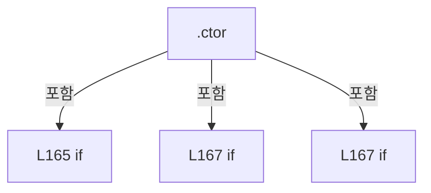

변경 전 점검: 입력/반환 타입, 위 호출자, 예외/취소 경로, 공유 상태와 저장·전송 소비자를 함께 확인합니다. 값의 단위나 물리 방향을 이름만으로 확정하지 않습니다.

### LocalFunctionStatement `SelectOutputViewerCellCallback` · L179–182

[Drilling.UI/Menu/Menus/CMenuCorrection.cs:179–182](https://github.com/kjuws10-rgb/A3Drilling/blob/334b3599651b2e8e0181fd4459bafaf3cddafff3/Drilling.UI/Menu/Menus/CMenuCorrection.cs#L179-L182)

| 항목 | 실제 추출 값 |
| --- | --- |
| 서명 | void SelectOutputViewerCellCallback(object?) |
| 접근/수식자 | Private / async |
| 반환/값 타입 | void |
| 소속 타입 | NamedType:Drilling.UI.Menu.Menus.CMenuCorrection |

입력 계약:

| 이름 | 타입 | 전달 | 선택/기본값 |
| --- | --- | --- | --- |
| parameter | object? | None | False /  |

현재 부분 분석에서 직접 연결된 호출자는 없습니다. XAML/이벤트/인터페이스·델리게이트·외부 진입을 추가 확인해야 하며, 미사용으로 판정한 것이 아닙니다.

호출하는 대상과 해석 범위:

| 원본 행 | 표현식 | 분석 상태 | 대상/소스 위치 |
| --- | --- | --- | --- |
| 181 | SelectOutputViewerCell | resolved | System.Threading.Tasks.Task Drilling.UI.Menu.Menus.CMenuCorrection.SelectOutputViewerCell(object?) · Drilling.UI/Menu/Menus/CMenuCorrection.cs:636 |

본문의 실제 연산·분기·예외·반환 순서(원문 위치 순):

| 원본 행 | 종류 | 주석 해설 |
| --- | --- | --- |
| 181 | await | 비동기 완료를 기다립니다: await SelectOutputViewerCell(parameter) |
| 181 | call | 함수·델리게이트 또는 객체 생성자를 호출합니다: SelectOutputViewerCell(parameter) |

변경 전 점검: 입력/반환 타입, 위 호출자, 예외/취소 경로, 공유 상태와 저장·전송 소비자를 함께 확인합니다. 값의 단위나 물리 방향을 이름만으로 확정하지 않습니다.

### LocalFunctionStatement `BackToOutputViewerGlassCallback` · L186–189

[Drilling.UI/Menu/Menus/CMenuCorrection.cs:186–189](https://github.com/kjuws10-rgb/A3Drilling/blob/334b3599651b2e8e0181fd4459bafaf3cddafff3/Drilling.UI/Menu/Menus/CMenuCorrection.cs#L186-L189)

| 항목 | 실제 추출 값 |
| --- | --- |
| 서명 | void BackToOutputViewerGlassCallback(object?) |
| 접근/수식자 | Private / async |
| 반환/값 타입 | void |
| 소속 타입 | NamedType:Drilling.UI.Menu.Menus.CMenuCorrection |

입력 계약:

| 이름 | 타입 | 전달 | 선택/기본값 |
| --- | --- | --- | --- |
| parameter | object? | None | False /  |

현재 부분 분석에서 직접 연결된 호출자는 없습니다. XAML/이벤트/인터페이스·델리게이트·외부 진입을 추가 확인해야 하며, 미사용으로 판정한 것이 아닙니다.

호출하는 대상과 해석 범위:

| 원본 행 | 표현식 | 분석 상태 | 대상/소스 위치 |
| --- | --- | --- | --- |
| 188 | BackToOutputViewerGlass | resolved | System.Threading.Tasks.Task Drilling.UI.Menu.Menus.CMenuCorrection.BackToOutputViewerGlass(object?) · Drilling.UI/Menu/Menus/CMenuCorrection.cs:705 |

본문의 실제 연산·분기·예외·반환 순서(원문 위치 순):

| 원본 행 | 종류 | 주석 해설 |
| --- | --- | --- |
| 188 | await | 비동기 완료를 기다립니다: await BackToOutputViewerGlass(parameter) |
| 188 | call | 함수·델리게이트 또는 객체 생성자를 호출합니다: BackToOutputViewerGlass(parameter) |

변경 전 점검: 입력/반환 타입, 위 호출자, 예외/취소 경로, 공유 상태와 저장·전송 소비자를 함께 확인합니다. 값의 단위나 물리 방향을 이름만으로 확정하지 않습니다.

### MethodDeclaration `TryConfirmInitialReviewStart` · L194–226

[Drilling.UI/Menu/Menus/CMenuCorrection.cs:194–226](https://github.com/kjuws10-rgb/A3Drilling/blob/334b3599651b2e8e0181fd4459bafaf3cddafff3/Drilling.UI/Menu/Menus/CMenuCorrection.cs#L194-L226)

| 항목 | 실제 추출 값 |
| --- | --- |
| 서명 | bool Drilling.UI.Menu.Menus.CMenuCorrection.TryConfirmInitialReviewStart(string, string, string, System.Func<string, string, bool>?, out double, out double) |
| 접근/수식자 | Private / private |
| 반환/값 타입 | bool |
| 소속 타입 | NamedType:Drilling.UI.Menu.Menus.CMenuCorrection |

입력 계약:

| 이름 | 타입 | 전달 | 선택/기본값 |
| --- | --- | --- | --- |
| title | string | None | False /  |
| context | string | None | False /  |
| fallbackMessage | string | None | False /  |
| injectedConfirmation | System.Func<string, string, bool>? | None | False /  |
| shiftOffsetX | double | Out | False /  |
| shiftOffsetY | double | Out | False /  |

정적 호출자로 확인된 위치:

| 호출 파일/행 | 호출 표현식 | 런타임 분기 가능 |
| --- | --- | --- |
| [Drilling.UI/Menu/Menus/CMenuCorrection.cs:3073–3079](https://github.com/kjuws10-rgb/A3Drilling/blob/334b3599651b2e8e0181fd4459bafaf3cddafff3/Drilling.UI/Menu/Menus/CMenuCorrection.cs#L3073-L3079) | TryConfirmInitialReviewStart | False |
| [Drilling.UI/Menu/Menus/CMenuCorrection.cs:4054–4060](https://github.com/kjuws10-rgb/A3Drilling/blob/334b3599651b2e8e0181fd4459bafaf3cddafff3/Drilling.UI/Menu/Menus/CMenuCorrection.cs#L4054-L4060) | TryConfirmInitialReviewStart | False |

호출하는 대상과 해석 범위:

| 원본 행 | 표현식 | 분석 상태 | 대상/소스 위치 |
| --- | --- | --- | --- |
| 205 | injectedConfirmation | resolved · 동적 구현 선택 가능 | bool System.Func<string, string, bool>.Invoke(string, string) |
| 207 | .Station | resolved | Drilling.Common.Station.CStationManager Drilling.Common.Managers.CManager.Station() · Drilling.Common/Managers/CManager.cs:330 |
| 210 | CRecipeConfirmDialog.ShowConfirmation | resolved | bool Drilling.UI.Popup.CRecipeConfirmDialog.ShowConfirmation(string, string, string, bool) · Drilling.UI/Popup/CRecipeConfirmDialog.xaml.cs:11 |
| 216 | CReviewShiftOffsetDialog.Show | resolved | Drilling.UI.Popup.EN_REVIEW_SHIFT_OFFSET_CHOICE Drilling.UI.Popup.CReviewShiftOffsetDialog.Show(Drilling.Common.Station.ST_MANUAL_MOF_COMPLETION, string) · Drilling.UI/Popup/CReviewShiftOffsetDialog.xaml.cs:27 |

본문의 실제 연산·분기·예외·반환 순서(원문 위치 순):

| 원본 행 | 종류 | 주석 해설 |
| --- | --- | --- |
| 202 | assignment | 값을 대상에 대입합니다: shiftOffsetX = 0.0 |
| 203 | assignment | 값을 대상에 대입합니다: shiftOffsetY = 0.0 |
| 204 | if | 조건에 따라 분기합니다: if (injectedConfirmation is not null) |
| 205 | call | 함수·델리게이트 또는 객체 생성자를 호출합니다: injectedConfirmation(title, fallbackMessage) |
| 205 | return | 호출자에게 값 또는 제어를 반환합니다: return injectedConfirmation(title, fallbackMessage); |
| 207 | call | 함수·델리게이트 또는 객체 생성자를 호출합니다: .Station() |
| 207 | local-declaration | 지역 변수를 선언합니다: var completion = _defaultManager?.Station().LastCompletedManualMof; |
| 207 | variable-initializer | 변수의 초기값을 지정합니다: completion = _defaultManager?.Station().LastCompletedManualMof |
| 208 | if | 조건에 따라 분기합니다: if (completion is null) |
| 210 | call | 함수·델리게이트 또는 객체 생성자를 호출합니다: CRecipeConfirmDialog.ShowConfirmation( title, fallbackMessage + "\n\n성공 완료한 Manual MOF 이력이 없습니다.\nShift Offset 0.000 / 0.000 mm로 검사를 시작합니다.", "시작") |
| 210 | return | 호출자에게 값 또는 제어를 반환합니다: return CRecipeConfirmDialog.ShowConfirmation( title, fallbackMessage + "\n\n성공 완료한 Manual MOF 이력이 없습니다.\nShift Offset 0.000 / 0.000 mm로 검사를 시작합니다.", "시작"); |
| 216 | call | 함수·델리게이트 또는 객체 생성자를 호출합니다: CReviewShiftOffsetDialog.Show(completion, context) |
| 216 | local-declaration | 지역 변수를 선언합니다: var choice = CReviewShiftOffsetDialog.Show(completion, context); |
| 216 | variable-initializer | 변수의 초기값을 지정합니다: choice = CReviewShiftOffsetDialog.Show(completion, context) |
| 217 | if | 조건에 따라 분기합니다: if (choice == EN_REVIEW_SHIFT_OFFSET_CHOICE.Cancel) |
| 218 | return | 호출자에게 값 또는 제어를 반환합니다: return false; |
| 219 | if | 조건에 따라 분기합니다: if (choice == EN_REVIEW_SHIFT_OFFSET_CHOICE.Apply) |
| 221 | assignment | 값을 대상에 대입합니다: shiftOffsetX = completion.ShiftOffsetX |
| 222 | assignment | 값을 대상에 대입합니다: shiftOffsetY = completion.ShiftOffsetY |
| 225 | return | 호출자에게 값 또는 제어를 반환합니다: return true; |

제어 구문의 포함 구조(실제 실행 순서/CFG가 아닌 구문 탐색 그림):

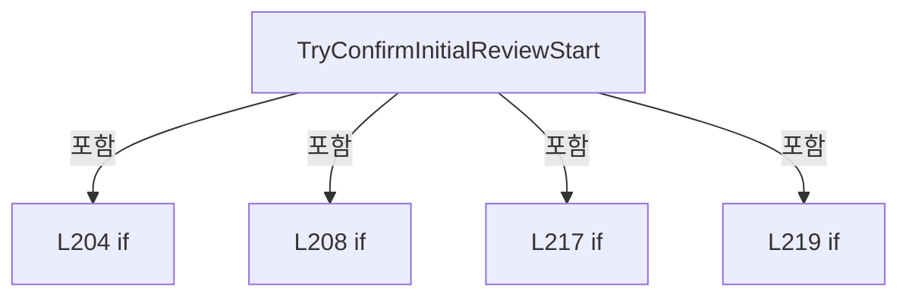

변경 전 점검: 입력/반환 타입, 위 호출자, 예외/취소 경로, 공유 상태와 저장·전송 소비자를 함께 확인합니다. 값의 단위나 물리 방향을 이름만으로 확정하지 않습니다.

### PropertyDeclaration `Menu` · L230–236

[Drilling.UI/Menu/Menus/CMenuCorrection.cs:230–236](https://github.com/kjuws10-rgb/A3Drilling/blob/334b3599651b2e8e0181fd4459bafaf3cddafff3/Drilling.UI/Menu/Menus/CMenuCorrection.cs#L230-L236)

| 항목 | 실제 추출 값 |
| --- | --- |
| 서명 | Drilling.UI.Menu.Menus.EN_MENU Drilling.UI.Menu.Menus.CMenuCorrection.Menu |
| 접근/수식자 | Public / public, override |
| 반환/값 타입 | Drilling.UI.Menu.Menus.EN_MENU |
| 소속 타입 | NamedType:Drilling.UI.Menu.Menus.CMenuCorrection |

현재 부분 분석에서 직접 연결된 호출자는 없습니다. XAML/이벤트/인터페이스·델리게이트·외부 진입을 추가 확인해야 하며, 미사용으로 판정한 것이 아닙니다.

변경 전 점검: 입력/반환 타입, 위 호출자, 예외/취소 경로, 공유 상태와 저장·전송 소비자를 함께 확인합니다. 값의 단위나 물리 방향을 이름만으로 확정하지 않습니다.

### GetAccessorDeclaration `get_Menu` · L232–235

[Drilling.UI/Menu/Menus/CMenuCorrection.cs:232–235](https://github.com/kjuws10-rgb/A3Drilling/blob/334b3599651b2e8e0181fd4459bafaf3cddafff3/Drilling.UI/Menu/Menus/CMenuCorrection.cs#L232-L235)

| 항목 | 실제 추출 값 |
| --- | --- |
| 서명 | Drilling.UI.Menu.Menus.EN_MENU Drilling.UI.Menu.Menus.CMenuCorrection.Menu.get |
| 접근/수식자 | Public / get |
| 반환/값 타입 | Drilling.UI.Menu.Menus.EN_MENU |
| 소속 타입 | NamedType:Drilling.UI.Menu.Menus.CMenuCorrection |

현재 부분 분석에서 직접 연결된 호출자는 없습니다. XAML/이벤트/인터페이스·델리게이트·외부 진입을 추가 확인해야 하며, 미사용으로 판정한 것이 아닙니다.

본문의 실제 연산·분기·예외·반환 순서(원문 위치 순):

| 원본 행 | 종류 | 주석 해설 |
| --- | --- | --- |
| 234 | return | 호출자에게 값 또는 제어를 반환합니다: return EN_MENU.Correction; |

변경 전 점검: 입력/반환 타입, 위 호출자, 예외/취소 경로, 공유 상태와 저장·전송 소비자를 함께 확인합니다. 값의 단위나 물리 방향을 이름만으로 확정하지 않습니다.

### PropertyDeclaration `Title` · L238–244

[Drilling.UI/Menu/Menus/CMenuCorrection.cs:238–244](https://github.com/kjuws10-rgb/A3Drilling/blob/334b3599651b2e8e0181fd4459bafaf3cddafff3/Drilling.UI/Menu/Menus/CMenuCorrection.cs#L238-L244)

| 항목 | 실제 추출 값 |
| --- | --- |
| 서명 | string Drilling.UI.Menu.Menus.CMenuCorrection.Title |
| 접근/수식자 | Public / public |
| 반환/값 타입 | string |
| 소속 타입 | NamedType:Drilling.UI.Menu.Menus.CMenuCorrection |

현재 부분 분석에서 직접 연결된 호출자는 없습니다. XAML/이벤트/인터페이스·델리게이트·외부 진입을 추가 확인해야 하며, 미사용으로 판정한 것이 아닙니다.

변경 전 점검: 입력/반환 타입, 위 호출자, 예외/취소 경로, 공유 상태와 저장·전송 소비자를 함께 확인합니다. 값의 단위나 물리 방향을 이름만으로 확정하지 않습니다.

### GetAccessorDeclaration `get_Title` · L240–243

[Drilling.UI/Menu/Menus/CMenuCorrection.cs:240–243](https://github.com/kjuws10-rgb/A3Drilling/blob/334b3599651b2e8e0181fd4459bafaf3cddafff3/Drilling.UI/Menu/Menus/CMenuCorrection.cs#L240-L243)

| 항목 | 실제 추출 값 |
| --- | --- |
| 서명 | string Drilling.UI.Menu.Menus.CMenuCorrection.Title.get |
| 접근/수식자 | Public / get |
| 반환/값 타입 | string |
| 소속 타입 | NamedType:Drilling.UI.Menu.Menus.CMenuCorrection |

현재 부분 분석에서 직접 연결된 호출자는 없습니다. XAML/이벤트/인터페이스·델리게이트·외부 진입을 추가 확인해야 하며, 미사용으로 판정한 것이 아닙니다.

본문의 실제 연산·분기·예외·반환 순서(원문 위치 순):

| 원본 행 | 종류 | 주석 해설 |
| --- | --- | --- |
| 242 | return | 호출자에게 값 또는 제어를 반환합니다: return $"CORRECTION / {_selectedTab}"; |

변경 전 점검: 입력/반환 타입, 위 호출자, 예외/취소 경로, 공유 상태와 저장·전송 소비자를 함께 확인합니다. 값의 단위나 물리 방향을 이름만으로 확정하지 않습니다.

### PropertyDeclaration `Subtitle` · L246–252

[Drilling.UI/Menu/Menus/CMenuCorrection.cs:246–252](https://github.com/kjuws10-rgb/A3Drilling/blob/334b3599651b2e8e0181fd4459bafaf3cddafff3/Drilling.UI/Menu/Menus/CMenuCorrection.cs#L246-L252)

| 항목 | 실제 추출 값 |
| --- | --- |
| 서명 | string Drilling.UI.Menu.Menus.CMenuCorrection.Subtitle |
| 접근/수식자 | Public / public |
| 반환/값 타입 | string |
| 소속 타입 | NamedType:Drilling.UI.Menu.Menus.CMenuCorrection |

현재 부분 분석에서 직접 연결된 호출자는 없습니다. XAML/이벤트/인터페이스·델리게이트·외부 진입을 추가 확인해야 하며, 미사용으로 판정한 것이 아닙니다.

변경 전 점검: 입력/반환 타입, 위 호출자, 예외/취소 경로, 공유 상태와 저장·전송 소비자를 함께 확인합니다. 값의 단위나 물리 방향을 이름만으로 확정하지 않습니다.

### GetAccessorDeclaration `get_Subtitle` · L248–251

[Drilling.UI/Menu/Menus/CMenuCorrection.cs:248–251](https://github.com/kjuws10-rgb/A3Drilling/blob/334b3599651b2e8e0181fd4459bafaf3cddafff3/Drilling.UI/Menu/Menus/CMenuCorrection.cs#L248-L251)

| 항목 | 실제 추출 값 |
| --- | --- |
| 서명 | string Drilling.UI.Menu.Menus.CMenuCorrection.Subtitle.get |
| 접근/수식자 | Public / get |
| 반환/값 타입 | string |
| 소속 타입 | NamedType:Drilling.UI.Menu.Menus.CMenuCorrection |

현재 부분 분석에서 직접 연결된 호출자는 없습니다. XAML/이벤트/인터페이스·델리게이트·외부 진입을 추가 확인해야 하며, 미사용으로 판정한 것이 아닙니다.

호출하는 대상과 해석 범위:

| 원본 행 | 표현식 | 분석 상태 | 대상/소스 위치 |
| --- | --- | --- | --- |
| 250 | GetSubtitle | resolved | string Drilling.UI.Menu.Menus.CMenuCorrection.GetSubtitle(string) · Drilling.UI/Menu/Menus/CMenuCorrection.cs:2652 |

본문의 실제 연산·분기·예외·반환 순서(원문 위치 순):

| 원본 행 | 종류 | 주석 해설 |
| --- | --- | --- |
| 250 | call | 함수·델리게이트 또는 객체 생성자를 호출합니다: GetSubtitle(_selectedTab) |
| 250 | return | 호출자에게 값 또는 제어를 반환합니다: return GetSubtitle(_selectedTab); |

변경 전 점검: 입력/반환 타입, 위 호출자, 예외/취소 경로, 공유 상태와 저장·전송 소비자를 함께 확인합니다. 값의 단위나 물리 방향을 이름만으로 확정하지 않습니다.

### PropertyDeclaration `SelectedTab` · L254–260

[Drilling.UI/Menu/Menus/CMenuCorrection.cs:254–260](https://github.com/kjuws10-rgb/A3Drilling/blob/334b3599651b2e8e0181fd4459bafaf3cddafff3/Drilling.UI/Menu/Menus/CMenuCorrection.cs#L254-L260)

| 항목 | 실제 추출 값 |
| --- | --- |
| 서명 | string Drilling.UI.Menu.Menus.CMenuCorrection.SelectedTab |
| 접근/수식자 | Public / public |
| 반환/값 타입 | string |
| 소속 타입 | NamedType:Drilling.UI.Menu.Menus.CMenuCorrection |

현재 부분 분석에서 직접 연결된 호출자는 없습니다. XAML/이벤트/인터페이스·델리게이트·외부 진입을 추가 확인해야 하며, 미사용으로 판정한 것이 아닙니다.

변경 전 점검: 입력/반환 타입, 위 호출자, 예외/취소 경로, 공유 상태와 저장·전송 소비자를 함께 확인합니다. 값의 단위나 물리 방향을 이름만으로 확정하지 않습니다.

### GetAccessorDeclaration `get_SelectedTab` · L256–259

[Drilling.UI/Menu/Menus/CMenuCorrection.cs:256–259](https://github.com/kjuws10-rgb/A3Drilling/blob/334b3599651b2e8e0181fd4459bafaf3cddafff3/Drilling.UI/Menu/Menus/CMenuCorrection.cs#L256-L259)

| 항목 | 실제 추출 값 |
| --- | --- |
| 서명 | string Drilling.UI.Menu.Menus.CMenuCorrection.SelectedTab.get |
| 접근/수식자 | Public / get |
| 반환/값 타입 | string |
| 소속 타입 | NamedType:Drilling.UI.Menu.Menus.CMenuCorrection |

현재 부분 분석에서 직접 연결된 호출자는 없습니다. XAML/이벤트/인터페이스·델리게이트·외부 진입을 추가 확인해야 하며, 미사용으로 판정한 것이 아닙니다.

본문의 실제 연산·분기·예외·반환 순서(원문 위치 순):

| 원본 행 | 종류 | 주석 해설 |
| --- | --- | --- |
| 258 | return | 호출자에게 값 또는 제어를 반환합니다: return _selectedTab; |

변경 전 점검: 입력/반환 타입, 위 호출자, 예외/취소 경로, 공유 상태와 저장·전송 소비자를 함께 확인합니다. 값의 단위나 물리 방향을 이름만으로 확정하지 않습니다.

### PropertyDeclaration `SelectedReviewTabIndex` · L262–276

[Drilling.UI/Menu/Menus/CMenuCorrection.cs:262–276](https://github.com/kjuws10-rgb/A3Drilling/blob/334b3599651b2e8e0181fd4459bafaf3cddafff3/Drilling.UI/Menu/Menus/CMenuCorrection.cs#L262-L276)

| 항목 | 실제 추출 값 |
| --- | --- |
| 서명 | int Drilling.UI.Menu.Menus.CMenuCorrection.SelectedReviewTabIndex |
| 접근/수식자 | Public / public |
| 반환/값 타입 | int |
| 소속 타입 | NamedType:Drilling.UI.Menu.Menus.CMenuCorrection |

현재 부분 분석에서 직접 연결된 호출자는 없습니다. XAML/이벤트/인터페이스·델리게이트·외부 진입을 추가 확인해야 하며, 미사용으로 판정한 것이 아닙니다.

변경 전 점검: 입력/반환 타입, 위 호출자, 예외/취소 경로, 공유 상태와 저장·전송 소비자를 함께 확인합니다. 값의 단위나 물리 방향을 이름만으로 확정하지 않습니다.

### GetAccessorDeclaration `get_SelectedReviewTabIndex` · L264–264

[Drilling.UI/Menu/Menus/CMenuCorrection.cs:264–264](https://github.com/kjuws10-rgb/A3Drilling/blob/334b3599651b2e8e0181fd4459bafaf3cddafff3/Drilling.UI/Menu/Menus/CMenuCorrection.cs#L264-L264)

| 항목 | 실제 추출 값 |
| --- | --- |
| 서명 | int Drilling.UI.Menu.Menus.CMenuCorrection.SelectedReviewTabIndex.get |
| 접근/수식자 | Public / get |
| 반환/값 타입 | int |
| 소속 타입 | NamedType:Drilling.UI.Menu.Menus.CMenuCorrection |

현재 부분 분석에서 직접 연결된 호출자는 없습니다. XAML/이벤트/인터페이스·델리게이트·외부 진입을 추가 확인해야 하며, 미사용으로 판정한 것이 아닙니다.

변경 전 점검: 입력/반환 타입, 위 호출자, 예외/취소 경로, 공유 상태와 저장·전송 소비자를 함께 확인합니다. 값의 단위나 물리 방향을 이름만으로 확정하지 않습니다.

### SetAccessorDeclaration `set_SelectedReviewTabIndex` · L265–275

[Drilling.UI/Menu/Menus/CMenuCorrection.cs:265–275](https://github.com/kjuws10-rgb/A3Drilling/blob/334b3599651b2e8e0181fd4459bafaf3cddafff3/Drilling.UI/Menu/Menus/CMenuCorrection.cs#L265-L275)

| 항목 | 실제 추출 값 |
| --- | --- |
| 서명 | void Drilling.UI.Menu.Menus.CMenuCorrection.SelectedReviewTabIndex.set |
| 접근/수식자 | Public / set |
| 반환/값 타입 | void |
| 소속 타입 | NamedType:Drilling.UI.Menu.Menus.CMenuCorrection |

입력 계약:

| 이름 | 타입 | 전달 | 선택/기본값 |
| --- | --- | --- | --- |
| value | int | None | False /  |

현재 부분 분석에서 직접 연결된 호출자는 없습니다. XAML/이벤트/인터페이스·델리게이트·외부 진입을 추가 확인해야 하며, 미사용으로 판정한 것이 아닙니다.

호출하는 대상과 해석 범위:

| 원본 행 | 표현식 | 분석 상태 | 대상/소스 위치 |
| --- | --- | --- | --- |
| 267 | Math.Clamp | resolved | int System.Math.Clamp(int, int, int) |
| 272 | OnPropertyChanged | resolved | void Drilling.UI.Menu.CBindingBase.OnPropertyChanged(string?) · Drilling.UI/Menu/CBindingBase.cs:790 |
| 272 | nameof | unresolved | None |
| 274 | _refreshCurrentScreen | resolved · 동적 구현 선택 가능 | System.Threading.Tasks.Task System.Func<System.Threading.Tasks.Task>.Invoke() |

본문의 실제 연산·분기·예외·반환 순서(원문 위치 순):

| 원본 행 | 종류 | 주석 해설 |
| --- | --- | --- |
| 267 | call | 함수·델리게이트 또는 객체 생성자를 호출합니다: Math.Clamp(value, 0, 1) |
| 267 | local-declaration | 지역 변수를 선언합니다: var normalized = Math.Clamp(value, 0, 1); |
| 267 | variable-initializer | 변수의 초기값을 지정합니다: normalized = Math.Clamp(value, 0, 1) |
| 268 | if | 조건에 따라 분기합니다: if (_selectedReviewTabIndex == normalized) |
| 269 | return | 호출자에게 값 또는 제어를 반환합니다: return; |
| 271 | assignment | 값을 대상에 대입합니다: _selectedReviewTabIndex = normalized |
| 272 | call | 함수·델리게이트 또는 객체 생성자를 호출합니다: OnPropertyChanged(nameof(SelectedReviewTabIndex)) |
| 272 | call | 함수·델리게이트 또는 객체 생성자를 호출합니다: nameof(SelectedReviewTabIndex) |
| 273 | if | 조건에 따라 분기합니다: if (IsReviewCorrectionTab) |
| 274 | assignment | 값을 대상에 대입합니다: _ = _refreshCurrentScreen() |
| 274 | call | 함수·델리게이트 또는 객체 생성자를 호출합니다: _refreshCurrentScreen() |

제어 구문의 포함 구조(실제 실행 순서/CFG가 아닌 구문 탐색 그림):

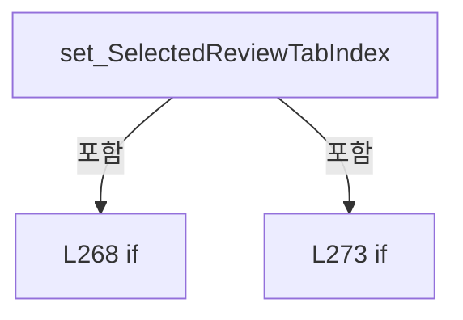

변경 전 점검: 입력/반환 타입, 위 호출자, 예외/취소 경로, 공유 상태와 저장·전송 소비자를 함께 확인합니다. 값의 단위나 물리 방향을 이름만으로 확정하지 않습니다.

### PropertyDeclaration `IsOtherCorrectionTab` · L278–284

[Drilling.UI/Menu/Menus/CMenuCorrection.cs:278–284](https://github.com/kjuws10-rgb/A3Drilling/blob/334b3599651b2e8e0181fd4459bafaf3cddafff3/Drilling.UI/Menu/Menus/CMenuCorrection.cs#L278-L284)

| 항목 | 실제 추출 값 |
| --- | --- |
| 서명 | bool Drilling.UI.Menu.Menus.CMenuCorrection.IsOtherCorrectionTab |
| 접근/수식자 | Public / public |
| 반환/값 타입 | bool |
| 소속 타입 | NamedType:Drilling.UI.Menu.Menus.CMenuCorrection |

현재 부분 분석에서 직접 연결된 호출자는 없습니다. XAML/이벤트/인터페이스·델리게이트·외부 진입을 추가 확인해야 하며, 미사용으로 판정한 것이 아닙니다.

변경 전 점검: 입력/반환 타입, 위 호출자, 예외/취소 경로, 공유 상태와 저장·전송 소비자를 함께 확인합니다. 값의 단위나 물리 방향을 이름만으로 확정하지 않습니다.

### GetAccessorDeclaration `get_IsOtherCorrectionTab` · L280–283

[Drilling.UI/Menu/Menus/CMenuCorrection.cs:280–283](https://github.com/kjuws10-rgb/A3Drilling/blob/334b3599651b2e8e0181fd4459bafaf3cddafff3/Drilling.UI/Menu/Menus/CMenuCorrection.cs#L280-L283)

| 항목 | 실제 추출 값 |
| --- | --- |
| 서명 | bool Drilling.UI.Menu.Menus.CMenuCorrection.IsOtherCorrectionTab.get |
| 접근/수식자 | Public / get |
| 반환/값 타입 | bool |
| 소속 타입 | NamedType:Drilling.UI.Menu.Menus.CMenuCorrection |

현재 부분 분석에서 직접 연결된 호출자는 없습니다. XAML/이벤트/인터페이스·델리게이트·외부 진입을 추가 확인해야 하며, 미사용으로 판정한 것이 아닙니다.

본문의 실제 연산·분기·예외·반환 순서(원문 위치 순):

| 원본 행 | 종류 | 주석 해설 |
| --- | --- | --- |
| 282 | return | 호출자에게 값 또는 제어를 반환합니다: return !IsDefaultTab && !IsOutputHistoryTab && !IsAlignDistortionTab && !IsReviewCorrectionTab; |

변경 전 점검: 입력/반환 타입, 위 호출자, 예외/취소 경로, 공유 상태와 저장·전송 소비자를 함께 확인합니다. 값의 단위나 물리 방향을 이름만으로 확정하지 않습니다.

### PropertyDeclaration `IsDefaultTab` · L286–286

[Drilling.UI/Menu/Menus/CMenuCorrection.cs:286–286](https://github.com/kjuws10-rgb/A3Drilling/blob/334b3599651b2e8e0181fd4459bafaf3cddafff3/Drilling.UI/Menu/Menus/CMenuCorrection.cs#L286-L286)

| 항목 | 실제 추출 값 |
| --- | --- |
| 서명 | bool Drilling.UI.Menu.Menus.CMenuCorrection.IsDefaultTab |
| 접근/수식자 | Public / public |
| 반환/값 타입 | bool |
| 소속 타입 | NamedType:Drilling.UI.Menu.Menus.CMenuCorrection |

현재 부분 분석에서 직접 연결된 호출자는 없습니다. XAML/이벤트/인터페이스·델리게이트·외부 진입을 추가 확인해야 하며, 미사용으로 판정한 것이 아닙니다.

변경 전 점검: 입력/반환 타입, 위 호출자, 예외/취소 경로, 공유 상태와 저장·전송 소비자를 함께 확인합니다. 값의 단위나 물리 방향을 이름만으로 확정하지 않습니다.

### PropertyDeclaration `IsAlignDistortionTab` · L287–287

[Drilling.UI/Menu/Menus/CMenuCorrection.cs:287–287](https://github.com/kjuws10-rgb/A3Drilling/blob/334b3599651b2e8e0181fd4459bafaf3cddafff3/Drilling.UI/Menu/Menus/CMenuCorrection.cs#L287-L287)

| 항목 | 실제 추출 값 |
| --- | --- |
| 서명 | bool Drilling.UI.Menu.Menus.CMenuCorrection.IsAlignDistortionTab |
| 접근/수식자 | Public / public |
| 반환/값 타입 | bool |
| 소속 타입 | NamedType:Drilling.UI.Menu.Menus.CMenuCorrection |

현재 부분 분석에서 직접 연결된 호출자는 없습니다. XAML/이벤트/인터페이스·델리게이트·외부 진입을 추가 확인해야 하며, 미사용으로 판정한 것이 아닙니다.

변경 전 점검: 입력/반환 타입, 위 호출자, 예외/취소 경로, 공유 상태와 저장·전송 소비자를 함께 확인합니다. 값의 단위나 물리 방향을 이름만으로 확정하지 않습니다.

### PropertyDeclaration `IsReviewCorrectionTab` · L288–288

[Drilling.UI/Menu/Menus/CMenuCorrection.cs:288–288](https://github.com/kjuws10-rgb/A3Drilling/blob/334b3599651b2e8e0181fd4459bafaf3cddafff3/Drilling.UI/Menu/Menus/CMenuCorrection.cs#L288-L288)

| 항목 | 실제 추출 값 |
| --- | --- |
| 서명 | bool Drilling.UI.Menu.Menus.CMenuCorrection.IsReviewCorrectionTab |
| 접근/수식자 | Public / public |
| 반환/값 타입 | bool |
| 소속 타입 | NamedType:Drilling.UI.Menu.Menus.CMenuCorrection |

현재 부분 분석에서 직접 연결된 호출자는 없습니다. XAML/이벤트/인터페이스·델리게이트·외부 진입을 추가 확인해야 하며, 미사용으로 판정한 것이 아닙니다.

변경 전 점검: 입력/반환 타입, 위 호출자, 예외/취소 경로, 공유 상태와 저장·전송 소비자를 함께 확인합니다. 값의 단위나 물리 방향을 이름만으로 확정하지 않습니다.

### PropertyDeclaration `Simple` · L289–289

[Drilling.UI/Menu/Menus/CMenuCorrection.cs:289–289](https://github.com/kjuws10-rgb/A3Drilling/blob/334b3599651b2e8e0181fd4459bafaf3cddafff3/Drilling.UI/Menu/Menus/CMenuCorrection.cs#L289-L289)

| 항목 | 실제 추출 값 |
| --- | --- |
| 서명 | Drilling.UI.Menu.Menus.CSimpleCorrectionPanel Drilling.UI.Menu.Menus.CMenuCorrection.Simple |
| 접근/수식자 | Public / public |
| 반환/값 타입 | Drilling.UI.Menu.Menus.CSimpleCorrectionPanel |
| 소속 타입 | NamedType:Drilling.UI.Menu.Menus.CMenuCorrection |

현재 부분 분석에서 직접 연결된 호출자는 없습니다. XAML/이벤트/인터페이스·델리게이트·외부 진입을 추가 확인해야 하며, 미사용으로 판정한 것이 아닙니다.

변경 전 점검: 입력/반환 타입, 위 호출자, 예외/취소 경로, 공유 상태와 저장·전송 소비자를 함께 확인합니다. 값의 단위나 물리 방향을 이름만으로 확정하지 않습니다.

### GetAccessorDeclaration `get_Simple` · L289–289

[Drilling.UI/Menu/Menus/CMenuCorrection.cs:289–289](https://github.com/kjuws10-rgb/A3Drilling/blob/334b3599651b2e8e0181fd4459bafaf3cddafff3/Drilling.UI/Menu/Menus/CMenuCorrection.cs#L289-L289)

| 항목 | 실제 추출 값 |
| --- | --- |
| 서명 | Drilling.UI.Menu.Menus.CSimpleCorrectionPanel Drilling.UI.Menu.Menus.CMenuCorrection.Simple.get |
| 접근/수식자 | Public / get |
| 반환/값 타입 | Drilling.UI.Menu.Menus.CSimpleCorrectionPanel |
| 소속 타입 | NamedType:Drilling.UI.Menu.Menus.CMenuCorrection |

현재 부분 분석에서 직접 연결된 호출자는 없습니다. XAML/이벤트/인터페이스·델리게이트·외부 진입을 추가 확인해야 하며, 미사용으로 판정한 것이 아닙니다.

변경 전 점검: 입력/반환 타입, 위 호출자, 예외/취소 경로, 공유 상태와 저장·전송 소비자를 함께 확인합니다. 값의 단위나 물리 방향을 이름만으로 확정하지 않습니다.

### PropertyDeclaration `Rough` · L290–290

[Drilling.UI/Menu/Menus/CMenuCorrection.cs:290–290](https://github.com/kjuws10-rgb/A3Drilling/blob/334b3599651b2e8e0181fd4459bafaf3cddafff3/Drilling.UI/Menu/Menus/CMenuCorrection.cs#L290-L290)

| 항목 | 실제 추출 값 |
| --- | --- |
| 서명 | Drilling.UI.Menu.Menus.CSimpleCorrectionPanel Drilling.UI.Menu.Menus.CMenuCorrection.Rough |
| 접근/수식자 | Public / public |
| 반환/값 타입 | Drilling.UI.Menu.Menus.CSimpleCorrectionPanel |
| 소속 타입 | NamedType:Drilling.UI.Menu.Menus.CMenuCorrection |

현재 부분 분석에서 직접 연결된 호출자는 없습니다. XAML/이벤트/인터페이스·델리게이트·외부 진입을 추가 확인해야 하며, 미사용으로 판정한 것이 아닙니다.

변경 전 점검: 입력/반환 타입, 위 호출자, 예외/취소 경로, 공유 상태와 저장·전송 소비자를 함께 확인합니다. 값의 단위나 물리 방향을 이름만으로 확정하지 않습니다.

### GetAccessorDeclaration `get_Rough` · L290–290

[Drilling.UI/Menu/Menus/CMenuCorrection.cs:290–290](https://github.com/kjuws10-rgb/A3Drilling/blob/334b3599651b2e8e0181fd4459bafaf3cddafff3/Drilling.UI/Menu/Menus/CMenuCorrection.cs#L290-L290)

| 항목 | 실제 추출 값 |
| --- | --- |
| 서명 | Drilling.UI.Menu.Menus.CSimpleCorrectionPanel Drilling.UI.Menu.Menus.CMenuCorrection.Rough.get |
| 접근/수식자 | Public / get |
| 반환/값 타입 | Drilling.UI.Menu.Menus.CSimpleCorrectionPanel |
| 소속 타입 | NamedType:Drilling.UI.Menu.Menus.CMenuCorrection |

현재 부분 분석에서 직접 연결된 호출자는 없습니다. XAML/이벤트/인터페이스·델리게이트·외부 진입을 추가 확인해야 하며, 미사용으로 판정한 것이 아닙니다.

변경 전 점검: 입력/반환 타입, 위 호출자, 예외/취소 경로, 공유 상태와 저장·전송 소비자를 함께 확인합니다. 값의 단위나 물리 방향을 이름만으로 확정하지 않습니다.

### PropertyDeclaration `Fine` · L291–291

[Drilling.UI/Menu/Menus/CMenuCorrection.cs:291–291](https://github.com/kjuws10-rgb/A3Drilling/blob/334b3599651b2e8e0181fd4459bafaf3cddafff3/Drilling.UI/Menu/Menus/CMenuCorrection.cs#L291-L291)

| 항목 | 실제 추출 값 |
| --- | --- |
| 서명 | Drilling.UI.Menu.Menus.CFineCorrectionPanel Drilling.UI.Menu.Menus.CMenuCorrection.Fine |
| 접근/수식자 | Public / public |
| 반환/값 타입 | Drilling.UI.Menu.Menus.CFineCorrectionPanel |
| 소속 타입 | NamedType:Drilling.UI.Menu.Menus.CMenuCorrection |

현재 부분 분석에서 직접 연결된 호출자는 없습니다. XAML/이벤트/인터페이스·델리게이트·외부 진입을 추가 확인해야 하며, 미사용으로 판정한 것이 아닙니다.

변경 전 점검: 입력/반환 타입, 위 호출자, 예외/취소 경로, 공유 상태와 저장·전송 소비자를 함께 확인합니다. 값의 단위나 물리 방향을 이름만으로 확정하지 않습니다.

### GetAccessorDeclaration `get_Fine` · L291–291

[Drilling.UI/Menu/Menus/CMenuCorrection.cs:291–291](https://github.com/kjuws10-rgb/A3Drilling/blob/334b3599651b2e8e0181fd4459bafaf3cddafff3/Drilling.UI/Menu/Menus/CMenuCorrection.cs#L291-L291)

| 항목 | 실제 추출 값 |
| --- | --- |
| 서명 | Drilling.UI.Menu.Menus.CFineCorrectionPanel Drilling.UI.Menu.Menus.CMenuCorrection.Fine.get |
| 접근/수식자 | Public / get |
| 반환/값 타입 | Drilling.UI.Menu.Menus.CFineCorrectionPanel |
| 소속 타입 | NamedType:Drilling.UI.Menu.Menus.CMenuCorrection |

현재 부분 분석에서 직접 연결된 호출자는 없습니다. XAML/이벤트/인터페이스·델리게이트·외부 진입을 추가 확인해야 하며, 미사용으로 판정한 것이 아닙니다.

변경 전 점검: 입력/반환 타입, 위 호출자, 예외/취소 경로, 공유 상태와 저장·전송 소비자를 함께 확인합니다. 값의 단위나 물리 방향을 이름만으로 확정하지 않습니다.

### PropertyDeclaration `IsCorrectionCommandsVisible` · L292–292

[Drilling.UI/Menu/Menus/CMenuCorrection.cs:292–292](https://github.com/kjuws10-rgb/A3Drilling/blob/334b3599651b2e8e0181fd4459bafaf3cddafff3/Drilling.UI/Menu/Menus/CMenuCorrection.cs#L292-L292)

| 항목 | 실제 추출 값 |
| --- | --- |
| 서명 | bool Drilling.UI.Menu.Menus.CMenuCorrection.IsCorrectionCommandsVisible |
| 접근/수식자 | Public / public |
| 반환/값 타입 | bool |
| 소속 타입 | NamedType:Drilling.UI.Menu.Menus.CMenuCorrection |

현재 부분 분석에서 직접 연결된 호출자는 없습니다. XAML/이벤트/인터페이스·델리게이트·외부 진입을 추가 확인해야 하며, 미사용으로 판정한 것이 아닙니다.

변경 전 점검: 입력/반환 타입, 위 호출자, 예외/취소 경로, 공유 상태와 저장·전송 소비자를 함께 확인합니다. 값의 단위나 물리 방향을 이름만으로 확정하지 않습니다.

### PropertyDeclaration `AlignDistortion` · L293–293

[Drilling.UI/Menu/Menus/CMenuCorrection.cs:293–293](https://github.com/kjuws10-rgb/A3Drilling/blob/334b3599651b2e8e0181fd4459bafaf3cddafff3/Drilling.UI/Menu/Menus/CMenuCorrection.cs#L293-L293)

| 항목 | 실제 추출 값 |
| --- | --- |
| 서명 | Drilling.UI.Menu.Menus.CAlignDistortionPanel Drilling.UI.Menu.Menus.CMenuCorrection.AlignDistortion |
| 접근/수식자 | Public / public |
| 반환/값 타입 | Drilling.UI.Menu.Menus.CAlignDistortionPanel |
| 소속 타입 | NamedType:Drilling.UI.Menu.Menus.CMenuCorrection |

현재 부분 분석에서 직접 연결된 호출자는 없습니다. XAML/이벤트/인터페이스·델리게이트·외부 진입을 추가 확인해야 하며, 미사용으로 판정한 것이 아닙니다.

변경 전 점검: 입력/반환 타입, 위 호출자, 예외/취소 경로, 공유 상태와 저장·전송 소비자를 함께 확인합니다. 값의 단위나 물리 방향을 이름만으로 확정하지 않습니다.

### GetAccessorDeclaration `get_AlignDistortion` · L293–293

[Drilling.UI/Menu/Menus/CMenuCorrection.cs:293–293](https://github.com/kjuws10-rgb/A3Drilling/blob/334b3599651b2e8e0181fd4459bafaf3cddafff3/Drilling.UI/Menu/Menus/CMenuCorrection.cs#L293-L293)

| 항목 | 실제 추출 값 |
| --- | --- |
| 서명 | Drilling.UI.Menu.Menus.CAlignDistortionPanel Drilling.UI.Menu.Menus.CMenuCorrection.AlignDistortion.get |
| 접근/수식자 | Public / get |
| 반환/값 타입 | Drilling.UI.Menu.Menus.CAlignDistortionPanel |
| 소속 타입 | NamedType:Drilling.UI.Menu.Menus.CMenuCorrection |

현재 부분 분석에서 직접 연결된 호출자는 없습니다. XAML/이벤트/인터페이스·델리게이트·외부 진입을 추가 확인해야 하며, 미사용으로 판정한 것이 아닙니다.

변경 전 점검: 입력/반환 타입, 위 호출자, 예외/취소 경로, 공유 상태와 저장·전송 소비자를 함께 확인합니다. 값의 단위나 물리 방향을 이름만으로 확정하지 않습니다.

### PropertyDeclaration `IsOutputHistoryTab` · L295–301

[Drilling.UI/Menu/Menus/CMenuCorrection.cs:295–301](https://github.com/kjuws10-rgb/A3Drilling/blob/334b3599651b2e8e0181fd4459bafaf3cddafff3/Drilling.UI/Menu/Menus/CMenuCorrection.cs#L295-L301)

| 항목 | 실제 추출 값 |
| --- | --- |
| 서명 | bool Drilling.UI.Menu.Menus.CMenuCorrection.IsOutputHistoryTab |
| 접근/수식자 | Public / public |
| 반환/값 타입 | bool |
| 소속 타입 | NamedType:Drilling.UI.Menu.Menus.CMenuCorrection |

현재 부분 분석에서 직접 연결된 호출자는 없습니다. XAML/이벤트/인터페이스·델리게이트·외부 진입을 추가 확인해야 하며, 미사용으로 판정한 것이 아닙니다.

변경 전 점검: 입력/반환 타입, 위 호출자, 예외/취소 경로, 공유 상태와 저장·전송 소비자를 함께 확인합니다. 값의 단위나 물리 방향을 이름만으로 확정하지 않습니다.

### GetAccessorDeclaration `get_IsOutputHistoryTab` · L297–300

[Drilling.UI/Menu/Menus/CMenuCorrection.cs:297–300](https://github.com/kjuws10-rgb/A3Drilling/blob/334b3599651b2e8e0181fd4459bafaf3cddafff3/Drilling.UI/Menu/Menus/CMenuCorrection.cs#L297-L300)

| 항목 | 실제 추출 값 |
| --- | --- |
| 서명 | bool Drilling.UI.Menu.Menus.CMenuCorrection.IsOutputHistoryTab.get |
| 접근/수식자 | Public / get |
| 반환/값 타입 | bool |
| 소속 타입 | NamedType:Drilling.UI.Menu.Menus.CMenuCorrection |

현재 부분 분석에서 직접 연결된 호출자는 없습니다. XAML/이벤트/인터페이스·델리게이트·외부 진입을 추가 확인해야 하며, 미사용으로 판정한 것이 아닙니다.

호출하는 대상과 해석 범위:

| 원본 행 | 표현식 | 분석 상태 | 대상/소스 위치 |
| --- | --- | --- | --- |
| 299 | _selectedTab.Equals | resolved | bool string.Equals(string?, System.StringComparison) |

본문의 실제 연산·분기·예외·반환 순서(원문 위치 순):

| 원본 행 | 종류 | 주석 해설 |
| --- | --- | --- |
| 299 | call | 함수·델리게이트 또는 객체 생성자를 호출합니다: _selectedTab.Equals("VIEWER", StringComparison.OrdinalIgnoreCase) |
| 299 | return | 호출자에게 값 또는 제어를 반환합니다: return _selectedTab.Equals("VIEWER", StringComparison.OrdinalIgnoreCase); |

변경 전 점검: 입력/반환 타입, 위 호출자, 예외/취소 경로, 공유 상태와 저장·전송 소비자를 함께 확인합니다. 값의 단위나 물리 방향을 이름만으로 확정하지 않습니다.

### PropertyDeclaration `IsCorrectionHistoryVisible` · L303–309

[Drilling.UI/Menu/Menus/CMenuCorrection.cs:303–309](https://github.com/kjuws10-rgb/A3Drilling/blob/334b3599651b2e8e0181fd4459bafaf3cddafff3/Drilling.UI/Menu/Menus/CMenuCorrection.cs#L303-L309)

| 항목 | 실제 추출 값 |
| --- | --- |
| 서명 | bool Drilling.UI.Menu.Menus.CMenuCorrection.IsCorrectionHistoryVisible |
| 접근/수식자 | Public / public |
| 반환/값 타입 | bool |
| 소속 타입 | NamedType:Drilling.UI.Menu.Menus.CMenuCorrection |

현재 부분 분석에서 직접 연결된 호출자는 없습니다. XAML/이벤트/인터페이스·델리게이트·외부 진입을 추가 확인해야 하며, 미사용으로 판정한 것이 아닙니다.

변경 전 점검: 입력/반환 타입, 위 호출자, 예외/취소 경로, 공유 상태와 저장·전송 소비자를 함께 확인합니다. 값의 단위나 물리 방향을 이름만으로 확정하지 않습니다.

### GetAccessorDeclaration `get_IsCorrectionHistoryVisible` · L305–308

[Drilling.UI/Menu/Menus/CMenuCorrection.cs:305–308](https://github.com/kjuws10-rgb/A3Drilling/blob/334b3599651b2e8e0181fd4459bafaf3cddafff3/Drilling.UI/Menu/Menus/CMenuCorrection.cs#L305-L308)

| 항목 | 실제 추출 값 |
| --- | --- |
| 서명 | bool Drilling.UI.Menu.Menus.CMenuCorrection.IsCorrectionHistoryVisible.get |
| 접근/수식자 | Public / get |
| 반환/값 타입 | bool |
| 소속 타입 | NamedType:Drilling.UI.Menu.Menus.CMenuCorrection |

현재 부분 분석에서 직접 연결된 호출자는 없습니다. XAML/이벤트/인터페이스·델리게이트·외부 진입을 추가 확인해야 하며, 미사용으로 판정한 것이 아닙니다.

본문의 실제 연산·분기·예외·반환 순서(원문 위치 순):

| 원본 행 | 종류 | 주석 해설 |
| --- | --- | --- |
| 307 | return | 호출자에게 값 또는 제어를 반환합니다: return !IsDefaultTab && !IsOutputHistoryTab; |

변경 전 점검: 입력/반환 타입, 위 호출자, 예외/취소 경로, 공유 상태와 저장·전송 소비자를 함께 확인합니다. 값의 단위나 물리 방향을 이름만으로 확정하지 않습니다.

### PropertyDeclaration `OutputViewerGlassPreviewImage` · L311–311

[Drilling.UI/Menu/Menus/CMenuCorrection.cs:311–311](https://github.com/kjuws10-rgb/A3Drilling/blob/334b3599651b2e8e0181fd4459bafaf3cddafff3/Drilling.UI/Menu/Menus/CMenuCorrection.cs#L311-L311)

| 항목 | 실제 추출 값 |
| --- | --- |
| 서명 | ImageSource? Drilling.UI.Menu.Menus.CMenuCorrection.OutputViewerGlassPreviewImage |
| 접근/수식자 | Public / public |
| 반환/값 타입 | ImageSource? |
| 소속 타입 | NamedType:Drilling.UI.Menu.Menus.CMenuCorrection |

현재 부분 분석에서 직접 연결된 호출자는 없습니다. XAML/이벤트/인터페이스·델리게이트·외부 진입을 추가 확인해야 하며, 미사용으로 판정한 것이 아닙니다.

변경 전 점검: 입력/반환 타입, 위 호출자, 예외/취소 경로, 공유 상태와 저장·전송 소비자를 함께 확인합니다. 값의 단위나 물리 방향을 이름만으로 확정하지 않습니다.

### GetAccessorDeclaration `get_OutputViewerGlassPreviewImage` · L311–311

[Drilling.UI/Menu/Menus/CMenuCorrection.cs:311–311](https://github.com/kjuws10-rgb/A3Drilling/blob/334b3599651b2e8e0181fd4459bafaf3cddafff3/Drilling.UI/Menu/Menus/CMenuCorrection.cs#L311-L311)

| 항목 | 실제 추출 값 |
| --- | --- |
| 서명 | ImageSource? Drilling.UI.Menu.Menus.CMenuCorrection.OutputViewerGlassPreviewImage.get |
| 접근/수식자 | Public / get |
| 반환/값 타입 | ImageSource? |
| 소속 타입 | NamedType:Drilling.UI.Menu.Menus.CMenuCorrection |

현재 부분 분석에서 직접 연결된 호출자는 없습니다. XAML/이벤트/인터페이스·델리게이트·외부 진입을 추가 확인해야 하며, 미사용으로 판정한 것이 아닙니다.

변경 전 점검: 입력/반환 타입, 위 호출자, 예외/취소 경로, 공유 상태와 저장·전송 소비자를 함께 확인합니다. 값의 단위나 물리 방향을 이름만으로 확정하지 않습니다.

### SetAccessorDeclaration `set_OutputViewerGlassPreviewImage` · L311–311

[Drilling.UI/Menu/Menus/CMenuCorrection.cs:311–311](https://github.com/kjuws10-rgb/A3Drilling/blob/334b3599651b2e8e0181fd4459bafaf3cddafff3/Drilling.UI/Menu/Menus/CMenuCorrection.cs#L311-L311)

| 항목 | 실제 추출 값 |
| --- | --- |
| 서명 | void Drilling.UI.Menu.Menus.CMenuCorrection.OutputViewerGlassPreviewImage.set |
| 접근/수식자 | Private / private, set |
| 반환/값 타입 | void |
| 소속 타입 | NamedType:Drilling.UI.Menu.Menus.CMenuCorrection |

입력 계약:

| 이름 | 타입 | 전달 | 선택/기본값 |
| --- | --- | --- | --- |
| value | ImageSource? | None | False /  |

현재 부분 분석에서 직접 연결된 호출자는 없습니다. XAML/이벤트/인터페이스·델리게이트·외부 진입을 추가 확인해야 하며, 미사용으로 판정한 것이 아닙니다.

변경 전 점검: 입력/반환 타입, 위 호출자, 예외/취소 경로, 공유 상태와 저장·전송 소비자를 함께 확인합니다. 값의 단위나 물리 방향을 이름만으로 확정하지 않습니다.

### PropertyDeclaration `OutputViewerSelectedCellName` · L312–312

[Drilling.UI/Menu/Menus/CMenuCorrection.cs:312–312](https://github.com/kjuws10-rgb/A3Drilling/blob/334b3599651b2e8e0181fd4459bafaf3cddafff3/Drilling.UI/Menu/Menus/CMenuCorrection.cs#L312-L312)

| 항목 | 실제 추출 값 |
| --- | --- |
| 서명 | string Drilling.UI.Menu.Menus.CMenuCorrection.OutputViewerSelectedCellName |
| 접근/수식자 | Public / public |
| 반환/값 타입 | string |
| 소속 타입 | NamedType:Drilling.UI.Menu.Menus.CMenuCorrection |

현재 부분 분석에서 직접 연결된 호출자는 없습니다. XAML/이벤트/인터페이스·델리게이트·외부 진입을 추가 확인해야 하며, 미사용으로 판정한 것이 아닙니다.

본문의 실제 연산·분기·예외·반환 순서(원문 위치 순):

| 원본 행 | 종류 | 주석 해설 |
| --- | --- | --- |
| 312 | conditional-expression | 조건에 따라 결과식을 선택합니다: _outputViewerIsCellDetailVisible && _outputViewerSelectedCellNo > 0 ? $"CELL{_outputViewerSelectedCellNo:00}" : "NO CELL SELECTED" |

변경 전 점검: 입력/반환 타입, 위 호출자, 예외/취소 경로, 공유 상태와 저장·전송 소비자를 함께 확인합니다. 값의 단위나 물리 방향을 이름만으로 확정하지 않습니다.

### PropertyDeclaration `OutputViewerSelectedShotName` · L313–313

[Drilling.UI/Menu/Menus/CMenuCorrection.cs:313–313](https://github.com/kjuws10-rgb/A3Drilling/blob/334b3599651b2e8e0181fd4459bafaf3cddafff3/Drilling.UI/Menu/Menus/CMenuCorrection.cs#L313-L313)

| 항목 | 실제 추출 값 |
| --- | --- |
| 서명 | string Drilling.UI.Menu.Menus.CMenuCorrection.OutputViewerSelectedShotName |
| 접근/수식자 | Public / public |
| 반환/값 타입 | string |
| 소속 타입 | NamedType:Drilling.UI.Menu.Menus.CMenuCorrection |

현재 부분 분석에서 직접 연결된 호출자는 없습니다. XAML/이벤트/인터페이스·델리게이트·외부 진입을 추가 확인해야 하며, 미사용으로 판정한 것이 아닙니다.

호출하는 대상과 해석 범위:

| 원본 행 | 표현식 | 분석 상태 | 대상/소스 위치 |
| --- | --- | --- | --- |
| 313 | GetOutputViewerSelectedShot | resolved | Drilling.Common.Recipe.ST_HEAD_SHOT_POINT? Drilling.UI.Menu.Menus.CMenuCorrection.GetOutputViewerSelectedShot() · Drilling.UI/Menu/Menus/CMenuCorrection.cs:927 |
| 313 | CReviewShotNameFormatter.ToMatrixName | resolved | string Drilling.Common.Review.CReviewShotNameFormatter.ToMatrixName(int, int) · Drilling.Common/Review/CReviewManager.cs:4141 |

본문의 실제 연산·분기·예외·반환 순서(원문 위치 순):

| 원본 행 | 종류 | 주석 해설 |
| --- | --- | --- |
| 313 | call | 함수·델리게이트 또는 객체 생성자를 호출합니다: GetOutputViewerSelectedShot() |
| 313 | call | 함수·델리게이트 또는 객체 생성자를 호출합니다: CReviewShotNameFormatter.ToMatrixName(shot.CellShotNo, shot.GroupCountX) |
| 313 | conditional-expression | 조건에 따라 결과식을 선택합니다: GetOutputViewerSelectedShot() is { } shot ? $"{CReviewShotNameFormatter.ToMatrixName(shot.CellShotNo, shot.GroupCountX)} · H{shot.HeadNo:00}" : "NO SHOT SELECTED" |

변경 전 점검: 입력/반환 타입, 위 호출자, 예외/취소 경로, 공유 상태와 저장·전송 소비자를 함께 확인합니다. 값의 단위나 물리 방향을 이름만으로 확정하지 않습니다.

### PropertyDeclaration `OutputViewerSelectedShotDetail` · L314–314

[Drilling.UI/Menu/Menus/CMenuCorrection.cs:314–314](https://github.com/kjuws10-rgb/A3Drilling/blob/334b3599651b2e8e0181fd4459bafaf3cddafff3/Drilling.UI/Menu/Menus/CMenuCorrection.cs#L314-L314)

| 항목 | 실제 추출 값 |
| --- | --- |
| 서명 | string Drilling.UI.Menu.Menus.CMenuCorrection.OutputViewerSelectedShotDetail |
| 접근/수식자 | Public / public |
| 반환/값 타입 | string |
| 소속 타입 | NamedType:Drilling.UI.Menu.Menus.CMenuCorrection |

현재 부분 분석에서 직접 연결된 호출자는 없습니다. XAML/이벤트/인터페이스·델리게이트·외부 진입을 추가 확인해야 하며, 미사용으로 판정한 것이 아닙니다.

호출하는 대상과 해석 범위:

| 원본 행 | 표현식 | 분석 상태 | 대상/소스 위치 |
| --- | --- | --- | --- |
| 314 | GetOutputViewerSelectedShot | resolved | Drilling.Common.Recipe.ST_HEAD_SHOT_POINT? Drilling.UI.Menu.Menus.CMenuCorrection.GetOutputViewerSelectedShot() · Drilling.UI/Menu/Menus/CMenuCorrection.cs:927 |

본문의 실제 연산·분기·예외·반환 순서(원문 위치 순):

| 원본 행 | 종류 | 주석 해설 |
| --- | --- | --- |
| 314 | call | 함수·델리게이트 또는 객체 생성자를 호출합니다: GetOutputViewerSelectedShot() |
| 314 | conditional-expression | 조건에 따라 결과식을 선택합니다: GetOutputViewerSelectedShot() is { } shot ? $"CELL{shot.CellNo:00} · ROW {shot.GroupRow + 1:N0} · COL {shot.GroupColumn + 1:N0}" : "-" |

변경 전 점검: 입력/반환 타입, 위 호출자, 예외/취소 경로, 공유 상태와 저장·전송 소비자를 함께 확인합니다. 값의 단위나 물리 방향을 이름만으로 확정하지 않습니다.

### PropertyDeclaration `OutputViewerCellShotMapSurfaceWidth` · L315–315

[Drilling.UI/Menu/Menus/CMenuCorrection.cs:315–315](https://github.com/kjuws10-rgb/A3Drilling/blob/334b3599651b2e8e0181fd4459bafaf3cddafff3/Drilling.UI/Menu/Menus/CMenuCorrection.cs#L315-L315)

| 항목 | 실제 추출 값 |
| --- | --- |
| 서명 | double Drilling.UI.Menu.Menus.CMenuCorrection.OutputViewerCellShotMapSurfaceWidth |
| 접근/수식자 | Public / public |
| 반환/값 타입 | double |
| 소속 타입 | NamedType:Drilling.UI.Menu.Menus.CMenuCorrection |

현재 부분 분석에서 직접 연결된 호출자는 없습니다. XAML/이벤트/인터페이스·델리게이트·외부 진입을 추가 확인해야 하며, 미사용으로 판정한 것이 아닙니다.

호출하는 대상과 해석 범위:

| 원본 행 | 표현식 | 분석 상태 | 대상/소스 위치 |
| --- | --- | --- | --- |
| 315 | GetOutputViewerShotMapSize | resolved | Size Drilling.UI.Menu.Menus.CMenuCorrection.GetOutputViewerShotMapSize() · Drilling.UI/Menu/Menus/CMenuCorrection.cs:937 |

본문의 실제 연산·분기·예외·반환 순서(원문 위치 순):

| 원본 행 | 종류 | 주석 해설 |
| --- | --- | --- |
| 315 | call | 함수·델리게이트 또는 객체 생성자를 호출합니다: GetOutputViewerShotMapSize() |

변경 전 점검: 입력/반환 타입, 위 호출자, 예외/취소 경로, 공유 상태와 저장·전송 소비자를 함께 확인합니다. 값의 단위나 물리 방향을 이름만으로 확정하지 않습니다.

### PropertyDeclaration `OutputViewerCellShotMapSurfaceHeight` · L316–316

[Drilling.UI/Menu/Menus/CMenuCorrection.cs:316–316](https://github.com/kjuws10-rgb/A3Drilling/blob/334b3599651b2e8e0181fd4459bafaf3cddafff3/Drilling.UI/Menu/Menus/CMenuCorrection.cs#L316-L316)

| 항목 | 실제 추출 값 |
| --- | --- |
| 서명 | double Drilling.UI.Menu.Menus.CMenuCorrection.OutputViewerCellShotMapSurfaceHeight |
| 접근/수식자 | Public / public |
| 반환/값 타입 | double |
| 소속 타입 | NamedType:Drilling.UI.Menu.Menus.CMenuCorrection |

현재 부분 분석에서 직접 연결된 호출자는 없습니다. XAML/이벤트/인터페이스·델리게이트·외부 진입을 추가 확인해야 하며, 미사용으로 판정한 것이 아닙니다.

호출하는 대상과 해석 범위:

| 원본 행 | 표현식 | 분석 상태 | 대상/소스 위치 |
| --- | --- | --- | --- |
| 316 | GetOutputViewerShotMapSize | resolved | Size Drilling.UI.Menu.Menus.CMenuCorrection.GetOutputViewerShotMapSize() · Drilling.UI/Menu/Menus/CMenuCorrection.cs:937 |

본문의 실제 연산·분기·예외·반환 순서(원문 위치 순):

| 원본 행 | 종류 | 주석 해설 |
| --- | --- | --- |
| 316 | call | 함수·델리게이트 또는 객체 생성자를 호출합니다: GetOutputViewerShotMapSize() |

변경 전 점검: 입력/반환 타입, 위 호출자, 예외/취소 경로, 공유 상태와 저장·전송 소비자를 함께 확인합니다. 값의 단위나 물리 방향을 이름만으로 확정하지 않습니다.

### PropertyDeclaration `OutputViewerIsGlassPreviewVisible` · L317–317

[Drilling.UI/Menu/Menus/CMenuCorrection.cs:317–317](https://github.com/kjuws10-rgb/A3Drilling/blob/334b3599651b2e8e0181fd4459bafaf3cddafff3/Drilling.UI/Menu/Menus/CMenuCorrection.cs#L317-L317)

| 항목 | 실제 추출 값 |
| --- | --- |
| 서명 | bool Drilling.UI.Menu.Menus.CMenuCorrection.OutputViewerIsGlassPreviewVisible |
| 접근/수식자 | Public / public |
| 반환/값 타입 | bool |
| 소속 타입 | NamedType:Drilling.UI.Menu.Menus.CMenuCorrection |

현재 부분 분석에서 직접 연결된 호출자는 없습니다. XAML/이벤트/인터페이스·델리게이트·외부 진입을 추가 확인해야 하며, 미사용으로 판정한 것이 아닙니다.

변경 전 점검: 입력/반환 타입, 위 호출자, 예외/취소 경로, 공유 상태와 저장·전송 소비자를 함께 확인합니다. 값의 단위나 물리 방향을 이름만으로 확정하지 않습니다.

### PropertyDeclaration `OutputViewerIsCellDetailVisible` · L318–318

[Drilling.UI/Menu/Menus/CMenuCorrection.cs:318–318](https://github.com/kjuws10-rgb/A3Drilling/blob/334b3599651b2e8e0181fd4459bafaf3cddafff3/Drilling.UI/Menu/Menus/CMenuCorrection.cs#L318-L318)

| 항목 | 실제 추출 값 |
| --- | --- |
| 서명 | bool Drilling.UI.Menu.Menus.CMenuCorrection.OutputViewerIsCellDetailVisible |
| 접근/수식자 | Public / public |
| 반환/값 타입 | bool |
| 소속 타입 | NamedType:Drilling.UI.Menu.Menus.CMenuCorrection |

현재 부분 분석에서 직접 연결된 호출자는 없습니다. XAML/이벤트/인터페이스·델리게이트·외부 진입을 추가 확인해야 하며, 미사용으로 판정한 것이 아닙니다.

변경 전 점검: 입력/반환 타입, 위 호출자, 예외/취소 경로, 공유 상태와 저장·전송 소비자를 함께 확인합니다. 값의 단위나 물리 방향을 이름만으로 확정하지 않습니다.

### PropertyDeclaration `OutputViewerHasNoCellSelection` · L319–319

[Drilling.UI/Menu/Menus/CMenuCorrection.cs:319–319](https://github.com/kjuws10-rgb/A3Drilling/blob/334b3599651b2e8e0181fd4459bafaf3cddafff3/Drilling.UI/Menu/Menus/CMenuCorrection.cs#L319-L319)

| 항목 | 실제 추출 값 |
| --- | --- |
| 서명 | bool Drilling.UI.Menu.Menus.CMenuCorrection.OutputViewerHasNoCellSelection |
| 접근/수식자 | Public / public |
| 반환/값 타입 | bool |
| 소속 타입 | NamedType:Drilling.UI.Menu.Menus.CMenuCorrection |

현재 부분 분석에서 직접 연결된 호출자는 없습니다. XAML/이벤트/인터페이스·델리게이트·외부 진입을 추가 확인해야 하며, 미사용으로 판정한 것이 아닙니다.

변경 전 점검: 입력/반환 타입, 위 호출자, 예외/취소 경로, 공유 상태와 저장·전송 소비자를 함께 확인합니다. 값의 단위나 물리 방향을 이름만으로 확정하지 않습니다.

### PropertyDeclaration `LoadedReviewFileName` · L321–327

[Drilling.UI/Menu/Menus/CMenuCorrection.cs:321–327](https://github.com/kjuws10-rgb/A3Drilling/blob/334b3599651b2e8e0181fd4459bafaf3cddafff3/Drilling.UI/Menu/Menus/CMenuCorrection.cs#L321-L327)

| 항목 | 실제 추출 값 |
| --- | --- |
| 서명 | string Drilling.UI.Menu.Menus.CMenuCorrection.LoadedReviewFileName |
| 접근/수식자 | Public / public |
| 반환/값 타입 | string |
| 소속 타입 | NamedType:Drilling.UI.Menu.Menus.CMenuCorrection |

현재 부분 분석에서 직접 연결된 호출자는 없습니다. XAML/이벤트/인터페이스·델리게이트·외부 진입을 추가 확인해야 하며, 미사용으로 판정한 것이 아닙니다.

변경 전 점검: 입력/반환 타입, 위 호출자, 예외/취소 경로, 공유 상태와 저장·전송 소비자를 함께 확인합니다. 값의 단위나 물리 방향을 이름만으로 확정하지 않습니다.

### GetAccessorDeclaration `get_LoadedReviewFileName` · L323–326

[Drilling.UI/Menu/Menus/CMenuCorrection.cs:323–326](https://github.com/kjuws10-rgb/A3Drilling/blob/334b3599651b2e8e0181fd4459bafaf3cddafff3/Drilling.UI/Menu/Menus/CMenuCorrection.cs#L323-L326)

| 항목 | 실제 추출 값 |
| --- | --- |
| 서명 | string Drilling.UI.Menu.Menus.CMenuCorrection.LoadedReviewFileName.get |
| 접근/수식자 | Public / get |
| 반환/값 타입 | string |
| 소속 타입 | NamedType:Drilling.UI.Menu.Menus.CMenuCorrection |

현재 부분 분석에서 직접 연결된 호출자는 없습니다. XAML/이벤트/인터페이스·델리게이트·외부 진입을 추가 확인해야 하며, 미사용으로 판정한 것이 아닙니다.

본문의 실제 연산·분기·예외·반환 순서(원문 위치 순):

| 원본 행 | 종류 | 주석 해설 |
| --- | --- | --- |
| 325 | return | 호출자에게 값 또는 제어를 반환합니다: return _loadedReviewResult?.FileName ?? "Not loaded"; |

변경 전 점검: 입력/반환 타입, 위 호출자, 예외/취소 경로, 공유 상태와 저장·전송 소비자를 함께 확인합니다. 값의 단위나 물리 방향을 이름만으로 확정하지 않습니다.

### PropertyDeclaration `LoadedReviewSettingSummary` · L329–336

[Drilling.UI/Menu/Menus/CMenuCorrection.cs:329–336](https://github.com/kjuws10-rgb/A3Drilling/blob/334b3599651b2e8e0181fd4459bafaf3cddafff3/Drilling.UI/Menu/Menus/CMenuCorrection.cs#L329-L336)

| 항목 | 실제 추출 값 |
| --- | --- |
| 서명 | string Drilling.UI.Menu.Menus.CMenuCorrection.LoadedReviewSettingSummary |
| 접근/수식자 | Public / public |
| 반환/값 타입 | string |
| 소속 타입 | NamedType:Drilling.UI.Menu.Menus.CMenuCorrection |

현재 부분 분석에서 직접 연결된 호출자는 없습니다. XAML/이벤트/인터페이스·델리게이트·외부 진입을 추가 확인해야 하며, 미사용으로 판정한 것이 아닙니다.

변경 전 점검: 입력/반환 타입, 위 호출자, 예외/취소 경로, 공유 상태와 저장·전송 소비자를 함께 확인합니다. 값의 단위나 물리 방향을 이름만으로 확정하지 않습니다.

### GetAccessorDeclaration `get_LoadedReviewSettingSummary` · L331–335

[Drilling.UI/Menu/Menus/CMenuCorrection.cs:331–335](https://github.com/kjuws10-rgb/A3Drilling/blob/334b3599651b2e8e0181fd4459bafaf3cddafff3/Drilling.UI/Menu/Menus/CMenuCorrection.cs#L331-L335)

| 항목 | 실제 추출 값 |
| --- | --- |
| 서명 | string Drilling.UI.Menu.Menus.CMenuCorrection.LoadedReviewSettingSummary.get |
| 접근/수식자 | Public / get |
| 반환/값 타입 | string |
| 소속 타입 | NamedType:Drilling.UI.Menu.Menus.CMenuCorrection |

현재 부분 분석에서 직접 연결된 호출자는 없습니다. XAML/이벤트/인터페이스·델리게이트·외부 진입을 추가 확인해야 하며, 미사용으로 판정한 것이 아닙니다.

호출하는 대상과 해석 범위:

| 원본 행 | 표현식 | 분석 상태 | 대상/소스 위치 |
| --- | --- | --- | --- |
| 333 | FormatReviewSettingDetail | resolved | string Drilling.UI.Menu.Menus.CMenuCorrection.FormatReviewSettingDetail(Drilling.Common.Review.ST_REVIEW_RESULT_FILE_DATA?) · Drilling.UI/Menu/Menus/CMenuCorrection.cs:2118 |
| 334 | string.IsNullOrWhiteSpace | resolved | bool string.IsNullOrWhiteSpace(string?) |

본문의 실제 연산·분기·예외·반환 순서(원문 위치 순):

| 원본 행 | 종류 | 주석 해설 |
| --- | --- | --- |
| 333 | call | 함수·델리게이트 또는 객체 생성자를 호출합니다: FormatReviewSettingDetail(_loadedReviewResult) |
| 333 | local-declaration | 지역 변수를 선언합니다: var detail = FormatReviewSettingDetail(_loadedReviewResult); |
| 333 | variable-initializer | 변수의 초기값을 지정합니다: detail = FormatReviewSettingDetail(_loadedReviewResult) |
| 334 | call | 함수·델리게이트 또는 객체 생성자를 호출합니다: string.IsNullOrWhiteSpace(detail) |
| 334 | conditional-expression | 조건에 따라 결과식을 선택합니다: string.IsNullOrWhiteSpace(detail) ? LoadedReviewRule : $"{LoadedReviewRule} · {detail}" |
| 334 | return | 호출자에게 값 또는 제어를 반환합니다: return string.IsNullOrWhiteSpace(detail) ? LoadedReviewRule : $"{LoadedReviewRule} · {detail}"; |

변경 전 점검: 입력/반환 타입, 위 호출자, 예외/취소 경로, 공유 상태와 저장·전송 소비자를 함께 확인합니다. 값의 단위나 물리 방향을 이름만으로 확정하지 않습니다.

### PropertyDeclaration `LoadedReviewRule` · L338–338

[Drilling.UI/Menu/Menus/CMenuCorrection.cs:338–338](https://github.com/kjuws10-rgb/A3Drilling/blob/334b3599651b2e8e0181fd4459bafaf3cddafff3/Drilling.UI/Menu/Menus/CMenuCorrection.cs#L338-L338)

| 항목 | 실제 추출 값 |
| --- | --- |
| 서명 | string Drilling.UI.Menu.Menus.CMenuCorrection.LoadedReviewRule |
| 접근/수식자 | Public / public |
| 반환/값 타입 | string |
| 소속 타입 | NamedType:Drilling.UI.Menu.Menus.CMenuCorrection |

현재 부분 분석에서 직접 연결된 호출자는 없습니다. XAML/이벤트/인터페이스·델리게이트·외부 진입을 추가 확인해야 하며, 미사용으로 판정한 것이 아닙니다.

호출하는 대상과 해석 범위:

| 원본 행 | 표현식 | 분석 상태 | 대상/소스 위치 |
| --- | --- | --- | --- |
| 338 | string.IsNullOrWhiteSpace | resolved | bool string.IsNullOrWhiteSpace(string?) |
| 338 | _loadedReviewResult.Rule.ToUpperInvariant | resolved | string string.ToUpperInvariant() |

본문의 실제 연산·분기·예외·반환 순서(원문 위치 순):

| 원본 행 | 종류 | 주석 해설 |
| --- | --- | --- |
| 338 | call | 함수·델리게이트 또는 객체 생성자를 호출합니다: string.IsNullOrWhiteSpace(_loadedReviewResult?.Rule) |
| 338 | call | 함수·델리게이트 또는 객체 생성자를 호출합니다: _loadedReviewResult.Rule.ToUpperInvariant() |
| 338 | conditional-expression | 조건에 따라 결과식을 선택합니다: string.IsNullOrWhiteSpace(_loadedReviewResult?.Rule) ? "-" : _loadedReviewResult.Rule.ToUpperInvariant() |

변경 전 점검: 입력/반환 타입, 위 호출자, 예외/취소 경로, 공유 상태와 저장·전송 소비자를 함께 확인합니다. 값의 단위나 물리 방향을 이름만으로 확정하지 않습니다.

### PropertyDeclaration `LoadedReviewSettingDetail` · L339–339

[Drilling.UI/Menu/Menus/CMenuCorrection.cs:339–339](https://github.com/kjuws10-rgb/A3Drilling/blob/334b3599651b2e8e0181fd4459bafaf3cddafff3/Drilling.UI/Menu/Menus/CMenuCorrection.cs#L339-L339)

| 항목 | 실제 추출 값 |
| --- | --- |
| 서명 | string Drilling.UI.Menu.Menus.CMenuCorrection.LoadedReviewSettingDetail |
| 접근/수식자 | Public / public |
| 반환/값 타입 | string |
| 소속 타입 | NamedType:Drilling.UI.Menu.Menus.CMenuCorrection |

현재 부분 분석에서 직접 연결된 호출자는 없습니다. XAML/이벤트/인터페이스·델리게이트·외부 진입을 추가 확인해야 하며, 미사용으로 판정한 것이 아닙니다.

호출하는 대상과 해석 범위:

| 원본 행 | 표현식 | 분석 상태 | 대상/소스 위치 |
| --- | --- | --- | --- |
| 339 | FormatReviewSettingDetail | resolved | string Drilling.UI.Menu.Menus.CMenuCorrection.FormatReviewSettingDetail(Drilling.Common.Review.ST_REVIEW_RESULT_FILE_DATA?) · Drilling.UI/Menu/Menus/CMenuCorrection.cs:2118 |

본문의 실제 연산·분기·예외·반환 순서(원문 위치 순):

| 원본 행 | 종류 | 주석 해설 |
| --- | --- | --- |
| 339 | call | 함수·델리게이트 또는 객체 생성자를 호출합니다: FormatReviewSettingDetail(_loadedReviewResult) |

변경 전 점검: 입력/반환 타입, 위 호출자, 예외/취소 경로, 공유 상태와 저장·전송 소비자를 함께 확인합니다. 값의 단위나 물리 방향을 이름만으로 확정하지 않습니다.

### PropertyDeclaration `ReviewLoadStatus` · L341–347

[Drilling.UI/Menu/Menus/CMenuCorrection.cs:341–347](https://github.com/kjuws10-rgb/A3Drilling/blob/334b3599651b2e8e0181fd4459bafaf3cddafff3/Drilling.UI/Menu/Menus/CMenuCorrection.cs#L341-L347)

| 항목 | 실제 추출 값 |
| --- | --- |
| 서명 | string Drilling.UI.Menu.Menus.CMenuCorrection.ReviewLoadStatus |
| 접근/수식자 | Public / public |
| 반환/값 타입 | string |
| 소속 타입 | NamedType:Drilling.UI.Menu.Menus.CMenuCorrection |

현재 부분 분석에서 직접 연결된 호출자는 없습니다. XAML/이벤트/인터페이스·델리게이트·외부 진입을 추가 확인해야 하며, 미사용으로 판정한 것이 아닙니다.

변경 전 점검: 입력/반환 타입, 위 호출자, 예외/취소 경로, 공유 상태와 저장·전송 소비자를 함께 확인합니다. 값의 단위나 물리 방향을 이름만으로 확정하지 않습니다.

### GetAccessorDeclaration `get_ReviewLoadStatus` · L343–346

[Drilling.UI/Menu/Menus/CMenuCorrection.cs:343–346](https://github.com/kjuws10-rgb/A3Drilling/blob/334b3599651b2e8e0181fd4459bafaf3cddafff3/Drilling.UI/Menu/Menus/CMenuCorrection.cs#L343-L346)

| 항목 | 실제 추출 값 |
| --- | --- |
| 서명 | string Drilling.UI.Menu.Menus.CMenuCorrection.ReviewLoadStatus.get |
| 접근/수식자 | Public / get |
| 반환/값 타입 | string |
| 소속 타입 | NamedType:Drilling.UI.Menu.Menus.CMenuCorrection |

현재 부분 분석에서 직접 연결된 호출자는 없습니다. XAML/이벤트/인터페이스·델리게이트·외부 진입을 추가 확인해야 하며, 미사용으로 판정한 것이 아닙니다.

본문의 실제 연산·분기·예외·반환 순서(원문 위치 순):

| 원본 행 | 종류 | 주석 해설 |
| --- | --- | --- |
| 345 | return | 호출자에게 값 또는 제어를 반환합니다: return _reviewLoadStatus; |

변경 전 점검: 입력/반환 타입, 위 호출자, 예외/취소 경로, 공유 상태와 저장·전송 소비자를 함께 확인합니다. 값의 단위나 물리 방향을 이름만으로 확정하지 않습니다.

### PropertyDeclaration `ReviewLoadStatusBrush` · L349–355

[Drilling.UI/Menu/Menus/CMenuCorrection.cs:349–355](https://github.com/kjuws10-rgb/A3Drilling/blob/334b3599651b2e8e0181fd4459bafaf3cddafff3/Drilling.UI/Menu/Menus/CMenuCorrection.cs#L349-L355)

| 항목 | 실제 추출 값 |
| --- | --- |
| 서명 | Brush Drilling.UI.Menu.Menus.CMenuCorrection.ReviewLoadStatusBrush |
| 접근/수식자 | Public / public |
| 반환/값 타입 | Brush |
| 소속 타입 | NamedType:Drilling.UI.Menu.Menus.CMenuCorrection |

현재 부분 분석에서 직접 연결된 호출자는 없습니다. XAML/이벤트/인터페이스·델리게이트·외부 진입을 추가 확인해야 하며, 미사용으로 판정한 것이 아닙니다.

변경 전 점검: 입력/반환 타입, 위 호출자, 예외/취소 경로, 공유 상태와 저장·전송 소비자를 함께 확인합니다. 값의 단위나 물리 방향을 이름만으로 확정하지 않습니다.

### GetAccessorDeclaration `get_ReviewLoadStatusBrush` · L351–354

[Drilling.UI/Menu/Menus/CMenuCorrection.cs:351–354](https://github.com/kjuws10-rgb/A3Drilling/blob/334b3599651b2e8e0181fd4459bafaf3cddafff3/Drilling.UI/Menu/Menus/CMenuCorrection.cs#L351-L354)

| 항목 | 실제 추출 값 |
| --- | --- |
| 서명 | Brush Drilling.UI.Menu.Menus.CMenuCorrection.ReviewLoadStatusBrush.get |
| 접근/수식자 | Public / get |
| 반환/값 타입 | Brush |
| 소속 타입 | NamedType:Drilling.UI.Menu.Menus.CMenuCorrection |

현재 부분 분석에서 직접 연결된 호출자는 없습니다. XAML/이벤트/인터페이스·델리게이트·외부 진입을 추가 확인해야 하며, 미사용으로 판정한 것이 아닙니다.

호출하는 대상과 해석 범위:

| 원본 행 | 표현식 | 분석 상태 | 대상/소스 위치 |
| --- | --- | --- | --- |
| 353 | CStatusBrush.ForDisplayState | resolved | Brush Drilling.UI.Menu.Menus.CStatusBrush.ForDisplayState(string) · Drilling.UI/Menu/Menus/CMenuBase.cs:294 |

본문의 실제 연산·분기·예외·반환 순서(원문 위치 순):

| 원본 행 | 종류 | 주석 해설 |
| --- | --- | --- |
| 353 | call | 함수·델리게이트 또는 객체 생성자를 호출합니다: CStatusBrush.ForDisplayState(_reviewLoadState) |
| 353 | return | 호출자에게 값 또는 제어를 반환합니다: return CStatusBrush.ForDisplayState(_reviewLoadState); |

변경 전 점검: 입력/반환 타입, 위 호출자, 예외/취소 경로, 공유 상태와 저장·전송 소비자를 함께 확인합니다. 값의 단위나 물리 방향을 이름만으로 확정하지 않습니다.

### PropertyDeclaration `CurrentSettingState` · L357–363

[Drilling.UI/Menu/Menus/CMenuCorrection.cs:357–363](https://github.com/kjuws10-rgb/A3Drilling/blob/334b3599651b2e8e0181fd4459bafaf3cddafff3/Drilling.UI/Menu/Menus/CMenuCorrection.cs#L357-L363)

| 항목 | 실제 추출 값 |
| --- | --- |
| 서명 | string Drilling.UI.Menu.Menus.CMenuCorrection.CurrentSettingState |
| 접근/수식자 | Public / public |
| 반환/값 타입 | string |
| 소속 타입 | NamedType:Drilling.UI.Menu.Menus.CMenuCorrection |

현재 부분 분석에서 직접 연결된 호출자는 없습니다. XAML/이벤트/인터페이스·델리게이트·외부 진입을 추가 확인해야 하며, 미사용으로 판정한 것이 아닙니다.

변경 전 점검: 입력/반환 타입, 위 호출자, 예외/취소 경로, 공유 상태와 저장·전송 소비자를 함께 확인합니다. 값의 단위나 물리 방향을 이름만으로 확정하지 않습니다.

### GetAccessorDeclaration `get_CurrentSettingState` · L359–362

[Drilling.UI/Menu/Menus/CMenuCorrection.cs:359–362](https://github.com/kjuws10-rgb/A3Drilling/blob/334b3599651b2e8e0181fd4459bafaf3cddafff3/Drilling.UI/Menu/Menus/CMenuCorrection.cs#L359-L362)

| 항목 | 실제 추출 값 |
| --- | --- |
| 서명 | string Drilling.UI.Menu.Menus.CMenuCorrection.CurrentSettingState.get |
| 접근/수식자 | Public / get |
| 반환/값 타입 | string |
| 소속 타입 | NamedType:Drilling.UI.Menu.Menus.CMenuCorrection |

현재 부분 분석에서 직접 연결된 호출자는 없습니다. XAML/이벤트/인터페이스·델리게이트·외부 진입을 추가 확인해야 하며, 미사용으로 판정한 것이 아닙니다.

본문의 실제 연산·분기·예외·반환 순서(원문 위치 순):

| 원본 행 | 종류 | 주석 해설 |
| --- | --- | --- |
| 361 | return | 호출자에게 값 또는 제어를 반환합니다: return _currentSettingState; |

변경 전 점검: 입력/반환 타입, 위 호출자, 예외/취소 경로, 공유 상태와 저장·전송 소비자를 함께 확인합니다. 값의 단위나 물리 방향을 이름만으로 확정하지 않습니다.

### PropertyDeclaration `CurrentSettingDetail` · L365–371

[Drilling.UI/Menu/Menus/CMenuCorrection.cs:365–371](https://github.com/kjuws10-rgb/A3Drilling/blob/334b3599651b2e8e0181fd4459bafaf3cddafff3/Drilling.UI/Menu/Menus/CMenuCorrection.cs#L365-L371)

| 항목 | 실제 추출 값 |
| --- | --- |
| 서명 | string Drilling.UI.Menu.Menus.CMenuCorrection.CurrentSettingDetail |
| 접근/수식자 | Public / public |
| 반환/값 타입 | string |
| 소속 타입 | NamedType:Drilling.UI.Menu.Menus.CMenuCorrection |

현재 부분 분석에서 직접 연결된 호출자는 없습니다. XAML/이벤트/인터페이스·델리게이트·외부 진입을 추가 확인해야 하며, 미사용으로 판정한 것이 아닙니다.

변경 전 점검: 입력/반환 타입, 위 호출자, 예외/취소 경로, 공유 상태와 저장·전송 소비자를 함께 확인합니다. 값의 단위나 물리 방향을 이름만으로 확정하지 않습니다.

### GetAccessorDeclaration `get_CurrentSettingDetail` · L367–370

[Drilling.UI/Menu/Menus/CMenuCorrection.cs:367–370](https://github.com/kjuws10-rgb/A3Drilling/blob/334b3599651b2e8e0181fd4459bafaf3cddafff3/Drilling.UI/Menu/Menus/CMenuCorrection.cs#L367-L370)

| 항목 | 실제 추출 값 |
| --- | --- |
| 서명 | string Drilling.UI.Menu.Menus.CMenuCorrection.CurrentSettingDetail.get |
| 접근/수식자 | Public / get |
| 반환/값 타입 | string |
| 소속 타입 | NamedType:Drilling.UI.Menu.Menus.CMenuCorrection |

현재 부분 분석에서 직접 연결된 호출자는 없습니다. XAML/이벤트/인터페이스·델리게이트·외부 진입을 추가 확인해야 하며, 미사용으로 판정한 것이 아닙니다.

본문의 실제 연산·분기·예외·반환 순서(원문 위치 순):

| 원본 행 | 종류 | 주석 해설 |
| --- | --- | --- |
| 369 | return | 호출자에게 값 또는 제어를 반환합니다: return _currentSettingDetail; |

변경 전 점검: 입력/반환 타입, 위 호출자, 예외/취소 경로, 공유 상태와 저장·전송 소비자를 함께 확인합니다. 값의 단위나 물리 방향을 이름만으로 확정하지 않습니다.

### PropertyDeclaration `CurrentVisionSettingState` · L373–379

[Drilling.UI/Menu/Menus/CMenuCorrection.cs:373–379](https://github.com/kjuws10-rgb/A3Drilling/blob/334b3599651b2e8e0181fd4459bafaf3cddafff3/Drilling.UI/Menu/Menus/CMenuCorrection.cs#L373-L379)

| 항목 | 실제 추출 값 |
| --- | --- |
| 서명 | string Drilling.UI.Menu.Menus.CMenuCorrection.CurrentVisionSettingState |
| 접근/수식자 | Public / public |
| 반환/값 타입 | string |
| 소속 타입 | NamedType:Drilling.UI.Menu.Menus.CMenuCorrection |

현재 부분 분석에서 직접 연결된 호출자는 없습니다. XAML/이벤트/인터페이스·델리게이트·외부 진입을 추가 확인해야 하며, 미사용으로 판정한 것이 아닙니다.

변경 전 점검: 입력/반환 타입, 위 호출자, 예외/취소 경로, 공유 상태와 저장·전송 소비자를 함께 확인합니다. 값의 단위나 물리 방향을 이름만으로 확정하지 않습니다.

### GetAccessorDeclaration `get_CurrentVisionSettingState` · L375–378

[Drilling.UI/Menu/Menus/CMenuCorrection.cs:375–378](https://github.com/kjuws10-rgb/A3Drilling/blob/334b3599651b2e8e0181fd4459bafaf3cddafff3/Drilling.UI/Menu/Menus/CMenuCorrection.cs#L375-L378)

| 항목 | 실제 추출 값 |
| --- | --- |
| 서명 | string Drilling.UI.Menu.Menus.CMenuCorrection.CurrentVisionSettingState.get |
| 접근/수식자 | Public / get |
| 반환/값 타입 | string |
| 소속 타입 | NamedType:Drilling.UI.Menu.Menus.CMenuCorrection |

현재 부분 분석에서 직접 연결된 호출자는 없습니다. XAML/이벤트/인터페이스·델리게이트·외부 진입을 추가 확인해야 하며, 미사용으로 판정한 것이 아닙니다.

본문의 실제 연산·분기·예외·반환 순서(원문 위치 순):

| 원본 행 | 종류 | 주석 해설 |
| --- | --- | --- |
| 377 | return | 호출자에게 값 또는 제어를 반환합니다: return _currentVisionSettingState; |

변경 전 점검: 입력/반환 타입, 위 호출자, 예외/취소 경로, 공유 상태와 저장·전송 소비자를 함께 확인합니다. 값의 단위나 물리 방향을 이름만으로 확정하지 않습니다.

### PropertyDeclaration `CurrentScannerSettingState` · L381–387

[Drilling.UI/Menu/Menus/CMenuCorrection.cs:381–387](https://github.com/kjuws10-rgb/A3Drilling/blob/334b3599651b2e8e0181fd4459bafaf3cddafff3/Drilling.UI/Menu/Menus/CMenuCorrection.cs#L381-L387)

| 항목 | 실제 추출 값 |
| --- | --- |
| 서명 | string Drilling.UI.Menu.Menus.CMenuCorrection.CurrentScannerSettingState |
| 접근/수식자 | Public / public |
| 반환/값 타입 | string |
| 소속 타입 | NamedType:Drilling.UI.Menu.Menus.CMenuCorrection |

현재 부분 분석에서 직접 연결된 호출자는 없습니다. XAML/이벤트/인터페이스·델리게이트·외부 진입을 추가 확인해야 하며, 미사용으로 판정한 것이 아닙니다.

변경 전 점검: 입력/반환 타입, 위 호출자, 예외/취소 경로, 공유 상태와 저장·전송 소비자를 함께 확인합니다. 값의 단위나 물리 방향을 이름만으로 확정하지 않습니다.

### GetAccessorDeclaration `get_CurrentScannerSettingState` · L383–386

[Drilling.UI/Menu/Menus/CMenuCorrection.cs:383–386](https://github.com/kjuws10-rgb/A3Drilling/blob/334b3599651b2e8e0181fd4459bafaf3cddafff3/Drilling.UI/Menu/Menus/CMenuCorrection.cs#L383-L386)

| 항목 | 실제 추출 값 |
| --- | --- |
| 서명 | string Drilling.UI.Menu.Menus.CMenuCorrection.CurrentScannerSettingState.get |
| 접근/수식자 | Public / get |
| 반환/값 타입 | string |
| 소속 타입 | NamedType:Drilling.UI.Menu.Menus.CMenuCorrection |

현재 부분 분석에서 직접 연결된 호출자는 없습니다. XAML/이벤트/인터페이스·델리게이트·외부 진입을 추가 확인해야 하며, 미사용으로 판정한 것이 아닙니다.

본문의 실제 연산·분기·예외·반환 순서(원문 위치 순):

| 원본 행 | 종류 | 주석 해설 |
| --- | --- | --- |
| 385 | return | 호출자에게 값 또는 제어를 반환합니다: return _currentScannerSettingState; |

변경 전 점검: 입력/반환 타입, 위 호출자, 예외/취소 경로, 공유 상태와 저장·전송 소비자를 함께 확인합니다. 값의 단위나 물리 방향을 이름만으로 확정하지 않습니다.

### PropertyDeclaration `CurrentReviewOffsetRecipeName` · L389–395

[Drilling.UI/Menu/Menus/CMenuCorrection.cs:389–395](https://github.com/kjuws10-rgb/A3Drilling/blob/334b3599651b2e8e0181fd4459bafaf3cddafff3/Drilling.UI/Menu/Menus/CMenuCorrection.cs#L389-L395)

| 항목 | 실제 추출 값 |
| --- | --- |
| 서명 | string Drilling.UI.Menu.Menus.CMenuCorrection.CurrentReviewOffsetRecipeName |
| 접근/수식자 | Public / public |
| 반환/값 타입 | string |
| 소속 타입 | NamedType:Drilling.UI.Menu.Menus.CMenuCorrection |

현재 부분 분석에서 직접 연결된 호출자는 없습니다. XAML/이벤트/인터페이스·델리게이트·외부 진입을 추가 확인해야 하며, 미사용으로 판정한 것이 아닙니다.

변경 전 점검: 입력/반환 타입, 위 호출자, 예외/취소 경로, 공유 상태와 저장·전송 소비자를 함께 확인합니다. 값의 단위나 물리 방향을 이름만으로 확정하지 않습니다.

### GetAccessorDeclaration `get_CurrentReviewOffsetRecipeName` · L391–394

[Drilling.UI/Menu/Menus/CMenuCorrection.cs:391–394](https://github.com/kjuws10-rgb/A3Drilling/blob/334b3599651b2e8e0181fd4459bafaf3cddafff3/Drilling.UI/Menu/Menus/CMenuCorrection.cs#L391-L394)

| 항목 | 실제 추출 값 |
| --- | --- |
| 서명 | string Drilling.UI.Menu.Menus.CMenuCorrection.CurrentReviewOffsetRecipeName.get |
| 접근/수식자 | Public / get |
| 반환/값 타입 | string |
| 소속 타입 | NamedType:Drilling.UI.Menu.Menus.CMenuCorrection |

현재 부분 분석에서 직접 연결된 호출자는 없습니다. XAML/이벤트/인터페이스·델리게이트·외부 진입을 추가 확인해야 하며, 미사용으로 판정한 것이 아닙니다.

본문의 실제 연산·분기·예외·반환 순서(원문 위치 순):

| 원본 행 | 종류 | 주석 해설 |
| --- | --- | --- |
| 393 | return | 호출자에게 값 또는 제어를 반환합니다: return _currentReviewOffsetRecipeName; |

변경 전 점검: 입력/반환 타입, 위 호출자, 예외/취소 경로, 공유 상태와 저장·전송 소비자를 함께 확인합니다. 값의 단위나 물리 방향을 이름만으로 확정하지 않습니다.

### PropertyDeclaration `SelectTabCommand` · L397–397

[Drilling.UI/Menu/Menus/CMenuCorrection.cs:397–397](https://github.com/kjuws10-rgb/A3Drilling/blob/334b3599651b2e8e0181fd4459bafaf3cddafff3/Drilling.UI/Menu/Menus/CMenuCorrection.cs#L397-L397)

| 항목 | 실제 추출 값 |
| --- | --- |
| 서명 | Drilling.UI.Menu.CButtonCommand Drilling.UI.Menu.Menus.CMenuCorrection.SelectTabCommand |
| 접근/수식자 | Public / public |
| 반환/값 타입 | Drilling.UI.Menu.CButtonCommand |
| 소속 타입 | NamedType:Drilling.UI.Menu.Menus.CMenuCorrection |

현재 부분 분석에서 직접 연결된 호출자는 없습니다. XAML/이벤트/인터페이스·델리게이트·외부 진입을 추가 확인해야 하며, 미사용으로 판정한 것이 아닙니다.

변경 전 점검: 입력/반환 타입, 위 호출자, 예외/취소 경로, 공유 상태와 저장·전송 소비자를 함께 확인합니다. 값의 단위나 물리 방향을 이름만으로 확정하지 않습니다.

### GetAccessorDeclaration `get_SelectTabCommand` · L397–397

[Drilling.UI/Menu/Menus/CMenuCorrection.cs:397–397](https://github.com/kjuws10-rgb/A3Drilling/blob/334b3599651b2e8e0181fd4459bafaf3cddafff3/Drilling.UI/Menu/Menus/CMenuCorrection.cs#L397-L397)

| 항목 | 실제 추출 값 |
| --- | --- |
| 서명 | Drilling.UI.Menu.CButtonCommand Drilling.UI.Menu.Menus.CMenuCorrection.SelectTabCommand.get |
| 접근/수식자 | Public / get |
| 반환/값 타입 | Drilling.UI.Menu.CButtonCommand |
| 소속 타입 | NamedType:Drilling.UI.Menu.Menus.CMenuCorrection |

현재 부분 분석에서 직접 연결된 호출자는 없습니다. XAML/이벤트/인터페이스·델리게이트·외부 진입을 추가 확인해야 하며, 미사용으로 판정한 것이 아닙니다.

변경 전 점검: 입력/반환 타입, 위 호출자, 예외/취소 경로, 공유 상태와 저장·전송 소비자를 함께 확인합니다. 값의 단위나 물리 방향을 이름만으로 확정하지 않습니다.

### PropertyDeclaration `ExecuteCommand` · L398–398

[Drilling.UI/Menu/Menus/CMenuCorrection.cs:398–398](https://github.com/kjuws10-rgb/A3Drilling/blob/334b3599651b2e8e0181fd4459bafaf3cddafff3/Drilling.UI/Menu/Menus/CMenuCorrection.cs#L398-L398)

| 항목 | 실제 추출 값 |
| --- | --- |
| 서명 | Drilling.UI.Menu.CButtonCommand Drilling.UI.Menu.Menus.CMenuCorrection.ExecuteCommand |
| 접근/수식자 | Public / public |
| 반환/값 타입 | Drilling.UI.Menu.CButtonCommand |
| 소속 타입 | NamedType:Drilling.UI.Menu.Menus.CMenuCorrection |

현재 부분 분석에서 직접 연결된 호출자는 없습니다. XAML/이벤트/인터페이스·델리게이트·외부 진입을 추가 확인해야 하며, 미사용으로 판정한 것이 아닙니다.

변경 전 점검: 입력/반환 타입, 위 호출자, 예외/취소 경로, 공유 상태와 저장·전송 소비자를 함께 확인합니다. 값의 단위나 물리 방향을 이름만으로 확정하지 않습니다.

### GetAccessorDeclaration `get_ExecuteCommand` · L398–398

[Drilling.UI/Menu/Menus/CMenuCorrection.cs:398–398](https://github.com/kjuws10-rgb/A3Drilling/blob/334b3599651b2e8e0181fd4459bafaf3cddafff3/Drilling.UI/Menu/Menus/CMenuCorrection.cs#L398-L398)

| 항목 | 실제 추출 값 |
| --- | --- |
| 서명 | Drilling.UI.Menu.CButtonCommand Drilling.UI.Menu.Menus.CMenuCorrection.ExecuteCommand.get |
| 접근/수식자 | Public / get |
| 반환/값 타입 | Drilling.UI.Menu.CButtonCommand |
| 소속 타입 | NamedType:Drilling.UI.Menu.Menus.CMenuCorrection |

현재 부분 분석에서 직접 연결된 호출자는 없습니다. XAML/이벤트/인터페이스·델리게이트·외부 진입을 추가 확인해야 하며, 미사용으로 판정한 것이 아닙니다.

변경 전 점검: 입력/반환 타입, 위 호출자, 예외/취소 경로, 공유 상태와 저장·전송 소비자를 함께 확인합니다. 값의 단위나 물리 방향을 이름만으로 확정하지 않습니다.

### PropertyDeclaration `SelectOutputViewerCellCommand` · L399–399

[Drilling.UI/Menu/Menus/CMenuCorrection.cs:399–399](https://github.com/kjuws10-rgb/A3Drilling/blob/334b3599651b2e8e0181fd4459bafaf3cddafff3/Drilling.UI/Menu/Menus/CMenuCorrection.cs#L399-L399)

| 항목 | 실제 추출 값 |
| --- | --- |
| 서명 | Drilling.UI.Menu.CButtonCommand Drilling.UI.Menu.Menus.CMenuCorrection.SelectOutputViewerCellCommand |
| 접근/수식자 | Public / public |
| 반환/값 타입 | Drilling.UI.Menu.CButtonCommand |
| 소속 타입 | NamedType:Drilling.UI.Menu.Menus.CMenuCorrection |

현재 부분 분석에서 직접 연결된 호출자는 없습니다. XAML/이벤트/인터페이스·델리게이트·외부 진입을 추가 확인해야 하며, 미사용으로 판정한 것이 아닙니다.

변경 전 점검: 입력/반환 타입, 위 호출자, 예외/취소 경로, 공유 상태와 저장·전송 소비자를 함께 확인합니다. 값의 단위나 물리 방향을 이름만으로 확정하지 않습니다.

### GetAccessorDeclaration `get_SelectOutputViewerCellCommand` · L399–399

[Drilling.UI/Menu/Menus/CMenuCorrection.cs:399–399](https://github.com/kjuws10-rgb/A3Drilling/blob/334b3599651b2e8e0181fd4459bafaf3cddafff3/Drilling.UI/Menu/Menus/CMenuCorrection.cs#L399-L399)

| 항목 | 실제 추출 값 |
| --- | --- |
| 서명 | Drilling.UI.Menu.CButtonCommand Drilling.UI.Menu.Menus.CMenuCorrection.SelectOutputViewerCellCommand.get |
| 접근/수식자 | Public / get |
| 반환/값 타입 | Drilling.UI.Menu.CButtonCommand |
| 소속 타입 | NamedType:Drilling.UI.Menu.Menus.CMenuCorrection |

현재 부분 분석에서 직접 연결된 호출자는 없습니다. XAML/이벤트/인터페이스·델리게이트·외부 진입을 추가 확인해야 하며, 미사용으로 판정한 것이 아닙니다.

변경 전 점검: 입력/반환 타입, 위 호출자, 예외/취소 경로, 공유 상태와 저장·전송 소비자를 함께 확인합니다. 값의 단위나 물리 방향을 이름만으로 확정하지 않습니다.

### PropertyDeclaration `SelectOutputViewerShotCommand` · L400–400

[Drilling.UI/Menu/Menus/CMenuCorrection.cs:400–400](https://github.com/kjuws10-rgb/A3Drilling/blob/334b3599651b2e8e0181fd4459bafaf3cddafff3/Drilling.UI/Menu/Menus/CMenuCorrection.cs#L400-L400)

| 항목 | 실제 추출 값 |
| --- | --- |
| 서명 | Drilling.UI.Menu.CButtonCommand Drilling.UI.Menu.Menus.CMenuCorrection.SelectOutputViewerShotCommand |
| 접근/수식자 | Public / public |
| 반환/값 타입 | Drilling.UI.Menu.CButtonCommand |
| 소속 타입 | NamedType:Drilling.UI.Menu.Menus.CMenuCorrection |

현재 부분 분석에서 직접 연결된 호출자는 없습니다. XAML/이벤트/인터페이스·델리게이트·외부 진입을 추가 확인해야 하며, 미사용으로 판정한 것이 아닙니다.

변경 전 점검: 입력/반환 타입, 위 호출자, 예외/취소 경로, 공유 상태와 저장·전송 소비자를 함께 확인합니다. 값의 단위나 물리 방향을 이름만으로 확정하지 않습니다.

### GetAccessorDeclaration `get_SelectOutputViewerShotCommand` · L400–400

[Drilling.UI/Menu/Menus/CMenuCorrection.cs:400–400](https://github.com/kjuws10-rgb/A3Drilling/blob/334b3599651b2e8e0181fd4459bafaf3cddafff3/Drilling.UI/Menu/Menus/CMenuCorrection.cs#L400-L400)

| 항목 | 실제 추출 값 |
| --- | --- |
| 서명 | Drilling.UI.Menu.CButtonCommand Drilling.UI.Menu.Menus.CMenuCorrection.SelectOutputViewerShotCommand.get |
| 접근/수식자 | Public / get |
| 반환/값 타입 | Drilling.UI.Menu.CButtonCommand |
| 소속 타입 | NamedType:Drilling.UI.Menu.Menus.CMenuCorrection |

현재 부분 분석에서 직접 연결된 호출자는 없습니다. XAML/이벤트/인터페이스·델리게이트·외부 진입을 추가 확인해야 하며, 미사용으로 판정한 것이 아닙니다.

변경 전 점검: 입력/반환 타입, 위 호출자, 예외/취소 경로, 공유 상태와 저장·전송 소비자를 함께 확인합니다. 값의 단위나 물리 방향을 이름만으로 확정하지 않습니다.

### PropertyDeclaration `BackToOutputViewerGlassCommand` · L401–401

[Drilling.UI/Menu/Menus/CMenuCorrection.cs:401–401](https://github.com/kjuws10-rgb/A3Drilling/blob/334b3599651b2e8e0181fd4459bafaf3cddafff3/Drilling.UI/Menu/Menus/CMenuCorrection.cs#L401-L401)

| 항목 | 실제 추출 값 |
| --- | --- |
| 서명 | Drilling.UI.Menu.CButtonCommand Drilling.UI.Menu.Menus.CMenuCorrection.BackToOutputViewerGlassCommand |
| 접근/수식자 | Public / public |
| 반환/값 타입 | Drilling.UI.Menu.CButtonCommand |
| 소속 타입 | NamedType:Drilling.UI.Menu.Menus.CMenuCorrection |

현재 부분 분석에서 직접 연결된 호출자는 없습니다. XAML/이벤트/인터페이스·델리게이트·외부 진입을 추가 확인해야 하며, 미사용으로 판정한 것이 아닙니다.

변경 전 점검: 입력/반환 타입, 위 호출자, 예외/취소 경로, 공유 상태와 저장·전송 소비자를 함께 확인합니다. 값의 단위나 물리 방향을 이름만으로 확정하지 않습니다.

### GetAccessorDeclaration `get_BackToOutputViewerGlassCommand` · L401–401

[Drilling.UI/Menu/Menus/CMenuCorrection.cs:401–401](https://github.com/kjuws10-rgb/A3Drilling/blob/334b3599651b2e8e0181fd4459bafaf3cddafff3/Drilling.UI/Menu/Menus/CMenuCorrection.cs#L401-L401)

| 항목 | 실제 추출 값 |
| --- | --- |
| 서명 | Drilling.UI.Menu.CButtonCommand Drilling.UI.Menu.Menus.CMenuCorrection.BackToOutputViewerGlassCommand.get |
| 접근/수식자 | Public / get |
| 반환/값 타입 | Drilling.UI.Menu.CButtonCommand |
| 소속 타입 | NamedType:Drilling.UI.Menu.Menus.CMenuCorrection |

현재 부분 분석에서 직접 연결된 호출자는 없습니다. XAML/이벤트/인터페이스·델리게이트·외부 진입을 추가 확인해야 하며, 미사용으로 판정한 것이 아닙니다.

변경 전 점검: 입력/반환 타입, 위 호출자, 예외/취소 경로, 공유 상태와 저장·전송 소비자를 함께 확인합니다. 값의 단위나 물리 방향을 이름만으로 확정하지 않습니다.

### MethodDeclaration `ConfigureReview` · L403–410

[Drilling.UI/Menu/Menus/CMenuCorrection.cs:403–410](https://github.com/kjuws10-rgb/A3Drilling/blob/334b3599651b2e8e0181fd4459bafaf3cddafff3/Drilling.UI/Menu/Menus/CMenuCorrection.cs#L403-L410)

| 항목 | 실제 추출 값 |
| --- | --- |
| 서명 | void Drilling.UI.Menu.Menus.CMenuCorrection.ConfigureReview(Drilling.UI.Menu.Menus.CMenuReview) |
| 접근/수식자 | Public / public |
| 반환/값 타입 | void |
| 소속 타입 | NamedType:Drilling.UI.Menu.Menus.CMenuCorrection |

입력 계약:

| 이름 | 타입 | 전달 | 선택/기본값 |
| --- | --- | --- | --- |
| review | Drilling.UI.Menu.Menus.CMenuReview | None | False /  |

정적 호출자로 확인된 위치:

| 호출 파일/행 | 호출 표현식 | 런타임 분기 가능 |
| --- | --- | --- |
| [Drilling.UI/CRootView.cs:2643–2643](https://github.com/kjuws10-rgb/A3Drilling/blob/334b3599651b2e8e0181fd4459bafaf3cddafff3/Drilling.UI/CRootView.cs#L2643-L2643) | correctionMenu.ConfigureReview | False |

호출하는 대상과 해석 범위:

| 원본 행 | 표현식 | 분석 상태 | 대상/소스 위치 |
| --- | --- | --- | --- |
| 405 | new ArgumentNullException | resolved | System.ArgumentNullException.ArgumentNullException(string?) |
| 405 | nameof | unresolved | None |
| 407 | InspectionReviewData.ReloadForInspectionModeChange | resolved | System.Threading.Tasks.Task Drilling.UI.Menu.Menus.CMenuCorrection.CReviewDataPanel.ReloadForInspectionModeChange(System.Threading.CancellationToken) · Drilling.UI/Menu/Menus/CMenuCorrection.ReviewData.cs:122 |

본문의 실제 연산·분기·예외·반환 순서(원문 위치 순):

| 원본 행 | 종류 | 주석 해설 |
| --- | --- | --- |
| 405 | assignment | 값을 대상에 대입합니다: Review = review ?? throw new ArgumentNullException(nameof(review)) |
| 405 | call | 함수·델리게이트 또는 객체 생성자를 호출합니다: new ArgumentNullException(nameof(review)) |
| 405 | call | 함수·델리게이트 또는 객체 생성자를 호출합니다: nameof(review) |
| 405 | throw | 예외를 발생/전달합니다: throw new ArgumentNullException(nameof(review)) |
| 406 | assignment | 값을 대상에 대입합니다: Review.OpenSavedReviewResultAsync = OpenSavedReviewResult |
| 407 | assignment | 값을 대상에 대입합니다: Review.RefreshInspectionResultsAsync = () => InspectionReviewData.ReloadForInspectionModeChange() |
| 407 | call | 함수·델리게이트 또는 객체 생성자를 호출합니다: InspectionReviewData.ReloadForInspectionModeChange() |
| 408 | assignment | 값을 대상에 대입합니다: Review.RefreshInspectionRunModeAsync = RefreshInspectionRunModePanel |
| 409 | assignment | 값을 대상에 대입합니다: Review.IsExternalInspectionOperationActive = () => _isReviewOperationRunning |

변경 전 점검: 입력/반환 타입, 위 호출자, 예외/취소 경로, 공유 상태와 저장·전송 소비자를 함께 확인합니다. 값의 단위나 물리 방향을 이름만으로 확정하지 않습니다.

### MethodDeclaration `RefreshInspectionRunModePanel` · L412–445

[Drilling.UI/Menu/Menus/CMenuCorrection.cs:412–445](https://github.com/kjuws10-rgb/A3Drilling/blob/334b3599651b2e8e0181fd4459bafaf3cddafff3/Drilling.UI/Menu/Menus/CMenuCorrection.cs#L412-L445)

| 항목 | 실제 추출 값 |
| --- | --- |
| 서명 | System.Threading.Tasks.Task Drilling.UI.Menu.Menus.CMenuCorrection.RefreshInspectionRunModePanel() |
| 접근/수식자 | Private / private, async |
| 반환/값 타입 | System.Threading.Tasks.Task |
| 소속 타입 | NamedType:Drilling.UI.Menu.Menus.CMenuCorrection |

현재 부분 분석에서 직접 연결된 호출자는 없습니다. XAML/이벤트/인터페이스·델리게이트·외부 진입을 추가 확인해야 하며, 미사용으로 판정한 것이 아닙니다.

호출하는 대상과 해석 범위:

| 원본 행 | 표현식 | 분석 상태 | 대상/소스 위치 |
| --- | --- | --- | --- |
| 427 | UpdateReviewCorrectionPanel | resolved | System.Threading.Tasks.Task Drilling.UI.Menu.Menus.CMenuCorrection.UpdateReviewCorrectionPanel(bool, bool, bool, System.Threading.CancellationToken) · Drilling.UI/Menu/Menus/CMenuCorrection.cs:447 |
| 437 | ReportInvalidReviewOffset | resolved | void Drilling.UI.Menu.Menus.CMenuCorrection.ReportInvalidReviewOffset(System.Exception) · Drilling.UI/Menu/Menus/CMenuCorrection.cs:3264 |
| 438 | Rough.Clear | resolved | void Drilling.UI.Menu.Menus.CSimpleCorrectionPanel.Clear(string) · Drilling.UI/Menu/Menus/CMenuCorrection.cs:7857 |
| 442 | Fine.Clear | resolved | void Drilling.UI.Menu.Menus.CFineCorrectionPanel.Clear(string) · Drilling.UI/Menu/Menus/CMenuCorrection.cs:6288 |

본문의 실제 연산·분기·예외·반환 순서(원문 위치 순):

| 원본 행 | 종류 | 주석 해설 |
| --- | --- | --- |
| 414 | if | 조건에 따라 분기합니다: if (!IsReviewCorrectionTab &#124;&#124; _selectedReviewTabIndex != 1 &#124;&#124; Review is null &#124;&#124; !Review.IsInspectionRunWorkspace &#124;&#124; !Review.IsCorrectionInspectionMode) |
| 420 | return | 호출자에게 값 또는 제어를 반환합니다: return; |
| 423 | local-declaration | 지역 변수를 선언합니다: var showRough = Review.IsRoughInspectionMode; |
| 423 | variable-initializer | 변수의 초기값을 지정합니다: showRough = Review.IsRoughInspectionMode |
| 424 | local-declaration | 지역 변수를 선언합니다: var showFine = Review.IsFineInspectionMode; |
| 424 | variable-initializer | 변수의 초기값을 지정합니다: showFine = Review.IsFineInspectionMode |
| 425 | try | 예외 처리 범위입니다: try |
| 427 | await | 비동기 완료를 기다립니다: await UpdateReviewCorrectionPanel( showSimple: false, showRough, showFine, CancellationToken.None) |
| 427 | call | 함수·델리게이트 또는 객체 생성자를 호출합니다: UpdateReviewCorrectionPanel( showSimple: false, showRough, showFine, CancellationToken.None) |
| 433 | catch | 지정 예외를 처리합니다: catch (Exception exception) |
| 435 | if | 조건에 따라 분기합니다: if (showRough) |
| 437 | call | 함수·델리게이트 또는 객체 생성자를 호출합니다: ReportInvalidReviewOffset(exception) |
| 438 | call | 함수·델리게이트 또는 객체 생성자를 호출합니다: Rough.Clear($"Glass preview unavailable: {exception.Message}") |
| 440 | else | 앞 조건이 거짓인 경로입니다: else |
| 440 | if | 조건에 따라 분기합니다: if (showFine) |
| 442 | call | 함수·델리게이트 또는 객체 생성자를 호출합니다: Fine.Clear($"Glass preview unavailable: {exception.Message}") |

제어 구문의 포함 구조(실제 실행 순서/CFG가 아닌 구문 탐색 그림):

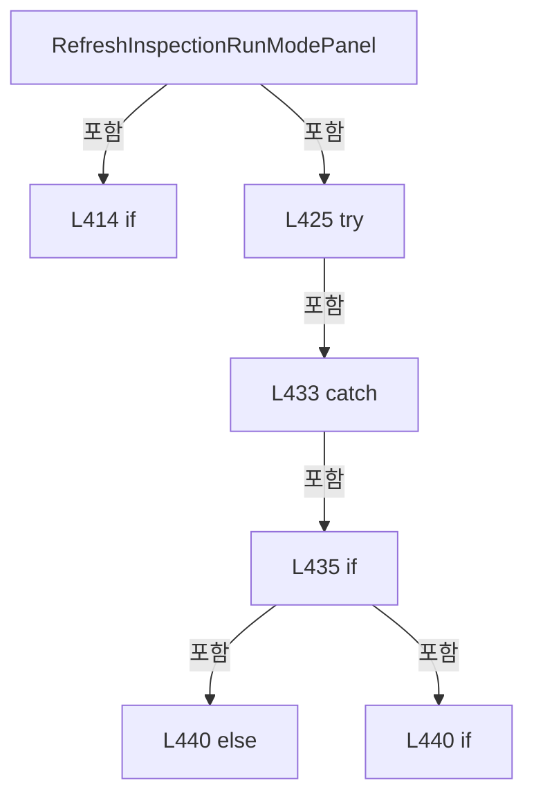

변경 전 점검: 입력/반환 타입, 위 호출자, 예외/취소 경로, 공유 상태와 저장·전송 소비자를 함께 확인합니다. 값의 단위나 물리 방향을 이름만으로 확정하지 않습니다.

### MethodDeclaration `UpdateReviewCorrectionPanel` · L447–495

[Drilling.UI/Menu/Menus/CMenuCorrection.cs:447–495](https://github.com/kjuws10-rgb/A3Drilling/blob/334b3599651b2e8e0181fd4459bafaf3cddafff3/Drilling.UI/Menu/Menus/CMenuCorrection.cs#L447-L495)

| 항목 | 실제 추출 값 |
| --- | --- |
| 서명 | System.Threading.Tasks.Task Drilling.UI.Menu.Menus.CMenuCorrection.UpdateReviewCorrectionPanel(bool, bool, bool, System.Threading.CancellationToken) |
| 접근/수식자 | Private / private, async |
| 반환/값 타입 | System.Threading.Tasks.Task |
| 소속 타입 | NamedType:Drilling.UI.Menu.Menus.CMenuCorrection |

입력 계약:

| 이름 | 타입 | 전달 | 선택/기본값 |
| --- | --- | --- | --- |
| showSimple | bool | None | False /  |
| showRough | bool | None | False /  |
| showFine | bool | None | False /  |
| cancellationToken | System.Threading.CancellationToken | None | False /  |

정적 호출자로 확인된 위치:

| 호출 파일/행 | 호출 표현식 | 런타임 분기 가능 |
| --- | --- | --- |
| [Drilling.UI/Menu/Menus/CMenuCorrection.cs:427–431](https://github.com/kjuws10-rgb/A3Drilling/blob/334b3599651b2e8e0181fd4459bafaf3cddafff3/Drilling.UI/Menu/Menus/CMenuCorrection.cs#L427-L431) | UpdateReviewCorrectionPanel | False |
| [Drilling.UI/Menu/Menus/CMenuCorrection.cs:569–569](https://github.com/kjuws10-rgb/A3Drilling/blob/334b3599651b2e8e0181fd4459bafaf3cddafff3/Drilling.UI/Menu/Menus/CMenuCorrection.cs#L569-L569) | UpdateReviewCorrectionPanel | False |

호출하는 대상과 해석 범위:

| 원본 행 | 표현식 | 분석 상태 | 대상/소스 위치 |
| --- | --- | --- | --- |
| 458 | LoadSelectedOutputViewerRecipe | resolved | System.Threading.Tasks.Task<Drilling.Common.Managers.ST_RECIPE_DEFINITION?> Drilling.UI.Menu.Menus.CMenuCorrection.LoadSelectedOutputViewerRecipe(System.Threading.CancellationToken, bool) · Drilling.UI/Menu/Menus/CMenuCorrection.cs:851 |
| 459 | _settingManager.LoadSection(EN_SETTING_TAB.Option, cancellationToken) .Concat(_settingManager.LoadSection(EN_SETTING_TAB.Motor, cancellationToken)).ToArray | resolved | Drilling.Common.Managers.ST_SYSTEM_PARAMETER[] System.Collections.Generic.IEnumerable<Drilling.Common.Managers.ST_SYSTEM_PARAMETER>.ToArray<Drilling.Common.Managers.ST_SYSTEM_PARAMETER>() |
| 459 | _settingManager.LoadSection(EN_SETTING_TAB.Option, cancellationToken) .Concat | resolved | System.Collections.Generic.IEnumerable<Drilling.Common.Managers.ST_SYSTEM_PARAMETER> System.Collections.Generic.IEnumerable<Drilling.Common.Managers.ST_SYSTEM_PARAMETER>.Concat<Drilling.Common.Managers.ST_SYSTEM_PARAMETER>(System.Collections.Generic.IEnumerable<Drilling.Common.Managers.ST_SYSTEM_PARAMETER>) |
| 459 | _settingManager.LoadSection | resolved | System.Collections.Generic.IReadOnlyList<Drilling.Common.Managers.ST_SYSTEM_PARAMETER> Drilling.Common.Managers.CSettingManager.LoadSection(Drilling.Common.Managers.EN_SETTING_TAB, System.Threading.CancellationToken) · Drilling.Common/Managers/CSettingManager.cs:26 |
| 460 | _settingManager.LoadSection | resolved | System.Collections.Generic.IReadOnlyList<Drilling.Common.Managers.ST_SYSTEM_PARAMETER> Drilling.Common.Managers.CSettingManager.LoadSection(Drilling.Common.Managers.EN_SETTING_TAB, System.Threading.CancellationToken) · Drilling.Common/Managers/CSettingManager.cs:26 |
| 463 | Fine.Update | resolved | void Drilling.UI.Menu.Menus.CFineCorrectionPanel.Update(Drilling.Common.Managers.ST_RECIPE_DEFINITION?, System.Collections.Generic.IReadOnlyList<Drilling.Common.Managers.ST_SYSTEM_PARAMETER>) · Drilling.UI/Menu/Menus/CMenuCorrection.cs:6211 |
| 474 | .GetBaseException | resolved · 동적 구현 선택 가능 | System.Exception System.AggregateException.GetBaseException() |
| 479 | Task.FromResult | resolved | System.Threading.Tasks.Task<Drilling.Common.Review.ST_REVIEW_OFFSET_FILE_DATA> System.Threading.Tasks.Task.FromResult<Drilling.Common.Review.ST_REVIEW_OFFSET_FILE_DATA>(Drilling.Common.Review.ST_REVIEW_OFFSET_FILE_DATA) |
| 479 | ST_REVIEW_OFFSET_FILE_DATA.Empty | resolved | Drilling.Common.Review.ST_REVIEW_OFFSET_FILE_DATA Drilling.Common.Review.ST_REVIEW_OFFSET_FILE_DATA.Empty(string) · Drilling.Common/Review/CReviewManager.cs:4365 |
| 480 | Task.Run | resolved | System.Threading.Tasks.Task<Drilling.Common.Review.ST_REVIEW_OFFSET_FILE_DATA> System.Threading.Tasks.Task.Run<Drilling.Common.Review.ST_REVIEW_OFFSET_FILE_DATA>(System.Func<System.Threading.Tasks.Task<Drilling.Common.Review.ST_REVIEW_OFFSET_FILE_DATA>?>, System.Threading.CancellationToken) |
| 480 | _reviewOffsetFile.LoadLatest | resolved | System.Threading.Tasks.Task<Drilling.Common.Review.ST_REVIEW_OFFSET_FILE_DATA> Drilling.Common.Review.CReviewOffsetFileBase.LoadLatest(string, System.Threading.CancellationToken) · Drilling.Common/Review/CReviewManager.cs:4397 |
| 483 | _simpleOffsetLoad.WaitAsync | resolved | System.Threading.Tasks.Task<Drilling.Common.Review.ST_REVIEW_OFFSET_FILE_DATA> System.Threading.Tasks.Task<Drilling.Common.Review.ST_REVIEW_OFFSET_FILE_DATA>.WaitAsync(System.Threading.CancellationToken) |
| 489 | Simple.Update | resolved | void Drilling.UI.Menu.Menus.CSimpleCorrectionPanel.Update(Drilling.Common.Managers.ST_RECIPE_DEFINITION?, System.Collections.Generic.IReadOnlyList<Drilling.Common.Managers.ST_SYSTEM_PARAMETER>, Drilling.Common.Review.ST_REVIEW_OFFSET_FILE_DATA?) · Drilling.UI/Menu/Menus/CMenuCorrection.cs:7765 |
| 493 | Rough.Update | resolved | void Drilling.UI.Menu.Menus.CSimpleCorrectionPanel.Update(Drilling.Common.Managers.ST_RECIPE_DEFINITION?, System.Collections.Generic.IReadOnlyList<Drilling.Common.Managers.ST_SYSTEM_PARAMETER>, Drilling.Common.Review.ST_REVIEW_OFFSET_FILE_DATA?) · Drilling.UI/Menu/Menus/CMenuCorrection.cs:7765 |

본문의 실제 연산·분기·예외·반환 순서(원문 위치 순):

| 원본 행 | 종류 | 주석 해설 |
| --- | --- | --- |
| 453 | if | 조건에 따라 분기합니다: if (!showSimple && !showRough && !showFine) |
| 455 | return | 호출자에게 값 또는 제어를 반환합니다: return; |
| 458 | await | 비동기 완료를 기다립니다: await LoadSelectedOutputViewerRecipe(cancellationToken, fallbackToFirst: false) |
| 458 | call | 함수·델리게이트 또는 객체 생성자를 호출합니다: LoadSelectedOutputViewerRecipe(cancellationToken, fallbackToFirst: false) |
| 458 | local-declaration | 지역 변수를 선언합니다: var recipe = await LoadSelectedOutputViewerRecipe(cancellationToken, fallbackToFirst: false); |
| 458 | variable-initializer | 변수의 초기값을 지정합니다: recipe = await LoadSelectedOutputViewerRecipe(cancellationToken, fallbackToFirst: false) |
| 459 | call | 함수·델리게이트 또는 객체 생성자를 호출합니다: _settingManager.LoadSection(EN_SETTING_TAB.Option, cancellationToken) |
| 459 | call | 함수·델리게이트 또는 객체 생성자를 호출합니다: _settingManager.LoadSection(EN_SETTING_TAB.Option, cancellationToken) .Concat(_settingManager.LoadSection(EN_SETTING_TAB.Motor, cancellationToken)).ToArray() |
| 459 | call | 함수·델리게이트 또는 객체 생성자를 호출합니다: _settingManager.LoadSection(EN_SETTING_TAB.Option, cancellationToken) .Concat(_settingManager.LoadSection(EN_SETTING_TAB.Motor, cancellationToken)) |
| 459 | local-declaration | 지역 변수를 선언합니다: var settings = _settingManager.LoadSection(EN_SETTING_TAB.Option, cancellationToken) .Concat(_settingManager.LoadSection(EN_SETTING_TAB.Motor, cancellationToken)).ToArray(); |
| 459 | variable-initializer | 변수의 초기값을 지정합니다: settings = _settingManager.LoadSection(EN_SETTING_TAB.Option, cancellationToken) .Concat(_settingManager.LoadSection(EN_SETTING_TAB.Motor, cancellationToken)).ToArray() |
| 460 | call | 함수·델리게이트 또는 객체 생성자를 호출합니다: _settingManager.LoadSection(EN_SETTING_TAB.Motor, cancellationToken) |
| 461 | if | 조건에 따라 분기합니다: if (showFine) |
| 463 | call | 함수·델리게이트 또는 객체 생성자를 호출합니다: Fine.Update(recipe, settings) |
| 464 | return | 호출자에게 값 또는 제어를 반환합니다: return; |
| 467 | local-declaration | 지역 변수를 선언합니다: ST_REVIEW_OFFSET_FILE_DATA? current = null; |
| 467 | variable-initializer | 변수의 초기값을 지정합니다: current = null |
| 468 | if | 조건에 따라 분기합니다: if (recipe is not null) |
| 470 | if | 조건에 따라 분기합니다: if (_simpleOffsetLoad is null &#124;&#124; _simpleOffsetLoad.IsCanceled &#124;&#124; _simpleOffsetRecipeId != recipe.Id &#124;&#124; (_simpleOffsetLoad.IsFaulted && _simpleOffsetLoad.Exception?.GetBaseException() is not CReviewOffsetValidationException)) |
| 474 | call | 함수·델리게이트 또는 객체 생성자를 호출합니다: .GetBaseException() |
| 476 | assignment | 값을 대상에 대입합니다: _lastReviewOffsetWarning = "" |
| 477 | assignment | 값을 대상에 대입합니다: _simpleOffsetRecipeId = recipe.Id |
| 478 | assignment | 값을 대상에 대입합니다: _simpleOffsetLoad = _reviewOffsetFile is null ? Task.FromResult(ST_REVIEW_OFFSET_FILE_DATA.Empty(recipe.Id)) : Task.Run(() => _reviewOffsetFile.LoadLatest(recipe.Id, cancellationToken), cancellationToken) |
| 478 | conditional-expression | 조건에 따라 결과식을 선택합니다: _reviewOffsetFile is null ? Task.FromResult(ST_REVIEW_OFFSET_FILE_DATA.Empty(recipe.Id)) : Task.Run(() => _reviewOffsetFile.LoadLatest(recipe.Id, cancellationToken), cancellationToken) |
| 479 | call | 함수·델리게이트 또는 객체 생성자를 호출합니다: Task.FromResult(ST_REVIEW_OFFSET_FILE_DATA.Empty(recipe.Id)) |
| 479 | call | 함수·델리게이트 또는 객체 생성자를 호출합니다: ST_REVIEW_OFFSET_FILE_DATA.Empty(recipe.Id) |
| 480 | call | 함수·델리게이트 또는 객체 생성자를 호출합니다: Task.Run(() => _reviewOffsetFile.LoadLatest(recipe.Id, cancellationToken), cancellationToken) |
| 480 | call | 함수·델리게이트 또는 객체 생성자를 호출합니다: _reviewOffsetFile.LoadLatest(recipe.Id, cancellationToken) |
| 483 | assignment | 값을 대상에 대입합니다: current = await _simpleOffsetLoad.WaitAsync(cancellationToken) |
| 483 | await | 비동기 완료를 기다립니다: await _simpleOffsetLoad.WaitAsync(cancellationToken) |
| 483 | call | 함수·델리게이트 또는 객체 생성자를 호출합니다: _simpleOffsetLoad.WaitAsync(cancellationToken) |
| 484 | assignment | 값을 대상에 대입합니다: _lastReviewOffsetWarning = "" |
| 487 | if | 조건에 따라 분기합니다: if (showSimple) |
| 489 | call | 함수·델리게이트 또는 객체 생성자를 호출합니다: Simple.Update(recipe, settings, current) |
| 491 | else | 앞 조건이 거짓인 경로입니다: else |
| 493 | call | 함수·델리게이트 또는 객체 생성자를 호출합니다: Rough.Update(recipe, settings, current) |

제어 구문의 포함 구조(실제 실행 순서/CFG가 아닌 구문 탐색 그림):

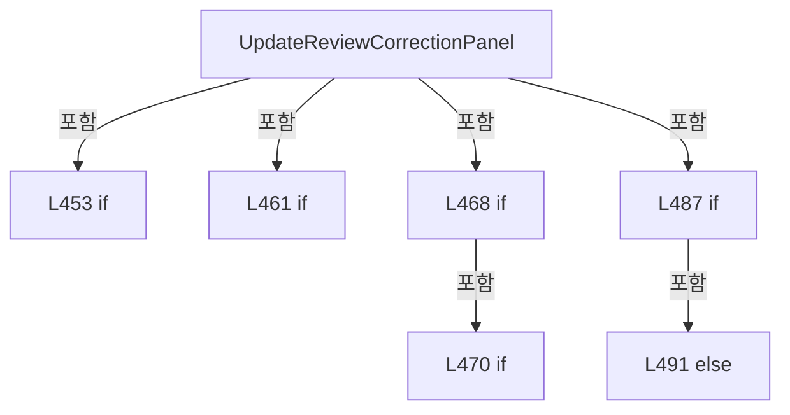

변경 전 점검: 입력/반환 타입, 위 호출자, 예외/취소 경로, 공유 상태와 저장·전송 소비자를 함께 확인합니다. 값의 단위나 물리 방향을 이름만으로 확정하지 않습니다.

### MethodDeclaration `SetReviewOperationRunning` · L497–506

[Drilling.UI/Menu/Menus/CMenuCorrection.cs:497–506](https://github.com/kjuws10-rgb/A3Drilling/blob/334b3599651b2e8e0181fd4459bafaf3cddafff3/Drilling.UI/Menu/Menus/CMenuCorrection.cs#L497-L506)

| 항목 | 실제 추출 값 |
| --- | --- |
| 서명 | void Drilling.UI.Menu.Menus.CMenuCorrection.SetReviewOperationRunning(bool) |
| 접근/수식자 | Private / private |
| 반환/값 타입 | void |
| 소속 타입 | NamedType:Drilling.UI.Menu.Menus.CMenuCorrection |

입력 계약:

| 이름 | 타입 | 전달 | 선택/기본값 |
| --- | --- | --- | --- |
| value | bool | None | False /  |

정적 호출자로 확인된 위치:

| 호출 파일/행 | 호출 표현식 | 런타임 분기 가능 |
| --- | --- | --- |
| [Drilling.UI/Menu/Menus/CMenuCorrection.cs:1580–1580](https://github.com/kjuws10-rgb/A3Drilling/blob/334b3599651b2e8e0181fd4459bafaf3cddafff3/Drilling.UI/Menu/Menus/CMenuCorrection.cs#L1580-L1580) | SetReviewOperationRunning | False |
| [Drilling.UI/Menu/Menus/CMenuCorrection.cs:1635–1635](https://github.com/kjuws10-rgb/A3Drilling/blob/334b3599651b2e8e0181fd4459bafaf3cddafff3/Drilling.UI/Menu/Menus/CMenuCorrection.cs#L1635-L1635) | SetReviewOperationRunning | False |
| [Drilling.UI/Menu/Menus/CMenuCorrection.cs:1820–1820](https://github.com/kjuws10-rgb/A3Drilling/blob/334b3599651b2e8e0181fd4459bafaf3cddafff3/Drilling.UI/Menu/Menus/CMenuCorrection.cs#L1820-L1820) | SetReviewOperationRunning | False |
| [Drilling.UI/Menu/Menus/CMenuCorrection.cs:1869–1869](https://github.com/kjuws10-rgb/A3Drilling/blob/334b3599651b2e8e0181fd4459bafaf3cddafff3/Drilling.UI/Menu/Menus/CMenuCorrection.cs#L1869-L1869) | SetReviewOperationRunning | False |
| [Drilling.UI/Menu/Menus/CMenuCorrection.cs:3054–3054](https://github.com/kjuws10-rgb/A3Drilling/blob/334b3599651b2e8e0181fd4459bafaf3cddafff3/Drilling.UI/Menu/Menus/CMenuCorrection.cs#L3054-L3054) | SetReviewOperationRunning | False |
| [Drilling.UI/Menu/Menus/CMenuCorrection.cs:3136–3136](https://github.com/kjuws10-rgb/A3Drilling/blob/334b3599651b2e8e0181fd4459bafaf3cddafff3/Drilling.UI/Menu/Menus/CMenuCorrection.cs#L3136-L3136) | SetReviewOperationRunning | False |
| [Drilling.UI/Menu/Menus/CMenuCorrection.cs:3169–3169](https://github.com/kjuws10-rgb/A3Drilling/blob/334b3599651b2e8e0181fd4459bafaf3cddafff3/Drilling.UI/Menu/Menus/CMenuCorrection.cs#L3169-L3169) | SetReviewOperationRunning | False |
| [Drilling.UI/Menu/Menus/CMenuCorrection.cs:3247–3247](https://github.com/kjuws10-rgb/A3Drilling/blob/334b3599651b2e8e0181fd4459bafaf3cddafff3/Drilling.UI/Menu/Menus/CMenuCorrection.cs#L3247-L3247) | SetReviewOperationRunning | False |
| [Drilling.UI/Menu/Menus/CMenuCorrection.cs:3281–3281](https://github.com/kjuws10-rgb/A3Drilling/blob/334b3599651b2e8e0181fd4459bafaf3cddafff3/Drilling.UI/Menu/Menus/CMenuCorrection.cs#L3281-L3281) | SetReviewOperationRunning | False |
| [Drilling.UI/Menu/Menus/CMenuCorrection.cs:3452–3452](https://github.com/kjuws10-rgb/A3Drilling/blob/334b3599651b2e8e0181fd4459bafaf3cddafff3/Drilling.UI/Menu/Menus/CMenuCorrection.cs#L3452-L3452) | SetReviewOperationRunning | False |
| [Drilling.UI/Menu/Menus/CMenuCorrection.cs:4027–4027](https://github.com/kjuws10-rgb/A3Drilling/blob/334b3599651b2e8e0181fd4459bafaf3cddafff3/Drilling.UI/Menu/Menus/CMenuCorrection.cs#L4027-L4027) | SetReviewOperationRunning | False |
| [Drilling.UI/Menu/Menus/CMenuCorrection.cs:4153–4153](https://github.com/kjuws10-rgb/A3Drilling/blob/334b3599651b2e8e0181fd4459bafaf3cddafff3/Drilling.UI/Menu/Menus/CMenuCorrection.cs#L4153-L4153) | SetReviewOperationRunning | False |
| [Drilling.UI/Menu/Menus/CMenuCorrection.cs:4181–4181](https://github.com/kjuws10-rgb/A3Drilling/blob/334b3599651b2e8e0181fd4459bafaf3cddafff3/Drilling.UI/Menu/Menus/CMenuCorrection.cs#L4181-L4181) | SetReviewOperationRunning | False |
| [Drilling.UI/Menu/Menus/CMenuCorrection.cs:4242–4242](https://github.com/kjuws10-rgb/A3Drilling/blob/334b3599651b2e8e0181fd4459bafaf3cddafff3/Drilling.UI/Menu/Menus/CMenuCorrection.cs#L4242-L4242) | SetReviewOperationRunning | False |
| [Drilling.UI/Menu/Menus/CMenuCorrection.cs:4276–4276](https://github.com/kjuws10-rgb/A3Drilling/blob/334b3599651b2e8e0181fd4459bafaf3cddafff3/Drilling.UI/Menu/Menus/CMenuCorrection.cs#L4276-L4276) | SetReviewOperationRunning | False |
| [Drilling.UI/Menu/Menus/CMenuCorrection.cs:4340–4340](https://github.com/kjuws10-rgb/A3Drilling/blob/334b3599651b2e8e0181fd4459bafaf3cddafff3/Drilling.UI/Menu/Menus/CMenuCorrection.cs#L4340-L4340) | SetReviewOperationRunning | False |

호출하는 대상과 해석 범위:

| 원본 행 | 표현식 | 분석 상태 | 대상/소스 위치 |
| --- | --- | --- | --- |
| 505 | .NotifyExternalInspectionExecutionStateChanged | resolved | void Drilling.UI.Menu.Menus.CMenuReview.NotifyExternalInspectionExecutionStateChanged() · Drilling.UI/Menu/Menus/CMenuReview.cs:1824 |

본문의 실제 연산·분기·예외·반환 순서(원문 위치 순):

| 원본 행 | 종류 | 주석 해설 |
| --- | --- | --- |
| 499 | if | 조건에 따라 분기합니다: if (_isReviewOperationRunning == value) |
| 501 | return | 호출자에게 값 또는 제어를 반환합니다: return; |
| 504 | assignment | 값을 대상에 대입합니다: _isReviewOperationRunning = value |
| 505 | call | 함수·델리게이트 또는 객체 생성자를 호출합니다: .NotifyExternalInspectionExecutionStateChanged() |

제어 구문의 포함 구조(실제 실행 순서/CFG가 아닌 구문 탐색 그림):


변경 전 점검: 입력/반환 타입, 위 호출자, 예외/취소 경로, 공유 상태와 저장·전송 소비자를 함께 확인합니다. 값의 단위나 물리 방향을 이름만으로 확정하지 않습니다.

### MethodDeclaration `OpenSavedReviewResult` · L508–517

[Drilling.UI/Menu/Menus/CMenuCorrection.cs:508–517](https://github.com/kjuws10-rgb/A3Drilling/blob/334b3599651b2e8e0181fd4459bafaf3cddafff3/Drilling.UI/Menu/Menus/CMenuCorrection.cs#L508-L517)

| 항목 | 실제 추출 값 |
| --- | --- |
| 서명 | System.Threading.Tasks.Task Drilling.UI.Menu.Menus.CMenuCorrection.OpenSavedReviewResult(string) |
| 접근/수식자 | Private / private, async |
| 반환/값 타입 | System.Threading.Tasks.Task |
| 소속 타입 | NamedType:Drilling.UI.Menu.Menus.CMenuCorrection |

입력 계약:

| 이름 | 타입 | 전달 | 선택/기본값 |
| --- | --- | --- | --- |
| resultPath | string | None | False /  |

현재 부분 분석에서 직접 연결된 호출자는 없습니다. XAML/이벤트/인터페이스·델리게이트·외부 진입을 추가 확인해야 하며, 미사용으로 판정한 것이 아닙니다.

호출하는 대상과 해석 범위:

| 원본 행 | 표현식 | 분석 상태 | 대상/소스 위치 |
| --- | --- | --- | --- |
| 510 | string.IsNullOrWhiteSpace | resolved | bool string.IsNullOrWhiteSpace(string?) |
| 511 | new ArgumentException | resolved | System.ArgumentException.ArgumentException(string?, string?) |
| 511 | nameof | unresolved | None |
| 513 | InspectionReviewData.OpenResult | resolved | System.Threading.Tasks.Task Drilling.UI.Menu.Menus.CMenuCorrection.CReviewDataPanel.OpenResult(string, System.Threading.CancellationToken) · Drilling.UI/Menu/Menus/CMenuCorrection.ReviewData.cs:189 |
| 515 | .ShowInspectionResultWorkspace | resolved | void Drilling.UI.Menu.Menus.CMenuReview.ShowInspectionResultWorkspace() · Drilling.UI/Menu/Menus/CMenuReview.cs:778 |

본문의 실제 연산·분기·예외·반환 순서(원문 위치 순):

| 원본 행 | 종류 | 주석 해설 |
| --- | --- | --- |
| 510 | call | 함수·델리게이트 또는 객체 생성자를 호출합니다: string.IsNullOrWhiteSpace(resultPath) |
| 510 | if | 조건에 따라 분기합니다: if (string.IsNullOrWhiteSpace(resultPath)) |
| 511 | call | 함수·델리게이트 또는 객체 생성자를 호출합니다: new ArgumentException("저장된 검사 결과 경로가 없습니다.", nameof(resultPath)) |
| 511 | call | 함수·델리게이트 또는 객체 생성자를 호출합니다: nameof(resultPath) |
| 511 | throw | 예외를 발생/전달합니다: throw new ArgumentException("저장된 검사 결과 경로가 없습니다.", nameof(resultPath)); |
| 513 | call | 함수·델리게이트 또는 객체 생성자를 호출합니다: InspectionReviewData.OpenResult(resultPath) |
| 513 | local-declaration | 지역 변수를 선언합니다: var loadTask = InspectionReviewData.OpenResult(resultPath); |
| 513 | variable-initializer | 변수의 초기값을 지정합니다: loadTask = InspectionReviewData.OpenResult(resultPath) |
| 514 | assignment | 값을 대상에 대입합니다: SelectedReviewTabIndex = 1 |
| 515 | call | 함수·델리게이트 또는 객체 생성자를 호출합니다: .ShowInspectionResultWorkspace() |
| 516 | await | 비동기 완료를 기다립니다: await loadTask |

제어 구문의 포함 구조(실제 실행 순서/CFG가 아닌 구문 탐색 그림):

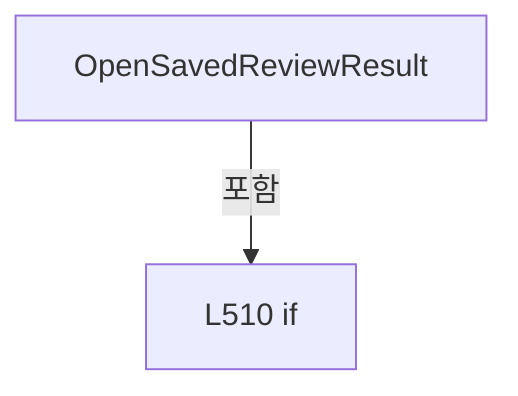

변경 전 점검: 입력/반환 타입, 위 호출자, 예외/취소 경로, 공유 상태와 저장·전송 소비자를 함께 확인합니다. 값의 단위나 물리 방향을 이름만으로 확정하지 않습니다.

### MethodDeclaration `Build` · L519–604

[Drilling.UI/Menu/Menus/CMenuCorrection.cs:519–604](https://github.com/kjuws10-rgb/A3Drilling/blob/334b3599651b2e8e0181fd4459bafaf3cddafff3/Drilling.UI/Menu/Menus/CMenuCorrection.cs#L519-L604)

| 항목 | 실제 추출 값 |
| --- | --- |
| 서명 | System.Threading.Tasks.Task<Drilling.UI.Menu.Menus.CScreenViewModel> Drilling.UI.Menu.Menus.CMenuCorrection.Build(System.Threading.CancellationToken) |
| 접근/수식자 | Public / public, override, async |
| 반환/값 타입 | System.Threading.Tasks.Task<Drilling.UI.Menu.Menus.CScreenViewModel> |
| 소속 타입 | NamedType:Drilling.UI.Menu.Menus.CMenuCorrection |

입력 계약:

| 이름 | 타입 | 전달 | 선택/기본값 |
| --- | --- | --- | --- |
| cancellationToken | System.Threading.CancellationToken | None | True / null |

현재 부분 분석에서 직접 연결된 호출자는 없습니다. XAML/이벤트/인터페이스·델리게이트·외부 진입을 추가 확인해야 하며, 미사용으로 판정한 것이 아닙니다.

호출하는 대상과 해석 범위:

| 원본 행 | 표현식 | 분석 상태 | 대상/소스 위치 |
| --- | --- | --- | --- |
| 521 | cancellationToken.ThrowIfCancellationRequested | resolved | void System.Threading.CancellationToken.ThrowIfCancellationRequested() |
| 522 | ApplyTabData | resolved | void Drilling.UI.Menu.Menus.CMenuCorrection.ApplyTabData(string) · Drilling.UI/Menu/Menus/CMenuCorrection.cs:1436 |
| 527 | LoadSelectedOutputViewerRecipe | resolved | System.Threading.Tasks.Task<Drilling.Common.Managers.ST_RECIPE_DEFINITION?> Drilling.UI.Menu.Menus.CMenuCorrection.LoadSelectedOutputViewerRecipe(System.Threading.CancellationToken, bool) · Drilling.UI/Menu/Menus/CMenuCorrection.cs:851 |
| 528 | _settingManager.LoadSection(EN_SETTING_TAB.Option, cancellationToken) .Concat(_settingManager.LoadSection(EN_SETTING_TAB.Motor, cancellationToken)).ToArray | resolved | Drilling.Common.Managers.ST_SYSTEM_PARAMETER[] System.Collections.Generic.IEnumerable<Drilling.Common.Managers.ST_SYSTEM_PARAMETER>.ToArray<Drilling.Common.Managers.ST_SYSTEM_PARAMETER>() |
| 528 | _settingManager.LoadSection(EN_SETTING_TAB.Option, cancellationToken) .Concat | resolved | System.Collections.Generic.IEnumerable<Drilling.Common.Managers.ST_SYSTEM_PARAMETER> System.Collections.Generic.IEnumerable<Drilling.Common.Managers.ST_SYSTEM_PARAMETER>.Concat<Drilling.Common.Managers.ST_SYSTEM_PARAMETER>(System.Collections.Generic.IEnumerable<Drilling.Common.Managers.ST_SYSTEM_PARAMETER>) |
| 528 | _settingManager.LoadSection | resolved | System.Collections.Generic.IReadOnlyList<Drilling.Common.Managers.ST_SYSTEM_PARAMETER> Drilling.Common.Managers.CSettingManager.LoadSection(Drilling.Common.Managers.EN_SETTING_TAB, System.Threading.CancellationToken) · Drilling.Common/Managers/CSettingManager.cs:26 |
| 529 | _settingManager.LoadSection | resolved | System.Collections.Generic.IReadOnlyList<Drilling.Common.Managers.ST_SYSTEM_PARAMETER> Drilling.Common.Managers.CSettingManager.LoadSection(Drilling.Common.Managers.EN_SETTING_TAB, System.Threading.CancellationToken) · Drilling.Common/Managers/CSettingManager.cs:26 |
| 530 | DefaultOffset.Update | resolved | void Drilling.UI.Menu.Menus.CDefaultOffsetPanel.Update(Drilling.Common.Managers.ST_RECIPE_DEFINITION?, System.Collections.Generic.IReadOnlyList<Drilling.Common.Managers.ST_SYSTEM_PARAMETER>) · Drilling.UI/Menu/Menus/CMenuCorrection.cs:4572 |
| 533 | DefaultOffset.Clear | resolved | void Drilling.UI.Menu.Menus.CDefaultOffsetPanel.Clear(string) · Drilling.UI/Menu/Menus/CMenuCorrection.cs:4604 |
| 539 | UpdateAlignPreview | resolved | void Drilling.UI.Menu.Menus.CMenuCorrection.UpdateAlignPreview(Drilling.Common.Managers.ST_RECIPE_DEFINITION?) · Drilling.UI/Menu/Menus/CMenuCorrection.cs:2989 |
| 539 | LoadSelectedOutputViewerRecipe | resolved | System.Threading.Tasks.Task<Drilling.Common.Managers.ST_RECIPE_DEFINITION?> Drilling.UI.Menu.Menus.CMenuCorrection.LoadSelectedOutputViewerRecipe(System.Threading.CancellationToken, bool) · Drilling.UI/Menu/Menus/CMenuCorrection.cs:851 |
| 540 | RefreshAlignOffsetTolerance | resolved | double? Drilling.UI.Menu.Menus.CMenuCorrection.RefreshAlignOffsetTolerance() · Drilling.UI/Menu/Menus/CMenuCorrection.cs:2994 |
| 541 | AlignDistortion.Wapage.UpdateSettings | resolved | void Drilling.UI.Menu.Menus.CAlignWapagePanel.UpdateSettings(System.Collections.Generic.IReadOnlyList<Drilling.Common.Managers.ST_SYSTEM_PARAMETER>) · Drilling.UI/Menu/Menus/CMenuCorrection.cs:5599 |
| 541 | _settingManager.LoadSection | resolved | System.Collections.Generic.IReadOnlyList<Drilling.Common.Managers.ST_SYSTEM_PARAMETER> Drilling.Common.Managers.CSettingManager.LoadSection(Drilling.Common.Managers.EN_SETTING_TAB, System.Threading.CancellationToken) · Drilling.Common/Managers/CSettingManager.cs:26 |
| 549 | AlignDistortion.Clear | resolved | void Drilling.UI.Menu.Menus.CAlignDistortionPanel.Clear(string, Drilling.Common.Managers.ST_RECIPE_DEFINITION?) · Drilling.UI/Menu/Menus/CMenuCorrection.cs:5374 |
| 564 | Review.Build | resolved · 동적 구현 선택 가능 | System.Threading.Tasks.Task<Drilling.UI.Menu.Menus.CScreenViewModel> Drilling.UI.Menu.Menus.CMenuReview.Build(System.Threading.CancellationToken) · Drilling.UI/Menu/Menus/CMenuReview.cs:482 |
| 569 | UpdateReviewCorrectionPanel | resolved | System.Threading.Tasks.Task Drilling.UI.Menu.Menus.CMenuCorrection.UpdateReviewCorrectionPanel(bool, bool, bool, System.Threading.CancellationToken) · Drilling.UI/Menu/Menus/CMenuCorrection.cs:447 |
| 579 | ReportInvalidReviewOffset | resolved | void Drilling.UI.Menu.Menus.CMenuCorrection.ReportInvalidReviewOffset(System.Exception) · Drilling.UI/Menu/Menus/CMenuCorrection.cs:3264 |
| 581 | Simple.Clear | resolved | void Drilling.UI.Menu.Menus.CSimpleCorrectionPanel.Clear(string) · Drilling.UI/Menu/Menus/CMenuCorrection.cs:7857 |
| 583 | Rough.Clear | resolved | void Drilling.UI.Menu.Menus.CSimpleCorrectionPanel.Clear(string) · Drilling.UI/Menu/Menus/CMenuCorrection.cs:7857 |
| 585 | Fine.Clear | resolved | void Drilling.UI.Menu.Menus.CFineCorrectionPanel.Clear(string) · Drilling.UI/Menu/Menus/CMenuCorrection.cs:6288 |
| 591 | RefreshOutputViewerData | resolved | System.Threading.Tasks.Task Drilling.UI.Menu.Menus.CMenuCorrection.RefreshOutputViewerData(System.Threading.CancellationToken) · Drilling.UI/Menu/Menus/CMenuCorrection.cs:714 |
| 594 | new CScreenViewModel | resolved | Drilling.UI.Menu.Menus.CScreenViewModel.CScreenViewModel(Drilling.UI.Menu.Menus.EN_MENU, string, string, System.Collections.Generic.IReadOnlyList<Drilling.UI.Menu.Menus.ST_DISPLAY_ITEM>, System.Collections.Generic.IReadOnlyList<Drilling.UI.Menu.Menus.ST_SCREEN_SECTION>, bool, Drilling.UI.Menu.Menus.CMenuMain?, Drilling.UI.Menu.Menus.CMenuManual?, Drilling.UI.Menu.Menus.CMenuRecipe?, Drilling.UI.Menu.Menus.CMenuSetting?, Drilling.UI.Menu.Menus.CMenuAlarm?, Drilling.UI.Menu.Menus.CMenuMonitor?, Drilling.UI.Menu.Menus.CMenuReview?, Drilling.UI.Menu.Menus.CMenuCorrection?, Drilling.UI.Menu.Menus.CMenuPm?) · Drilling.UI/Menu/Menus/CMenuBase.cs:411 |
| 598 | new | resolved | Drilling.UI.Menu.Menus.ST_DISPLAY_ITEM.ST_DISPLAY_ITEM(string, string, string) · Drilling.UI/Menu/Menus/CMenuBase.cs:43 |
| 598 | new | resolved | Drilling.UI.Menu.Menus.ST_DISPLAY_ITEM.ST_DISPLAY_ITEM(string, string, string) · Drilling.UI/Menu/Menus/CMenuBase.cs:43 |
| 598 | GetSourceName | resolved | string Drilling.UI.Menu.Menus.CMenuCorrection.GetSourceName(string) · Drilling.UI/Menu/Menus/CMenuCorrection.cs:2666 |
| 598 | new | resolved | Drilling.UI.Menu.Menus.ST_DISPLAY_ITEM.ST_DISPLAY_ITEM(string, string, string) · Drilling.UI/Menu/Menus/CMenuBase.cs:43 |
| 598 | GetStateName | resolved | string Drilling.UI.Menu.Menus.CMenuCorrection.GetStateName(string) · Drilling.UI/Menu/Menus/CMenuCorrection.cs:2679 |
| 599 | new | resolved | Drilling.UI.Menu.Menus.ST_SCREEN_SECTION.ST_SCREEN_SECTION(string, System.Collections.Generic.IReadOnlyList<Drilling.UI.Menu.Menus.ST_DISPLAY_ITEM>) · Drilling.UI/Menu/Menus/CMenuBase.cs:410 |
| 599 | new | resolved | Drilling.UI.Menu.Menus.ST_SCREEN_SECTION.ST_SCREEN_SECTION(string, System.Collections.Generic.IReadOnlyList<Drilling.UI.Menu.Menus.ST_DISPLAY_ITEM>) · Drilling.UI/Menu/Menus/CMenuBase.cs:410 |
| 599 | new | resolved | Drilling.UI.Menu.Menus.ST_SCREEN_SECTION.ST_SCREEN_SECTION(string, System.Collections.Generic.IReadOnlyList<Drilling.UI.Menu.Menus.ST_DISPLAY_ITEM>) · Drilling.UI/Menu/Menus/CMenuBase.cs:410 |

본문의 실제 연산·분기·예외·반환 순서(원문 위치 순):

| 원본 행 | 종류 | 주석 해설 |
| --- | --- | --- |
| 521 | call | 함수·델리게이트 또는 객체 생성자를 호출합니다: cancellationToken.ThrowIfCancellationRequested() |
| 522 | call | 함수·델리게이트 또는 객체 생성자를 호출합니다: ApplyTabData(_selectedTab) |
| 523 | if | 조건에 따라 분기합니다: if (IsDefaultTab) |
| 525 | try | 예외 처리 범위입니다: try |
| 527 | await | 비동기 완료를 기다립니다: await LoadSelectedOutputViewerRecipe(cancellationToken, fallbackToFirst: false) |
| 527 | call | 함수·델리게이트 또는 객체 생성자를 호출합니다: LoadSelectedOutputViewerRecipe(cancellationToken, fallbackToFirst: false) |
| 527 | local-declaration | 지역 변수를 선언합니다: var recipe = await LoadSelectedOutputViewerRecipe(cancellationToken, fallbackToFirst: false); |
| 527 | variable-initializer | 변수의 초기값을 지정합니다: recipe = await LoadSelectedOutputViewerRecipe(cancellationToken, fallbackToFirst: false) |
| 528 | call | 함수·델리게이트 또는 객체 생성자를 호출합니다: _settingManager.LoadSection(EN_SETTING_TAB.Option, cancellationToken) |
| 528 | call | 함수·델리게이트 또는 객체 생성자를 호출합니다: _settingManager.LoadSection(EN_SETTING_TAB.Option, cancellationToken) .Concat(_settingManager.LoadSection(EN_SETTING_TAB.Motor, cancellationToken)).ToArray() |
| 528 | call | 함수·델리게이트 또는 객체 생성자를 호출합니다: _settingManager.LoadSection(EN_SETTING_TAB.Option, cancellationToken) .Concat(_settingManager.LoadSection(EN_SETTING_TAB.Motor, cancellationToken)) |
| 528 | local-declaration | 지역 변수를 선언합니다: var settings = _settingManager.LoadSection(EN_SETTING_TAB.Option, cancellationToken) .Concat(_settingManager.LoadSection(EN_SETTING_TAB.Motor, cancellationToken)).ToArray(); |
| 528 | variable-initializer | 변수의 초기값을 지정합니다: settings = _settingManager.LoadSection(EN_SETTING_TAB.Option, cancellationToken) .Concat(_settingManager.LoadSection(EN_SETTING_TAB.Motor, cancellationToken)).ToArray() |
| 529 | call | 함수·델리게이트 또는 객체 생성자를 호출합니다: _settingManager.LoadSection(EN_SETTING_TAB.Motor, cancellationToken) |
| 530 | call | 함수·델리게이트 또는 객체 생성자를 호출합니다: DefaultOffset.Update(recipe, settings) |
| 532 | catch | 지정 예외를 처리합니다: catch (OperationCanceledException) when (cancellationToken.IsCancellationRequested) |
| 532 | throw | 예외를 발생/전달합니다: throw; |
| 533 | call | 함수·델리게이트 또는 객체 생성자를 호출합니다: DefaultOffset.Clear(exception.Message) |
| 533 | catch | 지정 예외를 처리합니다: catch (Exception exception) |
| 535 | if | 조건에 따라 분기합니다: if (IsAlignDistortionTab) |
| 537 | try | 예외 처리 범위입니다: try |
| 539 | await | 비동기 완료를 기다립니다: await LoadSelectedOutputViewerRecipe(cancellationToken, fallbackToFirst: false) |
| 539 | call | 함수·델리게이트 또는 객체 생성자를 호출합니다: UpdateAlignPreview(await LoadSelectedOutputViewerRecipe(cancellationToken, fallbackToFirst: false)) |
| 539 | call | 함수·델리게이트 또는 객체 생성자를 호출합니다: LoadSelectedOutputViewerRecipe(cancellationToken, fallbackToFirst: false) |
| 540 | call | 함수·델리게이트 또는 객체 생성자를 호출합니다: RefreshAlignOffsetTolerance() |
| 541 | call | 함수·델리게이트 또는 객체 생성자를 호출합니다: AlignDistortion.Wapage.UpdateSettings(_settingManager.LoadSection(EN_SETTING_TAB.Option, cancellationToken)) |
| 541 | call | 함수·델리게이트 또는 객체 생성자를 호출합니다: _settingManager.LoadSection(EN_SETTING_TAB.Option, cancellationToken) |
| 543 | catch | 지정 예외를 처리합니다: catch (OperationCanceledException) when (cancellationToken.IsCancellationRequested) |
| 545 | throw | 예외를 발생/전달합니다: throw; |
| 547 | catch | 지정 예외를 처리합니다: catch (Exception exception) |
| 549 | call | 함수·델리게이트 또는 객체 생성자를 호출합니다: AlignDistortion.Clear($"Glass preview unavailable: {exception.Message}") |
| 553 | if | 조건에 따라 분기합니다: if (IsReviewCorrectionTab) |
| 555 | local-declaration | 지역 변수를 선언합니다: var showSimple = _selectedReviewTabIndex == 0; |
| 555 | variable-initializer | 변수의 초기값을 지정합니다: showSimple = _selectedReviewTabIndex == 0 |
| 556 | local-declaration | 지역 변수를 선언합니다: var showInspection = _selectedReviewTabIndex == 1; |
| 556 | variable-initializer | 변수의 초기값을 지정합니다: showInspection = _selectedReviewTabIndex == 1 |
| 557 | local-declaration | 지역 변수를 선언합니다: var showRough = showInspection && Review?.IsRoughInspectionMode == true; |
| 557 | variable-initializer | 변수의 초기값을 지정합니다: showRough = showInspection && Review?.IsRoughInspectionMode == true |
| 558 | local-declaration | 지역 변수를 선언합니다: var showFine = showInspection && Review?.IsFineInspectionMode == true; |
| 558 | variable-initializer | 변수의 초기값을 지정합니다: showFine = showInspection && Review?.IsFineInspectionMode == true |
| 559 | try | 예외 처리 범위입니다: try |
| 561 | if | 조건에 따라 분기합니다: if (showInspection) |
| 563 | if | 조건에 따라 분기합니다: if (Review is not null) |
| 564 | await | 비동기 완료를 기다립니다: await Review.Build(cancellationToken) |
| 564 | call | 함수·델리게이트 또는 객체 생성자를 호출합니다: Review.Build(cancellationToken) |
| 567 | if | 조건에 따라 분기합니다: if (showSimple &#124;&#124; showRough &#124;&#124; showFine) |
| 569 | await | 비동기 완료를 기다립니다: await UpdateReviewCorrectionPanel(showSimple, showRough, showFine, cancellationToken) |
| 569 | call | 함수·델리게이트 또는 객체 생성자를 호출합니다: UpdateReviewCorrectionPanel(showSimple, showRough, showFine, cancellationToken) |
| 572 | catch | 지정 예외를 처리합니다: catch (OperationCanceledException) when (cancellationToken.IsCancellationRequested) |
| 574 | throw | 예외를 발생/전달합니다: throw; |
| 576 | catch | 지정 예외를 처리합니다: catch (Exception exception) |
| 578 | if | 조건에 따라 분기합니다: if (showSimple &#124;&#124; showRough) |
| 579 | call | 함수·델리게이트 또는 객체 생성자를 호출합니다: ReportInvalidReviewOffset(exception) |
| 580 | if | 조건에 따라 분기합니다: if (showSimple) |
| 581 | call | 함수·델리게이트 또는 객체 생성자를 호출합니다: Simple.Clear($"Glass preview unavailable: {exception.Message}") |
| 582 | else | 앞 조건이 거짓인 경로입니다: else |
| 582 | if | 조건에 따라 분기합니다: if (showRough) |
| 583 | call | 함수·델리게이트 또는 객체 생성자를 호출합니다: Rough.Clear($"Glass preview unavailable: {exception.Message}") |
| 584 | else | 앞 조건이 거짓인 경로입니다: else |
| 584 | if | 조건에 따라 분기합니다: if (showFine) |
| 585 | call | 함수·델리게이트 또는 객체 생성자를 호출합니다: Fine.Clear($"Glass preview unavailable: {exception.Message}") |
| 589 | if | 조건에 따라 분기합니다: if (IsOutputHistoryTab) |
| 591 | await | 비동기 완료를 기다립니다: await RefreshOutputViewerData(cancellationToken) |
| 591 | call | 함수·델리게이트 또는 객체 생성자를 호출합니다: RefreshOutputViewerData(cancellationToken) |
| 594 | call | 함수·델리게이트 또는 객체 생성자를 호출합니다: new CScreenViewModel( EN_MENU.Correction, Title, Subtitle, [new("Selected", _selectedTab), new("Source", GetSourceName(_selectedTab)), new("State", GetStateName(_selectedTab))], [new("Correction Source", []), new("Correc… |
| 594 | local-declaration | 지역 변수를 선언합니다: var screen = new CScreenViewModel( EN_MENU.Correction, Title, Subtitle, [new("Selected", _selectedTab), new("Source", GetSourceName(_selectedTab)), new("State", GetStateName(_selectedTab))], [new("Correction Source", []), new("Cor |
| 594 | variable-initializer | 변수의 초기값을 지정합니다: screen = new CScreenViewModel( EN_MENU.Correction, Title, Subtitle, [new("Selected", _selectedTab), new("Source", GetSourceName(_selectedTab)), new("State", GetStateName(_selectedTab))], [new("Correction Source", []), new("Correct |
| 598 | call | 함수·델리게이트 또는 객체 생성자를 호출합니다: new("Selected", _selectedTab) |
| 598 | call | 함수·델리게이트 또는 객체 생성자를 호출합니다: new("Source", GetSourceName(_selectedTab)) |
| 598 | call | 함수·델리게이트 또는 객체 생성자를 호출합니다: GetSourceName(_selectedTab) |
| 598 | call | 함수·델리게이트 또는 객체 생성자를 호출합니다: new("State", GetStateName(_selectedTab)) |
| 598 | call | 함수·델리게이트 또는 객체 생성자를 호출합니다: GetStateName(_selectedTab) |
| 599 | call | 함수·델리게이트 또는 객체 생성자를 호출합니다: new("Correction Source", []) |
| 599 | call | 함수·델리게이트 또는 객체 생성자를 호출합니다: new("Correction Candidate", []) |
| 599 | call | 함수·델리게이트 또는 객체 생성자를 호출합니다: new("Apply Preview", []) |
| 603 | return | 호출자에게 값 또는 제어를 반환합니다: return screen; |

제어 구문의 포함 구조(실제 실행 순서/CFG가 아닌 구문 탐색 그림):

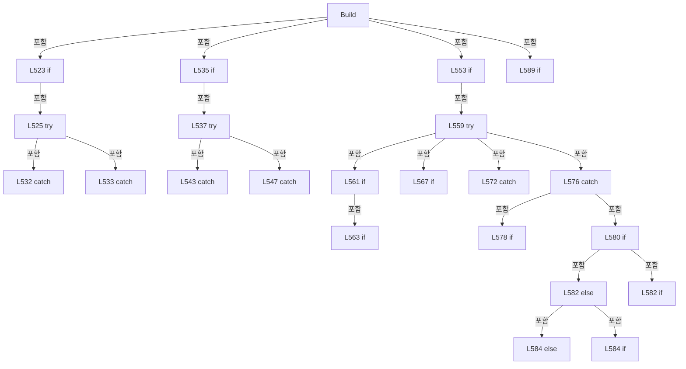

변경 전 점검: 입력/반환 타입, 위 호출자, 예외/취소 경로, 공유 상태와 저장·전송 소비자를 함께 확인합니다. 값의 단위나 물리 방향을 이름만으로 확정하지 않습니다.

### MethodDeclaration `SelectTab` · L606–634

[Drilling.UI/Menu/Menus/CMenuCorrection.cs:606–634](https://github.com/kjuws10-rgb/A3Drilling/blob/334b3599651b2e8e0181fd4459bafaf3cddafff3/Drilling.UI/Menu/Menus/CMenuCorrection.cs#L606-L634)

| 항목 | 실제 추출 값 |
| --- | --- |
| 서명 | void Drilling.UI.Menu.Menus.CMenuCorrection.SelectTab(object?) |
| 접근/수식자 | Private / private |
| 반환/값 타입 | void |
| 소속 타입 | NamedType:Drilling.UI.Menu.Menus.CMenuCorrection |

입력 계약:

| 이름 | 타입 | 전달 | 선택/기본값 |
| --- | --- | --- | --- |
| parameter | object? | None | False /  |

현재 부분 분석에서 직접 연결된 호출자는 없습니다. XAML/이벤트/인터페이스·델리게이트·외부 진입을 추가 확인해야 하며, 미사용으로 판정한 것이 아닙니다.

호출하는 대상과 해석 범위:

| 원본 행 | 표현식 | 분석 상태 | 대상/소스 위치 |
| --- | --- | --- | --- |
| 608 | .ToString | resolved · 동적 구현 선택 가능 | string? object.ToString() |
| 608 | .Trim | resolved | string string.Trim() |
| 609 | string.IsNullOrWhiteSpace | resolved | bool string.IsNullOrWhiteSpace(string?) |
| 619 | CorrectionTabs.FirstOrDefault | resolved | string? System.Collections.Generic.IEnumerable<string>.FirstOrDefault<string>(System.Func<string, bool>) |
| 632 | _statusReporter | resolved · 동적 구현 선택 가능 | void System.Action<string>.Invoke(string) |
| 633 | _refreshCurrentScreen | resolved · 동적 구현 선택 가능 | System.Threading.Tasks.Task System.Func<System.Threading.Tasks.Task>.Invoke() |

본문의 실제 연산·분기·예외·반환 순서(원문 위치 순):

| 원본 행 | 종류 | 주석 해설 |
| --- | --- | --- |
| 608 | call | 함수·델리게이트 또는 객체 생성자를 호출합니다: .ToString() |
| 608 | call | 함수·델리게이트 또는 객체 생성자를 호출합니다: .Trim() |
| 608 | local-declaration | 지역 변수를 선언합니다: var tabName = parameter?.ToString()?.Trim(); |
| 608 | variable-initializer | 변수의 초기값을 지정합니다: tabName = parameter?.ToString()?.Trim() |
| 609 | call | 함수·델리게이트 또는 객체 생성자를 호출합니다: string.IsNullOrWhiteSpace(tabName) |
| 609 | if | 조건에 따라 분기합니다: if (string.IsNullOrWhiteSpace(tabName)) |
| 611 | return | 호출자에게 값 또는 제어를 반환합니다: return; |
| 619 | call | 함수·델리게이트 또는 객체 생성자를 호출합니다: CorrectionTabs.FirstOrDefault(MatchesItem) |
| 619 | local-declaration | 지역 변수를 선언합니다: var normalizedTab = CorrectionTabs.FirstOrDefault(MatchesItem); |
| 619 | variable-initializer | 변수의 초기값을 지정합니다: normalizedTab = CorrectionTabs.FirstOrDefault(MatchesItem) |
| 620 | if | 조건에 따라 분기합니다: if (normalizedTab is null) |
| 622 | return | 호출자에게 값 또는 제어를 반환합니다: return; |
| 625 | if | 조건에 따라 분기합니다: if (normalizedTab == "REVIEW" && (_selectedTab != "REVIEW" &#124;&#124; _simpleOffsetLoad?.IsFaulted == true)) |
| 627 | assignment | 값을 대상에 대입합니다: _simpleOffsetLoad = null |
| 628 | assignment | 값을 대상에 대입합니다: _lastReviewOffsetWarning = "" |
| 631 | assignment | 값을 대상에 대입합니다: _selectedTab = normalizedTab |
| 632 | call | 함수·델리게이트 또는 객체 생성자를 호출합니다: _statusReporter($"Correction tab selected: {_selectedTab}.") |
| 633 | assignment | 값을 대상에 대입합니다: _ = _refreshCurrentScreen() |
| 633 | call | 함수·델리게이트 또는 객체 생성자를 호출합니다: _refreshCurrentScreen() |

제어 구문의 포함 구조(실제 실행 순서/CFG가 아닌 구문 탐색 그림):

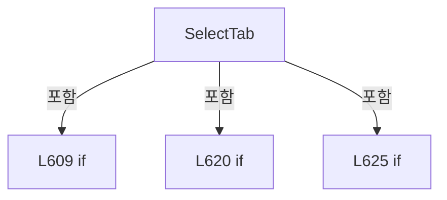

변경 전 점검: 입력/반환 타입, 위 호출자, 예외/취소 경로, 공유 상태와 저장·전송 소비자를 함께 확인합니다. 값의 단위나 물리 방향을 이름만으로 확정하지 않습니다.

### LocalFunctionStatement `MatchesItem` · L614–617

[Drilling.UI/Menu/Menus/CMenuCorrection.cs:614–617](https://github.com/kjuws10-rgb/A3Drilling/blob/334b3599651b2e8e0181fd4459bafaf3cddafff3/Drilling.UI/Menu/Menus/CMenuCorrection.cs#L614-L617)

| 항목 | 실제 추출 값 |
| --- | --- |
| 서명 | bool MatchesItem(string) |
| 접근/수식자 | Private /  |
| 반환/값 타입 | bool |
| 소속 타입 | NamedType:Drilling.UI.Menu.Menus.CMenuCorrection |

입력 계약:

| 이름 | 타입 | 전달 | 선택/기본값 |
| --- | --- | --- | --- |
| tab | string | None | False /  |

현재 부분 분석에서 직접 연결된 호출자는 없습니다. XAML/이벤트/인터페이스·델리게이트·외부 진입을 추가 확인해야 하며, 미사용으로 판정한 것이 아닙니다.

호출하는 대상과 해석 범위:

| 원본 행 | 표현식 | 분석 상태 | 대상/소스 위치 |
| --- | --- | --- | --- |
| 616 | tab.Equals | resolved | bool string.Equals(string?, System.StringComparison) |

본문의 실제 연산·분기·예외·반환 순서(원문 위치 순):

| 원본 행 | 종류 | 주석 해설 |
| --- | --- | --- |
| 616 | call | 함수·델리게이트 또는 객체 생성자를 호출합니다: tab.Equals(tabName, StringComparison.OrdinalIgnoreCase) |
| 616 | return | 호출자에게 값 또는 제어를 반환합니다: return tab.Equals(tabName, StringComparison.OrdinalIgnoreCase); |

변경 전 점검: 입력/반환 타입, 위 호출자, 예외/취소 경로, 공유 상태와 저장·전송 소비자를 함께 확인합니다. 값의 단위나 물리 방향을 이름만으로 확정하지 않습니다.

### MethodDeclaration `SelectOutputViewerCell` · L636–648

[Drilling.UI/Menu/Menus/CMenuCorrection.cs:636–648](https://github.com/kjuws10-rgb/A3Drilling/blob/334b3599651b2e8e0181fd4459bafaf3cddafff3/Drilling.UI/Menu/Menus/CMenuCorrection.cs#L636-L648)

| 항목 | 실제 추출 값 |
| --- | --- |
| 서명 | System.Threading.Tasks.Task Drilling.UI.Menu.Menus.CMenuCorrection.SelectOutputViewerCell(object?) |
| 접근/수식자 | Private / private, async |
| 반환/값 타입 | System.Threading.Tasks.Task |
| 소속 타입 | NamedType:Drilling.UI.Menu.Menus.CMenuCorrection |

입력 계약:

| 이름 | 타입 | 전달 | 선택/기본값 |
| --- | --- | --- | --- |
| parameter | object? | None | False /  |

정적 호출자로 확인된 위치:

| 호출 파일/행 | 호출 표현식 | 런타임 분기 가능 |
| --- | --- | --- |
| [Drilling.UI/Menu/Menus/CMenuCorrection.cs:181–181](https://github.com/kjuws10-rgb/A3Drilling/blob/334b3599651b2e8e0181fd4459bafaf3cddafff3/Drilling.UI/Menu/Menus/CMenuCorrection.cs#L181-L181) | SelectOutputViewerCell | False |

호출하는 대상과 해석 범위:

| 원본 행 | 표현식 | 분석 상태 | 대상/소스 위치 |
| --- | --- | --- | --- |
| 638 | int.TryParse | resolved | bool int.TryParse(string?, System.Globalization.NumberStyles, System.IFormatProvider?, out int) |
| 638 | .ToString | resolved · 동적 구현 선택 가능 | string? object.ToString() |
| 643 | Math.Max | resolved | int System.Math.Max(int, int) |
| 646 | _statusReporter | resolved · 동적 구현 선택 가능 | void System.Action<string>.Invoke(string) |
| 647 | _refreshCurrentScreen | resolved · 동적 구현 선택 가능 | System.Threading.Tasks.Task System.Func<System.Threading.Tasks.Task>.Invoke() |

본문의 실제 연산·분기·예외·반환 순서(원문 위치 순):

| 원본 행 | 종류 | 주석 해설 |
| --- | --- | --- |
| 638 | call | 함수·델리게이트 또는 객체 생성자를 호출합니다: int.TryParse(parameter?.ToString(), NumberStyles.Integer, CultureInfo.InvariantCulture, out var cellNo) |
| 638 | call | 함수·델리게이트 또는 객체 생성자를 호출합니다: .ToString() |
| 638 | if | 조건에 따라 분기합니다: if (!int.TryParse(parameter?.ToString(), NumberStyles.Integer, CultureInfo.InvariantCulture, out var cellNo)) |
| 640 | return | 호출자에게 값 또는 제어를 반환합니다: return; |
| 643 | assignment | 값을 대상에 대입합니다: _outputViewerSelectedCellNo = Math.Max(1, cellNo) |
| 643 | call | 함수·델리게이트 또는 객체 생성자를 호출합니다: Math.Max(1, cellNo) |
| 644 | assignment | 값을 대상에 대입합니다: _outputViewerIsCellDetailVisible = true |
| 645 | assignment | 값을 대상에 대입합니다: _outputViewerSelectedShotKey = "" |
| 646 | call | 함수·델리게이트 또는 객체 생성자를 호출합니다: _statusReporter($"Offset Viewer cell selected: CELL{_outputViewerSelectedCellNo:00}.") |
| 647 | await | 비동기 완료를 기다립니다: await _refreshCurrentScreen() |
| 647 | call | 함수·델리게이트 또는 객체 생성자를 호출합니다: _refreshCurrentScreen() |

제어 구문의 포함 구조(실제 실행 순서/CFG가 아닌 구문 탐색 그림):

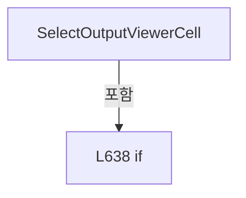

변경 전 점검: 입력/반환 타입, 위 호출자, 예외/취소 경로, 공유 상태와 저장·전송 소비자를 함께 확인합니다. 값의 단위나 물리 방향을 이름만으로 확정하지 않습니다.

### MethodDeclaration `SelectOutputViewerShot` · L650–659

[Drilling.UI/Menu/Menus/CMenuCorrection.cs:650–659](https://github.com/kjuws10-rgb/A3Drilling/blob/334b3599651b2e8e0181fd4459bafaf3cddafff3/Drilling.UI/Menu/Menus/CMenuCorrection.cs#L650-L659)

| 항목 | 실제 추출 값 |
| --- | --- |
| 서명 | void Drilling.UI.Menu.Menus.CMenuCorrection.SelectOutputViewerShot(object?) |
| 접근/수식자 | Private / private |
| 반환/값 타입 | void |
| 소속 타입 | NamedType:Drilling.UI.Menu.Menus.CMenuCorrection |

입력 계약:

| 이름 | 타입 | 전달 | 선택/기본값 |
| --- | --- | --- | --- |
| parameter | object? | None | False /  |

정적 호출자로 확인된 위치:

| 호출 파일/행 | 호출 표현식 | 런타임 분기 가능 |
| --- | --- | --- |
| [Drilling.UI/Menu/Menus/CMenuCorrection.cs:663–663](https://github.com/kjuws10-rgb/A3Drilling/blob/334b3599651b2e8e0181fd4459bafaf3cddafff3/Drilling.UI/Menu/Menus/CMenuCorrection.cs#L663-L663) | SelectOutputViewerShot | False |

호출하는 대상과 해석 범위:

| 원본 행 | 표현식 | 분석 상태 | 대상/소스 위치 |
| --- | --- | --- | --- |
| 652 | .ToString | resolved · 동적 구현 선택 가능 | string? object.ToString() |
| 652 | .Trim | resolved | string string.Trim() |
| 653 | string.IsNullOrWhiteSpace | resolved | bool string.IsNullOrWhiteSpace(string?) |
| 653 | _outputViewerSelectedCellShots.Any | resolved | bool System.Collections.Generic.IEnumerable<Drilling.Common.Recipe.ST_HEAD_SHOT_POINT>.Any<Drilling.Common.Recipe.ST_HEAD_SHOT_POINT>(System.Func<Drilling.Common.Recipe.ST_HEAD_SHOT_POINT, bool>) |
| 653 | shot.ShotKey.Equals | resolved | bool string.Equals(string?, System.StringComparison) |
| 658 | ApplyOutputViewerShotSelection | resolved | void Drilling.UI.Menu.Menus.CMenuCorrection.ApplyOutputViewerShotSelection(string) · Drilling.UI/Menu/Menus/CMenuCorrection.cs:689 |

본문의 실제 연산·분기·예외·반환 순서(원문 위치 순):

| 원본 행 | 종류 | 주석 해설 |
| --- | --- | --- |
| 652 | call | 함수·델리게이트 또는 객체 생성자를 호출합니다: .ToString() |
| 652 | call | 함수·델리게이트 또는 객체 생성자를 호출합니다: .Trim() |
| 652 | local-declaration | 지역 변수를 선언합니다: var shotKey = parameter?.ToString()?.Trim(); |
| 652 | variable-initializer | 변수의 초기값을 지정합니다: shotKey = parameter?.ToString()?.Trim() |
| 653 | call | 함수·델리게이트 또는 객체 생성자를 호출합니다: string.IsNullOrWhiteSpace(shotKey) |
| 653 | call | 함수·델리게이트 또는 객체 생성자를 호출합니다: _outputViewerSelectedCellShots.Any(shot => shot.ShotKey.Equals(shotKey, StringComparison.OrdinalIgnoreCase)) |
| 653 | call | 함수·델리게이트 또는 객체 생성자를 호출합니다: shot.ShotKey.Equals(shotKey, StringComparison.OrdinalIgnoreCase) |
| 653 | if | 조건에 따라 분기합니다: if (string.IsNullOrWhiteSpace(shotKey) &#124;&#124; !_outputViewerSelectedCellShots.Any(shot => shot.ShotKey.Equals(shotKey, StringComparison.OrdinalIgnoreCase))) |
| 655 | return | 호출자에게 값 또는 제어를 반환합니다: return; |
| 658 | call | 함수·델리게이트 또는 객체 생성자를 호출합니다: ApplyOutputViewerShotSelection(shotKey) |

제어 구문의 포함 구조(실제 실행 순서/CFG가 아닌 구문 탐색 그림):

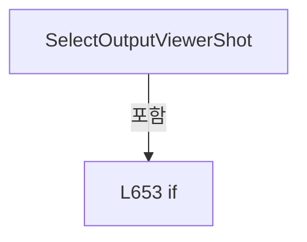

변경 전 점검: 입력/반환 타입, 위 호출자, 예외/취소 경로, 공유 상태와 저장·전송 소비자를 함께 확인합니다. 값의 단위나 물리 방향을 이름만으로 확정하지 않습니다.

### MethodDeclaration `SelectOutputViewerShotByKey` · L661–664

[Drilling.UI/Menu/Menus/CMenuCorrection.cs:661–664](https://github.com/kjuws10-rgb/A3Drilling/blob/334b3599651b2e8e0181fd4459bafaf3cddafff3/Drilling.UI/Menu/Menus/CMenuCorrection.cs#L661-L664)

| 항목 | 실제 추출 값 |
| --- | --- |
| 서명 | void Drilling.UI.Menu.Menus.CMenuCorrection.SelectOutputViewerShotByKey(string) |
| 접근/수식자 | Public / public |
| 반환/값 타입 | void |
| 소속 타입 | NamedType:Drilling.UI.Menu.Menus.CMenuCorrection |

입력 계약:

| 이름 | 타입 | 전달 | 선택/기본값 |
| --- | --- | --- | --- |
| shotKey | string | None | False /  |

정적 호출자로 확인된 위치:

| 호출 파일/행 | 호출 표현식 | 런타임 분기 가능 |
| --- | --- | --- |
| [Drilling.UI/Views/CCorrectionView.xaml.cs:69–69](https://github.com/kjuws10-rgb/A3Drilling/blob/334b3599651b2e8e0181fd4459bafaf3cddafff3/Drilling.UI/Views/CCorrectionView.xaml.cs#L69-L69) | correction.SelectOutputViewerShotByKey | False |

호출하는 대상과 해석 범위:

| 원본 행 | 표현식 | 분석 상태 | 대상/소스 위치 |
| --- | --- | --- | --- |
| 663 | SelectOutputViewerShot | resolved | void Drilling.UI.Menu.Menus.CMenuCorrection.SelectOutputViewerShot(object?) · Drilling.UI/Menu/Menus/CMenuCorrection.cs:650 |

본문의 실제 연산·분기·예외·반환 순서(원문 위치 순):

| 원본 행 | 종류 | 주석 해설 |
| --- | --- | --- |
| 663 | call | 함수·델리게이트 또는 객체 생성자를 호출합니다: SelectOutputViewerShot(shotKey) |

변경 전 점검: 입력/반환 타입, 위 호출자, 예외/취소 경로, 공유 상태와 저장·전송 소비자를 함께 확인합니다. 값의 단위나 물리 방향을 이름만으로 확정하지 않습니다.

### MethodDeclaration `SelectOutputViewerShotAt` · L666–687

[Drilling.UI/Menu/Menus/CMenuCorrection.cs:666–687](https://github.com/kjuws10-rgb/A3Drilling/blob/334b3599651b2e8e0181fd4459bafaf3cddafff3/Drilling.UI/Menu/Menus/CMenuCorrection.cs#L666-L687)

| 항목 | 실제 추출 값 |
| --- | --- |
| 서명 | void Drilling.UI.Menu.Menus.CMenuCorrection.SelectOutputViewerShotAt(double, double) |
| 접근/수식자 | Public / public |
| 반환/값 타입 | void |
| 소속 타입 | NamedType:Drilling.UI.Menu.Menus.CMenuCorrection |

입력 계약:

| 이름 | 타입 | 전달 | 선택/기본값 |
| --- | --- | --- | --- |
| designX | double | None | False /  |
| designY | double | None | False /  |

현재 부분 분석에서 직접 연결된 호출자는 없습니다. XAML/이벤트/인터페이스·델리게이트·외부 진입을 추가 확인해야 하며, 미사용으로 판정한 것이 아닙니다.

호출하는 대상과 해석 범위:

| 원본 행 | 표현식 | 분석 상태 | 대상/소스 위치 |
| --- | --- | --- | --- |
| 674 | GetOutputViewerShotMapRect | resolved | Rect Drilling.UI.Menu.Menus.CMenuCorrection.GetOutputViewerShotMapRect(int, int) · Drilling.UI/Menu/Menus/CMenuCorrection.cs:947 |
| 675 | mapRect.Contains | unresolved | None |
| 675 | new Point | unresolved | None |
| 680 | Math.Clamp | resolved | int System.Math.Clamp(int, int, int) |
| 681 | Math.Clamp | resolved | int System.Math.Clamp(int, int, int) |
| 682 | _outputViewerSelectedCellShots.FirstOrDefault | resolved | Drilling.Common.Recipe.ST_HEAD_SHOT_POINT? System.Collections.Generic.IEnumerable<Drilling.Common.Recipe.ST_HEAD_SHOT_POINT>.FirstOrDefault<Drilling.Common.Recipe.ST_HEAD_SHOT_POINT>(System.Func<Drilling.Common.Recipe.ST_HEAD_SHOT_POINT, bool>) |
| 685 | ApplyOutputViewerShotSelection | resolved | void Drilling.UI.Menu.Menus.CMenuCorrection.ApplyOutputViewerShotSelection(string) · Drilling.UI/Menu/Menus/CMenuCorrection.cs:689 |

본문의 실제 연산·분기·예외·반환 순서(원문 위치 순):

| 원본 행 | 종류 | 주석 해설 |
| --- | --- | --- |
| 668 | if | 조건에 따라 분기합니다: if (!_outputViewerIsCellDetailVisible &#124;&#124; _outputViewerSelectedCellShots.Count == 0) |
| 670 | return | 호출자에게 값 또는 제어를 반환합니다: return; |
| 673 | local-declaration | 지역 변수를 선언합니다: var firstShot = _outputViewerSelectedCellShots[0]; |
| 673 | variable-initializer | 변수의 초기값을 지정합니다: firstShot = _outputViewerSelectedCellShots[0] |
| 674 | call | 함수·델리게이트 또는 객체 생성자를 호출합니다: GetOutputViewerShotMapRect(firstShot.GroupCountX, firstShot.GroupCountY) |
| 674 | local-declaration | 지역 변수를 선언합니다: var mapRect = GetOutputViewerShotMapRect(firstShot.GroupCountX, firstShot.GroupCountY); |
| 674 | variable-initializer | 변수의 초기값을 지정합니다: mapRect = GetOutputViewerShotMapRect(firstShot.GroupCountX, firstShot.GroupCountY) |
| 675 | call | 함수·델리게이트 또는 객체 생성자를 호출합니다: mapRect.Contains(new Point(designX, designY)) |
| 675 | call | 함수·델리게이트 또는 객체 생성자를 호출합니다: new Point(designX, designY) |
| 675 | if | 조건에 따라 분기합니다: if (!mapRect.Contains(new Point(designX, designY))) |
| 677 | return | 호출자에게 값 또는 제어를 반환합니다: return; |
| 680 | call | 함수·델리게이트 또는 객체 생성자를 호출합니다: Math.Clamp((int)((designX - mapRect.Left) / mapRect.Width * firstShot.GroupCountX), 0, firstShot.GroupCountX - 1) |
| 680 | local-declaration | 지역 변수를 선언합니다: var column = Math.Clamp((int)((designX - mapRect.Left) / mapRect.Width * firstShot.GroupCountX), 0, firstShot.GroupCountX - 1); |
| 680 | variable-initializer | 변수의 초기값을 지정합니다: column = Math.Clamp((int)((designX - mapRect.Left) / mapRect.Width * firstShot.GroupCountX), 0, firstShot.GroupCountX - 1) |
| 681 | call | 함수·델리게이트 또는 객체 생성자를 호출합니다: Math.Clamp((int)((designY - mapRect.Top) / mapRect.Height * firstShot.GroupCountY), 0, firstShot.GroupCountY - 1) |
| 681 | local-declaration | 지역 변수를 선언합니다: var row = Math.Clamp((int)((designY - mapRect.Top) / mapRect.Height * firstShot.GroupCountY), 0, firstShot.GroupCountY - 1); |
| 681 | variable-initializer | 변수의 초기값을 지정합니다: row = Math.Clamp((int)((designY - mapRect.Top) / mapRect.Height * firstShot.GroupCountY), 0, firstShot.GroupCountY - 1) |
| 682 | call | 함수·델리게이트 또는 객체 생성자를 호출합니다: _outputViewerSelectedCellShots.FirstOrDefault(item => item.GroupColumn == column && item.GroupRow == row) |
| 682 | local-declaration | 지역 변수를 선언합니다: var shot = _outputViewerSelectedCellShots.FirstOrDefault(item => item.GroupColumn == column && item.GroupRow == row); |
| 682 | variable-initializer | 변수의 초기값을 지정합니다: shot = _outputViewerSelectedCellShots.FirstOrDefault(item => item.GroupColumn == column && item.GroupRow == row) |
| 683 | if | 조건에 따라 분기합니다: if (shot is not null) |
| 685 | call | 함수·델리게이트 또는 객체 생성자를 호출합니다: ApplyOutputViewerShotSelection(shot.ShotKey) |

제어 구문의 포함 구조(실제 실행 순서/CFG가 아닌 구문 탐색 그림):

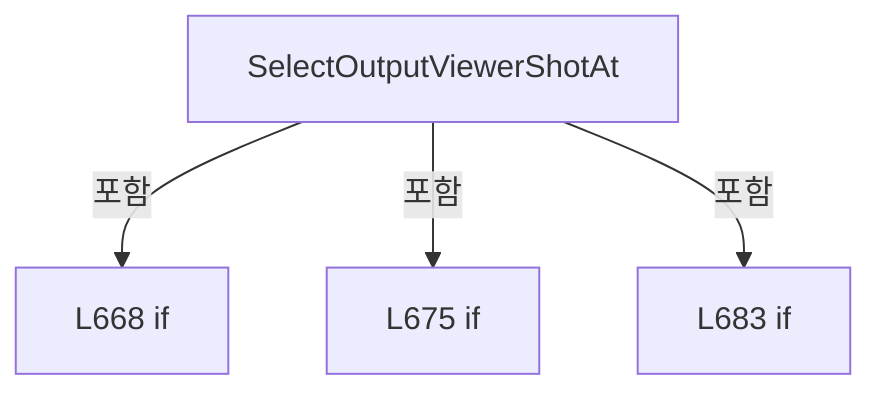

변경 전 점검: 입력/반환 타입, 위 호출자, 예외/취소 경로, 공유 상태와 저장·전송 소비자를 함께 확인합니다. 값의 단위나 물리 방향을 이름만으로 확정하지 않습니다.

### MethodDeclaration `ApplyOutputViewerShotSelection` · L689–703

[Drilling.UI/Menu/Menus/CMenuCorrection.cs:689–703](https://github.com/kjuws10-rgb/A3Drilling/blob/334b3599651b2e8e0181fd4459bafaf3cddafff3/Drilling.UI/Menu/Menus/CMenuCorrection.cs#L689-L703)

| 항목 | 실제 추출 값 |
| --- | --- |
| 서명 | void Drilling.UI.Menu.Menus.CMenuCorrection.ApplyOutputViewerShotSelection(string) |
| 접근/수식자 | Private / private |
| 반환/값 타입 | void |
| 소속 타입 | NamedType:Drilling.UI.Menu.Menus.CMenuCorrection |

입력 계약:

| 이름 | 타입 | 전달 | 선택/기본값 |
| --- | --- | --- | --- |
| shotKey | string | None | False /  |

정적 호출자로 확인된 위치:

| 호출 파일/행 | 호출 표현식 | 런타임 분기 가능 |
| --- | --- | --- |
| [Drilling.UI/Menu/Menus/CMenuCorrection.cs:658–658](https://github.com/kjuws10-rgb/A3Drilling/blob/334b3599651b2e8e0181fd4459bafaf3cddafff3/Drilling.UI/Menu/Menus/CMenuCorrection.cs#L658-L658) | ApplyOutputViewerShotSelection | False |
| [Drilling.UI/Menu/Menus/CMenuCorrection.cs:685–685](https://github.com/kjuws10-rgb/A3Drilling/blob/334b3599651b2e8e0181fd4459bafaf3cddafff3/Drilling.UI/Menu/Menus/CMenuCorrection.cs#L685-L685) | ApplyOutputViewerShotSelection | False |

호출하는 대상과 해석 범위:

| 원본 행 | 표현식 | 분석 상태 | 대상/소스 위치 |
| --- | --- | --- | --- |
| 691 | _outputViewerSelectedShotKey.Equals | resolved | bool string.Equals(string?, System.StringComparison) |
| 697 | BuildOutputViewerCellShotMap | resolved | ImageSource? Drilling.UI.Menu.Menus.CMenuCorrection.BuildOutputViewerCellShotMap(System.Collections.Generic.IReadOnlyList<Drilling.Common.Recipe.ST_HEAD_SHOT_POINT>, System.Collections.Generic.IReadOnlyDictionary<string, Drilling.Common.Recipe.ST_RECIPE_SHOT_MASKING_RESULT>, string) · Drilling.UI/Menu/Menus/CMenuCorrection.cs:974 |
| 698 | OutputOffsets.SelectShot | resolved | void Drilling.UI.Menu.Menus.COutputOffsetViewerPanel.SelectShot(string) · Drilling.UI/Menu/Menus/CMenuCorrection.cs:7209 |
| 699 | .Invoke | resolved · 동적 구현 선택 가능 | void System.EventHandler.Invoke(object?, System.EventArgs) |
| 700 | .Invoke | resolved · 동적 구현 선택 가능 | void System.EventHandler.Invoke(object?, System.EventArgs) |
| 701 | .Invoke | resolved · 동적 구현 선택 가능 | void System.EventHandler.Invoke(object?, System.EventArgs) |
| 702 | _statusReporter | resolved · 동적 구현 선택 가능 | void System.Action<string>.Invoke(string) |

본문의 실제 연산·분기·예외·반환 순서(원문 위치 순):

| 원본 행 | 종류 | 주석 해설 |
| --- | --- | --- |
| 691 | call | 함수·델리게이트 또는 객체 생성자를 호출합니다: _outputViewerSelectedShotKey.Equals(shotKey, StringComparison.OrdinalIgnoreCase) |
| 691 | if | 조건에 따라 분기합니다: if (_outputViewerSelectedShotKey.Equals(shotKey, StringComparison.OrdinalIgnoreCase)) |
| 693 | return | 호출자에게 값 또는 제어를 반환합니다: return; |
| 696 | assignment | 값을 대상에 대입합니다: _outputViewerSelectedShotKey = shotKey |
| 697 | assignment | 값을 대상에 대입합니다: OutputViewerCellShotMapImage = BuildOutputViewerCellShotMap(_outputViewerSelectedCellShots, _outputViewerSelectedShotStates, _outputViewerSelectedShotKey) |
| 697 | call | 함수·델리게이트 또는 객체 생성자를 호출합니다: BuildOutputViewerCellShotMap(_outputViewerSelectedCellShots, _outputViewerSelectedShotStates, _outputViewerSelectedShotKey) |
| 698 | call | 함수·델리게이트 또는 객체 생성자를 호출합니다: OutputOffsets.SelectShot(_outputViewerSelectedShotKey) |
| 699 | call | 함수·델리게이트 또는 객체 생성자를 호출합니다: .Invoke(this, EventArgs.Empty) |
| 700 | call | 함수·델리게이트 또는 객체 생성자를 호출합니다: .Invoke(this, EventArgs.Empty) |
| 701 | call | 함수·델리게이트 또는 객체 생성자를 호출합니다: .Invoke(this, EventArgs.Empty) |
| 702 | call | 함수·델리게이트 또는 객체 생성자를 호출합니다: _statusReporter($"Offset Viewer shot selected: {OutputViewerSelectedShotName}.") |

제어 구문의 포함 구조(실제 실행 순서/CFG가 아닌 구문 탐색 그림):


변경 전 점검: 입력/반환 타입, 위 호출자, 예외/취소 경로, 공유 상태와 저장·전송 소비자를 함께 확인합니다. 값의 단위나 물리 방향을 이름만으로 확정하지 않습니다.

### MethodDeclaration `BackToOutputViewerGlass` · L705–712

[Drilling.UI/Menu/Menus/CMenuCorrection.cs:705–712](https://github.com/kjuws10-rgb/A3Drilling/blob/334b3599651b2e8e0181fd4459bafaf3cddafff3/Drilling.UI/Menu/Menus/CMenuCorrection.cs#L705-L712)

| 항목 | 실제 추출 값 |
| --- | --- |
| 서명 | System.Threading.Tasks.Task Drilling.UI.Menu.Menus.CMenuCorrection.BackToOutputViewerGlass(object?) |
| 접근/수식자 | Private / private, async |
| 반환/값 타입 | System.Threading.Tasks.Task |
| 소속 타입 | NamedType:Drilling.UI.Menu.Menus.CMenuCorrection |

입력 계약:

| 이름 | 타입 | 전달 | 선택/기본값 |
| --- | --- | --- | --- |
| parameter | object? | None | False /  |

정적 호출자로 확인된 위치:

| 호출 파일/행 | 호출 표현식 | 런타임 분기 가능 |
| --- | --- | --- |
| [Drilling.UI/Menu/Menus/CMenuCorrection.cs:188–188](https://github.com/kjuws10-rgb/A3Drilling/blob/334b3599651b2e8e0181fd4459bafaf3cddafff3/Drilling.UI/Menu/Menus/CMenuCorrection.cs#L188-L188) | BackToOutputViewerGlass | False |

호출하는 대상과 해석 범위:

| 원본 행 | 표현식 | 분석 상태 | 대상/소스 위치 |
| --- | --- | --- | --- |
| 710 | _statusReporter | resolved · 동적 구현 선택 가능 | void System.Action<string>.Invoke(string) |
| 711 | _refreshCurrentScreen | resolved · 동적 구현 선택 가능 | System.Threading.Tasks.Task System.Func<System.Threading.Tasks.Task>.Invoke() |

본문의 실제 연산·분기·예외·반환 순서(원문 위치 순):

| 원본 행 | 종류 | 주석 해설 |
| --- | --- | --- |
| 707 | assignment | 값을 대상에 대입합니다: _outputViewerIsCellDetailVisible = false |
| 708 | assignment | 값을 대상에 대입합니다: _outputViewerSelectedCellNo = 0 |
| 709 | assignment | 값을 대상에 대입합니다: _outputViewerSelectedShotKey = "" |
| 710 | call | 함수·델리게이트 또는 객체 생성자를 호출합니다: _statusReporter("Offset Viewer glass preview opened.") |
| 711 | await | 비동기 완료를 기다립니다: await _refreshCurrentScreen() |
| 711 | call | 함수·델리게이트 또는 객체 생성자를 호출합니다: _refreshCurrentScreen() |

변경 전 점검: 입력/반환 타입, 위 호출자, 예외/취소 경로, 공유 상태와 저장·전송 소비자를 함께 확인합니다. 값의 단위나 물리 방향을 이름만으로 확정하지 않습니다.

### MethodDeclaration `RefreshOutputViewerData` · L714–849

[Drilling.UI/Menu/Menus/CMenuCorrection.cs:714–849](https://github.com/kjuws10-rgb/A3Drilling/blob/334b3599651b2e8e0181fd4459bafaf3cddafff3/Drilling.UI/Menu/Menus/CMenuCorrection.cs#L714-L849)

| 항목 | 실제 추출 값 |
| --- | --- |
| 서명 | System.Threading.Tasks.Task Drilling.UI.Menu.Menus.CMenuCorrection.RefreshOutputViewerData(System.Threading.CancellationToken) |
| 접근/수식자 | Private / private, async |
| 반환/값 타입 | System.Threading.Tasks.Task |
| 소속 타입 | NamedType:Drilling.UI.Menu.Menus.CMenuCorrection |

입력 계약:

| 이름 | 타입 | 전달 | 선택/기본값 |
| --- | --- | --- | --- |
| cancellationToken | System.Threading.CancellationToken | None | False /  |

정적 호출자로 확인된 위치:

| 호출 파일/행 | 호출 표현식 | 런타임 분기 가능 |
| --- | --- | --- |
| [Drilling.UI/Menu/Menus/CMenuCorrection.cs:591–591](https://github.com/kjuws10-rgb/A3Drilling/blob/334b3599651b2e8e0181fd4459bafaf3cddafff3/Drilling.UI/Menu/Menus/CMenuCorrection.cs#L591-L591) | RefreshOutputViewerData | False |

호출하는 대상과 해석 범위:

| 원본 행 | 표현식 | 분석 상태 | 대상/소스 위치 |
| --- | --- | --- | --- |
| 716 | System.Threading.Interlocked.Increment | resolved | int System.Threading.Interlocked.Increment(ref int) |
| 719 | LoadSelectedOutputViewerRecipe | resolved | System.Threading.Tasks.Task<Drilling.Common.Managers.ST_RECIPE_DEFINITION?> Drilling.UI.Menu.Menus.CMenuCorrection.LoadSelectedOutputViewerRecipe(System.Threading.CancellationToken, bool) · Drilling.UI/Menu/Menus/CMenuCorrection.cs:851 |
| 724 | ClearOutputViewerCellSelectionData | resolved | void Drilling.UI.Menu.Menus.CMenuCorrection.ClearOutputViewerCellSelectionData() · Drilling.UI/Menu/Menus/CMenuCorrection.cs:918 |
| 725 | OutputOffsets.Clear | resolved | void Drilling.UI.Menu.Menus.COutputOffsetViewerPanel.Clear() · Drilling.UI/Menu/Menus/CMenuCorrection.cs:7202 |
| 730 | new List<ST_SYSTEM_PARAMETER> | resolved | System.Collections.Generic.List<Drilling.Common.Managers.ST_SYSTEM_PARAMETER>.List() |
| 731 | settings.AddRange | resolved | void System.Collections.Generic.List<Drilling.Common.Managers.ST_SYSTEM_PARAMETER>.AddRange(System.Collections.Generic.IEnumerable<Drilling.Common.Managers.ST_SYSTEM_PARAMETER>) |
| 731 | _settingManager.LoadSection | resolved | System.Collections.Generic.IReadOnlyList<Drilling.Common.Managers.ST_SYSTEM_PARAMETER> Drilling.Common.Managers.CSettingManager.LoadSection(Drilling.Common.Managers.EN_SETTING_TAB, System.Threading.CancellationToken) · Drilling.Common/Managers/CSettingManager.cs:26 |
| 732 | settings.AddRange | resolved | void System.Collections.Generic.List<Drilling.Common.Managers.ST_SYSTEM_PARAMETER>.AddRange(System.Collections.Generic.IEnumerable<Drilling.Common.Managers.ST_SYSTEM_PARAMETER>) |
| 732 | _settingManager.LoadSection | resolved | System.Collections.Generic.IReadOnlyList<Drilling.Common.Managers.ST_SYSTEM_PARAMETER> Drilling.Common.Managers.CSettingManager.LoadSection(Drilling.Common.Managers.EN_SETTING_TAB, System.Threading.CancellationToken) · Drilling.Common/Managers/CSettingManager.cs:26 |
| 733 | BuildOutputViewerParameterMap | resolved | System.Collections.Generic.Dictionary<string, string> Drilling.UI.Menu.Menus.CMenuCorrection.BuildOutputViewerParameterMap(Drilling.Common.Managers.ST_RECIPE_DEFINITION, System.Collections.Generic.IReadOnlyList<Drilling.Common.Managers.ST_SYSTEM_PARAMETER>) · Drilling.UI/Menu/Menus/CMenuCorrection.cs:868 |
| 734 | _reviewOffsetFile.LoadLatest | resolved | System.Threading.Tasks.Task<Drilling.Common.Review.ST_REVIEW_OFFSET_FILE_DATA> Drilling.Common.Review.CReviewOffsetFileBase.LoadLatest(string, System.Threading.CancellationToken) · Drilling.Common/Review/CReviewManager.cs:4397 |
| 736 | ApplyReviewOffsetsToOutputViewerParameters | resolved | void Drilling.UI.Menu.Menus.CMenuCorrection.ApplyReviewOffsetsToOutputViewerParameters(System.Collections.Generic.IDictionary<string, string>, Drilling.Common.Review.ST_REVIEW_OFFSET_FILE_DATA) · Drilling.UI/Menu/Menus/CMenuCorrection.cs:1113 |
| 737 | Math.Max | resolved | int System.Math.Max(int, int) |
| 737 | ReadOutputViewerInt | resolved | int Drilling.UI.Menu.Menus.CMenuCorrection.ReadOutputViewerInt(System.Collections.Generic.IReadOnlyDictionary<string, string>, int, params string[]) · Drilling.UI/Menu/Menus/CMenuCorrection.cs:1338 |
| 740 | Math.Clamp | resolved | int System.Math.Clamp(int, int, int) |
| 740 | Math.Max | resolved | int System.Math.Max(int, int) |
| 749 | OutputViewerParametersMatch | resolved | bool Drilling.UI.Menu.Menus.CMenuCorrection.OutputViewerParametersMatch(System.Collections.Generic.IReadOnlyDictionary<string, string>?, System.Collections.Generic.IReadOnlyDictionary<string, string>) · Drilling.UI/Menu/Menus/CMenuCorrection.cs:900 |
| 751 | Task.Run | resolved | System.Threading.Tasks.Task<Drilling.UI.Menu.Menus.ST_CORRECTION_OFFSET_VIEWER_PREVIEW> System.Threading.Tasks.Task.Run<Drilling.UI.Menu.Menus.ST_CORRECTION_OFFSET_VIEWER_PREVIEW>(System.Func<Drilling.UI.Menu.Menus.ST_CORRECTION_OFFSET_VIEWER_PREVIEW>, System.Threading.CancellationToken) |
| 751 | BuildOutputViewerGlassPreview | resolved | Drilling.UI.Menu.Menus.ST_CORRECTION_OFFSET_VIEWER_PREVIEW Drilling.UI.Menu.Menus.CMenuCorrection.BuildOutputViewerGlassPreview(System.Collections.Generic.IReadOnlyDictionary<string, string>, int, int) · Drilling.UI/Menu/Menus/CMenuCorrection.cs:1118 |
| 752 | cancellationToken.ThrowIfCancellationRequested | resolved | void System.Threading.CancellationToken.ThrowIfCancellationRequested() |
| 753 | System.Threading.Volatile.Read | resolved | int System.Threading.Volatile.Read(ref readonly int) |
| 758 | CopyOutputViewerParameters | resolved | System.Collections.Generic.IReadOnlyDictionary<string, string> Drilling.UI.Menu.Menus.CMenuCorrection.CopyOutputViewerParameters(System.Collections.Generic.IReadOnlyDictionary<string, string>) · Drilling.UI/Menu/Menus/CMenuCorrection.cs:895 |
| 764 | System.Threading.Volatile.Read | resolved | int System.Threading.Volatile.Read(ref readonly int) |
| 774 | BuildOutputViewerCoordinateParameterMap | resolved | System.Collections.Generic.IReadOnlyDictionary<string, string> Drilling.UI.Menu.Menus.CMenuCorrection.BuildOutputViewerCoordinateParameterMap(System.Collections.Generic.IReadOnlyDictionary<string, string>) · Drilling.UI/Menu/Menus/CMenuCorrection.cs:1326 |
| 776 | OutputViewerParametersMatch | resolved | bool Drilling.UI.Menu.Menus.CMenuCorrection.OutputViewerParametersMatch(System.Collections.Generic.IReadOnlyDictionary<string, string>?, System.Collections.Generic.IReadOnlyDictionary<string, string>) · Drilling.UI/Menu/Menus/CMenuCorrection.cs:900 |
| 782 | Task.Run<IReadOnlyList<ST_HEAD_SHOT_POINT>> | resolved | System.Threading.Tasks.Task<System.Collections.Generic.IReadOnlyList<Drilling.Common.Recipe.ST_HEAD_SHOT_POINT>> System.Threading.Tasks.Task.Run<System.Collections.Generic.IReadOnlyList<Drilling.Common.Recipe.ST_HEAD_SHOT_POINT>>(System.Func<System.Collections.Generic.IReadOnlyList<Drilling.Common.Recipe.ST_HEAD_SHOT_POINT>>, System.Threading.CancellationToken) |
| 784 | CShotCoordinatePlanBuilder.Build | resolved | Drilling.Common.Recipe.ST_SHOT_COORDINATE_PLAN Drilling.Common.Recipe.CShotCoordinatePlanBuilder.Build(System.Collections.Generic.IReadOnlyDictionary<string, string>) · Drilling.Common/Recipe/CShotCoordinatePlanBuilder.cs:11 |
| 785 | plan.Shots.Where(shot => shot.CellNo == selectedCellNo).ToArray | resolved | Drilling.Common.Recipe.ST_HEAD_SHOT_POINT[] System.Collections.Generic.IEnumerable<Drilling.Common.Recipe.ST_HEAD_SHOT_POINT>.ToArray<Drilling.Common.Recipe.ST_HEAD_SHOT_POINT>() |
| 785 | plan.Shots.Where | resolved | System.Collections.Generic.IEnumerable<Drilling.Common.Recipe.ST_HEAD_SHOT_POINT> System.Collections.Generic.IEnumerable<Drilling.Common.Recipe.ST_HEAD_SHOT_POINT>.Where<Drilling.Common.Recipe.ST_HEAD_SHOT_POINT>(System.Func<Drilling.Common.Recipe.ST_HEAD_SHOT_POINT, bool>) |
| 787 | cancellationToken.ThrowIfCancellationRequested | resolved | void System.Threading.CancellationToken.ThrowIfCancellationRequested() |
| 788 | System.Threading.Volatile.Read | resolved | int System.Threading.Volatile.Read(ref readonly int) |
| 793 | CopyOutputViewerParameters | resolved | System.Collections.Generic.IReadOnlyDictionary<string, string> Drilling.UI.Menu.Menus.CMenuCorrection.CopyOutputViewerParameters(System.Collections.Generic.IReadOnlyDictionary<string, string>) · Drilling.UI/Menu/Menus/CMenuCorrection.cs:895 |
| 798 | _outputViewerSelectedShotKey.Equals | resolved | bool string.Equals(string?, System.StringComparison) |
| 798 | selectedShots.Any | resolved | bool System.Collections.Generic.IEnumerable<Drilling.Common.Recipe.ST_HEAD_SHOT_POINT>.Any<Drilling.Common.Recipe.ST_HEAD_SHOT_POINT>(System.Func<Drilling.Common.Recipe.ST_HEAD_SHOT_POINT, bool>) |
| 798 | shot.ShotKey.Equals | resolved | bool string.Equals(string?, System.StringComparison) |
| 804 | Task.Run | resolved | System.Threading.Tasks.Task<(System.Collections.Generic.IReadOnlyDictionary<string, Drilling.Common.Recipe.ST_RECIPE_SHOT_MASKING_RESULT> States, ImageSource? Image)> System.Threading.Tasks.Task.Run<(System.Collections.Generic.IReadOnlyDictionary<string, Drilling.Common.Recipe.ST_RECIPE_SHOT_MASKING_RESULT> States, ImageSource? Image)>(System.Func<(System.Collections.Generic.IReadOnlyDictionary<string, Drilling.Common.Recipe.ST_RECIPE_SHOT_MASKING_RESULT> States, ImageSource? Image)>, System.Threading.CancellationToken) |
| 806 | CRecipeShotMaskingPlan.Build | resolved | Drilling.Common.Recipe.CRecipeShotMaskingPlan Drilling.Common.Recipe.CRecipeShotMaskingPlan.Build(System.Collections.Generic.IReadOnlyDictionary<string, string>) · Drilling.Common/Recipe/CShotCoordinatePlanBuilder.cs:836 |
| 807 | selectedShots.ToDictionary | resolved | System.Collections.Generic.Dictionary<string, Drilling.Common.Recipe.ST_RECIPE_SHOT_MASKING_RESULT> System.Collections.Generic.IEnumerable<Drilling.Common.Recipe.ST_HEAD_SHOT_POINT>.ToDictionary<Drilling.Common.Recipe.ST_HEAD_SHOT_POINT, string, Drilling.Common.Recipe.ST_RECIPE_SHOT_MASKING_RESULT>(System.Func<Drilling.Common.Recipe.ST_HEAD_SHOT_POINT, string>, System.Func<Drilling.Common.Recipe.ST_HEAD_SHOT_POINT, Drilling.Common.Recipe.ST_RECIPE_SHOT_MASKING_RESULT>, System.Collections.Generic.IEqualityComparer<string>?) |
| 809 | maskingPlan.EvaluateShot | resolved | Drilling.Common.Recipe.ST_RECIPE_SHOT_MASKING_RESULT Drilling.Common.Recipe.CRecipeShotMaskingPlan.EvaluateShot(Drilling.Common.Recipe.ST_HEAD_SHOT_POINT) · Drilling.Common/Recipe/CShotCoordinatePlanBuilder.cs:876 |
| 811 | BuildOutputViewerCellShotMap | resolved | ImageSource? Drilling.UI.Menu.Menus.CMenuCorrection.BuildOutputViewerCellShotMap(System.Collections.Generic.IReadOnlyList<Drilling.Common.Recipe.ST_HEAD_SHOT_POINT>, System.Collections.Generic.IReadOnlyDictionary<string, Drilling.Common.Recipe.ST_RECIPE_SHOT_MASKING_RESULT>, string) · Drilling.UI/Menu/Menus/CMenuCorrection.cs:974 |
| 813 | cancellationToken.ThrowIfCancellationRequested | resolved | void System.Threading.CancellationToken.ThrowIfCancellationRequested() |
| 814 | System.Threading.Volatile.Read | resolved | int System.Threading.Volatile.Read(ref readonly int) |
| 822 | CreateOutputViewerHeadCards | resolved | System.Collections.Generic.IReadOnlyList<Drilling.UI.Menu.Menus.ST_CORRECTION_OUTPUT_VIEWER_HEAD_CARD> Drilling.UI.Menu.Menus.CMenuCorrection.CreateOutputViewerHeadCards(System.Collections.Generic.IReadOnlyList<Drilling.Common.Recipe.ST_HEAD_SHOT_POINT>) · Drilling.UI/Menu/Menus/CMenuCorrection.cs:953 |
| 823 | OutputOffsets.Update | resolved | void Drilling.UI.Menu.Menus.COutputOffsetViewerPanel.Update(System.Collections.Generic.IReadOnlyDictionary<string, string>, System.Collections.Generic.IReadOnlyList<Drilling.Common.Recipe.ST_HEAD_SHOT_POINT>, string) · Drilling.UI/Menu/Menus/CMenuCorrection.cs:7194 |
| 827 | ClearOutputViewerCellSelectionData | resolved | void Drilling.UI.Menu.Menus.CMenuCorrection.ClearOutputViewerCellSelectionData() · Drilling.UI/Menu/Menus/CMenuCorrection.cs:918 |
| 828 | OutputOffsets.Clear | resolved | void Drilling.UI.Menu.Menus.COutputOffsetViewerPanel.Clear() · Drilling.UI/Menu/Menus/CMenuCorrection.cs:7202 |
| 837 | System.Threading.Volatile.Read | resolved | int System.Threading.Volatile.Read(ref readonly int) |
| 842 | ReportInvalidReviewOffset | resolved | void Drilling.UI.Menu.Menus.CMenuCorrection.ReportInvalidReviewOffset(System.Exception) · Drilling.UI/Menu/Menus/CMenuCorrection.cs:3264 |
| 845 | ClearOutputViewerCellSelectionData | resolved | void Drilling.UI.Menu.Menus.CMenuCorrection.ClearOutputViewerCellSelectionData() · Drilling.UI/Menu/Menus/CMenuCorrection.cs:918 |
| 846 | OutputOffsets.Clear | resolved | void Drilling.UI.Menu.Menus.COutputOffsetViewerPanel.Clear() · Drilling.UI/Menu/Menus/CMenuCorrection.cs:7202 |

본문의 실제 연산·분기·예외·반환 순서(원문 위치 순):

| 원본 행 | 종류 | 주석 해설 |
| --- | --- | --- |
| 716 | call | 함수·델리게이트 또는 객체 생성자를 호출합니다: System.Threading.Interlocked.Increment(ref _outputViewerRefreshVersion) |
| 716 | local-declaration | 지역 변수를 선언합니다: var refreshVersion = System.Threading.Interlocked.Increment(ref _outputViewerRefreshVersion); |
| 716 | variable-initializer | 변수의 초기값을 지정합니다: refreshVersion = System.Threading.Interlocked.Increment(ref _outputViewerRefreshVersion) |
| 717 | try | 예외 처리 범위입니다: try |
| 719 | await | 비동기 완료를 기다립니다: await LoadSelectedOutputViewerRecipe(cancellationToken) |
| 719 | call | 함수·델리게이트 또는 객체 생성자를 호출합니다: LoadSelectedOutputViewerRecipe(cancellationToken) |
| 719 | local-declaration | 지역 변수를 선언합니다: var recipe = await LoadSelectedOutputViewerRecipe(cancellationToken); |
| 719 | variable-initializer | 변수의 초기값을 지정합니다: recipe = await LoadSelectedOutputViewerRecipe(cancellationToken) |
| 720 | if | 조건에 따라 분기합니다: if (recipe is null) |
| 722 | assignment | 값을 대상에 대입합니다: OutputViewerGlassPreviewImage = null |
| 723 | assignment | 값을 대상에 대입합니다: OutputViewerCellPreviewLabels = [] |
| 724 | call | 함수·델리게이트 또는 객체 생성자를 호출합니다: ClearOutputViewerCellSelectionData() |
| 725 | call | 함수·델리게이트 또는 객체 생성자를 호출합니다: OutputOffsets.Clear() |
| 726 | assignment | 값을 대상에 대입합니다: OutputViewerSummary = "Recipe not loaded" |
| 727 | return | 호출자에게 값 또는 제어를 반환합니다: return; |
| 730 | call | 함수·델리게이트 또는 객체 생성자를 호출합니다: new List<ST_SYSTEM_PARAMETER>() |
| 730 | local-declaration | 지역 변수를 선언합니다: var settings = new List<ST_SYSTEM_PARAMETER>(); |
| 730 | variable-initializer | 변수의 초기값을 지정합니다: settings = new List<ST_SYSTEM_PARAMETER>() |
| 731 | call | 함수·델리게이트 또는 객체 생성자를 호출합니다: settings.AddRange(_settingManager.LoadSection(EN_SETTING_TAB.Option, cancellationToken)) |
| 731 | call | 함수·델리게이트 또는 객체 생성자를 호출합니다: _settingManager.LoadSection(EN_SETTING_TAB.Option, cancellationToken) |
| 732 | call | 함수·델리게이트 또는 객체 생성자를 호출합니다: settings.AddRange(_settingManager.LoadSection(EN_SETTING_TAB.Motor, cancellationToken)) |
| 732 | call | 함수·델리게이트 또는 객체 생성자를 호출합니다: _settingManager.LoadSection(EN_SETTING_TAB.Motor, cancellationToken) |
| 733 | call | 함수·델리게이트 또는 객체 생성자를 호출합니다: BuildOutputViewerParameterMap(recipe, settings) |
| 733 | local-declaration | 지역 변수를 선언합니다: var parameters = BuildOutputViewerParameterMap(recipe, settings); |
| 733 | variable-initializer | 변수의 초기값을 지정합니다: parameters = BuildOutputViewerParameterMap(recipe, settings) |
| 734 | await | 비동기 완료를 기다립니다: await _reviewOffsetFile.LoadLatest(recipe.Id, cancellationToken) |
| 734 | call | 함수·델리게이트 또는 객체 생성자를 호출합니다: _reviewOffsetFile.LoadLatest(recipe.Id, cancellationToken) |
| 734 | local-declaration | 지역 변수를 선언합니다: var reviewOffsetFile = await _reviewOffsetFile.LoadLatest(recipe.Id, cancellationToken); |
| 734 | variable-initializer | 변수의 초기값을 지정합니다: reviewOffsetFile = await _reviewOffsetFile.LoadLatest(recipe.Id, cancellationToken) |
| 735 | assignment | 값을 대상에 대입합니다: _lastReviewOffsetWarning = "" |
| 736 | call | 함수·델리게이트 또는 객체 생성자를 호출합니다: ApplyReviewOffsetsToOutputViewerParameters(parameters, reviewOffsetFile) |
| 737 | call | 함수·델리게이트 또는 객체 생성자를 호출합니다: Math.Max(CCellPatternCalculator.MinCellCount, ReadOutputViewerInt(parameters, CCellPatternCalculator.MinCellCount, "MAX_CELL_NUMBER")) |
| 737 | call | 함수·델리게이트 또는 객체 생성자를 호출합니다: ReadOutputViewerInt(parameters, CCellPatternCalculator.MinCellCount, "MAX_CELL_NUMBER") |
| 737 | local-declaration | 지역 변수를 선언합니다: var cellCount = Math.Max(CCellPatternCalculator.MinCellCount, ReadOutputViewerInt(parameters, CCellPatternCalculator.MinCellCount, "MAX_CELL_NUMBER")); |
| 737 | variable-initializer | 변수의 초기값을 지정합니다: cellCount = Math.Max(CCellPatternCalculator.MinCellCount, ReadOutputViewerInt(parameters, CCellPatternCalculator.MinCellCount, "MAX_CELL_NUMBER")) |
| 738 | if | 조건에 따라 분기합니다: if (_outputViewerIsCellDetailVisible) |
| 740 | assignment | 값을 대상에 대입합니다: _outputViewerSelectedCellNo = Math.Clamp(Math.Max(1, _outputViewerSelectedCellNo), 1, cellCount) |
| 740 | call | 함수·델리게이트 또는 객체 생성자를 호출합니다: Math.Clamp(Math.Max(1, _outputViewerSelectedCellNo), 1, cellCount) |
| 740 | call | 함수·델리게이트 또는 객체 생성자를 호출합니다: Math.Max(1, _outputViewerSelectedCellNo) |
| 742 | else | 앞 조건이 거짓인 경로입니다: else |
| 744 | assignment | 값을 대상에 대입합니다: _outputViewerSelectedCellNo = 0 |
| 747 | conditional-expression | 조건에 따라 결과식을 선택합니다: _outputViewerIsCellDetailVisible ? _outputViewerSelectedCellNo : 0 |
| 747 | local-declaration | 지역 변수를 선언합니다: var selectedCellNo = _outputViewerIsCellDetailVisible ? _outputViewerSelectedCellNo : 0; |
| 747 | variable-initializer | 변수의 초기값을 지정합니다: selectedCellNo = _outputViewerIsCellDetailVisible ? _outputViewerSelectedCellNo : 0 |
| 748 | local-declaration | 지역 변수를 선언합니다: var preview = _outputViewerPreviewCache; |
| 748 | variable-initializer | 변수의 초기값을 지정합니다: preview = _outputViewerPreviewCache |
| 749 | call | 함수·델리게이트 또는 객체 생성자를 호출합니다: OutputViewerParametersMatch(_outputViewerPreviewParameters, parameters) |
| 749 | if | 조건에 따라 분기합니다: if (preview is null &#124;&#124; _outputViewerPreviewCellCount != cellCount &#124;&#124; _outputViewerPreviewSelectedCellNo != selectedCellNo &#124;&#124; !OutputViewerParametersMatch(_outputViewerPreviewParameters, parameters)) |
| 751 | assignment | 값을 대상에 대입합니다: preview = await Task.Run(() => BuildOutputViewerGlassPreview(parameters, cellCount, selectedCellNo), cancellationToken) |
| 751 | await | 비동기 완료를 기다립니다: await Task.Run(() => BuildOutputViewerGlassPreview(parameters, cellCount, selectedCellNo), cancellationToken) |
| 751 | call | 함수·델리게이트 또는 객체 생성자를 호출합니다: Task.Run(() => BuildOutputViewerGlassPreview(parameters, cellCount, selectedCellNo), cancellationToken) |
| 751 | call | 함수·델리게이트 또는 객체 생성자를 호출합니다: BuildOutputViewerGlassPreview(parameters, cellCount, selectedCellNo) |
| 752 | call | 함수·델리게이트 또는 객체 생성자를 호출합니다: cancellationToken.ThrowIfCancellationRequested() |
| 753 | call | 함수·델리게이트 또는 객체 생성자를 호출합니다: System.Threading.Volatile.Read(ref _outputViewerRefreshVersion) |
| 753 | if | 조건에 따라 분기합니다: if (refreshVersion != System.Threading.Volatile.Read(ref _outputViewerRefreshVersion)) |
| 755 | return | 호출자에게 값 또는 제어를 반환합니다: return; |
| 758 | assignment | 값을 대상에 대입합니다: _outputViewerPreviewParameters = CopyOutputViewerParameters(parameters) |
| 758 | call | 함수·델리게이트 또는 객체 생성자를 호출합니다: CopyOutputViewerParameters(parameters) |
| 759 | assignment | 값을 대상에 대입합니다: _outputViewerPreviewCellCount = cellCount |
| 760 | assignment | 값을 대상에 대입합니다: _outputViewerPreviewSelectedCellNo = selectedCellNo |
| 761 | assignment | 값을 대상에 대입합니다: _outputViewerPreviewCache = preview |
| 764 | call | 함수·델리게이트 또는 객체 생성자를 호출합니다: System.Threading.Volatile.Read(ref _outputViewerRefreshVersion) |
| 764 | if | 조건에 따라 분기합니다: if (refreshVersion != System.Threading.Volatile.Read(ref _outputViewerRefreshVersion)) |
| 766 | return | 호출자에게 값 또는 제어를 반환합니다: return; |
| 769 | assignment | 값을 대상에 대입합니다: OutputViewerGlassPreviewImage = preview.Image |
| 770 | assignment | 값을 대상에 대입합니다: OutputViewerCellPreviewLabels = preview.CellLabels |
| 771 | assignment | 값을 대상에 대입합니다: OutputViewerSummary = preview.Summary |
| 772 | if | 조건에 따라 분기합니다: if (_outputViewerIsCellDetailVisible) |
| 774 | call | 함수·델리게이트 또는 객체 생성자를 호출합니다: BuildOutputViewerCoordinateParameterMap(parameters) |
| 774 | local-declaration | 지역 변수를 선언합니다: var coordinateParameters = BuildOutputViewerCoordinateParameterMap(parameters); |
| 774 | variable-initializer | 변수의 초기값을 지정합니다: coordinateParameters = BuildOutputViewerCoordinateParameterMap(parameters) |
| 775 | local-declaration | 지역 변수를 선언합니다: IReadOnlyList<ST_HEAD_SHOT_POINT> selectedShots; |
| 776 | call | 함수·델리게이트 또는 객체 생성자를 호출합니다: OutputViewerParametersMatch(_outputViewerShotParameters, coordinateParameters) |
| 776 | if | 조건에 따라 분기합니다: if (_outputViewerShotCellNo == selectedCellNo && OutputViewerParametersMatch(_outputViewerShotParameters, coordinateParameters)) |
| 778 | assignment | 값을 대상에 대입합니다: selectedShots = _outputViewerShotCache |
| 780 | else | 앞 조건이 거짓인 경로입니다: else |
| 782 | assignment | 값을 대상에 대입합니다: selectedShots = await Task.Run<IReadOnlyList<ST_HEAD_SHOT_POINT>>(() => { var plan = CShotCoordinatePlanBuilder.Build(coordinateParameters); return plan.Shots.Where(shot => shot.CellNo == selectedCellNo).ToArray(); }, cancellation |
| 782 | await | 비동기 완료를 기다립니다: await Task.Run<IReadOnlyList<ST_HEAD_SHOT_POINT>>(() => { var plan = CShotCoordinatePlanBuilder.Build(coordinateParameters); return plan.Shots.Where(shot => shot.CellNo == selectedCellNo).ToArray(); }, cancellationToken) |
| 782 | call | 함수·델리게이트 또는 객체 생성자를 호출합니다: Task.Run<IReadOnlyList<ST_HEAD_SHOT_POINT>>(() => { var plan = CShotCoordinatePlanBuilder.Build(coordinateParameters); return plan.Shots.Where(shot => shot.CellNo == selectedCellNo).ToArray(); }, cancellationToken) |
| 784 | call | 함수·델리게이트 또는 객체 생성자를 호출합니다: CShotCoordinatePlanBuilder.Build(coordinateParameters) |
| 784 | local-declaration | 지역 변수를 선언합니다: var plan = CShotCoordinatePlanBuilder.Build(coordinateParameters); |
| 784 | variable-initializer | 변수의 초기값을 지정합니다: plan = CShotCoordinatePlanBuilder.Build(coordinateParameters) |
| 785 | call | 함수·델리게이트 또는 객체 생성자를 호출합니다: plan.Shots.Where(shot => shot.CellNo == selectedCellNo).ToArray() |
| 785 | call | 함수·델리게이트 또는 객체 생성자를 호출합니다: plan.Shots.Where(shot => shot.CellNo == selectedCellNo) |
| 785 | return | 호출자에게 값 또는 제어를 반환합니다: return plan.Shots.Where(shot => shot.CellNo == selectedCellNo).ToArray(); |
| 787 | call | 함수·델리게이트 또는 객체 생성자를 호출합니다: cancellationToken.ThrowIfCancellationRequested() |
| 788 | call | 함수·델리게이트 또는 객체 생성자를 호출합니다: System.Threading.Volatile.Read(ref _outputViewerRefreshVersion) |
| 788 | if | 조건에 따라 분기합니다: if (refreshVersion != System.Threading.Volatile.Read(ref _outputViewerRefreshVersion)) |
| 790 | return | 호출자에게 값 또는 제어를 반환합니다: return; |
| 793 | assignment | 값을 대상에 대입합니다: _outputViewerShotParameters = CopyOutputViewerParameters(coordinateParameters) |
| 793 | call | 함수·델리게이트 또는 객체 생성자를 호출합니다: CopyOutputViewerParameters(coordinateParameters) |
| 794 | assignment | 값을 대상에 대입합니다: _outputViewerShotCellNo = selectedCellNo |
| 795 | assignment | 값을 대상에 대입합니다: _outputViewerShotCache = selectedShots |
| 798 | call | 함수·델리게이트 또는 객체 생성자를 호출합니다: _outputViewerSelectedShotKey.Equals("", StringComparison.Ordinal) |
| 798 | call | 함수·델리게이트 또는 객체 생성자를 호출합니다: selectedShots.Any(shot => shot.ShotKey.Equals(_outputViewerSelectedShotKey, StringComparison.OrdinalIgnoreCase)) |
| 798 | call | 함수·델리게이트 또는 객체 생성자를 호출합니다: shot.ShotKey.Equals(_outputViewerSelectedShotKey, StringComparison.OrdinalIgnoreCase) |
| 798 | if | 조건에 따라 분기합니다: if (!_outputViewerSelectedShotKey.Equals("", StringComparison.Ordinal) && !selectedShots.Any(shot => shot.ShotKey.Equals(_outputViewerSelectedShotKey, StringComparison.OrdinalIgnoreCase))) |
| 800 | assignment | 값을 대상에 대입합니다: _outputViewerSelectedShotKey = "" |
| 803 | local-declaration | 지역 변수를 선언합니다: var selectedShotKey = _outputViewerSelectedShotKey; |
| 803 | variable-initializer | 변수의 초기값을 지정합니다: selectedShotKey = _outputViewerSelectedShotKey |
| 804 | await | 비동기 완료를 기다립니다: await Task.Run(() => { var maskingPlan = CRecipeShotMaskingPlan.Build(coordinateParameters); IReadOnlyDictionary<string, ST_RECIPE_SHOT_MASKING_RESULT> states = selectedShots.ToDictionary( shot => shot.ShotKey, shot => maskingPlan |
| 804 | call | 함수·델리게이트 또는 객체 생성자를 호출합니다: Task.Run(() => { var maskingPlan = CRecipeShotMaskingPlan.Build(coordinateParameters); IReadOnlyDictionary<string, ST_RECIPE_SHOT_MASKING_RESULT> states = selectedShots.ToDictionary( shot => shot.ShotKey, shot => masking… |
| 804 | local-declaration | 지역 변수를 선언합니다: var shotPreview = await Task.Run(() => { var maskingPlan = CRecipeShotMaskingPlan.Build(coordinateParameters); IReadOnlyDictionary<string, ST_RECIPE_SHOT_MASKING_RESULT> states = selectedShots.ToDictionary( shot => shot.ShotKey, s |
| 804 | variable-initializer | 변수의 초기값을 지정합니다: shotPreview = await Task.Run(() => { var maskingPlan = CRecipeShotMaskingPlan.Build(coordinateParameters); IReadOnlyDictionary<string, ST_RECIPE_SHOT_MASKING_RESULT> states = selectedShots.ToDictionary( shot => shot.ShotKey, shot  |
| 806 | call | 함수·델리게이트 또는 객체 생성자를 호출합니다: CRecipeShotMaskingPlan.Build(coordinateParameters) |
| 806 | local-declaration | 지역 변수를 선언합니다: var maskingPlan = CRecipeShotMaskingPlan.Build(coordinateParameters); |
| 806 | variable-initializer | 변수의 초기값을 지정합니다: maskingPlan = CRecipeShotMaskingPlan.Build(coordinateParameters) |
| 807 | call | 함수·델리게이트 또는 객체 생성자를 호출합니다: selectedShots.ToDictionary( shot => shot.ShotKey, shot => maskingPlan.EvaluateShot(shot), StringComparer.OrdinalIgnoreCase) |
| 807 | local-declaration | 지역 변수를 선언합니다: IReadOnlyDictionary<string, ST_RECIPE_SHOT_MASKING_RESULT> states = selectedShots.ToDictionary( shot => shot.ShotKey, shot => maskingPlan.EvaluateShot(shot), StringComparer.OrdinalIgnoreCase); |
| 807 | variable-initializer | 변수의 초기값을 지정합니다: states = selectedShots.ToDictionary( shot => shot.ShotKey, shot => maskingPlan.EvaluateShot(shot), StringComparer.OrdinalIgnoreCase) |
| 809 | call | 함수·델리게이트 또는 객체 생성자를 호출합니다: maskingPlan.EvaluateShot(shot) |
| 811 | call | 함수·델리게이트 또는 객체 생성자를 호출합니다: BuildOutputViewerCellShotMap(selectedShots, states, selectedShotKey) |
| 811 | return | 호출자에게 값 또는 제어를 반환합니다: return (States: states, Image: BuildOutputViewerCellShotMap(selectedShots, states, selectedShotKey)); |
| 813 | call | 함수·델리게이트 또는 객체 생성자를 호출합니다: cancellationToken.ThrowIfCancellationRequested() |
| 814 | call | 함수·델리게이트 또는 객체 생성자를 호출합니다: System.Threading.Volatile.Read(ref _outputViewerRefreshVersion) |
| 814 | if | 조건에 따라 분기합니다: if (refreshVersion != System.Threading.Volatile.Read(ref _outputViewerRefreshVersion)) |
| 816 | return | 호출자에게 값 또는 제어를 반환합니다: return; |
| 819 | assignment | 값을 대상에 대입합니다: _outputViewerSelectedCellShots = selectedShots |
| 820 | assignment | 값을 대상에 대입합니다: _outputViewerSelectedShotStates = shotPreview.States |
| 821 | assignment | 값을 대상에 대입합니다: OutputViewerCellShotMapImage = shotPreview.Image |
| 822 | assignment | 값을 대상에 대입합니다: OutputViewerHeadCards = CreateOutputViewerHeadCards(selectedShots) |
| 822 | call | 함수·델리게이트 또는 객체 생성자를 호출합니다: CreateOutputViewerHeadCards(selectedShots) |
| 823 | call | 함수·델리게이트 또는 객체 생성자를 호출합니다: OutputOffsets.Update(coordinateParameters, selectedShots, selectedShotKey) |
| 825 | else | 앞 조건이 거짓인 경로입니다: else |
| 827 | call | 함수·델리게이트 또는 객체 생성자를 호출합니다: ClearOutputViewerCellSelectionData() |
| 828 | call | 함수·델리게이트 또는 객체 생성자를 호출합니다: OutputOffsets.Clear() |
| 831 | catch | 지정 예외를 처리합니다: catch (OperationCanceledException) when (cancellationToken.IsCancellationRequested) |
| 833 | throw | 예외를 발생/전달합니다: throw; |
| 835 | catch | 지정 예외를 처리합니다: catch (Exception exception) |
| 837 | call | 함수·델리게이트 또는 객체 생성자를 호출합니다: System.Threading.Volatile.Read(ref _outputViewerRefreshVersion) |
| 837 | if | 조건에 따라 분기합니다: if (refreshVersion != System.Threading.Volatile.Read(ref _outputViewerRefreshVersion)) |
| 839 | return | 호출자에게 값 또는 제어를 반환합니다: return; |
| 842 | call | 함수·델리게이트 또는 객체 생성자를 호출합니다: ReportInvalidReviewOffset(exception) |
| 843 | assignment | 값을 대상에 대입합니다: OutputViewerGlassPreviewImage = null |
| 844 | assignment | 값을 대상에 대입합니다: OutputViewerCellPreviewLabels = [] |
| 845 | call | 함수·델리게이트 또는 객체 생성자를 호출합니다: ClearOutputViewerCellSelectionData() |
| 846 | call | 함수·델리게이트 또는 객체 생성자를 호출합니다: OutputOffsets.Clear() |
| 847 | assignment | 값을 대상에 대입합니다: OutputViewerSummary = $"Offset Viewer unavailable: {exception.Message}" |

제어 구문의 포함 구조(실제 실행 순서/CFG가 아닌 구문 탐색 그림):

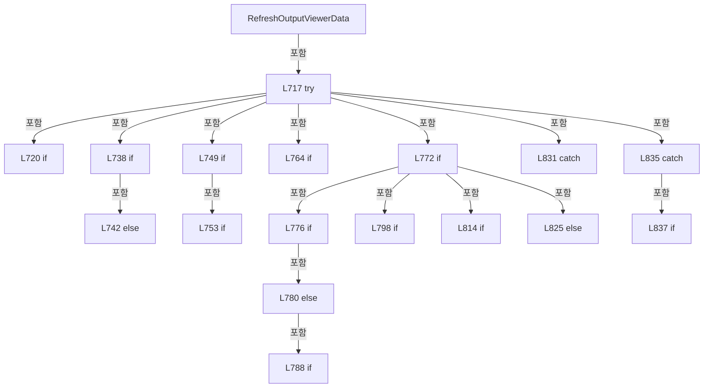

변경 전 점검: 입력/반환 타입, 위 호출자, 예외/취소 경로, 공유 상태와 저장·전송 소비자를 함께 확인합니다. 값의 단위나 물리 방향을 이름만으로 확정하지 않습니다.

### MethodDeclaration `LoadSelectedOutputViewerRecipe` · L851–866

[Drilling.UI/Menu/Menus/CMenuCorrection.cs:851–866](https://github.com/kjuws10-rgb/A3Drilling/blob/334b3599651b2e8e0181fd4459bafaf3cddafff3/Drilling.UI/Menu/Menus/CMenuCorrection.cs#L851-L866)

| 항목 | 실제 추출 값 |
| --- | --- |
| 서명 | System.Threading.Tasks.Task<Drilling.Common.Managers.ST_RECIPE_DEFINITION?> Drilling.UI.Menu.Menus.CMenuCorrection.LoadSelectedOutputViewerRecipe(System.Threading.CancellationToken, bool) |
| 접근/수식자 | Private / private, async |
| 반환/값 타입 | System.Threading.Tasks.Task<Drilling.Common.Managers.ST_RECIPE_DEFINITION?> |
| 소속 타입 | NamedType:Drilling.UI.Menu.Menus.CMenuCorrection |

입력 계약:

| 이름 | 타입 | 전달 | 선택/기본값 |
| --- | --- | --- | --- |
| cancellationToken | System.Threading.CancellationToken | None | False /  |
| fallbackToFirst | bool | None | True / true |

정적 호출자로 확인된 위치:

| 호출 파일/행 | 호출 표현식 | 런타임 분기 가능 |
| --- | --- | --- |
| [Drilling.UI/Menu/Menus/CMenuCorrection.cs:458–458](https://github.com/kjuws10-rgb/A3Drilling/blob/334b3599651b2e8e0181fd4459bafaf3cddafff3/Drilling.UI/Menu/Menus/CMenuCorrection.cs#L458-L458) | LoadSelectedOutputViewerRecipe | False |
| [Drilling.UI/Menu/Menus/CMenuCorrection.cs:527–527](https://github.com/kjuws10-rgb/A3Drilling/blob/334b3599651b2e8e0181fd4459bafaf3cddafff3/Drilling.UI/Menu/Menus/CMenuCorrection.cs#L527-L527) | LoadSelectedOutputViewerRecipe | False |
| [Drilling.UI/Menu/Menus/CMenuCorrection.cs:539–539](https://github.com/kjuws10-rgb/A3Drilling/blob/334b3599651b2e8e0181fd4459bafaf3cddafff3/Drilling.UI/Menu/Menus/CMenuCorrection.cs#L539-L539) | LoadSelectedOutputViewerRecipe | False |
| [Drilling.UI/Menu/Menus/CMenuCorrection.cs:719–719](https://github.com/kjuws10-rgb/A3Drilling/blob/334b3599651b2e8e0181fd4459bafaf3cddafff3/Drilling.UI/Menu/Menus/CMenuCorrection.cs#L719-L719) | LoadSelectedOutputViewerRecipe | False |
| [Drilling.UI/Menu/Menus/CMenuCorrection.cs:2740–2740](https://github.com/kjuws10-rgb/A3Drilling/blob/334b3599651b2e8e0181fd4459bafaf3cddafff3/Drilling.UI/Menu/Menus/CMenuCorrection.cs#L2740-L2740) | LoadSelectedOutputViewerRecipe | False |
| [Drilling.UI/Menu/Menus/CMenuCorrection.cs:2835–2835](https://github.com/kjuws10-rgb/A3Drilling/blob/334b3599651b2e8e0181fd4459bafaf3cddafff3/Drilling.UI/Menu/Menus/CMenuCorrection.cs#L2835-L2835) | LoadSelectedOutputViewerRecipe | False |
| [Drilling.UI/Menu/Menus/CMenuCorrection.cs:2856–2856](https://github.com/kjuws10-rgb/A3Drilling/blob/334b3599651b2e8e0181fd4459bafaf3cddafff3/Drilling.UI/Menu/Menus/CMenuCorrection.cs#L2856-L2856) | LoadSelectedOutputViewerRecipe | False |
| [Drilling.UI/Menu/Menus/CMenuCorrection.cs:2868–2868](https://github.com/kjuws10-rgb/A3Drilling/blob/334b3599651b2e8e0181fd4459bafaf3cddafff3/Drilling.UI/Menu/Menus/CMenuCorrection.cs#L2868-L2868) | LoadSelectedOutputViewerRecipe | False |
| [Drilling.UI/Menu/Menus/CMenuCorrection.cs:2895–2895](https://github.com/kjuws10-rgb/A3Drilling/blob/334b3599651b2e8e0181fd4459bafaf3cddafff3/Drilling.UI/Menu/Menus/CMenuCorrection.cs#L2895-L2895) | LoadSelectedOutputViewerRecipe | False |
| [Drilling.UI/Menu/Menus/CMenuCorrection.cs:2979–2979](https://github.com/kjuws10-rgb/A3Drilling/blob/334b3599651b2e8e0181fd4459bafaf3cddafff3/Drilling.UI/Menu/Menus/CMenuCorrection.cs#L2979-L2979) | LoadSelectedOutputViewerRecipe | False |
| [Drilling.UI/Menu/Menus/CMenuCorrection.cs:3012–3012](https://github.com/kjuws10-rgb/A3Drilling/blob/334b3599651b2e8e0181fd4459bafaf3cddafff3/Drilling.UI/Menu/Menus/CMenuCorrection.cs#L3012-L3012) | LoadSelectedOutputViewerRecipe | False |
| [Drilling.UI/Menu/Menus/CMenuCorrection.cs:3094–3094](https://github.com/kjuws10-rgb/A3Drilling/blob/334b3599651b2e8e0181fd4459bafaf3cddafff3/Drilling.UI/Menu/Menus/CMenuCorrection.cs#L3094-L3094) | LoadSelectedOutputViewerRecipe | False |
| [Drilling.UI/Menu/Menus/CMenuCorrection.cs:3176–3176](https://github.com/kjuws10-rgb/A3Drilling/blob/334b3599651b2e8e0181fd4459bafaf3cddafff3/Drilling.UI/Menu/Menus/CMenuCorrection.cs#L3176-L3176) | LoadSelectedOutputViewerRecipe | False |
| [Drilling.UI/Menu/Menus/CMenuCorrection.cs:3188–3188](https://github.com/kjuws10-rgb/A3Drilling/blob/334b3599651b2e8e0181fd4459bafaf3cddafff3/Drilling.UI/Menu/Menus/CMenuCorrection.cs#L3188-L3188) | LoadSelectedOutputViewerRecipe | False |
| [Drilling.UI/Menu/Menus/CMenuCorrection.cs:3288–3288](https://github.com/kjuws10-rgb/A3Drilling/blob/334b3599651b2e8e0181fd4459bafaf3cddafff3/Drilling.UI/Menu/Menus/CMenuCorrection.cs#L3288-L3288) | LoadSelectedOutputViewerRecipe | False |
| [Drilling.UI/Menu/Menus/CMenuCorrection.cs:3717–3717](https://github.com/kjuws10-rgb/A3Drilling/blob/334b3599651b2e8e0181fd4459bafaf3cddafff3/Drilling.UI/Menu/Menus/CMenuCorrection.cs#L3717-L3717) | LoadSelectedOutputViewerRecipe | False |
| [Drilling.UI/Menu/Menus/CMenuCorrection.cs:4037–4037](https://github.com/kjuws10-rgb/A3Drilling/blob/334b3599651b2e8e0181fd4459bafaf3cddafff3/Drilling.UI/Menu/Menus/CMenuCorrection.cs#L4037-L4037) | LoadSelectedOutputViewerRecipe | False |
| [Drilling.UI/Menu/Menus/CMenuCorrection.cs:4068–4068](https://github.com/kjuws10-rgb/A3Drilling/blob/334b3599651b2e8e0181fd4459bafaf3cddafff3/Drilling.UI/Menu/Menus/CMenuCorrection.cs#L4068-L4068) | LoadSelectedOutputViewerRecipe | False |
| [Drilling.UI/Menu/Menus/CMenuCorrection.cs:4095–4095](https://github.com/kjuws10-rgb/A3Drilling/blob/334b3599651b2e8e0181fd4459bafaf3cddafff3/Drilling.UI/Menu/Menus/CMenuCorrection.cs#L4095-L4095) | LoadSelectedOutputViewerRecipe | False |
| [Drilling.UI/Menu/Menus/CMenuCorrection.cs:4189–4189](https://github.com/kjuws10-rgb/A3Drilling/blob/334b3599651b2e8e0181fd4459bafaf3cddafff3/Drilling.UI/Menu/Menus/CMenuCorrection.cs#L4189-L4189) | LoadSelectedOutputViewerRecipe | False |
| [Drilling.UI/Menu/Menus/CMenuCorrection.cs:4205–4205](https://github.com/kjuws10-rgb/A3Drilling/blob/334b3599651b2e8e0181fd4459bafaf3cddafff3/Drilling.UI/Menu/Menus/CMenuCorrection.cs#L4205-L4205) | LoadSelectedOutputViewerRecipe | False |
| [Drilling.UI/Menu/Menus/CMenuCorrection.cs:4283–4283](https://github.com/kjuws10-rgb/A3Drilling/blob/334b3599651b2e8e0181fd4459bafaf3cddafff3/Drilling.UI/Menu/Menus/CMenuCorrection.cs#L4283-L4283) | LoadSelectedOutputViewerRecipe | False |
| [Drilling.UI/Menu/Menus/CMenuCorrection.cs:4306–4306](https://github.com/kjuws10-rgb/A3Drilling/blob/334b3599651b2e8e0181fd4459bafaf3cddafff3/Drilling.UI/Menu/Menus/CMenuCorrection.cs#L4306-L4306) | LoadSelectedOutputViewerRecipe | False |

호출하는 대상과 해석 범위:

| 원본 행 | 표현식 | 분석 상태 | 대상/소스 위치 |
| --- | --- | --- | --- |
| 853 | _recipeManager.LoadRecipes | resolved | System.Threading.Tasks.Task<System.Collections.Generic.IReadOnlyList<Drilling.Common.Managers.ST_RECIPE_DEFINITION>> Drilling.Common.Managers.CRecipeManager.LoadRecipes(System.Threading.CancellationToken) · Drilling.Common/Managers/CRecipeManager.cs:40 |
| 854 | NormalizeRecipeId | resolved | string Drilling.UI.Menu.Menus.CMenuCorrection.NormalizeRecipeId(string) · Drilling.UI/Menu/Menus/CMenuCorrection.cs:2391 |
| 854 | _selectedRecipeIdProvider | resolved · 동적 구현 선택 가능 | string System.Func<string>.Invoke() |
| 865 | string.IsNullOrWhiteSpace | resolved | bool string.IsNullOrWhiteSpace(string?) |
| 865 | recipes.FirstOrDefault | resolved | Drilling.Common.Managers.ST_RECIPE_DEFINITION? System.Collections.Generic.IEnumerable<Drilling.Common.Managers.ST_RECIPE_DEFINITION>.FirstOrDefault<Drilling.Common.Managers.ST_RECIPE_DEFINITION>() |
| 865 | recipes.FirstOrDefault | resolved | Drilling.Common.Managers.ST_RECIPE_DEFINITION? System.Collections.Generic.IEnumerable<Drilling.Common.Managers.ST_RECIPE_DEFINITION>.FirstOrDefault<Drilling.Common.Managers.ST_RECIPE_DEFINITION>(System.Func<Drilling.Common.Managers.ST_RECIPE_DEFINITION, bool>) |
| 865 | recipes.FirstOrDefault | resolved | Drilling.Common.Managers.ST_RECIPE_DEFINITION? System.Collections.Generic.IEnumerable<Drilling.Common.Managers.ST_RECIPE_DEFINITION>.FirstOrDefault<Drilling.Common.Managers.ST_RECIPE_DEFINITION>(System.Func<Drilling.Common.Managers.ST_RECIPE_DEFINITION, bool>) |
| 865 | recipes.FirstOrDefault | resolved | Drilling.Common.Managers.ST_RECIPE_DEFINITION? System.Collections.Generic.IEnumerable<Drilling.Common.Managers.ST_RECIPE_DEFINITION>.FirstOrDefault<Drilling.Common.Managers.ST_RECIPE_DEFINITION>() |

본문의 실제 연산·분기·예외·반환 순서(원문 위치 순):

| 원본 행 | 종류 | 주석 해설 |
| --- | --- | --- |
| 853 | await | 비동기 완료를 기다립니다: await _recipeManager.LoadRecipes(cancellationToken) |
| 853 | call | 함수·델리게이트 또는 객체 생성자를 호출합니다: _recipeManager.LoadRecipes(cancellationToken) |
| 853 | local-declaration | 지역 변수를 선언합니다: var recipes = await _recipeManager.LoadRecipes(cancellationToken); |
| 853 | variable-initializer | 변수의 초기값을 지정합니다: recipes = await _recipeManager.LoadRecipes(cancellationToken) |
| 854 | call | 함수·델리게이트 또는 객체 생성자를 호출합니다: NormalizeRecipeId(_selectedRecipeIdProvider()) |
| 854 | call | 함수·델리게이트 또는 객체 생성자를 호출합니다: _selectedRecipeIdProvider() |
| 854 | local-declaration | 지역 변수를 선언합니다: var selectedRecipeId = NormalizeRecipeId(_selectedRecipeIdProvider()); |
| 854 | variable-initializer | 변수의 초기값을 지정합니다: selectedRecipeId = NormalizeRecipeId(_selectedRecipeIdProvider()) |
| 865 | call | 함수·델리게이트 또는 객체 생성자를 호출합니다: string.IsNullOrWhiteSpace(selectedRecipeId) |
| 865 | call | 함수·델리게이트 또는 객체 생성자를 호출합니다: recipes.FirstOrDefault() |
| 865 | call | 함수·델리게이트 또는 객체 생성자를 호출합니다: recipes.FirstOrDefault(MatchById) |
| 865 | call | 함수·델리게이트 또는 객체 생성자를 호출합니다: recipes.FirstOrDefault(MatchByName) |
| 865 | call | 함수·델리게이트 또는 객체 생성자를 호출합니다: recipes.FirstOrDefault() |
| 865 | conditional-expression | 조건에 따라 결과식을 선택합니다: string.IsNullOrWhiteSpace(selectedRecipeId) ? (fallbackToFirst ? recipes.FirstOrDefault() : null) : recipes.FirstOrDefault(MatchById) ?? recipes.FirstOrDefault(MatchByName) ?? (fallbackToFirst ? recipes.FirstOrDefault() : null) |
| 865 | conditional-expression | 조건에 따라 결과식을 선택합니다: fallbackToFirst ? recipes.FirstOrDefault() : null |
| 865 | conditional-expression | 조건에 따라 결과식을 선택합니다: fallbackToFirst ? recipes.FirstOrDefault() : null |
| 865 | return | 호출자에게 값 또는 제어를 반환합니다: return string.IsNullOrWhiteSpace(selectedRecipeId) ? (fallbackToFirst ? recipes.FirstOrDefault() : null) : recipes.FirstOrDefault(MatchById) ?? recipes.FirstOrDefault(MatchByName) ?? (fallbackToFirst ? recipes.FirstOrDefault() : n |

변경 전 점검: 입력/반환 타입, 위 호출자, 예외/취소 경로, 공유 상태와 저장·전송 소비자를 함께 확인합니다. 값의 단위나 물리 방향을 이름만으로 확정하지 않습니다.

### LocalFunctionStatement `MatchById` · L855–858

[Drilling.UI/Menu/Menus/CMenuCorrection.cs:855–858](https://github.com/kjuws10-rgb/A3Drilling/blob/334b3599651b2e8e0181fd4459bafaf3cddafff3/Drilling.UI/Menu/Menus/CMenuCorrection.cs#L855-L858)

| 항목 | 실제 추출 값 |
| --- | --- |
| 서명 | bool MatchById(Drilling.Common.Managers.ST_RECIPE_DEFINITION) |
| 접근/수식자 | Private /  |
| 반환/값 타입 | bool |
| 소속 타입 | NamedType:Drilling.UI.Menu.Menus.CMenuCorrection |

입력 계약:

| 이름 | 타입 | 전달 | 선택/기본값 |
| --- | --- | --- | --- |
| recipe | Drilling.Common.Managers.ST_RECIPE_DEFINITION | None | False /  |

현재 부분 분석에서 직접 연결된 호출자는 없습니다. XAML/이벤트/인터페이스·델리게이트·외부 진입을 추가 확인해야 하며, 미사용으로 판정한 것이 아닙니다.

호출하는 대상과 해석 범위:

| 원본 행 | 표현식 | 분석 상태 | 대상/소스 위치 |
| --- | --- | --- | --- |
| 857 | recipe.Id.Equals | resolved | bool string.Equals(string?, System.StringComparison) |

본문의 실제 연산·분기·예외·반환 순서(원문 위치 순):

| 원본 행 | 종류 | 주석 해설 |
| --- | --- | --- |
| 857 | call | 함수·델리게이트 또는 객체 생성자를 호출합니다: recipe.Id.Equals(selectedRecipeId, StringComparison.OrdinalIgnoreCase) |
| 857 | return | 호출자에게 값 또는 제어를 반환합니다: return recipe.Id.Equals(selectedRecipeId, StringComparison.OrdinalIgnoreCase); |

변경 전 점검: 입력/반환 타입, 위 호출자, 예외/취소 경로, 공유 상태와 저장·전송 소비자를 함께 확인합니다. 값의 단위나 물리 방향을 이름만으로 확정하지 않습니다.

### LocalFunctionStatement `MatchByName` · L860–863

[Drilling.UI/Menu/Menus/CMenuCorrection.cs:860–863](https://github.com/kjuws10-rgb/A3Drilling/blob/334b3599651b2e8e0181fd4459bafaf3cddafff3/Drilling.UI/Menu/Menus/CMenuCorrection.cs#L860-L863)

| 항목 | 실제 추출 값 |
| --- | --- |
| 서명 | bool MatchByName(Drilling.Common.Managers.ST_RECIPE_DEFINITION) |
| 접근/수식자 | Private /  |
| 반환/값 타입 | bool |
| 소속 타입 | NamedType:Drilling.UI.Menu.Menus.CMenuCorrection |

입력 계약:

| 이름 | 타입 | 전달 | 선택/기본값 |
| --- | --- | --- | --- |
| recipe | Drilling.Common.Managers.ST_RECIPE_DEFINITION | None | False /  |

현재 부분 분석에서 직접 연결된 호출자는 없습니다. XAML/이벤트/인터페이스·델리게이트·외부 진입을 추가 확인해야 하며, 미사용으로 판정한 것이 아닙니다.

호출하는 대상과 해석 범위:

| 원본 행 | 표현식 | 분석 상태 | 대상/소스 위치 |
| --- | --- | --- | --- |
| 862 | recipe.Name.Equals | resolved | bool string.Equals(string?, System.StringComparison) |

본문의 실제 연산·분기·예외·반환 순서(원문 위치 순):

| 원본 행 | 종류 | 주석 해설 |
| --- | --- | --- |
| 862 | call | 함수·델리게이트 또는 객체 생성자를 호출합니다: recipe.Name.Equals(selectedRecipeId, StringComparison.OrdinalIgnoreCase) |
| 862 | return | 호출자에게 값 또는 제어를 반환합니다: return recipe.Name.Equals(selectedRecipeId, StringComparison.OrdinalIgnoreCase); |

변경 전 점검: 입력/반환 타입, 위 호출자, 예외/취소 경로, 공유 상태와 저장·전송 소비자를 함께 확인합니다. 값의 단위나 물리 방향을 이름만으로 확정하지 않습니다.

### MethodDeclaration `BuildOutputViewerParameterMap` · L868–885

[Drilling.UI/Menu/Menus/CMenuCorrection.cs:868–885](https://github.com/kjuws10-rgb/A3Drilling/blob/334b3599651b2e8e0181fd4459bafaf3cddafff3/Drilling.UI/Menu/Menus/CMenuCorrection.cs#L868-L885)

| 항목 | 실제 추출 값 |
| --- | --- |
| 서명 | System.Collections.Generic.Dictionary<string, string> Drilling.UI.Menu.Menus.CMenuCorrection.BuildOutputViewerParameterMap(Drilling.Common.Managers.ST_RECIPE_DEFINITION, System.Collections.Generic.IReadOnlyList<Drilling.Common.Managers.ST_SYSTEM_PARAMETER>) |
| 접근/수식자 | Private / private, static |
| 반환/값 타입 | System.Collections.Generic.Dictionary<string, string> |
| 소속 타입 | NamedType:Drilling.UI.Menu.Menus.CMenuCorrection |

입력 계약:

| 이름 | 타입 | 전달 | 선택/기본값 |
| --- | --- | --- | --- |
| recipe | Drilling.Common.Managers.ST_RECIPE_DEFINITION | None | False /  |
| settings | System.Collections.Generic.IReadOnlyList<Drilling.Common.Managers.ST_SYSTEM_PARAMETER> | None | False /  |

정적 호출자로 확인된 위치:

| 호출 파일/행 | 호출 표현식 | 런타임 분기 가능 |
| --- | --- | --- |
| [Drilling.UI/Menu/Menus/CMenuCorrection.ReviewData.Display.cs:202–202](https://github.com/kjuws10-rgb/A3Drilling/blob/334b3599651b2e8e0181fd4459bafaf3cddafff3/Drilling.UI/Menu/Menus/CMenuCorrection.ReviewData.Display.cs#L202-L202) | BuildOutputViewerParameterMap | False |
| [Drilling.UI/Menu/Menus/CMenuCorrection.cs:733–733](https://github.com/kjuws10-rgb/A3Drilling/blob/334b3599651b2e8e0181fd4459bafaf3cddafff3/Drilling.UI/Menu/Menus/CMenuCorrection.cs#L733-L733) | BuildOutputViewerParameterMap | False |
| [Drilling.UI/Menu/Menus/CMenuCorrection.cs:1605–1605](https://github.com/kjuws10-rgb/A3Drilling/blob/334b3599651b2e8e0181fd4459bafaf3cddafff3/Drilling.UI/Menu/Menus/CMenuCorrection.cs#L1605-L1605) | BuildOutputViewerParameterMap | False |
| [Drilling.UI/Menu/Menus/CMenuCorrection.cs:1837–1837](https://github.com/kjuws10-rgb/A3Drilling/blob/334b3599651b2e8e0181fd4459bafaf3cddafff3/Drilling.UI/Menu/Menus/CMenuCorrection.cs#L1837-L1837) | BuildOutputViewerParameterMap | False |
| [Drilling.UI/Menu/Menus/CMenuCorrection.cs:1924–1924](https://github.com/kjuws10-rgb/A3Drilling/blob/334b3599651b2e8e0181fd4459bafaf3cddafff3/Drilling.UI/Menu/Menus/CMenuCorrection.cs#L1924-L1924) | BuildOutputViewerParameterMap | False |
| [Drilling.UI/Menu/Menus/CMenuCorrection.cs:2901–2901](https://github.com/kjuws10-rgb/A3Drilling/blob/334b3599651b2e8e0181fd4459bafaf3cddafff3/Drilling.UI/Menu/Menus/CMenuCorrection.cs#L2901-L2901) | BuildOutputViewerParameterMap | False |
| [Drilling.UI/Menu/Menus/CMenuCorrection.cs:3191–3191](https://github.com/kjuws10-rgb/A3Drilling/blob/334b3599651b2e8e0181fd4459bafaf3cddafff3/Drilling.UI/Menu/Menus/CMenuCorrection.cs#L3191-L3191) | BuildOutputViewerParameterMap | False |
| [Drilling.UI/Menu/Menus/CMenuCorrection.cs:4096–4096](https://github.com/kjuws10-rgb/A3Drilling/blob/334b3599651b2e8e0181fd4459bafaf3cddafff3/Drilling.UI/Menu/Menus/CMenuCorrection.cs#L4096-L4096) | BuildOutputViewerParameterMap | False |
| [Drilling.UI/Menu/Menus/CMenuCorrection.cs:4288–4288](https://github.com/kjuws10-rgb/A3Drilling/blob/334b3599651b2e8e0181fd4459bafaf3cddafff3/Drilling.UI/Menu/Menus/CMenuCorrection.cs#L4288-L4288) | BuildOutputViewerParameterMap | False |

호출하는 대상과 해석 범위:

| 원본 행 | 표현식 | 분석 상태 | 대상/소스 위치 |
| --- | --- | --- | --- |
| 870 | new Dictionary<string, string> | resolved | System.Collections.Generic.Dictionary<string, string>.Dictionary(System.Collections.Generic.IEqualityComparer<string>?) |
| 873 | SetOutputViewerParameter | resolved | void Drilling.UI.Menu.Menus.CMenuCorrection.SetOutputViewerParameter(System.Collections.Generic.IDictionary<string, string>, string, string) · Drilling.UI/Menu/Menus/CMenuCorrection.cs:887 |
| 874 | SetOutputViewerParameter | resolved | void Drilling.UI.Menu.Menus.CMenuCorrection.SetOutputViewerParameter(System.Collections.Generic.IDictionary<string, string>, string, string) · Drilling.UI/Menu/Menus/CMenuCorrection.cs:887 |
| 879 | SetOutputViewerParameter | resolved | void Drilling.UI.Menu.Menus.CMenuCorrection.SetOutputViewerParameter(System.Collections.Generic.IDictionary<string, string>, string, string) · Drilling.UI/Menu/Menus/CMenuCorrection.cs:887 |
| 880 | SetOutputViewerParameter | resolved | void Drilling.UI.Menu.Menus.CMenuCorrection.SetOutputViewerParameter(System.Collections.Generic.IDictionary<string, string>, string, string) · Drilling.UI/Menu/Menus/CMenuCorrection.cs:887 |
| 883 | parameters.TryAdd | resolved | bool System.Collections.Generic.Dictionary<string, string>.TryAdd(string, string) |

본문의 실제 연산·분기·예외·반환 순서(원문 위치 순):

| 원본 행 | 종류 | 주석 해설 |
| --- | --- | --- |
| 870 | call | 함수·델리게이트 또는 객체 생성자를 호출합니다: new Dictionary<string, string>(StringComparer.OrdinalIgnoreCase) |
| 870 | local-declaration | 지역 변수를 선언합니다: var parameters = new Dictionary<string, string>(StringComparer.OrdinalIgnoreCase); |
| 870 | variable-initializer | 변수의 초기값을 지정합니다: parameters = new Dictionary<string, string>(StringComparer.OrdinalIgnoreCase) |
| 871 | foreach | 컬렉션 요소를 순회합니다: foreach (var parameter in recipe.Parameters) |
| 873 | call | 함수·델리게이트 또는 객체 생성자를 호출합니다: SetOutputViewerParameter(parameters, parameter.Key, parameter.Value) |
| 874 | call | 함수·델리게이트 또는 객체 생성자를 호출합니다: SetOutputViewerParameter(parameters, parameter.Name, parameter.Value) |
| 877 | foreach | 컬렉션 요소를 순회합니다: foreach (var setting in settings) |
| 879 | call | 함수·델리게이트 또는 객체 생성자를 호출합니다: SetOutputViewerParameter(parameters, setting.Key, setting.Value) |
| 880 | call | 함수·델리게이트 또는 객체 생성자를 호출합니다: SetOutputViewerParameter(parameters, setting.Name, setting.Value) |
| 883 | call | 함수·델리게이트 또는 객체 생성자를 호출합니다: parameters.TryAdd("HEAD_COUNT", "8") |
| 884 | return | 호출자에게 값 또는 제어를 반환합니다: return parameters; |

제어 구문의 포함 구조(실제 실행 순서/CFG가 아닌 구문 탐색 그림):


변경 전 점검: 입력/반환 타입, 위 호출자, 예외/취소 경로, 공유 상태와 저장·전송 소비자를 함께 확인합니다. 값의 단위나 물리 방향을 이름만으로 확정하지 않습니다.

### MethodDeclaration `SetOutputViewerParameter` · L887–893

[Drilling.UI/Menu/Menus/CMenuCorrection.cs:887–893](https://github.com/kjuws10-rgb/A3Drilling/blob/334b3599651b2e8e0181fd4459bafaf3cddafff3/Drilling.UI/Menu/Menus/CMenuCorrection.cs#L887-L893)

| 항목 | 실제 추출 값 |
| --- | --- |
| 서명 | void Drilling.UI.Menu.Menus.CMenuCorrection.SetOutputViewerParameter(System.Collections.Generic.IDictionary<string, string>, string, string) |
| 접근/수식자 | Private / private, static |
| 반환/값 타입 | void |
| 소속 타입 | NamedType:Drilling.UI.Menu.Menus.CMenuCorrection |

입력 계약:

| 이름 | 타입 | 전달 | 선택/기본값 |
| --- | --- | --- | --- |
| parameters | System.Collections.Generic.IDictionary<string, string> | None | False /  |
| key | string | None | False /  |
| value | string | None | False /  |

정적 호출자로 확인된 위치:

| 호출 파일/행 | 호출 표현식 | 런타임 분기 가능 |
| --- | --- | --- |
| [Drilling.UI/Menu/Menus/CMenuCorrection.cs:873–873](https://github.com/kjuws10-rgb/A3Drilling/blob/334b3599651b2e8e0181fd4459bafaf3cddafff3/Drilling.UI/Menu/Menus/CMenuCorrection.cs#L873-L873) | SetOutputViewerParameter | False |
| [Drilling.UI/Menu/Menus/CMenuCorrection.cs:874–874](https://github.com/kjuws10-rgb/A3Drilling/blob/334b3599651b2e8e0181fd4459bafaf3cddafff3/Drilling.UI/Menu/Menus/CMenuCorrection.cs#L874-L874) | SetOutputViewerParameter | False |
| [Drilling.UI/Menu/Menus/CMenuCorrection.cs:879–879](https://github.com/kjuws10-rgb/A3Drilling/blob/334b3599651b2e8e0181fd4459bafaf3cddafff3/Drilling.UI/Menu/Menus/CMenuCorrection.cs#L879-L879) | SetOutputViewerParameter | False |
| [Drilling.UI/Menu/Menus/CMenuCorrection.cs:880–880](https://github.com/kjuws10-rgb/A3Drilling/blob/334b3599651b2e8e0181fd4459bafaf3cddafff3/Drilling.UI/Menu/Menus/CMenuCorrection.cs#L880-L880) | SetOutputViewerParameter | False |

호출하는 대상과 해석 범위:

| 원본 행 | 표현식 | 분석 상태 | 대상/소스 위치 |
| --- | --- | --- | --- |
| 889 | string.IsNullOrWhiteSpace | resolved | bool string.IsNullOrWhiteSpace(string?) |
| 891 | key.Trim | resolved | string string.Trim() |

본문의 실제 연산·분기·예외·반환 순서(원문 위치 순):

| 원본 행 | 종류 | 주석 해설 |
| --- | --- | --- |
| 889 | call | 함수·델리게이트 또는 객체 생성자를 호출합니다: string.IsNullOrWhiteSpace(key) |
| 889 | if | 조건에 따라 분기합니다: if (!string.IsNullOrWhiteSpace(key)) |
| 891 | assignment | 값을 대상에 대입합니다: parameters[key.Trim()] = value |
| 891 | call | 함수·델리게이트 또는 객체 생성자를 호출합니다: key.Trim() |

제어 구문의 포함 구조(실제 실행 순서/CFG가 아닌 구문 탐색 그림):

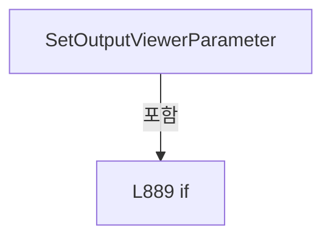

변경 전 점검: 입력/반환 타입, 위 호출자, 예외/취소 경로, 공유 상태와 저장·전송 소비자를 함께 확인합니다. 값의 단위나 물리 방향을 이름만으로 확정하지 않습니다.

### MethodDeclaration `CopyOutputViewerParameters` · L895–898

[Drilling.UI/Menu/Menus/CMenuCorrection.cs:895–898](https://github.com/kjuws10-rgb/A3Drilling/blob/334b3599651b2e8e0181fd4459bafaf3cddafff3/Drilling.UI/Menu/Menus/CMenuCorrection.cs#L895-L898)

| 항목 | 실제 추출 값 |
| --- | --- |
| 서명 | System.Collections.Generic.IReadOnlyDictionary<string, string> Drilling.UI.Menu.Menus.CMenuCorrection.CopyOutputViewerParameters(System.Collections.Generic.IReadOnlyDictionary<string, string>) |
| 접근/수식자 | Private / private, static |
| 반환/값 타입 | System.Collections.Generic.IReadOnlyDictionary<string, string> |
| 소속 타입 | NamedType:Drilling.UI.Menu.Menus.CMenuCorrection |

입력 계약:

| 이름 | 타입 | 전달 | 선택/기본값 |
| --- | --- | --- | --- |
| parameters | System.Collections.Generic.IReadOnlyDictionary<string, string> | None | False /  |

정적 호출자로 확인된 위치:

| 호출 파일/행 | 호출 표현식 | 런타임 분기 가능 |
| --- | --- | --- |
| [Drilling.UI/Menu/Menus/CMenuCorrection.cs:758–758](https://github.com/kjuws10-rgb/A3Drilling/blob/334b3599651b2e8e0181fd4459bafaf3cddafff3/Drilling.UI/Menu/Menus/CMenuCorrection.cs#L758-L758) | CopyOutputViewerParameters | False |
| [Drilling.UI/Menu/Menus/CMenuCorrection.cs:793–793](https://github.com/kjuws10-rgb/A3Drilling/blob/334b3599651b2e8e0181fd4459bafaf3cddafff3/Drilling.UI/Menu/Menus/CMenuCorrection.cs#L793-L793) | CopyOutputViewerParameters | False |

호출하는 대상과 해석 범위:

| 원본 행 | 표현식 | 분석 상태 | 대상/소스 위치 |
| --- | --- | --- | --- |
| 897 | new Dictionary<string, string> | resolved | System.Collections.Generic.Dictionary<string, string>.Dictionary(System.Collections.Generic.IEnumerable<System.Collections.Generic.KeyValuePair<string, string>>, System.Collections.Generic.IEqualityComparer<string>?) |

본문의 실제 연산·분기·예외·반환 순서(원문 위치 순):

| 원본 행 | 종류 | 주석 해설 |
| --- | --- | --- |
| 897 | call | 함수·델리게이트 또는 객체 생성자를 호출합니다: new Dictionary<string, string>(parameters, StringComparer.OrdinalIgnoreCase) |
| 897 | return | 호출자에게 값 또는 제어를 반환합니다: return new Dictionary<string, string>(parameters, StringComparer.OrdinalIgnoreCase); |

변경 전 점검: 입력/반환 타입, 위 호출자, 예외/취소 경로, 공유 상태와 저장·전송 소비자를 함께 확인합니다. 값의 단위나 물리 방향을 이름만으로 확정하지 않습니다.

### MethodDeclaration `OutputViewerParametersMatch` · L900–916

[Drilling.UI/Menu/Menus/CMenuCorrection.cs:900–916](https://github.com/kjuws10-rgb/A3Drilling/blob/334b3599651b2e8e0181fd4459bafaf3cddafff3/Drilling.UI/Menu/Menus/CMenuCorrection.cs#L900-L916)

| 항목 | 실제 추출 값 |
| --- | --- |
| 서명 | bool Drilling.UI.Menu.Menus.CMenuCorrection.OutputViewerParametersMatch(System.Collections.Generic.IReadOnlyDictionary<string, string>?, System.Collections.Generic.IReadOnlyDictionary<string, string>) |
| 접근/수식자 | Private / private, static |
| 반환/값 타입 | bool |
| 소속 타입 | NamedType:Drilling.UI.Menu.Menus.CMenuCorrection |

입력 계약:

| 이름 | 타입 | 전달 | 선택/기본값 |
| --- | --- | --- | --- |
| cached | System.Collections.Generic.IReadOnlyDictionary<string, string>? | None | False /  |
| current | System.Collections.Generic.IReadOnlyDictionary<string, string> | None | False /  |

정적 호출자로 확인된 위치:

| 호출 파일/행 | 호출 표현식 | 런타임 분기 가능 |
| --- | --- | --- |
| [Drilling.UI/Menu/Menus/CMenuCorrection.cs:749–749](https://github.com/kjuws10-rgb/A3Drilling/blob/334b3599651b2e8e0181fd4459bafaf3cddafff3/Drilling.UI/Menu/Menus/CMenuCorrection.cs#L749-L749) | OutputViewerParametersMatch | False |
| [Drilling.UI/Menu/Menus/CMenuCorrection.cs:776–776](https://github.com/kjuws10-rgb/A3Drilling/blob/334b3599651b2e8e0181fd4459bafaf3cddafff3/Drilling.UI/Menu/Menus/CMenuCorrection.cs#L776-L776) | OutputViewerParametersMatch | False |

호출하는 대상과 해석 범위:

| 원본 행 | 표현식 | 분석 상태 | 대상/소스 위치 |
| --- | --- | --- | --- |
| 909 | cached.TryGetValue | resolved · 동적 구현 선택 가능 | bool System.Collections.Generic.IReadOnlyDictionary<string, string>.TryGetValue(string, out string) |
| 909 | value.Equals | resolved | bool string.Equals(string?, System.StringComparison) |

본문의 실제 연산·분기·예외·반환 순서(원문 위치 순):

| 원본 행 | 종류 | 주석 해설 |
| --- | --- | --- |
| 902 | if | 조건에 따라 분기합니다: if (cached is null &#124;&#124; cached.Count != current.Count) |
| 904 | return | 호출자에게 값 또는 제어를 반환합니다: return false; |
| 907 | foreach | 컬렉션 요소를 순회합니다: foreach (var parameter in current) |
| 909 | call | 함수·델리게이트 또는 객체 생성자를 호출합니다: cached.TryGetValue(parameter.Key, out var value) |
| 909 | call | 함수·델리게이트 또는 객체 생성자를 호출합니다: value.Equals(parameter.Value, StringComparison.Ordinal) |
| 909 | if | 조건에 따라 분기합니다: if (!cached.TryGetValue(parameter.Key, out var value) &#124;&#124; !value.Equals(parameter.Value, StringComparison.Ordinal)) |
| 911 | return | 호출자에게 값 또는 제어를 반환합니다: return false; |
| 915 | return | 호출자에게 값 또는 제어를 반환합니다: return true; |

제어 구문의 포함 구조(실제 실행 순서/CFG가 아닌 구문 탐색 그림):


변경 전 점검: 입력/반환 타입, 위 호출자, 예외/취소 경로, 공유 상태와 저장·전송 소비자를 함께 확인합니다. 값의 단위나 물리 방향을 이름만으로 확정하지 않습니다.

### MethodDeclaration `ClearOutputViewerCellSelectionData` · L918–925

[Drilling.UI/Menu/Menus/CMenuCorrection.cs:918–925](https://github.com/kjuws10-rgb/A3Drilling/blob/334b3599651b2e8e0181fd4459bafaf3cddafff3/Drilling.UI/Menu/Menus/CMenuCorrection.cs#L918-L925)

| 항목 | 실제 추출 값 |
| --- | --- |
| 서명 | void Drilling.UI.Menu.Menus.CMenuCorrection.ClearOutputViewerCellSelectionData() |
| 접근/수식자 | Private / private |
| 반환/값 타입 | void |
| 소속 타입 | NamedType:Drilling.UI.Menu.Menus.CMenuCorrection |

정적 호출자로 확인된 위치:

| 호출 파일/행 | 호출 표현식 | 런타임 분기 가능 |
| --- | --- | --- |
| [Drilling.UI/Menu/Menus/CMenuCorrection.cs:724–724](https://github.com/kjuws10-rgb/A3Drilling/blob/334b3599651b2e8e0181fd4459bafaf3cddafff3/Drilling.UI/Menu/Menus/CMenuCorrection.cs#L724-L724) | ClearOutputViewerCellSelectionData | False |
| [Drilling.UI/Menu/Menus/CMenuCorrection.cs:827–827](https://github.com/kjuws10-rgb/A3Drilling/blob/334b3599651b2e8e0181fd4459bafaf3cddafff3/Drilling.UI/Menu/Menus/CMenuCorrection.cs#L827-L827) | ClearOutputViewerCellSelectionData | False |
| [Drilling.UI/Menu/Menus/CMenuCorrection.cs:845–845](https://github.com/kjuws10-rgb/A3Drilling/blob/334b3599651b2e8e0181fd4459bafaf3cddafff3/Drilling.UI/Menu/Menus/CMenuCorrection.cs#L845-L845) | ClearOutputViewerCellSelectionData | False |

호출하는 대상과 해석 범위:

| 원본 행 | 표현식 | 분석 상태 | 대상/소스 위치 |
| --- | --- | --- | --- |
| 921 | new Dictionary<string, ST_RECIPE_SHOT_MASKING_RESULT> | resolved | System.Collections.Generic.Dictionary<string, Drilling.Common.Recipe.ST_RECIPE_SHOT_MASKING_RESULT>.Dictionary(System.Collections.Generic.IEqualityComparer<string>?) |
| 924 | CreateOutputViewerHeadCards | resolved | System.Collections.Generic.IReadOnlyList<Drilling.UI.Menu.Menus.ST_CORRECTION_OUTPUT_VIEWER_HEAD_CARD> Drilling.UI.Menu.Menus.CMenuCorrection.CreateOutputViewerHeadCards(System.Collections.Generic.IReadOnlyList<Drilling.Common.Recipe.ST_HEAD_SHOT_POINT>) · Drilling.UI/Menu/Menus/CMenuCorrection.cs:953 |

본문의 실제 연산·분기·예외·반환 순서(원문 위치 순):

| 원본 행 | 종류 | 주석 해설 |
| --- | --- | --- |
| 920 | assignment | 값을 대상에 대입합니다: _outputViewerSelectedCellShots = [] |
| 921 | assignment | 값을 대상에 대입합니다: _outputViewerSelectedShotStates = new Dictionary<string, ST_RECIPE_SHOT_MASKING_RESULT>(StringComparer.OrdinalIgnoreCase) |
| 921 | call | 함수·델리게이트 또는 객체 생성자를 호출합니다: new Dictionary<string, ST_RECIPE_SHOT_MASKING_RESULT>(StringComparer.OrdinalIgnoreCase) |
| 922 | assignment | 값을 대상에 대입합니다: _outputViewerSelectedShotKey = "" |
| 923 | assignment | 값을 대상에 대입합니다: OutputViewerCellShotMapImage = null |
| 924 | assignment | 값을 대상에 대입합니다: OutputViewerHeadCards = CreateOutputViewerHeadCards([]) |
| 924 | call | 함수·델리게이트 또는 객체 생성자를 호출합니다: CreateOutputViewerHeadCards([]) |

변경 전 점검: 입력/반환 타입, 위 호출자, 예외/취소 경로, 공유 상태와 저장·전송 소비자를 함께 확인합니다. 값의 단위나 물리 방향을 이름만으로 확정하지 않습니다.

### MethodDeclaration `GetOutputViewerSelectedShot` · L927–935

[Drilling.UI/Menu/Menus/CMenuCorrection.cs:927–935](https://github.com/kjuws10-rgb/A3Drilling/blob/334b3599651b2e8e0181fd4459bafaf3cddafff3/Drilling.UI/Menu/Menus/CMenuCorrection.cs#L927-L935)

| 항목 | 실제 추출 값 |
| --- | --- |
| 서명 | Drilling.Common.Recipe.ST_HEAD_SHOT_POINT? Drilling.UI.Menu.Menus.CMenuCorrection.GetOutputViewerSelectedShot() |
| 접근/수식자 | Private / private |
| 반환/값 타입 | Drilling.Common.Recipe.ST_HEAD_SHOT_POINT? |
| 소속 타입 | NamedType:Drilling.UI.Menu.Menus.CMenuCorrection |

정적 호출자로 확인된 위치:

| 호출 파일/행 | 호출 표현식 | 런타임 분기 가능 |
| --- | --- | --- |
| [Drilling.UI/Menu/Menus/CMenuCorrection.cs:313–313](https://github.com/kjuws10-rgb/A3Drilling/blob/334b3599651b2e8e0181fd4459bafaf3cddafff3/Drilling.UI/Menu/Menus/CMenuCorrection.cs#L313-L313) | GetOutputViewerSelectedShot | False |
| [Drilling.UI/Menu/Menus/CMenuCorrection.cs:314–314](https://github.com/kjuws10-rgb/A3Drilling/blob/334b3599651b2e8e0181fd4459bafaf3cddafff3/Drilling.UI/Menu/Menus/CMenuCorrection.cs#L314-L314) | GetOutputViewerSelectedShot | False |

호출하는 대상과 해석 범위:

| 원본 행 | 표현식 | 분석 상태 | 대상/소스 위치 |
| --- | --- | --- | --- |
| 929 | string.IsNullOrWhiteSpace | resolved | bool string.IsNullOrWhiteSpace(string?) |
| 934 | _outputViewerSelectedCellShots.FirstOrDefault | resolved | Drilling.Common.Recipe.ST_HEAD_SHOT_POINT? System.Collections.Generic.IEnumerable<Drilling.Common.Recipe.ST_HEAD_SHOT_POINT>.FirstOrDefault<Drilling.Common.Recipe.ST_HEAD_SHOT_POINT>(System.Func<Drilling.Common.Recipe.ST_HEAD_SHOT_POINT, bool>) |
| 934 | shot.ShotKey.Equals | resolved | bool string.Equals(string?, System.StringComparison) |

본문의 실제 연산·분기·예외·반환 순서(원문 위치 순):

| 원본 행 | 종류 | 주석 해설 |
| --- | --- | --- |
| 929 | call | 함수·델리게이트 또는 객체 생성자를 호출합니다: string.IsNullOrWhiteSpace(_outputViewerSelectedShotKey) |
| 929 | if | 조건에 따라 분기합니다: if (string.IsNullOrWhiteSpace(_outputViewerSelectedShotKey)) |
| 931 | return | 호출자에게 값 또는 제어를 반환합니다: return null; |
| 934 | call | 함수·델리게이트 또는 객체 생성자를 호출합니다: _outputViewerSelectedCellShots.FirstOrDefault(shot => shot.ShotKey.Equals(_outputViewerSelectedShotKey, StringComparison.OrdinalIgnoreCase)) |
| 934 | call | 함수·델리게이트 또는 객체 생성자를 호출합니다: shot.ShotKey.Equals(_outputViewerSelectedShotKey, StringComparison.OrdinalIgnoreCase) |
| 934 | return | 호출자에게 값 또는 제어를 반환합니다: return _outputViewerSelectedCellShots.FirstOrDefault(shot => shot.ShotKey.Equals(_outputViewerSelectedShotKey, StringComparison.OrdinalIgnoreCase)); |

제어 구문의 포함 구조(실제 실행 순서/CFG가 아닌 구문 탐색 그림):


변경 전 점검: 입력/반환 타입, 위 호출자, 예외/취소 경로, 공유 상태와 저장·전송 소비자를 함께 확인합니다. 값의 단위나 물리 방향을 이름만으로 확정하지 않습니다.

### MethodDeclaration `GetOutputViewerShotMapSize` · L937–945

[Drilling.UI/Menu/Menus/CMenuCorrection.cs:937–945](https://github.com/kjuws10-rgb/A3Drilling/blob/334b3599651b2e8e0181fd4459bafaf3cddafff3/Drilling.UI/Menu/Menus/CMenuCorrection.cs#L937-L945)

| 항목 | 실제 추출 값 |
| --- | --- |
| 서명 | Size Drilling.UI.Menu.Menus.CMenuCorrection.GetOutputViewerShotMapSize() |
| 접근/수식자 | Private / private |
| 반환/값 타입 | Size |
| 소속 타입 | NamedType:Drilling.UI.Menu.Menus.CMenuCorrection |

정적 호출자로 확인된 위치:

| 호출 파일/행 | 호출 표현식 | 런타임 분기 가능 |
| --- | --- | --- |
| [Drilling.UI/Menu/Menus/CMenuCorrection.cs:315–315](https://github.com/kjuws10-rgb/A3Drilling/blob/334b3599651b2e8e0181fd4459bafaf3cddafff3/Drilling.UI/Menu/Menus/CMenuCorrection.cs#L315-L315) | GetOutputViewerShotMapSize | False |
| [Drilling.UI/Menu/Menus/CMenuCorrection.cs:316–316](https://github.com/kjuws10-rgb/A3Drilling/blob/334b3599651b2e8e0181fd4459bafaf3cddafff3/Drilling.UI/Menu/Menus/CMenuCorrection.cs#L316-L316) | GetOutputViewerShotMapSize | False |

호출하는 대상과 해석 범위:

| 원본 행 | 표현식 | 분석 상태 | 대상/소스 위치 |
| --- | --- | --- | --- |
| 939 | _outputViewerSelectedCellShots.FirstOrDefault | resolved | Drilling.Common.Recipe.ST_HEAD_SHOT_POINT? System.Collections.Generic.IEnumerable<Drilling.Common.Recipe.ST_HEAD_SHOT_POINT>.FirstOrDefault<Drilling.Common.Recipe.ST_HEAD_SHOT_POINT>() |
| 941 | new Size | unresolved | None |
| 944 | new Size | unresolved | None |
| 944 | new Size | unresolved | None |

본문의 실제 연산·분기·예외·반환 순서(원문 위치 순):

| 원본 행 | 종류 | 주석 해설 |
| --- | --- | --- |
| 939 | call | 함수·델리게이트 또는 객체 생성자를 호출합니다: _outputViewerSelectedCellShots.FirstOrDefault() |
| 939 | if | 조건에 따라 분기합니다: if (_outputViewerSelectedCellShots.FirstOrDefault() is not { } firstShot) |
| 941 | call | 함수·델리게이트 또는 객체 생성자를 호출합니다: new Size(680.0, 420.0) |
| 941 | return | 호출자에게 값 또는 제어를 반환합니다: return new Size(680.0, 420.0); |
| 944 | call | 함수·델리게이트 또는 객체 생성자를 호출합니다: new Size(680.0, 420.0) |
| 944 | call | 함수·델리게이트 또는 객체 생성자를 호출합니다: new Size(420.0, 680.0) |
| 944 | conditional-expression | 조건에 따라 결과식을 선택합니다: firstShot.GroupCountX > firstShot.GroupCountY ? new Size(680.0, 420.0) : new Size(420.0, 680.0) |
| 944 | return | 호출자에게 값 또는 제어를 반환합니다: return firstShot.GroupCountX > firstShot.GroupCountY ? new Size(680.0, 420.0) : new Size(420.0, 680.0); |

제어 구문의 포함 구조(실제 실행 순서/CFG가 아닌 구문 탐색 그림):


변경 전 점검: 입력/반환 타입, 위 호출자, 예외/취소 경로, 공유 상태와 저장·전송 소비자를 함께 확인합니다. 값의 단위나 물리 방향을 이름만으로 확정하지 않습니다.

### MethodDeclaration `GetOutputViewerShotMapRect` · L947–951

[Drilling.UI/Menu/Menus/CMenuCorrection.cs:947–951](https://github.com/kjuws10-rgb/A3Drilling/blob/334b3599651b2e8e0181fd4459bafaf3cddafff3/Drilling.UI/Menu/Menus/CMenuCorrection.cs#L947-L951)

| 항목 | 실제 추출 값 |
| --- | --- |
| 서명 | Rect Drilling.UI.Menu.Menus.CMenuCorrection.GetOutputViewerShotMapRect(int, int) |
| 접근/수식자 | Private / private, static |
| 반환/값 타입 | Rect |
| 소속 타입 | NamedType:Drilling.UI.Menu.Menus.CMenuCorrection |

입력 계약:

| 이름 | 타입 | 전달 | 선택/기본값 |
| --- | --- | --- | --- |
| groupCountX | int | None | False /  |
| groupCountY | int | None | False /  |

정적 호출자로 확인된 위치:

| 호출 파일/행 | 호출 표현식 | 런타임 분기 가능 |
| --- | --- | --- |
| [Drilling.UI/Menu/Menus/CMenuCorrection.cs:674–674](https://github.com/kjuws10-rgb/A3Drilling/blob/334b3599651b2e8e0181fd4459bafaf3cddafff3/Drilling.UI/Menu/Menus/CMenuCorrection.cs#L674-L674) | GetOutputViewerShotMapRect | False |
| [Drilling.UI/Menu/Menus/CMenuCorrection.cs:986–986](https://github.com/kjuws10-rgb/A3Drilling/blob/334b3599651b2e8e0181fd4459bafaf3cddafff3/Drilling.UI/Menu/Menus/CMenuCorrection.cs#L986-L986) | GetOutputViewerShotMapRect | False |

호출하는 대상과 해석 범위:

| 원본 행 | 표현식 | 분석 상태 | 대상/소스 위치 |
| --- | --- | --- | --- |
| 949 | new Size | unresolved | None |
| 949 | new Size | unresolved | None |
| 950 | new Rect | unresolved | None |

본문의 실제 연산·분기·예외·반환 순서(원문 위치 순):

| 원본 행 | 종류 | 주석 해설 |
| --- | --- | --- |
| 949 | call | 함수·델리게이트 또는 객체 생성자를 호출합니다: new Size(680.0, 420.0) |
| 949 | call | 함수·델리게이트 또는 객체 생성자를 호출합니다: new Size(420.0, 680.0) |
| 949 | conditional-expression | 조건에 따라 결과식을 선택합니다: groupCountX > groupCountY ? new Size(680.0, 420.0) : new Size(420.0, 680.0) |
| 949 | local-declaration | 지역 변수를 선언합니다: var size = groupCountX > groupCountY ? new Size(680.0, 420.0) : new Size(420.0, 680.0); |
| 949 | variable-initializer | 변수의 초기값을 지정합니다: size = groupCountX > groupCountY ? new Size(680.0, 420.0) : new Size(420.0, 680.0) |
| 950 | call | 함수·델리게이트 또는 객체 생성자를 호출합니다: new Rect(28.0, 28.0, size.Width - 56.0, size.Height - 56.0) |
| 950 | return | 호출자에게 값 또는 제어를 반환합니다: return new Rect(28.0, 28.0, size.Width - 56.0, size.Height - 56.0); |

변경 전 점검: 입력/반환 타입, 위 호출자, 예외/취소 경로, 공유 상태와 저장·전송 소비자를 함께 확인합니다. 값의 단위나 물리 방향을 이름만으로 확정하지 않습니다.

### MethodDeclaration `CreateOutputViewerHeadCards` · L953–972

[Drilling.UI/Menu/Menus/CMenuCorrection.cs:953–972](https://github.com/kjuws10-rgb/A3Drilling/blob/334b3599651b2e8e0181fd4459bafaf3cddafff3/Drilling.UI/Menu/Menus/CMenuCorrection.cs#L953-L972)

| 항목 | 실제 추출 값 |
| --- | --- |
| 서명 | System.Collections.Generic.IReadOnlyList<Drilling.UI.Menu.Menus.ST_CORRECTION_OUTPUT_VIEWER_HEAD_CARD> Drilling.UI.Menu.Menus.CMenuCorrection.CreateOutputViewerHeadCards(System.Collections.Generic.IReadOnlyList<Drilling.Common.Recipe.ST_HEAD_SHOT_POINT>) |
| 접근/수식자 | Private / private, static |
| 반환/값 타입 | System.Collections.Generic.IReadOnlyList<Drilling.UI.Menu.Menus.ST_CORRECTION_OUTPUT_VIEWER_HEAD_CARD> |
| 소속 타입 | NamedType:Drilling.UI.Menu.Menus.CMenuCorrection |

입력 계약:

| 이름 | 타입 | 전달 | 선택/기본값 |
| --- | --- | --- | --- |
| shots | System.Collections.Generic.IReadOnlyList<Drilling.Common.Recipe.ST_HEAD_SHOT_POINT> | None | False /  |

정적 호출자로 확인된 위치:

| 호출 파일/행 | 호출 표현식 | 런타임 분기 가능 |
| --- | --- | --- |
| [Drilling.UI/Menu/Menus/CMenuCorrection.cs:77–77](https://github.com/kjuws10-rgb/A3Drilling/blob/334b3599651b2e8e0181fd4459bafaf3cddafff3/Drilling.UI/Menu/Menus/CMenuCorrection.cs#L77-L77) | CreateOutputViewerHeadCards | False |
| [Drilling.UI/Menu/Menus/CMenuCorrection.cs:822–822](https://github.com/kjuws10-rgb/A3Drilling/blob/334b3599651b2e8e0181fd4459bafaf3cddafff3/Drilling.UI/Menu/Menus/CMenuCorrection.cs#L822-L822) | CreateOutputViewerHeadCards | False |
| [Drilling.UI/Menu/Menus/CMenuCorrection.cs:924–924](https://github.com/kjuws10-rgb/A3Drilling/blob/334b3599651b2e8e0181fd4459bafaf3cddafff3/Drilling.UI/Menu/Menus/CMenuCorrection.cs#L924-L924) | CreateOutputViewerHeadCards | False |

호출하는 대상과 해석 범위:

| 원본 행 | 표현식 | 분석 상태 | 대상/소스 위치 |
| --- | --- | --- | --- |
| 955 | shots.Select(shot => shot.HeadNo).ToHashSet | resolved | System.Collections.Generic.HashSet<int> System.Collections.Generic.IEnumerable<int>.ToHashSet<int>() |
| 955 | shots.Select | resolved | System.Collections.Generic.IEnumerable<int> System.Collections.Generic.IEnumerable<Drilling.Common.Recipe.ST_HEAD_SHOT_POINT>.Select<Drilling.Common.Recipe.ST_HEAD_SHOT_POINT, int>(System.Func<Drilling.Common.Recipe.ST_HEAD_SHOT_POINT, int>) |
| 956 | new SolidColorBrush | unresolved | None |
| 956 | Color.FromRgb | unresolved | None |
| 957 | new SolidColorBrush | unresolved | None |
| 957 | Color.FromRgb | unresolved | None |
| 958 | new SolidColorBrush | unresolved | None |
| 958 | Color.FromRgb | unresolved | None |
| 959 | inactiveBackground.Freeze | unresolved | None |
| 960 | inactiveBorder.Freeze | unresolved | None |
| 961 | inactiveText.Freeze | unresolved | None |
| 962 | Enumerable.Range(1, 8).Select(headNo => { var isAssigned = assignedHeads.Contains(headNo); return new ST_CORRECTION_OUTPUT_VIEWER_HEAD_CARD( headNo, isAssigned, isAssigned ? CMenuMain.CreateHeadBrush(headNo) : inactiveBackground, isAssigned ? Brushes.White : inactiveBorder, isAssigned ? Brushes.White : inactiveText); }).ToArray | unresolved | None |
| 962 | Enumerable.Range(1, 8).Select | candidate | OverloadResolutionFailure |
| 962 | Enumerable.Range | resolved | System.Collections.Generic.IEnumerable<int> System.Linq.Enumerable.Range(int, int) |
| 964 | assignedHeads.Contains | resolved | bool System.Collections.Generic.HashSet<int>.Contains(int) |
| 965 | new ST_CORRECTION_OUTPUT_VIEWER_HEAD_CARD | candidate | OverloadResolutionFailure |
| 968 | CMenuMain.CreateHeadBrush | resolved | Brush Drilling.UI.Menu.Menus.CMenuMain.CreateHeadBrush(int, byte) · Drilling.UI/Menu/Menus/CMenuMain.cs:2246 |

본문의 실제 연산·분기·예외·반환 순서(원문 위치 순):

| 원본 행 | 종류 | 주석 해설 |
| --- | --- | --- |
| 955 | call | 함수·델리게이트 또는 객체 생성자를 호출합니다: shots.Select(shot => shot.HeadNo).ToHashSet() |
| 955 | call | 함수·델리게이트 또는 객체 생성자를 호출합니다: shots.Select(shot => shot.HeadNo) |
| 955 | local-declaration | 지역 변수를 선언합니다: var assignedHeads = shots.Select(shot => shot.HeadNo).ToHashSet(); |
| 955 | variable-initializer | 변수의 초기값을 지정합니다: assignedHeads = shots.Select(shot => shot.HeadNo).ToHashSet() |
| 956 | call | 함수·델리게이트 또는 객체 생성자를 호출합니다: new SolidColorBrush(Color.FromRgb(76, 91, 105)) |
| 956 | call | 함수·델리게이트 또는 객체 생성자를 호출합니다: Color.FromRgb(76, 91, 105) |
| 956 | local-declaration | 지역 변수를 선언합니다: var inactiveBackground = new SolidColorBrush(Color.FromRgb(76, 91, 105)); |
| 956 | variable-initializer | 변수의 초기값을 지정합니다: inactiveBackground = new SolidColorBrush(Color.FromRgb(76, 91, 105)) |
| 957 | call | 함수·델리게이트 또는 객체 생성자를 호출합니다: new SolidColorBrush(Color.FromRgb(139, 157, 174)) |
| 957 | call | 함수·델리게이트 또는 객체 생성자를 호출합니다: Color.FromRgb(139, 157, 174) |
| 957 | local-declaration | 지역 변수를 선언합니다: var inactiveBorder = new SolidColorBrush(Color.FromRgb(139, 157, 174)); |
| 957 | variable-initializer | 변수의 초기값을 지정합니다: inactiveBorder = new SolidColorBrush(Color.FromRgb(139, 157, 174)) |
| 958 | call | 함수·델리게이트 또는 객체 생성자를 호출합니다: new SolidColorBrush(Color.FromRgb(248, 250, 252)) |
| 958 | call | 함수·델리게이트 또는 객체 생성자를 호출합니다: Color.FromRgb(248, 250, 252) |
| 958 | local-declaration | 지역 변수를 선언합니다: var inactiveText = new SolidColorBrush(Color.FromRgb(248, 250, 252)); |
| 958 | variable-initializer | 변수의 초기값을 지정합니다: inactiveText = new SolidColorBrush(Color.FromRgb(248, 250, 252)) |
| 959 | call | 함수·델리게이트 또는 객체 생성자를 호출합니다: inactiveBackground.Freeze() |
| 960 | call | 함수·델리게이트 또는 객체 생성자를 호출합니다: inactiveBorder.Freeze() |
| 961 | call | 함수·델리게이트 또는 객체 생성자를 호출합니다: inactiveText.Freeze() |
| 962 | call | 함수·델리게이트 또는 객체 생성자를 호출합니다: Enumerable.Range(1, 8) |
| 962 | call | 함수·델리게이트 또는 객체 생성자를 호출합니다: Enumerable.Range(1, 8).Select(headNo => { var isAssigned = assignedHeads.Contains(headNo); return new ST_CORRECTION_OUTPUT_VIEWER_HEAD_CARD( headNo, isAssigned, isAssigned ? CMenuMain.CreateHeadBrush(headNo) : inactiveBa… |
| 962 | call | 함수·델리게이트 또는 객체 생성자를 호출합니다: Enumerable.Range(1, 8).Select(headNo => { var isAssigned = assignedHeads.Contains(headNo); return new ST_CORRECTION_OUTPUT_VIEWER_HEAD_CARD( headNo, isAssigned, isAssigned ? CMenuMain.CreateHeadBrush(headNo) : inactiveBa… |
| 962 | return | 호출자에게 값 또는 제어를 반환합니다: return Enumerable.Range(1, 8).Select(headNo => { var isAssigned = assignedHeads.Contains(headNo); return new ST_CORRECTION_OUTPUT_VIEWER_HEAD_CARD( headNo, isAssigned, isAssigned ? CMenuMain.CreateHeadBrush(headNo) : inactiveBackg |
| 964 | call | 함수·델리게이트 또는 객체 생성자를 호출합니다: assignedHeads.Contains(headNo) |
| 964 | local-declaration | 지역 변수를 선언합니다: var isAssigned = assignedHeads.Contains(headNo); |
| 964 | variable-initializer | 변수의 초기값을 지정합니다: isAssigned = assignedHeads.Contains(headNo) |
| 965 | call | 함수·델리게이트 또는 객체 생성자를 호출합니다: new ST_CORRECTION_OUTPUT_VIEWER_HEAD_CARD( headNo, isAssigned, isAssigned ? CMenuMain.CreateHeadBrush(headNo) : inactiveBackground, isAssigned ? Brushes.White : inactiveBorder, isAssigned ? Brushes.White : inactiveText) |
| 965 | return | 호출자에게 값 또는 제어를 반환합니다: return new ST_CORRECTION_OUTPUT_VIEWER_HEAD_CARD( headNo, isAssigned, isAssigned ? CMenuMain.CreateHeadBrush(headNo) : inactiveBackground, isAssigned ? Brushes.White : inactiveBorder, isAssigned ? Brushes.White : inactiveText); |
| 968 | call | 함수·델리게이트 또는 객체 생성자를 호출합니다: CMenuMain.CreateHeadBrush(headNo) |
| 968 | conditional-expression | 조건에 따라 결과식을 선택합니다: isAssigned ? CMenuMain.CreateHeadBrush(headNo) : inactiveBackground |
| 969 | conditional-expression | 조건에 따라 결과식을 선택합니다: isAssigned ? Brushes.White : inactiveBorder |
| 970 | conditional-expression | 조건에 따라 결과식을 선택합니다: isAssigned ? Brushes.White : inactiveText |

변경 전 점검: 입력/반환 타입, 위 호출자, 예외/취소 경로, 공유 상태와 저장·전송 소비자를 함께 확인합니다. 값의 단위나 물리 방향을 이름만으로 확정하지 않습니다.

### MethodDeclaration `BuildOutputViewerCellShotMap` · L974–1084

[Drilling.UI/Menu/Menus/CMenuCorrection.cs:974–1084](https://github.com/kjuws10-rgb/A3Drilling/blob/334b3599651b2e8e0181fd4459bafaf3cddafff3/Drilling.UI/Menu/Menus/CMenuCorrection.cs#L974-L1084)

| 항목 | 실제 추출 값 |
| --- | --- |
| 서명 | ImageSource? Drilling.UI.Menu.Menus.CMenuCorrection.BuildOutputViewerCellShotMap(System.Collections.Generic.IReadOnlyList<Drilling.Common.Recipe.ST_HEAD_SHOT_POINT>, System.Collections.Generic.IReadOnlyDictionary<string, Drilling.Common.Recipe.ST_RECIPE_SHOT_MASKING_RESULT>, string) |
| 접근/수식자 | Private / private, static |
| 반환/값 타입 | ImageSource? |
| 소속 타입 | NamedType:Drilling.UI.Menu.Menus.CMenuCorrection |

입력 계약:

| 이름 | 타입 | 전달 | 선택/기본값 |
| --- | --- | --- | --- |
| shots | System.Collections.Generic.IReadOnlyList<Drilling.Common.Recipe.ST_HEAD_SHOT_POINT> | None | False /  |
| shotStates | System.Collections.Generic.IReadOnlyDictionary<string, Drilling.Common.Recipe.ST_RECIPE_SHOT_MASKING_RESULT> | None | False /  |
| selectedShotKey | string | None | False /  |

정적 호출자로 확인된 위치:

| 호출 파일/행 | 호출 표현식 | 런타임 분기 가능 |
| --- | --- | --- |
| [Drilling.UI/Menu/Menus/CMenuCorrection.cs:697–697](https://github.com/kjuws10-rgb/A3Drilling/blob/334b3599651b2e8e0181fd4459bafaf3cddafff3/Drilling.UI/Menu/Menus/CMenuCorrection.cs#L697-L697) | BuildOutputViewerCellShotMap | False |
| [Drilling.UI/Menu/Menus/CMenuCorrection.cs:811–811](https://github.com/kjuws10-rgb/A3Drilling/blob/334b3599651b2e8e0181fd4459bafaf3cddafff3/Drilling.UI/Menu/Menus/CMenuCorrection.cs#L811-L811) | BuildOutputViewerCellShotMap | False |

호출하는 대상과 해석 범위:

| 원본 행 | 표현식 | 분석 상태 | 대상/소스 위치 |
| --- | --- | --- | --- |
| 985 | new Size | unresolved | None |
| 985 | new Size | unresolved | None |
| 986 | GetOutputViewerShotMapRect | resolved | Rect Drilling.UI.Menu.Menus.CMenuCorrection.GetOutputViewerShotMapRect(int, int) · Drilling.UI/Menu/Menus/CMenuCorrection.cs:947 |
| 989 | Math.Clamp | candidate | OverloadResolutionFailure |
| 989 | Math.Min | candidate | OverloadResolutionFailure |
| 990 | new DrawingGroup | unresolved | None |
| 991 | drawing.Open | unresolved | None |
| 993 | context.DrawRectangle | unresolved | None |
| 993 | new SolidColorBrush | unresolved | None |
| 993 | Color.FromArgb | unresolved | None |
| 993 | new Rect | unresolved | None |
| 994 | context.DrawRectangle | unresolved | None |
| 994 | new SolidColorBrush | unresolved | None |
| 994 | Color.FromRgb | unresolved | None |
| 996 | new Pen | unresolved | None |
| 996 | new SolidColorBrush | unresolved | None |
| 996 | Color.FromArgb | unresolved | None |
| 997 | gridPen.Freeze | unresolved | None |
| 998 | Math.Max | resolved | int System.Math.Max(int, int) |
| 999 | Math.Max | resolved | int System.Math.Max(int, int) |
| 1003 | context.DrawLine | unresolved | None |
| 1003 | new Point | unresolved | None |
| 1003 | new Point | unresolved | None |
| 1009 | context.DrawLine | unresolved | None |
| 1009 | new Point | unresolved | None |
| 1009 | new Point | unresolved | None |
| 1013 | Math.Max | resolved | int System.Math.Max(int, int) |
| 1013 | Math.Ceiling | resolved | double System.Math.Ceiling(double) |
| 1014 | new StreamGeometry | unresolved | None |
| 1015 | new StreamGeometry | unresolved | None |
| 1016 | new StreamGeometry | unresolved | None |
| 1017 | shotGeometry.Open | unresolved | None |
| 1018 | maskingGeometry.Open | unresolved | None |
| 1019 | chessGeometry.Open | unresolved | None |
| 1026 | shotStates.TryGetValue | resolved · 동적 구현 선택 가능 | bool System.Collections.Generic.IReadOnlyDictionary<string, Drilling.Common.Recipe.ST_RECIPE_SHOT_MASKING_RESULT>.TryGetValue(string, out Drilling.Common.Recipe.ST_RECIPE_SHOT_MASKING_RESULT) |
| 1029 | AddOutputViewerShotCircle | candidate | OverloadResolutionFailure |
| 1034 | AddOutputViewerMaskCross | candidate | OverloadResolutionFailure |
| 1034 | Math.Max | candidate | OverloadResolutionFailure |
| 1039 | AddOutputViewerChessDiamond | candidate | OverloadResolutionFailure |
| 1039 | Math.Max | candidate | OverloadResolutionFailure |
| 1044 | shotGeometry.Freeze | unresolved | None |
| 1045 | maskingGeometry.Freeze | unresolved | None |
| 1046 | chessGeometry.Freeze | unresolved | None |
| 1047 | new SolidColorBrush | unresolved | None |
| 1047 | Color.FromRgb | unresolved | None |
| 1048 | shotBrush.Freeze | unresolved | None |
| 1049 | context.DrawGeometry | unresolved | None |
| 1050 | new SolidColorBrush | unresolved | None |
| 1050 | Color.FromRgb | unresolved | None |
| 1051 | new SolidColorBrush | unresolved | None |
| 1051 | Color.FromRgb | unresolved | None |
| 1052 | maskingBrush.Freeze | unresolved | None |
| 1053 | chessBrush.Freeze | unresolved | None |
| 1054 | new Pen | unresolved | None |
| 1055 | new Pen | unresolved | None |
| 1056 | maskingPen.Freeze | unresolved | None |
| 1057 | chessPen.Freeze | unresolved | None |
| 1058 | context.DrawGeometry | unresolved | None |
| 1059 | context.DrawGeometry | unresolved | None |
| 1059 | new SolidColorBrush | unresolved | None |
| 1059 | Color.FromArgb | unresolved | None |
| 1061 | string.IsNullOrWhiteSpace | resolved | bool string.IsNullOrWhiteSpace(string?) |
| 1061 | shots.FirstOrDefault | resolved | Drilling.Common.Recipe.ST_HEAD_SHOT_POINT? System.Collections.Generic.IEnumerable<Drilling.Common.Recipe.ST_HEAD_SHOT_POINT>.FirstOrDefault<Drilling.Common.Recipe.ST_HEAD_SHOT_POINT>(System.Func<Drilling.Common.Recipe.ST_HEAD_SHOT_POINT, bool>) |
| 1061 | shot.ShotKey.Equals | resolved | bool string.Equals(string?, System.StringComparison) |
| 1066 | new SolidColorBrush | unresolved | None |
| 1066 | Color.FromRgb | unresolved | None |
| 1067 | selectedBrush.Freeze | unresolved | None |
| 1068 | new Pen | unresolved | None |
| 1069 | selectedPen.Freeze | unresolved | None |
| 1070 | context.DrawEllipse | unresolved | None |
| 1070 | new SolidColorBrush | unresolved | None |
| 1070 | Color.FromArgb | unresolved | None |
| 1070 | new Point | unresolved | None |
| 1071 | context.DrawLine | unresolved | None |
| 1071 | new Point | unresolved | None |
| 1071 | new Point | unresolved | None |
| 1072 | context.DrawLine | unresolved | None |
| 1072 | new Point | unresolved | None |
| 1072 | new Point | unresolved | None |
| 1075 | new Pen | unresolved | None |
| 1075 | new SolidColorBrush | unresolved | None |
| 1075 | Color.FromRgb | unresolved | None |
| 1076 | framePen.Freeze | unresolved | None |
| 1077 | context.DrawRectangle | unresolved | None |
| 1080 | drawing.Freeze | unresolved | None |
| 1081 | new DrawingImage | unresolved | None |
| 1082 | image.Freeze | unresolved | None |

본문의 실제 연산·분기·예외·반환 순서(원문 위치 순):

| 원본 행 | 종류 | 주석 해설 |
| --- | --- | --- |
| 979 | if | 조건에 따라 분기합니다: if (shots.Count == 0 &#124;&#124; shots[0].GroupCountX <= 0 &#124;&#124; shots[0].GroupCountY <= 0) |
| 981 | return | 호출자에게 값 또는 제어를 반환합니다: return null; |
| 984 | local-declaration | 지역 변수를 선언합니다: var firstShot = shots[0]; |
| 984 | variable-initializer | 변수의 초기값을 지정합니다: firstShot = shots[0] |
| 985 | call | 함수·델리게이트 또는 객체 생성자를 호출합니다: new Size(680.0, 420.0) |
| 985 | call | 함수·델리게이트 또는 객체 생성자를 호출합니다: new Size(420.0, 680.0) |
| 985 | conditional-expression | 조건에 따라 결과식을 선택합니다: firstShot.GroupCountX > firstShot.GroupCountY ? new Size(680.0, 420.0) : new Size(420.0, 680.0) |
| 985 | local-declaration | 지역 변수를 선언합니다: var mapSize = firstShot.GroupCountX > firstShot.GroupCountY ? new Size(680.0, 420.0) : new Size(420.0, 680.0); |
| 985 | variable-initializer | 변수의 초기값을 지정합니다: mapSize = firstShot.GroupCountX > firstShot.GroupCountY ? new Size(680.0, 420.0) : new Size(420.0, 680.0) |
| 986 | call | 함수·델리게이트 또는 객체 생성자를 호출합니다: GetOutputViewerShotMapRect(firstShot.GroupCountX, firstShot.GroupCountY) |
| 986 | local-declaration | 지역 변수를 선언합니다: var mapRect = GetOutputViewerShotMapRect(firstShot.GroupCountX, firstShot.GroupCountY); |
| 986 | variable-initializer | 변수의 초기값을 지정합니다: mapRect = GetOutputViewerShotMapRect(firstShot.GroupCountX, firstShot.GroupCountY) |
| 987 | local-declaration | 지역 변수를 선언합니다: var cellWidth = mapRect.Width / firstShot.GroupCountX; |
| 987 | variable-initializer | 변수의 초기값을 지정합니다: cellWidth = mapRect.Width / firstShot.GroupCountX |
| 988 | local-declaration | 지역 변수를 선언합니다: var cellHeight = mapRect.Height / firstShot.GroupCountY; |
| 988 | variable-initializer | 변수의 초기값을 지정합니다: cellHeight = mapRect.Height / firstShot.GroupCountY |
| 989 | call | 함수·델리게이트 또는 객체 생성자를 호출합니다: Math.Clamp(Math.Min(cellWidth, cellHeight) * 0.30, 1.2, 3.8) |
| 989 | call | 함수·델리게이트 또는 객체 생성자를 호출합니다: Math.Min(cellWidth, cellHeight) |
| 989 | local-declaration | 지역 변수를 선언합니다: var pointRadius = Math.Clamp(Math.Min(cellWidth, cellHeight) * 0.30, 1.2, 3.8); |
| 989 | variable-initializer | 변수의 초기값을 지정합니다: pointRadius = Math.Clamp(Math.Min(cellWidth, cellHeight) * 0.30, 1.2, 3.8) |
| 990 | call | 함수·델리게이트 또는 객체 생성자를 호출합니다: new DrawingGroup() |
| 990 | local-declaration | 지역 변수를 선언합니다: var drawing = new DrawingGroup(); |
| 990 | variable-initializer | 변수의 초기값을 지정합니다: drawing = new DrawingGroup() |
| 991 | call | 함수·델리게이트 또는 객체 생성자를 호출합니다: drawing.Open() |
| 991 | variable-initializer | 변수의 초기값을 지정합니다: context = drawing.Open() |
| 991 | using | 자원 사용과 정리 범위를 지정합니다: using (var context = drawing.Open()) |
| 993 | call | 함수·델리게이트 또는 객체 생성자를 호출합니다: context.DrawRectangle(new SolidColorBrush(Color.FromArgb(1, 0, 0, 0)), null, new Rect(0.0, 0.0, mapSize.Width, mapSize.Height)) |
| 993 | call | 함수·델리게이트 또는 객체 생성자를 호출합니다: new SolidColorBrush(Color.FromArgb(1, 0, 0, 0)) |
| 993 | call | 함수·델리게이트 또는 객체 생성자를 호출합니다: Color.FromArgb(1, 0, 0, 0) |
| 993 | call | 함수·델리게이트 또는 객체 생성자를 호출합니다: new Rect(0.0, 0.0, mapSize.Width, mapSize.Height) |
| 994 | call | 함수·델리게이트 또는 객체 생성자를 호출합니다: context.DrawRectangle(new SolidColorBrush(Color.FromRgb(17, 24, 32)), null, mapRect) |
| 994 | call | 함수·델리게이트 또는 객체 생성자를 호출합니다: new SolidColorBrush(Color.FromRgb(17, 24, 32)) |
| 994 | call | 함수·델리게이트 또는 객체 생성자를 호출합니다: Color.FromRgb(17, 24, 32) |
| 996 | call | 함수·델리게이트 또는 객체 생성자를 호출합니다: new Pen(new SolidColorBrush(Color.FromArgb(72, 102, 136, 164)), 0.8) |
| 996 | call | 함수·델리게이트 또는 객체 생성자를 호출합니다: new SolidColorBrush(Color.FromArgb(72, 102, 136, 164)) |
| 996 | call | 함수·델리게이트 또는 객체 생성자를 호출합니다: Color.FromArgb(72, 102, 136, 164) |
| 996 | local-declaration | 지역 변수를 선언합니다: var gridPen = new Pen(new SolidColorBrush(Color.FromArgb(72, 102, 136, 164)), 0.8); |
| 996 | variable-initializer | 변수의 초기값을 지정합니다: gridPen = new Pen(new SolidColorBrush(Color.FromArgb(72, 102, 136, 164)), 0.8) |
| 997 | call | 함수·델리게이트 또는 객체 생성자를 호출합니다: gridPen.Freeze() |
| 998 | call | 함수·델리게이트 또는 객체 생성자를 호출합니다: Math.Max(1, firstShot.GroupCountX / 6) |
| 998 | local-declaration | 지역 변수를 선언합니다: var columnStep = Math.Max(1, firstShot.GroupCountX / 6); |
| 998 | variable-initializer | 변수의 초기값을 지정합니다: columnStep = Math.Max(1, firstShot.GroupCountX / 6) |
| 999 | call | 함수·델리게이트 또는 객체 생성자를 호출합니다: Math.Max(1, firstShot.GroupCountY / 8) |
| 999 | local-declaration | 지역 변수를 선언합니다: var rowStep = Math.Max(1, firstShot.GroupCountY / 8); |
| 999 | variable-initializer | 변수의 초기값을 지정합니다: rowStep = Math.Max(1, firstShot.GroupCountY / 8) |
| 1000 | compound-assignment-or-event-subscription | 복합 대입 또는 이벤트 구독/해지 표현입니다: column += columnStep |
| 1000 | variable-initializer | 변수의 초기값을 지정합니다: column = columnStep |
| 1000 | for | 초기화·조건·증감이 있는 반복입니다: for (var column = columnStep; column < firstShot.GroupCountX; column += columnStep) |
| 1002 | local-declaration | 지역 변수를 선언합니다: var x = mapRect.Left + (mapRect.Width * column / firstShot.GroupCountX); |
| 1002 | variable-initializer | 변수의 초기값을 지정합니다: x = mapRect.Left + (mapRect.Width * column / firstShot.GroupCountX) |
| 1003 | call | 함수·델리게이트 또는 객체 생성자를 호출합니다: context.DrawLine(gridPen, new Point(x, mapRect.Top), new Point(x, mapRect.Bottom)) |
| 1003 | call | 함수·델리게이트 또는 객체 생성자를 호출합니다: new Point(x, mapRect.Top) |
| 1003 | call | 함수·델리게이트 또는 객체 생성자를 호출합니다: new Point(x, mapRect.Bottom) |
| 1006 | compound-assignment-or-event-subscription | 복합 대입 또는 이벤트 구독/해지 표현입니다: row += rowStep |
| 1006 | variable-initializer | 변수의 초기값을 지정합니다: row = rowStep |
| 1006 | for | 초기화·조건·증감이 있는 반복입니다: for (var row = rowStep; row < firstShot.GroupCountY; row += rowStep) |
| 1008 | local-declaration | 지역 변수를 선언합니다: var y = mapRect.Top + (mapRect.Height * row / firstShot.GroupCountY); |
| 1008 | variable-initializer | 변수의 초기값을 지정합니다: y = mapRect.Top + (mapRect.Height * row / firstShot.GroupCountY) |
| 1009 | call | 함수·델리게이트 또는 객체 생성자를 호출합니다: context.DrawLine(gridPen, new Point(mapRect.Left, y), new Point(mapRect.Right, y)) |
| 1009 | call | 함수·델리게이트 또는 객체 생성자를 호출합니다: new Point(mapRect.Left, y) |
| 1009 | call | 함수·델리게이트 또는 객체 생성자를 호출합니다: new Point(mapRect.Right, y) |
| 1012 | local-declaration | 지역 변수를 선언합니다: const int maximumPreviewPoints = 10_000; |
| 1012 | variable-initializer | 변수의 초기값을 지정합니다: maximumPreviewPoints = 10_000 |
| 1013 | call | 함수·델리게이트 또는 객체 생성자를 호출합니다: Math.Max(1, (int)Math.Ceiling(shots.Count / (double)maximumPreviewPoints)) |
| 1013 | call | 함수·델리게이트 또는 객체 생성자를 호출합니다: Math.Ceiling(shots.Count / (double)maximumPreviewPoints) |
| 1013 | local-declaration | 지역 변수를 선언합니다: var sampleStep = Math.Max(1, (int)Math.Ceiling(shots.Count / (double)maximumPreviewPoints)); |
| 1013 | variable-initializer | 변수의 초기값을 지정합니다: sampleStep = Math.Max(1, (int)Math.Ceiling(shots.Count / (double)maximumPreviewPoints)) |
| 1014 | call | 함수·델리게이트 또는 객체 생성자를 호출합니다: new StreamGeometry() |
| 1014 | local-declaration | 지역 변수를 선언합니다: var shotGeometry = new StreamGeometry(); |
| 1014 | variable-initializer | 변수의 초기값을 지정합니다: shotGeometry = new StreamGeometry() |
| 1015 | call | 함수·델리게이트 또는 객체 생성자를 호출합니다: new StreamGeometry() |
| 1015 | local-declaration | 지역 변수를 선언합니다: var maskingGeometry = new StreamGeometry(); |
| 1015 | variable-initializer | 변수의 초기값을 지정합니다: maskingGeometry = new StreamGeometry() |
| 1016 | call | 함수·델리게이트 또는 객체 생성자를 호출합니다: new StreamGeometry() |
| 1016 | local-declaration | 지역 변수를 선언합니다: var chessGeometry = new StreamGeometry(); |
| 1016 | variable-initializer | 변수의 초기값을 지정합니다: chessGeometry = new StreamGeometry() |
| 1017 | call | 함수·델리게이트 또는 객체 생성자를 호출합니다: shotGeometry.Open() |
| 1017 | variable-initializer | 변수의 초기값을 지정합니다: shotContext = shotGeometry.Open() |
| 1017 | using | 자원 사용과 정리 범위를 지정합니다: using (var shotContext = shotGeometry.Open()) |
| 1018 | call | 함수·델리게이트 또는 객체 생성자를 호출합니다: maskingGeometry.Open() |
| 1018 | variable-initializer | 변수의 초기값을 지정합니다: maskingContext = maskingGeometry.Open() |
| 1018 | using | 자원 사용과 정리 범위를 지정합니다: using (var maskingContext = maskingGeometry.Open()) |
| 1019 | call | 함수·델리게이트 또는 객체 생성자를 호출합니다: chessGeometry.Open() |
| 1019 | variable-initializer | 변수의 초기값을 지정합니다: chessContext = chessGeometry.Open() |
| 1019 | using | 자원 사용과 정리 범위를 지정합니다: using (var chessContext = chessGeometry.Open()) |
| 1021 | compound-assignment-or-event-subscription | 복합 대입 또는 이벤트 구독/해지 표현입니다: index += sampleStep |
| 1021 | variable-initializer | 변수의 초기값을 지정합니다: index = 0 |
| 1021 | for | 초기화·조건·증감이 있는 반복입니다: for (var index = 0; index < shots.Count; index += sampleStep) |
| 1023 | local-declaration | 지역 변수를 선언합니다: var shot = shots[index]; |
| 1023 | variable-initializer | 변수의 초기값을 지정합니다: shot = shots[index] |
| 1024 | local-declaration | 지역 변수를 선언합니다: var x = mapRect.Left + ((shot.GroupColumn + 0.5) * cellWidth); |
| 1024 | variable-initializer | 변수의 초기값을 지정합니다: x = mapRect.Left + ((shot.GroupColumn + 0.5) * cellWidth) |
| 1025 | local-declaration | 지역 변수를 선언합니다: var y = mapRect.Top + ((shot.GroupRow + 0.5) * cellHeight); |
| 1025 | variable-initializer | 변수의 초기값을 지정합니다: y = mapRect.Top + ((shot.GroupRow + 0.5) * cellHeight) |
| 1026 | call | 함수·델리게이트 또는 객체 생성자를 호출합니다: shotStates.TryGetValue(shot.ShotKey, out var value) |
| 1026 | conditional-expression | 조건에 따라 결과식을 선택합니다: shotStates.TryGetValue(shot.ShotKey, out var value) ? value : ST_RECIPE_SHOT_MASKING_RESULT.Empty |
| 1026 | local-declaration | 지역 변수를 선언합니다: var state = shotStates.TryGetValue(shot.ShotKey, out var value) ? value : ST_RECIPE_SHOT_MASKING_RESULT.Empty; |
| 1026 | variable-initializer | 변수의 초기값을 지정합니다: state = shotStates.TryGetValue(shot.ShotKey, out var value) ? value : ST_RECIPE_SHOT_MASKING_RESULT.Empty |
| 1027 | if | 조건에 따라 분기합니다: if (!state.IsMasked && !state.IsChessSkipped) |
| 1029 | call | 함수·델리게이트 또는 객체 생성자를 호출합니다: AddOutputViewerShotCircle(shotContext, x, y, pointRadius) |
| 1032 | if | 조건에 따라 분기합니다: if (state.IsMasked) |
| 1034 | call | 함수·델리게이트 또는 객체 생성자를 호출합니다: AddOutputViewerMaskCross(maskingContext, x, y, Math.Max(2.2, pointRadius * 1.8)) |
| 1034 | call | 함수·델리게이트 또는 객체 생성자를 호출합니다: Math.Max(2.2, pointRadius * 1.8) |
| 1037 | if | 조건에 따라 분기합니다: if (state.IsChessSkipped) |
| 1039 | call | 함수·델리게이트 또는 객체 생성자를 호출합니다: AddOutputViewerChessDiamond(chessContext, x, y, Math.Max(2.2, pointRadius * 1.8)) |
| 1039 | call | 함수·델리게이트 또는 객체 생성자를 호출합니다: Math.Max(2.2, pointRadius * 1.8) |
| 1044 | call | 함수·델리게이트 또는 객체 생성자를 호출합니다: shotGeometry.Freeze() |
| 1045 | call | 함수·델리게이트 또는 객체 생성자를 호출합니다: maskingGeometry.Freeze() |
| 1046 | call | 함수·델리게이트 또는 객체 생성자를 호출합니다: chessGeometry.Freeze() |
| 1047 | call | 함수·델리게이트 또는 객체 생성자를 호출합니다: new SolidColorBrush(Color.FromRgb(45, 212, 191)) |
| 1047 | call | 함수·델리게이트 또는 객체 생성자를 호출합니다: Color.FromRgb(45, 212, 191) |
| 1047 | local-declaration | 지역 변수를 선언합니다: var shotBrush = new SolidColorBrush(Color.FromRgb(45, 212, 191)); |
| 1047 | variable-initializer | 변수의 초기값을 지정합니다: shotBrush = new SolidColorBrush(Color.FromRgb(45, 212, 191)) |
| 1048 | call | 함수·델리게이트 또는 객체 생성자를 호출합니다: shotBrush.Freeze() |
| 1049 | call | 함수·델리게이트 또는 객체 생성자를 호출합니다: context.DrawGeometry(shotBrush, null, shotGeometry) |
| 1050 | call | 함수·델리게이트 또는 객체 생성자를 호출합니다: new SolidColorBrush(Color.FromRgb(248, 113, 113)) |
| 1050 | call | 함수·델리게이트 또는 객체 생성자를 호출합니다: Color.FromRgb(248, 113, 113) |
| 1050 | local-declaration | 지역 변수를 선언합니다: var maskingBrush = new SolidColorBrush(Color.FromRgb(248, 113, 113)); |
| 1050 | variable-initializer | 변수의 초기값을 지정합니다: maskingBrush = new SolidColorBrush(Color.FromRgb(248, 113, 113)) |
| 1051 | call | 함수·델리게이트 또는 객체 생성자를 호출합니다: new SolidColorBrush(Color.FromRgb(192, 132, 252)) |
| 1051 | call | 함수·델리게이트 또는 객체 생성자를 호출합니다: Color.FromRgb(192, 132, 252) |
| 1051 | local-declaration | 지역 변수를 선언합니다: var chessBrush = new SolidColorBrush(Color.FromRgb(192, 132, 252)); |
| 1051 | variable-initializer | 변수의 초기값을 지정합니다: chessBrush = new SolidColorBrush(Color.FromRgb(192, 132, 252)) |
| 1052 | call | 함수·델리게이트 또는 객체 생성자를 호출합니다: maskingBrush.Freeze() |
| 1053 | call | 함수·델리게이트 또는 객체 생성자를 호출합니다: chessBrush.Freeze() |
| 1054 | call | 함수·델리게이트 또는 객체 생성자를 호출합니다: new Pen(maskingBrush, 1.8) |
| 1054 | local-declaration | 지역 변수를 선언합니다: var maskingPen = new Pen(maskingBrush, 1.8); |
| 1054 | variable-initializer | 변수의 초기값을 지정합니다: maskingPen = new Pen(maskingBrush, 1.8) |
| 1055 | call | 함수·델리게이트 또는 객체 생성자를 호출합니다: new Pen(chessBrush, 1.5) |
| 1055 | local-declaration | 지역 변수를 선언합니다: var chessPen = new Pen(chessBrush, 1.5); |
| 1055 | variable-initializer | 변수의 초기값을 지정합니다: chessPen = new Pen(chessBrush, 1.5) |
| 1056 | call | 함수·델리게이트 또는 객체 생성자를 호출합니다: maskingPen.Freeze() |
| 1057 | call | 함수·델리게이트 또는 객체 생성자를 호출합니다: chessPen.Freeze() |
| 1058 | call | 함수·델리게이트 또는 객체 생성자를 호출합니다: context.DrawGeometry(null, maskingPen, maskingGeometry) |
| 1059 | call | 함수·델리게이트 또는 객체 생성자를 호출합니다: context.DrawGeometry(new SolidColorBrush(Color.FromArgb(76, 192, 132, 252)), chessPen, chessGeometry) |
| 1059 | call | 함수·델리게이트 또는 객체 생성자를 호출합니다: new SolidColorBrush(Color.FromArgb(76, 192, 132, 252)) |
| 1059 | call | 함수·델리게이트 또는 객체 생성자를 호출합니다: Color.FromArgb(76, 192, 132, 252) |
| 1061 | call | 함수·델리게이트 또는 객체 생성자를 호출합니다: string.IsNullOrWhiteSpace(selectedShotKey) |
| 1061 | call | 함수·델리게이트 또는 객체 생성자를 호출합니다: shots.FirstOrDefault(shot => shot.ShotKey.Equals(selectedShotKey, StringComparison.OrdinalIgnoreCase)) |
| 1061 | call | 함수·델리게이트 또는 객체 생성자를 호출합니다: shot.ShotKey.Equals(selectedShotKey, StringComparison.OrdinalIgnoreCase) |
| 1061 | conditional-expression | 조건에 따라 결과식을 선택합니다: string.IsNullOrWhiteSpace(selectedShotKey) ? null : shots.FirstOrDefault(shot => shot.ShotKey.Equals(selectedShotKey, StringComparison.OrdinalIgnoreCase)) |
| 1061 | local-declaration | 지역 변수를 선언합니다: var selectedShot = string.IsNullOrWhiteSpace(selectedShotKey) ? null : shots.FirstOrDefault(shot => shot.ShotKey.Equals(selectedShotKey, StringComparison.OrdinalIgnoreCase)); |
| 1061 | variable-initializer | 변수의 초기값을 지정합니다: selectedShot = string.IsNullOrWhiteSpace(selectedShotKey) ? null : shots.FirstOrDefault(shot => shot.ShotKey.Equals(selectedShotKey, StringComparison.OrdinalIgnoreCase)) |
| 1062 | if | 조건에 따라 분기합니다: if (selectedShot is not null) |
| 1064 | local-declaration | 지역 변수를 선언합니다: var selectedX = mapRect.Left + ((selectedShot.GroupColumn + 0.5) * cellWidth); |
| 1064 | variable-initializer | 변수의 초기값을 지정합니다: selectedX = mapRect.Left + ((selectedShot.GroupColumn + 0.5) * cellWidth) |
| 1065 | local-declaration | 지역 변수를 선언합니다: var selectedY = mapRect.Top + ((selectedShot.GroupRow + 0.5) * cellHeight); |
| 1065 | variable-initializer | 변수의 초기값을 지정합니다: selectedY = mapRect.Top + ((selectedShot.GroupRow + 0.5) * cellHeight) |
| 1066 | call | 함수·델리게이트 또는 객체 생성자를 호출합니다: new SolidColorBrush(Color.FromRgb(251, 191, 36)) |
| 1066 | call | 함수·델리게이트 또는 객체 생성자를 호출합니다: Color.FromRgb(251, 191, 36) |
| 1066 | local-declaration | 지역 변수를 선언합니다: var selectedBrush = new SolidColorBrush(Color.FromRgb(251, 191, 36)); |
| 1066 | variable-initializer | 변수의 초기값을 지정합니다: selectedBrush = new SolidColorBrush(Color.FromRgb(251, 191, 36)) |
| 1067 | call | 함수·델리게이트 또는 객체 생성자를 호출합니다: selectedBrush.Freeze() |
| 1068 | call | 함수·델리게이트 또는 객체 생성자를 호출합니다: new Pen(selectedBrush, 2.0) |
| 1068 | local-declaration | 지역 변수를 선언합니다: var selectedPen = new Pen(selectedBrush, 2.0); |
| 1068 | variable-initializer | 변수의 초기값을 지정합니다: selectedPen = new Pen(selectedBrush, 2.0) |
| 1069 | call | 함수·델리게이트 또는 객체 생성자를 호출합니다: selectedPen.Freeze() |
| 1070 | call | 함수·델리게이트 또는 객체 생성자를 호출합니다: context.DrawEllipse(new SolidColorBrush(Color.FromArgb(165, 17, 24, 32)), selectedPen, new Point(selectedX, selectedY), 8.0, 8.0) |
| 1070 | call | 함수·델리게이트 또는 객체 생성자를 호출합니다: new SolidColorBrush(Color.FromArgb(165, 17, 24, 32)) |
| 1070 | call | 함수·델리게이트 또는 객체 생성자를 호출합니다: Color.FromArgb(165, 17, 24, 32) |
| 1070 | call | 함수·델리게이트 또는 객체 생성자를 호출합니다: new Point(selectedX, selectedY) |
| 1071 | call | 함수·델리게이트 또는 객체 생성자를 호출합니다: context.DrawLine(selectedPen, new Point(selectedX - 12.0, selectedY), new Point(selectedX + 12.0, selectedY)) |
| 1071 | call | 함수·델리게이트 또는 객체 생성자를 호출합니다: new Point(selectedX - 12.0, selectedY) |
| 1071 | call | 함수·델리게이트 또는 객체 생성자를 호출합니다: new Point(selectedX + 12.0, selectedY) |
| 1072 | call | 함수·델리게이트 또는 객체 생성자를 호출합니다: context.DrawLine(selectedPen, new Point(selectedX, selectedY - 12.0), new Point(selectedX, selectedY + 12.0)) |
| 1072 | call | 함수·델리게이트 또는 객체 생성자를 호출합니다: new Point(selectedX, selectedY - 12.0) |
| 1072 | call | 함수·델리게이트 또는 객체 생성자를 호출합니다: new Point(selectedX, selectedY + 12.0) |
| 1075 | call | 함수·델리게이트 또는 객체 생성자를 호출합니다: new Pen(new SolidColorBrush(Color.FromRgb(102, 136, 164)), 1.4) |
| 1075 | call | 함수·델리게이트 또는 객체 생성자를 호출합니다: new SolidColorBrush(Color.FromRgb(102, 136, 164)) |
| 1075 | call | 함수·델리게이트 또는 객체 생성자를 호출합니다: Color.FromRgb(102, 136, 164) |
| 1075 | local-declaration | 지역 변수를 선언합니다: var framePen = new Pen(new SolidColorBrush(Color.FromRgb(102, 136, 164)), 1.4); |
| 1075 | variable-initializer | 변수의 초기값을 지정합니다: framePen = new Pen(new SolidColorBrush(Color.FromRgb(102, 136, 164)), 1.4) |
| 1076 | call | 함수·델리게이트 또는 객체 생성자를 호출합니다: framePen.Freeze() |
| 1077 | call | 함수·델리게이트 또는 객체 생성자를 호출합니다: context.DrawRectangle(null, framePen, mapRect) |
| 1080 | call | 함수·델리게이트 또는 객체 생성자를 호출합니다: drawing.Freeze() |
| 1081 | call | 함수·델리게이트 또는 객체 생성자를 호출합니다: new DrawingImage(drawing) |
| 1081 | local-declaration | 지역 변수를 선언합니다: var image = new DrawingImage(drawing); |
| 1081 | variable-initializer | 변수의 초기값을 지정합니다: image = new DrawingImage(drawing) |
| 1082 | call | 함수·델리게이트 또는 객체 생성자를 호출합니다: image.Freeze() |
| 1083 | return | 호출자에게 값 또는 제어를 반환합니다: return image; |

제어 구문의 포함 구조(실제 실행 순서/CFG가 아닌 구문 탐색 그림):

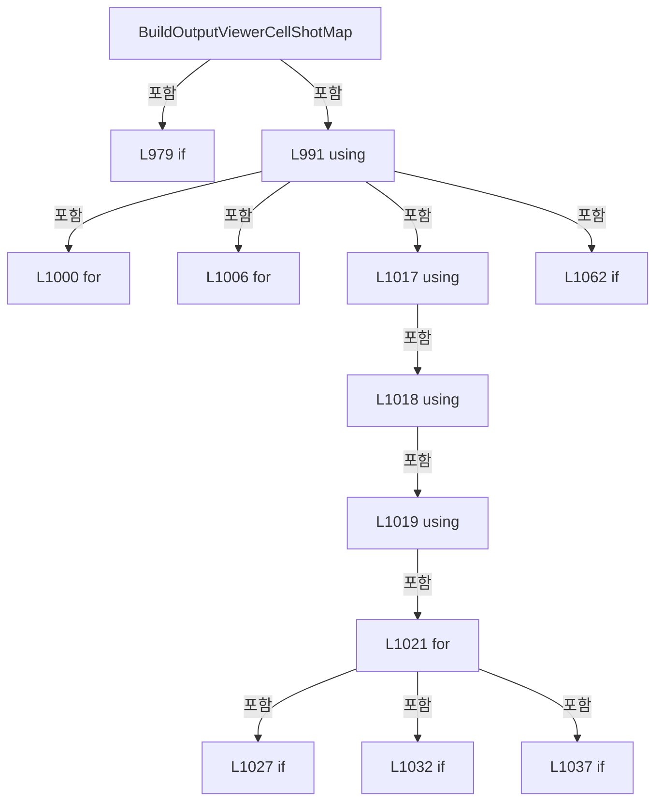

변경 전 점검: 입력/반환 타입, 위 호출자, 예외/취소 경로, 공유 상태와 저장·전송 소비자를 함께 확인합니다. 값의 단위나 물리 방향을 이름만으로 확정하지 않습니다.

### MethodDeclaration `AddOutputViewerShotCircle` · L1086–1095

[Drilling.UI/Menu/Menus/CMenuCorrection.cs:1086–1095](https://github.com/kjuws10-rgb/A3Drilling/blob/334b3599651b2e8e0181fd4459bafaf3cddafff3/Drilling.UI/Menu/Menus/CMenuCorrection.cs#L1086-L1095)

| 항목 | 실제 추출 값 |
| --- | --- |
| 서명 | void Drilling.UI.Menu.Menus.CMenuCorrection.AddOutputViewerShotCircle(StreamGeometryContext, double, double, double) |
| 접근/수식자 | Private / private, static |
| 반환/값 타입 | void |
| 소속 타입 | NamedType:Drilling.UI.Menu.Menus.CMenuCorrection |

입력 계약:

| 이름 | 타입 | 전달 | 선택/기본값 |
| --- | --- | --- | --- |
| context | StreamGeometryContext | None | False /  |
| centerX | double | None | False /  |
| centerY | double | None | False /  |
| radius | double | None | False /  |

현재 부분 분석에서 직접 연결된 호출자는 없습니다. XAML/이벤트/인터페이스·델리게이트·외부 진입을 추가 확인해야 하며, 미사용으로 판정한 것이 아닙니다.

호출하는 대상과 해석 범위:

| 원본 행 | 표현식 | 분석 상태 | 대상/소스 위치 |
| --- | --- | --- | --- |
| 1090 | context.BeginFigure | unresolved | None |
| 1090 | new Point | unresolved | None |
| 1091 | context.BezierTo | unresolved | None |
| 1091 | new Point | unresolved | None |
| 1091 | new Point | unresolved | None |
| 1091 | new Point | unresolved | None |
| 1092 | context.BezierTo | unresolved | None |
| 1092 | new Point | unresolved | None |
| 1092 | new Point | unresolved | None |
| 1092 | new Point | unresolved | None |
| 1093 | context.BezierTo | unresolved | None |
| 1093 | new Point | unresolved | None |
| 1093 | new Point | unresolved | None |
| 1093 | new Point | unresolved | None |
| 1094 | context.BezierTo | unresolved | None |
| 1094 | new Point | unresolved | None |
| 1094 | new Point | unresolved | None |
| 1094 | new Point | unresolved | None |

본문의 실제 연산·분기·예외·반환 순서(원문 위치 순):

| 원본 행 | 종류 | 주석 해설 |
| --- | --- | --- |
| 1088 | local-declaration | 지역 변수를 선언합니다: const double bezierCircle = 0.5522847498307936; |
| 1088 | variable-initializer | 변수의 초기값을 지정합니다: bezierCircle = 0.5522847498307936 |
| 1089 | local-declaration | 지역 변수를 선언합니다: var control = radius * bezierCircle; |
| 1089 | variable-initializer | 변수의 초기값을 지정합니다: control = radius * bezierCircle |
| 1090 | call | 함수·델리게이트 또는 객체 생성자를 호출합니다: context.BeginFigure(new Point(centerX + radius, centerY), true, true) |
| 1090 | call | 함수·델리게이트 또는 객체 생성자를 호출합니다: new Point(centerX + radius, centerY) |
| 1091 | call | 함수·델리게이트 또는 객체 생성자를 호출합니다: context.BezierTo(new Point(centerX + radius, centerY + control), new Point(centerX + control, centerY + radius), new Point(centerX, centerY + radius), true, false) |
| 1091 | call | 함수·델리게이트 또는 객체 생성자를 호출합니다: new Point(centerX + radius, centerY + control) |
| 1091 | call | 함수·델리게이트 또는 객체 생성자를 호출합니다: new Point(centerX + control, centerY + radius) |
| 1091 | call | 함수·델리게이트 또는 객체 생성자를 호출합니다: new Point(centerX, centerY + radius) |
| 1092 | call | 함수·델리게이트 또는 객체 생성자를 호출합니다: context.BezierTo(new Point(centerX - control, centerY + radius), new Point(centerX - radius, centerY + control), new Point(centerX - radius, centerY), true, false) |
| 1092 | call | 함수·델리게이트 또는 객체 생성자를 호출합니다: new Point(centerX - control, centerY + radius) |
| 1092 | call | 함수·델리게이트 또는 객체 생성자를 호출합니다: new Point(centerX - radius, centerY + control) |
| 1092 | call | 함수·델리게이트 또는 객체 생성자를 호출합니다: new Point(centerX - radius, centerY) |
| 1093 | call | 함수·델리게이트 또는 객체 생성자를 호출합니다: context.BezierTo(new Point(centerX - radius, centerY - control), new Point(centerX - control, centerY - radius), new Point(centerX, centerY - radius), true, false) |
| 1093 | call | 함수·델리게이트 또는 객체 생성자를 호출합니다: new Point(centerX - radius, centerY - control) |
| 1093 | call | 함수·델리게이트 또는 객체 생성자를 호출합니다: new Point(centerX - control, centerY - radius) |
| 1093 | call | 함수·델리게이트 또는 객체 생성자를 호출합니다: new Point(centerX, centerY - radius) |
| 1094 | call | 함수·델리게이트 또는 객체 생성자를 호출합니다: context.BezierTo(new Point(centerX + control, centerY - radius), new Point(centerX + radius, centerY - control), new Point(centerX + radius, centerY), true, false) |
| 1094 | call | 함수·델리게이트 또는 객체 생성자를 호출합니다: new Point(centerX + control, centerY - radius) |
| 1094 | call | 함수·델리게이트 또는 객체 생성자를 호출합니다: new Point(centerX + radius, centerY - control) |
| 1094 | call | 함수·델리게이트 또는 객체 생성자를 호출합니다: new Point(centerX + radius, centerY) |

변경 전 점검: 입력/반환 타입, 위 호출자, 예외/취소 경로, 공유 상태와 저장·전송 소비자를 함께 확인합니다. 값의 단위나 물리 방향을 이름만으로 확정하지 않습니다.

### MethodDeclaration `AddOutputViewerMaskCross` · L1097–1103

[Drilling.UI/Menu/Menus/CMenuCorrection.cs:1097–1103](https://github.com/kjuws10-rgb/A3Drilling/blob/334b3599651b2e8e0181fd4459bafaf3cddafff3/Drilling.UI/Menu/Menus/CMenuCorrection.cs#L1097-L1103)

| 항목 | 실제 추출 값 |
| --- | --- |
| 서명 | void Drilling.UI.Menu.Menus.CMenuCorrection.AddOutputViewerMaskCross(StreamGeometryContext, double, double, double) |
| 접근/수식자 | Private / private, static |
| 반환/값 타입 | void |
| 소속 타입 | NamedType:Drilling.UI.Menu.Menus.CMenuCorrection |

입력 계약:

| 이름 | 타입 | 전달 | 선택/기본값 |
| --- | --- | --- | --- |
| context | StreamGeometryContext | None | False /  |
| centerX | double | None | False /  |
| centerY | double | None | False /  |
| radius | double | None | False /  |

현재 부분 분석에서 직접 연결된 호출자는 없습니다. XAML/이벤트/인터페이스·델리게이트·외부 진입을 추가 확인해야 하며, 미사용으로 판정한 것이 아닙니다.

호출하는 대상과 해석 범위:

| 원본 행 | 표현식 | 분석 상태 | 대상/소스 위치 |
| --- | --- | --- | --- |
| 1099 | context.BeginFigure | unresolved | None |
| 1099 | new Point | unresolved | None |
| 1100 | context.LineTo | unresolved | None |
| 1100 | new Point | unresolved | None |
| 1101 | context.BeginFigure | unresolved | None |
| 1101 | new Point | unresolved | None |
| 1102 | context.LineTo | unresolved | None |
| 1102 | new Point | unresolved | None |

본문의 실제 연산·분기·예외·반환 순서(원문 위치 순):

| 원본 행 | 종류 | 주석 해설 |
| --- | --- | --- |
| 1099 | call | 함수·델리게이트 또는 객체 생성자를 호출합니다: context.BeginFigure(new Point(centerX - radius, centerY - radius), false, false) |
| 1099 | call | 함수·델리게이트 또는 객체 생성자를 호출합니다: new Point(centerX - radius, centerY - radius) |
| 1100 | call | 함수·델리게이트 또는 객체 생성자를 호출합니다: context.LineTo(new Point(centerX + radius, centerY + radius), true, false) |
| 1100 | call | 함수·델리게이트 또는 객체 생성자를 호출합니다: new Point(centerX + radius, centerY + radius) |
| 1101 | call | 함수·델리게이트 또는 객체 생성자를 호출합니다: context.BeginFigure(new Point(centerX - radius, centerY + radius), false, false) |
| 1101 | call | 함수·델리게이트 또는 객체 생성자를 호출합니다: new Point(centerX - radius, centerY + radius) |
| 1102 | call | 함수·델리게이트 또는 객체 생성자를 호출합니다: context.LineTo(new Point(centerX + radius, centerY - radius), true, false) |
| 1102 | call | 함수·델리게이트 또는 객체 생성자를 호출합니다: new Point(centerX + radius, centerY - radius) |

변경 전 점검: 입력/반환 타입, 위 호출자, 예외/취소 경로, 공유 상태와 저장·전송 소비자를 함께 확인합니다. 값의 단위나 물리 방향을 이름만으로 확정하지 않습니다.

### MethodDeclaration `AddOutputViewerChessDiamond` · L1105–1111

[Drilling.UI/Menu/Menus/CMenuCorrection.cs:1105–1111](https://github.com/kjuws10-rgb/A3Drilling/blob/334b3599651b2e8e0181fd4459bafaf3cddafff3/Drilling.UI/Menu/Menus/CMenuCorrection.cs#L1105-L1111)

| 항목 | 실제 추출 값 |
| --- | --- |
| 서명 | void Drilling.UI.Menu.Menus.CMenuCorrection.AddOutputViewerChessDiamond(StreamGeometryContext, double, double, double) |
| 접근/수식자 | Private / private, static |
| 반환/값 타입 | void |
| 소속 타입 | NamedType:Drilling.UI.Menu.Menus.CMenuCorrection |

입력 계약:

| 이름 | 타입 | 전달 | 선택/기본값 |
| --- | --- | --- | --- |
| context | StreamGeometryContext | None | False /  |
| centerX | double | None | False /  |
| centerY | double | None | False /  |
| radius | double | None | False /  |

현재 부분 분석에서 직접 연결된 호출자는 없습니다. XAML/이벤트/인터페이스·델리게이트·외부 진입을 추가 확인해야 하며, 미사용으로 판정한 것이 아닙니다.

호출하는 대상과 해석 범위:

| 원본 행 | 표현식 | 분석 상태 | 대상/소스 위치 |
| --- | --- | --- | --- |
| 1107 | context.BeginFigure | unresolved | None |
| 1107 | new Point | unresolved | None |
| 1108 | context.LineTo | unresolved | None |
| 1108 | new Point | unresolved | None |
| 1109 | context.LineTo | unresolved | None |
| 1109 | new Point | unresolved | None |
| 1110 | context.LineTo | unresolved | None |
| 1110 | new Point | unresolved | None |

본문의 실제 연산·분기·예외·반환 순서(원문 위치 순):

| 원본 행 | 종류 | 주석 해설 |
| --- | --- | --- |
| 1107 | call | 함수·델리게이트 또는 객체 생성자를 호출합니다: context.BeginFigure(new Point(centerX, centerY - radius), true, true) |
| 1107 | call | 함수·델리게이트 또는 객체 생성자를 호출합니다: new Point(centerX, centerY - radius) |
| 1108 | call | 함수·델리게이트 또는 객체 생성자를 호출합니다: context.LineTo(new Point(centerX + radius, centerY), true, false) |
| 1108 | call | 함수·델리게이트 또는 객체 생성자를 호출합니다: new Point(centerX + radius, centerY) |
| 1109 | call | 함수·델리게이트 또는 객체 생성자를 호출합니다: context.LineTo(new Point(centerX, centerY + radius), true, false) |
| 1109 | call | 함수·델리게이트 또는 객체 생성자를 호출합니다: new Point(centerX, centerY + radius) |
| 1110 | call | 함수·델리게이트 또는 객체 생성자를 호출합니다: context.LineTo(new Point(centerX - radius, centerY), true, false) |
| 1110 | call | 함수·델리게이트 또는 객체 생성자를 호출합니다: new Point(centerX - radius, centerY) |

변경 전 점검: 입력/반환 타입, 위 호출자, 예외/취소 경로, 공유 상태와 저장·전송 소비자를 함께 확인합니다. 값의 단위나 물리 방향을 이름만으로 확정하지 않습니다.

### MethodDeclaration `ApplyReviewOffsetsToOutputViewerParameters` · L1113–1116

[Drilling.UI/Menu/Menus/CMenuCorrection.cs:1113–1116](https://github.com/kjuws10-rgb/A3Drilling/blob/334b3599651b2e8e0181fd4459bafaf3cddafff3/Drilling.UI/Menu/Menus/CMenuCorrection.cs#L1113-L1116)

| 항목 | 실제 추출 값 |
| --- | --- |
| 서명 | void Drilling.UI.Menu.Menus.CMenuCorrection.ApplyReviewOffsetsToOutputViewerParameters(System.Collections.Generic.IDictionary<string, string>, Drilling.Common.Review.ST_REVIEW_OFFSET_FILE_DATA) |
| 접근/수식자 | Internal / internal, static |
| 반환/값 타입 | void |
| 소속 타입 | NamedType:Drilling.UI.Menu.Menus.CMenuCorrection |

입력 계약:

| 이름 | 타입 | 전달 | 선택/기본값 |
| --- | --- | --- | --- |
| parameters | System.Collections.Generic.IDictionary<string, string> | None | False /  |
| reviewOffsetFile | Drilling.Common.Review.ST_REVIEW_OFFSET_FILE_DATA | None | False /  |

정적 호출자로 확인된 위치:

| 호출 파일/행 | 호출 표현식 | 런타임 분기 가능 |
| --- | --- | --- |
| [Drilling.UI/Menu/Menus/CMenuCorrection.cs:736–736](https://github.com/kjuws10-rgb/A3Drilling/blob/334b3599651b2e8e0181fd4459bafaf3cddafff3/Drilling.UI/Menu/Menus/CMenuCorrection.cs#L736-L736) | ApplyReviewOffsetsToOutputViewerParameters | False |
| [Drilling.UI/Menu/Menus/CMenuCorrection.cs:7782–7782](https://github.com/kjuws10-rgb/A3Drilling/blob/334b3599651b2e8e0181fd4459bafaf3cddafff3/Drilling.UI/Menu/Menus/CMenuCorrection.cs#L7782-L7782) | CMenuCorrection.ApplyReviewOffsetsToOutputViewerParameters | False |
| [Drilling.UI/Menu/Menus/CMenuMonitor.cs:3111–3111](https://github.com/kjuws10-rgb/A3Drilling/blob/334b3599651b2e8e0181fd4459bafaf3cddafff3/Drilling.UI/Menu/Menus/CMenuMonitor.cs#L3111-L3111) | CMenuCorrection.ApplyReviewOffsetsToOutputViewerParameters | False |

호출하는 대상과 해석 범위:

| 원본 행 | 표현식 | 분석 상태 | 대상/소스 위치 |
| --- | --- | --- | --- |
| 1115 | CReviewOffsetData.ApplyToParameters | resolved | void Drilling.Common.Recipe.CReviewOffsetData.ApplyToParameters(System.Collections.Generic.IDictionary<string, string>, Drilling.Common.Review.ST_REVIEW_OFFSET_FILE_DATA) · Drilling.Common/Recipe/CShotCoordinatePlanBuilder.cs:1190 |

본문의 실제 연산·분기·예외·반환 순서(원문 위치 순):

| 원본 행 | 종류 | 주석 해설 |
| --- | --- | --- |
| 1115 | call | 함수·델리게이트 또는 객체 생성자를 호출합니다: CReviewOffsetData.ApplyToParameters(parameters, reviewOffsetFile) |

변경 전 점검: 입력/반환 타입, 위 호출자, 예외/취소 경로, 공유 상태와 저장·전송 소비자를 함께 확인합니다. 값의 단위나 물리 방향을 이름만으로 확정하지 않습니다.

### MethodDeclaration `BuildOutputViewerGlassPreview` · L1118–1258

[Drilling.UI/Menu/Menus/CMenuCorrection.cs:1118–1258](https://github.com/kjuws10-rgb/A3Drilling/blob/334b3599651b2e8e0181fd4459bafaf3cddafff3/Drilling.UI/Menu/Menus/CMenuCorrection.cs#L1118-L1258)

| 항목 | 실제 추출 값 |
| --- | --- |
| 서명 | Drilling.UI.Menu.Menus.ST_CORRECTION_OFFSET_VIEWER_PREVIEW Drilling.UI.Menu.Menus.CMenuCorrection.BuildOutputViewerGlassPreview(System.Collections.Generic.IReadOnlyDictionary<string, string>, int, int) |
| 접근/수식자 | Internal / internal, static |
| 반환/값 타입 | Drilling.UI.Menu.Menus.ST_CORRECTION_OFFSET_VIEWER_PREVIEW |
| 소속 타입 | NamedType:Drilling.UI.Menu.Menus.CMenuCorrection |

입력 계약:

| 이름 | 타입 | 전달 | 선택/기본값 |
| --- | --- | --- | --- |
| parameters | System.Collections.Generic.IReadOnlyDictionary<string, string> | None | False /  |
| cellCount | int | None | False /  |
| selectedCellNo | int | None | False /  |

정적 호출자로 확인된 위치:

| 호출 파일/행 | 호출 표현식 | 런타임 분기 가능 |
| --- | --- | --- |
| [Drilling.UI/Menu/Menus/CMenuCorrection.ReviewData.Offset.cs:242–242](https://github.com/kjuws10-rgb/A3Drilling/blob/334b3599651b2e8e0181fd4459bafaf3cddafff3/Drilling.UI/Menu/Menus/CMenuCorrection.ReviewData.Offset.cs#L242-L242) | BuildOutputViewerGlassPreview | False |
| [Drilling.UI/Menu/Menus/CMenuCorrection.cs:751–751](https://github.com/kjuws10-rgb/A3Drilling/blob/334b3599651b2e8e0181fd4459bafaf3cddafff3/Drilling.UI/Menu/Menus/CMenuCorrection.cs#L751-L751) | BuildOutputViewerGlassPreview | False |
| [Drilling.UI/Menu/Menus/CMenuCorrection.cs:2903–2903](https://github.com/kjuws10-rgb/A3Drilling/blob/334b3599651b2e8e0181fd4459bafaf3cddafff3/Drilling.UI/Menu/Menus/CMenuCorrection.cs#L2903-L2903) | BuildOutputViewerGlassPreview | False |
| [Drilling.UI/Menu/Menus/CMenuCorrection.cs:4291–4291](https://github.com/kjuws10-rgb/A3Drilling/blob/334b3599651b2e8e0181fd4459bafaf3cddafff3/Drilling.UI/Menu/Menus/CMenuCorrection.cs#L4291-L4291) | BuildOutputViewerGlassPreview | False |
| [Drilling.UI/Menu/Menus/CMenuMonitor.cs:3274–3277](https://github.com/kjuws10-rgb/A3Drilling/blob/334b3599651b2e8e0181fd4459bafaf3cddafff3/Drilling.UI/Menu/Menus/CMenuMonitor.cs#L3274-L3277) | CMenuCorrection.BuildOutputViewerGlassPreview | False |

호출하는 대상과 해석 범위:

| 원본 행 | 표현식 | 분석 상태 | 대상/소스 위치 |
| --- | --- | --- | --- |
| 1126 | ReadOutputViewerDouble | resolved | double Drilling.UI.Menu.Menus.CMenuCorrection.ReadOutputViewerDouble(System.Collections.Generic.IReadOnlyDictionary<string, string>, double, params string[]) · Drilling.UI/Menu/Menus/CMenuCorrection.cs:1361 |
| 1127 | ReadOutputViewerDouble | resolved | double Drilling.UI.Menu.Menus.CMenuCorrection.ReadOutputViewerDouble(System.Collections.Generic.IReadOnlyDictionary<string, string>, double, params string[]) · Drilling.UI/Menu/Menus/CMenuCorrection.cs:1361 |
| 1131 | CAlignKeyMarginSettings.Read | resolved | Drilling.Common.Managers.ST_ALIGN_KEY_MARGINS Drilling.Common.Managers.CAlignKeyMarginSettings.Read(System.Collections.Generic.IReadOnlyDictionary<string, string>) · Drilling.Common/Managers/CAlignKeyMarginSettings.cs:21 |
| 1135 | new ST_CORRECTION_OFFSET_VIEWER_PREVIEW | resolved | Drilling.UI.Menu.Menus.ST_CORRECTION_OFFSET_VIEWER_PREVIEW.ST_CORRECTION_OFFSET_VIEWER_PREVIEW(ImageSource?, System.Collections.Generic.IReadOnlyList<Drilling.UI.Menu.Menus.ST_CELL_PREVIEW_LABEL>, string) · Drilling.UI/Menu/Menus/CMenuCorrection.cs:7091 |
| 1140 | ReadOutputViewerDouble | resolved | double Drilling.UI.Menu.Menus.CMenuCorrection.ReadOutputViewerDouble(System.Collections.Generic.IReadOnlyDictionary<string, string>, double, params string[]) · Drilling.UI/Menu/Menus/CMenuCorrection.cs:1361 |
| 1141 | ReadOutputViewerInt | resolved | int Drilling.UI.Menu.Menus.CMenuCorrection.ReadOutputViewerInt(System.Collections.Generic.IReadOnlyDictionary<string, string>, int, params string[]) · Drilling.UI/Menu/Menus/CMenuCorrection.cs:1338 |
| 1142 | CRecipeModelPixelCountReader.ReadModelTypeCount | resolved | int Drilling.Common.Recipe.CRecipeModelPixelCountReader.ReadModelTypeCount(System.Collections.Generic.IReadOnlyDictionary<string, string>) · Drilling.Common/Recipe/CCellPatternCalculator.cs:428 |
| 1145 | new ST_CORRECTION_OFFSET_VIEWER_PREVIEW | resolved | Drilling.UI.Menu.Menus.ST_CORRECTION_OFFSET_VIEWER_PREVIEW.ST_CORRECTION_OFFSET_VIEWER_PREVIEW(ImageSource?, System.Collections.Generic.IReadOnlyList<Drilling.UI.Menu.Menus.ST_CELL_PREVIEW_LABEL>, string) · Drilling.UI/Menu/Menus/CMenuCorrection.cs:7091 |
| 1153 | CCellPreviewDrawing.CreateDistortionKeyPreviews | resolved | System.Collections.Generic.IReadOnlyList<Drilling.UI.Menu.Menus.ST_DISTORTION_KEY_PREVIEW> Drilling.UI.Menu.Menus.CCellPreviewDrawing.CreateDistortionKeyPreviews(double, double, double, double, System.Func<string, double?>) · Drilling.UI/Menu/Menus/CCellPreviewDrawing.cs:61 |
| 1154 | Math.Min | resolved | double System.Math.Min(double, double) |
| 1159 | new ST_GLASS_PREVIEW_FRAME | resolved | Drilling.UI.Menu.Menus.ST_GLASS_PREVIEW_FRAME.ST_GLASS_PREVIEW_FRAME(double, double, double, double) · Drilling.UI/Menu/Menus/CMenuMain.cs:3560 |
| 1160 | new Rect | unresolved | None |
| 1161 | new DrawingGroup | unresolved | None |
| 1162 | new List<ST_CELL_PREVIEW_LABEL> | resolved | System.Collections.Generic.List<Drilling.UI.Menu.Menus.ST_CELL_PREVIEW_LABEL>.List() |
| 1163 | new List<(StreamGeometry Boundary, Pen Pen)> | resolved | System.Collections.Generic.List<(StreamGeometry Boundary, Pen Pen)>.List() |
| 1166 | drawing.Open | unresolved | None |
| 1168 | context.DrawRectangle | unresolved | None |
| 1168 | new SolidColorBrush | unresolved | None |
| 1168 | Color.FromArgb | unresolved | None |
| 1168 | new Rect | unresolved | None |
| 1169 | context.PushClip | unresolved | None |
| 1169 | new RectangleGeometry | unresolved | None |
| 1172 | ReadOutputViewerDouble | resolved | double Drilling.UI.Menu.Menus.CMenuCorrection.ReadOutputViewerDouble(System.Collections.Generic.IReadOnlyDictionary<string, string>, double, params string[]) · Drilling.UI/Menu/Menus/CMenuCorrection.cs:1361 |
| 1173 | ReadOutputViewerDouble | resolved | double Drilling.UI.Menu.Menus.CMenuCorrection.ReadOutputViewerDouble(System.Collections.Generic.IReadOnlyDictionary<string, string>, double, params string[]) · Drilling.UI/Menu/Menus/CMenuCorrection.cs:1361 |
| 1174 | ReadOutputViewerDouble | resolved | double Drilling.UI.Menu.Menus.CMenuCorrection.ReadOutputViewerDouble(System.Collections.Generic.IReadOnlyDictionary<string, string>, double, params string[]) · Drilling.UI/Menu/Menus/CMenuCorrection.cs:1361 |
| 1175 | CRecipeModelPixelCountReader.ReadCellModelType | resolved | int Drilling.Common.Recipe.CRecipeModelPixelCountReader.ReadCellModelType(System.Collections.Generic.IReadOnlyDictionary<string, string>, int, int) · Drilling.Common/Recipe/CCellPatternCalculator.cs:433 |
| 1176 | CRecipeModelPixelCountReader.ReadPatternForModel | resolved | Drilling.Common.Recipe.ST_RECIPE_MODEL_PATTERN Drilling.Common.Recipe.CRecipeModelPixelCountReader.ReadPatternForModel(System.Collections.Generic.IReadOnlyDictionary<string, string>, int) · Drilling.Common/Recipe/CCellPatternCalculator.cs:455 |
| 1177 | CCellPatternCalculator.Calculate | resolved | Drilling.Common.Recipe.ST_CELL_PATTERN_LAYOUT Drilling.Common.Recipe.CCellPatternCalculator.Calculate(Drilling.Common.Recipe.ST_CELL_PATTERN_DEFINITION, bool) · Drilling.Common/Recipe/CCellPatternCalculator.cs:66 |
| 1177 | new ST_CELL_PATTERN_DEFINITION | resolved | Drilling.Common.Recipe.ST_CELL_PATTERN_DEFINITION.ST_CELL_PATTERN_DEFINITION(int, double, double, double, double, int, int, int, int, double, double) · Drilling.Common/Recipe/CCellPatternCalculator.cs:277 |
| 1184 | BuildOutputViewerCellBoundaryGeometry | resolved | StreamGeometry? Drilling.UI.Menu.Menus.CMenuCorrection.BuildOutputViewerCellBoundaryGeometry(double, double, double, double, int, int, double, double, double) · Drilling.UI/Menu/Menus/CMenuCorrection.cs:1260 |
| 1192 | CMenuMain.CreateHeadBrush | resolved | Brush Drilling.UI.Menu.Menus.CMenuMain.CreateHeadBrush(int, byte) · Drilling.UI/Menu/Menus/CMenuMain.cs:2246 |
| 1194 | new SolidColorBrush | unresolved | None |
| 1194 | Color.FromRgb | unresolved | None |
| 1195 | CMenuMain.CreateHeadBrush | resolved | Brush Drilling.UI.Menu.Menus.CMenuMain.CreateHeadBrush(int, byte) · Drilling.UI/Menu/Menus/CMenuMain.cs:2246 |
| 1198 | boundaryBrush.Freeze | unresolved | None |
| 1201 | new Pen | unresolved | None |
| 1202 | boundaryPen.Freeze | unresolved | None |
| 1203 | context.DrawGeometry | unresolved | None |
| 1204 | drawnCellBoundaries.Add | candidate | OverloadResolutionFailure |
| 1205 | CCellPreviewDrawing.CreateCellLabel | candidate | OverloadResolutionFailure |
| 1208 | cellLabels.Add | resolved | void System.Collections.Generic.List<Drilling.UI.Menu.Menus.ST_CELL_PREVIEW_LABEL>.Add(Drilling.UI.Menu.Menus.ST_CELL_PREVIEW_LABEL) |
| 1214 | context.DrawGeometry | unresolved | None |
| 1217 | context.Pop | unresolved | None |
| 1218 | CCellPreviewDrawing.DrawAlignKeys | candidate | OverloadResolutionFailure |
| 1219 | CCellPreviewDrawing.DrawDistortionKeys | candidate | OverloadResolutionFailure |
| 1222 | drawing.Freeze | unresolved | None |
| 1224 | Math.Max | resolved | double System.Math.Max(double, double) |
| 1225 | new Rect | unresolved | None |
| 1226 | new Rect | unresolved | None |
| 1227 | cellLabels.Select(label => label with { CanvasCenterX = label.CanvasCenterX - frameLeft + paddingX, CanvasCenterY = label.CanvasCenterY - frameTop + paddingY, Width = Math.Max(18.0, label.CellNo.ToString(CultureInfo.InvariantCulture).Length * 6.2 + 8.0), DesignWidth = cellRect.Width, DesignHeight = cellRect.Height }).ToArray | resolved | Drilling.UI.Menu.Menus.ST_CELL_PREVIEW_LABEL[] System.Collections.Generic.IEnumerable<Drilling.UI.Menu.Menus.ST_CELL_PREVIEW_LABEL>.ToArray<Drilling.UI.Menu.Menus.ST_CELL_PREVIEW_LABEL>() |
| 1227 | cellLabels.Select | resolved | System.Collections.Generic.IEnumerable<Drilling.UI.Menu.Menus.ST_CELL_PREVIEW_LABEL> System.Collections.Generic.IEnumerable<Drilling.UI.Menu.Menus.ST_CELL_PREVIEW_LABEL>.Select<Drilling.UI.Menu.Menus.ST_CELL_PREVIEW_LABEL, Drilling.UI.Menu.Menus.ST_CELL_PREVIEW_LABEL>(System.Func<Drilling.UI.Menu.Menus.ST_CELL_PREVIEW_LABEL, Drilling.UI.Menu.Menus.ST_CELL_PREVIEW_LABEL>) |
| 1231 | Math.Max | resolved | double System.Math.Max(double, double) |
| 1231 | label.CellNo.ToString | resolved | string int.ToString(System.IFormatProvider?) |
| 1235 | new DrawingGroup | unresolved | None |
| 1236 | cellDrawing.Open | unresolved | None |
| 1238 | cellContext.DrawRectangle | unresolved | None |
| 1238 | new SolidColorBrush | unresolved | None |
| 1238 | Color.FromArgb | unresolved | None |
| 1239 | cellContext.DrawRectangle | unresolved | None |
| 1239 | new Pen | unresolved | None |
| 1239 | new SolidColorBrush | unresolved | None |
| 1239 | Color.FromRgb | unresolved | None |
| 1240 | cellContext.PushClip | unresolved | None |
| 1240 | new RectangleGeometry | unresolved | None |
| 1241 | cellContext.PushTransform | unresolved | None |
| 1241 | new TranslateTransform | unresolved | None |
| 1242 | cellContext.DrawDrawing | unresolved | None |
| 1243 | cellContext.Pop | unresolved | None |
| 1244 | cellContext.Pop | unresolved | None |
| 1245 | DrawOutputViewerPreviewAxisIndicator | candidate | OverloadResolutionFailure |
| 1248 | cellDrawing.Freeze | unresolved | None |
| 1249 | new DrawingImage | unresolved | None |
| 1250 | cellImage.Freeze | unresolved | None |
| 1251 | FormatOutputViewerPreviewDouble | resolved | string Drilling.UI.Menu.Menus.CMenuCorrection.FormatOutputViewerPreviewDouble(double) · Drilling.UI/Menu/Menus/CMenuCorrection.cs:1384 |
| 1251 | FormatOutputViewerPreviewDouble | resolved | string Drilling.UI.Menu.Menus.CMenuCorrection.FormatOutputViewerPreviewDouble(double) · Drilling.UI/Menu/Menus/CMenuCorrection.cs:1384 |
| 1257 | new ST_CORRECTION_OFFSET_VIEWER_PREVIEW | candidate | OverloadResolutionFailure |

본문의 실제 연산·분기·예외·반환 순서(원문 위치 순):

| 원본 행 | 종류 | 주석 해설 |
| --- | --- | --- |
| 1120 | local-declaration | 지역 변수를 선언합니다: const double canvasWidth = 860.0; |
| 1120 | variable-initializer | 변수의 초기값을 지정합니다: canvasWidth = 860.0 |
| 1121 | local-declaration | 지역 변수를 선언합니다: const double canvasHeight = 430.0; |
| 1121 | variable-initializer | 변수의 초기값을 지정합니다: canvasHeight = 430.0 |
| 1122 | local-declaration | 지역 변수를 선언합니다: const double maxLeft = 44.0; |
| 1122 | variable-initializer | 변수의 초기값을 지정합니다: maxLeft = 44.0 |
| 1123 | local-declaration | 지역 변수를 선언합니다: const double maxTop = 50.0; |
| 1123 | variable-initializer | 변수의 초기값을 지정합니다: maxTop = 50.0 |
| 1124 | local-declaration | 지역 변수를 선언합니다: const double maxWidth = 772.0; |
| 1124 | variable-initializer | 변수의 초기값을 지정합니다: maxWidth = 772.0 |
| 1125 | local-declaration | 지역 변수를 선언합니다: const double maxHeight = 340.0; |
| 1125 | variable-initializer | 변수의 초기값을 지정합니다: maxHeight = 340.0 |
| 1126 | call | 함수·델리게이트 또는 객체 생성자를 호출합니다: ReadOutputViewerDouble(parameters, 500.0, "GLASS_SIZE_X") |
| 1126 | local-declaration | 지역 변수를 선언합니다: var glassWidth = ReadOutputViewerDouble(parameters, 500.0, "GLASS_SIZE_X"); |
| 1126 | variable-initializer | 변수의 초기값을 지정합니다: glassWidth = ReadOutputViewerDouble(parameters, 500.0, "GLASS_SIZE_X") |
| 1127 | call | 함수·델리게이트 또는 객체 생성자를 호출합니다: ReadOutputViewerDouble(parameters, 300.0, "GLASS_SIZE_Y") |
| 1127 | local-declaration | 지역 변수를 선언합니다: var glassHeight = ReadOutputViewerDouble(parameters, 300.0, "GLASS_SIZE_Y"); |
| 1127 | variable-initializer | 변수의 초기값을 지정합니다: glassHeight = ReadOutputViewerDouble(parameters, 300.0, "GLASS_SIZE_Y") |
| 1128 | local-declaration | 지역 변수를 선언합니다: ST_ALIGN_KEY_MARGINS alignKeyMargins; |
| 1129 | try | 예외 처리 범위입니다: try |
| 1131 | assignment | 값을 대상에 대입합니다: alignKeyMargins = CAlignKeyMarginSettings.Read(parameters) |
| 1131 | call | 함수·델리게이트 또는 객체 생성자를 호출합니다: CAlignKeyMarginSettings.Read(parameters) |
| 1133 | catch | 지정 예외를 처리합니다: catch (InvalidDataException exception) |
| 1135 | call | 함수·델리게이트 또는 객체 생성자를 호출합니다: new ST_CORRECTION_OFFSET_VIEWER_PREVIEW(null, [], exception.Message) |
| 1135 | return | 호출자에게 값 또는 제어를 반환합니다: return new ST_CORRECTION_OFFSET_VIEWER_PREVIEW(null, [], exception.Message); |
| 1138 | local-declaration | 지역 변수를 선언합니다: var akMarginX = alignKeyMargins.X; |
| 1138 | variable-initializer | 변수의 초기값을 지정합니다: akMarginX = alignKeyMargins.X |
| 1139 | local-declaration | 지역 변수를 선언합니다: var akMarginY = alignKeyMargins.Y; |
| 1139 | variable-initializer | 변수의 초기값을 지정합니다: akMarginY = alignKeyMargins.Y |
| 1140 | call | 함수·델리게이트 또는 객체 생성자를 호출합니다: ReadOutputViewerDouble(parameters, 0.09, "PIXEL_SIZE") |
| 1140 | local-declaration | 지역 변수를 선언합니다: var pixelSize = ReadOutputViewerDouble(parameters, 0.09, "PIXEL_SIZE"); |
| 1140 | variable-initializer | 변수의 초기값을 지정합니다: pixelSize = ReadOutputViewerDouble(parameters, 0.09, "PIXEL_SIZE") |
| 1141 | call | 함수·델리게이트 또는 객체 생성자를 호출합니다: ReadOutputViewerInt(parameters, 1, "SPLITED_BEAM_COUNT") |
| 1141 | local-declaration | 지역 변수를 선언합니다: var splitBeamCount = ReadOutputViewerInt(parameters, 1, "SPLITED_BEAM_COUNT"); |
| 1141 | variable-initializer | 변수의 초기값을 지정합니다: splitBeamCount = ReadOutputViewerInt(parameters, 1, "SPLITED_BEAM_COUNT") |
| 1142 | call | 함수·델리게이트 또는 객체 생성자를 호출합니다: CRecipeModelPixelCountReader.ReadModelTypeCount(parameters) |
| 1142 | local-declaration | 지역 변수를 선언합니다: var modelTypeCount = CRecipeModelPixelCountReader.ReadModelTypeCount(parameters); |
| 1142 | variable-initializer | 변수의 초기값을 지정합니다: modelTypeCount = CRecipeModelPixelCountReader.ReadModelTypeCount(parameters) |
| 1143 | if | 조건에 따라 분기합니다: if (glassWidth <= 0.0 &#124;&#124; glassHeight <= 0.0) |
| 1145 | call | 함수·델리게이트 또는 객체 생성자를 호출합니다: new ST_CORRECTION_OFFSET_VIEWER_PREVIEW(null, [], "Glass size is not valid.") |
| 1145 | return | 호출자에게 값 또는 제어를 반환합니다: return new ST_CORRECTION_OFFSET_VIEWER_PREVIEW(null, [], "Glass size is not valid."); |
| 1153 | call | 함수·델리게이트 또는 객체 생성자를 호출합니다: CCellPreviewDrawing.CreateDistortionKeyPreviews(glassWidth, glassHeight, akMarginX, akMarginY, ReadDistortionValue) |
| 1153 | local-declaration | 지역 변수를 선언합니다: var distortionKeys = CCellPreviewDrawing.CreateDistortionKeyPreviews(glassWidth, glassHeight, akMarginX, akMarginY, ReadDistortionValue); |
| 1153 | variable-initializer | 변수의 초기값을 지정합니다: distortionKeys = CCellPreviewDrawing.CreateDistortionKeyPreviews(glassWidth, glassHeight, akMarginX, akMarginY, ReadDistortionValue) |
| 1154 | call | 함수·델리게이트 또는 객체 생성자를 호출합니다: Math.Min(maxWidth / glassWidth, maxHeight / glassHeight) |
| 1154 | local-declaration | 지역 변수를 선언합니다: var scale = Math.Min(maxWidth / glassWidth, maxHeight / glassHeight); |
| 1154 | variable-initializer | 변수의 초기값을 지정합니다: scale = Math.Min(maxWidth / glassWidth, maxHeight / glassHeight) |
| 1155 | local-declaration | 지역 변수를 선언합니다: var frameWidth = glassWidth * scale; |
| 1155 | variable-initializer | 변수의 초기값을 지정합니다: frameWidth = glassWidth * scale |
| 1156 | local-declaration | 지역 변수를 선언합니다: var frameHeight = glassHeight * scale; |
| 1156 | variable-initializer | 변수의 초기값을 지정합니다: frameHeight = glassHeight * scale |
| 1157 | local-declaration | 지역 변수를 선언합니다: var frameLeft = maxLeft + (maxWidth - frameWidth) / 2.0; |
| 1157 | variable-initializer | 변수의 초기값을 지정합니다: frameLeft = maxLeft + (maxWidth - frameWidth) / 2.0 |
| 1158 | local-declaration | 지역 변수를 선언합니다: var frameTop = maxTop + (maxHeight - frameHeight) / 2.0; |
| 1158 | variable-initializer | 변수의 초기값을 지정합니다: frameTop = maxTop + (maxHeight - frameHeight) / 2.0 |
| 1159 | call | 함수·델리게이트 또는 객체 생성자를 호출합니다: new ST_GLASS_PREVIEW_FRAME(frameLeft, frameTop, frameWidth, frameHeight) |
| 1159 | local-declaration | 지역 변수를 선언합니다: var frame = new ST_GLASS_PREVIEW_FRAME(frameLeft, frameTop, frameWidth, frameHeight); |
| 1159 | variable-initializer | 변수의 초기값을 지정합니다: frame = new ST_GLASS_PREVIEW_FRAME(frameLeft, frameTop, frameWidth, frameHeight) |
| 1160 | call | 함수·델리게이트 또는 객체 생성자를 호출합니다: new Rect(frameLeft, frameTop, frameWidth, frameHeight) |
| 1160 | local-declaration | 지역 변수를 선언합니다: var frameBounds = new Rect(frameLeft, frameTop, frameWidth, frameHeight); |
| 1160 | variable-initializer | 변수의 초기값을 지정합니다: frameBounds = new Rect(frameLeft, frameTop, frameWidth, frameHeight) |
| 1161 | call | 함수·델리게이트 또는 객체 생성자를 호출합니다: new DrawingGroup() |
| 1161 | local-declaration | 지역 변수를 선언합니다: var drawing = new DrawingGroup(); |
| 1161 | variable-initializer | 변수의 초기값을 지정합니다: drawing = new DrawingGroup() |
| 1162 | call | 함수·델리게이트 또는 객체 생성자를 호출합니다: new List<ST_CELL_PREVIEW_LABEL>() |
| 1162 | local-declaration | 지역 변수를 선언합니다: var cellLabels = new List<ST_CELL_PREVIEW_LABEL>(); |
| 1162 | variable-initializer | 변수의 초기값을 지정합니다: cellLabels = new List<ST_CELL_PREVIEW_LABEL>() |
| 1163 | call | 함수·델리게이트 또는 객체 생성자를 호출합니다: new List<(StreamGeometry Boundary, Pen Pen)>() |
| 1163 | local-declaration | 지역 변수를 선언합니다: var drawnCellBoundaries = new List<(StreamGeometry Boundary, Pen Pen)>(); |
| 1163 | variable-initializer | 변수의 초기값을 지정합니다: drawnCellBoundaries = new List<(StreamGeometry Boundary, Pen Pen)>() |
| 1164 | local-declaration | 지역 변수를 선언합니다: long totalShotGroupCount = 0; |
| 1164 | variable-initializer | 변수의 초기값을 지정합니다: totalShotGroupCount = 0 |
| 1165 | local-declaration | 지역 변수를 선언합니다: var invalidCellCount = 0; |
| 1165 | variable-initializer | 변수의 초기값을 지정합니다: invalidCellCount = 0 |
| 1166 | call | 함수·델리게이트 또는 객체 생성자를 호출합니다: drawing.Open() |
| 1166 | variable-initializer | 변수의 초기값을 지정합니다: context = drawing.Open() |
| 1166 | using | 자원 사용과 정리 범위를 지정합니다: using (var context = drawing.Open()) |
| 1168 | call | 함수·델리게이트 또는 객체 생성자를 호출합니다: context.DrawRectangle(new SolidColorBrush(Color.FromArgb(1, 0, 0, 0)), null, new Rect(0, 0, canvasWidth, canvasHeight)) |
| 1168 | call | 함수·델리게이트 또는 객체 생성자를 호출합니다: new SolidColorBrush(Color.FromArgb(1, 0, 0, 0)) |
| 1168 | call | 함수·델리게이트 또는 객체 생성자를 호출합니다: Color.FromArgb(1, 0, 0, 0) |
| 1168 | call | 함수·델리게이트 또는 객체 생성자를 호출합니다: new Rect(0, 0, canvasWidth, canvasHeight) |
| 1169 | call | 함수·델리게이트 또는 객체 생성자를 호출합니다: context.PushClip(new RectangleGeometry(frameBounds)) |
| 1169 | call | 함수·델리게이트 또는 객체 생성자를 호출합니다: new RectangleGeometry(frameBounds) |
| 1170 | variable-initializer | 변수의 초기값을 지정합니다: cellNo = 1 |
| 1170 | for | 초기화·조건·증감이 있는 반복입니다: for (var cellNo = 1; cellNo <= cellCount; cellNo++) |
| 1172 | call | 함수·델리게이트 또는 객체 생성자를 호출합니다: ReadOutputViewerDouble(parameters, 0.0, $"CELL{cellNo}_ALIGN_TO_1ST_PIXEL_X") |
| 1172 | local-declaration | 지역 변수를 선언합니다: var firstPixelX = ReadOutputViewerDouble(parameters, 0.0, $"CELL{cellNo}_ALIGN_TO_1ST_PIXEL_X"); |
| 1172 | variable-initializer | 변수의 초기값을 지정합니다: firstPixelX = ReadOutputViewerDouble(parameters, 0.0, $"CELL{cellNo}_ALIGN_TO_1ST_PIXEL_X") |
| 1173 | call | 함수·델리게이트 또는 객체 생성자를 호출합니다: ReadOutputViewerDouble(parameters, 0.0, $"CELL{cellNo}_ALIGN_TO_1ST_PIXEL_Y") |
| 1173 | local-declaration | 지역 변수를 선언합니다: var firstPixelY = ReadOutputViewerDouble(parameters, 0.0, $"CELL{cellNo}_ALIGN_TO_1ST_PIXEL_Y"); |
| 1173 | variable-initializer | 변수의 초기값을 지정합니다: firstPixelY = ReadOutputViewerDouble(parameters, 0.0, $"CELL{cellNo}_ALIGN_TO_1ST_PIXEL_Y") |
| 1174 | call | 함수·델리게이트 또는 객체 생성자를 호출합니다: ReadOutputViewerDouble(parameters, 0.0, $"CELL{cellNo}_ROTATION") |
| 1174 | local-declaration | 지역 변수를 선언합니다: var rotation = ReadOutputViewerDouble(parameters, 0.0, $"CELL{cellNo}_ROTATION"); |
| 1174 | variable-initializer | 변수의 초기값을 지정합니다: rotation = ReadOutputViewerDouble(parameters, 0.0, $"CELL{cellNo}_ROTATION") |
| 1175 | call | 함수·델리게이트 또는 객체 생성자를 호출합니다: CRecipeModelPixelCountReader.ReadCellModelType(parameters, cellNo, modelTypeCount) |
| 1175 | local-declaration | 지역 변수를 선언합니다: var modelType = CRecipeModelPixelCountReader.ReadCellModelType(parameters, cellNo, modelTypeCount); |
| 1175 | variable-initializer | 변수의 초기값을 지정합니다: modelType = CRecipeModelPixelCountReader.ReadCellModelType(parameters, cellNo, modelTypeCount) |
| 1176 | call | 함수·델리게이트 또는 객체 생성자를 호출합니다: CRecipeModelPixelCountReader.ReadPatternForModel(parameters, modelType) |
| 1176 | local-declaration | 지역 변수를 선언합니다: var modelPattern = CRecipeModelPixelCountReader.ReadPatternForModel(parameters, modelType); |
| 1176 | variable-initializer | 변수의 초기값을 지정합니다: modelPattern = CRecipeModelPixelCountReader.ReadPatternForModel(parameters, modelType) |
| 1177 | call | 함수·델리게이트 또는 객체 생성자를 호출합니다: CCellPatternCalculator.Calculate(new ST_CELL_PATTERN_DEFINITION(cellNo, firstPixelX, firstPixelY, rotation, pixelSize, modelPattern.PixelCountX, modelPattern.PixelCountY, modelPattern.ProcessPitch, splitBeamCount, akMarg… |
| 1177 | call | 함수·델리게이트 또는 객체 생성자를 호출합니다: new ST_CELL_PATTERN_DEFINITION(cellNo, firstPixelX, firstPixelY, rotation, pixelSize, modelPattern.PixelCountX, modelPattern.PixelCountY, modelPattern.ProcessPitch, splitBeamCount, akMarginX, akMarginY) |
| 1177 | local-declaration | 지역 변수를 선언합니다: var layout = CCellPatternCalculator.Calculate(new ST_CELL_PATTERN_DEFINITION(cellNo, firstPixelX, firstPixelY, rotation, pixelSize, modelPattern.PixelCountX, modelPattern.PixelCountY, modelPattern.ProcessPitch, splitBeamCount, akM |
| 1177 | variable-initializer | 변수의 초기값을 지정합니다: layout = CCellPatternCalculator.Calculate(new ST_CELL_PATTERN_DEFINITION(cellNo, firstPixelX, firstPixelY, rotation, pixelSize, modelPattern.PixelCountX, modelPattern.PixelCountY, modelPattern.ProcessPitch, splitBeamCount, akMargi |
| 1178 | if | 조건에 따라 분기합니다: if (!layout.IsValid) |
| 1183 | compound-assignment-or-event-subscription | 복합 대입 또는 이벤트 구독/해지 표현입니다: totalShotGroupCount += (long)layout.GroupCountX * layout.GroupCountY |
| 1184 | call | 함수·델리게이트 또는 객체 생성자를 호출합니다: BuildOutputViewerCellBoundaryGeometry(frameLeft, frameTop, scale, pixelSize, modelPattern.PixelCountX, modelPattern.PixelCountY, akMarginX + firstPixelX, akMarginY + firstPixelY, rotation) |
| 1184 | local-declaration | 지역 변수를 선언합니다: var boundary = BuildOutputViewerCellBoundaryGeometry(frameLeft, frameTop, scale, pixelSize, modelPattern.PixelCountX, modelPattern.PixelCountY, akMarginX + firstPixelX, akMarginY + firstPixelY, rotation); |
| 1184 | variable-initializer | 변수의 초기값을 지정합니다: boundary = BuildOutputViewerCellBoundaryGeometry(frameLeft, frameTop, scale, pixelSize, modelPattern.PixelCountX, modelPattern.PixelCountY, akMarginX + firstPixelX, akMarginY + firstPixelY, rotation) |
| 1185 | if | 조건에 따라 분기합니다: if (boundary is null) |
| 1187 | continue | 다음 반복으로 진행합니다: continue; |
| 1190 | local-declaration | 지역 변수를 선언합니다: var isSelectedCell = selectedCellNo > 0 && cellNo == selectedCellNo; |
| 1190 | variable-initializer | 변수의 초기값을 지정합니다: isSelectedCell = selectedCellNo > 0 && cellNo == selectedCellNo |
| 1191 | conditional-expression | 조건에 따라 결과식을 선택합니다: selectedCellNo <= 0 ? (byte)180 : isSelectedCell ? (byte)170 : (byte)80 |
| 1191 | conditional-expression | 조건에 따라 결과식을 선택합니다: isSelectedCell ? (byte)170 : (byte)80 |
| 1191 | local-declaration | 지역 변수를 선언합니다: var cellAlpha = selectedCellNo <= 0 ? (byte)180 : isSelectedCell ? (byte)170 : (byte)80; |
| 1191 | variable-initializer | 변수의 초기값을 지정합니다: cellAlpha = selectedCellNo <= 0 ? (byte)180 : isSelectedCell ? (byte)170 : (byte)80 |
| 1192 | call | 함수·델리게이트 또는 객체 생성자를 호출합니다: CMenuMain.CreateHeadBrush(((cellNo - 1) % 8) + 1, cellAlpha) |
| 1192 | local-declaration | 지역 변수를 선언합니다: var cellBrush = CMenuMain.CreateHeadBrush(((cellNo - 1) % 8) + 1, cellAlpha); |
| 1192 | variable-initializer | 변수의 초기값을 지정합니다: cellBrush = CMenuMain.CreateHeadBrush(((cellNo - 1) % 8) + 1, cellAlpha) |
| 1193 | conditional-expression | 조건에 따라 결과식을 선택합니다: isSelectedCell ? new SolidColorBrush(Color.FromRgb(246, 196, 83)) : CMenuMain.CreateHeadBrush(((cellNo - 1) % 8) + 1, 150) |
| 1193 | local-declaration | 지역 변수를 선언합니다: var boundaryBrush = isSelectedCell ? new SolidColorBrush(Color.FromRgb(246, 196, 83)) : CMenuMain.CreateHeadBrush(((cellNo - 1) % 8) + 1, 150); |
| 1193 | variable-initializer | 변수의 초기값을 지정합니다: boundaryBrush = isSelectedCell ? new SolidColorBrush(Color.FromRgb(246, 196, 83)) : CMenuMain.CreateHeadBrush(((cellNo - 1) % 8) + 1, 150) |
| 1194 | call | 함수·델리게이트 또는 객체 생성자를 호출합니다: new SolidColorBrush(Color.FromRgb(246, 196, 83)) |
| 1194 | call | 함수·델리게이트 또는 객체 생성자를 호출합니다: Color.FromRgb(246, 196, 83) |
| 1195 | call | 함수·델리게이트 또는 객체 생성자를 호출합니다: CMenuMain.CreateHeadBrush(((cellNo - 1) % 8) + 1, 150) |
| 1196 | if | 조건에 따라 분기합니다: if (boundaryBrush.CanFreeze) |
| 1198 | call | 함수·델리게이트 또는 객체 생성자를 호출합니다: boundaryBrush.Freeze() |
| 1201 | call | 함수·델리게이트 또는 객체 생성자를 호출합니다: new Pen(boundaryBrush, isSelectedCell ? 3.0 : 1.2) |
| 1201 | conditional-expression | 조건에 따라 결과식을 선택합니다: isSelectedCell ? 3.0 : 1.2 |
| 1201 | local-declaration | 지역 변수를 선언합니다: var boundaryPen = new Pen(boundaryBrush, isSelectedCell ? 3.0 : 1.2); |
| 1201 | variable-initializer | 변수의 초기값을 지정합니다: boundaryPen = new Pen(boundaryBrush, isSelectedCell ? 3.0 : 1.2) |
| 1202 | call | 함수·델리게이트 또는 객체 생성자를 호출합니다: boundaryPen.Freeze() |
| 1203 | call | 함수·델리게이트 또는 객체 생성자를 호출합니다: context.DrawGeometry(cellBrush, null, boundary) |
| 1204 | call | 함수·델리게이트 또는 객체 생성자를 호출합니다: drawnCellBoundaries.Add((boundary, boundaryPen)) |
| 1205 | call | 함수·델리게이트 또는 객체 생성자를 호출합니다: CCellPreviewDrawing.CreateCellLabel(cellNo, boundary.Bounds, canvasWidth, canvasHeight, isSelectedCell) |
| 1205 | local-declaration | 지역 변수를 선언합니다: var label = CCellPreviewDrawing.CreateCellLabel(cellNo, boundary.Bounds, canvasWidth, canvasHeight, isSelectedCell); |
| 1205 | variable-initializer | 변수의 초기값을 지정합니다: label = CCellPreviewDrawing.CreateCellLabel(cellNo, boundary.Bounds, canvasWidth, canvasHeight, isSelectedCell) |
| 1206 | if | 조건에 따라 분기합니다: if (label is not null) |
| 1208 | call | 함수·델리게이트 또는 객체 생성자를 호출합니다: cellLabels.Add(label) |
| 1212 | foreach | 컬렉션 요소를 순회합니다: foreach (var drawnCell in drawnCellBoundaries) |
| 1214 | call | 함수·델리게이트 또는 객체 생성자를 호출합니다: context.DrawGeometry(null, drawnCell.Pen, drawnCell.Boundary) |
| 1217 | call | 함수·델리게이트 또는 객체 생성자를 호출합니다: context.Pop() |
| 1218 | call | 함수·델리게이트 또는 객체 생성자를 호출합니다: CCellPreviewDrawing.DrawAlignKeys(context, frame, glassWidth, glassHeight, akMarginX, akMarginY) |
| 1219 | call | 함수·델리게이트 또는 객체 생성자를 호출합니다: CCellPreviewDrawing.DrawDistortionKeys(context, frame, glassWidth, glassHeight, distortionKeys) |
| 1222 | call | 함수·델리게이트 또는 객체 생성자를 호출합니다: drawing.Freeze() |
| 1223 | local-declaration | 지역 변수를 선언합니다: var paddingX = frameWidth * 0.03; |
| 1223 | variable-initializer | 변수의 초기값을 지정합니다: paddingX = frameWidth * 0.03 |
| 1224 | call | 함수·델리게이트 또는 객체 생성자를 호출합니다: Math.Max(22.0, frameHeight * 0.03) |
| 1224 | local-declaration | 지역 변수를 선언합니다: var paddingY = Math.Max(22.0, frameHeight * 0.03); |
| 1224 | variable-initializer | 변수의 초기값을 지정합니다: paddingY = Math.Max(22.0, frameHeight * 0.03) |
| 1225 | call | 함수·델리게이트 또는 객체 생성자를 호출합니다: new Rect(0, 0, frameWidth + (paddingX * 2.0), frameHeight + (paddingY * 2.0)) |
| 1225 | local-declaration | 지역 변수를 선언합니다: var cellRect = new Rect(0, 0, frameWidth + (paddingX * 2.0), frameHeight + (paddingY * 2.0)); |
| 1225 | variable-initializer | 변수의 초기값을 지정합니다: cellRect = new Rect(0, 0, frameWidth + (paddingX * 2.0), frameHeight + (paddingY * 2.0)) |
| 1226 | call | 함수·델리게이트 또는 객체 생성자를 호출합니다: new Rect(paddingX, paddingY, frameWidth, frameHeight) |
| 1226 | local-declaration | 지역 변수를 선언합니다: var glassRect = new Rect(paddingX, paddingY, frameWidth, frameHeight); |
| 1226 | variable-initializer | 변수의 초기값을 지정합니다: glassRect = new Rect(paddingX, paddingY, frameWidth, frameHeight) |
| 1227 | call | 함수·델리게이트 또는 객체 생성자를 호출합니다: cellLabels.Select(label => label with { CanvasCenterX = label.CanvasCenterX - frameLeft + paddingX, CanvasCenterY = label.CanvasCenterY - frameTop + paddingY, Width = Math.Max(18.0, label.CellNo.ToString(CultureInfo.Inva… |
| 1227 | call | 함수·델리게이트 또는 객체 생성자를 호출합니다: cellLabels.Select(label => label with { CanvasCenterX = label.CanvasCenterX - frameLeft + paddingX, CanvasCenterY = label.CanvasCenterY - frameTop + paddingY, Width = Math.Max(18.0, label.CellNo.ToString(CultureInfo.Inva… |
| 1227 | local-declaration | 지역 변수를 선언합니다: var translatedCellLabels = cellLabels.Select(label => label with { CanvasCenterX = label.CanvasCenterX - frameLeft + paddingX, CanvasCenterY = label.CanvasCenterY - frameTop + paddingY, Width = Math.Max(18.0, label.CellNo.ToString |
| 1227 | variable-initializer | 변수의 초기값을 지정합니다: translatedCellLabels = cellLabels.Select(label => label with { CanvasCenterX = label.CanvasCenterX - frameLeft + paddingX, CanvasCenterY = label.CanvasCenterY - frameTop + paddingY, Width = Math.Max(18.0, label.CellNo.ToString(Cul |
| 1229 | assignment | 값을 대상에 대입합니다: CanvasCenterX = label.CanvasCenterX - frameLeft + paddingX |
| 1230 | assignment | 값을 대상에 대입합니다: CanvasCenterY = label.CanvasCenterY - frameTop + paddingY |
| 1231 | assignment | 값을 대상에 대입합니다: Width = Math.Max(18.0, label.CellNo.ToString(CultureInfo.InvariantCulture).Length * 6.2 + 8.0) |
| 1231 | call | 함수·델리게이트 또는 객체 생성자를 호출합니다: Math.Max(18.0, label.CellNo.ToString(CultureInfo.InvariantCulture).Length * 6.2 + 8.0) |
| 1231 | call | 함수·델리게이트 또는 객체 생성자를 호출합니다: label.CellNo.ToString(CultureInfo.InvariantCulture) |
| 1232 | assignment | 값을 대상에 대입합니다: DesignWidth = cellRect.Width |
| 1233 | assignment | 값을 대상에 대입합니다: DesignHeight = cellRect.Height |
| 1235 | call | 함수·델리게이트 또는 객체 생성자를 호출합니다: new DrawingGroup() |
| 1235 | local-declaration | 지역 변수를 선언합니다: var cellDrawing = new DrawingGroup(); |
| 1235 | variable-initializer | 변수의 초기값을 지정합니다: cellDrawing = new DrawingGroup() |
| 1236 | call | 함수·델리게이트 또는 객체 생성자를 호출합니다: cellDrawing.Open() |
| 1236 | variable-initializer | 변수의 초기값을 지정합니다: cellContext = cellDrawing.Open() |
| 1236 | using | 자원 사용과 정리 범위를 지정합니다: using (var cellContext = cellDrawing.Open()) |
| 1238 | call | 함수·델리게이트 또는 객체 생성자를 호출합니다: cellContext.DrawRectangle(new SolidColorBrush(Color.FromArgb(1, 0, 0, 0)), null, cellRect) |
| 1238 | call | 함수·델리게이트 또는 객체 생성자를 호출합니다: new SolidColorBrush(Color.FromArgb(1, 0, 0, 0)) |
| 1238 | call | 함수·델리게이트 또는 객체 생성자를 호출합니다: Color.FromArgb(1, 0, 0, 0) |
| 1239 | call | 함수·델리게이트 또는 객체 생성자를 호출합니다: cellContext.DrawRectangle(null, new Pen(new SolidColorBrush(Color.FromRgb(102, 136, 164)), 1.8), glassRect) |
| 1239 | call | 함수·델리게이트 또는 객체 생성자를 호출합니다: new Pen(new SolidColorBrush(Color.FromRgb(102, 136, 164)), 1.8) |
| 1239 | call | 함수·델리게이트 또는 객체 생성자를 호출합니다: new SolidColorBrush(Color.FromRgb(102, 136, 164)) |
| 1239 | call | 함수·델리게이트 또는 객체 생성자를 호출합니다: Color.FromRgb(102, 136, 164) |
| 1240 | call | 함수·델리게이트 또는 객체 생성자를 호출합니다: cellContext.PushClip(new RectangleGeometry(cellRect)) |
| 1240 | call | 함수·델리게이트 또는 객체 생성자를 호출합니다: new RectangleGeometry(cellRect) |
| 1241 | call | 함수·델리게이트 또는 객체 생성자를 호출합니다: cellContext.PushTransform(new TranslateTransform(-(frameLeft - paddingX), -(frameTop - paddingY))) |
| 1241 | call | 함수·델리게이트 또는 객체 생성자를 호출합니다: new TranslateTransform(-(frameLeft - paddingX), -(frameTop - paddingY)) |
| 1242 | call | 함수·델리게이트 또는 객체 생성자를 호출합니다: cellContext.DrawDrawing(drawing) |
| 1243 | call | 함수·델리게이트 또는 객체 생성자를 호출합니다: cellContext.Pop() |
| 1244 | call | 함수·델리게이트 또는 객체 생성자를 호출합니다: cellContext.Pop() |
| 1245 | call | 함수·델리게이트 또는 객체 생성자를 호출합니다: DrawOutputViewerPreviewAxisIndicator(cellContext, glassRect) |
| 1248 | call | 함수·델리게이트 또는 객체 생성자를 호출합니다: cellDrawing.Freeze() |
| 1249 | call | 함수·델리게이트 또는 객체 생성자를 호출합니다: new DrawingImage(cellDrawing) |
| 1249 | local-declaration | 지역 변수를 선언합니다: var cellImage = new DrawingImage(cellDrawing); |
| 1249 | variable-initializer | 변수의 초기값을 지정합니다: cellImage = new DrawingImage(cellDrawing) |
| 1250 | call | 함수·델리게이트 또는 객체 생성자를 호출합니다: cellImage.Freeze() |
| 1251 | call | 함수·델리게이트 또는 객체 생성자를 호출합니다: FormatOutputViewerPreviewDouble(glassWidth) |
| 1251 | call | 함수·델리게이트 또는 객체 생성자를 호출합니다: FormatOutputViewerPreviewDouble(glassHeight) |
| 1251 | local-declaration | 지역 변수를 선언합니다: var summary = $"{cellCount:N0} Cells / {totalShotGroupCount:N0} Shot Centers / Glass {FormatOutputViewerPreviewDouble(glassWidth)} x {FormatOutputViewerPreviewDouble(glassHeight)} mm"; |
| 1251 | variable-initializer | 변수의 초기값을 지정합니다: summary = $"{cellCount:N0} Cells / {totalShotGroupCount:N0} Shot Centers / Glass {FormatOutputViewerPreviewDouble(glassWidth)} x {FormatOutputViewerPreviewDouble(glassHeight)} mm" |
| 1252 | if | 조건에 따라 분기합니다: if (invalidCellCount > 0) |
| 1254 | compound-assignment-or-event-subscription | 복합 대입 또는 이벤트 구독/해지 표현입니다: summary += $" / {invalidCellCount:N0} Invalid Cells" |
| 1257 | call | 함수·델리게이트 또는 객체 생성자를 호출합니다: new ST_CORRECTION_OFFSET_VIEWER_PREVIEW(cellImage, translatedCellLabels, summary) |
| 1257 | return | 호출자에게 값 또는 제어를 반환합니다: return new ST_CORRECTION_OFFSET_VIEWER_PREVIEW(cellImage, translatedCellLabels, summary); |

제어 구문의 포함 구조(실제 실행 순서/CFG가 아닌 구문 탐색 그림):

```mermaid
flowchart TD
 M["BuildOutputViewerGlassPreview"]
 N0["L1129 try"]
 M -->|포함| N0
 N1["L1133 catch"]
 N0 -->|포함| N1
 N2["L1143 if"]
 M -->|포함| N2
 N3["L1166 using"]
 M -->|포함| N3
 N4["L1170 for"]
 N3 -->|포함| N4
 N5["L1178 if"]
 N4 -->|포함| N5
 N6["L1185 if"]
 N4 -->|포함| N6
 N7["L1196 if"]
 N4 -->|포함| N7
 N8["L1206 if"]
 N4 -->|포함| N8
 N9["L1212 foreach"]
 N3 -->|포함| N9
 N10["L1236 using"]
 M -->|포함| N10
 N11["L1252 if"]
 M -->|포함| N11
```

변경 전 점검: 입력/반환 타입, 위 호출자, 예외/취소 경로, 공유 상태와 저장·전송 소비자를 함께 확인합니다. 값의 단위나 물리 방향을 이름만으로 확정하지 않습니다.

### LocalFunctionStatement `ReadDistortionValue` · L1148–1151

[Drilling.UI/Menu/Menus/CMenuCorrection.cs:1148–1151](https://github.com/kjuws10-rgb/A3Drilling/blob/334b3599651b2e8e0181fd4459bafaf3cddafff3/Drilling.UI/Menu/Menus/CMenuCorrection.cs#L1148-L1151)

| 항목 | 실제 추출 값 |
| --- | --- |
| 서명 | double? ReadDistortionValue(string) |
| 접근/수식자 | Private /  |
| 반환/값 타입 | double? |
| 소속 타입 | NamedType:Drilling.UI.Menu.Menus.CMenuCorrection |

입력 계약:

| 이름 | 타입 | 전달 | 선택/기본값 |
| --- | --- | --- | --- |
| key | string | None | False /  |

현재 부분 분석에서 직접 연결된 호출자는 없습니다. XAML/이벤트/인터페이스·델리게이트·외부 진입을 추가 확인해야 하며, 미사용으로 판정한 것이 아닙니다.

호출하는 대상과 해석 범위:

| 원본 행 | 표현식 | 분석 상태 | 대상/소스 위치 |
| --- | --- | --- | --- |
| 1150 | ReadOutputViewerNullableDouble | resolved | double? Drilling.UI.Menu.Menus.CMenuCorrection.ReadOutputViewerNullableDouble(System.Collections.Generic.IReadOnlyDictionary<string, string>, string) · Drilling.UI/Menu/Menus/CMenuCorrection.cs:1379 |

본문의 실제 연산·분기·예외·반환 순서(원문 위치 순):

| 원본 행 | 종류 | 주석 해설 |
| --- | --- | --- |
| 1150 | call | 함수·델리게이트 또는 객체 생성자를 호출합니다: ReadOutputViewerNullableDouble(parameters, key) |
| 1150 | return | 호출자에게 값 또는 제어를 반환합니다: return ReadOutputViewerNullableDouble(parameters, key); |

변경 전 점검: 입력/반환 타입, 위 호출자, 예외/취소 경로, 공유 상태와 저장·전송 소비자를 함께 확인합니다. 값의 단위나 물리 방향을 이름만으로 확정하지 않습니다.

### MethodDeclaration `BuildOutputViewerCellBoundaryGeometry` · L1260–1295

[Drilling.UI/Menu/Menus/CMenuCorrection.cs:1260–1295](https://github.com/kjuws10-rgb/A3Drilling/blob/334b3599651b2e8e0181fd4459bafaf3cddafff3/Drilling.UI/Menu/Menus/CMenuCorrection.cs#L1260-L1295)

| 항목 | 실제 추출 값 |
| --- | --- |
| 서명 | StreamGeometry? Drilling.UI.Menu.Menus.CMenuCorrection.BuildOutputViewerCellBoundaryGeometry(double, double, double, double, int, int, double, double, double) |
| 접근/수식자 | Private / private, static |
| 반환/값 타입 | StreamGeometry? |
| 소속 타입 | NamedType:Drilling.UI.Menu.Menus.CMenuCorrection |

입력 계약:

| 이름 | 타입 | 전달 | 선택/기본값 |
| --- | --- | --- | --- |
| frameLeft | double | None | False /  |
| frameTop | double | None | False /  |
| scale | double | None | False /  |
| pixelSize | double | None | False /  |
| pixelCountX | int | None | False /  |
| pixelCountY | int | None | False /  |
| firstX | double | None | False /  |
| firstY | double | None | False /  |
| rotationDegrees | double | None | False /  |

정적 호출자로 확인된 위치:

| 호출 파일/행 | 호출 표현식 | 런타임 분기 가능 |
| --- | --- | --- |
| [Drilling.UI/Menu/Menus/CMenuCorrection.ReviewData.Display.cs:1063–1072](https://github.com/kjuws10-rgb/A3Drilling/blob/334b3599651b2e8e0181fd4459bafaf3cddafff3/Drilling.UI/Menu/Menus/CMenuCorrection.ReviewData.Display.cs#L1063-L1072) | BuildOutputViewerCellBoundaryGeometry | False |
| [Drilling.UI/Menu/Menus/CMenuCorrection.cs:1184–1184](https://github.com/kjuws10-rgb/A3Drilling/blob/334b3599651b2e8e0181fd4459bafaf3cddafff3/Drilling.UI/Menu/Menus/CMenuCorrection.cs#L1184-L1184) | BuildOutputViewerCellBoundaryGeometry | False |

호출하는 대상과 해석 범위:

| 원본 행 | 표현식 | 분석 상태 | 대상/소스 위치 |
| --- | --- | --- | --- |
| 1262 | double.IsFinite | resolved | bool double.IsFinite(double) |
| 1268 | Math.Cos | resolved | double System.Math.Cos(double) |
| 1269 | Math.Sin | resolved | double System.Math.Sin(double) |
| 1275 | new Point | unresolved | None |
| 1276 | new Point | unresolved | None |
| 1277 | new Point | unresolved | None |
| 1278 | new Point | unresolved | None |
| 1280 | localCorners.Select(local => { var x = firstX + (local.X * cos) - (local.Y * sin); var y = firstY + (local.X * sin) + (local.Y * cos); return new Point(frameLeft + (x * scale), frameTop + (y * scale)); }).ToArray | unresolved | None |
| 1280 | localCorners.Select | candidate | OverloadResolutionFailure |
| 1284 | new Point | unresolved | None |
| 1286 | new StreamGeometry | unresolved | None |
| 1287 | geometry.Open | unresolved | None |
| 1289 | geometryContext.BeginFigure | unresolved | None |
| 1290 | geometryContext.PolyLineTo | unresolved | None |
| 1290 | canvasCorners.Skip(1).ToArray | unresolved | None |
| 1290 | canvasCorners.Skip | unresolved | None |
| 1293 | geometry.Freeze | unresolved | None |

본문의 실제 연산·분기·예외·반환 순서(원문 위치 순):

| 원본 행 | 종류 | 주석 해설 |
| --- | --- | --- |
| 1262 | call | 함수·델리게이트 또는 객체 생성자를 호출합니다: double.IsFinite(pixelSize) |
| 1262 | if | 조건에 따라 분기합니다: if (pixelCountX <= 0 &#124;&#124; pixelCountY <= 0 &#124;&#124; !double.IsFinite(pixelSize) &#124;&#124; pixelSize <= 0.0) |
| 1264 | return | 호출자에게 값 또는 제어를 반환합니다: return null; |
| 1267 | local-declaration | 지역 변수를 선언합니다: var radians = rotationDegrees * Math.PI / 180.0; |
| 1267 | variable-initializer | 변수의 초기값을 지정합니다: radians = rotationDegrees * Math.PI / 180.0 |
| 1268 | call | 함수·델리게이트 또는 객체 생성자를 호출합니다: Math.Cos(radians) |
| 1268 | local-declaration | 지역 변수를 선언합니다: var cos = Math.Cos(radians); |
| 1268 | variable-initializer | 변수의 초기값을 지정합니다: cos = Math.Cos(radians) |
| 1269 | call | 함수·델리게이트 또는 객체 생성자를 호출합니다: Math.Sin(radians) |
| 1269 | local-declaration | 지역 변수를 선언합니다: var sin = Math.Sin(radians); |
| 1269 | variable-initializer | 변수의 초기값을 지정합니다: sin = Math.Sin(radians) |
| 1270 | local-declaration | 지역 변수를 선언합니다: var halfPixel = pixelSize / 2.0; |
| 1270 | variable-initializer | 변수의 초기값을 지정합니다: halfPixel = pixelSize / 2.0 |
| 1271 | local-declaration | 지역 변수를 선언합니다: var localMaxX = ((pixelCountX - 1) * pixelSize) + halfPixel; |
| 1271 | variable-initializer | 변수의 초기값을 지정합니다: localMaxX = ((pixelCountX - 1) * pixelSize) + halfPixel |
| 1272 | local-declaration | 지역 변수를 선언합니다: var localMaxY = ((pixelCountY - 1) * pixelSize) + halfPixel; |
| 1272 | variable-initializer | 변수의 초기값을 지정합니다: localMaxY = ((pixelCountY - 1) * pixelSize) + halfPixel |
| 1273 | local-declaration | 지역 변수를 선언합니다: var localCorners = new[] { new Point(-halfPixel, -halfPixel), new Point(localMaxX, -halfPixel), new Point(localMaxX, localMaxY), new Point(-halfPixel, localMaxY) }; |
| 1273 | variable-initializer | 변수의 초기값을 지정합니다: localCorners = new[] { new Point(-halfPixel, -halfPixel), new Point(localMaxX, -halfPixel), new Point(localMaxX, localMaxY), new Point(-halfPixel, localMaxY) } |
| 1275 | call | 함수·델리게이트 또는 객체 생성자를 호출합니다: new Point(-halfPixel, -halfPixel) |
| 1276 | call | 함수·델리게이트 또는 객체 생성자를 호출합니다: new Point(localMaxX, -halfPixel) |
| 1277 | call | 함수·델리게이트 또는 객체 생성자를 호출합니다: new Point(localMaxX, localMaxY) |
| 1278 | call | 함수·델리게이트 또는 객체 생성자를 호출합니다: new Point(-halfPixel, localMaxY) |
| 1280 | call | 함수·델리게이트 또는 객체 생성자를 호출합니다: localCorners.Select(local => { var x = firstX + (local.X * cos) - (local.Y * sin); var y = firstY + (local.X * sin) + (local.Y * cos); return new Point(frameLeft + (x * scale), frameTop + (y * scale)); }).ToArray() |
| 1280 | call | 함수·델리게이트 또는 객체 생성자를 호출합니다: localCorners.Select(local => { var x = firstX + (local.X * cos) - (local.Y * sin); var y = firstY + (local.X * sin) + (local.Y * cos); return new Point(frameLeft + (x * scale), frameTop + (y * scale)); }) |
| 1280 | local-declaration | 지역 변수를 선언합니다: var canvasCorners = localCorners.Select(local => { var x = firstX + (local.X * cos) - (local.Y * sin); var y = firstY + (local.X * sin) + (local.Y * cos); return new Point(frameLeft + (x * scale), frameTop + (y * scale)); }).ToArr |
| 1280 | variable-initializer | 변수의 초기값을 지정합니다: canvasCorners = localCorners.Select(local => { var x = firstX + (local.X * cos) - (local.Y * sin); var y = firstY + (local.X * sin) + (local.Y * cos); return new Point(frameLeft + (x * scale), frameTop + (y * scale)); }).ToArray() |
| 1282 | local-declaration | 지역 변수를 선언합니다: var x = firstX + (local.X * cos) - (local.Y * sin); |
| 1282 | variable-initializer | 변수의 초기값을 지정합니다: x = firstX + (local.X * cos) - (local.Y * sin) |
| 1283 | local-declaration | 지역 변수를 선언합니다: var y = firstY + (local.X * sin) + (local.Y * cos); |
| 1283 | variable-initializer | 변수의 초기값을 지정합니다: y = firstY + (local.X * sin) + (local.Y * cos) |
| 1284 | call | 함수·델리게이트 또는 객체 생성자를 호출합니다: new Point(frameLeft + (x * scale), frameTop + (y * scale)) |
| 1284 | return | 호출자에게 값 또는 제어를 반환합니다: return new Point(frameLeft + (x * scale), frameTop + (y * scale)); |
| 1286 | call | 함수·델리게이트 또는 객체 생성자를 호출합니다: new StreamGeometry() |
| 1286 | local-declaration | 지역 변수를 선언합니다: var geometry = new StreamGeometry(); |
| 1286 | variable-initializer | 변수의 초기값을 지정합니다: geometry = new StreamGeometry() |
| 1287 | call | 함수·델리게이트 또는 객체 생성자를 호출합니다: geometry.Open() |
| 1287 | variable-initializer | 변수의 초기값을 지정합니다: geometryContext = geometry.Open() |
| 1287 | using | 자원 사용과 정리 범위를 지정합니다: using (var geometryContext = geometry.Open()) |
| 1289 | call | 함수·델리게이트 또는 객체 생성자를 호출합니다: geometryContext.BeginFigure(canvasCorners[0], false, true) |
| 1290 | call | 함수·델리게이트 또는 객체 생성자를 호출합니다: geometryContext.PolyLineTo(canvasCorners.Skip(1).ToArray(), true, false) |
| 1290 | call | 함수·델리게이트 또는 객체 생성자를 호출합니다: canvasCorners.Skip(1).ToArray() |
| 1290 | call | 함수·델리게이트 또는 객체 생성자를 호출합니다: canvasCorners.Skip(1) |
| 1293 | call | 함수·델리게이트 또는 객체 생성자를 호출합니다: geometry.Freeze() |
| 1294 | return | 호출자에게 값 또는 제어를 반환합니다: return geometry; |

제어 구문의 포함 구조(실제 실행 순서/CFG가 아닌 구문 탐색 그림):

```mermaid
flowchart TD
 M["BuildOutputViewerCellBoundaryGeometry"]
 N0["L1262 if"]
 M -->|포함| N0
 N1["L1287 using"]
 M -->|포함| N1
```

변경 전 점검: 입력/반환 타입, 위 호출자, 예외/취소 경로, 공유 상태와 저장·전송 소비자를 함께 확인합니다. 값의 단위나 물리 방향을 이름만으로 확정하지 않습니다.

### MethodDeclaration `DrawOutputViewerPreviewAxisIndicator` · L1297–1318

[Drilling.UI/Menu/Menus/CMenuCorrection.cs:1297–1318](https://github.com/kjuws10-rgb/A3Drilling/blob/334b3599651b2e8e0181fd4459bafaf3cddafff3/Drilling.UI/Menu/Menus/CMenuCorrection.cs#L1297-L1318)

| 항목 | 실제 추출 값 |
| --- | --- |
| 서명 | void Drilling.UI.Menu.Menus.CMenuCorrection.DrawOutputViewerPreviewAxisIndicator(DrawingContext, Rect) |
| 접근/수식자 | Private / private, static |
| 반환/값 타입 | void |
| 소속 타입 | NamedType:Drilling.UI.Menu.Menus.CMenuCorrection |

입력 계약:

| 이름 | 타입 | 전달 | 선택/기본값 |
| --- | --- | --- | --- |
| context | DrawingContext | None | False /  |
| glassRect | Rect | None | False /  |

현재 부분 분석에서 직접 연결된 호출자는 없습니다. XAML/이벤트/인터페이스·델리게이트·외부 진입을 추가 확인해야 하며, 미사용으로 판정한 것이 아닙니다.

호출하는 대상과 해석 범위:

| 원본 행 | 표현식 | 분석 상태 | 대상/소스 위치 |
| --- | --- | --- | --- |
| 1299 | new SolidColorBrush | unresolved | None |
| 1299 | Color.FromRgb | unresolved | None |
| 1300 | axisBrush.Freeze | unresolved | None |
| 1301 | new Pen | unresolved | None |
| 1306 | axisPen.Freeze | unresolved | None |
| 1307 | new Point | unresolved | None |
| 1307 | Math.Max | candidate | OverloadResolutionFailure |
| 1307 | Math.Max | candidate | OverloadResolutionFailure |
| 1308 | new Point | unresolved | None |
| 1309 | new Point | unresolved | None |
| 1310 | context.DrawLine | unresolved | None |
| 1311 | context.DrawLine | unresolved | None |
| 1311 | new Point | unresolved | None |
| 1312 | context.DrawLine | unresolved | None |
| 1312 | new Point | unresolved | None |
| 1313 | context.DrawLine | unresolved | None |
| 1314 | context.DrawLine | unresolved | None |
| 1314 | new Point | unresolved | None |
| 1315 | context.DrawLine | unresolved | None |
| 1315 | new Point | unresolved | None |
| 1316 | DrawOutputViewerPreviewAxisText | candidate | OverloadResolutionFailure |
| 1316 | new Point | unresolved | None |
| 1316 | Math.Max | candidate | OverloadResolutionFailure |
| 1317 | DrawOutputViewerPreviewAxisText | candidate | OverloadResolutionFailure |
| 1317 | new Point | unresolved | None |

본문의 실제 연산·분기·예외·반환 순서(원문 위치 순):

| 원본 행 | 종류 | 주석 해설 |
| --- | --- | --- |
| 1299 | call | 함수·델리게이트 또는 객체 생성자를 호출합니다: new SolidColorBrush(Color.FromRgb(248, 250, 252)) |
| 1299 | call | 함수·델리게이트 또는 객체 생성자를 호출합니다: Color.FromRgb(248, 250, 252) |
| 1299 | local-declaration | 지역 변수를 선언합니다: var axisBrush = new SolidColorBrush(Color.FromRgb(248, 250, 252)); |
| 1299 | variable-initializer | 변수의 초기값을 지정합니다: axisBrush = new SolidColorBrush(Color.FromRgb(248, 250, 252)) |
| 1300 | call | 함수·델리게이트 또는 객체 생성자를 호출합니다: axisBrush.Freeze() |
| 1301 | call | 함수·델리게이트 또는 객체 생성자를 호출합니다: new Pen(axisBrush, 2.0) { StartLineCap = PenLineCap.Round, EndLineCap = PenLineCap.Round } |
| 1301 | local-declaration | 지역 변수를 선언합니다: var axisPen = new Pen(axisBrush, 2.0) { StartLineCap = PenLineCap.Round, EndLineCap = PenLineCap.Round }; |
| 1301 | variable-initializer | 변수의 초기값을 지정합니다: axisPen = new Pen(axisBrush, 2.0) { StartLineCap = PenLineCap.Round, EndLineCap = PenLineCap.Round } |
| 1303 | assignment | 값을 대상에 대입합니다: StartLineCap = PenLineCap.Round |
| 1304 | assignment | 값을 대상에 대입합니다: EndLineCap = PenLineCap.Round |
| 1306 | call | 함수·델리게이트 또는 객체 생성자를 호출합니다: axisPen.Freeze() |
| 1307 | call | 함수·델리게이트 또는 객체 생성자를 호출합니다: new Point(Math.Max(4.0, glassRect.Left - 8.0), Math.Max(4.0, glassRect.Top - 12.0)) |
| 1307 | call | 함수·델리게이트 또는 객체 생성자를 호출합니다: Math.Max(4.0, glassRect.Left - 8.0) |
| 1307 | call | 함수·델리게이트 또는 객체 생성자를 호출합니다: Math.Max(4.0, glassRect.Top - 12.0) |
| 1307 | local-declaration | 지역 변수를 선언합니다: var origin = new Point(Math.Max(4.0, glassRect.Left - 8.0), Math.Max(4.0, glassRect.Top - 12.0)); |
| 1307 | variable-initializer | 변수의 초기값을 지정합니다: origin = new Point(Math.Max(4.0, glassRect.Left - 8.0), Math.Max(4.0, glassRect.Top - 12.0)) |
| 1308 | call | 함수·델리게이트 또는 객체 생성자를 호출합니다: new Point(origin.X + 46.0, origin.Y) |
| 1308 | local-declaration | 지역 변수를 선언합니다: var xEnd = new Point(origin.X + 46.0, origin.Y); |
| 1308 | variable-initializer | 변수의 초기값을 지정합니다: xEnd = new Point(origin.X + 46.0, origin.Y) |
| 1309 | call | 함수·델리게이트 또는 객체 생성자를 호출합니다: new Point(origin.X, origin.Y + 42.0) |
| 1309 | local-declaration | 지역 변수를 선언합니다: var yEnd = new Point(origin.X, origin.Y + 42.0); |
| 1309 | variable-initializer | 변수의 초기값을 지정합니다: yEnd = new Point(origin.X, origin.Y + 42.0) |
| 1310 | call | 함수·델리게이트 또는 객체 생성자를 호출합니다: context.DrawLine(axisPen, origin, xEnd) |
| 1311 | call | 함수·델리게이트 또는 객체 생성자를 호출합니다: context.DrawLine(axisPen, new Point(xEnd.X - 8.0, xEnd.Y - 4.0), xEnd) |
| 1311 | call | 함수·델리게이트 또는 객체 생성자를 호출합니다: new Point(xEnd.X - 8.0, xEnd.Y - 4.0) |
| 1312 | call | 함수·델리게이트 또는 객체 생성자를 호출합니다: context.DrawLine(axisPen, new Point(xEnd.X - 8.0, xEnd.Y + 4.0), xEnd) |
| 1312 | call | 함수·델리게이트 또는 객체 생성자를 호출합니다: new Point(xEnd.X - 8.0, xEnd.Y + 4.0) |
| 1313 | call | 함수·델리게이트 또는 객체 생성자를 호출합니다: context.DrawLine(axisPen, origin, yEnd) |
| 1314 | call | 함수·델리게이트 또는 객체 생성자를 호출합니다: context.DrawLine(axisPen, new Point(yEnd.X - 4.0, yEnd.Y - 8.0), yEnd) |
| 1314 | call | 함수·델리게이트 또는 객체 생성자를 호출합니다: new Point(yEnd.X - 4.0, yEnd.Y - 8.0) |
| 1315 | call | 함수·델리게이트 또는 객체 생성자를 호출합니다: context.DrawLine(axisPen, new Point(yEnd.X + 4.0, yEnd.Y - 8.0), yEnd) |
| 1315 | call | 함수·델리게이트 또는 객체 생성자를 호출합니다: new Point(yEnd.X + 4.0, yEnd.Y - 8.0) |
| 1316 | call | 함수·델리게이트 또는 객체 생성자를 호출합니다: DrawOutputViewerPreviewAxisText(context, "X+", new Point(xEnd.X + 4.0, Math.Max(2.0, xEnd.Y - 10.0)), axisBrush) |
| 1316 | call | 함수·델리게이트 또는 객체 생성자를 호출합니다: new Point(xEnd.X + 4.0, Math.Max(2.0, xEnd.Y - 10.0)) |
| 1316 | call | 함수·델리게이트 또는 객체 생성자를 호출합니다: Math.Max(2.0, xEnd.Y - 10.0) |
| 1317 | call | 함수·델리게이트 또는 객체 생성자를 호출합니다: DrawOutputViewerPreviewAxisText(context, "Y+", new Point(yEnd.X + 4.0, yEnd.Y - 4.0), axisBrush) |
| 1317 | call | 함수·델리게이트 또는 객체 생성자를 호출합니다: new Point(yEnd.X + 4.0, yEnd.Y - 4.0) |

변경 전 점검: 입력/반환 타입, 위 호출자, 예외/취소 경로, 공유 상태와 저장·전송 소비자를 함께 확인합니다. 값의 단위나 물리 방향을 이름만으로 확정하지 않습니다.

### MethodDeclaration `DrawOutputViewerPreviewAxisText` · L1320–1324

[Drilling.UI/Menu/Menus/CMenuCorrection.cs:1320–1324](https://github.com/kjuws10-rgb/A3Drilling/blob/334b3599651b2e8e0181fd4459bafaf3cddafff3/Drilling.UI/Menu/Menus/CMenuCorrection.cs#L1320-L1324)

| 항목 | 실제 추출 값 |
| --- | --- |
| 서명 | void Drilling.UI.Menu.Menus.CMenuCorrection.DrawOutputViewerPreviewAxisText(DrawingContext, string, Point, Brush) |
| 접근/수식자 | Private / private, static |
| 반환/값 타입 | void |
| 소속 타입 | NamedType:Drilling.UI.Menu.Menus.CMenuCorrection |

입력 계약:

| 이름 | 타입 | 전달 | 선택/기본값 |
| --- | --- | --- | --- |
| context | DrawingContext | None | False /  |
| text | string | None | False /  |
| point | Point | None | False /  |
| brush | Brush | None | False /  |

현재 부분 분석에서 직접 연결된 호출자는 없습니다. XAML/이벤트/인터페이스·델리게이트·외부 진입을 추가 확인해야 하며, 미사용으로 판정한 것이 아닙니다.

호출하는 대상과 해석 범위:

| 원본 행 | 표현식 | 분석 상태 | 대상/소스 위치 |
| --- | --- | --- | --- |
| 1322 | new FormattedText | unresolved | None |
| 1322 | new Typeface | unresolved | None |
| 1323 | context.DrawText | unresolved | None |

본문의 실제 연산·분기·예외·반환 순서(원문 위치 순):

| 원본 행 | 종류 | 주석 해설 |
| --- | --- | --- |
| 1322 | call | 함수·델리게이트 또는 객체 생성자를 호출합니다: new FormattedText(text, CultureInfo.InvariantCulture, FlowDirection.LeftToRight, new Typeface("Segoe UI Semibold"), 13.0, brush, 1.0) |
| 1322 | call | 함수·델리게이트 또는 객체 생성자를 호출합니다: new Typeface("Segoe UI Semibold") |
| 1322 | local-declaration | 지역 변수를 선언합니다: var label = new FormattedText(text, CultureInfo.InvariantCulture, FlowDirection.LeftToRight, new Typeface("Segoe UI Semibold"), 13.0, brush, 1.0); |
| 1322 | variable-initializer | 변수의 초기값을 지정합니다: label = new FormattedText(text, CultureInfo.InvariantCulture, FlowDirection.LeftToRight, new Typeface("Segoe UI Semibold"), 13.0, brush, 1.0) |
| 1323 | call | 함수·델리게이트 또는 객체 생성자를 호출합니다: context.DrawText(label, point) |

변경 전 점검: 입력/반환 타입, 위 호출자, 예외/취소 경로, 공유 상태와 저장·전송 소비자를 함께 확인합니다. 값의 단위나 물리 방향을 이름만으로 확정하지 않습니다.

### MethodDeclaration `BuildOutputViewerCoordinateParameterMap` · L1326–1336

[Drilling.UI/Menu/Menus/CMenuCorrection.cs:1326–1336](https://github.com/kjuws10-rgb/A3Drilling/blob/334b3599651b2e8e0181fd4459bafaf3cddafff3/Drilling.UI/Menu/Menus/CMenuCorrection.cs#L1326-L1336)

| 항목 | 실제 추출 값 |
| --- | --- |
| 서명 | System.Collections.Generic.IReadOnlyDictionary<string, string> Drilling.UI.Menu.Menus.CMenuCorrection.BuildOutputViewerCoordinateParameterMap(System.Collections.Generic.IReadOnlyDictionary<string, string>) |
| 접근/수식자 | Private / private, static |
| 반환/값 타입 | System.Collections.Generic.IReadOnlyDictionary<string, string> |
| 소속 타입 | NamedType:Drilling.UI.Menu.Menus.CMenuCorrection |

입력 계약:

| 이름 | 타입 | 전달 | 선택/기본값 |
| --- | --- | --- | --- |
| parameters | System.Collections.Generic.IReadOnlyDictionary<string, string> | None | False /  |

정적 호출자로 확인된 위치:

| 호출 파일/행 | 호출 표현식 | 런타임 분기 가능 |
| --- | --- | --- |
| [Drilling.UI/Menu/Menus/CMenuCorrection.cs:774–774](https://github.com/kjuws10-rgb/A3Drilling/blob/334b3599651b2e8e0181fd4459bafaf3cddafff3/Drilling.UI/Menu/Menus/CMenuCorrection.cs#L774-L774) | BuildOutputViewerCoordinateParameterMap | False |

호출하는 대상과 해석 범위:

| 원본 행 | 표현식 | 분석 상태 | 대상/소스 위치 |
| --- | --- | --- | --- |
| 1328 | new Dictionary<string, string> | resolved | System.Collections.Generic.Dictionary<string, string>.Dictionary(System.Collections.Generic.IEnumerable<System.Collections.Generic.KeyValuePair<string, string>>, System.Collections.Generic.IEqualityComparer<string>?) |
| 1329 | Math.Clamp | resolved | int System.Math.Clamp(int, int, int) |
| 1329 | ReadOutputViewerInt | resolved | int Drilling.UI.Menu.Menus.CMenuCorrection.ReadOutputViewerInt(System.Collections.Generic.IReadOnlyDictionary<string, string>, int, params string[]) · Drilling.UI/Menu/Menus/CMenuCorrection.cs:1338 |

본문의 실제 연산·분기·예외·반환 순서(원문 위치 순):

| 원본 행 | 종류 | 주석 해설 |
| --- | --- | --- |
| 1328 | call | 함수·델리게이트 또는 객체 생성자를 호출합니다: new Dictionary<string, string>(parameters, StringComparer.OrdinalIgnoreCase) |
| 1328 | local-declaration | 지역 변수를 선언합니다: var viewerParameters = new Dictionary<string, string>(parameters, StringComparer.OrdinalIgnoreCase); |
| 1328 | variable-initializer | 변수의 초기값을 지정합니다: viewerParameters = new Dictionary<string, string>(parameters, StringComparer.OrdinalIgnoreCase) |
| 1329 | call | 함수·델리게이트 또는 객체 생성자를 호출합니다: Math.Clamp(ReadOutputViewerInt(viewerParameters, 8, "HEAD_COUNT"), 1, 8) |
| 1329 | call | 함수·델리게이트 또는 객체 생성자를 호출합니다: ReadOutputViewerInt(viewerParameters, 8, "HEAD_COUNT") |
| 1329 | local-declaration | 지역 변수를 선언합니다: var headCount = Math.Clamp(ReadOutputViewerInt(viewerParameters, 8, "HEAD_COUNT"), 1, 8); |
| 1329 | variable-initializer | 변수의 초기값을 지정합니다: headCount = Math.Clamp(ReadOutputViewerInt(viewerParameters, 8, "HEAD_COUNT"), 1, 8) |
| 1330 | variable-initializer | 변수의 초기값을 지정합니다: headNo = 1 |
| 1330 | for | 초기화·조건·증감이 있는 반복입니다: for (var headNo = 1; headNo <= headCount; headNo++) |
| 1332 | assignment | 값을 대상에 대입합니다: viewerParameters[$"H{headNo:00}_USE"] = "ON" |
| 1335 | return | 호출자에게 값 또는 제어를 반환합니다: return viewerParameters; |

제어 구문의 포함 구조(실제 실행 순서/CFG가 아닌 구문 탐색 그림):

```mermaid
flowchart TD
 M["BuildOutputViewerCoordinateParameterMap"]
 N0["L1330 for"]
 M -->|포함| N0
```

변경 전 점검: 입력/반환 타입, 위 호출자, 예외/취소 경로, 공유 상태와 저장·전송 소비자를 함께 확인합니다. 값의 단위나 물리 방향을 이름만으로 확정하지 않습니다.

### MethodDeclaration `ReadOutputViewerInt` · L1338–1359

[Drilling.UI/Menu/Menus/CMenuCorrection.cs:1338–1359](https://github.com/kjuws10-rgb/A3Drilling/blob/334b3599651b2e8e0181fd4459bafaf3cddafff3/Drilling.UI/Menu/Menus/CMenuCorrection.cs#L1338-L1359)

| 항목 | 실제 추출 값 |
| --- | --- |
| 서명 | int Drilling.UI.Menu.Menus.CMenuCorrection.ReadOutputViewerInt(System.Collections.Generic.IReadOnlyDictionary<string, string>, int, params string[]) |
| 접근/수식자 | Private / private, static |
| 반환/값 타입 | int |
| 소속 타입 | NamedType:Drilling.UI.Menu.Menus.CMenuCorrection |

입력 계약:

| 이름 | 타입 | 전달 | 선택/기본값 |
| --- | --- | --- | --- |
| parameters | System.Collections.Generic.IReadOnlyDictionary<string, string> | None | False /  |
| defaultValue | int | None | False /  |
| keys | string[] | None | False /  |

정적 호출자로 확인된 위치:

| 호출 파일/행 | 호출 표현식 | 런타임 분기 가능 |
| --- | --- | --- |
| [Drilling.UI/Menu/Menus/CMenuCorrection.ReviewData.Display.cs:246–246](https://github.com/kjuws10-rgb/A3Drilling/blob/334b3599651b2e8e0181fd4459bafaf3cddafff3/Drilling.UI/Menu/Menus/CMenuCorrection.ReviewData.Display.cs#L246-L246) | ReadOutputViewerInt | False |
| [Drilling.UI/Menu/Menus/CMenuCorrection.ReviewData.Display.cs:397–397](https://github.com/kjuws10-rgb/A3Drilling/blob/334b3599651b2e8e0181fd4459bafaf3cddafff3/Drilling.UI/Menu/Menus/CMenuCorrection.ReviewData.Display.cs#L397-L397) | ReadOutputViewerInt | False |
| [Drilling.UI/Menu/Menus/CMenuCorrection.ReviewData.Offset.cs:233–233](https://github.com/kjuws10-rgb/A3Drilling/blob/334b3599651b2e8e0181fd4459bafaf3cddafff3/Drilling.UI/Menu/Menus/CMenuCorrection.ReviewData.Offset.cs#L233-L233) | ReadOutputViewerInt | False |
| [Drilling.UI/Menu/Menus/CMenuCorrection.ReviewData.Offset.cs:378–378](https://github.com/kjuws10-rgb/A3Drilling/blob/334b3599651b2e8e0181fd4459bafaf3cddafff3/Drilling.UI/Menu/Menus/CMenuCorrection.ReviewData.Offset.cs#L378-L378) | ReadOutputViewerInt | False |
| [Drilling.UI/Menu/Menus/CMenuCorrection.cs:737–737](https://github.com/kjuws10-rgb/A3Drilling/blob/334b3599651b2e8e0181fd4459bafaf3cddafff3/Drilling.UI/Menu/Menus/CMenuCorrection.cs#L737-L737) | ReadOutputViewerInt | False |
| [Drilling.UI/Menu/Menus/CMenuCorrection.cs:1141–1141](https://github.com/kjuws10-rgb/A3Drilling/blob/334b3599651b2e8e0181fd4459bafaf3cddafff3/Drilling.UI/Menu/Menus/CMenuCorrection.cs#L1141-L1141) | ReadOutputViewerInt | False |
| [Drilling.UI/Menu/Menus/CMenuCorrection.cs:1329–1329](https://github.com/kjuws10-rgb/A3Drilling/blob/334b3599651b2e8e0181fd4459bafaf3cddafff3/Drilling.UI/Menu/Menus/CMenuCorrection.cs#L1329-L1329) | ReadOutputViewerInt | False |

호출하는 대상과 해석 범위:

| 원본 행 | 표현식 | 분석 상태 | 대상/소스 위치 |
| --- | --- | --- | --- |
| 1342 | parameters.TryGetValue | resolved · 동적 구현 선택 가능 | bool System.Collections.Generic.IReadOnlyDictionary<string, string>.TryGetValue(string, out string) |
| 1347 | int.TryParse | resolved | bool int.TryParse(string?, System.Globalization.NumberStyles, System.IFormatProvider?, out int) |
| 1352 | double.TryParse | resolved | bool double.TryParse(string?, System.Globalization.NumberStyles, System.IFormatProvider?, out double) |
| 1354 | Math.Round | resolved | double System.Math.Round(double) |

본문의 실제 연산·분기·예외·반환 순서(원문 위치 순):

| 원본 행 | 종류 | 주석 해설 |
| --- | --- | --- |
| 1340 | foreach | 컬렉션 요소를 순회합니다: foreach (var key in keys) |
| 1342 | call | 함수·델리게이트 또는 객체 생성자를 호출합니다: parameters.TryGetValue(key, out var value) |
| 1342 | if | 조건에 따라 분기합니다: if (!parameters.TryGetValue(key, out var value)) |
| 1344 | continue | 다음 반복으로 진행합니다: continue; |
| 1347 | call | 함수·델리게이트 또는 객체 생성자를 호출합니다: int.TryParse(value, NumberStyles.Integer, CultureInfo.InvariantCulture, out var intResult) |
| 1347 | if | 조건에 따라 분기합니다: if (int.TryParse(value, NumberStyles.Integer, CultureInfo.InvariantCulture, out var intResult)) |
| 1349 | return | 호출자에게 값 또는 제어를 반환합니다: return intResult; |
| 1352 | call | 함수·델리게이트 또는 객체 생성자를 호출합니다: double.TryParse(value, NumberStyles.Float, CultureInfo.InvariantCulture, out var doubleResult) |
| 1352 | if | 조건에 따라 분기합니다: if (double.TryParse(value, NumberStyles.Float, CultureInfo.InvariantCulture, out var doubleResult)) |
| 1354 | call | 함수·델리게이트 또는 객체 생성자를 호출합니다: Math.Round(doubleResult) |
| 1354 | return | 호출자에게 값 또는 제어를 반환합니다: return (int)Math.Round(doubleResult); |
| 1358 | return | 호출자에게 값 또는 제어를 반환합니다: return defaultValue; |

제어 구문의 포함 구조(실제 실행 순서/CFG가 아닌 구문 탐색 그림):

```mermaid
flowchart TD
 M["ReadOutputViewerInt"]
 N0["L1340 foreach"]
 M -->|포함| N0
 N1["L1342 if"]
 N0 -->|포함| N1
 N2["L1347 if"]
 N0 -->|포함| N2
 N3["L1352 if"]
 N0 -->|포함| N3
```

변경 전 점검: 입력/반환 타입, 위 호출자, 예외/취소 경로, 공유 상태와 저장·전송 소비자를 함께 확인합니다. 값의 단위나 물리 방향을 이름만으로 확정하지 않습니다.

### MethodDeclaration `ReadOutputViewerDouble` · L1361–1377

[Drilling.UI/Menu/Menus/CMenuCorrection.cs:1361–1377](https://github.com/kjuws10-rgb/A3Drilling/blob/334b3599651b2e8e0181fd4459bafaf3cddafff3/Drilling.UI/Menu/Menus/CMenuCorrection.cs#L1361-L1377)

| 항목 | 실제 추출 값 |
| --- | --- |
| 서명 | double Drilling.UI.Menu.Menus.CMenuCorrection.ReadOutputViewerDouble(System.Collections.Generic.IReadOnlyDictionary<string, string>, double, params string[]) |
| 접근/수식자 | Private / private, static |
| 반환/값 타입 | double |
| 소속 타입 | NamedType:Drilling.UI.Menu.Menus.CMenuCorrection |

입력 계약:

| 이름 | 타입 | 전달 | 선택/기본값 |
| --- | --- | --- | --- |
| parameters | System.Collections.Generic.IReadOnlyDictionary<string, string> | None | False /  |
| defaultValue | double | None | False /  |
| keys | string[] | None | False /  |

정적 호출자로 확인된 위치:

| 호출 파일/행 | 호출 표현식 | 런타임 분기 가능 |
| --- | --- | --- |
| [Drilling.UI/Menu/Menus/CMenuCorrection.ReviewData.Display.cs:396–396](https://github.com/kjuws10-rgb/A3Drilling/blob/334b3599651b2e8e0181fd4459bafaf3cddafff3/Drilling.UI/Menu/Menus/CMenuCorrection.ReviewData.Display.cs#L396-L396) | ReadOutputViewerDouble | False |
| [Drilling.UI/Menu/Menus/CMenuCorrection.ReviewData.Display.cs:405–405](https://github.com/kjuws10-rgb/A3Drilling/blob/334b3599651b2e8e0181fd4459bafaf3cddafff3/Drilling.UI/Menu/Menus/CMenuCorrection.ReviewData.Display.cs#L405-L405) | ReadOutputViewerDouble | False |
| [Drilling.UI/Menu/Menus/CMenuCorrection.ReviewData.Display.cs:406–406](https://github.com/kjuws10-rgb/A3Drilling/blob/334b3599651b2e8e0181fd4459bafaf3cddafff3/Drilling.UI/Menu/Menus/CMenuCorrection.ReviewData.Display.cs#L406-L406) | ReadOutputViewerDouble | False |
| [Drilling.UI/Menu/Menus/CMenuCorrection.ReviewData.Display.cs:407–407](https://github.com/kjuws10-rgb/A3Drilling/blob/334b3599651b2e8e0181fd4459bafaf3cddafff3/Drilling.UI/Menu/Menus/CMenuCorrection.ReviewData.Display.cs#L407-L407) | ReadOutputViewerDouble | False |
| [Drilling.UI/Menu/Menus/CMenuCorrection.ReviewData.Display.cs:1024–1024](https://github.com/kjuws10-rgb/A3Drilling/blob/334b3599651b2e8e0181fd4459bafaf3cddafff3/Drilling.UI/Menu/Menus/CMenuCorrection.ReviewData.Display.cs#L1024-L1024) | ReadOutputViewerDouble | False |
| [Drilling.UI/Menu/Menus/CMenuCorrection.ReviewData.Display.cs:1025–1025](https://github.com/kjuws10-rgb/A3Drilling/blob/334b3599651b2e8e0181fd4459bafaf3cddafff3/Drilling.UI/Menu/Menus/CMenuCorrection.ReviewData.Display.cs#L1025-L1025) | ReadOutputViewerDouble | False |
| [Drilling.UI/Menu/Menus/CMenuCorrection.ReviewData.Display.cs:1050–1050](https://github.com/kjuws10-rgb/A3Drilling/blob/334b3599651b2e8e0181fd4459bafaf3cddafff3/Drilling.UI/Menu/Menus/CMenuCorrection.ReviewData.Display.cs#L1050-L1050) | ReadOutputViewerDouble | False |
| [Drilling.UI/Menu/Menus/CMenuCorrection.ReviewData.Display.cs:1070–1070](https://github.com/kjuws10-rgb/A3Drilling/blob/334b3599651b2e8e0181fd4459bafaf3cddafff3/Drilling.UI/Menu/Menus/CMenuCorrection.ReviewData.Display.cs#L1070-L1070) | ReadOutputViewerDouble | False |
| [Drilling.UI/Menu/Menus/CMenuCorrection.ReviewData.Display.cs:1071–1071](https://github.com/kjuws10-rgb/A3Drilling/blob/334b3599651b2e8e0181fd4459bafaf3cddafff3/Drilling.UI/Menu/Menus/CMenuCorrection.ReviewData.Display.cs#L1071-L1071) | ReadOutputViewerDouble | False |
| [Drilling.UI/Menu/Menus/CMenuCorrection.ReviewData.Display.cs:1072–1072](https://github.com/kjuws10-rgb/A3Drilling/blob/334b3599651b2e8e0181fd4459bafaf3cddafff3/Drilling.UI/Menu/Menus/CMenuCorrection.ReviewData.Display.cs#L1072-L1072) | ReadOutputViewerDouble | False |
| [Drilling.UI/Menu/Menus/CMenuCorrection.cs:1126–1126](https://github.com/kjuws10-rgb/A3Drilling/blob/334b3599651b2e8e0181fd4459bafaf3cddafff3/Drilling.UI/Menu/Menus/CMenuCorrection.cs#L1126-L1126) | ReadOutputViewerDouble | False |
| [Drilling.UI/Menu/Menus/CMenuCorrection.cs:1127–1127](https://github.com/kjuws10-rgb/A3Drilling/blob/334b3599651b2e8e0181fd4459bafaf3cddafff3/Drilling.UI/Menu/Menus/CMenuCorrection.cs#L1127-L1127) | ReadOutputViewerDouble | False |
| [Drilling.UI/Menu/Menus/CMenuCorrection.cs:1140–1140](https://github.com/kjuws10-rgb/A3Drilling/blob/334b3599651b2e8e0181fd4459bafaf3cddafff3/Drilling.UI/Menu/Menus/CMenuCorrection.cs#L1140-L1140) | ReadOutputViewerDouble | False |
| [Drilling.UI/Menu/Menus/CMenuCorrection.cs:1172–1172](https://github.com/kjuws10-rgb/A3Drilling/blob/334b3599651b2e8e0181fd4459bafaf3cddafff3/Drilling.UI/Menu/Menus/CMenuCorrection.cs#L1172-L1172) | ReadOutputViewerDouble | False |
| [Drilling.UI/Menu/Menus/CMenuCorrection.cs:1173–1173](https://github.com/kjuws10-rgb/A3Drilling/blob/334b3599651b2e8e0181fd4459bafaf3cddafff3/Drilling.UI/Menu/Menus/CMenuCorrection.cs#L1173-L1173) | ReadOutputViewerDouble | False |
| [Drilling.UI/Menu/Menus/CMenuCorrection.cs:1174–1174](https://github.com/kjuws10-rgb/A3Drilling/blob/334b3599651b2e8e0181fd4459bafaf3cddafff3/Drilling.UI/Menu/Menus/CMenuCorrection.cs#L1174-L1174) | ReadOutputViewerDouble | False |

호출하는 대상과 해석 범위:

| 원본 행 | 표현식 | 분석 상태 | 대상/소스 위치 |
| --- | --- | --- | --- |
| 1365 | parameters.TryGetValue | resolved · 동적 구현 선택 가능 | bool System.Collections.Generic.IReadOnlyDictionary<string, string>.TryGetValue(string, out string) |
| 1370 | double.TryParse | resolved | bool double.TryParse(string?, System.Globalization.NumberStyles, System.IFormatProvider?, out double) |
| 1370 | double.IsFinite | resolved | bool double.IsFinite(double) |

본문의 실제 연산·분기·예외·반환 순서(원문 위치 순):

| 원본 행 | 종류 | 주석 해설 |
| --- | --- | --- |
| 1363 | foreach | 컬렉션 요소를 순회합니다: foreach (var key in keys) |
| 1365 | call | 함수·델리게이트 또는 객체 생성자를 호출합니다: parameters.TryGetValue(key, out var value) |
| 1365 | if | 조건에 따라 분기합니다: if (!parameters.TryGetValue(key, out var value)) |
| 1367 | continue | 다음 반복으로 진행합니다: continue; |
| 1370 | call | 함수·델리게이트 또는 객체 생성자를 호출합니다: double.TryParse(value, NumberStyles.Float, CultureInfo.InvariantCulture, out var result) |
| 1370 | call | 함수·델리게이트 또는 객체 생성자를 호출합니다: double.IsFinite(result) |
| 1370 | if | 조건에 따라 분기합니다: if (double.TryParse(value, NumberStyles.Float, CultureInfo.InvariantCulture, out var result) && double.IsFinite(result)) |
| 1372 | return | 호출자에게 값 또는 제어를 반환합니다: return result; |
| 1376 | return | 호출자에게 값 또는 제어를 반환합니다: return defaultValue; |

제어 구문의 포함 구조(실제 실행 순서/CFG가 아닌 구문 탐색 그림):

```mermaid
flowchart TD
 M["ReadOutputViewerDouble"]
 N0["L1363 foreach"]
 M -->|포함| N0
 N1["L1365 if"]
 N0 -->|포함| N1
 N2["L1370 if"]
 N0 -->|포함| N2
```

변경 전 점검: 입력/반환 타입, 위 호출자, 예외/취소 경로, 공유 상태와 저장·전송 소비자를 함께 확인합니다. 값의 단위나 물리 방향을 이름만으로 확정하지 않습니다.

### MethodDeclaration `ReadOutputViewerNullableDouble` · L1379–1382

[Drilling.UI/Menu/Menus/CMenuCorrection.cs:1379–1382](https://github.com/kjuws10-rgb/A3Drilling/blob/334b3599651b2e8e0181fd4459bafaf3cddafff3/Drilling.UI/Menu/Menus/CMenuCorrection.cs#L1379-L1382)

| 항목 | 실제 추출 값 |
| --- | --- |
| 서명 | double? Drilling.UI.Menu.Menus.CMenuCorrection.ReadOutputViewerNullableDouble(System.Collections.Generic.IReadOnlyDictionary<string, string>, string) |
| 접근/수식자 | Private / private, static |
| 반환/값 타입 | double? |
| 소속 타입 | NamedType:Drilling.UI.Menu.Menus.CMenuCorrection |

입력 계약:

| 이름 | 타입 | 전달 | 선택/기본값 |
| --- | --- | --- | --- |
| parameters | System.Collections.Generic.IReadOnlyDictionary<string, string> | None | False /  |
| key | string | None | False /  |

정적 호출자로 확인된 위치:

| 호출 파일/행 | 호출 표현식 | 런타임 분기 가능 |
| --- | --- | --- |
| [Drilling.UI/Menu/Menus/CMenuCorrection.cs:1150–1150](https://github.com/kjuws10-rgb/A3Drilling/blob/334b3599651b2e8e0181fd4459bafaf3cddafff3/Drilling.UI/Menu/Menus/CMenuCorrection.cs#L1150-L1150) | ReadOutputViewerNullableDouble | False |

호출하는 대상과 해석 범위:

| 원본 행 | 표현식 | 분석 상태 | 대상/소스 위치 |
| --- | --- | --- | --- |
| 1381 | parameters.TryGetValue | resolved · 동적 구현 선택 가능 | bool System.Collections.Generic.IReadOnlyDictionary<string, string>.TryGetValue(string, out string) |
| 1381 | double.TryParse | resolved | bool double.TryParse(string?, System.Globalization.NumberStyles, System.IFormatProvider?, out double) |
| 1381 | double.IsFinite | resolved | bool double.IsFinite(double) |

본문의 실제 연산·분기·예외·반환 순서(원문 위치 순):

| 원본 행 | 종류 | 주석 해설 |
| --- | --- | --- |
| 1381 | call | 함수·델리게이트 또는 객체 생성자를 호출합니다: parameters.TryGetValue(key, out var value) |
| 1381 | call | 함수·델리게이트 또는 객체 생성자를 호출합니다: double.TryParse(value, NumberStyles.Float, CultureInfo.InvariantCulture, out var result) |
| 1381 | call | 함수·델리게이트 또는 객체 생성자를 호출합니다: double.IsFinite(result) |
| 1381 | conditional-expression | 조건에 따라 결과식을 선택합니다: parameters.TryGetValue(key, out var value) && double.TryParse(value, NumberStyles.Float, CultureInfo.InvariantCulture, out var result) && double.IsFinite(result) ? result : null |
| 1381 | return | 호출자에게 값 또는 제어를 반환합니다: return parameters.TryGetValue(key, out var value) && double.TryParse(value, NumberStyles.Float, CultureInfo.InvariantCulture, out var result) && double.IsFinite(result) ? result : null; |

변경 전 점검: 입력/반환 타입, 위 호출자, 예외/취소 경로, 공유 상태와 저장·전송 소비자를 함께 확인합니다. 값의 단위나 물리 방향을 이름만으로 확정하지 않습니다.

### MethodDeclaration `FormatOutputViewerPreviewDouble` · L1384–1387

[Drilling.UI/Menu/Menus/CMenuCorrection.cs:1384–1387](https://github.com/kjuws10-rgb/A3Drilling/blob/334b3599651b2e8e0181fd4459bafaf3cddafff3/Drilling.UI/Menu/Menus/CMenuCorrection.cs#L1384-L1387)

| 항목 | 실제 추출 값 |
| --- | --- |
| 서명 | string Drilling.UI.Menu.Menus.CMenuCorrection.FormatOutputViewerPreviewDouble(double) |
| 접근/수식자 | Private / private, static |
| 반환/값 타입 | string |
| 소속 타입 | NamedType:Drilling.UI.Menu.Menus.CMenuCorrection |

입력 계약:

| 이름 | 타입 | 전달 | 선택/기본값 |
| --- | --- | --- | --- |
| value | double | None | False /  |

정적 호출자로 확인된 위치:

| 호출 파일/행 | 호출 표현식 | 런타임 분기 가능 |
| --- | --- | --- |
| [Drilling.UI/Menu/Menus/CMenuCorrection.cs:1251–1251](https://github.com/kjuws10-rgb/A3Drilling/blob/334b3599651b2e8e0181fd4459bafaf3cddafff3/Drilling.UI/Menu/Menus/CMenuCorrection.cs#L1251-L1251) | FormatOutputViewerPreviewDouble | False |
| [Drilling.UI/Menu/Menus/CMenuCorrection.cs:1251–1251](https://github.com/kjuws10-rgb/A3Drilling/blob/334b3599651b2e8e0181fd4459bafaf3cddafff3/Drilling.UI/Menu/Menus/CMenuCorrection.cs#L1251-L1251) | FormatOutputViewerPreviewDouble | False |

호출하는 대상과 해석 범위:

| 원본 행 | 표현식 | 분석 상태 | 대상/소스 위치 |
| --- | --- | --- | --- |
| 1386 | value.ToString | resolved | string double.ToString(string?, System.IFormatProvider?) |

본문의 실제 연산·분기·예외·반환 순서(원문 위치 순):

| 원본 행 | 종류 | 주석 해설 |
| --- | --- | --- |
| 1386 | call | 함수·델리게이트 또는 객체 생성자를 호출합니다: value.ToString("0.###", CultureInfo.InvariantCulture) |
| 1386 | return | 호출자에게 값 또는 제어를 반환합니다: return value.ToString("0.###", CultureInfo.InvariantCulture); |

변경 전 점검: 입력/반환 타입, 위 호출자, 예외/취소 경로, 공유 상태와 저장·전송 소비자를 함께 확인합니다. 값의 단위나 물리 방향을 이름만으로 확정하지 않습니다.

### MethodDeclaration `FormatOffsetPair` · L1389–1392

[Drilling.UI/Menu/Menus/CMenuCorrection.cs:1389–1392](https://github.com/kjuws10-rgb/A3Drilling/blob/334b3599651b2e8e0181fd4459bafaf3cddafff3/Drilling.UI/Menu/Menus/CMenuCorrection.cs#L1389-L1392)

| 항목 | 실제 추출 값 |
| --- | --- |
| 서명 | string Drilling.UI.Menu.Menus.CMenuCorrection.FormatOffsetPair(double, double) |
| 접근/수식자 | Private / private, static |
| 반환/값 타입 | string |
| 소속 타입 | NamedType:Drilling.UI.Menu.Menus.CMenuCorrection |

입력 계약:

| 이름 | 타입 | 전달 | 선택/기본값 |
| --- | --- | --- | --- |
| x | double | None | False /  |
| y | double | None | False /  |

현재 부분 분석에서 직접 연결된 호출자는 없습니다. XAML/이벤트/인터페이스·델리게이트·외부 진입을 추가 확인해야 하며, 미사용으로 판정한 것이 아닙니다.

호출하는 대상과 해석 범위:

| 원본 행 | 표현식 | 분석 상태 | 대상/소스 위치 |
| --- | --- | --- | --- |
| 1391 | FormatOffsetValue | resolved | string Drilling.UI.Menu.Menus.CMenuCorrection.FormatOffsetValue(double) · Drilling.UI/Menu/Menus/CMenuCorrection.cs:1394 |
| 1391 | FormatOffsetValue | resolved | string Drilling.UI.Menu.Menus.CMenuCorrection.FormatOffsetValue(double) · Drilling.UI/Menu/Menus/CMenuCorrection.cs:1394 |

본문의 실제 연산·분기·예외·반환 순서(원문 위치 순):

| 원본 행 | 종류 | 주석 해설 |
| --- | --- | --- |
| 1391 | call | 함수·델리게이트 또는 객체 생성자를 호출합니다: FormatOffsetValue(x) |
| 1391 | call | 함수·델리게이트 또는 객체 생성자를 호출합니다: FormatOffsetValue(y) |
| 1391 | return | 호출자에게 값 또는 제어를 반환합니다: return $"{FormatOffsetValue(x)} / {FormatOffsetValue(y)}"; |

변경 전 점검: 입력/반환 타입, 위 호출자, 예외/취소 경로, 공유 상태와 저장·전송 소비자를 함께 확인합니다. 값의 단위나 물리 방향을 이름만으로 확정하지 않습니다.

### MethodDeclaration `FormatOffsetValue` · L1394–1397

[Drilling.UI/Menu/Menus/CMenuCorrection.cs:1394–1397](https://github.com/kjuws10-rgb/A3Drilling/blob/334b3599651b2e8e0181fd4459bafaf3cddafff3/Drilling.UI/Menu/Menus/CMenuCorrection.cs#L1394-L1397)

| 항목 | 실제 추출 값 |
| --- | --- |
| 서명 | string Drilling.UI.Menu.Menus.CMenuCorrection.FormatOffsetValue(double) |
| 접근/수식자 | Private / private, static |
| 반환/값 타입 | string |
| 소속 타입 | NamedType:Drilling.UI.Menu.Menus.CMenuCorrection |

입력 계약:

| 이름 | 타입 | 전달 | 선택/기본값 |
| --- | --- | --- | --- |
| value | double | None | False /  |

정적 호출자로 확인된 위치:

| 호출 파일/행 | 호출 표현식 | 런타임 분기 가능 |
| --- | --- | --- |
| [Drilling.UI/Menu/Menus/CMenuCorrection.cs:1391–1391](https://github.com/kjuws10-rgb/A3Drilling/blob/334b3599651b2e8e0181fd4459bafaf3cddafff3/Drilling.UI/Menu/Menus/CMenuCorrection.cs#L1391-L1391) | FormatOffsetValue | False |
| [Drilling.UI/Menu/Menus/CMenuCorrection.cs:1391–1391](https://github.com/kjuws10-rgb/A3Drilling/blob/334b3599651b2e8e0181fd4459bafaf3cddafff3/Drilling.UI/Menu/Menus/CMenuCorrection.cs#L1391-L1391) | FormatOffsetValue | False |

호출하는 대상과 해석 범위:

| 원본 행 | 표현식 | 분석 상태 | 대상/소스 위치 |
| --- | --- | --- | --- |
| 1396 | value.ToString | resolved | string double.ToString(string?, System.IFormatProvider?) |

본문의 실제 연산·분기·예외·반환 순서(원문 위치 순):

| 원본 행 | 종류 | 주석 해설 |
| --- | --- | --- |
| 1396 | call | 함수·델리게이트 또는 객체 생성자를 호출합니다: value.ToString("+0.000;-0.000;0.000", CultureInfo.InvariantCulture) |
| 1396 | return | 호출자에게 값 또는 제어를 반환합니다: return value.ToString("+0.000;-0.000;0.000", CultureInfo.InvariantCulture); |

변경 전 점검: 입력/반환 타입, 위 호출자, 예외/취소 경로, 공유 상태와 저장·전송 소비자를 함께 확인합니다. 값의 단위나 물리 방향을 이름만으로 확정하지 않습니다.

### MethodDeclaration `Execute` · L1399–1434

[Drilling.UI/Menu/Menus/CMenuCorrection.cs:1399–1434](https://github.com/kjuws10-rgb/A3Drilling/blob/334b3599651b2e8e0181fd4459bafaf3cddafff3/Drilling.UI/Menu/Menus/CMenuCorrection.cs#L1399-L1434)

| 항목 | 실제 추출 값 |
| --- | --- |
| 서명 | void Drilling.UI.Menu.Menus.CMenuCorrection.Execute(object?) |
| 접근/수식자 | Private / private |
| 반환/값 타입 | void |
| 소속 타입 | NamedType:Drilling.UI.Menu.Menus.CMenuCorrection |

입력 계약:

| 이름 | 타입 | 전달 | 선택/기본값 |
| --- | --- | --- | --- |
| parameter | object? | None | False /  |

현재 부분 분석에서 직접 연결된 호출자는 없습니다. XAML/이벤트/인터페이스·델리게이트·외부 진입을 추가 확인해야 하며, 미사용으로 판정한 것이 아닙니다.

호출하는 대상과 해석 범위:

| 원본 행 | 표현식 | 분석 상태 | 대상/소스 위치 |
| --- | --- | --- | --- |
| 1401 | .ToString | resolved · 동적 구현 선택 가능 | string? object.ToString() |
| 1401 | .Trim().ToUpperInvariant | resolved | string string.ToUpperInvariant() |
| 1401 | .Trim | resolved | string string.Trim() |
| 1402 | string.IsNullOrWhiteSpace | resolved | bool string.IsNullOrWhiteSpace(string?) |
| 1409 | CRecipeConfirmDialog.ShowConfirmation | resolved | bool Drilling.UI.Popup.CRecipeConfirmDialog.ShowConfirmation(string, string, string, bool) · Drilling.UI/Popup/CRecipeConfirmDialog.xaml.cs:11 |
| 1417 | CRecipeConfirmDialog.ShowConfirmation | resolved | bool Drilling.UI.Popup.CRecipeConfirmDialog.ShowConfirmation(string, string, string, bool) · Drilling.UI/Popup/CRecipeConfirmDialog.xaml.cs:11 |
| 1427 | CRecipeConfirmDialog.ShowConfirmation | resolved | bool Drilling.UI.Popup.CRecipeConfirmDialog.ShowConfirmation(string, string, string, bool) · Drilling.UI/Popup/CRecipeConfirmDialog.xaml.cs:11 |
| 1433 | _statusReporter | resolved · 동적 구현 선택 가능 | void System.Action<string>.Invoke(string) |

본문의 실제 연산·분기·예외·반환 순서(원문 위치 순):

| 원본 행 | 종류 | 주석 해설 |
| --- | --- | --- |
| 1401 | call | 함수·델리게이트 또는 객체 생성자를 호출합니다: .ToString() |
| 1401 | call | 함수·델리게이트 또는 객체 생성자를 호출합니다: .Trim().ToUpperInvariant() |
| 1401 | call | 함수·델리게이트 또는 객체 생성자를 호출합니다: .Trim() |
| 1401 | local-declaration | 지역 변수를 선언합니다: var command = parameter?.ToString()?.Trim().ToUpperInvariant(); |
| 1401 | variable-initializer | 변수의 초기값을 지정합니다: command = parameter?.ToString()?.Trim().ToUpperInvariant() |
| 1402 | call | 함수·델리게이트 또는 객체 생성자를 호출합니다: string.IsNullOrWhiteSpace(command) |
| 1402 | if | 조건에 따라 분기합니다: if (string.IsNullOrWhiteSpace(command)) |
| 1404 | return | 호출자에게 값 또는 제어를 반환합니다: return; |
| 1407 | if | 조건에 따라 분기합니다: if (command == "CALCULATE") |
| 1409 | call | 함수·델리게이트 또는 객체 생성자를 호출합니다: CRecipeConfirmDialog.ShowConfirmation("보정값 계산", "보정값을 계산하시겠습니까?") |
| 1409 | if | 조건에 따라 분기합니다: if (!CRecipeConfirmDialog.ShowConfirmation("보정값 계산", "보정값을 계산하시겠습니까?")) |
| 1411 | return | 호출자에게 값 또는 제어를 반환합니다: return; |
| 1415 | if | 조건에 따라 분기합니다: if (command == "APPLY") |
| 1417 | call | 함수·델리게이트 또는 객체 생성자를 호출합니다: CRecipeConfirmDialog.ShowConfirmation("보정값 적용", "계산된 보정값을 적용하시겠습니까?") |
| 1417 | if | 조건에 따라 분기합니다: if (!CRecipeConfirmDialog.ShowConfirmation("보정값 적용", "계산된 보정값을 적용하시겠습니까?")) |
| 1419 | return | 호출자에게 값 또는 제어를 반환합니다: return; |
| 1423 | if | 조건에 따라 분기합니다: if (command == "SAVE") |
| 1425 | local-declaration | 지역 변수를 선언합니다: var saveTitle = "보정값 저장"; |
| 1425 | variable-initializer | 변수의 초기값을 지정합니다: saveTitle = "보정값 저장" |
| 1426 | local-declaration | 지역 변수를 선언합니다: var saveMessage = "적용된 보정값을 저장하시겠습니까?"; |
| 1426 | variable-initializer | 변수의 초기값을 지정합니다: saveMessage = "적용된 보정값을 저장하시겠습니까?" |
| 1427 | call | 함수·델리게이트 또는 객체 생성자를 호출합니다: CRecipeConfirmDialog.ShowConfirmation(saveTitle, saveMessage) |
| 1427 | if | 조건에 따라 분기합니다: if (!CRecipeConfirmDialog.ShowConfirmation(saveTitle, saveMessage)) |
| 1429 | return | 호출자에게 값 또는 제어를 반환합니다: return; |
| 1433 | call | 함수·델리게이트 또는 객체 생성자를 호출합니다: _statusReporter($"Correction {command} requested. Tab={_selectedTab}.") |

제어 구문의 포함 구조(실제 실행 순서/CFG가 아닌 구문 탐색 그림):

```mermaid
flowchart TD
 M["Execute"]
 N0["L1402 if"]
 M -->|포함| N0
 N1["L1407 if"]
 M -->|포함| N1
 N2["L1409 if"]
 N1 -->|포함| N2
 N3["L1415 if"]
 M -->|포함| N3
 N4["L1417 if"]
 N3 -->|포함| N4
 N5["L1423 if"]
 M -->|포함| N5
 N6["L1427 if"]
 N5 -->|포함| N6
```

변경 전 점검: 입력/반환 타입, 위 호출자, 예외/취소 경로, 공유 상태와 저장·전송 소비자를 함께 확인합니다. 값의 단위나 물리 방향을 이름만으로 확정하지 않습니다.

### MethodDeclaration `ApplyTabData` · L1436–1461

[Drilling.UI/Menu/Menus/CMenuCorrection.cs:1436–1461](https://github.com/kjuws10-rgb/A3Drilling/blob/334b3599651b2e8e0181fd4459bafaf3cddafff3/Drilling.UI/Menu/Menus/CMenuCorrection.cs#L1436-L1461)

| 항목 | 실제 추출 값 |
| --- | --- |
| 서명 | void Drilling.UI.Menu.Menus.CMenuCorrection.ApplyTabData(string) |
| 접근/수식자 | Private / private |
| 반환/값 타입 | void |
| 소속 타입 | NamedType:Drilling.UI.Menu.Menus.CMenuCorrection |

입력 계약:

| 이름 | 타입 | 전달 | 선택/기본값 |
| --- | --- | --- | --- |
| selectedTab | string | None | False /  |

정적 호출자로 확인된 위치:

| 호출 파일/행 | 호출 표현식 | 런타임 분기 가능 |
| --- | --- | --- |
| [Drilling.UI/Menu/Menus/CMenuCorrection.cs:522–522](https://github.com/kjuws10-rgb/A3Drilling/blob/334b3599651b2e8e0181fd4459bafaf3cddafff3/Drilling.UI/Menu/Menus/CMenuCorrection.cs#L522-L522) | ApplyTabData | False |
| [Drilling.UI/Menu/Menus/CMenuCorrection.cs:1531–1531](https://github.com/kjuws10-rgb/A3Drilling/blob/334b3599651b2e8e0181fd4459bafaf3cddafff3/Drilling.UI/Menu/Menus/CMenuCorrection.cs#L1531-L1531) | ApplyTabData | False |
| [Drilling.UI/Menu/Menus/CMenuCorrection.cs:1547–1547](https://github.com/kjuws10-rgb/A3Drilling/blob/334b3599651b2e8e0181fd4459bafaf3cddafff3/Drilling.UI/Menu/Menus/CMenuCorrection.cs#L1547-L1547) | ApplyTabData | False |
| [Drilling.UI/Menu/Menus/CMenuCorrection.cs:1584–1584](https://github.com/kjuws10-rgb/A3Drilling/blob/334b3599651b2e8e0181fd4459bafaf3cddafff3/Drilling.UI/Menu/Menus/CMenuCorrection.cs#L1584-L1584) | ApplyTabData | False |
| [Drilling.UI/Menu/Menus/CMenuCorrection.cs:1824–1824](https://github.com/kjuws10-rgb/A3Drilling/blob/334b3599651b2e8e0181fd4459bafaf3cddafff3/Drilling.UI/Menu/Menus/CMenuCorrection.cs#L1824-L1824) | ApplyTabData | False |
| [Drilling.UI/Menu/Menus/CMenuCorrection.cs:1885–1885](https://github.com/kjuws10-rgb/A3Drilling/blob/334b3599651b2e8e0181fd4459bafaf3cddafff3/Drilling.UI/Menu/Menus/CMenuCorrection.cs#L1885-L1885) | ApplyTabData | False |

호출하는 대상과 해석 범위:

| 원본 행 | 표현식 | 분석 상태 | 대상/소스 위치 |
| --- | --- | --- | --- |
| 1443 | CorrectionTabs.Select(BuildCORRECTION_TAB).ToArray | resolved | Drilling.UI.Menu.Menus.ST_CORRECTION_TAB[] System.Collections.Generic.IEnumerable<Drilling.UI.Menu.Menus.ST_CORRECTION_TAB>.ToArray<Drilling.UI.Menu.Menus.ST_CORRECTION_TAB>() |
| 1443 | CorrectionTabs.Select | resolved | System.Collections.Generic.IEnumerable<Drilling.UI.Menu.Menus.ST_CORRECTION_TAB> System.Collections.Generic.IEnumerable<string>.Select<string, Drilling.UI.Menu.Menus.ST_CORRECTION_TAB>(System.Func<string, Drilling.UI.Menu.Menus.ST_CORRECTION_TAB>) |
| 1447 | CreateApcIcrData | resolved | (System.Collections.Generic.IReadOnlyList<Drilling.UI.Menu.Menus.ST_DISPLAY_ITEM> Summary, System.Collections.Generic.IReadOnlyList<Drilling.UI.Menu.Menus.ST_CORRECTION_SOURCE_ROW> Source, System.Collections.Generic.IReadOnlyList<Drilling.UI.Menu.Menus.ST_CORRECTION_VALUE_ROW> Candidate, System.Collections.Generic.IReadOnlyList<Drilling.UI.Menu.Menus.ST_CORRECTION_VALUE_ROW> Apply, System.Collections.Generic.IReadOnlyList<Drilling.UI.Menu.Menus.ST_DISPLAY_ITEM> Detail, System.Collections.Generic.IReadOnlyList<Drilling.UI.Menu.Menus.ST_CORRECTION_HISTORY_ROW> History) Drilling.UI.Menu.Menus.CMenuCorrection.CreateApcIcrData() · Drilling.UI/Menu/Menus/CMenuCorrection.cs:2598 |
| 1448 | CreateOutputHistoryData | resolved | (System.Collections.Generic.IReadOnlyList<Drilling.UI.Menu.Menus.ST_DISPLAY_ITEM> Summary, System.Collections.Generic.IReadOnlyList<Drilling.UI.Menu.Menus.ST_CORRECTION_SOURCE_ROW> Source, System.Collections.Generic.IReadOnlyList<Drilling.UI.Menu.Menus.ST_CORRECTION_VALUE_ROW> Candidate, System.Collections.Generic.IReadOnlyList<Drilling.UI.Menu.Menus.ST_CORRECTION_VALUE_ROW> Apply, System.Collections.Generic.IReadOnlyList<Drilling.UI.Menu.Menus.ST_DISPLAY_ITEM> Detail, System.Collections.Generic.IReadOnlyList<Drilling.UI.Menu.Menus.ST_CORRECTION_HISTORY_ROW> History) Drilling.UI.Menu.Menus.CMenuCorrection.CreateOutputHistoryData() · Drilling.UI/Menu/Menus/CMenuCorrection.cs:2620 |
| 1450 | OnPropertyChanged | resolved | void Drilling.UI.Menu.CBindingBase.OnPropertyChanged(string?) · Drilling.UI/Menu/CBindingBase.cs:790 |
| 1450 | nameof | unresolved | None |
| 1451 | OnPropertyChanged | resolved | void Drilling.UI.Menu.CBindingBase.OnPropertyChanged(string?) · Drilling.UI/Menu/CBindingBase.cs:790 |
| 1451 | nameof | unresolved | None |
| 1452 | OnPropertyChanged | resolved | void Drilling.UI.Menu.CBindingBase.OnPropertyChanged(string?) · Drilling.UI/Menu/CBindingBase.cs:790 |
| 1452 | nameof | unresolved | None |
| 1453 | OnPropertyChanged | resolved | void Drilling.UI.Menu.CBindingBase.OnPropertyChanged(string?) · Drilling.UI/Menu/CBindingBase.cs:790 |
| 1453 | nameof | unresolved | None |
| 1454 | OnPropertyChanged | resolved | void Drilling.UI.Menu.CBindingBase.OnPropertyChanged(string?) · Drilling.UI/Menu/CBindingBase.cs:790 |
| 1454 | nameof | unresolved | None |
| 1455 | OnPropertyChanged | resolved | void Drilling.UI.Menu.CBindingBase.OnPropertyChanged(string?) · Drilling.UI/Menu/CBindingBase.cs:790 |
| 1455 | nameof | unresolved | None |
| 1456 | OnPropertyChanged | resolved | void Drilling.UI.Menu.CBindingBase.OnPropertyChanged(string?) · Drilling.UI/Menu/CBindingBase.cs:790 |
| 1456 | nameof | unresolved | None |
| 1457 | OnPropertyChanged | resolved | void Drilling.UI.Menu.CBindingBase.OnPropertyChanged(string?) · Drilling.UI/Menu/CBindingBase.cs:790 |
| 1457 | nameof | unresolved | None |
| 1458 | OnPropertyChanged | resolved | void Drilling.UI.Menu.CBindingBase.OnPropertyChanged(string?) · Drilling.UI/Menu/CBindingBase.cs:790 |
| 1458 | nameof | unresolved | None |
| 1459 | OnPropertyChanged | resolved | void Drilling.UI.Menu.CBindingBase.OnPropertyChanged(string?) · Drilling.UI/Menu/CBindingBase.cs:790 |
| 1459 | nameof | unresolved | None |
| 1460 | OnPropertyChanged | resolved | void Drilling.UI.Menu.CBindingBase.OnPropertyChanged(string?) · Drilling.UI/Menu/CBindingBase.cs:790 |
| 1460 | nameof | unresolved | None |

본문의 실제 연산·분기·예외·반환 순서(원문 위치 순):

| 원본 행 | 종류 | 주석 해설 |
| --- | --- | --- |
| 1443 | assignment | 값을 대상에 대입합니다: Tabs = CorrectionTabs.Select(BuildCORRECTION_TAB).ToArray() |
| 1443 | call | 함수·델리게이트 또는 객체 생성자를 호출합니다: CorrectionTabs.Select(BuildCORRECTION_TAB).ToArray() |
| 1443 | call | 함수·델리게이트 또는 객체 생성자를 호출합니다: CorrectionTabs.Select(BuildCORRECTION_TAB) |
| 1444 | assignment | 값을 대상에 대입합니다: (SummaryItems, SourceRows, CandidateRows, ApplyRows, DetailItems, HistoryRows) = selectedTab switch { "DEFAULT" or "ALIGN/DISTORTION" or "REVIEW" => ([], [], [], [], [], []), "APC / ICR" => CreateApcIcrData(), "VIEWER" => CreateOu |
| 1444 | switch-expression | 값별 결과식을 선택합니다: selectedTab switch { "DEFAULT" or "ALIGN/DISTORTION" or "REVIEW" => ([], [], [], [], [], []), "APC / ICR" => CreateApcIcrData(), "VIEWER" => CreateOutputHistoryData(), _ => ([], [], [], [], [], [])} |
| 1447 | call | 함수·델리게이트 또는 객체 생성자를 호출합니다: CreateApcIcrData() |
| 1448 | call | 함수·델리게이트 또는 객체 생성자를 호출합니다: CreateOutputHistoryData() |
| 1450 | call | 함수·델리게이트 또는 객체 생성자를 호출합니다: OnPropertyChanged(nameof(Tabs)) |
| 1450 | call | 함수·델리게이트 또는 객체 생성자를 호출합니다: nameof(Tabs) |
| 1451 | call | 함수·델리게이트 또는 객체 생성자를 호출합니다: OnPropertyChanged(nameof(IsDefaultTab)) |
| 1451 | call | 함수·델리게이트 또는 객체 생성자를 호출합니다: nameof(IsDefaultTab) |
| 1452 | call | 함수·델리게이트 또는 객체 생성자를 호출합니다: OnPropertyChanged(nameof(IsAlignDistortionTab)) |
| 1452 | call | 함수·델리게이트 또는 객체 생성자를 호출합니다: nameof(IsAlignDistortionTab) |
| 1453 | call | 함수·델리게이트 또는 객체 생성자를 호출합니다: OnPropertyChanged(nameof(IsReviewCorrectionTab)) |
| 1453 | call | 함수·델리게이트 또는 객체 생성자를 호출합니다: nameof(IsReviewCorrectionTab) |
| 1454 | call | 함수·델리게이트 또는 객체 생성자를 호출합니다: OnPropertyChanged(nameof(IsCorrectionCommandsVisible)) |
| 1454 | call | 함수·델리게이트 또는 객체 생성자를 호출합니다: nameof(IsCorrectionCommandsVisible) |
| 1455 | call | 함수·델리게이트 또는 객체 생성자를 호출합니다: OnPropertyChanged(nameof(IsOtherCorrectionTab)) |
| 1455 | call | 함수·델리게이트 또는 객체 생성자를 호출합니다: nameof(IsOtherCorrectionTab) |
| 1456 | call | 함수·델리게이트 또는 객체 생성자를 호출합니다: OnPropertyChanged(nameof(IsOutputHistoryTab)) |
| 1456 | call | 함수·델리게이트 또는 객체 생성자를 호출합니다: nameof(IsOutputHistoryTab) |
| 1457 | call | 함수·델리게이트 또는 객체 생성자를 호출합니다: OnPropertyChanged(nameof(IsCorrectionHistoryVisible)) |
| 1457 | call | 함수·델리게이트 또는 객체 생성자를 호출합니다: nameof(IsCorrectionHistoryVisible) |
| 1458 | call | 함수·델리게이트 또는 객체 생성자를 호출합니다: OnPropertyChanged(nameof(SelectedTab)) |
| 1458 | call | 함수·델리게이트 또는 객체 생성자를 호출합니다: nameof(SelectedTab) |
| 1459 | call | 함수·델리게이트 또는 객체 생성자를 호출합니다: OnPropertyChanged(nameof(Title)) |
| 1459 | call | 함수·델리게이트 또는 객체 생성자를 호출합니다: nameof(Title) |
| 1460 | call | 함수·델리게이트 또는 객체 생성자를 호출합니다: OnPropertyChanged(nameof(Subtitle)) |
| 1460 | call | 함수·델리게이트 또는 객체 생성자를 호출합니다: nameof(Subtitle) |

제어 구문의 포함 구조(실제 실행 순서/CFG가 아닌 구문 탐색 그림):

```mermaid
flowchart TD
 M["ApplyTabData"]
 N0["L1444 switch-expression"]
 M -->|포함| N0
```

변경 전 점검: 입력/반환 타입, 위 호출자, 예외/취소 경로, 공유 상태와 저장·전송 소비자를 함께 확인합니다. 값의 단위나 물리 방향을 이름만으로 확정하지 않습니다.

### LocalFunctionStatement `BuildCORRECTION_TAB` · L1438–1441

[Drilling.UI/Menu/Menus/CMenuCorrection.cs:1438–1441](https://github.com/kjuws10-rgb/A3Drilling/blob/334b3599651b2e8e0181fd4459bafaf3cddafff3/Drilling.UI/Menu/Menus/CMenuCorrection.cs#L1438-L1441)

| 항목 | 실제 추출 값 |
| --- | --- |
| 서명 | Drilling.UI.Menu.Menus.ST_CORRECTION_TAB BuildCORRECTION_TAB(string) |
| 접근/수식자 | Private /  |
| 반환/값 타입 | Drilling.UI.Menu.Menus.ST_CORRECTION_TAB |
| 소속 타입 | NamedType:Drilling.UI.Menu.Menus.CMenuCorrection |

입력 계약:

| 이름 | 타입 | 전달 | 선택/기본값 |
| --- | --- | --- | --- |
| tab | string | None | False /  |

현재 부분 분석에서 직접 연결된 호출자는 없습니다. XAML/이벤트/인터페이스·델리게이트·외부 진입을 추가 확인해야 하며, 미사용으로 판정한 것이 아닙니다.

호출하는 대상과 해석 범위:

| 원본 행 | 표현식 | 분석 상태 | 대상/소스 위치 |
| --- | --- | --- | --- |
| 1440 | new ST_CORRECTION_TAB | resolved | Drilling.UI.Menu.Menus.ST_CORRECTION_TAB.ST_CORRECTION_TAB(string, bool) · Drilling.UI/Menu/Menus/CMenuCorrection.cs:6989 |
| 1440 | tab.Equals | resolved | bool string.Equals(string?, System.StringComparison) |

본문의 실제 연산·분기·예외·반환 순서(원문 위치 순):

| 원본 행 | 종류 | 주석 해설 |
| --- | --- | --- |
| 1440 | call | 함수·델리게이트 또는 객체 생성자를 호출합니다: new ST_CORRECTION_TAB(tab, tab.Equals(selectedTab, StringComparison.OrdinalIgnoreCase)) |
| 1440 | call | 함수·델리게이트 또는 객체 생성자를 호출합니다: tab.Equals(selectedTab, StringComparison.OrdinalIgnoreCase) |
| 1440 | return | 호출자에게 값 또는 제어를 반환합니다: return new ST_CORRECTION_TAB(tab, tab.Equals(selectedTab, StringComparison.OrdinalIgnoreCase)); |

변경 전 점검: 입력/반환 타입, 위 호출자, 예외/취소 경로, 공유 상태와 저장·전송 소비자를 함께 확인합니다. 값의 단위나 물리 방향을 이름만으로 확정하지 않습니다.

### MethodDeclaration `LoadReviewResult` · L1463–1480

[Drilling.UI/Menu/Menus/CMenuCorrection.cs:1463–1480](https://github.com/kjuws10-rgb/A3Drilling/blob/334b3599651b2e8e0181fd4459bafaf3cddafff3/Drilling.UI/Menu/Menus/CMenuCorrection.cs#L1463-L1480)

| 항목 | 실제 추출 값 |
| --- | --- |
| 서명 | System.Threading.Tasks.Task Drilling.UI.Menu.Menus.CMenuCorrection.LoadReviewResult() |
| 접근/수식자 | Private / private, async |
| 반환/값 타입 | System.Threading.Tasks.Task |
| 소속 타입 | NamedType:Drilling.UI.Menu.Menus.CMenuCorrection |

현재 부분 분석에서 직접 연결된 호출자는 없습니다. XAML/이벤트/인터페이스·델리게이트·외부 진입을 추가 확인해야 하며, 미사용으로 판정한 것이 아닙니다.

호출하는 대상과 해석 범위:

| 원본 행 | 표현식 | 분석 상태 | 대상/소스 위치 |
| --- | --- | --- | --- |
| 1465 | new OpenFileDialog | unresolved | None |
| 1471 | Directory.Exists | resolved | bool System.IO.Directory.Exists(string?) |
| 1473 | dialog.ShowDialog | unresolved | None |
| 1475 | _statusReporter | resolved · 동적 구현 선택 가능 | void System.Action<string>.Invoke(string) |
| 1479 | LoadReviewResultFile | candidate | OverloadResolutionFailure |

본문의 실제 연산·분기·예외·반환 순서(원문 위치 순):

| 원본 행 | 종류 | 주석 해설 |
| --- | --- | --- |
| 1465 | call | 함수·델리게이트 또는 객체 생성자를 호출합니다: new OpenFileDialog { Title = "Load Review Result", Filter = "Review Result CSV (*.csv)&#124;*.csv&#124;All Files (*.*)&#124;*.*", CheckFileExists = true, Multiselect = false, InitialDirectory = Directory.Exists(_reviewResultFile.RootPa… |
| 1465 | local-declaration | 지역 변수를 선언합니다: var dialog = new OpenFileDialog { Title = "Load Review Result", Filter = "Review Result CSV (*.csv)&#124;*.csv&#124;All Files (*.*)&#124;*.*", CheckFileExists = true, Multiselect = false, InitialDirectory = Directory.Exists(_reviewResultFile.Roo |
| 1465 | variable-initializer | 변수의 초기값을 지정합니다: dialog = new OpenFileDialog { Title = "Load Review Result", Filter = "Review Result CSV (*.csv)&#124;*.csv&#124;All Files (*.*)&#124;*.*", CheckFileExists = true, Multiselect = false, InitialDirectory = Directory.Exists(_reviewResultFile.RootPat |
| 1467 | assignment | 값을 대상에 대입합니다: Title = "Load Review Result" |
| 1468 | assignment | 값을 대상에 대입합니다: Filter = "Review Result CSV (*.csv)&#124;*.csv&#124;All Files (*.*)&#124;*.*" |
| 1469 | assignment | 값을 대상에 대입합니다: CheckFileExists = true |
| 1470 | assignment | 값을 대상에 대입합니다: Multiselect = false |
| 1471 | assignment | 값을 대상에 대입합니다: InitialDirectory = Directory.Exists(_reviewResultFile.RootPath) ? _reviewResultFile.RootPath : AppContext.BaseDirectory |
| 1471 | call | 함수·델리게이트 또는 객체 생성자를 호출합니다: Directory.Exists(_reviewResultFile.RootPath) |
| 1471 | conditional-expression | 조건에 따라 결과식을 선택합니다: Directory.Exists(_reviewResultFile.RootPath) ? _reviewResultFile.RootPath : AppContext.BaseDirectory |
| 1473 | call | 함수·델리게이트 또는 객체 생성자를 호출합니다: dialog.ShowDialog() |
| 1473 | if | 조건에 따라 분기합니다: if (dialog.ShowDialog() != true) |
| 1475 | call | 함수·델리게이트 또는 객체 생성자를 호출합니다: _statusReporter("Review Result load canceled.") |
| 1476 | return | 호출자에게 값 또는 제어를 반환합니다: return; |
| 1479 | await | 비동기 완료를 기다립니다: await LoadReviewResultFile(dialog.FileName, showCompletionDialog: true, confirmRecipeMismatch: true) |
| 1479 | call | 함수·델리게이트 또는 객체 생성자를 호출합니다: LoadReviewResultFile(dialog.FileName, showCompletionDialog: true, confirmRecipeMismatch: true) |

제어 구문의 포함 구조(실제 실행 순서/CFG가 아닌 구문 탐색 그림):

```mermaid
flowchart TD
 M["LoadReviewResult"]
 N0["L1473 if"]
 M -->|포함| N0
```

변경 전 점검: 입력/반환 타입, 위 호출자, 예외/취소 경로, 공유 상태와 저장·전송 소비자를 함께 확인합니다. 값의 단위나 물리 방향을 이름만으로 확정하지 않습니다.

### MethodDeclaration `LoadReviewResultFile` · L1482–1552

[Drilling.UI/Menu/Menus/CMenuCorrection.cs:1482–1552](https://github.com/kjuws10-rgb/A3Drilling/blob/334b3599651b2e8e0181fd4459bafaf3cddafff3/Drilling.UI/Menu/Menus/CMenuCorrection.cs#L1482-L1552)

| 항목 | 실제 추출 값 |
| --- | --- |
| 서명 | System.Threading.Tasks.Task<bool> Drilling.UI.Menu.Menus.CMenuCorrection.LoadReviewResultFile(string, bool, bool) |
| 접근/수식자 | Private / private, async |
| 반환/값 타입 | System.Threading.Tasks.Task<bool> |
| 소속 타입 | NamedType:Drilling.UI.Menu.Menus.CMenuCorrection |

입력 계약:

| 이름 | 타입 | 전달 | 선택/기본값 |
| --- | --- | --- | --- |
| filePath | string | None | False /  |
| showCompletionDialog | bool | None | True / false |
| confirmRecipeMismatch | bool | None | True / false |

현재 부분 분석에서 직접 연결된 호출자는 없습니다. XAML/이벤트/인터페이스·델리게이트·외부 진입을 추가 확인해야 하며, 미사용으로 판정한 것이 아닙니다.

호출하는 대상과 해석 범위:

| 원본 행 | 표현식 | 분석 상태 | 대상/소스 위치 |
| --- | --- | --- | --- |
| 1486 | _reviewResultFile.Load | resolved | System.Threading.Tasks.Task<Drilling.Common.Review.ST_REVIEW_RESULT_FILE_DATA> Drilling.Common.Review.CReviewResultFileBase.Load(string, System.Threading.CancellationToken) · Drilling.Common/Review/CReviewManager.cs:4353 |
| 1487 | HasSelectedRecipeMismatch | resolved | bool Drilling.UI.Menu.Menus.CMenuCorrection.HasSelectedRecipeMismatch(Drilling.Common.Review.ST_REVIEW_RESULT_FILE_DATA) · Drilling.UI/Menu/Menus/CMenuCorrection.cs:2358 |
| 1492 | CreateRecipeMismatchException | resolved | System.IO.InvalidDataException Drilling.UI.Menu.Menus.CMenuCorrection.CreateRecipeMismatchException(Drilling.Common.Review.ST_REVIEW_RESULT_FILE_DATA) · Drilling.UI/Menu/Menus/CMenuCorrection.cs:2369 |
| 1495 | NormalizeRecipeId | resolved | string Drilling.UI.Menu.Menus.CMenuCorrection.NormalizeRecipeId(string) · Drilling.UI/Menu/Menus/CMenuCorrection.cs:2391 |
| 1495 | _selectedRecipeIdProvider | resolved · 동적 구현 선택 가능 | string System.Func<string>.Invoke() |
| 1496 | CRecipeConfirmDialog.ShowConfirmation | resolved | bool Drilling.UI.Popup.CRecipeConfirmDialog.ShowConfirmation(string, string, string, bool) · Drilling.UI/Popup/CRecipeConfirmDialog.xaml.cs:11 |
| 1496 | NormalizeRecipeId | resolved | string Drilling.UI.Menu.Menus.CMenuCorrection.NormalizeRecipeId(string) · Drilling.UI/Menu/Menus/CMenuCorrection.cs:2391 |
| 1498 | _statusReporter | resolved · 동적 구현 선택 가능 | void System.Action<string>.Invoke(string) |
| 1504 | LoadCurrentSettingState | resolved | System.Threading.Tasks.Task<Drilling.UI.Menu.Menus.ST_CORRECTION_AXIS_SETTING_STATE> Drilling.UI.Menu.Menus.CMenuCorrection.LoadCurrentSettingState(System.Collections.Generic.IEnumerable<int>) · Drilling.UI/Menu/Menus/CMenuCorrection.cs:2094 |
| 1504 | GetReviewResultHeadNos | resolved | System.Collections.Generic.IEnumerable<int> Drilling.UI.Menu.Menus.CMenuCorrection.GetReviewResultHeadNos(Drilling.Common.Review.ST_REVIEW_RESULT_FILE_DATA) · Drilling.UI/Menu/Menus/CMenuCorrection.cs:2172 |
| 1512 | result.Rows.Select(row => new ST_CORRECTION_REVIEW_RESULT_ROW(row.ShotKey, $"H{row.HeadNo:00}", row.CellNo, row.ErrorX, row.ErrorY, row.Judge)).ToArray | resolved | Drilling.UI.Menu.Menus.ST_CORRECTION_REVIEW_RESULT_ROW[] System.Collections.Generic.IEnumerable<Drilling.UI.Menu.Menus.ST_CORRECTION_REVIEW_RESULT_ROW>.ToArray<Drilling.UI.Menu.Menus.ST_CORRECTION_REVIEW_RESULT_ROW>() |
| 1512 | result.Rows.Select | resolved | System.Collections.Generic.IEnumerable<Drilling.UI.Menu.Menus.ST_CORRECTION_REVIEW_RESULT_ROW> System.Collections.Generic.IEnumerable<Drilling.Common.Review.ST_REVIEW_RESULT_FILE_ROW>.Select<Drilling.Common.Review.ST_REVIEW_RESULT_FILE_ROW, Drilling.UI.Menu.Menus.ST_CORRECTION_REVIEW_RESULT_ROW>(System.Func<Drilling.Common.Review.ST_REVIEW_RESULT_FILE_ROW, Drilling.UI.Menu.Menus.ST_CORRECTION_REVIEW_RESULT_ROW>) |
| 1512 | new ST_CORRECTION_REVIEW_RESULT_ROW | resolved | Drilling.UI.Menu.Menus.ST_CORRECTION_REVIEW_RESULT_ROW.ST_CORRECTION_REVIEW_RESULT_ROW(string, string, int, double, double, string) · Drilling.UI/Menu/Menus/CMenuCorrection.cs:7100 |
| 1516 | LoadCurrentReviewOffsets | resolved | System.Threading.Tasks.Task<System.Collections.Generic.IReadOnlyList<Drilling.UI.Menu.Menus.ST_CORRECTION_REVIEW_OFFSET_ROW>> Drilling.UI.Menu.Menus.CMenuCorrection.LoadCurrentReviewOffsets(Drilling.Common.Review.ST_REVIEW_RESULT_FILE_DATA) · Drilling.UI/Menu/Menus/CMenuCorrection.cs:1918 |
| 1530 | _reviewDataHistory.Insert | resolved | void System.Collections.Generic.List<Drilling.UI.Menu.Menus.ST_CORRECTION_HISTORY_ROW>.Insert(int, Drilling.UI.Menu.Menus.ST_CORRECTION_HISTORY_ROW) |
| 1530 | new ST_CORRECTION_HISTORY_ROW | resolved | Drilling.UI.Menu.Menus.ST_CORRECTION_HISTORY_ROW.ST_CORRECTION_HISTORY_ROW(string, string, string, string, string, string, string) · Drilling.UI/Menu/Menus/CMenuCorrection.cs:7020 |
| 1530 | DateTime.Now.ToString | resolved | string System.DateTime.ToString(string?, System.IFormatProvider?) |
| 1531 | ApplyTabData | resolved | void Drilling.UI.Menu.Menus.CMenuCorrection.ApplyTabData(string) · Drilling.UI/Menu/Menus/CMenuCorrection.cs:1436 |
| 1532 | _statusReporter | resolved · 동적 구현 선택 가능 | void System.Action<string>.Invoke(string) |
| 1533 | _refreshCurrentScreen | resolved · 동적 구현 선택 가능 | System.Threading.Tasks.Task System.Func<System.Threading.Tasks.Task>.Invoke() |
| 1536 | CRecipeConfirmDialog.ShowCompletion | resolved | void Drilling.UI.Popup.CRecipeConfirmDialog.ShowCompletion(string, string, Window?) · Drilling.UI/Popup/CRecipeConfirmDialog.xaml.cs:81 |
| 1546 | _reviewDataHistory.Insert | resolved | void System.Collections.Generic.List<Drilling.UI.Menu.Menus.ST_CORRECTION_HISTORY_ROW>.Insert(int, Drilling.UI.Menu.Menus.ST_CORRECTION_HISTORY_ROW) |
| 1546 | new ST_CORRECTION_HISTORY_ROW | resolved | Drilling.UI.Menu.Menus.ST_CORRECTION_HISTORY_ROW.ST_CORRECTION_HISTORY_ROW(string, string, string, string, string, string, string) · Drilling.UI/Menu/Menus/CMenuCorrection.cs:7020 |
| 1546 | DateTime.Now.ToString | resolved | string System.DateTime.ToString(string?, System.IFormatProvider?) |
| 1546 | Path.GetFileName | resolved | string? System.IO.Path.GetFileName(string?) |
| 1547 | ApplyTabData | resolved | void Drilling.UI.Menu.Menus.CMenuCorrection.ApplyTabData(string) · Drilling.UI/Menu/Menus/CMenuCorrection.cs:1436 |
| 1548 | _statusReporter | resolved · 동적 구현 선택 가능 | void System.Action<string>.Invoke(string) |
| 1549 | _refreshCurrentScreen | resolved · 동적 구현 선택 가능 | System.Threading.Tasks.Task System.Func<System.Threading.Tasks.Task>.Invoke() |

본문의 실제 연산·분기·예외·반환 순서(원문 위치 순):

| 원본 행 | 종류 | 주석 해설 |
| --- | --- | --- |
| 1484 | try | 예외 처리 범위입니다: try |
| 1486 | await | 비동기 완료를 기다립니다: await _reviewResultFile.Load(filePath) |
| 1486 | call | 함수·델리게이트 또는 객체 생성자를 호출합니다: _reviewResultFile.Load(filePath) |
| 1486 | local-declaration | 지역 변수를 선언합니다: var result = await _reviewResultFile.Load(filePath); |
| 1486 | variable-initializer | 변수의 초기값을 지정합니다: result = await _reviewResultFile.Load(filePath) |
| 1487 | call | 함수·델리게이트 또는 객체 생성자를 호출합니다: HasSelectedRecipeMismatch(result) |
| 1487 | local-declaration | 지역 변수를 선언합니다: var recipeMismatch = HasSelectedRecipeMismatch(result); |
| 1487 | variable-initializer | 변수의 초기값을 지정합니다: recipeMismatch = HasSelectedRecipeMismatch(result) |
| 1488 | if | 조건에 따라 분기합니다: if (recipeMismatch) |
| 1490 | if | 조건에 따라 분기합니다: if (!confirmRecipeMismatch) |
| 1492 | call | 함수·델리게이트 또는 객체 생성자를 호출합니다: CreateRecipeMismatchException(result) |
| 1492 | throw | 예외를 발생/전달합니다: throw CreateRecipeMismatchException(result); |
| 1495 | call | 함수·델리게이트 또는 객체 생성자를 호출합니다: NormalizeRecipeId(_selectedRecipeIdProvider()) |
| 1495 | call | 함수·델리게이트 또는 객체 생성자를 호출합니다: _selectedRecipeIdProvider() |
| 1495 | local-declaration | 지역 변수를 선언합니다: var selectedRecipeId = NormalizeRecipeId(_selectedRecipeIdProvider()); |
| 1495 | variable-initializer | 변수의 초기값을 지정합니다: selectedRecipeId = NormalizeRecipeId(_selectedRecipeIdProvider()) |
| 1496 | call | 함수·델리게이트 또는 객체 생성자를 호출합니다: CRecipeConfirmDialog.ShowConfirmation("Recipe 불일치", $"현재 Recipe: {selectedRecipeId}\nReview Result Recipe: {NormalizeRecipeId(result.RecipeId)}\n\nRecipe가 서로 다릅니다. 조회하시겠습니까?", "조회") |
| 1496 | call | 함수·델리게이트 또는 객체 생성자를 호출합니다: NormalizeRecipeId(result.RecipeId) |
| 1496 | if | 조건에 따라 분기합니다: if (!CRecipeConfirmDialog.ShowConfirmation("Recipe 불일치", $"현재 Recipe: {selectedRecipeId}\nReview Result Recipe: {NormalizeRecipeId(result.RecipeId)}\n\nRecipe가 서로 다릅니다. 조회하시겠습니까?", "조회")) |
| 1498 | call | 함수·델리게이트 또는 객체 생성자를 호출합니다: _statusReporter("Review Result load canceled because the Recipe does not match.") |
| 1499 | return | 호출자에게 값 또는 제어를 반환합니다: return false; |
| 1503 | assignment | 값을 대상에 대입합니다: _loadedReviewResult = result |
| 1504 | await | 비동기 완료를 기다립니다: await LoadCurrentSettingState(GetReviewResultHeadNos(result)) |
| 1504 | call | 함수·델리게이트 또는 객체 생성자를 호출합니다: LoadCurrentSettingState(GetReviewResultHeadNos(result)) |
| 1504 | call | 함수·델리게이트 또는 객체 생성자를 호출합니다: GetReviewResultHeadNos(result) |
| 1504 | local-declaration | 지역 변수를 선언합니다: var settingState = await LoadCurrentSettingState(GetReviewResultHeadNos(result)); |
| 1504 | variable-initializer | 변수의 초기값을 지정합니다: settingState = await LoadCurrentSettingState(GetReviewResultHeadNos(result)) |
| 1505 | assignment | 값을 대상에 대입합니다: _currentSettingState = settingState.Summary |
| 1506 | assignment | 값을 대상에 대입합니다: _currentSettingDetail = settingState.Detail |
| 1507 | assignment | 값을 대상에 대입합니다: _currentVisionSettingState = settingState.Vision |
| 1508 | assignment | 값을 대상에 대입합니다: _currentScannerSettingState = settingState.Scanner |
| 1509 | assignment | 값을 대상에 대입합니다: CurrentVisionFlipRow = settingState.VisionRow |
| 1510 | assignment | 값을 대상에 대입합니다: CurrentScannerFlipRows = settingState.ScannerRows |
| 1511 | assignment | 값을 대상에 대입합니다: _currentReviewOffsetRecipeName = "Recipe: -" |
| 1512 | assignment | 값을 대상에 대입합니다: ReviewResultRows = result.Rows.Select(row => new ST_CORRECTION_REVIEW_RESULT_ROW(row.ShotKey, $"H{row.HeadNo:00}", row.CellNo, row.ErrorX, row.ErrorY, row.Judge)).ToArray() |
| 1512 | call | 함수·델리게이트 또는 객체 생성자를 호출합니다: result.Rows.Select(row => new ST_CORRECTION_REVIEW_RESULT_ROW(row.ShotKey, $"H{row.HeadNo:00}", row.CellNo, row.ErrorX, row.ErrorY, row.Judge)).ToArray() |
| 1512 | call | 함수·델리게이트 또는 객체 생성자를 호출합니다: result.Rows.Select(row => new ST_CORRECTION_REVIEW_RESULT_ROW(row.ShotKey, $"H{row.HeadNo:00}", row.CellNo, row.ErrorX, row.ErrorY, row.Judge)) |
| 1512 | call | 함수·델리게이트 또는 객체 생성자를 호출합니다: new ST_CORRECTION_REVIEW_RESULT_ROW(row.ShotKey, $"H{row.HeadNo:00}", row.CellNo, row.ErrorX, row.ErrorY, row.Judge) |
| 1513 | local-declaration | 지역 변수를 선언합니다: string? offsetLoadWarning = null; |
| 1513 | variable-initializer | 변수의 초기값을 지정합니다: offsetLoadWarning = null |
| 1514 | try | 예외 처리 범위입니다: try |
| 1516 | assignment | 값을 대상에 대입합니다: CurrentOffsetRows = await LoadCurrentReviewOffsets(result) |
| 1516 | await | 비동기 완료를 기다립니다: await LoadCurrentReviewOffsets(result) |
| 1516 | call | 함수·델리게이트 또는 객체 생성자를 호출합니다: LoadCurrentReviewOffsets(result) |
| 1518 | catch | 지정 예외를 처리합니다: catch (Exception exception) |
| 1520 | assignment | 값을 대상에 대입합니다: CurrentOffsetRows = [] |
| 1521 | assignment | 값을 대상에 대입합니다: offsetLoadWarning = exception.Message |
| 1524 | assignment | 값을 대상에 대입합니다: CalculatedOffsetRows = [] |
| 1525 | assignment | 값을 대상에 대입합니다: ApplyPreviewRows = [] |
| 1526 | assignment | 값을 대상에 대입합니다: _calculatedSettingDetail = "" |
| 1527 | assignment | 값을 대상에 대입합니다: _hasPendingReviewOffsetApply = false |
| 1528 | assignment | 값을 대상에 대입합니다: _reviewLoadStatus = recipeMismatch ? $"{result.Rows.Count} rows loaded. Recipe mismatch: view only." : offsetLoadWarning is null ? $"{result.Rows.Count} rows loaded." : $"{result.Rows.Count} rows loaded. Current Review Offset unav |
| 1528 | conditional-expression | 조건에 따라 결과식을 선택합니다: recipeMismatch ? $"{result.Rows.Count} rows loaded. Recipe mismatch: view only." : offsetLoadWarning is null ? $"{result.Rows.Count} rows loaded." : $"{result.Rows.Count} rows loaded. Current Review Offset unavailable: {offsetLoad |
| 1528 | conditional-expression | 조건에 따라 결과식을 선택합니다: offsetLoadWarning is null ? $"{result.Rows.Count} rows loaded." : $"{result.Rows.Count} rows loaded. Current Review Offset unavailable: {offsetLoadWarning}" |
| 1529 | assignment | 값을 대상에 대입합니다: _reviewLoadState = recipeMismatch &#124;&#124; offsetLoadWarning is not null ? "WARN" : "OK" |
| 1529 | conditional-expression | 조건에 따라 결과식을 선택합니다: recipeMismatch &#124;&#124; offsetLoadWarning is not null ? "WARN" : "OK" |
| 1530 | call | 함수·델리게이트 또는 객체 생성자를 호출합니다: _reviewDataHistory.Insert(0, new ST_CORRECTION_HISTORY_ROW(DateTime.Now.ToString("HH:mm:ss", CultureInfo.InvariantCulture), Environment.UserName, "REVIEW DATA", result.FileName, "-", $"{result.Rows.Count} Rows", "Loaded"… |
| 1530 | call | 함수·델리게이트 또는 객체 생성자를 호출합니다: new ST_CORRECTION_HISTORY_ROW(DateTime.Now.ToString("HH:mm:ss", CultureInfo.InvariantCulture), Environment.UserName, "REVIEW DATA", result.FileName, "-", $"{result.Rows.Count} Rows", "Loaded") |
| 1530 | call | 함수·델리게이트 또는 객체 생성자를 호출합니다: DateTime.Now.ToString("HH:mm:ss", CultureInfo.InvariantCulture) |
| 1531 | call | 함수·델리게이트 또는 객체 생성자를 호출합니다: ApplyTabData(_selectedTab) |
| 1532 | call | 함수·델리게이트 또는 객체 생성자를 호출합니다: _statusReporter($"Review Result loaded: {result.FileName} / {result.Rows.Count} rows.") |
| 1533 | await | 비동기 완료를 기다립니다: await _refreshCurrentScreen() |
| 1533 | call | 함수·델리게이트 또는 객체 생성자를 호출합니다: _refreshCurrentScreen() |
| 1534 | if | 조건에 따라 분기합니다: if (showCompletionDialog) |
| 1536 | call | 함수·델리게이트 또는 객체 생성자를 호출합니다: CRecipeConfirmDialog.ShowCompletion("검사 결과 불러오기 완료", $"{result.FileName} 파일을 불러왔습니다.") |
| 1539 | return | 호출자에게 값 또는 제어를 반환합니다: return true; |
| 1541 | catch | 지정 예외를 처리합니다: catch (Exception exception) |
| 1543 | local-declaration | 지역 변수를 선언합니다: var message = $"Review Result load failed: {exception.Message}"; |
| 1543 | variable-initializer | 변수의 초기값을 지정합니다: message = $"Review Result load failed: {exception.Message}" |
| 1544 | assignment | 값을 대상에 대입합니다: _reviewLoadStatus = message |
| 1545 | assignment | 값을 대상에 대입합니다: _reviewLoadState = "NG" |
| 1546 | call | 함수·델리게이트 또는 객체 생성자를 호출합니다: _reviewDataHistory.Insert(0, new ST_CORRECTION_HISTORY_ROW(DateTime.Now.ToString("HH:mm:ss", CultureInfo.InvariantCulture), Environment.UserName, "REVIEW DATA", Path.GetFileName(filePath), "-", "Not Loaded", "NG")) |
| 1546 | call | 함수·델리게이트 또는 객체 생성자를 호출합니다: new ST_CORRECTION_HISTORY_ROW(DateTime.Now.ToString("HH:mm:ss", CultureInfo.InvariantCulture), Environment.UserName, "REVIEW DATA", Path.GetFileName(filePath), "-", "Not Loaded", "NG") |
| 1546 | call | 함수·델리게이트 또는 객체 생성자를 호출합니다: DateTime.Now.ToString("HH:mm:ss", CultureInfo.InvariantCulture) |
| 1546 | call | 함수·델리게이트 또는 객체 생성자를 호출합니다: Path.GetFileName(filePath) |
| 1547 | call | 함수·델리게이트 또는 객체 생성자를 호출합니다: ApplyTabData(_selectedTab) |
| 1548 | call | 함수·델리게이트 또는 객체 생성자를 호출합니다: _statusReporter(message) |
| 1549 | await | 비동기 완료를 기다립니다: await _refreshCurrentScreen() |
| 1549 | call | 함수·델리게이트 또는 객체 생성자를 호출합니다: _refreshCurrentScreen() |
| 1550 | return | 호출자에게 값 또는 제어를 반환합니다: return false; |

제어 구문의 포함 구조(실제 실행 순서/CFG가 아닌 구문 탐색 그림):

```mermaid
flowchart TD
 M["LoadReviewResultFile"]
 N0["L1484 try"]
 M -->|포함| N0
 N1["L1488 if"]
 N0 -->|포함| N1
 N2["L1490 if"]
 N1 -->|포함| N2
 N3["L1496 if"]
 N1 -->|포함| N3
 N4["L1514 try"]
 N0 -->|포함| N4
 N5["L1518 catch"]
 N4 -->|포함| N5
 N6["L1534 if"]
 N0 -->|포함| N6
 N7["L1541 catch"]
 N0 -->|포함| N7
```

변경 전 점검: 입력/반환 타입, 위 호출자, 예외/취소 경로, 공유 상태와 저장·전송 소비자를 함께 확인합니다. 값의 단위나 물리 방향을 이름만으로 확정하지 않습니다.

### MethodDeclaration `CalculateReviewOffsets` · L1554–1638

[Drilling.UI/Menu/Menus/CMenuCorrection.cs:1554–1638](https://github.com/kjuws10-rgb/A3Drilling/blob/334b3599651b2e8e0181fd4459bafaf3cddafff3/Drilling.UI/Menu/Menus/CMenuCorrection.cs#L1554-L1638)

| 항목 | 실제 추출 값 |
| --- | --- |
| 서명 | System.Threading.Tasks.Task Drilling.UI.Menu.Menus.CMenuCorrection.CalculateReviewOffsets(bool) |
| 접근/수식자 | Private / private, async |
| 반환/값 타입 | System.Threading.Tasks.Task |
| 소속 타입 | NamedType:Drilling.UI.Menu.Menus.CMenuCorrection |

입력 계약:

| 이름 | 타입 | 전달 | 선택/기본값 |
| --- | --- | --- | --- |
| replacePendingApply | bool | None | True / false |

정적 호출자로 확인된 위치:

| 호출 파일/행 | 호출 표현식 | 런타임 분기 가능 |
| --- | --- | --- |
| [Drilling.UI/Menu/Menus/CMenuCorrection.cs:1681–1681](https://github.com/kjuws10-rgb/A3Drilling/blob/334b3599651b2e8e0181fd4459bafaf3cddafff3/Drilling.UI/Menu/Menus/CMenuCorrection.cs#L1681-L1681) | CalculateReviewOffsets | False |

호출하는 대상과 해석 범위:

| 원본 행 | 표현식 | 분석 상태 | 대상/소스 위치 |
| --- | --- | --- | --- |
| 1558 | ReportReviewDataCommand | resolved | System.Threading.Tasks.Task Drilling.UI.Menu.Menus.CMenuCorrection.ReportReviewDataCommand(string, string, string, string?) · Drilling.UI/Menu/Menus/CMenuCorrection.cs:1880 |
| 1562 | HasSelectedRecipeMismatch | resolved | bool Drilling.UI.Menu.Menus.CMenuCorrection.HasSelectedRecipeMismatch(Drilling.Common.Review.ST_REVIEW_RESULT_FILE_DATA) · Drilling.UI/Menu/Menus/CMenuCorrection.cs:2358 |
| 1564 | ReportReviewDataCommand | resolved | System.Threading.Tasks.Task Drilling.UI.Menu.Menus.CMenuCorrection.ReportReviewDataCommand(string, string, string, string?) · Drilling.UI/Menu/Menus/CMenuCorrection.cs:1880 |
| 1572 | ReportReviewDataCommand | resolved | System.Threading.Tasks.Task Drilling.UI.Menu.Menus.CMenuCorrection.ReportReviewDataCommand(string, string, string, string?) · Drilling.UI/Menu/Menus/CMenuCorrection.cs:1880 |
| 1580 | SetReviewOperationRunning | resolved | void Drilling.UI.Menu.Menus.CMenuCorrection.SetReviewOperationRunning(bool) · Drilling.UI/Menu/Menus/CMenuCorrection.cs:497 |
| 1581 | ExecuteCommand.NotifyCanExecuteChanged | resolved | void Drilling.UI.Menu.CButtonCommand.NotifyCanExecuteChanged() · Drilling.UI/Menu/CButtonCommand.cs:24 |
| 1584 | ApplyTabData | resolved | void Drilling.UI.Menu.Menus.CMenuCorrection.ApplyTabData(string) · Drilling.UI/Menu/Menus/CMenuCorrection.cs:1436 |
| 1585 | NotifyReviewDataPropertiesChanged | resolved | void Drilling.UI.Menu.Menus.CMenuCorrection.NotifyReviewDataPropertiesChanged() · Drilling.UI/Menu/Menus/CMenuCorrection.cs:1891 |
| 1586 | _statusReporter | resolved · 동적 구현 선택 가능 | void System.Action<string>.Invoke(string) |
| 1590 | LoadReviewResultRecipe | resolved | System.Threading.Tasks.Task<Drilling.Common.Managers.ST_RECIPE_DEFINITION> Drilling.UI.Menu.Menus.CMenuCorrection.LoadReviewResultRecipe(Drilling.Common.Review.ST_REVIEW_RESULT_FILE_DATA) · Drilling.UI/Menu/Menus/CMenuCorrection.cs:1937 |
| 1594 | Task.Run | resolved | System.Threading.Tasks.Task<System.Collections.Generic.IReadOnlyList<Drilling.Common.Review.ST_REVIEW_PLAN_POINT>> System.Threading.Tasks.Task.Run<System.Collections.Generic.IReadOnlyList<Drilling.Common.Review.ST_REVIEW_PLAN_POINT>>(System.Func<System.Collections.Generic.IReadOnlyList<Drilling.Common.Review.ST_REVIEW_PLAN_POINT>>) |
| 1594 | CreateCorrectionRows | resolved | System.Collections.Generic.IReadOnlyList<Drilling.Common.Review.ST_REVIEW_PLAN_POINT> Drilling.UI.Menu.Menus.CMenuCorrection.CreateCorrectionRows(Drilling.Common.Review.ST_REVIEW_RESULT_FILE_DATA, Drilling.Common.Managers.ST_RECIPE_DEFINITION) · Drilling.UI/Menu/Menus/CMenuCorrection.cs:1954 |
| 1595 | LoadCurrentVisionFlipType | resolved | System.Threading.Tasks.Task<Drilling.Common.Review.EN_VISION_FLIP_TYPE> Drilling.UI.Menu.Menus.CMenuCorrection.LoadCurrentVisionFlipType() · Drilling.UI/Menu/Menus/CMenuCorrection.cs:2319 |
| 1596 | LoadCurrentScannerAxisTransforms | resolved | System.Collections.Generic.IReadOnlyDictionary<int, Drilling.Common.Recipe.ST_SCANNER_AXIS_TRANSFORM> Drilling.UI.Menu.Menus.CMenuCorrection.LoadCurrentScannerAxisTransforms(System.Collections.Generic.IEnumerable<int>) · Drilling.UI/Menu/Menus/CMenuCorrection.cs:2327 |
| 1596 | GetCorrectionHeadNos | resolved | System.Collections.Generic.IEnumerable<int> Drilling.UI.Menu.Menus.CMenuCorrection.GetCorrectionHeadNos(System.Collections.Generic.IReadOnlyList<Drilling.Common.Review.ST_REVIEW_PLAN_POINT>) · Drilling.UI/Menu/Menus/CMenuCorrection.cs:2086 |
| 1597 | FormatVisionFlipSummary | resolved | string Drilling.UI.Menu.Menus.CMenuCorrection.FormatVisionFlipSummary(Drilling.Common.Review.EN_VISION_FLIP_TYPE) · Drilling.UI/Menu/Menus/CMenuCorrection.cs:2252 |
| 1598 | FormatScannerSettingSummary | resolved | string Drilling.UI.Menu.Menus.CMenuCorrection.FormatScannerSettingSummary(System.Collections.Generic.IReadOnlyDictionary<int, Drilling.Common.Recipe.ST_SCANNER_AXIS_TRANSFORM>) · Drilling.UI/Menu/Menus/CMenuCorrection.cs:2185 |
| 1599 | FormatAxisSettingSummary | resolved | string Drilling.UI.Menu.Menus.CMenuCorrection.FormatAxisSettingSummary(string, string) · Drilling.UI/Menu/Menus/CMenuCorrection.cs:2180 |
| 1600 | FormatAxisSettingDetail | resolved | string Drilling.UI.Menu.Menus.CMenuCorrection.FormatAxisSettingDetail(Drilling.Common.Review.EN_VISION_FLIP_TYPE, System.Collections.Generic.IReadOnlyDictionary<int, Drilling.Common.Recipe.ST_SCANNER_AXIS_TRANSFORM>) · Drilling.UI/Menu/Menus/CMenuCorrection.cs:2294 |
| 1601 | CreateVisionFlipRow | resolved | Drilling.UI.Menu.Menus.ST_CORRECTION_AXIS_FLIP_ROW Drilling.UI.Menu.Menus.CMenuCorrection.CreateVisionFlipRow(Drilling.Common.Review.EN_VISION_FLIP_TYPE) · Drilling.UI/Menu/Menus/CMenuCorrection.cs:2113 |
| 1602 | CreateScannerFlipRows | resolved | System.Collections.Generic.IReadOnlyList<Drilling.UI.Menu.Menus.ST_CORRECTION_AXIS_FLIP_ROW> Drilling.UI.Menu.Menus.CMenuCorrection.CreateScannerFlipRows(System.Collections.Generic.IReadOnlyDictionary<int, Drilling.Common.Recipe.ST_SCANNER_AXIS_TRANSFORM>) · Drilling.UI/Menu/Menus/CMenuCorrection.cs:2156 |
| 1603 | _reviewOffsetFile.LoadLatest | resolved | System.Threading.Tasks.Task<Drilling.Common.Review.ST_REVIEW_OFFSET_FILE_DATA> Drilling.Common.Review.CReviewOffsetFileBase.LoadLatest(string, System.Threading.CancellationToken) · Drilling.Common/Review/CReviewManager.cs:4397 |
| 1604 | FormatReviewOffsetSource | resolved | string Drilling.UI.Menu.Menus.CMenuCorrection.FormatReviewOffsetSource(string, Drilling.Common.Review.ST_REVIEW_OFFSET_FILE_DATA) · Drilling.UI/Menu/Menus/CMenuCorrection.cs:2467 |
| 1605 | BuildOutputViewerParameterMap | resolved | System.Collections.Generic.Dictionary<string, string> Drilling.UI.Menu.Menus.CMenuCorrection.BuildOutputViewerParameterMap(Drilling.Common.Managers.ST_RECIPE_DEFINITION, System.Collections.Generic.IReadOnlyList<Drilling.Common.Managers.ST_SYSTEM_PARAMETER>) · Drilling.UI/Menu/Menus/CMenuCorrection.cs:868 |
| 1605 | LoadSimpleOffsetSettings | resolved | Drilling.Common.Managers.ST_SYSTEM_PARAMETER[] Drilling.UI.Menu.Menus.CMenuCorrection.LoadSimpleOffsetSettings() · Drilling.UI/Menu/Menus/CMenuCorrection.cs:4347 |
| 1606 | Task.Run | resolved | System.Threading.Tasks.Task<(System.Collections.Generic.IReadOnlyList<Drilling.UI.Menu.Menus.ST_CORRECTION_REVIEW_OFFSET_ROW> CurrentRows, System.Collections.Generic.List<Drilling.UI.Menu.Menus.ST_CORRECTION_REVIEW_OFFSET_ROW> CalculatedRows)> System.Threading.Tasks.Task.Run<(System.Collections.Generic.IReadOnlyList<Drilling.UI.Menu.Menus.ST_CORRECTION_REVIEW_OFFSET_ROW> CurrentRows, System.Collections.Generic.List<Drilling.UI.Menu.Menus.ST_CORRECTION_REVIEW_OFFSET_ROW> CalculatedRows)>(System.Func<(System.Collections.Generic.IReadOnlyList<Drilling.UI.Menu.Menus.ST_CORRECTION_REVIEW_OFFSET_ROW> CurrentRows, System.Collections.Generic.List<Drilling.UI.Menu.Menus.ST_CORRECTION_REVIEW_OFFSET_ROW> CalculatedRows)>) |
| 1608 | CreateCurrentReviewOffsets | resolved | System.Collections.Generic.IReadOnlyList<Drilling.UI.Menu.Menus.ST_CORRECTION_REVIEW_OFFSET_ROW> Drilling.UI.Menu.Menus.CMenuCorrection.CreateCurrentReviewOffsets(Drilling.Common.Review.ST_REVIEW_OFFSET_FILE_DATA, System.Collections.Generic.IReadOnlyList<Drilling.Common.Review.ST_REVIEW_PLAN_POINT>, System.Collections.Generic.IReadOnlyDictionary<string, string>) · Drilling.UI/Menu/Menus/CMenuCorrection.cs:2071 |
| 1609 | new List<ST_CORRECTION_REVIEW_OFFSET_ROW> | resolved | System.Collections.Generic.List<Drilling.UI.Menu.Menus.ST_CORRECTION_REVIEW_OFFSET_ROW>.List(int) |
| 1612 | NormalizeReviewShotKey | resolved | string Drilling.UI.Menu.Menus.CMenuCorrection.NormalizeReviewShotKey(string, int) · Drilling.UI/Menu/Menus/CMenuCorrection.cs:2396 |
| 1613 | CReviewManager.VisionErrorToScannerOffset | resolved | Drilling.Common.Review.ST_REVIEW_COORDINATE_OFFSET Drilling.Common.Review.CReviewManager.VisionErrorToScannerOffset(double, double, Drilling.Common.Review.EN_VISION_FLIP_TYPE, Drilling.Common.Recipe.ST_SCANNER_AXIS_TRANSFORM) · Drilling.Common/Review/CReviewManager.cs:3710 |
| 1614 | row.Judge.Equals | resolved | bool string.Equals(string?, System.StringComparison) |
| 1615 | calculatedRows.Add | resolved | void System.Collections.Generic.List<Drilling.UI.Menu.Menus.ST_CORRECTION_REVIEW_OFFSET_ROW>.Add(Drilling.UI.Menu.Menus.ST_CORRECTION_REVIEW_OFFSET_ROW) |
| 1615 | new ST_CORRECTION_REVIEW_OFFSET_ROW | resolved | Drilling.UI.Menu.Menus.ST_CORRECTION_REVIEW_OFFSET_ROW.ST_CORRECTION_REVIEW_OFFSET_ROW(string, string, double, double, string) · Drilling.UI/Menu/Menus/CMenuCorrection.cs:7132 |
| 1624 | ReportReviewDataCommand | resolved | System.Threading.Tasks.Task Drilling.UI.Menu.Menus.CMenuCorrection.ReportReviewDataCommand(string, string, string, string?) · Drilling.UI/Menu/Menus/CMenuCorrection.cs:1880 |
| 1631 | ReportReviewDataCommand | resolved | System.Threading.Tasks.Task Drilling.UI.Menu.Menus.CMenuCorrection.ReportReviewDataCommand(string, string, string, string?) · Drilling.UI/Menu/Menus/CMenuCorrection.cs:1880 |
| 1635 | SetReviewOperationRunning | resolved | void Drilling.UI.Menu.Menus.CMenuCorrection.SetReviewOperationRunning(bool) · Drilling.UI/Menu/Menus/CMenuCorrection.cs:497 |
| 1636 | ExecuteCommand.NotifyCanExecuteChanged | resolved | void Drilling.UI.Menu.CButtonCommand.NotifyCanExecuteChanged() · Drilling.UI/Menu/CButtonCommand.cs:24 |

본문의 실제 연산·분기·예외·반환 순서(원문 위치 순):

| 원본 행 | 종류 | 주석 해설 |
| --- | --- | --- |
| 1556 | if | 조건에 따라 분기합니다: if (_loadedReviewResult is null) |
| 1558 | await | 비동기 완료를 기다립니다: await ReportReviewDataCommand("Calculate", "Load a Review Result CSV before calculating.", "WARN") |
| 1558 | call | 함수·델리게이트 또는 객체 생성자를 호출합니다: ReportReviewDataCommand("Calculate", "Load a Review Result CSV before calculating.", "WARN") |
| 1559 | return | 호출자에게 값 또는 제어를 반환합니다: return; |
| 1562 | call | 함수·델리게이트 또는 객체 생성자를 호출합니다: HasSelectedRecipeMismatch(_loadedReviewResult) |
| 1562 | if | 조건에 따라 분기합니다: if (HasSelectedRecipeMismatch(_loadedReviewResult)) |
| 1564 | await | 비동기 완료를 기다립니다: await ReportReviewDataCommand("Calculate", "Review Result Recipe와 현재 Recipe가 다릅니다. 조회만 가능하며 계산하려면 같은 Recipe를 선택해 주세요.", "WARN") |
| 1564 | call | 함수·델리게이트 또는 객체 생성자를 호출합니다: ReportReviewDataCommand("Calculate", "Review Result Recipe와 현재 Recipe가 다릅니다. 조회만 가능하며 계산하려면 같은 Recipe를 선택해 주세요.", "WARN") |
| 1565 | return | 호출자에게 값 또는 제어를 반환합니다: return; |
| 1568 | if | 조건에 따라 분기합니다: if (_hasPendingReviewOffsetApply) |
| 1570 | if | 조건에 따라 분기합니다: if (!replacePendingApply) |
| 1572 | await | 비동기 완료를 기다립니다: await ReportReviewDataCommand("Calculate", "Review Offsets are pending save. Save or load the Review Result again before recalculating.", "WARN") |
| 1572 | call | 함수·델리게이트 또는 객체 생성자를 호출합니다: ReportReviewDataCommand("Calculate", "Review Offsets are pending save. Save or load the Review Result again before recalculating.", "WARN") |
| 1573 | return | 호출자에게 값 또는 제어를 반환합니다: return; |
| 1576 | assignment | 값을 대상에 대입합니다: _hasPendingReviewOffsetApply = false |
| 1577 | assignment | 값을 대상에 대입합니다: ApplyPreviewRows = [] |
| 1580 | call | 함수·델리게이트 또는 객체 생성자를 호출합니다: SetReviewOperationRunning(true) |
| 1581 | call | 함수·델리게이트 또는 객체 생성자를 호출합니다: ExecuteCommand.NotifyCanExecuteChanged() |
| 1582 | assignment | 값을 대상에 대입합니다: _reviewLoadStatus = "Calculating Review Offsets..." |
| 1583 | assignment | 값을 대상에 대입합니다: _reviewLoadState = "WAIT" |
| 1584 | call | 함수·델리게이트 또는 객체 생성자를 호출합니다: ApplyTabData(_selectedTab) |
| 1585 | call | 함수·델리게이트 또는 객체 생성자를 호출합니다: NotifyReviewDataPropertiesChanged() |
| 1586 | call | 함수·델리게이트 또는 객체 생성자를 호출합니다: _statusReporter(_reviewLoadStatus) |
| 1587 | try | 예외 처리 범위입니다: try |
| 1589 | local-declaration | 지역 변수를 선언합니다: var result = _loadedReviewResult; |
| 1589 | variable-initializer | 변수의 초기값을 지정합니다: result = _loadedReviewResult |
| 1590 | await | 비동기 완료를 기다립니다: await LoadReviewResultRecipe(_loadedReviewResult) |
| 1590 | call | 함수·델리게이트 또는 객체 생성자를 호출합니다: LoadReviewResultRecipe(_loadedReviewResult) |
| 1590 | local-declaration | 지역 변수를 선언합니다: var recipe = await LoadReviewResultRecipe(_loadedReviewResult); |
| 1590 | variable-initializer | 변수의 초기값을 지정합니다: recipe = await LoadReviewResultRecipe(_loadedReviewResult) |
| 1594 | await | 비동기 완료를 기다립니다: await Task.Run(() => CreateCorrectionRows(result, recipe)) |
| 1594 | call | 함수·델리게이트 또는 객체 생성자를 호출합니다: Task.Run(() => CreateCorrectionRows(result, recipe)) |
| 1594 | call | 함수·델리게이트 또는 객체 생성자를 호출합니다: CreateCorrectionRows(result, recipe) |
| 1594 | local-declaration | 지역 변수를 선언합니다: var correctionRows = await Task.Run(() => CreateCorrectionRows(result, recipe)); |
| 1594 | variable-initializer | 변수의 초기값을 지정합니다: correctionRows = await Task.Run(() => CreateCorrectionRows(result, recipe)) |
| 1595 | await | 비동기 완료를 기다립니다: await LoadCurrentVisionFlipType() |
| 1595 | call | 함수·델리게이트 또는 객체 생성자를 호출합니다: LoadCurrentVisionFlipType() |
| 1595 | local-declaration | 지역 변수를 선언합니다: var flipType = await LoadCurrentVisionFlipType(); |
| 1595 | variable-initializer | 변수의 초기값을 지정합니다: flipType = await LoadCurrentVisionFlipType() |
| 1596 | call | 함수·델리게이트 또는 객체 생성자를 호출합니다: LoadCurrentScannerAxisTransforms(GetCorrectionHeadNos(correctionRows)) |
| 1596 | call | 함수·델리게이트 또는 객체 생성자를 호출합니다: GetCorrectionHeadNos(correctionRows) |
| 1596 | local-declaration | 지역 변수를 선언합니다: var scannerAxisTransforms = LoadCurrentScannerAxisTransforms(GetCorrectionHeadNos(correctionRows)); |
| 1596 | variable-initializer | 변수의 초기값을 지정합니다: scannerAxisTransforms = LoadCurrentScannerAxisTransforms(GetCorrectionHeadNos(correctionRows)) |
| 1597 | assignment | 값을 대상에 대입합니다: _currentVisionSettingState = FormatVisionFlipSummary(flipType) |
| 1597 | call | 함수·델리게이트 또는 객체 생성자를 호출합니다: FormatVisionFlipSummary(flipType) |
| 1598 | assignment | 값을 대상에 대입합니다: _currentScannerSettingState = FormatScannerSettingSummary(scannerAxisTransforms) |
| 1598 | call | 함수·델리게이트 또는 객체 생성자를 호출합니다: FormatScannerSettingSummary(scannerAxisTransforms) |
| 1599 | assignment | 값을 대상에 대입합니다: _currentSettingState = FormatAxisSettingSummary(_currentVisionSettingState, _currentScannerSettingState) |
| 1599 | call | 함수·델리게이트 또는 객체 생성자를 호출합니다: FormatAxisSettingSummary(_currentVisionSettingState, _currentScannerSettingState) |
| 1600 | assignment | 값을 대상에 대입합니다: _currentSettingDetail = FormatAxisSettingDetail(flipType, scannerAxisTransforms) |
| 1600 | call | 함수·델리게이트 또는 객체 생성자를 호출합니다: FormatAxisSettingDetail(flipType, scannerAxisTransforms) |
| 1601 | assignment | 값을 대상에 대입합니다: CurrentVisionFlipRow = CreateVisionFlipRow(flipType) |
| 1601 | call | 함수·델리게이트 또는 객체 생성자를 호출합니다: CreateVisionFlipRow(flipType) |
| 1602 | assignment | 값을 대상에 대입합니다: CurrentScannerFlipRows = CreateScannerFlipRows(scannerAxisTransforms) |
| 1602 | call | 함수·델리게이트 또는 객체 생성자를 호출합니다: CreateScannerFlipRows(scannerAxisTransforms) |
| 1603 | await | 비동기 완료를 기다립니다: await _reviewOffsetFile.LoadLatest(recipe.Id) |
| 1603 | call | 함수·델리게이트 또는 객체 생성자를 호출합니다: _reviewOffsetFile.LoadLatest(recipe.Id) |
| 1603 | local-declaration | 지역 변수를 선언합니다: var currentReviewOffsetFile = await _reviewOffsetFile.LoadLatest(recipe.Id); |
| 1603 | variable-initializer | 변수의 초기값을 지정합니다: currentReviewOffsetFile = await _reviewOffsetFile.LoadLatest(recipe.Id) |
| 1604 | assignment | 값을 대상에 대입합니다: _currentReviewOffsetRecipeName = FormatReviewOffsetSource(recipe.Id, currentReviewOffsetFile) |
| 1604 | call | 함수·델리게이트 또는 객체 생성자를 호출합니다: FormatReviewOffsetSource(recipe.Id, currentReviewOffsetFile) |
| 1605 | call | 함수·델리게이트 또는 객체 생성자를 호출합니다: BuildOutputViewerParameterMap(recipe, LoadSimpleOffsetSettings()) |
| 1605 | call | 함수·델리게이트 또는 객체 생성자를 호출합니다: LoadSimpleOffsetSettings() |
| 1605 | local-declaration | 지역 변수를 선언합니다: var offsetParameters = BuildOutputViewerParameterMap(recipe, LoadSimpleOffsetSettings()); |
| 1605 | variable-initializer | 변수의 초기값을 지정합니다: offsetParameters = BuildOutputViewerParameterMap(recipe, LoadSimpleOffsetSettings()) |
| 1606 | await | 비동기 완료를 기다립니다: await Task.Run(() => { var currentRows = CreateCurrentReviewOffsets(currentReviewOffsetFile, correctionRows, offsetParameters); var calculatedRows = new List<ST_CORRECTION_REVIEW_OFFSET_ROW>(correctionRows.Count); foreach (var row |
| 1606 | call | 함수·델리게이트 또는 객체 생성자를 호출합니다: Task.Run(() => { var currentRows = CreateCurrentReviewOffsets(currentReviewOffsetFile, correctionRows, offsetParameters); var calculatedRows = new List<ST_CORRECTION_REVIEW_OFFSET_ROW>(correctionRows.Count); foreach (var… |
| 1606 | local-declaration | 지역 변수를 선언합니다: var calculation = await Task.Run(() => { var currentRows = CreateCurrentReviewOffsets(currentReviewOffsetFile, correctionRows, offsetParameters); var calculatedRows = new List<ST_CORRECTION_REVIEW_OFFSET_ROW>(correctionRows.Count) |
| 1606 | variable-initializer | 변수의 초기값을 지정합니다: calculation = await Task.Run(() => { var currentRows = CreateCurrentReviewOffsets(currentReviewOffsetFile, correctionRows, offsetParameters); var calculatedRows = new List<ST_CORRECTION_REVIEW_OFFSET_ROW>(correctionRows.Count); fo |
| 1608 | call | 함수·델리게이트 또는 객체 생성자를 호출합니다: CreateCurrentReviewOffsets(currentReviewOffsetFile, correctionRows, offsetParameters) |
| 1608 | local-declaration | 지역 변수를 선언합니다: var currentRows = CreateCurrentReviewOffsets(currentReviewOffsetFile, correctionRows, offsetParameters); |
| 1608 | variable-initializer | 변수의 초기값을 지정합니다: currentRows = CreateCurrentReviewOffsets(currentReviewOffsetFile, correctionRows, offsetParameters) |
| 1609 | call | 함수·델리게이트 또는 객체 생성자를 호출합니다: new List<ST_CORRECTION_REVIEW_OFFSET_ROW>(correctionRows.Count) |
| 1609 | local-declaration | 지역 변수를 선언합니다: var calculatedRows = new List<ST_CORRECTION_REVIEW_OFFSET_ROW>(correctionRows.Count); |
| 1609 | variable-initializer | 변수의 초기값을 지정합니다: calculatedRows = new List<ST_CORRECTION_REVIEW_OFFSET_ROW>(correctionRows.Count) |
| 1610 | foreach | 컬렉션 요소를 순회합니다: foreach (var row in correctionRows) |
| 1612 | call | 함수·델리게이트 또는 객체 생성자를 호출합니다: NormalizeReviewShotKey(row.ShotKey, row.CellNo) |
| 1612 | local-declaration | 지역 변수를 선언합니다: var shotKey = NormalizeReviewShotKey(row.ShotKey, row.CellNo); |
| 1612 | variable-initializer | 변수의 초기값을 지정합니다: shotKey = NormalizeReviewShotKey(row.ShotKey, row.CellNo) |
| 1613 | call | 함수·델리게이트 또는 객체 생성자를 호출합니다: CReviewManager.VisionErrorToScannerOffset(row.ErrorX, row.ErrorY, flipType, scannerAxisTransforms[row.HeadNo]) |
| 1613 | local-declaration | 지역 변수를 선언합니다: var calculated = CReviewManager.VisionErrorToScannerOffset(row.ErrorX, row.ErrorY, flipType, scannerAxisTransforms[row.HeadNo]); |
| 1613 | variable-initializer | 변수의 초기값을 지정합니다: calculated = CReviewManager.VisionErrorToScannerOffset(row.ErrorX, row.ErrorY, flipType, scannerAxisTransforms[row.HeadNo]) |
| 1614 | call | 함수·델리게이트 또는 객체 생성자를 호출합니다: row.Judge.Equals("NG", StringComparison.OrdinalIgnoreCase) |
| 1614 | conditional-expression | 조건에 따라 결과식을 선택합니다: row.Judge.Equals("NG", StringComparison.OrdinalIgnoreCase) ? "NG" : "OK" |
| 1614 | local-declaration | 지역 변수를 선언합니다: var judge = row.Judge.Equals("NG", StringComparison.OrdinalIgnoreCase) ? "NG" : "OK"; |
| 1614 | variable-initializer | 변수의 초기값을 지정합니다: judge = row.Judge.Equals("NG", StringComparison.OrdinalIgnoreCase) ? "NG" : "OK" |
| 1615 | call | 함수·델리게이트 또는 객체 생성자를 호출합니다: calculatedRows.Add(new ST_CORRECTION_REVIEW_OFFSET_ROW(shotKey, $"H{row.HeadNo:00}", calculated.X, calculated.Y, judge)) |
| 1615 | call | 함수·델리게이트 또는 객체 생성자를 호출합니다: new ST_CORRECTION_REVIEW_OFFSET_ROW(shotKey, $"H{row.HeadNo:00}", calculated.X, calculated.Y, judge) |
| 1618 | return | 호출자에게 값 또는 제어를 반환합니다: return (CurrentRows: currentRows, CalculatedRows: calculatedRows); |
| 1620 | assignment | 값을 대상에 대입합니다: CurrentOffsetRows = calculation.CurrentRows |
| 1621 | assignment | 값을 대상에 대입합니다: CalculatedOffsetRows = calculation.CalculatedRows |
| 1622 | assignment | 값을 대상에 대입합니다: ApplyPreviewRows = [] |
| 1623 | assignment | 값을 대상에 대입합니다: _calculatedSettingDetail = _currentSettingDetail |
| 1624 | await | 비동기 완료를 기다립니다: await ReportReviewDataCommand("Calculate", $"{calculation.CalculatedRows.Count} Review Offsets calculated. Select Apply to create Apply Preview.", "OK", $"{_currentSettingState} / {calculation.CalculatedRows.Count} Rows") |
| 1624 | call | 함수·델리게이트 또는 객체 생성자를 호출합니다: ReportReviewDataCommand("Calculate", $"{calculation.CalculatedRows.Count} Review Offsets calculated. Select Apply to create Apply Preview.", "OK", $"{_currentSettingState} / {calculation.CalculatedRows.Count} Rows") |
| 1626 | catch | 지정 예외를 처리합니다: catch (Exception exception) |
| 1628 | assignment | 값을 대상에 대입합니다: CalculatedOffsetRows = [] |
| 1629 | assignment | 값을 대상에 대입합니다: ApplyPreviewRows = [] |
| 1630 | assignment | 값을 대상에 대입합니다: _calculatedSettingDetail = "" |
| 1631 | await | 비동기 완료를 기다립니다: await ReportReviewDataCommand("Calculate", $"Review Offset calculation failed: {exception.Message}", "NG") |
| 1631 | call | 함수·델리게이트 또는 객체 생성자를 호출합니다: ReportReviewDataCommand("Calculate", $"Review Offset calculation failed: {exception.Message}", "NG") |
| 1633 | finally | 종료 정리 구간입니다: finally |
| 1635 | call | 함수·델리게이트 또는 객체 생성자를 호출합니다: SetReviewOperationRunning(false) |
| 1636 | call | 함수·델리게이트 또는 객체 생성자를 호출합니다: ExecuteCommand.NotifyCanExecuteChanged() |

제어 구문의 포함 구조(실제 실행 순서/CFG가 아닌 구문 탐색 그림):

```mermaid
flowchart TD
 M["CalculateReviewOffsets"]
 N0["L1556 if"]
 M -->|포함| N0
 N1["L1562 if"]
 M -->|포함| N1
 N2["L1568 if"]
 M -->|포함| N2
 N3["L1570 if"]
 N2 -->|포함| N3
 N4["L1587 try"]
 M -->|포함| N4
 N5["L1610 foreach"]
 N4 -->|포함| N5
 N6["L1626 catch"]
 N4 -->|포함| N6
 N7["L1633 finally"]
 N4 -->|포함| N7
```

변경 전 점검: 입력/반환 타입, 위 호출자, 예외/취소 경로, 공유 상태와 저장·전송 소비자를 함께 확인합니다. 값의 단위나 물리 방향을 이름만으로 확정하지 않습니다.

### MethodDeclaration `ApplyReviewOffsets` · L1640–1769

[Drilling.UI/Menu/Menus/CMenuCorrection.cs:1640–1769](https://github.com/kjuws10-rgb/A3Drilling/blob/334b3599651b2e8e0181fd4459bafaf3cddafff3/Drilling.UI/Menu/Menus/CMenuCorrection.cs#L1640-L1769)

| 항목 | 실제 추출 값 |
| --- | --- |
| 서명 | System.Threading.Tasks.Task Drilling.UI.Menu.Menus.CMenuCorrection.ApplyReviewOffsets() |
| 접근/수식자 | Private / private, async |
| 반환/값 타입 | System.Threading.Tasks.Task |
| 소속 타입 | NamedType:Drilling.UI.Menu.Menus.CMenuCorrection |

현재 부분 분석에서 직접 연결된 호출자는 없습니다. XAML/이벤트/인터페이스·델리게이트·외부 진입을 추가 확인해야 하며, 미사용으로 판정한 것이 아닙니다.

호출하는 대상과 해석 범위:

| 원본 행 | 표현식 | 분석 상태 | 대상/소스 위치 |
| --- | --- | --- | --- |
| 1644 | ReportReviewDataCommand | resolved | System.Threading.Tasks.Task Drilling.UI.Menu.Menus.CMenuCorrection.ReportReviewDataCommand(string, string, string, string?) · Drilling.UI/Menu/Menus/CMenuCorrection.cs:1880 |
| 1650 | ReportReviewDataCommand | resolved | System.Threading.Tasks.Task Drilling.UI.Menu.Menus.CMenuCorrection.ReportReviewDataCommand(string, string, string, string?) · Drilling.UI/Menu/Menus/CMenuCorrection.cs:1880 |
| 1654 | HasSelectedRecipeMismatch | resolved | bool Drilling.UI.Menu.Menus.CMenuCorrection.HasSelectedRecipeMismatch(Drilling.Common.Review.ST_REVIEW_RESULT_FILE_DATA) · Drilling.UI/Menu/Menus/CMenuCorrection.cs:2358 |
| 1656 | ReportReviewDataCommand | resolved | System.Threading.Tasks.Task Drilling.UI.Menu.Menus.CMenuCorrection.ReportReviewDataCommand(string, string, string, string?) · Drilling.UI/Menu/Menus/CMenuCorrection.cs:1880 |
| 1663 | LoadCurrentSettingState | resolved | System.Threading.Tasks.Task<Drilling.UI.Menu.Menus.ST_CORRECTION_AXIS_SETTING_STATE> Drilling.UI.Menu.Menus.CMenuCorrection.LoadCurrentSettingState(System.Collections.Generic.IEnumerable<int>) · Drilling.UI/Menu/Menus/CMenuCorrection.cs:2094 |
| 1663 | GetReviewResultHeadNos | resolved | System.Collections.Generic.IEnumerable<int> Drilling.UI.Menu.Menus.CMenuCorrection.GetReviewResultHeadNos(Drilling.Common.Review.ST_REVIEW_RESULT_FILE_DATA) · Drilling.UI/Menu/Menus/CMenuCorrection.cs:2172 |
| 1667 | ReportReviewDataCommand | resolved | System.Threading.Tasks.Task Drilling.UI.Menu.Menus.CMenuCorrection.ReportReviewDataCommand(string, string, string, string?) · Drilling.UI/Menu/Menus/CMenuCorrection.cs:1880 |
| 1671 | _calculatedSettingDetail.Equals | resolved | bool string.Equals(string?, System.StringComparison) |
| 1674 | ApplyCurrentSettingState | resolved | void Drilling.UI.Menu.Menus.CMenuCorrection.ApplyCurrentSettingState(Drilling.UI.Menu.Menus.ST_CORRECTION_AXIS_SETTING_STATE) · Drilling.UI/Menu/Menus/CMenuCorrection.cs:2103 |
| 1675 | CRecipeConfirmDialog.ShowConfirmation | resolved | bool Drilling.UI.Popup.CRecipeConfirmDialog.ShowConfirmation(string, string, string, bool) · Drilling.UI/Popup/CRecipeConfirmDialog.xaml.cs:11 |
| 1677 | ReportReviewDataCommand | resolved | System.Threading.Tasks.Task Drilling.UI.Menu.Menus.CMenuCorrection.ReportReviewDataCommand(string, string, string, string?) · Drilling.UI/Menu/Menus/CMenuCorrection.cs:1880 |
| 1681 | CalculateReviewOffsets | resolved | System.Threading.Tasks.Task Drilling.UI.Menu.Menus.CMenuCorrection.CalculateReviewOffsets(bool) · Drilling.UI/Menu/Menus/CMenuCorrection.cs:1554 |
| 1682 | _calculatedSettingDetail.Equals | resolved | bool string.Equals(string?, System.StringComparison) |
| 1687 | CRecipeConfirmDialog.ShowConfirmation | resolved | bool Drilling.UI.Popup.CRecipeConfirmDialog.ShowConfirmation(string, string, string, bool) · Drilling.UI/Popup/CRecipeConfirmDialog.xaml.cs:11 |
| 1694 | ReportReviewDataCommand | resolved | System.Threading.Tasks.Task Drilling.UI.Menu.Menus.CMenuCorrection.ReportReviewDataCommand(string, string, string, string?) · Drilling.UI/Menu/Menus/CMenuCorrection.cs:1880 |
| 1703 | CurrentOffsetRows.Select(SelectShotKey).ToHashSet | resolved | System.Collections.Generic.HashSet<string> System.Collections.Generic.IEnumerable<string>.ToHashSet<string>(System.Collections.Generic.IEqualityComparer<string>?) |
| 1703 | CurrentOffsetRows.Select | resolved | System.Collections.Generic.IEnumerable<string> System.Collections.Generic.IEnumerable<Drilling.UI.Menu.Menus.ST_CORRECTION_REVIEW_OFFSET_ROW>.Select<Drilling.UI.Menu.Menus.ST_CORRECTION_REVIEW_OFFSET_ROW, string>(System.Func<Drilling.UI.Menu.Menus.ST_CORRECTION_REVIEW_OFFSET_ROW, string>) |
| 1709 | CalculatedOffsetRows.Any | resolved | bool System.Collections.Generic.IEnumerable<Drilling.UI.Menu.Menus.ST_CORRECTION_REVIEW_OFFSET_ROW>.Any<Drilling.UI.Menu.Menus.ST_CORRECTION_REVIEW_OFFSET_ROW>(System.Func<Drilling.UI.Menu.Menus.ST_CORRECTION_REVIEW_OFFSET_ROW, bool>) |
| 1711 | ReportReviewDataCommand | resolved | System.Threading.Tasks.Task Drilling.UI.Menu.Menus.CMenuCorrection.ReportReviewDataCommand(string, string, string, string?) · Drilling.UI/Menu/Menus/CMenuCorrection.cs:1880 |
| 1730 | CurrentOffsetRows.GroupBy(SelectShotKey2, StringComparer.OrdinalIgnoreCase).ToDictionary | resolved | System.Collections.Generic.Dictionary<string, Drilling.UI.Menu.Menus.ST_CORRECTION_REVIEW_OFFSET_ROW> System.Collections.Generic.IEnumerable<System.Linq.IGrouping<string, Drilling.UI.Menu.Menus.ST_CORRECTION_REVIEW_OFFSET_ROW>>.ToDictionary<System.Linq.IGrouping<string, Drilling.UI.Menu.Menus.ST_CORRECTION_REVIEW_OFFSET_ROW>, string, Drilling.UI.Menu.Menus.ST_CORRECTION_REVIEW_OFFSET_ROW>(System.Func<System.Linq.IGrouping<string, Drilling.UI.Menu.Menus.ST_CORRECTION_REVIEW_OFFSET_ROW>, string>, System.Func<System.Linq.IGrouping<string, Drilling.UI.Menu.Menus.ST_CORRECTION_REVIEW_OFFSET_ROW>, Drilling.UI.Menu.Menus.ST_CORRECTION_REVIEW_OFFSET_ROW>, System.Collections.Generic.IEqualityComparer<string>?) |
| 1730 | CurrentOffsetRows.GroupBy | resolved | System.Collections.Generic.IEnumerable<System.Linq.IGrouping<string, Drilling.UI.Menu.Menus.ST_CORRECTION_REVIEW_OFFSET_ROW>> System.Collections.Generic.IEnumerable<Drilling.UI.Menu.Menus.ST_CORRECTION_REVIEW_OFFSET_ROW>.GroupBy<Drilling.UI.Menu.Menus.ST_CORRECTION_REVIEW_OFFSET_ROW, string>(System.Func<Drilling.UI.Menu.Menus.ST_CORRECTION_REVIEW_OFFSET_ROW, string>, System.Collections.Generic.IEqualityComparer<string>?) |
| 1745 | CalculatedOffsetRows.Select(SelectItem).ToArray | resolved | Drilling.UI.Menu.Menus.ST_CORRECTION_REVIEW_OFFSET_ROW[] System.Collections.Generic.IEnumerable<Drilling.UI.Menu.Menus.ST_CORRECTION_REVIEW_OFFSET_ROW>.ToArray<Drilling.UI.Menu.Menus.ST_CORRECTION_REVIEW_OFFSET_ROW>() |
| 1745 | CalculatedOffsetRows.Select | resolved | System.Collections.Generic.IEnumerable<Drilling.UI.Menu.Menus.ST_CORRECTION_REVIEW_OFFSET_ROW> System.Collections.Generic.IEnumerable<Drilling.UI.Menu.Menus.ST_CORRECTION_REVIEW_OFFSET_ROW>.Select<Drilling.UI.Menu.Menus.ST_CORRECTION_REVIEW_OFFSET_ROW, Drilling.UI.Menu.Menus.ST_CORRECTION_REVIEW_OFFSET_ROW>(System.Func<Drilling.UI.Menu.Menus.ST_CORRECTION_REVIEW_OFFSET_ROW, Drilling.UI.Menu.Menus.ST_CORRECTION_REVIEW_OFFSET_ROW>) |
| 1751 | ApplyPreviewRows.Any | resolved | bool System.Collections.Generic.IEnumerable<Drilling.UI.Menu.Menus.ST_CORRECTION_REVIEW_OFFSET_ROW>.Any<Drilling.UI.Menu.Menus.ST_CORRECTION_REVIEW_OFFSET_ROW>(System.Func<Drilling.UI.Menu.Menus.ST_CORRECTION_REVIEW_OFFSET_ROW, bool>) |
| 1754 | ReportReviewDataCommand | resolved | System.Threading.Tasks.Task Drilling.UI.Menu.Menus.CMenuCorrection.ReportReviewDataCommand(string, string, string, string?) · Drilling.UI/Menu/Menus/CMenuCorrection.cs:1880 |
| 1768 | ReportReviewDataCommand | resolved | System.Threading.Tasks.Task Drilling.UI.Menu.Menus.CMenuCorrection.ReportReviewDataCommand(string, string, string, string?) · Drilling.UI/Menu/Menus/CMenuCorrection.cs:1880 |
| 1768 | ApplyPreviewRows.Count | resolved | int System.Collections.Generic.IEnumerable<Drilling.UI.Menu.Menus.ST_CORRECTION_REVIEW_OFFSET_ROW>.Count<Drilling.UI.Menu.Menus.ST_CORRECTION_REVIEW_OFFSET_ROW>(System.Func<Drilling.UI.Menu.Menus.ST_CORRECTION_REVIEW_OFFSET_ROW, bool>) |
| 1768 | ApplyPreviewRows.Count | resolved | int System.Collections.Generic.IEnumerable<Drilling.UI.Menu.Menus.ST_CORRECTION_REVIEW_OFFSET_ROW>.Count<Drilling.UI.Menu.Menus.ST_CORRECTION_REVIEW_OFFSET_ROW>(System.Func<Drilling.UI.Menu.Menus.ST_CORRECTION_REVIEW_OFFSET_ROW, bool>) |

본문의 실제 연산·분기·예외·반환 순서(원문 위치 순):

| 원본 행 | 종류 | 주석 해설 |
| --- | --- | --- |
| 1642 | if | 조건에 따라 분기합니다: if (_loadedReviewResult is null) |
| 1644 | await | 비동기 완료를 기다립니다: await ReportReviewDataCommand("Apply", "Load and calculate a Review Result before applying.", "WARN") |
| 1644 | call | 함수·델리게이트 또는 객체 생성자를 호출합니다: ReportReviewDataCommand("Apply", "Load and calculate a Review Result before applying.", "WARN") |
| 1645 | return | 호출자에게 값 또는 제어를 반환합니다: return; |
| 1648 | if | 조건에 따라 분기합니다: if (CalculatedOffsetRows.Count == 0) |
| 1650 | await | 비동기 완료를 기다립니다: await ReportReviewDataCommand("Apply", "Calculate the Review Offsets before applying.", "WARN") |
| 1650 | call | 함수·델리게이트 또는 객체 생성자를 호출합니다: ReportReviewDataCommand("Apply", "Calculate the Review Offsets before applying.", "WARN") |
| 1651 | return | 호출자에게 값 또는 제어를 반환합니다: return; |
| 1654 | call | 함수·델리게이트 또는 객체 생성자를 호출합니다: HasSelectedRecipeMismatch(_loadedReviewResult) |
| 1654 | if | 조건에 따라 분기합니다: if (HasSelectedRecipeMismatch(_loadedReviewResult)) |
| 1656 | await | 비동기 완료를 기다립니다: await ReportReviewDataCommand("Apply", "Review Result Recipe와 현재 Recipe가 다릅니다. 보정값을 적용할 수 없습니다.", "WARN") |
| 1656 | call | 함수·델리게이트 또는 객체 생성자를 호출합니다: ReportReviewDataCommand("Apply", "Review Result Recipe와 현재 Recipe가 다릅니다. 보정값을 적용할 수 없습니다.", "WARN") |
| 1657 | return | 호출자에게 값 또는 제어를 반환합니다: return; |
| 1660 | local-declaration | 지역 변수를 선언합니다: ST_CORRECTION_AXIS_SETTING_STATE currentSettingState; |
| 1661 | try | 예외 처리 범위입니다: try |
| 1663 | assignment | 값을 대상에 대입합니다: currentSettingState = await LoadCurrentSettingState(GetReviewResultHeadNos(_loadedReviewResult)) |
| 1663 | await | 비동기 완료를 기다립니다: await LoadCurrentSettingState(GetReviewResultHeadNos(_loadedReviewResult)) |
| 1663 | call | 함수·델리게이트 또는 객체 생성자를 호출합니다: LoadCurrentSettingState(GetReviewResultHeadNos(_loadedReviewResult)) |
| 1663 | call | 함수·델리게이트 또는 객체 생성자를 호출합니다: GetReviewResultHeadNos(_loadedReviewResult) |
| 1665 | catch | 지정 예외를 처리합니다: catch (Exception exception) |
| 1667 | await | 비동기 완료를 기다립니다: await ReportReviewDataCommand("Apply", $"현재 Flip 설정을 확인하지 못했습니다: {exception.Message}", "NG") |
| 1667 | call | 함수·델리게이트 또는 객체 생성자를 호출합니다: ReportReviewDataCommand("Apply", $"현재 Flip 설정을 확인하지 못했습니다: {exception.Message}", "NG") |
| 1668 | return | 호출자에게 값 또는 제어를 반환합니다: return; |
| 1671 | call | 함수·델리게이트 또는 객체 생성자를 호출합니다: _calculatedSettingDetail.Equals(currentSettingState.Detail, StringComparison.Ordinal) |
| 1671 | local-declaration | 지역 변수를 선언합니다: var flipSettingsChanged = !_calculatedSettingDetail.Equals(currentSettingState.Detail, StringComparison.Ordinal); |
| 1671 | variable-initializer | 변수의 초기값을 지정합니다: flipSettingsChanged = !_calculatedSettingDetail.Equals(currentSettingState.Detail, StringComparison.Ordinal) |
| 1672 | if | 조건에 따라 분기합니다: if (flipSettingsChanged) |
| 1674 | call | 함수·델리게이트 또는 객체 생성자를 호출합니다: ApplyCurrentSettingState(currentSettingState) |
| 1675 | call | 함수·델리게이트 또는 객체 생성자를 호출합니다: CRecipeConfirmDialog.ShowConfirmation("Flip 설정 변경 확인", "Calculate 이후 Vision 또는 Scanner Flip 설정이 변경되었습니다.\n변경된 Flip 설정으로 다시 계산한 뒤 적용하시겠습니까?", "재계산 후 적용") |
| 1675 | if | 조건에 따라 분기합니다: if (!CRecipeConfirmDialog.ShowConfirmation("Flip 설정 변경 확인", "Calculate 이후 Vision 또는 Scanner Flip 설정이 변경되었습니다.\n변경된 Flip 설정으로 다시 계산한 뒤 적용하시겠습니까?", "재계산 후 적용")) |
| 1677 | await | 비동기 완료를 기다립니다: await ReportReviewDataCommand("Apply", "Flip 설정 변경으로 적용을 취소했습니다. 기존 계산값은 적용되지 않았습니다.", "WARN") |
| 1677 | call | 함수·델리게이트 또는 객체 생성자를 호출합니다: ReportReviewDataCommand("Apply", "Flip 설정 변경으로 적용을 취소했습니다. 기존 계산값은 적용되지 않았습니다.", "WARN") |
| 1678 | return | 호출자에게 값 또는 제어를 반환합니다: return; |
| 1681 | await | 비동기 완료를 기다립니다: await CalculateReviewOffsets(replacePendingApply: true) |
| 1681 | call | 함수·델리게이트 또는 객체 생성자를 호출합니다: CalculateReviewOffsets(replacePendingApply: true) |
| 1682 | call | 함수·델리게이트 또는 객체 생성자를 호출합니다: _calculatedSettingDetail.Equals(currentSettingState.Detail, StringComparison.Ordinal) |
| 1682 | if | 조건에 따라 분기합니다: if (CalculatedOffsetRows.Count == 0 &#124;&#124; !_calculatedSettingDetail.Equals(currentSettingState.Detail, StringComparison.Ordinal)) |
| 1684 | return | 호출자에게 값 또는 제어를 반환합니다: return; |
| 1687 | call | 함수·델리게이트 또는 객체 생성자를 호출합니다: CRecipeConfirmDialog.ShowConfirmation("보정값 적용", "계산된 보정값을 적용하시겠습니까?") |
| 1687 | else | 앞 조건이 거짓인 경로입니다: else |
| 1687 | if | 조건에 따라 분기합니다: if (!CRecipeConfirmDialog.ShowConfirmation("보정값 적용", "계산된 보정값을 적용하시겠습니까?")) |
| 1689 | return | 호출자에게 값 또는 제어를 반환합니다: return; |
| 1692 | if | 조건에 따라 분기합니다: if (CalculatedOffsetRows.Count != CurrentOffsetRows.Count) |
| 1694 | await | 비동기 완료를 기다립니다: await ReportReviewDataCommand("Apply", $"Current Review Offset is incomplete: {CurrentOffsetRows.Count}/{CalculatedOffsetRows.Count} rows.", "NG") |
| 1694 | call | 함수·델리게이트 또는 객체 생성자를 호출합니다: ReportReviewDataCommand("Apply", $"Current Review Offset is incomplete: {CurrentOffsetRows.Count}/{CalculatedOffsetRows.Count} rows.", "NG") |
| 1695 | return | 호출자에게 값 또는 제어를 반환합니다: return; |
| 1703 | call | 함수·델리게이트 또는 객체 생성자를 호출합니다: CurrentOffsetRows.Select(SelectShotKey).ToHashSet(StringComparer.OrdinalIgnoreCase) |
| 1703 | call | 함수·델리게이트 또는 객체 생성자를 호출합니다: CurrentOffsetRows.Select(SelectShotKey) |
| 1703 | local-declaration | 지역 변수를 선언합니다: var currentKeys = CurrentOffsetRows.Select(SelectShotKey).ToHashSet(StringComparer.OrdinalIgnoreCase); |
| 1703 | variable-initializer | 변수의 초기값을 지정합니다: currentKeys = CurrentOffsetRows.Select(SelectShotKey).ToHashSet(StringComparer.OrdinalIgnoreCase) |
| 1709 | call | 함수·델리게이트 또는 객체 생성자를 호출합니다: CalculatedOffsetRows.Any(MatchesItem) |
| 1709 | if | 조건에 따라 분기합니다: if (CalculatedOffsetRows.Any(MatchesItem)) |
| 1711 | await | 비동기 완료를 기다립니다: await ReportReviewDataCommand("Apply", "Calculated Review Offset contains a Shot that is not present in the current Review Offsets.", "NG") |
| 1711 | call | 함수·델리게이트 또는 객체 생성자를 호출합니다: ReportReviewDataCommand("Apply", "Calculated Review Offset contains a Shot that is not present in the current Review Offsets.", "NG") |
| 1712 | return | 호출자에게 값 또는 제어를 반환합니다: return; |
| 1730 | call | 함수·델리게이트 또는 객체 생성자를 호출합니다: CurrentOffsetRows.GroupBy(SelectShotKey2, StringComparer.OrdinalIgnoreCase).ToDictionary(SelectKey, SelectValue, StringComparer.OrdinalIgnoreCase) |
| 1730 | call | 함수·델리게이트 또는 객체 생성자를 호출합니다: CurrentOffsetRows.GroupBy(SelectShotKey2, StringComparer.OrdinalIgnoreCase) |
| 1730 | local-declaration | 지역 변수를 선언합니다: var currentOffsets = CurrentOffsetRows.GroupBy(SelectShotKey2, StringComparer.OrdinalIgnoreCase).ToDictionary(SelectKey, SelectValue, StringComparer.OrdinalIgnoreCase); |
| 1730 | variable-initializer | 변수의 초기값을 지정합니다: currentOffsets = CurrentOffsetRows.GroupBy(SelectShotKey2, StringComparer.OrdinalIgnoreCase).ToDictionary(SelectKey, SelectValue, StringComparer.OrdinalIgnoreCase) |
| 1745 | assignment | 값을 대상에 대입합니다: ApplyPreviewRows = CalculatedOffsetRows.Select(SelectItem).ToArray() |
| 1745 | call | 함수·델리게이트 또는 객체 생성자를 호출합니다: CalculatedOffsetRows.Select(SelectItem).ToArray() |
| 1745 | call | 함수·델리게이트 또는 객체 생성자를 호출합니다: CalculatedOffsetRows.Select(SelectItem) |
| 1751 | assignment | 값을 대상에 대입합니다: _hasPendingReviewOffsetApply = ApplyPreviewRows.Any(MatchesItem2) |
| 1751 | call | 함수·델리게이트 또는 객체 생성자를 호출합니다: ApplyPreviewRows.Any(MatchesItem2) |
| 1752 | if | 조건에 따라 분기합니다: if (!_hasPendingReviewOffsetApply) |
| 1754 | await | 비동기 완료를 기다립니다: await ReportReviewDataCommand("Apply", "There are no Review Offset changes to apply.", "OK", "0 Rows / No Change") |
| 1754 | call | 함수·델리게이트 또는 객체 생성자를 호출합니다: ReportReviewDataCommand("Apply", "There are no Review Offset changes to apply.", "OK", "0 Rows / No Change") |
| 1755 | return | 호출자에게 값 또는 제어를 반환합니다: return; |
| 1768 | await | 비동기 완료를 기다립니다: await ReportReviewDataCommand("Apply", $"{ApplyPreviewRows.Count(MatchesState)} calculated values are shown in Apply Preview. Save is required.", "WARN", $"{ApplyPreviewRows.Count(MatchesState2)} Rows / Pending Save") |
| 1768 | call | 함수·델리게이트 또는 객체 생성자를 호출합니다: ReportReviewDataCommand("Apply", $"{ApplyPreviewRows.Count(MatchesState)} calculated values are shown in Apply Preview. Save is required.", "WARN", $"{ApplyPreviewRows.Count(MatchesState2)} Rows / Pending Save") |
| 1768 | call | 함수·델리게이트 또는 객체 생성자를 호출합니다: ApplyPreviewRows.Count(MatchesState) |
| 1768 | call | 함수·델리게이트 또는 객체 생성자를 호출합니다: ApplyPreviewRows.Count(MatchesState2) |

제어 구문의 포함 구조(실제 실행 순서/CFG가 아닌 구문 탐색 그림):

```mermaid
flowchart TD
 M["ApplyReviewOffsets"]
 N0["L1642 if"]
 M -->|포함| N0
 N1["L1648 if"]
 M -->|포함| N1
 N2["L1654 if"]
 M -->|포함| N2
 N3["L1661 try"]
 M -->|포함| N3
 N4["L1665 catch"]
 N3 -->|포함| N4
 N5["L1672 if"]
 M -->|포함| N5
 N6["L1675 if"]
 N5 -->|포함| N6
 N7["L1682 if"]
 N5 -->|포함| N7
 N8["L1687 else"]
 N5 -->|포함| N8
 N9["L1687 if"]
 N5 -->|포함| N9
 N10["L1692 if"]
 M -->|포함| N10
 N11["L1709 if"]
 M -->|포함| N11
 N12["L1752 if"]
 M -->|포함| N12
```

변경 전 점검: 입력/반환 타입, 위 호출자, 예외/취소 경로, 공유 상태와 저장·전송 소비자를 함께 확인합니다. 값의 단위나 물리 방향을 이름만으로 확정하지 않습니다.

### LocalFunctionStatement `SelectShotKey` · L1698–1701

[Drilling.UI/Menu/Menus/CMenuCorrection.cs:1698–1701](https://github.com/kjuws10-rgb/A3Drilling/blob/334b3599651b2e8e0181fd4459bafaf3cddafff3/Drilling.UI/Menu/Menus/CMenuCorrection.cs#L1698-L1701)

| 항목 | 실제 추출 값 |
| --- | --- |
| 서명 | string SelectShotKey(Drilling.UI.Menu.Menus.ST_CORRECTION_REVIEW_OFFSET_ROW) |
| 접근/수식자 | Private /  |
| 반환/값 타입 | string |
| 소속 타입 | NamedType:Drilling.UI.Menu.Menus.CMenuCorrection |

입력 계약:

| 이름 | 타입 | 전달 | 선택/기본값 |
| --- | --- | --- | --- |
| row | Drilling.UI.Menu.Menus.ST_CORRECTION_REVIEW_OFFSET_ROW | None | False /  |

현재 부분 분석에서 직접 연결된 호출자는 없습니다. XAML/이벤트/인터페이스·델리게이트·외부 진입을 추가 확인해야 하며, 미사용으로 판정한 것이 아닙니다.

본문의 실제 연산·분기·예외·반환 순서(원문 위치 순):

| 원본 행 | 종류 | 주석 해설 |
| --- | --- | --- |
| 1700 | return | 호출자에게 값 또는 제어를 반환합니다: return row.ShotKey; |

변경 전 점검: 입력/반환 타입, 위 호출자, 예외/취소 경로, 공유 상태와 저장·전송 소비자를 함께 확인합니다. 값의 단위나 물리 방향을 이름만으로 확정하지 않습니다.

### LocalFunctionStatement `MatchesItem` · L1704–1707

[Drilling.UI/Menu/Menus/CMenuCorrection.cs:1704–1707](https://github.com/kjuws10-rgb/A3Drilling/blob/334b3599651b2e8e0181fd4459bafaf3cddafff3/Drilling.UI/Menu/Menus/CMenuCorrection.cs#L1704-L1707)

| 항목 | 실제 추출 값 |
| --- | --- |
| 서명 | bool MatchesItem(Drilling.UI.Menu.Menus.ST_CORRECTION_REVIEW_OFFSET_ROW) |
| 접근/수식자 | Private /  |
| 반환/값 타입 | bool |
| 소속 타입 | NamedType:Drilling.UI.Menu.Menus.CMenuCorrection |

입력 계약:

| 이름 | 타입 | 전달 | 선택/기본값 |
| --- | --- | --- | --- |
| row | Drilling.UI.Menu.Menus.ST_CORRECTION_REVIEW_OFFSET_ROW | None | False /  |

현재 부분 분석에서 직접 연결된 호출자는 없습니다. XAML/이벤트/인터페이스·델리게이트·외부 진입을 추가 확인해야 하며, 미사용으로 판정한 것이 아닙니다.

호출하는 대상과 해석 범위:

| 원본 행 | 표현식 | 분석 상태 | 대상/소스 위치 |
| --- | --- | --- | --- |
| 1706 | currentKeys.Contains | resolved | bool System.Collections.Generic.HashSet<string>.Contains(string) |

본문의 실제 연산·분기·예외·반환 순서(원문 위치 순):

| 원본 행 | 종류 | 주석 해설 |
| --- | --- | --- |
| 1706 | call | 함수·델리게이트 또는 객체 생성자를 호출합니다: currentKeys.Contains(row.ShotKey) |
| 1706 | return | 호출자에게 값 또는 제어를 반환합니다: return !currentKeys.Contains(row.ShotKey); |

변경 전 점검: 입력/반환 타입, 위 호출자, 예외/취소 경로, 공유 상태와 저장·전송 소비자를 함께 확인합니다. 값의 단위나 물리 방향을 이름만으로 확정하지 않습니다.

### LocalFunctionStatement `SelectShotKey2` · L1715–1718

[Drilling.UI/Menu/Menus/CMenuCorrection.cs:1715–1718](https://github.com/kjuws10-rgb/A3Drilling/blob/334b3599651b2e8e0181fd4459bafaf3cddafff3/Drilling.UI/Menu/Menus/CMenuCorrection.cs#L1715-L1718)

| 항목 | 실제 추출 값 |
| --- | --- |
| 서명 | string SelectShotKey2(Drilling.UI.Menu.Menus.ST_CORRECTION_REVIEW_OFFSET_ROW) |
| 접근/수식자 | Private /  |
| 반환/값 타입 | string |
| 소속 타입 | NamedType:Drilling.UI.Menu.Menus.CMenuCorrection |

입력 계약:

| 이름 | 타입 | 전달 | 선택/기본값 |
| --- | --- | --- | --- |
| row | Drilling.UI.Menu.Menus.ST_CORRECTION_REVIEW_OFFSET_ROW | None | False /  |

현재 부분 분석에서 직접 연결된 호출자는 없습니다. XAML/이벤트/인터페이스·델리게이트·외부 진입을 추가 확인해야 하며, 미사용으로 판정한 것이 아닙니다.

본문의 실제 연산·분기·예외·반환 순서(원문 위치 순):

| 원본 행 | 종류 | 주석 해설 |
| --- | --- | --- |
| 1717 | return | 호출자에게 값 또는 제어를 반환합니다: return row.ShotKey; |

변경 전 점검: 입력/반환 타입, 위 호출자, 예외/취소 경로, 공유 상태와 저장·전송 소비자를 함께 확인합니다. 값의 단위나 물리 방향을 이름만으로 확정하지 않습니다.

### LocalFunctionStatement `SelectKey` · L1720–1723

[Drilling.UI/Menu/Menus/CMenuCorrection.cs:1720–1723](https://github.com/kjuws10-rgb/A3Drilling/blob/334b3599651b2e8e0181fd4459bafaf3cddafff3/Drilling.UI/Menu/Menus/CMenuCorrection.cs#L1720-L1723)

| 항목 | 실제 추출 값 |
| --- | --- |
| 서명 | string SelectKey(System.Linq.IGrouping<string, Drilling.UI.Menu.Menus.ST_CORRECTION_REVIEW_OFFSET_ROW>) |
| 접근/수식자 | Private /  |
| 반환/값 타입 | string |
| 소속 타입 | NamedType:Drilling.UI.Menu.Menus.CMenuCorrection |

입력 계약:

| 이름 | 타입 | 전달 | 선택/기본값 |
| --- | --- | --- | --- |
| group | System.Linq.IGrouping<string, Drilling.UI.Menu.Menus.ST_CORRECTION_REVIEW_OFFSET_ROW> | None | False /  |

현재 부분 분석에서 직접 연결된 호출자는 없습니다. XAML/이벤트/인터페이스·델리게이트·외부 진입을 추가 확인해야 하며, 미사용으로 판정한 것이 아닙니다.

본문의 실제 연산·분기·예외·반환 순서(원문 위치 순):

| 원본 행 | 종류 | 주석 해설 |
| --- | --- | --- |
| 1722 | return | 호출자에게 값 또는 제어를 반환합니다: return group.Key; |

변경 전 점검: 입력/반환 타입, 위 호출자, 예외/취소 경로, 공유 상태와 저장·전송 소비자를 함께 확인합니다. 값의 단위나 물리 방향을 이름만으로 확정하지 않습니다.

### LocalFunctionStatement `SelectValue` · L1725–1728

[Drilling.UI/Menu/Menus/CMenuCorrection.cs:1725–1728](https://github.com/kjuws10-rgb/A3Drilling/blob/334b3599651b2e8e0181fd4459bafaf3cddafff3/Drilling.UI/Menu/Menus/CMenuCorrection.cs#L1725-L1728)

| 항목 | 실제 추출 값 |
| --- | --- |
| 서명 | Drilling.UI.Menu.Menus.ST_CORRECTION_REVIEW_OFFSET_ROW SelectValue(System.Linq.IGrouping<string, Drilling.UI.Menu.Menus.ST_CORRECTION_REVIEW_OFFSET_ROW>) |
| 접근/수식자 | Private /  |
| 반환/값 타입 | Drilling.UI.Menu.Menus.ST_CORRECTION_REVIEW_OFFSET_ROW |
| 소속 타입 | NamedType:Drilling.UI.Menu.Menus.CMenuCorrection |

입력 계약:

| 이름 | 타입 | 전달 | 선택/기본값 |
| --- | --- | --- | --- |
| group | System.Linq.IGrouping<string, Drilling.UI.Menu.Menus.ST_CORRECTION_REVIEW_OFFSET_ROW> | None | False /  |

현재 부분 분석에서 직접 연결된 호출자는 없습니다. XAML/이벤트/인터페이스·델리게이트·외부 진입을 추가 확인해야 하며, 미사용으로 판정한 것이 아닙니다.

호출하는 대상과 해석 범위:

| 원본 행 | 표현식 | 분석 상태 | 대상/소스 위치 |
| --- | --- | --- | --- |
| 1727 | group.Last | resolved | Drilling.UI.Menu.Menus.ST_CORRECTION_REVIEW_OFFSET_ROW System.Collections.Generic.IEnumerable<Drilling.UI.Menu.Menus.ST_CORRECTION_REVIEW_OFFSET_ROW>.Last<Drilling.UI.Menu.Menus.ST_CORRECTION_REVIEW_OFFSET_ROW>() |

본문의 실제 연산·분기·예외·반환 순서(원문 위치 순):

| 원본 행 | 종류 | 주석 해설 |
| --- | --- | --- |
| 1727 | call | 함수·델리게이트 또는 객체 생성자를 호출합니다: group.Last() |
| 1727 | return | 호출자에게 값 또는 제어를 반환합니다: return group.Last(); |

변경 전 점검: 입력/반환 타입, 위 호출자, 예외/취소 경로, 공유 상태와 저장·전송 소비자를 함께 확인합니다. 값의 단위나 물리 방향을 이름만으로 확정하지 않습니다.

### LocalFunctionStatement `SelectItem` · L1731–1743

[Drilling.UI/Menu/Menus/CMenuCorrection.cs:1731–1743](https://github.com/kjuws10-rgb/A3Drilling/blob/334b3599651b2e8e0181fd4459bafaf3cddafff3/Drilling.UI/Menu/Menus/CMenuCorrection.cs#L1731-L1743)

| 항목 | 실제 추출 값 |
| --- | --- |
| 서명 | Drilling.UI.Menu.Menus.ST_CORRECTION_REVIEW_OFFSET_ROW SelectItem(Drilling.UI.Menu.Menus.ST_CORRECTION_REVIEW_OFFSET_ROW) |
| 접근/수식자 | Private /  |
| 반환/값 타입 | Drilling.UI.Menu.Menus.ST_CORRECTION_REVIEW_OFFSET_ROW |
| 소속 타입 | NamedType:Drilling.UI.Menu.Menus.CMenuCorrection |

입력 계약:

| 이름 | 타입 | 전달 | 선택/기본값 |
| --- | --- | --- | --- |
| row | Drilling.UI.Menu.Menus.ST_CORRECTION_REVIEW_OFFSET_ROW | None | False /  |

현재 부분 분석에서 직접 연결된 호출자는 없습니다. XAML/이벤트/인터페이스·델리게이트·외부 진입을 추가 확인해야 하며, 미사용으로 판정한 것이 아닙니다.

호출하는 대상과 해석 범위:

| 원본 행 | 표현식 | 분석 상태 | 대상/소스 위치 |
| --- | --- | --- | --- |
| 1741 | HasOffsetChanged | resolved | bool Drilling.UI.Menu.Menus.CMenuCorrection.HasOffsetChanged(Drilling.UI.Menu.Menus.ST_CORRECTION_REVIEW_OFFSET_ROW, Drilling.UI.Menu.Menus.ST_CORRECTION_REVIEW_OFFSET_ROW) · Drilling.UI/Menu/Menus/CMenuCorrection.cs:1874 |

본문의 실제 연산·분기·예외·반환 순서(원문 위치 순):

| 원본 행 | 종류 | 주석 해설 |
| --- | --- | --- |
| 1733 | local-declaration | 지역 변수를 선언합니다: var current = currentOffsets[row.ShotKey]; |
| 1733 | variable-initializer | 변수의 초기값을 지정합니다: current = currentOffsets[row.ShotKey] |
| 1734 | local-declaration | 지역 변수를 선언합니다: var preview = row with { OffsetXValue = current.OffsetXValue + row.OffsetXValue, OffsetYValue = current.OffsetYValue + row.OffsetYValue }; |
| 1734 | variable-initializer | 변수의 초기값을 지정합니다: preview = row with { OffsetXValue = current.OffsetXValue + row.OffsetXValue, OffsetYValue = current.OffsetYValue + row.OffsetYValue } |
| 1736 | assignment | 값을 대상에 대입합니다: OffsetXValue = current.OffsetXValue + row.OffsetXValue |
| 1737 | assignment | 값을 대상에 대입합니다: OffsetYValue = current.OffsetYValue + row.OffsetYValue |
| 1739 | return | 호출자에게 값 또는 제어를 반환합니다: return preview with { State = HasOffsetChanged(current, preview) ? "PENDING" : "CURRENT" }; |
| 1741 | assignment | 값을 대상에 대입합니다: State = HasOffsetChanged(current, preview) ? "PENDING" : "CURRENT" |
| 1741 | call | 함수·델리게이트 또는 객체 생성자를 호출합니다: HasOffsetChanged(current, preview) |
| 1741 | conditional-expression | 조건에 따라 결과식을 선택합니다: HasOffsetChanged(current, preview) ? "PENDING" : "CURRENT" |

변경 전 점검: 입력/반환 타입, 위 호출자, 예외/취소 경로, 공유 상태와 저장·전송 소비자를 함께 확인합니다. 값의 단위나 물리 방향을 이름만으로 확정하지 않습니다.

### LocalFunctionStatement `MatchesItem2` · L1746–1749

[Drilling.UI/Menu/Menus/CMenuCorrection.cs:1746–1749](https://github.com/kjuws10-rgb/A3Drilling/blob/334b3599651b2e8e0181fd4459bafaf3cddafff3/Drilling.UI/Menu/Menus/CMenuCorrection.cs#L1746-L1749)

| 항목 | 실제 추출 값 |
| --- | --- |
| 서명 | bool MatchesItem2(Drilling.UI.Menu.Menus.ST_CORRECTION_REVIEW_OFFSET_ROW) |
| 접근/수식자 | Private /  |
| 반환/값 타입 | bool |
| 소속 타입 | NamedType:Drilling.UI.Menu.Menus.CMenuCorrection |

입력 계약:

| 이름 | 타입 | 전달 | 선택/기본값 |
| --- | --- | --- | --- |
| row | Drilling.UI.Menu.Menus.ST_CORRECTION_REVIEW_OFFSET_ROW | None | False /  |

현재 부분 분석에서 직접 연결된 호출자는 없습니다. XAML/이벤트/인터페이스·델리게이트·외부 진입을 추가 확인해야 하며, 미사용으로 판정한 것이 아닙니다.

호출하는 대상과 해석 범위:

| 원본 행 | 표현식 | 분석 상태 | 대상/소스 위치 |
| --- | --- | --- | --- |
| 1748 | row.State.Equals | resolved | bool string.Equals(string?, System.StringComparison) |

본문의 실제 연산·분기·예외·반환 순서(원문 위치 순):

| 원본 행 | 종류 | 주석 해설 |
| --- | --- | --- |
| 1748 | call | 함수·델리게이트 또는 객체 생성자를 호출합니다: row.State.Equals("PENDING", StringComparison.OrdinalIgnoreCase) |
| 1748 | return | 호출자에게 값 또는 제어를 반환합니다: return row.State.Equals("PENDING", StringComparison.OrdinalIgnoreCase); |

변경 전 점검: 입력/반환 타입, 위 호출자, 예외/취소 경로, 공유 상태와 저장·전송 소비자를 함께 확인합니다. 값의 단위나 물리 방향을 이름만으로 확정하지 않습니다.

### LocalFunctionStatement `MatchesState` · L1758–1761

[Drilling.UI/Menu/Menus/CMenuCorrection.cs:1758–1761](https://github.com/kjuws10-rgb/A3Drilling/blob/334b3599651b2e8e0181fd4459bafaf3cddafff3/Drilling.UI/Menu/Menus/CMenuCorrection.cs#L1758-L1761)

| 항목 | 실제 추출 값 |
| --- | --- |
| 서명 | bool MatchesState(Drilling.UI.Menu.Menus.ST_CORRECTION_REVIEW_OFFSET_ROW) |
| 접근/수식자 | Private /  |
| 반환/값 타입 | bool |
| 소속 타입 | NamedType:Drilling.UI.Menu.Menus.CMenuCorrection |

입력 계약:

| 이름 | 타입 | 전달 | 선택/기본값 |
| --- | --- | --- | --- |
| row | Drilling.UI.Menu.Menus.ST_CORRECTION_REVIEW_OFFSET_ROW | None | False /  |

현재 부분 분석에서 직접 연결된 호출자는 없습니다. XAML/이벤트/인터페이스·델리게이트·외부 진입을 추가 확인해야 하며, 미사용으로 판정한 것이 아닙니다.

호출하는 대상과 해석 범위:

| 원본 행 | 표현식 | 분석 상태 | 대상/소스 위치 |
| --- | --- | --- | --- |
| 1760 | row.State.Equals | resolved | bool string.Equals(string?, System.StringComparison) |

본문의 실제 연산·분기·예외·반환 순서(원문 위치 순):

| 원본 행 | 종류 | 주석 해설 |
| --- | --- | --- |
| 1760 | call | 함수·델리게이트 또는 객체 생성자를 호출합니다: row.State.Equals("PENDING", StringComparison.OrdinalIgnoreCase) |
| 1760 | return | 호출자에게 값 또는 제어를 반환합니다: return row.State.Equals("PENDING", StringComparison.OrdinalIgnoreCase); |

변경 전 점검: 입력/반환 타입, 위 호출자, 예외/취소 경로, 공유 상태와 저장·전송 소비자를 함께 확인합니다. 값의 단위나 물리 방향을 이름만으로 확정하지 않습니다.

### LocalFunctionStatement `MatchesState2` · L1763–1766

[Drilling.UI/Menu/Menus/CMenuCorrection.cs:1763–1766](https://github.com/kjuws10-rgb/A3Drilling/blob/334b3599651b2e8e0181fd4459bafaf3cddafff3/Drilling.UI/Menu/Menus/CMenuCorrection.cs#L1763-L1766)

| 항목 | 실제 추출 값 |
| --- | --- |
| 서명 | bool MatchesState2(Drilling.UI.Menu.Menus.ST_CORRECTION_REVIEW_OFFSET_ROW) |
| 접근/수식자 | Private /  |
| 반환/값 타입 | bool |
| 소속 타입 | NamedType:Drilling.UI.Menu.Menus.CMenuCorrection |

입력 계약:

| 이름 | 타입 | 전달 | 선택/기본값 |
| --- | --- | --- | --- |
| row | Drilling.UI.Menu.Menus.ST_CORRECTION_REVIEW_OFFSET_ROW | None | False /  |

현재 부분 분석에서 직접 연결된 호출자는 없습니다. XAML/이벤트/인터페이스·델리게이트·외부 진입을 추가 확인해야 하며, 미사용으로 판정한 것이 아닙니다.

호출하는 대상과 해석 범위:

| 원본 행 | 표현식 | 분석 상태 | 대상/소스 위치 |
| --- | --- | --- | --- |
| 1765 | row.State.Equals | resolved | bool string.Equals(string?, System.StringComparison) |

본문의 실제 연산·분기·예외·반환 순서(원문 위치 순):

| 원본 행 | 종류 | 주석 해설 |
| --- | --- | --- |
| 1765 | call | 함수·델리게이트 또는 객체 생성자를 호출합니다: row.State.Equals("PENDING", StringComparison.OrdinalIgnoreCase) |
| 1765 | return | 호출자에게 값 또는 제어를 반환합니다: return row.State.Equals("PENDING", StringComparison.OrdinalIgnoreCase); |

변경 전 점검: 입력/반환 타입, 위 호출자, 예외/취소 경로, 공유 상태와 저장·전송 소비자를 함께 확인합니다. 값의 단위나 물리 방향을 이름만으로 확정하지 않습니다.

### MethodDeclaration `SaveAppliedReviewOffsets` · L1771–1872

[Drilling.UI/Menu/Menus/CMenuCorrection.cs:1771–1872](https://github.com/kjuws10-rgb/A3Drilling/blob/334b3599651b2e8e0181fd4459bafaf3cddafff3/Drilling.UI/Menu/Menus/CMenuCorrection.cs#L1771-L1872)

| 항목 | 실제 추출 값 |
| --- | --- |
| 서명 | System.Threading.Tasks.Task Drilling.UI.Menu.Menus.CMenuCorrection.SaveAppliedReviewOffsets() |
| 접근/수식자 | Private / private, async |
| 반환/값 타입 | System.Threading.Tasks.Task |
| 소속 타입 | NamedType:Drilling.UI.Menu.Menus.CMenuCorrection |

현재 부분 분석에서 직접 연결된 호출자는 없습니다. XAML/이벤트/인터페이스·델리게이트·외부 진입을 추가 확인해야 하며, 미사용으로 판정한 것이 아닙니다.

호출하는 대상과 해석 범위:

| 원본 행 | 표현식 | 분석 상태 | 대상/소스 위치 |
| --- | --- | --- | --- |
| 1775 | ReportReviewDataCommand | resolved | System.Threading.Tasks.Task Drilling.UI.Menu.Menus.CMenuCorrection.ReportReviewDataCommand(string, string, string, string?) · Drilling.UI/Menu/Menus/CMenuCorrection.cs:1880 |
| 1779 | HasSelectedRecipeMismatch | resolved | bool Drilling.UI.Menu.Menus.CMenuCorrection.HasSelectedRecipeMismatch(Drilling.Common.Review.ST_REVIEW_RESULT_FILE_DATA) · Drilling.UI/Menu/Menus/CMenuCorrection.cs:2358 |
| 1781 | ReportReviewDataCommand | resolved | System.Threading.Tasks.Task Drilling.UI.Menu.Menus.CMenuCorrection.ReportReviewDataCommand(string, string, string, string?) · Drilling.UI/Menu/Menus/CMenuCorrection.cs:1880 |
| 1787 | ReportReviewDataCommand | resolved | System.Threading.Tasks.Task Drilling.UI.Menu.Menus.CMenuCorrection.ReportReviewDataCommand(string, string, string, string?) · Drilling.UI/Menu/Menus/CMenuCorrection.cs:1880 |
| 1812 | ApplyPreviewRows.Where(MatchesState).ToArray | resolved | Drilling.UI.Menu.Menus.ST_CORRECTION_REVIEW_OFFSET_ROW[] System.Collections.Generic.IEnumerable<Drilling.UI.Menu.Menus.ST_CORRECTION_REVIEW_OFFSET_ROW>.ToArray<Drilling.UI.Menu.Menus.ST_CORRECTION_REVIEW_OFFSET_ROW>() |
| 1812 | ApplyPreviewRows.Where | resolved | System.Collections.Generic.IEnumerable<Drilling.UI.Menu.Menus.ST_CORRECTION_REVIEW_OFFSET_ROW> System.Collections.Generic.IEnumerable<Drilling.UI.Menu.Menus.ST_CORRECTION_REVIEW_OFFSET_ROW>.Where<Drilling.UI.Menu.Menus.ST_CORRECTION_REVIEW_OFFSET_ROW>(System.Func<Drilling.UI.Menu.Menus.ST_CORRECTION_REVIEW_OFFSET_ROW, bool>) |
| 1816 | ReportReviewDataCommand | resolved | System.Threading.Tasks.Task Drilling.UI.Menu.Menus.CMenuCorrection.ReportReviewDataCommand(string, string, string, string?) · Drilling.UI/Menu/Menus/CMenuCorrection.cs:1880 |
| 1820 | SetReviewOperationRunning | resolved | void Drilling.UI.Menu.Menus.CMenuCorrection.SetReviewOperationRunning(bool) · Drilling.UI/Menu/Menus/CMenuCorrection.cs:497 |
| 1821 | ExecuteCommand.NotifyCanExecuteChanged | resolved | void Drilling.UI.Menu.CButtonCommand.NotifyCanExecuteChanged() · Drilling.UI/Menu/CButtonCommand.cs:24 |
| 1824 | ApplyTabData | resolved | void Drilling.UI.Menu.Menus.CMenuCorrection.ApplyTabData(string) · Drilling.UI/Menu/Menus/CMenuCorrection.cs:1436 |
| 1825 | NotifyReviewDataPropertiesChanged | resolved | void Drilling.UI.Menu.Menus.CMenuCorrection.NotifyReviewDataPropertiesChanged() · Drilling.UI/Menu/Menus/CMenuCorrection.cs:1891 |
| 1826 | _statusReporter | resolved · 동적 구현 선택 가능 | void System.Action<string>.Invoke(string) |
| 1829 | NormalizeRecipeId | resolved | string Drilling.UI.Menu.Menus.CMenuCorrection.NormalizeRecipeId(string) · Drilling.UI/Menu/Menus/CMenuCorrection.cs:2391 |
| 1829 | _selectedRecipeIdProvider | resolved · 동적 구현 선택 가능 | string System.Func<string>.Invoke() |
| 1830 | string.IsNullOrWhiteSpace | resolved | bool string.IsNullOrWhiteSpace(string?) |
| 1832 | NormalizeRecipeId | resolved | string Drilling.UI.Menu.Menus.CMenuCorrection.NormalizeRecipeId(string) · Drilling.UI/Menu/Menus/CMenuCorrection.cs:2391 |
| 1835 | _reviewOffsetFile.LoadLatest | resolved | System.Threading.Tasks.Task<Drilling.Common.Review.ST_REVIEW_OFFSET_FILE_DATA> Drilling.Common.Review.CReviewOffsetFileBase.LoadLatest(string, System.Threading.CancellationToken) · Drilling.Common/Review/CReviewManager.cs:4397 |
| 1836 | LoadReviewResultRecipe | resolved | System.Threading.Tasks.Task<Drilling.Common.Managers.ST_RECIPE_DEFINITION> Drilling.UI.Menu.Menus.CMenuCorrection.LoadReviewResultRecipe(Drilling.Common.Review.ST_REVIEW_RESULT_FILE_DATA) · Drilling.UI/Menu/Menus/CMenuCorrection.cs:1937 |
| 1837 | BuildOutputViewerParameterMap | resolved | System.Collections.Generic.Dictionary<string, string> Drilling.UI.Menu.Menus.CMenuCorrection.BuildOutputViewerParameterMap(Drilling.Common.Managers.ST_RECIPE_DEFINITION, System.Collections.Generic.IReadOnlyList<Drilling.Common.Managers.ST_SYSTEM_PARAMETER>) · Drilling.UI/Menu/Menus/CMenuCorrection.cs:868 |
| 1837 | LoadSimpleOffsetSettings | resolved | Drilling.Common.Managers.ST_SYSTEM_PARAMETER[] Drilling.UI.Menu.Menus.CMenuCorrection.LoadSimpleOffsetSettings() · Drilling.UI/Menu/Menus/CMenuCorrection.cs:4347 |
| 1838 | Task.Run | resolved | System.Threading.Tasks.Task<System.Collections.Generic.IReadOnlyList<Drilling.Common.Review.ST_REVIEW_OFFSET_ROW>> System.Threading.Tasks.Task.Run<System.Collections.Generic.IReadOnlyList<Drilling.Common.Review.ST_REVIEW_OFFSET_ROW>>(System.Func<System.Collections.Generic.IReadOnlyList<Drilling.Common.Review.ST_REVIEW_OFFSET_ROW>>) |
| 1838 | MergeReviewOffsetRows | resolved | System.Collections.Generic.IReadOnlyList<Drilling.Common.Review.ST_REVIEW_OFFSET_ROW> Drilling.UI.Menu.Menus.CMenuCorrection.MergeReviewOffsetRows(System.Collections.Generic.IReadOnlyList<Drilling.Common.Review.ST_REVIEW_OFFSET_ROW>, System.Collections.Generic.IReadOnlyList<Drilling.UI.Menu.Menus.ST_CORRECTION_REVIEW_OFFSET_ROW>, System.Collections.Generic.IReadOnlyDictionary<string, string>) · Drilling.UI/Menu/Menus/CMenuCorrection.cs:2490 |
| 1842 | SaveReviewOffsetFromResult | resolved | System.Threading.Tasks.Task<Drilling.Common.Review.ST_REVIEW_OFFSET_FILE_DATA?> Drilling.UI.Menu.Menus.CMenuCorrection.SaveReviewOffsetFromResult(string, System.Collections.Generic.IReadOnlyList<Drilling.Common.Review.ST_REVIEW_OFFSET_ROW>, string) · Drilling.UI/Menu/Menus/CMenuCorrection.cs:2402 |
| 1848 | ReportReviewDataCommand | resolved | System.Threading.Tasks.Task Drilling.UI.Menu.Menus.CMenuCorrection.ReportReviewDataCommand(string, string, string, string?) · Drilling.UI/Menu/Menus/CMenuCorrection.cs:1880 |
| 1856 | ApplyPreviewRows.Select(SelectValue).ToArray | resolved | Drilling.UI.Menu.Menus.ST_CORRECTION_REVIEW_OFFSET_ROW[] System.Collections.Generic.IEnumerable<Drilling.UI.Menu.Menus.ST_CORRECTION_REVIEW_OFFSET_ROW>.ToArray<Drilling.UI.Menu.Menus.ST_CORRECTION_REVIEW_OFFSET_ROW>() |
| 1856 | ApplyPreviewRows.Select | resolved | System.Collections.Generic.IEnumerable<Drilling.UI.Menu.Menus.ST_CORRECTION_REVIEW_OFFSET_ROW> System.Collections.Generic.IEnumerable<Drilling.UI.Menu.Menus.ST_CORRECTION_REVIEW_OFFSET_ROW>.Select<Drilling.UI.Menu.Menus.ST_CORRECTION_REVIEW_OFFSET_ROW, Drilling.UI.Menu.Menus.ST_CORRECTION_REVIEW_OFFSET_ROW>(System.Func<Drilling.UI.Menu.Menus.ST_CORRECTION_REVIEW_OFFSET_ROW, Drilling.UI.Menu.Menus.ST_CORRECTION_REVIEW_OFFSET_ROW>) |
| 1857 | ApplyPreviewRows.Select(SelectCORRECTION_REVIEW_OFFSET_ROW).ToArray | resolved | Drilling.UI.Menu.Menus.ST_CORRECTION_REVIEW_OFFSET_ROW[] System.Collections.Generic.IEnumerable<Drilling.UI.Menu.Menus.ST_CORRECTION_REVIEW_OFFSET_ROW>.ToArray<Drilling.UI.Menu.Menus.ST_CORRECTION_REVIEW_OFFSET_ROW>() |
| 1857 | ApplyPreviewRows.Select | resolved | System.Collections.Generic.IEnumerable<Drilling.UI.Menu.Menus.ST_CORRECTION_REVIEW_OFFSET_ROW> System.Collections.Generic.IEnumerable<Drilling.UI.Menu.Menus.ST_CORRECTION_REVIEW_OFFSET_ROW>.Select<Drilling.UI.Menu.Menus.ST_CORRECTION_REVIEW_OFFSET_ROW, Drilling.UI.Menu.Menus.ST_CORRECTION_REVIEW_OFFSET_ROW>(System.Func<Drilling.UI.Menu.Menus.ST_CORRECTION_REVIEW_OFFSET_ROW, Drilling.UI.Menu.Menus.ST_CORRECTION_REVIEW_OFFSET_ROW>) |
| 1859 | FormatReviewOffsetSource | resolved | string Drilling.UI.Menu.Menus.CMenuCorrection.FormatReviewOffsetSource(string, Drilling.Common.Review.ST_REVIEW_OFFSET_FILE_DATA) · Drilling.UI/Menu/Menus/CMenuCorrection.cs:2467 |
| 1860 | ReportReviewDataCommand | resolved | System.Threading.Tasks.Task Drilling.UI.Menu.Menus.CMenuCorrection.ReportReviewDataCommand(string, string, string, string?) · Drilling.UI/Menu/Menus/CMenuCorrection.cs:1880 |
| 1861 | CRecipeConfirmDialog.ShowCompletion | resolved | void Drilling.UI.Popup.CRecipeConfirmDialog.ShowCompletion(string, string, Window?) · Drilling.UI/Popup/CRecipeConfirmDialog.xaml.cs:81 |
| 1865 | ReportReviewDataCommand | resolved | System.Threading.Tasks.Task Drilling.UI.Menu.Menus.CMenuCorrection.ReportReviewDataCommand(string, string, string, string?) · Drilling.UI/Menu/Menus/CMenuCorrection.cs:1880 |
| 1869 | SetReviewOperationRunning | resolved | void Drilling.UI.Menu.Menus.CMenuCorrection.SetReviewOperationRunning(bool) · Drilling.UI/Menu/Menus/CMenuCorrection.cs:497 |
| 1870 | ExecuteCommand.NotifyCanExecuteChanged | resolved | void Drilling.UI.Menu.CButtonCommand.NotifyCanExecuteChanged() · Drilling.UI/Menu/CButtonCommand.cs:24 |

본문의 실제 연산·분기·예외·반환 순서(원문 위치 순):

| 원본 행 | 종류 | 주석 해설 |
| --- | --- | --- |
| 1773 | if | 조건에 따라 분기합니다: if (_loadedReviewResult is null) |
| 1775 | await | 비동기 완료를 기다립니다: await ReportReviewDataCommand("Save", "Apply the calculated Review Offsets before saving.", "WARN") |
| 1775 | call | 함수·델리게이트 또는 객체 생성자를 호출합니다: ReportReviewDataCommand("Save", "Apply the calculated Review Offsets before saving.", "WARN") |
| 1776 | return | 호출자에게 값 또는 제어를 반환합니다: return; |
| 1779 | call | 함수·델리게이트 또는 객체 생성자를 호출합니다: HasSelectedRecipeMismatch(_loadedReviewResult) |
| 1779 | if | 조건에 따라 분기합니다: if (HasSelectedRecipeMismatch(_loadedReviewResult)) |
| 1781 | await | 비동기 완료를 기다립니다: await ReportReviewDataCommand("Save", "Review Result Recipe와 현재 Recipe가 다릅니다. 보정값을 저장할 수 없습니다.", "WARN") |
| 1781 | call | 함수·델리게이트 또는 객체 생성자를 호출합니다: ReportReviewDataCommand("Save", "Review Result Recipe와 현재 Recipe가 다릅니다. 보정값을 저장할 수 없습니다.", "WARN") |
| 1782 | return | 호출자에게 값 또는 제어를 반환합니다: return; |
| 1785 | if | 조건에 따라 분기합니다: if (!_hasPendingReviewOffsetApply) |
| 1787 | await | 비동기 완료를 기다립니다: await ReportReviewDataCommand("Save", "Apply the calculated Review Offsets before saving.", "WARN") |
| 1787 | call | 함수·델리게이트 또는 객체 생성자를 호출합니다: ReportReviewDataCommand("Save", "Apply the calculated Review Offsets before saving.", "WARN") |
| 1788 | return | 호출자에게 값 또는 제어를 반환합니다: return; |
| 1812 | call | 함수·델리게이트 또는 객체 생성자를 호출합니다: ApplyPreviewRows.Where(MatchesState).ToArray() |
| 1812 | call | 함수·델리게이트 또는 객체 생성자를 호출합니다: ApplyPreviewRows.Where(MatchesState) |
| 1812 | local-declaration | 지역 변수를 선언합니다: var pendingRows = ApplyPreviewRows.Where(MatchesState).ToArray(); |
| 1812 | variable-initializer | 변수의 초기값을 지정합니다: pendingRows = ApplyPreviewRows.Where(MatchesState).ToArray() |
| 1813 | if | 조건에 따라 분기합니다: if (pendingRows.Length == 0) |
| 1815 | assignment | 값을 대상에 대입합니다: _hasPendingReviewOffsetApply = false |
| 1816 | await | 비동기 완료를 기다립니다: await ReportReviewDataCommand("Save", "There are no pending Review Offsets to save.", "OK", "0 Rows / No Change") |
| 1816 | call | 함수·델리게이트 또는 객체 생성자를 호출합니다: ReportReviewDataCommand("Save", "There are no pending Review Offsets to save.", "OK", "0 Rows / No Change") |
| 1817 | return | 호출자에게 값 또는 제어를 반환합니다: return; |
| 1820 | call | 함수·델리게이트 또는 객체 생성자를 호출합니다: SetReviewOperationRunning(true) |
| 1821 | call | 함수·델리게이트 또는 객체 생성자를 호출합니다: ExecuteCommand.NotifyCanExecuteChanged() |
| 1822 | assignment | 값을 대상에 대입합니다: _reviewLoadStatus = "Saving Review Offsets..." |
| 1823 | assignment | 값을 대상에 대입합니다: _reviewLoadState = "WAIT" |
| 1824 | call | 함수·델리게이트 또는 객체 생성자를 호출합니다: ApplyTabData(_selectedTab) |
| 1825 | call | 함수·델리게이트 또는 객체 생성자를 호출합니다: NotifyReviewDataPropertiesChanged() |
| 1826 | call | 함수·델리게이트 또는 객체 생성자를 호출합니다: _statusReporter(_reviewLoadStatus) |
| 1827 | try | 예외 처리 범위입니다: try |
| 1829 | call | 함수·델리게이트 또는 객체 생성자를 호출합니다: NormalizeRecipeId(_selectedRecipeIdProvider()) |
| 1829 | call | 함수·델리게이트 또는 객체 생성자를 호출합니다: _selectedRecipeIdProvider() |
| 1829 | local-declaration | 지역 변수를 선언합니다: var selectedRecipeId = NormalizeRecipeId(_selectedRecipeIdProvider()); |
| 1829 | variable-initializer | 변수의 초기값을 지정합니다: selectedRecipeId = NormalizeRecipeId(_selectedRecipeIdProvider()) |
| 1830 | call | 함수·델리게이트 또는 객체 생성자를 호출합니다: string.IsNullOrWhiteSpace(selectedRecipeId) |
| 1830 | if | 조건에 따라 분기합니다: if (string.IsNullOrWhiteSpace(selectedRecipeId)) |
| 1832 | assignment | 값을 대상에 대입합니다: selectedRecipeId = NormalizeRecipeId(_loadedReviewResult.RecipeId) |
| 1832 | call | 함수·델리게이트 또는 객체 생성자를 호출합니다: NormalizeRecipeId(_loadedReviewResult.RecipeId) |
| 1835 | await | 비동기 완료를 기다립니다: await _reviewOffsetFile.LoadLatest(selectedRecipeId) |
| 1835 | call | 함수·델리게이트 또는 객체 생성자를 호출합니다: _reviewOffsetFile.LoadLatest(selectedRecipeId) |
| 1835 | local-declaration | 지역 변수를 선언합니다: var latestOffsets = await _reviewOffsetFile.LoadLatest(selectedRecipeId); |
| 1835 | variable-initializer | 변수의 초기값을 지정합니다: latestOffsets = await _reviewOffsetFile.LoadLatest(selectedRecipeId) |
| 1836 | await | 비동기 완료를 기다립니다: await LoadReviewResultRecipe(_loadedReviewResult) |
| 1836 | call | 함수·델리게이트 또는 객체 생성자를 호출합니다: LoadReviewResultRecipe(_loadedReviewResult) |
| 1836 | local-declaration | 지역 변수를 선언합니다: var offsetRecipe = await LoadReviewResultRecipe(_loadedReviewResult); |
| 1836 | variable-initializer | 변수의 초기값을 지정합니다: offsetRecipe = await LoadReviewResultRecipe(_loadedReviewResult) |
| 1837 | call | 함수·델리게이트 또는 객체 생성자를 호출합니다: BuildOutputViewerParameterMap(offsetRecipe, LoadSimpleOffsetSettings()) |
| 1837 | call | 함수·델리게이트 또는 객체 생성자를 호출합니다: LoadSimpleOffsetSettings() |
| 1837 | local-declaration | 지역 변수를 선언합니다: var offsetParameters = BuildOutputViewerParameterMap(offsetRecipe, LoadSimpleOffsetSettings()); |
| 1837 | variable-initializer | 변수의 초기값을 지정합니다: offsetParameters = BuildOutputViewerParameterMap(offsetRecipe, LoadSimpleOffsetSettings()) |
| 1838 | await | 비동기 완료를 기다립니다: await Task.Run(() => MergeReviewOffsetRows( latestOffsets.Rows, ApplyPreviewRows, offsetParameters)) |
| 1838 | call | 함수·델리게이트 또는 객체 생성자를 호출합니다: Task.Run(() => MergeReviewOffsetRows( latestOffsets.Rows, ApplyPreviewRows, offsetParameters)) |
| 1838 | call | 함수·델리게이트 또는 객체 생성자를 호출합니다: MergeReviewOffsetRows( latestOffsets.Rows, ApplyPreviewRows, offsetParameters) |
| 1838 | local-declaration | 지역 변수를 선언합니다: var mergedRows = await Task.Run(() => MergeReviewOffsetRows( latestOffsets.Rows, ApplyPreviewRows, offsetParameters)); |
| 1838 | variable-initializer | 변수의 초기값을 지정합니다: mergedRows = await Task.Run(() => MergeReviewOffsetRows( latestOffsets.Rows, ApplyPreviewRows, offsetParameters)) |
| 1842 | await | 비동기 완료를 기다립니다: await SaveReviewOffsetFromResult( selectedRecipeId, mergedRows, _loadedReviewResult.FilePath) |
| 1842 | call | 함수·델리게이트 또는 객체 생성자를 호출합니다: SaveReviewOffsetFromResult( selectedRecipeId, mergedRows, _loadedReviewResult.FilePath) |
| 1842 | local-declaration | 지역 변수를 선언합니다: var savedOffsetFile = await SaveReviewOffsetFromResult( selectedRecipeId, mergedRows, _loadedReviewResult.FilePath); |
| 1842 | variable-initializer | 변수의 초기값을 지정합니다: savedOffsetFile = await SaveReviewOffsetFromResult( selectedRecipeId, mergedRows, _loadedReviewResult.FilePath) |
| 1846 | if | 조건에 따라 분기합니다: if (savedOffsetFile is null) |
| 1848 | await | 비동기 완료를 기다립니다: await ReportReviewDataCommand( "Save", "동일한 검사 결과의 Review Offset 중복 적용을 취소했습니다.", "WARN", $"{pendingRows.Length:N0} Rows / Pending Save") |
| 1848 | call | 함수·델리게이트 또는 객체 생성자를 호출합니다: ReportReviewDataCommand( "Save", "동일한 검사 결과의 Review Offset 중복 적용을 취소했습니다.", "WARN", $"{pendingRows.Length:N0} Rows / Pending Save") |
| 1853 | return | 호출자에게 값 또는 제어를 반환합니다: return; |
| 1856 | assignment | 값을 대상에 대입합니다: ApplyPreviewRows = ApplyPreviewRows.Select(SelectValue).ToArray() |
| 1856 | call | 함수·델리게이트 또는 객체 생성자를 호출합니다: ApplyPreviewRows.Select(SelectValue).ToArray() |
| 1856 | call | 함수·델리게이트 또는 객체 생성자를 호출합니다: ApplyPreviewRows.Select(SelectValue) |
| 1857 | assignment | 값을 대상에 대입합니다: CurrentOffsetRows = ApplyPreviewRows.Select(SelectCORRECTION_REVIEW_OFFSET_ROW).ToArray() |
| 1857 | call | 함수·델리게이트 또는 객체 생성자를 호출합니다: ApplyPreviewRows.Select(SelectCORRECTION_REVIEW_OFFSET_ROW).ToArray() |
| 1857 | call | 함수·델리게이트 또는 객체 생성자를 호출합니다: ApplyPreviewRows.Select(SelectCORRECTION_REVIEW_OFFSET_ROW) |
| 1858 | assignment | 값을 대상에 대입합니다: _hasPendingReviewOffsetApply = false |
| 1859 | assignment | 값을 대상에 대입합니다: _currentReviewOffsetRecipeName = FormatReviewOffsetSource(selectedRecipeId, savedOffsetFile) |
| 1859 | call | 함수·델리게이트 또는 객체 생성자를 호출합니다: FormatReviewOffsetSource(selectedRecipeId, savedOffsetFile) |
| 1860 | await | 비동기 완료를 기다립니다: await ReportReviewDataCommand("Save", $"{pendingRows.Length} Review Offsets saved to {savedOffsetFile.FileName}.", "OK", $"{savedOffsetFile.FileName} / {savedOffsetFile.Rows.Count} Rows") |
| 1860 | call | 함수·델리게이트 또는 객체 생성자를 호출합니다: ReportReviewDataCommand("Save", $"{pendingRows.Length} Review Offsets saved to {savedOffsetFile.FileName}.", "OK", $"{savedOffsetFile.FileName} / {savedOffsetFile.Rows.Count} Rows") |
| 1861 | call | 함수·델리게이트 또는 객체 생성자를 호출합니다: CRecipeConfirmDialog.ShowCompletion("Review Offset 저장 완료", $"{savedOffsetFile.FileName} 파일에 Review Offset을 저장하였습니다.") |
| 1863 | catch | 지정 예외를 처리합니다: catch (Exception exception) |
| 1865 | await | 비동기 완료를 기다립니다: await ReportReviewDataCommand("Save", $"Review Offset save failed: {exception.Message}", "NG") |
| 1865 | call | 함수·델리게이트 또는 객체 생성자를 호출합니다: ReportReviewDataCommand("Save", $"Review Offset save failed: {exception.Message}", "NG") |
| 1867 | finally | 종료 정리 구간입니다: finally |
| 1869 | call | 함수·델리게이트 또는 객체 생성자를 호출합니다: SetReviewOperationRunning(false) |
| 1870 | call | 함수·델리게이트 또는 객체 생성자를 호출합니다: ExecuteCommand.NotifyCanExecuteChanged() |

제어 구문의 포함 구조(실제 실행 순서/CFG가 아닌 구문 탐색 그림):

```mermaid
flowchart TD
 M["SaveAppliedReviewOffsets"]
 N0["L1773 if"]
 M -->|포함| N0
 N1["L1779 if"]
 M -->|포함| N1
 N2["L1785 if"]
 M -->|포함| N2
 N3["L1813 if"]
 M -->|포함| N3
 N4["L1827 try"]
 M -->|포함| N4
 N5["L1830 if"]
 N4 -->|포함| N5
 N6["L1846 if"]
 N4 -->|포함| N6
 N7["L1863 catch"]
 N4 -->|포함| N7
 N8["L1867 finally"]
 N4 -->|포함| N8
```

변경 전 점검: 입력/반환 타입, 위 호출자, 예외/취소 경로, 공유 상태와 저장·전송 소비자를 함께 확인합니다. 값의 단위나 물리 방향을 이름만으로 확정하지 않습니다.

### LocalFunctionStatement `MatchesState` · L1791–1794

[Drilling.UI/Menu/Menus/CMenuCorrection.cs:1791–1794](https://github.com/kjuws10-rgb/A3Drilling/blob/334b3599651b2e8e0181fd4459bafaf3cddafff3/Drilling.UI/Menu/Menus/CMenuCorrection.cs#L1791-L1794)

| 항목 | 실제 추출 값 |
| --- | --- |
| 서명 | bool MatchesState(Drilling.UI.Menu.Menus.ST_CORRECTION_REVIEW_OFFSET_ROW) |
| 접근/수식자 | Private /  |
| 반환/값 타입 | bool |
| 소속 타입 | NamedType:Drilling.UI.Menu.Menus.CMenuCorrection |

입력 계약:

| 이름 | 타입 | 전달 | 선택/기본값 |
| --- | --- | --- | --- |
| row | Drilling.UI.Menu.Menus.ST_CORRECTION_REVIEW_OFFSET_ROW | None | False /  |

현재 부분 분석에서 직접 연결된 호출자는 없습니다. XAML/이벤트/인터페이스·델리게이트·외부 진입을 추가 확인해야 하며, 미사용으로 판정한 것이 아닙니다.

호출하는 대상과 해석 범위:

| 원본 행 | 표현식 | 분석 상태 | 대상/소스 위치 |
| --- | --- | --- | --- |
| 1793 | row.State.Equals | resolved | bool string.Equals(string?, System.StringComparison) |

본문의 실제 연산·분기·예외·반환 순서(원문 위치 순):

| 원본 행 | 종류 | 주석 해설 |
| --- | --- | --- |
| 1793 | call | 함수·델리게이트 또는 객체 생성자를 호출합니다: row.State.Equals("PENDING", StringComparison.OrdinalIgnoreCase) |
| 1793 | return | 호출자에게 값 또는 제어를 반환합니다: return row.State.Equals("PENDING", StringComparison.OrdinalIgnoreCase); |

변경 전 점검: 입력/반환 타입, 위 호출자, 예외/취소 경로, 공유 상태와 저장·전송 소비자를 함께 확인합니다. 값의 단위나 물리 방향을 이름만으로 확정하지 않습니다.

### LocalFunctionStatement `SelectValue` · L1796–1802

[Drilling.UI/Menu/Menus/CMenuCorrection.cs:1796–1802](https://github.com/kjuws10-rgb/A3Drilling/blob/334b3599651b2e8e0181fd4459bafaf3cddafff3/Drilling.UI/Menu/Menus/CMenuCorrection.cs#L1796-L1802)

| 항목 | 실제 추출 값 |
| --- | --- |
| 서명 | Drilling.UI.Menu.Menus.ST_CORRECTION_REVIEW_OFFSET_ROW SelectValue(Drilling.UI.Menu.Menus.ST_CORRECTION_REVIEW_OFFSET_ROW) |
| 접근/수식자 | Private /  |
| 반환/값 타입 | Drilling.UI.Menu.Menus.ST_CORRECTION_REVIEW_OFFSET_ROW |
| 소속 타입 | NamedType:Drilling.UI.Menu.Menus.CMenuCorrection |

입력 계약:

| 이름 | 타입 | 전달 | 선택/기본값 |
| --- | --- | --- | --- |
| row | Drilling.UI.Menu.Menus.ST_CORRECTION_REVIEW_OFFSET_ROW | None | False /  |

현재 부분 분석에서 직접 연결된 호출자는 없습니다. XAML/이벤트/인터페이스·델리게이트·외부 진입을 추가 확인해야 하며, 미사용으로 판정한 것이 아닙니다.

호출하는 대상과 해석 범위:

| 원본 행 | 표현식 | 분석 상태 | 대상/소스 위치 |
| --- | --- | --- | --- |
| 1800 | row.State.Equals | resolved | bool string.Equals(string?, System.StringComparison) |

본문의 실제 연산·분기·예외·반환 순서(원문 위치 순):

| 원본 행 | 종류 | 주석 해설 |
| --- | --- | --- |
| 1798 | return | 호출자에게 값 또는 제어를 반환합니다: return row with { State = row.State.Equals("PENDING", StringComparison.OrdinalIgnoreCase) ? "SAVED" : row.State }; |
| 1800 | assignment | 값을 대상에 대입합니다: State = row.State.Equals("PENDING", StringComparison.OrdinalIgnoreCase) ? "SAVED" : row.State |
| 1800 | call | 함수·델리게이트 또는 객체 생성자를 호출합니다: row.State.Equals("PENDING", StringComparison.OrdinalIgnoreCase) |
| 1800 | conditional-expression | 조건에 따라 결과식을 선택합니다: row.State.Equals("PENDING", StringComparison.OrdinalIgnoreCase) ? "SAVED" : row.State |

변경 전 점검: 입력/반환 타입, 위 호출자, 예외/취소 경로, 공유 상태와 저장·전송 소비자를 함께 확인합니다. 값의 단위나 물리 방향을 이름만으로 확정하지 않습니다.

### LocalFunctionStatement `SelectCORRECTION_REVIEW_OFFSET_ROW` · L1804–1810

[Drilling.UI/Menu/Menus/CMenuCorrection.cs:1804–1810](https://github.com/kjuws10-rgb/A3Drilling/blob/334b3599651b2e8e0181fd4459bafaf3cddafff3/Drilling.UI/Menu/Menus/CMenuCorrection.cs#L1804-L1810)

| 항목 | 실제 추출 값 |
| --- | --- |
| 서명 | Drilling.UI.Menu.Menus.ST_CORRECTION_REVIEW_OFFSET_ROW SelectCORRECTION_REVIEW_OFFSET_ROW(Drilling.UI.Menu.Menus.ST_CORRECTION_REVIEW_OFFSET_ROW) |
| 접근/수식자 | Private /  |
| 반환/값 타입 | Drilling.UI.Menu.Menus.ST_CORRECTION_REVIEW_OFFSET_ROW |
| 소속 타입 | NamedType:Drilling.UI.Menu.Menus.CMenuCorrection |

입력 계약:

| 이름 | 타입 | 전달 | 선택/기본값 |
| --- | --- | --- | --- |
| row | Drilling.UI.Menu.Menus.ST_CORRECTION_REVIEW_OFFSET_ROW | None | False /  |

현재 부분 분석에서 직접 연결된 호출자는 없습니다. XAML/이벤트/인터페이스·델리게이트·외부 진입을 추가 확인해야 하며, 미사용으로 판정한 것이 아닙니다.

본문의 실제 연산·분기·예외·반환 순서(원문 위치 순):

| 원본 행 | 종류 | 주석 해설 |
| --- | --- | --- |
| 1806 | return | 호출자에게 값 또는 제어를 반환합니다: return row with { State = "CURRENT" }; |
| 1808 | assignment | 값을 대상에 대입합니다: State = "CURRENT" |

변경 전 점검: 입력/반환 타입, 위 호출자, 예외/취소 경로, 공유 상태와 저장·전송 소비자를 함께 확인합니다. 값의 단위나 물리 방향을 이름만으로 확정하지 않습니다.

### MethodDeclaration `HasOffsetChanged` · L1874–1878

[Drilling.UI/Menu/Menus/CMenuCorrection.cs:1874–1878](https://github.com/kjuws10-rgb/A3Drilling/blob/334b3599651b2e8e0181fd4459bafaf3cddafff3/Drilling.UI/Menu/Menus/CMenuCorrection.cs#L1874-L1878)

| 항목 | 실제 추출 값 |
| --- | --- |
| 서명 | bool Drilling.UI.Menu.Menus.CMenuCorrection.HasOffsetChanged(Drilling.UI.Menu.Menus.ST_CORRECTION_REVIEW_OFFSET_ROW, Drilling.UI.Menu.Menus.ST_CORRECTION_REVIEW_OFFSET_ROW) |
| 접근/수식자 | Private / private, static |
| 반환/값 타입 | bool |
| 소속 타입 | NamedType:Drilling.UI.Menu.Menus.CMenuCorrection |

입력 계약:

| 이름 | 타입 | 전달 | 선택/기본값 |
| --- | --- | --- | --- |
| before | Drilling.UI.Menu.Menus.ST_CORRECTION_REVIEW_OFFSET_ROW | None | False /  |
| after | Drilling.UI.Menu.Menus.ST_CORRECTION_REVIEW_OFFSET_ROW | None | False /  |

정적 호출자로 확인된 위치:

| 호출 파일/행 | 호출 표현식 | 런타임 분기 가능 |
| --- | --- | --- |
| [Drilling.UI/Menu/Menus/CMenuCorrection.cs:1741–1741](https://github.com/kjuws10-rgb/A3Drilling/blob/334b3599651b2e8e0181fd4459bafaf3cddafff3/Drilling.UI/Menu/Menus/CMenuCorrection.cs#L1741-L1741) | HasOffsetChanged | False |

호출하는 대상과 해석 범위:

| 원본 행 | 표현식 | 분석 상태 | 대상/소스 위치 |
| --- | --- | --- | --- |
| 1877 | Math.Abs | resolved | double System.Math.Abs(double) |
| 1877 | Math.Abs | resolved | double System.Math.Abs(double) |

본문의 실제 연산·분기·예외·반환 순서(원문 위치 순):

| 원본 행 | 종류 | 주석 해설 |
| --- | --- | --- |
| 1876 | local-declaration | 지역 변수를 선언합니다: const double comparisonTolerance = 0.0000005; |
| 1876 | variable-initializer | 변수의 초기값을 지정합니다: comparisonTolerance = 0.0000005 |
| 1877 | call | 함수·델리게이트 또는 객체 생성자를 호출합니다: Math.Abs(before.OffsetXValue - after.OffsetXValue) |
| 1877 | call | 함수·델리게이트 또는 객체 생성자를 호출합니다: Math.Abs(before.OffsetYValue - after.OffsetYValue) |
| 1877 | return | 호출자에게 값 또는 제어를 반환합니다: return Math.Abs(before.OffsetXValue - after.OffsetXValue) >= comparisonTolerance &#124;&#124; Math.Abs(before.OffsetYValue - after.OffsetYValue) >= comparisonTolerance; |

변경 전 점검: 입력/반환 타입, 위 호출자, 예외/취소 경로, 공유 상태와 저장·전송 소비자를 함께 확인합니다. 값의 단위나 물리 방향을 이름만으로 확정하지 않습니다.

### MethodDeclaration `ReportReviewDataCommand` · L1880–1889

[Drilling.UI/Menu/Menus/CMenuCorrection.cs:1880–1889](https://github.com/kjuws10-rgb/A3Drilling/blob/334b3599651b2e8e0181fd4459bafaf3cddafff3/Drilling.UI/Menu/Menus/CMenuCorrection.cs#L1880-L1889)

| 항목 | 실제 추출 값 |
| --- | --- |
| 서명 | System.Threading.Tasks.Task Drilling.UI.Menu.Menus.CMenuCorrection.ReportReviewDataCommand(string, string, string, string?) |
| 접근/수식자 | Private / private |
| 반환/값 타입 | System.Threading.Tasks.Task |
| 소속 타입 | NamedType:Drilling.UI.Menu.Menus.CMenuCorrection |

입력 계약:

| 이름 | 타입 | 전달 | 선택/기본값 |
| --- | --- | --- | --- |
| item | string | None | False /  |
| message | string | None | False /  |
| result | string | None | False /  |
| historyAfter | string? | None | True / null |

정적 호출자로 확인된 위치:

| 호출 파일/행 | 호출 표현식 | 런타임 분기 가능 |
| --- | --- | --- |
| [Drilling.UI/Menu/Menus/CMenuCorrection.cs:1558–1558](https://github.com/kjuws10-rgb/A3Drilling/blob/334b3599651b2e8e0181fd4459bafaf3cddafff3/Drilling.UI/Menu/Menus/CMenuCorrection.cs#L1558-L1558) | ReportReviewDataCommand | False |
| [Drilling.UI/Menu/Menus/CMenuCorrection.cs:1564–1564](https://github.com/kjuws10-rgb/A3Drilling/blob/334b3599651b2e8e0181fd4459bafaf3cddafff3/Drilling.UI/Menu/Menus/CMenuCorrection.cs#L1564-L1564) | ReportReviewDataCommand | False |
| [Drilling.UI/Menu/Menus/CMenuCorrection.cs:1572–1572](https://github.com/kjuws10-rgb/A3Drilling/blob/334b3599651b2e8e0181fd4459bafaf3cddafff3/Drilling.UI/Menu/Menus/CMenuCorrection.cs#L1572-L1572) | ReportReviewDataCommand | False |
| [Drilling.UI/Menu/Menus/CMenuCorrection.cs:1624–1624](https://github.com/kjuws10-rgb/A3Drilling/blob/334b3599651b2e8e0181fd4459bafaf3cddafff3/Drilling.UI/Menu/Menus/CMenuCorrection.cs#L1624-L1624) | ReportReviewDataCommand | False |
| [Drilling.UI/Menu/Menus/CMenuCorrection.cs:1631–1631](https://github.com/kjuws10-rgb/A3Drilling/blob/334b3599651b2e8e0181fd4459bafaf3cddafff3/Drilling.UI/Menu/Menus/CMenuCorrection.cs#L1631-L1631) | ReportReviewDataCommand | False |
| [Drilling.UI/Menu/Menus/CMenuCorrection.cs:1644–1644](https://github.com/kjuws10-rgb/A3Drilling/blob/334b3599651b2e8e0181fd4459bafaf3cddafff3/Drilling.UI/Menu/Menus/CMenuCorrection.cs#L1644-L1644) | ReportReviewDataCommand | False |
| [Drilling.UI/Menu/Menus/CMenuCorrection.cs:1650–1650](https://github.com/kjuws10-rgb/A3Drilling/blob/334b3599651b2e8e0181fd4459bafaf3cddafff3/Drilling.UI/Menu/Menus/CMenuCorrection.cs#L1650-L1650) | ReportReviewDataCommand | False |
| [Drilling.UI/Menu/Menus/CMenuCorrection.cs:1656–1656](https://github.com/kjuws10-rgb/A3Drilling/blob/334b3599651b2e8e0181fd4459bafaf3cddafff3/Drilling.UI/Menu/Menus/CMenuCorrection.cs#L1656-L1656) | ReportReviewDataCommand | False |
| [Drilling.UI/Menu/Menus/CMenuCorrection.cs:1667–1667](https://github.com/kjuws10-rgb/A3Drilling/blob/334b3599651b2e8e0181fd4459bafaf3cddafff3/Drilling.UI/Menu/Menus/CMenuCorrection.cs#L1667-L1667) | ReportReviewDataCommand | False |
| [Drilling.UI/Menu/Menus/CMenuCorrection.cs:1677–1677](https://github.com/kjuws10-rgb/A3Drilling/blob/334b3599651b2e8e0181fd4459bafaf3cddafff3/Drilling.UI/Menu/Menus/CMenuCorrection.cs#L1677-L1677) | ReportReviewDataCommand | False |
| [Drilling.UI/Menu/Menus/CMenuCorrection.cs:1694–1694](https://github.com/kjuws10-rgb/A3Drilling/blob/334b3599651b2e8e0181fd4459bafaf3cddafff3/Drilling.UI/Menu/Menus/CMenuCorrection.cs#L1694-L1694) | ReportReviewDataCommand | False |
| [Drilling.UI/Menu/Menus/CMenuCorrection.cs:1711–1711](https://github.com/kjuws10-rgb/A3Drilling/blob/334b3599651b2e8e0181fd4459bafaf3cddafff3/Drilling.UI/Menu/Menus/CMenuCorrection.cs#L1711-L1711) | ReportReviewDataCommand | False |
| [Drilling.UI/Menu/Menus/CMenuCorrection.cs:1754–1754](https://github.com/kjuws10-rgb/A3Drilling/blob/334b3599651b2e8e0181fd4459bafaf3cddafff3/Drilling.UI/Menu/Menus/CMenuCorrection.cs#L1754-L1754) | ReportReviewDataCommand | False |
| [Drilling.UI/Menu/Menus/CMenuCorrection.cs:1768–1768](https://github.com/kjuws10-rgb/A3Drilling/blob/334b3599651b2e8e0181fd4459bafaf3cddafff3/Drilling.UI/Menu/Menus/CMenuCorrection.cs#L1768-L1768) | ReportReviewDataCommand | False |
| [Drilling.UI/Menu/Menus/CMenuCorrection.cs:1775–1775](https://github.com/kjuws10-rgb/A3Drilling/blob/334b3599651b2e8e0181fd4459bafaf3cddafff3/Drilling.UI/Menu/Menus/CMenuCorrection.cs#L1775-L1775) | ReportReviewDataCommand | False |
| [Drilling.UI/Menu/Menus/CMenuCorrection.cs:1781–1781](https://github.com/kjuws10-rgb/A3Drilling/blob/334b3599651b2e8e0181fd4459bafaf3cddafff3/Drilling.UI/Menu/Menus/CMenuCorrection.cs#L1781-L1781) | ReportReviewDataCommand | False |
| [Drilling.UI/Menu/Menus/CMenuCorrection.cs:1787–1787](https://github.com/kjuws10-rgb/A3Drilling/blob/334b3599651b2e8e0181fd4459bafaf3cddafff3/Drilling.UI/Menu/Menus/CMenuCorrection.cs#L1787-L1787) | ReportReviewDataCommand | False |
| [Drilling.UI/Menu/Menus/CMenuCorrection.cs:1816–1816](https://github.com/kjuws10-rgb/A3Drilling/blob/334b3599651b2e8e0181fd4459bafaf3cddafff3/Drilling.UI/Menu/Menus/CMenuCorrection.cs#L1816-L1816) | ReportReviewDataCommand | False |
| [Drilling.UI/Menu/Menus/CMenuCorrection.cs:1848–1852](https://github.com/kjuws10-rgb/A3Drilling/blob/334b3599651b2e8e0181fd4459bafaf3cddafff3/Drilling.UI/Menu/Menus/CMenuCorrection.cs#L1848-L1852) | ReportReviewDataCommand | False |
| [Drilling.UI/Menu/Menus/CMenuCorrection.cs:1860–1860](https://github.com/kjuws10-rgb/A3Drilling/blob/334b3599651b2e8e0181fd4459bafaf3cddafff3/Drilling.UI/Menu/Menus/CMenuCorrection.cs#L1860-L1860) | ReportReviewDataCommand | False |
| [Drilling.UI/Menu/Menus/CMenuCorrection.cs:1865–1865](https://github.com/kjuws10-rgb/A3Drilling/blob/334b3599651b2e8e0181fd4459bafaf3cddafff3/Drilling.UI/Menu/Menus/CMenuCorrection.cs#L1865-L1865) | ReportReviewDataCommand | False |

호출하는 대상과 해석 범위:

| 원본 행 | 표현식 | 분석 상태 | 대상/소스 위치 |
| --- | --- | --- | --- |
| 1884 | _reviewDataHistory.Insert | resolved | void System.Collections.Generic.List<Drilling.UI.Menu.Menus.ST_CORRECTION_HISTORY_ROW>.Insert(int, Drilling.UI.Menu.Menus.ST_CORRECTION_HISTORY_ROW) |
| 1884 | new ST_CORRECTION_HISTORY_ROW | resolved | Drilling.UI.Menu.Menus.ST_CORRECTION_HISTORY_ROW.ST_CORRECTION_HISTORY_ROW(string, string, string, string, string, string, string) · Drilling.UI/Menu/Menus/CMenuCorrection.cs:7020 |
| 1884 | DateTime.Now.ToString | resolved | string System.DateTime.ToString(string?, System.IFormatProvider?) |
| 1885 | ApplyTabData | resolved | void Drilling.UI.Menu.Menus.CMenuCorrection.ApplyTabData(string) · Drilling.UI/Menu/Menus/CMenuCorrection.cs:1436 |
| 1886 | _statusReporter | resolved · 동적 구현 선택 가능 | void System.Action<string>.Invoke(string) |
| 1887 | NotifyReviewDataPropertiesChanged | resolved | void Drilling.UI.Menu.Menus.CMenuCorrection.NotifyReviewDataPropertiesChanged() · Drilling.UI/Menu/Menus/CMenuCorrection.cs:1891 |

본문의 실제 연산·분기·예외·반환 순서(원문 위치 순):

| 원본 행 | 종류 | 주석 해설 |
| --- | --- | --- |
| 1882 | assignment | 값을 대상에 대입합니다: _reviewLoadStatus = message |
| 1883 | assignment | 값을 대상에 대입합니다: _reviewLoadState = result |
| 1884 | call | 함수·델리게이트 또는 객체 생성자를 호출합니다: _reviewDataHistory.Insert(0, new ST_CORRECTION_HISTORY_ROW(DateTime.Now.ToString("HH:mm:ss", CultureInfo.InvariantCulture), Environment.UserName, "REVIEW DATA", item, LoadedReviewFileName, historyAfter ?? message, result… |
| 1884 | call | 함수·델리게이트 또는 객체 생성자를 호출합니다: new ST_CORRECTION_HISTORY_ROW(DateTime.Now.ToString("HH:mm:ss", CultureInfo.InvariantCulture), Environment.UserName, "REVIEW DATA", item, LoadedReviewFileName, historyAfter ?? message, result) |
| 1884 | call | 함수·델리게이트 또는 객체 생성자를 호출합니다: DateTime.Now.ToString("HH:mm:ss", CultureInfo.InvariantCulture) |
| 1885 | call | 함수·델리게이트 또는 객체 생성자를 호출합니다: ApplyTabData(_selectedTab) |
| 1886 | call | 함수·델리게이트 또는 객체 생성자를 호출합니다: _statusReporter(message) |
| 1887 | call | 함수·델리게이트 또는 객체 생성자를 호출합니다: NotifyReviewDataPropertiesChanged() |
| 1888 | return | 호출자에게 값 또는 제어를 반환합니다: return Task.CompletedTask; |

변경 전 점검: 입력/반환 타입, 위 호출자, 예외/취소 경로, 공유 상태와 저장·전송 소비자를 함께 확인합니다. 값의 단위나 물리 방향을 이름만으로 확정하지 않습니다.

### MethodDeclaration `NotifyReviewDataPropertiesChanged` · L1891–1916

[Drilling.UI/Menu/Menus/CMenuCorrection.cs:1891–1916](https://github.com/kjuws10-rgb/A3Drilling/blob/334b3599651b2e8e0181fd4459bafaf3cddafff3/Drilling.UI/Menu/Menus/CMenuCorrection.cs#L1891-L1916)

| 항목 | 실제 추출 값 |
| --- | --- |
| 서명 | void Drilling.UI.Menu.Menus.CMenuCorrection.NotifyReviewDataPropertiesChanged() |
| 접근/수식자 | Private / private |
| 반환/값 타입 | void |
| 소속 타입 | NamedType:Drilling.UI.Menu.Menus.CMenuCorrection |

정적 호출자로 확인된 위치:

| 호출 파일/행 | 호출 표현식 | 런타임 분기 가능 |
| --- | --- | --- |
| [Drilling.UI/Menu/Menus/CMenuCorrection.cs:1585–1585](https://github.com/kjuws10-rgb/A3Drilling/blob/334b3599651b2e8e0181fd4459bafaf3cddafff3/Drilling.UI/Menu/Menus/CMenuCorrection.cs#L1585-L1585) | NotifyReviewDataPropertiesChanged | False |
| [Drilling.UI/Menu/Menus/CMenuCorrection.cs:1825–1825](https://github.com/kjuws10-rgb/A3Drilling/blob/334b3599651b2e8e0181fd4459bafaf3cddafff3/Drilling.UI/Menu/Menus/CMenuCorrection.cs#L1825-L1825) | NotifyReviewDataPropertiesChanged | False |
| [Drilling.UI/Menu/Menus/CMenuCorrection.cs:1887–1887](https://github.com/kjuws10-rgb/A3Drilling/blob/334b3599651b2e8e0181fd4459bafaf3cddafff3/Drilling.UI/Menu/Menus/CMenuCorrection.cs#L1887-L1887) | NotifyReviewDataPropertiesChanged | False |

호출하는 대상과 해석 범위:

| 원본 행 | 표현식 | 분석 상태 | 대상/소스 위치 |
| --- | --- | --- | --- |
| 1893 | OnPropertyChanged | resolved | void Drilling.UI.Menu.CBindingBase.OnPropertyChanged(string?) · Drilling.UI/Menu/CBindingBase.cs:790 |
| 1893 | nameof | unresolved | None |
| 1894 | OnPropertyChanged | resolved | void Drilling.UI.Menu.CBindingBase.OnPropertyChanged(string?) · Drilling.UI/Menu/CBindingBase.cs:790 |
| 1894 | nameof | unresolved | None |
| 1895 | OnPropertyChanged | resolved | void Drilling.UI.Menu.CBindingBase.OnPropertyChanged(string?) · Drilling.UI/Menu/CBindingBase.cs:790 |
| 1895 | nameof | unresolved | None |
| 1896 | OnPropertyChanged | resolved | void Drilling.UI.Menu.CBindingBase.OnPropertyChanged(string?) · Drilling.UI/Menu/CBindingBase.cs:790 |
| 1896 | nameof | unresolved | None |
| 1897 | OnPropertyChanged | resolved | void Drilling.UI.Menu.CBindingBase.OnPropertyChanged(string?) · Drilling.UI/Menu/CBindingBase.cs:790 |
| 1897 | nameof | unresolved | None |
| 1898 | OnPropertyChanged | resolved | void Drilling.UI.Menu.CBindingBase.OnPropertyChanged(string?) · Drilling.UI/Menu/CBindingBase.cs:790 |
| 1898 | nameof | unresolved | None |
| 1899 | OnPropertyChanged | resolved | void Drilling.UI.Menu.CBindingBase.OnPropertyChanged(string?) · Drilling.UI/Menu/CBindingBase.cs:790 |
| 1899 | nameof | unresolved | None |
| 1900 | OnPropertyChanged | resolved | void Drilling.UI.Menu.CBindingBase.OnPropertyChanged(string?) · Drilling.UI/Menu/CBindingBase.cs:790 |
| 1900 | nameof | unresolved | None |
| 1901 | OnPropertyChanged | resolved | void Drilling.UI.Menu.CBindingBase.OnPropertyChanged(string?) · Drilling.UI/Menu/CBindingBase.cs:790 |
| 1901 | nameof | unresolved | None |
| 1902 | OnPropertyChanged | resolved | void Drilling.UI.Menu.CBindingBase.OnPropertyChanged(string?) · Drilling.UI/Menu/CBindingBase.cs:790 |
| 1902 | nameof | unresolved | None |
| 1903 | OnPropertyChanged | resolved | void Drilling.UI.Menu.CBindingBase.OnPropertyChanged(string?) · Drilling.UI/Menu/CBindingBase.cs:790 |
| 1903 | nameof | unresolved | None |
| 1904 | OnPropertyChanged | resolved | void Drilling.UI.Menu.CBindingBase.OnPropertyChanged(string?) · Drilling.UI/Menu/CBindingBase.cs:790 |
| 1904 | nameof | unresolved | None |
| 1905 | OnPropertyChanged | resolved | void Drilling.UI.Menu.CBindingBase.OnPropertyChanged(string?) · Drilling.UI/Menu/CBindingBase.cs:790 |
| 1905 | nameof | unresolved | None |
| 1906 | OnPropertyChanged | resolved | void Drilling.UI.Menu.CBindingBase.OnPropertyChanged(string?) · Drilling.UI/Menu/CBindingBase.cs:790 |
| 1906 | nameof | unresolved | None |
| 1907 | OnPropertyChanged | resolved | void Drilling.UI.Menu.CBindingBase.OnPropertyChanged(string?) · Drilling.UI/Menu/CBindingBase.cs:790 |
| 1907 | nameof | unresolved | None |
| 1908 | OnPropertyChanged | resolved | void Drilling.UI.Menu.CBindingBase.OnPropertyChanged(string?) · Drilling.UI/Menu/CBindingBase.cs:790 |
| 1908 | nameof | unresolved | None |
| 1909 | OnPropertyChanged | resolved | void Drilling.UI.Menu.CBindingBase.OnPropertyChanged(string?) · Drilling.UI/Menu/CBindingBase.cs:790 |
| 1909 | nameof | unresolved | None |
| 1910 | OnPropertyChanged | resolved | void Drilling.UI.Menu.CBindingBase.OnPropertyChanged(string?) · Drilling.UI/Menu/CBindingBase.cs:790 |
| 1910 | nameof | unresolved | None |
| 1911 | OnPropertyChanged | resolved | void Drilling.UI.Menu.CBindingBase.OnPropertyChanged(string?) · Drilling.UI/Menu/CBindingBase.cs:790 |
| 1911 | nameof | unresolved | None |
| 1912 | OnPropertyChanged | resolved | void Drilling.UI.Menu.CBindingBase.OnPropertyChanged(string?) · Drilling.UI/Menu/CBindingBase.cs:790 |
| 1912 | nameof | unresolved | None |
| 1913 | OnPropertyChanged | resolved | void Drilling.UI.Menu.CBindingBase.OnPropertyChanged(string?) · Drilling.UI/Menu/CBindingBase.cs:790 |
| 1913 | nameof | unresolved | None |
| 1914 | OnPropertyChanged | resolved | void Drilling.UI.Menu.CBindingBase.OnPropertyChanged(string?) · Drilling.UI/Menu/CBindingBase.cs:790 |
| 1914 | nameof | unresolved | None |
| 1915 | OnPropertyChanged | resolved | void Drilling.UI.Menu.CBindingBase.OnPropertyChanged(string?) · Drilling.UI/Menu/CBindingBase.cs:790 |
| 1915 | nameof | unresolved | None |

본문의 실제 연산·분기·예외·반환 순서(원문 위치 순):

| 원본 행 | 종류 | 주석 해설 |
| --- | --- | --- |
| 1893 | call | 함수·델리게이트 또는 객체 생성자를 호출합니다: OnPropertyChanged(nameof(SummaryItems)) |
| 1893 | call | 함수·델리게이트 또는 객체 생성자를 호출합니다: nameof(SummaryItems) |
| 1894 | call | 함수·델리게이트 또는 객체 생성자를 호출합니다: OnPropertyChanged(nameof(SourceRows)) |
| 1894 | call | 함수·델리게이트 또는 객체 생성자를 호출합니다: nameof(SourceRows) |
| 1895 | call | 함수·델리게이트 또는 객체 생성자를 호출합니다: OnPropertyChanged(nameof(CandidateRows)) |
| 1895 | call | 함수·델리게이트 또는 객체 생성자를 호출합니다: nameof(CandidateRows) |
| 1896 | call | 함수·델리게이트 또는 객체 생성자를 호출합니다: OnPropertyChanged(nameof(ApplyRows)) |
| 1896 | call | 함수·델리게이트 또는 객체 생성자를 호출합니다: nameof(ApplyRows) |
| 1897 | call | 함수·델리게이트 또는 객체 생성자를 호출합니다: OnPropertyChanged(nameof(DetailItems)) |
| 1897 | call | 함수·델리게이트 또는 객체 생성자를 호출합니다: nameof(DetailItems) |
| 1898 | call | 함수·델리게이트 또는 객체 생성자를 호출합니다: OnPropertyChanged(nameof(HistoryRows)) |
| 1898 | call | 함수·델리게이트 또는 객체 생성자를 호출합니다: nameof(HistoryRows) |
| 1899 | call | 함수·델리게이트 또는 객체 생성자를 호출합니다: OnPropertyChanged(nameof(ReviewResultRows)) |
| 1899 | call | 함수·델리게이트 또는 객체 생성자를 호출합니다: nameof(ReviewResultRows) |
| 1900 | call | 함수·델리게이트 또는 객체 생성자를 호출합니다: OnPropertyChanged(nameof(CalculatedOffsetRows)) |
| 1900 | call | 함수·델리게이트 또는 객체 생성자를 호출합니다: nameof(CalculatedOffsetRows) |
| 1901 | call | 함수·델리게이트 또는 객체 생성자를 호출합니다: OnPropertyChanged(nameof(CurrentOffsetRows)) |
| 1901 | call | 함수·델리게이트 또는 객체 생성자를 호출합니다: nameof(CurrentOffsetRows) |
| 1902 | call | 함수·델리게이트 또는 객체 생성자를 호출합니다: OnPropertyChanged(nameof(ApplyPreviewRows)) |
| 1902 | call | 함수·델리게이트 또는 객체 생성자를 호출합니다: nameof(ApplyPreviewRows) |
| 1903 | call | 함수·델리게이트 또는 객체 생성자를 호출합니다: OnPropertyChanged(nameof(CurrentVisionFlipRow)) |
| 1903 | call | 함수·델리게이트 또는 객체 생성자를 호출합니다: nameof(CurrentVisionFlipRow) |
| 1904 | call | 함수·델리게이트 또는 객체 생성자를 호출합니다: OnPropertyChanged(nameof(CurrentScannerFlipRows)) |
| 1904 | call | 함수·델리게이트 또는 객체 생성자를 호출합니다: nameof(CurrentScannerFlipRows) |
| 1905 | call | 함수·델리게이트 또는 객체 생성자를 호출합니다: OnPropertyChanged(nameof(LoadedReviewFileName)) |
| 1905 | call | 함수·델리게이트 또는 객체 생성자를 호출합니다: nameof(LoadedReviewFileName) |
| 1906 | call | 함수·델리게이트 또는 객체 생성자를 호출합니다: OnPropertyChanged(nameof(LoadedReviewSettingSummary)) |
| 1906 | call | 함수·델리게이트 또는 객체 생성자를 호출합니다: nameof(LoadedReviewSettingSummary) |
| 1907 | call | 함수·델리게이트 또는 객체 생성자를 호출합니다: OnPropertyChanged(nameof(LoadedReviewRule)) |
| 1907 | call | 함수·델리게이트 또는 객체 생성자를 호출합니다: nameof(LoadedReviewRule) |
| 1908 | call | 함수·델리게이트 또는 객체 생성자를 호출합니다: OnPropertyChanged(nameof(LoadedReviewSettingDetail)) |
| 1908 | call | 함수·델리게이트 또는 객체 생성자를 호출합니다: nameof(LoadedReviewSettingDetail) |
| 1909 | call | 함수·델리게이트 또는 객체 생성자를 호출합니다: OnPropertyChanged(nameof(ReviewLoadStatus)) |
| 1909 | call | 함수·델리게이트 또는 객체 생성자를 호출합니다: nameof(ReviewLoadStatus) |
| 1910 | call | 함수·델리게이트 또는 객체 생성자를 호출합니다: OnPropertyChanged(nameof(ReviewLoadStatusBrush)) |
| 1910 | call | 함수·델리게이트 또는 객체 생성자를 호출합니다: nameof(ReviewLoadStatusBrush) |
| 1911 | call | 함수·델리게이트 또는 객체 생성자를 호출합니다: OnPropertyChanged(nameof(CurrentSettingState)) |
| 1911 | call | 함수·델리게이트 또는 객체 생성자를 호출합니다: nameof(CurrentSettingState) |
| 1912 | call | 함수·델리게이트 또는 객체 생성자를 호출합니다: OnPropertyChanged(nameof(CurrentSettingDetail)) |
| 1912 | call | 함수·델리게이트 또는 객체 생성자를 호출합니다: nameof(CurrentSettingDetail) |
| 1913 | call | 함수·델리게이트 또는 객체 생성자를 호출합니다: OnPropertyChanged(nameof(CurrentVisionSettingState)) |
| 1913 | call | 함수·델리게이트 또는 객체 생성자를 호출합니다: nameof(CurrentVisionSettingState) |
| 1914 | call | 함수·델리게이트 또는 객체 생성자를 호출합니다: OnPropertyChanged(nameof(CurrentScannerSettingState)) |
| 1914 | call | 함수·델리게이트 또는 객체 생성자를 호출합니다: nameof(CurrentScannerSettingState) |
| 1915 | call | 함수·델리게이트 또는 객체 생성자를 호출합니다: OnPropertyChanged(nameof(CurrentReviewOffsetRecipeName)) |
| 1915 | call | 함수·델리게이트 또는 객체 생성자를 호출합니다: nameof(CurrentReviewOffsetRecipeName) |

변경 전 점검: 입력/반환 타입, 위 호출자, 예외/취소 경로, 공유 상태와 저장·전송 소비자를 함께 확인합니다. 값의 단위나 물리 방향을 이름만으로 확정하지 않습니다.

### MethodDeclaration `LoadCurrentReviewOffsets` · L1918–1935

[Drilling.UI/Menu/Menus/CMenuCorrection.cs:1918–1935](https://github.com/kjuws10-rgb/A3Drilling/blob/334b3599651b2e8e0181fd4459bafaf3cddafff3/Drilling.UI/Menu/Menus/CMenuCorrection.cs#L1918-L1935)

| 항목 | 실제 추출 값 |
| --- | --- |
| 서명 | System.Threading.Tasks.Task<System.Collections.Generic.IReadOnlyList<Drilling.UI.Menu.Menus.ST_CORRECTION_REVIEW_OFFSET_ROW>> Drilling.UI.Menu.Menus.CMenuCorrection.LoadCurrentReviewOffsets(Drilling.Common.Review.ST_REVIEW_RESULT_FILE_DATA) |
| 접근/수식자 | Private / private, async |
| 반환/값 타입 | System.Threading.Tasks.Task<System.Collections.Generic.IReadOnlyList<Drilling.UI.Menu.Menus.ST_CORRECTION_REVIEW_OFFSET_ROW>> |
| 소속 타입 | NamedType:Drilling.UI.Menu.Menus.CMenuCorrection |

입력 계약:

| 이름 | 타입 | 전달 | 선택/기본값 |
| --- | --- | --- | --- |
| result | Drilling.Common.Review.ST_REVIEW_RESULT_FILE_DATA | None | False /  |

정적 호출자로 확인된 위치:

| 호출 파일/행 | 호출 표현식 | 런타임 분기 가능 |
| --- | --- | --- |
| [Drilling.UI/Menu/Menus/CMenuCorrection.cs:1516–1516](https://github.com/kjuws10-rgb/A3Drilling/blob/334b3599651b2e8e0181fd4459bafaf3cddafff3/Drilling.UI/Menu/Menus/CMenuCorrection.cs#L1516-L1516) | LoadCurrentReviewOffsets | False |

호출하는 대상과 해석 범위:

| 원본 행 | 표현식 | 분석 상태 | 대상/소스 위치 |
| --- | --- | --- | --- |
| 1920 | LoadReviewResultRecipe | resolved | System.Threading.Tasks.Task<Drilling.Common.Managers.ST_RECIPE_DEFINITION> Drilling.UI.Menu.Menus.CMenuCorrection.LoadReviewResultRecipe(Drilling.Common.Review.ST_REVIEW_RESULT_FILE_DATA) · Drilling.UI/Menu/Menus/CMenuCorrection.cs:1937 |
| 1921 | _reviewOffsetFile.LoadLatest | resolved | System.Threading.Tasks.Task<Drilling.Common.Review.ST_REVIEW_OFFSET_FILE_DATA> Drilling.Common.Review.CReviewOffsetFileBase.LoadLatest(string, System.Threading.CancellationToken) · Drilling.Common/Review/CReviewManager.cs:4397 |
| 1922 | FormatReviewOffsetSource | resolved | string Drilling.UI.Menu.Menus.CMenuCorrection.FormatReviewOffsetSource(string, Drilling.Common.Review.ST_REVIEW_OFFSET_FILE_DATA) · Drilling.UI/Menu/Menus/CMenuCorrection.cs:2467 |
| 1923 | CreateReviewOffsetLookup | resolved | System.Collections.Generic.IReadOnlyDictionary<string, Drilling.Common.Review.ST_REVIEW_OFFSET_ROW> Drilling.UI.Menu.Menus.CMenuCorrection.CreateReviewOffsetLookup(System.Collections.Generic.IReadOnlyList<Drilling.Common.Review.ST_REVIEW_OFFSET_ROW>) · Drilling.UI/Menu/Menus/CMenuCorrection.cs:2473 |
| 1924 | BuildOutputViewerParameterMap | resolved | System.Collections.Generic.Dictionary<string, string> Drilling.UI.Menu.Menus.CMenuCorrection.BuildOutputViewerParameterMap(Drilling.Common.Managers.ST_RECIPE_DEFINITION, System.Collections.Generic.IReadOnlyList<Drilling.Common.Managers.ST_SYSTEM_PARAMETER>) · Drilling.UI/Menu/Menus/CMenuCorrection.cs:868 |
| 1924 | LoadSimpleOffsetSettings | resolved | Drilling.Common.Managers.ST_SYSTEM_PARAMETER[] Drilling.UI.Menu.Menus.CMenuCorrection.LoadSimpleOffsetSettings() · Drilling.UI/Menu/Menus/CMenuCorrection.cs:4347 |
| 1925 | new List<ST_CORRECTION_REVIEW_OFFSET_ROW> | resolved | System.Collections.Generic.List<Drilling.UI.Menu.Menus.ST_CORRECTION_REVIEW_OFFSET_ROW>.List(int) |
| 1928 | NormalizeReviewShotKey | resolved | string Drilling.UI.Menu.Menus.CMenuCorrection.NormalizeReviewShotKey(string, int) · Drilling.UI/Menu/Menus/CMenuCorrection.cs:2396 |
| 1929 | offsetValues.GetValueOrDefault | resolved | Drilling.Common.Review.ST_REVIEW_OFFSET_ROW? System.Collections.Generic.IReadOnlyDictionary<string, Drilling.Common.Review.ST_REVIEW_OFFSET_ROW>.GetValueOrDefault<string, Drilling.Common.Review.ST_REVIEW_OFFSET_ROW>(string) |
| 1930 | CReviewOffsetData.ToScanner | resolved | (double X, double Y) Drilling.Common.Recipe.CReviewOffsetData.ToScanner(System.Collections.Generic.IReadOnlyDictionary<string, string>, int, double, double, bool) · Drilling.Common/Recipe/CShotCoordinatePlanBuilder.cs:1215 |
| 1931 | rows.Add | resolved | void System.Collections.Generic.List<Drilling.UI.Menu.Menus.ST_CORRECTION_REVIEW_OFFSET_ROW>.Add(Drilling.UI.Menu.Menus.ST_CORRECTION_REVIEW_OFFSET_ROW) |
| 1931 | new ST_CORRECTION_REVIEW_OFFSET_ROW | resolved | Drilling.UI.Menu.Menus.ST_CORRECTION_REVIEW_OFFSET_ROW.ST_CORRECTION_REVIEW_OFFSET_ROW(string, string, double, double, string) · Drilling.UI/Menu/Menus/CMenuCorrection.cs:7132 |

본문의 실제 연산·분기·예외·반환 순서(원문 위치 순):

| 원본 행 | 종류 | 주석 해설 |
| --- | --- | --- |
| 1920 | await | 비동기 완료를 기다립니다: await LoadReviewResultRecipe(result) |
| 1920 | call | 함수·델리게이트 또는 객체 생성자를 호출합니다: LoadReviewResultRecipe(result) |
| 1920 | local-declaration | 지역 변수를 선언합니다: var recipe = await LoadReviewResultRecipe(result); |
| 1920 | variable-initializer | 변수의 초기값을 지정합니다: recipe = await LoadReviewResultRecipe(result) |
| 1921 | await | 비동기 완료를 기다립니다: await _reviewOffsetFile.LoadLatest(recipe.Id) |
| 1921 | call | 함수·델리게이트 또는 객체 생성자를 호출합니다: _reviewOffsetFile.LoadLatest(recipe.Id) |
| 1921 | local-declaration | 지역 변수를 선언합니다: var reviewOffsetFile = await _reviewOffsetFile.LoadLatest(recipe.Id); |
| 1921 | variable-initializer | 변수의 초기값을 지정합니다: reviewOffsetFile = await _reviewOffsetFile.LoadLatest(recipe.Id) |
| 1922 | assignment | 값을 대상에 대입합니다: _currentReviewOffsetRecipeName = FormatReviewOffsetSource(recipe.Id, reviewOffsetFile) |
| 1922 | call | 함수·델리게이트 또는 객체 생성자를 호출합니다: FormatReviewOffsetSource(recipe.Id, reviewOffsetFile) |
| 1923 | call | 함수·델리게이트 또는 객체 생성자를 호출합니다: CreateReviewOffsetLookup(reviewOffsetFile.Rows) |
| 1923 | local-declaration | 지역 변수를 선언합니다: var offsetValues = CreateReviewOffsetLookup(reviewOffsetFile.Rows); |
| 1923 | variable-initializer | 변수의 초기값을 지정합니다: offsetValues = CreateReviewOffsetLookup(reviewOffsetFile.Rows) |
| 1924 | call | 함수·델리게이트 또는 객체 생성자를 호출합니다: BuildOutputViewerParameterMap(recipe, LoadSimpleOffsetSettings()) |
| 1924 | call | 함수·델리게이트 또는 객체 생성자를 호출합니다: LoadSimpleOffsetSettings() |
| 1924 | local-declaration | 지역 변수를 선언합니다: var parameters = BuildOutputViewerParameterMap(recipe, LoadSimpleOffsetSettings()); |
| 1924 | variable-initializer | 변수의 초기값을 지정합니다: parameters = BuildOutputViewerParameterMap(recipe, LoadSimpleOffsetSettings()) |
| 1925 | call | 함수·델리게이트 또는 객체 생성자를 호출합니다: new List<ST_CORRECTION_REVIEW_OFFSET_ROW>(result.Rows.Count) |
| 1925 | local-declaration | 지역 변수를 선언합니다: var rows = new List<ST_CORRECTION_REVIEW_OFFSET_ROW>(result.Rows.Count); |
| 1925 | variable-initializer | 변수의 초기값을 지정합니다: rows = new List<ST_CORRECTION_REVIEW_OFFSET_ROW>(result.Rows.Count) |
| 1926 | foreach | 컬렉션 요소를 순회합니다: foreach (var row in result.Rows) |
| 1928 | call | 함수·델리게이트 또는 객체 생성자를 호출합니다: NormalizeReviewShotKey(row.ShotKey, row.CellNo) |
| 1928 | local-declaration | 지역 변수를 선언합니다: var shotKey = NormalizeReviewShotKey(row.ShotKey, row.CellNo); |
| 1928 | variable-initializer | 변수의 초기값을 지정합니다: shotKey = NormalizeReviewShotKey(row.ShotKey, row.CellNo) |
| 1929 | call | 함수·델리게이트 또는 객체 생성자를 호출합니다: offsetValues.GetValueOrDefault(shotKey) |
| 1929 | local-declaration | 지역 변수를 선언합니다: var saved = offsetValues.GetValueOrDefault(shotKey); |
| 1929 | variable-initializer | 변수의 초기값을 지정합니다: saved = offsetValues.GetValueOrDefault(shotKey) |
| 1930 | call | 함수·델리게이트 또는 객체 생성자를 호출합니다: CReviewOffsetData.ToScanner(parameters, row.HeadNo, saved.ReviewOffsetX, saved.ReviewOffsetY, saved.IsDesignCoordinate) |
| 1930 | conditional-expression | 조건에 따라 결과식을 선택합니다: saved is null ? (0.0, 0.0) : CReviewOffsetData.ToScanner(parameters, row.HeadNo, saved.ReviewOffsetX, saved.ReviewOffsetY, saved.IsDesignCoordinate) |
| 1930 | local-declaration | 지역 변수를 선언합니다: var offset = saved is null ? (0.0, 0.0) : CReviewOffsetData.ToScanner(parameters, row.HeadNo, saved.ReviewOffsetX, saved.ReviewOffsetY, saved.IsDesignCoordinate); |
| 1930 | variable-initializer | 변수의 초기값을 지정합니다: offset = saved is null ? (0.0, 0.0) : CReviewOffsetData.ToScanner(parameters, row.HeadNo, saved.ReviewOffsetX, saved.ReviewOffsetY, saved.IsDesignCoordinate) |
| 1931 | call | 함수·델리게이트 또는 객체 생성자를 호출합니다: rows.Add(new ST_CORRECTION_REVIEW_OFFSET_ROW(shotKey, $"H{row.HeadNo:00}", offset.Item1, offset.Item2, "CURRENT")) |
| 1931 | call | 함수·델리게이트 또는 객체 생성자를 호출합니다: new ST_CORRECTION_REVIEW_OFFSET_ROW(shotKey, $"H{row.HeadNo:00}", offset.Item1, offset.Item2, "CURRENT") |
| 1934 | return | 호출자에게 값 또는 제어를 반환합니다: return rows; |

제어 구문의 포함 구조(실제 실행 순서/CFG가 아닌 구문 탐색 그림):

```mermaid
flowchart TD
 M["LoadCurrentReviewOffsets"]
 N0["L1926 foreach"]
 M -->|포함| N0
```

변경 전 점검: 입력/반환 타입, 위 호출자, 예외/취소 경로, 공유 상태와 저장·전송 소비자를 함께 확인합니다. 값의 단위나 물리 방향을 이름만으로 확정하지 않습니다.

### MethodDeclaration `LoadReviewResultRecipe` · L1937–1952

[Drilling.UI/Menu/Menus/CMenuCorrection.cs:1937–1952](https://github.com/kjuws10-rgb/A3Drilling/blob/334b3599651b2e8e0181fd4459bafaf3cddafff3/Drilling.UI/Menu/Menus/CMenuCorrection.cs#L1937-L1952)

| 항목 | 실제 추출 값 |
| --- | --- |
| 서명 | System.Threading.Tasks.Task<Drilling.Common.Managers.ST_RECIPE_DEFINITION> Drilling.UI.Menu.Menus.CMenuCorrection.LoadReviewResultRecipe(Drilling.Common.Review.ST_REVIEW_RESULT_FILE_DATA) |
| 접근/수식자 | Private / private, async |
| 반환/값 타입 | System.Threading.Tasks.Task<Drilling.Common.Managers.ST_RECIPE_DEFINITION> |
| 소속 타입 | NamedType:Drilling.UI.Menu.Menus.CMenuCorrection |

입력 계약:

| 이름 | 타입 | 전달 | 선택/기본값 |
| --- | --- | --- | --- |
| result | Drilling.Common.Review.ST_REVIEW_RESULT_FILE_DATA | None | False /  |

정적 호출자로 확인된 위치:

| 호출 파일/행 | 호출 표현식 | 런타임 분기 가능 |
| --- | --- | --- |
| [Drilling.UI/Menu/Menus/CMenuCorrection.cs:1590–1590](https://github.com/kjuws10-rgb/A3Drilling/blob/334b3599651b2e8e0181fd4459bafaf3cddafff3/Drilling.UI/Menu/Menus/CMenuCorrection.cs#L1590-L1590) | LoadReviewResultRecipe | False |
| [Drilling.UI/Menu/Menus/CMenuCorrection.cs:1836–1836](https://github.com/kjuws10-rgb/A3Drilling/blob/334b3599651b2e8e0181fd4459bafaf3cddafff3/Drilling.UI/Menu/Menus/CMenuCorrection.cs#L1836-L1836) | LoadReviewResultRecipe | False |
| [Drilling.UI/Menu/Menus/CMenuCorrection.cs:1920–1920](https://github.com/kjuws10-rgb/A3Drilling/blob/334b3599651b2e8e0181fd4459bafaf3cddafff3/Drilling.UI/Menu/Menus/CMenuCorrection.cs#L1920-L1920) | LoadReviewResultRecipe | False |

호출하는 대상과 해석 범위:

| 원본 행 | 표현식 | 분석 상태 | 대상/소스 위치 |
| --- | --- | --- | --- |
| 1939 | NormalizeRecipeId | resolved | string Drilling.UI.Menu.Menus.CMenuCorrection.NormalizeRecipeId(string) · Drilling.UI/Menu/Menus/CMenuCorrection.cs:2391 |
| 1945 | (await _recipeManager.LoadRecipes()).FirstOrDefault | resolved | Drilling.Common.Managers.ST_RECIPE_DEFINITION? System.Collections.Generic.IEnumerable<Drilling.Common.Managers.ST_RECIPE_DEFINITION>.FirstOrDefault<Drilling.Common.Managers.ST_RECIPE_DEFINITION>(System.Func<Drilling.Common.Managers.ST_RECIPE_DEFINITION, bool>) |
| 1945 | _recipeManager.LoadRecipes | resolved | System.Threading.Tasks.Task<System.Collections.Generic.IReadOnlyList<Drilling.Common.Managers.ST_RECIPE_DEFINITION>> Drilling.Common.Managers.CRecipeManager.LoadRecipes(System.Threading.CancellationToken) · Drilling.Common/Managers/CRecipeManager.cs:40 |
| 1948 | new InvalidOperationException | resolved | System.InvalidOperationException.InvalidOperationException(string?) |

본문의 실제 연산·분기·예외·반환 순서(원문 위치 순):

| 원본 행 | 종류 | 주석 해설 |
| --- | --- | --- |
| 1939 | call | 함수·델리게이트 또는 객체 생성자를 호출합니다: NormalizeRecipeId(result.RecipeId) |
| 1939 | local-declaration | 지역 변수를 선언합니다: var reviewRecipeId = NormalizeRecipeId(result.RecipeId); |
| 1939 | variable-initializer | 변수의 초기값을 지정합니다: reviewRecipeId = NormalizeRecipeId(result.RecipeId) |
| 1945 | await | 비동기 완료를 기다립니다: await _recipeManager.LoadRecipes() |
| 1945 | call | 함수·델리게이트 또는 객체 생성자를 호출합니다: (await _recipeManager.LoadRecipes()).FirstOrDefault(MatchesItem) |
| 1945 | call | 함수·델리게이트 또는 객체 생성자를 호출합니다: _recipeManager.LoadRecipes() |
| 1945 | local-declaration | 지역 변수를 선언합니다: var recipe = (await _recipeManager.LoadRecipes()).FirstOrDefault(MatchesItem); |
| 1945 | variable-initializer | 변수의 초기값을 지정합니다: recipe = (await _recipeManager.LoadRecipes()).FirstOrDefault(MatchesItem) |
| 1946 | if | 조건에 따라 분기합니다: if (recipe is null) |
| 1948 | call | 함수·델리게이트 또는 객체 생성자를 호출합니다: new InvalidOperationException($"Review Result recipe could not be loaded: {reviewRecipeId}.") |
| 1948 | throw | 예외를 발생/전달합니다: throw new InvalidOperationException($"Review Result recipe could not be loaded: {reviewRecipeId}."); |
| 1951 | return | 호출자에게 값 또는 제어를 반환합니다: return recipe; |

제어 구문의 포함 구조(실제 실행 순서/CFG가 아닌 구문 탐색 그림):

```mermaid
flowchart TD
 M["LoadReviewResultRecipe"]
 N0["L1946 if"]
 M -->|포함| N0
```

변경 전 점검: 입력/반환 타입, 위 호출자, 예외/취소 경로, 공유 상태와 저장·전송 소비자를 함께 확인합니다. 값의 단위나 물리 방향을 이름만으로 확정하지 않습니다.

### LocalFunctionStatement `MatchesItem` · L1940–1943

[Drilling.UI/Menu/Menus/CMenuCorrection.cs:1940–1943](https://github.com/kjuws10-rgb/A3Drilling/blob/334b3599651b2e8e0181fd4459bafaf3cddafff3/Drilling.UI/Menu/Menus/CMenuCorrection.cs#L1940-L1943)

| 항목 | 실제 추출 값 |
| --- | --- |
| 서명 | bool MatchesItem(Drilling.Common.Managers.ST_RECIPE_DEFINITION) |
| 접근/수식자 | Private /  |
| 반환/값 타입 | bool |
| 소속 타입 | NamedType:Drilling.UI.Menu.Menus.CMenuCorrection |

입력 계약:

| 이름 | 타입 | 전달 | 선택/기본값 |
| --- | --- | --- | --- |
| item | Drilling.Common.Managers.ST_RECIPE_DEFINITION | None | False /  |

현재 부분 분석에서 직접 연결된 호출자는 없습니다. XAML/이벤트/인터페이스·델리게이트·외부 진입을 추가 확인해야 하며, 미사용으로 판정한 것이 아닙니다.

호출하는 대상과 해석 범위:

| 원본 행 | 표현식 | 분석 상태 | 대상/소스 위치 |
| --- | --- | --- | --- |
| 1942 | NormalizeRecipeId(item.Id).Equals | resolved | bool string.Equals(string?, System.StringComparison) |
| 1942 | NormalizeRecipeId | resolved | string Drilling.UI.Menu.Menus.CMenuCorrection.NormalizeRecipeId(string) · Drilling.UI/Menu/Menus/CMenuCorrection.cs:2391 |

본문의 실제 연산·분기·예외·반환 순서(원문 위치 순):

| 원본 행 | 종류 | 주석 해설 |
| --- | --- | --- |
| 1942 | call | 함수·델리게이트 또는 객체 생성자를 호출합니다: NormalizeRecipeId(item.Id).Equals(reviewRecipeId, StringComparison.OrdinalIgnoreCase) |
| 1942 | call | 함수·델리게이트 또는 객체 생성자를 호출합니다: NormalizeRecipeId(item.Id) |
| 1942 | return | 호출자에게 값 또는 제어를 반환합니다: return NormalizeRecipeId(item.Id).Equals(reviewRecipeId, StringComparison.OrdinalIgnoreCase); |

변경 전 점검: 입력/반환 타입, 위 호출자, 예외/취소 경로, 공유 상태와 저장·전송 소비자를 함께 확인합니다. 값의 단위나 물리 방향을 이름만으로 확정하지 않습니다.

### MethodDeclaration `CreateCorrectionRows` · L1954–2018

[Drilling.UI/Menu/Menus/CMenuCorrection.cs:1954–2018](https://github.com/kjuws10-rgb/A3Drilling/blob/334b3599651b2e8e0181fd4459bafaf3cddafff3/Drilling.UI/Menu/Menus/CMenuCorrection.cs#L1954-L2018)

| 항목 | 실제 추출 값 |
| --- | --- |
| 서명 | System.Collections.Generic.IReadOnlyList<Drilling.Common.Review.ST_REVIEW_PLAN_POINT> Drilling.UI.Menu.Menus.CMenuCorrection.CreateCorrectionRows(Drilling.Common.Review.ST_REVIEW_RESULT_FILE_DATA, Drilling.Common.Managers.ST_RECIPE_DEFINITION) |
| 접근/수식자 | Private / private |
| 반환/값 타입 | System.Collections.Generic.IReadOnlyList<Drilling.Common.Review.ST_REVIEW_PLAN_POINT> |
| 소속 타입 | NamedType:Drilling.UI.Menu.Menus.CMenuCorrection |

입력 계약:

| 이름 | 타입 | 전달 | 선택/기본값 |
| --- | --- | --- | --- |
| result | Drilling.Common.Review.ST_REVIEW_RESULT_FILE_DATA | None | False /  |
| recipe | Drilling.Common.Managers.ST_RECIPE_DEFINITION | None | False /  |

정적 호출자로 확인된 위치:

| 호출 파일/행 | 호출 표현식 | 런타임 분기 가능 |
| --- | --- | --- |
| [Drilling.UI/Menu/Menus/CMenuCorrection.cs:1594–1594](https://github.com/kjuws10-rgb/A3Drilling/blob/334b3599651b2e8e0181fd4459bafaf3cddafff3/Drilling.UI/Menu/Menus/CMenuCorrection.cs#L1594-L1594) | CreateCorrectionRows | False |

호출하는 대상과 해석 범위:

| 원본 행 | 표현식 | 분석 상태 | 대상/소스 위치 |
| --- | --- | --- | --- |
| 1956 | Math.Max | resolved | int System.Math.Max(int, int) |
| 1957 | new HashSet<string> | resolved | System.Collections.Generic.HashSet<string>.HashSet(System.Collections.Generic.IEqualityComparer<string>?) |
| 1960 | requestedShotKeys.Add | resolved | bool System.Collections.Generic.HashSet<string>.Add(string) |
| 1960 | NormalizeReviewShotKey | resolved | string Drilling.UI.Menu.Menus.CMenuCorrection.NormalizeReviewShotKey(string, int) · Drilling.UI/Menu/Menus/CMenuCorrection.cs:2396 |
| 1963 | _reviewManager.CreateAllPlan | resolved | Drilling.Common.Review.ST_REVIEW_PLAN Drilling.Common.Review.CReviewManager.CreateAllPlan(Drilling.Common.Managers.ST_RECIPE_DEFINITION, int) · Drilling.Common/Review/CReviewManager.cs:198 |
| 1964 | new Dictionary<string, ST_REVIEW_PLAN_POINT> | resolved | System.Collections.Generic.Dictionary<string, Drilling.Common.Review.ST_REVIEW_PLAN_POINT>.Dictionary(System.Collections.Generic.IEqualityComparer<string>?) |
| 1967 | NormalizeReviewShotKey | resolved | string Drilling.UI.Menu.Menus.CMenuCorrection.NormalizeReviewShotKey(string, int) · Drilling.UI/Menu/Menus/CMenuCorrection.cs:2396 |
| 1968 | NormalizeReviewShotKey | resolved | string Drilling.UI.Menu.Menus.CMenuCorrection.NormalizeReviewShotKey(string, int) · Drilling.UI/Menu/Menus/CMenuCorrection.cs:2396 |
| 1968 | FormatReviewShotName | resolved | string Drilling.UI.Menu.Menus.CMenuCorrection.FormatReviewShotName(Drilling.Common.Review.ST_REVIEW_PLAN_POINT) · Drilling.UI/Menu/Menus/CMenuCorrection.cs:2556 |
| 1969 | requestedShotKeys.Contains | resolved | bool System.Collections.Generic.HashSet<string>.Contains(string) |
| 1974 | requestedShotKeys.Contains | resolved | bool System.Collections.Generic.HashSet<string>.Contains(string) |
| 1985 | new List<ST_REVIEW_PLAN_POINT> | resolved | System.Collections.Generic.List<Drilling.Common.Review.ST_REVIEW_PLAN_POINT>.List(int) |
| 1988 | NormalizeReviewShotKey | resolved | string Drilling.UI.Menu.Menus.CMenuCorrection.NormalizeReviewShotKey(string, int) · Drilling.UI/Menu/Menus/CMenuCorrection.cs:2396 |
| 1989 | sourceByShotKey.TryGetValue | resolved | bool System.Collections.Generic.Dictionary<string, Drilling.Common.Review.ST_REVIEW_PLAN_POINT>.TryGetValue(string, out Drilling.Common.Review.ST_REVIEW_PLAN_POINT) |
| 1991 | new InvalidDataException | resolved | System.IO.InvalidDataException.InvalidDataException(string?) |
| 1996 | new InvalidDataException | resolved | System.IO.InvalidDataException.InvalidDataException(string?) |
| 1999 | row.Judge.Equals | resolved | bool string.Equals(string?, System.StringComparison) |
| 2000 | measuredRows.Add | resolved | void System.Collections.Generic.List<Drilling.Common.Review.ST_REVIEW_PLAN_POINT>.Add(Drilling.Common.Review.ST_REVIEW_PLAN_POINT) |
| 2003 | ParseCorrectionRule | resolved | Drilling.Common.Review.EN_REVIEW_CORRECTION_RULE? Drilling.UI.Menu.Menus.CMenuCorrection.ParseCorrectionRule(string) · Drilling.UI/Menu/Menus/CMenuCorrection.cs:2031 |
| 2006 | UseDisplayShotKeys | resolved | System.Collections.Generic.IReadOnlyList<Drilling.Common.Review.ST_REVIEW_PLAN_POINT> Drilling.UI.Menu.Menus.CMenuCorrection.UseDisplayShotKeys(System.Collections.Generic.IReadOnlyList<Drilling.Common.Review.ST_REVIEW_PLAN_POINT>) · Drilling.UI/Menu/Menus/CMenuCorrection.cs:2020 |
| 2009 | result.RuleScope.Equals | resolved | bool string.Equals(string?, System.StringComparison) |
| 2010 | ParseRoughReference | resolved | Drilling.Common.Review.EN_REVIEW_REFERENCE_LINE Drilling.UI.Menu.Menus.CMenuCorrection.ParseRoughReference(string) · Drilling.UI/Menu/Menus/CMenuCorrection.cs:2056 |
| 2011 | new ST_REVIEW_CORRECTION_PLAN | resolved | Drilling.Common.Review.ST_REVIEW_CORRECTION_PLAN.ST_REVIEW_CORRECTION_PLAN(Drilling.Common.Review.EN_REVIEW_CORRECTION_RULE, Drilling.Common.Review.EN_REVIEW_CORRECTION_SCOPE, System.Collections.Generic.IReadOnlyList<Drilling.Common.Review.ST_REVIEW_PLAN_POINT>, Drilling.Common.Review.EN_REVIEW_REFERENCE_LINE, int) · Drilling.Common/Review/CReviewManager.cs:4246 |
| 2017 | UseDisplayShotKeys | resolved | System.Collections.Generic.IReadOnlyList<Drilling.Common.Review.ST_REVIEW_PLAN_POINT> Drilling.UI.Menu.Menus.CMenuCorrection.UseDisplayShotKeys(System.Collections.Generic.IReadOnlyList<Drilling.Common.Review.ST_REVIEW_PLAN_POINT>) · Drilling.UI/Menu/Menus/CMenuCorrection.cs:2020 |
| 2017 | CReviewManager.ProjectCorrectionRows | resolved | System.Collections.Generic.IReadOnlyList<Drilling.Common.Review.ST_REVIEW_PLAN_POINT> Drilling.Common.Review.CReviewManager.ProjectCorrectionRows(Drilling.Common.Review.ST_REVIEW_PLAN, System.Collections.Generic.IReadOnlyList<Drilling.Common.Review.ST_REVIEW_PLAN_POINT>) · Drilling.Common/Review/CReviewManager.cs:794 |

본문의 실제 연산·분기·예외·반환 순서(원문 위치 순):

| 원본 행 | 종류 | 주석 해설 |
| --- | --- | --- |
| 1956 | call | 함수·델리게이트 또는 객체 생성자를 호출합니다: Math.Max(1, result.BeamNo) |
| 1956 | local-declaration | 지역 변수를 선언합니다: var beamNo = Math.Max(1, result.BeamNo); |
| 1956 | variable-initializer | 변수의 초기값을 지정합니다: beamNo = Math.Max(1, result.BeamNo) |
| 1957 | call | 함수·델리게이트 또는 객체 생성자를 호출합니다: new HashSet<string>(StringComparer.OrdinalIgnoreCase) |
| 1957 | local-declaration | 지역 변수를 선언합니다: var requestedShotKeys = new HashSet<string>(StringComparer.OrdinalIgnoreCase); |
| 1957 | variable-initializer | 변수의 초기값을 지정합니다: requestedShotKeys = new HashSet<string>(StringComparer.OrdinalIgnoreCase) |
| 1958 | foreach | 컬렉션 요소를 순회합니다: foreach (var row in result.Rows) |
| 1960 | call | 함수·델리게이트 또는 객체 생성자를 호출합니다: requestedShotKeys.Add(NormalizeReviewShotKey(row.ShotKey, row.CellNo)) |
| 1960 | call | 함수·델리게이트 또는 객체 생성자를 호출합니다: NormalizeReviewShotKey(row.ShotKey, row.CellNo) |
| 1963 | call | 함수·델리게이트 또는 객체 생성자를 호출합니다: _reviewManager.CreateAllPlan(recipe, beamNo) |
| 1963 | local-declaration | 지역 변수를 선언합니다: var allPlan = _reviewManager.CreateAllPlan(recipe, beamNo); |
| 1963 | variable-initializer | 변수의 초기값을 지정합니다: allPlan = _reviewManager.CreateAllPlan(recipe, beamNo) |
| 1964 | call | 함수·델리게이트 또는 객체 생성자를 호출합니다: new Dictionary<string, ST_REVIEW_PLAN_POINT>(StringComparer.OrdinalIgnoreCase) |
| 1964 | local-declaration | 지역 변수를 선언합니다: var sourceByShotKey = new Dictionary<string, ST_REVIEW_PLAN_POINT>(StringComparer.OrdinalIgnoreCase); |
| 1964 | variable-initializer | 변수의 초기값을 지정합니다: sourceByShotKey = new Dictionary<string, ST_REVIEW_PLAN_POINT>(StringComparer.OrdinalIgnoreCase) |
| 1965 | foreach | 컬렉션 요소를 순회합니다: foreach (var point in allPlan.Points) |
| 1967 | call | 함수·델리게이트 또는 객체 생성자를 호출합니다: NormalizeReviewShotKey(point.ShotKey, point.CellNo) |
| 1967 | local-declaration | 지역 변수를 선언합니다: var numericShotKey = NormalizeReviewShotKey(point.ShotKey, point.CellNo); |
| 1967 | variable-initializer | 변수의 초기값을 지정합니다: numericShotKey = NormalizeReviewShotKey(point.ShotKey, point.CellNo) |
| 1968 | call | 함수·델리게이트 또는 객체 생성자를 호출합니다: NormalizeReviewShotKey($"CELL{point.CellNo}_{FormatReviewShotName(point)}", point.CellNo) |
| 1968 | call | 함수·델리게이트 또는 객체 생성자를 호출합니다: FormatReviewShotName(point) |
| 1968 | local-declaration | 지역 변수를 선언합니다: var displayShotKey = NormalizeReviewShotKey($"CELL{point.CellNo}_{FormatReviewShotName(point)}", point.CellNo); |
| 1968 | variable-initializer | 변수의 초기값을 지정합니다: displayShotKey = NormalizeReviewShotKey($"CELL{point.CellNo}_{FormatReviewShotName(point)}", point.CellNo) |
| 1969 | call | 함수·델리게이트 또는 객체 생성자를 호출합니다: requestedShotKeys.Contains(numericShotKey) |
| 1969 | if | 조건에 따라 분기합니다: if (requestedShotKeys.Contains(numericShotKey)) |
| 1971 | assignment | 값을 대상에 대입합니다: sourceByShotKey[numericShotKey] = point |
| 1974 | call | 함수·델리게이트 또는 객체 생성자를 호출합니다: requestedShotKeys.Contains(displayShotKey) |
| 1974 | if | 조건에 따라 분기합니다: if (requestedShotKeys.Contains(displayShotKey)) |
| 1976 | assignment | 값을 대상에 대입합니다: sourceByShotKey[displayShotKey] = point |
| 1979 | if | 조건에 따라 분기합니다: if (sourceByShotKey.Count == requestedShotKeys.Count) |
| 1981 | break | 해당 반복/분기 구간을 종료합니다: break; |
| 1985 | call | 함수·델리게이트 또는 객체 생성자를 호출합니다: new List<ST_REVIEW_PLAN_POINT>(result.Rows.Count) |
| 1985 | local-declaration | 지역 변수를 선언합니다: var measuredRows = new List<ST_REVIEW_PLAN_POINT>(result.Rows.Count); |
| 1985 | variable-initializer | 변수의 초기값을 지정합니다: measuredRows = new List<ST_REVIEW_PLAN_POINT>(result.Rows.Count) |
| 1986 | foreach | 컬렉션 요소를 순회합니다: foreach (var row in result.Rows) |
| 1988 | call | 함수·델리게이트 또는 객체 생성자를 호출합니다: NormalizeReviewShotKey(row.ShotKey, row.CellNo) |
| 1988 | local-declaration | 지역 변수를 선언합니다: var shotKey = NormalizeReviewShotKey(row.ShotKey, row.CellNo); |
| 1988 | variable-initializer | 변수의 초기값을 지정합니다: shotKey = NormalizeReviewShotKey(row.ShotKey, row.CellNo) |
| 1989 | call | 함수·델리게이트 또는 객체 생성자를 호출합니다: sourceByShotKey.TryGetValue(shotKey, out var sourcePoint) |
| 1989 | if | 조건에 따라 분기합니다: if (!sourceByShotKey.TryGetValue(shotKey, out var sourcePoint)) |
| 1991 | call | 함수·델리게이트 또는 객체 생성자를 호출합니다: new InvalidDataException($"Review Result Shot is not present in the selected Recipe: {shotKey}.") |
| 1991 | throw | 예외를 발생/전달합니다: throw new InvalidDataException($"Review Result Shot is not present in the selected Recipe: {shotKey}."); |
| 1994 | if | 조건에 따라 분기합니다: if (sourcePoint.HeadNo != row.HeadNo) |
| 1996 | call | 함수·델리게이트 또는 객체 생성자를 호출합니다: new InvalidDataException($"Review Result Head does not match the selected Recipe: {shotKey} / File=H{row.HeadNo:00}, Recipe=H{sourcePoint.HeadNo:00}.") |
| 1996 | throw | 예외를 발생/전달합니다: throw new InvalidDataException($"Review Result Head does not match the selected Recipe: {shotKey} / File=H{row.HeadNo:00}, Recipe=H{sourcePoint.HeadNo:00}."); |
| 1999 | call | 함수·델리게이트 또는 객체 생성자를 호출합니다: row.Judge.Equals("NG", StringComparison.OrdinalIgnoreCase) |
| 1999 | local-declaration | 지역 변수를 선언합니다: var isNg = row.Judge.Equals("NG", StringComparison.OrdinalIgnoreCase); |
| 1999 | variable-initializer | 변수의 초기값을 지정합니다: isNg = row.Judge.Equals("NG", StringComparison.OrdinalIgnoreCase) |
| 2000 | assignment | 값을 대상에 대입합니다: Use = true |
| 2000 | assignment | 값을 대상에 대입합니다: BeamNo = beamNo |
| 2000 | assignment | 값을 대상에 대입합니다: ErrorX = row.ErrorX |
| 2000 | assignment | 값을 대상에 대입합니다: ErrorY = row.ErrorY |
| 2000 | assignment | 값을 대상에 대입합니다: State = isNg ? EN_REVIEW_POINT_STATE.Ng : EN_REVIEW_POINT_STATE.Ok |
| 2000 | assignment | 값을 대상에 대입합니다: Judge = isNg ? "NG" : "OK" |
| 2000 | call | 함수·델리게이트 또는 객체 생성자를 호출합니다: measuredRows.Add(sourcePoint with { Use = true, BeamNo = beamNo, ErrorX = row.ErrorX, ErrorY = row.ErrorY, State = isNg ? EN_REVIEW_POINT_STATE.Ng : EN_REVIEW_POINT_STATE.Ok, Judge = isNg ? "NG" : "OK" }) |
| 2000 | conditional-expression | 조건에 따라 결과식을 선택합니다: isNg ? EN_REVIEW_POINT_STATE.Ng : EN_REVIEW_POINT_STATE.Ok |
| 2000 | conditional-expression | 조건에 따라 결과식을 선택합니다: isNg ? "NG" : "OK" |
| 2003 | call | 함수·델리게이트 또는 객체 생성자를 호출합니다: ParseCorrectionRule(result.Rule) |
| 2003 | local-declaration | 지역 변수를 선언합니다: var rule = ParseCorrectionRule(result.Rule); |
| 2003 | variable-initializer | 변수의 초기값을 지정합니다: rule = ParseCorrectionRule(result.Rule) |
| 2004 | if | 조건에 따라 분기합니다: if (rule is null) |
| 2006 | call | 함수·델리게이트 또는 객체 생성자를 호출합니다: UseDisplayShotKeys(measuredRows) |
| 2006 | return | 호출자에게 값 또는 제어를 반환합니다: return UseDisplayShotKeys(measuredRows); |
| 2009 | call | 함수·델리게이트 또는 객체 생성자를 호출합니다: result.RuleScope.Equals("HEAD_CELL", StringComparison.OrdinalIgnoreCase) |
| 2009 | conditional-expression | 조건에 따라 결과식을 선택합니다: result.RuleScope.Equals("HEAD_CELL", StringComparison.OrdinalIgnoreCase) ? EN_REVIEW_CORRECTION_SCOPE.HeadCell : EN_REVIEW_CORRECTION_SCOPE.Head |
| 2009 | local-declaration | 지역 변수를 선언합니다: var scope = result.RuleScope.Equals("HEAD_CELL", StringComparison.OrdinalIgnoreCase) ? EN_REVIEW_CORRECTION_SCOPE.HeadCell : EN_REVIEW_CORRECTION_SCOPE.Head; |
| 2009 | variable-initializer | 변수의 초기값을 지정합니다: scope = result.RuleScope.Equals("HEAD_CELL", StringComparison.OrdinalIgnoreCase) ? EN_REVIEW_CORRECTION_SCOPE.HeadCell : EN_REVIEW_CORRECTION_SCOPE.Head |
| 2010 | call | 함수·델리게이트 또는 객체 생성자를 호출합니다: ParseRoughReference(result.RoughReference) |
| 2010 | local-declaration | 지역 변수를 선언합니다: var roughReference = ParseRoughReference(result.RoughReference); |
| 2010 | variable-initializer | 변수의 초기값을 지정합니다: roughReference = ParseRoughReference(result.RoughReference) |
| 2011 | call | 함수·델리게이트 또는 객체 생성자를 호출합니다: new ST_REVIEW_CORRECTION_PLAN(rule.Value, scope, allPlan.Points, roughReference, result.FineLineCount) |
| 2011 | local-declaration | 지역 변수를 선언합니다: var reviewCorrectionPlan = new ST_REVIEW_CORRECTION_PLAN(rule.Value, scope, allPlan.Points, roughReference, result.FineLineCount); |
| 2011 | variable-initializer | 변수의 초기값을 지정합니다: reviewCorrectionPlan = new ST_REVIEW_CORRECTION_PLAN(rule.Value, scope, allPlan.Points, roughReference, result.FineLineCount) |
| 2012 | local-declaration | 지역 변수를 선언합니다: var correctionPlan = allPlan with { Points = measuredRows, CorrectionPlan = reviewCorrectionPlan }; |
| 2012 | variable-initializer | 변수의 초기값을 지정합니다: correctionPlan = allPlan with { Points = measuredRows, CorrectionPlan = reviewCorrectionPlan } |
| 2014 | assignment | 값을 대상에 대입합니다: Points = measuredRows |
| 2015 | assignment | 값을 대상에 대입합니다: CorrectionPlan = reviewCorrectionPlan |
| 2017 | call | 함수·델리게이트 또는 객체 생성자를 호출합니다: UseDisplayShotKeys(CReviewManager.ProjectCorrectionRows(correctionPlan, measuredRows)) |
| 2017 | call | 함수·델리게이트 또는 객체 생성자를 호출합니다: CReviewManager.ProjectCorrectionRows(correctionPlan, measuredRows) |
| 2017 | return | 호출자에게 값 또는 제어를 반환합니다: return UseDisplayShotKeys(CReviewManager.ProjectCorrectionRows(correctionPlan, measuredRows)); |

제어 구문의 포함 구조(실제 실행 순서/CFG가 아닌 구문 탐색 그림):

```mermaid
flowchart TD
 M["CreateCorrectionRows"]
 N0["L1958 foreach"]
 M -->|포함| N0
 N1["L1965 foreach"]
 M -->|포함| N1
 N2["L1969 if"]
 N1 -->|포함| N2
 N3["L1974 if"]
 N1 -->|포함| N3
 N4["L1979 if"]
 N1 -->|포함| N4
 N5["L1986 foreach"]
 M -->|포함| N5
 N6["L1989 if"]
 N5 -->|포함| N6
 N7["L1994 if"]
 N5 -->|포함| N7
 N8["L2004 if"]
 M -->|포함| N8
```

변경 전 점검: 입력/반환 타입, 위 호출자, 예외/취소 경로, 공유 상태와 저장·전송 소비자를 함께 확인합니다. 값의 단위나 물리 방향을 이름만으로 확정하지 않습니다.

### MethodDeclaration `UseDisplayShotKeys` · L2020–2029

[Drilling.UI/Menu/Menus/CMenuCorrection.cs:2020–2029](https://github.com/kjuws10-rgb/A3Drilling/blob/334b3599651b2e8e0181fd4459bafaf3cddafff3/Drilling.UI/Menu/Menus/CMenuCorrection.cs#L2020-L2029)

| 항목 | 실제 추출 값 |
| --- | --- |
| 서명 | System.Collections.Generic.IReadOnlyList<Drilling.Common.Review.ST_REVIEW_PLAN_POINT> Drilling.UI.Menu.Menus.CMenuCorrection.UseDisplayShotKeys(System.Collections.Generic.IReadOnlyList<Drilling.Common.Review.ST_REVIEW_PLAN_POINT>) |
| 접근/수식자 | Private / private, static |
| 반환/값 타입 | System.Collections.Generic.IReadOnlyList<Drilling.Common.Review.ST_REVIEW_PLAN_POINT> |
| 소속 타입 | NamedType:Drilling.UI.Menu.Menus.CMenuCorrection |

입력 계약:

| 이름 | 타입 | 전달 | 선택/기본값 |
| --- | --- | --- | --- |
| rows | System.Collections.Generic.IReadOnlyList<Drilling.Common.Review.ST_REVIEW_PLAN_POINT> | None | False /  |

정적 호출자로 확인된 위치:

| 호출 파일/행 | 호출 표현식 | 런타임 분기 가능 |
| --- | --- | --- |
| [Drilling.UI/Menu/Menus/CMenuCorrection.cs:2006–2006](https://github.com/kjuws10-rgb/A3Drilling/blob/334b3599651b2e8e0181fd4459bafaf3cddafff3/Drilling.UI/Menu/Menus/CMenuCorrection.cs#L2006-L2006) | UseDisplayShotKeys | False |
| [Drilling.UI/Menu/Menus/CMenuCorrection.cs:2017–2017](https://github.com/kjuws10-rgb/A3Drilling/blob/334b3599651b2e8e0181fd4459bafaf3cddafff3/Drilling.UI/Menu/Menus/CMenuCorrection.cs#L2017-L2017) | UseDisplayShotKeys | False |

호출하는 대상과 해석 범위:

| 원본 행 | 표현식 | 분석 상태 | 대상/소스 위치 |
| --- | --- | --- | --- |
| 2022 | new List<ST_REVIEW_PLAN_POINT> | resolved | System.Collections.Generic.List<Drilling.Common.Review.ST_REVIEW_PLAN_POINT>.List(int) |
| 2025 | displayRows.Add | resolved | void System.Collections.Generic.List<Drilling.Common.Review.ST_REVIEW_PLAN_POINT>.Add(Drilling.Common.Review.ST_REVIEW_PLAN_POINT) |
| 2025 | FormatReviewShotName | resolved | string Drilling.UI.Menu.Menus.CMenuCorrection.FormatReviewShotName(Drilling.Common.Review.ST_REVIEW_PLAN_POINT) · Drilling.UI/Menu/Menus/CMenuCorrection.cs:2556 |

본문의 실제 연산·분기·예외·반환 순서(원문 위치 순):

| 원본 행 | 종류 | 주석 해설 |
| --- | --- | --- |
| 2022 | call | 함수·델리게이트 또는 객체 생성자를 호출합니다: new List<ST_REVIEW_PLAN_POINT>(rows.Count) |
| 2022 | local-declaration | 지역 변수를 선언합니다: var displayRows = new List<ST_REVIEW_PLAN_POINT>(rows.Count); |
| 2022 | variable-initializer | 변수의 초기값을 지정합니다: displayRows = new List<ST_REVIEW_PLAN_POINT>(rows.Count) |
| 2023 | foreach | 컬렉션 요소를 순회합니다: foreach (var row in rows) |
| 2025 | assignment | 값을 대상에 대입합니다: ShotKey = $"CELL{row.CellNo}_{FormatReviewShotName(row)}" |
| 2025 | call | 함수·델리게이트 또는 객체 생성자를 호출합니다: displayRows.Add(row with { ShotKey = $"CELL{row.CellNo}_{FormatReviewShotName(row)}" }) |
| 2025 | call | 함수·델리게이트 또는 객체 생성자를 호출합니다: FormatReviewShotName(row) |
| 2028 | return | 호출자에게 값 또는 제어를 반환합니다: return displayRows; |

제어 구문의 포함 구조(실제 실행 순서/CFG가 아닌 구문 탐색 그림):

```mermaid
flowchart TD
 M["UseDisplayShotKeys"]
 N0["L2023 foreach"]
 M -->|포함| N0
```

변경 전 점검: 입력/반환 타입, 위 호출자, 예외/취소 경로, 공유 상태와 저장·전송 소비자를 함께 확인합니다. 값의 단위나 물리 방향을 이름만으로 확정하지 않습니다.

### MethodDeclaration `ParseCorrectionRule` · L2031–2054

[Drilling.UI/Menu/Menus/CMenuCorrection.cs:2031–2054](https://github.com/kjuws10-rgb/A3Drilling/blob/334b3599651b2e8e0181fd4459bafaf3cddafff3/Drilling.UI/Menu/Menus/CMenuCorrection.cs#L2031-L2054)

| 항목 | 실제 추출 값 |
| --- | --- |
| 서명 | Drilling.Common.Review.EN_REVIEW_CORRECTION_RULE? Drilling.UI.Menu.Menus.CMenuCorrection.ParseCorrectionRule(string) |
| 접근/수식자 | Private / private, static |
| 반환/값 타입 | Drilling.Common.Review.EN_REVIEW_CORRECTION_RULE? |
| 소속 타입 | NamedType:Drilling.UI.Menu.Menus.CMenuCorrection |

입력 계약:

| 이름 | 타입 | 전달 | 선택/기본값 |
| --- | --- | --- | --- |
| rule | string | None | False /  |

정적 호출자로 확인된 위치:

| 호출 파일/행 | 호출 표현식 | 런타임 분기 가능 |
| --- | --- | --- |
| [Drilling.UI/Menu/Menus/CMenuCorrection.cs:2003–2003](https://github.com/kjuws10-rgb/A3Drilling/blob/334b3599651b2e8e0181fd4459bafaf3cddafff3/Drilling.UI/Menu/Menus/CMenuCorrection.cs#L2003-L2003) | ParseCorrectionRule | False |

호출하는 대상과 해석 범위:

| 원본 행 | 표현식 | 분석 상태 | 대상/소스 위치 |
| --- | --- | --- | --- |
| 2033 | rule.Equals | resolved | bool string.Equals(string?, System.StringComparison) |
| 2038 | rule.Equals | resolved | bool string.Equals(string?, System.StringComparison) |
| 2043 | rule.Equals | resolved | bool string.Equals(string?, System.StringComparison) |
| 2048 | rule.Equals | resolved | bool string.Equals(string?, System.StringComparison) |

본문의 실제 연산·분기·예외·반환 순서(원문 위치 순):

| 원본 행 | 종류 | 주석 해설 |
| --- | --- | --- |
| 2033 | call | 함수·델리게이트 또는 객체 생성자를 호출합니다: rule.Equals("SIMPLE", StringComparison.OrdinalIgnoreCase) |
| 2033 | if | 조건에 따라 분기합니다: if (rule.Equals("SIMPLE", StringComparison.OrdinalIgnoreCase)) |
| 2035 | return | 호출자에게 값 또는 제어를 반환합니다: return EN_REVIEW_CORRECTION_RULE.Simple; |
| 2038 | call | 함수·델리게이트 또는 객체 생성자를 호출합니다: rule.Equals("ROUGH", StringComparison.OrdinalIgnoreCase) |
| 2038 | if | 조건에 따라 분기합니다: if (rule.Equals("ROUGH", StringComparison.OrdinalIgnoreCase)) |
| 2040 | return | 호출자에게 값 또는 제어를 반환합니다: return EN_REVIEW_CORRECTION_RULE.Rough; |
| 2043 | call | 함수·델리게이트 또는 객체 생성자를 호출합니다: rule.Equals("FINE", StringComparison.OrdinalIgnoreCase) |
| 2043 | if | 조건에 따라 분기합니다: if (rule.Equals("FINE", StringComparison.OrdinalIgnoreCase)) |
| 2045 | return | 호출자에게 값 또는 제어를 반환합니다: return EN_REVIEW_CORRECTION_RULE.Fine; |
| 2048 | call | 함수·델리게이트 또는 객체 생성자를 호출합니다: rule.Equals("EDGE", StringComparison.OrdinalIgnoreCase) |
| 2048 | if | 조건에 따라 분기합니다: if (rule.Equals("EDGE", StringComparison.OrdinalIgnoreCase)) |
| 2050 | return | 호출자에게 값 또는 제어를 반환합니다: return EN_REVIEW_CORRECTION_RULE.Edge; |
| 2053 | return | 호출자에게 값 또는 제어를 반환합니다: return null; |

제어 구문의 포함 구조(실제 실행 순서/CFG가 아닌 구문 탐색 그림):

```mermaid
flowchart TD
 M["ParseCorrectionRule"]
 N0["L2033 if"]
 M -->|포함| N0
 N1["L2038 if"]
 M -->|포함| N1
 N2["L2043 if"]
 M -->|포함| N2
 N3["L2048 if"]
 M -->|포함| N3
```

변경 전 점검: 입력/반환 타입, 위 호출자, 예외/취소 경로, 공유 상태와 저장·전송 소비자를 함께 확인합니다. 값의 단위나 물리 방향을 이름만으로 확정하지 않습니다.

### MethodDeclaration `ParseRoughReference` · L2056–2069

[Drilling.UI/Menu/Menus/CMenuCorrection.cs:2056–2069](https://github.com/kjuws10-rgb/A3Drilling/blob/334b3599651b2e8e0181fd4459bafaf3cddafff3/Drilling.UI/Menu/Menus/CMenuCorrection.cs#L2056-L2069)

| 항목 | 실제 추출 값 |
| --- | --- |
| 서명 | Drilling.Common.Review.EN_REVIEW_REFERENCE_LINE Drilling.UI.Menu.Menus.CMenuCorrection.ParseRoughReference(string) |
| 접근/수식자 | Private / private, static |
| 반환/값 타입 | Drilling.Common.Review.EN_REVIEW_REFERENCE_LINE |
| 소속 타입 | NamedType:Drilling.UI.Menu.Menus.CMenuCorrection |

입력 계약:

| 이름 | 타입 | 전달 | 선택/기본값 |
| --- | --- | --- | --- |
| reference | string | None | False /  |

정적 호출자로 확인된 위치:

| 호출 파일/행 | 호출 표현식 | 런타임 분기 가능 |
| --- | --- | --- |
| [Drilling.UI/Menu/Menus/CMenuCorrection.cs:2010–2010](https://github.com/kjuws10-rgb/A3Drilling/blob/334b3599651b2e8e0181fd4459bafaf3cddafff3/Drilling.UI/Menu/Menus/CMenuCorrection.cs#L2010-L2010) | ParseRoughReference | False |

호출하는 대상과 해석 범위:

| 원본 행 | 표현식 | 분석 상태 | 대상/소스 위치 |
| --- | --- | --- | --- |
| 2058 | reference.Equals | resolved | bool string.Equals(string?, System.StringComparison) |
| 2063 | reference.Equals | resolved | bool string.Equals(string?, System.StringComparison) |

본문의 실제 연산·분기·예외·반환 순서(원문 위치 순):

| 원본 행 | 종류 | 주석 해설 |
| --- | --- | --- |
| 2058 | call | 함수·델리게이트 또는 객체 생성자를 호출합니다: reference.Equals("CENTER", StringComparison.OrdinalIgnoreCase) |
| 2058 | if | 조건에 따라 분기합니다: if (reference.Equals("CENTER", StringComparison.OrdinalIgnoreCase)) |
| 2060 | return | 호출자에게 값 또는 제어를 반환합니다: return EN_REVIEW_REFERENCE_LINE.Center; |
| 2063 | call | 함수·델리게이트 또는 객체 생성자를 호출합니다: reference.Equals("LAST", StringComparison.OrdinalIgnoreCase) |
| 2063 | if | 조건에 따라 분기합니다: if (reference.Equals("LAST", StringComparison.OrdinalIgnoreCase)) |
| 2065 | return | 호출자에게 값 또는 제어를 반환합니다: return EN_REVIEW_REFERENCE_LINE.Last; |
| 2068 | return | 호출자에게 값 또는 제어를 반환합니다: return EN_REVIEW_REFERENCE_LINE.First; |

제어 구문의 포함 구조(실제 실행 순서/CFG가 아닌 구문 탐색 그림):

```mermaid
flowchart TD
 M["ParseRoughReference"]
 N0["L2058 if"]
 M -->|포함| N0
 N1["L2063 if"]
 M -->|포함| N1
```

변경 전 점검: 입력/반환 타입, 위 호출자, 예외/취소 경로, 공유 상태와 저장·전송 소비자를 함께 확인합니다. 값의 단위나 물리 방향을 이름만으로 확정하지 않습니다.

### MethodDeclaration `CreateCurrentReviewOffsets` · L2071–2084

[Drilling.UI/Menu/Menus/CMenuCorrection.cs:2071–2084](https://github.com/kjuws10-rgb/A3Drilling/blob/334b3599651b2e8e0181fd4459bafaf3cddafff3/Drilling.UI/Menu/Menus/CMenuCorrection.cs#L2071-L2084)

| 항목 | 실제 추출 값 |
| --- | --- |
| 서명 | System.Collections.Generic.IReadOnlyList<Drilling.UI.Menu.Menus.ST_CORRECTION_REVIEW_OFFSET_ROW> Drilling.UI.Menu.Menus.CMenuCorrection.CreateCurrentReviewOffsets(Drilling.Common.Review.ST_REVIEW_OFFSET_FILE_DATA, System.Collections.Generic.IReadOnlyList<Drilling.Common.Review.ST_REVIEW_PLAN_POINT>, System.Collections.Generic.IReadOnlyDictionary<string, string>) |
| 접근/수식자 | Private / private, static |
| 반환/값 타입 | System.Collections.Generic.IReadOnlyList<Drilling.UI.Menu.Menus.ST_CORRECTION_REVIEW_OFFSET_ROW> |
| 소속 타입 | NamedType:Drilling.UI.Menu.Menus.CMenuCorrection |

입력 계약:

| 이름 | 타입 | 전달 | 선택/기본값 |
| --- | --- | --- | --- |
| reviewOffsetFile | Drilling.Common.Review.ST_REVIEW_OFFSET_FILE_DATA | None | False /  |
| correctionRows | System.Collections.Generic.IReadOnlyList<Drilling.Common.Review.ST_REVIEW_PLAN_POINT> | None | False /  |
| parameters | System.Collections.Generic.IReadOnlyDictionary<string, string> | None | False /  |

정적 호출자로 확인된 위치:

| 호출 파일/행 | 호출 표현식 | 런타임 분기 가능 |
| --- | --- | --- |
| [Drilling.UI/Menu/Menus/CMenuCorrection.cs:1608–1608](https://github.com/kjuws10-rgb/A3Drilling/blob/334b3599651b2e8e0181fd4459bafaf3cddafff3/Drilling.UI/Menu/Menus/CMenuCorrection.cs#L1608-L1608) | CreateCurrentReviewOffsets | False |

호출하는 대상과 해석 범위:

| 원본 행 | 표현식 | 분석 상태 | 대상/소스 위치 |
| --- | --- | --- | --- |
| 2073 | CreateReviewOffsetLookup | resolved | System.Collections.Generic.IReadOnlyDictionary<string, Drilling.Common.Review.ST_REVIEW_OFFSET_ROW> Drilling.UI.Menu.Menus.CMenuCorrection.CreateReviewOffsetLookup(System.Collections.Generic.IReadOnlyList<Drilling.Common.Review.ST_REVIEW_OFFSET_ROW>) · Drilling.UI/Menu/Menus/CMenuCorrection.cs:2473 |
| 2074 | new List<ST_CORRECTION_REVIEW_OFFSET_ROW> | resolved | System.Collections.Generic.List<Drilling.UI.Menu.Menus.ST_CORRECTION_REVIEW_OFFSET_ROW>.List(int) |
| 2077 | NormalizeReviewShotKey | resolved | string Drilling.UI.Menu.Menus.CMenuCorrection.NormalizeReviewShotKey(string, int) · Drilling.UI/Menu/Menus/CMenuCorrection.cs:2396 |
| 2078 | offsetValues.GetValueOrDefault | resolved | Drilling.Common.Review.ST_REVIEW_OFFSET_ROW? System.Collections.Generic.IReadOnlyDictionary<string, Drilling.Common.Review.ST_REVIEW_OFFSET_ROW>.GetValueOrDefault<string, Drilling.Common.Review.ST_REVIEW_OFFSET_ROW>(string) |
| 2079 | CReviewOffsetData.ToScanner | resolved | (double X, double Y) Drilling.Common.Recipe.CReviewOffsetData.ToScanner(System.Collections.Generic.IReadOnlyDictionary<string, string>, int, double, double, bool) · Drilling.Common/Recipe/CShotCoordinatePlanBuilder.cs:1215 |
| 2080 | rows.Add | resolved | void System.Collections.Generic.List<Drilling.UI.Menu.Menus.ST_CORRECTION_REVIEW_OFFSET_ROW>.Add(Drilling.UI.Menu.Menus.ST_CORRECTION_REVIEW_OFFSET_ROW) |
| 2080 | new ST_CORRECTION_REVIEW_OFFSET_ROW | resolved | Drilling.UI.Menu.Menus.ST_CORRECTION_REVIEW_OFFSET_ROW.ST_CORRECTION_REVIEW_OFFSET_ROW(string, string, double, double, string) · Drilling.UI/Menu/Menus/CMenuCorrection.cs:7132 |

본문의 실제 연산·분기·예외·반환 순서(원문 위치 순):

| 원본 행 | 종류 | 주석 해설 |
| --- | --- | --- |
| 2073 | call | 함수·델리게이트 또는 객체 생성자를 호출합니다: CreateReviewOffsetLookup(reviewOffsetFile.Rows) |
| 2073 | local-declaration | 지역 변수를 선언합니다: var offsetValues = CreateReviewOffsetLookup(reviewOffsetFile.Rows); |
| 2073 | variable-initializer | 변수의 초기값을 지정합니다: offsetValues = CreateReviewOffsetLookup(reviewOffsetFile.Rows) |
| 2074 | call | 함수·델리게이트 또는 객체 생성자를 호출합니다: new List<ST_CORRECTION_REVIEW_OFFSET_ROW>(correctionRows.Count) |
| 2074 | local-declaration | 지역 변수를 선언합니다: var rows = new List<ST_CORRECTION_REVIEW_OFFSET_ROW>(correctionRows.Count); |
| 2074 | variable-initializer | 변수의 초기값을 지정합니다: rows = new List<ST_CORRECTION_REVIEW_OFFSET_ROW>(correctionRows.Count) |
| 2075 | foreach | 컬렉션 요소를 순회합니다: foreach (var point in correctionRows) |
| 2077 | call | 함수·델리게이트 또는 객체 생성자를 호출합니다: NormalizeReviewShotKey(point.ShotKey, point.CellNo) |
| 2077 | local-declaration | 지역 변수를 선언합니다: var shotKey = NormalizeReviewShotKey(point.ShotKey, point.CellNo); |
| 2077 | variable-initializer | 변수의 초기값을 지정합니다: shotKey = NormalizeReviewShotKey(point.ShotKey, point.CellNo) |
| 2078 | call | 함수·델리게이트 또는 객체 생성자를 호출합니다: offsetValues.GetValueOrDefault(shotKey) |
| 2078 | local-declaration | 지역 변수를 선언합니다: var saved = offsetValues.GetValueOrDefault(shotKey); |
| 2078 | variable-initializer | 변수의 초기값을 지정합니다: saved = offsetValues.GetValueOrDefault(shotKey) |
| 2079 | call | 함수·델리게이트 또는 객체 생성자를 호출합니다: CReviewOffsetData.ToScanner(parameters, point.HeadNo, saved.ReviewOffsetX, saved.ReviewOffsetY, saved.IsDesignCoordinate) |
| 2079 | conditional-expression | 조건에 따라 결과식을 선택합니다: saved is null ? (0.0, 0.0) : CReviewOffsetData.ToScanner(parameters, point.HeadNo, saved.ReviewOffsetX, saved.ReviewOffsetY, saved.IsDesignCoordinate) |
| 2079 | local-declaration | 지역 변수를 선언합니다: var offset = saved is null ? (0.0, 0.0) : CReviewOffsetData.ToScanner(parameters, point.HeadNo, saved.ReviewOffsetX, saved.ReviewOffsetY, saved.IsDesignCoordinate); |
| 2079 | variable-initializer | 변수의 초기값을 지정합니다: offset = saved is null ? (0.0, 0.0) : CReviewOffsetData.ToScanner(parameters, point.HeadNo, saved.ReviewOffsetX, saved.ReviewOffsetY, saved.IsDesignCoordinate) |
| 2080 | call | 함수·델리게이트 또는 객체 생성자를 호출합니다: rows.Add(new ST_CORRECTION_REVIEW_OFFSET_ROW(shotKey, $"H{point.HeadNo:00}", offset.Item1, offset.Item2, "CURRENT")) |
| 2080 | call | 함수·델리게이트 또는 객체 생성자를 호출합니다: new ST_CORRECTION_REVIEW_OFFSET_ROW(shotKey, $"H{point.HeadNo:00}", offset.Item1, offset.Item2, "CURRENT") |
| 2083 | return | 호출자에게 값 또는 제어를 반환합니다: return rows; |

제어 구문의 포함 구조(실제 실행 순서/CFG가 아닌 구문 탐색 그림):

```mermaid
flowchart TD
 M["CreateCurrentReviewOffsets"]
 N0["L2075 foreach"]
 M -->|포함| N0
```

변경 전 점검: 입력/반환 타입, 위 호출자, 예외/취소 경로, 공유 상태와 저장·전송 소비자를 함께 확인합니다. 값의 단위나 물리 방향을 이름만으로 확정하지 않습니다.

### MethodDeclaration `GetCorrectionHeadNos` · L2086–2092

[Drilling.UI/Menu/Menus/CMenuCorrection.cs:2086–2092](https://github.com/kjuws10-rgb/A3Drilling/blob/334b3599651b2e8e0181fd4459bafaf3cddafff3/Drilling.UI/Menu/Menus/CMenuCorrection.cs#L2086-L2092)

| 항목 | 실제 추출 값 |
| --- | --- |
| 서명 | System.Collections.Generic.IEnumerable<int> Drilling.UI.Menu.Menus.CMenuCorrection.GetCorrectionHeadNos(System.Collections.Generic.IReadOnlyList<Drilling.Common.Review.ST_REVIEW_PLAN_POINT>) |
| 접근/수식자 | Private / private, static |
| 반환/값 타입 | System.Collections.Generic.IEnumerable<int> |
| 소속 타입 | NamedType:Drilling.UI.Menu.Menus.CMenuCorrection |

입력 계약:

| 이름 | 타입 | 전달 | 선택/기본값 |
| --- | --- | --- | --- |
| correctionRows | System.Collections.Generic.IReadOnlyList<Drilling.Common.Review.ST_REVIEW_PLAN_POINT> | None | False /  |

정적 호출자로 확인된 위치:

| 호출 파일/행 | 호출 표현식 | 런타임 분기 가능 |
| --- | --- | --- |
| [Drilling.UI/Menu/Menus/CMenuCorrection.cs:1596–1596](https://github.com/kjuws10-rgb/A3Drilling/blob/334b3599651b2e8e0181fd4459bafaf3cddafff3/Drilling.UI/Menu/Menus/CMenuCorrection.cs#L1596-L1596) | GetCorrectionHeadNos | False |

본문의 실제 연산·분기·예외·반환 순서(원문 위치 순):

| 원본 행 | 종류 | 주석 해설 |
| --- | --- | --- |
| 2088 | foreach | 컬렉션 요소를 순회합니다: foreach (var row in correctionRows) |
| 2090 | yield | 열거값/종료를 전달합니다: yield return row.HeadNo; |

제어 구문의 포함 구조(실제 실행 순서/CFG가 아닌 구문 탐색 그림):

```mermaid
flowchart TD
 M["GetCorrectionHeadNos"]
 N0["L2088 foreach"]
 M -->|포함| N0
```

변경 전 점검: 입력/반환 타입, 위 호출자, 예외/취소 경로, 공유 상태와 저장·전송 소비자를 함께 확인합니다. 값의 단위나 물리 방향을 이름만으로 확정하지 않습니다.

### MethodDeclaration `LoadCurrentSettingState` · L2094–2101

[Drilling.UI/Menu/Menus/CMenuCorrection.cs:2094–2101](https://github.com/kjuws10-rgb/A3Drilling/blob/334b3599651b2e8e0181fd4459bafaf3cddafff3/Drilling.UI/Menu/Menus/CMenuCorrection.cs#L2094-L2101)

| 항목 | 실제 추출 값 |
| --- | --- |
| 서명 | System.Threading.Tasks.Task<Drilling.UI.Menu.Menus.ST_CORRECTION_AXIS_SETTING_STATE> Drilling.UI.Menu.Menus.CMenuCorrection.LoadCurrentSettingState(System.Collections.Generic.IEnumerable<int>) |
| 접근/수식자 | Private / private, async |
| 반환/값 타입 | System.Threading.Tasks.Task<Drilling.UI.Menu.Menus.ST_CORRECTION_AXIS_SETTING_STATE> |
| 소속 타입 | NamedType:Drilling.UI.Menu.Menus.CMenuCorrection |

입력 계약:

| 이름 | 타입 | 전달 | 선택/기본값 |
| --- | --- | --- | --- |
| headNos | System.Collections.Generic.IEnumerable<int> | None | False /  |

정적 호출자로 확인된 위치:

| 호출 파일/행 | 호출 표현식 | 런타임 분기 가능 |
| --- | --- | --- |
| [Drilling.UI/Menu/Menus/CMenuCorrection.cs:1504–1504](https://github.com/kjuws10-rgb/A3Drilling/blob/334b3599651b2e8e0181fd4459bafaf3cddafff3/Drilling.UI/Menu/Menus/CMenuCorrection.cs#L1504-L1504) | LoadCurrentSettingState | False |
| [Drilling.UI/Menu/Menus/CMenuCorrection.cs:1663–1663](https://github.com/kjuws10-rgb/A3Drilling/blob/334b3599651b2e8e0181fd4459bafaf3cddafff3/Drilling.UI/Menu/Menus/CMenuCorrection.cs#L1663-L1663) | LoadCurrentSettingState | False |

호출하는 대상과 해석 범위:

| 원본 행 | 표현식 | 분석 상태 | 대상/소스 위치 |
| --- | --- | --- | --- |
| 2096 | LoadCurrentVisionFlipType | resolved | System.Threading.Tasks.Task<Drilling.Common.Review.EN_VISION_FLIP_TYPE> Drilling.UI.Menu.Menus.CMenuCorrection.LoadCurrentVisionFlipType() · Drilling.UI/Menu/Menus/CMenuCorrection.cs:2319 |
| 2097 | LoadCurrentScannerAxisTransforms | resolved | System.Collections.Generic.IReadOnlyDictionary<int, Drilling.Common.Recipe.ST_SCANNER_AXIS_TRANSFORM> Drilling.UI.Menu.Menus.CMenuCorrection.LoadCurrentScannerAxisTransforms(System.Collections.Generic.IEnumerable<int>) · Drilling.UI/Menu/Menus/CMenuCorrection.cs:2327 |
| 2098 | FormatVisionFlipSummary | resolved | string Drilling.UI.Menu.Menus.CMenuCorrection.FormatVisionFlipSummary(Drilling.Common.Review.EN_VISION_FLIP_TYPE) · Drilling.UI/Menu/Menus/CMenuCorrection.cs:2252 |
| 2099 | FormatScannerSettingSummary | resolved | string Drilling.UI.Menu.Menus.CMenuCorrection.FormatScannerSettingSummary(System.Collections.Generic.IReadOnlyDictionary<int, Drilling.Common.Recipe.ST_SCANNER_AXIS_TRANSFORM>) · Drilling.UI/Menu/Menus/CMenuCorrection.cs:2185 |
| 2100 | new ST_CORRECTION_AXIS_SETTING_STATE | resolved | Drilling.UI.Menu.Menus.ST_CORRECTION_AXIS_SETTING_STATE.ST_CORRECTION_AXIS_SETTING_STATE(string, string, string, string, Drilling.UI.Menu.Menus.ST_CORRECTION_AXIS_FLIP_ROW, System.Collections.Generic.IReadOnlyList<Drilling.UI.Menu.Menus.ST_CORRECTION_AXIS_FLIP_ROW>) · Drilling.UI/Menu/Menus/CMenuCorrection.cs:7092 |
| 2100 | FormatAxisSettingSummary | resolved | string Drilling.UI.Menu.Menus.CMenuCorrection.FormatAxisSettingSummary(string, string) · Drilling.UI/Menu/Menus/CMenuCorrection.cs:2180 |
| 2100 | FormatAxisSettingDetail | resolved | string Drilling.UI.Menu.Menus.CMenuCorrection.FormatAxisSettingDetail(Drilling.Common.Review.EN_VISION_FLIP_TYPE, System.Collections.Generic.IReadOnlyDictionary<int, Drilling.Common.Recipe.ST_SCANNER_AXIS_TRANSFORM>) · Drilling.UI/Menu/Menus/CMenuCorrection.cs:2294 |
| 2100 | CreateVisionFlipRow | resolved | Drilling.UI.Menu.Menus.ST_CORRECTION_AXIS_FLIP_ROW Drilling.UI.Menu.Menus.CMenuCorrection.CreateVisionFlipRow(Drilling.Common.Review.EN_VISION_FLIP_TYPE) · Drilling.UI/Menu/Menus/CMenuCorrection.cs:2113 |
| 2100 | CreateScannerFlipRows | resolved | System.Collections.Generic.IReadOnlyList<Drilling.UI.Menu.Menus.ST_CORRECTION_AXIS_FLIP_ROW> Drilling.UI.Menu.Menus.CMenuCorrection.CreateScannerFlipRows(System.Collections.Generic.IReadOnlyDictionary<int, Drilling.Common.Recipe.ST_SCANNER_AXIS_TRANSFORM>) · Drilling.UI/Menu/Menus/CMenuCorrection.cs:2156 |

본문의 실제 연산·분기·예외·반환 순서(원문 위치 순):

| 원본 행 | 종류 | 주석 해설 |
| --- | --- | --- |
| 2096 | await | 비동기 완료를 기다립니다: await LoadCurrentVisionFlipType() |
| 2096 | call | 함수·델리게이트 또는 객체 생성자를 호출합니다: LoadCurrentVisionFlipType() |
| 2096 | local-declaration | 지역 변수를 선언합니다: var flipType = await LoadCurrentVisionFlipType(); |
| 2096 | variable-initializer | 변수의 초기값을 지정합니다: flipType = await LoadCurrentVisionFlipType() |
| 2097 | call | 함수·델리게이트 또는 객체 생성자를 호출합니다: LoadCurrentScannerAxisTransforms(headNos) |
| 2097 | local-declaration | 지역 변수를 선언합니다: var scannerAxisTransforms = LoadCurrentScannerAxisTransforms(headNos); |
| 2097 | variable-initializer | 변수의 초기값을 지정합니다: scannerAxisTransforms = LoadCurrentScannerAxisTransforms(headNos) |
| 2098 | call | 함수·델리게이트 또는 객체 생성자를 호출합니다: FormatVisionFlipSummary(flipType) |
| 2098 | local-declaration | 지역 변수를 선언합니다: var vision = FormatVisionFlipSummary(flipType); |
| 2098 | variable-initializer | 변수의 초기값을 지정합니다: vision = FormatVisionFlipSummary(flipType) |
| 2099 | call | 함수·델리게이트 또는 객체 생성자를 호출합니다: FormatScannerSettingSummary(scannerAxisTransforms) |
| 2099 | local-declaration | 지역 변수를 선언합니다: var scanner = FormatScannerSettingSummary(scannerAxisTransforms); |
| 2099 | variable-initializer | 변수의 초기값을 지정합니다: scanner = FormatScannerSettingSummary(scannerAxisTransforms) |
| 2100 | call | 함수·델리게이트 또는 객체 생성자를 호출합니다: new ST_CORRECTION_AXIS_SETTING_STATE(FormatAxisSettingSummary(vision, scanner), FormatAxisSettingDetail(flipType, scannerAxisTransforms), vision, scanner, CreateVisionFlipRow(flipType), CreateScannerFlipRows(scannerAxisT… |
| 2100 | call | 함수·델리게이트 또는 객체 생성자를 호출합니다: FormatAxisSettingSummary(vision, scanner) |
| 2100 | call | 함수·델리게이트 또는 객체 생성자를 호출합니다: FormatAxisSettingDetail(flipType, scannerAxisTransforms) |
| 2100 | call | 함수·델리게이트 또는 객체 생성자를 호출합니다: CreateVisionFlipRow(flipType) |
| 2100 | call | 함수·델리게이트 또는 객체 생성자를 호출합니다: CreateScannerFlipRows(scannerAxisTransforms) |
| 2100 | return | 호출자에게 값 또는 제어를 반환합니다: return new ST_CORRECTION_AXIS_SETTING_STATE(FormatAxisSettingSummary(vision, scanner), FormatAxisSettingDetail(flipType, scannerAxisTransforms), vision, scanner, CreateVisionFlipRow(flipType), CreateScannerFlipRows(scannerAxisTran |

변경 전 점검: 입력/반환 타입, 위 호출자, 예외/취소 경로, 공유 상태와 저장·전송 소비자를 함께 확인합니다. 값의 단위나 물리 방향을 이름만으로 확정하지 않습니다.

### MethodDeclaration `ApplyCurrentSettingState` · L2103–2111

[Drilling.UI/Menu/Menus/CMenuCorrection.cs:2103–2111](https://github.com/kjuws10-rgb/A3Drilling/blob/334b3599651b2e8e0181fd4459bafaf3cddafff3/Drilling.UI/Menu/Menus/CMenuCorrection.cs#L2103-L2111)

| 항목 | 실제 추출 값 |
| --- | --- |
| 서명 | void Drilling.UI.Menu.Menus.CMenuCorrection.ApplyCurrentSettingState(Drilling.UI.Menu.Menus.ST_CORRECTION_AXIS_SETTING_STATE) |
| 접근/수식자 | Private / private |
| 반환/값 타입 | void |
| 소속 타입 | NamedType:Drilling.UI.Menu.Menus.CMenuCorrection |

입력 계약:

| 이름 | 타입 | 전달 | 선택/기본값 |
| --- | --- | --- | --- |
| settingState | Drilling.UI.Menu.Menus.ST_CORRECTION_AXIS_SETTING_STATE | None | False /  |

정적 호출자로 확인된 위치:

| 호출 파일/행 | 호출 표현식 | 런타임 분기 가능 |
| --- | --- | --- |
| [Drilling.UI/Menu/Menus/CMenuCorrection.cs:1674–1674](https://github.com/kjuws10-rgb/A3Drilling/blob/334b3599651b2e8e0181fd4459bafaf3cddafff3/Drilling.UI/Menu/Menus/CMenuCorrection.cs#L1674-L1674) | ApplyCurrentSettingState | False |

본문의 실제 연산·분기·예외·반환 순서(원문 위치 순):

| 원본 행 | 종류 | 주석 해설 |
| --- | --- | --- |
| 2105 | assignment | 값을 대상에 대입합니다: _currentSettingState = settingState.Summary |
| 2106 | assignment | 값을 대상에 대입합니다: _currentSettingDetail = settingState.Detail |
| 2107 | assignment | 값을 대상에 대입합니다: _currentVisionSettingState = settingState.Vision |
| 2108 | assignment | 값을 대상에 대입합니다: _currentScannerSettingState = settingState.Scanner |
| 2109 | assignment | 값을 대상에 대입합니다: CurrentVisionFlipRow = settingState.VisionRow |
| 2110 | assignment | 값을 대상에 대입합니다: CurrentScannerFlipRows = settingState.ScannerRows |

변경 전 점검: 입력/반환 타입, 위 호출자, 예외/취소 경로, 공유 상태와 저장·전송 소비자를 함께 확인합니다. 값의 단위나 물리 방향을 이름만으로 확정하지 않습니다.

### MethodDeclaration `CreateVisionFlipRow` · L2113–2116

[Drilling.UI/Menu/Menus/CMenuCorrection.cs:2113–2116](https://github.com/kjuws10-rgb/A3Drilling/blob/334b3599651b2e8e0181fd4459bafaf3cddafff3/Drilling.UI/Menu/Menus/CMenuCorrection.cs#L2113-L2116)

| 항목 | 실제 추출 값 |
| --- | --- |
| 서명 | Drilling.UI.Menu.Menus.ST_CORRECTION_AXIS_FLIP_ROW Drilling.UI.Menu.Menus.CMenuCorrection.CreateVisionFlipRow(Drilling.Common.Review.EN_VISION_FLIP_TYPE) |
| 접근/수식자 | Private / private, static |
| 반환/값 타입 | Drilling.UI.Menu.Menus.ST_CORRECTION_AXIS_FLIP_ROW |
| 소속 타입 | NamedType:Drilling.UI.Menu.Menus.CMenuCorrection |

입력 계약:

| 이름 | 타입 | 전달 | 선택/기본값 |
| --- | --- | --- | --- |
| flipType | Drilling.Common.Review.EN_VISION_FLIP_TYPE | None | False /  |

정적 호출자로 확인된 위치:

| 호출 파일/행 | 호출 표현식 | 런타임 분기 가능 |
| --- | --- | --- |
| [Drilling.UI/Menu/Menus/CMenuCorrection.cs:1601–1601](https://github.com/kjuws10-rgb/A3Drilling/blob/334b3599651b2e8e0181fd4459bafaf3cddafff3/Drilling.UI/Menu/Menus/CMenuCorrection.cs#L1601-L1601) | CreateVisionFlipRow | False |
| [Drilling.UI/Menu/Menus/CMenuCorrection.cs:2100–2100](https://github.com/kjuws10-rgb/A3Drilling/blob/334b3599651b2e8e0181fd4459bafaf3cddafff3/Drilling.UI/Menu/Menus/CMenuCorrection.cs#L2100-L2100) | CreateVisionFlipRow | False |

호출하는 대상과 해석 범위:

| 원본 행 | 표현식 | 분석 상태 | 대상/소스 위치 |
| --- | --- | --- | --- |
| 2115 | new ST_CORRECTION_AXIS_FLIP_ROW | resolved | Drilling.UI.Menu.Menus.ST_CORRECTION_AXIS_FLIP_ROW.ST_CORRECTION_AXIS_FLIP_ROW(string, bool, bool, bool) · Drilling.UI/Menu/Menus/CMenuCorrection.cs:7093 |
| 2115 | flipType.HasFlag | resolved | bool System.Enum.HasFlag(System.Enum) |
| 2115 | flipType.HasFlag | resolved | bool System.Enum.HasFlag(System.Enum) |
| 2115 | flipType.HasFlag | resolved | bool System.Enum.HasFlag(System.Enum) |

본문의 실제 연산·분기·예외·반환 순서(원문 위치 순):

| 원본 행 | 종류 | 주석 해설 |
| --- | --- | --- |
| 2115 | call | 함수·델리게이트 또는 객체 생성자를 호출합니다: new ST_CORRECTION_AXIS_FLIP_ROW("VISION", flipType.HasFlag(EN_VISION_FLIP_TYPE.XFlip), flipType.HasFlag(EN_VISION_FLIP_TYPE.YFlip), flipType.HasFlag(EN_VISION_FLIP_TYPE.XyFlip)) |
| 2115 | call | 함수·델리게이트 또는 객체 생성자를 호출합니다: flipType.HasFlag(EN_VISION_FLIP_TYPE.XFlip) |
| 2115 | call | 함수·델리게이트 또는 객체 생성자를 호출합니다: flipType.HasFlag(EN_VISION_FLIP_TYPE.YFlip) |
| 2115 | call | 함수·델리게이트 또는 객체 생성자를 호출합니다: flipType.HasFlag(EN_VISION_FLIP_TYPE.XyFlip) |
| 2115 | return | 호출자에게 값 또는 제어를 반환합니다: return new ST_CORRECTION_AXIS_FLIP_ROW("VISION", flipType.HasFlag(EN_VISION_FLIP_TYPE.XFlip), flipType.HasFlag(EN_VISION_FLIP_TYPE.YFlip), flipType.HasFlag(EN_VISION_FLIP_TYPE.XyFlip)); |

변경 전 점검: 입력/반환 타입, 위 호출자, 예외/취소 경로, 공유 상태와 저장·전송 소비자를 함께 확인합니다. 값의 단위나 물리 방향을 이름만으로 확정하지 않습니다.

### MethodDeclaration `FormatReviewSettingDetail` · L2118–2154

[Drilling.UI/Menu/Menus/CMenuCorrection.cs:2118–2154](https://github.com/kjuws10-rgb/A3Drilling/blob/334b3599651b2e8e0181fd4459bafaf3cddafff3/Drilling.UI/Menu/Menus/CMenuCorrection.cs#L2118-L2154)

| 항목 | 실제 추출 값 |
| --- | --- |
| 서명 | string Drilling.UI.Menu.Menus.CMenuCorrection.FormatReviewSettingDetail(Drilling.Common.Review.ST_REVIEW_RESULT_FILE_DATA?) |
| 접근/수식자 | Private / private, static |
| 반환/값 타입 | string |
| 소속 타입 | NamedType:Drilling.UI.Menu.Menus.CMenuCorrection |

입력 계약:

| 이름 | 타입 | 전달 | 선택/기본값 |
| --- | --- | --- | --- |
| result | Drilling.Common.Review.ST_REVIEW_RESULT_FILE_DATA? | None | False /  |

정적 호출자로 확인된 위치:

| 호출 파일/행 | 호출 표현식 | 런타임 분기 가능 |
| --- | --- | --- |
| [Drilling.UI/Menu/Menus/CMenuCorrection.cs:333–333](https://github.com/kjuws10-rgb/A3Drilling/blob/334b3599651b2e8e0181fd4459bafaf3cddafff3/Drilling.UI/Menu/Menus/CMenuCorrection.cs#L333-L333) | FormatReviewSettingDetail | False |
| [Drilling.UI/Menu/Menus/CMenuCorrection.cs:339–339](https://github.com/kjuws10-rgb/A3Drilling/blob/334b3599651b2e8e0181fd4459bafaf3cddafff3/Drilling.UI/Menu/Menus/CMenuCorrection.cs#L339-L339) | FormatReviewSettingDetail | False |

호출하는 대상과 해석 범위:

| 원본 행 | 표현식 | 분석 상태 | 대상/소스 위치 |
| --- | --- | --- | --- |
| 2125 | string.IsNullOrWhiteSpace | resolved | bool string.IsNullOrWhiteSpace(string?) |
| 2125 | result.Rule.ToUpperInvariant | resolved | string string.ToUpperInvariant() |
| 2126 | new List<string> | resolved | System.Collections.Generic.List<string>.List() |
| 2127 | string.IsNullOrWhiteSpace | resolved | bool string.IsNullOrWhiteSpace(string?) |
| 2129 | parts.Add | resolved | void System.Collections.Generic.List<string>.Add(string) |
| 2129 | result.RuleScope.Replace | resolved | string string.Replace(string, string?, System.StringComparison) |
| 2135 | string.IsNullOrWhiteSpace | resolved | bool string.IsNullOrWhiteSpace(string?) |
| 2136 | parts.Add | resolved | void System.Collections.Generic.List<string>.Add(string) |
| 2138 | string.IsNullOrWhiteSpace | resolved | bool string.IsNullOrWhiteSpace(string?) |
| 2140 | parts.Add | resolved | void System.Collections.Generic.List<string>.Add(string) |
| 2140 | result.RoughReference.ToUpperInvariant | resolved | string string.ToUpperInvariant() |
| 2144 | parts.Add | resolved | void System.Collections.Generic.List<string>.Add(string) |
| 2147 | parts.Add | resolved | void System.Collections.Generic.List<string>.Add(string) |
| 2147 | Math.Max | resolved | int System.Math.Max(int, int) |
| 2148 | string.IsNullOrWhiteSpace | resolved | bool string.IsNullOrWhiteSpace(string?) |
| 2150 | parts.Add | resolved | void System.Collections.Generic.List<string>.Add(string) |
| 2150 | result.InspectionMethod.ToUpperInvariant | resolved | string string.ToUpperInvariant() |
| 2153 | string.Join | resolved | string string.Join(string?, System.Collections.Generic.IEnumerable<string?>) |

본문의 실제 연산·분기·예외·반환 순서(원문 위치 순):

| 원본 행 | 종류 | 주석 해설 |
| --- | --- | --- |
| 2120 | if | 조건에 따라 분기합니다: if (result is null) |
| 2122 | return | 호출자에게 값 또는 제어를 반환합니다: return ""; |
| 2125 | call | 함수·델리게이트 또는 객체 생성자를 호출합니다: string.IsNullOrWhiteSpace(result.Rule) |
| 2125 | call | 함수·델리게이트 또는 객체 생성자를 호출합니다: result.Rule.ToUpperInvariant() |
| 2125 | conditional-expression | 조건에 따라 결과식을 선택합니다: string.IsNullOrWhiteSpace(result.Rule) ? "ALL" : result.Rule.ToUpperInvariant() |
| 2125 | local-declaration | 지역 변수를 선언합니다: var rule = string.IsNullOrWhiteSpace(result.Rule) ? "ALL" : result.Rule.ToUpperInvariant(); |
| 2125 | variable-initializer | 변수의 초기값을 지정합니다: rule = string.IsNullOrWhiteSpace(result.Rule) ? "ALL" : result.Rule.ToUpperInvariant() |
| 2126 | call | 함수·델리게이트 또는 객체 생성자를 호출합니다: new List<string>() |
| 2126 | local-declaration | 지역 변수를 선언합니다: var parts = new List<string>(); |
| 2126 | variable-initializer | 변수의 초기값을 지정합니다: parts = new List<string>() |
| 2127 | call | 함수·델리게이트 또는 객체 생성자를 호출합니다: string.IsNullOrWhiteSpace(result.RuleScope) |
| 2127 | if | 조건에 따라 분기합니다: if (!string.IsNullOrWhiteSpace(result.RuleScope)) |
| 2129 | call | 함수·델리게이트 또는 객체 생성자를 호출합니다: parts.Add(result.RuleScope.Replace("_", " + ", StringComparison.Ordinal)) |
| 2129 | call | 함수·델리게이트 또는 객체 생성자를 호출합니다: result.RuleScope.Replace("_", " + ", StringComparison.Ordinal) |
| 2132 | if | 조건에 따라 분기합니다: if (rule == "SIMPLE") |
| 2134 | conditional-expression | 조건에 따라 결과식을 선택합니다: result.ReferenceCellNo is null ? "Cell-" : $"Cell{result.ReferenceCellNo.Value}" |
| 2134 | local-declaration | 지역 변수를 선언합니다: var cell = result.ReferenceCellNo is null ? "Cell-" : $"Cell{result.ReferenceCellNo.Value}"; |
| 2134 | variable-initializer | 변수의 초기값을 지정합니다: cell = result.ReferenceCellNo is null ? "Cell-" : $"Cell{result.ReferenceCellNo.Value}" |
| 2135 | call | 함수·델리게이트 또는 객체 생성자를 호출합니다: string.IsNullOrWhiteSpace(result.ReferenceShot) |
| 2135 | conditional-expression | 조건에 따라 결과식을 선택합니다: string.IsNullOrWhiteSpace(result.ReferenceShot) ? "-" : result.ReferenceShot |
| 2135 | local-declaration | 지역 변수를 선언합니다: var shot = string.IsNullOrWhiteSpace(result.ReferenceShot) ? "-" : result.ReferenceShot; |
| 2135 | variable-initializer | 변수의 초기값을 지정합니다: shot = string.IsNullOrWhiteSpace(result.ReferenceShot) ? "-" : result.ReferenceShot |
| 2136 | call | 함수·델리게이트 또는 객체 생성자를 호출합니다: parts.Add($"{cell} / {shot}") |
| 2138 | call | 함수·델리게이트 또는 객체 생성자를 호출합니다: string.IsNullOrWhiteSpace(result.RoughReference) |
| 2138 | else | 앞 조건이 거짓인 경로입니다: else |
| 2138 | if | 조건에 따라 분기합니다: if (rule == "ROUGH" && !string.IsNullOrWhiteSpace(result.RoughReference)) |
| 2140 | call | 함수·델리게이트 또는 객체 생성자를 호출합니다: parts.Add(result.RoughReference.ToUpperInvariant()) |
| 2140 | call | 함수·델리게이트 또는 객체 생성자를 호출합니다: result.RoughReference.ToUpperInvariant() |
| 2142 | else | 앞 조건이 거짓인 경로입니다: else |
| 2142 | if | 조건에 따라 분기합니다: if (rule == "FINE" && result.FineLineCount > 0) |
| 2144 | call | 함수·델리게이트 또는 객체 생성자를 호출합니다: parts.Add(result.FineLineCount == 1 ? "1 Line" : $"{result.FineLineCount} Lines") |
| 2144 | conditional-expression | 조건에 따라 결과식을 선택합니다: result.FineLineCount == 1 ? "1 Line" : $"{result.FineLineCount} Lines" |
| 2147 | call | 함수·델리게이트 또는 객체 생성자를 호출합니다: parts.Add($"Beam{Math.Max(1, result.BeamNo)}") |
| 2147 | call | 함수·델리게이트 또는 객체 생성자를 호출합니다: Math.Max(1, result.BeamNo) |
| 2148 | call | 함수·델리게이트 또는 객체 생성자를 호출합니다: string.IsNullOrWhiteSpace(result.InspectionMethod) |
| 2148 | if | 조건에 따라 분기합니다: if (!string.IsNullOrWhiteSpace(result.InspectionMethod)) |
| 2150 | call | 함수·델리게이트 또는 객체 생성자를 호출합니다: parts.Add(result.InspectionMethod.ToUpperInvariant()) |
| 2150 | call | 함수·델리게이트 또는 객체 생성자를 호출합니다: result.InspectionMethod.ToUpperInvariant() |
| 2153 | call | 함수·델리게이트 또는 객체 생성자를 호출합니다: string.Join(" · ", parts) |
| 2153 | return | 호출자에게 값 또는 제어를 반환합니다: return string.Join(" · ", parts); |

제어 구문의 포함 구조(실제 실행 순서/CFG가 아닌 구문 탐색 그림):

```mermaid
flowchart TD
 M["FormatReviewSettingDetail"]
 N0["L2120 if"]
 M -->|포함| N0
 N1["L2127 if"]
 M -->|포함| N1
 N2["L2132 if"]
 M -->|포함| N2
 N3["L2138 else"]
 N2 -->|포함| N3
 N4["L2138 if"]
 N2 -->|포함| N4
 N5["L2142 else"]
 N3 -->|포함| N5
 N6["L2142 if"]
 N3 -->|포함| N6
 N7["L2148 if"]
 M -->|포함| N7
```

변경 전 점검: 입력/반환 타입, 위 호출자, 예외/취소 경로, 공유 상태와 저장·전송 소비자를 함께 확인합니다. 값의 단위나 물리 방향을 이름만으로 확정하지 않습니다.

### MethodDeclaration `CreateScannerFlipRows` · L2156–2170

[Drilling.UI/Menu/Menus/CMenuCorrection.cs:2156–2170](https://github.com/kjuws10-rgb/A3Drilling/blob/334b3599651b2e8e0181fd4459bafaf3cddafff3/Drilling.UI/Menu/Menus/CMenuCorrection.cs#L2156-L2170)

| 항목 | 실제 추출 값 |
| --- | --- |
| 서명 | System.Collections.Generic.IReadOnlyList<Drilling.UI.Menu.Menus.ST_CORRECTION_AXIS_FLIP_ROW> Drilling.UI.Menu.Menus.CMenuCorrection.CreateScannerFlipRows(System.Collections.Generic.IReadOnlyDictionary<int, Drilling.Common.Recipe.ST_SCANNER_AXIS_TRANSFORM>) |
| 접근/수식자 | Private / private, static |
| 반환/값 타입 | System.Collections.Generic.IReadOnlyList<Drilling.UI.Menu.Menus.ST_CORRECTION_AXIS_FLIP_ROW> |
| 소속 타입 | NamedType:Drilling.UI.Menu.Menus.CMenuCorrection |

입력 계약:

| 이름 | 타입 | 전달 | 선택/기본값 |
| --- | --- | --- | --- |
| scannerAxisTransforms | System.Collections.Generic.IReadOnlyDictionary<int, Drilling.Common.Recipe.ST_SCANNER_AXIS_TRANSFORM> | None | False /  |

정적 호출자로 확인된 위치:

| 호출 파일/행 | 호출 표현식 | 런타임 분기 가능 |
| --- | --- | --- |
| [Drilling.UI/Menu/Menus/CMenuCorrection.cs:1602–1602](https://github.com/kjuws10-rgb/A3Drilling/blob/334b3599651b2e8e0181fd4459bafaf3cddafff3/Drilling.UI/Menu/Menus/CMenuCorrection.cs#L1602-L1602) | CreateScannerFlipRows | False |
| [Drilling.UI/Menu/Menus/CMenuCorrection.cs:2100–2100](https://github.com/kjuws10-rgb/A3Drilling/blob/334b3599651b2e8e0181fd4459bafaf3cddafff3/Drilling.UI/Menu/Menus/CMenuCorrection.cs#L2100-L2100) | CreateScannerFlipRows | False |

호출하는 대상과 해석 범위:

| 원본 행 | 표현식 | 분석 상태 | 대상/소스 위치 |
| --- | --- | --- | --- |
| 2163 | new List<ST_CORRECTION_AXIS_FLIP_ROW> | resolved | System.Collections.Generic.List<Drilling.UI.Menu.Menus.ST_CORRECTION_AXIS_FLIP_ROW>.List(int) |
| 2164 | scannerAxisTransforms.OrderBy | resolved | System.Linq.IOrderedEnumerable<System.Collections.Generic.KeyValuePair<int, Drilling.Common.Recipe.ST_SCANNER_AXIS_TRANSFORM>> System.Collections.Generic.IEnumerable<System.Collections.Generic.KeyValuePair<int, Drilling.Common.Recipe.ST_SCANNER_AXIS_TRANSFORM>>.OrderBy<System.Collections.Generic.KeyValuePair<int, Drilling.Common.Recipe.ST_SCANNER_AXIS_TRANSFORM>, int>(System.Func<System.Collections.Generic.KeyValuePair<int, Drilling.Common.Recipe.ST_SCANNER_AXIS_TRANSFORM>, int>) |
| 2166 | rows.Add | resolved | void System.Collections.Generic.List<Drilling.UI.Menu.Menus.ST_CORRECTION_AXIS_FLIP_ROW>.Add(Drilling.UI.Menu.Menus.ST_CORRECTION_AXIS_FLIP_ROW) |
| 2166 | new ST_CORRECTION_AXIS_FLIP_ROW | resolved | Drilling.UI.Menu.Menus.ST_CORRECTION_AXIS_FLIP_ROW.ST_CORRECTION_AXIS_FLIP_ROW(string, bool, bool, bool) · Drilling.UI/Menu/Menus/CMenuCorrection.cs:7093 |

본문의 실제 연산·분기·예외·반환 순서(원문 위치 순):

| 원본 행 | 종류 | 주석 해설 |
| --- | --- | --- |
| 2163 | call | 함수·델리게이트 또는 객체 생성자를 호출합니다: new List<ST_CORRECTION_AXIS_FLIP_ROW>(scannerAxisTransforms.Count) |
| 2163 | local-declaration | 지역 변수를 선언합니다: var rows = new List<ST_CORRECTION_AXIS_FLIP_ROW>(scannerAxisTransforms.Count); |
| 2163 | variable-initializer | 변수의 초기값을 지정합니다: rows = new List<ST_CORRECTION_AXIS_FLIP_ROW>(scannerAxisTransforms.Count) |
| 2164 | call | 함수·델리게이트 또는 객체 생성자를 호출합니다: scannerAxisTransforms.OrderBy(GetHeadNo) |
| 2164 | foreach | 컬렉션 요소를 순회합니다: foreach (var item in scannerAxisTransforms.OrderBy(GetHeadNo)) |
| 2166 | call | 함수·델리게이트 또는 객체 생성자를 호출합니다: rows.Add(new ST_CORRECTION_AXIS_FLIP_ROW($"H{item.Key:00}", item.Value.XFlip, item.Value.YFlip, item.Value.XyFlip)) |
| 2166 | call | 함수·델리게이트 또는 객체 생성자를 호출합니다: new ST_CORRECTION_AXIS_FLIP_ROW($"H{item.Key:00}", item.Value.XFlip, item.Value.YFlip, item.Value.XyFlip) |
| 2169 | return | 호출자에게 값 또는 제어를 반환합니다: return rows; |

제어 구문의 포함 구조(실제 실행 순서/CFG가 아닌 구문 탐색 그림):

```mermaid
flowchart TD
 M["CreateScannerFlipRows"]
 N0["L2164 foreach"]
 M -->|포함| N0
```

변경 전 점검: 입력/반환 타입, 위 호출자, 예외/취소 경로, 공유 상태와 저장·전송 소비자를 함께 확인합니다. 값의 단위나 물리 방향을 이름만으로 확정하지 않습니다.

### LocalFunctionStatement `GetHeadNo` · L2158–2161

[Drilling.UI/Menu/Menus/CMenuCorrection.cs:2158–2161](https://github.com/kjuws10-rgb/A3Drilling/blob/334b3599651b2e8e0181fd4459bafaf3cddafff3/Drilling.UI/Menu/Menus/CMenuCorrection.cs#L2158-L2161)

| 항목 | 실제 추출 값 |
| --- | --- |
| 서명 | int GetHeadNo(System.Collections.Generic.KeyValuePair<int, Drilling.Common.Recipe.ST_SCANNER_AXIS_TRANSFORM>) |
| 접근/수식자 | Private / static |
| 반환/값 타입 | int |
| 소속 타입 | NamedType:Drilling.UI.Menu.Menus.CMenuCorrection |

입력 계약:

| 이름 | 타입 | 전달 | 선택/기본값 |
| --- | --- | --- | --- |
| item | System.Collections.Generic.KeyValuePair<int, Drilling.Common.Recipe.ST_SCANNER_AXIS_TRANSFORM> | None | False /  |

현재 부분 분석에서 직접 연결된 호출자는 없습니다. XAML/이벤트/인터페이스·델리게이트·외부 진입을 추가 확인해야 하며, 미사용으로 판정한 것이 아닙니다.

본문의 실제 연산·분기·예외·반환 순서(원문 위치 순):

| 원본 행 | 종류 | 주석 해설 |
| --- | --- | --- |
| 2160 | return | 호출자에게 값 또는 제어를 반환합니다: return item.Key; |

변경 전 점검: 입력/반환 타입, 위 호출자, 예외/취소 경로, 공유 상태와 저장·전송 소비자를 함께 확인합니다. 값의 단위나 물리 방향을 이름만으로 확정하지 않습니다.

### MethodDeclaration `GetReviewResultHeadNos` · L2172–2178

[Drilling.UI/Menu/Menus/CMenuCorrection.cs:2172–2178](https://github.com/kjuws10-rgb/A3Drilling/blob/334b3599651b2e8e0181fd4459bafaf3cddafff3/Drilling.UI/Menu/Menus/CMenuCorrection.cs#L2172-L2178)

| 항목 | 실제 추출 값 |
| --- | --- |
| 서명 | System.Collections.Generic.IEnumerable<int> Drilling.UI.Menu.Menus.CMenuCorrection.GetReviewResultHeadNos(Drilling.Common.Review.ST_REVIEW_RESULT_FILE_DATA) |
| 접근/수식자 | Private / private, static |
| 반환/값 타입 | System.Collections.Generic.IEnumerable<int> |
| 소속 타입 | NamedType:Drilling.UI.Menu.Menus.CMenuCorrection |

입력 계약:

| 이름 | 타입 | 전달 | 선택/기본값 |
| --- | --- | --- | --- |
| result | Drilling.Common.Review.ST_REVIEW_RESULT_FILE_DATA | None | False /  |

정적 호출자로 확인된 위치:

| 호출 파일/행 | 호출 표현식 | 런타임 분기 가능 |
| --- | --- | --- |
| [Drilling.UI/Menu/Menus/CMenuCorrection.cs:1504–1504](https://github.com/kjuws10-rgb/A3Drilling/blob/334b3599651b2e8e0181fd4459bafaf3cddafff3/Drilling.UI/Menu/Menus/CMenuCorrection.cs#L1504-L1504) | GetReviewResultHeadNos | False |
| [Drilling.UI/Menu/Menus/CMenuCorrection.cs:1663–1663](https://github.com/kjuws10-rgb/A3Drilling/blob/334b3599651b2e8e0181fd4459bafaf3cddafff3/Drilling.UI/Menu/Menus/CMenuCorrection.cs#L1663-L1663) | GetReviewResultHeadNos | False |

본문의 실제 연산·분기·예외·반환 순서(원문 위치 순):

| 원본 행 | 종류 | 주석 해설 |
| --- | --- | --- |
| 2174 | foreach | 컬렉션 요소를 순회합니다: foreach (var row in result.Rows) |
| 2176 | yield | 열거값/종료를 전달합니다: yield return row.HeadNo; |

제어 구문의 포함 구조(실제 실행 순서/CFG가 아닌 구문 탐색 그림):

```mermaid
flowchart TD
 M["GetReviewResultHeadNos"]
 N0["L2174 foreach"]
 M -->|포함| N0
```

변경 전 점검: 입력/반환 타입, 위 호출자, 예외/취소 경로, 공유 상태와 저장·전송 소비자를 함께 확인합니다. 값의 단위나 물리 방향을 이름만으로 확정하지 않습니다.

### MethodDeclaration `FormatAxisSettingSummary` · L2180–2183

[Drilling.UI/Menu/Menus/CMenuCorrection.cs:2180–2183](https://github.com/kjuws10-rgb/A3Drilling/blob/334b3599651b2e8e0181fd4459bafaf3cddafff3/Drilling.UI/Menu/Menus/CMenuCorrection.cs#L2180-L2183)

| 항목 | 실제 추출 값 |
| --- | --- |
| 서명 | string Drilling.UI.Menu.Menus.CMenuCorrection.FormatAxisSettingSummary(string, string) |
| 접근/수식자 | Private / private, static |
| 반환/값 타입 | string |
| 소속 타입 | NamedType:Drilling.UI.Menu.Menus.CMenuCorrection |

입력 계약:

| 이름 | 타입 | 전달 | 선택/기본값 |
| --- | --- | --- | --- |
| vision | string | None | False /  |
| scanner | string | None | False /  |

정적 호출자로 확인된 위치:

| 호출 파일/행 | 호출 표현식 | 런타임 분기 가능 |
| --- | --- | --- |
| [Drilling.UI/Menu/Menus/CMenuCorrection.cs:1599–1599](https://github.com/kjuws10-rgb/A3Drilling/blob/334b3599651b2e8e0181fd4459bafaf3cddafff3/Drilling.UI/Menu/Menus/CMenuCorrection.cs#L1599-L1599) | FormatAxisSettingSummary | False |
| [Drilling.UI/Menu/Menus/CMenuCorrection.cs:2100–2100](https://github.com/kjuws10-rgb/A3Drilling/blob/334b3599651b2e8e0181fd4459bafaf3cddafff3/Drilling.UI/Menu/Menus/CMenuCorrection.cs#L2100-L2100) | FormatAxisSettingSummary | False |

본문의 실제 연산·분기·예외·반환 순서(원문 위치 순):

| 원본 행 | 종류 | 주석 해설 |
| --- | --- | --- |
| 2182 | return | 호출자에게 값 또는 제어를 반환합니다: return $"Vision: {vision} &#124; Scanner: {scanner}"; |

변경 전 점검: 입력/반환 타입, 위 호출자, 예외/취소 경로, 공유 상태와 저장·전송 소비자를 함께 확인합니다. 값의 단위나 물리 방향을 이름만으로 확정하지 않습니다.

### MethodDeclaration `FormatScannerSettingSummary` · L2185–2217

[Drilling.UI/Menu/Menus/CMenuCorrection.cs:2185–2217](https://github.com/kjuws10-rgb/A3Drilling/blob/334b3599651b2e8e0181fd4459bafaf3cddafff3/Drilling.UI/Menu/Menus/CMenuCorrection.cs#L2185-L2217)

| 항목 | 실제 추출 값 |
| --- | --- |
| 서명 | string Drilling.UI.Menu.Menus.CMenuCorrection.FormatScannerSettingSummary(System.Collections.Generic.IReadOnlyDictionary<int, Drilling.Common.Recipe.ST_SCANNER_AXIS_TRANSFORM>) |
| 접근/수식자 | Private / private, static |
| 반환/값 타입 | string |
| 소속 타입 | NamedType:Drilling.UI.Menu.Menus.CMenuCorrection |

입력 계약:

| 이름 | 타입 | 전달 | 선택/기본값 |
| --- | --- | --- | --- |
| scannerAxisTransforms | System.Collections.Generic.IReadOnlyDictionary<int, Drilling.Common.Recipe.ST_SCANNER_AXIS_TRANSFORM> | None | False /  |

정적 호출자로 확인된 위치:

| 호출 파일/행 | 호출 표현식 | 런타임 분기 가능 |
| --- | --- | --- |
| [Drilling.UI/Menu/Menus/CMenuCorrection.cs:1598–1598](https://github.com/kjuws10-rgb/A3Drilling/blob/334b3599651b2e8e0181fd4459bafaf3cddafff3/Drilling.UI/Menu/Menus/CMenuCorrection.cs#L1598-L1598) | FormatScannerSettingSummary | False |
| [Drilling.UI/Menu/Menus/CMenuCorrection.cs:2099–2099](https://github.com/kjuws10-rgb/A3Drilling/blob/334b3599651b2e8e0181fd4459bafaf3cddafff3/Drilling.UI/Menu/Menus/CMenuCorrection.cs#L2099-L2099) | FormatScannerSettingSummary | False |

호출하는 대상과 해석 범위:

| 원본 행 | 표현식 | 분석 상태 | 대상/소스 위치 |
| --- | --- | --- | --- |
| 2197 | scannerAxisTransforms.OrderBy(GetHeadNo).ToArray | resolved | System.Collections.Generic.KeyValuePair<int, Drilling.Common.Recipe.ST_SCANNER_AXIS_TRANSFORM>[] System.Collections.Generic.IEnumerable<System.Collections.Generic.KeyValuePair<int, Drilling.Common.Recipe.ST_SCANNER_AXIS_TRANSFORM>>.ToArray<System.Collections.Generic.KeyValuePair<int, Drilling.Common.Recipe.ST_SCANNER_AXIS_TRANSFORM>>() |
| 2197 | scannerAxisTransforms.OrderBy | resolved | System.Linq.IOrderedEnumerable<System.Collections.Generic.KeyValuePair<int, Drilling.Common.Recipe.ST_SCANNER_AXIS_TRANSFORM>> System.Collections.Generic.IEnumerable<System.Collections.Generic.KeyValuePair<int, Drilling.Common.Recipe.ST_SCANNER_AXIS_TRANSFORM>>.OrderBy<System.Collections.Generic.KeyValuePair<int, Drilling.Common.Recipe.ST_SCANNER_AXIS_TRANSFORM>, int>(System.Func<System.Collections.Generic.KeyValuePair<int, Drilling.Common.Recipe.ST_SCANNER_AXIS_TRANSFORM>, int>) |
| 2198 | new Dictionary<ST_SCANNER_AXIS_TRANSFORM, List<int>> | resolved | System.Collections.Generic.Dictionary<Drilling.Common.Recipe.ST_SCANNER_AXIS_TRANSFORM, System.Collections.Generic.List<int>>.Dictionary() |
| 2201 | groupedHeadNos.TryGetValue | resolved | bool System.Collections.Generic.Dictionary<Drilling.Common.Recipe.ST_SCANNER_AXIS_TRANSFORM, System.Collections.Generic.List<int>>.TryGetValue(Drilling.Common.Recipe.ST_SCANNER_AXIS_TRANSFORM, out System.Collections.Generic.List<int>) |
| 2204 | groupedHeadNos.Add | resolved | void System.Collections.Generic.Dictionary<Drilling.Common.Recipe.ST_SCANNER_AXIS_TRANSFORM, System.Collections.Generic.List<int>>.Add(Drilling.Common.Recipe.ST_SCANNER_AXIS_TRANSFORM, System.Collections.Generic.List<int>) |
| 2207 | headNos.Add | resolved | void System.Collections.Generic.List<int>.Add(int) |
| 2210 | new List<string> | resolved | System.Collections.Generic.List<string>.List() |
| 2213 | settingGroups.Add | resolved | void System.Collections.Generic.List<string>.Add(string) |
| 2213 | FormatHeadRange | resolved | string Drilling.UI.Menu.Menus.CMenuCorrection.FormatHeadRange(System.Collections.Generic.IReadOnlyList<int>) · Drilling.UI/Menu/Menus/CMenuCorrection.cs:2219 |
| 2213 | FormatScannerFlipSummary | resolved | string Drilling.UI.Menu.Menus.CMenuCorrection.FormatScannerFlipSummary(Drilling.Common.Recipe.ST_SCANNER_AXIS_TRANSFORM) · Drilling.UI/Menu/Menus/CMenuCorrection.cs:2273 |
| 2216 | string.Join | resolved | string string.Join(string?, System.Collections.Generic.IEnumerable<string?>) |

본문의 실제 연산·분기·예외·반환 순서(원문 위치 순):

| 원본 행 | 종류 | 주석 해설 |
| --- | --- | --- |
| 2192 | if | 조건에 따라 분기합니다: if (scannerAxisTransforms.Count == 0) |
| 2194 | return | 호출자에게 값 또는 제어를 반환합니다: return "-"; |
| 2197 | call | 함수·델리게이트 또는 객체 생성자를 호출합니다: scannerAxisTransforms.OrderBy(GetHeadNo).ToArray() |
| 2197 | call | 함수·델리게이트 또는 객체 생성자를 호출합니다: scannerAxisTransforms.OrderBy(GetHeadNo) |
| 2197 | local-declaration | 지역 변수를 선언합니다: var orderedTransforms = scannerAxisTransforms.OrderBy(GetHeadNo).ToArray(); |
| 2197 | variable-initializer | 변수의 초기값을 지정합니다: orderedTransforms = scannerAxisTransforms.OrderBy(GetHeadNo).ToArray() |
| 2198 | call | 함수·델리게이트 또는 객체 생성자를 호출합니다: new Dictionary<ST_SCANNER_AXIS_TRANSFORM, List<int>>() |
| 2198 | local-declaration | 지역 변수를 선언합니다: var groupedHeadNos = new Dictionary<ST_SCANNER_AXIS_TRANSFORM, List<int>>(); |
| 2198 | variable-initializer | 변수의 초기값을 지정합니다: groupedHeadNos = new Dictionary<ST_SCANNER_AXIS_TRANSFORM, List<int>>() |
| 2199 | foreach | 컬렉션 요소를 순회합니다: foreach (var item in orderedTransforms) |
| 2201 | call | 함수·델리게이트 또는 객체 생성자를 호출합니다: groupedHeadNos.TryGetValue(item.Value, out var headNos) |
| 2201 | if | 조건에 따라 분기합니다: if (!groupedHeadNos.TryGetValue(item.Value, out var headNos)) |
| 2203 | assignment | 값을 대상에 대입합니다: headNos = [] |
| 2204 | call | 함수·델리게이트 또는 객체 생성자를 호출합니다: groupedHeadNos.Add(item.Value, headNos) |
| 2207 | call | 함수·델리게이트 또는 객체 생성자를 호출합니다: headNos.Add(item.Key) |
| 2210 | call | 함수·델리게이트 또는 객체 생성자를 호출합니다: new List<string>() |
| 2210 | local-declaration | 지역 변수를 선언합니다: var settingGroups = new List<string>(); |
| 2210 | variable-initializer | 변수의 초기값을 지정합니다: settingGroups = new List<string>() |
| 2211 | foreach | 컬렉션 요소를 순회합니다: foreach (var group in groupedHeadNos) |
| 2213 | call | 함수·델리게이트 또는 객체 생성자를 호출합니다: settingGroups.Add($"{FormatHeadRange(group.Value)} · {FormatScannerFlipSummary(group.Key)}") |
| 2213 | call | 함수·델리게이트 또는 객체 생성자를 호출합니다: FormatHeadRange(group.Value) |
| 2213 | call | 함수·델리게이트 또는 객체 생성자를 호출합니다: FormatScannerFlipSummary(group.Key) |
| 2216 | call | 함수·델리게이트 또는 객체 생성자를 호출합니다: string.Join(" / ", settingGroups) |
| 2216 | return | 호출자에게 값 또는 제어를 반환합니다: return string.Join(" / ", settingGroups); |

제어 구문의 포함 구조(실제 실행 순서/CFG가 아닌 구문 탐색 그림):

```mermaid
flowchart TD
 M["FormatScannerSettingSummary"]
 N0["L2192 if"]
 M -->|포함| N0
 N1["L2199 foreach"]
 M -->|포함| N1
 N2["L2201 if"]
 N1 -->|포함| N2
 N3["L2211 foreach"]
 M -->|포함| N3
```

변경 전 점검: 입력/반환 타입, 위 호출자, 예외/취소 경로, 공유 상태와 저장·전송 소비자를 함께 확인합니다. 값의 단위나 물리 방향을 이름만으로 확정하지 않습니다.

### LocalFunctionStatement `GetHeadNo` · L2187–2190

[Drilling.UI/Menu/Menus/CMenuCorrection.cs:2187–2190](https://github.com/kjuws10-rgb/A3Drilling/blob/334b3599651b2e8e0181fd4459bafaf3cddafff3/Drilling.UI/Menu/Menus/CMenuCorrection.cs#L2187-L2190)

| 항목 | 실제 추출 값 |
| --- | --- |
| 서명 | int GetHeadNo(System.Collections.Generic.KeyValuePair<int, Drilling.Common.Recipe.ST_SCANNER_AXIS_TRANSFORM>) |
| 접근/수식자 | Private / static |
| 반환/값 타입 | int |
| 소속 타입 | NamedType:Drilling.UI.Menu.Menus.CMenuCorrection |

입력 계약:

| 이름 | 타입 | 전달 | 선택/기본값 |
| --- | --- | --- | --- |
| item | System.Collections.Generic.KeyValuePair<int, Drilling.Common.Recipe.ST_SCANNER_AXIS_TRANSFORM> | None | False /  |

현재 부분 분석에서 직접 연결된 호출자는 없습니다. XAML/이벤트/인터페이스·델리게이트·외부 진입을 추가 확인해야 하며, 미사용으로 판정한 것이 아닙니다.

본문의 실제 연산·분기·예외·반환 순서(원문 위치 순):

| 원본 행 | 종류 | 주석 해설 |
| --- | --- | --- |
| 2189 | return | 호출자에게 값 또는 제어를 반환합니다: return item.Key; |

변경 전 점검: 입력/반환 타입, 위 호출자, 예외/취소 경로, 공유 상태와 저장·전송 소비자를 함께 확인합니다. 값의 단위나 물리 방향을 이름만으로 확정하지 않습니다.

### MethodDeclaration `FormatHeadRange` · L2219–2245

[Drilling.UI/Menu/Menus/CMenuCorrection.cs:2219–2245](https://github.com/kjuws10-rgb/A3Drilling/blob/334b3599651b2e8e0181fd4459bafaf3cddafff3/Drilling.UI/Menu/Menus/CMenuCorrection.cs#L2219-L2245)

| 항목 | 실제 추출 값 |
| --- | --- |
| 서명 | string Drilling.UI.Menu.Menus.CMenuCorrection.FormatHeadRange(System.Collections.Generic.IReadOnlyList<int>) |
| 접근/수식자 | Private / private, static |
| 반환/값 타입 | string |
| 소속 타입 | NamedType:Drilling.UI.Menu.Menus.CMenuCorrection |

입력 계약:

| 이름 | 타입 | 전달 | 선택/기본값 |
| --- | --- | --- | --- |
| headNos | System.Collections.Generic.IReadOnlyList<int> | None | False /  |

정적 호출자로 확인된 위치:

| 호출 파일/행 | 호출 표현식 | 런타임 분기 가능 |
| --- | --- | --- |
| [Drilling.UI/Menu/Menus/CMenuCorrection.cs:2213–2213](https://github.com/kjuws10-rgb/A3Drilling/blob/334b3599651b2e8e0181fd4459bafaf3cddafff3/Drilling.UI/Menu/Menus/CMenuCorrection.cs#L2213-L2213) | FormatHeadRange | False |

호출하는 대상과 해석 범위:

| 원본 행 | 표현식 | 분석 상태 | 대상/소스 위치 |
| --- | --- | --- | --- |
| 2226 | new List<string> | resolved | System.Collections.Generic.List<string>.List() |
| 2238 | ranges.Add | resolved | void System.Collections.Generic.List<string>.Add(string) |
| 2238 | FormatHeadRangePart | resolved | string Drilling.UI.Menu.Menus.CMenuCorrection.FormatHeadRangePart(int, int) · Drilling.UI/Menu/Menus/CMenuCorrection.cs:2247 |
| 2243 | ranges.Add | resolved | void System.Collections.Generic.List<string>.Add(string) |
| 2243 | FormatHeadRangePart | resolved | string Drilling.UI.Menu.Menus.CMenuCorrection.FormatHeadRangePart(int, int) · Drilling.UI/Menu/Menus/CMenuCorrection.cs:2247 |
| 2244 | string.Join | resolved | string string.Join(string?, System.Collections.Generic.IEnumerable<string?>) |

본문의 실제 연산·분기·예외·반환 순서(원문 위치 순):

| 원본 행 | 종류 | 주석 해설 |
| --- | --- | --- |
| 2221 | if | 조건에 따라 분기합니다: if (headNos.Count == 0) |
| 2223 | return | 호출자에게 값 또는 제어를 반환합니다: return "-"; |
| 2226 | call | 함수·델리게이트 또는 객체 생성자를 호출합니다: new List<string>() |
| 2226 | local-declaration | 지역 변수를 선언합니다: var ranges = new List<string>(); |
| 2226 | variable-initializer | 변수의 초기값을 지정합니다: ranges = new List<string>() |
| 2227 | local-declaration | 지역 변수를 선언합니다: var rangeStart = headNos[0]; |
| 2227 | variable-initializer | 변수의 초기값을 지정합니다: rangeStart = headNos[0] |
| 2228 | local-declaration | 지역 변수를 선언합니다: var rangeEnd = rangeStart; |
| 2228 | variable-initializer | 변수의 초기값을 지정합니다: rangeEnd = rangeStart |
| 2229 | variable-initializer | 변수의 초기값을 지정합니다: index = 1 |
| 2229 | for | 초기화·조건·증감이 있는 반복입니다: for (var index = 1; index < headNos.Count; index++) |
| 2231 | local-declaration | 지역 변수를 선언합니다: var headNo = headNos[index]; |
| 2231 | variable-initializer | 변수의 초기값을 지정합니다: headNo = headNos[index] |
| 2232 | if | 조건에 따라 분기합니다: if (headNo == rangeEnd + 1) |
| 2234 | assignment | 값을 대상에 대입합니다: rangeEnd = headNo |
| 2235 | continue | 다음 반복으로 진행합니다: continue; |
| 2238 | call | 함수·델리게이트 또는 객체 생성자를 호출합니다: ranges.Add(FormatHeadRangePart(rangeStart, rangeEnd)) |
| 2238 | call | 함수·델리게이트 또는 객체 생성자를 호출합니다: FormatHeadRangePart(rangeStart, rangeEnd) |
| 2239 | assignment | 값을 대상에 대입합니다: rangeStart = headNo |
| 2240 | assignment | 값을 대상에 대입합니다: rangeEnd = headNo |
| 2243 | call | 함수·델리게이트 또는 객체 생성자를 호출합니다: ranges.Add(FormatHeadRangePart(rangeStart, rangeEnd)) |
| 2243 | call | 함수·델리게이트 또는 객체 생성자를 호출합니다: FormatHeadRangePart(rangeStart, rangeEnd) |
| 2244 | call | 함수·델리게이트 또는 객체 생성자를 호출합니다: string.Join(", ", ranges) |
| 2244 | return | 호출자에게 값 또는 제어를 반환합니다: return string.Join(", ", ranges); |

제어 구문의 포함 구조(실제 실행 순서/CFG가 아닌 구문 탐색 그림):

```mermaid
flowchart TD
 M["FormatHeadRange"]
 N0["L2221 if"]
 M -->|포함| N0
 N1["L2229 for"]
 M -->|포함| N1
 N2["L2232 if"]
 N1 -->|포함| N2
```

변경 전 점검: 입력/반환 타입, 위 호출자, 예외/취소 경로, 공유 상태와 저장·전송 소비자를 함께 확인합니다. 값의 단위나 물리 방향을 이름만으로 확정하지 않습니다.

### MethodDeclaration `FormatHeadRangePart` · L2247–2250

[Drilling.UI/Menu/Menus/CMenuCorrection.cs:2247–2250](https://github.com/kjuws10-rgb/A3Drilling/blob/334b3599651b2e8e0181fd4459bafaf3cddafff3/Drilling.UI/Menu/Menus/CMenuCorrection.cs#L2247-L2250)

| 항목 | 실제 추출 값 |
| --- | --- |
| 서명 | string Drilling.UI.Menu.Menus.CMenuCorrection.FormatHeadRangePart(int, int) |
| 접근/수식자 | Private / private, static |
| 반환/값 타입 | string |
| 소속 타입 | NamedType:Drilling.UI.Menu.Menus.CMenuCorrection |

입력 계약:

| 이름 | 타입 | 전달 | 선택/기본값 |
| --- | --- | --- | --- |
| rangeStart | int | None | False /  |
| rangeEnd | int | None | False /  |

정적 호출자로 확인된 위치:

| 호출 파일/행 | 호출 표현식 | 런타임 분기 가능 |
| --- | --- | --- |
| [Drilling.UI/Menu/Menus/CMenuCorrection.cs:2238–2238](https://github.com/kjuws10-rgb/A3Drilling/blob/334b3599651b2e8e0181fd4459bafaf3cddafff3/Drilling.UI/Menu/Menus/CMenuCorrection.cs#L2238-L2238) | FormatHeadRangePart | False |
| [Drilling.UI/Menu/Menus/CMenuCorrection.cs:2243–2243](https://github.com/kjuws10-rgb/A3Drilling/blob/334b3599651b2e8e0181fd4459bafaf3cddafff3/Drilling.UI/Menu/Menus/CMenuCorrection.cs#L2243-L2243) | FormatHeadRangePart | False |

본문의 실제 연산·분기·예외·반환 순서(원문 위치 순):

| 원본 행 | 종류 | 주석 해설 |
| --- | --- | --- |
| 2249 | conditional-expression | 조건에 따라 결과식을 선택합니다: rangeStart == rangeEnd ? $"H{rangeStart:00}" : $"H{rangeStart:00}-H{rangeEnd:00}" |
| 2249 | return | 호출자에게 값 또는 제어를 반환합니다: return rangeStart == rangeEnd ? $"H{rangeStart:00}" : $"H{rangeStart:00}-H{rangeEnd:00}"; |

변경 전 점검: 입력/반환 타입, 위 호출자, 예외/취소 경로, 공유 상태와 저장·전송 소비자를 함께 확인합니다. 값의 단위나 물리 방향을 이름만으로 확정하지 않습니다.

### MethodDeclaration `FormatVisionFlipSummary` · L2252–2271

[Drilling.UI/Menu/Menus/CMenuCorrection.cs:2252–2271](https://github.com/kjuws10-rgb/A3Drilling/blob/334b3599651b2e8e0181fd4459bafaf3cddafff3/Drilling.UI/Menu/Menus/CMenuCorrection.cs#L2252-L2271)

| 항목 | 실제 추출 값 |
| --- | --- |
| 서명 | string Drilling.UI.Menu.Menus.CMenuCorrection.FormatVisionFlipSummary(Drilling.Common.Review.EN_VISION_FLIP_TYPE) |
| 접근/수식자 | Private / private, static |
| 반환/값 타입 | string |
| 소속 타입 | NamedType:Drilling.UI.Menu.Menus.CMenuCorrection |

입력 계약:

| 이름 | 타입 | 전달 | 선택/기본값 |
| --- | --- | --- | --- |
| flipType | Drilling.Common.Review.EN_VISION_FLIP_TYPE | None | False /  |

정적 호출자로 확인된 위치:

| 호출 파일/행 | 호출 표현식 | 런타임 분기 가능 |
| --- | --- | --- |
| [Drilling.UI/Menu/Menus/CMenuCorrection.cs:1597–1597](https://github.com/kjuws10-rgb/A3Drilling/blob/334b3599651b2e8e0181fd4459bafaf3cddafff3/Drilling.UI/Menu/Menus/CMenuCorrection.cs#L1597-L1597) | FormatVisionFlipSummary | False |
| [Drilling.UI/Menu/Menus/CMenuCorrection.cs:2098–2098](https://github.com/kjuws10-rgb/A3Drilling/blob/334b3599651b2e8e0181fd4459bafaf3cddafff3/Drilling.UI/Menu/Menus/CMenuCorrection.cs#L2098-L2098) | FormatVisionFlipSummary | False |

호출하는 대상과 해석 범위:

| 원본 행 | 표현식 | 분석 상태 | 대상/소스 위치 |
| --- | --- | --- | --- |
| 2254 | new List<string> | resolved | System.Collections.Generic.List<string>.List() |
| 2255 | flipType.HasFlag | resolved | bool System.Enum.HasFlag(System.Enum) |
| 2257 | items.Add | resolved | void System.Collections.Generic.List<string>.Add(string) |
| 2260 | flipType.HasFlag | resolved | bool System.Enum.HasFlag(System.Enum) |
| 2262 | items.Add | resolved | void System.Collections.Generic.List<string>.Add(string) |
| 2265 | flipType.HasFlag | resolved | bool System.Enum.HasFlag(System.Enum) |
| 2267 | items.Add | resolved | void System.Collections.Generic.List<string>.Add(string) |
| 2270 | string.Join | resolved | string string.Join(string?, System.Collections.Generic.IEnumerable<string?>) |

본문의 실제 연산·분기·예외·반환 순서(원문 위치 순):

| 원본 행 | 종류 | 주석 해설 |
| --- | --- | --- |
| 2254 | call | 함수·델리게이트 또는 객체 생성자를 호출합니다: new List<string>() |
| 2254 | local-declaration | 지역 변수를 선언합니다: var items = new List<string>(); |
| 2254 | variable-initializer | 변수의 초기값을 지정합니다: items = new List<string>() |
| 2255 | call | 함수·델리게이트 또는 객체 생성자를 호출합니다: flipType.HasFlag(EN_VISION_FLIP_TYPE.XFlip) |
| 2255 | if | 조건에 따라 분기합니다: if (flipType.HasFlag(EN_VISION_FLIP_TYPE.XFlip)) |
| 2257 | call | 함수·델리게이트 또는 객체 생성자를 호출합니다: items.Add("X") |
| 2260 | call | 함수·델리게이트 또는 객체 생성자를 호출합니다: flipType.HasFlag(EN_VISION_FLIP_TYPE.YFlip) |
| 2260 | if | 조건에 따라 분기합니다: if (flipType.HasFlag(EN_VISION_FLIP_TYPE.YFlip)) |
| 2262 | call | 함수·델리게이트 또는 객체 생성자를 호출합니다: items.Add("Y") |
| 2265 | call | 함수·델리게이트 또는 객체 생성자를 호출합니다: flipType.HasFlag(EN_VISION_FLIP_TYPE.XyFlip) |
| 2265 | if | 조건에 따라 분기합니다: if (flipType.HasFlag(EN_VISION_FLIP_TYPE.XyFlip)) |
| 2267 | call | 함수·델리게이트 또는 객체 생성자를 호출합니다: items.Add("XY") |
| 2270 | call | 함수·델리게이트 또는 객체 생성자를 호출합니다: string.Join("+", items) |
| 2270 | conditional-expression | 조건에 따라 결과식을 선택합니다: items.Count == 0 ? "OFF" : string.Join("+", items) |
| 2270 | return | 호출자에게 값 또는 제어를 반환합니다: return items.Count == 0 ? "OFF" : string.Join("+", items); |

제어 구문의 포함 구조(실제 실행 순서/CFG가 아닌 구문 탐색 그림):

```mermaid
flowchart TD
 M["FormatVisionFlipSummary"]
 N0["L2255 if"]
 M -->|포함| N0
 N1["L2260 if"]
 M -->|포함| N1
 N2["L2265 if"]
 M -->|포함| N2
```

변경 전 점검: 입력/반환 타입, 위 호출자, 예외/취소 경로, 공유 상태와 저장·전송 소비자를 함께 확인합니다. 값의 단위나 물리 방향을 이름만으로 확정하지 않습니다.

### MethodDeclaration `FormatScannerFlipSummary` · L2273–2292

[Drilling.UI/Menu/Menus/CMenuCorrection.cs:2273–2292](https://github.com/kjuws10-rgb/A3Drilling/blob/334b3599651b2e8e0181fd4459bafaf3cddafff3/Drilling.UI/Menu/Menus/CMenuCorrection.cs#L2273-L2292)

| 항목 | 실제 추출 값 |
| --- | --- |
| 서명 | string Drilling.UI.Menu.Menus.CMenuCorrection.FormatScannerFlipSummary(Drilling.Common.Recipe.ST_SCANNER_AXIS_TRANSFORM) |
| 접근/수식자 | Private / private, static |
| 반환/값 타입 | string |
| 소속 타입 | NamedType:Drilling.UI.Menu.Menus.CMenuCorrection |

입력 계약:

| 이름 | 타입 | 전달 | 선택/기본값 |
| --- | --- | --- | --- |
| transform | Drilling.Common.Recipe.ST_SCANNER_AXIS_TRANSFORM | None | False /  |

정적 호출자로 확인된 위치:

| 호출 파일/행 | 호출 표현식 | 런타임 분기 가능 |
| --- | --- | --- |
| [Drilling.UI/Menu/Menus/CMenuCorrection.cs:2213–2213](https://github.com/kjuws10-rgb/A3Drilling/blob/334b3599651b2e8e0181fd4459bafaf3cddafff3/Drilling.UI/Menu/Menus/CMenuCorrection.cs#L2213-L2213) | FormatScannerFlipSummary | False |

호출하는 대상과 해석 범위:

| 원본 행 | 표현식 | 분석 상태 | 대상/소스 위치 |
| --- | --- | --- | --- |
| 2275 | new List<string> | resolved | System.Collections.Generic.List<string>.List() |
| 2278 | items.Add | resolved | void System.Collections.Generic.List<string>.Add(string) |
| 2283 | items.Add | resolved | void System.Collections.Generic.List<string>.Add(string) |
| 2288 | items.Add | resolved | void System.Collections.Generic.List<string>.Add(string) |
| 2291 | string.Join | resolved | string string.Join(string?, System.Collections.Generic.IEnumerable<string?>) |

본문의 실제 연산·분기·예외·반환 순서(원문 위치 순):

| 원본 행 | 종류 | 주석 해설 |
| --- | --- | --- |
| 2275 | call | 함수·델리게이트 또는 객체 생성자를 호출합니다: new List<string>() |
| 2275 | local-declaration | 지역 변수를 선언합니다: var items = new List<string>(); |
| 2275 | variable-initializer | 변수의 초기값을 지정합니다: items = new List<string>() |
| 2276 | if | 조건에 따라 분기합니다: if (transform.XFlip) |
| 2278 | call | 함수·델리게이트 또는 객체 생성자를 호출합니다: items.Add("X") |
| 2281 | if | 조건에 따라 분기합니다: if (transform.YFlip) |
| 2283 | call | 함수·델리게이트 또는 객체 생성자를 호출합니다: items.Add("Y") |
| 2286 | if | 조건에 따라 분기합니다: if (transform.XyFlip) |
| 2288 | call | 함수·델리게이트 또는 객체 생성자를 호출합니다: items.Add("XY") |
| 2291 | call | 함수·델리게이트 또는 객체 생성자를 호출합니다: string.Join("+", items) |
| 2291 | conditional-expression | 조건에 따라 결과식을 선택합니다: items.Count == 0 ? "OFF" : string.Join("+", items) |
| 2291 | return | 호출자에게 값 또는 제어를 반환합니다: return items.Count == 0 ? "OFF" : string.Join("+", items); |

제어 구문의 포함 구조(실제 실행 순서/CFG가 아닌 구문 탐색 그림):

```mermaid
flowchart TD
 M["FormatScannerFlipSummary"]
 N0["L2276 if"]
 M -->|포함| N0
 N1["L2281 if"]
 M -->|포함| N1
 N2["L2286 if"]
 M -->|포함| N2
```

변경 전 점검: 입력/반환 타입, 위 호출자, 예외/취소 경로, 공유 상태와 저장·전송 소비자를 함께 확인합니다. 값의 단위나 물리 방향을 이름만으로 확정하지 않습니다.

### MethodDeclaration `FormatAxisSettingDetail` · L2294–2317

[Drilling.UI/Menu/Menus/CMenuCorrection.cs:2294–2317](https://github.com/kjuws10-rgb/A3Drilling/blob/334b3599651b2e8e0181fd4459bafaf3cddafff3/Drilling.UI/Menu/Menus/CMenuCorrection.cs#L2294-L2317)

| 항목 | 실제 추출 값 |
| --- | --- |
| 서명 | string Drilling.UI.Menu.Menus.CMenuCorrection.FormatAxisSettingDetail(Drilling.Common.Review.EN_VISION_FLIP_TYPE, System.Collections.Generic.IReadOnlyDictionary<int, Drilling.Common.Recipe.ST_SCANNER_AXIS_TRANSFORM>) |
| 접근/수식자 | Private / private, static |
| 반환/값 타입 | string |
| 소속 타입 | NamedType:Drilling.UI.Menu.Menus.CMenuCorrection |

입력 계약:

| 이름 | 타입 | 전달 | 선택/기본값 |
| --- | --- | --- | --- |
| visionFlipType | Drilling.Common.Review.EN_VISION_FLIP_TYPE | None | False /  |
| scannerAxisTransforms | System.Collections.Generic.IReadOnlyDictionary<int, Drilling.Common.Recipe.ST_SCANNER_AXIS_TRANSFORM> | None | False /  |

정적 호출자로 확인된 위치:

| 호출 파일/행 | 호출 표현식 | 런타임 분기 가능 |
| --- | --- | --- |
| [Drilling.UI/Menu/Menus/CMenuCorrection.cs:1600–1600](https://github.com/kjuws10-rgb/A3Drilling/blob/334b3599651b2e8e0181fd4459bafaf3cddafff3/Drilling.UI/Menu/Menus/CMenuCorrection.cs#L1600-L1600) | FormatAxisSettingDetail | False |
| [Drilling.UI/Menu/Menus/CMenuCorrection.cs:2100–2100](https://github.com/kjuws10-rgb/A3Drilling/blob/334b3599651b2e8e0181fd4459bafaf3cddafff3/Drilling.UI/Menu/Menus/CMenuCorrection.cs#L2100-L2100) | FormatAxisSettingDetail | False |

호출하는 대상과 해석 범위:

| 원본 행 | 표현식 | 분석 상태 | 대상/소스 위치 |
| --- | --- | --- | --- |
| 2301 | new List<string> | resolved | System.Collections.Generic.List<string>.List() |
| 2303 | CReviewManager.FormatVisionFlipType | resolved | string Drilling.Common.Review.CReviewManager.FormatVisionFlipType(Drilling.Common.Review.EN_VISION_FLIP_TYPE) · Drilling.Common/Review/CReviewManager.cs:3751 |
| 2306 | scannerAxisTransforms.OrderBy | resolved | System.Linq.IOrderedEnumerable<System.Collections.Generic.KeyValuePair<int, Drilling.Common.Recipe.ST_SCANNER_AXIS_TRANSFORM>> System.Collections.Generic.IEnumerable<System.Collections.Generic.KeyValuePair<int, Drilling.Common.Recipe.ST_SCANNER_AXIS_TRANSFORM>>.OrderBy<System.Collections.Generic.KeyValuePair<int, Drilling.Common.Recipe.ST_SCANNER_AXIS_TRANSFORM>, int>(System.Func<System.Collections.Generic.KeyValuePair<int, Drilling.Common.Recipe.ST_SCANNER_AXIS_TRANSFORM>, int>) |
| 2308 | lines.Add | resolved | void System.Collections.Generic.List<string>.Add(string) |
| 2308 | CScannerAxisTransform.Format | resolved | string Drilling.Common.Recipe.CScannerAxisTransform.Format(Drilling.Common.Recipe.ST_SCANNER_AXIS_TRANSFORM) · Drilling.Common/Recipe/CShotCoordinatePlanBuilder.cs:1290 |
| 2313 | lines.Add | resolved | void System.Collections.Generic.List<string>.Add(string) |
| 2316 | string.Join | resolved | string string.Join(string?, System.Collections.Generic.IEnumerable<string?>) |

본문의 실제 연산·분기·예외·반환 순서(원문 위치 순):

| 원본 행 | 종류 | 주석 해설 |
| --- | --- | --- |
| 2301 | call | 함수·델리게이트 또는 객체 생성자를 호출합니다: new List<string> { $"Vision Flip: {CReviewManager.FormatVisionFlipType(visionFlipType)}", "Scanner Flip:" } |
| 2301 | local-declaration | 지역 변수를 선언합니다: var lines = new List<string> { $"Vision Flip: {CReviewManager.FormatVisionFlipType(visionFlipType)}", "Scanner Flip:" }; |
| 2301 | variable-initializer | 변수의 초기값을 지정합니다: lines = new List<string> { $"Vision Flip: {CReviewManager.FormatVisionFlipType(visionFlipType)}", "Scanner Flip:" } |
| 2303 | call | 함수·델리게이트 또는 객체 생성자를 호출합니다: CReviewManager.FormatVisionFlipType(visionFlipType) |
| 2306 | call | 함수·델리게이트 또는 객체 생성자를 호출합니다: scannerAxisTransforms.OrderBy(GetHeadNo) |
| 2306 | foreach | 컬렉션 요소를 순회합니다: foreach (var item in scannerAxisTransforms.OrderBy(GetHeadNo)) |
| 2308 | call | 함수·델리게이트 또는 객체 생성자를 호출합니다: lines.Add($"H{item.Key:00}: {CScannerAxisTransform.Format(item.Value)}") |
| 2308 | call | 함수·델리게이트 또는 객체 생성자를 호출합니다: CScannerAxisTransform.Format(item.Value) |
| 2311 | if | 조건에 따라 분기합니다: if (scannerAxisTransforms.Count == 0) |
| 2313 | call | 함수·델리게이트 또는 객체 생성자를 호출합니다: lines.Add("-") |
| 2316 | call | 함수·델리게이트 또는 객체 생성자를 호출합니다: string.Join(Environment.NewLine, lines) |
| 2316 | return | 호출자에게 값 또는 제어를 반환합니다: return string.Join(Environment.NewLine, lines); |

제어 구문의 포함 구조(실제 실행 순서/CFG가 아닌 구문 탐색 그림):

```mermaid
flowchart TD
 M["FormatAxisSettingDetail"]
 N0["L2306 foreach"]
 M -->|포함| N0
 N1["L2311 if"]
 M -->|포함| N1
```

변경 전 점검: 입력/반환 타입, 위 호출자, 예외/취소 경로, 공유 상태와 저장·전송 소비자를 함께 확인합니다. 값의 단위나 물리 방향을 이름만으로 확정하지 않습니다.

### LocalFunctionStatement `GetHeadNo` · L2296–2299

[Drilling.UI/Menu/Menus/CMenuCorrection.cs:2296–2299](https://github.com/kjuws10-rgb/A3Drilling/blob/334b3599651b2e8e0181fd4459bafaf3cddafff3/Drilling.UI/Menu/Menus/CMenuCorrection.cs#L2296-L2299)

| 항목 | 실제 추출 값 |
| --- | --- |
| 서명 | int GetHeadNo(System.Collections.Generic.KeyValuePair<int, Drilling.Common.Recipe.ST_SCANNER_AXIS_TRANSFORM>) |
| 접근/수식자 | Private / static |
| 반환/값 타입 | int |
| 소속 타입 | NamedType:Drilling.UI.Menu.Menus.CMenuCorrection |

입력 계약:

| 이름 | 타입 | 전달 | 선택/기본값 |
| --- | --- | --- | --- |
| item | System.Collections.Generic.KeyValuePair<int, Drilling.Common.Recipe.ST_SCANNER_AXIS_TRANSFORM> | None | False /  |

현재 부분 분석에서 직접 연결된 호출자는 없습니다. XAML/이벤트/인터페이스·델리게이트·외부 진입을 추가 확인해야 하며, 미사용으로 판정한 것이 아닙니다.

본문의 실제 연산·분기·예외·반환 순서(원문 위치 순):

| 원본 행 | 종류 | 주석 해설 |
| --- | --- | --- |
| 2298 | return | 호출자에게 값 또는 제어를 반환합니다: return item.Key; |

변경 전 점검: 입력/반환 타입, 위 호출자, 예외/취소 경로, 공유 상태와 저장·전송 소비자를 함께 확인합니다. 값의 단위나 물리 방향을 이름만으로 확정하지 않습니다.

### MethodDeclaration `LoadCurrentVisionFlipType` · L2319–2325

[Drilling.UI/Menu/Menus/CMenuCorrection.cs:2319–2325](https://github.com/kjuws10-rgb/A3Drilling/blob/334b3599651b2e8e0181fd4459bafaf3cddafff3/Drilling.UI/Menu/Menus/CMenuCorrection.cs#L2319-L2325)

| 항목 | 실제 추출 값 |
| --- | --- |
| 서명 | System.Threading.Tasks.Task<Drilling.Common.Review.EN_VISION_FLIP_TYPE> Drilling.UI.Menu.Menus.CMenuCorrection.LoadCurrentVisionFlipType() |
| 접근/수식자 | Private / private |
| 반환/값 타입 | System.Threading.Tasks.Task<Drilling.Common.Review.EN_VISION_FLIP_TYPE> |
| 소속 타입 | NamedType:Drilling.UI.Menu.Menus.CMenuCorrection |

정적 호출자로 확인된 위치:

| 호출 파일/행 | 호출 표현식 | 런타임 분기 가능 |
| --- | --- | --- |
| [Drilling.UI/Menu/Menus/CMenuCorrection.cs:1595–1595](https://github.com/kjuws10-rgb/A3Drilling/blob/334b3599651b2e8e0181fd4459bafaf3cddafff3/Drilling.UI/Menu/Menus/CMenuCorrection.cs#L1595-L1595) | LoadCurrentVisionFlipType | False |
| [Drilling.UI/Menu/Menus/CMenuCorrection.cs:2096–2096](https://github.com/kjuws10-rgb/A3Drilling/blob/334b3599651b2e8e0181fd4459bafaf3cddafff3/Drilling.UI/Menu/Menus/CMenuCorrection.cs#L2096-L2096) | LoadCurrentVisionFlipType | False |

호출하는 대상과 해석 범위:

| 원본 행 | 표현식 | 분석 상태 | 대상/소스 위치 |
| --- | --- | --- | --- |
| 2321 | _settingManager.GetValue | resolved | string Drilling.Common.Managers.CSettingManager.GetValue(Drilling.Common.Managers.EN_SETTING_TAB, string, string, System.Threading.CancellationToken) · Drilling.Common/Managers/CSettingManager.cs:60 |
| 2322 | _settingManager.GetValue | resolved | string Drilling.Common.Managers.CSettingManager.GetValue(Drilling.Common.Managers.EN_SETTING_TAB, string, string, System.Threading.CancellationToken) · Drilling.Common/Managers/CSettingManager.cs:60 |
| 2323 | _settingManager.GetValue | resolved | string Drilling.Common.Managers.CSettingManager.GetValue(Drilling.Common.Managers.EN_SETTING_TAB, string, string, System.Threading.CancellationToken) · Drilling.Common/Managers/CSettingManager.cs:60 |
| 2324 | Task.FromResult | resolved | System.Threading.Tasks.Task<Drilling.Common.Review.EN_VISION_FLIP_TYPE> System.Threading.Tasks.Task.FromResult<Drilling.Common.Review.EN_VISION_FLIP_TYPE>(Drilling.Common.Review.EN_VISION_FLIP_TYPE) |
| 2324 | CReviewManager.ParseVisionFlipType | resolved | Drilling.Common.Review.EN_VISION_FLIP_TYPE Drilling.Common.Review.CReviewManager.ParseVisionFlipType(string?, string?, string?) · Drilling.Common/Review/CReviewManager.cs:3746 |

본문의 실제 연산·분기·예외·반환 순서(원문 위치 순):

| 원본 행 | 종류 | 주석 해설 |
| --- | --- | --- |
| 2321 | call | 함수·델리게이트 또는 객체 생성자를 호출합니다: _settingManager.GetValue(EN_SETTING_TAB.Option, "VisionXFlip", "") |
| 2321 | local-declaration | 지역 변수를 선언합니다: var xFlipValue = _settingManager.GetValue(EN_SETTING_TAB.Option, "VisionXFlip", ""); |
| 2321 | variable-initializer | 변수의 초기값을 지정합니다: xFlipValue = _settingManager.GetValue(EN_SETTING_TAB.Option, "VisionXFlip", "") |
| 2322 | call | 함수·델리게이트 또는 객체 생성자를 호출합니다: _settingManager.GetValue(EN_SETTING_TAB.Option, "VisionYFlip", "") |
| 2322 | local-declaration | 지역 변수를 선언합니다: var yFlipValue = _settingManager.GetValue(EN_SETTING_TAB.Option, "VisionYFlip", ""); |
| 2322 | variable-initializer | 변수의 초기값을 지정합니다: yFlipValue = _settingManager.GetValue(EN_SETTING_TAB.Option, "VisionYFlip", "") |
| 2323 | call | 함수·델리게이트 또는 객체 생성자를 호출합니다: _settingManager.GetValue(EN_SETTING_TAB.Option, "VisionXyFlip", "") |
| 2323 | local-declaration | 지역 변수를 선언합니다: var xyFlipValue = _settingManager.GetValue(EN_SETTING_TAB.Option, "VisionXyFlip", ""); |
| 2323 | variable-initializer | 변수의 초기값을 지정합니다: xyFlipValue = _settingManager.GetValue(EN_SETTING_TAB.Option, "VisionXyFlip", "") |
| 2324 | call | 함수·델리게이트 또는 객체 생성자를 호출합니다: Task.FromResult(CReviewManager.ParseVisionFlipType(xFlipValue, yFlipValue, xyFlipValue)) |
| 2324 | call | 함수·델리게이트 또는 객체 생성자를 호출합니다: CReviewManager.ParseVisionFlipType(xFlipValue, yFlipValue, xyFlipValue) |
| 2324 | return | 호출자에게 값 또는 제어를 반환합니다: return Task.FromResult(CReviewManager.ParseVisionFlipType(xFlipValue, yFlipValue, xyFlipValue)); |

변경 전 점검: 입력/반환 타입, 위 호출자, 예외/취소 경로, 공유 상태와 저장·전송 소비자를 함께 확인합니다. 값의 단위나 물리 방향을 이름만으로 확정하지 않습니다.

### MethodDeclaration `LoadCurrentScannerAxisTransforms` · L2327–2356

[Drilling.UI/Menu/Menus/CMenuCorrection.cs:2327–2356](https://github.com/kjuws10-rgb/A3Drilling/blob/334b3599651b2e8e0181fd4459bafaf3cddafff3/Drilling.UI/Menu/Menus/CMenuCorrection.cs#L2327-L2356)

| 항목 | 실제 추출 값 |
| --- | --- |
| 서명 | System.Collections.Generic.IReadOnlyDictionary<int, Drilling.Common.Recipe.ST_SCANNER_AXIS_TRANSFORM> Drilling.UI.Menu.Menus.CMenuCorrection.LoadCurrentScannerAxisTransforms(System.Collections.Generic.IEnumerable<int>) |
| 접근/수식자 | Private / private |
| 반환/값 타입 | System.Collections.Generic.IReadOnlyDictionary<int, Drilling.Common.Recipe.ST_SCANNER_AXIS_TRANSFORM> |
| 소속 타입 | NamedType:Drilling.UI.Menu.Menus.CMenuCorrection |

입력 계약:

| 이름 | 타입 | 전달 | 선택/기본값 |
| --- | --- | --- | --- |
| headNos | System.Collections.Generic.IEnumerable<int> | None | False /  |

정적 호출자로 확인된 위치:

| 호출 파일/행 | 호출 표현식 | 런타임 분기 가능 |
| --- | --- | --- |
| [Drilling.UI/Menu/Menus/CMenuCorrection.cs:1596–1596](https://github.com/kjuws10-rgb/A3Drilling/blob/334b3599651b2e8e0181fd4459bafaf3cddafff3/Drilling.UI/Menu/Menus/CMenuCorrection.cs#L1596-L1596) | LoadCurrentScannerAxisTransforms | False |
| [Drilling.UI/Menu/Menus/CMenuCorrection.cs:2097–2097](https://github.com/kjuws10-rgb/A3Drilling/blob/334b3599651b2e8e0181fd4459bafaf3cddafff3/Drilling.UI/Menu/Menus/CMenuCorrection.cs#L2097-L2097) | LoadCurrentScannerAxisTransforms | False |

호출하는 대상과 해석 범위:

| 원본 행 | 표현식 | 분석 상태 | 대상/소스 위치 |
| --- | --- | --- | --- |
| 2339 | headNos.Distinct().OrderBy(GetHeadNo).ToArray | resolved | int[] System.Collections.Generic.IEnumerable<int>.ToArray<int>() |
| 2339 | headNos.Distinct().OrderBy | resolved | System.Linq.IOrderedEnumerable<int> System.Collections.Generic.IEnumerable<int>.OrderBy<int, int>(System.Func<int, int>) |
| 2339 | headNos.Distinct | resolved | System.Collections.Generic.IEnumerable<int> System.Collections.Generic.IEnumerable<int>.Distinct<int>() |
| 2340 | distinctHeadNos.FirstOrDefault | resolved | int System.Collections.Generic.IEnumerable<int>.FirstOrDefault<int>(System.Func<int, bool>) |
| 2343 | new InvalidOperationException | resolved | System.InvalidOperationException.InvalidOperationException(string?) |
| 2346 | _settingManager.LoadSection | resolved | System.Collections.Generic.IReadOnlyList<Drilling.Common.Managers.ST_SYSTEM_PARAMETER> Drilling.Common.Managers.CSettingManager.LoadSection(Drilling.Common.Managers.EN_SETTING_TAB, System.Threading.CancellationToken) · Drilling.Common/Managers/CSettingManager.cs:26 |
| 2349 | new Dictionary<int, ST_SCANNER_AXIS_TRANSFORM> | resolved | System.Collections.Generic.Dictionary<int, Drilling.Common.Recipe.ST_SCANNER_AXIS_TRANSFORM>.Dictionary(int) |
| 2352 | CScannerAxisTransform.Read | resolved | Drilling.Common.Recipe.ST_SCANNER_AXIS_TRANSFORM Drilling.Common.Recipe.CScannerAxisTransform.Read(System.Collections.Generic.IReadOnlyList<Drilling.Common.Managers.ST_SYSTEM_PARAMETER>, int) · Drilling.Common/Recipe/CShotCoordinatePlanBuilder.cs:1269 |

본문의 실제 연산·분기·예외·반환 순서(원문 위치 순):

| 원본 행 | 종류 | 주석 해설 |
| --- | --- | --- |
| 2339 | call | 함수·델리게이트 또는 객체 생성자를 호출합니다: headNos.Distinct().OrderBy(GetHeadNo).ToArray() |
| 2339 | call | 함수·델리게이트 또는 객체 생성자를 호출합니다: headNos.Distinct().OrderBy(GetHeadNo) |
| 2339 | call | 함수·델리게이트 또는 객체 생성자를 호출합니다: headNos.Distinct() |
| 2339 | local-declaration | 지역 변수를 선언합니다: var distinctHeadNos = headNos.Distinct().OrderBy(GetHeadNo).ToArray(); |
| 2339 | variable-initializer | 변수의 초기값을 지정합니다: distinctHeadNos = headNos.Distinct().OrderBy(GetHeadNo).ToArray() |
| 2340 | call | 함수·델리게이트 또는 객체 생성자를 호출합니다: distinctHeadNos.FirstOrDefault(IsInvalidHeadNo) |
| 2340 | local-declaration | 지역 변수를 선언합니다: var invalidHeadNo = distinctHeadNos.FirstOrDefault(IsInvalidHeadNo); |
| 2340 | variable-initializer | 변수의 초기값을 지정합니다: invalidHeadNo = distinctHeadNos.FirstOrDefault(IsInvalidHeadNo) |
| 2341 | if | 조건에 따라 분기합니다: if (invalidHeadNo != 0) |
| 2343 | call | 함수·델리게이트 또는 객체 생성자를 호출합니다: new InvalidOperationException($"Review Result Head number must be between 1 and 8. Current value: {invalidHeadNo}.") |
| 2343 | throw | 예외를 발생/전달합니다: throw new InvalidOperationException($"Review Result Head number must be between 1 and 8. Current value: {invalidHeadNo}."); |
| 2346 | call | 함수·델리게이트 또는 객체 생성자를 호출합니다: _settingManager.LoadSection(EN_SETTING_TAB.Option) |
| 2346 | local-declaration | 지역 변수를 선언합니다: var optionSettings = _settingManager.LoadSection(EN_SETTING_TAB.Option); |
| 2346 | variable-initializer | 변수의 초기값을 지정합니다: optionSettings = _settingManager.LoadSection(EN_SETTING_TAB.Option) |
| 2347 | local-declaration | 지역 변수를 선언합니다: const int firstHeadNo = 1; |
| 2347 | variable-initializer | 변수의 초기값을 지정합니다: firstHeadNo = 1 |
| 2348 | local-declaration | 지역 변수를 선언합니다: const int lastHeadNo = 8; |
| 2348 | variable-initializer | 변수의 초기값을 지정합니다: lastHeadNo = 8 |
| 2349 | call | 함수·델리게이트 또는 객체 생성자를 호출합니다: new Dictionary<int, ST_SCANNER_AXIS_TRANSFORM>(lastHeadNo) |
| 2349 | local-declaration | 지역 변수를 선언합니다: var transforms = new Dictionary<int, ST_SCANNER_AXIS_TRANSFORM>(lastHeadNo); |
| 2349 | variable-initializer | 변수의 초기값을 지정합니다: transforms = new Dictionary<int, ST_SCANNER_AXIS_TRANSFORM>(lastHeadNo) |
| 2350 | variable-initializer | 변수의 초기값을 지정합니다: headNo = firstHeadNo |
| 2350 | for | 초기화·조건·증감이 있는 반복입니다: for (var headNo = firstHeadNo; headNo <= lastHeadNo; headNo++) |
| 2352 | assignment | 값을 대상에 대입합니다: transforms[headNo] = CScannerAxisTransform.Read(optionSettings, headNo) |
| 2352 | call | 함수·델리게이트 또는 객체 생성자를 호출합니다: CScannerAxisTransform.Read(optionSettings, headNo) |
| 2355 | return | 호출자에게 값 또는 제어를 반환합니다: return transforms; |

제어 구문의 포함 구조(실제 실행 순서/CFG가 아닌 구문 탐색 그림):

```mermaid
flowchart TD
 M["LoadCurrentScannerAxisTransforms"]
 N0["L2341 if"]
 M -->|포함| N0
 N1["L2350 for"]
 M -->|포함| N1
```

변경 전 점검: 입력/반환 타입, 위 호출자, 예외/취소 경로, 공유 상태와 저장·전송 소비자를 함께 확인합니다. 값의 단위나 물리 방향을 이름만으로 확정하지 않습니다.

### LocalFunctionStatement `GetHeadNo` · L2329–2332

[Drilling.UI/Menu/Menus/CMenuCorrection.cs:2329–2332](https://github.com/kjuws10-rgb/A3Drilling/blob/334b3599651b2e8e0181fd4459bafaf3cddafff3/Drilling.UI/Menu/Menus/CMenuCorrection.cs#L2329-L2332)

| 항목 | 실제 추출 값 |
| --- | --- |
| 서명 | int GetHeadNo(int) |
| 접근/수식자 | Private / static |
| 반환/값 타입 | int |
| 소속 타입 | NamedType:Drilling.UI.Menu.Menus.CMenuCorrection |

입력 계약:

| 이름 | 타입 | 전달 | 선택/기본값 |
| --- | --- | --- | --- |
| headNo | int | None | False /  |

현재 부분 분석에서 직접 연결된 호출자는 없습니다. XAML/이벤트/인터페이스·델리게이트·외부 진입을 추가 확인해야 하며, 미사용으로 판정한 것이 아닙니다.

본문의 실제 연산·분기·예외·반환 순서(원문 위치 순):

| 원본 행 | 종류 | 주석 해설 |
| --- | --- | --- |
| 2331 | return | 호출자에게 값 또는 제어를 반환합니다: return headNo; |

변경 전 점검: 입력/반환 타입, 위 호출자, 예외/취소 경로, 공유 상태와 저장·전송 소비자를 함께 확인합니다. 값의 단위나 물리 방향을 이름만으로 확정하지 않습니다.

### LocalFunctionStatement `IsInvalidHeadNo` · L2334–2337

[Drilling.UI/Menu/Menus/CMenuCorrection.cs:2334–2337](https://github.com/kjuws10-rgb/A3Drilling/blob/334b3599651b2e8e0181fd4459bafaf3cddafff3/Drilling.UI/Menu/Menus/CMenuCorrection.cs#L2334-L2337)

| 항목 | 실제 추출 값 |
| --- | --- |
| 서명 | bool IsInvalidHeadNo(int) |
| 접근/수식자 | Private / static |
| 반환/값 타입 | bool |
| 소속 타입 | NamedType:Drilling.UI.Menu.Menus.CMenuCorrection |

입력 계약:

| 이름 | 타입 | 전달 | 선택/기본값 |
| --- | --- | --- | --- |
| headNo | int | None | False /  |

현재 부분 분석에서 직접 연결된 호출자는 없습니다. XAML/이벤트/인터페이스·델리게이트·외부 진입을 추가 확인해야 하며, 미사용으로 판정한 것이 아닙니다.

본문의 실제 연산·분기·예외·반환 순서(원문 위치 순):

| 원본 행 | 종류 | 주석 해설 |
| --- | --- | --- |
| 2336 | return | 호출자에게 값 또는 제어를 반환합니다: return headNo is < 1 or > 8; |

변경 전 점검: 입력/반환 타입, 위 호출자, 예외/취소 경로, 공유 상태와 저장·전송 소비자를 함께 확인합니다. 값의 단위나 물리 방향을 이름만으로 확정하지 않습니다.

### MethodDeclaration `HasSelectedRecipeMismatch` · L2358–2367

[Drilling.UI/Menu/Menus/CMenuCorrection.cs:2358–2367](https://github.com/kjuws10-rgb/A3Drilling/blob/334b3599651b2e8e0181fd4459bafaf3cddafff3/Drilling.UI/Menu/Menus/CMenuCorrection.cs#L2358-L2367)

| 항목 | 실제 추출 값 |
| --- | --- |
| 서명 | bool Drilling.UI.Menu.Menus.CMenuCorrection.HasSelectedRecipeMismatch(Drilling.Common.Review.ST_REVIEW_RESULT_FILE_DATA) |
| 접근/수식자 | Private / private |
| 반환/값 타입 | bool |
| 소속 타입 | NamedType:Drilling.UI.Menu.Menus.CMenuCorrection |

입력 계약:

| 이름 | 타입 | 전달 | 선택/기본값 |
| --- | --- | --- | --- |
| result | Drilling.Common.Review.ST_REVIEW_RESULT_FILE_DATA | None | False /  |

정적 호출자로 확인된 위치:

| 호출 파일/행 | 호출 표현식 | 런타임 분기 가능 |
| --- | --- | --- |
| [Drilling.UI/Menu/Menus/CMenuCorrection.cs:1487–1487](https://github.com/kjuws10-rgb/A3Drilling/blob/334b3599651b2e8e0181fd4459bafaf3cddafff3/Drilling.UI/Menu/Menus/CMenuCorrection.cs#L1487-L1487) | HasSelectedRecipeMismatch | False |
| [Drilling.UI/Menu/Menus/CMenuCorrection.cs:1562–1562](https://github.com/kjuws10-rgb/A3Drilling/blob/334b3599651b2e8e0181fd4459bafaf3cddafff3/Drilling.UI/Menu/Menus/CMenuCorrection.cs#L1562-L1562) | HasSelectedRecipeMismatch | False |
| [Drilling.UI/Menu/Menus/CMenuCorrection.cs:1654–1654](https://github.com/kjuws10-rgb/A3Drilling/blob/334b3599651b2e8e0181fd4459bafaf3cddafff3/Drilling.UI/Menu/Menus/CMenuCorrection.cs#L1654-L1654) | HasSelectedRecipeMismatch | False |
| [Drilling.UI/Menu/Menus/CMenuCorrection.cs:1779–1779](https://github.com/kjuws10-rgb/A3Drilling/blob/334b3599651b2e8e0181fd4459bafaf3cddafff3/Drilling.UI/Menu/Menus/CMenuCorrection.cs#L1779-L1779) | HasSelectedRecipeMismatch | False |

호출하는 대상과 해석 범위:

| 원본 행 | 표현식 | 분석 상태 | 대상/소스 위치 |
| --- | --- | --- | --- |
| 2360 | NormalizeRecipeId | resolved | string Drilling.UI.Menu.Menus.CMenuCorrection.NormalizeRecipeId(string) · Drilling.UI/Menu/Menus/CMenuCorrection.cs:2391 |
| 2360 | _selectedRecipeIdProvider | resolved · 동적 구현 선택 가능 | string System.Func<string>.Invoke() |
| 2361 | string.IsNullOrWhiteSpace | resolved | bool string.IsNullOrWhiteSpace(string?) |
| 2366 | selectedRecipeId.Equals | resolved | bool string.Equals(string?, System.StringComparison) |
| 2366 | NormalizeRecipeId | resolved | string Drilling.UI.Menu.Menus.CMenuCorrection.NormalizeRecipeId(string) · Drilling.UI/Menu/Menus/CMenuCorrection.cs:2391 |

본문의 실제 연산·분기·예외·반환 순서(원문 위치 순):

| 원본 행 | 종류 | 주석 해설 |
| --- | --- | --- |
| 2360 | call | 함수·델리게이트 또는 객체 생성자를 호출합니다: NormalizeRecipeId(_selectedRecipeIdProvider()) |
| 2360 | call | 함수·델리게이트 또는 객체 생성자를 호출합니다: _selectedRecipeIdProvider() |
| 2360 | local-declaration | 지역 변수를 선언합니다: var selectedRecipeId = NormalizeRecipeId(_selectedRecipeIdProvider()); |
| 2360 | variable-initializer | 변수의 초기값을 지정합니다: selectedRecipeId = NormalizeRecipeId(_selectedRecipeIdProvider()) |
| 2361 | call | 함수·델리게이트 또는 객체 생성자를 호출합니다: string.IsNullOrWhiteSpace(selectedRecipeId) |
| 2361 | if | 조건에 따라 분기합니다: if (string.IsNullOrWhiteSpace(selectedRecipeId)) |
| 2363 | return | 호출자에게 값 또는 제어를 반환합니다: return false; |
| 2366 | call | 함수·델리게이트 또는 객체 생성자를 호출합니다: selectedRecipeId.Equals(NormalizeRecipeId(result.RecipeId), StringComparison.OrdinalIgnoreCase) |
| 2366 | call | 함수·델리게이트 또는 객체 생성자를 호출합니다: NormalizeRecipeId(result.RecipeId) |
| 2366 | return | 호출자에게 값 또는 제어를 반환합니다: return !selectedRecipeId.Equals(NormalizeRecipeId(result.RecipeId), StringComparison.OrdinalIgnoreCase); |

제어 구문의 포함 구조(실제 실행 순서/CFG가 아닌 구문 탐색 그림):

```mermaid
flowchart TD
 M["HasSelectedRecipeMismatch"]
 N0["L2361 if"]
 M -->|포함| N0
```

변경 전 점검: 입력/반환 타입, 위 호출자, 예외/취소 경로, 공유 상태와 저장·전송 소비자를 함께 확인합니다. 값의 단위나 물리 방향을 이름만으로 확정하지 않습니다.

### MethodDeclaration `CreateRecipeMismatchException` · L2369–2372

[Drilling.UI/Menu/Menus/CMenuCorrection.cs:2369–2372](https://github.com/kjuws10-rgb/A3Drilling/blob/334b3599651b2e8e0181fd4459bafaf3cddafff3/Drilling.UI/Menu/Menus/CMenuCorrection.cs#L2369-L2372)

| 항목 | 실제 추출 값 |
| --- | --- |
| 서명 | System.IO.InvalidDataException Drilling.UI.Menu.Menus.CMenuCorrection.CreateRecipeMismatchException(Drilling.Common.Review.ST_REVIEW_RESULT_FILE_DATA) |
| 접근/수식자 | Private / private |
| 반환/값 타입 | System.IO.InvalidDataException |
| 소속 타입 | NamedType:Drilling.UI.Menu.Menus.CMenuCorrection |

입력 계약:

| 이름 | 타입 | 전달 | 선택/기본값 |
| --- | --- | --- | --- |
| result | Drilling.Common.Review.ST_REVIEW_RESULT_FILE_DATA | None | False /  |

정적 호출자로 확인된 위치:

| 호출 파일/행 | 호출 표현식 | 런타임 분기 가능 |
| --- | --- | --- |
| [Drilling.UI/Menu/Menus/CMenuCorrection.cs:1492–1492](https://github.com/kjuws10-rgb/A3Drilling/blob/334b3599651b2e8e0181fd4459bafaf3cddafff3/Drilling.UI/Menu/Menus/CMenuCorrection.cs#L1492-L1492) | CreateRecipeMismatchException | False |

호출하는 대상과 해석 범위:

| 원본 행 | 표현식 | 분석 상태 | 대상/소스 위치 |
| --- | --- | --- | --- |
| 2371 | new InvalidDataException | resolved | System.IO.InvalidDataException.InvalidDataException(string?) |
| 2371 | NormalizeRecipeId | resolved | string Drilling.UI.Menu.Menus.CMenuCorrection.NormalizeRecipeId(string) · Drilling.UI/Menu/Menus/CMenuCorrection.cs:2391 |
| 2371 | _selectedRecipeIdProvider | resolved · 동적 구현 선택 가능 | string System.Func<string>.Invoke() |

본문의 실제 연산·분기·예외·반환 순서(원문 위치 순):

| 원본 행 | 종류 | 주석 해설 |
| --- | --- | --- |
| 2371 | call | 함수·델리게이트 또는 객체 생성자를 호출합니다: new InvalidDataException($"Review Result recipe mismatch. Selected={NormalizeRecipeId(_selectedRecipeIdProvider())}, File={result.RecipeId}.") |
| 2371 | call | 함수·델리게이트 또는 객체 생성자를 호출합니다: NormalizeRecipeId(_selectedRecipeIdProvider()) |
| 2371 | call | 함수·델리게이트 또는 객체 생성자를 호출합니다: _selectedRecipeIdProvider() |
| 2371 | return | 호출자에게 값 또는 제어를 반환합니다: return new InvalidDataException($"Review Result recipe mismatch. Selected={NormalizeRecipeId(_selectedRecipeIdProvider())}, File={result.RecipeId}."); |

변경 전 점검: 입력/반환 타입, 위 호출자, 예외/취소 경로, 공유 상태와 저장·전송 소비자를 함께 확인합니다. 값의 단위나 물리 방향을 이름만으로 확정하지 않습니다.

### MethodDeclaration `CreateReviewData` · L2374–2389

[Drilling.UI/Menu/Menus/CMenuCorrection.cs:2374–2389](https://github.com/kjuws10-rgb/A3Drilling/blob/334b3599651b2e8e0181fd4459bafaf3cddafff3/Drilling.UI/Menu/Menus/CMenuCorrection.cs#L2374-L2389)

| 항목 | 실제 추출 값 |
| --- | --- |
| 서명 | (System.Collections.Generic.IReadOnlyList<Drilling.UI.Menu.Menus.ST_DISPLAY_ITEM> Summary, System.Collections.Generic.IReadOnlyList<Drilling.UI.Menu.Menus.ST_CORRECTION_SOURCE_ROW> Source, System.Collections.Generic.IReadOnlyList<Drilling.UI.Menu.Menus.ST_CORRECTION_VALUE_ROW> Candidate, System.Collections.Generic.IReadOnlyList<Drilling.UI.Menu.Menus.ST_CORRECTION_VALUE_ROW> Apply, System.Collections.Generic.IReadOnlyList<Drilling.UI.Menu.Menus.ST_DISPLAY_ITEM> Detail, System.Collections.Generic.IReadOnlyList<Drilling.UI.Menu.Menus.ST_CORRECTION_HISTORY_ROW> History) Drilling.UI.Menu.Menus.CMenuCorrection.CreateReviewData() |
| 접근/수식자 | Private / private |
| 반환/값 타입 | (System.Collections.Generic.IReadOnlyList<Drilling.UI.Menu.Menus.ST_DISPLAY_ITEM> Summary, System.Collections.Generic.IReadOnlyList<Drilling.UI.Menu.Menus.ST_CORRECTION_SOURCE_ROW> Source, System.Collections.Generic.IReadOnlyList<Drilling.UI.Menu.Menus.ST_CORRECTION_VALUE_ROW> Candidate, System.Collections.Generic.IReadOnlyList<Drilling.UI.Menu.Menus.ST_CORRECTION_VALUE_ROW> Apply, System.Collections.Generic.IReadOnlyList<Drilling.UI.Menu.Menus.ST_DISPLAY_ITEM> Detail, System.Collections.Generic.IReadOnlyList<Drilling.UI.Menu.Menus.ST_CORRECTION_HISTORY_ROW> History) |
| 소속 타입 | NamedType:Drilling.UI.Menu.Menus.CMenuCorrection |

현재 부분 분석에서 직접 연결된 호출자는 없습니다. XAML/이벤트/인터페이스·델리게이트·외부 진입을 추가 확인해야 하며, 미사용으로 판정한 것이 아닙니다.

호출하는 대상과 해석 범위:

| 원본 행 | 표현식 | 분석 상태 | 대상/소스 위치 |
| --- | --- | --- | --- |
| 2382 | .Rows.Count | resolved | int System.Collections.Generic.IEnumerable<Drilling.Common.Review.ST_REVIEW_RESULT_FILE_ROW>.Count<Drilling.Common.Review.ST_REVIEW_RESULT_FILE_ROW>(System.Func<Drilling.Common.Review.ST_REVIEW_RESULT_FILE_ROW, bool>) |
| 2384 | new | resolved | Drilling.UI.Menu.Menus.ST_DISPLAY_ITEM.ST_DISPLAY_ITEM(string, string, string) · Drilling.UI/Menu/Menus/CMenuBase.cs:43 |
| 2385 | new | resolved | Drilling.UI.Menu.Menus.ST_DISPLAY_ITEM.ST_DISPLAY_ITEM(string, string, string) · Drilling.UI/Menu/Menus/CMenuBase.cs:43 |
| 2385 | .Rows.Count.ToString | resolved | string int.ToString(System.IFormatProvider?) |
| 2386 | new | resolved | Drilling.UI.Menu.Menus.ST_DISPLAY_ITEM.ST_DISPLAY_ITEM(string, string, string) · Drilling.UI/Menu/Menus/CMenuBase.cs:43 |
| 2386 | ngCount.ToString | resolved | string int.ToString(System.IFormatProvider?) |
| 2387 | new | resolved | Drilling.UI.Menu.Menus.ST_DISPLAY_ITEM.ST_DISPLAY_ITEM(string, string, string) · Drilling.UI/Menu/Menus/CMenuBase.cs:43 |
| 2387 | NormalizeRecipeId | resolved | string Drilling.UI.Menu.Menus.CMenuCorrection.NormalizeRecipeId(string) · Drilling.UI/Menu/Menus/CMenuCorrection.cs:2391 |
| 2387 | _selectedRecipeIdProvider | resolved · 동적 구현 선택 가능 | string System.Func<string>.Invoke() |
| 2388 | _reviewDataHistory.ToArray | resolved | Drilling.UI.Menu.Menus.ST_CORRECTION_HISTORY_ROW[] System.Collections.Generic.List<Drilling.UI.Menu.Menus.ST_CORRECTION_HISTORY_ROW>.ToArray() |

본문의 실제 연산·분기·예외·반환 순서(원문 위치 순):

| 원본 행 | 종류 | 주석 해설 |
| --- | --- | --- |
| 2376 | local-declaration | 지역 변수를 선언합니다: var result = _loadedReviewResult; |
| 2376 | variable-initializer | 변수의 초기값을 지정합니다: result = _loadedReviewResult |
| 2382 | call | 함수·델리게이트 또는 객체 생성자를 호출합니다: .Rows.Count(MatchesJudge) |
| 2382 | local-declaration | 지역 변수를 선언합니다: var ngCount = result?.Rows.Count(MatchesJudge) ?? 0; |
| 2382 | variable-initializer | 변수의 초기값을 지정합니다: ngCount = result?.Rows.Count(MatchesJudge) ?? 0 |
| 2383 | return | 호출자에게 값 또는 제어를 반환합니다: return ([ new("Review Result", result?.FileName ?? "Not Loaded"), new("Shot Count", result?.Rows.Count.ToString(CultureInfo.InvariantCulture) ?? "0"), new("NG Count", ngCount.ToString(CultureInfo.InvariantCulture), ngCount > 0 ? " |
| 2384 | call | 함수·델리게이트 또는 객체 생성자를 호출합니다: new("Review Result", result?.FileName ?? "Not Loaded") |
| 2385 | call | 함수·델리게이트 또는 객체 생성자를 호출합니다: new("Shot Count", result?.Rows.Count.ToString(CultureInfo.InvariantCulture) ?? "0") |
| 2385 | call | 함수·델리게이트 또는 객체 생성자를 호출합니다: .Rows.Count.ToString(CultureInfo.InvariantCulture) |
| 2386 | call | 함수·델리게이트 또는 객체 생성자를 호출합니다: new("NG Count", ngCount.ToString(CultureInfo.InvariantCulture), ngCount > 0 ? "WARN" : "OK") |
| 2386 | call | 함수·델리게이트 또는 객체 생성자를 호출합니다: ngCount.ToString(CultureInfo.InvariantCulture) |
| 2386 | conditional-expression | 조건에 따라 결과식을 선택합니다: ngCount > 0 ? "WARN" : "OK" |
| 2387 | call | 함수·델리게이트 또는 객체 생성자를 호출합니다: new("Recipe", result?.RecipeId ?? NormalizeRecipeId(_selectedRecipeIdProvider())) |
| 2387 | call | 함수·델리게이트 또는 객체 생성자를 호출합니다: NormalizeRecipeId(_selectedRecipeIdProvider()) |
| 2387 | call | 함수·델리게이트 또는 객체 생성자를 호출합니다: _selectedRecipeIdProvider() |
| 2388 | call | 함수·델리게이트 또는 객체 생성자를 호출합니다: _reviewDataHistory.ToArray() |

변경 전 점검: 입력/반환 타입, 위 호출자, 예외/취소 경로, 공유 상태와 저장·전송 소비자를 함께 확인합니다. 값의 단위나 물리 방향을 이름만으로 확정하지 않습니다.

### LocalFunctionStatement `MatchesJudge` · L2377–2380

[Drilling.UI/Menu/Menus/CMenuCorrection.cs:2377–2380](https://github.com/kjuws10-rgb/A3Drilling/blob/334b3599651b2e8e0181fd4459bafaf3cddafff3/Drilling.UI/Menu/Menus/CMenuCorrection.cs#L2377-L2380)

| 항목 | 실제 추출 값 |
| --- | --- |
| 서명 | bool MatchesJudge(Drilling.Common.Review.ST_REVIEW_RESULT_FILE_ROW) |
| 접근/수식자 | Private /  |
| 반환/값 타입 | bool |
| 소속 타입 | NamedType:Drilling.UI.Menu.Menus.CMenuCorrection |

입력 계약:

| 이름 | 타입 | 전달 | 선택/기본값 |
| --- | --- | --- | --- |
| row | Drilling.Common.Review.ST_REVIEW_RESULT_FILE_ROW | None | False /  |

현재 부분 분석에서 직접 연결된 호출자는 없습니다. XAML/이벤트/인터페이스·델리게이트·외부 진입을 추가 확인해야 하며, 미사용으로 판정한 것이 아닙니다.

호출하는 대상과 해석 범위:

| 원본 행 | 표현식 | 분석 상태 | 대상/소스 위치 |
| --- | --- | --- | --- |
| 2379 | row.Judge.Equals | resolved | bool string.Equals(string?, System.StringComparison) |

본문의 실제 연산·분기·예외·반환 순서(원문 위치 순):

| 원본 행 | 종류 | 주석 해설 |
| --- | --- | --- |
| 2379 | call | 함수·델리게이트 또는 객체 생성자를 호출합니다: row.Judge.Equals("NG", StringComparison.OrdinalIgnoreCase) |
| 2379 | return | 호출자에게 값 또는 제어를 반환합니다: return row.Judge.Equals("NG", StringComparison.OrdinalIgnoreCase); |

변경 전 점검: 입력/반환 타입, 위 호출자, 예외/취소 경로, 공유 상태와 저장·전송 소비자를 함께 확인합니다. 값의 단위나 물리 방향을 이름만으로 확정하지 않습니다.

### MethodDeclaration `NormalizeRecipeId` · L2391–2394

[Drilling.UI/Menu/Menus/CMenuCorrection.cs:2391–2394](https://github.com/kjuws10-rgb/A3Drilling/blob/334b3599651b2e8e0181fd4459bafaf3cddafff3/Drilling.UI/Menu/Menus/CMenuCorrection.cs#L2391-L2394)

| 항목 | 실제 추출 값 |
| --- | --- |
| 서명 | string Drilling.UI.Menu.Menus.CMenuCorrection.NormalizeRecipeId(string) |
| 접근/수식자 | Private / private, static |
| 반환/값 타입 | string |
| 소속 타입 | NamedType:Drilling.UI.Menu.Menus.CMenuCorrection |

입력 계약:

| 이름 | 타입 | 전달 | 선택/기본값 |
| --- | --- | --- | --- |
| value | string | None | False /  |

정적 호출자로 확인된 위치:

| 호출 파일/행 | 호출 표현식 | 런타임 분기 가능 |
| --- | --- | --- |
| [Drilling.UI/Menu/Menus/CMenuCorrection.ReviewData.cs:278–278](https://github.com/kjuws10-rgb/A3Drilling/blob/334b3599651b2e8e0181fd4459bafaf3cddafff3/Drilling.UI/Menu/Menus/CMenuCorrection.ReviewData.cs#L278-L278) | NormalizeRecipeId | False |
| [Drilling.UI/Menu/Menus/CMenuCorrection.ReviewData.cs:283–283](https://github.com/kjuws10-rgb/A3Drilling/blob/334b3599651b2e8e0181fd4459bafaf3cddafff3/Drilling.UI/Menu/Menus/CMenuCorrection.ReviewData.cs#L283-L283) | NormalizeRecipeId | False |
| [Drilling.UI/Menu/Menus/CMenuCorrection.cs:854–854](https://github.com/kjuws10-rgb/A3Drilling/blob/334b3599651b2e8e0181fd4459bafaf3cddafff3/Drilling.UI/Menu/Menus/CMenuCorrection.cs#L854-L854) | NormalizeRecipeId | False |
| [Drilling.UI/Menu/Menus/CMenuCorrection.cs:1495–1495](https://github.com/kjuws10-rgb/A3Drilling/blob/334b3599651b2e8e0181fd4459bafaf3cddafff3/Drilling.UI/Menu/Menus/CMenuCorrection.cs#L1495-L1495) | NormalizeRecipeId | False |
| [Drilling.UI/Menu/Menus/CMenuCorrection.cs:1496–1496](https://github.com/kjuws10-rgb/A3Drilling/blob/334b3599651b2e8e0181fd4459bafaf3cddafff3/Drilling.UI/Menu/Menus/CMenuCorrection.cs#L1496-L1496) | NormalizeRecipeId | False |
| [Drilling.UI/Menu/Menus/CMenuCorrection.cs:1829–1829](https://github.com/kjuws10-rgb/A3Drilling/blob/334b3599651b2e8e0181fd4459bafaf3cddafff3/Drilling.UI/Menu/Menus/CMenuCorrection.cs#L1829-L1829) | NormalizeRecipeId | False |
| [Drilling.UI/Menu/Menus/CMenuCorrection.cs:1832–1832](https://github.com/kjuws10-rgb/A3Drilling/blob/334b3599651b2e8e0181fd4459bafaf3cddafff3/Drilling.UI/Menu/Menus/CMenuCorrection.cs#L1832-L1832) | NormalizeRecipeId | False |
| [Drilling.UI/Menu/Menus/CMenuCorrection.cs:1939–1939](https://github.com/kjuws10-rgb/A3Drilling/blob/334b3599651b2e8e0181fd4459bafaf3cddafff3/Drilling.UI/Menu/Menus/CMenuCorrection.cs#L1939-L1939) | NormalizeRecipeId | False |
| [Drilling.UI/Menu/Menus/CMenuCorrection.cs:1942–1942](https://github.com/kjuws10-rgb/A3Drilling/blob/334b3599651b2e8e0181fd4459bafaf3cddafff3/Drilling.UI/Menu/Menus/CMenuCorrection.cs#L1942-L1942) | NormalizeRecipeId | False |
| [Drilling.UI/Menu/Menus/CMenuCorrection.cs:2360–2360](https://github.com/kjuws10-rgb/A3Drilling/blob/334b3599651b2e8e0181fd4459bafaf3cddafff3/Drilling.UI/Menu/Menus/CMenuCorrection.cs#L2360-L2360) | NormalizeRecipeId | False |
| [Drilling.UI/Menu/Menus/CMenuCorrection.cs:2366–2366](https://github.com/kjuws10-rgb/A3Drilling/blob/334b3599651b2e8e0181fd4459bafaf3cddafff3/Drilling.UI/Menu/Menus/CMenuCorrection.cs#L2366-L2366) | NormalizeRecipeId | False |
| [Drilling.UI/Menu/Menus/CMenuCorrection.cs:2371–2371](https://github.com/kjuws10-rgb/A3Drilling/blob/334b3599651b2e8e0181fd4459bafaf3cddafff3/Drilling.UI/Menu/Menus/CMenuCorrection.cs#L2371-L2371) | NormalizeRecipeId | False |
| [Drilling.UI/Menu/Menus/CMenuCorrection.cs:2387–2387](https://github.com/kjuws10-rgb/A3Drilling/blob/334b3599651b2e8e0181fd4459bafaf3cddafff3/Drilling.UI/Menu/Menus/CMenuCorrection.cs#L2387-L2387) | NormalizeRecipeId | False |
| [Drilling.UI/Menu/Menus/CMenuCorrection.cs:2469–2469](https://github.com/kjuws10-rgb/A3Drilling/blob/334b3599651b2e8e0181fd4459bafaf3cddafff3/Drilling.UI/Menu/Menus/CMenuCorrection.cs#L2469-L2469) | NormalizeRecipeId | False |
| [Drilling.UI/Menu/Menus/CMenuCorrection.cs:2723–2723](https://github.com/kjuws10-rgb/A3Drilling/blob/334b3599651b2e8e0181fd4459bafaf3cddafff3/Drilling.UI/Menu/Menus/CMenuCorrection.cs#L2723-L2723) | NormalizeRecipeId | False |
| [Drilling.UI/Menu/Menus/CMenuCorrection.cs:2727–2727](https://github.com/kjuws10-rgb/A3Drilling/blob/334b3599651b2e8e0181fd4459bafaf3cddafff3/Drilling.UI/Menu/Menus/CMenuCorrection.cs#L2727-L2727) | NormalizeRecipeId | False |
| [Drilling.UI/Menu/Menus/CMenuCorrection.cs:4207–4207](https://github.com/kjuws10-rgb/A3Drilling/blob/334b3599651b2e8e0181fd4459bafaf3cddafff3/Drilling.UI/Menu/Menus/CMenuCorrection.cs#L4207-L4207) | NormalizeRecipeId | False |
| [Drilling.UI/Menu/Menus/CMenuCorrection.cs:4207–4207](https://github.com/kjuws10-rgb/A3Drilling/blob/334b3599651b2e8e0181fd4459bafaf3cddafff3/Drilling.UI/Menu/Menus/CMenuCorrection.cs#L4207-L4207) | NormalizeRecipeId | False |

호출하는 대상과 해석 범위:

| 원본 행 | 표현식 | 분석 상태 | 대상/소스 위치 |
| --- | --- | --- | --- |
| 2393 | Path.GetFileNameWithoutExtension | resolved | string? System.IO.Path.GetFileNameWithoutExtension(string?) |
| 2393 | .Trim | resolved | string string.Trim() |

본문의 실제 연산·분기·예외·반환 순서(원문 위치 순):

| 원본 행 | 종류 | 주석 해설 |
| --- | --- | --- |
| 2393 | call | 함수·델리게이트 또는 객체 생성자를 호출합니다: Path.GetFileNameWithoutExtension(value?.Trim() ?? "") |
| 2393 | call | 함수·델리게이트 또는 객체 생성자를 호출합니다: .Trim() |
| 2393 | return | 호출자에게 값 또는 제어를 반환합니다: return Path.GetFileNameWithoutExtension(value?.Trim() ?? ""); |

변경 전 점검: 입력/반환 타입, 위 호출자, 예외/취소 경로, 공유 상태와 저장·전송 소비자를 함께 확인합니다. 값의 단위나 물리 방향을 이름만으로 확정하지 않습니다.

### MethodDeclaration `NormalizeReviewShotKey` · L2396–2400

[Drilling.UI/Menu/Menus/CMenuCorrection.cs:2396–2400](https://github.com/kjuws10-rgb/A3Drilling/blob/334b3599651b2e8e0181fd4459bafaf3cddafff3/Drilling.UI/Menu/Menus/CMenuCorrection.cs#L2396-L2400)

| 항목 | 실제 추출 값 |
| --- | --- |
| 서명 | string Drilling.UI.Menu.Menus.CMenuCorrection.NormalizeReviewShotKey(string, int) |
| 접근/수식자 | Private / private, static |
| 반환/값 타입 | string |
| 소속 타입 | NamedType:Drilling.UI.Menu.Menus.CMenuCorrection |

입력 계약:

| 이름 | 타입 | 전달 | 선택/기본값 |
| --- | --- | --- | --- |
| value | string | None | False /  |
| cellNo | int | None | False /  |

정적 호출자로 확인된 위치:

| 호출 파일/행 | 호출 표현식 | 런타임 분기 가능 |
| --- | --- | --- |
| [Drilling.UI/Menu/Menus/CMenuCorrection.ReviewData.Offset.cs:349–349](https://github.com/kjuws10-rgb/A3Drilling/blob/334b3599651b2e8e0181fd4459bafaf3cddafff3/Drilling.UI/Menu/Menus/CMenuCorrection.ReviewData.Offset.cs#L349-L349) | NormalizeReviewShotKey | False |
| [Drilling.UI/Menu/Menus/CMenuCorrection.ReviewData.Offset.cs:365–365](https://github.com/kjuws10-rgb/A3Drilling/blob/334b3599651b2e8e0181fd4459bafaf3cddafff3/Drilling.UI/Menu/Menus/CMenuCorrection.ReviewData.Offset.cs#L365-L365) | NormalizeReviewShotKey | False |
| [Drilling.UI/Menu/Menus/CMenuCorrection.ReviewData.Offset.cs:488–488](https://github.com/kjuws10-rgb/A3Drilling/blob/334b3599651b2e8e0181fd4459bafaf3cddafff3/Drilling.UI/Menu/Menus/CMenuCorrection.ReviewData.Offset.cs#L488-L488) | NormalizeReviewShotKey | False |
| [Drilling.UI/Menu/Menus/CMenuCorrection.ReviewData.Offset.cs:490–490](https://github.com/kjuws10-rgb/A3Drilling/blob/334b3599651b2e8e0181fd4459bafaf3cddafff3/Drilling.UI/Menu/Menus/CMenuCorrection.ReviewData.Offset.cs#L490-L490) | NormalizeReviewShotKey | False |
| [Drilling.UI/Menu/Menus/CMenuCorrection.ReviewData.Offset.cs:500–500](https://github.com/kjuws10-rgb/A3Drilling/blob/334b3599651b2e8e0181fd4459bafaf3cddafff3/Drilling.UI/Menu/Menus/CMenuCorrection.ReviewData.Offset.cs#L500-L500) | NormalizeReviewShotKey | False |
| [Drilling.UI/Menu/Menus/CMenuCorrection.ReviewData.Offset.cs:502–502](https://github.com/kjuws10-rgb/A3Drilling/blob/334b3599651b2e8e0181fd4459bafaf3cddafff3/Drilling.UI/Menu/Menus/CMenuCorrection.ReviewData.Offset.cs#L502-L502) | NormalizeReviewShotKey | False |
| [Drilling.UI/Menu/Menus/CMenuCorrection.cs:1612–1612](https://github.com/kjuws10-rgb/A3Drilling/blob/334b3599651b2e8e0181fd4459bafaf3cddafff3/Drilling.UI/Menu/Menus/CMenuCorrection.cs#L1612-L1612) | NormalizeReviewShotKey | False |
| [Drilling.UI/Menu/Menus/CMenuCorrection.cs:1928–1928](https://github.com/kjuws10-rgb/A3Drilling/blob/334b3599651b2e8e0181fd4459bafaf3cddafff3/Drilling.UI/Menu/Menus/CMenuCorrection.cs#L1928-L1928) | NormalizeReviewShotKey | False |
| [Drilling.UI/Menu/Menus/CMenuCorrection.cs:1960–1960](https://github.com/kjuws10-rgb/A3Drilling/blob/334b3599651b2e8e0181fd4459bafaf3cddafff3/Drilling.UI/Menu/Menus/CMenuCorrection.cs#L1960-L1960) | NormalizeReviewShotKey | False |
| [Drilling.UI/Menu/Menus/CMenuCorrection.cs:1967–1967](https://github.com/kjuws10-rgb/A3Drilling/blob/334b3599651b2e8e0181fd4459bafaf3cddafff3/Drilling.UI/Menu/Menus/CMenuCorrection.cs#L1967-L1967) | NormalizeReviewShotKey | False |
| [Drilling.UI/Menu/Menus/CMenuCorrection.cs:1968–1968](https://github.com/kjuws10-rgb/A3Drilling/blob/334b3599651b2e8e0181fd4459bafaf3cddafff3/Drilling.UI/Menu/Menus/CMenuCorrection.cs#L1968-L1968) | NormalizeReviewShotKey | False |
| [Drilling.UI/Menu/Menus/CMenuCorrection.cs:1988–1988](https://github.com/kjuws10-rgb/A3Drilling/blob/334b3599651b2e8e0181fd4459bafaf3cddafff3/Drilling.UI/Menu/Menus/CMenuCorrection.cs#L1988-L1988) | NormalizeReviewShotKey | False |
| [Drilling.UI/Menu/Menus/CMenuCorrection.cs:2077–2077](https://github.com/kjuws10-rgb/A3Drilling/blob/334b3599651b2e8e0181fd4459bafaf3cddafff3/Drilling.UI/Menu/Menus/CMenuCorrection.cs#L2077-L2077) | NormalizeReviewShotKey | False |

호출하는 대상과 해석 범위:

| 원본 행 | 표현식 | 분석 상태 | 대상/소스 위치 |
| --- | --- | --- | --- |
| 2398 | (value ?? "").Trim().Replace("-", "_", StringComparison.Ordinal).Replace(".", "_", StringComparison.Ordinal).ToUpperInvariant | resolved | string string.ToUpperInvariant() |
| 2398 | (value ?? "").Trim().Replace("-", "_", StringComparison.Ordinal).Replace | resolved | string string.Replace(string, string?, System.StringComparison) |
| 2398 | (value ?? "").Trim().Replace | resolved | string string.Replace(string, string?, System.StringComparison) |
| 2398 | (value ?? "").Trim | resolved | string string.Trim() |
| 2399 | normalized.StartsWith | resolved | bool string.StartsWith(string, System.StringComparison) |

본문의 실제 연산·분기·예외·반환 순서(원문 위치 순):

| 원본 행 | 종류 | 주석 해설 |
| --- | --- | --- |
| 2398 | call | 함수·델리게이트 또는 객체 생성자를 호출합니다: (value ?? "").Trim().Replace("-", "_", StringComparison.Ordinal).Replace(".", "_", StringComparison.Ordinal).ToUpperInvariant() |
| 2398 | call | 함수·델리게이트 또는 객체 생성자를 호출합니다: (value ?? "").Trim().Replace("-", "_", StringComparison.Ordinal).Replace(".", "_", StringComparison.Ordinal) |
| 2398 | call | 함수·델리게이트 또는 객체 생성자를 호출합니다: (value ?? "").Trim().Replace("-", "_", StringComparison.Ordinal) |
| 2398 | call | 함수·델리게이트 또는 객체 생성자를 호출합니다: (value ?? "").Trim() |
| 2398 | local-declaration | 지역 변수를 선언합니다: var normalized = (value ?? "").Trim().Replace("-", "_", StringComparison.Ordinal).Replace(".", "_", StringComparison.Ordinal).ToUpperInvariant(); |
| 2398 | variable-initializer | 변수의 초기값을 지정합니다: normalized = (value ?? "").Trim().Replace("-", "_", StringComparison.Ordinal).Replace(".", "_", StringComparison.Ordinal).ToUpperInvariant() |
| 2399 | call | 함수·델리게이트 또는 객체 생성자를 호출합니다: normalized.StartsWith("CELL", StringComparison.Ordinal) |
| 2399 | conditional-expression | 조건에 따라 결과식을 선택합니다: normalized.StartsWith("CELL", StringComparison.Ordinal) ? normalized : $"CELL{cellNo}_{normalized}" |
| 2399 | return | 호출자에게 값 또는 제어를 반환합니다: return normalized.StartsWith("CELL", StringComparison.Ordinal) ? normalized : $"CELL{cellNo}_{normalized}"; |

변경 전 점검: 입력/반환 타입, 위 호출자, 예외/취소 경로, 공유 상태와 저장·전송 소비자를 함께 확인합니다. 값의 단위나 물리 방향을 이름만으로 확정하지 않습니다.

### MethodDeclaration `SaveReviewOffsetFromResult` · L2402–2450

[Drilling.UI/Menu/Menus/CMenuCorrection.cs:2402–2450](https://github.com/kjuws10-rgb/A3Drilling/blob/334b3599651b2e8e0181fd4459bafaf3cddafff3/Drilling.UI/Menu/Menus/CMenuCorrection.cs#L2402-L2450)

| 항목 | 실제 추출 값 |
| --- | --- |
| 서명 | System.Threading.Tasks.Task<Drilling.Common.Review.ST_REVIEW_OFFSET_FILE_DATA?> Drilling.UI.Menu.Menus.CMenuCorrection.SaveReviewOffsetFromResult(string, System.Collections.Generic.IReadOnlyList<Drilling.Common.Review.ST_REVIEW_OFFSET_ROW>, string) |
| 접근/수식자 | Private / private, async |
| 반환/값 타입 | System.Threading.Tasks.Task<Drilling.Common.Review.ST_REVIEW_OFFSET_FILE_DATA?> |
| 소속 타입 | NamedType:Drilling.UI.Menu.Menus.CMenuCorrection |

입력 계약:

| 이름 | 타입 | 전달 | 선택/기본값 |
| --- | --- | --- | --- |
| recipeId | string | None | False /  |
| rows | System.Collections.Generic.IReadOnlyList<Drilling.Common.Review.ST_REVIEW_OFFSET_ROW> | None | False /  |
| sourceResultFile | string | None | False /  |

정적 호출자로 확인된 위치:

| 호출 파일/행 | 호출 표현식 | 런타임 분기 가능 |
| --- | --- | --- |
| [Drilling.UI/Menu/Menus/CMenuCorrection.cs:1842–1845](https://github.com/kjuws10-rgb/A3Drilling/blob/334b3599651b2e8e0181fd4459bafaf3cddafff3/Drilling.UI/Menu/Menus/CMenuCorrection.cs#L1842-L1845) | SaveReviewOffsetFromResult | False |
| [Drilling.UI/Menu/Menus/CMenuCorrection.cs:3219–3219](https://github.com/kjuws10-rgb/A3Drilling/blob/334b3599651b2e8e0181fd4459bafaf3cddafff3/Drilling.UI/Menu/Menus/CMenuCorrection.cs#L3219-L3219) | SaveReviewOffsetFromResult | False |
| [Drilling.UI/Menu/Menus/CMenuCorrection.cs:4124–4124](https://github.com/kjuws10-rgb/A3Drilling/blob/334b3599651b2e8e0181fd4459bafaf3cddafff3/Drilling.UI/Menu/Menus/CMenuCorrection.cs#L4124-L4124) | SaveReviewOffsetFromResult | False |

호출하는 대상과 해석 범위:

| 원본 행 | 표현식 | 분석 상태 | 대상/소스 위치 |
| --- | --- | --- | --- |
| 2407 | string.IsNullOrWhiteSpace | resolved | bool string.IsNullOrWhiteSpace(string?) |
| 2409 | new InvalidOperationException | resolved | System.InvalidOperationException.InvalidOperationException(string?) |
| 2414 | Task.Run | resolved | System.Threading.Tasks.Task<Drilling.Common.Review.ST_REVIEW_OFFSET_SOURCE_APPLICATION?> System.Threading.Tasks.Task.Run<Drilling.Common.Review.ST_REVIEW_OFFSET_SOURCE_APPLICATION?>(System.Func<System.Threading.Tasks.Task<Drilling.Common.Review.ST_REVIEW_OFFSET_SOURCE_APPLICATION?>?>) |
| 2414 | _reviewOffsetFile.FindSourceApplication | resolved | System.Threading.Tasks.Task<Drilling.Common.Review.ST_REVIEW_OFFSET_SOURCE_APPLICATION?> Drilling.Common.Review.CReviewOffsetFileBase.FindSourceApplication(string, string, System.Threading.CancellationToken) · Drilling.Common/Review/CReviewManager.cs:4399 |
| 2420 | ConfirmDuplicateReviewOffset | resolved | bool Drilling.UI.Menu.Menus.CMenuCorrection.ConfirmDuplicateReviewOffset(Drilling.Common.Review.ST_REVIEW_OFFSET_SOURCE_APPLICATION) · Drilling.UI/Menu/Menus/CMenuCorrection.cs:2452 |
| 2430 | Task.Run | resolved | System.Threading.Tasks.Task<Drilling.Common.Review.ST_REVIEW_OFFSET_FILE_DATA> System.Threading.Tasks.Task.Run<Drilling.Common.Review.ST_REVIEW_OFFSET_FILE_DATA>(System.Func<System.Threading.Tasks.Task<Drilling.Common.Review.ST_REVIEW_OFFSET_FILE_DATA>?>) |
| 2430 | _reviewOffsetFile.SaveNewFromSource | resolved | System.Threading.Tasks.Task<Drilling.Common.Review.ST_REVIEW_OFFSET_FILE_DATA> Drilling.Common.Review.CReviewOffsetFileBase.SaveNewFromSource(string, System.Collections.Generic.IReadOnlyList<Drilling.Common.Review.ST_REVIEW_OFFSET_ROW>, string, bool, System.Threading.CancellationToken) · Drilling.Common/Review/CReviewManager.cs:4403 |
| 2439 | ConfirmDuplicateReviewOffset | resolved | bool Drilling.UI.Menu.Menus.CMenuCorrection.ConfirmDuplicateReviewOffset(Drilling.Common.Review.ST_REVIEW_OFFSET_SOURCE_APPLICATION) · Drilling.UI/Menu/Menus/CMenuCorrection.cs:2452 |
| 2444 | Task.Run | resolved | System.Threading.Tasks.Task<Drilling.Common.Review.ST_REVIEW_OFFSET_FILE_DATA> System.Threading.Tasks.Task.Run<Drilling.Common.Review.ST_REVIEW_OFFSET_FILE_DATA>(System.Func<System.Threading.Tasks.Task<Drilling.Common.Review.ST_REVIEW_OFFSET_FILE_DATA>?>) |
| 2444 | _reviewOffsetFile.SaveNewFromSource | resolved | System.Threading.Tasks.Task<Drilling.Common.Review.ST_REVIEW_OFFSET_FILE_DATA> Drilling.Common.Review.CReviewOffsetFileBase.SaveNewFromSource(string, System.Collections.Generic.IReadOnlyList<Drilling.Common.Review.ST_REVIEW_OFFSET_ROW>, string, bool, System.Threading.CancellationToken) · Drilling.Common/Review/CReviewManager.cs:4403 |

본문의 실제 연산·분기·예외·반환 순서(원문 위치 순):

| 원본 행 | 종류 | 주석 해설 |
| --- | --- | --- |
| 2407 | call | 함수·델리게이트 또는 객체 생성자를 호출합니다: string.IsNullOrWhiteSpace(sourceResultFile) |
| 2407 | if | 조건에 따라 분기합니다: if (string.IsNullOrWhiteSpace(sourceResultFile)) |
| 2409 | call | 함수·델리게이트 또는 객체 생성자를 호출합니다: new InvalidOperationException( "검사 결과 파일이 저장되지 않아 Review Offset 적용 이력을 기록할 수 없습니다.") |
| 2409 | throw | 예외를 발생/전달합니다: throw new InvalidOperationException( "검사 결과 파일이 저장되지 않아 Review Offset 적용 이력을 기록할 수 없습니다."); |
| 2414 | await | 비동기 완료를 기다립니다: await Task.Run(() => _reviewOffsetFile.FindSourceApplication( recipeId, sourceResultFile)) |
| 2414 | call | 함수·델리게이트 또는 객체 생성자를 호출합니다: Task.Run(() => _reviewOffsetFile.FindSourceApplication( recipeId, sourceResultFile)) |
| 2414 | call | 함수·델리게이트 또는 객체 생성자를 호출합니다: _reviewOffsetFile.FindSourceApplication( recipeId, sourceResultFile) |
| 2414 | local-declaration | 지역 변수를 선언합니다: var existing = await Task.Run(() => _reviewOffsetFile.FindSourceApplication( recipeId, sourceResultFile)); |
| 2414 | variable-initializer | 변수의 초기값을 지정합니다: existing = await Task.Run(() => _reviewOffsetFile.FindSourceApplication( recipeId, sourceResultFile)) |
| 2417 | local-declaration | 지역 변수를 선언합니다: var allowDuplicate = false; |
| 2417 | variable-initializer | 변수의 초기값을 지정합니다: allowDuplicate = false |
| 2418 | if | 조건에 따라 분기합니다: if (existing is not null) |
| 2420 | call | 함수·델리게이트 또는 객체 생성자를 호출합니다: ConfirmDuplicateReviewOffset(existing) |
| 2420 | if | 조건에 따라 분기합니다: if (!ConfirmDuplicateReviewOffset(existing)) |
| 2422 | return | 호출자에게 값 또는 제어를 반환합니다: return null; |
| 2425 | assignment | 값을 대상에 대입합니다: allowDuplicate = true |
| 2428 | try | 예외 처리 범위입니다: try |
| 2430 | await | 비동기 완료를 기다립니다: await Task.Run(() => _reviewOffsetFile.SaveNewFromSource( recipeId, rows, sourceResultFile, allowDuplicate)) |
| 2430 | call | 함수·델리게이트 또는 객체 생성자를 호출합니다: Task.Run(() => _reviewOffsetFile.SaveNewFromSource( recipeId, rows, sourceResultFile, allowDuplicate)) |
| 2430 | call | 함수·델리게이트 또는 객체 생성자를 호출합니다: _reviewOffsetFile.SaveNewFromSource( recipeId, rows, sourceResultFile, allowDuplicate) |
| 2430 | return | 호출자에게 값 또는 제어를 반환합니다: return await Task.Run(() => _reviewOffsetFile.SaveNewFromSource( recipeId, rows, sourceResultFile, allowDuplicate)); |
| 2436 | catch | 지정 예외를 처리합니다: catch (CReviewOffsetDuplicateSourceException duplicate) when (!allowDuplicate) |
| 2439 | call | 함수·델리게이트 또는 객체 생성자를 호출합니다: ConfirmDuplicateReviewOffset(duplicate.ExistingApplication) |
| 2439 | if | 조건에 따라 분기합니다: if (!ConfirmDuplicateReviewOffset(duplicate.ExistingApplication)) |
| 2441 | return | 호출자에게 값 또는 제어를 반환합니다: return null; |
| 2444 | await | 비동기 완료를 기다립니다: await Task.Run(() => _reviewOffsetFile.SaveNewFromSource( recipeId, rows, sourceResultFile, allowDuplicate: true)) |
| 2444 | call | 함수·델리게이트 또는 객체 생성자를 호출합니다: Task.Run(() => _reviewOffsetFile.SaveNewFromSource( recipeId, rows, sourceResultFile, allowDuplicate: true)) |
| 2444 | call | 함수·델리게이트 또는 객체 생성자를 호출합니다: _reviewOffsetFile.SaveNewFromSource( recipeId, rows, sourceResultFile, allowDuplicate: true) |
| 2444 | return | 호출자에게 값 또는 제어를 반환합니다: return await Task.Run(() => _reviewOffsetFile.SaveNewFromSource( recipeId, rows, sourceResultFile, allowDuplicate: true)); |

제어 구문의 포함 구조(실제 실행 순서/CFG가 아닌 구문 탐색 그림):

```mermaid
flowchart TD
 M["SaveReviewOffsetFromResult"]
 N0["L2407 if"]
 M -->|포함| N0
 N1["L2418 if"]
 M -->|포함| N1
 N2["L2420 if"]
 N1 -->|포함| N2
 N3["L2428 try"]
 M -->|포함| N3
 N4["L2436 catch"]
 N3 -->|포함| N4
 N5["L2439 if"]
 N4 -->|포함| N5
```

변경 전 점검: 입력/반환 타입, 위 호출자, 예외/취소 경로, 공유 상태와 저장·전송 소비자를 함께 확인합니다. 값의 단위나 물리 방향을 이름만으로 확정하지 않습니다.

### MethodDeclaration `ConfirmDuplicateReviewOffset` · L2452–2465

[Drilling.UI/Menu/Menus/CMenuCorrection.cs:2452–2465](https://github.com/kjuws10-rgb/A3Drilling/blob/334b3599651b2e8e0181fd4459bafaf3cddafff3/Drilling.UI/Menu/Menus/CMenuCorrection.cs#L2452-L2465)

| 항목 | 실제 추출 값 |
| --- | --- |
| 서명 | bool Drilling.UI.Menu.Menus.CMenuCorrection.ConfirmDuplicateReviewOffset(Drilling.Common.Review.ST_REVIEW_OFFSET_SOURCE_APPLICATION) |
| 접근/수식자 | Private / private |
| 반환/값 타입 | bool |
| 소속 타입 | NamedType:Drilling.UI.Menu.Menus.CMenuCorrection |

입력 계약:

| 이름 | 타입 | 전달 | 선택/기본값 |
| --- | --- | --- | --- |
| existing | Drilling.Common.Review.ST_REVIEW_OFFSET_SOURCE_APPLICATION | None | False /  |

정적 호출자로 확인된 위치:

| 호출 파일/행 | 호출 표현식 | 런타임 분기 가능 |
| --- | --- | --- |
| [Drilling.UI/Menu/Menus/CMenuCorrection.cs:2420–2420](https://github.com/kjuws10-rgb/A3Drilling/blob/334b3599651b2e8e0181fd4459bafaf3cddafff3/Drilling.UI/Menu/Menus/CMenuCorrection.cs#L2420-L2420) | ConfirmDuplicateReviewOffset | False |
| [Drilling.UI/Menu/Menus/CMenuCorrection.cs:2439–2439](https://github.com/kjuws10-rgb/A3Drilling/blob/334b3599651b2e8e0181fd4459bafaf3cddafff3/Drilling.UI/Menu/Menus/CMenuCorrection.cs#L2439-L2439) | ConfirmDuplicateReviewOffset | False |

호출하는 대상과 해석 범위:

| 원본 행 | 표현식 | 분석 상태 | 대상/소스 위치 |
| --- | --- | --- | --- |
| 2455 | existing.AppliedAt.ToLocalTime | resolved | System.DateTimeOffset System.DateTimeOffset.ToLocalTime() |
| 2462 | DuplicateReviewOffsetConfirmation | resolved · 동적 구현 선택 가능 | bool System.Func<string, string, bool>.Invoke(string, string) |

본문의 실제 연산·분기·예외·반환 순서(원문 위치 순):

| 원본 행 | 종류 | 주석 해설 |
| --- | --- | --- |
| 2455 | call | 함수·델리게이트 또는 객체 생성자를 호출합니다: existing.AppliedAt.ToLocalTime() |
| 2455 | local-declaration | 지역 변수를 선언합니다: var appliedAt = existing.AppliedAt.ToLocalTime(); |
| 2455 | variable-initializer | 변수의 초기값을 지정합니다: appliedAt = existing.AppliedAt.ToLocalTime() |
| 2456 | local-declaration | 지역 변수를 선언합니다: var message = $"{appliedAt:yyyy년 MM월 dd일} 이력 파일 내에 동일한 파일로 " + "Review Offset을 적용한 이력이 있습니다.\n\n" + $"Source Result: {existing.SourceResultFile}\n" + $"기존 Offset: {existing.OffsetFile}\n" + $"적용 시각: {appliedAt:yyyy-MM-dd HH:mm:ss} |
| 2456 | variable-initializer | 변수의 초기값을 지정합니다: message = $"{appliedAt:yyyy년 MM월 dd일} 이력 파일 내에 동일한 파일로 " + "Review Offset을 적용한 이력이 있습니다.\n\n" + $"Source Result: {existing.SourceResultFile}\n" + $"기존 Offset: {existing.OffsetFile}\n" + $"적용 시각: {appliedAt:yyyy-MM-dd HH:mm:ss}\n\n |
| 2462 | call | 함수·델리게이트 또는 객체 생성자를 호출합니다: DuplicateReviewOffsetConfirmation( "Review Offset 중복 적용 확인", message) |
| 2462 | return | 호출자에게 값 또는 제어를 반환합니다: return DuplicateReviewOffsetConfirmation( "Review Offset 중복 적용 확인", message); |

변경 전 점검: 입력/반환 타입, 위 호출자, 예외/취소 경로, 공유 상태와 저장·전송 소비자를 함께 확인합니다. 값의 단위나 물리 방향을 이름만으로 확정하지 않습니다.

### MethodDeclaration `FormatReviewOffsetSource` · L2467–2471

[Drilling.UI/Menu/Menus/CMenuCorrection.cs:2467–2471](https://github.com/kjuws10-rgb/A3Drilling/blob/334b3599651b2e8e0181fd4459bafaf3cddafff3/Drilling.UI/Menu/Menus/CMenuCorrection.cs#L2467-L2471)

| 항목 | 실제 추출 값 |
| --- | --- |
| 서명 | string Drilling.UI.Menu.Menus.CMenuCorrection.FormatReviewOffsetSource(string, Drilling.Common.Review.ST_REVIEW_OFFSET_FILE_DATA) |
| 접근/수식자 | Private / private, static |
| 반환/값 타입 | string |
| 소속 타입 | NamedType:Drilling.UI.Menu.Menus.CMenuCorrection |

입력 계약:

| 이름 | 타입 | 전달 | 선택/기본값 |
| --- | --- | --- | --- |
| recipeId | string | None | False /  |
| reviewOffsetFile | Drilling.Common.Review.ST_REVIEW_OFFSET_FILE_DATA | None | False /  |

정적 호출자로 확인된 위치:

| 호출 파일/행 | 호출 표현식 | 런타임 분기 가능 |
| --- | --- | --- |
| [Drilling.UI/Menu/Menus/CMenuCorrection.cs:1604–1604](https://github.com/kjuws10-rgb/A3Drilling/blob/334b3599651b2e8e0181fd4459bafaf3cddafff3/Drilling.UI/Menu/Menus/CMenuCorrection.cs#L1604-L1604) | FormatReviewOffsetSource | False |
| [Drilling.UI/Menu/Menus/CMenuCorrection.cs:1859–1859](https://github.com/kjuws10-rgb/A3Drilling/blob/334b3599651b2e8e0181fd4459bafaf3cddafff3/Drilling.UI/Menu/Menus/CMenuCorrection.cs#L1859-L1859) | FormatReviewOffsetSource | False |
| [Drilling.UI/Menu/Menus/CMenuCorrection.cs:1922–1922](https://github.com/kjuws10-rgb/A3Drilling/blob/334b3599651b2e8e0181fd4459bafaf3cddafff3/Drilling.UI/Menu/Menus/CMenuCorrection.cs#L1922-L1922) | FormatReviewOffsetSource | False |

호출하는 대상과 해석 범위:

| 원본 행 | 표현식 | 분석 상태 | 대상/소스 위치 |
| --- | --- | --- | --- |
| 2469 | NormalizeRecipeId | resolved | string Drilling.UI.Menu.Menus.CMenuCorrection.NormalizeRecipeId(string) · Drilling.UI/Menu/Menus/CMenuCorrection.cs:2391 |
| 2470 | string.IsNullOrWhiteSpace | resolved | bool string.IsNullOrWhiteSpace(string?) |

본문의 실제 연산·분기·예외·반환 순서(원문 위치 순):

| 원본 행 | 종류 | 주석 해설 |
| --- | --- | --- |
| 2469 | call | 함수·델리게이트 또는 객체 생성자를 호출합니다: NormalizeRecipeId(recipeId) |
| 2469 | local-declaration | 지역 변수를 선언합니다: var normalizedRecipeId = NormalizeRecipeId(recipeId); |
| 2469 | variable-initializer | 변수의 초기값을 지정합니다: normalizedRecipeId = NormalizeRecipeId(recipeId) |
| 2470 | call | 함수·델리게이트 또는 객체 생성자를 호출합니다: string.IsNullOrWhiteSpace(reviewOffsetFile.FileName) |
| 2470 | conditional-expression | 조건에 따라 결과식을 선택합니다: string.IsNullOrWhiteSpace(reviewOffsetFile.FileName) ? $"{normalizedRecipeId}_reviewoffset / NONE" : $"{normalizedRecipeId}_reviewoffset / {reviewOffsetFile.FileName}" |
| 2470 | return | 호출자에게 값 또는 제어를 반환합니다: return string.IsNullOrWhiteSpace(reviewOffsetFile.FileName) ? $"{normalizedRecipeId}_reviewoffset / NONE" : $"{normalizedRecipeId}_reviewoffset / {reviewOffsetFile.FileName}"; |

변경 전 점검: 입력/반환 타입, 위 호출자, 예외/취소 경로, 공유 상태와 저장·전송 소비자를 함께 확인합니다. 값의 단위나 물리 방향을 이름만으로 확정하지 않습니다.

### MethodDeclaration `CreateReviewOffsetLookup` · L2473–2488

[Drilling.UI/Menu/Menus/CMenuCorrection.cs:2473–2488](https://github.com/kjuws10-rgb/A3Drilling/blob/334b3599651b2e8e0181fd4459bafaf3cddafff3/Drilling.UI/Menu/Menus/CMenuCorrection.cs#L2473-L2488)

| 항목 | 실제 추출 값 |
| --- | --- |
| 서명 | System.Collections.Generic.IReadOnlyDictionary<string, Drilling.Common.Review.ST_REVIEW_OFFSET_ROW> Drilling.UI.Menu.Menus.CMenuCorrection.CreateReviewOffsetLookup(System.Collections.Generic.IReadOnlyList<Drilling.Common.Review.ST_REVIEW_OFFSET_ROW>) |
| 접근/수식자 | Private / private, static |
| 반환/값 타입 | System.Collections.Generic.IReadOnlyDictionary<string, Drilling.Common.Review.ST_REVIEW_OFFSET_ROW> |
| 소속 타입 | NamedType:Drilling.UI.Menu.Menus.CMenuCorrection |

입력 계약:

| 이름 | 타입 | 전달 | 선택/기본값 |
| --- | --- | --- | --- |
| rows | System.Collections.Generic.IReadOnlyList<Drilling.Common.Review.ST_REVIEW_OFFSET_ROW> | None | False /  |

정적 호출자로 확인된 위치:

| 호출 파일/행 | 호출 표현식 | 런타임 분기 가능 |
| --- | --- | --- |
| [Drilling.UI/Menu/Menus/CMenuCorrection.cs:1923–1923](https://github.com/kjuws10-rgb/A3Drilling/blob/334b3599651b2e8e0181fd4459bafaf3cddafff3/Drilling.UI/Menu/Menus/CMenuCorrection.cs#L1923-L1923) | CreateReviewOffsetLookup | False |
| [Drilling.UI/Menu/Menus/CMenuCorrection.cs:2073–2073](https://github.com/kjuws10-rgb/A3Drilling/blob/334b3599651b2e8e0181fd4459bafaf3cddafff3/Drilling.UI/Menu/Menus/CMenuCorrection.cs#L2073-L2073) | CreateReviewOffsetLookup | False |

호출하는 대상과 해석 범위:

| 원본 행 | 표현식 | 분석 상태 | 대상/소스 위치 |
| --- | --- | --- | --- |
| 2475 | new Dictionary<string, ST_REVIEW_OFFSET_ROW> | resolved | System.Collections.Generic.Dictionary<string, Drilling.Common.Review.ST_REVIEW_OFFSET_ROW>.Dictionary(System.Collections.Generic.IEqualityComparer<string>?) |
| 2478 | NormalizeReviewOffsetShotId | resolved | string Drilling.UI.Menu.Menus.CMenuCorrection.NormalizeReviewOffsetShotId(string) · Drilling.UI/Menu/Menus/CMenuCorrection.cs:2551 |
| 2479 | string.IsNullOrWhiteSpace | resolved | bool string.IsNullOrWhiteSpace(string?) |

본문의 실제 연산·분기·예외·반환 순서(원문 위치 순):

| 원본 행 | 종류 | 주석 해설 |
| --- | --- | --- |
| 2475 | call | 함수·델리게이트 또는 객체 생성자를 호출합니다: new Dictionary<string, ST_REVIEW_OFFSET_ROW>(StringComparer.OrdinalIgnoreCase) |
| 2475 | local-declaration | 지역 변수를 선언합니다: var values = new Dictionary<string, ST_REVIEW_OFFSET_ROW>(StringComparer.OrdinalIgnoreCase); |
| 2475 | variable-initializer | 변수의 초기값을 지정합니다: values = new Dictionary<string, ST_REVIEW_OFFSET_ROW>(StringComparer.OrdinalIgnoreCase) |
| 2476 | foreach | 컬렉션 요소를 순회합니다: foreach (var row in rows) |
| 2478 | call | 함수·델리게이트 또는 객체 생성자를 호출합니다: NormalizeReviewOffsetShotId(row.ShotId) |
| 2478 | local-declaration | 지역 변수를 선언합니다: var shotId = NormalizeReviewOffsetShotId(row.ShotId); |
| 2478 | variable-initializer | 변수의 초기값을 지정합니다: shotId = NormalizeReviewOffsetShotId(row.ShotId) |
| 2479 | call | 함수·델리게이트 또는 객체 생성자를 호출합니다: string.IsNullOrWhiteSpace(shotId) |
| 2479 | if | 조건에 따라 분기합니다: if (row.CellId <= 0 &#124;&#124; string.IsNullOrWhiteSpace(shotId)) |
| 2481 | continue | 다음 반복으로 진행합니다: continue; |
| 2484 | assignment | 값을 대상에 대입합니다: values[$"CELL{row.CellId}_{shotId}"] = row |
| 2487 | return | 호출자에게 값 또는 제어를 반환합니다: return values; |

제어 구문의 포함 구조(실제 실행 순서/CFG가 아닌 구문 탐색 그림):

```mermaid
flowchart TD
 M["CreateReviewOffsetLookup"]
 N0["L2476 foreach"]
 M -->|포함| N0
 N1["L2479 if"]
 N0 -->|포함| N1
```

변경 전 점검: 입력/반환 타입, 위 호출자, 예외/취소 경로, 공유 상태와 저장·전송 소비자를 함께 확인합니다. 값의 단위나 물리 방향을 이름만으로 확정하지 않습니다.

### MethodDeclaration `MergeReviewOffsetRows` · L2490–2524

[Drilling.UI/Menu/Menus/CMenuCorrection.cs:2490–2524](https://github.com/kjuws10-rgb/A3Drilling/blob/334b3599651b2e8e0181fd4459bafaf3cddafff3/Drilling.UI/Menu/Menus/CMenuCorrection.cs#L2490-L2524)

| 항목 | 실제 추출 값 |
| --- | --- |
| 서명 | System.Collections.Generic.IReadOnlyList<Drilling.Common.Review.ST_REVIEW_OFFSET_ROW> Drilling.UI.Menu.Menus.CMenuCorrection.MergeReviewOffsetRows(System.Collections.Generic.IReadOnlyList<Drilling.Common.Review.ST_REVIEW_OFFSET_ROW>, System.Collections.Generic.IReadOnlyList<Drilling.UI.Menu.Menus.ST_CORRECTION_REVIEW_OFFSET_ROW>, System.Collections.Generic.IReadOnlyDictionary<string, string>) |
| 접근/수식자 | Private / private, static |
| 반환/값 타입 | System.Collections.Generic.IReadOnlyList<Drilling.Common.Review.ST_REVIEW_OFFSET_ROW> |
| 소속 타입 | NamedType:Drilling.UI.Menu.Menus.CMenuCorrection |

입력 계약:

| 이름 | 타입 | 전달 | 선택/기본값 |
| --- | --- | --- | --- |
| currentRows | System.Collections.Generic.IReadOnlyList<Drilling.Common.Review.ST_REVIEW_OFFSET_ROW> | None | False /  |
| appliedRows | System.Collections.Generic.IReadOnlyList<Drilling.UI.Menu.Menus.ST_CORRECTION_REVIEW_OFFSET_ROW> | None | False /  |
| parameters | System.Collections.Generic.IReadOnlyDictionary<string, string> | None | False /  |

정적 호출자로 확인된 위치:

| 호출 파일/행 | 호출 표현식 | 런타임 분기 가능 |
| --- | --- | --- |
| [Drilling.UI/Menu/Menus/CMenuCorrection.cs:1838–1841](https://github.com/kjuws10-rgb/A3Drilling/blob/334b3599651b2e8e0181fd4459bafaf3cddafff3/Drilling.UI/Menu/Menus/CMenuCorrection.cs#L1838-L1841) | MergeReviewOffsetRows | False |

호출하는 대상과 해석 범위:

| 원본 행 | 표현식 | 분석 상태 | 대상/소스 위치 |
| --- | --- | --- | --- |
| 2492 | new Dictionary<string, ST_REVIEW_OFFSET_ROW> | resolved | System.Collections.Generic.Dictionary<string, Drilling.Common.Review.ST_REVIEW_OFFSET_ROW>.Dictionary(System.Collections.Generic.IEqualityComparer<string>?) |
| 2495 | NormalizeReviewOffsetShotId | resolved | string Drilling.UI.Menu.Menus.CMenuCorrection.NormalizeReviewOffsetShotId(string) · Drilling.UI/Menu/Menus/CMenuCorrection.cs:2551 |
| 2496 | string.IsNullOrWhiteSpace | resolved | bool string.IsNullOrWhiteSpace(string?) |
| 2509 | TryParseReviewOffsetShotKey | resolved | bool Drilling.UI.Menu.Menus.CMenuCorrection.TryParseReviewOffsetShotKey(string, out int, out string) · Drilling.UI/Menu/Menus/CMenuCorrection.cs:2526 |
| 2514 | int.TryParse | resolved | bool int.TryParse(string?, System.Globalization.NumberStyles, System.IFormatProvider?, out int) |
| 2514 | row.Head.Trim().TrimStart | resolved | string string.TrimStart(params System.ReadOnlySpan<char>) |
| 2514 | row.Head.Trim | resolved | string string.Trim() |
| 2515 | new InvalidOperationException | resolved | System.InvalidOperationException.InvalidOperationException(string?) |
| 2516 | CScannerAxisTransform.ScannerOffsetToDesign | resolved | (double X, double Y) Drilling.Common.Recipe.CScannerAxisTransform.ScannerOffsetToDesign(System.Collections.Generic.IReadOnlyDictionary<string, string>, int, double, double) · Drilling.Common/Recipe/CShotCoordinatePlanBuilder.cs:1295 |
| 2517 | new ST_REVIEW_OFFSET_ROW | resolved | Drilling.Common.Review.ST_REVIEW_OFFSET_ROW.ST_REVIEW_OFFSET_ROW(int, string, double, double) · Drilling.Common/Review/CReviewManager.cs:4357 |
| 2523 | rows.Values.OrderBy(row => row.CellId).ThenBy(row => row.ShotId, StringComparer.OrdinalIgnoreCase).ToArray | resolved | Drilling.Common.Review.ST_REVIEW_OFFSET_ROW[] System.Collections.Generic.IEnumerable<Drilling.Common.Review.ST_REVIEW_OFFSET_ROW>.ToArray<Drilling.Common.Review.ST_REVIEW_OFFSET_ROW>() |
| 2523 | rows.Values.OrderBy(row => row.CellId).ThenBy | resolved | System.Linq.IOrderedEnumerable<Drilling.Common.Review.ST_REVIEW_OFFSET_ROW> System.Linq.IOrderedEnumerable<Drilling.Common.Review.ST_REVIEW_OFFSET_ROW>.ThenBy<Drilling.Common.Review.ST_REVIEW_OFFSET_ROW, string>(System.Func<Drilling.Common.Review.ST_REVIEW_OFFSET_ROW, string>, System.Collections.Generic.IComparer<string>?) |
| 2523 | rows.Values.OrderBy | resolved | System.Linq.IOrderedEnumerable<Drilling.Common.Review.ST_REVIEW_OFFSET_ROW> System.Collections.Generic.IEnumerable<Drilling.Common.Review.ST_REVIEW_OFFSET_ROW>.OrderBy<Drilling.Common.Review.ST_REVIEW_OFFSET_ROW, int>(System.Func<Drilling.Common.Review.ST_REVIEW_OFFSET_ROW, int>) |

본문의 실제 연산·분기·예외·반환 순서(원문 위치 순):

| 원본 행 | 종류 | 주석 해설 |
| --- | --- | --- |
| 2492 | call | 함수·델리게이트 또는 객체 생성자를 호출합니다: new Dictionary<string, ST_REVIEW_OFFSET_ROW>(StringComparer.OrdinalIgnoreCase) |
| 2492 | local-declaration | 지역 변수를 선언합니다: var rows = new Dictionary<string, ST_REVIEW_OFFSET_ROW>(StringComparer.OrdinalIgnoreCase); |
| 2492 | variable-initializer | 변수의 초기값을 지정합니다: rows = new Dictionary<string, ST_REVIEW_OFFSET_ROW>(StringComparer.OrdinalIgnoreCase) |
| 2493 | foreach | 컬렉션 요소를 순회합니다: foreach (var row in currentRows) |
| 2495 | call | 함수·델리게이트 또는 객체 생성자를 호출합니다: NormalizeReviewOffsetShotId(row.ShotId) |
| 2495 | local-declaration | 지역 변수를 선언합니다: var shotId = NormalizeReviewOffsetShotId(row.ShotId); |
| 2495 | variable-initializer | 변수의 초기값을 지정합니다: shotId = NormalizeReviewOffsetShotId(row.ShotId) |
| 2496 | call | 함수·델리게이트 또는 객체 생성자를 호출합니다: string.IsNullOrWhiteSpace(shotId) |
| 2496 | if | 조건에 따라 분기합니다: if (row.CellId <= 0 &#124;&#124; string.IsNullOrWhiteSpace(shotId)) |
| 2498 | continue | 다음 반복으로 진행합니다: continue; |
| 2501 | assignment | 값을 대상에 대입합니다: rows[$"CELL{row.CellId}_{shotId}"] = row with { ShotId = shotId } |
| 2503 | assignment | 값을 대상에 대입합니다: ShotId = shotId |
| 2507 | foreach | 컬렉션 요소를 순회합니다: foreach (var row in appliedRows) |
| 2509 | call | 함수·델리게이트 또는 객체 생성자를 호출합니다: TryParseReviewOffsetShotKey(row.ShotKey, out var cellId, out var shotId) |
| 2509 | if | 조건에 따라 분기합니다: if (!TryParseReviewOffsetShotKey(row.ShotKey, out var cellId, out var shotId)) |
| 2511 | continue | 다음 반복으로 진행합니다: continue; |
| 2514 | call | 함수·델리게이트 또는 객체 생성자를 호출합니다: int.TryParse(row.Head.Trim().TrimStart('H', 'h'), NumberStyles.Integer, CultureInfo.InvariantCulture, out var headNo) |
| 2514 | call | 함수·델리게이트 또는 객체 생성자를 호출합니다: row.Head.Trim().TrimStart('H', 'h') |
| 2514 | call | 함수·델리게이트 또는 객체 생성자를 호출합니다: row.Head.Trim() |
| 2514 | if | 조건에 따라 분기합니다: if (!int.TryParse(row.Head.Trim().TrimStart('H', 'h'), NumberStyles.Integer, CultureInfo.InvariantCulture, out var headNo) &#124;&#124; headNo is < 1 or > 8) |
| 2515 | call | 함수·델리게이트 또는 객체 생성자를 호출합니다: new InvalidOperationException($"Review Offset Head를 확인할 수 없습니다: {row.Head} / {row.ShotKey}") |
| 2515 | throw | 예외를 발생/전달합니다: throw new InvalidOperationException($"Review Offset Head를 확인할 수 없습니다: {row.Head} / {row.ShotKey}"); |
| 2516 | call | 함수·델리게이트 또는 객체 생성자를 호출합니다: CScannerAxisTransform.ScannerOffsetToDesign(parameters, headNo, row.OffsetXValue, row.OffsetYValue) |
| 2516 | local-declaration | 지역 변수를 선언합니다: var design = CScannerAxisTransform.ScannerOffsetToDesign(parameters, headNo, row.OffsetXValue, row.OffsetYValue); |
| 2516 | variable-initializer | 변수의 초기값을 지정합니다: design = CScannerAxisTransform.ScannerOffsetToDesign(parameters, headNo, row.OffsetXValue, row.OffsetYValue) |
| 2517 | assignment | 값을 대상에 대입합니다: rows[$"CELL{cellId}_{shotId}"] = new ST_REVIEW_OFFSET_ROW(cellId, shotId, design.X, design.Y) { IsDesignCoordinate = true } |
| 2517 | call | 함수·델리게이트 또는 객체 생성자를 호출합니다: new ST_REVIEW_OFFSET_ROW(cellId, shotId, design.X, design.Y) { IsDesignCoordinate = true } |
| 2519 | assignment | 값을 대상에 대입합니다: IsDesignCoordinate = true |
| 2523 | call | 함수·델리게이트 또는 객체 생성자를 호출합니다: rows.Values.OrderBy(row => row.CellId).ThenBy(row => row.ShotId, StringComparer.OrdinalIgnoreCase).ToArray() |
| 2523 | call | 함수·델리게이트 또는 객체 생성자를 호출합니다: rows.Values.OrderBy(row => row.CellId).ThenBy(row => row.ShotId, StringComparer.OrdinalIgnoreCase) |
| 2523 | call | 함수·델리게이트 또는 객체 생성자를 호출합니다: rows.Values.OrderBy(row => row.CellId) |
| 2523 | return | 호출자에게 값 또는 제어를 반환합니다: return rows.Values.OrderBy(row => row.CellId).ThenBy(row => row.ShotId, StringComparer.OrdinalIgnoreCase).ToArray(); |

제어 구문의 포함 구조(실제 실행 순서/CFG가 아닌 구문 탐색 그림):

```mermaid
flowchart TD
 M["MergeReviewOffsetRows"]
 N0["L2493 foreach"]
 M -->|포함| N0
 N1["L2496 if"]
 N0 -->|포함| N1
 N2["L2507 foreach"]
 M -->|포함| N2
 N3["L2509 if"]
 N2 -->|포함| N3
 N4["L2514 if"]
 N2 -->|포함| N4
```

변경 전 점검: 입력/반환 타입, 위 호출자, 예외/취소 경로, 공유 상태와 저장·전송 소비자를 함께 확인합니다. 값의 단위나 물리 방향을 이름만으로 확정하지 않습니다.

### MethodDeclaration `TryParseReviewOffsetShotKey` · L2526–2549

[Drilling.UI/Menu/Menus/CMenuCorrection.cs:2526–2549](https://github.com/kjuws10-rgb/A3Drilling/blob/334b3599651b2e8e0181fd4459bafaf3cddafff3/Drilling.UI/Menu/Menus/CMenuCorrection.cs#L2526-L2549)

| 항목 | 실제 추출 값 |
| --- | --- |
| 서명 | bool Drilling.UI.Menu.Menus.CMenuCorrection.TryParseReviewOffsetShotKey(string, out int, out string) |
| 접근/수식자 | Private / private, static |
| 반환/값 타입 | bool |
| 소속 타입 | NamedType:Drilling.UI.Menu.Menus.CMenuCorrection |

입력 계약:

| 이름 | 타입 | 전달 | 선택/기본값 |
| --- | --- | --- | --- |
| value | string | None | False /  |
| cellId | int | Out | False /  |
| shotId | string | Out | False /  |

정적 호출자로 확인된 위치:

| 호출 파일/행 | 호출 표현식 | 런타임 분기 가능 |
| --- | --- | --- |
| [Drilling.UI/Menu/Menus/CMenuCorrection.cs:2509–2509](https://github.com/kjuws10-rgb/A3Drilling/blob/334b3599651b2e8e0181fd4459bafaf3cddafff3/Drilling.UI/Menu/Menus/CMenuCorrection.cs#L2509-L2509) | TryParseReviewOffsetShotKey | False |

호출하는 대상과 해석 범위:

| 원본 행 | 표현식 | 분석 상태 | 대상/소스 위치 |
| --- | --- | --- | --- |
| 2530 | (value ?? "").Trim().Replace("-", "_", StringComparison.Ordinal).Replace(".", "_", StringComparison.Ordinal).ToUpperInvariant | resolved | string string.ToUpperInvariant() |
| 2530 | (value ?? "").Trim().Replace("-", "_", StringComparison.Ordinal).Replace | resolved | string string.Replace(string, string?, System.StringComparison) |
| 2530 | (value ?? "").Trim().Replace | resolved | string string.Replace(string, string?, System.StringComparison) |
| 2530 | (value ?? "").Trim | resolved | string string.Trim() |
| 2531 | normalized.StartsWith | resolved | bool string.StartsWith(string, System.StringComparison) |
| 2536 | normalized.IndexOf | resolved | int string.IndexOf(char) |
| 2542 | int.TryParse | resolved | bool int.TryParse(string?, System.Globalization.NumberStyles, System.IFormatProvider?, out int) |
| 2547 | NormalizeReviewOffsetShotId | resolved | string Drilling.UI.Menu.Menus.CMenuCorrection.NormalizeReviewOffsetShotId(string) · Drilling.UI/Menu/Menus/CMenuCorrection.cs:2551 |
| 2548 | string.IsNullOrWhiteSpace | resolved | bool string.IsNullOrWhiteSpace(string?) |

본문의 실제 연산·분기·예외·반환 순서(원문 위치 순):

| 원본 행 | 종류 | 주석 해설 |
| --- | --- | --- |
| 2528 | assignment | 값을 대상에 대입합니다: cellId = 0 |
| 2529 | assignment | 값을 대상에 대입합니다: shotId = "" |
| 2530 | call | 함수·델리게이트 또는 객체 생성자를 호출합니다: (value ?? "").Trim().Replace("-", "_", StringComparison.Ordinal).Replace(".", "_", StringComparison.Ordinal).ToUpperInvariant() |
| 2530 | call | 함수·델리게이트 또는 객체 생성자를 호출합니다: (value ?? "").Trim().Replace("-", "_", StringComparison.Ordinal).Replace(".", "_", StringComparison.Ordinal) |
| 2530 | call | 함수·델리게이트 또는 객체 생성자를 호출합니다: (value ?? "").Trim().Replace("-", "_", StringComparison.Ordinal) |
| 2530 | call | 함수·델리게이트 또는 객체 생성자를 호출합니다: (value ?? "").Trim() |
| 2530 | local-declaration | 지역 변수를 선언합니다: var normalized = (value ?? "").Trim().Replace("-", "_", StringComparison.Ordinal).Replace(".", "_", StringComparison.Ordinal).ToUpperInvariant(); |
| 2530 | variable-initializer | 변수의 초기값을 지정합니다: normalized = (value ?? "").Trim().Replace("-", "_", StringComparison.Ordinal).Replace(".", "_", StringComparison.Ordinal).ToUpperInvariant() |
| 2531 | call | 함수·델리게이트 또는 객체 생성자를 호출합니다: normalized.StartsWith("CELL", StringComparison.Ordinal) |
| 2531 | if | 조건에 따라 분기합니다: if (!normalized.StartsWith("CELL", StringComparison.Ordinal)) |
| 2533 | return | 호출자에게 값 또는 제어를 반환합니다: return false; |
| 2536 | call | 함수·델리게이트 또는 객체 생성자를 호출합니다: normalized.IndexOf('_') |
| 2536 | local-declaration | 지역 변수를 선언합니다: var separatorIndex = normalized.IndexOf('_'); |
| 2536 | variable-initializer | 변수의 초기값을 지정합니다: separatorIndex = normalized.IndexOf('_') |
| 2537 | if | 조건에 따라 분기합니다: if (separatorIndex <= 4 &#124;&#124; separatorIndex >= normalized.Length - 1) |
| 2539 | return | 호출자에게 값 또는 제어를 반환합니다: return false; |
| 2542 | call | 함수·델리게이트 또는 객체 생성자를 호출합니다: int.TryParse(normalized[4..separatorIndex], NumberStyles.Integer, CultureInfo.InvariantCulture, out cellId) |
| 2542 | if | 조건에 따라 분기합니다: if (!int.TryParse(normalized[4..separatorIndex], NumberStyles.Integer, CultureInfo.InvariantCulture, out cellId)) |
| 2544 | return | 호출자에게 값 또는 제어를 반환합니다: return false; |
| 2547 | assignment | 값을 대상에 대입합니다: shotId = NormalizeReviewOffsetShotId(normalized[(separatorIndex + 1)..]) |
| 2547 | call | 함수·델리게이트 또는 객체 생성자를 호출합니다: NormalizeReviewOffsetShotId(normalized[(separatorIndex + 1)..]) |
| 2548 | call | 함수·델리게이트 또는 객체 생성자를 호출합니다: string.IsNullOrWhiteSpace(shotId) |
| 2548 | return | 호출자에게 값 또는 제어를 반환합니다: return cellId > 0 && !string.IsNullOrWhiteSpace(shotId); |

제어 구문의 포함 구조(실제 실행 순서/CFG가 아닌 구문 탐색 그림):

```mermaid
flowchart TD
 M["TryParseReviewOffsetShotKey"]
 N0["L2531 if"]
 M -->|포함| N0
 N1["L2537 if"]
 M -->|포함| N1
 N2["L2542 if"]
 M -->|포함| N2
```

변경 전 점검: 입력/반환 타입, 위 호출자, 예외/취소 경로, 공유 상태와 저장·전송 소비자를 함께 확인합니다. 값의 단위나 물리 방향을 이름만으로 확정하지 않습니다.

### MethodDeclaration `NormalizeReviewOffsetShotId` · L2551–2554

[Drilling.UI/Menu/Menus/CMenuCorrection.cs:2551–2554](https://github.com/kjuws10-rgb/A3Drilling/blob/334b3599651b2e8e0181fd4459bafaf3cddafff3/Drilling.UI/Menu/Menus/CMenuCorrection.cs#L2551-L2554)

| 항목 | 실제 추출 값 |
| --- | --- |
| 서명 | string Drilling.UI.Menu.Menus.CMenuCorrection.NormalizeReviewOffsetShotId(string) |
| 접근/수식자 | Private / private, static |
| 반환/값 타입 | string |
| 소속 타입 | NamedType:Drilling.UI.Menu.Menus.CMenuCorrection |

입력 계약:

| 이름 | 타입 | 전달 | 선택/기본값 |
| --- | --- | --- | --- |
| value | string | None | False /  |

정적 호출자로 확인된 위치:

| 호출 파일/행 | 호출 표현식 | 런타임 분기 가능 |
| --- | --- | --- |
| [Drilling.UI/Menu/Menus/CMenuCorrection.ReviewData.Offset.cs:179–179](https://github.com/kjuws10-rgb/A3Drilling/blob/334b3599651b2e8e0181fd4459bafaf3cddafff3/Drilling.UI/Menu/Menus/CMenuCorrection.ReviewData.Offset.cs#L179-L179) | NormalizeReviewOffsetShotId | False |
| [Drilling.UI/Menu/Menus/CMenuCorrection.ReviewData.Offset.cs:191–191](https://github.com/kjuws10-rgb/A3Drilling/blob/334b3599651b2e8e0181fd4459bafaf3cddafff3/Drilling.UI/Menu/Menus/CMenuCorrection.ReviewData.Offset.cs#L191-L191) | NormalizeReviewOffsetShotId | False |
| [Drilling.UI/Menu/Menus/CMenuCorrection.ReviewData.Offset.cs:302–302](https://github.com/kjuws10-rgb/A3Drilling/blob/334b3599651b2e8e0181fd4459bafaf3cddafff3/Drilling.UI/Menu/Menus/CMenuCorrection.ReviewData.Offset.cs#L302-L302) | NormalizeReviewOffsetShotId | False |
| [Drilling.UI/Menu/Menus/CMenuCorrection.ReviewData.Offset.cs:314–314](https://github.com/kjuws10-rgb/A3Drilling/blob/334b3599651b2e8e0181fd4459bafaf3cddafff3/Drilling.UI/Menu/Menus/CMenuCorrection.ReviewData.Offset.cs#L314-L314) | NormalizeReviewOffsetShotId | False |
| [Drilling.UI/Menu/Menus/CMenuCorrection.cs:2478–2478](https://github.com/kjuws10-rgb/A3Drilling/blob/334b3599651b2e8e0181fd4459bafaf3cddafff3/Drilling.UI/Menu/Menus/CMenuCorrection.cs#L2478-L2478) | NormalizeReviewOffsetShotId | False |
| [Drilling.UI/Menu/Menus/CMenuCorrection.cs:2495–2495](https://github.com/kjuws10-rgb/A3Drilling/blob/334b3599651b2e8e0181fd4459bafaf3cddafff3/Drilling.UI/Menu/Menus/CMenuCorrection.cs#L2495-L2495) | NormalizeReviewOffsetShotId | False |
| [Drilling.UI/Menu/Menus/CMenuCorrection.cs:2547–2547](https://github.com/kjuws10-rgb/A3Drilling/blob/334b3599651b2e8e0181fd4459bafaf3cddafff3/Drilling.UI/Menu/Menus/CMenuCorrection.cs#L2547-L2547) | NormalizeReviewOffsetShotId | False |
| [Drilling.UI/Menu/Menus/CMenuCorrection.cs:3198–3198](https://github.com/kjuws10-rgb/A3Drilling/blob/334b3599651b2e8e0181fd4459bafaf3cddafff3/Drilling.UI/Menu/Menus/CMenuCorrection.cs#L3198-L3198) | NormalizeReviewOffsetShotId | False |
| [Drilling.UI/Menu/Menus/CMenuCorrection.cs:3203–3203](https://github.com/kjuws10-rgb/A3Drilling/blob/334b3599651b2e8e0181fd4459bafaf3cddafff3/Drilling.UI/Menu/Menus/CMenuCorrection.cs#L3203-L3203) | NormalizeReviewOffsetShotId | False |
| [Drilling.UI/Menu/Menus/CMenuCorrection.cs:4103–4103](https://github.com/kjuws10-rgb/A3Drilling/blob/334b3599651b2e8e0181fd4459bafaf3cddafff3/Drilling.UI/Menu/Menus/CMenuCorrection.cs#L4103-L4103) | NormalizeReviewOffsetShotId | False |
| [Drilling.UI/Menu/Menus/CMenuCorrection.cs:4316–4316](https://github.com/kjuws10-rgb/A3Drilling/blob/334b3599651b2e8e0181fd4459bafaf3cddafff3/Drilling.UI/Menu/Menus/CMenuCorrection.cs#L4316-L4316) | NormalizeReviewOffsetShotId | False |

호출하는 대상과 해석 범위:

| 원본 행 | 표현식 | 분석 상태 | 대상/소스 위치 |
| --- | --- | --- | --- |
| 2553 | (value ?? "").Trim().Replace("-", "_", StringComparison.Ordinal).Replace(".", "_", StringComparison.Ordinal).ToUpperInvariant | resolved | string string.ToUpperInvariant() |
| 2553 | (value ?? "").Trim().Replace("-", "_", StringComparison.Ordinal).Replace | resolved | string string.Replace(string, string?, System.StringComparison) |
| 2553 | (value ?? "").Trim().Replace | resolved | string string.Replace(string, string?, System.StringComparison) |
| 2553 | (value ?? "").Trim | resolved | string string.Trim() |

본문의 실제 연산·분기·예외·반환 순서(원문 위치 순):

| 원본 행 | 종류 | 주석 해설 |
| --- | --- | --- |
| 2553 | call | 함수·델리게이트 또는 객체 생성자를 호출합니다: (value ?? "").Trim().Replace("-", "_", StringComparison.Ordinal).Replace(".", "_", StringComparison.Ordinal).ToUpperInvariant() |
| 2553 | call | 함수·델리게이트 또는 객체 생성자를 호출합니다: (value ?? "").Trim().Replace("-", "_", StringComparison.Ordinal).Replace(".", "_", StringComparison.Ordinal) |
| 2553 | call | 함수·델리게이트 또는 객체 생성자를 호출합니다: (value ?? "").Trim().Replace("-", "_", StringComparison.Ordinal) |
| 2553 | call | 함수·델리게이트 또는 객체 생성자를 호출합니다: (value ?? "").Trim() |
| 2553 | return | 호출자에게 값 또는 제어를 반환합니다: return (value ?? "").Trim().Replace("-", "_", StringComparison.Ordinal).Replace(".", "_", StringComparison.Ordinal).ToUpperInvariant(); |

변경 전 점검: 입력/반환 타입, 위 호출자, 예외/취소 경로, 공유 상태와 저장·전송 소비자를 함께 확인합니다. 값의 단위나 물리 방향을 이름만으로 확정하지 않습니다.

### MethodDeclaration `FormatReviewShotName` · L2556–2559

[Drilling.UI/Menu/Menus/CMenuCorrection.cs:2556–2559](https://github.com/kjuws10-rgb/A3Drilling/blob/334b3599651b2e8e0181fd4459bafaf3cddafff3/Drilling.UI/Menu/Menus/CMenuCorrection.cs#L2556-L2559)

| 항목 | 실제 추출 값 |
| --- | --- |
| 서명 | string Drilling.UI.Menu.Menus.CMenuCorrection.FormatReviewShotName(Drilling.Common.Review.ST_REVIEW_PLAN_POINT) |
| 접근/수식자 | Private / private, static |
| 반환/값 타입 | string |
| 소속 타입 | NamedType:Drilling.UI.Menu.Menus.CMenuCorrection |

입력 계약:

| 이름 | 타입 | 전달 | 선택/기본값 |
| --- | --- | --- | --- |
| point | Drilling.Common.Review.ST_REVIEW_PLAN_POINT | None | False /  |

정적 호출자로 확인된 위치:

| 호출 파일/행 | 호출 표현식 | 런타임 분기 가능 |
| --- | --- | --- |
| [Drilling.UI/Menu/Menus/CMenuCorrection.cs:1968–1968](https://github.com/kjuws10-rgb/A3Drilling/blob/334b3599651b2e8e0181fd4459bafaf3cddafff3/Drilling.UI/Menu/Menus/CMenuCorrection.cs#L1968-L1968) | FormatReviewShotName | False |
| [Drilling.UI/Menu/Menus/CMenuCorrection.cs:2025–2025](https://github.com/kjuws10-rgb/A3Drilling/blob/334b3599651b2e8e0181fd4459bafaf3cddafff3/Drilling.UI/Menu/Menus/CMenuCorrection.cs#L2025-L2025) | FormatReviewShotName | False |

호출하는 대상과 해석 범위:

| 원본 행 | 표현식 | 분석 상태 | 대상/소스 위치 |
| --- | --- | --- | --- |
| 2558 | CReviewShotNameFormatter.ToMatrixName | resolved | string Drilling.Common.Review.CReviewShotNameFormatter.ToMatrixName(int, int) · Drilling.Common/Review/CReviewManager.cs:4141 |

본문의 실제 연산·분기·예외·반환 순서(원문 위치 순):

| 원본 행 | 종류 | 주석 해설 |
| --- | --- | --- |
| 2558 | call | 함수·델리게이트 또는 객체 생성자를 호출합니다: CReviewShotNameFormatter.ToMatrixName(point.ShotNo, point.PixelCountX) |
| 2558 | return | 호출자에게 값 또는 제어를 반환합니다: return CReviewShotNameFormatter.ToMatrixName(point.ShotNo, point.PixelCountX); |

변경 전 점검: 입력/반환 타입, 위 호출자, 예외/취소 경로, 공유 상태와 저장·전송 소비자를 함께 확인합니다. 값의 단위나 물리 방향을 이름만으로 확정하지 않습니다.

### MethodDeclaration `CreateAlignCompData` · L2561–2578

[Drilling.UI/Menu/Menus/CMenuCorrection.cs:2561–2578](https://github.com/kjuws10-rgb/A3Drilling/blob/334b3599651b2e8e0181fd4459bafaf3cddafff3/Drilling.UI/Menu/Menus/CMenuCorrection.cs#L2561-L2578)

| 항목 | 실제 추출 값 |
| --- | --- |
| 서명 | (System.Collections.Generic.IReadOnlyList<Drilling.UI.Menu.Menus.ST_DISPLAY_ITEM> Summary, System.Collections.Generic.IReadOnlyList<Drilling.UI.Menu.Menus.ST_CORRECTION_SOURCE_ROW> Source, System.Collections.Generic.IReadOnlyList<Drilling.UI.Menu.Menus.ST_CORRECTION_VALUE_ROW> Candidate, System.Collections.Generic.IReadOnlyList<Drilling.UI.Menu.Menus.ST_CORRECTION_VALUE_ROW> Apply, System.Collections.Generic.IReadOnlyList<Drilling.UI.Menu.Menus.ST_DISPLAY_ITEM> Detail, System.Collections.Generic.IReadOnlyList<Drilling.UI.Menu.Menus.ST_CORRECTION_HISTORY_ROW> History) Drilling.UI.Menu.Menus.CMenuCorrection.CreateAlignCompData() |
| 접근/수식자 | Private / private, static |
| 반환/값 타입 | (System.Collections.Generic.IReadOnlyList<Drilling.UI.Menu.Menus.ST_DISPLAY_ITEM> Summary, System.Collections.Generic.IReadOnlyList<Drilling.UI.Menu.Menus.ST_CORRECTION_SOURCE_ROW> Source, System.Collections.Generic.IReadOnlyList<Drilling.UI.Menu.Menus.ST_CORRECTION_VALUE_ROW> Candidate, System.Collections.Generic.IReadOnlyList<Drilling.UI.Menu.Menus.ST_CORRECTION_VALUE_ROW> Apply, System.Collections.Generic.IReadOnlyList<Drilling.UI.Menu.Menus.ST_DISPLAY_ITEM> Detail, System.Collections.Generic.IReadOnlyList<Drilling.UI.Menu.Menus.ST_CORRECTION_HISTORY_ROW> History) |
| 소속 타입 | NamedType:Drilling.UI.Menu.Menus.CMenuCorrection |

현재 부분 분석에서 직접 연결된 호출자는 없습니다. XAML/이벤트/인터페이스·델리게이트·외부 진입을 추가 확인해야 하며, 미사용으로 판정한 것이 아닙니다.

호출하는 대상과 해석 범위:

| 원본 행 | 표현식 | 분석 상태 | 대상/소스 위치 |
| --- | --- | --- | --- |
| 2563 | new | resolved | Drilling.UI.Menu.Menus.ST_DISPLAY_ITEM.ST_DISPLAY_ITEM(string, string, string) · Drilling.UI/Menu/Menus/CMenuBase.cs:43 |
| 2563 | new | resolved | Drilling.UI.Menu.Menus.ST_DISPLAY_ITEM.ST_DISPLAY_ITEM(string, string, string) · Drilling.UI/Menu/Menus/CMenuBase.cs:43 |
| 2563 | new | resolved | Drilling.UI.Menu.Menus.ST_DISPLAY_ITEM.ST_DISPLAY_ITEM(string, string, string) · Drilling.UI/Menu/Menus/CMenuBase.cs:43 |
| 2563 | new | resolved | Drilling.UI.Menu.Menus.ST_DISPLAY_ITEM.ST_DISPLAY_ITEM(string, string, string) · Drilling.UI/Menu/Menus/CMenuBase.cs:43 |
| 2564 | new | resolved | Drilling.UI.Menu.Menus.ST_CORRECTION_SOURCE_ROW.ST_CORRECTION_SOURCE_ROW(string, string, string, string, string) · Drilling.UI/Menu/Menus/CMenuCorrection.cs:6990 |
| 2565 | new | resolved | Drilling.UI.Menu.Menus.ST_CORRECTION_SOURCE_ROW.ST_CORRECTION_SOURCE_ROW(string, string, string, string, string) · Drilling.UI/Menu/Menus/CMenuCorrection.cs:6990 |
| 2566 | new | resolved | Drilling.UI.Menu.Menus.ST_CORRECTION_SOURCE_ROW.ST_CORRECTION_SOURCE_ROW(string, string, string, string, string) · Drilling.UI/Menu/Menus/CMenuCorrection.cs:6990 |
| 2568 | new | resolved | Drilling.UI.Menu.Menus.ST_CORRECTION_VALUE_ROW.ST_CORRECTION_VALUE_ROW(string, string, string, string, string) · Drilling.UI/Menu/Menus/CMenuCorrection.cs:7001 |
| 2569 | new | resolved | Drilling.UI.Menu.Menus.ST_CORRECTION_VALUE_ROW.ST_CORRECTION_VALUE_ROW(string, string, string, string, string) · Drilling.UI/Menu/Menus/CMenuCorrection.cs:7001 |
| 2570 | new | resolved | Drilling.UI.Menu.Menus.ST_CORRECTION_VALUE_ROW.ST_CORRECTION_VALUE_ROW(string, string, string, string, string) · Drilling.UI/Menu/Menus/CMenuCorrection.cs:7001 |
| 2571 | new | resolved | Drilling.UI.Menu.Menus.ST_CORRECTION_VALUE_ROW.ST_CORRECTION_VALUE_ROW(string, string, string, string, string) · Drilling.UI/Menu/Menus/CMenuCorrection.cs:7001 |
| 2573 | new | resolved | Drilling.UI.Menu.Menus.ST_CORRECTION_VALUE_ROW.ST_CORRECTION_VALUE_ROW(string, string, string, string, string) · Drilling.UI/Menu/Menus/CMenuCorrection.cs:7001 |
| 2574 | new | resolved | Drilling.UI.Menu.Menus.ST_CORRECTION_VALUE_ROW.ST_CORRECTION_VALUE_ROW(string, string, string, string, string) · Drilling.UI/Menu/Menus/CMenuCorrection.cs:7001 |
| 2575 | new | resolved | Drilling.UI.Menu.Menus.ST_CORRECTION_VALUE_ROW.ST_CORRECTION_VALUE_ROW(string, string, string, string, string) · Drilling.UI/Menu/Menus/CMenuCorrection.cs:7001 |
| 2576 | new | resolved | Drilling.UI.Menu.Menus.ST_CORRECTION_VALUE_ROW.ST_CORRECTION_VALUE_ROW(string, string, string, string, string) · Drilling.UI/Menu/Menus/CMenuCorrection.cs:7001 |
| 2577 | new | resolved | Drilling.UI.Menu.Menus.ST_DISPLAY_ITEM.ST_DISPLAY_ITEM(string, string, string) · Drilling.UI/Menu/Menus/CMenuBase.cs:43 |
| 2577 | new | resolved | Drilling.UI.Menu.Menus.ST_DISPLAY_ITEM.ST_DISPLAY_ITEM(string, string, string) · Drilling.UI/Menu/Menus/CMenuBase.cs:43 |
| 2577 | new | resolved | Drilling.UI.Menu.Menus.ST_DISPLAY_ITEM.ST_DISPLAY_ITEM(string, string, string) · Drilling.UI/Menu/Menus/CMenuBase.cs:43 |
| 2577 | CreateCommonHistory | resolved | System.Collections.Generic.IReadOnlyList<Drilling.UI.Menu.Menus.ST_CORRECTION_HISTORY_ROW> Drilling.UI.Menu.Menus.CMenuCorrection.CreateCommonHistory() · Drilling.UI/Menu/Menus/CMenuCorrection.cs:2642 |

본문의 실제 연산·분기·예외·반환 순서(원문 위치 순):

| 원본 행 | 종류 | 주석 해설 |
| --- | --- | --- |
| 2563 | call | 함수·델리게이트 또는 객체 생성자를 호출합니다: new("Align Result", "Ready") |
| 2563 | call | 함수·델리게이트 또는 객체 생성자를 호출합니다: new("Distortion Key", "6") |
| 2563 | call | 함수·델리게이트 또는 객체 생성자를 호출합니다: new("Theta", "+0.002 deg") |
| 2563 | call | 함수·델리게이트 또는 객체 생성자를 호출합니다: new("Weight", "X 0.80 / Y 0.80") |
| 2563 | return | 호출자에게 값 또는 제어를 반환합니다: return ([new("Align Result", "Ready"), new("Distortion Key", "6"), new("Theta", "+0.002 deg"), new("Weight", "X 0.80 / Y 0.80")], [ new("Align", "Front Key", "X +0.012 / Y -0.006", "OK", "Vision PC"), new("Align", "Rear Key", "X + |
| 2564 | call | 함수·델리게이트 또는 객체 생성자를 호출합니다: new("Align", "Front Key", "X +0.012 / Y -0.006", "OK", "Vision PC") |
| 2565 | call | 함수·델리게이트 또는 객체 생성자를 호출합니다: new("Align", "Rear Key", "X +0.009 / Y -0.004", "OK", "Vision PC") |
| 2566 | call | 함수·델리게이트 또는 객체 생성자를 호출합니다: new("Distortion", "KEY 01-06", "6 point", "Ready", "Vision Result") |
| 2568 | call | 함수·델리게이트 또는 객체 생성자를 호출합니다: new("Align X", "Weighted", "+0.010", "mm", "Ready") |
| 2569 | call | 함수·델리게이트 또는 객체 생성자를 호출합니다: new("Align Y", "Weighted", "-0.005", "mm", "Ready") |
| 2570 | call | 함수·델리게이트 또는 객체 생성자를 호출합니다: new("Align Theta", "Rotation", "+0.002", "deg", "Ready") |
| 2571 | call | 함수·델리게이트 또는 객체 생성자를 호출합니다: new("Distortion", "Max DA", "42.0", "um", "OK") |
| 2573 | call | 함수·델리게이트 또는 객체 생성자를 호출합니다: new("X Start Weight", "Recipe", "0.80", "-", "Ready") |
| 2574 | call | 함수·델리게이트 또는 객체 생성자를 호출합니다: new("X End Weight", "Recipe", "0.80", "-", "Ready") |
| 2575 | call | 함수·델리게이트 또는 객체 생성자를 호출합니다: new("Y Start Weight", "Recipe", "0.80", "-", "Ready") |
| 2576 | call | 함수·델리게이트 또는 객체 생성자를 호출합니다: new("Y End Weight", "Recipe", "0.80", "-", "Ready") |
| 2577 | call | 함수·델리게이트 또는 객체 생성자를 호출합니다: new("Target", "Align result compensation") |
| 2577 | call | 함수·델리게이트 또는 객체 생성자를 호출합니다: new("Apply To", "Process coordinate transform") |
| 2577 | call | 함수·델리게이트 또는 객체 생성자를 호출합니다: new("Distortion Key", "6 key display / result storage") |
| 2577 | call | 함수·델리게이트 또는 객체 생성자를 호출합니다: CreateCommonHistory() |

변경 전 점검: 입력/반환 타입, 위 호출자, 예외/취소 경로, 공유 상태와 저장·전송 소비자를 함께 확인합니다. 값의 단위나 물리 방향을 이름만으로 확정하지 않습니다.

### MethodDeclaration `CreateOffsetCompData` · L2580–2596

[Drilling.UI/Menu/Menus/CMenuCorrection.cs:2580–2596](https://github.com/kjuws10-rgb/A3Drilling/blob/334b3599651b2e8e0181fd4459bafaf3cddafff3/Drilling.UI/Menu/Menus/CMenuCorrection.cs#L2580-L2596)

| 항목 | 실제 추출 값 |
| --- | --- |
| 서명 | (System.Collections.Generic.IReadOnlyList<Drilling.UI.Menu.Menus.ST_DISPLAY_ITEM> Summary, System.Collections.Generic.IReadOnlyList<Drilling.UI.Menu.Menus.ST_CORRECTION_SOURCE_ROW> Source, System.Collections.Generic.IReadOnlyList<Drilling.UI.Menu.Menus.ST_CORRECTION_VALUE_ROW> Candidate, System.Collections.Generic.IReadOnlyList<Drilling.UI.Menu.Menus.ST_CORRECTION_VALUE_ROW> Apply, System.Collections.Generic.IReadOnlyList<Drilling.UI.Menu.Menus.ST_DISPLAY_ITEM> Detail, System.Collections.Generic.IReadOnlyList<Drilling.UI.Menu.Menus.ST_CORRECTION_HISTORY_ROW> History) Drilling.UI.Menu.Menus.CMenuCorrection.CreateOffsetCompData() |
| 접근/수식자 | Private / private, static |
| 반환/값 타입 | (System.Collections.Generic.IReadOnlyList<Drilling.UI.Menu.Menus.ST_DISPLAY_ITEM> Summary, System.Collections.Generic.IReadOnlyList<Drilling.UI.Menu.Menus.ST_CORRECTION_SOURCE_ROW> Source, System.Collections.Generic.IReadOnlyList<Drilling.UI.Menu.Menus.ST_CORRECTION_VALUE_ROW> Candidate, System.Collections.Generic.IReadOnlyList<Drilling.UI.Menu.Menus.ST_CORRECTION_VALUE_ROW> Apply, System.Collections.Generic.IReadOnlyList<Drilling.UI.Menu.Menus.ST_DISPLAY_ITEM> Detail, System.Collections.Generic.IReadOnlyList<Drilling.UI.Menu.Menus.ST_CORRECTION_HISTORY_ROW> History) |
| 소속 타입 | NamedType:Drilling.UI.Menu.Menus.CMenuCorrection |

현재 부분 분석에서 직접 연결된 호출자는 없습니다. XAML/이벤트/인터페이스·델리게이트·외부 진입을 추가 확인해야 하며, 미사용으로 판정한 것이 아닙니다.

호출하는 대상과 해석 범위:

| 원본 행 | 표현식 | 분석 상태 | 대상/소스 위치 |
| --- | --- | --- | --- |
| 2582 | new | resolved | Drilling.UI.Menu.Menus.ST_DISPLAY_ITEM.ST_DISPLAY_ITEM(string, string, string) · Drilling.UI/Menu/Menus/CMenuBase.cs:43 |
| 2582 | new | resolved | Drilling.UI.Menu.Menus.ST_DISPLAY_ITEM.ST_DISPLAY_ITEM(string, string, string) · Drilling.UI/Menu/Menus/CMenuBase.cs:43 |
| 2582 | new | resolved | Drilling.UI.Menu.Menus.ST_DISPLAY_ITEM.ST_DISPLAY_ITEM(string, string, string) · Drilling.UI/Menu/Menus/CMenuBase.cs:43 |
| 2582 | new | resolved | Drilling.UI.Menu.Menus.ST_DISPLAY_ITEM.ST_DISPLAY_ITEM(string, string, string) · Drilling.UI/Menu/Menus/CMenuBase.cs:43 |
| 2583 | new | resolved | Drilling.UI.Menu.Menus.ST_CORRECTION_SOURCE_ROW.ST_CORRECTION_SOURCE_ROW(string, string, string, string, string) · Drilling.UI/Menu/Menus/CMenuCorrection.cs:6990 |
| 2584 | new | resolved | Drilling.UI.Menu.Menus.ST_CORRECTION_SOURCE_ROW.ST_CORRECTION_SOURCE_ROW(string, string, string, string, string) · Drilling.UI/Menu/Menus/CMenuCorrection.cs:6990 |
| 2585 | new | resolved | Drilling.UI.Menu.Menus.ST_CORRECTION_SOURCE_ROW.ST_CORRECTION_SOURCE_ROW(string, string, string, string, string) · Drilling.UI/Menu/Menus/CMenuCorrection.cs:6990 |
| 2587 | new | resolved | Drilling.UI.Menu.Menus.ST_CORRECTION_VALUE_ROW.ST_CORRECTION_VALUE_ROW(string, string, string, string, string) · Drilling.UI/Menu/Menus/CMenuCorrection.cs:7001 |
| 2588 | new | resolved | Drilling.UI.Menu.Menus.ST_CORRECTION_VALUE_ROW.ST_CORRECTION_VALUE_ROW(string, string, string, string, string) · Drilling.UI/Menu/Menus/CMenuCorrection.cs:7001 |
| 2589 | new | resolved | Drilling.UI.Menu.Menus.ST_CORRECTION_VALUE_ROW.ST_CORRECTION_VALUE_ROW(string, string, string, string, string) · Drilling.UI/Menu/Menus/CMenuCorrection.cs:7001 |
| 2590 | new | resolved | Drilling.UI.Menu.Menus.ST_CORRECTION_VALUE_ROW.ST_CORRECTION_VALUE_ROW(string, string, string, string, string) · Drilling.UI/Menu/Menus/CMenuCorrection.cs:7001 |
| 2592 | new | resolved | Drilling.UI.Menu.Menus.ST_CORRECTION_VALUE_ROW.ST_CORRECTION_VALUE_ROW(string, string, string, string, string) · Drilling.UI/Menu/Menus/CMenuCorrection.cs:7001 |
| 2593 | new | resolved | Drilling.UI.Menu.Menus.ST_CORRECTION_VALUE_ROW.ST_CORRECTION_VALUE_ROW(string, string, string, string, string) · Drilling.UI/Menu/Menus/CMenuCorrection.cs:7001 |
| 2594 | new | resolved | Drilling.UI.Menu.Menus.ST_CORRECTION_VALUE_ROW.ST_CORRECTION_VALUE_ROW(string, string, string, string, string) · Drilling.UI/Menu/Menus/CMenuCorrection.cs:7001 |
| 2595 | new | resolved | Drilling.UI.Menu.Menus.ST_DISPLAY_ITEM.ST_DISPLAY_ITEM(string, string, string) · Drilling.UI/Menu/Menus/CMenuBase.cs:43 |
| 2595 | new | resolved | Drilling.UI.Menu.Menus.ST_DISPLAY_ITEM.ST_DISPLAY_ITEM(string, string, string) · Drilling.UI/Menu/Menus/CMenuBase.cs:43 |
| 2595 | new | resolved | Drilling.UI.Menu.Menus.ST_DISPLAY_ITEM.ST_DISPLAY_ITEM(string, string, string) · Drilling.UI/Menu/Menus/CMenuBase.cs:43 |
| 2595 | CreateCommonHistory | resolved | System.Collections.Generic.IReadOnlyList<Drilling.UI.Menu.Menus.ST_CORRECTION_HISTORY_ROW> Drilling.UI.Menu.Menus.CMenuCorrection.CreateCommonHistory() · Drilling.UI/Menu/Menus/CMenuCorrection.cs:2642 |

본문의 실제 연산·분기·예외·반환 순서(원문 위치 순):

| 원본 행 | 종류 | 주석 해설 |
| --- | --- | --- |
| 2582 | call | 함수·델리게이트 또는 객체 생성자를 호출합니다: new("Mode", "Recipe Offset") |
| 2582 | call | 함수·델리게이트 또는 객체 생성자를 호출합니다: new("Review Offset", "Ready") |
| 2582 | call | 함수·델리게이트 또는 객체 생성자를 호출합니다: new("Cell Shift", "50") |
| 2582 | call | 함수·델리게이트 또는 객체 생성자를 호출합니다: new("Default Offset", "Ready") |
| 2582 | return | 호출자에게 값 또는 제어를 반환합니다: return ([new("Mode", "Recipe Offset"), new("Review Offset", "Ready"), new("Cell Shift", "50"), new("Default Offset", "Ready")], [ new("Recipe", "Shot Offset", "Cell / Shot", "Loaded", "JHMI_RCP"), new("Recipe", "Cell Shift", "CELL |
| 2583 | call | 함수·델리게이트 또는 객체 생성자를 호출합니다: new("Recipe", "Shot Offset", "Cell / Shot", "Loaded", "JHMI_RCP") |
| 2584 | call | 함수·델리게이트 또는 객체 생성자를 호출합니다: new("Recipe", "Cell Shift", "CELL01-CELL50", "Loaded", "JHMI_RCP") |
| 2585 | call | 함수·델리게이트 또는 객체 생성자를 호출합니다: new("Setup", "Scanner Default Offset", "8 scanner", "Ready", "Default Offset") |
| 2587 | call | 함수·델리게이트 또는 객체 생성자를 호출합니다: new("CELL1_A1_RECIPE_OFFSET_X", "Shot", "+0.003", "mm", "Ready") |
| 2588 | call | 함수·델리게이트 또는 객체 생성자를 호출합니다: new("CELL7_A1_RECIPE_OFFSET_Y", "Shot", "+0.002", "mm", "Ready") |
| 2589 | call | 함수·델리게이트 또는 객체 생성자를 호출합니다: new("CELL12_ALIGN_X", "Cell", "-0.010", "mm", "Ready") |
| 2590 | call | 함수·델리게이트 또는 객체 생성자를 호출합니다: new("SCANNER_04_DEFAULT_X", "Default", "+0.006", "mm", "Ready") |
| 2592 | call | 함수·델리게이트 또는 객체 생성자를 호출합니다: new("Simple Offset", "Key-in", "Recipe value edit", "-", "Ready") |
| 2593 | call | 함수·델리게이트 또는 객체 생성자를 호출합니다: new("Rough Offset", "Cell 1 Point", "Cell batch apply", "-", "Pending") |
| 2594 | call | 함수·델리게이트 또는 객체 생성자를 호출합니다: new("Default Offset", "Scanner interval", "Head default apply", "-", "Ready") |
| 2595 | call | 함수·델리게이트 또는 객체 생성자를 호출합니다: new("Target", "Recipe offset parameter") |
| 2595 | call | 함수·델리게이트 또는 객체 생성자를 호출합니다: new("Simple Offset", "Direct key-in value") |
| 2595 | call | 함수·델리게이트 또는 객체 생성자를 호출합니다: new("Excluded", "Scanner Field Correction / Scan Comp") |
| 2595 | call | 함수·델리게이트 또는 객체 생성자를 호출합니다: CreateCommonHistory() |

변경 전 점검: 입력/반환 타입, 위 호출자, 예외/취소 경로, 공유 상태와 저장·전송 소비자를 함께 확인합니다. 값의 단위나 물리 방향을 이름만으로 확정하지 않습니다.

### MethodDeclaration `CreateApcIcrData` · L2598–2609

[Drilling.UI/Menu/Menus/CMenuCorrection.cs:2598–2609](https://github.com/kjuws10-rgb/A3Drilling/blob/334b3599651b2e8e0181fd4459bafaf3cddafff3/Drilling.UI/Menu/Menus/CMenuCorrection.cs#L2598-L2609)

| 항목 | 실제 추출 값 |
| --- | --- |
| 서명 | (System.Collections.Generic.IReadOnlyList<Drilling.UI.Menu.Menus.ST_DISPLAY_ITEM> Summary, System.Collections.Generic.IReadOnlyList<Drilling.UI.Menu.Menus.ST_CORRECTION_SOURCE_ROW> Source, System.Collections.Generic.IReadOnlyList<Drilling.UI.Menu.Menus.ST_CORRECTION_VALUE_ROW> Candidate, System.Collections.Generic.IReadOnlyList<Drilling.UI.Menu.Menus.ST_CORRECTION_VALUE_ROW> Apply, System.Collections.Generic.IReadOnlyList<Drilling.UI.Menu.Menus.ST_DISPLAY_ITEM> Detail, System.Collections.Generic.IReadOnlyList<Drilling.UI.Menu.Menus.ST_CORRECTION_HISTORY_ROW> History) Drilling.UI.Menu.Menus.CMenuCorrection.CreateApcIcrData() |
| 접근/수식자 | Private / private, static |
| 반환/값 타입 | (System.Collections.Generic.IReadOnlyList<Drilling.UI.Menu.Menus.ST_DISPLAY_ITEM> Summary, System.Collections.Generic.IReadOnlyList<Drilling.UI.Menu.Menus.ST_CORRECTION_SOURCE_ROW> Source, System.Collections.Generic.IReadOnlyList<Drilling.UI.Menu.Menus.ST_CORRECTION_VALUE_ROW> Candidate, System.Collections.Generic.IReadOnlyList<Drilling.UI.Menu.Menus.ST_CORRECTION_VALUE_ROW> Apply, System.Collections.Generic.IReadOnlyList<Drilling.UI.Menu.Menus.ST_DISPLAY_ITEM> Detail, System.Collections.Generic.IReadOnlyList<Drilling.UI.Menu.Menus.ST_CORRECTION_HISTORY_ROW> History) |
| 소속 타입 | NamedType:Drilling.UI.Menu.Menus.CMenuCorrection |

정적 호출자로 확인된 위치:

| 호출 파일/행 | 호출 표현식 | 런타임 분기 가능 |
| --- | --- | --- |
| [Drilling.UI/Menu/Menus/CMenuCorrection.cs:1447–1447](https://github.com/kjuws10-rgb/A3Drilling/blob/334b3599651b2e8e0181fd4459bafaf3cddafff3/Drilling.UI/Menu/Menus/CMenuCorrection.cs#L1447-L1447) | CreateApcIcrData | False |

호출하는 대상과 해석 범위:

| 원본 행 | 표현식 | 분석 상태 | 대상/소스 위치 |
| --- | --- | --- | --- |
| 2600 | new | resolved | Drilling.UI.Menu.Menus.ST_DISPLAY_ITEM.ST_DISPLAY_ITEM(string, string, string) · Drilling.UI/Menu/Menus/CMenuBase.cs:43 |
| 2600 | new | resolved | Drilling.UI.Menu.Menus.ST_DISPLAY_ITEM.ST_DISPLAY_ITEM(string, string, string) · Drilling.UI/Menu/Menus/CMenuBase.cs:43 |
| 2600 | new | resolved | Drilling.UI.Menu.Menus.ST_DISPLAY_ITEM.ST_DISPLAY_ITEM(string, string, string) · Drilling.UI/Menu/Menus/CMenuBase.cs:43 |
| 2600 | new | resolved | Drilling.UI.Menu.Menus.ST_DISPLAY_ITEM.ST_DISPLAY_ITEM(string, string, string) · Drilling.UI/Menu/Menus/CMenuBase.cs:43 |
| 2601 | new | resolved | Drilling.UI.Menu.Menus.ST_CORRECTION_SOURCE_ROW.ST_CORRECTION_SOURCE_ROW(string, string, string, string, string) · Drilling.UI/Menu/Menus/CMenuCorrection.cs:6990 |
| 2602 | new | resolved | Drilling.UI.Menu.Menus.ST_CORRECTION_SOURCE_ROW.ST_CORRECTION_SOURCE_ROW(string, string, string, string, string) · Drilling.UI/Menu/Menus/CMenuCorrection.cs:6990 |
| 2603 | new | resolved | Drilling.UI.Menu.Menus.ST_CORRECTION_SOURCE_ROW.ST_CORRECTION_SOURCE_ROW(string, string, string, string, string) · Drilling.UI/Menu/Menus/CMenuCorrection.cs:6990 |
| 2604 | new | resolved | Drilling.UI.Menu.Menus.ST_CORRECTION_VALUE_ROW.ST_CORRECTION_VALUE_ROW(string, string, string, string, string) · Drilling.UI/Menu/Menus/CMenuCorrection.cs:7001 |
| 2604 | new | resolved | Drilling.UI.Menu.Menus.ST_CORRECTION_VALUE_ROW.ST_CORRECTION_VALUE_ROW(string, string, string, string, string) · Drilling.UI/Menu/Menus/CMenuCorrection.cs:7001 |
| 2604 | new | resolved | Drilling.UI.Menu.Menus.ST_CORRECTION_VALUE_ROW.ST_CORRECTION_VALUE_ROW(string, string, string, string, string) · Drilling.UI/Menu/Menus/CMenuCorrection.cs:7001 |
| 2605 | new | resolved | Drilling.UI.Menu.Menus.ST_CORRECTION_VALUE_ROW.ST_CORRECTION_VALUE_ROW(string, string, string, string, string) · Drilling.UI/Menu/Menus/CMenuCorrection.cs:7001 |
| 2606 | new | resolved | Drilling.UI.Menu.Menus.ST_CORRECTION_VALUE_ROW.ST_CORRECTION_VALUE_ROW(string, string, string, string, string) · Drilling.UI/Menu/Menus/CMenuCorrection.cs:7001 |
| 2607 | new | resolved | Drilling.UI.Menu.Menus.ST_CORRECTION_VALUE_ROW.ST_CORRECTION_VALUE_ROW(string, string, string, string, string) · Drilling.UI/Menu/Menus/CMenuCorrection.cs:7001 |
| 2608 | new | resolved | Drilling.UI.Menu.Menus.ST_DISPLAY_ITEM.ST_DISPLAY_ITEM(string, string, string) · Drilling.UI/Menu/Menus/CMenuBase.cs:43 |
| 2608 | new | resolved | Drilling.UI.Menu.Menus.ST_DISPLAY_ITEM.ST_DISPLAY_ITEM(string, string, string) · Drilling.UI/Menu/Menus/CMenuBase.cs:43 |
| 2608 | new | resolved | Drilling.UI.Menu.Menus.ST_DISPLAY_ITEM.ST_DISPLAY_ITEM(string, string, string) · Drilling.UI/Menu/Menus/CMenuBase.cs:43 |
| 2608 | CreateCommonHistory | resolved | System.Collections.Generic.IReadOnlyList<Drilling.UI.Menu.Menus.ST_CORRECTION_HISTORY_ROW> Drilling.UI.Menu.Menus.CMenuCorrection.CreateCommonHistory() · Drilling.UI/Menu/Menus/CMenuCorrection.cs:2642 |

본문의 실제 연산·분기·예외·반환 순서(원문 위치 순):

| 원본 행 | 종류 | 주석 해설 |
| --- | --- | --- |
| 2600 | call | 함수·델리게이트 또는 객체 생성자를 호출합니다: new("APC", "OFF", "WAIT") |
| 2600 | call | 함수·델리게이트 또는 객체 생성자를 호출합니다: new("ICR", "OFF", "WAIT") |
| 2600 | call | 함수·델리게이트 또는 객체 생성자를 호출합니다: new("Precision", "+/-13 um") |
| 2600 | call | 함수·델리게이트 또는 객체 생성자를 호출합니다: new("Source", "CIM Share") |
| 2600 | return | 호출자에게 값 또는 제어를 반환합니다: return ([new("APC", "OFF", "WAIT"), new("ICR", "OFF", "WAIT"), new("Precision", "+/-13 um"), new("Source", "CIM Share")], [ new("APC", "APC File", "Not Loaded", "WAIT", "CIM PC Share"), new("ICR", "ICR File", "Not Loaded", "WAIT", |
| 2601 | call | 함수·델리게이트 또는 객체 생성자를 호출합니다: new("APC", "APC File", "Not Loaded", "WAIT", "CIM PC Share") |
| 2602 | call | 함수·델리게이트 또는 객체 생성자를 호출합니다: new("ICR", "ICR File", "Not Loaded", "WAIT", "CIM PC Share") |
| 2603 | call | 함수·델리게이트 또는 객체 생성자를 호출합니다: new("Setting", "OFFSET_PRECISION", "+/-13", "Ready", "EC_LD") |
| 2604 | call | 함수·델리게이트 또는 객체 생성자를 호출합니다: new("APC_USE", "External", "0", "-", "WAIT") |
| 2604 | call | 함수·델리게이트 또는 객체 생성자를 호출합니다: new("ICR_USE", "External", "0", "-", "WAIT") |
| 2604 | call | 함수·델리게이트 또는 객체 생성자를 호출합니다: new("OFFSET_PRECISION", "Limit", "13", "um", "Ready") |
| 2605 | call | 함수·델리게이트 또는 객체 생성자를 호출합니다: new("APC Apply", "Correction Table", "Standby", "-", "WAIT") |
| 2606 | call | 함수·델리게이트 또는 객체 생성자를 호출합니다: new("ICR Apply", "Correction Table", "Standby", "-", "WAIT") |
| 2607 | call | 함수·델리게이트 또는 객체 생성자를 호출합니다: new("Source Backup", "History", "Required", "-", "Ready") |
| 2608 | call | 함수·델리게이트 또는 객체 생성자를 호출합니다: new("Target", "External precision compensation") |
| 2608 | call | 함수·델리게이트 또는 객체 생성자를 호출합니다: new("Input", "CIM/shared folder file") |
| 2608 | call | 함수·델리게이트 또는 객체 생성자를 호출합니다: new("Apply To", "Correction table / process model") |
| 2608 | call | 함수·델리게이트 또는 객체 생성자를 호출합니다: CreateCommonHistory() |

변경 전 점검: 입력/반환 타입, 위 호출자, 예외/취소 경로, 공유 상태와 저장·전송 소비자를 함께 확인합니다. 값의 단위나 물리 방향을 이름만으로 확정하지 않습니다.

### MethodDeclaration `CreateZeroDefenseData` · L2611–2618

[Drilling.UI/Menu/Menus/CMenuCorrection.cs:2611–2618](https://github.com/kjuws10-rgb/A3Drilling/blob/334b3599651b2e8e0181fd4459bafaf3cddafff3/Drilling.UI/Menu/Menus/CMenuCorrection.cs#L2611-L2618)

| 항목 | 실제 추출 값 |
| --- | --- |
| 서명 | (System.Collections.Generic.IReadOnlyList<Drilling.UI.Menu.Menus.ST_DISPLAY_ITEM> Summary, System.Collections.Generic.IReadOnlyList<Drilling.UI.Menu.Menus.ST_CORRECTION_SOURCE_ROW> Source, System.Collections.Generic.IReadOnlyList<Drilling.UI.Menu.Menus.ST_CORRECTION_VALUE_ROW> Candidate, System.Collections.Generic.IReadOnlyList<Drilling.UI.Menu.Menus.ST_CORRECTION_VALUE_ROW> Apply, System.Collections.Generic.IReadOnlyList<Drilling.UI.Menu.Menus.ST_DISPLAY_ITEM> Detail, System.Collections.Generic.IReadOnlyList<Drilling.UI.Menu.Menus.ST_CORRECTION_HISTORY_ROW> History) Drilling.UI.Menu.Menus.CMenuCorrection.CreateZeroDefenseData() |
| 접근/수식자 | Private / private, static |
| 반환/값 타입 | (System.Collections.Generic.IReadOnlyList<Drilling.UI.Menu.Menus.ST_DISPLAY_ITEM> Summary, System.Collections.Generic.IReadOnlyList<Drilling.UI.Menu.Menus.ST_CORRECTION_SOURCE_ROW> Source, System.Collections.Generic.IReadOnlyList<Drilling.UI.Menu.Menus.ST_CORRECTION_VALUE_ROW> Candidate, System.Collections.Generic.IReadOnlyList<Drilling.UI.Menu.Menus.ST_CORRECTION_VALUE_ROW> Apply, System.Collections.Generic.IReadOnlyList<Drilling.UI.Menu.Menus.ST_DISPLAY_ITEM> Detail, System.Collections.Generic.IReadOnlyList<Drilling.UI.Menu.Menus.ST_CORRECTION_HISTORY_ROW> History) |
| 소속 타입 | NamedType:Drilling.UI.Menu.Menus.CMenuCorrection |

현재 부분 분석에서 직접 연결된 호출자는 없습니다. XAML/이벤트/인터페이스·델리게이트·외부 진입을 추가 확인해야 하며, 미사용으로 판정한 것이 아닙니다.

호출하는 대상과 해석 범위:

| 원본 행 | 표현식 | 분석 상태 | 대상/소스 위치 |
| --- | --- | --- | --- |
| 2613 | new | resolved | Drilling.UI.Menu.Menus.ST_DISPLAY_ITEM.ST_DISPLAY_ITEM(string, string, string) · Drilling.UI/Menu/Menus/CMenuBase.cs:43 |
| 2613 | new | resolved | Drilling.UI.Menu.Menus.ST_DISPLAY_ITEM.ST_DISPLAY_ITEM(string, string, string) · Drilling.UI/Menu/Menus/CMenuBase.cs:43 |
| 2613 | new | resolved | Drilling.UI.Menu.Menus.ST_DISPLAY_ITEM.ST_DISPLAY_ITEM(string, string, string) · Drilling.UI/Menu/Menus/CMenuBase.cs:43 |
| 2613 | new | resolved | Drilling.UI.Menu.Menus.ST_DISPLAY_ITEM.ST_DISPLAY_ITEM(string, string, string) · Drilling.UI/Menu/Menus/CMenuBase.cs:43 |
| 2614 | new | resolved | Drilling.UI.Menu.Menus.ST_CORRECTION_SOURCE_ROW.ST_CORRECTION_SOURCE_ROW(string, string, string, string, string) · Drilling.UI/Menu/Menus/CMenuCorrection.cs:6990 |
| 2615 | new | resolved | Drilling.UI.Menu.Menus.ST_CORRECTION_SOURCE_ROW.ST_CORRECTION_SOURCE_ROW(string, string, string, string, string) · Drilling.UI/Menu/Menus/CMenuCorrection.cs:6990 |
| 2616 | new | resolved | Drilling.UI.Menu.Menus.ST_CORRECTION_SOURCE_ROW.ST_CORRECTION_SOURCE_ROW(string, string, string, string, string) · Drilling.UI/Menu/Menus/CMenuCorrection.cs:6990 |
| 2617 | new | resolved | Drilling.UI.Menu.Menus.ST_CORRECTION_VALUE_ROW.ST_CORRECTION_VALUE_ROW(string, string, string, string, string) · Drilling.UI/Menu/Menus/CMenuCorrection.cs:7001 |
| 2617 | new | resolved | Drilling.UI.Menu.Menus.ST_CORRECTION_VALUE_ROW.ST_CORRECTION_VALUE_ROW(string, string, string, string, string) · Drilling.UI/Menu/Menus/CMenuCorrection.cs:7001 |
| 2617 | new | resolved | Drilling.UI.Menu.Menus.ST_CORRECTION_VALUE_ROW.ST_CORRECTION_VALUE_ROW(string, string, string, string, string) · Drilling.UI/Menu/Menus/CMenuCorrection.cs:7001 |
| 2617 | new | resolved | Drilling.UI.Menu.Menus.ST_CORRECTION_VALUE_ROW.ST_CORRECTION_VALUE_ROW(string, string, string, string, string) · Drilling.UI/Menu/Menus/CMenuCorrection.cs:7001 |
| 2617 | new | resolved | Drilling.UI.Menu.Menus.ST_CORRECTION_VALUE_ROW.ST_CORRECTION_VALUE_ROW(string, string, string, string, string) · Drilling.UI/Menu/Menus/CMenuCorrection.cs:7001 |
| 2617 | new | resolved | Drilling.UI.Menu.Menus.ST_CORRECTION_VALUE_ROW.ST_CORRECTION_VALUE_ROW(string, string, string, string, string) · Drilling.UI/Menu/Menus/CMenuCorrection.cs:7001 |
| 2617 | new | resolved | Drilling.UI.Menu.Menus.ST_DISPLAY_ITEM.ST_DISPLAY_ITEM(string, string, string) · Drilling.UI/Menu/Menus/CMenuBase.cs:43 |
| 2617 | new | resolved | Drilling.UI.Menu.Menus.ST_DISPLAY_ITEM.ST_DISPLAY_ITEM(string, string, string) · Drilling.UI/Menu/Menus/CMenuBase.cs:43 |
| 2617 | new | resolved | Drilling.UI.Menu.Menus.ST_DISPLAY_ITEM.ST_DISPLAY_ITEM(string, string, string) · Drilling.UI/Menu/Menus/CMenuBase.cs:43 |
| 2617 | CreateCommonHistory | resolved | System.Collections.Generic.IReadOnlyList<Drilling.UI.Menu.Menus.ST_CORRECTION_HISTORY_ROW> Drilling.UI.Menu.Menus.CMenuCorrection.CreateCommonHistory() · Drilling.UI/Menu/Menus/CMenuCorrection.cs:2642 |

본문의 실제 연산·분기·예외·반환 순서(원문 위치 순):

| 원본 행 | 종류 | 주석 해설 |
| --- | --- | --- |
| 2613 | call | 함수·델리게이트 또는 객체 생성자를 호출합니다: new("0-Line Point", "5") |
| 2613 | call | 함수·델리게이트 또는 객체 생성자를 호출합니다: new("Mode", "Review") |
| 2613 | call | 함수·델리게이트 또는 객체 생성자를 호출합니다: new("Judge", "Ready") |
| 2613 | call | 함수·델리게이트 또는 객체 생성자를 호출합니다: new("Apply", "Standby") |
| 2613 | return | 호출자에게 값 또는 제어를 반환합니다: return ([new("0-Line Point", "5"), new("Mode", "Review"), new("Judge", "Ready"), new("Apply", "Standby")], [ new("Recipe", "ZERO_DEFENCE_REVIEW_POINT", "5", "Loaded", "JHMI_RCP"), new("Review", "0-Line Result", "5 point", "Ready", |
| 2614 | call | 함수·델리게이트 또는 객체 생성자를 호출합니다: new("Recipe", "ZERO_DEFENCE_REVIEW_POINT", "5", "Loaded", "JHMI_RCP") |
| 2615 | call | 함수·델리게이트 또는 객체 생성자를 호출합니다: new("Review", "0-Line Result", "5 point", "Ready", "Review Result") |
| 2616 | call | 함수·델리게이트 또는 객체 생성자를 호출합니다: new("Stage", "Line Move", "Stage PC", "Ready", "Melsec / Stage PC") |
| 2617 | call | 함수·델리게이트 또는 객체 생성자를 호출합니다: new("Line Error X", "Average", "+0.008", "mm", "OK") |
| 2617 | call | 함수·델리게이트 또는 객체 생성자를 호출합니다: new("Line Error Y", "Average", "-0.006", "mm", "OK") |
| 2617 | call | 함수·델리게이트 또는 객체 생성자를 호출합니다: new("Max Deviation", "0-Line", "0.018", "mm", "OK") |
| 2617 | call | 함수·델리게이트 또는 객체 생성자를 호출합니다: new("0-Line Offset X", "Recipe", "+0.008", "mm", "Ready") |
| 2617 | call | 함수·델리게이트 또는 객체 생성자를 호출합니다: new("0-Line Offset Y", "Recipe", "-0.006", "mm", "Ready") |
| 2617 | call | 함수·델리게이트 또는 객체 생성자를 호출합니다: new("Defense Result", "Interlock", "OK", "-", "Ready") |
| 2617 | call | 함수·델리게이트 또는 객체 생성자를 호출합니다: new("Target", "0-line defense review") |
| 2617 | call | 함수·델리게이트 또는 객체 생성자를 호출합니다: new("Review Point", "Recipe ZERO_DEFENCE_REVIEW_POINT") |
| 2617 | call | 함수·델리게이트 또는 객체 생성자를 호출합니다: new("Apply To", "Recipe offset / process model") |
| 2617 | call | 함수·델리게이트 또는 객체 생성자를 호출합니다: CreateCommonHistory() |

변경 전 점검: 입력/반환 타입, 위 호출자, 예외/취소 경로, 공유 상태와 저장·전송 소비자를 함께 확인합니다. 값의 단위나 물리 방향을 이름만으로 확정하지 않습니다.

### MethodDeclaration `CreateOutputHistoryData` · L2620–2640

[Drilling.UI/Menu/Menus/CMenuCorrection.cs:2620–2640](https://github.com/kjuws10-rgb/A3Drilling/blob/334b3599651b2e8e0181fd4459bafaf3cddafff3/Drilling.UI/Menu/Menus/CMenuCorrection.cs#L2620-L2640)

| 항목 | 실제 추출 값 |
| --- | --- |
| 서명 | (System.Collections.Generic.IReadOnlyList<Drilling.UI.Menu.Menus.ST_DISPLAY_ITEM> Summary, System.Collections.Generic.IReadOnlyList<Drilling.UI.Menu.Menus.ST_CORRECTION_SOURCE_ROW> Source, System.Collections.Generic.IReadOnlyList<Drilling.UI.Menu.Menus.ST_CORRECTION_VALUE_ROW> Candidate, System.Collections.Generic.IReadOnlyList<Drilling.UI.Menu.Menus.ST_CORRECTION_VALUE_ROW> Apply, System.Collections.Generic.IReadOnlyList<Drilling.UI.Menu.Menus.ST_DISPLAY_ITEM> Detail, System.Collections.Generic.IReadOnlyList<Drilling.UI.Menu.Menus.ST_CORRECTION_HISTORY_ROW> History) Drilling.UI.Menu.Menus.CMenuCorrection.CreateOutputHistoryData() |
| 접근/수식자 | Private / private, static |
| 반환/값 타입 | (System.Collections.Generic.IReadOnlyList<Drilling.UI.Menu.Menus.ST_DISPLAY_ITEM> Summary, System.Collections.Generic.IReadOnlyList<Drilling.UI.Menu.Menus.ST_CORRECTION_SOURCE_ROW> Source, System.Collections.Generic.IReadOnlyList<Drilling.UI.Menu.Menus.ST_CORRECTION_VALUE_ROW> Candidate, System.Collections.Generic.IReadOnlyList<Drilling.UI.Menu.Menus.ST_CORRECTION_VALUE_ROW> Apply, System.Collections.Generic.IReadOnlyList<Drilling.UI.Menu.Menus.ST_DISPLAY_ITEM> Detail, System.Collections.Generic.IReadOnlyList<Drilling.UI.Menu.Menus.ST_CORRECTION_HISTORY_ROW> History) |
| 소속 타입 | NamedType:Drilling.UI.Menu.Menus.CMenuCorrection |

정적 호출자로 확인된 위치:

| 호출 파일/행 | 호출 표현식 | 런타임 분기 가능 |
| --- | --- | --- |
| [Drilling.UI/Menu/Menus/CMenuCorrection.cs:1448–1448](https://github.com/kjuws10-rgb/A3Drilling/blob/334b3599651b2e8e0181fd4459bafaf3cddafff3/Drilling.UI/Menu/Menus/CMenuCorrection.cs#L1448-L1448) | CreateOutputHistoryData | False |

호출하는 대상과 해석 범위:

| 원본 행 | 표현식 | 분석 상태 | 대상/소스 위치 |
| --- | --- | --- | --- |
| 2622 | new | resolved | Drilling.UI.Menu.Menus.ST_DISPLAY_ITEM.ST_DISPLAY_ITEM(string, string, string) · Drilling.UI/Menu/Menus/CMenuBase.cs:43 |
| 2622 | new | resolved | Drilling.UI.Menu.Menus.ST_DISPLAY_ITEM.ST_DISPLAY_ITEM(string, string, string) · Drilling.UI/Menu/Menus/CMenuBase.cs:43 |
| 2622 | new | resolved | Drilling.UI.Menu.Menus.ST_DISPLAY_ITEM.ST_DISPLAY_ITEM(string, string, string) · Drilling.UI/Menu/Menus/CMenuBase.cs:43 |
| 2622 | new | resolved | Drilling.UI.Menu.Menus.ST_DISPLAY_ITEM.ST_DISPLAY_ITEM(string, string, string) · Drilling.UI/Menu/Menus/CMenuBase.cs:43 |
| 2623 | new | resolved | Drilling.UI.Menu.Menus.ST_CORRECTION_SOURCE_ROW.ST_CORRECTION_SOURCE_ROW(string, string, string, string, string) · Drilling.UI/Menu/Menus/CMenuCorrection.cs:6990 |
| 2624 | new | resolved | Drilling.UI.Menu.Menus.ST_CORRECTION_SOURCE_ROW.ST_CORRECTION_SOURCE_ROW(string, string, string, string, string) · Drilling.UI/Menu/Menus/CMenuCorrection.cs:6990 |
| 2625 | new | resolved | Drilling.UI.Menu.Menus.ST_CORRECTION_SOURCE_ROW.ST_CORRECTION_SOURCE_ROW(string, string, string, string, string) · Drilling.UI/Menu/Menus/CMenuCorrection.cs:6990 |
| 2627 | new | resolved | Drilling.UI.Menu.Menus.ST_CORRECTION_VALUE_ROW.ST_CORRECTION_VALUE_ROW(string, string, string, string, string) · Drilling.UI/Menu/Menus/CMenuCorrection.cs:7001 |
| 2628 | new | resolved | Drilling.UI.Menu.Menus.ST_CORRECTION_VALUE_ROW.ST_CORRECTION_VALUE_ROW(string, string, string, string, string) · Drilling.UI/Menu/Menus/CMenuCorrection.cs:7001 |
| 2629 | new | resolved | Drilling.UI.Menu.Menus.ST_CORRECTION_VALUE_ROW.ST_CORRECTION_VALUE_ROW(string, string, string, string, string) · Drilling.UI/Menu/Menus/CMenuCorrection.cs:7001 |
| 2631 | new | resolved | Drilling.UI.Menu.Menus.ST_CORRECTION_VALUE_ROW.ST_CORRECTION_VALUE_ROW(string, string, string, string, string) · Drilling.UI/Menu/Menus/CMenuCorrection.cs:7001 |
| 2632 | new | resolved | Drilling.UI.Menu.Menus.ST_CORRECTION_VALUE_ROW.ST_CORRECTION_VALUE_ROW(string, string, string, string, string) · Drilling.UI/Menu/Menus/CMenuCorrection.cs:7001 |
| 2633 | new | resolved | Drilling.UI.Menu.Menus.ST_CORRECTION_VALUE_ROW.ST_CORRECTION_VALUE_ROW(string, string, string, string, string) · Drilling.UI/Menu/Menus/CMenuCorrection.cs:7001 |
| 2634 | new | resolved | Drilling.UI.Menu.Menus.ST_DISPLAY_ITEM.ST_DISPLAY_ITEM(string, string, string) · Drilling.UI/Menu/Menus/CMenuBase.cs:43 |
| 2634 | new | resolved | Drilling.UI.Menu.Menus.ST_DISPLAY_ITEM.ST_DISPLAY_ITEM(string, string, string) · Drilling.UI/Menu/Menus/CMenuBase.cs:43 |
| 2634 | new | resolved | Drilling.UI.Menu.Menus.ST_DISPLAY_ITEM.ST_DISPLAY_ITEM(string, string, string) · Drilling.UI/Menu/Menus/CMenuBase.cs:43 |
| 2635 | new | resolved | Drilling.UI.Menu.Menus.ST_CORRECTION_HISTORY_ROW.ST_CORRECTION_HISTORY_ROW(string, string, string, string, string, string, string) · Drilling.UI/Menu/Menus/CMenuCorrection.cs:7020 |
| 2636 | new | resolved | Drilling.UI.Menu.Menus.ST_CORRECTION_HISTORY_ROW.ST_CORRECTION_HISTORY_ROW(string, string, string, string, string, string, string) · Drilling.UI/Menu/Menus/CMenuCorrection.cs:7020 |
| 2637 | new | resolved | Drilling.UI.Menu.Menus.ST_CORRECTION_HISTORY_ROW.ST_CORRECTION_HISTORY_ROW(string, string, string, string, string, string, string) · Drilling.UI/Menu/Menus/CMenuCorrection.cs:7020 |
| 2638 | new | resolved | Drilling.UI.Menu.Menus.ST_CORRECTION_HISTORY_ROW.ST_CORRECTION_HISTORY_ROW(string, string, string, string, string, string, string) · Drilling.UI/Menu/Menus/CMenuCorrection.cs:7020 |

본문의 실제 연산·분기·예외·반환 순서(원문 위치 순):

| 원본 행 | 종류 | 주석 해설 |
| --- | --- | --- |
| 2622 | call | 함수·델리게이트 또는 객체 생성자를 호출합니다: new("Output", "Correction Table") |
| 2622 | call | 함수·델리게이트 또는 객체 생성자를 호출합니다: new("Recipe", "DRILL_A01") |
| 2622 | call | 함수·델리게이트 또는 객체 생성자를 호출합니다: new("Last Apply", "10:24:36") |
| 2622 | call | 함수·델리게이트 또는 객체 생성자를 호출합니다: new("State", "Modified", "WARN") |
| 2622 | return | 호출자에게 값 또는 제어를 반환합니다: return ([new("Output", "Correction Table"), new("Recipe", "DRILL_A01"), new("Last Apply", "10:24:36"), new("State", "Modified", "WARN")], [ new("Output", "Recipe", "DRILL_A01.csv", "Modified", "Config\\RECIPE"), new("Output", "Cor |
| 2623 | call | 함수·델리게이트 또는 객체 생성자를 호출합니다: new("Output", "Recipe", "DRILL_A01.csv", "Modified", "Config\\RECIPE") |
| 2624 | call | 함수·델리게이트 또는 객체 생성자를 호출합니다: new("Output", "Correction Table", "Current", "Ready", "Config\\Correction") |
| 2625 | call | 함수·델리게이트 또는 객체 생성자를 호출합니다: new("Log", "Correction History", "Today", "Ready", "Data\\Log") |
| 2627 | call | 함수·델리게이트 또는 객체 생성자를 호출합니다: new("Review Offset", "Recipe", "+0.006 / -0.004", "mm", "Ready") |
| 2628 | call | 함수·델리게이트 또는 객체 생성자를 호출합니다: new("Align Offset", "Transform", "+0.010 / -0.005", "mm", "Ready") |
| 2629 | call | 함수·델리게이트 또는 객체 생성자를 호출합니다: new("Zero Defense", "Recipe", "+0.008 / -0.006", "mm", "Ready") |
| 2631 | call | 함수·델리게이트 또는 객체 생성자를 호출합니다: new("Recipe Save", "DRILL_A01.csv", "Required", "-", "Pending") |
| 2632 | call | 함수·델리게이트 또는 객체 생성자를 호출합니다: new("Script Build", "Process Model", "Correction applied", "-", "Ready") |
| 2633 | call | 함수·델리게이트 또는 객체 생성자를 호출합니다: new("History Write", "Correction Log", "Required", "-", "Ready") |
| 2634 | call | 함수·델리게이트 또는 객체 생성자를 호출합니다: new("Target", "Final correction output") |
| 2634 | call | 함수·델리게이트 또는 객체 생성자를 호출합니다: new("Apply Order", "Review / Align / Offset / APC-ICR / Zero") |
| 2634 | call | 함수·델리게이트 또는 객체 생성자를 호출합니다: new("History", "Before / After / User / Time") |
| 2635 | call | 함수·델리게이트 또는 객체 생성자를 호출합니다: new("10:24:36", "ENG1", "ZERO DEFENSE", "Line Offset", "0.000 / 0.000", "+0.008 / -0.006", "Pending") |
| 2636 | call | 함수·델리게이트 또는 객체 생성자를 호출합니다: new("10:18:11", "ENG1", "OFFSET COMP", "CELL1_A1_RECIPE_OFFSET_X", "0.000", "+0.003", "Saved") |
| 2637 | call | 함수·델리게이트 또는 객체 생성자를 호출합니다: new("10:12:40", "ENG1", "ALIGN/DISTORTION", "Theta", "0.000", "+0.002", "Saved") |
| 2638 | call | 함수·델리게이트 또는 객체 생성자를 호출합니다: new("10:04:29", "ENG1", "REVIEW DATA", "Review Result", "-", "Loaded", "OK") |

변경 전 점검: 입력/반환 타입, 위 호출자, 예외/취소 경로, 공유 상태와 저장·전송 소비자를 함께 확인합니다. 값의 단위나 물리 방향을 이름만으로 확정하지 않습니다.

### MethodDeclaration `CreateCommonHistory` · L2642–2650

[Drilling.UI/Menu/Menus/CMenuCorrection.cs:2642–2650](https://github.com/kjuws10-rgb/A3Drilling/blob/334b3599651b2e8e0181fd4459bafaf3cddafff3/Drilling.UI/Menu/Menus/CMenuCorrection.cs#L2642-L2650)

| 항목 | 실제 추출 값 |
| --- | --- |
| 서명 | System.Collections.Generic.IReadOnlyList<Drilling.UI.Menu.Menus.ST_CORRECTION_HISTORY_ROW> Drilling.UI.Menu.Menus.CMenuCorrection.CreateCommonHistory() |
| 접근/수식자 | Private / private, static |
| 반환/값 타입 | System.Collections.Generic.IReadOnlyList<Drilling.UI.Menu.Menus.ST_CORRECTION_HISTORY_ROW> |
| 소속 타입 | NamedType:Drilling.UI.Menu.Menus.CMenuCorrection |

정적 호출자로 확인된 위치:

| 호출 파일/행 | 호출 표현식 | 런타임 분기 가능 |
| --- | --- | --- |
| [Drilling.UI/Menu/Menus/CMenuCorrection.cs:2577–2577](https://github.com/kjuws10-rgb/A3Drilling/blob/334b3599651b2e8e0181fd4459bafaf3cddafff3/Drilling.UI/Menu/Menus/CMenuCorrection.cs#L2577-L2577) | CreateCommonHistory | False |
| [Drilling.UI/Menu/Menus/CMenuCorrection.cs:2595–2595](https://github.com/kjuws10-rgb/A3Drilling/blob/334b3599651b2e8e0181fd4459bafaf3cddafff3/Drilling.UI/Menu/Menus/CMenuCorrection.cs#L2595-L2595) | CreateCommonHistory | False |
| [Drilling.UI/Menu/Menus/CMenuCorrection.cs:2608–2608](https://github.com/kjuws10-rgb/A3Drilling/blob/334b3599651b2e8e0181fd4459bafaf3cddafff3/Drilling.UI/Menu/Menus/CMenuCorrection.cs#L2608-L2608) | CreateCommonHistory | False |
| [Drilling.UI/Menu/Menus/CMenuCorrection.cs:2617–2617](https://github.com/kjuws10-rgb/A3Drilling/blob/334b3599651b2e8e0181fd4459bafaf3cddafff3/Drilling.UI/Menu/Menus/CMenuCorrection.cs#L2617-L2617) | CreateCommonHistory | False |

호출하는 대상과 해석 범위:

| 원본 행 | 표현식 | 분석 상태 | 대상/소스 위치 |
| --- | --- | --- | --- |
| 2645 | new | resolved | Drilling.UI.Menu.Menus.ST_CORRECTION_HISTORY_ROW.ST_CORRECTION_HISTORY_ROW(string, string, string, string, string, string, string) · Drilling.UI/Menu/Menus/CMenuCorrection.cs:7020 |
| 2646 | new | resolved | Drilling.UI.Menu.Menus.ST_CORRECTION_HISTORY_ROW.ST_CORRECTION_HISTORY_ROW(string, string, string, string, string, string, string) · Drilling.UI/Menu/Menus/CMenuCorrection.cs:7020 |
| 2647 | new | resolved | Drilling.UI.Menu.Menus.ST_CORRECTION_HISTORY_ROW.ST_CORRECTION_HISTORY_ROW(string, string, string, string, string, string, string) · Drilling.UI/Menu/Menus/CMenuCorrection.cs:7020 |
| 2648 | new | resolved | Drilling.UI.Menu.Menus.ST_CORRECTION_HISTORY_ROW.ST_CORRECTION_HISTORY_ROW(string, string, string, string, string, string, string) · Drilling.UI/Menu/Menus/CMenuCorrection.cs:7020 |

본문의 실제 연산·분기·예외·반환 순서(원문 위치 순):

| 원본 행 | 종류 | 주석 해설 |
| --- | --- | --- |
| 2644 | return | 호출자에게 값 또는 제어를 반환합니다: return[ new("10:24:36", "ENG1", "REVIEW DATA", "Review Result", "-", "Loaded", "OK"), new("10:18:11", "ENG1", "OFFSET COMP", "CELL1_A1_RECIPE_OFFSET_X", "0.000", "+0.003", "Saved"), new("10:12:40", "ENG1", "ALIGN/DISTORTION", "The |
| 2645 | call | 함수·델리게이트 또는 객체 생성자를 호출합니다: new("10:24:36", "ENG1", "REVIEW DATA", "Review Result", "-", "Loaded", "OK") |
| 2646 | call | 함수·델리게이트 또는 객체 생성자를 호출합니다: new("10:18:11", "ENG1", "OFFSET COMP", "CELL1_A1_RECIPE_OFFSET_X", "0.000", "+0.003", "Saved") |
| 2647 | call | 함수·델리게이트 또는 객체 생성자를 호출합니다: new("10:12:40", "ENG1", "ALIGN/DISTORTION", "Theta", "0.000", "+0.002", "Saved") |
| 2648 | call | 함수·델리게이트 또는 객체 생성자를 호출합니다: new("10:05:09", "ENG1", "APC / ICR", "APC File", "-", "Standby", "WAIT") |

변경 전 점검: 입력/반환 타입, 위 호출자, 예외/취소 경로, 공유 상태와 저장·전송 소비자를 함께 확인합니다. 값의 단위나 물리 방향을 이름만으로 확정하지 않습니다.

### MethodDeclaration `GetSubtitle` · L2652–2664

[Drilling.UI/Menu/Menus/CMenuCorrection.cs:2652–2664](https://github.com/kjuws10-rgb/A3Drilling/blob/334b3599651b2e8e0181fd4459bafaf3cddafff3/Drilling.UI/Menu/Menus/CMenuCorrection.cs#L2652-L2664)

| 항목 | 실제 추출 값 |
| --- | --- |
| 서명 | string Drilling.UI.Menu.Menus.CMenuCorrection.GetSubtitle(string) |
| 접근/수식자 | Private / private, static |
| 반환/값 타입 | string |
| 소속 타입 | NamedType:Drilling.UI.Menu.Menus.CMenuCorrection |

입력 계약:

| 이름 | 타입 | 전달 | 선택/기본값 |
| --- | --- | --- | --- |
| selectedTab | string | None | False /  |

정적 호출자로 확인된 위치:

| 호출 파일/행 | 호출 표현식 | 런타임 분기 가능 |
| --- | --- | --- |
| [Drilling.UI/Menu/Menus/CMenuCorrection.cs:250–250](https://github.com/kjuws10-rgb/A3Drilling/blob/334b3599651b2e8e0181fd4459bafaf3cddafff3/Drilling.UI/Menu/Menus/CMenuCorrection.cs#L250-L250) | GetSubtitle | False |

본문의 실제 연산·분기·예외·반환 순서(원문 위치 순):

| 원본 행 | 종류 | 주석 해설 |
| --- | --- | --- |
| 2654 | return | 호출자에게 값 또는 제어를 반환합니다: return selectedTab switch { "DEFAULT" => "", "REVIEW DATA" => "Review result load, measurement error review and compensation point selection", "ALIGN/DISTORTION" => "Align Key / Distortion Key base coordinates", "REVIEW" => "User- |
| 2654 | switch-expression | 값별 결과식을 선택합니다: selectedTab switch { "DEFAULT" => "", "REVIEW DATA" => "Review result load, measurement error review and compensation point selection", "ALIGN/DISTORTION" => "Align Key / Distortion Key base coordinates", "REVIEW" => "User-entered |

제어 구문의 포함 구조(실제 실행 순서/CFG가 아닌 구문 탐색 그림):

```mermaid
flowchart TD
 M["GetSubtitle"]
 N0["L2654 switch-expression"]
 M -->|포함| N0
```

변경 전 점검: 입력/반환 타입, 위 호출자, 예외/취소 경로, 공유 상태와 저장·전송 소비자를 함께 확인합니다. 값의 단위나 물리 방향을 이름만으로 확정하지 않습니다.

### MethodDeclaration `GetSourceName` · L2666–2677

[Drilling.UI/Menu/Menus/CMenuCorrection.cs:2666–2677](https://github.com/kjuws10-rgb/A3Drilling/blob/334b3599651b2e8e0181fd4459bafaf3cddafff3/Drilling.UI/Menu/Menus/CMenuCorrection.cs#L2666-L2677)

| 항목 | 실제 추출 값 |
| --- | --- |
| 서명 | string Drilling.UI.Menu.Menus.CMenuCorrection.GetSourceName(string) |
| 접근/수식자 | Private / private, static |
| 반환/값 타입 | string |
| 소속 타입 | NamedType:Drilling.UI.Menu.Menus.CMenuCorrection |

입력 계약:

| 이름 | 타입 | 전달 | 선택/기본값 |
| --- | --- | --- | --- |
| selectedTab | string | None | False /  |

정적 호출자로 확인된 위치:

| 호출 파일/행 | 호출 표현식 | 런타임 분기 가능 |
| --- | --- | --- |
| [Drilling.UI/Menu/Menus/CMenuCorrection.cs:598–598](https://github.com/kjuws10-rgb/A3Drilling/blob/334b3599651b2e8e0181fd4459bafaf3cddafff3/Drilling.UI/Menu/Menus/CMenuCorrection.cs#L598-L598) | GetSourceName | False |

본문의 실제 연산·분기·예외·반환 순서(원문 위치 순):

| 원본 행 | 종류 | 주석 해설 |
| --- | --- | --- |
| 2668 | return | 호출자에게 값 또는 제어를 반환합니다: return selectedTab switch { "DEFAULT" => "Recipe", "APC / ICR" => "External", "ALIGN/DISTORTION" => "Vision", "REVIEW" => "Recipe", "VIEWER" => "Mixed", _ => "Review" }; |
| 2668 | switch-expression | 값별 결과식을 선택합니다: selectedTab switch { "DEFAULT" => "Recipe", "APC / ICR" => "External", "ALIGN/DISTORTION" => "Vision", "REVIEW" => "Recipe", "VIEWER" => "Mixed", _ => "Review" } |

제어 구문의 포함 구조(실제 실행 순서/CFG가 아닌 구문 탐색 그림):

```mermaid
flowchart TD
 M["GetSourceName"]
 N0["L2668 switch-expression"]
 M -->|포함| N0
```

변경 전 점검: 입력/반환 타입, 위 호출자, 예외/취소 경로, 공유 상태와 저장·전송 소비자를 함께 확인합니다. 값의 단위나 물리 방향을 이름만으로 확정하지 않습니다.

### MethodDeclaration `GetStateName` · L2679–2682

[Drilling.UI/Menu/Menus/CMenuCorrection.cs:2679–2682](https://github.com/kjuws10-rgb/A3Drilling/blob/334b3599651b2e8e0181fd4459bafaf3cddafff3/Drilling.UI/Menu/Menus/CMenuCorrection.cs#L2679-L2682)

| 항목 | 실제 추출 값 |
| --- | --- |
| 서명 | string Drilling.UI.Menu.Menus.CMenuCorrection.GetStateName(string) |
| 접근/수식자 | Private / private, static |
| 반환/값 타입 | string |
| 소속 타입 | NamedType:Drilling.UI.Menu.Menus.CMenuCorrection |

입력 계약:

| 이름 | 타입 | 전달 | 선택/기본값 |
| --- | --- | --- | --- |
| selectedTab | string | None | False /  |

정적 호출자로 확인된 위치:

| 호출 파일/행 | 호출 표현식 | 런타임 분기 가능 |
| --- | --- | --- |
| [Drilling.UI/Menu/Menus/CMenuCorrection.cs:598–598](https://github.com/kjuws10-rgb/A3Drilling/blob/334b3599651b2e8e0181fd4459bafaf3cddafff3/Drilling.UI/Menu/Menus/CMenuCorrection.cs#L598-L598) | GetStateName | False |

본문의 실제 연산·분기·예외·반환 순서(원문 위치 순):

| 원본 행 | 종류 | 주석 해설 |
| --- | --- | --- |
| 2681 | conditional-expression | 조건에 따라 결과식을 선택합니다: selectedTab is "APC / ICR" ? "WAIT" : "Ready" |
| 2681 | return | 호출자에게 값 또는 제어를 반환합니다: return selectedTab is "APC / ICR" ? "WAIT" : "Ready"; |

변경 전 점검: 입력/반환 타입, 위 호출자, 예외/취소 경로, 공유 상태와 저장·전송 소비자를 함께 확인합니다. 값의 단위나 물리 방향을 이름만으로 확정하지 않습니다.

### MethodDeclaration `StopForHeavyAlarm` · L2686–2696

[Drilling.UI/Menu/Menus/CMenuCorrection.cs:2686–2696](https://github.com/kjuws10-rgb/A3Drilling/blob/334b3599651b2e8e0181fd4459bafaf3cddafff3/Drilling.UI/Menu/Menus/CMenuCorrection.cs#L2686-L2696)

| 항목 | 실제 추출 값 |
| --- | --- |
| 서명 | System.Threading.Tasks.Task Drilling.UI.Menu.Menus.CMenuCorrection.StopForHeavyAlarm() |
| 접근/수식자 | Public / public, override, async |
| 반환/값 타입 | System.Threading.Tasks.Task |
| 소속 타입 | NamedType:Drilling.UI.Menu.Menus.CMenuCorrection |

현재 부분 분석에서 직접 연결된 호출자는 없습니다. XAML/이벤트/인터페이스·델리게이트·외부 진입을 추가 확인해야 하며, 미사용으로 판정한 것이 아닙니다.

호출하는 대상과 해석 범위:

| 원본 행 | 표현식 | 분석 상태 | 대상/소스 위치 |
| --- | --- | --- | --- |
| 2689 | Review.StopForHeavyAlarm | resolved · 동적 구현 선택 가능 | System.Threading.Tasks.Task Drilling.UI.Menu.Menus.CMenuReview.StopForHeavyAlarm() · Drilling.UI/Menu/Menus/CMenuReview.cs:2485 |
| 2690 | .Cancel | resolved | void System.Threading.CancellationTokenSource.Cancel() |
| 2691 | .Cancel | resolved | void System.Threading.CancellationTokenSource.Cancel() |
| 2692 | .Cancel | resolved | void System.Threading.CancellationTokenSource.Cancel() |
| 2694 | _reviewManager.Stop | resolved | void Drilling.Common.Review.CReviewManager.Stop() · Drilling.Common/Review/CReviewManager.cs:446 |
| 2695 | stopped.Task.WaitAsync | resolved | System.Threading.Tasks.Task System.Threading.Tasks.Task.WaitAsync(System.TimeSpan) |
| 2695 | TimeSpan.FromSeconds | resolved | System.TimeSpan System.TimeSpan.FromSeconds(long) |

본문의 실제 연산·분기·예외·반환 순서(원문 위치 순):

| 원본 행 | 종류 | 주석 해설 |
| --- | --- | --- |
| 2688 | if | 조건에 따라 분기합니다: if (Review is not null) |
| 2689 | await | 비동기 완료를 기다립니다: await Review.StopForHeavyAlarm() |
| 2689 | call | 함수·델리게이트 또는 객체 생성자를 호출합니다: Review.StopForHeavyAlarm() |
| 2690 | call | 함수·델리게이트 또는 객체 생성자를 호출합니다: .Cancel() |
| 2691 | call | 함수·델리게이트 또는 객체 생성자를 호출합니다: .Cancel() |
| 2692 | call | 함수·델리게이트 또는 객체 생성자를 호출합니다: .Cancel() |
| 2693 | if | 조건에 따라 분기합니다: if (_isReviewOperationRunning) |
| 2694 | call | 함수·델리게이트 또는 객체 생성자를 호출합니다: _reviewManager.Stop() |
| 2695 | await | 비동기 완료를 기다립니다: await stopped.Task.WaitAsync(TimeSpan.FromSeconds(15)) |
| 2695 | call | 함수·델리게이트 또는 객체 생성자를 호출합니다: stopped.Task.WaitAsync(TimeSpan.FromSeconds(15)) |
| 2695 | call | 함수·델리게이트 또는 객체 생성자를 호출합니다: TimeSpan.FromSeconds(15) |
| 2695 | if | 조건에 따라 분기합니다: if (_defaultStopped is { } stopped) |

제어 구문의 포함 구조(실제 실행 순서/CFG가 아닌 구문 탐색 그림):

```mermaid
flowchart TD
 M["StopForHeavyAlarm"]
 N0["L2688 if"]
 M -->|포함| N0
 N1["L2693 if"]
 M -->|포함| N1
 N2["L2695 if"]
 M -->|포함| N2
```

변경 전 점검: 입력/반환 타입, 위 호출자, 예외/취소 경로, 공유 상태와 저장·전송 소비자를 함께 확인합니다. 값의 단위나 물리 방향을 이름만으로 확정하지 않습니다.

### MethodDeclaration `ExecuteAlignBaseAction` · L2700–2790

[Drilling.UI/Menu/Menus/CMenuCorrection.cs:2700–2790](https://github.com/kjuws10-rgb/A3Drilling/blob/334b3599651b2e8e0181fd4459bafaf3cddafff3/Drilling.UI/Menu/Menus/CMenuCorrection.cs#L2700-L2790)

| 항목 | 실제 추출 값 |
| --- | --- |
| 서명 | System.Threading.Tasks.Task Drilling.UI.Menu.Menus.CMenuCorrection.ExecuteAlignBaseAction(string) |
| 접근/수식자 | Private / private, async |
| 반환/값 타입 | System.Threading.Tasks.Task |
| 소속 타입 | NamedType:Drilling.UI.Menu.Menus.CMenuCorrection |

입력 계약:

| 이름 | 타입 | 전달 | 선택/기본값 |
| --- | --- | --- | --- |
| action | string | None | False /  |

현재 부분 분석에서 직접 연결된 호출자는 없습니다. XAML/이벤트/인터페이스·델리게이트·외부 진입을 추가 확인해야 하며, 미사용으로 판정한 것이 아닙니다.

호출하는 대상과 해석 범위:

| 원본 행 | 표현식 | 분석 상태 | 대상/소스 위치 |
| --- | --- | --- | --- |
| 2704 | action.StartsWith | resolved | bool string.StartsWith(string, System.StringComparison) |
| 2706 | ExecuteWapageAction | resolved | System.Threading.Tasks.Task Drilling.UI.Menu.Menus.CMenuCorrection.ExecuteWapageAction(string) · Drilling.UI/Menu/Menus/CMenuCorrection.cs:2792 |
| 2711 | ExecuteAlignOffsetAction | resolved | System.Threading.Tasks.Task Drilling.UI.Menu.Menus.CMenuCorrection.ExecuteAlignOffsetAction(string, System.Func<string, string, bool>?, System.Action<string, string>?, System.Action<Drilling.UI.Menu.Menus.CAlignOffsetViewerPanel>?, System.Func<Drilling.Common.Correction.ST_ALIGN_OFFSET_TOLERANCE_CHECK, bool>?) · Drilling.UI/Menu/Menus/CMenuCorrection.cs:2881 |
| 2717 | LoadAlignLastData | resolved | System.Threading.Tasks.Task Drilling.UI.Menu.Menus.CMenuCorrection.LoadAlignLastData(System.Func<string, string, bool>?, System.Action<string, string>?) · Drilling.UI/Menu/Menus/CMenuCorrection.cs:2831 |
| 2723 | NormalizeRecipeId | resolved | string Drilling.UI.Menu.Menus.CMenuCorrection.NormalizeRecipeId(string) · Drilling.UI/Menu/Menus/CMenuCorrection.cs:2391 |
| 2723 | _selectedRecipeIdProvider | resolved · 동적 구현 선택 가능 | string System.Func<string>.Invoke() |
| 2724 | string.IsNullOrWhiteSpace | resolved | bool string.IsNullOrWhiteSpace(string?) |
| 2725 | new InvalidOperationException | resolved | System.InvalidOperationException.InvalidOperationException(string?) |
| 2726 | _recipeManager.RefreshRecipe | resolved | System.Threading.Tasks.Task<Drilling.Common.Managers.ST_RECIPE_DEFINITION?> Drilling.Common.Managers.CRecipeManager.RefreshRecipe(string, System.Threading.CancellationToken) · Drilling.Common/Managers/CRecipeManager.cs:161 |
| 2727 | recipeId.Equals | resolved | bool string.Equals(string?, System.StringComparison) |
| 2727 | NormalizeRecipeId | resolved | string Drilling.UI.Menu.Menus.CMenuCorrection.NormalizeRecipeId(string) · Drilling.UI/Menu/Menus/CMenuCorrection.cs:2391 |
| 2727 | _selectedRecipeIdProvider | resolved · 동적 구현 선택 가능 | string System.Func<string>.Invoke() |
| 2731 | AlignDistortion.Clear | resolved | void Drilling.UI.Menu.Menus.CAlignDistortionPanel.Clear(string, Drilling.Common.Managers.ST_RECIPE_DEFINITION?) · Drilling.UI/Menu/Menus/CMenuCorrection.cs:5374 |
| 2732 | new InvalidOperationException | resolved | System.InvalidOperationException.InvalidOperationException(string?) |
| 2735 | UpdateAlignPreview | resolved | void Drilling.UI.Menu.Menus.CMenuCorrection.UpdateAlignPreview(Drilling.Common.Managers.ST_RECIPE_DEFINITION?) · Drilling.UI/Menu/Menus/CMenuCorrection.cs:2989 |
| 2736 | _statusReporter | resolved · 동적 구현 선택 가능 | void System.Action<string>.Invoke(string) |
| 2740 | LoadSelectedOutputViewerRecipe | resolved | System.Threading.Tasks.Task<Drilling.Common.Managers.ST_RECIPE_DEFINITION?> Drilling.UI.Menu.Menus.CMenuCorrection.LoadSelectedOutputViewerRecipe(System.Threading.CancellationToken, bool) · Drilling.UI/Menu/Menus/CMenuCorrection.cs:851 |
| 2740 | new InvalidOperationException | resolved | System.InvalidOperationException.InvalidOperationException(string?) |
| 2741 | UpdateAlignPreview | resolved | void Drilling.UI.Menu.Menus.CMenuCorrection.UpdateAlignPreview(Drilling.Common.Managers.ST_RECIPE_DEFINITION?) · Drilling.UI/Menu/Menus/CMenuCorrection.cs:2989 |
| 2745 | CRecipeConfirmDialog.ShowConfirmation | resolved | bool Drilling.UI.Popup.CRecipeConfirmDialog.ShowConfirmation(string, string, string, bool) · Drilling.UI/Popup/CRecipeConfirmDialog.xaml.cs:11 |
| 2747 | SaveAlignBaseValues | resolved | System.Threading.Tasks.Task Drilling.UI.Menu.Menus.CMenuCorrection.SaveAlignBaseValues(string, System.Collections.Generic.IReadOnlyDictionary<string, string>) · Drilling.UI/Menu/Menus/CMenuCorrection.cs:2866 |
| 2747 | CAlignBaseData.ZeroValues | resolved | System.Collections.Generic.IReadOnlyDictionary<string, string> Drilling.UI.Menu.Menus.CAlignBaseData.ZeroValues() · Drilling.UI/Menu/Menus/CMenuCorrection.cs:4367 |
| 2748 | CRecipeConfirmDialog.ShowCompletion | resolved | void Drilling.UI.Popup.CRecipeConfirmDialog.ShowCompletion(string, string, Window?) · Drilling.UI/Popup/CRecipeConfirmDialog.xaml.cs:81 |
| 2751 | new CAlignBaseEditPanel | resolved | Drilling.UI.Menu.Menus.CAlignBaseEditPanel.CAlignBaseEditPanel(Drilling.Common.Managers.ST_RECIPE_DEFINITION, Drilling.UI.Menu.Menus.CAlignDistortionPanel) · Drilling.UI/Menu/Menus/CMenuCorrection.cs:4425 |
| 2752 | new CAlignBaseEditDialog | resolved | Drilling.UI.Popup.CAlignBaseEditDialog.CAlignBaseEditDialog(Drilling.UI.Menu.Menus.CAlignBaseEditPanel, System.Func<System.Collections.Generic.IReadOnlyDictionary<string, string>, System.Threading.Tasks.Task>) · Drilling.UI/Popup/CAlignBaseEditDialog.xaml.cs:16 |
| 2752 | SaveAlignBaseValues | resolved | System.Threading.Tasks.Task Drilling.UI.Menu.Menus.CMenuCorrection.SaveAlignBaseValues(string, System.Collections.Generic.IReadOnlyDictionary<string, string>) · Drilling.UI/Menu/Menus/CMenuCorrection.cs:2866 |
| 2756 | dialog.ShowDialog | unresolved | None |
| 2757 | CRecipeConfirmDialog.ShowCompletion | resolved | void Drilling.UI.Popup.CRecipeConfirmDialog.ShowCompletion(string, string, Window?) · Drilling.UI/Popup/CRecipeConfirmDialog.xaml.cs:81 |
| 2760 | CAlignBaseData.ReadLastLoads | resolved | System.Collections.Generic.IReadOnlyDictionary<string, string> Drilling.UI.Menu.Menus.CAlignBaseData.ReadLastLoads(Drilling.UI.Menu.Menus.CAlignDistortionPanel) · Drilling.UI/Menu/Menus/CMenuCorrection.cs:4368 |
| 2761 | CAlignBaseData.Apply | resolved | Drilling.Common.Managers.ST_RECIPE_DEFINITION Drilling.UI.Menu.Menus.CAlignBaseData.Apply(Drilling.Common.Managers.ST_RECIPE_DEFINITION, System.Collections.Generic.IReadOnlyDictionary<string, string>) · Drilling.UI/Menu/Menus/CMenuCorrection.cs:4388 |
| 2762 | CRecipeConfirmDialog.ShowConfirmation | resolved | bool Drilling.UI.Popup.CRecipeConfirmDialog.ShowConfirmation(string, string, string, bool) · Drilling.UI/Popup/CRecipeConfirmDialog.xaml.cs:11 |
| 2769 | SaveAlignBaseValues | resolved | System.Threading.Tasks.Task Drilling.UI.Menu.Menus.CMenuCorrection.SaveAlignBaseValues(string, System.Collections.Generic.IReadOnlyDictionary<string, string>) · Drilling.UI/Menu/Menus/CMenuCorrection.cs:2866 |
| 2770 | CRecipeConfirmDialog.ShowCompletion | resolved | void Drilling.UI.Popup.CRecipeConfirmDialog.ShowCompletion(string, string, Window?) · Drilling.UI/Popup/CRecipeConfirmDialog.xaml.cs:81 |
| 2782 | action.StartsWith | resolved | bool string.StartsWith(string, System.StringComparison) |
| 2785 | action.StartsWith | resolved | bool string.StartsWith(string, System.StringComparison) |
| 2786 | AlignDistortion.Wapage.SetStatus | resolved | void Drilling.UI.Menu.Menus.CAlignWapagePanel.SetStatus(string) · Drilling.UI/Menu/Menus/CMenuCorrection.cs:5640 |
| 2787 | _statusReporter | resolved · 동적 구현 선택 가능 | void System.Action<string>.Invoke(string) |
| 2788 | CRecipeConfirmDialog.ShowWarning | resolved | void Drilling.UI.Popup.CRecipeConfirmDialog.ShowWarning(string, string, Window?) · Drilling.UI/Popup/CRecipeConfirmDialog.xaml.cs:86 |

본문의 실제 연산·분기·예외·반환 순서(원문 위치 순):

| 원본 행 | 종류 | 주석 해설 |
| --- | --- | --- |
| 2702 | try | 예외 처리 범위입니다: try |
| 2704 | call | 함수·델리게이트 또는 객체 생성자를 호출합니다: action.StartsWith("WAPAGE_", StringComparison.Ordinal) |
| 2704 | if | 조건에 따라 분기합니다: if (action.StartsWith("WAPAGE_", StringComparison.Ordinal)) |
| 2706 | await | 비동기 완료를 기다립니다: await ExecuteWapageAction(action) |
| 2706 | call | 함수·델리게이트 또는 객체 생성자를 호출합니다: ExecuteWapageAction(action) |
| 2707 | return | 호출자에게 값 또는 제어를 반환합니다: return; |
| 2709 | if | 조건에 따라 분기합니다: if (action is "OFFSET_APPLY" or "OFFSET_INIT" or "OFFSET_VIEW") |
| 2711 | await | 비동기 완료를 기다립니다: await ExecuteAlignOffsetAction(action) |
| 2711 | call | 함수·델리게이트 또는 객체 생성자를 호출합니다: ExecuteAlignOffsetAction(action) |
| 2712 | return | 호출자에게 값 또는 제어를 반환합니다: return; |
| 2715 | if | 조건에 따라 분기합니다: if (action == "LOAD") |
| 2717 | await | 비동기 완료를 기다립니다: await LoadAlignLastData() |
| 2717 | call | 함수·델리게이트 또는 객체 생성자를 호출합니다: LoadAlignLastData() |
| 2718 | return | 호출자에게 값 또는 제어를 반환합니다: return; |
| 2721 | if | 조건에 따라 분기합니다: if (action == "REFRESH") |
| 2723 | call | 함수·델리게이트 또는 객체 생성자를 호출합니다: NormalizeRecipeId(_selectedRecipeIdProvider()) |
| 2723 | call | 함수·델리게이트 또는 객체 생성자를 호출합니다: _selectedRecipeIdProvider() |
| 2723 | local-declaration | 지역 변수를 선언합니다: var recipeId = NormalizeRecipeId(_selectedRecipeIdProvider()); |
| 2723 | variable-initializer | 변수의 초기값을 지정합니다: recipeId = NormalizeRecipeId(_selectedRecipeIdProvider()) |
| 2724 | call | 함수·델리게이트 또는 객체 생성자를 호출합니다: string.IsNullOrWhiteSpace(recipeId) |
| 2724 | if | 조건에 따라 분기합니다: if (string.IsNullOrWhiteSpace(recipeId)) |
| 2725 | call | 함수·델리게이트 또는 객체 생성자를 호출합니다: new InvalidOperationException("현재 선택된 레시피가 없습니다.") |
| 2725 | throw | 예외를 발생/전달합니다: throw new InvalidOperationException("현재 선택된 레시피가 없습니다."); |
| 2726 | await | 비동기 완료를 기다립니다: await _recipeManager.RefreshRecipe(recipeId) |
| 2726 | call | 함수·델리게이트 또는 객체 생성자를 호출합니다: _recipeManager.RefreshRecipe(recipeId) |
| 2726 | local-declaration | 지역 변수를 선언합니다: var refreshed = await _recipeManager.RefreshRecipe(recipeId); |
| 2726 | variable-initializer | 변수의 초기값을 지정합니다: refreshed = await _recipeManager.RefreshRecipe(recipeId) |
| 2727 | call | 함수·델리게이트 또는 객체 생성자를 호출합니다: recipeId.Equals(NormalizeRecipeId(_selectedRecipeIdProvider()), StringComparison.OrdinalIgnoreCase) |
| 2727 | call | 함수·델리게이트 또는 객체 생성자를 호출합니다: NormalizeRecipeId(_selectedRecipeIdProvider()) |
| 2727 | call | 함수·델리게이트 또는 객체 생성자를 호출합니다: _selectedRecipeIdProvider() |
| 2727 | if | 조건에 따라 분기합니다: if (!recipeId.Equals(NormalizeRecipeId(_selectedRecipeIdProvider()), StringComparison.OrdinalIgnoreCase)) |
| 2728 | return | 호출자에게 값 또는 제어를 반환합니다: return; |
| 2729 | if | 조건에 따라 분기합니다: if (refreshed is null) |
| 2731 | call | 함수·델리게이트 또는 객체 생성자를 호출합니다: AlignDistortion.Clear("현재 레시피 파일을 찾을 수 없습니다.") |
| 2732 | call | 함수·델리게이트 또는 객체 생성자를 호출합니다: new InvalidOperationException("현재 레시피 파일을 찾을 수 없습니다.") |
| 2732 | throw | 예외를 발생/전달합니다: throw new InvalidOperationException("현재 레시피 파일을 찾을 수 없습니다."); |
| 2735 | call | 함수·델리게이트 또는 객체 생성자를 호출합니다: UpdateAlignPreview(refreshed) |
| 2736 | call | 함수·델리게이트 또는 객체 생성자를 호출합니다: _statusReporter($"{refreshed.Name} 레시피에서 Base 값을 다시 읽었습니다.") |
| 2737 | return | 호출자에게 값 또는 제어를 반환합니다: return; |
| 2740 | await | 비동기 완료를 기다립니다: await LoadSelectedOutputViewerRecipe(CancellationToken.None, fallbackToFirst: false) |
| 2740 | call | 함수·델리게이트 또는 객체 생성자를 호출합니다: LoadSelectedOutputViewerRecipe(CancellationToken.None, fallbackToFirst: false) |
| 2740 | call | 함수·델리게이트 또는 객체 생성자를 호출합니다: new InvalidOperationException("현재 선택된 레시피가 없습니다.") |
| 2740 | local-declaration | 지역 변수를 선언합니다: var recipe = await LoadSelectedOutputViewerRecipe(CancellationToken.None, fallbackToFirst: false) ?? throw new InvalidOperationException("현재 선택된 레시피가 없습니다."); |
| 2740 | throw | 예외를 발생/전달합니다: throw new InvalidOperationException("현재 선택된 레시피가 없습니다.") |
| 2740 | variable-initializer | 변수의 초기값을 지정합니다: recipe = await LoadSelectedOutputViewerRecipe(CancellationToken.None, fallbackToFirst: false) ?? throw new InvalidOperationException("현재 선택된 레시피가 없습니다.") |
| 2741 | call | 함수·델리게이트 또는 객체 생성자를 호출합니다: UpdateAlignPreview(recipe) |
| 2742 | switch | 값에 따라 분기합니다: switch (action) |
| 2744 | case | 분기값/패턴의 구간입니다: case "INIT": |
| 2745 | call | 함수·델리게이트 또는 객체 생성자를 호출합니다: CRecipeConfirmDialog.ShowConfirmation("Base 초기화", $"현재 레시피: {recipe.Name}\n\nAK1~AK4, DK1~DK6의 Base X/Y 20개 값을 모두 0.0으로 초기화하시겠습니까?\n레시피에 즉시 저장되며 되돌릴 수 없습니다.", "초기화", useDangerStyle: true) |
| 2745 | if | 조건에 따라 분기합니다: if (!CRecipeConfirmDialog.ShowConfirmation("Base 초기화", $"현재 레시피: {recipe.Name}\n\nAK1~AK4, DK1~DK6의 Base X/Y 20개 값을 모두 0.0으로 초기화하시겠습니까?\n레시피에 즉시 저장되며 되돌릴 수 없습니다.", "초기화", useDangerStyle: true)) |
| 2746 | return | 호출자에게 값 또는 제어를 반환합니다: return; |
| 2747 | await | 비동기 완료를 기다립니다: await SaveAlignBaseValues(recipe.Id, CAlignBaseData.ZeroValues()) |
| 2747 | call | 함수·델리게이트 또는 객체 생성자를 호출합니다: SaveAlignBaseValues(recipe.Id, CAlignBaseData.ZeroValues()) |
| 2747 | call | 함수·델리게이트 또는 객체 생성자를 호출합니다: CAlignBaseData.ZeroValues() |
| 2748 | call | 함수·델리게이트 또는 객체 생성자를 호출합니다: CRecipeConfirmDialog.ShowCompletion("Base 초기화 완료", "Base X/Y 20개 값을 0.0으로 초기화하고 레시피에 저장했습니다.") |
| 2749 | break | 해당 반복/분기 구간을 종료합니다: break; |
| 2750 | case | 분기값/패턴의 구간입니다: case "EDIT": |
| 2751 | call | 함수·델리게이트 또는 객체 생성자를 호출합니다: new CAlignBaseEditPanel(recipe, AlignDistortion) |
| 2751 | local-declaration | 지역 변수를 선언합니다: var editor = new CAlignBaseEditPanel(recipe, AlignDistortion); |
| 2751 | variable-initializer | 변수의 초기값을 지정합니다: editor = new CAlignBaseEditPanel(recipe, AlignDistortion) |
| 2752 | call | 함수·델리게이트 또는 객체 생성자를 호출합니다: SaveAlignBaseValues(recipe.Id, values) |
| 2752 | call | 함수·델리게이트 또는 객체 생성자를 호출합니다: new CAlignBaseEditDialog(editor, values => SaveAlignBaseValues(recipe.Id, values)) { Owner = Application.Current?.MainWindow } |
| 2752 | local-declaration | 지역 변수를 선언합니다: var dialog = new CAlignBaseEditDialog(editor, values => SaveAlignBaseValues(recipe.Id, values)) { Owner = Application.Current?.MainWindow }; |
| 2752 | variable-initializer | 변수의 초기값을 지정합니다: dialog = new CAlignBaseEditDialog(editor, values => SaveAlignBaseValues(recipe.Id, values)) { Owner = Application.Current?.MainWindow } |
| 2754 | assignment | 값을 대상에 대입합니다: Owner = Application.Current?.MainWindow |
| 2756 | call | 함수·델리게이트 또는 객체 생성자를 호출합니다: dialog.ShowDialog() |
| 2756 | if | 조건에 따라 분기합니다: if (dialog.ShowDialog() == true) |
| 2757 | call | 함수·델리게이트 또는 객체 생성자를 호출합니다: CRecipeConfirmDialog.ShowCompletion("Base 저장 완료", $"{recipe.Name} 레시피에 Base 값을 저장했습니다.") |
| 2758 | break | 해당 반복/분기 구간을 종료합니다: break; |
| 2759 | case | 분기값/패턴의 구간입니다: case "LOAD_TO_BASE": |
| 2760 | call | 함수·델리게이트 또는 객체 생성자를 호출합니다: CAlignBaseData.ReadLastLoads(AlignDistortion) |
| 2760 | local-declaration | 지역 변수를 선언합니다: var loaded = CAlignBaseData.ReadLastLoads(AlignDistortion); |
| 2760 | variable-initializer | 변수의 초기값을 지정합니다: loaded = CAlignBaseData.ReadLastLoads(AlignDistortion) |
| 2761 | call | 함수·델리게이트 또는 객체 생성자를 호출합니다: CAlignBaseData.Apply(recipe, loaded) |
| 2762 | call | 함수·델리게이트 또는 객체 생성자를 호출합니다: CRecipeConfirmDialog.ShowConfirmation( "Load to Base", $"현재 레시피: {recipe.Name}\n\nAK 및 선택한 DK {AlignDistortion.LoadKeyNames.Count}개 키의 Base X/Y를 화면의 LastLoad 값으로 덮어쓰시겠습니까?\n선택하지 않은 DK의 Base는 유지됩니다.\n레시피에 즉시 저장되며 되돌릴 수 없습… |
| 2762 | if | 조건에 따라 분기합니다: if (!CRecipeConfirmDialog.ShowConfirmation( "Load to Base", $"현재 레시피: {recipe.Name}\n\nAK 및 선택한 DK {AlignDistortion.LoadKeyNames.Count}개 키의 Base X/Y를 화면의 LastLoad 값으로 덮어쓰시겠습니까?\n선택하지 않은 DK의 Base는 유지됩니다.\n레시피에 즉시 저장되며 되돌릴 수 없…) |
| 2768 | return | 호출자에게 값 또는 제어를 반환합니다: return; |
| 2769 | await | 비동기 완료를 기다립니다: await SaveAlignBaseValues(recipe.Id, loaded) |
| 2769 | call | 함수·델리게이트 또는 객체 생성자를 호출합니다: SaveAlignBaseValues(recipe.Id, loaded) |
| 2770 | call | 함수·델리게이트 또는 객체 생성자를 호출합니다: CRecipeConfirmDialog.ShowCompletion("Load to Base 완료", "LastLoad X/Y 값을 Base에 반영하고 레시피에 저장했습니다.") |
| 2771 | break | 해당 반복/분기 구간을 종료합니다: break; |
| 2774 | catch | 지정 예외를 처리합니다: catch (Exception exception) |
| 2776 | local-declaration | 지역 변수를 선언합니다: var title = action switch { "LOAD" => "Load 확인", "OFFSET_APPLY" => "Offset Apply 확인", "OFFSET_INIT" => "Offset Init 확인", "OFFSET_VIEW" => "Current Offset View 확인", _ when action.StartsWith("WAPAGE_", StringComparison.Ordinal) => " |
| 2776 | switch-expression | 값별 결과식을 선택합니다: action switch { "LOAD" => "Load 확인", "OFFSET_APPLY" => "Offset Apply 확인", "OFFSET_INIT" => "Offset Init 확인", "OFFSET_VIEW" => "Current Offset View 확인", _ when action.StartsWith("WAPAGE_", StringComparison.Ordinal) => "Wapage 확인",  |
| 2776 | variable-initializer | 변수의 초기값을 지정합니다: title = action switch { "LOAD" => "Load 확인", "OFFSET_APPLY" => "Offset Apply 확인", "OFFSET_INIT" => "Offset Init 확인", "OFFSET_VIEW" => "Current Offset View 확인", _ when action.StartsWith("WAPAGE_", StringComparison.Ordinal) => "Wapa |
| 2782 | call | 함수·델리게이트 또는 객체 생성자를 호출합니다: action.StartsWith("WAPAGE_", StringComparison.Ordinal) |
| 2785 | call | 함수·델리게이트 또는 객체 생성자를 호출합니다: action.StartsWith("WAPAGE_", StringComparison.Ordinal) |
| 2785 | if | 조건에 따라 분기합니다: if (action.StartsWith("WAPAGE_", StringComparison.Ordinal)) |
| 2786 | call | 함수·델리게이트 또는 객체 생성자를 호출합니다: AlignDistortion.Wapage.SetStatus(exception.Message) |
| 2787 | call | 함수·델리게이트 또는 객체 생성자를 호출합니다: _statusReporter($"{title}: {exception.Message}") |
| 2788 | call | 함수·델리게이트 또는 객체 생성자를 호출합니다: CRecipeConfirmDialog.ShowWarning(title, exception.Message) |

제어 구문의 포함 구조(실제 실행 순서/CFG가 아닌 구문 탐색 그림):

```mermaid
flowchart TD
 M["ExecuteAlignBaseAction"]
 N0["L2702 try"]
 M -->|포함| N0
 N1["L2704 if"]
 N0 -->|포함| N1
 N2["L2709 if"]
 N0 -->|포함| N2
 N3["L2715 if"]
 N0 -->|포함| N3
 N4["L2721 if"]
 N0 -->|포함| N4
 N5["L2724 if"]
 N4 -->|포함| N5
 N6["L2727 if"]
 N4 -->|포함| N6
 N7["L2729 if"]
 N4 -->|포함| N7
 N8["L2742 switch"]
 N0 -->|포함| N8
 N9["L2745 if"]
 N8 -->|포함| N9
 N10["L2756 if"]
 N8 -->|포함| N10
 N11["L2762 if"]
 N8 -->|포함| N11
 N12["L2774 catch"]
 N0 -->|포함| N12
 N13["L2776 switch-expression"]
 N12 -->|포함| N13
 N14["L2785 if"]
 N12 -->|포함| N14
```

변경 전 점검: 입력/반환 타입, 위 호출자, 예외/취소 경로, 공유 상태와 저장·전송 소비자를 함께 확인합니다. 값의 단위나 물리 방향을 이름만으로 확정하지 않습니다.

### MethodDeclaration `ExecuteWapageAction` · L2792–2829

[Drilling.UI/Menu/Menus/CMenuCorrection.cs:2792–2829](https://github.com/kjuws10-rgb/A3Drilling/blob/334b3599651b2e8e0181fd4459bafaf3cddafff3/Drilling.UI/Menu/Menus/CMenuCorrection.cs#L2792-L2829)

| 항목 | 실제 추출 값 |
| --- | --- |
| 서명 | System.Threading.Tasks.Task Drilling.UI.Menu.Menus.CMenuCorrection.ExecuteWapageAction(string) |
| 접근/수식자 | Private / private, async |
| 반환/값 타입 | System.Threading.Tasks.Task |
| 소속 타입 | NamedType:Drilling.UI.Menu.Menus.CMenuCorrection |

입력 계약:

| 이름 | 타입 | 전달 | 선택/기본값 |
| --- | --- | --- | --- |
| action | string | None | False /  |

정적 호출자로 확인된 위치:

| 호출 파일/행 | 호출 표현식 | 런타임 분기 가능 |
| --- | --- | --- |
| [Drilling.UI/Menu/Menus/CMenuCorrection.cs:2706–2706](https://github.com/kjuws10-rgb/A3Drilling/blob/334b3599651b2e8e0181fd4459bafaf3cddafff3/Drilling.UI/Menu/Menus/CMenuCorrection.cs#L2706-L2706) | ExecuteWapageAction | False |

호출하는 대상과 해석 범위:

| 원본 행 | 표현식 | 분석 상태 | 대상/소스 위치 |
| --- | --- | --- | --- |
| 2795 | panel.UpdateSettings | resolved | void Drilling.UI.Menu.Menus.CAlignWapagePanel.UpdateSettings(System.Collections.Generic.IReadOnlyList<Drilling.Common.Managers.ST_SYSTEM_PARAMETER>) · Drilling.UI/Menu/Menus/CMenuCorrection.cs:5599 |
| 2795 | _settingManager.LoadSection | resolved | System.Collections.Generic.IReadOnlyList<Drilling.Common.Managers.ST_SYSTEM_PARAMETER> Drilling.Common.Managers.CSettingManager.LoadSection(Drilling.Common.Managers.EN_SETTING_TAB, System.Threading.CancellationToken) · Drilling.Common/Managers/CSettingManager.cs:26 |
| 2798 | panel.SetStatus | resolved | void Drilling.UI.Menu.Menus.CAlignWapagePanel.SetStatus(string) · Drilling.UI/Menu/Menus/CMenuCorrection.cs:5640 |
| 2799 | new CancellationTokenSource | resolved | System.Threading.CancellationTokenSource.CancellationTokenSource(System.TimeSpan) |
| 2799 | TimeSpan.FromSeconds | resolved | System.TimeSpan System.TimeSpan.FromSeconds(long) |
| 2800 | _wapage.Load | resolved | System.Threading.Tasks.Task<System.Collections.Generic.IReadOnlyDictionary<string, double>> Drilling.Common.Correction.CAlignWapageService.Load(System.Threading.CancellationToken) · Drilling.Common/Correction/CAlignInterpolation.cs:426 |
| 2801 | panel.ApplyLoad | resolved | void Drilling.UI.Menu.Menus.CAlignWapagePanel.ApplyLoad(System.Collections.Generic.IReadOnlyDictionary<string, double>, System.DateTimeOffset) · Drilling.UI/Menu/Menus/CMenuCorrection.cs:5619 |
| 2802 | _statusReporter | resolved · 동적 구현 선택 가능 | void System.Action<string>.Invoke(string) |
| 2803 | AlignDistortion.BaseActionCommand.NotifyCanExecuteChanged | resolved | void Drilling.UI.Menu.CButtonCommand.NotifyCanExecuteChanged() · Drilling.UI/Menu/CButtonCommand.cs:24 |
| 2810 | new InvalidOperationException | resolved | System.InvalidOperationException.InvalidOperationException(string?) |
| 2811 | CRecipeConfirmDialog.ShowConfirmation | resolved | bool Drilling.UI.Popup.CRecipeConfirmDialog.ShowConfirmation(string, string, string, bool) · Drilling.UI/Popup/CRecipeConfirmDialog.xaml.cs:11 |
| 2811 | string.Join | resolved | string string.Join(string?, System.Collections.Generic.IEnumerable<string?>) |
| 2811 | CAlignWapageService.Points.Select | resolved | System.Collections.Generic.IEnumerable<string> System.Collections.Generic.IEnumerable<Drilling.Common.Correction.ST_WAPAGE_ALIGNBASE_POINT>.Select<Drilling.Common.Correction.ST_WAPAGE_ALIGNBASE_POINT, string>(System.Func<Drilling.Common.Correction.ST_WAPAGE_ALIGNBASE_POINT, string>) |
| 2813 | panel.SetStatus | resolved | void Drilling.UI.Menu.Menus.CAlignWapagePanel.SetStatus(string) · Drilling.UI/Menu/Menus/CMenuCorrection.cs:5640 |
| 2814 | new CancellationTokenSource | resolved | System.Threading.CancellationTokenSource.CancellationTokenSource(System.TimeSpan) |
| 2814 | TimeSpan.FromSeconds | resolved | System.TimeSpan System.TimeSpan.FromSeconds(long) |
| 2815 | panel.ApplyBase | resolved | void Drilling.UI.Menu.Menus.CAlignWapagePanel.ApplyBase(System.Collections.Generic.IReadOnlyDictionary<string, double>) · Drilling.UI/Menu/Menus/CMenuCorrection.cs:5630 |
| 2815 | _wapage.SetBase | resolved | System.Threading.Tasks.Task<System.Collections.Generic.IReadOnlyDictionary<string, double>> Drilling.Common.Correction.CAlignWapageService.SetBase(System.Collections.Generic.IReadOnlyDictionary<string, double>, System.Threading.CancellationToken) · Drilling.Common/Correction/CAlignInterpolation.cs:451 |
| 2816 | _statusReporter | resolved · 동적 구현 선택 가능 | void System.Action<string>.Invoke(string) |
| 2821 | new InvalidOperationException | resolved | System.InvalidOperationException.InvalidOperationException(string?) |
| 2822 | CRecipeConfirmDialog.ShowConfirmation | resolved | bool Drilling.UI.Popup.CRecipeConfirmDialog.ShowConfirmation(string, string, string, bool) · Drilling.UI/Popup/CRecipeConfirmDialog.xaml.cs:11 |
| 2824 | panel.SetStatus | resolved | void Drilling.UI.Menu.Menus.CAlignWapagePanel.SetStatus(string) · Drilling.UI/Menu/Menus/CMenuCorrection.cs:5640 |
| 2825 | new CancellationTokenSource | resolved | System.Threading.CancellationTokenSource.CancellationTokenSource(System.TimeSpan) |
| 2825 | TimeSpan.FromSeconds | resolved | System.TimeSpan System.TimeSpan.FromSeconds(long) |
| 2826 | panel.ApplyRange | resolved | void Drilling.UI.Menu.Menus.CAlignWapagePanel.ApplyRange(System.Collections.Generic.IReadOnlyDictionary<string, double>) · Drilling.UI/Menu/Menus/CMenuCorrection.cs:5635 |
| 2826 | _wapage.SetRange | resolved | System.Threading.Tasks.Task<System.Collections.Generic.IReadOnlyDictionary<string, double>> Drilling.Common.Correction.CAlignWapageService.SetRange(double, System.Threading.CancellationToken) · Drilling.Common/Correction/CAlignInterpolation.cs:457 |
| 2827 | _statusReporter | resolved · 동적 구현 선택 가능 | void System.Action<string>.Invoke(string) |

본문의 실제 연산·분기·예외·반환 순서(원문 위치 순):

| 원본 행 | 종류 | 주석 해설 |
| --- | --- | --- |
| 2794 | local-declaration | 지역 변수를 선언합니다: var panel = AlignDistortion.Wapage; |
| 2794 | variable-initializer | 변수의 초기값을 지정합니다: panel = AlignDistortion.Wapage |
| 2795 | call | 함수·델리게이트 또는 객체 생성자를 호출합니다: panel.UpdateSettings(_settingManager.LoadSection(EN_SETTING_TAB.Option)) |
| 2795 | call | 함수·델리게이트 또는 객체 생성자를 호출합니다: _settingManager.LoadSection(EN_SETTING_TAB.Option) |
| 2796 | if | 조건에 따라 분기합니다: if (action == "WAPAGE_LOAD") |
| 2798 | call | 함수·델리게이트 또는 객체 생성자를 호출합니다: panel.SetStatus("MELSEC 값을 읽는 중...") |
| 2799 | call | 함수·델리게이트 또는 객체 생성자를 호출합니다: new CancellationTokenSource(TimeSpan.FromSeconds(10)) |
| 2799 | call | 함수·델리게이트 또는 객체 생성자를 호출합니다: TimeSpan.FromSeconds(10) |
| 2799 | using-declaration | 정리할 자원을 선언합니다: using var loadTimeout = new CancellationTokenSource(TimeSpan.FromSeconds(10)); |
| 2799 | variable-initializer | 변수의 초기값을 지정합니다: loadTimeout = new CancellationTokenSource(TimeSpan.FromSeconds(10)) |
| 2800 | await | 비동기 완료를 기다립니다: await _wapage.Load(loadTimeout.Token) |
| 2800 | call | 함수·델리게이트 또는 객체 생성자를 호출합니다: _wapage.Load(loadTimeout.Token) |
| 2800 | local-declaration | 지역 변수를 선언합니다: var values = await _wapage.Load(loadTimeout.Token); |
| 2800 | variable-initializer | 변수의 초기값을 지정합니다: values = await _wapage.Load(loadTimeout.Token) |
| 2801 | call | 함수·델리게이트 또는 객체 생성자를 호출합니다: panel.ApplyLoad(values, DateTimeOffset.Now) |
| 2802 | call | 함수·델리게이트 또는 객체 생성자를 호출합니다: _statusReporter("Wapage: Vision 원본 / AlignBase / Range 24개 값을 한 번 읽었습니다.") |
| 2803 | call | 함수·델리게이트 또는 객체 생성자를 호출합니다: AlignDistortion.BaseActionCommand.NotifyCanExecuteChanged() |
| 2804 | return | 호출자에게 값 또는 제어를 반환합니다: return; |
| 2806 | if | 조건에 따라 분기합니다: if (action == "WAPAGE_SET_BASE") |
| 2808 | local-declaration | 지역 변수를 선언합니다: var vision = panel.LoadedVisionValues; |
| 2808 | variable-initializer | 변수의 초기값을 지정합니다: vision = panel.LoadedVisionValues |
| 2809 | if | 조건에 따라 분기합니다: if (vision is null) |
| 2810 | call | 함수·델리게이트 또는 객체 생성자를 호출합니다: new InvalidOperationException("Vision 값을 먼저 Load해 주세요.") |
| 2810 | throw | 예외를 발생/전달합니다: throw new InvalidOperationException("Vision 값을 먼저 Load해 주세요."); |
| 2811 | call | 함수·델리게이트 또는 객체 생성자를 호출합니다: CRecipeConfirmDialog.ShowConfirmation("Vision → Wapage Set", $"마지막 Load: {panel.LastLoadTime}\n화면의 Vision X/Y 8개 값을 Wapage AlignBase에 그대로 기록하시겠습니까?\n\n" + string.Join("\n", CAlignWapageService.Points.Select(point => $"{p… |
| 2811 | call | 함수·델리게이트 또는 객체 생성자를 호출합니다: string.Join("\n", CAlignWapageService.Points.Select(point => $"{point.Label}: {vision[point.VisionId]:0.####} pixel → {point.BaseId}")) |
| 2811 | call | 함수·델리게이트 또는 객체 생성자를 호출합니다: CAlignWapageService.Points.Select(point => $"{point.Label}: {vision[point.VisionId]:0.####} pixel → {point.BaseId}") |
| 2811 | if | 조건에 따라 분기합니다: if (!CRecipeConfirmDialog.ShowConfirmation("Vision → Wapage Set", $"마지막 Load: {panel.LastLoadTime}\n화면의 Vision X/Y 8개 값을 Wapage AlignBase에 그대로 기록하시겠습니까?\n\n" + string.Join("\n", CAlignWapageService.Points.Select(point => $"{…) |
| 2812 | return | 호출자에게 값 또는 제어를 반환합니다: return; |
| 2813 | call | 함수·델리게이트 또는 객체 생성자를 호출합니다: panel.SetStatus("Vision → Wapage 값을 기록하고 확인하는 중...") |
| 2814 | call | 함수·델리게이트 또는 객체 생성자를 호출합니다: new CancellationTokenSource(TimeSpan.FromSeconds(10)) |
| 2814 | call | 함수·델리게이트 또는 객체 생성자를 호출합니다: TimeSpan.FromSeconds(10) |
| 2814 | using-declaration | 정리할 자원을 선언합니다: using var baseTimeout = new CancellationTokenSource(TimeSpan.FromSeconds(10)); |
| 2814 | variable-initializer | 변수의 초기값을 지정합니다: baseTimeout = new CancellationTokenSource(TimeSpan.FromSeconds(10)) |
| 2815 | await | 비동기 완료를 기다립니다: await _wapage.SetBase(vision, baseTimeout.Token) |
| 2815 | call | 함수·델리게이트 또는 객체 생성자를 호출합니다: panel.ApplyBase(await _wapage.SetBase(vision, baseTimeout.Token)) |
| 2815 | call | 함수·델리게이트 또는 객체 생성자를 호출합니다: _wapage.SetBase(vision, baseTimeout.Token) |
| 2816 | call | 함수·델리게이트 또는 객체 생성자를 호출합니다: _statusReporter("Wapage AlignBase 8개 값 기록 및 읽기 확인 완료.") |
| 2817 | return | 호출자에게 값 또는 제어를 반환합니다: return; |
| 2819 | if | 조건에 따라 분기합니다: if (action == "WAPAGE_SET_RANGE") |
| 2821 | call | 함수·델리게이트 또는 객체 생성자를 호출합니다: new InvalidOperationException("Align Camera Resolution과 Wapage AlignBase Tolerance 설정을 확인하세요.") |
| 2821 | local-declaration | 지역 변수를 선언합니다: var pixels = panel.CalculatedPixels ?? throw new InvalidOperationException("Align Camera Resolution과 Wapage AlignBase Tolerance 설정을 확인하세요."); |
| 2821 | throw | 예외를 발생/전달합니다: throw new InvalidOperationException("Align Camera Resolution과 Wapage AlignBase Tolerance 설정을 확인하세요.") |
| 2821 | variable-initializer | 변수의 초기값을 지정합니다: pixels = panel.CalculatedPixels ?? throw new InvalidOperationException("Align Camera Resolution과 Wapage AlignBase Tolerance 설정을 확인하세요.") |
| 2822 | call | 함수·델리게이트 또는 객체 생성자를 호출합니다: CRecipeConfirmDialog.ShowConfirmation("Wapage Range Set", $"{panel.CalculationText}\n\n계산된 {pixels:0.####} pixel을 Wapage AlignBase Range X1~X4 / Y1~Y4에 기록하시겠습니까?", "Set") |
| 2822 | if | 조건에 따라 분기합니다: if (!CRecipeConfirmDialog.ShowConfirmation("Wapage Range Set", $"{panel.CalculationText}\n\n계산된 {pixels:0.####} pixel을 Wapage AlignBase Range X1~X4 / Y1~Y4에 기록하시겠습니까?", "Set")) |
| 2823 | return | 호출자에게 값 또는 제어를 반환합니다: return; |
| 2824 | call | 함수·델리게이트 또는 객체 생성자를 호출합니다: panel.SetStatus("Wapage Range를 기록하고 확인하는 중...") |
| 2825 | call | 함수·델리게이트 또는 객체 생성자를 호출합니다: new CancellationTokenSource(TimeSpan.FromSeconds(10)) |
| 2825 | call | 함수·델리게이트 또는 객체 생성자를 호출합니다: TimeSpan.FromSeconds(10) |
| 2825 | using-declaration | 정리할 자원을 선언합니다: using var rangeTimeout = new CancellationTokenSource(TimeSpan.FromSeconds(10)); |
| 2825 | variable-initializer | 변수의 초기값을 지정합니다: rangeTimeout = new CancellationTokenSource(TimeSpan.FromSeconds(10)) |
| 2826 | await | 비동기 완료를 기다립니다: await _wapage.SetRange(pixels, rangeTimeout.Token) |
| 2826 | call | 함수·델리게이트 또는 객체 생성자를 호출합니다: panel.ApplyRange(await _wapage.SetRange(pixels, rangeTimeout.Token)) |
| 2826 | call | 함수·델리게이트 또는 객체 생성자를 호출합니다: _wapage.SetRange(pixels, rangeTimeout.Token) |
| 2827 | call | 함수·델리게이트 또는 객체 생성자를 호출합니다: _statusReporter("Wapage AlignBase Range 8개 값 기록 및 읽기 확인 완료.") |

제어 구문의 포함 구조(실제 실행 순서/CFG가 아닌 구문 탐색 그림):

```mermaid
flowchart TD
 M["ExecuteWapageAction"]
 N0["L2796 if"]
 M -->|포함| N0
 N1["L2806 if"]
 M -->|포함| N1
 N2["L2809 if"]
 N1 -->|포함| N2
 N3["L2811 if"]
 N1 -->|포함| N3
 N4["L2819 if"]
 M -->|포함| N4
 N5["L2822 if"]
 N4 -->|포함| N5
```

변경 전 점검: 입력/반환 타입, 위 호출자, 예외/취소 경로, 공유 상태와 저장·전송 소비자를 함께 확인합니다. 값의 단위나 물리 방향을 이름만으로 확정하지 않습니다.

### MethodDeclaration `LoadAlignLastData` · L2831–2864

[Drilling.UI/Menu/Menus/CMenuCorrection.cs:2831–2864](https://github.com/kjuws10-rgb/A3Drilling/blob/334b3599651b2e8e0181fd4459bafaf3cddafff3/Drilling.UI/Menu/Menus/CMenuCorrection.cs#L2831-L2864)

| 항목 | 실제 추출 값 |
| --- | --- |
| 서명 | System.Threading.Tasks.Task Drilling.UI.Menu.Menus.CMenuCorrection.LoadAlignLastData(System.Func<string, string, bool>?, System.Action<string, string>?) |
| 접근/수식자 | Private / private, async |
| 반환/값 타입 | System.Threading.Tasks.Task |
| 소속 타입 | NamedType:Drilling.UI.Menu.Menus.CMenuCorrection |

입력 계약:

| 이름 | 타입 | 전달 | 선택/기본값 |
| --- | --- | --- | --- |
| confirm | System.Func<string, string, bool>? | None | True / null |
| warn | System.Action<string, string>? | None | True / null |

정적 호출자로 확인된 위치:

| 호출 파일/행 | 호출 표현식 | 런타임 분기 가능 |
| --- | --- | --- |
| [Drilling.UI/Menu/Menus/CMenuCorrection.cs:2717–2717](https://github.com/kjuws10-rgb/A3Drilling/blob/334b3599651b2e8e0181fd4459bafaf3cddafff3/Drilling.UI/Menu/Menus/CMenuCorrection.cs#L2717-L2717) | LoadAlignLastData | False |

호출하는 대상과 해석 범위:

| 원본 행 | 표현식 | 분석 상태 | 대상/소스 위치 |
| --- | --- | --- | --- |
| 2833 | CRecipeConfirmDialog.ShowConfirmation | resolved | bool Drilling.UI.Popup.CRecipeConfirmDialog.ShowConfirmation(string, string, string, bool) · Drilling.UI/Popup/CRecipeConfirmDialog.xaml.cs:11 |
| 2834 | CRecipeConfirmDialog.ShowWarning | resolved | void Drilling.UI.Popup.CRecipeConfirmDialog.ShowWarning(string, string, Window?) · Drilling.UI/Popup/CRecipeConfirmDialog.xaml.cs:86 |
| 2835 | LoadSelectedOutputViewerRecipe | resolved | System.Threading.Tasks.Task<Drilling.Common.Managers.ST_RECIPE_DEFINITION?> Drilling.UI.Menu.Menus.CMenuCorrection.LoadSelectedOutputViewerRecipe(System.Threading.CancellationToken, bool) · Drilling.UI/Menu/Menus/CMenuCorrection.cs:851 |
| 2835 | new InvalidOperationException | resolved | System.InvalidOperationException.InvalidOperationException(string?) |
| 2836 | UpdateAlignPreview | resolved | void Drilling.UI.Menu.Menus.CMenuCorrection.UpdateAlignPreview(Drilling.Common.Managers.ST_RECIPE_DEFINITION?) · Drilling.UI/Menu/Menus/CMenuCorrection.cs:2989 |
| 2837 | AlignDistortion.LoadParameterKeys.ToArray | resolved | string[] System.Collections.Generic.IEnumerable<string>.ToArray<string>() |
| 2839 | _alignLastLoad.GetMode | resolved | Drilling.Common.Interface.EN_COMM_STATE Drilling.UI.Menu.Menus.CAlignLastLoadService.GetMode(System.Collections.Generic.IReadOnlyCollection<string>?) · Drilling.UI/Menu/Menus/CMenuCorrection.cs:5661 |
| 2842 | warn | resolved · 동적 구현 선택 가능 | void System.Action<string, string>.Invoke(string, string) |
| 2847 | string.Join | resolved | string string.Join(string?, System.Collections.Generic.IEnumerable<string?>) |
| 2847 | string.Join | resolved | string string.Join(string?, System.Collections.Generic.IEnumerable<string?>) |
| 2848 | confirm | resolved · 동적 구현 선택 가능 | bool System.Func<string, string, bool>.Invoke(string, string) |
| 2851 | new InvalidOperationException | resolved | System.InvalidOperationException.InvalidOperationException(string?) |
| 2852 | _alignLastLoad.GetMode | resolved | Drilling.Common.Interface.EN_COMM_STATE Drilling.UI.Menu.Menus.CAlignLastLoadService.GetMode(System.Collections.Generic.IReadOnlyCollection<string>?) · Drilling.UI/Menu/Menus/CMenuCorrection.cs:5661 |
| 2853 | new InvalidOperationException | resolved | System.InvalidOperationException.InvalidOperationException(string?) |
| 2854 | new CancellationTokenSource | resolved | System.Threading.CancellationTokenSource.CancellationTokenSource(System.TimeSpan) |
| 2854 | TimeSpan.FromSeconds | resolved | System.TimeSpan System.TimeSpan.FromSeconds(long) |
| 2855 | CAlignLastLoadService.CreateSimulationValues | resolved | System.Collections.Generic.IReadOnlyDictionary<string, double> Drilling.UI.Menu.Menus.CAlignLastLoadService.CreateSimulationValues(Drilling.Common.Managers.ST_RECIPE_DEFINITION, System.Func<double>?, System.Collections.Generic.IReadOnlyCollection<string>?) · Drilling.UI/Menu/Menus/CMenuCorrection.cs:5673 |
| 2855 | _alignLastLoad.ReadOnlineAsync | resolved | System.Threading.Tasks.Task<System.Collections.Generic.IReadOnlyDictionary<string, double>> Drilling.UI.Menu.Menus.CAlignLastLoadService.ReadOnlineAsync(System.Threading.CancellationToken, System.Collections.Generic.IReadOnlyCollection<string>?) · Drilling.UI/Menu/Menus/CMenuCorrection.cs:5691 |
| 2856 | LoadSelectedOutputViewerRecipe | resolved | System.Threading.Tasks.Task<Drilling.Common.Managers.ST_RECIPE_DEFINITION?> Drilling.UI.Menu.Menus.CMenuCorrection.LoadSelectedOutputViewerRecipe(System.Threading.CancellationToken, bool) · Drilling.UI/Menu/Menus/CMenuCorrection.cs:851 |
| 2857 | current.Id.Equals | resolved | bool string.Equals(string?, System.StringComparison) |
| 2858 | new InvalidOperationException | resolved | System.InvalidOperationException.InvalidOperationException(string?) |
| 2859 | UpdateAlignPreview | resolved | void Drilling.UI.Menu.Menus.CMenuCorrection.UpdateAlignPreview(Drilling.Common.Managers.ST_RECIPE_DEFINITION?) · Drilling.UI/Menu/Menus/CMenuCorrection.cs:2989 |
| 2861 | new InvalidOperationException | resolved | System.InvalidOperationException.InvalidOperationException(string?) |
| 2862 | AlignDistortion.ApplyLastLoad | resolved | void Drilling.UI.Menu.Menus.CAlignDistortionPanel.ApplyLastLoad(string, System.Collections.Generic.IReadOnlyDictionary<string, double>, System.DateTimeOffset, System.Collections.Generic.IReadOnlyCollection<string>?, bool) · Drilling.UI/Menu/Menus/CMenuCorrection.cs:5126 |
| 2863 | _statusReporter | resolved · 동적 구현 선택 가능 | void System.Action<string>.Invoke(string) |

본문의 실제 연산·분기·예외·반환 순서(원문 위치 순):

| 원본 행 | 종류 | 주석 해설 |
| --- | --- | --- |
| 2833 | assignment | 값을 대상에 대입합니다: confirm ??= (title, message) => CRecipeConfirmDialog.ShowConfirmation(title, message, "Load") |
| 2833 | call | 함수·델리게이트 또는 객체 생성자를 호출합니다: CRecipeConfirmDialog.ShowConfirmation(title, message, "Load") |
| 2834 | assignment | 값을 대상에 대입합니다: warn ??= (title, message) => CRecipeConfirmDialog.ShowWarning(title, message) |
| 2834 | call | 함수·델리게이트 또는 객체 생성자를 호출합니다: CRecipeConfirmDialog.ShowWarning(title, message) |
| 2835 | await | 비동기 완료를 기다립니다: await LoadSelectedOutputViewerRecipe(CancellationToken.None, fallbackToFirst: false) |
| 2835 | call | 함수·델리게이트 또는 객체 생성자를 호출합니다: LoadSelectedOutputViewerRecipe(CancellationToken.None, fallbackToFirst: false) |
| 2835 | call | 함수·델리게이트 또는 객체 생성자를 호출합니다: new InvalidOperationException("현재 선택된 레시피가 없습니다.") |
| 2835 | local-declaration | 지역 변수를 선언합니다: var recipe = await LoadSelectedOutputViewerRecipe(CancellationToken.None, fallbackToFirst: false) ?? throw new InvalidOperationException("현재 선택된 레시피가 없습니다."); |
| 2835 | throw | 예외를 발생/전달합니다: throw new InvalidOperationException("현재 선택된 레시피가 없습니다.") |
| 2835 | variable-initializer | 변수의 초기값을 지정합니다: recipe = await LoadSelectedOutputViewerRecipe(CancellationToken.None, fallbackToFirst: false) ?? throw new InvalidOperationException("현재 선택된 레시피가 없습니다.") |
| 2836 | call | 함수·델리게이트 또는 객체 생성자를 호출합니다: UpdateAlignPreview(recipe) |
| 2837 | call | 함수·델리게이트 또는 객체 생성자를 호출합니다: AlignDistortion.LoadParameterKeys.ToArray() |
| 2837 | local-declaration | 지역 변수를 선언합니다: var targets = AlignDistortion.LoadParameterKeys.ToArray(); |
| 2837 | variable-initializer | 변수의 초기값을 지정합니다: targets = AlignDistortion.LoadParameterKeys.ToArray() |
| 2838 | local-declaration | 지역 변수를 선언합니다: var selectionSignature = AlignDistortion.LoadSelectionSignature; |
| 2838 | variable-initializer | 변수의 초기값을 지정합니다: selectionSignature = AlignDistortion.LoadSelectionSignature |
| 2839 | call | 함수·델리게이트 또는 객체 생성자를 호출합니다: _alignLastLoad.GetMode(targets) |
| 2839 | local-declaration | 지역 변수를 선언합니다: var mode = _alignLastLoad.GetMode(targets); |
| 2839 | variable-initializer | 변수의 초기값을 지정합니다: mode = _alignLastLoad.GetMode(targets) |
| 2840 | if | 조건에 따라 분기합니다: if (mode == EN_COMM_STATE.Offline) |
| 2842 | call | 함수·델리게이트 또는 객체 생성자를 호출합니다: warn("MELSEC 연결 확인", "MELSEC이 연결되어 있지 않습니다.") |
| 2843 | return | 호출자에게 값 또는 제어를 반환합니다: return; |
| 2846 | local-declaration | 지역 변수를 선언합니다: var simulation = mode == EN_COMM_STATE.Simulation; |
| 2846 | variable-initializer | 변수의 초기값을 지정합니다: simulation = mode == EN_COMM_STATE.Simulation |
| 2847 | call | 함수·델리게이트 또는 객체 생성자를 호출합니다: string.Join(", ", AlignDistortion.LoadKeyNames) |
| 2847 | call | 함수·델리게이트 또는 객체 생성자를 호출합니다: string.Join(", ", AlignDistortion.LoadKeyNames) |
| 2847 | conditional-expression | 조건에 따라 결과식을 선택합니다: simulation ? $"시뮬레이션 랜덤값을 불러오시겠습니까?\n대상: {string.Join(", ", AlignDistortion.LoadKeyNames)} (X/Y {targets.Length}개 값)\n각 Base X/Y 값을 기준으로 -1 ~ +1 mm 범위의 랜덤값을 불러옵니다." : $"MELSEC Data를 Load하시겠습니까?\n대상: {string.Join(", ", AlignDistort |
| 2847 | local-declaration | 지역 변수를 선언합니다: var prompt = simulation ? $"시뮬레이션 랜덤값을 불러오시겠습니까?\n대상: {string.Join(", ", AlignDistortion.LoadKeyNames)} (X/Y {targets.Length}개 값)\n각 Base X/Y 값을 기준으로 -1 ~ +1 mm 범위의 랜덤값을 불러옵니다." : $"MELSEC Data를 Load하시겠습니까?\n대상: {string.Join(", ", |
| 2847 | variable-initializer | 변수의 초기값을 지정합니다: prompt = simulation ? $"시뮬레이션 랜덤값을 불러오시겠습니까?\n대상: {string.Join(", ", AlignDistortion.LoadKeyNames)} (X/Y {targets.Length}개 값)\n각 Base X/Y 값을 기준으로 -1 ~ +1 mm 범위의 랜덤값을 불러옵니다." : $"MELSEC Data를 Load하시겠습니까?\n대상: {string.Join(", ", Ali |
| 2848 | call | 함수·델리게이트 또는 객체 생성자를 호출합니다: confirm(simulation ? "Simulation Load" : "MELSEC Data Load", prompt) |
| 2848 | conditional-expression | 조건에 따라 결과식을 선택합니다: simulation ? "Simulation Load" : "MELSEC Data Load" |
| 2848 | if | 조건에 따라 분기합니다: if (!confirm(simulation ? "Simulation Load" : "MELSEC Data Load", prompt)) |
| 2849 | return | 호출자에게 값 또는 제어를 반환합니다: return; |
| 2850 | if | 조건에 따라 분기합니다: if (selectionSignature != AlignDistortion.LoadSelectionSignature) |
| 2851 | call | 함수·델리게이트 또는 객체 생성자를 호출합니다: new InvalidOperationException("선택한 DK 또는 키 위치가 변경되었습니다. Load를 다시 실행하세요.") |
| 2851 | throw | 예외를 발생/전달합니다: throw new InvalidOperationException("선택한 DK 또는 키 위치가 변경되었습니다. Load를 다시 실행하세요."); |
| 2852 | call | 함수·델리게이트 또는 객체 생성자를 호출합니다: _alignLastLoad.GetMode(targets) |
| 2852 | if | 조건에 따라 분기합니다: if (_alignLastLoad.GetMode(targets) != mode) |
| 2853 | call | 함수·델리게이트 또는 객체 생성자를 호출합니다: new InvalidOperationException("MELSEC 상태가 변경되었습니다. Load를 다시 실행하세요.") |
| 2853 | throw | 예외를 발생/전달합니다: throw new InvalidOperationException("MELSEC 상태가 변경되었습니다. Load를 다시 실행하세요."); |
| 2854 | call | 함수·델리게이트 또는 객체 생성자를 호출합니다: new CancellationTokenSource(TimeSpan.FromSeconds(10)) |
| 2854 | call | 함수·델리게이트 또는 객체 생성자를 호출합니다: TimeSpan.FromSeconds(10) |
| 2854 | using-declaration | 정리할 자원을 선언합니다: using var timeout = new CancellationTokenSource(TimeSpan.FromSeconds(10)); |
| 2854 | variable-initializer | 변수의 초기값을 지정합니다: timeout = new CancellationTokenSource(TimeSpan.FromSeconds(10)) |
| 2855 | await | 비동기 완료를 기다립니다: await _alignLastLoad.ReadOnlineAsync(timeout.Token, targets) |
| 2855 | call | 함수·델리게이트 또는 객체 생성자를 호출합니다: CAlignLastLoadService.CreateSimulationValues(recipe, parameterKeys: targets) |
| 2855 | call | 함수·델리게이트 또는 객체 생성자를 호출합니다: _alignLastLoad.ReadOnlineAsync(timeout.Token, targets) |
| 2855 | conditional-expression | 조건에 따라 결과식을 선택합니다: simulation ? CAlignLastLoadService.CreateSimulationValues(recipe, parameterKeys: targets) : await _alignLastLoad.ReadOnlineAsync(timeout.Token, targets) |
| 2855 | local-declaration | 지역 변수를 선언합니다: var values = simulation ? CAlignLastLoadService.CreateSimulationValues(recipe, parameterKeys: targets) : await _alignLastLoad.ReadOnlineAsync(timeout.Token, targets); |
| 2855 | variable-initializer | 변수의 초기값을 지정합니다: values = simulation ? CAlignLastLoadService.CreateSimulationValues(recipe, parameterKeys: targets) : await _alignLastLoad.ReadOnlineAsync(timeout.Token, targets) |
| 2856 | await | 비동기 완료를 기다립니다: await LoadSelectedOutputViewerRecipe(CancellationToken.None, fallbackToFirst: false) |
| 2856 | call | 함수·델리게이트 또는 객체 생성자를 호출합니다: LoadSelectedOutputViewerRecipe(CancellationToken.None, fallbackToFirst: false) |
| 2856 | local-declaration | 지역 변수를 선언합니다: var current = await LoadSelectedOutputViewerRecipe(CancellationToken.None, fallbackToFirst: false); |
| 2856 | variable-initializer | 변수의 초기값을 지정합니다: current = await LoadSelectedOutputViewerRecipe(CancellationToken.None, fallbackToFirst: false) |
| 2857 | call | 함수·델리게이트 또는 객체 생성자를 호출합니다: current.Id.Equals(recipe.Id, StringComparison.OrdinalIgnoreCase) |
| 2857 | if | 조건에 따라 분기합니다: if (current is null &#124;&#124; !current.Id.Equals(recipe.Id, StringComparison.OrdinalIgnoreCase)) |
| 2858 | call | 함수·델리게이트 또는 객체 생성자를 호출합니다: new InvalidOperationException("현재 레시피가 변경되었습니다. Load를 다시 실행하세요.") |
| 2858 | throw | 예외를 발생/전달합니다: throw new InvalidOperationException("현재 레시피가 변경되었습니다. Load를 다시 실행하세요."); |
| 2859 | call | 함수·델리게이트 또는 객체 생성자를 호출합니다: UpdateAlignPreview(current) |
| 2860 | if | 조건에 따라 분기합니다: if (selectionSignature != AlignDistortion.LoadSelectionSignature) |
| 2861 | call | 함수·델리게이트 또는 객체 생성자를 호출합니다: new InvalidOperationException("Load 중 선택한 DK 또는 키 위치가 변경되었습니다. 다시 Load해 주세요.") |
| 2861 | throw | 예외를 발생/전달합니다: throw new InvalidOperationException("Load 중 선택한 DK 또는 키 위치가 변경되었습니다. 다시 Load해 주세요."); |
| 2862 | call | 함수·델리게이트 또는 객체 생성자를 호출합니다: AlignDistortion.ApplyLastLoad(recipe.Id, values, DateTimeOffset.Now, targets, simulation) |
| 2863 | call | 함수·델리게이트 또는 객체 생성자를 호출합니다: _statusReporter($"{(simulation ? "Simulation" : "MELSEC")} LastLoad X/Y {targets.Length}개 값을 불러왔습니다.") |
| 2863 | conditional-expression | 조건에 따라 결과식을 선택합니다: simulation ? "Simulation" : "MELSEC" |

제어 구문의 포함 구조(실제 실행 순서/CFG가 아닌 구문 탐색 그림):

```mermaid
flowchart TD
 M["LoadAlignLastData"]
 N0["L2840 if"]
 M -->|포함| N0
 N1["L2848 if"]
 M -->|포함| N1
 N2["L2850 if"]
 M -->|포함| N2
 N3["L2852 if"]
 M -->|포함| N3
 N4["L2857 if"]
 M -->|포함| N4
 N5["L2860 if"]
 M -->|포함| N5
```

변경 전 점검: 입력/반환 타입, 위 호출자, 예외/취소 경로, 공유 상태와 저장·전송 소비자를 함께 확인합니다. 값의 단위나 물리 방향을 이름만으로 확정하지 않습니다.

### MethodDeclaration `SaveAlignBaseValues` · L2866–2877

[Drilling.UI/Menu/Menus/CMenuCorrection.cs:2866–2877](https://github.com/kjuws10-rgb/A3Drilling/blob/334b3599651b2e8e0181fd4459bafaf3cddafff3/Drilling.UI/Menu/Menus/CMenuCorrection.cs#L2866-L2877)

| 항목 | 실제 추출 값 |
| --- | --- |
| 서명 | System.Threading.Tasks.Task Drilling.UI.Menu.Menus.CMenuCorrection.SaveAlignBaseValues(string, System.Collections.Generic.IReadOnlyDictionary<string, string>) |
| 접근/수식자 | Private / private, async |
| 반환/값 타입 | System.Threading.Tasks.Task |
| 소속 타입 | NamedType:Drilling.UI.Menu.Menus.CMenuCorrection |

입력 계약:

| 이름 | 타입 | 전달 | 선택/기본값 |
| --- | --- | --- | --- |
| recipeId | string | None | False /  |
| values | System.Collections.Generic.IReadOnlyDictionary<string, string> | None | False /  |

정적 호출자로 확인된 위치:

| 호출 파일/행 | 호출 표현식 | 런타임 분기 가능 |
| --- | --- | --- |
| [Drilling.UI/Menu/Menus/CMenuCorrection.cs:2747–2747](https://github.com/kjuws10-rgb/A3Drilling/blob/334b3599651b2e8e0181fd4459bafaf3cddafff3/Drilling.UI/Menu/Menus/CMenuCorrection.cs#L2747-L2747) | SaveAlignBaseValues | False |
| [Drilling.UI/Menu/Menus/CMenuCorrection.cs:2752–2752](https://github.com/kjuws10-rgb/A3Drilling/blob/334b3599651b2e8e0181fd4459bafaf3cddafff3/Drilling.UI/Menu/Menus/CMenuCorrection.cs#L2752-L2752) | SaveAlignBaseValues | False |
| [Drilling.UI/Menu/Menus/CMenuCorrection.cs:2769–2769](https://github.com/kjuws10-rgb/A3Drilling/blob/334b3599651b2e8e0181fd4459bafaf3cddafff3/Drilling.UI/Menu/Menus/CMenuCorrection.cs#L2769-L2769) | SaveAlignBaseValues | False |

호출하는 대상과 해석 범위:

| 원본 행 | 표현식 | 분석 상태 | 대상/소스 위치 |
| --- | --- | --- | --- |
| 2868 | LoadSelectedOutputViewerRecipe | resolved | System.Threading.Tasks.Task<Drilling.Common.Managers.ST_RECIPE_DEFINITION?> Drilling.UI.Menu.Menus.CMenuCorrection.LoadSelectedOutputViewerRecipe(System.Threading.CancellationToken, bool) · Drilling.UI/Menu/Menus/CMenuCorrection.cs:851 |
| 2869 | current.Id.Equals | resolved | bool string.Equals(string?, System.StringComparison) |
| 2870 | new InvalidOperationException | resolved | System.InvalidOperationException.InvalidOperationException(string?) |
| 2872 | CAlignBaseData.Apply | resolved | Drilling.Common.Managers.ST_RECIPE_DEFINITION Drilling.UI.Menu.Menus.CAlignBaseData.Apply(Drilling.Common.Managers.ST_RECIPE_DEFINITION, System.Collections.Generic.IReadOnlyDictionary<string, string>) · Drilling.UI/Menu/Menus/CMenuCorrection.cs:4388 |
| 2873 | _recipeManager.SaveRecipe | resolved | System.Threading.Tasks.Task Drilling.Common.Managers.CRecipeManager.SaveRecipe(Drilling.Common.Managers.ST_RECIPE_DEFINITION, System.Threading.CancellationToken) · Drilling.Common/Managers/CRecipeManager.cs:73 |
| 2874 | (await _recipeManager.LoadRecipes()).Single | resolved | Drilling.Common.Managers.ST_RECIPE_DEFINITION System.Collections.Generic.IEnumerable<Drilling.Common.Managers.ST_RECIPE_DEFINITION>.Single<Drilling.Common.Managers.ST_RECIPE_DEFINITION>(System.Func<Drilling.Common.Managers.ST_RECIPE_DEFINITION, bool>) |
| 2874 | _recipeManager.LoadRecipes | resolved | System.Threading.Tasks.Task<System.Collections.Generic.IReadOnlyList<Drilling.Common.Managers.ST_RECIPE_DEFINITION>> Drilling.Common.Managers.CRecipeManager.LoadRecipes(System.Threading.CancellationToken) · Drilling.Common/Managers/CRecipeManager.cs:40 |
| 2874 | recipe.Id.Equals | resolved | bool string.Equals(string?, System.StringComparison) |
| 2875 | UpdateAlignPreview | resolved | void Drilling.UI.Menu.Menus.CMenuCorrection.UpdateAlignPreview(Drilling.Common.Managers.ST_RECIPE_DEFINITION?) · Drilling.UI/Menu/Menus/CMenuCorrection.cs:2989 |
| 2876 | _statusReporter | resolved · 동적 구현 선택 가능 | void System.Action<string>.Invoke(string) |

본문의 실제 연산·분기·예외·반환 순서(원문 위치 순):

| 원본 행 | 종류 | 주석 해설 |
| --- | --- | --- |
| 2868 | await | 비동기 완료를 기다립니다: await LoadSelectedOutputViewerRecipe(CancellationToken.None, fallbackToFirst: false) |
| 2868 | call | 함수·델리게이트 또는 객체 생성자를 호출합니다: LoadSelectedOutputViewerRecipe(CancellationToken.None, fallbackToFirst: false) |
| 2868 | local-declaration | 지역 변수를 선언합니다: var current = await LoadSelectedOutputViewerRecipe(CancellationToken.None, fallbackToFirst: false); |
| 2868 | variable-initializer | 변수의 초기값을 지정합니다: current = await LoadSelectedOutputViewerRecipe(CancellationToken.None, fallbackToFirst: false) |
| 2869 | call | 함수·델리게이트 또는 객체 생성자를 호출합니다: current.Id.Equals(recipeId, StringComparison.OrdinalIgnoreCase) |
| 2869 | if | 조건에 따라 분기합니다: if (current is null &#124;&#124; !current.Id.Equals(recipeId, StringComparison.OrdinalIgnoreCase)) |
| 2870 | call | 함수·델리게이트 또는 객체 생성자를 호출합니다: new InvalidOperationException("현재 레시피가 변경되었습니다. Base 작업을 다시 실행하세요.") |
| 2870 | throw | 예외를 발생/전달합니다: throw new InvalidOperationException("현재 레시피가 변경되었습니다. Base 작업을 다시 실행하세요."); |
| 2872 | call | 함수·델리게이트 또는 객체 생성자를 호출합니다: CAlignBaseData.Apply(current, values) |
| 2872 | local-declaration | 지역 변수를 선언합니다: var updated = CAlignBaseData.Apply(current, values); |
| 2872 | variable-initializer | 변수의 초기값을 지정합니다: updated = CAlignBaseData.Apply(current, values) |
| 2873 | await | 비동기 완료를 기다립니다: await _recipeManager.SaveRecipe(updated) |
| 2873 | call | 함수·델리게이트 또는 객체 생성자를 호출합니다: _recipeManager.SaveRecipe(updated) |
| 2874 | await | 비동기 완료를 기다립니다: await _recipeManager.LoadRecipes() |
| 2874 | call | 함수·델리게이트 또는 객체 생성자를 호출합니다: (await _recipeManager.LoadRecipes()).Single(recipe => recipe.Id.Equals(recipeId, StringComparison.OrdinalIgnoreCase)) |
| 2874 | call | 함수·델리게이트 또는 객체 생성자를 호출합니다: _recipeManager.LoadRecipes() |
| 2874 | call | 함수·델리게이트 또는 객체 생성자를 호출합니다: recipe.Id.Equals(recipeId, StringComparison.OrdinalIgnoreCase) |
| 2874 | local-declaration | 지역 변수를 선언합니다: var saved = (await _recipeManager.LoadRecipes()).Single(recipe => recipe.Id.Equals(recipeId, StringComparison.OrdinalIgnoreCase)); |
| 2874 | variable-initializer | 변수의 초기값을 지정합니다: saved = (await _recipeManager.LoadRecipes()).Single(recipe => recipe.Id.Equals(recipeId, StringComparison.OrdinalIgnoreCase)) |
| 2875 | call | 함수·델리게이트 또는 객체 생성자를 호출합니다: UpdateAlignPreview(saved) |
| 2876 | call | 함수·델리게이트 또는 객체 생성자를 호출합니다: _statusReporter($"{saved.Name} 레시피의 Base 값을 저장했습니다.") |

제어 구문의 포함 구조(실제 실행 순서/CFG가 아닌 구문 탐색 그림):

```mermaid
flowchart TD
 M["SaveAlignBaseValues"]
 N0["L2869 if"]
 M -->|포함| N0
```

변경 전 점검: 입력/반환 타입, 위 호출자, 예외/취소 경로, 공유 상태와 저장·전송 소비자를 함께 확인합니다. 값의 단위나 물리 방향을 이름만으로 확정하지 않습니다.

### MethodDeclaration `ExecuteAlignOffsetAction` · L2881–2987

[Drilling.UI/Menu/Menus/CMenuCorrection.cs:2881–2987](https://github.com/kjuws10-rgb/A3Drilling/blob/334b3599651b2e8e0181fd4459bafaf3cddafff3/Drilling.UI/Menu/Menus/CMenuCorrection.cs#L2881-L2987)

| 항목 | 실제 추출 값 |
| --- | --- |
| 서명 | System.Threading.Tasks.Task Drilling.UI.Menu.Menus.CMenuCorrection.ExecuteAlignOffsetAction(string, System.Func<string, string, bool>?, System.Action<string, string>?, System.Action<Drilling.UI.Menu.Menus.CAlignOffsetViewerPanel>?, System.Func<Drilling.Common.Correction.ST_ALIGN_OFFSET_TOLERANCE_CHECK, bool>?) |
| 접근/수식자 | Private / private, async |
| 반환/값 타입 | System.Threading.Tasks.Task |
| 소속 타입 | NamedType:Drilling.UI.Menu.Menus.CMenuCorrection |

입력 계약:

| 이름 | 타입 | 전달 | 선택/기본값 |
| --- | --- | --- | --- |
| action | string | None | False /  |
| confirm | System.Func<string, string, bool>? | None | True / null |
| completed | System.Action<string, string>? | None | True / null |
| showViewer | System.Action<Drilling.UI.Menu.Menus.CAlignOffsetViewerPanel>? | None | True / null |
| resolveExceeded | System.Func<Drilling.Common.Correction.ST_ALIGN_OFFSET_TOLERANCE_CHECK, bool>? | None | True / null |

정적 호출자로 확인된 위치:

| 호출 파일/행 | 호출 표현식 | 런타임 분기 가능 |
| --- | --- | --- |
| [Drilling.UI/Menu/Menus/CMenuCorrection.cs:2711–2711](https://github.com/kjuws10-rgb/A3Drilling/blob/334b3599651b2e8e0181fd4459bafaf3cddafff3/Drilling.UI/Menu/Menus/CMenuCorrection.cs#L2711-L2711) | ExecuteAlignOffsetAction | False |

호출하는 대상과 해석 범위:

| 원본 행 | 표현식 | 분석 상태 | 대상/소스 위치 |
| --- | --- | --- | --- |
| 2889 | CRecipeConfirmDialog.ShowConfirmation | resolved | bool Drilling.UI.Popup.CRecipeConfirmDialog.ShowConfirmation(string, string, string, bool) · Drilling.UI/Popup/CRecipeConfirmDialog.xaml.cs:11 |
| 2890 | CRecipeConfirmDialog.ShowCompletion | resolved | void Drilling.UI.Popup.CRecipeConfirmDialog.ShowCompletion(string, string, Window?) · Drilling.UI/Popup/CRecipeConfirmDialog.xaml.cs:81 |
| 2891 | new CAlignOffsetToleranceDialog(review) { Owner = Application.Current?.MainWindow }.ShowDialog | unresolved | None |
| 2891 | new CAlignOffsetToleranceDialog | resolved | Drilling.UI.Popup.CAlignOffsetToleranceDialog.CAlignOffsetToleranceDialog(Drilling.Common.Correction.ST_ALIGN_OFFSET_TOLERANCE_CHECK) · Drilling.UI/Popup/CAlignOffsetToleranceDialog.xaml.cs:9 |
| 2895 | LoadSelectedOutputViewerRecipe | resolved | System.Threading.Tasks.Task<Drilling.Common.Managers.ST_RECIPE_DEFINITION?> Drilling.UI.Menu.Menus.CMenuCorrection.LoadSelectedOutputViewerRecipe(System.Threading.CancellationToken, bool) · Drilling.UI/Menu/Menus/CMenuCorrection.cs:851 |
| 2895 | new InvalidOperationException | resolved | System.InvalidOperationException.InvalidOperationException(string?) |
| 2896 | UpdateAlignPreview | resolved | void Drilling.UI.Menu.Menus.CMenuCorrection.UpdateAlignPreview(Drilling.Common.Managers.ST_RECIPE_DEFINITION?) · Drilling.UI/Menu/Menus/CMenuCorrection.cs:2989 |
| 2897 | RefreshAlignOffsetTolerance | resolved | double? Drilling.UI.Menu.Menus.CMenuCorrection.RefreshAlignOffsetTolerance() · Drilling.UI/Menu/Menus/CMenuCorrection.cs:2994 |
| 2900 | _settingManager.LoadSection(EN_SETTING_TAB.Option).Concat(_settingManager.LoadSection(EN_SETTING_TAB.Motor)).ToArray | resolved | Drilling.Common.Managers.ST_SYSTEM_PARAMETER[] System.Collections.Generic.IEnumerable<Drilling.Common.Managers.ST_SYSTEM_PARAMETER>.ToArray<Drilling.Common.Managers.ST_SYSTEM_PARAMETER>() |
| 2900 | _settingManager.LoadSection(EN_SETTING_TAB.Option).Concat | resolved | System.Collections.Generic.IEnumerable<Drilling.Common.Managers.ST_SYSTEM_PARAMETER> System.Collections.Generic.IEnumerable<Drilling.Common.Managers.ST_SYSTEM_PARAMETER>.Concat<Drilling.Common.Managers.ST_SYSTEM_PARAMETER>(System.Collections.Generic.IEnumerable<Drilling.Common.Managers.ST_SYSTEM_PARAMETER>) |
| 2900 | _settingManager.LoadSection | resolved | System.Collections.Generic.IReadOnlyList<Drilling.Common.Managers.ST_SYSTEM_PARAMETER> Drilling.Common.Managers.CSettingManager.LoadSection(Drilling.Common.Managers.EN_SETTING_TAB, System.Threading.CancellationToken) · Drilling.Common/Managers/CSettingManager.cs:26 |
| 2900 | _settingManager.LoadSection | resolved | System.Collections.Generic.IReadOnlyList<Drilling.Common.Managers.ST_SYSTEM_PARAMETER> Drilling.Common.Managers.CSettingManager.LoadSection(Drilling.Common.Managers.EN_SETTING_TAB, System.Threading.CancellationToken) · Drilling.Common/Managers/CSettingManager.cs:26 |
| 2901 | BuildOutputViewerParameterMap | resolved | System.Collections.Generic.Dictionary<string, string> Drilling.UI.Menu.Menus.CMenuCorrection.BuildOutputViewerParameterMap(Drilling.Common.Managers.ST_RECIPE_DEFINITION, System.Collections.Generic.IReadOnlyList<Drilling.Common.Managers.ST_SYSTEM_PARAMETER>) · Drilling.UI/Menu/Menus/CMenuCorrection.cs:868 |
| 2902 | int.Parse | resolved | int int.Parse(string, System.IFormatProvider?) |
| 2903 | new CAlignOffsetViewerPanel | resolved | Drilling.UI.Menu.Menus.CAlignOffsetViewerPanel.CAlignOffsetViewerPanel(Drilling.Common.Managers.ST_RECIPE_DEFINITION, System.Collections.Generic.IReadOnlyDictionary<string, string>, System.Func<int, Drilling.UI.Menu.Menus.ST_CORRECTION_OFFSET_VIEWER_PREVIEW>, bool) · Drilling.UI/Menu/Menus/CMenuCorrection.cs:5753 |
| 2903 | BuildOutputViewerGlassPreview | resolved | Drilling.UI.Menu.Menus.ST_CORRECTION_OFFSET_VIEWER_PREVIEW Drilling.UI.Menu.Menus.CMenuCorrection.BuildOutputViewerGlassPreview(System.Collections.Generic.IReadOnlyDictionary<string, string>, int, int) · Drilling.UI/Menu/Menus/CMenuCorrection.cs:1118 |
| 2905 | showViewer | resolved · 동적 구현 선택 가능 | void System.Action<Drilling.UI.Menu.Menus.CAlignOffsetViewerPanel>.Invoke(Drilling.UI.Menu.Menus.CAlignOffsetViewerPanel) |
| 2907 | new CAlignOffsetViewerDialog(viewer) { Owner = Application.Current?.MainWindow }.ShowDialog | unresolved | None |
| 2907 | new CAlignOffsetViewerDialog | resolved | Drilling.UI.Popup.CAlignOffsetViewerDialog.CAlignOffsetViewerDialog(Drilling.UI.Menu.Menus.CAlignOffsetViewerPanel) · Drilling.UI/Popup/CAlignOffsetViewerDialog.xaml.cs:10 |
| 2915 | new InvalidOperationException | resolved | System.InvalidOperationException.InvalidOperationException(string?) |
| 2917 | AlignDistortion.CreateLoadedInterpolationModel | resolved | Drilling.Common.Correction.CAlignInterpolation Drilling.UI.Menu.Menus.CAlignDistortionPanel.CreateLoadedInterpolationModel() · Drilling.UI/Menu/Menus/CMenuCorrection.cs:5427 |
| 2918 | _settingManager.GetAlignKeyMargins | resolved | Drilling.Common.Managers.ST_ALIGN_KEY_MARGINS Drilling.Common.Managers.CSettingManager.GetAlignKeyMargins(System.Threading.CancellationToken) · Drilling.Common/Managers/CSettingManager.cs:116 |
| 2919 | Task.Run | resolved | System.Threading.Tasks.Task<System.Collections.Generic.IReadOnlyList<Drilling.Common.Recipe.ST_ALIGN_SHOT_OFFSET>> System.Threading.Tasks.Task.Run<System.Collections.Generic.IReadOnlyList<Drilling.Common.Recipe.ST_ALIGN_SHOT_OFFSET>>(System.Func<System.Collections.Generic.IReadOnlyList<Drilling.Common.Recipe.ST_ALIGN_SHOT_OFFSET>>) |
| 2920 | CAlignShotOffsetData.Calculate | resolved | System.Collections.Generic.IReadOnlyList<Drilling.Common.Recipe.ST_ALIGN_SHOT_OFFSET> Drilling.Common.Recipe.CAlignShotOffsetData.Calculate(Drilling.Common.Managers.ST_RECIPE_DEFINITION, Drilling.Common.Correction.CAlignInterpolation, Drilling.Common.Managers.ST_ALIGN_KEY_MARGINS) · Drilling.Common/Recipe/CShotCoordinatePlanBuilder.cs:682 |
| 2921 | CAlignShotOffsetData.ZeroValues | resolved | System.Collections.Generic.IReadOnlyList<Drilling.Common.Recipe.ST_ALIGN_SHOT_OFFSET> Drilling.Common.Recipe.CAlignShotOffsetData.ZeroValues(Drilling.Common.Managers.ST_RECIPE_DEFINITION, Drilling.Common.Managers.ST_ALIGN_KEY_MARGINS) · Drilling.Common/Recipe/CShotCoordinatePlanBuilder.cs:708 |
| 2923 | EnsureAlignOffsetRecipeUnchanged | resolved | System.Threading.Tasks.Task Drilling.UI.Menu.Menus.CMenuCorrection.EnsureAlignOffsetRecipeUnchanged(Drilling.Common.Managers.ST_RECIPE_DEFINITION) · Drilling.UI/Menu/Menus/CMenuCorrection.cs:3010 |
| 2925 | new InvalidOperationException | resolved | System.InvalidOperationException.InvalidOperationException(string?) |
| 2928 | CAlignOffsetTolerance.Check | resolved | Drilling.Common.Correction.ST_ALIGN_OFFSET_TOLERANCE_CHECK Drilling.Common.Correction.CAlignOffsetTolerance.Check(double, System.Collections.Generic.IReadOnlyList<Drilling.Common.Recipe.ST_ALIGN_SHOT_OFFSET>) · Drilling.Common/Correction/CAlignInterpolation.cs:176 |
| 2931 | resolveExceeded | resolved · 동적 구현 선택 가능 | bool System.Func<Drilling.Common.Correction.ST_ALIGN_OFFSET_TOLERANCE_CHECK, bool>.Invoke(Drilling.Common.Correction.ST_ALIGN_OFFSET_TOLERANCE_CHECK) |
| 2933 | _statusReporter | resolved · 동적 구현 선택 가능 | void System.Action<string>.Invoke(string) |
| 2938 | calculatedOffsets.Where(shot => !CAlignOffsetTolerance.Exceeds(shot, check.Tolerance)).ToArray | resolved | Drilling.Common.Recipe.ST_ALIGN_SHOT_OFFSET[] System.Collections.Generic.IEnumerable<Drilling.Common.Recipe.ST_ALIGN_SHOT_OFFSET>.ToArray<Drilling.Common.Recipe.ST_ALIGN_SHOT_OFFSET>() |
| 2938 | calculatedOffsets.Where | resolved | System.Collections.Generic.IEnumerable<Drilling.Common.Recipe.ST_ALIGN_SHOT_OFFSET> System.Collections.Generic.IEnumerable<Drilling.Common.Recipe.ST_ALIGN_SHOT_OFFSET>.Where<Drilling.Common.Recipe.ST_ALIGN_SHOT_OFFSET>(System.Func<Drilling.Common.Recipe.ST_ALIGN_SHOT_OFFSET, bool>) |
| 2938 | CAlignOffsetTolerance.Exceeds | resolved | bool Drilling.Common.Correction.CAlignOffsetTolerance.Exceeds(Drilling.Common.Recipe.ST_ALIGN_SHOT_OFFSET, double) · Drilling.Common/Correction/CAlignInterpolation.cs:175 |
| 2940 | confirm | resolved · 동적 구현 선택 가능 | bool System.Func<string, string, bool>.Invoke(string, string) |
| 2942 | EnsureAlignOffsetRecipeUnchanged | resolved | System.Threading.Tasks.Task Drilling.UI.Menu.Menus.CMenuCorrection.EnsureAlignOffsetRecipeUnchanged(Drilling.Common.Managers.ST_RECIPE_DEFINITION) · Drilling.UI/Menu/Menus/CMenuCorrection.cs:3010 |
| 2944 | new InvalidOperationException | resolved | System.InvalidOperationException.InvalidOperationException(string?) |
| 2945 | RefreshAlignOffsetTolerance | resolved | double? Drilling.UI.Menu.Menus.CMenuCorrection.RefreshAlignOffsetTolerance() · Drilling.UI/Menu/Menus/CMenuCorrection.cs:2994 |
| 2946 | new InvalidOperationException | resolved | System.InvalidOperationException.InvalidOperationException(string?) |
| 2947 | new InvalidOperationException | resolved | System.InvalidOperationException.InvalidOperationException(string?) |
| 2949 | AlignDistortion.LoadKeyNames.ToHashSet | resolved | System.Collections.Generic.HashSet<string> System.Collections.Generic.IEnumerable<string>.ToHashSet<string>(System.Collections.Generic.IEqualityComparer<string>?) |
| 2950 | AlignDistortion.Keys.Select(key => { var correction = action == "OFFSET_INIT" ? new ST_ALIGN_CORRECTION(0, 0) : model!.Contains(key.GlassX, key.GlassY) ? model.Evaluate(key.GlassX, key.GlassY) : (ST_ALIGN_CORRECTION? )null; if (correction is { } result) correction = new ST_ALIGN_CORRECTION(CAlignShotOffsetData.RoundValue(result.X), CAlignShotOffset… | resolved | Drilling.Common.Correction.ST_ALIGN_OFFSET_KEY_LOG[] System.Collections.Generic.IEnumerable<Drilling.Common.Correction.ST_ALIGN_OFFSET_KEY_LOG>.ToArray<Drilling.Common.Correction.ST_ALIGN_OFFSET_KEY_LOG>() |
| 2950 | AlignDistortion.Keys.Select | resolved | System.Collections.Generic.IEnumerable<Drilling.Common.Correction.ST_ALIGN_OFFSET_KEY_LOG> System.Collections.Generic.IEnumerable<Drilling.UI.Menu.Menus.ST_ALIGN_DISTORTION_KEY>.Select<Drilling.UI.Menu.Menus.ST_ALIGN_DISTORTION_KEY, Drilling.Common.Correction.ST_ALIGN_OFFSET_KEY_LOG>(System.Func<Drilling.UI.Menu.Menus.ST_ALIGN_DISTORTION_KEY, Drilling.Common.Correction.ST_ALIGN_OFFSET_KEY_LOG>) |
| 2952 | new ST_ALIGN_CORRECTION | resolved | Drilling.Common.Correction.ST_ALIGN_CORRECTION.ST_ALIGN_CORRECTION(double, double) · Drilling.Common/Correction/CAlignInterpolation.cs:122 |
| 2952 | model!.Contains | resolved | bool Drilling.Common.Correction.CAlignInterpolation.Contains(double, double) · Drilling.Common/Correction/CAlignInterpolation.cs:55 |
| 2952 | model.Evaluate | resolved | Drilling.Common.Correction.ST_ALIGN_CORRECTION Drilling.Common.Correction.CAlignInterpolation.Evaluate(double, double) · Drilling.Common/Correction/CAlignInterpolation.cs:74 |
| 2954 | new ST_ALIGN_CORRECTION | resolved | Drilling.Common.Correction.ST_ALIGN_CORRECTION.ST_ALIGN_CORRECTION(double, double) · Drilling.Common/Correction/CAlignInterpolation.cs:122 |
| 2954 | CAlignShotOffsetData.RoundValue | resolved | double Drilling.Common.Recipe.CAlignShotOffsetData.RoundValue(double) · Drilling.Common/Recipe/CShotCoordinatePlanBuilder.cs:663 |
| 2954 | CAlignShotOffsetData.RoundValue | resolved | double Drilling.Common.Recipe.CAlignShotOffsetData.RoundValue(double) · Drilling.Common/Recipe/CShotCoordinatePlanBuilder.cs:663 |
| 2955 | new ST_ALIGN_OFFSET_KEY_LOG | resolved | Drilling.Common.Correction.ST_ALIGN_OFFSET_KEY_LOG.ST_ALIGN_OFFSET_KEY_LOG(string, bool, double, double, double?, double?, double?, double?, double?, double?) · Drilling.Common/Correction/CAlignInterpolation.cs:123 |
| 2955 | includedKeys.Contains | resolved | bool System.Collections.Generic.HashSet<string>.Contains(string) |
| 2958 | excluded.Select(shot => (shot.CellNo, shot.ShotName)).ToHashSet | resolved | System.Collections.Generic.HashSet<(int CellNo, string ShotName)> System.Collections.Generic.IEnumerable<(int CellNo, string ShotName)>.ToHashSet<(int CellNo, string ShotName)>() |
| 2958 | excluded.Select | resolved | System.Collections.Generic.IEnumerable<(int CellNo, string ShotName)> System.Collections.Generic.IEnumerable<Drilling.Common.Recipe.ST_ALIGN_SHOT_OFFSET>.Select<Drilling.Common.Recipe.ST_ALIGN_SHOT_OFFSET, (int CellNo, string ShotName)>(System.Func<Drilling.Common.Recipe.ST_ALIGN_SHOT_OFFSET, (int CellNo, string ShotName)>) |
| 2959 | recipe.Parameters.ToDictionary | resolved | System.Collections.Generic.Dictionary<string, string> System.Collections.Generic.IEnumerable<Drilling.Common.Managers.ST_RECIPE_PARAMETER>.ToDictionary<Drilling.Common.Managers.ST_RECIPE_PARAMETER, string, string>(System.Func<Drilling.Common.Managers.ST_RECIPE_PARAMETER, string>, System.Func<Drilling.Common.Managers.ST_RECIPE_PARAMETER, string>, System.Collections.Generic.IEqualityComparer<string>?) |
| 2960 | calculatedOffsets.Select(shot => !excludedKeys.Contains((shot.CellNo, shot.ShotName)) ? shot : shot with { X = CAlignShotOffsetData.ReadValue(previousValues, CAlignShotOffsetData.ParameterKey(shot.CellNo, shot.ShotName, "X")), Y = CAlignShotOffsetData.ReadValue(previousValues, CAlignShotOffsetData.ParameterKey(shot.CellNo, shot.ShotName, "Y")) }).T… | resolved | Drilling.Common.Recipe.ST_ALIGN_SHOT_OFFSET[] System.Collections.Generic.IEnumerable<Drilling.Common.Recipe.ST_ALIGN_SHOT_OFFSET>.ToArray<Drilling.Common.Recipe.ST_ALIGN_SHOT_OFFSET>() |
| 2960 | calculatedOffsets.Select | resolved | System.Collections.Generic.IEnumerable<Drilling.Common.Recipe.ST_ALIGN_SHOT_OFFSET> System.Collections.Generic.IEnumerable<Drilling.Common.Recipe.ST_ALIGN_SHOT_OFFSET>.Select<Drilling.Common.Recipe.ST_ALIGN_SHOT_OFFSET, Drilling.Common.Recipe.ST_ALIGN_SHOT_OFFSET>(System.Func<Drilling.Common.Recipe.ST_ALIGN_SHOT_OFFSET, Drilling.Common.Recipe.ST_ALIGN_SHOT_OFFSET>) |
| 2960 | excludedKeys.Contains | resolved | bool System.Collections.Generic.HashSet<(int CellNo, string ShotName)>.Contains((int CellNo, string ShotName)) |
| 2960 | CAlignShotOffsetData.ReadValue | resolved | double Drilling.Common.Recipe.CAlignShotOffsetData.ReadValue(System.Collections.Generic.IReadOnlyDictionary<string, string>, string) · Drilling.Common/Recipe/CShotCoordinatePlanBuilder.cs:673 |
| 2960 | CAlignShotOffsetData.ParameterKey | resolved | string Drilling.Common.Recipe.CAlignShotOffsetData.ParameterKey(int, string, string) · Drilling.Common/Recipe/CShotCoordinatePlanBuilder.cs:662 |
| 2960 | CAlignShotOffsetData.ReadValue | resolved | double Drilling.Common.Recipe.CAlignShotOffsetData.ReadValue(System.Collections.Generic.IReadOnlyDictionary<string, string>, string) · Drilling.Common/Recipe/CShotCoordinatePlanBuilder.cs:673 |
| 2960 | CAlignShotOffsetData.ParameterKey | resolved | string Drilling.Common.Recipe.CAlignShotOffsetData.ParameterKey(int, string, string) · Drilling.Common/Recipe/CShotCoordinatePlanBuilder.cs:662 |
| 2961 | new ST_ALIGN_OFFSET_LOG | resolved | Drilling.Common.Correction.ST_ALIGN_OFFSET_LOG.ST_ALIGN_OFFSET_LOG(string, string, bool, System.DateTimeOffset, System.DateTimeOffset?, bool, System.Collections.Generic.IReadOnlyList<Drilling.Common.Correction.ST_ALIGN_OFFSET_KEY_LOG>, System.Collections.Generic.IReadOnlyList<Drilling.Common.Recipe.ST_ALIGN_SHOT_OFFSET>) · Drilling.Common/Correction/CAlignInterpolation.cs:135 |
| 2967 | CAlignShotOffsetData.Apply | resolved | Drilling.Common.Managers.ST_RECIPE_DEFINITION Drilling.Common.Recipe.CAlignShotOffsetData.Apply(Drilling.Common.Managers.ST_RECIPE_DEFINITION, System.Collections.Generic.IReadOnlyList<Drilling.Common.Recipe.ST_ALIGN_SHOT_OFFSET>) · Drilling.Common/Recipe/CShotCoordinatePlanBuilder.cs:730 |
| 2968 | _recipeManager.SaveRecipe | resolved | System.Threading.Tasks.Task Drilling.Common.Managers.CRecipeManager.SaveRecipe(Drilling.Common.Managers.ST_RECIPE_DEFINITION, System.Threading.CancellationToken) · Drilling.Common/Managers/CRecipeManager.cs:73 |
| 2972 | logFile.Save | resolved | System.Threading.Tasks.Task<string> Drilling.Common.Correction.CAlignOffsetLogFileBase.Save(Drilling.Common.Correction.ST_ALIGN_OFFSET_LOG, System.Threading.CancellationToken) · Drilling.Common/Correction/CAlignInterpolation.cs:153 |
| 2979 | LoadSelectedOutputViewerRecipe | resolved | System.Threading.Tasks.Task<Drilling.Common.Managers.ST_RECIPE_DEFINITION?> Drilling.UI.Menu.Menus.CMenuCorrection.LoadSelectedOutputViewerRecipe(System.Threading.CancellationToken, bool) · Drilling.UI/Menu/Menus/CMenuCorrection.cs:851 |
| 2980 | UpdateAlignPreview | resolved | void Drilling.UI.Menu.Menus.CMenuCorrection.UpdateAlignPreview(Drilling.Common.Managers.ST_RECIPE_DEFINITION?) · Drilling.UI/Menu/Menus/CMenuCorrection.cs:2989 |
| 2981 | _refreshCurrentScreen | resolved · 동적 구현 선택 가능 | System.Threading.Tasks.Task System.Func<System.Threading.Tasks.Task>.Invoke() |
| 2983 | new InvalidOperationException | resolved | System.InvalidOperationException.InvalidOperationException(string?, System.Exception?) |
| 2985 | _statusReporter | resolved · 동적 구현 선택 가능 | void System.Action<string>.Invoke(string) |
| 2986 | completed | resolved · 동적 구현 선택 가능 | void System.Action<string, string>.Invoke(string, string) |

본문의 실제 연산·분기·예외·반환 순서(원문 위치 순):

| 원본 행 | 종류 | 주석 해설 |
| --- | --- | --- |
| 2889 | assignment | 값을 대상에 대입합니다: confirm ??= (title, message) => CRecipeConfirmDialog.ShowConfirmation(title, message, action == "OFFSET_INIT" ? "초기화" : "적용", useDangerStyle: action == "OFFSET_INIT") |
| 2889 | call | 함수·델리게이트 또는 객체 생성자를 호출합니다: CRecipeConfirmDialog.ShowConfirmation(title, message, action == "OFFSET_INIT" ? "초기화" : "적용", useDangerStyle: action == "OFFSET_INIT") |
| 2889 | conditional-expression | 조건에 따라 결과식을 선택합니다: action == "OFFSET_INIT" ? "초기화" : "적용" |
| 2890 | assignment | 값을 대상에 대입합니다: completed ??= (title, message) => CRecipeConfirmDialog.ShowCompletion(title, message) |
| 2890 | call | 함수·델리게이트 또는 객체 생성자를 호출합니다: CRecipeConfirmDialog.ShowCompletion(title, message) |
| 2891 | assignment | 값을 대상에 대입합니다: resolveExceeded ??= review => new CAlignOffsetToleranceDialog(review) { Owner = Application.Current?.MainWindow }.ShowDialog() == true |
| 2891 | call | 함수·델리게이트 또는 객체 생성자를 호출합니다: new CAlignOffsetToleranceDialog(review) { Owner = Application.Current?.MainWindow }.ShowDialog() |
| 2891 | call | 함수·델리게이트 또는 객체 생성자를 호출합니다: new CAlignOffsetToleranceDialog(review) { Owner = Application.Current?.MainWindow } |
| 2893 | assignment | 값을 대상에 대입합니다: Owner = Application.Current?.MainWindow |
| 2895 | await | 비동기 완료를 기다립니다: await LoadSelectedOutputViewerRecipe(CancellationToken.None, fallbackToFirst: false) |
| 2895 | call | 함수·델리게이트 또는 객체 생성자를 호출합니다: LoadSelectedOutputViewerRecipe(CancellationToken.None, fallbackToFirst: false) |
| 2895 | call | 함수·델리게이트 또는 객체 생성자를 호출합니다: new InvalidOperationException("현재 선택된 레시피가 없습니다.") |
| 2895 | local-declaration | 지역 변수를 선언합니다: var recipe = await LoadSelectedOutputViewerRecipe(CancellationToken.None, fallbackToFirst: false) ?? throw new InvalidOperationException("현재 선택된 레시피가 없습니다."); |
| 2895 | throw | 예외를 발생/전달합니다: throw new InvalidOperationException("현재 선택된 레시피가 없습니다.") |
| 2895 | variable-initializer | 변수의 초기값을 지정합니다: recipe = await LoadSelectedOutputViewerRecipe(CancellationToken.None, fallbackToFirst: false) ?? throw new InvalidOperationException("현재 선택된 레시피가 없습니다.") |
| 2896 | call | 함수·델리게이트 또는 객체 생성자를 호출합니다: UpdateAlignPreview(recipe) |
| 2897 | call | 함수·델리게이트 또는 객체 생성자를 호출합니다: RefreshAlignOffsetTolerance() |
| 2897 | local-declaration | 지역 변수를 선언합니다: var tolerance = RefreshAlignOffsetTolerance(); |
| 2897 | variable-initializer | 변수의 초기값을 지정합니다: tolerance = RefreshAlignOffsetTolerance() |
| 2898 | if | 조건에 따라 분기합니다: if (action == "OFFSET_VIEW") |
| 2900 | call | 함수·델리게이트 또는 객체 생성자를 호출합니다: _settingManager.LoadSection(EN_SETTING_TAB.Option).Concat(_settingManager.LoadSection(EN_SETTING_TAB.Motor)).ToArray() |
| 2900 | call | 함수·델리게이트 또는 객체 생성자를 호출합니다: _settingManager.LoadSection(EN_SETTING_TAB.Option).Concat(_settingManager.LoadSection(EN_SETTING_TAB.Motor)) |
| 2900 | call | 함수·델리게이트 또는 객체 생성자를 호출합니다: _settingManager.LoadSection(EN_SETTING_TAB.Option) |
| 2900 | call | 함수·델리게이트 또는 객체 생성자를 호출합니다: _settingManager.LoadSection(EN_SETTING_TAB.Motor) |
| 2900 | local-declaration | 지역 변수를 선언합니다: var settings = _settingManager.LoadSection(EN_SETTING_TAB.Option).Concat(_settingManager.LoadSection(EN_SETTING_TAB.Motor)).ToArray(); |
| 2900 | variable-initializer | 변수의 초기값을 지정합니다: settings = _settingManager.LoadSection(EN_SETTING_TAB.Option).Concat(_settingManager.LoadSection(EN_SETTING_TAB.Motor)).ToArray() |
| 2901 | call | 함수·델리게이트 또는 객체 생성자를 호출합니다: BuildOutputViewerParameterMap(recipe, settings) |
| 2901 | local-declaration | 지역 변수를 선언합니다: var parameters = BuildOutputViewerParameterMap(recipe, settings); |
| 2901 | variable-initializer | 변수의 초기값을 지정합니다: parameters = BuildOutputViewerParameterMap(recipe, settings) |
| 2902 | call | 함수·델리게이트 또는 객체 생성자를 호출합니다: int.Parse(parameters["MAX_CELL_NUMBER"], System.Globalization.CultureInfo.InvariantCulture) |
| 2902 | local-declaration | 지역 변수를 선언합니다: var cellCount = int.Parse(parameters["MAX_CELL_NUMBER"], System.Globalization.CultureInfo.InvariantCulture); |
| 2902 | variable-initializer | 변수의 초기값을 지정합니다: cellCount = int.Parse(parameters["MAX_CELL_NUMBER"], System.Globalization.CultureInfo.InvariantCulture) |
| 2903 | call | 함수·델리게이트 또는 객체 생성자를 호출합니다: new CAlignOffsetViewerPanel(recipe, parameters, cellNo => BuildOutputViewerGlassPreview(parameters, cellCount, cellNo)) |
| 2903 | call | 함수·델리게이트 또는 객체 생성자를 호출합니다: BuildOutputViewerGlassPreview(parameters, cellCount, cellNo) |
| 2903 | local-declaration | 지역 변수를 선언합니다: var viewer = new CAlignOffsetViewerPanel(recipe, parameters, cellNo => BuildOutputViewerGlassPreview(parameters, cellCount, cellNo)); |
| 2903 | variable-initializer | 변수의 초기값을 지정합니다: viewer = new CAlignOffsetViewerPanel(recipe, parameters, cellNo => BuildOutputViewerGlassPreview(parameters, cellCount, cellNo)) |
| 2904 | if | 조건에 따라 분기합니다: if (showViewer is not null) |
| 2905 | call | 함수·델리게이트 또는 객체 생성자를 호출합니다: showViewer(viewer) |
| 2906 | else | 앞 조건이 거짓인 경로입니다: else |
| 2907 | call | 함수·델리게이트 또는 객체 생성자를 호출합니다: new CAlignOffsetViewerDialog(viewer) { Owner = Application.Current?.MainWindow }.ShowDialog() |
| 2907 | call | 함수·델리게이트 또는 객체 생성자를 호출합니다: new CAlignOffsetViewerDialog(viewer) { Owner = Application.Current?.MainWindow } |
| 2909 | assignment | 값을 대상에 대입합니다: Owner = Application.Current?.MainWindow |
| 2911 | return | 호출자에게 값 또는 제어를 반환합니다: return; |
| 2914 | if | 조건에 따라 분기합니다: if (action == "OFFSET_APPLY" && tolerance is null) |
| 2915 | call | 함수·델리게이트 또는 객체 생성자를 호출합니다: new InvalidOperationException("Setting > COMMON > ALIGN의 Align Offset Tolerance를 확인해 주세요.") |
| 2915 | throw | 예외를 발생/전달합니다: throw new InvalidOperationException("Setting > COMMON > ALIGN의 Align Offset Tolerance를 확인해 주세요."); |
| 2916 | local-declaration | 지역 변수를 선언합니다: var inputSignature = AlignDistortion.OffsetInputSignature; |
| 2916 | variable-initializer | 변수의 초기값을 지정합니다: inputSignature = AlignDistortion.OffsetInputSignature |
| 2917 | call | 함수·델리게이트 또는 객체 생성자를 호출합니다: AlignDistortion.CreateLoadedInterpolationModel() |
| 2917 | conditional-expression | 조건에 따라 결과식을 선택합니다: action == "OFFSET_APPLY" ? AlignDistortion.CreateLoadedInterpolationModel() : null |
| 2917 | local-declaration | 지역 변수를 선언합니다: var model = action == "OFFSET_APPLY" ? AlignDistortion.CreateLoadedInterpolationModel() : null; |
| 2917 | variable-initializer | 변수의 초기값을 지정합니다: model = action == "OFFSET_APPLY" ? AlignDistortion.CreateLoadedInterpolationModel() : null |
| 2918 | call | 함수·델리게이트 또는 객체 생성자를 호출합니다: _settingManager.GetAlignKeyMargins() |
| 2918 | local-declaration | 지역 변수를 선언합니다: var alignKeyMargins = _settingManager.GetAlignKeyMargins(); |
| 2918 | variable-initializer | 변수의 초기값을 지정합니다: alignKeyMargins = _settingManager.GetAlignKeyMargins() |
| 2919 | await | 비동기 완료를 기다립니다: await Task.Run(() => action == "OFFSET_APPLY" ? CAlignShotOffsetData.Calculate(recipe, model!, alignKeyMargins) : CAlignShotOffsetData.ZeroValues(recipe, alignKeyMargins)) |
| 2919 | call | 함수·델리게이트 또는 객체 생성자를 호출합니다: Task.Run(() => action == "OFFSET_APPLY" ? CAlignShotOffsetData.Calculate(recipe, model!, alignKeyMargins) : CAlignShotOffsetData.ZeroValues(recipe, alignKeyMargins)) |
| 2919 | conditional-expression | 조건에 따라 결과식을 선택합니다: action == "OFFSET_APPLY" ? CAlignShotOffsetData.Calculate(recipe, model!, alignKeyMargins) : CAlignShotOffsetData.ZeroValues(recipe, alignKeyMargins) |
| 2919 | local-declaration | 지역 변수를 선언합니다: var calculatedOffsets = await Task.Run(() => action == "OFFSET_APPLY" ? CAlignShotOffsetData.Calculate(recipe, model!, alignKeyMargins) : CAlignShotOffsetData.ZeroValues(recipe, alignKeyMargins)); |
| 2919 | variable-initializer | 변수의 초기값을 지정합니다: calculatedOffsets = await Task.Run(() => action == "OFFSET_APPLY" ? CAlignShotOffsetData.Calculate(recipe, model!, alignKeyMargins) : CAlignShotOffsetData.ZeroValues(recipe, alignKeyMargins)) |
| 2920 | call | 함수·델리게이트 또는 객체 생성자를 호출합니다: CAlignShotOffsetData.Calculate(recipe, model!, alignKeyMargins) |
| 2921 | call | 함수·델리게이트 또는 객체 생성자를 호출합니다: CAlignShotOffsetData.ZeroValues(recipe, alignKeyMargins) |
| 2922 | local-declaration | 지역 변수를 선언합니다: var offsets = calculatedOffsets; |
| 2922 | variable-initializer | 변수의 초기값을 지정합니다: offsets = calculatedOffsets |
| 2923 | await | 비동기 완료를 기다립니다: await EnsureAlignOffsetRecipeUnchanged(recipe) |
| 2923 | call | 함수·델리게이트 또는 객체 생성자를 호출합니다: EnsureAlignOffsetRecipeUnchanged(recipe) |
| 2924 | if | 조건에 따라 분기합니다: if (action == "OFFSET_APPLY" && inputSignature != AlignDistortion.OffsetInputSignature) |
| 2925 | call | 함수·델리게이트 또는 객체 생성자를 호출합니다: new InvalidOperationException("계산 중 키 선택 또는 Load 값이 변경되었습니다. 다시 Apply해 주세요.") |
| 2925 | throw | 예외를 발생/전달합니다: throw new InvalidOperationException("계산 중 키 선택 또는 Load 값이 변경되었습니다. 다시 Apply해 주세요."); |
| 2926 | conditional-expression | 조건에 따라 결과식을 선택합니다: action == "OFFSET_APPLY" ? "Offset Apply" : "Offset Init" |
| 2926 | local-declaration | 지역 변수를 선언합니다: var title = action == "OFFSET_APPLY" ? "Offset Apply" : "Offset Init"; |
| 2926 | variable-initializer | 변수의 초기값을 지정합니다: title = action == "OFFSET_APPLY" ? "Offset Apply" : "Offset Init" |
| 2927 | conditional-expression | 조건에 따라 결과식을 선택합니다: action == "OFFSET_APPLY" ? $"Lagrange 알고리즘 방식으로 전체 {offsets.Count:N0}개 Shot에 Align Offset을 적용하시겠습니까?\n기존 Align Offset은 새 계산값으로 대체됩니다." : $"전체 {offsets.Count:N0}개 Shot의 저장된 Align Offset X/Y를 0.000으로 초기화하시겠습니까?\n이 작업은 되돌릴 수 없습니다." |
| 2927 | local-declaration | 지역 변수를 선언합니다: var message = action == "OFFSET_APPLY" ? $"Lagrange 알고리즘 방식으로 전체 {offsets.Count:N0}개 Shot에 Align Offset을 적용하시겠습니까?\n기존 Align Offset은 새 계산값으로 대체됩니다." : $"전체 {offsets.Count:N0}개 Shot의 저장된 Align Offset X/Y를 0.000으로 초기화하시겠습니까?\n이 작업은  |
| 2927 | variable-initializer | 변수의 초기값을 지정합니다: message = action == "OFFSET_APPLY" ? $"Lagrange 알고리즘 방식으로 전체 {offsets.Count:N0}개 Shot에 Align Offset을 적용하시겠습니까?\n기존 Align Offset은 새 계산값으로 대체됩니다." : $"전체 {offsets.Count:N0}개 Shot의 저장된 Align Offset X/Y를 0.000으로 초기화하시겠습니까?\n이 작업은 되돌릴  |
| 2928 | call | 함수·델리게이트 또는 객체 생성자를 호출합니다: CAlignOffsetTolerance.Check(tolerance!.Value, calculatedOffsets) |
| 2928 | conditional-expression | 조건에 따라 결과식을 선택합니다: action == "OFFSET_APPLY" ? CAlignOffsetTolerance.Check(tolerance!.Value, calculatedOffsets) : null |
| 2928 | local-declaration | 지역 변수를 선언합니다: var check = action == "OFFSET_APPLY" ? CAlignOffsetTolerance.Check(tolerance!.Value, calculatedOffsets) : null; |
| 2928 | variable-initializer | 변수의 초기값을 지정합니다: check = action == "OFFSET_APPLY" ? CAlignOffsetTolerance.Check(tolerance!.Value, calculatedOffsets) : null |
| 2929 | if | 조건에 따라 분기합니다: if (check is { ExceededShots.Count: > 0 }) |
| 2931 | call | 함수·델리게이트 또는 객체 생성자를 호출합니다: resolveExceeded(check) |
| 2931 | if | 조건에 따라 분기합니다: if (!resolveExceeded(check) &#124;&#124; !check.CanApplyRemaining) |
| 2933 | call | 함수·델리게이트 또는 객체 생성자를 호출합니다: _statusReporter("Align Offset 적용을 취소했습니다. 기존 레시피 값은 유지됩니다.") |
| 2934 | return | 호출자에게 값 또는 제어를 반환합니다: return; |
| 2938 | assignment | 값을 대상에 대입합니다: offsets = calculatedOffsets.Where(shot => !CAlignOffsetTolerance.Exceeds(shot, check.Tolerance)).ToArray() |
| 2938 | call | 함수·델리게이트 또는 객체 생성자를 호출합니다: calculatedOffsets.Where(shot => !CAlignOffsetTolerance.Exceeds(shot, check.Tolerance)).ToArray() |
| 2938 | call | 함수·델리게이트 또는 객체 생성자를 호출합니다: calculatedOffsets.Where(shot => !CAlignOffsetTolerance.Exceeds(shot, check.Tolerance)) |
| 2938 | call | 함수·델리게이트 또는 객체 생성자를 호출합니다: CAlignOffsetTolerance.Exceeds(shot, check.Tolerance) |
| 2940 | call | 함수·델리게이트 또는 객체 생성자를 호출합니다: confirm(title, message) |
| 2940 | else | 앞 조건이 거짓인 경로입니다: else |
| 2940 | if | 조건에 따라 분기합니다: if (!confirm(title, message)) |
| 2941 | return | 호출자에게 값 또는 제어를 반환합니다: return; |
| 2942 | await | 비동기 완료를 기다립니다: await EnsureAlignOffsetRecipeUnchanged(recipe) |
| 2942 | call | 함수·델리게이트 또는 객체 생성자를 호출합니다: EnsureAlignOffsetRecipeUnchanged(recipe) |
| 2943 | if | 조건에 따라 분기합니다: if (action == "OFFSET_APPLY" && inputSignature != AlignDistortion.OffsetInputSignature) |
| 2944 | call | 함수·델리게이트 또는 객체 생성자를 호출합니다: new InvalidOperationException("키 선택 또는 Load 값이 변경되었습니다. 다시 Apply해 주세요.") |
| 2944 | throw | 예외를 발생/전달합니다: throw new InvalidOperationException("키 선택 또는 Load 값이 변경되었습니다. 다시 Apply해 주세요."); |
| 2945 | call | 함수·델리게이트 또는 객체 생성자를 호출합니다: RefreshAlignOffsetTolerance() |
| 2945 | if | 조건에 따라 분기합니다: if (action == "OFFSET_APPLY" && RefreshAlignOffsetTolerance() != tolerance) |
| 2946 | call | 함수·델리게이트 또는 객체 생성자를 호출합니다: new InvalidOperationException("확인 중 Align Offset Tolerance가 변경되었습니다. 다시 Apply해 주세요.") |
| 2946 | throw | 예외를 발생/전달합니다: throw new InvalidOperationException("확인 중 Align Offset Tolerance가 변경되었습니다. 다시 Apply해 주세요."); |
| 2947 | call | 함수·델리게이트 또는 객체 생성자를 호출합니다: new InvalidOperationException("Align Offset 로그 저장 경로가 설정되지 않았습니다.") |
| 2947 | local-declaration | 지역 변수를 선언합니다: var logFile = _alignOffsetLogFile ?? throw new InvalidOperationException("Align Offset 로그 저장 경로가 설정되지 않았습니다."); |
| 2947 | throw | 예외를 발생/전달합니다: throw new InvalidOperationException("Align Offset 로그 저장 경로가 설정되지 않았습니다.") |
| 2947 | variable-initializer | 변수의 초기값을 지정합니다: logFile = _alignOffsetLogFile ?? throw new InvalidOperationException("Align Offset 로그 저장 경로가 설정되지 않았습니다.") |
| 2949 | call | 함수·델리게이트 또는 객체 생성자를 호출합니다: AlignDistortion.LoadKeyNames.ToHashSet(StringComparer.Ordinal) |
| 2949 | local-declaration | 지역 변수를 선언합니다: var includedKeys = AlignDistortion.LoadKeyNames.ToHashSet(StringComparer.Ordinal); |
| 2949 | variable-initializer | 변수의 초기값을 지정합니다: includedKeys = AlignDistortion.LoadKeyNames.ToHashSet(StringComparer.Ordinal) |
| 2950 | call | 함수·델리게이트 또는 객체 생성자를 호출합니다: AlignDistortion.Keys.Select(key => { var correction = action == "OFFSET_INIT" ? new ST_ALIGN_CORRECTION(0, 0) : model!.Contains(key.GlassX, key.GlassY) ? model.Evaluate(key.GlassX, key.GlassY) : (ST_ALIGN_CORRECTION? )nu… |
| 2950 | call | 함수·델리게이트 또는 객체 생성자를 호출합니다: AlignDistortion.Keys.Select(key => { var correction = action == "OFFSET_INIT" ? new ST_ALIGN_CORRECTION(0, 0) : model!.Contains(key.GlassX, key.GlassY) ? model.Evaluate(key.GlassX, key.GlassY) : (ST_ALIGN_CORRECTION? )nu… |
| 2950 | local-declaration | 지역 변수를 선언합니다: var keyLog = AlignDistortion.Keys.Select(key => { var correction = action == "OFFSET_INIT" ? new ST_ALIGN_CORRECTION(0, 0) : model!.Contains(key.GlassX, key.GlassY) ? model.Evaluate(key.GlassX, key.GlassY) : (ST_ALIGN_CORRECTION?  |
| 2950 | variable-initializer | 변수의 초기값을 지정합니다: keyLog = AlignDistortion.Keys.Select(key => { var correction = action == "OFFSET_INIT" ? new ST_ALIGN_CORRECTION(0, 0) : model!.Contains(key.GlassX, key.GlassY) ? model.Evaluate(key.GlassX, key.GlassY) : (ST_ALIGN_CORRECTION? )nul |
| 2952 | call | 함수·델리게이트 또는 객체 생성자를 호출합니다: new ST_ALIGN_CORRECTION(0, 0) |
| 2952 | call | 함수·델리게이트 또는 객체 생성자를 호출합니다: model!.Contains(key.GlassX, key.GlassY) |
| 2952 | call | 함수·델리게이트 또는 객체 생성자를 호출합니다: model.Evaluate(key.GlassX, key.GlassY) |
| 2952 | conditional-expression | 조건에 따라 결과식을 선택합니다: action == "OFFSET_INIT" ? new ST_ALIGN_CORRECTION(0, 0) : model!.Contains(key.GlassX, key.GlassY) ? model.Evaluate(key.GlassX, key.GlassY) : (ST_ALIGN_CORRECTION? )null |
| 2952 | conditional-expression | 조건에 따라 결과식을 선택합니다: model!.Contains(key.GlassX, key.GlassY) ? model.Evaluate(key.GlassX, key.GlassY) : (ST_ALIGN_CORRECTION? )null |
| 2952 | local-declaration | 지역 변수를 선언합니다: var correction = action == "OFFSET_INIT" ? new ST_ALIGN_CORRECTION(0, 0) : model!.Contains(key.GlassX, key.GlassY) ? model.Evaluate(key.GlassX, key.GlassY) : (ST_ALIGN_CORRECTION? )null; |
| 2952 | variable-initializer | 변수의 초기값을 지정합니다: correction = action == "OFFSET_INIT" ? new ST_ALIGN_CORRECTION(0, 0) : model!.Contains(key.GlassX, key.GlassY) ? model.Evaluate(key.GlassX, key.GlassY) : (ST_ALIGN_CORRECTION? )null |
| 2953 | if | 조건에 따라 분기합니다: if (correction is { } result) |
| 2954 | assignment | 값을 대상에 대입합니다: correction = new ST_ALIGN_CORRECTION(CAlignShotOffsetData.RoundValue(result.X), CAlignShotOffsetData.RoundValue(result.Y)) |
| 2954 | call | 함수·델리게이트 또는 객체 생성자를 호출합니다: new ST_ALIGN_CORRECTION(CAlignShotOffsetData.RoundValue(result.X), CAlignShotOffsetData.RoundValue(result.Y)) |
| 2954 | call | 함수·델리게이트 또는 객체 생성자를 호출합니다: CAlignShotOffsetData.RoundValue(result.X) |
| 2954 | call | 함수·델리게이트 또는 객체 생성자를 호출합니다: CAlignShotOffsetData.RoundValue(result.Y) |
| 2955 | call | 함수·델리게이트 또는 객체 생성자를 호출합니다: new ST_ALIGN_OFFSET_KEY_LOG(key.Name, includedKeys.Contains(key.Name), key.GlassX, key.GlassY, key.BaseRawX, key.BaseRawY, key.LastLoadRawX, key.LastLoadRawY, correction?.X, correction?.Y) |
| 2955 | call | 함수·델리게이트 또는 객체 생성자를 호출합니다: includedKeys.Contains(key.Name) |
| 2955 | return | 호출자에게 값 또는 제어를 반환합니다: return new ST_ALIGN_OFFSET_KEY_LOG(key.Name, includedKeys.Contains(key.Name), key.GlassX, key.GlassY, key.BaseRawX, key.BaseRawY, key.LastLoadRawX, key.LastLoadRawY, correction?.X, correction?.Y); |
| 2957 | local-declaration | 지역 변수를 선언합니다: var excluded = check?.ExceededShots ?? []; |
| 2957 | variable-initializer | 변수의 초기값을 지정합니다: excluded = check?.ExceededShots ?? [] |
| 2958 | call | 함수·델리게이트 또는 객체 생성자를 호출합니다: excluded.Select(shot => (shot.CellNo, shot.ShotName)).ToHashSet() |
| 2958 | call | 함수·델리게이트 또는 객체 생성자를 호출합니다: excluded.Select(shot => (shot.CellNo, shot.ShotName)) |
| 2958 | local-declaration | 지역 변수를 선언합니다: var excludedKeys = excluded.Select(shot => (shot.CellNo, shot.ShotName)).ToHashSet(); |
| 2958 | variable-initializer | 변수의 초기값을 지정합니다: excludedKeys = excluded.Select(shot => (shot.CellNo, shot.ShotName)).ToHashSet() |
| 2959 | call | 함수·델리게이트 또는 객체 생성자를 호출합니다: recipe.Parameters.ToDictionary(parameter => parameter.Key, parameter => parameter.Value, StringComparer.OrdinalIgnoreCase) |
| 2959 | local-declaration | 지역 변수를 선언합니다: var previousValues = recipe.Parameters.ToDictionary(parameter => parameter.Key, parameter => parameter.Value, StringComparer.OrdinalIgnoreCase); |
| 2959 | variable-initializer | 변수의 초기값을 지정합니다: previousValues = recipe.Parameters.ToDictionary(parameter => parameter.Key, parameter => parameter.Value, StringComparer.OrdinalIgnoreCase) |
| 2960 | assignment | 값을 대상에 대입합니다: X = CAlignShotOffsetData.ReadValue(previousValues, CAlignShotOffsetData.ParameterKey(shot.CellNo, shot.ShotName, "X")) |
| 2960 | assignment | 값을 대상에 대입합니다: Y = CAlignShotOffsetData.ReadValue(previousValues, CAlignShotOffsetData.ParameterKey(shot.CellNo, shot.ShotName, "Y")) |
| 2960 | call | 함수·델리게이트 또는 객체 생성자를 호출합니다: calculatedOffsets.Select(shot => !excludedKeys.Contains((shot.CellNo, shot.ShotName)) ? shot : shot with { X = CAlignShotOffsetData.ReadValue(previousValues, CAlignShotOffsetData.ParameterKey(shot.CellNo, shot.ShotName, … |
| 2960 | call | 함수·델리게이트 또는 객체 생성자를 호출합니다: calculatedOffsets.Select(shot => !excludedKeys.Contains((shot.CellNo, shot.ShotName)) ? shot : shot with { X = CAlignShotOffsetData.ReadValue(previousValues, CAlignShotOffsetData.ParameterKey(shot.CellNo, shot.ShotName, … |
| 2960 | call | 함수·델리게이트 또는 객체 생성자를 호출합니다: excludedKeys.Contains((shot.CellNo, shot.ShotName)) |
| 2960 | call | 함수·델리게이트 또는 객체 생성자를 호출합니다: CAlignShotOffsetData.ReadValue(previousValues, CAlignShotOffsetData.ParameterKey(shot.CellNo, shot.ShotName, "X")) |
| 2960 | call | 함수·델리게이트 또는 객체 생성자를 호출합니다: CAlignShotOffsetData.ParameterKey(shot.CellNo, shot.ShotName, "X") |
| 2960 | call | 함수·델리게이트 또는 객체 생성자를 호출합니다: CAlignShotOffsetData.ReadValue(previousValues, CAlignShotOffsetData.ParameterKey(shot.CellNo, shot.ShotName, "Y")) |
| 2960 | call | 함수·델리게이트 또는 객체 생성자를 호출합니다: CAlignShotOffsetData.ParameterKey(shot.CellNo, shot.ShotName, "Y") |
| 2960 | conditional-expression | 조건에 따라 결과식을 선택합니다: !excludedKeys.Contains((shot.CellNo, shot.ShotName)) ? shot : shot with { X = CAlignShotOffsetData.ReadValue(previousValues, CAlignShotOffsetData.ParameterKey(shot.CellNo, shot.ShotName, "X")), Y = CAlignShotOffsetData.ReadValue(p |
| 2960 | local-declaration | 지역 변수를 선언합니다: var savedOffsets = calculatedOffsets.Select(shot => !excludedKeys.Contains((shot.CellNo, shot.ShotName)) ? shot : shot with { X = CAlignShotOffsetData.ReadValue(previousValues, CAlignShotOffsetData.ParameterKey(shot.CellNo, shot.S |
| 2960 | variable-initializer | 변수의 초기값을 지정합니다: savedOffsets = calculatedOffsets.Select(shot => !excludedKeys.Contains((shot.CellNo, shot.ShotName)) ? shot : shot with { X = CAlignShotOffsetData.ReadValue(previousValues, CAlignShotOffsetData.ParameterKey(shot.CellNo, shot.ShotN |
| 2961 | call | 함수·델리게이트 또는 객체 생성자를 호출합니다: new ST_ALIGN_OFFSET_LOG(recipe.Id, recipe.Name, action == "OFFSET_INIT", default, AlignDistortion.LastLoadedAt, AlignDistortion.LastLoadIsSimulation, keyLog, savedOffsets) { Tolerance = action == "OFFSET_APPLY" ? toleran… |
| 2961 | local-declaration | 지역 변수를 선언합니다: var log = new ST_ALIGN_OFFSET_LOG(recipe.Id, recipe.Name, action == "OFFSET_INIT", default, AlignDistortion.LastLoadedAt, AlignDistortion.LastLoadIsSimulation, keyLog, savedOffsets) { Tolerance = action == "OFFSET_APPLY" ? toleran |
| 2961 | variable-initializer | 변수의 초기값을 지정합니다: log = new ST_ALIGN_OFFSET_LOG(recipe.Id, recipe.Name, action == "OFFSET_INIT", default, AlignDistortion.LastLoadedAt, AlignDistortion.LastLoadIsSimulation, keyLog, savedOffsets) { Tolerance = action == "OFFSET_APPLY" ? tolerance : |
| 2963 | assignment | 값을 대상에 대입합니다: Tolerance = action == "OFFSET_APPLY" ? tolerance : null |
| 2963 | conditional-expression | 조건에 따라 결과식을 선택합니다: action == "OFFSET_APPLY" ? tolerance : null |
| 2964 | assignment | 값을 대상에 대입합니다: CalculatedOffsets = calculatedOffsets |
| 2965 | assignment | 값을 대상에 대입합니다: ExcludedOffsets = excluded |
| 2967 | call | 함수·델리게이트 또는 객체 생성자를 호출합니다: CAlignShotOffsetData.Apply(recipe, offsets) |
| 2967 | local-declaration | 지역 변수를 선언합니다: var updated = CAlignShotOffsetData.Apply(recipe, offsets); |
| 2967 | variable-initializer | 변수의 초기값을 지정합니다: updated = CAlignShotOffsetData.Apply(recipe, offsets) |
| 2968 | await | 비동기 완료를 기다립니다: await _recipeManager.SaveRecipe(updated) |
| 2968 | call | 함수·델리게이트 또는 객체 생성자를 호출합니다: _recipeManager.SaveRecipe(updated) |
| 2969 | local-declaration | 지역 변수를 선언합니다: Exception? logError = null; |
| 2969 | variable-initializer | 변수의 초기값을 지정합니다: logError = null |
| 2970 | try | 예외 처리 범위입니다: try |
| 2972 | assignment | 값을 대상에 대입합니다: ChangedAt = DateTimeOffset.Now |
| 2972 | await | 비동기 완료를 기다립니다: await logFile.Save(log with { ChangedAt = DateTimeOffset.Now }) |
| 2972 | call | 함수·델리게이트 또는 객체 생성자를 호출합니다: logFile.Save(log with { ChangedAt = DateTimeOffset.Now }) |
| 2974 | catch | 지정 예외를 처리합니다: catch (Exception exception) |
| 2976 | assignment | 값을 대상에 대입합니다: logError = exception |
| 2979 | await | 비동기 완료를 기다립니다: await LoadSelectedOutputViewerRecipe(CancellationToken.None, fallbackToFirst: false) |
| 2979 | call | 함수·델리게이트 또는 객체 생성자를 호출합니다: LoadSelectedOutputViewerRecipe(CancellationToken.None, fallbackToFirst: false) |
| 2979 | local-declaration | 지역 변수를 선언합니다: var current = await LoadSelectedOutputViewerRecipe(CancellationToken.None, fallbackToFirst: false); |
| 2979 | variable-initializer | 변수의 초기값을 지정합니다: current = await LoadSelectedOutputViewerRecipe(CancellationToken.None, fallbackToFirst: false) |
| 2980 | call | 함수·델리게이트 또는 객체 생성자를 호출합니다: UpdateAlignPreview(current) |
| 2981 | await | 비동기 완료를 기다립니다: await _refreshCurrentScreen() |
| 2981 | call | 함수·델리게이트 또는 객체 생성자를 호출합니다: _refreshCurrentScreen() |
| 2982 | if | 조건에 따라 분기합니다: if (logError is not null) |
| 2983 | call | 함수·델리게이트 또는 객체 생성자를 호출합니다: new InvalidOperationException($"레시피의 Align Offset {(action == "OFFSET_APPLY" ? "저장" : "초기화")}은 완료됐지만 CSV 로그를 저장하지 못했습니다.\n{logError.Message}", logError) |
| 2983 | conditional-expression | 조건에 따라 결과식을 선택합니다: action == "OFFSET_APPLY" ? "저장" : "초기화" |
| 2983 | throw | 예외를 발생/전달합니다: throw new InvalidOperationException($"레시피의 Align Offset {(action == "OFFSET_APPLY" ? "저장" : "초기화")}은 완료됐지만 CSV 로그를 저장하지 못했습니다.\n{logError.Message}", logError); |
| 2984 | conditional-expression | 조건에 따라 결과식을 선택합니다: action == "OFFSET_INIT" ? $"{recipe.Name} 레시피의 전체 Shot Align Offset을 0.000으로 초기화했습니다." : $"{recipe.Name}: {offsets.Count:N0}개 Shot Align Offset을 저장했습니다." + (excluded.Count > 0 ? $"\nTolerance 초과 {excluded.Count:N0}개 Shot의 X/Y는 모두  |
| 2984 | conditional-expression | 조건에 따라 결과식을 선택합니다: excluded.Count > 0 ? $"\nTolerance 초과 {excluded.Count:N0}개 Shot의 X/Y는 모두 기존 저장값을 유지했습니다." : "" |
| 2984 | local-declaration | 지역 변수를 선언합니다: var resultMessage = action == "OFFSET_INIT" ? $"{recipe.Name} 레시피의 전체 Shot Align Offset을 0.000으로 초기화했습니다." : $"{recipe.Name}: {offsets.Count:N0}개 Shot Align Offset을 저장했습니다." + (excluded.Count > 0 ? $"\nTolerance 초과 {excluded.Count |
| 2984 | variable-initializer | 변수의 초기값을 지정합니다: resultMessage = action == "OFFSET_INIT" ? $"{recipe.Name} 레시피의 전체 Shot Align Offset을 0.000으로 초기화했습니다." : $"{recipe.Name}: {offsets.Count:N0}개 Shot Align Offset을 저장했습니다." + (excluded.Count > 0 ? $"\nTolerance 초과 {excluded.Count:N0} |
| 2985 | call | 함수·델리게이트 또는 객체 생성자를 호출합니다: _statusReporter(resultMessage) |
| 2986 | call | 함수·델리게이트 또는 객체 생성자를 호출합니다: completed($"{title} 완료", resultMessage) |

제어 구문의 포함 구조(실제 실행 순서/CFG가 아닌 구문 탐색 그림):

```mermaid
flowchart TD
 M["ExecuteAlignOffsetAction"]
 N0["L2898 if"]
 M -->|포함| N0
 N1["L2904 if"]
 N0 -->|포함| N1
 N2["L2906 else"]
 N1 -->|포함| N2
 N3["L2914 if"]
 M -->|포함| N3
 N4["L2924 if"]
 M -->|포함| N4
 N5["L2929 if"]
 M -->|포함| N5
 N6["L2931 if"]
 N5 -->|포함| N6
 N7["L2940 else"]
 N5 -->|포함| N7
 N8["L2940 if"]
 N5 -->|포함| N8
 N9["L2943 if"]
 M -->|포함| N9
 N10["L2945 if"]
 M -->|포함| N10
 N11["L2953 if"]
 M -->|포함| N11
 N12["L2970 try"]
 M -->|포함| N12
 N13["L2974 catch"]
 N12 -->|포함| N13
 N14["L2982 if"]
 M -->|포함| N14
```

변경 전 점검: 입력/반환 타입, 위 호출자, 예외/취소 경로, 공유 상태와 저장·전송 소비자를 함께 확인합니다. 값의 단위나 물리 방향을 이름만으로 확정하지 않습니다.

### MethodDeclaration `UpdateAlignPreview` · L2989–2992

[Drilling.UI/Menu/Menus/CMenuCorrection.cs:2989–2992](https://github.com/kjuws10-rgb/A3Drilling/blob/334b3599651b2e8e0181fd4459bafaf3cddafff3/Drilling.UI/Menu/Menus/CMenuCorrection.cs#L2989-L2992)

| 항목 | 실제 추출 값 |
| --- | --- |
| 서명 | void Drilling.UI.Menu.Menus.CMenuCorrection.UpdateAlignPreview(Drilling.Common.Managers.ST_RECIPE_DEFINITION?) |
| 접근/수식자 | Private / private |
| 반환/값 타입 | void |
| 소속 타입 | NamedType:Drilling.UI.Menu.Menus.CMenuCorrection |

입력 계약:

| 이름 | 타입 | 전달 | 선택/기본값 |
| --- | --- | --- | --- |
| recipe | Drilling.Common.Managers.ST_RECIPE_DEFINITION? | None | False /  |

정적 호출자로 확인된 위치:

| 호출 파일/행 | 호출 표현식 | 런타임 분기 가능 |
| --- | --- | --- |
| [Drilling.UI/Menu/Menus/CMenuCorrection.cs:539–539](https://github.com/kjuws10-rgb/A3Drilling/blob/334b3599651b2e8e0181fd4459bafaf3cddafff3/Drilling.UI/Menu/Menus/CMenuCorrection.cs#L539-L539) | UpdateAlignPreview | False |
| [Drilling.UI/Menu/Menus/CMenuCorrection.cs:2735–2735](https://github.com/kjuws10-rgb/A3Drilling/blob/334b3599651b2e8e0181fd4459bafaf3cddafff3/Drilling.UI/Menu/Menus/CMenuCorrection.cs#L2735-L2735) | UpdateAlignPreview | False |
| [Drilling.UI/Menu/Menus/CMenuCorrection.cs:2741–2741](https://github.com/kjuws10-rgb/A3Drilling/blob/334b3599651b2e8e0181fd4459bafaf3cddafff3/Drilling.UI/Menu/Menus/CMenuCorrection.cs#L2741-L2741) | UpdateAlignPreview | False |
| [Drilling.UI/Menu/Menus/CMenuCorrection.cs:2836–2836](https://github.com/kjuws10-rgb/A3Drilling/blob/334b3599651b2e8e0181fd4459bafaf3cddafff3/Drilling.UI/Menu/Menus/CMenuCorrection.cs#L2836-L2836) | UpdateAlignPreview | False |
| [Drilling.UI/Menu/Menus/CMenuCorrection.cs:2859–2859](https://github.com/kjuws10-rgb/A3Drilling/blob/334b3599651b2e8e0181fd4459bafaf3cddafff3/Drilling.UI/Menu/Menus/CMenuCorrection.cs#L2859-L2859) | UpdateAlignPreview | False |
| [Drilling.UI/Menu/Menus/CMenuCorrection.cs:2875–2875](https://github.com/kjuws10-rgb/A3Drilling/blob/334b3599651b2e8e0181fd4459bafaf3cddafff3/Drilling.UI/Menu/Menus/CMenuCorrection.cs#L2875-L2875) | UpdateAlignPreview | False |
| [Drilling.UI/Menu/Menus/CMenuCorrection.cs:2896–2896](https://github.com/kjuws10-rgb/A3Drilling/blob/334b3599651b2e8e0181fd4459bafaf3cddafff3/Drilling.UI/Menu/Menus/CMenuCorrection.cs#L2896-L2896) | UpdateAlignPreview | False |
| [Drilling.UI/Menu/Menus/CMenuCorrection.cs:2980–2980](https://github.com/kjuws10-rgb/A3Drilling/blob/334b3599651b2e8e0181fd4459bafaf3cddafff3/Drilling.UI/Menu/Menus/CMenuCorrection.cs#L2980-L2980) | UpdateAlignPreview | False |

호출하는 대상과 해석 범위:

| 원본 행 | 표현식 | 분석 상태 | 대상/소스 위치 |
| --- | --- | --- | --- |
| 2989 | AlignDistortion.Update | resolved | void Drilling.UI.Menu.Menus.CAlignDistortionPanel.Update(Drilling.Common.Managers.ST_RECIPE_DEFINITION?, System.Collections.Generic.IReadOnlyList<double>?, Drilling.Common.Managers.ST_ALIGN_KEY_MARGINS?) · Drilling.UI/Menu/Menus/CMenuCorrection.cs:5146 |
| 2991 | CAlignKeyGeometry.ReadStagePositions | resolved | double[] Drilling.Common.Correction.CAlignKeyGeometry.ReadStagePositions(System.Collections.Generic.IReadOnlyList<Drilling.Common.Managers.ST_SYSTEM_PARAMETER>) · Drilling.Common/Correction/CAlignInterpolation.cs:184 |
| 2991 | _settingManager.LoadSection | resolved | System.Collections.Generic.IReadOnlyList<Drilling.Common.Managers.ST_SYSTEM_PARAMETER> Drilling.Common.Managers.CSettingManager.LoadSection(Drilling.Common.Managers.EN_SETTING_TAB, System.Threading.CancellationToken) · Drilling.Common/Managers/CSettingManager.cs:26 |
| 2992 | _settingManager.GetAlignKeyMargins | resolved | Drilling.Common.Managers.ST_ALIGN_KEY_MARGINS Drilling.Common.Managers.CSettingManager.GetAlignKeyMargins(System.Threading.CancellationToken) · Drilling.Common/Managers/CSettingManager.cs:116 |

본문의 실제 연산·분기·예외·반환 순서(원문 위치 순):

| 원본 행 | 종류 | 주석 해설 |
| --- | --- | --- |
| 2989 | call | 함수·델리게이트 또는 객체 생성자를 호출합니다: AlignDistortion.Update( recipe, CAlignKeyGeometry.ReadStagePositions(_settingManager.LoadSection(EN_SETTING_TAB.Motor)), _settingManager.GetAlignKeyMargins()) |
| 2991 | call | 함수·델리게이트 또는 객체 생성자를 호출합니다: CAlignKeyGeometry.ReadStagePositions(_settingManager.LoadSection(EN_SETTING_TAB.Motor)) |
| 2991 | call | 함수·델리게이트 또는 객체 생성자를 호출합니다: _settingManager.LoadSection(EN_SETTING_TAB.Motor) |
| 2992 | call | 함수·델리게이트 또는 객체 생성자를 호출합니다: _settingManager.GetAlignKeyMargins() |

변경 전 점검: 입력/반환 타입, 위 호출자, 예외/취소 경로, 공유 상태와 저장·전송 소비자를 함께 확인합니다. 값의 단위나 물리 방향을 이름만으로 확정하지 않습니다.

### MethodDeclaration `RefreshAlignOffsetTolerance` · L2994–3008

[Drilling.UI/Menu/Menus/CMenuCorrection.cs:2994–3008](https://github.com/kjuws10-rgb/A3Drilling/blob/334b3599651b2e8e0181fd4459bafaf3cddafff3/Drilling.UI/Menu/Menus/CMenuCorrection.cs#L2994-L3008)

| 항목 | 실제 추출 값 |
| --- | --- |
| 서명 | double? Drilling.UI.Menu.Menus.CMenuCorrection.RefreshAlignOffsetTolerance() |
| 접근/수식자 | Private / private |
| 반환/값 타입 | double? |
| 소속 타입 | NamedType:Drilling.UI.Menu.Menus.CMenuCorrection |

정적 호출자로 확인된 위치:

| 호출 파일/행 | 호출 표현식 | 런타임 분기 가능 |
| --- | --- | --- |
| [Drilling.UI/Menu/Menus/CMenuCorrection.cs:540–540](https://github.com/kjuws10-rgb/A3Drilling/blob/334b3599651b2e8e0181fd4459bafaf3cddafff3/Drilling.UI/Menu/Menus/CMenuCorrection.cs#L540-L540) | RefreshAlignOffsetTolerance | False |
| [Drilling.UI/Menu/Menus/CMenuCorrection.cs:2897–2897](https://github.com/kjuws10-rgb/A3Drilling/blob/334b3599651b2e8e0181fd4459bafaf3cddafff3/Drilling.UI/Menu/Menus/CMenuCorrection.cs#L2897-L2897) | RefreshAlignOffsetTolerance | False |
| [Drilling.UI/Menu/Menus/CMenuCorrection.cs:2945–2945](https://github.com/kjuws10-rgb/A3Drilling/blob/334b3599651b2e8e0181fd4459bafaf3cddafff3/Drilling.UI/Menu/Menus/CMenuCorrection.cs#L2945-L2945) | RefreshAlignOffsetTolerance | False |

호출하는 대상과 해석 범위:

| 원본 행 | 표현식 | 분석 상태 | 대상/소스 위치 |
| --- | --- | --- | --- |
| 2999 | CAlignOffsetTolerance.Parse | resolved | double Drilling.Common.Correction.CAlignOffsetTolerance.Parse(string) · Drilling.Common/Correction/CAlignInterpolation.cs:167 |
| 2999 | _settingManager.GetValue | resolved | string Drilling.Common.Managers.CSettingManager.GetValue(Drilling.Common.Managers.EN_SETTING_TAB, string, string, System.Threading.CancellationToken) · Drilling.Common/Managers/CSettingManager.cs:60 |
| 3006 | AlignDistortion.UpdateOffsetTolerance | resolved | void Drilling.UI.Menu.Menus.CAlignDistortionPanel.UpdateOffsetTolerance(double?) · Drilling.UI/Menu/Menus/CMenuCorrection.cs:5406 |

본문의 실제 연산·분기·예외·반환 순서(원문 위치 순):

| 원본 행 | 종류 | 주석 해설 |
| --- | --- | --- |
| 2996 | local-declaration | 지역 변수를 선언합니다: double? tolerance; |
| 2997 | try | 예외 처리 범위입니다: try |
| 2999 | assignment | 값을 대상에 대입합니다: tolerance = CAlignOffsetTolerance.Parse(_settingManager.GetValue(EN_SETTING_TAB.Option, CAlignOffsetTolerance.SettingKey, "0.500")) |
| 2999 | call | 함수·델리게이트 또는 객체 생성자를 호출합니다: CAlignOffsetTolerance.Parse(_settingManager.GetValue(EN_SETTING_TAB.Option, CAlignOffsetTolerance.SettingKey, "0.500")) |
| 2999 | call | 함수·델리게이트 또는 객체 생성자를 호출합니다: _settingManager.GetValue(EN_SETTING_TAB.Option, CAlignOffsetTolerance.SettingKey, "0.500") |
| 3001 | catch | 지정 예외를 처리합니다: catch (InvalidOperationException) |
| 3003 | assignment | 값을 대상에 대입합니다: tolerance = null |
| 3006 | call | 함수·델리게이트 또는 객체 생성자를 호출합니다: AlignDistortion.UpdateOffsetTolerance(tolerance) |
| 3007 | return | 호출자에게 값 또는 제어를 반환합니다: return tolerance; |

제어 구문의 포함 구조(실제 실행 순서/CFG가 아닌 구문 탐색 그림):

```mermaid
flowchart TD
 M["RefreshAlignOffsetTolerance"]
 N0["L2997 try"]
 M -->|포함| N0
 N1["L3001 catch"]
 N0 -->|포함| N1
```

변경 전 점검: 입력/반환 타입, 위 호출자, 예외/취소 경로, 공유 상태와 저장·전송 소비자를 함께 확인합니다. 값의 단위나 물리 방향을 이름만으로 확정하지 않습니다.

### MethodDeclaration `EnsureAlignOffsetRecipeUnchanged` · L3010–3018

[Drilling.UI/Menu/Menus/CMenuCorrection.cs:3010–3018](https://github.com/kjuws10-rgb/A3Drilling/blob/334b3599651b2e8e0181fd4459bafaf3cddafff3/Drilling.UI/Menu/Menus/CMenuCorrection.cs#L3010-L3018)

| 항목 | 실제 추출 값 |
| --- | --- |
| 서명 | System.Threading.Tasks.Task Drilling.UI.Menu.Menus.CMenuCorrection.EnsureAlignOffsetRecipeUnchanged(Drilling.Common.Managers.ST_RECIPE_DEFINITION) |
| 접근/수식자 | Private / private, async |
| 반환/값 타입 | System.Threading.Tasks.Task |
| 소속 타입 | NamedType:Drilling.UI.Menu.Menus.CMenuCorrection |

입력 계약:

| 이름 | 타입 | 전달 | 선택/기본값 |
| --- | --- | --- | --- |
| expected | Drilling.Common.Managers.ST_RECIPE_DEFINITION | None | False /  |

정적 호출자로 확인된 위치:

| 호출 파일/행 | 호출 표현식 | 런타임 분기 가능 |
| --- | --- | --- |
| [Drilling.UI/Menu/Menus/CMenuCorrection.cs:2923–2923](https://github.com/kjuws10-rgb/A3Drilling/blob/334b3599651b2e8e0181fd4459bafaf3cddafff3/Drilling.UI/Menu/Menus/CMenuCorrection.cs#L2923-L2923) | EnsureAlignOffsetRecipeUnchanged | False |
| [Drilling.UI/Menu/Menus/CMenuCorrection.cs:2942–2942](https://github.com/kjuws10-rgb/A3Drilling/blob/334b3599651b2e8e0181fd4459bafaf3cddafff3/Drilling.UI/Menu/Menus/CMenuCorrection.cs#L2942-L2942) | EnsureAlignOffsetRecipeUnchanged | False |

호출하는 대상과 해석 범위:

| 원본 행 | 표현식 | 분석 상태 | 대상/소스 위치 |
| --- | --- | --- | --- |
| 3012 | LoadSelectedOutputViewerRecipe | resolved | System.Threading.Tasks.Task<Drilling.Common.Managers.ST_RECIPE_DEFINITION?> Drilling.UI.Menu.Menus.CMenuCorrection.LoadSelectedOutputViewerRecipe(System.Threading.CancellationToken, bool) · Drilling.UI/Menu/Menus/CMenuCorrection.cs:851 |
| 3013 | current.Id.Equals | resolved | bool string.Equals(string?, System.StringComparison) |
| 3014 | new InvalidOperationException | resolved | System.InvalidOperationException.InvalidOperationException(string?) |
| 3015 | current.Parameters.ToDictionary | resolved | System.Collections.Generic.Dictionary<string, string> System.Collections.Generic.IEnumerable<Drilling.Common.Managers.ST_RECIPE_PARAMETER>.ToDictionary<Drilling.Common.Managers.ST_RECIPE_PARAMETER, string, string>(System.Func<Drilling.Common.Managers.ST_RECIPE_PARAMETER, string>, System.Func<Drilling.Common.Managers.ST_RECIPE_PARAMETER, string>, System.Collections.Generic.IEqualityComparer<string>?) |
| 3016 | expected.Parameters.Any | resolved | bool System.Collections.Generic.IEnumerable<Drilling.Common.Managers.ST_RECIPE_PARAMETER>.Any<Drilling.Common.Managers.ST_RECIPE_PARAMETER>(System.Func<Drilling.Common.Managers.ST_RECIPE_PARAMETER, bool>) |
| 3016 | values.TryGetValue | resolved | bool System.Collections.Generic.Dictionary<string, string>.TryGetValue(string, out string) |
| 3017 | new InvalidOperationException | resolved | System.InvalidOperationException.InvalidOperationException(string?) |

본문의 실제 연산·분기·예외·반환 순서(원문 위치 순):

| 원본 행 | 종류 | 주석 해설 |
| --- | --- | --- |
| 3012 | await | 비동기 완료를 기다립니다: await LoadSelectedOutputViewerRecipe(CancellationToken.None, fallbackToFirst: false) |
| 3012 | call | 함수·델리게이트 또는 객체 생성자를 호출합니다: LoadSelectedOutputViewerRecipe(CancellationToken.None, fallbackToFirst: false) |
| 3012 | local-declaration | 지역 변수를 선언합니다: var current = await LoadSelectedOutputViewerRecipe(CancellationToken.None, fallbackToFirst: false); |
| 3012 | variable-initializer | 변수의 초기값을 지정합니다: current = await LoadSelectedOutputViewerRecipe(CancellationToken.None, fallbackToFirst: false) |
| 3013 | call | 함수·델리게이트 또는 객체 생성자를 호출합니다: current.Id.Equals(expected.Id, StringComparison.OrdinalIgnoreCase) |
| 3013 | if | 조건에 따라 분기합니다: if (current is null &#124;&#124; !current.Id.Equals(expected.Id, StringComparison.OrdinalIgnoreCase) &#124;&#124; current.Parameters.Count != expected.Parameters.Count) |
| 3014 | call | 함수·델리게이트 또는 객체 생성자를 호출합니다: new InvalidOperationException("현재 레시피가 변경되었습니다. Offset 작업을 다시 실행해 주세요.") |
| 3014 | throw | 예외를 발생/전달합니다: throw new InvalidOperationException("현재 레시피가 변경되었습니다. Offset 작업을 다시 실행해 주세요."); |
| 3015 | call | 함수·델리게이트 또는 객체 생성자를 호출합니다: current.Parameters.ToDictionary(parameter => parameter.Key, parameter => parameter.Value, StringComparer.OrdinalIgnoreCase) |
| 3015 | local-declaration | 지역 변수를 선언합니다: var values = current.Parameters.ToDictionary(parameter => parameter.Key, parameter => parameter.Value, StringComparer.OrdinalIgnoreCase); |
| 3015 | variable-initializer | 변수의 초기값을 지정합니다: values = current.Parameters.ToDictionary(parameter => parameter.Key, parameter => parameter.Value, StringComparer.OrdinalIgnoreCase) |
| 3016 | call | 함수·델리게이트 또는 객체 생성자를 호출합니다: expected.Parameters.Any(parameter => !values.TryGetValue(parameter.Key, out var value) &#124;&#124; parameter.Value != value) |
| 3016 | call | 함수·델리게이트 또는 객체 생성자를 호출합니다: values.TryGetValue(parameter.Key, out var value) |
| 3016 | if | 조건에 따라 분기합니다: if (expected.Parameters.Any(parameter => !values.TryGetValue(parameter.Key, out var value) &#124;&#124; parameter.Value != value)) |
| 3017 | call | 함수·델리게이트 또는 객체 생성자를 호출합니다: new InvalidOperationException("현재 레시피 값이 변경되었습니다. Offset 작업을 다시 실행해 주세요.") |
| 3017 | throw | 예외를 발생/전달합니다: throw new InvalidOperationException("현재 레시피 값이 변경되었습니다. Offset 작업을 다시 실행해 주세요."); |

제어 구문의 포함 구조(실제 실행 순서/CFG가 아닌 구문 탐색 그림):

```mermaid
flowchart TD
 M["EnsureAlignOffsetRecipeUnchanged"]
 N0["L3013 if"]
 M -->|포함| N0
 N1["L3016 if"]
 M -->|포함| N1
```

변경 전 점검: 입력/반환 타입, 위 호출자, 예외/취소 경로, 공유 상태와 저장·전송 소비자를 함께 확인합니다. 값의 단위나 물리 방향을 이름만으로 확정하지 않습니다.

### MethodDeclaration `ExecuteFineAction` · L3022–3142

[Drilling.UI/Menu/Menus/CMenuCorrection.cs:3022–3142](https://github.com/kjuws10-rgb/A3Drilling/blob/334b3599651b2e8e0181fd4459bafaf3cddafff3/Drilling.UI/Menu/Menus/CMenuCorrection.cs#L3022-L3142)

| 항목 | 실제 추출 값 |
| --- | --- |
| 서명 | System.Threading.Tasks.Task Drilling.UI.Menu.Menus.CMenuCorrection.ExecuteFineAction(string, System.Func<string, string, bool>?, System.Action<string, string>?, System.Func<System.Collections.Generic.IReadOnlyList<Drilling.Common.Review.ST_REVIEW_PLAN_POINT>, System.Threading.CancellationToken, System.Threading.Tasks.Task<System.Collections.Generic.IReadOnlyList<Drilling.Common.Interface.Vision.ST_VISION_MARK_FIND>>>?) |
| 접근/수식자 | Private / private, async |
| 반환/값 타입 | System.Threading.Tasks.Task |
| 소속 타입 | NamedType:Drilling.UI.Menu.Menus.CMenuCorrection |

입력 계약:

| 이름 | 타입 | 전달 | 선택/기본값 |
| --- | --- | --- | --- |
| action | string | None | False /  |
| confirm | System.Func<string, string, bool>? | None | True / null |
| warn | System.Action<string, string>? | None | True / null |
| simulationMeasurement | System.Func<System.Collections.Generic.IReadOnlyList<Drilling.Common.Review.ST_REVIEW_PLAN_POINT>, System.Threading.CancellationToken, System.Threading.Tasks.Task<System.Collections.Generic.IReadOnlyList<Drilling.Common.Interface.Vision.ST_VISION_MARK_FIND>>>? | None | True / null |

정적 호출자로 확인된 위치:

| 호출 파일/행 | 호출 표현식 | 런타임 분기 가능 |
| --- | --- | --- |
| [Drilling.UI/Menu/Menus/CMenuCorrection.cs:171–171](https://github.com/kjuws10-rgb/A3Drilling/blob/334b3599651b2e8e0181fd4459bafaf3cddafff3/Drilling.UI/Menu/Menus/CMenuCorrection.cs#L171-L171) | ExecuteFineAction | False |

호출하는 대상과 해석 범위:

| 원본 행 | 표현식 | 분석 상태 | 대상/소스 위치 |
| --- | --- | --- | --- |
| 3031 | ExecuteReviewOffsetRollback | resolved | System.Threading.Tasks.Task Drilling.UI.Menu.Menus.CMenuCorrection.ExecuteReviewOffsetRollback(System.Func<string, string, bool>?, System.Action<string, string>?, System.Action<string, string>?) · Drilling.UI/Menu/Menus/CMenuCorrection.cs:4164 |
| 3037 | ExecuteFineOffsetAction | resolved | System.Threading.Tasks.Task Drilling.UI.Menu.Menus.CMenuCorrection.ExecuteFineOffsetAction(string, System.Func<string, string, bool>?, System.Action<string, string>?, System.Action<string, string>?, System.Action<Drilling.UI.Menu.Menus.CAlignOffsetViewerPanel>?) · Drilling.UI/Menu/Menus/CMenuCorrection.cs:3146 |
| 3043 | .Cancel | resolved | void System.Threading.CancellationTokenSource.Cancel() |
| 3047 | CheckOperationAlarm | resolved | bool Drilling.UI.Menu.Menus.CMenuBase.CheckOperationAlarm(string) · Drilling.UI/Menu/Menus/CMenuBase.cs:15 |
| 3052 | CRecipeConfirmDialog.ShowConfirmation | resolved | bool Drilling.UI.Popup.CRecipeConfirmDialog.ShowConfirmation(string, string, string, bool) · Drilling.UI/Popup/CRecipeConfirmDialog.xaml.cs:11 |
| 3053 | CRecipeConfirmDialog.ShowWarning | resolved | void Drilling.UI.Popup.CRecipeConfirmDialog.ShowWarning(string, string, Window?) · Drilling.UI/Popup/CRecipeConfirmDialog.xaml.cs:86 |
| 3054 | SetReviewOperationRunning | resolved | void Drilling.UI.Menu.Menus.CMenuCorrection.SetReviewOperationRunning(bool) · Drilling.UI/Menu/Menus/CMenuCorrection.cs:497 |
| 3055 | Simple.SetOffsetOperationRunning | resolved | void Drilling.UI.Menu.Menus.CSimpleCorrectionPanel.SetOffsetOperationRunning(bool) · Drilling.UI/Menu/Menus/CMenuCorrection.cs:7964 |
| 3056 | Rough.SetOffsetOperationRunning | resolved | void Drilling.UI.Menu.Menus.CSimpleCorrectionPanel.SetOffsetOperationRunning(bool) · Drilling.UI/Menu/Menus/CMenuCorrection.cs:7964 |
| 3057 | Fine.SetOperationRunning | resolved | void Drilling.UI.Menu.Menus.CFineCorrectionPanel.SetOperationRunning(bool) · Drilling.UI/Menu/Menus/CMenuCorrection.cs:6487 |
| 3058 | ExecuteCommand.NotifyCanExecuteChanged | resolved | void Drilling.UI.Menu.CButtonCommand.NotifyCanExecuteChanged() · Drilling.UI/Menu/CButtonCommand.cs:24 |
| 3065 | Fine.Lines.Where(line => line.OrderNo >= start).Sum | resolved | int System.Collections.Generic.IEnumerable<Drilling.UI.Menu.Menus.CFineInspectionLine>.Sum<Drilling.UI.Menu.Menus.CFineInspectionLine>(System.Func<Drilling.UI.Menu.Menus.CFineInspectionLine, int>) |
| 3065 | Fine.Lines.Where | resolved | System.Collections.Generic.IEnumerable<Drilling.UI.Menu.Menus.CFineInspectionLine> System.Collections.Generic.IEnumerable<Drilling.UI.Menu.Menus.CFineInspectionLine>.Where<Drilling.UI.Menu.Menus.CFineInspectionLine>(System.Func<Drilling.UI.Menu.Menus.CFineInspectionLine, bool>) |
| 3073 | TryConfirmInitialReviewStart | resolved | bool Drilling.UI.Menu.Menus.CMenuCorrection.TryConfirmInitialReviewStart(string, string, string, System.Func<string, string, bool>?, out double, out double) · Drilling.UI/Menu/Menus/CMenuCorrection.cs:194 |
| 3082 | confirm | resolved · 동적 구현 선택 가능 | bool System.Func<string, string, bool>.Invoke(string, string) |
| 3086 | CheckOperationAlarm | resolved | bool Drilling.UI.Menu.Menus.CMenuBase.CheckOperationAlarm(string) · Drilling.UI/Menu/Menus/CMenuBase.cs:15 |
| 3088 | new CancellationTokenSource | resolved | System.Threading.CancellationTokenSource.CancellationTokenSource() |
| 3090 | Fine.Prepare | resolved | void Drilling.UI.Menu.Menus.CFineCorrectionPanel.Prepare() · Drilling.UI/Menu/Menus/CMenuCorrection.cs:6493 |
| 3092 | System.Windows.Threading.Dispatcher.Yield | unresolved | None |
| 3093 | token.ThrowIfCancellationRequested | resolved | void System.Threading.CancellationToken.ThrowIfCancellationRequested() |
| 3094 | Fine.Update | resolved | void Drilling.UI.Menu.Menus.CFineCorrectionPanel.Update(Drilling.Common.Managers.ST_RECIPE_DEFINITION?, System.Collections.Generic.IReadOnlyList<Drilling.Common.Managers.ST_SYSTEM_PARAMETER>) · Drilling.UI/Menu/Menus/CMenuCorrection.cs:6211 |
| 3094 | LoadSelectedOutputViewerRecipe | resolved | System.Threading.Tasks.Task<Drilling.Common.Managers.ST_RECIPE_DEFINITION?> Drilling.UI.Menu.Menus.CMenuCorrection.LoadSelectedOutputViewerRecipe(System.Threading.CancellationToken, bool) · Drilling.UI/Menu/Menus/CMenuCorrection.cs:851 |
| 3094 | LoadSimpleOffsetSettings | resolved | Drilling.Common.Managers.ST_SYSTEM_PARAMETER[] Drilling.UI.Menu.Menus.CMenuCorrection.LoadSimpleOffsetSettings() · Drilling.UI/Menu/Menus/CMenuCorrection.cs:4347 |
| 3096 | new InvalidOperationException | resolved | System.InvalidOperationException.InvalidOperationException(string?) |
| 3097 | token.ThrowIfCancellationRequested | resolved | void System.Threading.CancellationToken.ThrowIfCancellationRequested() |
| 3099 | Fine.SetShiftOffset | resolved | void Drilling.UI.Menu.Menus.CFineCorrectionPanel.SetShiftOffset(double, double) · Drilling.UI/Menu/Menus/CMenuCorrection.cs:6463 |
| 3100 | Fine.CreateRequest | resolved | Drilling.Common.Review.ST_FINE_REVIEW_REQUEST Drilling.UI.Menu.Menus.CFineCorrectionPanel.CreateRequest(int, bool) · Drilling.UI/Menu/Menus/CMenuCorrection.cs:6432 |
| 3102 | new InvalidOperationException | resolved | System.InvalidOperationException.InvalidOperationException(string?) |
| 3103 | token.ThrowIfCancellationRequested | resolved | void System.Threading.CancellationToken.ThrowIfCancellationRequested() |
| 3104 | Fine.Begin | resolved | void Drilling.UI.Menu.Menus.CFineCorrectionPanel.Begin() · Drilling.UI/Menu/Menus/CMenuCorrection.cs:6500 |
| 3114 | _reviewManager.StartFineCorrection | resolved | System.Threading.Tasks.Task<Drilling.Common.Review.ST_FINE_REVIEW_SNAPSHOT> Drilling.Common.Review.CReviewManager.StartFineCorrection(Drilling.Common.Review.ST_FINE_REVIEW_REQUEST, System.Action<Drilling.Common.Review.ST_FINE_REVIEW_SNAPSHOT>, System.Threading.CancellationToken, System.Func<System.Collections.Generic.IReadOnlyList<Drilling.Common.Review.ST_REVIEW_PLAN_POINT>, System.Threading.CancellationToken, System.Threading.Tasks.Task<System.Collections.Generic.IReadOnlyList<Drilling.Common.Interface.Vision.ST_VISION_MARK_FIND>>>?) · Drilling.Common/Review/CReviewManager.cs:2713 |
| 3115 | _statusReporter | resolved · 동적 구현 선택 가능 | void System.Action<string>.Invoke(string) |
| 3117 | warn | resolved · 동적 구현 선택 가능 | void System.Action<string, string>.Invoke(string, string) |
| 3119 | warn | resolved · 동적 구현 선택 가능 | void System.Action<string, string>.Invoke(string, string) |
| 3123 | Fine.SetError | resolved | void Drilling.UI.Menu.Menus.CFineCorrectionPanel.SetError(string) · Drilling.UI/Menu/Menus/CMenuCorrection.cs:6517 |
| 3127 | Fine.SetError | resolved | void Drilling.UI.Menu.Menus.CFineCorrectionPanel.SetError(string) · Drilling.UI/Menu/Menus/CMenuCorrection.cs:6517 |
| 3128 | _statusReporter | resolved · 동적 구현 선택 가능 | void System.Action<string>.Invoke(string) |
| 3129 | warn | resolved · 동적 구현 선택 가능 | void System.Action<string, string>.Invoke(string, string) |
| 3133 | .Dispose | resolved | void System.Threading.CancellationTokenSource.Dispose() |
| 3135 | Fine.End | resolved | void Drilling.UI.Menu.Menus.CFineCorrectionPanel.End() · Drilling.UI/Menu/Menus/CMenuCorrection.cs:6511 |
| 3136 | SetReviewOperationRunning | resolved | void Drilling.UI.Menu.Menus.CMenuCorrection.SetReviewOperationRunning(bool) · Drilling.UI/Menu/Menus/CMenuCorrection.cs:497 |
| 3137 | Simple.SetOffsetOperationRunning | resolved | void Drilling.UI.Menu.Menus.CSimpleCorrectionPanel.SetOffsetOperationRunning(bool) · Drilling.UI/Menu/Menus/CMenuCorrection.cs:7964 |
| 3138 | Rough.SetOffsetOperationRunning | resolved | void Drilling.UI.Menu.Menus.CSimpleCorrectionPanel.SetOffsetOperationRunning(bool) · Drilling.UI/Menu/Menus/CMenuCorrection.cs:7964 |
| 3139 | Fine.SetOperationRunning | resolved | void Drilling.UI.Menu.Menus.CFineCorrectionPanel.SetOperationRunning(bool) · Drilling.UI/Menu/Menus/CMenuCorrection.cs:6487 |
| 3140 | ExecuteCommand.NotifyCanExecuteChanged | resolved | void Drilling.UI.Menu.CButtonCommand.NotifyCanExecuteChanged() · Drilling.UI/Menu/CButtonCommand.cs:24 |

본문의 실제 연산·분기·예외·반환 순서(원문 위치 순):

| 원본 행 | 종류 | 주석 해설 |
| --- | --- | --- |
| 3029 | if | 조건에 따라 분기합니다: if (action == "OFFSET_ROLLBACK") |
| 3031 | await | 비동기 완료를 기다립니다: await ExecuteReviewOffsetRollback(confirm, warn: warn) |
| 3031 | call | 함수·델리게이트 또는 객체 생성자를 호출합니다: ExecuteReviewOffsetRollback(confirm, warn: warn) |
| 3032 | return | 호출자에게 값 또는 제어를 반환합니다: return; |
| 3035 | if | 조건에 따라 분기합니다: if (action is "OFFSET_APPLY" or "OFFSET_INIT" or "OFFSET_VIEW") |
| 3037 | await | 비동기 완료를 기다립니다: await ExecuteFineOffsetAction(action, confirm, warn: warn) |
| 3037 | call | 함수·델리게이트 또는 객체 생성자를 호출합니다: ExecuteFineOffsetAction(action, confirm, warn: warn) |
| 3038 | return | 호출자에게 값 또는 제어를 반환합니다: return; |
| 3041 | if | 조건에 따라 분기합니다: if (action == "STOP") |
| 3043 | call | 함수·델리게이트 또는 객체 생성자를 호출합니다: .Cancel() |
| 3044 | return | 호출자에게 값 또는 제어를 반환합니다: return; |
| 3047 | call | 함수·델리게이트 또는 객체 생성자를 호출합니다: CheckOperationAlarm("FINE REVIEW") |
| 3047 | if | 조건에 따라 분기합니다: if (action is "START" or "RESTART" or "RESUME_NG" && !CheckOperationAlarm("FINE REVIEW")) |
| 3048 | return | 호출자에게 값 또는 제어를 반환합니다: return; |
| 3049 | if | 조건에 따라 분기합니다: if (_isReviewOperationRunning &#124;&#124; action is not ("START" or "RESTART" or "RESUME_NG") &#124;&#124; !Fine.CanConfigure &#124;&#124; Fine.Lines.Count == 0) |
| 3050 | return | 호출자에게 값 또는 제어를 반환합니다: return; |
| 3051 | local-declaration | 지역 변수를 선언합니다: var injectedConfirmation = confirm; |
| 3051 | variable-initializer | 변수의 초기값을 지정합니다: injectedConfirmation = confirm |
| 3052 | assignment | 값을 대상에 대입합니다: confirm ??= (title, message) => CRecipeConfirmDialog.ShowConfirmation(title, message) |
| 3052 | call | 함수·델리게이트 또는 객체 생성자를 호출합니다: CRecipeConfirmDialog.ShowConfirmation(title, message) |
| 3053 | assignment | 값을 대상에 대입합니다: warn ??= (title, message) => CRecipeConfirmDialog.ShowWarning(title, message) |
| 3053 | call | 함수·델리게이트 또는 객체 생성자를 호출합니다: CRecipeConfirmDialog.ShowWarning(title, message) |
| 3054 | call | 함수·델리게이트 또는 객체 생성자를 호출합니다: SetReviewOperationRunning(true) |
| 3055 | call | 함수·델리게이트 또는 객체 생성자를 호출합니다: Simple.SetOffsetOperationRunning(true) |
| 3056 | call | 함수·델리게이트 또는 객체 생성자를 호출합니다: Rough.SetOffsetOperationRunning(true) |
| 3057 | call | 함수·델리게이트 또는 객체 생성자를 호출합니다: Fine.SetOperationRunning(true) |
| 3058 | call | 함수·델리게이트 또는 객체 생성자를 호출합니다: ExecuteCommand.NotifyCanExecuteChanged() |
| 3059 | local-declaration | 지역 변수를 선언합니다: var version = Fine.SourceVersion; |
| 3059 | variable-initializer | 변수의 초기값을 지정합니다: version = Fine.SourceVersion |
| 3060 | try | 예외 처리 범위입니다: try |
| 3062 | local-declaration | 지역 변수를 선언합니다: var resume = action == "RESUME_NG"; |
| 3062 | variable-initializer | 변수의 초기값을 지정합니다: resume = action == "RESUME_NG" |
| 3063 | local-declaration | 지역 변수를 선언합니다: var initial = action == "START"; |
| 3063 | variable-initializer | 변수의 초기값을 지정합니다: initial = action == "START" |
| 3064 | conditional-expression | 조건에 따라 결과식을 선택합니다: resume ? Fine.RetryStartLineNo ?? 1 : 1 |
| 3064 | local-declaration | 지역 변수를 선언합니다: var start = resume ? Fine.RetryStartLineNo ?? 1 : 1; |
| 3064 | variable-initializer | 변수의 초기값을 지정합니다: start = resume ? Fine.RetryStartLineNo ?? 1 : 1 |
| 3065 | call | 함수·델리게이트 또는 객체 생성자를 호출합니다: Fine.Lines.Where(line => line.OrderNo >= start).Sum(line => line.Points.Count) |
| 3065 | call | 함수·델리게이트 또는 객체 생성자를 호출합니다: Fine.Lines.Where(line => line.OrderNo >= start) |
| 3065 | local-declaration | 지역 변수를 선언합니다: var count = Fine.Lines.Where(line => line.OrderNo >= start).Sum(line => line.Points.Count); |
| 3065 | variable-initializer | 변수의 초기값을 지정합니다: count = Fine.Lines.Where(line => line.OrderNo >= start).Sum(line => line.Points.Count) |
| 3066 | local-declaration | 지역 변수를 선언합니다: var message = $"{Fine.RecipeName} / {Fine.InspectionMethod} / Beam {Fine.SelectedBeam}\n" + $"Line #{start}부터 {count:N0}개 Shot을 검사하시겠습니까?\n" + "Stage는 공통 Process Move / IOF로 동작하며, MELSEC과 Vision은 각각 해당 장치의 연결·시뮬레이션 설정을 따릅니다."; |
| 3066 | variable-initializer | 변수의 초기값을 지정합니다: message = $"{Fine.RecipeName} / {Fine.InspectionMethod} / Beam {Fine.SelectedBeam}\n" + $"Line #{start}부터 {count:N0}개 Shot을 검사하시겠습니까?\n" + "Stage는 공통 Process Move / IOF로 동작하며, MELSEC과 Vision은 각각 해당 장치의 연결·시뮬레이션 설정을 따릅니다." |
| 3069 | local-declaration | 지역 변수를 선언합니다: var shiftOffsetX = 0.0; |
| 3069 | variable-initializer | 변수의 초기값을 지정합니다: shiftOffsetX = 0.0 |
| 3070 | local-declaration | 지역 변수를 선언합니다: var shiftOffsetY = 0.0; |
| 3070 | variable-initializer | 변수의 초기값을 지정합니다: shiftOffsetY = 0.0 |
| 3071 | if | 조건에 따라 분기합니다: if (initial) |
| 3073 | call | 함수·델리게이트 또는 객체 생성자를 호출합니다: TryConfirmInitialReviewStart( "FINE Review Start", $"FINE / {Fine.RecipeName} / {Fine.InspectionMethod} / Beam {Fine.SelectedBeam} / {count:N0} Shots", message, injectedConfirmation, out shiftOffsetX, out shiftOffsetY) |
| 3073 | if | 조건에 따라 분기합니다: if (!TryConfirmInitialReviewStart( "FINE Review Start", $"FINE / {Fine.RecipeName} / {Fine.InspectionMethod} / Beam {Fine.SelectedBeam} / {count:N0} Shots", message, injectedConfirmation, out shiftOffsetX, out shiftOffsetY)) |
| 3080 | return | 호출자에게 값 또는 제어를 반환합니다: return; |
| 3082 | call | 함수·델리게이트 또는 객체 생성자를 호출합니다: confirm("FINE Review Start", message) |
| 3082 | else | 앞 조건이 거짓인 경로입니다: else |
| 3082 | if | 조건에 따라 분기합니다: if (!confirm("FINE Review Start", message)) |
| 3084 | return | 호출자에게 값 또는 제어를 반환합니다: return; |
| 3086 | call | 함수·델리게이트 또는 객체 생성자를 호출합니다: CheckOperationAlarm("FINE REVIEW") |
| 3086 | if | 조건에 따라 분기합니다: if (!CheckOperationAlarm("FINE REVIEW")) |
| 3087 | return | 호출자에게 값 또는 제어를 반환합니다: return; |
| 3088 | assignment | 값을 대상에 대입합니다: _fineCancellation = new CancellationTokenSource() |
| 3088 | call | 함수·델리게이트 또는 객체 생성자를 호출합니다: new CancellationTokenSource() |
| 3089 | local-declaration | 지역 변수를 선언합니다: var token = _fineCancellation.Token; |
| 3089 | variable-initializer | 변수의 초기값을 지정합니다: token = _fineCancellation.Token |
| 3090 | call | 함수·델리게이트 또는 객체 생성자를 호출합니다: Fine.Prepare() |
| 3092 | await | 비동기 완료를 기다립니다: await System.Windows.Threading.Dispatcher.Yield(System.Windows.Threading.DispatcherPriority.Background) |
| 3092 | call | 함수·델리게이트 또는 객체 생성자를 호출합니다: System.Windows.Threading.Dispatcher.Yield(System.Windows.Threading.DispatcherPriority.Background) |
| 3093 | call | 함수·델리게이트 또는 객체 생성자를 호출합니다: token.ThrowIfCancellationRequested() |
| 3094 | await | 비동기 완료를 기다립니다: await LoadSelectedOutputViewerRecipe(token, fallbackToFirst: false) |
| 3094 | call | 함수·델리게이트 또는 객체 생성자를 호출합니다: Fine.Update(await LoadSelectedOutputViewerRecipe(token, fallbackToFirst: false), LoadSimpleOffsetSettings()) |
| 3094 | call | 함수·델리게이트 또는 객체 생성자를 호출합니다: LoadSelectedOutputViewerRecipe(token, fallbackToFirst: false) |
| 3094 | call | 함수·델리게이트 또는 객체 생성자를 호출합니다: LoadSimpleOffsetSettings() |
| 3095 | if | 조건에 따라 분기합니다: if (version != Fine.SourceVersion) |
| 3096 | call | 함수·델리게이트 또는 객체 생성자를 호출합니다: new InvalidOperationException("레시피 또는 Setting이 변경되었습니다. 검사 대상을 다시 확인해 주세요.") |
| 3096 | throw | 예외를 발생/전달합니다: throw new InvalidOperationException("레시피 또는 Setting이 변경되었습니다. 검사 대상을 다시 확인해 주세요."); |
| 3097 | call | 함수·델리게이트 또는 객체 생성자를 호출합니다: token.ThrowIfCancellationRequested() |
| 3098 | if | 조건에 따라 분기합니다: if (initial) |
| 3099 | call | 함수·델리게이트 또는 객체 생성자를 호출합니다: Fine.SetShiftOffset(shiftOffsetX, shiftOffsetY) |
| 3100 | call | 함수·델리게이트 또는 객체 생성자를 호출합니다: Fine.CreateRequest(start, resume) |
| 3100 | local-declaration | 지역 변수를 선언합니다: var request = Fine.CreateRequest(start, resume); |
| 3100 | variable-initializer | 변수의 초기값을 지정합니다: request = Fine.CreateRequest(start, resume) |
| 3101 | if | 조건에 따라 분기합니다: if (version != Fine.SourceVersion) |
| 3102 | call | 함수·델리게이트 또는 객체 생성자를 호출합니다: new InvalidOperationException("검사 대상이 변경되었습니다. 다시 확인해 주세요.") |
| 3102 | throw | 예외를 발생/전달합니다: throw new InvalidOperationException("검사 대상이 변경되었습니다. 다시 확인해 주세요."); |
| 3103 | call | 함수·델리게이트 또는 객체 생성자를 호출합니다: token.ThrowIfCancellationRequested() |
| 3104 | call | 함수·델리게이트 또는 객체 생성자를 호출합니다: Fine.Begin() |
| 3105 | local-declaration | 지역 변수를 선언합니다: var dispatcher = System.Windows.Application.Current?.Dispatcher; |
| 3105 | variable-initializer | 변수의 초기값을 지정합니다: dispatcher = System.Windows.Application.Current?.Dispatcher |
| 3114 | await | 비동기 완료를 기다립니다: await _reviewManager.StartFineCorrection(request, Publish, token, simulationMeasurement) |
| 3114 | call | 함수·델리게이트 또는 객체 생성자를 호출합니다: _reviewManager.StartFineCorrection(request, Publish, token, simulationMeasurement) |
| 3114 | local-declaration | 지역 변수를 선언합니다: var result = await _reviewManager.StartFineCorrection(request, Publish, token, simulationMeasurement); |
| 3114 | variable-initializer | 변수의 초기값을 지정합니다: result = await _reviewManager.StartFineCorrection(request, Publish, token, simulationMeasurement) |
| 3115 | call | 함수·델리게이트 또는 객체 생성자를 호출합니다: _statusReporter(result.Message) |
| 3116 | if | 조건에 따라 분기합니다: if (result.State == EN_REVIEW_SEQUENCE_STATE.Failed) |
| 3117 | call | 함수·델리게이트 또는 객체 생성자를 호출합니다: warn("FINE 검사 확인", result.Message) |
| 3118 | if | 조건에 따라 분기합니다: if (result.ResultSaveError.Length > 0) |
| 3119 | call | 함수·델리게이트 또는 객체 생성자를 호출합니다: warn("FINE 검사 결과 저장 실패", result.ResultSaveError) |
| 3121 | catch | 지정 예외를 처리합니다: catch (OperationCanceledException) |
| 3123 | call | 함수·델리게이트 또는 객체 생성자를 호출합니다: Fine.SetError("FINE 검사 중지") |
| 3125 | catch | 지정 예외를 처리합니다: catch (Exception error) |
| 3127 | call | 함수·델리게이트 또는 객체 생성자를 호출합니다: Fine.SetError(error.Message) |
| 3128 | call | 함수·델리게이트 또는 객체 생성자를 호출합니다: _statusReporter(error.Message) |
| 3129 | call | 함수·델리게이트 또는 객체 생성자를 호출합니다: warn("FINE 확인", error.Message) |
| 3131 | finally | 종료 정리 구간입니다: finally |
| 3133 | call | 함수·델리게이트 또는 객체 생성자를 호출합니다: .Dispose() |
| 3134 | assignment | 값을 대상에 대입합니다: _fineCancellation = null |
| 3135 | call | 함수·델리게이트 또는 객체 생성자를 호출합니다: Fine.End() |
| 3136 | call | 함수·델리게이트 또는 객체 생성자를 호출합니다: SetReviewOperationRunning(false) |
| 3137 | call | 함수·델리게이트 또는 객체 생성자를 호출합니다: Simple.SetOffsetOperationRunning(false) |
| 3138 | call | 함수·델리게이트 또는 객체 생성자를 호출합니다: Rough.SetOffsetOperationRunning(false) |
| 3139 | call | 함수·델리게이트 또는 객체 생성자를 호출합니다: Fine.SetOperationRunning(false) |
| 3140 | call | 함수·델리게이트 또는 객체 생성자를 호출합니다: ExecuteCommand.NotifyCanExecuteChanged() |

제어 구문의 포함 구조(실제 실행 순서/CFG가 아닌 구문 탐색 그림):

```mermaid
flowchart TD
 M["ExecuteFineAction"]
 N0["L3029 if"]
 M -->|포함| N0
 N1["L3035 if"]
 M -->|포함| N1
 N2["L3041 if"]
 M -->|포함| N2
 N3["L3047 if"]
 M -->|포함| N3
 N4["L3049 if"]
 M -->|포함| N4
 N5["L3060 try"]
 M -->|포함| N5
 N6["L3071 if"]
 N5 -->|포함| N6
 N7["L3073 if"]
 N6 -->|포함| N7
 N8["L3082 else"]
 N6 -->|포함| N8
 N9["L3082 if"]
 N6 -->|포함| N9
 N10["L3086 if"]
 N5 -->|포함| N10
 N11["L3095 if"]
 N5 -->|포함| N11
 N12["L3098 if"]
 N5 -->|포함| N12
 N13["L3101 if"]
 N5 -->|포함| N13
 N14["L3116 if"]
 N5 -->|포함| N14
 N15["L3118 if"]
 N5 -->|포함| N15
 N16["L3121 catch"]
 N5 -->|포함| N16
 N17["L3125 catch"]
 N5 -->|포함| N17
 N18["L3131 finally"]
 N5 -->|포함| N18
```

변경 전 점검: 입력/반환 타입, 위 호출자, 예외/취소 경로, 공유 상태와 저장·전송 소비자를 함께 확인합니다. 값의 단위나 물리 방향을 이름만으로 확정하지 않습니다.

### LocalFunctionStatement `Publish` · L3106–3112

[Drilling.UI/Menu/Menus/CMenuCorrection.cs:3106–3112](https://github.com/kjuws10-rgb/A3Drilling/blob/334b3599651b2e8e0181fd4459bafaf3cddafff3/Drilling.UI/Menu/Menus/CMenuCorrection.cs#L3106-L3112)

| 항목 | 실제 추출 값 |
| --- | --- |
| 서명 | void Publish(Drilling.Common.Review.ST_FINE_REVIEW_SNAPSHOT) |
| 접근/수식자 | Private /  |
| 반환/값 타입 | void |
| 소속 타입 | NamedType:Drilling.UI.Menu.Menus.CMenuCorrection |

입력 계약:

| 이름 | 타입 | 전달 | 선택/기본값 |
| --- | --- | --- | --- |
| snapshot | Drilling.Common.Review.ST_FINE_REVIEW_SNAPSHOT | None | False /  |

현재 부분 분석에서 직접 연결된 호출자는 없습니다. XAML/이벤트/인터페이스·델리게이트·외부 진입을 추가 확인해야 하며, 미사용으로 판정한 것이 아닙니다.

호출하는 대상과 해석 범위:

| 원본 행 | 표현식 | 분석 상태 | 대상/소스 위치 |
| --- | --- | --- | --- |
| 3108 | dispatcher.CheckAccess | unresolved | None |
| 3109 | Fine.ApplyProgress | resolved | void Drilling.UI.Menu.Menus.CFineCorrectionPanel.ApplyProgress(Drilling.Common.Review.ST_FINE_REVIEW_SNAPSHOT, int) · Drilling.UI/Menu/Menus/CMenuCorrection.cs:6523 |
| 3111 | dispatcher.Invoke | unresolved | None |
| 3111 | Fine.ApplyProgress | resolved | void Drilling.UI.Menu.Menus.CFineCorrectionPanel.ApplyProgress(Drilling.Common.Review.ST_FINE_REVIEW_SNAPSHOT, int) · Drilling.UI/Menu/Menus/CMenuCorrection.cs:6523 |

본문의 실제 연산·분기·예외·반환 순서(원문 위치 순):

| 원본 행 | 종류 | 주석 해설 |
| --- | --- | --- |
| 3108 | call | 함수·델리게이트 또는 객체 생성자를 호출합니다: dispatcher.CheckAccess() |
| 3108 | if | 조건에 따라 분기합니다: if (dispatcher is null &#124;&#124; dispatcher.CheckAccess()) |
| 3109 | call | 함수·델리게이트 또는 객체 생성자를 호출합니다: Fine.ApplyProgress(snapshot, version) |
| 3110 | else | 앞 조건이 거짓인 경로입니다: else |
| 3111 | call | 함수·델리게이트 또는 객체 생성자를 호출합니다: dispatcher.Invoke(() => Fine.ApplyProgress(snapshot, version)) |
| 3111 | call | 함수·델리게이트 또는 객체 생성자를 호출합니다: Fine.ApplyProgress(snapshot, version) |

제어 구문의 포함 구조(실제 실행 순서/CFG가 아닌 구문 탐색 그림):

```mermaid
flowchart TD
 M["Publish"]
 N0["L3108 if"]
 M -->|포함| N0
 N1["L3110 else"]
 N0 -->|포함| N1
```

변경 전 점검: 입력/반환 타입, 위 호출자, 예외/취소 경로, 공유 상태와 저장·전송 소비자를 함께 확인합니다. 값의 단위나 물리 방향을 이름만으로 확정하지 않습니다.

### MethodDeclaration `ExecuteFineOffsetAction` · L3146–3260

[Drilling.UI/Menu/Menus/CMenuCorrection.cs:3146–3260](https://github.com/kjuws10-rgb/A3Drilling/blob/334b3599651b2e8e0181fd4459bafaf3cddafff3/Drilling.UI/Menu/Menus/CMenuCorrection.cs#L3146-L3260)

| 항목 | 실제 추출 값 |
| --- | --- |
| 서명 | System.Threading.Tasks.Task Drilling.UI.Menu.Menus.CMenuCorrection.ExecuteFineOffsetAction(string, System.Func<string, string, bool>?, System.Action<string, string>?, System.Action<string, string>?, System.Action<Drilling.UI.Menu.Menus.CAlignOffsetViewerPanel>?) |
| 접근/수식자 | Private / private, async |
| 반환/값 타입 | System.Threading.Tasks.Task |
| 소속 타입 | NamedType:Drilling.UI.Menu.Menus.CMenuCorrection |

입력 계약:

| 이름 | 타입 | 전달 | 선택/기본값 |
| --- | --- | --- | --- |
| action | string | None | False /  |
| confirm | System.Func<string, string, bool>? | None | True / null |
| completed | System.Action<string, string>? | None | True / null |
| warn | System.Action<string, string>? | None | True / null |
| showViewer | System.Action<Drilling.UI.Menu.Menus.CAlignOffsetViewerPanel>? | None | True / null |

정적 호출자로 확인된 위치:

| 호출 파일/행 | 호출 표현식 | 런타임 분기 가능 |
| --- | --- | --- |
| [Drilling.UI/Menu/Menus/CMenuCorrection.cs:3037–3037](https://github.com/kjuws10-rgb/A3Drilling/blob/334b3599651b2e8e0181fd4459bafaf3cddafff3/Drilling.UI/Menu/Menus/CMenuCorrection.cs#L3037-L3037) | ExecuteFineOffsetAction | False |

호출하는 대상과 해석 범위:

| 원본 행 | 표현식 | 분석 상태 | 대상/소스 위치 |
| --- | --- | --- | --- |
| 3158 | ExecuteSimpleOffsetAction | resolved | System.Threading.Tasks.Task Drilling.UI.Menu.Menus.CMenuCorrection.ExecuteSimpleOffsetAction(string, System.Func<string, string, bool>?, System.Action<string, string>?, System.Action<string, string>?, System.Action<Drilling.UI.Menu.Menus.CAlignOffsetViewerPanel>?) · Drilling.UI/Menu/Menus/CMenuCorrection.cs:4251 |
| 3164 | CRecipeConfirmDialog.ShowConfirmation | resolved | bool Drilling.UI.Popup.CRecipeConfirmDialog.ShowConfirmation(string, string, string, bool) · Drilling.UI/Popup/CRecipeConfirmDialog.xaml.cs:11 |
| 3165 | CRecipeConfirmDialog.ShowCompletion | resolved | void Drilling.UI.Popup.CRecipeConfirmDialog.ShowCompletion(string, string, Window?) · Drilling.UI/Popup/CRecipeConfirmDialog.xaml.cs:81 |
| 3166 | CRecipeConfirmDialog.ShowWarning | resolved | void Drilling.UI.Popup.CRecipeConfirmDialog.ShowWarning(string, string, Window?) · Drilling.UI/Popup/CRecipeConfirmDialog.xaml.cs:86 |
| 3169 | SetReviewOperationRunning | resolved | void Drilling.UI.Menu.Menus.CMenuCorrection.SetReviewOperationRunning(bool) · Drilling.UI/Menu/Menus/CMenuCorrection.cs:497 |
| 3170 | Simple.SetOffsetOperationRunning | resolved | void Drilling.UI.Menu.Menus.CSimpleCorrectionPanel.SetOffsetOperationRunning(bool) · Drilling.UI/Menu/Menus/CMenuCorrection.cs:7964 |
| 3171 | Rough.SetOffsetOperationRunning | resolved | void Drilling.UI.Menu.Menus.CSimpleCorrectionPanel.SetOffsetOperationRunning(bool) · Drilling.UI/Menu/Menus/CMenuCorrection.cs:7964 |
| 3172 | Fine.SetOperationRunning | resolved | void Drilling.UI.Menu.Menus.CFineCorrectionPanel.SetOperationRunning(bool) · Drilling.UI/Menu/Menus/CMenuCorrection.cs:6487 |
| 3173 | ExecuteCommand.NotifyCanExecuteChanged | resolved | void Drilling.UI.Menu.CButtonCommand.NotifyCanExecuteChanged() · Drilling.UI/Menu/CButtonCommand.cs:24 |
| 3176 | LoadSelectedOutputViewerRecipe | resolved | System.Threading.Tasks.Task<Drilling.Common.Managers.ST_RECIPE_DEFINITION?> Drilling.UI.Menu.Menus.CMenuCorrection.LoadSelectedOutputViewerRecipe(System.Threading.CancellationToken, bool) · Drilling.UI/Menu/Menus/CMenuCorrection.cs:851 |
| 3176 | new InvalidOperationException | resolved | System.InvalidOperationException.InvalidOperationException(string?) |
| 3177 | LoadSimpleOffsetSettings | resolved | Drilling.Common.Managers.ST_SYSTEM_PARAMETER[] Drilling.UI.Menu.Menus.CMenuCorrection.LoadSimpleOffsetSettings() · Drilling.UI/Menu/Menus/CMenuCorrection.cs:4347 |
| 3178 | EnsureSource | resolved | void EnsureSource(Drilling.Common.Managers.ST_RECIPE_DEFINITION, System.Collections.Generic.IReadOnlyList<Drilling.Common.Managers.ST_SYSTEM_PARAMETER>) · Drilling.UI/Menu/Menus/CMenuCorrection.cs:3254 |
| 3180 | Fine.CreateOffsetInput | resolved | Drilling.UI.Menu.Menus.ST_FINE_OFFSET_INPUT Drilling.UI.Menu.Menus.CFineCorrectionPanel.CreateOffsetInput() · Drilling.UI/Menu/Menus/CMenuCorrection.cs:6770 |
| 3181 | Fine.GetOffsetTargets | resolved | System.Collections.Generic.IReadOnlyList<Drilling.Common.Review.ST_REVIEW_PLAN_POINT> Drilling.UI.Menu.Menus.CFineCorrectionPanel.GetOffsetTargets() · Drilling.UI/Menu/Menus/CMenuCorrection.cs:6769 |
| 3182 | targets.Select(point => new ST_FINE_OFFSET_DELTA(point, 0, 0)).ToArray | resolved | Drilling.Common.Review.ST_FINE_OFFSET_DELTA[] System.Collections.Generic.IEnumerable<Drilling.Common.Review.ST_FINE_OFFSET_DELTA>.ToArray<Drilling.Common.Review.ST_FINE_OFFSET_DELTA>() |
| 3182 | targets.Select | resolved | System.Collections.Generic.IEnumerable<Drilling.Common.Review.ST_FINE_OFFSET_DELTA> System.Collections.Generic.IEnumerable<Drilling.Common.Review.ST_REVIEW_PLAN_POINT>.Select<Drilling.Common.Review.ST_REVIEW_PLAN_POINT, Drilling.Common.Review.ST_FINE_OFFSET_DELTA>(System.Func<Drilling.Common.Review.ST_REVIEW_PLAN_POINT, Drilling.Common.Review.ST_FINE_OFFSET_DELTA>) |
| 3182 | new ST_FINE_OFFSET_DELTA | resolved | Drilling.Common.Review.ST_FINE_OFFSET_DELTA.ST_FINE_OFFSET_DELTA(Drilling.Common.Review.ST_REVIEW_PLAN_POINT, double, double) · Drilling.Common/Review/CReviewManager.cs:3779 |
| 3182 | Task.Run | resolved | System.Threading.Tasks.Task<System.Collections.Generic.IReadOnlyList<Drilling.Common.Review.ST_FINE_OFFSET_DELTA>> System.Threading.Tasks.Task.Run<System.Collections.Generic.IReadOnlyList<Drilling.Common.Review.ST_FINE_OFFSET_DELTA>>(System.Func<System.Collections.Generic.IReadOnlyList<Drilling.Common.Review.ST_FINE_OFFSET_DELTA>>) |
| 3182 | CReviewManager.CalculateFineOffsets | resolved | System.Collections.Generic.IReadOnlyList<Drilling.Common.Review.ST_FINE_OFFSET_DELTA> Drilling.Common.Review.CReviewManager.CalculateFineOffsets(System.Collections.Generic.IReadOnlyList<Drilling.Common.Review.ST_REVIEW_PLAN_POINT>, System.Collections.Generic.IReadOnlyList<Drilling.Common.Review.ST_REVIEW_PLAN_POINT>, Drilling.Common.Review.EN_VISION_FLIP_TYPE) · Drilling.Common/Review/CReviewManager.cs:3616 |
| 3183 | deltas.Select(delta => delta.Shot.CellNo).Distinct().Count | resolved | int System.Collections.Generic.IEnumerable<int>.Count<int>() |
| 3183 | deltas.Select(delta => delta.Shot.CellNo).Distinct | resolved | System.Collections.Generic.IEnumerable<int> System.Collections.Generic.IEnumerable<int>.Distinct<int>() |
| 3183 | deltas.Select | resolved | System.Collections.Generic.IEnumerable<int> System.Collections.Generic.IEnumerable<Drilling.Common.Review.ST_FINE_OFFSET_DELTA>.Select<Drilling.Common.Review.ST_FINE_OFFSET_DELTA, int>(System.Func<Drilling.Common.Review.ST_FINE_OFFSET_DELTA, int>) |
| 3184 | Fine.GetOffsetTargets | resolved | System.Collections.Generic.IReadOnlyList<Drilling.Common.Review.ST_REVIEW_PLAN_POINT> Drilling.UI.Menu.Menus.CFineCorrectionPanel.GetOffsetTargets() · Drilling.UI/Menu/Menus/CMenuCorrection.cs:6769 |
| 3186 | confirm | resolved · 동적 구현 선택 가능 | bool System.Func<string, string, bool>.Invoke(string, string) |
| 3188 | LoadSelectedOutputViewerRecipe | resolved | System.Threading.Tasks.Task<Drilling.Common.Managers.ST_RECIPE_DEFINITION?> Drilling.UI.Menu.Menus.CMenuCorrection.LoadSelectedOutputViewerRecipe(System.Threading.CancellationToken, bool) · Drilling.UI/Menu/Menus/CMenuCorrection.cs:851 |
| 3188 | new InvalidOperationException | resolved | System.InvalidOperationException.InvalidOperationException(string?) |
| 3189 | LoadSimpleOffsetSettings | resolved | Drilling.Common.Managers.ST_SYSTEM_PARAMETER[] Drilling.UI.Menu.Menus.CMenuCorrection.LoadSimpleOffsetSettings() · Drilling.UI/Menu/Menus/CMenuCorrection.cs:4347 |
| 3190 | EnsureSource | resolved | void EnsureSource(Drilling.Common.Managers.ST_RECIPE_DEFINITION, System.Collections.Generic.IReadOnlyList<Drilling.Common.Managers.ST_SYSTEM_PARAMETER>) · Drilling.UI/Menu/Menus/CMenuCorrection.cs:3254 |
| 3191 | BuildOutputViewerParameterMap | resolved | System.Collections.Generic.Dictionary<string, string> Drilling.UI.Menu.Menus.CMenuCorrection.BuildOutputViewerParameterMap(Drilling.Common.Managers.ST_RECIPE_DEFINITION, System.Collections.Generic.IReadOnlyList<Drilling.Common.Managers.ST_SYSTEM_PARAMETER>) · Drilling.UI/Menu/Menus/CMenuCorrection.cs:868 |
| 3193 | Task.Run | resolved | System.Threading.Tasks.Task<Drilling.Common.Review.ST_REVIEW_OFFSET_ROW[]> System.Threading.Tasks.Task.Run<Drilling.Common.Review.ST_REVIEW_OFFSET_ROW[]>(System.Func<System.Threading.Tasks.Task<Drilling.Common.Review.ST_REVIEW_OFFSET_ROW[]>?>) |
| 3195 | _reviewOffsetFile.LoadLatest | resolved | System.Threading.Tasks.Task<Drilling.Common.Review.ST_REVIEW_OFFSET_FILE_DATA> Drilling.Common.Review.CReviewOffsetFileBase.LoadLatest(string, System.Threading.CancellationToken) · Drilling.Common/Review/CReviewManager.cs:4397 |
| 3196 | latest.RecipeId.Equals | resolved | bool string.Equals(string?, System.StringComparison) |
| 3197 | new InvalidOperationException | resolved | System.InvalidOperationException.InvalidOperationException(string?) |
| 3198 | latest.Rows.ToDictionary | resolved | System.Collections.Generic.Dictionary<(int CellId, string), Drilling.Common.Review.ST_REVIEW_OFFSET_ROW> System.Collections.Generic.IEnumerable<Drilling.Common.Review.ST_REVIEW_OFFSET_ROW>.ToDictionary<Drilling.Common.Review.ST_REVIEW_OFFSET_ROW, (int CellId, string)>(System.Func<Drilling.Common.Review.ST_REVIEW_OFFSET_ROW, (int CellId, string)>) |
| 3198 | NormalizeReviewOffsetShotId | resolved | string Drilling.UI.Menu.Menus.CMenuCorrection.NormalizeReviewOffsetShotId(string) · Drilling.UI/Menu/Menus/CMenuCorrection.cs:2551 |
| 3202 | CReviewShotNameFormatter.ToMatrixName | resolved | string Drilling.Common.Review.CReviewShotNameFormatter.ToMatrixName(int, int) · Drilling.Common/Review/CReviewManager.cs:4141 |
| 3203 | NormalizeReviewOffsetShotId | resolved | string Drilling.UI.Menu.Menus.CMenuCorrection.NormalizeReviewOffsetShotId(string) · Drilling.UI/Menu/Menus/CMenuCorrection.cs:2551 |
| 3204 | rows.GetValueOrDefault | resolved | Drilling.Common.Review.ST_REVIEW_OFFSET_ROW? System.Collections.Generic.IReadOnlyDictionary<(int, string), Drilling.Common.Review.ST_REVIEW_OFFSET_ROW>.GetValueOrDefault<(int, string), Drilling.Common.Review.ST_REVIEW_OFFSET_ROW>((int, string)) |
| 3205 | CReviewOffsetData.ToDesign | resolved | (double X, double Y) Drilling.Common.Recipe.CReviewOffsetData.ToDesign(System.Collections.Generic.IReadOnlyDictionary<string, string>, int, double, double, bool) · Drilling.Common/Recipe/CShotCoordinatePlanBuilder.cs:1216 |
| 3206 | new | resolved | Drilling.Common.Review.ST_REVIEW_OFFSET_ROW.ST_REVIEW_OFFSET_ROW(int, string, double, double) · Drilling.Common/Review/CReviewManager.cs:4357 |
| 3206 | CAlignShotOffsetData.RoundValue | resolved | double Drilling.Common.Recipe.CAlignShotOffsetData.RoundValue(double) · Drilling.Common/Recipe/CShotCoordinatePlanBuilder.cs:663 |
| 3206 | CAlignShotOffsetData.RoundValue | resolved | double Drilling.Common.Recipe.CAlignShotOffsetData.RoundValue(double) · Drilling.Common/Recipe/CShotCoordinatePlanBuilder.cs:663 |
| 3212 | rows.Values .OrderBy(row => row.CellId) .ThenBy(row => row.ShotId) .ToArray | resolved | Drilling.Common.Review.ST_REVIEW_OFFSET_ROW[] System.Collections.Generic.IEnumerable<Drilling.Common.Review.ST_REVIEW_OFFSET_ROW>.ToArray<Drilling.Common.Review.ST_REVIEW_OFFSET_ROW>() |
| 3212 | rows.Values .OrderBy(row => row.CellId) .ThenBy | resolved | System.Linq.IOrderedEnumerable<Drilling.Common.Review.ST_REVIEW_OFFSET_ROW> System.Linq.IOrderedEnumerable<Drilling.Common.Review.ST_REVIEW_OFFSET_ROW>.ThenBy<Drilling.Common.Review.ST_REVIEW_OFFSET_ROW, string>(System.Func<Drilling.Common.Review.ST_REVIEW_OFFSET_ROW, string>) |
| 3212 | rows.Values .OrderBy | resolved | System.Linq.IOrderedEnumerable<Drilling.Common.Review.ST_REVIEW_OFFSET_ROW> System.Collections.Generic.IEnumerable<Drilling.Common.Review.ST_REVIEW_OFFSET_ROW>.OrderBy<Drilling.Common.Review.ST_REVIEW_OFFSET_ROW, int>(System.Func<Drilling.Common.Review.ST_REVIEW_OFFSET_ROW, int>) |
| 3218 | Task.Run | resolved | System.Threading.Tasks.Task<Drilling.Common.Review.ST_REVIEW_OFFSET_FILE_DATA> System.Threading.Tasks.Task.Run<Drilling.Common.Review.ST_REVIEW_OFFSET_FILE_DATA>(System.Func<System.Threading.Tasks.Task<Drilling.Common.Review.ST_REVIEW_OFFSET_FILE_DATA>?>) |
| 3218 | _reviewOffsetFile.SaveNew | resolved | System.Threading.Tasks.Task<Drilling.Common.Review.ST_REVIEW_OFFSET_FILE_DATA> Drilling.Common.Review.CReviewOffsetFileBase.SaveNew(string, System.Collections.Generic.IReadOnlyList<Drilling.Common.Review.ST_REVIEW_OFFSET_ROW>, System.Threading.CancellationToken) · Drilling.Common/Review/CReviewManager.cs:4398 |
| 3219 | SaveReviewOffsetFromResult | resolved | System.Threading.Tasks.Task<Drilling.Common.Review.ST_REVIEW_OFFSET_FILE_DATA?> Drilling.UI.Menu.Menus.CMenuCorrection.SaveReviewOffsetFromResult(string, System.Collections.Generic.IReadOnlyList<Drilling.Common.Review.ST_REVIEW_OFFSET_ROW>, string) · Drilling.UI/Menu/Menus/CMenuCorrection.cs:2402 |
| 3222 | _statusReporter | resolved · 동적 구현 선택 가능 | void System.Action<string>.Invoke(string) |
| 3227 | Task.FromResult | resolved | System.Threading.Tasks.Task<Drilling.Common.Review.ST_REVIEW_OFFSET_FILE_DATA> System.Threading.Tasks.Task.FromResult<Drilling.Common.Review.ST_REVIEW_OFFSET_FILE_DATA>(Drilling.Common.Review.ST_REVIEW_OFFSET_FILE_DATA) |
| 3228 | Simple.Update | resolved | void Drilling.UI.Menu.Menus.CSimpleCorrectionPanel.Update(Drilling.Common.Managers.ST_RECIPE_DEFINITION?, System.Collections.Generic.IReadOnlyList<Drilling.Common.Managers.ST_SYSTEM_PARAMETER>, Drilling.Common.Review.ST_REVIEW_OFFSET_FILE_DATA?) · Drilling.UI/Menu/Menus/CMenuCorrection.cs:7765 |
| 3229 | Rough.Update | resolved | void Drilling.UI.Menu.Menus.CSimpleCorrectionPanel.Update(Drilling.Common.Managers.ST_RECIPE_DEFINITION?, System.Collections.Generic.IReadOnlyList<Drilling.Common.Managers.ST_SYSTEM_PARAMETER>, Drilling.Common.Review.ST_REVIEW_OFFSET_FILE_DATA?) · Drilling.UI/Menu/Menus/CMenuCorrection.cs:7765 |
| 3232 | Fine.AcceptOffsetSave | resolved | void Drilling.UI.Menu.Menus.CFineCorrectionPanel.AcceptOffsetSave(bool, string) · Drilling.UI/Menu/Menus/CMenuCorrection.cs:6782 |
| 3234 | .FineMonitor.MarkOffsetSaved | resolved | void Drilling.Common.Review.CFineReviewMonitorStore.MarkOffsetSaved(System.Guid, string) · Drilling.Common/Review/CAutoFineReviewCoordinator.cs:449 |
| 3237 | _statusReporter | resolved · 동적 구현 선택 가능 | void System.Action<string>.Invoke(string) |
| 3238 | completed | resolved · 동적 구현 선택 가능 | void System.Action<string, string>.Invoke(string, string) |
| 3242 | _statusReporter | resolved · 동적 구현 선택 가능 | void System.Action<string>.Invoke(string) |
| 3243 | warn | resolved · 동적 구현 선택 가능 | void System.Action<string, string>.Invoke(string, string) |
| 3247 | SetReviewOperationRunning | resolved | void Drilling.UI.Menu.Menus.CMenuCorrection.SetReviewOperationRunning(bool) · Drilling.UI/Menu/Menus/CMenuCorrection.cs:497 |
| 3248 | Simple.SetOffsetOperationRunning | resolved | void Drilling.UI.Menu.Menus.CSimpleCorrectionPanel.SetOffsetOperationRunning(bool) · Drilling.UI/Menu/Menus/CMenuCorrection.cs:7964 |
| 3249 | Rough.SetOffsetOperationRunning | resolved | void Drilling.UI.Menu.Menus.CSimpleCorrectionPanel.SetOffsetOperationRunning(bool) · Drilling.UI/Menu/Menus/CMenuCorrection.cs:7964 |
| 3250 | Fine.SetOperationRunning | resolved | void Drilling.UI.Menu.Menus.CFineCorrectionPanel.SetOperationRunning(bool) · Drilling.UI/Menu/Menus/CMenuCorrection.cs:6487 |
| 3251 | ExecuteCommand.NotifyCanExecuteChanged | resolved | void Drilling.UI.Menu.CButtonCommand.NotifyCanExecuteChanged() · Drilling.UI/Menu/CButtonCommand.cs:24 |

본문의 실제 연산·분기·예외·반환 순서(원문 위치 순):

| 원본 행 | 종류 | 주석 해설 |
| --- | --- | --- |
| 3154 | if | 조건에 따라 분기합니다: if (_isReviewOperationRunning &#124;&#124; !Fine.CanConfigure &#124;&#124; action is not ("OFFSET_APPLY" or "OFFSET_INIT" or "OFFSET_VIEW")) |
| 3155 | return | 호출자에게 값 또는 제어를 반환합니다: return; |
| 3156 | if | 조건에 따라 분기합니다: if (action == "OFFSET_VIEW") |
| 3158 | await | 비동기 완료를 기다립니다: await ExecuteSimpleOffsetAction(action, confirm, completed, warn, showViewer) |
| 3158 | call | 함수·델리게이트 또는 객체 생성자를 호출합니다: ExecuteSimpleOffsetAction(action, confirm, completed, warn, showViewer) |
| 3159 | return | 호출자에게 값 또는 제어를 반환합니다: return; |
| 3162 | local-declaration | 지역 변수를 선언합니다: var initialize = action == "OFFSET_INIT"; |
| 3162 | variable-initializer | 변수의 초기값을 지정합니다: initialize = action == "OFFSET_INIT" |
| 3163 | conditional-expression | 조건에 따라 결과식을 선택합니다: initialize ? "FINE Offset Init" : "FINE Offset Apply" |
| 3163 | local-declaration | 지역 변수를 선언합니다: var title = initialize ? "FINE Offset Init" : "FINE Offset Apply"; |
| 3163 | variable-initializer | 변수의 초기값을 지정합니다: title = initialize ? "FINE Offset Init" : "FINE Offset Apply" |
| 3164 | assignment | 값을 대상에 대입합니다: confirm ??= (caption, message) => CRecipeConfirmDialog.ShowConfirmation(caption, message, initialize ? "초기화" : "적용", useDangerStyle: initialize) |
| 3164 | call | 함수·델리게이트 또는 객체 생성자를 호출합니다: CRecipeConfirmDialog.ShowConfirmation(caption, message, initialize ? "초기화" : "적용", useDangerStyle: initialize) |
| 3164 | conditional-expression | 조건에 따라 결과식을 선택합니다: initialize ? "초기화" : "적용" |
| 3165 | assignment | 값을 대상에 대입합니다: completed ??= (caption, message) => CRecipeConfirmDialog.ShowCompletion(caption, message) |
| 3165 | call | 함수·델리게이트 또는 객체 생성자를 호출합니다: CRecipeConfirmDialog.ShowCompletion(caption, message) |
| 3166 | assignment | 값을 대상에 대입합니다: warn ??= (caption, message) => CRecipeConfirmDialog.ShowWarning(caption, message) |
| 3166 | call | 함수·델리게이트 또는 객체 생성자를 호출합니다: CRecipeConfirmDialog.ShowWarning(caption, message) |
| 3167 | local-declaration | 지역 변수를 선언합니다: var version = Fine.SourceVersion; |
| 3167 | variable-initializer | 변수의 초기값을 지정합니다: version = Fine.SourceVersion |
| 3168 | local-declaration | 지역 변수를 선언합니다: var recipeId = Fine.RecipeId; |
| 3168 | variable-initializer | 변수의 초기값을 지정합니다: recipeId = Fine.RecipeId |
| 3169 | call | 함수·델리게이트 또는 객체 생성자를 호출합니다: SetReviewOperationRunning(true) |
| 3170 | call | 함수·델리게이트 또는 객체 생성자를 호출합니다: Simple.SetOffsetOperationRunning(true) |
| 3171 | call | 함수·델리게이트 또는 객체 생성자를 호출합니다: Rough.SetOffsetOperationRunning(true) |
| 3172 | call | 함수·델리게이트 또는 객체 생성자를 호출합니다: Fine.SetOperationRunning(true) |
| 3173 | call | 함수·델리게이트 또는 객체 생성자를 호출합니다: ExecuteCommand.NotifyCanExecuteChanged() |
| 3174 | try | 예외 처리 범위입니다: try |
| 3176 | await | 비동기 완료를 기다립니다: await LoadSelectedOutputViewerRecipe(CancellationToken.None, fallbackToFirst: false) |
| 3176 | call | 함수·델리게이트 또는 객체 생성자를 호출합니다: LoadSelectedOutputViewerRecipe(CancellationToken.None, fallbackToFirst: false) |
| 3176 | call | 함수·델리게이트 또는 객체 생성자를 호출합니다: new InvalidOperationException("현재 레시피가 없습니다.") |
| 3176 | local-declaration | 지역 변수를 선언합니다: var recipe = await LoadSelectedOutputViewerRecipe(CancellationToken.None, fallbackToFirst: false) ?? throw new InvalidOperationException("현재 레시피가 없습니다."); |
| 3176 | throw | 예외를 발생/전달합니다: throw new InvalidOperationException("현재 레시피가 없습니다.") |
| 3176 | variable-initializer | 변수의 초기값을 지정합니다: recipe = await LoadSelectedOutputViewerRecipe(CancellationToken.None, fallbackToFirst: false) ?? throw new InvalidOperationException("현재 레시피가 없습니다.") |
| 3177 | call | 함수·델리게이트 또는 객체 생성자를 호출합니다: LoadSimpleOffsetSettings() |
| 3177 | local-declaration | 지역 변수를 선언합니다: var settings = LoadSimpleOffsetSettings(); |
| 3177 | variable-initializer | 변수의 초기값을 지정합니다: settings = LoadSimpleOffsetSettings() |
| 3178 | call | 함수·델리게이트 또는 객체 생성자를 호출합니다: EnsureSource(recipe, settings) |
| 3180 | call | 함수·델리게이트 또는 객체 생성자를 호출합니다: Fine.CreateOffsetInput() |
| 3180 | conditional-expression | 조건에 따라 결과식을 선택합니다: initialize ? null : Fine.CreateOffsetInput() |
| 3180 | local-declaration | 지역 변수를 선언합니다: var input = initialize ? null : Fine.CreateOffsetInput(); |
| 3180 | variable-initializer | 변수의 초기값을 지정합니다: input = initialize ? null : Fine.CreateOffsetInput() |
| 3181 | call | 함수·델리게이트 또는 객체 생성자를 호출합니다: Fine.GetOffsetTargets() |
| 3181 | local-declaration | 지역 변수를 선언합니다: var targets = Fine.GetOffsetTargets(); |
| 3181 | variable-initializer | 변수의 초기값을 지정합니다: targets = Fine.GetOffsetTargets() |
| 3182 | await | 비동기 완료를 기다립니다: await Task.Run(() => CReviewManager.CalculateFineOffsets(input!.Targets, input.Measurements, input.Flip)) |
| 3182 | call | 함수·델리게이트 또는 객체 생성자를 호출합니다: targets.Select(point => new ST_FINE_OFFSET_DELTA(point, 0, 0)).ToArray() |
| 3182 | call | 함수·델리게이트 또는 객체 생성자를 호출합니다: targets.Select(point => new ST_FINE_OFFSET_DELTA(point, 0, 0)) |
| 3182 | call | 함수·델리게이트 또는 객체 생성자를 호출합니다: new ST_FINE_OFFSET_DELTA(point, 0, 0) |
| 3182 | call | 함수·델리게이트 또는 객체 생성자를 호출합니다: Task.Run(() => CReviewManager.CalculateFineOffsets(input!.Targets, input.Measurements, input.Flip)) |
| 3182 | call | 함수·델리게이트 또는 객체 생성자를 호출합니다: CReviewManager.CalculateFineOffsets(input!.Targets, input.Measurements, input.Flip) |
| 3182 | conditional-expression | 조건에 따라 결과식을 선택합니다: initialize ? targets.Select(point => new ST_FINE_OFFSET_DELTA(point, 0, 0)).ToArray() : await Task.Run(() => CReviewManager.CalculateFineOffsets(input!.Targets, input.Measurements, input.Flip)) |
| 3182 | local-declaration | 지역 변수를 선언합니다: var deltas = initialize ? targets.Select(point => new ST_FINE_OFFSET_DELTA(point, 0, 0)).ToArray() : await Task.Run(() => CReviewManager.CalculateFineOffsets(input!.Targets, input.Measurements, input.Flip)); |
| 3182 | variable-initializer | 변수의 초기값을 지정합니다: deltas = initialize ? targets.Select(point => new ST_FINE_OFFSET_DELTA(point, 0, 0)).ToArray() : await Task.Run(() => CReviewManager.CalculateFineOffsets(input!.Targets, input.Measurements, input.Flip)) |
| 3183 | call | 함수·델리게이트 또는 객체 생성자를 호출합니다: deltas.Select(delta => delta.Shot.CellNo).Distinct().Count() |
| 3183 | call | 함수·델리게이트 또는 객체 생성자를 호출합니다: deltas.Select(delta => delta.Shot.CellNo).Distinct() |
| 3183 | call | 함수·델리게이트 또는 객체 생성자를 호출합니다: deltas.Select(delta => delta.Shot.CellNo) |
| 3183 | local-declaration | 지역 변수를 선언합니다: var cells = deltas.Select(delta => delta.Shot.CellNo).Distinct().Count(); |
| 3183 | variable-initializer | 변수의 초기값을 지정합니다: cells = deltas.Select(delta => delta.Shot.CellNo).Distinct().Count() |
| 3184 | call | 함수·델리게이트 또는 객체 생성자를 호출합니다: Fine.GetOffsetTargets() |
| 3184 | local-declaration | 지역 변수를 선언합니다: var preserved = Fine.GetOffsetTargets().Count - deltas.Count; |
| 3184 | variable-initializer | 변수의 초기값을 지정합니다: preserved = Fine.GetOffsetTargets().Count - deltas.Count |
| 3185 | conditional-expression | 조건에 따라 결과식을 선택합니다: initialize ? "레시피 전체 Shot의 Review Offset X/Y를 0.000으로 초기화하시겠습니까?\n되돌릴 수 없습니다." : $"{Fine.LineCount} Line · 같은 Cell/열 기준 " + (Fine.LineCount == 1 ? "측정값" : "Y 방향 Lagrange 보간값") + "을 기존 Review Offset에 누적하시겠습니까?\nVision Flip 변환값을 설계  |
| 3185 | conditional-expression | 조건에 따라 결과식을 선택합니다: Fine.LineCount == 1 ? "측정값" : "Y 방향 Lagrange 보간값" |
| 3185 | conditional-expression | 조건에 따라 결과식을 선택합니다: preserved > 0 ? $"\n검사 기준값이 없는 {preserved:N0}개 Shot은 기존 값을 유지합니다." : "" |
| 3185 | local-declaration | 지역 변수를 선언합니다: var message = $"현재 레시피: {recipe.Name}\n대상: {cells:N0} Cells / {deltas.Count:N0} Shots\n\n" + (initialize ? "레시피 전체 Shot의 Review Offset X/Y를 0.000으로 초기화하시겠습니까?\n되돌릴 수 없습니다." : $"{Fine.LineCount} Line · 같은 Cell/열 기준 " + (Fine.LineCo |
| 3185 | variable-initializer | 변수의 초기값을 지정합니다: message = $"현재 레시피: {recipe.Name}\n대상: {cells:N0} Cells / {deltas.Count:N0} Shots\n\n" + (initialize ? "레시피 전체 Shot의 Review Offset X/Y를 0.000으로 초기화하시겠습니까?\n되돌릴 수 없습니다." : $"{Fine.LineCount} Line · 같은 Cell/열 기준 " + (Fine.LineCount  |
| 3186 | call | 함수·델리게이트 또는 객체 생성자를 호출합니다: confirm(title, message) |
| 3186 | if | 조건에 따라 분기합니다: if (!confirm(title, message)) |
| 3187 | return | 호출자에게 값 또는 제어를 반환합니다: return; |
| 3188 | assignment | 값을 대상에 대입합니다: recipe = await LoadSelectedOutputViewerRecipe(CancellationToken.None, fallbackToFirst: false) ?? throw new InvalidOperationException("현재 레시피가 없습니다.") |
| 3188 | await | 비동기 완료를 기다립니다: await LoadSelectedOutputViewerRecipe(CancellationToken.None, fallbackToFirst: false) |
| 3188 | call | 함수·델리게이트 또는 객체 생성자를 호출합니다: LoadSelectedOutputViewerRecipe(CancellationToken.None, fallbackToFirst: false) |
| 3188 | call | 함수·델리게이트 또는 객체 생성자를 호출합니다: new InvalidOperationException("현재 레시피가 없습니다.") |
| 3188 | throw | 예외를 발생/전달합니다: throw new InvalidOperationException("현재 레시피가 없습니다.") |
| 3189 | assignment | 값을 대상에 대입합니다: settings = LoadSimpleOffsetSettings() |
| 3189 | call | 함수·델리게이트 또는 객체 생성자를 호출합니다: LoadSimpleOffsetSettings() |
| 3190 | call | 함수·델리게이트 또는 객체 생성자를 호출합니다: EnsureSource(recipe, settings) |
| 3191 | call | 함수·델리게이트 또는 객체 생성자를 호출합니다: BuildOutputViewerParameterMap(recipe, settings) |
| 3191 | local-declaration | 지역 변수를 선언합니다: var parameters = BuildOutputViewerParameterMap(recipe, settings); |
| 3191 | variable-initializer | 변수의 초기값을 지정합니다: parameters = BuildOutputViewerParameterMap(recipe, settings) |
| 3192 | conditional-expression | 조건에 따라 결과식을 선택합니다: initialize ? "" : Fine.LastResultPath |
| 3192 | local-declaration | 지역 변수를 선언합니다: var sourceResultFile = initialize ? "" : Fine.LastResultPath; |
| 3192 | variable-initializer | 변수의 초기값을 지정합니다: sourceResultFile = initialize ? "" : Fine.LastResultPath |
| 3193 | await | 비동기 완료를 기다립니다: await Task.Run(async () => { var latest = await _reviewOffsetFile.LoadLatest(recipe.Id); if (!latest.RecipeId.Equals(recipe.Id, StringComparison.OrdinalIgnoreCase)) throw new InvalidOperationException("Review Offset 파일의 레시피가 일치하지  |
| 3193 | call | 함수·델리게이트 또는 객체 생성자를 호출합니다: Task.Run(async () => { var latest = await _reviewOffsetFile.LoadLatest(recipe.Id); if (!latest.RecipeId.Equals(recipe.Id, StringComparison.OrdinalIgnoreCase)) throw new InvalidOperationException("Review Offset 파일의 레시피가 일… |
| 3193 | local-declaration | 지역 변수를 선언합니다: var mergedRows = await Task.Run(async () => { var latest = await _reviewOffsetFile.LoadLatest(recipe.Id); if (!latest.RecipeId.Equals(recipe.Id, StringComparison.OrdinalIgnoreCase)) throw new InvalidOperationException("Review Offs |
| 3193 | variable-initializer | 변수의 초기값을 지정합니다: mergedRows = await Task.Run(async () => { var latest = await _reviewOffsetFile.LoadLatest(recipe.Id); if (!latest.RecipeId.Equals(recipe.Id, StringComparison.OrdinalIgnoreCase)) throw new InvalidOperationException("Review Offset 파 |
| 3195 | await | 비동기 완료를 기다립니다: await _reviewOffsetFile.LoadLatest(recipe.Id) |
| 3195 | call | 함수·델리게이트 또는 객체 생성자를 호출합니다: _reviewOffsetFile.LoadLatest(recipe.Id) |
| 3195 | local-declaration | 지역 변수를 선언합니다: var latest = await _reviewOffsetFile.LoadLatest(recipe.Id); |
| 3195 | variable-initializer | 변수의 초기값을 지정합니다: latest = await _reviewOffsetFile.LoadLatest(recipe.Id) |
| 3196 | call | 함수·델리게이트 또는 객체 생성자를 호출합니다: latest.RecipeId.Equals(recipe.Id, StringComparison.OrdinalIgnoreCase) |
| 3196 | if | 조건에 따라 분기합니다: if (!latest.RecipeId.Equals(recipe.Id, StringComparison.OrdinalIgnoreCase)) |
| 3197 | call | 함수·델리게이트 또는 객체 생성자를 호출합니다: new InvalidOperationException("Review Offset 파일의 레시피가 일치하지 않습니다.") |
| 3197 | throw | 예외를 발생/전달합니다: throw new InvalidOperationException("Review Offset 파일의 레시피가 일치하지 않습니다."); |
| 3198 | call | 함수·델리게이트 또는 객체 생성자를 호출합니다: latest.Rows.ToDictionary(row => (row.CellId, NormalizeReviewOffsetShotId(row.ShotId))) |
| 3198 | call | 함수·델리게이트 또는 객체 생성자를 호출합니다: NormalizeReviewOffsetShotId(row.ShotId) |
| 3198 | local-declaration | 지역 변수를 선언합니다: var rows = latest.Rows.ToDictionary(row => (row.CellId, NormalizeReviewOffsetShotId(row.ShotId))); |
| 3198 | variable-initializer | 변수의 초기값을 지정합니다: rows = latest.Rows.ToDictionary(row => (row.CellId, NormalizeReviewOffsetShotId(row.ShotId))) |
| 3199 | foreach | 컬렉션 요소를 순회합니다: foreach (var delta in deltas) |
| 3201 | local-declaration | 지역 변수를 선언합니다: var point = delta.Shot; |
| 3201 | variable-initializer | 변수의 초기값을 지정합니다: point = delta.Shot |
| 3202 | call | 함수·델리게이트 또는 객체 생성자를 호출합니다: CReviewShotNameFormatter.ToMatrixName(point.ShotNo, point.PixelCountX) |
| 3202 | local-declaration | 지역 변수를 선언합니다: var name = CReviewShotNameFormatter.ToMatrixName(point.ShotNo, point.PixelCountX); |
| 3202 | variable-initializer | 변수의 초기값을 지정합니다: name = CReviewShotNameFormatter.ToMatrixName(point.ShotNo, point.PixelCountX) |
| 3203 | call | 함수·델리게이트 또는 객체 생성자를 호출합니다: NormalizeReviewOffsetShotId(name) |
| 3203 | local-declaration | 지역 변수를 선언합니다: var key = (point.CellNo, NormalizeReviewOffsetShotId(name)); |
| 3203 | variable-initializer | 변수의 초기값을 지정합니다: key = (point.CellNo, NormalizeReviewOffsetShotId(name)) |
| 3204 | call | 함수·델리게이트 또는 객체 생성자를 호출합니다: rows.GetValueOrDefault(key) |
| 3204 | local-declaration | 지역 변수를 선언합니다: var previous = rows.GetValueOrDefault(key); |
| 3204 | variable-initializer | 변수의 초기값을 지정합니다: previous = rows.GetValueOrDefault(key) |
| 3205 | call | 함수·델리게이트 또는 객체 생성자를 호출합니다: CReviewOffsetData.ToDesign(parameters, point.HeadNo, previous.ReviewOffsetX, previous.ReviewOffsetY, previous.IsDesignCoordinate) |
| 3205 | conditional-expression | 조건에 따라 결과식을 선택합니다: initialize &#124;&#124; previous is null ? (X: 0.0, Y: 0.0) : CReviewOffsetData.ToDesign(parameters, point.HeadNo, previous.ReviewOffsetX, previous.ReviewOffsetY, previous.IsDesignCoordinate) |
| 3205 | local-declaration | 지역 변수를 선언합니다: var current = initialize &#124;&#124; previous is null ? (X: 0.0, Y: 0.0) : CReviewOffsetData.ToDesign(parameters, point.HeadNo, previous.ReviewOffsetX, previous.ReviewOffsetY, previous.IsDesignCoordinate); |
| 3205 | variable-initializer | 변수의 초기값을 지정합니다: current = initialize &#124;&#124; previous is null ? (X: 0.0, Y: 0.0) : CReviewOffsetData.ToDesign(parameters, point.HeadNo, previous.ReviewOffsetX, previous.ReviewOffsetY, previous.IsDesignCoordinate) |
| 3206 | call | 함수·델리게이트 또는 객체 생성자를 호출합니다: CAlignShotOffsetData.RoundValue(current.X + delta.X) |
| 3206 | call | 함수·델리게이트 또는 객체 생성자를 호출합니다: CAlignShotOffsetData.RoundValue(current.Y + delta.Y) |
| 3206 | assignment | 값을 대상에 대입합니다: rows[key] = new(point.CellNo, key.Item2, CAlignShotOffsetData.RoundValue(current.X + delta.X), CAlignShotOffsetData.RoundValue(current.Y + delta.Y)) { IsDesignCoordinate = true } |
| 3206 | call | 함수·델리게이트 또는 객체 생성자를 호출합니다: new(point.CellNo, key.Item2, CAlignShotOffsetData.RoundValue(current.X + delta.X), CAlignShotOffsetData.RoundValue(current.Y + delta.Y)) { IsDesignCoordinate = true } |
| 3208 | assignment | 값을 대상에 대입합니다: IsDesignCoordinate = true |
| 3212 | call | 함수·델리게이트 또는 객체 생성자를 호출합니다: rows.Values .OrderBy(row => row.CellId) |
| 3212 | call | 함수·델리게이트 또는 객체 생성자를 호출합니다: rows.Values .OrderBy(row => row.CellId) .ThenBy(row => row.ShotId) |
| 3212 | call | 함수·델리게이트 또는 객체 생성자를 호출합니다: rows.Values .OrderBy(row => row.CellId) .ThenBy(row => row.ShotId) .ToArray() |
| 3212 | return | 호출자에게 값 또는 제어를 반환합니다: return rows.Values .OrderBy(row => row.CellId) .ThenBy(row => row.ShotId) .ToArray(); |
| 3217 | conditional-expression | 조건에 따라 결과식을 선택합니다: initialize ? await Task.Run(() => _reviewOffsetFile.SaveNew(recipe.Id, mergedRows)) : await SaveReviewOffsetFromResult(recipe.Id, mergedRows, sourceResultFile) |
| 3217 | local-declaration | 지역 변수를 선언합니다: var saved = initialize ? await Task.Run(() => _reviewOffsetFile.SaveNew(recipe.Id, mergedRows)) : await SaveReviewOffsetFromResult(recipe.Id, mergedRows, sourceResultFile); |
| 3217 | variable-initializer | 변수의 초기값을 지정합니다: saved = initialize ? await Task.Run(() => _reviewOffsetFile.SaveNew(recipe.Id, mergedRows)) : await SaveReviewOffsetFromResult(recipe.Id, mergedRows, sourceResultFile) |
| 3218 | await | 비동기 완료를 기다립니다: await Task.Run(() => _reviewOffsetFile.SaveNew(recipe.Id, mergedRows)) |
| 3218 | call | 함수·델리게이트 또는 객체 생성자를 호출합니다: Task.Run(() => _reviewOffsetFile.SaveNew(recipe.Id, mergedRows)) |
| 3218 | call | 함수·델리게이트 또는 객체 생성자를 호출합니다: _reviewOffsetFile.SaveNew(recipe.Id, mergedRows) |
| 3219 | await | 비동기 완료를 기다립니다: await SaveReviewOffsetFromResult(recipe.Id, mergedRows, sourceResultFile) |
| 3219 | call | 함수·델리게이트 또는 객체 생성자를 호출합니다: SaveReviewOffsetFromResult(recipe.Id, mergedRows, sourceResultFile) |
| 3220 | if | 조건에 따라 분기합니다: if (saved is null) |
| 3222 | call | 함수·델리게이트 또는 객체 생성자를 호출합니다: _statusReporter("FINE Offset Apply: 동일한 검사 결과의 중복 적용을 취소했습니다.") |
| 3223 | return | 호출자에게 값 또는 제어를 반환합니다: return; |
| 3226 | assignment | 값을 대상에 대입합니다: _simpleOffsetRecipeId = saved.RecipeId |
| 3227 | assignment | 값을 대상에 대입합니다: _simpleOffsetLoad = Task.FromResult(saved) |
| 3227 | call | 함수·델리게이트 또는 객체 생성자를 호출합니다: Task.FromResult(saved) |
| 3228 | call | 함수·델리게이트 또는 객체 생성자를 호출합니다: Simple.Update(recipe, settings, saved) |
| 3229 | call | 함수·델리게이트 또는 객체 생성자를 호출합니다: Rough.Update(recipe, settings, saved) |
| 3230 | if | 조건에 따라 분기합니다: if (version == Fine.SourceVersion && recipeId == Fine.RecipeId) |
| 3232 | call | 함수·델리게이트 또는 객체 생성자를 호출합니다: Fine.AcceptOffsetSave(initialize, saved.FileName) |
| 3233 | if | 조건에 따라 분기합니다: if (!initialize) |
| 3234 | call | 함수·델리게이트 또는 객체 생성자를 호출합니다: .FineMonitor.MarkOffsetSaved(Fine.MonitorRunId, saved.FileName) |
| 3237 | call | 함수·델리게이트 또는 객체 생성자를 호출합니다: _statusReporter($"{title}: {saved.FileName}") |
| 3238 | call | 함수·델리게이트 또는 객체 생성자를 호출합니다: completed($"{title} 완료", $"{deltas.Count:N0}개 Shot의 Review Offset을 {(initialize ? "초기화" : "누적 적용")}했습니다.\n{saved.FileName}") |
| 3238 | conditional-expression | 조건에 따라 결과식을 선택합니다: initialize ? "초기화" : "누적 적용" |
| 3240 | catch | 지정 예외를 처리합니다: catch (Exception error) |
| 3242 | call | 함수·델리게이트 또는 객체 생성자를 호출합니다: _statusReporter($"{title}: {error.Message}") |
| 3243 | call | 함수·델리게이트 또는 객체 생성자를 호출합니다: warn(title, error.Message) |
| 3245 | finally | 종료 정리 구간입니다: finally |
| 3247 | call | 함수·델리게이트 또는 객체 생성자를 호출합니다: SetReviewOperationRunning(false) |
| 3248 | call | 함수·델리게이트 또는 객체 생성자를 호출합니다: Simple.SetOffsetOperationRunning(false) |
| 3249 | call | 함수·델리게이트 또는 객체 생성자를 호출합니다: Rough.SetOffsetOperationRunning(false) |
| 3250 | call | 함수·델리게이트 또는 객체 생성자를 호출합니다: Fine.SetOperationRunning(false) |
| 3251 | call | 함수·델리게이트 또는 객체 생성자를 호출합니다: ExecuteCommand.NotifyCanExecuteChanged() |

제어 구문의 포함 구조(실제 실행 순서/CFG가 아닌 구문 탐색 그림):

```mermaid
flowchart TD
 M["ExecuteFineOffsetAction"]
 N0["L3154 if"]
 M -->|포함| N0
 N1["L3156 if"]
 M -->|포함| N1
 N2["L3174 try"]
 M -->|포함| N2
 N3["L3186 if"]
 N2 -->|포함| N3
 N4["L3196 if"]
 N2 -->|포함| N4
 N5["L3199 foreach"]
 N2 -->|포함| N5
 N6["L3220 if"]
 N2 -->|포함| N6
 N7["L3230 if"]
 N2 -->|포함| N7
 N8["L3233 if"]
 N7 -->|포함| N8
 N9["L3240 catch"]
 N2 -->|포함| N9
 N10["L3245 finally"]
 N2 -->|포함| N10
```

변경 전 점검: 입력/반환 타입, 위 호출자, 예외/취소 경로, 공유 상태와 저장·전송 소비자를 함께 확인합니다. 값의 단위나 물리 방향을 이름만으로 확정하지 않습니다.

### LocalFunctionStatement `EnsureSource` · L3254–3259

[Drilling.UI/Menu/Menus/CMenuCorrection.cs:3254–3259](https://github.com/kjuws10-rgb/A3Drilling/blob/334b3599651b2e8e0181fd4459bafaf3cddafff3/Drilling.UI/Menu/Menus/CMenuCorrection.cs#L3254-L3259)

| 항목 | 실제 추출 값 |
| --- | --- |
| 서명 | void EnsureSource(Drilling.Common.Managers.ST_RECIPE_DEFINITION, System.Collections.Generic.IReadOnlyList<Drilling.Common.Managers.ST_SYSTEM_PARAMETER>) |
| 접근/수식자 | Private /  |
| 반환/값 타입 | void |
| 소속 타입 | NamedType:Drilling.UI.Menu.Menus.CMenuCorrection |

입력 계약:

| 이름 | 타입 | 전달 | 선택/기본값 |
| --- | --- | --- | --- |
| recipe | Drilling.Common.Managers.ST_RECIPE_DEFINITION | None | False /  |
| settings | System.Collections.Generic.IReadOnlyList<Drilling.Common.Managers.ST_SYSTEM_PARAMETER> | None | False /  |

정적 호출자로 확인된 위치:

| 호출 파일/행 | 호출 표현식 | 런타임 분기 가능 |
| --- | --- | --- |
| [Drilling.UI/Menu/Menus/CMenuCorrection.cs:3178–3178](https://github.com/kjuws10-rgb/A3Drilling/blob/334b3599651b2e8e0181fd4459bafaf3cddafff3/Drilling.UI/Menu/Menus/CMenuCorrection.cs#L3178-L3178) | EnsureSource | False |
| [Drilling.UI/Menu/Menus/CMenuCorrection.cs:3190–3190](https://github.com/kjuws10-rgb/A3Drilling/blob/334b3599651b2e8e0181fd4459bafaf3cddafff3/Drilling.UI/Menu/Menus/CMenuCorrection.cs#L3190-L3190) | EnsureSource | False |

호출하는 대상과 해석 범위:

| 원본 행 | 표현식 | 분석 상태 | 대상/소스 위치 |
| --- | --- | --- | --- |
| 3256 | Fine.Update | resolved | void Drilling.UI.Menu.Menus.CFineCorrectionPanel.Update(Drilling.Common.Managers.ST_RECIPE_DEFINITION?, System.Collections.Generic.IReadOnlyList<Drilling.Common.Managers.ST_SYSTEM_PARAMETER>) · Drilling.UI/Menu/Menus/CMenuCorrection.cs:6211 |
| 3258 | new InvalidOperationException | resolved | System.InvalidOperationException.InvalidOperationException(string?) |

본문의 실제 연산·분기·예외·반환 순서(원문 위치 순):

| 원본 행 | 종류 | 주석 해설 |
| --- | --- | --- |
| 3256 | call | 함수·델리게이트 또는 객체 생성자를 호출합니다: Fine.Update(recipe, settings) |
| 3257 | if | 조건에 따라 분기합니다: if (Fine.RecipeId != recipeId &#124;&#124; Fine.SourceVersion != version) |
| 3258 | call | 함수·델리게이트 또는 객체 생성자를 호출합니다: new InvalidOperationException("레시피 또는 Setting이 변경되었습니다. 검사 대상을 다시 확인해 주세요.") |
| 3258 | throw | 예외를 발생/전달합니다: throw new InvalidOperationException("레시피 또는 Setting이 변경되었습니다. 검사 대상을 다시 확인해 주세요."); |

제어 구문의 포함 구조(실제 실행 순서/CFG가 아닌 구문 탐색 그림):

```mermaid
flowchart TD
 M["EnsureSource"]
 N0["L3257 if"]
 M -->|포함| N0
```

변경 전 점검: 입력/반환 타입, 위 호출자, 예외/취소 경로, 공유 상태와 저장·전송 소비자를 함께 확인합니다. 값의 단위나 물리 방향을 이름만으로 확정하지 않습니다.

### MethodDeclaration `ReportInvalidReviewOffset` · L3264–3272

[Drilling.UI/Menu/Menus/CMenuCorrection.cs:3264–3272](https://github.com/kjuws10-rgb/A3Drilling/blob/334b3599651b2e8e0181fd4459bafaf3cddafff3/Drilling.UI/Menu/Menus/CMenuCorrection.cs#L3264-L3272)

| 항목 | 실제 추출 값 |
| --- | --- |
| 서명 | void Drilling.UI.Menu.Menus.CMenuCorrection.ReportInvalidReviewOffset(System.Exception) |
| 접근/수식자 | Private / private |
| 반환/값 타입 | void |
| 소속 타입 | NamedType:Drilling.UI.Menu.Menus.CMenuCorrection |

입력 계약:

| 이름 | 타입 | 전달 | 선택/기본값 |
| --- | --- | --- | --- |
| error | System.Exception | None | False /  |

정적 호출자로 확인된 위치:

| 호출 파일/행 | 호출 표현식 | 런타임 분기 가능 |
| --- | --- | --- |
| [Drilling.UI/Menu/Menus/CMenuCorrection.cs:437–437](https://github.com/kjuws10-rgb/A3Drilling/blob/334b3599651b2e8e0181fd4459bafaf3cddafff3/Drilling.UI/Menu/Menus/CMenuCorrection.cs#L437-L437) | ReportInvalidReviewOffset | False |
| [Drilling.UI/Menu/Menus/CMenuCorrection.cs:579–579](https://github.com/kjuws10-rgb/A3Drilling/blob/334b3599651b2e8e0181fd4459bafaf3cddafff3/Drilling.UI/Menu/Menus/CMenuCorrection.cs#L579-L579) | ReportInvalidReviewOffset | False |
| [Drilling.UI/Menu/Menus/CMenuCorrection.cs:842–842](https://github.com/kjuws10-rgb/A3Drilling/blob/334b3599651b2e8e0181fd4459bafaf3cddafff3/Drilling.UI/Menu/Menus/CMenuCorrection.cs#L842-L842) | ReportInvalidReviewOffset | False |

호출하는 대상과 해석 범위:

| 원본 행 | 표현식 | 분석 상태 | 대상/소스 위치 |
| --- | --- | --- | --- |
| 3270 | _statusReporter | resolved · 동적 구현 선택 가능 | void System.Action<string>.Invoke(string) |
| 3271 | ReviewOffsetWarning | resolved · 동적 구현 선택 가능 | void System.Action<string, string>.Invoke(string, string) |

본문의 실제 연산·분기·예외·반환 순서(원문 위치 순):

| 원본 행 | 종류 | 주석 해설 |
| --- | --- | --- |
| 3266 | if | 조건에 따라 분기합니다: if (error is not CReviewOffsetValidationException &#124;&#124; _lastReviewOffsetWarning == error.Message) |
| 3267 | return | 호출자에게 값 또는 제어를 반환합니다: return; |
| 3269 | assignment | 값을 대상에 대입합니다: _lastReviewOffsetWarning = error.Message |
| 3270 | call | 함수·델리게이트 또는 객체 생성자를 호출합니다: _statusReporter(error.Message) |
| 3271 | call | 함수·델리게이트 또는 객체 생성자를 호출합니다: ReviewOffsetWarning("Review Offset 확인", error.Message) |

제어 구문의 포함 구조(실제 실행 순서/CFG가 아닌 구문 탐색 그림):

```mermaid
flowchart TD
 M["ReportInvalidReviewOffset"]
 N0["L3266 if"]
 M -->|포함| N0
```

변경 전 점검: 입력/반환 타입, 위 호출자, 예외/취소 경로, 공유 상태와 저장·전송 소비자를 함께 확인합니다. 값의 단위나 물리 방향을 이름만으로 확정하지 않습니다.

### MethodDeclaration `ExecuteDefaultAction` · L3277–3457

[Drilling.UI/Menu/Menus/CMenuCorrection.cs:3277–3457](https://github.com/kjuws10-rgb/A3Drilling/blob/334b3599651b2e8e0181fd4459bafaf3cddafff3/Drilling.UI/Menu/Menus/CMenuCorrection.cs#L3277-L3457)

| 항목 | 실제 추출 값 |
| --- | --- |
| 서명 | System.Threading.Tasks.Task Drilling.UI.Menu.Menus.CMenuCorrection.ExecuteDefaultAction(string) |
| 접근/수식자 | Private / private, async |
| 반환/값 타입 | System.Threading.Tasks.Task |
| 소속 타입 | NamedType:Drilling.UI.Menu.Menus.CMenuCorrection |

입력 계약:

| 이름 | 타입 | 전달 | 선택/기본값 |
| --- | --- | --- | --- |
| action | string | None | False /  |

현재 부분 분석에서 직접 연결된 호출자는 없습니다. XAML/이벤트/인터페이스·델리게이트·외부 진입을 추가 확인해야 하며, 미사용으로 판정한 것이 아닙니다.

호출하는 대상과 해석 범위:

| 원본 행 | 표현식 | 분석 상태 | 대상/소스 위치 |
| --- | --- | --- | --- |
| 3279 | .Cancel | resolved | void System.Threading.CancellationTokenSource.Cancel() |
| 3281 | SetReviewOperationRunning | resolved | void Drilling.UI.Menu.Menus.CMenuCorrection.SetReviewOperationRunning(bool) · Drilling.UI/Menu/Menus/CMenuCorrection.cs:497 |
| 3282 | new CancellationTokenSource | resolved | System.Threading.CancellationTokenSource.CancellationTokenSource() |
| 3283 | new | resolved | System.Threading.Tasks.TaskCompletionSource.TaskCompletionSource(System.Threading.Tasks.TaskCreationOptions) |
| 3285 | DefaultOffset.SetBusy | resolved | void Drilling.UI.Menu.Menus.CDefaultOffsetPanel.SetBusy(bool) · Drilling.UI/Menu/Menus/CMenuCorrection.cs:4654 |
| 3288 | LoadSelectedOutputViewerRecipe | resolved | System.Threading.Tasks.Task<Drilling.Common.Managers.ST_RECIPE_DEFINITION?> Drilling.UI.Menu.Menus.CMenuCorrection.LoadSelectedOutputViewerRecipe(System.Threading.CancellationToken, bool) · Drilling.UI/Menu/Menus/CMenuCorrection.cs:851 |
| 3288 | new InvalidOperationException | resolved | System.InvalidOperationException.InvalidOperationException(string?) |
| 3289 | LoadSimpleOffsetSettings | resolved | Drilling.Common.Managers.ST_SYSTEM_PARAMETER[] Drilling.UI.Menu.Menus.CMenuCorrection.LoadSimpleOffsetSettings() · Drilling.UI/Menu/Menus/CMenuCorrection.cs:4347 |
| 3290 | CDefaultOffsetCalibration.Parameters | resolved | System.Collections.Generic.IReadOnlyDictionary<string, string> Drilling.Common.Correction.CDefaultOffsetCalibration.Parameters(Drilling.Common.Managers.ST_RECIPE_DEFINITION, System.Collections.Generic.IEnumerable<Drilling.Common.Managers.ST_SYSTEM_PARAMETER>) · Drilling.Common/Correction/CDefaultOffsetCalibration.cs:14 |
| 3291 | GuardDefaultOperation | resolved | void Drilling.UI.Menu.Menus.CMenuCorrection.GuardDefaultOperation() · Drilling.UI/Menu/Menus/CMenuCorrection.cs:3707 |
| 3294 | CreateDefaultOptions | resolved | Drilling.Common.Correction.ST_DEFAULT_OFFSET_OPTIONS Drilling.UI.Menu.Menus.CMenuCorrection.CreateDefaultOptions(System.Collections.Generic.IReadOnlyDictionary<string, string>, double?) · Drilling.UI/Menu/Menus/CMenuCorrection.cs:3459 |
| 3302 | Enumerable.Range(1, 8).ToDictionary | resolved | System.Collections.Generic.Dictionary<int, Drilling.Common.Correction.ST_DEFAULT_HEAD_GEOMETRY> System.Collections.Generic.IEnumerable<int>.ToDictionary<int, int, Drilling.Common.Correction.ST_DEFAULT_HEAD_GEOMETRY>(System.Func<int, int>, System.Func<int, Drilling.Common.Correction.ST_DEFAULT_HEAD_GEOMETRY>) |
| 3302 | Enumerable.Range | resolved | System.Collections.Generic.IEnumerable<int> System.Linq.Enumerable.Range(int, int) |
| 3302 | CDefaultOffsetCalibration.HeadGeometry | resolved | Drilling.Common.Correction.ST_DEFAULT_HEAD_GEOMETRY Drilling.Common.Correction.CDefaultOffsetCalibration.HeadGeometry(System.Collections.Generic.IReadOnlyDictionary<string, string>, int) · Drilling.Common/Correction/CDefaultOffsetCalibration.cs:93 |
| 3303 | Enumerable.Range(1, 8).ToDictionary | resolved | System.Collections.Generic.Dictionary<int, bool> System.Collections.Generic.IEnumerable<int>.ToDictionary<int, int, bool>(System.Func<int, int>, System.Func<int, bool>) |
| 3303 | Enumerable.Range | resolved | System.Collections.Generic.IEnumerable<int> System.Linq.Enumerable.Range(int, int) |
| 3303 | CDefaultOffsetCalibration.DoeExists | resolved | bool Drilling.Common.Correction.CDefaultOffsetCalibration.DoeExists(System.Collections.Generic.IReadOnlyDictionary<string, string>, int) · Drilling.Common/Correction/CDefaultOffsetCalibration.cs:29 |
| 3304 | Drilling.UI.Views.CDefaultOffsetView.EditConditions | resolved | (Drilling.Common.Correction.ST_DEFAULT_OFFSET_OPTIONS Options, int Model)? Drilling.UI.Views.CDefaultOffsetView.EditConditions(Drilling.Common.Correction.ST_DEFAULT_OFFSET_OPTIONS, System.Collections.Generic.IReadOnlyList<int>, int, System.Collections.Generic.IReadOnlyDictionary<int, Drilling.Common.Correction.ST_DEFAULT_HEAD_GEOMETRY>, System.Collections.Generic.IReadOnlyDictionary<int, bool>, double) · Drilling.UI/Views/CDefaultOffsetView.xaml.cs:60 |
| 3305 | CDefaultOffsetCalibration.DesignAlignKey3ReviewX | resolved | double Drilling.Common.Correction.CDefaultOffsetCalibration.DesignAlignKey3ReviewX(System.Collections.Generic.IReadOnlyDictionary<string, string>) · Drilling.Common/Correction/CDefaultOffsetCalibration.cs:81 |
| 3308 | ValidateDefaultOptions | resolved | void Drilling.UI.Menu.Menus.CMenuCorrection.ValidateDefaultOptions(Drilling.Common.Correction.ST_DEFAULT_OFFSET_OPTIONS) · Drilling.UI/Menu/Menus/CMenuCorrection.cs:3588 |
| 3309 | CDefaultOffsetCalibration.Pitch | resolved | double Drilling.Common.Correction.CDefaultOffsetCalibration.Pitch(System.Collections.Generic.IReadOnlyDictionary<string, string>, int) · Drilling.Common/Correction/CDefaultOffsetCalibration.cs:170 |
| 3310 | new CDefaultSetupRun | resolved | Drilling.UI.Menu.Menus.CMenuCorrection.CDefaultSetupRun.CDefaultSetupRun(Drilling.Common.Managers.ST_RECIPE_DEFINITION, Drilling.Common.Managers.ST_SYSTEM_PARAMETER[], System.Collections.Generic.IReadOnlyDictionary<string, string>, Drilling.Common.Correction.ST_DEFAULT_OFFSET_OPTIONS, int, double) · Drilling.UI/Menu/Menus/CMenuCorrection.cs:3955 |
| 3311 | DefaultOffset.ApplyConditions | resolved | void Drilling.UI.Menu.Menus.CDefaultOffsetPanel.ApplyConditions(Drilling.Common.Correction.ST_DEFAULT_OFFSET_OPTIONS, int?) · Drilling.UI/Menu/Menus/CMenuCorrection.cs:4641 |
| 3315 | new InvalidOperationException | resolved | System.InvalidOperationException.InvalidOperationException(string?) |
| 3316 | EnsureDefaultSource | resolved | System.Threading.Tasks.Task Drilling.UI.Menu.Menus.CMenuCorrection.EnsureDefaultSource(Drilling.UI.Menu.Menus.CMenuCorrection.CDefaultSetupRun, System.Threading.CancellationToken) · Drilling.UI/Menu/Menus/CMenuCorrection.cs:3713 |
| 3319 | CDefaultOffsetCalibration.Recommend | resolved | System.Collections.Generic.IReadOnlyDictionary<string, string> Drilling.Common.Correction.CDefaultOffsetCalibration.Recommend(System.Collections.Generic.IReadOnlyDictionary<string, string>, Drilling.Common.Correction.ST_DEFAULT_OFFSET_OPTIONS, System.Collections.Generic.IReadOnlyCollection<Drilling.Common.Correction.ST_DEFAULT_OFFSET_HEAD_RESULT>, System.Collections.Generic.IReadOnlyCollection<int>?) · Drilling.Common/Correction/CDefaultOffsetCalibration.cs:271 |
| 3319 | run.Results.Values.ToArray | resolved | Drilling.Common.Correction.ST_DEFAULT_OFFSET_HEAD_RESULT[] System.Collections.Generic.IEnumerable<Drilling.Common.Correction.ST_DEFAULT_OFFSET_HEAD_RESULT>.ToArray<Drilling.Common.Correction.ST_DEFAULT_OFFSET_HEAD_RESULT>() |
| 3324 | DefaultOffset.ShowResults | resolved | void Drilling.UI.Menu.Menus.CDefaultOffsetPanel.ShowResults(System.Collections.Generic.IReadOnlyDictionary<int, Drilling.Common.Correction.ST_DEFAULT_OFFSET_HEAD_RESULT>, System.Collections.Generic.IReadOnlyDictionary<string, string>?, string, System.Collections.Generic.IReadOnlySet<int>?) · Drilling.UI/Menu/Menus/CMenuCorrection.cs:4685 |
| 3329 | new InvalidOperationException | resolved | System.InvalidOperationException.InvalidOperationException(string?) |
| 3330 | DefaultConfirmation | resolved · 동적 구현 선택 가능 | bool System.Func<string, string, bool>.Invoke(string, string) |
| 3330 | CDefaultOffsetCalibration.ActiveHeads | resolved | int[] Drilling.Common.Correction.CDefaultOffsetCalibration.ActiveHeads(System.Collections.Generic.IReadOnlyDictionary<string, string>) · Drilling.Common/Correction/CDefaultOffsetCalibration.cs:268 |
| 3330 | DefaultSourceMode | resolved | string Drilling.UI.Menu.Menus.CMenuCorrection.DefaultSourceMode(Drilling.UI.Menu.Menus.CMenuCorrection.CDefaultSetupRun) · Drilling.UI/Menu/Menus/CMenuCorrection.cs:3953 |
| 3331 | ApplyDefaultValues | resolved | System.Threading.Tasks.Task Drilling.UI.Menu.Menus.CMenuCorrection.ApplyDefaultValues(Drilling.UI.Menu.Menus.CMenuCorrection.CDefaultSetupRun, System.Collections.Generic.IReadOnlyDictionary<string, string>, string, System.Threading.CancellationToken) · Drilling.UI/Menu/Menus/CMenuCorrection.cs:3561 |
| 3332 | DefaultOffset.SetMessage | resolved | void Drilling.UI.Menu.Menus.CDefaultOffsetPanel.SetMessage(string, int, bool) · Drilling.UI/Menu/Menus/CMenuCorrection.cs:4660 |
| 3337 | new InvalidOperationException | resolved | System.InvalidOperationException.InvalidOperationException(string?) |
| 3338 | DefaultConfirmation | resolved · 동적 구현 선택 가능 | bool System.Func<string, string, bool>.Invoke(string, string) |
| 3339 | RestoreDefault | resolved | System.Threading.Tasks.Task Drilling.UI.Menu.Menus.CMenuCorrection.RestoreDefault(Drilling.UI.Menu.Menus.CMenuCorrection.CDefaultSetupRun) · Drilling.UI/Menu/Menus/CMenuCorrection.cs:3926 |
| 3342 | new InvalidOperationException | resolved | System.InvalidOperationException.InvalidOperationException(string?) |
| 3345 | RunDefaultPairs | resolved | System.Threading.Tasks.Task Drilling.UI.Menu.Menus.CMenuCorrection.RunDefaultPairs(Drilling.UI.Menu.Menus.CMenuCorrection.CDefaultSetupRun, System.Threading.CancellationToken) · Drilling.UI/Menu/Menus/CMenuCorrection.cs:3461 |
| 3349 | CDefaultOffsetCalibration.ActiveHeads(run.Values).ToHashSet | resolved | System.Collections.Generic.HashSet<int> System.Collections.Generic.IEnumerable<int>.ToHashSet<int>() |
| 3349 | CDefaultOffsetCalibration.ActiveHeads | resolved | int[] Drilling.Common.Correction.CDefaultOffsetCalibration.ActiveHeads(System.Collections.Generic.IReadOnlyDictionary<string, string>) · Drilling.Common/Correction/CDefaultOffsetCalibration.cs:268 |
| 3350 | new[] { 4, 5, 3, 6, 2, 7, 1, 8 }.Where(used.Contains).ToArray | resolved | int[] System.Collections.Generic.IEnumerable<int>.ToArray<int>() |
| 3350 | new[] { 4, 5, 3, 6, 2, 7, 1, 8 }.Where | resolved | System.Collections.Generic.IEnumerable<int> System.Collections.Generic.IEnumerable<int>.Where<int>(System.Func<int, bool>) |
| 3351 | new InvalidOperationException | resolved | System.InvalidOperationException.InvalidOperationException(string?) |
| 3352 | new InvalidOperationException | resolved | System.InvalidOperationException.InvalidOperationException(string?) |
| 3356 | DefaultRestartChoice | resolved · 동적 구현 선택 가능 | Drilling.UI.Popup.EN_DEFAULT_RESTART_CHOICE System.Func<string, Drilling.UI.Popup.EN_DEFAULT_RESTART_CHOICE>.Invoke(string) |
| 3360 | DefaultConfirmation | resolved · 동적 구현 선택 가능 | bool System.Func<string, string, bool>.Invoke(string, string) |
| 3360 | string.Join | resolved | string string.Join<int>(string?, System.Collections.Generic.IEnumerable<int>) |
| 3361 | DefaultOffset.SetMessage | resolved | void Drilling.UI.Menu.Menus.CDefaultOffsetPanel.SetMessage(string, int, bool) · Drilling.UI/Menu/Menus/CMenuCorrection.cs:4660 |
| 3363 | PreflightDefault | resolved | System.Threading.Tasks.Task Drilling.UI.Menu.Menus.CMenuCorrection.PreflightDefault(Drilling.UI.Menu.Menus.CMenuCorrection.CDefaultSetupRun, System.Collections.Generic.IReadOnlyList<int>, System.Collections.Generic.IReadOnlyList<int>, bool, System.Threading.CancellationToken) · Drilling.UI/Menu/Menus/CMenuCorrection.cs:3598 |
| 3364 | EnsureDefaultSource | resolved | System.Threading.Tasks.Task Drilling.UI.Menu.Menus.CMenuCorrection.EnsureDefaultSource(Drilling.UI.Menu.Menus.CMenuCorrection.CDefaultSetupRun, System.Threading.CancellationToken) · Drilling.UI/Menu/Menus/CMenuCorrection.cs:3713 |
| 3365 | run.VerifiedResults.Clear | resolved | void System.Collections.Generic.Dictionary<int, Drilling.Common.Correction.ST_DEFAULT_OFFSET_HEAD_RESULT>.Clear() |
| 3365 | DefaultOffset.SetVerificationCount | resolved | void Drilling.UI.Menu.Menus.CDefaultOffsetPanel.SetVerificationCount(int) · Drilling.UI/Menu/Menus/CMenuCorrection.cs:4672 |
| 3368 | run.Tests.Clear | resolved | void System.Collections.Generic.Dictionary<int, Drilling.UI.Menu.Menus.CMenuCorrection.CDefaultTest>.Clear() |
| 3369 | run.Results.Clear | resolved | void System.Collections.Generic.Dictionary<int, Drilling.Common.Correction.ST_DEFAULT_OFFSET_HEAD_RESULT>.Clear() |
| 3370 | DefaultOffset.ApplyConditions | resolved | void Drilling.UI.Menu.Menus.CDefaultOffsetPanel.ApplyConditions(Drilling.Common.Correction.ST_DEFAULT_OFFSET_OPTIONS, int?) · Drilling.UI/Menu/Menus/CMenuCorrection.cs:4641 |
| 3372 | DefaultOffset.MarkFired | resolved | void Drilling.UI.Menu.Menus.CDefaultOffsetPanel.MarkFired(int, double) · Drilling.UI/Menu/Menus/CMenuCorrection.cs:4677 |
| 3377 | new Dictionary<int, ST_DEFAULT_OFFSET_HEAD_RESULT> | resolved | System.Collections.Generic.Dictionary<int, Drilling.Common.Correction.ST_DEFAULT_OFFSET_HEAD_RESULT>.Dictionary() |
| 3384 | token.ThrowIfCancellationRequested | resolved | void System.Threading.CancellationToken.ThrowIfCancellationRequested() |
| 3385 | DefaultOffset.SelectHeadForRun | resolved | void Drilling.UI.Menu.Menus.CDefaultOffsetPanel.SelectHeadForRun(int) · Drilling.UI/Menu/Menus/CMenuCorrection.cs:4678 |
| 3386 | EnsureDefaultSource | resolved | System.Threading.Tasks.Task Drilling.UI.Menu.Menus.CMenuCorrection.EnsureDefaultSource(Drilling.UI.Menu.Menus.CMenuCorrection.CDefaultSetupRun, System.Threading.CancellationToken) · Drilling.UI/Menu/Menus/CMenuCorrection.cs:3713 |
| 3387 | FireDefaultCenter | resolved | System.Threading.Tasks.Task Drilling.UI.Menu.Menus.CMenuCorrection.FireDefaultCenter(Drilling.UI.Menu.Menus.CMenuCorrection.CDefaultSetupRun, int, System.Threading.CancellationToken) · Drilling.UI/Menu/Menus/CMenuCorrection.cs:3740 |
| 3389 | DefaultOffset.SetMessage | resolved | void Drilling.UI.Menu.Menus.CDefaultOffsetPanel.SetMessage(string, int, bool) · Drilling.UI/Menu/Menus/CMenuCorrection.cs:4660 |
| 3391 | DefaultOffset.SetMessage | resolved | void Drilling.UI.Menu.Menus.CDefaultOffsetPanel.SetMessage(string, int, bool) · Drilling.UI/Menu/Menus/CMenuCorrection.cs:4660 |
| 3394 | token.ThrowIfCancellationRequested | resolved | void System.Threading.CancellationToken.ThrowIfCancellationRequested() |
| 3395 | DefaultOffset.SelectHeadForRun | resolved | void Drilling.UI.Menu.Menus.CDefaultOffsetPanel.SelectHeadForRun(int) · Drilling.UI/Menu/Menus/CMenuCorrection.cs:4678 |
| 3396 | EnsureDefaultSource | resolved | System.Threading.Tasks.Task Drilling.UI.Menu.Menus.CMenuCorrection.EnsureDefaultSource(Drilling.UI.Menu.Menus.CMenuCorrection.CDefaultSetupRun, System.Threading.CancellationToken) · Drilling.UI/Menu/Menus/CMenuCorrection.cs:3713 |
| 3397 | MeasureDefaultCenter | resolved | System.Threading.Tasks.Task<Drilling.Common.Correction.ST_DEFAULT_OFFSET_HEAD_RESULT> Drilling.UI.Menu.Menus.CMenuCorrection.MeasureDefaultCenter(Drilling.UI.Menu.Menus.CMenuCorrection.CDefaultSetupRun, int, System.Threading.CancellationToken) · Drilling.UI/Menu/Menus/CMenuCorrection.cs:3868 |
| 3401 | SaveDefaultLog | resolved | System.Threading.Tasks.Task<string> Drilling.UI.Menu.Menus.CMenuCorrection.SaveDefaultLog(Drilling.UI.Menu.Menus.CMenuCorrection.CDefaultSetupRun, string, System.Collections.Generic.IReadOnlyDictionary<string, string>?, System.Threading.CancellationToken, System.Collections.Generic.IReadOnlyDictionary<int, Drilling.Common.Correction.ST_DEFAULT_OFFSET_HEAD_RESULT>?, System.Collections.Generic.IReadOnlyDictionary<string, string>?) · Drilling.UI/Menu/Menus/CMenuCorrection.cs:3951 |
| 3402 | Math.Abs | resolved | double System.Math.Abs(double) |
| 3402 | Math.Abs | resolved | double System.Math.Abs(double) |
| 3402 | new InvalidOperationException | resolved | System.InvalidOperationException.InvalidOperationException(string?) |
| 3407 | SaveDefaultLog | resolved | System.Threading.Tasks.Task<string> Drilling.UI.Menu.Menus.CMenuCorrection.SaveDefaultLog(Drilling.UI.Menu.Menus.CMenuCorrection.CDefaultSetupRun, string, System.Collections.Generic.IReadOnlyDictionary<string, string>?, System.Threading.CancellationToken, System.Collections.Generic.IReadOnlyDictionary<int, Drilling.Common.Correction.ST_DEFAULT_OFFSET_HEAD_RESULT>?, System.Collections.Generic.IReadOnlyDictionary<string, string>?) · Drilling.UI/Menu/Menus/CMenuCorrection.cs:3951 |
| 3408 | run.Results.Remove | resolved | bool System.Collections.Generic.Dictionary<int, Drilling.Common.Correction.ST_DEFAULT_OFFSET_HEAD_RESULT>.Remove(int) |
| 3411 | DefaultOffset.ShowResults | resolved | void Drilling.UI.Menu.Menus.CDefaultOffsetPanel.ShowResults(System.Collections.Generic.IReadOnlyDictionary<int, Drilling.Common.Correction.ST_DEFAULT_OFFSET_HEAD_RESULT>, System.Collections.Generic.IReadOnlyDictionary<string, string>?, string, System.Collections.Generic.IReadOnlySet<int>?) · Drilling.UI/Menu/Menus/CMenuCorrection.cs:4685 |
| 3411 | verified.Keys.ToHashSet | resolved | System.Collections.Generic.HashSet<int> System.Collections.Generic.IEnumerable<int>.ToHashSet<int>() |
| 3412 | DefaultOffset.SetVerificationCount | resolved | void Drilling.UI.Menu.Menus.CDefaultOffsetPanel.SetVerificationCount(int) · Drilling.UI/Menu/Menus/CMenuCorrection.cs:4672 |
| 3416 | DefaultOffset.SetMessage | resolved | void Drilling.UI.Menu.Menus.CDefaultOffsetPanel.SetMessage(string, int, bool) · Drilling.UI/Menu/Menus/CMenuCorrection.cs:4660 |
| 3422 | DefaultOffset.SetMessage | resolved | void Drilling.UI.Menu.Menus.CDefaultOffsetPanel.SetMessage(string, int, bool) · Drilling.UI/Menu/Menus/CMenuCorrection.cs:4660 |
| 3426 | EnsureDefaultSource | resolved | System.Threading.Tasks.Task Drilling.UI.Menu.Menus.CMenuCorrection.EnsureDefaultSource(Drilling.UI.Menu.Menus.CMenuCorrection.CDefaultSetupRun, System.Threading.CancellationToken) · Drilling.UI/Menu/Menus/CMenuCorrection.cs:3713 |
| 3429 | DefaultOffset.ShowResults | resolved | void Drilling.UI.Menu.Menus.CDefaultOffsetPanel.ShowResults(System.Collections.Generic.IReadOnlyDictionary<int, Drilling.Common.Correction.ST_DEFAULT_OFFSET_HEAD_RESULT>, System.Collections.Generic.IReadOnlyDictionary<string, string>?, string, System.Collections.Generic.IReadOnlySet<int>?) · Drilling.UI/Menu/Menus/CMenuCorrection.cs:4685 |
| 3429 | verified.Keys.ToHashSet | resolved | System.Collections.Generic.HashSet<int> System.Collections.Generic.IEnumerable<int>.ToHashSet<int>() |
| 3430 | DefaultOffset.SetVerificationCount | resolved | void Drilling.UI.Menu.Menus.CDefaultOffsetPanel.SetVerificationCount(int) · Drilling.UI/Menu/Menus/CMenuCorrection.cs:4672 |
| 3431 | DefaultOffset.SetMessage | resolved | void Drilling.UI.Menu.Menus.CDefaultOffsetPanel.SetMessage(string, int, bool) · Drilling.UI/Menu/Menus/CMenuCorrection.cs:4660 |
| 3432 | SaveDefaultLog | resolved | System.Threading.Tasks.Task<string> Drilling.UI.Menu.Menus.CMenuCorrection.SaveDefaultLog(Drilling.UI.Menu.Menus.CMenuCorrection.CDefaultSetupRun, string, System.Collections.Generic.IReadOnlyDictionary<string, string>?, System.Threading.CancellationToken, System.Collections.Generic.IReadOnlyDictionary<int, Drilling.Common.Correction.ST_DEFAULT_OFFSET_HEAD_RESULT>?, System.Collections.Generic.IReadOnlyDictionary<string, string>?) · Drilling.UI/Menu/Menus/CMenuCorrection.cs:3951 |
| 3437 | RestoreDefault | resolved | System.Threading.Tasks.Task Drilling.UI.Menu.Menus.CMenuCorrection.RestoreDefault(Drilling.UI.Menu.Menus.CMenuCorrection.CDefaultSetupRun) · Drilling.UI/Menu/Menus/CMenuCorrection.cs:3926 |
| 3442 | DefaultOffset.SetMessage | resolved | void Drilling.UI.Menu.Menus.CDefaultOffsetPanel.SetMessage(string, int, bool) · Drilling.UI/Menu/Menus/CMenuCorrection.cs:4660 |
| 3445 | DefaultOffset.SetMessage | resolved | void Drilling.UI.Menu.Menus.CDefaultOffsetPanel.SetMessage(string, int, bool) · Drilling.UI/Menu/Menus/CMenuCorrection.cs:4660 |
| 3446 | _statusReporter | resolved · 동적 구현 선택 가능 | void System.Action<string>.Invoke(string) |
| 3447 | DefaultWarning | resolved · 동적 구현 선택 가능 | void System.Action<string, string>.Invoke(string, string) |
| 3451 | _defaultCancellation.Dispose | resolved | void System.Threading.CancellationTokenSource.Dispose() |
| 3452 | SetReviewOperationRunning | resolved | void Drilling.UI.Menu.Menus.CMenuCorrection.SetReviewOperationRunning(bool) · Drilling.UI/Menu/Menus/CMenuCorrection.cs:497 |
| 3453 | DefaultOffset.SetBusy | resolved | void Drilling.UI.Menu.Menus.CDefaultOffsetPanel.SetBusy(bool) · Drilling.UI/Menu/Menus/CMenuCorrection.cs:4654 |
| 3454 | _defaultStopped.TrySetResult | resolved | bool System.Threading.Tasks.TaskCompletionSource.TrySetResult() |
| 3455 | ExecuteCommand.NotifyCanExecuteChanged | resolved | void Drilling.UI.Menu.CButtonCommand.NotifyCanExecuteChanged() · Drilling.UI/Menu/CButtonCommand.cs:24 |

본문의 실제 연산·분기·예외·반환 순서(원문 위치 순):

| 원본 행 | 종류 | 주석 해설 |
| --- | --- | --- |
| 3279 | call | 함수·델리게이트 또는 객체 생성자를 호출합니다: .Cancel() |
| 3279 | if | 조건에 따라 분기합니다: if (action == "STOP") |
| 3279 | return | 호출자에게 값 또는 제어를 반환합니다: return; |
| 3280 | if | 조건에 따라 분기합니다: if (_isReviewOperationRunning &#124;&#124; _defaultManager is null &#124;&#124; _defaultScriptFile is null) |
| 3280 | return | 호출자에게 값 또는 제어를 반환합니다: return; |
| 3281 | call | 함수·델리게이트 또는 객체 생성자를 호출합니다: SetReviewOperationRunning(true) |
| 3282 | assignment | 값을 대상에 대입합니다: _defaultCancellation = new CancellationTokenSource() |
| 3282 | call | 함수·델리게이트 또는 객체 생성자를 호출합니다: new CancellationTokenSource() |
| 3283 | assignment | 값을 대상에 대입합니다: _defaultStopped = new(TaskCreationOptions.RunContinuationsAsynchronously) |
| 3283 | call | 함수·델리게이트 또는 객체 생성자를 호출합니다: new(TaskCreationOptions.RunContinuationsAsynchronously) |
| 3284 | local-declaration | 지역 변수를 선언합니다: var token = _defaultCancellation.Token; |
| 3284 | variable-initializer | 변수의 초기값을 지정합니다: token = _defaultCancellation.Token |
| 3285 | call | 함수·델리게이트 또는 객체 생성자를 호출합니다: DefaultOffset.SetBusy(true) |
| 3286 | try | 예외 처리 범위입니다: try |
| 3288 | await | 비동기 완료를 기다립니다: await LoadSelectedOutputViewerRecipe(token, false) |
| 3288 | call | 함수·델리게이트 또는 객체 생성자를 호출합니다: LoadSelectedOutputViewerRecipe(token, false) |
| 3288 | call | 함수·델리게이트 또는 객체 생성자를 호출합니다: new InvalidOperationException("현재 레시피가 없습니다.") |
| 3288 | local-declaration | 지역 변수를 선언합니다: var recipe = await LoadSelectedOutputViewerRecipe(token, false) ?? throw new InvalidOperationException("현재 레시피가 없습니다."); |
| 3288 | throw | 예외를 발생/전달합니다: throw new InvalidOperationException("현재 레시피가 없습니다.") |
| 3288 | variable-initializer | 변수의 초기값을 지정합니다: recipe = await LoadSelectedOutputViewerRecipe(token, false) ?? throw new InvalidOperationException("현재 레시피가 없습니다.") |
| 3289 | call | 함수·델리게이트 또는 객체 생성자를 호출합니다: LoadSimpleOffsetSettings() |
| 3289 | local-declaration | 지역 변수를 선언합니다: var settings = LoadSimpleOffsetSettings(); |
| 3289 | variable-initializer | 변수의 초기값을 지정합니다: settings = LoadSimpleOffsetSettings() |
| 3290 | call | 함수·델리게이트 또는 객체 생성자를 호출합니다: CDefaultOffsetCalibration.Parameters(recipe, settings) |
| 3290 | local-declaration | 지역 변수를 선언합니다: var values = CDefaultOffsetCalibration.Parameters(recipe, settings); |
| 3290 | variable-initializer | 변수의 초기값을 지정합니다: values = CDefaultOffsetCalibration.Parameters(recipe, settings) |
| 3291 | call | 함수·델리게이트 또는 객체 생성자를 호출합니다: GuardDefaultOperation() |
| 3292 | if | 조건에 따라 분기합니다: if (action == "CONDITIONS") |
| 3294 | call | 함수·델리게이트 또는 객체 생성자를 호출합니다: CreateDefaultOptions(values, DefaultOffset.Options?.TestStageY) |
| 3294 | local-declaration | 지역 변수를 선언합니다: var defaults = CreateDefaultOptions(values, DefaultOffset.Options?.TestStageY); |
| 3294 | variable-initializer | 변수의 초기값을 지정합니다: defaults = CreateDefaultOptions(values, DefaultOffset.Options?.TestStageY) |
| 3295 | if | 조건에 따라 분기합니다: if (DefaultOffset.Options is { } previous) |
| 3296 | assignment | 값을 대상에 대입합니다: defaults = defaults with { AlignKey3ReviewX = previous.AlignKey3ReviewX, MachiningMode = previous.MachiningMode, CrossSize = previous.CrossSize } |
| 3298 | assignment | 값을 대상에 대입합니다: AlignKey3ReviewX = previous.AlignKey3ReviewX |
| 3299 | assignment | 값을 대상에 대입합니다: MachiningMode = previous.MachiningMode |
| 3300 | assignment | 값을 대상에 대입합니다: CrossSize = previous.CrossSize |
| 3302 | call | 함수·델리게이트 또는 객체 생성자를 호출합니다: Enumerable.Range(1, 8).ToDictionary(head => head, head => CDefaultOffsetCalibration.HeadGeometry(values, head)) |
| 3302 | call | 함수·델리게이트 또는 객체 생성자를 호출합니다: Enumerable.Range(1, 8) |
| 3302 | call | 함수·델리게이트 또는 객체 생성자를 호출합니다: CDefaultOffsetCalibration.HeadGeometry(values, head) |
| 3302 | local-declaration | 지역 변수를 선언합니다: var geometry = Enumerable.Range(1, 8).ToDictionary(head => head, head => CDefaultOffsetCalibration.HeadGeometry(values, head)); |
| 3302 | variable-initializer | 변수의 초기값을 지정합니다: geometry = Enumerable.Range(1, 8).ToDictionary(head => head, head => CDefaultOffsetCalibration.HeadGeometry(values, head)) |
| 3303 | call | 함수·델리게이트 또는 객체 생성자를 호출합니다: Enumerable.Range(1, 8).ToDictionary(head => head, head => CDefaultOffsetCalibration.DoeExists(values, head)) |
| 3303 | call | 함수·델리게이트 또는 객체 생성자를 호출합니다: Enumerable.Range(1, 8) |
| 3303 | call | 함수·델리게이트 또는 객체 생성자를 호출합니다: CDefaultOffsetCalibration.DoeExists(values, head) |
| 3303 | local-declaration | 지역 변수를 선언합니다: var doeExists = Enumerable.Range(1, 8).ToDictionary(head => head, head => CDefaultOffsetCalibration.DoeExists(values, head)); |
| 3303 | variable-initializer | 변수의 초기값을 지정합니다: doeExists = Enumerable.Range(1, 8).ToDictionary(head => head, head => CDefaultOffsetCalibration.DoeExists(values, head)) |
| 3304 | call | 함수·델리게이트 또는 객체 생성자를 호출합니다: Drilling.UI.Views.CDefaultOffsetView.EditConditions(defaults, DefaultOffset.ModelNumbers, DefaultOffset.SelectedModelNumber, geometry, doeExists, CDefaultOffsetCalibration.DesignAlignKey3ReviewX(values)) |
| 3304 | local-declaration | 지역 변수를 선언합니다: var edited = Drilling.UI.Views.CDefaultOffsetView.EditConditions(defaults, DefaultOffset.ModelNumbers, DefaultOffset.SelectedModelNumber, geometry, doeExists, CDefaultOffsetCalibration.DesignAlignKey3ReviewX(values)); |
| 3304 | variable-initializer | 변수의 초기값을 지정합니다: edited = Drilling.UI.Views.CDefaultOffsetView.EditConditions(defaults, DefaultOffset.ModelNumbers, DefaultOffset.SelectedModelNumber, geometry, doeExists, CDefaultOffsetCalibration.DesignAlignKey3ReviewX(values)) |
| 3305 | call | 함수·델리게이트 또는 객체 생성자를 호출합니다: CDefaultOffsetCalibration.DesignAlignKey3ReviewX(values) |
| 3306 | if | 조건에 따라 분기합니다: if (edited is not { } condition) |
| 3306 | return | 호출자에게 값 또는 제어를 반환합니다: return; |
| 3307 | local-declaration | 지역 변수를 선언합니다: var options = condition.Options; |
| 3307 | variable-initializer | 변수의 초기값을 지정합니다: options = condition.Options |
| 3308 | call | 함수·델리게이트 또는 객체 생성자를 호출합니다: ValidateDefaultOptions(options) |
| 3309 | call | 함수·델리게이트 또는 객체 생성자를 호출합니다: CDefaultOffsetCalibration.Pitch(values, condition.Model) |
| 3309 | local-declaration | 지역 변수를 선언합니다: var pitch = CDefaultOffsetCalibration.Pitch(values, condition.Model); |
| 3309 | variable-initializer | 변수의 초기값을 지정합니다: pitch = CDefaultOffsetCalibration.Pitch(values, condition.Model) |
| 3310 | call | 함수·델리게이트 또는 객체 생성자를 호출합니다: new CDefaultSetupRun(recipe, settings, values, options, condition.Model, pitch) |
| 3310 | local-declaration | 지역 변수를 선언합니다: var prepared = new CDefaultSetupRun(recipe, settings, values, options, condition.Model, pitch); |
| 3310 | variable-initializer | 변수의 초기값을 지정합니다: prepared = new CDefaultSetupRun(recipe, settings, values, options, condition.Model, pitch) |
| 3311 | call | 함수·델리게이트 또는 객체 생성자를 호출합니다: DefaultOffset.ApplyConditions(options, condition.Model) |
| 3312 | assignment | 값을 대상에 대입합니다: _defaultRun = prepared |
| 3313 | return | 호출자에게 값 또는 제어를 반환합니다: return; |
| 3315 | call | 함수·델리게이트 또는 객체 생성자를 호출합니다: new InvalidOperationException("먼저 측정 조건을 적용해 주세요.") |
| 3315 | local-declaration | 지역 변수를 선언합니다: var run = _defaultRun ?? throw new InvalidOperationException("먼저 측정 조건을 적용해 주세요."); |
| 3315 | throw | 예외를 발생/전달합니다: throw new InvalidOperationException("먼저 측정 조건을 적용해 주세요.") |
| 3315 | variable-initializer | 변수의 초기값을 지정합니다: run = _defaultRun ?? throw new InvalidOperationException("먼저 측정 조건을 적용해 주세요.") |
| 3316 | await | 비동기 완료를 기다립니다: await EnsureDefaultSource(run, token) |
| 3316 | call | 함수·델리게이트 또는 객체 생성자를 호출합니다: EnsureDefaultSource(run, token) |
| 3317 | if | 조건에 따라 분기합니다: if (action == "RECOMMEND") |
| 3319 | assignment | 값을 대상에 대입합니다: run.Candidate = CDefaultOffsetCalibration.Recommend(run.Values, run.Options, run.Results.Values.ToArray()) |
| 3319 | call | 함수·델리게이트 또는 객체 생성자를 호출합니다: CDefaultOffsetCalibration.Recommend(run.Values, run.Options, run.Results.Values.ToArray()) |
| 3319 | call | 함수·델리게이트 또는 객체 생성자를 호출합니다: run.Results.Values.ToArray() |
| 3324 | call | 함수·델리게이트 또는 객체 생성자를 호출합니다: DefaultOffset.ShowResults(run.Results, run.Candidate, "추천 계산 완료 · 아직 레시피에 적용하지 않았습니다.") |
| 3325 | return | 호출자에게 값 또는 제어를 반환합니다: return; |
| 3327 | if | 조건에 따라 분기합니다: if (action == "APPLY") |
| 3329 | call | 함수·델리게이트 또는 객체 생성자를 호출합니다: new InvalidOperationException("새로운 추천 계산을 먼저 실행해 주세요.") |
| 3329 | if | 조건에 따라 분기합니다: if (run.Applied &#124;&#124; run.Candidate is null) |
| 3329 | throw | 예외를 발생/전달합니다: throw new InvalidOperationException("새로운 추천 계산을 먼저 실행해 주세요."); |
| 3330 | call | 함수·델리게이트 또는 객체 생성자를 호출합니다: DefaultConfirmation("Default 일괄 적용", $"{recipe.Name}\nUSE인 {CDefaultOffsetCalibration.ActiveHeads(run.Values).Length}개 Head의 Default를 추천값으로 한 번에 변경하시겠습니까?\n검사 모드: {DefaultSourceMode(run)}\n적용 후에는 새 가공 검증이 필요합니다.") |
| 3330 | call | 함수·델리게이트 또는 객체 생성자를 호출합니다: CDefaultOffsetCalibration.ActiveHeads(run.Values) |
| 3330 | call | 함수·델리게이트 또는 객체 생성자를 호출합니다: DefaultSourceMode(run) |
| 3330 | if | 조건에 따라 분기합니다: if (!DefaultConfirmation("Default 일괄 적용", $"{recipe.Name}\nUSE인 {CDefaultOffsetCalibration.ActiveHeads(run.Values).Length}개 Head의 Default를 추천값으로 한 번에 변경하시겠습니까?\n검사 모드: {DefaultSourceMode(run)}\n적용 후에는 새 가공 검증이 필요합니다.")) |
| 3330 | return | 호출자에게 값 또는 제어를 반환합니다: return; |
| 3331 | await | 비동기 완료를 기다립니다: await ApplyDefaultValues(run, run.Candidate, "APPLY", token) |
| 3331 | call | 함수·델리게이트 또는 객체 생성자를 호출합니다: ApplyDefaultValues(run, run.Candidate, "APPLY", token) |
| 3332 | call | 함수·델리게이트 또는 객체 생성자를 호출합니다: DefaultOffset.SetMessage("USE Head 일괄 적용 완료 · 새 가공 검증을 실행해 주세요.", 5, true) |
| 3333 | return | 호출자에게 값 또는 제어를 반환합니다: return; |
| 3335 | if | 조건에 따라 분기합니다: if (action == "ROLLBACK") |
| 3337 | call | 함수·델리게이트 또는 객체 생성자를 호출합니다: new InvalidOperationException("이번 측정에서 적용한 Default가 없습니다.") |
| 3337 | if | 조건에 따라 분기합니다: if (!run.Applied) |
| 3337 | throw | 예외를 발생/전달합니다: throw new InvalidOperationException("이번 측정에서 적용한 Default가 없습니다."); |
| 3338 | call | 함수·델리게이트 또는 객체 생성자를 호출합니다: DefaultConfirmation("이전 Default 복원", $"{recipe.Name}의 8개 Head Default를 이번 측정 조건 적용 시점의 값으로 복원하시겠습니까?") |
| 3338 | if | 조건에 따라 분기합니다: if (!DefaultConfirmation("이전 Default 복원", $"{recipe.Name}의 8개 Head Default를 이번 측정 조건 적용 시점의 값으로 복원하시겠습니까?")) |
| 3338 | return | 호출자에게 값 또는 제어를 반환합니다: return; |
| 3339 | await | 비동기 완료를 기다립니다: await RestoreDefault(run) |
| 3339 | call | 함수·델리게이트 또는 객체 생성자를 호출합니다: RestoreDefault(run) |
| 3340 | return | 호출자에게 값 또는 제어를 반환합니다: return; |
| 3342 | call | 함수·델리게이트 또는 객체 생성자를 호출합니다: new InvalidOperationException("추천값을 적용한 뒤 새 가공 검증을 실행해 주세요.") |
| 3342 | if | 조건에 따라 분기합니다: if (action == "VERIFY" && !run.Applied) |
| 3342 | throw | 예외를 발생/전달합니다: throw new InvalidOperationException("추천값을 적용한 뒤 새 가공 검증을 실행해 주세요."); |
| 3343 | if | 조건에 따라 분기합니다: if (action == "ALL" && DefaultOffset.IsPairMode) |
| 3345 | await | 비동기 완료를 기다립니다: await RunDefaultPairs(run, token) |
| 3345 | call | 함수·델리게이트 또는 객체 생성자를 호출합니다: RunDefaultPairs(run, token) |
| 3346 | return | 호출자에게 값 또는 제어를 반환합니다: return; |
| 3348 | local-declaration | 지역 변수를 선언합니다: var verify = action == "VERIFY"; |
| 3348 | variable-initializer | 변수의 초기값을 지정합니다: verify = action == "VERIFY" |
| 3349 | call | 함수·델리게이트 또는 객체 생성자를 호출합니다: CDefaultOffsetCalibration.ActiveHeads(run.Values).ToHashSet() |
| 3349 | call | 함수·델리게이트 또는 객체 생성자를 호출합니다: CDefaultOffsetCalibration.ActiveHeads(run.Values) |
| 3349 | local-declaration | 지역 변수를 선언합니다: var used = CDefaultOffsetCalibration.ActiveHeads(run.Values).ToHashSet(); |
| 3349 | variable-initializer | 변수의 초기값을 지정합니다: used = CDefaultOffsetCalibration.ActiveHeads(run.Values).ToHashSet() |
| 3350 | call | 함수·델리게이트 또는 객체 생성자를 호출합니다: new[] { 4, 5, 3, 6, 2, 7, 1, 8 }.Where(used.Contains).ToArray() |
| 3350 | call | 함수·델리게이트 또는 객체 생성자를 호출합니다: new[] { 4, 5, 3, 6, 2, 7, 1, 8 }.Where(used.Contains) |
| 3350 | conditional-expression | 조건에 따라 결과식을 선택합니다: action is "ALL" or "VERIFY" ? new[] { 4, 5, 3, 6, 2, 7, 1, 8 }.Where(used.Contains).ToArray() : new[] { DefaultOffset.SelectedHead.HeadNo } |
| 3350 | local-declaration | 지역 변수를 선언합니다: var heads = action is "ALL" or "VERIFY" ? new[] { 4, 5, 3, 6, 2, 7, 1, 8 }.Where(used.Contains).ToArray() : new[] { DefaultOffset.SelectedHead.HeadNo }; |
| 3350 | variable-initializer | 변수의 초기값을 지정합니다: heads = action is "ALL" or "VERIFY" ? new[] { 4, 5, 3, 6, 2, 7, 1, 8 }.Where(used.Contains).ToArray() : new[] { DefaultOffset.SelectedHead.HeadNo } |
| 3351 | call | 함수·델리게이트 또는 객체 생성자를 호출합니다: new InvalidOperationException("USE인 가공 대상 Head가 없습니다.") |
| 3351 | if | 조건에 따라 분기합니다: if (heads.Length == 0) |
| 3351 | throw | 예외를 발생/전달합니다: throw new InvalidOperationException("USE인 가공 대상 Head가 없습니다."); |
| 3352 | call | 함수·델리게이트 또는 객체 생성자를 호출합니다: new InvalidOperationException("USE Head 전체의 Default 적용을 완료한 뒤 새 가공 검증을 실행해 주세요.") |
| 3352 | if | 조건에 따라 분기합니다: if (verify && run.AppliedDefaults.Count != heads.Length * 2) |
| 3352 | throw | 예외를 발생/전달합니다: throw new InvalidOperationException("USE Head 전체의 Default 적용을 완료한 뒤 새 가공 검증을 실행해 주세요."); |
| 3353 | local-declaration | 지역 변수를 선언합니다: var inspectionOnly = false; |
| 3353 | variable-initializer | 변수의 초기값을 지정합니다: inspectionOnly = false |
| 3354 | if | 조건에 따라 분기합니다: if (action == "ALL" && run.AllInterrupted) |
| 3356 | call | 함수·델리게이트 또는 객체 생성자를 호출합니다: DefaultRestartChoice($"{recipe.Name}\n\n처음부터: 전체 Head를 다시 가공한 뒤 전체 검사합니다.\n검사부터 다시: 재가공 없이 전체 Head의 {run.Options.InspectionDescription}를 처음부터 다시 진행합니다.\n가공 중 중단되어 시험 위치 기록이 없는 Head가 있으면 검사 재시작은 진행하지 않습니다.") |
| 3356 | local-declaration | 지역 변수를 선언합니다: var choice = DefaultRestartChoice($"{recipe.Name}\n\n처음부터: 전체 Head를 다시 가공한 뒤 전체 검사합니다.\n검사부터 다시: 재가공 없이 전체 Head의 {run.Options.InspectionDescription}를 처음부터 다시 진행합니다.\n가공 중 중단되어 시험 위치 기록이 없는 Head가 있으면 검사 재시작은 진행하지 않습니다."); |
| 3356 | variable-initializer | 변수의 초기값을 지정합니다: choice = DefaultRestartChoice($"{recipe.Name}\n\n처음부터: 전체 Head를 다시 가공한 뒤 전체 검사합니다.\n검사부터 다시: 재가공 없이 전체 Head의 {run.Options.InspectionDescription}를 처음부터 다시 진행합니다.\n가공 중 중단되어 시험 위치 기록이 없는 Head가 있으면 검사 재시작은 진행하지 않습니다.") |
| 3357 | if | 조건에 따라 분기합니다: if (choice == EN_DEFAULT_RESTART_CHOICE.Cancel) |
| 3357 | return | 호출자에게 값 또는 제어를 반환합니다: return; |
| 3358 | assignment | 값을 대상에 대입합니다: inspectionOnly = choice == EN_DEFAULT_RESTART_CHOICE.InspectionFromStart |
| 3360 | call | 함수·델리게이트 또는 객체 생성자를 호출합니다: DefaultConfirmation(verify ? "새 가공 검증" : "Default CENTER", $"{recipe.Name} / HEAD {string.Join(", ", heads)}\n{(action == "MEASURE" ? $"이번 CENTER 시험의 {run.Options.InspectionDescription}" : "지정한 Stage Y 위치에서 CENTER 시험 가공"… |
| 3360 | call | 함수·델리게이트 또는 객체 생성자를 호출합니다: string.Join(", ", heads) |
| 3360 | conditional-expression | 조건에 따라 결과식을 선택합니다: verify ? "새 가공 검증" : "Default CENTER" |
| 3360 | conditional-expression | 조건에 따라 결과식을 선택합니다: action == "MEASURE" ? $"이번 CENTER 시험의 {run.Options.InspectionDescription}" : "지정한 Stage Y 위치에서 CENTER 시험 가공" + (action is "ALL" or "VERIFY" ? $"을 모두 마친 후 {run.Options.InspectionDescription}" : "") |
| 3360 | conditional-expression | 조건에 따라 결과식을 선택합니다: action is "ALL" or "VERIFY" ? $"을 모두 마친 후 {run.Options.InspectionDescription}" : "" |
| 3360 | else | 앞 조건이 거짓인 경로입니다: else |
| 3360 | if | 조건에 따라 분기합니다: if (!DefaultConfirmation(verify ? "새 가공 검증" : "Default CENTER", $"{recipe.Name} / HEAD {string.Join(", ", heads)}\n{(action == "MEASURE" ? $"이번 CENTER 시험의 {run.Options.InspectionDescription}" : "지정한 Stage Y 위치에서 CENTER 시험 가공…) |
| 3360 | return | 호출자에게 값 또는 제어를 반환합니다: return; |
| 3361 | call | 함수·델리게이트 또는 객체 생성자를 호출합니다: DefaultOffset.SetMessage("시작 전 대상 Head 전체 확인 중 · 아직 가공하지 않았습니다.") |
| 3362 | conditional-expression | 조건에 따라 결과식을 선택합니다: action == "MEASURE" &#124;&#124; inspectionOnly ? [] : heads |
| 3362 | local-declaration | 지역 변수를 선언합니다: var firingHeads = action == "MEASURE" &#124;&#124; inspectionOnly ? [] : heads; |
| 3362 | variable-initializer | 변수의 초기값을 지정합니다: firingHeads = action == "MEASURE" &#124;&#124; inspectionOnly ? [] : heads |
| 3363 | await | 비동기 완료를 기다립니다: await PreflightDefault(run, heads, firingHeads, action != "FIRE", token) |
| 3363 | call | 함수·델리게이트 또는 객체 생성자를 호출합니다: PreflightDefault(run, heads, firingHeads, action != "FIRE", token) |
| 3364 | await | 비동기 완료를 기다립니다: await EnsureDefaultSource(run, token) |
| 3364 | call | 함수·델리게이트 또는 객체 생성자를 호출합니다: EnsureDefaultSource(run, token) |
| 3365 | assignment | 값을 대상에 대입합니다: run.Verified = false |
| 3365 | call | 함수·델리게이트 또는 객체 생성자를 호출합니다: run.VerifiedResults.Clear() |
| 3365 | call | 함수·델리게이트 또는 객체 생성자를 호출합니다: DefaultOffset.SetVerificationCount(0) |
| 3365 | if | 조건에 따라 분기합니다: if (verify) |
| 3366 | if | 조건에 따라 분기합니다: if (action == "ALL") |
| 3368 | call | 함수·델리게이트 또는 객체 생성자를 호출합니다: run.Tests.Clear() |
| 3368 | if | 조건에 따라 분기합니다: if (!inspectionOnly) |
| 3369 | assignment | 값을 대상에 대입합니다: run.Candidate = null |
| 3369 | call | 함수·델리게이트 또는 객체 생성자를 호출합니다: run.Results.Clear() |
| 3370 | call | 함수·델리게이트 또는 객체 생성자를 호출합니다: DefaultOffset.ApplyConditions(run.Options, run.Model) |
| 3371 | if | 조건에 따라 분기합니다: if (inspectionOnly) |
| 3372 | call | 함수·델리게이트 또는 객체 생성자를 호출합니다: DefaultOffset.MarkFired(head, run.Tests[head].Q) |
| 3372 | foreach | 컬렉션 요소를 순회합니다: foreach (var head in heads) |
| 3375 | assignment | 값을 대상에 대입합니다: run.AllInterrupted = true |
| 3377 | call | 함수·델리게이트 또는 객체 생성자를 호출합니다: new Dictionary<int, ST_DEFAULT_OFFSET_HEAD_RESULT>() |
| 3377 | local-declaration | 지역 변수를 선언합니다: var verified = new Dictionary<int, ST_DEFAULT_OFFSET_HEAD_RESULT>(); |
| 3377 | variable-initializer | 변수의 초기값을 지정합니다: verified = new Dictionary<int, ST_DEFAULT_OFFSET_HEAD_RESULT>() |
| 3378 | local-declaration | 지역 변수를 선언합니다: var completedMachining = 0; |
| 3378 | variable-initializer | 변수의 초기값을 지정합니다: completedMachining = 0 |
| 3379 | try | 예외 처리 범위입니다: try |
| 3382 | foreach | 컬렉션 요소를 순회합니다: foreach (var head in heads) |
| 3382 | if | 조건에 따라 분기합니다: if (action != "MEASURE" && !inspectionOnly) |
| 3384 | call | 함수·델리게이트 또는 객체 생성자를 호출합니다: token.ThrowIfCancellationRequested() |
| 3385 | call | 함수·델리게이트 또는 객체 생성자를 호출합니다: DefaultOffset.SelectHeadForRun(head) |
| 3386 | await | 비동기 완료를 기다립니다: await EnsureDefaultSource(run, token) |
| 3386 | call | 함수·델리게이트 또는 객체 생성자를 호출합니다: EnsureDefaultSource(run, token) |
| 3387 | await | 비동기 완료를 기다립니다: await FireDefaultCenter(run, head, token) |
| 3387 | call | 함수·델리게이트 또는 객체 생성자를 호출합니다: FireDefaultCenter(run, head, token) |
| 3389 | call | 함수·델리게이트 또는 객체 생성자를 호출합니다: DefaultOffset.SetMessage($"전체 가공 {completedMachining}/{heads.Length} Head 완료", 2, completedMachining == heads.Length) |
| 3389 | if | 조건에 따라 분기합니다: if (heads.Length > 1) |
| 3391 | call | 함수·델리게이트 또는 객체 생성자를 호출합니다: DefaultOffset.SetMessage("전체 Head 가공 완료 · 전체 검사를 진행합니다.", 2, true) |
| 3391 | if | 조건에 따라 분기합니다: if (action is "ALL" or "VERIFY") |
| 3392 | foreach | 컬렉션 요소를 순회합니다: foreach (var head in heads) |
| 3392 | if | 조건에 따라 분기합니다: if (action != "FIRE") |
| 3394 | call | 함수·델리게이트 또는 객체 생성자를 호출합니다: token.ThrowIfCancellationRequested() |
| 3395 | call | 함수·델리게이트 또는 객체 생성자를 호출합니다: DefaultOffset.SelectHeadForRun(head) |
| 3396 | await | 비동기 완료를 기다립니다: await EnsureDefaultSource(run, token) |
| 3396 | call | 함수·델리게이트 또는 객체 생성자를 호출합니다: EnsureDefaultSource(run, token) |
| 3397 | await | 비동기 완료를 기다립니다: await MeasureDefaultCenter(run, head, token) |
| 3397 | call | 함수·델리게이트 또는 객체 생성자를 호출합니다: MeasureDefaultCenter(run, head, token) |
| 3397 | local-declaration | 지역 변수를 선언합니다: var result = await MeasureDefaultCenter(run, head, token); |
| 3397 | variable-initializer | 변수의 초기값을 지정합니다: result = await MeasureDefaultCenter(run, head, token) |
| 3398 | if | 조건에 따라 분기합니다: if (verify) |
| 3400 | assignment | 값을 대상에 대입합니다: verified[head] = result |
| 3401 | await | 비동기 완료를 기다립니다: await SaveDefaultLog(run, "VERIFY_HEAD", null, token, verified) |
| 3401 | call | 함수·델리게이트 또는 객체 생성자를 호출합니다: SaveDefaultLog(run, "VERIFY_HEAD", null, token, verified) |
| 3402 | call | 함수·델리게이트 또는 객체 생성자를 호출합니다: Math.Abs(result.CenterErrorX) |
| 3402 | call | 함수·델리게이트 또는 객체 생성자를 호출합니다: Math.Abs(result.CenterErrorY) |
| 3402 | call | 함수·델리게이트 또는 객체 생성자를 호출합니다: new InvalidOperationException($"HEAD {head:00} 글래스 기준 목표 대비 새 가공 중심 오차가 허용값을 초과했습니다.") |
| 3402 | if | 조건에 따라 분기합니다: if (Math.Abs(result.CenterErrorX) > run.Options.Tolerance &#124;&#124; Math.Abs(result.CenterErrorY) > run.Options.Tolerance) |
| 3402 | throw | 예외를 발생/전달합니다: throw new InvalidOperationException($"HEAD {head:00} 글래스 기준 목표 대비 새 가공 중심 오차가 허용값을 초과했습니다."); |
| 3404 | else | 앞 조건이 거짓인 경로입니다: else |
| 3406 | assignment | 값을 대상에 대입합니다: run.Results[head] = result |
| 3407 | await | 비동기 완료를 기다립니다: await SaveDefaultLog(run, "MEASURE_HEAD", null, token) |
| 3407 | call | 함수·델리게이트 또는 객체 생성자를 호출합니다: SaveDefaultLog(run, "MEASURE_HEAD", null, token) |
| 3407 | try | 예외 처리 범위입니다: try |
| 3408 | call | 함수·델리게이트 또는 객체 생성자를 호출합니다: run.Results.Remove(head) |
| 3408 | catch | 지정 예외를 처리합니다: catch  |
| 3408 | throw | 예외를 발생/전달합니다: throw; |
| 3410 | assignment | 값을 대상에 대입합니다: run.Candidate = null |
| 3411 | call | 함수·델리게이트 또는 객체 생성자를 호출합니다: DefaultOffset.ShowResults(verify ? verified : run.Results, null, verify ? "새 가공 검증 중" : "측정 완료 · 전체 Head 측정 후 추천 계산을 실행하세요.", verify ? verified.Keys.ToHashSet() : null) |
| 3411 | call | 함수·델리게이트 또는 객체 생성자를 호출합니다: verified.Keys.ToHashSet() |
| 3411 | conditional-expression | 조건에 따라 결과식을 선택합니다: verify ? verified : run.Results |
| 3411 | conditional-expression | 조건에 따라 결과식을 선택합니다: verify ? "새 가공 검증 중" : "측정 완료 · 전체 Head 측정 후 추천 계산을 실행하세요." |
| 3411 | conditional-expression | 조건에 따라 결과식을 선택합니다: verify ? verified.Keys.ToHashSet() : null |
| 3412 | call | 함수·델리게이트 또는 객체 생성자를 호출합니다: DefaultOffset.SetVerificationCount(verified.Count) |
| 3412 | if | 조건에 따라 분기합니다: if (verify) |
| 3413 | if | 조건에 따라 분기합니다: if (heads.Length > 1) |
| 3415 | conditional-expression | 조건에 따라 결과식을 선택합니다: verify ? verified.Count : run.Results.Count |
| 3415 | local-declaration | 지역 변수를 선언합니다: var completed = verify ? verified.Count : run.Results.Count; |
| 3415 | variable-initializer | 변수의 초기값을 지정합니다: completed = verify ? verified.Count : run.Results.Count |
| 3416 | call | 함수·델리게이트 또는 객체 생성자를 호출합니다: DefaultOffset.SetMessage($"전체 검사 {completed}/{heads.Length} Head 완료", 3, completed == heads.Length) |
| 3419 | if | 조건에 따라 분기합니다: if (action == "ALL") |
| 3421 | assignment | 값을 대상에 대입합니다: run.AllInterrupted = false |
| 3422 | call | 함수·델리게이트 또는 객체 생성자를 호출합니다: DefaultOffset.SetMessage("전체 Head 가공·검사 완료 · 추천 계산을 실행하세요.", 3, true) |
| 3424 | if | 조건에 따라 분기합니다: if (verify) |
| 3426 | await | 비동기 완료를 기다립니다: await EnsureDefaultSource(run, token) |
| 3426 | call | 함수·델리게이트 또는 객체 생성자를 호출합니다: EnsureDefaultSource(run, token) |
| 3427 | assignment | 값을 대상에 대입합니다: run.Verified = true |
| 3428 | assignment | 값을 대상에 대입합니다: run.VerifiedResults[result.Key] = result.Value |
| 3428 | foreach | 컬렉션 요소를 순회합니다: foreach (var result in verified) |
| 3429 | call | 함수·델리게이트 또는 객체 생성자를 호출합니다: DefaultOffset.ShowResults(verified, null, $"USE {heads.Length}개 Head 새 가공 검증 완료", verified.Keys.ToHashSet()) |
| 3429 | call | 함수·델리게이트 또는 객체 생성자를 호출합니다: verified.Keys.ToHashSet() |
| 3430 | call | 함수·델리게이트 또는 객체 생성자를 호출합니다: DefaultOffset.SetVerificationCount(verified.Count) |
| 3431 | call | 함수·델리게이트 또는 객체 생성자를 호출합니다: DefaultOffset.SetMessage($"USE {heads.Length}개 Head 새 가공 검증 완료", 6, true) |
| 3432 | await | 비동기 완료를 기다립니다: await SaveDefaultLog(run, "VERIFIED", null, token, verified) |
| 3432 | call | 함수·델리게이트 또는 객체 생성자를 호출합니다: SaveDefaultLog(run, "VERIFIED", null, token, verified) |
| 3435 | catch | 지정 예외를 처리합니다: catch  when (verify && run.Applied) |
| 3437 | await | 비동기 완료를 기다립니다: await RestoreDefault(run) |
| 3437 | call | 함수·델리게이트 또는 객체 생성자를 호출합니다: RestoreDefault(run) |
| 3438 | throw | 예외를 발생/전달합니다: throw; |
| 3441 | catch | 지정 예외를 처리합니다: catch (OperationCanceledException) |
| 3442 | call | 함수·델리게이트 또는 객체 생성자를 호출합니다: DefaultOffset.SetMessage("중지됨 · 진행 중이던 Head는 완료로 처리하지 않습니다.") |
| 3443 | catch | 지정 예외를 처리합니다: catch (Exception error) |
| 3445 | call | 함수·델리게이트 또는 객체 생성자를 호출합니다: DefaultOffset.SetMessage("실패: " + error.Message) |
| 3446 | call | 함수·델리게이트 또는 객체 생성자를 호출합니다: _statusReporter(error.Message) |
| 3447 | call | 함수·델리게이트 또는 객체 생성자를 호출합니다: DefaultWarning("Default CENTER 확인", error.Message) |
| 3449 | finally | 종료 정리 구간입니다: finally |
| 3451 | assignment | 값을 대상에 대입합니다: _defaultCancellation = null |
| 3451 | call | 함수·델리게이트 또는 객체 생성자를 호출합니다: _defaultCancellation.Dispose() |
| 3452 | call | 함수·델리게이트 또는 객체 생성자를 호출합니다: SetReviewOperationRunning(false) |
| 3453 | call | 함수·델리게이트 또는 객체 생성자를 호출합니다: DefaultOffset.SetBusy(false) |
| 3454 | assignment | 값을 대상에 대입합니다: _defaultStopped = null |
| 3454 | call | 함수·델리게이트 또는 객체 생성자를 호출합니다: _defaultStopped.TrySetResult() |
| 3455 | call | 함수·델리게이트 또는 객체 생성자를 호출합니다: ExecuteCommand.NotifyCanExecuteChanged() |

제어 구문의 포함 구조(실제 실행 순서/CFG가 아닌 구문 탐색 그림):

```mermaid
flowchart TD
 M["ExecuteDefaultAction"]
 N0["L3279 if"]
 M -->|포함| N0
 N1["L3280 if"]
 M -->|포함| N1
 N2["L3286 try"]
 M -->|포함| N2
 N3["L3292 if"]
 N2 -->|포함| N3
 N4["L3295 if"]
 N3 -->|포함| N4
 N5["L3306 if"]
 N3 -->|포함| N5
 N6["L3317 if"]
 N2 -->|포함| N6
 N7["L3327 if"]
 N2 -->|포함| N7
 N8["L3329 if"]
 N7 -->|포함| N8
 N9["L3330 if"]
 N7 -->|포함| N9
 N10["L3335 if"]
 N2 -->|포함| N10
 N11["L3337 if"]
 N10 -->|포함| N11
 N12["L3338 if"]
 N10 -->|포함| N12
 N13["L3342 if"]
 N2 -->|포함| N13
 N14["L3343 if"]
 N2 -->|포함| N14
 N15["L3351 if"]
 N2 -->|포함| N15
 N16["L3352 if"]
 N2 -->|포함| N16
 N17["L3354 if"]
 N2 -->|포함| N17
 N18["L3357 if"]
 N17 -->|포함| N18
 N19["L3360 else"]
 N17 -->|포함| N19
 N20["L3360 if"]
 N17 -->|포함| N20
 N21["L3365 if"]
 N2 -->|포함| N21
 N22["L3366 if"]
 N2 -->|포함| N22
 N23["L3368 if"]
 N22 -->|포함| N23
 N24["L3371 if"]
 N22 -->|포함| N24
 N25["L3372 foreach"]
 N24 -->|포함| N25
 N26["L3379 try"]
 N2 -->|포함| N26
 N27["L3382 foreach"]
 N26 -->|포함| N27
 N28["L3382 if"]
 N26 -->|포함| N28
 N29["L3389 if"]
 N27 -->|포함| N29
 N30["L3391 if"]
 N26 -->|포함| N30
 N31["L3392 foreach"]
 N26 -->|포함| N31
 N32["L3392 if"]
 N26 -->|포함| N32
 N33["L3398 if"]
 N31 -->|포함| N33
 N34["L3402 if"]
 N33 -->|포함| N34
 N35["L3404 else"]
 N33 -->|포함| N35
 N36["L3407 try"]
 N35 -->|포함| N36
 N37["L3408 catch"]
 N36 -->|포함| N37
 N38["L3412 if"]
 N31 -->|포함| N38
 N39["L3413 if"]
 N31 -->|포함| N39
 N40["L3419 if"]
 N26 -->|포함| N40
 N41["L3424 if"]
 N26 -->|포함| N41
 N42["L3428 foreach"]
 N41 -->|포함| N42
 N43["L3435 catch"]
 N26 -->|포함| N43
 N44["L3441 catch"]
 N2 -->|포함| N44
 N45["L3443 catch"]
 N2 -->|포함| N45
 N46["L3449 finally"]
 N2 -->|포함| N46
```

변경 전 점검: 입력/반환 타입, 위 호출자, 예외/취소 경로, 공유 상태와 저장·전송 소비자를 함께 확인합니다. 값의 단위나 물리 방향을 이름만으로 확정하지 않습니다.

### MethodDeclaration `CreateDefaultOptions` · L3459–3459

[Drilling.UI/Menu/Menus/CMenuCorrection.cs:3459–3459](https://github.com/kjuws10-rgb/A3Drilling/blob/334b3599651b2e8e0181fd4459bafaf3cddafff3/Drilling.UI/Menu/Menus/CMenuCorrection.cs#L3459-L3459)

| 항목 | 실제 추출 값 |
| --- | --- |
| 서명 | Drilling.Common.Correction.ST_DEFAULT_OFFSET_OPTIONS Drilling.UI.Menu.Menus.CMenuCorrection.CreateDefaultOptions(System.Collections.Generic.IReadOnlyDictionary<string, string>, double?) |
| 접근/수식자 | Private / private, static |
| 반환/값 타입 | Drilling.Common.Correction.ST_DEFAULT_OFFSET_OPTIONS |
| 소속 타입 | NamedType:Drilling.UI.Menu.Menus.CMenuCorrection |

입력 계약:

| 이름 | 타입 | 전달 | 선택/기본값 |
| --- | --- | --- | --- |
| p | System.Collections.Generic.IReadOnlyDictionary<string, string> | None | False /  |
| stageY | double? | None | True / null |

정적 호출자로 확인된 위치:

| 호출 파일/행 | 호출 표현식 | 런타임 분기 가능 |
| --- | --- | --- |
| [Drilling.UI/Menu/Menus/CMenuCorrection.cs:3294–3294](https://github.com/kjuws10-rgb/A3Drilling/blob/334b3599651b2e8e0181fd4459bafaf3cddafff3/Drilling.UI/Menu/Menus/CMenuCorrection.cs#L3294-L3294) | CreateDefaultOptions | False |

호출하는 대상과 해석 범위:

| 원본 행 | 표현식 | 분석 상태 | 대상/소스 위치 |
| --- | --- | --- | --- |
| 3459 | CDefaultOffsetCalibration.Conditions | resolved | Drilling.Common.Correction.ST_DEFAULT_OFFSET_OPTIONS Drilling.Common.Correction.CDefaultOffsetCalibration.Conditions(System.Collections.Generic.IReadOnlyDictionary<string, string>, double?) · Drilling.Common/Correction/CDefaultOffsetCalibration.cs:67 |

본문의 실제 연산·분기·예외·반환 순서(원문 위치 순):

| 원본 행 | 종류 | 주석 해설 |
| --- | --- | --- |
| 3459 | call | 함수·델리게이트 또는 객체 생성자를 호출합니다: CDefaultOffsetCalibration.Conditions(p, stageY) |

변경 전 점검: 입력/반환 타입, 위 호출자, 예외/취소 경로, 공유 상태와 저장·전송 소비자를 함께 확인합니다. 값의 단위나 물리 방향을 이름만으로 확정하지 않습니다.

### MethodDeclaration `RunDefaultPairs` · L3461–3559

[Drilling.UI/Menu/Menus/CMenuCorrection.cs:3461–3559](https://github.com/kjuws10-rgb/A3Drilling/blob/334b3599651b2e8e0181fd4459bafaf3cddafff3/Drilling.UI/Menu/Menus/CMenuCorrection.cs#L3461-L3559)

| 항목 | 실제 추출 값 |
| --- | --- |
| 서명 | System.Threading.Tasks.Task Drilling.UI.Menu.Menus.CMenuCorrection.RunDefaultPairs(Drilling.UI.Menu.Menus.CMenuCorrection.CDefaultSetupRun, System.Threading.CancellationToken) |
| 접근/수식자 | Private / private, async |
| 반환/값 타입 | System.Threading.Tasks.Task |
| 소속 타입 | NamedType:Drilling.UI.Menu.Menus.CMenuCorrection |

입력 계약:

| 이름 | 타입 | 전달 | 선택/기본값 |
| --- | --- | --- | --- |
| run | Drilling.UI.Menu.Menus.CMenuCorrection.CDefaultSetupRun | None | False /  |
| token | System.Threading.CancellationToken | None | False /  |

정적 호출자로 확인된 위치:

| 호출 파일/행 | 호출 표현식 | 런타임 분기 가능 |
| --- | --- | --- |
| [Drilling.UI/Menu/Menus/CMenuCorrection.cs:3345–3345](https://github.com/kjuws10-rgb/A3Drilling/blob/334b3599651b2e8e0181fd4459bafaf3cddafff3/Drilling.UI/Menu/Menus/CMenuCorrection.cs#L3345-L3345) | RunDefaultPairs | False |

호출하는 대상과 해석 범위:

| 원본 행 | 표현식 | 분석 상태 | 대상/소스 위치 |
| --- | --- | --- | --- |
| 3463 | CDefaultOffsetCalibration.ActiveHeads(run.Values).ToHashSet | resolved | System.Collections.Generic.HashSet<int> System.Collections.Generic.IEnumerable<int>.ToHashSet<int>() |
| 3463 | CDefaultOffsetCalibration.ActiveHeads | resolved | int[] Drilling.Common.Correction.CDefaultOffsetCalibration.ActiveHeads(System.Collections.Generic.IReadOnlyDictionary<string, string>) · Drilling.Common/Correction/CDefaultOffsetCalibration.cs:268 |
| 3464 | new[] { new[] { 4, 5 }, new[] { 3, 6 }, new[] { 2, 7 }, new[] { 1, 8 } } .Select(pair => pair.Where(used.Contains).ToArray()).Where(pair => pair.Length > 0).ToArray | resolved | int[][] System.Collections.Generic.IEnumerable<int[]>.ToArray<int[]>() |
| 3464 | new[] { new[] { 4, 5 }, new[] { 3, 6 }, new[] { 2, 7 }, new[] { 1, 8 } } .Select(pair => pair.Where(used.Contains).ToArray()).Where | resolved | System.Collections.Generic.IEnumerable<int[]> System.Collections.Generic.IEnumerable<int[]>.Where<int[]>(System.Func<int[], bool>) |
| 3464 | new[] { new[] { 4, 5 }, new[] { 3, 6 }, new[] { 2, 7 }, new[] { 1, 8 } } .Select | resolved | System.Collections.Generic.IEnumerable<int[]> System.Collections.Generic.IEnumerable<int[]>.Select<int[], int[]>(System.Func<int[], int[]>) |
| 3465 | pair.Where(used.Contains).ToArray | resolved | int[] System.Collections.Generic.IEnumerable<int>.ToArray<int>() |
| 3465 | pair.Where | resolved | System.Collections.Generic.IEnumerable<int> System.Collections.Generic.IEnumerable<int>.Where<int>(System.Func<int, bool>) |
| 3466 | groups.SelectMany(pair => pair).ToArray | resolved | int[] System.Collections.Generic.IEnumerable<int>.ToArray<int>() |
| 3466 | groups.SelectMany | resolved | System.Collections.Generic.IEnumerable<int> System.Collections.Generic.IEnumerable<int[]>.SelectMany<int[], int>(System.Func<int[], System.Collections.Generic.IEnumerable<int>>) |
| 3467 | new InvalidOperationException | resolved | System.InvalidOperationException.InvalidOperationException(string?) |
| 3468 | string.Join | resolved | string string.Join(string?, System.Collections.Generic.IEnumerable<string?>) |
| 3468 | groups.Select | resolved | System.Collections.Generic.IEnumerable<string> System.Collections.Generic.IEnumerable<int[]>.Select<int[], string>(System.Func<int[], string>) |
| 3468 | string.Join | resolved | string string.Join(string?, System.Collections.Generic.IEnumerable<string?>) |
| 3468 | pair.Select | resolved | System.Collections.Generic.IEnumerable<string> System.Collections.Generic.IEnumerable<int>.Select<int, string>(System.Func<int, string>) |
| 3468 | h.ToString | resolved | string int.ToString(string?) |
| 3470 | DefaultConfirmation | resolved · 동적 구현 선택 가능 | bool System.Func<string, string, bool>.Invoke(string, string) |
| 3471 | RestoreDefault | resolved | System.Threading.Tasks.Task Drilling.UI.Menu.Menus.CMenuCorrection.RestoreDefault(Drilling.UI.Menu.Menus.CMenuCorrection.CDefaultSetupRun) · Drilling.UI/Menu/Menus/CMenuCorrection.cs:3926 |
| 3472 | DefaultOffset.SetMessage | resolved | void Drilling.UI.Menu.Menus.CDefaultOffsetPanel.SetMessage(string, int, bool) · Drilling.UI/Menu/Menus/CMenuCorrection.cs:4660 |
| 3473 | PreflightDefault | resolved | System.Threading.Tasks.Task Drilling.UI.Menu.Menus.CMenuCorrection.PreflightDefault(Drilling.UI.Menu.Menus.CMenuCorrection.CDefaultSetupRun, System.Collections.Generic.IReadOnlyList<int>, System.Collections.Generic.IReadOnlyList<int>, bool, System.Threading.CancellationToken) · Drilling.UI/Menu/Menus/CMenuCorrection.cs:3598 |
| 3474 | EnsureDefaultSource | resolved | System.Threading.Tasks.Task Drilling.UI.Menu.Menus.CMenuCorrection.EnsureDefaultSource(Drilling.UI.Menu.Menus.CMenuCorrection.CDefaultSetupRun, System.Threading.CancellationToken) · Drilling.UI/Menu/Menus/CMenuCorrection.cs:3713 |
| 3475 | run.Tests.Clear | resolved | void System.Collections.Generic.Dictionary<int, Drilling.UI.Menu.Menus.CMenuCorrection.CDefaultTest>.Clear() |
| 3475 | run.Results.Clear | resolved | void System.Collections.Generic.Dictionary<int, Drilling.Common.Correction.ST_DEFAULT_OFFSET_HEAD_RESULT>.Clear() |
| 3475 | run.VerifiedResults.Clear | resolved | void System.Collections.Generic.Dictionary<int, Drilling.Common.Correction.ST_DEFAULT_OFFSET_HEAD_RESULT>.Clear() |
| 3477 | DefaultOffset.ApplyConditions | resolved | void Drilling.UI.Menu.Menus.CDefaultOffsetPanel.ApplyConditions(Drilling.Common.Correction.ST_DEFAULT_OFFSET_OPTIONS, int?) · Drilling.UI/Menu/Menus/CMenuCorrection.cs:4641 |
| 3480 | token.ThrowIfCancellationRequested | resolved | void System.Threading.CancellationToken.ThrowIfCancellationRequested() |
| 3481 | DefaultOffset.Steps[5].Set | resolved | void Drilling.UI.Menu.Menus.CDefaultOffsetStep.Set(string) · Drilling.UI/Menu/Menus/CMenuCorrection.cs:5004 |
| 3482 | string.Join | resolved | string string.Join(string?, System.Collections.Generic.IEnumerable<string?>) |
| 3482 | pair.Select | resolved | System.Collections.Generic.IEnumerable<string> System.Collections.Generic.IEnumerable<int>.Select<int, string>(System.Func<int, string>) |
| 3482 | h.ToString | resolved | string int.ToString(string?) |
| 3485 | DefaultOffset.SelectHeadForRun | resolved | void Drilling.UI.Menu.Menus.CDefaultOffsetPanel.SelectHeadForRun(int) · Drilling.UI/Menu/Menus/CMenuCorrection.cs:4678 |
| 3486 | FireDefaultCenter | resolved | System.Threading.Tasks.Task Drilling.UI.Menu.Menus.CMenuCorrection.FireDefaultCenter(Drilling.UI.Menu.Menus.CMenuCorrection.CDefaultSetupRun, int, System.Threading.CancellationToken) · Drilling.UI/Menu/Menus/CMenuCorrection.cs:3740 |
| 3488 | DefaultOffset.SetMessage | resolved | void Drilling.UI.Menu.Menus.CDefaultOffsetPanel.SetMessage(string, int, bool) · Drilling.UI/Menu/Menus/CMenuCorrection.cs:4660 |
| 3491 | token.ThrowIfCancellationRequested | resolved | void System.Threading.CancellationToken.ThrowIfCancellationRequested() |
| 3492 | DefaultOffset.SelectHeadForRun | resolved | void Drilling.UI.Menu.Menus.CDefaultOffsetPanel.SelectHeadForRun(int) · Drilling.UI/Menu/Menus/CMenuCorrection.cs:4678 |
| 3493 | MeasureDefaultCenter | resolved | System.Threading.Tasks.Task<Drilling.Common.Correction.ST_DEFAULT_OFFSET_HEAD_RESULT> Drilling.UI.Menu.Menus.CMenuCorrection.MeasureDefaultCenter(Drilling.UI.Menu.Menus.CMenuCorrection.CDefaultSetupRun, int, System.Threading.CancellationToken) · Drilling.UI/Menu/Menus/CMenuCorrection.cs:3868 |
| 3495 | SaveDefaultLog | resolved | System.Threading.Tasks.Task<string> Drilling.UI.Menu.Menus.CMenuCorrection.SaveDefaultLog(Drilling.UI.Menu.Menus.CMenuCorrection.CDefaultSetupRun, string, System.Collections.Generic.IReadOnlyDictionary<string, string>?, System.Threading.CancellationToken, System.Collections.Generic.IReadOnlyDictionary<int, Drilling.Common.Correction.ST_DEFAULT_OFFSET_HEAD_RESULT>?, System.Collections.Generic.IReadOnlyDictionary<string, string>?) · Drilling.UI/Menu/Menus/CMenuCorrection.cs:3951 |
| 3496 | run.Results.Remove | resolved | bool System.Collections.Generic.Dictionary<int, Drilling.Common.Correction.ST_DEFAULT_OFFSET_HEAD_RESULT>.Remove(int) |
| 3497 | DefaultOffset.ShowResults | resolved | void Drilling.UI.Menu.Menus.CDefaultOffsetPanel.ShowResults(System.Collections.Generic.IReadOnlyDictionary<int, Drilling.Common.Correction.ST_DEFAULT_OFFSET_HEAD_RESULT>, System.Collections.Generic.IReadOnlyDictionary<string, string>?, string, System.Collections.Generic.IReadOnlySet<int>?) · Drilling.UI/Menu/Menus/CMenuCorrection.cs:4685 |
| 3497 | run.VerifiedResults.Keys.ToHashSet | resolved | System.Collections.Generic.HashSet<int> System.Collections.Generic.IEnumerable<int>.ToHashSet<int>() |
| 3499 | CDefaultOffsetCalibration.Recommend | resolved | System.Collections.Generic.IReadOnlyDictionary<string, string> Drilling.Common.Correction.CDefaultOffsetCalibration.Recommend(System.Collections.Generic.IReadOnlyDictionary<string, string>, Drilling.Common.Correction.ST_DEFAULT_OFFSET_OPTIONS, System.Collections.Generic.IReadOnlyCollection<Drilling.Common.Correction.ST_DEFAULT_OFFSET_HEAD_RESULT>, System.Collections.Generic.IReadOnlyCollection<int>?) · Drilling.Common/Correction/CDefaultOffsetCalibration.cs:271 |
| 3499 | pair.Select(head => run.Results[head]).ToArray | resolved | Drilling.Common.Correction.ST_DEFAULT_OFFSET_HEAD_RESULT[] System.Collections.Generic.IEnumerable<Drilling.Common.Correction.ST_DEFAULT_OFFSET_HEAD_RESULT>.ToArray<Drilling.Common.Correction.ST_DEFAULT_OFFSET_HEAD_RESULT>() |
| 3499 | pair.Select | resolved | System.Collections.Generic.IEnumerable<Drilling.Common.Correction.ST_DEFAULT_OFFSET_HEAD_RESULT> System.Collections.Generic.IEnumerable<int>.Select<int, Drilling.Common.Correction.ST_DEFAULT_OFFSET_HEAD_RESULT>(System.Func<int, Drilling.Common.Correction.ST_DEFAULT_OFFSET_HEAD_RESULT>) |
| 3500 | changes.Keys.ToDictionary | resolved | System.Collections.Generic.Dictionary<string, string> System.Collections.Generic.IEnumerable<string>.ToDictionary<string, string, string>(System.Func<string, string>, System.Func<string, string>, System.Collections.Generic.IEqualityComparer<string>?) |
| 3501 | string.Join | resolved | string string.Join(string?, System.Collections.Generic.IEnumerable<string?>) |
| 3501 | pair.Select | resolved | System.Collections.Generic.IEnumerable<string> System.Collections.Generic.IEnumerable<int>.Select<int, string>(System.Func<int, string>) |
| 3501 | h.ToString | resolved | string int.ToString(string?) |
| 3504 | DefaultOffset.SetMessage | resolved | void Drilling.UI.Menu.Menus.CDefaultOffsetPanel.SetMessage(string, int, bool) · Drilling.UI/Menu/Menus/CMenuCorrection.cs:4660 |
| 3505 | ApplyDefaultValues | resolved | System.Threading.Tasks.Task Drilling.UI.Menu.Menus.CMenuCorrection.ApplyDefaultValues(Drilling.UI.Menu.Menus.CMenuCorrection.CDefaultSetupRun, System.Collections.Generic.IReadOnlyDictionary<string, string>, string, System.Threading.CancellationToken) · Drilling.UI/Menu/Menus/CMenuCorrection.cs:3561 |
| 3506 | DefaultOffset.SetMessage | resolved | void Drilling.UI.Menu.Menus.CDefaultOffsetPanel.SetMessage(string, int, bool) · Drilling.UI/Menu/Menus/CMenuCorrection.cs:4660 |
| 3509 | token.ThrowIfCancellationRequested | resolved | void System.Threading.CancellationToken.ThrowIfCancellationRequested() |
| 3510 | DefaultOffset.SelectHeadForRun | resolved | void Drilling.UI.Menu.Menus.CDefaultOffsetPanel.SelectHeadForRun(int) · Drilling.UI/Menu/Menus/CMenuCorrection.cs:4678 |
| 3511 | FireDefaultCenter | resolved | System.Threading.Tasks.Task Drilling.UI.Menu.Menus.CMenuCorrection.FireDefaultCenter(Drilling.UI.Menu.Menus.CMenuCorrection.CDefaultSetupRun, int, System.Threading.CancellationToken) · Drilling.UI/Menu/Menus/CMenuCorrection.cs:3740 |
| 3513 | new Dictionary<int, ST_DEFAULT_OFFSET_HEAD_RESULT> | resolved | System.Collections.Generic.Dictionary<int, Drilling.Common.Correction.ST_DEFAULT_OFFSET_HEAD_RESULT>.Dictionary() |
| 3516 | token.ThrowIfCancellationRequested | resolved | void System.Threading.CancellationToken.ThrowIfCancellationRequested() |
| 3517 | DefaultOffset.SelectHeadForRun | resolved | void Drilling.UI.Menu.Menus.CDefaultOffsetPanel.SelectHeadForRun(int) · Drilling.UI/Menu/Menus/CMenuCorrection.cs:4678 |
| 3518 | MeasureDefaultCenter | resolved | System.Threading.Tasks.Task<Drilling.Common.Correction.ST_DEFAULT_OFFSET_HEAD_RESULT> Drilling.UI.Menu.Menus.CMenuCorrection.MeasureDefaultCenter(Drilling.UI.Menu.Menus.CMenuCorrection.CDefaultSetupRun, int, System.Threading.CancellationToken) · Drilling.UI/Menu/Menus/CMenuCorrection.cs:3868 |
| 3520 | SaveDefaultLog | resolved | System.Threading.Tasks.Task<string> Drilling.UI.Menu.Menus.CMenuCorrection.SaveDefaultLog(Drilling.UI.Menu.Menus.CMenuCorrection.CDefaultSetupRun, string, System.Collections.Generic.IReadOnlyDictionary<string, string>?, System.Threading.CancellationToken, System.Collections.Generic.IReadOnlyDictionary<int, Drilling.Common.Correction.ST_DEFAULT_OFFSET_HEAD_RESULT>?, System.Collections.Generic.IReadOnlyDictionary<string, string>?) · Drilling.UI/Menu/Menus/CMenuCorrection.cs:3951 |
| 3521 | DefaultOffset.ShowResults | resolved | void Drilling.UI.Menu.Menus.CDefaultOffsetPanel.ShowResults(System.Collections.Generic.IReadOnlyDictionary<int, Drilling.Common.Correction.ST_DEFAULT_OFFSET_HEAD_RESULT>, System.Collections.Generic.IReadOnlyDictionary<string, string>?, string, System.Collections.Generic.IReadOnlySet<int>?) · Drilling.UI/Menu/Menus/CMenuCorrection.cs:4685 |
| 3521 | run.VerifiedResults.Keys.ToHashSet | resolved | System.Collections.Generic.HashSet<int> System.Collections.Generic.IEnumerable<int>.ToHashSet<int>() |
| 3522 | Math.Abs | resolved | double System.Math.Abs(double) |
| 3522 | Math.Abs | resolved | double System.Math.Abs(double) |
| 3524 | DefaultOffset.Heads.Single(h => h.HeadNo == head).SetResult | resolved | void Drilling.UI.Menu.Menus.CDefaultOffsetHead.SetResult(Drilling.Common.Correction.ST_DEFAULT_OFFSET_HEAD_RESULT?, System.Collections.Generic.IReadOnlyDictionary<string, string>?, string?) · Drilling.UI/Menu/Menus/CMenuCorrection.cs:4982 |
| 3524 | DefaultOffset.Heads.Single | resolved | Drilling.UI.Menu.Menus.CDefaultOffsetHead System.Collections.Generic.IEnumerable<Drilling.UI.Menu.Menus.CDefaultOffsetHead>.Single<Drilling.UI.Menu.Menus.CDefaultOffsetHead>(System.Func<Drilling.UI.Menu.Menus.CDefaultOffsetHead, bool>) |
| 3525 | new InvalidOperationException | resolved | System.InvalidOperationException.InvalidOperationException(string?) |
| 3525 | FormattableString.Invariant | resolved | string System.FormattableString.Invariant(System.FormattableString) |
| 3529 | EnsureDefaultSource | resolved | System.Threading.Tasks.Task Drilling.UI.Menu.Menus.CMenuCorrection.EnsureDefaultSource(Drilling.UI.Menu.Menus.CMenuCorrection.CDefaultSetupRun, System.Threading.CancellationToken) · Drilling.UI/Menu/Menus/CMenuCorrection.cs:3713 |
| 3530 | SaveDefaultLog | resolved | System.Threading.Tasks.Task<string> Drilling.UI.Menu.Menus.CMenuCorrection.SaveDefaultLog(Drilling.UI.Menu.Menus.CMenuCorrection.CDefaultSetupRun, string, System.Collections.Generic.IReadOnlyDictionary<string, string>?, System.Threading.CancellationToken, System.Collections.Generic.IReadOnlyDictionary<int, Drilling.Common.Correction.ST_DEFAULT_OFFSET_HEAD_RESULT>?, System.Collections.Generic.IReadOnlyDictionary<string, string>?) · Drilling.UI/Menu/Menus/CMenuCorrection.cs:3951 |
| 3532 | new Dictionary<string, string> | resolved | System.Collections.Generic.Dictionary<string, string>.Dictionary(System.Collections.Generic.IDictionary<string, string>, System.Collections.Generic.IEqualityComparer<string>?) |
| 3533 | DefaultOffset.ShowResults | resolved | void Drilling.UI.Menu.Menus.CDefaultOffsetPanel.ShowResults(System.Collections.Generic.IReadOnlyDictionary<int, Drilling.Common.Correction.ST_DEFAULT_OFFSET_HEAD_RESULT>, System.Collections.Generic.IReadOnlyDictionary<string, string>?, string, System.Collections.Generic.IReadOnlySet<int>?) · Drilling.UI/Menu/Menus/CMenuCorrection.cs:4685 |
| 3533 | run.VerifiedResults.Keys.ToHashSet | resolved | System.Collections.Generic.HashSet<int> System.Collections.Generic.IEnumerable<int>.ToHashSet<int>() |
| 3534 | DefaultOffset.SetVerificationCount | resolved | void Drilling.UI.Menu.Menus.CDefaultOffsetPanel.SetVerificationCount(int) · Drilling.UI/Menu/Menus/CMenuCorrection.cs:4672 |
| 3535 | DefaultOffset.SetMessage | resolved | void Drilling.UI.Menu.Menus.CDefaultOffsetPanel.SetMessage(string, int, bool) · Drilling.UI/Menu/Menus/CMenuCorrection.cs:4660 |
| 3539 | before.Keys.Any | resolved | bool System.Collections.Generic.IEnumerable<string>.Any<string>(System.Func<string, bool>) |
| 3543 | new CancellationTokenSource | resolved | System.Threading.CancellationTokenSource.CancellationTokenSource(System.TimeSpan) |
| 3543 | TimeSpan.FromSeconds | resolved | System.TimeSpan System.TimeSpan.FromSeconds(long) |
| 3544 | RestoreDefaultValues | resolved | System.Threading.Tasks.Task Drilling.UI.Menu.Menus.CMenuCorrection.RestoreDefaultValues(Drilling.UI.Menu.Menus.CMenuCorrection.CDefaultSetupRun, System.Collections.Generic.IReadOnlyDictionary<string, string>, string, System.Threading.CancellationToken) · Drilling.UI/Menu/Menus/CMenuCorrection.cs:3931 |
| 3545 | new AggregateException | resolved | System.AggregateException.AggregateException(string?, params System.Exception[]) |
| 3547 | run.Results.TryGetValue | resolved | bool System.Collections.Generic.Dictionary<int, Drilling.Common.Correction.ST_DEFAULT_OFFSET_HEAD_RESULT>.TryGetValue(int, out Drilling.Common.Correction.ST_DEFAULT_OFFSET_HEAD_RESULT) |
| 3548 | Math.Abs | resolved | double System.Math.Abs(double) |
| 3548 | Math.Abs | resolved | double System.Math.Abs(double) |
| 3549 | DefaultOffset.Heads.Single(h => h.HeadNo == head).SetResult | resolved | void Drilling.UI.Menu.Menus.CDefaultOffsetHead.SetResult(Drilling.Common.Correction.ST_DEFAULT_OFFSET_HEAD_RESULT?, System.Collections.Generic.IReadOnlyDictionary<string, string>?, string?) · Drilling.UI/Menu/Menus/CMenuCorrection.cs:4982 |
| 3549 | DefaultOffset.Heads.Single | resolved | Drilling.UI.Menu.Menus.CDefaultOffsetHead System.Collections.Generic.IEnumerable<Drilling.UI.Menu.Menus.CDefaultOffsetHead>.Single<Drilling.UI.Menu.Menus.CDefaultOffsetHead>(System.Func<Drilling.UI.Menu.Menus.CDefaultOffsetHead, bool>) |
| 3550 | SaveDefaultLog | resolved | System.Threading.Tasks.Task<string> Drilling.UI.Menu.Menus.CMenuCorrection.SaveDefaultLog(Drilling.UI.Menu.Menus.CMenuCorrection.CDefaultSetupRun, string, System.Collections.Generic.IReadOnlyDictionary<string, string>?, System.Threading.CancellationToken, System.Collections.Generic.IReadOnlyDictionary<int, Drilling.Common.Correction.ST_DEFAULT_OFFSET_HEAD_RESULT>?, System.Collections.Generic.IReadOnlyDictionary<string, string>?) · Drilling.UI/Menu/Menus/CMenuCorrection.cs:3951 |
| 3551 | System.Diagnostics.Trace.TraceError | resolved | void System.Diagnostics.Trace.TraceError(string?) |
| 3558 | DefaultOffset.SetMessage | resolved | void Drilling.UI.Menu.Menus.CDefaultOffsetPanel.SetMessage(string, int, bool) · Drilling.UI/Menu/Menus/CMenuCorrection.cs:4660 |

본문의 실제 연산·분기·예외·반환 순서(원문 위치 순):

| 원본 행 | 종류 | 주석 해설 |
| --- | --- | --- |
| 3463 | call | 함수·델리게이트 또는 객체 생성자를 호출합니다: CDefaultOffsetCalibration.ActiveHeads(run.Values).ToHashSet() |
| 3463 | call | 함수·델리게이트 또는 객체 생성자를 호출합니다: CDefaultOffsetCalibration.ActiveHeads(run.Values) |
| 3463 | local-declaration | 지역 변수를 선언합니다: var used = CDefaultOffsetCalibration.ActiveHeads(run.Values).ToHashSet(); |
| 3463 | variable-initializer | 변수의 초기값을 지정합니다: used = CDefaultOffsetCalibration.ActiveHeads(run.Values).ToHashSet() |
| 3464 | call | 함수·델리게이트 또는 객체 생성자를 호출합니다: new[] { new[] { 4, 5 }, new[] { 3, 6 }, new[] { 2, 7 }, new[] { 1, 8 } } .Select(pair => pair.Where(used.Contains).ToArray()).Where(pair => pair.Length > 0).ToArray() |
| 3464 | call | 함수·델리게이트 또는 객체 생성자를 호출합니다: new[] { new[] { 4, 5 }, new[] { 3, 6 }, new[] { 2, 7 }, new[] { 1, 8 } } .Select(pair => pair.Where(used.Contains).ToArray()).Where(pair => pair.Length > 0) |
| 3464 | call | 함수·델리게이트 또는 객체 생성자를 호출합니다: new[] { new[] { 4, 5 }, new[] { 3, 6 }, new[] { 2, 7 }, new[] { 1, 8 } } .Select(pair => pair.Where(used.Contains).ToArray()) |
| 3464 | local-declaration | 지역 변수를 선언합니다: var groups = new[] { new[] { 4, 5 }, new[] { 3, 6 }, new[] { 2, 7 }, new[] { 1, 8 } } .Select(pair => pair.Where(used.Contains).ToArray()).Where(pair => pair.Length > 0).ToArray(); |
| 3464 | variable-initializer | 변수의 초기값을 지정합니다: groups = new[] { new[] { 4, 5 }, new[] { 3, 6 }, new[] { 2, 7 }, new[] { 1, 8 } } .Select(pair => pair.Where(used.Contains).ToArray()).Where(pair => pair.Length > 0).ToArray() |
| 3465 | call | 함수·델리게이트 또는 객체 생성자를 호출합니다: pair.Where(used.Contains).ToArray() |
| 3465 | call | 함수·델리게이트 또는 객체 생성자를 호출합니다: pair.Where(used.Contains) |
| 3466 | call | 함수·델리게이트 또는 객체 생성자를 호출합니다: groups.SelectMany(pair => pair).ToArray() |
| 3466 | call | 함수·델리게이트 또는 객체 생성자를 호출합니다: groups.SelectMany(pair => pair) |
| 3466 | local-declaration | 지역 변수를 선언합니다: var heads = groups.SelectMany(pair => pair).ToArray(); |
| 3466 | variable-initializer | 변수의 초기값을 지정합니다: heads = groups.SelectMany(pair => pair).ToArray() |
| 3467 | call | 함수·델리게이트 또는 객체 생성자를 호출합니다: new InvalidOperationException("USE인 가공 대상 Head가 없습니다.") |
| 3467 | if | 조건에 따라 분기합니다: if (heads.Length == 0) |
| 3467 | throw | 예외를 발생/전달합니다: throw new InvalidOperationException("USE인 가공 대상 Head가 없습니다."); |
| 3468 | call | 함수·델리게이트 또는 객체 생성자를 호출합니다: string.Join(" → ", groups.Select(pair => "H" + string.Join("/H", pair.Select(h => h.ToString("00"))))) |
| 3468 | call | 함수·델리게이트 또는 객체 생성자를 호출합니다: groups.Select(pair => "H" + string.Join("/H", pair.Select(h => h.ToString("00")))) |
| 3468 | call | 함수·델리게이트 또는 객체 생성자를 호출합니다: string.Join("/H", pair.Select(h => h.ToString("00"))) |
| 3468 | call | 함수·델리게이트 또는 객체 생성자를 호출합니다: pair.Select(h => h.ToString("00")) |
| 3468 | call | 함수·델리게이트 또는 객체 생성자를 호출합니다: h.ToString("00") |
| 3468 | local-declaration | 지역 변수를 선언합니다: var order = string.Join(" → ", groups.Select(pair => "H" + string.Join("/H", pair.Select(h => h.ToString("00"))))); |
| 3468 | variable-initializer | 변수의 초기값을 지정합니다: order = string.Join(" → ", groups.Select(pair => "H" + string.Join("/H", pair.Select(h => h.ToString("00"))))) |
| 3469 | conditional-expression | 조건에 따라 결과식을 선택합니다: run.Applied ? "\n부분 적용된 값은 이번 측정 시작 전 값으로 복원한 뒤 처음 그룹부터 다시 실행합니다." : "" |
| 3469 | local-declaration | 지역 변수를 선언합니다: var restart = run.Applied ? "\n부분 적용된 값은 이번 측정 시작 전 값으로 복원한 뒤 처음 그룹부터 다시 실행합니다." : ""; |
| 3469 | variable-initializer | 변수의 초기값을 지정합니다: restart = run.Applied ? "\n부분 적용된 값은 이번 측정 시작 전 값으로 복원한 뒤 처음 그룹부터 다시 실행합니다." : "" |
| 3470 | call | 함수·델리게이트 또는 객체 생성자를 호출합니다: DefaultConfirmation("두 Head씩 가공·검사·적용", $"{run.Recipe.Name}\n{order}\n{run.Options.MachiningDescription}\nVision: {run.Options.VisionDescription}\n\n각 그룹의 가공 → 검사 → 추천값 적용 → 재가공·재검증을 자동으로 진행합니다.\n두 Head 모두 기존 허용오차 이내임을 확… |
| 3470 | if | 조건에 따라 분기합니다: if (!DefaultConfirmation("두 Head씩 가공·검사·적용", $"{run.Recipe.Name}\n{order}\n{run.Options.MachiningDescription}\nVision: {run.Options.VisionDescription}\n\n각 그룹의 가공 → 검사 → 추천값 적용 → 재가공·재검증을 자동으로 진행합니다.\n두 Head 모두 기존 허용오차 이내임을 …) |
| 3470 | return | 호출자에게 값 또는 제어를 반환합니다: return; |
| 3471 | await | 비동기 완료를 기다립니다: await RestoreDefault(run) |
| 3471 | call | 함수·델리게이트 또는 객체 생성자를 호출합니다: RestoreDefault(run) |
| 3471 | if | 조건에 따라 분기합니다: if (run.Applied) |
| 3472 | call | 함수·델리게이트 또는 객체 생성자를 호출합니다: DefaultOffset.SetMessage("짝별 실행 전 USE Head 전체 확인 중") |
| 3473 | await | 비동기 완료를 기다립니다: await PreflightDefault(run, heads, heads, inspect: true, token) |
| 3473 | call | 함수·델리게이트 또는 객체 생성자를 호출합니다: PreflightDefault(run, heads, heads, inspect: true, token) |
| 3474 | await | 비동기 완료를 기다립니다: await EnsureDefaultSource(run, token) |
| 3474 | call | 함수·델리게이트 또는 객체 생성자를 호출합니다: EnsureDefaultSource(run, token) |
| 3475 | assignment | 값을 대상에 대입합니다: run.Candidate = null |
| 3475 | call | 함수·델리게이트 또는 객체 생성자를 호출합니다: run.Tests.Clear() |
| 3475 | call | 함수·델리게이트 또는 객체 생성자를 호출합니다: run.Results.Clear() |
| 3475 | call | 함수·델리게이트 또는 객체 생성자를 호출합니다: run.VerifiedResults.Clear() |
| 3476 | assignment | 값을 대상에 대입합니다: run.AllInterrupted = true |
| 3477 | call | 함수·델리게이트 또는 객체 생성자를 호출합니다: DefaultOffset.ApplyConditions(run.Options, run.Model) |
| 3478 | foreach | 컬렉션 요소를 순회합니다: foreach (var pair in groups) |
| 3480 | call | 함수·델리게이트 또는 객체 생성자를 호출합니다: token.ThrowIfCancellationRequested() |
| 3481 | call | 함수·델리게이트 또는 객체 생성자를 호출합니다: DefaultOffset.Steps[5].Set("WAIT") |
| 3482 | call | 함수·델리게이트 또는 객체 생성자를 호출합니다: string.Join("/H", pair.Select(h => h.ToString("00"))) |
| 3482 | call | 함수·델리게이트 또는 객체 생성자를 호출합니다: pair.Select(h => h.ToString("00")) |
| 3482 | call | 함수·델리게이트 또는 객체 생성자를 호출합니다: h.ToString("00") |
| 3482 | local-declaration | 지역 변수를 선언합니다: var label = "H" + string.Join("/H", pair.Select(h => h.ToString("00"))); |
| 3482 | variable-initializer | 변수의 초기값을 지정합니다: label = "H" + string.Join("/H", pair.Select(h => h.ToString("00"))) |
| 3483 | foreach | 컬렉션 요소를 순회합니다: foreach (var head in pair) |
| 3485 | call | 함수·델리게이트 또는 객체 생성자를 호출합니다: DefaultOffset.SelectHeadForRun(head) |
| 3486 | await | 비동기 완료를 기다립니다: await FireDefaultCenter(run, head, token) |
| 3486 | call | 함수·델리게이트 또는 객체 생성자를 호출합니다: FireDefaultCenter(run, head, token) |
| 3488 | call | 함수·델리게이트 또는 객체 생성자를 호출합니다: DefaultOffset.SetMessage($"{label} 가공 완료 · 해당 그룹 검사 시작", 2, true) |
| 3489 | foreach | 컬렉션 요소를 순회합니다: foreach (var head in pair) |
| 3491 | call | 함수·델리게이트 또는 객체 생성자를 호출합니다: token.ThrowIfCancellationRequested() |
| 3492 | call | 함수·델리게이트 또는 객체 생성자를 호출합니다: DefaultOffset.SelectHeadForRun(head) |
| 3493 | await | 비동기 완료를 기다립니다: await MeasureDefaultCenter(run, head, token) |
| 3493 | call | 함수·델리게이트 또는 객체 생성자를 호출합니다: MeasureDefaultCenter(run, head, token) |
| 3493 | local-declaration | 지역 변수를 선언합니다: var result = await MeasureDefaultCenter(run, head, token); |
| 3493 | variable-initializer | 변수의 초기값을 지정합니다: result = await MeasureDefaultCenter(run, head, token) |
| 3494 | assignment | 값을 대상에 대입합니다: run.Results[head] = result |
| 3495 | await | 비동기 완료를 기다립니다: await SaveDefaultLog(run, "MEASURE_HEAD", null, token) |
| 3495 | call | 함수·델리게이트 또는 객체 생성자를 호출합니다: SaveDefaultLog(run, "MEASURE_HEAD", null, token) |
| 3495 | try | 예외 처리 범위입니다: try |
| 3496 | call | 함수·델리게이트 또는 객체 생성자를 호출합니다: run.Results.Remove(head) |
| 3496 | catch | 지정 예외를 처리합니다: catch  |
| 3496 | throw | 예외를 발생/전달합니다: throw; |
| 3497 | call | 함수·델리게이트 또는 객체 생성자를 호출합니다: DefaultOffset.ShowResults(run.Results, run.Candidate, $"{label} 측정 중 · USE {run.Results.Count}/{heads.Length} Head 측정 완료", run.VerifiedResults.Keys.ToHashSet()) |
| 3497 | call | 함수·델리게이트 또는 객체 생성자를 호출합니다: run.VerifiedResults.Keys.ToHashSet() |
| 3499 | call | 함수·델리게이트 또는 객체 생성자를 호출합니다: CDefaultOffsetCalibration.Recommend(run.Values, run.Options, pair.Select(head => run.Results[head]).ToArray(), pair) |
| 3499 | call | 함수·델리게이트 또는 객체 생성자를 호출합니다: pair.Select(head => run.Results[head]).ToArray() |
| 3499 | call | 함수·델리게이트 또는 객체 생성자를 호출합니다: pair.Select(head => run.Results[head]) |
| 3499 | local-declaration | 지역 변수를 선언합니다: var changes = CDefaultOffsetCalibration.Recommend(run.Values, run.Options, pair.Select(head => run.Results[head]).ToArray(), pair); |
| 3499 | variable-initializer | 변수의 초기값을 지정합니다: changes = CDefaultOffsetCalibration.Recommend(run.Values, run.Options, pair.Select(head => run.Results[head]).ToArray(), pair) |
| 3500 | call | 함수·델리게이트 또는 객체 생성자를 호출합니다: changes.Keys.ToDictionary(key => key, key => run.Values[key], StringComparer.OrdinalIgnoreCase) |
| 3500 | local-declaration | 지역 변수를 선언합니다: var before = changes.Keys.ToDictionary(key => key, key => run.Values[key], StringComparer.OrdinalIgnoreCase); |
| 3500 | variable-initializer | 변수의 초기값을 지정합니다: before = changes.Keys.ToDictionary(key => key, key => run.Values[key], StringComparer.OrdinalIgnoreCase) |
| 3501 | call | 함수·델리게이트 또는 객체 생성자를 호출합니다: string.Join("_", pair.Select(h => h.ToString("00"))) |
| 3501 | call | 함수·델리게이트 또는 객체 생성자를 호출합니다: pair.Select(h => h.ToString("00")) |
| 3501 | call | 함수·델리게이트 또는 객체 생성자를 호출합니다: h.ToString("00") |
| 3501 | local-declaration | 지역 변수를 선언합니다: var action = "PAIR_" + string.Join("_", pair.Select(h => h.ToString("00"))); |
| 3501 | variable-initializer | 변수의 초기값을 지정합니다: action = "PAIR_" + string.Join("_", pair.Select(h => h.ToString("00"))) |
| 3502 | try | 예외 처리 범위입니다: try |
| 3504 | call | 함수·델리게이트 또는 객체 생성자를 호출합니다: DefaultOffset.SetMessage($"{label} 추천값 적용 중", 5) |
| 3505 | await | 비동기 완료를 기다립니다: await ApplyDefaultValues(run, changes, action, token) |
| 3505 | call | 함수·델리게이트 또는 객체 생성자를 호출합니다: ApplyDefaultValues(run, changes, action, token) |
| 3506 | call | 함수·델리게이트 또는 객체 생성자를 호출합니다: DefaultOffset.SetMessage($"{label} 적용 후 새 CENTER 재가공 시작", 6) |
| 3507 | foreach | 컬렉션 요소를 순회합니다: foreach (var head in pair) |
| 3509 | call | 함수·델리게이트 또는 객체 생성자를 호출합니다: token.ThrowIfCancellationRequested() |
| 3510 | call | 함수·델리게이트 또는 객체 생성자를 호출합니다: DefaultOffset.SelectHeadForRun(head) |
| 3511 | await | 비동기 완료를 기다립니다: await FireDefaultCenter(run, head, token) |
| 3511 | call | 함수·델리게이트 또는 객체 생성자를 호출합니다: FireDefaultCenter(run, head, token) |
| 3513 | call | 함수·델리게이트 또는 객체 생성자를 호출합니다: new Dictionary<int, ST_DEFAULT_OFFSET_HEAD_RESULT>() |
| 3513 | local-declaration | 지역 변수를 선언합니다: var verified = new Dictionary<int, ST_DEFAULT_OFFSET_HEAD_RESULT>(); |
| 3513 | variable-initializer | 변수의 초기값을 지정합니다: verified = new Dictionary<int, ST_DEFAULT_OFFSET_HEAD_RESULT>() |
| 3514 | foreach | 컬렉션 요소를 순회합니다: foreach (var head in pair) |
| 3516 | call | 함수·델리게이트 또는 객체 생성자를 호출합니다: token.ThrowIfCancellationRequested() |
| 3517 | call | 함수·델리게이트 또는 객체 생성자를 호출합니다: DefaultOffset.SelectHeadForRun(head) |
| 3518 | await | 비동기 완료를 기다립니다: await MeasureDefaultCenter(run, head, token) |
| 3518 | call | 함수·델리게이트 또는 객체 생성자를 호출합니다: MeasureDefaultCenter(run, head, token) |
| 3518 | local-declaration | 지역 변수를 선언합니다: var result = await MeasureDefaultCenter(run, head, token); |
| 3518 | variable-initializer | 변수의 초기값을 지정합니다: result = await MeasureDefaultCenter(run, head, token) |
| 3519 | assignment | 값을 대상에 대입합니다: run.Results[head] = result |
| 3520 | await | 비동기 완료를 기다립니다: await SaveDefaultLog(run, action + "_VERIFY_HEAD", run.Values, token) |
| 3520 | call | 함수·델리게이트 또는 객체 생성자를 호출합니다: SaveDefaultLog(run, action + "_VERIFY_HEAD", run.Values, token) |
| 3521 | call | 함수·델리게이트 또는 객체 생성자를 호출합니다: DefaultOffset.ShowResults(run.Results, run.AppliedDefaults, $"{label} 적용 후 재검증 중 · HEAD {head:00}", run.VerifiedResults.Keys.ToHashSet()) |
| 3521 | call | 함수·델리게이트 또는 객체 생성자를 호출합니다: run.VerifiedResults.Keys.ToHashSet() |
| 3522 | call | 함수·델리게이트 또는 객체 생성자를 호출합니다: Math.Abs(result.CenterErrorX) |
| 3522 | call | 함수·델리게이트 또는 객체 생성자를 호출합니다: Math.Abs(result.CenterErrorY) |
| 3522 | if | 조건에 따라 분기합니다: if (Math.Abs(result.CenterErrorX) > run.Options.Tolerance &#124;&#124; Math.Abs(result.CenterErrorY) > run.Options.Tolerance) |
| 3524 | call | 함수·델리게이트 또는 객체 생성자를 호출합니다: DefaultOffset.Heads.Single(h => h.HeadNo == head).SetResult(result, run.AppliedDefaults, "검증 NG") |
| 3524 | call | 함수·델리게이트 또는 객체 생성자를 호출합니다: DefaultOffset.Heads.Single(h => h.HeadNo == head) |
| 3525 | call | 함수·델리게이트 또는 객체 생성자를 호출합니다: new InvalidOperationException(FormattableString.Invariant($"HEAD {head:00} 재검증 오차 X {result.CenterErrorX:0.00000} / Y {result.CenterErrorY:0.00000} mm가 허용오차 ±{run.Options.Tolerance:0.00000} mm를 초과했습니다.")) |
| 3525 | call | 함수·델리게이트 또는 객체 생성자를 호출합니다: FormattableString.Invariant($"HEAD {head:00} 재검증 오차 X {result.CenterErrorX:0.00000} / Y {result.CenterErrorY:0.00000} mm가 허용오차 ±{run.Options.Tolerance:0.00000} mm를 초과했습니다.") |
| 3525 | throw | 예외를 발생/전달합니다: throw new InvalidOperationException(FormattableString.Invariant($"HEAD {head:00} 재검증 오차 X {result.CenterErrorX:0.00000} / Y {result.CenterErrorY:0.00000} mm가 허용오차 ±{run.Options.Tolerance:0.00000} mm를 초과했습니다.")); |
| 3527 | assignment | 값을 대상에 대입합니다: verified[head] = result |
| 3529 | await | 비동기 완료를 기다립니다: await EnsureDefaultSource(run, token) |
| 3529 | call | 함수·델리게이트 또는 객체 생성자를 호출합니다: EnsureDefaultSource(run, token) |
| 3530 | await | 비동기 완료를 기다립니다: await SaveDefaultLog(run, action + "_VERIFIED", run.Values, token) |
| 3530 | call | 함수·델리게이트 또는 객체 생성자를 호출합니다: SaveDefaultLog(run, action + "_VERIFIED", run.Values, token) |
| 3531 | assignment | 값을 대상에 대입합니다: run.VerifiedResults[result.Key] = result.Value |
| 3531 | foreach | 컬렉션 요소를 순회합니다: foreach (var result in verified) |
| 3532 | assignment | 값을 대상에 대입합니다: run.Candidate = new Dictionary<string, string>(run.AppliedDefaults, StringComparer.OrdinalIgnoreCase) |
| 3532 | call | 함수·델리게이트 또는 객체 생성자를 호출합니다: new Dictionary<string, string>(run.AppliedDefaults, StringComparer.OrdinalIgnoreCase) |
| 3533 | call | 함수·델리게이트 또는 객체 생성자를 호출합니다: DefaultOffset.ShowResults(run.Results, run.Candidate, $"{label} 재검증 통과 · {run.VerifiedResults.Count}/{heads.Length} USE Head 검증 완료", run.VerifiedResults.Keys.ToHashSet()) |
| 3533 | call | 함수·델리게이트 또는 객체 생성자를 호출합니다: run.VerifiedResults.Keys.ToHashSet() |
| 3534 | call | 함수·델리게이트 또는 객체 생성자를 호출합니다: DefaultOffset.SetVerificationCount(run.VerifiedResults.Count) |
| 3535 | call | 함수·델리게이트 또는 객체 생성자를 호출합니다: DefaultOffset.SetMessage($"{label} 재검증 통과 · 다음 그룹 진행", 6, true) |
| 3537 | catch | 지정 예외를 처리합니다: catch (Exception failure) |
| 3539 | call | 함수·델리게이트 또는 객체 생성자를 호출합니다: before.Keys.Any(run.AppliedDefaults.ContainsKey) |
| 3539 | if | 조건에 따라 분기합니다: if (before.Keys.Any(run.AppliedDefaults.ContainsKey)) |
| 3543 | call | 함수·델리게이트 또는 객체 생성자를 호출합니다: new CancellationTokenSource(TimeSpan.FromSeconds(7)) |
| 3543 | call | 함수·델리게이트 또는 객체 생성자를 호출합니다: TimeSpan.FromSeconds(7) |
| 3543 | using-declaration | 정리할 자원을 선언합니다: using var cleanup = new CancellationTokenSource(TimeSpan.FromSeconds(7)); |
| 3543 | variable-initializer | 변수의 초기값을 지정합니다: cleanup = new CancellationTokenSource(TimeSpan.FromSeconds(7)) |
| 3544 | await | 비동기 완료를 기다립니다: await RestoreDefaultValues(run, before, action + "_ROLLED_BACK", cleanup.Token) |
| 3544 | call | 함수·델리게이트 또는 객체 생성자를 호출합니다: RestoreDefaultValues(run, before, action + "_ROLLED_BACK", cleanup.Token) |
| 3544 | try | 예외 처리 범위입니다: try |
| 3545 | call | 함수·델리게이트 또는 객체 생성자를 호출합니다: new AggregateException($"{label} 검증 실패/중단 후 적용 전 값 복원을 확인하지 못했습니다.", failure, restoreError) |
| 3545 | catch | 지정 예외를 처리합니다: catch (Exception restoreError) |
| 3545 | throw | 예외를 발생/전달합니다: throw new AggregateException($"{label} 검증 실패/중단 후 적용 전 값 복원을 확인하지 못했습니다.", failure, restoreError); |
| 3546 | foreach | 컬렉션 요소를 순회합니다: foreach (var head in pair) |
| 3547 | call | 함수·델리게이트 또는 객체 생성자를 호출합니다: run.Results.TryGetValue(head, out var result) |
| 3547 | if | 조건에 따라 분기합니다: if (run.Results.TryGetValue(head, out var result) && (Math.Abs(result.CenterErrorX) > run.Options.Tolerance &#124;&#124; Math.Abs(result.CenterErrorY) > run.Options.Tolerance)) |
| 3548 | call | 함수·델리게이트 또는 객체 생성자를 호출합니다: Math.Abs(result.CenterErrorX) |
| 3548 | call | 함수·델리게이트 또는 객체 생성자를 호출합니다: Math.Abs(result.CenterErrorY) |
| 3549 | call | 함수·델리게이트 또는 객체 생성자를 호출합니다: DefaultOffset.Heads.Single(h => h.HeadNo == head).SetResult(result, run.Candidate, "검증 NG") |
| 3549 | call | 함수·델리게이트 또는 객체 생성자를 호출합니다: DefaultOffset.Heads.Single(h => h.HeadNo == head) |
| 3550 | await | 비동기 완료를 기다립니다: await SaveDefaultLog(run, action + "_VERIFY_FAILED", run.Values, CancellationToken.None) |
| 3550 | call | 함수·델리게이트 또는 객체 생성자를 호출합니다: SaveDefaultLog(run, action + "_VERIFY_FAILED", run.Values, CancellationToken.None) |
| 3550 | try | 예외 처리 범위입니다: try |
| 3551 | call | 함수·델리게이트 또는 객체 생성자를 호출합니다: System.Diagnostics.Trace.TraceError("Default group verification failure log: " + logError) |
| 3551 | catch | 지정 예외를 처리합니다: catch (Exception logError) |
| 3553 | throw | 예외를 발생/전달합니다: throw; |
| 3556 | assignment | 값을 대상에 대입합니다: run.AllInterrupted = false |
| 3557 | assignment | 값을 대상에 대입합니다: run.Verified = run.VerifiedResults.Count == heads.Length |
| 3558 | call | 함수·델리게이트 또는 객체 생성자를 호출합니다: DefaultOffset.SetMessage($"USE {heads.Length}개 Head 짝별 가공·검사·적용·재검증 완료", 6, true) |

제어 구문의 포함 구조(실제 실행 순서/CFG가 아닌 구문 탐색 그림):

```mermaid
flowchart TD
 M["RunDefaultPairs"]
 N0["L3467 if"]
 M -->|포함| N0
 N1["L3470 if"]
 M -->|포함| N1
 N2["L3471 if"]
 M -->|포함| N2
 N3["L3478 foreach"]
 M -->|포함| N3
 N4["L3483 foreach"]
 N3 -->|포함| N4
 N5["L3489 foreach"]
 N3 -->|포함| N5
 N6["L3495 try"]
 N5 -->|포함| N6
 N7["L3496 catch"]
 N6 -->|포함| N7
 N8["L3502 try"]
 N3 -->|포함| N8
 N9["L3507 foreach"]
 N8 -->|포함| N9
 N10["L3514 foreach"]
 N8 -->|포함| N10
 N11["L3522 if"]
 N10 -->|포함| N11
 N12["L3531 foreach"]
 N8 -->|포함| N12
 N13["L3537 catch"]
 N8 -->|포함| N13
 N14["L3539 if"]
 N13 -->|포함| N14
 N15["L3544 try"]
 N14 -->|포함| N15
 N16["L3545 catch"]
 N15 -->|포함| N16
 N17["L3546 foreach"]
 N14 -->|포함| N17
 N18["L3547 if"]
 N17 -->|포함| N18
 N19["L3550 try"]
 N14 -->|포함| N19
 N20["L3551 catch"]
 N19 -->|포함| N20
```

변경 전 점검: 입력/반환 타입, 위 호출자, 예외/취소 경로, 공유 상태와 저장·전송 소비자를 함께 확인합니다. 값의 단위나 물리 방향을 이름만으로 확정하지 않습니다.

### MethodDeclaration `ApplyDefaultValues` · L3561–3587

[Drilling.UI/Menu/Menus/CMenuCorrection.cs:3561–3587](https://github.com/kjuws10-rgb/A3Drilling/blob/334b3599651b2e8e0181fd4459bafaf3cddafff3/Drilling.UI/Menu/Menus/CMenuCorrection.cs#L3561-L3587)

| 항목 | 실제 추출 값 |
| --- | --- |
| 서명 | System.Threading.Tasks.Task Drilling.UI.Menu.Menus.CMenuCorrection.ApplyDefaultValues(Drilling.UI.Menu.Menus.CMenuCorrection.CDefaultSetupRun, System.Collections.Generic.IReadOnlyDictionary<string, string>, string, System.Threading.CancellationToken) |
| 접근/수식자 | Private / private, async |
| 반환/값 타입 | System.Threading.Tasks.Task |
| 소속 타입 | NamedType:Drilling.UI.Menu.Menus.CMenuCorrection |

입력 계약:

| 이름 | 타입 | 전달 | 선택/기본값 |
| --- | --- | --- | --- |
| run | Drilling.UI.Menu.Menus.CMenuCorrection.CDefaultSetupRun | None | False /  |
| changes | System.Collections.Generic.IReadOnlyDictionary<string, string> | None | False /  |
| action | string | None | False /  |
| token | System.Threading.CancellationToken | None | False /  |

정적 호출자로 확인된 위치:

| 호출 파일/행 | 호출 표현식 | 런타임 분기 가능 |
| --- | --- | --- |
| [Drilling.UI/Menu/Menus/CMenuCorrection.cs:3331–3331](https://github.com/kjuws10-rgb/A3Drilling/blob/334b3599651b2e8e0181fd4459bafaf3cddafff3/Drilling.UI/Menu/Menus/CMenuCorrection.cs#L3331-L3331) | ApplyDefaultValues | False |
| [Drilling.UI/Menu/Menus/CMenuCorrection.cs:3505–3505](https://github.com/kjuws10-rgb/A3Drilling/blob/334b3599651b2e8e0181fd4459bafaf3cddafff3/Drilling.UI/Menu/Menus/CMenuCorrection.cs#L3505-L3505) | ApplyDefaultValues | False |

호출하는 대상과 해석 범위:

| 원본 행 | 표현식 | 분석 상태 | 대상/소스 위치 |
| --- | --- | --- | --- |
| 3563 | EnsureDefaultSource | resolved | System.Threading.Tasks.Task Drilling.UI.Menu.Menus.CMenuCorrection.EnsureDefaultSource(Drilling.UI.Menu.Menus.CMenuCorrection.CDefaultSetupRun, System.Threading.CancellationToken) · Drilling.UI/Menu/Menus/CMenuCorrection.cs:3713 |
| 3565 | new Dictionary<string, string> | resolved | System.Collections.Generic.Dictionary<string, string>.Dictionary(System.Collections.Generic.IEnumerable<System.Collections.Generic.KeyValuePair<string, string>>, System.Collections.Generic.IEqualityComparer<string>?) |
| 3567 | SaveDefaultLog | resolved | System.Threading.Tasks.Task<string> Drilling.UI.Menu.Menus.CMenuCorrection.SaveDefaultLog(Drilling.UI.Menu.Menus.CMenuCorrection.CDefaultSetupRun, string, System.Collections.Generic.IReadOnlyDictionary<string, string>?, System.Threading.CancellationToken, System.Collections.Generic.IReadOnlyDictionary<int, Drilling.Common.Correction.ST_DEFAULT_OFFSET_HEAD_RESULT>?, System.Collections.Generic.IReadOnlyDictionary<string, string>?) · Drilling.UI/Menu/Menus/CMenuCorrection.cs:3951 |
| 3568 | _recipeManager.SaveParametersIfUnchanged | resolved | System.Threading.Tasks.Task<Drilling.Common.Managers.ST_RECIPE_DEFINITION> Drilling.Common.Managers.CRecipeManager.SaveParametersIfUnchanged(Drilling.Common.Managers.ST_RECIPE_DEFINITION, System.Collections.Generic.IReadOnlyDictionary<string, string>, System.Threading.CancellationToken) · Drilling.Common/Managers/CRecipeManager.cs:74 |
| 3570 | CDefaultOffsetCalibration.Parameters | resolved | System.Collections.Generic.IReadOnlyDictionary<string, string> Drilling.Common.Correction.CDefaultOffsetCalibration.Parameters(Drilling.Common.Managers.ST_RECIPE_DEFINITION, System.Collections.Generic.IEnumerable<Drilling.Common.Managers.ST_SYSTEM_PARAMETER>) · Drilling.Common/Correction/CDefaultOffsetCalibration.cs:14 |
| 3575 | run.VerifiedResults.Remove | resolved | bool System.Collections.Generic.Dictionary<int, Drilling.Common.Correction.ST_DEFAULT_OFFSET_HEAD_RESULT>.Remove(int) |
| 3575 | int.Parse | resolved | int int.Parse(string, System.IFormatProvider?) |
| 3575 | p.Key.Substring | resolved | string string.Substring(int, int) |
| 3577 | new Dictionary<string, string> | resolved | System.Collections.Generic.Dictionary<string, string>.Dictionary(System.Collections.Generic.IDictionary<string, string>, System.Collections.Generic.IEqualityComparer<string>?) |
| 3578 | saved.Parameters.Single | resolved | Drilling.Common.Managers.ST_RECIPE_PARAMETER System.Collections.Generic.IEnumerable<Drilling.Common.Managers.ST_RECIPE_PARAMETER>.Single<Drilling.Common.Managers.ST_RECIPE_PARAMETER>(System.Func<Drilling.Common.Managers.ST_RECIPE_PARAMETER, bool>) |
| 3578 | new IOException | resolved | System.IO.IOException.IOException(string?) |
| 3580 | DefaultOffset.Update | resolved | void Drilling.UI.Menu.Menus.CDefaultOffsetPanel.Update(Drilling.Common.Managers.ST_RECIPE_DEFINITION?, System.Collections.Generic.IReadOnlyList<Drilling.Common.Managers.ST_SYSTEM_PARAMETER>) · Drilling.UI/Menu/Menus/CMenuCorrection.cs:4572 |
| 3581 | DefaultOffset.MarkFired | resolved | void Drilling.UI.Menu.Menus.CDefaultOffsetPanel.MarkFired(int, double) · Drilling.UI/Menu/Menus/CMenuCorrection.cs:4677 |
| 3582 | DefaultOffset.ShowResults | resolved | void Drilling.UI.Menu.Menus.CDefaultOffsetPanel.ShowResults(System.Collections.Generic.IReadOnlyDictionary<int, Drilling.Common.Correction.ST_DEFAULT_OFFSET_HEAD_RESULT>, System.Collections.Generic.IReadOnlyDictionary<string, string>?, string, System.Collections.Generic.IReadOnlySet<int>?) · Drilling.UI/Menu/Menus/CMenuCorrection.cs:4685 |
| 3582 | run.VerifiedResults.Keys.ToHashSet | resolved | System.Collections.Generic.HashSet<int> System.Collections.Generic.IEnumerable<int>.ToHashSet<int>() |
| 3583 | DefaultOffset.SetRunState | resolved | void Drilling.UI.Menu.Menus.CDefaultOffsetPanel.SetRunState(bool, bool, int?) · Drilling.UI/Menu/Menus/CMenuCorrection.cs:4666 |
| 3584 | DefaultOffset.SetVerificationCount | resolved | void Drilling.UI.Menu.Menus.CDefaultOffsetPanel.SetVerificationCount(int) · Drilling.UI/Menu/Menus/CMenuCorrection.cs:4672 |
| 3585 | SaveDefaultLog | resolved | System.Threading.Tasks.Task<string> Drilling.UI.Menu.Menus.CMenuCorrection.SaveDefaultLog(Drilling.UI.Menu.Menus.CMenuCorrection.CDefaultSetupRun, string, System.Collections.Generic.IReadOnlyDictionary<string, string>?, System.Threading.CancellationToken, System.Collections.Generic.IReadOnlyDictionary<int, Drilling.Common.Correction.ST_DEFAULT_OFFSET_HEAD_RESULT>?, System.Collections.Generic.IReadOnlyDictionary<string, string>?) · Drilling.UI/Menu/Menus/CMenuCorrection.cs:3951 |
| 3586 | new IOException | resolved | System.IO.IOException.IOException(string?, System.Exception?) |

본문의 실제 연산·분기·예외·반환 순서(원문 위치 순):

| 원본 행 | 종류 | 주석 해설 |
| --- | --- | --- |
| 3563 | await | 비동기 완료를 기다립니다: await EnsureDefaultSource(run, token) |
| 3563 | call | 함수·델리게이트 또는 객체 생성자를 호출합니다: EnsureDefaultSource(run, token) |
| 3564 | local-declaration | 지역 변수를 선언합니다: var before = run.Values; |
| 3564 | variable-initializer | 변수의 초기값을 지정합니다: before = run.Values |
| 3565 | call | 함수·델리게이트 또는 객체 생성자를 호출합니다: new Dictionary<string, string>(before, StringComparer.OrdinalIgnoreCase) |
| 3565 | local-declaration | 지역 변수를 선언합니다: var after = new Dictionary<string, string>(before, StringComparer.OrdinalIgnoreCase); |
| 3565 | variable-initializer | 변수의 초기값을 지정합니다: after = new Dictionary<string, string>(before, StringComparer.OrdinalIgnoreCase) |
| 3566 | assignment | 값을 대상에 대입합니다: after[p.Key] = p.Value |
| 3566 | foreach | 컬렉션 요소를 순회합니다: foreach (var p in changes) |
| 3567 | await | 비동기 완료를 기다립니다: await SaveDefaultLog(run, action + "_REQUEST", after, token, before: before) |
| 3567 | call | 함수·델리게이트 또는 객체 생성자를 호출합니다: SaveDefaultLog(run, action + "_REQUEST", after, token, before: before) |
| 3568 | await | 비동기 완료를 기다립니다: await _recipeManager.SaveParametersIfUnchanged(run.Recipe, changes, token) |
| 3568 | call | 함수·델리게이트 또는 객체 생성자를 호출합니다: _recipeManager.SaveParametersIfUnchanged(run.Recipe, changes, token) |
| 3568 | local-declaration | 지역 변수를 선언합니다: var saved = await _recipeManager.SaveParametersIfUnchanged(run.Recipe, changes, token); |
| 3568 | variable-initializer | 변수의 초기값을 지정합니다: saved = await _recipeManager.SaveParametersIfUnchanged(run.Recipe, changes, token) |
| 3569 | assignment | 값을 대상에 대입합니다: run.Recipe = saved |
| 3570 | assignment | 값을 대상에 대입합니다: run.Values = CDefaultOffsetCalibration.Parameters(saved, run.Settings) |
| 3570 | call | 함수·델리게이트 또는 객체 생성자를 호출합니다: CDefaultOffsetCalibration.Parameters(saved, run.Settings) |
| 3571 | assignment | 값을 대상에 대입합니다: run.Applied = true |
| 3571 | assignment | 값을 대상에 대입합니다: run.Verified = false |
| 3572 | foreach | 컬렉션 요소를 순회합니다: foreach (var p in changes) |
| 3574 | assignment | 값을 대상에 대입합니다: run.AppliedDefaults[p.Key] = p.Value |
| 3575 | call | 함수·델리게이트 또는 객체 생성자를 호출합니다: run.VerifiedResults.Remove(int.Parse(p.Key.Substring(1, 2), CultureInfo.InvariantCulture)) |
| 3575 | call | 함수·델리게이트 또는 객체 생성자를 호출합니다: int.Parse(p.Key.Substring(1, 2), CultureInfo.InvariantCulture) |
| 3575 | call | 함수·델리게이트 또는 객체 생성자를 호출합니다: p.Key.Substring(1, 2) |
| 3577 | assignment | 값을 대상에 대입합니다: run.Candidate = new Dictionary<string, string>(run.AppliedDefaults, StringComparer.OrdinalIgnoreCase) |
| 3577 | call | 함수·델리게이트 또는 객체 생성자를 호출합니다: new Dictionary<string, string>(run.AppliedDefaults, StringComparer.OrdinalIgnoreCase) |
| 3578 | call | 함수·델리게이트 또는 객체 생성자를 호출합니다: saved.Parameters.Single(v => v.Key == p.Key) |
| 3578 | call | 함수·델리게이트 또는 객체 생성자를 호출합니다: new IOException("Default 저장값의 읽기 검증이 일치하지 않습니다.") |
| 3578 | foreach | 컬렉션 요소를 순회합니다: foreach (var p in changes) |
| 3578 | if | 조건에 따라 분기합니다: if (saved.Parameters.Single(v => v.Key == p.Key).Value != p.Value) |
| 3578 | throw | 예외를 발생/전달합니다: throw new IOException("Default 저장값의 읽기 검증이 일치하지 않습니다."); |
| 3579 | assignment | 값을 대상에 대입합니다: _defaultOwnSave = true |
| 3580 | assignment | 값을 대상에 대입합니다: _defaultOwnSave = false |
| 3580 | call | 함수·델리게이트 또는 객체 생성자를 호출합니다: DefaultOffset.Update(saved, run.Settings) |
| 3580 | finally | 종료 정리 구간입니다: finally |
| 3580 | try | 예외 처리 범위입니다: try |
| 3581 | call | 함수·델리게이트 또는 객체 생성자를 호출합니다: DefaultOffset.MarkFired(test.Key, test.Value.Q) |
| 3581 | foreach | 컬렉션 요소를 순회합니다: foreach (var test in run.Tests) |
| 3582 | call | 함수·델리게이트 또는 객체 생성자를 호출합니다: DefaultOffset.ShowResults(run.Results, run.Candidate, "USE Head Default 저장 완료", run.VerifiedResults.Keys.ToHashSet()) |
| 3582 | call | 함수·델리게이트 또는 객체 생성자를 호출합니다: run.VerifiedResults.Keys.ToHashSet() |
| 3583 | call | 함수·델리게이트 또는 객체 생성자를 호출합니다: DefaultOffset.SetRunState(true, true, run.AppliedDefaults.Count / 2) |
| 3584 | call | 함수·델리게이트 또는 객체 생성자를 호출합니다: DefaultOffset.SetVerificationCount(run.VerifiedResults.Count) |
| 3585 | await | 비동기 완료를 기다립니다: await SaveDefaultLog(run, action + "_APPLIED", run.Values, CancellationToken.None, before: before) |
| 3585 | call | 함수·델리게이트 또는 객체 생성자를 호출합니다: SaveDefaultLog(run, action + "_APPLIED", run.Values, CancellationToken.None, before: before) |
| 3585 | try | 예외 처리 범위입니다: try |
| 3586 | call | 함수·델리게이트 또는 객체 생성자를 호출합니다: new IOException("Default 저장·읽기검증은 완료됐지만 적용 이력 저장에 실패했습니다. 새 가공 검증 또는 이전값 복원이 필요합니다.\n" + error.Message, error) |
| 3586 | catch | 지정 예외를 처리합니다: catch (Exception error) |
| 3586 | throw | 예외를 발생/전달합니다: throw new IOException("Default 저장·읽기검증은 완료됐지만 적용 이력 저장에 실패했습니다. 새 가공 검증 또는 이전값 복원이 필요합니다.\n" + error.Message, error); |

제어 구문의 포함 구조(실제 실행 순서/CFG가 아닌 구문 탐색 그림):

```mermaid
flowchart TD
 M["ApplyDefaultValues"]
 N0["L3566 foreach"]
 M -->|포함| N0
 N1["L3572 foreach"]
 M -->|포함| N1
 N2["L3578 foreach"]
 M -->|포함| N2
 N3["L3578 if"]
 M -->|포함| N3
 N4["L3580 finally"]
 M -->|포함| N4
 N5["L3580 try"]
 M -->|포함| N5
 N6["L3581 foreach"]
 M -->|포함| N6
 N7["L3585 try"]
 M -->|포함| N7
 N8["L3586 catch"]
 N7 -->|포함| N8
```

변경 전 점검: 입력/반환 타입, 위 호출자, 예외/취소 경로, 공유 상태와 저장·전송 소비자를 함께 확인합니다. 값의 단위나 물리 방향을 이름만으로 확정하지 않습니다.

### MethodDeclaration `ValidateDefaultOptions` · L3588–3591

[Drilling.UI/Menu/Menus/CMenuCorrection.cs:3588–3591](https://github.com/kjuws10-rgb/A3Drilling/blob/334b3599651b2e8e0181fd4459bafaf3cddafff3/Drilling.UI/Menu/Menus/CMenuCorrection.cs#L3588-L3591)

| 항목 | 실제 추출 값 |
| --- | --- |
| 서명 | void Drilling.UI.Menu.Menus.CMenuCorrection.ValidateDefaultOptions(Drilling.Common.Correction.ST_DEFAULT_OFFSET_OPTIONS) |
| 접근/수식자 | Private / private, static |
| 반환/값 타입 | void |
| 소속 타입 | NamedType:Drilling.UI.Menu.Menus.CMenuCorrection |

입력 계약:

| 이름 | 타입 | 전달 | 선택/기본값 |
| --- | --- | --- | --- |
| o | Drilling.Common.Correction.ST_DEFAULT_OFFSET_OPTIONS | None | False /  |

정적 호출자로 확인된 위치:

| 호출 파일/행 | 호출 표현식 | 런타임 분기 가능 |
| --- | --- | --- |
| [Drilling.UI/Menu/Menus/CMenuCorrection.cs:3308–3308](https://github.com/kjuws10-rgb/A3Drilling/blob/334b3599651b2e8e0181fd4459bafaf3cddafff3/Drilling.UI/Menu/Menus/CMenuCorrection.cs#L3308-L3308) | ValidateDefaultOptions | False |

호출하는 대상과 해석 범위:

| 원본 행 | 표현식 | 분석 상태 | 대상/소스 위치 |
| --- | --- | --- | --- |
| 3590 | CDefaultOffsetCalibration.ValidateOptions | resolved | void Drilling.Common.Correction.CDefaultOffsetCalibration.ValidateOptions(Drilling.Common.Correction.ST_DEFAULT_OFFSET_OPTIONS) · Drilling.Common/Correction/CDefaultOffsetCalibration.cs:132 |

본문의 실제 연산·분기·예외·반환 순서(원문 위치 순):

| 원본 행 | 종류 | 주석 해설 |
| --- | --- | --- |
| 3590 | call | 함수·델리게이트 또는 객체 생성자를 호출합니다: CDefaultOffsetCalibration.ValidateOptions(o) |

변경 전 점검: 입력/반환 타입, 위 호출자, 예외/취소 경로, 공유 상태와 저장·전송 소비자를 함께 확인합니다. 값의 단위나 물리 방향을 이름만으로 확정하지 않습니다.

### MethodDeclaration `CanRunDefaultTask` · L3593–3594

[Drilling.UI/Menu/Menus/CMenuCorrection.cs:3593–3594](https://github.com/kjuws10-rgb/A3Drilling/blob/334b3599651b2e8e0181fd4459bafaf3cddafff3/Drilling.UI/Menu/Menus/CMenuCorrection.cs#L3593-L3594)

| 항목 | 실제 추출 값 |
| --- | --- |
| 서명 | bool Drilling.UI.Menu.Menus.CMenuCorrection.CanRunDefaultTask(string?, bool) |
| 접근/수식자 | Private / private, static |
| 반환/값 타입 | bool |
| 소속 타입 | NamedType:Drilling.UI.Menu.Menus.CMenuCorrection |

입력 계약:

| 이름 | 타입 | 전달 | 선택/기본값 |
| --- | --- | --- | --- |
| state | string? | None | False /  |
| simulation | bool | None | False /  |

정적 호출자로 확인된 위치:

| 호출 파일/행 | 호출 표현식 | 런타임 분기 가능 |
| --- | --- | --- |
| [Drilling.UI/Menu/Menus/CMenuCorrection.cs:3670–3670](https://github.com/kjuws10-rgb/A3Drilling/blob/334b3599651b2e8e0181fd4459bafaf3cddafff3/Drilling.UI/Menu/Menus/CMenuCorrection.cs#L3670-L3670) | CanRunDefaultTask | False |

변경 전 점검: 입력/반환 타입, 위 호출자, 예외/취소 경로, 공유 상태와 저장·전송 소비자를 함께 확인합니다. 값의 단위나 물리 방향을 이름만으로 확정하지 않습니다.

### MethodDeclaration `PreflightDefault` · L3598–3644

[Drilling.UI/Menu/Menus/CMenuCorrection.cs:3598–3644](https://github.com/kjuws10-rgb/A3Drilling/blob/334b3599651b2e8e0181fd4459bafaf3cddafff3/Drilling.UI/Menu/Menus/CMenuCorrection.cs#L3598-L3644)

| 항목 | 실제 추출 값 |
| --- | --- |
| 서명 | System.Threading.Tasks.Task Drilling.UI.Menu.Menus.CMenuCorrection.PreflightDefault(Drilling.UI.Menu.Menus.CMenuCorrection.CDefaultSetupRun, System.Collections.Generic.IReadOnlyList<int>, System.Collections.Generic.IReadOnlyList<int>, bool, System.Threading.CancellationToken) |
| 접근/수식자 | Private / private, async |
| 반환/값 타입 | System.Threading.Tasks.Task |
| 소속 타입 | NamedType:Drilling.UI.Menu.Menus.CMenuCorrection |

입력 계약:

| 이름 | 타입 | 전달 | 선택/기본값 |
| --- | --- | --- | --- |
| run | Drilling.UI.Menu.Menus.CMenuCorrection.CDefaultSetupRun | None | False /  |
| heads | System.Collections.Generic.IReadOnlyList<int> | None | False /  |
| firingHeads | System.Collections.Generic.IReadOnlyList<int> | None | False /  |
| inspect | bool | None | False /  |
| token | System.Threading.CancellationToken | None | False /  |

정적 호출자로 확인된 위치:

| 호출 파일/행 | 호출 표현식 | 런타임 분기 가능 |
| --- | --- | --- |
| [Drilling.UI/Menu/Menus/CMenuCorrection.cs:3363–3363](https://github.com/kjuws10-rgb/A3Drilling/blob/334b3599651b2e8e0181fd4459bafaf3cddafff3/Drilling.UI/Menu/Menus/CMenuCorrection.cs#L3363-L3363) | PreflightDefault | False |
| [Drilling.UI/Menu/Menus/CMenuCorrection.cs:3473–3473](https://github.com/kjuws10-rgb/A3Drilling/blob/334b3599651b2e8e0181fd4459bafaf3cddafff3/Drilling.UI/Menu/Menus/CMenuCorrection.cs#L3473-L3473) | PreflightDefault | False |

호출하는 대상과 해석 범위:

| 원본 행 | 표현식 | 분석 상태 | 대상/소스 위치 |
| --- | --- | --- | --- |
| 3601 | new List<string> | resolved | System.Collections.Generic.List<string>.List() |
| 3602 | new Drilling.File.PowerTable.CPowerTableFile | resolved | Drilling.File.PowerTable.CPowerTableFile.CPowerTableFile(string, bool) · Drilling.File/PowerTable/CPowerTableFile.cs:19 |
| 3605 | token.ThrowIfCancellationRequested | resolved | void System.Threading.CancellationToken.ThrowIfCancellationRequested() |
| 3608 | DefaultRoute | resolved | (int Controller, int Task, string X, string Y) Drilling.UI.Menu.Menus.CMenuCorrection.DefaultRoute(Drilling.UI.Menu.Menus.CMenuCorrection.CDefaultSetupRun, int) · Drilling.UI/Menu/Menus/CMenuCorrection.cs:3729 |
| 3609 | firingHeads.Contains | resolved | bool System.Collections.Generic.IEnumerable<int>.Contains<int>(int) |
| 3611 | run.Tests.TryGetValue | resolved | bool System.Collections.Generic.Dictionary<int, Drilling.UI.Menu.Menus.CMenuCorrection.CDefaultTest>.TryGetValue(int, out Drilling.UI.Menu.Menus.CMenuCorrection.CDefaultTest) |
| 3611 | new InvalidOperationException | resolved | System.InvalidOperationException.InvalidOperationException(string?) |
| 3612 | test.Defaults.Any | resolved | bool System.Collections.Generic.IEnumerable<System.Collections.Generic.KeyValuePair<string, string>>.Any<System.Collections.Generic.KeyValuePair<string, string>>(System.Func<System.Collections.Generic.KeyValuePair<string, string>, bool>) |
| 3612 | run.Values.GetValueOrDefault | resolved | string? System.Collections.Generic.IReadOnlyDictionary<string, string>.GetValueOrDefault<string, string>(string) |
| 3612 | new InvalidOperationException | resolved | System.InvalidOperationException.InvalidOperationException(string?) |
| 3616 | N | resolved | double N(string) · Drilling.UI/Menu/Menus/CMenuCorrection.cs:3615 |
| 3616 | N | resolved | double N(string) · Drilling.UI/Menu/Menus/CMenuCorrection.cs:3615 |
| 3616 | N | resolved | double N(string) · Drilling.UI/Menu/Menus/CMenuCorrection.cs:3615 |
| 3617 | Math.Truncate | resolved | double System.Math.Truncate(double) |
| 3617 | new InvalidOperationException | resolved | System.InvalidOperationException.InvalidOperationException(string?) |
| 3618 | N | resolved | double N(string) · Drilling.UI/Menu/Menus/CMenuCorrection.cs:3615 |
| 3618 | N | resolved | double N(string) · Drilling.UI/Menu/Menus/CMenuCorrection.cs:3615 |
| 3618 | N | resolved | double N(string) · Drilling.UI/Menu/Menus/CMenuCorrection.cs:3615 |
| 3618 | new InvalidOperationException | resolved | System.InvalidOperationException.InvalidOperationException(string?) |
| 3619 | CDefaultOffsetCalibration.CenterScannerTargets | resolved | System.Collections.Generic.IReadOnlyList<(double X, double Y)> Drilling.Common.Correction.CDefaultOffsetCalibration.CenterScannerTargets(System.Collections.Generic.IReadOnlyDictionary<string, string>, int, Drilling.Common.Correction.ST_DEFAULT_OFFSET_OPTIONS) · Drilling.Common/Correction/CDefaultOffsetCalibration.cs:147 |
| 3620 | Task.Run | resolved | System.Threading.Tasks.Task<double> System.Threading.Tasks.Task.Run<double>(System.Func<double>, System.Threading.CancellationToken) |
| 3620 | table.ResolveAttenuatorAngle | resolved | double Drilling.File.PowerTable.CPowerTableFile.ResolveAttenuatorAngle(int, double, System.Threading.CancellationToken) · Drilling.File/PowerTable/CPowerTableFile.cs:69 |
| 3621 | manager.Interface | resolved | Drilling.Common.Interface.CInterfaceManager Drilling.Common.Managers.CManager.Interface() · Drilling.Common/Managers/CManager.cs:355 |
| 3622 | interfaces.GetInterfaceData | resolved | Drilling.Common.Interface.ST_INTERFACE_DATA? Drilling.Common.Interface.CInterfaceManager.GetInterfaceData(Drilling.Common.Interface.EN_EQP_MODULE, int) · Drilling.Common/Interface/CInterfaceManager.cs:348 |
| 3622 | interfaces.IsSimul | resolved | bool Drilling.Common.Interface.CInterfaceManager.IsSimul(Drilling.Common.Interface.EN_EQP_MODULE, int) · Drilling.Common/Interface/CInterfaceManager.cs:343 |
| 3622 | interfaces.IsConnect | resolved | bool Drilling.Common.Interface.CInterfaceManager.IsConnect(Drilling.Common.Interface.EN_EQP_MODULE, int) · Drilling.Common/Interface/CInterfaceManager.cs:338 |
| 3622 | new InvalidOperationException | resolved | System.InvalidOperationException.InvalidOperationException(string?) |
| 3623 | interfaces.ValidateAttenuatorAbsoluteMoveTarget | resolved | Drilling.Common.Interface.ST_DEVICE_COMMAND_RESULT Drilling.Common.Interface.CInterfaceManager.ValidateAttenuatorAbsoluteMoveTarget(int, double) · Drilling.Common/Interface/CInterfaceManager.cs:1885 |
| 3624 | new InvalidOperationException | resolved | System.InvalidOperationException.InvalidOperationException(string?) |
| 3626 | errors.Add | resolved | void System.Collections.Generic.List<string>.Add(string) |
| 3628 | new InvalidOperationException | resolved | System.InvalidOperationException.InvalidOperationException(string?) |
| 3628 | DefaultReadinessDetails | resolved | string Drilling.UI.Menu.Menus.CMenuCorrection.DefaultReadinessDetails(System.Collections.Generic.IEnumerable<string>) · Drilling.UI/Menu/Menus/CMenuCorrection.cs:3695 |
| 3629 | manager.Interface().StageReviewSequences.ValidateMoveReadiness | resolved | void Drilling.Common.Station.CStageReviewSequences.ValidateMoveReadiness(int) · Drilling.Common/Station/CStageReviewSequences.cs:118 |
| 3629 | manager.Interface | resolved | Drilling.Common.Interface.CInterfaceManager Drilling.Common.Managers.CManager.Interface() · Drilling.Common/Managers/CManager.cs:355 |
| 3630 | manager.Interface().StageReviewSequences.Open | resolved | Drilling.Common.Station.CStageReviewSequences.Session Drilling.Common.Station.CStageReviewSequences.Open(int, System.Func<bool>?, bool, bool) · Drilling.Common/Station/CStageReviewSequences.cs:176 |
| 3630 | manager.Interface | resolved | Drilling.Common.Interface.CInterfaceManager Drilling.Common.Managers.CManager.Interface() · Drilling.Common/Managers/CManager.cs:355 |
| 3631 | manager.Interface().IsSimul | resolved | bool Drilling.Common.Interface.CInterfaceManager.IsSimul(Drilling.Common.Interface.EN_EQP_MODULE, int) · Drilling.Common/Interface/CInterfaceManager.cs:343 |
| 3631 | manager.Interface | resolved | Drilling.Common.Interface.CInterfaceManager Drilling.Common.Managers.CManager.Interface() · Drilling.Common/Managers/CManager.cs:355 |
| 3633 | manager.Interface().Melsec.GetCachedSnapshot | resolved | System.Collections.Generic.IReadOnlyDictionary<string, Drilling.Common.Interface.ST_MELSEC_CACHED_VALUE> Drilling.Common.Interface.CMelsec.GetCachedSnapshot() · Drilling.Common/Interface/Melsec/CMelsec.cs:2536 |
| 3633 | manager.Interface | resolved | Drilling.Common.Interface.CInterfaceManager Drilling.Common.Managers.CManager.Interface() · Drilling.Common/Managers/CManager.cs:355 |
| 3635 | snapshot.GetValueOrDefault | resolved | Drilling.Common.Interface.ST_MELSEC_CACHED_VALUE? System.Collections.Generic.IReadOnlyDictionary<string, Drilling.Common.Interface.ST_MELSEC_CACHED_VALUE>.GetValueOrDefault<string, Drilling.Common.Interface.ST_MELSEC_CACHED_VALUE>(string) |
| 3635 | Convert.ToDouble | resolved | double System.Convert.ToDouble(object?, System.IFormatProvider?) |
| 3636 | new InvalidOperationException | resolved | System.InvalidOperationException.InvalidOperationException(string?) |
| 3640 | DefaultReferenceCell | resolved | int Drilling.UI.Menu.Menus.CMenuCorrection.DefaultReferenceCell(Drilling.UI.Menu.Menus.CMenuCorrection.CDefaultSetupRun) · Drilling.UI/Menu/Menus/CMenuCorrection.cs:3701 |
| 3641 | _reviewManager.OpenDefaultInspection | resolved | System.Threading.Tasks.Task<Drilling.Common.Review.CReviewManager.DefaultInspectionSession> Drilling.Common.Review.CReviewManager.OpenDefaultInspection(System.Threading.CancellationToken) · Drilling.Common/Review/CReviewManager.cs:3158 |
| 3643 | WaitDefaultReadiness | resolved | System.Threading.Tasks.Task Drilling.UI.Menu.Menus.CMenuCorrection.WaitDefaultReadiness(Drilling.UI.Menu.Menus.CMenuCorrection.CDefaultSetupRun, System.Collections.Generic.IReadOnlyList<int>, System.Collections.Generic.IReadOnlyList<int>, System.Threading.CancellationToken) · Drilling.UI/Menu/Menus/CMenuCorrection.cs:3646 |

본문의 실제 연산·분기·예외·반환 순서(원문 위치 순):

| 원본 행 | 종류 | 주석 해설 |
| --- | --- | --- |
| 3600 | local-declaration | 지역 변수를 선언합니다: var manager = _defaultManager!; |
| 3600 | variable-initializer | 변수의 초기값을 지정합니다: manager = _defaultManager! |
| 3601 | call | 함수·델리게이트 또는 객체 생성자를 호출합니다: new List<string>() |
| 3601 | local-declaration | 지역 변수를 선언합니다: var errors = new List<string>(); |
| 3601 | variable-initializer | 변수의 초기값을 지정합니다: errors = new List<string>() |
| 3602 | call | 함수·델리게이트 또는 객체 생성자를 호출합니다: new Drilling.File.PowerTable.CPowerTableFile(manager.ConfigRoot) |
| 3602 | local-declaration | 지역 변수를 선언합니다: var table = new Drilling.File.PowerTable.CPowerTableFile(manager.ConfigRoot); |
| 3602 | variable-initializer | 변수의 초기값을 지정합니다: table = new Drilling.File.PowerTable.CPowerTableFile(manager.ConfigRoot) |
| 3603 | foreach | 컬렉션 요소를 순회합니다: foreach (var head in heads) |
| 3605 | call | 함수·델리게이트 또는 객체 생성자를 호출합니다: token.ThrowIfCancellationRequested() |
| 3606 | try | 예외 처리 범위입니다: try |
| 3608 | call | 함수·델리게이트 또는 객체 생성자를 호출합니다: DefaultRoute(run, head) |
| 3609 | call | 함수·델리게이트 또는 객체 생성자를 호출합니다: firingHeads.Contains(head) |
| 3609 | if | 조건에 따라 분기합니다: if (!firingHeads.Contains(head)) |
| 3611 | call | 함수·델리게이트 또는 객체 생성자를 호출합니다: run.Tests.TryGetValue(head, out var test) |
| 3611 | call | 함수·델리게이트 또는 객체 생성자를 호출합니다: new InvalidOperationException("이번 조건으로 가공이 완료된 기록이 없습니다.") |
| 3611 | if | 조건에 따라 분기합니다: if (!run.Tests.TryGetValue(head, out var test)) |
| 3611 | throw | 예외를 발생/전달합니다: throw new InvalidOperationException("이번 조건으로 가공이 완료된 기록이 없습니다."); |
| 3612 | call | 함수·델리게이트 또는 객체 생성자를 호출합니다: test.Defaults.Any(p => run.Values.GetValueOrDefault(p.Key) != p.Value) |
| 3612 | call | 함수·델리게이트 또는 객체 생성자를 호출합니다: run.Values.GetValueOrDefault(p.Key) |
| 3612 | call | 함수·델리게이트 또는 객체 생성자를 호출합니다: new InvalidOperationException("가공 시점과 현재 Default가 다릅니다. 해당 Head를 다시 가공해 주세요.") |
| 3612 | if | 조건에 따라 분기합니다: if (test.Defaults.Any(p => run.Values.GetValueOrDefault(p.Key) != p.Value)) |
| 3612 | throw | 예외를 발생/전달합니다: throw new InvalidOperationException("가공 시점과 현재 Default가 다릅니다. 해당 Head를 다시 가공해 주세요."); |
| 3613 | continue | 다음 반복으로 진행합니다: continue; |
| 3616 | call | 함수·델리게이트 또는 객체 생성자를 호출합니다: N("LASER_FREQUENCY") |
| 3616 | call | 함수·델리게이트 또는 객체 생성자를 호출합니다: N("SHOT_COUNT") |
| 3616 | call | 함수·델리게이트 또는 객체 생성자를 호출합니다: N("LASER_POWER") |
| 3616 | local-declaration | 지역 변수를 선언합니다: var frequency = N("LASER_FREQUENCY"); |
| 3616 | local-declaration | 지역 변수를 선언합니다: var count = N("SHOT_COUNT"); |
| 3616 | local-declaration | 지역 변수를 선언합니다: var power = N("LASER_POWER"); |
| 3616 | variable-initializer | 변수의 초기값을 지정합니다: frequency = N("LASER_FREQUENCY") |
| 3616 | variable-initializer | 변수의 초기값을 지정합니다: count = N("SHOT_COUNT") |
| 3616 | variable-initializer | 변수의 초기값을 지정합니다: power = N("LASER_POWER") |
| 3617 | call | 함수·델리게이트 또는 객체 생성자를 호출합니다: Math.Truncate(count) |
| 3617 | call | 함수·델리게이트 또는 객체 생성자를 호출합니다: new InvalidOperationException("Recipe Frequency·Shot Count(1~30)·Power를 확인해 주세요.") |
| 3617 | if | 조건에 따라 분기합니다: if (frequency <= 0 &#124;&#124; count < 1 &#124;&#124; count != Math.Truncate(count) &#124;&#124; count > 30 &#124;&#124; power < 0) |
| 3617 | throw | 예외를 발생/전달합니다: throw new InvalidOperationException("Recipe Frequency·Shot Count(1~30)·Power를 확인해 주세요."); |
| 3618 | call | 함수·델리게이트 또는 객체 생성자를 호출합니다: N("SCANNER_JUMP_SPEED") |
| 3618 | call | 함수·델리게이트 또는 객체 생성자를 호출합니다: N("LASER_ON_DELAY") |
| 3618 | call | 함수·델리게이트 또는 객체 생성자를 호출합니다: N("LASER_OFF_DELAY") |
| 3618 | call | 함수·델리게이트 또는 객체 생성자를 호출합니다: new InvalidOperationException("Recipe Jump Speed·Laser On/Off Delay를 확인해 주세요.") |
| 3618 | if | 조건에 따라 분기합니다: if (N("SCANNER_JUMP_SPEED") <= 0 &#124;&#124; N("LASER_ON_DELAY") < 0 &#124;&#124; N("LASER_OFF_DELAY") < 0) |
| 3618 | throw | 예외를 발생/전달합니다: throw new InvalidOperationException("Recipe Jump Speed·Laser On/Off Delay를 확인해 주세요."); |
| 3619 | call | 함수·델리게이트 또는 객체 생성자를 호출합니다: CDefaultOffsetCalibration.CenterScannerTargets(run.Values, head, run.Options) |
| 3620 | await | 비동기 완료를 기다립니다: await Task.Run(() => table.ResolveAttenuatorAngle(head, power, token), token) |
| 3620 | call | 함수·델리게이트 또는 객체 생성자를 호출합니다: Task.Run(() => table.ResolveAttenuatorAngle(head, power, token), token) |
| 3620 | call | 함수·델리게이트 또는 객체 생성자를 호출합니다: table.ResolveAttenuatorAngle(head, power, token) |
| 3620 | local-declaration | 지역 변수를 선언합니다: var angle = await Task.Run(() => table.ResolveAttenuatorAngle(head, power, token), token); |
| 3620 | variable-initializer | 변수의 초기값을 지정합니다: angle = await Task.Run(() => table.ResolveAttenuatorAngle(head, power, token), token) |
| 3621 | call | 함수·델리게이트 또는 객체 생성자를 호출합니다: manager.Interface() |
| 3621 | local-declaration | 지역 변수를 선언합니다: var interfaces = manager.Interface(); |
| 3621 | variable-initializer | 변수의 초기값을 지정합니다: interfaces = manager.Interface() |
| 3622 | call | 함수·델리게이트 또는 객체 생성자를 호출합니다: interfaces.GetInterfaceData(EN_EQP_MODULE.Attenuator, head - 1) |
| 3622 | call | 함수·델리게이트 또는 객체 생성자를 호출합니다: interfaces.IsSimul(EN_EQP_MODULE.Attenuator, head - 1) |
| 3622 | call | 함수·델리게이트 또는 객체 생성자를 호출합니다: interfaces.IsConnect(EN_EQP_MODULE.Attenuator, head - 1) |
| 3622 | call | 함수·델리게이트 또는 객체 생성자를 호출합니다: new InvalidOperationException("ATT가 연결되어 있지 않습니다.") |
| 3622 | if | 조건에 따라 분기합니다: if (interfaces.GetInterfaceData(EN_EQP_MODULE.Attenuator, head - 1) is null &#124;&#124; !interfaces.IsSimul(EN_EQP_MODULE.Attenuator, head - 1) && !interfaces.IsConnect(EN_EQP_MODULE.Attenuator, head - 1)) |
| 3622 | throw | 예외를 발생/전달합니다: throw new InvalidOperationException("ATT가 연결되어 있지 않습니다."); |
| 3623 | call | 함수·델리게이트 또는 객체 생성자를 호출합니다: interfaces.ValidateAttenuatorAbsoluteMoveTarget(head - 1, angle) |
| 3623 | local-declaration | 지역 변수를 선언합니다: var limit = interfaces.ValidateAttenuatorAbsoluteMoveTarget(head - 1, angle); |
| 3623 | variable-initializer | 변수의 초기값을 지정합니다: limit = interfaces.ValidateAttenuatorAbsoluteMoveTarget(head - 1, angle) |
| 3624 | call | 함수·델리게이트 또는 객체 생성자를 호출합니다: new InvalidOperationException(limit.Message) |
| 3624 | if | 조건에 따라 분기합니다: if (!limit.IsSuccess) |
| 3624 | throw | 예외를 발생/전달합니다: throw new InvalidOperationException(limit.Message); |
| 3626 | call | 함수·델리게이트 또는 객체 생성자를 호출합니다: errors.Add($"HEAD {head:00} · {error.Message}") |
| 3626 | catch | 지정 예외를 처리합니다: catch (Exception error) when (error is not OperationCanceledException) |
| 3628 | call | 함수·델리게이트 또는 객체 생성자를 호출합니다: new InvalidOperationException("가공 시작 전 확인에 실패했습니다.\n" + DefaultReadinessDetails(errors)) |
| 3628 | call | 함수·델리게이트 또는 객체 생성자를 호출합니다: DefaultReadinessDetails(errors) |
| 3628 | if | 조건에 따라 분기합니다: if (errors.Count > 0) |
| 3628 | throw | 예외를 발생/전달합니다: throw new InvalidOperationException("가공 시작 전 확인에 실패했습니다.\n" + DefaultReadinessDetails(errors)); |
| 3629 | call | 함수·델리게이트 또는 객체 생성자를 호출합니다: manager.Interface().StageReviewSequences.ValidateMoveReadiness(DefaultStageDevice) |
| 3629 | call | 함수·델리게이트 또는 객체 생성자를 호출합니다: manager.Interface() |
| 3630 | call | 함수·델리게이트 또는 객체 생성자를 호출합니다: manager.Interface().StageReviewSequences.Open(DefaultStageDevice) |
| 3630 | call | 함수·델리게이트 또는 객체 생성자를 호출합니다: manager.Interface() |
| 3630 | using | 자원 사용과 정리 범위를 지정합니다: using (var stage = manager.Interface().StageReviewSequences.Open(DefaultStageDevice)) |
| 3630 | variable-initializer | 변수의 초기값을 지정합니다: stage = manager.Interface().StageReviewSequences.Open(DefaultStageDevice) |
| 3631 | call | 함수·델리게이트 또는 객체 생성자를 호출합니다: manager.Interface().IsSimul(EN_EQP_MODULE.Melsec, DefaultStageDevice) |
| 3631 | call | 함수·델리게이트 또는 객체 생성자를 호출합니다: manager.Interface() |
| 3631 | if | 조건에 따라 분기합니다: if (!manager.Interface().IsSimul(EN_EQP_MODULE.Melsec, DefaultStageDevice)) |
| 3633 | call | 함수·델리게이트 또는 객체 생성자를 호출합니다: manager.Interface().Melsec.GetCachedSnapshot() |
| 3633 | call | 함수·델리게이트 또는 객체 생성자를 호출합니다: manager.Interface() |
| 3633 | local-declaration | 지역 변수를 선언합니다: var snapshot = manager.Interface().Melsec.GetCachedSnapshot(); |
| 3633 | variable-initializer | 변수의 초기값을 지정합니다: snapshot = manager.Interface().Melsec.GetCachedSnapshot() |
| 3634 | foreach | 컬렉션 요소를 순회합니다: foreach (var id in new[] { "MOTOR_STAGE_Y_BUSY", "MOTOR_CAMERA_X_BUSY" }) |
| 3635 | call | 함수·델리게이트 또는 객체 생성자를 호출합니다: snapshot.GetValueOrDefault(id) |
| 3635 | call | 함수·델리게이트 또는 객체 생성자를 호출합니다: Convert.ToDouble(sample.Value, CultureInfo.InvariantCulture) |
| 3635 | if | 조건에 따라 분기합니다: if (snapshot.GetValueOrDefault(id) is not { IsValid: true, Value: not null } sample &#124;&#124; Convert.ToDouble(sample.Value, CultureInfo.InvariantCulture) != 0) |
| 3636 | call | 함수·델리게이트 또는 객체 생성자를 호출합니다: new InvalidOperationException("가공 시작 전 Stage Y / Review X의 정지 상태를 확인해 주세요.") |
| 3636 | throw | 예외를 발생/전달합니다: throw new InvalidOperationException("가공 시작 전 Stage Y / Review X의 정지 상태를 확인해 주세요."); |
| 3638 | if | 조건에 따라 분기합니다: if (inspect) |
| 3640 | call | 함수·델리게이트 또는 객체 생성자를 호출합니다: DefaultReferenceCell(run) |
| 3641 | await | 비동기 완료를 기다립니다: await _reviewManager.OpenDefaultInspection(token) |
| 3641 | call | 함수·델리게이트 또는 객체 생성자를 호출합니다: _reviewManager.OpenDefaultInspection(token) |
| 3641 | using-declaration | 정리할 자원을 선언합니다: using var ready = await _reviewManager.OpenDefaultInspection(token); |
| 3641 | variable-initializer | 변수의 초기값을 지정합니다: ready = await _reviewManager.OpenDefaultInspection(token) |
| 3643 | await | 비동기 완료를 기다립니다: await WaitDefaultReadiness(run, heads, firingHeads, token) |
| 3643 | call | 함수·델리게이트 또는 객체 생성자를 호출합니다: WaitDefaultReadiness(run, heads, firingHeads, token) |

제어 구문의 포함 구조(실제 실행 순서/CFG가 아닌 구문 탐색 그림):

```mermaid
flowchart TD
 M["PreflightDefault"]
 N0["L3603 foreach"]
 M -->|포함| N0
 N1["L3606 try"]
 N0 -->|포함| N1
 N2["L3609 if"]
 N1 -->|포함| N2
 N3["L3611 if"]
 N2 -->|포함| N3
 N4["L3612 if"]
 N2 -->|포함| N4
 N5["L3617 if"]
 N1 -->|포함| N5
 N6["L3618 if"]
 N1 -->|포함| N6
 N7["L3622 if"]
 N1 -->|포함| N7
 N8["L3624 if"]
 N1 -->|포함| N8
 N9["L3626 catch"]
 N1 -->|포함| N9
 N10["L3628 if"]
 M -->|포함| N10
 N11["L3630 using"]
 M -->|포함| N11
 N12["L3631 if"]
 M -->|포함| N12
 N13["L3634 foreach"]
 N12 -->|포함| N13
 N14["L3635 if"]
 N13 -->|포함| N14
 N15["L3638 if"]
 M -->|포함| N15
```

변경 전 점검: 입력/반환 타입, 위 호출자, 예외/취소 경로, 공유 상태와 저장·전송 소비자를 함께 확인합니다. 값의 단위나 물리 방향을 이름만으로 확정하지 않습니다.

### LocalFunctionStatement `N` · L3615–3615

[Drilling.UI/Menu/Menus/CMenuCorrection.cs:3615–3615](https://github.com/kjuws10-rgb/A3Drilling/blob/334b3599651b2e8e0181fd4459bafaf3cddafff3/Drilling.UI/Menu/Menus/CMenuCorrection.cs#L3615-L3615)

| 항목 | 실제 추출 값 |
| --- | --- |
| 서명 | double N(string) |
| 접근/수식자 | Private /  |
| 반환/값 타입 | double |
| 소속 타입 | NamedType:Drilling.UI.Menu.Menus.CMenuCorrection |

입력 계약:

| 이름 | 타입 | 전달 | 선택/기본값 |
| --- | --- | --- | --- |
| suffix | string | None | False /  |

정적 호출자로 확인된 위치:

| 호출 파일/행 | 호출 표현식 | 런타임 분기 가능 |
| --- | --- | --- |
| [Drilling.UI/Menu/Menus/CMenuCorrection.cs:3616–3616](https://github.com/kjuws10-rgb/A3Drilling/blob/334b3599651b2e8e0181fd4459bafaf3cddafff3/Drilling.UI/Menu/Menus/CMenuCorrection.cs#L3616-L3616) | N | False |
| [Drilling.UI/Menu/Menus/CMenuCorrection.cs:3616–3616](https://github.com/kjuws10-rgb/A3Drilling/blob/334b3599651b2e8e0181fd4459bafaf3cddafff3/Drilling.UI/Menu/Menus/CMenuCorrection.cs#L3616-L3616) | N | False |
| [Drilling.UI/Menu/Menus/CMenuCorrection.cs:3616–3616](https://github.com/kjuws10-rgb/A3Drilling/blob/334b3599651b2e8e0181fd4459bafaf3cddafff3/Drilling.UI/Menu/Menus/CMenuCorrection.cs#L3616-L3616) | N | False |
| [Drilling.UI/Menu/Menus/CMenuCorrection.cs:3618–3618](https://github.com/kjuws10-rgb/A3Drilling/blob/334b3599651b2e8e0181fd4459bafaf3cddafff3/Drilling.UI/Menu/Menus/CMenuCorrection.cs#L3618-L3618) | N | False |
| [Drilling.UI/Menu/Menus/CMenuCorrection.cs:3618–3618](https://github.com/kjuws10-rgb/A3Drilling/blob/334b3599651b2e8e0181fd4459bafaf3cddafff3/Drilling.UI/Menu/Menus/CMenuCorrection.cs#L3618-L3618) | N | False |
| [Drilling.UI/Menu/Menus/CMenuCorrection.cs:3618–3618](https://github.com/kjuws10-rgb/A3Drilling/blob/334b3599651b2e8e0181fd4459bafaf3cddafff3/Drilling.UI/Menu/Menus/CMenuCorrection.cs#L3618-L3618) | N | False |

호출하는 대상과 해석 범위:

| 원본 행 | 표현식 | 분석 상태 | 대상/소스 위치 |
| --- | --- | --- | --- |
| 3615 | CDefaultOffsetCalibration.Number | resolved | double Drilling.Common.Correction.CDefaultOffsetCalibration.Number(System.Collections.Generic.IReadOnlyDictionary<string, string>, string) · Drilling.Common/Correction/CDefaultOffsetCalibration.cs:22 |

본문의 실제 연산·분기·예외·반환 순서(원문 위치 순):

| 원본 행 | 종류 | 주석 해설 |
| --- | --- | --- |
| 3615 | call | 함수·델리게이트 또는 객체 생성자를 호출합니다: CDefaultOffsetCalibration.Number(run.Values, $"H{head:00}_{suffix}") |

변경 전 점검: 입력/반환 타입, 위 호출자, 예외/취소 경로, 공유 상태와 저장·전송 소비자를 함께 확인합니다. 값의 단위나 물리 방향을 이름만으로 확정하지 않습니다.

### MethodDeclaration `WaitDefaultReadiness` · L3646–3693

[Drilling.UI/Menu/Menus/CMenuCorrection.cs:3646–3693](https://github.com/kjuws10-rgb/A3Drilling/blob/334b3599651b2e8e0181fd4459bafaf3cddafff3/Drilling.UI/Menu/Menus/CMenuCorrection.cs#L3646-L3693)

| 항목 | 실제 추출 값 |
| --- | --- |
| 서명 | System.Threading.Tasks.Task Drilling.UI.Menu.Menus.CMenuCorrection.WaitDefaultReadiness(Drilling.UI.Menu.Menus.CMenuCorrection.CDefaultSetupRun, System.Collections.Generic.IReadOnlyList<int>, System.Collections.Generic.IReadOnlyList<int>, System.Threading.CancellationToken) |
| 접근/수식자 | Private / private, async |
| 반환/값 타입 | System.Threading.Tasks.Task |
| 소속 타입 | NamedType:Drilling.UI.Menu.Menus.CMenuCorrection |

입력 계약:

| 이름 | 타입 | 전달 | 선택/기본값 |
| --- | --- | --- | --- |
| run | Drilling.UI.Menu.Menus.CMenuCorrection.CDefaultSetupRun | None | False /  |
| heads | System.Collections.Generic.IReadOnlyList<int> | None | False /  |
| firingHeads | System.Collections.Generic.IReadOnlyList<int> | None | False /  |
| token | System.Threading.CancellationToken | None | False /  |

정적 호출자로 확인된 위치:

| 호출 파일/행 | 호출 표현식 | 런타임 분기 가능 |
| --- | --- | --- |
| [Drilling.UI/Menu/Menus/CMenuCorrection.cs:3643–3643](https://github.com/kjuws10-rgb/A3Drilling/blob/334b3599651b2e8e0181fd4459bafaf3cddafff3/Drilling.UI/Menu/Menus/CMenuCorrection.cs#L3643-L3643) | WaitDefaultReadiness | False |
| [Drilling.UI/Menu/Menus/CMenuCorrection.cs:3749–3749](https://github.com/kjuws10-rgb/A3Drilling/blob/334b3599651b2e8e0181fd4459bafaf3cddafff3/Drilling.UI/Menu/Menus/CMenuCorrection.cs#L3749-L3749) | WaitDefaultReadiness | False |

호출하는 대상과 해석 범위:

| 원본 행 | 표현식 | 분석 상태 | 대상/소스 위치 |
| --- | --- | --- | --- |
| 3649 | CancellationTokenSource.CreateLinkedTokenSource | resolved | System.Threading.CancellationTokenSource System.Threading.CancellationTokenSource.CreateLinkedTokenSource(System.Threading.CancellationToken) |
| 3650 | deadline.CancelAfter | resolved | void System.Threading.CancellationTokenSource.CancelAfter(System.TimeSpan) |
| 3650 | TimeSpan.FromSeconds | resolved | System.TimeSpan System.TimeSpan.FromSeconds(long) |
| 3651 | new List<string> | resolved | System.Collections.Generic.List<string>.List() |
| 3651 | new List<string> | resolved | System.Collections.Generic.List<string>.List() |
| 3656 | deadline.Token.ThrowIfCancellationRequested | resolved | void System.Threading.CancellationToken.ThrowIfCancellationRequested() |
| 3656 | GuardDefaultOperation | resolved | void Drilling.UI.Menu.Menus.CMenuCorrection.GuardDefaultOperation() · Drilling.UI/Menu/Menus/CMenuCorrection.cs:3707 |
| 3657 | pending.Clear | resolved | void System.Collections.Generic.List<string>.Clear() |
| 3657 | errors.Clear | resolved | void System.Collections.Generic.List<string>.Clear() |
| 3658 | manager.Station().GetLiveInterlockItems(run.Values, deadline.Token).Where | resolved | System.Collections.Generic.IEnumerable<Drilling.Common.InterLock.ST_INTERLOCK_ITEM> System.Collections.Generic.IEnumerable<Drilling.Common.InterLock.ST_INTERLOCK_ITEM>.Where<Drilling.Common.InterLock.ST_INTERLOCK_ITEM>(System.Func<Drilling.Common.InterLock.ST_INTERLOCK_ITEM, bool>) |
| 3658 | manager.Station().GetLiveInterlockItems | resolved | System.Collections.Generic.IReadOnlyList<Drilling.Common.InterLock.ST_INTERLOCK_ITEM> Drilling.Common.Station.CStationManager.GetLiveInterlockItems(System.Collections.Generic.IReadOnlyDictionary<string, string>, System.Threading.CancellationToken) · Drilling.Common/Station/CStationManager.cs:72 |
| 3658 | manager.Station | resolved | Drilling.Common.Station.CStationManager Drilling.Common.Managers.CManager.Station() · Drilling.Common/Managers/CManager.cs:330 |
| 3658 | i.HeadNo.GetValueOrDefault | resolved | int int?.GetValueOrDefault() |
| 3658 | firingHeads.Contains | resolved | bool System.Collections.Generic.IEnumerable<int>.Contains<int>(int) |
| 3658 | i.HeadNo.GetValueOrDefault | resolved | int int?.GetValueOrDefault() |
| 3658 | i.Signal.EndsWith | resolved | bool string.EndsWith(string, System.StringComparison) |
| 3661 | (item.State is "LOADING" or "STALE" ? pending : errors).Add | resolved | void System.Collections.Generic.List<string>.Add(string) |
| 3665 | DefaultRoute | resolved | (int Controller, int Task, string X, string Y) Drilling.UI.Menu.Menus.CMenuCorrection.DefaultRoute(Drilling.UI.Menu.Menus.CMenuCorrection.CDefaultSetupRun, int) · Drilling.UI/Menu/Menus/CMenuCorrection.cs:3729 |
| 3666 | manager.automation.IsSimul | resolved | bool Drilling.Common.Automation.CAutomationManager.IsSimul(int) · Drilling.Common/Automation/CAutomationManager.cs:63 |
| 3666 | manager.automation.IsConnect | resolved | bool Drilling.Common.Automation.CAutomationManager.IsConnect(int) · Drilling.Common/Automation/CAutomationManager.cs:58 |
| 3666 | errors.Add | resolved | void System.Collections.Generic.List<string>.Add(string) |
| 3667 | manager.automation.StatusSnapshots.GetTask | resolved | Drilling.Common.Automation.ST_AUTOMATION_STATUS_SNAPSHOT<string> Drilling.Common.Automation.CAutomationStatusSnapshotService.GetTask(int, int) · Drilling.Common/Automation/CAutomationStatusSnapshotService.cs:44 |
| 3668 | task.IsFresh | resolved | bool Drilling.Common.Automation.ST_AUTOMATION_STATUS_SNAPSHOT<string>.IsFresh(System.TimeSpan) · Drilling.Common/Automation/CAutomationStatusSnapshotService.cs:399 |
| 3668 | TimeSpan.FromSeconds | resolved | System.TimeSpan System.TimeSpan.FromSeconds(long) |
| 3668 | pending.Add | resolved | void System.Collections.Generic.List<string>.Add(string) |
| 3669 | .Split | resolved | string[] string.Split(char, System.StringSplitOptions) |
| 3670 | int.TryParse | resolved | bool int.TryParse(string?, out int) |
| 3670 | CanRunDefaultTask | resolved | bool Drilling.UI.Menu.Menus.CMenuCorrection.CanRunDefaultTask(string?, bool) · Drilling.UI/Menu/Menus/CMenuCorrection.cs:3593 |
| 3670 | manager.automation.IsSimul | resolved | bool Drilling.Common.Automation.CAutomationManager.IsSimul(int) · Drilling.Common/Automation/CAutomationManager.cs:63 |
| 3671 | errors.Add | resolved | void System.Collections.Generic.List<string>.Add(string) |
| 3671 | .ElementAtOrDefault | resolved | string? System.Collections.Generic.IEnumerable<string>.ElementAtOrDefault<string>(int) |
| 3675 | manager.Interface | resolved | Drilling.Common.Interface.CInterfaceManager Drilling.Common.Managers.CManager.Interface() · Drilling.Common/Managers/CManager.cs:355 |
| 3676 | interfaces.IsSimul | resolved | bool Drilling.Common.Interface.CInterfaceManager.IsSimul(Drilling.Common.Interface.EN_EQP_MODULE, int) · Drilling.Common/Interface/CInterfaceManager.cs:343 |
| 3676 | interfaces.IsConnect | resolved | bool Drilling.Common.Interface.CInterfaceManager.IsConnect(Drilling.Common.Interface.EN_EQP_MODULE, int) · Drilling.Common/Interface/CInterfaceManager.cs:338 |
| 3676 | errors.Add | resolved | void System.Collections.Generic.List<string>.Add(string) |
| 3677 | interfaces.AttenuatorSnapshots.GetSnapshot | resolved | Drilling.Common.Interface.ST_ATTENUATOR_STATUS_SNAPSHOT Drilling.Common.Interface.CAttenuatorStatusSnapshotService.GetSnapshot(int) · Drilling.Common/Interface/CInterfaceManager.cs:2554 |
| 3678 | att.IsFresh | resolved | bool Drilling.Common.Interface.ST_ATTENUATOR_STATUS_SNAPSHOT.IsFresh(System.TimeSpan) · Drilling.Common/Interface/CInterfaceManager.cs:2498 |
| 3678 | TimeSpan.FromSeconds | resolved | System.TimeSpan System.TimeSpan.FromSeconds(long) |
| 3678 | pending.Add | resolved | void System.Collections.Generic.List<string>.Add(string) |
| 3679 | att.IsFresh | resolved | bool Drilling.Common.Interface.ST_ATTENUATOR_STATUS_SNAPSHOT.IsFresh(System.TimeSpan) · Drilling.Common/Interface/CInterfaceManager.cs:2498 |
| 3679 | TimeSpan.FromSeconds | resolved | System.TimeSpan System.TimeSpan.FromSeconds(long) |
| 3679 | errors.Add | resolved | void System.Collections.Generic.List<string>.Add(string) |
| 3683 | new InvalidOperationException | resolved | System.InvalidOperationException.InvalidOperationException(string?) |
| 3683 | DefaultReadinessDetails | resolved | string Drilling.UI.Menu.Menus.CMenuCorrection.DefaultReadinessDetails(System.Collections.Generic.IEnumerable<string>) · Drilling.UI/Menu/Menus/CMenuCorrection.cs:3695 |
| 3687 | DefaultOffset.SetMessage | resolved | void Drilling.UI.Menu.Menus.CDefaultOffsetPanel.SetMessage(string, int, bool) · Drilling.UI/Menu/Menus/CMenuCorrection.cs:4660 |
| 3688 | Task.Delay | resolved | System.Threading.Tasks.Task System.Threading.Tasks.Task.Delay(int, System.Threading.CancellationToken) |
| 3692 | new TimeoutException | resolved | System.TimeoutException.TimeoutException(string?) |
| 3692 | DefaultReadinessDetails | resolved | string Drilling.UI.Menu.Menus.CMenuCorrection.DefaultReadinessDetails(System.Collections.Generic.IEnumerable<string>) · Drilling.UI/Menu/Menus/CMenuCorrection.cs:3695 |
| 3692 | errors.Concat | resolved | System.Collections.Generic.IEnumerable<string> System.Collections.Generic.IEnumerable<string>.Concat<string>(System.Collections.Generic.IEnumerable<string>) |

본문의 실제 연산·분기·예외·반환 순서(원문 위치 순):

| 원본 행 | 종류 | 주석 해설 |
| --- | --- | --- |
| 3648 | local-declaration | 지역 변수를 선언합니다: var manager = _defaultManager!; |
| 3648 | variable-initializer | 변수의 초기값을 지정합니다: manager = _defaultManager! |
| 3649 | call | 함수·델리게이트 또는 객체 생성자를 호출합니다: CancellationTokenSource.CreateLinkedTokenSource(token) |
| 3649 | using-declaration | 정리할 자원을 선언합니다: using var deadline = CancellationTokenSource.CreateLinkedTokenSource(token); |
| 3649 | variable-initializer | 변수의 초기값을 지정합니다: deadline = CancellationTokenSource.CreateLinkedTokenSource(token) |
| 3650 | call | 함수·델리게이트 또는 객체 생성자를 호출합니다: deadline.CancelAfter(TimeSpan.FromSeconds(10)) |
| 3650 | call | 함수·델리게이트 또는 객체 생성자를 호출합니다: TimeSpan.FromSeconds(10) |
| 3651 | call | 함수·델리게이트 또는 객체 생성자를 호출합니다: new List<string>() |
| 3651 | call | 함수·델리게이트 또는 객체 생성자를 호출합니다: new List<string>() |
| 3651 | local-declaration | 지역 변수를 선언합니다: var pending = new List<string>(); |
| 3651 | local-declaration | 지역 변수를 선언합니다: var errors = new List<string>(); |
| 3651 | variable-initializer | 변수의 초기값을 지정합니다: pending = new List<string>() |
| 3651 | variable-initializer | 변수의 초기값을 지정합니다: errors = new List<string>() |
| 3652 | try | 예외 처리 범위입니다: try |
| 3654 | while | 조건을 먼저 확인하며 반복합니다: while (true) |
| 3656 | call | 함수·델리게이트 또는 객체 생성자를 호출합니다: deadline.Token.ThrowIfCancellationRequested() |
| 3656 | call | 함수·델리게이트 또는 객체 생성자를 호출합니다: GuardDefaultOperation() |
| 3657 | call | 함수·델리게이트 또는 객체 생성자를 호출합니다: pending.Clear() |
| 3657 | call | 함수·델리게이트 또는 객체 생성자를 호출합니다: errors.Clear() |
| 3658 | call | 함수·델리게이트 또는 객체 생성자를 호출합니다: manager.Station().GetLiveInterlockItems(run.Values, deadline.Token).Where(i => i.BlocksAutoRun && (i.HeadNo.GetValueOrDefault() <= 0 &#124;&#124; firingHeads.Contains(i.HeadNo.GetValueOrDefault())) && !i.Signal.EndsWith(" ATT Posi… |
| 3658 | call | 함수·델리게이트 또는 객체 생성자를 호출합니다: manager.Station().GetLiveInterlockItems(run.Values, deadline.Token) |
| 3658 | call | 함수·델리게이트 또는 객체 생성자를 호출합니다: manager.Station() |
| 3658 | call | 함수·델리게이트 또는 객체 생성자를 호출합니다: i.HeadNo.GetValueOrDefault() |
| 3658 | call | 함수·델리게이트 또는 객체 생성자를 호출합니다: firingHeads.Contains(i.HeadNo.GetValueOrDefault()) |
| 3658 | call | 함수·델리게이트 또는 객체 생성자를 호출합니다: i.HeadNo.GetValueOrDefault() |
| 3658 | call | 함수·델리게이트 또는 객체 생성자를 호출합니다: i.Signal.EndsWith(" ATT Position", StringComparison.Ordinal) |
| 3658 | foreach | 컬렉션 요소를 순회합니다: foreach (var item in manager.Station().GetLiveInterlockItems(run.Values, deadline.Token).Where(i => i.BlocksAutoRun && (i.HeadNo.GetValueOrDefault() <= 0 &#124;&#124; firingHeads.Contains(i.HeadNo.GetValueOrDefault())) && !i.Signal.EndsWith |
| 3660 | conditional-expression | 조건에 따라 결과식을 선택합니다: item.HeadNo > 0 ? $"HEAD {item.HeadNo:00}" : "공통" |
| 3660 | local-declaration | 지역 변수를 선언합니다: var message = $"{(item.HeadNo > 0 ? $"HEAD {item.HeadNo:00}" : "공통")} · {item.Signal}: {item.State} / {item.Detail}"; |
| 3660 | variable-initializer | 변수의 초기값을 지정합니다: message = $"{(item.HeadNo > 0 ? $"HEAD {item.HeadNo:00}" : "공통")} · {item.Signal}: {item.State} / {item.Detail}" |
| 3661 | call | 함수·델리게이트 또는 객체 생성자를 호출합니다: (item.State is "LOADING" or "STALE" ? pending : errors).Add(message) |
| 3661 | conditional-expression | 조건에 따라 결과식을 선택합니다: item.State is "LOADING" or "STALE" ? pending : errors |
| 3663 | foreach | 컬렉션 요소를 순회합니다: foreach (var head in heads) |
| 3665 | call | 함수·델리게이트 또는 객체 생성자를 호출합니다: DefaultRoute(run, head) |
| 3665 | local-declaration | 지역 변수를 선언합니다: var route = DefaultRoute(run, head); |
| 3665 | variable-initializer | 변수의 초기값을 지정합니다: route = DefaultRoute(run, head) |
| 3666 | call | 함수·델리게이트 또는 객체 생성자를 호출합니다: manager.automation.IsSimul(route.Controller) |
| 3666 | call | 함수·델리게이트 또는 객체 생성자를 호출합니다: manager.automation.IsConnect(route.Controller) |
| 3666 | call | 함수·델리게이트 또는 객체 생성자를 호출합니다: errors.Add($"HEAD {head:00} · Automation이 연결되어 있지 않습니다.") |
| 3666 | continue | 다음 반복으로 진행합니다: continue; |
| 3666 | if | 조건에 따라 분기합니다: if (!manager.automation.IsSimul(route.Controller) && !manager.automation.IsConnect(route.Controller)) |
| 3667 | call | 함수·델리게이트 또는 객체 생성자를 호출합니다: manager.automation.StatusSnapshots.GetTask(route.Task, route.Controller) |
| 3667 | local-declaration | 지역 변수를 선언합니다: var task = manager.automation.StatusSnapshots.GetTask(route.Task, route.Controller); |
| 3667 | variable-initializer | 변수의 초기값을 지정합니다: task = manager.automation.StatusSnapshots.GetTask(route.Task, route.Controller) |
| 3668 | call | 함수·델리게이트 또는 객체 생성자를 호출합니다: task.IsFresh(TimeSpan.FromSeconds(2)) |
| 3668 | call | 함수·델리게이트 또는 객체 생성자를 호출합니다: TimeSpan.FromSeconds(2) |
| 3668 | call | 함수·델리게이트 또는 객체 생성자를 호출합니다: pending.Add($"HEAD {head:00} · Task {route.Task} 상태 수집 대기") |
| 3668 | continue | 다음 반복으로 진행합니다: continue; |
| 3668 | if | 조건에 따라 분기합니다: if (task.State is "LOADING" or "STALE" &#124;&#124; task.State == "OK" && !task.IsFresh(TimeSpan.FromSeconds(2))) |
| 3669 | call | 함수·델리게이트 또는 객체 생성자를 호출합니다: .Split(':') |
| 3669 | local-declaration | 지역 변수를 선언합니다: var fields = task.Value?.Split(':'); |
| 3669 | variable-initializer | 변수의 초기값을 지정합니다: fields = task.Value?.Split(':') |
| 3670 | call | 함수·델리게이트 또는 객체 생성자를 호출합니다: int.TryParse(fields[2], out var taskNo) |
| 3670 | call | 함수·델리게이트 또는 객체 생성자를 호출합니다: CanRunDefaultTask(fields[3], manager.automation.IsSimul(route.Controller)) |
| 3670 | call | 함수·델리게이트 또는 객체 생성자를 호출합니다: manager.automation.IsSimul(route.Controller) |
| 3670 | if | 조건에 따라 분기합니다: if (task.State != "OK" &#124;&#124; fields is not { Length: >= 4 } &#124;&#124; fields[0] != "OK" &#124;&#124; !int.TryParse(fields[2], out var taskNo) &#124;&#124; taskNo != route.Task &#124;&#124; !CanRunDefaultTask(fields[3], manager.automation.IsSimul(route.Controller))) |
| 3671 | call | 함수·델리게이트 또는 객체 생성자를 호출합니다: errors.Add($"HEAD {head:00} · Task {route.Task}: {fields?.ElementAtOrDefault(3) ?? task.State} / {task.Detail}") |
| 3671 | call | 함수·델리게이트 또는 객체 생성자를 호출합니다: .ElementAtOrDefault(3) |
| 3673 | foreach | 컬렉션 요소를 순회합니다: foreach (var head in firingHeads) |
| 3675 | call | 함수·델리게이트 또는 객체 생성자를 호출합니다: manager.Interface() |
| 3675 | local-declaration | 지역 변수를 선언합니다: var interfaces = manager.Interface(); |
| 3675 | variable-initializer | 변수의 초기값을 지정합니다: interfaces = manager.Interface() |
| 3676 | call | 함수·델리게이트 또는 객체 생성자를 호출합니다: interfaces.IsSimul(EN_EQP_MODULE.Attenuator, head - 1) |
| 3676 | call | 함수·델리게이트 또는 객체 생성자를 호출합니다: interfaces.IsConnect(EN_EQP_MODULE.Attenuator, head - 1) |
| 3676 | call | 함수·델리게이트 또는 객체 생성자를 호출합니다: errors.Add($"HEAD {head:00} · ATT가 연결되어 있지 않습니다.") |
| 3676 | continue | 다음 반복으로 진행합니다: continue; |
| 3676 | if | 조건에 따라 분기합니다: if (!interfaces.IsSimul(EN_EQP_MODULE.Attenuator, head - 1) && !interfaces.IsConnect(EN_EQP_MODULE.Attenuator, head - 1)) |
| 3677 | call | 함수·델리게이트 또는 객체 생성자를 호출합니다: interfaces.AttenuatorSnapshots.GetSnapshot(head - 1) |
| 3677 | local-declaration | 지역 변수를 선언합니다: var att = interfaces.AttenuatorSnapshots.GetSnapshot(head - 1); |
| 3677 | variable-initializer | 변수의 초기값을 지정합니다: att = interfaces.AttenuatorSnapshots.GetSnapshot(head - 1) |
| 3678 | call | 함수·델리게이트 또는 객체 생성자를 호출합니다: att.IsFresh(TimeSpan.FromSeconds(2)) |
| 3678 | call | 함수·델리게이트 또는 객체 생성자를 호출합니다: TimeSpan.FromSeconds(2) |
| 3678 | call | 함수·델리게이트 또는 객체 생성자를 호출합니다: pending.Add($"HEAD {head:00} · ATT 상태 수집 대기") |
| 3678 | if | 조건에 따라 분기합니다: if (att.State is "LOADING" or "STALE" &#124;&#124; att.State == "OK" && !att.IsFresh(TimeSpan.FromSeconds(2))) |
| 3679 | call | 함수·델리게이트 또는 객체 생성자를 호출합니다: att.IsFresh(TimeSpan.FromSeconds(2)) |
| 3679 | call | 함수·델리게이트 또는 객체 생성자를 호출합니다: TimeSpan.FromSeconds(2) |
| 3679 | call | 함수·델리게이트 또는 객체 생성자를 호출합니다: errors.Add($"HEAD {head:00} · ATT READY/INPOSITION 확인 필요: {att.State}/{att.Value?.CommandState}") |
| 3679 | else | 앞 조건이 거짓인 경로입니다: else |
| 3679 | if | 조건에 따라 분기합니다: if (!att.IsValid &#124;&#124; !att.IsFresh(TimeSpan.FromSeconds(2)) &#124;&#124; !att.IsInPosition &#124;&#124; att.Value?.CommandState != "READY") |
| 3681 | if | 조건에 따라 분기합니다: if (pending.Count == 0) |
| 3683 | call | 함수·델리게이트 또는 객체 생성자를 호출합니다: new InvalidOperationException("시작 전 Interlock/Task 확인에 실패했습니다.\n" + DefaultReadinessDetails(errors)) |
| 3683 | call | 함수·델리게이트 또는 객체 생성자를 호출합니다: DefaultReadinessDetails(errors) |
| 3683 | if | 조건에 따라 분기합니다: if (errors.Count > 0) |
| 3683 | throw | 예외를 발생/전달합니다: throw new InvalidOperationException("시작 전 Interlock/Task 확인에 실패했습니다.\n" + DefaultReadinessDetails(errors)); |
| 3684 | return | 호출자에게 값 또는 제어를 반환합니다: return; |
| 3686 | local-declaration | 지역 변수를 선언합니다: var progressMessage = $"시작 전 확인 중 · 공통 스냅샷 {pending.Count}개 수집 대기 (최대 10초)"; |
| 3686 | variable-initializer | 변수의 초기값을 지정합니다: progressMessage = $"시작 전 확인 중 · 공통 스냅샷 {pending.Count}개 수집 대기 (최대 10초)" |
| 3687 | call | 함수·델리게이트 또는 객체 생성자를 호출합니다: DefaultOffset.SetMessage(progressMessage) |
| 3687 | if | 조건에 따라 분기합니다: if (DefaultOffset.StatusText != progressMessage) |
| 3688 | await | 비동기 완료를 기다립니다: await Task.Delay(100, deadline.Token) |
| 3688 | call | 함수·델리게이트 또는 객체 생성자를 호출합니다: Task.Delay(100, deadline.Token) |
| 3691 | catch | 지정 예외를 처리합니다: catch (OperationCanceledException) when (!token.IsCancellationRequested) |
| 3692 | call | 함수·델리게이트 또는 객체 생성자를 호출합니다: new TimeoutException("10초 동안 시작 전 상태를 확인하지 못했습니다.\n" + DefaultReadinessDetails(errors.Concat(pending))) |
| 3692 | call | 함수·델리게이트 또는 객체 생성자를 호출합니다: DefaultReadinessDetails(errors.Concat(pending)) |
| 3692 | call | 함수·델리게이트 또는 객체 생성자를 호출합니다: errors.Concat(pending) |
| 3692 | throw | 예외를 발생/전달합니다: throw new TimeoutException("10초 동안 시작 전 상태를 확인하지 못했습니다.\n" + DefaultReadinessDetails(errors.Concat(pending))); |

제어 구문의 포함 구조(실제 실행 순서/CFG가 아닌 구문 탐색 그림):

```mermaid
flowchart TD
 M["WaitDefaultReadiness"]
 N0["L3652 try"]
 M -->|포함| N0
 N1["L3654 while"]
 N0 -->|포함| N1
 N2["L3658 foreach"]
 N1 -->|포함| N2
 N3["L3663 foreach"]
 N1 -->|포함| N3
 N4["L3666 if"]
 N3 -->|포함| N4
 N5["L3668 if"]
 N3 -->|포함| N5
 N6["L3670 if"]
 N3 -->|포함| N6
 N7["L3673 foreach"]
 N1 -->|포함| N7
 N8["L3676 if"]
 N7 -->|포함| N8
 N9["L3678 if"]
 N7 -->|포함| N9
 N10["L3679 else"]
 N9 -->|포함| N10
 N11["L3679 if"]
 N9 -->|포함| N11
 N12["L3681 if"]
 N1 -->|포함| N12
 N13["L3683 if"]
 N12 -->|포함| N13
 N14["L3687 if"]
 N1 -->|포함| N14
 N15["L3691 catch"]
 N0 -->|포함| N15
```

변경 전 점검: 입력/반환 타입, 위 호출자, 예외/취소 경로, 공유 상태와 저장·전송 소비자를 함께 확인합니다. 값의 단위나 물리 방향을 이름만으로 확정하지 않습니다.

### MethodDeclaration `DefaultReadinessDetails` · L3695–3699

[Drilling.UI/Menu/Menus/CMenuCorrection.cs:3695–3699](https://github.com/kjuws10-rgb/A3Drilling/blob/334b3599651b2e8e0181fd4459bafaf3cddafff3/Drilling.UI/Menu/Menus/CMenuCorrection.cs#L3695-L3699)

| 항목 | 실제 추출 값 |
| --- | --- |
| 서명 | string Drilling.UI.Menu.Menus.CMenuCorrection.DefaultReadinessDetails(System.Collections.Generic.IEnumerable<string>) |
| 접근/수식자 | Private / private, static |
| 반환/값 타입 | string |
| 소속 타입 | NamedType:Drilling.UI.Menu.Menus.CMenuCorrection |

입력 계약:

| 이름 | 타입 | 전달 | 선택/기본값 |
| --- | --- | --- | --- |
| issues | System.Collections.Generic.IEnumerable<string> | None | False /  |

정적 호출자로 확인된 위치:

| 호출 파일/행 | 호출 표현식 | 런타임 분기 가능 |
| --- | --- | --- |
| [Drilling.UI/Menu/Menus/CMenuCorrection.cs:3628–3628](https://github.com/kjuws10-rgb/A3Drilling/blob/334b3599651b2e8e0181fd4459bafaf3cddafff3/Drilling.UI/Menu/Menus/CMenuCorrection.cs#L3628-L3628) | DefaultReadinessDetails | False |
| [Drilling.UI/Menu/Menus/CMenuCorrection.cs:3683–3683](https://github.com/kjuws10-rgb/A3Drilling/blob/334b3599651b2e8e0181fd4459bafaf3cddafff3/Drilling.UI/Menu/Menus/CMenuCorrection.cs#L3683-L3683) | DefaultReadinessDetails | False |
| [Drilling.UI/Menu/Menus/CMenuCorrection.cs:3692–3692](https://github.com/kjuws10-rgb/A3Drilling/blob/334b3599651b2e8e0181fd4459bafaf3cddafff3/Drilling.UI/Menu/Menus/CMenuCorrection.cs#L3692-L3692) | DefaultReadinessDetails | False |

호출하는 대상과 해석 범위:

| 원본 행 | 표현식 | 분석 상태 | 대상/소스 위치 |
| --- | --- | --- | --- |
| 3697 | issues.Distinct().ToArray | resolved | string[] System.Collections.Generic.IEnumerable<string>.ToArray<string>() |
| 3697 | issues.Distinct | resolved | System.Collections.Generic.IEnumerable<string> System.Collections.Generic.IEnumerable<string>.Distinct<string>() |
| 3698 | string.Join | resolved | string string.Join(string?, System.Collections.Generic.IEnumerable<string?>) |
| 3698 | lines.Take | resolved | System.Collections.Generic.IEnumerable<string> System.Collections.Generic.IEnumerable<string>.Take<string>(int) |

본문의 실제 연산·분기·예외·반환 순서(원문 위치 순):

| 원본 행 | 종류 | 주석 해설 |
| --- | --- | --- |
| 3697 | call | 함수·델리게이트 또는 객체 생성자를 호출합니다: issues.Distinct().ToArray() |
| 3697 | call | 함수·델리게이트 또는 객체 생성자를 호출합니다: issues.Distinct() |
| 3697 | local-declaration | 지역 변수를 선언합니다: var lines = issues.Distinct().ToArray(); |
| 3697 | variable-initializer | 변수의 초기값을 지정합니다: lines = issues.Distinct().ToArray() |
| 3698 | call | 함수·델리게이트 또는 객체 생성자를 호출합니다: string.Join("\n", lines.Take(16)) |
| 3698 | call | 함수·델리게이트 또는 객체 생성자를 호출합니다: lines.Take(16) |
| 3698 | conditional-expression | 조건에 따라 결과식을 선택합니다: lines.Length > 16 ? $"\n외 {lines.Length - 16}개 항목" : "" |
| 3698 | return | 호출자에게 값 또는 제어를 반환합니다: return string.Join("\n", lines.Take(16)) + (lines.Length > 16 ? $"\n외 {lines.Length - 16}개 항목" : ""); |

변경 전 점검: 입력/반환 타입, 위 호출자, 예외/취소 경로, 공유 상태와 저장·전송 소비자를 함께 확인합니다. 값의 단위나 물리 방향을 이름만으로 확정하지 않습니다.

### MethodDeclaration `DefaultReferenceCell` · L3701–3706

[Drilling.UI/Menu/Menus/CMenuCorrection.cs:3701–3706](https://github.com/kjuws10-rgb/A3Drilling/blob/334b3599651b2e8e0181fd4459bafaf3cddafff3/Drilling.UI/Menu/Menus/CMenuCorrection.cs#L3701-L3706)

| 항목 | 실제 추출 값 |
| --- | --- |
| 서명 | int Drilling.UI.Menu.Menus.CMenuCorrection.DefaultReferenceCell(Drilling.UI.Menu.Menus.CMenuCorrection.CDefaultSetupRun) |
| 접근/수식자 | Private / private, static |
| 반환/값 타입 | int |
| 소속 타입 | NamedType:Drilling.UI.Menu.Menus.CMenuCorrection |

입력 계약:

| 이름 | 타입 | 전달 | 선택/기본값 |
| --- | --- | --- | --- |
| run | Drilling.UI.Menu.Menus.CMenuCorrection.CDefaultSetupRun | None | False /  |

정적 호출자로 확인된 위치:

| 호출 파일/행 | 호출 표현식 | 런타임 분기 가능 |
| --- | --- | --- |
| [Drilling.UI/Menu/Menus/CMenuCorrection.cs:3640–3640](https://github.com/kjuws10-rgb/A3Drilling/blob/334b3599651b2e8e0181fd4459bafaf3cddafff3/Drilling.UI/Menu/Menus/CMenuCorrection.cs#L3640-L3640) | DefaultReferenceCell | False |
| [Drilling.UI/Menu/Menus/CMenuCorrection.cs:3900–3900](https://github.com/kjuws10-rgb/A3Drilling/blob/334b3599651b2e8e0181fd4459bafaf3cddafff3/Drilling.UI/Menu/Menus/CMenuCorrection.cs#L3900-L3900) | DefaultReferenceCell | False |

호출하는 대상과 해석 범위:

| 원본 행 | 표현식 | 분석 상태 | 대상/소스 위치 |
| --- | --- | --- | --- |
| 3703 | Enumerable.Range(1, (int)CDefaultOffsetCalibration.Number(run.Values, "MAX_CELL_NUMBER")) .FirstOrDefault | resolved | int System.Collections.Generic.IEnumerable<int>.FirstOrDefault<int>(System.Func<int, bool>) |
| 3703 | Enumerable.Range | resolved | System.Collections.Generic.IEnumerable<int> System.Linq.Enumerable.Range(int, int) |
| 3703 | CDefaultOffsetCalibration.Number | resolved | double Drilling.Common.Correction.CDefaultOffsetCalibration.Number(System.Collections.Generic.IReadOnlyDictionary<string, string>, string) · Drilling.Common/Correction/CDefaultOffsetCalibration.cs:22 |
| 3704 | run.Values.GetValueOrDefault | resolved | string System.Collections.Generic.IReadOnlyDictionary<string, string>.GetValueOrDefault<string, string>(string, string) |
| 3704 | run.Model.ToString | resolved | string int.ToString(System.IFormatProvider?) |
| 3705 | new InvalidOperationException | resolved | System.InvalidOperationException.InvalidOperationException(string?) |

본문의 실제 연산·분기·예외·반환 순서(원문 위치 순):

| 원본 행 | 종류 | 주석 해설 |
| --- | --- | --- |
| 3703 | call | 함수·델리게이트 또는 객체 생성자를 호출합니다: Enumerable.Range(1, (int)CDefaultOffsetCalibration.Number(run.Values, "MAX_CELL_NUMBER")) |
| 3703 | call | 함수·델리게이트 또는 객체 생성자를 호출합니다: CDefaultOffsetCalibration.Number(run.Values, "MAX_CELL_NUMBER") |
| 3703 | call | 함수·델리게이트 또는 객체 생성자를 호출합니다: Enumerable.Range(1, (int)CDefaultOffsetCalibration.Number(run.Values, "MAX_CELL_NUMBER")) .FirstOrDefault(c => run.Values.GetValueOrDefault($"CELL{c}_MODEL_TYPE", "1") == run.Model.ToString(CultureInfo.InvariantCulture)) |
| 3703 | local-declaration | 지역 변수를 선언합니다: var cell = Enumerable.Range(1, (int)CDefaultOffsetCalibration.Number(run.Values, "MAX_CELL_NUMBER")) .FirstOrDefault(c => run.Values.GetValueOrDefault($"CELL{c}_MODEL_TYPE", "1") == run.Model.ToString(CultureInfo.InvariantCulture) |
| 3703 | variable-initializer | 변수의 초기값을 지정합니다: cell = Enumerable.Range(1, (int)CDefaultOffsetCalibration.Number(run.Values, "MAX_CELL_NUMBER")) .FirstOrDefault(c => run.Values.GetValueOrDefault($"CELL{c}_MODEL_TYPE", "1") == run.Model.ToString(CultureInfo.InvariantCulture)) |
| 3704 | call | 함수·델리게이트 또는 객체 생성자를 호출합니다: run.Values.GetValueOrDefault($"CELL{c}_MODEL_TYPE", "1") |
| 3704 | call | 함수·델리게이트 또는 객체 생성자를 호출합니다: run.Model.ToString(CultureInfo.InvariantCulture) |
| 3705 | call | 함수·델리게이트 또는 객체 생성자를 호출합니다: new InvalidOperationException("선택한 MODEL을 사용하는 Cell이 없습니다. Vision의 모델 참조 Cell을 확인해 주세요.") |
| 3705 | conditional-expression | 조건에 따라 결과식을 선택합니다: cell > 0 ? cell : throw new InvalidOperationException("선택한 MODEL을 사용하는 Cell이 없습니다. Vision의 모델 참조 Cell을 확인해 주세요.") |
| 3705 | return | 호출자에게 값 또는 제어를 반환합니다: return cell > 0 ? cell : throw new InvalidOperationException("선택한 MODEL을 사용하는 Cell이 없습니다. Vision의 모델 참조 Cell을 확인해 주세요."); |
| 3705 | throw | 예외를 발생/전달합니다: throw new InvalidOperationException("선택한 MODEL을 사용하는 Cell이 없습니다. Vision의 모델 참조 Cell을 확인해 주세요.") |

변경 전 점검: 입력/반환 타입, 위 호출자, 예외/취소 경로, 공유 상태와 저장·전송 소비자를 함께 확인합니다. 값의 단위나 물리 방향을 이름만으로 확정하지 않습니다.

### MethodDeclaration `GuardDefaultOperation` · L3707–3712

[Drilling.UI/Menu/Menus/CMenuCorrection.cs:3707–3712](https://github.com/kjuws10-rgb/A3Drilling/blob/334b3599651b2e8e0181fd4459bafaf3cddafff3/Drilling.UI/Menu/Menus/CMenuCorrection.cs#L3707-L3712)

| 항목 | 실제 추출 값 |
| --- | --- |
| 서명 | void Drilling.UI.Menu.Menus.CMenuCorrection.GuardDefaultOperation() |
| 접근/수식자 | Private / private |
| 반환/값 타입 | void |
| 소속 타입 | NamedType:Drilling.UI.Menu.Menus.CMenuCorrection |

정적 호출자로 확인된 위치:

| 호출 파일/행 | 호출 표현식 | 런타임 분기 가능 |
| --- | --- | --- |
| [Drilling.UI/Menu/Menus/CMenuCorrection.cs:3291–3291](https://github.com/kjuws10-rgb/A3Drilling/blob/334b3599651b2e8e0181fd4459bafaf3cddafff3/Drilling.UI/Menu/Menus/CMenuCorrection.cs#L3291-L3291) | GuardDefaultOperation | False |
| [Drilling.UI/Menu/Menus/CMenuCorrection.cs:3656–3656](https://github.com/kjuws10-rgb/A3Drilling/blob/334b3599651b2e8e0181fd4459bafaf3cddafff3/Drilling.UI/Menu/Menus/CMenuCorrection.cs#L3656-L3656) | GuardDefaultOperation | False |
| [Drilling.UI/Menu/Menus/CMenuCorrection.cs:3715–3715](https://github.com/kjuws10-rgb/A3Drilling/blob/334b3599651b2e8e0181fd4459bafaf3cddafff3/Drilling.UI/Menu/Menus/CMenuCorrection.cs#L3715-L3715) | GuardDefaultOperation | False |
| [Drilling.UI/Menu/Menus/CMenuCorrection.cs:3806–3806](https://github.com/kjuws10-rgb/A3Drilling/blob/334b3599651b2e8e0181fd4459bafaf3cddafff3/Drilling.UI/Menu/Menus/CMenuCorrection.cs#L3806-L3806) | GuardDefaultOperation | False |

호출하는 대상과 해석 범위:

| 원본 행 | 표현식 | 분석 상태 | 대상/소스 위치 |
| --- | --- | --- | --- |
| 3710 | manager.Station | resolved | Drilling.Common.Station.CStationManager Drilling.Common.Managers.CManager.Station() · Drilling.Common/Managers/CManager.cs:330 |
| 3710 | manager.Station | resolved | Drilling.Common.Station.CStationManager Drilling.Common.Managers.CManager.Station() · Drilling.Common/Managers/CManager.cs:330 |
| 3710 | manager.Station | resolved | Drilling.Common.Station.CStationManager Drilling.Common.Managers.CManager.Station() · Drilling.Common/Managers/CManager.cs:330 |
| 3710 | new InvalidOperationException | resolved | System.InvalidOperationException.InvalidOperationException(string?) |
| 3711 | manager.Alarm().CurAlarm.Any | resolved | bool System.Collections.Generic.IEnumerable<Drilling.Common.Alarm.ST_ALARM_DATA>.Any<Drilling.Common.Alarm.ST_ALARM_DATA>(System.Func<Drilling.Common.Alarm.ST_ALARM_DATA, bool>) |
| 3711 | manager.Alarm | resolved | Drilling.Common.Alarm.CAlarmManager Drilling.Common.Managers.CManager.Alarm() · Drilling.Common/Managers/CManager.cs:378 |
| 3711 | new InvalidOperationException | resolved | System.InvalidOperationException.InvalidOperationException(string?) |

본문의 실제 연산·분기·예외·반환 순서(원문 위치 순):

| 원본 행 | 종류 | 주석 해설 |
| --- | --- | --- |
| 3709 | local-declaration | 지역 변수를 선언합니다: var manager = _defaultManager!; |
| 3709 | variable-initializer | 변수의 초기값을 지정합니다: manager = _defaultManager! |
| 3710 | call | 함수·델리게이트 또는 객체 생성자를 호출합니다: manager.Station() |
| 3710 | call | 함수·델리게이트 또는 객체 생성자를 호출합니다: manager.Station() |
| 3710 | call | 함수·델리게이트 또는 객체 생성자를 호출합니다: manager.Station() |
| 3710 | call | 함수·델리게이트 또는 객체 생성자를 호출합니다: new InvalidOperationException("AUTO 또는 Manual MOF 동작 중이거나 정지 확인이 필요하여 Default 측정을 실행할 수 없습니다.") |
| 3710 | if | 조건에 따라 분기합니다: if (manager.Station().StageRequests.IsRunning &#124;&#124; manager.Station().StageRequests.NeedsCleanup &#124;&#124; manager.Station().ManualMofStatus is { IsRunning: true } or { RequiresStop: true }) |
| 3710 | throw | 예외를 발생/전달합니다: throw new InvalidOperationException("AUTO 또는 Manual MOF 동작 중이거나 정지 확인이 필요하여 Default 측정을 실행할 수 없습니다."); |
| 3711 | call | 함수·델리게이트 또는 객체 생성자를 호출합니다: manager.Alarm().CurAlarm.Any(a => a.Severity == EN_ALARM_LEVEL.Critical) |
| 3711 | call | 함수·델리게이트 또는 객체 생성자를 호출합니다: manager.Alarm() |
| 3711 | call | 함수·델리게이트 또는 객체 생성자를 호출합니다: new InvalidOperationException("현재 알람을 확인하고 RESET한 뒤 다시 실행해 주세요.") |
| 3711 | if | 조건에 따라 분기합니다: if (manager.Alarm().CurAlarm.Any(a => a.Severity == EN_ALARM_LEVEL.Critical)) |
| 3711 | throw | 예외를 발생/전달합니다: throw new InvalidOperationException("현재 알람을 확인하고 RESET한 뒤 다시 실행해 주세요."); |

제어 구문의 포함 구조(실제 실행 순서/CFG가 아닌 구문 탐색 그림):

```mermaid
flowchart TD
 M["GuardDefaultOperation"]
 N0["L3710 if"]
 M -->|포함| N0
 N1["L3711 if"]
 M -->|포함| N1
```

변경 전 점검: 입력/반환 타입, 위 호출자, 예외/취소 경로, 공유 상태와 저장·전송 소비자를 함께 확인합니다. 값의 단위나 물리 방향을 이름만으로 확정하지 않습니다.

### MethodDeclaration `EnsureDefaultSource` · L3713–3728

[Drilling.UI/Menu/Menus/CMenuCorrection.cs:3713–3728](https://github.com/kjuws10-rgb/A3Drilling/blob/334b3599651b2e8e0181fd4459bafaf3cddafff3/Drilling.UI/Menu/Menus/CMenuCorrection.cs#L3713-L3728)

| 항목 | 실제 추출 값 |
| --- | --- |
| 서명 | System.Threading.Tasks.Task Drilling.UI.Menu.Menus.CMenuCorrection.EnsureDefaultSource(Drilling.UI.Menu.Menus.CMenuCorrection.CDefaultSetupRun, System.Threading.CancellationToken) |
| 접근/수식자 | Private / private, async |
| 반환/값 타입 | System.Threading.Tasks.Task |
| 소속 타입 | NamedType:Drilling.UI.Menu.Menus.CMenuCorrection |

입력 계약:

| 이름 | 타입 | 전달 | 선택/기본값 |
| --- | --- | --- | --- |
| run | Drilling.UI.Menu.Menus.CMenuCorrection.CDefaultSetupRun | None | False /  |
| token | System.Threading.CancellationToken | None | False /  |

정적 호출자로 확인된 위치:

| 호출 파일/행 | 호출 표현식 | 런타임 분기 가능 |
| --- | --- | --- |
| [Drilling.UI/Menu/Menus/CMenuCorrection.cs:3316–3316](https://github.com/kjuws10-rgb/A3Drilling/blob/334b3599651b2e8e0181fd4459bafaf3cddafff3/Drilling.UI/Menu/Menus/CMenuCorrection.cs#L3316-L3316) | EnsureDefaultSource | False |
| [Drilling.UI/Menu/Menus/CMenuCorrection.cs:3364–3364](https://github.com/kjuws10-rgb/A3Drilling/blob/334b3599651b2e8e0181fd4459bafaf3cddafff3/Drilling.UI/Menu/Menus/CMenuCorrection.cs#L3364-L3364) | EnsureDefaultSource | False |
| [Drilling.UI/Menu/Menus/CMenuCorrection.cs:3386–3386](https://github.com/kjuws10-rgb/A3Drilling/blob/334b3599651b2e8e0181fd4459bafaf3cddafff3/Drilling.UI/Menu/Menus/CMenuCorrection.cs#L3386-L3386) | EnsureDefaultSource | False |
| [Drilling.UI/Menu/Menus/CMenuCorrection.cs:3396–3396](https://github.com/kjuws10-rgb/A3Drilling/blob/334b3599651b2e8e0181fd4459bafaf3cddafff3/Drilling.UI/Menu/Menus/CMenuCorrection.cs#L3396-L3396) | EnsureDefaultSource | False |
| [Drilling.UI/Menu/Menus/CMenuCorrection.cs:3426–3426](https://github.com/kjuws10-rgb/A3Drilling/blob/334b3599651b2e8e0181fd4459bafaf3cddafff3/Drilling.UI/Menu/Menus/CMenuCorrection.cs#L3426-L3426) | EnsureDefaultSource | False |
| [Drilling.UI/Menu/Menus/CMenuCorrection.cs:3474–3474](https://github.com/kjuws10-rgb/A3Drilling/blob/334b3599651b2e8e0181fd4459bafaf3cddafff3/Drilling.UI/Menu/Menus/CMenuCorrection.cs#L3474-L3474) | EnsureDefaultSource | False |
| [Drilling.UI/Menu/Menus/CMenuCorrection.cs:3529–3529](https://github.com/kjuws10-rgb/A3Drilling/blob/334b3599651b2e8e0181fd4459bafaf3cddafff3/Drilling.UI/Menu/Menus/CMenuCorrection.cs#L3529-L3529) | EnsureDefaultSource | False |
| [Drilling.UI/Menu/Menus/CMenuCorrection.cs:3563–3563](https://github.com/kjuws10-rgb/A3Drilling/blob/334b3599651b2e8e0181fd4459bafaf3cddafff3/Drilling.UI/Menu/Menus/CMenuCorrection.cs#L3563-L3563) | EnsureDefaultSource | False |
| [Drilling.UI/Menu/Menus/CMenuCorrection.cs:3746–3746](https://github.com/kjuws10-rgb/A3Drilling/blob/334b3599651b2e8e0181fd4459bafaf3cddafff3/Drilling.UI/Menu/Menus/CMenuCorrection.cs#L3746-L3746) | EnsureDefaultSource | False |
| [Drilling.UI/Menu/Menus/CMenuCorrection.cs:3769–3769](https://github.com/kjuws10-rgb/A3Drilling/blob/334b3599651b2e8e0181fd4459bafaf3cddafff3/Drilling.UI/Menu/Menus/CMenuCorrection.cs#L3769-L3769) | EnsureDefaultSource | False |
| [Drilling.UI/Menu/Menus/CMenuCorrection.cs:3787–3787](https://github.com/kjuws10-rgb/A3Drilling/blob/334b3599651b2e8e0181fd4459bafaf3cddafff3/Drilling.UI/Menu/Menus/CMenuCorrection.cs#L3787-L3787) | EnsureDefaultSource | False |
| [Drilling.UI/Menu/Menus/CMenuCorrection.cs:3912–3912](https://github.com/kjuws10-rgb/A3Drilling/blob/334b3599651b2e8e0181fd4459bafaf3cddafff3/Drilling.UI/Menu/Menus/CMenuCorrection.cs#L3912-L3912) | EnsureDefaultSource | False |

호출하는 대상과 해석 범위:

| 원본 행 | 표현식 | 분석 상태 | 대상/소스 위치 |
| --- | --- | --- | --- |
| 3715 | GuardDefaultOperation | resolved | void Drilling.UI.Menu.Menus.CMenuCorrection.GuardDefaultOperation() · Drilling.UI/Menu/Menus/CMenuCorrection.cs:3707 |
| 3716 | token.ThrowIfCancellationRequested | resolved | void System.Threading.CancellationToken.ThrowIfCancellationRequested() |
| 3717 | LoadSelectedOutputViewerRecipe | resolved | System.Threading.Tasks.Task<Drilling.Common.Managers.ST_RECIPE_DEFINITION?> Drilling.UI.Menu.Menus.CMenuCorrection.LoadSelectedOutputViewerRecipe(System.Threading.CancellationToken, bool) · Drilling.UI/Menu/Menus/CMenuCorrection.cs:851 |
| 3718 | ReferenceEquals | resolved | bool object.ReferenceEquals(object?, object?) |
| 3723 | run.Recipe.Parameters.Where(p => p.Key != "CURRENT_PROCESS_COUNT").ToDictionary | resolved | System.Collections.Generic.Dictionary<string, string> System.Collections.Generic.IEnumerable<Drilling.Common.Managers.ST_RECIPE_PARAMETER>.ToDictionary<Drilling.Common.Managers.ST_RECIPE_PARAMETER, string, string>(System.Func<Drilling.Common.Managers.ST_RECIPE_PARAMETER, string>, System.Func<Drilling.Common.Managers.ST_RECIPE_PARAMETER, string>) |
| 3723 | run.Recipe.Parameters.Where | resolved | System.Collections.Generic.IEnumerable<Drilling.Common.Managers.ST_RECIPE_PARAMETER> System.Collections.Generic.IEnumerable<Drilling.Common.Managers.ST_RECIPE_PARAMETER>.Where<Drilling.Common.Managers.ST_RECIPE_PARAMETER>(System.Func<Drilling.Common.Managers.ST_RECIPE_PARAMETER, bool>) |
| 3724 | current.Parameters.Count | resolved | int System.Collections.Generic.IEnumerable<Drilling.Common.Managers.ST_RECIPE_PARAMETER>.Count<Drilling.Common.Managers.ST_RECIPE_PARAMETER>(System.Func<Drilling.Common.Managers.ST_RECIPE_PARAMETER, bool>) |
| 3724 | current.Parameters.Where(p => p.Key != "CURRENT_PROCESS_COUNT").All | resolved | bool System.Collections.Generic.IEnumerable<Drilling.Common.Managers.ST_RECIPE_PARAMETER>.All<Drilling.Common.Managers.ST_RECIPE_PARAMETER>(System.Func<Drilling.Common.Managers.ST_RECIPE_PARAMETER, bool>) |
| 3724 | current.Parameters.Where | resolved | System.Collections.Generic.IEnumerable<Drilling.Common.Managers.ST_RECIPE_PARAMETER> System.Collections.Generic.IEnumerable<Drilling.Common.Managers.ST_RECIPE_PARAMETER>.Where<Drilling.Common.Managers.ST_RECIPE_PARAMETER>(System.Func<Drilling.Common.Managers.ST_RECIPE_PARAMETER, bool>) |
| 3724 | expected.TryGetValue | resolved | bool System.Collections.Generic.Dictionary<string, string>.TryGetValue(string, out string) |
| 3726 | run.Settings.Select(p => (p.Key, p.Value)).SequenceEqual | resolved | bool System.Collections.Generic.IEnumerable<(string Key, string Value)>.SequenceEqual<(string Key, string Value)>(System.Collections.Generic.IEnumerable<(string Key, string Value)>) |
| 3726 | run.Settings.Select | resolved | System.Collections.Generic.IEnumerable<(string Key, string Value)> System.Collections.Generic.IEnumerable<Drilling.Common.Managers.ST_SYSTEM_PARAMETER>.Select<Drilling.Common.Managers.ST_SYSTEM_PARAMETER, (string Key, string Value)>(System.Func<Drilling.Common.Managers.ST_SYSTEM_PARAMETER, (string Key, string Value)>) |
| 3726 | LoadSimpleOffsetSettings().Select | resolved | System.Collections.Generic.IEnumerable<(string Key, string Value)> System.Collections.Generic.IEnumerable<Drilling.Common.Managers.ST_SYSTEM_PARAMETER>.Select<Drilling.Common.Managers.ST_SYSTEM_PARAMETER, (string Key, string Value)>(System.Func<Drilling.Common.Managers.ST_SYSTEM_PARAMETER, (string Key, string Value)>) |
| 3726 | LoadSimpleOffsetSettings | resolved | Drilling.Common.Managers.ST_SYSTEM_PARAMETER[] Drilling.UI.Menu.Menus.CMenuCorrection.LoadSimpleOffsetSettings() · Drilling.UI/Menu/Menus/CMenuCorrection.cs:4347 |
| 3727 | new InvalidOperationException | resolved | System.InvalidOperationException.InvalidOperationException(string?) |

본문의 실제 연산·분기·예외·반환 순서(원문 위치 순):

| 원본 행 | 종류 | 주석 해설 |
| --- | --- | --- |
| 3715 | call | 함수·델리게이트 또는 객체 생성자를 호출합니다: GuardDefaultOperation() |
| 3716 | call | 함수·델리게이트 또는 객체 생성자를 호출합니다: token.ThrowIfCancellationRequested() |
| 3717 | await | 비동기 완료를 기다립니다: await LoadSelectedOutputViewerRecipe(token, false) |
| 3717 | call | 함수·델리게이트 또는 객체 생성자를 호출합니다: LoadSelectedOutputViewerRecipe(token, false) |
| 3717 | local-declaration | 지역 변수를 선언합니다: var current = await LoadSelectedOutputViewerRecipe(token, false); |
| 3717 | variable-initializer | 변수의 초기값을 지정합니다: current = await LoadSelectedOutputViewerRecipe(token, false) |
| 3718 | call | 함수·델리게이트 또는 객체 생성자를 호출합니다: ReferenceEquals(current, run.Recipe) |
| 3718 | local-declaration | 지역 변수를 선언합니다: var sameRecipe = ReferenceEquals(current, run.Recipe); |
| 3718 | variable-initializer | 변수의 초기값을 지정합니다: sameRecipe = ReferenceEquals(current, run.Recipe) |
| 3719 | if | 조건에 따라 분기합니다: if (!sameRecipe && current?.Id == run.Recipe.Id) |
| 3723 | call | 함수·델리게이트 또는 객체 생성자를 호출합니다: run.Recipe.Parameters.Where(p => p.Key != "CURRENT_PROCESS_COUNT").ToDictionary(p => p.Key, p => p.Value) |
| 3723 | call | 함수·델리게이트 또는 객체 생성자를 호출합니다: run.Recipe.Parameters.Where(p => p.Key != "CURRENT_PROCESS_COUNT") |
| 3723 | local-declaration | 지역 변수를 선언합니다: var expected = run.Recipe.Parameters.Where(p => p.Key != "CURRENT_PROCESS_COUNT").ToDictionary(p => p.Key, p => p.Value); |
| 3723 | variable-initializer | 변수의 초기값을 지정합니다: expected = run.Recipe.Parameters.Where(p => p.Key != "CURRENT_PROCESS_COUNT").ToDictionary(p => p.Key, p => p.Value) |
| 3724 | assignment | 값을 대상에 대입합니다: sameRecipe = current.Parameters.Count(p => p.Key != "CURRENT_PROCESS_COUNT") == expected.Count && current.Parameters.Where(p => p.Key != "CURRENT_PROCESS_COUNT").All(p => expected.TryGetValue(p.Key, out var value) && p.Value == va |
| 3724 | call | 함수·델리게이트 또는 객체 생성자를 호출합니다: current.Parameters.Count(p => p.Key != "CURRENT_PROCESS_COUNT") |
| 3724 | call | 함수·델리게이트 또는 객체 생성자를 호출합니다: current.Parameters.Where(p => p.Key != "CURRENT_PROCESS_COUNT").All(p => expected.TryGetValue(p.Key, out var value) && p.Value == value) |
| 3724 | call | 함수·델리게이트 또는 객체 생성자를 호출합니다: current.Parameters.Where(p => p.Key != "CURRENT_PROCESS_COUNT") |
| 3724 | call | 함수·델리게이트 또는 객체 생성자를 호출합니다: expected.TryGetValue(p.Key, out var value) |
| 3726 | call | 함수·델리게이트 또는 객체 생성자를 호출합니다: run.Settings.Select(p => (p.Key, p.Value)).SequenceEqual(LoadSimpleOffsetSettings().Select(p => (p.Key, p.Value))) |
| 3726 | call | 함수·델리게이트 또는 객체 생성자를 호출합니다: run.Settings.Select(p => (p.Key, p.Value)) |
| 3726 | call | 함수·델리게이트 또는 객체 생성자를 호출합니다: LoadSimpleOffsetSettings().Select(p => (p.Key, p.Value)) |
| 3726 | call | 함수·델리게이트 또는 객체 생성자를 호출합니다: LoadSimpleOffsetSettings() |
| 3726 | if | 조건에 따라 분기합니다: if (!sameRecipe &#124;&#124; !run.Settings.Select(p => (p.Key, p.Value)).SequenceEqual(LoadSimpleOffsetSettings().Select(p => (p.Key, p.Value)))) |
| 3727 | call | 함수·델리게이트 또는 객체 생성자를 호출합니다: new InvalidOperationException("레시피 또는 장비 설정이 변경되었습니다. 기존 측정·추천은 재사용할 수 없습니다. 측정 조건을 다시 적용해 주세요.") |
| 3727 | throw | 예외를 발생/전달합니다: throw new InvalidOperationException("레시피 또는 장비 설정이 변경되었습니다. 기존 측정·추천은 재사용할 수 없습니다. 측정 조건을 다시 적용해 주세요."); |

제어 구문의 포함 구조(실제 실행 순서/CFG가 아닌 구문 탐색 그림):

```mermaid
flowchart TD
 M["EnsureDefaultSource"]
 N0["L3719 if"]
 M -->|포함| N0
 N1["L3726 if"]
 M -->|포함| N1
```

변경 전 점검: 입력/반환 타입, 위 호출자, 예외/취소 경로, 공유 상태와 저장·전송 소비자를 함께 확인합니다. 값의 단위나 물리 방향을 이름만으로 확정하지 않습니다.

### MethodDeclaration `DefaultRoute` · L3729–3738

[Drilling.UI/Menu/Menus/CMenuCorrection.cs:3729–3738](https://github.com/kjuws10-rgb/A3Drilling/blob/334b3599651b2e8e0181fd4459bafaf3cddafff3/Drilling.UI/Menu/Menus/CMenuCorrection.cs#L3729-L3738)

| 항목 | 실제 추출 값 |
| --- | --- |
| 서명 | (int Controller, int Task, string X, string Y) Drilling.UI.Menu.Menus.CMenuCorrection.DefaultRoute(Drilling.UI.Menu.Menus.CMenuCorrection.CDefaultSetupRun, int) |
| 접근/수식자 | Private / private |
| 반환/값 타입 | (int Controller, int Task, string X, string Y) |
| 소속 타입 | NamedType:Drilling.UI.Menu.Menus.CMenuCorrection |

입력 계약:

| 이름 | 타입 | 전달 | 선택/기본값 |
| --- | --- | --- | --- |
| run | Drilling.UI.Menu.Menus.CMenuCorrection.CDefaultSetupRun | None | False /  |
| head | int | None | False /  |

정적 호출자로 확인된 위치:

| 호출 파일/행 | 호출 표현식 | 런타임 분기 가능 |
| --- | --- | --- |
| [Drilling.UI/Menu/Menus/CMenuCorrection.cs:3608–3608](https://github.com/kjuws10-rgb/A3Drilling/blob/334b3599651b2e8e0181fd4459bafaf3cddafff3/Drilling.UI/Menu/Menus/CMenuCorrection.cs#L3608-L3608) | DefaultRoute | False |
| [Drilling.UI/Menu/Menus/CMenuCorrection.cs:3665–3665](https://github.com/kjuws10-rgb/A3Drilling/blob/334b3599651b2e8e0181fd4459bafaf3cddafff3/Drilling.UI/Menu/Menus/CMenuCorrection.cs#L3665-L3665) | DefaultRoute | False |
| [Drilling.UI/Menu/Menus/CMenuCorrection.cs:3742–3742](https://github.com/kjuws10-rgb/A3Drilling/blob/334b3599651b2e8e0181fd4459bafaf3cddafff3/Drilling.UI/Menu/Menus/CMenuCorrection.cs#L3742-L3742) | DefaultRoute | False |
| [Drilling.UI/Menu/Menus/CMenuCorrection.cs:3873–3873](https://github.com/kjuws10-rgb/A3Drilling/blob/334b3599651b2e8e0181fd4459bafaf3cddafff3/Drilling.UI/Menu/Menus/CMenuCorrection.cs#L3873-L3873) | DefaultRoute | False |

호출하는 대상과 해석 범위:

| 원본 행 | 표현식 | 분석 상태 | 대상/소스 위치 |
| --- | --- | --- | --- |
| 3732 | run.Values.GetValueOrDefault($"H{head:00}_USE", "OFF").Trim().ToUpperInvariant | resolved | string string.ToUpperInvariant() |
| 3732 | run.Values.GetValueOrDefault($"H{head:00}_USE", "OFF").Trim | resolved | string string.Trim() |
| 3732 | run.Values.GetValueOrDefault | resolved | string System.Collections.Generic.IReadOnlyDictionary<string, string>.GetValueOrDefault<string, string>(string, string) |
| 3732 | new InvalidOperationException | resolved | System.InvalidOperationException.InvalidOperationException(string?) |
| 3733 | CScannerAxisConfiguration.BuildAxisDefinitions | resolved | System.Collections.Generic.IReadOnlyList<Drilling.Common.Automation.ST_SCANNER_AXIS_SETTING> Drilling.Common.Automation.CScannerAxisConfiguration.BuildAxisDefinitions(System.Collections.Generic.IReadOnlyList<Drilling.Common.Managers.ST_SYSTEM_PARAMETER>, int) · Drilling.Common/Automation/CScannerAxisConfiguration.cs:8 |
| 3734 | axes.Single | resolved | Drilling.Common.Automation.ST_SCANNER_AXIS_SETTING System.Collections.Generic.IEnumerable<Drilling.Common.Automation.ST_SCANNER_AXIS_SETTING>.Single<Drilling.Common.Automation.ST_SCANNER_AXIS_SETTING>(System.Func<Drilling.Common.Automation.ST_SCANNER_AXIS_SETTING, bool>) |
| 3734 | axes.Single | resolved | Drilling.Common.Automation.ST_SCANNER_AXIS_SETTING System.Collections.Generic.IEnumerable<Drilling.Common.Automation.ST_SCANNER_AXIS_SETTING>.Single<Drilling.Common.Automation.ST_SCANNER_AXIS_SETTING>(System.Func<Drilling.Common.Automation.ST_SCANNER_AXIS_SETTING, bool>) |
| 3735 | Read | resolved | double Read(string) · Drilling.UI/Menu/Menus/CMenuCorrection.cs:3731 |
| 3736 | Math.Truncate | resolved | double System.Math.Truncate(double) |
| 3736 | string.IsNullOrEmpty | resolved | bool string.IsNullOrEmpty(string?) |
| 3736 | new InvalidOperationException | resolved | System.InvalidOperationException.InvalidOperationException(string?) |

본문의 실제 연산·분기·예외·반환 순서(원문 위치 순):

| 원본 행 | 종류 | 주석 해설 |
| --- | --- | --- |
| 3732 | call | 함수·델리게이트 또는 객체 생성자를 호출합니다: run.Values.GetValueOrDefault($"H{head:00}_USE", "OFF").Trim().ToUpperInvariant() |
| 3732 | call | 함수·델리게이트 또는 객체 생성자를 호출합니다: run.Values.GetValueOrDefault($"H{head:00}_USE", "OFF").Trim() |
| 3732 | call | 함수·델리게이트 또는 객체 생성자를 호출합니다: run.Values.GetValueOrDefault($"H{head:00}_USE", "OFF") |
| 3732 | call | 함수·델리게이트 또는 객체 생성자를 호출합니다: new InvalidOperationException($"HEAD {head:00}가 USE 상태가 아닙니다.") |
| 3732 | if | 조건에 따라 분기합니다: if (run.Values.GetValueOrDefault($"H{head:00}_USE", "OFF").Trim().ToUpperInvariant() is not ("ON" or "TRUE" or "1")) |
| 3732 | throw | 예외를 발생/전달합니다: throw new InvalidOperationException($"HEAD {head:00}가 USE 상태가 아닙니다."); |
| 3733 | call | 함수·델리게이트 또는 객체 생성자를 호출합니다: CScannerAxisConfiguration.BuildAxisDefinitions(run.Settings, head) |
| 3733 | local-declaration | 지역 변수를 선언합니다: var axes = CScannerAxisConfiguration.BuildAxisDefinitions(run.Settings, head); |
| 3733 | variable-initializer | 변수의 초기값을 지정합니다: axes = CScannerAxisConfiguration.BuildAxisDefinitions(run.Settings, head) |
| 3734 | call | 함수·델리게이트 또는 객체 생성자를 호출합니다: axes.Single(a => a.AxisName == "X" && a.IsUsed) |
| 3734 | call | 함수·델리게이트 또는 객체 생성자를 호출합니다: axes.Single(a => a.AxisName == "Y" && a.IsUsed) |
| 3734 | local-declaration | 지역 변수를 선언합니다: var x = axes.Single(a => a.AxisName == "X" && a.IsUsed); |
| 3734 | local-declaration | 지역 변수를 선언합니다: var y = axes.Single(a => a.AxisName == "Y" && a.IsUsed); |
| 3734 | variable-initializer | 변수의 초기값을 지정합니다: x = axes.Single(a => a.AxisName == "X" && a.IsUsed) |
| 3734 | variable-initializer | 변수의 초기값을 지정합니다: y = axes.Single(a => a.AxisName == "Y" && a.IsUsed) |
| 3735 | call | 함수·델리게이트 또는 객체 생성자를 호출합니다: Read($"H{head:00}_AUTOMATION_TASK_NO") |
| 3735 | local-declaration | 지역 변수를 선언합니다: var taskValue = Read($"H{head:00}_AUTOMATION_TASK_NO"); |
| 3735 | variable-initializer | 변수의 초기값을 지정합니다: taskValue = Read($"H{head:00}_AUTOMATION_TASK_NO") |
| 3736 | call | 함수·델리게이트 또는 객체 생성자를 호출합니다: Math.Truncate(taskValue) |
| 3736 | call | 함수·델리게이트 또는 객체 생성자를 호출합니다: string.IsNullOrEmpty(x.ConfigurationError + y.ConfigurationError) |
| 3736 | call | 함수·델리게이트 또는 객체 생성자를 호출합니다: new InvalidOperationException("Head의 Automation/Task/축 설정을 확인해 주세요.") |
| 3736 | if | 조건에 따라 분기합니다: if (taskValue != Math.Truncate(taskValue) &#124;&#124; taskValue < 1 &#124;&#124; x.AutomationNo != y.AutomationNo &#124;&#124; !string.IsNullOrEmpty(x.ConfigurationError + y.ConfigurationError)) |
| 3736 | throw | 예외를 발생/전달합니다: throw new InvalidOperationException("Head의 Automation/Task/축 설정을 확인해 주세요."); |
| 3737 | return | 호출자에게 값 또는 제어를 반환합니다: return (x.AutomationNo, (int)taskValue, x.AxisReference, y.AxisReference); |

제어 구문의 포함 구조(실제 실행 순서/CFG가 아닌 구문 탐색 그림):

```mermaid
flowchart TD
 M["DefaultRoute"]
 N0["L3732 if"]
 M -->|포함| N0
 N1["L3736 if"]
 M -->|포함| N1
```

변경 전 점검: 입력/반환 타입, 위 호출자, 예외/취소 경로, 공유 상태와 저장·전송 소비자를 함께 확인합니다. 값의 단위나 물리 방향을 이름만으로 확정하지 않습니다.

### LocalFunctionStatement `Read` · L3731–3731

[Drilling.UI/Menu/Menus/CMenuCorrection.cs:3731–3731](https://github.com/kjuws10-rgb/A3Drilling/blob/334b3599651b2e8e0181fd4459bafaf3cddafff3/Drilling.UI/Menu/Menus/CMenuCorrection.cs#L3731-L3731)

| 항목 | 실제 추출 값 |
| --- | --- |
| 서명 | double Read(string) |
| 접근/수식자 | Private /  |
| 반환/값 타입 | double |
| 소속 타입 | NamedType:Drilling.UI.Menu.Menus.CMenuCorrection |

입력 계약:

| 이름 | 타입 | 전달 | 선택/기본값 |
| --- | --- | --- | --- |
| key | string | None | False /  |

정적 호출자로 확인된 위치:

| 호출 파일/행 | 호출 표현식 | 런타임 분기 가능 |
| --- | --- | --- |
| [Drilling.UI/Menu/Menus/CMenuCorrection.cs:3735–3735](https://github.com/kjuws10-rgb/A3Drilling/blob/334b3599651b2e8e0181fd4459bafaf3cddafff3/Drilling.UI/Menu/Menus/CMenuCorrection.cs#L3735-L3735) | Read | False |

호출하는 대상과 해석 범위:

| 원본 행 | 표현식 | 분석 상태 | 대상/소스 위치 |
| --- | --- | --- | --- |
| 3731 | CDefaultOffsetCalibration.Number | resolved | double Drilling.Common.Correction.CDefaultOffsetCalibration.Number(System.Collections.Generic.IReadOnlyDictionary<string, string>, string) · Drilling.Common/Correction/CDefaultOffsetCalibration.cs:22 |

본문의 실제 연산·분기·예외·반환 순서(원문 위치 순):

| 원본 행 | 종류 | 주석 해설 |
| --- | --- | --- |
| 3731 | call | 함수·델리게이트 또는 객체 생성자를 호출합니다: CDefaultOffsetCalibration.Number(run.Values, key) |

변경 전 점검: 입력/반환 타입, 위 호출자, 예외/취소 경로, 공유 상태와 저장·전송 소비자를 함께 확인합니다. 값의 단위나 물리 방향을 이름만으로 확정하지 않습니다.

### PropertyDeclaration `DefaultStageDevice` · L3739–3739

[Drilling.UI/Menu/Menus/CMenuCorrection.cs:3739–3739](https://github.com/kjuws10-rgb/A3Drilling/blob/334b3599651b2e8e0181fd4459bafaf3cddafff3/Drilling.UI/Menu/Menus/CMenuCorrection.cs#L3739-L3739)

| 항목 | 실제 추출 값 |
| --- | --- |
| 서명 | int Drilling.UI.Menu.Menus.CMenuCorrection.DefaultStageDevice |
| 접근/수식자 | Private / private |
| 반환/값 타입 | int |
| 소속 타입 | NamedType:Drilling.UI.Menu.Menus.CMenuCorrection |

현재 부분 분석에서 직접 연결된 호출자는 없습니다. XAML/이벤트/인터페이스·델리게이트·외부 진입을 추가 확인해야 하며, 미사용으로 판정한 것이 아닙니다.

호출하는 대상과 해석 범위:

| 원본 행 | 표현식 | 분석 상태 | 대상/소스 위치 |
| --- | --- | --- | --- |
| 3739 | _defaultManager!.Interface().Melsec.Map.Single | resolved | Drilling.Common.Interface.ST_MELSEC_MAP_DATA System.Collections.Generic.IEnumerable<Drilling.Common.Interface.ST_MELSEC_MAP_DATA>.Single<Drilling.Common.Interface.ST_MELSEC_MAP_DATA>(System.Func<Drilling.Common.Interface.ST_MELSEC_MAP_DATA, bool>) |
| 3739 | _defaultManager!.Interface | resolved | Drilling.Common.Interface.CInterfaceManager Drilling.Common.Managers.CManager.Interface() · Drilling.Common/Managers/CManager.cs:355 |

본문의 실제 연산·분기·예외·반환 순서(원문 위치 순):

| 원본 행 | 종류 | 주석 해설 |
| --- | --- | --- |
| 3739 | call | 함수·델리게이트 또는 객체 생성자를 호출합니다: _defaultManager!.Interface().Melsec.Map.Single(p => p.Use && p.Id == "MOTOR_STAGE_Y_CUR_POS") |
| 3739 | call | 함수·델리게이트 또는 객체 생성자를 호출합니다: _defaultManager!.Interface() |

변경 전 점검: 입력/반환 타입, 위 호출자, 예외/취소 경로, 공유 상태와 저장·전송 소비자를 함께 확인합니다. 값의 단위나 물리 방향을 이름만으로 확정하지 않습니다.

### MethodDeclaration `FireDefaultCenter` · L3740–3839

[Drilling.UI/Menu/Menus/CMenuCorrection.cs:3740–3839](https://github.com/kjuws10-rgb/A3Drilling/blob/334b3599651b2e8e0181fd4459bafaf3cddafff3/Drilling.UI/Menu/Menus/CMenuCorrection.cs#L3740-L3839)

| 항목 | 실제 추출 값 |
| --- | --- |
| 서명 | System.Threading.Tasks.Task Drilling.UI.Menu.Menus.CMenuCorrection.FireDefaultCenter(Drilling.UI.Menu.Menus.CMenuCorrection.CDefaultSetupRun, int, System.Threading.CancellationToken) |
| 접근/수식자 | Private / private, async |
| 반환/값 타입 | System.Threading.Tasks.Task |
| 소속 타입 | NamedType:Drilling.UI.Menu.Menus.CMenuCorrection |

입력 계약:

| 이름 | 타입 | 전달 | 선택/기본값 |
| --- | --- | --- | --- |
| run | Drilling.UI.Menu.Menus.CMenuCorrection.CDefaultSetupRun | None | False /  |
| head | int | None | False /  |
| token | System.Threading.CancellationToken | None | False /  |

정적 호출자로 확인된 위치:

| 호출 파일/행 | 호출 표현식 | 런타임 분기 가능 |
| --- | --- | --- |
| [Drilling.UI/Menu/Menus/CMenuCorrection.cs:3387–3387](https://github.com/kjuws10-rgb/A3Drilling/blob/334b3599651b2e8e0181fd4459bafaf3cddafff3/Drilling.UI/Menu/Menus/CMenuCorrection.cs#L3387-L3387) | FireDefaultCenter | False |
| [Drilling.UI/Menu/Menus/CMenuCorrection.cs:3486–3486](https://github.com/kjuws10-rgb/A3Drilling/blob/334b3599651b2e8e0181fd4459bafaf3cddafff3/Drilling.UI/Menu/Menus/CMenuCorrection.cs#L3486-L3486) | FireDefaultCenter | False |
| [Drilling.UI/Menu/Menus/CMenuCorrection.cs:3511–3511](https://github.com/kjuws10-rgb/A3Drilling/blob/334b3599651b2e8e0181fd4459bafaf3cddafff3/Drilling.UI/Menu/Menus/CMenuCorrection.cs#L3511-L3511) | FireDefaultCenter | False |

호출하는 대상과 해석 범위:

| 원본 행 | 표현식 | 분석 상태 | 대상/소스 위치 |
| --- | --- | --- | --- |
| 3742 | DefaultRoute | resolved | (int Controller, int Task, string X, string Y) Drilling.UI.Menu.Menus.CMenuCorrection.DefaultRoute(Drilling.UI.Menu.Menus.CMenuCorrection.CDefaultSetupRun, int) · Drilling.UI/Menu/Menus/CMenuCorrection.cs:3729 |
| 3743 | CDefaultOffsetCalibration.HeadGeometry | resolved | Drilling.Common.Correction.ST_DEFAULT_HEAD_GEOMETRY Drilling.Common.Correction.CDefaultOffsetCalibration.HeadGeometry(System.Collections.Generic.IReadOnlyDictionary<string, string>, int) · Drilling.Common/Correction/CDefaultOffsetCalibration.cs:93 |
| 3744 | CDefaultOffsetCalibration.DoeExists | resolved | bool Drilling.Common.Correction.CDefaultOffsetCalibration.DoeExists(System.Collections.Generic.IReadOnlyDictionary<string, string>, int) · Drilling.Common/Correction/CDefaultOffsetCalibration.cs:29 |
| 3745 | DefaultOffset.SetMessage | resolved | void Drilling.UI.Menu.Menus.CDefaultOffsetPanel.SetMessage(string, int, bool) · Drilling.UI/Menu/Menus/CMenuCorrection.cs:4660 |
| 3746 | EnsureDefaultSource | resolved | System.Threading.Tasks.Task Drilling.UI.Menu.Menus.CMenuCorrection.EnsureDefaultSource(Drilling.UI.Menu.Menus.CMenuCorrection.CDefaultSetupRun, System.Threading.CancellationToken) · Drilling.UI/Menu/Menus/CMenuCorrection.cs:3713 |
| 3749 | WaitDefaultReadiness | resolved | System.Threading.Tasks.Task Drilling.UI.Menu.Menus.CMenuCorrection.WaitDefaultReadiness(Drilling.UI.Menu.Menus.CMenuCorrection.CDefaultSetupRun, System.Collections.Generic.IReadOnlyList<int>, System.Collections.Generic.IReadOnlyList<int>, System.Threading.CancellationToken) · Drilling.UI/Menu/Menus/CMenuCorrection.cs:3646 |
| 3750 | run.Results.Remove | resolved | bool System.Collections.Generic.Dictionary<int, Drilling.Common.Correction.ST_DEFAULT_OFFSET_HEAD_RESULT>.Remove(int) |
| 3750 | run.Tests.Remove | resolved | bool System.Collections.Generic.Dictionary<int, Drilling.UI.Menu.Menus.CMenuCorrection.CDefaultTest>.Remove(int) |
| 3752 | N | resolved | double N(string) · Drilling.UI/Menu/Menus/CMenuCorrection.cs:3751 |
| 3752 | N | resolved | double N(string) · Drilling.UI/Menu/Menus/CMenuCorrection.cs:3751 |
| 3752 | N | resolved | double N(string) · Drilling.UI/Menu/Menus/CMenuCorrection.cs:3751 |
| 3753 | Math.Truncate | resolved | double System.Math.Truncate(double) |
| 3753 | new InvalidOperationException | resolved | System.InvalidOperationException.InvalidOperationException(string?) |
| 3754 | CDefaultOffsetCalibration.CenterScannerTargets | resolved | System.Collections.Generic.IReadOnlyList<(double X, double Y)> Drilling.Common.Correction.CDefaultOffsetCalibration.CenterScannerTargets(System.Collections.Generic.IReadOnlyDictionary<string, string>, int, Drilling.Common.Correction.ST_DEFAULT_OFFSET_OPTIONS) · Drilling.Common/Correction/CDefaultOffsetCalibration.cs:147 |
| 3755 | new Drilling.File.PowerTable.CPowerTableFile | resolved | Drilling.File.PowerTable.CPowerTableFile.CPowerTableFile(string, bool) · Drilling.File/PowerTable/CPowerTableFile.cs:19 |
| 3756 | Task.Run | resolved | System.Threading.Tasks.Task<double> System.Threading.Tasks.Task.Run<double>(System.Func<double>, System.Threading.CancellationToken) |
| 3756 | table.ResolveAttenuatorAngle | resolved | double Drilling.File.PowerTable.CPowerTableFile.ResolveAttenuatorAngle(int, double, System.Threading.CancellationToken) · Drilling.File/PowerTable/CPowerTableFile.cs:69 |
| 3757 | new CAttenuatorPositioningService | resolved | Drilling.Common.Interface.CAttenuatorPositioningService.CAttenuatorPositioningService(Drilling.Common.Interface.CInterfaceManager) · Drilling.Common/Interface/CInterfaceManager.cs:2206 |
| 3757 | manager.Interface | resolved | Drilling.Common.Interface.CInterfaceManager Drilling.Common.Managers.CManager.Interface() · Drilling.Common/Managers/CManager.cs:355 |
| 3758 | att.MoveAndWaitAsync | resolved | System.Threading.Tasks.Task Drilling.Common.Interface.CAttenuatorPositioningService.MoveAndWaitAsync(System.Collections.Generic.IReadOnlyList<Drilling.Common.Interface.ST_ATTENUATOR_MOVE_TARGET>, System.Threading.CancellationToken) · Drilling.Common/Interface/CInterfaceManager.cs:2247 |
| 3758 | new ST_ATTENUATOR_MOVE_TARGET | resolved | Drilling.Common.Interface.ST_ATTENUATOR_MOVE_TARGET.ST_ATTENUATOR_MOVE_TARGET(int, double) · Drilling.Common/Interface/CInterfaceManager.cs:2191 |
| 3761 | new CancellationTokenSource | resolved | System.Threading.CancellationTokenSource.CancellationTokenSource(System.TimeSpan) |
| 3761 | TimeSpan.FromSeconds | resolved | System.TimeSpan System.TimeSpan.FromSeconds(long) |
| 3762 | att.StopPendingAsync | resolved | System.Threading.Tasks.Task Drilling.Common.Interface.CAttenuatorPositioningService.StopPendingAsync(System.Threading.CancellationToken) · Drilling.Common/Interface/CInterfaceManager.cs:2297 |
| 3765 | manager.Interface().StageReviewSequences.Open | resolved | Drilling.Common.Station.CStageReviewSequences.Session Drilling.Common.Station.CStageReviewSequences.Open(int, System.Func<bool>?, bool, bool) · Drilling.Common/Station/CStageReviewSequences.cs:176 |
| 3765 | manager.Interface | resolved | Drilling.Common.Interface.CInterfaceManager Drilling.Common.Managers.CManager.Interface() · Drilling.Common/Managers/CManager.cs:355 |
| 3767 | ST_REVIEW_MOTION_PARAMETERS.Read | resolved | Drilling.Common.Review.ST_REVIEW_MOTION_PARAMETERS Drilling.Common.Review.ST_REVIEW_MOTION_PARAMETERS.Read(System.Collections.Generic.IEnumerable<Drilling.Common.Managers.ST_SYSTEM_PARAMETER>) · Drilling.Common/Review/CReviewManager.cs:4522 |
| 3768 | stage.Move | resolved | System.Threading.Tasks.Task Drilling.Common.Station.CStageReviewSequences.Session.Move(Drilling.Common.Station.ST_STAGE_MOVE_TARGET, System.Threading.CancellationToken) · Drilling.Common/Station/CStageReviewSequences.cs:540 |
| 3768 | new | resolved | Drilling.Common.Station.ST_STAGE_MOVE_TARGET.ST_STAGE_MOVE_TARGET(double, double, double, double, double, Drilling.Common.Station.EN_STAGE_MOVE_MODE) · Drilling.Common/Station/CStageReviewSequences.cs:936 |
| 3769 | EnsureDefaultSource | resolved | System.Threading.Tasks.Task Drilling.UI.Menu.Menus.CMenuCorrection.EnsureDefaultSource(Drilling.UI.Menu.Menus.CMenuCorrection.CDefaultSetupRun, System.Threading.CancellationToken) · Drilling.UI/Menu/Menus/CMenuCorrection.cs:3713 |
| 3770 | Guid.NewGuid | resolved | System.Guid System.Guid.NewGuid() |
| 3771 | DateTime.Now.ToString | resolved | string System.DateTime.ToString(string?, System.IFormatProvider?) |
| 3772 | _defaultScriptFile!.Create | resolved | Drilling.Common.Station.CAutomation1ScriptBase Drilling.Common.Station.CAutomationScriptFileBase.Create(string?) · Drilling.Common/Station/CStationManager.cs:488 |
| 3773 | script.SetDeviceNo | resolved | void Drilling.Common.Station.CAutomation1ScriptBase.SetDeviceNo(int) · Drilling.Common/Station/CStationManager.cs:367 |
| 3773 | script.SetAxis | resolved | void Drilling.Common.Station.CAutomation1ScriptBase.SetAxis(string, string, string?) · Drilling.Common/Station/CStationManager.cs:372 |
| 3773 | script.Start | resolved | void Drilling.Common.Station.CAutomation1ScriptBase.Start(string) · Drilling.Common/Station/CStationManager.cs:366 |
| 3774 | script.AddLine | resolved | void Drilling.Common.Station.CAutomation1ScriptBase.AddLine(string) · Drilling.Common/Station/CStationManager.cs:365 |
| 3775 | script.AddLine | resolved | void Drilling.Common.Station.CAutomation1ScriptBase.AddLine(string) · Drilling.Common/Station/CStationManager.cs:365 |
| 3775 | FormattableString.Invariant | resolved | string System.FormattableString.Invariant(System.FormattableString) |
| 3776 | script.LaserOff | resolved | void Drilling.Common.Station.CAutomation1ScriptBase.LaserOff() · Drilling.Common/Station/CStationManager.cs:455 |
| 3776 | script.DefaultFigureScanSetting | resolved | void Drilling.Common.Station.CAutomation1ScriptBase.DefaultFigureScanSetting(int, int, bool) · Drilling.Common/Station/CStationManager.cs:371 |
| 3776 | script.SetFrequency | resolved | void Drilling.Common.Station.CAutomation1ScriptBase.SetFrequency(double) · Drilling.Common/Station/CStationManager.cs:374 |
| 3776 | script.SetLaserPower | resolved | void Drilling.Common.Station.CAutomation1ScriptBase.SetLaserPower(double, double, bool) · Drilling.Common/Station/CStationManager.cs:375 |
| 3777 | script.SetJumpSpeed | resolved | void Drilling.Common.Station.CAutomation1ScriptBase.SetJumpSpeed(double) · Drilling.Common/Station/CStationManager.cs:380 |
| 3777 | N | resolved | double N(string) · Drilling.UI/Menu/Menus/CMenuCorrection.cs:3751 |
| 3778 | AppendDefaultCenterPattern | resolved | void Drilling.UI.Menu.Menus.CMenuCorrection.AppendDefaultCenterPattern(Drilling.Common.Station.CAutomation1ScriptBase, System.Collections.Generic.IReadOnlyDictionary<string, string>, int, Drilling.Common.Correction.ST_DEFAULT_OFFSET_OPTIONS, string, string) · Drilling.UI/Menu/Menus/CMenuCorrection.cs:3840 |
| 3779 | script.End | resolved | void Drilling.Common.Station.CAutomation1ScriptBase.End(bool) · Drilling.Common/Station/CStationManager.cs:480 |
| 3780 | Task.Run | resolved | System.Threading.Tasks.Task<Drilling.Common.Station.ST_SCRIPT_BUILD_RESULT> System.Threading.Tasks.Task.Run<Drilling.Common.Station.ST_SCRIPT_BUILD_RESULT>(System.Func<Drilling.Common.Station.ST_SCRIPT_BUILD_RESULT>, System.Threading.CancellationToken) |
| 3780 | script.Save | resolved | Drilling.Common.Station.ST_SCRIPT_BUILD_RESULT Drilling.Common.Station.CAutomation1ScriptBase.Save(System.Threading.CancellationToken) · Drilling.Common/Station/CStationManager.cs:481 |
| 3784 | manager.automation.UploadScript | resolved · 동적 구현 선택 가능 | System.Threading.Tasks.Task<string> Drilling.Common.Automation.CAutomationManager.UploadScript(string, string, int, System.Threading.CancellationToken) · Drilling.Common/Automation/CAutomationManager.cs:315 |
| 3784 | Path.GetFileName | resolved | string? System.IO.Path.GetFileName(string?) |
| 3785 | manager.automation.IsSimul | resolved | bool Drilling.Common.Automation.CAutomationManager.IsSimul(int) · Drilling.Common/Automation/CAutomationManager.cs:63 |
| 3785 | upload.StartsWith | resolved | bool string.StartsWith(string, System.StringComparison) |
| 3785 | upload.EndsWith | resolved | bool string.EndsWith(string, System.StringComparison) |
| 3786 | upload.StartsWith | resolved | bool string.StartsWith(string, System.StringComparison) |
| 3786 | new IOException | resolved | System.IO.IOException.IOException(string?) |
| 3787 | EnsureDefaultSource | resolved | System.Threading.Tasks.Task Drilling.UI.Menu.Menus.CMenuCorrection.EnsureDefaultSource(Drilling.UI.Menu.Menus.CMenuCorrection.CDefaultSetupRun, System.Threading.CancellationToken) · Drilling.UI/Menu/Menus/CMenuCorrection.cs:3713 |
| 3791 | manager.automation.IsSimul | resolved | bool Drilling.Common.Automation.CAutomationManager.IsSimul(int) · Drilling.Common/Automation/CAutomationManager.cs:63 |
| 3793 | manager.automation.RunStagePreparedScript | resolved | System.Threading.Tasks.Task Drilling.Common.Automation.CAutomationManager.RunStagePreparedScript(string, int, int, System.Threading.CancellationToken) · Drilling.Common/Automation/CAutomationManager.cs:1096 |
| 3793 | Path.GetFileName | resolved | string? System.IO.Path.GetFileName(string?) |
| 3794 | manager.automation.StartStageMachiningSimulation | resolved | void Drilling.Common.Automation.CAutomationManager.StartStageMachiningSimulation(System.Collections.Generic.IReadOnlyList<Drilling.Common.Automation.ST_STAGE_TASK_SIMULATION_TARGET>, System.Threading.CancellationToken) · Drilling.Common/Automation/CAutomationManager.cs:1298 |
| 3794 | new ST_STAGE_TASK_SIMULATION_TARGET | resolved | Drilling.Common.Automation.ST_STAGE_TASK_SIMULATION_TARGET.ST_STAGE_TASK_SIMULATION_TARGET(int, int, int) · Drilling.Common/Automation/CAutomationManager.cs:1532 |
| 3797 | manager.automation.RunScriptIfIdle | resolved | System.Threading.Tasks.Task<string> Drilling.Common.Automation.CAutomationManager.RunScriptIfIdle(string, int, int, System.Threading.CancellationToken) · Drilling.Common/Automation/CAutomationManager.cs:337 |
| 3797 | Path.GetFileName | resolved | string? System.IO.Path.GetFileName(string?) |
| 3798 | response.StartsWith | resolved | bool string.StartsWith(string, System.StringComparison) |
| 3798 | new IOException | resolved | System.IO.IOException.IOException(string?) |
| 3799 | manager.automation.StatusSnapshots.InvalidateTask | resolved | void Drilling.Common.Automation.CAutomationStatusSnapshotService.InvalidateTask(int, int) · Drilling.Common/Automation/CAutomationStatusSnapshotService.cs:361 |
| 3800 | CancellationTokenSource.CreateLinkedTokenSource | resolved | System.Threading.CancellationTokenSource System.Threading.CancellationTokenSource.CreateLinkedTokenSource(System.Threading.CancellationToken) |
| 3800 | limit.CancelAfter | resolved | void System.Threading.CancellationTokenSource.CancelAfter(System.TimeSpan) |
| 3800 | TimeSpan.FromSeconds | resolved | System.TimeSpan System.TimeSpan.FromSeconds(long) |
| 3806 | GuardDefaultOperation | resolved | void Drilling.UI.Menu.Menus.CMenuCorrection.GuardDefaultOperation() · Drilling.UI/Menu/Menus/CMenuCorrection.cs:3707 |
| 3806 | limit.Token.ThrowIfCancellationRequested | resolved | void System.Threading.CancellationToken.ThrowIfCancellationRequested() |
| 3807 | manager.automation.StatusSnapshots.GetTask | resolved | Drilling.Common.Automation.ST_AUTOMATION_STATUS_SNAPSHOT<string> Drilling.Common.Automation.CAutomationStatusSnapshotService.GetTask(int, int) · Drilling.Common/Automation/CAutomationStatusSnapshotService.cs:44 |
| 3808 | .Split | resolved | string[] string.Split(char, System.StringSplitOptions) |
| 3809 | status.IsFresh | resolved | bool Drilling.Common.Automation.ST_AUTOMATION_STATUS_SNAPSHOT<string>.IsFresh(System.TimeSpan) · Drilling.Common/Automation/CAutomationStatusSnapshotService.cs:399 |
| 3809 | TimeSpan.FromSeconds | resolved | System.TimeSpan System.TimeSpan.FromSeconds(long) |
| 3811 | .ElementAtOrDefault | resolved | string? System.Collections.Generic.IEnumerable<string>.ElementAtOrDefault<string>(int) |
| 3812 | .ElementAtOrDefault | resolved | string? System.Collections.Generic.IEnumerable<string>.ElementAtOrDefault<string>(int) |
| 3814 | Path.GetFileName(source).Equals | resolved | bool string.Equals(string?, System.StringComparison) |
| 3814 | Path.GetFileName | resolved | string? System.IO.Path.GetFileName(string?) |
| 3814 | Path.GetFileName | resolved | string? System.IO.Path.GetFileName(string?) |
| 3816 | .ElementAtOrDefault | resolved | string? System.Collections.Generic.IEnumerable<string>.ElementAtOrDefault<string>(int) |
| 3816 | new InvalidOperationException | resolved | System.InvalidOperationException.InvalidOperationException(string?) |
| 3817 | Task.Delay | resolved | System.Threading.Tasks.Task System.Threading.Tasks.Task.Delay(int, System.Threading.CancellationToken) |
| 3820 | new TimeoutException | resolved | System.TimeoutException.TimeoutException(string?) |
| 3821 | new | resolved | Drilling.UI.Menu.Menus.CMenuCorrection.CDefaultTest.CDefaultTest(System.Guid, double, bool, System.Collections.Generic.IReadOnlyDictionary<string, string>) · Drilling.UI/Menu/Menus/CMenuCorrection.cs:3954 |
| 3821 | manager.automation.IsSimul | resolved | bool Drilling.Common.Automation.CAutomationManager.IsSimul(int) · Drilling.Common/Automation/CAutomationManager.cs:63 |
| 3821 | run.Values.Where(p => p.Key.StartsWith($"H{head:00}_DEFAULT_OFFSET_")).ToDictionary | resolved | System.Collections.Generic.Dictionary<string, string> System.Collections.Generic.IEnumerable<System.Collections.Generic.KeyValuePair<string, string>>.ToDictionary<System.Collections.Generic.KeyValuePair<string, string>, string, string>(System.Func<System.Collections.Generic.KeyValuePair<string, string>, string>, System.Func<System.Collections.Generic.KeyValuePair<string, string>, string>) |
| 3821 | run.Values.Where | resolved | System.Collections.Generic.IEnumerable<System.Collections.Generic.KeyValuePair<string, string>> System.Collections.Generic.IEnumerable<System.Collections.Generic.KeyValuePair<string, string>>.Where<System.Collections.Generic.KeyValuePair<string, string>>(System.Func<System.Collections.Generic.KeyValuePair<string, string>, bool>) |
| 3821 | p.Key.StartsWith | resolved | bool string.StartsWith(string) |
| 3827 | new CancellationTokenSource | resolved | System.Threading.CancellationTokenSource.CancellationTokenSource(System.TimeSpan) |
| 3827 | TimeSpan.FromSeconds | resolved | System.TimeSpan System.TimeSpan.FromSeconds(long) |
| 3828 | new List<Exception> | resolved | System.Collections.Generic.List<System.Exception>.List() |
| 3829 | manager.automation.SetGalvoLaserOutput | resolved · 동적 구현 선택 가능 | System.Threading.Tasks.Task<string> Drilling.Common.Automation.CAutomationManager.SetGalvoLaserOutput(string, bool, int, int, System.Threading.CancellationToken) · Drilling.Common/Automation/CAutomationManager.cs:552 |
| 3829 | errors.Add | resolved | void System.Collections.Generic.List<System.Exception>.Add(System.Exception) |
| 3830 | run.Tests.ContainsKey | resolved | bool System.Collections.Generic.Dictionary<int, Drilling.UI.Menu.Menus.CMenuCorrection.CDefaultTest>.ContainsKey(int) |
| 3832 | manager.automation.StopStagePreparedTask | resolved | System.Threading.Tasks.Task Drilling.Common.Automation.CAutomationManager.StopStagePreparedTask(int, int, System.Threading.CancellationToken) · Drilling.Common/Automation/CAutomationManager.cs:1106 |
| 3832 | errors.Add | resolved | void System.Collections.Generic.List<System.Exception>.Add(System.Exception) |
| 3834 | run.Tests.Remove | resolved | bool System.Collections.Generic.Dictionary<int, Drilling.UI.Menu.Menus.CMenuCorrection.CDefaultTest>.Remove(int) |
| 3834 | new AggregateException | resolved | System.AggregateException.AggregateException(string?, System.Collections.Generic.IEnumerable<System.Exception>) |
| 3837 | DefaultOffset.MarkFired | resolved | void Drilling.UI.Menu.Menus.CDefaultOffsetPanel.MarkFired(int, double) · Drilling.UI/Menu/Menus/CMenuCorrection.cs:4677 |
| 3838 | DefaultOffset.SetMessage | resolved | void Drilling.UI.Menu.Menus.CDefaultOffsetPanel.SetMessage(string, int, bool) · Drilling.UI/Menu/Menus/CMenuCorrection.cs:4660 |
| 3838 | CDefaultOffsetCalibration.DefaultInspectionDescription | resolved | string Drilling.Common.Correction.CDefaultOffsetCalibration.DefaultInspectionDescription(System.Collections.Generic.IReadOnlyDictionary<string, string>, int, Drilling.Common.Correction.ST_DEFAULT_OFFSET_OPTIONS) · Drilling.Common/Correction/CDefaultOffsetCalibration.cs:56 |

본문의 실제 연산·분기·예외·반환 순서(원문 위치 순):

| 원본 행 | 종류 | 주석 해설 |
| --- | --- | --- |
| 3742 | call | 함수·델리게이트 또는 객체 생성자를 호출합니다: DefaultRoute(run, head) |
| 3742 | local-declaration | 지역 변수를 선언합니다: var manager = _defaultManager!; |
| 3742 | local-declaration | 지역 변수를 선언합니다: var route = DefaultRoute(run, head); |
| 3742 | variable-initializer | 변수의 초기값을 지정합니다: manager = _defaultManager! |
| 3742 | variable-initializer | 변수의 초기값을 지정합니다: route = DefaultRoute(run, head) |
| 3743 | call | 함수·델리게이트 또는 객체 생성자를 호출합니다: CDefaultOffsetCalibration.HeadGeometry(run.Values, head) |
| 3744 | call | 함수·델리게이트 또는 객체 생성자를 호출합니다: CDefaultOffsetCalibration.DoeExists(run.Values, head) |
| 3744 | local-declaration | 지역 변수를 선언합니다: var doeExists = CDefaultOffsetCalibration.DoeExists(run.Values, head); |
| 3744 | variable-initializer | 변수의 초기값을 지정합니다: doeExists = CDefaultOffsetCalibration.DoeExists(run.Values, head) |
| 3745 | call | 함수·델리게이트 또는 객체 생성자를 호출합니다: DefaultOffset.SetMessage($"HEAD {head:00} CENTER 시험 가공 준비", 2) |
| 3746 | await | 비동기 완료를 기다립니다: await EnsureDefaultSource(run, token) |
| 3746 | call | 함수·델리게이트 또는 객체 생성자를 호출합니다: EnsureDefaultSource(run, token) |
| 3749 | await | 비동기 완료를 기다립니다: await WaitDefaultReadiness(run, [head], [head], token) |
| 3749 | call | 함수·델리게이트 또는 객체 생성자를 호출합니다: WaitDefaultReadiness(run, [head], [head], token) |
| 3750 | assignment | 값을 대상에 대입합니다: run.Candidate = null |
| 3750 | call | 함수·델리게이트 또는 객체 생성자를 호출합니다: run.Results.Remove(head) |
| 3750 | call | 함수·델리게이트 또는 객체 생성자를 호출합니다: run.Tests.Remove(head) |
| 3752 | call | 함수·델리게이트 또는 객체 생성자를 호출합니다: N("LASER_FREQUENCY") |
| 3752 | call | 함수·델리게이트 또는 객체 생성자를 호출합니다: N("SHOT_COUNT") |
| 3752 | call | 함수·델리게이트 또는 객체 생성자를 호출합니다: N("LASER_POWER") |
| 3752 | local-declaration | 지역 변수를 선언합니다: var frequency = N("LASER_FREQUENCY"); |
| 3752 | local-declaration | 지역 변수를 선언합니다: var count = N("SHOT_COUNT"); |
| 3752 | local-declaration | 지역 변수를 선언합니다: var power = N("LASER_POWER"); |
| 3752 | variable-initializer | 변수의 초기값을 지정합니다: frequency = N("LASER_FREQUENCY") |
| 3752 | variable-initializer | 변수의 초기값을 지정합니다: count = N("SHOT_COUNT") |
| 3752 | variable-initializer | 변수의 초기값을 지정합니다: power = N("LASER_POWER") |
| 3753 | call | 함수·델리게이트 또는 객체 생성자를 호출합니다: Math.Truncate(count) |
| 3753 | call | 함수·델리게이트 또는 객체 생성자를 호출합니다: new InvalidOperationException("Recipe의 Frequency·Shot Count·Power를 확인해 주세요.") |
| 3753 | if | 조건에 따라 분기합니다: if (frequency <= 0 &#124;&#124; count < 1 &#124;&#124; count != Math.Truncate(count) &#124;&#124; count > 30 &#124;&#124; power < 0) |
| 3753 | throw | 예외를 발생/전달합니다: throw new InvalidOperationException("Recipe의 Frequency·Shot Count·Power를 확인해 주세요."); |
| 3754 | call | 함수·델리게이트 또는 객체 생성자를 호출합니다: CDefaultOffsetCalibration.CenterScannerTargets(run.Values, head, run.Options) |
| 3755 | call | 함수·델리게이트 또는 객체 생성자를 호출합니다: new Drilling.File.PowerTable.CPowerTableFile(manager.ConfigRoot) |
| 3755 | local-declaration | 지역 변수를 선언합니다: var table = new Drilling.File.PowerTable.CPowerTableFile(manager.ConfigRoot); |
| 3755 | variable-initializer | 변수의 초기값을 지정합니다: table = new Drilling.File.PowerTable.CPowerTableFile(manager.ConfigRoot) |
| 3756 | await | 비동기 완료를 기다립니다: await Task.Run(() => table.ResolveAttenuatorAngle(head, power, token), token) |
| 3756 | call | 함수·델리게이트 또는 객체 생성자를 호출합니다: Task.Run(() => table.ResolveAttenuatorAngle(head, power, token), token) |
| 3756 | call | 함수·델리게이트 또는 객체 생성자를 호출합니다: table.ResolveAttenuatorAngle(head, power, token) |
| 3756 | local-declaration | 지역 변수를 선언합니다: var angle = await Task.Run(() => table.ResolveAttenuatorAngle(head, power, token), token); |
| 3756 | variable-initializer | 변수의 초기값을 지정합니다: angle = await Task.Run(() => table.ResolveAttenuatorAngle(head, power, token), token) |
| 3757 | call | 함수·델리게이트 또는 객체 생성자를 호출합니다: new CAttenuatorPositioningService(manager.Interface()) |
| 3757 | call | 함수·델리게이트 또는 객체 생성자를 호출합니다: manager.Interface() |
| 3757 | local-declaration | 지역 변수를 선언합니다: var att = new CAttenuatorPositioningService(manager.Interface()); |
| 3757 | variable-initializer | 변수의 초기값을 지정합니다: att = new CAttenuatorPositioningService(manager.Interface()) |
| 3758 | await | 비동기 완료를 기다립니다: await att.MoveAndWaitAsync(new[] { new ST_ATTENUATOR_MOVE_TARGET(head, angle) }, token) |
| 3758 | call | 함수·델리게이트 또는 객체 생성자를 호출합니다: att.MoveAndWaitAsync(new[] { new ST_ATTENUATOR_MOVE_TARGET(head, angle) }, token) |
| 3758 | call | 함수·델리게이트 또는 객체 생성자를 호출합니다: new ST_ATTENUATOR_MOVE_TARGET(head, angle) |
| 3758 | try | 예외 처리 범위입니다: try |
| 3759 | catch | 지정 예외를 처리합니다: catch  |
| 3761 | call | 함수·델리게이트 또는 객체 생성자를 호출합니다: new CancellationTokenSource(TimeSpan.FromSeconds(7)) |
| 3761 | call | 함수·델리게이트 또는 객체 생성자를 호출합니다: TimeSpan.FromSeconds(7) |
| 3761 | using-declaration | 정리할 자원을 선언합니다: using var stopAtt = new CancellationTokenSource(TimeSpan.FromSeconds(7)); |
| 3761 | variable-initializer | 변수의 초기값을 지정합니다: stopAtt = new CancellationTokenSource(TimeSpan.FromSeconds(7)) |
| 3762 | await | 비동기 완료를 기다립니다: await att.StopPendingAsync(stopAtt.Token) |
| 3762 | call | 함수·델리게이트 또는 객체 생성자를 호출합니다: att.StopPendingAsync(stopAtt.Token) |
| 3763 | throw | 예외를 발생/전달합니다: throw; |
| 3765 | call | 함수·델리게이트 또는 객체 생성자를 호출합니다: manager.Interface().StageReviewSequences.Open(DefaultStageDevice) |
| 3765 | call | 함수·델리게이트 또는 객체 생성자를 호출합니다: manager.Interface() |
| 3765 | using-declaration | 정리할 자원을 선언합니다: using var stage = manager.Interface().StageReviewSequences.Open(DefaultStageDevice); |
| 3765 | variable-initializer | 변수의 초기값을 지정합니다: stage = manager.Interface().StageReviewSequences.Open(DefaultStageDevice) |
| 3766 | local-declaration | 지역 변수를 선언합니다: var q = run.Options.TestStageY; |
| 3766 | variable-initializer | 변수의 초기값을 지정합니다: q = run.Options.TestStageY |
| 3767 | call | 함수·델리게이트 또는 객체 생성자를 호출합니다: ST_REVIEW_MOTION_PARAMETERS.Read(run.Settings) |
| 3767 | local-declaration | 지역 변수를 선언합니다: var motion = ST_REVIEW_MOTION_PARAMETERS.Read(run.Settings); |
| 3767 | variable-initializer | 변수의 초기값을 지정합니다: motion = ST_REVIEW_MOTION_PARAMETERS.Read(run.Settings) |
| 3768 | await | 비동기 완료를 기다립니다: await stage.Move(new(stage.CurrentX, q, motion.Speed, 80, motion.Acceleration, EN_STAGE_MOVE_MODE.StageY), token) |
| 3768 | call | 함수·델리게이트 또는 객체 생성자를 호출합니다: stage.Move(new(stage.CurrentX, q, motion.Speed, 80, motion.Acceleration, EN_STAGE_MOVE_MODE.StageY), token) |
| 3768 | call | 함수·델리게이트 또는 객체 생성자를 호출합니다: new(stage.CurrentX, q, motion.Speed, 80, motion.Acceleration, EN_STAGE_MOVE_MODE.StageY) |
| 3769 | await | 비동기 완료를 기다립니다: await EnsureDefaultSource(run, token) |
| 3769 | call | 함수·델리게이트 또는 객체 생성자를 호출합니다: EnsureDefaultSource(run, token) |
| 3770 | call | 함수·델리게이트 또는 객체 생성자를 호출합니다: Guid.NewGuid() |
| 3770 | local-declaration | 지역 변수를 선언합니다: var testId = Guid.NewGuid(); |
| 3770 | variable-initializer | 변수의 초기값을 지정합니다: testId = Guid.NewGuid() |
| 3771 | call | 함수·델리게이트 또는 객체 생성자를 호출합니다: DateTime.Now.ToString("yyyyMMdd_HHmmss_fff", CultureInfo.InvariantCulture) |
| 3771 | local-declaration | 지역 변수를 선언합니다: var scriptName = $"H{head:00}_DEFAULTOFFSET_{DateTime.Now.ToString("yyyyMMdd_HHmmss_fff", CultureInfo.InvariantCulture)}.ascript"; |
| 3771 | variable-initializer | 변수의 초기값을 지정합니다: scriptName = $"H{head:00}_DEFAULTOFFSET_{DateTime.Now.ToString("yyyyMMdd_HHmmss_fff", CultureInfo.InvariantCulture)}.ascript" |
| 3772 | call | 함수·델리게이트 또는 객체 생성자를 호출합니다: _defaultScriptFile!.Create(scriptName) |
| 3772 | local-declaration | 지역 변수를 선언합니다: var script = _defaultScriptFile!.Create(scriptName); |
| 3772 | variable-initializer | 변수의 초기값을 지정합니다: script = _defaultScriptFile!.Create(scriptName) |
| 3773 | call | 함수·델리게이트 또는 객체 생성자를 호출합니다: script.SetDeviceNo(head - 1) |
| 3773 | call | 함수·델리게이트 또는 객체 생성자를 호출합니다: script.SetAxis(route.X, route.Y) |
| 3773 | call | 함수·델리게이트 또는 객체 생성자를 호출합니다: script.Start("Default SETUP_CENTER · no Cell/Align/Review/Shift offsets") |
| 3774 | call | 함수·델리게이트 또는 객체 생성자를 호출합니다: script.AddLine($"// Session={run.Id:N}, TestId={testId:N}") |
| 3775 | call | 함수·델리게이트 또는 객체 생성자를 호출합니다: script.AddLine(FormattableString.Invariant($"// Machining={run.Options.MachiningMode}, CrossFullSize={run.Options.CrossSize:R} mm, Vision={run.Options.VisionMethod}, DoeExist={doeExists}")) |
| 3775 | call | 함수·델리게이트 또는 객체 생성자를 호출합니다: FormattableString.Invariant($"// Machining={run.Options.MachiningMode}, CrossFullSize={run.Options.CrossSize:R} mm, Vision={run.Options.VisionMethod}, DoeExist={doeExists}") |
| 3776 | call | 함수·델리게이트 또는 객체 생성자를 호출합니다: script.LaserOff() |
| 3776 | call | 함수·델리게이트 또는 객체 생성자를 호출합니다: script.DefaultFigureScanSetting(moveToCenter: false) |
| 3776 | call | 함수·델리게이트 또는 객체 생성자를 호출합니다: script.SetFrequency(frequency) |
| 3776 | call | 함수·델리게이트 또는 객체 생성자를 호출합니다: script.SetLaserPower(100) |
| 3777 | call | 함수·델리게이트 또는 객체 생성자를 호출합니다: script.SetJumpSpeed(N("SCANNER_JUMP_SPEED") / 1000) |
| 3777 | call | 함수·델리게이트 또는 객체 생성자를 호출합니다: N("SCANNER_JUMP_SPEED") |
| 3778 | call | 함수·델리게이트 또는 객체 생성자를 호출합니다: AppendDefaultCenterPattern(script, run.Values, head, run.Options, route.X, route.Y) |
| 3779 | call | 함수·델리게이트 또는 객체 생성자를 호출합니다: script.End() |
| 3780 | await | 비동기 완료를 기다립니다: await Task.Run(() => script.Save(token), token) |
| 3780 | call | 함수·델리게이트 또는 객체 생성자를 호출합니다: Task.Run(() => script.Save(token), token) |
| 3780 | call | 함수·델리게이트 또는 객체 생성자를 호출합니다: script.Save(token) |
| 3780 | local-declaration | 지역 변수를 선언합니다: var built = await Task.Run(() => script.Save(token), token); |
| 3780 | variable-initializer | 변수의 초기값을 지정합니다: built = await Task.Run(() => script.Save(token), token) |
| 3781 | local-declaration | 지역 변수를 선언합니다: var started = false; |
| 3781 | variable-initializer | 변수의 초기값을 지정합니다: started = false |
| 3782 | try | 예외 처리 범위입니다: try |
| 3784 | await | 비동기 완료를 기다립니다: await manager.automation.UploadScript(built.FilePath, Path.GetFileName(built.FileName), route.Controller, token) |
| 3784 | call | 함수·델리게이트 또는 객체 생성자를 호출합니다: manager.automation.UploadScript(built.FilePath, Path.GetFileName(built.FileName), route.Controller, token) |
| 3784 | call | 함수·델리게이트 또는 객체 생성자를 호출합니다: Path.GetFileName(built.FileName) |
| 3784 | local-declaration | 지역 변수를 선언합니다: var upload = await manager.automation.UploadScript(built.FilePath, Path.GetFileName(built.FileName), route.Controller, token); |
| 3784 | variable-initializer | 변수의 초기값을 지정합니다: upload = await manager.automation.UploadScript(built.FilePath, Path.GetFileName(built.FileName), route.Controller, token) |
| 3785 | call | 함수·델리게이트 또는 객체 생성자를 호출합니다: manager.automation.IsSimul(route.Controller) |
| 3785 | call | 함수·델리게이트 또는 객체 생성자를 호출합니다: upload.StartsWith("SIM:", StringComparison.OrdinalIgnoreCase) |
| 3785 | call | 함수·델리게이트 또는 객체 생성자를 호출합니다: upload.EndsWith(":OK", StringComparison.OrdinalIgnoreCase) |
| 3785 | local-declaration | 지역 변수를 선언합니다: var simulatedUpload = manager.automation.IsSimul(route.Controller) && upload.StartsWith("SIM:", StringComparison.OrdinalIgnoreCase) && upload.EndsWith(":OK", StringComparison.OrdinalIgnoreCase); |
| 3785 | variable-initializer | 변수의 초기값을 지정합니다: simulatedUpload = manager.automation.IsSimul(route.Controller) && upload.StartsWith("SIM:", StringComparison.OrdinalIgnoreCase) && upload.EndsWith(":OK", StringComparison.OrdinalIgnoreCase) |
| 3786 | call | 함수·델리게이트 또는 객체 생성자를 호출합니다: upload.StartsWith("OK", StringComparison.OrdinalIgnoreCase) |
| 3786 | call | 함수·델리게이트 또는 객체 생성자를 호출합니다: new IOException("CENTER 스크립트 업로드 실패: " + upload) |
| 3786 | if | 조건에 따라 분기합니다: if (!upload.StartsWith("OK", StringComparison.OrdinalIgnoreCase) && !simulatedUpload) |
| 3786 | throw | 예외를 발생/전달합니다: throw new IOException("CENTER 스크립트 업로드 실패: " + upload); |
| 3787 | await | 비동기 완료를 기다립니다: await EnsureDefaultSource(run, token) |
| 3787 | call | 함수·델리게이트 또는 객체 생성자를 호출합니다: EnsureDefaultSource(run, token) |
| 3788 | assignment | 값을 대상에 대입합니다: started = true |
| 3789 | local-declaration | 지역 변수를 선언합니다: var startedAt = DateTimeOffset.Now; |
| 3789 | variable-initializer | 변수의 초기값을 지정합니다: startedAt = DateTimeOffset.Now |
| 3790 | local-declaration | 지역 변수를 선언합니다: string response; |
| 3791 | call | 함수·델리게이트 또는 객체 생성자를 호출합니다: manager.automation.IsSimul(route.Controller) |
| 3791 | if | 조건에 따라 분기합니다: if (manager.automation.IsSimul(route.Controller)) |
| 3793 | await | 비동기 완료를 기다립니다: await manager.automation.RunStagePreparedScript(Path.GetFileName(built.FileName), route.Task, route.Controller, token) |
| 3793 | call | 함수·델리게이트 또는 객체 생성자를 호출합니다: manager.automation.RunStagePreparedScript(Path.GetFileName(built.FileName), route.Task, route.Controller, token) |
| 3793 | call | 함수·델리게이트 또는 객체 생성자를 호출합니다: Path.GetFileName(built.FileName) |
| 3794 | call | 함수·델리게이트 또는 객체 생성자를 호출합니다: manager.automation.StartStageMachiningSimulation(new[] { new ST_STAGE_TASK_SIMULATION_TARGET(head, route.Controller, route.Task) }, token) |
| 3794 | call | 함수·델리게이트 또는 객체 생성자를 호출합니다: new ST_STAGE_TASK_SIMULATION_TARGET(head, route.Controller, route.Task) |
| 3795 | assignment | 값을 대상에 대입합니다: response = "OK" |
| 3797 | assignment | 값을 대상에 대입합니다: response = await manager.automation.RunScriptIfIdle(Path.GetFileName(built.FileName), route.Task, route.Controller, token) |
| 3797 | await | 비동기 완료를 기다립니다: await manager.automation.RunScriptIfIdle(Path.GetFileName(built.FileName), route.Task, route.Controller, token) |
| 3797 | call | 함수·델리게이트 또는 객체 생성자를 호출합니다: manager.automation.RunScriptIfIdle(Path.GetFileName(built.FileName), route.Task, route.Controller, token) |
| 3797 | call | 함수·델리게이트 또는 객체 생성자를 호출합니다: Path.GetFileName(built.FileName) |
| 3797 | else | 앞 조건이 거짓인 경로입니다: else |
| 3798 | call | 함수·델리게이트 또는 객체 생성자를 호출합니다: response.StartsWith("OK", StringComparison.OrdinalIgnoreCase) |
| 3798 | call | 함수·델리게이트 또는 객체 생성자를 호출합니다: new IOException(response) |
| 3798 | if | 조건에 따라 분기합니다: if (!response.StartsWith("OK", StringComparison.OrdinalIgnoreCase)) |
| 3798 | throw | 예외를 발생/전달합니다: throw new IOException(response); |
| 3799 | call | 함수·델리게이트 또는 객체 생성자를 호출합니다: manager.automation.StatusSnapshots.InvalidateTask(route.Task, route.Controller) |
| 3800 | call | 함수·델리게이트 또는 객체 생성자를 호출합니다: CancellationTokenSource.CreateLinkedTokenSource(token) |
| 3800 | call | 함수·델리게이트 또는 객체 생성자를 호출합니다: limit.CancelAfter(TimeSpan.FromSeconds(30)) |
| 3800 | call | 함수·델리게이트 또는 객체 생성자를 호출합니다: TimeSpan.FromSeconds(30) |
| 3800 | using-declaration | 정리할 자원을 선언합니다: using var limit = CancellationTokenSource.CreateLinkedTokenSource(token); |
| 3800 | variable-initializer | 변수의 초기값을 지정합니다: limit = CancellationTokenSource.CreateLinkedTokenSource(token) |
| 3801 | local-declaration | 지역 변수를 선언합니다: var observedRun = false; |
| 3801 | variable-initializer | 변수의 초기값을 지정합니다: observedRun = false |
| 3802 | try | 예외 처리 범위입니다: try |
| 3804 | while | 조건을 먼저 확인하며 반복합니다: while (true) |
| 3806 | call | 함수·델리게이트 또는 객체 생성자를 호출합니다: GuardDefaultOperation() |
| 3806 | call | 함수·델리게이트 또는 객체 생성자를 호출합니다: limit.Token.ThrowIfCancellationRequested() |
| 3807 | call | 함수·델리게이트 또는 객체 생성자를 호출합니다: manager.automation.StatusSnapshots.GetTask(route.Task, route.Controller) |
| 3807 | local-declaration | 지역 변수를 선언합니다: var status = manager.automation.StatusSnapshots.GetTask(route.Task, route.Controller); |
| 3807 | variable-initializer | 변수의 초기값을 지정합니다: status = manager.automation.StatusSnapshots.GetTask(route.Task, route.Controller) |
| 3808 | call | 함수·델리게이트 또는 객체 생성자를 호출합니다: .Split(':') |
| 3808 | local-declaration | 지역 변수를 선언합니다: var fields = status.Value?.Split(':'); |
| 3808 | variable-initializer | 변수의 초기값을 지정합니다: fields = status.Value?.Split(':') |
| 3809 | call | 함수·델리게이트 또는 객체 생성자를 호출합니다: status.IsFresh(TimeSpan.FromSeconds(2)) |
| 3809 | call | 함수·델리게이트 또는 객체 생성자를 호출합니다: TimeSpan.FromSeconds(2) |
| 3809 | if | 조건에 따라 분기합니다: if (status.IsFresh(TimeSpan.FromSeconds(2)) && status.UpdatedAt >= startedAt) |
| 3811 | call | 함수·델리게이트 또는 객체 생성자를 호출합니다: .ElementAtOrDefault(3) |
| 3811 | local-declaration | 지역 변수를 선언합니다: var taskState = fields?.ElementAtOrDefault(3); |
| 3811 | variable-initializer | 변수의 초기값을 지정합니다: taskState = fields?.ElementAtOrDefault(3) |
| 3812 | call | 함수·델리게이트 또는 객체 생성자를 호출합니다: .ElementAtOrDefault(4) |
| 3812 | local-declaration | 지역 변수를 선언합니다: var source = fields?.ElementAtOrDefault(4) ?? ""; |
| 3812 | variable-initializer | 변수의 초기값을 지정합니다: source = fields?.ElementAtOrDefault(4) ?? "" |
| 3813 | assignment | 값을 대상에 대입합니다: observedRun = true |
| 3813 | if | 조건에 따라 분기합니다: if (taskState is "ProgramRunning" or "QueueRunning") |
| 3814 | break | 해당 반복/분기 구간을 종료합니다: break; |
| 3814 | call | 함수·델리게이트 또는 객체 생성자를 호출합니다: Path.GetFileName(source).Equals(Path.GetFileName(built.FileName), StringComparison.OrdinalIgnoreCase) |
| 3814 | call | 함수·델리게이트 또는 객체 생성자를 호출합니다: Path.GetFileName(source) |
| 3814 | call | 함수·델리게이트 또는 객체 생성자를 호출합니다: Path.GetFileName(built.FileName) |
| 3814 | if | 조건에 따라 분기합니다: if (taskState == "ProgramComplete" && (Path.GetFileName(source).Equals(Path.GetFileName(built.FileName), StringComparison.OrdinalIgnoreCase) &#124;&#124; source.Length == 0 && observedRun)) |
| 3816 | call | 함수·델리게이트 또는 객체 생성자를 호출합니다: .ElementAtOrDefault(3) |
| 3816 | call | 함수·델리게이트 또는 객체 생성자를 호출합니다: new InvalidOperationException("CENTER 시험 Task 실행 실패: " + status.Detail + status.Value) |
| 3816 | if | 조건에 따라 분기합니다: if (status.State is "ERROR" or "OFFLINE" &#124;&#124; fields?.ElementAtOrDefault(3) is "Error" or "ProgramError" or "Stopped") |
| 3816 | throw | 예외를 발생/전달합니다: throw new InvalidOperationException("CENTER 시험 Task 실행 실패: " + status.Detail + status.Value); |
| 3817 | await | 비동기 완료를 기다립니다: await Task.Delay(50, limit.Token) |
| 3817 | call | 함수·델리게이트 또는 객체 생성자를 호출합니다: Task.Delay(50, limit.Token) |
| 3820 | call | 함수·델리게이트 또는 객체 생성자를 호출합니다: new TimeoutException("CENTER 시험 Task 완료 확인 30초 초과") |
| 3820 | catch | 지정 예외를 처리합니다: catch (OperationCanceledException) when (!token.IsCancellationRequested) |
| 3820 | throw | 예외를 발생/전달합니다: throw new TimeoutException("CENTER 시험 Task 완료 확인 30초 초과"); |
| 3821 | assignment | 값을 대상에 대입합니다: run.Tests[head] = new(testId, stage.CurrentY, manager.automation.IsSimul(route.Controller), run.Values.Where(p => p.Key.StartsWith($"H{head:00}_DEFAULT_OFFSET_")).ToDictionary(p => p.Key, p => p.Value)) |
| 3821 | call | 함수·델리게이트 또는 객체 생성자를 호출합니다: new(testId, stage.CurrentY, manager.automation.IsSimul(route.Controller), run.Values.Where(p => p.Key.StartsWith($"H{head:00}_DEFAULT_OFFSET_")).ToDictionary(p => p.Key, p => p.Value)) |
| 3821 | call | 함수·델리게이트 또는 객체 생성자를 호출합니다: manager.automation.IsSimul(route.Controller) |
| 3821 | call | 함수·델리게이트 또는 객체 생성자를 호출합니다: run.Values.Where(p => p.Key.StartsWith($"H{head:00}_DEFAULT_OFFSET_")).ToDictionary(p => p.Key, p => p.Value) |
| 3821 | call | 함수·델리게이트 또는 객체 생성자를 호출합니다: run.Values.Where(p => p.Key.StartsWith($"H{head:00}_DEFAULT_OFFSET_")) |
| 3821 | call | 함수·델리게이트 또는 객체 생성자를 호출합니다: p.Key.StartsWith($"H{head:00}_DEFAULT_OFFSET_") |
| 3823 | finally | 종료 정리 구간입니다: finally |
| 3825 | if | 조건에 따라 분기합니다: if (started) |
| 3827 | call | 함수·델리게이트 또는 객체 생성자를 호출합니다: new CancellationTokenSource(TimeSpan.FromSeconds(7)) |
| 3827 | call | 함수·델리게이트 또는 객체 생성자를 호출합니다: TimeSpan.FromSeconds(7) |
| 3827 | using-declaration | 정리할 자원을 선언합니다: using var cleanup = new CancellationTokenSource(TimeSpan.FromSeconds(7)); |
| 3827 | variable-initializer | 변수의 초기값을 지정합니다: cleanup = new CancellationTokenSource(TimeSpan.FromSeconds(7)) |
| 3828 | call | 함수·델리게이트 또는 객체 생성자를 호출합니다: new List<Exception>() |
| 3828 | local-declaration | 지역 변수를 선언합니다: var errors = new List<Exception>(); |
| 3828 | variable-initializer | 변수의 초기값을 지정합니다: errors = new List<Exception>() |
| 3829 | await | 비동기 완료를 기다립니다: await manager.automation.SetGalvoLaserOutput(route.X, false, route.Task, route.Controller, cleanup.Token) |
| 3829 | call | 함수·델리게이트 또는 객체 생성자를 호출합니다: manager.automation.SetGalvoLaserOutput(route.X, false, route.Task, route.Controller, cleanup.Token) |
| 3829 | call | 함수·델리게이트 또는 객체 생성자를 호출합니다: errors.Add(e) |
| 3829 | catch | 지정 예외를 처리합니다: catch (Exception e) |
| 3829 | try | 예외 처리 범위입니다: try |
| 3830 | call | 함수·델리게이트 또는 객체 생성자를 호출합니다: run.Tests.ContainsKey(head) |
| 3830 | if | 조건에 따라 분기합니다: if (!run.Tests.ContainsKey(head)) |
| 3832 | await | 비동기 완료를 기다립니다: await manager.automation.StopStagePreparedTask(route.Task, route.Controller, cleanup.Token) |
| 3832 | call | 함수·델리게이트 또는 객체 생성자를 호출합니다: manager.automation.StopStagePreparedTask(route.Task, route.Controller, cleanup.Token) |
| 3832 | call | 함수·델리게이트 또는 객체 생성자를 호출합니다: errors.Add(e) |
| 3832 | catch | 지정 예외를 처리합니다: catch (Exception e) |
| 3832 | try | 예외 처리 범위입니다: try |
| 3834 | call | 함수·델리게이트 또는 객체 생성자를 호출합니다: run.Tests.Remove(head) |
| 3834 | call | 함수·델리게이트 또는 객체 생성자를 호출합니다: new AggregateException("CENTER 시험 정지/LASER OFF 확인 실패", errors) |
| 3834 | if | 조건에 따라 분기합니다: if (errors.Count > 0) |
| 3834 | throw | 예외를 발생/전달합니다: throw new AggregateException("CENTER 시험 정지/LASER OFF 확인 실패", errors); |
| 3837 | call | 함수·델리게이트 또는 객체 생성자를 호출합니다: DefaultOffset.MarkFired(head, run.Tests[head].Q) |
| 3838 | call | 함수·델리게이트 또는 객체 생성자를 호출합니다: DefaultOffset.SetMessage($"HEAD {head:00} 시험 가공 완료 · {CDefaultOffsetCalibration.DefaultInspectionDescription(run.Values, head, run.Options)} 가능", 2, true) |
| 3838 | call | 함수·델리게이트 또는 객체 생성자를 호출합니다: CDefaultOffsetCalibration.DefaultInspectionDescription(run.Values, head, run.Options) |

제어 구문의 포함 구조(실제 실행 순서/CFG가 아닌 구문 탐색 그림):

```mermaid
flowchart TD
 M["FireDefaultCenter"]
 N0["L3753 if"]
 M -->|포함| N0
 N1["L3758 try"]
 M -->|포함| N1
 N2["L3759 catch"]
 N1 -->|포함| N2
 N3["L3782 try"]
 M -->|포함| N3
 N4["L3786 if"]
 N3 -->|포함| N4
 N5["L3791 if"]
 N3 -->|포함| N5
 N6["L3797 else"]
 N5 -->|포함| N6
 N7["L3798 if"]
 N3 -->|포함| N7
 N8["L3802 try"]
 N3 -->|포함| N8
 N9["L3804 while"]
 N8 -->|포함| N9
 N10["L3809 if"]
 N9 -->|포함| N10
 N11["L3813 if"]
 N10 -->|포함| N11
 N12["L3814 if"]
 N10 -->|포함| N12
 N13["L3816 if"]
 N9 -->|포함| N13
 N14["L3820 catch"]
 N8 -->|포함| N14
 N15["L3823 finally"]
 N3 -->|포함| N15
 N16["L3825 if"]
 N15 -->|포함| N16
 N17["L3829 catch"]
 N16 -->|포함| N17
 N18["L3829 try"]
 N16 -->|포함| N18
 N19["L3830 if"]
 N16 -->|포함| N19
 N20["L3832 catch"]
 N19 -->|포함| N20
 N21["L3832 try"]
 N19 -->|포함| N21
 N22["L3834 if"]
 N16 -->|포함| N22
```

변경 전 점검: 입력/반환 타입, 위 호출자, 예외/취소 경로, 공유 상태와 저장·전송 소비자를 함께 확인합니다. 값의 단위나 물리 방향을 이름만으로 확정하지 않습니다.

### LocalFunctionStatement `N` · L3751–3751

[Drilling.UI/Menu/Menus/CMenuCorrection.cs:3751–3751](https://github.com/kjuws10-rgb/A3Drilling/blob/334b3599651b2e8e0181fd4459bafaf3cddafff3/Drilling.UI/Menu/Menus/CMenuCorrection.cs#L3751-L3751)

| 항목 | 실제 추출 값 |
| --- | --- |
| 서명 | double N(string) |
| 접근/수식자 | Private /  |
| 반환/값 타입 | double |
| 소속 타입 | NamedType:Drilling.UI.Menu.Menus.CMenuCorrection |

입력 계약:

| 이름 | 타입 | 전달 | 선택/기본값 |
| --- | --- | --- | --- |
| suffix | string | None | False /  |

정적 호출자로 확인된 위치:

| 호출 파일/행 | 호출 표현식 | 런타임 분기 가능 |
| --- | --- | --- |
| [Drilling.UI/Menu/Menus/CMenuCorrection.cs:3752–3752](https://github.com/kjuws10-rgb/A3Drilling/blob/334b3599651b2e8e0181fd4459bafaf3cddafff3/Drilling.UI/Menu/Menus/CMenuCorrection.cs#L3752-L3752) | N | False |
| [Drilling.UI/Menu/Menus/CMenuCorrection.cs:3752–3752](https://github.com/kjuws10-rgb/A3Drilling/blob/334b3599651b2e8e0181fd4459bafaf3cddafff3/Drilling.UI/Menu/Menus/CMenuCorrection.cs#L3752-L3752) | N | False |
| [Drilling.UI/Menu/Menus/CMenuCorrection.cs:3752–3752](https://github.com/kjuws10-rgb/A3Drilling/blob/334b3599651b2e8e0181fd4459bafaf3cddafff3/Drilling.UI/Menu/Menus/CMenuCorrection.cs#L3752-L3752) | N | False |
| [Drilling.UI/Menu/Menus/CMenuCorrection.cs:3777–3777](https://github.com/kjuws10-rgb/A3Drilling/blob/334b3599651b2e8e0181fd4459bafaf3cddafff3/Drilling.UI/Menu/Menus/CMenuCorrection.cs#L3777-L3777) | N | False |

호출하는 대상과 해석 범위:

| 원본 행 | 표현식 | 분석 상태 | 대상/소스 위치 |
| --- | --- | --- | --- |
| 3751 | CDefaultOffsetCalibration.Number | resolved | double Drilling.Common.Correction.CDefaultOffsetCalibration.Number(System.Collections.Generic.IReadOnlyDictionary<string, string>, string) · Drilling.Common/Correction/CDefaultOffsetCalibration.cs:22 |

본문의 실제 연산·분기·예외·반환 순서(원문 위치 순):

| 원본 행 | 종류 | 주석 해설 |
| --- | --- | --- |
| 3751 | call | 함수·델리게이트 또는 객체 생성자를 호출합니다: CDefaultOffsetCalibration.Number(run.Values, $"H{head:00}_{suffix}") |

변경 전 점검: 입력/반환 타입, 위 호출자, 예외/취소 경로, 공유 상태와 저장·전송 소비자를 함께 확인합니다. 값의 단위나 물리 방향을 이름만으로 확정하지 않습니다.

### MethodDeclaration `AppendDefaultCenterPattern` · L3840–3867

[Drilling.UI/Menu/Menus/CMenuCorrection.cs:3840–3867](https://github.com/kjuws10-rgb/A3Drilling/blob/334b3599651b2e8e0181fd4459bafaf3cddafff3/Drilling.UI/Menu/Menus/CMenuCorrection.cs#L3840-L3867)

| 항목 | 실제 추출 값 |
| --- | --- |
| 서명 | void Drilling.UI.Menu.Menus.CMenuCorrection.AppendDefaultCenterPattern(Drilling.Common.Station.CAutomation1ScriptBase, System.Collections.Generic.IReadOnlyDictionary<string, string>, int, Drilling.Common.Correction.ST_DEFAULT_OFFSET_OPTIONS, string, string) |
| 접근/수식자 | Private / private, static |
| 반환/값 타입 | void |
| 소속 타입 | NamedType:Drilling.UI.Menu.Menus.CMenuCorrection |

입력 계약:

| 이름 | 타입 | 전달 | 선택/기본값 |
| --- | --- | --- | --- |
| script | Drilling.Common.Station.CAutomation1ScriptBase | None | False /  |
| values | System.Collections.Generic.IReadOnlyDictionary<string, string> | None | False /  |
| head | int | None | False /  |
| options | Drilling.Common.Correction.ST_DEFAULT_OFFSET_OPTIONS | None | False /  |
| xAxis | string | None | False /  |
| yAxis | string | None | False /  |

정적 호출자로 확인된 위치:

| 호출 파일/행 | 호출 표현식 | 런타임 분기 가능 |
| --- | --- | --- |
| [Drilling.UI/Menu/Menus/CMenuCorrection.cs:3778–3778](https://github.com/kjuws10-rgb/A3Drilling/blob/334b3599651b2e8e0181fd4459bafaf3cddafff3/Drilling.UI/Menu/Menus/CMenuCorrection.cs#L3778-L3778) | AppendDefaultCenterPattern | False |

호출하는 대상과 해석 범위:

| 원본 행 | 표현식 | 분석 상태 | 대상/소스 위치 |
| --- | --- | --- | --- |
| 3842 | CDefaultOffsetCalibration.CenterScannerTargets | resolved | System.Collections.Generic.IReadOnlyList<(double X, double Y)> Drilling.Common.Correction.CDefaultOffsetCalibration.CenterScannerTargets(System.Collections.Generic.IReadOnlyDictionary<string, string>, int, Drilling.Common.Correction.ST_DEFAULT_OFFSET_OPTIONS) · Drilling.Common/Correction/CDefaultOffsetCalibration.cs:147 |
| 3848 | script.SetMarkSpeed | resolved | void Drilling.Common.Station.CAutomation1ScriptBase.SetMarkSpeed(double) · Drilling.Common/Station/CStationManager.cs:382 |
| 3848 | N | resolved | double N(string) · Drilling.UI/Menu/Menus/CMenuCorrection.cs:3843 |
| 3851 | script.LaserOff | resolved | void Drilling.Common.Station.CAutomation1ScriptBase.LaserOff() · Drilling.Common/Station/CStationManager.cs:455 |
| 3852 | script.Jump | resolved | void Drilling.Common.Station.CAutomation1ScriptBase.Jump(double, double) · Drilling.Common/Station/CStationManager.cs:458 |
| 3852 | script.WaitMoveDone | resolved | void Drilling.Common.Station.CAutomation1ScriptBase.WaitMoveDone() · Drilling.Common/Station/CStationManager.cs:465 |
| 3853 | Delay | resolved | void Delay(double) · Drilling.UI/Menu/Menus/CMenuCorrection.cs:3844 |
| 3853 | N | resolved | double N(string) · Drilling.UI/Menu/Menus/CMenuCorrection.cs:3843 |
| 3854 | script.LaserOn | resolved | void Drilling.Common.Station.CAutomation1ScriptBase.LaserOn() · Drilling.Common/Station/CStationManager.cs:454 |
| 3855 | script.Mark | resolved | void Drilling.Common.Station.CAutomation1ScriptBase.Mark(double, double) · Drilling.Common/Station/CStationManager.cs:459 |
| 3855 | script.WaitMoveDone | resolved | void Drilling.Common.Station.CAutomation1ScriptBase.WaitMoveDone() · Drilling.Common/Station/CStationManager.cs:465 |
| 3856 | script.LaserOff | resolved | void Drilling.Common.Station.CAutomation1ScriptBase.LaserOff() · Drilling.Common/Station/CStationManager.cs:455 |
| 3856 | Delay | resolved | void Delay(double) · Drilling.UI/Menu/Menus/CMenuCorrection.cs:3844 |
| 3856 | N | resolved | double N(string) · Drilling.UI/Menu/Menus/CMenuCorrection.cs:3843 |
| 3861 | script.Jump | resolved | void Drilling.Common.Station.CAutomation1ScriptBase.Jump(double, double) · Drilling.Common/Station/CStationManager.cs:458 |
| 3861 | script.WaitMoveDone | resolved | void Drilling.Common.Station.CAutomation1ScriptBase.WaitMoveDone() · Drilling.Common/Station/CStationManager.cs:465 |
| 3862 | Delay | resolved | void Delay(double) · Drilling.UI/Menu/Menus/CMenuCorrection.cs:3844 |
| 3862 | N | resolved | double N(string) · Drilling.UI/Menu/Menus/CMenuCorrection.cs:3843 |
| 3864 | script.LaserOn | resolved | void Drilling.Common.Station.CAutomation1ScriptBase.LaserOn() · Drilling.Common/Station/CStationManager.cs:454 |
| 3864 | Delay | resolved | void Delay(double) · Drilling.UI/Menu/Menus/CMenuCorrection.cs:3844 |
| 3864 | N | resolved | double N(string) · Drilling.UI/Menu/Menus/CMenuCorrection.cs:3843 |
| 3864 | N | resolved | double N(string) · Drilling.UI/Menu/Menus/CMenuCorrection.cs:3843 |
| 3864 | script.LaserOff | resolved | void Drilling.Common.Station.CAutomation1ScriptBase.LaserOff() · Drilling.Common/Station/CStationManager.cs:455 |
| 3865 | Delay | resolved | void Delay(double) · Drilling.UI/Menu/Menus/CMenuCorrection.cs:3844 |
| 3865 | N | resolved | double N(string) · Drilling.UI/Menu/Menus/CMenuCorrection.cs:3843 |

본문의 실제 연산·분기·예외·반환 순서(원문 위치 순):

| 원본 행 | 종류 | 주석 해설 |
| --- | --- | --- |
| 3842 | call | 함수·델리게이트 또는 객체 생성자를 호출합니다: CDefaultOffsetCalibration.CenterScannerTargets(values, head, options) |
| 3842 | local-declaration | 지역 변수를 선언합니다: var targets = CDefaultOffsetCalibration.CenterScannerTargets(values, head, options); |
| 3842 | variable-initializer | 변수의 초기값을 지정합니다: targets = CDefaultOffsetCalibration.CenterScannerTargets(values, head, options) |
| 3845 | if | 조건에 따라 분기합니다: if (options.MachiningMode == EN_DEFAULT_MACHINING_MODE.Cross) |
| 3848 | call | 함수·델리게이트 또는 객체 생성자를 호출합니다: script.SetMarkSpeed(N("SCANNER_JUMP_SPEED") / 1000) |
| 3848 | call | 함수·델리게이트 또는 객체 생성자를 호출합니다: N("SCANNER_JUMP_SPEED") |
| 3849 | compound-assignment-or-event-subscription | 복합 대입 또는 이벤트 구독/해지 표현입니다: index += 2 |
| 3849 | variable-initializer | 변수의 초기값을 지정합니다: index = 0 |
| 3849 | for | 초기화·조건·증감이 있는 반복입니다: for (var index = 0; index < targets.Count; index += 2) |
| 3851 | call | 함수·델리게이트 또는 객체 생성자를 호출합니다: script.LaserOff() |
| 3852 | call | 함수·델리게이트 또는 객체 생성자를 호출합니다: script.Jump(targets[index].X, targets[index].Y) |
| 3852 | call | 함수·델리게이트 또는 객체 생성자를 호출합니다: script.WaitMoveDone() |
| 3853 | call | 함수·델리게이트 또는 객체 생성자를 호출합니다: Delay(N("LASER_ON_DELAY")) |
| 3853 | call | 함수·델리게이트 또는 객체 생성자를 호출합니다: N("LASER_ON_DELAY") |
| 3854 | call | 함수·델리게이트 또는 객체 생성자를 호출합니다: script.LaserOn() |
| 3855 | call | 함수·델리게이트 또는 객체 생성자를 호출합니다: script.Mark(targets[index + 1].X, targets[index + 1].Y) |
| 3855 | call | 함수·델리게이트 또는 객체 생성자를 호출합니다: script.WaitMoveDone() |
| 3856 | call | 함수·델리게이트 또는 객체 생성자를 호출합니다: script.LaserOff() |
| 3856 | call | 함수·델리게이트 또는 객체 생성자를 호출합니다: Delay(N("LASER_OFF_DELAY")) |
| 3856 | call | 함수·델리게이트 또는 객체 생성자를 호출합니다: N("LASER_OFF_DELAY") |
| 3859 | else | 앞 조건이 거짓인 경로입니다: else |
| 3861 | call | 함수·델리게이트 또는 객체 생성자를 호출합니다: script.Jump(targets[0].X, targets[0].Y) |
| 3861 | call | 함수·델리게이트 또는 객체 생성자를 호출합니다: script.WaitMoveDone() |
| 3862 | call | 함수·델리게이트 또는 객체 생성자를 호출합니다: Delay(N("LASER_ON_DELAY")) |
| 3862 | call | 함수·델리게이트 또는 객체 생성자를 호출합니다: N("LASER_ON_DELAY") |
| 3864 | call | 함수·델리게이트 또는 객체 생성자를 호출합니다: script.LaserOn() |
| 3864 | call | 함수·델리게이트 또는 객체 생성자를 호출합니다: Delay((N("SHOT_COUNT") + 1) / N("LASER_FREQUENCY")) |
| 3864 | call | 함수·델리게이트 또는 객체 생성자를 호출합니다: N("SHOT_COUNT") |
| 3864 | call | 함수·델리게이트 또는 객체 생성자를 호출합니다: N("LASER_FREQUENCY") |
| 3864 | call | 함수·델리게이트 또는 객체 생성자를 호출합니다: script.LaserOff() |
| 3865 | call | 함수·델리게이트 또는 객체 생성자를 호출합니다: Delay(N("LASER_OFF_DELAY")) |
| 3865 | call | 함수·델리게이트 또는 객체 생성자를 호출합니다: N("LASER_OFF_DELAY") |

제어 구문의 포함 구조(실제 실행 순서/CFG가 아닌 구문 탐색 그림):

```mermaid
flowchart TD
 M["AppendDefaultCenterPattern"]
 N0["L3845 if"]
 M -->|포함| N0
 N1["L3849 for"]
 N0 -->|포함| N1
 N2["L3859 else"]
 N0 -->|포함| N2
```

변경 전 점검: 입력/반환 타입, 위 호출자, 예외/취소 경로, 공유 상태와 저장·전송 소비자를 함께 확인합니다. 값의 단위나 물리 방향을 이름만으로 확정하지 않습니다.

### LocalFunctionStatement `N` · L3843–3843

[Drilling.UI/Menu/Menus/CMenuCorrection.cs:3843–3843](https://github.com/kjuws10-rgb/A3Drilling/blob/334b3599651b2e8e0181fd4459bafaf3cddafff3/Drilling.UI/Menu/Menus/CMenuCorrection.cs#L3843-L3843)

| 항목 | 실제 추출 값 |
| --- | --- |
| 서명 | double N(string) |
| 접근/수식자 | Private /  |
| 반환/값 타입 | double |
| 소속 타입 | NamedType:Drilling.UI.Menu.Menus.CMenuCorrection |

입력 계약:

| 이름 | 타입 | 전달 | 선택/기본값 |
| --- | --- | --- | --- |
| suffix | string | None | False /  |

정적 호출자로 확인된 위치:

| 호출 파일/행 | 호출 표현식 | 런타임 분기 가능 |
| --- | --- | --- |
| [Drilling.UI/Menu/Menus/CMenuCorrection.cs:3848–3848](https://github.com/kjuws10-rgb/A3Drilling/blob/334b3599651b2e8e0181fd4459bafaf3cddafff3/Drilling.UI/Menu/Menus/CMenuCorrection.cs#L3848-L3848) | N | False |
| [Drilling.UI/Menu/Menus/CMenuCorrection.cs:3853–3853](https://github.com/kjuws10-rgb/A3Drilling/blob/334b3599651b2e8e0181fd4459bafaf3cddafff3/Drilling.UI/Menu/Menus/CMenuCorrection.cs#L3853-L3853) | N | False |
| [Drilling.UI/Menu/Menus/CMenuCorrection.cs:3856–3856](https://github.com/kjuws10-rgb/A3Drilling/blob/334b3599651b2e8e0181fd4459bafaf3cddafff3/Drilling.UI/Menu/Menus/CMenuCorrection.cs#L3856-L3856) | N | False |
| [Drilling.UI/Menu/Menus/CMenuCorrection.cs:3862–3862](https://github.com/kjuws10-rgb/A3Drilling/blob/334b3599651b2e8e0181fd4459bafaf3cddafff3/Drilling.UI/Menu/Menus/CMenuCorrection.cs#L3862-L3862) | N | False |
| [Drilling.UI/Menu/Menus/CMenuCorrection.cs:3864–3864](https://github.com/kjuws10-rgb/A3Drilling/blob/334b3599651b2e8e0181fd4459bafaf3cddafff3/Drilling.UI/Menu/Menus/CMenuCorrection.cs#L3864-L3864) | N | False |
| [Drilling.UI/Menu/Menus/CMenuCorrection.cs:3864–3864](https://github.com/kjuws10-rgb/A3Drilling/blob/334b3599651b2e8e0181fd4459bafaf3cddafff3/Drilling.UI/Menu/Menus/CMenuCorrection.cs#L3864-L3864) | N | False |
| [Drilling.UI/Menu/Menus/CMenuCorrection.cs:3865–3865](https://github.com/kjuws10-rgb/A3Drilling/blob/334b3599651b2e8e0181fd4459bafaf3cddafff3/Drilling.UI/Menu/Menus/CMenuCorrection.cs#L3865-L3865) | N | False |

호출하는 대상과 해석 범위:

| 원본 행 | 표현식 | 분석 상태 | 대상/소스 위치 |
| --- | --- | --- | --- |
| 3843 | CDefaultOffsetCalibration.Number | resolved | double Drilling.Common.Correction.CDefaultOffsetCalibration.Number(System.Collections.Generic.IReadOnlyDictionary<string, string>, string) · Drilling.Common/Correction/CDefaultOffsetCalibration.cs:22 |

본문의 실제 연산·분기·예외·반환 순서(원문 위치 순):

| 원본 행 | 종류 | 주석 해설 |
| --- | --- | --- |
| 3843 | call | 함수·델리게이트 또는 객체 생성자를 호출합니다: CDefaultOffsetCalibration.Number(values, $"H{head:00}_{suffix}") |

변경 전 점검: 입력/반환 타입, 위 호출자, 예외/취소 경로, 공유 상태와 저장·전송 소비자를 함께 확인합니다. 값의 단위나 물리 방향을 이름만으로 확정하지 않습니다.

### LocalFunctionStatement `Delay` · L3844–3844

[Drilling.UI/Menu/Menus/CMenuCorrection.cs:3844–3844](https://github.com/kjuws10-rgb/A3Drilling/blob/334b3599651b2e8e0181fd4459bafaf3cddafff3/Drilling.UI/Menu/Menus/CMenuCorrection.cs#L3844-L3844)

| 항목 | 실제 추출 값 |
| --- | --- |
| 서명 | void Delay(double) |
| 접근/수식자 | Private /  |
| 반환/값 타입 | void |
| 소속 타입 | NamedType:Drilling.UI.Menu.Menus.CMenuCorrection |

입력 계약:

| 이름 | 타입 | 전달 | 선택/기본값 |
| --- | --- | --- | --- |
| value | double | None | False /  |

정적 호출자로 확인된 위치:

| 호출 파일/행 | 호출 표현식 | 런타임 분기 가능 |
| --- | --- | --- |
| [Drilling.UI/Menu/Menus/CMenuCorrection.cs:3853–3853](https://github.com/kjuws10-rgb/A3Drilling/blob/334b3599651b2e8e0181fd4459bafaf3cddafff3/Drilling.UI/Menu/Menus/CMenuCorrection.cs#L3853-L3853) | Delay | False |
| [Drilling.UI/Menu/Menus/CMenuCorrection.cs:3856–3856](https://github.com/kjuws10-rgb/A3Drilling/blob/334b3599651b2e8e0181fd4459bafaf3cddafff3/Drilling.UI/Menu/Menus/CMenuCorrection.cs#L3856-L3856) | Delay | False |
| [Drilling.UI/Menu/Menus/CMenuCorrection.cs:3862–3862](https://github.com/kjuws10-rgb/A3Drilling/blob/334b3599651b2e8e0181fd4459bafaf3cddafff3/Drilling.UI/Menu/Menus/CMenuCorrection.cs#L3862-L3862) | Delay | False |
| [Drilling.UI/Menu/Menus/CMenuCorrection.cs:3864–3864](https://github.com/kjuws10-rgb/A3Drilling/blob/334b3599651b2e8e0181fd4459bafaf3cddafff3/Drilling.UI/Menu/Menus/CMenuCorrection.cs#L3864-L3864) | Delay | False |
| [Drilling.UI/Menu/Menus/CMenuCorrection.cs:3865–3865](https://github.com/kjuws10-rgb/A3Drilling/blob/334b3599651b2e8e0181fd4459bafaf3cddafff3/Drilling.UI/Menu/Menus/CMenuCorrection.cs#L3865-L3865) | Delay | False |

호출하는 대상과 해석 범위:

| 원본 행 | 표현식 | 분석 상태 | 대상/소스 위치 |
| --- | --- | --- | --- |
| 3844 | script.AddLine | resolved | void Drilling.Common.Station.CAutomation1ScriptBase.AddLine(string) · Drilling.Common/Station/CStationManager.cs:365 |
| 3844 | FormattableString.Invariant | resolved | string System.FormattableString.Invariant(System.FormattableString) |

본문의 실제 연산·분기·예외·반환 순서(원문 위치 순):

| 원본 행 | 종류 | 주석 해설 |
| --- | --- | --- |
| 3844 | call | 함수·델리게이트 또는 객체 생성자를 호출합니다: script.AddLine(FormattableString.Invariant($"MoveDelay([{xAxis},{yAxis}], {value:R})")) |
| 3844 | call | 함수·델리게이트 또는 객체 생성자를 호출합니다: FormattableString.Invariant($"MoveDelay([{xAxis},{yAxis}], {value:R})") |

변경 전 점검: 입력/반환 타입, 위 호출자, 예외/취소 경로, 공유 상태와 저장·전송 소비자를 함께 확인합니다. 값의 단위나 물리 방향을 이름만으로 확정하지 않습니다.

### MethodDeclaration `MeasureDefaultCenter` · L3868–3925

[Drilling.UI/Menu/Menus/CMenuCorrection.cs:3868–3925](https://github.com/kjuws10-rgb/A3Drilling/blob/334b3599651b2e8e0181fd4459bafaf3cddafff3/Drilling.UI/Menu/Menus/CMenuCorrection.cs#L3868-L3925)

| 항목 | 실제 추출 값 |
| --- | --- |
| 서명 | System.Threading.Tasks.Task<Drilling.Common.Correction.ST_DEFAULT_OFFSET_HEAD_RESULT> Drilling.UI.Menu.Menus.CMenuCorrection.MeasureDefaultCenter(Drilling.UI.Menu.Menus.CMenuCorrection.CDefaultSetupRun, int, System.Threading.CancellationToken) |
| 접근/수식자 | Private / private, async |
| 반환/값 타입 | System.Threading.Tasks.Task<Drilling.Common.Correction.ST_DEFAULT_OFFSET_HEAD_RESULT> |
| 소속 타입 | NamedType:Drilling.UI.Menu.Menus.CMenuCorrection |

입력 계약:

| 이름 | 타입 | 전달 | 선택/기본값 |
| --- | --- | --- | --- |
| run | Drilling.UI.Menu.Menus.CMenuCorrection.CDefaultSetupRun | None | False /  |
| head | int | None | False /  |
| token | System.Threading.CancellationToken | None | False /  |

정적 호출자로 확인된 위치:

| 호출 파일/행 | 호출 표현식 | 런타임 분기 가능 |
| --- | --- | --- |
| [Drilling.UI/Menu/Menus/CMenuCorrection.cs:3397–3397](https://github.com/kjuws10-rgb/A3Drilling/blob/334b3599651b2e8e0181fd4459bafaf3cddafff3/Drilling.UI/Menu/Menus/CMenuCorrection.cs#L3397-L3397) | MeasureDefaultCenter | False |
| [Drilling.UI/Menu/Menus/CMenuCorrection.cs:3493–3493](https://github.com/kjuws10-rgb/A3Drilling/blob/334b3599651b2e8e0181fd4459bafaf3cddafff3/Drilling.UI/Menu/Menus/CMenuCorrection.cs#L3493-L3493) | MeasureDefaultCenter | False |
| [Drilling.UI/Menu/Menus/CMenuCorrection.cs:3518–3518](https://github.com/kjuws10-rgb/A3Drilling/blob/334b3599651b2e8e0181fd4459bafaf3cddafff3/Drilling.UI/Menu/Menus/CMenuCorrection.cs#L3518-L3518) | MeasureDefaultCenter | False |

호출하는 대상과 해석 범위:

| 원본 행 | 표현식 | 분석 상태 | 대상/소스 위치 |
| --- | --- | --- | --- |
| 3870 | run.Tests.TryGetValue | resolved | bool System.Collections.Generic.Dictionary<int, Drilling.UI.Menu.Menus.CMenuCorrection.CDefaultTest>.TryGetValue(int, out Drilling.UI.Menu.Menus.CMenuCorrection.CDefaultTest) |
| 3870 | new InvalidOperationException | resolved | System.InvalidOperationException.InvalidOperationException(string?) |
| 3871 | run.Results.Remove | resolved | bool System.Collections.Generic.Dictionary<int, Drilling.Common.Correction.ST_DEFAULT_OFFSET_HEAD_RESULT>.Remove(int) |
| 3872 | DefaultOffset.MarkFired | resolved | void Drilling.UI.Menu.Menus.CDefaultOffsetPanel.MarkFired(int, double) · Drilling.UI/Menu/Menus/CMenuCorrection.cs:4677 |
| 3873 | DefaultRoute | resolved | (int Controller, int Task, string X, string Y) Drilling.UI.Menu.Menus.CMenuCorrection.DefaultRoute(Drilling.UI.Menu.Menus.CMenuCorrection.CDefaultSetupRun, int) · Drilling.UI/Menu/Menus/CMenuCorrection.cs:3729 |
| 3875 | _defaultManager!.automation.SetGalvoLaserOutput | resolved · 동적 구현 선택 가능 | System.Threading.Tasks.Task<string> Drilling.Common.Automation.CAutomationManager.SetGalvoLaserOutput(string, bool, int, int, System.Threading.CancellationToken) · Drilling.Common/Automation/CAutomationManager.cs:552 |
| 3876 | _defaultManager.automation.StatusSnapshots.InvalidateAxis | resolved | void Drilling.Common.Automation.CAutomationStatusSnapshotService.InvalidateAxis(string, int, int, bool) · Drilling.Common/Automation/CAutomationStatusSnapshotService.cs:25 |
| 3877 | CancellationTokenSource.CreateLinkedTokenSource | resolved | System.Threading.CancellationTokenSource System.Threading.CancellationTokenSource.CreateLinkedTokenSource(System.Threading.CancellationToken) |
| 3879 | offLimit.CancelAfter | resolved | void System.Threading.CancellationTokenSource.CancelAfter(System.TimeSpan) |
| 3879 | TimeSpan.FromSeconds | resolved | System.TimeSpan System.TimeSpan.FromSeconds(long) |
| 3884 | offLimit.Token.ThrowIfCancellationRequested | resolved | void System.Threading.CancellationToken.ThrowIfCancellationRequested() |
| 3885 | _defaultManager.automation.StatusSnapshots.GetAxis | resolved | Drilling.Common.Automation.ST_AUTOMATION_STATUS_SNAPSHOT<Drilling.Common.Automation.ST_AUTOMATION_AXIS_STATUS> Drilling.Common.Automation.CAutomationStatusSnapshotService.GetAxis(string, int, int, bool) · Drilling.Common/Automation/CAutomationStatusSnapshotService.cs:23 |
| 3886 | snapshot.IsFresh | resolved | bool Drilling.Common.Automation.ST_AUTOMATION_STATUS_SNAPSHOT<Drilling.Common.Automation.ST_AUTOMATION_AXIS_STATUS>.IsFresh(System.TimeSpan) · Drilling.Common/Automation/CAutomationStatusSnapshotService.cs:399 |
| 3886 | TimeSpan.FromSeconds | resolved | System.TimeSpan System.TimeSpan.FromSeconds(long) |
| 3887 | new InvalidOperationException | resolved | System.InvalidOperationException.InvalidOperationException(string?) |
| 3888 | Task.Delay | resolved | System.Threading.Tasks.Task System.Threading.Tasks.Task.Delay(int, System.Threading.CancellationToken) |
| 3891 | new TimeoutException | resolved | System.TimeoutException.TimeoutException(string?) |
| 3893 | run.Values.ContainsKey | resolved · 동적 구현 선택 가능 | bool System.Collections.Generic.IReadOnlyDictionary<string, string>.ContainsKey(string) |
| 3893 | CDefaultOffsetCalibration.Number | resolved | double Drilling.Common.Correction.CDefaultOffsetCalibration.Number(System.Collections.Generic.IReadOnlyDictionary<string, string>, string) · Drilling.Common/Correction/CDefaultOffsetCalibration.cs:22 |
| 3893 | CDefaultOffsetCalibration.Number | resolved | double Drilling.Common.Correction.CDefaultOffsetCalibration.Number(System.Collections.Generic.IReadOnlyDictionary<string, string>, string) · Drilling.Common/Correction/CDefaultOffsetCalibration.cs:22 |
| 3893 | CDefaultOffsetCalibration.Number | resolved | double Drilling.Common.Correction.CDefaultOffsetCalibration.Number(System.Collections.Generic.IReadOnlyDictionary<string, string>, string) · Drilling.Common/Correction/CDefaultOffsetCalibration.cs:22 |
| 3894 | CScannerAxisTransform.ReadStageDirection | resolved | double Drilling.Common.Recipe.CScannerAxisTransform.ReadStageDirection(System.Collections.Generic.IReadOnlyDictionary<string, string>) · Drilling.Common/Recipe/CShotCoordinatePlanBuilder.cs:1256 |
| 3898 | CDefaultOffsetCalibration.Number | resolved | double Drilling.Common.Correction.CDefaultOffsetCalibration.Number(System.Collections.Generic.IReadOnlyDictionary<string, string>, string) · Drilling.Common/Correction/CDefaultOffsetCalibration.cs:22 |
| 3898 | CDefaultOffsetCalibration.Number | resolved | double Drilling.Common.Correction.CDefaultOffsetCalibration.Number(System.Collections.Generic.IReadOnlyDictionary<string, string>, string) · Drilling.Common/Correction/CDefaultOffsetCalibration.cs:22 |
| 3898 | CDefaultOffsetCalibration.Number | resolved | double Drilling.Common.Correction.CDefaultOffsetCalibration.Number(System.Collections.Generic.IReadOnlyDictionary<string, string>, string) · Drilling.Common/Correction/CDefaultOffsetCalibration.cs:22 |
| 3898 | CDefaultOffsetCalibration.Number | resolved | double Drilling.Common.Correction.CDefaultOffsetCalibration.Number(System.Collections.Generic.IReadOnlyDictionary<string, string>, string) · Drilling.Common/Correction/CDefaultOffsetCalibration.cs:22 |
| 3899 | CDefaultOffsetCalibration.Number | resolved | double Drilling.Common.Correction.CDefaultOffsetCalibration.Number(System.Collections.Generic.IReadOnlyDictionary<string, string>, string) · Drilling.Common/Correction/CDefaultOffsetCalibration.cs:22 |
| 3900 | DefaultReferenceCell | resolved | int Drilling.UI.Menu.Menus.CMenuCorrection.DefaultReferenceCell(Drilling.UI.Menu.Menus.CMenuCorrection.CDefaultSetupRun) · Drilling.UI/Menu/Menus/CMenuCorrection.cs:3701 |
| 3901 | CReviewManager.ParseVisionFlipType | resolved | Drilling.Common.Review.EN_VISION_FLIP_TYPE Drilling.Common.Review.CReviewManager.ParseVisionFlipType(string?, string?, string?) · Drilling.Common/Review/CReviewManager.cs:3746 |
| 3901 | run.Values.GetValueOrDefault | resolved | string? System.Collections.Generic.IReadOnlyDictionary<string, string>.GetValueOrDefault<string, string>(string) |
| 3901 | run.Values.GetValueOrDefault | resolved | string? System.Collections.Generic.IReadOnlyDictionary<string, string>.GetValueOrDefault<string, string>(string) |
| 3901 | run.Values.GetValueOrDefault | resolved | string? System.Collections.Generic.IReadOnlyDictionary<string, string>.GetValueOrDefault<string, string>(string) |
| 3902 | _reviewManager.OpenDefaultInspection | resolved | System.Threading.Tasks.Task<Drilling.Common.Review.CReviewManager.DefaultInspectionSession> Drilling.Common.Review.CReviewManager.OpenDefaultInspection(System.Threading.CancellationToken) · Drilling.Common/Review/CReviewManager.cs:3158 |
| 3903 | CDefaultOffsetCalibration.HeadGeometry | resolved | Drilling.Common.Correction.ST_DEFAULT_HEAD_GEOMETRY Drilling.Common.Correction.CDefaultOffsetCalibration.HeadGeometry(System.Collections.Generic.IReadOnlyDictionary<string, string>, int) · Drilling.Common/Correction/CDefaultOffsetCalibration.cs:93 |
| 3904 | CDefaultOffsetCalibration.DoeExists | resolved | bool Drilling.Common.Correction.CDefaultOffsetCalibration.DoeExists(System.Collections.Generic.IReadOnlyDictionary<string, string>, int) · Drilling.Common/Correction/CDefaultOffsetCalibration.cs:29 |
| 3905 | CDefaultOffsetCalibration.DefaultInspectionGridSize | resolved | int Drilling.Common.Correction.CDefaultOffsetCalibration.DefaultInspectionGridSize(System.Collections.Generic.IReadOnlyDictionary<string, string>, int, Drilling.Common.Correction.ST_DEFAULT_OFFSET_OPTIONS) · Drilling.Common/Correction/CDefaultOffsetCalibration.cs:44 |
| 3908 | new List<ST_DEFAULT_OFFSET_MARK> | resolved | System.Collections.Generic.List<Drilling.Common.Correction.ST_DEFAULT_OFFSET_MARK>.List() |
| 3912 | EnsureDefaultSource | resolved | System.Threading.Tasks.Task Drilling.UI.Menu.Menus.CMenuCorrection.EnsureDefaultSource(Drilling.UI.Menu.Menus.CMenuCorrection.CDefaultSetupRun, System.Threading.CancellationToken) · Drilling.UI/Menu/Menus/CMenuCorrection.cs:3713 |
| 3913 | CDefaultOffsetCalibration.Slot | resolved | (double X, double Y) Drilling.Common.Correction.CDefaultOffsetCalibration.Slot(int, int, double, double) · Drilling.Common/Correction/CDefaultOffsetCalibration.cs:180 |
| 3915 | DefaultOffset.SetMessage | resolved | void Drilling.UI.Menu.Menus.CDefaultOffsetPanel.SetMessage(string, int, bool) · Drilling.UI/Menu/Menus/CMenuCorrection.cs:4660 |
| 3916 | inspection.Capture | resolved | System.Threading.Tasks.Task<Drilling.Common.Correction.ST_DEFAULT_OFFSET_MARK> Drilling.Common.Review.CReviewManager.DefaultInspectionSession.Capture(int, int, double, double, double, double, Drilling.Common.Review.EN_VISION_FLIP_TYPE, System.Threading.CancellationToken, int, Drilling.Common.Review.EN_ONE_SHOT_METHOD) · Drilling.Common/Review/CReviewManager.cs:3199 |
| 3917 | marks.Add | resolved | void System.Collections.Generic.List<Drilling.Common.Correction.ST_DEFAULT_OFFSET_MARK>.Add(Drilling.Common.Correction.ST_DEFAULT_OFFSET_MARK) |
| 3917 | DefaultOffset.ShowMarks | resolved | void Drilling.UI.Menu.Menus.CDefaultOffsetPanel.ShowMarks(int, System.Collections.Generic.IReadOnlyList<Drilling.Common.Correction.ST_DEFAULT_OFFSET_MARK>) · Drilling.UI/Menu/Menus/CMenuCorrection.cs:4683 |
| 3919 | CDefaultOffsetCalibration.Fit | resolved | Drilling.Common.Correction.ST_DEFAULT_OFFSET_FIT Drilling.Common.Correction.CDefaultOffsetCalibration.Fit(System.Collections.Generic.IReadOnlyList<Drilling.Common.Correction.ST_DEFAULT_OFFSET_MARK>, int, double, double, double) · Drilling.Common/Correction/CDefaultOffsetCalibration.cs:193 |
| 3920 | CDefaultOffsetCalibration.WithHeadReference | resolved | Drilling.Common.Correction.ST_DEFAULT_OFFSET_HEAD_RESULT Drilling.Common.Correction.CDefaultOffsetCalibration.WithHeadReference(System.Collections.Generic.IReadOnlyDictionary<string, string>, Drilling.Common.Correction.ST_DEFAULT_OFFSET_OPTIONS, Drilling.Common.Correction.ST_DEFAULT_OFFSET_HEAD_RESULT) · Drilling.Common/Correction/CDefaultOffsetCalibration.cs:241 |
| 3921 | new | resolved | Drilling.Common.Correction.ST_DEFAULT_OFFSET_HEAD_RESULT.ST_DEFAULT_OFFSET_HEAD_RESULT(int, System.Guid, double, double, bool, bool, bool, System.Collections.Generic.IReadOnlyList<Drilling.Common.Correction.ST_DEFAULT_OFFSET_MARK>, Drilling.Common.Correction.ST_DEFAULT_OFFSET_FIT) · Drilling.Common/Correction/CDefaultOffsetCalibration.cs:327 |
| 3921 | marks.ToArray | resolved | Drilling.Common.Correction.ST_DEFAULT_OFFSET_MARK[] System.Collections.Generic.List<Drilling.Common.Correction.ST_DEFAULT_OFFSET_MARK>.ToArray() |
| 3923 | inspection.Move | resolved | System.Threading.Tasks.Task Drilling.Common.Review.CReviewManager.DefaultInspectionSession.Move(double, double, System.Threading.CancellationToken) · Drilling.Common/Review/CReviewManager.cs:3198 |

본문의 실제 연산·분기·예외·반환 순서(원문 위치 순):

| 원본 행 | 종류 | 주석 해설 |
| --- | --- | --- |
| 3870 | call | 함수·델리게이트 또는 객체 생성자를 호출합니다: run.Tests.TryGetValue(head, out var test) |
| 3870 | call | 함수·델리게이트 또는 객체 생성자를 호출합니다: new InvalidOperationException("해당 Head를 이번 기준으로 먼저 시험 가공해 주세요.") |
| 3870 | if | 조건에 따라 분기합니다: if (!run.Tests.TryGetValue(head, out var test)) |
| 3870 | throw | 예외를 발생/전달합니다: throw new InvalidOperationException("해당 Head를 이번 기준으로 먼저 시험 가공해 주세요."); |
| 3871 | assignment | 값을 대상에 대입합니다: run.Candidate = null |
| 3871 | call | 함수·델리게이트 또는 객체 생성자를 호출합니다: run.Results.Remove(head) |
| 3872 | call | 함수·델리게이트 또는 객체 생성자를 호출합니다: DefaultOffset.MarkFired(head, test.Q) |
| 3873 | call | 함수·델리게이트 또는 객체 생성자를 호출합니다: DefaultRoute(run, head) |
| 3873 | local-declaration | 지역 변수를 선언합니다: var route = DefaultRoute(run, head); |
| 3873 | variable-initializer | 변수의 초기값을 지정합니다: route = DefaultRoute(run, head) |
| 3874 | local-declaration | 지역 변수를 선언합니다: var requestedAt = DateTimeOffset.Now; |
| 3874 | variable-initializer | 변수의 초기값을 지정합니다: requestedAt = DateTimeOffset.Now |
| 3875 | await | 비동기 완료를 기다립니다: await _defaultManager!.automation.SetGalvoLaserOutput(route.X, false, route.Task, route.Controller, token) |
| 3875 | call | 함수·델리게이트 또는 객체 생성자를 호출합니다: _defaultManager!.automation.SetGalvoLaserOutput(route.X, false, route.Task, route.Controller, token) |
| 3876 | call | 함수·델리게이트 또는 객체 생성자를 호출합니다: _defaultManager.automation.StatusSnapshots.InvalidateAxis(route.X, route.Controller, extended: true) |
| 3877 | call | 함수·델리게이트 또는 객체 생성자를 호출합니다: CancellationTokenSource.CreateLinkedTokenSource(token) |
| 3877 | variable-initializer | 변수의 초기값을 지정합니다: offLimit = CancellationTokenSource.CreateLinkedTokenSource(token) |
| 3877 | using | 자원 사용과 정리 범위를 지정합니다: using (var offLimit = CancellationTokenSource.CreateLinkedTokenSource(token)) |
| 3879 | call | 함수·델리게이트 또는 객체 생성자를 호출합니다: offLimit.CancelAfter(TimeSpan.FromSeconds(5)) |
| 3879 | call | 함수·델리게이트 또는 객체 생성자를 호출합니다: TimeSpan.FromSeconds(5) |
| 3880 | try | 예외 처리 범위입니다: try |
| 3882 | while | 조건을 먼저 확인하며 반복합니다: while (true) |
| 3884 | call | 함수·델리게이트 또는 객체 생성자를 호출합니다: offLimit.Token.ThrowIfCancellationRequested() |
| 3885 | call | 함수·델리게이트 또는 객체 생성자를 호출합니다: _defaultManager.automation.StatusSnapshots.GetAxis(route.X, route.Controller, 0, true) |
| 3885 | local-declaration | 지역 변수를 선언합니다: var snapshot = _defaultManager.automation.StatusSnapshots.GetAxis(route.X, route.Controller, 0, true); |
| 3885 | variable-initializer | 변수의 초기값을 지정합니다: snapshot = _defaultManager.automation.StatusSnapshots.GetAxis(route.X, route.Controller, 0, true) |
| 3886 | break | 해당 반복/분기 구간을 종료합니다: break; |
| 3886 | call | 함수·델리게이트 또는 객체 생성자를 호출합니다: snapshot.IsFresh(TimeSpan.FromSeconds(2)) |
| 3886 | call | 함수·델리게이트 또는 객체 생성자를 호출합니다: TimeSpan.FromSeconds(2) |
| 3886 | if | 조건에 따라 분기합니다: if (snapshot.IsFresh(TimeSpan.FromSeconds(2)) && snapshot.UpdatedAt >= requestedAt && snapshot.Value?.GalvoLaserOutputRaw == 0) |
| 3887 | call | 함수·델리게이트 또는 객체 생성자를 호출합니다: new InvalidOperationException("LASER OFF 상태를 읽을 수 없습니다.") |
| 3887 | if | 조건에 따라 분기합니다: if (snapshot.State is "ERROR" or "OFFLINE") |
| 3887 | throw | 예외를 발생/전달합니다: throw new InvalidOperationException("LASER OFF 상태를 읽을 수 없습니다."); |
| 3888 | await | 비동기 완료를 기다립니다: await Task.Delay(50, offLimit.Token) |
| 3888 | call | 함수·델리게이트 또는 객체 생성자를 호출합니다: Task.Delay(50, offLimit.Token) |
| 3891 | call | 함수·델리게이트 또는 객체 생성자를 호출합니다: new TimeoutException("측정 전 LASER OFF 확인 5초 초과") |
| 3891 | catch | 지정 예외를 처리합니다: catch (OperationCanceledException) when (!token.IsCancellationRequested) |
| 3891 | throw | 예외를 발생/전달합니다: throw new TimeoutException("측정 전 LASER OFF 확인 5초 초과"); |
| 3893 | call | 함수·델리게이트 또는 객체 생성자를 호출합니다: run.Values.ContainsKey($"H{head:00}_AK_POSITION_Y") |
| 3893 | call | 함수·델리게이트 또는 객체 생성자를 호출합니다: CDefaultOffsetCalibration.Number(run.Values, $"H{head:00}_AK_POSITION_Y") |
| 3893 | call | 함수·델리게이트 또는 객체 생성자를 호출합니다: CDefaultOffsetCalibration.Number(run.Values, "REVIEW_TO_HEAD1_GAP_Y") |
| 3893 | call | 함수·델리게이트 또는 객체 생성자를 호출합니다: CDefaultOffsetCalibration.Number(run.Values, "HeadGapY") |
| 3893 | conditional-expression | 조건에 따라 결과식을 선택합니다: run.Values.ContainsKey($"H{head:00}_AK_POSITION_Y") ? CDefaultOffsetCalibration.Number(run.Values, $"H{head:00}_AK_POSITION_Y") : CDefaultOffsetCalibration.Number(run.Values, "REVIEW_TO_HEAD1_GAP_Y") + (head % 2 == 0 ? CDefaultOff |
| 3893 | conditional-expression | 조건에 따라 결과식을 선택합니다: head % 2 == 0 ? CDefaultOffsetCalibration.Number(run.Values, "HeadGapY") : 0 |
| 3893 | local-declaration | 지역 변수를 선언합니다: var gap = run.Values.ContainsKey($"H{head:00}_AK_POSITION_Y") ? CDefaultOffsetCalibration.Number(run.Values, $"H{head:00}_AK_POSITION_Y") : CDefaultOffsetCalibration.Number(run.Values, "REVIEW_TO_HEAD1_GAP_Y") + (head % 2 == 0 ? C |
| 3893 | variable-initializer | 변수의 초기값을 지정합니다: gap = run.Values.ContainsKey($"H{head:00}_AK_POSITION_Y") ? CDefaultOffsetCalibration.Number(run.Values, $"H{head:00}_AK_POSITION_Y") : CDefaultOffsetCalibration.Number(run.Values, "REVIEW_TO_HEAD1_GAP_Y") + (head % 2 == 0 ? CDefa |
| 3894 | call | 함수·델리게이트 또는 객체 생성자를 호출합니다: CScannerAxisTransform.ReadStageDirection(run.Values) |
| 3894 | local-declaration | 지역 변수를 선언합니다: var direction = CScannerAxisTransform.ReadStageDirection(run.Values); |
| 3894 | variable-initializer | 변수의 초기값을 지정합니다: direction = CScannerAxisTransform.ReadStageDirection(run.Values) |
| 3898 | call | 함수·델리게이트 또는 객체 생성자를 호출합니다: CDefaultOffsetCalibration.Number(run.Values, "REVIEW_CAMERA_ALIGN_KEY_POS_X") |
| 3898 | call | 함수·델리게이트 또는 객체 생성자를 호출합니다: CDefaultOffsetCalibration.Number(run.Values, "H01_AK_POSITION_X") |
| 3898 | call | 함수·델리게이트 또는 객체 생성자를 호출합니다: CDefaultOffsetCalibration.Number(run.Values, "HeadGapX") |
| 3898 | call | 함수·델리게이트 또는 객체 생성자를 호출합니다: CDefaultOffsetCalibration.Number(run.Values, $"H{head:00}_DEFAULT_OFFSET_X") |
| 3898 | local-declaration | 지역 변수를 선언합니다: var centerX = CDefaultOffsetCalibration.Number(run.Values, "REVIEW_CAMERA_ALIGN_KEY_POS_X") + CDefaultOffsetCalibration.Number(run.Values, "H01_AK_POSITION_X") + (head - 1) * CDefaultOffsetCalibration.Number(run.Values, "HeadGapX" |
| 3898 | variable-initializer | 변수의 초기값을 지정합니다: centerX = CDefaultOffsetCalibration.Number(run.Values, "REVIEW_CAMERA_ALIGN_KEY_POS_X") + CDefaultOffsetCalibration.Number(run.Values, "H01_AK_POSITION_X") + (head - 1) * CDefaultOffsetCalibration.Number(run.Values, "HeadGapX") +  |
| 3899 | call | 함수·델리게이트 또는 객체 생성자를 호출합니다: CDefaultOffsetCalibration.Number(run.Values, $"H{head:00}_DEFAULT_OFFSET_Y") |
| 3899 | local-declaration | 지역 변수를 선언합니다: var centerY = test.Q - direction * gap + direction * CDefaultOffsetCalibration.Number(run.Values, $"H{head:00}_DEFAULT_OFFSET_Y"); |
| 3899 | variable-initializer | 변수의 초기값을 지정합니다: centerY = test.Q - direction * gap + direction * CDefaultOffsetCalibration.Number(run.Values, $"H{head:00}_DEFAULT_OFFSET_Y") |
| 3900 | call | 함수·델리게이트 또는 객체 생성자를 호출합니다: DefaultReferenceCell(run) |
| 3900 | local-declaration | 지역 변수를 선언합니다: var referenceCell = DefaultReferenceCell(run); |
| 3900 | variable-initializer | 변수의 초기값을 지정합니다: referenceCell = DefaultReferenceCell(run) |
| 3901 | call | 함수·델리게이트 또는 객체 생성자를 호출합니다: CReviewManager.ParseVisionFlipType(run.Values.GetValueOrDefault("VisionXFlip"), run.Values.GetValueOrDefault("VisionYFlip"), run.Values.GetValueOrDefault("VisionXyFlip")) |
| 3901 | call | 함수·델리게이트 또는 객체 생성자를 호출합니다: run.Values.GetValueOrDefault("VisionXFlip") |
| 3901 | call | 함수·델리게이트 또는 객체 생성자를 호출합니다: run.Values.GetValueOrDefault("VisionYFlip") |
| 3901 | call | 함수·델리게이트 또는 객체 생성자를 호출합니다: run.Values.GetValueOrDefault("VisionXyFlip") |
| 3901 | local-declaration | 지역 변수를 선언합니다: var flip = CReviewManager.ParseVisionFlipType(run.Values.GetValueOrDefault("VisionXFlip"), run.Values.GetValueOrDefault("VisionYFlip"), run.Values.GetValueOrDefault("VisionXyFlip")); |
| 3901 | variable-initializer | 변수의 초기값을 지정합니다: flip = CReviewManager.ParseVisionFlipType(run.Values.GetValueOrDefault("VisionXFlip"), run.Values.GetValueOrDefault("VisionYFlip"), run.Values.GetValueOrDefault("VisionXyFlip")) |
| 3902 | await | 비동기 완료를 기다립니다: await _reviewManager.OpenDefaultInspection(token) |
| 3902 | call | 함수·델리게이트 또는 객체 생성자를 호출합니다: _reviewManager.OpenDefaultInspection(token) |
| 3902 | using-declaration | 정리할 자원을 선언합니다: using var inspection = await _reviewManager.OpenDefaultInspection(token); |
| 3902 | variable-initializer | 변수의 초기값을 지정합니다: inspection = await _reviewManager.OpenDefaultInspection(token) |
| 3903 | call | 함수·델리게이트 또는 객체 생성자를 호출합니다: CDefaultOffsetCalibration.HeadGeometry(run.Values, head) |
| 3903 | local-declaration | 지역 변수를 선언합니다: var geometry = CDefaultOffsetCalibration.HeadGeometry(run.Values, head); |
| 3903 | variable-initializer | 변수의 초기값을 지정합니다: geometry = CDefaultOffsetCalibration.HeadGeometry(run.Values, head) |
| 3904 | call | 함수·델리게이트 또는 객체 생성자를 호출합니다: CDefaultOffsetCalibration.DoeExists(run.Values, head) |
| 3904 | local-declaration | 지역 변수를 선언합니다: var doeExists = CDefaultOffsetCalibration.DoeExists(run.Values, head); |
| 3904 | variable-initializer | 변수의 초기값을 지정합니다: doeExists = CDefaultOffsetCalibration.DoeExists(run.Values, head) |
| 3905 | call | 함수·델리게이트 또는 객체 생성자를 호출합니다: CDefaultOffsetCalibration.DefaultInspectionGridSize(run.Values, head, run.Options) |
| 3905 | local-declaration | 지역 변수를 선언합니다: var gridSize = CDefaultOffsetCalibration.DefaultInspectionGridSize(run.Values, head, run.Options); |
| 3905 | variable-initializer | 변수의 초기값을 지정합니다: gridSize = CDefaultOffsetCalibration.DefaultInspectionGridSize(run.Values, head, run.Options) |
| 3906 | conditional-expression | 조건에 따라 결과식을 선택합니다: doeExists ? run.Pitch : 0 |
| 3906 | local-declaration | 지역 변수를 선언합니다: var inspectionPitch = doeExists ? run.Pitch : 0; |
| 3906 | variable-initializer | 변수의 초기값을 지정합니다: inspectionPitch = doeExists ? run.Pitch : 0 |
| 3907 | conditional-expression | 조건에 따라 결과식을 선택합니다: doeExists ? geometry.DoeAngle : 0 |
| 3907 | local-declaration | 지역 변수를 선언합니다: var inspectionAngle = doeExists ? geometry.DoeAngle : 0; |
| 3907 | variable-initializer | 변수의 초기값을 지정합니다: inspectionAngle = doeExists ? geometry.DoeAngle : 0 |
| 3908 | call | 함수·델리게이트 또는 객체 생성자를 호출합니다: new List<ST_DEFAULT_OFFSET_MARK>() |
| 3908 | local-declaration | 지역 변수를 선언합니다: var marks = new List<ST_DEFAULT_OFFSET_MARK>(); |
| 3908 | variable-initializer | 변수의 초기값을 지정합니다: marks = new List<ST_DEFAULT_OFFSET_MARK>() |
| 3909 | local-declaration | 지역 변수를 선언합니다: var beamCount = gridSize * gridSize; |
| 3909 | variable-initializer | 변수의 초기값을 지정합니다: beamCount = gridSize * gridSize |
| 3910 | variable-initializer | 변수의 초기값을 지정합니다: beam = 1 |
| 3910 | for | 초기화·조건·증감이 있는 반복입니다: for (var beam = 1; beam <= beamCount; beam++) |
| 3912 | await | 비동기 완료를 기다립니다: await EnsureDefaultSource(run, token) |
| 3912 | call | 함수·델리게이트 또는 객체 생성자를 호출합니다: EnsureDefaultSource(run, token) |
| 3913 | call | 함수·델리게이트 또는 객체 생성자를 호출합니다: CDefaultOffsetCalibration.Slot(beam, gridSize, inspectionPitch, inspectionAngle) |
| 3913 | local-declaration | 지역 변수를 선언합니다: var slot = CDefaultOffsetCalibration.Slot(beam, gridSize, inspectionPitch, inspectionAngle); |
| 3913 | variable-initializer | 변수의 초기값을 지정합니다: slot = CDefaultOffsetCalibration.Slot(beam, gridSize, inspectionPitch, inspectionAngle) |
| 3914 | conditional-expression | 조건에 따라 결과식을 선택합니다: !doeExists ? "중앙" : run.Options.MachiningMode == EN_DEFAULT_MACHINING_MODE.Cross ? "십자" : "Beam" |
| 3914 | conditional-expression | 조건에 따라 결과식을 선택합니다: run.Options.MachiningMode == EN_DEFAULT_MACHINING_MODE.Cross ? "십자" : "Beam" |
| 3914 | local-declaration | 지역 변수를 선언합니다: var targetName = !doeExists ? "중앙" : run.Options.MachiningMode == EN_DEFAULT_MACHINING_MODE.Cross ? "십자" : "Beam"; |
| 3914 | variable-initializer | 변수의 초기값을 지정합니다: targetName = !doeExists ? "중앙" : run.Options.MachiningMode == EN_DEFAULT_MACHINING_MODE.Cross ? "십자" : "Beam" |
| 3915 | call | 함수·델리게이트 또는 객체 생성자를 호출합니다: DefaultOffset.SetMessage($"HEAD {head:00} · {targetName} {beam}/{beamCount} 이동·측정 중", 3) |
| 3916 | await | 비동기 완료를 기다립니다: await inspection.Capture(head, beam, slot.X, slot.Y, centerX + slot.X, centerY + direction * slot.Y, flip, token, referenceCell, run.Options.VisionMethod) |
| 3916 | call | 함수·델리게이트 또는 객체 생성자를 호출합니다: inspection.Capture(head, beam, slot.X, slot.Y, centerX + slot.X, centerY + direction * slot.Y, flip, token, referenceCell, run.Options.VisionMethod) |
| 3916 | local-declaration | 지역 변수를 선언합니다: var mark = await inspection.Capture(head, beam, slot.X, slot.Y, centerX + slot.X, centerY + direction * slot.Y, flip, token, referenceCell, run.Options.VisionMethod); |
| 3916 | variable-initializer | 변수의 초기값을 지정합니다: mark = await inspection.Capture(head, beam, slot.X, slot.Y, centerX + slot.X, centerY + direction * slot.Y, flip, token, referenceCell, run.Options.VisionMethod) |
| 3917 | call | 함수·델리게이트 또는 객체 생성자를 호출합니다: marks.Add(mark) |
| 3917 | call | 함수·델리게이트 또는 객체 생성자를 호출합니다: DefaultOffset.ShowMarks(head, marks) |
| 3919 | call | 함수·델리게이트 또는 객체 생성자를 호출합니다: CDefaultOffsetCalibration.Fit(marks, gridSize, inspectionPitch, inspectionAngle, run.Options.Tolerance) |
| 3919 | local-declaration | 지역 변수를 선언합니다: var fit = CDefaultOffsetCalibration.Fit(marks, gridSize, inspectionPitch, inspectionAngle, run.Options.Tolerance); |
| 3919 | variable-initializer | 변수의 초기값을 지정합니다: fit = CDefaultOffsetCalibration.Fit(marks, gridSize, inspectionPitch, inspectionAngle, run.Options.Tolerance) |
| 3920 | call | 함수·델리게이트 또는 객체 생성자를 호출합니다: CDefaultOffsetCalibration.WithHeadReference(run.Values, run.Options, new(head, test.Id, test.Q, 0, test.Simulation, inspection.StageSimulation, inspection.VisionSimulation, marks.ToArray(), fit) { DoeExists = doeExists, … |
| 3920 | local-declaration | 지역 변수를 선언합니다: var result = CDefaultOffsetCalibration.WithHeadReference(run.Values, run.Options, new(head, test.Id, test.Q, 0, test.Simulation, inspection.StageSimulation, inspection.VisionSimulation, marks.ToArray(), fit) { DoeExists = doeExist |
| 3920 | variable-initializer | 변수의 초기값을 지정합니다: result = CDefaultOffsetCalibration.WithHeadReference(run.Values, run.Options, new(head, test.Id, test.Q, 0, test.Simulation, inspection.StageSimulation, inspection.VisionSimulation, marks.ToArray(), fit) { DoeExists = doeExists, M |
| 3921 | call | 함수·델리게이트 또는 객체 생성자를 호출합니다: marks.ToArray() |
| 3921 | call | 함수·델리게이트 또는 객체 생성자를 호출합니다: new(head, test.Id, test.Q, 0, test.Simulation, inspection.StageSimulation, inspection.VisionSimulation, marks.ToArray(), fit) { DoeExists = doeExists, Model = run.Model, ReferenceCell = referenceCell, Geometry = geometry… |
| 3922 | assignment | 값을 대상에 대입합니다: DoeExists = doeExists |
| 3922 | assignment | 값을 대상에 대입합니다: Model = run.Model |
| 3922 | assignment | 값을 대상에 대입합니다: ReferenceCell = referenceCell |
| 3922 | assignment | 값을 대상에 대입합니다: Geometry = geometry |
| 3923 | await | 비동기 완료를 기다립니다: await inspection.Move(result.CenterReviewX, result.CenterStageY, token) |
| 3923 | call | 함수·델리게이트 또는 객체 생성자를 호출합니다: inspection.Move(result.CenterReviewX, result.CenterStageY, token) |
| 3924 | assignment | 값을 대상에 대입합니다: R = inspection.Position.Y |
| 3924 | return | 호출자에게 값 또는 제어를 반환합니다: return result with { R = inspection.Position.Y }; |

제어 구문의 포함 구조(실제 실행 순서/CFG가 아닌 구문 탐색 그림):

```mermaid
flowchart TD
 M["MeasureDefaultCenter"]
 N0["L3870 if"]
 M -->|포함| N0
 N1["L3877 using"]
 M -->|포함| N1
 N2["L3880 try"]
 N1 -->|포함| N2
 N3["L3882 while"]
 N2 -->|포함| N3
 N4["L3886 if"]
 N3 -->|포함| N4
 N5["L3887 if"]
 N3 -->|포함| N5
 N6["L3891 catch"]
 N2 -->|포함| N6
 N7["L3910 for"]
 M -->|포함| N7
```

변경 전 점검: 입력/반환 타입, 위 호출자, 예외/취소 경로, 공유 상태와 저장·전송 소비자를 함께 확인합니다. 값의 단위나 물리 방향을 이름만으로 확정하지 않습니다.

### MethodDeclaration `RestoreDefault` · L3926–3930

[Drilling.UI/Menu/Menus/CMenuCorrection.cs:3926–3930](https://github.com/kjuws10-rgb/A3Drilling/blob/334b3599651b2e8e0181fd4459bafaf3cddafff3/Drilling.UI/Menu/Menus/CMenuCorrection.cs#L3926-L3930)

| 항목 | 실제 추출 값 |
| --- | --- |
| 서명 | System.Threading.Tasks.Task Drilling.UI.Menu.Menus.CMenuCorrection.RestoreDefault(Drilling.UI.Menu.Menus.CMenuCorrection.CDefaultSetupRun) |
| 접근/수식자 | Private / private, async |
| 반환/값 타입 | System.Threading.Tasks.Task |
| 소속 타입 | NamedType:Drilling.UI.Menu.Menus.CMenuCorrection |

입력 계약:

| 이름 | 타입 | 전달 | 선택/기본값 |
| --- | --- | --- | --- |
| run | Drilling.UI.Menu.Menus.CMenuCorrection.CDefaultSetupRun | None | False /  |

정적 호출자로 확인된 위치:

| 호출 파일/행 | 호출 표현식 | 런타임 분기 가능 |
| --- | --- | --- |
| [Drilling.UI/Menu/Menus/CMenuCorrection.cs:3339–3339](https://github.com/kjuws10-rgb/A3Drilling/blob/334b3599651b2e8e0181fd4459bafaf3cddafff3/Drilling.UI/Menu/Menus/CMenuCorrection.cs#L3339-L3339) | RestoreDefault | False |
| [Drilling.UI/Menu/Menus/CMenuCorrection.cs:3437–3437](https://github.com/kjuws10-rgb/A3Drilling/blob/334b3599651b2e8e0181fd4459bafaf3cddafff3/Drilling.UI/Menu/Menus/CMenuCorrection.cs#L3437-L3437) | RestoreDefault | False |
| [Drilling.UI/Menu/Menus/CMenuCorrection.cs:3471–3471](https://github.com/kjuws10-rgb/A3Drilling/blob/334b3599651b2e8e0181fd4459bafaf3cddafff3/Drilling.UI/Menu/Menus/CMenuCorrection.cs#L3471-L3471) | RestoreDefault | False |

호출하는 대상과 해석 범위:

| 원본 행 | 표현식 | 분석 상태 | 대상/소스 위치 |
| --- | --- | --- | --- |
| 3928 | run.Original.Where(p => run.AppliedDefaults.ContainsKey(p.Key)).ToDictionary | resolved | System.Collections.Generic.Dictionary<string, string> System.Collections.Generic.IEnumerable<System.Collections.Generic.KeyValuePair<string, string>>.ToDictionary<System.Collections.Generic.KeyValuePair<string, string>, string, string>(System.Func<System.Collections.Generic.KeyValuePair<string, string>, string>, System.Func<System.Collections.Generic.KeyValuePair<string, string>, string>) |
| 3928 | run.Original.Where | resolved | System.Collections.Generic.IEnumerable<System.Collections.Generic.KeyValuePair<string, string>> System.Collections.Generic.IEnumerable<System.Collections.Generic.KeyValuePair<string, string>>.Where<System.Collections.Generic.KeyValuePair<string, string>>(System.Func<System.Collections.Generic.KeyValuePair<string, string>, bool>) |
| 3928 | run.AppliedDefaults.ContainsKey | resolved | bool System.Collections.Generic.Dictionary<string, string>.ContainsKey(string) |
| 3929 | RestoreDefaultValues | resolved | System.Threading.Tasks.Task Drilling.UI.Menu.Menus.CMenuCorrection.RestoreDefaultValues(Drilling.UI.Menu.Menus.CMenuCorrection.CDefaultSetupRun, System.Collections.Generic.IReadOnlyDictionary<string, string>, string, System.Threading.CancellationToken) · Drilling.UI/Menu/Menus/CMenuCorrection.cs:3931 |

본문의 실제 연산·분기·예외·반환 순서(원문 위치 순):

| 원본 행 | 종류 | 주석 해설 |
| --- | --- | --- |
| 3928 | call | 함수·델리게이트 또는 객체 생성자를 호출합니다: run.Original.Where(p => run.AppliedDefaults.ContainsKey(p.Key)).ToDictionary(p => p.Key, p => p.Value) |
| 3928 | call | 함수·델리게이트 또는 객체 생성자를 호출합니다: run.Original.Where(p => run.AppliedDefaults.ContainsKey(p.Key)) |
| 3928 | call | 함수·델리게이트 또는 객체 생성자를 호출합니다: run.AppliedDefaults.ContainsKey(p.Key) |
| 3928 | local-declaration | 지역 변수를 선언합니다: var before = run.Original.Where(p => run.AppliedDefaults.ContainsKey(p.Key)).ToDictionary(p => p.Key, p => p.Value); |
| 3928 | variable-initializer | 변수의 초기값을 지정합니다: before = run.Original.Where(p => run.AppliedDefaults.ContainsKey(p.Key)).ToDictionary(p => p.Key, p => p.Value) |
| 3929 | await | 비동기 완료를 기다립니다: await RestoreDefaultValues(run, before, "ROLLED_BACK", CancellationToken.None) |
| 3929 | call | 함수·델리게이트 또는 객체 생성자를 호출합니다: RestoreDefaultValues(run, before, "ROLLED_BACK", CancellationToken.None) |

변경 전 점검: 입력/반환 타입, 위 호출자, 예외/취소 경로, 공유 상태와 저장·전송 소비자를 함께 확인합니다. 값의 단위나 물리 방향을 이름만으로 확정하지 않습니다.

### MethodDeclaration `RestoreDefaultValues` · L3931–3950

[Drilling.UI/Menu/Menus/CMenuCorrection.cs:3931–3950](https://github.com/kjuws10-rgb/A3Drilling/blob/334b3599651b2e8e0181fd4459bafaf3cddafff3/Drilling.UI/Menu/Menus/CMenuCorrection.cs#L3931-L3950)

| 항목 | 실제 추출 값 |
| --- | --- |
| 서명 | System.Threading.Tasks.Task Drilling.UI.Menu.Menus.CMenuCorrection.RestoreDefaultValues(Drilling.UI.Menu.Menus.CMenuCorrection.CDefaultSetupRun, System.Collections.Generic.IReadOnlyDictionary<string, string>, string, System.Threading.CancellationToken) |
| 접근/수식자 | Private / private, async |
| 반환/값 타입 | System.Threading.Tasks.Task |
| 소속 타입 | NamedType:Drilling.UI.Menu.Menus.CMenuCorrection |

입력 계약:

| 이름 | 타입 | 전달 | 선택/기본값 |
| --- | --- | --- | --- |
| run | Drilling.UI.Menu.Menus.CMenuCorrection.CDefaultSetupRun | None | False /  |
| before | System.Collections.Generic.IReadOnlyDictionary<string, string> | None | False /  |
| action | string | None | False /  |
| token | System.Threading.CancellationToken | None | False /  |

정적 호출자로 확인된 위치:

| 호출 파일/행 | 호출 표현식 | 런타임 분기 가능 |
| --- | --- | --- |
| [Drilling.UI/Menu/Menus/CMenuCorrection.cs:3544–3544](https://github.com/kjuws10-rgb/A3Drilling/blob/334b3599651b2e8e0181fd4459bafaf3cddafff3/Drilling.UI/Menu/Menus/CMenuCorrection.cs#L3544-L3544) | RestoreDefaultValues | False |
| [Drilling.UI/Menu/Menus/CMenuCorrection.cs:3929–3929](https://github.com/kjuws10-rgb/A3Drilling/blob/334b3599651b2e8e0181fd4459bafaf3cddafff3/Drilling.UI/Menu/Menus/CMenuCorrection.cs#L3929-L3929) | RestoreDefaultValues | False |

호출하는 대상과 해석 범위:

| 원본 행 | 표현식 | 분석 상태 | 대상/소스 위치 |
| --- | --- | --- | --- |
| 3934 | _recipeManager.SaveParametersIfUnchanged | resolved | System.Threading.Tasks.Task<Drilling.Common.Managers.ST_RECIPE_DEFINITION> Drilling.Common.Managers.CRecipeManager.SaveParametersIfUnchanged(Drilling.Common.Managers.ST_RECIPE_DEFINITION, System.Collections.Generic.IReadOnlyDictionary<string, string>, System.Threading.CancellationToken) · Drilling.Common/Managers/CRecipeManager.cs:74 |
| 3935 | CDefaultOffsetCalibration.Parameters | resolved | System.Collections.Generic.IReadOnlyDictionary<string, string> Drilling.Common.Correction.CDefaultOffsetCalibration.Parameters(Drilling.Common.Managers.ST_RECIPE_DEFINITION, System.Collections.Generic.IEnumerable<Drilling.Common.Managers.ST_SYSTEM_PARAMETER>) · Drilling.Common/Correction/CDefaultOffsetCalibration.cs:14 |
| 3938 | run.AppliedDefaults.Remove | resolved | bool System.Collections.Generic.Dictionary<string, string>.Remove(string) |
| 3939 | run.VerifiedResults.Remove | resolved | bool System.Collections.Generic.Dictionary<int, Drilling.Common.Correction.ST_DEFAULT_OFFSET_HEAD_RESULT>.Remove(int) |
| 3939 | int.Parse | resolved | int int.Parse(string, System.IFormatProvider?) |
| 3939 | key.Substring | resolved | string string.Substring(int, int) |
| 3942 | CDefaultOffsetCalibration.ActiveHeads | resolved | int[] Drilling.Common.Correction.CDefaultOffsetCalibration.ActiveHeads(System.Collections.Generic.IReadOnlyDictionary<string, string>) · Drilling.Common/Correction/CDefaultOffsetCalibration.cs:268 |
| 3943 | new Dictionary<string, string> | resolved | System.Collections.Generic.Dictionary<string, string>.Dictionary(System.Collections.Generic.IDictionary<string, string>, System.Collections.Generic.IEqualityComparer<string>?) |
| 3945 | DefaultOffset.Update | resolved | void Drilling.UI.Menu.Menus.CDefaultOffsetPanel.Update(Drilling.Common.Managers.ST_RECIPE_DEFINITION?, System.Collections.Generic.IReadOnlyList<Drilling.Common.Managers.ST_SYSTEM_PARAMETER>) · Drilling.UI/Menu/Menus/CMenuCorrection.cs:4572 |
| 3946 | DefaultOffset.SetRunState | resolved | void Drilling.UI.Menu.Menus.CDefaultOffsetPanel.SetRunState(bool, bool, int?) · Drilling.UI/Menu/Menus/CMenuCorrection.cs:4666 |
| 3947 | DefaultOffset.ShowResults | resolved | void Drilling.UI.Menu.Menus.CDefaultOffsetPanel.ShowResults(System.Collections.Generic.IReadOnlyDictionary<int, Drilling.Common.Correction.ST_DEFAULT_OFFSET_HEAD_RESULT>, System.Collections.Generic.IReadOnlyDictionary<string, string>?, string, System.Collections.Generic.IReadOnlySet<int>?) · Drilling.UI/Menu/Menus/CMenuCorrection.cs:4685 |
| 3947 | run.VerifiedResults.Keys.ToHashSet | resolved | System.Collections.Generic.HashSet<int> System.Collections.Generic.IEnumerable<int>.ToHashSet<int>() |
| 3948 | DefaultOffset.SetVerificationCount | resolved | void Drilling.UI.Menu.Menus.CDefaultOffsetPanel.SetVerificationCount(int) · Drilling.UI/Menu/Menus/CMenuCorrection.cs:4672 |
| 3949 | SaveDefaultLog | resolved | System.Threading.Tasks.Task<string> Drilling.UI.Menu.Menus.CMenuCorrection.SaveDefaultLog(Drilling.UI.Menu.Menus.CMenuCorrection.CDefaultSetupRun, string, System.Collections.Generic.IReadOnlyDictionary<string, string>?, System.Threading.CancellationToken, System.Collections.Generic.IReadOnlyDictionary<int, Drilling.Common.Correction.ST_DEFAULT_OFFSET_HEAD_RESULT>?, System.Collections.Generic.IReadOnlyDictionary<string, string>?) · Drilling.UI/Menu/Menus/CMenuCorrection.cs:3951 |

본문의 실제 연산·분기·예외·반환 순서(원문 위치 순):

| 원본 행 | 종류 | 주석 해설 |
| --- | --- | --- |
| 3933 | local-declaration | 지역 변수를 선언합니다: var prior = run.Values; |
| 3933 | variable-initializer | 변수의 초기값을 지정합니다: prior = run.Values |
| 3934 | await | 비동기 완료를 기다립니다: await _recipeManager.SaveParametersIfUnchanged(run.Recipe, before, token) |
| 3934 | call | 함수·델리게이트 또는 객체 생성자를 호출합니다: _recipeManager.SaveParametersIfUnchanged(run.Recipe, before, token) |
| 3934 | local-declaration | 지역 변수를 선언합니다: var restored = await _recipeManager.SaveParametersIfUnchanged(run.Recipe, before, token); |
| 3934 | variable-initializer | 변수의 초기값을 지정합니다: restored = await _recipeManager.SaveParametersIfUnchanged(run.Recipe, before, token) |
| 3935 | assignment | 값을 대상에 대입합니다: run.Recipe = restored |
| 3935 | assignment | 값을 대상에 대입합니다: run.Values = CDefaultOffsetCalibration.Parameters(restored, run.Settings) |
| 3935 | call | 함수·델리게이트 또는 객체 생성자를 호출합니다: CDefaultOffsetCalibration.Parameters(restored, run.Settings) |
| 3936 | foreach | 컬렉션 요소를 순회합니다: foreach (var key in before.Keys) |
| 3938 | call | 함수·델리게이트 또는 객체 생성자를 호출합니다: run.AppliedDefaults.Remove(key) |
| 3939 | call | 함수·델리게이트 또는 객체 생성자를 호출합니다: run.VerifiedResults.Remove(int.Parse(key.Substring(1, 2), CultureInfo.InvariantCulture)) |
| 3939 | call | 함수·델리게이트 또는 객체 생성자를 호출합니다: int.Parse(key.Substring(1, 2), CultureInfo.InvariantCulture) |
| 3939 | call | 함수·델리게이트 또는 객체 생성자를 호출합니다: key.Substring(1, 2) |
| 3941 | assignment | 값을 대상에 대입합니다: run.Applied = run.AppliedDefaults.Count > 0 |
| 3942 | assignment | 값을 대상에 대입합니다: run.Verified = run.Applied && run.VerifiedResults.Count == CDefaultOffsetCalibration.ActiveHeads(run.Values).Length |
| 3942 | call | 함수·델리게이트 또는 객체 생성자를 호출합니다: CDefaultOffsetCalibration.ActiveHeads(run.Values) |
| 3943 | assignment | 값을 대상에 대입합니다: run.Candidate = run.Applied ? new Dictionary<string, string>(run.AppliedDefaults, StringComparer.OrdinalIgnoreCase) : null |
| 3943 | call | 함수·델리게이트 또는 객체 생성자를 호출합니다: new Dictionary<string, string>(run.AppliedDefaults, StringComparer.OrdinalIgnoreCase) |
| 3943 | conditional-expression | 조건에 따라 결과식을 선택합니다: run.Applied ? new Dictionary<string, string>(run.AppliedDefaults, StringComparer.OrdinalIgnoreCase) : null |
| 3944 | assignment | 값을 대상에 대입합니다: _defaultOwnSave = true |
| 3945 | assignment | 값을 대상에 대입합니다: _defaultOwnSave = false |
| 3945 | call | 함수·델리게이트 또는 객체 생성자를 호출합니다: DefaultOffset.Update(restored, run.Settings) |
| 3945 | finally | 종료 정리 구간입니다: finally |
| 3945 | try | 예외 처리 범위입니다: try |
| 3946 | call | 함수·델리게이트 또는 객체 생성자를 호출합니다: DefaultOffset.SetRunState(run.Candidate is not null, run.Applied, run.AppliedDefaults.Count / 2) |
| 3947 | call | 함수·델리게이트 또는 객체 생성자를 호출합니다: DefaultOffset.ShowResults(run.Results, run.Candidate, run.Applied ? "실패한 그룹은 적용 전 값으로 복원했습니다. 앞서 검증한 그룹은 유지합니다." : "측정 조건 적용 시점의 Default로 복원했습니다. 다시 측정해 주세요.", run.VerifiedResults.Keys.ToHashSet()) |
| 3947 | call | 함수·델리게이트 또는 객체 생성자를 호출합니다: run.VerifiedResults.Keys.ToHashSet() |
| 3947 | conditional-expression | 조건에 따라 결과식을 선택합니다: run.Applied ? "실패한 그룹은 적용 전 값으로 복원했습니다. 앞서 검증한 그룹은 유지합니다." : "측정 조건 적용 시점의 Default로 복원했습니다. 다시 측정해 주세요." |
| 3948 | call | 함수·델리게이트 또는 객체 생성자를 호출합니다: DefaultOffset.SetVerificationCount(run.VerifiedResults.Count) |
| 3949 | await | 비동기 완료를 기다립니다: await SaveDefaultLog(run, action, run.Values, CancellationToken.None, before: prior) |
| 3949 | call | 함수·델리게이트 또는 객체 생성자를 호출합니다: SaveDefaultLog(run, action, run.Values, CancellationToken.None, before: prior) |

제어 구문의 포함 구조(실제 실행 순서/CFG가 아닌 구문 탐색 그림):

```mermaid
flowchart TD
 M["RestoreDefaultValues"]
 N0["L3936 foreach"]
 M -->|포함| N0
 N1["L3945 finally"]
 M -->|포함| N1
 N2["L3945 try"]
 M -->|포함| N2
```

변경 전 점검: 입력/반환 타입, 위 호출자, 예외/취소 경로, 공유 상태와 저장·전송 소비자를 함께 확인합니다. 값의 단위나 물리 방향을 이름만으로 확정하지 않습니다.

### MethodDeclaration `SaveDefaultLog` · L3951–3952

[Drilling.UI/Menu/Menus/CMenuCorrection.cs:3951–3952](https://github.com/kjuws10-rgb/A3Drilling/blob/334b3599651b2e8e0181fd4459bafaf3cddafff3/Drilling.UI/Menu/Menus/CMenuCorrection.cs#L3951-L3952)

| 항목 | 실제 추출 값 |
| --- | --- |
| 서명 | System.Threading.Tasks.Task<string> Drilling.UI.Menu.Menus.CMenuCorrection.SaveDefaultLog(Drilling.UI.Menu.Menus.CMenuCorrection.CDefaultSetupRun, string, System.Collections.Generic.IReadOnlyDictionary<string, string>?, System.Threading.CancellationToken, System.Collections.Generic.IReadOnlyDictionary<int, Drilling.Common.Correction.ST_DEFAULT_OFFSET_HEAD_RESULT>?, System.Collections.Generic.IReadOnlyDictionary<string, string>?) |
| 접근/수식자 | Private / private |
| 반환/값 타입 | System.Threading.Tasks.Task<string> |
| 소속 타입 | NamedType:Drilling.UI.Menu.Menus.CMenuCorrection |

입력 계약:

| 이름 | 타입 | 전달 | 선택/기본값 |
| --- | --- | --- | --- |
| run | Drilling.UI.Menu.Menus.CMenuCorrection.CDefaultSetupRun | None | False /  |
| action | string | None | False /  |
| after | System.Collections.Generic.IReadOnlyDictionary<string, string>? | None | False /  |
| token | System.Threading.CancellationToken | None | False /  |
| results | System.Collections.Generic.IReadOnlyDictionary<int, Drilling.Common.Correction.ST_DEFAULT_OFFSET_HEAD_RESULT>? | None | True / null |
| before | System.Collections.Generic.IReadOnlyDictionary<string, string>? | None | True / null |

정적 호출자로 확인된 위치:

| 호출 파일/행 | 호출 표현식 | 런타임 분기 가능 |
| --- | --- | --- |
| [Drilling.UI/Menu/Menus/CMenuCorrection.cs:3401–3401](https://github.com/kjuws10-rgb/A3Drilling/blob/334b3599651b2e8e0181fd4459bafaf3cddafff3/Drilling.UI/Menu/Menus/CMenuCorrection.cs#L3401-L3401) | SaveDefaultLog | False |
| [Drilling.UI/Menu/Menus/CMenuCorrection.cs:3407–3407](https://github.com/kjuws10-rgb/A3Drilling/blob/334b3599651b2e8e0181fd4459bafaf3cddafff3/Drilling.UI/Menu/Menus/CMenuCorrection.cs#L3407-L3407) | SaveDefaultLog | False |
| [Drilling.UI/Menu/Menus/CMenuCorrection.cs:3432–3432](https://github.com/kjuws10-rgb/A3Drilling/blob/334b3599651b2e8e0181fd4459bafaf3cddafff3/Drilling.UI/Menu/Menus/CMenuCorrection.cs#L3432-L3432) | SaveDefaultLog | False |
| [Drilling.UI/Menu/Menus/CMenuCorrection.cs:3495–3495](https://github.com/kjuws10-rgb/A3Drilling/blob/334b3599651b2e8e0181fd4459bafaf3cddafff3/Drilling.UI/Menu/Menus/CMenuCorrection.cs#L3495-L3495) | SaveDefaultLog | False |
| [Drilling.UI/Menu/Menus/CMenuCorrection.cs:3520–3520](https://github.com/kjuws10-rgb/A3Drilling/blob/334b3599651b2e8e0181fd4459bafaf3cddafff3/Drilling.UI/Menu/Menus/CMenuCorrection.cs#L3520-L3520) | SaveDefaultLog | False |
| [Drilling.UI/Menu/Menus/CMenuCorrection.cs:3530–3530](https://github.com/kjuws10-rgb/A3Drilling/blob/334b3599651b2e8e0181fd4459bafaf3cddafff3/Drilling.UI/Menu/Menus/CMenuCorrection.cs#L3530-L3530) | SaveDefaultLog | False |
| [Drilling.UI/Menu/Menus/CMenuCorrection.cs:3550–3550](https://github.com/kjuws10-rgb/A3Drilling/blob/334b3599651b2e8e0181fd4459bafaf3cddafff3/Drilling.UI/Menu/Menus/CMenuCorrection.cs#L3550-L3550) | SaveDefaultLog | False |
| [Drilling.UI/Menu/Menus/CMenuCorrection.cs:3567–3567](https://github.com/kjuws10-rgb/A3Drilling/blob/334b3599651b2e8e0181fd4459bafaf3cddafff3/Drilling.UI/Menu/Menus/CMenuCorrection.cs#L3567-L3567) | SaveDefaultLog | False |
| [Drilling.UI/Menu/Menus/CMenuCorrection.cs:3585–3585](https://github.com/kjuws10-rgb/A3Drilling/blob/334b3599651b2e8e0181fd4459bafaf3cddafff3/Drilling.UI/Menu/Menus/CMenuCorrection.cs#L3585-L3585) | SaveDefaultLog | False |
| [Drilling.UI/Menu/Menus/CMenuCorrection.cs:3949–3949](https://github.com/kjuws10-rgb/A3Drilling/blob/334b3599651b2e8e0181fd4459bafaf3cddafff3/Drilling.UI/Menu/Menus/CMenuCorrection.cs#L3949-L3949) | SaveDefaultLog | False |

호출하는 대상과 해석 범위:

| 원본 행 | 표현식 | 분석 상태 | 대상/소스 위치 |
| --- | --- | --- | --- |
| 3952 | new Drilling.File.Correction.CDefaultOffsetLogFile(_defaultManager!.ConfigRoot).Save | resolved | System.Threading.Tasks.Task<string> Drilling.File.Correction.CDefaultOffsetLogFile.Save(Drilling.Common.Correction.ST_DEFAULT_OFFSET_LOG, System.Threading.CancellationToken) · Drilling.File/Correction/CAlignOffsetLogFile.cs:10 |
| 3952 | new Drilling.File.Correction.CDefaultOffsetLogFile | resolved | Drilling.File.Correction.CDefaultOffsetLogFile.CDefaultOffsetLogFile(string) · Drilling.File/Correction/CAlignOffsetLogFile.cs:8 |
| 3952 | new | resolved | Drilling.Common.Correction.ST_DEFAULT_OFFSET_LOG.ST_DEFAULT_OFFSET_LOG(System.Guid, string, string, System.DateTimeOffset, Drilling.Common.Correction.ST_DEFAULT_OFFSET_OPTIONS, System.Collections.Generic.IReadOnlyCollection<Drilling.Common.Correction.ST_DEFAULT_OFFSET_HEAD_RESULT>, System.Collections.Generic.IReadOnlyDictionary<string, string>, System.Collections.Generic.IReadOnlyDictionary<string, string>) · Drilling.Common/Correction/CDefaultOffsetCalibration.cs:340 |
| 3952 | (results ?? run.Results).Values.ToArray | resolved | Drilling.Common.Correction.ST_DEFAULT_OFFSET_HEAD_RESULT[] System.Collections.Generic.IEnumerable<Drilling.Common.Correction.ST_DEFAULT_OFFSET_HEAD_RESULT>.ToArray<Drilling.Common.Correction.ST_DEFAULT_OFFSET_HEAD_RESULT>() |

본문의 실제 연산·분기·예외·반환 순서(원문 위치 순):

| 원본 행 | 종류 | 주석 해설 |
| --- | --- | --- |
| 3952 | call | 함수·델리게이트 또는 객체 생성자를 호출합니다: new Drilling.File.Correction.CDefaultOffsetLogFile(_defaultManager!.ConfigRoot).Save(new(run.Id, run.Recipe.Name, action, DateTimeOffset.Now, run.Options, (results ?? run.Results).Values.ToArray(), before ?? run.Original… |
| 3952 | call | 함수·델리게이트 또는 객체 생성자를 호출합니다: new Drilling.File.Correction.CDefaultOffsetLogFile(_defaultManager!.ConfigRoot) |
| 3952 | call | 함수·델리게이트 또는 객체 생성자를 호출합니다: new(run.Id, run.Recipe.Name, action, DateTimeOffset.Now, run.Options, (results ?? run.Results).Values.ToArray(), before ?? run.Original, after ?? run.Values) |
| 3952 | call | 함수·델리게이트 또는 객체 생성자를 호출합니다: (results ?? run.Results).Values.ToArray() |

변경 전 점검: 입력/반환 타입, 위 호출자, 예외/취소 경로, 공유 상태와 저장·전송 소비자를 함께 확인합니다. 값의 단위나 물리 방향을 이름만으로 확정하지 않습니다.

### MethodDeclaration `DefaultSourceMode` · L3953–3953

[Drilling.UI/Menu/Menus/CMenuCorrection.cs:3953–3953](https://github.com/kjuws10-rgb/A3Drilling/blob/334b3599651b2e8e0181fd4459bafaf3cddafff3/Drilling.UI/Menu/Menus/CMenuCorrection.cs#L3953-L3953)

| 항목 | 실제 추출 값 |
| --- | --- |
| 서명 | string Drilling.UI.Menu.Menus.CMenuCorrection.DefaultSourceMode(Drilling.UI.Menu.Menus.CMenuCorrection.CDefaultSetupRun) |
| 접근/수식자 | Private / private, static |
| 반환/값 타입 | string |
| 소속 타입 | NamedType:Drilling.UI.Menu.Menus.CMenuCorrection |

입력 계약:

| 이름 | 타입 | 전달 | 선택/기본값 |
| --- | --- | --- | --- |
| run | Drilling.UI.Menu.Menus.CMenuCorrection.CDefaultSetupRun | None | False /  |

정적 호출자로 확인된 위치:

| 호출 파일/행 | 호출 표현식 | 런타임 분기 가능 |
| --- | --- | --- |
| [Drilling.UI/Menu/Menus/CMenuCorrection.cs:3330–3330](https://github.com/kjuws10-rgb/A3Drilling/blob/334b3599651b2e8e0181fd4459bafaf3cddafff3/Drilling.UI/Menu/Menus/CMenuCorrection.cs#L3330-L3330) | DefaultSourceMode | False |

호출하는 대상과 해석 범위:

| 원본 행 | 표현식 | 분석 상태 | 대상/소스 위치 |
| --- | --- | --- | --- |
| 3953 | run.Results.Values.Any | resolved | bool System.Collections.Generic.IEnumerable<Drilling.Common.Correction.ST_DEFAULT_OFFSET_HEAD_RESULT>.Any<Drilling.Common.Correction.ST_DEFAULT_OFFSET_HEAD_RESULT>(System.Func<Drilling.Common.Correction.ST_DEFAULT_OFFSET_HEAD_RESULT, bool>) |

본문의 실제 연산·분기·예외·반환 순서(원문 위치 순):

| 원본 행 | 종류 | 주석 해설 |
| --- | --- | --- |
| 3953 | call | 함수·델리게이트 또는 객체 생성자를 호출합니다: run.Results.Values.Any(r => r.VisionSimulation &#124;&#124; r.StageSimulation &#124;&#124; r.AutomationSimulation) |
| 3953 | conditional-expression | 조건에 따라 결과식을 선택합니다: run.Results.Values.Any(r => r.VisionSimulation &#124;&#124; r.StageSimulation &#124;&#124; r.AutomationSimulation) ? "SIMULATION 포함" : "실장비" |

변경 전 점검: 입력/반환 타입, 위 호출자, 예외/취소 경로, 공유 상태와 저장·전송 소비자를 함께 확인합니다. 값의 단위나 물리 방향을 이름만으로 확정하지 않습니다.

### PropertyDeclaration `Id` · L3957–3957

[Drilling.UI/Menu/Menus/CMenuCorrection.cs:3957–3957](https://github.com/kjuws10-rgb/A3Drilling/blob/334b3599651b2e8e0181fd4459bafaf3cddafff3/Drilling.UI/Menu/Menus/CMenuCorrection.cs#L3957-L3957)

| 항목 | 실제 추출 값 |
| --- | --- |
| 서명 | System.Guid Drilling.UI.Menu.Menus.CMenuCorrection.CDefaultSetupRun.Id |
| 접근/수식자 | Public / public |
| 반환/값 타입 | System.Guid |
| 소속 타입 | NamedType:Drilling.UI.Menu.Menus.CMenuCorrection.CDefaultSetupRun |

현재 부분 분석에서 직접 연결된 호출자는 없습니다. XAML/이벤트/인터페이스·델리게이트·외부 진입을 추가 확인해야 하며, 미사용으로 판정한 것이 아닙니다.

호출하는 대상과 해석 범위:

| 원본 행 | 표현식 | 분석 상태 | 대상/소스 위치 |
| --- | --- | --- | --- |
| 3957 | Guid.NewGuid | resolved | System.Guid System.Guid.NewGuid() |

본문의 실제 연산·분기·예외·반환 순서(원문 위치 순):

| 원본 행 | 종류 | 주석 해설 |
| --- | --- | --- |
| 3957 | call | 함수·델리게이트 또는 객체 생성자를 호출합니다: Guid.NewGuid() |

변경 전 점검: 입력/반환 타입, 위 호출자, 예외/취소 경로, 공유 상태와 저장·전송 소비자를 함께 확인합니다. 값의 단위나 물리 방향을 이름만으로 확정하지 않습니다.

### GetAccessorDeclaration `get_Id` · L3957–3957

[Drilling.UI/Menu/Menus/CMenuCorrection.cs:3957–3957](https://github.com/kjuws10-rgb/A3Drilling/blob/334b3599651b2e8e0181fd4459bafaf3cddafff3/Drilling.UI/Menu/Menus/CMenuCorrection.cs#L3957-L3957)

| 항목 | 실제 추출 값 |
| --- | --- |
| 서명 | System.Guid Drilling.UI.Menu.Menus.CMenuCorrection.CDefaultSetupRun.Id.get |
| 접근/수식자 | Public / get |
| 반환/값 타입 | System.Guid |
| 소속 타입 | NamedType:Drilling.UI.Menu.Menus.CMenuCorrection.CDefaultSetupRun |

현재 부분 분석에서 직접 연결된 호출자는 없습니다. XAML/이벤트/인터페이스·델리게이트·외부 진입을 추가 확인해야 하며, 미사용으로 판정한 것이 아닙니다.

변경 전 점검: 입력/반환 타입, 위 호출자, 예외/취소 경로, 공유 상태와 저장·전송 소비자를 함께 확인합니다. 값의 단위나 물리 방향을 이름만으로 확정하지 않습니다.

### FieldDeclaration `Recipe` · L3958–3958

[Drilling.UI/Menu/Menus/CMenuCorrection.cs:3958–3958](https://github.com/kjuws10-rgb/A3Drilling/blob/334b3599651b2e8e0181fd4459bafaf3cddafff3/Drilling.UI/Menu/Menus/CMenuCorrection.cs#L3958-L3958)

| 항목 | 실제 추출 값 |
| --- | --- |
| 서명 | Drilling.Common.Managers.ST_RECIPE_DEFINITION Drilling.UI.Menu.Menus.CMenuCorrection.CDefaultSetupRun.Recipe |
| 접근/수식자 | Public / public |
| 반환/값 타입 | Drilling.Common.Managers.ST_RECIPE_DEFINITION |
| 소속 타입 | NamedType:Drilling.UI.Menu.Menus.CMenuCorrection.CDefaultSetupRun |

현재 부분 분석에서 직접 연결된 호출자는 없습니다. XAML/이벤트/인터페이스·델리게이트·외부 진입을 추가 확인해야 하며, 미사용으로 판정한 것이 아닙니다.

본문의 실제 연산·분기·예외·반환 순서(원문 위치 순):

| 원본 행 | 종류 | 주석 해설 |
| --- | --- | --- |
| 3958 | variable-initializer | 변수의 초기값을 지정합니다: Recipe = recipe |

변경 전 점검: 입력/반환 타입, 위 호출자, 예외/취소 경로, 공유 상태와 저장·전송 소비자를 함께 확인합니다. 값의 단위나 물리 방향을 이름만으로 확정하지 않습니다.

### FieldDeclaration `Settings` · L3959–3959

[Drilling.UI/Menu/Menus/CMenuCorrection.cs:3959–3959](https://github.com/kjuws10-rgb/A3Drilling/blob/334b3599651b2e8e0181fd4459bafaf3cddafff3/Drilling.UI/Menu/Menus/CMenuCorrection.cs#L3959-L3959)

| 항목 | 실제 추출 값 |
| --- | --- |
| 서명 | Drilling.Common.Managers.ST_SYSTEM_PARAMETER[] Drilling.UI.Menu.Menus.CMenuCorrection.CDefaultSetupRun.Settings |
| 접근/수식자 | Public / public |
| 반환/값 타입 | Drilling.Common.Managers.ST_SYSTEM_PARAMETER[] |
| 소속 타입 | NamedType:Drilling.UI.Menu.Menus.CMenuCorrection.CDefaultSetupRun |

현재 부분 분석에서 직접 연결된 호출자는 없습니다. XAML/이벤트/인터페이스·델리게이트·외부 진입을 추가 확인해야 하며, 미사용으로 판정한 것이 아닙니다.

본문의 실제 연산·분기·예외·반환 순서(원문 위치 순):

| 원본 행 | 종류 | 주석 해설 |
| --- | --- | --- |
| 3959 | variable-initializer | 변수의 초기값을 지정합니다: Settings = settings |

변경 전 점검: 입력/반환 타입, 위 호출자, 예외/취소 경로, 공유 상태와 저장·전송 소비자를 함께 확인합니다. 값의 단위나 물리 방향을 이름만으로 확정하지 않습니다.

### FieldDeclaration `Values` · L3960–3960

[Drilling.UI/Menu/Menus/CMenuCorrection.cs:3960–3960](https://github.com/kjuws10-rgb/A3Drilling/blob/334b3599651b2e8e0181fd4459bafaf3cddafff3/Drilling.UI/Menu/Menus/CMenuCorrection.cs#L3960-L3960)

| 항목 | 실제 추출 값 |
| --- | --- |
| 서명 | System.Collections.Generic.IReadOnlyDictionary<string, string> Drilling.UI.Menu.Menus.CMenuCorrection.CDefaultSetupRun.Values |
| 접근/수식자 | Public / public |
| 반환/값 타입 | System.Collections.Generic.IReadOnlyDictionary<string, string> |
| 소속 타입 | NamedType:Drilling.UI.Menu.Menus.CMenuCorrection.CDefaultSetupRun |

현재 부분 분석에서 직접 연결된 호출자는 없습니다. XAML/이벤트/인터페이스·델리게이트·외부 진입을 추가 확인해야 하며, 미사용으로 판정한 것이 아닙니다.

본문의 실제 연산·분기·예외·반환 순서(원문 위치 순):

| 원본 행 | 종류 | 주석 해설 |
| --- | --- | --- |
| 3960 | variable-initializer | 변수의 초기값을 지정합니다: Values = values |

변경 전 점검: 입력/반환 타입, 위 호출자, 예외/취소 경로, 공유 상태와 저장·전송 소비자를 함께 확인합니다. 값의 단위나 물리 방향을 이름만으로 확정하지 않습니다.

### PropertyDeclaration `Original` · L3961–3961

[Drilling.UI/Menu/Menus/CMenuCorrection.cs:3961–3961](https://github.com/kjuws10-rgb/A3Drilling/blob/334b3599651b2e8e0181fd4459bafaf3cddafff3/Drilling.UI/Menu/Menus/CMenuCorrection.cs#L3961-L3961)

| 항목 | 실제 추출 값 |
| --- | --- |
| 서명 | System.Collections.Generic.IReadOnlyDictionary<string, string> Drilling.UI.Menu.Menus.CMenuCorrection.CDefaultSetupRun.Original |
| 접근/수식자 | Public / public |
| 반환/값 타입 | System.Collections.Generic.IReadOnlyDictionary<string, string> |
| 소속 타입 | NamedType:Drilling.UI.Menu.Menus.CMenuCorrection.CDefaultSetupRun |

현재 부분 분석에서 직접 연결된 호출자는 없습니다. XAML/이벤트/인터페이스·델리게이트·외부 진입을 추가 확인해야 하며, 미사용으로 판정한 것이 아닙니다.

변경 전 점검: 입력/반환 타입, 위 호출자, 예외/취소 경로, 공유 상태와 저장·전송 소비자를 함께 확인합니다. 값의 단위나 물리 방향을 이름만으로 확정하지 않습니다.

### GetAccessorDeclaration `get_Original` · L3961–3961

[Drilling.UI/Menu/Menus/CMenuCorrection.cs:3961–3961](https://github.com/kjuws10-rgb/A3Drilling/blob/334b3599651b2e8e0181fd4459bafaf3cddafff3/Drilling.UI/Menu/Menus/CMenuCorrection.cs#L3961-L3961)

| 항목 | 실제 추출 값 |
| --- | --- |
| 서명 | System.Collections.Generic.IReadOnlyDictionary<string, string> Drilling.UI.Menu.Menus.CMenuCorrection.CDefaultSetupRun.Original.get |
| 접근/수식자 | Public / get |
| 반환/값 타입 | System.Collections.Generic.IReadOnlyDictionary<string, string> |
| 소속 타입 | NamedType:Drilling.UI.Menu.Menus.CMenuCorrection.CDefaultSetupRun |

현재 부분 분석에서 직접 연결된 호출자는 없습니다. XAML/이벤트/인터페이스·델리게이트·외부 진입을 추가 확인해야 하며, 미사용으로 판정한 것이 아닙니다.

변경 전 점검: 입력/반환 타입, 위 호출자, 예외/취소 경로, 공유 상태와 저장·전송 소비자를 함께 확인합니다. 값의 단위나 물리 방향을 이름만으로 확정하지 않습니다.

### PropertyDeclaration `Options` · L3962–3962

[Drilling.UI/Menu/Menus/CMenuCorrection.cs:3962–3962](https://github.com/kjuws10-rgb/A3Drilling/blob/334b3599651b2e8e0181fd4459bafaf3cddafff3/Drilling.UI/Menu/Menus/CMenuCorrection.cs#L3962-L3962)

| 항목 | 실제 추출 값 |
| --- | --- |
| 서명 | Drilling.Common.Correction.ST_DEFAULT_OFFSET_OPTIONS Drilling.UI.Menu.Menus.CMenuCorrection.CDefaultSetupRun.Options |
| 접근/수식자 | Public / public |
| 반환/값 타입 | Drilling.Common.Correction.ST_DEFAULT_OFFSET_OPTIONS |
| 소속 타입 | NamedType:Drilling.UI.Menu.Menus.CMenuCorrection.CDefaultSetupRun |

현재 부분 분석에서 직접 연결된 호출자는 없습니다. XAML/이벤트/인터페이스·델리게이트·외부 진입을 추가 확인해야 하며, 미사용으로 판정한 것이 아닙니다.

변경 전 점검: 입력/반환 타입, 위 호출자, 예외/취소 경로, 공유 상태와 저장·전송 소비자를 함께 확인합니다. 값의 단위나 물리 방향을 이름만으로 확정하지 않습니다.

### GetAccessorDeclaration `get_Options` · L3962–3962

[Drilling.UI/Menu/Menus/CMenuCorrection.cs:3962–3962](https://github.com/kjuws10-rgb/A3Drilling/blob/334b3599651b2e8e0181fd4459bafaf3cddafff3/Drilling.UI/Menu/Menus/CMenuCorrection.cs#L3962-L3962)

| 항목 | 실제 추출 값 |
| --- | --- |
| 서명 | Drilling.Common.Correction.ST_DEFAULT_OFFSET_OPTIONS Drilling.UI.Menu.Menus.CMenuCorrection.CDefaultSetupRun.Options.get |
| 접근/수식자 | Public / get |
| 반환/값 타입 | Drilling.Common.Correction.ST_DEFAULT_OFFSET_OPTIONS |
| 소속 타입 | NamedType:Drilling.UI.Menu.Menus.CMenuCorrection.CDefaultSetupRun |

현재 부분 분석에서 직접 연결된 호출자는 없습니다. XAML/이벤트/인터페이스·델리게이트·외부 진입을 추가 확인해야 하며, 미사용으로 판정한 것이 아닙니다.

변경 전 점검: 입력/반환 타입, 위 호출자, 예외/취소 경로, 공유 상태와 저장·전송 소비자를 함께 확인합니다. 값의 단위나 물리 방향을 이름만으로 확정하지 않습니다.

### PropertyDeclaration `Model` · L3963–3963

[Drilling.UI/Menu/Menus/CMenuCorrection.cs:3963–3963](https://github.com/kjuws10-rgb/A3Drilling/blob/334b3599651b2e8e0181fd4459bafaf3cddafff3/Drilling.UI/Menu/Menus/CMenuCorrection.cs#L3963-L3963)

| 항목 | 실제 추출 값 |
| --- | --- |
| 서명 | int Drilling.UI.Menu.Menus.CMenuCorrection.CDefaultSetupRun.Model |
| 접근/수식자 | Public / public |
| 반환/값 타입 | int |
| 소속 타입 | NamedType:Drilling.UI.Menu.Menus.CMenuCorrection.CDefaultSetupRun |

현재 부분 분석에서 직접 연결된 호출자는 없습니다. XAML/이벤트/인터페이스·델리게이트·외부 진입을 추가 확인해야 하며, 미사용으로 판정한 것이 아닙니다.

변경 전 점검: 입력/반환 타입, 위 호출자, 예외/취소 경로, 공유 상태와 저장·전송 소비자를 함께 확인합니다. 값의 단위나 물리 방향을 이름만으로 확정하지 않습니다.

### GetAccessorDeclaration `get_Model` · L3963–3963

[Drilling.UI/Menu/Menus/CMenuCorrection.cs:3963–3963](https://github.com/kjuws10-rgb/A3Drilling/blob/334b3599651b2e8e0181fd4459bafaf3cddafff3/Drilling.UI/Menu/Menus/CMenuCorrection.cs#L3963-L3963)

| 항목 | 실제 추출 값 |
| --- | --- |
| 서명 | int Drilling.UI.Menu.Menus.CMenuCorrection.CDefaultSetupRun.Model.get |
| 접근/수식자 | Public / get |
| 반환/값 타입 | int |
| 소속 타입 | NamedType:Drilling.UI.Menu.Menus.CMenuCorrection.CDefaultSetupRun |

현재 부분 분석에서 직접 연결된 호출자는 없습니다. XAML/이벤트/인터페이스·델리게이트·외부 진입을 추가 확인해야 하며, 미사용으로 판정한 것이 아닙니다.

변경 전 점검: 입력/반환 타입, 위 호출자, 예외/취소 경로, 공유 상태와 저장·전송 소비자를 함께 확인합니다. 값의 단위나 물리 방향을 이름만으로 확정하지 않습니다.

### PropertyDeclaration `Pitch` · L3964–3964

[Drilling.UI/Menu/Menus/CMenuCorrection.cs:3964–3964](https://github.com/kjuws10-rgb/A3Drilling/blob/334b3599651b2e8e0181fd4459bafaf3cddafff3/Drilling.UI/Menu/Menus/CMenuCorrection.cs#L3964-L3964)

| 항목 | 실제 추출 값 |
| --- | --- |
| 서명 | double Drilling.UI.Menu.Menus.CMenuCorrection.CDefaultSetupRun.Pitch |
| 접근/수식자 | Public / public |
| 반환/값 타입 | double |
| 소속 타입 | NamedType:Drilling.UI.Menu.Menus.CMenuCorrection.CDefaultSetupRun |

현재 부분 분석에서 직접 연결된 호출자는 없습니다. XAML/이벤트/인터페이스·델리게이트·외부 진입을 추가 확인해야 하며, 미사용으로 판정한 것이 아닙니다.

변경 전 점검: 입력/반환 타입, 위 호출자, 예외/취소 경로, 공유 상태와 저장·전송 소비자를 함께 확인합니다. 값의 단위나 물리 방향을 이름만으로 확정하지 않습니다.

### GetAccessorDeclaration `get_Pitch` · L3964–3964

[Drilling.UI/Menu/Menus/CMenuCorrection.cs:3964–3964](https://github.com/kjuws10-rgb/A3Drilling/blob/334b3599651b2e8e0181fd4459bafaf3cddafff3/Drilling.UI/Menu/Menus/CMenuCorrection.cs#L3964-L3964)

| 항목 | 실제 추출 값 |
| --- | --- |
| 서명 | double Drilling.UI.Menu.Menus.CMenuCorrection.CDefaultSetupRun.Pitch.get |
| 접근/수식자 | Public / get |
| 반환/값 타입 | double |
| 소속 타입 | NamedType:Drilling.UI.Menu.Menus.CMenuCorrection.CDefaultSetupRun |

현재 부분 분석에서 직접 연결된 호출자는 없습니다. XAML/이벤트/인터페이스·델리게이트·외부 진입을 추가 확인해야 하며, 미사용으로 판정한 것이 아닙니다.

변경 전 점검: 입력/반환 타입, 위 호출자, 예외/취소 경로, 공유 상태와 저장·전송 소비자를 함께 확인합니다. 값의 단위나 물리 방향을 이름만으로 확정하지 않습니다.

### PropertyDeclaration `Tests` · L3965–3965

[Drilling.UI/Menu/Menus/CMenuCorrection.cs:3965–3965](https://github.com/kjuws10-rgb/A3Drilling/blob/334b3599651b2e8e0181fd4459bafaf3cddafff3/Drilling.UI/Menu/Menus/CMenuCorrection.cs#L3965-L3965)

| 항목 | 실제 추출 값 |
| --- | --- |
| 서명 | System.Collections.Generic.Dictionary<int, Drilling.UI.Menu.Menus.CMenuCorrection.CDefaultTest> Drilling.UI.Menu.Menus.CMenuCorrection.CDefaultSetupRun.Tests |
| 접근/수식자 | Public / public |
| 반환/값 타입 | System.Collections.Generic.Dictionary<int, Drilling.UI.Menu.Menus.CMenuCorrection.CDefaultTest> |
| 소속 타입 | NamedType:Drilling.UI.Menu.Menus.CMenuCorrection.CDefaultSetupRun |

현재 부분 분석에서 직접 연결된 호출자는 없습니다. XAML/이벤트/인터페이스·델리게이트·외부 진입을 추가 확인해야 하며, 미사용으로 판정한 것이 아닙니다.

변경 전 점검: 입력/반환 타입, 위 호출자, 예외/취소 경로, 공유 상태와 저장·전송 소비자를 함께 확인합니다. 값의 단위나 물리 방향을 이름만으로 확정하지 않습니다.

### GetAccessorDeclaration `get_Tests` · L3965–3965

[Drilling.UI/Menu/Menus/CMenuCorrection.cs:3965–3965](https://github.com/kjuws10-rgb/A3Drilling/blob/334b3599651b2e8e0181fd4459bafaf3cddafff3/Drilling.UI/Menu/Menus/CMenuCorrection.cs#L3965-L3965)

| 항목 | 실제 추출 값 |
| --- | --- |
| 서명 | System.Collections.Generic.Dictionary<int, Drilling.UI.Menu.Menus.CMenuCorrection.CDefaultTest> Drilling.UI.Menu.Menus.CMenuCorrection.CDefaultSetupRun.Tests.get |
| 접근/수식자 | Public / get |
| 반환/값 타입 | System.Collections.Generic.Dictionary<int, Drilling.UI.Menu.Menus.CMenuCorrection.CDefaultTest> |
| 소속 타입 | NamedType:Drilling.UI.Menu.Menus.CMenuCorrection.CDefaultSetupRun |

현재 부분 분석에서 직접 연결된 호출자는 없습니다. XAML/이벤트/인터페이스·델리게이트·외부 진입을 추가 확인해야 하며, 미사용으로 판정한 것이 아닙니다.

변경 전 점검: 입력/반환 타입, 위 호출자, 예외/취소 경로, 공유 상태와 저장·전송 소비자를 함께 확인합니다. 값의 단위나 물리 방향을 이름만으로 확정하지 않습니다.

### PropertyDeclaration `Results` · L3966–3966

[Drilling.UI/Menu/Menus/CMenuCorrection.cs:3966–3966](https://github.com/kjuws10-rgb/A3Drilling/blob/334b3599651b2e8e0181fd4459bafaf3cddafff3/Drilling.UI/Menu/Menus/CMenuCorrection.cs#L3966-L3966)

| 항목 | 실제 추출 값 |
| --- | --- |
| 서명 | System.Collections.Generic.Dictionary<int, Drilling.Common.Correction.ST_DEFAULT_OFFSET_HEAD_RESULT> Drilling.UI.Menu.Menus.CMenuCorrection.CDefaultSetupRun.Results |
| 접근/수식자 | Public / public |
| 반환/값 타입 | System.Collections.Generic.Dictionary<int, Drilling.Common.Correction.ST_DEFAULT_OFFSET_HEAD_RESULT> |
| 소속 타입 | NamedType:Drilling.UI.Menu.Menus.CMenuCorrection.CDefaultSetupRun |

현재 부분 분석에서 직접 연결된 호출자는 없습니다. XAML/이벤트/인터페이스·델리게이트·외부 진입을 추가 확인해야 하며, 미사용으로 판정한 것이 아닙니다.

변경 전 점검: 입력/반환 타입, 위 호출자, 예외/취소 경로, 공유 상태와 저장·전송 소비자를 함께 확인합니다. 값의 단위나 물리 방향을 이름만으로 확정하지 않습니다.

### GetAccessorDeclaration `get_Results` · L3966–3966

[Drilling.UI/Menu/Menus/CMenuCorrection.cs:3966–3966](https://github.com/kjuws10-rgb/A3Drilling/blob/334b3599651b2e8e0181fd4459bafaf3cddafff3/Drilling.UI/Menu/Menus/CMenuCorrection.cs#L3966-L3966)

| 항목 | 실제 추출 값 |
| --- | --- |
| 서명 | System.Collections.Generic.Dictionary<int, Drilling.Common.Correction.ST_DEFAULT_OFFSET_HEAD_RESULT> Drilling.UI.Menu.Menus.CMenuCorrection.CDefaultSetupRun.Results.get |
| 접근/수식자 | Public / get |
| 반환/값 타입 | System.Collections.Generic.Dictionary<int, Drilling.Common.Correction.ST_DEFAULT_OFFSET_HEAD_RESULT> |
| 소속 타입 | NamedType:Drilling.UI.Menu.Menus.CMenuCorrection.CDefaultSetupRun |

현재 부분 분석에서 직접 연결된 호출자는 없습니다. XAML/이벤트/인터페이스·델리게이트·외부 진입을 추가 확인해야 하며, 미사용으로 판정한 것이 아닙니다.

변경 전 점검: 입력/반환 타입, 위 호출자, 예외/취소 경로, 공유 상태와 저장·전송 소비자를 함께 확인합니다. 값의 단위나 물리 방향을 이름만으로 확정하지 않습니다.

### PropertyDeclaration `VerifiedResults` · L3967–3967

[Drilling.UI/Menu/Menus/CMenuCorrection.cs:3967–3967](https://github.com/kjuws10-rgb/A3Drilling/blob/334b3599651b2e8e0181fd4459bafaf3cddafff3/Drilling.UI/Menu/Menus/CMenuCorrection.cs#L3967-L3967)

| 항목 | 실제 추출 값 |
| --- | --- |
| 서명 | System.Collections.Generic.Dictionary<int, Drilling.Common.Correction.ST_DEFAULT_OFFSET_HEAD_RESULT> Drilling.UI.Menu.Menus.CMenuCorrection.CDefaultSetupRun.VerifiedResults |
| 접근/수식자 | Public / public |
| 반환/값 타입 | System.Collections.Generic.Dictionary<int, Drilling.Common.Correction.ST_DEFAULT_OFFSET_HEAD_RESULT> |
| 소속 타입 | NamedType:Drilling.UI.Menu.Menus.CMenuCorrection.CDefaultSetupRun |

현재 부분 분석에서 직접 연결된 호출자는 없습니다. XAML/이벤트/인터페이스·델리게이트·외부 진입을 추가 확인해야 하며, 미사용으로 판정한 것이 아닙니다.

변경 전 점검: 입력/반환 타입, 위 호출자, 예외/취소 경로, 공유 상태와 저장·전송 소비자를 함께 확인합니다. 값의 단위나 물리 방향을 이름만으로 확정하지 않습니다.

### GetAccessorDeclaration `get_VerifiedResults` · L3967–3967

[Drilling.UI/Menu/Menus/CMenuCorrection.cs:3967–3967](https://github.com/kjuws10-rgb/A3Drilling/blob/334b3599651b2e8e0181fd4459bafaf3cddafff3/Drilling.UI/Menu/Menus/CMenuCorrection.cs#L3967-L3967)

| 항목 | 실제 추출 값 |
| --- | --- |
| 서명 | System.Collections.Generic.Dictionary<int, Drilling.Common.Correction.ST_DEFAULT_OFFSET_HEAD_RESULT> Drilling.UI.Menu.Menus.CMenuCorrection.CDefaultSetupRun.VerifiedResults.get |
| 접근/수식자 | Public / get |
| 반환/값 타입 | System.Collections.Generic.Dictionary<int, Drilling.Common.Correction.ST_DEFAULT_OFFSET_HEAD_RESULT> |
| 소속 타입 | NamedType:Drilling.UI.Menu.Menus.CMenuCorrection.CDefaultSetupRun |

현재 부분 분석에서 직접 연결된 호출자는 없습니다. XAML/이벤트/인터페이스·델리게이트·외부 진입을 추가 확인해야 하며, 미사용으로 판정한 것이 아닙니다.

변경 전 점검: 입력/반환 타입, 위 호출자, 예외/취소 경로, 공유 상태와 저장·전송 소비자를 함께 확인합니다. 값의 단위나 물리 방향을 이름만으로 확정하지 않습니다.

### PropertyDeclaration `AppliedDefaults` · L3969–3969

[Drilling.UI/Menu/Menus/CMenuCorrection.cs:3969–3969](https://github.com/kjuws10-rgb/A3Drilling/blob/334b3599651b2e8e0181fd4459bafaf3cddafff3/Drilling.UI/Menu/Menus/CMenuCorrection.cs#L3969-L3969)

| 항목 | 실제 추출 값 |
| --- | --- |
| 서명 | System.Collections.Generic.Dictionary<string, string> Drilling.UI.Menu.Menus.CMenuCorrection.CDefaultSetupRun.AppliedDefaults |
| 접근/수식자 | Public / public |
| 반환/값 타입 | System.Collections.Generic.Dictionary<string, string> |
| 소속 타입 | NamedType:Drilling.UI.Menu.Menus.CMenuCorrection.CDefaultSetupRun |

현재 부분 분석에서 직접 연결된 호출자는 없습니다. XAML/이벤트/인터페이스·델리게이트·외부 진입을 추가 확인해야 하며, 미사용으로 판정한 것이 아닙니다.

호출하는 대상과 해석 범위:

| 원본 행 | 표현식 | 분석 상태 | 대상/소스 위치 |
| --- | --- | --- | --- |
| 3969 | new | resolved | System.Collections.Generic.Dictionary<string, string>.Dictionary(System.Collections.Generic.IEqualityComparer<string>?) |

본문의 실제 연산·분기·예외·반환 순서(원문 위치 순):

| 원본 행 | 종류 | 주석 해설 |
| --- | --- | --- |
| 3969 | call | 함수·델리게이트 또는 객체 생성자를 호출합니다: new(StringComparer.OrdinalIgnoreCase) |

변경 전 점검: 입력/반환 타입, 위 호출자, 예외/취소 경로, 공유 상태와 저장·전송 소비자를 함께 확인합니다. 값의 단위나 물리 방향을 이름만으로 확정하지 않습니다.

### GetAccessorDeclaration `get_AppliedDefaults` · L3969–3969

[Drilling.UI/Menu/Menus/CMenuCorrection.cs:3969–3969](https://github.com/kjuws10-rgb/A3Drilling/blob/334b3599651b2e8e0181fd4459bafaf3cddafff3/Drilling.UI/Menu/Menus/CMenuCorrection.cs#L3969-L3969)

| 항목 | 실제 추출 값 |
| --- | --- |
| 서명 | System.Collections.Generic.Dictionary<string, string> Drilling.UI.Menu.Menus.CMenuCorrection.CDefaultSetupRun.AppliedDefaults.get |
| 접근/수식자 | Public / get |
| 반환/값 타입 | System.Collections.Generic.Dictionary<string, string> |
| 소속 타입 | NamedType:Drilling.UI.Menu.Menus.CMenuCorrection.CDefaultSetupRun |

현재 부분 분석에서 직접 연결된 호출자는 없습니다. XAML/이벤트/인터페이스·델리게이트·외부 진입을 추가 확인해야 하며, 미사용으로 판정한 것이 아닙니다.

변경 전 점검: 입력/반환 타입, 위 호출자, 예외/취소 경로, 공유 상태와 저장·전송 소비자를 함께 확인합니다. 값의 단위나 물리 방향을 이름만으로 확정하지 않습니다.

### FieldDeclaration `Candidate` · L3970–3970

[Drilling.UI/Menu/Menus/CMenuCorrection.cs:3970–3970](https://github.com/kjuws10-rgb/A3Drilling/blob/334b3599651b2e8e0181fd4459bafaf3cddafff3/Drilling.UI/Menu/Menus/CMenuCorrection.cs#L3970-L3970)

| 항목 | 실제 추출 값 |
| --- | --- |
| 서명 | System.Collections.Generic.IReadOnlyDictionary<string, string>? Drilling.UI.Menu.Menus.CMenuCorrection.CDefaultSetupRun.Candidate |
| 접근/수식자 | Public / public |
| 반환/값 타입 | System.Collections.Generic.IReadOnlyDictionary<string, string>? |
| 소속 타입 | NamedType:Drilling.UI.Menu.Menus.CMenuCorrection.CDefaultSetupRun |

현재 부분 분석에서 직접 연결된 호출자는 없습니다. XAML/이벤트/인터페이스·델리게이트·외부 진입을 추가 확인해야 하며, 미사용으로 판정한 것이 아닙니다.

변경 전 점검: 입력/반환 타입, 위 호출자, 예외/취소 경로, 공유 상태와 저장·전송 소비자를 함께 확인합니다. 값의 단위나 물리 방향을 이름만으로 확정하지 않습니다.

### FieldDeclaration `Applied` · L3971–3971

[Drilling.UI/Menu/Menus/CMenuCorrection.cs:3971–3971](https://github.com/kjuws10-rgb/A3Drilling/blob/334b3599651b2e8e0181fd4459bafaf3cddafff3/Drilling.UI/Menu/Menus/CMenuCorrection.cs#L3971-L3971)

| 항목 | 실제 추출 값 |
| --- | --- |
| 서명 | bool Drilling.UI.Menu.Menus.CMenuCorrection.CDefaultSetupRun.Applied |
| 접근/수식자 | Public / public |
| 반환/값 타입 | bool |
| 소속 타입 | NamedType:Drilling.UI.Menu.Menus.CMenuCorrection.CDefaultSetupRun |

현재 부분 분석에서 직접 연결된 호출자는 없습니다. XAML/이벤트/인터페이스·델리게이트·외부 진입을 추가 확인해야 하며, 미사용으로 판정한 것이 아닙니다.

변경 전 점검: 입력/반환 타입, 위 호출자, 예외/취소 경로, 공유 상태와 저장·전송 소비자를 함께 확인합니다. 값의 단위나 물리 방향을 이름만으로 확정하지 않습니다.

### FieldDeclaration `Verified` · L3971–3971

[Drilling.UI/Menu/Menus/CMenuCorrection.cs:3971–3971](https://github.com/kjuws10-rgb/A3Drilling/blob/334b3599651b2e8e0181fd4459bafaf3cddafff3/Drilling.UI/Menu/Menus/CMenuCorrection.cs#L3971-L3971)

| 항목 | 실제 추출 값 |
| --- | --- |
| 서명 | bool Drilling.UI.Menu.Menus.CMenuCorrection.CDefaultSetupRun.Verified |
| 접근/수식자 | Public / public |
| 반환/값 타입 | bool |
| 소속 타입 | NamedType:Drilling.UI.Menu.Menus.CMenuCorrection.CDefaultSetupRun |

현재 부분 분석에서 직접 연결된 호출자는 없습니다. XAML/이벤트/인터페이스·델리게이트·외부 진입을 추가 확인해야 하며, 미사용으로 판정한 것이 아닙니다.

변경 전 점검: 입력/반환 타입, 위 호출자, 예외/취소 경로, 공유 상태와 저장·전송 소비자를 함께 확인합니다. 값의 단위나 물리 방향을 이름만으로 확정하지 않습니다.

### FieldDeclaration `AllInterrupted` · L3972–3972

[Drilling.UI/Menu/Menus/CMenuCorrection.cs:3972–3972](https://github.com/kjuws10-rgb/A3Drilling/blob/334b3599651b2e8e0181fd4459bafaf3cddafff3/Drilling.UI/Menu/Menus/CMenuCorrection.cs#L3972-L3972)

| 항목 | 실제 추출 값 |
| --- | --- |
| 서명 | bool Drilling.UI.Menu.Menus.CMenuCorrection.CDefaultSetupRun.AllInterrupted |
| 접근/수식자 | Public / public |
| 반환/값 타입 | bool |
| 소속 타입 | NamedType:Drilling.UI.Menu.Menus.CMenuCorrection.CDefaultSetupRun |

현재 부분 분석에서 직접 연결된 호출자는 없습니다. XAML/이벤트/인터페이스·델리게이트·외부 진입을 추가 확인해야 하며, 미사용으로 판정한 것이 아닙니다.

변경 전 점검: 입력/반환 타입, 위 호출자, 예외/취소 경로, 공유 상태와 저장·전송 소비자를 함께 확인합니다. 값의 단위나 물리 방향을 이름만으로 확정하지 않습니다.

### MethodDeclaration `InitializeRough` · L3975–3989

[Drilling.UI/Menu/Menus/CMenuCorrection.cs:3975–3989](https://github.com/kjuws10-rgb/A3Drilling/blob/334b3599651b2e8e0181fd4459bafaf3cddafff3/Drilling.UI/Menu/Menus/CMenuCorrection.cs#L3975-L3989)

| 항목 | 실제 추출 값 |
| --- | --- |
| 서명 | void Drilling.UI.Menu.Menus.CMenuCorrection.InitializeRough(Drilling.Common.Interface.CInterfaceManager?) |
| 접근/수식자 | Private / private |
| 반환/값 타입 | void |
| 소속 타입 | NamedType:Drilling.UI.Menu.Menus.CMenuCorrection |

입력 계약:

| 이름 | 타입 | 전달 | 선택/기본값 |
| --- | --- | --- | --- |
| interfaces | Drilling.Common.Interface.CInterfaceManager? | None | False /  |

정적 호출자로 확인된 위치:

| 호출 파일/행 | 호출 표현식 | 런타임 분기 가능 |
| --- | --- | --- |
| [Drilling.UI/Menu/Menus/CMenuCorrection.cs:176–176](https://github.com/kjuws10-rgb/A3Drilling/blob/334b3599651b2e8e0181fd4459bafaf3cddafff3/Drilling.UI/Menu/Menus/CMenuCorrection.cs#L176-L176) | InitializeRough | False |

호출하는 대상과 해석 범위:

| 원본 행 | 표현식 | 분석 상태 | 대상/소스 위치 |
| --- | --- | --- | --- |
| 3978 | .Cancel | resolved | void System.Threading.CancellationTokenSource.Cancel() |
| 3983 | CMotorStatusPollingService.ReadCachedSnapshot | resolved | System.Collections.Generic.IReadOnlyList<Drilling.UI.Menu.Menus.ST_MOTOR_STATUS_ITEM> Drilling.UI.Menu.Menus.CMotorStatusPollingService.ReadCachedSnapshot(Drilling.Common.Interface.CInterfaceManager) · Drilling.UI/Menu/Menus/CMenuMain.cs:4117 |
| 3984 | CMotorStatusPollingService.ReadStageConnectionState | resolved | Drilling.Common.Interface.EN_COMM_STATE Drilling.UI.Menu.Menus.CMotorStatusPollingService.ReadStageConnectionState(Drilling.Common.Interface.CInterfaceManager) · Drilling.UI/Menu/Menus/CMenuMain.cs:4154 |
| 3985 | values.FirstOrDefault | resolved | Drilling.UI.Menu.Menus.ST_MOTOR_STATUS_ITEM? System.Collections.Generic.IEnumerable<Drilling.UI.Menu.Menus.ST_MOTOR_STATUS_ITEM>.FirstOrDefault<Drilling.UI.Menu.Menus.ST_MOTOR_STATUS_ITEM>(System.Func<Drilling.UI.Menu.Menus.ST_MOTOR_STATUS_ITEM, bool>) |
| 3985 | values.FirstOrDefault | resolved | Drilling.UI.Menu.Menus.ST_MOTOR_STATUS_ITEM? System.Collections.Generic.IEnumerable<Drilling.UI.Menu.Menus.ST_MOTOR_STATUS_ITEM>.FirstOrDefault<Drilling.UI.Menu.Menus.ST_MOTOR_STATUS_ITEM>(System.Func<Drilling.UI.Menu.Menus.ST_MOTOR_STATUS_ITEM, bool>) |

본문의 실제 연산·분기·예외·반환 순서(원문 위치 순):

| 원본 행 | 종류 | 주석 해설 |
| --- | --- | --- |
| 3977 | local-declaration | 지역 변수를 선언합니다: var inspection = Rough.Inspection!; |
| 3977 | variable-initializer | 변수의 초기값을 지정합니다: inspection = Rough.Inspection! |
| 3978 | call | 함수·델리게이트 또는 객체 생성자를 호출합니다: .Cancel() |
| 3978 | compound-assignment-or-event-subscription | 복합 대입 또는 이벤트 구독/해지 표현입니다: inspection.SourceInvalidated += () => _roughCancellation?.Cancel() |
| 3979 | assignment | 값을 대상에 대입합니다: inspection.ReadFeedback = () => { if (interfaces is null) return ("-", "-", "OFFLINE"); var values = CMotorStatusPollingService.ReadCachedSnapshot(interfaces); var mode = CMotorStatusPollingService.ReadStageConnectionState(interfa |
| 3981 | if | 조건에 따라 분기합니다: if (interfaces is null) |
| 3982 | return | 호출자에게 값 또는 제어를 반환합니다: return ("-", "-", "OFFLINE"); |
| 3983 | call | 함수·델리게이트 또는 객체 생성자를 호출합니다: CMotorStatusPollingService.ReadCachedSnapshot(interfaces) |
| 3983 | local-declaration | 지역 변수를 선언합니다: var values = CMotorStatusPollingService.ReadCachedSnapshot(interfaces); |
| 3983 | variable-initializer | 변수의 초기값을 지정합니다: values = CMotorStatusPollingService.ReadCachedSnapshot(interfaces) |
| 3984 | call | 함수·델리게이트 또는 객체 생성자를 호출합니다: CMotorStatusPollingService.ReadStageConnectionState(interfaces) |
| 3984 | local-declaration | 지역 변수를 선언합니다: var mode = CMotorStatusPollingService.ReadStageConnectionState(interfaces); |
| 3984 | variable-initializer | 변수의 초기값을 지정합니다: mode = CMotorStatusPollingService.ReadStageConnectionState(interfaces) |
| 3985 | call | 함수·델리게이트 또는 객체 생성자를 호출합니다: values.FirstOrDefault(row => row.Name == "Stage Y") |
| 3985 | call | 함수·델리게이트 또는 객체 생성자를 호출합니다: values.FirstOrDefault(row => row.Name == "Review X") |
| 3985 | conditional-expression | 조건에 따라 결과식을 선택합니다: mode == EN_COMM_STATE.Simulation ? "SIMULATION" : mode == EN_COMM_STATE.Online ? "ONLINE" : "OFFLINE" |
| 3985 | conditional-expression | 조건에 따라 결과식을 선택합니다: mode == EN_COMM_STATE.Online ? "ONLINE" : "OFFLINE" |
| 3985 | return | 호출자에게 값 또는 제어를 반환합니다: return (values.FirstOrDefault(row => row.Name == "Stage Y")?.Position ?? "-", values.FirstOrDefault(row => row.Name == "Review X")?.Position ?? "-", mode == EN_COMM_STATE.Simulation ? "SIMULATION" : mode == EN_COMM_STATE.Online ?  |
| 3987 | assignment | 값을 대상에 대입합니다: Fine.ReadFeedback = inspection.ReadFeedback |
| 3988 | assignment | 값을 대상에 대입합니다: DefaultOffset.ReadFeedback = inspection.ReadFeedback |

제어 구문의 포함 구조(실제 실행 순서/CFG가 아닌 구문 탐색 그림):

```mermaid
flowchart TD
 M["InitializeRough"]
 N0["L3981 if"]
 M -->|포함| N0
```

변경 전 점검: 입력/반환 타입, 위 호출자, 예외/취소 경로, 공유 상태와 저장·전송 소비자를 함께 확인합니다. 값의 단위나 물리 방향을 이름만으로 확정하지 않습니다.

### MethodDeclaration `ExecuteRoughAction` · L3991–4160

[Drilling.UI/Menu/Menus/CMenuCorrection.cs:3991–4160](https://github.com/kjuws10-rgb/A3Drilling/blob/334b3599651b2e8e0181fd4459bafaf3cddafff3/Drilling.UI/Menu/Menus/CMenuCorrection.cs#L3991-L4160)

| 항목 | 실제 추출 값 |
| --- | --- |
| 서명 | System.Threading.Tasks.Task Drilling.UI.Menu.Menus.CMenuCorrection.ExecuteRoughAction(string, System.Func<string, string, bool>?, System.Action<string, string>?, System.Action<string, string>?, System.Action<Drilling.UI.Menu.Menus.CAlignOffsetViewerPanel>?, System.Func<Drilling.Common.Review.ST_REVIEW_PLAN_POINT, System.Threading.CancellationToken, System.Threading.Tasks.Task<Drilling.Common.Review.ST_ROUGH_REVIEW_MEASUREMENT>>?) |
| 접근/수식자 | Private / private, async |
| 반환/값 타입 | System.Threading.Tasks.Task |
| 소속 타입 | NamedType:Drilling.UI.Menu.Menus.CMenuCorrection |

입력 계약:

| 이름 | 타입 | 전달 | 선택/기본값 |
| --- | --- | --- | --- |
| action | string | None | False /  |
| confirm | System.Func<string, string, bool>? | None | True / null |
| completed | System.Action<string, string>? | None | True / null |
| warn | System.Action<string, string>? | None | True / null |
| showViewer | System.Action<Drilling.UI.Menu.Menus.CAlignOffsetViewerPanel>? | None | True / null |
| simulationMeasurement | System.Func<Drilling.Common.Review.ST_REVIEW_PLAN_POINT, System.Threading.CancellationToken, System.Threading.Tasks.Task<Drilling.Common.Review.ST_ROUGH_REVIEW_MEASUREMENT>>? | None | True / null |

정적 호출자로 확인된 위치:

| 호출 파일/행 | 호출 표현식 | 런타임 분기 가능 |
| --- | --- | --- |
| [Drilling.UI/Menu/Menus/CMenuCorrection.cs:170–170](https://github.com/kjuws10-rgb/A3Drilling/blob/334b3599651b2e8e0181fd4459bafaf3cddafff3/Drilling.UI/Menu/Menus/CMenuCorrection.cs#L170-L170) | ExecuteRoughAction | False |

호출하는 대상과 해석 범위:

| 원본 행 | 표현식 | 분석 상태 | 대상/소스 위치 |
| --- | --- | --- | --- |
| 4003 | .Cancel | resolved | void System.Threading.CancellationTokenSource.Cancel() |
| 4009 | ExecuteReviewOffsetRollback | resolved | System.Threading.Tasks.Task Drilling.UI.Menu.Menus.CMenuCorrection.ExecuteReviewOffsetRollback(System.Func<string, string, bool>?, System.Action<string, string>?, System.Action<string, string>?) · Drilling.UI/Menu/Menus/CMenuCorrection.cs:4164 |
| 4013 | CheckOperationAlarm | resolved | bool Drilling.UI.Menu.Menus.CMenuBase.CheckOperationAlarm(string) · Drilling.UI/Menu/Menus/CMenuBase.cs:15 |
| 4015 | inspection.CanExecute | resolved | bool Drilling.UI.Menu.Menus.CRoughCorrectionPanel.CanExecute(string) · Drilling.UI/Menu/Menus/CMenuCorrection.cs:7382 |
| 4019 | ExecuteSimpleOffsetAction | resolved | System.Threading.Tasks.Task Drilling.UI.Menu.Menus.CMenuCorrection.ExecuteSimpleOffsetAction(string, System.Func<string, string, bool>?, System.Action<string, string>?, System.Action<string, string>?, System.Action<Drilling.UI.Menu.Menus.CAlignOffsetViewerPanel>?) · Drilling.UI/Menu/Menus/CMenuCorrection.cs:4251 |
| 4024 | CRecipeConfirmDialog.ShowConfirmation | resolved | bool Drilling.UI.Popup.CRecipeConfirmDialog.ShowConfirmation(string, string, string, bool) · Drilling.UI/Popup/CRecipeConfirmDialog.xaml.cs:11 |
| 4025 | CRecipeConfirmDialog.ShowCompletion | resolved | void Drilling.UI.Popup.CRecipeConfirmDialog.ShowCompletion(string, string, Window?) · Drilling.UI/Popup/CRecipeConfirmDialog.xaml.cs:81 |
| 4026 | CRecipeConfirmDialog.ShowWarning | resolved | void Drilling.UI.Popup.CRecipeConfirmDialog.ShowWarning(string, string, Window?) · Drilling.UI/Popup/CRecipeConfirmDialog.xaml.cs:86 |
| 4027 | SetReviewOperationRunning | resolved | void Drilling.UI.Menu.Menus.CMenuCorrection.SetReviewOperationRunning(bool) · Drilling.UI/Menu/Menus/CMenuCorrection.cs:497 |
| 4028 | Simple.SetOffsetOperationRunning | resolved | void Drilling.UI.Menu.Menus.CSimpleCorrectionPanel.SetOffsetOperationRunning(bool) · Drilling.UI/Menu/Menus/CMenuCorrection.cs:7964 |
| 4029 | Rough.SetOffsetOperationRunning | resolved | void Drilling.UI.Menu.Menus.CSimpleCorrectionPanel.SetOffsetOperationRunning(bool) · Drilling.UI/Menu/Menus/CMenuCorrection.cs:7964 |
| 4030 | Fine.SetOperationRunning | resolved | void Drilling.UI.Menu.Menus.CFineCorrectionPanel.SetOperationRunning(bool) · Drilling.UI/Menu/Menus/CMenuCorrection.cs:6487 |
| 4031 | ExecuteCommand.NotifyCanExecuteChanged | resolved | void Drilling.UI.Menu.CButtonCommand.NotifyCanExecuteChanged() · Drilling.UI/Menu/CButtonCommand.cs:24 |
| 4032 | inspection.RefreshCommands | resolved | void Drilling.UI.Menu.Menus.CRoughCorrectionPanel.RefreshCommands() · Drilling.UI/Menu/Menus/CMenuCorrection.cs:7549 |
| 4036 | inspection.CreateOffsetRequest | resolved | Drilling.UI.Menu.Menus.ST_SIMPLE_OFFSET_CHANGE Drilling.UI.Menu.Menus.CRoughCorrectionPanel.CreateOffsetRequest(bool) · Drilling.UI/Menu/Menus/CMenuCorrection.cs:7570 |
| 4037 | LoadSelectedOutputViewerRecipe | resolved | System.Threading.Tasks.Task<Drilling.Common.Managers.ST_RECIPE_DEFINITION?> Drilling.UI.Menu.Menus.CMenuCorrection.LoadSelectedOutputViewerRecipe(System.Threading.CancellationToken, bool) · Drilling.UI/Menu/Menus/CMenuCorrection.cs:851 |
| 4037 | new InvalidOperationException | resolved | System.InvalidOperationException.InvalidOperationException(string?) |
| 4038 | LoadSimpleOffsetSettings | resolved | Drilling.Common.Managers.ST_SYSTEM_PARAMETER[] Drilling.UI.Menu.Menus.CMenuCorrection.LoadSimpleOffsetSettings() · Drilling.UI/Menu/Menus/CMenuCorrection.cs:4347 |
| 4039 | EnsureSimpleOffsetSource | resolved | void Drilling.UI.Menu.Menus.CMenuCorrection.EnsureSimpleOffsetSource(Drilling.UI.Menu.Menus.ST_SIMPLE_OFFSET_CHANGE, Drilling.Common.Managers.ST_RECIPE_DEFINITION, System.Collections.Generic.IReadOnlyList<Drilling.Common.Managers.ST_SYSTEM_PARAMETER>) · Drilling.UI/Menu/Menus/CMenuCorrection.cs:4348 |
| 4043 | inspection.CreatePlan | resolved | Drilling.Common.Review.ST_REVIEW_PLAN Drilling.UI.Menu.Menus.CRoughCorrectionPanel.CreatePlan() · Drilling.UI/Menu/Menus/CMenuCorrection.cs:7477 |
| 4044 | plan.Points.Count | resolved | int System.Collections.Generic.IEnumerable<Drilling.Common.Review.ST_REVIEW_PLAN_POINT>.Count<Drilling.Common.Review.ST_REVIEW_PLAN_POINT>(System.Func<Drilling.Common.Review.ST_REVIEW_PLAN_POINT, bool>) |
| 4049 | confirm | resolved · 동적 구현 선택 가능 | bool System.Func<string, string, bool>.Invoke(string, string) |
| 4054 | TryConfirmInitialReviewStart | resolved | bool Drilling.UI.Menu.Menus.CMenuCorrection.TryConfirmInitialReviewStart(string, string, string, System.Func<string, string, bool>?, out double, out double) · Drilling.UI/Menu/Menus/CMenuCorrection.cs:194 |
| 4062 | inspection.SetShiftOffset | resolved | void Drilling.UI.Menu.Menus.CRoughCorrectionPanel.SetShiftOffset(double, double) · Drilling.UI/Menu/Menus/CMenuCorrection.cs:7500 |
| 4063 | inspection.CreatePlan | resolved | Drilling.Common.Review.ST_REVIEW_PLAN Drilling.UI.Menu.Menus.CRoughCorrectionPanel.CreatePlan() · Drilling.UI/Menu/Menus/CMenuCorrection.cs:7477 |
| 4065 | CheckOperationAlarm | resolved | bool Drilling.UI.Menu.Menus.CMenuBase.CheckOperationAlarm(string) · Drilling.UI/Menu/Menus/CMenuBase.cs:15 |
| 4067 | Rough.BackToGlassCommand.Execute | resolved | void Drilling.UI.Menu.CButtonCommand.Execute(object?) · Drilling.UI/Menu/CButtonCommand.cs:19 |
| 4068 | EnsureSimpleOffsetSource | resolved | void Drilling.UI.Menu.Menus.CMenuCorrection.EnsureSimpleOffsetSource(Drilling.UI.Menu.Menus.ST_SIMPLE_OFFSET_CHANGE, Drilling.Common.Managers.ST_RECIPE_DEFINITION, System.Collections.Generic.IReadOnlyList<Drilling.Common.Managers.ST_SYSTEM_PARAMETER>) · Drilling.UI/Menu/Menus/CMenuCorrection.cs:4348 |
| 4068 | LoadSelectedOutputViewerRecipe | resolved | System.Threading.Tasks.Task<Drilling.Common.Managers.ST_RECIPE_DEFINITION?> Drilling.UI.Menu.Menus.CMenuCorrection.LoadSelectedOutputViewerRecipe(System.Threading.CancellationToken, bool) · Drilling.UI/Menu/Menus/CMenuCorrection.cs:851 |
| 4068 | new InvalidOperationException | resolved | System.InvalidOperationException.InvalidOperationException(string?) |
| 4068 | LoadSimpleOffsetSettings | resolved | Drilling.Common.Managers.ST_SYSTEM_PARAMETER[] Drilling.UI.Menu.Menus.CMenuCorrection.LoadSimpleOffsetSettings() · Drilling.UI/Menu/Menus/CMenuCorrection.cs:4347 |
| 4069 | new CancellationTokenSource | resolved | System.Threading.CancellationTokenSource.CancellationTokenSource() |
| 4071 | inspection.Begin | resolved | void Drilling.UI.Menu.Menus.CRoughCorrectionPanel.Begin(bool) · Drilling.UI/Menu/Menus/CMenuCorrection.cs:7513 |
| 4081 | _reviewManager.StartRoughCorrection | resolved | System.Threading.Tasks.Task<Drilling.Common.Review.ST_ROUGH_REVIEW_SNAPSHOT> Drilling.Common.Review.CReviewManager.StartRoughCorrection(Drilling.Common.Review.ST_REVIEW_PLAN, bool, System.Action<Drilling.Common.Review.ST_ROUGH_REVIEW_SNAPSHOT>, System.Threading.CancellationToken, System.Func<Drilling.Common.Review.ST_REVIEW_PLAN_POINT, System.Threading.CancellationToken, System.Threading.Tasks.Task<Drilling.Common.Review.ST_ROUGH_REVIEW_MEASUREMENT>>?) · Drilling.Common/Review/CReviewManager.cs:3350 |
| 4082 | _statusReporter | resolved · 동적 구현 선택 가능 | void System.Action<string>.Invoke(string) |
| 4084 | warn | resolved · 동적 구현 선택 가능 | void System.Action<string, string>.Invoke(string, string) |
| 4086 | warn | resolved · 동적 구현 선택 가능 | void System.Action<string, string>.Invoke(string, string) |
| 4092 | request.Rows.ToDictionary | resolved | System.Collections.Generic.Dictionary<(int CellId, string ShotId), (double X, double Y)> System.Collections.Generic.IEnumerable<Drilling.Common.Review.ST_REVIEW_OFFSET_ROW>.ToDictionary<Drilling.Common.Review.ST_REVIEW_OFFSET_ROW, (int CellId, string ShotId), (double X, double Y)>(System.Func<Drilling.Common.Review.ST_REVIEW_OFFSET_ROW, (int CellId, string ShotId)>, System.Func<Drilling.Common.Review.ST_REVIEW_OFFSET_ROW, (double X, double Y)>) |
| 4092 | inspection.IncrementForShot | resolved | (double X, double Y) Drilling.UI.Menu.Menus.CRoughCorrectionPanel.IncrementForShot(int, int) · Drilling.UI/Menu/Menus/CMenuCorrection.cs:7582 |
| 4092 | request.TargetHeads.GetValueOrDefault | resolved | int System.Collections.Generic.IReadOnlyDictionary<(int, string), int>.GetValueOrDefault<(int, string), int>((int, string), int) |
| 4093 | confirm | resolved · 동적 구현 선택 가능 | bool System.Func<string, string, bool>.Invoke(string, string) |
| 4095 | EnsureSimpleOffsetSource | resolved | void Drilling.UI.Menu.Menus.CMenuCorrection.EnsureSimpleOffsetSource(Drilling.UI.Menu.Menus.ST_SIMPLE_OFFSET_CHANGE, Drilling.Common.Managers.ST_RECIPE_DEFINITION, System.Collections.Generic.IReadOnlyList<Drilling.Common.Managers.ST_SYSTEM_PARAMETER>) · Drilling.UI/Menu/Menus/CMenuCorrection.cs:4348 |
| 4095 | LoadSelectedOutputViewerRecipe | resolved | System.Threading.Tasks.Task<Drilling.Common.Managers.ST_RECIPE_DEFINITION?> Drilling.UI.Menu.Menus.CMenuCorrection.LoadSelectedOutputViewerRecipe(System.Threading.CancellationToken, bool) · Drilling.UI/Menu/Menus/CMenuCorrection.cs:851 |
| 4095 | new InvalidOperationException | resolved | System.InvalidOperationException.InvalidOperationException(string?) |
| 4095 | LoadSimpleOffsetSettings | resolved | Drilling.Common.Managers.ST_SYSTEM_PARAMETER[] Drilling.UI.Menu.Menus.CMenuCorrection.LoadSimpleOffsetSettings() · Drilling.UI/Menu/Menus/CMenuCorrection.cs:4347 |
| 4096 | BuildOutputViewerParameterMap | resolved | System.Collections.Generic.Dictionary<string, string> Drilling.UI.Menu.Menus.CMenuCorrection.BuildOutputViewerParameterMap(Drilling.Common.Managers.ST_RECIPE_DEFINITION, System.Collections.Generic.IReadOnlyList<Drilling.Common.Managers.ST_SYSTEM_PARAMETER>) · Drilling.UI/Menu/Menus/CMenuCorrection.cs:868 |
| 4098 | Task.Run | resolved | System.Threading.Tasks.Task<Drilling.Common.Review.ST_REVIEW_OFFSET_ROW[]> System.Threading.Tasks.Task.Run<Drilling.Common.Review.ST_REVIEW_OFFSET_ROW[]>(System.Func<System.Threading.Tasks.Task<Drilling.Common.Review.ST_REVIEW_OFFSET_ROW[]>?>) |
| 4100 | _reviewOffsetFile.LoadLatest | resolved | System.Threading.Tasks.Task<Drilling.Common.Review.ST_REVIEW_OFFSET_FILE_DATA> Drilling.Common.Review.CReviewOffsetFileBase.LoadLatest(string, System.Threading.CancellationToken) · Drilling.Common/Review/CReviewManager.cs:4397 |
| 4101 | latest.RecipeId.Equals | resolved | bool string.Equals(string?, System.StringComparison) |
| 4102 | new InvalidOperationException | resolved | System.InvalidOperationException.InvalidOperationException(string?) |
| 4103 | latest.Rows.ToDictionary | resolved | System.Collections.Generic.Dictionary<(int CellId, string), Drilling.Common.Review.ST_REVIEW_OFFSET_ROW> System.Collections.Generic.IEnumerable<Drilling.Common.Review.ST_REVIEW_OFFSET_ROW>.ToDictionary<Drilling.Common.Review.ST_REVIEW_OFFSET_ROW, (int CellId, string)>(System.Func<Drilling.Common.Review.ST_REVIEW_OFFSET_ROW, (int CellId, string)>) |
| 4103 | NormalizeReviewOffsetShotId | resolved | string Drilling.UI.Menu.Menus.CMenuCorrection.NormalizeReviewOffsetShotId(string) · Drilling.UI/Menu/Menus/CMenuCorrection.cs:2551 |
| 4107 | merged.GetValueOrDefault | resolved | Drilling.Common.Review.ST_REVIEW_OFFSET_ROW? System.Collections.Generic.IReadOnlyDictionary<(int CellId, string), Drilling.Common.Review.ST_REVIEW_OFFSET_ROW>.GetValueOrDefault<(int CellId, string), Drilling.Common.Review.ST_REVIEW_OFFSET_ROW>((int CellId, string)) |
| 4108 | CReviewOffsetData.ToDesign | resolved | (double X, double Y) Drilling.Common.Recipe.CReviewOffsetData.ToDesign(System.Collections.Generic.IReadOnlyDictionary<string, string>, int, double, double, bool) · Drilling.Common/Recipe/CShotCoordinatePlanBuilder.cs:1216 |
| 4108 | request.TargetHeads.GetValueOrDefault | resolved | int System.Collections.Generic.IReadOnlyDictionary<(int, string), int>.GetValueOrDefault<(int, string), int>((int, string), int) |
| 4112 | CRoughCorrectionPanel.Round | resolved | double Drilling.UI.Menu.Menus.CRoughCorrectionPanel.Round(double) · Drilling.UI/Menu/Menus/CMenuCorrection.cs:7623 |
| 4113 | CRoughCorrectionPanel.Round | resolved | double Drilling.UI.Menu.Menus.CRoughCorrectionPanel.Round(double) · Drilling.UI/Menu/Menus/CMenuCorrection.cs:7623 |
| 4117 | merged.Values .OrderBy(row => row.CellId) .ThenBy(row => row.ShotId) .ToArray | resolved | Drilling.Common.Review.ST_REVIEW_OFFSET_ROW[] System.Collections.Generic.IEnumerable<Drilling.Common.Review.ST_REVIEW_OFFSET_ROW>.ToArray<Drilling.Common.Review.ST_REVIEW_OFFSET_ROW>() |
| 4117 | merged.Values .OrderBy(row => row.CellId) .ThenBy | resolved | System.Linq.IOrderedEnumerable<Drilling.Common.Review.ST_REVIEW_OFFSET_ROW> System.Linq.IOrderedEnumerable<Drilling.Common.Review.ST_REVIEW_OFFSET_ROW>.ThenBy<Drilling.Common.Review.ST_REVIEW_OFFSET_ROW, string>(System.Func<Drilling.Common.Review.ST_REVIEW_OFFSET_ROW, string>) |
| 4117 | merged.Values .OrderBy | resolved | System.Linq.IOrderedEnumerable<Drilling.Common.Review.ST_REVIEW_OFFSET_ROW> System.Collections.Generic.IEnumerable<Drilling.Common.Review.ST_REVIEW_OFFSET_ROW>.OrderBy<Drilling.Common.Review.ST_REVIEW_OFFSET_ROW, int>(System.Func<Drilling.Common.Review.ST_REVIEW_OFFSET_ROW, int>) |
| 4123 | Task.Run | resolved | System.Threading.Tasks.Task<Drilling.Common.Review.ST_REVIEW_OFFSET_FILE_DATA> System.Threading.Tasks.Task.Run<Drilling.Common.Review.ST_REVIEW_OFFSET_FILE_DATA>(System.Func<System.Threading.Tasks.Task<Drilling.Common.Review.ST_REVIEW_OFFSET_FILE_DATA>?>) |
| 4123 | _reviewOffsetFile.SaveNew | resolved | System.Threading.Tasks.Task<Drilling.Common.Review.ST_REVIEW_OFFSET_FILE_DATA> Drilling.Common.Review.CReviewOffsetFileBase.SaveNew(string, System.Collections.Generic.IReadOnlyList<Drilling.Common.Review.ST_REVIEW_OFFSET_ROW>, System.Threading.CancellationToken) · Drilling.Common/Review/CReviewManager.cs:4398 |
| 4124 | SaveReviewOffsetFromResult | resolved | System.Threading.Tasks.Task<Drilling.Common.Review.ST_REVIEW_OFFSET_FILE_DATA?> Drilling.UI.Menu.Menus.CMenuCorrection.SaveReviewOffsetFromResult(string, System.Collections.Generic.IReadOnlyList<Drilling.Common.Review.ST_REVIEW_OFFSET_ROW>, string) · Drilling.UI/Menu/Menus/CMenuCorrection.cs:2402 |
| 4127 | _statusReporter | resolved · 동적 구현 선택 가능 | void System.Action<string>.Invoke(string) |
| 4132 | Task.FromResult | resolved | System.Threading.Tasks.Task<Drilling.Common.Review.ST_REVIEW_OFFSET_FILE_DATA> System.Threading.Tasks.Task.FromResult<Drilling.Common.Review.ST_REVIEW_OFFSET_FILE_DATA>(Drilling.Common.Review.ST_REVIEW_OFFSET_FILE_DATA) |
| 4133 | inspection.MarkApplied | resolved | void Drilling.UI.Menu.Menus.CRoughCorrectionPanel.MarkApplied(bool) · Drilling.UI/Menu/Menus/CMenuCorrection.cs:7588 |
| 4134 | Rough.AcceptSavedOffsets | resolved | void Drilling.UI.Menu.Menus.CSimpleCorrectionPanel.AcceptSavedOffsets(Drilling.Common.Review.ST_REVIEW_OFFSET_FILE_DATA, System.Collections.Generic.IReadOnlyList<Drilling.Common.Review.ST_REVIEW_OFFSET_ROW>, Drilling.Common.Managers.ST_RECIPE_DEFINITION, System.Collections.Generic.IReadOnlyList<Drilling.Common.Managers.ST_SYSTEM_PARAMETER>) · Drilling.UI/Menu/Menus/CMenuCorrection.cs:7994 |
| 4135 | Simple.Update | resolved | void Drilling.UI.Menu.Menus.CSimpleCorrectionPanel.Update(Drilling.Common.Managers.ST_RECIPE_DEFINITION?, System.Collections.Generic.IReadOnlyList<Drilling.Common.Managers.ST_SYSTEM_PARAMETER>, Drilling.Common.Review.ST_REVIEW_OFFSET_FILE_DATA?) · Drilling.UI/Menu/Menus/CMenuCorrection.cs:7765 |
| 4136 | _statusReporter | resolved · 동적 구현 선택 가능 | void System.Action<string>.Invoke(string) |
| 4137 | completed | resolved · 동적 구현 선택 가능 | void System.Action<string, string>.Invoke(string, string) |
| 4141 | _statusReporter | resolved · 동적 구현 선택 가능 | void System.Action<string>.Invoke(string) |
| 4145 | _statusReporter | resolved · 동적 구현 선택 가능 | void System.Action<string>.Invoke(string) |
| 4146 | warn | resolved · 동적 구현 선택 가능 | void System.Action<string, string>.Invoke(string, string) |
| 4150 | .Dispose | resolved | void System.Threading.CancellationTokenSource.Dispose() |
| 4152 | inspection.End | resolved | void Drilling.UI.Menu.Menus.CRoughCorrectionPanel.End() · Drilling.UI/Menu/Menus/CMenuCorrection.cs:7542 |
| 4153 | SetReviewOperationRunning | resolved | void Drilling.UI.Menu.Menus.CMenuCorrection.SetReviewOperationRunning(bool) · Drilling.UI/Menu/Menus/CMenuCorrection.cs:497 |
| 4154 | Simple.SetOffsetOperationRunning | resolved | void Drilling.UI.Menu.Menus.CSimpleCorrectionPanel.SetOffsetOperationRunning(bool) · Drilling.UI/Menu/Menus/CMenuCorrection.cs:7964 |
| 4155 | Rough.SetOffsetOperationRunning | resolved | void Drilling.UI.Menu.Menus.CSimpleCorrectionPanel.SetOffsetOperationRunning(bool) · Drilling.UI/Menu/Menus/CMenuCorrection.cs:7964 |
| 4156 | Fine.SetOperationRunning | resolved | void Drilling.UI.Menu.Menus.CFineCorrectionPanel.SetOperationRunning(bool) · Drilling.UI/Menu/Menus/CMenuCorrection.cs:6487 |
| 4157 | ExecuteCommand.NotifyCanExecuteChanged | resolved | void Drilling.UI.Menu.CButtonCommand.NotifyCanExecuteChanged() · Drilling.UI/Menu/CButtonCommand.cs:24 |
| 4158 | inspection.RefreshCommands | resolved | void Drilling.UI.Menu.Menus.CRoughCorrectionPanel.RefreshCommands() · Drilling.UI/Menu/Menus/CMenuCorrection.cs:7549 |

본문의 실제 연산·분기·예외·반환 순서(원문 위치 순):

| 원본 행 | 종류 | 주석 해설 |
| --- | --- | --- |
| 4000 | local-declaration | 지역 변수를 선언합니다: var inspection = Rough.Inspection!; |
| 4000 | variable-initializer | 변수의 초기값을 지정합니다: inspection = Rough.Inspection! |
| 4001 | if | 조건에 따라 분기합니다: if (action == "REVIEW_STOP") |
| 4003 | call | 함수·델리게이트 또는 객체 생성자를 호출합니다: .Cancel() |
| 4004 | return | 호출자에게 값 또는 제어를 반환합니다: return; |
| 4007 | if | 조건에 따라 분기합니다: if (action == "OFFSET_ROLLBACK") |
| 4009 | await | 비동기 완료를 기다립니다: await ExecuteReviewOffsetRollback(confirm, completed, warn) |
| 4009 | call | 함수·델리게이트 또는 객체 생성자를 호출합니다: ExecuteReviewOffsetRollback(confirm, completed, warn) |
| 4010 | return | 호출자에게 값 또는 제어를 반환합니다: return; |
| 4013 | call | 함수·델리게이트 또는 객체 생성자를 호출합니다: CheckOperationAlarm("ROUGH REVIEW") |
| 4013 | if | 조건에 따라 분기합니다: if (action is "REVIEW_START" or "NG_RETRY" && !CheckOperationAlarm("ROUGH REVIEW")) |
| 4014 | return | 호출자에게 값 또는 제어를 반환합니다: return; |
| 4015 | call | 함수·델리게이트 또는 객체 생성자를 호출합니다: inspection.CanExecute(action) |
| 4015 | if | 조건에 따라 분기합니다: if (_isReviewOperationRunning &#124;&#124; !inspection.CanExecute(action)) |
| 4016 | return | 호출자에게 값 또는 제어를 반환합니다: return; |
| 4017 | if | 조건에 따라 분기합니다: if (action == "OFFSET_VIEW") |
| 4019 | await | 비동기 완료를 기다립니다: await ExecuteSimpleOffsetAction(action, confirm, completed, warn, showViewer) |
| 4019 | call | 함수·델리게이트 또는 객체 생성자를 호출합니다: ExecuteSimpleOffsetAction(action, confirm, completed, warn, showViewer) |
| 4020 | return | 호출자에게 값 또는 제어를 반환합니다: return; |
| 4023 | local-declaration | 지역 변수를 선언합니다: var injectedConfirmation = confirm; |
| 4023 | variable-initializer | 변수의 초기값을 지정합니다: injectedConfirmation = confirm |
| 4024 | assignment | 값을 대상에 대입합니다: confirm ??= (title, message) => CRecipeConfirmDialog.ShowConfirmation(title, message, action == "OFFSET_INIT" ? "초기화" : "확인", useDangerStyle: action == "OFFSET_INIT") |
| 4024 | call | 함수·델리게이트 또는 객체 생성자를 호출합니다: CRecipeConfirmDialog.ShowConfirmation(title, message, action == "OFFSET_INIT" ? "초기화" : "확인", useDangerStyle: action == "OFFSET_INIT") |
| 4024 | conditional-expression | 조건에 따라 결과식을 선택합니다: action == "OFFSET_INIT" ? "초기화" : "확인" |
| 4025 | assignment | 값을 대상에 대입합니다: completed ??= (title, message) => CRecipeConfirmDialog.ShowCompletion(title, message) |
| 4025 | call | 함수·델리게이트 또는 객체 생성자를 호출합니다: CRecipeConfirmDialog.ShowCompletion(title, message) |
| 4026 | assignment | 값을 대상에 대입합니다: warn ??= (title, message) => CRecipeConfirmDialog.ShowWarning(title, message) |
| 4026 | call | 함수·델리게이트 또는 객체 생성자를 호출합니다: CRecipeConfirmDialog.ShowWarning(title, message) |
| 4027 | call | 함수·델리게이트 또는 객체 생성자를 호출합니다: SetReviewOperationRunning(true) |
| 4028 | call | 함수·델리게이트 또는 객체 생성자를 호출합니다: Simple.SetOffsetOperationRunning(true) |
| 4029 | call | 함수·델리게이트 또는 객체 생성자를 호출합니다: Rough.SetOffsetOperationRunning(true) |
| 4030 | call | 함수·델리게이트 또는 객체 생성자를 호출합니다: Fine.SetOperationRunning(true) |
| 4031 | call | 함수·델리게이트 또는 객체 생성자를 호출합니다: ExecuteCommand.NotifyCanExecuteChanged() |
| 4032 | call | 함수·델리게이트 또는 객체 생성자를 호출합니다: inspection.RefreshCommands() |
| 4033 | try | 예외 처리 범위입니다: try |
| 4035 | local-declaration | 지역 변수를 선언합니다: var initialize = action == "OFFSET_INIT"; |
| 4035 | variable-initializer | 변수의 초기값을 지정합니다: initialize = action == "OFFSET_INIT" |
| 4036 | call | 함수·델리게이트 또는 객체 생성자를 호출합니다: inspection.CreateOffsetRequest(initialize) |
| 4036 | local-declaration | 지역 변수를 선언합니다: var request = inspection.CreateOffsetRequest(initialize); |
| 4036 | variable-initializer | 변수의 초기값을 지정합니다: request = inspection.CreateOffsetRequest(initialize) |
| 4037 | await | 비동기 완료를 기다립니다: await LoadSelectedOutputViewerRecipe(CancellationToken.None, fallbackToFirst: false) |
| 4037 | call | 함수·델리게이트 또는 객체 생성자를 호출합니다: LoadSelectedOutputViewerRecipe(CancellationToken.None, fallbackToFirst: false) |
| 4037 | call | 함수·델리게이트 또는 객체 생성자를 호출합니다: new InvalidOperationException("현재 선택된 레시피가 없습니다.") |
| 4037 | local-declaration | 지역 변수를 선언합니다: var recipe = await LoadSelectedOutputViewerRecipe(CancellationToken.None, fallbackToFirst: false) ?? throw new InvalidOperationException("현재 선택된 레시피가 없습니다."); |
| 4037 | throw | 예외를 발생/전달합니다: throw new InvalidOperationException("현재 선택된 레시피가 없습니다.") |
| 4037 | variable-initializer | 변수의 초기값을 지정합니다: recipe = await LoadSelectedOutputViewerRecipe(CancellationToken.None, fallbackToFirst: false) ?? throw new InvalidOperationException("현재 선택된 레시피가 없습니다.") |
| 4038 | call | 함수·델리게이트 또는 객체 생성자를 호출합니다: LoadSimpleOffsetSettings() |
| 4038 | local-declaration | 지역 변수를 선언합니다: var settings = LoadSimpleOffsetSettings(); |
| 4038 | variable-initializer | 변수의 초기값을 지정합니다: settings = LoadSimpleOffsetSettings() |
| 4039 | call | 함수·델리게이트 또는 객체 생성자를 호출합니다: EnsureSimpleOffsetSource(request, recipe, settings) |
| 4040 | if | 조건에 따라 분기합니다: if (action is "REVIEW_START" or "NG_RETRY") |
| 4042 | local-declaration | 지역 변수를 선언합니다: var retry = action == "NG_RETRY"; |
| 4042 | variable-initializer | 변수의 초기값을 지정합니다: retry = action == "NG_RETRY" |
| 4043 | call | 함수·델리게이트 또는 객체 생성자를 호출합니다: inspection.CreatePlan() |
| 4043 | local-declaration | 지역 변수를 선언합니다: var plan = inspection.CreatePlan(); |
| 4043 | variable-initializer | 변수의 초기값을 지정합니다: plan = inspection.CreatePlan() |
| 4044 | call | 함수·델리게이트 또는 객체 생성자를 호출합니다: plan.Points.Count(point => !retry &#124;&#124; point.State == EN_REVIEW_POINT_STATE.Ng) |
| 4044 | local-declaration | 지역 변수를 선언합니다: var count = plan.Points.Count(point => !retry &#124;&#124; point.State == EN_REVIEW_POINT_STATE.Ng); |
| 4044 | variable-initializer | 변수의 초기값을 지정합니다: count = plan.Points.Count(point => !retry &#124;&#124; point.State == EN_REVIEW_POINT_STATE.Ng) |
| 4045 | local-declaration | 지역 변수를 선언합니다: var message = $"{recipe.Name} / {Rough.SelectedHeadsText} / Beam {inspection.SelectedBeam}\n" + $"{count}개 Shot을 {(retry ? "재검사" : "PtoP 검사")}하시겠습니까?"; |
| 4045 | variable-initializer | 변수의 초기값을 지정합니다: message = $"{recipe.Name} / {Rough.SelectedHeadsText} / Beam {inspection.SelectedBeam}\n" + $"{count}개 Shot을 {(retry ? "재검사" : "PtoP 검사")}하시겠습니까?" |
| 4046 | conditional-expression | 조건에 따라 결과식을 선택합니다: retry ? "재검사" : "PtoP 검사" |
| 4047 | if | 조건에 따라 분기합니다: if (retry) |
| 4049 | call | 함수·델리게이트 또는 객체 생성자를 호출합니다: confirm("NG Retry", message) |
| 4049 | if | 조건에 따라 분기합니다: if (!confirm("NG Retry", message)) |
| 4050 | return | 호출자에게 값 또는 제어를 반환합니다: return; |
| 4052 | else | 앞 조건이 거짓인 경로입니다: else |
| 4054 | call | 함수·델리게이트 또는 객체 생성자를 호출합니다: TryConfirmInitialReviewStart( "Review Start", $"ROUGH / {recipe.Name} / {Rough.SelectedHeadsText} / Beam {inspection.SelectedBeam} / {count} Shots", message, injectedConfirmation, out var shiftOffsetX, out var shiftOffse… |
| 4054 | if | 조건에 따라 분기합니다: if (!TryConfirmInitialReviewStart( "Review Start", $"ROUGH / {recipe.Name} / {Rough.SelectedHeadsText} / Beam {inspection.SelectedBeam} / {count} Shots", message, injectedConfirmation, out var shiftOffsetX, out var shiftOffs…) |
| 4061 | return | 호출자에게 값 또는 제어를 반환합니다: return; |
| 4062 | call | 함수·델리게이트 또는 객체 생성자를 호출합니다: inspection.SetShiftOffset(shiftOffsetX, shiftOffsetY) |
| 4063 | assignment | 값을 대상에 대입합니다: plan = inspection.CreatePlan() |
| 4063 | call | 함수·델리게이트 또는 객체 생성자를 호출합니다: inspection.CreatePlan() |
| 4065 | call | 함수·델리게이트 또는 객체 생성자를 호출합니다: CheckOperationAlarm("ROUGH REVIEW") |
| 4065 | if | 조건에 따라 분기합니다: if (!CheckOperationAlarm("ROUGH REVIEW")) |
| 4066 | return | 호출자에게 값 또는 제어를 반환합니다: return; |
| 4067 | call | 함수·델리게이트 또는 객체 생성자를 호출합니다: Rough.BackToGlassCommand.Execute(null) |
| 4068 | await | 비동기 완료를 기다립니다: await LoadSelectedOutputViewerRecipe(CancellationToken.None, false) |
| 4068 | call | 함수·델리게이트 또는 객체 생성자를 호출합니다: EnsureSimpleOffsetSource(request, await LoadSelectedOutputViewerRecipe(CancellationToken.None, false) ?? throw new InvalidOperationException("현재 레시피가 없습니다."), LoadSimpleOffsetSettings()) |
| 4068 | call | 함수·델리게이트 또는 객체 생성자를 호출합니다: LoadSelectedOutputViewerRecipe(CancellationToken.None, false) |
| 4068 | call | 함수·델리게이트 또는 객체 생성자를 호출합니다: new InvalidOperationException("현재 레시피가 없습니다.") |
| 4068 | call | 함수·델리게이트 또는 객체 생성자를 호출합니다: LoadSimpleOffsetSettings() |
| 4068 | throw | 예외를 발생/전달합니다: throw new InvalidOperationException("현재 레시피가 없습니다.") |
| 4069 | assignment | 값을 대상에 대입합니다: _roughCancellation = new CancellationTokenSource() |
| 4069 | call | 함수·델리게이트 또는 객체 생성자를 호출합니다: new CancellationTokenSource() |
| 4070 | local-declaration | 지역 변수를 선언합니다: var version = inspection.SourceVersion; |
| 4070 | variable-initializer | 변수의 초기값을 지정합니다: version = inspection.SourceVersion |
| 4071 | call | 함수·델리게이트 또는 객체 생성자를 호출합니다: inspection.Begin(retry) |
| 4072 | local-declaration | 지역 변수를 선언합니다: var dispatcher = System.Windows.Application.Current?.Dispatcher; |
| 4072 | variable-initializer | 변수의 초기값을 지정합니다: dispatcher = System.Windows.Application.Current?.Dispatcher |
| 4081 | await | 비동기 완료를 기다립니다: await _reviewManager.StartRoughCorrection(plan, retry, Publish, _roughCancellation.Token, simulationMeasurement) |
| 4081 | call | 함수·델리게이트 또는 객체 생성자를 호출합니다: _reviewManager.StartRoughCorrection(plan, retry, Publish, _roughCancellation.Token, simulationMeasurement) |
| 4081 | local-declaration | 지역 변수를 선언합니다: var result = await _reviewManager.StartRoughCorrection(plan, retry, Publish, _roughCancellation.Token, simulationMeasurement); |
| 4081 | variable-initializer | 변수의 초기값을 지정합니다: result = await _reviewManager.StartRoughCorrection(plan, retry, Publish, _roughCancellation.Token, simulationMeasurement) |
| 4082 | call | 함수·델리게이트 또는 객체 생성자를 호출합니다: _statusReporter(result.Message) |
| 4083 | if | 조건에 따라 분기합니다: if (result.State == EN_REVIEW_SEQUENCE_STATE.Failed) |
| 4084 | call | 함수·델리게이트 또는 객체 생성자를 호출합니다: warn("ROUGH 검사 확인", result.Message) |
| 4085 | if | 조건에 따라 분기합니다: if (result.ResultSaveError.Length > 0) |
| 4086 | call | 함수·델리게이트 또는 객체 생성자를 호출합니다: warn("ROUGH 검사 결과 저장 실패", result.ResultSaveError) |
| 4087 | return | 호출자에게 값 또는 제어를 반환합니다: return; |
| 4090 | if | 조건에 따라 분기합니다: if (action is not ("OFFSET_APPLY" or "OFFSET_INIT")) |
| 4091 | return | 호출자에게 값 또는 제어를 반환합니다: return; |
| 4092 | call | 함수·델리게이트 또는 객체 생성자를 호출합니다: request.Rows.ToDictionary(row => (row.CellId, row.ShotId), row => initialize ? (X: 0.0, Y: 0.0) : inspection.IncrementForShot(request.TargetHeads.GetValueOrDefault((row.CellId, row.ShotId), request.HeadNo), row.CellId)) |
| 4092 | call | 함수·델리게이트 또는 객체 생성자를 호출합니다: inspection.IncrementForShot(request.TargetHeads.GetValueOrDefault((row.CellId, row.ShotId), request.HeadNo), row.CellId) |
| 4092 | call | 함수·델리게이트 또는 객체 생성자를 호출합니다: request.TargetHeads.GetValueOrDefault((row.CellId, row.ShotId), request.HeadNo) |
| 4092 | conditional-expression | 조건에 따라 결과식을 선택합니다: initialize ? (X: 0.0, Y: 0.0) : inspection.IncrementForShot(request.TargetHeads.GetValueOrDefault((row.CellId, row.ShotId), request.HeadNo), row.CellId) |
| 4092 | local-declaration | 지역 변수를 선언합니다: var deltas = request.Rows.ToDictionary(row => (row.CellId, row.ShotId), row => initialize ? (X: 0.0, Y: 0.0) : inspection.IncrementForShot(request.TargetHeads.GetValueOrDefault((row.CellId, row.ShotId), request.HeadNo), row.CellId |
| 4092 | variable-initializer | 변수의 초기값을 지정합니다: deltas = request.Rows.ToDictionary(row => (row.CellId, row.ShotId), row => initialize ? (X: 0.0, Y: 0.0) : inspection.IncrementForShot(request.TargetHeads.GetValueOrDefault((row.CellId, row.ShotId), request.HeadNo), row.CellId)) |
| 4093 | call | 함수·델리게이트 또는 객체 생성자를 호출합니다: confirm(initialize ? "Offset Init" : "Offset Apply", $"현재 레시피: {recipe.Name}\n{Rough.SelectedHeadsText} / {inspection.Rows.Count}개 기준 Shot / {request.Rows.Count:N0}개 적용 Shot\n\n" + (initialize ? "이 범위의 Review Offset X/Y를… |
| 4093 | conditional-expression | 조건에 따라 결과식을 선택합니다: initialize ? "Offset Init" : "Offset Apply" |
| 4093 | conditional-expression | 조건에 따라 결과식을 선택합니다: initialize ? "이 범위의 Review Offset X/Y를 0.000으로 초기화하시겠습니까?" : "OK 결과의 보정량만 기존 설계 Review Offset에 누적하시겠습니까?\nNG·미검사·이미 적용한 결과는 0.000을 누적하여 기존값을 유지합니다." |
| 4093 | if | 조건에 따라 분기합니다: if (!confirm(initialize ? "Offset Init" : "Offset Apply", $"현재 레시피: {recipe.Name}\n{Rough.SelectedHeadsText} / {inspection.Rows.Count}개 기준 Shot / {request.Rows.Count:N0}개 적용 Shot\n\n" + (initialize ? "이 범위의 Review Offset X/Y…) |
| 4094 | return | 호출자에게 값 또는 제어를 반환합니다: return; |
| 4095 | await | 비동기 완료를 기다립니다: await LoadSelectedOutputViewerRecipe(CancellationToken.None, false) |
| 4095 | call | 함수·델리게이트 또는 객체 생성자를 호출합니다: EnsureSimpleOffsetSource(request, await LoadSelectedOutputViewerRecipe(CancellationToken.None, false) ?? throw new InvalidOperationException("현재 레시피가 없습니다."), LoadSimpleOffsetSettings()) |
| 4095 | call | 함수·델리게이트 또는 객체 생성자를 호출합니다: LoadSelectedOutputViewerRecipe(CancellationToken.None, false) |
| 4095 | call | 함수·델리게이트 또는 객체 생성자를 호출합니다: new InvalidOperationException("현재 레시피가 없습니다.") |
| 4095 | call | 함수·델리게이트 또는 객체 생성자를 호출합니다: LoadSimpleOffsetSettings() |
| 4095 | throw | 예외를 발생/전달합니다: throw new InvalidOperationException("현재 레시피가 없습니다.") |
| 4096 | call | 함수·델리게이트 또는 객체 생성자를 호출합니다: BuildOutputViewerParameterMap(recipe, settings) |
| 4096 | local-declaration | 지역 변수를 선언합니다: var parameters = BuildOutputViewerParameterMap(recipe, settings); |
| 4096 | variable-initializer | 변수의 초기값을 지정합니다: parameters = BuildOutputViewerParameterMap(recipe, settings) |
| 4097 | conditional-expression | 조건에 따라 결과식을 선택합니다: initialize ? "" : inspection.LastResultPath |
| 4097 | local-declaration | 지역 변수를 선언합니다: var sourceResultFile = initialize ? "" : inspection.LastResultPath; |
| 4097 | variable-initializer | 변수의 초기값을 지정합니다: sourceResultFile = initialize ? "" : inspection.LastResultPath |
| 4098 | await | 비동기 완료를 기다립니다: await Task.Run(async () => { var latest = await _reviewOffsetFile.LoadLatest(recipe.Id); if (!latest.RecipeId.Equals(recipe.Id, StringComparison.OrdinalIgnoreCase)) throw new InvalidOperationException("Review Offset 파일의 레시피가 일치하지  |
| 4098 | call | 함수·델리게이트 또는 객체 생성자를 호출합니다: Task.Run(async () => { var latest = await _reviewOffsetFile.LoadLatest(recipe.Id); if (!latest.RecipeId.Equals(recipe.Id, StringComparison.OrdinalIgnoreCase)) throw new InvalidOperationException("Review Offset 파일의 레시피가 일… |
| 4098 | local-declaration | 지역 변수를 선언합니다: var mergedRows = await Task.Run(async () => { var latest = await _reviewOffsetFile.LoadLatest(recipe.Id); if (!latest.RecipeId.Equals(recipe.Id, StringComparison.OrdinalIgnoreCase)) throw new InvalidOperationException("Review Offs |
| 4098 | variable-initializer | 변수의 초기값을 지정합니다: mergedRows = await Task.Run(async () => { var latest = await _reviewOffsetFile.LoadLatest(recipe.Id); if (!latest.RecipeId.Equals(recipe.Id, StringComparison.OrdinalIgnoreCase)) throw new InvalidOperationException("Review Offset 파 |
| 4100 | await | 비동기 완료를 기다립니다: await _reviewOffsetFile.LoadLatest(recipe.Id) |
| 4100 | call | 함수·델리게이트 또는 객체 생성자를 호출합니다: _reviewOffsetFile.LoadLatest(recipe.Id) |
| 4100 | local-declaration | 지역 변수를 선언합니다: var latest = await _reviewOffsetFile.LoadLatest(recipe.Id); |
| 4100 | variable-initializer | 변수의 초기값을 지정합니다: latest = await _reviewOffsetFile.LoadLatest(recipe.Id) |
| 4101 | call | 함수·델리게이트 또는 객체 생성자를 호출합니다: latest.RecipeId.Equals(recipe.Id, StringComparison.OrdinalIgnoreCase) |
| 4101 | if | 조건에 따라 분기합니다: if (!latest.RecipeId.Equals(recipe.Id, StringComparison.OrdinalIgnoreCase)) |
| 4102 | call | 함수·델리게이트 또는 객체 생성자를 호출합니다: new InvalidOperationException("Review Offset 파일의 레시피가 일치하지 않습니다.") |
| 4102 | throw | 예외를 발생/전달합니다: throw new InvalidOperationException("Review Offset 파일의 레시피가 일치하지 않습니다."); |
| 4103 | call | 함수·델리게이트 또는 객체 생성자를 호출합니다: latest.Rows.ToDictionary(row => (row.CellId, NormalizeReviewOffsetShotId(row.ShotId))) |
| 4103 | call | 함수·델리게이트 또는 객체 생성자를 호출합니다: NormalizeReviewOffsetShotId(row.ShotId) |
| 4103 | local-declaration | 지역 변수를 선언합니다: var merged = latest.Rows.ToDictionary(row => (row.CellId, NormalizeReviewOffsetShotId(row.ShotId))); |
| 4103 | variable-initializer | 변수의 초기값을 지정합니다: merged = latest.Rows.ToDictionary(row => (row.CellId, NormalizeReviewOffsetShotId(row.ShotId))) |
| 4104 | foreach | 컬렉션 요소를 순회합니다: foreach (var target in request.Rows) |
| 4106 | local-declaration | 지역 변수를 선언합니다: var key = (target.CellId, target.ShotId); |
| 4106 | variable-initializer | 변수의 초기값을 지정합니다: key = (target.CellId, target.ShotId) |
| 4107 | call | 함수·델리게이트 또는 객체 생성자를 호출합니다: merged.GetValueOrDefault(key) |
| 4107 | local-declaration | 지역 변수를 선언합니다: var previous = merged.GetValueOrDefault(key); |
| 4107 | variable-initializer | 변수의 초기값을 지정합니다: previous = merged.GetValueOrDefault(key) |
| 4108 | call | 함수·델리게이트 또는 객체 생성자를 호출합니다: CReviewOffsetData.ToDesign(parameters, request.TargetHeads.GetValueOrDefault(key, request.HeadNo), previous.ReviewOffsetX, previous.ReviewOffsetY, previous.IsDesignCoordinate) |
| 4108 | call | 함수·델리게이트 또는 객체 생성자를 호출합니다: request.TargetHeads.GetValueOrDefault(key, request.HeadNo) |
| 4108 | conditional-expression | 조건에 따라 결과식을 선택합니다: previous is null ? (X: 0.0, Y: 0.0) : CReviewOffsetData.ToDesign(parameters, request.TargetHeads.GetValueOrDefault(key, request.HeadNo), previous.ReviewOffsetX, previous.ReviewOffsetY, previous.IsDesignCoordinate) |
| 4108 | local-declaration | 지역 변수를 선언합니다: var current = previous is null ? (X: 0.0, Y: 0.0) : CReviewOffsetData.ToDesign(parameters, request.TargetHeads.GetValueOrDefault(key, request.HeadNo), previous.ReviewOffsetX, previous.ReviewOffsetY, previous.IsDesignCoordinate); |
| 4108 | variable-initializer | 변수의 초기값을 지정합니다: current = previous is null ? (X: 0.0, Y: 0.0) : CReviewOffsetData.ToDesign(parameters, request.TargetHeads.GetValueOrDefault(key, request.HeadNo), previous.ReviewOffsetX, previous.ReviewOffsetY, previous.IsDesignCoordinate) |
| 4109 | local-declaration | 지역 변수를 선언합니다: var delta = deltas[key]; |
| 4109 | variable-initializer | 변수의 초기값을 지정합니다: delta = deltas[key] |
| 4110 | assignment | 값을 대상에 대입합니다: merged[key] = previous is { IsDesignCoordinate: true } && !initialize && delta == (0, 0) ? previous : target with { ReviewOffsetX = initialize ? 0 : CRoughCorrectionPanel.Round(current.X + delta.X), ReviewOffsetY = initialize ? 0  |
| 4110 | conditional-expression | 조건에 따라 결과식을 선택합니다: previous is { IsDesignCoordinate: true } && !initialize && delta == (0, 0) ? previous : target with { ReviewOffsetX = initialize ? 0 : CRoughCorrectionPanel.Round(current.X + delta.X), ReviewOffsetY = initialize ? 0 : CRoughCorrec |
| 4112 | assignment | 값을 대상에 대입합니다: ReviewOffsetX = initialize ? 0 : CRoughCorrectionPanel.Round(current.X + delta.X) |
| 4112 | call | 함수·델리게이트 또는 객체 생성자를 호출합니다: CRoughCorrectionPanel.Round(current.X + delta.X) |
| 4112 | conditional-expression | 조건에 따라 결과식을 선택합니다: initialize ? 0 : CRoughCorrectionPanel.Round(current.X + delta.X) |
| 4113 | assignment | 값을 대상에 대입합니다: ReviewOffsetY = initialize ? 0 : CRoughCorrectionPanel.Round(current.Y + delta.Y) |
| 4113 | call | 함수·델리게이트 또는 객체 생성자를 호출합니다: CRoughCorrectionPanel.Round(current.Y + delta.Y) |
| 4113 | conditional-expression | 조건에 따라 결과식을 선택합니다: initialize ? 0 : CRoughCorrectionPanel.Round(current.Y + delta.Y) |
| 4117 | call | 함수·델리게이트 또는 객체 생성자를 호출합니다: merged.Values .OrderBy(row => row.CellId) |
| 4117 | call | 함수·델리게이트 또는 객체 생성자를 호출합니다: merged.Values .OrderBy(row => row.CellId) .ThenBy(row => row.ShotId) |
| 4117 | call | 함수·델리게이트 또는 객체 생성자를 호출합니다: merged.Values .OrderBy(row => row.CellId) .ThenBy(row => row.ShotId) .ToArray() |
| 4117 | return | 호출자에게 값 또는 제어를 반환합니다: return merged.Values .OrderBy(row => row.CellId) .ThenBy(row => row.ShotId) .ToArray(); |
| 4122 | conditional-expression | 조건에 따라 결과식을 선택합니다: initialize ? await Task.Run(() => _reviewOffsetFile.SaveNew(recipe.Id, mergedRows)) : await SaveReviewOffsetFromResult(recipe.Id, mergedRows, sourceResultFile) |
| 4122 | local-declaration | 지역 변수를 선언합니다: var saved = initialize ? await Task.Run(() => _reviewOffsetFile.SaveNew(recipe.Id, mergedRows)) : await SaveReviewOffsetFromResult(recipe.Id, mergedRows, sourceResultFile); |
| 4122 | variable-initializer | 변수의 초기값을 지정합니다: saved = initialize ? await Task.Run(() => _reviewOffsetFile.SaveNew(recipe.Id, mergedRows)) : await SaveReviewOffsetFromResult(recipe.Id, mergedRows, sourceResultFile) |
| 4123 | await | 비동기 완료를 기다립니다: await Task.Run(() => _reviewOffsetFile.SaveNew(recipe.Id, mergedRows)) |
| 4123 | call | 함수·델리게이트 또는 객체 생성자를 호출합니다: Task.Run(() => _reviewOffsetFile.SaveNew(recipe.Id, mergedRows)) |
| 4123 | call | 함수·델리게이트 또는 객체 생성자를 호출합니다: _reviewOffsetFile.SaveNew(recipe.Id, mergedRows) |
| 4124 | await | 비동기 완료를 기다립니다: await SaveReviewOffsetFromResult(recipe.Id, mergedRows, sourceResultFile) |
| 4124 | call | 함수·델리게이트 또는 객체 생성자를 호출합니다: SaveReviewOffsetFromResult(recipe.Id, mergedRows, sourceResultFile) |
| 4125 | if | 조건에 따라 분기합니다: if (saved is null) |
| 4127 | call | 함수·델리게이트 또는 객체 생성자를 호출합니다: _statusReporter("ROUGH Offset Apply: 동일한 검사 결과의 중복 적용을 취소했습니다.") |
| 4128 | return | 호출자에게 값 또는 제어를 반환합니다: return; |
| 4131 | assignment | 값을 대상에 대입합니다: _simpleOffsetRecipeId = saved.RecipeId |
| 4132 | assignment | 값을 대상에 대입합니다: _simpleOffsetLoad = Task.FromResult(saved) |
| 4132 | call | 함수·델리게이트 또는 객체 생성자를 호출합니다: Task.FromResult(saved) |
| 4133 | call | 함수·델리게이트 또는 객체 생성자를 호출합니다: inspection.MarkApplied(initialize) |
| 4134 | call | 함수·델리게이트 또는 객체 생성자를 호출합니다: Rough.AcceptSavedOffsets(saved, request.Rows, recipe, settings) |
| 4135 | call | 함수·델리게이트 또는 객체 생성자를 호출합니다: Simple.Update(recipe, settings, saved) |
| 4136 | call | 함수·델리게이트 또는 객체 생성자를 호출합니다: _statusReporter($"ROUGH Review Offset 저장: {saved.FileName}") |
| 4137 | call | 함수·델리게이트 또는 객체 생성자를 호출합니다: completed(initialize ? "Offset Init 완료" : "Offset Apply 완료", $"{saved.FileName}\n{request.Rows.Count:N0}개 Shot의 Review Offset을 저장했습니다.") |
| 4137 | conditional-expression | 조건에 따라 결과식을 선택합니다: initialize ? "Offset Init 완료" : "Offset Apply 완료" |
| 4139 | catch | 지정 예외를 처리합니다: catch (OperationCanceledException) |
| 4141 | call | 함수·델리게이트 또는 객체 생성자를 호출합니다: _statusReporter("ROUGH 검사 중지") |
| 4143 | catch | 지정 예외를 처리합니다: catch (Exception exception) |
| 4145 | call | 함수·델리게이트 또는 객체 생성자를 호출합니다: _statusReporter(exception.Message) |
| 4146 | call | 함수·델리게이트 또는 객체 생성자를 호출합니다: warn("ROUGH 확인", exception.Message) |
| 4148 | finally | 종료 정리 구간입니다: finally |
| 4150 | call | 함수·델리게이트 또는 객체 생성자를 호출합니다: .Dispose() |
| 4151 | assignment | 값을 대상에 대입합니다: _roughCancellation = null |
| 4152 | call | 함수·델리게이트 또는 객체 생성자를 호출합니다: inspection.End() |
| 4153 | call | 함수·델리게이트 또는 객체 생성자를 호출합니다: SetReviewOperationRunning(false) |
| 4154 | call | 함수·델리게이트 또는 객체 생성자를 호출합니다: Simple.SetOffsetOperationRunning(false) |
| 4155 | call | 함수·델리게이트 또는 객체 생성자를 호출합니다: Rough.SetOffsetOperationRunning(false) |
| 4156 | call | 함수·델리게이트 또는 객체 생성자를 호출합니다: Fine.SetOperationRunning(false) |
| 4157 | call | 함수·델리게이트 또는 객체 생성자를 호출합니다: ExecuteCommand.NotifyCanExecuteChanged() |
| 4158 | call | 함수·델리게이트 또는 객체 생성자를 호출합니다: inspection.RefreshCommands() |

제어 구문의 포함 구조(실제 실행 순서/CFG가 아닌 구문 탐색 그림):

```mermaid
flowchart TD
 M["ExecuteRoughAction"]
 N0["L4001 if"]
 M -->|포함| N0
 N1["L4007 if"]
 M -->|포함| N1
 N2["L4013 if"]
 M -->|포함| N2
 N3["L4015 if"]
 M -->|포함| N3
 N4["L4017 if"]
 M -->|포함| N4
 N5["L4033 try"]
 M -->|포함| N5
 N6["L4040 if"]
 N5 -->|포함| N6
 N7["L4047 if"]
 N6 -->|포함| N7
 N8["L4049 if"]
 N7 -->|포함| N8
 N9["L4052 else"]
 N7 -->|포함| N9
 N10["L4054 if"]
 N9 -->|포함| N10
 N11["L4065 if"]
 N6 -->|포함| N11
 N12["L4083 if"]
 N6 -->|포함| N12
 N13["L4085 if"]
 N6 -->|포함| N13
 N14["L4090 if"]
 N5 -->|포함| N14
 N15["L4093 if"]
 N5 -->|포함| N15
 N16["L4101 if"]
 N5 -->|포함| N16
 N17["L4104 foreach"]
 N5 -->|포함| N17
 N18["L4125 if"]
 N5 -->|포함| N18
 N19["L4139 catch"]
 N5 -->|포함| N19
 N20["L4143 catch"]
 N5 -->|포함| N20
 N21["L4148 finally"]
 N5 -->|포함| N21
```

변경 전 점검: 입력/반환 타입, 위 호출자, 예외/취소 경로, 공유 상태와 저장·전송 소비자를 함께 확인합니다. 값의 단위나 물리 방향을 이름만으로 확정하지 않습니다.

### LocalFunctionStatement `Publish` · L4073–4079

[Drilling.UI/Menu/Menus/CMenuCorrection.cs:4073–4079](https://github.com/kjuws10-rgb/A3Drilling/blob/334b3599651b2e8e0181fd4459bafaf3cddafff3/Drilling.UI/Menu/Menus/CMenuCorrection.cs#L4073-L4079)

| 항목 | 실제 추출 값 |
| --- | --- |
| 서명 | void Publish(Drilling.Common.Review.ST_ROUGH_REVIEW_SNAPSHOT) |
| 접근/수식자 | Private /  |
| 반환/값 타입 | void |
| 소속 타입 | NamedType:Drilling.UI.Menu.Menus.CMenuCorrection |

입력 계약:

| 이름 | 타입 | 전달 | 선택/기본값 |
| --- | --- | --- | --- |
| snapshot | Drilling.Common.Review.ST_ROUGH_REVIEW_SNAPSHOT | None | False /  |

현재 부분 분석에서 직접 연결된 호출자는 없습니다. XAML/이벤트/인터페이스·델리게이트·외부 진입을 추가 확인해야 하며, 미사용으로 판정한 것이 아닙니다.

호출하는 대상과 해석 범위:

| 원본 행 | 표현식 | 분석 상태 | 대상/소스 위치 |
| --- | --- | --- | --- |
| 4075 | dispatcher.CheckAccess | unresolved | None |
| 4076 | inspection.ApplyProgress | resolved | void Drilling.UI.Menu.Menus.CRoughCorrectionPanel.ApplyProgress(Drilling.Common.Review.ST_ROUGH_REVIEW_SNAPSHOT, int) · Drilling.UI/Menu/Menus/CMenuCorrection.cs:7527 |
| 4078 | dispatcher.Invoke | unresolved | None |
| 4078 | inspection.ApplyProgress | resolved | void Drilling.UI.Menu.Menus.CRoughCorrectionPanel.ApplyProgress(Drilling.Common.Review.ST_ROUGH_REVIEW_SNAPSHOT, int) · Drilling.UI/Menu/Menus/CMenuCorrection.cs:7527 |

본문의 실제 연산·분기·예외·반환 순서(원문 위치 순):

| 원본 행 | 종류 | 주석 해설 |
| --- | --- | --- |
| 4075 | call | 함수·델리게이트 또는 객체 생성자를 호출합니다: dispatcher.CheckAccess() |
| 4075 | if | 조건에 따라 분기합니다: if (dispatcher is null &#124;&#124; dispatcher.CheckAccess()) |
| 4076 | call | 함수·델리게이트 또는 객체 생성자를 호출합니다: inspection.ApplyProgress(snapshot, version) |
| 4077 | else | 앞 조건이 거짓인 경로입니다: else |
| 4078 | call | 함수·델리게이트 또는 객체 생성자를 호출합니다: dispatcher.Invoke(() => inspection.ApplyProgress(snapshot, version)) |
| 4078 | call | 함수·델리게이트 또는 객체 생성자를 호출합니다: inspection.ApplyProgress(snapshot, version) |

제어 구문의 포함 구조(실제 실행 순서/CFG가 아닌 구문 탐색 그림):

```mermaid
flowchart TD
 M["Publish"]
 N0["L4075 if"]
 M -->|포함| N0
 N1["L4077 else"]
 N0 -->|포함| N1
```

변경 전 점검: 입력/반환 타입, 위 호출자, 예외/취소 경로, 공유 상태와 저장·전송 소비자를 함께 확인합니다. 값의 단위나 물리 방향을 이름만으로 확정하지 않습니다.

### MethodDeclaration `ExecuteReviewOffsetRollback` · L4164–4249

[Drilling.UI/Menu/Menus/CMenuCorrection.cs:4164–4249](https://github.com/kjuws10-rgb/A3Drilling/blob/334b3599651b2e8e0181fd4459bafaf3cddafff3/Drilling.UI/Menu/Menus/CMenuCorrection.cs#L4164-L4249)

| 항목 | 실제 추출 값 |
| --- | --- |
| 서명 | System.Threading.Tasks.Task Drilling.UI.Menu.Menus.CMenuCorrection.ExecuteReviewOffsetRollback(System.Func<string, string, bool>?, System.Action<string, string>?, System.Action<string, string>?) |
| 접근/수식자 | Private / private, async |
| 반환/값 타입 | System.Threading.Tasks.Task |
| 소속 타입 | NamedType:Drilling.UI.Menu.Menus.CMenuCorrection |

입력 계약:

| 이름 | 타입 | 전달 | 선택/기본값 |
| --- | --- | --- | --- |
| confirm | System.Func<string, string, bool>? | None | True / null |
| completed | System.Action<string, string>? | None | True / null |
| warn | System.Action<string, string>? | None | True / null |

정적 호출자로 확인된 위치:

| 호출 파일/행 | 호출 표현식 | 런타임 분기 가능 |
| --- | --- | --- |
| [Drilling.UI/Menu/Menus/CMenuCorrection.cs:151–151](https://github.com/kjuws10-rgb/A3Drilling/blob/334b3599651b2e8e0181fd4459bafaf3cddafff3/Drilling.UI/Menu/Menus/CMenuCorrection.cs#L151-L151) | ExecuteReviewOffsetRollback | False |
| [Drilling.UI/Menu/Menus/CMenuCorrection.cs:161–161](https://github.com/kjuws10-rgb/A3Drilling/blob/334b3599651b2e8e0181fd4459bafaf3cddafff3/Drilling.UI/Menu/Menus/CMenuCorrection.cs#L161-L161) | ExecuteReviewOffsetRollback | False |
| [Drilling.UI/Menu/Menus/CMenuCorrection.cs:3031–3031](https://github.com/kjuws10-rgb/A3Drilling/blob/334b3599651b2e8e0181fd4459bafaf3cddafff3/Drilling.UI/Menu/Menus/CMenuCorrection.cs#L3031-L3031) | ExecuteReviewOffsetRollback | False |
| [Drilling.UI/Menu/Menus/CMenuCorrection.cs:4009–4009](https://github.com/kjuws10-rgb/A3Drilling/blob/334b3599651b2e8e0181fd4459bafaf3cddafff3/Drilling.UI/Menu/Menus/CMenuCorrection.cs#L4009-L4009) | ExecuteReviewOffsetRollback | False |
| [Drilling.UI/Menu/Menus/CMenuCorrection.cs:4261–4261](https://github.com/kjuws10-rgb/A3Drilling/blob/334b3599651b2e8e0181fd4459bafaf3cddafff3/Drilling.UI/Menu/Menus/CMenuCorrection.cs#L4261-L4261) | ExecuteReviewOffsetRollback | False |

호출하는 대상과 해석 범위:

| 원본 행 | 표현식 | 분석 상태 | 대상/소스 위치 |
| --- | --- | --- | --- |
| 4173 | CRecipeConfirmDialog.ShowConfirmation | resolved | bool Drilling.UI.Popup.CRecipeConfirmDialog.ShowConfirmation(string, string, string, bool) · Drilling.UI/Popup/CRecipeConfirmDialog.xaml.cs:11 |
| 4178 | CRecipeConfirmDialog.ShowCompletion | resolved | void Drilling.UI.Popup.CRecipeConfirmDialog.ShowCompletion(string, string, Window?) · Drilling.UI/Popup/CRecipeConfirmDialog.xaml.cs:81 |
| 4179 | CRecipeConfirmDialog.ShowWarning | resolved | void Drilling.UI.Popup.CRecipeConfirmDialog.ShowWarning(string, string, Window?) · Drilling.UI/Popup/CRecipeConfirmDialog.xaml.cs:86 |
| 4181 | SetReviewOperationRunning | resolved | void Drilling.UI.Menu.Menus.CMenuCorrection.SetReviewOperationRunning(bool) · Drilling.UI/Menu/Menus/CMenuCorrection.cs:497 |
| 4182 | Simple.SetOffsetOperationRunning | resolved | void Drilling.UI.Menu.Menus.CSimpleCorrectionPanel.SetOffsetOperationRunning(bool) · Drilling.UI/Menu/Menus/CMenuCorrection.cs:7964 |
| 4183 | Rough.SetOffsetOperationRunning | resolved | void Drilling.UI.Menu.Menus.CSimpleCorrectionPanel.SetOffsetOperationRunning(bool) · Drilling.UI/Menu/Menus/CMenuCorrection.cs:7964 |
| 4184 | Fine.SetOperationRunning | resolved | void Drilling.UI.Menu.Menus.CFineCorrectionPanel.SetOperationRunning(bool) · Drilling.UI/Menu/Menus/CMenuCorrection.cs:6487 |
| 4185 | ReviewData.SetSharedOffsetOperationRunning | resolved | void Drilling.UI.Menu.Menus.CMenuCorrection.CReviewDataPanel.SetSharedOffsetOperationRunning(bool) · Drilling.UI/Menu/Menus/CMenuCorrection.ReviewData.Offset.cs:564 |
| 4186 | ExecuteCommand.NotifyCanExecuteChanged | resolved | void Drilling.UI.Menu.CButtonCommand.NotifyCanExecuteChanged() · Drilling.UI/Menu/CButtonCommand.cs:24 |
| 4189 | LoadSelectedOutputViewerRecipe | resolved | System.Threading.Tasks.Task<Drilling.Common.Managers.ST_RECIPE_DEFINITION?> Drilling.UI.Menu.Menus.CMenuCorrection.LoadSelectedOutputViewerRecipe(System.Threading.CancellationToken, bool) · Drilling.UI/Menu/Menus/CMenuCorrection.cs:851 |
| 4190 | new InvalidOperationException | resolved | System.InvalidOperationException.InvalidOperationException(string?) |
| 4191 | _reviewOffsetFile.LoadLatest | resolved | System.Threading.Tasks.Task<Drilling.Common.Review.ST_REVIEW_OFFSET_FILE_DATA> Drilling.Common.Review.CReviewOffsetFileBase.LoadLatest(string, System.Threading.CancellationToken) · Drilling.Common/Review/CReviewManager.cs:4397 |
| 4192 | string.IsNullOrWhiteSpace | resolved | bool string.IsNullOrWhiteSpace(string?) |
| 4193 | new InvalidOperationException | resolved | System.InvalidOperationException.InvalidOperationException(string?) |
| 4195 | latest.SavedAt.ToLocalTime | resolved | System.DateTimeOffset System.DateTimeOffset.ToLocalTime() |
| 4202 | confirm | resolved · 동적 구현 선택 가능 | bool System.Func<string, string, bool>.Invoke(string, string) |
| 4205 | LoadSelectedOutputViewerRecipe | resolved | System.Threading.Tasks.Task<Drilling.Common.Managers.ST_RECIPE_DEFINITION?> Drilling.UI.Menu.Menus.CMenuCorrection.LoadSelectedOutputViewerRecipe(System.Threading.CancellationToken, bool) · Drilling.UI/Menu/Menus/CMenuCorrection.cs:851 |
| 4206 | new InvalidOperationException | resolved | System.InvalidOperationException.InvalidOperationException(string?) |
| 4207 | NormalizeRecipeId(recipe.Id).Equals | resolved | bool string.Equals(string?, System.StringComparison) |
| 4207 | NormalizeRecipeId | resolved | string Drilling.UI.Menu.Menus.CMenuCorrection.NormalizeRecipeId(string) · Drilling.UI/Menu/Menus/CMenuCorrection.cs:2391 |
| 4207 | NormalizeRecipeId | resolved | string Drilling.UI.Menu.Menus.CMenuCorrection.NormalizeRecipeId(string) · Drilling.UI/Menu/Menus/CMenuCorrection.cs:2391 |
| 4208 | new InvalidOperationException | resolved | System.InvalidOperationException.InvalidOperationException(string?) |
| 4211 | .Station().InvalidatePreparedReviewOffset | resolved | void Drilling.Common.Station.CStationManager.InvalidatePreparedReviewOffset() · Drilling.Common/Station/CStationManager.cs:117 |
| 4211 | .Station | resolved | Drilling.Common.Station.CStationManager Drilling.Common.Managers.CManager.Station() · Drilling.Common/Managers/CManager.cs:330 |
| 4212 | _reviewOffsetFile.RollbackLatest | resolved | System.Threading.Tasks.Task<Drilling.Common.Review.ST_REVIEW_OFFSET_ROLLBACK_RESULT> Drilling.Common.Review.CReviewOffsetFileBase.RollbackLatest(string, string, System.Threading.CancellationToken) · Drilling.Common/Review/CReviewManager.cs:4409 |
| 4213 | _reviewOffsetFile.LoadLatest | resolved | System.Threading.Tasks.Task<Drilling.Common.Review.ST_REVIEW_OFFSET_FILE_DATA> Drilling.Common.Review.CReviewOffsetFileBase.LoadLatest(string, System.Threading.CancellationToken) · Drilling.Common/Review/CReviewManager.cs:4397 |
| 4214 | active.FilePath.Equals | resolved | bool string.Equals(string?, System.StringComparison) |
| 4217 | new IOException | resolved | System.IO.IOException.IOException(string?) |
| 4221 | Task.FromResult | resolved | System.Threading.Tasks.Task<Drilling.Common.Review.ST_REVIEW_OFFSET_FILE_DATA> System.Threading.Tasks.Task.FromResult<Drilling.Common.Review.ST_REVIEW_OFFSET_FILE_DATA>(Drilling.Common.Review.ST_REVIEW_OFFSET_FILE_DATA) |
| 4222 | LoadSimpleOffsetSettings | resolved | Drilling.Common.Managers.ST_SYSTEM_PARAMETER[] Drilling.UI.Menu.Menus.CMenuCorrection.LoadSimpleOffsetSettings() · Drilling.UI/Menu/Menus/CMenuCorrection.cs:4347 |
| 4223 | Simple.Update | resolved | void Drilling.UI.Menu.Menus.CSimpleCorrectionPanel.Update(Drilling.Common.Managers.ST_RECIPE_DEFINITION?, System.Collections.Generic.IReadOnlyList<Drilling.Common.Managers.ST_SYSTEM_PARAMETER>, Drilling.Common.Review.ST_REVIEW_OFFSET_FILE_DATA?) · Drilling.UI/Menu/Menus/CMenuCorrection.cs:7765 |
| 4224 | Rough.Update | resolved | void Drilling.UI.Menu.Menus.CSimpleCorrectionPanel.Update(Drilling.Common.Managers.ST_RECIPE_DEFINITION?, System.Collections.Generic.IReadOnlyList<Drilling.Common.Managers.ST_SYSTEM_PARAMETER>, Drilling.Common.Review.ST_REVIEW_OFFSET_FILE_DATA?) · Drilling.UI/Menu/Menus/CMenuCorrection.cs:7765 |
| 4225 | Fine.AcceptOffsetRollback | resolved | void Drilling.UI.Menu.Menus.CFineCorrectionPanel.AcceptOffsetRollback(string) · Drilling.UI/Menu/Menus/CMenuCorrection.cs:6789 |
| 4226 | ReviewData.AcceptOffsetRollback | resolved | void Drilling.UI.Menu.Menus.CMenuCorrection.CReviewDataPanel.AcceptOffsetRollback() · Drilling.UI/Menu/Menus/CMenuCorrection.ReviewData.Offset.cs:569 |
| 4228 | string.IsNullOrWhiteSpace | resolved | bool string.IsNullOrWhiteSpace(string?) |
| 4232 | _statusReporter | resolved · 동적 구현 선택 가능 | void System.Action<string>.Invoke(string) |
| 4232 | resultMessage.Replace | resolved | string string.Replace(string, string?) |
| 4233 | completed | resolved · 동적 구현 선택 가능 | void System.Action<string, string>.Invoke(string, string) |
| 4237 | _statusReporter | resolved · 동적 구현 선택 가능 | void System.Action<string>.Invoke(string) |
| 4238 | warn | resolved · 동적 구현 선택 가능 | void System.Action<string, string>.Invoke(string, string) |
| 4242 | SetReviewOperationRunning | resolved | void Drilling.UI.Menu.Menus.CMenuCorrection.SetReviewOperationRunning(bool) · Drilling.UI/Menu/Menus/CMenuCorrection.cs:497 |
| 4243 | Simple.SetOffsetOperationRunning | resolved | void Drilling.UI.Menu.Menus.CSimpleCorrectionPanel.SetOffsetOperationRunning(bool) · Drilling.UI/Menu/Menus/CMenuCorrection.cs:7964 |
| 4244 | Rough.SetOffsetOperationRunning | resolved | void Drilling.UI.Menu.Menus.CSimpleCorrectionPanel.SetOffsetOperationRunning(bool) · Drilling.UI/Menu/Menus/CMenuCorrection.cs:7964 |
| 4245 | Fine.SetOperationRunning | resolved | void Drilling.UI.Menu.Menus.CFineCorrectionPanel.SetOperationRunning(bool) · Drilling.UI/Menu/Menus/CMenuCorrection.cs:6487 |
| 4246 | ReviewData.SetSharedOffsetOperationRunning | resolved | void Drilling.UI.Menu.Menus.CMenuCorrection.CReviewDataPanel.SetSharedOffsetOperationRunning(bool) · Drilling.UI/Menu/Menus/CMenuCorrection.ReviewData.Offset.cs:564 |
| 4247 | ExecuteCommand.NotifyCanExecuteChanged | resolved | void Drilling.UI.Menu.CButtonCommand.NotifyCanExecuteChanged() · Drilling.UI/Menu/CButtonCommand.cs:24 |

본문의 실제 연산·분기·예외·반환 순서(원문 위치 순):

| 원본 행 | 종류 | 주석 해설 |
| --- | --- | --- |
| 4169 | if | 조건에 따라 분기합니다: if (_isReviewOperationRunning) |
| 4170 | return | 호출자에게 값 또는 제어를 반환합니다: return; |
| 4172 | local-declaration | 지역 변수를 선언합니다: const string title = "Offset Rollback"; |
| 4172 | variable-initializer | 변수의 초기값을 지정합니다: title = "Offset Rollback" |
| 4173 | assignment | 값을 대상에 대입합니다: confirm ??= (caption, message) => CRecipeConfirmDialog.ShowConfirmation( caption, message, "되돌리기", useDangerStyle: true) |
| 4173 | call | 함수·델리게이트 또는 객체 생성자를 호출합니다: CRecipeConfirmDialog.ShowConfirmation( caption, message, "되돌리기", useDangerStyle: true) |
| 4178 | assignment | 값을 대상에 대입합니다: completed ??= (caption, message) => CRecipeConfirmDialog.ShowCompletion(caption, message) |
| 4178 | call | 함수·델리게이트 또는 객체 생성자를 호출합니다: CRecipeConfirmDialog.ShowCompletion(caption, message) |
| 4179 | assignment | 값을 대상에 대입합니다: warn ??= (caption, message) => CRecipeConfirmDialog.ShowWarning(caption, message) |
| 4179 | call | 함수·델리게이트 또는 객체 생성자를 호출합니다: CRecipeConfirmDialog.ShowWarning(caption, message) |
| 4181 | call | 함수·델리게이트 또는 객체 생성자를 호출합니다: SetReviewOperationRunning(true) |
| 4182 | call | 함수·델리게이트 또는 객체 생성자를 호출합니다: Simple.SetOffsetOperationRunning(true) |
| 4183 | call | 함수·델리게이트 또는 객체 생성자를 호출합니다: Rough.SetOffsetOperationRunning(true) |
| 4184 | call | 함수·델리게이트 또는 객체 생성자를 호출합니다: Fine.SetOperationRunning(true) |
| 4185 | call | 함수·델리게이트 또는 객체 생성자를 호출합니다: ReviewData.SetSharedOffsetOperationRunning(true) |
| 4186 | call | 함수·델리게이트 또는 객체 생성자를 호출합니다: ExecuteCommand.NotifyCanExecuteChanged() |
| 4187 | try | 예외 처리 범위입니다: try |
| 4189 | await | 비동기 완료를 기다립니다: await LoadSelectedOutputViewerRecipe(CancellationToken.None, fallbackToFirst: false) |
| 4189 | call | 함수·델리게이트 또는 객체 생성자를 호출합니다: LoadSelectedOutputViewerRecipe(CancellationToken.None, fallbackToFirst: false) |
| 4189 | local-declaration | 지역 변수를 선언합니다: var recipe = await LoadSelectedOutputViewerRecipe(CancellationToken.None, fallbackToFirst: false) ?? throw new InvalidOperationException("현재 선택된 레시피가 없습니다."); |
| 4189 | variable-initializer | 변수의 초기값을 지정합니다: recipe = await LoadSelectedOutputViewerRecipe(CancellationToken.None, fallbackToFirst: false) ?? throw new InvalidOperationException("현재 선택된 레시피가 없습니다.") |
| 4190 | call | 함수·델리게이트 또는 객체 생성자를 호출합니다: new InvalidOperationException("현재 선택된 레시피가 없습니다.") |
| 4190 | throw | 예외를 발생/전달합니다: throw new InvalidOperationException("현재 선택된 레시피가 없습니다.") |
| 4191 | await | 비동기 완료를 기다립니다: await _reviewOffsetFile.LoadLatest(recipe.Id) |
| 4191 | call | 함수·델리게이트 또는 객체 생성자를 호출합니다: _reviewOffsetFile.LoadLatest(recipe.Id) |
| 4191 | local-declaration | 지역 변수를 선언합니다: var latest = await _reviewOffsetFile.LoadLatest(recipe.Id); |
| 4191 | variable-initializer | 변수의 초기값을 지정합니다: latest = await _reviewOffsetFile.LoadLatest(recipe.Id) |
| 4192 | call | 함수·델리게이트 또는 객체 생성자를 호출합니다: string.IsNullOrWhiteSpace(latest.FilePath) |
| 4192 | if | 조건에 따라 분기합니다: if (string.IsNullOrWhiteSpace(latest.FilePath)) |
| 4193 | call | 함수·델리게이트 또는 객체 생성자를 호출합니다: new InvalidOperationException($"{recipe.Name} 레시피에 되돌릴 Review Offset 파일이 없습니다.") |
| 4193 | throw | 예외를 발생/전달합니다: throw new InvalidOperationException($"{recipe.Name} 레시피에 되돌릴 Review Offset 파일이 없습니다."); |
| 4195 | call | 함수·델리게이트 또는 객체 생성자를 호출합니다: latest.SavedAt.ToLocalTime() |
| 4195 | local-declaration | 지역 변수를 선언합니다: var savedAt = latest.SavedAt.ToLocalTime(); |
| 4195 | variable-initializer | 변수의 초기값을 지정합니다: savedAt = latest.SavedAt.ToLocalTime() |
| 4196 | local-declaration | 지역 변수를 선언합니다: var message = $"현재 레시피: {recipe.Name}\n\n" + $"{savedAt:yyyy년 MM월 dd일 HH시 mm분 ss초}에 저장한 가장 최근 Review Offset을 되돌립니다.\n" + $"대상 파일: {latest.FileName}\n\n" + "파일은 Rollback 보관 폴더로 이동되며 이전 파일이 즉시 활성화됩니다.\n" + "이전 파일이 없으면 Review Offset이 |
| 4196 | variable-initializer | 변수의 초기값을 지정합니다: message = $"현재 레시피: {recipe.Name}\n\n" + $"{savedAt:yyyy년 MM월 dd일 HH시 mm분 ss초}에 저장한 가장 최근 Review Offset을 되돌립니다.\n" + $"대상 파일: {latest.FileName}\n\n" + "파일은 Rollback 보관 폴더로 이동되며 이전 파일이 즉시 활성화됩니다.\n" + "이전 파일이 없으면 Review Offset이 없는  |
| 4202 | call | 함수·델리게이트 또는 객체 생성자를 호출합니다: confirm(title, message) |
| 4202 | if | 조건에 따라 분기합니다: if (!confirm(title, message)) |
| 4203 | return | 호출자에게 값 또는 제어를 반환합니다: return; |
| 4205 | await | 비동기 완료를 기다립니다: await LoadSelectedOutputViewerRecipe(CancellationToken.None, fallbackToFirst: false) |
| 4205 | call | 함수·델리게이트 또는 객체 생성자를 호출합니다: LoadSelectedOutputViewerRecipe(CancellationToken.None, fallbackToFirst: false) |
| 4205 | assignment | 값을 대상에 대입합니다: recipe = await LoadSelectedOutputViewerRecipe(CancellationToken.None, fallbackToFirst: false) ?? throw new InvalidOperationException("현재 선택된 레시피가 없습니다.") |
| 4206 | call | 함수·델리게이트 또는 객체 생성자를 호출합니다: new InvalidOperationException("현재 선택된 레시피가 없습니다.") |
| 4206 | throw | 예외를 발생/전달합니다: throw new InvalidOperationException("현재 선택된 레시피가 없습니다.") |
| 4207 | call | 함수·델리게이트 또는 객체 생성자를 호출합니다: NormalizeRecipeId(recipe.Id).Equals(NormalizeRecipeId(latest.RecipeId), StringComparison.OrdinalIgnoreCase) |
| 4207 | call | 함수·델리게이트 또는 객체 생성자를 호출합니다: NormalizeRecipeId(recipe.Id) |
| 4207 | call | 함수·델리게이트 또는 객체 생성자를 호출합니다: NormalizeRecipeId(latest.RecipeId) |
| 4207 | if | 조건에 따라 분기합니다: if (!NormalizeRecipeId(recipe.Id).Equals(NormalizeRecipeId(latest.RecipeId), StringComparison.OrdinalIgnoreCase)) |
| 4208 | call | 함수·델리게이트 또는 객체 생성자를 호출합니다: new InvalidOperationException("확인 중 선택 레시피가 변경되었습니다. 현재 값을 다시 확인해 주세요.") |
| 4208 | throw | 예외를 발생/전달합니다: throw new InvalidOperationException("확인 중 선택 레시피가 변경되었습니다. 현재 값을 다시 확인해 주세요."); |
| 4211 | call | 함수·델리게이트 또는 객체 생성자를 호출합니다: .Station().InvalidatePreparedReviewOffset() |
| 4211 | call | 함수·델리게이트 또는 객체 생성자를 호출합니다: .Station() |
| 4212 | await | 비동기 완료를 기다립니다: await _reviewOffsetFile.RollbackLatest(recipe.Id, latest.FilePath) |
| 4212 | call | 함수·델리게이트 또는 객체 생성자를 호출합니다: _reviewOffsetFile.RollbackLatest(recipe.Id, latest.FilePath) |
| 4212 | local-declaration | 지역 변수를 선언합니다: var rollback = await _reviewOffsetFile.RollbackLatest(recipe.Id, latest.FilePath); |
| 4212 | variable-initializer | 변수의 초기값을 지정합니다: rollback = await _reviewOffsetFile.RollbackLatest(recipe.Id, latest.FilePath) |
| 4213 | await | 비동기 완료를 기다립니다: await _reviewOffsetFile.LoadLatest(recipe.Id) |
| 4213 | call | 함수·델리게이트 또는 객체 생성자를 호출합니다: _reviewOffsetFile.LoadLatest(recipe.Id) |
| 4213 | local-declaration | 지역 변수를 선언합니다: var active = await _reviewOffsetFile.LoadLatest(recipe.Id); |
| 4213 | variable-initializer | 변수의 초기값을 지정합니다: active = await _reviewOffsetFile.LoadLatest(recipe.Id) |
| 4214 | call | 함수·델리게이트 또는 객체 생성자를 호출합니다: active.FilePath.Equals(rollback.Current.FilePath, StringComparison.OrdinalIgnoreCase) |
| 4214 | if | 조건에 따라 분기합니다: if (!active.FilePath.Equals(rollback.Current.FilePath, StringComparison.OrdinalIgnoreCase) &#124;&#124; active.SavedAt != rollback.Current.SavedAt) |
| 4217 | call | 함수·델리게이트 또는 객체 생성자를 호출합니다: new IOException("롤백 후 실제 가공에서 읽을 Review Offset 파일 검증에 실패했습니다.") |
| 4217 | throw | 예외를 발생/전달합니다: throw new IOException("롤백 후 실제 가공에서 읽을 Review Offset 파일 검증에 실패했습니다."); |
| 4220 | assignment | 값을 대상에 대입합니다: _simpleOffsetRecipeId = active.RecipeId |
| 4221 | assignment | 값을 대상에 대입합니다: _simpleOffsetLoad = Task.FromResult(active) |
| 4221 | call | 함수·델리게이트 또는 객체 생성자를 호출합니다: Task.FromResult(active) |
| 4222 | call | 함수·델리게이트 또는 객체 생성자를 호출합니다: LoadSimpleOffsetSettings() |
| 4222 | local-declaration | 지역 변수를 선언합니다: var settings = LoadSimpleOffsetSettings(); |
| 4222 | variable-initializer | 변수의 초기값을 지정합니다: settings = LoadSimpleOffsetSettings() |
| 4223 | call | 함수·델리게이트 또는 객체 생성자를 호출합니다: Simple.Update(recipe, settings, active) |
| 4224 | call | 함수·델리게이트 또는 객체 생성자를 호출합니다: Rough.Update(recipe, settings, active) |
| 4225 | call | 함수·델리게이트 또는 객체 생성자를 호출합니다: Fine.AcceptOffsetRollback(active.FileName) |
| 4226 | call | 함수·델리게이트 또는 객체 생성자를 호출합니다: ReviewData.AcceptOffsetRollback() |
| 4228 | call | 함수·델리게이트 또는 객체 생성자를 호출합니다: string.IsNullOrWhiteSpace(active.FileName) |
| 4228 | conditional-expression | 조건에 따라 결과식을 선택합니다: string.IsNullOrWhiteSpace(active.FileName) ? "활성 Review Offset 없음 (0.000)" : $"현재 활성 파일: {active.FileName}" |
| 4228 | local-declaration | 지역 변수를 선언합니다: var activeText = string.IsNullOrWhiteSpace(active.FileName) ? "활성 Review Offset 없음 (0.000)" : $"현재 활성 파일: {active.FileName}"; |
| 4228 | variable-initializer | 변수의 초기값을 지정합니다: activeText = string.IsNullOrWhiteSpace(active.FileName) ? "활성 Review Offset 없음 (0.000)" : $"현재 활성 파일: {active.FileName}" |
| 4231 | local-declaration | 지역 변수를 선언합니다: var resultMessage = $"{rollback.RemovedFileName}을 롤백했습니다.\n{activeText}\n가공 전 DoReady를 다시 실행해 주세요."; |
| 4231 | variable-initializer | 변수의 초기값을 지정합니다: resultMessage = $"{rollback.RemovedFileName}을 롤백했습니다.\n{activeText}\n가공 전 DoReady를 다시 실행해 주세요." |
| 4232 | call | 함수·델리게이트 또는 객체 생성자를 호출합니다: _statusReporter(resultMessage.Replace(Environment.NewLine, " ")) |
| 4232 | call | 함수·델리게이트 또는 객체 생성자를 호출합니다: resultMessage.Replace(Environment.NewLine, " ") |
| 4233 | call | 함수·델리게이트 또는 객체 생성자를 호출합니다: completed("Offset Rollback 완료", resultMessage) |
| 4235 | catch | 지정 예외를 처리합니다: catch (Exception exception) |
| 4237 | call | 함수·델리게이트 또는 객체 생성자를 호출합니다: _statusReporter($"{title}: {exception.Message}") |
| 4238 | call | 함수·델리게이트 또는 객체 생성자를 호출합니다: warn($"{title} 확인", exception.Message) |
| 4240 | finally | 종료 정리 구간입니다: finally |
| 4242 | call | 함수·델리게이트 또는 객체 생성자를 호출합니다: SetReviewOperationRunning(false) |
| 4243 | call | 함수·델리게이트 또는 객체 생성자를 호출합니다: Simple.SetOffsetOperationRunning(false) |
| 4244 | call | 함수·델리게이트 또는 객체 생성자를 호출합니다: Rough.SetOffsetOperationRunning(false) |
| 4245 | call | 함수·델리게이트 또는 객체 생성자를 호출합니다: Fine.SetOperationRunning(false) |
| 4246 | call | 함수·델리게이트 또는 객체 생성자를 호출합니다: ReviewData.SetSharedOffsetOperationRunning(false) |
| 4247 | call | 함수·델리게이트 또는 객체 생성자를 호출합니다: ExecuteCommand.NotifyCanExecuteChanged() |

제어 구문의 포함 구조(실제 실행 순서/CFG가 아닌 구문 탐색 그림):

```mermaid
flowchart TD
 M["ExecuteReviewOffsetRollback"]
 N0["L4169 if"]
 M -->|포함| N0
 N1["L4187 try"]
 M -->|포함| N1
 N2["L4192 if"]
 N1 -->|포함| N2
 N3["L4202 if"]
 N1 -->|포함| N3
 N4["L4207 if"]
 N1 -->|포함| N4
 N5["L4214 if"]
 N1 -->|포함| N5
 N6["L4235 catch"]
 N1 -->|포함| N6
 N7["L4240 finally"]
 N1 -->|포함| N7
```

변경 전 점검: 입력/반환 타입, 위 호출자, 예외/취소 경로, 공유 상태와 저장·전송 소비자를 함께 확인합니다. 값의 단위나 물리 방향을 이름만으로 확정하지 않습니다.

### MethodDeclaration `ExecuteSimpleOffsetAction` · L4251–4345

[Drilling.UI/Menu/Menus/CMenuCorrection.cs:4251–4345](https://github.com/kjuws10-rgb/A3Drilling/blob/334b3599651b2e8e0181fd4459bafaf3cddafff3/Drilling.UI/Menu/Menus/CMenuCorrection.cs#L4251-L4345)

| 항목 | 실제 추출 값 |
| --- | --- |
| 서명 | System.Threading.Tasks.Task Drilling.UI.Menu.Menus.CMenuCorrection.ExecuteSimpleOffsetAction(string, System.Func<string, string, bool>?, System.Action<string, string>?, System.Action<string, string>?, System.Action<Drilling.UI.Menu.Menus.CAlignOffsetViewerPanel>?) |
| 접근/수식자 | Private / private, async |
| 반환/값 타입 | System.Threading.Tasks.Task |
| 소속 타입 | NamedType:Drilling.UI.Menu.Menus.CMenuCorrection |

입력 계약:

| 이름 | 타입 | 전달 | 선택/기본값 |
| --- | --- | --- | --- |
| action | string | None | False /  |
| confirm | System.Func<string, string, bool>? | None | True / null |
| completed | System.Action<string, string>? | None | True / null |
| warn | System.Action<string, string>? | None | True / null |
| showViewer | System.Action<Drilling.UI.Menu.Menus.CAlignOffsetViewerPanel>? | None | True / null |

정적 호출자로 확인된 위치:

| 호출 파일/행 | 호출 표현식 | 런타임 분기 가능 |
| --- | --- | --- |
| [Drilling.UI/Menu/Menus/CMenuCorrection.cs:169–169](https://github.com/kjuws10-rgb/A3Drilling/blob/334b3599651b2e8e0181fd4459bafaf3cddafff3/Drilling.UI/Menu/Menus/CMenuCorrection.cs#L169-L169) | ExecuteSimpleOffsetAction | False |
| [Drilling.UI/Menu/Menus/CMenuCorrection.cs:3158–3158](https://github.com/kjuws10-rgb/A3Drilling/blob/334b3599651b2e8e0181fd4459bafaf3cddafff3/Drilling.UI/Menu/Menus/CMenuCorrection.cs#L3158-L3158) | ExecuteSimpleOffsetAction | False |
| [Drilling.UI/Menu/Menus/CMenuCorrection.cs:4019–4019](https://github.com/kjuws10-rgb/A3Drilling/blob/334b3599651b2e8e0181fd4459bafaf3cddafff3/Drilling.UI/Menu/Menus/CMenuCorrection.cs#L4019-L4019) | ExecuteSimpleOffsetAction | False |

호출하는 대상과 해석 범위:

| 원본 행 | 표현식 | 분석 상태 | 대상/소스 위치 |
| --- | --- | --- | --- |
| 4261 | ExecuteReviewOffsetRollback | resolved | System.Threading.Tasks.Task Drilling.UI.Menu.Menus.CMenuCorrection.ExecuteReviewOffsetRollback(System.Func<string, string, bool>?, System.Action<string, string>?, System.Action<string, string>?) · Drilling.UI/Menu/Menus/CMenuCorrection.cs:4164 |
| 4273 | CRecipeConfirmDialog.ShowConfirmation | resolved | bool Drilling.UI.Popup.CRecipeConfirmDialog.ShowConfirmation(string, string, string, bool) · Drilling.UI/Popup/CRecipeConfirmDialog.xaml.cs:11 |
| 4274 | CRecipeConfirmDialog.ShowCompletion | resolved | void Drilling.UI.Popup.CRecipeConfirmDialog.ShowCompletion(string, string, Window?) · Drilling.UI/Popup/CRecipeConfirmDialog.xaml.cs:81 |
| 4275 | CRecipeConfirmDialog.ShowWarning | resolved | void Drilling.UI.Popup.CRecipeConfirmDialog.ShowWarning(string, string, Window?) · Drilling.UI/Popup/CRecipeConfirmDialog.xaml.cs:86 |
| 4276 | SetReviewOperationRunning | resolved | void Drilling.UI.Menu.Menus.CMenuCorrection.SetReviewOperationRunning(bool) · Drilling.UI/Menu/Menus/CMenuCorrection.cs:497 |
| 4277 | ExecuteCommand.NotifyCanExecuteChanged | resolved | void Drilling.UI.Menu.CButtonCommand.NotifyCanExecuteChanged() · Drilling.UI/Menu/CButtonCommand.cs:24 |
| 4278 | Simple.SetOffsetOperationRunning | resolved | void Drilling.UI.Menu.Menus.CSimpleCorrectionPanel.SetOffsetOperationRunning(bool) · Drilling.UI/Menu/Menus/CMenuCorrection.cs:7964 |
| 4279 | Fine.SetOperationRunning | resolved | void Drilling.UI.Menu.Menus.CFineCorrectionPanel.SetOperationRunning(bool) · Drilling.UI/Menu/Menus/CMenuCorrection.cs:6487 |
| 4282 | Simple.CreateOffsetChange | resolved | Drilling.UI.Menu.Menus.ST_SIMPLE_OFFSET_CHANGE Drilling.UI.Menu.Menus.CSimpleCorrectionPanel.CreateOffsetChange(bool) · Drilling.UI/Menu/Menus/CMenuCorrection.cs:7975 |
| 4283 | LoadSelectedOutputViewerRecipe | resolved | System.Threading.Tasks.Task<Drilling.Common.Managers.ST_RECIPE_DEFINITION?> Drilling.UI.Menu.Menus.CMenuCorrection.LoadSelectedOutputViewerRecipe(System.Threading.CancellationToken, bool) · Drilling.UI/Menu/Menus/CMenuCorrection.cs:851 |
| 4283 | new InvalidOperationException | resolved | System.InvalidOperationException.InvalidOperationException(string?) |
| 4284 | LoadSimpleOffsetSettings | resolved | Drilling.Common.Managers.ST_SYSTEM_PARAMETER[] Drilling.UI.Menu.Menus.CMenuCorrection.LoadSimpleOffsetSettings() · Drilling.UI/Menu/Menus/CMenuCorrection.cs:4347 |
| 4287 | Task.Run | resolved | System.Threading.Tasks.Task<Drilling.Common.Review.ST_REVIEW_OFFSET_FILE_DATA> System.Threading.Tasks.Task.Run<Drilling.Common.Review.ST_REVIEW_OFFSET_FILE_DATA>(System.Func<System.Threading.Tasks.Task<Drilling.Common.Review.ST_REVIEW_OFFSET_FILE_DATA>?>) |
| 4287 | _reviewOffsetFile.LoadLatest | resolved | System.Threading.Tasks.Task<Drilling.Common.Review.ST_REVIEW_OFFSET_FILE_DATA> Drilling.Common.Review.CReviewOffsetFileBase.LoadLatest(string, System.Threading.CancellationToken) · Drilling.Common/Review/CReviewManager.cs:4397 |
| 4288 | BuildOutputViewerParameterMap | resolved | System.Collections.Generic.Dictionary<string, string> Drilling.UI.Menu.Menus.CMenuCorrection.BuildOutputViewerParameterMap(Drilling.Common.Managers.ST_RECIPE_DEFINITION, System.Collections.Generic.IReadOnlyList<Drilling.Common.Managers.ST_SYSTEM_PARAMETER>) · Drilling.UI/Menu/Menus/CMenuCorrection.cs:868 |
| 4289 | CReviewOffsetData.ApplyToParameters | resolved | void Drilling.Common.Recipe.CReviewOffsetData.ApplyToParameters(System.Collections.Generic.IDictionary<string, string>, Drilling.Common.Review.ST_REVIEW_OFFSET_FILE_DATA) · Drilling.Common/Recipe/CShotCoordinatePlanBuilder.cs:1190 |
| 4290 | int.Parse | resolved | int int.Parse(string, System.IFormatProvider?) |
| 4291 | new CAlignOffsetViewerPanel | resolved | Drilling.UI.Menu.Menus.CAlignOffsetViewerPanel.CAlignOffsetViewerPanel(Drilling.Common.Managers.ST_RECIPE_DEFINITION, System.Collections.Generic.IReadOnlyDictionary<string, string>, System.Func<int, Drilling.UI.Menu.Menus.ST_CORRECTION_OFFSET_VIEWER_PREVIEW>, bool) · Drilling.UI/Menu/Menus/CMenuCorrection.cs:5753 |
| 4291 | BuildOutputViewerGlassPreview | resolved | Drilling.UI.Menu.Menus.ST_CORRECTION_OFFSET_VIEWER_PREVIEW Drilling.UI.Menu.Menus.CMenuCorrection.BuildOutputViewerGlassPreview(System.Collections.Generic.IReadOnlyDictionary<string, string>, int, int) · Drilling.UI/Menu/Menus/CMenuCorrection.cs:1118 |
| 4293 | showViewer | resolved · 동적 구현 선택 가능 | void System.Action<Drilling.UI.Menu.Menus.CAlignOffsetViewerPanel>.Invoke(Drilling.UI.Menu.Menus.CAlignOffsetViewerPanel) |
| 4295 | new CAlignOffsetViewerDialog(viewer) { Owner = Application.Current?.MainWindow }.ShowDialog | unresolved | None |
| 4295 | new CAlignOffsetViewerDialog | resolved | Drilling.UI.Popup.CAlignOffsetViewerDialog.CAlignOffsetViewerDialog(Drilling.UI.Menu.Menus.CAlignOffsetViewerPanel) · Drilling.UI/Popup/CAlignOffsetViewerDialog.xaml.cs:10 |
| 4302 | EnsureSimpleOffsetSource | resolved | void Drilling.UI.Menu.Menus.CMenuCorrection.EnsureSimpleOffsetSource(Drilling.UI.Menu.Menus.ST_SIMPLE_OFFSET_CHANGE, Drilling.Common.Managers.ST_RECIPE_DEFINITION, System.Collections.Generic.IReadOnlyList<Drilling.Common.Managers.ST_SYSTEM_PARAMETER>) · Drilling.UI/Menu/Menus/CMenuCorrection.cs:4348 |
| 4304 | confirm | resolved · 동적 구현 선택 가능 | bool System.Func<string, string, bool>.Invoke(string, string) |
| 4306 | LoadSelectedOutputViewerRecipe | resolved | System.Threading.Tasks.Task<Drilling.Common.Managers.ST_RECIPE_DEFINITION?> Drilling.UI.Menu.Menus.CMenuCorrection.LoadSelectedOutputViewerRecipe(System.Threading.CancellationToken, bool) · Drilling.UI/Menu/Menus/CMenuCorrection.cs:851 |
| 4306 | new InvalidOperationException | resolved | System.InvalidOperationException.InvalidOperationException(string?) |
| 4307 | EnsureSimpleOffsetSource | resolved | void Drilling.UI.Menu.Menus.CMenuCorrection.EnsureSimpleOffsetSource(Drilling.UI.Menu.Menus.ST_SIMPLE_OFFSET_CHANGE, Drilling.Common.Managers.ST_RECIPE_DEFINITION, System.Collections.Generic.IReadOnlyList<Drilling.Common.Managers.ST_SYSTEM_PARAMETER>) · Drilling.UI/Menu/Menus/CMenuCorrection.cs:4348 |
| 4307 | LoadSimpleOffsetSettings | resolved | Drilling.Common.Managers.ST_SYSTEM_PARAMETER[] Drilling.UI.Menu.Menus.CMenuCorrection.LoadSimpleOffsetSettings() · Drilling.UI/Menu/Menus/CMenuCorrection.cs:4347 |
| 4308 | Task.Run | resolved | System.Threading.Tasks.Task<Drilling.Common.Review.ST_REVIEW_OFFSET_FILE_DATA> System.Threading.Tasks.Task.Run<Drilling.Common.Review.ST_REVIEW_OFFSET_FILE_DATA>(System.Func<System.Threading.Tasks.Task<Drilling.Common.Review.ST_REVIEW_OFFSET_FILE_DATA>?>) |
| 4310 | _reviewOffsetFile.LoadLatest | resolved | System.Threading.Tasks.Task<Drilling.Common.Review.ST_REVIEW_OFFSET_FILE_DATA> Drilling.Common.Review.CReviewOffsetFileBase.LoadLatest(string, System.Threading.CancellationToken) · Drilling.Common/Review/CReviewManager.cs:4397 |
| 4311 | latest.RecipeId.Equals | resolved | bool string.Equals(string?, System.StringComparison) |
| 4312 | new InvalidOperationException | resolved | System.InvalidOperationException.InvalidOperationException(string?) |
| 4313 | new Dictionary<(int Cell, string Shot), ST_REVIEW_OFFSET_ROW> | resolved | System.Collections.Generic.Dictionary<(int Cell, string Shot), Drilling.Common.Review.ST_REVIEW_OFFSET_ROW>.Dictionary() |
| 4314 | latest.Rows.Concat | resolved | System.Collections.Generic.IEnumerable<Drilling.Common.Review.ST_REVIEW_OFFSET_ROW> System.Collections.Generic.IEnumerable<Drilling.Common.Review.ST_REVIEW_OFFSET_ROW>.Concat<Drilling.Common.Review.ST_REVIEW_OFFSET_ROW>(System.Collections.Generic.IEnumerable<Drilling.Common.Review.ST_REVIEW_OFFSET_ROW>) |
| 4316 | NormalizeReviewOffsetShotId | resolved | string Drilling.UI.Menu.Menus.CMenuCorrection.NormalizeReviewOffsetShotId(string) · Drilling.UI/Menu/Menus/CMenuCorrection.cs:2551 |
| 4323 | _reviewOffsetFile.SaveNew | resolved | System.Threading.Tasks.Task<Drilling.Common.Review.ST_REVIEW_OFFSET_FILE_DATA> Drilling.Common.Review.CReviewOffsetFileBase.SaveNew(string, System.Collections.Generic.IReadOnlyList<Drilling.Common.Review.ST_REVIEW_OFFSET_ROW>, System.Threading.CancellationToken) · Drilling.Common/Review/CReviewManager.cs:4398 |
| 4323 | rows.Values.OrderBy(row => row.CellId).ThenBy(row => row.ShotId, StringComparer.Ordinal).ToArray | resolved | Drilling.Common.Review.ST_REVIEW_OFFSET_ROW[] System.Collections.Generic.IEnumerable<Drilling.Common.Review.ST_REVIEW_OFFSET_ROW>.ToArray<Drilling.Common.Review.ST_REVIEW_OFFSET_ROW>() |
| 4323 | rows.Values.OrderBy(row => row.CellId).ThenBy | resolved | System.Linq.IOrderedEnumerable<Drilling.Common.Review.ST_REVIEW_OFFSET_ROW> System.Linq.IOrderedEnumerable<Drilling.Common.Review.ST_REVIEW_OFFSET_ROW>.ThenBy<Drilling.Common.Review.ST_REVIEW_OFFSET_ROW, string>(System.Func<Drilling.Common.Review.ST_REVIEW_OFFSET_ROW, string>, System.Collections.Generic.IComparer<string>?) |
| 4323 | rows.Values.OrderBy | resolved | System.Linq.IOrderedEnumerable<Drilling.Common.Review.ST_REVIEW_OFFSET_ROW> System.Collections.Generic.IEnumerable<Drilling.Common.Review.ST_REVIEW_OFFSET_ROW>.OrderBy<Drilling.Common.Review.ST_REVIEW_OFFSET_ROW, int>(System.Func<Drilling.Common.Review.ST_REVIEW_OFFSET_ROW, int>) |
| 4326 | Task.FromResult | resolved | System.Threading.Tasks.Task<Drilling.Common.Review.ST_REVIEW_OFFSET_FILE_DATA> System.Threading.Tasks.Task.FromResult<Drilling.Common.Review.ST_REVIEW_OFFSET_FILE_DATA>(Drilling.Common.Review.ST_REVIEW_OFFSET_FILE_DATA) |
| 4327 | Simple.AcceptSavedOffsets | resolved | void Drilling.UI.Menu.Menus.CSimpleCorrectionPanel.AcceptSavedOffsets(Drilling.Common.Review.ST_REVIEW_OFFSET_FILE_DATA, System.Collections.Generic.IReadOnlyList<Drilling.Common.Review.ST_REVIEW_OFFSET_ROW>, Drilling.Common.Managers.ST_RECIPE_DEFINITION, System.Collections.Generic.IReadOnlyList<Drilling.Common.Managers.ST_SYSTEM_PARAMETER>) · Drilling.UI/Menu/Menus/CMenuCorrection.cs:7994 |
| 4328 | Rough.Update | resolved | void Drilling.UI.Menu.Menus.CSimpleCorrectionPanel.Update(Drilling.Common.Managers.ST_RECIPE_DEFINITION?, System.Collections.Generic.IReadOnlyList<Drilling.Common.Managers.ST_SYSTEM_PARAMETER>, Drilling.Common.Review.ST_REVIEW_OFFSET_FILE_DATA?) · Drilling.UI/Menu/Menus/CMenuCorrection.cs:7765 |
| 4330 | _statusReporter | resolved · 동적 구현 선택 가능 | void System.Action<string>.Invoke(string) |
| 4331 | completed | resolved · 동적 구현 선택 가능 | void System.Action<string, string>.Invoke(string, string) |
| 4335 | _statusReporter | resolved · 동적 구현 선택 가능 | void System.Action<string>.Invoke(string) |
| 4336 | warn | resolved · 동적 구현 선택 가능 | void System.Action<string, string>.Invoke(string, string) |
| 4340 | SetReviewOperationRunning | resolved | void Drilling.UI.Menu.Menus.CMenuCorrection.SetReviewOperationRunning(bool) · Drilling.UI/Menu/Menus/CMenuCorrection.cs:497 |
| 4341 | Simple.SetOffsetOperationRunning | resolved | void Drilling.UI.Menu.Menus.CSimpleCorrectionPanel.SetOffsetOperationRunning(bool) · Drilling.UI/Menu/Menus/CMenuCorrection.cs:7964 |
| 4342 | Fine.SetOperationRunning | resolved | void Drilling.UI.Menu.Menus.CFineCorrectionPanel.SetOperationRunning(bool) · Drilling.UI/Menu/Menus/CMenuCorrection.cs:6487 |
| 4343 | ExecuteCommand.NotifyCanExecuteChanged | resolved | void Drilling.UI.Menu.CButtonCommand.NotifyCanExecuteChanged() · Drilling.UI/Menu/CButtonCommand.cs:24 |

본문의 실제 연산·분기·예외·반환 순서(원문 위치 순):

| 원본 행 | 종류 | 주석 해설 |
| --- | --- | --- |
| 4259 | if | 조건에 따라 분기합니다: if (action == "OFFSET_ROLLBACK") |
| 4261 | await | 비동기 완료를 기다립니다: await ExecuteReviewOffsetRollback(confirm, completed, warn) |
| 4261 | call | 함수·델리게이트 또는 객체 생성자를 호출합니다: ExecuteReviewOffsetRollback(confirm, completed, warn) |
| 4262 | return | 호출자에게 값 또는 제어를 반환합니다: return; |
| 4265 | if | 조건에 따라 분기합니다: if (_isReviewOperationRunning &#124;&#124; action is not ("OFFSET_APPLY" or "OFFSET_INIT" or "OFFSET_VIEW")) |
| 4266 | return | 호출자에게 값 또는 제어를 반환합니다: return; |
| 4267 | local-declaration | 지역 변수를 선언합니다: var title = action switch { "OFFSET_INIT" => "Offset Init", "OFFSET_VIEW" => "Cur Review Offset View", _ => "Offset Apply" }; |
| 4267 | switch-expression | 값별 결과식을 선택합니다: action switch { "OFFSET_INIT" => "Offset Init", "OFFSET_VIEW" => "Cur Review Offset View", _ => "Offset Apply" } |
| 4267 | variable-initializer | 변수의 초기값을 지정합니다: title = action switch { "OFFSET_INIT" => "Offset Init", "OFFSET_VIEW" => "Cur Review Offset View", _ => "Offset Apply" } |
| 4273 | assignment | 값을 대상에 대입합니다: confirm ??= (caption, message) => CRecipeConfirmDialog.ShowConfirmation(caption, message, action == "OFFSET_INIT" ? "초기화" : "적용", useDangerStyle: action == "OFFSET_INIT") |
| 4273 | call | 함수·델리게이트 또는 객체 생성자를 호출합니다: CRecipeConfirmDialog.ShowConfirmation(caption, message, action == "OFFSET_INIT" ? "초기화" : "적용", useDangerStyle: action == "OFFSET_INIT") |
| 4273 | conditional-expression | 조건에 따라 결과식을 선택합니다: action == "OFFSET_INIT" ? "초기화" : "적용" |
| 4274 | assignment | 값을 대상에 대입합니다: completed ??= (caption, message) => CRecipeConfirmDialog.ShowCompletion(caption, message) |
| 4274 | call | 함수·델리게이트 또는 객체 생성자를 호출합니다: CRecipeConfirmDialog.ShowCompletion(caption, message) |
| 4275 | assignment | 값을 대상에 대입합니다: warn ??= (caption, message) => CRecipeConfirmDialog.ShowWarning(caption, message) |
| 4275 | call | 함수·델리게이트 또는 객체 생성자를 호출합니다: CRecipeConfirmDialog.ShowWarning(caption, message) |
| 4276 | call | 함수·델리게이트 또는 객체 생성자를 호출합니다: SetReviewOperationRunning(true) |
| 4277 | call | 함수·델리게이트 또는 객체 생성자를 호출합니다: ExecuteCommand.NotifyCanExecuteChanged() |
| 4278 | call | 함수·델리게이트 또는 객체 생성자를 호출합니다: Simple.SetOffsetOperationRunning(true) |
| 4279 | call | 함수·델리게이트 또는 객체 생성자를 호출합니다: Fine.SetOperationRunning(true) |
| 4280 | try | 예외 처리 범위입니다: try |
| 4282 | call | 함수·델리게이트 또는 객체 생성자를 호출합니다: Simple.CreateOffsetChange(action == "OFFSET_INIT") |
| 4282 | conditional-expression | 조건에 따라 결과식을 선택합니다: action == "OFFSET_VIEW" ? null : Simple.CreateOffsetChange(action == "OFFSET_INIT") |
| 4282 | local-declaration | 지역 변수를 선언합니다: var request = action == "OFFSET_VIEW" ? null : Simple.CreateOffsetChange(action == "OFFSET_INIT"); |
| 4282 | variable-initializer | 변수의 초기값을 지정합니다: request = action == "OFFSET_VIEW" ? null : Simple.CreateOffsetChange(action == "OFFSET_INIT") |
| 4283 | await | 비동기 완료를 기다립니다: await LoadSelectedOutputViewerRecipe(CancellationToken.None, fallbackToFirst: false) |
| 4283 | call | 함수·델리게이트 또는 객체 생성자를 호출합니다: LoadSelectedOutputViewerRecipe(CancellationToken.None, fallbackToFirst: false) |
| 4283 | call | 함수·델리게이트 또는 객체 생성자를 호출합니다: new InvalidOperationException("현재 선택된 레시피가 없습니다.") |
| 4283 | local-declaration | 지역 변수를 선언합니다: var recipe = await LoadSelectedOutputViewerRecipe(CancellationToken.None, fallbackToFirst: false) ?? throw new InvalidOperationException("현재 선택된 레시피가 없습니다."); |
| 4283 | throw | 예외를 발생/전달합니다: throw new InvalidOperationException("현재 선택된 레시피가 없습니다.") |
| 4283 | variable-initializer | 변수의 초기값을 지정합니다: recipe = await LoadSelectedOutputViewerRecipe(CancellationToken.None, fallbackToFirst: false) ?? throw new InvalidOperationException("현재 선택된 레시피가 없습니다.") |
| 4284 | call | 함수·델리게이트 또는 객체 생성자를 호출합니다: LoadSimpleOffsetSettings() |
| 4284 | local-declaration | 지역 변수를 선언합니다: var settings = LoadSimpleOffsetSettings(); |
| 4284 | variable-initializer | 변수의 초기값을 지정합니다: settings = LoadSimpleOffsetSettings() |
| 4285 | if | 조건에 따라 분기합니다: if (action == "OFFSET_VIEW") |
| 4287 | await | 비동기 완료를 기다립니다: await Task.Run(() => _reviewOffsetFile.LoadLatest(recipe.Id)) |
| 4287 | call | 함수·델리게이트 또는 객체 생성자를 호출합니다: Task.Run(() => _reviewOffsetFile.LoadLatest(recipe.Id)) |
| 4287 | call | 함수·델리게이트 또는 객체 생성자를 호출합니다: _reviewOffsetFile.LoadLatest(recipe.Id) |
| 4287 | local-declaration | 지역 변수를 선언합니다: var saved = await Task.Run(() => _reviewOffsetFile.LoadLatest(recipe.Id)); |
| 4287 | variable-initializer | 변수의 초기값을 지정합니다: saved = await Task.Run(() => _reviewOffsetFile.LoadLatest(recipe.Id)) |
| 4288 | call | 함수·델리게이트 또는 객체 생성자를 호출합니다: BuildOutputViewerParameterMap(recipe, settings) |
| 4288 | local-declaration | 지역 변수를 선언합니다: var parameters = BuildOutputViewerParameterMap(recipe, settings); |
| 4288 | variable-initializer | 변수의 초기값을 지정합니다: parameters = BuildOutputViewerParameterMap(recipe, settings) |
| 4289 | call | 함수·델리게이트 또는 객체 생성자를 호출합니다: CReviewOffsetData.ApplyToParameters(parameters, saved) |
| 4290 | call | 함수·델리게이트 또는 객체 생성자를 호출합니다: int.Parse(parameters["MAX_CELL_NUMBER"], CultureInfo.InvariantCulture) |
| 4290 | local-declaration | 지역 변수를 선언합니다: var cellCount = int.Parse(parameters["MAX_CELL_NUMBER"], CultureInfo.InvariantCulture); |
| 4290 | variable-initializer | 변수의 초기값을 지정합니다: cellCount = int.Parse(parameters["MAX_CELL_NUMBER"], CultureInfo.InvariantCulture) |
| 4291 | call | 함수·델리게이트 또는 객체 생성자를 호출합니다: new CAlignOffsetViewerPanel(recipe, parameters, cellNo => BuildOutputViewerGlassPreview(parameters, cellCount, cellNo), reviewOffsets: true) |
| 4291 | call | 함수·델리게이트 또는 객체 생성자를 호출합니다: BuildOutputViewerGlassPreview(parameters, cellCount, cellNo) |
| 4291 | local-declaration | 지역 변수를 선언합니다: var viewer = new CAlignOffsetViewerPanel(recipe, parameters, cellNo => BuildOutputViewerGlassPreview(parameters, cellCount, cellNo), reviewOffsets: true); |
| 4291 | variable-initializer | 변수의 초기값을 지정합니다: viewer = new CAlignOffsetViewerPanel(recipe, parameters, cellNo => BuildOutputViewerGlassPreview(parameters, cellCount, cellNo), reviewOffsets: true) |
| 4292 | if | 조건에 따라 분기합니다: if (showViewer is not null) |
| 4293 | call | 함수·델리게이트 또는 객체 생성자를 호출합니다: showViewer(viewer) |
| 4294 | else | 앞 조건이 거짓인 경로입니다: else |
| 4295 | call | 함수·델리게이트 또는 객체 생성자를 호출합니다: new CAlignOffsetViewerDialog(viewer) { Owner = Application.Current?.MainWindow }.ShowDialog() |
| 4295 | call | 함수·델리게이트 또는 객체 생성자를 호출합니다: new CAlignOffsetViewerDialog(viewer) { Owner = Application.Current?.MainWindow } |
| 4297 | assignment | 값을 대상에 대입합니다: Owner = Application.Current?.MainWindow |
| 4299 | return | 호출자에게 값 또는 제어를 반환합니다: return; |
| 4302 | call | 함수·델리게이트 또는 객체 생성자를 호출합니다: EnsureSimpleOffsetSource(request!, recipe, settings) |
| 4303 | conditional-expression | 조건에 따라 결과식을 선택합니다: action == "OFFSET_INIT" ? "해당 범위의 Review Offset X/Y를 모두 0.000으로 초기화하시겠습니까?" : "해당 범위의 모든 Shot을 입력한 X/Y 값으로 덮어쓰시겠습니까?" |
| 4303 | local-declaration | 지역 변수를 선언합니다: var message = $"현재 레시피: {recipe.Name}\n대상: {request!.Scope} / {request.Rows.Count:N0} Shot\n" + $"Design Offset: X {request.X:0.000} / Y {request.Y:0.000} mm\n\n" + (action == "OFFSET_INIT" ? "해당 범위의 Review Offset X/Y를 모두 0.000으로  |
| 4303 | variable-initializer | 변수의 초기값을 지정합니다: message = $"현재 레시피: {recipe.Name}\n대상: {request!.Scope} / {request.Rows.Count:N0} Shot\n" + $"Design Offset: X {request.X:0.000} / Y {request.Y:0.000} mm\n\n" + (action == "OFFSET_INIT" ? "해당 범위의 Review Offset X/Y를 모두 0.000으로 초기화하 |
| 4304 | call | 함수·델리게이트 또는 객체 생성자를 호출합니다: confirm(title, message) |
| 4304 | if | 조건에 따라 분기합니다: if (!confirm(title, message)) |
| 4305 | return | 호출자에게 값 또는 제어를 반환합니다: return; |
| 4306 | assignment | 값을 대상에 대입합니다: recipe = await LoadSelectedOutputViewerRecipe(CancellationToken.None, fallbackToFirst: false) ?? throw new InvalidOperationException("현재 선택된 레시피가 없습니다.") |
| 4306 | await | 비동기 완료를 기다립니다: await LoadSelectedOutputViewerRecipe(CancellationToken.None, fallbackToFirst: false) |
| 4306 | call | 함수·델리게이트 또는 객체 생성자를 호출합니다: LoadSelectedOutputViewerRecipe(CancellationToken.None, fallbackToFirst: false) |
| 4306 | call | 함수·델리게이트 또는 객체 생성자를 호출합니다: new InvalidOperationException("현재 선택된 레시피가 없습니다.") |
| 4306 | throw | 예외를 발생/전달합니다: throw new InvalidOperationException("현재 선택된 레시피가 없습니다.") |
| 4307 | call | 함수·델리게이트 또는 객체 생성자를 호출합니다: EnsureSimpleOffsetSource(request, recipe, LoadSimpleOffsetSettings()) |
| 4307 | call | 함수·델리게이트 또는 객체 생성자를 호출합니다: LoadSimpleOffsetSettings() |
| 4308 | await | 비동기 완료를 기다립니다: await Task.Run(async () => { var latest = await _reviewOffsetFile.LoadLatest(recipe.Id); if (!latest.RecipeId.Equals(recipe.Id, StringComparison.OrdinalIgnoreCase)) throw new InvalidOperationException("Review Offset 파일의 레시피가 일치하지  |
| 4308 | call | 함수·델리게이트 또는 객체 생성자를 호출합니다: Task.Run(async () => { var latest = await _reviewOffsetFile.LoadLatest(recipe.Id); if (!latest.RecipeId.Equals(recipe.Id, StringComparison.OrdinalIgnoreCase)) throw new InvalidOperationException("Review Offset 파일의 레시피가 일… |
| 4308 | local-declaration | 지역 변수를 선언합니다: var result = await Task.Run(async () => { var latest = await _reviewOffsetFile.LoadLatest(recipe.Id); if (!latest.RecipeId.Equals(recipe.Id, StringComparison.OrdinalIgnoreCase)) throw new InvalidOperationException("Review Offset 파 |
| 4308 | variable-initializer | 변수의 초기값을 지정합니다: result = await Task.Run(async () => { var latest = await _reviewOffsetFile.LoadLatest(recipe.Id); if (!latest.RecipeId.Equals(recipe.Id, StringComparison.OrdinalIgnoreCase)) throw new InvalidOperationException("Review Offset 파일의 레 |
| 4310 | await | 비동기 완료를 기다립니다: await _reviewOffsetFile.LoadLatest(recipe.Id) |
| 4310 | call | 함수·델리게이트 또는 객체 생성자를 호출합니다: _reviewOffsetFile.LoadLatest(recipe.Id) |
| 4310 | local-declaration | 지역 변수를 선언합니다: var latest = await _reviewOffsetFile.LoadLatest(recipe.Id); |
| 4310 | variable-initializer | 변수의 초기값을 지정합니다: latest = await _reviewOffsetFile.LoadLatest(recipe.Id) |
| 4311 | call | 함수·델리게이트 또는 객체 생성자를 호출합니다: latest.RecipeId.Equals(recipe.Id, StringComparison.OrdinalIgnoreCase) |
| 4311 | if | 조건에 따라 분기합니다: if (!latest.RecipeId.Equals(recipe.Id, StringComparison.OrdinalIgnoreCase)) |
| 4312 | call | 함수·델리게이트 또는 객체 생성자를 호출합니다: new InvalidOperationException("Review Offset 파일의 레시피가 일치하지 않습니다.") |
| 4312 | throw | 예외를 발생/전달합니다: throw new InvalidOperationException("Review Offset 파일의 레시피가 일치하지 않습니다."); |
| 4313 | call | 함수·델리게이트 또는 객체 생성자를 호출합니다: new Dictionary<(int Cell, string Shot), ST_REVIEW_OFFSET_ROW>() |
| 4313 | local-declaration | 지역 변수를 선언합니다: var rows = new Dictionary<(int Cell, string Shot), ST_REVIEW_OFFSET_ROW>(); |
| 4313 | variable-initializer | 변수의 초기값을 지정합니다: rows = new Dictionary<(int Cell, string Shot), ST_REVIEW_OFFSET_ROW>() |
| 4314 | call | 함수·델리게이트 또는 객체 생성자를 호출합니다: latest.Rows.Concat(request.Rows) |
| 4314 | foreach | 컬렉션 요소를 순회합니다: foreach (var row in latest.Rows.Concat(request.Rows)) |
| 4316 | call | 함수·델리게이트 또는 객체 생성자를 호출합니다: NormalizeReviewOffsetShotId(row.ShotId) |
| 4316 | local-declaration | 지역 변수를 선언합니다: var shot = NormalizeReviewOffsetShotId(row.ShotId); |
| 4316 | variable-initializer | 변수의 초기값을 지정합니다: shot = NormalizeReviewOffsetShotId(row.ShotId) |
| 4317 | assignment | 값을 대상에 대입합니다: rows[(row.CellId, shot)] = row with { ShotId = shot } |
| 4319 | assignment | 값을 대상에 대입합니다: ShotId = shot |
| 4323 | await | 비동기 완료를 기다립니다: await _reviewOffsetFile.SaveNew(recipe.Id, rows.Values.OrderBy(row => row.CellId).ThenBy(row => row.ShotId, StringComparer.Ordinal).ToArray()) |
| 4323 | call | 함수·델리게이트 또는 객체 생성자를 호출합니다: _reviewOffsetFile.SaveNew(recipe.Id, rows.Values.OrderBy(row => row.CellId).ThenBy(row => row.ShotId, StringComparer.Ordinal).ToArray()) |
| 4323 | call | 함수·델리게이트 또는 객체 생성자를 호출합니다: rows.Values.OrderBy(row => row.CellId).ThenBy(row => row.ShotId, StringComparer.Ordinal).ToArray() |
| 4323 | call | 함수·델리게이트 또는 객체 생성자를 호출합니다: rows.Values.OrderBy(row => row.CellId).ThenBy(row => row.ShotId, StringComparer.Ordinal) |
| 4323 | call | 함수·델리게이트 또는 객체 생성자를 호출합니다: rows.Values.OrderBy(row => row.CellId) |
| 4323 | return | 호출자에게 값 또는 제어를 반환합니다: return await _reviewOffsetFile.SaveNew(recipe.Id, rows.Values.OrderBy(row => row.CellId).ThenBy(row => row.ShotId, StringComparer.Ordinal).ToArray()); |
| 4325 | assignment | 값을 대상에 대입합니다: _simpleOffsetRecipeId = result.RecipeId |
| 4326 | assignment | 값을 대상에 대입합니다: _simpleOffsetLoad = Task.FromResult(result) |
| 4326 | call | 함수·델리게이트 또는 객체 생성자를 호출합니다: Task.FromResult(result) |
| 4327 | call | 함수·델리게이트 또는 객체 생성자를 호출합니다: Simple.AcceptSavedOffsets(result, request.Rows, recipe, settings) |
| 4328 | call | 함수·델리게이트 또는 객체 생성자를 호출합니다: Rough.Update(recipe, settings, result) |
| 4329 | conditional-expression | 조건에 따라 결과식을 선택합니다: action == "OFFSET_INIT" ? "0.000으로 초기화했습니다." : "입력값으로 저장했습니다." |
| 4329 | local-declaration | 지역 변수를 선언합니다: var resultMessage = $"{request.Scope} / {request.Rows.Count:N0} Shot의 Review Offset을 " + (action == "OFFSET_INIT" ? "0.000으로 초기화했습니다." : "입력값으로 저장했습니다.") + $"\n{result.FileName}"; |
| 4329 | variable-initializer | 변수의 초기값을 지정합니다: resultMessage = $"{request.Scope} / {request.Rows.Count:N0} Shot의 Review Offset을 " + (action == "OFFSET_INIT" ? "0.000으로 초기화했습니다." : "입력값으로 저장했습니다.") + $"\n{result.FileName}" |
| 4330 | call | 함수·델리게이트 또는 객체 생성자를 호출합니다: _statusReporter(resultMessage) |
| 4331 | call | 함수·델리게이트 또는 객체 생성자를 호출합니다: completed($"{title} 완료", resultMessage) |
| 4333 | catch | 지정 예외를 처리합니다: catch (Exception exception) |
| 4335 | call | 함수·델리게이트 또는 객체 생성자를 호출합니다: _statusReporter($"{title}: {exception.Message}") |
| 4336 | call | 함수·델리게이트 또는 객체 생성자를 호출합니다: warn(title, exception.Message) |
| 4338 | finally | 종료 정리 구간입니다: finally |
| 4340 | call | 함수·델리게이트 또는 객체 생성자를 호출합니다: SetReviewOperationRunning(false) |
| 4341 | call | 함수·델리게이트 또는 객체 생성자를 호출합니다: Simple.SetOffsetOperationRunning(false) |
| 4342 | call | 함수·델리게이트 또는 객체 생성자를 호출합니다: Fine.SetOperationRunning(false) |
| 4343 | call | 함수·델리게이트 또는 객체 생성자를 호출합니다: ExecuteCommand.NotifyCanExecuteChanged() |

제어 구문의 포함 구조(실제 실행 순서/CFG가 아닌 구문 탐색 그림):

```mermaid
flowchart TD
 M["ExecuteSimpleOffsetAction"]
 N0["L4259 if"]
 M -->|포함| N0
 N1["L4265 if"]
 M -->|포함| N1
 N2["L4267 switch-expression"]
 M -->|포함| N2
 N3["L4280 try"]
 M -->|포함| N3
 N4["L4285 if"]
 N3 -->|포함| N4
 N5["L4292 if"]
 N4 -->|포함| N5
 N6["L4294 else"]
 N5 -->|포함| N6
 N7["L4304 if"]
 N3 -->|포함| N7
 N8["L4311 if"]
 N3 -->|포함| N8
 N9["L4314 foreach"]
 N3 -->|포함| N9
 N10["L4333 catch"]
 N3 -->|포함| N10
 N11["L4338 finally"]
 N3 -->|포함| N11
```

변경 전 점검: 입력/반환 타입, 위 호출자, 예외/취소 경로, 공유 상태와 저장·전송 소비자를 함께 확인합니다. 값의 단위나 물리 방향을 이름만으로 확정하지 않습니다.

### MethodDeclaration `LoadSimpleOffsetSettings` · L4347–4347

[Drilling.UI/Menu/Menus/CMenuCorrection.cs:4347–4347](https://github.com/kjuws10-rgb/A3Drilling/blob/334b3599651b2e8e0181fd4459bafaf3cddafff3/Drilling.UI/Menu/Menus/CMenuCorrection.cs#L4347-L4347)

| 항목 | 실제 추출 값 |
| --- | --- |
| 서명 | Drilling.Common.Managers.ST_SYSTEM_PARAMETER[] Drilling.UI.Menu.Menus.CMenuCorrection.LoadSimpleOffsetSettings() |
| 접근/수식자 | Private / private |
| 반환/값 타입 | Drilling.Common.Managers.ST_SYSTEM_PARAMETER[] |
| 소속 타입 | NamedType:Drilling.UI.Menu.Menus.CMenuCorrection |

정적 호출자로 확인된 위치:

| 호출 파일/행 | 호출 표현식 | 런타임 분기 가능 |
| --- | --- | --- |
| [Drilling.UI/Menu/Menus/CMenuCorrection.cs:1605–1605](https://github.com/kjuws10-rgb/A3Drilling/blob/334b3599651b2e8e0181fd4459bafaf3cddafff3/Drilling.UI/Menu/Menus/CMenuCorrection.cs#L1605-L1605) | LoadSimpleOffsetSettings | False |
| [Drilling.UI/Menu/Menus/CMenuCorrection.cs:1837–1837](https://github.com/kjuws10-rgb/A3Drilling/blob/334b3599651b2e8e0181fd4459bafaf3cddafff3/Drilling.UI/Menu/Menus/CMenuCorrection.cs#L1837-L1837) | LoadSimpleOffsetSettings | False |
| [Drilling.UI/Menu/Menus/CMenuCorrection.cs:1924–1924](https://github.com/kjuws10-rgb/A3Drilling/blob/334b3599651b2e8e0181fd4459bafaf3cddafff3/Drilling.UI/Menu/Menus/CMenuCorrection.cs#L1924-L1924) | LoadSimpleOffsetSettings | False |
| [Drilling.UI/Menu/Menus/CMenuCorrection.cs:3094–3094](https://github.com/kjuws10-rgb/A3Drilling/blob/334b3599651b2e8e0181fd4459bafaf3cddafff3/Drilling.UI/Menu/Menus/CMenuCorrection.cs#L3094-L3094) | LoadSimpleOffsetSettings | False |
| [Drilling.UI/Menu/Menus/CMenuCorrection.cs:3177–3177](https://github.com/kjuws10-rgb/A3Drilling/blob/334b3599651b2e8e0181fd4459bafaf3cddafff3/Drilling.UI/Menu/Menus/CMenuCorrection.cs#L3177-L3177) | LoadSimpleOffsetSettings | False |
| [Drilling.UI/Menu/Menus/CMenuCorrection.cs:3189–3189](https://github.com/kjuws10-rgb/A3Drilling/blob/334b3599651b2e8e0181fd4459bafaf3cddafff3/Drilling.UI/Menu/Menus/CMenuCorrection.cs#L3189-L3189) | LoadSimpleOffsetSettings | False |
| [Drilling.UI/Menu/Menus/CMenuCorrection.cs:3289–3289](https://github.com/kjuws10-rgb/A3Drilling/blob/334b3599651b2e8e0181fd4459bafaf3cddafff3/Drilling.UI/Menu/Menus/CMenuCorrection.cs#L3289-L3289) | LoadSimpleOffsetSettings | False |
| [Drilling.UI/Menu/Menus/CMenuCorrection.cs:3726–3726](https://github.com/kjuws10-rgb/A3Drilling/blob/334b3599651b2e8e0181fd4459bafaf3cddafff3/Drilling.UI/Menu/Menus/CMenuCorrection.cs#L3726-L3726) | LoadSimpleOffsetSettings | False |
| [Drilling.UI/Menu/Menus/CMenuCorrection.cs:4038–4038](https://github.com/kjuws10-rgb/A3Drilling/blob/334b3599651b2e8e0181fd4459bafaf3cddafff3/Drilling.UI/Menu/Menus/CMenuCorrection.cs#L4038-L4038) | LoadSimpleOffsetSettings | False |
| [Drilling.UI/Menu/Menus/CMenuCorrection.cs:4068–4068](https://github.com/kjuws10-rgb/A3Drilling/blob/334b3599651b2e8e0181fd4459bafaf3cddafff3/Drilling.UI/Menu/Menus/CMenuCorrection.cs#L4068-L4068) | LoadSimpleOffsetSettings | False |
| [Drilling.UI/Menu/Menus/CMenuCorrection.cs:4095–4095](https://github.com/kjuws10-rgb/A3Drilling/blob/334b3599651b2e8e0181fd4459bafaf3cddafff3/Drilling.UI/Menu/Menus/CMenuCorrection.cs#L4095-L4095) | LoadSimpleOffsetSettings | False |
| [Drilling.UI/Menu/Menus/CMenuCorrection.cs:4222–4222](https://github.com/kjuws10-rgb/A3Drilling/blob/334b3599651b2e8e0181fd4459bafaf3cddafff3/Drilling.UI/Menu/Menus/CMenuCorrection.cs#L4222-L4222) | LoadSimpleOffsetSettings | False |
| [Drilling.UI/Menu/Menus/CMenuCorrection.cs:4284–4284](https://github.com/kjuws10-rgb/A3Drilling/blob/334b3599651b2e8e0181fd4459bafaf3cddafff3/Drilling.UI/Menu/Menus/CMenuCorrection.cs#L4284-L4284) | LoadSimpleOffsetSettings | False |
| [Drilling.UI/Menu/Menus/CMenuCorrection.cs:4307–4307](https://github.com/kjuws10-rgb/A3Drilling/blob/334b3599651b2e8e0181fd4459bafaf3cddafff3/Drilling.UI/Menu/Menus/CMenuCorrection.cs#L4307-L4307) | LoadSimpleOffsetSettings | False |

호출하는 대상과 해석 범위:

| 원본 행 | 표현식 | 분석 상태 | 대상/소스 위치 |
| --- | --- | --- | --- |
| 4347 | _settingManager.LoadSection(EN_SETTING_TAB.Option).Concat(_settingManager.LoadSection(EN_SETTING_TAB.Motor)).ToArray | resolved | Drilling.Common.Managers.ST_SYSTEM_PARAMETER[] System.Collections.Generic.IEnumerable<Drilling.Common.Managers.ST_SYSTEM_PARAMETER>.ToArray<Drilling.Common.Managers.ST_SYSTEM_PARAMETER>() |
| 4347 | _settingManager.LoadSection(EN_SETTING_TAB.Option).Concat | resolved | System.Collections.Generic.IEnumerable<Drilling.Common.Managers.ST_SYSTEM_PARAMETER> System.Collections.Generic.IEnumerable<Drilling.Common.Managers.ST_SYSTEM_PARAMETER>.Concat<Drilling.Common.Managers.ST_SYSTEM_PARAMETER>(System.Collections.Generic.IEnumerable<Drilling.Common.Managers.ST_SYSTEM_PARAMETER>) |
| 4347 | _settingManager.LoadSection | resolved | System.Collections.Generic.IReadOnlyList<Drilling.Common.Managers.ST_SYSTEM_PARAMETER> Drilling.Common.Managers.CSettingManager.LoadSection(Drilling.Common.Managers.EN_SETTING_TAB, System.Threading.CancellationToken) · Drilling.Common/Managers/CSettingManager.cs:26 |
| 4347 | _settingManager.LoadSection | resolved | System.Collections.Generic.IReadOnlyList<Drilling.Common.Managers.ST_SYSTEM_PARAMETER> Drilling.Common.Managers.CSettingManager.LoadSection(Drilling.Common.Managers.EN_SETTING_TAB, System.Threading.CancellationToken) · Drilling.Common/Managers/CSettingManager.cs:26 |

본문의 실제 연산·분기·예외·반환 순서(원문 위치 순):

| 원본 행 | 종류 | 주석 해설 |
| --- | --- | --- |
| 4347 | call | 함수·델리게이트 또는 객체 생성자를 호출합니다: _settingManager.LoadSection(EN_SETTING_TAB.Option).Concat(_settingManager.LoadSection(EN_SETTING_TAB.Motor)).ToArray() |
| 4347 | call | 함수·델리게이트 또는 객체 생성자를 호출합니다: _settingManager.LoadSection(EN_SETTING_TAB.Option).Concat(_settingManager.LoadSection(EN_SETTING_TAB.Motor)) |
| 4347 | call | 함수·델리게이트 또는 객체 생성자를 호출합니다: _settingManager.LoadSection(EN_SETTING_TAB.Option) |
| 4347 | call | 함수·델리게이트 또는 객체 생성자를 호출합니다: _settingManager.LoadSection(EN_SETTING_TAB.Motor) |

변경 전 점검: 입력/반환 타입, 위 호출자, 예외/취소 경로, 공유 상태와 저장·전송 소비자를 함께 확인합니다. 값의 단위나 물리 방향을 이름만으로 확정하지 않습니다.

### MethodDeclaration `EnsureSimpleOffsetSource` · L4348–4358

[Drilling.UI/Menu/Menus/CMenuCorrection.cs:4348–4358](https://github.com/kjuws10-rgb/A3Drilling/blob/334b3599651b2e8e0181fd4459bafaf3cddafff3/Drilling.UI/Menu/Menus/CMenuCorrection.cs#L4348-L4358)

| 항목 | 실제 추출 값 |
| --- | --- |
| 서명 | void Drilling.UI.Menu.Menus.CMenuCorrection.EnsureSimpleOffsetSource(Drilling.UI.Menu.Menus.ST_SIMPLE_OFFSET_CHANGE, Drilling.Common.Managers.ST_RECIPE_DEFINITION, System.Collections.Generic.IReadOnlyList<Drilling.Common.Managers.ST_SYSTEM_PARAMETER>) |
| 접근/수식자 | Private / private, static |
| 반환/값 타입 | void |
| 소속 타입 | NamedType:Drilling.UI.Menu.Menus.CMenuCorrection |

입력 계약:

| 이름 | 타입 | 전달 | 선택/기본값 |
| --- | --- | --- | --- |
| request | Drilling.UI.Menu.Menus.ST_SIMPLE_OFFSET_CHANGE | None | False /  |
| recipe | Drilling.Common.Managers.ST_RECIPE_DEFINITION | None | False /  |
| settings | System.Collections.Generic.IReadOnlyList<Drilling.Common.Managers.ST_SYSTEM_PARAMETER> | None | False /  |

정적 호출자로 확인된 위치:

| 호출 파일/행 | 호출 표현식 | 런타임 분기 가능 |
| --- | --- | --- |
| [Drilling.UI/Menu/Menus/CMenuCorrection.cs:4039–4039](https://github.com/kjuws10-rgb/A3Drilling/blob/334b3599651b2e8e0181fd4459bafaf3cddafff3/Drilling.UI/Menu/Menus/CMenuCorrection.cs#L4039-L4039) | EnsureSimpleOffsetSource | False |
| [Drilling.UI/Menu/Menus/CMenuCorrection.cs:4068–4068](https://github.com/kjuws10-rgb/A3Drilling/blob/334b3599651b2e8e0181fd4459bafaf3cddafff3/Drilling.UI/Menu/Menus/CMenuCorrection.cs#L4068-L4068) | EnsureSimpleOffsetSource | False |
| [Drilling.UI/Menu/Menus/CMenuCorrection.cs:4095–4095](https://github.com/kjuws10-rgb/A3Drilling/blob/334b3599651b2e8e0181fd4459bafaf3cddafff3/Drilling.UI/Menu/Menus/CMenuCorrection.cs#L4095-L4095) | EnsureSimpleOffsetSource | False |
| [Drilling.UI/Menu/Menus/CMenuCorrection.cs:4302–4302](https://github.com/kjuws10-rgb/A3Drilling/blob/334b3599651b2e8e0181fd4459bafaf3cddafff3/Drilling.UI/Menu/Menus/CMenuCorrection.cs#L4302-L4302) | EnsureSimpleOffsetSource | False |
| [Drilling.UI/Menu/Menus/CMenuCorrection.cs:4307–4307](https://github.com/kjuws10-rgb/A3Drilling/blob/334b3599651b2e8e0181fd4459bafaf3cddafff3/Drilling.UI/Menu/Menus/CMenuCorrection.cs#L4307-L4307) | EnsureSimpleOffsetSource | False |

호출하는 대상과 해석 범위:

| 원본 행 | 표현식 | 분석 상태 | 대상/소스 위치 |
| --- | --- | --- | --- |
| 4350 | new Dictionary<string, string> | resolved | System.Collections.Generic.Dictionary<string, string>.Dictionary(System.Collections.Generic.IEqualityComparer<string>?) |
| 4351 | recipe.Parameters.Where | resolved | System.Collections.Generic.IEnumerable<Drilling.Common.Managers.ST_RECIPE_PARAMETER> System.Collections.Generic.IEnumerable<Drilling.Common.Managers.ST_RECIPE_PARAMETER>.Where<Drilling.Common.Managers.ST_RECIPE_PARAMETER>(System.Func<Drilling.Common.Managers.ST_RECIPE_PARAMETER, bool>) |
| 4351 | string.IsNullOrWhiteSpace | resolved | bool string.IsNullOrWhiteSpace(string?) |
| 4353 | settings.Where | resolved | System.Collections.Generic.IEnumerable<Drilling.Common.Managers.ST_SYSTEM_PARAMETER> System.Collections.Generic.IEnumerable<Drilling.Common.Managers.ST_SYSTEM_PARAMETER>.Where<Drilling.Common.Managers.ST_SYSTEM_PARAMETER>(System.Func<Drilling.Common.Managers.ST_SYSTEM_PARAMETER, bool>) |
| 4353 | string.IsNullOrWhiteSpace | resolved | bool string.IsNullOrWhiteSpace(string?) |
| 4355 | CReviewOffsetData.RemoveFromParameters | resolved | void Drilling.Common.Recipe.CReviewOffsetData.RemoveFromParameters(System.Collections.Generic.IDictionary<string, string>) · Drilling.Common/Recipe/CShotCoordinatePlanBuilder.cs:1157 |
| 4356 | recipe.Id.Equals | resolved | bool string.Equals(string?, System.StringComparison) |
| 4356 | request.SourceParameters.Any | resolved | bool System.Collections.Generic.IEnumerable<System.Collections.Generic.KeyValuePair<string, string>>.Any<System.Collections.Generic.KeyValuePair<string, string>>(System.Func<System.Collections.Generic.KeyValuePair<string, string>, bool>) |
| 4356 | parameters.TryGetValue | resolved | bool System.Collections.Generic.Dictionary<string, string>.TryGetValue(string, out string) |
| 4357 | new InvalidOperationException | resolved | System.InvalidOperationException.InvalidOperationException(string?) |

본문의 실제 연산·분기·예외·반환 순서(원문 위치 순):

| 원본 행 | 종류 | 주석 해설 |
| --- | --- | --- |
| 4350 | call | 함수·델리게이트 또는 객체 생성자를 호출합니다: new Dictionary<string, string>(StringComparer.OrdinalIgnoreCase) |
| 4350 | local-declaration | 지역 변수를 선언합니다: var parameters = new Dictionary<string, string>(StringComparer.OrdinalIgnoreCase); |
| 4350 | variable-initializer | 변수의 초기값을 지정합니다: parameters = new Dictionary<string, string>(StringComparer.OrdinalIgnoreCase) |
| 4351 | call | 함수·델리게이트 또는 객체 생성자를 호출합니다: recipe.Parameters.Where(item => !string.IsNullOrWhiteSpace(item.Key)) |
| 4351 | call | 함수·델리게이트 또는 객체 생성자를 호출합니다: string.IsNullOrWhiteSpace(item.Key) |
| 4351 | foreach | 컬렉션 요소를 순회합니다: foreach (var item in recipe.Parameters.Where(item => !string.IsNullOrWhiteSpace(item.Key))) |
| 4352 | assignment | 값을 대상에 대입합니다: parameters[item.Key] = item.Value |
| 4353 | call | 함수·델리게이트 또는 객체 생성자를 호출합니다: settings.Where(item => !string.IsNullOrWhiteSpace(item.Key)) |
| 4353 | call | 함수·델리게이트 또는 객체 생성자를 호출합니다: string.IsNullOrWhiteSpace(item.Key) |
| 4353 | foreach | 컬렉션 요소를 순회합니다: foreach (var item in settings.Where(item => !string.IsNullOrWhiteSpace(item.Key))) |
| 4354 | assignment | 값을 대상에 대입합니다: parameters[item.Key] = item.Value |
| 4355 | call | 함수·델리게이트 또는 객체 생성자를 호출합니다: CReviewOffsetData.RemoveFromParameters(parameters) |
| 4356 | call | 함수·델리게이트 또는 객체 생성자를 호출합니다: recipe.Id.Equals(request.RecipeId, StringComparison.OrdinalIgnoreCase) |
| 4356 | call | 함수·델리게이트 또는 객체 생성자를 호출합니다: request.SourceParameters.Any(item => !parameters.TryGetValue(item.Key, out var value) &#124;&#124; item.Value != value) |
| 4356 | call | 함수·델리게이트 또는 객체 생성자를 호출합니다: parameters.TryGetValue(item.Key, out var value) |
| 4356 | if | 조건에 따라 분기합니다: if (!recipe.Id.Equals(request.RecipeId, StringComparison.OrdinalIgnoreCase) &#124;&#124; parameters.Count != request.SourceParameters.Count &#124;&#124; request.SourceParameters.Any(item => !parameters.TryGetValue(item.Key, out var value) &#124;&#124; it…) |
| 4357 | call | 함수·델리게이트 또는 객체 생성자를 호출합니다: new InvalidOperationException("레시피 또는 Head 설정이 변경되었습니다. 화면을 확인한 후 Offset 작업을 다시 실행해 주세요.") |
| 4357 | throw | 예외를 발생/전달합니다: throw new InvalidOperationException("레시피 또는 Head 설정이 변경되었습니다. 화면을 확인한 후 Offset 작업을 다시 실행해 주세요."); |

제어 구문의 포함 구조(실제 실행 순서/CFG가 아닌 구문 탐색 그림):

```mermaid
flowchart TD
 M["EnsureSimpleOffsetSource"]
 N0["L4351 foreach"]
 M -->|포함| N0
 N1["L4353 foreach"]
 M -->|포함| N1
 N2["L4356 if"]
 M -->|포함| N2
```

변경 전 점검: 입력/반환 타입, 위 호출자, 예외/취소 경로, 공유 상태와 저장·전송 소비자를 함께 확인합니다. 값의 단위나 물리 방향을 이름만으로 확정하지 않습니다.

### PropertyDeclaration `KeyNames` · L4364–4364

[Drilling.UI/Menu/Menus/CMenuCorrection.cs:4364–4364](https://github.com/kjuws10-rgb/A3Drilling/blob/334b3599651b2e8e0181fd4459bafaf3cddafff3/Drilling.UI/Menu/Menus/CMenuCorrection.cs#L4364-L4364)

| 항목 | 실제 추출 값 |
| --- | --- |
| 서명 | System.Collections.Generic.IReadOnlyList<string> Drilling.UI.Menu.Menus.CAlignBaseData.KeyNames |
| 접근/수식자 | Public / public, static |
| 반환/값 타입 | System.Collections.Generic.IReadOnlyList<string> |
| 소속 타입 | NamedType:Drilling.UI.Menu.Menus.CAlignBaseData |

현재 부분 분석에서 직접 연결된 호출자는 없습니다. XAML/이벤트/인터페이스·델리게이트·외부 진입을 추가 확인해야 하며, 미사용으로 판정한 것이 아닙니다.

호출하는 대상과 해석 범위:

| 원본 행 | 표현식 | 분석 상태 | 대상/소스 위치 |
| --- | --- | --- | --- |
| 4364 | Enumerable.Range(1, 4).Select(n => $"AK{n}").Concat(Enumerable.Range(1, 6).Select(n => $"DK{n}")).ToArray | resolved | string[] System.Collections.Generic.IEnumerable<string>.ToArray<string>() |
| 4364 | Enumerable.Range(1, 4).Select(n => $"AK{n}").Concat | resolved | System.Collections.Generic.IEnumerable<string> System.Collections.Generic.IEnumerable<string>.Concat<string>(System.Collections.Generic.IEnumerable<string>) |
| 4364 | Enumerable.Range(1, 4).Select | resolved | System.Collections.Generic.IEnumerable<string> System.Collections.Generic.IEnumerable<int>.Select<int, string>(System.Func<int, string>) |
| 4364 | Enumerable.Range | resolved | System.Collections.Generic.IEnumerable<int> System.Linq.Enumerable.Range(int, int) |
| 4364 | Enumerable.Range(1, 6).Select | resolved | System.Collections.Generic.IEnumerable<string> System.Collections.Generic.IEnumerable<int>.Select<int, string>(System.Func<int, string>) |
| 4364 | Enumerable.Range | resolved | System.Collections.Generic.IEnumerable<int> System.Linq.Enumerable.Range(int, int) |

본문의 실제 연산·분기·예외·반환 순서(원문 위치 순):

| 원본 행 | 종류 | 주석 해설 |
| --- | --- | --- |
| 4364 | call | 함수·델리게이트 또는 객체 생성자를 호출합니다: Enumerable.Range(1, 4).Select(n => $"AK{n}").Concat(Enumerable.Range(1, 6).Select(n => $"DK{n}")).ToArray() |
| 4364 | call | 함수·델리게이트 또는 객체 생성자를 호출합니다: Enumerable.Range(1, 4).Select(n => $"AK{n}").Concat(Enumerable.Range(1, 6).Select(n => $"DK{n}")) |
| 4364 | call | 함수·델리게이트 또는 객체 생성자를 호출합니다: Enumerable.Range(1, 4).Select(n => $"AK{n}") |
| 4364 | call | 함수·델리게이트 또는 객체 생성자를 호출합니다: Enumerable.Range(1, 4) |
| 4364 | call | 함수·델리게이트 또는 객체 생성자를 호출합니다: Enumerable.Range(1, 6).Select(n => $"DK{n}") |
| 4364 | call | 함수·델리게이트 또는 객체 생성자를 호출합니다: Enumerable.Range(1, 6) |

변경 전 점검: 입력/반환 타입, 위 호출자, 예외/취소 경로, 공유 상태와 저장·전송 소비자를 함께 확인합니다. 값의 단위나 물리 방향을 이름만으로 확정하지 않습니다.

### GetAccessorDeclaration `get_KeyNames` · L4364–4364

[Drilling.UI/Menu/Menus/CMenuCorrection.cs:4364–4364](https://github.com/kjuws10-rgb/A3Drilling/blob/334b3599651b2e8e0181fd4459bafaf3cddafff3/Drilling.UI/Menu/Menus/CMenuCorrection.cs#L4364-L4364)

| 항목 | 실제 추출 값 |
| --- | --- |
| 서명 | System.Collections.Generic.IReadOnlyList<string> Drilling.UI.Menu.Menus.CAlignBaseData.KeyNames.get |
| 접근/수식자 | Public / get |
| 반환/값 타입 | System.Collections.Generic.IReadOnlyList<string> |
| 소속 타입 | NamedType:Drilling.UI.Menu.Menus.CAlignBaseData |

현재 부분 분석에서 직접 연결된 호출자는 없습니다. XAML/이벤트/인터페이스·델리게이트·외부 진입을 추가 확인해야 하며, 미사용으로 판정한 것이 아닙니다.

변경 전 점검: 입력/반환 타입, 위 호출자, 예외/취소 경로, 공유 상태와 저장·전송 소비자를 함께 확인합니다. 값의 단위나 물리 방향을 이름만으로 확정하지 않습니다.

### PropertyDeclaration `ParameterKeys` · L4365–4365

[Drilling.UI/Menu/Menus/CMenuCorrection.cs:4365–4365](https://github.com/kjuws10-rgb/A3Drilling/blob/334b3599651b2e8e0181fd4459bafaf3cddafff3/Drilling.UI/Menu/Menus/CMenuCorrection.cs#L4365-L4365)

| 항목 | 실제 추출 값 |
| --- | --- |
| 서명 | System.Collections.Generic.IReadOnlyList<string> Drilling.UI.Menu.Menus.CAlignBaseData.ParameterKeys |
| 접근/수식자 | Public / public, static |
| 반환/값 타입 | System.Collections.Generic.IReadOnlyList<string> |
| 소속 타입 | NamedType:Drilling.UI.Menu.Menus.CAlignBaseData |

현재 부분 분석에서 직접 연결된 호출자는 없습니다. XAML/이벤트/인터페이스·델리게이트·외부 진입을 추가 확인해야 하며, 미사용으로 판정한 것이 아닙니다.

호출하는 대상과 해석 범위:

| 원본 행 | 표현식 | 분석 상태 | 대상/소스 위치 |
| --- | --- | --- | --- |
| 4365 | KeyNames.SelectMany(name => new[] { $"ALIGNBASE_{name}_X", $"ALIGNBASE_{name}_Y" }).ToArray | resolved | string[] System.Collections.Generic.IEnumerable<string>.ToArray<string>() |
| 4365 | KeyNames.SelectMany | resolved | System.Collections.Generic.IEnumerable<string> System.Collections.Generic.IEnumerable<string>.SelectMany<string, string>(System.Func<string, System.Collections.Generic.IEnumerable<string>>) |

본문의 실제 연산·분기·예외·반환 순서(원문 위치 순):

| 원본 행 | 종류 | 주석 해설 |
| --- | --- | --- |
| 4365 | call | 함수·델리게이트 또는 객체 생성자를 호출합니다: KeyNames.SelectMany(name => new[] { $"ALIGNBASE_{name}_X", $"ALIGNBASE_{name}_Y" }).ToArray() |
| 4365 | call | 함수·델리게이트 또는 객체 생성자를 호출합니다: KeyNames.SelectMany(name => new[] { $"ALIGNBASE_{name}_X", $"ALIGNBASE_{name}_Y" }) |

변경 전 점검: 입력/반환 타입, 위 호출자, 예외/취소 경로, 공유 상태와 저장·전송 소비자를 함께 확인합니다. 값의 단위나 물리 방향을 이름만으로 확정하지 않습니다.

### GetAccessorDeclaration `get_ParameterKeys` · L4365–4365

[Drilling.UI/Menu/Menus/CMenuCorrection.cs:4365–4365](https://github.com/kjuws10-rgb/A3Drilling/blob/334b3599651b2e8e0181fd4459bafaf3cddafff3/Drilling.UI/Menu/Menus/CMenuCorrection.cs#L4365-L4365)

| 항목 | 실제 추출 값 |
| --- | --- |
| 서명 | System.Collections.Generic.IReadOnlyList<string> Drilling.UI.Menu.Menus.CAlignBaseData.ParameterKeys.get |
| 접근/수식자 | Public / get |
| 반환/값 타입 | System.Collections.Generic.IReadOnlyList<string> |
| 소속 타입 | NamedType:Drilling.UI.Menu.Menus.CAlignBaseData |

현재 부분 분석에서 직접 연결된 호출자는 없습니다. XAML/이벤트/인터페이스·델리게이트·외부 진입을 추가 확인해야 하며, 미사용으로 판정한 것이 아닙니다.

변경 전 점검: 입력/반환 타입, 위 호출자, 예외/취소 경로, 공유 상태와 저장·전송 소비자를 함께 확인합니다. 값의 단위나 물리 방향을 이름만으로 확정하지 않습니다.

### MethodDeclaration `ZeroValues` · L4367–4367

[Drilling.UI/Menu/Menus/CMenuCorrection.cs:4367–4367](https://github.com/kjuws10-rgb/A3Drilling/blob/334b3599651b2e8e0181fd4459bafaf3cddafff3/Drilling.UI/Menu/Menus/CMenuCorrection.cs#L4367-L4367)

| 항목 | 실제 추출 값 |
| --- | --- |
| 서명 | System.Collections.Generic.IReadOnlyDictionary<string, string> Drilling.UI.Menu.Menus.CAlignBaseData.ZeroValues() |
| 접근/수식자 | Public / public, static |
| 반환/값 타입 | System.Collections.Generic.IReadOnlyDictionary<string, string> |
| 소속 타입 | NamedType:Drilling.UI.Menu.Menus.CAlignBaseData |

정적 호출자로 확인된 위치:

| 호출 파일/행 | 호출 표현식 | 런타임 분기 가능 |
| --- | --- | --- |
| [Drilling.UI/Menu/Menus/CMenuCorrection.cs:2747–2747](https://github.com/kjuws10-rgb/A3Drilling/blob/334b3599651b2e8e0181fd4459bafaf3cddafff3/Drilling.UI/Menu/Menus/CMenuCorrection.cs#L2747-L2747) | CAlignBaseData.ZeroValues | False |

호출하는 대상과 해석 범위:

| 원본 행 | 표현식 | 분석 상태 | 대상/소스 위치 |
| --- | --- | --- | --- |
| 4367 | ParameterKeys.ToDictionary | resolved | System.Collections.Generic.Dictionary<string, string> System.Collections.Generic.IEnumerable<string>.ToDictionary<string, string, string>(System.Func<string, string>, System.Func<string, string>, System.Collections.Generic.IEqualityComparer<string>?) |

본문의 실제 연산·분기·예외·반환 순서(원문 위치 순):

| 원본 행 | 종류 | 주석 해설 |
| --- | --- | --- |
| 4367 | call | 함수·델리게이트 또는 객체 생성자를 호출합니다: ParameterKeys.ToDictionary(key => key, _ => "0.0", StringComparer.OrdinalIgnoreCase) |

변경 전 점검: 입력/반환 타입, 위 호출자, 예외/취소 경로, 공유 상태와 저장·전송 소비자를 함께 확인합니다. 값의 단위나 물리 방향을 이름만으로 확정하지 않습니다.

### MethodDeclaration `ReadLastLoads` · L4368–4386

[Drilling.UI/Menu/Menus/CMenuCorrection.cs:4368–4386](https://github.com/kjuws10-rgb/A3Drilling/blob/334b3599651b2e8e0181fd4459bafaf3cddafff3/Drilling.UI/Menu/Menus/CMenuCorrection.cs#L4368-L4386)

| 항목 | 실제 추출 값 |
| --- | --- |
| 서명 | System.Collections.Generic.IReadOnlyDictionary<string, string> Drilling.UI.Menu.Menus.CAlignBaseData.ReadLastLoads(Drilling.UI.Menu.Menus.CAlignDistortionPanel) |
| 접근/수식자 | Public / public, static |
| 반환/값 타입 | System.Collections.Generic.IReadOnlyDictionary<string, string> |
| 소속 타입 | NamedType:Drilling.UI.Menu.Menus.CAlignBaseData |

입력 계약:

| 이름 | 타입 | 전달 | 선택/기본값 |
| --- | --- | --- | --- |
| panel | Drilling.UI.Menu.Menus.CAlignDistortionPanel | None | False /  |

정적 호출자로 확인된 위치:

| 호출 파일/행 | 호출 표현식 | 런타임 분기 가능 |
| --- | --- | --- |
| [Drilling.UI/Menu/Menus/CMenuCorrection.cs:2760–2760](https://github.com/kjuws10-rgb/A3Drilling/blob/334b3599651b2e8e0181fd4459bafaf3cddafff3/Drilling.UI/Menu/Menus/CMenuCorrection.cs#L2760-L2760) | CAlignBaseData.ReadLastLoads | False |

호출하는 대상과 해석 범위:

| 원본 행 | 표현식 | 분석 상태 | 대상/소스 위치 |
| --- | --- | --- | --- |
| 4370 | panel.Keys.ToDictionary | resolved | System.Collections.Generic.Dictionary<string, Drilling.UI.Menu.Menus.ST_ALIGN_DISTORTION_KEY> System.Collections.Generic.IEnumerable<Drilling.UI.Menu.Menus.ST_ALIGN_DISTORTION_KEY>.ToDictionary<Drilling.UI.Menu.Menus.ST_ALIGN_DISTORTION_KEY, string>(System.Func<Drilling.UI.Menu.Menus.ST_ALIGN_DISTORTION_KEY, string>, System.Collections.Generic.IEqualityComparer<string>?) |
| 4371 | new Dictionary<string, string> | resolved | System.Collections.Generic.Dictionary<string, string>.Dictionary(System.Collections.Generic.IEqualityComparer<string>?) |
| 4374 | keys.TryGetValue | resolved | bool System.Collections.Generic.Dictionary<string, Drilling.UI.Menu.Menus.ST_ALIGN_DISTORTION_KEY>.TryGetValue(string, out Drilling.UI.Menu.Menus.ST_ALIGN_DISTORTION_KEY) |
| 4375 | new InvalidOperationException | resolved | System.InvalidOperationException.InvalidOperationException(string?) |
| 4376 | panel.LoadKeyNames.Contains | resolved | bool System.Collections.Generic.IEnumerable<string>.Contains<string>(string) |
| 4379 | IsFinite | resolved | bool Drilling.UI.Menu.Menus.CAlignBaseData.IsFinite(string) · Drilling.UI/Menu/Menus/CMenuCorrection.cs:4419 |
| 4379 | IsFinite | resolved | bool Drilling.UI.Menu.Menus.CAlignBaseData.IsFinite(string) · Drilling.UI/Menu/Menus/CMenuCorrection.cs:4419 |
| 4380 | new InvalidOperationException | resolved | System.InvalidOperationException.InvalidOperationException(string?) |
| 4381 | .ToString | resolved | string double.ToString(string?, System.IFormatProvider?) |
| 4381 | x.Trim | resolved | string string.Trim() |
| 4382 | .ToString | resolved | string double.ToString(string?, System.IFormatProvider?) |
| 4382 | y.Trim | resolved | string string.Trim() |

본문의 실제 연산·분기·예외·반환 순서(원문 위치 순):

| 원본 행 | 종류 | 주석 해설 |
| --- | --- | --- |
| 4370 | call | 함수·델리게이트 또는 객체 생성자를 호출합니다: panel.Keys.ToDictionary(key => key.Name, StringComparer.OrdinalIgnoreCase) |
| 4370 | local-declaration | 지역 변수를 선언합니다: var keys = panel.Keys.ToDictionary(key => key.Name, StringComparer.OrdinalIgnoreCase); |
| 4370 | variable-initializer | 변수의 초기값을 지정합니다: keys = panel.Keys.ToDictionary(key => key.Name, StringComparer.OrdinalIgnoreCase) |
| 4371 | call | 함수·델리게이트 또는 객체 생성자를 호출합니다: new Dictionary<string, string>(StringComparer.OrdinalIgnoreCase) |
| 4371 | local-declaration | 지역 변수를 선언합니다: var values = new Dictionary<string, string>(StringComparer.OrdinalIgnoreCase); |
| 4371 | variable-initializer | 변수의 초기값을 지정합니다: values = new Dictionary<string, string>(StringComparer.OrdinalIgnoreCase) |
| 4372 | foreach | 컬렉션 요소를 순회합니다: foreach (var name in KeyNames) |
| 4374 | call | 함수·델리게이트 또는 객체 생성자를 호출합니다: keys.TryGetValue(name, out var key) |
| 4374 | if | 조건에 따라 분기합니다: if (!keys.TryGetValue(name, out var key)) |
| 4375 | call | 함수·델리게이트 또는 객체 생성자를 호출합니다: new InvalidOperationException($"{name}의 Base 값을 확인하세요.") |
| 4375 | throw | 예외를 발생/전달합니다: throw new InvalidOperationException($"{name}의 Base 값을 확인하세요."); |
| 4376 | call | 함수·델리게이트 또는 객체 생성자를 호출합니다: panel.LoadKeyNames.Contains(name) |
| 4376 | local-declaration | 지역 변수를 선언합니다: var selected = panel.LoadKeyNames.Contains(name); |
| 4376 | variable-initializer | 변수의 초기값을 지정합니다: selected = panel.LoadKeyNames.Contains(name) |
| 4377 | conditional-expression | 조건에 따라 결과식을 선택합니다: selected ? key.LastLoadX : key.BaseSourceX |
| 4377 | local-declaration | 지역 변수를 선언합니다: var x = selected ? key.LastLoadX : key.BaseSourceX; |
| 4377 | variable-initializer | 변수의 초기값을 지정합니다: x = selected ? key.LastLoadX : key.BaseSourceX |
| 4378 | conditional-expression | 조건에 따라 결과식을 선택합니다: selected ? key.LastLoadY : key.BaseSourceY |
| 4378 | local-declaration | 지역 변수를 선언합니다: var y = selected ? key.LastLoadY : key.BaseSourceY; |
| 4378 | variable-initializer | 변수의 초기값을 지정합니다: y = selected ? key.LastLoadY : key.BaseSourceY |
| 4379 | call | 함수·델리게이트 또는 객체 생성자를 호출합니다: IsFinite(x) |
| 4379 | call | 함수·델리게이트 또는 객체 생성자를 호출합니다: IsFinite(y) |
| 4379 | if | 조건에 따라 분기합니다: if (!IsFinite(x) &#124;&#124; !IsFinite(y)) |
| 4380 | call | 함수·델리게이트 또는 객체 생성자를 호출합니다: new InvalidOperationException($"{name}의 {(selected ? "LastLoad" : "Base")} 값이 없습니다. 선택한 키를 Load한 뒤 실행하세요.") |
| 4380 | conditional-expression | 조건에 따라 결과식을 선택합니다: selected ? "LastLoad" : "Base" |
| 4380 | throw | 예외를 발생/전달합니다: throw new InvalidOperationException($"{name}의 {(selected ? "LastLoad" : "Base")} 값이 없습니다. 선택한 키를 Load한 뒤 실행하세요."); |
| 4381 | assignment | 값을 대상에 대입합니다: values[$"ALIGNBASE_{name}_X"] = selected ? key.LastLoadRawX?.ToString("R", CultureInfo.InvariantCulture) ?? x.Trim() : x |
| 4381 | call | 함수·델리게이트 또는 객체 생성자를 호출합니다: .ToString("R", CultureInfo.InvariantCulture) |
| 4381 | call | 함수·델리게이트 또는 객체 생성자를 호출합니다: x.Trim() |
| 4381 | conditional-expression | 조건에 따라 결과식을 선택합니다: selected ? key.LastLoadRawX?.ToString("R", CultureInfo.InvariantCulture) ?? x.Trim() : x |
| 4382 | assignment | 값을 대상에 대입합니다: values[$"ALIGNBASE_{name}_Y"] = selected ? key.LastLoadRawY?.ToString("R", CultureInfo.InvariantCulture) ?? y.Trim() : y |
| 4382 | call | 함수·델리게이트 또는 객체 생성자를 호출합니다: .ToString("R", CultureInfo.InvariantCulture) |
| 4382 | call | 함수·델리게이트 또는 객체 생성자를 호출합니다: y.Trim() |
| 4382 | conditional-expression | 조건에 따라 결과식을 선택합니다: selected ? key.LastLoadRawY?.ToString("R", CultureInfo.InvariantCulture) ?? y.Trim() : y |
| 4385 | return | 호출자에게 값 또는 제어를 반환합니다: return values; |

제어 구문의 포함 구조(실제 실행 순서/CFG가 아닌 구문 탐색 그림):

```mermaid
flowchart TD
 M["ReadLastLoads"]
 N0["L4372 foreach"]
 M -->|포함| N0
 N1["L4374 if"]
 N0 -->|포함| N1
 N2["L4379 if"]
 N0 -->|포함| N2
```

변경 전 점검: 입력/반환 타입, 위 호출자, 예외/취소 경로, 공유 상태와 저장·전송 소비자를 함께 확인합니다. 값의 단위나 물리 방향을 이름만으로 확정하지 않습니다.

### MethodDeclaration `Apply` · L4388–4417

[Drilling.UI/Menu/Menus/CMenuCorrection.cs:4388–4417](https://github.com/kjuws10-rgb/A3Drilling/blob/334b3599651b2e8e0181fd4459bafaf3cddafff3/Drilling.UI/Menu/Menus/CMenuCorrection.cs#L4388-L4417)

| 항목 | 실제 추출 값 |
| --- | --- |
| 서명 | Drilling.Common.Managers.ST_RECIPE_DEFINITION Drilling.UI.Menu.Menus.CAlignBaseData.Apply(Drilling.Common.Managers.ST_RECIPE_DEFINITION, System.Collections.Generic.IReadOnlyDictionary<string, string>) |
| 접근/수식자 | Public / public, static |
| 반환/값 타입 | Drilling.Common.Managers.ST_RECIPE_DEFINITION |
| 소속 타입 | NamedType:Drilling.UI.Menu.Menus.CAlignBaseData |

입력 계약:

| 이름 | 타입 | 전달 | 선택/기본값 |
| --- | --- | --- | --- |
| recipe | Drilling.Common.Managers.ST_RECIPE_DEFINITION | None | False /  |
| values | System.Collections.Generic.IReadOnlyDictionary<string, string> | None | False /  |

정적 호출자로 확인된 위치:

| 호출 파일/행 | 호출 표현식 | 런타임 분기 가능 |
| --- | --- | --- |
| [Drilling.UI/Menu/Menus/CMenuCorrection.cs:2761–2761](https://github.com/kjuws10-rgb/A3Drilling/blob/334b3599651b2e8e0181fd4459bafaf3cddafff3/Drilling.UI/Menu/Menus/CMenuCorrection.cs#L2761-L2761) | CAlignBaseData.Apply | False |
| [Drilling.UI/Menu/Menus/CMenuCorrection.cs:2872–2872](https://github.com/kjuws10-rgb/A3Drilling/blob/334b3599651b2e8e0181fd4459bafaf3cddafff3/Drilling.UI/Menu/Menus/CMenuCorrection.cs#L2872-L2872) | CAlignBaseData.Apply | False |
| [Drilling.UI/Menu/Menus/CMenuCorrection.cs:4447–4447](https://github.com/kjuws10-rgb/A3Drilling/blob/334b3599651b2e8e0181fd4459bafaf3cddafff3/Drilling.UI/Menu/Menus/CMenuCorrection.cs#L4447-L4447) | CAlignBaseData.Apply | False |

호출하는 대상과 해석 범위:

| 원본 행 | 표현식 | 분석 상태 | 대상/소스 위치 |
| --- | --- | --- | --- |
| 4390 | ParameterKeys.Any | resolved | bool System.Collections.Generic.IEnumerable<string>.Any<string>(System.Func<string, bool>) |
| 4390 | values.ContainsKey | resolved · 동적 구현 선택 가능 | bool System.Collections.Generic.IReadOnlyDictionary<string, string>.ContainsKey(string) |
| 4391 | new InvalidOperationException | resolved | System.InvalidOperationException.InvalidOperationException(string?) |
| 4392 | recipe.Parameters.ToArray | resolved | Drilling.Common.Managers.ST_RECIPE_PARAMETER[] System.Collections.Generic.IEnumerable<Drilling.Common.Managers.ST_RECIPE_PARAMETER>.ToArray<Drilling.Common.Managers.ST_RECIPE_PARAMETER>() |
| 4395 | Enumerable.Range(0, parameters.Length).Where(i => parameters[i].Key.Equals(key, StringComparison.OrdinalIgnoreCase)).ToArray | resolved | int[] System.Collections.Generic.IEnumerable<int>.ToArray<int>() |
| 4395 | Enumerable.Range(0, parameters.Length).Where | resolved | System.Collections.Generic.IEnumerable<int> System.Collections.Generic.IEnumerable<int>.Where<int>(System.Func<int, bool>) |
| 4395 | Enumerable.Range | resolved | System.Collections.Generic.IEnumerable<int> System.Linq.Enumerable.Range(int, int) |
| 4395 | parameters[i].Key.Equals | resolved | bool string.Equals(string?, System.StringComparison) |
| 4397 | new InvalidOperationException | resolved | System.InvalidOperationException.InvalidOperationException(string?) |
| 4400 | values[key].Trim | resolved | string string.Trim() |
| 4401 | double.TryParse | resolved | bool double.TryParse(string?, System.Globalization.NumberStyles, System.IFormatProvider?, out double) |
| 4401 | double.IsFinite | resolved | bool double.IsFinite(double) |
| 4402 | new InvalidOperationException | resolved | System.InvalidOperationException.InvalidOperationException(string?) |
| 4404 | new InvalidOperationException | resolved | System.InvalidOperationException.InvalidOperationException(string?) |
| 4404 | parameter.Min.ToString | resolved | string double.ToString(System.IFormatProvider?) |
| 4404 | parameter.Max.ToString | resolved | string double.ToString(System.IFormatProvider?) |
| 4405 | double.TryParse | resolved | bool double.TryParse(string?, System.Globalization.NumberStyles, System.IFormatProvider?, out double) |
| 4405 | Math.Abs | resolved | double System.Math.Abs(double) |
| 4406 | new InvalidOperationException | resolved | System.InvalidOperationException.InvalidOperationException(string?) |
| 4406 | parameter.ChangeLimit.ToString | resolved | string double.ToString(System.IFormatProvider?) |

본문의 실제 연산·분기·예외·반환 순서(원문 위치 순):

| 원본 행 | 종류 | 주석 해설 |
| --- | --- | --- |
| 4390 | call | 함수·델리게이트 또는 객체 생성자를 호출합니다: ParameterKeys.Any(key => !values.ContainsKey(key)) |
| 4390 | call | 함수·델리게이트 또는 객체 생성자를 호출합니다: values.ContainsKey(key) |
| 4390 | if | 조건에 따라 분기합니다: if (values.Count != ParameterKeys.Count &#124;&#124; ParameterKeys.Any(key => !values.ContainsKey(key))) |
| 4391 | call | 함수·델리게이트 또는 객체 생성자를 호출합니다: new InvalidOperationException("AK1~AK4, DK1~DK6의 Base X/Y 20개 값이 모두 필요합니다.") |
| 4391 | throw | 예외를 발생/전달합니다: throw new InvalidOperationException("AK1~AK4, DK1~DK6의 Base X/Y 20개 값이 모두 필요합니다."); |
| 4392 | call | 함수·델리게이트 또는 객체 생성자를 호출합니다: recipe.Parameters.ToArray() |
| 4392 | local-declaration | 지역 변수를 선언합니다: var parameters = recipe.Parameters.ToArray(); |
| 4392 | variable-initializer | 변수의 초기값을 지정합니다: parameters = recipe.Parameters.ToArray() |
| 4393 | foreach | 컬렉션 요소를 순회합니다: foreach (var key in ParameterKeys) |
| 4395 | call | 함수·델리게이트 또는 객체 생성자를 호출합니다: Enumerable.Range(0, parameters.Length).Where(i => parameters[i].Key.Equals(key, StringComparison.OrdinalIgnoreCase)).ToArray() |
| 4395 | call | 함수·델리게이트 또는 객체 생성자를 호출합니다: Enumerable.Range(0, parameters.Length).Where(i => parameters[i].Key.Equals(key, StringComparison.OrdinalIgnoreCase)) |
| 4395 | call | 함수·델리게이트 또는 객체 생성자를 호출합니다: Enumerable.Range(0, parameters.Length) |
| 4395 | call | 함수·델리게이트 또는 객체 생성자를 호출합니다: parameters[i].Key.Equals(key, StringComparison.OrdinalIgnoreCase) |
| 4395 | local-declaration | 지역 변수를 선언합니다: var indices = Enumerable.Range(0, parameters.Length).Where(i => parameters[i].Key.Equals(key, StringComparison.OrdinalIgnoreCase)).ToArray(); |
| 4395 | variable-initializer | 변수의 초기값을 지정합니다: indices = Enumerable.Range(0, parameters.Length).Where(i => parameters[i].Key.Equals(key, StringComparison.OrdinalIgnoreCase)).ToArray() |
| 4396 | if | 조건에 따라 분기합니다: if (indices.Length != 1) |
| 4397 | call | 함수·델리게이트 또는 객체 생성자를 호출합니다: new InvalidOperationException($"레시피의 {key} 항목을 확인하세요.") |
| 4397 | throw | 예외를 발생/전달합니다: throw new InvalidOperationException($"레시피의 {key} 항목을 확인하세요."); |
| 4398 | local-declaration | 지역 변수를 선언합니다: var index = indices[0]; |
| 4398 | variable-initializer | 변수의 초기값을 지정합니다: index = indices[0] |
| 4399 | local-declaration | 지역 변수를 선언합니다: var parameter = parameters[index]; |
| 4399 | variable-initializer | 변수의 초기값을 지정합니다: parameter = parameters[index] |
| 4400 | call | 함수·델리게이트 또는 객체 생성자를 호출합니다: values[key].Trim() |
| 4400 | local-declaration | 지역 변수를 선언합니다: var text = values[key].Trim(); |
| 4400 | variable-initializer | 변수의 초기값을 지정합니다: text = values[key].Trim() |
| 4401 | call | 함수·델리게이트 또는 객체 생성자를 호출합니다: double.TryParse(text, NumberStyles.Float, CultureInfo.InvariantCulture, out var number) |
| 4401 | call | 함수·델리게이트 또는 객체 생성자를 호출합니다: double.IsFinite(number) |
| 4401 | if | 조건에 따라 분기합니다: if (!double.TryParse(text, NumberStyles.Float, CultureInfo.InvariantCulture, out var number) &#124;&#124; !double.IsFinite(number)) |
| 4402 | call | 함수·델리게이트 또는 객체 생성자를 호출합니다: new InvalidOperationException($"{parameter.Name}: 유효한 숫자를 입력하세요.") |
| 4402 | throw | 예외를 발생/전달합니다: throw new InvalidOperationException($"{parameter.Name}: 유효한 숫자를 입력하세요."); |
| 4403 | if | 조건에 따라 분기합니다: if (parameter.Min != parameter.Max && (number < parameter.Min &#124;&#124; number > parameter.Max)) |
| 4404 | call | 함수·델리게이트 또는 객체 생성자를 호출합니다: new InvalidOperationException($"{parameter.Name}: {parameter.Min.ToString(CultureInfo.InvariantCulture)} ~ {parameter.Max.ToString(CultureInfo.InvariantCulture)} mm 범위로 입력하세요.") |
| 4404 | call | 함수·델리게이트 또는 객체 생성자를 호출합니다: parameter.Min.ToString(CultureInfo.InvariantCulture) |
| 4404 | call | 함수·델리게이트 또는 객체 생성자를 호출합니다: parameter.Max.ToString(CultureInfo.InvariantCulture) |
| 4404 | throw | 예외를 발생/전달합니다: throw new InvalidOperationException($"{parameter.Name}: {parameter.Min.ToString(CultureInfo.InvariantCulture)} ~ {parameter.Max.ToString(CultureInfo.InvariantCulture)} mm 범위로 입력하세요."); |
| 4405 | call | 함수·델리게이트 또는 객체 생성자를 호출합니다: double.TryParse(parameter.DefaultValue, NumberStyles.Float, CultureInfo.InvariantCulture, out var oldValue) |
| 4405 | call | 함수·델리게이트 또는 객체 생성자를 호출합니다: Math.Abs(number - oldValue) |
| 4405 | if | 조건에 따라 분기합니다: if (parameter.ChangeLimit > 0 && double.TryParse(parameter.DefaultValue, NumberStyles.Float, CultureInfo.InvariantCulture, out var oldValue) && Math.Abs(number - oldValue) > parameter.ChangeLimit) |
| 4406 | call | 함수·델리게이트 또는 객체 생성자를 호출합니다: new InvalidOperationException($"{parameter.Name}: 변경 허용 범위는 ±{parameter.ChangeLimit.ToString(CultureInfo.InvariantCulture)} mm입니다.") |
| 4406 | call | 함수·델리게이트 또는 객체 생성자를 호출합니다: parameter.ChangeLimit.ToString(CultureInfo.InvariantCulture) |
| 4406 | throw | 예외를 발생/전달합니다: throw new InvalidOperationException($"{parameter.Name}: 변경 허용 범위는 ±{parameter.ChangeLimit.ToString(CultureInfo.InvariantCulture)} mm입니다."); |
| 4407 | assignment | 값을 대상에 대입합니다: parameters[index] = parameter with { Value = text } |
| 4409 | assignment | 값을 대상에 대입합니다: Value = text |
| 4413 | return | 호출자에게 값 또는 제어를 반환합니다: return recipe with { Parameters = parameters }; |
| 4415 | assignment | 값을 대상에 대입합니다: Parameters = parameters |

제어 구문의 포함 구조(실제 실행 순서/CFG가 아닌 구문 탐색 그림):

```mermaid
flowchart TD
 M["Apply"]
 N0["L4390 if"]
 M -->|포함| N0
 N1["L4393 foreach"]
 M -->|포함| N1
 N2["L4396 if"]
 N1 -->|포함| N2
 N3["L4401 if"]
 N1 -->|포함| N3
 N4["L4403 if"]
 N1 -->|포함| N4
 N5["L4405 if"]
 N1 -->|포함| N5
```

변경 전 점검: 입력/반환 타입, 위 호출자, 예외/취소 경로, 공유 상태와 저장·전송 소비자를 함께 확인합니다. 값의 단위나 물리 방향을 이름만으로 확정하지 않습니다.

### MethodDeclaration `IsFinite` · L4419–4419

[Drilling.UI/Menu/Menus/CMenuCorrection.cs:4419–4419](https://github.com/kjuws10-rgb/A3Drilling/blob/334b3599651b2e8e0181fd4459bafaf3cddafff3/Drilling.UI/Menu/Menus/CMenuCorrection.cs#L4419-L4419)

| 항목 | 실제 추출 값 |
| --- | --- |
| 서명 | bool Drilling.UI.Menu.Menus.CAlignBaseData.IsFinite(string) |
| 접근/수식자 | Private / private, static |
| 반환/값 타입 | bool |
| 소속 타입 | NamedType:Drilling.UI.Menu.Menus.CAlignBaseData |

입력 계약:

| 이름 | 타입 | 전달 | 선택/기본값 |
| --- | --- | --- | --- |
| text | string | None | False /  |

정적 호출자로 확인된 위치:

| 호출 파일/행 | 호출 표현식 | 런타임 분기 가능 |
| --- | --- | --- |
| [Drilling.UI/Menu/Menus/CMenuCorrection.cs:4379–4379](https://github.com/kjuws10-rgb/A3Drilling/blob/334b3599651b2e8e0181fd4459bafaf3cddafff3/Drilling.UI/Menu/Menus/CMenuCorrection.cs#L4379-L4379) | IsFinite | False |
| [Drilling.UI/Menu/Menus/CMenuCorrection.cs:4379–4379](https://github.com/kjuws10-rgb/A3Drilling/blob/334b3599651b2e8e0181fd4459bafaf3cddafff3/Drilling.UI/Menu/Menus/CMenuCorrection.cs#L4379-L4379) | IsFinite | False |

호출하는 대상과 해석 범위:

| 원본 행 | 표현식 | 분석 상태 | 대상/소스 위치 |
| --- | --- | --- | --- |
| 4419 | double.TryParse | resolved | bool double.TryParse(string?, System.Globalization.NumberStyles, System.IFormatProvider?, out double) |
| 4419 | double.IsFinite | resolved | bool double.IsFinite(double) |

본문의 실제 연산·분기·예외·반환 순서(원문 위치 순):

| 원본 행 | 종류 | 주석 해설 |
| --- | --- | --- |
| 4419 | call | 함수·델리게이트 또는 객체 생성자를 호출합니다: double.TryParse(text, NumberStyles.Float, CultureInfo.InvariantCulture, out var value) |
| 4419 | call | 함수·델리게이트 또는 객체 생성자를 호출합니다: double.IsFinite(value) |

변경 전 점검: 입력/반환 타입, 위 호출자, 예외/취소 경로, 공유 상태와 저장·전송 소비자를 함께 확인합니다. 값의 단위나 물리 방향을 이름만으로 확정하지 않습니다.

### FieldDeclaration `_recipe` · L4424–4424

[Drilling.UI/Menu/Menus/CMenuCorrection.cs:4424–4424](https://github.com/kjuws10-rgb/A3Drilling/blob/334b3599651b2e8e0181fd4459bafaf3cddafff3/Drilling.UI/Menu/Menus/CMenuCorrection.cs#L4424-L4424)

| 항목 | 실제 추출 값 |
| --- | --- |
| 서명 | Drilling.Common.Managers.ST_RECIPE_DEFINITION Drilling.UI.Menu.Menus.CAlignBaseEditPanel._recipe |
| 접근/수식자 | Private / private, readonly |
| 반환/값 타입 | Drilling.Common.Managers.ST_RECIPE_DEFINITION |
| 소속 타입 | NamedType:Drilling.UI.Menu.Menus.CAlignBaseEditPanel |

현재 부분 분석에서 직접 연결된 호출자는 없습니다. XAML/이벤트/인터페이스·델리게이트·외부 진입을 추가 확인해야 하며, 미사용으로 판정한 것이 아닙니다.

변경 전 점검: 입력/반환 타입, 위 호출자, 예외/취소 경로, 공유 상태와 저장·전송 소비자를 함께 확인합니다. 값의 단위나 물리 방향을 이름만으로 확정하지 않습니다.

### ConstructorDeclaration `.ctor` · L4425–4434

[Drilling.UI/Menu/Menus/CMenuCorrection.cs:4425–4434](https://github.com/kjuws10-rgb/A3Drilling/blob/334b3599651b2e8e0181fd4459bafaf3cddafff3/Drilling.UI/Menu/Menus/CMenuCorrection.cs#L4425-L4434)

| 항목 | 실제 추출 값 |
| --- | --- |
| 서명 | Drilling.UI.Menu.Menus.CAlignBaseEditPanel.CAlignBaseEditPanel(Drilling.Common.Managers.ST_RECIPE_DEFINITION, Drilling.UI.Menu.Menus.CAlignDistortionPanel) |
| 접근/수식자 | Public / public |
| 반환/값 타입 | void |
| 소속 타입 | NamedType:Drilling.UI.Menu.Menus.CAlignBaseEditPanel |

입력 계약:

| 이름 | 타입 | 전달 | 선택/기본값 |
| --- | --- | --- | --- |
| recipe | Drilling.Common.Managers.ST_RECIPE_DEFINITION | None | False /  |
| preview | Drilling.UI.Menu.Menus.CAlignDistortionPanel | None | False /  |

정적 호출자로 확인된 위치:

| 호출 파일/행 | 호출 표현식 | 런타임 분기 가능 |
| --- | --- | --- |
| [Drilling.UI/Menu/Menus/CMenuCorrection.cs:2751–2751](https://github.com/kjuws10-rgb/A3Drilling/blob/334b3599651b2e8e0181fd4459bafaf3cddafff3/Drilling.UI/Menu/Menus/CMenuCorrection.cs#L2751-L2751) | new CAlignBaseEditPanel | False |

호출하는 대상과 해석 범위:

| 원본 행 | 표현식 | 분석 상태 | 대상/소스 위치 |
| --- | --- | --- | --- |
| 4428 | recipe.Id.Equals | resolved | bool string.Equals(string?, System.StringComparison) |
| 4429 | new InvalidOperationException | resolved | System.InvalidOperationException.InvalidOperationException(string?) |
| 4433 | preview.Keys.Select(key => new CAlignBaseEditKey(key, recipe.Parameters.Single(parameter => parameter.Key.Equals($"ALIGNBASE_{key.Name}_X", StringComparison.OrdinalIgnoreCase)), recipe.Parameters.Single(parameter => parameter.Key.Equals($"ALIGNBASE_{key.Name}_Y", StringComparison.OrdinalIgnoreCase)))).ToArray | resolved | Drilling.UI.Menu.Menus.CAlignBaseEditKey[] System.Collections.Generic.IEnumerable<Drilling.UI.Menu.Menus.CAlignBaseEditKey>.ToArray<Drilling.UI.Menu.Menus.CAlignBaseEditKey>() |
| 4433 | preview.Keys.Select | resolved | System.Collections.Generic.IEnumerable<Drilling.UI.Menu.Menus.CAlignBaseEditKey> System.Collections.Generic.IEnumerable<Drilling.UI.Menu.Menus.ST_ALIGN_DISTORTION_KEY>.Select<Drilling.UI.Menu.Menus.ST_ALIGN_DISTORTION_KEY, Drilling.UI.Menu.Menus.CAlignBaseEditKey>(System.Func<Drilling.UI.Menu.Menus.ST_ALIGN_DISTORTION_KEY, Drilling.UI.Menu.Menus.CAlignBaseEditKey>) |
| 4433 | new CAlignBaseEditKey | resolved | Drilling.UI.Menu.Menus.CAlignBaseEditKey.CAlignBaseEditKey(Drilling.UI.Menu.Menus.ST_ALIGN_DISTORTION_KEY, Drilling.Common.Managers.ST_RECIPE_PARAMETER, Drilling.Common.Managers.ST_RECIPE_PARAMETER) · Drilling.UI/Menu/Menus/CMenuCorrection.cs:5011 |
| 4433 | recipe.Parameters.Single | resolved | Drilling.Common.Managers.ST_RECIPE_PARAMETER System.Collections.Generic.IEnumerable<Drilling.Common.Managers.ST_RECIPE_PARAMETER>.Single<Drilling.Common.Managers.ST_RECIPE_PARAMETER>(System.Func<Drilling.Common.Managers.ST_RECIPE_PARAMETER, bool>) |
| 4433 | parameter.Key.Equals | resolved | bool string.Equals(string?, System.StringComparison) |
| 4433 | recipe.Parameters.Single | resolved | Drilling.Common.Managers.ST_RECIPE_PARAMETER System.Collections.Generic.IEnumerable<Drilling.Common.Managers.ST_RECIPE_PARAMETER>.Single<Drilling.Common.Managers.ST_RECIPE_PARAMETER>(System.Func<Drilling.Common.Managers.ST_RECIPE_PARAMETER, bool>) |
| 4433 | parameter.Key.Equals | resolved | bool string.Equals(string?, System.StringComparison) |

본문의 실제 연산·분기·예외·반환 순서(원문 위치 순):

| 원본 행 | 종류 | 주석 해설 |
| --- | --- | --- |
| 4427 | assignment | 값을 대상에 대입합니다: _recipe = recipe |
| 4428 | call | 함수·델리게이트 또는 객체 생성자를 호출합니다: recipe.Id.Equals(preview.RecipeId, StringComparison.OrdinalIgnoreCase) |
| 4428 | if | 조건에 따라 분기합니다: if (!recipe.Id.Equals(preview.RecipeId, StringComparison.OrdinalIgnoreCase) &#124;&#124; preview.Keys.Count != 10) |
| 4429 | call | 함수·델리게이트 또는 객체 생성자를 호출합니다: new InvalidOperationException("현재 레시피의 Glass Preview를 확인하세요.") |
| 4429 | throw | 예외를 발생/전달합니다: throw new InvalidOperationException("현재 레시피의 Glass Preview를 확인하세요."); |
| 4430 | assignment | 값을 대상에 대입합니다: RecipeName = recipe.Name |
| 4431 | assignment | 값을 대상에 대입합니다: PreviewImage = preview.PreviewImage |
| 4432 | assignment | 값을 대상에 대입합니다: PreviewHeight = preview.PreviewHeight |
| 4433 | assignment | 값을 대상에 대입합니다: Keys = preview.Keys.Select(key => new CAlignBaseEditKey(key, recipe.Parameters.Single(parameter => parameter.Key.Equals($"ALIGNBASE_{key.Name}_X", StringComparison.OrdinalIgnoreCase)), recipe.Parameters.Single(parameter => paramet |
| 4433 | call | 함수·델리게이트 또는 객체 생성자를 호출합니다: preview.Keys.Select(key => new CAlignBaseEditKey(key, recipe.Parameters.Single(parameter => parameter.Key.Equals($"ALIGNBASE_{key.Name}_X", StringComparison.OrdinalIgnoreCase)), recipe.Parameters.Single(parameter => para… |
| 4433 | call | 함수·델리게이트 또는 객체 생성자를 호출합니다: preview.Keys.Select(key => new CAlignBaseEditKey(key, recipe.Parameters.Single(parameter => parameter.Key.Equals($"ALIGNBASE_{key.Name}_X", StringComparison.OrdinalIgnoreCase)), recipe.Parameters.Single(parameter => para… |
| 4433 | call | 함수·델리게이트 또는 객체 생성자를 호출합니다: new CAlignBaseEditKey(key, recipe.Parameters.Single(parameter => parameter.Key.Equals($"ALIGNBASE_{key.Name}_X", StringComparison.OrdinalIgnoreCase)), recipe.Parameters.Single(parameter => parameter.Key.Equals($"ALIGNBAS… |
| 4433 | call | 함수·델리게이트 또는 객체 생성자를 호출합니다: recipe.Parameters.Single(parameter => parameter.Key.Equals($"ALIGNBASE_{key.Name}_X", StringComparison.OrdinalIgnoreCase)) |
| 4433 | call | 함수·델리게이트 또는 객체 생성자를 호출합니다: parameter.Key.Equals($"ALIGNBASE_{key.Name}_X", StringComparison.OrdinalIgnoreCase) |
| 4433 | call | 함수·델리게이트 또는 객체 생성자를 호출합니다: recipe.Parameters.Single(parameter => parameter.Key.Equals($"ALIGNBASE_{key.Name}_Y", StringComparison.OrdinalIgnoreCase)) |
| 4433 | call | 함수·델리게이트 또는 객체 생성자를 호출합니다: parameter.Key.Equals($"ALIGNBASE_{key.Name}_Y", StringComparison.OrdinalIgnoreCase) |

제어 구문의 포함 구조(실제 실행 순서/CFG가 아닌 구문 탐색 그림):

```mermaid
flowchart TD
 M[".ctor"]
 N0["L4428 if"]
 M -->|포함| N0
```

변경 전 점검: 입력/반환 타입, 위 호출자, 예외/취소 경로, 공유 상태와 저장·전송 소비자를 함께 확인합니다. 값의 단위나 물리 방향을 이름만으로 확정하지 않습니다.

### PropertyDeclaration `RecipeName` · L4436–4436

[Drilling.UI/Menu/Menus/CMenuCorrection.cs:4436–4436](https://github.com/kjuws10-rgb/A3Drilling/blob/334b3599651b2e8e0181fd4459bafaf3cddafff3/Drilling.UI/Menu/Menus/CMenuCorrection.cs#L4436-L4436)

| 항목 | 실제 추출 값 |
| --- | --- |
| 서명 | string Drilling.UI.Menu.Menus.CAlignBaseEditPanel.RecipeName |
| 접근/수식자 | Public / public |
| 반환/값 타입 | string |
| 소속 타입 | NamedType:Drilling.UI.Menu.Menus.CAlignBaseEditPanel |

현재 부분 분석에서 직접 연결된 호출자는 없습니다. XAML/이벤트/인터페이스·델리게이트·외부 진입을 추가 확인해야 하며, 미사용으로 판정한 것이 아닙니다.

변경 전 점검: 입력/반환 타입, 위 호출자, 예외/취소 경로, 공유 상태와 저장·전송 소비자를 함께 확인합니다. 값의 단위나 물리 방향을 이름만으로 확정하지 않습니다.

### GetAccessorDeclaration `get_RecipeName` · L4436–4436

[Drilling.UI/Menu/Menus/CMenuCorrection.cs:4436–4436](https://github.com/kjuws10-rgb/A3Drilling/blob/334b3599651b2e8e0181fd4459bafaf3cddafff3/Drilling.UI/Menu/Menus/CMenuCorrection.cs#L4436-L4436)

| 항목 | 실제 추출 값 |
| --- | --- |
| 서명 | string Drilling.UI.Menu.Menus.CAlignBaseEditPanel.RecipeName.get |
| 접근/수식자 | Public / get |
| 반환/값 타입 | string |
| 소속 타입 | NamedType:Drilling.UI.Menu.Menus.CAlignBaseEditPanel |

현재 부분 분석에서 직접 연결된 호출자는 없습니다. XAML/이벤트/인터페이스·델리게이트·외부 진입을 추가 확인해야 하며, 미사용으로 판정한 것이 아닙니다.

변경 전 점검: 입력/반환 타입, 위 호출자, 예외/취소 경로, 공유 상태와 저장·전송 소비자를 함께 확인합니다. 값의 단위나 물리 방향을 이름만으로 확정하지 않습니다.

### PropertyDeclaration `PreviewImage` · L4437–4437

[Drilling.UI/Menu/Menus/CMenuCorrection.cs:4437–4437](https://github.com/kjuws10-rgb/A3Drilling/blob/334b3599651b2e8e0181fd4459bafaf3cddafff3/Drilling.UI/Menu/Menus/CMenuCorrection.cs#L4437-L4437)

| 항목 | 실제 추출 값 |
| --- | --- |
| 서명 | ImageSource? Drilling.UI.Menu.Menus.CAlignBaseEditPanel.PreviewImage |
| 접근/수식자 | Public / public |
| 반환/값 타입 | ImageSource? |
| 소속 타입 | NamedType:Drilling.UI.Menu.Menus.CAlignBaseEditPanel |

현재 부분 분석에서 직접 연결된 호출자는 없습니다. XAML/이벤트/인터페이스·델리게이트·외부 진입을 추가 확인해야 하며, 미사용으로 판정한 것이 아닙니다.

변경 전 점검: 입력/반환 타입, 위 호출자, 예외/취소 경로, 공유 상태와 저장·전송 소비자를 함께 확인합니다. 값의 단위나 물리 방향을 이름만으로 확정하지 않습니다.

### GetAccessorDeclaration `get_PreviewImage` · L4437–4437

[Drilling.UI/Menu/Menus/CMenuCorrection.cs:4437–4437](https://github.com/kjuws10-rgb/A3Drilling/blob/334b3599651b2e8e0181fd4459bafaf3cddafff3/Drilling.UI/Menu/Menus/CMenuCorrection.cs#L4437-L4437)

| 항목 | 실제 추출 값 |
| --- | --- |
| 서명 | ImageSource? Drilling.UI.Menu.Menus.CAlignBaseEditPanel.PreviewImage.get |
| 접근/수식자 | Public / get |
| 반환/값 타입 | ImageSource? |
| 소속 타입 | NamedType:Drilling.UI.Menu.Menus.CAlignBaseEditPanel |

현재 부분 분석에서 직접 연결된 호출자는 없습니다. XAML/이벤트/인터페이스·델리게이트·외부 진입을 추가 확인해야 하며, 미사용으로 판정한 것이 아닙니다.

변경 전 점검: 입력/반환 타입, 위 호출자, 예외/취소 경로, 공유 상태와 저장·전송 소비자를 함께 확인합니다. 값의 단위나 물리 방향을 이름만으로 확정하지 않습니다.

### PropertyDeclaration `PreviewHeight` · L4438–4438

[Drilling.UI/Menu/Menus/CMenuCorrection.cs:4438–4438](https://github.com/kjuws10-rgb/A3Drilling/blob/334b3599651b2e8e0181fd4459bafaf3cddafff3/Drilling.UI/Menu/Menus/CMenuCorrection.cs#L4438-L4438)

| 항목 | 실제 추출 값 |
| --- | --- |
| 서명 | double Drilling.UI.Menu.Menus.CAlignBaseEditPanel.PreviewHeight |
| 접근/수식자 | Public / public |
| 반환/값 타입 | double |
| 소속 타입 | NamedType:Drilling.UI.Menu.Menus.CAlignBaseEditPanel |

현재 부분 분석에서 직접 연결된 호출자는 없습니다. XAML/이벤트/인터페이스·델리게이트·외부 진입을 추가 확인해야 하며, 미사용으로 판정한 것이 아닙니다.

변경 전 점검: 입력/반환 타입, 위 호출자, 예외/취소 경로, 공유 상태와 저장·전송 소비자를 함께 확인합니다. 값의 단위나 물리 방향을 이름만으로 확정하지 않습니다.

### GetAccessorDeclaration `get_PreviewHeight` · L4438–4438

[Drilling.UI/Menu/Menus/CMenuCorrection.cs:4438–4438](https://github.com/kjuws10-rgb/A3Drilling/blob/334b3599651b2e8e0181fd4459bafaf3cddafff3/Drilling.UI/Menu/Menus/CMenuCorrection.cs#L4438-L4438)

| 항목 | 실제 추출 값 |
| --- | --- |
| 서명 | double Drilling.UI.Menu.Menus.CAlignBaseEditPanel.PreviewHeight.get |
| 접근/수식자 | Public / get |
| 반환/값 타입 | double |
| 소속 타입 | NamedType:Drilling.UI.Menu.Menus.CAlignBaseEditPanel |

현재 부분 분석에서 직접 연결된 호출자는 없습니다. XAML/이벤트/인터페이스·델리게이트·외부 진입을 추가 확인해야 하며, 미사용으로 판정한 것이 아닙니다.

변경 전 점검: 입력/반환 타입, 위 호출자, 예외/취소 경로, 공유 상태와 저장·전송 소비자를 함께 확인합니다. 값의 단위나 물리 방향을 이름만으로 확정하지 않습니다.

### PropertyDeclaration `Keys` · L4439–4439

[Drilling.UI/Menu/Menus/CMenuCorrection.cs:4439–4439](https://github.com/kjuws10-rgb/A3Drilling/blob/334b3599651b2e8e0181fd4459bafaf3cddafff3/Drilling.UI/Menu/Menus/CMenuCorrection.cs#L4439-L4439)

| 항목 | 실제 추출 값 |
| --- | --- |
| 서명 | System.Collections.Generic.IReadOnlyList<Drilling.UI.Menu.Menus.CAlignBaseEditKey> Drilling.UI.Menu.Menus.CAlignBaseEditPanel.Keys |
| 접근/수식자 | Public / public |
| 반환/값 타입 | System.Collections.Generic.IReadOnlyList<Drilling.UI.Menu.Menus.CAlignBaseEditKey> |
| 소속 타입 | NamedType:Drilling.UI.Menu.Menus.CAlignBaseEditPanel |

현재 부분 분석에서 직접 연결된 호출자는 없습니다. XAML/이벤트/인터페이스·델리게이트·외부 진입을 추가 확인해야 하며, 미사용으로 판정한 것이 아닙니다.

변경 전 점검: 입력/반환 타입, 위 호출자, 예외/취소 경로, 공유 상태와 저장·전송 소비자를 함께 확인합니다. 값의 단위나 물리 방향을 이름만으로 확정하지 않습니다.

### GetAccessorDeclaration `get_Keys` · L4439–4439

[Drilling.UI/Menu/Menus/CMenuCorrection.cs:4439–4439](https://github.com/kjuws10-rgb/A3Drilling/blob/334b3599651b2e8e0181fd4459bafaf3cddafff3/Drilling.UI/Menu/Menus/CMenuCorrection.cs#L4439-L4439)

| 항목 | 실제 추출 값 |
| --- | --- |
| 서명 | System.Collections.Generic.IReadOnlyList<Drilling.UI.Menu.Menus.CAlignBaseEditKey> Drilling.UI.Menu.Menus.CAlignBaseEditPanel.Keys.get |
| 접근/수식자 | Public / get |
| 반환/값 타입 | System.Collections.Generic.IReadOnlyList<Drilling.UI.Menu.Menus.CAlignBaseEditKey> |
| 소속 타입 | NamedType:Drilling.UI.Menu.Menus.CAlignBaseEditPanel |

현재 부분 분석에서 직접 연결된 호출자는 없습니다. XAML/이벤트/인터페이스·델리게이트·외부 진입을 추가 확인해야 하며, 미사용으로 판정한 것이 아닙니다.

변경 전 점검: 입력/반환 타입, 위 호출자, 예외/취소 경로, 공유 상태와 저장·전송 소비자를 함께 확인합니다. 값의 단위나 물리 방향을 이름만으로 확정하지 않습니다.

### PropertyDeclaration `AlignKeys` · L4440–4440

[Drilling.UI/Menu/Menus/CMenuCorrection.cs:4440–4440](https://github.com/kjuws10-rgb/A3Drilling/blob/334b3599651b2e8e0181fd4459bafaf3cddafff3/Drilling.UI/Menu/Menus/CMenuCorrection.cs#L4440-L4440)

| 항목 | 실제 추출 값 |
| --- | --- |
| 서명 | System.Collections.Generic.IReadOnlyList<Drilling.UI.Menu.Menus.CAlignBaseEditKey> Drilling.UI.Menu.Menus.CAlignBaseEditPanel.AlignKeys |
| 접근/수식자 | Public / public |
| 반환/값 타입 | System.Collections.Generic.IReadOnlyList<Drilling.UI.Menu.Menus.CAlignBaseEditKey> |
| 소속 타입 | NamedType:Drilling.UI.Menu.Menus.CAlignBaseEditPanel |

현재 부분 분석에서 직접 연결된 호출자는 없습니다. XAML/이벤트/인터페이스·델리게이트·외부 진입을 추가 확인해야 하며, 미사용으로 판정한 것이 아닙니다.

호출하는 대상과 해석 범위:

| 원본 행 | 표현식 | 분석 상태 | 대상/소스 위치 |
| --- | --- | --- | --- |
| 4440 | Keys.Where(key => key.Name.StartsWith("AK", StringComparison.Ordinal)).ToArray | resolved | Drilling.UI.Menu.Menus.CAlignBaseEditKey[] System.Collections.Generic.IEnumerable<Drilling.UI.Menu.Menus.CAlignBaseEditKey>.ToArray<Drilling.UI.Menu.Menus.CAlignBaseEditKey>() |
| 4440 | Keys.Where | resolved | System.Collections.Generic.IEnumerable<Drilling.UI.Menu.Menus.CAlignBaseEditKey> System.Collections.Generic.IEnumerable<Drilling.UI.Menu.Menus.CAlignBaseEditKey>.Where<Drilling.UI.Menu.Menus.CAlignBaseEditKey>(System.Func<Drilling.UI.Menu.Menus.CAlignBaseEditKey, bool>) |
| 4440 | key.Name.StartsWith | resolved | bool string.StartsWith(string, System.StringComparison) |

본문의 실제 연산·분기·예외·반환 순서(원문 위치 순):

| 원본 행 | 종류 | 주석 해설 |
| --- | --- | --- |
| 4440 | call | 함수·델리게이트 또는 객체 생성자를 호출합니다: Keys.Where(key => key.Name.StartsWith("AK", StringComparison.Ordinal)).ToArray() |
| 4440 | call | 함수·델리게이트 또는 객체 생성자를 호출합니다: Keys.Where(key => key.Name.StartsWith("AK", StringComparison.Ordinal)) |
| 4440 | call | 함수·델리게이트 또는 객체 생성자를 호출합니다: key.Name.StartsWith("AK", StringComparison.Ordinal) |

변경 전 점검: 입력/반환 타입, 위 호출자, 예외/취소 경로, 공유 상태와 저장·전송 소비자를 함께 확인합니다. 값의 단위나 물리 방향을 이름만으로 확정하지 않습니다.

### PropertyDeclaration `DistortionPairs` · L4441–4442

[Drilling.UI/Menu/Menus/CMenuCorrection.cs:4441–4442](https://github.com/kjuws10-rgb/A3Drilling/blob/334b3599651b2e8e0181fd4459bafaf3cddafff3/Drilling.UI/Menu/Menus/CMenuCorrection.cs#L4441-L4442)

| 항목 | 실제 추출 값 |
| --- | --- |
| 서명 | System.Collections.Generic.IReadOnlyList<Drilling.UI.Menu.Menus.CAlignBaseEditPair> Drilling.UI.Menu.Menus.CAlignBaseEditPanel.DistortionPairs |
| 접근/수식자 | Public / public |
| 반환/값 타입 | System.Collections.Generic.IReadOnlyList<Drilling.UI.Menu.Menus.CAlignBaseEditPair> |
| 소속 타입 | NamedType:Drilling.UI.Menu.Menus.CAlignBaseEditPanel |

현재 부분 분석에서 직접 연결된 호출자는 없습니다. XAML/이벤트/인터페이스·델리게이트·외부 진입을 추가 확인해야 하며, 미사용으로 판정한 것이 아닙니다.

호출하는 대상과 해석 범위:

| 원본 행 | 표현식 | 분석 상태 | 대상/소스 위치 |
| --- | --- | --- | --- |
| 4441 | Enumerable.Range(0, 3) .Select(index => new CAlignBaseEditPair(index, Keys.Single(key => key.Name == $"DK{index * 2 + 1}"), Keys.Single(key => key.Name == $"DK{index * 2 + 2}"))).ToArray | resolved | Drilling.UI.Menu.Menus.CAlignBaseEditPair[] System.Collections.Generic.IEnumerable<Drilling.UI.Menu.Menus.CAlignBaseEditPair>.ToArray<Drilling.UI.Menu.Menus.CAlignBaseEditPair>() |
| 4441 | Enumerable.Range(0, 3) .Select | resolved | System.Collections.Generic.IEnumerable<Drilling.UI.Menu.Menus.CAlignBaseEditPair> System.Collections.Generic.IEnumerable<int>.Select<int, Drilling.UI.Menu.Menus.CAlignBaseEditPair>(System.Func<int, Drilling.UI.Menu.Menus.CAlignBaseEditPair>) |
| 4441 | Enumerable.Range | resolved | System.Collections.Generic.IEnumerable<int> System.Linq.Enumerable.Range(int, int) |
| 4442 | new CAlignBaseEditPair | resolved | Drilling.UI.Menu.Menus.CAlignBaseEditPair.CAlignBaseEditPair(int, Drilling.UI.Menu.Menus.CAlignBaseEditKey, Drilling.UI.Menu.Menus.CAlignBaseEditKey) · Drilling.UI/Menu/Menus/CMenuCorrection.cs:5525 |
| 4442 | Keys.Single | resolved | Drilling.UI.Menu.Menus.CAlignBaseEditKey System.Collections.Generic.IEnumerable<Drilling.UI.Menu.Menus.CAlignBaseEditKey>.Single<Drilling.UI.Menu.Menus.CAlignBaseEditKey>(System.Func<Drilling.UI.Menu.Menus.CAlignBaseEditKey, bool>) |
| 4442 | Keys.Single | resolved | Drilling.UI.Menu.Menus.CAlignBaseEditKey System.Collections.Generic.IEnumerable<Drilling.UI.Menu.Menus.CAlignBaseEditKey>.Single<Drilling.UI.Menu.Menus.CAlignBaseEditKey>(System.Func<Drilling.UI.Menu.Menus.CAlignBaseEditKey, bool>) |

본문의 실제 연산·분기·예외·반환 순서(원문 위치 순):

| 원본 행 | 종류 | 주석 해설 |
| --- | --- | --- |
| 4441 | call | 함수·델리게이트 또는 객체 생성자를 호출합니다: Enumerable.Range(0, 3) |
| 4441 | call | 함수·델리게이트 또는 객체 생성자를 호출합니다: Enumerable.Range(0, 3) .Select(index => new CAlignBaseEditPair(index, Keys.Single(key => key.Name == $"DK{index * 2 + 1}"), Keys.Single(key => key.Name == $"DK{index * 2 + 2}"))).ToArray() |
| 4441 | call | 함수·델리게이트 또는 객체 생성자를 호출합니다: Enumerable.Range(0, 3) .Select(index => new CAlignBaseEditPair(index, Keys.Single(key => key.Name == $"DK{index * 2 + 1}"), Keys.Single(key => key.Name == $"DK{index * 2 + 2}"))) |
| 4442 | call | 함수·델리게이트 또는 객체 생성자를 호출합니다: new CAlignBaseEditPair(index, Keys.Single(key => key.Name == $"DK{index * 2 + 1}"), Keys.Single(key => key.Name == $"DK{index * 2 + 2}")) |
| 4442 | call | 함수·델리게이트 또는 객체 생성자를 호출합니다: Keys.Single(key => key.Name == $"DK{index * 2 + 1}") |
| 4442 | call | 함수·델리게이트 또는 객체 생성자를 호출합니다: Keys.Single(key => key.Name == $"DK{index * 2 + 2}") |

변경 전 점검: 입력/반환 타입, 위 호출자, 예외/취소 경로, 공유 상태와 저장·전송 소비자를 함께 확인합니다. 값의 단위나 물리 방향을 이름만으로 확정하지 않습니다.

### MethodDeclaration `BuildValues` · L4444–4449

[Drilling.UI/Menu/Menus/CMenuCorrection.cs:4444–4449](https://github.com/kjuws10-rgb/A3Drilling/blob/334b3599651b2e8e0181fd4459bafaf3cddafff3/Drilling.UI/Menu/Menus/CMenuCorrection.cs#L4444-L4449)

| 항목 | 실제 추출 값 |
| --- | --- |
| 서명 | System.Collections.Generic.IReadOnlyDictionary<string, string> Drilling.UI.Menu.Menus.CAlignBaseEditPanel.BuildValues() |
| 접근/수식자 | Public / public |
| 반환/값 타입 | System.Collections.Generic.IReadOnlyDictionary<string, string> |
| 소속 타입 | NamedType:Drilling.UI.Menu.Menus.CAlignBaseEditPanel |

정적 호출자로 확인된 위치:

| 호출 파일/행 | 호출 표현식 | 런타임 분기 가능 |
| --- | --- | --- |
| [Drilling.UI/Popup/CAlignBaseEditDialog.xaml.cs:44–44](https://github.com/kjuws10-rgb/A3Drilling/blob/334b3599651b2e8e0181fd4459bafaf3cddafff3/Drilling.UI/Popup/CAlignBaseEditDialog.xaml.cs#L44-L44) | _panel.BuildValues | False |

호출하는 대상과 해석 범위:

| 원본 행 | 표현식 | 분석 상태 | 대상/소스 위치 |
| --- | --- | --- | --- |
| 4446 | Keys.SelectMany(key => new[] { new KeyValuePair<string, string>(key.ParameterX.Key, key.BaseX), new KeyValuePair<string, string>(key.ParameterY.Key, key.BaseY) }).ToDictionary | resolved | System.Collections.Generic.Dictionary<string, string> System.Collections.Generic.IEnumerable<System.Collections.Generic.KeyValuePair<string, string>>.ToDictionary<System.Collections.Generic.KeyValuePair<string, string>, string, string>(System.Func<System.Collections.Generic.KeyValuePair<string, string>, string>, System.Func<System.Collections.Generic.KeyValuePair<string, string>, string>, System.Collections.Generic.IEqualityComparer<string>?) |
| 4446 | Keys.SelectMany | resolved | System.Collections.Generic.IEnumerable<System.Collections.Generic.KeyValuePair<string, string>> System.Collections.Generic.IEnumerable<Drilling.UI.Menu.Menus.CAlignBaseEditKey>.SelectMany<Drilling.UI.Menu.Menus.CAlignBaseEditKey, System.Collections.Generic.KeyValuePair<string, string>>(System.Func<Drilling.UI.Menu.Menus.CAlignBaseEditKey, System.Collections.Generic.IEnumerable<System.Collections.Generic.KeyValuePair<string, string>>>) |
| 4446 | new KeyValuePair<string, string> | resolved | System.Collections.Generic.KeyValuePair<string, string>.KeyValuePair(string, string) |
| 4446 | new KeyValuePair<string, string> | resolved | System.Collections.Generic.KeyValuePair<string, string>.KeyValuePair(string, string) |
| 4447 | CAlignBaseData.Apply | resolved | Drilling.Common.Managers.ST_RECIPE_DEFINITION Drilling.UI.Menu.Menus.CAlignBaseData.Apply(Drilling.Common.Managers.ST_RECIPE_DEFINITION, System.Collections.Generic.IReadOnlyDictionary<string, string>) · Drilling.UI/Menu/Menus/CMenuCorrection.cs:4388 |

본문의 실제 연산·분기·예외·반환 순서(원문 위치 순):

| 원본 행 | 종류 | 주석 해설 |
| --- | --- | --- |
| 4446 | call | 함수·델리게이트 또는 객체 생성자를 호출합니다: Keys.SelectMany(key => new[] { new KeyValuePair<string, string>(key.ParameterX.Key, key.BaseX), new KeyValuePair<string, string>(key.ParameterY.Key, key.BaseY) }).ToDictionary(pair => pair.Key, pair => pair.Value, String… |
| 4446 | call | 함수·델리게이트 또는 객체 생성자를 호출합니다: Keys.SelectMany(key => new[] { new KeyValuePair<string, string>(key.ParameterX.Key, key.BaseX), new KeyValuePair<string, string>(key.ParameterY.Key, key.BaseY) }) |
| 4446 | call | 함수·델리게이트 또는 객체 생성자를 호출합니다: new KeyValuePair<string, string>(key.ParameterX.Key, key.BaseX) |
| 4446 | call | 함수·델리게이트 또는 객체 생성자를 호출합니다: new KeyValuePair<string, string>(key.ParameterY.Key, key.BaseY) |
| 4446 | local-declaration | 지역 변수를 선언합니다: var values = Keys.SelectMany(key => new[] { new KeyValuePair<string, string>(key.ParameterX.Key, key.BaseX), new KeyValuePair<string, string>(key.ParameterY.Key, key.BaseY) }).ToDictionary(pair => pair.Key, pair => pair.Value, Str |
| 4446 | variable-initializer | 변수의 초기값을 지정합니다: values = Keys.SelectMany(key => new[] { new KeyValuePair<string, string>(key.ParameterX.Key, key.BaseX), new KeyValuePair<string, string>(key.ParameterY.Key, key.BaseY) }).ToDictionary(pair => pair.Key, pair => pair.Value, StringC |
| 4447 | call | 함수·델리게이트 또는 객체 생성자를 호출합니다: CAlignBaseData.Apply(_recipe, values) |
| 4448 | return | 호출자에게 값 또는 제어를 반환합니다: return values; |

변경 전 점검: 입력/반환 타입, 위 호출자, 예외/취소 경로, 공유 상태와 저장·전송 소비자를 함께 확인합니다. 값의 단위나 물리 방향을 이름만으로 확정하지 않습니다.

### FieldDeclaration `_parameters` · L4456–4456

[Drilling.UI/Menu/Menus/CMenuCorrection.cs:4456–4456](https://github.com/kjuws10-rgb/A3Drilling/blob/334b3599651b2e8e0181fd4459bafaf3cddafff3/Drilling.UI/Menu/Menus/CMenuCorrection.cs#L4456-L4456)

| 항목 | 실제 추출 값 |
| --- | --- |
| 서명 | System.Collections.Generic.IReadOnlyDictionary<string, string> Drilling.UI.Menu.Menus.CDefaultOffsetPanel._parameters |
| 접근/수식자 | Private / private |
| 반환/값 타입 | System.Collections.Generic.IReadOnlyDictionary<string, string> |
| 소속 타입 | NamedType:Drilling.UI.Menu.Menus.CDefaultOffsetPanel |

현재 부분 분석에서 직접 연결된 호출자는 없습니다. XAML/이벤트/인터페이스·델리게이트·외부 진입을 추가 확인해야 하며, 미사용으로 판정한 것이 아닙니다.

호출하는 대상과 해석 범위:

| 원본 행 | 표현식 | 분석 상태 | 대상/소스 위치 |
| --- | --- | --- | --- |
| 4456 | new Dictionary<string, string> | resolved | System.Collections.Generic.Dictionary<string, string>.Dictionary() |

본문의 실제 연산·분기·예외·반환 순서(원문 위치 순):

| 원본 행 | 종류 | 주석 해설 |
| --- | --- | --- |
| 4456 | call | 함수·델리게이트 또는 객체 생성자를 호출합니다: new Dictionary<string, string>() |
| 4456 | variable-initializer | 변수의 초기값을 지정합니다: _parameters = new Dictionary<string, string>() |

변경 전 점검: 입력/반환 타입, 위 호출자, 예외/취소 경로, 공유 상태와 저장·전송 소비자를 함께 확인합니다. 값의 단위나 물리 방향을 이름만으로 확정하지 않습니다.

### FieldDeclaration `_selectedHead` · L4457–4457

[Drilling.UI/Menu/Menus/CMenuCorrection.cs:4457–4457](https://github.com/kjuws10-rgb/A3Drilling/blob/334b3599651b2e8e0181fd4459bafaf3cddafff3/Drilling.UI/Menu/Menus/CMenuCorrection.cs#L4457-L4457)

| 항목 | 실제 추출 값 |
| --- | --- |
| 서명 | Drilling.UI.Menu.Menus.CDefaultOffsetHead Drilling.UI.Menu.Menus.CDefaultOffsetPanel._selectedHead |
| 접근/수식자 | Private / private |
| 반환/값 타입 | Drilling.UI.Menu.Menus.CDefaultOffsetHead |
| 소속 타입 | NamedType:Drilling.UI.Menu.Menus.CDefaultOffsetPanel |

현재 부분 분석에서 직접 연결된 호출자는 없습니다. XAML/이벤트/인터페이스·델리게이트·외부 진입을 추가 확인해야 하며, 미사용으로 판정한 것이 아닙니다.

변경 전 점검: 입력/반환 타입, 위 호출자, 예외/취소 경로, 공유 상태와 저장·전송 소비자를 함께 확인합니다. 값의 단위나 물리 방향을 이름만으로 확정하지 않습니다.

### FieldDeclaration `_selectedModelNumber` · L4458–4458

[Drilling.UI/Menu/Menus/CMenuCorrection.cs:4458–4458](https://github.com/kjuws10-rgb/A3Drilling/blob/334b3599651b2e8e0181fd4459bafaf3cddafff3/Drilling.UI/Menu/Menus/CMenuCorrection.cs#L4458-L4458)

| 항목 | 실제 추출 값 |
| --- | --- |
| 서명 | int Drilling.UI.Menu.Menus.CDefaultOffsetPanel._selectedModelNumber |
| 접근/수식자 | Private / private |
| 반환/값 타입 | int |
| 소속 타입 | NamedType:Drilling.UI.Menu.Menus.CDefaultOffsetPanel |

현재 부분 분석에서 직접 연결된 호출자는 없습니다. XAML/이벤트/인터페이스·델리게이트·외부 진입을 추가 확인해야 하며, 미사용으로 판정한 것이 아닙니다.

본문의 실제 연산·분기·예외·반환 순서(원문 위치 순):

| 원본 행 | 종류 | 주석 해설 |
| --- | --- | --- |
| 4458 | variable-initializer | 변수의 초기값을 지정합니다: _selectedModelNumber = 1 |

변경 전 점검: 입력/반환 타입, 위 호출자, 예외/취소 경로, 공유 상태와 저장·전송 소비자를 함께 확인합니다. 값의 단위나 물리 방향을 이름만으로 확정하지 않습니다.

### FieldDeclaration `_signature` · L4459–4459

[Drilling.UI/Menu/Menus/CMenuCorrection.cs:4459–4459](https://github.com/kjuws10-rgb/A3Drilling/blob/334b3599651b2e8e0181fd4459bafaf3cddafff3/Drilling.UI/Menu/Menus/CMenuCorrection.cs#L4459-L4459)

| 항목 | 실제 추출 값 |
| --- | --- |
| 서명 | string Drilling.UI.Menu.Menus.CDefaultOffsetPanel._signature |
| 접근/수식자 | Private / private |
| 반환/값 타입 | string |
| 소속 타입 | NamedType:Drilling.UI.Menu.Menus.CDefaultOffsetPanel |

현재 부분 분석에서 직접 연결된 호출자는 없습니다. XAML/이벤트/인터페이스·델리게이트·외부 진입을 추가 확인해야 하며, 미사용으로 판정한 것이 아닙니다.

본문의 실제 연산·분기·예외·반환 순서(원문 위치 순):

| 원본 행 | 종류 | 주석 해설 |
| --- | --- | --- |
| 4459 | variable-initializer | 변수의 초기값을 지정합니다: _signature = "" |

변경 전 점검: 입력/반환 타입, 위 호출자, 예외/취소 경로, 공유 상태와 저장·전송 소비자를 함께 확인합니다. 값의 단위나 물리 방향을 이름만으로 확정하지 않습니다.

### FieldDeclaration `_fired` · L4460–4460

[Drilling.UI/Menu/Menus/CMenuCorrection.cs:4460–4460](https://github.com/kjuws10-rgb/A3Drilling/blob/334b3599651b2e8e0181fd4459bafaf3cddafff3/Drilling.UI/Menu/Menus/CMenuCorrection.cs#L4460-L4460)

| 항목 | 실제 추출 값 |
| --- | --- |
| 서명 | System.Collections.Generic.Dictionary<int, double> Drilling.UI.Menu.Menus.CDefaultOffsetPanel._fired |
| 접근/수식자 | Private / private, readonly |
| 반환/값 타입 | System.Collections.Generic.Dictionary<int, double> |
| 소속 타입 | NamedType:Drilling.UI.Menu.Menus.CDefaultOffsetPanel |

현재 부분 분석에서 직접 연결된 호출자는 없습니다. XAML/이벤트/인터페이스·델리게이트·외부 진입을 추가 확인해야 하며, 미사용으로 판정한 것이 아닙니다.

본문의 실제 연산·분기·예외·반환 순서(원문 위치 순):

| 원본 행 | 종류 | 주석 해설 |
| --- | --- | --- |
| 4460 | variable-initializer | 변수의 초기값을 지정합니다: _fired = [] |

변경 전 점검: 입력/반환 타입, 위 호출자, 예외/취소 경로, 공유 상태와 저장·전송 소비자를 함께 확인합니다. 값의 단위나 물리 방향을 이름만으로 확정하지 않습니다.

### FieldDeclaration `_recipeId` · L4461–4461

[Drilling.UI/Menu/Menus/CMenuCorrection.cs:4461–4461](https://github.com/kjuws10-rgb/A3Drilling/blob/334b3599651b2e8e0181fd4459bafaf3cddafff3/Drilling.UI/Menu/Menus/CMenuCorrection.cs#L4461-L4461)

| 항목 | 실제 추출 값 |
| --- | --- |
| 서명 | string Drilling.UI.Menu.Menus.CDefaultOffsetPanel._recipeId |
| 접근/수식자 | Private / private |
| 반환/값 타입 | string |
| 소속 타입 | NamedType:Drilling.UI.Menu.Menus.CDefaultOffsetPanel |

현재 부분 분석에서 직접 연결된 호출자는 없습니다. XAML/이벤트/인터페이스·델리게이트·외부 진입을 추가 확인해야 하며, 미사용으로 판정한 것이 아닙니다.

본문의 실제 연산·분기·예외·반환 순서(원문 위치 순):

| 원본 행 | 종류 | 주석 해설 |
| --- | --- | --- |
| 4461 | variable-initializer | 변수의 초기값을 지정합니다: _recipeId = "" |

변경 전 점검: 입력/반환 타입, 위 호출자, 예외/취소 경로, 공유 상태와 저장·전송 소비자를 함께 확인합니다. 값의 단위나 물리 방향을 이름만으로 확정하지 않습니다.

### FieldDeclaration `_marks` · L4462–4462

[Drilling.UI/Menu/Menus/CMenuCorrection.cs:4462–4462](https://github.com/kjuws10-rgb/A3Drilling/blob/334b3599651b2e8e0181fd4459bafaf3cddafff3/Drilling.UI/Menu/Menus/CMenuCorrection.cs#L4462-L4462)

| 항목 | 실제 추출 값 |
| --- | --- |
| 서명 | System.Collections.Generic.Dictionary<int, System.Collections.Generic.IReadOnlyList<Drilling.Common.Correction.ST_DEFAULT_OFFSET_MARK>> Drilling.UI.Menu.Menus.CDefaultOffsetPanel._marks |
| 접근/수식자 | Private / private, readonly |
| 반환/값 타입 | System.Collections.Generic.Dictionary<int, System.Collections.Generic.IReadOnlyList<Drilling.Common.Correction.ST_DEFAULT_OFFSET_MARK>> |
| 소속 타입 | NamedType:Drilling.UI.Menu.Menus.CDefaultOffsetPanel |

현재 부분 분석에서 직접 연결된 호출자는 없습니다. XAML/이벤트/인터페이스·델리게이트·외부 진입을 추가 확인해야 하며, 미사용으로 판정한 것이 아닙니다.

본문의 실제 연산·분기·예외·반환 순서(원문 위치 순):

| 원본 행 | 종류 | 주석 해설 |
| --- | --- | --- |
| 4462 | variable-initializer | 변수의 초기값을 지정합니다: _marks = [] |

변경 전 점검: 입력/반환 타입, 위 호출자, 예외/취소 경로, 공유 상태와 저장·전송 소비자를 함께 확인합니다. 값의 단위나 물리 방향을 이름만으로 확정하지 않습니다.

### FieldDeclaration `_results` · L4463–4463

[Drilling.UI/Menu/Menus/CMenuCorrection.cs:4463–4463](https://github.com/kjuws10-rgb/A3Drilling/blob/334b3599651b2e8e0181fd4459bafaf3cddafff3/Drilling.UI/Menu/Menus/CMenuCorrection.cs#L4463-L4463)

| 항목 | 실제 추출 값 |
| --- | --- |
| 서명 | System.Collections.Generic.Dictionary<int, Drilling.Common.Correction.ST_DEFAULT_OFFSET_HEAD_RESULT> Drilling.UI.Menu.Menus.CDefaultOffsetPanel._results |
| 접근/수식자 | Private / private, readonly |
| 반환/값 타입 | System.Collections.Generic.Dictionary<int, Drilling.Common.Correction.ST_DEFAULT_OFFSET_HEAD_RESULT> |
| 소속 타입 | NamedType:Drilling.UI.Menu.Menus.CDefaultOffsetPanel |

현재 부분 분석에서 직접 연결된 호출자는 없습니다. XAML/이벤트/인터페이스·델리게이트·외부 진입을 추가 확인해야 하며, 미사용으로 판정한 것이 아닙니다.

본문의 실제 연산·분기·예외·반환 순서(원문 위치 순):

| 원본 행 | 종류 | 주석 해설 |
| --- | --- | --- |
| 4463 | variable-initializer | 변수의 초기값을 지정합니다: _results = [] |

변경 전 점검: 입력/반환 타입, 위 호출자, 예외/취소 경로, 공유 상태와 저장·전송 소비자를 함께 확인합니다. 값의 단위나 물리 방향을 이름만으로 확정하지 않습니다.

### PropertyDeclaration `ExecuteAction` · L4464–4464

[Drilling.UI/Menu/Menus/CMenuCorrection.cs:4464–4464](https://github.com/kjuws10-rgb/A3Drilling/blob/334b3599651b2e8e0181fd4459bafaf3cddafff3/Drilling.UI/Menu/Menus/CMenuCorrection.cs#L4464-L4464)

| 항목 | 실제 추출 값 |
| --- | --- |
| 서명 | System.Func<string, System.Threading.Tasks.Task>? Drilling.UI.Menu.Menus.CDefaultOffsetPanel.ExecuteAction |
| 접근/수식자 | Public / public |
| 반환/값 타입 | System.Func<string, System.Threading.Tasks.Task>? |
| 소속 타입 | NamedType:Drilling.UI.Menu.Menus.CDefaultOffsetPanel |

현재 부분 분석에서 직접 연결된 호출자는 없습니다. XAML/이벤트/인터페이스·델리게이트·외부 진입을 추가 확인해야 하며, 미사용으로 판정한 것이 아닙니다.

변경 전 점검: 입력/반환 타입, 위 호출자, 예외/취소 경로, 공유 상태와 저장·전송 소비자를 함께 확인합니다. 값의 단위나 물리 방향을 이름만으로 확정하지 않습니다.

### GetAccessorDeclaration `get_ExecuteAction` · L4464–4464

[Drilling.UI/Menu/Menus/CMenuCorrection.cs:4464–4464](https://github.com/kjuws10-rgb/A3Drilling/blob/334b3599651b2e8e0181fd4459bafaf3cddafff3/Drilling.UI/Menu/Menus/CMenuCorrection.cs#L4464-L4464)

| 항목 | 실제 추출 값 |
| --- | --- |
| 서명 | System.Func<string, System.Threading.Tasks.Task>? Drilling.UI.Menu.Menus.CDefaultOffsetPanel.ExecuteAction.get |
| 접근/수식자 | Public / get |
| 반환/값 타입 | System.Func<string, System.Threading.Tasks.Task>? |
| 소속 타입 | NamedType:Drilling.UI.Menu.Menus.CDefaultOffsetPanel |

현재 부분 분석에서 직접 연결된 호출자는 없습니다. XAML/이벤트/인터페이스·델리게이트·외부 진입을 추가 확인해야 하며, 미사용으로 판정한 것이 아닙니다.

변경 전 점검: 입력/반환 타입, 위 호출자, 예외/취소 경로, 공유 상태와 저장·전송 소비자를 함께 확인합니다. 값의 단위나 물리 방향을 이름만으로 확정하지 않습니다.

### SetAccessorDeclaration `set_ExecuteAction` · L4464–4464

[Drilling.UI/Menu/Menus/CMenuCorrection.cs:4464–4464](https://github.com/kjuws10-rgb/A3Drilling/blob/334b3599651b2e8e0181fd4459bafaf3cddafff3/Drilling.UI/Menu/Menus/CMenuCorrection.cs#L4464-L4464)

| 항목 | 실제 추출 값 |
| --- | --- |
| 서명 | void Drilling.UI.Menu.Menus.CDefaultOffsetPanel.ExecuteAction.set |
| 접근/수식자 | Public / set |
| 반환/값 타입 | void |
| 소속 타입 | NamedType:Drilling.UI.Menu.Menus.CDefaultOffsetPanel |

입력 계약:

| 이름 | 타입 | 전달 | 선택/기본값 |
| --- | --- | --- | --- |
| value | System.Func<string, System.Threading.Tasks.Task>? | None | False /  |

현재 부분 분석에서 직접 연결된 호출자는 없습니다. XAML/이벤트/인터페이스·델리게이트·외부 진입을 추가 확인해야 하며, 미사용으로 판정한 것이 아닙니다.

변경 전 점검: 입력/반환 타입, 위 호출자, 예외/취소 경로, 공유 상태와 저장·전송 소비자를 함께 확인합니다. 값의 단위나 물리 방향을 이름만으로 확정하지 않습니다.

### EventFieldDeclaration `SourceInvalidated` · L4465–4465

[Drilling.UI/Menu/Menus/CMenuCorrection.cs:4465–4465](https://github.com/kjuws10-rgb/A3Drilling/blob/334b3599651b2e8e0181fd4459bafaf3cddafff3/Drilling.UI/Menu/Menus/CMenuCorrection.cs#L4465-L4465)

| 항목 | 실제 추출 값 |
| --- | --- |
| 서명 | System.Action? Drilling.UI.Menu.Menus.CDefaultOffsetPanel.SourceInvalidated |
| 접근/수식자 | Public / public, event |
| 반환/값 타입 | System.Action? |
| 소속 타입 | NamedType:Drilling.UI.Menu.Menus.CDefaultOffsetPanel |

현재 부분 분석에서 직접 연결된 호출자는 없습니다. XAML/이벤트/인터페이스·델리게이트·외부 진입을 추가 확인해야 하며, 미사용으로 판정한 것이 아닙니다.

변경 전 점검: 입력/반환 타입, 위 호출자, 예외/취소 경로, 공유 상태와 저장·전송 소비자를 함께 확인합니다. 값의 단위나 물리 방향을 이름만으로 확정하지 않습니다.

### PropertyDeclaration `Options` · L4466–4466

[Drilling.UI/Menu/Menus/CMenuCorrection.cs:4466–4466](https://github.com/kjuws10-rgb/A3Drilling/blob/334b3599651b2e8e0181fd4459bafaf3cddafff3/Drilling.UI/Menu/Menus/CMenuCorrection.cs#L4466-L4466)

| 항목 | 실제 추출 값 |
| --- | --- |
| 서명 | Drilling.Common.Correction.ST_DEFAULT_OFFSET_OPTIONS? Drilling.UI.Menu.Menus.CDefaultOffsetPanel.Options |
| 접근/수식자 | Public / public |
| 반환/값 타입 | Drilling.Common.Correction.ST_DEFAULT_OFFSET_OPTIONS? |
| 소속 타입 | NamedType:Drilling.UI.Menu.Menus.CDefaultOffsetPanel |

현재 부분 분석에서 직접 연결된 호출자는 없습니다. XAML/이벤트/인터페이스·델리게이트·외부 진입을 추가 확인해야 하며, 미사용으로 판정한 것이 아닙니다.

변경 전 점검: 입력/반환 타입, 위 호출자, 예외/취소 경로, 공유 상태와 저장·전송 소비자를 함께 확인합니다. 값의 단위나 물리 방향을 이름만으로 확정하지 않습니다.

### GetAccessorDeclaration `get_Options` · L4466–4466

[Drilling.UI/Menu/Menus/CMenuCorrection.cs:4466–4466](https://github.com/kjuws10-rgb/A3Drilling/blob/334b3599651b2e8e0181fd4459bafaf3cddafff3/Drilling.UI/Menu/Menus/CMenuCorrection.cs#L4466-L4466)

| 항목 | 실제 추출 값 |
| --- | --- |
| 서명 | Drilling.Common.Correction.ST_DEFAULT_OFFSET_OPTIONS? Drilling.UI.Menu.Menus.CDefaultOffsetPanel.Options.get |
| 접근/수식자 | Public / get |
| 반환/값 타입 | Drilling.Common.Correction.ST_DEFAULT_OFFSET_OPTIONS? |
| 소속 타입 | NamedType:Drilling.UI.Menu.Menus.CDefaultOffsetPanel |

현재 부분 분석에서 직접 연결된 호출자는 없습니다. XAML/이벤트/인터페이스·델리게이트·외부 진입을 추가 확인해야 하며, 미사용으로 판정한 것이 아닙니다.

변경 전 점검: 입력/반환 타입, 위 호출자, 예외/취소 경로, 공유 상태와 저장·전송 소비자를 함께 확인합니다. 값의 단위나 물리 방향을 이름만으로 확정하지 않습니다.

### SetAccessorDeclaration `set_Options` · L4466–4466

[Drilling.UI/Menu/Menus/CMenuCorrection.cs:4466–4466](https://github.com/kjuws10-rgb/A3Drilling/blob/334b3599651b2e8e0181fd4459bafaf3cddafff3/Drilling.UI/Menu/Menus/CMenuCorrection.cs#L4466-L4466)

| 항목 | 실제 추출 값 |
| --- | --- |
| 서명 | void Drilling.UI.Menu.Menus.CDefaultOffsetPanel.Options.set |
| 접근/수식자 | Private / private, set |
| 반환/값 타입 | void |
| 소속 타입 | NamedType:Drilling.UI.Menu.Menus.CDefaultOffsetPanel |

입력 계약:

| 이름 | 타입 | 전달 | 선택/기본값 |
| --- | --- | --- | --- |
| value | Drilling.Common.Correction.ST_DEFAULT_OFFSET_OPTIONS? | None | False /  |

현재 부분 분석에서 직접 연결된 호출자는 없습니다. XAML/이벤트/인터페이스·델리게이트·외부 진입을 추가 확인해야 하며, 미사용으로 판정한 것이 아닙니다.

변경 전 점검: 입력/반환 타입, 위 호출자, 예외/취소 경로, 공유 상태와 저장·전송 소비자를 함께 확인합니다. 값의 단위나 물리 방향을 이름만으로 확정하지 않습니다.

### PropertyDeclaration `IsBusy` · L4467–4467

[Drilling.UI/Menu/Menus/CMenuCorrection.cs:4467–4467](https://github.com/kjuws10-rgb/A3Drilling/blob/334b3599651b2e8e0181fd4459bafaf3cddafff3/Drilling.UI/Menu/Menus/CMenuCorrection.cs#L4467-L4467)

| 항목 | 실제 추출 값 |
| --- | --- |
| 서명 | bool Drilling.UI.Menu.Menus.CDefaultOffsetPanel.IsBusy |
| 접근/수식자 | Public / public |
| 반환/값 타입 | bool |
| 소속 타입 | NamedType:Drilling.UI.Menu.Menus.CDefaultOffsetPanel |

현재 부분 분석에서 직접 연결된 호출자는 없습니다. XAML/이벤트/인터페이스·델리게이트·외부 진입을 추가 확인해야 하며, 미사용으로 판정한 것이 아닙니다.

변경 전 점검: 입력/반환 타입, 위 호출자, 예외/취소 경로, 공유 상태와 저장·전송 소비자를 함께 확인합니다. 값의 단위나 물리 방향을 이름만으로 확정하지 않습니다.

### GetAccessorDeclaration `get_IsBusy` · L4467–4467

[Drilling.UI/Menu/Menus/CMenuCorrection.cs:4467–4467](https://github.com/kjuws10-rgb/A3Drilling/blob/334b3599651b2e8e0181fd4459bafaf3cddafff3/Drilling.UI/Menu/Menus/CMenuCorrection.cs#L4467-L4467)

| 항목 | 실제 추출 값 |
| --- | --- |
| 서명 | bool Drilling.UI.Menu.Menus.CDefaultOffsetPanel.IsBusy.get |
| 접근/수식자 | Public / get |
| 반환/값 타입 | bool |
| 소속 타입 | NamedType:Drilling.UI.Menu.Menus.CDefaultOffsetPanel |

현재 부분 분석에서 직접 연결된 호출자는 없습니다. XAML/이벤트/인터페이스·델리게이트·외부 진입을 추가 확인해야 하며, 미사용으로 판정한 것이 아닙니다.

변경 전 점검: 입력/반환 타입, 위 호출자, 예외/취소 경로, 공유 상태와 저장·전송 소비자를 함께 확인합니다. 값의 단위나 물리 방향을 이름만으로 확정하지 않습니다.

### SetAccessorDeclaration `set_IsBusy` · L4467–4467

[Drilling.UI/Menu/Menus/CMenuCorrection.cs:4467–4467](https://github.com/kjuws10-rgb/A3Drilling/blob/334b3599651b2e8e0181fd4459bafaf3cddafff3/Drilling.UI/Menu/Menus/CMenuCorrection.cs#L4467-L4467)

| 항목 | 실제 추출 값 |
| --- | --- |
| 서명 | void Drilling.UI.Menu.Menus.CDefaultOffsetPanel.IsBusy.set |
| 접근/수식자 | Private / private, set |
| 반환/값 타입 | void |
| 소속 타입 | NamedType:Drilling.UI.Menu.Menus.CDefaultOffsetPanel |

입력 계약:

| 이름 | 타입 | 전달 | 선택/기본값 |
| --- | --- | --- | --- |
| value | bool | None | False /  |

현재 부분 분석에서 직접 연결된 호출자는 없습니다. XAML/이벤트/인터페이스·델리게이트·외부 진입을 추가 확인해야 하며, 미사용으로 판정한 것이 아닙니다.

변경 전 점검: 입력/반환 타입, 위 호출자, 예외/취소 경로, 공유 상태와 저장·전송 소비자를 함께 확인합니다. 값의 단위나 물리 방향을 이름만으로 확정하지 않습니다.

### PropertyDeclaration `HasSetup` · L4468–4468

[Drilling.UI/Menu/Menus/CMenuCorrection.cs:4468–4468](https://github.com/kjuws10-rgb/A3Drilling/blob/334b3599651b2e8e0181fd4459bafaf3cddafff3/Drilling.UI/Menu/Menus/CMenuCorrection.cs#L4468-L4468)

| 항목 | 실제 추출 값 |
| --- | --- |
| 서명 | bool Drilling.UI.Menu.Menus.CDefaultOffsetPanel.HasSetup |
| 접근/수식자 | Public / public |
| 반환/값 타입 | bool |
| 소속 타입 | NamedType:Drilling.UI.Menu.Menus.CDefaultOffsetPanel |

현재 부분 분석에서 직접 연결된 호출자는 없습니다. XAML/이벤트/인터페이스·델리게이트·외부 진입을 추가 확인해야 하며, 미사용으로 판정한 것이 아닙니다.

변경 전 점검: 입력/반환 타입, 위 호출자, 예외/취소 경로, 공유 상태와 저장·전송 소비자를 함께 확인합니다. 값의 단위나 물리 방향을 이름만으로 확정하지 않습니다.

### GetAccessorDeclaration `get_HasSetup` · L4468–4468

[Drilling.UI/Menu/Menus/CMenuCorrection.cs:4468–4468](https://github.com/kjuws10-rgb/A3Drilling/blob/334b3599651b2e8e0181fd4459bafaf3cddafff3/Drilling.UI/Menu/Menus/CMenuCorrection.cs#L4468-L4468)

| 항목 | 실제 추출 값 |
| --- | --- |
| 서명 | bool Drilling.UI.Menu.Menus.CDefaultOffsetPanel.HasSetup.get |
| 접근/수식자 | Public / get |
| 반환/값 타입 | bool |
| 소속 타입 | NamedType:Drilling.UI.Menu.Menus.CDefaultOffsetPanel |

현재 부분 분석에서 직접 연결된 호출자는 없습니다. XAML/이벤트/인터페이스·델리게이트·외부 진입을 추가 확인해야 하며, 미사용으로 판정한 것이 아닙니다.

변경 전 점검: 입력/반환 타입, 위 호출자, 예외/취소 경로, 공유 상태와 저장·전송 소비자를 함께 확인합니다. 값의 단위나 물리 방향을 이름만으로 확정하지 않습니다.

### SetAccessorDeclaration `set_HasSetup` · L4468–4468

[Drilling.UI/Menu/Menus/CMenuCorrection.cs:4468–4468](https://github.com/kjuws10-rgb/A3Drilling/blob/334b3599651b2e8e0181fd4459bafaf3cddafff3/Drilling.UI/Menu/Menus/CMenuCorrection.cs#L4468-L4468)

| 항목 | 실제 추출 값 |
| --- | --- |
| 서명 | void Drilling.UI.Menu.Menus.CDefaultOffsetPanel.HasSetup.set |
| 접근/수식자 | Private / private, set |
| 반환/값 타입 | void |
| 소속 타입 | NamedType:Drilling.UI.Menu.Menus.CDefaultOffsetPanel |

입력 계약:

| 이름 | 타입 | 전달 | 선택/기본값 |
| --- | --- | --- | --- |
| value | bool | None | False /  |

현재 부분 분석에서 직접 연결된 호출자는 없습니다. XAML/이벤트/인터페이스·델리게이트·외부 진입을 추가 확인해야 하며, 미사용으로 판정한 것이 아닙니다.

변경 전 점검: 입력/반환 타입, 위 호출자, 예외/취소 경로, 공유 상태와 저장·전송 소비자를 함께 확인합니다. 값의 단위나 물리 방향을 이름만으로 확정하지 않습니다.

### PropertyDeclaration `HasCandidate` · L4469–4469

[Drilling.UI/Menu/Menus/CMenuCorrection.cs:4469–4469](https://github.com/kjuws10-rgb/A3Drilling/blob/334b3599651b2e8e0181fd4459bafaf3cddafff3/Drilling.UI/Menu/Menus/CMenuCorrection.cs#L4469-L4469)

| 항목 | 실제 추출 값 |
| --- | --- |
| 서명 | bool Drilling.UI.Menu.Menus.CDefaultOffsetPanel.HasCandidate |
| 접근/수식자 | Public / public |
| 반환/값 타입 | bool |
| 소속 타입 | NamedType:Drilling.UI.Menu.Menus.CDefaultOffsetPanel |

현재 부분 분석에서 직접 연결된 호출자는 없습니다. XAML/이벤트/인터페이스·델리게이트·외부 진입을 추가 확인해야 하며, 미사용으로 판정한 것이 아닙니다.

변경 전 점검: 입력/반환 타입, 위 호출자, 예외/취소 경로, 공유 상태와 저장·전송 소비자를 함께 확인합니다. 값의 단위나 물리 방향을 이름만으로 확정하지 않습니다.

### GetAccessorDeclaration `get_HasCandidate` · L4469–4469

[Drilling.UI/Menu/Menus/CMenuCorrection.cs:4469–4469](https://github.com/kjuws10-rgb/A3Drilling/blob/334b3599651b2e8e0181fd4459bafaf3cddafff3/Drilling.UI/Menu/Menus/CMenuCorrection.cs#L4469-L4469)

| 항목 | 실제 추출 값 |
| --- | --- |
| 서명 | bool Drilling.UI.Menu.Menus.CDefaultOffsetPanel.HasCandidate.get |
| 접근/수식자 | Public / get |
| 반환/값 타입 | bool |
| 소속 타입 | NamedType:Drilling.UI.Menu.Menus.CDefaultOffsetPanel |

현재 부분 분석에서 직접 연결된 호출자는 없습니다. XAML/이벤트/인터페이스·델리게이트·외부 진입을 추가 확인해야 하며, 미사용으로 판정한 것이 아닙니다.

변경 전 점검: 입력/반환 타입, 위 호출자, 예외/취소 경로, 공유 상태와 저장·전송 소비자를 함께 확인합니다. 값의 단위나 물리 방향을 이름만으로 확정하지 않습니다.

### SetAccessorDeclaration `set_HasCandidate` · L4469–4469

[Drilling.UI/Menu/Menus/CMenuCorrection.cs:4469–4469](https://github.com/kjuws10-rgb/A3Drilling/blob/334b3599651b2e8e0181fd4459bafaf3cddafff3/Drilling.UI/Menu/Menus/CMenuCorrection.cs#L4469-L4469)

| 항목 | 실제 추출 값 |
| --- | --- |
| 서명 | void Drilling.UI.Menu.Menus.CDefaultOffsetPanel.HasCandidate.set |
| 접근/수식자 | Private / private, set |
| 반환/값 타입 | void |
| 소속 타입 | NamedType:Drilling.UI.Menu.Menus.CDefaultOffsetPanel |

입력 계약:

| 이름 | 타입 | 전달 | 선택/기본값 |
| --- | --- | --- | --- |
| value | bool | None | False /  |

현재 부분 분석에서 직접 연결된 호출자는 없습니다. XAML/이벤트/인터페이스·델리게이트·외부 진입을 추가 확인해야 하며, 미사용으로 판정한 것이 아닙니다.

변경 전 점검: 입력/반환 타입, 위 호출자, 예외/취소 경로, 공유 상태와 저장·전송 소비자를 함께 확인합니다. 값의 단위나 물리 방향을 이름만으로 확정하지 않습니다.

### PropertyDeclaration `IsApplied` · L4470–4470

[Drilling.UI/Menu/Menus/CMenuCorrection.cs:4470–4470](https://github.com/kjuws10-rgb/A3Drilling/blob/334b3599651b2e8e0181fd4459bafaf3cddafff3/Drilling.UI/Menu/Menus/CMenuCorrection.cs#L4470-L4470)

| 항목 | 실제 추출 값 |
| --- | --- |
| 서명 | bool Drilling.UI.Menu.Menus.CDefaultOffsetPanel.IsApplied |
| 접근/수식자 | Public / public |
| 반환/값 타입 | bool |
| 소속 타입 | NamedType:Drilling.UI.Menu.Menus.CDefaultOffsetPanel |

현재 부분 분석에서 직접 연결된 호출자는 없습니다. XAML/이벤트/인터페이스·델리게이트·외부 진입을 추가 확인해야 하며, 미사용으로 판정한 것이 아닙니다.

변경 전 점검: 입력/반환 타입, 위 호출자, 예외/취소 경로, 공유 상태와 저장·전송 소비자를 함께 확인합니다. 값의 단위나 물리 방향을 이름만으로 확정하지 않습니다.

### GetAccessorDeclaration `get_IsApplied` · L4470–4470

[Drilling.UI/Menu/Menus/CMenuCorrection.cs:4470–4470](https://github.com/kjuws10-rgb/A3Drilling/blob/334b3599651b2e8e0181fd4459bafaf3cddafff3/Drilling.UI/Menu/Menus/CMenuCorrection.cs#L4470-L4470)

| 항목 | 실제 추출 값 |
| --- | --- |
| 서명 | bool Drilling.UI.Menu.Menus.CDefaultOffsetPanel.IsApplied.get |
| 접근/수식자 | Public / get |
| 반환/값 타입 | bool |
| 소속 타입 | NamedType:Drilling.UI.Menu.Menus.CDefaultOffsetPanel |

현재 부분 분석에서 직접 연결된 호출자는 없습니다. XAML/이벤트/인터페이스·델리게이트·외부 진입을 추가 확인해야 하며, 미사용으로 판정한 것이 아닙니다.

변경 전 점검: 입력/반환 타입, 위 호출자, 예외/취소 경로, 공유 상태와 저장·전송 소비자를 함께 확인합니다. 값의 단위나 물리 방향을 이름만으로 확정하지 않습니다.

### SetAccessorDeclaration `set_IsApplied` · L4470–4470

[Drilling.UI/Menu/Menus/CMenuCorrection.cs:4470–4470](https://github.com/kjuws10-rgb/A3Drilling/blob/334b3599651b2e8e0181fd4459bafaf3cddafff3/Drilling.UI/Menu/Menus/CMenuCorrection.cs#L4470-L4470)

| 항목 | 실제 추출 값 |
| --- | --- |
| 서명 | void Drilling.UI.Menu.Menus.CDefaultOffsetPanel.IsApplied.set |
| 접근/수식자 | Private / private, set |
| 반환/값 타입 | void |
| 소속 타입 | NamedType:Drilling.UI.Menu.Menus.CDefaultOffsetPanel |

입력 계약:

| 이름 | 타입 | 전달 | 선택/기본값 |
| --- | --- | --- | --- |
| value | bool | None | False /  |

현재 부분 분석에서 직접 연결된 호출자는 없습니다. XAML/이벤트/인터페이스·델리게이트·외부 진입을 추가 확인해야 하며, 미사용으로 판정한 것이 아닙니다.

변경 전 점검: 입력/반환 타입, 위 호출자, 예외/취소 경로, 공유 상태와 저장·전송 소비자를 함께 확인합니다. 값의 단위나 물리 방향을 이름만으로 확정하지 않습니다.

### PropertyDeclaration `AppliedHeadCount` · L4471–4471

[Drilling.UI/Menu/Menus/CMenuCorrection.cs:4471–4471](https://github.com/kjuws10-rgb/A3Drilling/blob/334b3599651b2e8e0181fd4459bafaf3cddafff3/Drilling.UI/Menu/Menus/CMenuCorrection.cs#L4471-L4471)

| 항목 | 실제 추출 값 |
| --- | --- |
| 서명 | int Drilling.UI.Menu.Menus.CDefaultOffsetPanel.AppliedHeadCount |
| 접근/수식자 | Public / public |
| 반환/값 타입 | int |
| 소속 타입 | NamedType:Drilling.UI.Menu.Menus.CDefaultOffsetPanel |

현재 부분 분석에서 직접 연결된 호출자는 없습니다. XAML/이벤트/인터페이스·델리게이트·외부 진입을 추가 확인해야 하며, 미사용으로 판정한 것이 아닙니다.

변경 전 점검: 입력/반환 타입, 위 호출자, 예외/취소 경로, 공유 상태와 저장·전송 소비자를 함께 확인합니다. 값의 단위나 물리 방향을 이름만으로 확정하지 않습니다.

### GetAccessorDeclaration `get_AppliedHeadCount` · L4471–4471

[Drilling.UI/Menu/Menus/CMenuCorrection.cs:4471–4471](https://github.com/kjuws10-rgb/A3Drilling/blob/334b3599651b2e8e0181fd4459bafaf3cddafff3/Drilling.UI/Menu/Menus/CMenuCorrection.cs#L4471-L4471)

| 항목 | 실제 추출 값 |
| --- | --- |
| 서명 | int Drilling.UI.Menu.Menus.CDefaultOffsetPanel.AppliedHeadCount.get |
| 접근/수식자 | Public / get |
| 반환/값 타입 | int |
| 소속 타입 | NamedType:Drilling.UI.Menu.Menus.CDefaultOffsetPanel |

현재 부분 분석에서 직접 연결된 호출자는 없습니다. XAML/이벤트/인터페이스·델리게이트·외부 진입을 추가 확인해야 하며, 미사용으로 판정한 것이 아닙니다.

변경 전 점검: 입력/반환 타입, 위 호출자, 예외/취소 경로, 공유 상태와 저장·전송 소비자를 함께 확인합니다. 값의 단위나 물리 방향을 이름만으로 확정하지 않습니다.

### SetAccessorDeclaration `set_AppliedHeadCount` · L4471–4471

[Drilling.UI/Menu/Menus/CMenuCorrection.cs:4471–4471](https://github.com/kjuws10-rgb/A3Drilling/blob/334b3599651b2e8e0181fd4459bafaf3cddafff3/Drilling.UI/Menu/Menus/CMenuCorrection.cs#L4471-L4471)

| 항목 | 실제 추출 값 |
| --- | --- |
| 서명 | void Drilling.UI.Menu.Menus.CDefaultOffsetPanel.AppliedHeadCount.set |
| 접근/수식자 | Private / private, set |
| 반환/값 타입 | void |
| 소속 타입 | NamedType:Drilling.UI.Menu.Menus.CDefaultOffsetPanel |

입력 계약:

| 이름 | 타입 | 전달 | 선택/기본값 |
| --- | --- | --- | --- |
| value | int | None | False /  |

현재 부분 분석에서 직접 연결된 호출자는 없습니다. XAML/이벤트/인터페이스·델리게이트·외부 진입을 추가 확인해야 하며, 미사용으로 판정한 것이 아닙니다.

변경 전 점검: 입력/반환 타입, 위 호출자, 예외/취소 경로, 공유 상태와 저장·전송 소비자를 함께 확인합니다. 값의 단위나 물리 방향을 이름만으로 확정하지 않습니다.

### PropertyDeclaration `VerifiedHeadCount` · L4472–4472

[Drilling.UI/Menu/Menus/CMenuCorrection.cs:4472–4472](https://github.com/kjuws10-rgb/A3Drilling/blob/334b3599651b2e8e0181fd4459bafaf3cddafff3/Drilling.UI/Menu/Menus/CMenuCorrection.cs#L4472-L4472)

| 항목 | 실제 추출 값 |
| --- | --- |
| 서명 | int Drilling.UI.Menu.Menus.CDefaultOffsetPanel.VerifiedHeadCount |
| 접근/수식자 | Public / public |
| 반환/값 타입 | int |
| 소속 타입 | NamedType:Drilling.UI.Menu.Menus.CDefaultOffsetPanel |

현재 부분 분석에서 직접 연결된 호출자는 없습니다. XAML/이벤트/인터페이스·델리게이트·외부 진입을 추가 확인해야 하며, 미사용으로 판정한 것이 아닙니다.

변경 전 점검: 입력/반환 타입, 위 호출자, 예외/취소 경로, 공유 상태와 저장·전송 소비자를 함께 확인합니다. 값의 단위나 물리 방향을 이름만으로 확정하지 않습니다.

### GetAccessorDeclaration `get_VerifiedHeadCount` · L4472–4472

[Drilling.UI/Menu/Menus/CMenuCorrection.cs:4472–4472](https://github.com/kjuws10-rgb/A3Drilling/blob/334b3599651b2e8e0181fd4459bafaf3cddafff3/Drilling.UI/Menu/Menus/CMenuCorrection.cs#L4472-L4472)

| 항목 | 실제 추출 값 |
| --- | --- |
| 서명 | int Drilling.UI.Menu.Menus.CDefaultOffsetPanel.VerifiedHeadCount.get |
| 접근/수식자 | Public / get |
| 반환/값 타입 | int |
| 소속 타입 | NamedType:Drilling.UI.Menu.Menus.CDefaultOffsetPanel |

현재 부분 분석에서 직접 연결된 호출자는 없습니다. XAML/이벤트/인터페이스·델리게이트·외부 진입을 추가 확인해야 하며, 미사용으로 판정한 것이 아닙니다.

변경 전 점검: 입력/반환 타입, 위 호출자, 예외/취소 경로, 공유 상태와 저장·전송 소비자를 함께 확인합니다. 값의 단위나 물리 방향을 이름만으로 확정하지 않습니다.

### SetAccessorDeclaration `set_VerifiedHeadCount` · L4472–4472

[Drilling.UI/Menu/Menus/CMenuCorrection.cs:4472–4472](https://github.com/kjuws10-rgb/A3Drilling/blob/334b3599651b2e8e0181fd4459bafaf3cddafff3/Drilling.UI/Menu/Menus/CMenuCorrection.cs#L4472-L4472)

| 항목 | 실제 추출 값 |
| --- | --- |
| 서명 | void Drilling.UI.Menu.Menus.CDefaultOffsetPanel.VerifiedHeadCount.set |
| 접근/수식자 | Private / private, set |
| 반환/값 타입 | void |
| 소속 타입 | NamedType:Drilling.UI.Menu.Menus.CDefaultOffsetPanel |

입력 계약:

| 이름 | 타입 | 전달 | 선택/기본값 |
| --- | --- | --- | --- |
| value | int | None | False /  |

현재 부분 분석에서 직접 연결된 호출자는 없습니다. XAML/이벤트/인터페이스·델리게이트·외부 진입을 추가 확인해야 하며, 미사용으로 판정한 것이 아닙니다.

변경 전 점검: 입력/반환 타입, 위 호출자, 예외/취소 경로, 공유 상태와 저장·전송 소비자를 함께 확인합니다. 값의 단위나 물리 방향을 이름만으로 확정하지 않습니다.

### PropertyDeclaration `ActiveHeadCount` · L4473–4473

[Drilling.UI/Menu/Menus/CMenuCorrection.cs:4473–4473](https://github.com/kjuws10-rgb/A3Drilling/blob/334b3599651b2e8e0181fd4459bafaf3cddafff3/Drilling.UI/Menu/Menus/CMenuCorrection.cs#L4473-L4473)

| 항목 | 실제 추출 값 |
| --- | --- |
| 서명 | int Drilling.UI.Menu.Menus.CDefaultOffsetPanel.ActiveHeadCount |
| 접근/수식자 | Public / public |
| 반환/값 타입 | int |
| 소속 타입 | NamedType:Drilling.UI.Menu.Menus.CDefaultOffsetPanel |

현재 부분 분석에서 직접 연결된 호출자는 없습니다. XAML/이벤트/인터페이스·델리게이트·외부 진입을 추가 확인해야 하며, 미사용으로 판정한 것이 아닙니다.

호출하는 대상과 해석 범위:

| 원본 행 | 표현식 | 분석 상태 | 대상/소스 위치 |
| --- | --- | --- | --- |
| 4473 | Heads.Count | resolved | int System.Collections.Generic.IEnumerable<Drilling.UI.Menu.Menus.CDefaultOffsetHead>.Count<Drilling.UI.Menu.Menus.CDefaultOffsetHead>(System.Func<Drilling.UI.Menu.Menus.CDefaultOffsetHead, bool>) |

본문의 실제 연산·분기·예외·반환 순서(원문 위치 순):

| 원본 행 | 종류 | 주석 해설 |
| --- | --- | --- |
| 4473 | call | 함수·델리게이트 또는 객체 생성자를 호출합니다: Heads.Count(h => h.IsUsed) |
| 4473 | conditional-expression | 조건에 따라 결과식을 선택합니다: RecipeName == "-" ? 0 : Heads.Count(h => h.IsUsed) |

변경 전 점검: 입력/반환 타입, 위 호출자, 예외/취소 경로, 공유 상태와 저장·전송 소비자를 함께 확인합니다. 값의 단위나 물리 방향을 이름만으로 확정하지 않습니다.

### PropertyDeclaration `CanSelect` · L4474–4474

[Drilling.UI/Menu/Menus/CMenuCorrection.cs:4474–4474](https://github.com/kjuws10-rgb/A3Drilling/blob/334b3599651b2e8e0181fd4459bafaf3cddafff3/Drilling.UI/Menu/Menus/CMenuCorrection.cs#L4474-L4474)

| 항목 | 실제 추출 값 |
| --- | --- |
| 서명 | bool Drilling.UI.Menu.Menus.CDefaultOffsetPanel.CanSelect |
| 접근/수식자 | Public / public |
| 반환/값 타입 | bool |
| 소속 타입 | NamedType:Drilling.UI.Menu.Menus.CDefaultOffsetPanel |

현재 부분 분석에서 직접 연결된 호출자는 없습니다. XAML/이벤트/인터페이스·델리게이트·외부 진입을 추가 확인해야 하며, 미사용으로 판정한 것이 아닙니다.

변경 전 점검: 입력/반환 타입, 위 호출자, 예외/취소 경로, 공유 상태와 저장·전송 소비자를 함께 확인합니다. 값의 단위나 물리 방향을 이름만으로 확정하지 않습니다.

### PropertyDeclaration `ExecutionModes` · L4475–4475

[Drilling.UI/Menu/Menus/CMenuCorrection.cs:4475–4475](https://github.com/kjuws10-rgb/A3Drilling/blob/334b3599651b2e8e0181fd4459bafaf3cddafff3/Drilling.UI/Menu/Menus/CMenuCorrection.cs#L4475-L4475)

| 항목 | 실제 추출 값 |
| --- | --- |
| 서명 | System.Collections.Generic.IReadOnlyList<string> Drilling.UI.Menu.Menus.CDefaultOffsetPanel.ExecutionModes |
| 접근/수식자 | Public / public |
| 반환/값 타입 | System.Collections.Generic.IReadOnlyList<string> |
| 소속 타입 | NamedType:Drilling.UI.Menu.Menus.CDefaultOffsetPanel |

현재 부분 분석에서 직접 연결된 호출자는 없습니다. XAML/이벤트/인터페이스·델리게이트·외부 진입을 추가 확인해야 하며, 미사용으로 판정한 것이 아닙니다.

변경 전 점검: 입력/반환 타입, 위 호출자, 예외/취소 경로, 공유 상태와 저장·전송 소비자를 함께 확인합니다. 값의 단위나 물리 방향을 이름만으로 확정하지 않습니다.

### GetAccessorDeclaration `get_ExecutionModes` · L4475–4475

[Drilling.UI/Menu/Menus/CMenuCorrection.cs:4475–4475](https://github.com/kjuws10-rgb/A3Drilling/blob/334b3599651b2e8e0181fd4459bafaf3cddafff3/Drilling.UI/Menu/Menus/CMenuCorrection.cs#L4475-L4475)

| 항목 | 실제 추출 값 |
| --- | --- |
| 서명 | System.Collections.Generic.IReadOnlyList<string> Drilling.UI.Menu.Menus.CDefaultOffsetPanel.ExecutionModes.get |
| 접근/수식자 | Public / get |
| 반환/값 타입 | System.Collections.Generic.IReadOnlyList<string> |
| 소속 타입 | NamedType:Drilling.UI.Menu.Menus.CDefaultOffsetPanel |

현재 부분 분석에서 직접 연결된 호출자는 없습니다. XAML/이벤트/인터페이스·델리게이트·외부 진입을 추가 확인해야 하며, 미사용으로 판정한 것이 아닙니다.

변경 전 점검: 입력/반환 타입, 위 호출자, 예외/취소 경로, 공유 상태와 저장·전송 소비자를 함께 확인합니다. 값의 단위나 물리 방향을 이름만으로 확정하지 않습니다.

### FieldDeclaration `_executionMode` · L4476–4476

[Drilling.UI/Menu/Menus/CMenuCorrection.cs:4476–4476](https://github.com/kjuws10-rgb/A3Drilling/blob/334b3599651b2e8e0181fd4459bafaf3cddafff3/Drilling.UI/Menu/Menus/CMenuCorrection.cs#L4476-L4476)

| 항목 | 실제 추출 값 |
| --- | --- |
| 서명 | string Drilling.UI.Menu.Menus.CDefaultOffsetPanel._executionMode |
| 접근/수식자 | Private / private |
| 반환/값 타입 | string |
| 소속 타입 | NamedType:Drilling.UI.Menu.Menus.CDefaultOffsetPanel |

현재 부분 분석에서 직접 연결된 호출자는 없습니다. XAML/이벤트/인터페이스·델리게이트·외부 진입을 추가 확인해야 하며, 미사용으로 판정한 것이 아닙니다.

본문의 실제 연산·분기·예외·반환 순서(원문 위치 순):

| 원본 행 | 종류 | 주석 해설 |
| --- | --- | --- |
| 4476 | variable-initializer | 변수의 초기값을 지정합니다: _executionMode = "전체 일괄" |

변경 전 점검: 입력/반환 타입, 위 호출자, 예외/취소 경로, 공유 상태와 저장·전송 소비자를 함께 확인합니다. 값의 단위나 물리 방향을 이름만으로 확정하지 않습니다.

### PropertyDeclaration `ExecutionMode` · L4477–4487

[Drilling.UI/Menu/Menus/CMenuCorrection.cs:4477–4487](https://github.com/kjuws10-rgb/A3Drilling/blob/334b3599651b2e8e0181fd4459bafaf3cddafff3/Drilling.UI/Menu/Menus/CMenuCorrection.cs#L4477-L4487)

| 항목 | 실제 추출 값 |
| --- | --- |
| 서명 | string Drilling.UI.Menu.Menus.CDefaultOffsetPanel.ExecutionMode |
| 접근/수식자 | Public / public |
| 반환/값 타입 | string |
| 소속 타입 | NamedType:Drilling.UI.Menu.Menus.CDefaultOffsetPanel |

현재 부분 분석에서 직접 연결된 호출자는 없습니다. XAML/이벤트/인터페이스·델리게이트·외부 진입을 추가 확인해야 하며, 미사용으로 판정한 것이 아닙니다.

변경 전 점검: 입력/반환 타입, 위 호출자, 예외/취소 경로, 공유 상태와 저장·전송 소비자를 함께 확인합니다. 값의 단위나 물리 방향을 이름만으로 확정하지 않습니다.

### GetAccessorDeclaration `get_ExecutionMode` · L4479–4479

[Drilling.UI/Menu/Menus/CMenuCorrection.cs:4479–4479](https://github.com/kjuws10-rgb/A3Drilling/blob/334b3599651b2e8e0181fd4459bafaf3cddafff3/Drilling.UI/Menu/Menus/CMenuCorrection.cs#L4479-L4479)

| 항목 | 실제 추출 값 |
| --- | --- |
| 서명 | string Drilling.UI.Menu.Menus.CDefaultOffsetPanel.ExecutionMode.get |
| 접근/수식자 | Public / get |
| 반환/값 타입 | string |
| 소속 타입 | NamedType:Drilling.UI.Menu.Menus.CDefaultOffsetPanel |

현재 부분 분석에서 직접 연결된 호출자는 없습니다. XAML/이벤트/인터페이스·델리게이트·외부 진입을 추가 확인해야 하며, 미사용으로 판정한 것이 아닙니다.

변경 전 점검: 입력/반환 타입, 위 호출자, 예외/취소 경로, 공유 상태와 저장·전송 소비자를 함께 확인합니다. 값의 단위나 물리 방향을 이름만으로 확정하지 않습니다.

### SetAccessorDeclaration `set_ExecutionMode` · L4480–4486

[Drilling.UI/Menu/Menus/CMenuCorrection.cs:4480–4486](https://github.com/kjuws10-rgb/A3Drilling/blob/334b3599651b2e8e0181fd4459bafaf3cddafff3/Drilling.UI/Menu/Menus/CMenuCorrection.cs#L4480-L4486)

| 항목 | 실제 추출 값 |
| --- | --- |
| 서명 | void Drilling.UI.Menu.Menus.CDefaultOffsetPanel.ExecutionMode.set |
| 접근/수식자 | Public / set |
| 반환/값 타입 | void |
| 소속 타입 | NamedType:Drilling.UI.Menu.Menus.CDefaultOffsetPanel |

입력 계약:

| 이름 | 타입 | 전달 | 선택/기본값 |
| --- | --- | --- | --- |
| value | string | None | False /  |

현재 부분 분석에서 직접 연결된 호출자는 없습니다. XAML/이벤트/인터페이스·델리게이트·외부 진입을 추가 확인해야 하며, 미사용으로 판정한 것이 아닙니다.

호출하는 대상과 해석 범위:

| 원본 행 | 표현식 | 분석 상태 | 대상/소스 위치 |
| --- | --- | --- | --- |
| 4482 | ExecutionModes.Contains | resolved | bool System.Collections.Generic.IEnumerable<string>.Contains<string>(string) |
| 4484 | Changed | resolved | void Drilling.UI.Menu.Menus.CDefaultOffsetPanel.Changed(params string[]) · Drilling.UI/Menu/Menus/CMenuCorrection.cs:4949 |
| 4484 | nameof | unresolved | None |
| 4484 | nameof | unresolved | None |
| 4485 | ActionCommand.NotifyCanExecuteChanged | resolved | void Drilling.UI.Menu.CButtonCommand.NotifyCanExecuteChanged() · Drilling.UI/Menu/CButtonCommand.cs:24 |

본문의 실제 연산·분기·예외·반환 순서(원문 위치 순):

| 원본 행 | 종류 | 주석 해설 |
| --- | --- | --- |
| 4482 | call | 함수·델리게이트 또는 객체 생성자를 호출합니다: ExecutionModes.Contains(value) |
| 4482 | if | 조건에 따라 분기합니다: if (!CanSelect &#124;&#124; !ExecutionModes.Contains(value) &#124;&#124; _executionMode == value) |
| 4482 | return | 호출자에게 값 또는 제어를 반환합니다: return; |
| 4483 | assignment | 값을 대상에 대입합니다: _executionMode = value |
| 4484 | call | 함수·델리게이트 또는 객체 생성자를 호출합니다: Changed(nameof(ExecutionMode), nameof(IsPairMode)) |
| 4484 | call | 함수·델리게이트 또는 객체 생성자를 호출합니다: nameof(ExecutionMode) |
| 4484 | call | 함수·델리게이트 또는 객체 생성자를 호출합니다: nameof(IsPairMode) |
| 4485 | call | 함수·델리게이트 또는 객체 생성자를 호출합니다: ActionCommand.NotifyCanExecuteChanged() |

제어 구문의 포함 구조(실제 실행 순서/CFG가 아닌 구문 탐색 그림):

```mermaid
flowchart TD
 M["set_ExecutionMode"]
 N0["L4482 if"]
 M -->|포함| N0
```

변경 전 점검: 입력/반환 타입, 위 호출자, 예외/취소 경로, 공유 상태와 저장·전송 소비자를 함께 확인합니다. 값의 단위나 물리 방향을 이름만으로 확정하지 않습니다.

### PropertyDeclaration `IsPairMode` · L4488–4488

[Drilling.UI/Menu/Menus/CMenuCorrection.cs:4488–4488](https://github.com/kjuws10-rgb/A3Drilling/blob/334b3599651b2e8e0181fd4459bafaf3cddafff3/Drilling.UI/Menu/Menus/CMenuCorrection.cs#L4488-L4488)

| 항목 | 실제 추출 값 |
| --- | --- |
| 서명 | bool Drilling.UI.Menu.Menus.CDefaultOffsetPanel.IsPairMode |
| 접근/수식자 | Public / public |
| 반환/값 타입 | bool |
| 소속 타입 | NamedType:Drilling.UI.Menu.Menus.CDefaultOffsetPanel |

현재 부분 분석에서 직접 연결된 호출자는 없습니다. XAML/이벤트/인터페이스·델리게이트·외부 진입을 추가 확인해야 하며, 미사용으로 판정한 것이 아닙니다.

변경 전 점검: 입력/반환 타입, 위 호출자, 예외/취소 경로, 공유 상태와 저장·전송 소비자를 함께 확인합니다. 값의 단위나 물리 방향을 이름만으로 확정하지 않습니다.

### PropertyDeclaration `ActionCommand` · L4489–4489

[Drilling.UI/Menu/Menus/CMenuCorrection.cs:4489–4489](https://github.com/kjuws10-rgb/A3Drilling/blob/334b3599651b2e8e0181fd4459bafaf3cddafff3/Drilling.UI/Menu/Menus/CMenuCorrection.cs#L4489-L4489)

| 항목 | 실제 추출 값 |
| --- | --- |
| 서명 | Drilling.UI.Menu.CButtonCommand Drilling.UI.Menu.Menus.CDefaultOffsetPanel.ActionCommand |
| 접근/수식자 | Public / public |
| 반환/값 타입 | Drilling.UI.Menu.CButtonCommand |
| 소속 타입 | NamedType:Drilling.UI.Menu.Menus.CDefaultOffsetPanel |

현재 부분 분석에서 직접 연결된 호출자는 없습니다. XAML/이벤트/인터페이스·델리게이트·외부 진입을 추가 확인해야 하며, 미사용으로 판정한 것이 아닙니다.

변경 전 점검: 입력/반환 타입, 위 호출자, 예외/취소 경로, 공유 상태와 저장·전송 소비자를 함께 확인합니다. 값의 단위나 물리 방향을 이름만으로 확정하지 않습니다.

### GetAccessorDeclaration `get_ActionCommand` · L4489–4489

[Drilling.UI/Menu/Menus/CMenuCorrection.cs:4489–4489](https://github.com/kjuws10-rgb/A3Drilling/blob/334b3599651b2e8e0181fd4459bafaf3cddafff3/Drilling.UI/Menu/Menus/CMenuCorrection.cs#L4489-L4489)

| 항목 | 실제 추출 값 |
| --- | --- |
| 서명 | Drilling.UI.Menu.CButtonCommand Drilling.UI.Menu.Menus.CDefaultOffsetPanel.ActionCommand.get |
| 접근/수식자 | Public / get |
| 반환/값 타입 | Drilling.UI.Menu.CButtonCommand |
| 소속 타입 | NamedType:Drilling.UI.Menu.Menus.CDefaultOffsetPanel |

현재 부분 분석에서 직접 연결된 호출자는 없습니다. XAML/이벤트/인터페이스·델리게이트·외부 진입을 추가 확인해야 하며, 미사용으로 판정한 것이 아닙니다.

변경 전 점검: 입력/반환 타입, 위 호출자, 예외/취소 경로, 공유 상태와 저장·전송 소비자를 함께 확인합니다. 값의 단위나 물리 방향을 이름만으로 확정하지 않습니다.

### ConstructorDeclaration `.ctor` · L4490–4502

[Drilling.UI/Menu/Menus/CMenuCorrection.cs:4490–4502](https://github.com/kjuws10-rgb/A3Drilling/blob/334b3599651b2e8e0181fd4459bafaf3cddafff3/Drilling.UI/Menu/Menus/CMenuCorrection.cs#L4490-L4502)

| 항목 | 실제 추출 값 |
| --- | --- |
| 서명 | Drilling.UI.Menu.Menus.CDefaultOffsetPanel.CDefaultOffsetPanel() |
| 접근/수식자 | Public / public |
| 반환/값 타입 | void |
| 소속 타입 | NamedType:Drilling.UI.Menu.Menus.CDefaultOffsetPanel |

정적 호출자로 확인된 위치:

| 호출 파일/행 | 호출 표현식 | 런타임 분기 가능 |
| --- | --- | --- |
| [Drilling.UI/Menu/Menus/CMenuCorrection.cs:79–79](https://github.com/kjuws10-rgb/A3Drilling/blob/334b3599651b2e8e0181fd4459bafaf3cddafff3/Drilling.UI/Menu/Menus/CMenuCorrection.cs#L79-L79) | new | False |

호출하는 대상과 해석 범위:

| 원본 행 | 표현식 | 분석 상태 | 대상/소스 위치 |
| --- | --- | --- | --- |
| 4492 | Enumerable.Range(1, 8).Select(number => new CDefaultOffsetHead(number, "-", "-", true, true)).ToArray | resolved | Drilling.UI.Menu.Menus.CDefaultOffsetHead[] System.Collections.Generic.IEnumerable<Drilling.UI.Menu.Menus.CDefaultOffsetHead>.ToArray<Drilling.UI.Menu.Menus.CDefaultOffsetHead>() |
| 4492 | Enumerable.Range(1, 8).Select | resolved | System.Collections.Generic.IEnumerable<Drilling.UI.Menu.Menus.CDefaultOffsetHead> System.Collections.Generic.IEnumerable<int>.Select<int, Drilling.UI.Menu.Menus.CDefaultOffsetHead>(System.Func<int, Drilling.UI.Menu.Menus.CDefaultOffsetHead>) |
| 4492 | Enumerable.Range | resolved | System.Collections.Generic.IEnumerable<int> System.Linq.Enumerable.Range(int, int) |
| 4492 | new CDefaultOffsetHead | resolved | Drilling.UI.Menu.Menus.CDefaultOffsetHead.CDefaultOffsetHead(int, string, string, bool, bool) · Drilling.UI/Menu/Menus/CMenuCorrection.cs:4952 |
| 4494 | _selectedHead.SetSelected | resolved | void Drilling.UI.Menu.Menus.CDefaultOffsetHead.SetSelected(bool) · Drilling.UI/Menu/Menus/CMenuCorrection.cs:4987 |
| 4495 | new | resolved | Drilling.UI.Menu.CButtonCommand.CButtonCommand(System.Action<object?>, System.Predicate<object?>?) · Drilling.UI/Menu/CButtonCommand.cs:9 |
| 4497 | int.TryParse | resolved | bool int.TryParse(string?, out int) |
| 4497 | .ToString | resolved · 동적 구현 선택 가능 | string? object.ToString() |
| 4497 | Heads.FirstOrDefault | resolved | Drilling.UI.Menu.Menus.CDefaultOffsetHead? System.Collections.Generic.IEnumerable<Drilling.UI.Menu.Menus.CDefaultOffsetHead>.FirstOrDefault<Drilling.UI.Menu.Menus.CDefaultOffsetHead>(System.Func<Drilling.UI.Menu.Menus.CDefaultOffsetHead, bool>) |
| 4500 | new | resolved | Drilling.UI.Menu.CButtonCommand.CButtonCommand(System.Action<object?>, System.Predicate<object?>?) · Drilling.UI/Menu/CButtonCommand.cs:9 |
| 4500 | CanExecute | resolved | bool Drilling.UI.Menu.Menus.CDefaultOffsetPanel.CanExecute(string) · Drilling.UI/Menu/Menus/CMenuCorrection.cs:4621 |
| 4500 | ExecuteAction | resolved · 동적 구현 선택 가능 | System.Threading.Tasks.Task System.Func<string, System.Threading.Tasks.Task>.Invoke(string) |
| 4500 | CanExecute | resolved | bool Drilling.UI.Menu.Menus.CDefaultOffsetPanel.CanExecute(string) · Drilling.UI/Menu/Menus/CMenuCorrection.cs:4621 |
| 4501 | RefreshPreview | resolved | void Drilling.UI.Menu.Menus.CDefaultOffsetPanel.RefreshPreview() · Drilling.UI/Menu/Menus/CMenuCorrection.cs:4707 |

본문의 실제 연산·분기·예외·반환 순서(원문 위치 순):

| 원본 행 | 종류 | 주석 해설 |
| --- | --- | --- |
| 4492 | assignment | 값을 대상에 대입합니다: Heads = Enumerable.Range(1, 8).Select(number => new CDefaultOffsetHead(number, "-", "-", true, true)).ToArray() |
| 4492 | call | 함수·델리게이트 또는 객체 생성자를 호출합니다: Enumerable.Range(1, 8).Select(number => new CDefaultOffsetHead(number, "-", "-", true, true)).ToArray() |
| 4492 | call | 함수·델리게이트 또는 객체 생성자를 호출합니다: Enumerable.Range(1, 8).Select(number => new CDefaultOffsetHead(number, "-", "-", true, true)) |
| 4492 | call | 함수·델리게이트 또는 객체 생성자를 호출합니다: Enumerable.Range(1, 8) |
| 4492 | call | 함수·델리게이트 또는 객체 생성자를 호출합니다: new CDefaultOffsetHead(number, "-", "-", true, true) |
| 4493 | assignment | 값을 대상에 대입합니다: _selectedHead = Heads[0] |
| 4494 | call | 함수·델리게이트 또는 객체 생성자를 호출합니다: _selectedHead.SetSelected(true) |
| 4495 | assignment | 값을 대상에 대입합니다: SelectHeadCommand = new(value => { if (int.TryParse(value?.ToString(), out var number) && Heads.FirstOrDefault(row => row.HeadNo == number) is { } head) SelectedHead = head; }, _ => !IsBusy) |
| 4495 | call | 함수·델리게이트 또는 객체 생성자를 호출합니다: new(value => { if (int.TryParse(value?.ToString(), out var number) && Heads.FirstOrDefault(row => row.HeadNo == number) is { } head) SelectedHead = head; }, _ => !IsBusy) |
| 4497 | call | 함수·델리게이트 또는 객체 생성자를 호출합니다: int.TryParse(value?.ToString(), out var number) |
| 4497 | call | 함수·델리게이트 또는 객체 생성자를 호출합니다: .ToString() |
| 4497 | call | 함수·델리게이트 또는 객체 생성자를 호출합니다: Heads.FirstOrDefault(row => row.HeadNo == number) |
| 4497 | if | 조건에 따라 분기합니다: if (int.TryParse(value?.ToString(), out var number) && Heads.FirstOrDefault(row => row.HeadNo == number) is { } head) |
| 4498 | assignment | 값을 대상에 대입합니다: SelectedHead = head |
| 4500 | assignment | 값을 대상에 대입합니다: ActionCommand = new(value => { if (value is string action && ExecuteAction is not null && CanExecute(action)) _ = ExecuteAction(action); }, value => value is string action && CanExecute(action)) |
| 4500 | assignment | 값을 대상에 대입합니다: _ = ExecuteAction(action) |
| 4500 | call | 함수·델리게이트 또는 객체 생성자를 호출합니다: new(value => { if (value is string action && ExecuteAction is not null && CanExecute(action)) _ = ExecuteAction(action); }, value => value is string action && CanExecute(action)) |
| 4500 | call | 함수·델리게이트 또는 객체 생성자를 호출합니다: CanExecute(action) |
| 4500 | call | 함수·델리게이트 또는 객체 생성자를 호출합니다: ExecuteAction(action) |
| 4500 | call | 함수·델리게이트 또는 객체 생성자를 호출합니다: CanExecute(action) |
| 4500 | if | 조건에 따라 분기합니다: if (value is string action && ExecuteAction is not null && CanExecute(action)) |
| 4501 | call | 함수·델리게이트 또는 객체 생성자를 호출합니다: RefreshPreview() |

제어 구문의 포함 구조(실제 실행 순서/CFG가 아닌 구문 탐색 그림):

```mermaid
flowchart TD
 M[".ctor"]
 N0["L4497 if"]
 M -->|포함| N0
 N1["L4500 if"]
 M -->|포함| N1
```

변경 전 점검: 입력/반환 타입, 위 호출자, 예외/취소 경로, 공유 상태와 저장·전송 소비자를 함께 확인합니다. 값의 단위나 물리 방향을 이름만으로 확정하지 않습니다.

### EventFieldDeclaration `PropertyChanged` · L4504–4504

[Drilling.UI/Menu/Menus/CMenuCorrection.cs:4504–4504](https://github.com/kjuws10-rgb/A3Drilling/blob/334b3599651b2e8e0181fd4459bafaf3cddafff3/Drilling.UI/Menu/Menus/CMenuCorrection.cs#L4504-L4504)

| 항목 | 실제 추출 값 |
| --- | --- |
| 서명 | System.ComponentModel.PropertyChangedEventHandler? Drilling.UI.Menu.Menus.CDefaultOffsetPanel.PropertyChanged |
| 접근/수식자 | Public / public, event |
| 반환/값 타입 | System.ComponentModel.PropertyChangedEventHandler? |
| 소속 타입 | NamedType:Drilling.UI.Menu.Menus.CDefaultOffsetPanel |

현재 부분 분석에서 직접 연결된 호출자는 없습니다. XAML/이벤트/인터페이스·델리게이트·외부 진입을 추가 확인해야 하며, 미사용으로 판정한 것이 아닙니다.

변경 전 점검: 입력/반환 타입, 위 호출자, 예외/취소 경로, 공유 상태와 저장·전송 소비자를 함께 확인합니다. 값의 단위나 물리 방향을 이름만으로 확정하지 않습니다.

### PropertyDeclaration `SelectHeadCommand` · L4505–4505

[Drilling.UI/Menu/Menus/CMenuCorrection.cs:4505–4505](https://github.com/kjuws10-rgb/A3Drilling/blob/334b3599651b2e8e0181fd4459bafaf3cddafff3/Drilling.UI/Menu/Menus/CMenuCorrection.cs#L4505-L4505)

| 항목 | 실제 추출 값 |
| --- | --- |
| 서명 | Drilling.UI.Menu.CButtonCommand Drilling.UI.Menu.Menus.CDefaultOffsetPanel.SelectHeadCommand |
| 접근/수식자 | Public / public |
| 반환/값 타입 | Drilling.UI.Menu.CButtonCommand |
| 소속 타입 | NamedType:Drilling.UI.Menu.Menus.CDefaultOffsetPanel |

현재 부분 분석에서 직접 연결된 호출자는 없습니다. XAML/이벤트/인터페이스·델리게이트·외부 진입을 추가 확인해야 하며, 미사용으로 판정한 것이 아닙니다.

변경 전 점검: 입력/반환 타입, 위 호출자, 예외/취소 경로, 공유 상태와 저장·전송 소비자를 함께 확인합니다. 값의 단위나 물리 방향을 이름만으로 확정하지 않습니다.

### GetAccessorDeclaration `get_SelectHeadCommand` · L4505–4505

[Drilling.UI/Menu/Menus/CMenuCorrection.cs:4505–4505](https://github.com/kjuws10-rgb/A3Drilling/blob/334b3599651b2e8e0181fd4459bafaf3cddafff3/Drilling.UI/Menu/Menus/CMenuCorrection.cs#L4505-L4505)

| 항목 | 실제 추출 값 |
| --- | --- |
| 서명 | Drilling.UI.Menu.CButtonCommand Drilling.UI.Menu.Menus.CDefaultOffsetPanel.SelectHeadCommand.get |
| 접근/수식자 | Public / get |
| 반환/값 타입 | Drilling.UI.Menu.CButtonCommand |
| 소속 타입 | NamedType:Drilling.UI.Menu.Menus.CDefaultOffsetPanel |

현재 부분 분석에서 직접 연결된 호출자는 없습니다. XAML/이벤트/인터페이스·델리게이트·외부 진입을 추가 확인해야 하며, 미사용으로 판정한 것이 아닙니다.

변경 전 점검: 입력/반환 타입, 위 호출자, 예외/취소 경로, 공유 상태와 저장·전송 소비자를 함께 확인합니다. 값의 단위나 물리 방향을 이름만으로 확정하지 않습니다.

### PropertyDeclaration `Heads` · L4506–4506

[Drilling.UI/Menu/Menus/CMenuCorrection.cs:4506–4506](https://github.com/kjuws10-rgb/A3Drilling/blob/334b3599651b2e8e0181fd4459bafaf3cddafff3/Drilling.UI/Menu/Menus/CMenuCorrection.cs#L4506-L4506)

| 항목 | 실제 추출 값 |
| --- | --- |
| 서명 | System.Collections.Generic.IReadOnlyList<Drilling.UI.Menu.Menus.CDefaultOffsetHead> Drilling.UI.Menu.Menus.CDefaultOffsetPanel.Heads |
| 접근/수식자 | Public / public |
| 반환/값 타입 | System.Collections.Generic.IReadOnlyList<Drilling.UI.Menu.Menus.CDefaultOffsetHead> |
| 소속 타입 | NamedType:Drilling.UI.Menu.Menus.CDefaultOffsetPanel |

현재 부분 분석에서 직접 연결된 호출자는 없습니다. XAML/이벤트/인터페이스·델리게이트·외부 진입을 추가 확인해야 하며, 미사용으로 판정한 것이 아닙니다.

변경 전 점검: 입력/반환 타입, 위 호출자, 예외/취소 경로, 공유 상태와 저장·전송 소비자를 함께 확인합니다. 값의 단위나 물리 방향을 이름만으로 확정하지 않습니다.

### GetAccessorDeclaration `get_Heads` · L4506–4506

[Drilling.UI/Menu/Menus/CMenuCorrection.cs:4506–4506](https://github.com/kjuws10-rgb/A3Drilling/blob/334b3599651b2e8e0181fd4459bafaf3cddafff3/Drilling.UI/Menu/Menus/CMenuCorrection.cs#L4506-L4506)

| 항목 | 실제 추출 값 |
| --- | --- |
| 서명 | System.Collections.Generic.IReadOnlyList<Drilling.UI.Menu.Menus.CDefaultOffsetHead> Drilling.UI.Menu.Menus.CDefaultOffsetPanel.Heads.get |
| 접근/수식자 | Public / get |
| 반환/값 타입 | System.Collections.Generic.IReadOnlyList<Drilling.UI.Menu.Menus.CDefaultOffsetHead> |
| 소속 타입 | NamedType:Drilling.UI.Menu.Menus.CDefaultOffsetPanel |

현재 부분 분석에서 직접 연결된 호출자는 없습니다. XAML/이벤트/인터페이스·델리게이트·외부 진입을 추가 확인해야 하며, 미사용으로 판정한 것이 아닙니다.

변경 전 점검: 입력/반환 타입, 위 호출자, 예외/취소 경로, 공유 상태와 저장·전송 소비자를 함께 확인합니다. 값의 단위나 물리 방향을 이름만으로 확정하지 않습니다.

### SetAccessorDeclaration `set_Heads` · L4506–4506

[Drilling.UI/Menu/Menus/CMenuCorrection.cs:4506–4506](https://github.com/kjuws10-rgb/A3Drilling/blob/334b3599651b2e8e0181fd4459bafaf3cddafff3/Drilling.UI/Menu/Menus/CMenuCorrection.cs#L4506-L4506)

| 항목 | 실제 추출 값 |
| --- | --- |
| 서명 | void Drilling.UI.Menu.Menus.CDefaultOffsetPanel.Heads.set |
| 접근/수식자 | Private / private, set |
| 반환/값 타입 | void |
| 소속 타입 | NamedType:Drilling.UI.Menu.Menus.CDefaultOffsetPanel |

입력 계약:

| 이름 | 타입 | 전달 | 선택/기본값 |
| --- | --- | --- | --- |
| value | System.Collections.Generic.IReadOnlyList<Drilling.UI.Menu.Menus.CDefaultOffsetHead> | None | False /  |

현재 부분 분석에서 직접 연결된 호출자는 없습니다. XAML/이벤트/인터페이스·델리게이트·외부 진입을 추가 확인해야 하며, 미사용으로 판정한 것이 아닙니다.

변경 전 점검: 입력/반환 타입, 위 호출자, 예외/취소 경로, 공유 상태와 저장·전송 소비자를 함께 확인합니다. 값의 단위나 물리 방향을 이름만으로 확정하지 않습니다.

### PropertyDeclaration `ModelNumbers` · L4507–4507

[Drilling.UI/Menu/Menus/CMenuCorrection.cs:4507–4507](https://github.com/kjuws10-rgb/A3Drilling/blob/334b3599651b2e8e0181fd4459bafaf3cddafff3/Drilling.UI/Menu/Menus/CMenuCorrection.cs#L4507-L4507)

| 항목 | 실제 추출 값 |
| --- | --- |
| 서명 | System.Collections.Generic.IReadOnlyList<int> Drilling.UI.Menu.Menus.CDefaultOffsetPanel.ModelNumbers |
| 접근/수식자 | Public / public |
| 반환/값 타입 | System.Collections.Generic.IReadOnlyList<int> |
| 소속 타입 | NamedType:Drilling.UI.Menu.Menus.CDefaultOffsetPanel |

현재 부분 분석에서 직접 연결된 호출자는 없습니다. XAML/이벤트/인터페이스·델리게이트·외부 진입을 추가 확인해야 하며, 미사용으로 판정한 것이 아닙니다.

변경 전 점검: 입력/반환 타입, 위 호출자, 예외/취소 경로, 공유 상태와 저장·전송 소비자를 함께 확인합니다. 값의 단위나 물리 방향을 이름만으로 확정하지 않습니다.

### GetAccessorDeclaration `get_ModelNumbers` · L4507–4507

[Drilling.UI/Menu/Menus/CMenuCorrection.cs:4507–4507](https://github.com/kjuws10-rgb/A3Drilling/blob/334b3599651b2e8e0181fd4459bafaf3cddafff3/Drilling.UI/Menu/Menus/CMenuCorrection.cs#L4507-L4507)

| 항목 | 실제 추출 값 |
| --- | --- |
| 서명 | System.Collections.Generic.IReadOnlyList<int> Drilling.UI.Menu.Menus.CDefaultOffsetPanel.ModelNumbers.get |
| 접근/수식자 | Public / get |
| 반환/값 타입 | System.Collections.Generic.IReadOnlyList<int> |
| 소속 타입 | NamedType:Drilling.UI.Menu.Menus.CDefaultOffsetPanel |

현재 부분 분석에서 직접 연결된 호출자는 없습니다. XAML/이벤트/인터페이스·델리게이트·외부 진입을 추가 확인해야 하며, 미사용으로 판정한 것이 아닙니다.

변경 전 점검: 입력/반환 타입, 위 호출자, 예외/취소 경로, 공유 상태와 저장·전송 소비자를 함께 확인합니다. 값의 단위나 물리 방향을 이름만으로 확정하지 않습니다.

### SetAccessorDeclaration `set_ModelNumbers` · L4507–4507

[Drilling.UI/Menu/Menus/CMenuCorrection.cs:4507–4507](https://github.com/kjuws10-rgb/A3Drilling/blob/334b3599651b2e8e0181fd4459bafaf3cddafff3/Drilling.UI/Menu/Menus/CMenuCorrection.cs#L4507-L4507)

| 항목 | 실제 추출 값 |
| --- | --- |
| 서명 | void Drilling.UI.Menu.Menus.CDefaultOffsetPanel.ModelNumbers.set |
| 접근/수식자 | Private / private, set |
| 반환/값 타입 | void |
| 소속 타입 | NamedType:Drilling.UI.Menu.Menus.CDefaultOffsetPanel |

입력 계약:

| 이름 | 타입 | 전달 | 선택/기본값 |
| --- | --- | --- | --- |
| value | System.Collections.Generic.IReadOnlyList<int> | None | False /  |

현재 부분 분석에서 직접 연결된 호출자는 없습니다. XAML/이벤트/인터페이스·델리게이트·외부 진입을 추가 확인해야 하며, 미사용으로 판정한 것이 아닙니다.

변경 전 점검: 입력/반환 타입, 위 호출자, 예외/취소 경로, 공유 상태와 저장·전송 소비자를 함께 확인합니다. 값의 단위나 물리 방향을 이름만으로 확정하지 않습니다.

### PropertyDeclaration `Camera` · L4508–4508

[Drilling.UI/Menu/Menus/CMenuCorrection.cs:4508–4508](https://github.com/kjuws10-rgb/A3Drilling/blob/334b3599651b2e8e0181fd4459bafaf3cddafff3/Drilling.UI/Menu/Menus/CMenuCorrection.cs#L4508-L4508)

| 항목 | 실제 추출 값 |
| --- | --- |
| 서명 | Drilling.UI.Menu.Menus.CReviewCameraPreview Drilling.UI.Menu.Menus.CDefaultOffsetPanel.Camera |
| 접근/수식자 | Public / public |
| 반환/값 타입 | Drilling.UI.Menu.Menus.CReviewCameraPreview |
| 소속 타입 | NamedType:Drilling.UI.Menu.Menus.CDefaultOffsetPanel |

현재 부분 분석에서 직접 연결된 호출자는 없습니다. XAML/이벤트/인터페이스·델리게이트·외부 진입을 추가 확인해야 하며, 미사용으로 판정한 것이 아닙니다.

호출하는 대상과 해석 범위:

| 원본 행 | 표현식 | 분석 상태 | 대상/소스 위치 |
| --- | --- | --- | --- |
| 4508 | new | resolved | Drilling.UI.Menu.Menus.CReviewCameraPreview.CReviewCameraPreview() · Drilling.UI/Menu/Menus/CMenuReview.cs:6020 |

본문의 실제 연산·분기·예외·반환 순서(원문 위치 순):

| 원본 행 | 종류 | 주석 해설 |
| --- | --- | --- |
| 4508 | call | 함수·델리게이트 또는 객체 생성자를 호출합니다: new() |

변경 전 점검: 입력/반환 타입, 위 호출자, 예외/취소 경로, 공유 상태와 저장·전송 소비자를 함께 확인합니다. 값의 단위나 물리 방향을 이름만으로 확정하지 않습니다.

### GetAccessorDeclaration `get_Camera` · L4508–4508

[Drilling.UI/Menu/Menus/CMenuCorrection.cs:4508–4508](https://github.com/kjuws10-rgb/A3Drilling/blob/334b3599651b2e8e0181fd4459bafaf3cddafff3/Drilling.UI/Menu/Menus/CMenuCorrection.cs#L4508-L4508)

| 항목 | 실제 추출 값 |
| --- | --- |
| 서명 | Drilling.UI.Menu.Menus.CReviewCameraPreview Drilling.UI.Menu.Menus.CDefaultOffsetPanel.Camera.get |
| 접근/수식자 | Public / get |
| 반환/값 타입 | Drilling.UI.Menu.Menus.CReviewCameraPreview |
| 소속 타입 | NamedType:Drilling.UI.Menu.Menus.CDefaultOffsetPanel |

현재 부분 분석에서 직접 연결된 호출자는 없습니다. XAML/이벤트/인터페이스·델리게이트·외부 진입을 추가 확인해야 하며, 미사용으로 판정한 것이 아닙니다.

변경 전 점검: 입력/반환 타입, 위 호출자, 예외/취소 경로, 공유 상태와 저장·전송 소비자를 함께 확인합니다. 값의 단위나 물리 방향을 이름만으로 확정하지 않습니다.

### PropertyDeclaration `ReadFeedback` · L4509–4509

[Drilling.UI/Menu/Menus/CMenuCorrection.cs:4509–4509](https://github.com/kjuws10-rgb/A3Drilling/blob/334b3599651b2e8e0181fd4459bafaf3cddafff3/Drilling.UI/Menu/Menus/CMenuCorrection.cs#L4509-L4509)

| 항목 | 실제 추출 값 |
| --- | --- |
| 서명 | System.Func<(string StageY, string ReviewX, string Mode)>? Drilling.UI.Menu.Menus.CDefaultOffsetPanel.ReadFeedback |
| 접근/수식자 | Public / public |
| 반환/값 타입 | System.Func<(string StageY, string ReviewX, string Mode)>? |
| 소속 타입 | NamedType:Drilling.UI.Menu.Menus.CDefaultOffsetPanel |

현재 부분 분석에서 직접 연결된 호출자는 없습니다. XAML/이벤트/인터페이스·델리게이트·외부 진입을 추가 확인해야 하며, 미사용으로 판정한 것이 아닙니다.

변경 전 점검: 입력/반환 타입, 위 호출자, 예외/취소 경로, 공유 상태와 저장·전송 소비자를 함께 확인합니다. 값의 단위나 물리 방향을 이름만으로 확정하지 않습니다.

### GetAccessorDeclaration `get_ReadFeedback` · L4509–4509

[Drilling.UI/Menu/Menus/CMenuCorrection.cs:4509–4509](https://github.com/kjuws10-rgb/A3Drilling/blob/334b3599651b2e8e0181fd4459bafaf3cddafff3/Drilling.UI/Menu/Menus/CMenuCorrection.cs#L4509-L4509)

| 항목 | 실제 추출 값 |
| --- | --- |
| 서명 | System.Func<(string StageY, string ReviewX, string Mode)>? Drilling.UI.Menu.Menus.CDefaultOffsetPanel.ReadFeedback.get |
| 접근/수식자 | Public / get |
| 반환/값 타입 | System.Func<(string StageY, string ReviewX, string Mode)>? |
| 소속 타입 | NamedType:Drilling.UI.Menu.Menus.CDefaultOffsetPanel |

현재 부분 분석에서 직접 연결된 호출자는 없습니다. XAML/이벤트/인터페이스·델리게이트·외부 진입을 추가 확인해야 하며, 미사용으로 판정한 것이 아닙니다.

변경 전 점검: 입력/반환 타입, 위 호출자, 예외/취소 경로, 공유 상태와 저장·전송 소비자를 함께 확인합니다. 값의 단위나 물리 방향을 이름만으로 확정하지 않습니다.

### SetAccessorDeclaration `set_ReadFeedback` · L4509–4509

[Drilling.UI/Menu/Menus/CMenuCorrection.cs:4509–4509](https://github.com/kjuws10-rgb/A3Drilling/blob/334b3599651b2e8e0181fd4459bafaf3cddafff3/Drilling.UI/Menu/Menus/CMenuCorrection.cs#L4509-L4509)

| 항목 | 실제 추출 값 |
| --- | --- |
| 서명 | void Drilling.UI.Menu.Menus.CDefaultOffsetPanel.ReadFeedback.set |
| 접근/수식자 | Public / set |
| 반환/값 타입 | void |
| 소속 타입 | NamedType:Drilling.UI.Menu.Menus.CDefaultOffsetPanel |

입력 계약:

| 이름 | 타입 | 전달 | 선택/기본값 |
| --- | --- | --- | --- |
| value | System.Func<(string StageY, string ReviewX, string Mode)>? | None | False /  |

현재 부분 분석에서 직접 연결된 호출자는 없습니다. XAML/이벤트/인터페이스·델리게이트·외부 진입을 추가 확인해야 하며, 미사용으로 판정한 것이 아닙니다.

변경 전 점검: 입력/반환 타입, 위 호출자, 예외/취소 경로, 공유 상태와 저장·전송 소비자를 함께 확인합니다. 값의 단위나 물리 방향을 이름만으로 확정하지 않습니다.

### PropertyDeclaration `RecipeName` · L4510–4510

[Drilling.UI/Menu/Menus/CMenuCorrection.cs:4510–4510](https://github.com/kjuws10-rgb/A3Drilling/blob/334b3599651b2e8e0181fd4459bafaf3cddafff3/Drilling.UI/Menu/Menus/CMenuCorrection.cs#L4510-L4510)

| 항목 | 실제 추출 값 |
| --- | --- |
| 서명 | string Drilling.UI.Menu.Menus.CDefaultOffsetPanel.RecipeName |
| 접근/수식자 | Public / public |
| 반환/값 타입 | string |
| 소속 타입 | NamedType:Drilling.UI.Menu.Menus.CDefaultOffsetPanel |

현재 부분 분석에서 직접 연결된 호출자는 없습니다. XAML/이벤트/인터페이스·델리게이트·외부 진입을 추가 확인해야 하며, 미사용으로 판정한 것이 아닙니다.

변경 전 점검: 입력/반환 타입, 위 호출자, 예외/취소 경로, 공유 상태와 저장·전송 소비자를 함께 확인합니다. 값의 단위나 물리 방향을 이름만으로 확정하지 않습니다.

### GetAccessorDeclaration `get_RecipeName` · L4510–4510

[Drilling.UI/Menu/Menus/CMenuCorrection.cs:4510–4510](https://github.com/kjuws10-rgb/A3Drilling/blob/334b3599651b2e8e0181fd4459bafaf3cddafff3/Drilling.UI/Menu/Menus/CMenuCorrection.cs#L4510-L4510)

| 항목 | 실제 추출 값 |
| --- | --- |
| 서명 | string Drilling.UI.Menu.Menus.CDefaultOffsetPanel.RecipeName.get |
| 접근/수식자 | Public / get |
| 반환/값 타입 | string |
| 소속 타입 | NamedType:Drilling.UI.Menu.Menus.CDefaultOffsetPanel |

현재 부분 분석에서 직접 연결된 호출자는 없습니다. XAML/이벤트/인터페이스·델리게이트·외부 진입을 추가 확인해야 하며, 미사용으로 판정한 것이 아닙니다.

변경 전 점검: 입력/반환 타입, 위 호출자, 예외/취소 경로, 공유 상태와 저장·전송 소비자를 함께 확인합니다. 값의 단위나 물리 방향을 이름만으로 확정하지 않습니다.

### SetAccessorDeclaration `set_RecipeName` · L4510–4510

[Drilling.UI/Menu/Menus/CMenuCorrection.cs:4510–4510](https://github.com/kjuws10-rgb/A3Drilling/blob/334b3599651b2e8e0181fd4459bafaf3cddafff3/Drilling.UI/Menu/Menus/CMenuCorrection.cs#L4510-L4510)

| 항목 | 실제 추출 값 |
| --- | --- |
| 서명 | void Drilling.UI.Menu.Menus.CDefaultOffsetPanel.RecipeName.set |
| 접근/수식자 | Private / private, set |
| 반환/값 타입 | void |
| 소속 타입 | NamedType:Drilling.UI.Menu.Menus.CDefaultOffsetPanel |

입력 계약:

| 이름 | 타입 | 전달 | 선택/기본값 |
| --- | --- | --- | --- |
| value | string | None | False /  |

현재 부분 분석에서 직접 연결된 호출자는 없습니다. XAML/이벤트/인터페이스·델리게이트·외부 진입을 추가 확인해야 하며, 미사용으로 판정한 것이 아닙니다.

변경 전 점검: 입력/반환 타입, 위 호출자, 예외/취소 경로, 공유 상태와 저장·전송 소비자를 함께 확인합니다. 값의 단위나 물리 방향을 이름만으로 확정하지 않습니다.

### PropertyDeclaration `StageY` · L4511–4511

[Drilling.UI/Menu/Menus/CMenuCorrection.cs:4511–4511](https://github.com/kjuws10-rgb/A3Drilling/blob/334b3599651b2e8e0181fd4459bafaf3cddafff3/Drilling.UI/Menu/Menus/CMenuCorrection.cs#L4511-L4511)

| 항목 | 실제 추출 값 |
| --- | --- |
| 서명 | string Drilling.UI.Menu.Menus.CDefaultOffsetPanel.StageY |
| 접근/수식자 | Public / public |
| 반환/값 타입 | string |
| 소속 타입 | NamedType:Drilling.UI.Menu.Menus.CDefaultOffsetPanel |

현재 부분 분석에서 직접 연결된 호출자는 없습니다. XAML/이벤트/인터페이스·델리게이트·외부 진입을 추가 확인해야 하며, 미사용으로 판정한 것이 아닙니다.

변경 전 점검: 입력/반환 타입, 위 호출자, 예외/취소 경로, 공유 상태와 저장·전송 소비자를 함께 확인합니다. 값의 단위나 물리 방향을 이름만으로 확정하지 않습니다.

### GetAccessorDeclaration `get_StageY` · L4511–4511

[Drilling.UI/Menu/Menus/CMenuCorrection.cs:4511–4511](https://github.com/kjuws10-rgb/A3Drilling/blob/334b3599651b2e8e0181fd4459bafaf3cddafff3/Drilling.UI/Menu/Menus/CMenuCorrection.cs#L4511-L4511)

| 항목 | 실제 추출 값 |
| --- | --- |
| 서명 | string Drilling.UI.Menu.Menus.CDefaultOffsetPanel.StageY.get |
| 접근/수식자 | Public / get |
| 반환/값 타입 | string |
| 소속 타입 | NamedType:Drilling.UI.Menu.Menus.CDefaultOffsetPanel |

현재 부분 분석에서 직접 연결된 호출자는 없습니다. XAML/이벤트/인터페이스·델리게이트·외부 진입을 추가 확인해야 하며, 미사용으로 판정한 것이 아닙니다.

변경 전 점검: 입력/반환 타입, 위 호출자, 예외/취소 경로, 공유 상태와 저장·전송 소비자를 함께 확인합니다. 값의 단위나 물리 방향을 이름만으로 확정하지 않습니다.

### SetAccessorDeclaration `set_StageY` · L4511–4511

[Drilling.UI/Menu/Menus/CMenuCorrection.cs:4511–4511](https://github.com/kjuws10-rgb/A3Drilling/blob/334b3599651b2e8e0181fd4459bafaf3cddafff3/Drilling.UI/Menu/Menus/CMenuCorrection.cs#L4511-L4511)

| 항목 | 실제 추출 값 |
| --- | --- |
| 서명 | void Drilling.UI.Menu.Menus.CDefaultOffsetPanel.StageY.set |
| 접근/수식자 | Private / private, set |
| 반환/값 타입 | void |
| 소속 타입 | NamedType:Drilling.UI.Menu.Menus.CDefaultOffsetPanel |

입력 계약:

| 이름 | 타입 | 전달 | 선택/기본값 |
| --- | --- | --- | --- |
| value | string | None | False /  |

현재 부분 분석에서 직접 연결된 호출자는 없습니다. XAML/이벤트/인터페이스·델리게이트·외부 진입을 추가 확인해야 하며, 미사용으로 판정한 것이 아닙니다.

변경 전 점검: 입력/반환 타입, 위 호출자, 예외/취소 경로, 공유 상태와 저장·전송 소비자를 함께 확인합니다. 값의 단위나 물리 방향을 이름만으로 확정하지 않습니다.

### PropertyDeclaration `ReviewX` · L4512–4512

[Drilling.UI/Menu/Menus/CMenuCorrection.cs:4512–4512](https://github.com/kjuws10-rgb/A3Drilling/blob/334b3599651b2e8e0181fd4459bafaf3cddafff3/Drilling.UI/Menu/Menus/CMenuCorrection.cs#L4512-L4512)

| 항목 | 실제 추출 값 |
| --- | --- |
| 서명 | string Drilling.UI.Menu.Menus.CDefaultOffsetPanel.ReviewX |
| 접근/수식자 | Public / public |
| 반환/값 타입 | string |
| 소속 타입 | NamedType:Drilling.UI.Menu.Menus.CDefaultOffsetPanel |

현재 부분 분석에서 직접 연결된 호출자는 없습니다. XAML/이벤트/인터페이스·델리게이트·외부 진입을 추가 확인해야 하며, 미사용으로 판정한 것이 아닙니다.

변경 전 점검: 입력/반환 타입, 위 호출자, 예외/취소 경로, 공유 상태와 저장·전송 소비자를 함께 확인합니다. 값의 단위나 물리 방향을 이름만으로 확정하지 않습니다.

### GetAccessorDeclaration `get_ReviewX` · L4512–4512

[Drilling.UI/Menu/Menus/CMenuCorrection.cs:4512–4512](https://github.com/kjuws10-rgb/A3Drilling/blob/334b3599651b2e8e0181fd4459bafaf3cddafff3/Drilling.UI/Menu/Menus/CMenuCorrection.cs#L4512-L4512)

| 항목 | 실제 추출 값 |
| --- | --- |
| 서명 | string Drilling.UI.Menu.Menus.CDefaultOffsetPanel.ReviewX.get |
| 접근/수식자 | Public / get |
| 반환/값 타입 | string |
| 소속 타입 | NamedType:Drilling.UI.Menu.Menus.CDefaultOffsetPanel |

현재 부분 분석에서 직접 연결된 호출자는 없습니다. XAML/이벤트/인터페이스·델리게이트·외부 진입을 추가 확인해야 하며, 미사용으로 판정한 것이 아닙니다.

변경 전 점검: 입력/반환 타입, 위 호출자, 예외/취소 경로, 공유 상태와 저장·전송 소비자를 함께 확인합니다. 값의 단위나 물리 방향을 이름만으로 확정하지 않습니다.

### SetAccessorDeclaration `set_ReviewX` · L4512–4512

[Drilling.UI/Menu/Menus/CMenuCorrection.cs:4512–4512](https://github.com/kjuws10-rgb/A3Drilling/blob/334b3599651b2e8e0181fd4459bafaf3cddafff3/Drilling.UI/Menu/Menus/CMenuCorrection.cs#L4512-L4512)

| 항목 | 실제 추출 값 |
| --- | --- |
| 서명 | void Drilling.UI.Menu.Menus.CDefaultOffsetPanel.ReviewX.set |
| 접근/수식자 | Private / private, set |
| 반환/값 타입 | void |
| 소속 타입 | NamedType:Drilling.UI.Menu.Menus.CDefaultOffsetPanel |

입력 계약:

| 이름 | 타입 | 전달 | 선택/기본값 |
| --- | --- | --- | --- |
| value | string | None | False /  |

현재 부분 분석에서 직접 연결된 호출자는 없습니다. XAML/이벤트/인터페이스·델리게이트·외부 진입을 추가 확인해야 하며, 미사용으로 판정한 것이 아닙니다.

변경 전 점검: 입력/반환 타입, 위 호출자, 예외/취소 경로, 공유 상태와 저장·전송 소비자를 함께 확인합니다. 값의 단위나 물리 방향을 이름만으로 확정하지 않습니다.

### PropertyDeclaration `Mode` · L4513–4513

[Drilling.UI/Menu/Menus/CMenuCorrection.cs:4513–4513](https://github.com/kjuws10-rgb/A3Drilling/blob/334b3599651b2e8e0181fd4459bafaf3cddafff3/Drilling.UI/Menu/Menus/CMenuCorrection.cs#L4513-L4513)

| 항목 | 실제 추출 값 |
| --- | --- |
| 서명 | string Drilling.UI.Menu.Menus.CDefaultOffsetPanel.Mode |
| 접근/수식자 | Public / public |
| 반환/값 타입 | string |
| 소속 타입 | NamedType:Drilling.UI.Menu.Menus.CDefaultOffsetPanel |

현재 부분 분석에서 직접 연결된 호출자는 없습니다. XAML/이벤트/인터페이스·델리게이트·외부 진입을 추가 확인해야 하며, 미사용으로 판정한 것이 아닙니다.

변경 전 점검: 입력/반환 타입, 위 호출자, 예외/취소 경로, 공유 상태와 저장·전송 소비자를 함께 확인합니다. 값의 단위나 물리 방향을 이름만으로 확정하지 않습니다.

### GetAccessorDeclaration `get_Mode` · L4513–4513

[Drilling.UI/Menu/Menus/CMenuCorrection.cs:4513–4513](https://github.com/kjuws10-rgb/A3Drilling/blob/334b3599651b2e8e0181fd4459bafaf3cddafff3/Drilling.UI/Menu/Menus/CMenuCorrection.cs#L4513-L4513)

| 항목 | 실제 추출 값 |
| --- | --- |
| 서명 | string Drilling.UI.Menu.Menus.CDefaultOffsetPanel.Mode.get |
| 접근/수식자 | Public / get |
| 반환/값 타입 | string |
| 소속 타입 | NamedType:Drilling.UI.Menu.Menus.CDefaultOffsetPanel |

현재 부분 분석에서 직접 연결된 호출자는 없습니다. XAML/이벤트/인터페이스·델리게이트·외부 진입을 추가 확인해야 하며, 미사용으로 판정한 것이 아닙니다.

변경 전 점검: 입력/반환 타입, 위 호출자, 예외/취소 경로, 공유 상태와 저장·전송 소비자를 함께 확인합니다. 값의 단위나 물리 방향을 이름만으로 확정하지 않습니다.

### SetAccessorDeclaration `set_Mode` · L4513–4513

[Drilling.UI/Menu/Menus/CMenuCorrection.cs:4513–4513](https://github.com/kjuws10-rgb/A3Drilling/blob/334b3599651b2e8e0181fd4459bafaf3cddafff3/Drilling.UI/Menu/Menus/CMenuCorrection.cs#L4513-L4513)

| 항목 | 실제 추출 값 |
| --- | --- |
| 서명 | void Drilling.UI.Menu.Menus.CDefaultOffsetPanel.Mode.set |
| 접근/수식자 | Private / private, set |
| 반환/값 타입 | void |
| 소속 타입 | NamedType:Drilling.UI.Menu.Menus.CDefaultOffsetPanel |

입력 계약:

| 이름 | 타입 | 전달 | 선택/기본값 |
| --- | --- | --- | --- |
| value | string | None | False /  |

현재 부분 분석에서 직접 연결된 호출자는 없습니다. XAML/이벤트/인터페이스·델리게이트·외부 진입을 추가 확인해야 하며, 미사용으로 판정한 것이 아닙니다.

변경 전 점검: 입력/반환 타입, 위 호출자, 예외/취소 경로, 공유 상태와 저장·전송 소비자를 함께 확인합니다. 값의 단위나 물리 방향을 이름만으로 확정하지 않습니다.

### PropertyDeclaration `ModeBrush` · L4514–4514

[Drilling.UI/Menu/Menus/CMenuCorrection.cs:4514–4514](https://github.com/kjuws10-rgb/A3Drilling/blob/334b3599651b2e8e0181fd4459bafaf3cddafff3/Drilling.UI/Menu/Menus/CMenuCorrection.cs#L4514-L4514)

| 항목 | 실제 추출 값 |
| --- | --- |
| 서명 | Brush Drilling.UI.Menu.Menus.CDefaultOffsetPanel.ModeBrush |
| 접근/수식자 | Public / public |
| 반환/값 타입 | Brush |
| 소속 타입 | NamedType:Drilling.UI.Menu.Menus.CDefaultOffsetPanel |

현재 부분 분석에서 직접 연결된 호출자는 없습니다. XAML/이벤트/인터페이스·델리게이트·외부 진입을 추가 확인해야 하며, 미사용으로 판정한 것이 아닙니다.

호출하는 대상과 해석 범위:

| 원본 행 | 표현식 | 분석 상태 | 대상/소스 위치 |
| --- | --- | --- | --- |
| 4514 | CStatusBrush.Frozen | resolved | SolidColorBrush Drilling.UI.Menu.Menus.CStatusBrush.Frozen(byte, byte, byte) · Drilling.UI/Menu/Menus/CMenuBase.cs:330 |

본문의 실제 연산·분기·예외·반환 순서(원문 위치 순):

| 원본 행 | 종류 | 주석 해설 |
| --- | --- | --- |
| 4514 | call | 함수·델리게이트 또는 객체 생성자를 호출합니다: CStatusBrush.Frozen(0xB8, 0x80, 0) |
| 4514 | conditional-expression | 조건에 따라 결과식을 선택합니다: Mode == "SIMULATION" ? CStatusBrush.Frozen(0xB8, 0x80, 0) : Mode == "ONLINE" ? CStatusBrush.CommandGreen : CStatusBrush.CommandRed |
| 4514 | conditional-expression | 조건에 따라 결과식을 선택합니다: Mode == "ONLINE" ? CStatusBrush.CommandGreen : CStatusBrush.CommandRed |

변경 전 점검: 입력/반환 타입, 위 호출자, 예외/취소 경로, 공유 상태와 저장·전송 소비자를 함께 확인합니다. 값의 단위나 물리 방향을 이름만으로 확정하지 않습니다.

### PropertyDeclaration `BoardReference` · L4515–4517

[Drilling.UI/Menu/Menus/CMenuCorrection.cs:4515–4517](https://github.com/kjuws10-rgb/A3Drilling/blob/334b3599651b2e8e0181fd4459bafaf3cddafff3/Drilling.UI/Menu/Menus/CMenuCorrection.cs#L4515-L4517)

| 항목 | 실제 추출 값 |
| --- | --- |
| 서명 | string Drilling.UI.Menu.Menus.CDefaultOffsetPanel.BoardReference |
| 접근/수식자 | Public / public |
| 반환/값 타입 | string |
| 소속 타입 | NamedType:Drilling.UI.Menu.Menus.CDefaultOffsetPanel |

현재 부분 분석에서 직접 연결된 호출자는 없습니다. XAML/이벤트/인터페이스·델리게이트·외부 진입을 추가 확인해야 하며, 미사용으로 판정한 것이 아닙니다.

호출하는 대상과 해석 범위:

| 원본 행 | 표현식 | 분석 상태 | 대상/소스 위치 |
| --- | --- | --- | --- |
| 4517 | Options.BoardCenterX.ToString | resolved | string double.ToString(string?, System.IFormatProvider?) |

본문의 실제 연산·분기·예외·반환 순서(원문 위치 순):

| 원본 행 | 종류 | 주석 해설 |
| --- | --- | --- |
| 4515 | conditional-expression | 조건에 따라 결과식을 선택합니다: Options is null ? "측정 조건 적용 전" : Options.BoardCenterX.ToString("0.000", CultureInfo.InvariantCulture) |
| 4517 | call | 함수·델리게이트 또는 객체 생성자를 호출합니다: Options.BoardCenterX.ToString("0.000", CultureInfo.InvariantCulture) |

변경 전 점검: 입력/반환 타입, 위 호출자, 예외/취소 경로, 공유 상태와 저장·전송 소비자를 함께 확인합니다. 값의 단위나 물리 방향을 이름만으로 확정하지 않습니다.

### PropertyDeclaration `State` · L4518–4518

[Drilling.UI/Menu/Menus/CMenuCorrection.cs:4518–4518](https://github.com/kjuws10-rgb/A3Drilling/blob/334b3599651b2e8e0181fd4459bafaf3cddafff3/Drilling.UI/Menu/Menus/CMenuCorrection.cs#L4518-L4518)

| 항목 | 실제 추출 값 |
| --- | --- |
| 서명 | string Drilling.UI.Menu.Menus.CDefaultOffsetPanel.State |
| 접근/수식자 | Public / public |
| 반환/값 타입 | string |
| 소속 타입 | NamedType:Drilling.UI.Menu.Menus.CDefaultOffsetPanel |

현재 부분 분석에서 직접 연결된 호출자는 없습니다. XAML/이벤트/인터페이스·델리게이트·외부 진입을 추가 확인해야 하며, 미사용으로 판정한 것이 아닙니다.

본문의 실제 연산·분기·예외·반환 순서(원문 위치 순):

| 원본 행 | 종류 | 주석 해설 |
| --- | --- | --- |
| 4518 | conditional-expression | 조건에 따라 결과식을 선택합니다: IsBusy ? "진행 중" : IsApplied ? VerifiedHeadCount == ActiveHeadCount ? "검증 완료" : AppliedHeadCount < ActiveHeadCount ? $"부분 적용 {AppliedHeadCount}/{ActiveHeadCount}" : "적용됨" : _results.Count > 0 ? "측정됨" : "미측정" |
| 4518 | conditional-expression | 조건에 따라 결과식을 선택합니다: IsApplied ? VerifiedHeadCount == ActiveHeadCount ? "검증 완료" : AppliedHeadCount < ActiveHeadCount ? $"부분 적용 {AppliedHeadCount}/{ActiveHeadCount}" : "적용됨" : _results.Count > 0 ? "측정됨" : "미측정" |
| 4518 | conditional-expression | 조건에 따라 결과식을 선택합니다: VerifiedHeadCount == ActiveHeadCount ? "검증 완료" : AppliedHeadCount < ActiveHeadCount ? $"부분 적용 {AppliedHeadCount}/{ActiveHeadCount}" : "적용됨" |
| 4518 | conditional-expression | 조건에 따라 결과식을 선택합니다: AppliedHeadCount < ActiveHeadCount ? $"부분 적용 {AppliedHeadCount}/{ActiveHeadCount}" : "적용됨" |
| 4518 | conditional-expression | 조건에 따라 결과식을 선택합니다: _results.Count > 0 ? "측정됨" : "미측정" |

변경 전 점검: 입력/반환 타입, 위 호출자, 예외/취소 경로, 공유 상태와 저장·전송 소비자를 함께 확인합니다. 값의 단위나 물리 방향을 이름만으로 확정하지 않습니다.

### PropertyDeclaration `MeasuredCenter` · L4519–4519

[Drilling.UI/Menu/Menus/CMenuCorrection.cs:4519–4519](https://github.com/kjuws10-rgb/A3Drilling/blob/334b3599651b2e8e0181fd4459bafaf3cddafff3/Drilling.UI/Menu/Menus/CMenuCorrection.cs#L4519-L4519)

| 항목 | 실제 추출 값 |
| --- | --- |
| 서명 | string Drilling.UI.Menu.Menus.CDefaultOffsetPanel.MeasuredCenter |
| 접근/수식자 | Public / public |
| 반환/값 타입 | string |
| 소속 타입 | NamedType:Drilling.UI.Menu.Menus.CDefaultOffsetPanel |

현재 부분 분석에서 직접 연결된 호출자는 없습니다. XAML/이벤트/인터페이스·델리게이트·외부 진입을 추가 확인해야 하며, 미사용으로 판정한 것이 아닙니다.

호출하는 대상과 해석 범위:

| 원본 행 | 표현식 | 분석 상태 | 대상/소스 위치 |
| --- | --- | --- | --- |
| 4519 | _results.TryGetValue | resolved | bool System.Collections.Generic.Dictionary<int, Drilling.Common.Correction.ST_DEFAULT_OFFSET_HEAD_RESULT>.TryGetValue(int, out Drilling.Common.Correction.ST_DEFAULT_OFFSET_HEAD_RESULT) |

본문의 실제 연산·분기·예외·반환 순서(원문 위치 순):

| 원본 행 | 종류 | 주석 해설 |
| --- | --- | --- |
| 4519 | call | 함수·델리게이트 또는 객체 생성자를 호출합니다: _results.TryGetValue(SelectedHead.HeadNo, out var r) |
| 4519 | conditional-expression | 조건에 따라 결과식을 선택합니다: _results.TryGetValue(SelectedHead.HeadNo, out var r) ? $"X {r.CenterReviewX:0.000} / Y {r.CenterStageY:0.000}" : "X - / Y -" |

변경 전 점검: 입력/반환 타입, 위 호출자, 예외/취소 경로, 공유 상태와 저장·전송 소비자를 함께 확인합니다. 값의 단위나 물리 방향을 이름만으로 확정하지 않습니다.

### PropertyDeclaration `CenterError` · L4520–4520

[Drilling.UI/Menu/Menus/CMenuCorrection.cs:4520–4520](https://github.com/kjuws10-rgb/A3Drilling/blob/334b3599651b2e8e0181fd4459bafaf3cddafff3/Drilling.UI/Menu/Menus/CMenuCorrection.cs#L4520-L4520)

| 항목 | 실제 추출 값 |
| --- | --- |
| 서명 | string Drilling.UI.Menu.Menus.CDefaultOffsetPanel.CenterError |
| 접근/수식자 | Public / public |
| 반환/값 타입 | string |
| 소속 타입 | NamedType:Drilling.UI.Menu.Menus.CDefaultOffsetPanel |

현재 부분 분석에서 직접 연결된 호출자는 없습니다. XAML/이벤트/인터페이스·델리게이트·외부 진입을 추가 확인해야 하며, 미사용으로 판정한 것이 아닙니다.

호출하는 대상과 해석 범위:

| 원본 행 | 표현식 | 분석 상태 | 대상/소스 위치 |
| --- | --- | --- | --- |
| 4520 | _results.TryGetValue | resolved | bool System.Collections.Generic.Dictionary<int, Drilling.Common.Correction.ST_DEFAULT_OFFSET_HEAD_RESULT>.TryGetValue(int, out Drilling.Common.Correction.ST_DEFAULT_OFFSET_HEAD_RESULT) |

본문의 실제 연산·분기·예외·반환 순서(원문 위치 순):

| 원본 행 | 종류 | 주석 해설 |
| --- | --- | --- |
| 4520 | call | 함수·델리게이트 또는 객체 생성자를 호출합니다: _results.TryGetValue(SelectedHead.HeadNo, out var r) |
| 4520 | conditional-expression | 조건에 따라 결과식을 선택합니다: _results.TryGetValue(SelectedHead.HeadNo, out var r) ? $"X {r.CenterErrorX:0.000} / Y {r.CenterErrorY:0.000}" : "X - / Y -" |

변경 전 점검: 입력/반환 타입, 위 호출자, 예외/취소 경로, 공유 상태와 저장·전송 소비자를 함께 확인합니다. 값의 단위나 물리 방향을 이름만으로 확정하지 않습니다.

### PropertyDeclaration `HeadMeasurementSummary` · L4521–4521

[Drilling.UI/Menu/Menus/CMenuCorrection.cs:4521–4521](https://github.com/kjuws10-rgb/A3Drilling/blob/334b3599651b2e8e0181fd4459bafaf3cddafff3/Drilling.UI/Menu/Menus/CMenuCorrection.cs#L4521-L4521)

| 항목 | 실제 추출 값 |
| --- | --- |
| 서명 | string Drilling.UI.Menu.Menus.CDefaultOffsetPanel.HeadMeasurementSummary |
| 접근/수식자 | Public / public |
| 반환/값 타입 | string |
| 소속 타입 | NamedType:Drilling.UI.Menu.Menus.CDefaultOffsetPanel |

현재 부분 분석에서 직접 연결된 호출자는 없습니다. XAML/이벤트/인터페이스·델리게이트·외부 진입을 추가 확인해야 하며, 미사용으로 판정한 것이 아닙니다.

본문의 실제 연산·분기·예외·반환 순서(원문 위치 순):

| 원본 행 | 종류 | 주석 해설 |
| --- | --- | --- |
| 4521 | conditional-expression | 조건에 따라 결과식을 선택합니다: IsApplied ? $" · {AppliedHeadCount} 적용 / {VerifiedHeadCount} 검증" : "" |

변경 전 점검: 입력/반환 타입, 위 호출자, 예외/취소 경로, 공유 상태와 저장·전송 소비자를 함께 확인합니다. 값의 단위나 물리 방향을 이름만으로 확정하지 않습니다.

### PropertyDeclaration `SelectedHeadTitle` · L4522–4522

[Drilling.UI/Menu/Menus/CMenuCorrection.cs:4522–4522](https://github.com/kjuws10-rgb/A3Drilling/blob/334b3599651b2e8e0181fd4459bafaf3cddafff3/Drilling.UI/Menu/Menus/CMenuCorrection.cs#L4522-L4522)

| 항목 | 실제 추출 값 |
| --- | --- |
| 서명 | string Drilling.UI.Menu.Menus.CDefaultOffsetPanel.SelectedHeadTitle |
| 접근/수식자 | Public / public |
| 반환/값 타입 | string |
| 소속 타입 | NamedType:Drilling.UI.Menu.Menus.CDefaultOffsetPanel |

현재 부분 분석에서 직접 연결된 호출자는 없습니다. XAML/이벤트/인터페이스·델리게이트·외부 진입을 추가 확인해야 하며, 미사용으로 판정한 것이 아닙니다.

변경 전 점검: 입력/반환 타입, 위 호출자, 예외/취소 경로, 공유 상태와 저장·전송 소비자를 함께 확인합니다. 값의 단위나 물리 방향을 이름만으로 확정하지 않습니다.

### PropertyDeclaration `SelectedDefault` · L4523–4523

[Drilling.UI/Menu/Menus/CMenuCorrection.cs:4523–4523](https://github.com/kjuws10-rgb/A3Drilling/blob/334b3599651b2e8e0181fd4459bafaf3cddafff3/Drilling.UI/Menu/Menus/CMenuCorrection.cs#L4523-L4523)

| 항목 | 실제 추출 값 |
| --- | --- |
| 서명 | string Drilling.UI.Menu.Menus.CDefaultOffsetPanel.SelectedDefault |
| 접근/수식자 | Public / public |
| 반환/값 타입 | string |
| 소속 타입 | NamedType:Drilling.UI.Menu.Menus.CDefaultOffsetPanel |

현재 부분 분석에서 직접 연결된 호출자는 없습니다. XAML/이벤트/인터페이스·델리게이트·외부 진입을 추가 확인해야 하며, 미사용으로 판정한 것이 아닙니다.

변경 전 점검: 입력/반환 타입, 위 호출자, 예외/취소 경로, 공유 상태와 저장·전송 소비자를 함께 확인합니다. 값의 단위나 물리 방향을 이름만으로 확정하지 않습니다.

### PropertyDeclaration `BeamSummary` · L4524–4524

[Drilling.UI/Menu/Menus/CMenuCorrection.cs:4524–4524](https://github.com/kjuws10-rgb/A3Drilling/blob/334b3599651b2e8e0181fd4459bafaf3cddafff3/Drilling.UI/Menu/Menus/CMenuCorrection.cs#L4524-L4524)

| 항목 | 실제 추출 값 |
| --- | --- |
| 서명 | string Drilling.UI.Menu.Menus.CDefaultOffsetPanel.BeamSummary |
| 접근/수식자 | Public / public |
| 반환/값 타입 | string |
| 소속 타입 | NamedType:Drilling.UI.Menu.Menus.CDefaultOffsetPanel |

현재 부분 분석에서 직접 연결된 호출자는 없습니다. XAML/이벤트/인터페이스·델리게이트·외부 진입을 추가 확인해야 하며, 미사용으로 판정한 것이 아닙니다.

변경 전 점검: 입력/반환 타입, 위 호출자, 예외/취소 경로, 공유 상태와 저장·전송 소비자를 함께 확인합니다. 값의 단위나 물리 방향을 이름만으로 확정하지 않습니다.

### GetAccessorDeclaration `get_BeamSummary` · L4524–4524

[Drilling.UI/Menu/Menus/CMenuCorrection.cs:4524–4524](https://github.com/kjuws10-rgb/A3Drilling/blob/334b3599651b2e8e0181fd4459bafaf3cddafff3/Drilling.UI/Menu/Menus/CMenuCorrection.cs#L4524-L4524)

| 항목 | 실제 추출 값 |
| --- | --- |
| 서명 | string Drilling.UI.Menu.Menus.CDefaultOffsetPanel.BeamSummary.get |
| 접근/수식자 | Public / get |
| 반환/값 타입 | string |
| 소속 타입 | NamedType:Drilling.UI.Menu.Menus.CDefaultOffsetPanel |

현재 부분 분석에서 직접 연결된 호출자는 없습니다. XAML/이벤트/인터페이스·델리게이트·외부 진입을 추가 확인해야 하며, 미사용으로 판정한 것이 아닙니다.

변경 전 점검: 입력/반환 타입, 위 호출자, 예외/취소 경로, 공유 상태와 저장·전송 소비자를 함께 확인합니다. 값의 단위나 물리 방향을 이름만으로 확정하지 않습니다.

### SetAccessorDeclaration `set_BeamSummary` · L4524–4524

[Drilling.UI/Menu/Menus/CMenuCorrection.cs:4524–4524](https://github.com/kjuws10-rgb/A3Drilling/blob/334b3599651b2e8e0181fd4459bafaf3cddafff3/Drilling.UI/Menu/Menus/CMenuCorrection.cs#L4524-L4524)

| 항목 | 실제 추출 값 |
| --- | --- |
| 서명 | void Drilling.UI.Menu.Menus.CDefaultOffsetPanel.BeamSummary.set |
| 접근/수식자 | Private / private, set |
| 반환/값 타입 | void |
| 소속 타입 | NamedType:Drilling.UI.Menu.Menus.CDefaultOffsetPanel |

입력 계약:

| 이름 | 타입 | 전달 | 선택/기본값 |
| --- | --- | --- | --- |
| value | string | None | False /  |

현재 부분 분석에서 직접 연결된 호출자는 없습니다. XAML/이벤트/인터페이스·델리게이트·외부 진입을 추가 확인해야 하며, 미사용으로 판정한 것이 아닙니다.

변경 전 점검: 입력/반환 타입, 위 호출자, 예외/취소 경로, 공유 상태와 저장·전송 소비자를 함께 확인합니다. 값의 단위나 물리 방향을 이름만으로 확정하지 않습니다.

### PropertyDeclaration `GeometryText` · L4525–4525

[Drilling.UI/Menu/Menus/CMenuCorrection.cs:4525–4525](https://github.com/kjuws10-rgb/A3Drilling/blob/334b3599651b2e8e0181fd4459bafaf3cddafff3/Drilling.UI/Menu/Menus/CMenuCorrection.cs#L4525-L4525)

| 항목 | 실제 추출 값 |
| --- | --- |
| 서명 | string Drilling.UI.Menu.Menus.CDefaultOffsetPanel.GeometryText |
| 접근/수식자 | Public / public |
| 반환/값 타입 | string |
| 소속 타입 | NamedType:Drilling.UI.Menu.Menus.CDefaultOffsetPanel |

현재 부분 분석에서 직접 연결된 호출자는 없습니다. XAML/이벤트/인터페이스·델리게이트·외부 진입을 추가 확인해야 하며, 미사용으로 판정한 것이 아닙니다.

변경 전 점검: 입력/반환 타입, 위 호출자, 예외/취소 경로, 공유 상태와 저장·전송 소비자를 함께 확인합니다. 값의 단위나 물리 방향을 이름만으로 확정하지 않습니다.

### GetAccessorDeclaration `get_GeometryText` · L4525–4525

[Drilling.UI/Menu/Menus/CMenuCorrection.cs:4525–4525](https://github.com/kjuws10-rgb/A3Drilling/blob/334b3599651b2e8e0181fd4459bafaf3cddafff3/Drilling.UI/Menu/Menus/CMenuCorrection.cs#L4525-L4525)

| 항목 | 실제 추출 값 |
| --- | --- |
| 서명 | string Drilling.UI.Menu.Menus.CDefaultOffsetPanel.GeometryText.get |
| 접근/수식자 | Public / get |
| 반환/값 타입 | string |
| 소속 타입 | NamedType:Drilling.UI.Menu.Menus.CDefaultOffsetPanel |

현재 부분 분석에서 직접 연결된 호출자는 없습니다. XAML/이벤트/인터페이스·델리게이트·외부 진입을 추가 확인해야 하며, 미사용으로 판정한 것이 아닙니다.

변경 전 점검: 입력/반환 타입, 위 호출자, 예외/취소 경로, 공유 상태와 저장·전송 소비자를 함께 확인합니다. 값의 단위나 물리 방향을 이름만으로 확정하지 않습니다.

### SetAccessorDeclaration `set_GeometryText` · L4525–4525

[Drilling.UI/Menu/Menus/CMenuCorrection.cs:4525–4525](https://github.com/kjuws10-rgb/A3Drilling/blob/334b3599651b2e8e0181fd4459bafaf3cddafff3/Drilling.UI/Menu/Menus/CMenuCorrection.cs#L4525-L4525)

| 항목 | 실제 추출 값 |
| --- | --- |
| 서명 | void Drilling.UI.Menu.Menus.CDefaultOffsetPanel.GeometryText.set |
| 접근/수식자 | Private / private, set |
| 반환/값 타입 | void |
| 소속 타입 | NamedType:Drilling.UI.Menu.Menus.CDefaultOffsetPanel |

입력 계약:

| 이름 | 타입 | 전달 | 선택/기본값 |
| --- | --- | --- | --- |
| value | string | None | False /  |

현재 부분 분석에서 직접 연결된 호출자는 없습니다. XAML/이벤트/인터페이스·델리게이트·외부 진입을 추가 확인해야 하며, 미사용으로 판정한 것이 아닙니다.

변경 전 점검: 입력/반환 타입, 위 호출자, 예외/취소 경로, 공유 상태와 저장·전송 소비자를 함께 확인합니다. 값의 단위나 물리 방향을 이름만으로 확정하지 않습니다.

### PropertyDeclaration `PatternCaption` · L4526–4528

[Drilling.UI/Menu/Menus/CMenuCorrection.cs:4526–4528](https://github.com/kjuws10-rgb/A3Drilling/blob/334b3599651b2e8e0181fd4459bafaf3cddafff3/Drilling.UI/Menu/Menus/CMenuCorrection.cs#L4526-L4528)

| 항목 | 실제 추출 값 |
| --- | --- |
| 서명 | string Drilling.UI.Menu.Menus.CDefaultOffsetPanel.PatternCaption |
| 접근/수식자 | Public / public |
| 반환/값 타입 | string |
| 소속 타입 | NamedType:Drilling.UI.Menu.Menus.CDefaultOffsetPanel |

현재 부분 분석에서 직접 연결된 호출자는 없습니다. XAML/이벤트/인터페이스·델리게이트·외부 진입을 추가 확인해야 하며, 미사용으로 판정한 것이 아닙니다.

본문의 실제 연산·분기·예외·반환 순서(원문 위치 순):

| 원본 행 | 종류 | 주석 해설 |
| --- | --- | --- |
| 4526 | conditional-expression | 조건에 따라 결과식을 선택합니다: !SelectedHead.DoeExists ? Options?.MachiningMode == EN_DEFAULT_MACHINING_MODE.Cross ? "DOE OFF · 중앙 십자" : "DOE OFF · 중앙 1점" : Options?.MachiningMode == EN_DEFAULT_MACHINING_MODE.Cross ? "DOE 십자 배열" : "DOE 빔 배열" |
| 4527 | conditional-expression | 조건에 따라 결과식을 선택합니다: Options?.MachiningMode == EN_DEFAULT_MACHINING_MODE.Cross ? "DOE OFF · 중앙 십자" : "DOE OFF · 중앙 1점" |
| 4528 | conditional-expression | 조건에 따라 결과식을 선택합니다: Options?.MachiningMode == EN_DEFAULT_MACHINING_MODE.Cross ? "DOE 십자 배열" : "DOE 빔 배열" |

변경 전 점검: 입력/반환 타입, 위 호출자, 예외/취소 경로, 공유 상태와 저장·전송 소비자를 함께 확인합니다. 값의 단위나 물리 방향을 이름만으로 확정하지 않습니다.

### PropertyDeclaration `StatusText` · L4529–4529

[Drilling.UI/Menu/Menus/CMenuCorrection.cs:4529–4529](https://github.com/kjuws10-rgb/A3Drilling/blob/334b3599651b2e8e0181fd4459bafaf3cddafff3/Drilling.UI/Menu/Menus/CMenuCorrection.cs#L4529-L4529)

| 항목 | 실제 추출 값 |
| --- | --- |
| 서명 | string Drilling.UI.Menu.Menus.CDefaultOffsetPanel.StatusText |
| 접근/수식자 | Public / public |
| 반환/값 타입 | string |
| 소속 타입 | NamedType:Drilling.UI.Menu.Menus.CDefaultOffsetPanel |

현재 부분 분석에서 직접 연결된 호출자는 없습니다. XAML/이벤트/인터페이스·델리게이트·외부 진입을 추가 확인해야 하며, 미사용으로 판정한 것이 아닙니다.

변경 전 점검: 입력/반환 타입, 위 호출자, 예외/취소 경로, 공유 상태와 저장·전송 소비자를 함께 확인합니다. 값의 단위나 물리 방향을 이름만으로 확정하지 않습니다.

### GetAccessorDeclaration `get_StatusText` · L4529–4529

[Drilling.UI/Menu/Menus/CMenuCorrection.cs:4529–4529](https://github.com/kjuws10-rgb/A3Drilling/blob/334b3599651b2e8e0181fd4459bafaf3cddafff3/Drilling.UI/Menu/Menus/CMenuCorrection.cs#L4529-L4529)

| 항목 | 실제 추출 값 |
| --- | --- |
| 서명 | string Drilling.UI.Menu.Menus.CDefaultOffsetPanel.StatusText.get |
| 접근/수식자 | Public / get |
| 반환/값 타입 | string |
| 소속 타입 | NamedType:Drilling.UI.Menu.Menus.CDefaultOffsetPanel |

현재 부분 분석에서 직접 연결된 호출자는 없습니다. XAML/이벤트/인터페이스·델리게이트·외부 진입을 추가 확인해야 하며, 미사용으로 판정한 것이 아닙니다.

변경 전 점검: 입력/반환 타입, 위 호출자, 예외/취소 경로, 공유 상태와 저장·전송 소비자를 함께 확인합니다. 값의 단위나 물리 방향을 이름만으로 확정하지 않습니다.

### SetAccessorDeclaration `set_StatusText` · L4529–4529

[Drilling.UI/Menu/Menus/CMenuCorrection.cs:4529–4529](https://github.com/kjuws10-rgb/A3Drilling/blob/334b3599651b2e8e0181fd4459bafaf3cddafff3/Drilling.UI/Menu/Menus/CMenuCorrection.cs#L4529-L4529)

| 항목 | 실제 추출 값 |
| --- | --- |
| 서명 | void Drilling.UI.Menu.Menus.CDefaultOffsetPanel.StatusText.set |
| 접근/수식자 | Private / private, set |
| 반환/값 타입 | void |
| 소속 타입 | NamedType:Drilling.UI.Menu.Menus.CDefaultOffsetPanel |

입력 계약:

| 이름 | 타입 | 전달 | 선택/기본값 |
| --- | --- | --- | --- |
| value | string | None | False /  |

현재 부분 분석에서 직접 연결된 호출자는 없습니다. XAML/이벤트/인터페이스·델리게이트·외부 진입을 추가 확인해야 하며, 미사용으로 판정한 것이 아닙니다.

변경 전 점검: 입력/반환 타입, 위 호출자, 예외/취소 경로, 공유 상태와 저장·전송 소비자를 함께 확인합니다. 값의 단위나 물리 방향을 이름만으로 확정하지 않습니다.

### PropertyDeclaration `GlassImage` · L4530–4530

[Drilling.UI/Menu/Menus/CMenuCorrection.cs:4530–4530](https://github.com/kjuws10-rgb/A3Drilling/blob/334b3599651b2e8e0181fd4459bafaf3cddafff3/Drilling.UI/Menu/Menus/CMenuCorrection.cs#L4530-L4530)

| 항목 | 실제 추출 값 |
| --- | --- |
| 서명 | ImageSource? Drilling.UI.Menu.Menus.CDefaultOffsetPanel.GlassImage |
| 접근/수식자 | Public / public |
| 반환/값 타입 | ImageSource? |
| 소속 타입 | NamedType:Drilling.UI.Menu.Menus.CDefaultOffsetPanel |

현재 부분 분석에서 직접 연결된 호출자는 없습니다. XAML/이벤트/인터페이스·델리게이트·외부 진입을 추가 확인해야 하며, 미사용으로 판정한 것이 아닙니다.

변경 전 점검: 입력/반환 타입, 위 호출자, 예외/취소 경로, 공유 상태와 저장·전송 소비자를 함께 확인합니다. 값의 단위나 물리 방향을 이름만으로 확정하지 않습니다.

### GetAccessorDeclaration `get_GlassImage` · L4530–4530

[Drilling.UI/Menu/Menus/CMenuCorrection.cs:4530–4530](https://github.com/kjuws10-rgb/A3Drilling/blob/334b3599651b2e8e0181fd4459bafaf3cddafff3/Drilling.UI/Menu/Menus/CMenuCorrection.cs#L4530-L4530)

| 항목 | 실제 추출 값 |
| --- | --- |
| 서명 | ImageSource? Drilling.UI.Menu.Menus.CDefaultOffsetPanel.GlassImage.get |
| 접근/수식자 | Public / get |
| 반환/값 타입 | ImageSource? |
| 소속 타입 | NamedType:Drilling.UI.Menu.Menus.CDefaultOffsetPanel |

현재 부분 분석에서 직접 연결된 호출자는 없습니다. XAML/이벤트/인터페이스·델리게이트·외부 진입을 추가 확인해야 하며, 미사용으로 판정한 것이 아닙니다.

변경 전 점검: 입력/반환 타입, 위 호출자, 예외/취소 경로, 공유 상태와 저장·전송 소비자를 함께 확인합니다. 값의 단위나 물리 방향을 이름만으로 확정하지 않습니다.

### SetAccessorDeclaration `set_GlassImage` · L4530–4530

[Drilling.UI/Menu/Menus/CMenuCorrection.cs:4530–4530](https://github.com/kjuws10-rgb/A3Drilling/blob/334b3599651b2e8e0181fd4459bafaf3cddafff3/Drilling.UI/Menu/Menus/CMenuCorrection.cs#L4530-L4530)

| 항목 | 실제 추출 값 |
| --- | --- |
| 서명 | void Drilling.UI.Menu.Menus.CDefaultOffsetPanel.GlassImage.set |
| 접근/수식자 | Private / private, set |
| 반환/값 타입 | void |
| 소속 타입 | NamedType:Drilling.UI.Menu.Menus.CDefaultOffsetPanel |

입력 계약:

| 이름 | 타입 | 전달 | 선택/기본값 |
| --- | --- | --- | --- |
| value | ImageSource? | None | False /  |

현재 부분 분석에서 직접 연결된 호출자는 없습니다. XAML/이벤트/인터페이스·델리게이트·외부 진입을 추가 확인해야 하며, 미사용으로 판정한 것이 아닙니다.

변경 전 점검: 입력/반환 타입, 위 호출자, 예외/취소 경로, 공유 상태와 저장·전송 소비자를 함께 확인합니다. 값의 단위나 물리 방향을 이름만으로 확정하지 않습니다.

### PropertyDeclaration `BeamImage` · L4531–4531

[Drilling.UI/Menu/Menus/CMenuCorrection.cs:4531–4531](https://github.com/kjuws10-rgb/A3Drilling/blob/334b3599651b2e8e0181fd4459bafaf3cddafff3/Drilling.UI/Menu/Menus/CMenuCorrection.cs#L4531-L4531)

| 항목 | 실제 추출 값 |
| --- | --- |
| 서명 | ImageSource? Drilling.UI.Menu.Menus.CDefaultOffsetPanel.BeamImage |
| 접근/수식자 | Public / public |
| 반환/값 타입 | ImageSource? |
| 소속 타입 | NamedType:Drilling.UI.Menu.Menus.CDefaultOffsetPanel |

현재 부분 분석에서 직접 연결된 호출자는 없습니다. XAML/이벤트/인터페이스·델리게이트·외부 진입을 추가 확인해야 하며, 미사용으로 판정한 것이 아닙니다.

변경 전 점검: 입력/반환 타입, 위 호출자, 예외/취소 경로, 공유 상태와 저장·전송 소비자를 함께 확인합니다. 값의 단위나 물리 방향을 이름만으로 확정하지 않습니다.

### GetAccessorDeclaration `get_BeamImage` · L4531–4531

[Drilling.UI/Menu/Menus/CMenuCorrection.cs:4531–4531](https://github.com/kjuws10-rgb/A3Drilling/blob/334b3599651b2e8e0181fd4459bafaf3cddafff3/Drilling.UI/Menu/Menus/CMenuCorrection.cs#L4531-L4531)

| 항목 | 실제 추출 값 |
| --- | --- |
| 서명 | ImageSource? Drilling.UI.Menu.Menus.CDefaultOffsetPanel.BeamImage.get |
| 접근/수식자 | Public / get |
| 반환/값 타입 | ImageSource? |
| 소속 타입 | NamedType:Drilling.UI.Menu.Menus.CDefaultOffsetPanel |

현재 부분 분석에서 직접 연결된 호출자는 없습니다. XAML/이벤트/인터페이스·델리게이트·외부 진입을 추가 확인해야 하며, 미사용으로 판정한 것이 아닙니다.

변경 전 점검: 입력/반환 타입, 위 호출자, 예외/취소 경로, 공유 상태와 저장·전송 소비자를 함께 확인합니다. 값의 단위나 물리 방향을 이름만으로 확정하지 않습니다.

### SetAccessorDeclaration `set_BeamImage` · L4531–4531

[Drilling.UI/Menu/Menus/CMenuCorrection.cs:4531–4531](https://github.com/kjuws10-rgb/A3Drilling/blob/334b3599651b2e8e0181fd4459bafaf3cddafff3/Drilling.UI/Menu/Menus/CMenuCorrection.cs#L4531-L4531)

| 항목 | 실제 추출 값 |
| --- | --- |
| 서명 | void Drilling.UI.Menu.Menus.CDefaultOffsetPanel.BeamImage.set |
| 접근/수식자 | Private / private, set |
| 반환/값 타입 | void |
| 소속 타입 | NamedType:Drilling.UI.Menu.Menus.CDefaultOffsetPanel |

입력 계약:

| 이름 | 타입 | 전달 | 선택/기본값 |
| --- | --- | --- | --- |
| value | ImageSource? | None | False /  |

현재 부분 분석에서 직접 연결된 호출자는 없습니다. XAML/이벤트/인터페이스·델리게이트·외부 진입을 추가 확인해야 하며, 미사용으로 판정한 것이 아닙니다.

변경 전 점검: 입력/반환 타입, 위 호출자, 예외/취소 경로, 공유 상태와 저장·전송 소비자를 함께 확인합니다. 값의 단위나 물리 방향을 이름만으로 확정하지 않습니다.

### PropertyDeclaration `MachiningPoints` · L4532–4532

[Drilling.UI/Menu/Menus/CMenuCorrection.cs:4532–4532](https://github.com/kjuws10-rgb/A3Drilling/blob/334b3599651b2e8e0181fd4459bafaf3cddafff3/Drilling.UI/Menu/Menus/CMenuCorrection.cs#L4532-L4532)

| 항목 | 실제 추출 값 |
| --- | --- |
| 서명 | System.Collections.Generic.IReadOnlyList<Drilling.Common.Correction.ST_DEFAULT_PREVIEW_POINT> Drilling.UI.Menu.Menus.CDefaultOffsetPanel.MachiningPoints |
| 접근/수식자 | Public / public |
| 반환/값 타입 | System.Collections.Generic.IReadOnlyList<Drilling.Common.Correction.ST_DEFAULT_PREVIEW_POINT> |
| 소속 타입 | NamedType:Drilling.UI.Menu.Menus.CDefaultOffsetPanel |

현재 부분 분석에서 직접 연결된 호출자는 없습니다. XAML/이벤트/인터페이스·델리게이트·외부 진입을 추가 확인해야 하며, 미사용으로 판정한 것이 아닙니다.

변경 전 점검: 입력/반환 타입, 위 호출자, 예외/취소 경로, 공유 상태와 저장·전송 소비자를 함께 확인합니다. 값의 단위나 물리 방향을 이름만으로 확정하지 않습니다.

### GetAccessorDeclaration `get_MachiningPoints` · L4532–4532

[Drilling.UI/Menu/Menus/CMenuCorrection.cs:4532–4532](https://github.com/kjuws10-rgb/A3Drilling/blob/334b3599651b2e8e0181fd4459bafaf3cddafff3/Drilling.UI/Menu/Menus/CMenuCorrection.cs#L4532-L4532)

| 항목 | 실제 추출 값 |
| --- | --- |
| 서명 | System.Collections.Generic.IReadOnlyList<Drilling.Common.Correction.ST_DEFAULT_PREVIEW_POINT> Drilling.UI.Menu.Menus.CDefaultOffsetPanel.MachiningPoints.get |
| 접근/수식자 | Public / get |
| 반환/값 타입 | System.Collections.Generic.IReadOnlyList<Drilling.Common.Correction.ST_DEFAULT_PREVIEW_POINT> |
| 소속 타입 | NamedType:Drilling.UI.Menu.Menus.CDefaultOffsetPanel |

현재 부분 분석에서 직접 연결된 호출자는 없습니다. XAML/이벤트/인터페이스·델리게이트·외부 진입을 추가 확인해야 하며, 미사용으로 판정한 것이 아닙니다.

변경 전 점검: 입력/반환 타입, 위 호출자, 예외/취소 경로, 공유 상태와 저장·전송 소비자를 함께 확인합니다. 값의 단위나 물리 방향을 이름만으로 확정하지 않습니다.

### SetAccessorDeclaration `set_MachiningPoints` · L4532–4532

[Drilling.UI/Menu/Menus/CMenuCorrection.cs:4532–4532](https://github.com/kjuws10-rgb/A3Drilling/blob/334b3599651b2e8e0181fd4459bafaf3cddafff3/Drilling.UI/Menu/Menus/CMenuCorrection.cs#L4532-L4532)

| 항목 | 실제 추출 값 |
| --- | --- |
| 서명 | void Drilling.UI.Menu.Menus.CDefaultOffsetPanel.MachiningPoints.set |
| 접근/수식자 | Private / private, set |
| 반환/값 타입 | void |
| 소속 타입 | NamedType:Drilling.UI.Menu.Menus.CDefaultOffsetPanel |

입력 계약:

| 이름 | 타입 | 전달 | 선택/기본값 |
| --- | --- | --- | --- |
| value | System.Collections.Generic.IReadOnlyList<Drilling.Common.Correction.ST_DEFAULT_PREVIEW_POINT> | None | False /  |

현재 부분 분석에서 직접 연결된 호출자는 없습니다. XAML/이벤트/인터페이스·델리게이트·외부 진입을 추가 확인해야 하며, 미사용으로 판정한 것이 아닙니다.

변경 전 점검: 입력/반환 타입, 위 호출자, 예외/취소 경로, 공유 상태와 저장·전송 소비자를 함께 확인합니다. 값의 단위나 물리 방향을 이름만으로 확정하지 않습니다.

### FieldDeclaration `_machiningPositionError` · L4533–4533

[Drilling.UI/Menu/Menus/CMenuCorrection.cs:4533–4533](https://github.com/kjuws10-rgb/A3Drilling/blob/334b3599651b2e8e0181fd4459bafaf3cddafff3/Drilling.UI/Menu/Menus/CMenuCorrection.cs#L4533-L4533)

| 항목 | 실제 추출 값 |
| --- | --- |
| 서명 | string? Drilling.UI.Menu.Menus.CDefaultOffsetPanel._machiningPositionError |
| 접근/수식자 | Private / private |
| 반환/값 타입 | string? |
| 소속 타입 | NamedType:Drilling.UI.Menu.Menus.CDefaultOffsetPanel |

현재 부분 분석에서 직접 연결된 호출자는 없습니다. XAML/이벤트/인터페이스·델리게이트·외부 진입을 추가 확인해야 하며, 미사용으로 판정한 것이 아닙니다.

변경 전 점검: 입력/반환 타입, 위 호출자, 예외/취소 경로, 공유 상태와 저장·전송 소비자를 함께 확인합니다. 값의 단위나 물리 방향을 이름만으로 확정하지 않습니다.

### PropertyDeclaration `SelectedMachiningPoint` · L4534–4534

[Drilling.UI/Menu/Menus/CMenuCorrection.cs:4534–4534](https://github.com/kjuws10-rgb/A3Drilling/blob/334b3599651b2e8e0181fd4459bafaf3cddafff3/Drilling.UI/Menu/Menus/CMenuCorrection.cs#L4534-L4534)

| 항목 | 실제 추출 값 |
| --- | --- |
| 서명 | Drilling.Common.Correction.ST_DEFAULT_PREVIEW_POINT? Drilling.UI.Menu.Menus.CDefaultOffsetPanel.SelectedMachiningPoint |
| 접근/수식자 | Private / private |
| 반환/값 타입 | Drilling.Common.Correction.ST_DEFAULT_PREVIEW_POINT? |
| 소속 타입 | NamedType:Drilling.UI.Menu.Menus.CDefaultOffsetPanel |

현재 부분 분석에서 직접 연결된 호출자는 없습니다. XAML/이벤트/인터페이스·델리게이트·외부 진입을 추가 확인해야 하며, 미사용으로 판정한 것이 아닙니다.

호출하는 대상과 해석 범위:

| 원본 행 | 표현식 | 분석 상태 | 대상/소스 위치 |
| --- | --- | --- | --- |
| 4534 | MachiningPoints.FirstOrDefault | resolved | Drilling.Common.Correction.ST_DEFAULT_PREVIEW_POINT? System.Collections.Generic.IEnumerable<Drilling.Common.Correction.ST_DEFAULT_PREVIEW_POINT>.FirstOrDefault<Drilling.Common.Correction.ST_DEFAULT_PREVIEW_POINT>(System.Func<Drilling.Common.Correction.ST_DEFAULT_PREVIEW_POINT, bool>) |

본문의 실제 연산·분기·예외·반환 순서(원문 위치 순):

| 원본 행 | 종류 | 주석 해설 |
| --- | --- | --- |
| 4534 | call | 함수·델리게이트 또는 객체 생성자를 호출합니다: MachiningPoints.FirstOrDefault(p => p.Head == SelectedHead.HeadNo) |

변경 전 점검: 입력/반환 타입, 위 호출자, 예외/취소 경로, 공유 상태와 저장·전송 소비자를 함께 확인합니다. 값의 단위나 물리 방향을 이름만으로 확정하지 않습니다.

### PropertyDeclaration `MachiningPositionText` · L4535–4535

[Drilling.UI/Menu/Menus/CMenuCorrection.cs:4535–4535](https://github.com/kjuws10-rgb/A3Drilling/blob/334b3599651b2e8e0181fd4459bafaf3cddafff3/Drilling.UI/Menu/Menus/CMenuCorrection.cs#L4535-L4535)

| 항목 | 실제 추출 값 |
| --- | --- |
| 서명 | string Drilling.UI.Menu.Menus.CDefaultOffsetPanel.MachiningPositionText |
| 접근/수식자 | Public / public |
| 반환/값 타입 | string |
| 소속 타입 | NamedType:Drilling.UI.Menu.Menus.CDefaultOffsetPanel |

현재 부분 분석에서 직접 연결된 호출자는 없습니다. XAML/이벤트/인터페이스·델리게이트·외부 진입을 추가 확인해야 하며, 미사용으로 판정한 것이 아닙니다.

본문의 실제 연산·분기·예외·반환 순서(원문 위치 순):

| 원본 행 | 종류 | 주석 해설 |
| --- | --- | --- |
| 4535 | conditional-expression | 조건에 따라 결과식을 선택합니다: SelectedMachiningPoint is { } p ? $"예상 X {p.X:0.000} / Y {p.Y:0.000} mm{(p.IsOnGlass ? "" : " · Glass 밖")}" : _machiningPositionError is null ? "측정 조건 설정 후 가공점 표시" : "예상 위치 계산 불가" |
| 4535 | conditional-expression | 조건에 따라 결과식을 선택합니다: p.IsOnGlass ? "" : " · Glass 밖" |
| 4535 | conditional-expression | 조건에 따라 결과식을 선택합니다: _machiningPositionError is null ? "측정 조건 설정 후 가공점 표시" : "예상 위치 계산 불가" |

변경 전 점검: 입력/반환 타입, 위 호출자, 예외/취소 경로, 공유 상태와 저장·전송 소비자를 함께 확인합니다. 값의 단위나 물리 방향을 이름만으로 확정하지 않습니다.

### PropertyDeclaration `MachiningPositionBrush` · L4536–4536

[Drilling.UI/Menu/Menus/CMenuCorrection.cs:4536–4536](https://github.com/kjuws10-rgb/A3Drilling/blob/334b3599651b2e8e0181fd4459bafaf3cddafff3/Drilling.UI/Menu/Menus/CMenuCorrection.cs#L4536-L4536)

| 항목 | 실제 추출 값 |
| --- | --- |
| 서명 | Brush Drilling.UI.Menu.Menus.CDefaultOffsetPanel.MachiningPositionBrush |
| 접근/수식자 | Public / public |
| 반환/값 타입 | Brush |
| 소속 타입 | NamedType:Drilling.UI.Menu.Menus.CDefaultOffsetPanel |

현재 부분 분석에서 직접 연결된 호출자는 없습니다. XAML/이벤트/인터페이스·델리게이트·외부 진입을 추가 확인해야 하며, 미사용으로 판정한 것이 아닙니다.

본문의 실제 연산·분기·예외·반환 순서(원문 위치 순):

| 원본 행 | 종류 | 주석 해설 |
| --- | --- | --- |
| 4536 | conditional-expression | 조건에 따라 결과식을 선택합니다: _machiningPositionError is not null &#124;&#124; SelectedMachiningPoint is { IsOnGlass: false } ? CStatusBrush.CommandRed : CStatusBrush.CommandBlue |

변경 전 점검: 입력/반환 타입, 위 호출자, 예외/취소 경로, 공유 상태와 저장·전송 소비자를 함께 확인합니다. 값의 단위나 물리 방향을 이름만으로 확정하지 않습니다.

### PropertyDeclaration `MachiningPositionDetail` · L4537–4539

[Drilling.UI/Menu/Menus/CMenuCorrection.cs:4537–4539](https://github.com/kjuws10-rgb/A3Drilling/blob/334b3599651b2e8e0181fd4459bafaf3cddafff3/Drilling.UI/Menu/Menus/CMenuCorrection.cs#L4537-L4539)

| 항목 | 실제 추출 값 |
| --- | --- |
| 서명 | string Drilling.UI.Menu.Menus.CDefaultOffsetPanel.MachiningPositionDetail |
| 접근/수식자 | Public / public |
| 반환/값 타입 | string |
| 소속 타입 | NamedType:Drilling.UI.Menu.Menus.CDefaultOffsetPanel |

현재 부분 분석에서 직접 연결된 호출자는 없습니다. XAML/이벤트/인터페이스·델리게이트·외부 진입을 추가 확인해야 하며, 미사용으로 판정한 것이 아닙니다.

호출하는 대상과 해석 범위:

| 원본 행 | 표현식 | 분석 상태 | 대상/소스 위치 |
| --- | --- | --- | --- |
| 4538 | Read | resolved | double? Drilling.UI.Menu.Menus.CDefaultOffsetPanel.Read(string) · Drilling.UI/Menu/Menus/CMenuCorrection.cs:4934 |
| 4538 | Read | resolved | double? Drilling.UI.Menu.Menus.CDefaultOffsetPanel.Read(string) · Drilling.UI/Menu/Menus/CMenuCorrection.cs:4934 |

본문의 실제 연산·분기·예외·반환 순서(원문 위치 순):

| 원본 행 | 종류 | 주석 해설 |
| --- | --- | --- |
| 4537 | conditional-expression | 조건에 따라 결과식을 선택합니다: SelectedMachiningPoint is { } p ? $"Glass 좌상단 기준 예상 가공 중심 · 현재 Recipe Default 반영\nStage Y {p.StageY:0.000} mm / Start {Read("STAGE_START_POS_Y"):0.000} mm\nStage 이동량 {p.StageY - Read("STAGE_START_POS_Y"):0.000} mm\n카메라 AK 티칭·헤드 간격 |
| 4538 | call | 함수·델리게이트 또는 객체 생성자를 호출합니다: Read("STAGE_START_POS_Y") |
| 4538 | call | 함수·델리게이트 또는 객체 생성자를 호출합니다: Read("STAGE_START_POS_Y") |

변경 전 점검: 입력/반환 타입, 위 호출자, 예외/취소 경로, 공유 상태와 저장·전송 소비자를 함께 확인합니다. 값의 단위나 물리 방향을 이름만으로 확정하지 않습니다.

### PropertyDeclaration `Steps` · L4540–4542

[Drilling.UI/Menu/Menus/CMenuCorrection.cs:4540–4542](https://github.com/kjuws10-rgb/A3Drilling/blob/334b3599651b2e8e0181fd4459bafaf3cddafff3/Drilling.UI/Menu/Menus/CMenuCorrection.cs#L4540-L4542)

| 항목 | 실제 추출 값 |
| --- | --- |
| 서명 | System.Collections.Generic.IReadOnlyList<Drilling.UI.Menu.Menus.CDefaultOffsetStep> Drilling.UI.Menu.Menus.CDefaultOffsetPanel.Steps |
| 접근/수식자 | Public / public |
| 반환/값 타입 | System.Collections.Generic.IReadOnlyList<Drilling.UI.Menu.Menus.CDefaultOffsetStep> |
| 소속 타입 | NamedType:Drilling.UI.Menu.Menus.CDefaultOffsetPanel |

현재 부분 분석에서 직접 연결된 호출자는 없습니다. XAML/이벤트/인터페이스·델리게이트·외부 진입을 추가 확인해야 하며, 미사용으로 판정한 것이 아닙니다.

호출하는 대상과 해석 범위:

| 원본 행 | 표현식 | 분석 상태 | 대상/소스 위치 |
| --- | --- | --- | --- |
| 4541 | new | resolved | Drilling.UI.Menu.Menus.CDefaultOffsetStep.CDefaultOffsetStep(int, string) · Drilling.UI/Menu/Menus/CMenuCorrection.cs:4997 |
| 4541 | new | resolved | Drilling.UI.Menu.Menus.CDefaultOffsetStep.CDefaultOffsetStep(int, string) · Drilling.UI/Menu/Menus/CMenuCorrection.cs:4997 |
| 4541 | new | resolved | Drilling.UI.Menu.Menus.CDefaultOffsetStep.CDefaultOffsetStep(int, string) · Drilling.UI/Menu/Menus/CMenuCorrection.cs:4997 |
| 4542 | new | resolved | Drilling.UI.Menu.Menus.CDefaultOffsetStep.CDefaultOffsetStep(int, string) · Drilling.UI/Menu/Menus/CMenuCorrection.cs:4997 |
| 4542 | new | resolved | Drilling.UI.Menu.Menus.CDefaultOffsetStep.CDefaultOffsetStep(int, string) · Drilling.UI/Menu/Menus/CMenuCorrection.cs:4997 |
| 4542 | new | resolved | Drilling.UI.Menu.Menus.CDefaultOffsetStep.CDefaultOffsetStep(int, string) · Drilling.UI/Menu/Menus/CMenuCorrection.cs:4997 |

본문의 실제 연산·분기·예외·반환 순서(원문 위치 순):

| 원본 행 | 종류 | 주석 해설 |
| --- | --- | --- |
| 4541 | call | 함수·델리게이트 또는 객체 생성자를 호출합니다: new(1, "측정 조건") |
| 4541 | call | 함수·델리게이트 또는 객체 생성자를 호출합니다: new(2, "테스트 가공") |
| 4541 | call | 함수·델리게이트 또는 객체 생성자를 호출합니다: new(3, "Vision 측정") |
| 4542 | call | 함수·델리게이트 또는 객체 생성자를 호출합니다: new(4, "추천 계산") |
| 4542 | call | 함수·델리게이트 또는 객체 생성자를 호출합니다: new(5, "적용") |
| 4542 | call | 함수·델리게이트 또는 객체 생성자를 호출합니다: new(6, "새 가공 검증") |

변경 전 점검: 입력/반환 타입, 위 호출자, 예외/취소 경로, 공유 상태와 저장·전송 소비자를 함께 확인합니다. 값의 단위나 물리 방향을 이름만으로 확정하지 않습니다.

### GetAccessorDeclaration `get_Steps` · L4540–4540

[Drilling.UI/Menu/Menus/CMenuCorrection.cs:4540–4540](https://github.com/kjuws10-rgb/A3Drilling/blob/334b3599651b2e8e0181fd4459bafaf3cddafff3/Drilling.UI/Menu/Menus/CMenuCorrection.cs#L4540-L4540)

| 항목 | 실제 추출 값 |
| --- | --- |
| 서명 | System.Collections.Generic.IReadOnlyList<Drilling.UI.Menu.Menus.CDefaultOffsetStep> Drilling.UI.Menu.Menus.CDefaultOffsetPanel.Steps.get |
| 접근/수식자 | Public / get |
| 반환/값 타입 | System.Collections.Generic.IReadOnlyList<Drilling.UI.Menu.Menus.CDefaultOffsetStep> |
| 소속 타입 | NamedType:Drilling.UI.Menu.Menus.CDefaultOffsetPanel |

현재 부분 분석에서 직접 연결된 호출자는 없습니다. XAML/이벤트/인터페이스·델리게이트·외부 진입을 추가 확인해야 하며, 미사용으로 판정한 것이 아닙니다.

변경 전 점검: 입력/반환 타입, 위 호출자, 예외/취소 경로, 공유 상태와 저장·전송 소비자를 함께 확인합니다. 값의 단위나 물리 방향을 이름만으로 확정하지 않습니다.

### PropertyDeclaration `SelectedHead` · L4544–4557

[Drilling.UI/Menu/Menus/CMenuCorrection.cs:4544–4557](https://github.com/kjuws10-rgb/A3Drilling/blob/334b3599651b2e8e0181fd4459bafaf3cddafff3/Drilling.UI/Menu/Menus/CMenuCorrection.cs#L4544-L4557)

| 항목 | 실제 추출 값 |
| --- | --- |
| 서명 | Drilling.UI.Menu.Menus.CDefaultOffsetHead Drilling.UI.Menu.Menus.CDefaultOffsetPanel.SelectedHead |
| 접근/수식자 | Public / public |
| 반환/값 타입 | Drilling.UI.Menu.Menus.CDefaultOffsetHead |
| 소속 타입 | NamedType:Drilling.UI.Menu.Menus.CDefaultOffsetPanel |

현재 부분 분석에서 직접 연결된 호출자는 없습니다. XAML/이벤트/인터페이스·델리게이트·외부 진입을 추가 확인해야 하며, 미사용으로 판정한 것이 아닙니다.

변경 전 점검: 입력/반환 타입, 위 호출자, 예외/취소 경로, 공유 상태와 저장·전송 소비자를 함께 확인합니다. 값의 단위나 물리 방향을 이름만으로 확정하지 않습니다.

### GetAccessorDeclaration `get_SelectedHead` · L4546–4546

[Drilling.UI/Menu/Menus/CMenuCorrection.cs:4546–4546](https://github.com/kjuws10-rgb/A3Drilling/blob/334b3599651b2e8e0181fd4459bafaf3cddafff3/Drilling.UI/Menu/Menus/CMenuCorrection.cs#L4546-L4546)

| 항목 | 실제 추출 값 |
| --- | --- |
| 서명 | Drilling.UI.Menu.Menus.CDefaultOffsetHead Drilling.UI.Menu.Menus.CDefaultOffsetPanel.SelectedHead.get |
| 접근/수식자 | Public / get |
| 반환/값 타입 | Drilling.UI.Menu.Menus.CDefaultOffsetHead |
| 소속 타입 | NamedType:Drilling.UI.Menu.Menus.CDefaultOffsetPanel |

현재 부분 분석에서 직접 연결된 호출자는 없습니다. XAML/이벤트/인터페이스·델리게이트·외부 진입을 추가 확인해야 하며, 미사용으로 판정한 것이 아닙니다.

변경 전 점검: 입력/반환 타입, 위 호출자, 예외/취소 경로, 공유 상태와 저장·전송 소비자를 함께 확인합니다. 값의 단위나 물리 방향을 이름만으로 확정하지 않습니다.

### SetAccessorDeclaration `set_SelectedHead` · L4547–4556

[Drilling.UI/Menu/Menus/CMenuCorrection.cs:4547–4556](https://github.com/kjuws10-rgb/A3Drilling/blob/334b3599651b2e8e0181fd4459bafaf3cddafff3/Drilling.UI/Menu/Menus/CMenuCorrection.cs#L4547-L4556)

| 항목 | 실제 추출 값 |
| --- | --- |
| 서명 | void Drilling.UI.Menu.Menus.CDefaultOffsetPanel.SelectedHead.set |
| 접근/수식자 | Public / set |
| 반환/값 타입 | void |
| 소속 타입 | NamedType:Drilling.UI.Menu.Menus.CDefaultOffsetPanel |

입력 계약:

| 이름 | 타입 | 전달 | 선택/기본값 |
| --- | --- | --- | --- |
| value | Drilling.UI.Menu.Menus.CDefaultOffsetHead | None | False /  |

현재 부분 분석에서 직접 연결된 호출자는 없습니다. XAML/이벤트/인터페이스·델리게이트·외부 진입을 추가 확인해야 하며, 미사용으로 판정한 것이 아닙니다.

호출하는 대상과 해석 범위:

| 원본 행 | 표현식 | 분석 상태 | 대상/소스 위치 |
| --- | --- | --- | --- |
| 4549 | ReferenceEquals | resolved | bool object.ReferenceEquals(object?, object?) |
| 4549 | Heads.Contains | resolved | bool System.Collections.Generic.IEnumerable<Drilling.UI.Menu.Menus.CDefaultOffsetHead>.Contains<Drilling.UI.Menu.Menus.CDefaultOffsetHead>(Drilling.UI.Menu.Menus.CDefaultOffsetHead) |
| 4550 | _selectedHead.SetSelected | resolved | void Drilling.UI.Menu.Menus.CDefaultOffsetHead.SetSelected(bool) · Drilling.UI/Menu/Menus/CMenuCorrection.cs:4987 |
| 4552 | _selectedHead.SetSelected | resolved | void Drilling.UI.Menu.Menus.CDefaultOffsetHead.SetSelected(bool) · Drilling.UI/Menu/Menus/CMenuCorrection.cs:4987 |
| 4553 | Changed | resolved | void Drilling.UI.Menu.Menus.CDefaultOffsetPanel.Changed(params string[]) · Drilling.UI/Menu/Menus/CMenuCorrection.cs:4949 |
| 4553 | nameof | unresolved | None |
| 4553 | nameof | unresolved | None |
| 4553 | nameof | unresolved | None |
| 4553 | nameof | unresolved | None |
| 4553 | nameof | unresolved | None |
| 4554 | ActionCommand.NotifyCanExecuteChanged | resolved | void Drilling.UI.Menu.CButtonCommand.NotifyCanExecuteChanged() · Drilling.UI/Menu/CButtonCommand.cs:24 |
| 4555 | RefreshPreview | resolved | void Drilling.UI.Menu.Menus.CDefaultOffsetPanel.RefreshPreview() · Drilling.UI/Menu/Menus/CMenuCorrection.cs:4707 |

본문의 실제 연산·분기·예외·반환 순서(원문 위치 순):

| 원본 행 | 종류 | 주석 해설 |
| --- | --- | --- |
| 4549 | call | 함수·델리게이트 또는 객체 생성자를 호출합니다: ReferenceEquals(value, _selectedHead) |
| 4549 | call | 함수·델리게이트 또는 객체 생성자를 호출합니다: Heads.Contains(value) |
| 4549 | if | 조건에 따라 분기합니다: if (IsBusy &#124;&#124; value is null &#124;&#124; ReferenceEquals(value, _selectedHead) &#124;&#124; !Heads.Contains(value)) |
| 4549 | return | 호출자에게 값 또는 제어를 반환합니다: return; |
| 4550 | call | 함수·델리게이트 또는 객체 생성자를 호출합니다: _selectedHead.SetSelected(false) |
| 4551 | assignment | 값을 대상에 대입합니다: _selectedHead = value |
| 4552 | call | 함수·델리게이트 또는 객체 생성자를 호출합니다: _selectedHead.SetSelected(true) |
| 4553 | call | 함수·델리게이트 또는 객체 생성자를 호출합니다: Changed(nameof(SelectedHead), nameof(SelectedHeadTitle), nameof(SelectedDefault), nameof(MeasuredCenter), nameof(CenterError)) |
| 4553 | call | 함수·델리게이트 또는 객체 생성자를 호출합니다: nameof(SelectedHead) |
| 4553 | call | 함수·델리게이트 또는 객체 생성자를 호출합니다: nameof(SelectedHeadTitle) |
| 4553 | call | 함수·델리게이트 또는 객체 생성자를 호출합니다: nameof(SelectedDefault) |
| 4553 | call | 함수·델리게이트 또는 객체 생성자를 호출합니다: nameof(MeasuredCenter) |
| 4553 | call | 함수·델리게이트 또는 객체 생성자를 호출합니다: nameof(CenterError) |
| 4554 | call | 함수·델리게이트 또는 객체 생성자를 호출합니다: ActionCommand.NotifyCanExecuteChanged() |
| 4555 | call | 함수·델리게이트 또는 객체 생성자를 호출합니다: RefreshPreview() |

제어 구문의 포함 구조(실제 실행 순서/CFG가 아닌 구문 탐색 그림):

```mermaid
flowchart TD
 M["set_SelectedHead"]
 N0["L4549 if"]
 M -->|포함| N0
```

변경 전 점검: 입력/반환 타입, 위 호출자, 예외/취소 경로, 공유 상태와 저장·전송 소비자를 함께 확인합니다. 값의 단위나 물리 방향을 이름만으로 확정하지 않습니다.

### PropertyDeclaration `SelectedModelNumber` · L4558–4570

[Drilling.UI/Menu/Menus/CMenuCorrection.cs:4558–4570](https://github.com/kjuws10-rgb/A3Drilling/blob/334b3599651b2e8e0181fd4459bafaf3cddafff3/Drilling.UI/Menu/Menus/CMenuCorrection.cs#L4558-L4570)

| 항목 | 실제 추출 값 |
| --- | --- |
| 서명 | int Drilling.UI.Menu.Menus.CDefaultOffsetPanel.SelectedModelNumber |
| 접근/수식자 | Public / public |
| 반환/값 타입 | int |
| 소속 타입 | NamedType:Drilling.UI.Menu.Menus.CDefaultOffsetPanel |

현재 부분 분석에서 직접 연결된 호출자는 없습니다. XAML/이벤트/인터페이스·델리게이트·외부 진입을 추가 확인해야 하며, 미사용으로 판정한 것이 아닙니다.

변경 전 점검: 입력/반환 타입, 위 호출자, 예외/취소 경로, 공유 상태와 저장·전송 소비자를 함께 확인합니다. 값의 단위나 물리 방향을 이름만으로 확정하지 않습니다.

### GetAccessorDeclaration `get_SelectedModelNumber` · L4560–4560

[Drilling.UI/Menu/Menus/CMenuCorrection.cs:4560–4560](https://github.com/kjuws10-rgb/A3Drilling/blob/334b3599651b2e8e0181fd4459bafaf3cddafff3/Drilling.UI/Menu/Menus/CMenuCorrection.cs#L4560-L4560)

| 항목 | 실제 추출 값 |
| --- | --- |
| 서명 | int Drilling.UI.Menu.Menus.CDefaultOffsetPanel.SelectedModelNumber.get |
| 접근/수식자 | Public / get |
| 반환/값 타입 | int |
| 소속 타입 | NamedType:Drilling.UI.Menu.Menus.CDefaultOffsetPanel |

현재 부분 분석에서 직접 연결된 호출자는 없습니다. XAML/이벤트/인터페이스·델리게이트·외부 진입을 추가 확인해야 하며, 미사용으로 판정한 것이 아닙니다.

변경 전 점검: 입력/반환 타입, 위 호출자, 예외/취소 경로, 공유 상태와 저장·전송 소비자를 함께 확인합니다. 값의 단위나 물리 방향을 이름만으로 확정하지 않습니다.

### SetAccessorDeclaration `set_SelectedModelNumber` · L4561–4569

[Drilling.UI/Menu/Menus/CMenuCorrection.cs:4561–4569](https://github.com/kjuws10-rgb/A3Drilling/blob/334b3599651b2e8e0181fd4459bafaf3cddafff3/Drilling.UI/Menu/Menus/CMenuCorrection.cs#L4561-L4569)

| 항목 | 실제 추출 값 |
| --- | --- |
| 서명 | void Drilling.UI.Menu.Menus.CDefaultOffsetPanel.SelectedModelNumber.set |
| 접근/수식자 | Public / set |
| 반환/값 타입 | void |
| 소속 타입 | NamedType:Drilling.UI.Menu.Menus.CDefaultOffsetPanel |

입력 계약:

| 이름 | 타입 | 전달 | 선택/기본값 |
| --- | --- | --- | --- |
| value | int | None | False /  |

현재 부분 분석에서 직접 연결된 호출자는 없습니다. XAML/이벤트/인터페이스·델리게이트·외부 진입을 추가 확인해야 하며, 미사용으로 판정한 것이 아닙니다.

호출하는 대상과 해석 범위:

| 원본 행 | 표현식 | 분석 상태 | 대상/소스 위치 |
| --- | --- | --- | --- |
| 4563 | ModelNumbers.Contains | resolved | bool System.Collections.Generic.IEnumerable<int>.Contains<int>(int) |
| 4564 | .Invoke | resolved · 동적 구현 선택 가능 | void System.Action.Invoke() |
| 4565 | Invalidate | resolved | void Drilling.UI.Menu.Menus.CDefaultOffsetPanel.Invalidate() · Drilling.UI/Menu/Menus/CMenuCorrection.cs:4633 |
| 4567 | Changed | resolved | void Drilling.UI.Menu.Menus.CDefaultOffsetPanel.Changed(params string[]) · Drilling.UI/Menu/Menus/CMenuCorrection.cs:4949 |
| 4567 | nameof | unresolved | None |
| 4568 | RefreshPreview | resolved | void Drilling.UI.Menu.Menus.CDefaultOffsetPanel.RefreshPreview() · Drilling.UI/Menu/Menus/CMenuCorrection.cs:4707 |

본문의 실제 연산·분기·예외·반환 순서(원문 위치 순):

| 원본 행 | 종류 | 주석 해설 |
| --- | --- | --- |
| 4563 | call | 함수·델리게이트 또는 객체 생성자를 호출합니다: ModelNumbers.Contains(value) |
| 4563 | if | 조건에 따라 분기합니다: if (!CanSelect &#124;&#124; _selectedModelNumber == value &#124;&#124; !ModelNumbers.Contains(value)) |
| 4563 | return | 호출자에게 값 또는 제어를 반환합니다: return; |
| 4564 | call | 함수·델리게이트 또는 객체 생성자를 호출합니다: .Invoke() |
| 4565 | call | 함수·델리게이트 또는 객체 생성자를 호출합니다: Invalidate() |
| 4566 | assignment | 값을 대상에 대입합니다: _selectedModelNumber = value |
| 4567 | call | 함수·델리게이트 또는 객체 생성자를 호출합니다: Changed(nameof(SelectedModelNumber)) |
| 4567 | call | 함수·델리게이트 또는 객체 생성자를 호출합니다: nameof(SelectedModelNumber) |
| 4568 | call | 함수·델리게이트 또는 객체 생성자를 호출합니다: RefreshPreview() |

제어 구문의 포함 구조(실제 실행 순서/CFG가 아닌 구문 탐색 그림):

```mermaid
flowchart TD
 M["set_SelectedModelNumber"]
 N0["L4563 if"]
 M -->|포함| N0
```

변경 전 점검: 입력/반환 타입, 위 호출자, 예외/취소 경로, 공유 상태와 저장·전송 소비자를 함께 확인합니다. 값의 단위나 물리 방향을 이름만으로 확정하지 않습니다.

### MethodDeclaration `Update` · L4572–4602

[Drilling.UI/Menu/Menus/CMenuCorrection.cs:4572–4602](https://github.com/kjuws10-rgb/A3Drilling/blob/334b3599651b2e8e0181fd4459bafaf3cddafff3/Drilling.UI/Menu/Menus/CMenuCorrection.cs#L4572-L4602)

| 항목 | 실제 추출 값 |
| --- | --- |
| 서명 | void Drilling.UI.Menu.Menus.CDefaultOffsetPanel.Update(Drilling.Common.Managers.ST_RECIPE_DEFINITION?, System.Collections.Generic.IReadOnlyList<Drilling.Common.Managers.ST_SYSTEM_PARAMETER>) |
| 접근/수식자 | Public / public |
| 반환/값 타입 | void |
| 소속 타입 | NamedType:Drilling.UI.Menu.Menus.CDefaultOffsetPanel |

입력 계약:

| 이름 | 타입 | 전달 | 선택/기본값 |
| --- | --- | --- | --- |
| recipe | Drilling.Common.Managers.ST_RECIPE_DEFINITION? | None | False /  |
| settings | System.Collections.Generic.IReadOnlyList<Drilling.Common.Managers.ST_SYSTEM_PARAMETER> | None | False /  |

정적 호출자로 확인된 위치:

| 호출 파일/행 | 호출 표현식 | 런타임 분기 가능 |
| --- | --- | --- |
| [Drilling.UI/Menu/Menus/CMenuCorrection.cs:530–530](https://github.com/kjuws10-rgb/A3Drilling/blob/334b3599651b2e8e0181fd4459bafaf3cddafff3/Drilling.UI/Menu/Menus/CMenuCorrection.cs#L530-L530) | DefaultOffset.Update | False |
| [Drilling.UI/Menu/Menus/CMenuCorrection.cs:3580–3580](https://github.com/kjuws10-rgb/A3Drilling/blob/334b3599651b2e8e0181fd4459bafaf3cddafff3/Drilling.UI/Menu/Menus/CMenuCorrection.cs#L3580-L3580) | DefaultOffset.Update | False |
| [Drilling.UI/Menu/Menus/CMenuCorrection.cs:3945–3945](https://github.com/kjuws10-rgb/A3Drilling/blob/334b3599651b2e8e0181fd4459bafaf3cddafff3/Drilling.UI/Menu/Menus/CMenuCorrection.cs#L3945-L3945) | DefaultOffset.Update | False |

호출하는 대상과 해석 범위:

| 원본 행 | 표현식 | 분석 상태 | 대상/소스 위치 |
| --- | --- | --- | --- |
| 4574 | Clear | resolved | void Drilling.UI.Menu.Menus.CDefaultOffsetPanel.Clear(string) · Drilling.UI/Menu/Menus/CMenuCorrection.cs:4604 |
| 4575 | new Dictionary<string, string> | resolved | System.Collections.Generic.Dictionary<string, string>.Dictionary(System.Collections.Generic.IEqualityComparer<string>?) |
| 4578 | string.Join | resolved | string string.Join(string?, System.Collections.Generic.IEnumerable<string?>) |
| 4578 | values.OrderBy(item => item.Key).Select | resolved | System.Collections.Generic.IEnumerable<string> System.Collections.Generic.IEnumerable<System.Collections.Generic.KeyValuePair<string, string>>.Select<System.Collections.Generic.KeyValuePair<string, string>, string>(System.Func<System.Collections.Generic.KeyValuePair<string, string>, string>) |
| 4578 | values.OrderBy | resolved | System.Linq.IOrderedEnumerable<System.Collections.Generic.KeyValuePair<string, string>> System.Collections.Generic.IEnumerable<System.Collections.Generic.KeyValuePair<string, string>>.OrderBy<System.Collections.Generic.KeyValuePair<string, string>, string>(System.Func<System.Collections.Generic.KeyValuePair<string, string>, string>) |
| 4579 | RefreshFeedback | resolved | void Drilling.UI.Menu.Menus.CDefaultOffsetPanel.RefreshFeedback() · Drilling.UI/Menu/Menus/CMenuCorrection.cs:4697 |
| 4580 | .Invoke | resolved · 동적 구현 선택 가능 | void System.Action.Invoke() |
| 4581 | Invalidate | resolved | void Drilling.UI.Menu.Menus.CDefaultOffsetPanel.Invalidate() · Drilling.UI/Menu/Menus/CMenuCorrection.cs:4633 |
| 4583 | Changed | resolved | void Drilling.UI.Menu.Menus.CDefaultOffsetPanel.Changed(params string[]) · Drilling.UI/Menu/Menus/CMenuCorrection.cs:4949 |
| 4583 | nameof | unresolved | None |
| 4587 | Enumerable.Range(1, 8).Select(number => new CDefaultOffsetHead(number, ReadText($"H{number:00}_DEFAULT_OFFSET_X"), ReadText($"H{number:00}_DEFAULT_OFFSET_Y"), !values.TryGetValue($"H{number:00}_USE", out var use) &#124;&#124; use.Trim().ToUpperInvariant() is not ("OFF" or "0" or "FALSE" or "UNUSE"), CDefaultOffsetCalibration.DoeExists(values, number))).ToArr… | resolved | Drilling.UI.Menu.Menus.CDefaultOffsetHead[] System.Collections.Generic.IEnumerable<Drilling.UI.Menu.Menus.CDefaultOffsetHead>.ToArray<Drilling.UI.Menu.Menus.CDefaultOffsetHead>() |
| 4587 | Enumerable.Range(1, 8).Select | resolved | System.Collections.Generic.IEnumerable<Drilling.UI.Menu.Menus.CDefaultOffsetHead> System.Collections.Generic.IEnumerable<int>.Select<int, Drilling.UI.Menu.Menus.CDefaultOffsetHead>(System.Func<int, Drilling.UI.Menu.Menus.CDefaultOffsetHead>) |
| 4587 | Enumerable.Range | resolved | System.Collections.Generic.IEnumerable<int> System.Linq.Enumerable.Range(int, int) |
| 4587 | new CDefaultOffsetHead | resolved | Drilling.UI.Menu.Menus.CDefaultOffsetHead.CDefaultOffsetHead(int, string, string, bool, bool) · Drilling.UI/Menu/Menus/CMenuCorrection.cs:4952 |
| 4588 | ReadText | resolved | string Drilling.UI.Menu.Menus.CDefaultOffsetPanel.ReadText(string) · Drilling.UI/Menu/Menus/CMenuCorrection.cs:4936 |
| 4588 | ReadText | resolved | string Drilling.UI.Menu.Menus.CDefaultOffsetPanel.ReadText(string) · Drilling.UI/Menu/Menus/CMenuCorrection.cs:4936 |
| 4589 | values.TryGetValue | resolved | bool System.Collections.Generic.Dictionary<string, string>.TryGetValue(string, out string) |
| 4589 | use.Trim().ToUpperInvariant | resolved | string string.ToUpperInvariant() |
| 4589 | use.Trim | resolved | string string.Trim() |
| 4590 | CDefaultOffsetCalibration.DoeExists | resolved | bool Drilling.Common.Correction.CDefaultOffsetCalibration.DoeExists(System.Collections.Generic.IReadOnlyDictionary<string, string>, int) · Drilling.Common/Correction/CDefaultOffsetCalibration.cs:29 |
| 4591 | Heads.Single | resolved | Drilling.UI.Menu.Menus.CDefaultOffsetHead System.Collections.Generic.IEnumerable<Drilling.UI.Menu.Menus.CDefaultOffsetHead>.Single<Drilling.UI.Menu.Menus.CDefaultOffsetHead>(System.Func<Drilling.UI.Menu.Menus.CDefaultOffsetHead, bool>) |
| 4592 | _selectedHead.SetSelected | resolved | void Drilling.UI.Menu.Menus.CDefaultOffsetHead.SetSelected(bool) · Drilling.UI/Menu/Menus/CMenuCorrection.cs:4987 |
| 4593 | Enumerable.Range(1, CRecipeModelPixelCountReader.ReadModelTypeCount(values)).ToArray | resolved | int[] System.Collections.Generic.IEnumerable<int>.ToArray<int>() |
| 4593 | Enumerable.Range | resolved | System.Collections.Generic.IEnumerable<int> System.Linq.Enumerable.Range(int, int) |
| 4593 | CRecipeModelPixelCountReader.ReadModelTypeCount | resolved | int Drilling.Common.Recipe.CRecipeModelPixelCountReader.ReadModelTypeCount(System.Collections.Generic.IReadOnlyDictionary<string, string>) · Drilling.Common/Recipe/CCellPatternCalculator.cs:428 |
| 4594 | ModelNumbers.Contains | resolved | bool System.Collections.Generic.IEnumerable<int>.Contains<int>(int) |
| 4596 | Changed | resolved | void Drilling.UI.Menu.Menus.CDefaultOffsetPanel.Changed(params string[]) · Drilling.UI/Menu/Menus/CMenuCorrection.cs:4949 |
| 4596 | nameof | unresolved | None |
| 4596 | nameof | unresolved | None |
| 4596 | nameof | unresolved | None |
| 4596 | nameof | unresolved | None |
| 4596 | nameof | unresolved | None |
| 4596 | nameof | unresolved | None |
| 4596 | nameof | unresolved | None |
| 4596 | nameof | unresolved | None |
| 4596 | nameof | unresolved | None |
| 4597 | RefreshPreview | resolved | void Drilling.UI.Menu.Menus.CDefaultOffsetPanel.RefreshPreview() · Drilling.UI/Menu/Menus/CMenuCorrection.cs:4707 |
| 4598 | RefreshFeedback | resolved | void Drilling.UI.Menu.Menus.CDefaultOffsetPanel.RefreshFeedback() · Drilling.UI/Menu/Menus/CMenuCorrection.cs:4697 |
| 4601 | NotifyRun | resolved | void Drilling.UI.Menu.Menus.CDefaultOffsetPanel.NotifyRun() · Drilling.UI/Menu/Menus/CMenuCorrection.cs:4694 |

본문의 실제 연산·분기·예외·반환 순서(원문 위치 순):

| 원본 행 | 종류 | 주석 해설 |
| --- | --- | --- |
| 4574 | call | 함수·델리게이트 또는 객체 생성자를 호출합니다: Clear("현재 선택한 레시피가 없습니다.") |
| 4574 | if | 조건에 따라 분기합니다: if (recipe is null) |
| 4574 | return | 호출자에게 값 또는 제어를 반환합니다: return; |
| 4575 | call | 함수·델리게이트 또는 객체 생성자를 호출합니다: new Dictionary<string, string>(StringComparer.OrdinalIgnoreCase) |
| 4575 | local-declaration | 지역 변수를 선언합니다: var values = new Dictionary<string, string>(StringComparer.OrdinalIgnoreCase); |
| 4575 | variable-initializer | 변수의 초기값을 지정합니다: values = new Dictionary<string, string>(StringComparer.OrdinalIgnoreCase) |
| 4576 | assignment | 값을 대상에 대입합니다: values[item.Key] = item.Value |
| 4576 | foreach | 컬렉션 요소를 순회합니다: foreach (var item in settings) |
| 4577 | assignment | 값을 대상에 대입합니다: values[item.Key] = item.Value |
| 4577 | foreach | 컬렉션 요소를 순회합니다: foreach (var item in recipe.Parameters) |
| 4578 | call | 함수·델리게이트 또는 객체 생성자를 호출합니다: string.Join("&#124;", values.OrderBy(item => item.Key).Select(item => item.Key + "=" + item.Value)) |
| 4578 | call | 함수·델리게이트 또는 객체 생성자를 호출합니다: values.OrderBy(item => item.Key).Select(item => item.Key + "=" + item.Value) |
| 4578 | call | 함수·델리게이트 또는 객체 생성자를 호출합니다: values.OrderBy(item => item.Key) |
| 4578 | local-declaration | 지역 변수를 선언합니다: var signature = recipe.Id + "&#124;" + recipe.Name + "&#124;" + string.Join("&#124;", values.OrderBy(item => item.Key).Select(item => item.Key + "=" + item.Value)); |
| 4578 | variable-initializer | 변수의 초기값을 지정합니다: signature = recipe.Id + "&#124;" + recipe.Name + "&#124;" + string.Join("&#124;", values.OrderBy(item => item.Key).Select(item => item.Key + "=" + item.Value)) |
| 4579 | call | 함수·델리게이트 또는 객체 생성자를 호출합니다: RefreshFeedback() |
| 4579 | if | 조건에 따라 분기합니다: if (_signature == signature) |
| 4579 | return | 호출자에게 값 또는 제어를 반환합니다: return; |
| 4580 | call | 함수·델리게이트 또는 객체 생성자를 호출합니다: .Invoke() |
| 4581 | call | 함수·델리게이트 또는 객체 생성자를 호출합니다: Invalidate() |
| 4582 | assignment | 값을 대상에 대입합니다: _signature = signature |
| 4583 | assignment | 값을 대상에 대입합니다: Options = null |
| 4583 | assignment | 값을 대상에 대입합니다: _recipeId = recipe.Id |
| 4583 | call | 함수·델리게이트 또는 객체 생성자를 호출합니다: Changed(nameof(BoardReference)) |
| 4583 | call | 함수·델리게이트 또는 객체 생성자를 호출합니다: nameof(BoardReference) |
| 4583 | if | 조건에 따라 분기합니다: if (_recipeId != recipe.Id) |
| 4584 | assignment | 값을 대상에 대입합니다: _parameters = values |
| 4585 | assignment | 값을 대상에 대입합니다: RecipeName = recipe.Name |
| 4586 | local-declaration | 지역 변수를 선언합니다: var selected = _selectedHead.HeadNo; |
| 4586 | variable-initializer | 변수의 초기값을 지정합니다: selected = _selectedHead.HeadNo |
| 4587 | call | 함수·델리게이트 또는 객체 생성자를 호출합니다: Enumerable.Range(1, 8) |
| 4587 | assignment | 값을 대상에 대입합니다: Heads = Enumerable.Range(1, 8).Select(number => new CDefaultOffsetHead(number, ReadText($"H{number:00}_DEFAULT_OFFSET_X"), ReadText($"H{number:00}_DEFAULT_OFFSET_Y"), !values.TryGetValue($"H{number:00}_USE", out var use) &#124;&#124; use.Tr |
| 4587 | call | 함수·델리게이트 또는 객체 생성자를 호출합니다: Enumerable.Range(1, 8).Select(number => new CDefaultOffsetHead(number, ReadText($"H{number:00}_DEFAULT_OFFSET_X"), ReadText($"H{number:00}_DEFAULT_OFFSET_Y"), !values.TryGetValue($"H{number:00}_USE", out var use) &#124;&#124; use.… |
| 4587 | call | 함수·델리게이트 또는 객체 생성자를 호출합니다: Enumerable.Range(1, 8).Select(number => new CDefaultOffsetHead(number, ReadText($"H{number:00}_DEFAULT_OFFSET_X"), ReadText($"H{number:00}_DEFAULT_OFFSET_Y"), !values.TryGetValue($"H{number:00}_USE", out var use) &#124;&#124; use.… |
| 4587 | call | 함수·델리게이트 또는 객체 생성자를 호출합니다: new CDefaultOffsetHead(number, ReadText($"H{number:00}_DEFAULT_OFFSET_X"), ReadText($"H{number:00}_DEFAULT_OFFSET_Y"), !values.TryGetValue($"H{number:00}_USE", out var use) &#124;&#124; use.Trim().ToUpperInvariant() is not ("OFF" … |
| 4588 | call | 함수·델리게이트 또는 객체 생성자를 호출합니다: ReadText($"H{number:00}_DEFAULT_OFFSET_X") |
| 4588 | call | 함수·델리게이트 또는 객체 생성자를 호출합니다: ReadText($"H{number:00}_DEFAULT_OFFSET_Y") |
| 4589 | call | 함수·델리게이트 또는 객체 생성자를 호출합니다: values.TryGetValue($"H{number:00}_USE", out var use) |
| 4589 | call | 함수·델리게이트 또는 객체 생성자를 호출합니다: use.Trim().ToUpperInvariant() |
| 4589 | call | 함수·델리게이트 또는 객체 생성자를 호출합니다: use.Trim() |
| 4590 | call | 함수·델리게이트 또는 객체 생성자를 호출합니다: CDefaultOffsetCalibration.DoeExists(values, number) |
| 4591 | assignment | 값을 대상에 대입합니다: _selectedHead = Heads.Single(row => row.HeadNo == selected) |
| 4591 | call | 함수·델리게이트 또는 객체 생성자를 호출합니다: Heads.Single(row => row.HeadNo == selected) |
| 4592 | call | 함수·델리게이트 또는 객체 생성자를 호출합니다: _selectedHead.SetSelected(true) |
| 4593 | assignment | 값을 대상에 대입합니다: ModelNumbers = Enumerable.Range(1, CRecipeModelPixelCountReader.ReadModelTypeCount(values)).ToArray() |
| 4593 | call | 함수·델리게이트 또는 객체 생성자를 호출합니다: Enumerable.Range(1, CRecipeModelPixelCountReader.ReadModelTypeCount(values)).ToArray() |
| 4593 | call | 함수·델리게이트 또는 객체 생성자를 호출합니다: Enumerable.Range(1, CRecipeModelPixelCountReader.ReadModelTypeCount(values)) |
| 4593 | call | 함수·델리게이트 또는 객체 생성자를 호출합니다: CRecipeModelPixelCountReader.ReadModelTypeCount(values) |
| 4594 | assignment | 값을 대상에 대입합니다: _selectedModelNumber = ModelNumbers[0] |
| 4594 | call | 함수·델리게이트 또는 객체 생성자를 호출합니다: ModelNumbers.Contains(_selectedModelNumber) |
| 4594 | if | 조건에 따라 분기합니다: if (!ModelNumbers.Contains(_selectedModelNumber)) |
| 4595 | assignment | 값을 대상에 대입합니다: StatusText = "측정 조건 적용 → 시험 가공·Vision 측정 → 추천 → 적용 → 새 가공 검증" |
| 4596 | call | 함수·델리게이트 또는 객체 생성자를 호출합니다: Changed(nameof(RecipeName), nameof(Heads), nameof(SelectedHead), nameof(SelectedHeadTitle), nameof(SelectedDefault), nameof(ModelNumbers), nameof(SelectedModelNumber), nameof(StatusText), nameof(BoardReference)) |
| 4596 | call | 함수·델리게이트 또는 객체 생성자를 호출합니다: nameof(RecipeName) |
| 4596 | call | 함수·델리게이트 또는 객체 생성자를 호출합니다: nameof(Heads) |
| 4596 | call | 함수·델리게이트 또는 객체 생성자를 호출합니다: nameof(SelectedHead) |
| 4596 | call | 함수·델리게이트 또는 객체 생성자를 호출합니다: nameof(SelectedHeadTitle) |
| 4596 | call | 함수·델리게이트 또는 객체 생성자를 호출합니다: nameof(SelectedDefault) |
| 4596 | call | 함수·델리게이트 또는 객체 생성자를 호출합니다: nameof(ModelNumbers) |
| 4596 | call | 함수·델리게이트 또는 객체 생성자를 호출합니다: nameof(SelectedModelNumber) |
| 4596 | call | 함수·델리게이트 또는 객체 생성자를 호출합니다: nameof(StatusText) |
| 4596 | call | 함수·델리게이트 또는 객체 생성자를 호출합니다: nameof(BoardReference) |
| 4597 | call | 함수·델리게이트 또는 객체 생성자를 호출합니다: RefreshPreview() |
| 4598 | call | 함수·델리게이트 또는 객체 생성자를 호출합니다: RefreshFeedback() |
| 4601 | call | 함수·델리게이트 또는 객체 생성자를 호출합니다: NotifyRun() |

제어 구문의 포함 구조(실제 실행 순서/CFG가 아닌 구문 탐색 그림):

```mermaid
flowchart TD
 M["Update"]
 N0["L4574 if"]
 M -->|포함| N0
 N1["L4576 foreach"]
 M -->|포함| N1
 N2["L4577 foreach"]
 M -->|포함| N2
 N3["L4579 if"]
 M -->|포함| N3
 N4["L4583 if"]
 M -->|포함| N4
 N5["L4594 if"]
 M -->|포함| N5
```

변경 전 점검: 입력/반환 타입, 위 호출자, 예외/취소 경로, 공유 상태와 저장·전송 소비자를 함께 확인합니다. 값의 단위나 물리 방향을 이름만으로 확정하지 않습니다.

### MethodDeclaration `Clear` · L4604–4619

[Drilling.UI/Menu/Menus/CMenuCorrection.cs:4604–4619](https://github.com/kjuws10-rgb/A3Drilling/blob/334b3599651b2e8e0181fd4459bafaf3cddafff3/Drilling.UI/Menu/Menus/CMenuCorrection.cs#L4604-L4619)

| 항목 | 실제 추출 값 |
| --- | --- |
| 서명 | void Drilling.UI.Menu.Menus.CDefaultOffsetPanel.Clear(string) |
| 접근/수식자 | Public / public |
| 반환/값 타입 | void |
| 소속 타입 | NamedType:Drilling.UI.Menu.Menus.CDefaultOffsetPanel |

입력 계약:

| 이름 | 타입 | 전달 | 선택/기본값 |
| --- | --- | --- | --- |
| message | string | None | False /  |

정적 호출자로 확인된 위치:

| 호출 파일/행 | 호출 표현식 | 런타임 분기 가능 |
| --- | --- | --- |
| [Drilling.UI/Menu/Menus/CMenuCorrection.cs:533–533](https://github.com/kjuws10-rgb/A3Drilling/blob/334b3599651b2e8e0181fd4459bafaf3cddafff3/Drilling.UI/Menu/Menus/CMenuCorrection.cs#L533-L533) | DefaultOffset.Clear | False |
| [Drilling.UI/Menu/Menus/CMenuCorrection.cs:4574–4574](https://github.com/kjuws10-rgb/A3Drilling/blob/334b3599651b2e8e0181fd4459bafaf3cddafff3/Drilling.UI/Menu/Menus/CMenuCorrection.cs#L4574-L4574) | Clear | False |

호출하는 대상과 해석 범위:

| 원본 행 | 표현식 | 분석 상태 | 대상/소스 위치 |
| --- | --- | --- | --- |
| 4606 | .Invoke | resolved · 동적 구현 선택 가능 | void System.Action.Invoke() |
| 4607 | Invalidate | resolved | void Drilling.UI.Menu.Menus.CDefaultOffsetPanel.Invalidate() · Drilling.UI/Menu/Menus/CMenuCorrection.cs:4633 |
| 4609 | new Dictionary<string, string> | resolved | System.Collections.Generic.Dictionary<string, string>.Dictionary() |
| 4611 | Enumerable.Range(1, 8).Select(number => new CDefaultOffsetHead(number, "-", "-", true, true)).ToArray | resolved | Drilling.UI.Menu.Menus.CDefaultOffsetHead[] System.Collections.Generic.IEnumerable<Drilling.UI.Menu.Menus.CDefaultOffsetHead>.ToArray<Drilling.UI.Menu.Menus.CDefaultOffsetHead>() |
| 4611 | Enumerable.Range(1, 8).Select | resolved | System.Collections.Generic.IEnumerable<Drilling.UI.Menu.Menus.CDefaultOffsetHead> System.Collections.Generic.IEnumerable<int>.Select<int, Drilling.UI.Menu.Menus.CDefaultOffsetHead>(System.Func<int, Drilling.UI.Menu.Menus.CDefaultOffsetHead>) |
| 4611 | Enumerable.Range | resolved | System.Collections.Generic.IEnumerable<int> System.Linq.Enumerable.Range(int, int) |
| 4611 | new CDefaultOffsetHead | resolved | Drilling.UI.Menu.Menus.CDefaultOffsetHead.CDefaultOffsetHead(int, string, string, bool, bool) · Drilling.UI/Menu/Menus/CMenuCorrection.cs:4952 |
| 4613 | _selectedHead.SetSelected | resolved | void Drilling.UI.Menu.Menus.CDefaultOffsetHead.SetSelected(bool) · Drilling.UI/Menu/Menus/CMenuCorrection.cs:4987 |
| 4616 | Changed | resolved | void Drilling.UI.Menu.Menus.CDefaultOffsetPanel.Changed(params string[]) · Drilling.UI/Menu/Menus/CMenuCorrection.cs:4949 |
| 4616 | nameof | unresolved | None |
| 4616 | nameof | unresolved | None |
| 4616 | nameof | unresolved | None |
| 4616 | nameof | unresolved | None |
| 4616 | nameof | unresolved | None |
| 4616 | nameof | unresolved | None |
| 4616 | nameof | unresolved | None |
| 4616 | nameof | unresolved | None |
| 4616 | nameof | unresolved | None |
| 4617 | RefreshPreview | resolved | void Drilling.UI.Menu.Menus.CDefaultOffsetPanel.RefreshPreview() · Drilling.UI/Menu/Menus/CMenuCorrection.cs:4707 |
| 4618 | ActionCommand.NotifyCanExecuteChanged | resolved | void Drilling.UI.Menu.CButtonCommand.NotifyCanExecuteChanged() · Drilling.UI/Menu/CButtonCommand.cs:24 |

본문의 실제 연산·분기·예외·반환 순서(원문 위치 순):

| 원본 행 | 종류 | 주석 해설 |
| --- | --- | --- |
| 4606 | call | 함수·델리게이트 또는 객체 생성자를 호출합니다: .Invoke() |
| 4607 | call | 함수·델리게이트 또는 객체 생성자를 호출합니다: Invalidate() |
| 4608 | assignment | 값을 대상에 대입합니다: _signature = "" |
| 4609 | assignment | 값을 대상에 대입합니다: _parameters = new Dictionary<string, string>() |
| 4609 | call | 함수·델리게이트 또는 객체 생성자를 호출합니다: new Dictionary<string, string>() |
| 4610 | assignment | 값을 대상에 대입합니다: RecipeName = "-" |
| 4611 | assignment | 값을 대상에 대입합니다: Heads = Enumerable.Range(1, 8).Select(number => new CDefaultOffsetHead(number, "-", "-", true, true)).ToArray() |
| 4611 | call | 함수·델리게이트 또는 객체 생성자를 호출합니다: Enumerable.Range(1, 8).Select(number => new CDefaultOffsetHead(number, "-", "-", true, true)).ToArray() |
| 4611 | call | 함수·델리게이트 또는 객체 생성자를 호출합니다: Enumerable.Range(1, 8).Select(number => new CDefaultOffsetHead(number, "-", "-", true, true)) |
| 4611 | call | 함수·델리게이트 또는 객체 생성자를 호출합니다: Enumerable.Range(1, 8) |
| 4611 | call | 함수·델리게이트 또는 객체 생성자를 호출합니다: new CDefaultOffsetHead(number, "-", "-", true, true) |
| 4612 | assignment | 값을 대상에 대입합니다: _selectedHead = Heads[0] |
| 4613 | call | 함수·델리게이트 또는 객체 생성자를 호출합니다: _selectedHead.SetSelected(true) |
| 4614 | assignment | 값을 대상에 대입합니다: ModelNumbers = [1] |
| 4614 | assignment | 값을 대상에 대입합니다: _selectedModelNumber = 1 |
| 4615 | assignment | 값을 대상에 대입합니다: StatusText = message |
| 4616 | call | 함수·델리게이트 또는 객체 생성자를 호출합니다: Changed(nameof(RecipeName), nameof(Heads), nameof(SelectedHead), nameof(SelectedHeadTitle), nameof(SelectedDefault), nameof(ModelNumbers), nameof(SelectedModelNumber), nameof(StatusText), nameof(BoardReference)) |
| 4616 | call | 함수·델리게이트 또는 객체 생성자를 호출합니다: nameof(RecipeName) |
| 4616 | call | 함수·델리게이트 또는 객체 생성자를 호출합니다: nameof(Heads) |
| 4616 | call | 함수·델리게이트 또는 객체 생성자를 호출합니다: nameof(SelectedHead) |
| 4616 | call | 함수·델리게이트 또는 객체 생성자를 호출합니다: nameof(SelectedHeadTitle) |
| 4616 | call | 함수·델리게이트 또는 객체 생성자를 호출합니다: nameof(SelectedDefault) |
| 4616 | call | 함수·델리게이트 또는 객체 생성자를 호출합니다: nameof(ModelNumbers) |
| 4616 | call | 함수·델리게이트 또는 객체 생성자를 호출합니다: nameof(SelectedModelNumber) |
| 4616 | call | 함수·델리게이트 또는 객체 생성자를 호출합니다: nameof(StatusText) |
| 4616 | call | 함수·델리게이트 또는 객체 생성자를 호출합니다: nameof(BoardReference) |
| 4617 | call | 함수·델리게이트 또는 객체 생성자를 호출합니다: RefreshPreview() |
| 4618 | call | 함수·델리게이트 또는 객체 생성자를 호출합니다: ActionCommand.NotifyCanExecuteChanged() |

변경 전 점검: 입력/반환 타입, 위 호출자, 예외/취소 경로, 공유 상태와 저장·전송 소비자를 함께 확인합니다. 값의 단위나 물리 방향을 이름만으로 확정하지 않습니다.

### MethodDeclaration `CanExecute` · L4621–4632

[Drilling.UI/Menu/Menus/CMenuCorrection.cs:4621–4632](https://github.com/kjuws10-rgb/A3Drilling/blob/334b3599651b2e8e0181fd4459bafaf3cddafff3/Drilling.UI/Menu/Menus/CMenuCorrection.cs#L4621-L4632)

| 항목 | 실제 추출 값 |
| --- | --- |
| 서명 | bool Drilling.UI.Menu.Menus.CDefaultOffsetPanel.CanExecute(string) |
| 접근/수식자 | Public / public |
| 반환/값 타입 | bool |
| 소속 타입 | NamedType:Drilling.UI.Menu.Menus.CDefaultOffsetPanel |

입력 계약:

| 이름 | 타입 | 전달 | 선택/기본값 |
| --- | --- | --- | --- |
| action | string | None | False /  |

정적 호출자로 확인된 위치:

| 호출 파일/행 | 호출 표현식 | 런타임 분기 가능 |
| --- | --- | --- |
| [Drilling.UI/Menu/Menus/CMenuCorrection.cs:4500–4500](https://github.com/kjuws10-rgb/A3Drilling/blob/334b3599651b2e8e0181fd4459bafaf3cddafff3/Drilling.UI/Menu/Menus/CMenuCorrection.cs#L4500-L4500) | CanExecute | False |
| [Drilling.UI/Menu/Menus/CMenuCorrection.cs:4500–4500](https://github.com/kjuws10-rgb/A3Drilling/blob/334b3599651b2e8e0181fd4459bafaf3cddafff3/Drilling.UI/Menu/Menus/CMenuCorrection.cs#L4500-L4500) | CanExecute | False |

호출하는 대상과 해석 범위:

| 원본 행 | 표현식 | 분석 상태 | 대상/소스 위치 |
| --- | --- | --- | --- |
| 4626 | _fired.ContainsKey | resolved | bool System.Collections.Generic.Dictionary<int, double>.ContainsKey(int) |

본문의 실제 연산·분기·예외·반환 순서(원문 위치 순):

| 원본 행 | 종류 | 주석 해설 |
| --- | --- | --- |
| 4621 | conditional-expression | 조건에 따라 결과식을 선택합니다: action == "STOP" ? IsBusy : !IsBusy && action switch { "CONDITIONS" => !IsApplied && RecipeName != "-" && ActiveHeadCount > 0, "FIRE" => HasSetup && !IsApplied && SelectedHead.IsUsed, "ALL" => HasSetup && ActiveHeadCount > 0 && (! |
| 4621 | switch-expression | 값별 결과식을 선택합니다: action switch { "CONDITIONS" => !IsApplied && RecipeName != "-" && ActiveHeadCount > 0, "FIRE" => HasSetup && !IsApplied && SelectedHead.IsUsed, "ALL" => HasSetup && ActiveHeadCount > 0 && (!IsApplied &#124;&#124; IsPairMode && AppliedHeadC |
| 4626 | call | 함수·델리게이트 또는 객체 생성자를 호출합니다: _fired.ContainsKey(SelectedHead.HeadNo) |

제어 구문의 포함 구조(실제 실행 순서/CFG가 아닌 구문 탐색 그림):

```mermaid
flowchart TD
 M["CanExecute"]
 N0["L4621 switch-expression"]
 M -->|포함| N0
```

변경 전 점검: 입력/반환 타입, 위 호출자, 예외/취소 경로, 공유 상태와 저장·전송 소비자를 함께 확인합니다. 값의 단위나 물리 방향을 이름만으로 확정하지 않습니다.

### MethodDeclaration `Invalidate` · L4633–4640

[Drilling.UI/Menu/Menus/CMenuCorrection.cs:4633–4640](https://github.com/kjuws10-rgb/A3Drilling/blob/334b3599651b2e8e0181fd4459bafaf3cddafff3/Drilling.UI/Menu/Menus/CMenuCorrection.cs#L4633-L4640)

| 항목 | 실제 추출 값 |
| --- | --- |
| 서명 | void Drilling.UI.Menu.Menus.CDefaultOffsetPanel.Invalidate() |
| 접근/수식자 | Private / private |
| 반환/값 타입 | void |
| 소속 타입 | NamedType:Drilling.UI.Menu.Menus.CDefaultOffsetPanel |

정적 호출자로 확인된 위치:

| 호출 파일/행 | 호출 표현식 | 런타임 분기 가능 |
| --- | --- | --- |
| [Drilling.UI/Menu/Menus/CMenuCorrection.cs:4565–4565](https://github.com/kjuws10-rgb/A3Drilling/blob/334b3599651b2e8e0181fd4459bafaf3cddafff3/Drilling.UI/Menu/Menus/CMenuCorrection.cs#L4565-L4565) | Invalidate | False |
| [Drilling.UI/Menu/Menus/CMenuCorrection.cs:4581–4581](https://github.com/kjuws10-rgb/A3Drilling/blob/334b3599651b2e8e0181fd4459bafaf3cddafff3/Drilling.UI/Menu/Menus/CMenuCorrection.cs#L4581-L4581) | Invalidate | False |
| [Drilling.UI/Menu/Menus/CMenuCorrection.cs:4607–4607](https://github.com/kjuws10-rgb/A3Drilling/blob/334b3599651b2e8e0181fd4459bafaf3cddafff3/Drilling.UI/Menu/Menus/CMenuCorrection.cs#L4607-L4607) | Invalidate | False |
| [Drilling.UI/Menu/Menus/CMenuCorrection.cs:4644–4644](https://github.com/kjuws10-rgb/A3Drilling/blob/334b3599651b2e8e0181fd4459bafaf3cddafff3/Drilling.UI/Menu/Menus/CMenuCorrection.cs#L4644-L4644) | Invalidate | False |

호출하는 대상과 해석 범위:

| 원본 행 | 표현식 | 분석 상태 | 대상/소스 위치 |
| --- | --- | --- | --- |
| 4636 | _fired.Clear | resolved | void System.Collections.Generic.Dictionary<int, double>.Clear() |
| 4636 | _marks.Clear | resolved | void System.Collections.Generic.Dictionary<int, System.Collections.Generic.IReadOnlyList<Drilling.Common.Correction.ST_DEFAULT_OFFSET_MARK>>.Clear() |
| 4636 | _results.Clear | resolved | void System.Collections.Generic.Dictionary<int, Drilling.Common.Correction.ST_DEFAULT_OFFSET_HEAD_RESULT>.Clear() |
| 4637 | head.SetResult | resolved | void Drilling.UI.Menu.Menus.CDefaultOffsetHead.SetResult(Drilling.Common.Correction.ST_DEFAULT_OFFSET_HEAD_RESULT?, System.Collections.Generic.IReadOnlyDictionary<string, string>?, string?) · Drilling.UI/Menu/Menus/CMenuCorrection.cs:4982 |
| 4638 | step.Set | resolved | void Drilling.UI.Menu.Menus.CDefaultOffsetStep.Set(string) · Drilling.UI/Menu/Menus/CMenuCorrection.cs:5004 |
| 4639 | NotifyRun | resolved | void Drilling.UI.Menu.Menus.CDefaultOffsetPanel.NotifyRun() · Drilling.UI/Menu/Menus/CMenuCorrection.cs:4694 |

본문의 실제 연산·분기·예외·반환 순서(원문 위치 순):

| 원본 행 | 종류 | 주석 해설 |
| --- | --- | --- |
| 4635 | assignment | 값을 대상에 대입합니다: HasSetup = false |
| 4635 | assignment | 값을 대상에 대입합니다: HasCandidate = false |
| 4635 | assignment | 값을 대상에 대입합니다: IsApplied = false |
| 4635 | assignment | 값을 대상에 대입합니다: AppliedHeadCount = 0 |
| 4635 | assignment | 값을 대상에 대입합니다: VerifiedHeadCount = 0 |
| 4636 | call | 함수·델리게이트 또는 객체 생성자를 호출합니다: _fired.Clear() |
| 4636 | call | 함수·델리게이트 또는 객체 생성자를 호출합니다: _marks.Clear() |
| 4636 | call | 함수·델리게이트 또는 객체 생성자를 호출합니다: _results.Clear() |
| 4637 | call | 함수·델리게이트 또는 객체 생성자를 호출합니다: head.SetResult(null, null) |
| 4637 | foreach | 컬렉션 요소를 순회합니다: foreach (var head in Heads) |
| 4638 | call | 함수·델리게이트 또는 객체 생성자를 호출합니다: step.Set("WAIT") |
| 4638 | foreach | 컬렉션 요소를 순회합니다: foreach (var step in Steps) |
| 4639 | call | 함수·델리게이트 또는 객체 생성자를 호출합니다: NotifyRun() |

제어 구문의 포함 구조(실제 실행 순서/CFG가 아닌 구문 탐색 그림):

```mermaid
flowchart TD
 M["Invalidate"]
 N0["L4637 foreach"]
 M -->|포함| N0
 N1["L4638 foreach"]
 M -->|포함| N1
```

변경 전 점검: 입력/반환 타입, 위 호출자, 예외/취소 경로, 공유 상태와 저장·전송 소비자를 함께 확인합니다. 값의 단위나 물리 방향을 이름만으로 확정하지 않습니다.

### MethodDeclaration `ApplyConditions` · L4641–4653

[Drilling.UI/Menu/Menus/CMenuCorrection.cs:4641–4653](https://github.com/kjuws10-rgb/A3Drilling/blob/334b3599651b2e8e0181fd4459bafaf3cddafff3/Drilling.UI/Menu/Menus/CMenuCorrection.cs#L4641-L4653)

| 항목 | 실제 추출 값 |
| --- | --- |
| 서명 | void Drilling.UI.Menu.Menus.CDefaultOffsetPanel.ApplyConditions(Drilling.Common.Correction.ST_DEFAULT_OFFSET_OPTIONS, int?) |
| 접근/수식자 | Public / public |
| 반환/값 타입 | void |
| 소속 타입 | NamedType:Drilling.UI.Menu.Menus.CDefaultOffsetPanel |

입력 계약:

| 이름 | 타입 | 전달 | 선택/기본값 |
| --- | --- | --- | --- |
| options | Drilling.Common.Correction.ST_DEFAULT_OFFSET_OPTIONS | None | False /  |
| model | int? | None | True / null |

정적 호출자로 확인된 위치:

| 호출 파일/행 | 호출 표현식 | 런타임 분기 가능 |
| --- | --- | --- |
| [Drilling.UI/Menu/Menus/CMenuCorrection.cs:3311–3311](https://github.com/kjuws10-rgb/A3Drilling/blob/334b3599651b2e8e0181fd4459bafaf3cddafff3/Drilling.UI/Menu/Menus/CMenuCorrection.cs#L3311-L3311) | DefaultOffset.ApplyConditions | False |
| [Drilling.UI/Menu/Menus/CMenuCorrection.cs:3370–3370](https://github.com/kjuws10-rgb/A3Drilling/blob/334b3599651b2e8e0181fd4459bafaf3cddafff3/Drilling.UI/Menu/Menus/CMenuCorrection.cs#L3370-L3370) | DefaultOffset.ApplyConditions | False |
| [Drilling.UI/Menu/Menus/CMenuCorrection.cs:3477–3477](https://github.com/kjuws10-rgb/A3Drilling/blob/334b3599651b2e8e0181fd4459bafaf3cddafff3/Drilling.UI/Menu/Menus/CMenuCorrection.cs#L3477-L3477) | DefaultOffset.ApplyConditions | False |

호출하는 대상과 해석 범위:

| 원본 행 | 표현식 | 분석 상태 | 대상/소스 위치 |
| --- | --- | --- | --- |
| 4643 | ModelNumbers.Contains | resolved | bool System.Collections.Generic.IEnumerable<int>.Contains<int>(int) |
| 4643 | new ArgumentOutOfRangeException | resolved | System.ArgumentOutOfRangeException.ArgumentOutOfRangeException(string?) |
| 4643 | nameof | unresolved | None |
| 4644 | Invalidate | resolved | void Drilling.UI.Menu.Menus.CDefaultOffsetPanel.Invalidate() · Drilling.UI/Menu/Menus/CMenuCorrection.cs:4633 |
| 4648 | Steps[0].Set | resolved | void Drilling.UI.Menu.Menus.CDefaultOffsetStep.Set(string) · Drilling.UI/Menu/Menus/CMenuCorrection.cs:5004 |
| 4649 | SetMessage | resolved | void Drilling.UI.Menu.Menus.CDefaultOffsetPanel.SetMessage(string, int, bool) · Drilling.UI/Menu/Menus/CMenuCorrection.cs:4660 |
| 4650 | Changed | resolved | void Drilling.UI.Menu.Menus.CDefaultOffsetPanel.Changed(params string[]) · Drilling.UI/Menu/Menus/CMenuCorrection.cs:4949 |
| 4650 | nameof | unresolved | None |
| 4650 | nameof | unresolved | None |
| 4651 | NotifyRun | resolved | void Drilling.UI.Menu.Menus.CDefaultOffsetPanel.NotifyRun() · Drilling.UI/Menu/Menus/CMenuCorrection.cs:4694 |
| 4652 | RefreshPreview | resolved | void Drilling.UI.Menu.Menus.CDefaultOffsetPanel.RefreshPreview() · Drilling.UI/Menu/Menus/CMenuCorrection.cs:4707 |

본문의 실제 연산·분기·예외·반환 순서(원문 위치 순):

| 원본 행 | 종류 | 주석 해설 |
| --- | --- | --- |
| 4643 | call | 함수·델리게이트 또는 객체 생성자를 호출합니다: ModelNumbers.Contains(number) |
| 4643 | call | 함수·델리게이트 또는 객체 생성자를 호출합니다: new ArgumentOutOfRangeException(nameof(model)) |
| 4643 | call | 함수·델리게이트 또는 객체 생성자를 호출합니다: nameof(model) |
| 4643 | if | 조건에 따라 분기합니다: if (model is { } number && !ModelNumbers.Contains(number)) |
| 4643 | throw | 예외를 발생/전달합니다: throw new ArgumentOutOfRangeException(nameof(model)); |
| 4644 | call | 함수·델리게이트 또는 객체 생성자를 호출합니다: Invalidate() |
| 4645 | assignment | 값을 대상에 대입합니다: _selectedModelNumber = selected |
| 4645 | if | 조건에 따라 분기합니다: if (model is { } selected) |
| 4646 | assignment | 값을 대상에 대입합니다: Options = options |
| 4647 | assignment | 값을 대상에 대입합니다: HasSetup = true |
| 4648 | call | 함수·델리게이트 또는 객체 생성자를 호출합니다: Steps[0].Set("DONE") |
| 4649 | call | 함수·델리게이트 또는 객체 생성자를 호출합니다: SetMessage($"측정 조건 적용 완료 · {options.MachiningDescription} · {options.VisionDescription}") |
| 4650 | call | 함수·델리게이트 또는 객체 생성자를 호출합니다: Changed(nameof(BoardReference), nameof(SelectedModelNumber)) |
| 4650 | call | 함수·델리게이트 또는 객체 생성자를 호출합니다: nameof(BoardReference) |
| 4650 | call | 함수·델리게이트 또는 객체 생성자를 호출합니다: nameof(SelectedModelNumber) |
| 4651 | call | 함수·델리게이트 또는 객체 생성자를 호출합니다: NotifyRun() |
| 4652 | call | 함수·델리게이트 또는 객체 생성자를 호출합니다: RefreshPreview() |

제어 구문의 포함 구조(실제 실행 순서/CFG가 아닌 구문 탐색 그림):

```mermaid
flowchart TD
 M["ApplyConditions"]
 N0["L4643 if"]
 M -->|포함| N0
 N1["L4645 if"]
 M -->|포함| N1
```

변경 전 점검: 입력/반환 타입, 위 호출자, 예외/취소 경로, 공유 상태와 저장·전송 소비자를 함께 확인합니다. 값의 단위나 물리 방향을 이름만으로 확정하지 않습니다.

### MethodDeclaration `SetBusy` · L4654–4659

[Drilling.UI/Menu/Menus/CMenuCorrection.cs:4654–4659](https://github.com/kjuws10-rgb/A3Drilling/blob/334b3599651b2e8e0181fd4459bafaf3cddafff3/Drilling.UI/Menu/Menus/CMenuCorrection.cs#L4654-L4659)

| 항목 | 실제 추출 값 |
| --- | --- |
| 서명 | void Drilling.UI.Menu.Menus.CDefaultOffsetPanel.SetBusy(bool) |
| 접근/수식자 | Public / public |
| 반환/값 타입 | void |
| 소속 타입 | NamedType:Drilling.UI.Menu.Menus.CDefaultOffsetPanel |

입력 계약:

| 이름 | 타입 | 전달 | 선택/기본값 |
| --- | --- | --- | --- |
| busy | bool | None | False /  |

정적 호출자로 확인된 위치:

| 호출 파일/행 | 호출 표현식 | 런타임 분기 가능 |
| --- | --- | --- |
| [Drilling.UI/Menu/Menus/CMenuCorrection.cs:3285–3285](https://github.com/kjuws10-rgb/A3Drilling/blob/334b3599651b2e8e0181fd4459bafaf3cddafff3/Drilling.UI/Menu/Menus/CMenuCorrection.cs#L3285-L3285) | DefaultOffset.SetBusy | False |
| [Drilling.UI/Menu/Menus/CMenuCorrection.cs:3453–3453](https://github.com/kjuws10-rgb/A3Drilling/blob/334b3599651b2e8e0181fd4459bafaf3cddafff3/Drilling.UI/Menu/Menus/CMenuCorrection.cs#L3453-L3453) | DefaultOffset.SetBusy | False |

호출하는 대상과 해석 범위:

| 원본 행 | 표현식 | 분석 상태 | 대상/소스 위치 |
| --- | --- | --- | --- |
| 4657 | Steps.Where | resolved | System.Collections.Generic.IEnumerable<Drilling.UI.Menu.Menus.CDefaultOffsetStep> System.Collections.Generic.IEnumerable<Drilling.UI.Menu.Menus.CDefaultOffsetStep>.Where<Drilling.UI.Menu.Menus.CDefaultOffsetStep>(System.Func<Drilling.UI.Menu.Menus.CDefaultOffsetStep, bool>) |
| 4657 | step.Set | resolved | void Drilling.UI.Menu.Menus.CDefaultOffsetStep.Set(string) · Drilling.UI/Menu/Menus/CMenuCorrection.cs:5004 |
| 4657 | StatusText.StartsWith | resolved | bool string.StartsWith(string) |
| 4657 | StatusText.StartsWith | resolved | bool string.StartsWith(string) |
| 4658 | Changed | resolved | void Drilling.UI.Menu.Menus.CDefaultOffsetPanel.Changed(params string[]) · Drilling.UI/Menu/Menus/CMenuCorrection.cs:4949 |
| 4658 | nameof | unresolved | None |
| 4658 | nameof | unresolved | None |
| 4658 | nameof | unresolved | None |
| 4658 | SelectHeadCommand.NotifyCanExecuteChanged | resolved | void Drilling.UI.Menu.CButtonCommand.NotifyCanExecuteChanged() · Drilling.UI/Menu/CButtonCommand.cs:24 |
| 4658 | ActionCommand.NotifyCanExecuteChanged | resolved | void Drilling.UI.Menu.CButtonCommand.NotifyCanExecuteChanged() · Drilling.UI/Menu/CButtonCommand.cs:24 |

본문의 실제 연산·분기·예외·반환 순서(원문 위치 순):

| 원본 행 | 종류 | 주석 해설 |
| --- | --- | --- |
| 4656 | assignment | 값을 대상에 대입합니다: IsBusy = busy |
| 4657 | call | 함수·델리게이트 또는 객체 생성자를 호출합니다: Steps.Where(s => s.State == "RUNNING") |
| 4657 | call | 함수·델리게이트 또는 객체 생성자를 호출합니다: step.Set(StatusText.StartsWith("실패") ? "ERROR" : StatusText.StartsWith("중지") ? "STOPPED" : "DONE") |
| 4657 | call | 함수·델리게이트 또는 객체 생성자를 호출합니다: StatusText.StartsWith("실패") |
| 4657 | call | 함수·델리게이트 또는 객체 생성자를 호출합니다: StatusText.StartsWith("중지") |
| 4657 | conditional-expression | 조건에 따라 결과식을 선택합니다: StatusText.StartsWith("실패") ? "ERROR" : StatusText.StartsWith("중지") ? "STOPPED" : "DONE" |
| 4657 | conditional-expression | 조건에 따라 결과식을 선택합니다: StatusText.StartsWith("중지") ? "STOPPED" : "DONE" |
| 4657 | foreach | 컬렉션 요소를 순회합니다: foreach (var step in Steps.Where(s => s.State == "RUNNING")) |
| 4657 | if | 조건에 따라 분기합니다: if (!busy) |
| 4658 | call | 함수·델리게이트 또는 객체 생성자를 호출합니다: Changed(nameof(IsBusy), nameof(CanSelect), nameof(State)) |
| 4658 | call | 함수·델리게이트 또는 객체 생성자를 호출합니다: nameof(IsBusy) |
| 4658 | call | 함수·델리게이트 또는 객체 생성자를 호출합니다: nameof(CanSelect) |
| 4658 | call | 함수·델리게이트 또는 객체 생성자를 호출합니다: nameof(State) |
| 4658 | call | 함수·델리게이트 또는 객체 생성자를 호출합니다: SelectHeadCommand.NotifyCanExecuteChanged() |
| 4658 | call | 함수·델리게이트 또는 객체 생성자를 호출합니다: ActionCommand.NotifyCanExecuteChanged() |

제어 구문의 포함 구조(실제 실행 순서/CFG가 아닌 구문 탐색 그림):

```mermaid
flowchart TD
 M["SetBusy"]
 N0["L4657 foreach"]
 M -->|포함| N0
 N1["L4657 if"]
 M -->|포함| N1
```

변경 전 점검: 입력/반환 타입, 위 호출자, 예외/취소 경로, 공유 상태와 저장·전송 소비자를 함께 확인합니다. 값의 단위나 물리 방향을 이름만으로 확정하지 않습니다.

### MethodDeclaration `SetMessage` · L4660–4665

[Drilling.UI/Menu/Menus/CMenuCorrection.cs:4660–4665](https://github.com/kjuws10-rgb/A3Drilling/blob/334b3599651b2e8e0181fd4459bafaf3cddafff3/Drilling.UI/Menu/Menus/CMenuCorrection.cs#L4660-L4665)

| 항목 | 실제 추출 값 |
| --- | --- |
| 서명 | void Drilling.UI.Menu.Menus.CDefaultOffsetPanel.SetMessage(string, int, bool) |
| 접근/수식자 | Public / public |
| 반환/값 타입 | void |
| 소속 타입 | NamedType:Drilling.UI.Menu.Menus.CDefaultOffsetPanel |

입력 계약:

| 이름 | 타입 | 전달 | 선택/기본값 |
| --- | --- | --- | --- |
| text | string | None | False /  |
| step | int | None | True / 0 |
| done | bool | None | True / false |

정적 호출자로 확인된 위치:

| 호출 파일/행 | 호출 표현식 | 런타임 분기 가능 |
| --- | --- | --- |
| [Drilling.UI/Menu/Menus/CMenuCorrection.cs:3332–3332](https://github.com/kjuws10-rgb/A3Drilling/blob/334b3599651b2e8e0181fd4459bafaf3cddafff3/Drilling.UI/Menu/Menus/CMenuCorrection.cs#L3332-L3332) | DefaultOffset.SetMessage | False |
| [Drilling.UI/Menu/Menus/CMenuCorrection.cs:3361–3361](https://github.com/kjuws10-rgb/A3Drilling/blob/334b3599651b2e8e0181fd4459bafaf3cddafff3/Drilling.UI/Menu/Menus/CMenuCorrection.cs#L3361-L3361) | DefaultOffset.SetMessage | False |
| [Drilling.UI/Menu/Menus/CMenuCorrection.cs:3389–3389](https://github.com/kjuws10-rgb/A3Drilling/blob/334b3599651b2e8e0181fd4459bafaf3cddafff3/Drilling.UI/Menu/Menus/CMenuCorrection.cs#L3389-L3389) | DefaultOffset.SetMessage | False |
| [Drilling.UI/Menu/Menus/CMenuCorrection.cs:3391–3391](https://github.com/kjuws10-rgb/A3Drilling/blob/334b3599651b2e8e0181fd4459bafaf3cddafff3/Drilling.UI/Menu/Menus/CMenuCorrection.cs#L3391-L3391) | DefaultOffset.SetMessage | False |
| [Drilling.UI/Menu/Menus/CMenuCorrection.cs:3416–3416](https://github.com/kjuws10-rgb/A3Drilling/blob/334b3599651b2e8e0181fd4459bafaf3cddafff3/Drilling.UI/Menu/Menus/CMenuCorrection.cs#L3416-L3416) | DefaultOffset.SetMessage | False |
| [Drilling.UI/Menu/Menus/CMenuCorrection.cs:3422–3422](https://github.com/kjuws10-rgb/A3Drilling/blob/334b3599651b2e8e0181fd4459bafaf3cddafff3/Drilling.UI/Menu/Menus/CMenuCorrection.cs#L3422-L3422) | DefaultOffset.SetMessage | False |
| [Drilling.UI/Menu/Menus/CMenuCorrection.cs:3431–3431](https://github.com/kjuws10-rgb/A3Drilling/blob/334b3599651b2e8e0181fd4459bafaf3cddafff3/Drilling.UI/Menu/Menus/CMenuCorrection.cs#L3431-L3431) | DefaultOffset.SetMessage | False |
| [Drilling.UI/Menu/Menus/CMenuCorrection.cs:3442–3442](https://github.com/kjuws10-rgb/A3Drilling/blob/334b3599651b2e8e0181fd4459bafaf3cddafff3/Drilling.UI/Menu/Menus/CMenuCorrection.cs#L3442-L3442) | DefaultOffset.SetMessage | False |
| [Drilling.UI/Menu/Menus/CMenuCorrection.cs:3445–3445](https://github.com/kjuws10-rgb/A3Drilling/blob/334b3599651b2e8e0181fd4459bafaf3cddafff3/Drilling.UI/Menu/Menus/CMenuCorrection.cs#L3445-L3445) | DefaultOffset.SetMessage | False |
| [Drilling.UI/Menu/Menus/CMenuCorrection.cs:3472–3472](https://github.com/kjuws10-rgb/A3Drilling/blob/334b3599651b2e8e0181fd4459bafaf3cddafff3/Drilling.UI/Menu/Menus/CMenuCorrection.cs#L3472-L3472) | DefaultOffset.SetMessage | False |
| [Drilling.UI/Menu/Menus/CMenuCorrection.cs:3488–3488](https://github.com/kjuws10-rgb/A3Drilling/blob/334b3599651b2e8e0181fd4459bafaf3cddafff3/Drilling.UI/Menu/Menus/CMenuCorrection.cs#L3488-L3488) | DefaultOffset.SetMessage | False |
| [Drilling.UI/Menu/Menus/CMenuCorrection.cs:3504–3504](https://github.com/kjuws10-rgb/A3Drilling/blob/334b3599651b2e8e0181fd4459bafaf3cddafff3/Drilling.UI/Menu/Menus/CMenuCorrection.cs#L3504-L3504) | DefaultOffset.SetMessage | False |
| [Drilling.UI/Menu/Menus/CMenuCorrection.cs:3506–3506](https://github.com/kjuws10-rgb/A3Drilling/blob/334b3599651b2e8e0181fd4459bafaf3cddafff3/Drilling.UI/Menu/Menus/CMenuCorrection.cs#L3506-L3506) | DefaultOffset.SetMessage | False |
| [Drilling.UI/Menu/Menus/CMenuCorrection.cs:3535–3535](https://github.com/kjuws10-rgb/A3Drilling/blob/334b3599651b2e8e0181fd4459bafaf3cddafff3/Drilling.UI/Menu/Menus/CMenuCorrection.cs#L3535-L3535) | DefaultOffset.SetMessage | False |
| [Drilling.UI/Menu/Menus/CMenuCorrection.cs:3558–3558](https://github.com/kjuws10-rgb/A3Drilling/blob/334b3599651b2e8e0181fd4459bafaf3cddafff3/Drilling.UI/Menu/Menus/CMenuCorrection.cs#L3558-L3558) | DefaultOffset.SetMessage | False |
| [Drilling.UI/Menu/Menus/CMenuCorrection.cs:3687–3687](https://github.com/kjuws10-rgb/A3Drilling/blob/334b3599651b2e8e0181fd4459bafaf3cddafff3/Drilling.UI/Menu/Menus/CMenuCorrection.cs#L3687-L3687) | DefaultOffset.SetMessage | False |
| [Drilling.UI/Menu/Menus/CMenuCorrection.cs:3745–3745](https://github.com/kjuws10-rgb/A3Drilling/blob/334b3599651b2e8e0181fd4459bafaf3cddafff3/Drilling.UI/Menu/Menus/CMenuCorrection.cs#L3745-L3745) | DefaultOffset.SetMessage | False |
| [Drilling.UI/Menu/Menus/CMenuCorrection.cs:3838–3838](https://github.com/kjuws10-rgb/A3Drilling/blob/334b3599651b2e8e0181fd4459bafaf3cddafff3/Drilling.UI/Menu/Menus/CMenuCorrection.cs#L3838-L3838) | DefaultOffset.SetMessage | False |
| [Drilling.UI/Menu/Menus/CMenuCorrection.cs:3915–3915](https://github.com/kjuws10-rgb/A3Drilling/blob/334b3599651b2e8e0181fd4459bafaf3cddafff3/Drilling.UI/Menu/Menus/CMenuCorrection.cs#L3915-L3915) | DefaultOffset.SetMessage | False |
| [Drilling.UI/Menu/Menus/CMenuCorrection.cs:4649–4649](https://github.com/kjuws10-rgb/A3Drilling/blob/334b3599651b2e8e0181fd4459bafaf3cddafff3/Drilling.UI/Menu/Menus/CMenuCorrection.cs#L4649-L4649) | SetMessage | False |
| [Drilling.UI/Menu/Menus/CMenuCorrection.cs:4692–4692](https://github.com/kjuws10-rgb/A3Drilling/blob/334b3599651b2e8e0181fd4459bafaf3cddafff3/Drilling.UI/Menu/Menus/CMenuCorrection.cs#L4692-L4692) | SetMessage | False |

호출하는 대상과 해석 범위:

| 원본 행 | 표현식 | 분석 상태 | 대상/소스 위치 |
| --- | --- | --- | --- |
| 4663 | Steps.Where | resolved | System.Collections.Generic.IEnumerable<Drilling.UI.Menu.Menus.CDefaultOffsetStep> System.Collections.Generic.IEnumerable<Drilling.UI.Menu.Menus.CDefaultOffsetStep>.Where<Drilling.UI.Menu.Menus.CDefaultOffsetStep>(System.Func<Drilling.UI.Menu.Menus.CDefaultOffsetStep, bool>) |
| 4663 | s.Set | resolved | void Drilling.UI.Menu.Menus.CDefaultOffsetStep.Set(string) · Drilling.UI/Menu/Menus/CMenuCorrection.cs:5004 |
| 4663 | Steps[step - 1].Set | resolved | void Drilling.UI.Menu.Menus.CDefaultOffsetStep.Set(string) · Drilling.UI/Menu/Menus/CMenuCorrection.cs:5004 |
| 4664 | Changed | resolved | void Drilling.UI.Menu.Menus.CDefaultOffsetPanel.Changed(params string[]) · Drilling.UI/Menu/Menus/CMenuCorrection.cs:4949 |
| 4664 | nameof | unresolved | None |
| 4664 | nameof | unresolved | None |

본문의 실제 연산·분기·예외·반환 순서(원문 위치 순):

| 원본 행 | 종류 | 주석 해설 |
| --- | --- | --- |
| 4662 | assignment | 값을 대상에 대입합니다: StatusText = text |
| 4663 | call | 함수·델리게이트 또는 객체 생성자를 호출합니다: Steps.Where(s => s.State == "RUNNING") |
| 4663 | call | 함수·델리게이트 또는 객체 생성자를 호출합니다: s.Set("WAIT") |
| 4663 | call | 함수·델리게이트 또는 객체 생성자를 호출합니다: Steps[step - 1].Set(done ? "DONE" : "RUNNING") |
| 4663 | conditional-expression | 조건에 따라 결과식을 선택합니다: done ? "DONE" : "RUNNING" |
| 4663 | foreach | 컬렉션 요소를 순회합니다: foreach (var s in Steps.Where(s => s.State == "RUNNING")) |
| 4663 | if | 조건에 따라 분기합니다: if (step > 0) |
| 4664 | call | 함수·델리게이트 또는 객체 생성자를 호출합니다: Changed(nameof(StatusText), nameof(State)) |
| 4664 | call | 함수·델리게이트 또는 객체 생성자를 호출합니다: nameof(StatusText) |
| 4664 | call | 함수·델리게이트 또는 객체 생성자를 호출합니다: nameof(State) |

제어 구문의 포함 구조(실제 실행 순서/CFG가 아닌 구문 탐색 그림):

```mermaid
flowchart TD
 M["SetMessage"]
 N0["L4663 foreach"]
 M -->|포함| N0
 N1["L4663 if"]
 M -->|포함| N1
```

변경 전 점검: 입력/반환 타입, 위 호출자, 예외/취소 경로, 공유 상태와 저장·전송 소비자를 함께 확인합니다. 값의 단위나 물리 방향을 이름만으로 확정하지 않습니다.

### MethodDeclaration `SetRunState` · L4666–4671

[Drilling.UI/Menu/Menus/CMenuCorrection.cs:4666–4671](https://github.com/kjuws10-rgb/A3Drilling/blob/334b3599651b2e8e0181fd4459bafaf3cddafff3/Drilling.UI/Menu/Menus/CMenuCorrection.cs#L4666-L4671)

| 항목 | 실제 추출 값 |
| --- | --- |
| 서명 | void Drilling.UI.Menu.Menus.CDefaultOffsetPanel.SetRunState(bool, bool, int?) |
| 접근/수식자 | Public / public |
| 반환/값 타입 | void |
| 소속 타입 | NamedType:Drilling.UI.Menu.Menus.CDefaultOffsetPanel |

입력 계약:

| 이름 | 타입 | 전달 | 선택/기본값 |
| --- | --- | --- | --- |
| candidate | bool | None | False /  |
| applied | bool | None | False /  |
| appliedHeadCount | int? | None | True / null |

정적 호출자로 확인된 위치:

| 호출 파일/행 | 호출 표현식 | 런타임 분기 가능 |
| --- | --- | --- |
| [Drilling.UI/Menu/Menus/CMenuCorrection.cs:3583–3583](https://github.com/kjuws10-rgb/A3Drilling/blob/334b3599651b2e8e0181fd4459bafaf3cddafff3/Drilling.UI/Menu/Menus/CMenuCorrection.cs#L3583-L3583) | DefaultOffset.SetRunState | False |
| [Drilling.UI/Menu/Menus/CMenuCorrection.cs:3946–3946](https://github.com/kjuws10-rgb/A3Drilling/blob/334b3599651b2e8e0181fd4459bafaf3cddafff3/Drilling.UI/Menu/Menus/CMenuCorrection.cs#L3946-L3946) | DefaultOffset.SetRunState | False |

호출하는 대상과 해석 범위:

| 원본 행 | 표현식 | 분석 상태 | 대상/소스 위치 |
| --- | --- | --- | --- |
| 4669 | Steps.Take | resolved | System.Collections.Generic.IEnumerable<Drilling.UI.Menu.Menus.CDefaultOffsetStep> System.Collections.Generic.IEnumerable<Drilling.UI.Menu.Menus.CDefaultOffsetStep>.Take<Drilling.UI.Menu.Menus.CDefaultOffsetStep>(int) |
| 4669 | step.Set | resolved | void Drilling.UI.Menu.Menus.CDefaultOffsetStep.Set(string) · Drilling.UI/Menu/Menus/CMenuCorrection.cs:5004 |
| 4670 | NotifyRun | resolved | void Drilling.UI.Menu.Menus.CDefaultOffsetPanel.NotifyRun() · Drilling.UI/Menu/Menus/CMenuCorrection.cs:4694 |

본문의 실제 연산·분기·예외·반환 순서(원문 위치 순):

| 원본 행 | 종류 | 주석 해설 |
| --- | --- | --- |
| 4668 | assignment | 값을 대상에 대입합니다: HasSetup = true |
| 4668 | assignment | 값을 대상에 대입합니다: HasCandidate = candidate |
| 4668 | assignment | 값을 대상에 대입합니다: IsApplied = applied |
| 4668 | assignment | 값을 대상에 대입합니다: AppliedHeadCount = applied ? appliedHeadCount ?? ActiveHeadCount : 0 |
| 4668 | conditional-expression | 조건에 따라 결과식을 선택합니다: applied ? appliedHeadCount ?? ActiveHeadCount : 0 |
| 4669 | call | 함수·델리게이트 또는 객체 생성자를 호출합니다: Steps.Take(5) |
| 4669 | call | 함수·델리게이트 또는 객체 생성자를 호출합니다: step.Set("DONE") |
| 4669 | foreach | 컬렉션 요소를 순회합니다: foreach (var step in Steps.Take(5)) |
| 4669 | if | 조건에 따라 분기합니다: if (applied) |
| 4670 | call | 함수·델리게이트 또는 객체 생성자를 호출합니다: NotifyRun() |

제어 구문의 포함 구조(실제 실행 순서/CFG가 아닌 구문 탐색 그림):

```mermaid
flowchart TD
 M["SetRunState"]
 N0["L4669 foreach"]
 M -->|포함| N0
 N1["L4669 if"]
 M -->|포함| N1
```

변경 전 점검: 입력/반환 타입, 위 호출자, 예외/취소 경로, 공유 상태와 저장·전송 소비자를 함께 확인합니다. 값의 단위나 물리 방향을 이름만으로 확정하지 않습니다.

### MethodDeclaration `SetVerificationCount` · L4672–4676

[Drilling.UI/Menu/Menus/CMenuCorrection.cs:4672–4676](https://github.com/kjuws10-rgb/A3Drilling/blob/334b3599651b2e8e0181fd4459bafaf3cddafff3/Drilling.UI/Menu/Menus/CMenuCorrection.cs#L4672-L4676)

| 항목 | 실제 추출 값 |
| --- | --- |
| 서명 | void Drilling.UI.Menu.Menus.CDefaultOffsetPanel.SetVerificationCount(int) |
| 접근/수식자 | Public / public |
| 반환/값 타입 | void |
| 소속 타입 | NamedType:Drilling.UI.Menu.Menus.CDefaultOffsetPanel |

입력 계약:

| 이름 | 타입 | 전달 | 선택/기본값 |
| --- | --- | --- | --- |
| count | int | None | False /  |

정적 호출자로 확인된 위치:

| 호출 파일/행 | 호출 표현식 | 런타임 분기 가능 |
| --- | --- | --- |
| [Drilling.UI/Menu/Menus/CMenuCorrection.cs:3365–3365](https://github.com/kjuws10-rgb/A3Drilling/blob/334b3599651b2e8e0181fd4459bafaf3cddafff3/Drilling.UI/Menu/Menus/CMenuCorrection.cs#L3365-L3365) | DefaultOffset.SetVerificationCount | False |
| [Drilling.UI/Menu/Menus/CMenuCorrection.cs:3412–3412](https://github.com/kjuws10-rgb/A3Drilling/blob/334b3599651b2e8e0181fd4459bafaf3cddafff3/Drilling.UI/Menu/Menus/CMenuCorrection.cs#L3412-L3412) | DefaultOffset.SetVerificationCount | False |
| [Drilling.UI/Menu/Menus/CMenuCorrection.cs:3430–3430](https://github.com/kjuws10-rgb/A3Drilling/blob/334b3599651b2e8e0181fd4459bafaf3cddafff3/Drilling.UI/Menu/Menus/CMenuCorrection.cs#L3430-L3430) | DefaultOffset.SetVerificationCount | False |
| [Drilling.UI/Menu/Menus/CMenuCorrection.cs:3534–3534](https://github.com/kjuws10-rgb/A3Drilling/blob/334b3599651b2e8e0181fd4459bafaf3cddafff3/Drilling.UI/Menu/Menus/CMenuCorrection.cs#L3534-L3534) | DefaultOffset.SetVerificationCount | False |
| [Drilling.UI/Menu/Menus/CMenuCorrection.cs:3584–3584](https://github.com/kjuws10-rgb/A3Drilling/blob/334b3599651b2e8e0181fd4459bafaf3cddafff3/Drilling.UI/Menu/Menus/CMenuCorrection.cs#L3584-L3584) | DefaultOffset.SetVerificationCount | False |
| [Drilling.UI/Menu/Menus/CMenuCorrection.cs:3948–3948](https://github.com/kjuws10-rgb/A3Drilling/blob/334b3599651b2e8e0181fd4459bafaf3cddafff3/Drilling.UI/Menu/Menus/CMenuCorrection.cs#L3948-L3948) | DefaultOffset.SetVerificationCount | False |

호출하는 대상과 해석 범위:

| 원본 행 | 표현식 | 분석 상태 | 대상/소스 위치 |
| --- | --- | --- | --- |
| 4675 | NotifyRun | resolved | void Drilling.UI.Menu.Menus.CDefaultOffsetPanel.NotifyRun() · Drilling.UI/Menu/Menus/CMenuCorrection.cs:4694 |

본문의 실제 연산·분기·예외·반환 순서(원문 위치 순):

| 원본 행 | 종류 | 주석 해설 |
| --- | --- | --- |
| 4674 | assignment | 값을 대상에 대입합니다: VerifiedHeadCount = count |
| 4675 | call | 함수·델리게이트 또는 객체 생성자를 호출합니다: NotifyRun() |

변경 전 점검: 입력/반환 타입, 위 호출자, 예외/취소 경로, 공유 상태와 저장·전송 소비자를 함께 확인합니다. 값의 단위나 물리 방향을 이름만으로 확정하지 않습니다.

### MethodDeclaration `MarkFired` · L4677–4677

[Drilling.UI/Menu/Menus/CMenuCorrection.cs:4677–4677](https://github.com/kjuws10-rgb/A3Drilling/blob/334b3599651b2e8e0181fd4459bafaf3cddafff3/Drilling.UI/Menu/Menus/CMenuCorrection.cs#L4677-L4677)

| 항목 | 실제 추출 값 |
| --- | --- |
| 서명 | void Drilling.UI.Menu.Menus.CDefaultOffsetPanel.MarkFired(int, double) |
| 접근/수식자 | Public / public |
| 반환/값 타입 | void |
| 소속 타입 | NamedType:Drilling.UI.Menu.Menus.CDefaultOffsetPanel |

입력 계약:

| 이름 | 타입 | 전달 | 선택/기본값 |
| --- | --- | --- | --- |
| head | int | None | False /  |
| q | double | None | False /  |

정적 호출자로 확인된 위치:

| 호출 파일/행 | 호출 표현식 | 런타임 분기 가능 |
| --- | --- | --- |
| [Drilling.UI/Menu/Menus/CMenuCorrection.cs:3372–3372](https://github.com/kjuws10-rgb/A3Drilling/blob/334b3599651b2e8e0181fd4459bafaf3cddafff3/Drilling.UI/Menu/Menus/CMenuCorrection.cs#L3372-L3372) | DefaultOffset.MarkFired | False |
| [Drilling.UI/Menu/Menus/CMenuCorrection.cs:3581–3581](https://github.com/kjuws10-rgb/A3Drilling/blob/334b3599651b2e8e0181fd4459bafaf3cddafff3/Drilling.UI/Menu/Menus/CMenuCorrection.cs#L3581-L3581) | DefaultOffset.MarkFired | False |
| [Drilling.UI/Menu/Menus/CMenuCorrection.cs:3837–3837](https://github.com/kjuws10-rgb/A3Drilling/blob/334b3599651b2e8e0181fd4459bafaf3cddafff3/Drilling.UI/Menu/Menus/CMenuCorrection.cs#L3837-L3837) | DefaultOffset.MarkFired | False |
| [Drilling.UI/Menu/Menus/CMenuCorrection.cs:3872–3872](https://github.com/kjuws10-rgb/A3Drilling/blob/334b3599651b2e8e0181fd4459bafaf3cddafff3/Drilling.UI/Menu/Menus/CMenuCorrection.cs#L3872-L3872) | DefaultOffset.MarkFired | False |

호출하는 대상과 해석 범위:

| 원본 행 | 표현식 | 분석 상태 | 대상/소스 위치 |
| --- | --- | --- | --- |
| 4677 | _results.Remove | resolved | bool System.Collections.Generic.Dictionary<int, Drilling.Common.Correction.ST_DEFAULT_OFFSET_HEAD_RESULT>.Remove(int) |
| 4677 | _marks.Remove | resolved | bool System.Collections.Generic.Dictionary<int, System.Collections.Generic.IReadOnlyList<Drilling.Common.Correction.ST_DEFAULT_OFFSET_MARK>>.Remove(int) |
| 4677 | Heads.Single(h => h.HeadNo == head).SetResult | resolved | void Drilling.UI.Menu.Menus.CDefaultOffsetHead.SetResult(Drilling.Common.Correction.ST_DEFAULT_OFFSET_HEAD_RESULT?, System.Collections.Generic.IReadOnlyDictionary<string, string>?, string?) · Drilling.UI/Menu/Menus/CMenuCorrection.cs:4982 |
| 4677 | Heads.Single | resolved | Drilling.UI.Menu.Menus.CDefaultOffsetHead System.Collections.Generic.IEnumerable<Drilling.UI.Menu.Menus.CDefaultOffsetHead>.Single<Drilling.UI.Menu.Menus.CDefaultOffsetHead>(System.Func<Drilling.UI.Menu.Menus.CDefaultOffsetHead, bool>) |
| 4677 | NotifyRun | resolved | void Drilling.UI.Menu.Menus.CDefaultOffsetPanel.NotifyRun() · Drilling.UI/Menu/Menus/CMenuCorrection.cs:4694 |
| 4677 | RefreshPreview | resolved | void Drilling.UI.Menu.Menus.CDefaultOffsetPanel.RefreshPreview() · Drilling.UI/Menu/Menus/CMenuCorrection.cs:4707 |

본문의 실제 연산·분기·예외·반환 순서(원문 위치 순):

| 원본 행 | 종류 | 주석 해설 |
| --- | --- | --- |
| 4677 | assignment | 값을 대상에 대입합니다: _fired[head] = q |
| 4677 | assignment | 값을 대상에 대입합니다: HasCandidate = false |
| 4677 | call | 함수·델리게이트 또는 객체 생성자를 호출합니다: _results.Remove(head) |
| 4677 | call | 함수·델리게이트 또는 객체 생성자를 호출합니다: _marks.Remove(head) |
| 4677 | call | 함수·델리게이트 또는 객체 생성자를 호출합니다: Heads.Single(h => h.HeadNo == head).SetResult(null, null, "가공 완료") |
| 4677 | call | 함수·델리게이트 또는 객체 생성자를 호출합니다: Heads.Single(h => h.HeadNo == head) |
| 4677 | call | 함수·델리게이트 또는 객체 생성자를 호출합니다: NotifyRun() |
| 4677 | call | 함수·델리게이트 또는 객체 생성자를 호출합니다: RefreshPreview() |

변경 전 점검: 입력/반환 타입, 위 호출자, 예외/취소 경로, 공유 상태와 저장·전송 소비자를 함께 확인합니다. 값의 단위나 물리 방향을 이름만으로 확정하지 않습니다.

### MethodDeclaration `SelectHeadForRun` · L4678–4682

[Drilling.UI/Menu/Menus/CMenuCorrection.cs:4678–4682](https://github.com/kjuws10-rgb/A3Drilling/blob/334b3599651b2e8e0181fd4459bafaf3cddafff3/Drilling.UI/Menu/Menus/CMenuCorrection.cs#L4678-L4682)

| 항목 | 실제 추출 값 |
| --- | --- |
| 서명 | void Drilling.UI.Menu.Menus.CDefaultOffsetPanel.SelectHeadForRun(int) |
| 접근/수식자 | Public / public |
| 반환/값 타입 | void |
| 소속 타입 | NamedType:Drilling.UI.Menu.Menus.CDefaultOffsetPanel |

입력 계약:

| 이름 | 타입 | 전달 | 선택/기본값 |
| --- | --- | --- | --- |
| head | int | None | False /  |

정적 호출자로 확인된 위치:

| 호출 파일/행 | 호출 표현식 | 런타임 분기 가능 |
| --- | --- | --- |
| [Drilling.UI/Menu/Menus/CMenuCorrection.cs:3385–3385](https://github.com/kjuws10-rgb/A3Drilling/blob/334b3599651b2e8e0181fd4459bafaf3cddafff3/Drilling.UI/Menu/Menus/CMenuCorrection.cs#L3385-L3385) | DefaultOffset.SelectHeadForRun | False |
| [Drilling.UI/Menu/Menus/CMenuCorrection.cs:3395–3395](https://github.com/kjuws10-rgb/A3Drilling/blob/334b3599651b2e8e0181fd4459bafaf3cddafff3/Drilling.UI/Menu/Menus/CMenuCorrection.cs#L3395-L3395) | DefaultOffset.SelectHeadForRun | False |
| [Drilling.UI/Menu/Menus/CMenuCorrection.cs:3485–3485](https://github.com/kjuws10-rgb/A3Drilling/blob/334b3599651b2e8e0181fd4459bafaf3cddafff3/Drilling.UI/Menu/Menus/CMenuCorrection.cs#L3485-L3485) | DefaultOffset.SelectHeadForRun | False |
| [Drilling.UI/Menu/Menus/CMenuCorrection.cs:3492–3492](https://github.com/kjuws10-rgb/A3Drilling/blob/334b3599651b2e8e0181fd4459bafaf3cddafff3/Drilling.UI/Menu/Menus/CMenuCorrection.cs#L3492-L3492) | DefaultOffset.SelectHeadForRun | False |
| [Drilling.UI/Menu/Menus/CMenuCorrection.cs:3510–3510](https://github.com/kjuws10-rgb/A3Drilling/blob/334b3599651b2e8e0181fd4459bafaf3cddafff3/Drilling.UI/Menu/Menus/CMenuCorrection.cs#L3510-L3510) | DefaultOffset.SelectHeadForRun | False |
| [Drilling.UI/Menu/Menus/CMenuCorrection.cs:3517–3517](https://github.com/kjuws10-rgb/A3Drilling/blob/334b3599651b2e8e0181fd4459bafaf3cddafff3/Drilling.UI/Menu/Menus/CMenuCorrection.cs#L3517-L3517) | DefaultOffset.SelectHeadForRun | False |

호출하는 대상과 해석 범위:

| 원본 행 | 표현식 | 분석 상태 | 대상/소스 위치 |
| --- | --- | --- | --- |
| 4680 | _selectedHead.SetSelected | resolved | void Drilling.UI.Menu.Menus.CDefaultOffsetHead.SetSelected(bool) · Drilling.UI/Menu/Menus/CMenuCorrection.cs:4987 |
| 4680 | Heads.Single | resolved | Drilling.UI.Menu.Menus.CDefaultOffsetHead System.Collections.Generic.IEnumerable<Drilling.UI.Menu.Menus.CDefaultOffsetHead>.Single<Drilling.UI.Menu.Menus.CDefaultOffsetHead>(System.Func<Drilling.UI.Menu.Menus.CDefaultOffsetHead, bool>) |
| 4680 | _selectedHead.SetSelected | resolved | void Drilling.UI.Menu.Menus.CDefaultOffsetHead.SetSelected(bool) · Drilling.UI/Menu/Menus/CMenuCorrection.cs:4987 |
| 4681 | Changed | resolved | void Drilling.UI.Menu.Menus.CDefaultOffsetPanel.Changed(params string[]) · Drilling.UI/Menu/Menus/CMenuCorrection.cs:4949 |
| 4681 | nameof | unresolved | None |
| 4681 | nameof | unresolved | None |
| 4681 | nameof | unresolved | None |
| 4681 | nameof | unresolved | None |
| 4681 | nameof | unresolved | None |
| 4681 | RefreshPreview | resolved | void Drilling.UI.Menu.Menus.CDefaultOffsetPanel.RefreshPreview() · Drilling.UI/Menu/Menus/CMenuCorrection.cs:4707 |

본문의 실제 연산·분기·예외·반환 순서(원문 위치 순):

| 원본 행 | 종류 | 주석 해설 |
| --- | --- | --- |
| 4680 | assignment | 값을 대상에 대입합니다: _selectedHead = Heads.Single(h => h.HeadNo == head) |
| 4680 | call | 함수·델리게이트 또는 객체 생성자를 호출합니다: _selectedHead.SetSelected(false) |
| 4680 | call | 함수·델리게이트 또는 객체 생성자를 호출합니다: Heads.Single(h => h.HeadNo == head) |
| 4680 | call | 함수·델리게이트 또는 객체 생성자를 호출합니다: _selectedHead.SetSelected(true) |
| 4681 | call | 함수·델리게이트 또는 객체 생성자를 호출합니다: Changed(nameof(SelectedHead), nameof(SelectedHeadTitle), nameof(SelectedDefault), nameof(MeasuredCenter), nameof(CenterError)) |
| 4681 | call | 함수·델리게이트 또는 객체 생성자를 호출합니다: nameof(SelectedHead) |
| 4681 | call | 함수·델리게이트 또는 객체 생성자를 호출합니다: nameof(SelectedHeadTitle) |
| 4681 | call | 함수·델리게이트 또는 객체 생성자를 호출합니다: nameof(SelectedDefault) |
| 4681 | call | 함수·델리게이트 또는 객체 생성자를 호출합니다: nameof(MeasuredCenter) |
| 4681 | call | 함수·델리게이트 또는 객체 생성자를 호출합니다: nameof(CenterError) |
| 4681 | call | 함수·델리게이트 또는 객체 생성자를 호출합니다: RefreshPreview() |

변경 전 점검: 입력/반환 타입, 위 호출자, 예외/취소 경로, 공유 상태와 저장·전송 소비자를 함께 확인합니다. 값의 단위나 물리 방향을 이름만으로 확정하지 않습니다.

### MethodDeclaration `ShowMarks` · L4683–4684

[Drilling.UI/Menu/Menus/CMenuCorrection.cs:4683–4684](https://github.com/kjuws10-rgb/A3Drilling/blob/334b3599651b2e8e0181fd4459bafaf3cddafff3/Drilling.UI/Menu/Menus/CMenuCorrection.cs#L4683-L4684)

| 항목 | 실제 추출 값 |
| --- | --- |
| 서명 | void Drilling.UI.Menu.Menus.CDefaultOffsetPanel.ShowMarks(int, System.Collections.Generic.IReadOnlyList<Drilling.Common.Correction.ST_DEFAULT_OFFSET_MARK>) |
| 접근/수식자 | Public / public |
| 반환/값 타입 | void |
| 소속 타입 | NamedType:Drilling.UI.Menu.Menus.CDefaultOffsetPanel |

입력 계약:

| 이름 | 타입 | 전달 | 선택/기본값 |
| --- | --- | --- | --- |
| head | int | None | False /  |
| marks | System.Collections.Generic.IReadOnlyList<Drilling.Common.Correction.ST_DEFAULT_OFFSET_MARK> | None | False /  |

정적 호출자로 확인된 위치:

| 호출 파일/행 | 호출 표현식 | 런타임 분기 가능 |
| --- | --- | --- |
| [Drilling.UI/Menu/Menus/CMenuCorrection.cs:3917–3917](https://github.com/kjuws10-rgb/A3Drilling/blob/334b3599651b2e8e0181fd4459bafaf3cddafff3/Drilling.UI/Menu/Menus/CMenuCorrection.cs#L3917-L3917) | DefaultOffset.ShowMarks | False |

호출하는 대상과 해석 범위:

| 원본 행 | 표현식 | 분석 상태 | 대상/소스 위치 |
| --- | --- | --- | --- |
| 4684 | marks.ToArray | resolved | Drilling.Common.Correction.ST_DEFAULT_OFFSET_MARK[] System.Collections.Generic.IEnumerable<Drilling.Common.Correction.ST_DEFAULT_OFFSET_MARK>.ToArray<Drilling.Common.Correction.ST_DEFAULT_OFFSET_MARK>() |
| 4684 | RefreshPreview | resolved | void Drilling.UI.Menu.Menus.CDefaultOffsetPanel.RefreshPreview() · Drilling.UI/Menu/Menus/CMenuCorrection.cs:4707 |

본문의 실제 연산·분기·예외·반환 순서(원문 위치 순):

| 원본 행 | 종류 | 주석 해설 |
| --- | --- | --- |
| 4684 | assignment | 값을 대상에 대입합니다: _marks[head] = marks.ToArray() |
| 4684 | call | 함수·델리게이트 또는 객체 생성자를 호출합니다: marks.ToArray() |
| 4684 | call | 함수·델리게이트 또는 객체 생성자를 호출합니다: RefreshPreview() |

변경 전 점검: 입력/반환 타입, 위 호출자, 예외/취소 경로, 공유 상태와 저장·전송 소비자를 함께 확인합니다. 값의 단위나 물리 방향을 이름만으로 확정하지 않습니다.

### MethodDeclaration `ShowResults` · L4685–4693

[Drilling.UI/Menu/Menus/CMenuCorrection.cs:4685–4693](https://github.com/kjuws10-rgb/A3Drilling/blob/334b3599651b2e8e0181fd4459bafaf3cddafff3/Drilling.UI/Menu/Menus/CMenuCorrection.cs#L4685-L4693)

| 항목 | 실제 추출 값 |
| --- | --- |
| 서명 | void Drilling.UI.Menu.Menus.CDefaultOffsetPanel.ShowResults(System.Collections.Generic.IReadOnlyDictionary<int, Drilling.Common.Correction.ST_DEFAULT_OFFSET_HEAD_RESULT>, System.Collections.Generic.IReadOnlyDictionary<string, string>?, string, System.Collections.Generic.IReadOnlySet<int>?) |
| 접근/수식자 | Public / public |
| 반환/값 타입 | void |
| 소속 타입 | NamedType:Drilling.UI.Menu.Menus.CDefaultOffsetPanel |

입력 계약:

| 이름 | 타입 | 전달 | 선택/기본값 |
| --- | --- | --- | --- |
| results | System.Collections.Generic.IReadOnlyDictionary<int, Drilling.Common.Correction.ST_DEFAULT_OFFSET_HEAD_RESULT> | None | False /  |
| candidate | System.Collections.Generic.IReadOnlyDictionary<string, string>? | None | False /  |
| message | string | None | False /  |
| verifiedHeads | System.Collections.Generic.IReadOnlySet<int>? | None | True / null |

정적 호출자로 확인된 위치:

| 호출 파일/행 | 호출 표현식 | 런타임 분기 가능 |
| --- | --- | --- |
| [Drilling.UI/Menu/Menus/CMenuCorrection.cs:3324–3324](https://github.com/kjuws10-rgb/A3Drilling/blob/334b3599651b2e8e0181fd4459bafaf3cddafff3/Drilling.UI/Menu/Menus/CMenuCorrection.cs#L3324-L3324) | DefaultOffset.ShowResults | False |
| [Drilling.UI/Menu/Menus/CMenuCorrection.cs:3411–3411](https://github.com/kjuws10-rgb/A3Drilling/blob/334b3599651b2e8e0181fd4459bafaf3cddafff3/Drilling.UI/Menu/Menus/CMenuCorrection.cs#L3411-L3411) | DefaultOffset.ShowResults | False |
| [Drilling.UI/Menu/Menus/CMenuCorrection.cs:3429–3429](https://github.com/kjuws10-rgb/A3Drilling/blob/334b3599651b2e8e0181fd4459bafaf3cddafff3/Drilling.UI/Menu/Menus/CMenuCorrection.cs#L3429-L3429) | DefaultOffset.ShowResults | False |
| [Drilling.UI/Menu/Menus/CMenuCorrection.cs:3497–3497](https://github.com/kjuws10-rgb/A3Drilling/blob/334b3599651b2e8e0181fd4459bafaf3cddafff3/Drilling.UI/Menu/Menus/CMenuCorrection.cs#L3497-L3497) | DefaultOffset.ShowResults | False |
| [Drilling.UI/Menu/Menus/CMenuCorrection.cs:3521–3521](https://github.com/kjuws10-rgb/A3Drilling/blob/334b3599651b2e8e0181fd4459bafaf3cddafff3/Drilling.UI/Menu/Menus/CMenuCorrection.cs#L3521-L3521) | DefaultOffset.ShowResults | False |
| [Drilling.UI/Menu/Menus/CMenuCorrection.cs:3533–3533](https://github.com/kjuws10-rgb/A3Drilling/blob/334b3599651b2e8e0181fd4459bafaf3cddafff3/Drilling.UI/Menu/Menus/CMenuCorrection.cs#L3533-L3533) | DefaultOffset.ShowResults | False |
| [Drilling.UI/Menu/Menus/CMenuCorrection.cs:3582–3582](https://github.com/kjuws10-rgb/A3Drilling/blob/334b3599651b2e8e0181fd4459bafaf3cddafff3/Drilling.UI/Menu/Menus/CMenuCorrection.cs#L3582-L3582) | DefaultOffset.ShowResults | False |
| [Drilling.UI/Menu/Menus/CMenuCorrection.cs:3947–3947](https://github.com/kjuws10-rgb/A3Drilling/blob/334b3599651b2e8e0181fd4459bafaf3cddafff3/Drilling.UI/Menu/Menus/CMenuCorrection.cs#L3947-L3947) | DefaultOffset.ShowResults | False |

호출하는 대상과 해석 범위:

| 원본 행 | 표현식 | 분석 상태 | 대상/소스 위치 |
| --- | --- | --- | --- |
| 4687 | _results.Clear | resolved | void System.Collections.Generic.Dictionary<int, Drilling.Common.Correction.ST_DEFAULT_OFFSET_HEAD_RESULT>.Clear() |
| 4688 | head.SetResult | resolved | void Drilling.UI.Menu.Menus.CDefaultOffsetHead.SetResult(Drilling.Common.Correction.ST_DEFAULT_OFFSET_HEAD_RESULT?, System.Collections.Generic.IReadOnlyDictionary<string, string>?, string?) · Drilling.UI/Menu/Menus/CMenuCorrection.cs:4982 |
| 4688 | _results.GetValueOrDefault | resolved | Drilling.Common.Correction.ST_DEFAULT_OFFSET_HEAD_RESULT? System.Collections.Generic.IReadOnlyDictionary<int, Drilling.Common.Correction.ST_DEFAULT_OFFSET_HEAD_RESULT>.GetValueOrDefault<int, Drilling.Common.Correction.ST_DEFAULT_OFFSET_HEAD_RESULT>(int) |
| 4688 | .Contains | resolved · 동적 구현 선택 가능 | bool System.Collections.Generic.IReadOnlySet<int>.Contains(int) |
| 4690 | Steps[2].Set | resolved | void Drilling.UI.Menu.Menus.CDefaultOffsetStep.Set(string) · Drilling.UI/Menu/Menus/CMenuCorrection.cs:5004 |
| 4691 | Steps[3].Set | resolved | void Drilling.UI.Menu.Menus.CDefaultOffsetStep.Set(string) · Drilling.UI/Menu/Menus/CMenuCorrection.cs:5004 |
| 4692 | SetMessage | resolved | void Drilling.UI.Menu.Menus.CDefaultOffsetPanel.SetMessage(string, int, bool) · Drilling.UI/Menu/Menus/CMenuCorrection.cs:4660 |
| 4692 | NotifyRun | resolved | void Drilling.UI.Menu.Menus.CDefaultOffsetPanel.NotifyRun() · Drilling.UI/Menu/Menus/CMenuCorrection.cs:4694 |
| 4692 | RefreshPreview | resolved | void Drilling.UI.Menu.Menus.CDefaultOffsetPanel.RefreshPreview() · Drilling.UI/Menu/Menus/CMenuCorrection.cs:4707 |

본문의 실제 연산·분기·예외·반환 순서(원문 위치 순):

| 원본 행 | 종류 | 주석 해설 |
| --- | --- | --- |
| 4687 | assignment | 값을 대상에 대입합니다: _results[pair.Key] = pair.Value |
| 4687 | assignment | 값을 대상에 대입합니다: _marks[pair.Key] = pair.Value.Marks |
| 4687 | call | 함수·델리게이트 또는 객체 생성자를 호출합니다: _results.Clear() |
| 4687 | foreach | 컬렉션 요소를 순회합니다: foreach (var pair in results) |
| 4688 | call | 함수·델리게이트 또는 객체 생성자를 호출합니다: head.SetResult(_results.GetValueOrDefault(head.HeadNo), candidate, verifiedHeads?.Contains(head.HeadNo) == true ? "검증 OK" : null) |
| 4688 | call | 함수·델리게이트 또는 객체 생성자를 호출합니다: _results.GetValueOrDefault(head.HeadNo) |
| 4688 | call | 함수·델리게이트 또는 객체 생성자를 호출합니다: .Contains(head.HeadNo) |
| 4688 | conditional-expression | 조건에 따라 결과식을 선택합니다: verifiedHeads?.Contains(head.HeadNo) == true ? "검증 OK" : null |
| 4688 | foreach | 컬렉션 요소를 순회합니다: foreach (var head in Heads) |
| 4689 | assignment | 값을 대상에 대입합니다: HasCandidate = candidate is not null |
| 4690 | call | 함수·델리게이트 또는 객체 생성자를 호출합니다: Steps[2].Set("DONE") |
| 4690 | if | 조건에 따라 분기합니다: if (results.Count > 0) |
| 4691 | call | 함수·델리게이트 또는 객체 생성자를 호출합니다: Steps[3].Set("DONE") |
| 4691 | if | 조건에 따라 분기합니다: if (candidate is not null) |
| 4692 | call | 함수·델리게이트 또는 객체 생성자를 호출합니다: SetMessage(message) |
| 4692 | call | 함수·델리게이트 또는 객체 생성자를 호출합니다: NotifyRun() |
| 4692 | call | 함수·델리게이트 또는 객체 생성자를 호출합니다: RefreshPreview() |

제어 구문의 포함 구조(실제 실행 순서/CFG가 아닌 구문 탐색 그림):

```mermaid
flowchart TD
 M["ShowResults"]
 N0["L4687 foreach"]
 M -->|포함| N0
 N1["L4688 foreach"]
 M -->|포함| N1
 N2["L4690 if"]
 M -->|포함| N2
 N3["L4691 if"]
 M -->|포함| N3
```

변경 전 점검: 입력/반환 타입, 위 호출자, 예외/취소 경로, 공유 상태와 저장·전송 소비자를 함께 확인합니다. 값의 단위나 물리 방향을 이름만으로 확정하지 않습니다.

### MethodDeclaration `NotifyRun` · L4694–4695

[Drilling.UI/Menu/Menus/CMenuCorrection.cs:4694–4695](https://github.com/kjuws10-rgb/A3Drilling/blob/334b3599651b2e8e0181fd4459bafaf3cddafff3/Drilling.UI/Menu/Menus/CMenuCorrection.cs#L4694-L4695)

| 항목 | 실제 추출 값 |
| --- | --- |
| 서명 | void Drilling.UI.Menu.Menus.CDefaultOffsetPanel.NotifyRun() |
| 접근/수식자 | Private / private |
| 반환/값 타입 | void |
| 소속 타입 | NamedType:Drilling.UI.Menu.Menus.CDefaultOffsetPanel |

정적 호출자로 확인된 위치:

| 호출 파일/행 | 호출 표현식 | 런타임 분기 가능 |
| --- | --- | --- |
| [Drilling.UI/Menu/Menus/CMenuCorrection.cs:4601–4601](https://github.com/kjuws10-rgb/A3Drilling/blob/334b3599651b2e8e0181fd4459bafaf3cddafff3/Drilling.UI/Menu/Menus/CMenuCorrection.cs#L4601-L4601) | NotifyRun | False |
| [Drilling.UI/Menu/Menus/CMenuCorrection.cs:4639–4639](https://github.com/kjuws10-rgb/A3Drilling/blob/334b3599651b2e8e0181fd4459bafaf3cddafff3/Drilling.UI/Menu/Menus/CMenuCorrection.cs#L4639-L4639) | NotifyRun | False |
| [Drilling.UI/Menu/Menus/CMenuCorrection.cs:4651–4651](https://github.com/kjuws10-rgb/A3Drilling/blob/334b3599651b2e8e0181fd4459bafaf3cddafff3/Drilling.UI/Menu/Menus/CMenuCorrection.cs#L4651-L4651) | NotifyRun | False |
| [Drilling.UI/Menu/Menus/CMenuCorrection.cs:4670–4670](https://github.com/kjuws10-rgb/A3Drilling/blob/334b3599651b2e8e0181fd4459bafaf3cddafff3/Drilling.UI/Menu/Menus/CMenuCorrection.cs#L4670-L4670) | NotifyRun | False |
| [Drilling.UI/Menu/Menus/CMenuCorrection.cs:4675–4675](https://github.com/kjuws10-rgb/A3Drilling/blob/334b3599651b2e8e0181fd4459bafaf3cddafff3/Drilling.UI/Menu/Menus/CMenuCorrection.cs#L4675-L4675) | NotifyRun | False |
| [Drilling.UI/Menu/Menus/CMenuCorrection.cs:4677–4677](https://github.com/kjuws10-rgb/A3Drilling/blob/334b3599651b2e8e0181fd4459bafaf3cddafff3/Drilling.UI/Menu/Menus/CMenuCorrection.cs#L4677-L4677) | NotifyRun | False |
| [Drilling.UI/Menu/Menus/CMenuCorrection.cs:4692–4692](https://github.com/kjuws10-rgb/A3Drilling/blob/334b3599651b2e8e0181fd4459bafaf3cddafff3/Drilling.UI/Menu/Menus/CMenuCorrection.cs#L4692-L4692) | NotifyRun | False |

호출하는 대상과 해석 범위:

| 원본 행 | 표현식 | 분석 상태 | 대상/소스 위치 |
| --- | --- | --- | --- |
| 4695 | Changed | resolved | void Drilling.UI.Menu.Menus.CDefaultOffsetPanel.Changed(params string[]) · Drilling.UI/Menu/Menus/CMenuCorrection.cs:4949 |
| 4695 | nameof | unresolved | None |
| 4695 | nameof | unresolved | None |
| 4695 | nameof | unresolved | None |
| 4695 | nameof | unresolved | None |
| 4695 | nameof | unresolved | None |
| 4695 | nameof | unresolved | None |
| 4695 | nameof | unresolved | None |
| 4695 | nameof | unresolved | None |
| 4695 | .NotifyCanExecuteChanged | resolved | void Drilling.UI.Menu.CButtonCommand.NotifyCanExecuteChanged() · Drilling.UI/Menu/CButtonCommand.cs:24 |

본문의 실제 연산·분기·예외·반환 순서(원문 위치 순):

| 원본 행 | 종류 | 주석 해설 |
| --- | --- | --- |
| 4695 | call | 함수·델리게이트 또는 객체 생성자를 호출합니다: Changed(nameof(HeadMeasurementSummary), nameof(MeasuredCenter), nameof(CenterError), nameof(State), nameof(CanSelect), nameof(ActiveHeadCount), nameof(AppliedHeadCount), nameof(VerifiedHeadCount)) |
| 4695 | call | 함수·델리게이트 또는 객체 생성자를 호출합니다: nameof(HeadMeasurementSummary) |
| 4695 | call | 함수·델리게이트 또는 객체 생성자를 호출합니다: nameof(MeasuredCenter) |
| 4695 | call | 함수·델리게이트 또는 객체 생성자를 호출합니다: nameof(CenterError) |
| 4695 | call | 함수·델리게이트 또는 객체 생성자를 호출합니다: nameof(State) |
| 4695 | call | 함수·델리게이트 또는 객체 생성자를 호출합니다: nameof(CanSelect) |
| 4695 | call | 함수·델리게이트 또는 객체 생성자를 호출합니다: nameof(ActiveHeadCount) |
| 4695 | call | 함수·델리게이트 또는 객체 생성자를 호출합니다: nameof(AppliedHeadCount) |
| 4695 | call | 함수·델리게이트 또는 객체 생성자를 호출합니다: nameof(VerifiedHeadCount) |
| 4695 | call | 함수·델리게이트 또는 객체 생성자를 호출합니다: .NotifyCanExecuteChanged() |

변경 전 점검: 입력/반환 타입, 위 호출자, 예외/취소 경로, 공유 상태와 저장·전송 소비자를 함께 확인합니다. 값의 단위나 물리 방향을 이름만으로 확정하지 않습니다.

### MethodDeclaration `RefreshFeedback` · L4697–4705

[Drilling.UI/Menu/Menus/CMenuCorrection.cs:4697–4705](https://github.com/kjuws10-rgb/A3Drilling/blob/334b3599651b2e8e0181fd4459bafaf3cddafff3/Drilling.UI/Menu/Menus/CMenuCorrection.cs#L4697-L4705)

| 항목 | 실제 추출 값 |
| --- | --- |
| 서명 | void Drilling.UI.Menu.Menus.CDefaultOffsetPanel.RefreshFeedback() |
| 접근/수식자 | Public / public |
| 반환/값 타입 | void |
| 소속 타입 | NamedType:Drilling.UI.Menu.Menus.CDefaultOffsetPanel |

정적 호출자로 확인된 위치:

| 호출 파일/행 | 호출 표현식 | 런타임 분기 가능 |
| --- | --- | --- |
| [Drilling.UI/Menu/Menus/CMenuCorrection.cs:4579–4579](https://github.com/kjuws10-rgb/A3Drilling/blob/334b3599651b2e8e0181fd4459bafaf3cddafff3/Drilling.UI/Menu/Menus/CMenuCorrection.cs#L4579-L4579) | RefreshFeedback | False |
| [Drilling.UI/Menu/Menus/CMenuCorrection.cs:4598–4598](https://github.com/kjuws10-rgb/A3Drilling/blob/334b3599651b2e8e0181fd4459bafaf3cddafff3/Drilling.UI/Menu/Menus/CMenuCorrection.cs#L4598-L4598) | RefreshFeedback | False |
| [Drilling.UI/Views/CDefaultOffsetView.xaml.cs:56–56](https://github.com/kjuws10-rgb/A3Drilling/blob/334b3599651b2e8e0181fd4459bafaf3cddafff3/Drilling.UI/Views/CDefaultOffsetView.xaml.cs#L56-L56) | .RefreshFeedback | False |

호출하는 대상과 해석 범위:

| 원본 행 | 표현식 | 분석 상태 | 대상/소스 위치 |
| --- | --- | --- | --- |
| 4700 | ReadFeedback | resolved · 동적 구현 선택 가능 | (string StageY, string ReviewX, string Mode) System.Func<(string StageY, string ReviewX, string Mode)>.Invoke() |
| 4701 | Camera.UpdateFeedback | resolved | void Drilling.UI.Menu.Menus.CReviewCameraPreview.UpdateFeedback(string, string, string, string, string) · Drilling.UI/Menu/Menus/CMenuReview.cs:6074 |
| 4704 | Changed | resolved | void Drilling.UI.Menu.Menus.CDefaultOffsetPanel.Changed(params string[]) · Drilling.UI/Menu/Menus/CMenuCorrection.cs:4949 |
| 4704 | nameof | unresolved | None |
| 4704 | nameof | unresolved | None |
| 4704 | nameof | unresolved | None |
| 4704 | nameof | unresolved | None |

본문의 실제 연산·분기·예외·반환 순서(원문 위치 순):

| 원본 행 | 종류 | 주석 해설 |
| --- | --- | --- |
| 4699 | if | 조건에 따라 분기합니다: if (ReadFeedback is null) |
| 4699 | return | 호출자에게 값 또는 제어를 반환합니다: return; |
| 4700 | call | 함수·델리게이트 또는 객체 생성자를 호출합니다: ReadFeedback() |
| 4700 | local-declaration | 지역 변수를 선언합니다: var feedback = ReadFeedback(); |
| 4700 | variable-initializer | 변수의 초기값을 지정합니다: feedback = ReadFeedback() |
| 4701 | call | 함수·델리게이트 또는 객체 생성자를 호출합니다: Camera.UpdateFeedback(feedback.StageY, feedback.ReviewX, feedback.Mode) |
| 4702 | if | 조건에 따라 분기합니다: if ((StageY, ReviewX, Mode) == feedback) |
| 4702 | return | 호출자에게 값 또는 제어를 반환합니다: return; |
| 4703 | assignment | 값을 대상에 대입합니다: StageY = feedback.StageY |
| 4703 | assignment | 값을 대상에 대입합니다: ReviewX = feedback.ReviewX |
| 4703 | assignment | 값을 대상에 대입합니다: Mode = feedback.Mode |
| 4704 | call | 함수·델리게이트 또는 객체 생성자를 호출합니다: Changed(nameof(StageY), nameof(ReviewX), nameof(Mode), nameof(ModeBrush)) |
| 4704 | call | 함수·델리게이트 또는 객체 생성자를 호출합니다: nameof(StageY) |
| 4704 | call | 함수·델리게이트 또는 객체 생성자를 호출합니다: nameof(ReviewX) |
| 4704 | call | 함수·델리게이트 또는 객체 생성자를 호출합니다: nameof(Mode) |
| 4704 | call | 함수·델리게이트 또는 객체 생성자를 호출합니다: nameof(ModeBrush) |

제어 구문의 포함 구조(실제 실행 순서/CFG가 아닌 구문 탐색 그림):

```mermaid
flowchart TD
 M["RefreshFeedback"]
 N0["L4699 if"]
 M -->|포함| N0
 N1["L4702 if"]
 M -->|포함| N1
```

변경 전 점검: 입력/반환 타입, 위 호출자, 예외/취소 경로, 공유 상태와 저장·전송 소비자를 함께 확인합니다. 값의 단위나 물리 방향을 이름만으로 확정하지 않습니다.

### MethodDeclaration `RefreshPreview` · L4707–4933

[Drilling.UI/Menu/Menus/CMenuCorrection.cs:4707–4933](https://github.com/kjuws10-rgb/A3Drilling/blob/334b3599651b2e8e0181fd4459bafaf3cddafff3/Drilling.UI/Menu/Menus/CMenuCorrection.cs#L4707-L4933)

| 항목 | 실제 추출 값 |
| --- | --- |
| 서명 | void Drilling.UI.Menu.Menus.CDefaultOffsetPanel.RefreshPreview() |
| 접근/수식자 | Private / private |
| 반환/값 타입 | void |
| 소속 타입 | NamedType:Drilling.UI.Menu.Menus.CDefaultOffsetPanel |

정적 호출자로 확인된 위치:

| 호출 파일/행 | 호출 표현식 | 런타임 분기 가능 |
| --- | --- | --- |
| [Drilling.UI/Menu/Menus/CMenuCorrection.cs:4501–4501](https://github.com/kjuws10-rgb/A3Drilling/blob/334b3599651b2e8e0181fd4459bafaf3cddafff3/Drilling.UI/Menu/Menus/CMenuCorrection.cs#L4501-L4501) | RefreshPreview | False |
| [Drilling.UI/Menu/Menus/CMenuCorrection.cs:4555–4555](https://github.com/kjuws10-rgb/A3Drilling/blob/334b3599651b2e8e0181fd4459bafaf3cddafff3/Drilling.UI/Menu/Menus/CMenuCorrection.cs#L4555-L4555) | RefreshPreview | False |
| [Drilling.UI/Menu/Menus/CMenuCorrection.cs:4568–4568](https://github.com/kjuws10-rgb/A3Drilling/blob/334b3599651b2e8e0181fd4459bafaf3cddafff3/Drilling.UI/Menu/Menus/CMenuCorrection.cs#L4568-L4568) | RefreshPreview | False |
| [Drilling.UI/Menu/Menus/CMenuCorrection.cs:4597–4597](https://github.com/kjuws10-rgb/A3Drilling/blob/334b3599651b2e8e0181fd4459bafaf3cddafff3/Drilling.UI/Menu/Menus/CMenuCorrection.cs#L4597-L4597) | RefreshPreview | False |
| [Drilling.UI/Menu/Menus/CMenuCorrection.cs:4617–4617](https://github.com/kjuws10-rgb/A3Drilling/blob/334b3599651b2e8e0181fd4459bafaf3cddafff3/Drilling.UI/Menu/Menus/CMenuCorrection.cs#L4617-L4617) | RefreshPreview | False |
| [Drilling.UI/Menu/Menus/CMenuCorrection.cs:4652–4652](https://github.com/kjuws10-rgb/A3Drilling/blob/334b3599651b2e8e0181fd4459bafaf3cddafff3/Drilling.UI/Menu/Menus/CMenuCorrection.cs#L4652-L4652) | RefreshPreview | False |
| [Drilling.UI/Menu/Menus/CMenuCorrection.cs:4677–4677](https://github.com/kjuws10-rgb/A3Drilling/blob/334b3599651b2e8e0181fd4459bafaf3cddafff3/Drilling.UI/Menu/Menus/CMenuCorrection.cs#L4677-L4677) | RefreshPreview | False |
| [Drilling.UI/Menu/Menus/CMenuCorrection.cs:4681–4681](https://github.com/kjuws10-rgb/A3Drilling/blob/334b3599651b2e8e0181fd4459bafaf3cddafff3/Drilling.UI/Menu/Menus/CMenuCorrection.cs#L4681-L4681) | RefreshPreview | False |
| [Drilling.UI/Menu/Menus/CMenuCorrection.cs:4684–4684](https://github.com/kjuws10-rgb/A3Drilling/blob/334b3599651b2e8e0181fd4459bafaf3cddafff3/Drilling.UI/Menu/Menus/CMenuCorrection.cs#L4684-L4684) | RefreshPreview | False |
| [Drilling.UI/Menu/Menus/CMenuCorrection.cs:4692–4692](https://github.com/kjuws10-rgb/A3Drilling/blob/334b3599651b2e8e0181fd4459bafaf3cddafff3/Drilling.UI/Menu/Menus/CMenuCorrection.cs#L4692-L4692) | RefreshPreview | False |

호출하는 대상과 해석 범위:

| 원본 행 | 표현식 | 분석 상태 | 대상/소스 위치 |
| --- | --- | --- | --- |
| 4711 | new DrawingGroup | unresolved | None |
| 4712 | glass.Open | unresolved | None |
| 4714 | drawing.DrawRectangle | unresolved | None |
| 4714 | new Rect | unresolved | None |
| 4715 | Read | resolved | double? Drilling.UI.Menu.Menus.CDefaultOffsetPanel.Read(string) · Drilling.UI/Menu/Menus/CMenuCorrection.cs:4934 |
| 4715 | Read | resolved | double? Drilling.UI.Menu.Menus.CDefaultOffsetPanel.Read(string) · Drilling.UI/Menu/Menus/CMenuCorrection.cs:4934 |
| 4720 | Math.Min | resolved | double System.Math.Min(double, double) |
| 4721 | new Rect | unresolved | None |
| 4722 | drawing.DrawRectangle | unresolved | None |
| 4722 | CStatusBrush.Frozen | resolved | SolidColorBrush Drilling.UI.Menu.Menus.CStatusBrush.Frozen(byte, byte, byte) · Drilling.UI/Menu/Menus/CMenuBase.cs:330 |
| 4722 | new Pen | unresolved | None |
| 4723 | Read | resolved | double? Drilling.UI.Menu.Menus.CDefaultOffsetPanel.Read(string) · Drilling.UI/Menu/Menus/CMenuCorrection.cs:4934 |
| 4724 | Read | resolved | double? Drilling.UI.Menu.Menus.CDefaultOffsetPanel.Read(string) · Drilling.UI/Menu/Menus/CMenuCorrection.cs:4934 |
| 4727 | new Point | unresolved | None |
| 4728 | new Point | unresolved | None |
| 4729 | CStatusBrush.Frozen | resolved | SolidColorBrush Drilling.UI.Menu.Menus.CStatusBrush.Frozen(byte, byte, byte) · Drilling.UI/Menu/Menus/CMenuBase.cs:330 |
| 4730 | new Pen | unresolved | None |
| 4731 | DrawCross | candidate | OverloadResolutionFailure |
| 4732 | DrawCross | candidate | OverloadResolutionFailure |
| 4735 | Label | candidate | OverloadResolutionFailure |
| 4736 | Label | candidate | OverloadResolutionFailure |
| 4737 | Label | candidate | OverloadResolutionFailure |
| 4738 | Label | candidate | OverloadResolutionFailure |
| 4742 | new Pen | unresolved | None |
| 4743 | drawing.DrawLine | unresolved | None |
| 4743 | new Point | unresolved | None |
| 4743 | new Point | unresolved | None |
| 4744 | Label | candidate | OverloadResolutionFailure |
| 4751 | Enumerable.Range(1, 8).Select(head => CDefaultOffsetCalibration.PredictCenter(_parameters, head, _fired.GetValueOrDefault(head, _results.GetValueOrDefault(head)?.Q ?? Options.TestStageY))).ToArray | resolved | Drilling.Common.Correction.ST_DEFAULT_PREVIEW_POINT[] System.Collections.Generic.IEnumerable<Drilling.Common.Correction.ST_DEFAULT_PREVIEW_POINT>.ToArray<Drilling.Common.Correction.ST_DEFAULT_PREVIEW_POINT>() |
| 4751 | Enumerable.Range(1, 8).Select | resolved | System.Collections.Generic.IEnumerable<Drilling.Common.Correction.ST_DEFAULT_PREVIEW_POINT> System.Collections.Generic.IEnumerable<int>.Select<int, Drilling.Common.Correction.ST_DEFAULT_PREVIEW_POINT>(System.Func<int, Drilling.Common.Correction.ST_DEFAULT_PREVIEW_POINT>) |
| 4751 | Enumerable.Range | resolved | System.Collections.Generic.IEnumerable<int> System.Linq.Enumerable.Range(int, int) |
| 4751 | CDefaultOffsetCalibration.PredictCenter | resolved | Drilling.Common.Correction.ST_DEFAULT_PREVIEW_POINT Drilling.Common.Correction.CDefaultOffsetCalibration.PredictCenter(System.Collections.Generic.IReadOnlyDictionary<string, string>, int, double) · Drilling.Common/Correction/CDefaultOffsetCalibration.cs:105 |
| 4752 | _fired.GetValueOrDefault | resolved | double System.Collections.Generic.IReadOnlyDictionary<int, double>.GetValueOrDefault<int, double>(int, double) |
| 4752 | _results.GetValueOrDefault | resolved | Drilling.Common.Correction.ST_DEFAULT_OFFSET_HEAD_RESULT? System.Collections.Generic.IReadOnlyDictionary<int, Drilling.Common.Correction.ST_DEFAULT_OFFSET_HEAD_RESULT>.GetValueOrDefault<int, Drilling.Common.Correction.ST_DEFAULT_OFFSET_HEAD_RESULT>(int) |
| 4753 | MachiningPoints.Where(p => p.IsOnGlass).OrderBy | resolved | System.Linq.IOrderedEnumerable<Drilling.Common.Correction.ST_DEFAULT_PREVIEW_POINT> System.Collections.Generic.IEnumerable<Drilling.Common.Correction.ST_DEFAULT_PREVIEW_POINT>.OrderBy<Drilling.Common.Correction.ST_DEFAULT_PREVIEW_POINT, bool>(System.Func<Drilling.Common.Correction.ST_DEFAULT_PREVIEW_POINT, bool>) |
| 4753 | MachiningPoints.Where | resolved | System.Collections.Generic.IEnumerable<Drilling.Common.Correction.ST_DEFAULT_PREVIEW_POINT> System.Collections.Generic.IEnumerable<Drilling.Common.Correction.ST_DEFAULT_PREVIEW_POINT>.Where<Drilling.Common.Correction.ST_DEFAULT_PREVIEW_POINT>(System.Func<Drilling.Common.Correction.ST_DEFAULT_PREVIEW_POINT, bool>) |
| 4756 | new Point | unresolved | None |
| 4758 | drawing.DrawEllipse | unresolved | None |
| 4758 | CStatusBrush.Frozen | resolved | SolidColorBrush Drilling.UI.Menu.Menus.CStatusBrush.Frozen(byte, byte, byte) · Drilling.UI/Menu/Menus/CMenuBase.cs:330 |
| 4758 | new Pen | unresolved | None |
| 4759 | Label | candidate | OverloadResolutionFailure |
| 4759 | Math.Clamp | candidate | OverloadResolutionFailure |
| 4759 | Math.Clamp | candidate | OverloadResolutionFailure |
| 4764 | Label | candidate | OverloadResolutionFailure |
| 4766 | Label | candidate | OverloadResolutionFailure |
| 4767 | Camera.Configure | candidate | OverloadResolutionFailure |
| 4769 | Freeze | resolved | ImageSource Drilling.UI.Menu.Menus.CDefaultOffsetPanel.Freeze(DrawingGroup) · Drilling.UI/Menu/Menus/CMenuCorrection.cs:4937 |
| 4770 | new DrawingGroup | unresolved | None |
| 4771 | beams.Open | unresolved | None |
| 4773 | drawing.DrawRectangle | unresolved | None |
| 4773 | new Rect | unresolved | None |
| 4776 | _marks.GetValueOrDefault | resolved | System.Collections.Generic.IReadOnlyList<Drilling.Common.Correction.ST_DEFAULT_OFFSET_MARK>? System.Collections.Generic.IReadOnlyDictionary<int, System.Collections.Generic.IReadOnlyList<Drilling.Common.Correction.ST_DEFAULT_OFFSET_MARK>>.GetValueOrDefault<int, System.Collections.Generic.IReadOnlyList<Drilling.Common.Correction.ST_DEFAULT_OFFSET_MARK>>(int) |
| 4779 | double.IsFinite | resolved | bool double.IsFinite(double) |
| 4780 | new InvalidOperationException | resolved | System.InvalidOperationException.InvalidOperationException(string?) |
| 4781 | CDefaultOffsetCalibration.DoeExists | resolved | bool Drilling.Common.Correction.CDefaultOffsetCalibration.DoeExists(System.Collections.Generic.IReadOnlyDictionary<string, string>, int) · Drilling.Common/Correction/CDefaultOffsetCalibration.cs:29 |
| 4782 | CDefaultOffsetCalibration.DefaultInspectionGridSize | resolved | int Drilling.Common.Correction.CDefaultOffsetCalibration.DefaultInspectionGridSize(System.Collections.Generic.IReadOnlyDictionary<string, string>, int, Drilling.Common.Correction.ST_DEFAULT_OFFSET_OPTIONS) · Drilling.Common/Correction/CDefaultOffsetCalibration.cs:44 |
| 4784 | CDefaultOffsetCalibration.Pitch | resolved | double Drilling.Common.Correction.CDefaultOffsetCalibration.Pitch(System.Collections.Generic.IReadOnlyDictionary<string, string>, int) · Drilling.Common/Correction/CDefaultOffsetCalibration.cs:170 |
| 4785 | Read | resolved | double? Drilling.UI.Menu.Menus.CDefaultOffsetPanel.Read(string) · Drilling.UI/Menu/Menus/CMenuCorrection.cs:4934 |
| 4786 | Enumerable.Range(1, count) .Select(beam => (Beam: beam, Slot: CDefaultOffsetCalibration.Slot(beam, n, pitch, angleDegrees))) .ToArray | resolved | (int Beam, (double X, double Y) Slot)[] System.Collections.Generic.IEnumerable<(int Beam, (double X, double Y) Slot)>.ToArray<(int Beam, (double X, double Y) Slot)>() |
| 4786 | Enumerable.Range(1, count) .Select | resolved | System.Collections.Generic.IEnumerable<(int Beam, (double X, double Y) Slot)> System.Collections.Generic.IEnumerable<int>.Select<int, (int Beam, (double X, double Y) Slot)>(System.Func<int, (int Beam, (double X, double Y) Slot)>) |
| 4786 | Enumerable.Range | resolved | System.Collections.Generic.IEnumerable<int> System.Linq.Enumerable.Range(int, int) |
| 4787 | CDefaultOffsetCalibration.Slot | resolved | (double X, double Y) Drilling.Common.Correction.CDefaultOffsetCalibration.Slot(int, int, double, double) · Drilling.Common/Correction/CDefaultOffsetCalibration.cs:180 |
| 4790 | targetSlots.Max | resolved | double System.Collections.Generic.IEnumerable<(int Beam, (double X, double Y) Slot)>.Max<(int Beam, (double X, double Y) Slot)>(System.Func<(int Beam, (double X, double Y) Slot), double>) |
| 4790 | Math.Abs | resolved | double System.Math.Abs(double) |
| 4791 | targetSlots.Max | resolved | double System.Collections.Generic.IEnumerable<(int Beam, (double X, double Y) Slot)>.Max<(int Beam, (double X, double Y) Slot)>(System.Func<(int Beam, (double X, double Y) Slot), double>) |
| 4791 | Math.Abs | resolved | double System.Math.Abs(double) |
| 4792 | double.IsFinite | resolved | bool double.IsFinite(double) |
| 4792 | double.IsFinite | resolved | bool double.IsFinite(double) |
| 4793 | new InvalidOperationException | resolved | System.InvalidOperationException.InvalidOperationException(string?) |
| 4794 | Math.Min | resolved | double System.Math.Min(double, double) |
| 4795 | double.IsFinite | resolved | bool double.IsFinite(double) |
| 4796 | new InvalidOperationException | resolved | System.InvalidOperationException.InvalidOperationException(string?) |
| 4797 | Math.Max | resolved | double System.Math.Max(double, double) |
| 4798 | new Point | unresolved | None |
| 4799 | new Pen | unresolved | None |
| 4799 | CStatusBrush.Frozen | resolved | SolidColorBrush Drilling.UI.Menu.Menus.CStatusBrush.Frozen(byte, byte, byte) · Drilling.UI/Menu/Menus/CMenuBase.cs:330 |
| 4800 | drawing.DrawLine | unresolved | None |
| 4800 | new Point | unresolved | None |
| 4800 | new Point | unresolved | None |
| 4801 | drawing.DrawLine | unresolved | None |
| 4801 | new Point | unresolved | None |
| 4801 | new Point | unresolved | None |
| 4802 | new Pen | unresolved | None |
| 4805 | new Point | unresolved | None |
| 4806 | DrawCross | candidate | OverloadResolutionFailure |
| 4807 | Label | candidate | OverloadResolutionFailure |
| 4807 | item.Beam.ToString | resolved | string int.ToString(System.IFormatProvider?) |
| 4811 | new Point | unresolved | None |
| 4815 | new Pen | unresolved | None |
| 4816 | DrawCross | candidate | OverloadResolutionFailure |
| 4817 | drawing.DrawEllipse | unresolved | None |
| 4817 | new Pen | unresolved | None |
| 4820 | drawing.DrawEllipse | unresolved | None |
| 4820 | new Pen | unresolved | None |
| 4822 | _results.GetValueOrDefault | resolved | Drilling.Common.Correction.ST_DEFAULT_OFFSET_HEAD_RESULT? System.Collections.Generic.IReadOnlyDictionary<int, Drilling.Common.Correction.ST_DEFAULT_OFFSET_HEAD_RESULT>.GetValueOrDefault<int, Drilling.Common.Correction.ST_DEFAULT_OFFSET_HEAD_RESULT>(int) |
| 4826 | marks.Select(mark => { var slot = CDefaultOffsetCalibration.Slot(mark.Beam, n, pitch, angleDegrees); return (X: mark.X - slot.X, Y: mark.Y - slot.Y); }).ToArray | resolved | (double X, double Y)[] System.Collections.Generic.IEnumerable<(double X, double Y)>.ToArray<(double X, double Y)>() |
| 4826 | marks.Select | resolved | System.Collections.Generic.IEnumerable<(double X, double Y)> System.Collections.Generic.IEnumerable<Drilling.Common.Correction.ST_DEFAULT_OFFSET_MARK>.Select<Drilling.Common.Correction.ST_DEFAULT_OFFSET_MARK, (double X, double Y)>(System.Func<Drilling.Common.Correction.ST_DEFAULT_OFFSET_MARK, (double X, double Y)>) |
| 4828 | CDefaultOffsetCalibration.Slot | resolved | (double X, double Y) Drilling.Common.Correction.CDefaultOffsetCalibration.Slot(int, int, double, double) · Drilling.Common/Correction/CDefaultOffsetCalibration.cs:180 |
| 4831 | centerOffsets.Average | resolved | double System.Collections.Generic.IEnumerable<(double X, double Y)>.Average<(double X, double Y)>(System.Func<(double X, double Y), double>) |
| 4831 | centerOffsets.Average | resolved | double System.Collections.Generic.IEnumerable<(double X, double Y)>.Average<(double X, double Y)>(System.Func<(double X, double Y), double>) |
| 4835 | new Point | unresolved | None |
| 4836 | drawing.DrawEllipse | unresolved | None |
| 4836 | marks.All | resolved | bool System.Collections.Generic.IEnumerable<Drilling.Common.Correction.ST_DEFAULT_OFFSET_MARK>.All<Drilling.Common.Correction.ST_DEFAULT_OFFSET_MARK>(System.Func<Drilling.Common.Correction.ST_DEFAULT_OFFSET_MARK, bool>) |
| 4837 | new Pen | unresolved | None |
| 4838 | measured.X.ToString | resolved | string double.ToString(string?, System.IFormatProvider?) |
| 4839 | measured.Y.ToString | resolved | string double.ToString(string?, System.IFormatProvider?) |
| 4840 | Label | candidate | OverloadResolutionFailure |
| 4842 | Label | candidate | OverloadResolutionFailure |
| 4850 | Read | resolved | double? Drilling.UI.Menu.Menus.CDefaultOffsetPanel.Read(string) · Drilling.UI/Menu/Menus/CMenuCorrection.cs:4934 |
| 4850 | new InvalidOperationException | resolved | System.InvalidOperationException.InvalidOperationException(string?) |
| 4851 | Read | resolved | double? Drilling.UI.Menu.Menus.CDefaultOffsetPanel.Read(string) · Drilling.UI/Menu/Menus/CMenuCorrection.cs:4934 |
| 4851 | new InvalidOperationException | resolved | System.InvalidOperationException.InvalidOperationException(string?) |
| 4852 | Math.Truncate | resolved | double System.Math.Truncate(double) |
| 4852 | new InvalidOperationException | resolved | System.InvalidOperationException.InvalidOperationException(string?) |
| 4853 | CRecipeModelPixelCountReader.ReadPatternForModel | resolved | Drilling.Common.Recipe.ST_RECIPE_MODEL_PATTERN Drilling.Common.Recipe.CRecipeModelPixelCountReader.ReadPatternForModel(System.Collections.Generic.IReadOnlyDictionary<string, string>, int) · Drilling.Common/Recipe/CCellPatternCalculator.cs:455 |
| 4854 | CCellPatternCalculator.Calculate | resolved | Drilling.Common.Recipe.ST_CELL_PATTERN_LAYOUT Drilling.Common.Recipe.CCellPatternCalculator.Calculate(Drilling.Common.Recipe.ST_CELL_PATTERN_DEFINITION, bool) · Drilling.Common/Recipe/CCellPatternCalculator.cs:66 |
| 4854 | new ST_CELL_PATTERN_DEFINITION | resolved | Drilling.Common.Recipe.ST_CELL_PATTERN_DEFINITION.ST_CELL_PATTERN_DEFINITION(int, double, double, double, double, int, int, int, int, double, double) · Drilling.Common/Recipe/CCellPatternCalculator.cs:277 |
| 4856 | new InvalidOperationException | resolved | System.InvalidOperationException.InvalidOperationException(string?) |
| 4857 | CDefaultOffsetCalibration.DoeExists | resolved | bool Drilling.Common.Correction.CDefaultOffsetCalibration.DoeExists(System.Collections.Generic.IReadOnlyDictionary<string, string>, int) · Drilling.Common/Correction/CDefaultOffsetCalibration.cs:29 |
| 4860 | CDefaultOffsetCalibration.DefaultInspectionGridSize | resolved | int Drilling.Common.Correction.CDefaultOffsetCalibration.DefaultInspectionGridSize(System.Collections.Generic.IReadOnlyDictionary<string, string>, int, Drilling.Common.Correction.ST_DEFAULT_OFFSET_OPTIONS) · Drilling.Common/Correction/CDefaultOffsetCalibration.cs:44 |
| 4862 | Math.Min | resolved | double System.Math.Min(double, double) |
| 4863 | Read | resolved | double? Drilling.UI.Menu.Menus.CDefaultOffsetPanel.Read(string) · Drilling.UI/Menu/Menus/CMenuCorrection.cs:4934 |
| 4865 | new Pen | unresolved | None |
| 4865 | CStatusBrush.Frozen | resolved | SolidColorBrush Drilling.UI.Menu.Menus.CStatusBrush.Frozen(byte, byte, byte) · Drilling.UI/Menu/Menus/CMenuBase.cs:330 |
| 4866 | drawing.DrawLine | unresolved | None |
| 4866 | new Point | unresolved | None |
| 4866 | new Point | unresolved | None |
| 4867 | drawing.DrawLine | unresolved | None |
| 4867 | new Point | unresolved | None |
| 4867 | new Point | unresolved | None |
| 4872 | new Point | unresolved | None |
| 4872 | Math.Cos | resolved | double System.Math.Cos(double) |
| 4872 | Math.Sin | resolved | double System.Math.Sin(double) |
| 4872 | Math.Sin | resolved | double System.Math.Sin(double) |
| 4872 | Math.Cos | resolved | double System.Math.Cos(double) |
| 4873 | drawing.DrawRectangle | unresolved | None |
| 4873 | new Pen | unresolved | None |
| 4873 | CStatusBrush.Frozen | resolved | SolidColorBrush Drilling.UI.Menu.Menus.CStatusBrush.Frozen(byte, byte, byte) · Drilling.UI/Menu/Menus/CMenuBase.cs:330 |
| 4873 | new Rect | unresolved | None |
| 4874 | Label | candidate | OverloadResolutionFailure |
| 4874 | (row * n + col + 1).ToString | resolved | string int.ToString(System.IFormatProvider?) |
| 4880 | Math.Max | resolved | double System.Math.Max(double, double) |
| 4881 | new Point | unresolved | None |
| 4882 | Math.Clamp | resolved | double System.Math.Clamp(double, double, double) |
| 4883 | Math.Clamp | resolved | double System.Math.Clamp(double, double, double) |
| 4884 | drawing.DrawEllipse | unresolved | None |
| 4888 | _results.GetValueOrDefault | resolved | Drilling.Common.Correction.ST_DEFAULT_OFFSET_HEAD_RESULT? System.Collections.Generic.IReadOnlyDictionary<int, Drilling.Common.Correction.ST_DEFAULT_OFFSET_HEAD_RESULT>.GetValueOrDefault<int, Drilling.Common.Correction.ST_DEFAULT_OFFSET_HEAD_RESULT>(int) |
| 4892 | marks.All | resolved | bool System.Collections.Generic.IEnumerable<Drilling.Common.Correction.ST_DEFAULT_OFFSET_MARK>.All<Drilling.Common.Correction.ST_DEFAULT_OFFSET_MARK>(System.Func<Drilling.Common.Correction.ST_DEFAULT_OFFSET_MARK, bool>) |
| 4894 | marks.Select(mark => { var slot = CDefaultOffsetCalibration.Slot(mark.Beam, n, n == 1 ? 0 : layout.BeamPitchMillimeters, angleDegrees); return (X: mark.X - slot.X, Y: mark.Y - slot.Y); }).ToArray | resolved | (double X, double Y)[] System.Collections.Generic.IEnumerable<(double X, double Y)>.ToArray<(double X, double Y)>() |
| 4894 | marks.Select | resolved | System.Collections.Generic.IEnumerable<(double X, double Y)> System.Collections.Generic.IEnumerable<Drilling.Common.Correction.ST_DEFAULT_OFFSET_MARK>.Select<Drilling.Common.Correction.ST_DEFAULT_OFFSET_MARK, (double X, double Y)>(System.Func<Drilling.Common.Correction.ST_DEFAULT_OFFSET_MARK, (double X, double Y)>) |
| 4896 | CDefaultOffsetCalibration.Slot | resolved | (double X, double Y) Drilling.Common.Correction.CDefaultOffsetCalibration.Slot(int, int, double, double) · Drilling.Common/Correction/CDefaultOffsetCalibration.cs:180 |
| 4899 | centerOffsets.Average | resolved | double System.Collections.Generic.IEnumerable<(double X, double Y)>.Average<(double X, double Y)>(System.Func<(double X, double Y), double>) |
| 4899 | centerOffsets.Average | resolved | double System.Collections.Generic.IEnumerable<(double X, double Y)>.Average<(double X, double Y)>(System.Func<(double X, double Y), double>) |
| 4902 | new Point | unresolved | None |
| 4903 | drawing.DrawEllipse | unresolved | None |
| 4903 | new Pen | unresolved | None |
| 4908 | Math.Max | resolved | double System.Math.Max(double, double) |
| 4909 | new Point | unresolved | None |
| 4910 | Math.Clamp | resolved | double System.Math.Clamp(double, double, double) |
| 4911 | Math.Clamp | resolved | double System.Math.Clamp(double, double, double) |
| 4913 | drawing.DrawLine | unresolved | None |
| 4913 | new Pen | unresolved | None |
| 4913 | CStatusBrush.Frozen | resolved | SolidColorBrush Drilling.UI.Menu.Menus.CStatusBrush.Frozen(byte, byte, byte) · Drilling.UI/Menu/Menus/CMenuBase.cs:330 |
| 4914 | marks.All | resolved | bool System.Collections.Generic.IEnumerable<Drilling.Common.Correction.ST_DEFAULT_OFFSET_MARK>.All<Drilling.Common.Correction.ST_DEFAULT_OFFSET_MARK>(System.Func<Drilling.Common.Correction.ST_DEFAULT_OFFSET_MARK, bool>) |
| 4915 | drawing.DrawEllipse | unresolved | None |
| 4915 | new Pen | unresolved | None |
| 4925 | Label | candidate | OverloadResolutionFailure |
| 4926 | Label | candidate | OverloadResolutionFailure |
| 4931 | Freeze | resolved | ImageSource Drilling.UI.Menu.Menus.CDefaultOffsetPanel.Freeze(DrawingGroup) · Drilling.UI/Menu/Menus/CMenuCorrection.cs:4937 |
| 4932 | Changed | resolved | void Drilling.UI.Menu.Menus.CDefaultOffsetPanel.Changed(params string[]) · Drilling.UI/Menu/Menus/CMenuCorrection.cs:4949 |
| 4932 | nameof | unresolved | None |
| 4932 | nameof | unresolved | None |
| 4932 | nameof | unresolved | None |
| 4932 | nameof | unresolved | None |
| 4932 | nameof | unresolved | None |
| 4932 | nameof | unresolved | None |
| 4932 | nameof | unresolved | None |
| 4932 | nameof | unresolved | None |
| 4932 | nameof | unresolved | None |

본문의 실제 연산·분기·예외·반환 순서(원문 위치 순):

| 원본 행 | 종류 | 주석 해설 |
| --- | --- | --- |
| 4709 | assignment | 값을 대상에 대입합니다: MachiningPoints = [] |
| 4710 | assignment | 값을 대상에 대입합니다: _machiningPositionError = null |
| 4711 | call | 함수·델리게이트 또는 객체 생성자를 호출합니다: new DrawingGroup() |
| 4711 | local-declaration | 지역 변수를 선언합니다: var glass = new DrawingGroup(); |
| 4711 | variable-initializer | 변수의 초기값을 지정합니다: glass = new DrawingGroup() |
| 4712 | call | 함수·델리게이트 또는 객체 생성자를 호출합니다: glass.Open() |
| 4712 | variable-initializer | 변수의 초기값을 지정합니다: drawing = glass.Open() |
| 4712 | using | 자원 사용과 정리 범위를 지정합니다: using (var drawing = glass.Open()) |
| 4714 | call | 함수·델리게이트 또는 객체 생성자를 호출합니다: drawing.DrawRectangle(Brushes.WhiteSmoke, null, new Rect(0, 0, 240, 400)) |
| 4714 | call | 함수·델리게이트 또는 객체 생성자를 호출합니다: new Rect(0, 0, 240, 400) |
| 4715 | call | 함수·델리게이트 또는 객체 생성자를 호출합니다: Read("GLASS_SIZE_X") |
| 4715 | call | 함수·델리게이트 또는 객체 생성자를 호출합니다: Read("GLASS_SIZE_Y") |
| 4715 | local-declaration | 지역 변수를 선언합니다: var width = Read("GLASS_SIZE_X"); |
| 4715 | local-declaration | 지역 변수를 선언합니다: var height = Read("GLASS_SIZE_Y"); |
| 4715 | variable-initializer | 변수의 초기값을 지정합니다: width = Read("GLASS_SIZE_X") |
| 4715 | variable-initializer | 변수의 초기값을 지정합니다: height = Read("GLASS_SIZE_Y") |
| 4716 | local-declaration | 지역 변수를 선언합니다: var bounds = Rect.Empty; |
| 4716 | variable-initializer | 변수의 초기값을 지정합니다: bounds = Rect.Empty |
| 4717 | if | 조건에 따라 분기합니다: if (width is > 0 && height is > 0) |
| 4720 | call | 함수·델리게이트 또는 객체 생성자를 호출합니다: Math.Min(208 / width.Value, 320 / height.Value) |
| 4720 | local-declaration | 지역 변수를 선언합니다: var scale = Math.Min(208 / width.Value, 320 / height.Value); |
| 4720 | variable-initializer | 변수의 초기값을 지정합니다: scale = Math.Min(208 / width.Value, 320 / height.Value) |
| 4721 | assignment | 값을 대상에 대입합니다: bounds = new Rect((240 - width.Value * scale) / 2, (392 - height.Value * scale) / 2, width.Value * scale, height.Value * scale) |
| 4721 | call | 함수·델리게이트 또는 객체 생성자를 호출합니다: new Rect((240 - width.Value * scale) / 2, (392 - height.Value * scale) / 2, width.Value * scale, height.Value * scale) |
| 4722 | call | 함수·델리게이트 또는 객체 생성자를 호출합니다: drawing.DrawRectangle(CStatusBrush.Frozen(0xEC, 0xF5, 0xFC), new Pen(CStatusBrush.CommandBlue, 2), bounds) |
| 4722 | call | 함수·델리게이트 또는 객체 생성자를 호출합니다: CStatusBrush.Frozen(0xEC, 0xF5, 0xFC) |
| 4722 | call | 함수·델리게이트 또는 객체 생성자를 호출합니다: new Pen(CStatusBrush.CommandBlue, 2) |
| 4723 | call | 함수·델리게이트 또는 객체 생성자를 호출합니다: Read("AK_MARGIN_X") |
| 4723 | local-declaration | 지역 변수를 선언합니다: var marginX = Read("AK_MARGIN_X"); |
| 4723 | variable-initializer | 변수의 초기값을 지정합니다: marginX = Read("AK_MARGIN_X") |
| 4724 | call | 함수·델리게이트 또는 객체 생성자를 호출합니다: Read("AK_MARGIN_Y") |
| 4724 | local-declaration | 지역 변수를 선언합니다: var marginY = Read("AK_MARGIN_Y"); |
| 4724 | variable-initializer | 변수의 초기값을 지정합니다: marginY = Read("AK_MARGIN_Y") |
| 4725 | if | 조건에 따라 분기합니다: if (marginX is >= 0 && marginX <= width.Value / 2 && marginY is >= 0 && marginY <= height.Value / 2) |
| 4727 | call | 함수·델리게이트 또는 객체 생성자를 호출합니다: new Point(bounds.Left + marginX.Value * scale, bounds.Top + marginY.Value * scale) |
| 4727 | local-declaration | 지역 변수를 선언합니다: var ak1 = new Point(bounds.Left + marginX.Value * scale, bounds.Top + marginY.Value * scale); |
| 4727 | variable-initializer | 변수의 초기값을 지정합니다: ak1 = new Point(bounds.Left + marginX.Value * scale, bounds.Top + marginY.Value * scale) |
| 4728 | call | 함수·델리게이트 또는 객체 생성자를 호출합니다: new Point(bounds.Right - marginX.Value * scale, bounds.Top + marginY.Value * scale) |
| 4728 | local-declaration | 지역 변수를 선언합니다: var ak3 = new Point(bounds.Right - marginX.Value * scale, bounds.Top + marginY.Value * scale); |
| 4728 | variable-initializer | 변수의 초기값을 지정합니다: ak3 = new Point(bounds.Right - marginX.Value * scale, bounds.Top + marginY.Value * scale) |
| 4729 | call | 함수·델리게이트 또는 객체 생성자를 호출합니다: CStatusBrush.Frozen(0xE6, 0xA4, 0x00) |
| 4729 | local-declaration | 지역 변수를 선언합니다: var keyBrush = CStatusBrush.Frozen(0xE6, 0xA4, 0x00); |
| 4729 | variable-initializer | 변수의 초기값을 지정합니다: keyBrush = CStatusBrush.Frozen(0xE6, 0xA4, 0x00) |
| 4730 | call | 함수·델리게이트 또는 객체 생성자를 호출합니다: new Pen(keyBrush, 1.5) |
| 4730 | local-declaration | 지역 변수를 선언합니다: var keyPen = new Pen(keyBrush, 1.5); |
| 4730 | variable-initializer | 변수의 초기값을 지정합니다: keyPen = new Pen(keyBrush, 1.5) |
| 4731 | call | 함수·델리게이트 또는 객체 생성자를 호출합니다: DrawCross(drawing, ak1, 4, keyPen) |
| 4732 | call | 함수·델리게이트 또는 객체 생성자를 호출합니다: DrawCross(drawing, ak3, 4, keyPen) |
| 4733 | conditional-expression | 조건에 따라 결과식을 선택합니다: Options is null ? "측정 조건 적용 전" : $"X {Options.AlignKey1ReviewX:0.000}" |
| 4733 | local-declaration | 지역 변수를 선언합니다: var ak1Text = Options is null ? "측정 조건 적용 전" : $"X {Options.AlignKey1ReviewX:0.000}"; |
| 4733 | variable-initializer | 변수의 초기값을 지정합니다: ak1Text = Options is null ? "측정 조건 적용 전" : $"X {Options.AlignKey1ReviewX:0.000}" |
| 4734 | conditional-expression | 조건에 따라 결과식을 선택합니다: Options is null ? "측정 조건 적용 전" : $"X {Options.AlignKey3ReviewX:0.000}" |
| 4734 | local-declaration | 지역 변수를 선언합니다: var ak3Text = Options is null ? "측정 조건 적용 전" : $"X {Options.AlignKey3ReviewX:0.000}"; |
| 4734 | variable-initializer | 변수의 초기값을 지정합니다: ak3Text = Options is null ? "측정 조건 적용 전" : $"X {Options.AlignKey3ReviewX:0.000}" |
| 4735 | call | 함수·델리게이트 또는 객체 생성자를 호출합니다: Label(drawing, "AK1", bounds.Left + 40, bounds.Top + 8, 9) |
| 4736 | call | 함수·델리게이트 또는 객체 생성자를 호출합니다: Label(drawing, ak1Text, bounds.Left + 40, bounds.Top + 20, Options is null ? 7.5 : 8.5) |
| 4736 | conditional-expression | 조건에 따라 결과식을 선택합니다: Options is null ? 7.5 : 8.5 |
| 4737 | call | 함수·델리게이트 또는 객체 생성자를 호출합니다: Label(drawing, "AK3", bounds.Right - 40, bounds.Top + 8, 9) |
| 4738 | call | 함수·델리게이트 또는 객체 생성자를 호출합니다: Label(drawing, ak3Text, bounds.Right - 40, bounds.Top + 20, Options is null ? 7.5 : 8.5) |
| 4738 | conditional-expression | 조건에 따라 결과식을 선택합니다: Options is null ? 7.5 : 8.5 |
| 4739 | if | 조건에 따라 분기합니다: if (Options is not null) |
| 4741 | local-declaration | 지역 변수를 선언합니다: var centerX = (ak1.X + ak3.X) / 2; |
| 4741 | variable-initializer | 변수의 초기값을 지정합니다: centerX = (ak1.X + ak3.X) / 2 |
| 4742 | assignment | 값을 대상에 대입합니다: DashStyle = DashStyles.Dash |
| 4742 | call | 함수·델리게이트 또는 객체 생성자를 호출합니다: new Pen(CStatusBrush.CommandGreen, 1.5) { DashStyle = DashStyles.Dash } |
| 4742 | local-declaration | 지역 변수를 선언합니다: var centerPen = new Pen(CStatusBrush.CommandGreen, 1.5) { DashStyle = DashStyles.Dash }; |
| 4742 | variable-initializer | 변수의 초기값을 지정합니다: centerPen = new Pen(CStatusBrush.CommandGreen, 1.5) { DashStyle = DashStyles.Dash } |
| 4743 | call | 함수·델리게이트 또는 객체 생성자를 호출합니다: drawing.DrawLine(centerPen, new Point(centerX, bounds.Top), new Point(centerX, bounds.Bottom)) |
| 4743 | call | 함수·델리게이트 또는 객체 생성자를 호출합니다: new Point(centerX, bounds.Top) |
| 4743 | call | 함수·델리게이트 또는 객체 생성자를 호출합니다: new Point(centerX, bounds.Bottom) |
| 4744 | call | 함수·델리게이트 또는 객체 생성자를 호출합니다: Label(drawing, $"CENTER X {Options.BoardCenterX:0.000}", centerX, bounds.Top + 42, 8.5) |
| 4747 | if | 조건에 따라 분기합니다: if (Options is not null) |
| 4749 | try | 예외 처리 범위입니다: try |
| 4751 | call | 함수·델리게이트 또는 객체 생성자를 호출합니다: Enumerable.Range(1, 8) |
| 4751 | assignment | 값을 대상에 대입합니다: MachiningPoints = Enumerable.Range(1, 8).Select(head => CDefaultOffsetCalibration.PredictCenter(_parameters, head, _fired.GetValueOrDefault(head, _results.GetValueOrDefault(head)?.Q ?? Options.TestStageY))).ToArray() |
| 4751 | call | 함수·델리게이트 또는 객체 생성자를 호출합니다: Enumerable.Range(1, 8).Select(head => CDefaultOffsetCalibration.PredictCenter(_parameters, head, _fired.GetValueOrDefault(head, _results.GetValueOrDefault(head)?.Q ?? Options.TestStageY))).ToArray() |
| 4751 | call | 함수·델리게이트 또는 객체 생성자를 호출합니다: Enumerable.Range(1, 8).Select(head => CDefaultOffsetCalibration.PredictCenter(_parameters, head, _fired.GetValueOrDefault(head, _results.GetValueOrDefault(head)?.Q ?? Options.TestStageY))) |
| 4751 | call | 함수·델리게이트 또는 객체 생성자를 호출합니다: CDefaultOffsetCalibration.PredictCenter(_parameters, head, _fired.GetValueOrDefault(head, _results.GetValueOrDefault(head)?.Q ?? Options.TestStageY)) |
| 4752 | call | 함수·델리게이트 또는 객체 생성자를 호출합니다: _fired.GetValueOrDefault(head, _results.GetValueOrDefault(head)?.Q ?? Options.TestStageY) |
| 4752 | call | 함수·델리게이트 또는 객체 생성자를 호출합니다: _results.GetValueOrDefault(head) |
| 4753 | call | 함수·델리게이트 또는 객체 생성자를 호출합니다: MachiningPoints.Where(p => p.IsOnGlass).OrderBy(p => p.Head == SelectedHead.HeadNo) |
| 4753 | call | 함수·델리게이트 또는 객체 생성자를 호출합니다: MachiningPoints.Where(p => p.IsOnGlass) |
| 4753 | foreach | 컬렉션 요소를 순회합니다: foreach (var p in MachiningPoints.Where(p => p.IsOnGlass).OrderBy(p => p.Head == SelectedHead.HeadNo)) |
| 4755 | local-declaration | 지역 변수를 선언합니다: var selected = p.Head == SelectedHead.HeadNo; |
| 4755 | variable-initializer | 변수의 초기값을 지정합니다: selected = p.Head == SelectedHead.HeadNo |
| 4756 | call | 함수·델리게이트 또는 객체 생성자를 호출합니다: new Point(bounds.Left + p.X * scale, bounds.Top + p.Y * scale) |
| 4756 | local-declaration | 지역 변수를 선언합니다: var point = new Point(bounds.Left + p.X * scale, bounds.Top + p.Y * scale); |
| 4756 | variable-initializer | 변수의 초기값을 지정합니다: point = new Point(bounds.Left + p.X * scale, bounds.Top + p.Y * scale) |
| 4757 | conditional-expression | 조건에 따라 결과식을 선택합니다: selected ? 5.0 : 3.0 |
| 4757 | local-declaration | 지역 변수를 선언합니다: var radius = selected ? 5.0 : 3.0; |
| 4757 | variable-initializer | 변수의 초기값을 지정합니다: radius = selected ? 5.0 : 3.0 |
| 4758 | call | 함수·델리게이트 또는 객체 생성자를 호출합니다: drawing.DrawEllipse(selected ? CStatusBrush.CommandBlue : CStatusBrush.Frozen(0x7F, 0xAA, 0xC9), new Pen(Brushes.White, 1), point, radius, radius) |
| 4758 | call | 함수·델리게이트 또는 객체 생성자를 호출합니다: CStatusBrush.Frozen(0x7F, 0xAA, 0xC9) |
| 4758 | call | 함수·델리게이트 또는 객체 생성자를 호출합니다: new Pen(Brushes.White, 1) |
| 4758 | conditional-expression | 조건에 따라 결과식을 선택합니다: selected ? CStatusBrush.CommandBlue : CStatusBrush.Frozen(0x7F, 0xAA, 0xC9) |
| 4759 | call | 함수·델리게이트 또는 객체 생성자를 호출합니다: Label(drawing, $"H{p.Head:00}", Math.Clamp(point.X, bounds.Left + 12, bounds.Right - 12), Math.Clamp(point.Y + radius + 2, bounds.Top, bounds.Bottom - 12), selected ? 10 : 9) |
| 4759 | call | 함수·델리게이트 또는 객체 생성자를 호출합니다: Math.Clamp(point.X, bounds.Left + 12, bounds.Right - 12) |
| 4759 | call | 함수·델리게이트 또는 객체 생성자를 호출합니다: Math.Clamp(point.Y + radius + 2, bounds.Top, bounds.Bottom - 12) |
| 4759 | conditional-expression | 조건에 따라 결과식을 선택합니다: selected ? 10 : 9 |
| 4762 | assignment | 값을 대상에 대입합니다: _machiningPositionError = error.Message |
| 4762 | catch | 지정 예외를 처리합니다: catch (Exception error) when (error is InvalidOperationException or ArgumentException) |
| 4764 | call | 함수·델리게이트 또는 객체 생성자를 호출합니다: Label(drawing, $"{width:0.###} × {height:0.###} mm", 120, 380, 12) |
| 4766 | call | 함수·델리게이트 또는 객체 생성자를 호출합니다: Label(drawing, "레시피 선택 대기", 120, 186, 15) |
| 4766 | else | 앞 조건이 거짓인 경로입니다: else |
| 4767 | call | 함수·델리게이트 또는 객체 생성자를 호출합니다: Camera.Configure(_parameters, bounds) |
| 4769 | assignment | 값을 대상에 대입합니다: GlassImage = Freeze(glass) |
| 4769 | call | 함수·델리게이트 또는 객체 생성자를 호출합니다: Freeze(glass) |
| 4770 | call | 함수·델리게이트 또는 객체 생성자를 호출합니다: new DrawingGroup() |
| 4770 | local-declaration | 지역 변수를 선언합니다: var beams = new DrawingGroup(); |
| 4770 | variable-initializer | 변수의 초기값을 지정합니다: beams = new DrawingGroup() |
| 4771 | call | 함수·델리게이트 또는 객체 생성자를 호출합니다: beams.Open() |
| 4771 | variable-initializer | 변수의 초기값을 지정합니다: drawing = beams.Open() |
| 4771 | using | 자원 사용과 정리 범위를 지정합니다: using (var drawing = beams.Open()) |
| 4773 | call | 함수·델리게이트 또는 객체 생성자를 호출합니다: drawing.DrawRectangle(Brushes.WhiteSmoke, null, new Rect(0, 0, 500, 330)) |
| 4773 | call | 함수·델리게이트 또는 객체 생성자를 호출합니다: new Rect(0, 0, 500, 330) |
| 4774 | try | 예외 처리 범위입니다: try |
| 4776 | call | 함수·델리게이트 또는 객체 생성자를 호출합니다: _marks.GetValueOrDefault(SelectedHead.HeadNo) |
| 4776 | local-declaration | 지역 변수를 선언합니다: var marks = _marks.GetValueOrDefault(SelectedHead.HeadNo) ?? []; |
| 4776 | variable-initializer | 변수의 초기값을 지정합니다: marks = _marks.GetValueOrDefault(SelectedHead.HeadNo) ?? [] |
| 4777 | if | 조건에 따라 분기합니다: if (Options?.MachiningMode == EN_DEFAULT_MACHINING_MODE.Cross) |
| 4779 | call | 함수·델리게이트 또는 객체 생성자를 호출합니다: double.IsFinite(Options.CrossSize) |
| 4779 | if | 조건에 따라 분기합니다: if (!double.IsFinite(Options.CrossSize) &#124;&#124; Options.CrossSize <= 0) |
| 4780 | call | 함수·델리게이트 또는 객체 생성자를 호출합니다: new InvalidOperationException("십자 전체 길이를 확인해 주세요.") |
| 4780 | throw | 예외를 발생/전달합니다: throw new InvalidOperationException("십자 전체 길이를 확인해 주세요."); |
| 4781 | call | 함수·델리게이트 또는 객체 생성자를 호출합니다: CDefaultOffsetCalibration.DoeExists(_parameters, SelectedHead.HeadNo) |
| 4781 | local-declaration | 지역 변수를 선언합니다: var doeExists = CDefaultOffsetCalibration.DoeExists(_parameters, SelectedHead.HeadNo); |
| 4781 | variable-initializer | 변수의 초기값을 지정합니다: doeExists = CDefaultOffsetCalibration.DoeExists(_parameters, SelectedHead.HeadNo) |
| 4782 | call | 함수·델리게이트 또는 객체 생성자를 호출합니다: CDefaultOffsetCalibration.DefaultInspectionGridSize(_parameters, SelectedHead.HeadNo, Options) |
| 4782 | local-declaration | 지역 변수를 선언합니다: var n = CDefaultOffsetCalibration.DefaultInspectionGridSize(_parameters, SelectedHead.HeadNo, Options); |
| 4782 | variable-initializer | 변수의 초기값을 지정합니다: n = CDefaultOffsetCalibration.DefaultInspectionGridSize(_parameters, SelectedHead.HeadNo, Options) |
| 4783 | local-declaration | 지역 변수를 선언합니다: var count = n * n; |
| 4783 | variable-initializer | 변수의 초기값을 지정합니다: count = n * n |
| 4784 | call | 함수·델리게이트 또는 객체 생성자를 호출합니다: CDefaultOffsetCalibration.Pitch(_parameters, _selectedModelNumber) |
| 4784 | conditional-expression | 조건에 따라 결과식을 선택합니다: doeExists ? CDefaultOffsetCalibration.Pitch(_parameters, _selectedModelNumber) : 0 |
| 4784 | local-declaration | 지역 변수를 선언합니다: var pitch = doeExists ? CDefaultOffsetCalibration.Pitch(_parameters, _selectedModelNumber) : 0; |
| 4784 | variable-initializer | 변수의 초기값을 지정합니다: pitch = doeExists ? CDefaultOffsetCalibration.Pitch(_parameters, _selectedModelNumber) : 0 |
| 4785 | call | 함수·델리게이트 또는 객체 생성자를 호출합니다: Read($"H{SelectedHead.HeadNo:00}_DOE_ROTATION_ANGLE") |
| 4785 | conditional-expression | 조건에 따라 결과식을 선택합니다: doeExists ? Read($"H{SelectedHead.HeadNo:00}_DOE_ROTATION_ANGLE") ?? 0 : 0 |
| 4785 | local-declaration | 지역 변수를 선언합니다: var angleDegrees = doeExists ? Read($"H{SelectedHead.HeadNo:00}_DOE_ROTATION_ANGLE") ?? 0 : 0; |
| 4785 | variable-initializer | 변수의 초기값을 지정합니다: angleDegrees = doeExists ? Read($"H{SelectedHead.HeadNo:00}_DOE_ROTATION_ANGLE") ?? 0 : 0 |
| 4786 | call | 함수·델리게이트 또는 객체 생성자를 호출합니다: Enumerable.Range(1, count) |
| 4786 | call | 함수·델리게이트 또는 객체 생성자를 호출합니다: Enumerable.Range(1, count) .Select(beam => (Beam: beam, Slot: CDefaultOffsetCalibration.Slot(beam, n, pitch, angleDegrees))) |
| 4786 | call | 함수·델리게이트 또는 객체 생성자를 호출합니다: Enumerable.Range(1, count) .Select(beam => (Beam: beam, Slot: CDefaultOffsetCalibration.Slot(beam, n, pitch, angleDegrees))) .ToArray() |
| 4786 | local-declaration | 지역 변수를 선언합니다: var targetSlots = Enumerable.Range(1, count) .Select(beam => (Beam: beam, Slot: CDefaultOffsetCalibration.Slot(beam, n, pitch, angleDegrees))) .ToArray(); |
| 4786 | variable-initializer | 변수의 초기값을 지정합니다: targetSlots = Enumerable.Range(1, count) .Select(beam => (Beam: beam, Slot: CDefaultOffsetCalibration.Slot(beam, n, pitch, angleDegrees))) .ToArray() |
| 4787 | call | 함수·델리게이트 또는 객체 생성자를 호출합니다: CDefaultOffsetCalibration.Slot(beam, n, pitch, angleDegrees) |
| 4789 | local-declaration | 지역 변수를 선언합니다: var halfSize = Options.CrossSize / 2; |
| 4789 | variable-initializer | 변수의 초기값을 지정합니다: halfSize = Options.CrossSize / 2 |
| 4790 | call | 함수·델리게이트 또는 객체 생성자를 호출합니다: targetSlots.Max(item => Math.Abs(item.Slot.X)) |
| 4790 | call | 함수·델리게이트 또는 객체 생성자를 호출합니다: Math.Abs(item.Slot.X) |
| 4790 | local-declaration | 지역 변수를 선언합니다: var extentX = targetSlots.Max(item => Math.Abs(item.Slot.X)) + halfSize; |
| 4790 | variable-initializer | 변수의 초기값을 지정합니다: extentX = targetSlots.Max(item => Math.Abs(item.Slot.X)) + halfSize |
| 4791 | call | 함수·델리게이트 또는 객체 생성자를 호출합니다: targetSlots.Max(item => Math.Abs(item.Slot.Y)) |
| 4791 | call | 함수·델리게이트 또는 객체 생성자를 호출합니다: Math.Abs(item.Slot.Y) |
| 4791 | local-declaration | 지역 변수를 선언합니다: var extentY = targetSlots.Max(item => Math.Abs(item.Slot.Y)) + halfSize; |
| 4791 | variable-initializer | 변수의 초기값을 지정합니다: extentY = targetSlots.Max(item => Math.Abs(item.Slot.Y)) + halfSize |
| 4792 | call | 함수·델리게이트 또는 객체 생성자를 호출합니다: double.IsFinite(extentX) |
| 4792 | call | 함수·델리게이트 또는 객체 생성자를 호출합니다: double.IsFinite(extentY) |
| 4792 | if | 조건에 따라 분기합니다: if (!double.IsFinite(extentX) &#124;&#124; !double.IsFinite(extentY) &#124;&#124; extentX <= 0 &#124;&#124; extentY <= 0) |
| 4793 | call | 함수·델리게이트 또는 객체 생성자를 호출합니다: new InvalidOperationException("DOE 십자 배열 크기를 계산할 수 없습니다.") |
| 4793 | throw | 예외를 발생/전달합니다: throw new InvalidOperationException("DOE 십자 배열 크기를 계산할 수 없습니다."); |
| 4794 | call | 함수·델리게이트 또는 객체 생성자를 호출합니다: Math.Min(205 / extentX, 105 / extentY) |
| 4794 | local-declaration | 지역 변수를 선언합니다: var displayScale = Math.Min(205 / extentX, 105 / extentY); |
| 4794 | variable-initializer | 변수의 초기값을 지정합니다: displayScale = Math.Min(205 / extentX, 105 / extentY) |
| 4795 | call | 함수·델리게이트 또는 객체 생성자를 호출합니다: double.IsFinite(displayScale) |
| 4795 | if | 조건에 따라 분기합니다: if (!double.IsFinite(displayScale) &#124;&#124; displayScale <= 0) |
| 4796 | call | 함수·델리게이트 또는 객체 생성자를 호출합니다: new InvalidOperationException("DOE 십자 배열 배율을 계산할 수 없습니다.") |
| 4796 | throw | 예외를 발생/전달합니다: throw new InvalidOperationException("DOE 십자 배열 배율을 계산할 수 없습니다."); |
| 4797 | call | 함수·델리게이트 또는 객체 생성자를 호출합니다: Math.Max(4, halfSize * displayScale) |
| 4797 | local-declaration | 지역 변수를 선언합니다: var crossHalfLength = Math.Max(4, halfSize * displayScale); |
| 4797 | variable-initializer | 변수의 초기값을 지정합니다: crossHalfLength = Math.Max(4, halfSize * displayScale) |
| 4798 | call | 함수·델리게이트 또는 객체 생성자를 호출합니다: new Point(250, 145) |
| 4798 | local-declaration | 지역 변수를 선언합니다: var targetCenter = new Point(250, 145); |
| 4798 | variable-initializer | 변수의 초기값을 지정합니다: targetCenter = new Point(250, 145) |
| 4799 | assignment | 값을 대상에 대입합니다: DashStyle = DashStyles.Dash |
| 4799 | call | 함수·델리게이트 또는 객체 생성자를 호출합니다: new Pen(CStatusBrush.Frozen(0xAC, 0xB8, 0xC4), 1) { DashStyle = DashStyles.Dash } |
| 4799 | call | 함수·델리게이트 또는 객체 생성자를 호출합니다: CStatusBrush.Frozen(0xAC, 0xB8, 0xC4) |
| 4799 | local-declaration | 지역 변수를 선언합니다: var axisPen = new Pen(CStatusBrush.Frozen(0xAC, 0xB8, 0xC4), 1) { DashStyle = DashStyles.Dash }; |
| 4799 | variable-initializer | 변수의 초기값을 지정합니다: axisPen = new Pen(CStatusBrush.Frozen(0xAC, 0xB8, 0xC4), 1) { DashStyle = DashStyles.Dash } |
| 4800 | call | 함수·델리게이트 또는 객체 생성자를 호출합니다: drawing.DrawLine(axisPen, new Point(35, targetCenter.Y), new Point(465, targetCenter.Y)) |
| 4800 | call | 함수·델리게이트 또는 객체 생성자를 호출합니다: new Point(35, targetCenter.Y) |
| 4800 | call | 함수·델리게이트 또는 객체 생성자를 호출합니다: new Point(465, targetCenter.Y) |
| 4801 | call | 함수·델리게이트 또는 객체 생성자를 호출합니다: drawing.DrawLine(axisPen, new Point(targetCenter.X, 25), new Point(targetCenter.X, 265)) |
| 4801 | call | 함수·델리게이트 또는 객체 생성자를 호출합니다: new Point(targetCenter.X, 25) |
| 4801 | call | 함수·델리게이트 또는 객체 생성자를 호출합니다: new Point(targetCenter.X, 265) |
| 4802 | call | 함수·델리게이트 또는 객체 생성자를 호출합니다: new Pen(CStatusBrush.CommandBlue, 2) |
| 4802 | local-declaration | 지역 변수를 선언합니다: var targetPen = new Pen(CStatusBrush.CommandBlue, 2); |
| 4802 | variable-initializer | 변수의 초기값을 지정합니다: targetPen = new Pen(CStatusBrush.CommandBlue, 2) |
| 4803 | foreach | 컬렉션 요소를 순회합니다: foreach (var item in targetSlots) |
| 4805 | call | 함수·델리게이트 또는 객체 생성자를 호출합니다: new Point(targetCenter.X + item.Slot.X * displayScale, targetCenter.Y + item.Slot.Y * displayScale) |
| 4805 | local-declaration | 지역 변수를 선언합니다: var target = new Point(targetCenter.X + item.Slot.X * displayScale, targetCenter.Y + item.Slot.Y * displayScale); |
| 4805 | variable-initializer | 변수의 초기값을 지정합니다: target = new Point(targetCenter.X + item.Slot.X * displayScale, targetCenter.Y + item.Slot.Y * displayScale) |
| 4806 | call | 함수·델리게이트 또는 객체 생성자를 호출합니다: DrawCross(drawing, target, crossHalfLength, targetPen) |
| 4807 | call | 함수·델리게이트 또는 객체 생성자를 호출합니다: Label(drawing, item.Beam.ToString(CultureInfo.InvariantCulture), target.X, target.Y - 8, 9) |
| 4807 | call | 함수·델리게이트 또는 객체 생성자를 호출합니다: item.Beam.ToString(CultureInfo.InvariantCulture) |
| 4809 | foreach | 컬렉션 요소를 순회합니다: foreach (var mark in marks) |
| 4811 | call | 함수·델리게이트 또는 객체 생성자를 호출합니다: new Point( targetCenter.X + mark.X * displayScale, targetCenter.Y + mark.Y * displayScale) |
| 4811 | local-declaration | 지역 변수를 선언합니다: var actual = new Point( targetCenter.X + mark.X * displayScale, targetCenter.Y + mark.Y * displayScale); |
| 4811 | variable-initializer | 변수의 초기값을 지정합니다: actual = new Point( targetCenter.X + mark.X * displayScale, targetCenter.Y + mark.Y * displayScale) |
| 4814 | conditional-expression | 조건에 따라 결과식을 선택합니다: mark.Judge == "OK" ? CStatusBrush.CommandGreen : CStatusBrush.CommandRed |
| 4814 | local-declaration | 지역 변수를 선언합니다: var measuredBrush = mark.Judge == "OK" ? CStatusBrush.CommandGreen : CStatusBrush.CommandRed; |
| 4814 | variable-initializer | 변수의 초기값을 지정합니다: measuredBrush = mark.Judge == "OK" ? CStatusBrush.CommandGreen : CStatusBrush.CommandRed |
| 4815 | call | 함수·델리게이트 또는 객체 생성자를 호출합니다: new Pen(measuredBrush, 3) |
| 4815 | local-declaration | 지역 변수를 선언합니다: var measuredPen = new Pen(measuredBrush, 3); |
| 4815 | variable-initializer | 변수의 초기값을 지정합니다: measuredPen = new Pen(measuredBrush, 3) |
| 4816 | call | 함수·델리게이트 또는 객체 생성자를 호출합니다: DrawCross(drawing, actual, crossHalfLength, measuredPen) |
| 4817 | call | 함수·델리게이트 또는 객체 생성자를 호출합니다: drawing.DrawEllipse(measuredBrush, new Pen(Brushes.White, 1), actual, 3, 3) |
| 4817 | call | 함수·델리게이트 또는 객체 생성자를 호출합니다: new Pen(Brushes.White, 1) |
| 4820 | call | 함수·델리게이트 또는 객체 생성자를 호출합니다: drawing.DrawEllipse(Brushes.White, new Pen(CStatusBrush.CommandBlue, 2), targetCenter, 6, 6) |
| 4820 | call | 함수·델리게이트 또는 객체 생성자를 호출합니다: new Pen(CStatusBrush.CommandBlue, 2) |
| 4821 | local-declaration | 지역 변수를 선언합니다: (double X, double Y)? measuredCenter = null; |
| 4821 | variable-initializer | 변수의 초기값을 지정합니다: measuredCenter = null |
| 4822 | call | 함수·델리게이트 또는 객체 생성자를 호출합니다: _results.GetValueOrDefault(SelectedHead.HeadNo) |
| 4822 | if | 조건에 따라 분기합니다: if (_results.GetValueOrDefault(SelectedHead.HeadNo)?.Fit is { } completedFit) |
| 4823 | assignment | 값을 대상에 대입합니다: measuredCenter = (completedFit.X, completedFit.Y) |
| 4824 | else | 앞 조건이 거짓인 경로입니다: else |
| 4824 | if | 조건에 따라 분기합니다: if (marks.Count > 0) |
| 4826 | call | 함수·델리게이트 또는 객체 생성자를 호출합니다: marks.Select(mark => { var slot = CDefaultOffsetCalibration.Slot(mark.Beam, n, pitch, angleDegrees); return (X: mark.X - slot.X, Y: mark.Y - slot.Y); }).ToArray() |
| 4826 | call | 함수·델리게이트 또는 객체 생성자를 호출합니다: marks.Select(mark => { var slot = CDefaultOffsetCalibration.Slot(mark.Beam, n, pitch, angleDegrees); return (X: mark.X - slot.X, Y: mark.Y - slot.Y); }) |
| 4826 | local-declaration | 지역 변수를 선언합니다: var centerOffsets = marks.Select(mark => { var slot = CDefaultOffsetCalibration.Slot(mark.Beam, n, pitch, angleDegrees); return (X: mark.X - slot.X, Y: mark.Y - slot.Y); }).ToArray(); |
| 4826 | variable-initializer | 변수의 초기값을 지정합니다: centerOffsets = marks.Select(mark => { var slot = CDefaultOffsetCalibration.Slot(mark.Beam, n, pitch, angleDegrees); return (X: mark.X - slot.X, Y: mark.Y - slot.Y); }).ToArray() |
| 4828 | call | 함수·델리게이트 또는 객체 생성자를 호출합니다: CDefaultOffsetCalibration.Slot(mark.Beam, n, pitch, angleDegrees) |
| 4828 | local-declaration | 지역 변수를 선언합니다: var slot = CDefaultOffsetCalibration.Slot(mark.Beam, n, pitch, angleDegrees); |
| 4828 | variable-initializer | 변수의 초기값을 지정합니다: slot = CDefaultOffsetCalibration.Slot(mark.Beam, n, pitch, angleDegrees) |
| 4829 | return | 호출자에게 값 또는 제어를 반환합니다: return (X: mark.X - slot.X, Y: mark.Y - slot.Y); |
| 4831 | assignment | 값을 대상에 대입합니다: measuredCenter = (centerOffsets.Average(value => value.X), centerOffsets.Average(value => value.Y)) |
| 4831 | call | 함수·델리게이트 또는 객체 생성자를 호출합니다: centerOffsets.Average(value => value.X) |
| 4831 | call | 함수·델리게이트 또는 객체 생성자를 호출합니다: centerOffsets.Average(value => value.Y) |
| 4833 | if | 조건에 따라 분기합니다: if (measuredCenter is { } measured) |
| 4835 | call | 함수·델리게이트 또는 객체 생성자를 호출합니다: new Point(targetCenter.X + measured.X * displayScale, targetCenter.Y + measured.Y * displayScale) |
| 4835 | local-declaration | 지역 변수를 선언합니다: var actualCenter = new Point(targetCenter.X + measured.X * displayScale, targetCenter.Y + measured.Y * displayScale); |
| 4835 | variable-initializer | 변수의 초기값을 지정합니다: actualCenter = new Point(targetCenter.X + measured.X * displayScale, targetCenter.Y + measured.Y * displayScale) |
| 4836 | call | 함수·델리게이트 또는 객체 생성자를 호출합니다: marks.All(mark => mark.Judge == "OK") |
| 4836 | conditional-expression | 조건에 따라 결과식을 선택합니다: marks.All(mark => mark.Judge == "OK") ? CStatusBrush.CommandGreen : CStatusBrush.CommandRed |
| 4836 | call | 함수·델리게이트 또는 객체 생성자를 호출합니다: drawing.DrawEllipse(marks.All(mark => mark.Judge == "OK") ? CStatusBrush.CommandGreen : CStatusBrush.CommandRed, new Pen(Brushes.White, 1), actualCenter, 5, 5) |
| 4837 | call | 함수·델리게이트 또는 객체 생성자를 호출합니다: new Pen(Brushes.White, 1) |
| 4838 | call | 함수·델리게이트 또는 객체 생성자를 호출합니다: measured.X.ToString("+0.00000;-0.00000;0.00000", CultureInfo.InvariantCulture) |
| 4838 | local-declaration | 지역 변수를 선언합니다: var deltaX = measured.X.ToString("+0.00000;-0.00000;0.00000", CultureInfo.InvariantCulture); |
| 4838 | variable-initializer | 변수의 초기값을 지정합니다: deltaX = measured.X.ToString("+0.00000;-0.00000;0.00000", CultureInfo.InvariantCulture) |
| 4839 | call | 함수·델리게이트 또는 객체 생성자를 호출합니다: measured.Y.ToString("+0.00000;-0.00000;0.00000", CultureInfo.InvariantCulture) |
| 4839 | local-declaration | 지역 변수를 선언합니다: var deltaY = measured.Y.ToString("+0.00000;-0.00000;0.00000", CultureInfo.InvariantCulture); |
| 4839 | variable-initializer | 변수의 초기값을 지정합니다: deltaY = measured.Y.ToString("+0.00000;-0.00000;0.00000", CultureInfo.InvariantCulture) |
| 4840 | call | 함수·델리게이트 또는 객체 생성자를 호출합니다: Label(drawing, $"실측 배열 중심 ΔX {deltaX} / ΔY {deltaY} mm", 250, 286, 11) |
| 4842 | call | 함수·델리게이트 또는 객체 생성자를 호출합니다: Label(drawing, "실측 배열 중심 대기", 250, 286, 11) |
| 4842 | else | 앞 조건이 거짓인 경로입니다: else |
| 4843 | assignment | 값을 대상에 대입합니다: BeamSummary = $"측정 {marks.Count} / {count}" |
| 4844 | assignment | 값을 대상에 대입합니다: GeometryText = doeExists ? $"DOE {n}×{n} · 십자 {Options.CrossSize:0.###} mm × {count} · 빔 간격 {pitch:0.###} mm · Mark Find Setting Single" : $"DOE OFF · 중앙 십자 1점 · 길이 {Options.CrossSize:0.###} mm · Mark Find Setting Single" |
| 4844 | conditional-expression | 조건에 따라 결과식을 선택합니다: doeExists ? $"DOE {n}×{n} · 십자 {Options.CrossSize:0.###} mm × {count} · 빔 간격 {pitch:0.###} mm · Mark Find Setting Single" : $"DOE OFF · 중앙 십자 1점 · 길이 {Options.CrossSize:0.###} mm · Mark Find Setting Single" |
| 4848 | else | 앞 조건이 거짓인 경로입니다: else |
| 4850 | call | 함수·델리게이트 또는 객체 생성자를 호출합니다: Read("PIXEL_SIZE") |
| 4850 | call | 함수·델리게이트 또는 객체 생성자를 호출합니다: new InvalidOperationException("Pixel Size 미설정") |
| 4850 | local-declaration | 지역 변수를 선언합니다: var pixel = Read("PIXEL_SIZE") ?? throw new InvalidOperationException("Pixel Size 미설정"); |
| 4850 | throw | 예외를 발생/전달합니다: throw new InvalidOperationException("Pixel Size 미설정") |
| 4850 | variable-initializer | 변수의 초기값을 지정합니다: pixel = Read("PIXEL_SIZE") ?? throw new InvalidOperationException("Pixel Size 미설정") |
| 4851 | call | 함수·델리게이트 또는 객체 생성자를 호출합니다: Read("SPLITED_BEAM_COUNT") |
| 4851 | call | 함수·델리게이트 또는 객체 생성자를 호출합니다: new InvalidOperationException("DOE Beam Count 미설정") |
| 4851 | local-declaration | 지역 변수를 선언합니다: var branch = Read("SPLITED_BEAM_COUNT") ?? throw new InvalidOperationException("DOE Beam Count 미설정"); |
| 4851 | throw | 예외를 발생/전달합니다: throw new InvalidOperationException("DOE Beam Count 미설정") |
| 4851 | variable-initializer | 변수의 초기값을 지정합니다: branch = Read("SPLITED_BEAM_COUNT") ?? throw new InvalidOperationException("DOE Beam Count 미설정") |
| 4852 | call | 함수·델리게이트 또는 객체 생성자를 호출합니다: Math.Truncate(branch) |
| 4852 | call | 함수·델리게이트 또는 객체 생성자를 호출합니다: new InvalidOperationException("DOE 분기 수 확인 필요") |
| 4852 | if | 조건에 따라 분기합니다: if (branch != Math.Truncate(branch) &#124;&#124; branch is < 1 or > 8) |
| 4852 | throw | 예외를 발생/전달합니다: throw new InvalidOperationException("DOE 분기 수 확인 필요"); |
| 4853 | call | 함수·델리게이트 또는 객체 생성자를 호출합니다: CRecipeModelPixelCountReader.ReadPatternForModel(_parameters, _selectedModelNumber) |
| 4853 | local-declaration | 지역 변수를 선언합니다: var pattern = CRecipeModelPixelCountReader.ReadPatternForModel(_parameters, _selectedModelNumber); |
| 4853 | variable-initializer | 변수의 초기값을 지정합니다: pattern = CRecipeModelPixelCountReader.ReadPatternForModel(_parameters, _selectedModelNumber) |
| 4854 | call | 함수·델리게이트 또는 객체 생성자를 호출합니다: CCellPatternCalculator.Calculate(new ST_CELL_PATTERN_DEFINITION(1, 0, 0, 0, pixel, pattern.PixelCountX, pattern.PixelCountY, pattern.ProcessPitch, (int)branch), includeShotCenters: false) |
| 4854 | call | 함수·델리게이트 또는 객체 생성자를 호출합니다: new ST_CELL_PATTERN_DEFINITION(1, 0, 0, 0, pixel, pattern.PixelCountX, pattern.PixelCountY, pattern.ProcessPitch, (int)branch) |
| 4854 | local-declaration | 지역 변수를 선언합니다: var layout = CCellPatternCalculator.Calculate(new ST_CELL_PATTERN_DEFINITION(1, 0, 0, 0, pixel, pattern.PixelCountX, pattern.PixelCountY, pattern.ProcessPitch, (int)branch), includeShotCenters: false); |
| 4854 | variable-initializer | 변수의 초기값을 지정합니다: layout = CCellPatternCalculator.Calculate(new ST_CELL_PATTERN_DEFINITION(1, 0, 0, 0, pixel, pattern.PixelCountX, pattern.PixelCountY, pattern.ProcessPitch, (int)branch), includeShotCenters: false) |
| 4856 | call | 함수·델리게이트 또는 객체 생성자를 호출합니다: new InvalidOperationException(layout.ValidationMessage) |
| 4856 | if | 조건에 따라 분기합니다: if (!layout.IsValid) |
| 4856 | throw | 예외를 발생/전달합니다: throw new InvalidOperationException(layout.ValidationMessage); |
| 4857 | call | 함수·델리게이트 또는 객체 생성자를 호출합니다: CDefaultOffsetCalibration.DoeExists(_parameters, SelectedHead.HeadNo) |
| 4857 | local-declaration | 지역 변수를 선언합니다: var doeExists = CDefaultOffsetCalibration.DoeExists(_parameters, SelectedHead.HeadNo); |
| 4857 | variable-initializer | 변수의 초기값을 지정합니다: doeExists = CDefaultOffsetCalibration.DoeExists(_parameters, SelectedHead.HeadNo) |
| 4858 | conditional-expression | 조건에 따라 결과식을 선택합니다: Options is null ? doeExists ? (int)branch : 1 : CDefaultOffsetCalibration.DefaultInspectionGridSize(_parameters, SelectedHead.HeadNo, Options) |
| 4858 | local-declaration | 지역 변수를 선언합니다: var n = Options is null ? doeExists ? (int)branch : 1 : CDefaultOffsetCalibration.DefaultInspectionGridSize(_parameters, SelectedHead.HeadNo, Options); |
| 4858 | variable-initializer | 변수의 초기값을 지정합니다: n = Options is null ? doeExists ? (int)branch : 1 : CDefaultOffsetCalibration.DefaultInspectionGridSize(_parameters, SelectedHead.HeadNo, Options) |
| 4859 | conditional-expression | 조건에 따라 결과식을 선택합니다: doeExists ? (int)branch : 1 |
| 4860 | call | 함수·델리게이트 또는 객체 생성자를 호출합니다: CDefaultOffsetCalibration.DefaultInspectionGridSize(_parameters, SelectedHead.HeadNo, Options) |
| 4861 | local-declaration | 지역 변수를 선언합니다: var count = n * n; |
| 4861 | variable-initializer | 변수의 초기값을 지정합니다: count = n * n |
| 4862 | call | 함수·델리게이트 또는 객체 생성자를 호출합니다: Math.Min(310.0 / (n - 1), 180.0 / (n - 1)) |
| 4862 | conditional-expression | 조건에 따라 결과식을 선택합니다: n > 1 ? Math.Min(310.0 / (n - 1), 180.0 / (n - 1)) : 0 |
| 4862 | local-declaration | 지역 변수를 선언합니다: var spacing = n > 1 ? Math.Min(310.0 / (n - 1), 180.0 / (n - 1)) : 0; |
| 4862 | variable-initializer | 변수의 초기값을 지정합니다: spacing = n > 1 ? Math.Min(310.0 / (n - 1), 180.0 / (n - 1)) : 0 |
| 4863 | call | 함수·델리게이트 또는 객체 생성자를 호출합니다: Read($"H{SelectedHead.HeadNo:00}_DOE_ROTATION_ANGLE") |
| 4863 | conditional-expression | 조건에 따라 결과식을 선택합니다: doeExists ? Read($"H{SelectedHead.HeadNo:00}_DOE_ROTATION_ANGLE") ?? 0 : 0 |
| 4863 | local-declaration | 지역 변수를 선언합니다: var angleDegrees = doeExists ? Read($"H{SelectedHead.HeadNo:00}_DOE_ROTATION_ANGLE") ?? 0 : 0; |
| 4863 | variable-initializer | 변수의 초기값을 지정합니다: angleDegrees = doeExists ? Read($"H{SelectedHead.HeadNo:00}_DOE_ROTATION_ANGLE") ?? 0 : 0 |
| 4864 | local-declaration | 지역 변수를 선언합니다: var angle = angleDegrees * Math.PI / 180; |
| 4864 | variable-initializer | 변수의 초기값을 지정합니다: angle = angleDegrees * Math.PI / 180 |
| 4865 | assignment | 값을 대상에 대입합니다: DashStyle = DashStyles.Dash |
| 4865 | call | 함수·델리게이트 또는 객체 생성자를 호출합니다: new Pen(CStatusBrush.Frozen(0xAC, 0xB8, 0xC4), 1) { DashStyle = DashStyles.Dash } |
| 4865 | call | 함수·델리게이트 또는 객체 생성자를 호출합니다: CStatusBrush.Frozen(0xAC, 0xB8, 0xC4) |
| 4865 | local-declaration | 지역 변수를 선언합니다: var pen = new Pen(CStatusBrush.Frozen(0xAC, 0xB8, 0xC4), 1) { DashStyle = DashStyles.Dash }; |
| 4865 | variable-initializer | 변수의 초기값을 지정합니다: pen = new Pen(CStatusBrush.Frozen(0xAC, 0xB8, 0xC4), 1) { DashStyle = DashStyles.Dash } |
| 4866 | call | 함수·델리게이트 또는 객체 생성자를 호출합니다: drawing.DrawLine(pen, new Point(45, 160), new Point(455, 160)) |
| 4866 | call | 함수·델리게이트 또는 객체 생성자를 호출합니다: new Point(45, 160) |
| 4866 | call | 함수·델리게이트 또는 객체 생성자를 호출합니다: new Point(455, 160) |
| 4867 | call | 함수·델리게이트 또는 객체 생성자를 호출합니다: drawing.DrawLine(pen, new Point(250, 32), new Point(250, 275)) |
| 4867 | call | 함수·델리게이트 또는 객체 생성자를 호출합니다: new Point(250, 32) |
| 4867 | call | 함수·델리게이트 또는 객체 생성자를 호출합니다: new Point(250, 275) |
| 4868 | variable-initializer | 변수의 초기값을 지정합니다: row = 0 |
| 4868 | for | 초기화·조건·증감이 있는 반복입니다: for (var row = 0; row < n; row++) |
| 4869 | variable-initializer | 변수의 초기값을 지정합니다: col = 0 |
| 4869 | for | 초기화·조건·증감이 있는 반복입니다: for (var col = 0; col < n; col++) |
| 4871 | local-declaration | 지역 변수를 선언합니다: var u = (col - (n - 1) / 2.0) * spacing; |
| 4871 | local-declaration | 지역 변수를 선언합니다: var v = (row - (n - 1) / 2.0) * spacing; |
| 4871 | variable-initializer | 변수의 초기값을 지정합니다: u = (col - (n - 1) / 2.0) * spacing |
| 4871 | variable-initializer | 변수의 초기값을 지정합니다: v = (row - (n - 1) / 2.0) * spacing |
| 4872 | call | 함수·델리게이트 또는 객체 생성자를 호출합니다: new Point(250 + u * Math.Cos(angle) - v * Math.Sin(angle), 160 + u * Math.Sin(angle) + v * Math.Cos(angle)) |
| 4872 | call | 함수·델리게이트 또는 객체 생성자를 호출합니다: Math.Cos(angle) |
| 4872 | call | 함수·델리게이트 또는 객체 생성자를 호출합니다: Math.Sin(angle) |
| 4872 | call | 함수·델리게이트 또는 객체 생성자를 호출합니다: Math.Sin(angle) |
| 4872 | call | 함수·델리게이트 또는 객체 생성자를 호출합니다: Math.Cos(angle) |
| 4872 | local-declaration | 지역 변수를 선언합니다: var point = new Point(250 + u * Math.Cos(angle) - v * Math.Sin(angle), 160 + u * Math.Sin(angle) + v * Math.Cos(angle)); |
| 4872 | variable-initializer | 변수의 초기값을 지정합니다: point = new Point(250 + u * Math.Cos(angle) - v * Math.Sin(angle), 160 + u * Math.Sin(angle) + v * Math.Cos(angle)) |
| 4873 | call | 함수·델리게이트 또는 객체 생성자를 호출합니다: drawing.DrawRectangle(Brushes.White, new Pen(CStatusBrush.Frozen(0x80, 0x92, 0xA3), 2), new Rect(point.X - 17, point.Y - 17, 34, 34)) |
| 4873 | call | 함수·델리게이트 또는 객체 생성자를 호출합니다: new Pen(CStatusBrush.Frozen(0x80, 0x92, 0xA3), 2) |
| 4873 | call | 함수·델리게이트 또는 객체 생성자를 호출합니다: CStatusBrush.Frozen(0x80, 0x92, 0xA3) |
| 4873 | call | 함수·델리게이트 또는 객체 생성자를 호출합니다: new Rect(point.X - 17, point.Y - 17, 34, 34) |
| 4874 | call | 함수·델리게이트 또는 객체 생성자를 호출합니다: Label(drawing, (row * n + col + 1).ToString(CultureInfo.InvariantCulture), point.X, point.Y - 11, 17) |
| 4874 | call | 함수·델리게이트 또는 객체 생성자를 호출합니다: (row * n + col + 1).ToString(CultureInfo.InvariantCulture) |
| 4876 | foreach | 컬렉션 요소를 순회합니다: foreach (var mark in marks) |
| 4878 | conditional-expression | 조건에 따라 결과식을 선택합니다: doeExists ? spacing / layout.BeamPitchMillimeters : 60 / Math.Max(Options?.Tolerance ?? 0.05, 0.05) |
| 4878 | local-declaration | 지역 변수를 선언합니다: var displayScale = doeExists ? spacing / layout.BeamPitchMillimeters : 60 / Math.Max(Options?.Tolerance ?? 0.05, 0.05); |
| 4878 | variable-initializer | 변수의 초기값을 지정합니다: displayScale = doeExists ? spacing / layout.BeamPitchMillimeters : 60 / Math.Max(Options?.Tolerance ?? 0.05, 0.05) |
| 4880 | call | 함수·델리게이트 또는 객체 생성자를 호출합니다: Math.Max(Options?.Tolerance ?? 0.05, 0.05) |
| 4881 | call | 함수·델리게이트 또는 객체 생성자를 호출합니다: new Point( Math.Clamp(250 + mark.X * displayScale, 24, 476), Math.Clamp(160 + mark.Y * displayScale, 24, 270)) |
| 4881 | local-declaration | 지역 변수를 선언합니다: var actual = new Point( Math.Clamp(250 + mark.X * displayScale, 24, 476), Math.Clamp(160 + mark.Y * displayScale, 24, 270)); |
| 4881 | variable-initializer | 변수의 초기값을 지정합니다: actual = new Point( Math.Clamp(250 + mark.X * displayScale, 24, 476), Math.Clamp(160 + mark.Y * displayScale, 24, 270)) |
| 4882 | call | 함수·델리게이트 또는 객체 생성자를 호출합니다: Math.Clamp(250 + mark.X * displayScale, 24, 476) |
| 4883 | call | 함수·델리게이트 또는 객체 생성자를 호출합니다: Math.Clamp(160 + mark.Y * displayScale, 24, 270) |
| 4884 | call | 함수·델리게이트 또는 객체 생성자를 호출합니다: drawing.DrawEllipse(mark.Judge == "OK" ? CStatusBrush.CommandGreen : CStatusBrush.CommandRed, null, actual, 5, 5) |
| 4884 | conditional-expression | 조건에 따라 결과식을 선택합니다: mark.Judge == "OK" ? CStatusBrush.CommandGreen : CStatusBrush.CommandRed |
| 4887 | local-declaration | 지역 변수를 선언합니다: (double X, double Y)? measuredCenter = null; |
| 4887 | variable-initializer | 변수의 초기값을 지정합니다: measuredCenter = null |
| 4888 | call | 함수·델리게이트 또는 객체 생성자를 호출합니다: _results.GetValueOrDefault(SelectedHead.HeadNo) |
| 4888 | if | 조건에 따라 분기합니다: if (_results.GetValueOrDefault(SelectedHead.HeadNo)?.Fit is { } completedFit) |
| 4889 | assignment | 값을 대상에 대입합니다: measuredCenter = (completedFit.X, completedFit.Y) |
| 4890 | else | 앞 조건이 거짓인 경로입니다: else |
| 4890 | if | 조건에 따라 분기합니다: if (n == 1 && marks.Count > 0) |
| 4891 | assignment | 값을 대상에 대입합니다: measuredCenter = (marks[0].X, marks[0].Y) |
| 4892 | call | 함수·델리게이트 또는 객체 생성자를 호출합니다: marks.All(mark => mark.Beam is >= 1 and <= 16) |
| 4892 | else | 앞 조건이 거짓인 경로입니다: else |
| 4892 | if | 조건에 따라 분기합니다: if (n == 4 && marks.Count > 0 && marks.All(mark => mark.Beam is >= 1 and <= 16)) |
| 4894 | call | 함수·델리게이트 또는 객체 생성자를 호출합니다: marks.Select(mark => { var slot = CDefaultOffsetCalibration.Slot(mark.Beam, n, n == 1 ? 0 : layout.BeamPitchMillimeters, angleDegrees); return (X: mark.X - slot.X, Y: mark.Y - slot.Y); }).ToArray() |
| 4894 | call | 함수·델리게이트 또는 객체 생성자를 호출합니다: marks.Select(mark => { var slot = CDefaultOffsetCalibration.Slot(mark.Beam, n, n == 1 ? 0 : layout.BeamPitchMillimeters, angleDegrees); return (X: mark.X - slot.X, Y: mark.Y - slot.Y); }) |
| 4894 | local-declaration | 지역 변수를 선언합니다: var centerOffsets = marks.Select(mark => { var slot = CDefaultOffsetCalibration.Slot(mark.Beam, n, n == 1 ? 0 : layout.BeamPitchMillimeters, angleDegrees); return (X: mark.X - slot.X, Y: mark.Y - slot.Y); }).ToArray(); |
| 4894 | variable-initializer | 변수의 초기값을 지정합니다: centerOffsets = marks.Select(mark => { var slot = CDefaultOffsetCalibration.Slot(mark.Beam, n, n == 1 ? 0 : layout.BeamPitchMillimeters, angleDegrees); return (X: mark.X - slot.X, Y: mark.Y - slot.Y); }).ToArray() |
| 4896 | call | 함수·델리게이트 또는 객체 생성자를 호출합니다: CDefaultOffsetCalibration.Slot(mark.Beam, n, n == 1 ? 0 : layout.BeamPitchMillimeters, angleDegrees) |
| 4896 | conditional-expression | 조건에 따라 결과식을 선택합니다: n == 1 ? 0 : layout.BeamPitchMillimeters |
| 4896 | local-declaration | 지역 변수를 선언합니다: var slot = CDefaultOffsetCalibration.Slot(mark.Beam, n, n == 1 ? 0 : layout.BeamPitchMillimeters, angleDegrees); |
| 4896 | variable-initializer | 변수의 초기값을 지정합니다: slot = CDefaultOffsetCalibration.Slot(mark.Beam, n, n == 1 ? 0 : layout.BeamPitchMillimeters, angleDegrees) |
| 4897 | return | 호출자에게 값 또는 제어를 반환합니다: return (X: mark.X - slot.X, Y: mark.Y - slot.Y); |
| 4899 | assignment | 값을 대상에 대입합니다: measuredCenter = (centerOffsets.Average(value => value.X), centerOffsets.Average(value => value.Y)) |
| 4899 | call | 함수·델리게이트 또는 객체 생성자를 호출합니다: centerOffsets.Average(value => value.X) |
| 4899 | call | 함수·델리게이트 또는 객체 생성자를 호출합니다: centerOffsets.Average(value => value.Y) |
| 4902 | call | 함수·델리게이트 또는 객체 생성자를 호출합니다: new Point(250, 160) |
| 4902 | local-declaration | 지역 변수를 선언합니다: var targetCenter = new Point(250, 160); |
| 4902 | variable-initializer | 변수의 초기값을 지정합니다: targetCenter = new Point(250, 160) |
| 4903 | call | 함수·델리게이트 또는 객체 생성자를 호출합니다: drawing.DrawEllipse(Brushes.White, new Pen(CStatusBrush.CommandBlue, 3), targetCenter, 10, 10) |
| 4903 | call | 함수·델리게이트 또는 객체 생성자를 호출합니다: new Pen(CStatusBrush.CommandBlue, 3) |
| 4904 | if | 조건에 따라 분기합니다: if (measuredCenter is { } measured) |
| 4906 | conditional-expression | 조건에 따라 결과식을 선택합니다: doeExists ? spacing / layout.BeamPitchMillimeters : 60 / Math.Max(Options?.Tolerance ?? 0.05, 0.05) |
| 4906 | local-declaration | 지역 변수를 선언합니다: var displayScale = doeExists ? spacing / layout.BeamPitchMillimeters : 60 / Math.Max(Options?.Tolerance ?? 0.05, 0.05); |
| 4906 | variable-initializer | 변수의 초기값을 지정합니다: displayScale = doeExists ? spacing / layout.BeamPitchMillimeters : 60 / Math.Max(Options?.Tolerance ?? 0.05, 0.05) |
| 4908 | call | 함수·델리게이트 또는 객체 생성자를 호출합니다: Math.Max(Options?.Tolerance ?? 0.05, 0.05) |
| 4909 | call | 함수·델리게이트 또는 객체 생성자를 호출합니다: new Point( Math.Clamp(250 + measured.X * displayScale, 24, 476), Math.Clamp(160 + measured.Y * displayScale, 24, 270)) |
| 4909 | local-declaration | 지역 변수를 선언합니다: var actualCenter = new Point( Math.Clamp(250 + measured.X * displayScale, 24, 476), Math.Clamp(160 + measured.Y * displayScale, 24, 270)); |
| 4909 | variable-initializer | 변수의 초기값을 지정합니다: actualCenter = new Point( Math.Clamp(250 + measured.X * displayScale, 24, 476), Math.Clamp(160 + measured.Y * displayScale, 24, 270)) |
| 4910 | call | 함수·델리게이트 또는 객체 생성자를 호출합니다: Math.Clamp(250 + measured.X * displayScale, 24, 476) |
| 4911 | call | 함수·델리게이트 또는 객체 생성자를 호출합니다: Math.Clamp(160 + measured.Y * displayScale, 24, 270) |
| 4912 | if | 조건에 따라 분기합니다: if ((actualCenter - targetCenter).Length > 1.5) |
| 4913 | assignment | 값을 대상에 대입합니다: DashStyle = DashStyles.Dash |
| 4913 | call | 함수·델리게이트 또는 객체 생성자를 호출합니다: drawing.DrawLine(new Pen(CStatusBrush.Frozen(0x80, 0x92, 0xA3), 1) { DashStyle = DashStyles.Dash }, targetCenter, actualCenter) |
| 4913 | call | 함수·델리게이트 또는 객체 생성자를 호출합니다: new Pen(CStatusBrush.Frozen(0x80, 0x92, 0xA3), 1) { DashStyle = DashStyles.Dash } |
| 4913 | call | 함수·델리게이트 또는 객체 생성자를 호출합니다: CStatusBrush.Frozen(0x80, 0x92, 0xA3) |
| 4914 | call | 함수·델리게이트 또는 객체 생성자를 호출합니다: marks.All(mark => mark.Judge == "OK") |
| 4914 | conditional-expression | 조건에 따라 결과식을 선택합니다: marks.All(mark => mark.Judge == "OK") ? CStatusBrush.CommandGreen : CStatusBrush.CommandRed |
| 4914 | local-declaration | 지역 변수를 선언합니다: var centerBrush = marks.All(mark => mark.Judge == "OK") ? CStatusBrush.CommandGreen : CStatusBrush.CommandRed; |
| 4914 | variable-initializer | 변수의 초기값을 지정합니다: centerBrush = marks.All(mark => mark.Judge == "OK") ? CStatusBrush.CommandGreen : CStatusBrush.CommandRed |
| 4915 | call | 함수·델리게이트 또는 객체 생성자를 호출합니다: drawing.DrawEllipse(centerBrush, new Pen(Brushes.White, 1), actualCenter, 5, 5) |
| 4915 | call | 함수·델리게이트 또는 객체 생성자를 호출합니다: new Pen(Brushes.White, 1) |
| 4917 | assignment | 값을 대상에 대입합니다: BeamSummary = $"측정 {marks.Count} / {count}" |
| 4918 | assignment | 값을 대상에 대입합니다: GeometryText = doeExists ? $"MODEL {_selectedModelNumber} · DOE {n}×{n} · 빔 간격 {layout.BeamPitchMillimeters:0.###} mm · Mark Find Single" : $"MODEL {_selectedModelNumber} · DOE OFF · 중앙 1점 · Mark Find Single" |
| 4918 | conditional-expression | 조건에 따라 결과식을 선택합니다: doeExists ? $"MODEL {_selectedModelNumber} · DOE {n}×{n} · 빔 간격 {layout.BeamPitchMillimeters:0.###} mm · Mark Find Single" : $"MODEL {_selectedModelNumber} · DOE OFF · 중앙 1점 · Mark Find Single" |
| 4923 | catch | 지정 예외를 처리합니다: catch (Exception error) when (error is InvalidOperationException or ArgumentException or OverflowException) |
| 4925 | call | 함수·델리게이트 또는 객체 생성자를 호출합니다: Label(drawing, "예상 배열을 표시할 수 없습니다.", 250, 135, 16) |
| 4926 | call | 함수·델리게이트 또는 객체 생성자를 호출합니다: Label(drawing, "레시피 설계값을 확인해 주세요.", 250, 164, 14) |
| 4927 | assignment | 값을 대상에 대입합니다: BeamSummary = "미측정" |
| 4928 | assignment | 값을 대상에 대입합니다: GeometryText = error.Message |
| 4931 | assignment | 값을 대상에 대입합니다: BeamImage = Freeze(beams) |
| 4931 | call | 함수·델리게이트 또는 객체 생성자를 호출합니다: Freeze(beams) |
| 4932 | call | 함수·델리게이트 또는 객체 생성자를 호출합니다: Changed(nameof(GlassImage), nameof(BeamImage), nameof(BeamSummary), nameof(GeometryText), nameof(PatternCaption), nameof(MachiningPoints), nameof(MachiningPositionText), nameof(MachiningPositionBrush), nameof(MachiningPo… |
| 4932 | call | 함수·델리게이트 또는 객체 생성자를 호출합니다: nameof(GlassImage) |
| 4932 | call | 함수·델리게이트 또는 객체 생성자를 호출합니다: nameof(BeamImage) |
| 4932 | call | 함수·델리게이트 또는 객체 생성자를 호출합니다: nameof(BeamSummary) |
| 4932 | call | 함수·델리게이트 또는 객체 생성자를 호출합니다: nameof(GeometryText) |
| 4932 | call | 함수·델리게이트 또는 객체 생성자를 호출합니다: nameof(PatternCaption) |
| 4932 | call | 함수·델리게이트 또는 객체 생성자를 호출합니다: nameof(MachiningPoints) |
| 4932 | call | 함수·델리게이트 또는 객체 생성자를 호출합니다: nameof(MachiningPositionText) |
| 4932 | call | 함수·델리게이트 또는 객체 생성자를 호출합니다: nameof(MachiningPositionBrush) |
| 4932 | call | 함수·델리게이트 또는 객체 생성자를 호출합니다: nameof(MachiningPositionDetail) |

제어 구문의 포함 구조(실제 실행 순서/CFG가 아닌 구문 탐색 그림):

```mermaid
flowchart TD
 M["RefreshPreview"]
 N0["L4712 using"]
 M -->|포함| N0
 N1["L4717 if"]
 N0 -->|포함| N1
 N2["L4725 if"]
 N1 -->|포함| N2
 N3["L4739 if"]
 N2 -->|포함| N3
 N4["L4747 if"]
 N1 -->|포함| N4
 N5["L4749 try"]
 N4 -->|포함| N5
 N6["L4753 foreach"]
 N5 -->|포함| N6
 N7["L4762 catch"]
 N5 -->|포함| N7
 N8["L4766 else"]
 N1 -->|포함| N8
 N9["L4771 using"]
 M -->|포함| N9
 N10["L4774 try"]
 N9 -->|포함| N10
 N11["L4777 if"]
 N10 -->|포함| N11
 N12["L4779 if"]
 N11 -->|포함| N12
 N13["L4792 if"]
 N11 -->|포함| N13
 N14["L4795 if"]
 N11 -->|포함| N14
 N15["L4803 foreach"]
 N11 -->|포함| N15
 N16["L4809 foreach"]
 N11 -->|포함| N16
 N17["L4822 if"]
 N11 -->|포함| N17
 N18["L4824 else"]
 N17 -->|포함| N18
 N19["L4824 if"]
 N17 -->|포함| N19
 N20["L4833 if"]
 N11 -->|포함| N20
 N21["L4842 else"]
 N20 -->|포함| N21
 N22["L4848 else"]
 N11 -->|포함| N22
 N23["L4852 if"]
 N22 -->|포함| N23
 N24["L4856 if"]
 N22 -->|포함| N24
 N25["L4868 for"]
 N22 -->|포함| N25
 N26["L4869 for"]
 N25 -->|포함| N26
 N27["L4876 foreach"]
 N22 -->|포함| N27
 N28["L4888 if"]
 N22 -->|포함| N28
 N29["L4890 else"]
 N28 -->|포함| N29
 N30["L4890 if"]
 N28 -->|포함| N30
 N31["L4892 else"]
 N29 -->|포함| N31
 N32["L4892 if"]
 N29 -->|포함| N32
 N33["L4904 if"]
 N22 -->|포함| N33
 N34["L4912 if"]
 N33 -->|포함| N34
 N35["L4923 catch"]
 N10 -->|포함| N35
```

변경 전 점검: 입력/반환 타입, 위 호출자, 예외/취소 경로, 공유 상태와 저장·전송 소비자를 함께 확인합니다. 값의 단위나 물리 방향을 이름만으로 확정하지 않습니다.

### MethodDeclaration `Read` · L4934–4935

[Drilling.UI/Menu/Menus/CMenuCorrection.cs:4934–4935](https://github.com/kjuws10-rgb/A3Drilling/blob/334b3599651b2e8e0181fd4459bafaf3cddafff3/Drilling.UI/Menu/Menus/CMenuCorrection.cs#L4934-L4935)

| 항목 | 실제 추출 값 |
| --- | --- |
| 서명 | double? Drilling.UI.Menu.Menus.CDefaultOffsetPanel.Read(string) |
| 접근/수식자 | Private / private |
| 반환/값 타입 | double? |
| 소속 타입 | NamedType:Drilling.UI.Menu.Menus.CDefaultOffsetPanel |

입력 계약:

| 이름 | 타입 | 전달 | 선택/기본값 |
| --- | --- | --- | --- |
| key | string | None | False /  |

정적 호출자로 확인된 위치:

| 호출 파일/행 | 호출 표현식 | 런타임 분기 가능 |
| --- | --- | --- |
| [Drilling.UI/Menu/Menus/CMenuCorrection.cs:4538–4538](https://github.com/kjuws10-rgb/A3Drilling/blob/334b3599651b2e8e0181fd4459bafaf3cddafff3/Drilling.UI/Menu/Menus/CMenuCorrection.cs#L4538-L4538) | Read | False |
| [Drilling.UI/Menu/Menus/CMenuCorrection.cs:4538–4538](https://github.com/kjuws10-rgb/A3Drilling/blob/334b3599651b2e8e0181fd4459bafaf3cddafff3/Drilling.UI/Menu/Menus/CMenuCorrection.cs#L4538-L4538) | Read | False |
| [Drilling.UI/Menu/Menus/CMenuCorrection.cs:4715–4715](https://github.com/kjuws10-rgb/A3Drilling/blob/334b3599651b2e8e0181fd4459bafaf3cddafff3/Drilling.UI/Menu/Menus/CMenuCorrection.cs#L4715-L4715) | Read | False |
| [Drilling.UI/Menu/Menus/CMenuCorrection.cs:4715–4715](https://github.com/kjuws10-rgb/A3Drilling/blob/334b3599651b2e8e0181fd4459bafaf3cddafff3/Drilling.UI/Menu/Menus/CMenuCorrection.cs#L4715-L4715) | Read | False |
| [Drilling.UI/Menu/Menus/CMenuCorrection.cs:4723–4723](https://github.com/kjuws10-rgb/A3Drilling/blob/334b3599651b2e8e0181fd4459bafaf3cddafff3/Drilling.UI/Menu/Menus/CMenuCorrection.cs#L4723-L4723) | Read | False |
| [Drilling.UI/Menu/Menus/CMenuCorrection.cs:4724–4724](https://github.com/kjuws10-rgb/A3Drilling/blob/334b3599651b2e8e0181fd4459bafaf3cddafff3/Drilling.UI/Menu/Menus/CMenuCorrection.cs#L4724-L4724) | Read | False |
| [Drilling.UI/Menu/Menus/CMenuCorrection.cs:4785–4785](https://github.com/kjuws10-rgb/A3Drilling/blob/334b3599651b2e8e0181fd4459bafaf3cddafff3/Drilling.UI/Menu/Menus/CMenuCorrection.cs#L4785-L4785) | Read | False |
| [Drilling.UI/Menu/Menus/CMenuCorrection.cs:4850–4850](https://github.com/kjuws10-rgb/A3Drilling/blob/334b3599651b2e8e0181fd4459bafaf3cddafff3/Drilling.UI/Menu/Menus/CMenuCorrection.cs#L4850-L4850) | Read | False |
| [Drilling.UI/Menu/Menus/CMenuCorrection.cs:4851–4851](https://github.com/kjuws10-rgb/A3Drilling/blob/334b3599651b2e8e0181fd4459bafaf3cddafff3/Drilling.UI/Menu/Menus/CMenuCorrection.cs#L4851-L4851) | Read | False |
| [Drilling.UI/Menu/Menus/CMenuCorrection.cs:4863–4863](https://github.com/kjuws10-rgb/A3Drilling/blob/334b3599651b2e8e0181fd4459bafaf3cddafff3/Drilling.UI/Menu/Menus/CMenuCorrection.cs#L4863-L4863) | Read | False |
| [Drilling.UI/Menu/Menus/CMenuCorrection.cs:4936–4936](https://github.com/kjuws10-rgb/A3Drilling/blob/334b3599651b2e8e0181fd4459bafaf3cddafff3/Drilling.UI/Menu/Menus/CMenuCorrection.cs#L4936-L4936) | Read | False |

호출하는 대상과 해석 범위:

| 원본 행 | 표현식 | 분석 상태 | 대상/소스 위치 |
| --- | --- | --- | --- |
| 4934 | _parameters.TryGetValue | resolved · 동적 구현 선택 가능 | bool System.Collections.Generic.IReadOnlyDictionary<string, string>.TryGetValue(string, out string) |
| 4935 | double.TryParse | resolved | bool double.TryParse(string?, System.Globalization.NumberStyles, System.IFormatProvider?, out double) |
| 4935 | double.IsFinite | resolved | bool double.IsFinite(double) |

본문의 실제 연산·분기·예외·반환 순서(원문 위치 순):

| 원본 행 | 종류 | 주석 해설 |
| --- | --- | --- |
| 4934 | call | 함수·델리게이트 또는 객체 생성자를 호출합니다: _parameters.TryGetValue(key, out var value) |
| 4934 | conditional-expression | 조건에 따라 결과식을 선택합니다: _parameters.TryGetValue(key, out var value) && double.TryParse(value, NumberStyles.Float, CultureInfo.InvariantCulture, out var number) && double.IsFinite(number) ? number : null |
| 4935 | call | 함수·델리게이트 또는 객체 생성자를 호출합니다: double.TryParse(value, NumberStyles.Float, CultureInfo.InvariantCulture, out var number) |
| 4935 | call | 함수·델리게이트 또는 객체 생성자를 호출합니다: double.IsFinite(number) |

변경 전 점검: 입력/반환 타입, 위 호출자, 예외/취소 경로, 공유 상태와 저장·전송 소비자를 함께 확인합니다. 값의 단위나 물리 방향을 이름만으로 확정하지 않습니다.

### MethodDeclaration `ReadText` · L4936–4936

[Drilling.UI/Menu/Menus/CMenuCorrection.cs:4936–4936](https://github.com/kjuws10-rgb/A3Drilling/blob/334b3599651b2e8e0181fd4459bafaf3cddafff3/Drilling.UI/Menu/Menus/CMenuCorrection.cs#L4936-L4936)

| 항목 | 실제 추출 값 |
| --- | --- |
| 서명 | string Drilling.UI.Menu.Menus.CDefaultOffsetPanel.ReadText(string) |
| 접근/수식자 | Private / private |
| 반환/값 타입 | string |
| 소속 타입 | NamedType:Drilling.UI.Menu.Menus.CDefaultOffsetPanel |

입력 계약:

| 이름 | 타입 | 전달 | 선택/기본값 |
| --- | --- | --- | --- |
| key | string | None | False /  |

정적 호출자로 확인된 위치:

| 호출 파일/행 | 호출 표현식 | 런타임 분기 가능 |
| --- | --- | --- |
| [Drilling.UI/Menu/Menus/CMenuCorrection.cs:4588–4588](https://github.com/kjuws10-rgb/A3Drilling/blob/334b3599651b2e8e0181fd4459bafaf3cddafff3/Drilling.UI/Menu/Menus/CMenuCorrection.cs#L4588-L4588) | ReadText | False |
| [Drilling.UI/Menu/Menus/CMenuCorrection.cs:4588–4588](https://github.com/kjuws10-rgb/A3Drilling/blob/334b3599651b2e8e0181fd4459bafaf3cddafff3/Drilling.UI/Menu/Menus/CMenuCorrection.cs#L4588-L4588) | ReadText | False |

호출하는 대상과 해석 범위:

| 원본 행 | 표현식 | 분석 상태 | 대상/소스 위치 |
| --- | --- | --- | --- |
| 4936 | Read | resolved | double? Drilling.UI.Menu.Menus.CDefaultOffsetPanel.Read(string) · Drilling.UI/Menu/Menus/CMenuCorrection.cs:4934 |
| 4936 | .ToString | resolved | string double.ToString(string?, System.IFormatProvider?) |

본문의 실제 연산·분기·예외·반환 순서(원문 위치 순):

| 원본 행 | 종류 | 주석 해설 |
| --- | --- | --- |
| 4936 | call | 함수·델리게이트 또는 객체 생성자를 호출합니다: Read(key) |
| 4936 | call | 함수·델리게이트 또는 객체 생성자를 호출합니다: .ToString("0.000", CultureInfo.InvariantCulture) |

변경 전 점검: 입력/반환 타입, 위 호출자, 예외/취소 경로, 공유 상태와 저장·전송 소비자를 함께 확인합니다. 값의 단위나 물리 방향을 이름만으로 확정하지 않습니다.

### MethodDeclaration `Freeze` · L4937–4937

[Drilling.UI/Menu/Menus/CMenuCorrection.cs:4937–4937](https://github.com/kjuws10-rgb/A3Drilling/blob/334b3599651b2e8e0181fd4459bafaf3cddafff3/Drilling.UI/Menu/Menus/CMenuCorrection.cs#L4937-L4937)

| 항목 | 실제 추출 값 |
| --- | --- |
| 서명 | ImageSource Drilling.UI.Menu.Menus.CDefaultOffsetPanel.Freeze(DrawingGroup) |
| 접근/수식자 | Private / private, static |
| 반환/값 타입 | ImageSource |
| 소속 타입 | NamedType:Drilling.UI.Menu.Menus.CDefaultOffsetPanel |

입력 계약:

| 이름 | 타입 | 전달 | 선택/기본값 |
| --- | --- | --- | --- |
| group | DrawingGroup | None | False /  |

정적 호출자로 확인된 위치:

| 호출 파일/행 | 호출 표현식 | 런타임 분기 가능 |
| --- | --- | --- |
| [Drilling.UI/Menu/Menus/CMenuCorrection.cs:4769–4769](https://github.com/kjuws10-rgb/A3Drilling/blob/334b3599651b2e8e0181fd4459bafaf3cddafff3/Drilling.UI/Menu/Menus/CMenuCorrection.cs#L4769-L4769) | Freeze | False |
| [Drilling.UI/Menu/Menus/CMenuCorrection.cs:4931–4931](https://github.com/kjuws10-rgb/A3Drilling/blob/334b3599651b2e8e0181fd4459bafaf3cddafff3/Drilling.UI/Menu/Menus/CMenuCorrection.cs#L4931-L4931) | Freeze | False |

호출하는 대상과 해석 범위:

| 원본 행 | 표현식 | 분석 상태 | 대상/소스 위치 |
| --- | --- | --- | --- |
| 4937 | new DrawingImage | unresolved | None |
| 4937 | image.Freeze | unresolved | None |

본문의 실제 연산·분기·예외·반환 순서(원문 위치 순):

| 원본 행 | 종류 | 주석 해설 |
| --- | --- | --- |
| 4937 | call | 함수·델리게이트 또는 객체 생성자를 호출합니다: new DrawingImage(group) |
| 4937 | call | 함수·델리게이트 또는 객체 생성자를 호출합니다: image.Freeze() |
| 4937 | local-declaration | 지역 변수를 선언합니다: var image = new DrawingImage(group); |
| 4937 | return | 호출자에게 값 또는 제어를 반환합니다: return image; |
| 4937 | variable-initializer | 변수의 초기값을 지정합니다: image = new DrawingImage(group) |

변경 전 점검: 입력/반환 타입, 위 호출자, 예외/취소 경로, 공유 상태와 저장·전송 소비자를 함께 확인합니다. 값의 단위나 물리 방향을 이름만으로 확정하지 않습니다.

### MethodDeclaration `DrawCross` · L4938–4942

[Drilling.UI/Menu/Menus/CMenuCorrection.cs:4938–4942](https://github.com/kjuws10-rgb/A3Drilling/blob/334b3599651b2e8e0181fd4459bafaf3cddafff3/Drilling.UI/Menu/Menus/CMenuCorrection.cs#L4938-L4942)

| 항목 | 실제 추출 값 |
| --- | --- |
| 서명 | void Drilling.UI.Menu.Menus.CDefaultOffsetPanel.DrawCross(DrawingContext, Point, double, Pen) |
| 접근/수식자 | Private / private, static |
| 반환/값 타입 | void |
| 소속 타입 | NamedType:Drilling.UI.Menu.Menus.CDefaultOffsetPanel |

입력 계약:

| 이름 | 타입 | 전달 | 선택/기본값 |
| --- | --- | --- | --- |
| drawing | DrawingContext | None | False /  |
| center | Point | None | False /  |
| halfLength | double | None | False /  |
| pen | Pen | None | False /  |

현재 부분 분석에서 직접 연결된 호출자는 없습니다. XAML/이벤트/인터페이스·델리게이트·외부 진입을 추가 확인해야 하며, 미사용으로 판정한 것이 아닙니다.

호출하는 대상과 해석 범위:

| 원본 행 | 표현식 | 분석 상태 | 대상/소스 위치 |
| --- | --- | --- | --- |
| 4940 | drawing.DrawLine | unresolved | None |
| 4940 | new Point | unresolved | None |
| 4940 | new Point | unresolved | None |
| 4941 | drawing.DrawLine | unresolved | None |
| 4941 | new Point | unresolved | None |
| 4941 | new Point | unresolved | None |

본문의 실제 연산·분기·예외·반환 순서(원문 위치 순):

| 원본 행 | 종류 | 주석 해설 |
| --- | --- | --- |
| 4940 | call | 함수·델리게이트 또는 객체 생성자를 호출합니다: drawing.DrawLine(pen, new Point(center.X - halfLength, center.Y), new Point(center.X + halfLength, center.Y)) |
| 4940 | call | 함수·델리게이트 또는 객체 생성자를 호출합니다: new Point(center.X - halfLength, center.Y) |
| 4940 | call | 함수·델리게이트 또는 객체 생성자를 호출합니다: new Point(center.X + halfLength, center.Y) |
| 4941 | call | 함수·델리게이트 또는 객체 생성자를 호출합니다: drawing.DrawLine(pen, new Point(center.X, center.Y - halfLength), new Point(center.X, center.Y + halfLength)) |
| 4941 | call | 함수·델리게이트 또는 객체 생성자를 호출합니다: new Point(center.X, center.Y - halfLength) |
| 4941 | call | 함수·델리게이트 또는 객체 생성자를 호출합니다: new Point(center.X, center.Y + halfLength) |

변경 전 점검: 입력/반환 타입, 위 호출자, 예외/취소 경로, 공유 상태와 저장·전송 소비자를 함께 확인합니다. 값의 단위나 물리 방향을 이름만으로 확정하지 않습니다.

### MethodDeclaration `Label` · L4943–4948

[Drilling.UI/Menu/Menus/CMenuCorrection.cs:4943–4948](https://github.com/kjuws10-rgb/A3Drilling/blob/334b3599651b2e8e0181fd4459bafaf3cddafff3/Drilling.UI/Menu/Menus/CMenuCorrection.cs#L4943-L4948)

| 항목 | 실제 추출 값 |
| --- | --- |
| 서명 | void Drilling.UI.Menu.Menus.CDefaultOffsetPanel.Label(DrawingContext, string, double, double, double) |
| 접근/수식자 | Private / private, static |
| 반환/값 타입 | void |
| 소속 타입 | NamedType:Drilling.UI.Menu.Menus.CDefaultOffsetPanel |

입력 계약:

| 이름 | 타입 | 전달 | 선택/기본값 |
| --- | --- | --- | --- |
| drawing | DrawingContext | None | False /  |
| text | string | None | False /  |
| centerX | double | None | False /  |
| top | double | None | False /  |
| size | double | None | False /  |

현재 부분 분석에서 직접 연결된 호출자는 없습니다. XAML/이벤트/인터페이스·델리게이트·외부 진입을 추가 확인해야 하며, 미사용으로 판정한 것이 아닙니다.

호출하는 대상과 해석 범위:

| 원본 행 | 표현식 | 분석 상태 | 대상/소스 위치 |
| --- | --- | --- | --- |
| 4945 | new FormattedText | unresolved | None |
| 4946 | new Typeface | unresolved | None |
| 4946 | CStatusBrush.Frozen | resolved | SolidColorBrush Drilling.UI.Menu.Menus.CStatusBrush.Frozen(byte, byte, byte) · Drilling.UI/Menu/Menus/CMenuBase.cs:330 |
| 4947 | drawing.DrawText | unresolved | None |
| 4947 | new Point | unresolved | None |

본문의 실제 연산·분기·예외·반환 순서(원문 위치 순):

| 원본 행 | 종류 | 주석 해설 |
| --- | --- | --- |
| 4945 | call | 함수·델리게이트 또는 객체 생성자를 호출합니다: new FormattedText(text, CultureInfo.InvariantCulture, FlowDirection.LeftToRight, new Typeface("Malgun Gothic"), size, CStatusBrush.Frozen(0x24, 0x38, 0x4B), 1) |
| 4945 | local-declaration | 지역 변수를 선언합니다: var formatted = new FormattedText(text, CultureInfo.InvariantCulture, FlowDirection.LeftToRight, new Typeface("Malgun Gothic"), size, CStatusBrush.Frozen(0x24, 0x38, 0x4B), 1); |
| 4945 | variable-initializer | 변수의 초기값을 지정합니다: formatted = new FormattedText(text, CultureInfo.InvariantCulture, FlowDirection.LeftToRight, new Typeface("Malgun Gothic"), size, CStatusBrush.Frozen(0x24, 0x38, 0x4B), 1) |
| 4946 | call | 함수·델리게이트 또는 객체 생성자를 호출합니다: new Typeface("Malgun Gothic") |
| 4946 | call | 함수·델리게이트 또는 객체 생성자를 호출합니다: CStatusBrush.Frozen(0x24, 0x38, 0x4B) |
| 4947 | call | 함수·델리게이트 또는 객체 생성자를 호출합니다: drawing.DrawText(formatted, new Point(centerX - formatted.Width / 2, top)) |
| 4947 | call | 함수·델리게이트 또는 객체 생성자를 호출합니다: new Point(centerX - formatted.Width / 2, top) |

변경 전 점검: 입력/반환 타입, 위 호출자, 예외/취소 경로, 공유 상태와 저장·전송 소비자를 함께 확인합니다. 값의 단위나 물리 방향을 이름만으로 확정하지 않습니다.

### MethodDeclaration `Changed` · L4949–4949

[Drilling.UI/Menu/Menus/CMenuCorrection.cs:4949–4949](https://github.com/kjuws10-rgb/A3Drilling/blob/334b3599651b2e8e0181fd4459bafaf3cddafff3/Drilling.UI/Menu/Menus/CMenuCorrection.cs#L4949-L4949)

| 항목 | 실제 추출 값 |
| --- | --- |
| 서명 | void Drilling.UI.Menu.Menus.CDefaultOffsetPanel.Changed(params string[]) |
| 접근/수식자 | Private / private |
| 반환/값 타입 | void |
| 소속 타입 | NamedType:Drilling.UI.Menu.Menus.CDefaultOffsetPanel |

입력 계약:

| 이름 | 타입 | 전달 | 선택/기본값 |
| --- | --- | --- | --- |
| names | string[] | None | False /  |

정적 호출자로 확인된 위치:

| 호출 파일/행 | 호출 표현식 | 런타임 분기 가능 |
| --- | --- | --- |
| [Drilling.UI/Menu/Menus/CMenuCorrection.cs:4484–4484](https://github.com/kjuws10-rgb/A3Drilling/blob/334b3599651b2e8e0181fd4459bafaf3cddafff3/Drilling.UI/Menu/Menus/CMenuCorrection.cs#L4484-L4484) | Changed | False |
| [Drilling.UI/Menu/Menus/CMenuCorrection.cs:4553–4553](https://github.com/kjuws10-rgb/A3Drilling/blob/334b3599651b2e8e0181fd4459bafaf3cddafff3/Drilling.UI/Menu/Menus/CMenuCorrection.cs#L4553-L4553) | Changed | False |
| [Drilling.UI/Menu/Menus/CMenuCorrection.cs:4567–4567](https://github.com/kjuws10-rgb/A3Drilling/blob/334b3599651b2e8e0181fd4459bafaf3cddafff3/Drilling.UI/Menu/Menus/CMenuCorrection.cs#L4567-L4567) | Changed | False |
| [Drilling.UI/Menu/Menus/CMenuCorrection.cs:4583–4583](https://github.com/kjuws10-rgb/A3Drilling/blob/334b3599651b2e8e0181fd4459bafaf3cddafff3/Drilling.UI/Menu/Menus/CMenuCorrection.cs#L4583-L4583) | Changed | False |
| [Drilling.UI/Menu/Menus/CMenuCorrection.cs:4596–4596](https://github.com/kjuws10-rgb/A3Drilling/blob/334b3599651b2e8e0181fd4459bafaf3cddafff3/Drilling.UI/Menu/Menus/CMenuCorrection.cs#L4596-L4596) | Changed | False |
| [Drilling.UI/Menu/Menus/CMenuCorrection.cs:4616–4616](https://github.com/kjuws10-rgb/A3Drilling/blob/334b3599651b2e8e0181fd4459bafaf3cddafff3/Drilling.UI/Menu/Menus/CMenuCorrection.cs#L4616-L4616) | Changed | False |
| [Drilling.UI/Menu/Menus/CMenuCorrection.cs:4650–4650](https://github.com/kjuws10-rgb/A3Drilling/blob/334b3599651b2e8e0181fd4459bafaf3cddafff3/Drilling.UI/Menu/Menus/CMenuCorrection.cs#L4650-L4650) | Changed | False |
| [Drilling.UI/Menu/Menus/CMenuCorrection.cs:4658–4658](https://github.com/kjuws10-rgb/A3Drilling/blob/334b3599651b2e8e0181fd4459bafaf3cddafff3/Drilling.UI/Menu/Menus/CMenuCorrection.cs#L4658-L4658) | Changed | False |
| [Drilling.UI/Menu/Menus/CMenuCorrection.cs:4664–4664](https://github.com/kjuws10-rgb/A3Drilling/blob/334b3599651b2e8e0181fd4459bafaf3cddafff3/Drilling.UI/Menu/Menus/CMenuCorrection.cs#L4664-L4664) | Changed | False |
| [Drilling.UI/Menu/Menus/CMenuCorrection.cs:4681–4681](https://github.com/kjuws10-rgb/A3Drilling/blob/334b3599651b2e8e0181fd4459bafaf3cddafff3/Drilling.UI/Menu/Menus/CMenuCorrection.cs#L4681-L4681) | Changed | False |
| [Drilling.UI/Menu/Menus/CMenuCorrection.cs:4695–4695](https://github.com/kjuws10-rgb/A3Drilling/blob/334b3599651b2e8e0181fd4459bafaf3cddafff3/Drilling.UI/Menu/Menus/CMenuCorrection.cs#L4695-L4695) | Changed | False |
| [Drilling.UI/Menu/Menus/CMenuCorrection.cs:4704–4704](https://github.com/kjuws10-rgb/A3Drilling/blob/334b3599651b2e8e0181fd4459bafaf3cddafff3/Drilling.UI/Menu/Menus/CMenuCorrection.cs#L4704-L4704) | Changed | False |
| [Drilling.UI/Menu/Menus/CMenuCorrection.cs:4932–4932](https://github.com/kjuws10-rgb/A3Drilling/blob/334b3599651b2e8e0181fd4459bafaf3cddafff3/Drilling.UI/Menu/Menus/CMenuCorrection.cs#L4932-L4932) | Changed | False |

호출하는 대상과 해석 범위:

| 원본 행 | 표현식 | 분석 상태 | 대상/소스 위치 |
| --- | --- | --- | --- |
| 4949 | .Invoke | resolved · 동적 구현 선택 가능 | void System.ComponentModel.PropertyChangedEventHandler.Invoke(object?, System.ComponentModel.PropertyChangedEventArgs) |
| 4949 | new PropertyChangedEventArgs | resolved | System.ComponentModel.PropertyChangedEventArgs.PropertyChangedEventArgs(string?) |

본문의 실제 연산·분기·예외·반환 순서(원문 위치 순):

| 원본 행 | 종류 | 주석 해설 |
| --- | --- | --- |
| 4949 | call | 함수·델리게이트 또는 객체 생성자를 호출합니다: .Invoke(this, new PropertyChangedEventArgs(name)) |
| 4949 | call | 함수·델리게이트 또는 객체 생성자를 호출합니다: new PropertyChangedEventArgs(name) |
| 4949 | foreach | 컬렉션 요소를 순회합니다: foreach (var name in names) |

제어 구문의 포함 구조(실제 실행 순서/CFG가 아닌 구문 탐색 그림):

```mermaid
flowchart TD
 M["Changed"]
 N0["L4949 foreach"]
 M -->|포함| N0
```

변경 전 점검: 입력/반환 타입, 위 호출자, 예외/취소 경로, 공유 상태와 저장·전송 소비자를 함께 확인합니다. 값의 단위나 물리 방향을 이름만으로 확정하지 않습니다.

### FieldDeclaration `_isSelected` · L4954–4954

[Drilling.UI/Menu/Menus/CMenuCorrection.cs:4954–4954](https://github.com/kjuws10-rgb/A3Drilling/blob/334b3599651b2e8e0181fd4459bafaf3cddafff3/Drilling.UI/Menu/Menus/CMenuCorrection.cs#L4954-L4954)

| 항목 | 실제 추출 값 |
| --- | --- |
| 서명 | bool Drilling.UI.Menu.Menus.CDefaultOffsetHead._isSelected |
| 접근/수식자 | Private / private |
| 반환/값 타입 | bool |
| 소속 타입 | NamedType:Drilling.UI.Menu.Menus.CDefaultOffsetHead |

현재 부분 분석에서 직접 연결된 호출자는 없습니다. XAML/이벤트/인터페이스·델리게이트·외부 진입을 추가 확인해야 하며, 미사용으로 판정한 것이 아닙니다.

변경 전 점검: 입력/반환 타입, 위 호출자, 예외/취소 경로, 공유 상태와 저장·전송 소비자를 함께 확인합니다. 값의 단위나 물리 방향을 이름만으로 확정하지 않습니다.

### FieldDeclaration `_result` · L4955–4955

[Drilling.UI/Menu/Menus/CMenuCorrection.cs:4955–4955](https://github.com/kjuws10-rgb/A3Drilling/blob/334b3599651b2e8e0181fd4459bafaf3cddafff3/Drilling.UI/Menu/Menus/CMenuCorrection.cs#L4955-L4955)

| 항목 | 실제 추출 값 |
| --- | --- |
| 서명 | Drilling.Common.Correction.ST_DEFAULT_OFFSET_HEAD_RESULT? Drilling.UI.Menu.Menus.CDefaultOffsetHead._result |
| 접근/수식자 | Private / private |
| 반환/값 타입 | Drilling.Common.Correction.ST_DEFAULT_OFFSET_HEAD_RESULT? |
| 소속 타입 | NamedType:Drilling.UI.Menu.Menus.CDefaultOffsetHead |

현재 부분 분석에서 직접 연결된 호출자는 없습니다. XAML/이벤트/인터페이스·델리게이트·외부 진입을 추가 확인해야 하며, 미사용으로 판정한 것이 아닙니다.

변경 전 점검: 입력/반환 타입, 위 호출자, 예외/취소 경로, 공유 상태와 저장·전송 소비자를 함께 확인합니다. 값의 단위나 물리 방향을 이름만으로 확정하지 않습니다.

### FieldDeclaration `_candidate` · L4956–4956

[Drilling.UI/Menu/Menus/CMenuCorrection.cs:4956–4956](https://github.com/kjuws10-rgb/A3Drilling/blob/334b3599651b2e8e0181fd4459bafaf3cddafff3/Drilling.UI/Menu/Menus/CMenuCorrection.cs#L4956-L4956)

| 항목 | 실제 추출 값 |
| --- | --- |
| 서명 | System.Collections.Generic.IReadOnlyDictionary<string, string>? Drilling.UI.Menu.Menus.CDefaultOffsetHead._candidate |
| 접근/수식자 | Private / private |
| 반환/값 타입 | System.Collections.Generic.IReadOnlyDictionary<string, string>? |
| 소속 타입 | NamedType:Drilling.UI.Menu.Menus.CDefaultOffsetHead |

현재 부분 분석에서 직접 연결된 호출자는 없습니다. XAML/이벤트/인터페이스·델리게이트·외부 진입을 추가 확인해야 하며, 미사용으로 판정한 것이 아닙니다.

변경 전 점검: 입력/반환 타입, 위 호출자, 예외/취소 경로, 공유 상태와 저장·전송 소비자를 함께 확인합니다. 값의 단위나 물리 방향을 이름만으로 확정하지 않습니다.

### FieldDeclaration `_state` · L4957–4957

[Drilling.UI/Menu/Menus/CMenuCorrection.cs:4957–4957](https://github.com/kjuws10-rgb/A3Drilling/blob/334b3599651b2e8e0181fd4459bafaf3cddafff3/Drilling.UI/Menu/Menus/CMenuCorrection.cs#L4957-L4957)

| 항목 | 실제 추출 값 |
| --- | --- |
| 서명 | string? Drilling.UI.Menu.Menus.CDefaultOffsetHead._state |
| 접근/수식자 | Private / private |
| 반환/값 타입 | string? |
| 소속 타입 | NamedType:Drilling.UI.Menu.Menus.CDefaultOffsetHead |

현재 부분 분석에서 직접 연결된 호출자는 없습니다. XAML/이벤트/인터페이스·델리게이트·외부 진입을 추가 확인해야 하며, 미사용으로 판정한 것이 아닙니다.

변경 전 점검: 입력/반환 타입, 위 호출자, 예외/취소 경로, 공유 상태와 저장·전송 소비자를 함께 확인합니다. 값의 단위나 물리 방향을 이름만으로 확정하지 않습니다.

### EventFieldDeclaration `PropertyChanged` · L4958–4958

[Drilling.UI/Menu/Menus/CMenuCorrection.cs:4958–4958](https://github.com/kjuws10-rgb/A3Drilling/blob/334b3599651b2e8e0181fd4459bafaf3cddafff3/Drilling.UI/Menu/Menus/CMenuCorrection.cs#L4958-L4958)

| 항목 | 실제 추출 값 |
| --- | --- |
| 서명 | System.ComponentModel.PropertyChangedEventHandler? Drilling.UI.Menu.Menus.CDefaultOffsetHead.PropertyChanged |
| 접근/수식자 | Public / public, event |
| 반환/값 타입 | System.ComponentModel.PropertyChangedEventHandler? |
| 소속 타입 | NamedType:Drilling.UI.Menu.Menus.CDefaultOffsetHead |

현재 부분 분석에서 직접 연결된 호출자는 없습니다. XAML/이벤트/인터페이스·델리게이트·외부 진입을 추가 확인해야 하며, 미사용으로 판정한 것이 아닙니다.

변경 전 점검: 입력/반환 타입, 위 호출자, 예외/취소 경로, 공유 상태와 저장·전송 소비자를 함께 확인합니다. 값의 단위나 물리 방향을 이름만으로 확정하지 않습니다.

### PropertyDeclaration `HeadNo` · L4959–4959

[Drilling.UI/Menu/Menus/CMenuCorrection.cs:4959–4959](https://github.com/kjuws10-rgb/A3Drilling/blob/334b3599651b2e8e0181fd4459bafaf3cddafff3/Drilling.UI/Menu/Menus/CMenuCorrection.cs#L4959-L4959)

| 항목 | 실제 추출 값 |
| --- | --- |
| 서명 | int Drilling.UI.Menu.Menus.CDefaultOffsetHead.HeadNo |
| 접근/수식자 | Public / public |
| 반환/값 타입 | int |
| 소속 타입 | NamedType:Drilling.UI.Menu.Menus.CDefaultOffsetHead |

현재 부분 분석에서 직접 연결된 호출자는 없습니다. XAML/이벤트/인터페이스·델리게이트·외부 진입을 추가 확인해야 하며, 미사용으로 판정한 것이 아닙니다.

변경 전 점검: 입력/반환 타입, 위 호출자, 예외/취소 경로, 공유 상태와 저장·전송 소비자를 함께 확인합니다. 값의 단위나 물리 방향을 이름만으로 확정하지 않습니다.

### GetAccessorDeclaration `get_HeadNo` · L4959–4959

[Drilling.UI/Menu/Menus/CMenuCorrection.cs:4959–4959](https://github.com/kjuws10-rgb/A3Drilling/blob/334b3599651b2e8e0181fd4459bafaf3cddafff3/Drilling.UI/Menu/Menus/CMenuCorrection.cs#L4959-L4959)

| 항목 | 실제 추출 값 |
| --- | --- |
| 서명 | int Drilling.UI.Menu.Menus.CDefaultOffsetHead.HeadNo.get |
| 접근/수식자 | Public / get |
| 반환/값 타입 | int |
| 소속 타입 | NamedType:Drilling.UI.Menu.Menus.CDefaultOffsetHead |

현재 부분 분석에서 직접 연결된 호출자는 없습니다. XAML/이벤트/인터페이스·델리게이트·외부 진입을 추가 확인해야 하며, 미사용으로 판정한 것이 아닙니다.

변경 전 점검: 입력/반환 타입, 위 호출자, 예외/취소 경로, 공유 상태와 저장·전송 소비자를 함께 확인합니다. 값의 단위나 물리 방향을 이름만으로 확정하지 않습니다.

### PropertyDeclaration `IsUsed` · L4960–4960

[Drilling.UI/Menu/Menus/CMenuCorrection.cs:4960–4960](https://github.com/kjuws10-rgb/A3Drilling/blob/334b3599651b2e8e0181fd4459bafaf3cddafff3/Drilling.UI/Menu/Menus/CMenuCorrection.cs#L4960-L4960)

| 항목 | 실제 추출 값 |
| --- | --- |
| 서명 | bool Drilling.UI.Menu.Menus.CDefaultOffsetHead.IsUsed |
| 접근/수식자 | Public / public |
| 반환/값 타입 | bool |
| 소속 타입 | NamedType:Drilling.UI.Menu.Menus.CDefaultOffsetHead |

현재 부분 분석에서 직접 연결된 호출자는 없습니다. XAML/이벤트/인터페이스·델리게이트·외부 진입을 추가 확인해야 하며, 미사용으로 판정한 것이 아닙니다.

변경 전 점검: 입력/반환 타입, 위 호출자, 예외/취소 경로, 공유 상태와 저장·전송 소비자를 함께 확인합니다. 값의 단위나 물리 방향을 이름만으로 확정하지 않습니다.

### PropertyDeclaration `DoeExists` · L4961–4961

[Drilling.UI/Menu/Menus/CMenuCorrection.cs:4961–4961](https://github.com/kjuws10-rgb/A3Drilling/blob/334b3599651b2e8e0181fd4459bafaf3cddafff3/Drilling.UI/Menu/Menus/CMenuCorrection.cs#L4961-L4961)

| 항목 | 실제 추출 값 |
| --- | --- |
| 서명 | bool Drilling.UI.Menu.Menus.CDefaultOffsetHead.DoeExists |
| 접근/수식자 | Public / public |
| 반환/값 타입 | bool |
| 소속 타입 | NamedType:Drilling.UI.Menu.Menus.CDefaultOffsetHead |

현재 부분 분석에서 직접 연결된 호출자는 없습니다. XAML/이벤트/인터페이스·델리게이트·외부 진입을 추가 확인해야 하며, 미사용으로 판정한 것이 아닙니다.

변경 전 점검: 입력/반환 타입, 위 호출자, 예외/취소 경로, 공유 상태와 저장·전송 소비자를 함께 확인합니다. 값의 단위나 물리 방향을 이름만으로 확정하지 않습니다.

### PropertyDeclaration `DoeState` · L4962–4962

[Drilling.UI/Menu/Menus/CMenuCorrection.cs:4962–4962](https://github.com/kjuws10-rgb/A3Drilling/blob/334b3599651b2e8e0181fd4459bafaf3cddafff3/Drilling.UI/Menu/Menus/CMenuCorrection.cs#L4962-L4962)

| 항목 | 실제 추출 값 |
| --- | --- |
| 서명 | string Drilling.UI.Menu.Menus.CDefaultOffsetHead.DoeState |
| 접근/수식자 | Public / public |
| 반환/값 타입 | string |
| 소속 타입 | NamedType:Drilling.UI.Menu.Menus.CDefaultOffsetHead |

현재 부분 분석에서 직접 연결된 호출자는 없습니다. XAML/이벤트/인터페이스·델리게이트·외부 진입을 추가 확인해야 하며, 미사용으로 판정한 것이 아닙니다.

본문의 실제 연산·분기·예외·반환 순서(원문 위치 순):

| 원본 행 | 종류 | 주석 해설 |
| --- | --- | --- |
| 4962 | conditional-expression | 조건에 따라 결과식을 선택합니다: doeExists ? "DOE ON" : "DOE OFF" |

변경 전 점검: 입력/반환 타입, 위 호출자, 예외/취소 경로, 공유 상태와 저장·전송 소비자를 함께 확인합니다. 값의 단위나 물리 방향을 이름만으로 확정하지 않습니다.

### PropertyDeclaration `Name` · L4963–4963

[Drilling.UI/Menu/Menus/CMenuCorrection.cs:4963–4963](https://github.com/kjuws10-rgb/A3Drilling/blob/334b3599651b2e8e0181fd4459bafaf3cddafff3/Drilling.UI/Menu/Menus/CMenuCorrection.cs#L4963-L4963)

| 항목 | 실제 추출 값 |
| --- | --- |
| 서명 | string Drilling.UI.Menu.Menus.CDefaultOffsetHead.Name |
| 접근/수식자 | Public / public |
| 반환/값 타입 | string |
| 소속 타입 | NamedType:Drilling.UI.Menu.Menus.CDefaultOffsetHead |

현재 부분 분석에서 직접 연결된 호출자는 없습니다. XAML/이벤트/인터페이스·델리게이트·외부 진입을 추가 확인해야 하며, 미사용으로 판정한 것이 아닙니다.

변경 전 점검: 입력/반환 타입, 위 호출자, 예외/취소 경로, 공유 상태와 저장·전송 소비자를 함께 확인합니다. 값의 단위나 물리 방향을 이름만으로 확정하지 않습니다.

### PropertyDeclaration `CurrentX` · L4964–4964

[Drilling.UI/Menu/Menus/CMenuCorrection.cs:4964–4964](https://github.com/kjuws10-rgb/A3Drilling/blob/334b3599651b2e8e0181fd4459bafaf3cddafff3/Drilling.UI/Menu/Menus/CMenuCorrection.cs#L4964-L4964)

| 항목 | 실제 추출 값 |
| --- | --- |
| 서명 | string Drilling.UI.Menu.Menus.CDefaultOffsetHead.CurrentX |
| 접근/수식자 | Public / public |
| 반환/값 타입 | string |
| 소속 타입 | NamedType:Drilling.UI.Menu.Menus.CDefaultOffsetHead |

현재 부분 분석에서 직접 연결된 호출자는 없습니다. XAML/이벤트/인터페이스·델리게이트·외부 진입을 추가 확인해야 하며, 미사용으로 판정한 것이 아닙니다.

변경 전 점검: 입력/반환 타입, 위 호출자, 예외/취소 경로, 공유 상태와 저장·전송 소비자를 함께 확인합니다. 값의 단위나 물리 방향을 이름만으로 확정하지 않습니다.

### GetAccessorDeclaration `get_CurrentX` · L4964–4964

[Drilling.UI/Menu/Menus/CMenuCorrection.cs:4964–4964](https://github.com/kjuws10-rgb/A3Drilling/blob/334b3599651b2e8e0181fd4459bafaf3cddafff3/Drilling.UI/Menu/Menus/CMenuCorrection.cs#L4964-L4964)

| 항목 | 실제 추출 값 |
| --- | --- |
| 서명 | string Drilling.UI.Menu.Menus.CDefaultOffsetHead.CurrentX.get |
| 접근/수식자 | Public / get |
| 반환/값 타입 | string |
| 소속 타입 | NamedType:Drilling.UI.Menu.Menus.CDefaultOffsetHead |

현재 부분 분석에서 직접 연결된 호출자는 없습니다. XAML/이벤트/인터페이스·델리게이트·외부 진입을 추가 확인해야 하며, 미사용으로 판정한 것이 아닙니다.

변경 전 점검: 입력/반환 타입, 위 호출자, 예외/취소 경로, 공유 상태와 저장·전송 소비자를 함께 확인합니다. 값의 단위나 물리 방향을 이름만으로 확정하지 않습니다.

### PropertyDeclaration `CurrentY` · L4965–4965

[Drilling.UI/Menu/Menus/CMenuCorrection.cs:4965–4965](https://github.com/kjuws10-rgb/A3Drilling/blob/334b3599651b2e8e0181fd4459bafaf3cddafff3/Drilling.UI/Menu/Menus/CMenuCorrection.cs#L4965-L4965)

| 항목 | 실제 추출 값 |
| --- | --- |
| 서명 | string Drilling.UI.Menu.Menus.CDefaultOffsetHead.CurrentY |
| 접근/수식자 | Public / public |
| 반환/값 타입 | string |
| 소속 타입 | NamedType:Drilling.UI.Menu.Menus.CDefaultOffsetHead |

현재 부분 분석에서 직접 연결된 호출자는 없습니다. XAML/이벤트/인터페이스·델리게이트·외부 진입을 추가 확인해야 하며, 미사용으로 판정한 것이 아닙니다.

변경 전 점검: 입력/반환 타입, 위 호출자, 예외/취소 경로, 공유 상태와 저장·전송 소비자를 함께 확인합니다. 값의 단위나 물리 방향을 이름만으로 확정하지 않습니다.

### GetAccessorDeclaration `get_CurrentY` · L4965–4965

[Drilling.UI/Menu/Menus/CMenuCorrection.cs:4965–4965](https://github.com/kjuws10-rgb/A3Drilling/blob/334b3599651b2e8e0181fd4459bafaf3cddafff3/Drilling.UI/Menu/Menus/CMenuCorrection.cs#L4965-L4965)

| 항목 | 실제 추출 값 |
| --- | --- |
| 서명 | string Drilling.UI.Menu.Menus.CDefaultOffsetHead.CurrentY.get |
| 접근/수식자 | Public / get |
| 반환/값 타입 | string |
| 소속 타입 | NamedType:Drilling.UI.Menu.Menus.CDefaultOffsetHead |

현재 부분 분석에서 직접 연결된 호출자는 없습니다. XAML/이벤트/인터페이스·델리게이트·외부 진입을 추가 확인해야 하며, 미사용으로 판정한 것이 아닙니다.

변경 전 점검: 입력/반환 타입, 위 호출자, 예외/취소 경로, 공유 상태와 저장·전송 소비자를 함께 확인합니다. 값의 단위나 물리 방향을 이름만으로 확정하지 않습니다.

### PropertyDeclaration `Current` · L4966–4966

[Drilling.UI/Menu/Menus/CMenuCorrection.cs:4966–4966](https://github.com/kjuws10-rgb/A3Drilling/blob/334b3599651b2e8e0181fd4459bafaf3cddafff3/Drilling.UI/Menu/Menus/CMenuCorrection.cs#L4966-L4966)

| 항목 | 실제 추출 값 |
| --- | --- |
| 서명 | string Drilling.UI.Menu.Menus.CDefaultOffsetHead.Current |
| 접근/수식자 | Public / public |
| 반환/값 타입 | string |
| 소속 타입 | NamedType:Drilling.UI.Menu.Menus.CDefaultOffsetHead |

현재 부분 분석에서 직접 연결된 호출자는 없습니다. XAML/이벤트/인터페이스·델리게이트·외부 진입을 추가 확인해야 하며, 미사용으로 판정한 것이 아닙니다.

변경 전 점검: 입력/반환 타입, 위 호출자, 예외/취소 경로, 공유 상태와 저장·전송 소비자를 함께 확인합니다. 값의 단위나 물리 방향을 이름만으로 확정하지 않습니다.

### PropertyDeclaration `CompactCurrent` · L4967–4967

[Drilling.UI/Menu/Menus/CMenuCorrection.cs:4967–4967](https://github.com/kjuws10-rgb/A3Drilling/blob/334b3599651b2e8e0181fd4459bafaf3cddafff3/Drilling.UI/Menu/Menus/CMenuCorrection.cs#L4967-L4967)

| 항목 | 실제 추출 값 |
| --- | --- |
| 서명 | string Drilling.UI.Menu.Menus.CDefaultOffsetHead.CompactCurrent |
| 접근/수식자 | Public / public |
| 반환/값 타입 | string |
| 소속 타입 | NamedType:Drilling.UI.Menu.Menus.CDefaultOffsetHead |

현재 부분 분석에서 직접 연결된 호출자는 없습니다. XAML/이벤트/인터페이스·델리게이트·외부 진입을 추가 확인해야 하며, 미사용으로 판정한 것이 아닙니다.

변경 전 점검: 입력/반환 타입, 위 호출자, 예외/취소 경로, 공유 상태와 저장·전송 소비자를 함께 확인합니다. 값의 단위나 물리 방향을 이름만으로 확정하지 않습니다.

### PropertyDeclaration `EmptyXY` · L4968–4968

[Drilling.UI/Menu/Menus/CMenuCorrection.cs:4968–4968](https://github.com/kjuws10-rgb/A3Drilling/blob/334b3599651b2e8e0181fd4459bafaf3cddafff3/Drilling.UI/Menu/Menus/CMenuCorrection.cs#L4968-L4968)

| 항목 | 실제 추출 값 |
| --- | --- |
| 서명 | string Drilling.UI.Menu.Menus.CDefaultOffsetHead.EmptyXY |
| 접근/수식자 | Public / public |
| 반환/값 타입 | string |
| 소속 타입 | NamedType:Drilling.UI.Menu.Menus.CDefaultOffsetHead |

현재 부분 분석에서 직접 연결된 호출자는 없습니다. XAML/이벤트/인터페이스·델리게이트·외부 진입을 추가 확인해야 하며, 미사용으로 판정한 것이 아닙니다.

변경 전 점검: 입력/반환 타입, 위 호출자, 예외/취소 경로, 공유 상태와 저장·전송 소비자를 함께 확인합니다. 값의 단위나 물리 방향을 이름만으로 확정하지 않습니다.

### PropertyDeclaration `Measured` · L4969–4969

[Drilling.UI/Menu/Menus/CMenuCorrection.cs:4969–4969](https://github.com/kjuws10-rgb/A3Drilling/blob/334b3599651b2e8e0181fd4459bafaf3cddafff3/Drilling.UI/Menu/Menus/CMenuCorrection.cs#L4969-L4969)

| 항목 | 실제 추출 값 |
| --- | --- |
| 서명 | string Drilling.UI.Menu.Menus.CDefaultOffsetHead.Measured |
| 접근/수식자 | Public / public |
| 반환/값 타입 | string |
| 소속 타입 | NamedType:Drilling.UI.Menu.Menus.CDefaultOffsetHead |

현재 부분 분석에서 직접 연결된 호출자는 없습니다. XAML/이벤트/인터페이스·델리게이트·외부 진입을 추가 확인해야 하며, 미사용으로 판정한 것이 아닙니다.

본문의 실제 연산·분기·예외·반환 순서(원문 위치 순):

| 원본 행 | 종류 | 주석 해설 |
| --- | --- | --- |
| 4969 | conditional-expression | 조건에 따라 결과식을 선택합니다: _result is null ? EmptyXY : $"X {_result.CenterReviewX:0.000}\nY {_result.CenterStageY:0.000}" |

변경 전 점검: 입력/반환 타입, 위 호출자, 예외/취소 경로, 공유 상태와 저장·전송 소비자를 함께 확인합니다. 값의 단위나 물리 방향을 이름만으로 확정하지 않습니다.

### PropertyDeclaration `Target` · L4970–4970

[Drilling.UI/Menu/Menus/CMenuCorrection.cs:4970–4970](https://github.com/kjuws10-rgb/A3Drilling/blob/334b3599651b2e8e0181fd4459bafaf3cddafff3/Drilling.UI/Menu/Menus/CMenuCorrection.cs#L4970-L4970)

| 항목 | 실제 추출 값 |
| --- | --- |
| 서명 | string Drilling.UI.Menu.Menus.CDefaultOffsetHead.Target |
| 접근/수식자 | Public / public |
| 반환/값 타입 | string |
| 소속 타입 | NamedType:Drilling.UI.Menu.Menus.CDefaultOffsetHead |

현재 부분 분석에서 직접 연결된 호출자는 없습니다. XAML/이벤트/인터페이스·델리게이트·외부 진입을 추가 확인해야 하며, 미사용으로 판정한 것이 아닙니다.

본문의 실제 연산·분기·예외·반환 순서(원문 위치 순):

| 원본 행 | 종류 | 주석 해설 |
| --- | --- | --- |
| 4970 | conditional-expression | 조건에 따라 결과식을 선택합니다: _result is null ? EmptyXY : $"X {_result.TargetReviewX:0.000}\nY {_result.TargetStageY:0.000}" |

변경 전 점검: 입력/반환 타입, 위 호출자, 예외/취소 경로, 공유 상태와 저장·전송 소비자를 함께 확인합니다. 값의 단위나 물리 방향을 이름만으로 확정하지 않습니다.

### PropertyDeclaration `Recommended` · L4971–4971

[Drilling.UI/Menu/Menus/CMenuCorrection.cs:4971–4971](https://github.com/kjuws10-rgb/A3Drilling/blob/334b3599651b2e8e0181fd4459bafaf3cddafff3/Drilling.UI/Menu/Menus/CMenuCorrection.cs#L4971-L4971)

| 항목 | 실제 추출 값 |
| --- | --- |
| 서명 | string Drilling.UI.Menu.Menus.CDefaultOffsetHead.Recommended |
| 접근/수식자 | Public / public |
| 반환/값 타입 | string |
| 소속 타입 | NamedType:Drilling.UI.Menu.Menus.CDefaultOffsetHead |

현재 부분 분석에서 직접 연결된 호출자는 없습니다. XAML/이벤트/인터페이스·델리게이트·외부 진입을 추가 확인해야 하며, 미사용으로 판정한 것이 아닙니다.

호출하는 대상과 해석 범위:

| 원본 행 | 표현식 | 분석 상태 | 대상/소스 위치 |
| --- | --- | --- | --- |
| 4971 | _candidate.TryGetValue | resolved · 동적 구현 선택 가능 | bool System.Collections.Generic.IReadOnlyDictionary<string, string>.TryGetValue(string, out string) |
| 4971 | _candidate.TryGetValue | resolved · 동적 구현 선택 가능 | bool System.Collections.Generic.IReadOnlyDictionary<string, string>.TryGetValue(string, out string) |

본문의 실제 연산·분기·예외·반환 순서(원문 위치 순):

| 원본 행 | 종류 | 주석 해설 |
| --- | --- | --- |
| 4971 | call | 함수·델리게이트 또는 객체 생성자를 호출합니다: _candidate.TryGetValue($"H{HeadNo:00}_DEFAULT_OFFSET_X", out var x) |
| 4971 | call | 함수·델리게이트 또는 객체 생성자를 호출합니다: _candidate.TryGetValue($"H{HeadNo:00}_DEFAULT_OFFSET_Y", out var y) |
| 4971 | conditional-expression | 조건에 따라 결과식을 선택합니다: _candidate is null &#124;&#124; !_candidate.TryGetValue($"H{HeadNo:00}_DEFAULT_OFFSET_X", out var x) &#124;&#124; !_candidate.TryGetValue($"H{HeadNo:00}_DEFAULT_OFFSET_Y", out var y) ? EmptyXY : $"X {x}\nY {y}" |

변경 전 점검: 입력/반환 타입, 위 호출자, 예외/취소 경로, 공유 상태와 저장·전송 소비자를 함께 확인합니다. 값의 단위나 물리 방향을 이름만으로 확정하지 않습니다.

### PropertyDeclaration `Delta` · L4972–4972

[Drilling.UI/Menu/Menus/CMenuCorrection.cs:4972–4972](https://github.com/kjuws10-rgb/A3Drilling/blob/334b3599651b2e8e0181fd4459bafaf3cddafff3/Drilling.UI/Menu/Menus/CMenuCorrection.cs#L4972-L4972)

| 항목 | 실제 추출 값 |
| --- | --- |
| 서명 | string Drilling.UI.Menu.Menus.CDefaultOffsetHead.Delta |
| 접근/수식자 | Public / public |
| 반환/값 타입 | string |
| 소속 타입 | NamedType:Drilling.UI.Menu.Menus.CDefaultOffsetHead |

현재 부분 분석에서 직접 연결된 호출자는 없습니다. XAML/이벤트/인터페이스·델리게이트·외부 진입을 추가 확인해야 하며, 미사용으로 판정한 것이 아닙니다.

본문의 실제 연산·분기·예외·반환 순서(원문 위치 순):

| 원본 행 | 종류 | 주석 해설 |
| --- | --- | --- |
| 4972 | conditional-expression | 조건에 따라 결과식을 선택합니다: _result is null ? EmptyXY : $"X {-_result.CenterErrorX:0.000}\nY {-_result.CenterErrorY:0.000}" |

변경 전 점검: 입력/반환 타입, 위 호출자, 예외/취소 경로, 공유 상태와 저장·전송 소비자를 함께 확인합니다. 값의 단위나 물리 방향을 이름만으로 확정하지 않습니다.

### PropertyDeclaration `CompactMeasured` · L4973–4973

[Drilling.UI/Menu/Menus/CMenuCorrection.cs:4973–4973](https://github.com/kjuws10-rgb/A3Drilling/blob/334b3599651b2e8e0181fd4459bafaf3cddafff3/Drilling.UI/Menu/Menus/CMenuCorrection.cs#L4973-L4973)

| 항목 | 실제 추출 값 |
| --- | --- |
| 서명 | string Drilling.UI.Menu.Menus.CDefaultOffsetHead.CompactMeasured |
| 접근/수식자 | Public / public |
| 반환/값 타입 | string |
| 소속 타입 | NamedType:Drilling.UI.Menu.Menus.CDefaultOffsetHead |

현재 부분 분석에서 직접 연결된 호출자는 없습니다. XAML/이벤트/인터페이스·델리게이트·외부 진입을 추가 확인해야 하며, 미사용으로 판정한 것이 아닙니다.

호출하는 대상과 해석 범위:

| 원본 행 | 표현식 | 분석 상태 | 대상/소스 위치 |
| --- | --- | --- | --- |
| 4973 | Measured.Replace("X ", "").Replace | resolved | string string.Replace(string, string?) |
| 4973 | Measured.Replace | resolved | string string.Replace(string, string?) |

본문의 실제 연산·분기·예외·반환 순서(원문 위치 순):

| 원본 행 | 종류 | 주석 해설 |
| --- | --- | --- |
| 4973 | call | 함수·델리게이트 또는 객체 생성자를 호출합니다: Measured.Replace("X ", "").Replace("\nY ", " / ") |
| 4973 | call | 함수·델리게이트 또는 객체 생성자를 호출합니다: Measured.Replace("X ", "") |

변경 전 점검: 입력/반환 타입, 위 호출자, 예외/취소 경로, 공유 상태와 저장·전송 소비자를 함께 확인합니다. 값의 단위나 물리 방향을 이름만으로 확정하지 않습니다.

### PropertyDeclaration `CompactTarget` · L4974–4974

[Drilling.UI/Menu/Menus/CMenuCorrection.cs:4974–4974](https://github.com/kjuws10-rgb/A3Drilling/blob/334b3599651b2e8e0181fd4459bafaf3cddafff3/Drilling.UI/Menu/Menus/CMenuCorrection.cs#L4974-L4974)

| 항목 | 실제 추출 값 |
| --- | --- |
| 서명 | string Drilling.UI.Menu.Menus.CDefaultOffsetHead.CompactTarget |
| 접근/수식자 | Public / public |
| 반환/값 타입 | string |
| 소속 타입 | NamedType:Drilling.UI.Menu.Menus.CDefaultOffsetHead |

현재 부분 분석에서 직접 연결된 호출자는 없습니다. XAML/이벤트/인터페이스·델리게이트·외부 진입을 추가 확인해야 하며, 미사용으로 판정한 것이 아닙니다.

호출하는 대상과 해석 범위:

| 원본 행 | 표현식 | 분석 상태 | 대상/소스 위치 |
| --- | --- | --- | --- |
| 4974 | Target.Replace("X ", "").Replace | resolved | string string.Replace(string, string?) |
| 4974 | Target.Replace | resolved | string string.Replace(string, string?) |

본문의 실제 연산·분기·예외·반환 순서(원문 위치 순):

| 원본 행 | 종류 | 주석 해설 |
| --- | --- | --- |
| 4974 | call | 함수·델리게이트 또는 객체 생성자를 호출합니다: Target.Replace("X ", "").Replace("\nY ", " / ") |
| 4974 | call | 함수·델리게이트 또는 객체 생성자를 호출합니다: Target.Replace("X ", "") |

변경 전 점검: 입력/반환 타입, 위 호출자, 예외/취소 경로, 공유 상태와 저장·전송 소비자를 함께 확인합니다. 값의 단위나 물리 방향을 이름만으로 확정하지 않습니다.

### PropertyDeclaration `CompactRecommended` · L4975–4975

[Drilling.UI/Menu/Menus/CMenuCorrection.cs:4975–4975](https://github.com/kjuws10-rgb/A3Drilling/blob/334b3599651b2e8e0181fd4459bafaf3cddafff3/Drilling.UI/Menu/Menus/CMenuCorrection.cs#L4975-L4975)

| 항목 | 실제 추출 값 |
| --- | --- |
| 서명 | string Drilling.UI.Menu.Menus.CDefaultOffsetHead.CompactRecommended |
| 접근/수식자 | Public / public |
| 반환/값 타입 | string |
| 소속 타입 | NamedType:Drilling.UI.Menu.Menus.CDefaultOffsetHead |

현재 부분 분석에서 직접 연결된 호출자는 없습니다. XAML/이벤트/인터페이스·델리게이트·외부 진입을 추가 확인해야 하며, 미사용으로 판정한 것이 아닙니다.

호출하는 대상과 해석 범위:

| 원본 행 | 표현식 | 분석 상태 | 대상/소스 위치 |
| --- | --- | --- | --- |
| 4975 | Recommended.Replace("X ", "").Replace | resolved | string string.Replace(string, string?) |
| 4975 | Recommended.Replace | resolved | string string.Replace(string, string?) |

본문의 실제 연산·분기·예외·반환 순서(원문 위치 순):

| 원본 행 | 종류 | 주석 해설 |
| --- | --- | --- |
| 4975 | call | 함수·델리게이트 또는 객체 생성자를 호출합니다: Recommended.Replace("X ", "").Replace("\nY ", " / ") |
| 4975 | call | 함수·델리게이트 또는 객체 생성자를 호출합니다: Recommended.Replace("X ", "") |

변경 전 점검: 입력/반환 타입, 위 호출자, 예외/취소 경로, 공유 상태와 저장·전송 소비자를 함께 확인합니다. 값의 단위나 물리 방향을 이름만으로 확정하지 않습니다.

### PropertyDeclaration `CompactDelta` · L4976–4976

[Drilling.UI/Menu/Menus/CMenuCorrection.cs:4976–4976](https://github.com/kjuws10-rgb/A3Drilling/blob/334b3599651b2e8e0181fd4459bafaf3cddafff3/Drilling.UI/Menu/Menus/CMenuCorrection.cs#L4976-L4976)

| 항목 | 실제 추출 값 |
| --- | --- |
| 서명 | string Drilling.UI.Menu.Menus.CDefaultOffsetHead.CompactDelta |
| 접근/수식자 | Public / public |
| 반환/값 타입 | string |
| 소속 타입 | NamedType:Drilling.UI.Menu.Menus.CDefaultOffsetHead |

현재 부분 분석에서 직접 연결된 호출자는 없습니다. XAML/이벤트/인터페이스·델리게이트·외부 진입을 추가 확인해야 하며, 미사용으로 판정한 것이 아닙니다.

호출하는 대상과 해석 범위:

| 원본 행 | 표현식 | 분석 상태 | 대상/소스 위치 |
| --- | --- | --- | --- |
| 4976 | Delta.Replace("X ", "").Replace | resolved | string string.Replace(string, string?) |
| 4976 | Delta.Replace | resolved | string string.Replace(string, string?) |

본문의 실제 연산·분기·예외·반환 순서(원문 위치 순):

| 원본 행 | 종류 | 주석 해설 |
| --- | --- | --- |
| 4976 | call | 함수·델리게이트 또는 객체 생성자를 호출합니다: Delta.Replace("X ", "").Replace("\nY ", " / ") |
| 4976 | call | 함수·델리게이트 또는 객체 생성자를 호출합니다: Delta.Replace("X ", "") |

변경 전 점검: 입력/반환 타입, 위 호출자, 예외/취소 경로, 공유 상태와 저장·전송 소비자를 함께 확인합니다. 값의 단위나 물리 방향을 이름만으로 확정하지 않습니다.

### PropertyDeclaration `State` · L4977–4977

[Drilling.UI/Menu/Menus/CMenuCorrection.cs:4977–4977](https://github.com/kjuws10-rgb/A3Drilling/blob/334b3599651b2e8e0181fd4459bafaf3cddafff3/Drilling.UI/Menu/Menus/CMenuCorrection.cs#L4977-L4977)

| 항목 | 실제 추출 값 |
| --- | --- |
| 서명 | string Drilling.UI.Menu.Menus.CDefaultOffsetHead.State |
| 접근/수식자 | Public / public |
| 반환/값 타입 | string |
| 소속 타입 | NamedType:Drilling.UI.Menu.Menus.CDefaultOffsetHead |

현재 부분 분석에서 직접 연결된 호출자는 없습니다. XAML/이벤트/인터페이스·델리게이트·외부 진입을 추가 확인해야 하며, 미사용으로 판정한 것이 아닙니다.

본문의 실제 연산·분기·예외·반환 순서(원문 위치 순):

| 원본 행 | 종류 | 주석 해설 |
| --- | --- | --- |
| 4977 | conditional-expression | 조건에 따라 결과식을 선택합니다: !enabled ? "미사용" : _state ?? (_result is null ? "미측정" : _result.VisionSimulation &#124;&#124; _result.AutomationSimulation &#124;&#124; _result.StageSimulation ? "측정(SIM)" : "측정 완료") |
| 4977 | conditional-expression | 조건에 따라 결과식을 선택합니다: _result is null ? "미측정" : _result.VisionSimulation &#124;&#124; _result.AutomationSimulation &#124;&#124; _result.StageSimulation ? "측정(SIM)" : "측정 완료" |
| 4977 | conditional-expression | 조건에 따라 결과식을 선택합니다: _result.VisionSimulation &#124;&#124; _result.AutomationSimulation &#124;&#124; _result.StageSimulation ? "측정(SIM)" : "측정 완료" |

변경 전 점검: 입력/반환 타입, 위 호출자, 예외/취소 경로, 공유 상태와 저장·전송 소비자를 함께 확인합니다. 값의 단위나 물리 방향을 이름만으로 확정하지 않습니다.

### PropertyDeclaration `Detail` · L4978–4978

[Drilling.UI/Menu/Menus/CMenuCorrection.cs:4978–4978](https://github.com/kjuws10-rgb/A3Drilling/blob/334b3599651b2e8e0181fd4459bafaf3cddafff3/Drilling.UI/Menu/Menus/CMenuCorrection.cs#L4978-L4978)

| 항목 | 실제 추출 값 |
| --- | --- |
| 서명 | string Drilling.UI.Menu.Menus.CDefaultOffsetHead.Detail |
| 접근/수식자 | Public / public |
| 반환/값 타입 | string |
| 소속 타입 | NamedType:Drilling.UI.Menu.Menus.CDefaultOffsetHead |

현재 부분 분석에서 직접 연결된 호출자는 없습니다. XAML/이벤트/인터페이스·델리게이트·외부 진입을 추가 확인해야 하며, 미사용으로 판정한 것이 아닙니다.

호출하는 대상과 해석 범위:

| 원본 행 | 표현식 | 분석 상태 | 대상/소스 위치 |
| --- | --- | --- | --- |
| 4978 | string.Join | resolved | string string.Join(string?, System.Collections.Generic.IEnumerable<string?>) |
| 4978 | _result.Marks.Select | resolved | System.Collections.Generic.IEnumerable<string> System.Collections.Generic.IEnumerable<Drilling.Common.Correction.ST_DEFAULT_OFFSET_MARK>.Select<Drilling.Common.Correction.ST_DEFAULT_OFFSET_MARK, string>(System.Func<Drilling.Common.Correction.ST_DEFAULT_OFFSET_MARK, string>) |

본문의 실제 연산·분기·예외·반환 순서(원문 위치 순):

| 원본 행 | 종류 | 주석 해설 |
| --- | --- | --- |
| 4978 | call | 함수·델리게이트 또는 객체 생성자를 호출합니다: string.Join("\n", _result.Marks.Select(m => $"{(_result.DoeExists ? $"Beam {m.Beam}" : "CENTER")}: Target-Hole {m.RawX:0.000000}/{m.RawY:0.000000} → Flip {m.CorrectionX:0.000000}/{m.CorrectionY:0.000000} · {m.Judge}")) |
| 4978 | call | 함수·델리게이트 또는 객체 생성자를 호출합니다: _result.Marks.Select(m => $"{(_result.DoeExists ? $"Beam {m.Beam}" : "CENTER")}: Target-Hole {m.RawX:0.000000}/{m.RawY:0.000000} → Flip {m.CorrectionX:0.000000}/{m.CorrectionY:0.000000} · {m.Judge}") |
| 4978 | conditional-expression | 조건에 따라 결과식을 선택합니다: _result is null ? "미측정" : $"검사점: {(_result.DoeExists ? $"DOE {_result.Marks.Count}점" : "중앙 1점")}\n목표 중심(Review X/Stage Y): {_result.TargetReviewX:0.000}/{_result.TargetStageY:0.000} mm\n실측 중심: {_result.CenterReviewX:0.000}/{_resul |
| 4978 | conditional-expression | 조건에 따라 결과식을 선택합니다: _result.DoeExists ? $"DOE {_result.Marks.Count}점" : "중앙 1점" |
| 4978 | conditional-expression | 조건에 따라 결과식을 선택합니다: _result.DoeExists ? $"Beam {m.Beam}" : "CENTER" |

변경 전 점검: 입력/반환 타입, 위 호출자, 예외/취소 경로, 공유 상태와 저장·전송 소비자를 함께 확인합니다. 값의 단위나 물리 방향을 이름만으로 확정하지 않습니다.

### PropertyDeclaration `Background` · L4979–4979

[Drilling.UI/Menu/Menus/CMenuCorrection.cs:4979–4979](https://github.com/kjuws10-rgb/A3Drilling/blob/334b3599651b2e8e0181fd4459bafaf3cddafff3/Drilling.UI/Menu/Menus/CMenuCorrection.cs#L4979-L4979)

| 항목 | 실제 추출 값 |
| --- | --- |
| 서명 | Brush Drilling.UI.Menu.Menus.CDefaultOffsetHead.Background |
| 접근/수식자 | Public / public |
| 반환/값 타입 | Brush |
| 소속 타입 | NamedType:Drilling.UI.Menu.Menus.CDefaultOffsetHead |

현재 부분 분석에서 직접 연결된 호출자는 없습니다. XAML/이벤트/인터페이스·델리게이트·외부 진입을 추가 확인해야 하며, 미사용으로 판정한 것이 아닙니다.

호출하는 대상과 해석 범위:

| 원본 행 | 표현식 | 분석 상태 | 대상/소스 위치 |
| --- | --- | --- | --- |
| 4979 | CStatusBrush.Frozen | resolved | SolidColorBrush Drilling.UI.Menu.Menus.CStatusBrush.Frozen(byte, byte, byte) · Drilling.UI/Menu/Menus/CMenuBase.cs:330 |

본문의 실제 연산·분기·예외·반환 순서(원문 위치 순):

| 원본 행 | 종류 | 주석 해설 |
| --- | --- | --- |
| 4979 | call | 함수·델리게이트 또는 객체 생성자를 호출합니다: CStatusBrush.Frozen(0xE6, 0xEE, 0xF5) |
| 4979 | conditional-expression | 조건에 따라 결과식을 선택합니다: _isSelected ? CStatusBrush.CommandBlue : CStatusBrush.Frozen(0xE6, 0xEE, 0xF5) |

변경 전 점검: 입력/반환 타입, 위 호출자, 예외/취소 경로, 공유 상태와 저장·전송 소비자를 함께 확인합니다. 값의 단위나 물리 방향을 이름만으로 확정하지 않습니다.

### PropertyDeclaration `Foreground` · L4980–4980

[Drilling.UI/Menu/Menus/CMenuCorrection.cs:4980–4980](https://github.com/kjuws10-rgb/A3Drilling/blob/334b3599651b2e8e0181fd4459bafaf3cddafff3/Drilling.UI/Menu/Menus/CMenuCorrection.cs#L4980-L4980)

| 항목 | 실제 추출 값 |
| --- | --- |
| 서명 | Brush Drilling.UI.Menu.Menus.CDefaultOffsetHead.Foreground |
| 접근/수식자 | Public / public |
| 반환/값 타입 | Brush |
| 소속 타입 | NamedType:Drilling.UI.Menu.Menus.CDefaultOffsetHead |

현재 부분 분석에서 직접 연결된 호출자는 없습니다. XAML/이벤트/인터페이스·델리게이트·외부 진입을 추가 확인해야 하며, 미사용으로 판정한 것이 아닙니다.

호출하는 대상과 해석 범위:

| 원본 행 | 표현식 | 분석 상태 | 대상/소스 위치 |
| --- | --- | --- | --- |
| 4980 | CStatusBrush.Frozen | resolved | SolidColorBrush Drilling.UI.Menu.Menus.CStatusBrush.Frozen(byte, byte, byte) · Drilling.UI/Menu/Menus/CMenuBase.cs:330 |

본문의 실제 연산·분기·예외·반환 순서(원문 위치 순):

| 원본 행 | 종류 | 주석 해설 |
| --- | --- | --- |
| 4980 | call | 함수·델리게이트 또는 객체 생성자를 호출합니다: CStatusBrush.Frozen(0x24, 0x38, 0x4B) |
| 4980 | conditional-expression | 조건에 따라 결과식을 선택합니다: _isSelected ? Brushes.White : CStatusBrush.Frozen(0x24, 0x38, 0x4B) |

변경 전 점검: 입력/반환 타입, 위 호출자, 예외/취소 경로, 공유 상태와 저장·전송 소비자를 함께 확인합니다. 값의 단위나 물리 방향을 이름만으로 확정하지 않습니다.

### PropertyDeclaration `StateBrush` · L4981–4981

[Drilling.UI/Menu/Menus/CMenuCorrection.cs:4981–4981](https://github.com/kjuws10-rgb/A3Drilling/blob/334b3599651b2e8e0181fd4459bafaf3cddafff3/Drilling.UI/Menu/Menus/CMenuCorrection.cs#L4981-L4981)

| 항목 | 실제 추출 값 |
| --- | --- |
| 서명 | Brush Drilling.UI.Menu.Menus.CDefaultOffsetHead.StateBrush |
| 접근/수식자 | Public / public |
| 반환/값 타입 | Brush |
| 소속 타입 | NamedType:Drilling.UI.Menu.Menus.CDefaultOffsetHead |

현재 부분 분석에서 직접 연결된 호출자는 없습니다. XAML/이벤트/인터페이스·델리게이트·외부 진입을 추가 확인해야 하며, 미사용으로 판정한 것이 아닙니다.

호출하는 대상과 해석 범위:

| 원본 행 | 표현식 | 분석 상태 | 대상/소스 위치 |
| --- | --- | --- | --- |
| 4981 | CStatusBrush.Frozen | resolved | SolidColorBrush Drilling.UI.Menu.Menus.CStatusBrush.Frozen(byte, byte, byte) · Drilling.UI/Menu/Menus/CMenuBase.cs:330 |

본문의 실제 연산·분기·예외·반환 순서(원문 위치 순):

| 원본 행 | 종류 | 주석 해설 |
| --- | --- | --- |
| 4981 | call | 함수·델리게이트 또는 객체 생성자를 호출합니다: CStatusBrush.Frozen(0x98, 0x6A, 0) |
| 4981 | conditional-expression | 조건에 따라 결과식을 선택합니다: _isSelected ? Brushes.White : !enabled ? Brushes.DimGray : _state == "검증 NG" ? CStatusBrush.CommandRed : _result is not null ? CStatusBrush.CommandGreen : CStatusBrush.Frozen(0x98, 0x6A, 0) |
| 4981 | conditional-expression | 조건에 따라 결과식을 선택합니다: !enabled ? Brushes.DimGray : _state == "검증 NG" ? CStatusBrush.CommandRed : _result is not null ? CStatusBrush.CommandGreen : CStatusBrush.Frozen(0x98, 0x6A, 0) |
| 4981 | conditional-expression | 조건에 따라 결과식을 선택합니다: _state == "검증 NG" ? CStatusBrush.CommandRed : _result is not null ? CStatusBrush.CommandGreen : CStatusBrush.Frozen(0x98, 0x6A, 0) |
| 4981 | conditional-expression | 조건에 따라 결과식을 선택합니다: _result is not null ? CStatusBrush.CommandGreen : CStatusBrush.Frozen(0x98, 0x6A, 0) |

변경 전 점검: 입력/반환 타입, 위 호출자, 예외/취소 경로, 공유 상태와 저장·전송 소비자를 함께 확인합니다. 값의 단위나 물리 방향을 이름만으로 확정하지 않습니다.

### MethodDeclaration `SetResult` · L4982–4986

[Drilling.UI/Menu/Menus/CMenuCorrection.cs:4982–4986](https://github.com/kjuws10-rgb/A3Drilling/blob/334b3599651b2e8e0181fd4459bafaf3cddafff3/Drilling.UI/Menu/Menus/CMenuCorrection.cs#L4982-L4986)

| 항목 | 실제 추출 값 |
| --- | --- |
| 서명 | void Drilling.UI.Menu.Menus.CDefaultOffsetHead.SetResult(Drilling.Common.Correction.ST_DEFAULT_OFFSET_HEAD_RESULT?, System.Collections.Generic.IReadOnlyDictionary<string, string>?, string?) |
| 접근/수식자 | Public / public |
| 반환/값 타입 | void |
| 소속 타입 | NamedType:Drilling.UI.Menu.Menus.CDefaultOffsetHead |

입력 계약:

| 이름 | 타입 | 전달 | 선택/기본값 |
| --- | --- | --- | --- |
| result | Drilling.Common.Correction.ST_DEFAULT_OFFSET_HEAD_RESULT? | None | False /  |
| candidate | System.Collections.Generic.IReadOnlyDictionary<string, string>? | None | False /  |
| state | string? | None | True / null |

정적 호출자로 확인된 위치:

| 호출 파일/행 | 호출 표현식 | 런타임 분기 가능 |
| --- | --- | --- |
| [Drilling.UI/Menu/Menus/CMenuCorrection.cs:3524–3524](https://github.com/kjuws10-rgb/A3Drilling/blob/334b3599651b2e8e0181fd4459bafaf3cddafff3/Drilling.UI/Menu/Menus/CMenuCorrection.cs#L3524-L3524) | DefaultOffset.Heads.Single(h => h.HeadNo == head).SetResult | False |
| [Drilling.UI/Menu/Menus/CMenuCorrection.cs:3549–3549](https://github.com/kjuws10-rgb/A3Drilling/blob/334b3599651b2e8e0181fd4459bafaf3cddafff3/Drilling.UI/Menu/Menus/CMenuCorrection.cs#L3549-L3549) | DefaultOffset.Heads.Single(h => h.HeadNo == head).SetResult | False |
| [Drilling.UI/Menu/Menus/CMenuCorrection.cs:4637–4637](https://github.com/kjuws10-rgb/A3Drilling/blob/334b3599651b2e8e0181fd4459bafaf3cddafff3/Drilling.UI/Menu/Menus/CMenuCorrection.cs#L4637-L4637) | head.SetResult | False |
| [Drilling.UI/Menu/Menus/CMenuCorrection.cs:4677–4677](https://github.com/kjuws10-rgb/A3Drilling/blob/334b3599651b2e8e0181fd4459bafaf3cddafff3/Drilling.UI/Menu/Menus/CMenuCorrection.cs#L4677-L4677) | Heads.Single(h => h.HeadNo == head).SetResult | False |
| [Drilling.UI/Menu/Menus/CMenuCorrection.cs:4688–4688](https://github.com/kjuws10-rgb/A3Drilling/blob/334b3599651b2e8e0181fd4459bafaf3cddafff3/Drilling.UI/Menu/Menus/CMenuCorrection.cs#L4688-L4688) | head.SetResult | False |

호출하는 대상과 해석 범위:

| 원본 행 | 표현식 | 분석 상태 | 대상/소스 위치 |
| --- | --- | --- | --- |
| 4985 | nameof | unresolved | None |
| 4985 | nameof | unresolved | None |
| 4985 | nameof | unresolved | None |
| 4985 | nameof | unresolved | None |
| 4985 | nameof | unresolved | None |
| 4985 | nameof | unresolved | None |
| 4985 | nameof | unresolved | None |
| 4985 | nameof | unresolved | None |
| 4985 | nameof | unresolved | None |
| 4985 | nameof | unresolved | None |
| 4985 | nameof | unresolved | None |
| 4985 | .Invoke | resolved · 동적 구현 선택 가능 | void System.ComponentModel.PropertyChangedEventHandler.Invoke(object?, System.ComponentModel.PropertyChangedEventArgs) |
| 4985 | new | resolved | System.ComponentModel.PropertyChangedEventArgs.PropertyChangedEventArgs(string?) |

본문의 실제 연산·분기·예외·반환 순서(원문 위치 순):

| 원본 행 | 종류 | 주석 해설 |
| --- | --- | --- |
| 4984 | assignment | 값을 대상에 대입합니다: _result = result |
| 4984 | assignment | 값을 대상에 대입합니다: _candidate = candidate |
| 4984 | assignment | 값을 대상에 대입합니다: _state = state |
| 4985 | call | 함수·델리게이트 또는 객체 생성자를 호출합니다: nameof(Measured) |
| 4985 | call | 함수·델리게이트 또는 객체 생성자를 호출합니다: nameof(Target) |
| 4985 | call | 함수·델리게이트 또는 객체 생성자를 호출합니다: nameof(Recommended) |
| 4985 | call | 함수·델리게이트 또는 객체 생성자를 호출합니다: nameof(Delta) |
| 4985 | call | 함수·델리게이트 또는 객체 생성자를 호출합니다: nameof(CompactMeasured) |
| 4985 | call | 함수·델리게이트 또는 객체 생성자를 호출합니다: nameof(CompactTarget) |
| 4985 | call | 함수·델리게이트 또는 객체 생성자를 호출합니다: nameof(CompactRecommended) |
| 4985 | call | 함수·델리게이트 또는 객체 생성자를 호출합니다: nameof(CompactDelta) |
| 4985 | call | 함수·델리게이트 또는 객체 생성자를 호출합니다: nameof(State) |
| 4985 | call | 함수·델리게이트 또는 객체 생성자를 호출합니다: nameof(Detail) |
| 4985 | call | 함수·델리게이트 또는 객체 생성자를 호출합니다: nameof(StateBrush) |
| 4985 | call | 함수·델리게이트 또는 객체 생성자를 호출합니다: .Invoke(this, new(name)) |
| 4985 | call | 함수·델리게이트 또는 객체 생성자를 호출합니다: new(name) |
| 4985 | foreach | 컬렉션 요소를 순회합니다: foreach (var name in new[] { nameof(Measured), nameof(Target), nameof(Recommended), nameof(Delta), nameof(CompactMeasured), nameof(CompactTarget), nameof(CompactRecommended), nameof(CompactDelta), nameof(State), nameof(Detail), na |

제어 구문의 포함 구조(실제 실행 순서/CFG가 아닌 구문 탐색 그림):

```mermaid
flowchart TD
 M["SetResult"]
 N0["L4985 foreach"]
 M -->|포함| N0
```

변경 전 점검: 입력/반환 타입, 위 호출자, 예외/취소 경로, 공유 상태와 저장·전송 소비자를 함께 확인합니다. 값의 단위나 물리 방향을 이름만으로 확정하지 않습니다.

### MethodDeclaration `SetSelected` · L4987–4994

[Drilling.UI/Menu/Menus/CMenuCorrection.cs:4987–4994](https://github.com/kjuws10-rgb/A3Drilling/blob/334b3599651b2e8e0181fd4459bafaf3cddafff3/Drilling.UI/Menu/Menus/CMenuCorrection.cs#L4987-L4994)

| 항목 | 실제 추출 값 |
| --- | --- |
| 서명 | void Drilling.UI.Menu.Menus.CDefaultOffsetHead.SetSelected(bool) |
| 접근/수식자 | Public / public |
| 반환/값 타입 | void |
| 소속 타입 | NamedType:Drilling.UI.Menu.Menus.CDefaultOffsetHead |

입력 계약:

| 이름 | 타입 | 전달 | 선택/기본값 |
| --- | --- | --- | --- |
| selected | bool | None | False /  |

정적 호출자로 확인된 위치:

| 호출 파일/행 | 호출 표현식 | 런타임 분기 가능 |
| --- | --- | --- |
| [Drilling.UI/Menu/Menus/CMenuCorrection.cs:4494–4494](https://github.com/kjuws10-rgb/A3Drilling/blob/334b3599651b2e8e0181fd4459bafaf3cddafff3/Drilling.UI/Menu/Menus/CMenuCorrection.cs#L4494-L4494) | _selectedHead.SetSelected | False |
| [Drilling.UI/Menu/Menus/CMenuCorrection.cs:4550–4550](https://github.com/kjuws10-rgb/A3Drilling/blob/334b3599651b2e8e0181fd4459bafaf3cddafff3/Drilling.UI/Menu/Menus/CMenuCorrection.cs#L4550-L4550) | _selectedHead.SetSelected | False |
| [Drilling.UI/Menu/Menus/CMenuCorrection.cs:4552–4552](https://github.com/kjuws10-rgb/A3Drilling/blob/334b3599651b2e8e0181fd4459bafaf3cddafff3/Drilling.UI/Menu/Menus/CMenuCorrection.cs#L4552-L4552) | _selectedHead.SetSelected | False |
| [Drilling.UI/Menu/Menus/CMenuCorrection.cs:4592–4592](https://github.com/kjuws10-rgb/A3Drilling/blob/334b3599651b2e8e0181fd4459bafaf3cddafff3/Drilling.UI/Menu/Menus/CMenuCorrection.cs#L4592-L4592) | _selectedHead.SetSelected | False |
| [Drilling.UI/Menu/Menus/CMenuCorrection.cs:4613–4613](https://github.com/kjuws10-rgb/A3Drilling/blob/334b3599651b2e8e0181fd4459bafaf3cddafff3/Drilling.UI/Menu/Menus/CMenuCorrection.cs#L4613-L4613) | _selectedHead.SetSelected | False |
| [Drilling.UI/Menu/Menus/CMenuCorrection.cs:4680–4680](https://github.com/kjuws10-rgb/A3Drilling/blob/334b3599651b2e8e0181fd4459bafaf3cddafff3/Drilling.UI/Menu/Menus/CMenuCorrection.cs#L4680-L4680) | _selectedHead.SetSelected | False |
| [Drilling.UI/Menu/Menus/CMenuCorrection.cs:4680–4680](https://github.com/kjuws10-rgb/A3Drilling/blob/334b3599651b2e8e0181fd4459bafaf3cddafff3/Drilling.UI/Menu/Menus/CMenuCorrection.cs#L4680-L4680) | _selectedHead.SetSelected | False |

호출하는 대상과 해석 범위:

| 원본 행 | 표현식 | 분석 상태 | 대상/소스 위치 |
| --- | --- | --- | --- |
| 4991 | .Invoke | resolved · 동적 구현 선택 가능 | void System.ComponentModel.PropertyChangedEventHandler.Invoke(object?, System.ComponentModel.PropertyChangedEventArgs) |
| 4991 | new PropertyChangedEventArgs | resolved | System.ComponentModel.PropertyChangedEventArgs.PropertyChangedEventArgs(string?) |
| 4991 | nameof | unresolved | None |
| 4992 | .Invoke | resolved · 동적 구현 선택 가능 | void System.ComponentModel.PropertyChangedEventHandler.Invoke(object?, System.ComponentModel.PropertyChangedEventArgs) |
| 4992 | new PropertyChangedEventArgs | resolved | System.ComponentModel.PropertyChangedEventArgs.PropertyChangedEventArgs(string?) |
| 4992 | nameof | unresolved | None |
| 4993 | .Invoke | resolved · 동적 구현 선택 가능 | void System.ComponentModel.PropertyChangedEventHandler.Invoke(object?, System.ComponentModel.PropertyChangedEventArgs) |
| 4993 | new PropertyChangedEventArgs | resolved | System.ComponentModel.PropertyChangedEventArgs.PropertyChangedEventArgs(string?) |
| 4993 | nameof | unresolved | None |

본문의 실제 연산·분기·예외·반환 순서(원문 위치 순):

| 원본 행 | 종류 | 주석 해설 |
| --- | --- | --- |
| 4989 | if | 조건에 따라 분기합니다: if (_isSelected == selected) |
| 4989 | return | 호출자에게 값 또는 제어를 반환합니다: return; |
| 4990 | assignment | 값을 대상에 대입합니다: _isSelected = selected |
| 4991 | call | 함수·델리게이트 또는 객체 생성자를 호출합니다: .Invoke(this, new PropertyChangedEventArgs(nameof(Background))) |
| 4991 | call | 함수·델리게이트 또는 객체 생성자를 호출합니다: new PropertyChangedEventArgs(nameof(Background)) |
| 4991 | call | 함수·델리게이트 또는 객체 생성자를 호출합니다: nameof(Background) |
| 4992 | call | 함수·델리게이트 또는 객체 생성자를 호출합니다: .Invoke(this, new PropertyChangedEventArgs(nameof(Foreground))) |
| 4992 | call | 함수·델리게이트 또는 객체 생성자를 호출합니다: new PropertyChangedEventArgs(nameof(Foreground)) |
| 4992 | call | 함수·델리게이트 또는 객체 생성자를 호출합니다: nameof(Foreground) |
| 4993 | call | 함수·델리게이트 또는 객체 생성자를 호출합니다: .Invoke(this, new PropertyChangedEventArgs(nameof(StateBrush))) |
| 4993 | call | 함수·델리게이트 또는 객체 생성자를 호출합니다: new PropertyChangedEventArgs(nameof(StateBrush)) |
| 4993 | call | 함수·델리게이트 또는 객체 생성자를 호출합니다: nameof(StateBrush) |

제어 구문의 포함 구조(실제 실행 순서/CFG가 아닌 구문 탐색 그림):

```mermaid
flowchart TD
 M["SetSelected"]
 N0["L4989 if"]
 M -->|포함| N0
```

변경 전 점검: 입력/반환 타입, 위 호출자, 예외/취소 경로, 공유 상태와 저장·전송 소비자를 함께 확인합니다. 값의 단위나 물리 방향을 이름만으로 확정하지 않습니다.

### EventFieldDeclaration `PropertyChanged` · L4999–4999

[Drilling.UI/Menu/Menus/CMenuCorrection.cs:4999–4999](https://github.com/kjuws10-rgb/A3Drilling/blob/334b3599651b2e8e0181fd4459bafaf3cddafff3/Drilling.UI/Menu/Menus/CMenuCorrection.cs#L4999-L4999)

| 항목 | 실제 추출 값 |
| --- | --- |
| 서명 | System.ComponentModel.PropertyChangedEventHandler? Drilling.UI.Menu.Menus.CDefaultOffsetStep.PropertyChanged |
| 접근/수식자 | Public / public, event |
| 반환/값 타입 | System.ComponentModel.PropertyChangedEventHandler? |
| 소속 타입 | NamedType:Drilling.UI.Menu.Menus.CDefaultOffsetStep |

현재 부분 분석에서 직접 연결된 호출자는 없습니다. XAML/이벤트/인터페이스·델리게이트·외부 진입을 추가 확인해야 하며, 미사용으로 판정한 것이 아닙니다.

변경 전 점검: 입력/반환 타입, 위 호출자, 예외/취소 경로, 공유 상태와 저장·전송 소비자를 함께 확인합니다. 값의 단위나 물리 방향을 이름만으로 확정하지 않습니다.

### PropertyDeclaration `Order` · L5000–5000

[Drilling.UI/Menu/Menus/CMenuCorrection.cs:5000–5000](https://github.com/kjuws10-rgb/A3Drilling/blob/334b3599651b2e8e0181fd4459bafaf3cddafff3/Drilling.UI/Menu/Menus/CMenuCorrection.cs#L5000-L5000)

| 항목 | 실제 추출 값 |
| --- | --- |
| 서명 | string Drilling.UI.Menu.Menus.CDefaultOffsetStep.Order |
| 접근/수식자 | Public / public |
| 반환/값 타입 | string |
| 소속 타입 | NamedType:Drilling.UI.Menu.Menus.CDefaultOffsetStep |

현재 부분 분석에서 직접 연결된 호출자는 없습니다. XAML/이벤트/인터페이스·델리게이트·외부 진입을 추가 확인해야 하며, 미사용으로 판정한 것이 아닙니다.

호출하는 대상과 해석 범위:

| 원본 행 | 표현식 | 분석 상태 | 대상/소스 위치 |
| --- | --- | --- | --- |
| 5000 | Number.ToString | resolved | string int.ToString(string?, System.IFormatProvider?) |

본문의 실제 연산·분기·예외·반환 순서(원문 위치 순):

| 원본 행 | 종류 | 주석 해설 |
| --- | --- | --- |
| 5000 | call | 함수·델리게이트 또는 객체 생성자를 호출합니다: Number.ToString("00", CultureInfo.InvariantCulture) |

변경 전 점검: 입력/반환 타입, 위 호출자, 예외/취소 경로, 공유 상태와 저장·전송 소비자를 함께 확인합니다. 값의 단위나 물리 방향을 이름만으로 확정하지 않습니다.

### PropertyDeclaration `State` · L5001–5001

[Drilling.UI/Menu/Menus/CMenuCorrection.cs:5001–5001](https://github.com/kjuws10-rgb/A3Drilling/blob/334b3599651b2e8e0181fd4459bafaf3cddafff3/Drilling.UI/Menu/Menus/CMenuCorrection.cs#L5001-L5001)

| 항목 | 실제 추출 값 |
| --- | --- |
| 서명 | string Drilling.UI.Menu.Menus.CDefaultOffsetStep.State |
| 접근/수식자 | Public / public |
| 반환/값 타입 | string |
| 소속 타입 | NamedType:Drilling.UI.Menu.Menus.CDefaultOffsetStep |

현재 부분 분석에서 직접 연결된 호출자는 없습니다. XAML/이벤트/인터페이스·델리게이트·외부 진입을 추가 확인해야 하며, 미사용으로 판정한 것이 아닙니다.

변경 전 점검: 입력/반환 타입, 위 호출자, 예외/취소 경로, 공유 상태와 저장·전송 소비자를 함께 확인합니다. 값의 단위나 물리 방향을 이름만으로 확정하지 않습니다.

### GetAccessorDeclaration `get_State` · L5001–5001

[Drilling.UI/Menu/Menus/CMenuCorrection.cs:5001–5001](https://github.com/kjuws10-rgb/A3Drilling/blob/334b3599651b2e8e0181fd4459bafaf3cddafff3/Drilling.UI/Menu/Menus/CMenuCorrection.cs#L5001-L5001)

| 항목 | 실제 추출 값 |
| --- | --- |
| 서명 | string Drilling.UI.Menu.Menus.CDefaultOffsetStep.State.get |
| 접근/수식자 | Public / get |
| 반환/값 타입 | string |
| 소속 타입 | NamedType:Drilling.UI.Menu.Menus.CDefaultOffsetStep |

현재 부분 분석에서 직접 연결된 호출자는 없습니다. XAML/이벤트/인터페이스·델리게이트·외부 진입을 추가 확인해야 하며, 미사용으로 판정한 것이 아닙니다.

변경 전 점검: 입력/반환 타입, 위 호출자, 예외/취소 경로, 공유 상태와 저장·전송 소비자를 함께 확인합니다. 값의 단위나 물리 방향을 이름만으로 확정하지 않습니다.

### SetAccessorDeclaration `set_State` · L5001–5001

[Drilling.UI/Menu/Menus/CMenuCorrection.cs:5001–5001](https://github.com/kjuws10-rgb/A3Drilling/blob/334b3599651b2e8e0181fd4459bafaf3cddafff3/Drilling.UI/Menu/Menus/CMenuCorrection.cs#L5001-L5001)

| 항목 | 실제 추출 값 |
| --- | --- |
| 서명 | void Drilling.UI.Menu.Menus.CDefaultOffsetStep.State.set |
| 접근/수식자 | Private / private, set |
| 반환/값 타입 | void |
| 소속 타입 | NamedType:Drilling.UI.Menu.Menus.CDefaultOffsetStep |

입력 계약:

| 이름 | 타입 | 전달 | 선택/기본값 |
| --- | --- | --- | --- |
| value | string | None | False /  |

현재 부분 분석에서 직접 연결된 호출자는 없습니다. XAML/이벤트/인터페이스·델리게이트·외부 진입을 추가 확인해야 하며, 미사용으로 판정한 것이 아닙니다.

변경 전 점검: 입력/반환 타입, 위 호출자, 예외/취소 경로, 공유 상태와 저장·전송 소비자를 함께 확인합니다. 값의 단위나 물리 방향을 이름만으로 확정하지 않습니다.

### PropertyDeclaration `Background` · L5002–5002

[Drilling.UI/Menu/Menus/CMenuCorrection.cs:5002–5002](https://github.com/kjuws10-rgb/A3Drilling/blob/334b3599651b2e8e0181fd4459bafaf3cddafff3/Drilling.UI/Menu/Menus/CMenuCorrection.cs#L5002-L5002)

| 항목 | 실제 추출 값 |
| --- | --- |
| 서명 | Brush Drilling.UI.Menu.Menus.CDefaultOffsetStep.Background |
| 접근/수식자 | Public / public |
| 반환/값 타입 | Brush |
| 소속 타입 | NamedType:Drilling.UI.Menu.Menus.CDefaultOffsetStep |

현재 부분 분석에서 직접 연결된 호출자는 없습니다. XAML/이벤트/인터페이스·델리게이트·외부 진입을 추가 확인해야 하며, 미사용으로 판정한 것이 아닙니다.

호출하는 대상과 해석 범위:

| 원본 행 | 표현식 | 분석 상태 | 대상/소스 위치 |
| --- | --- | --- | --- |
| 5002 | CStatusBrush.Frozen | resolved | SolidColorBrush Drilling.UI.Menu.Menus.CStatusBrush.Frozen(byte, byte, byte) · Drilling.UI/Menu/Menus/CMenuBase.cs:330 |

본문의 실제 연산·분기·예외·반환 순서(원문 위치 순):

| 원본 행 | 종류 | 주석 해설 |
| --- | --- | --- |
| 5002 | call | 함수·델리게이트 또는 객체 생성자를 호출합니다: CStatusBrush.Frozen(0xFF, 0xD9, 0x66) |
| 5002 | conditional-expression | 조건에 따라 결과식을 선택합니다: State == "DONE" ? CStatusBrush.CommandGreen : State == "RUNNING" ? CStatusBrush.CommandBlue : State == "ERROR" ? CStatusBrush.CommandRed : CStatusBrush.Frozen(0xFF, 0xD9, 0x66) |
| 5002 | conditional-expression | 조건에 따라 결과식을 선택합니다: State == "RUNNING" ? CStatusBrush.CommandBlue : State == "ERROR" ? CStatusBrush.CommandRed : CStatusBrush.Frozen(0xFF, 0xD9, 0x66) |
| 5002 | conditional-expression | 조건에 따라 결과식을 선택합니다: State == "ERROR" ? CStatusBrush.CommandRed : CStatusBrush.Frozen(0xFF, 0xD9, 0x66) |

변경 전 점검: 입력/반환 타입, 위 호출자, 예외/취소 경로, 공유 상태와 저장·전송 소비자를 함께 확인합니다. 값의 단위나 물리 방향을 이름만으로 확정하지 않습니다.

### PropertyDeclaration `Foreground` · L5003–5003

[Drilling.UI/Menu/Menus/CMenuCorrection.cs:5003–5003](https://github.com/kjuws10-rgb/A3Drilling/blob/334b3599651b2e8e0181fd4459bafaf3cddafff3/Drilling.UI/Menu/Menus/CMenuCorrection.cs#L5003-L5003)

| 항목 | 실제 추출 값 |
| --- | --- |
| 서명 | Brush Drilling.UI.Menu.Menus.CDefaultOffsetStep.Foreground |
| 접근/수식자 | Public / public |
| 반환/값 타입 | Brush |
| 소속 타입 | NamedType:Drilling.UI.Menu.Menus.CDefaultOffsetStep |

현재 부분 분석에서 직접 연결된 호출자는 없습니다. XAML/이벤트/인터페이스·델리게이트·외부 진입을 추가 확인해야 하며, 미사용으로 판정한 것이 아닙니다.

본문의 실제 연산·분기·예외·반환 순서(원문 위치 순):

| 원본 행 | 종류 | 주석 해설 |
| --- | --- | --- |
| 5003 | conditional-expression | 조건에 따라 결과식을 선택합니다: State is "DONE" or "RUNNING" or "ERROR" ? Brushes.White : Brushes.Black |

변경 전 점검: 입력/반환 타입, 위 호출자, 예외/취소 경로, 공유 상태와 저장·전송 소비자를 함께 확인합니다. 값의 단위나 물리 방향을 이름만으로 확정하지 않습니다.

### MethodDeclaration `Set` · L5004–5004

[Drilling.UI/Menu/Menus/CMenuCorrection.cs:5004–5004](https://github.com/kjuws10-rgb/A3Drilling/blob/334b3599651b2e8e0181fd4459bafaf3cddafff3/Drilling.UI/Menu/Menus/CMenuCorrection.cs#L5004-L5004)

| 항목 | 실제 추출 값 |
| --- | --- |
| 서명 | void Drilling.UI.Menu.Menus.CDefaultOffsetStep.Set(string) |
| 접근/수식자 | Public / public |
| 반환/값 타입 | void |
| 소속 타입 | NamedType:Drilling.UI.Menu.Menus.CDefaultOffsetStep |

입력 계약:

| 이름 | 타입 | 전달 | 선택/기본값 |
| --- | --- | --- | --- |
| state | string | None | False /  |

정적 호출자로 확인된 위치:

| 호출 파일/행 | 호출 표현식 | 런타임 분기 가능 |
| --- | --- | --- |
| [Drilling.UI/Menu/Menus/CMenuCorrection.cs:3481–3481](https://github.com/kjuws10-rgb/A3Drilling/blob/334b3599651b2e8e0181fd4459bafaf3cddafff3/Drilling.UI/Menu/Menus/CMenuCorrection.cs#L3481-L3481) | DefaultOffset.Steps[5].Set | False |
| [Drilling.UI/Menu/Menus/CMenuCorrection.cs:4638–4638](https://github.com/kjuws10-rgb/A3Drilling/blob/334b3599651b2e8e0181fd4459bafaf3cddafff3/Drilling.UI/Menu/Menus/CMenuCorrection.cs#L4638-L4638) | step.Set | False |
| [Drilling.UI/Menu/Menus/CMenuCorrection.cs:4648–4648](https://github.com/kjuws10-rgb/A3Drilling/blob/334b3599651b2e8e0181fd4459bafaf3cddafff3/Drilling.UI/Menu/Menus/CMenuCorrection.cs#L4648-L4648) | Steps[0].Set | False |
| [Drilling.UI/Menu/Menus/CMenuCorrection.cs:4657–4657](https://github.com/kjuws10-rgb/A3Drilling/blob/334b3599651b2e8e0181fd4459bafaf3cddafff3/Drilling.UI/Menu/Menus/CMenuCorrection.cs#L4657-L4657) | step.Set | False |
| [Drilling.UI/Menu/Menus/CMenuCorrection.cs:4663–4663](https://github.com/kjuws10-rgb/A3Drilling/blob/334b3599651b2e8e0181fd4459bafaf3cddafff3/Drilling.UI/Menu/Menus/CMenuCorrection.cs#L4663-L4663) | s.Set | False |
| [Drilling.UI/Menu/Menus/CMenuCorrection.cs:4663–4663](https://github.com/kjuws10-rgb/A3Drilling/blob/334b3599651b2e8e0181fd4459bafaf3cddafff3/Drilling.UI/Menu/Menus/CMenuCorrection.cs#L4663-L4663) | Steps[step - 1].Set | False |
| [Drilling.UI/Menu/Menus/CMenuCorrection.cs:4669–4669](https://github.com/kjuws10-rgb/A3Drilling/blob/334b3599651b2e8e0181fd4459bafaf3cddafff3/Drilling.UI/Menu/Menus/CMenuCorrection.cs#L4669-L4669) | step.Set | False |
| [Drilling.UI/Menu/Menus/CMenuCorrection.cs:4690–4690](https://github.com/kjuws10-rgb/A3Drilling/blob/334b3599651b2e8e0181fd4459bafaf3cddafff3/Drilling.UI/Menu/Menus/CMenuCorrection.cs#L4690-L4690) | Steps[2].Set | False |
| [Drilling.UI/Menu/Menus/CMenuCorrection.cs:4691–4691](https://github.com/kjuws10-rgb/A3Drilling/blob/334b3599651b2e8e0181fd4459bafaf3cddafff3/Drilling.UI/Menu/Menus/CMenuCorrection.cs#L4691-L4691) | Steps[3].Set | False |

호출하는 대상과 해석 범위:

| 원본 행 | 표현식 | 분석 상태 | 대상/소스 위치 |
| --- | --- | --- | --- |
| 5004 | nameof | unresolved | None |
| 5004 | nameof | unresolved | None |
| 5004 | nameof | unresolved | None |
| 5004 | .Invoke | resolved · 동적 구현 선택 가능 | void System.ComponentModel.PropertyChangedEventHandler.Invoke(object?, System.ComponentModel.PropertyChangedEventArgs) |
| 5004 | new | resolved | System.ComponentModel.PropertyChangedEventArgs.PropertyChangedEventArgs(string?) |

본문의 실제 연산·분기·예외·반환 순서(원문 위치 순):

| 원본 행 | 종류 | 주석 해설 |
| --- | --- | --- |
| 5004 | assignment | 값을 대상에 대입합니다: State = state |
| 5004 | call | 함수·델리게이트 또는 객체 생성자를 호출합니다: nameof(State) |
| 5004 | call | 함수·델리게이트 또는 객체 생성자를 호출합니다: nameof(Background) |
| 5004 | call | 함수·델리게이트 또는 객체 생성자를 호출합니다: nameof(Foreground) |
| 5004 | call | 함수·델리게이트 또는 객체 생성자를 호출합니다: .Invoke(this, new(name)) |
| 5004 | call | 함수·델리게이트 또는 객체 생성자를 호출합니다: new(name) |
| 5004 | foreach | 컬렉션 요소를 순회합니다: foreach (var name in new[] { nameof(State), nameof(Background), nameof(Foreground) }) |

제어 구문의 포함 구조(실제 실행 순서/CFG가 아닌 구문 탐색 그림):

```mermaid
flowchart TD
 M["Set"]
 N0["L5004 foreach"]
 M -->|포함| N0
```

변경 전 점검: 입력/반환 타입, 위 호출자, 예외/취소 경로, 공유 상태와 저장·전송 소비자를 함께 확인합니다. 값의 단위나 물리 방향을 이름만으로 확정하지 않습니다.

### FieldDeclaration `_baseX` · L5009–5009

[Drilling.UI/Menu/Menus/CMenuCorrection.cs:5009–5009](https://github.com/kjuws10-rgb/A3Drilling/blob/334b3599651b2e8e0181fd4459bafaf3cddafff3/Drilling.UI/Menu/Menus/CMenuCorrection.cs#L5009-L5009)

| 항목 | 실제 추출 값 |
| --- | --- |
| 서명 | string Drilling.UI.Menu.Menus.CAlignBaseEditKey._baseX |
| 접근/수식자 | Private / private |
| 반환/값 타입 | string |
| 소속 타입 | NamedType:Drilling.UI.Menu.Menus.CAlignBaseEditKey |

현재 부분 분석에서 직접 연결된 호출자는 없습니다. XAML/이벤트/인터페이스·델리게이트·외부 진입을 추가 확인해야 하며, 미사용으로 판정한 것이 아닙니다.

변경 전 점검: 입력/반환 타입, 위 호출자, 예외/취소 경로, 공유 상태와 저장·전송 소비자를 함께 확인합니다. 값의 단위나 물리 방향을 이름만으로 확정하지 않습니다.

### FieldDeclaration `_baseY` · L5010–5010

[Drilling.UI/Menu/Menus/CMenuCorrection.cs:5010–5010](https://github.com/kjuws10-rgb/A3Drilling/blob/334b3599651b2e8e0181fd4459bafaf3cddafff3/Drilling.UI/Menu/Menus/CMenuCorrection.cs#L5010-L5010)

| 항목 | 실제 추출 값 |
| --- | --- |
| 서명 | string Drilling.UI.Menu.Menus.CAlignBaseEditKey._baseY |
| 접근/수식자 | Private / private |
| 반환/값 타입 | string |
| 소속 타입 | NamedType:Drilling.UI.Menu.Menus.CAlignBaseEditKey |

현재 부분 분석에서 직접 연결된 호출자는 없습니다. XAML/이벤트/인터페이스·델리게이트·외부 진입을 추가 확인해야 하며, 미사용으로 판정한 것이 아닙니다.

변경 전 점검: 입력/반환 타입, 위 호출자, 예외/취소 경로, 공유 상태와 저장·전송 소비자를 함께 확인합니다. 값의 단위나 물리 방향을 이름만으로 확정하지 않습니다.

### ConstructorDeclaration `.ctor` · L5011–5021

[Drilling.UI/Menu/Menus/CMenuCorrection.cs:5011–5021](https://github.com/kjuws10-rgb/A3Drilling/blob/334b3599651b2e8e0181fd4459bafaf3cddafff3/Drilling.UI/Menu/Menus/CMenuCorrection.cs#L5011-L5021)

| 항목 | 실제 추출 값 |
| --- | --- |
| 서명 | Drilling.UI.Menu.Menus.CAlignBaseEditKey.CAlignBaseEditKey(Drilling.UI.Menu.Menus.ST_ALIGN_DISTORTION_KEY, Drilling.Common.Managers.ST_RECIPE_PARAMETER, Drilling.Common.Managers.ST_RECIPE_PARAMETER) |
| 접근/수식자 | Public / public |
| 반환/값 타입 | void |
| 소속 타입 | NamedType:Drilling.UI.Menu.Menus.CAlignBaseEditKey |

입력 계약:

| 이름 | 타입 | 전달 | 선택/기본값 |
| --- | --- | --- | --- |
| key | Drilling.UI.Menu.Menus.ST_ALIGN_DISTORTION_KEY | None | False /  |
| parameterX | Drilling.Common.Managers.ST_RECIPE_PARAMETER | None | False /  |
| parameterY | Drilling.Common.Managers.ST_RECIPE_PARAMETER | None | False /  |

정적 호출자로 확인된 위치:

| 호출 파일/행 | 호출 표현식 | 런타임 분기 가능 |
| --- | --- | --- |
| [Drilling.UI/Menu/Menus/CMenuCorrection.cs:4433–4433](https://github.com/kjuws10-rgb/A3Drilling/blob/334b3599651b2e8e0181fd4459bafaf3cddafff3/Drilling.UI/Menu/Menus/CMenuCorrection.cs#L4433-L4433) | new CAlignBaseEditKey | False |

호출하는 대상과 해석 범위:

| 원본 행 | 표현식 | 분석 상태 | 대상/소스 위치 |
| --- | --- | --- | --- |
| 5016 | key.Name.StartsWith | resolved | bool string.StartsWith(string, System.StringComparison) |

본문의 실제 연산·분기·예외·반환 순서(원문 위치 순):

| 원본 행 | 종류 | 주석 해설 |
| --- | --- | --- |
| 5013 | assignment | 값을 대상에 대입합니다: Name = key.Name |
| 5014 | assignment | 값을 대상에 대입합니다: KeyBrush = key.KeyBrush |
| 5015 | assignment | 값을 대상에 대입합니다: EditorLeft = key.EditorLeft |
| 5016 | assignment | 값을 대상에 대입합니다: EditorTop = key.EditorTop + (key.Name.StartsWith("DK", StringComparison.Ordinal) ? (ST_ALIGN_DISTORTION_PAIR.EditorHeight - 120) / 2 : (ST_ALIGN_DISTORTION_KEY.EditorHeight - 96) / 2) |
| 5016 | call | 함수·델리게이트 또는 객체 생성자를 호출합니다: key.Name.StartsWith("DK", StringComparison.Ordinal) |
| 5016 | conditional-expression | 조건에 따라 결과식을 선택합니다: key.Name.StartsWith("DK", StringComparison.Ordinal) ? (ST_ALIGN_DISTORTION_PAIR.EditorHeight - 120) / 2 : (ST_ALIGN_DISTORTION_KEY.EditorHeight - 96) / 2 |
| 5017 | assignment | 값을 대상에 대입합니다: ParameterX = parameterX |
| 5018 | assignment | 값을 대상에 대입합니다: ParameterY = parameterY |
| 5019 | assignment | 값을 대상에 대입합니다: _baseX = parameterX.Value |
| 5020 | assignment | 값을 대상에 대입합니다: _baseY = parameterY.Value |

변경 전 점검: 입력/반환 타입, 위 호출자, 예외/취소 경로, 공유 상태와 저장·전송 소비자를 함께 확인합니다. 값의 단위나 물리 방향을 이름만으로 확정하지 않습니다.

### EventFieldDeclaration `PropertyChanged` · L5023–5023

[Drilling.UI/Menu/Menus/CMenuCorrection.cs:5023–5023](https://github.com/kjuws10-rgb/A3Drilling/blob/334b3599651b2e8e0181fd4459bafaf3cddafff3/Drilling.UI/Menu/Menus/CMenuCorrection.cs#L5023-L5023)

| 항목 | 실제 추출 값 |
| --- | --- |
| 서명 | System.ComponentModel.PropertyChangedEventHandler? Drilling.UI.Menu.Menus.CAlignBaseEditKey.PropertyChanged |
| 접근/수식자 | Public / public, event |
| 반환/값 타입 | System.ComponentModel.PropertyChangedEventHandler? |
| 소속 타입 | NamedType:Drilling.UI.Menu.Menus.CAlignBaseEditKey |

현재 부분 분석에서 직접 연결된 호출자는 없습니다. XAML/이벤트/인터페이스·델리게이트·외부 진입을 추가 확인해야 하며, 미사용으로 판정한 것이 아닙니다.

변경 전 점검: 입력/반환 타입, 위 호출자, 예외/취소 경로, 공유 상태와 저장·전송 소비자를 함께 확인합니다. 값의 단위나 물리 방향을 이름만으로 확정하지 않습니다.

### PropertyDeclaration `Name` · L5024–5024

[Drilling.UI/Menu/Menus/CMenuCorrection.cs:5024–5024](https://github.com/kjuws10-rgb/A3Drilling/blob/334b3599651b2e8e0181fd4459bafaf3cddafff3/Drilling.UI/Menu/Menus/CMenuCorrection.cs#L5024-L5024)

| 항목 | 실제 추출 값 |
| --- | --- |
| 서명 | string Drilling.UI.Menu.Menus.CAlignBaseEditKey.Name |
| 접근/수식자 | Public / public |
| 반환/값 타입 | string |
| 소속 타입 | NamedType:Drilling.UI.Menu.Menus.CAlignBaseEditKey |

현재 부분 분석에서 직접 연결된 호출자는 없습니다. XAML/이벤트/인터페이스·델리게이트·외부 진입을 추가 확인해야 하며, 미사용으로 판정한 것이 아닙니다.

변경 전 점검: 입력/반환 타입, 위 호출자, 예외/취소 경로, 공유 상태와 저장·전송 소비자를 함께 확인합니다. 값의 단위나 물리 방향을 이름만으로 확정하지 않습니다.

### GetAccessorDeclaration `get_Name` · L5024–5024

[Drilling.UI/Menu/Menus/CMenuCorrection.cs:5024–5024](https://github.com/kjuws10-rgb/A3Drilling/blob/334b3599651b2e8e0181fd4459bafaf3cddafff3/Drilling.UI/Menu/Menus/CMenuCorrection.cs#L5024-L5024)

| 항목 | 실제 추출 값 |
| --- | --- |
| 서명 | string Drilling.UI.Menu.Menus.CAlignBaseEditKey.Name.get |
| 접근/수식자 | Public / get |
| 반환/값 타입 | string |
| 소속 타입 | NamedType:Drilling.UI.Menu.Menus.CAlignBaseEditKey |

현재 부분 분석에서 직접 연결된 호출자는 없습니다. XAML/이벤트/인터페이스·델리게이트·외부 진입을 추가 확인해야 하며, 미사용으로 판정한 것이 아닙니다.

변경 전 점검: 입력/반환 타입, 위 호출자, 예외/취소 경로, 공유 상태와 저장·전송 소비자를 함께 확인합니다. 값의 단위나 물리 방향을 이름만으로 확정하지 않습니다.

### PropertyDeclaration `KeyBrush` · L5025–5025

[Drilling.UI/Menu/Menus/CMenuCorrection.cs:5025–5025](https://github.com/kjuws10-rgb/A3Drilling/blob/334b3599651b2e8e0181fd4459bafaf3cddafff3/Drilling.UI/Menu/Menus/CMenuCorrection.cs#L5025-L5025)

| 항목 | 실제 추출 값 |
| --- | --- |
| 서명 | Brush Drilling.UI.Menu.Menus.CAlignBaseEditKey.KeyBrush |
| 접근/수식자 | Public / public |
| 반환/값 타입 | Brush |
| 소속 타입 | NamedType:Drilling.UI.Menu.Menus.CAlignBaseEditKey |

현재 부분 분석에서 직접 연결된 호출자는 없습니다. XAML/이벤트/인터페이스·델리게이트·외부 진입을 추가 확인해야 하며, 미사용으로 판정한 것이 아닙니다.

변경 전 점검: 입력/반환 타입, 위 호출자, 예외/취소 경로, 공유 상태와 저장·전송 소비자를 함께 확인합니다. 값의 단위나 물리 방향을 이름만으로 확정하지 않습니다.

### GetAccessorDeclaration `get_KeyBrush` · L5025–5025

[Drilling.UI/Menu/Menus/CMenuCorrection.cs:5025–5025](https://github.com/kjuws10-rgb/A3Drilling/blob/334b3599651b2e8e0181fd4459bafaf3cddafff3/Drilling.UI/Menu/Menus/CMenuCorrection.cs#L5025-L5025)

| 항목 | 실제 추출 값 |
| --- | --- |
| 서명 | Brush Drilling.UI.Menu.Menus.CAlignBaseEditKey.KeyBrush.get |
| 접근/수식자 | Public / get |
| 반환/값 타입 | Brush |
| 소속 타입 | NamedType:Drilling.UI.Menu.Menus.CAlignBaseEditKey |

현재 부분 분석에서 직접 연결된 호출자는 없습니다. XAML/이벤트/인터페이스·델리게이트·외부 진입을 추가 확인해야 하며, 미사용으로 판정한 것이 아닙니다.

변경 전 점검: 입력/반환 타입, 위 호출자, 예외/취소 경로, 공유 상태와 저장·전송 소비자를 함께 확인합니다. 값의 단위나 물리 방향을 이름만으로 확정하지 않습니다.

### PropertyDeclaration `EditorLeft` · L5026–5026

[Drilling.UI/Menu/Menus/CMenuCorrection.cs:5026–5026](https://github.com/kjuws10-rgb/A3Drilling/blob/334b3599651b2e8e0181fd4459bafaf3cddafff3/Drilling.UI/Menu/Menus/CMenuCorrection.cs#L5026-L5026)

| 항목 | 실제 추출 값 |
| --- | --- |
| 서명 | double Drilling.UI.Menu.Menus.CAlignBaseEditKey.EditorLeft |
| 접근/수식자 | Public / public |
| 반환/값 타입 | double |
| 소속 타입 | NamedType:Drilling.UI.Menu.Menus.CAlignBaseEditKey |

현재 부분 분석에서 직접 연결된 호출자는 없습니다. XAML/이벤트/인터페이스·델리게이트·외부 진입을 추가 확인해야 하며, 미사용으로 판정한 것이 아닙니다.

변경 전 점검: 입력/반환 타입, 위 호출자, 예외/취소 경로, 공유 상태와 저장·전송 소비자를 함께 확인합니다. 값의 단위나 물리 방향을 이름만으로 확정하지 않습니다.

### GetAccessorDeclaration `get_EditorLeft` · L5026–5026

[Drilling.UI/Menu/Menus/CMenuCorrection.cs:5026–5026](https://github.com/kjuws10-rgb/A3Drilling/blob/334b3599651b2e8e0181fd4459bafaf3cddafff3/Drilling.UI/Menu/Menus/CMenuCorrection.cs#L5026-L5026)

| 항목 | 실제 추출 값 |
| --- | --- |
| 서명 | double Drilling.UI.Menu.Menus.CAlignBaseEditKey.EditorLeft.get |
| 접근/수식자 | Public / get |
| 반환/값 타입 | double |
| 소속 타입 | NamedType:Drilling.UI.Menu.Menus.CAlignBaseEditKey |

현재 부분 분석에서 직접 연결된 호출자는 없습니다. XAML/이벤트/인터페이스·델리게이트·외부 진입을 추가 확인해야 하며, 미사용으로 판정한 것이 아닙니다.

변경 전 점검: 입력/반환 타입, 위 호출자, 예외/취소 경로, 공유 상태와 저장·전송 소비자를 함께 확인합니다. 값의 단위나 물리 방향을 이름만으로 확정하지 않습니다.

### PropertyDeclaration `EditorTop` · L5027–5027

[Drilling.UI/Menu/Menus/CMenuCorrection.cs:5027–5027](https://github.com/kjuws10-rgb/A3Drilling/blob/334b3599651b2e8e0181fd4459bafaf3cddafff3/Drilling.UI/Menu/Menus/CMenuCorrection.cs#L5027-L5027)

| 항목 | 실제 추출 값 |
| --- | --- |
| 서명 | double Drilling.UI.Menu.Menus.CAlignBaseEditKey.EditorTop |
| 접근/수식자 | Public / public |
| 반환/값 타입 | double |
| 소속 타입 | NamedType:Drilling.UI.Menu.Menus.CAlignBaseEditKey |

현재 부분 분석에서 직접 연결된 호출자는 없습니다. XAML/이벤트/인터페이스·델리게이트·외부 진입을 추가 확인해야 하며, 미사용으로 판정한 것이 아닙니다.

변경 전 점검: 입력/반환 타입, 위 호출자, 예외/취소 경로, 공유 상태와 저장·전송 소비자를 함께 확인합니다. 값의 단위나 물리 방향을 이름만으로 확정하지 않습니다.

### GetAccessorDeclaration `get_EditorTop` · L5027–5027

[Drilling.UI/Menu/Menus/CMenuCorrection.cs:5027–5027](https://github.com/kjuws10-rgb/A3Drilling/blob/334b3599651b2e8e0181fd4459bafaf3cddafff3/Drilling.UI/Menu/Menus/CMenuCorrection.cs#L5027-L5027)

| 항목 | 실제 추출 값 |
| --- | --- |
| 서명 | double Drilling.UI.Menu.Menus.CAlignBaseEditKey.EditorTop.get |
| 접근/수식자 | Public / get |
| 반환/값 타입 | double |
| 소속 타입 | NamedType:Drilling.UI.Menu.Menus.CAlignBaseEditKey |

현재 부분 분석에서 직접 연결된 호출자는 없습니다. XAML/이벤트/인터페이스·델리게이트·외부 진입을 추가 확인해야 하며, 미사용으로 판정한 것이 아닙니다.

변경 전 점검: 입력/반환 타입, 위 호출자, 예외/취소 경로, 공유 상태와 저장·전송 소비자를 함께 확인합니다. 값의 단위나 물리 방향을 이름만으로 확정하지 않습니다.

### PropertyDeclaration `ParameterX` · L5028–5028

[Drilling.UI/Menu/Menus/CMenuCorrection.cs:5028–5028](https://github.com/kjuws10-rgb/A3Drilling/blob/334b3599651b2e8e0181fd4459bafaf3cddafff3/Drilling.UI/Menu/Menus/CMenuCorrection.cs#L5028-L5028)

| 항목 | 실제 추출 값 |
| --- | --- |
| 서명 | Drilling.Common.Managers.ST_RECIPE_PARAMETER Drilling.UI.Menu.Menus.CAlignBaseEditKey.ParameterX |
| 접근/수식자 | Public / public |
| 반환/값 타입 | Drilling.Common.Managers.ST_RECIPE_PARAMETER |
| 소속 타입 | NamedType:Drilling.UI.Menu.Menus.CAlignBaseEditKey |

현재 부분 분석에서 직접 연결된 호출자는 없습니다. XAML/이벤트/인터페이스·델리게이트·외부 진입을 추가 확인해야 하며, 미사용으로 판정한 것이 아닙니다.

변경 전 점검: 입력/반환 타입, 위 호출자, 예외/취소 경로, 공유 상태와 저장·전송 소비자를 함께 확인합니다. 값의 단위나 물리 방향을 이름만으로 확정하지 않습니다.

### GetAccessorDeclaration `get_ParameterX` · L5028–5028

[Drilling.UI/Menu/Menus/CMenuCorrection.cs:5028–5028](https://github.com/kjuws10-rgb/A3Drilling/blob/334b3599651b2e8e0181fd4459bafaf3cddafff3/Drilling.UI/Menu/Menus/CMenuCorrection.cs#L5028-L5028)

| 항목 | 실제 추출 값 |
| --- | --- |
| 서명 | Drilling.Common.Managers.ST_RECIPE_PARAMETER Drilling.UI.Menu.Menus.CAlignBaseEditKey.ParameterX.get |
| 접근/수식자 | Public / get |
| 반환/값 타입 | Drilling.Common.Managers.ST_RECIPE_PARAMETER |
| 소속 타입 | NamedType:Drilling.UI.Menu.Menus.CAlignBaseEditKey |

현재 부분 분석에서 직접 연결된 호출자는 없습니다. XAML/이벤트/인터페이스·델리게이트·외부 진입을 추가 확인해야 하며, 미사용으로 판정한 것이 아닙니다.

변경 전 점검: 입력/반환 타입, 위 호출자, 예외/취소 경로, 공유 상태와 저장·전송 소비자를 함께 확인합니다. 값의 단위나 물리 방향을 이름만으로 확정하지 않습니다.

### PropertyDeclaration `ParameterY` · L5029–5029

[Drilling.UI/Menu/Menus/CMenuCorrection.cs:5029–5029](https://github.com/kjuws10-rgb/A3Drilling/blob/334b3599651b2e8e0181fd4459bafaf3cddafff3/Drilling.UI/Menu/Menus/CMenuCorrection.cs#L5029-L5029)

| 항목 | 실제 추출 값 |
| --- | --- |
| 서명 | Drilling.Common.Managers.ST_RECIPE_PARAMETER Drilling.UI.Menu.Menus.CAlignBaseEditKey.ParameterY |
| 접근/수식자 | Public / public |
| 반환/값 타입 | Drilling.Common.Managers.ST_RECIPE_PARAMETER |
| 소속 타입 | NamedType:Drilling.UI.Menu.Menus.CAlignBaseEditKey |

현재 부분 분석에서 직접 연결된 호출자는 없습니다. XAML/이벤트/인터페이스·델리게이트·외부 진입을 추가 확인해야 하며, 미사용으로 판정한 것이 아닙니다.

변경 전 점검: 입력/반환 타입, 위 호출자, 예외/취소 경로, 공유 상태와 저장·전송 소비자를 함께 확인합니다. 값의 단위나 물리 방향을 이름만으로 확정하지 않습니다.

### GetAccessorDeclaration `get_ParameterY` · L5029–5029

[Drilling.UI/Menu/Menus/CMenuCorrection.cs:5029–5029](https://github.com/kjuws10-rgb/A3Drilling/blob/334b3599651b2e8e0181fd4459bafaf3cddafff3/Drilling.UI/Menu/Menus/CMenuCorrection.cs#L5029-L5029)

| 항목 | 실제 추출 값 |
| --- | --- |
| 서명 | Drilling.Common.Managers.ST_RECIPE_PARAMETER Drilling.UI.Menu.Menus.CAlignBaseEditKey.ParameterY.get |
| 접근/수식자 | Public / get |
| 반환/값 타입 | Drilling.Common.Managers.ST_RECIPE_PARAMETER |
| 소속 타입 | NamedType:Drilling.UI.Menu.Menus.CAlignBaseEditKey |

현재 부분 분석에서 직접 연결된 호출자는 없습니다. XAML/이벤트/인터페이스·델리게이트·외부 진입을 추가 확인해야 하며, 미사용으로 판정한 것이 아닙니다.

변경 전 점검: 입력/반환 타입, 위 호출자, 예외/취소 경로, 공유 상태와 저장·전송 소비자를 함께 확인합니다. 값의 단위나 물리 방향을 이름만으로 확정하지 않습니다.

### PropertyDeclaration `BaseX` · L5031–5041

[Drilling.UI/Menu/Menus/CMenuCorrection.cs:5031–5041](https://github.com/kjuws10-rgb/A3Drilling/blob/334b3599651b2e8e0181fd4459bafaf3cddafff3/Drilling.UI/Menu/Menus/CMenuCorrection.cs#L5031-L5041)

| 항목 | 실제 추출 값 |
| --- | --- |
| 서명 | string Drilling.UI.Menu.Menus.CAlignBaseEditKey.BaseX |
| 접근/수식자 | Public / public |
| 반환/값 타입 | string |
| 소속 타입 | NamedType:Drilling.UI.Menu.Menus.CAlignBaseEditKey |

현재 부분 분석에서 직접 연결된 호출자는 없습니다. XAML/이벤트/인터페이스·델리게이트·외부 진입을 추가 확인해야 하며, 미사용으로 판정한 것이 아닙니다.

변경 전 점검: 입력/반환 타입, 위 호출자, 예외/취소 경로, 공유 상태와 저장·전송 소비자를 함께 확인합니다. 값의 단위나 물리 방향을 이름만으로 확정하지 않습니다.

### GetAccessorDeclaration `get_BaseX` · L5033–5033

[Drilling.UI/Menu/Menus/CMenuCorrection.cs:5033–5033](https://github.com/kjuws10-rgb/A3Drilling/blob/334b3599651b2e8e0181fd4459bafaf3cddafff3/Drilling.UI/Menu/Menus/CMenuCorrection.cs#L5033-L5033)

| 항목 | 실제 추출 값 |
| --- | --- |
| 서명 | string Drilling.UI.Menu.Menus.CAlignBaseEditKey.BaseX.get |
| 접근/수식자 | Public / get |
| 반환/값 타입 | string |
| 소속 타입 | NamedType:Drilling.UI.Menu.Menus.CAlignBaseEditKey |

현재 부분 분석에서 직접 연결된 호출자는 없습니다. XAML/이벤트/인터페이스·델리게이트·외부 진입을 추가 확인해야 하며, 미사용으로 판정한 것이 아닙니다.

변경 전 점검: 입력/반환 타입, 위 호출자, 예외/취소 경로, 공유 상태와 저장·전송 소비자를 함께 확인합니다. 값의 단위나 물리 방향을 이름만으로 확정하지 않습니다.

### SetAccessorDeclaration `set_BaseX` · L5034–5040

[Drilling.UI/Menu/Menus/CMenuCorrection.cs:5034–5040](https://github.com/kjuws10-rgb/A3Drilling/blob/334b3599651b2e8e0181fd4459bafaf3cddafff3/Drilling.UI/Menu/Menus/CMenuCorrection.cs#L5034-L5040)

| 항목 | 실제 추출 값 |
| --- | --- |
| 서명 | void Drilling.UI.Menu.Menus.CAlignBaseEditKey.BaseX.set |
| 접근/수식자 | Public / set |
| 반환/값 타입 | void |
| 소속 타입 | NamedType:Drilling.UI.Menu.Menus.CAlignBaseEditKey |

입력 계약:

| 이름 | 타입 | 전달 | 선택/기본값 |
| --- | --- | --- | --- |
| value | string | None | False /  |

현재 부분 분석에서 직접 연결된 호출자는 없습니다. XAML/이벤트/인터페이스·델리게이트·외부 진입을 추가 확인해야 하며, 미사용으로 판정한 것이 아닙니다.

호출하는 대상과 해석 범위:

| 원본 행 | 표현식 | 분석 상태 | 대상/소스 위치 |
| --- | --- | --- | --- |
| 5039 | .Invoke | resolved · 동적 구현 선택 가능 | void System.ComponentModel.PropertyChangedEventHandler.Invoke(object?, System.ComponentModel.PropertyChangedEventArgs) |
| 5039 | new | resolved | System.ComponentModel.PropertyChangedEventArgs.PropertyChangedEventArgs(string?) |
| 5039 | nameof | unresolved | None |

본문의 실제 연산·분기·예외·반환 순서(원문 위치 순):

| 원본 행 | 종류 | 주석 해설 |
| --- | --- | --- |
| 5036 | if | 조건에 따라 분기합니다: if (_baseX == value) |
| 5037 | return | 호출자에게 값 또는 제어를 반환합니다: return; |
| 5038 | assignment | 값을 대상에 대입합니다: _baseX = value |
| 5039 | call | 함수·델리게이트 또는 객체 생성자를 호출합니다: .Invoke(this, new(nameof(BaseX))) |
| 5039 | call | 함수·델리게이트 또는 객체 생성자를 호출합니다: new(nameof(BaseX)) |
| 5039 | call | 함수·델리게이트 또는 객체 생성자를 호출합니다: nameof(BaseX) |

제어 구문의 포함 구조(실제 실행 순서/CFG가 아닌 구문 탐색 그림):

```mermaid
flowchart TD
 M["set_BaseX"]
 N0["L5036 if"]
 M -->|포함| N0
```

변경 전 점검: 입력/반환 타입, 위 호출자, 예외/취소 경로, 공유 상태와 저장·전송 소비자를 함께 확인합니다. 값의 단위나 물리 방향을 이름만으로 확정하지 않습니다.

### PropertyDeclaration `BaseY` · L5043–5053

[Drilling.UI/Menu/Menus/CMenuCorrection.cs:5043–5053](https://github.com/kjuws10-rgb/A3Drilling/blob/334b3599651b2e8e0181fd4459bafaf3cddafff3/Drilling.UI/Menu/Menus/CMenuCorrection.cs#L5043-L5053)

| 항목 | 실제 추출 값 |
| --- | --- |
| 서명 | string Drilling.UI.Menu.Menus.CAlignBaseEditKey.BaseY |
| 접근/수식자 | Public / public |
| 반환/값 타입 | string |
| 소속 타입 | NamedType:Drilling.UI.Menu.Menus.CAlignBaseEditKey |

현재 부분 분석에서 직접 연결된 호출자는 없습니다. XAML/이벤트/인터페이스·델리게이트·외부 진입을 추가 확인해야 하며, 미사용으로 판정한 것이 아닙니다.

변경 전 점검: 입력/반환 타입, 위 호출자, 예외/취소 경로, 공유 상태와 저장·전송 소비자를 함께 확인합니다. 값의 단위나 물리 방향을 이름만으로 확정하지 않습니다.

### GetAccessorDeclaration `get_BaseY` · L5045–5045

[Drilling.UI/Menu/Menus/CMenuCorrection.cs:5045–5045](https://github.com/kjuws10-rgb/A3Drilling/blob/334b3599651b2e8e0181fd4459bafaf3cddafff3/Drilling.UI/Menu/Menus/CMenuCorrection.cs#L5045-L5045)

| 항목 | 실제 추출 값 |
| --- | --- |
| 서명 | string Drilling.UI.Menu.Menus.CAlignBaseEditKey.BaseY.get |
| 접근/수식자 | Public / get |
| 반환/값 타입 | string |
| 소속 타입 | NamedType:Drilling.UI.Menu.Menus.CAlignBaseEditKey |

현재 부분 분석에서 직접 연결된 호출자는 없습니다. XAML/이벤트/인터페이스·델리게이트·외부 진입을 추가 확인해야 하며, 미사용으로 판정한 것이 아닙니다.

변경 전 점검: 입력/반환 타입, 위 호출자, 예외/취소 경로, 공유 상태와 저장·전송 소비자를 함께 확인합니다. 값의 단위나 물리 방향을 이름만으로 확정하지 않습니다.

### SetAccessorDeclaration `set_BaseY` · L5046–5052

[Drilling.UI/Menu/Menus/CMenuCorrection.cs:5046–5052](https://github.com/kjuws10-rgb/A3Drilling/blob/334b3599651b2e8e0181fd4459bafaf3cddafff3/Drilling.UI/Menu/Menus/CMenuCorrection.cs#L5046-L5052)

| 항목 | 실제 추출 값 |
| --- | --- |
| 서명 | void Drilling.UI.Menu.Menus.CAlignBaseEditKey.BaseY.set |
| 접근/수식자 | Public / set |
| 반환/값 타입 | void |
| 소속 타입 | NamedType:Drilling.UI.Menu.Menus.CAlignBaseEditKey |

입력 계약:

| 이름 | 타입 | 전달 | 선택/기본값 |
| --- | --- | --- | --- |
| value | string | None | False /  |

현재 부분 분석에서 직접 연결된 호출자는 없습니다. XAML/이벤트/인터페이스·델리게이트·외부 진입을 추가 확인해야 하며, 미사용으로 판정한 것이 아닙니다.

호출하는 대상과 해석 범위:

| 원본 행 | 표현식 | 분석 상태 | 대상/소스 위치 |
| --- | --- | --- | --- |
| 5051 | .Invoke | resolved · 동적 구현 선택 가능 | void System.ComponentModel.PropertyChangedEventHandler.Invoke(object?, System.ComponentModel.PropertyChangedEventArgs) |
| 5051 | new | resolved | System.ComponentModel.PropertyChangedEventArgs.PropertyChangedEventArgs(string?) |
| 5051 | nameof | unresolved | None |

본문의 실제 연산·분기·예외·반환 순서(원문 위치 순):

| 원본 행 | 종류 | 주석 해설 |
| --- | --- | --- |
| 5048 | if | 조건에 따라 분기합니다: if (_baseY == value) |
| 5049 | return | 호출자에게 값 또는 제어를 반환합니다: return; |
| 5050 | assignment | 값을 대상에 대입합니다: _baseY = value |
| 5051 | call | 함수·델리게이트 또는 객체 생성자를 호출합니다: .Invoke(this, new(nameof(BaseY))) |
| 5051 | call | 함수·델리게이트 또는 객체 생성자를 호출합니다: new(nameof(BaseY)) |
| 5051 | call | 함수·델리게이트 또는 객체 생성자를 호출합니다: nameof(BaseY) |

제어 구문의 포함 구조(실제 실행 순서/CFG가 아닌 구문 탐색 그림):

```mermaid
flowchart TD
 M["set_BaseY"]
 N0["L5048 if"]
 M -->|포함| N0
```

변경 전 점검: 입력/반환 타입, 위 호출자, 예외/취소 경로, 공유 상태와 저장·전송 소비자를 함께 확인합니다. 값의 단위나 물리 방향을 이름만으로 확정하지 않습니다.

### PropertyDeclaration `AlgorithmPreviewHint` · L5059–5059

[Drilling.UI/Menu/Menus/CMenuCorrection.cs:5059–5059](https://github.com/kjuws10-rgb/A3Drilling/blob/334b3599651b2e8e0181fd4459bafaf3cddafff3/Drilling.UI/Menu/Menus/CMenuCorrection.cs#L5059-L5059)

| 항목 | 실제 추출 값 |
| --- | --- |
| 서명 | string Drilling.UI.Menu.Menus.CAlignDistortionPanel.AlgorithmPreviewHint |
| 접근/수식자 | Public / public |
| 반환/값 타입 | string |
| 소속 타입 | NamedType:Drilling.UI.Menu.Menus.CAlignDistortionPanel |

현재 부분 분석에서 직접 연결된 호출자는 없습니다. XAML/이벤트/인터페이스·델리게이트·외부 진입을 추가 확인해야 하며, 미사용으로 판정한 것이 아닙니다.

변경 전 점검: 입력/반환 타입, 위 호출자, 예외/취소 경로, 공유 상태와 저장·전송 소비자를 함께 확인합니다. 값의 단위나 물리 방향을 이름만으로 확정하지 않습니다.

### GetAccessorDeclaration `get_AlgorithmPreviewHint` · L5059–5059

[Drilling.UI/Menu/Menus/CMenuCorrection.cs:5059–5059](https://github.com/kjuws10-rgb/A3Drilling/blob/334b3599651b2e8e0181fd4459bafaf3cddafff3/Drilling.UI/Menu/Menus/CMenuCorrection.cs#L5059-L5059)

| 항목 | 실제 추출 값 |
| --- | --- |
| 서명 | string Drilling.UI.Menu.Menus.CAlignDistortionPanel.AlgorithmPreviewHint.get |
| 접근/수식자 | Public / get |
| 반환/값 타입 | string |
| 소속 타입 | NamedType:Drilling.UI.Menu.Menus.CAlignDistortionPanel |

현재 부분 분석에서 직접 연결된 호출자는 없습니다. XAML/이벤트/인터페이스·델리게이트·외부 진입을 추가 확인해야 하며, 미사용으로 판정한 것이 아닙니다.

변경 전 점검: 입력/반환 타입, 위 호출자, 예외/취소 경로, 공유 상태와 저장·전송 소비자를 함께 확인합니다. 값의 단위나 물리 방향을 이름만으로 확정하지 않습니다.

### SetAccessorDeclaration `set_AlgorithmPreviewHint` · L5059–5059

[Drilling.UI/Menu/Menus/CMenuCorrection.cs:5059–5059](https://github.com/kjuws10-rgb/A3Drilling/blob/334b3599651b2e8e0181fd4459bafaf3cddafff3/Drilling.UI/Menu/Menus/CMenuCorrection.cs#L5059-L5059)

| 항목 | 실제 추출 값 |
| --- | --- |
| 서명 | void Drilling.UI.Menu.Menus.CAlignDistortionPanel.AlgorithmPreviewHint.set |
| 접근/수식자 | Private / private, set |
| 반환/값 타입 | void |
| 소속 타입 | NamedType:Drilling.UI.Menu.Menus.CAlignDistortionPanel |

입력 계약:

| 이름 | 타입 | 전달 | 선택/기본값 |
| --- | --- | --- | --- |
| value | string | None | False /  |

현재 부분 분석에서 직접 연결된 호출자는 없습니다. XAML/이벤트/인터페이스·델리게이트·외부 진입을 추가 확인해야 하며, 미사용으로 판정한 것이 아닙니다.

변경 전 점검: 입력/반환 타입, 위 호출자, 예외/취소 경로, 공유 상태와 저장·전송 소비자를 함께 확인합니다. 값의 단위나 물리 방향을 이름만으로 확정하지 않습니다.

### PropertyDeclaration `OffsetTolerance` · L5060–5060

[Drilling.UI/Menu/Menus/CMenuCorrection.cs:5060–5060](https://github.com/kjuws10-rgb/A3Drilling/blob/334b3599651b2e8e0181fd4459bafaf3cddafff3/Drilling.UI/Menu/Menus/CMenuCorrection.cs#L5060-L5060)

| 항목 | 실제 추출 값 |
| --- | --- |
| 서명 | double? Drilling.UI.Menu.Menus.CAlignDistortionPanel.OffsetTolerance |
| 접근/수식자 | Public / public |
| 반환/값 타입 | double? |
| 소속 타입 | NamedType:Drilling.UI.Menu.Menus.CAlignDistortionPanel |

현재 부분 분석에서 직접 연결된 호출자는 없습니다. XAML/이벤트/인터페이스·델리게이트·외부 진입을 추가 확인해야 하며, 미사용으로 판정한 것이 아닙니다.

변경 전 점검: 입력/반환 타입, 위 호출자, 예외/취소 경로, 공유 상태와 저장·전송 소비자를 함께 확인합니다. 값의 단위나 물리 방향을 이름만으로 확정하지 않습니다.

### GetAccessorDeclaration `get_OffsetTolerance` · L5060–5060

[Drilling.UI/Menu/Menus/CMenuCorrection.cs:5060–5060](https://github.com/kjuws10-rgb/A3Drilling/blob/334b3599651b2e8e0181fd4459bafaf3cddafff3/Drilling.UI/Menu/Menus/CMenuCorrection.cs#L5060-L5060)

| 항목 | 실제 추출 값 |
| --- | --- |
| 서명 | double? Drilling.UI.Menu.Menus.CAlignDistortionPanel.OffsetTolerance.get |
| 접근/수식자 | Public / get |
| 반환/값 타입 | double? |
| 소속 타입 | NamedType:Drilling.UI.Menu.Menus.CAlignDistortionPanel |

현재 부분 분석에서 직접 연결된 호출자는 없습니다. XAML/이벤트/인터페이스·델리게이트·외부 진입을 추가 확인해야 하며, 미사용으로 판정한 것이 아닙니다.

변경 전 점검: 입력/반환 타입, 위 호출자, 예외/취소 경로, 공유 상태와 저장·전송 소비자를 함께 확인합니다. 값의 단위나 물리 방향을 이름만으로 확정하지 않습니다.

### SetAccessorDeclaration `set_OffsetTolerance` · L5060–5060

[Drilling.UI/Menu/Menus/CMenuCorrection.cs:5060–5060](https://github.com/kjuws10-rgb/A3Drilling/blob/334b3599651b2e8e0181fd4459bafaf3cddafff3/Drilling.UI/Menu/Menus/CMenuCorrection.cs#L5060-L5060)

| 항목 | 실제 추출 값 |
| --- | --- |
| 서명 | void Drilling.UI.Menu.Menus.CAlignDistortionPanel.OffsetTolerance.set |
| 접근/수식자 | Private / private, set |
| 반환/값 타입 | void |
| 소속 타입 | NamedType:Drilling.UI.Menu.Menus.CAlignDistortionPanel |

입력 계약:

| 이름 | 타입 | 전달 | 선택/기본값 |
| --- | --- | --- | --- |
| value | double? | None | False /  |

현재 부분 분석에서 직접 연결된 호출자는 없습니다. XAML/이벤트/인터페이스·델리게이트·외부 진입을 추가 확인해야 하며, 미사용으로 판정한 것이 아닙니다.

변경 전 점검: 입력/반환 타입, 위 호출자, 예외/취소 경로, 공유 상태와 저장·전송 소비자를 함께 확인합니다. 값의 단위나 물리 방향을 이름만으로 확정하지 않습니다.

### FieldDeclaration `CanvasWidth` · L5062–5062

[Drilling.UI/Menu/Menus/CMenuCorrection.cs:5062–5062](https://github.com/kjuws10-rgb/A3Drilling/blob/334b3599651b2e8e0181fd4459bafaf3cddafff3/Drilling.UI/Menu/Menus/CMenuCorrection.cs#L5062-L5062)

| 항목 | 실제 추출 값 |
| --- | --- |
| 서명 | double Drilling.UI.Menu.Menus.CAlignDistortionPanel.CanvasWidth |
| 접근/수식자 | Public / public, const |
| 반환/값 타입 | double |
| 소속 타입 | NamedType:Drilling.UI.Menu.Menus.CAlignDistortionPanel |

현재 부분 분석에서 직접 연결된 호출자는 없습니다. XAML/이벤트/인터페이스·델리게이트·외부 진입을 추가 확인해야 하며, 미사용으로 판정한 것이 아닙니다.

본문의 실제 연산·분기·예외·반환 순서(원문 위치 순):

| 원본 행 | 종류 | 주석 해설 |
| --- | --- | --- |
| 5062 | variable-initializer | 변수의 초기값을 지정합니다: CanvasWidth = 940 |

변경 전 점검: 입력/반환 타입, 위 호출자, 예외/취소 경로, 공유 상태와 저장·전송 소비자를 함께 확인합니다. 값의 단위나 물리 방향을 이름만으로 확정하지 않습니다.

### FieldDeclaration `CanvasHeight` · L5063–5063

[Drilling.UI/Menu/Menus/CMenuCorrection.cs:5063–5063](https://github.com/kjuws10-rgb/A3Drilling/blob/334b3599651b2e8e0181fd4459bafaf3cddafff3/Drilling.UI/Menu/Menus/CMenuCorrection.cs#L5063-L5063)

| 항목 | 실제 추출 값 |
| --- | --- |
| 서명 | double Drilling.UI.Menu.Menus.CAlignDistortionPanel.CanvasHeight |
| 접근/수식자 | Public / public, const |
| 반환/값 타입 | double |
| 소속 타입 | NamedType:Drilling.UI.Menu.Menus.CAlignDistortionPanel |

현재 부분 분석에서 직접 연결된 호출자는 없습니다. XAML/이벤트/인터페이스·델리게이트·외부 진입을 추가 확인해야 하며, 미사용으로 판정한 것이 아닙니다.

본문의 실제 연산·분기·예외·반환 순서(원문 위치 순):

| 원본 행 | 종류 | 주석 해설 |
| --- | --- | --- |
| 5063 | variable-initializer | 변수의 초기값을 지정합니다: CanvasHeight = 800 |

변경 전 점검: 입력/반환 타입, 위 호출자, 예외/취소 경로, 공유 상태와 저장·전송 소비자를 함께 확인합니다. 값의 단위나 물리 방향을 이름만으로 확정하지 않습니다.

### FieldDeclaration `SelectedDkBrush` · L5064–5064

[Drilling.UI/Menu/Menus/CMenuCorrection.cs:5064–5064](https://github.com/kjuws10-rgb/A3Drilling/blob/334b3599651b2e8e0181fd4459bafaf3cddafff3/Drilling.UI/Menu/Menus/CMenuCorrection.cs#L5064-L5064)

| 항목 | 실제 추출 값 |
| --- | --- |
| 서명 | SolidColorBrush Drilling.UI.Menu.Menus.CAlignDistortionPanel.SelectedDkBrush |
| 접근/수식자 | Private / private, static, readonly |
| 반환/값 타입 | SolidColorBrush |
| 소속 타입 | NamedType:Drilling.UI.Menu.Menus.CAlignDistortionPanel |

현재 부분 분석에서 직접 연결된 호출자는 없습니다. XAML/이벤트/인터페이스·델리게이트·외부 진입을 추가 확인해야 하며, 미사용으로 판정한 것이 아닙니다.

호출하는 대상과 해석 범위:

| 원본 행 | 표현식 | 분석 상태 | 대상/소스 위치 |
| --- | --- | --- | --- |
| 5064 | MakeBrush | resolved | SolidColorBrush Drilling.UI.Menu.Menus.CAlignDistortionPanel.MakeBrush(byte, byte, byte, byte) · Drilling.UI/Menu/Menus/CMenuCorrection.cs:5394 |

본문의 실제 연산·분기·예외·반환 순서(원문 위치 순):

| 원본 행 | 종류 | 주석 해설 |
| --- | --- | --- |
| 5064 | call | 함수·델리게이트 또는 객체 생성자를 호출합니다: MakeBrush(32, 161, 88) |
| 5064 | variable-initializer | 변수의 초기값을 지정합니다: SelectedDkBrush = MakeBrush(32, 161, 88) |

변경 전 점검: 입력/반환 타입, 위 호출자, 예외/취소 경로, 공유 상태와 저장·전송 소비자를 함께 확인합니다. 값의 단위나 물리 방향을 이름만으로 확정하지 않습니다.

### FieldDeclaration `UnselectedDkBrush` · L5065–5065

[Drilling.UI/Menu/Menus/CMenuCorrection.cs:5065–5065](https://github.com/kjuws10-rgb/A3Drilling/blob/334b3599651b2e8e0181fd4459bafaf3cddafff3/Drilling.UI/Menu/Menus/CMenuCorrection.cs#L5065-L5065)

| 항목 | 실제 추출 값 |
| --- | --- |
| 서명 | SolidColorBrush Drilling.UI.Menu.Menus.CAlignDistortionPanel.UnselectedDkBrush |
| 접근/수식자 | Private / private, static, readonly |
| 반환/값 타입 | SolidColorBrush |
| 소속 타입 | NamedType:Drilling.UI.Menu.Menus.CAlignDistortionPanel |

현재 부분 분석에서 직접 연결된 호출자는 없습니다. XAML/이벤트/인터페이스·델리게이트·외부 진입을 추가 확인해야 하며, 미사용으로 판정한 것이 아닙니다.

호출하는 대상과 해석 범위:

| 원본 행 | 표현식 | 분석 상태 | 대상/소스 위치 |
| --- | --- | --- | --- |
| 5065 | MakeBrush | resolved | SolidColorBrush Drilling.UI.Menu.Menus.CAlignDistortionPanel.MakeBrush(byte, byte, byte, byte) · Drilling.UI/Menu/Menus/CMenuCorrection.cs:5394 |

본문의 실제 연산·분기·예외·반환 순서(원문 위치 순):

| 원본 행 | 종류 | 주석 해설 |
| --- | --- | --- |
| 5065 | call | 함수·델리게이트 또는 객체 생성자를 호출합니다: MakeBrush(128, 138, 148) |
| 5065 | variable-initializer | 변수의 초기값을 지정합니다: UnselectedDkBrush = MakeBrush(128, 138, 148) |

변경 전 점검: 입력/반환 타입, 위 호출자, 예외/취소 경로, 공유 상태와 저장·전송 소비자를 함께 확인합니다. 값의 단위나 물리 방향을 이름만으로 확정하지 않습니다.

### FieldDeclaration `_signature` · L5066–5066

[Drilling.UI/Menu/Menus/CMenuCorrection.cs:5066–5066](https://github.com/kjuws10-rgb/A3Drilling/blob/334b3599651b2e8e0181fd4459bafaf3cddafff3/Drilling.UI/Menu/Menus/CMenuCorrection.cs#L5066-L5066)

| 항목 | 실제 추출 값 |
| --- | --- |
| 서명 | string Drilling.UI.Menu.Menus.CAlignDistortionPanel._signature |
| 접근/수식자 | Private / private |
| 반환/값 타입 | string |
| 소속 타입 | NamedType:Drilling.UI.Menu.Menus.CAlignDistortionPanel |

현재 부분 분석에서 직접 연결된 호출자는 없습니다. XAML/이벤트/인터페이스·델리게이트·외부 진입을 추가 확인해야 하며, 미사용으로 판정한 것이 아닙니다.

본문의 실제 연산·분기·예외·반환 순서(원문 위치 순):

| 원본 행 | 종류 | 주석 해설 |
| --- | --- | --- |
| 5066 | variable-initializer | 변수의 초기값을 지정합니다: _signature = "" |

변경 전 점검: 입력/반환 타입, 위 호출자, 예외/취소 경로, 공유 상태와 저장·전송 소비자를 함께 확인합니다. 값의 단위나 물리 방향을 이름만으로 확정하지 않습니다.

### FieldDeclaration `_stageYPositions` · L5067–5067

[Drilling.UI/Menu/Menus/CMenuCorrection.cs:5067–5067](https://github.com/kjuws10-rgb/A3Drilling/blob/334b3599651b2e8e0181fd4459bafaf3cddafff3/Drilling.UI/Menu/Menus/CMenuCorrection.cs#L5067-L5067)

| 항목 | 실제 추출 값 |
| --- | --- |
| 서명 | System.Collections.Generic.IReadOnlyList<double> Drilling.UI.Menu.Menus.CAlignDistortionPanel._stageYPositions |
| 접근/수식자 | Private / private |
| 반환/값 타입 | System.Collections.Generic.IReadOnlyList<double> |
| 소속 타입 | NamedType:Drilling.UI.Menu.Menus.CAlignDistortionPanel |

현재 부분 분석에서 직접 연결된 호출자는 없습니다. XAML/이벤트/인터페이스·델리게이트·외부 진입을 추가 확인해야 하며, 미사용으로 판정한 것이 아닙니다.

본문의 실제 연산·분기·예외·반환 순서(원문 위치 순):

| 원본 행 | 종류 | 주석 해설 |
| --- | --- | --- |
| 5067 | variable-initializer | 변수의 초기값을 지정합니다: _stageYPositions = [] |

변경 전 점검: 입력/반환 타입, 위 호출자, 예외/취소 경로, 공유 상태와 저장·전송 소비자를 함께 확인합니다. 값의 단위나 물리 방향을 이름만으로 확정하지 않습니다.

### FieldDeclaration `_glassFrame` · L5068–5068

[Drilling.UI/Menu/Menus/CMenuCorrection.cs:5068–5068](https://github.com/kjuws10-rgb/A3Drilling/blob/334b3599651b2e8e0181fd4459bafaf3cddafff3/Drilling.UI/Menu/Menus/CMenuCorrection.cs#L5068-L5068)

| 항목 | 실제 추출 값 |
| --- | --- |
| 서명 | Rect Drilling.UI.Menu.Menus.CAlignDistortionPanel._glassFrame |
| 접근/수식자 | Private / private |
| 반환/값 타입 | Rect |
| 소속 타입 | NamedType:Drilling.UI.Menu.Menus.CAlignDistortionPanel |

현재 부분 분석에서 직접 연결된 호출자는 없습니다. XAML/이벤트/인터페이스·델리게이트·외부 진입을 추가 확인해야 하며, 미사용으로 판정한 것이 아닙니다.

변경 전 점검: 입력/반환 타입, 위 호출자, 예외/취소 경로, 공유 상태와 저장·전송 소비자를 함께 확인합니다. 값의 단위나 물리 방향을 이름만으로 확정하지 않습니다.

### FieldDeclaration `_lastLoadedPositions` · L5069–5069

[Drilling.UI/Menu/Menus/CMenuCorrection.cs:5069–5069](https://github.com/kjuws10-rgb/A3Drilling/blob/334b3599651b2e8e0181fd4459bafaf3cddafff3/Drilling.UI/Menu/Menus/CMenuCorrection.cs#L5069-L5069)

| 항목 | 실제 추출 값 |
| --- | --- |
| 서명 | System.Collections.Generic.IReadOnlyDictionary<string, (double X, double Y)> Drilling.UI.Menu.Menus.CAlignDistortionPanel._lastLoadedPositions |
| 접근/수식자 | Private / private |
| 반환/값 타입 | System.Collections.Generic.IReadOnlyDictionary<string, (double X, double Y)> |
| 소속 타입 | NamedType:Drilling.UI.Menu.Menus.CAlignDistortionPanel |

현재 부분 분석에서 직접 연결된 호출자는 없습니다. XAML/이벤트/인터페이스·델리게이트·외부 진입을 추가 확인해야 하며, 미사용으로 판정한 것이 아닙니다.

호출하는 대상과 해석 범위:

| 원본 행 | 표현식 | 분석 상태 | 대상/소스 위치 |
| --- | --- | --- | --- |
| 5069 | new Dictionary<string, (double, double)> | resolved | System.Collections.Generic.Dictionary<string, (double, double)>.Dictionary() |

본문의 실제 연산·분기·예외·반환 순서(원문 위치 순):

| 원본 행 | 종류 | 주석 해설 |
| --- | --- | --- |
| 5069 | call | 함수·델리게이트 또는 객체 생성자를 호출합니다: new Dictionary<string, (double, double)>() |
| 5069 | variable-initializer | 변수의 초기값을 지정합니다: _lastLoadedPositions = new Dictionary<string, (double, double)>() |

변경 전 점검: 입력/반환 타입, 위 호출자, 예외/취소 경로, 공유 상태와 저장·전송 소비자를 함께 확인합니다. 값의 단위나 물리 방향을 이름만으로 확정하지 않습니다.

### FieldDeclaration `_baseActionRunning` · L5070–5070

[Drilling.UI/Menu/Menus/CMenuCorrection.cs:5070–5070](https://github.com/kjuws10-rgb/A3Drilling/blob/334b3599651b2e8e0181fd4459bafaf3cddafff3/Drilling.UI/Menu/Menus/CMenuCorrection.cs#L5070-L5070)

| 항목 | 실제 추출 값 |
| --- | --- |
| 서명 | bool Drilling.UI.Menu.Menus.CAlignDistortionPanel._baseActionRunning |
| 접근/수식자 | Private / private |
| 반환/값 타입 | bool |
| 소속 타입 | NamedType:Drilling.UI.Menu.Menus.CAlignDistortionPanel |

현재 부분 분석에서 직접 연결된 호출자는 없습니다. XAML/이벤트/인터페이스·델리게이트·외부 진입을 추가 확인해야 하며, 미사용으로 판정한 것이 아닙니다.

변경 전 점검: 입력/반환 타입, 위 호출자, 예외/취소 경로, 공유 상태와 저장·전송 소비자를 함께 확인합니다. 값의 단위나 물리 방향을 이름만으로 확정하지 않습니다.

### FieldDeclaration `_executeBaseAction` · L5071–5071

[Drilling.UI/Menu/Menus/CMenuCorrection.cs:5071–5071](https://github.com/kjuws10-rgb/A3Drilling/blob/334b3599651b2e8e0181fd4459bafaf3cddafff3/Drilling.UI/Menu/Menus/CMenuCorrection.cs#L5071-L5071)

| 항목 | 실제 추출 값 |
| --- | --- |
| 서명 | System.Func<string, System.Threading.Tasks.Task>? Drilling.UI.Menu.Menus.CAlignDistortionPanel._executeBaseAction |
| 접근/수식자 | Private / private, readonly |
| 반환/값 타입 | System.Func<string, System.Threading.Tasks.Task>? |
| 소속 타입 | NamedType:Drilling.UI.Menu.Menus.CAlignDistortionPanel |

현재 부분 분석에서 직접 연결된 호출자는 없습니다. XAML/이벤트/인터페이스·델리게이트·외부 진입을 추가 확인해야 하며, 미사용으로 판정한 것이 아닙니다.

변경 전 점검: 입력/반환 타입, 위 호출자, 예외/취소 경로, 공유 상태와 저장·전송 소비자를 함께 확인합니다. 값의 단위나 물리 방향을 이름만으로 확정하지 않습니다.

### PropertyDeclaration `DkSelections` · L5072–5072

[Drilling.UI/Menu/Menus/CMenuCorrection.cs:5072–5072](https://github.com/kjuws10-rgb/A3Drilling/blob/334b3599651b2e8e0181fd4459bafaf3cddafff3/Drilling.UI/Menu/Menus/CMenuCorrection.cs#L5072-L5072)

| 항목 | 실제 추출 값 |
| --- | --- |
| 서명 | System.Collections.Generic.IReadOnlyList<Drilling.UI.Menu.Menus.CAlignDistortionDkSelection> Drilling.UI.Menu.Menus.CAlignDistortionPanel.DkSelections |
| 접근/수식자 | Public / public |
| 반환/값 타입 | System.Collections.Generic.IReadOnlyList<Drilling.UI.Menu.Menus.CAlignDistortionDkSelection> |
| 소속 타입 | NamedType:Drilling.UI.Menu.Menus.CAlignDistortionPanel |

현재 부분 분석에서 직접 연결된 호출자는 없습니다. XAML/이벤트/인터페이스·델리게이트·외부 진입을 추가 확인해야 하며, 미사용으로 판정한 것이 아닙니다.

변경 전 점검: 입력/반환 타입, 위 호출자, 예외/취소 경로, 공유 상태와 저장·전송 소비자를 함께 확인합니다. 값의 단위나 물리 방향을 이름만으로 확정하지 않습니다.

### GetAccessorDeclaration `get_DkSelections` · L5072–5072

[Drilling.UI/Menu/Menus/CMenuCorrection.cs:5072–5072](https://github.com/kjuws10-rgb/A3Drilling/blob/334b3599651b2e8e0181fd4459bafaf3cddafff3/Drilling.UI/Menu/Menus/CMenuCorrection.cs#L5072-L5072)

| 항목 | 실제 추출 값 |
| --- | --- |
| 서명 | System.Collections.Generic.IReadOnlyList<Drilling.UI.Menu.Menus.CAlignDistortionDkSelection> Drilling.UI.Menu.Menus.CAlignDistortionPanel.DkSelections.get |
| 접근/수식자 | Public / get |
| 반환/값 타입 | System.Collections.Generic.IReadOnlyList<Drilling.UI.Menu.Menus.CAlignDistortionDkSelection> |
| 소속 타입 | NamedType:Drilling.UI.Menu.Menus.CAlignDistortionPanel |

현재 부분 분석에서 직접 연결된 호출자는 없습니다. XAML/이벤트/인터페이스·델리게이트·외부 진입을 추가 확인해야 하며, 미사용으로 판정한 것이 아닙니다.

변경 전 점검: 입력/반환 타입, 위 호출자, 예외/취소 경로, 공유 상태와 저장·전송 소비자를 함께 확인합니다. 값의 단위나 물리 방향을 이름만으로 확정하지 않습니다.

### SetAccessorDeclaration `set_DkSelections` · L5072–5072

[Drilling.UI/Menu/Menus/CMenuCorrection.cs:5072–5072](https://github.com/kjuws10-rgb/A3Drilling/blob/334b3599651b2e8e0181fd4459bafaf3cddafff3/Drilling.UI/Menu/Menus/CMenuCorrection.cs#L5072-L5072)

| 항목 | 실제 추출 값 |
| --- | --- |
| 서명 | void Drilling.UI.Menu.Menus.CAlignDistortionPanel.DkSelections.set |
| 접근/수식자 | Private / private, set |
| 반환/값 타입 | void |
| 소속 타입 | NamedType:Drilling.UI.Menu.Menus.CAlignDistortionPanel |

입력 계약:

| 이름 | 타입 | 전달 | 선택/기본값 |
| --- | --- | --- | --- |
| value | System.Collections.Generic.IReadOnlyList<Drilling.UI.Menu.Menus.CAlignDistortionDkSelection> | None | False /  |

현재 부분 분석에서 직접 연결된 호출자는 없습니다. XAML/이벤트/인터페이스·델리게이트·외부 진입을 추가 확인해야 하며, 미사용으로 판정한 것이 아닙니다.

변경 전 점검: 입력/반환 타입, 위 호출자, 예외/취소 경로, 공유 상태와 저장·전송 소비자를 함께 확인합니다. 값의 단위나 물리 방향을 이름만으로 확정하지 않습니다.

### PropertyDeclaration `Wapage` · L5073–5073

[Drilling.UI/Menu/Menus/CMenuCorrection.cs:5073–5073](https://github.com/kjuws10-rgb/A3Drilling/blob/334b3599651b2e8e0181fd4459bafaf3cddafff3/Drilling.UI/Menu/Menus/CMenuCorrection.cs#L5073-L5073)

| 항목 | 실제 추출 값 |
| --- | --- |
| 서명 | Drilling.UI.Menu.Menus.CAlignWapagePanel Drilling.UI.Menu.Menus.CAlignDistortionPanel.Wapage |
| 접근/수식자 | Public / public |
| 반환/값 타입 | Drilling.UI.Menu.Menus.CAlignWapagePanel |
| 소속 타입 | NamedType:Drilling.UI.Menu.Menus.CAlignDistortionPanel |

현재 부분 분석에서 직접 연결된 호출자는 없습니다. XAML/이벤트/인터페이스·델리게이트·외부 진입을 추가 확인해야 하며, 미사용으로 판정한 것이 아닙니다.

호출하는 대상과 해석 범위:

| 원본 행 | 표현식 | 분석 상태 | 대상/소스 위치 |
| --- | --- | --- | --- |
| 5073 | new | resolved | Drilling.UI.Menu.Menus.CAlignWapagePanel.CAlignWapagePanel() · Drilling.UI/Menu/Menus/CMenuCorrection.cs:5588 |

본문의 실제 연산·분기·예외·반환 순서(원문 위치 순):

| 원본 행 | 종류 | 주석 해설 |
| --- | --- | --- |
| 5073 | call | 함수·델리게이트 또는 객체 생성자를 호출합니다: new() |

변경 전 점검: 입력/반환 타입, 위 호출자, 예외/취소 경로, 공유 상태와 저장·전송 소비자를 함께 확인합니다. 값의 단위나 물리 방향을 이름만으로 확정하지 않습니다.

### GetAccessorDeclaration `get_Wapage` · L5073–5073

[Drilling.UI/Menu/Menus/CMenuCorrection.cs:5073–5073](https://github.com/kjuws10-rgb/A3Drilling/blob/334b3599651b2e8e0181fd4459bafaf3cddafff3/Drilling.UI/Menu/Menus/CMenuCorrection.cs#L5073-L5073)

| 항목 | 실제 추출 값 |
| --- | --- |
| 서명 | Drilling.UI.Menu.Menus.CAlignWapagePanel Drilling.UI.Menu.Menus.CAlignDistortionPanel.Wapage.get |
| 접근/수식자 | Public / get |
| 반환/값 타입 | Drilling.UI.Menu.Menus.CAlignWapagePanel |
| 소속 타입 | NamedType:Drilling.UI.Menu.Menus.CAlignDistortionPanel |

현재 부분 분석에서 직접 연결된 호출자는 없습니다. XAML/이벤트/인터페이스·델리게이트·외부 진입을 추가 확인해야 하며, 미사용으로 판정한 것이 아닙니다.

변경 전 점검: 입력/반환 타입, 위 호출자, 예외/취소 경로, 공유 상태와 저장·전송 소비자를 함께 확인합니다. 값의 단위나 물리 방향을 이름만으로 확정하지 않습니다.

### EventFieldDeclaration `PropertyChanged` · L5075–5075

[Drilling.UI/Menu/Menus/CMenuCorrection.cs:5075–5075](https://github.com/kjuws10-rgb/A3Drilling/blob/334b3599651b2e8e0181fd4459bafaf3cddafff3/Drilling.UI/Menu/Menus/CMenuCorrection.cs#L5075-L5075)

| 항목 | 실제 추출 값 |
| --- | --- |
| 서명 | System.ComponentModel.PropertyChangedEventHandler? Drilling.UI.Menu.Menus.CAlignDistortionPanel.PropertyChanged |
| 접근/수식자 | Public / public, event |
| 반환/값 타입 | System.ComponentModel.PropertyChangedEventHandler? |
| 소속 타입 | NamedType:Drilling.UI.Menu.Menus.CAlignDistortionPanel |

현재 부분 분석에서 직접 연결된 호출자는 없습니다. XAML/이벤트/인터페이스·델리게이트·외부 진입을 추가 확인해야 하며, 미사용으로 판정한 것이 아닙니다.

변경 전 점검: 입력/반환 타입, 위 호출자, 예외/취소 경로, 공유 상태와 저장·전송 소비자를 함께 확인합니다. 값의 단위나 물리 방향을 이름만으로 확정하지 않습니다.

### PropertyDeclaration `Keys` · L5076–5076

[Drilling.UI/Menu/Menus/CMenuCorrection.cs:5076–5076](https://github.com/kjuws10-rgb/A3Drilling/blob/334b3599651b2e8e0181fd4459bafaf3cddafff3/Drilling.UI/Menu/Menus/CMenuCorrection.cs#L5076-L5076)

| 항목 | 실제 추출 값 |
| --- | --- |
| 서명 | System.Collections.Generic.IReadOnlyList<Drilling.UI.Menu.Menus.ST_ALIGN_DISTORTION_KEY> Drilling.UI.Menu.Menus.CAlignDistortionPanel.Keys |
| 접근/수식자 | Public / public |
| 반환/값 타입 | System.Collections.Generic.IReadOnlyList<Drilling.UI.Menu.Menus.ST_ALIGN_DISTORTION_KEY> |
| 소속 타입 | NamedType:Drilling.UI.Menu.Menus.CAlignDistortionPanel |

현재 부분 분석에서 직접 연결된 호출자는 없습니다. XAML/이벤트/인터페이스·델리게이트·외부 진입을 추가 확인해야 하며, 미사용으로 판정한 것이 아닙니다.

변경 전 점검: 입력/반환 타입, 위 호출자, 예외/취소 경로, 공유 상태와 저장·전송 소비자를 함께 확인합니다. 값의 단위나 물리 방향을 이름만으로 확정하지 않습니다.

### GetAccessorDeclaration `get_Keys` · L5076–5076

[Drilling.UI/Menu/Menus/CMenuCorrection.cs:5076–5076](https://github.com/kjuws10-rgb/A3Drilling/blob/334b3599651b2e8e0181fd4459bafaf3cddafff3/Drilling.UI/Menu/Menus/CMenuCorrection.cs#L5076-L5076)

| 항목 | 실제 추출 값 |
| --- | --- |
| 서명 | System.Collections.Generic.IReadOnlyList<Drilling.UI.Menu.Menus.ST_ALIGN_DISTORTION_KEY> Drilling.UI.Menu.Menus.CAlignDistortionPanel.Keys.get |
| 접근/수식자 | Public / get |
| 반환/값 타입 | System.Collections.Generic.IReadOnlyList<Drilling.UI.Menu.Menus.ST_ALIGN_DISTORTION_KEY> |
| 소속 타입 | NamedType:Drilling.UI.Menu.Menus.CAlignDistortionPanel |

현재 부분 분석에서 직접 연결된 호출자는 없습니다. XAML/이벤트/인터페이스·델리게이트·외부 진입을 추가 확인해야 하며, 미사용으로 판정한 것이 아닙니다.

변경 전 점검: 입력/반환 타입, 위 호출자, 예외/취소 경로, 공유 상태와 저장·전송 소비자를 함께 확인합니다. 값의 단위나 물리 방향을 이름만으로 확정하지 않습니다.

### SetAccessorDeclaration `set_Keys` · L5076–5076

[Drilling.UI/Menu/Menus/CMenuCorrection.cs:5076–5076](https://github.com/kjuws10-rgb/A3Drilling/blob/334b3599651b2e8e0181fd4459bafaf3cddafff3/Drilling.UI/Menu/Menus/CMenuCorrection.cs#L5076-L5076)

| 항목 | 실제 추출 값 |
| --- | --- |
| 서명 | void Drilling.UI.Menu.Menus.CAlignDistortionPanel.Keys.set |
| 접근/수식자 | Private / private, set |
| 반환/값 타입 | void |
| 소속 타입 | NamedType:Drilling.UI.Menu.Menus.CAlignDistortionPanel |

입력 계약:

| 이름 | 타입 | 전달 | 선택/기본값 |
| --- | --- | --- | --- |
| value | System.Collections.Generic.IReadOnlyList<Drilling.UI.Menu.Menus.ST_ALIGN_DISTORTION_KEY> | None | False /  |

현재 부분 분석에서 직접 연결된 호출자는 없습니다. XAML/이벤트/인터페이스·델리게이트·외부 진입을 추가 확인해야 하며, 미사용으로 판정한 것이 아닙니다.

변경 전 점검: 입력/반환 타입, 위 호출자, 예외/취소 경로, 공유 상태와 저장·전송 소비자를 함께 확인합니다. 값의 단위나 물리 방향을 이름만으로 확정하지 않습니다.

### PropertyDeclaration `AlignKeys` · L5077–5077

[Drilling.UI/Menu/Menus/CMenuCorrection.cs:5077–5077](https://github.com/kjuws10-rgb/A3Drilling/blob/334b3599651b2e8e0181fd4459bafaf3cddafff3/Drilling.UI/Menu/Menus/CMenuCorrection.cs#L5077-L5077)

| 항목 | 실제 추출 값 |
| --- | --- |
| 서명 | System.Collections.Generic.IReadOnlyList<Drilling.UI.Menu.Menus.ST_ALIGN_DISTORTION_KEY> Drilling.UI.Menu.Menus.CAlignDistortionPanel.AlignKeys |
| 접근/수식자 | Public / public |
| 반환/값 타입 | System.Collections.Generic.IReadOnlyList<Drilling.UI.Menu.Menus.ST_ALIGN_DISTORTION_KEY> |
| 소속 타입 | NamedType:Drilling.UI.Menu.Menus.CAlignDistortionPanel |

현재 부분 분석에서 직접 연결된 호출자는 없습니다. XAML/이벤트/인터페이스·델리게이트·외부 진입을 추가 확인해야 하며, 미사용으로 판정한 것이 아닙니다.

호출하는 대상과 해석 범위:

| 원본 행 | 표현식 | 분석 상태 | 대상/소스 위치 |
| --- | --- | --- | --- |
| 5077 | Keys.Where(key => key.Name.StartsWith("AK", StringComparison.Ordinal)).ToArray | resolved | Drilling.UI.Menu.Menus.ST_ALIGN_DISTORTION_KEY[] System.Collections.Generic.IEnumerable<Drilling.UI.Menu.Menus.ST_ALIGN_DISTORTION_KEY>.ToArray<Drilling.UI.Menu.Menus.ST_ALIGN_DISTORTION_KEY>() |
| 5077 | Keys.Where | resolved | System.Collections.Generic.IEnumerable<Drilling.UI.Menu.Menus.ST_ALIGN_DISTORTION_KEY> System.Collections.Generic.IEnumerable<Drilling.UI.Menu.Menus.ST_ALIGN_DISTORTION_KEY>.Where<Drilling.UI.Menu.Menus.ST_ALIGN_DISTORTION_KEY>(System.Func<Drilling.UI.Menu.Menus.ST_ALIGN_DISTORTION_KEY, bool>) |
| 5077 | key.Name.StartsWith | resolved | bool string.StartsWith(string, System.StringComparison) |

본문의 실제 연산·분기·예외·반환 순서(원문 위치 순):

| 원본 행 | 종류 | 주석 해설 |
| --- | --- | --- |
| 5077 | call | 함수·델리게이트 또는 객체 생성자를 호출합니다: Keys.Where(key => key.Name.StartsWith("AK", StringComparison.Ordinal)).ToArray() |
| 5077 | call | 함수·델리게이트 또는 객체 생성자를 호출합니다: Keys.Where(key => key.Name.StartsWith("AK", StringComparison.Ordinal)) |
| 5077 | call | 함수·델리게이트 또는 객체 생성자를 호출합니다: key.Name.StartsWith("AK", StringComparison.Ordinal) |

변경 전 점검: 입력/반환 타입, 위 호출자, 예외/취소 경로, 공유 상태와 저장·전송 소비자를 함께 확인합니다. 값의 단위나 물리 방향을 이름만으로 확정하지 않습니다.

### PropertyDeclaration `DistortionPairs` · L5078–5079

[Drilling.UI/Menu/Menus/CMenuCorrection.cs:5078–5079](https://github.com/kjuws10-rgb/A3Drilling/blob/334b3599651b2e8e0181fd4459bafaf3cddafff3/Drilling.UI/Menu/Menus/CMenuCorrection.cs#L5078-L5079)

| 항목 | 실제 추출 값 |
| --- | --- |
| 서명 | System.Collections.Generic.IReadOnlyList<Drilling.UI.Menu.Menus.ST_ALIGN_DISTORTION_PAIR> Drilling.UI.Menu.Menus.CAlignDistortionPanel.DistortionPairs |
| 접근/수식자 | Public / public |
| 반환/값 타입 | System.Collections.Generic.IReadOnlyList<Drilling.UI.Menu.Menus.ST_ALIGN_DISTORTION_PAIR> |
| 소속 타입 | NamedType:Drilling.UI.Menu.Menus.CAlignDistortionPanel |

현재 부분 분석에서 직접 연결된 호출자는 없습니다. XAML/이벤트/인터페이스·델리게이트·외부 진입을 추가 확인해야 하며, 미사용으로 판정한 것이 아닙니다.

호출하는 대상과 해석 범위:

| 원본 행 | 표현식 | 분석 상태 | 대상/소스 위치 |
| --- | --- | --- | --- |
| 5078 | Enumerable.Range(0, 3) .Select(index => new ST_ALIGN_DISTORTION_PAIR(index, Keys.Single(key => key.Name == $"DK{index * 2 + 1}"), Keys.Single(key => key.Name == $"DK{index * 2 + 2}"), Keys.Single(key => key.Name == "AK2").GlassY - Keys.Single(key => key.Name == $"DK{index * 2 + 1}").GlassY)).ToArray | resolved | Drilling.UI.Menu.Menus.ST_ALIGN_DISTORTION_PAIR[] System.Collections.Generic.IEnumerable<Drilling.UI.Menu.Menus.ST_ALIGN_DISTORTION_PAIR>.ToArray<Drilling.UI.Menu.Menus.ST_ALIGN_DISTORTION_PAIR>() |
| 5078 | Enumerable.Range(0, 3) .Select | resolved | System.Collections.Generic.IEnumerable<Drilling.UI.Menu.Menus.ST_ALIGN_DISTORTION_PAIR> System.Collections.Generic.IEnumerable<int>.Select<int, Drilling.UI.Menu.Menus.ST_ALIGN_DISTORTION_PAIR>(System.Func<int, Drilling.UI.Menu.Menus.ST_ALIGN_DISTORTION_PAIR>) |
| 5078 | Enumerable.Range | resolved | System.Collections.Generic.IEnumerable<int> System.Linq.Enumerable.Range(int, int) |
| 5079 | new ST_ALIGN_DISTORTION_PAIR | resolved | Drilling.UI.Menu.Menus.ST_ALIGN_DISTORTION_PAIR.ST_ALIGN_DISTORTION_PAIR(int, Drilling.UI.Menu.Menus.ST_ALIGN_DISTORTION_KEY, Drilling.UI.Menu.Menus.ST_ALIGN_DISTORTION_KEY, double) · Drilling.UI/Menu/Menus/CMenuCorrection.cs:5533 |
| 5079 | Keys.Single | resolved | Drilling.UI.Menu.Menus.ST_ALIGN_DISTORTION_KEY System.Collections.Generic.IEnumerable<Drilling.UI.Menu.Menus.ST_ALIGN_DISTORTION_KEY>.Single<Drilling.UI.Menu.Menus.ST_ALIGN_DISTORTION_KEY>(System.Func<Drilling.UI.Menu.Menus.ST_ALIGN_DISTORTION_KEY, bool>) |
| 5079 | Keys.Single | resolved | Drilling.UI.Menu.Menus.ST_ALIGN_DISTORTION_KEY System.Collections.Generic.IEnumerable<Drilling.UI.Menu.Menus.ST_ALIGN_DISTORTION_KEY>.Single<Drilling.UI.Menu.Menus.ST_ALIGN_DISTORTION_KEY>(System.Func<Drilling.UI.Menu.Menus.ST_ALIGN_DISTORTION_KEY, bool>) |
| 5079 | Keys.Single | resolved | Drilling.UI.Menu.Menus.ST_ALIGN_DISTORTION_KEY System.Collections.Generic.IEnumerable<Drilling.UI.Menu.Menus.ST_ALIGN_DISTORTION_KEY>.Single<Drilling.UI.Menu.Menus.ST_ALIGN_DISTORTION_KEY>(System.Func<Drilling.UI.Menu.Menus.ST_ALIGN_DISTORTION_KEY, bool>) |
| 5079 | Keys.Single | resolved | Drilling.UI.Menu.Menus.ST_ALIGN_DISTORTION_KEY System.Collections.Generic.IEnumerable<Drilling.UI.Menu.Menus.ST_ALIGN_DISTORTION_KEY>.Single<Drilling.UI.Menu.Menus.ST_ALIGN_DISTORTION_KEY>(System.Func<Drilling.UI.Menu.Menus.ST_ALIGN_DISTORTION_KEY, bool>) |

본문의 실제 연산·분기·예외·반환 순서(원문 위치 순):

| 원본 행 | 종류 | 주석 해설 |
| --- | --- | --- |
| 5078 | call | 함수·델리게이트 또는 객체 생성자를 호출합니다: Enumerable.Range(0, 3) |
| 5078 | call | 함수·델리게이트 또는 객체 생성자를 호출합니다: Enumerable.Range(0, 3) .Select(index => new ST_ALIGN_DISTORTION_PAIR(index, Keys.Single(key => key.Name == $"DK{index * 2 + 1}"), Keys.Single(key => key.Name == $"DK{index * 2 + 2}"), Keys.Single(key => key.Name == "AK2"… |
| 5078 | call | 함수·델리게이트 또는 객체 생성자를 호출합니다: Enumerable.Range(0, 3) .Select(index => new ST_ALIGN_DISTORTION_PAIR(index, Keys.Single(key => key.Name == $"DK{index * 2 + 1}"), Keys.Single(key => key.Name == $"DK{index * 2 + 2}"), Keys.Single(key => key.Name == "AK2"… |
| 5078 | conditional-expression | 조건에 따라 결과식을 선택합니다: Keys.Count != 10 ? [] : Enumerable.Range(0, 3) .Select(index => new ST_ALIGN_DISTORTION_PAIR(index, Keys.Single(key => key.Name == $"DK{index * 2 + 1}"), Keys.Single(key => key.Name == $"DK{index * 2 + 2}"), Keys.Single(key => key |
| 5079 | call | 함수·델리게이트 또는 객체 생성자를 호출합니다: new ST_ALIGN_DISTORTION_PAIR(index, Keys.Single(key => key.Name == $"DK{index * 2 + 1}"), Keys.Single(key => key.Name == $"DK{index * 2 + 2}"), Keys.Single(key => key.Name == "AK2").GlassY - Keys.Single(key => key.Name =… |
| 5079 | call | 함수·델리게이트 또는 객체 생성자를 호출합니다: Keys.Single(key => key.Name == $"DK{index * 2 + 1}") |
| 5079 | call | 함수·델리게이트 또는 객체 생성자를 호출합니다: Keys.Single(key => key.Name == $"DK{index * 2 + 2}") |
| 5079 | call | 함수·델리게이트 또는 객체 생성자를 호출합니다: Keys.Single(key => key.Name == "AK2") |
| 5079 | call | 함수·델리게이트 또는 객체 생성자를 호출합니다: Keys.Single(key => key.Name == $"DK{index * 2 + 1}") |

변경 전 점검: 입력/반환 타입, 위 호출자, 예외/취소 경로, 공유 상태와 저장·전송 소비자를 함께 확인합니다. 값의 단위나 물리 방향을 이름만으로 확정하지 않습니다.

### PropertyDeclaration `Summary` · L5080–5080

[Drilling.UI/Menu/Menus/CMenuCorrection.cs:5080–5080](https://github.com/kjuws10-rgb/A3Drilling/blob/334b3599651b2e8e0181fd4459bafaf3cddafff3/Drilling.UI/Menu/Menus/CMenuCorrection.cs#L5080-L5080)

| 항목 | 실제 추출 값 |
| --- | --- |
| 서명 | string Drilling.UI.Menu.Menus.CAlignDistortionPanel.Summary |
| 접근/수식자 | Public / public |
| 반환/값 타입 | string |
| 소속 타입 | NamedType:Drilling.UI.Menu.Menus.CAlignDistortionPanel |

현재 부분 분석에서 직접 연결된 호출자는 없습니다. XAML/이벤트/인터페이스·델리게이트·외부 진입을 추가 확인해야 하며, 미사용으로 판정한 것이 아닙니다.

변경 전 점검: 입력/반환 타입, 위 호출자, 예외/취소 경로, 공유 상태와 저장·전송 소비자를 함께 확인합니다. 값의 단위나 물리 방향을 이름만으로 확정하지 않습니다.

### GetAccessorDeclaration `get_Summary` · L5080–5080

[Drilling.UI/Menu/Menus/CMenuCorrection.cs:5080–5080](https://github.com/kjuws10-rgb/A3Drilling/blob/334b3599651b2e8e0181fd4459bafaf3cddafff3/Drilling.UI/Menu/Menus/CMenuCorrection.cs#L5080-L5080)

| 항목 | 실제 추출 값 |
| --- | --- |
| 서명 | string Drilling.UI.Menu.Menus.CAlignDistortionPanel.Summary.get |
| 접근/수식자 | Public / get |
| 반환/값 타입 | string |
| 소속 타입 | NamedType:Drilling.UI.Menu.Menus.CAlignDistortionPanel |

현재 부분 분석에서 직접 연결된 호출자는 없습니다. XAML/이벤트/인터페이스·델리게이트·외부 진입을 추가 확인해야 하며, 미사용으로 판정한 것이 아닙니다.

변경 전 점검: 입력/반환 타입, 위 호출자, 예외/취소 경로, 공유 상태와 저장·전송 소비자를 함께 확인합니다. 값의 단위나 물리 방향을 이름만으로 확정하지 않습니다.

### SetAccessorDeclaration `set_Summary` · L5080–5080

[Drilling.UI/Menu/Menus/CMenuCorrection.cs:5080–5080](https://github.com/kjuws10-rgb/A3Drilling/blob/334b3599651b2e8e0181fd4459bafaf3cddafff3/Drilling.UI/Menu/Menus/CMenuCorrection.cs#L5080-L5080)

| 항목 | 실제 추출 값 |
| --- | --- |
| 서명 | void Drilling.UI.Menu.Menus.CAlignDistortionPanel.Summary.set |
| 접근/수식자 | Private / private, set |
| 반환/값 타입 | void |
| 소속 타입 | NamedType:Drilling.UI.Menu.Menus.CAlignDistortionPanel |

입력 계약:

| 이름 | 타입 | 전달 | 선택/기본값 |
| --- | --- | --- | --- |
| value | string | None | False /  |

현재 부분 분석에서 직접 연결된 호출자는 없습니다. XAML/이벤트/인터페이스·델리게이트·외부 진입을 추가 확인해야 하며, 미사용으로 판정한 것이 아닙니다.

변경 전 점검: 입력/반환 타입, 위 호출자, 예외/취소 경로, 공유 상태와 저장·전송 소비자를 함께 확인합니다. 값의 단위나 물리 방향을 이름만으로 확정하지 않습니다.

### PropertyDeclaration `RecipeName` · L5081–5081

[Drilling.UI/Menu/Menus/CMenuCorrection.cs:5081–5081](https://github.com/kjuws10-rgb/A3Drilling/blob/334b3599651b2e8e0181fd4459bafaf3cddafff3/Drilling.UI/Menu/Menus/CMenuCorrection.cs#L5081-L5081)

| 항목 | 실제 추출 값 |
| --- | --- |
| 서명 | string Drilling.UI.Menu.Menus.CAlignDistortionPanel.RecipeName |
| 접근/수식자 | Public / public |
| 반환/값 타입 | string |
| 소속 타입 | NamedType:Drilling.UI.Menu.Menus.CAlignDistortionPanel |

현재 부분 분석에서 직접 연결된 호출자는 없습니다. XAML/이벤트/인터페이스·델리게이트·외부 진입을 추가 확인해야 하며, 미사용으로 판정한 것이 아닙니다.

변경 전 점검: 입력/반환 타입, 위 호출자, 예외/취소 경로, 공유 상태와 저장·전송 소비자를 함께 확인합니다. 값의 단위나 물리 방향을 이름만으로 확정하지 않습니다.

### GetAccessorDeclaration `get_RecipeName` · L5081–5081

[Drilling.UI/Menu/Menus/CMenuCorrection.cs:5081–5081](https://github.com/kjuws10-rgb/A3Drilling/blob/334b3599651b2e8e0181fd4459bafaf3cddafff3/Drilling.UI/Menu/Menus/CMenuCorrection.cs#L5081-L5081)

| 항목 | 실제 추출 값 |
| --- | --- |
| 서명 | string Drilling.UI.Menu.Menus.CAlignDistortionPanel.RecipeName.get |
| 접근/수식자 | Public / get |
| 반환/값 타입 | string |
| 소속 타입 | NamedType:Drilling.UI.Menu.Menus.CAlignDistortionPanel |

현재 부분 분석에서 직접 연결된 호출자는 없습니다. XAML/이벤트/인터페이스·델리게이트·외부 진입을 추가 확인해야 하며, 미사용으로 판정한 것이 아닙니다.

변경 전 점검: 입력/반환 타입, 위 호출자, 예외/취소 경로, 공유 상태와 저장·전송 소비자를 함께 확인합니다. 값의 단위나 물리 방향을 이름만으로 확정하지 않습니다.

### SetAccessorDeclaration `set_RecipeName` · L5081–5081

[Drilling.UI/Menu/Menus/CMenuCorrection.cs:5081–5081](https://github.com/kjuws10-rgb/A3Drilling/blob/334b3599651b2e8e0181fd4459bafaf3cddafff3/Drilling.UI/Menu/Menus/CMenuCorrection.cs#L5081-L5081)

| 항목 | 실제 추출 값 |
| --- | --- |
| 서명 | void Drilling.UI.Menu.Menus.CAlignDistortionPanel.RecipeName.set |
| 접근/수식자 | Private / private, set |
| 반환/값 타입 | void |
| 소속 타입 | NamedType:Drilling.UI.Menu.Menus.CAlignDistortionPanel |

입력 계약:

| 이름 | 타입 | 전달 | 선택/기본값 |
| --- | --- | --- | --- |
| value | string | None | False /  |

현재 부분 분석에서 직접 연결된 호출자는 없습니다. XAML/이벤트/인터페이스·델리게이트·외부 진입을 추가 확인해야 하며, 미사용으로 판정한 것이 아닙니다.

변경 전 점검: 입력/반환 타입, 위 호출자, 예외/취소 경로, 공유 상태와 저장·전송 소비자를 함께 확인합니다. 값의 단위나 물리 방향을 이름만으로 확정하지 않습니다.

### PropertyDeclaration `RecipeId` · L5082–5082

[Drilling.UI/Menu/Menus/CMenuCorrection.cs:5082–5082](https://github.com/kjuws10-rgb/A3Drilling/blob/334b3599651b2e8e0181fd4459bafaf3cddafff3/Drilling.UI/Menu/Menus/CMenuCorrection.cs#L5082-L5082)

| 항목 | 실제 추출 값 |
| --- | --- |
| 서명 | string Drilling.UI.Menu.Menus.CAlignDistortionPanel.RecipeId |
| 접근/수식자 | Public / public |
| 반환/값 타입 | string |
| 소속 타입 | NamedType:Drilling.UI.Menu.Menus.CAlignDistortionPanel |

현재 부분 분석에서 직접 연결된 호출자는 없습니다. XAML/이벤트/인터페이스·델리게이트·외부 진입을 추가 확인해야 하며, 미사용으로 판정한 것이 아닙니다.

변경 전 점검: 입력/반환 타입, 위 호출자, 예외/취소 경로, 공유 상태와 저장·전송 소비자를 함께 확인합니다. 값의 단위나 물리 방향을 이름만으로 확정하지 않습니다.

### GetAccessorDeclaration `get_RecipeId` · L5082–5082

[Drilling.UI/Menu/Menus/CMenuCorrection.cs:5082–5082](https://github.com/kjuws10-rgb/A3Drilling/blob/334b3599651b2e8e0181fd4459bafaf3cddafff3/Drilling.UI/Menu/Menus/CMenuCorrection.cs#L5082-L5082)

| 항목 | 실제 추출 값 |
| --- | --- |
| 서명 | string Drilling.UI.Menu.Menus.CAlignDistortionPanel.RecipeId.get |
| 접근/수식자 | Public / get |
| 반환/값 타입 | string |
| 소속 타입 | NamedType:Drilling.UI.Menu.Menus.CAlignDistortionPanel |

현재 부분 분석에서 직접 연결된 호출자는 없습니다. XAML/이벤트/인터페이스·델리게이트·외부 진입을 추가 확인해야 하며, 미사용으로 판정한 것이 아닙니다.

변경 전 점검: 입력/반환 타입, 위 호출자, 예외/취소 경로, 공유 상태와 저장·전송 소비자를 함께 확인합니다. 값의 단위나 물리 방향을 이름만으로 확정하지 않습니다.

### SetAccessorDeclaration `set_RecipeId` · L5082–5082

[Drilling.UI/Menu/Menus/CMenuCorrection.cs:5082–5082](https://github.com/kjuws10-rgb/A3Drilling/blob/334b3599651b2e8e0181fd4459bafaf3cddafff3/Drilling.UI/Menu/Menus/CMenuCorrection.cs#L5082-L5082)

| 항목 | 실제 추출 값 |
| --- | --- |
| 서명 | void Drilling.UI.Menu.Menus.CAlignDistortionPanel.RecipeId.set |
| 접근/수식자 | Private / private, set |
| 반환/값 타입 | void |
| 소속 타입 | NamedType:Drilling.UI.Menu.Menus.CAlignDistortionPanel |

입력 계약:

| 이름 | 타입 | 전달 | 선택/기본값 |
| --- | --- | --- | --- |
| value | string | None | False /  |

현재 부분 분석에서 직접 연결된 호출자는 없습니다. XAML/이벤트/인터페이스·델리게이트·외부 진입을 추가 확인해야 하며, 미사용으로 판정한 것이 아닙니다.

변경 전 점검: 입력/반환 타입, 위 호출자, 예외/취소 경로, 공유 상태와 저장·전송 소비자를 함께 확인합니다. 값의 단위나 물리 방향을 이름만으로 확정하지 않습니다.

### PropertyDeclaration `PreviewHeight` · L5083–5083

[Drilling.UI/Menu/Menus/CMenuCorrection.cs:5083–5083](https://github.com/kjuws10-rgb/A3Drilling/blob/334b3599651b2e8e0181fd4459bafaf3cddafff3/Drilling.UI/Menu/Menus/CMenuCorrection.cs#L5083-L5083)

| 항목 | 실제 추출 값 |
| --- | --- |
| 서명 | double Drilling.UI.Menu.Menus.CAlignDistortionPanel.PreviewHeight |
| 접근/수식자 | Public / public |
| 반환/값 타입 | double |
| 소속 타입 | NamedType:Drilling.UI.Menu.Menus.CAlignDistortionPanel |

현재 부분 분석에서 직접 연결된 호출자는 없습니다. XAML/이벤트/인터페이스·델리게이트·외부 진입을 추가 확인해야 하며, 미사용으로 판정한 것이 아닙니다.

변경 전 점검: 입력/반환 타입, 위 호출자, 예외/취소 경로, 공유 상태와 저장·전송 소비자를 함께 확인합니다. 값의 단위나 물리 방향을 이름만으로 확정하지 않습니다.

### GetAccessorDeclaration `get_PreviewHeight` · L5083–5083

[Drilling.UI/Menu/Menus/CMenuCorrection.cs:5083–5083](https://github.com/kjuws10-rgb/A3Drilling/blob/334b3599651b2e8e0181fd4459bafaf3cddafff3/Drilling.UI/Menu/Menus/CMenuCorrection.cs#L5083-L5083)

| 항목 | 실제 추출 값 |
| --- | --- |
| 서명 | double Drilling.UI.Menu.Menus.CAlignDistortionPanel.PreviewHeight.get |
| 접근/수식자 | Public / get |
| 반환/값 타입 | double |
| 소속 타입 | NamedType:Drilling.UI.Menu.Menus.CAlignDistortionPanel |

현재 부분 분석에서 직접 연결된 호출자는 없습니다. XAML/이벤트/인터페이스·델리게이트·외부 진입을 추가 확인해야 하며, 미사용으로 판정한 것이 아닙니다.

변경 전 점검: 입력/반환 타입, 위 호출자, 예외/취소 경로, 공유 상태와 저장·전송 소비자를 함께 확인합니다. 값의 단위나 물리 방향을 이름만으로 확정하지 않습니다.

### SetAccessorDeclaration `set_PreviewHeight` · L5083–5083

[Drilling.UI/Menu/Menus/CMenuCorrection.cs:5083–5083](https://github.com/kjuws10-rgb/A3Drilling/blob/334b3599651b2e8e0181fd4459bafaf3cddafff3/Drilling.UI/Menu/Menus/CMenuCorrection.cs#L5083-L5083)

| 항목 | 실제 추출 값 |
| --- | --- |
| 서명 | void Drilling.UI.Menu.Menus.CAlignDistortionPanel.PreviewHeight.set |
| 접근/수식자 | Private / private, set |
| 반환/값 타입 | void |
| 소속 타입 | NamedType:Drilling.UI.Menu.Menus.CAlignDistortionPanel |

입력 계약:

| 이름 | 타입 | 전달 | 선택/기본값 |
| --- | --- | --- | --- |
| value | double | None | False /  |

현재 부분 분석에서 직접 연결된 호출자는 없습니다. XAML/이벤트/인터페이스·델리게이트·외부 진입을 추가 확인해야 하며, 미사용으로 판정한 것이 아닙니다.

변경 전 점검: 입력/반환 타입, 위 호출자, 예외/취소 경로, 공유 상태와 저장·전송 소비자를 함께 확인합니다. 값의 단위나 물리 방향을 이름만으로 확정하지 않습니다.

### ConstructorDeclaration `.ctor` · L5087–5094

[Drilling.UI/Menu/Menus/CMenuCorrection.cs:5087–5094](https://github.com/kjuws10-rgb/A3Drilling/blob/334b3599651b2e8e0181fd4459bafaf3cddafff3/Drilling.UI/Menu/Menus/CMenuCorrection.cs#L5087-L5094)

| 항목 | 실제 추출 값 |
| --- | --- |
| 서명 | Drilling.UI.Menu.Menus.CAlignDistortionPanel.CAlignDistortionPanel(System.Func<string, System.Threading.Tasks.Task>?) |
| 접근/수식자 | Public / public |
| 반환/값 타입 | void |
| 소속 타입 | NamedType:Drilling.UI.Menu.Menus.CAlignDistortionPanel |

입력 계약:

| 이름 | 타입 | 전달 | 선택/기본값 |
| --- | --- | --- | --- |
| executeBaseAction | System.Func<string, System.Threading.Tasks.Task>? | None | True / null |

정적 호출자로 확인된 위치:

| 호출 파일/행 | 호출 표현식 | 런타임 분기 가능 |
| --- | --- | --- |
| [Drilling.UI/Menu/Menus/CMenuCorrection.cs:168–168](https://github.com/kjuws10-rgb/A3Drilling/blob/334b3599651b2e8e0181fd4459bafaf3cddafff3/Drilling.UI/Menu/Menus/CMenuCorrection.cs#L168-L168) | new CAlignDistortionPanel | False |
| [Drilling.UI/Menu/Menus/CMenuMain.cs:2380–2380](https://github.com/kjuws10-rgb/A3Drilling/blob/334b3599651b2e8e0181fd4459bafaf3cddafff3/Drilling.UI/Menu/Menus/CMenuMain.cs#L2380-L2380) | new | False |

호출하는 대상과 해석 범위:

| 원본 행 | 표현식 | 분석 상태 | 대상/소스 위치 |
| --- | --- | --- | --- |
| 5090 | new CButtonCommand | resolved | Drilling.UI.Menu.CButtonCommand.CButtonCommand(System.Action<object?>, System.Predicate<object?>?) · Drilling.UI/Menu/CButtonCommand.cs:9 |
| 5091 | .ToString | resolved · 동적 구현 선택 가능 | string? object.ToString() |
| 5092 | .ToString | resolved · 동적 구현 선택 가능 | string? object.ToString() |
| 5092 | string.IsNullOrEmpty | resolved | bool string.IsNullOrEmpty(string?) |
| 5093 | new CButtonCommand | resolved | Drilling.UI.Menu.CButtonCommand.CButtonCommand(System.Action<object?>, System.Predicate<object?>?) · Drilling.UI/Menu/CButtonCommand.cs:9 |
| 5093 | RunBaseAction | resolved | void Drilling.UI.Menu.Menus.CAlignDistortionPanel.RunBaseAction(object?) · Drilling.UI/Menu/Menus/CMenuCorrection.cs:5098 |

본문의 실제 연산·분기·예외·반환 순서(원문 위치 순):

| 원본 행 | 종류 | 주석 해설 |
| --- | --- | --- |
| 5089 | assignment | 값을 대상에 대입합니다: _executeBaseAction = executeBaseAction |
| 5090 | assignment | 값을 대상에 대입합니다: BaseActionCommand = new CButtonCommand(RunBaseAction, action => executeBaseAction is not null && !_baseActionRunning && (action?.ToString() is "REFRESH" or "LOAD" or "WAPAGE_LOAD" or "WAPAGE_SET_RANGE" &#124;&#124; (action?.ToString() == "W |
| 5090 | call | 함수·델리게이트 또는 객체 생성자를 호출합니다: new CButtonCommand(RunBaseAction, action => executeBaseAction is not null && !_baseActionRunning && (action?.ToString() is "REFRESH" or "LOAD" or "WAPAGE_LOAD" or "WAPAGE_SET_RANGE" &#124;&#124; (action?.ToString() == "WAPAGE_SET_… |
| 5091 | call | 함수·델리게이트 또는 객체 생성자를 호출합니다: .ToString() |
| 5092 | call | 함수·델리게이트 또는 객체 생성자를 호출합니다: .ToString() |
| 5092 | call | 함수·델리게이트 또는 객체 생성자를 호출합니다: string.IsNullOrEmpty(RecipeId) |
| 5092 | conditional-expression | 조건에 따라 결과식을 선택합니다: action?.ToString() == "WAPAGE_SET_BASE" ? Wapage.LoadedVisionValues is not null : Keys.Count == 10 && !string.IsNullOrEmpty(RecipeId) |
| 5093 | assignment | 값을 대상에 대입합니다: LoadCommand = new CButtonCommand(_ => RunBaseAction("LOAD")) |
| 5093 | call | 함수·델리게이트 또는 객체 생성자를 호출합니다: new CButtonCommand(_ => RunBaseAction("LOAD")) |
| 5093 | call | 함수·델리게이트 또는 객체 생성자를 호출합니다: RunBaseAction("LOAD") |

변경 전 점검: 입력/반환 타입, 위 호출자, 예외/취소 경로, 공유 상태와 저장·전송 소비자를 함께 확인합니다. 값의 단위나 물리 방향을 이름만으로 확정하지 않습니다.

### MethodDeclaration `RunBaseAction` · L5098–5113

[Drilling.UI/Menu/Menus/CMenuCorrection.cs:5098–5113](https://github.com/kjuws10-rgb/A3Drilling/blob/334b3599651b2e8e0181fd4459bafaf3cddafff3/Drilling.UI/Menu/Menus/CMenuCorrection.cs#L5098-L5113)

| 항목 | 실제 추출 값 |
| --- | --- |
| 서명 | void Drilling.UI.Menu.Menus.CAlignDistortionPanel.RunBaseAction(object?) |
| 접근/수식자 | Private / private, async |
| 반환/값 타입 | void |
| 소속 타입 | NamedType:Drilling.UI.Menu.Menus.CAlignDistortionPanel |

입력 계약:

| 이름 | 타입 | 전달 | 선택/기본값 |
| --- | --- | --- | --- |
| parameter | object? | None | False /  |

정적 호출자로 확인된 위치:

| 호출 파일/행 | 호출 표현식 | 런타임 분기 가능 |
| --- | --- | --- |
| [Drilling.UI/Menu/Menus/CMenuCorrection.cs:5093–5093](https://github.com/kjuws10-rgb/A3Drilling/blob/334b3599651b2e8e0181fd4459bafaf3cddafff3/Drilling.UI/Menu/Menus/CMenuCorrection.cs#L5093-L5093) | RunBaseAction | False |

호출하는 대상과 해석 범위:

| 원본 행 | 표현식 | 분석 상태 | 대상/소스 위치 |
| --- | --- | --- | --- |
| 5100 | BaseActionCommand.CanExecute | resolved | bool Drilling.UI.Menu.CButtonCommand.CanExecute(object?) · Drilling.UI/Menu/CButtonCommand.cs:14 |
| 5103 | BaseActionCommand.NotifyCanExecuteChanged | resolved | void Drilling.UI.Menu.CButtonCommand.NotifyCanExecuteChanged() · Drilling.UI/Menu/CButtonCommand.cs:24 |
| 5106 | _executeBaseAction! | resolved · 동적 구현 선택 가능 | System.Threading.Tasks.Task System.Func<string, System.Threading.Tasks.Task>.Invoke(string) |
| 5106 | .ToString | resolved · 동적 구현 선택 가능 | string? object.ToString() |
| 5111 | BaseActionCommand.NotifyCanExecuteChanged | resolved | void Drilling.UI.Menu.CButtonCommand.NotifyCanExecuteChanged() · Drilling.UI/Menu/CButtonCommand.cs:24 |

본문의 실제 연산·분기·예외·반환 순서(원문 위치 순):

| 원본 행 | 종류 | 주석 해설 |
| --- | --- | --- |
| 5100 | call | 함수·델리게이트 또는 객체 생성자를 호출합니다: BaseActionCommand.CanExecute(parameter) |
| 5100 | if | 조건에 따라 분기합니다: if (!BaseActionCommand.CanExecute(parameter)) |
| 5101 | return | 호출자에게 값 또는 제어를 반환합니다: return; |
| 5102 | assignment | 값을 대상에 대입합니다: _baseActionRunning = true |
| 5103 | call | 함수·델리게이트 또는 객체 생성자를 호출합니다: BaseActionCommand.NotifyCanExecuteChanged() |
| 5104 | try | 예외 처리 범위입니다: try |
| 5106 | await | 비동기 완료를 기다립니다: await _executeBaseAction!(parameter?.ToString() ?? "") |
| 5106 | call | 함수·델리게이트 또는 객체 생성자를 호출합니다: _executeBaseAction!(parameter?.ToString() ?? "") |
| 5106 | call | 함수·델리게이트 또는 객체 생성자를 호출합니다: .ToString() |
| 5108 | finally | 종료 정리 구간입니다: finally |
| 5110 | assignment | 값을 대상에 대입합니다: _baseActionRunning = false |
| 5111 | call | 함수·델리게이트 또는 객체 생성자를 호출합니다: BaseActionCommand.NotifyCanExecuteChanged() |

제어 구문의 포함 구조(실제 실행 순서/CFG가 아닌 구문 탐색 그림):

```mermaid
flowchart TD
 M["RunBaseAction"]
 N0["L5100 if"]
 M -->|포함| N0
 N1["L5104 try"]
 M -->|포함| N1
 N2["L5108 finally"]
 N1 -->|포함| N2
```

변경 전 점검: 입력/반환 타입, 위 호출자, 예외/취소 경로, 공유 상태와 저장·전송 소비자를 함께 확인합니다. 값의 단위나 물리 방향을 이름만으로 확정하지 않습니다.

### PropertyDeclaration `BaseActionCommand` · L5115–5115

[Drilling.UI/Menu/Menus/CMenuCorrection.cs:5115–5115](https://github.com/kjuws10-rgb/A3Drilling/blob/334b3599651b2e8e0181fd4459bafaf3cddafff3/Drilling.UI/Menu/Menus/CMenuCorrection.cs#L5115-L5115)

| 항목 | 실제 추출 값 |
| --- | --- |
| 서명 | Drilling.UI.Menu.CButtonCommand Drilling.UI.Menu.Menus.CAlignDistortionPanel.BaseActionCommand |
| 접근/수식자 | Public / public |
| 반환/값 타입 | Drilling.UI.Menu.CButtonCommand |
| 소속 타입 | NamedType:Drilling.UI.Menu.Menus.CAlignDistortionPanel |

현재 부분 분석에서 직접 연결된 호출자는 없습니다. XAML/이벤트/인터페이스·델리게이트·외부 진입을 추가 확인해야 하며, 미사용으로 판정한 것이 아닙니다.

변경 전 점검: 입력/반환 타입, 위 호출자, 예외/취소 경로, 공유 상태와 저장·전송 소비자를 함께 확인합니다. 값의 단위나 물리 방향을 이름만으로 확정하지 않습니다.

### GetAccessorDeclaration `get_BaseActionCommand` · L5115–5115

[Drilling.UI/Menu/Menus/CMenuCorrection.cs:5115–5115](https://github.com/kjuws10-rgb/A3Drilling/blob/334b3599651b2e8e0181fd4459bafaf3cddafff3/Drilling.UI/Menu/Menus/CMenuCorrection.cs#L5115-L5115)

| 항목 | 실제 추출 값 |
| --- | --- |
| 서명 | Drilling.UI.Menu.CButtonCommand Drilling.UI.Menu.Menus.CAlignDistortionPanel.BaseActionCommand.get |
| 접근/수식자 | Public / get |
| 반환/값 타입 | Drilling.UI.Menu.CButtonCommand |
| 소속 타입 | NamedType:Drilling.UI.Menu.Menus.CAlignDistortionPanel |

현재 부분 분석에서 직접 연결된 호출자는 없습니다. XAML/이벤트/인터페이스·델리게이트·외부 진입을 추가 확인해야 하며, 미사용으로 판정한 것이 아닙니다.

변경 전 점검: 입력/반환 타입, 위 호출자, 예외/취소 경로, 공유 상태와 저장·전송 소비자를 함께 확인합니다. 값의 단위나 물리 방향을 이름만으로 확정하지 않습니다.

### PropertyDeclaration `LoadCommand` · L5116–5116

[Drilling.UI/Menu/Menus/CMenuCorrection.cs:5116–5116](https://github.com/kjuws10-rgb/A3Drilling/blob/334b3599651b2e8e0181fd4459bafaf3cddafff3/Drilling.UI/Menu/Menus/CMenuCorrection.cs#L5116-L5116)

| 항목 | 실제 추출 값 |
| --- | --- |
| 서명 | Drilling.UI.Menu.CButtonCommand Drilling.UI.Menu.Menus.CAlignDistortionPanel.LoadCommand |
| 접근/수식자 | Public / public |
| 반환/값 타입 | Drilling.UI.Menu.CButtonCommand |
| 소속 타입 | NamedType:Drilling.UI.Menu.Menus.CAlignDistortionPanel |

현재 부분 분석에서 직접 연결된 호출자는 없습니다. XAML/이벤트/인터페이스·델리게이트·외부 진입을 추가 확인해야 하며, 미사용으로 판정한 것이 아닙니다.

변경 전 점검: 입력/반환 타입, 위 호출자, 예외/취소 경로, 공유 상태와 저장·전송 소비자를 함께 확인합니다. 값의 단위나 물리 방향을 이름만으로 확정하지 않습니다.

### GetAccessorDeclaration `get_LoadCommand` · L5116–5116

[Drilling.UI/Menu/Menus/CMenuCorrection.cs:5116–5116](https://github.com/kjuws10-rgb/A3Drilling/blob/334b3599651b2e8e0181fd4459bafaf3cddafff3/Drilling.UI/Menu/Menus/CMenuCorrection.cs#L5116-L5116)

| 항목 | 실제 추출 값 |
| --- | --- |
| 서명 | Drilling.UI.Menu.CButtonCommand Drilling.UI.Menu.Menus.CAlignDistortionPanel.LoadCommand.get |
| 접근/수식자 | Public / get |
| 반환/값 타입 | Drilling.UI.Menu.CButtonCommand |
| 소속 타입 | NamedType:Drilling.UI.Menu.Menus.CAlignDistortionPanel |

현재 부분 분석에서 직접 연결된 호출자는 없습니다. XAML/이벤트/인터페이스·델리게이트·외부 진입을 추가 확인해야 하며, 미사용으로 판정한 것이 아닙니다.

변경 전 점검: 입력/반환 타입, 위 호출자, 예외/취소 경로, 공유 상태와 저장·전송 소비자를 함께 확인합니다. 값의 단위나 물리 방향을 이름만으로 확정하지 않습니다.

### PropertyDeclaration `PreviewImage` · L5117–5117

[Drilling.UI/Menu/Menus/CMenuCorrection.cs:5117–5117](https://github.com/kjuws10-rgb/A3Drilling/blob/334b3599651b2e8e0181fd4459bafaf3cddafff3/Drilling.UI/Menu/Menus/CMenuCorrection.cs#L5117-L5117)

| 항목 | 실제 추출 값 |
| --- | --- |
| 서명 | ImageSource? Drilling.UI.Menu.Menus.CAlignDistortionPanel.PreviewImage |
| 접근/수식자 | Public / public |
| 반환/값 타입 | ImageSource? |
| 소속 타입 | NamedType:Drilling.UI.Menu.Menus.CAlignDistortionPanel |

현재 부분 분석에서 직접 연결된 호출자는 없습니다. XAML/이벤트/인터페이스·델리게이트·외부 진입을 추가 확인해야 하며, 미사용으로 판정한 것이 아닙니다.

변경 전 점검: 입력/반환 타입, 위 호출자, 예외/취소 경로, 공유 상태와 저장·전송 소비자를 함께 확인합니다. 값의 단위나 물리 방향을 이름만으로 확정하지 않습니다.

### GetAccessorDeclaration `get_PreviewImage` · L5117–5117

[Drilling.UI/Menu/Menus/CMenuCorrection.cs:5117–5117](https://github.com/kjuws10-rgb/A3Drilling/blob/334b3599651b2e8e0181fd4459bafaf3cddafff3/Drilling.UI/Menu/Menus/CMenuCorrection.cs#L5117-L5117)

| 항목 | 실제 추출 값 |
| --- | --- |
| 서명 | ImageSource? Drilling.UI.Menu.Menus.CAlignDistortionPanel.PreviewImage.get |
| 접근/수식자 | Public / get |
| 반환/값 타입 | ImageSource? |
| 소속 타입 | NamedType:Drilling.UI.Menu.Menus.CAlignDistortionPanel |

현재 부분 분석에서 직접 연결된 호출자는 없습니다. XAML/이벤트/인터페이스·델리게이트·외부 진입을 추가 확인해야 하며, 미사용으로 판정한 것이 아닙니다.

변경 전 점검: 입력/반환 타입, 위 호출자, 예외/취소 경로, 공유 상태와 저장·전송 소비자를 함께 확인합니다. 값의 단위나 물리 방향을 이름만으로 확정하지 않습니다.

### SetAccessorDeclaration `set_PreviewImage` · L5117–5117

[Drilling.UI/Menu/Menus/CMenuCorrection.cs:5117–5117](https://github.com/kjuws10-rgb/A3Drilling/blob/334b3599651b2e8e0181fd4459bafaf3cddafff3/Drilling.UI/Menu/Menus/CMenuCorrection.cs#L5117-L5117)

| 항목 | 실제 추출 값 |
| --- | --- |
| 서명 | void Drilling.UI.Menu.Menus.CAlignDistortionPanel.PreviewImage.set |
| 접근/수식자 | Private / private, set |
| 반환/값 타입 | void |
| 소속 타입 | NamedType:Drilling.UI.Menu.Menus.CAlignDistortionPanel |

입력 계약:

| 이름 | 타입 | 전달 | 선택/기본값 |
| --- | --- | --- | --- |
| value | ImageSource? | None | False /  |

현재 부분 분석에서 직접 연결된 호출자는 없습니다. XAML/이벤트/인터페이스·델리게이트·외부 진입을 추가 확인해야 하며, 미사용으로 판정한 것이 아닙니다.

변경 전 점검: 입력/반환 타입, 위 호출자, 예외/취소 경로, 공유 상태와 저장·전송 소비자를 함께 확인합니다. 값의 단위나 물리 방향을 이름만으로 확정하지 않습니다.

### PropertyDeclaration `LastLoadedAt` · L5118–5118

[Drilling.UI/Menu/Menus/CMenuCorrection.cs:5118–5118](https://github.com/kjuws10-rgb/A3Drilling/blob/334b3599651b2e8e0181fd4459bafaf3cddafff3/Drilling.UI/Menu/Menus/CMenuCorrection.cs#L5118-L5118)

| 항목 | 실제 추출 값 |
| --- | --- |
| 서명 | System.DateTimeOffset? Drilling.UI.Menu.Menus.CAlignDistortionPanel.LastLoadedAt |
| 접근/수식자 | Public / public |
| 반환/값 타입 | System.DateTimeOffset? |
| 소속 타입 | NamedType:Drilling.UI.Menu.Menus.CAlignDistortionPanel |

현재 부분 분석에서 직접 연결된 호출자는 없습니다. XAML/이벤트/인터페이스·델리게이트·외부 진입을 추가 확인해야 하며, 미사용으로 판정한 것이 아닙니다.

변경 전 점검: 입력/반환 타입, 위 호출자, 예외/취소 경로, 공유 상태와 저장·전송 소비자를 함께 확인합니다. 값의 단위나 물리 방향을 이름만으로 확정하지 않습니다.

### GetAccessorDeclaration `get_LastLoadedAt` · L5118–5118

[Drilling.UI/Menu/Menus/CMenuCorrection.cs:5118–5118](https://github.com/kjuws10-rgb/A3Drilling/blob/334b3599651b2e8e0181fd4459bafaf3cddafff3/Drilling.UI/Menu/Menus/CMenuCorrection.cs#L5118-L5118)

| 항목 | 실제 추출 값 |
| --- | --- |
| 서명 | System.DateTimeOffset? Drilling.UI.Menu.Menus.CAlignDistortionPanel.LastLoadedAt.get |
| 접근/수식자 | Public / get |
| 반환/값 타입 | System.DateTimeOffset? |
| 소속 타입 | NamedType:Drilling.UI.Menu.Menus.CAlignDistortionPanel |

현재 부분 분석에서 직접 연결된 호출자는 없습니다. XAML/이벤트/인터페이스·델리게이트·외부 진입을 추가 확인해야 하며, 미사용으로 판정한 것이 아닙니다.

변경 전 점검: 입력/반환 타입, 위 호출자, 예외/취소 경로, 공유 상태와 저장·전송 소비자를 함께 확인합니다. 값의 단위나 물리 방향을 이름만으로 확정하지 않습니다.

### SetAccessorDeclaration `set_LastLoadedAt` · L5118–5118

[Drilling.UI/Menu/Menus/CMenuCorrection.cs:5118–5118](https://github.com/kjuws10-rgb/A3Drilling/blob/334b3599651b2e8e0181fd4459bafaf3cddafff3/Drilling.UI/Menu/Menus/CMenuCorrection.cs#L5118-L5118)

| 항목 | 실제 추출 값 |
| --- | --- |
| 서명 | void Drilling.UI.Menu.Menus.CAlignDistortionPanel.LastLoadedAt.set |
| 접근/수식자 | Private / private, set |
| 반환/값 타입 | void |
| 소속 타입 | NamedType:Drilling.UI.Menu.Menus.CAlignDistortionPanel |

입력 계약:

| 이름 | 타입 | 전달 | 선택/기본값 |
| --- | --- | --- | --- |
| value | System.DateTimeOffset? | None | False /  |

현재 부분 분석에서 직접 연결된 호출자는 없습니다. XAML/이벤트/인터페이스·델리게이트·외부 진입을 추가 확인해야 하며, 미사용으로 판정한 것이 아닙니다.

변경 전 점검: 입력/반환 타입, 위 호출자, 예외/취소 경로, 공유 상태와 저장·전송 소비자를 함께 확인합니다. 값의 단위나 물리 방향을 이름만으로 확정하지 않습니다.

### PropertyDeclaration `LastLoadTime` · L5119–5119

[Drilling.UI/Menu/Menus/CMenuCorrection.cs:5119–5119](https://github.com/kjuws10-rgb/A3Drilling/blob/334b3599651b2e8e0181fd4459bafaf3cddafff3/Drilling.UI/Menu/Menus/CMenuCorrection.cs#L5119-L5119)

| 항목 | 실제 추출 값 |
| --- | --- |
| 서명 | string Drilling.UI.Menu.Menus.CAlignDistortionPanel.LastLoadTime |
| 접근/수식자 | Public / public |
| 반환/값 타입 | string |
| 소속 타입 | NamedType:Drilling.UI.Menu.Menus.CAlignDistortionPanel |

현재 부분 분석에서 직접 연결된 호출자는 없습니다. XAML/이벤트/인터페이스·델리게이트·외부 진입을 추가 확인해야 하며, 미사용으로 판정한 것이 아닙니다.

호출하는 대상과 해석 범위:

| 원본 행 | 표현식 | 분석 상태 | 대상/소스 위치 |
| --- | --- | --- | --- |
| 5119 | .ToString | resolved | string System.DateTimeOffset.ToString(string?, System.IFormatProvider?) |

본문의 실제 연산·분기·예외·반환 순서(원문 위치 순):

| 원본 행 | 종류 | 주석 해설 |
| --- | --- | --- |
| 5119 | call | 함수·델리게이트 또는 객체 생성자를 호출합니다: .ToString("yyMMdd-HH:mm:ss", CultureInfo.InvariantCulture) |

변경 전 점검: 입력/반환 타입, 위 호출자, 예외/취소 경로, 공유 상태와 저장·전송 소비자를 함께 확인합니다. 값의 단위나 물리 방향을 이름만으로 확정하지 않습니다.

### PropertyDeclaration `LastLoadIsSimulation` · L5120–5120

[Drilling.UI/Menu/Menus/CMenuCorrection.cs:5120–5120](https://github.com/kjuws10-rgb/A3Drilling/blob/334b3599651b2e8e0181fd4459bafaf3cddafff3/Drilling.UI/Menu/Menus/CMenuCorrection.cs#L5120-L5120)

| 항목 | 실제 추출 값 |
| --- | --- |
| 서명 | bool Drilling.UI.Menu.Menus.CAlignDistortionPanel.LastLoadIsSimulation |
| 접근/수식자 | Public / public |
| 반환/값 타입 | bool |
| 소속 타입 | NamedType:Drilling.UI.Menu.Menus.CAlignDistortionPanel |

현재 부분 분석에서 직접 연결된 호출자는 없습니다. XAML/이벤트/인터페이스·델리게이트·외부 진입을 추가 확인해야 하며, 미사용으로 판정한 것이 아닙니다.

변경 전 점검: 입력/반환 타입, 위 호출자, 예외/취소 경로, 공유 상태와 저장·전송 소비자를 함께 확인합니다. 값의 단위나 물리 방향을 이름만으로 확정하지 않습니다.

### GetAccessorDeclaration `get_LastLoadIsSimulation` · L5120–5120

[Drilling.UI/Menu/Menus/CMenuCorrection.cs:5120–5120](https://github.com/kjuws10-rgb/A3Drilling/blob/334b3599651b2e8e0181fd4459bafaf3cddafff3/Drilling.UI/Menu/Menus/CMenuCorrection.cs#L5120-L5120)

| 항목 | 실제 추출 값 |
| --- | --- |
| 서명 | bool Drilling.UI.Menu.Menus.CAlignDistortionPanel.LastLoadIsSimulation.get |
| 접근/수식자 | Public / get |
| 반환/값 타입 | bool |
| 소속 타입 | NamedType:Drilling.UI.Menu.Menus.CAlignDistortionPanel |

현재 부분 분석에서 직접 연결된 호출자는 없습니다. XAML/이벤트/인터페이스·델리게이트·외부 진입을 추가 확인해야 하며, 미사용으로 판정한 것이 아닙니다.

변경 전 점검: 입력/반환 타입, 위 호출자, 예외/취소 경로, 공유 상태와 저장·전송 소비자를 함께 확인합니다. 값의 단위나 물리 방향을 이름만으로 확정하지 않습니다.

### SetAccessorDeclaration `set_LastLoadIsSimulation` · L5120–5120

[Drilling.UI/Menu/Menus/CMenuCorrection.cs:5120–5120](https://github.com/kjuws10-rgb/A3Drilling/blob/334b3599651b2e8e0181fd4459bafaf3cddafff3/Drilling.UI/Menu/Menus/CMenuCorrection.cs#L5120-L5120)

| 항목 | 실제 추출 값 |
| --- | --- |
| 서명 | void Drilling.UI.Menu.Menus.CAlignDistortionPanel.LastLoadIsSimulation.set |
| 접근/수식자 | Private / private, set |
| 반환/값 타입 | void |
| 소속 타입 | NamedType:Drilling.UI.Menu.Menus.CAlignDistortionPanel |

입력 계약:

| 이름 | 타입 | 전달 | 선택/기본값 |
| --- | --- | --- | --- |
| value | bool | None | False /  |

현재 부분 분석에서 직접 연결된 호출자는 없습니다. XAML/이벤트/인터페이스·델리게이트·외부 진입을 추가 확인해야 하며, 미사용으로 판정한 것이 아닙니다.

변경 전 점검: 입력/반환 타입, 위 호출자, 예외/취소 경로, 공유 상태와 저장·전송 소비자를 함께 확인합니다. 값의 단위나 물리 방향을 이름만으로 확정하지 않습니다.

### PropertyDeclaration `LoadKeyNames` · L5121–5121

[Drilling.UI/Menu/Menus/CMenuCorrection.cs:5121–5121](https://github.com/kjuws10-rgb/A3Drilling/blob/334b3599651b2e8e0181fd4459bafaf3cddafff3/Drilling.UI/Menu/Menus/CMenuCorrection.cs#L5121-L5121)

| 항목 | 실제 추출 값 |
| --- | --- |
| 서명 | System.Collections.Generic.IReadOnlyList<string> Drilling.UI.Menu.Menus.CAlignDistortionPanel.LoadKeyNames |
| 접근/수식자 | Public / public |
| 반환/값 타입 | System.Collections.Generic.IReadOnlyList<string> |
| 소속 타입 | NamedType:Drilling.UI.Menu.Menus.CAlignDistortionPanel |

현재 부분 분석에서 직접 연결된 호출자는 없습니다. XAML/이벤트/인터페이스·델리게이트·외부 진입을 추가 확인해야 하며, 미사용으로 판정한 것이 아닙니다.

호출하는 대상과 해석 범위:

| 원본 행 | 표현식 | 분석 상태 | 대상/소스 위치 |
| --- | --- | --- | --- |
| 5121 | CAlignBaseData.KeyNames.Where(name => name.StartsWith("AK", StringComparison.Ordinal) &#124;&#124; IsDkSelected(name)).ToArray | resolved | string[] System.Collections.Generic.IEnumerable<string>.ToArray<string>() |
| 5121 | CAlignBaseData.KeyNames.Where | resolved | System.Collections.Generic.IEnumerable<string> System.Collections.Generic.IEnumerable<string>.Where<string>(System.Func<string, bool>) |
| 5121 | name.StartsWith | resolved | bool string.StartsWith(string, System.StringComparison) |
| 5121 | IsDkSelected | resolved | bool Drilling.UI.Menu.Menus.CAlignDistortionPanel.IsDkSelected(string) · Drilling.UI/Menu/Menus/CMenuCorrection.cs:5261 |

본문의 실제 연산·분기·예외·반환 순서(원문 위치 순):

| 원본 행 | 종류 | 주석 해설 |
| --- | --- | --- |
| 5121 | call | 함수·델리게이트 또는 객체 생성자를 호출합니다: CAlignBaseData.KeyNames.Where(name => name.StartsWith("AK", StringComparison.Ordinal) &#124;&#124; IsDkSelected(name)).ToArray() |
| 5121 | call | 함수·델리게이트 또는 객체 생성자를 호출합니다: CAlignBaseData.KeyNames.Where(name => name.StartsWith("AK", StringComparison.Ordinal) &#124;&#124; IsDkSelected(name)) |
| 5121 | call | 함수·델리게이트 또는 객체 생성자를 호출합니다: name.StartsWith("AK", StringComparison.Ordinal) |
| 5121 | call | 함수·델리게이트 또는 객체 생성자를 호출합니다: IsDkSelected(name) |

변경 전 점검: 입력/반환 타입, 위 호출자, 예외/취소 경로, 공유 상태와 저장·전송 소비자를 함께 확인합니다. 값의 단위나 물리 방향을 이름만으로 확정하지 않습니다.

### PropertyDeclaration `LoadParameterKeys` · L5122–5122

[Drilling.UI/Menu/Menus/CMenuCorrection.cs:5122–5122](https://github.com/kjuws10-rgb/A3Drilling/blob/334b3599651b2e8e0181fd4459bafaf3cddafff3/Drilling.UI/Menu/Menus/CMenuCorrection.cs#L5122-L5122)

| 항목 | 실제 추출 값 |
| --- | --- |
| 서명 | System.Collections.Generic.IReadOnlyList<string> Drilling.UI.Menu.Menus.CAlignDistortionPanel.LoadParameterKeys |
| 접근/수식자 | Public / public |
| 반환/값 타입 | System.Collections.Generic.IReadOnlyList<string> |
| 소속 타입 | NamedType:Drilling.UI.Menu.Menus.CAlignDistortionPanel |

현재 부분 분석에서 직접 연결된 호출자는 없습니다. XAML/이벤트/인터페이스·델리게이트·외부 진입을 추가 확인해야 하며, 미사용으로 판정한 것이 아닙니다.

호출하는 대상과 해석 범위:

| 원본 행 | 표현식 | 분석 상태 | 대상/소스 위치 |
| --- | --- | --- | --- |
| 5122 | LoadKeyNames.SelectMany(name => new[] { $"ALIGNBASE_{name}_X", $"ALIGNBASE_{name}_Y" }).ToArray | resolved | string[] System.Collections.Generic.IEnumerable<string>.ToArray<string>() |
| 5122 | LoadKeyNames.SelectMany | resolved | System.Collections.Generic.IEnumerable<string> System.Collections.Generic.IEnumerable<string>.SelectMany<string, string>(System.Func<string, System.Collections.Generic.IEnumerable<string>>) |

본문의 실제 연산·분기·예외·반환 순서(원문 위치 순):

| 원본 행 | 종류 | 주석 해설 |
| --- | --- | --- |
| 5122 | call | 함수·델리게이트 또는 객체 생성자를 호출합니다: LoadKeyNames.SelectMany(name => new[] { $"ALIGNBASE_{name}_X", $"ALIGNBASE_{name}_Y" }).ToArray() |
| 5122 | call | 함수·델리게이트 또는 객체 생성자를 호출합니다: LoadKeyNames.SelectMany(name => new[] { $"ALIGNBASE_{name}_X", $"ALIGNBASE_{name}_Y" }) |

변경 전 점검: 입력/반환 타입, 위 호출자, 예외/취소 경로, 공유 상태와 저장·전송 소비자를 함께 확인합니다. 값의 단위나 물리 방향을 이름만으로 확정하지 않습니다.

### PropertyDeclaration `LoadSelectionSignature` · L5123–5123

[Drilling.UI/Menu/Menus/CMenuCorrection.cs:5123–5123](https://github.com/kjuws10-rgb/A3Drilling/blob/334b3599651b2e8e0181fd4459bafaf3cddafff3/Drilling.UI/Menu/Menus/CMenuCorrection.cs#L5123-L5123)

| 항목 | 실제 추출 값 |
| --- | --- |
| 서명 | string Drilling.UI.Menu.Menus.CAlignDistortionPanel.LoadSelectionSignature |
| 접근/수식자 | Public / public |
| 반환/값 타입 | string |
| 소속 타입 | NamedType:Drilling.UI.Menu.Menus.CAlignDistortionPanel |

현재 부분 분석에서 직접 연결된 호출자는 없습니다. XAML/이벤트/인터페이스·델리게이트·외부 진입을 추가 확인해야 하며, 미사용으로 판정한 것이 아닙니다.

호출하는 대상과 해석 범위:

| 원본 행 | 표현식 | 분석 상태 | 대상/소스 위치 |
| --- | --- | --- | --- |
| 5123 | string.Join | resolved | string string.Join(string?, System.Collections.Generic.IEnumerable<string?>) |
| 5123 | Keys.Where(key => LoadKeyNames.Contains(key.Name)).Select | resolved | System.Collections.Generic.IEnumerable<string> System.Collections.Generic.IEnumerable<Drilling.UI.Menu.Menus.ST_ALIGN_DISTORTION_KEY>.Select<Drilling.UI.Menu.Menus.ST_ALIGN_DISTORTION_KEY, string>(System.Func<Drilling.UI.Menu.Menus.ST_ALIGN_DISTORTION_KEY, string>) |
| 5123 | Keys.Where | resolved | System.Collections.Generic.IEnumerable<Drilling.UI.Menu.Menus.ST_ALIGN_DISTORTION_KEY> System.Collections.Generic.IEnumerable<Drilling.UI.Menu.Menus.ST_ALIGN_DISTORTION_KEY>.Where<Drilling.UI.Menu.Menus.ST_ALIGN_DISTORTION_KEY>(System.Func<Drilling.UI.Menu.Menus.ST_ALIGN_DISTORTION_KEY, bool>) |
| 5123 | LoadKeyNames.Contains | resolved | bool System.Collections.Generic.IEnumerable<string>.Contains<string>(string) |
| 5123 | FormattableString.Invariant | resolved | string System.FormattableString.Invariant(System.FormattableString) |

본문의 실제 연산·분기·예외·반환 순서(원문 위치 순):

| 원본 행 | 종류 | 주석 해설 |
| --- | --- | --- |
| 5123 | call | 함수·델리게이트 또는 객체 생성자를 호출합니다: string.Join("&#124;", Keys.Where(key => LoadKeyNames.Contains(key.Name)).Select(key => FormattableString.Invariant($"{key.Name}:{key.GlassX:R},{key.GlassY:R}"))) |
| 5123 | call | 함수·델리게이트 또는 객체 생성자를 호출합니다: Keys.Where(key => LoadKeyNames.Contains(key.Name)).Select(key => FormattableString.Invariant($"{key.Name}:{key.GlassX:R},{key.GlassY:R}")) |
| 5123 | call | 함수·델리게이트 또는 객체 생성자를 호출합니다: Keys.Where(key => LoadKeyNames.Contains(key.Name)) |
| 5123 | call | 함수·델리게이트 또는 객체 생성자를 호출합니다: LoadKeyNames.Contains(key.Name) |
| 5123 | call | 함수·델리게이트 또는 객체 생성자를 호출합니다: FormattableString.Invariant($"{key.Name}:{key.GlassX:R},{key.GlassY:R}") |

변경 전 점검: 입력/반환 타입, 위 호출자, 예외/취소 경로, 공유 상태와 저장·전송 소비자를 함께 확인합니다. 값의 단위나 물리 방향을 이름만으로 확정하지 않습니다.

### MethodDeclaration `ApplyLastLoad` · L5126–5144

[Drilling.UI/Menu/Menus/CMenuCorrection.cs:5126–5144](https://github.com/kjuws10-rgb/A3Drilling/blob/334b3599651b2e8e0181fd4459bafaf3cddafff3/Drilling.UI/Menu/Menus/CMenuCorrection.cs#L5126-L5144)

| 항목 | 실제 추출 값 |
| --- | --- |
| 서명 | void Drilling.UI.Menu.Menus.CAlignDistortionPanel.ApplyLastLoad(string, System.Collections.Generic.IReadOnlyDictionary<string, double>, System.DateTimeOffset, System.Collections.Generic.IReadOnlyCollection<string>?, bool) |
| 접근/수식자 | Public / public |
| 반환/값 타입 | void |
| 소속 타입 | NamedType:Drilling.UI.Menu.Menus.CAlignDistortionPanel |

입력 계약:

| 이름 | 타입 | 전달 | 선택/기본값 |
| --- | --- | --- | --- |
| recipeId | string | None | False /  |
| values | System.Collections.Generic.IReadOnlyDictionary<string, double> | None | False /  |
| loadedAt | System.DateTimeOffset | None | False /  |
| expectedParameterKeys | System.Collections.Generic.IReadOnlyCollection<string>? | None | True / null |
| isSimulation | bool | None | True / false |

정적 호출자로 확인된 위치:

| 호출 파일/행 | 호출 표현식 | 런타임 분기 가능 |
| --- | --- | --- |
| [Drilling.UI/Menu/Menus/CMenuCorrection.cs:2862–2862](https://github.com/kjuws10-rgb/A3Drilling/blob/334b3599651b2e8e0181fd4459bafaf3cddafff3/Drilling.UI/Menu/Menus/CMenuCorrection.cs#L2862-L2862) | AlignDistortion.ApplyLastLoad | False |
| [Drilling.UI/Menu/Menus/CMenuMain.cs:2400–2400](https://github.com/kjuws10-rgb/A3Drilling/blob/334b3599651b2e8e0181fd4459bafaf3cddafff3/Drilling.UI/Menu/Menus/CMenuMain.cs#L2400-L2400) | Preview.ApplyLastLoad | False |

호출하는 대상과 해석 범위:

| 원본 행 | 표현식 | 분석 상태 | 대상/소스 위치 |
| --- | --- | --- | --- |
| 5134 | RecipeId.Equals | resolved | bool string.Equals(string?, System.StringComparison) |
| 5135 | new InvalidOperationException | resolved | System.InvalidOperationException.InvalidOperationException(string?) |
| 5137 | expected.Any | resolved | bool System.Collections.Generic.IEnumerable<string>.Any<string>(System.Func<string, bool>) |
| 5137 | CAlignBaseData.ParameterKeys.Contains | resolved | bool System.Collections.Generic.IEnumerable<string>.Contains<string>(string) |
| 5137 | expected.Distinct(StringComparer.Ordinal).Count | resolved | int System.Collections.Generic.IEnumerable<string>.Count<string>() |
| 5137 | expected.Distinct | resolved | System.Collections.Generic.IEnumerable<string> System.Collections.Generic.IEnumerable<string>.Distinct<string>(System.Collections.Generic.IEqualityComparer<string>?) |
| 5137 | expected.Any | resolved | bool System.Collections.Generic.IEnumerable<string>.Any<string>(System.Func<string, bool>) |
| 5137 | values.TryGetValue | resolved · 동적 구현 선택 가능 | bool System.Collections.Generic.IReadOnlyDictionary<string, double>.TryGetValue(string, out double) |
| 5137 | double.IsFinite | resolved | bool double.IsFinite(double) |
| 5138 | new InvalidOperationException | resolved | System.InvalidOperationException.InvalidOperationException(string?) |
| 5139 | Keys.Select(key => key with { LastLoadX = values.TryGetValue($"ALIGNBASE_{key.Name}_X", out var x) ? x.ToString("0.000", CultureInfo.InvariantCulture) : "-", LastLoadY = values.TryGetValue($"ALIGNBASE_{key.Name}_Y", out var y) ? y.ToString("0.000", CultureInfo.InvariantCulture) : "-", LastLoadRawX = values.TryGetValue($"ALIGNBASE_{key.Name}_X", out… | resolved | Drilling.UI.Menu.Menus.ST_ALIGN_DISTORTION_KEY[] System.Collections.Generic.IEnumerable<Drilling.UI.Menu.Menus.ST_ALIGN_DISTORTION_KEY>.ToArray<Drilling.UI.Menu.Menus.ST_ALIGN_DISTORTION_KEY>() |
| 5139 | Keys.Select | resolved | System.Collections.Generic.IEnumerable<Drilling.UI.Menu.Menus.ST_ALIGN_DISTORTION_KEY> System.Collections.Generic.IEnumerable<Drilling.UI.Menu.Menus.ST_ALIGN_DISTORTION_KEY>.Select<Drilling.UI.Menu.Menus.ST_ALIGN_DISTORTION_KEY, Drilling.UI.Menu.Menus.ST_ALIGN_DISTORTION_KEY>(System.Func<Drilling.UI.Menu.Menus.ST_ALIGN_DISTORTION_KEY, Drilling.UI.Menu.Menus.ST_ALIGN_DISTORTION_KEY>) |
| 5139 | values.TryGetValue | resolved · 동적 구현 선택 가능 | bool System.Collections.Generic.IReadOnlyDictionary<string, double>.TryGetValue(string, out double) |
| 5139 | x.ToString | resolved | string double.ToString(string?, System.IFormatProvider?) |
| 5139 | values.TryGetValue | resolved · 동적 구현 선택 가능 | bool System.Collections.Generic.IReadOnlyDictionary<string, double>.TryGetValue(string, out double) |
| 5139 | y.ToString | resolved | string double.ToString(string?, System.IFormatProvider?) |
| 5139 | values.TryGetValue | resolved · 동적 구현 선택 가능 | bool System.Collections.Generic.IReadOnlyDictionary<string, double>.TryGetValue(string, out double) |
| 5139 | values.TryGetValue | resolved · 동적 구현 선택 가능 | bool System.Collections.Generic.IReadOnlyDictionary<string, double>.TryGetValue(string, out double) |
| 5140 | Keys.Where(key => key.LastLoadRawX is not null && key.LastLoadRawY is not null).ToDictionary | resolved | System.Collections.Generic.Dictionary<string, (double GlassX, double GlassY)> System.Collections.Generic.IEnumerable<Drilling.UI.Menu.Menus.ST_ALIGN_DISTORTION_KEY>.ToDictionary<Drilling.UI.Menu.Menus.ST_ALIGN_DISTORTION_KEY, string, (double GlassX, double GlassY)>(System.Func<Drilling.UI.Menu.Menus.ST_ALIGN_DISTORTION_KEY, string>, System.Func<Drilling.UI.Menu.Menus.ST_ALIGN_DISTORTION_KEY, (double GlassX, double GlassY)>, System.Collections.Generic.IEqualityComparer<string>?) |
| 5140 | Keys.Where | resolved | System.Collections.Generic.IEnumerable<Drilling.UI.Menu.Menus.ST_ALIGN_DISTORTION_KEY> System.Collections.Generic.IEnumerable<Drilling.UI.Menu.Menus.ST_ALIGN_DISTORTION_KEY>.Where<Drilling.UI.Menu.Menus.ST_ALIGN_DISTORTION_KEY>(System.Func<Drilling.UI.Menu.Menus.ST_ALIGN_DISTORTION_KEY, bool>) |
| 5143 | .Invoke | resolved · 동적 구현 선택 가능 | void System.ComponentModel.PropertyChangedEventHandler.Invoke(object?, System.ComponentModel.PropertyChangedEventArgs) |
| 5143 | new PropertyChangedEventArgs | resolved | System.ComponentModel.PropertyChangedEventArgs.PropertyChangedEventArgs(string?) |

본문의 실제 연산·분기·예외·반환 순서(원문 위치 순):

| 원본 행 | 종류 | 주석 해설 |
| --- | --- | --- |
| 5134 | call | 함수·델리게이트 또는 객체 생성자를 호출합니다: RecipeId.Equals(recipeId, StringComparison.OrdinalIgnoreCase) |
| 5134 | if | 조건에 따라 분기합니다: if (!RecipeId.Equals(recipeId, StringComparison.OrdinalIgnoreCase) &#124;&#124; Keys.Count != 10) |
| 5135 | call | 함수·델리게이트 또는 객체 생성자를 호출합니다: new InvalidOperationException("현재 레시피와 LastLoad 대상이 일치하지 않습니다.") |
| 5135 | throw | 예외를 발생/전달합니다: throw new InvalidOperationException("현재 레시피와 LastLoad 대상이 일치하지 않습니다."); |
| 5136 | local-declaration | 지역 변수를 선언합니다: var expected = expectedParameterKeys ?? CAlignBaseData.ParameterKeys; |
| 5136 | variable-initializer | 변수의 초기값을 지정합니다: expected = expectedParameterKeys ?? CAlignBaseData.ParameterKeys |
| 5137 | call | 함수·델리게이트 또는 객체 생성자를 호출합니다: expected.Any(key => !CAlignBaseData.ParameterKeys.Contains(key)) |
| 5137 | call | 함수·델리게이트 또는 객체 생성자를 호출합니다: CAlignBaseData.ParameterKeys.Contains(key) |
| 5137 | call | 함수·델리게이트 또는 객체 생성자를 호출합니다: expected.Distinct(StringComparer.Ordinal).Count() |
| 5137 | call | 함수·델리게이트 또는 객체 생성자를 호출합니다: expected.Distinct(StringComparer.Ordinal) |
| 5137 | call | 함수·델리게이트 또는 객체 생성자를 호출합니다: expected.Any(key => !values.TryGetValue(key, out var value) &#124;&#124; !double.IsFinite(value)) |
| 5137 | call | 함수·델리게이트 또는 객체 생성자를 호출합니다: values.TryGetValue(key, out var value) |
| 5137 | call | 함수·델리게이트 또는 객체 생성자를 호출합니다: double.IsFinite(value) |
| 5137 | if | 조건에 따라 분기합니다: if (expected.Count == 0 &#124;&#124; expected.Any(key => !CAlignBaseData.ParameterKeys.Contains(key)) &#124;&#124; expected.Distinct(StringComparer.Ordinal).Count() != expected.Count &#124;&#124; values.Count != expected.Count &#124;&#124; expected.Any(key => !val…) |
| 5138 | call | 함수·델리게이트 또는 객체 생성자를 호출합니다: new InvalidOperationException("선택한 키의 LastLoad X/Y 값을 모두 정상적으로 읽어야 합니다.") |
| 5138 | throw | 예외를 발생/전달합니다: throw new InvalidOperationException("선택한 키의 LastLoad X/Y 값을 모두 정상적으로 읽어야 합니다."); |
| 5139 | assignment | 값을 대상에 대입합니다: Keys = Keys.Select(key => key with { LastLoadX = values.TryGetValue($"ALIGNBASE_{key.Name}_X", out var x) ? x.ToString("0.000", CultureInfo.InvariantCulture) : "-", LastLoadY = values.TryGetValue($"ALIGNBASE_{key.Name}_Y", out var |
| 5139 | assignment | 값을 대상에 대입합니다: LastLoadX = values.TryGetValue($"ALIGNBASE_{key.Name}_X", out var x) ? x.ToString("0.000", CultureInfo.InvariantCulture) : "-" |
| 5139 | assignment | 값을 대상에 대입합니다: LastLoadY = values.TryGetValue($"ALIGNBASE_{key.Name}_Y", out var y) ? y.ToString("0.000", CultureInfo.InvariantCulture) : "-" |
| 5139 | assignment | 값을 대상에 대입합니다: LastLoadRawX = values.TryGetValue($"ALIGNBASE_{key.Name}_X", out var rawX) ? rawX : null |
| 5139 | assignment | 값을 대상에 대입합니다: LastLoadRawY = values.TryGetValue($"ALIGNBASE_{key.Name}_Y", out var rawY) ? rawY : null |
| 5139 | call | 함수·델리게이트 또는 객체 생성자를 호출합니다: Keys.Select(key => key with { LastLoadX = values.TryGetValue($"ALIGNBASE_{key.Name}_X", out var x) ? x.ToString("0.000", CultureInfo.InvariantCulture) : "-", LastLoadY = values.TryGetValue($"ALIGNBASE_{key.Name}_Y", out … |
| 5139 | call | 함수·델리게이트 또는 객체 생성자를 호출합니다: Keys.Select(key => key with { LastLoadX = values.TryGetValue($"ALIGNBASE_{key.Name}_X", out var x) ? x.ToString("0.000", CultureInfo.InvariantCulture) : "-", LastLoadY = values.TryGetValue($"ALIGNBASE_{key.Name}_Y", out … |
| 5139 | call | 함수·델리게이트 또는 객체 생성자를 호출합니다: values.TryGetValue($"ALIGNBASE_{key.Name}_X", out var x) |
| 5139 | call | 함수·델리게이트 또는 객체 생성자를 호출합니다: x.ToString("0.000", CultureInfo.InvariantCulture) |
| 5139 | call | 함수·델리게이트 또는 객체 생성자를 호출합니다: values.TryGetValue($"ALIGNBASE_{key.Name}_Y", out var y) |
| 5139 | call | 함수·델리게이트 또는 객체 생성자를 호출합니다: y.ToString("0.000", CultureInfo.InvariantCulture) |
| 5139 | call | 함수·델리게이트 또는 객체 생성자를 호출합니다: values.TryGetValue($"ALIGNBASE_{key.Name}_X", out var rawX) |
| 5139 | call | 함수·델리게이트 또는 객체 생성자를 호출합니다: values.TryGetValue($"ALIGNBASE_{key.Name}_Y", out var rawY) |
| 5139 | conditional-expression | 조건에 따라 결과식을 선택합니다: values.TryGetValue($"ALIGNBASE_{key.Name}_X", out var x) ? x.ToString("0.000", CultureInfo.InvariantCulture) : "-" |
| 5139 | conditional-expression | 조건에 따라 결과식을 선택합니다: values.TryGetValue($"ALIGNBASE_{key.Name}_Y", out var y) ? y.ToString("0.000", CultureInfo.InvariantCulture) : "-" |
| 5139 | conditional-expression | 조건에 따라 결과식을 선택합니다: values.TryGetValue($"ALIGNBASE_{key.Name}_X", out var rawX) ? rawX : null |
| 5139 | conditional-expression | 조건에 따라 결과식을 선택합니다: values.TryGetValue($"ALIGNBASE_{key.Name}_Y", out var rawY) ? rawY : null |
| 5140 | assignment | 값을 대상에 대입합니다: _lastLoadedPositions = Keys.Where(key => key.LastLoadRawX is not null && key.LastLoadRawY is not null).ToDictionary(key => key.Name, key => (key.GlassX, key.GlassY), StringComparer.Ordinal) |
| 5140 | call | 함수·델리게이트 또는 객체 생성자를 호출합니다: Keys.Where(key => key.LastLoadRawX is not null && key.LastLoadRawY is not null).ToDictionary(key => key.Name, key => (key.GlassX, key.GlassY), StringComparer.Ordinal) |
| 5140 | call | 함수·델리게이트 또는 객체 생성자를 호출합니다: Keys.Where(key => key.LastLoadRawX is not null && key.LastLoadRawY is not null) |
| 5141 | assignment | 값을 대상에 대입합니다: LastLoadedAt = loadedAt |
| 5142 | assignment | 값을 대상에 대입합니다: LastLoadIsSimulation = isSimulation |
| 5143 | call | 함수·델리게이트 또는 객체 생성자를 호출합니다: .Invoke(this, new PropertyChangedEventArgs(null)) |
| 5143 | call | 함수·델리게이트 또는 객체 생성자를 호출합니다: new PropertyChangedEventArgs(null) |

제어 구문의 포함 구조(실제 실행 순서/CFG가 아닌 구문 탐색 그림):

```mermaid
flowchart TD
 M["ApplyLastLoad"]
 N0["L5134 if"]
 M -->|포함| N0
 N1["L5137 if"]
 M -->|포함| N1
```

변경 전 점검: 입력/반환 타입, 위 호출자, 예외/취소 경로, 공유 상태와 저장·전송 소비자를 함께 확인합니다. 값의 단위나 물리 방향을 이름만으로 확정하지 않습니다.

### MethodDeclaration `Update` · L5146–5250

[Drilling.UI/Menu/Menus/CMenuCorrection.cs:5146–5250](https://github.com/kjuws10-rgb/A3Drilling/blob/334b3599651b2e8e0181fd4459bafaf3cddafff3/Drilling.UI/Menu/Menus/CMenuCorrection.cs#L5146-L5250)

| 항목 | 실제 추출 값 |
| --- | --- |
| 서명 | void Drilling.UI.Menu.Menus.CAlignDistortionPanel.Update(Drilling.Common.Managers.ST_RECIPE_DEFINITION?, System.Collections.Generic.IReadOnlyList<double>?, Drilling.Common.Managers.ST_ALIGN_KEY_MARGINS?) |
| 접근/수식자 | Public / public |
| 반환/값 타입 | void |
| 소속 타입 | NamedType:Drilling.UI.Menu.Menus.CAlignDistortionPanel |

입력 계약:

| 이름 | 타입 | 전달 | 선택/기본값 |
| --- | --- | --- | --- |
| recipe | Drilling.Common.Managers.ST_RECIPE_DEFINITION? | None | False /  |
| stageYPositions | System.Collections.Generic.IReadOnlyList<double>? | None | True / null |
| alignKeyMargins | Drilling.Common.Managers.ST_ALIGN_KEY_MARGINS? | None | True / null |

정적 호출자로 확인된 위치:

| 호출 파일/행 | 호출 표현식 | 런타임 분기 가능 |
| --- | --- | --- |
| [Drilling.UI/Menu/Menus/CMenuCorrection.cs:2989–2992](https://github.com/kjuws10-rgb/A3Drilling/blob/334b3599651b2e8e0181fd4459bafaf3cddafff3/Drilling.UI/Menu/Menus/CMenuCorrection.cs#L2989-L2992) | AlignDistortion.Update | False |
| [Drilling.UI/Menu/Menus/CMenuMain.cs:2387–2387](https://github.com/kjuws10-rgb/A3Drilling/blob/334b3599651b2e8e0181fd4459bafaf3cddafff3/Drilling.UI/Menu/Menus/CMenuMain.cs#L2387-L2387) | Preview.Update | False |
| [Drilling.UI/Menu/Menus/CMenuMain.cs:2396–2396](https://github.com/kjuws10-rgb/A3Drilling/blob/334b3599651b2e8e0181fd4459bafaf3cddafff3/Drilling.UI/Menu/Menus/CMenuMain.cs#L2396-L2396) | Preview.Update | False |

호출하는 대상과 해석 범위:

| 원본 행 | 표현식 | 분석 상태 | 대상/소스 위치 |
| --- | --- | --- | --- |
| 5151 | stageYPositions.ToArray | resolved | double[] System.Collections.Generic.IEnumerable<double>.ToArray<double>() |
| 5154 | Clear | resolved | void Drilling.UI.Menu.Menus.CAlignDistortionPanel.Clear(string, Drilling.Common.Managers.ST_RECIPE_DEFINITION?) · Drilling.UI/Menu/Menus/CMenuCorrection.cs:5374 |
| 5160 | Clear | resolved | void Drilling.UI.Menu.Menus.CAlignDistortionPanel.Clear(string, Drilling.Common.Managers.ST_RECIPE_DEFINITION?) · Drilling.UI/Menu/Menus/CMenuCorrection.cs:5374 |
| 5164 | new Dictionary<string, string> | resolved | System.Collections.Generic.Dictionary<string, string>.Dictionary(System.Collections.Generic.IEqualityComparer<string>?) |
| 5166 | string.IsNullOrWhiteSpace | resolved | bool string.IsNullOrWhiteSpace(string?) |
| 5173 | Enumerable.Range(1, 4).Select(n => $"AK{n}").Concat(Enumerable.Range(1, 6).Select(n => $"DK{n}")).SelectMany | resolved | System.Collections.Generic.IEnumerable<string> System.Collections.Generic.IEnumerable<string>.SelectMany<string, string>(System.Func<string, System.Collections.Generic.IEnumerable<string>>) |
| 5173 | Enumerable.Range(1, 4).Select(n => $"AK{n}").Concat | resolved | System.Collections.Generic.IEnumerable<string> System.Collections.Generic.IEnumerable<string>.Concat<string>(System.Collections.Generic.IEnumerable<string>) |
| 5173 | Enumerable.Range(1, 4).Select | resolved | System.Collections.Generic.IEnumerable<string> System.Collections.Generic.IEnumerable<int>.Select<int, string>(System.Func<int, string>) |
| 5173 | Enumerable.Range | resolved | System.Collections.Generic.IEnumerable<int> System.Linq.Enumerable.Range(int, int) |
| 5173 | Enumerable.Range(1, 6).Select | resolved | System.Collections.Generic.IEnumerable<string> System.Collections.Generic.IEnumerable<int>.Select<int, string>(System.Func<int, string>) |
| 5173 | Enumerable.Range | resolved | System.Collections.Generic.IEnumerable<int> System.Linq.Enumerable.Range(int, int) |
| 5174 | string.Join | resolved | string string.Join(string?, System.Collections.Generic.IEnumerable<string?>) |
| 5174 | layoutKeys.Concat(baseKeys).Select | resolved | System.Collections.Generic.IEnumerable<string> System.Collections.Generic.IEnumerable<string>.Select<string, string>(System.Func<string, string>) |
| 5174 | layoutKeys.Concat | resolved | System.Collections.Generic.IEnumerable<string> System.Collections.Generic.IEnumerable<string>.Concat<string>(System.Collections.Generic.IEnumerable<string>) |
| 5174 | parameters.GetValueOrDefault | resolved | string System.Collections.Generic.IReadOnlyDictionary<string, string>.GetValueOrDefault<string, string>(string, string) |
| 5175 | string.Join | resolved | string string.Join(string?, System.Collections.Generic.IEnumerable<string?>) |
| 5175 | _stageYPositions.Select | resolved | System.Collections.Generic.IEnumerable<string> System.Collections.Generic.IEnumerable<double>.Select<double, string>(System.Func<double, string>) |
| 5175 | v.ToString | resolved | string double.ToString(string?, System.IFormatProvider?) |
| 5178 | RecipeId.Equals | resolved | bool string.Equals(string?, System.StringComparison) |
| 5178 | Keys.ToDictionary | resolved | System.Collections.Generic.Dictionary<string, (string LastLoadX, string LastLoadY, double? LastLoadRawX, double? LastLoadRawY)> System.Collections.Generic.IEnumerable<Drilling.UI.Menu.Menus.ST_ALIGN_DISTORTION_KEY>.ToDictionary<Drilling.UI.Menu.Menus.ST_ALIGN_DISTORTION_KEY, string, (string LastLoadX, string LastLoadY, double? LastLoadRawX, double? LastLoadRawY)>(System.Func<Drilling.UI.Menu.Menus.ST_ALIGN_DISTORTION_KEY, string>, System.Func<Drilling.UI.Menu.Menus.ST_ALIGN_DISTORTION_KEY, (string LastLoadX, string LastLoadY, double? LastLoadRawX, double? LastLoadRawY)>, System.Collections.Generic.IEqualityComparer<string>?) |
| 5178 | new Dictionary<string, (string LastLoadX, string LastLoadY, double? LastLoadRawX, double? LastLoadRawY)> | resolved | System.Collections.Generic.Dictionary<string, (string LastLoadX, string LastLoadY, double? LastLoadRawX, double? LastLoadRawY)>.Dictionary(System.Collections.Generic.IEqualityComparer<string>?) |
| 5179 | RecipeId.Equals | resolved | bool string.Equals(string?, System.StringComparison) |
| 5183 | new Dictionary<string, (double, double)> | resolved | System.Collections.Generic.Dictionary<string, (double, double)>.Dictionary() |
| 5187 | Read | resolved | double? Read(string) · Drilling.UI/Menu/Menus/CMenuCorrection.cs:5186 |
| 5188 | Read | resolved | double? Read(string) · Drilling.UI/Menu/Menus/CMenuCorrection.cs:5186 |
| 5191 | Clear | resolved | void Drilling.UI.Menu.Menus.CAlignDistortionPanel.Clear(string, Drilling.Common.Managers.ST_RECIPE_DEFINITION?) · Drilling.UI/Menu/Menus/CMenuCorrection.cs:5374 |
| 5196 | CAlignKeyGeometry.Create | resolved | Drilling.Common.Correction.ST_ALIGN_INTERPOLATION_KEY[] Drilling.Common.Correction.CAlignKeyGeometry.Create(System.Collections.Generic.IReadOnlyDictionary<string, string>, System.Collections.Generic.IReadOnlyList<double>, Drilling.Common.Managers.ST_ALIGN_KEY_MARGINS) · Drilling.Common/Correction/CAlignInterpolation.cs:191 |
| 5197 | Clear | resolved | void Drilling.UI.Menu.Menus.CAlignDistortionPanel.Clear(string, Drilling.Common.Managers.ST_RECIPE_DEFINITION?) · Drilling.UI/Menu/Menus/CMenuCorrection.cs:5374 |
| 5198 | UpdateDkSelections | resolved | void Drilling.UI.Menu.Menus.CAlignDistortionPanel.UpdateDkSelections() · Drilling.UI/Menu/Menus/CMenuCorrection.cs:5252 |
| 5199 | MakeBrush | resolved | SolidColorBrush Drilling.UI.Menu.Menus.CAlignDistortionPanel.MakeBrush(byte, byte, byte, byte) · Drilling.UI/Menu/Menus/CMenuCorrection.cs:5394 |
| 5200 | geometry.Select(key => new ST_ALIGN_DISTORTION_KEY(key.Name, key.X, key.Y, key.Name.StartsWith("AK", StringComparison.Ordinal) ? gold : GetDkBrush(key.Name))).ToList | resolved | System.Collections.Generic.List<Drilling.UI.Menu.Menus.ST_ALIGN_DISTORTION_KEY> System.Collections.Generic.IEnumerable<Drilling.UI.Menu.Menus.ST_ALIGN_DISTORTION_KEY>.ToList<Drilling.UI.Menu.Menus.ST_ALIGN_DISTORTION_KEY>() |
| 5200 | geometry.Select | resolved | System.Collections.Generic.IEnumerable<Drilling.UI.Menu.Menus.ST_ALIGN_DISTORTION_KEY> System.Collections.Generic.IEnumerable<Drilling.Common.Correction.ST_ALIGN_INTERPOLATION_KEY>.Select<Drilling.Common.Correction.ST_ALIGN_INTERPOLATION_KEY, Drilling.UI.Menu.Menus.ST_ALIGN_DISTORTION_KEY>(System.Func<Drilling.Common.Correction.ST_ALIGN_INTERPOLATION_KEY, Drilling.UI.Menu.Menus.ST_ALIGN_DISTORTION_KEY>) |
| 5200 | new ST_ALIGN_DISTORTION_KEY | candidate | OverloadResolutionFailure |
| 5201 | key.Name.StartsWith | resolved | bool string.StartsWith(string, System.StringComparison) |
| 5201 | GetDkBrush | resolved | Brush Drilling.UI.Menu.Menus.CAlignDistortionPanel.GetDkBrush(string) · Drilling.UI/Menu/Menus/CMenuCorrection.cs:5262 |
| 5203 | Math.Min | resolved | double System.Math.Min(double, double) |
| 5204 | new Rect | unresolved | None |
| 5207 | Math.Clamp | resolved | double System.Math.Clamp(double, double, double) |
| 5208 | Math.Clamp | resolved | double System.Math.Clamp(double, double, double) |
| 5210 | Read | resolved | double? Read(string) · Drilling.UI/Menu/Menus/CMenuCorrection.cs:5186 |
| 5211 | Read | resolved | double? Read(string) · Drilling.UI/Menu/Menus/CMenuCorrection.cs:5186 |
| 5212 | parameters.GetValueOrDefault | resolved | string System.Collections.Generic.IReadOnlyDictionary<string, string>.GetValueOrDefault<string, string>(string, string) |
| 5213 | parameters.GetValueOrDefault | resolved | string System.Collections.Generic.IReadOnlyDictionary<string, string>.GetValueOrDefault<string, string>(string, string) |
| 5214 | .ToString | resolved | string double.ToString(string?, System.IFormatProvider?) |
| 5215 | .ToString | resolved | string double.ToString(string?, System.IFormatProvider?) |
| 5216 | previousLoads.TryGetValue | resolved | bool System.Collections.Generic.Dictionary<string, (string LastLoadX, string LastLoadY, double? LastLoadRawX, double? LastLoadRawY)>.TryGetValue(string, out (string LastLoadX, string LastLoadY, double? LastLoadRawX, double? LastLoadRawY)) |
| 5227 | key.Name.StartsWith | resolved | bool string.StartsWith(string, System.StringComparison) |
| 5229 | int.Parse | resolved | int int.Parse(System.ReadOnlySpan<char>, System.IFormatProvider?) |
| 5229 | key.Name.AsSpan | resolved | System.ReadOnlySpan<char> string?.AsSpan(int) |
| 5235 | int.Parse | resolved | int int.Parse(System.ReadOnlySpan<char>, System.IFormatProvider?) |
| 5235 | key.Name.AsSpan | resolved | System.ReadOnlySpan<char> string?.AsSpan(int) |
| 5242 | keys.ToArray | resolved | Drilling.UI.Menu.Menus.ST_ALIGN_DISTORTION_KEY[] System.Collections.Generic.List<Drilling.UI.Menu.Menus.ST_ALIGN_DISTORTION_KEY>.ToArray() |
| 5243 | RefreshPreviewImage | resolved | void Drilling.UI.Menu.Menus.CAlignDistortionPanel.RefreshPreviewImage() · Drilling.UI/Menu/Menus/CMenuCorrection.cs:5276 |
| 5248 | .Invoke | resolved · 동적 구현 선택 가능 | void System.ComponentModel.PropertyChangedEventHandler.Invoke(object?, System.ComponentModel.PropertyChangedEventArgs) |
| 5248 | new PropertyChangedEventArgs | resolved | System.ComponentModel.PropertyChangedEventArgs.PropertyChangedEventArgs(string?) |
| 5249 | BaseActionCommand.NotifyCanExecuteChanged | resolved | void Drilling.UI.Menu.CButtonCommand.NotifyCanExecuteChanged() · Drilling.UI/Menu/CButtonCommand.cs:24 |

본문의 실제 연산·분기·예외·반환 순서(원문 위치 순):

| 원본 행 | 종류 | 주석 해설 |
| --- | --- | --- |
| 5151 | assignment | 값을 대상에 대입합니다: _stageYPositions = stageYPositions.ToArray() |
| 5151 | call | 함수·델리게이트 또는 객체 생성자를 호출합니다: stageYPositions.ToArray() |
| 5151 | if | 조건에 따라 분기합니다: if (stageYPositions is not null) |
| 5152 | if | 조건에 따라 분기합니다: if (recipe is null) |
| 5154 | call | 함수·델리게이트 또는 객체 생성자를 호출합니다: Clear("Recipe not loaded") |
| 5155 | return | 호출자에게 값 또는 제어를 반환합니다: return; |
| 5158 | if | 조건에 따라 분기합니다: if (alignKeyMargins is null) |
| 5160 | call | 함수·델리게이트 또는 객체 생성자를 호출합니다: Clear("Setting > Common > ALIGN의 AK Margin X/Y를 불러올 수 없습니다.", recipe) |
| 5161 | return | 호출자에게 값 또는 제어를 반환합니다: return; |
| 5164 | call | 함수·델리게이트 또는 객체 생성자를 호출합니다: new Dictionary<string, string>(StringComparer.OrdinalIgnoreCase) |
| 5164 | local-declaration | 지역 변수를 선언합니다: var parameters = new Dictionary<string, string>(StringComparer.OrdinalIgnoreCase); |
| 5164 | variable-initializer | 변수의 초기값을 지정합니다: parameters = new Dictionary<string, string>(StringComparer.OrdinalIgnoreCase) |
| 5165 | foreach | 컬렉션 요소를 순회합니다: foreach (var parameter in recipe.Parameters) |
| 5166 | call | 함수·델리게이트 또는 객체 생성자를 호출합니다: string.IsNullOrWhiteSpace(parameter.Key) |
| 5166 | if | 조건에 따라 분기합니다: if (!string.IsNullOrWhiteSpace(parameter.Key)) |
| 5167 | assignment | 값을 대상에 대입합니다: parameters[parameter.Key] = parameter.Value |
| 5168 | local-declaration | 지역 변수를 선언합니다: var layoutKeys = new[] { "GLASS_SIZE_X", "GLASS_SIZE_Y" }; |
| 5168 | variable-initializer | 변수의 초기값을 지정합니다: layoutKeys = new[] { "GLASS_SIZE_X", "GLASS_SIZE_Y" } |
| 5173 | call | 함수·델리게이트 또는 객체 생성자를 호출합니다: Enumerable.Range(1, 4).Select(n => $"AK{n}").Concat(Enumerable.Range(1, 6).Select(n => $"DK{n}")).SelectMany(key => new[] { $"ALIGNBASE_{key}_X", $"ALIGNBASE_{key}_Y" }) |
| 5173 | call | 함수·델리게이트 또는 객체 생성자를 호출합니다: Enumerable.Range(1, 4).Select(n => $"AK{n}").Concat(Enumerable.Range(1, 6).Select(n => $"DK{n}")) |
| 5173 | call | 함수·델리게이트 또는 객체 생성자를 호출합니다: Enumerable.Range(1, 4).Select(n => $"AK{n}") |
| 5173 | call | 함수·델리게이트 또는 객체 생성자를 호출합니다: Enumerable.Range(1, 4) |
| 5173 | call | 함수·델리게이트 또는 객체 생성자를 호출합니다: Enumerable.Range(1, 6).Select(n => $"DK{n}") |
| 5173 | call | 함수·델리게이트 또는 객체 생성자를 호출합니다: Enumerable.Range(1, 6) |
| 5173 | local-declaration | 지역 변수를 선언합니다: var baseKeys = Enumerable.Range(1, 4).Select(n => $"AK{n}").Concat(Enumerable.Range(1, 6).Select(n => $"DK{n}")).SelectMany(key => new[] { $"ALIGNBASE_{key}_X", $"ALIGNBASE_{key}_Y" }); |
| 5173 | variable-initializer | 변수의 초기값을 지정합니다: baseKeys = Enumerable.Range(1, 4).Select(n => $"AK{n}").Concat(Enumerable.Range(1, 6).Select(n => $"DK{n}")).SelectMany(key => new[] { $"ALIGNBASE_{key}_X", $"ALIGNBASE_{key}_Y" }) |
| 5174 | call | 함수·델리게이트 또는 객체 생성자를 호출합니다: string.Join("&#124;", layoutKeys.Concat(baseKeys).Select(key => parameters.GetValueOrDefault(key, ""))) |
| 5174 | call | 함수·델리게이트 또는 객체 생성자를 호출합니다: layoutKeys.Concat(baseKeys).Select(key => parameters.GetValueOrDefault(key, "")) |
| 5174 | call | 함수·델리게이트 또는 객체 생성자를 호출합니다: layoutKeys.Concat(baseKeys) |
| 5174 | call | 함수·델리게이트 또는 객체 생성자를 호출합니다: parameters.GetValueOrDefault(key, "") |
| 5174 | local-declaration | 지역 변수를 선언합니다: var signature = recipe.Id + "&#124;" + recipe.Name + "&#124;" + string.Join("&#124;", layoutKeys.Concat(baseKeys).Select(key => parameters.GetValueOrDefault(key, ""))) + $"&#124;AK={alignKeyMargins.Value.X:R},{alignKeyMargins.Value.Y:R}&#124;StageY=" + st |
| 5174 | variable-initializer | 변수의 초기값을 지정합니다: signature = recipe.Id + "&#124;" + recipe.Name + "&#124;" + string.Join("&#124;", layoutKeys.Concat(baseKeys).Select(key => parameters.GetValueOrDefault(key, ""))) + $"&#124;AK={alignKeyMargins.Value.X:R},{alignKeyMargins.Value.Y:R}&#124;StageY=" + string |
| 5175 | call | 함수·델리게이트 또는 객체 생성자를 호출합니다: string.Join(",", _stageYPositions.Select(v => v.ToString("R", CultureInfo.InvariantCulture))) |
| 5175 | call | 함수·델리게이트 또는 객체 생성자를 호출합니다: _stageYPositions.Select(v => v.ToString("R", CultureInfo.InvariantCulture)) |
| 5175 | call | 함수·델리게이트 또는 객체 생성자를 호출합니다: v.ToString("R", CultureInfo.InvariantCulture) |
| 5176 | if | 조건에 따라 분기합니다: if (_signature == signature) |
| 5177 | return | 호출자에게 값 또는 제어를 반환합니다: return; |
| 5178 | call | 함수·델리게이트 또는 객체 생성자를 호출합니다: RecipeId.Equals(recipe.Id, StringComparison.OrdinalIgnoreCase) |
| 5178 | call | 함수·델리게이트 또는 객체 생성자를 호출합니다: Keys.ToDictionary(key => key.Name, key => (key.LastLoadX, key.LastLoadY, key.LastLoadRawX, key.LastLoadRawY), StringComparer.OrdinalIgnoreCase) |
| 5178 | call | 함수·델리게이트 또는 객체 생성자를 호출합니다: new Dictionary<string, (string LastLoadX, string LastLoadY, double? LastLoadRawX, double? LastLoadRawY)>(StringComparer.OrdinalIgnoreCase) |
| 5178 | conditional-expression | 조건에 따라 결과식을 선택합니다: RecipeId.Equals(recipe.Id, StringComparison.OrdinalIgnoreCase) ? Keys.ToDictionary(key => key.Name, key => (key.LastLoadX, key.LastLoadY, key.LastLoadRawX, key.LastLoadRawY), StringComparer.OrdinalIgnoreCase) : new Dictionary<stri |
| 5178 | local-declaration | 지역 변수를 선언합니다: var previousLoads = RecipeId.Equals(recipe.Id, StringComparison.OrdinalIgnoreCase) ? Keys.ToDictionary(key => key.Name, key => (key.LastLoadX, key.LastLoadY, key.LastLoadRawX, key.LastLoadRawY), StringComparer.OrdinalIgnoreCase) : |
| 5178 | variable-initializer | 변수의 초기값을 지정합니다: previousLoads = RecipeId.Equals(recipe.Id, StringComparison.OrdinalIgnoreCase) ? Keys.ToDictionary(key => key.Name, key => (key.LastLoadX, key.LastLoadY, key.LastLoadRawX, key.LastLoadRawY), StringComparer.OrdinalIgnoreCase) : new |
| 5179 | call | 함수·델리게이트 또는 객체 생성자를 호출합니다: RecipeId.Equals(recipe.Id, StringComparison.OrdinalIgnoreCase) |
| 5179 | if | 조건에 따라 분기합니다: if (!RecipeId.Equals(recipe.Id, StringComparison.OrdinalIgnoreCase)) |
| 5181 | assignment | 값을 대상에 대입합니다: LastLoadedAt = null |
| 5182 | assignment | 값을 대상에 대입합니다: LastLoadIsSimulation = false |
| 5183 | assignment | 값을 대상에 대입합니다: _lastLoadedPositions = new Dictionary<string, (double, double)>() |
| 5183 | call | 함수·델리게이트 또는 객체 생성자를 호출합니다: new Dictionary<string, (double, double)>() |
| 5187 | call | 함수·델리게이트 또는 객체 생성자를 호출합니다: Read("GLASS_SIZE_X") |
| 5187 | local-declaration | 지역 변수를 선언합니다: var width = Read("GLASS_SIZE_X") ?? 0; |
| 5187 | variable-initializer | 변수의 초기값을 지정합니다: width = Read("GLASS_SIZE_X") ?? 0 |
| 5188 | call | 함수·델리게이트 또는 객체 생성자를 호출합니다: Read("GLASS_SIZE_Y") |
| 5188 | local-declaration | 지역 변수를 선언합니다: var height = Read("GLASS_SIZE_Y") ?? 0; |
| 5188 | variable-initializer | 변수의 초기값을 지정합니다: height = Read("GLASS_SIZE_Y") ?? 0 |
| 5189 | if | 조건에 따라 분기합니다: if (width <= 0 &#124;&#124; height <= 0) |
| 5191 | call | 함수·델리게이트 또는 객체 생성자를 호출합니다: Clear("Glass Size X / Y must be greater than 0.", recipe) |
| 5192 | return | 호출자에게 값 또는 제어를 반환합니다: return; |
| 5195 | local-declaration | 지역 변수를 선언합니다: ST_ALIGN_INTERPOLATION_KEY[] geometry; |
| 5196 | assignment | 값을 대상에 대입합니다: geometry = CAlignKeyGeometry.Create(parameters, _stageYPositions, alignKeyMargins.Value) |
| 5196 | call | 함수·델리게이트 또는 객체 생성자를 호출합니다: CAlignKeyGeometry.Create(parameters, _stageYPositions, alignKeyMargins.Value) |
| 5196 | try | 예외 처리 범위입니다: try |
| 5197 | call | 함수·델리게이트 또는 객체 생성자를 호출합니다: Clear(error.Message, recipe) |
| 5197 | catch | 지정 예외를 처리합니다: catch (InvalidOperationException error) |
| 5197 | return | 호출자에게 값 또는 제어를 반환합니다: return; |
| 5198 | call | 함수·델리게이트 또는 객체 생성자를 호출합니다: UpdateDkSelections() |
| 5199 | call | 함수·델리게이트 또는 객체 생성자를 호출합니다: MakeBrush(230, 164, 0) |
| 5199 | local-declaration | 지역 변수를 선언합니다: var gold = MakeBrush(230, 164, 0); |
| 5199 | variable-initializer | 변수의 초기값을 지정합니다: gold = MakeBrush(230, 164, 0) |
| 5200 | call | 함수·델리게이트 또는 객체 생성자를 호출합니다: geometry.Select(key => new ST_ALIGN_DISTORTION_KEY(key.Name, key.X, key.Y, key.Name.StartsWith("AK", StringComparison.Ordinal) ? gold : GetDkBrush(key.Name))).ToList() |
| 5200 | call | 함수·델리게이트 또는 객체 생성자를 호출합니다: geometry.Select(key => new ST_ALIGN_DISTORTION_KEY(key.Name, key.X, key.Y, key.Name.StartsWith("AK", StringComparison.Ordinal) ? gold : GetDkBrush(key.Name))) |
| 5200 | call | 함수·델리게이트 또는 객체 생성자를 호출합니다: new ST_ALIGN_DISTORTION_KEY(key.Name, key.X, key.Y, key.Name.StartsWith("AK", StringComparison.Ordinal) ? gold : GetDkBrush(key.Name)) |
| 5200 | local-declaration | 지역 변수를 선언합니다: var keys = geometry.Select(key => new ST_ALIGN_DISTORTION_KEY(key.Name, key.X, key.Y, key.Name.StartsWith("AK", StringComparison.Ordinal) ? gold : GetDkBrush(key.Name))).ToList(); |
| 5200 | variable-initializer | 변수의 초기값을 지정합니다: keys = geometry.Select(key => new ST_ALIGN_DISTORTION_KEY(key.Name, key.X, key.Y, key.Name.StartsWith("AK", StringComparison.Ordinal) ? gold : GetDkBrush(key.Name))).ToList() |
| 5201 | call | 함수·델리게이트 또는 객체 생성자를 호출합니다: key.Name.StartsWith("AK", StringComparison.Ordinal) |
| 5201 | call | 함수·델리게이트 또는 객체 생성자를 호출합니다: GetDkBrush(key.Name) |
| 5201 | conditional-expression | 조건에 따라 결과식을 선택합니다: key.Name.StartsWith("AK", StringComparison.Ordinal) ? gold : GetDkBrush(key.Name) |
| 5202 | assignment | 값을 대상에 대입합니다: PreviewHeight = CanvasHeight |
| 5203 | call | 함수·델리게이트 또는 객체 생성자를 호출합니다: Math.Min(424 / width, 480 / height) |
| 5203 | local-declaration | 지역 변수를 선언합니다: var scale = Math.Min(424 / width, 480 / height); |
| 5203 | variable-initializer | 변수의 초기값을 지정합니다: scale = Math.Min(424 / width, 480 / height) |
| 5204 | call | 함수·델리게이트 또는 객체 생성자를 호출합니다: new Rect(238 - width * scale / 2, (PreviewHeight - height * scale) / 2, width * scale, height * scale) |
| 5204 | local-declaration | 지역 변수를 선언합니다: var frame = new Rect(238 - width * scale / 2, (PreviewHeight - height * scale) / 2, width * scale, height * scale); |
| 5204 | variable-initializer | 변수의 초기값을 지정합니다: frame = new Rect(238 - width * scale / 2, (PreviewHeight - height * scale) / 2, width * scale, height * scale) |
| 5205 | foreach | 컬렉션 요소를 순회합니다: foreach (var key in keys) |
| 5207 | assignment | 값을 대상에 대입합니다: key.MarkerX = frame.Left + Math.Clamp(key.GlassX, 0, width) * scale |
| 5207 | call | 함수·델리게이트 또는 객체 생성자를 호출합니다: Math.Clamp(key.GlassX, 0, width) |
| 5208 | assignment | 값을 대상에 대입합니다: key.MarkerY = frame.Top + Math.Clamp(key.GlassY, 0, height) * scale |
| 5208 | call | 함수·델리게이트 또는 객체 생성자를 호출합니다: Math.Clamp(key.GlassY, 0, height) |
| 5209 | assignment | 값을 대상에 대입합니다: key.IsInsideGlass = key.GlassX >= 0 && key.GlassX <= width && key.GlassY >= 0 && key.GlassY <= height |
| 5210 | assignment | 값을 대상에 대입합니다: key.BaseRawX = Read($"ALIGNBASE_{key.Name}_X") |
| 5210 | call | 함수·델리게이트 또는 객체 생성자를 호출합니다: Read($"ALIGNBASE_{key.Name}_X") |
| 5211 | assignment | 값을 대상에 대입합니다: key.BaseRawY = Read($"ALIGNBASE_{key.Name}_Y") |
| 5211 | call | 함수·델리게이트 또는 객체 생성자를 호출합니다: Read($"ALIGNBASE_{key.Name}_Y") |
| 5212 | assignment | 값을 대상에 대입합니다: key.BaseSourceX = parameters.GetValueOrDefault($"ALIGNBASE_{key.Name}_X", "-") |
| 5212 | call | 함수·델리게이트 또는 객체 생성자를 호출합니다: parameters.GetValueOrDefault($"ALIGNBASE_{key.Name}_X", "-") |
| 5213 | assignment | 값을 대상에 대입합니다: key.BaseSourceY = parameters.GetValueOrDefault($"ALIGNBASE_{key.Name}_Y", "-") |
| 5213 | call | 함수·델리게이트 또는 객체 생성자를 호출합니다: parameters.GetValueOrDefault($"ALIGNBASE_{key.Name}_Y", "-") |
| 5214 | assignment | 값을 대상에 대입합니다: key.BaseX = key.BaseRawX?.ToString("0.000", CultureInfo.InvariantCulture) ?? "-" |
| 5214 | call | 함수·델리게이트 또는 객체 생성자를 호출합니다: .ToString("0.000", CultureInfo.InvariantCulture) |
| 5215 | assignment | 값을 대상에 대입합니다: key.BaseY = key.BaseRawY?.ToString("0.000", CultureInfo.InvariantCulture) ?? "-" |
| 5215 | call | 함수·델리게이트 또는 객체 생성자를 호출합니다: .ToString("0.000", CultureInfo.InvariantCulture) |
| 5216 | call | 함수·델리게이트 또는 객체 생성자를 호출합니다: previousLoads.TryGetValue(key.Name, out var loaded) |
| 5216 | if | 조건에 따라 분기합니다: if (previousLoads.TryGetValue(key.Name, out var loaded)) |
| 5218 | assignment | 값을 대상에 대입합니다: key.LastLoadX = loaded.LastLoadX |
| 5219 | assignment | 값을 대상에 대입합니다: key.LastLoadY = loaded.LastLoadY |
| 5220 | assignment | 값을 대상에 대입합니다: key.LastLoadRawX = loaded.LastLoadRawX |
| 5221 | assignment | 값을 대상에 대입합니다: key.LastLoadRawY = loaded.LastLoadRawY |
| 5225 | foreach | 컬렉션 요소를 순회합니다: foreach (var key in keys) |
| 5227 | call | 함수·델리게이트 또는 객체 생성자를 호출합니다: key.Name.StartsWith("AK", StringComparison.Ordinal) |
| 5227 | if | 조건에 따라 분기합니다: if (key.Name.StartsWith("AK", StringComparison.Ordinal)) |
| 5229 | call | 함수·델리게이트 또는 객체 생성자를 호출합니다: int.Parse(key.Name.AsSpan(2), CultureInfo.InvariantCulture) |
| 5229 | call | 함수·델리게이트 또는 객체 생성자를 호출합니다: key.Name.AsSpan(2) |
| 5229 | local-declaration | 지역 변수를 선언합니다: var number = int.Parse(key.Name.AsSpan(2), CultureInfo.InvariantCulture); |
| 5229 | variable-initializer | 변수의 초기값을 지정합니다: number = int.Parse(key.Name.AsSpan(2), CultureInfo.InvariantCulture) |
| 5230 | assignment | 값을 대상에 대입합니다: key.EditorLeft = number <= 2 ? 6 : 244 |
| 5230 | conditional-expression | 조건에 따라 결과식을 선택합니다: number <= 2 ? 6 : 244 |
| 5231 | assignment | 값을 대상에 대입합니다: key.EditorTop = number is 1 or 3 ? 8 : PreviewHeight - ST_ALIGN_DISTORTION_KEY.EditorHeight - 8 |
| 5231 | conditional-expression | 조건에 따라 결과식을 선택합니다: number is 1 or 3 ? 8 : PreviewHeight - ST_ALIGN_DISTORTION_KEY.EditorHeight - 8 |
| 5233 | else | 앞 조건이 거짓인 경로입니다: else |
| 5235 | call | 함수·델리게이트 또는 객체 생성자를 호출합니다: int.Parse(key.Name.AsSpan(2), CultureInfo.InvariantCulture) |
| 5235 | call | 함수·델리게이트 또는 객체 생성자를 호출합니다: key.Name.AsSpan(2) |
| 5235 | local-declaration | 지역 변수를 선언합니다: var pairIndex = (int.Parse(key.Name.AsSpan(2), CultureInfo.InvariantCulture) - 1) / 2; |
| 5235 | variable-initializer | 변수의 초기값을 지정합니다: pairIndex = (int.Parse(key.Name.AsSpan(2), CultureInfo.InvariantCulture) - 1) / 2 |
| 5236 | assignment | 값을 대상에 대입합니다: key.EditorLeft = 494 |
| 5237 | assignment | 값을 대상에 대입합니다: key.EditorTop = 80 + pairIndex * 225 |
| 5241 | assignment | 값을 대상에 대입합니다: _glassFrame = frame |
| 5242 | assignment | 값을 대상에 대입합니다: Keys = keys.ToArray() |
| 5242 | call | 함수·델리게이트 또는 객체 생성자를 호출합니다: keys.ToArray() |
| 5243 | call | 함수·델리게이트 또는 객체 생성자를 호출합니다: RefreshPreviewImage() |
| 5244 | assignment | 값을 대상에 대입합니다: Summary = $"Glass {width:0.###} × {height:0.###} mm · Stage Y 기준: AK2/AK4 = 0 mm · DK 위치: Setting > Motor > ALIGN" |
| 5245 | assignment | 값을 대상에 대입합니다: RecipeName = recipe.Name |
| 5246 | assignment | 값을 대상에 대입합니다: RecipeId = recipe.Id |
| 5247 | assignment | 값을 대상에 대입합니다: _signature = signature |
| 5248 | call | 함수·델리게이트 또는 객체 생성자를 호출합니다: .Invoke(this, new PropertyChangedEventArgs(null)) |
| 5248 | call | 함수·델리게이트 또는 객체 생성자를 호출합니다: new PropertyChangedEventArgs(null) |
| 5249 | call | 함수·델리게이트 또는 객체 생성자를 호출합니다: BaseActionCommand.NotifyCanExecuteChanged() |

제어 구문의 포함 구조(실제 실행 순서/CFG가 아닌 구문 탐색 그림):

```mermaid
flowchart TD
 M["Update"]
 N0["L5151 if"]
 M -->|포함| N0
 N1["L5152 if"]
 M -->|포함| N1
 N2["L5158 if"]
 M -->|포함| N2
 N3["L5165 foreach"]
 M -->|포함| N3
 N4["L5166 if"]
 N3 -->|포함| N4
 N5["L5176 if"]
 M -->|포함| N5
 N6["L5179 if"]
 M -->|포함| N6
 N7["L5189 if"]
 M -->|포함| N7
 N8["L5196 try"]
 M -->|포함| N8
 N9["L5197 catch"]
 N8 -->|포함| N9
 N10["L5205 foreach"]
 M -->|포함| N10
 N11["L5216 if"]
 N10 -->|포함| N11
 N12["L5225 foreach"]
 M -->|포함| N12
 N13["L5227 if"]
 N12 -->|포함| N13
 N14["L5233 else"]
 N13 -->|포함| N14
```

변경 전 점검: 입력/반환 타입, 위 호출자, 예외/취소 경로, 공유 상태와 저장·전송 소비자를 함께 확인합니다. 값의 단위나 물리 방향을 이름만으로 확정하지 않습니다.

### LocalFunctionStatement `Read` · L5186–5186

[Drilling.UI/Menu/Menus/CMenuCorrection.cs:5186–5186](https://github.com/kjuws10-rgb/A3Drilling/blob/334b3599651b2e8e0181fd4459bafaf3cddafff3/Drilling.UI/Menu/Menus/CMenuCorrection.cs#L5186-L5186)

| 항목 | 실제 추출 값 |
| --- | --- |
| 서명 | double? Read(string) |
| 접근/수식자 | Private /  |
| 반환/값 타입 | double? |
| 소속 타입 | NamedType:Drilling.UI.Menu.Menus.CAlignDistortionPanel |

입력 계약:

| 이름 | 타입 | 전달 | 선택/기본값 |
| --- | --- | --- | --- |
| key | string | None | False /  |

정적 호출자로 확인된 위치:

| 호출 파일/행 | 호출 표현식 | 런타임 분기 가능 |
| --- | --- | --- |
| [Drilling.UI/Menu/Menus/CMenuCorrection.cs:5187–5187](https://github.com/kjuws10-rgb/A3Drilling/blob/334b3599651b2e8e0181fd4459bafaf3cddafff3/Drilling.UI/Menu/Menus/CMenuCorrection.cs#L5187-L5187) | Read | False |
| [Drilling.UI/Menu/Menus/CMenuCorrection.cs:5188–5188](https://github.com/kjuws10-rgb/A3Drilling/blob/334b3599651b2e8e0181fd4459bafaf3cddafff3/Drilling.UI/Menu/Menus/CMenuCorrection.cs#L5188-L5188) | Read | False |
| [Drilling.UI/Menu/Menus/CMenuCorrection.cs:5210–5210](https://github.com/kjuws10-rgb/A3Drilling/blob/334b3599651b2e8e0181fd4459bafaf3cddafff3/Drilling.UI/Menu/Menus/CMenuCorrection.cs#L5210-L5210) | Read | False |
| [Drilling.UI/Menu/Menus/CMenuCorrection.cs:5211–5211](https://github.com/kjuws10-rgb/A3Drilling/blob/334b3599651b2e8e0181fd4459bafaf3cddafff3/Drilling.UI/Menu/Menus/CMenuCorrection.cs#L5211-L5211) | Read | False |

호출하는 대상과 해석 범위:

| 원본 행 | 표현식 | 분석 상태 | 대상/소스 위치 |
| --- | --- | --- | --- |
| 5186 | parameters.TryGetValue | resolved | bool System.Collections.Generic.Dictionary<string, string>.TryGetValue(string, out string) |
| 5186 | double.TryParse | resolved | bool double.TryParse(string?, System.Globalization.NumberStyles, System.IFormatProvider?, out double) |
| 5186 | double.IsFinite | resolved | bool double.IsFinite(double) |

본문의 실제 연산·분기·예외·반환 순서(원문 위치 순):

| 원본 행 | 종류 | 주석 해설 |
| --- | --- | --- |
| 5186 | call | 함수·델리게이트 또는 객체 생성자를 호출합니다: parameters.TryGetValue(key, out var raw) |
| 5186 | call | 함수·델리게이트 또는 객체 생성자를 호출합니다: double.TryParse(raw, NumberStyles.Float, CultureInfo.InvariantCulture, out var value) |
| 5186 | call | 함수·델리게이트 또는 객체 생성자를 호출합니다: double.IsFinite(value) |
| 5186 | conditional-expression | 조건에 따라 결과식을 선택합니다: parameters.TryGetValue(key, out var raw) && double.TryParse(raw, NumberStyles.Float, CultureInfo.InvariantCulture, out var value) && double.IsFinite(value) ? value : null |

변경 전 점검: 입력/반환 타입, 위 호출자, 예외/취소 경로, 공유 상태와 저장·전송 소비자를 함께 확인합니다. 값의 단위나 물리 방향을 이름만으로 확정하지 않습니다.

### MethodDeclaration `UpdateDkSelections` · L5252–5259

[Drilling.UI/Menu/Menus/CMenuCorrection.cs:5252–5259](https://github.com/kjuws10-rgb/A3Drilling/blob/334b3599651b2e8e0181fd4459bafaf3cddafff3/Drilling.UI/Menu/Menus/CMenuCorrection.cs#L5252-L5259)

| 항목 | 실제 추출 값 |
| --- | --- |
| 서명 | void Drilling.UI.Menu.Menus.CAlignDistortionPanel.UpdateDkSelections() |
| 접근/수식자 | Private / private |
| 반환/값 타입 | void |
| 소속 타입 | NamedType:Drilling.UI.Menu.Menus.CAlignDistortionPanel |

정적 호출자로 확인된 위치:

| 호출 파일/행 | 호출 표현식 | 런타임 분기 가능 |
| --- | --- | --- |
| [Drilling.UI/Menu/Menus/CMenuCorrection.cs:5198–5198](https://github.com/kjuws10-rgb/A3Drilling/blob/334b3599651b2e8e0181fd4459bafaf3cddafff3/Drilling.UI/Menu/Menus/CMenuCorrection.cs#L5198-L5198) | UpdateDkSelections | False |

호출하는 대상과 해석 범위:

| 원본 행 | 표현식 | 분석 상태 | 대상/소스 위치 |
| --- | --- | --- | --- |
| 5257 | Enumerable.Range(0, 3).Select(index => new CAlignDistortionDkSelection( new[] { $"DK{index * 2 + 1}", $"DK{index * 2 + 2}" }, RefreshDkSelection)).ToArray | resolved | Drilling.UI.Menu.Menus.CAlignDistortionDkSelection[] System.Collections.Generic.IEnumerable<Drilling.UI.Menu.Menus.CAlignDistortionDkSelection>.ToArray<Drilling.UI.Menu.Menus.CAlignDistortionDkSelection>() |
| 5257 | Enumerable.Range(0, 3).Select | resolved | System.Collections.Generic.IEnumerable<Drilling.UI.Menu.Menus.CAlignDistortionDkSelection> System.Collections.Generic.IEnumerable<int>.Select<int, Drilling.UI.Menu.Menus.CAlignDistortionDkSelection>(System.Func<int, Drilling.UI.Menu.Menus.CAlignDistortionDkSelection>) |
| 5257 | Enumerable.Range | resolved | System.Collections.Generic.IEnumerable<int> System.Linq.Enumerable.Range(int, int) |
| 5257 | new CAlignDistortionDkSelection | resolved | Drilling.UI.Menu.Menus.CAlignDistortionDkSelection.CAlignDistortionDkSelection(System.Collections.Generic.IReadOnlyList<string>, System.Action, bool) · Drilling.UI/Menu/Menus/CMenuCorrection.cs:5504 |

본문의 실제 연산·분기·예외·반환 순서(원문 위치 순):

| 원본 행 | 종류 | 주석 해설 |
| --- | --- | --- |
| 5255 | if | 조건에 따라 분기합니다: if (DkSelections.Count == 3) |
| 5256 | return | 호출자에게 값 또는 제어를 반환합니다: return; |
| 5257 | call | 함수·델리게이트 또는 객체 생성자를 호출합니다: Enumerable.Range(0, 3) |
| 5257 | assignment | 값을 대상에 대입합니다: DkSelections = Enumerable.Range(0, 3).Select(index => new CAlignDistortionDkSelection( new[] { $"DK{index * 2 + 1}", $"DK{index * 2 + 2}" }, RefreshDkSelection)).ToArray() |
| 5257 | call | 함수·델리게이트 또는 객체 생성자를 호출합니다: Enumerable.Range(0, 3).Select(index => new CAlignDistortionDkSelection( new[] { $"DK{index * 2 + 1}", $"DK{index * 2 + 2}" }, RefreshDkSelection)).ToArray() |
| 5257 | call | 함수·델리게이트 또는 객체 생성자를 호출합니다: Enumerable.Range(0, 3).Select(index => new CAlignDistortionDkSelection( new[] { $"DK{index * 2 + 1}", $"DK{index * 2 + 2}" }, RefreshDkSelection)) |
| 5257 | call | 함수·델리게이트 또는 객체 생성자를 호출합니다: new CAlignDistortionDkSelection( new[] { $"DK{index * 2 + 1}", $"DK{index * 2 + 2}" }, RefreshDkSelection) |

제어 구문의 포함 구조(실제 실행 순서/CFG가 아닌 구문 탐색 그림):

```mermaid
flowchart TD
 M["UpdateDkSelections"]
 N0["L5255 if"]
 M -->|포함| N0
```

변경 전 점검: 입력/반환 타입, 위 호출자, 예외/취소 경로, 공유 상태와 저장·전송 소비자를 함께 확인합니다. 값의 단위나 물리 방향을 이름만으로 확정하지 않습니다.

### MethodDeclaration `IsDkSelected` · L5261–5261

[Drilling.UI/Menu/Menus/CMenuCorrection.cs:5261–5261](https://github.com/kjuws10-rgb/A3Drilling/blob/334b3599651b2e8e0181fd4459bafaf3cddafff3/Drilling.UI/Menu/Menus/CMenuCorrection.cs#L5261-L5261)

| 항목 | 실제 추출 값 |
| --- | --- |
| 서명 | bool Drilling.UI.Menu.Menus.CAlignDistortionPanel.IsDkSelected(string) |
| 접근/수식자 | Private / private |
| 반환/값 타입 | bool |
| 소속 타입 | NamedType:Drilling.UI.Menu.Menus.CAlignDistortionPanel |

입력 계약:

| 이름 | 타입 | 전달 | 선택/기본값 |
| --- | --- | --- | --- |
| name | string | None | False /  |

정적 호출자로 확인된 위치:

| 호출 파일/행 | 호출 표현식 | 런타임 분기 가능 |
| --- | --- | --- |
| [Drilling.UI/Menu/Menus/CMenuCorrection.cs:5121–5121](https://github.com/kjuws10-rgb/A3Drilling/blob/334b3599651b2e8e0181fd4459bafaf3cddafff3/Drilling.UI/Menu/Menus/CMenuCorrection.cs#L5121-L5121) | IsDkSelected | False |
| [Drilling.UI/Menu/Menus/CMenuCorrection.cs:5262–5262](https://github.com/kjuws10-rgb/A3Drilling/blob/334b3599651b2e8e0181fd4459bafaf3cddafff3/Drilling.UI/Menu/Menus/CMenuCorrection.cs#L5262-L5262) | IsDkSelected | False |
| [Drilling.UI/Menu/Menus/CMenuCorrection.cs:5268–5268](https://github.com/kjuws10-rgb/A3Drilling/blob/334b3599651b2e8e0181fd4459bafaf3cddafff3/Drilling.UI/Menu/Menus/CMenuCorrection.cs#L5268-L5268) | IsDkSelected | False |
| [Drilling.UI/Menu/Menus/CMenuCorrection.cs:5268–5268](https://github.com/kjuws10-rgb/A3Drilling/blob/334b3599651b2e8e0181fd4459bafaf3cddafff3/Drilling.UI/Menu/Menus/CMenuCorrection.cs#L5268-L5268) | IsDkSelected | False |
| [Drilling.UI/Menu/Menus/CMenuCorrection.cs:5268–5268](https://github.com/kjuws10-rgb/A3Drilling/blob/334b3599651b2e8e0181fd4459bafaf3cddafff3/Drilling.UI/Menu/Menus/CMenuCorrection.cs#L5268-L5268) | IsDkSelected | False |
| [Drilling.UI/Menu/Menus/CMenuCorrection.cs:5268–5268](https://github.com/kjuws10-rgb/A3Drilling/blob/334b3599651b2e8e0181fd4459bafaf3cddafff3/Drilling.UI/Menu/Menus/CMenuCorrection.cs#L5268-L5268) | IsDkSelected | False |
| [Drilling.UI/Menu/Menus/CMenuCorrection.cs:5318–5318](https://github.com/kjuws10-rgb/A3Drilling/blob/334b3599651b2e8e0181fd4459bafaf3cddafff3/Drilling.UI/Menu/Menus/CMenuCorrection.cs#L5318-L5318) | IsDkSelected | False |

호출하는 대상과 해석 범위:

| 원본 행 | 표현식 | 분석 상태 | 대상/소스 위치 |
| --- | --- | --- | --- |
| 5261 | DkSelections.Any | resolved | bool System.Collections.Generic.IEnumerable<Drilling.UI.Menu.Menus.CAlignDistortionDkSelection>.Any<Drilling.UI.Menu.Menus.CAlignDistortionDkSelection>(System.Func<Drilling.UI.Menu.Menus.CAlignDistortionDkSelection, bool>) |
| 5261 | group.KeyNames.Contains | resolved | bool System.Collections.Generic.IEnumerable<string>.Contains<string>(string) |

본문의 실제 연산·분기·예외·반환 순서(원문 위치 순):

| 원본 행 | 종류 | 주석 해설 |
| --- | --- | --- |
| 5261 | call | 함수·델리게이트 또는 객체 생성자를 호출합니다: DkSelections.Any(group => group.IsSelected && group.KeyNames.Contains(name)) |
| 5261 | call | 함수·델리게이트 또는 객체 생성자를 호출합니다: group.KeyNames.Contains(name) |

변경 전 점검: 입력/반환 타입, 위 호출자, 예외/취소 경로, 공유 상태와 저장·전송 소비자를 함께 확인합니다. 값의 단위나 물리 방향을 이름만으로 확정하지 않습니다.

### MethodDeclaration `GetDkBrush` · L5262–5262

[Drilling.UI/Menu/Menus/CMenuCorrection.cs:5262–5262](https://github.com/kjuws10-rgb/A3Drilling/blob/334b3599651b2e8e0181fd4459bafaf3cddafff3/Drilling.UI/Menu/Menus/CMenuCorrection.cs#L5262-L5262)

| 항목 | 실제 추출 값 |
| --- | --- |
| 서명 | Brush Drilling.UI.Menu.Menus.CAlignDistortionPanel.GetDkBrush(string) |
| 접근/수식자 | Private / private |
| 반환/값 타입 | Brush |
| 소속 타입 | NamedType:Drilling.UI.Menu.Menus.CAlignDistortionPanel |

입력 계약:

| 이름 | 타입 | 전달 | 선택/기본값 |
| --- | --- | --- | --- |
| name | string | None | False /  |

정적 호출자로 확인된 위치:

| 호출 파일/행 | 호출 표현식 | 런타임 분기 가능 |
| --- | --- | --- |
| [Drilling.UI/Menu/Menus/CMenuCorrection.cs:5201–5201](https://github.com/kjuws10-rgb/A3Drilling/blob/334b3599651b2e8e0181fd4459bafaf3cddafff3/Drilling.UI/Menu/Menus/CMenuCorrection.cs#L5201-L5201) | GetDkBrush | False |
| [Drilling.UI/Menu/Menus/CMenuCorrection.cs:5268–5268](https://github.com/kjuws10-rgb/A3Drilling/blob/334b3599651b2e8e0181fd4459bafaf3cddafff3/Drilling.UI/Menu/Menus/CMenuCorrection.cs#L5268-L5268) | GetDkBrush | False |

호출하는 대상과 해석 범위:

| 원본 행 | 표현식 | 분석 상태 | 대상/소스 위치 |
| --- | --- | --- | --- |
| 5262 | IsDkSelected | resolved | bool Drilling.UI.Menu.Menus.CAlignDistortionPanel.IsDkSelected(string) · Drilling.UI/Menu/Menus/CMenuCorrection.cs:5261 |

본문의 실제 연산·분기·예외·반환 순서(원문 위치 순):

| 원본 행 | 종류 | 주석 해설 |
| --- | --- | --- |
| 5262 | call | 함수·델리게이트 또는 객체 생성자를 호출합니다: IsDkSelected(name) |
| 5262 | conditional-expression | 조건에 따라 결과식을 선택합니다: IsDkSelected(name) ? SelectedDkBrush : UnselectedDkBrush |

변경 전 점검: 입력/반환 타입, 위 호출자, 예외/취소 경로, 공유 상태와 저장·전송 소비자를 함께 확인합니다. 값의 단위나 물리 방향을 이름만으로 확정하지 않습니다.

### MethodDeclaration `RefreshDkSelection` · L5263–5274

[Drilling.UI/Menu/Menus/CMenuCorrection.cs:5263–5274](https://github.com/kjuws10-rgb/A3Drilling/blob/334b3599651b2e8e0181fd4459bafaf3cddafff3/Drilling.UI/Menu/Menus/CMenuCorrection.cs#L5263-L5274)

| 항목 | 실제 추출 값 |
| --- | --- |
| 서명 | void Drilling.UI.Menu.Menus.CAlignDistortionPanel.RefreshDkSelection() |
| 접근/수식자 | Private / private |
| 반환/값 타입 | void |
| 소속 타입 | NamedType:Drilling.UI.Menu.Menus.CAlignDistortionPanel |

현재 부분 분석에서 직접 연결된 호출자는 없습니다. XAML/이벤트/인터페이스·델리게이트·외부 진입을 추가 확인해야 하며, 미사용으로 판정한 것이 아닙니다.

호출하는 대상과 해석 범위:

| 원본 행 | 표현식 | 분석 상태 | 대상/소스 위치 |
| --- | --- | --- | --- |
| 5268 | Keys.Select(key => key.Name.StartsWith("DK", StringComparison.Ordinal) ? key with { KeyBrush = GetDkBrush(key.Name), LastLoadX = IsDkSelected(key.Name) ? key.LastLoadX : "-", LastLoadY = IsDkSelected(key.Name) ? key.LastLoadY : "-", LastLoadRawX = IsDkSelected(key.Name) ? key.LastLoadRawX : null, LastLoadRawY = IsDkSelected(key.Name) ? key.LastLoad… | resolved | Drilling.UI.Menu.Menus.ST_ALIGN_DISTORTION_KEY[] System.Collections.Generic.IEnumerable<Drilling.UI.Menu.Menus.ST_ALIGN_DISTORTION_KEY>.ToArray<Drilling.UI.Menu.Menus.ST_ALIGN_DISTORTION_KEY>() |
| 5268 | Keys.Select | resolved | System.Collections.Generic.IEnumerable<Drilling.UI.Menu.Menus.ST_ALIGN_DISTORTION_KEY> System.Collections.Generic.IEnumerable<Drilling.UI.Menu.Menus.ST_ALIGN_DISTORTION_KEY>.Select<Drilling.UI.Menu.Menus.ST_ALIGN_DISTORTION_KEY, Drilling.UI.Menu.Menus.ST_ALIGN_DISTORTION_KEY>(System.Func<Drilling.UI.Menu.Menus.ST_ALIGN_DISTORTION_KEY, Drilling.UI.Menu.Menus.ST_ALIGN_DISTORTION_KEY>) |
| 5268 | key.Name.StartsWith | resolved | bool string.StartsWith(string, System.StringComparison) |
| 5268 | GetDkBrush | resolved | Brush Drilling.UI.Menu.Menus.CAlignDistortionPanel.GetDkBrush(string) · Drilling.UI/Menu/Menus/CMenuCorrection.cs:5262 |
| 5268 | IsDkSelected | resolved | bool Drilling.UI.Menu.Menus.CAlignDistortionPanel.IsDkSelected(string) · Drilling.UI/Menu/Menus/CMenuCorrection.cs:5261 |
| 5268 | IsDkSelected | resolved | bool Drilling.UI.Menu.Menus.CAlignDistortionPanel.IsDkSelected(string) · Drilling.UI/Menu/Menus/CMenuCorrection.cs:5261 |
| 5268 | IsDkSelected | resolved | bool Drilling.UI.Menu.Menus.CAlignDistortionPanel.IsDkSelected(string) · Drilling.UI/Menu/Menus/CMenuCorrection.cs:5261 |
| 5268 | IsDkSelected | resolved | bool Drilling.UI.Menu.Menus.CAlignDistortionPanel.IsDkSelected(string) · Drilling.UI/Menu/Menus/CMenuCorrection.cs:5261 |
| 5269 | RefreshPreviewImage | resolved | void Drilling.UI.Menu.Menus.CAlignDistortionPanel.RefreshPreviewImage() · Drilling.UI/Menu/Menus/CMenuCorrection.cs:5276 |
| 5270 | .Invoke | resolved · 동적 구현 선택 가능 | void System.ComponentModel.PropertyChangedEventHandler.Invoke(object?, System.ComponentModel.PropertyChangedEventArgs) |
| 5270 | new PropertyChangedEventArgs | resolved | System.ComponentModel.PropertyChangedEventArgs.PropertyChangedEventArgs(string?) |
| 5270 | nameof | unresolved | None |
| 5271 | .Invoke | resolved · 동적 구현 선택 가능 | void System.ComponentModel.PropertyChangedEventHandler.Invoke(object?, System.ComponentModel.PropertyChangedEventArgs) |
| 5271 | new PropertyChangedEventArgs | resolved | System.ComponentModel.PropertyChangedEventArgs.PropertyChangedEventArgs(string?) |
| 5271 | nameof | unresolved | None |
| 5272 | .Invoke | resolved · 동적 구현 선택 가능 | void System.ComponentModel.PropertyChangedEventHandler.Invoke(object?, System.ComponentModel.PropertyChangedEventArgs) |
| 5272 | new PropertyChangedEventArgs | resolved | System.ComponentModel.PropertyChangedEventArgs.PropertyChangedEventArgs(string?) |
| 5272 | nameof | unresolved | None |
| 5273 | .Invoke | resolved · 동적 구현 선택 가능 | void System.ComponentModel.PropertyChangedEventHandler.Invoke(object?, System.ComponentModel.PropertyChangedEventArgs) |
| 5273 | new PropertyChangedEventArgs | resolved | System.ComponentModel.PropertyChangedEventArgs.PropertyChangedEventArgs(string?) |
| 5273 | nameof | unresolved | None |

본문의 실제 연산·분기·예외·반환 순서(원문 위치 순):

| 원본 행 | 종류 | 주석 해설 |
| --- | --- | --- |
| 5265 | if | 조건에 따라 분기합니다: if (Keys.Count == 0) |
| 5266 | return | 호출자에게 값 또는 제어를 반환합니다: return; |
| 5268 | assignment | 값을 대상에 대입합니다: Keys = Keys.Select(key => key.Name.StartsWith("DK", StringComparison.Ordinal) ? key with { KeyBrush = GetDkBrush(key.Name), LastLoadX = IsDkSelected(key.Name) ? key.LastLoadX : "-", LastLoadY = IsDkSelected(key.Name) ? key.LastLoa |
| 5268 | assignment | 값을 대상에 대입합니다: KeyBrush = GetDkBrush(key.Name) |
| 5268 | assignment | 값을 대상에 대입합니다: LastLoadX = IsDkSelected(key.Name) ? key.LastLoadX : "-" |
| 5268 | assignment | 값을 대상에 대입합니다: LastLoadY = IsDkSelected(key.Name) ? key.LastLoadY : "-" |
| 5268 | assignment | 값을 대상에 대입합니다: LastLoadRawX = IsDkSelected(key.Name) ? key.LastLoadRawX : null |
| 5268 | assignment | 값을 대상에 대입합니다: LastLoadRawY = IsDkSelected(key.Name) ? key.LastLoadRawY : null |
| 5268 | call | 함수·델리게이트 또는 객체 생성자를 호출합니다: Keys.Select(key => key.Name.StartsWith("DK", StringComparison.Ordinal) ? key with { KeyBrush = GetDkBrush(key.Name), LastLoadX = IsDkSelected(key.Name) ? key.LastLoadX : "-", LastLoadY = IsDkSelected(key.Name) ? key.Last… |
| 5268 | call | 함수·델리게이트 또는 객체 생성자를 호출합니다: Keys.Select(key => key.Name.StartsWith("DK", StringComparison.Ordinal) ? key with { KeyBrush = GetDkBrush(key.Name), LastLoadX = IsDkSelected(key.Name) ? key.LastLoadX : "-", LastLoadY = IsDkSelected(key.Name) ? key.Last… |
| 5268 | call | 함수·델리게이트 또는 객체 생성자를 호출합니다: key.Name.StartsWith("DK", StringComparison.Ordinal) |
| 5268 | call | 함수·델리게이트 또는 객체 생성자를 호출합니다: GetDkBrush(key.Name) |
| 5268 | call | 함수·델리게이트 또는 객체 생성자를 호출합니다: IsDkSelected(key.Name) |
| 5268 | call | 함수·델리게이트 또는 객체 생성자를 호출합니다: IsDkSelected(key.Name) |
| 5268 | call | 함수·델리게이트 또는 객체 생성자를 호출합니다: IsDkSelected(key.Name) |
| 5268 | call | 함수·델리게이트 또는 객체 생성자를 호출합니다: IsDkSelected(key.Name) |
| 5268 | conditional-expression | 조건에 따라 결과식을 선택합니다: key.Name.StartsWith("DK", StringComparison.Ordinal) ? key with { KeyBrush = GetDkBrush(key.Name), LastLoadX = IsDkSelected(key.Name) ? key.LastLoadX : "-", LastLoadY = IsDkSelected(key.Name) ? key.LastLoadY : "-", LastLoadRawX = I |
| 5268 | conditional-expression | 조건에 따라 결과식을 선택합니다: IsDkSelected(key.Name) ? key.LastLoadX : "-" |
| 5268 | conditional-expression | 조건에 따라 결과식을 선택합니다: IsDkSelected(key.Name) ? key.LastLoadY : "-" |
| 5268 | conditional-expression | 조건에 따라 결과식을 선택합니다: IsDkSelected(key.Name) ? key.LastLoadRawX : null |
| 5268 | conditional-expression | 조건에 따라 결과식을 선택합니다: IsDkSelected(key.Name) ? key.LastLoadRawY : null |
| 5269 | call | 함수·델리게이트 또는 객체 생성자를 호출합니다: RefreshPreviewImage() |
| 5270 | call | 함수·델리게이트 또는 객체 생성자를 호출합니다: .Invoke(this, new PropertyChangedEventArgs(nameof(Keys))) |
| 5270 | call | 함수·델리게이트 또는 객체 생성자를 호출합니다: new PropertyChangedEventArgs(nameof(Keys)) |
| 5270 | call | 함수·델리게이트 또는 객체 생성자를 호출합니다: nameof(Keys) |
| 5271 | call | 함수·델리게이트 또는 객체 생성자를 호출합니다: .Invoke(this, new PropertyChangedEventArgs(nameof(DistortionPairs))) |
| 5271 | call | 함수·델리게이트 또는 객체 생성자를 호출합니다: new PropertyChangedEventArgs(nameof(DistortionPairs)) |
| 5271 | call | 함수·델리게이트 또는 객체 생성자를 호출합니다: nameof(DistortionPairs) |
| 5272 | call | 함수·델리게이트 또는 객체 생성자를 호출합니다: .Invoke(this, new PropertyChangedEventArgs(nameof(PreviewImage))) |
| 5272 | call | 함수·델리게이트 또는 객체 생성자를 호출합니다: new PropertyChangedEventArgs(nameof(PreviewImage)) |
| 5272 | call | 함수·델리게이트 또는 객체 생성자를 호출합니다: nameof(PreviewImage) |
| 5273 | call | 함수·델리게이트 또는 객체 생성자를 호출합니다: .Invoke(this, new PropertyChangedEventArgs(nameof(AlgorithmPreviewHint))) |
| 5273 | call | 함수·델리게이트 또는 객체 생성자를 호출합니다: new PropertyChangedEventArgs(nameof(AlgorithmPreviewHint)) |
| 5273 | call | 함수·델리게이트 또는 객체 생성자를 호출합니다: nameof(AlgorithmPreviewHint) |

제어 구문의 포함 구조(실제 실행 순서/CFG가 아닌 구문 탐색 그림):

```mermaid
flowchart TD
 M["RefreshDkSelection"]
 N0["L5265 if"]
 M -->|포함| N0
```

변경 전 점검: 입력/반환 타입, 위 호출자, 예외/취소 경로, 공유 상태와 저장·전송 소비자를 함께 확인합니다. 값의 단위나 물리 방향을 이름만으로 확정하지 않습니다.

### MethodDeclaration `RefreshPreviewImage` · L5276–5337

[Drilling.UI/Menu/Menus/CMenuCorrection.cs:5276–5337](https://github.com/kjuws10-rgb/A3Drilling/blob/334b3599651b2e8e0181fd4459bafaf3cddafff3/Drilling.UI/Menu/Menus/CMenuCorrection.cs#L5276-L5337)

| 항목 | 실제 추출 값 |
| --- | --- |
| 서명 | void Drilling.UI.Menu.Menus.CAlignDistortionPanel.RefreshPreviewImage() |
| 접근/수식자 | Private / private |
| 반환/값 타입 | void |
| 소속 타입 | NamedType:Drilling.UI.Menu.Menus.CAlignDistortionPanel |

정적 호출자로 확인된 위치:

| 호출 파일/행 | 호출 표현식 | 런타임 분기 가능 |
| --- | --- | --- |
| [Drilling.UI/Menu/Menus/CMenuCorrection.cs:5243–5243](https://github.com/kjuws10-rgb/A3Drilling/blob/334b3599651b2e8e0181fd4459bafaf3cddafff3/Drilling.UI/Menu/Menus/CMenuCorrection.cs#L5243-L5243) | RefreshPreviewImage | False |
| [Drilling.UI/Menu/Menus/CMenuCorrection.cs:5269–5269](https://github.com/kjuws10-rgb/A3Drilling/blob/334b3599651b2e8e0181fd4459bafaf3cddafff3/Drilling.UI/Menu/Menus/CMenuCorrection.cs#L5269-L5269) | RefreshPreviewImage | False |

호출하는 대상과 해석 범위:

| 원본 행 | 표현식 | 분석 상태 | 대상/소스 위치 |
| --- | --- | --- | --- |
| 5279 | new DrawingGroup | unresolved | None |
| 5280 | group.Open | unresolved | None |
| 5282 | drawing.DrawRectangle | unresolved | None |
| 5282 | new Rect | unresolved | None |
| 5283 | drawing.DrawRectangle | unresolved | None |
| 5283 | new Pen | unresolved | None |
| 5283 | MakeBrush | resolved | SolidColorBrush Drilling.UI.Menu.Menus.CAlignDistortionPanel.MakeBrush(byte, byte, byte, byte) · Drilling.UI/Menu/Menus/CMenuCorrection.cs:5394 |
| 5284 | DrawAlgorithmPreview | candidate | OverloadResolutionFailure |
| 5285 | DrawKeyDistances | candidate | OverloadResolutionFailure |
| 5288 | key.Name.StartsWith | resolved | bool string.StartsWith(string, System.StringComparison) |
| 5291 | new Point | unresolved | None |
| 5292 | new Point | unresolved | None |
| 5293 | new StreamGeometry | unresolved | None |
| 5294 | geometry.Open | unresolved | None |
| 5296 | line.BeginFigure | unresolved | None |
| 5300 | line.LineTo | unresolved | None |
| 5300 | new Point | unresolved | None |
| 5301 | line.LineTo | unresolved | None |
| 5301 | new Point | unresolved | None |
| 5306 | line.LineTo | unresolved | None |
| 5306 | new Point | unresolved | None |
| 5307 | line.LineTo | unresolved | None |
| 5307 | new Point | unresolved | None |
| 5309 | line.LineTo | unresolved | None |
| 5309 | new Point | unresolved | None |
| 5313 | drawing.DrawGeometry | unresolved | None |
| 5313 | new Pen | unresolved | None |
| 5313 | MakeBrush | candidate | OverloadResolutionFailure |
| 5318 | key.Name.StartsWith | resolved | bool string.StartsWith(string, System.StringComparison) |
| 5318 | IsDkSelected | resolved | bool Drilling.UI.Menu.Menus.CAlignDistortionPanel.IsDkSelected(string) · Drilling.UI/Menu/Menus/CMenuCorrection.cs:5261 |
| 5319 | new Pen | unresolved | None |
| 5320 | key.Name.StartsWith | resolved | bool string.StartsWith(string) |
| 5321 | drawing.DrawRectangle | unresolved | None |
| 5321 | new Rect | unresolved | None |
| 5324 | drawing.DrawLine | unresolved | None |
| 5324 | new Point | unresolved | None |
| 5324 | new Point | unresolved | None |
| 5325 | drawing.DrawLine | unresolved | None |
| 5325 | new Point | unresolved | None |
| 5325 | new Point | unresolved | None |
| 5327 | new FormattedText | unresolved | None |
| 5328 | new Typeface | unresolved | None |
| 5329 | drawing.DrawText | unresolved | None |
| 5329 | new Point | unresolved | None |
| 5333 | group.Freeze | unresolved | None |
| 5334 | new DrawingImage | unresolved | None |
| 5335 | image.Freeze | unresolved | None |

본문의 실제 연산·분기·예외·반환 순서(원문 위치 순):

| 원본 행 | 종류 | 주석 해설 |
| --- | --- | --- |
| 5278 | local-declaration | 지역 변수를 선언합니다: var frame = _glassFrame; |
| 5278 | variable-initializer | 변수의 초기값을 지정합니다: frame = _glassFrame |
| 5279 | call | 함수·델리게이트 또는 객체 생성자를 호출합니다: new DrawingGroup() |
| 5279 | local-declaration | 지역 변수를 선언합니다: var group = new DrawingGroup(); |
| 5279 | variable-initializer | 변수의 초기값을 지정합니다: group = new DrawingGroup() |
| 5280 | call | 함수·델리게이트 또는 객체 생성자를 호출합니다: group.Open() |
| 5280 | variable-initializer | 변수의 초기값을 지정합니다: drawing = group.Open() |
| 5280 | using | 자원 사용과 정리 범위를 지정합니다: using (var drawing = group.Open()) |
| 5282 | call | 함수·델리게이트 또는 객체 생성자를 호출합니다: drawing.DrawRectangle(Brushes.Transparent, null, new Rect(0, 0, CanvasWidth, PreviewHeight)) |
| 5282 | call | 함수·델리게이트 또는 객체 생성자를 호출합니다: new Rect(0, 0, CanvasWidth, PreviewHeight) |
| 5283 | call | 함수·델리게이트 또는 객체 생성자를 호출합니다: drawing.DrawRectangle(null, new Pen(MakeBrush(102, 136, 164), 2), frame) |
| 5283 | call | 함수·델리게이트 또는 객체 생성자를 호출합니다: new Pen(MakeBrush(102, 136, 164), 2) |
| 5283 | call | 함수·델리게이트 또는 객체 생성자를 호출합니다: MakeBrush(102, 136, 164) |
| 5284 | call | 함수·델리게이트 또는 객체 생성자를 호출합니다: DrawAlgorithmPreview(drawing) |
| 5285 | call | 함수·델리게이트 또는 객체 생성자를 호출합니다: DrawKeyDistances(drawing) |
| 5286 | foreach | 컬렉션 요소를 순회합니다: foreach (var key in Keys) |
| 5288 | call | 함수·델리게이트 또는 객체 생성자를 호출합니다: key.Name.StartsWith("AK", StringComparison.Ordinal) |
| 5288 | local-declaration | 지역 변수를 선언합니다: var isAk = key.Name.StartsWith("AK", StringComparison.Ordinal); |
| 5288 | variable-initializer | 변수의 초기값을 지정합니다: isAk = key.Name.StartsWith("AK", StringComparison.Ordinal) |
| 5289 | local-declaration | 지역 변수를 선언합니다: var top = key.EditorTop < frame.Top; |
| 5289 | variable-initializer | 변수의 초기값을 지정합니다: top = key.EditorTop < frame.Top |
| 5290 | conditional-expression | 조건에 따라 결과식을 선택합니다: isAk ? new Point(key.EditorLeft + ST_ALIGN_DISTORTION_KEY.EditorWidth / 2, top ? key.EditorTop + ST_ALIGN_DISTORTION_KEY.EditorHeight : key.EditorTop) : new Point(key.EditorLeft, key.EditorTop + ST_ALIGN_DISTORTION_PAIR.EditorHeig |
| 5290 | local-declaration | 지역 변수를 선언합니다: var start = isAk ? new Point(key.EditorLeft + ST_ALIGN_DISTORTION_KEY.EditorWidth / 2, top ? key.EditorTop + ST_ALIGN_DISTORTION_KEY.EditorHeight : key.EditorTop) : new Point(key.EditorLeft, key.EditorTop + ST_ALIGN_DISTORTION_PAI |
| 5290 | variable-initializer | 변수의 초기값을 지정합니다: start = isAk ? new Point(key.EditorLeft + ST_ALIGN_DISTORTION_KEY.EditorWidth / 2, top ? key.EditorTop + ST_ALIGN_DISTORTION_KEY.EditorHeight : key.EditorTop) : new Point(key.EditorLeft, key.EditorTop + ST_ALIGN_DISTORTION_PAIR.Ed |
| 5291 | call | 함수·델리게이트 또는 객체 생성자를 호출합니다: new Point(key.EditorLeft + ST_ALIGN_DISTORTION_KEY.EditorWidth / 2, top ? key.EditorTop + ST_ALIGN_DISTORTION_KEY.EditorHeight : key.EditorTop) |
| 5291 | conditional-expression | 조건에 따라 결과식을 선택합니다: top ? key.EditorTop + ST_ALIGN_DISTORTION_KEY.EditorHeight : key.EditorTop |
| 5292 | call | 함수·델리게이트 또는 객체 생성자를 호출합니다: new Point(key.EditorLeft, key.EditorTop + ST_ALIGN_DISTORTION_PAIR.EditorHeight / 2) |
| 5293 | call | 함수·델리게이트 또는 객체 생성자를 호출합니다: new StreamGeometry() |
| 5293 | local-declaration | 지역 변수를 선언합니다: var geometry = new StreamGeometry(); |
| 5293 | variable-initializer | 변수의 초기값을 지정합니다: geometry = new StreamGeometry() |
| 5294 | call | 함수·델리게이트 또는 객체 생성자를 호출합니다: geometry.Open() |
| 5294 | variable-initializer | 변수의 초기값을 지정합니다: line = geometry.Open() |
| 5294 | using | 자원 사용과 정리 범위를 지정합니다: using (var line = geometry.Open()) |
| 5296 | call | 함수·델리게이트 또는 객체 생성자를 호출합니다: line.BeginFigure(start, false, false) |
| 5297 | if | 조건에 따라 분기합니다: if (isAk) |
| 5299 | conditional-expression | 조건에 따라 결과식을 선택합니다: top ? frame.Top - 10 : frame.Bottom + 10 |
| 5299 | local-declaration | 지역 변수를 선언합니다: var edgeY = top ? frame.Top - 10 : frame.Bottom + 10; |
| 5299 | variable-initializer | 변수의 초기값을 지정합니다: edgeY = top ? frame.Top - 10 : frame.Bottom + 10 |
| 5300 | call | 함수·델리게이트 또는 객체 생성자를 호출합니다: line.LineTo(new Point(start.X, edgeY), true, false) |
| 5300 | call | 함수·델리게이트 또는 객체 생성자를 호출합니다: new Point(start.X, edgeY) |
| 5301 | call | 함수·델리게이트 또는 객체 생성자를 호출합니다: line.LineTo(new Point(key.MarkerX, edgeY), true, false) |
| 5301 | call | 함수·델리게이트 또는 객체 생성자를 호출합니다: new Point(key.MarkerX, edgeY) |
| 5303 | else | 앞 조건이 거짓인 경로입니다: else |
| 5305 | local-declaration | 지역 변수를 선언합니다: var edgeX = frame.Right + 14; |
| 5305 | variable-initializer | 변수의 초기값을 지정합니다: edgeX = frame.Right + 14 |
| 5306 | call | 함수·델리게이트 또는 객체 생성자를 호출합니다: line.LineTo(new Point(edgeX, start.Y), true, false) |
| 5306 | call | 함수·델리게이트 또는 객체 생성자를 호출합니다: new Point(edgeX, start.Y) |
| 5307 | call | 함수·델리게이트 또는 객체 생성자를 호출합니다: line.LineTo(new Point(edgeX, key.MarkerY), true, false) |
| 5307 | call | 함수·델리게이트 또는 객체 생성자를 호출합니다: new Point(edgeX, key.MarkerY) |
| 5309 | call | 함수·델리게이트 또는 객체 생성자를 호출합니다: line.LineTo(new Point(key.MarkerX, key.MarkerY), true, false) |
| 5309 | call | 함수·델리게이트 또는 객체 생성자를 호출합니다: new Point(key.MarkerX, key.MarkerY) |
| 5312 | local-declaration | 지역 변수를 선언합니다: var color = ((SolidColorBrush)key.KeyBrush).Color; |
| 5312 | variable-initializer | 변수의 초기값을 지정합니다: color = ((SolidColorBrush)key.KeyBrush).Color |
| 5313 | call | 함수·델리게이트 또는 객체 생성자를 호출합니다: drawing.DrawGeometry(null, new Pen(MakeBrush(color.R, color.G, color.B, 110), 1), geometry) |
| 5313 | call | 함수·델리게이트 또는 객체 생성자를 호출합니다: new Pen(MakeBrush(color.R, color.G, color.B, 110), 1) |
| 5313 | call | 함수·델리게이트 또는 객체 생성자를 호출합니다: MakeBrush(color.R, color.G, color.B, 110) |
| 5316 | foreach | 컬렉션 요소를 순회합니다: foreach (var key in Keys) |
| 5318 | call | 함수·델리게이트 또는 객체 생성자를 호출합니다: key.Name.StartsWith("DK", StringComparison.Ordinal) |
| 5318 | call | 함수·델리게이트 또는 객체 생성자를 호출합니다: IsDkSelected(key.Name) |
| 5318 | local-declaration | 지역 변수를 선언합니다: var excludedDk = key.Name.StartsWith("DK", StringComparison.Ordinal) && !IsDkSelected(key.Name); |
| 5318 | variable-initializer | 변수의 초기값을 지정합니다: excludedDk = key.Name.StartsWith("DK", StringComparison.Ordinal) && !IsDkSelected(key.Name) |
| 5319 | call | 함수·델리게이트 또는 객체 생성자를 호출합니다: new Pen(key.IsInsideGlass &#124;&#124; excludedDk ? key.KeyBrush : Brushes.IndianRed, 2) |
| 5319 | conditional-expression | 조건에 따라 결과식을 선택합니다: key.IsInsideGlass &#124;&#124; excludedDk ? key.KeyBrush : Brushes.IndianRed |
| 5319 | local-declaration | 지역 변수를 선언합니다: var pen = new Pen(key.IsInsideGlass &#124;&#124; excludedDk ? key.KeyBrush : Brushes.IndianRed, 2); |
| 5319 | variable-initializer | 변수의 초기값을 지정합니다: pen = new Pen(key.IsInsideGlass &#124;&#124; excludedDk ? key.KeyBrush : Brushes.IndianRed, 2) |
| 5320 | call | 함수·델리게이트 또는 객체 생성자를 호출합니다: key.Name.StartsWith("AK") |
| 5320 | if | 조건에 따라 분기합니다: if (key.Name.StartsWith("AK")) |
| 5321 | call | 함수·델리게이트 또는 객체 생성자를 호출합니다: drawing.DrawRectangle(null, pen, new Rect(key.MarkerX - 5, key.MarkerY - 5, 10, 10)) |
| 5321 | call | 함수·델리게이트 또는 객체 생성자를 호출합니다: new Rect(key.MarkerX - 5, key.MarkerY - 5, 10, 10) |
| 5322 | else | 앞 조건이 거짓인 경로입니다: else |
| 5324 | call | 함수·델리게이트 또는 객체 생성자를 호출합니다: drawing.DrawLine(pen, new Point(key.MarkerX - 6, key.MarkerY), new Point(key.MarkerX + 6, key.MarkerY)) |
| 5324 | call | 함수·델리게이트 또는 객체 생성자를 호출합니다: new Point(key.MarkerX - 6, key.MarkerY) |
| 5324 | call | 함수·델리게이트 또는 객체 생성자를 호출합니다: new Point(key.MarkerX + 6, key.MarkerY) |
| 5325 | call | 함수·델리게이트 또는 객체 생성자를 호출합니다: drawing.DrawLine(pen, new Point(key.MarkerX, key.MarkerY - 6), new Point(key.MarkerX, key.MarkerY + 6)) |
| 5325 | call | 함수·델리게이트 또는 객체 생성자를 호출합니다: new Point(key.MarkerX, key.MarkerY - 6) |
| 5325 | call | 함수·델리게이트 또는 객체 생성자를 호출합니다: new Point(key.MarkerX, key.MarkerY + 6) |
| 5327 | call | 함수·델리게이트 또는 객체 생성자를 호출합니다: new FormattedText(key.Name, CultureInfo.InvariantCulture, FlowDirection.LeftToRight, new Typeface("Segoe UI"), 13, key.KeyBrush, 1) |
| 5327 | local-declaration | 지역 변수를 선언합니다: var label = new FormattedText(key.Name, CultureInfo.InvariantCulture, FlowDirection.LeftToRight, new Typeface("Segoe UI"), 13, key.KeyBrush, 1); |
| 5327 | variable-initializer | 변수의 초기값을 지정합니다: label = new FormattedText(key.Name, CultureInfo.InvariantCulture, FlowDirection.LeftToRight, new Typeface("Segoe UI"), 13, key.KeyBrush, 1) |
| 5328 | call | 함수·델리게이트 또는 객체 생성자를 호출합니다: new Typeface("Segoe UI") |
| 5329 | call | 함수·델리게이트 또는 객체 생성자를 호출합니다: drawing.DrawText(label, new Point(key.MarkerX + (key.MarkerX <= frame.Left + frame.Width / 2 ? 9 : -label.Width - 9), key.MarkerY - 18)) |
| 5329 | call | 함수·델리게이트 또는 객체 생성자를 호출합니다: new Point(key.MarkerX + (key.MarkerX <= frame.Left + frame.Width / 2 ? 9 : -label.Width - 9), key.MarkerY - 18) |
| 5329 | conditional-expression | 조건에 따라 결과식을 선택합니다: key.MarkerX <= frame.Left + frame.Width / 2 ? 9 : -label.Width - 9 |
| 5333 | call | 함수·델리게이트 또는 객체 생성자를 호출합니다: group.Freeze() |
| 5334 | call | 함수·델리게이트 또는 객체 생성자를 호출합니다: new DrawingImage(group) |
| 5334 | local-declaration | 지역 변수를 선언합니다: var image = new DrawingImage(group); |
| 5334 | variable-initializer | 변수의 초기값을 지정합니다: image = new DrawingImage(group) |
| 5335 | call | 함수·델리게이트 또는 객체 생성자를 호출합니다: image.Freeze() |
| 5336 | assignment | 값을 대상에 대입합니다: PreviewImage = image |

제어 구문의 포함 구조(실제 실행 순서/CFG가 아닌 구문 탐색 그림):

```mermaid
flowchart TD
 M["RefreshPreviewImage"]
 N0["L5280 using"]
 M -->|포함| N0
 N1["L5286 foreach"]
 N0 -->|포함| N1
 N2["L5294 using"]
 N1 -->|포함| N2
 N3["L5297 if"]
 N2 -->|포함| N3
 N4["L5303 else"]
 N3 -->|포함| N4
 N5["L5316 foreach"]
 N0 -->|포함| N5
 N6["L5320 if"]
 N5 -->|포함| N6
 N7["L5322 else"]
 N6 -->|포함| N7
```

변경 전 점검: 입력/반환 타입, 위 호출자, 예외/취소 경로, 공유 상태와 저장·전송 소비자를 함께 확인합니다. 값의 단위나 물리 방향을 이름만으로 확정하지 않습니다.

### PropertyDeclaration `AkDistanceX` · L5339–5339

[Drilling.UI/Menu/Menus/CMenuCorrection.cs:5339–5339](https://github.com/kjuws10-rgb/A3Drilling/blob/334b3599651b2e8e0181fd4459bafaf3cddafff3/Drilling.UI/Menu/Menus/CMenuCorrection.cs#L5339-L5339)

| 항목 | 실제 추출 값 |
| --- | --- |
| 서명 | double? Drilling.UI.Menu.Menus.CAlignDistortionPanel.AkDistanceX |
| 접근/수식자 | Public / public |
| 반환/값 타입 | double? |
| 소속 타입 | NamedType:Drilling.UI.Menu.Menus.CAlignDistortionPanel |

현재 부분 분석에서 직접 연결된 호출자는 없습니다. XAML/이벤트/인터페이스·델리게이트·외부 진입을 추가 확인해야 하며, 미사용으로 판정한 것이 아닙니다.

호출하는 대상과 해석 범위:

| 원본 행 | 표현식 | 분석 상태 | 대상/소스 위치 |
| --- | --- | --- | --- |
| 5339 | Keys.Single | resolved | Drilling.UI.Menu.Menus.ST_ALIGN_DISTORTION_KEY System.Collections.Generic.IEnumerable<Drilling.UI.Menu.Menus.ST_ALIGN_DISTORTION_KEY>.Single<Drilling.UI.Menu.Menus.ST_ALIGN_DISTORTION_KEY>(System.Func<Drilling.UI.Menu.Menus.ST_ALIGN_DISTORTION_KEY, bool>) |
| 5339 | Keys.Single | resolved | Drilling.UI.Menu.Menus.ST_ALIGN_DISTORTION_KEY System.Collections.Generic.IEnumerable<Drilling.UI.Menu.Menus.ST_ALIGN_DISTORTION_KEY>.Single<Drilling.UI.Menu.Menus.ST_ALIGN_DISTORTION_KEY>(System.Func<Drilling.UI.Menu.Menus.ST_ALIGN_DISTORTION_KEY, bool>) |

본문의 실제 연산·분기·예외·반환 순서(원문 위치 순):

| 원본 행 | 종류 | 주석 해설 |
| --- | --- | --- |
| 5339 | call | 함수·델리게이트 또는 객체 생성자를 호출합니다: Keys.Single(k => k.Name == "AK3") |
| 5339 | call | 함수·델리게이트 또는 객체 생성자를 호출합니다: Keys.Single(k => k.Name == "AK1") |
| 5339 | conditional-expression | 조건에 따라 결과식을 선택합니다: Keys.Count == 10 ? Keys.Single(k => k.Name == "AK3").GlassX - Keys.Single(k => k.Name == "AK1").GlassX : null |

변경 전 점검: 입력/반환 타입, 위 호출자, 예외/취소 경로, 공유 상태와 저장·전송 소비자를 함께 확인합니다. 값의 단위나 물리 방향을 이름만으로 확정하지 않습니다.

### PropertyDeclaration `KeyDistancesY` · L5340–5341

[Drilling.UI/Menu/Menus/CMenuCorrection.cs:5340–5341](https://github.com/kjuws10-rgb/A3Drilling/blob/334b3599651b2e8e0181fd4459bafaf3cddafff3/Drilling.UI/Menu/Menus/CMenuCorrection.cs#L5340-L5341)

| 항목 | 실제 추출 값 |
| --- | --- |
| 서명 | System.Collections.Generic.IReadOnlyList<double> Drilling.UI.Menu.Menus.CAlignDistortionPanel.KeyDistancesY |
| 접근/수식자 | Public / public |
| 반환/값 타입 | System.Collections.Generic.IReadOnlyList<double> |
| 소속 타입 | NamedType:Drilling.UI.Menu.Menus.CAlignDistortionPanel |

현재 부분 분석에서 직접 연결된 호출자는 없습니다. XAML/이벤트/인터페이스·델리게이트·외부 진입을 추가 확인해야 하며, 미사용으로 판정한 것이 아닙니다.

호출하는 대상과 해석 범위:

| 원본 행 | 표현식 | 분석 상태 | 대상/소스 위치 |
| --- | --- | --- | --- |
| 5340 | new[] { "AK1", "DK1", "DK3", "DK5", "AK2" } .Select(name => Keys.Single(k => k.Name == name).GlassY).Zip(new[] { "DK1", "DK3", "DK5", "AK2" }.Select(name => Keys.Single(k => k.Name == name).GlassY), (a, b) => b - a).ToArray | resolved | double[] System.Collections.Generic.IEnumerable<double>.ToArray<double>() |
| 5340 | new[] { "AK1", "DK1", "DK3", "DK5", "AK2" } .Select(name => Keys.Single(k => k.Name == name).GlassY).Zip | resolved | System.Collections.Generic.IEnumerable<double> System.Collections.Generic.IEnumerable<double>.Zip<double, double, double>(System.Collections.Generic.IEnumerable<double>, System.Func<double, double, double>) |
| 5340 | new[] { "AK1", "DK1", "DK3", "DK5", "AK2" } .Select | resolved | System.Collections.Generic.IEnumerable<double> System.Collections.Generic.IEnumerable<string>.Select<string, double>(System.Func<string, double>) |
| 5341 | Keys.Single | resolved | Drilling.UI.Menu.Menus.ST_ALIGN_DISTORTION_KEY System.Collections.Generic.IEnumerable<Drilling.UI.Menu.Menus.ST_ALIGN_DISTORTION_KEY>.Single<Drilling.UI.Menu.Menus.ST_ALIGN_DISTORTION_KEY>(System.Func<Drilling.UI.Menu.Menus.ST_ALIGN_DISTORTION_KEY, bool>) |
| 5341 | new[] { "DK1", "DK3", "DK5", "AK2" }.Select | resolved | System.Collections.Generic.IEnumerable<double> System.Collections.Generic.IEnumerable<string>.Select<string, double>(System.Func<string, double>) |
| 5341 | Keys.Single | resolved | Drilling.UI.Menu.Menus.ST_ALIGN_DISTORTION_KEY System.Collections.Generic.IEnumerable<Drilling.UI.Menu.Menus.ST_ALIGN_DISTORTION_KEY>.Single<Drilling.UI.Menu.Menus.ST_ALIGN_DISTORTION_KEY>(System.Func<Drilling.UI.Menu.Menus.ST_ALIGN_DISTORTION_KEY, bool>) |

본문의 실제 연산·분기·예외·반환 순서(원문 위치 순):

| 원본 행 | 종류 | 주석 해설 |
| --- | --- | --- |
| 5340 | call | 함수·델리게이트 또는 객체 생성자를 호출합니다: new[] { "AK1", "DK1", "DK3", "DK5", "AK2" } .Select(name => Keys.Single(k => k.Name == name).GlassY).Zip(new[] { "DK1", "DK3", "DK5", "AK2" }.Select(name => Keys.Single(k => k.Name == name).GlassY), (a, b) => b - a).ToAr… |
| 5340 | call | 함수·델리게이트 또는 객체 생성자를 호출합니다: new[] { "AK1", "DK1", "DK3", "DK5", "AK2" } .Select(name => Keys.Single(k => k.Name == name).GlassY).Zip(new[] { "DK1", "DK3", "DK5", "AK2" }.Select(name => Keys.Single(k => k.Name == name).GlassY), (a, b) => b - a) |
| 5340 | call | 함수·델리게이트 또는 객체 생성자를 호출합니다: new[] { "AK1", "DK1", "DK3", "DK5", "AK2" } .Select(name => Keys.Single(k => k.Name == name).GlassY) |
| 5340 | conditional-expression | 조건에 따라 결과식을 선택합니다: Keys.Count != 10 ? [] : new[] { "AK1", "DK1", "DK3", "DK5", "AK2" } .Select(name => Keys.Single(k => k.Name == name).GlassY).Zip(new[] { "DK1", "DK3", "DK5", "AK2" }.Select(name => Keys.Single(k => k.Name == name).GlassY), (a, b)  |
| 5341 | call | 함수·델리게이트 또는 객체 생성자를 호출합니다: Keys.Single(k => k.Name == name) |
| 5341 | call | 함수·델리게이트 또는 객체 생성자를 호출합니다: new[] { "DK1", "DK3", "DK5", "AK2" }.Select(name => Keys.Single(k => k.Name == name).GlassY) |
| 5341 | call | 함수·델리게이트 또는 객체 생성자를 호출합니다: Keys.Single(k => k.Name == name) |

변경 전 점검: 입력/반환 타입, 위 호출자, 예외/취소 경로, 공유 상태와 저장·전송 소비자를 함께 확인합니다. 값의 단위나 물리 방향을 이름만으로 확정하지 않습니다.

### MethodDeclaration `DrawKeyDistances` · L5342–5372

[Drilling.UI/Menu/Menus/CMenuCorrection.cs:5342–5372](https://github.com/kjuws10-rgb/A3Drilling/blob/334b3599651b2e8e0181fd4459bafaf3cddafff3/Drilling.UI/Menu/Menus/CMenuCorrection.cs#L5342-L5372)

| 항목 | 실제 추출 값 |
| --- | --- |
| 서명 | void Drilling.UI.Menu.Menus.CAlignDistortionPanel.DrawKeyDistances(DrawingContext) |
| 접근/수식자 | Private / private |
| 반환/값 타입 | void |
| 소속 타입 | NamedType:Drilling.UI.Menu.Menus.CAlignDistortionPanel |

입력 계약:

| 이름 | 타입 | 전달 | 선택/기본값 |
| --- | --- | --- | --- |
| drawing | DrawingContext | None | False /  |

현재 부분 분석에서 직접 연결된 호출자는 없습니다. XAML/이벤트/인터페이스·델리게이트·외부 진입을 추가 확인해야 하며, 미사용으로 판정한 것이 아닙니다.

호출하는 대상과 해석 범위:

| 원본 행 | 표현식 | 분석 상태 | 대상/소스 위치 |
| --- | --- | --- | --- |
| 5345 | new[] { "AK1", "DK1", "DK3", "DK5", "AK2" }.Select(name => Keys.Single(k => k.Name == name)).ToArray | resolved | Drilling.UI.Menu.Menus.ST_ALIGN_DISTORTION_KEY[] System.Collections.Generic.IEnumerable<Drilling.UI.Menu.Menus.ST_ALIGN_DISTORTION_KEY>.ToArray<Drilling.UI.Menu.Menus.ST_ALIGN_DISTORTION_KEY>() |
| 5345 | new[] { "AK1", "DK1", "DK3", "DK5", "AK2" }.Select | resolved | System.Collections.Generic.IEnumerable<Drilling.UI.Menu.Menus.ST_ALIGN_DISTORTION_KEY> System.Collections.Generic.IEnumerable<string>.Select<string, Drilling.UI.Menu.Menus.ST_ALIGN_DISTORTION_KEY>(System.Func<string, Drilling.UI.Menu.Menus.ST_ALIGN_DISTORTION_KEY>) |
| 5345 | Keys.Single | resolved | Drilling.UI.Menu.Menus.ST_ALIGN_DISTORTION_KEY System.Collections.Generic.IEnumerable<Drilling.UI.Menu.Menus.ST_ALIGN_DISTORTION_KEY>.Single<Drilling.UI.Menu.Menus.ST_ALIGN_DISTORTION_KEY>(System.Func<Drilling.UI.Menu.Menus.ST_ALIGN_DISTORTION_KEY, bool>) |
| 5346 | Keys.Single | resolved | Drilling.UI.Menu.Menus.ST_ALIGN_DISTORTION_KEY System.Collections.Generic.IEnumerable<Drilling.UI.Menu.Menus.ST_ALIGN_DISTORTION_KEY>.Single<Drilling.UI.Menu.Menus.ST_ALIGN_DISTORTION_KEY>(System.Func<Drilling.UI.Menu.Menus.ST_ALIGN_DISTORTION_KEY, bool>) |
| 5347 | MakeBrush | resolved | SolidColorBrush Drilling.UI.Menu.Menus.CAlignDistortionPanel.MakeBrush(byte, byte, byte, byte) · Drilling.UI/Menu/Menus/CMenuCorrection.cs:5394 |
| 5348 | new Pen | unresolved | None |
| 5358 | drawing.DrawLine | unresolved | None |
| 5358 | new Point | unresolved | None |
| 5358 | new Point | unresolved | None |
| 5360 | drawing.DrawLine | unresolved | None |
| 5360 | new Point | unresolved | None |
| 5360 | new Point | unresolved | None |
| 5361 | Label | resolved | void Label(string, double, double, bool) · Drilling.UI/Menu/Menus/CMenuCorrection.cs:5350 |
| 5366 | drawing.DrawLine | unresolved | None |
| 5366 | new Point | unresolved | None |
| 5366 | new Point | unresolved | None |
| 5367 | drawing.DrawLine | unresolved | None |
| 5367 | new Point | unresolved | None |
| 5367 | new Point | unresolved | None |
| 5368 | drawing.DrawLine | unresolved | None |
| 5368 | new Point | unresolved | None |
| 5368 | new Point | unresolved | None |
| 5370 | Label | resolved | void Label(string, double, double, bool) · Drilling.UI/Menu/Menus/CMenuCorrection.cs:5350 |

본문의 실제 연산·분기·예외·반환 순서(원문 위치 순):

| 원본 행 | 종류 | 주석 해설 |
| --- | --- | --- |
| 5344 | if | 조건에 따라 분기합니다: if (Keys.Count != 10) |
| 5344 | return | 호출자에게 값 또는 제어를 반환합니다: return; |
| 5345 | call | 함수·델리게이트 또는 객체 생성자를 호출합니다: new[] { "AK1", "DK1", "DK3", "DK5", "AK2" }.Select(name => Keys.Single(k => k.Name == name)).ToArray() |
| 5345 | call | 함수·델리게이트 또는 객체 생성자를 호출합니다: new[] { "AK1", "DK1", "DK3", "DK5", "AK2" }.Select(name => Keys.Single(k => k.Name == name)) |
| 5345 | call | 함수·델리게이트 또는 객체 생성자를 호출합니다: Keys.Single(k => k.Name == name) |
| 5345 | local-declaration | 지역 변수를 선언합니다: var rows = new[] { "AK1", "DK1", "DK3", "DK5", "AK2" }.Select(name => Keys.Single(k => k.Name == name)).ToArray(); |
| 5345 | variable-initializer | 변수의 초기값을 지정합니다: rows = new[] { "AK1", "DK1", "DK3", "DK5", "AK2" }.Select(name => Keys.Single(k => k.Name == name)).ToArray() |
| 5346 | call | 함수·델리게이트 또는 객체 생성자를 호출합니다: Keys.Single(k => k.Name == "AK3") |
| 5346 | local-declaration | 지역 변수를 선언합니다: var left = rows[0]; |
| 5346 | local-declaration | 지역 변수를 선언합니다: var right = Keys.Single(k => k.Name == "AK3"); |
| 5346 | variable-initializer | 변수의 초기값을 지정합니다: left = rows[0] |
| 5346 | variable-initializer | 변수의 초기값을 지정합니다: right = Keys.Single(k => k.Name == "AK3") |
| 5347 | call | 함수·델리게이트 또는 객체 생성자를 호출합니다: MakeBrush(45, 90, 130) |
| 5347 | local-declaration | 지역 변수를 선언합니다: var brush = MakeBrush(45, 90, 130); |
| 5347 | variable-initializer | 변수의 초기값을 지정합니다: brush = MakeBrush(45, 90, 130) |
| 5348 | assignment | 값을 대상에 대입합니다: DashStyle = DashStyles.Dash |
| 5348 | call | 함수·델리게이트 또는 객체 생성자를 호출합니다: new Pen(brush, 1) { DashStyle = DashStyles.Dash } |
| 5348 | local-declaration | 지역 변수를 선언합니다: var dashed = new Pen(brush, 1) { DashStyle = DashStyles.Dash }; |
| 5348 | variable-initializer | 변수의 초기값을 지정합니다: dashed = new Pen(brush, 1) { DashStyle = DashStyles.Dash } |
| 5349 | local-declaration | 지역 변수를 선언합니다: var centreX = (left.MarkerX + right.MarkerX) / 2; |
| 5349 | variable-initializer | 변수의 초기값을 지정합니다: centreX = (left.MarkerX + right.MarkerX) / 2 |
| 5357 | local-declaration | 지역 변수를 선언합니다: var xY = left.MarkerY + 30; |
| 5357 | variable-initializer | 변수의 초기값을 지정합니다: xY = left.MarkerY + 30 |
| 5358 | call | 함수·델리게이트 또는 객체 생성자를 호출합니다: drawing.DrawLine(dashed, new Point(left.MarkerX, xY), new Point(right.MarkerX, xY)) |
| 5358 | call | 함수·델리게이트 또는 객체 생성자를 호출합니다: new Point(left.MarkerX, xY) |
| 5358 | call | 함수·델리게이트 또는 객체 생성자를 호출합니다: new Point(right.MarkerX, xY) |
| 5359 | foreach | 컬렉션 요소를 순회합니다: foreach (var x in new[] { left.MarkerX, right.MarkerX }) |
| 5360 | call | 함수·델리게이트 또는 객체 생성자를 호출합니다: drawing.DrawLine(dashed, new Point(x, left.MarkerY), new Point(x, xY + 5)) |
| 5360 | call | 함수·델리게이트 또는 객체 생성자를 호출합니다: new Point(x, left.MarkerY) |
| 5360 | call | 함수·델리게이트 또는 객체 생성자를 호출합니다: new Point(x, xY + 5) |
| 5361 | call | 함수·델리게이트 또는 객체 생성자를 호출합니다: Label($"AK X {AkDistanceX:0.000} mm", centreX, xY) |
| 5362 | variable-initializer | 변수의 초기값을 지정합니다: index = 0 |
| 5362 | for | 초기화·조건·증감이 있는 반복입니다: for (var index = 0; index < rows.Length - 1; index++) |
| 5364 | local-declaration | 지역 변수를 선언합니다: var first = rows[index]; |
| 5364 | local-declaration | 지역 변수를 선언합니다: var second = rows[index + 1]; |
| 5364 | variable-initializer | 변수의 초기값을 지정합니다: first = rows[index] |
| 5364 | variable-initializer | 변수의 초기값을 지정합니다: second = rows[index + 1] |
| 5365 | local-declaration | 지역 변수를 선언합니다: var distance = second.GlassY - first.GlassY; |
| 5365 | variable-initializer | 변수의 초기값을 지정합니다: distance = second.GlassY - first.GlassY |
| 5366 | call | 함수·델리게이트 또는 객체 생성자를 호출합니다: drawing.DrawLine(dashed, new Point(centreX, first.MarkerY), new Point(centreX, second.MarkerY)) |
| 5366 | call | 함수·델리게이트 또는 객체 생성자를 호출합니다: new Point(centreX, first.MarkerY) |
| 5366 | call | 함수·델리게이트 또는 객체 생성자를 호출합니다: new Point(centreX, second.MarkerY) |
| 5367 | call | 함수·델리게이트 또는 객체 생성자를 호출합니다: drawing.DrawLine(dashed, new Point(centreX - 8, first.MarkerY), new Point(centreX + 8, first.MarkerY)) |
| 5367 | call | 함수·델리게이트 또는 객체 생성자를 호출합니다: new Point(centreX - 8, first.MarkerY) |
| 5367 | call | 함수·델리게이트 또는 객체 생성자를 호출합니다: new Point(centreX + 8, first.MarkerY) |
| 5368 | call | 함수·델리게이트 또는 객체 생성자를 호출합니다: drawing.DrawLine(dashed, new Point(centreX - 8, second.MarkerY), new Point(centreX + 8, second.MarkerY)) |
| 5368 | call | 함수·델리게이트 또는 객체 생성자를 호출합니다: new Point(centreX - 8, second.MarkerY) |
| 5368 | call | 함수·델리게이트 또는 객체 생성자를 호출합니다: new Point(centreX + 8, second.MarkerY) |
| 5369 | local-declaration | 지역 변수를 선언합니다: var names = new[] { "AK–G0", "G0–G1", "G1–G2", "G2–AK" }; |
| 5369 | variable-initializer | 변수의 초기값을 지정합니다: names = new[] { "AK–G0", "G0–G1", "G1–G2", "G2–AK" } |
| 5370 | call | 함수·델리게이트 또는 객체 생성자를 호출합니다: Label($"{names[index]} {distance:0.000} mm", centreX, (first.MarkerY + second.MarkerY) / 2, distance > 0) |

제어 구문의 포함 구조(실제 실행 순서/CFG가 아닌 구문 탐색 그림):

```mermaid
flowchart TD
 M["DrawKeyDistances"]
 N0["L5344 if"]
 M -->|포함| N0
 N1["L5359 foreach"]
 M -->|포함| N1
 N2["L5362 for"]
 M -->|포함| N2
```

변경 전 점검: 입력/반환 타입, 위 호출자, 예외/취소 경로, 공유 상태와 저장·전송 소비자를 함께 확인합니다. 값의 단위나 물리 방향을 이름만으로 확정하지 않습니다.

### LocalFunctionStatement `Label` · L5350–5356

[Drilling.UI/Menu/Menus/CMenuCorrection.cs:5350–5356](https://github.com/kjuws10-rgb/A3Drilling/blob/334b3599651b2e8e0181fd4459bafaf3cddafff3/Drilling.UI/Menu/Menus/CMenuCorrection.cs#L5350-L5356)

| 항목 | 실제 추출 값 |
| --- | --- |
| 서명 | void Label(string, double, double, bool) |
| 접근/수식자 | Private /  |
| 반환/값 타입 | void |
| 소속 타입 | NamedType:Drilling.UI.Menu.Menus.CAlignDistortionPanel |

입력 계약:

| 이름 | 타입 | 전달 | 선택/기본값 |
| --- | --- | --- | --- |
| text | string | None | False /  |
| x | double | None | False /  |
| y | double | None | False /  |
| valid | bool | None | True / true |

정적 호출자로 확인된 위치:

| 호출 파일/행 | 호출 표현식 | 런타임 분기 가능 |
| --- | --- | --- |
| [Drilling.UI/Menu/Menus/CMenuCorrection.cs:5361–5361](https://github.com/kjuws10-rgb/A3Drilling/blob/334b3599651b2e8e0181fd4459bafaf3cddafff3/Drilling.UI/Menu/Menus/CMenuCorrection.cs#L5361-L5361) | Label | False |
| [Drilling.UI/Menu/Menus/CMenuCorrection.cs:5370–5370](https://github.com/kjuws10-rgb/A3Drilling/blob/334b3599651b2e8e0181fd4459bafaf3cddafff3/Drilling.UI/Menu/Menus/CMenuCorrection.cs#L5370-L5370) | Label | False |

호출하는 대상과 해석 범위:

| 원본 행 | 표현식 | 분석 상태 | 대상/소스 위치 |
| --- | --- | --- | --- |
| 5352 | new FormattedText | unresolved | None |
| 5352 | new Typeface | unresolved | None |
| 5353 | new Rect | unresolved | None |
| 5354 | drawing.DrawRoundedRectangle | unresolved | None |
| 5354 | MakeBrush | resolved | SolidColorBrush Drilling.UI.Menu.Menus.CAlignDistortionPanel.MakeBrush(byte, byte, byte, byte) · Drilling.UI/Menu/Menus/CMenuCorrection.cs:5394 |
| 5355 | drawing.DrawText | unresolved | None |
| 5355 | new Point | unresolved | None |

본문의 실제 연산·분기·예외·반환 순서(원문 위치 순):

| 원본 행 | 종류 | 주석 해설 |
| --- | --- | --- |
| 5352 | call | 함수·델리게이트 또는 객체 생성자를 호출합니다: new FormattedText(text, CultureInfo.InvariantCulture, FlowDirection.LeftToRight, new Typeface("Segoe UI"), 13, valid ? brush : Brushes.IndianRed, 1) |
| 5352 | call | 함수·델리게이트 또는 객체 생성자를 호출합니다: new Typeface("Segoe UI") |
| 5352 | conditional-expression | 조건에 따라 결과식을 선택합니다: valid ? brush : Brushes.IndianRed |
| 5352 | local-declaration | 지역 변수를 선언합니다: var value = new FormattedText(text, CultureInfo.InvariantCulture, FlowDirection.LeftToRight, new Typeface("Segoe UI"), 13, valid ? brush : Brushes.IndianRed, 1); |
| 5352 | variable-initializer | 변수의 초기값을 지정합니다: value = new FormattedText(text, CultureInfo.InvariantCulture, FlowDirection.LeftToRight, new Typeface("Segoe UI"), 13, valid ? brush : Brushes.IndianRed, 1) |
| 5353 | call | 함수·델리게이트 또는 객체 생성자를 호출합니다: new Rect(x - value.Width / 2 - 4, y - value.Height / 2 - 2, value.Width + 8, value.Height + 4) |
| 5353 | local-declaration | 지역 변수를 선언합니다: var rect = new Rect(x - value.Width / 2 - 4, y - value.Height / 2 - 2, value.Width + 8, value.Height + 4); |
| 5353 | variable-initializer | 변수의 초기값을 지정합니다: rect = new Rect(x - value.Width / 2 - 4, y - value.Height / 2 - 2, value.Width + 8, value.Height + 4) |
| 5354 | call | 함수·델리게이트 또는 객체 생성자를 호출합니다: drawing.DrawRoundedRectangle(MakeBrush(255, 255, 255, 235), null, rect, 3, 3) |
| 5354 | call | 함수·델리게이트 또는 객체 생성자를 호출합니다: MakeBrush(255, 255, 255, 235) |
| 5355 | call | 함수·델리게이트 또는 객체 생성자를 호출합니다: drawing.DrawText(value, new Point(rect.Left + 4, rect.Top + 2)) |
| 5355 | call | 함수·델리게이트 또는 객체 생성자를 호출합니다: new Point(rect.Left + 4, rect.Top + 2) |

변경 전 점검: 입력/반환 타입, 위 호출자, 예외/취소 경로, 공유 상태와 저장·전송 소비자를 함께 확인합니다. 값의 단위나 물리 방향을 이름만으로 확정하지 않습니다.

### MethodDeclaration `Clear` · L5374–5392

[Drilling.UI/Menu/Menus/CMenuCorrection.cs:5374–5392](https://github.com/kjuws10-rgb/A3Drilling/blob/334b3599651b2e8e0181fd4459bafaf3cddafff3/Drilling.UI/Menu/Menus/CMenuCorrection.cs#L5374-L5392)

| 항목 | 실제 추출 값 |
| --- | --- |
| 서명 | void Drilling.UI.Menu.Menus.CAlignDistortionPanel.Clear(string, Drilling.Common.Managers.ST_RECIPE_DEFINITION?) |
| 접근/수식자 | Public / public |
| 반환/값 타입 | void |
| 소속 타입 | NamedType:Drilling.UI.Menu.Menus.CAlignDistortionPanel |

입력 계약:

| 이름 | 타입 | 전달 | 선택/기본값 |
| --- | --- | --- | --- |
| message | string | None | False /  |
| recipe | Drilling.Common.Managers.ST_RECIPE_DEFINITION? | None | True / null |

정적 호출자로 확인된 위치:

| 호출 파일/행 | 호출 표현식 | 런타임 분기 가능 |
| --- | --- | --- |
| [Drilling.UI/Menu/Menus/CMenuCorrection.cs:549–549](https://github.com/kjuws10-rgb/A3Drilling/blob/334b3599651b2e8e0181fd4459bafaf3cddafff3/Drilling.UI/Menu/Menus/CMenuCorrection.cs#L549-L549) | AlignDistortion.Clear | False |
| [Drilling.UI/Menu/Menus/CMenuCorrection.cs:2731–2731](https://github.com/kjuws10-rgb/A3Drilling/blob/334b3599651b2e8e0181fd4459bafaf3cddafff3/Drilling.UI/Menu/Menus/CMenuCorrection.cs#L2731-L2731) | AlignDistortion.Clear | False |
| [Drilling.UI/Menu/Menus/CMenuCorrection.cs:5154–5154](https://github.com/kjuws10-rgb/A3Drilling/blob/334b3599651b2e8e0181fd4459bafaf3cddafff3/Drilling.UI/Menu/Menus/CMenuCorrection.cs#L5154-L5154) | Clear | False |
| [Drilling.UI/Menu/Menus/CMenuCorrection.cs:5160–5160](https://github.com/kjuws10-rgb/A3Drilling/blob/334b3599651b2e8e0181fd4459bafaf3cddafff3/Drilling.UI/Menu/Menus/CMenuCorrection.cs#L5160-L5160) | Clear | False |
| [Drilling.UI/Menu/Menus/CMenuCorrection.cs:5191–5191](https://github.com/kjuws10-rgb/A3Drilling/blob/334b3599651b2e8e0181fd4459bafaf3cddafff3/Drilling.UI/Menu/Menus/CMenuCorrection.cs#L5191-L5191) | Clear | False |
| [Drilling.UI/Menu/Menus/CMenuCorrection.cs:5197–5197](https://github.com/kjuws10-rgb/A3Drilling/blob/334b3599651b2e8e0181fd4459bafaf3cddafff3/Drilling.UI/Menu/Menus/CMenuCorrection.cs#L5197-L5197) | Clear | False |

호출하는 대상과 해석 범위:

| 원본 행 | 표현식 | 분석 상태 | 대상/소스 위치 |
| --- | --- | --- | --- |
| 5387 | new Dictionary<string, (double, double)> | resolved | System.Collections.Generic.Dictionary<string, (double, double)>.Dictionary() |
| 5390 | .Invoke | resolved · 동적 구현 선택 가능 | void System.ComponentModel.PropertyChangedEventHandler.Invoke(object?, System.ComponentModel.PropertyChangedEventArgs) |
| 5390 | new PropertyChangedEventArgs | resolved | System.ComponentModel.PropertyChangedEventArgs.PropertyChangedEventArgs(string?) |
| 5391 | BaseActionCommand.NotifyCanExecuteChanged | resolved | void Drilling.UI.Menu.CButtonCommand.NotifyCanExecuteChanged() · Drilling.UI/Menu/CButtonCommand.cs:24 |

본문의 실제 연산·분기·예외·반환 순서(원문 위치 순):

| 원본 행 | 종류 | 주석 해설 |
| --- | --- | --- |
| 5376 | assignment | 값을 대상에 대입합니다: _signature = "" |
| 5377 | assignment | 값을 대상에 대입합니다: PreviewImage = null |
| 5378 | assignment | 값을 대상에 대입합니다: _glassFrame = Rect.Empty |
| 5379 | assignment | 값을 대상에 대입합니다: Keys = [] |
| 5380 | assignment | 값을 대상에 대입합니다: DkSelections = [] |
| 5381 | assignment | 값을 대상에 대입합니다: Summary = message |
| 5382 | assignment | 값을 대상에 대입합니다: RecipeName = recipe?.Name ?? "-" |
| 5383 | assignment | 값을 대상에 대입합니다: RecipeId = recipe?.Id ?? "" |
| 5384 | assignment | 값을 대상에 대입합니다: PreviewHeight = CanvasHeight |
| 5385 | assignment | 값을 대상에 대입합니다: LastLoadedAt = null |
| 5386 | assignment | 값을 대상에 대입합니다: LastLoadIsSimulation = false |
| 5387 | assignment | 값을 대상에 대입합니다: _lastLoadedPositions = new Dictionary<string, (double, double)>() |
| 5387 | call | 함수·델리게이트 또는 객체 생성자를 호출합니다: new Dictionary<string, (double, double)>() |
| 5388 | assignment | 값을 대상에 대입합니다: AlgorithmPreviewHint = "현재 레시피의 키 위치를 확인하세요." |
| 5389 | assignment | 값을 대상에 대입합니다: PreviewRegionCount = 0 |
| 5390 | call | 함수·델리게이트 또는 객체 생성자를 호출합니다: .Invoke(this, new PropertyChangedEventArgs(null)) |
| 5390 | call | 함수·델리게이트 또는 객체 생성자를 호출합니다: new PropertyChangedEventArgs(null) |
| 5391 | call | 함수·델리게이트 또는 객체 생성자를 호출합니다: BaseActionCommand.NotifyCanExecuteChanged() |

변경 전 점검: 입력/반환 타입, 위 호출자, 예외/취소 경로, 공유 상태와 저장·전송 소비자를 함께 확인합니다. 값의 단위나 물리 방향을 이름만으로 확정하지 않습니다.

### MethodDeclaration `MakeBrush` · L5394–5399

[Drilling.UI/Menu/Menus/CMenuCorrection.cs:5394–5399](https://github.com/kjuws10-rgb/A3Drilling/blob/334b3599651b2e8e0181fd4459bafaf3cddafff3/Drilling.UI/Menu/Menus/CMenuCorrection.cs#L5394-L5399)

| 항목 | 실제 추출 값 |
| --- | --- |
| 서명 | SolidColorBrush Drilling.UI.Menu.Menus.CAlignDistortionPanel.MakeBrush(byte, byte, byte, byte) |
| 접근/수식자 | Private / private, static |
| 반환/값 타입 | SolidColorBrush |
| 소속 타입 | NamedType:Drilling.UI.Menu.Menus.CAlignDistortionPanel |

입력 계약:

| 이름 | 타입 | 전달 | 선택/기본값 |
| --- | --- | --- | --- |
| r | byte | None | False /  |
| g | byte | None | False /  |
| b | byte | None | False /  |
| a | byte | None | True / 255 |

정적 호출자로 확인된 위치:

| 호출 파일/행 | 호출 표현식 | 런타임 분기 가능 |
| --- | --- | --- |
| [Drilling.UI/Menu/Menus/CMenuCorrection.cs:5064–5064](https://github.com/kjuws10-rgb/A3Drilling/blob/334b3599651b2e8e0181fd4459bafaf3cddafff3/Drilling.UI/Menu/Menus/CMenuCorrection.cs#L5064-L5064) | MakeBrush | False |
| [Drilling.UI/Menu/Menus/CMenuCorrection.cs:5065–5065](https://github.com/kjuws10-rgb/A3Drilling/blob/334b3599651b2e8e0181fd4459bafaf3cddafff3/Drilling.UI/Menu/Menus/CMenuCorrection.cs#L5065-L5065) | MakeBrush | False |
| [Drilling.UI/Menu/Menus/CMenuCorrection.cs:5199–5199](https://github.com/kjuws10-rgb/A3Drilling/blob/334b3599651b2e8e0181fd4459bafaf3cddafff3/Drilling.UI/Menu/Menus/CMenuCorrection.cs#L5199-L5199) | MakeBrush | False |
| [Drilling.UI/Menu/Menus/CMenuCorrection.cs:5283–5283](https://github.com/kjuws10-rgb/A3Drilling/blob/334b3599651b2e8e0181fd4459bafaf3cddafff3/Drilling.UI/Menu/Menus/CMenuCorrection.cs#L5283-L5283) | MakeBrush | False |
| [Drilling.UI/Menu/Menus/CMenuCorrection.cs:5347–5347](https://github.com/kjuws10-rgb/A3Drilling/blob/334b3599651b2e8e0181fd4459bafaf3cddafff3/Drilling.UI/Menu/Menus/CMenuCorrection.cs#L5347-L5347) | MakeBrush | False |
| [Drilling.UI/Menu/Menus/CMenuCorrection.cs:5354–5354](https://github.com/kjuws10-rgb/A3Drilling/blob/334b3599651b2e8e0181fd4459bafaf3cddafff3/Drilling.UI/Menu/Menus/CMenuCorrection.cs#L5354-L5354) | MakeBrush | False |
| [Drilling.UI/Menu/Menus/CMenuCorrection.cs:5466–5466](https://github.com/kjuws10-rgb/A3Drilling/blob/334b3599651b2e8e0181fd4459bafaf3cddafff3/Drilling.UI/Menu/Menus/CMenuCorrection.cs#L5466-L5466) | MakeBrush | False |
| [Drilling.UI/Menu/Menus/CMenuCorrection.cs:5468–5468](https://github.com/kjuws10-rgb/A3Drilling/blob/334b3599651b2e8e0181fd4459bafaf3cddafff3/Drilling.UI/Menu/Menus/CMenuCorrection.cs#L5468-L5468) | MakeBrush | False |
| [Drilling.UI/Menu/Menus/CMenuCorrection.cs:5470–5470](https://github.com/kjuws10-rgb/A3Drilling/blob/334b3599651b2e8e0181fd4459bafaf3cddafff3/Drilling.UI/Menu/Menus/CMenuCorrection.cs#L5470-L5470) | MakeBrush | False |

호출하는 대상과 해석 범위:

| 원본 행 | 표현식 | 분석 상태 | 대상/소스 위치 |
| --- | --- | --- | --- |
| 5396 | new SolidColorBrush | unresolved | None |
| 5396 | Color.FromArgb | unresolved | None |
| 5397 | brush.Freeze | unresolved | None |

본문의 실제 연산·분기·예외·반환 순서(원문 위치 순):

| 원본 행 | 종류 | 주석 해설 |
| --- | --- | --- |
| 5396 | call | 함수·델리게이트 또는 객체 생성자를 호출합니다: new SolidColorBrush(Color.FromArgb(a, r, g, b)) |
| 5396 | call | 함수·델리게이트 또는 객체 생성자를 호출합니다: Color.FromArgb(a, r, g, b) |
| 5396 | local-declaration | 지역 변수를 선언합니다: var brush = new SolidColorBrush(Color.FromArgb(a, r, g, b)); |
| 5396 | variable-initializer | 변수의 초기값을 지정합니다: brush = new SolidColorBrush(Color.FromArgb(a, r, g, b)) |
| 5397 | call | 함수·델리게이트 또는 객체 생성자를 호출합니다: brush.Freeze() |
| 5398 | return | 호출자에게 값 또는 제어를 반환합니다: return brush; |

변경 전 점검: 입력/반환 타입, 위 호출자, 예외/취소 경로, 공유 상태와 저장·전송 소비자를 함께 확인합니다. 값의 단위나 물리 방향을 이름만으로 확정하지 않습니다.

### PropertyDeclaration `PreviewRegionCount` · L5403–5403

[Drilling.UI/Menu/Menus/CMenuCorrection.cs:5403–5403](https://github.com/kjuws10-rgb/A3Drilling/blob/334b3599651b2e8e0181fd4459bafaf3cddafff3/Drilling.UI/Menu/Menus/CMenuCorrection.cs#L5403-L5403)

| 항목 | 실제 추출 값 |
| --- | --- |
| 서명 | int Drilling.UI.Menu.Menus.CAlignDistortionPanel.PreviewRegionCount |
| 접근/수식자 | Public / public |
| 반환/값 타입 | int |
| 소속 타입 | NamedType:Drilling.UI.Menu.Menus.CAlignDistortionPanel |

현재 부분 분석에서 직접 연결된 호출자는 없습니다. XAML/이벤트/인터페이스·델리게이트·외부 진입을 추가 확인해야 하며, 미사용으로 판정한 것이 아닙니다.

변경 전 점검: 입력/반환 타입, 위 호출자, 예외/취소 경로, 공유 상태와 저장·전송 소비자를 함께 확인합니다. 값의 단위나 물리 방향을 이름만으로 확정하지 않습니다.

### GetAccessorDeclaration `get_PreviewRegionCount` · L5403–5403

[Drilling.UI/Menu/Menus/CMenuCorrection.cs:5403–5403](https://github.com/kjuws10-rgb/A3Drilling/blob/334b3599651b2e8e0181fd4459bafaf3cddafff3/Drilling.UI/Menu/Menus/CMenuCorrection.cs#L5403-L5403)

| 항목 | 실제 추출 값 |
| --- | --- |
| 서명 | int Drilling.UI.Menu.Menus.CAlignDistortionPanel.PreviewRegionCount.get |
| 접근/수식자 | Public / get |
| 반환/값 타입 | int |
| 소속 타입 | NamedType:Drilling.UI.Menu.Menus.CAlignDistortionPanel |

현재 부분 분석에서 직접 연결된 호출자는 없습니다. XAML/이벤트/인터페이스·델리게이트·외부 진입을 추가 확인해야 하며, 미사용으로 판정한 것이 아닙니다.

변경 전 점검: 입력/반환 타입, 위 호출자, 예외/취소 경로, 공유 상태와 저장·전송 소비자를 함께 확인합니다. 값의 단위나 물리 방향을 이름만으로 확정하지 않습니다.

### SetAccessorDeclaration `set_PreviewRegionCount` · L5403–5403

[Drilling.UI/Menu/Menus/CMenuCorrection.cs:5403–5403](https://github.com/kjuws10-rgb/A3Drilling/blob/334b3599651b2e8e0181fd4459bafaf3cddafff3/Drilling.UI/Menu/Menus/CMenuCorrection.cs#L5403-L5403)

| 항목 | 실제 추출 값 |
| --- | --- |
| 서명 | void Drilling.UI.Menu.Menus.CAlignDistortionPanel.PreviewRegionCount.set |
| 접근/수식자 | Private / private, set |
| 반환/값 타입 | void |
| 소속 타입 | NamedType:Drilling.UI.Menu.Menus.CAlignDistortionPanel |

입력 계약:

| 이름 | 타입 | 전달 | 선택/기본값 |
| --- | --- | --- | --- |
| value | int | None | False /  |

현재 부분 분석에서 직접 연결된 호출자는 없습니다. XAML/이벤트/인터페이스·델리게이트·외부 진입을 추가 확인해야 하며, 미사용으로 판정한 것이 아닙니다.

변경 전 점검: 입력/반환 타입, 위 호출자, 예외/취소 경로, 공유 상태와 저장·전송 소비자를 함께 확인합니다. 값의 단위나 물리 방향을 이름만으로 확정하지 않습니다.

### PropertyDeclaration `SettingToleranceText` · L5404–5404

[Drilling.UI/Menu/Menus/CMenuCorrection.cs:5404–5404](https://github.com/kjuws10-rgb/A3Drilling/blob/334b3599651b2e8e0181fd4459bafaf3cddafff3/Drilling.UI/Menu/Menus/CMenuCorrection.cs#L5404-L5404)

| 항목 | 실제 추출 값 |
| --- | --- |
| 서명 | string Drilling.UI.Menu.Menus.CAlignDistortionPanel.SettingToleranceText |
| 접근/수식자 | Public / public |
| 반환/값 타입 | string |
| 소속 타입 | NamedType:Drilling.UI.Menu.Menus.CAlignDistortionPanel |

현재 부분 분석에서 직접 연결된 호출자는 없습니다. XAML/이벤트/인터페이스·델리게이트·외부 진입을 추가 확인해야 하며, 미사용으로 판정한 것이 아닙니다.

호출하는 대상과 해석 범위:

| 원본 행 | 표현식 | 분석 상태 | 대상/소스 위치 |
| --- | --- | --- | --- |
| 5404 | value.ToString | resolved | string double.ToString(string?, System.IFormatProvider?) |

본문의 실제 연산·분기·예외·반환 순서(원문 위치 순):

| 원본 행 | 종류 | 주석 해설 |
| --- | --- | --- |
| 5404 | call | 함수·델리게이트 또는 객체 생성자를 호출합니다: value.ToString("0.000", CultureInfo.InvariantCulture) |
| 5404 | conditional-expression | 조건에 따라 결과식을 선택합니다: OffsetTolerance is { } value ? $"Setting Tolerance : ±{value.ToString("0.000", CultureInfo.InvariantCulture)} mm" : "Setting Tolerance : 설정값 확인 필요" |

변경 전 점검: 입력/반환 타입, 위 호출자, 예외/취소 경로, 공유 상태와 저장·전송 소비자를 함께 확인합니다. 값의 단위나 물리 방향을 이름만으로 확정하지 않습니다.

### MethodDeclaration `UpdateOffsetTolerance` · L5406–5412

[Drilling.UI/Menu/Menus/CMenuCorrection.cs:5406–5412](https://github.com/kjuws10-rgb/A3Drilling/blob/334b3599651b2e8e0181fd4459bafaf3cddafff3/Drilling.UI/Menu/Menus/CMenuCorrection.cs#L5406-L5412)

| 항목 | 실제 추출 값 |
| --- | --- |
| 서명 | void Drilling.UI.Menu.Menus.CAlignDistortionPanel.UpdateOffsetTolerance(double?) |
| 접근/수식자 | Public / public |
| 반환/값 타입 | void |
| 소속 타입 | NamedType:Drilling.UI.Menu.Menus.CAlignDistortionPanel |

입력 계약:

| 이름 | 타입 | 전달 | 선택/기본값 |
| --- | --- | --- | --- |
| value | double? | None | False /  |

정적 호출자로 확인된 위치:

| 호출 파일/행 | 호출 표현식 | 런타임 분기 가능 |
| --- | --- | --- |
| [Drilling.UI/Menu/Menus/CMenuCorrection.cs:3006–3006](https://github.com/kjuws10-rgb/A3Drilling/blob/334b3599651b2e8e0181fd4459bafaf3cddafff3/Drilling.UI/Menu/Menus/CMenuCorrection.cs#L3006-L3006) | AlignDistortion.UpdateOffsetTolerance | False |

호출하는 대상과 해석 범위:

| 원본 행 | 표현식 | 분석 상태 | 대상/소스 위치 |
| --- | --- | --- | --- |
| 5411 | .Invoke | resolved · 동적 구현 선택 가능 | void System.ComponentModel.PropertyChangedEventHandler.Invoke(object?, System.ComponentModel.PropertyChangedEventArgs) |
| 5411 | new PropertyChangedEventArgs | resolved | System.ComponentModel.PropertyChangedEventArgs.PropertyChangedEventArgs(string?) |
| 5411 | nameof | unresolved | None |

본문의 실제 연산·분기·예외·반환 순서(원문 위치 순):

| 원본 행 | 종류 | 주석 해설 |
| --- | --- | --- |
| 5408 | if | 조건에 따라 분기합니다: if (OffsetTolerance == value) |
| 5409 | return | 호출자에게 값 또는 제어를 반환합니다: return; |
| 5410 | assignment | 값을 대상에 대입합니다: OffsetTolerance = value |
| 5411 | call | 함수·델리게이트 또는 객체 생성자를 호출합니다: .Invoke(this, new PropertyChangedEventArgs(nameof(SettingToleranceText))) |
| 5411 | call | 함수·델리게이트 또는 객체 생성자를 호출합니다: new PropertyChangedEventArgs(nameof(SettingToleranceText)) |
| 5411 | call | 함수·델리게이트 또는 객체 생성자를 호출합니다: nameof(SettingToleranceText) |

제어 구문의 포함 구조(실제 실행 순서/CFG가 아닌 구문 탐색 그림):

```mermaid
flowchart TD
 M["UpdateOffsetTolerance"]
 N0["L5408 if"]
 M -->|포함| N0
```

변경 전 점검: 입력/반환 타입, 위 호출자, 예외/취소 경로, 공유 상태와 저장·전송 소비자를 함께 확인합니다. 값의 단위나 물리 방향을 이름만으로 확정하지 않습니다.

### MethodDeclaration `InterpolationKeys` · L5414–5414

[Drilling.UI/Menu/Menus/CMenuCorrection.cs:5414–5414](https://github.com/kjuws10-rgb/A3Drilling/blob/334b3599651b2e8e0181fd4459bafaf3cddafff3/Drilling.UI/Menu/Menus/CMenuCorrection.cs#L5414-L5414)

| 항목 | 실제 추출 값 |
| --- | --- |
| 서명 | Drilling.Common.Correction.ST_ALIGN_INTERPOLATION_KEY[] Drilling.UI.Menu.Menus.CAlignDistortionPanel.InterpolationKeys() |
| 접근/수식자 | Private / private |
| 반환/값 타입 | Drilling.Common.Correction.ST_ALIGN_INTERPOLATION_KEY[] |
| 소속 타입 | NamedType:Drilling.UI.Menu.Menus.CAlignDistortionPanel |

정적 호출자로 확인된 위치:

| 호출 파일/행 | 호출 표현식 | 런타임 분기 가능 |
| --- | --- | --- |
| [Drilling.UI/Menu/Menus/CMenuCorrection.cs:5422–5422](https://github.com/kjuws10-rgb/A3Drilling/blob/334b3599651b2e8e0181fd4459bafaf3cddafff3/Drilling.UI/Menu/Menus/CMenuCorrection.cs#L5422-L5422) | InterpolationKeys | False |

호출하는 대상과 해석 범위:

| 원본 행 | 표현식 | 분석 상태 | 대상/소스 위치 |
| --- | --- | --- | --- |
| 5414 | Keys.Select(key => new ST_ALIGN_INTERPOLATION_KEY(key.Name, key.GlassX, key.GlassY, key.BaseRawX - key.LastLoadRawX, key.BaseRawY - key.LastLoadRawY)).ToArray | resolved | Drilling.Common.Correction.ST_ALIGN_INTERPOLATION_KEY[] System.Collections.Generic.IEnumerable<Drilling.Common.Correction.ST_ALIGN_INTERPOLATION_KEY>.ToArray<Drilling.Common.Correction.ST_ALIGN_INTERPOLATION_KEY>() |
| 5414 | Keys.Select | resolved | System.Collections.Generic.IEnumerable<Drilling.Common.Correction.ST_ALIGN_INTERPOLATION_KEY> System.Collections.Generic.IEnumerable<Drilling.UI.Menu.Menus.ST_ALIGN_DISTORTION_KEY>.Select<Drilling.UI.Menu.Menus.ST_ALIGN_DISTORTION_KEY, Drilling.Common.Correction.ST_ALIGN_INTERPOLATION_KEY>(System.Func<Drilling.UI.Menu.Menus.ST_ALIGN_DISTORTION_KEY, Drilling.Common.Correction.ST_ALIGN_INTERPOLATION_KEY>) |
| 5414 | new ST_ALIGN_INTERPOLATION_KEY | resolved | Drilling.Common.Correction.ST_ALIGN_INTERPOLATION_KEY.ST_ALIGN_INTERPOLATION_KEY(string, double, double, double?, double?) · Drilling.Common/Correction/CAlignInterpolation.cs:116 |

본문의 실제 연산·분기·예외·반환 순서(원문 위치 순):

| 원본 행 | 종류 | 주석 해설 |
| --- | --- | --- |
| 5414 | call | 함수·델리게이트 또는 객체 생성자를 호출합니다: Keys.Select(key => new ST_ALIGN_INTERPOLATION_KEY(key.Name, key.GlassX, key.GlassY, key.BaseRawX - key.LastLoadRawX, key.BaseRawY - key.LastLoadRawY)).ToArray() |
| 5414 | call | 함수·델리게이트 또는 객체 생성자를 호출합니다: Keys.Select(key => new ST_ALIGN_INTERPOLATION_KEY(key.Name, key.GlassX, key.GlassY, key.BaseRawX - key.LastLoadRawX, key.BaseRawY - key.LastLoadRawY)) |
| 5414 | call | 함수·델리게이트 또는 객체 생성자를 호출합니다: new ST_ALIGN_INTERPOLATION_KEY(key.Name, key.GlassX, key.GlassY, key.BaseRawX - key.LastLoadRawX, key.BaseRawY - key.LastLoadRawY) |

변경 전 점검: 입력/반환 타입, 위 호출자, 예외/취소 경로, 공유 상태와 저장·전송 소비자를 함께 확인합니다. 값의 단위나 물리 방향을 이름만으로 확정하지 않습니다.

### MethodDeclaration `CreateInterpolationModel` · L5415–5423

[Drilling.UI/Menu/Menus/CMenuCorrection.cs:5415–5423](https://github.com/kjuws10-rgb/A3Drilling/blob/334b3599651b2e8e0181fd4459bafaf3cddafff3/Drilling.UI/Menu/Menus/CMenuCorrection.cs#L5415-L5423)

| 항목 | 실제 추출 값 |
| --- | --- |
| 서명 | Drilling.Common.Correction.CAlignInterpolation Drilling.UI.Menu.Menus.CAlignDistortionPanel.CreateInterpolationModel() |
| 접근/수식자 | Private / private |
| 반환/값 타입 | Drilling.Common.Correction.CAlignInterpolation |
| 소속 타입 | NamedType:Drilling.UI.Menu.Menus.CAlignDistortionPanel |

정적 호출자로 확인된 위치:

| 호출 파일/행 | 호출 표현식 | 런타임 분기 가능 |
| --- | --- | --- |
| [Drilling.UI/Menu/Menus/CMenuCorrection.cs:5439–5439](https://github.com/kjuws10-rgb/A3Drilling/blob/334b3599651b2e8e0181fd4459bafaf3cddafff3/Drilling.UI/Menu/Menus/CMenuCorrection.cs#L5439-L5439) | CreateInterpolationModel | False |
| [Drilling.UI/Menu/Menus/CMenuCorrection.cs:5450–5450](https://github.com/kjuws10-rgb/A3Drilling/blob/334b3599651b2e8e0181fd4459bafaf3cddafff3/Drilling.UI/Menu/Menus/CMenuCorrection.cs#L5450-L5450) | CreateInterpolationModel | False |

호출하는 대상과 해석 범위:

| 원본 행 | 표현식 | 분석 상태 | 대상/소스 위치 |
| --- | --- | --- | --- |
| 5418 | new InvalidOperationException | resolved | System.InvalidOperationException.InvalidOperationException(string?) |
| 5420 | Keys.Any | resolved | bool System.Collections.Generic.IEnumerable<Drilling.UI.Menu.Menus.ST_ALIGN_DISTORTION_KEY>.Any<Drilling.UI.Menu.Menus.ST_ALIGN_DISTORTION_KEY>(System.Func<Drilling.UI.Menu.Menus.ST_ALIGN_DISTORTION_KEY, bool>) |
| 5420 | selected.Contains | resolved | bool System.Collections.Generic.IEnumerable<string>.Contains<string>(string) |
| 5421 | new InvalidOperationException | resolved | System.InvalidOperationException.InvalidOperationException(string?) |
| 5422 | new CAlignInterpolation | resolved | Drilling.Common.Correction.CAlignInterpolation.CAlignInterpolation(System.Collections.Generic.IReadOnlyList<Drilling.Common.Correction.ST_ALIGN_INTERPOLATION_KEY>, System.Collections.Generic.IReadOnlyCollection<string>) · Drilling.Common/Correction/CAlignInterpolation.cs:18 |
| 5422 | InterpolationKeys | resolved | Drilling.Common.Correction.ST_ALIGN_INTERPOLATION_KEY[] Drilling.UI.Menu.Menus.CAlignDistortionPanel.InterpolationKeys() · Drilling.UI/Menu/Menus/CMenuCorrection.cs:5414 |
| 5422 | selected.Where(name => name.StartsWith("DK", StringComparison.Ordinal)).ToArray | resolved | string[] System.Collections.Generic.IEnumerable<string>.ToArray<string>() |
| 5422 | selected.Where | resolved | System.Collections.Generic.IEnumerable<string> System.Collections.Generic.IEnumerable<string>.Where<string>(System.Func<string, bool>) |
| 5422 | name.StartsWith | resolved | bool string.StartsWith(string, System.StringComparison) |

본문의 실제 연산·분기·예외·반환 순서(원문 위치 순):

| 원본 행 | 종류 | 주석 해설 |
| --- | --- | --- |
| 5417 | if | 조건에 따라 분기합니다: if (Keys.Count != 10) |
| 5418 | call | 함수·델리게이트 또는 객체 생성자를 호출합니다: new InvalidOperationException("현재 레시피의 AK / DK 위치를 확인하세요.") |
| 5418 | throw | 예외를 발생/전달합니다: throw new InvalidOperationException("현재 레시피의 AK / DK 위치를 확인하세요."); |
| 5419 | local-declaration | 지역 변수를 선언합니다: var selected = LoadKeyNames; |
| 5419 | variable-initializer | 변수의 초기값을 지정합니다: selected = LoadKeyNames |
| 5420 | call | 함수·델리게이트 또는 객체 생성자를 호출합니다: Keys.Any(key => selected.Contains(key.Name) && !key.IsInsideGlass) |
| 5420 | call | 함수·델리게이트 또는 객체 생성자를 호출합니다: selected.Contains(key.Name) |
| 5420 | if | 조건에 따라 분기합니다: if (Keys.Any(key => selected.Contains(key.Name) && !key.IsInsideGlass)) |
| 5421 | call | 함수·델리게이트 또는 객체 생성자를 호출합니다: new InvalidOperationException("선택한 키가 Glass 영역 밖에 있습니다. Setting > Motor > ALIGN의 Stage Y Position과 Glass Size/AK Margin을 확인하세요.") |
| 5421 | throw | 예외를 발생/전달합니다: throw new InvalidOperationException("선택한 키가 Glass 영역 밖에 있습니다. Setting > Motor > ALIGN의 Stage Y Position과 Glass Size/AK Margin을 확인하세요."); |
| 5422 | call | 함수·델리게이트 또는 객체 생성자를 호출합니다: new CAlignInterpolation(InterpolationKeys(), selected.Where(name => name.StartsWith("DK", StringComparison.Ordinal)).ToArray()) |
| 5422 | call | 함수·델리게이트 또는 객체 생성자를 호출합니다: InterpolationKeys() |
| 5422 | call | 함수·델리게이트 또는 객체 생성자를 호출합니다: selected.Where(name => name.StartsWith("DK", StringComparison.Ordinal)).ToArray() |
| 5422 | call | 함수·델리게이트 또는 객체 생성자를 호출합니다: selected.Where(name => name.StartsWith("DK", StringComparison.Ordinal)) |
| 5422 | call | 함수·델리게이트 또는 객체 생성자를 호출합니다: name.StartsWith("DK", StringComparison.Ordinal) |
| 5422 | return | 호출자에게 값 또는 제어를 반환합니다: return new CAlignInterpolation(InterpolationKeys(), selected.Where(name => name.StartsWith("DK", StringComparison.Ordinal)).ToArray()); |

제어 구문의 포함 구조(실제 실행 순서/CFG가 아닌 구문 탐색 그림):

```mermaid
flowchart TD
 M["CreateInterpolationModel"]
 N0["L5417 if"]
 M -->|포함| N0
 N1["L5420 if"]
 M -->|포함| N1
```

변경 전 점검: 입력/반환 타입, 위 호출자, 예외/취소 경로, 공유 상태와 저장·전송 소비자를 함께 확인합니다. 값의 단위나 물리 방향을 이름만으로 확정하지 않습니다.

### PropertyDeclaration `OffsetInputSignature` · L5425–5425

[Drilling.UI/Menu/Menus/CMenuCorrection.cs:5425–5425](https://github.com/kjuws10-rgb/A3Drilling/blob/334b3599651b2e8e0181fd4459bafaf3cddafff3/Drilling.UI/Menu/Menus/CMenuCorrection.cs#L5425-L5425)

| 항목 | 실제 추출 값 |
| --- | --- |
| 서명 | string Drilling.UI.Menu.Menus.CAlignDistortionPanel.OffsetInputSignature |
| 접근/수식자 | Public / public |
| 반환/값 타입 | string |
| 소속 타입 | NamedType:Drilling.UI.Menu.Menus.CAlignDistortionPanel |

현재 부분 분석에서 직접 연결된 호출자는 없습니다. XAML/이벤트/인터페이스·델리게이트·외부 진입을 추가 확인해야 하며, 미사용으로 판정한 것이 아닙니다.

호출하는 대상과 해석 범위:

| 원본 행 | 표현식 | 분석 상태 | 대상/소스 위치 |
| --- | --- | --- | --- |
| 5425 | string.Join | resolved | string string.Join(string?, System.Collections.Generic.IEnumerable<string?>) |
| 5425 | Keys.Where(key => LoadKeyNames.Contains(key.Name)).Select | resolved | System.Collections.Generic.IEnumerable<string> System.Collections.Generic.IEnumerable<Drilling.UI.Menu.Menus.ST_ALIGN_DISTORTION_KEY>.Select<Drilling.UI.Menu.Menus.ST_ALIGN_DISTORTION_KEY, string>(System.Func<Drilling.UI.Menu.Menus.ST_ALIGN_DISTORTION_KEY, string>) |
| 5425 | Keys.Where | resolved | System.Collections.Generic.IEnumerable<Drilling.UI.Menu.Menus.ST_ALIGN_DISTORTION_KEY> System.Collections.Generic.IEnumerable<Drilling.UI.Menu.Menus.ST_ALIGN_DISTORTION_KEY>.Where<Drilling.UI.Menu.Menus.ST_ALIGN_DISTORTION_KEY>(System.Func<Drilling.UI.Menu.Menus.ST_ALIGN_DISTORTION_KEY, bool>) |
| 5425 | LoadKeyNames.Contains | resolved | bool System.Collections.Generic.IEnumerable<string>.Contains<string>(string) |
| 5425 | FormattableString.Invariant | resolved | string System.FormattableString.Invariant(System.FormattableString) |

본문의 실제 연산·분기·예외·반환 순서(원문 위치 순):

| 원본 행 | 종류 | 주석 해설 |
| --- | --- | --- |
| 5425 | call | 함수·델리게이트 또는 객체 생성자를 호출합니다: string.Join("&#124;", Keys.Where(key => LoadKeyNames.Contains(key.Name)).Select(key => FormattableString.Invariant($"{key.Name}:{key.BaseRawX:R},{key.BaseRawY:R},{key.LastLoadRawX:R},{key.LastLoadRawY:R}"))) |
| 5425 | call | 함수·델리게이트 또는 객체 생성자를 호출합니다: Keys.Where(key => LoadKeyNames.Contains(key.Name)).Select(key => FormattableString.Invariant($"{key.Name}:{key.BaseRawX:R},{key.BaseRawY:R},{key.LastLoadRawX:R},{key.LastLoadRawY:R}")) |
| 5425 | call | 함수·델리게이트 또는 객체 생성자를 호출합니다: Keys.Where(key => LoadKeyNames.Contains(key.Name)) |
| 5425 | call | 함수·델리게이트 또는 객체 생성자를 호출합니다: LoadKeyNames.Contains(key.Name) |
| 5425 | call | 함수·델리게이트 또는 객체 생성자를 호출합니다: FormattableString.Invariant($"{key.Name}:{key.BaseRawX:R},{key.BaseRawY:R},{key.LastLoadRawX:R},{key.LastLoadRawY:R}") |

변경 전 점검: 입력/반환 타입, 위 호출자, 예외/취소 경로, 공유 상태와 저장·전송 소비자를 함께 확인합니다. 값의 단위나 물리 방향을 이름만으로 확정하지 않습니다.

### MethodDeclaration `CreateLoadedInterpolationModel` · L5427–5442

[Drilling.UI/Menu/Menus/CMenuCorrection.cs:5427–5442](https://github.com/kjuws10-rgb/A3Drilling/blob/334b3599651b2e8e0181fd4459bafaf3cddafff3/Drilling.UI/Menu/Menus/CMenuCorrection.cs#L5427-L5442)

| 항목 | 실제 추출 값 |
| --- | --- |
| 서명 | Drilling.Common.Correction.CAlignInterpolation Drilling.UI.Menu.Menus.CAlignDistortionPanel.CreateLoadedInterpolationModel() |
| 접근/수식자 | Public / public |
| 반환/값 타입 | Drilling.Common.Correction.CAlignInterpolation |
| 소속 타입 | NamedType:Drilling.UI.Menu.Menus.CAlignDistortionPanel |

정적 호출자로 확인된 위치:

| 호출 파일/행 | 호출 표현식 | 런타임 분기 가능 |
| --- | --- | --- |
| [Drilling.UI/Menu/Menus/CMenuCorrection.cs:2917–2917](https://github.com/kjuws10-rgb/A3Drilling/blob/334b3599651b2e8e0181fd4459bafaf3cddafff3/Drilling.UI/Menu/Menus/CMenuCorrection.cs#L2917-L2917) | AlignDistortion.CreateLoadedInterpolationModel | False |

호출하는 대상과 해석 범위:

| 원본 행 | 표현식 | 분석 상태 | 대상/소스 위치 |
| --- | --- | --- | --- |
| 5430 | new InvalidOperationException | resolved | System.InvalidOperationException.InvalidOperationException(string?) |
| 5431 | Keys.Where | resolved | System.Collections.Generic.IEnumerable<Drilling.UI.Menu.Menus.ST_ALIGN_DISTORTION_KEY> System.Collections.Generic.IEnumerable<Drilling.UI.Menu.Menus.ST_ALIGN_DISTORTION_KEY>.Where<Drilling.UI.Menu.Menus.ST_ALIGN_DISTORTION_KEY>(System.Func<Drilling.UI.Menu.Menus.ST_ALIGN_DISTORTION_KEY, bool>) |
| 5431 | LoadKeyNames.Contains | resolved | bool System.Collections.Generic.IEnumerable<string>.Contains<string>(string) |
| 5434 | new InvalidOperationException | resolved | System.InvalidOperationException.InvalidOperationException(string?) |
| 5435 | _lastLoadedPositions.TryGetValue | resolved · 동적 구현 선택 가능 | bool System.Collections.Generic.IReadOnlyDictionary<string, (double X, double Y)>.TryGetValue(string, out (double X, double Y)) |
| 5436 | new InvalidOperationException | resolved | System.InvalidOperationException.InvalidOperationException(string?) |
| 5439 | CreateInterpolationModel | resolved | Drilling.Common.Correction.CAlignInterpolation Drilling.UI.Menu.Menus.CAlignDistortionPanel.CreateInterpolationModel() · Drilling.UI/Menu/Menus/CMenuCorrection.cs:5415 |
| 5440 | model.ValidateMeasurements | resolved | void Drilling.Common.Correction.CAlignInterpolation.ValidateMeasurements() · Drilling.Common/Correction/CAlignInterpolation.cs:65 |

본문의 실제 연산·분기·예외·반환 순서(원문 위치 순):

| 원본 행 | 종류 | 주석 해설 |
| --- | --- | --- |
| 5429 | if | 조건에 따라 분기합니다: if (LastLoadedAt is null) |
| 5430 | call | 함수·델리게이트 또는 객체 생성자를 호출합니다: new InvalidOperationException("선택한 AK / DK 값을 먼저 Load해 주세요.") |
| 5430 | throw | 예외를 발생/전달합니다: throw new InvalidOperationException("선택한 AK / DK 값을 먼저 Load해 주세요."); |
| 5431 | call | 함수·델리게이트 또는 객체 생성자를 호출합니다: Keys.Where(key => LoadKeyNames.Contains(key.Name)) |
| 5431 | call | 함수·델리게이트 또는 객체 생성자를 호출합니다: LoadKeyNames.Contains(key.Name) |
| 5431 | foreach | 컬렉션 요소를 순회합니다: foreach (var key in Keys.Where(key => LoadKeyNames.Contains(key.Name))) |
| 5433 | if | 조건에 따라 분기합니다: if (key.LastLoadRawX is null &#124;&#124; key.LastLoadRawY is null) |
| 5434 | call | 함수·델리게이트 또는 객체 생성자를 호출합니다: new InvalidOperationException($"{key.Name}의 LastLoad가 없습니다. 현재 선택한 키를 다시 Load해 주세요.") |
| 5434 | throw | 예외를 발생/전달합니다: throw new InvalidOperationException($"{key.Name}의 LastLoad가 없습니다. 현재 선택한 키를 다시 Load해 주세요."); |
| 5435 | call | 함수·델리게이트 또는 객체 생성자를 호출합니다: _lastLoadedPositions.TryGetValue(key.Name, out var position) |
| 5435 | if | 조건에 따라 분기합니다: if (!_lastLoadedPositions.TryGetValue(key.Name, out var position) &#124;&#124; position.X != key.GlassX &#124;&#124; position.Y != key.GlassY) |
| 5436 | call | 함수·델리게이트 또는 객체 생성자를 호출합니다: new InvalidOperationException("Load 후 키 위치가 변경되었습니다. 현재 위치 기준으로 다시 Load해 주세요.") |
| 5436 | throw | 예외를 발생/전달합니다: throw new InvalidOperationException("Load 후 키 위치가 변경되었습니다. 현재 위치 기준으로 다시 Load해 주세요."); |
| 5439 | call | 함수·델리게이트 또는 객체 생성자를 호출합니다: CreateInterpolationModel() |
| 5439 | local-declaration | 지역 변수를 선언합니다: var model = CreateInterpolationModel(); |
| 5439 | variable-initializer | 변수의 초기값을 지정합니다: model = CreateInterpolationModel() |
| 5440 | call | 함수·델리게이트 또는 객체 생성자를 호출합니다: model.ValidateMeasurements() |
| 5441 | return | 호출자에게 값 또는 제어를 반환합니다: return model; |

제어 구문의 포함 구조(실제 실행 순서/CFG가 아닌 구문 탐색 그림):

```mermaid
flowchart TD
 M["CreateLoadedInterpolationModel"]
 N0["L5429 if"]
 M -->|포함| N0
 N1["L5431 foreach"]
 M -->|포함| N1
 N2["L5433 if"]
 N1 -->|포함| N2
 N3["L5435 if"]
 N1 -->|포함| N3
```

변경 전 점검: 입력/반환 타입, 위 호출자, 예외/취소 경로, 공유 상태와 저장·전송 소비자를 함께 확인합니다. 값의 단위나 물리 방향을 이름만으로 확정하지 않습니다.

### MethodDeclaration `DrawAlgorithmPreview` · L5444–5476

[Drilling.UI/Menu/Menus/CMenuCorrection.cs:5444–5476](https://github.com/kjuws10-rgb/A3Drilling/blob/334b3599651b2e8e0181fd4459bafaf3cddafff3/Drilling.UI/Menu/Menus/CMenuCorrection.cs#L5444-L5476)

| 항목 | 실제 추출 값 |
| --- | --- |
| 서명 | void Drilling.UI.Menu.Menus.CAlignDistortionPanel.DrawAlgorithmPreview(DrawingContext) |
| 접근/수식자 | Private / private |
| 반환/값 타입 | void |
| 소속 타입 | NamedType:Drilling.UI.Menu.Menus.CAlignDistortionPanel |

입력 계약:

| 이름 | 타입 | 전달 | 선택/기본값 |
| --- | --- | --- | --- |
| drawing | DrawingContext | None | False /  |

현재 부분 분석에서 직접 연결된 호출자는 없습니다. XAML/이벤트/인터페이스·델리게이트·외부 진입을 추가 확인해야 하며, 미사용으로 판정한 것이 아닙니다.

호출하는 대상과 해석 범위:

| 원본 행 | 표현식 | 분석 상태 | 대상/소스 위치 |
| --- | --- | --- | --- |
| 5450 | CreateInterpolationModel | resolved | Drilling.Common.Correction.CAlignInterpolation Drilling.UI.Menu.Menus.CAlignDistortionPanel.CreateInterpolationModel() · Drilling.UI/Menu/Menus/CMenuCorrection.cs:5415 |
| 5466 | MakeBrush | resolved | SolidColorBrush Drilling.UI.Menu.Menus.CAlignDistortionPanel.MakeBrush(byte, byte, byte, byte) · Drilling.UI/Menu/Menus/CMenuCorrection.cs:5394 |
| 5467 | rows.Select(row => Position(row.Left)).Concat(rows.Reverse().Select(row => Position(row.Right))).ToArray | resolved | Point[] System.Collections.Generic.IEnumerable<Point>.ToArray<Point>() |
| 5467 | rows.Select(row => Position(row.Left)).Concat | resolved | System.Collections.Generic.IEnumerable<Point> System.Collections.Generic.IEnumerable<Point>.Concat<Point>(System.Collections.Generic.IEnumerable<Point>) |
| 5467 | rows.Select | resolved | System.Collections.Generic.IEnumerable<Point> System.Collections.Generic.IEnumerable<Drilling.Common.Correction.ST_ALIGN_INTERPOLATION_ROW>.Select<Drilling.Common.Correction.ST_ALIGN_INTERPOLATION_ROW, Point>(System.Func<Drilling.Common.Correction.ST_ALIGN_INTERPOLATION_ROW, Point>) |
| 5467 | Position | resolved | Point Position(Drilling.Common.Correction.ST_ALIGN_INTERPOLATION_KEY) · Drilling.UI/Menu/Menus/CMenuCorrection.cs:5458 |
| 5467 | rows.Reverse().Select | resolved | System.Collections.Generic.IEnumerable<Point> System.Collections.Generic.IEnumerable<Drilling.Common.Correction.ST_ALIGN_INTERPOLATION_ROW>.Select<Drilling.Common.Correction.ST_ALIGN_INTERPOLATION_ROW, Point>(System.Func<Drilling.Common.Correction.ST_ALIGN_INTERPOLATION_ROW, Point>) |
| 5467 | rows.Reverse | resolved | System.Collections.Generic.IEnumerable<Drilling.Common.Correction.ST_ALIGN_INTERPOLATION_ROW> System.Collections.Generic.IEnumerable<Drilling.Common.Correction.ST_ALIGN_INTERPOLATION_ROW>.Reverse<Drilling.Common.Correction.ST_ALIGN_INTERPOLATION_ROW>() |
| 5467 | Position | resolved | Point Position(Drilling.Common.Correction.ST_ALIGN_INTERPOLATION_KEY) · Drilling.UI/Menu/Menus/CMenuCorrection.cs:5458 |
| 5468 | drawing.DrawGeometry | unresolved | None |
| 5468 | MakeBrush | resolved | SolidColorBrush Drilling.UI.Menu.Menus.CAlignDistortionPanel.MakeBrush(byte, byte, byte, byte) · Drilling.UI/Menu/Menus/CMenuCorrection.cs:5394 |
| 5468 | new Pen | unresolved | None |
| 5468 | Polygon | resolved | StreamGeometry Drilling.UI.Menu.Menus.CAlignDistortionPanel.Polygon(System.Collections.Generic.IReadOnlyList<Point>) · Drilling.UI/Menu/Menus/CMenuCorrection.cs:5478 |
| 5469 | rows.SelectMany | resolved | System.Collections.Generic.IEnumerable<Drilling.Common.Correction.ST_ALIGN_INTERPOLATION_KEY> System.Collections.Generic.IEnumerable<Drilling.Common.Correction.ST_ALIGN_INTERPOLATION_ROW>.SelectMany<Drilling.Common.Correction.ST_ALIGN_INTERPOLATION_ROW, Drilling.Common.Correction.ST_ALIGN_INTERPOLATION_KEY>(System.Func<Drilling.Common.Correction.ST_ALIGN_INTERPOLATION_ROW, System.Collections.Generic.IEnumerable<Drilling.Common.Correction.ST_ALIGN_INTERPOLATION_KEY>>) |
| 5470 | drawing.DrawEllipse | unresolved | None |
| 5470 | new Pen | unresolved | None |
| 5470 | MakeBrush | resolved | SolidColorBrush Drilling.UI.Menu.Menus.CAlignDistortionPanel.MakeBrush(byte, byte, byte, byte) · Drilling.UI/Menu/Menus/CMenuCorrection.cs:5394 |
| 5470 | Position | resolved | Point Position(Drilling.Common.Correction.ST_ALIGN_INTERPOLATION_KEY) · Drilling.UI/Menu/Menus/CMenuCorrection.cs:5458 |
| 5473 | new Point | unresolved | None |
| 5473 | Position | resolved | Point Position(Drilling.Common.Correction.ST_ALIGN_INTERPOLATION_KEY) · Drilling.UI/Menu/Menus/CMenuCorrection.cs:5458 |
| 5473 | Position | resolved | Point Position(Drilling.Common.Correction.ST_ALIGN_INTERPOLATION_KEY) · Drilling.UI/Menu/Menus/CMenuCorrection.cs:5458 |
| 5473 | Position | resolved | Point Position(Drilling.Common.Correction.ST_ALIGN_INTERPOLATION_KEY) · Drilling.UI/Menu/Menus/CMenuCorrection.cs:5458 |
| 5473 | Position | resolved | Point Position(Drilling.Common.Correction.ST_ALIGN_INTERPOLATION_KEY) · Drilling.UI/Menu/Menus/CMenuCorrection.cs:5458 |
| 5473 | Position | resolved | Point Position(Drilling.Common.Correction.ST_ALIGN_INTERPOLATION_KEY) · Drilling.UI/Menu/Menus/CMenuCorrection.cs:5458 |
| 5473 | Position | resolved | Point Position(Drilling.Common.Correction.ST_ALIGN_INTERPOLATION_KEY) · Drilling.UI/Menu/Menus/CMenuCorrection.cs:5458 |

본문의 실제 연산·분기·예외·반환 순서(원문 위치 순):

| 원본 행 | 종류 | 주석 해설 |
| --- | --- | --- |
| 5446 | assignment | 값을 대상에 대입합니다: PreviewRegionCount = 0 |
| 5447 | local-declaration | 지역 변수를 선언합니다: CAlignInterpolation model; |
| 5448 | try | 예외 처리 범위입니다: try |
| 5450 | assignment | 값을 대상에 대입합니다: model = CreateInterpolationModel() |
| 5450 | call | 함수·델리게이트 또는 객체 생성자를 호출합니다: CreateInterpolationModel() |
| 5452 | catch | 지정 예외를 처리합니다: catch (InvalidOperationException error) |
| 5454 | assignment | 값을 대상에 대입합니다: AlgorithmPreviewHint = error.Message |
| 5455 | return | 호출자에게 값 또는 제어를 반환합니다: return; |
| 5464 | local-declaration | 지역 변수를 선언합니다: var rows = model.Rows; |
| 5464 | variable-initializer | 변수의 초기값을 지정합니다: rows = model.Rows |
| 5465 | assignment | 값을 대상에 대입합니다: PreviewRegionCount = 1 |
| 5466 | call | 함수·델리게이트 또는 객체 생성자를 호출합니다: MakeBrush(155, 116, 207) |
| 5466 | local-declaration | 지역 변수를 선언합니다: var purple = MakeBrush(155, 116, 207); |
| 5466 | variable-initializer | 변수의 초기값을 지정합니다: purple = MakeBrush(155, 116, 207) |
| 5467 | call | 함수·델리게이트 또는 객체 생성자를 호출합니다: rows.Select(row => Position(row.Left)).Concat(rows.Reverse().Select(row => Position(row.Right))).ToArray() |
| 5467 | call | 함수·델리게이트 또는 객체 생성자를 호출합니다: rows.Select(row => Position(row.Left)).Concat(rows.Reverse().Select(row => Position(row.Right))) |
| 5467 | call | 함수·델리게이트 또는 객체 생성자를 호출합니다: rows.Select(row => Position(row.Left)) |
| 5467 | call | 함수·델리게이트 또는 객체 생성자를 호출합니다: Position(row.Left) |
| 5467 | call | 함수·델리게이트 또는 객체 생성자를 호출합니다: rows.Reverse().Select(row => Position(row.Right)) |
| 5467 | call | 함수·델리게이트 또는 객체 생성자를 호출합니다: rows.Reverse() |
| 5467 | call | 함수·델리게이트 또는 객체 생성자를 호출합니다: Position(row.Right) |
| 5467 | local-declaration | 지역 변수를 선언합니다: var outline = rows.Select(row => Position(row.Left)).Concat(rows.Reverse().Select(row => Position(row.Right))).ToArray(); |
| 5467 | variable-initializer | 변수의 초기값을 지정합니다: outline = rows.Select(row => Position(row.Left)).Concat(rows.Reverse().Select(row => Position(row.Right))).ToArray() |
| 5468 | call | 함수·델리게이트 또는 객체 생성자를 호출합니다: drawing.DrawGeometry(MakeBrush(155, 116, 207, 26), new Pen(purple, 1.8), Polygon(outline)) |
| 5468 | call | 함수·델리게이트 또는 객체 생성자를 호출합니다: MakeBrush(155, 116, 207, 26) |
| 5468 | call | 함수·델리게이트 또는 객체 생성자를 호출합니다: new Pen(purple, 1.8) |
| 5468 | call | 함수·델리게이트 또는 객체 생성자를 호출합니다: Polygon(outline) |
| 5469 | call | 함수·델리게이트 또는 객체 생성자를 호출합니다: rows.SelectMany(row => new[] { row.Left, row.Right }) |
| 5469 | foreach | 컬렉션 요소를 순회합니다: foreach (var key in rows.SelectMany(row => new[] { row.Left, row.Right })) |
| 5470 | call | 함수·델리게이트 또는 객체 생성자를 호출합니다: drawing.DrawEllipse(null, new Pen(MakeBrush(155, 116, 207, 180), 1.3), Position(key), 10, 10) |
| 5470 | call | 함수·델리게이트 또는 객체 생성자를 호출합니다: new Pen(MakeBrush(155, 116, 207, 180), 1.3) |
| 5470 | call | 함수·델리게이트 또는 객체 생성자를 호출합니다: MakeBrush(155, 116, 207, 180) |
| 5470 | call | 함수·델리게이트 또는 객체 생성자를 호출합니다: Position(key) |
| 5471 | local-declaration | 지역 변수를 선언합니다: var top = rows[0]; |
| 5471 | variable-initializer | 변수의 초기값을 지정합니다: top = rows[0] |
| 5472 | local-declaration | 지역 변수를 선언합니다: var bottom = rows[^1]; |
| 5472 | variable-initializer | 변수의 초기값을 지정합니다: bottom = rows[^1] |
| 5473 | call | 함수·델리게이트 또는 객체 생성자를 호출합니다: new Point((Position(top.Left).X + Position(top.Right).X + Position(bottom.Left).X + Position(bottom.Right).X) / 4, (Position(top.Left).Y + Position(bottom.Left).Y) / 2) |
| 5473 | call | 함수·델리게이트 또는 객체 생성자를 호출합니다: Position(top.Left) |
| 5473 | call | 함수·델리게이트 또는 객체 생성자를 호출합니다: Position(top.Right) |
| 5473 | call | 함수·델리게이트 또는 객체 생성자를 호출합니다: Position(bottom.Left) |
| 5473 | call | 함수·델리게이트 또는 객체 생성자를 호출합니다: Position(bottom.Right) |
| 5473 | call | 함수·델리게이트 또는 객체 생성자를 호출합니다: Position(top.Left) |
| 5473 | call | 함수·델리게이트 또는 객체 생성자를 호출합니다: Position(bottom.Left) |
| 5473 | local-declaration | 지역 변수를 선언합니다: var center = new Point((Position(top.Left).X + Position(top.Right).X + Position(bottom.Left).X + Position(bottom.Right).X) / 4, (Position(top.Left).Y + Position(bottom.Left).Y) / 2); |
| 5473 | variable-initializer | 변수의 초기값을 지정합니다: center = new Point((Position(top.Left).X + Position(top.Right).X + Position(bottom.Left).X + Position(bottom.Right).X) / 4, (Position(top.Left).Y + Position(bottom.Left).Y) / 2) |
| 5475 | assignment | 값을 대상에 대입합니다: AlgorithmPreviewHint = $"라그랑쥬: {rows.Count * 2}개 키를 함께 사용하는 전체 범위입니다. 보정량 분포는 표시하지 않습니다." |

제어 구문의 포함 구조(실제 실행 순서/CFG가 아닌 구문 탐색 그림):

```mermaid
flowchart TD
 M["DrawAlgorithmPreview"]
 N0["L5448 try"]
 M -->|포함| N0
 N1["L5452 catch"]
 N0 -->|포함| N1
 N2["L5469 foreach"]
 M -->|포함| N2
```

변경 전 점검: 입력/반환 타입, 위 호출자, 예외/취소 경로, 공유 상태와 저장·전송 소비자를 함께 확인합니다. 값의 단위나 물리 방향을 이름만으로 확정하지 않습니다.

### LocalFunctionStatement `Position` · L5458–5462

[Drilling.UI/Menu/Menus/CMenuCorrection.cs:5458–5462](https://github.com/kjuws10-rgb/A3Drilling/blob/334b3599651b2e8e0181fd4459bafaf3cddafff3/Drilling.UI/Menu/Menus/CMenuCorrection.cs#L5458-L5462)

| 항목 | 실제 추출 값 |
| --- | --- |
| 서명 | Point Position(Drilling.Common.Correction.ST_ALIGN_INTERPOLATION_KEY) |
| 접근/수식자 | Private /  |
| 반환/값 타입 | Point |
| 소속 타입 | NamedType:Drilling.UI.Menu.Menus.CAlignDistortionPanel |

입력 계약:

| 이름 | 타입 | 전달 | 선택/기본값 |
| --- | --- | --- | --- |
| key | Drilling.Common.Correction.ST_ALIGN_INTERPOLATION_KEY | None | False /  |

정적 호출자로 확인된 위치:

| 호출 파일/행 | 호출 표현식 | 런타임 분기 가능 |
| --- | --- | --- |
| [Drilling.UI/Menu/Menus/CMenuCorrection.cs:5467–5467](https://github.com/kjuws10-rgb/A3Drilling/blob/334b3599651b2e8e0181fd4459bafaf3cddafff3/Drilling.UI/Menu/Menus/CMenuCorrection.cs#L5467-L5467) | Position | False |
| [Drilling.UI/Menu/Menus/CMenuCorrection.cs:5467–5467](https://github.com/kjuws10-rgb/A3Drilling/blob/334b3599651b2e8e0181fd4459bafaf3cddafff3/Drilling.UI/Menu/Menus/CMenuCorrection.cs#L5467-L5467) | Position | False |
| [Drilling.UI/Menu/Menus/CMenuCorrection.cs:5470–5470](https://github.com/kjuws10-rgb/A3Drilling/blob/334b3599651b2e8e0181fd4459bafaf3cddafff3/Drilling.UI/Menu/Menus/CMenuCorrection.cs#L5470-L5470) | Position | False |
| [Drilling.UI/Menu/Menus/CMenuCorrection.cs:5473–5473](https://github.com/kjuws10-rgb/A3Drilling/blob/334b3599651b2e8e0181fd4459bafaf3cddafff3/Drilling.UI/Menu/Menus/CMenuCorrection.cs#L5473-L5473) | Position | False |
| [Drilling.UI/Menu/Menus/CMenuCorrection.cs:5473–5473](https://github.com/kjuws10-rgb/A3Drilling/blob/334b3599651b2e8e0181fd4459bafaf3cddafff3/Drilling.UI/Menu/Menus/CMenuCorrection.cs#L5473-L5473) | Position | False |
| [Drilling.UI/Menu/Menus/CMenuCorrection.cs:5473–5473](https://github.com/kjuws10-rgb/A3Drilling/blob/334b3599651b2e8e0181fd4459bafaf3cddafff3/Drilling.UI/Menu/Menus/CMenuCorrection.cs#L5473-L5473) | Position | False |
| [Drilling.UI/Menu/Menus/CMenuCorrection.cs:5473–5473](https://github.com/kjuws10-rgb/A3Drilling/blob/334b3599651b2e8e0181fd4459bafaf3cddafff3/Drilling.UI/Menu/Menus/CMenuCorrection.cs#L5473-L5473) | Position | False |
| [Drilling.UI/Menu/Menus/CMenuCorrection.cs:5473–5473](https://github.com/kjuws10-rgb/A3Drilling/blob/334b3599651b2e8e0181fd4459bafaf3cddafff3/Drilling.UI/Menu/Menus/CMenuCorrection.cs#L5473-L5473) | Position | False |
| [Drilling.UI/Menu/Menus/CMenuCorrection.cs:5473–5473](https://github.com/kjuws10-rgb/A3Drilling/blob/334b3599651b2e8e0181fd4459bafaf3cddafff3/Drilling.UI/Menu/Menus/CMenuCorrection.cs#L5473-L5473) | Position | False |

호출하는 대상과 해석 범위:

| 원본 행 | 표현식 | 분석 상태 | 대상/소스 위치 |
| --- | --- | --- | --- |
| 5460 | Keys.Single | resolved | Drilling.UI.Menu.Menus.ST_ALIGN_DISTORTION_KEY System.Collections.Generic.IEnumerable<Drilling.UI.Menu.Menus.ST_ALIGN_DISTORTION_KEY>.Single<Drilling.UI.Menu.Menus.ST_ALIGN_DISTORTION_KEY>(System.Func<Drilling.UI.Menu.Menus.ST_ALIGN_DISTORTION_KEY, bool>) |
| 5461 | new Point | unresolved | None |

본문의 실제 연산·분기·예외·반환 순서(원문 위치 순):

| 원본 행 | 종류 | 주석 해설 |
| --- | --- | --- |
| 5460 | call | 함수·델리게이트 또는 객체 생성자를 호출합니다: Keys.Single(item => item.Name == key.Name) |
| 5460 | local-declaration | 지역 변수를 선언합니다: var source = Keys.Single(item => item.Name == key.Name); |
| 5460 | variable-initializer | 변수의 초기값을 지정합니다: source = Keys.Single(item => item.Name == key.Name) |
| 5461 | call | 함수·델리게이트 또는 객체 생성자를 호출합니다: new Point(source.MarkerX, source.MarkerY) |
| 5461 | return | 호출자에게 값 또는 제어를 반환합니다: return new Point(source.MarkerX, source.MarkerY); |

변경 전 점검: 입력/반환 타입, 위 호출자, 예외/취소 경로, 공유 상태와 저장·전송 소비자를 함께 확인합니다. 값의 단위나 물리 방향을 이름만으로 확정하지 않습니다.

### MethodDeclaration `Polygon` · L5478–5489

[Drilling.UI/Menu/Menus/CMenuCorrection.cs:5478–5489](https://github.com/kjuws10-rgb/A3Drilling/blob/334b3599651b2e8e0181fd4459bafaf3cddafff3/Drilling.UI/Menu/Menus/CMenuCorrection.cs#L5478-L5489)

| 항목 | 실제 추출 값 |
| --- | --- |
| 서명 | StreamGeometry Drilling.UI.Menu.Menus.CAlignDistortionPanel.Polygon(System.Collections.Generic.IReadOnlyList<Point>) |
| 접근/수식자 | Private / private, static |
| 반환/값 타입 | StreamGeometry |
| 소속 타입 | NamedType:Drilling.UI.Menu.Menus.CAlignDistortionPanel |

입력 계약:

| 이름 | 타입 | 전달 | 선택/기본값 |
| --- | --- | --- | --- |
| points | System.Collections.Generic.IReadOnlyList<Point> | None | False /  |

정적 호출자로 확인된 위치:

| 호출 파일/행 | 호출 표현식 | 런타임 분기 가능 |
| --- | --- | --- |
| [Drilling.UI/Menu/Menus/CMenuCorrection.cs:5468–5468](https://github.com/kjuws10-rgb/A3Drilling/blob/334b3599651b2e8e0181fd4459bafaf3cddafff3/Drilling.UI/Menu/Menus/CMenuCorrection.cs#L5468-L5468) | Polygon | False |

호출하는 대상과 해석 범위:

| 원본 행 | 표현식 | 분석 상태 | 대상/소스 위치 |
| --- | --- | --- | --- |
| 5480 | new StreamGeometry | unresolved | None |
| 5481 | geometry.Open | unresolved | None |
| 5483 | context.BeginFigure | unresolved | None |
| 5484 | context.PolyLineTo | unresolved | None |
| 5484 | points.Skip(1).ToArray | resolved | Point[] System.Collections.Generic.IEnumerable<Point>.ToArray<Point>() |
| 5484 | points.Skip | resolved | System.Collections.Generic.IEnumerable<Point> System.Collections.Generic.IEnumerable<Point>.Skip<Point>(int) |
| 5487 | geometry.Freeze | unresolved | None |

본문의 실제 연산·분기·예외·반환 순서(원문 위치 순):

| 원본 행 | 종류 | 주석 해설 |
| --- | --- | --- |
| 5480 | call | 함수·델리게이트 또는 객체 생성자를 호출합니다: new StreamGeometry() |
| 5480 | local-declaration | 지역 변수를 선언합니다: var geometry = new StreamGeometry(); |
| 5480 | variable-initializer | 변수의 초기값을 지정합니다: geometry = new StreamGeometry() |
| 5481 | call | 함수·델리게이트 또는 객체 생성자를 호출합니다: geometry.Open() |
| 5481 | variable-initializer | 변수의 초기값을 지정합니다: context = geometry.Open() |
| 5481 | using | 자원 사용과 정리 범위를 지정합니다: using (var context = geometry.Open()) |
| 5483 | call | 함수·델리게이트 또는 객체 생성자를 호출합니다: context.BeginFigure(points[0], true, true) |
| 5484 | call | 함수·델리게이트 또는 객체 생성자를 호출합니다: context.PolyLineTo(points.Skip(1).ToArray(), true, false) |
| 5484 | call | 함수·델리게이트 또는 객체 생성자를 호출합니다: points.Skip(1).ToArray() |
| 5484 | call | 함수·델리게이트 또는 객체 생성자를 호출합니다: points.Skip(1) |
| 5487 | call | 함수·델리게이트 또는 객체 생성자를 호출합니다: geometry.Freeze() |
| 5488 | return | 호출자에게 값 또는 제어를 반환합니다: return geometry; |

제어 구문의 포함 구조(실제 실행 순서/CFG가 아닌 구문 탐색 그림):

```mermaid
flowchart TD
 M["Polygon"]
 N0["L5481 using"]
 M -->|포함| N0
```

변경 전 점검: 입력/반환 타입, 위 호출자, 예외/취소 경로, 공유 상태와 저장·전송 소비자를 함께 확인합니다. 값의 단위나 물리 방향을 이름만으로 확정하지 않습니다.

### MethodDeclaration `DrawRegionLabel` · L5491–5500

[Drilling.UI/Menu/Menus/CMenuCorrection.cs:5491–5500](https://github.com/kjuws10-rgb/A3Drilling/blob/334b3599651b2e8e0181fd4459bafaf3cddafff3/Drilling.UI/Menu/Menus/CMenuCorrection.cs#L5491-L5500)

| 항목 | 실제 추출 값 |
| --- | --- |
| 서명 | void Drilling.UI.Menu.Menus.CAlignDistortionPanel.DrawRegionLabel(DrawingContext, string, Point, Brush) |
| 접근/수식자 | Private / private, static |
| 반환/값 타입 | void |
| 소속 타입 | NamedType:Drilling.UI.Menu.Menus.CAlignDistortionPanel |

입력 계약:

| 이름 | 타입 | 전달 | 선택/기본값 |
| --- | --- | --- | --- |
| drawing | DrawingContext | None | False /  |
| label | string | None | False /  |
| center | Point | None | False /  |
| brush | Brush | None | False /  |

현재 부분 분석에서 직접 연결된 호출자는 없습니다. XAML/이벤트/인터페이스·델리게이트·외부 진입을 추가 확인해야 하며, 미사용으로 판정한 것이 아닙니다.

호출하는 대상과 해석 범위:

| 원본 행 | 표현식 | 분석 상태 | 대상/소스 위치 |
| --- | --- | --- | --- |
| 5493 | Thread.CurrentThread.GetApartmentState | resolved | System.Threading.ApartmentState System.Threading.Thread.GetApartmentState() |
| 5495 | new FormattedText | unresolved | None |
| 5495 | new Typeface | unresolved | None |
| 5495 | new FontFamily | unresolved | None |
| 5499 | drawing.DrawText | unresolved | None |
| 5499 | new Point | unresolved | None |

본문의 실제 연산·분기·예외·반환 순서(원문 위치 순):

| 원본 행 | 종류 | 주석 해설 |
| --- | --- | --- |
| 5493 | call | 함수·델리게이트 또는 객체 생성자를 호출합니다: Thread.CurrentThread.GetApartmentState() |
| 5493 | if | 조건에 따라 분기합니다: if (Thread.CurrentThread.GetApartmentState() != ApartmentState.STA) |
| 5494 | return | 호출자에게 값 또는 제어를 반환합니다: return; |
| 5495 | call | 함수·델리게이트 또는 객체 생성자를 호출합니다: new Typeface(new FontFamily("Segoe UI"), FontStyles.Normal, FontWeights.SemiBold, FontStretches.Normal) |
| 5495 | call | 함수·델리게이트 또는 객체 생성자를 호출합니다: new FontFamily("Segoe UI") |
| 5495 | call | 함수·델리게이트 또는 객체 생성자를 호출합니다: new FormattedText(label, CultureInfo.InvariantCulture, FlowDirection.LeftToRight, new Typeface(new FontFamily("Segoe UI"), FontStyles.Normal, FontWeights.SemiBold, FontStretches.Normal), 14, brush, 1) { TextAlignment = T… |
| 5495 | local-declaration | 지역 변수를 선언합니다: var text = new FormattedText(label, CultureInfo.InvariantCulture, FlowDirection.LeftToRight, new Typeface(new FontFamily("Segoe UI"), FontStyles.Normal, FontWeights.SemiBold, FontStretches.Normal), 14, brush, 1) { TextAlignment =  |
| 5495 | variable-initializer | 변수의 초기값을 지정합니다: text = new FormattedText(label, CultureInfo.InvariantCulture, FlowDirection.LeftToRight, new Typeface(new FontFamily("Segoe UI"), FontStyles.Normal, FontWeights.SemiBold, FontStretches.Normal), 14, brush, 1) { TextAlignment = Text |
| 5497 | assignment | 값을 대상에 대입합니다: TextAlignment = TextAlignment.Center |
| 5499 | call | 함수·델리게이트 또는 객체 생성자를 호출합니다: drawing.DrawText(text, new Point(center.X, center.Y - text.Height / 2)) |
| 5499 | call | 함수·델리게이트 또는 객체 생성자를 호출합니다: new Point(center.X, center.Y - text.Height / 2) |

제어 구문의 포함 구조(실제 실행 순서/CFG가 아닌 구문 탐색 그림):

```mermaid
flowchart TD
 M["DrawRegionLabel"]
 N0["L5493 if"]
 M -->|포함| N0
```

변경 전 점검: 입력/반환 타입, 위 호출자, 예외/취소 경로, 공유 상태와 저장·전송 소비자를 함께 확인합니다. 값의 단위나 물리 방향을 이름만으로 확정하지 않습니다.

### FieldDeclaration `_isSelected` · L5506–5506

[Drilling.UI/Menu/Menus/CMenuCorrection.cs:5506–5506](https://github.com/kjuws10-rgb/A3Drilling/blob/334b3599651b2e8e0181fd4459bafaf3cddafff3/Drilling.UI/Menu/Menus/CMenuCorrection.cs#L5506-L5506)

| 항목 | 실제 추출 값 |
| --- | --- |
| 서명 | bool Drilling.UI.Menu.Menus.CAlignDistortionDkSelection._isSelected |
| 접근/수식자 | Private / private |
| 반환/값 타입 | bool |
| 소속 타입 | NamedType:Drilling.UI.Menu.Menus.CAlignDistortionDkSelection |

현재 부분 분석에서 직접 연결된 호출자는 없습니다. XAML/이벤트/인터페이스·델리게이트·외부 진입을 추가 확인해야 하며, 미사용으로 판정한 것이 아닙니다.

본문의 실제 연산·분기·예외·반환 순서(원문 위치 순):

| 원본 행 | 종류 | 주석 해설 |
| --- | --- | --- |
| 5506 | variable-initializer | 변수의 초기값을 지정합니다: _isSelected = isSelected |

변경 전 점검: 입력/반환 타입, 위 호출자, 예외/취소 경로, 공유 상태와 저장·전송 소비자를 함께 확인합니다. 값의 단위나 물리 방향을 이름만으로 확정하지 않습니다.

### PropertyDeclaration `KeyNames` · L5507–5507

[Drilling.UI/Menu/Menus/CMenuCorrection.cs:5507–5507](https://github.com/kjuws10-rgb/A3Drilling/blob/334b3599651b2e8e0181fd4459bafaf3cddafff3/Drilling.UI/Menu/Menus/CMenuCorrection.cs#L5507-L5507)

| 항목 | 실제 추출 값 |
| --- | --- |
| 서명 | System.Collections.Generic.IReadOnlyList<string> Drilling.UI.Menu.Menus.CAlignDistortionDkSelection.KeyNames |
| 접근/수식자 | Public / public |
| 반환/값 타입 | System.Collections.Generic.IReadOnlyList<string> |
| 소속 타입 | NamedType:Drilling.UI.Menu.Menus.CAlignDistortionDkSelection |

현재 부분 분석에서 직접 연결된 호출자는 없습니다. XAML/이벤트/인터페이스·델리게이트·외부 진입을 추가 확인해야 하며, 미사용으로 판정한 것이 아닙니다.

변경 전 점검: 입력/반환 타입, 위 호출자, 예외/취소 경로, 공유 상태와 저장·전송 소비자를 함께 확인합니다. 값의 단위나 물리 방향을 이름만으로 확정하지 않습니다.

### GetAccessorDeclaration `get_KeyNames` · L5507–5507

[Drilling.UI/Menu/Menus/CMenuCorrection.cs:5507–5507](https://github.com/kjuws10-rgb/A3Drilling/blob/334b3599651b2e8e0181fd4459bafaf3cddafff3/Drilling.UI/Menu/Menus/CMenuCorrection.cs#L5507-L5507)

| 항목 | 실제 추출 값 |
| --- | --- |
| 서명 | System.Collections.Generic.IReadOnlyList<string> Drilling.UI.Menu.Menus.CAlignDistortionDkSelection.KeyNames.get |
| 접근/수식자 | Public / get |
| 반환/값 타입 | System.Collections.Generic.IReadOnlyList<string> |
| 소속 타입 | NamedType:Drilling.UI.Menu.Menus.CAlignDistortionDkSelection |

현재 부분 분석에서 직접 연결된 호출자는 없습니다. XAML/이벤트/인터페이스·델리게이트·외부 진입을 추가 확인해야 하며, 미사용으로 판정한 것이 아닙니다.

변경 전 점검: 입력/반환 타입, 위 호출자, 예외/취소 경로, 공유 상태와 저장·전송 소비자를 함께 확인합니다. 값의 단위나 물리 방향을 이름만으로 확정하지 않습니다.

### PropertyDeclaration `Name` · L5508–5508

[Drilling.UI/Menu/Menus/CMenuCorrection.cs:5508–5508](https://github.com/kjuws10-rgb/A3Drilling/blob/334b3599651b2e8e0181fd4459bafaf3cddafff3/Drilling.UI/Menu/Menus/CMenuCorrection.cs#L5508-L5508)

| 항목 | 실제 추출 값 |
| --- | --- |
| 서명 | string Drilling.UI.Menu.Menus.CAlignDistortionDkSelection.Name |
| 접근/수식자 | Public / public |
| 반환/값 타입 | string |
| 소속 타입 | NamedType:Drilling.UI.Menu.Menus.CAlignDistortionDkSelection |

현재 부분 분석에서 직접 연결된 호출자는 없습니다. XAML/이벤트/인터페이스·델리게이트·외부 진입을 추가 확인해야 하며, 미사용으로 판정한 것이 아닙니다.

호출하는 대상과 해석 범위:

| 원본 행 | 표현식 | 분석 상태 | 대상/소스 위치 |
| --- | --- | --- | --- |
| 5508 | int.Parse | resolved | int int.Parse(System.ReadOnlySpan<char>, System.IFormatProvider?) |
| 5508 | KeyNames[0].AsSpan | resolved | System.ReadOnlySpan<char> string?.AsSpan(int) |

본문의 실제 연산·분기·예외·반환 순서(원문 위치 순):

| 원본 행 | 종류 | 주석 해설 |
| --- | --- | --- |
| 5508 | call | 함수·델리게이트 또는 객체 생성자를 호출합니다: int.Parse(KeyNames[0].AsSpan(2), CultureInfo.InvariantCulture) |
| 5508 | call | 함수·델리게이트 또는 객체 생성자를 호출합니다: KeyNames[0].AsSpan(2) |

변경 전 점검: 입력/반환 타입, 위 호출자, 예외/취소 경로, 공유 상태와 저장·전송 소비자를 함께 확인합니다. 값의 단위나 물리 방향을 이름만으로 확정하지 않습니다.

### EventFieldDeclaration `PropertyChanged` · L5510–5510

[Drilling.UI/Menu/Menus/CMenuCorrection.cs:5510–5510](https://github.com/kjuws10-rgb/A3Drilling/blob/334b3599651b2e8e0181fd4459bafaf3cddafff3/Drilling.UI/Menu/Menus/CMenuCorrection.cs#L5510-L5510)

| 항목 | 실제 추출 값 |
| --- | --- |
| 서명 | System.ComponentModel.PropertyChangedEventHandler? Drilling.UI.Menu.Menus.CAlignDistortionDkSelection.PropertyChanged |
| 접근/수식자 | Public / public, event |
| 반환/값 타입 | System.ComponentModel.PropertyChangedEventHandler? |
| 소속 타입 | NamedType:Drilling.UI.Menu.Menus.CAlignDistortionDkSelection |

현재 부분 분석에서 직접 연결된 호출자는 없습니다. XAML/이벤트/인터페이스·델리게이트·외부 진입을 추가 확인해야 하며, 미사용으로 판정한 것이 아닙니다.

변경 전 점검: 입력/반환 타입, 위 호출자, 예외/취소 경로, 공유 상태와 저장·전송 소비자를 함께 확인합니다. 값의 단위나 물리 방향을 이름만으로 확정하지 않습니다.

### PropertyDeclaration `IsSelected` · L5511–5522

[Drilling.UI/Menu/Menus/CMenuCorrection.cs:5511–5522](https://github.com/kjuws10-rgb/A3Drilling/blob/334b3599651b2e8e0181fd4459bafaf3cddafff3/Drilling.UI/Menu/Menus/CMenuCorrection.cs#L5511-L5522)

| 항목 | 실제 추출 값 |
| --- | --- |
| 서명 | bool Drilling.UI.Menu.Menus.CAlignDistortionDkSelection.IsSelected |
| 접근/수식자 | Public / public |
| 반환/값 타입 | bool |
| 소속 타입 | NamedType:Drilling.UI.Menu.Menus.CAlignDistortionDkSelection |

현재 부분 분석에서 직접 연결된 호출자는 없습니다. XAML/이벤트/인터페이스·델리게이트·외부 진입을 추가 확인해야 하며, 미사용으로 판정한 것이 아닙니다.

변경 전 점검: 입력/반환 타입, 위 호출자, 예외/취소 경로, 공유 상태와 저장·전송 소비자를 함께 확인합니다. 값의 단위나 물리 방향을 이름만으로 확정하지 않습니다.

### GetAccessorDeclaration `get_IsSelected` · L5513–5513

[Drilling.UI/Menu/Menus/CMenuCorrection.cs:5513–5513](https://github.com/kjuws10-rgb/A3Drilling/blob/334b3599651b2e8e0181fd4459bafaf3cddafff3/Drilling.UI/Menu/Menus/CMenuCorrection.cs#L5513-L5513)

| 항목 | 실제 추출 값 |
| --- | --- |
| 서명 | bool Drilling.UI.Menu.Menus.CAlignDistortionDkSelection.IsSelected.get |
| 접근/수식자 | Public / get |
| 반환/값 타입 | bool |
| 소속 타입 | NamedType:Drilling.UI.Menu.Menus.CAlignDistortionDkSelection |

현재 부분 분석에서 직접 연결된 호출자는 없습니다. XAML/이벤트/인터페이스·델리게이트·외부 진입을 추가 확인해야 하며, 미사용으로 판정한 것이 아닙니다.

변경 전 점검: 입력/반환 타입, 위 호출자, 예외/취소 경로, 공유 상태와 저장·전송 소비자를 함께 확인합니다. 값의 단위나 물리 방향을 이름만으로 확정하지 않습니다.

### SetAccessorDeclaration `set_IsSelected` · L5514–5521

[Drilling.UI/Menu/Menus/CMenuCorrection.cs:5514–5521](https://github.com/kjuws10-rgb/A3Drilling/blob/334b3599651b2e8e0181fd4459bafaf3cddafff3/Drilling.UI/Menu/Menus/CMenuCorrection.cs#L5514-L5521)

| 항목 | 실제 추출 값 |
| --- | --- |
| 서명 | void Drilling.UI.Menu.Menus.CAlignDistortionDkSelection.IsSelected.set |
| 접근/수식자 | Public / set |
| 반환/값 타입 | void |
| 소속 타입 | NamedType:Drilling.UI.Menu.Menus.CAlignDistortionDkSelection |

입력 계약:

| 이름 | 타입 | 전달 | 선택/기본값 |
| --- | --- | --- | --- |
| value | bool | None | False /  |

현재 부분 분석에서 직접 연결된 호출자는 없습니다. XAML/이벤트/인터페이스·델리게이트·외부 진입을 추가 확인해야 하며, 미사용으로 판정한 것이 아닙니다.

호출하는 대상과 해석 범위:

| 원본 행 | 표현식 | 분석 상태 | 대상/소스 위치 |
| --- | --- | --- | --- |
| 5519 | .Invoke | resolved · 동적 구현 선택 가능 | void System.ComponentModel.PropertyChangedEventHandler.Invoke(object?, System.ComponentModel.PropertyChangedEventArgs) |
| 5519 | new PropertyChangedEventArgs | resolved | System.ComponentModel.PropertyChangedEventArgs.PropertyChangedEventArgs(string?) |
| 5519 | nameof | unresolved | None |
| 5520 | selectionChanged | resolved · 동적 구현 선택 가능 | void System.Action.Invoke() |

본문의 실제 연산·분기·예외·반환 순서(원문 위치 순):

| 원본 행 | 종류 | 주석 해설 |
| --- | --- | --- |
| 5516 | if | 조건에 따라 분기합니다: if (_isSelected == value) |
| 5517 | return | 호출자에게 값 또는 제어를 반환합니다: return; |
| 5518 | assignment | 값을 대상에 대입합니다: _isSelected = value |
| 5519 | call | 함수·델리게이트 또는 객체 생성자를 호출합니다: .Invoke(this, new PropertyChangedEventArgs(nameof(IsSelected))) |
| 5519 | call | 함수·델리게이트 또는 객체 생성자를 호출합니다: new PropertyChangedEventArgs(nameof(IsSelected)) |
| 5519 | call | 함수·델리게이트 또는 객체 생성자를 호출합니다: nameof(IsSelected) |
| 5520 | call | 함수·델리게이트 또는 객체 생성자를 호출합니다: selectionChanged() |

제어 구문의 포함 구조(실제 실행 순서/CFG가 아닌 구문 탐색 그림):

```mermaid
flowchart TD
 M["set_IsSelected"]
 N0["L5516 if"]
 M -->|포함| N0
```

변경 전 점검: 입력/반환 타입, 위 호출자, 예외/취소 경로, 공유 상태와 저장·전송 소비자를 함께 확인합니다. 값의 단위나 물리 방향을 이름만으로 확정하지 않습니다.

### PropertyDeclaration `Name` · L5527–5527

[Drilling.UI/Menu/Menus/CMenuCorrection.cs:5527–5527](https://github.com/kjuws10-rgb/A3Drilling/blob/334b3599651b2e8e0181fd4459bafaf3cddafff3/Drilling.UI/Menu/Menus/CMenuCorrection.cs#L5527-L5527)

| 항목 | 실제 추출 값 |
| --- | --- |
| 서명 | string Drilling.UI.Menu.Menus.CAlignBaseEditPair.Name |
| 접근/수식자 | Public / public |
| 반환/값 타입 | string |
| 소속 타입 | NamedType:Drilling.UI.Menu.Menus.CAlignBaseEditPair |

현재 부분 분석에서 직접 연결된 호출자는 없습니다. XAML/이벤트/인터페이스·델리게이트·외부 진입을 추가 확인해야 하며, 미사용으로 판정한 것이 아닙니다.

변경 전 점검: 입력/반환 타입, 위 호출자, 예외/취소 경로, 공유 상태와 저장·전송 소비자를 함께 확인합니다. 값의 단위나 물리 방향을 이름만으로 확정하지 않습니다.

### PropertyDeclaration `EditorLeft` · L5528–5528

[Drilling.UI/Menu/Menus/CMenuCorrection.cs:5528–5528](https://github.com/kjuws10-rgb/A3Drilling/blob/334b3599651b2e8e0181fd4459bafaf3cddafff3/Drilling.UI/Menu/Menus/CMenuCorrection.cs#L5528-L5528)

| 항목 | 실제 추출 값 |
| --- | --- |
| 서명 | double Drilling.UI.Menu.Menus.CAlignBaseEditPair.EditorLeft |
| 접근/수식자 | Public / public |
| 반환/값 타입 | double |
| 소속 타입 | NamedType:Drilling.UI.Menu.Menus.CAlignBaseEditPair |

현재 부분 분석에서 직접 연결된 호출자는 없습니다. XAML/이벤트/인터페이스·델리게이트·외부 진입을 추가 확인해야 하며, 미사용으로 판정한 것이 아닙니다.

변경 전 점검: 입력/반환 타입, 위 호출자, 예외/취소 경로, 공유 상태와 저장·전송 소비자를 함께 확인합니다. 값의 단위나 물리 방향을 이름만으로 확정하지 않습니다.

### PropertyDeclaration `EditorTop` · L5529–5529

[Drilling.UI/Menu/Menus/CMenuCorrection.cs:5529–5529](https://github.com/kjuws10-rgb/A3Drilling/blob/334b3599651b2e8e0181fd4459bafaf3cddafff3/Drilling.UI/Menu/Menus/CMenuCorrection.cs#L5529-L5529)

| 항목 | 실제 추출 값 |
| --- | --- |
| 서명 | double Drilling.UI.Menu.Menus.CAlignBaseEditPair.EditorTop |
| 접근/수식자 | Public / public |
| 반환/값 타입 | double |
| 소속 타입 | NamedType:Drilling.UI.Menu.Menus.CAlignBaseEditPair |

현재 부분 분석에서 직접 연결된 호출자는 없습니다. XAML/이벤트/인터페이스·델리게이트·외부 진입을 추가 확인해야 하며, 미사용으로 판정한 것이 아닙니다.

변경 전 점검: 입력/반환 타입, 위 호출자, 예외/취소 경로, 공유 상태와 저장·전송 소비자를 함께 확인합니다. 값의 단위나 물리 방향을 이름만으로 확정하지 않습니다.

### PropertyDeclaration `KeyBrush` · L5530–5530

[Drilling.UI/Menu/Menus/CMenuCorrection.cs:5530–5530](https://github.com/kjuws10-rgb/A3Drilling/blob/334b3599651b2e8e0181fd4459bafaf3cddafff3/Drilling.UI/Menu/Menus/CMenuCorrection.cs#L5530-L5530)

| 항목 | 실제 추출 값 |
| --- | --- |
| 서명 | Brush Drilling.UI.Menu.Menus.CAlignBaseEditPair.KeyBrush |
| 접근/수식자 | Public / public |
| 반환/값 타입 | Brush |
| 소속 타입 | NamedType:Drilling.UI.Menu.Menus.CAlignBaseEditPair |

현재 부분 분석에서 직접 연결된 호출자는 없습니다. XAML/이벤트/인터페이스·델리게이트·외부 진입을 추가 확인해야 하며, 미사용으로 판정한 것이 아닙니다.

변경 전 점검: 입력/반환 타입, 위 호출자, 예외/취소 경로, 공유 상태와 저장·전송 소비자를 함께 확인합니다. 값의 단위나 물리 방향을 이름만으로 확정하지 않습니다.

### FieldDeclaration `EditorHeight` · L5535–5535

[Drilling.UI/Menu/Menus/CMenuCorrection.cs:5535–5535](https://github.com/kjuws10-rgb/A3Drilling/blob/334b3599651b2e8e0181fd4459bafaf3cddafff3/Drilling.UI/Menu/Menus/CMenuCorrection.cs#L5535-L5535)

| 항목 | 실제 추출 값 |
| --- | --- |
| 서명 | double Drilling.UI.Menu.Menus.ST_ALIGN_DISTORTION_PAIR.EditorHeight |
| 접근/수식자 | Public / public, const |
| 반환/값 타입 | double |
| 소속 타입 | NamedType:Drilling.UI.Menu.Menus.ST_ALIGN_DISTORTION_PAIR |

현재 부분 분석에서 직접 연결된 호출자는 없습니다. XAML/이벤트/인터페이스·델리게이트·외부 진입을 추가 확인해야 하며, 미사용으로 판정한 것이 아닙니다.

본문의 실제 연산·분기·예외·반환 순서(원문 위치 순):

| 원본 행 | 종류 | 주석 해설 |
| --- | --- | --- |
| 5535 | variable-initializer | 변수의 초기값을 지정합니다: EditorHeight = 190 |

변경 전 점검: 입력/반환 타입, 위 호출자, 예외/취소 경로, 공유 상태와 저장·전송 소비자를 함께 확인합니다. 값의 단위나 물리 방향을 이름만으로 확정하지 않습니다.

### PropertyDeclaration `Name` · L5536–5536

[Drilling.UI/Menu/Menus/CMenuCorrection.cs:5536–5536](https://github.com/kjuws10-rgb/A3Drilling/blob/334b3599651b2e8e0181fd4459bafaf3cddafff3/Drilling.UI/Menu/Menus/CMenuCorrection.cs#L5536-L5536)

| 항목 | 실제 추출 값 |
| --- | --- |
| 서명 | string Drilling.UI.Menu.Menus.ST_ALIGN_DISTORTION_PAIR.Name |
| 접근/수식자 | Public / public |
| 반환/값 타입 | string |
| 소속 타입 | NamedType:Drilling.UI.Menu.Menus.ST_ALIGN_DISTORTION_PAIR |

현재 부분 분석에서 직접 연결된 호출자는 없습니다. XAML/이벤트/인터페이스·델리게이트·외부 진입을 추가 확인해야 하며, 미사용으로 판정한 것이 아닙니다.

변경 전 점검: 입력/반환 타입, 위 호출자, 예외/취소 경로, 공유 상태와 저장·전송 소비자를 함께 확인합니다. 값의 단위나 물리 방향을 이름만으로 확정하지 않습니다.

### PropertyDeclaration `StageYText` · L5537–5537

[Drilling.UI/Menu/Menus/CMenuCorrection.cs:5537–5537](https://github.com/kjuws10-rgb/A3Drilling/blob/334b3599651b2e8e0181fd4459bafaf3cddafff3/Drilling.UI/Menu/Menus/CMenuCorrection.cs#L5537-L5537)

| 항목 | 실제 추출 값 |
| --- | --- |
| 서명 | string Drilling.UI.Menu.Menus.ST_ALIGN_DISTORTION_PAIR.StageYText |
| 접근/수식자 | Public / public |
| 반환/값 타입 | string |
| 소속 타입 | NamedType:Drilling.UI.Menu.Menus.ST_ALIGN_DISTORTION_PAIR |

현재 부분 분석에서 직접 연결된 호출자는 없습니다. XAML/이벤트/인터페이스·델리게이트·외부 진입을 추가 확인해야 하며, 미사용으로 판정한 것이 아닙니다.

변경 전 점검: 입력/반환 타입, 위 호출자, 예외/취소 경로, 공유 상태와 저장·전송 소비자를 함께 확인합니다. 값의 단위나 물리 방향을 이름만으로 확정하지 않습니다.

### PropertyDeclaration `EditorLeft` · L5538–5538

[Drilling.UI/Menu/Menus/CMenuCorrection.cs:5538–5538](https://github.com/kjuws10-rgb/A3Drilling/blob/334b3599651b2e8e0181fd4459bafaf3cddafff3/Drilling.UI/Menu/Menus/CMenuCorrection.cs#L5538-L5538)

| 항목 | 실제 추출 값 |
| --- | --- |
| 서명 | double Drilling.UI.Menu.Menus.ST_ALIGN_DISTORTION_PAIR.EditorLeft |
| 접근/수식자 | Public / public |
| 반환/값 타입 | double |
| 소속 타입 | NamedType:Drilling.UI.Menu.Menus.ST_ALIGN_DISTORTION_PAIR |

현재 부분 분석에서 직접 연결된 호출자는 없습니다. XAML/이벤트/인터페이스·델리게이트·외부 진입을 추가 확인해야 하며, 미사용으로 판정한 것이 아닙니다.

변경 전 점검: 입력/반환 타입, 위 호출자, 예외/취소 경로, 공유 상태와 저장·전송 소비자를 함께 확인합니다. 값의 단위나 물리 방향을 이름만으로 확정하지 않습니다.

### PropertyDeclaration `EditorTop` · L5539–5539

[Drilling.UI/Menu/Menus/CMenuCorrection.cs:5539–5539](https://github.com/kjuws10-rgb/A3Drilling/blob/334b3599651b2e8e0181fd4459bafaf3cddafff3/Drilling.UI/Menu/Menus/CMenuCorrection.cs#L5539-L5539)

| 항목 | 실제 추출 값 |
| --- | --- |
| 서명 | double Drilling.UI.Menu.Menus.ST_ALIGN_DISTORTION_PAIR.EditorTop |
| 접근/수식자 | Public / public |
| 반환/값 타입 | double |
| 소속 타입 | NamedType:Drilling.UI.Menu.Menus.ST_ALIGN_DISTORTION_PAIR |

현재 부분 분석에서 직접 연결된 호출자는 없습니다. XAML/이벤트/인터페이스·델리게이트·외부 진입을 추가 확인해야 하며, 미사용으로 판정한 것이 아닙니다.

변경 전 점검: 입력/반환 타입, 위 호출자, 예외/취소 경로, 공유 상태와 저장·전송 소비자를 함께 확인합니다. 값의 단위나 물리 방향을 이름만으로 확정하지 않습니다.

### PropertyDeclaration `KeyBrush` · L5540–5540

[Drilling.UI/Menu/Menus/CMenuCorrection.cs:5540–5540](https://github.com/kjuws10-rgb/A3Drilling/blob/334b3599651b2e8e0181fd4459bafaf3cddafff3/Drilling.UI/Menu/Menus/CMenuCorrection.cs#L5540-L5540)

| 항목 | 실제 추출 값 |
| --- | --- |
| 서명 | Brush Drilling.UI.Menu.Menus.ST_ALIGN_DISTORTION_PAIR.KeyBrush |
| 접근/수식자 | Public / public |
| 반환/값 타입 | Brush |
| 소속 타입 | NamedType:Drilling.UI.Menu.Menus.ST_ALIGN_DISTORTION_PAIR |

현재 부분 분석에서 직접 연결된 호출자는 없습니다. XAML/이벤트/인터페이스·델리게이트·외부 진입을 추가 확인해야 하며, 미사용으로 판정한 것이 아닙니다.

변경 전 점검: 입력/반환 타입, 위 호출자, 예외/취소 경로, 공유 상태와 저장·전송 소비자를 함께 확인합니다. 값의 단위나 물리 방향을 이름만으로 확정하지 않습니다.

### FieldDeclaration `EditorWidth` · L5545–5545

[Drilling.UI/Menu/Menus/CMenuCorrection.cs:5545–5545](https://github.com/kjuws10-rgb/A3Drilling/blob/334b3599651b2e8e0181fd4459bafaf3cddafff3/Drilling.UI/Menu/Menus/CMenuCorrection.cs#L5545-L5545)

| 항목 | 실제 추출 값 |
| --- | --- |
| 서명 | double Drilling.UI.Menu.Menus.ST_ALIGN_DISTORTION_KEY.EditorWidth |
| 접근/수식자 | Public / public, const |
| 반환/값 타입 | double |
| 소속 타입 | NamedType:Drilling.UI.Menu.Menus.ST_ALIGN_DISTORTION_KEY |

현재 부분 분석에서 직접 연결된 호출자는 없습니다. XAML/이벤트/인터페이스·델리게이트·외부 진입을 추가 확인해야 하며, 미사용으로 판정한 것이 아닙니다.

본문의 실제 연산·분기·예외·반환 순서(원문 위치 순):

| 원본 행 | 종류 | 주석 해설 |
| --- | --- | --- |
| 5545 | variable-initializer | 변수의 초기값을 지정합니다: EditorWidth = 222 |

변경 전 점검: 입력/반환 타입, 위 호출자, 예외/취소 경로, 공유 상태와 저장·전송 소비자를 함께 확인합니다. 값의 단위나 물리 방향을 이름만으로 확정하지 않습니다.

### FieldDeclaration `EditorHeight` · L5546–5546

[Drilling.UI/Menu/Menus/CMenuCorrection.cs:5546–5546](https://github.com/kjuws10-rgb/A3Drilling/blob/334b3599651b2e8e0181fd4459bafaf3cddafff3/Drilling.UI/Menu/Menus/CMenuCorrection.cs#L5546-L5546)

| 항목 | 실제 추출 값 |
| --- | --- |
| 서명 | double Drilling.UI.Menu.Menus.ST_ALIGN_DISTORTION_KEY.EditorHeight |
| 접근/수식자 | Public / public, const |
| 반환/값 타입 | double |
| 소속 타입 | NamedType:Drilling.UI.Menu.Menus.ST_ALIGN_DISTORTION_KEY |

현재 부분 분석에서 직접 연결된 호출자는 없습니다. XAML/이벤트/인터페이스·델리게이트·외부 진입을 추가 확인해야 하며, 미사용으로 판정한 것이 아닙니다.

본문의 실제 연산·분기·예외·반환 순서(원문 위치 순):

| 원본 행 | 종류 | 주석 해설 |
| --- | --- | --- |
| 5546 | variable-initializer | 변수의 초기값을 지정합니다: EditorHeight = 144 |

변경 전 점검: 입력/반환 타입, 위 호출자, 예외/취소 경로, 공유 상태와 저장·전송 소비자를 함께 확인합니다. 값의 단위나 물리 방향을 이름만으로 확정하지 않습니다.

### PropertyDeclaration `EditorLeft` · L5547–5547

[Drilling.UI/Menu/Menus/CMenuCorrection.cs:5547–5547](https://github.com/kjuws10-rgb/A3Drilling/blob/334b3599651b2e8e0181fd4459bafaf3cddafff3/Drilling.UI/Menu/Menus/CMenuCorrection.cs#L5547-L5547)

| 항목 | 실제 추출 값 |
| --- | --- |
| 서명 | double Drilling.UI.Menu.Menus.ST_ALIGN_DISTORTION_KEY.EditorLeft |
| 접근/수식자 | Public / public |
| 반환/값 타입 | double |
| 소속 타입 | NamedType:Drilling.UI.Menu.Menus.ST_ALIGN_DISTORTION_KEY |

현재 부분 분석에서 직접 연결된 호출자는 없습니다. XAML/이벤트/인터페이스·델리게이트·외부 진입을 추가 확인해야 하며, 미사용으로 판정한 것이 아닙니다.

변경 전 점검: 입력/반환 타입, 위 호출자, 예외/취소 경로, 공유 상태와 저장·전송 소비자를 함께 확인합니다. 값의 단위나 물리 방향을 이름만으로 확정하지 않습니다.

### GetAccessorDeclaration `get_EditorLeft` · L5547–5547

[Drilling.UI/Menu/Menus/CMenuCorrection.cs:5547–5547](https://github.com/kjuws10-rgb/A3Drilling/blob/334b3599651b2e8e0181fd4459bafaf3cddafff3/Drilling.UI/Menu/Menus/CMenuCorrection.cs#L5547-L5547)

| 항목 | 실제 추출 값 |
| --- | --- |
| 서명 | double Drilling.UI.Menu.Menus.ST_ALIGN_DISTORTION_KEY.EditorLeft.get |
| 접근/수식자 | Public / get |
| 반환/값 타입 | double |
| 소속 타입 | NamedType:Drilling.UI.Menu.Menus.ST_ALIGN_DISTORTION_KEY |

현재 부분 분석에서 직접 연결된 호출자는 없습니다. XAML/이벤트/인터페이스·델리게이트·외부 진입을 추가 확인해야 하며, 미사용으로 판정한 것이 아닙니다.

변경 전 점검: 입력/반환 타입, 위 호출자, 예외/취소 경로, 공유 상태와 저장·전송 소비자를 함께 확인합니다. 값의 단위나 물리 방향을 이름만으로 확정하지 않습니다.

### SetAccessorDeclaration `set_EditorLeft` · L5547–5547

[Drilling.UI/Menu/Menus/CMenuCorrection.cs:5547–5547](https://github.com/kjuws10-rgb/A3Drilling/blob/334b3599651b2e8e0181fd4459bafaf3cddafff3/Drilling.UI/Menu/Menus/CMenuCorrection.cs#L5547-L5547)

| 항목 | 실제 추출 값 |
| --- | --- |
| 서명 | void Drilling.UI.Menu.Menus.ST_ALIGN_DISTORTION_KEY.EditorLeft.set |
| 접근/수식자 | Internal / internal, set |
| 반환/값 타입 | void |
| 소속 타입 | NamedType:Drilling.UI.Menu.Menus.ST_ALIGN_DISTORTION_KEY |

입력 계약:

| 이름 | 타입 | 전달 | 선택/기본값 |
| --- | --- | --- | --- |
| value | double | None | False /  |

현재 부분 분석에서 직접 연결된 호출자는 없습니다. XAML/이벤트/인터페이스·델리게이트·외부 진입을 추가 확인해야 하며, 미사용으로 판정한 것이 아닙니다.

변경 전 점검: 입력/반환 타입, 위 호출자, 예외/취소 경로, 공유 상태와 저장·전송 소비자를 함께 확인합니다. 값의 단위나 물리 방향을 이름만으로 확정하지 않습니다.

### PropertyDeclaration `EditorTop` · L5548–5548

[Drilling.UI/Menu/Menus/CMenuCorrection.cs:5548–5548](https://github.com/kjuws10-rgb/A3Drilling/blob/334b3599651b2e8e0181fd4459bafaf3cddafff3/Drilling.UI/Menu/Menus/CMenuCorrection.cs#L5548-L5548)

| 항목 | 실제 추출 값 |
| --- | --- |
| 서명 | double Drilling.UI.Menu.Menus.ST_ALIGN_DISTORTION_KEY.EditorTop |
| 접근/수식자 | Public / public |
| 반환/값 타입 | double |
| 소속 타입 | NamedType:Drilling.UI.Menu.Menus.ST_ALIGN_DISTORTION_KEY |

현재 부분 분석에서 직접 연결된 호출자는 없습니다. XAML/이벤트/인터페이스·델리게이트·외부 진입을 추가 확인해야 하며, 미사용으로 판정한 것이 아닙니다.

변경 전 점검: 입력/반환 타입, 위 호출자, 예외/취소 경로, 공유 상태와 저장·전송 소비자를 함께 확인합니다. 값의 단위나 물리 방향을 이름만으로 확정하지 않습니다.

### GetAccessorDeclaration `get_EditorTop` · L5548–5548

[Drilling.UI/Menu/Menus/CMenuCorrection.cs:5548–5548](https://github.com/kjuws10-rgb/A3Drilling/blob/334b3599651b2e8e0181fd4459bafaf3cddafff3/Drilling.UI/Menu/Menus/CMenuCorrection.cs#L5548-L5548)

| 항목 | 실제 추출 값 |
| --- | --- |
| 서명 | double Drilling.UI.Menu.Menus.ST_ALIGN_DISTORTION_KEY.EditorTop.get |
| 접근/수식자 | Public / get |
| 반환/값 타입 | double |
| 소속 타입 | NamedType:Drilling.UI.Menu.Menus.ST_ALIGN_DISTORTION_KEY |

현재 부분 분석에서 직접 연결된 호출자는 없습니다. XAML/이벤트/인터페이스·델리게이트·외부 진입을 추가 확인해야 하며, 미사용으로 판정한 것이 아닙니다.

변경 전 점검: 입력/반환 타입, 위 호출자, 예외/취소 경로, 공유 상태와 저장·전송 소비자를 함께 확인합니다. 값의 단위나 물리 방향을 이름만으로 확정하지 않습니다.

### SetAccessorDeclaration `set_EditorTop` · L5548–5548

[Drilling.UI/Menu/Menus/CMenuCorrection.cs:5548–5548](https://github.com/kjuws10-rgb/A3Drilling/blob/334b3599651b2e8e0181fd4459bafaf3cddafff3/Drilling.UI/Menu/Menus/CMenuCorrection.cs#L5548-L5548)

| 항목 | 실제 추출 값 |
| --- | --- |
| 서명 | void Drilling.UI.Menu.Menus.ST_ALIGN_DISTORTION_KEY.EditorTop.set |
| 접근/수식자 | Internal / internal, set |
| 반환/값 타입 | void |
| 소속 타입 | NamedType:Drilling.UI.Menu.Menus.ST_ALIGN_DISTORTION_KEY |

입력 계약:

| 이름 | 타입 | 전달 | 선택/기본값 |
| --- | --- | --- | --- |
| value | double | None | False /  |

현재 부분 분석에서 직접 연결된 호출자는 없습니다. XAML/이벤트/인터페이스·델리게이트·외부 진입을 추가 확인해야 하며, 미사용으로 판정한 것이 아닙니다.

변경 전 점검: 입력/반환 타입, 위 호출자, 예외/취소 경로, 공유 상태와 저장·전송 소비자를 함께 확인합니다. 값의 단위나 물리 방향을 이름만으로 확정하지 않습니다.

### PropertyDeclaration `MarkerX` · L5549–5549

[Drilling.UI/Menu/Menus/CMenuCorrection.cs:5549–5549](https://github.com/kjuws10-rgb/A3Drilling/blob/334b3599651b2e8e0181fd4459bafaf3cddafff3/Drilling.UI/Menu/Menus/CMenuCorrection.cs#L5549-L5549)

| 항목 | 실제 추출 값 |
| --- | --- |
| 서명 | double Drilling.UI.Menu.Menus.ST_ALIGN_DISTORTION_KEY.MarkerX |
| 접근/수식자 | Public / public |
| 반환/값 타입 | double |
| 소속 타입 | NamedType:Drilling.UI.Menu.Menus.ST_ALIGN_DISTORTION_KEY |

현재 부분 분석에서 직접 연결된 호출자는 없습니다. XAML/이벤트/인터페이스·델리게이트·외부 진입을 추가 확인해야 하며, 미사용으로 판정한 것이 아닙니다.

변경 전 점검: 입력/반환 타입, 위 호출자, 예외/취소 경로, 공유 상태와 저장·전송 소비자를 함께 확인합니다. 값의 단위나 물리 방향을 이름만으로 확정하지 않습니다.

### GetAccessorDeclaration `get_MarkerX` · L5549–5549

[Drilling.UI/Menu/Menus/CMenuCorrection.cs:5549–5549](https://github.com/kjuws10-rgb/A3Drilling/blob/334b3599651b2e8e0181fd4459bafaf3cddafff3/Drilling.UI/Menu/Menus/CMenuCorrection.cs#L5549-L5549)

| 항목 | 실제 추출 값 |
| --- | --- |
| 서명 | double Drilling.UI.Menu.Menus.ST_ALIGN_DISTORTION_KEY.MarkerX.get |
| 접근/수식자 | Public / get |
| 반환/값 타입 | double |
| 소속 타입 | NamedType:Drilling.UI.Menu.Menus.ST_ALIGN_DISTORTION_KEY |

현재 부분 분석에서 직접 연결된 호출자는 없습니다. XAML/이벤트/인터페이스·델리게이트·외부 진입을 추가 확인해야 하며, 미사용으로 판정한 것이 아닙니다.

변경 전 점검: 입력/반환 타입, 위 호출자, 예외/취소 경로, 공유 상태와 저장·전송 소비자를 함께 확인합니다. 값의 단위나 물리 방향을 이름만으로 확정하지 않습니다.

### SetAccessorDeclaration `set_MarkerX` · L5549–5549

[Drilling.UI/Menu/Menus/CMenuCorrection.cs:5549–5549](https://github.com/kjuws10-rgb/A3Drilling/blob/334b3599651b2e8e0181fd4459bafaf3cddafff3/Drilling.UI/Menu/Menus/CMenuCorrection.cs#L5549-L5549)

| 항목 | 실제 추출 값 |
| --- | --- |
| 서명 | void Drilling.UI.Menu.Menus.ST_ALIGN_DISTORTION_KEY.MarkerX.set |
| 접근/수식자 | Internal / internal, set |
| 반환/값 타입 | void |
| 소속 타입 | NamedType:Drilling.UI.Menu.Menus.ST_ALIGN_DISTORTION_KEY |

입력 계약:

| 이름 | 타입 | 전달 | 선택/기본값 |
| --- | --- | --- | --- |
| value | double | None | False /  |

현재 부분 분석에서 직접 연결된 호출자는 없습니다. XAML/이벤트/인터페이스·델리게이트·외부 진입을 추가 확인해야 하며, 미사용으로 판정한 것이 아닙니다.

변경 전 점검: 입력/반환 타입, 위 호출자, 예외/취소 경로, 공유 상태와 저장·전송 소비자를 함께 확인합니다. 값의 단위나 물리 방향을 이름만으로 확정하지 않습니다.

### PropertyDeclaration `MarkerY` · L5550–5550

[Drilling.UI/Menu/Menus/CMenuCorrection.cs:5550–5550](https://github.com/kjuws10-rgb/A3Drilling/blob/334b3599651b2e8e0181fd4459bafaf3cddafff3/Drilling.UI/Menu/Menus/CMenuCorrection.cs#L5550-L5550)

| 항목 | 실제 추출 값 |
| --- | --- |
| 서명 | double Drilling.UI.Menu.Menus.ST_ALIGN_DISTORTION_KEY.MarkerY |
| 접근/수식자 | Public / public |
| 반환/값 타입 | double |
| 소속 타입 | NamedType:Drilling.UI.Menu.Menus.ST_ALIGN_DISTORTION_KEY |

현재 부분 분석에서 직접 연결된 호출자는 없습니다. XAML/이벤트/인터페이스·델리게이트·외부 진입을 추가 확인해야 하며, 미사용으로 판정한 것이 아닙니다.

변경 전 점검: 입력/반환 타입, 위 호출자, 예외/취소 경로, 공유 상태와 저장·전송 소비자를 함께 확인합니다. 값의 단위나 물리 방향을 이름만으로 확정하지 않습니다.

### GetAccessorDeclaration `get_MarkerY` · L5550–5550

[Drilling.UI/Menu/Menus/CMenuCorrection.cs:5550–5550](https://github.com/kjuws10-rgb/A3Drilling/blob/334b3599651b2e8e0181fd4459bafaf3cddafff3/Drilling.UI/Menu/Menus/CMenuCorrection.cs#L5550-L5550)

| 항목 | 실제 추출 값 |
| --- | --- |
| 서명 | double Drilling.UI.Menu.Menus.ST_ALIGN_DISTORTION_KEY.MarkerY.get |
| 접근/수식자 | Public / get |
| 반환/값 타입 | double |
| 소속 타입 | NamedType:Drilling.UI.Menu.Menus.ST_ALIGN_DISTORTION_KEY |

현재 부분 분석에서 직접 연결된 호출자는 없습니다. XAML/이벤트/인터페이스·델리게이트·외부 진입을 추가 확인해야 하며, 미사용으로 판정한 것이 아닙니다.

변경 전 점검: 입력/반환 타입, 위 호출자, 예외/취소 경로, 공유 상태와 저장·전송 소비자를 함께 확인합니다. 값의 단위나 물리 방향을 이름만으로 확정하지 않습니다.

### SetAccessorDeclaration `set_MarkerY` · L5550–5550

[Drilling.UI/Menu/Menus/CMenuCorrection.cs:5550–5550](https://github.com/kjuws10-rgb/A3Drilling/blob/334b3599651b2e8e0181fd4459bafaf3cddafff3/Drilling.UI/Menu/Menus/CMenuCorrection.cs#L5550-L5550)

| 항목 | 실제 추출 값 |
| --- | --- |
| 서명 | void Drilling.UI.Menu.Menus.ST_ALIGN_DISTORTION_KEY.MarkerY.set |
| 접근/수식자 | Internal / internal, set |
| 반환/값 타입 | void |
| 소속 타입 | NamedType:Drilling.UI.Menu.Menus.ST_ALIGN_DISTORTION_KEY |

입력 계약:

| 이름 | 타입 | 전달 | 선택/기본값 |
| --- | --- | --- | --- |
| value | double | None | False /  |

현재 부분 분석에서 직접 연결된 호출자는 없습니다. XAML/이벤트/인터페이스·델리게이트·외부 진입을 추가 확인해야 하며, 미사용으로 판정한 것이 아닙니다.

변경 전 점검: 입력/반환 타입, 위 호출자, 예외/취소 경로, 공유 상태와 저장·전송 소비자를 함께 확인합니다. 값의 단위나 물리 방향을 이름만으로 확정하지 않습니다.

### PropertyDeclaration `IsInsideGlass` · L5551–5551

[Drilling.UI/Menu/Menus/CMenuCorrection.cs:5551–5551](https://github.com/kjuws10-rgb/A3Drilling/blob/334b3599651b2e8e0181fd4459bafaf3cddafff3/Drilling.UI/Menu/Menus/CMenuCorrection.cs#L5551-L5551)

| 항목 | 실제 추출 값 |
| --- | --- |
| 서명 | bool Drilling.UI.Menu.Menus.ST_ALIGN_DISTORTION_KEY.IsInsideGlass |
| 접근/수식자 | Public / public |
| 반환/값 타입 | bool |
| 소속 타입 | NamedType:Drilling.UI.Menu.Menus.ST_ALIGN_DISTORTION_KEY |

현재 부분 분석에서 직접 연결된 호출자는 없습니다. XAML/이벤트/인터페이스·델리게이트·외부 진입을 추가 확인해야 하며, 미사용으로 판정한 것이 아닙니다.

변경 전 점검: 입력/반환 타입, 위 호출자, 예외/취소 경로, 공유 상태와 저장·전송 소비자를 함께 확인합니다. 값의 단위나 물리 방향을 이름만으로 확정하지 않습니다.

### GetAccessorDeclaration `get_IsInsideGlass` · L5551–5551

[Drilling.UI/Menu/Menus/CMenuCorrection.cs:5551–5551](https://github.com/kjuws10-rgb/A3Drilling/blob/334b3599651b2e8e0181fd4459bafaf3cddafff3/Drilling.UI/Menu/Menus/CMenuCorrection.cs#L5551-L5551)

| 항목 | 실제 추출 값 |
| --- | --- |
| 서명 | bool Drilling.UI.Menu.Menus.ST_ALIGN_DISTORTION_KEY.IsInsideGlass.get |
| 접근/수식자 | Public / get |
| 반환/값 타입 | bool |
| 소속 타입 | NamedType:Drilling.UI.Menu.Menus.ST_ALIGN_DISTORTION_KEY |

현재 부분 분석에서 직접 연결된 호출자는 없습니다. XAML/이벤트/인터페이스·델리게이트·외부 진입을 추가 확인해야 하며, 미사용으로 판정한 것이 아닙니다.

변경 전 점검: 입력/반환 타입, 위 호출자, 예외/취소 경로, 공유 상태와 저장·전송 소비자를 함께 확인합니다. 값의 단위나 물리 방향을 이름만으로 확정하지 않습니다.

### SetAccessorDeclaration `set_IsInsideGlass` · L5551–5551

[Drilling.UI/Menu/Menus/CMenuCorrection.cs:5551–5551](https://github.com/kjuws10-rgb/A3Drilling/blob/334b3599651b2e8e0181fd4459bafaf3cddafff3/Drilling.UI/Menu/Menus/CMenuCorrection.cs#L5551-L5551)

| 항목 | 실제 추출 값 |
| --- | --- |
| 서명 | void Drilling.UI.Menu.Menus.ST_ALIGN_DISTORTION_KEY.IsInsideGlass.set |
| 접근/수식자 | Internal / internal, set |
| 반환/값 타입 | void |
| 소속 타입 | NamedType:Drilling.UI.Menu.Menus.ST_ALIGN_DISTORTION_KEY |

입력 계약:

| 이름 | 타입 | 전달 | 선택/기본값 |
| --- | --- | --- | --- |
| value | bool | None | False /  |

현재 부분 분석에서 직접 연결된 호출자는 없습니다. XAML/이벤트/인터페이스·델리게이트·외부 진입을 추가 확인해야 하며, 미사용으로 판정한 것이 아닙니다.

변경 전 점검: 입력/반환 타입, 위 호출자, 예외/취소 경로, 공유 상태와 저장·전송 소비자를 함께 확인합니다. 값의 단위나 물리 방향을 이름만으로 확정하지 않습니다.

### PropertyDeclaration `BaseX` · L5552–5552

[Drilling.UI/Menu/Menus/CMenuCorrection.cs:5552–5552](https://github.com/kjuws10-rgb/A3Drilling/blob/334b3599651b2e8e0181fd4459bafaf3cddafff3/Drilling.UI/Menu/Menus/CMenuCorrection.cs#L5552-L5552)

| 항목 | 실제 추출 값 |
| --- | --- |
| 서명 | string Drilling.UI.Menu.Menus.ST_ALIGN_DISTORTION_KEY.BaseX |
| 접근/수식자 | Public / public |
| 반환/값 타입 | string |
| 소속 타입 | NamedType:Drilling.UI.Menu.Menus.ST_ALIGN_DISTORTION_KEY |

현재 부분 분석에서 직접 연결된 호출자는 없습니다. XAML/이벤트/인터페이스·델리게이트·외부 진입을 추가 확인해야 하며, 미사용으로 판정한 것이 아닙니다.

변경 전 점검: 입력/반환 타입, 위 호출자, 예외/취소 경로, 공유 상태와 저장·전송 소비자를 함께 확인합니다. 값의 단위나 물리 방향을 이름만으로 확정하지 않습니다.

### GetAccessorDeclaration `get_BaseX` · L5552–5552

[Drilling.UI/Menu/Menus/CMenuCorrection.cs:5552–5552](https://github.com/kjuws10-rgb/A3Drilling/blob/334b3599651b2e8e0181fd4459bafaf3cddafff3/Drilling.UI/Menu/Menus/CMenuCorrection.cs#L5552-L5552)

| 항목 | 실제 추출 값 |
| --- | --- |
| 서명 | string Drilling.UI.Menu.Menus.ST_ALIGN_DISTORTION_KEY.BaseX.get |
| 접근/수식자 | Public / get |
| 반환/값 타입 | string |
| 소속 타입 | NamedType:Drilling.UI.Menu.Menus.ST_ALIGN_DISTORTION_KEY |

현재 부분 분석에서 직접 연결된 호출자는 없습니다. XAML/이벤트/인터페이스·델리게이트·외부 진입을 추가 확인해야 하며, 미사용으로 판정한 것이 아닙니다.

변경 전 점검: 입력/반환 타입, 위 호출자, 예외/취소 경로, 공유 상태와 저장·전송 소비자를 함께 확인합니다. 값의 단위나 물리 방향을 이름만으로 확정하지 않습니다.

### SetAccessorDeclaration `set_BaseX` · L5552–5552

[Drilling.UI/Menu/Menus/CMenuCorrection.cs:5552–5552](https://github.com/kjuws10-rgb/A3Drilling/blob/334b3599651b2e8e0181fd4459bafaf3cddafff3/Drilling.UI/Menu/Menus/CMenuCorrection.cs#L5552-L5552)

| 항목 | 실제 추출 값 |
| --- | --- |
| 서명 | void Drilling.UI.Menu.Menus.ST_ALIGN_DISTORTION_KEY.BaseX.set |
| 접근/수식자 | Internal / internal, set |
| 반환/값 타입 | void |
| 소속 타입 | NamedType:Drilling.UI.Menu.Menus.ST_ALIGN_DISTORTION_KEY |

입력 계약:

| 이름 | 타입 | 전달 | 선택/기본값 |
| --- | --- | --- | --- |
| value | string | None | False /  |

현재 부분 분석에서 직접 연결된 호출자는 없습니다. XAML/이벤트/인터페이스·델리게이트·외부 진입을 추가 확인해야 하며, 미사용으로 판정한 것이 아닙니다.

변경 전 점검: 입력/반환 타입, 위 호출자, 예외/취소 경로, 공유 상태와 저장·전송 소비자를 함께 확인합니다. 값의 단위나 물리 방향을 이름만으로 확정하지 않습니다.

### PropertyDeclaration `BaseY` · L5553–5553

[Drilling.UI/Menu/Menus/CMenuCorrection.cs:5553–5553](https://github.com/kjuws10-rgb/A3Drilling/blob/334b3599651b2e8e0181fd4459bafaf3cddafff3/Drilling.UI/Menu/Menus/CMenuCorrection.cs#L5553-L5553)

| 항목 | 실제 추출 값 |
| --- | --- |
| 서명 | string Drilling.UI.Menu.Menus.ST_ALIGN_DISTORTION_KEY.BaseY |
| 접근/수식자 | Public / public |
| 반환/값 타입 | string |
| 소속 타입 | NamedType:Drilling.UI.Menu.Menus.ST_ALIGN_DISTORTION_KEY |

현재 부분 분석에서 직접 연결된 호출자는 없습니다. XAML/이벤트/인터페이스·델리게이트·외부 진입을 추가 확인해야 하며, 미사용으로 판정한 것이 아닙니다.

변경 전 점검: 입력/반환 타입, 위 호출자, 예외/취소 경로, 공유 상태와 저장·전송 소비자를 함께 확인합니다. 값의 단위나 물리 방향을 이름만으로 확정하지 않습니다.

### GetAccessorDeclaration `get_BaseY` · L5553–5553

[Drilling.UI/Menu/Menus/CMenuCorrection.cs:5553–5553](https://github.com/kjuws10-rgb/A3Drilling/blob/334b3599651b2e8e0181fd4459bafaf3cddafff3/Drilling.UI/Menu/Menus/CMenuCorrection.cs#L5553-L5553)

| 항목 | 실제 추출 값 |
| --- | --- |
| 서명 | string Drilling.UI.Menu.Menus.ST_ALIGN_DISTORTION_KEY.BaseY.get |
| 접근/수식자 | Public / get |
| 반환/값 타입 | string |
| 소속 타입 | NamedType:Drilling.UI.Menu.Menus.ST_ALIGN_DISTORTION_KEY |

현재 부분 분석에서 직접 연결된 호출자는 없습니다. XAML/이벤트/인터페이스·델리게이트·외부 진입을 추가 확인해야 하며, 미사용으로 판정한 것이 아닙니다.

변경 전 점검: 입력/반환 타입, 위 호출자, 예외/취소 경로, 공유 상태와 저장·전송 소비자를 함께 확인합니다. 값의 단위나 물리 방향을 이름만으로 확정하지 않습니다.

### SetAccessorDeclaration `set_BaseY` · L5553–5553

[Drilling.UI/Menu/Menus/CMenuCorrection.cs:5553–5553](https://github.com/kjuws10-rgb/A3Drilling/blob/334b3599651b2e8e0181fd4459bafaf3cddafff3/Drilling.UI/Menu/Menus/CMenuCorrection.cs#L5553-L5553)

| 항목 | 실제 추출 값 |
| --- | --- |
| 서명 | void Drilling.UI.Menu.Menus.ST_ALIGN_DISTORTION_KEY.BaseY.set |
| 접근/수식자 | Internal / internal, set |
| 반환/값 타입 | void |
| 소속 타입 | NamedType:Drilling.UI.Menu.Menus.ST_ALIGN_DISTORTION_KEY |

입력 계약:

| 이름 | 타입 | 전달 | 선택/기본값 |
| --- | --- | --- | --- |
| value | string | None | False /  |

현재 부분 분석에서 직접 연결된 호출자는 없습니다. XAML/이벤트/인터페이스·델리게이트·외부 진입을 추가 확인해야 하며, 미사용으로 판정한 것이 아닙니다.

변경 전 점검: 입력/반환 타입, 위 호출자, 예외/취소 경로, 공유 상태와 저장·전송 소비자를 함께 확인합니다. 값의 단위나 물리 방향을 이름만으로 확정하지 않습니다.

### PropertyDeclaration `LastLoadX` · L5554–5554

[Drilling.UI/Menu/Menus/CMenuCorrection.cs:5554–5554](https://github.com/kjuws10-rgb/A3Drilling/blob/334b3599651b2e8e0181fd4459bafaf3cddafff3/Drilling.UI/Menu/Menus/CMenuCorrection.cs#L5554-L5554)

| 항목 | 실제 추출 값 |
| --- | --- |
| 서명 | string Drilling.UI.Menu.Menus.ST_ALIGN_DISTORTION_KEY.LastLoadX |
| 접근/수식자 | Public / public |
| 반환/값 타입 | string |
| 소속 타입 | NamedType:Drilling.UI.Menu.Menus.ST_ALIGN_DISTORTION_KEY |

현재 부분 분석에서 직접 연결된 호출자는 없습니다. XAML/이벤트/인터페이스·델리게이트·외부 진입을 추가 확인해야 하며, 미사용으로 판정한 것이 아닙니다.

변경 전 점검: 입력/반환 타입, 위 호출자, 예외/취소 경로, 공유 상태와 저장·전송 소비자를 함께 확인합니다. 값의 단위나 물리 방향을 이름만으로 확정하지 않습니다.

### GetAccessorDeclaration `get_LastLoadX` · L5554–5554

[Drilling.UI/Menu/Menus/CMenuCorrection.cs:5554–5554](https://github.com/kjuws10-rgb/A3Drilling/blob/334b3599651b2e8e0181fd4459bafaf3cddafff3/Drilling.UI/Menu/Menus/CMenuCorrection.cs#L5554-L5554)

| 항목 | 실제 추출 값 |
| --- | --- |
| 서명 | string Drilling.UI.Menu.Menus.ST_ALIGN_DISTORTION_KEY.LastLoadX.get |
| 접근/수식자 | Public / get |
| 반환/값 타입 | string |
| 소속 타입 | NamedType:Drilling.UI.Menu.Menus.ST_ALIGN_DISTORTION_KEY |

현재 부분 분석에서 직접 연결된 호출자는 없습니다. XAML/이벤트/인터페이스·델리게이트·외부 진입을 추가 확인해야 하며, 미사용으로 판정한 것이 아닙니다.

변경 전 점검: 입력/반환 타입, 위 호출자, 예외/취소 경로, 공유 상태와 저장·전송 소비자를 함께 확인합니다. 값의 단위나 물리 방향을 이름만으로 확정하지 않습니다.

### SetAccessorDeclaration `set_LastLoadX` · L5554–5554

[Drilling.UI/Menu/Menus/CMenuCorrection.cs:5554–5554](https://github.com/kjuws10-rgb/A3Drilling/blob/334b3599651b2e8e0181fd4459bafaf3cddafff3/Drilling.UI/Menu/Menus/CMenuCorrection.cs#L5554-L5554)

| 항목 | 실제 추출 값 |
| --- | --- |
| 서명 | void Drilling.UI.Menu.Menus.ST_ALIGN_DISTORTION_KEY.LastLoadX.set |
| 접근/수식자 | Internal / internal, set |
| 반환/값 타입 | void |
| 소속 타입 | NamedType:Drilling.UI.Menu.Menus.ST_ALIGN_DISTORTION_KEY |

입력 계약:

| 이름 | 타입 | 전달 | 선택/기본값 |
| --- | --- | --- | --- |
| value | string | None | False /  |

현재 부분 분석에서 직접 연결된 호출자는 없습니다. XAML/이벤트/인터페이스·델리게이트·외부 진입을 추가 확인해야 하며, 미사용으로 판정한 것이 아닙니다.

변경 전 점검: 입력/반환 타입, 위 호출자, 예외/취소 경로, 공유 상태와 저장·전송 소비자를 함께 확인합니다. 값의 단위나 물리 방향을 이름만으로 확정하지 않습니다.

### PropertyDeclaration `LastLoadY` · L5555–5555

[Drilling.UI/Menu/Menus/CMenuCorrection.cs:5555–5555](https://github.com/kjuws10-rgb/A3Drilling/blob/334b3599651b2e8e0181fd4459bafaf3cddafff3/Drilling.UI/Menu/Menus/CMenuCorrection.cs#L5555-L5555)

| 항목 | 실제 추출 값 |
| --- | --- |
| 서명 | string Drilling.UI.Menu.Menus.ST_ALIGN_DISTORTION_KEY.LastLoadY |
| 접근/수식자 | Public / public |
| 반환/값 타입 | string |
| 소속 타입 | NamedType:Drilling.UI.Menu.Menus.ST_ALIGN_DISTORTION_KEY |

현재 부분 분석에서 직접 연결된 호출자는 없습니다. XAML/이벤트/인터페이스·델리게이트·외부 진입을 추가 확인해야 하며, 미사용으로 판정한 것이 아닙니다.

변경 전 점검: 입력/반환 타입, 위 호출자, 예외/취소 경로, 공유 상태와 저장·전송 소비자를 함께 확인합니다. 값의 단위나 물리 방향을 이름만으로 확정하지 않습니다.

### GetAccessorDeclaration `get_LastLoadY` · L5555–5555

[Drilling.UI/Menu/Menus/CMenuCorrection.cs:5555–5555](https://github.com/kjuws10-rgb/A3Drilling/blob/334b3599651b2e8e0181fd4459bafaf3cddafff3/Drilling.UI/Menu/Menus/CMenuCorrection.cs#L5555-L5555)

| 항목 | 실제 추출 값 |
| --- | --- |
| 서명 | string Drilling.UI.Menu.Menus.ST_ALIGN_DISTORTION_KEY.LastLoadY.get |
| 접근/수식자 | Public / get |
| 반환/값 타입 | string |
| 소속 타입 | NamedType:Drilling.UI.Menu.Menus.ST_ALIGN_DISTORTION_KEY |

현재 부분 분석에서 직접 연결된 호출자는 없습니다. XAML/이벤트/인터페이스·델리게이트·외부 진입을 추가 확인해야 하며, 미사용으로 판정한 것이 아닙니다.

변경 전 점검: 입력/반환 타입, 위 호출자, 예외/취소 경로, 공유 상태와 저장·전송 소비자를 함께 확인합니다. 값의 단위나 물리 방향을 이름만으로 확정하지 않습니다.

### SetAccessorDeclaration `set_LastLoadY` · L5555–5555

[Drilling.UI/Menu/Menus/CMenuCorrection.cs:5555–5555](https://github.com/kjuws10-rgb/A3Drilling/blob/334b3599651b2e8e0181fd4459bafaf3cddafff3/Drilling.UI/Menu/Menus/CMenuCorrection.cs#L5555-L5555)

| 항목 | 실제 추출 값 |
| --- | --- |
| 서명 | void Drilling.UI.Menu.Menus.ST_ALIGN_DISTORTION_KEY.LastLoadY.set |
| 접근/수식자 | Internal / internal, set |
| 반환/값 타입 | void |
| 소속 타입 | NamedType:Drilling.UI.Menu.Menus.ST_ALIGN_DISTORTION_KEY |

입력 계약:

| 이름 | 타입 | 전달 | 선택/기본값 |
| --- | --- | --- | --- |
| value | string | None | False /  |

현재 부분 분석에서 직접 연결된 호출자는 없습니다. XAML/이벤트/인터페이스·델리게이트·외부 진입을 추가 확인해야 하며, 미사용으로 판정한 것이 아닙니다.

변경 전 점검: 입력/반환 타입, 위 호출자, 예외/취소 경로, 공유 상태와 저장·전송 소비자를 함께 확인합니다. 값의 단위나 물리 방향을 이름만으로 확정하지 않습니다.

### PropertyDeclaration `BaseRawX` · L5556–5556

[Drilling.UI/Menu/Menus/CMenuCorrection.cs:5556–5556](https://github.com/kjuws10-rgb/A3Drilling/blob/334b3599651b2e8e0181fd4459bafaf3cddafff3/Drilling.UI/Menu/Menus/CMenuCorrection.cs#L5556-L5556)

| 항목 | 실제 추출 값 |
| --- | --- |
| 서명 | double? Drilling.UI.Menu.Menus.ST_ALIGN_DISTORTION_KEY.BaseRawX |
| 접근/수식자 | Public / public |
| 반환/값 타입 | double? |
| 소속 타입 | NamedType:Drilling.UI.Menu.Menus.ST_ALIGN_DISTORTION_KEY |

현재 부분 분석에서 직접 연결된 호출자는 없습니다. XAML/이벤트/인터페이스·델리게이트·외부 진입을 추가 확인해야 하며, 미사용으로 판정한 것이 아닙니다.

변경 전 점검: 입력/반환 타입, 위 호출자, 예외/취소 경로, 공유 상태와 저장·전송 소비자를 함께 확인합니다. 값의 단위나 물리 방향을 이름만으로 확정하지 않습니다.

### GetAccessorDeclaration `get_BaseRawX` · L5556–5556

[Drilling.UI/Menu/Menus/CMenuCorrection.cs:5556–5556](https://github.com/kjuws10-rgb/A3Drilling/blob/334b3599651b2e8e0181fd4459bafaf3cddafff3/Drilling.UI/Menu/Menus/CMenuCorrection.cs#L5556-L5556)

| 항목 | 실제 추출 값 |
| --- | --- |
| 서명 | double? Drilling.UI.Menu.Menus.ST_ALIGN_DISTORTION_KEY.BaseRawX.get |
| 접근/수식자 | Public / get |
| 반환/값 타입 | double? |
| 소속 타입 | NamedType:Drilling.UI.Menu.Menus.ST_ALIGN_DISTORTION_KEY |

현재 부분 분석에서 직접 연결된 호출자는 없습니다. XAML/이벤트/인터페이스·델리게이트·외부 진입을 추가 확인해야 하며, 미사용으로 판정한 것이 아닙니다.

변경 전 점검: 입력/반환 타입, 위 호출자, 예외/취소 경로, 공유 상태와 저장·전송 소비자를 함께 확인합니다. 값의 단위나 물리 방향을 이름만으로 확정하지 않습니다.

### SetAccessorDeclaration `set_BaseRawX` · L5556–5556

[Drilling.UI/Menu/Menus/CMenuCorrection.cs:5556–5556](https://github.com/kjuws10-rgb/A3Drilling/blob/334b3599651b2e8e0181fd4459bafaf3cddafff3/Drilling.UI/Menu/Menus/CMenuCorrection.cs#L5556-L5556)

| 항목 | 실제 추출 값 |
| --- | --- |
| 서명 | void Drilling.UI.Menu.Menus.ST_ALIGN_DISTORTION_KEY.BaseRawX.set |
| 접근/수식자 | Internal / internal, set |
| 반환/값 타입 | void |
| 소속 타입 | NamedType:Drilling.UI.Menu.Menus.ST_ALIGN_DISTORTION_KEY |

입력 계약:

| 이름 | 타입 | 전달 | 선택/기본값 |
| --- | --- | --- | --- |
| value | double? | None | False /  |

현재 부분 분석에서 직접 연결된 호출자는 없습니다. XAML/이벤트/인터페이스·델리게이트·외부 진입을 추가 확인해야 하며, 미사용으로 판정한 것이 아닙니다.

변경 전 점검: 입력/반환 타입, 위 호출자, 예외/취소 경로, 공유 상태와 저장·전송 소비자를 함께 확인합니다. 값의 단위나 물리 방향을 이름만으로 확정하지 않습니다.

### PropertyDeclaration `BaseRawY` · L5557–5557

[Drilling.UI/Menu/Menus/CMenuCorrection.cs:5557–5557](https://github.com/kjuws10-rgb/A3Drilling/blob/334b3599651b2e8e0181fd4459bafaf3cddafff3/Drilling.UI/Menu/Menus/CMenuCorrection.cs#L5557-L5557)

| 항목 | 실제 추출 값 |
| --- | --- |
| 서명 | double? Drilling.UI.Menu.Menus.ST_ALIGN_DISTORTION_KEY.BaseRawY |
| 접근/수식자 | Public / public |
| 반환/값 타입 | double? |
| 소속 타입 | NamedType:Drilling.UI.Menu.Menus.ST_ALIGN_DISTORTION_KEY |

현재 부분 분석에서 직접 연결된 호출자는 없습니다. XAML/이벤트/인터페이스·델리게이트·외부 진입을 추가 확인해야 하며, 미사용으로 판정한 것이 아닙니다.

변경 전 점검: 입력/반환 타입, 위 호출자, 예외/취소 경로, 공유 상태와 저장·전송 소비자를 함께 확인합니다. 값의 단위나 물리 방향을 이름만으로 확정하지 않습니다.

### GetAccessorDeclaration `get_BaseRawY` · L5557–5557

[Drilling.UI/Menu/Menus/CMenuCorrection.cs:5557–5557](https://github.com/kjuws10-rgb/A3Drilling/blob/334b3599651b2e8e0181fd4459bafaf3cddafff3/Drilling.UI/Menu/Menus/CMenuCorrection.cs#L5557-L5557)

| 항목 | 실제 추출 값 |
| --- | --- |
| 서명 | double? Drilling.UI.Menu.Menus.ST_ALIGN_DISTORTION_KEY.BaseRawY.get |
| 접근/수식자 | Public / get |
| 반환/값 타입 | double? |
| 소속 타입 | NamedType:Drilling.UI.Menu.Menus.ST_ALIGN_DISTORTION_KEY |

현재 부분 분석에서 직접 연결된 호출자는 없습니다. XAML/이벤트/인터페이스·델리게이트·외부 진입을 추가 확인해야 하며, 미사용으로 판정한 것이 아닙니다.

변경 전 점검: 입력/반환 타입, 위 호출자, 예외/취소 경로, 공유 상태와 저장·전송 소비자를 함께 확인합니다. 값의 단위나 물리 방향을 이름만으로 확정하지 않습니다.

### SetAccessorDeclaration `set_BaseRawY` · L5557–5557

[Drilling.UI/Menu/Menus/CMenuCorrection.cs:5557–5557](https://github.com/kjuws10-rgb/A3Drilling/blob/334b3599651b2e8e0181fd4459bafaf3cddafff3/Drilling.UI/Menu/Menus/CMenuCorrection.cs#L5557-L5557)

| 항목 | 실제 추출 값 |
| --- | --- |
| 서명 | void Drilling.UI.Menu.Menus.ST_ALIGN_DISTORTION_KEY.BaseRawY.set |
| 접근/수식자 | Internal / internal, set |
| 반환/값 타입 | void |
| 소속 타입 | NamedType:Drilling.UI.Menu.Menus.ST_ALIGN_DISTORTION_KEY |

입력 계약:

| 이름 | 타입 | 전달 | 선택/기본값 |
| --- | --- | --- | --- |
| value | double? | None | False /  |

현재 부분 분석에서 직접 연결된 호출자는 없습니다. XAML/이벤트/인터페이스·델리게이트·외부 진입을 추가 확인해야 하며, 미사용으로 판정한 것이 아닙니다.

변경 전 점검: 입력/반환 타입, 위 호출자, 예외/취소 경로, 공유 상태와 저장·전송 소비자를 함께 확인합니다. 값의 단위나 물리 방향을 이름만으로 확정하지 않습니다.

### PropertyDeclaration `BaseSourceX` · L5558–5558

[Drilling.UI/Menu/Menus/CMenuCorrection.cs:5558–5558](https://github.com/kjuws10-rgb/A3Drilling/blob/334b3599651b2e8e0181fd4459bafaf3cddafff3/Drilling.UI/Menu/Menus/CMenuCorrection.cs#L5558-L5558)

| 항목 | 실제 추출 값 |
| --- | --- |
| 서명 | string Drilling.UI.Menu.Menus.ST_ALIGN_DISTORTION_KEY.BaseSourceX |
| 접근/수식자 | Public / public |
| 반환/값 타입 | string |
| 소속 타입 | NamedType:Drilling.UI.Menu.Menus.ST_ALIGN_DISTORTION_KEY |

현재 부분 분석에서 직접 연결된 호출자는 없습니다. XAML/이벤트/인터페이스·델리게이트·외부 진입을 추가 확인해야 하며, 미사용으로 판정한 것이 아닙니다.

변경 전 점검: 입력/반환 타입, 위 호출자, 예외/취소 경로, 공유 상태와 저장·전송 소비자를 함께 확인합니다. 값의 단위나 물리 방향을 이름만으로 확정하지 않습니다.

### GetAccessorDeclaration `get_BaseSourceX` · L5558–5558

[Drilling.UI/Menu/Menus/CMenuCorrection.cs:5558–5558](https://github.com/kjuws10-rgb/A3Drilling/blob/334b3599651b2e8e0181fd4459bafaf3cddafff3/Drilling.UI/Menu/Menus/CMenuCorrection.cs#L5558-L5558)

| 항목 | 실제 추출 값 |
| --- | --- |
| 서명 | string Drilling.UI.Menu.Menus.ST_ALIGN_DISTORTION_KEY.BaseSourceX.get |
| 접근/수식자 | Public / get |
| 반환/값 타입 | string |
| 소속 타입 | NamedType:Drilling.UI.Menu.Menus.ST_ALIGN_DISTORTION_KEY |

현재 부분 분석에서 직접 연결된 호출자는 없습니다. XAML/이벤트/인터페이스·델리게이트·외부 진입을 추가 확인해야 하며, 미사용으로 판정한 것이 아닙니다.

변경 전 점검: 입력/반환 타입, 위 호출자, 예외/취소 경로, 공유 상태와 저장·전송 소비자를 함께 확인합니다. 값의 단위나 물리 방향을 이름만으로 확정하지 않습니다.

### SetAccessorDeclaration `set_BaseSourceX` · L5558–5558

[Drilling.UI/Menu/Menus/CMenuCorrection.cs:5558–5558](https://github.com/kjuws10-rgb/A3Drilling/blob/334b3599651b2e8e0181fd4459bafaf3cddafff3/Drilling.UI/Menu/Menus/CMenuCorrection.cs#L5558-L5558)

| 항목 | 실제 추출 값 |
| --- | --- |
| 서명 | void Drilling.UI.Menu.Menus.ST_ALIGN_DISTORTION_KEY.BaseSourceX.set |
| 접근/수식자 | Internal / internal, set |
| 반환/값 타입 | void |
| 소속 타입 | NamedType:Drilling.UI.Menu.Menus.ST_ALIGN_DISTORTION_KEY |

입력 계약:

| 이름 | 타입 | 전달 | 선택/기본값 |
| --- | --- | --- | --- |
| value | string | None | False /  |

현재 부분 분석에서 직접 연결된 호출자는 없습니다. XAML/이벤트/인터페이스·델리게이트·외부 진입을 추가 확인해야 하며, 미사용으로 판정한 것이 아닙니다.

변경 전 점검: 입력/반환 타입, 위 호출자, 예외/취소 경로, 공유 상태와 저장·전송 소비자를 함께 확인합니다. 값의 단위나 물리 방향을 이름만으로 확정하지 않습니다.

### PropertyDeclaration `BaseSourceY` · L5559–5559

[Drilling.UI/Menu/Menus/CMenuCorrection.cs:5559–5559](https://github.com/kjuws10-rgb/A3Drilling/blob/334b3599651b2e8e0181fd4459bafaf3cddafff3/Drilling.UI/Menu/Menus/CMenuCorrection.cs#L5559-L5559)

| 항목 | 실제 추출 값 |
| --- | --- |
| 서명 | string Drilling.UI.Menu.Menus.ST_ALIGN_DISTORTION_KEY.BaseSourceY |
| 접근/수식자 | Public / public |
| 반환/값 타입 | string |
| 소속 타입 | NamedType:Drilling.UI.Menu.Menus.ST_ALIGN_DISTORTION_KEY |

현재 부분 분석에서 직접 연결된 호출자는 없습니다. XAML/이벤트/인터페이스·델리게이트·외부 진입을 추가 확인해야 하며, 미사용으로 판정한 것이 아닙니다.

변경 전 점검: 입력/반환 타입, 위 호출자, 예외/취소 경로, 공유 상태와 저장·전송 소비자를 함께 확인합니다. 값의 단위나 물리 방향을 이름만으로 확정하지 않습니다.

### GetAccessorDeclaration `get_BaseSourceY` · L5559–5559

[Drilling.UI/Menu/Menus/CMenuCorrection.cs:5559–5559](https://github.com/kjuws10-rgb/A3Drilling/blob/334b3599651b2e8e0181fd4459bafaf3cddafff3/Drilling.UI/Menu/Menus/CMenuCorrection.cs#L5559-L5559)

| 항목 | 실제 추출 값 |
| --- | --- |
| 서명 | string Drilling.UI.Menu.Menus.ST_ALIGN_DISTORTION_KEY.BaseSourceY.get |
| 접근/수식자 | Public / get |
| 반환/값 타입 | string |
| 소속 타입 | NamedType:Drilling.UI.Menu.Menus.ST_ALIGN_DISTORTION_KEY |

현재 부분 분석에서 직접 연결된 호출자는 없습니다. XAML/이벤트/인터페이스·델리게이트·외부 진입을 추가 확인해야 하며, 미사용으로 판정한 것이 아닙니다.

변경 전 점검: 입력/반환 타입, 위 호출자, 예외/취소 경로, 공유 상태와 저장·전송 소비자를 함께 확인합니다. 값의 단위나 물리 방향을 이름만으로 확정하지 않습니다.

### SetAccessorDeclaration `set_BaseSourceY` · L5559–5559

[Drilling.UI/Menu/Menus/CMenuCorrection.cs:5559–5559](https://github.com/kjuws10-rgb/A3Drilling/blob/334b3599651b2e8e0181fd4459bafaf3cddafff3/Drilling.UI/Menu/Menus/CMenuCorrection.cs#L5559-L5559)

| 항목 | 실제 추출 값 |
| --- | --- |
| 서명 | void Drilling.UI.Menu.Menus.ST_ALIGN_DISTORTION_KEY.BaseSourceY.set |
| 접근/수식자 | Internal / internal, set |
| 반환/값 타입 | void |
| 소속 타입 | NamedType:Drilling.UI.Menu.Menus.ST_ALIGN_DISTORTION_KEY |

입력 계약:

| 이름 | 타입 | 전달 | 선택/기본값 |
| --- | --- | --- | --- |
| value | string | None | False /  |

현재 부분 분석에서 직접 연결된 호출자는 없습니다. XAML/이벤트/인터페이스·델리게이트·외부 진입을 추가 확인해야 하며, 미사용으로 판정한 것이 아닙니다.

변경 전 점검: 입력/반환 타입, 위 호출자, 예외/취소 경로, 공유 상태와 저장·전송 소비자를 함께 확인합니다. 값의 단위나 물리 방향을 이름만으로 확정하지 않습니다.

### PropertyDeclaration `LastLoadRawX` · L5560–5560

[Drilling.UI/Menu/Menus/CMenuCorrection.cs:5560–5560](https://github.com/kjuws10-rgb/A3Drilling/blob/334b3599651b2e8e0181fd4459bafaf3cddafff3/Drilling.UI/Menu/Menus/CMenuCorrection.cs#L5560-L5560)

| 항목 | 실제 추출 값 |
| --- | --- |
| 서명 | double? Drilling.UI.Menu.Menus.ST_ALIGN_DISTORTION_KEY.LastLoadRawX |
| 접근/수식자 | Public / public |
| 반환/값 타입 | double? |
| 소속 타입 | NamedType:Drilling.UI.Menu.Menus.ST_ALIGN_DISTORTION_KEY |

현재 부분 분석에서 직접 연결된 호출자는 없습니다. XAML/이벤트/인터페이스·델리게이트·외부 진입을 추가 확인해야 하며, 미사용으로 판정한 것이 아닙니다.

변경 전 점검: 입력/반환 타입, 위 호출자, 예외/취소 경로, 공유 상태와 저장·전송 소비자를 함께 확인합니다. 값의 단위나 물리 방향을 이름만으로 확정하지 않습니다.

### GetAccessorDeclaration `get_LastLoadRawX` · L5560–5560

[Drilling.UI/Menu/Menus/CMenuCorrection.cs:5560–5560](https://github.com/kjuws10-rgb/A3Drilling/blob/334b3599651b2e8e0181fd4459bafaf3cddafff3/Drilling.UI/Menu/Menus/CMenuCorrection.cs#L5560-L5560)

| 항목 | 실제 추출 값 |
| --- | --- |
| 서명 | double? Drilling.UI.Menu.Menus.ST_ALIGN_DISTORTION_KEY.LastLoadRawX.get |
| 접근/수식자 | Public / get |
| 반환/값 타입 | double? |
| 소속 타입 | NamedType:Drilling.UI.Menu.Menus.ST_ALIGN_DISTORTION_KEY |

현재 부분 분석에서 직접 연결된 호출자는 없습니다. XAML/이벤트/인터페이스·델리게이트·외부 진입을 추가 확인해야 하며, 미사용으로 판정한 것이 아닙니다.

변경 전 점검: 입력/반환 타입, 위 호출자, 예외/취소 경로, 공유 상태와 저장·전송 소비자를 함께 확인합니다. 값의 단위나 물리 방향을 이름만으로 확정하지 않습니다.

### SetAccessorDeclaration `set_LastLoadRawX` · L5560–5560

[Drilling.UI/Menu/Menus/CMenuCorrection.cs:5560–5560](https://github.com/kjuws10-rgb/A3Drilling/blob/334b3599651b2e8e0181fd4459bafaf3cddafff3/Drilling.UI/Menu/Menus/CMenuCorrection.cs#L5560-L5560)

| 항목 | 실제 추출 값 |
| --- | --- |
| 서명 | void Drilling.UI.Menu.Menus.ST_ALIGN_DISTORTION_KEY.LastLoadRawX.set |
| 접근/수식자 | Internal / internal, set |
| 반환/값 타입 | void |
| 소속 타입 | NamedType:Drilling.UI.Menu.Menus.ST_ALIGN_DISTORTION_KEY |

입력 계약:

| 이름 | 타입 | 전달 | 선택/기본값 |
| --- | --- | --- | --- |
| value | double? | None | False /  |

현재 부분 분석에서 직접 연결된 호출자는 없습니다. XAML/이벤트/인터페이스·델리게이트·외부 진입을 추가 확인해야 하며, 미사용으로 판정한 것이 아닙니다.

변경 전 점검: 입력/반환 타입, 위 호출자, 예외/취소 경로, 공유 상태와 저장·전송 소비자를 함께 확인합니다. 값의 단위나 물리 방향을 이름만으로 확정하지 않습니다.

### PropertyDeclaration `LastLoadRawY` · L5561–5561

[Drilling.UI/Menu/Menus/CMenuCorrection.cs:5561–5561](https://github.com/kjuws10-rgb/A3Drilling/blob/334b3599651b2e8e0181fd4459bafaf3cddafff3/Drilling.UI/Menu/Menus/CMenuCorrection.cs#L5561-L5561)

| 항목 | 실제 추출 값 |
| --- | --- |
| 서명 | double? Drilling.UI.Menu.Menus.ST_ALIGN_DISTORTION_KEY.LastLoadRawY |
| 접근/수식자 | Public / public |
| 반환/값 타입 | double? |
| 소속 타입 | NamedType:Drilling.UI.Menu.Menus.ST_ALIGN_DISTORTION_KEY |

현재 부분 분석에서 직접 연결된 호출자는 없습니다. XAML/이벤트/인터페이스·델리게이트·외부 진입을 추가 확인해야 하며, 미사용으로 판정한 것이 아닙니다.

변경 전 점검: 입력/반환 타입, 위 호출자, 예외/취소 경로, 공유 상태와 저장·전송 소비자를 함께 확인합니다. 값의 단위나 물리 방향을 이름만으로 확정하지 않습니다.

### GetAccessorDeclaration `get_LastLoadRawY` · L5561–5561

[Drilling.UI/Menu/Menus/CMenuCorrection.cs:5561–5561](https://github.com/kjuws10-rgb/A3Drilling/blob/334b3599651b2e8e0181fd4459bafaf3cddafff3/Drilling.UI/Menu/Menus/CMenuCorrection.cs#L5561-L5561)

| 항목 | 실제 추출 값 |
| --- | --- |
| 서명 | double? Drilling.UI.Menu.Menus.ST_ALIGN_DISTORTION_KEY.LastLoadRawY.get |
| 접근/수식자 | Public / get |
| 반환/값 타입 | double? |
| 소속 타입 | NamedType:Drilling.UI.Menu.Menus.ST_ALIGN_DISTORTION_KEY |

현재 부분 분석에서 직접 연결된 호출자는 없습니다. XAML/이벤트/인터페이스·델리게이트·외부 진입을 추가 확인해야 하며, 미사용으로 판정한 것이 아닙니다.

변경 전 점검: 입력/반환 타입, 위 호출자, 예외/취소 경로, 공유 상태와 저장·전송 소비자를 함께 확인합니다. 값의 단위나 물리 방향을 이름만으로 확정하지 않습니다.

### SetAccessorDeclaration `set_LastLoadRawY` · L5561–5561

[Drilling.UI/Menu/Menus/CMenuCorrection.cs:5561–5561](https://github.com/kjuws10-rgb/A3Drilling/blob/334b3599651b2e8e0181fd4459bafaf3cddafff3/Drilling.UI/Menu/Menus/CMenuCorrection.cs#L5561-L5561)

| 항목 | 실제 추출 값 |
| --- | --- |
| 서명 | void Drilling.UI.Menu.Menus.ST_ALIGN_DISTORTION_KEY.LastLoadRawY.set |
| 접근/수식자 | Internal / internal, set |
| 반환/값 타입 | void |
| 소속 타입 | NamedType:Drilling.UI.Menu.Menus.ST_ALIGN_DISTORTION_KEY |

입력 계약:

| 이름 | 타입 | 전달 | 선택/기본값 |
| --- | --- | --- | --- |
| value | double? | None | False /  |

현재 부분 분석에서 직접 연결된 호출자는 없습니다. XAML/이벤트/인터페이스·델리게이트·외부 진입을 추가 확인해야 하며, 미사용으로 판정한 것이 아닙니다.

변경 전 점검: 입력/반환 타입, 위 호출자, 예외/취소 경로, 공유 상태와 저장·전송 소비자를 함께 확인합니다. 값의 단위나 물리 방향을 이름만으로 확정하지 않습니다.

### PropertyDeclaration `BaseMinusLoadX` · L5562–5562

[Drilling.UI/Menu/Menus/CMenuCorrection.cs:5562–5562](https://github.com/kjuws10-rgb/A3Drilling/blob/334b3599651b2e8e0181fd4459bafaf3cddafff3/Drilling.UI/Menu/Menus/CMenuCorrection.cs#L5562-L5562)

| 항목 | 실제 추출 값 |
| --- | --- |
| 서명 | string Drilling.UI.Menu.Menus.ST_ALIGN_DISTORTION_KEY.BaseMinusLoadX |
| 접근/수식자 | Public / public |
| 반환/값 타입 | string |
| 소속 타입 | NamedType:Drilling.UI.Menu.Menus.ST_ALIGN_DISTORTION_KEY |

현재 부분 분석에서 직접 연결된 호출자는 없습니다. XAML/이벤트/인터페이스·델리게이트·외부 진입을 추가 확인해야 하며, 미사용으로 판정한 것이 아닙니다.

호출하는 대상과 해석 범위:

| 원본 행 | 표현식 | 분석 상태 | 대상/소스 위치 |
| --- | --- | --- | --- |
| 5562 | Subtract | resolved | string Drilling.UI.Menu.Menus.ST_ALIGN_DISTORTION_KEY.Subtract(double?, double?) · Drilling.UI/Menu/Menus/CMenuCorrection.cs:5566 |

본문의 실제 연산·분기·예외·반환 순서(원문 위치 순):

| 원본 행 | 종류 | 주석 해설 |
| --- | --- | --- |
| 5562 | call | 함수·델리게이트 또는 객체 생성자를 호출합니다: Subtract(BaseRawX, LastLoadRawX) |

변경 전 점검: 입력/반환 타입, 위 호출자, 예외/취소 경로, 공유 상태와 저장·전송 소비자를 함께 확인합니다. 값의 단위나 물리 방향을 이름만으로 확정하지 않습니다.

### PropertyDeclaration `BaseMinusLoadY` · L5563–5563

[Drilling.UI/Menu/Menus/CMenuCorrection.cs:5563–5563](https://github.com/kjuws10-rgb/A3Drilling/blob/334b3599651b2e8e0181fd4459bafaf3cddafff3/Drilling.UI/Menu/Menus/CMenuCorrection.cs#L5563-L5563)

| 항목 | 실제 추출 값 |
| --- | --- |
| 서명 | string Drilling.UI.Menu.Menus.ST_ALIGN_DISTORTION_KEY.BaseMinusLoadY |
| 접근/수식자 | Public / public |
| 반환/값 타입 | string |
| 소속 타입 | NamedType:Drilling.UI.Menu.Menus.ST_ALIGN_DISTORTION_KEY |

현재 부분 분석에서 직접 연결된 호출자는 없습니다. XAML/이벤트/인터페이스·델리게이트·외부 진입을 추가 확인해야 하며, 미사용으로 판정한 것이 아닙니다.

호출하는 대상과 해석 범위:

| 원본 행 | 표현식 | 분석 상태 | 대상/소스 위치 |
| --- | --- | --- | --- |
| 5563 | Subtract | resolved | string Drilling.UI.Menu.Menus.ST_ALIGN_DISTORTION_KEY.Subtract(double?, double?) · Drilling.UI/Menu/Menus/CMenuCorrection.cs:5566 |

본문의 실제 연산·분기·예외·반환 순서(원문 위치 순):

| 원본 행 | 종류 | 주석 해설 |
| --- | --- | --- |
| 5563 | call | 함수·델리게이트 또는 객체 생성자를 호출합니다: Subtract(BaseRawY, LastLoadRawY) |

변경 전 점검: 입력/반환 타입, 위 호출자, 예외/취소 경로, 공유 상태와 저장·전송 소비자를 함께 확인합니다. 값의 단위나 물리 방향을 이름만으로 확정하지 않습니다.

### PropertyDeclaration `PositionText` · L5564–5564

[Drilling.UI/Menu/Menus/CMenuCorrection.cs:5564–5564](https://github.com/kjuws10-rgb/A3Drilling/blob/334b3599651b2e8e0181fd4459bafaf3cddafff3/Drilling.UI/Menu/Menus/CMenuCorrection.cs#L5564-L5564)

| 항목 | 실제 추출 값 |
| --- | --- |
| 서명 | string Drilling.UI.Menu.Menus.ST_ALIGN_DISTORTION_KEY.PositionText |
| 접근/수식자 | Public / public |
| 반환/값 타입 | string |
| 소속 타입 | NamedType:Drilling.UI.Menu.Menus.ST_ALIGN_DISTORTION_KEY |

현재 부분 분석에서 직접 연결된 호출자는 없습니다. XAML/이벤트/인터페이스·델리게이트·외부 진입을 추가 확인해야 하며, 미사용으로 판정한 것이 아닙니다.

본문의 실제 연산·분기·예외·반환 순서(원문 위치 순):

| 원본 행 | 종류 | 주석 해설 |
| --- | --- | --- |
| 5564 | conditional-expression | 조건에 따라 결과식을 선택합니다: IsInsideGlass ? "" : " (outside glass)" |

변경 전 점검: 입력/반환 타입, 위 호출자, 예외/취소 경로, 공유 상태와 저장·전송 소비자를 함께 확인합니다. 값의 단위나 물리 방향을 이름만으로 확정하지 않습니다.

### MethodDeclaration `Subtract` · L5566–5572

[Drilling.UI/Menu/Menus/CMenuCorrection.cs:5566–5572](https://github.com/kjuws10-rgb/A3Drilling/blob/334b3599651b2e8e0181fd4459bafaf3cddafff3/Drilling.UI/Menu/Menus/CMenuCorrection.cs#L5566-L5572)

| 항목 | 실제 추출 값 |
| --- | --- |
| 서명 | string Drilling.UI.Menu.Menus.ST_ALIGN_DISTORTION_KEY.Subtract(double?, double?) |
| 접근/수식자 | Private / private, static |
| 반환/값 타입 | string |
| 소속 타입 | NamedType:Drilling.UI.Menu.Menus.ST_ALIGN_DISTORTION_KEY |

입력 계약:

| 이름 | 타입 | 전달 | 선택/기본값 |
| --- | --- | --- | --- |
| baseValue | double? | None | False /  |
| loadValue | double? | None | False /  |

정적 호출자로 확인된 위치:

| 호출 파일/행 | 호출 표현식 | 런타임 분기 가능 |
| --- | --- | --- |
| [Drilling.UI/Menu/Menus/CMenuCorrection.cs:5562–5562](https://github.com/kjuws10-rgb/A3Drilling/blob/334b3599651b2e8e0181fd4459bafaf3cddafff3/Drilling.UI/Menu/Menus/CMenuCorrection.cs#L5562-L5562) | Subtract | False |
| [Drilling.UI/Menu/Menus/CMenuCorrection.cs:5563–5563](https://github.com/kjuws10-rgb/A3Drilling/blob/334b3599651b2e8e0181fd4459bafaf3cddafff3/Drilling.UI/Menu/Menus/CMenuCorrection.cs#L5563-L5563) | Subtract | False |

호출하는 대상과 해석 범위:

| 원본 행 | 표현식 | 분석 상태 | 대상/소스 위치 |
| --- | --- | --- | --- |
| 5568 | double.IsFinite | resolved | bool double.IsFinite(double) |
| 5570 | Math.Round | resolved | double System.Math.Round(double, int, System.MidpointRounding) |
| 5571 | (difference == 0 ? 0 : difference).ToString | resolved | string double.ToString(string?, System.IFormatProvider?) |

본문의 실제 연산·분기·예외·반환 순서(원문 위치 순):

| 원본 행 | 종류 | 주석 해설 |
| --- | --- | --- |
| 5568 | call | 함수·델리게이트 또는 객체 생성자를 호출합니다: double.IsFinite(basis - loaded) |
| 5568 | if | 조건에 따라 분기합니다: if (baseValue is not { } basis &#124;&#124; loadValue is not { } loaded &#124;&#124; !double.IsFinite(basis - loaded)) |
| 5569 | return | 호출자에게 값 또는 제어를 반환합니다: return "-"; |
| 5570 | call | 함수·델리게이트 또는 객체 생성자를 호출합니다: Math.Round(basis - loaded, 3, MidpointRounding.AwayFromZero) |
| 5570 | local-declaration | 지역 변수를 선언합니다: var difference = Math.Round(basis - loaded, 3, MidpointRounding.AwayFromZero); |
| 5570 | variable-initializer | 변수의 초기값을 지정합니다: difference = Math.Round(basis - loaded, 3, MidpointRounding.AwayFromZero) |
| 5571 | call | 함수·델리게이트 또는 객체 생성자를 호출합니다: (difference == 0 ? 0 : difference).ToString("0.000", CultureInfo.InvariantCulture) |
| 5571 | conditional-expression | 조건에 따라 결과식을 선택합니다: difference == 0 ? 0 : difference |
| 5571 | return | 호출자에게 값 또는 제어를 반환합니다: return (difference == 0 ? 0 : difference).ToString("0.000", CultureInfo.InvariantCulture); |

제어 구문의 포함 구조(실제 실행 순서/CFG가 아닌 구문 탐색 그림):

```mermaid
flowchart TD
 M["Subtract"]
 N0["L5568 if"]
 M -->|포함| N0
```

변경 전 점검: 입력/반환 타입, 위 호출자, 예외/취소 경로, 공유 상태와 저장·전송 소비자를 함께 확인합니다. 값의 단위나 물리 방향을 이름만으로 확정하지 않습니다.

### PropertyDeclaration `Name` · L5579–5579

[Drilling.UI/Menu/Menus/CMenuCorrection.cs:5579–5579](https://github.com/kjuws10-rgb/A3Drilling/blob/334b3599651b2e8e0181fd4459bafaf3cddafff3/Drilling.UI/Menu/Menus/CMenuCorrection.cs#L5579-L5579)

| 항목 | 실제 추출 값 |
| --- | --- |
| 서명 | string Drilling.UI.Menu.Menus.ST_WAPAGE_ALIGNBASE_ROW.Name |
| 접근/수식자 | Public / public |
| 반환/값 타입 | string |
| 소속 타입 | NamedType:Drilling.UI.Menu.Menus.ST_WAPAGE_ALIGNBASE_ROW |

현재 부분 분석에서 직접 연결된 호출자는 없습니다. XAML/이벤트/인터페이스·델리게이트·외부 진입을 추가 확인해야 하며, 미사용으로 판정한 것이 아닙니다.

변경 전 점검: 입력/반환 타입, 위 호출자, 예외/취소 경로, 공유 상태와 저장·전송 소비자를 함께 확인합니다. 값의 단위나 물리 방향을 이름만으로 확정하지 않습니다.

### PropertyDeclaration `Detail` · L5580–5580

[Drilling.UI/Menu/Menus/CMenuCorrection.cs:5580–5580](https://github.com/kjuws10-rgb/A3Drilling/blob/334b3599651b2e8e0181fd4459bafaf3cddafff3/Drilling.UI/Menu/Menus/CMenuCorrection.cs#L5580-L5580)

| 항목 | 실제 추출 값 |
| --- | --- |
| 서명 | string Drilling.UI.Menu.Menus.ST_WAPAGE_ALIGNBASE_ROW.Detail |
| 접근/수식자 | Public / public |
| 반환/값 타입 | string |
| 소속 타입 | NamedType:Drilling.UI.Menu.Menus.ST_WAPAGE_ALIGNBASE_ROW |

현재 부분 분석에서 직접 연결된 호출자는 없습니다. XAML/이벤트/인터페이스·델리게이트·외부 진입을 추가 확인해야 하며, 미사용으로 판정한 것이 아닙니다.

변경 전 점검: 입력/반환 타입, 위 호출자, 예외/취소 경로, 공유 상태와 저장·전송 소비자를 함께 확인합니다. 값의 단위나 물리 방향을 이름만으로 확정하지 않습니다.

### PropertyDeclaration `VisionText` · L5581–5581

[Drilling.UI/Menu/Menus/CMenuCorrection.cs:5581–5581](https://github.com/kjuws10-rgb/A3Drilling/blob/334b3599651b2e8e0181fd4459bafaf3cddafff3/Drilling.UI/Menu/Menus/CMenuCorrection.cs#L5581-L5581)

| 항목 | 실제 추출 값 |
| --- | --- |
| 서명 | string Drilling.UI.Menu.Menus.ST_WAPAGE_ALIGNBASE_ROW.VisionText |
| 접근/수식자 | Public / public |
| 반환/값 타입 | string |
| 소속 타입 | NamedType:Drilling.UI.Menu.Menus.ST_WAPAGE_ALIGNBASE_ROW |

현재 부분 분석에서 직접 연결된 호출자는 없습니다. XAML/이벤트/인터페이스·델리게이트·외부 진입을 추가 확인해야 하며, 미사용으로 판정한 것이 아닙니다.

호출하는 대상과 해석 범위:

| 원본 행 | 표현식 | 분석 상태 | 대상/소스 위치 |
| --- | --- | --- | --- |
| 5581 | Format | resolved | string Drilling.UI.Menu.Menus.ST_WAPAGE_ALIGNBASE_ROW.Format(double?) · Drilling.UI/Menu/Menus/CMenuCorrection.cs:5585 |

본문의 실제 연산·분기·예외·반환 순서(원문 위치 순):

| 원본 행 | 종류 | 주석 해설 |
| --- | --- | --- |
| 5581 | call | 함수·델리게이트 또는 객체 생성자를 호출합니다: Format(Vision) |

변경 전 점검: 입력/반환 타입, 위 호출자, 예외/취소 경로, 공유 상태와 저장·전송 소비자를 함께 확인합니다. 값의 단위나 물리 방향을 이름만으로 확정하지 않습니다.

### PropertyDeclaration `BaseText` · L5582–5582

[Drilling.UI/Menu/Menus/CMenuCorrection.cs:5582–5582](https://github.com/kjuws10-rgb/A3Drilling/blob/334b3599651b2e8e0181fd4459bafaf3cddafff3/Drilling.UI/Menu/Menus/CMenuCorrection.cs#L5582-L5582)

| 항목 | 실제 추출 값 |
| --- | --- |
| 서명 | string Drilling.UI.Menu.Menus.ST_WAPAGE_ALIGNBASE_ROW.BaseText |
| 접근/수식자 | Public / public |
| 반환/값 타입 | string |
| 소속 타입 | NamedType:Drilling.UI.Menu.Menus.ST_WAPAGE_ALIGNBASE_ROW |

현재 부분 분석에서 직접 연결된 호출자는 없습니다. XAML/이벤트/인터페이스·델리게이트·외부 진입을 추가 확인해야 하며, 미사용으로 판정한 것이 아닙니다.

호출하는 대상과 해석 범위:

| 원본 행 | 표현식 | 분석 상태 | 대상/소스 위치 |
| --- | --- | --- | --- |
| 5582 | Format | resolved | string Drilling.UI.Menu.Menus.ST_WAPAGE_ALIGNBASE_ROW.Format(double?) · Drilling.UI/Menu/Menus/CMenuCorrection.cs:5585 |

본문의 실제 연산·분기·예외·반환 순서(원문 위치 순):

| 원본 행 | 종류 | 주석 해설 |
| --- | --- | --- |
| 5582 | call | 함수·델리게이트 또는 객체 생성자를 호출합니다: Format(Base) |

변경 전 점검: 입력/반환 타입, 위 호출자, 예외/취소 경로, 공유 상태와 저장·전송 소비자를 함께 확인합니다. 값의 단위나 물리 방향을 이름만으로 확정하지 않습니다.

### PropertyDeclaration `RangeText` · L5583–5583

[Drilling.UI/Menu/Menus/CMenuCorrection.cs:5583–5583](https://github.com/kjuws10-rgb/A3Drilling/blob/334b3599651b2e8e0181fd4459bafaf3cddafff3/Drilling.UI/Menu/Menus/CMenuCorrection.cs#L5583-L5583)

| 항목 | 실제 추출 값 |
| --- | --- |
| 서명 | string Drilling.UI.Menu.Menus.ST_WAPAGE_ALIGNBASE_ROW.RangeText |
| 접근/수식자 | Public / public |
| 반환/값 타입 | string |
| 소속 타입 | NamedType:Drilling.UI.Menu.Menus.ST_WAPAGE_ALIGNBASE_ROW |

현재 부분 분석에서 직접 연결된 호출자는 없습니다. XAML/이벤트/인터페이스·델리게이트·외부 진입을 추가 확인해야 하며, 미사용으로 판정한 것이 아닙니다.

호출하는 대상과 해석 범위:

| 원본 행 | 표현식 | 분석 상태 | 대상/소스 위치 |
| --- | --- | --- | --- |
| 5583 | Format | resolved | string Drilling.UI.Menu.Menus.ST_WAPAGE_ALIGNBASE_ROW.Format(double?) · Drilling.UI/Menu/Menus/CMenuCorrection.cs:5585 |

본문의 실제 연산·분기·예외·반환 순서(원문 위치 순):

| 원본 행 | 종류 | 주석 해설 |
| --- | --- | --- |
| 5583 | call | 함수·델리게이트 또는 객체 생성자를 호출합니다: Format(Range) |

변경 전 점검: 입력/반환 타입, 위 호출자, 예외/취소 경로, 공유 상태와 저장·전송 소비자를 함께 확인합니다. 값의 단위나 물리 방향을 이름만으로 확정하지 않습니다.

### PropertyDeclaration `CalculatedText` · L5584–5584

[Drilling.UI/Menu/Menus/CMenuCorrection.cs:5584–5584](https://github.com/kjuws10-rgb/A3Drilling/blob/334b3599651b2e8e0181fd4459bafaf3cddafff3/Drilling.UI/Menu/Menus/CMenuCorrection.cs#L5584-L5584)

| 항목 | 실제 추출 값 |
| --- | --- |
| 서명 | string Drilling.UI.Menu.Menus.ST_WAPAGE_ALIGNBASE_ROW.CalculatedText |
| 접근/수식자 | Public / public |
| 반환/값 타입 | string |
| 소속 타입 | NamedType:Drilling.UI.Menu.Menus.ST_WAPAGE_ALIGNBASE_ROW |

현재 부분 분석에서 직접 연결된 호출자는 없습니다. XAML/이벤트/인터페이스·델리게이트·외부 진입을 추가 확인해야 하며, 미사용으로 판정한 것이 아닙니다.

호출하는 대상과 해석 범위:

| 원본 행 | 표현식 | 분석 상태 | 대상/소스 위치 |
| --- | --- | --- | --- |
| 5584 | Format | resolved | string Drilling.UI.Menu.Menus.ST_WAPAGE_ALIGNBASE_ROW.Format(double?) · Drilling.UI/Menu/Menus/CMenuCorrection.cs:5585 |

본문의 실제 연산·분기·예외·반환 순서(원문 위치 순):

| 원본 행 | 종류 | 주석 해설 |
| --- | --- | --- |
| 5584 | call | 함수·델리게이트 또는 객체 생성자를 호출합니다: Format(Calculated) |

변경 전 점검: 입력/반환 타입, 위 호출자, 예외/취소 경로, 공유 상태와 저장·전송 소비자를 함께 확인합니다. 값의 단위나 물리 방향을 이름만으로 확정하지 않습니다.

### MethodDeclaration `Format` · L5585–5585

[Drilling.UI/Menu/Menus/CMenuCorrection.cs:5585–5585](https://github.com/kjuws10-rgb/A3Drilling/blob/334b3599651b2e8e0181fd4459bafaf3cddafff3/Drilling.UI/Menu/Menus/CMenuCorrection.cs#L5585-L5585)

| 항목 | 실제 추출 값 |
| --- | --- |
| 서명 | string Drilling.UI.Menu.Menus.ST_WAPAGE_ALIGNBASE_ROW.Format(double?) |
| 접근/수식자 | Private / private, static |
| 반환/값 타입 | string |
| 소속 타입 | NamedType:Drilling.UI.Menu.Menus.ST_WAPAGE_ALIGNBASE_ROW |

입력 계약:

| 이름 | 타입 | 전달 | 선택/기본값 |
| --- | --- | --- | --- |
| value | double? | None | False /  |

정적 호출자로 확인된 위치:

| 호출 파일/행 | 호출 표현식 | 런타임 분기 가능 |
| --- | --- | --- |
| [Drilling.UI/Menu/Menus/CMenuCorrection.cs:5581–5581](https://github.com/kjuws10-rgb/A3Drilling/blob/334b3599651b2e8e0181fd4459bafaf3cddafff3/Drilling.UI/Menu/Menus/CMenuCorrection.cs#L5581-L5581) | Format | False |
| [Drilling.UI/Menu/Menus/CMenuCorrection.cs:5582–5582](https://github.com/kjuws10-rgb/A3Drilling/blob/334b3599651b2e8e0181fd4459bafaf3cddafff3/Drilling.UI/Menu/Menus/CMenuCorrection.cs#L5582-L5582) | Format | False |
| [Drilling.UI/Menu/Menus/CMenuCorrection.cs:5583–5583](https://github.com/kjuws10-rgb/A3Drilling/blob/334b3599651b2e8e0181fd4459bafaf3cddafff3/Drilling.UI/Menu/Menus/CMenuCorrection.cs#L5583-L5583) | Format | False |
| [Drilling.UI/Menu/Menus/CMenuCorrection.cs:5584–5584](https://github.com/kjuws10-rgb/A3Drilling/blob/334b3599651b2e8e0181fd4459bafaf3cddafff3/Drilling.UI/Menu/Menus/CMenuCorrection.cs#L5584-L5584) | Format | False |

호출하는 대상과 해석 범위:

| 원본 행 | 표현식 | 분석 상태 | 대상/소스 위치 |
| --- | --- | --- | --- |
| 5585 | Math.Round(number, 4, MidpointRounding.AwayFromZero).ToString | resolved | string double.ToString(string?, System.IFormatProvider?) |
| 5585 | Math.Round | resolved | double System.Math.Round(double, int, System.MidpointRounding) |

본문의 실제 연산·분기·예외·반환 순서(원문 위치 순):

| 원본 행 | 종류 | 주석 해설 |
| --- | --- | --- |
| 5585 | call | 함수·델리게이트 또는 객체 생성자를 호출합니다: Math.Round(number, 4, MidpointRounding.AwayFromZero).ToString("0.####", CultureInfo.InvariantCulture) |
| 5585 | call | 함수·델리게이트 또는 객체 생성자를 호출합니다: Math.Round(number, 4, MidpointRounding.AwayFromZero) |
| 5585 | conditional-expression | 조건에 따라 결과식을 선택합니다: value is { } number ? Math.Round(number, 4, MidpointRounding.AwayFromZero).ToString("0.####", CultureInfo.InvariantCulture) : "-" |

변경 전 점검: 입력/반환 타입, 위 호출자, 예외/취소 경로, 공유 상태와 저장·전송 소비자를 함께 확인합니다. 값의 단위나 물리 방향을 이름만으로 확정하지 않습니다.

### EventFieldDeclaration `PropertyChanged` · L5590–5590

[Drilling.UI/Menu/Menus/CMenuCorrection.cs:5590–5590](https://github.com/kjuws10-rgb/A3Drilling/blob/334b3599651b2e8e0181fd4459bafaf3cddafff3/Drilling.UI/Menu/Menus/CMenuCorrection.cs#L5590-L5590)

| 항목 | 실제 추출 값 |
| --- | --- |
| 서명 | System.ComponentModel.PropertyChangedEventHandler? Drilling.UI.Menu.Menus.CAlignWapagePanel.PropertyChanged |
| 접근/수식자 | Public / public, event |
| 반환/값 타입 | System.ComponentModel.PropertyChangedEventHandler? |
| 소속 타입 | NamedType:Drilling.UI.Menu.Menus.CAlignWapagePanel |

현재 부분 분석에서 직접 연결된 호출자는 없습니다. XAML/이벤트/인터페이스·델리게이트·외부 진입을 추가 확인해야 하며, 미사용으로 판정한 것이 아닙니다.

변경 전 점검: 입력/반환 타입, 위 호출자, 예외/취소 경로, 공유 상태와 저장·전송 소비자를 함께 확인합니다. 값의 단위나 물리 방향을 이름만으로 확정하지 않습니다.

### PropertyDeclaration `Rows` · L5591–5591

[Drilling.UI/Menu/Menus/CMenuCorrection.cs:5591–5591](https://github.com/kjuws10-rgb/A3Drilling/blob/334b3599651b2e8e0181fd4459bafaf3cddafff3/Drilling.UI/Menu/Menus/CMenuCorrection.cs#L5591-L5591)

| 항목 | 실제 추출 값 |
| --- | --- |
| 서명 | System.Collections.Generic.IReadOnlyList<Drilling.UI.Menu.Menus.ST_WAPAGE_ALIGNBASE_ROW> Drilling.UI.Menu.Menus.CAlignWapagePanel.Rows |
| 접근/수식자 | Public / public |
| 반환/값 타입 | System.Collections.Generic.IReadOnlyList<Drilling.UI.Menu.Menus.ST_WAPAGE_ALIGNBASE_ROW> |
| 소속 타입 | NamedType:Drilling.UI.Menu.Menus.CAlignWapagePanel |

현재 부분 분석에서 직접 연결된 호출자는 없습니다. XAML/이벤트/인터페이스·델리게이트·외부 진입을 추가 확인해야 하며, 미사용으로 판정한 것이 아닙니다.

호출하는 대상과 해석 범위:

| 원본 행 | 표현식 | 분석 상태 | 대상/소스 위치 |
| --- | --- | --- | --- |
| 5591 | CAlignWapageService.Points.Select(point => new ST_WAPAGE_ALIGNBASE_ROW(point)).ToArray | resolved | Drilling.UI.Menu.Menus.ST_WAPAGE_ALIGNBASE_ROW[] System.Collections.Generic.IEnumerable<Drilling.UI.Menu.Menus.ST_WAPAGE_ALIGNBASE_ROW>.ToArray<Drilling.UI.Menu.Menus.ST_WAPAGE_ALIGNBASE_ROW>() |
| 5591 | CAlignWapageService.Points.Select | resolved | System.Collections.Generic.IEnumerable<Drilling.UI.Menu.Menus.ST_WAPAGE_ALIGNBASE_ROW> System.Collections.Generic.IEnumerable<Drilling.Common.Correction.ST_WAPAGE_ALIGNBASE_POINT>.Select<Drilling.Common.Correction.ST_WAPAGE_ALIGNBASE_POINT, Drilling.UI.Menu.Menus.ST_WAPAGE_ALIGNBASE_ROW>(System.Func<Drilling.Common.Correction.ST_WAPAGE_ALIGNBASE_POINT, Drilling.UI.Menu.Menus.ST_WAPAGE_ALIGNBASE_ROW>) |
| 5591 | new ST_WAPAGE_ALIGNBASE_ROW | resolved | Drilling.UI.Menu.Menus.ST_WAPAGE_ALIGNBASE_ROW.ST_WAPAGE_ALIGNBASE_ROW(Drilling.Common.Correction.ST_WAPAGE_ALIGNBASE_POINT, double?, double?, double?, double?) · Drilling.UI/Menu/Menus/CMenuCorrection.cs:5577 |

본문의 실제 연산·분기·예외·반환 순서(원문 위치 순):

| 원본 행 | 종류 | 주석 해설 |
| --- | --- | --- |
| 5591 | call | 함수·델리게이트 또는 객체 생성자를 호출합니다: CAlignWapageService.Points.Select(point => new ST_WAPAGE_ALIGNBASE_ROW(point)).ToArray() |
| 5591 | call | 함수·델리게이트 또는 객체 생성자를 호출합니다: CAlignWapageService.Points.Select(point => new ST_WAPAGE_ALIGNBASE_ROW(point)) |
| 5591 | call | 함수·델리게이트 또는 객체 생성자를 호출합니다: new ST_WAPAGE_ALIGNBASE_ROW(point) |

변경 전 점검: 입력/반환 타입, 위 호출자, 예외/취소 경로, 공유 상태와 저장·전송 소비자를 함께 확인합니다. 값의 단위나 물리 방향을 이름만으로 확정하지 않습니다.

### GetAccessorDeclaration `get_Rows` · L5591–5591

[Drilling.UI/Menu/Menus/CMenuCorrection.cs:5591–5591](https://github.com/kjuws10-rgb/A3Drilling/blob/334b3599651b2e8e0181fd4459bafaf3cddafff3/Drilling.UI/Menu/Menus/CMenuCorrection.cs#L5591-L5591)

| 항목 | 실제 추출 값 |
| --- | --- |
| 서명 | System.Collections.Generic.IReadOnlyList<Drilling.UI.Menu.Menus.ST_WAPAGE_ALIGNBASE_ROW> Drilling.UI.Menu.Menus.CAlignWapagePanel.Rows.get |
| 접근/수식자 | Public / get |
| 반환/값 타입 | System.Collections.Generic.IReadOnlyList<Drilling.UI.Menu.Menus.ST_WAPAGE_ALIGNBASE_ROW> |
| 소속 타입 | NamedType:Drilling.UI.Menu.Menus.CAlignWapagePanel |

현재 부분 분석에서 직접 연결된 호출자는 없습니다. XAML/이벤트/인터페이스·델리게이트·외부 진입을 추가 확인해야 하며, 미사용으로 판정한 것이 아닙니다.

변경 전 점검: 입력/반환 타입, 위 호출자, 예외/취소 경로, 공유 상태와 저장·전송 소비자를 함께 확인합니다. 값의 단위나 물리 방향을 이름만으로 확정하지 않습니다.

### SetAccessorDeclaration `set_Rows` · L5591–5591

[Drilling.UI/Menu/Menus/CMenuCorrection.cs:5591–5591](https://github.com/kjuws10-rgb/A3Drilling/blob/334b3599651b2e8e0181fd4459bafaf3cddafff3/Drilling.UI/Menu/Menus/CMenuCorrection.cs#L5591-L5591)

| 항목 | 실제 추출 값 |
| --- | --- |
| 서명 | void Drilling.UI.Menu.Menus.CAlignWapagePanel.Rows.set |
| 접근/수식자 | Private / private, set |
| 반환/값 타입 | void |
| 소속 타입 | NamedType:Drilling.UI.Menu.Menus.CAlignWapagePanel |

입력 계약:

| 이름 | 타입 | 전달 | 선택/기본값 |
| --- | --- | --- | --- |
| value | System.Collections.Generic.IReadOnlyList<Drilling.UI.Menu.Menus.ST_WAPAGE_ALIGNBASE_ROW> | None | False /  |

현재 부분 분석에서 직접 연결된 호출자는 없습니다. XAML/이벤트/인터페이스·델리게이트·외부 진입을 추가 확인해야 하며, 미사용으로 판정한 것이 아닙니다.

변경 전 점검: 입력/반환 타입, 위 호출자, 예외/취소 경로, 공유 상태와 저장·전송 소비자를 함께 확인합니다. 값의 단위나 물리 방향을 이름만으로 확정하지 않습니다.

### PropertyDeclaration `LoadedVisionValues` · L5592–5592

[Drilling.UI/Menu/Menus/CMenuCorrection.cs:5592–5592](https://github.com/kjuws10-rgb/A3Drilling/blob/334b3599651b2e8e0181fd4459bafaf3cddafff3/Drilling.UI/Menu/Menus/CMenuCorrection.cs#L5592-L5592)

| 항목 | 실제 추출 값 |
| --- | --- |
| 서명 | System.Collections.Generic.IReadOnlyDictionary<string, double>? Drilling.UI.Menu.Menus.CAlignWapagePanel.LoadedVisionValues |
| 접근/수식자 | Public / public |
| 반환/값 타입 | System.Collections.Generic.IReadOnlyDictionary<string, double>? |
| 소속 타입 | NamedType:Drilling.UI.Menu.Menus.CAlignWapagePanel |

현재 부분 분석에서 직접 연결된 호출자는 없습니다. XAML/이벤트/인터페이스·델리게이트·외부 진입을 추가 확인해야 하며, 미사용으로 판정한 것이 아닙니다.

변경 전 점검: 입력/반환 타입, 위 호출자, 예외/취소 경로, 공유 상태와 저장·전송 소비자를 함께 확인합니다. 값의 단위나 물리 방향을 이름만으로 확정하지 않습니다.

### GetAccessorDeclaration `get_LoadedVisionValues` · L5592–5592

[Drilling.UI/Menu/Menus/CMenuCorrection.cs:5592–5592](https://github.com/kjuws10-rgb/A3Drilling/blob/334b3599651b2e8e0181fd4459bafaf3cddafff3/Drilling.UI/Menu/Menus/CMenuCorrection.cs#L5592-L5592)

| 항목 | 실제 추출 값 |
| --- | --- |
| 서명 | System.Collections.Generic.IReadOnlyDictionary<string, double>? Drilling.UI.Menu.Menus.CAlignWapagePanel.LoadedVisionValues.get |
| 접근/수식자 | Public / get |
| 반환/값 타입 | System.Collections.Generic.IReadOnlyDictionary<string, double>? |
| 소속 타입 | NamedType:Drilling.UI.Menu.Menus.CAlignWapagePanel |

현재 부분 분석에서 직접 연결된 호출자는 없습니다. XAML/이벤트/인터페이스·델리게이트·외부 진입을 추가 확인해야 하며, 미사용으로 판정한 것이 아닙니다.

변경 전 점검: 입력/반환 타입, 위 호출자, 예외/취소 경로, 공유 상태와 저장·전송 소비자를 함께 확인합니다. 값의 단위나 물리 방향을 이름만으로 확정하지 않습니다.

### SetAccessorDeclaration `set_LoadedVisionValues` · L5592–5592

[Drilling.UI/Menu/Menus/CMenuCorrection.cs:5592–5592](https://github.com/kjuws10-rgb/A3Drilling/blob/334b3599651b2e8e0181fd4459bafaf3cddafff3/Drilling.UI/Menu/Menus/CMenuCorrection.cs#L5592-L5592)

| 항목 | 실제 추출 값 |
| --- | --- |
| 서명 | void Drilling.UI.Menu.Menus.CAlignWapagePanel.LoadedVisionValues.set |
| 접근/수식자 | Private / private, set |
| 반환/값 타입 | void |
| 소속 타입 | NamedType:Drilling.UI.Menu.Menus.CAlignWapagePanel |

입력 계약:

| 이름 | 타입 | 전달 | 선택/기본값 |
| --- | --- | --- | --- |
| value | System.Collections.Generic.IReadOnlyDictionary<string, double>? | None | False /  |

현재 부분 분석에서 직접 연결된 호출자는 없습니다. XAML/이벤트/인터페이스·델리게이트·외부 진입을 추가 확인해야 하며, 미사용으로 판정한 것이 아닙니다.

변경 전 점검: 입력/반환 타입, 위 호출자, 예외/취소 경로, 공유 상태와 저장·전송 소비자를 함께 확인합니다. 값의 단위나 물리 방향을 이름만으로 확정하지 않습니다.

### PropertyDeclaration `LastLoadedAt` · L5593–5593

[Drilling.UI/Menu/Menus/CMenuCorrection.cs:5593–5593](https://github.com/kjuws10-rgb/A3Drilling/blob/334b3599651b2e8e0181fd4459bafaf3cddafff3/Drilling.UI/Menu/Menus/CMenuCorrection.cs#L5593-L5593)

| 항목 | 실제 추출 값 |
| --- | --- |
| 서명 | System.DateTimeOffset? Drilling.UI.Menu.Menus.CAlignWapagePanel.LastLoadedAt |
| 접근/수식자 | Public / public |
| 반환/값 타입 | System.DateTimeOffset? |
| 소속 타입 | NamedType:Drilling.UI.Menu.Menus.CAlignWapagePanel |

현재 부분 분석에서 직접 연결된 호출자는 없습니다. XAML/이벤트/인터페이스·델리게이트·외부 진입을 추가 확인해야 하며, 미사용으로 판정한 것이 아닙니다.

변경 전 점검: 입력/반환 타입, 위 호출자, 예외/취소 경로, 공유 상태와 저장·전송 소비자를 함께 확인합니다. 값의 단위나 물리 방향을 이름만으로 확정하지 않습니다.

### GetAccessorDeclaration `get_LastLoadedAt` · L5593–5593

[Drilling.UI/Menu/Menus/CMenuCorrection.cs:5593–5593](https://github.com/kjuws10-rgb/A3Drilling/blob/334b3599651b2e8e0181fd4459bafaf3cddafff3/Drilling.UI/Menu/Menus/CMenuCorrection.cs#L5593-L5593)

| 항목 | 실제 추출 값 |
| --- | --- |
| 서명 | System.DateTimeOffset? Drilling.UI.Menu.Menus.CAlignWapagePanel.LastLoadedAt.get |
| 접근/수식자 | Public / get |
| 반환/값 타입 | System.DateTimeOffset? |
| 소속 타입 | NamedType:Drilling.UI.Menu.Menus.CAlignWapagePanel |

현재 부분 분석에서 직접 연결된 호출자는 없습니다. XAML/이벤트/인터페이스·델리게이트·외부 진입을 추가 확인해야 하며, 미사용으로 판정한 것이 아닙니다.

변경 전 점검: 입력/반환 타입, 위 호출자, 예외/취소 경로, 공유 상태와 저장·전송 소비자를 함께 확인합니다. 값의 단위나 물리 방향을 이름만으로 확정하지 않습니다.

### SetAccessorDeclaration `set_LastLoadedAt` · L5593–5593

[Drilling.UI/Menu/Menus/CMenuCorrection.cs:5593–5593](https://github.com/kjuws10-rgb/A3Drilling/blob/334b3599651b2e8e0181fd4459bafaf3cddafff3/Drilling.UI/Menu/Menus/CMenuCorrection.cs#L5593-L5593)

| 항목 | 실제 추출 값 |
| --- | --- |
| 서명 | void Drilling.UI.Menu.Menus.CAlignWapagePanel.LastLoadedAt.set |
| 접근/수식자 | Private / private, set |
| 반환/값 타입 | void |
| 소속 타입 | NamedType:Drilling.UI.Menu.Menus.CAlignWapagePanel |

입력 계약:

| 이름 | 타입 | 전달 | 선택/기본값 |
| --- | --- | --- | --- |
| value | System.DateTimeOffset? | None | False /  |

현재 부분 분석에서 직접 연결된 호출자는 없습니다. XAML/이벤트/인터페이스·델리게이트·외부 진입을 추가 확인해야 하며, 미사용으로 판정한 것이 아닙니다.

변경 전 점검: 입력/반환 타입, 위 호출자, 예외/취소 경로, 공유 상태와 저장·전송 소비자를 함께 확인합니다. 값의 단위나 물리 방향을 이름만으로 확정하지 않습니다.

### PropertyDeclaration `LastLoadTime` · L5594–5594

[Drilling.UI/Menu/Menus/CMenuCorrection.cs:5594–5594](https://github.com/kjuws10-rgb/A3Drilling/blob/334b3599651b2e8e0181fd4459bafaf3cddafff3/Drilling.UI/Menu/Menus/CMenuCorrection.cs#L5594-L5594)

| 항목 | 실제 추출 값 |
| --- | --- |
| 서명 | string Drilling.UI.Menu.Menus.CAlignWapagePanel.LastLoadTime |
| 접근/수식자 | Public / public |
| 반환/값 타입 | string |
| 소속 타입 | NamedType:Drilling.UI.Menu.Menus.CAlignWapagePanel |

현재 부분 분석에서 직접 연결된 호출자는 없습니다. XAML/이벤트/인터페이스·델리게이트·외부 진입을 추가 확인해야 하며, 미사용으로 판정한 것이 아닙니다.

호출하는 대상과 해석 범위:

| 원본 행 | 표현식 | 분석 상태 | 대상/소스 위치 |
| --- | --- | --- | --- |
| 5594 | .ToString | resolved | string System.DateTimeOffset.ToString(string?, System.IFormatProvider?) |

본문의 실제 연산·분기·예외·반환 순서(원문 위치 순):

| 원본 행 | 종류 | 주석 해설 |
| --- | --- | --- |
| 5594 | call | 함수·델리게이트 또는 객체 생성자를 호출합니다: .ToString("yyMMdd-HH:mm:ss", CultureInfo.InvariantCulture) |

변경 전 점검: 입력/반환 타입, 위 호출자, 예외/취소 경로, 공유 상태와 저장·전송 소비자를 함께 확인합니다. 값의 단위나 물리 방향을 이름만으로 확정하지 않습니다.

### PropertyDeclaration `CalculatedPixels` · L5595–5595

[Drilling.UI/Menu/Menus/CMenuCorrection.cs:5595–5595](https://github.com/kjuws10-rgb/A3Drilling/blob/334b3599651b2e8e0181fd4459bafaf3cddafff3/Drilling.UI/Menu/Menus/CMenuCorrection.cs#L5595-L5595)

| 항목 | 실제 추출 값 |
| --- | --- |
| 서명 | double? Drilling.UI.Menu.Menus.CAlignWapagePanel.CalculatedPixels |
| 접근/수식자 | Public / public |
| 반환/값 타입 | double? |
| 소속 타입 | NamedType:Drilling.UI.Menu.Menus.CAlignWapagePanel |

현재 부분 분석에서 직접 연결된 호출자는 없습니다. XAML/이벤트/인터페이스·델리게이트·외부 진입을 추가 확인해야 하며, 미사용으로 판정한 것이 아닙니다.

변경 전 점검: 입력/반환 타입, 위 호출자, 예외/취소 경로, 공유 상태와 저장·전송 소비자를 함께 확인합니다. 값의 단위나 물리 방향을 이름만으로 확정하지 않습니다.

### GetAccessorDeclaration `get_CalculatedPixels` · L5595–5595

[Drilling.UI/Menu/Menus/CMenuCorrection.cs:5595–5595](https://github.com/kjuws10-rgb/A3Drilling/blob/334b3599651b2e8e0181fd4459bafaf3cddafff3/Drilling.UI/Menu/Menus/CMenuCorrection.cs#L5595-L5595)

| 항목 | 실제 추출 값 |
| --- | --- |
| 서명 | double? Drilling.UI.Menu.Menus.CAlignWapagePanel.CalculatedPixels.get |
| 접근/수식자 | Public / get |
| 반환/값 타입 | double? |
| 소속 타입 | NamedType:Drilling.UI.Menu.Menus.CAlignWapagePanel |

현재 부분 분석에서 직접 연결된 호출자는 없습니다. XAML/이벤트/인터페이스·델리게이트·외부 진입을 추가 확인해야 하며, 미사용으로 판정한 것이 아닙니다.

변경 전 점검: 입력/반환 타입, 위 호출자, 예외/취소 경로, 공유 상태와 저장·전송 소비자를 함께 확인합니다. 값의 단위나 물리 방향을 이름만으로 확정하지 않습니다.

### SetAccessorDeclaration `set_CalculatedPixels` · L5595–5595

[Drilling.UI/Menu/Menus/CMenuCorrection.cs:5595–5595](https://github.com/kjuws10-rgb/A3Drilling/blob/334b3599651b2e8e0181fd4459bafaf3cddafff3/Drilling.UI/Menu/Menus/CMenuCorrection.cs#L5595-L5595)

| 항목 | 실제 추출 값 |
| --- | --- |
| 서명 | void Drilling.UI.Menu.Menus.CAlignWapagePanel.CalculatedPixels.set |
| 접근/수식자 | Private / private, set |
| 반환/값 타입 | void |
| 소속 타입 | NamedType:Drilling.UI.Menu.Menus.CAlignWapagePanel |

입력 계약:

| 이름 | 타입 | 전달 | 선택/기본값 |
| --- | --- | --- | --- |
| value | double? | None | False /  |

현재 부분 분석에서 직접 연결된 호출자는 없습니다. XAML/이벤트/인터페이스·델리게이트·외부 진입을 추가 확인해야 하며, 미사용으로 판정한 것이 아닙니다.

변경 전 점검: 입력/반환 타입, 위 호출자, 예외/취소 경로, 공유 상태와 저장·전송 소비자를 함께 확인합니다. 값의 단위나 물리 방향을 이름만으로 확정하지 않습니다.

### PropertyDeclaration `CalculationText` · L5596–5596

[Drilling.UI/Menu/Menus/CMenuCorrection.cs:5596–5596](https://github.com/kjuws10-rgb/A3Drilling/blob/334b3599651b2e8e0181fd4459bafaf3cddafff3/Drilling.UI/Menu/Menus/CMenuCorrection.cs#L5596-L5596)

| 항목 | 실제 추출 값 |
| --- | --- |
| 서명 | string Drilling.UI.Menu.Menus.CAlignWapagePanel.CalculationText |
| 접근/수식자 | Public / public |
| 반환/값 타입 | string |
| 소속 타입 | NamedType:Drilling.UI.Menu.Menus.CAlignWapagePanel |

현재 부분 분석에서 직접 연결된 호출자는 없습니다. XAML/이벤트/인터페이스·델리게이트·외부 진입을 추가 확인해야 하며, 미사용으로 판정한 것이 아닙니다.

변경 전 점검: 입력/반환 타입, 위 호출자, 예외/취소 경로, 공유 상태와 저장·전송 소비자를 함께 확인합니다. 값의 단위나 물리 방향을 이름만으로 확정하지 않습니다.

### GetAccessorDeclaration `get_CalculationText` · L5596–5596

[Drilling.UI/Menu/Menus/CMenuCorrection.cs:5596–5596](https://github.com/kjuws10-rgb/A3Drilling/blob/334b3599651b2e8e0181fd4459bafaf3cddafff3/Drilling.UI/Menu/Menus/CMenuCorrection.cs#L5596-L5596)

| 항목 | 실제 추출 값 |
| --- | --- |
| 서명 | string Drilling.UI.Menu.Menus.CAlignWapagePanel.CalculationText.get |
| 접근/수식자 | Public / get |
| 반환/값 타입 | string |
| 소속 타입 | NamedType:Drilling.UI.Menu.Menus.CAlignWapagePanel |

현재 부분 분석에서 직접 연결된 호출자는 없습니다. XAML/이벤트/인터페이스·델리게이트·외부 진입을 추가 확인해야 하며, 미사용으로 판정한 것이 아닙니다.

변경 전 점검: 입력/반환 타입, 위 호출자, 예외/취소 경로, 공유 상태와 저장·전송 소비자를 함께 확인합니다. 값의 단위나 물리 방향을 이름만으로 확정하지 않습니다.

### SetAccessorDeclaration `set_CalculationText` · L5596–5596

[Drilling.UI/Menu/Menus/CMenuCorrection.cs:5596–5596](https://github.com/kjuws10-rgb/A3Drilling/blob/334b3599651b2e8e0181fd4459bafaf3cddafff3/Drilling.UI/Menu/Menus/CMenuCorrection.cs#L5596-L5596)

| 항목 | 실제 추출 값 |
| --- | --- |
| 서명 | void Drilling.UI.Menu.Menus.CAlignWapagePanel.CalculationText.set |
| 접근/수식자 | Private / private, set |
| 반환/값 타입 | void |
| 소속 타입 | NamedType:Drilling.UI.Menu.Menus.CAlignWapagePanel |

입력 계약:

| 이름 | 타입 | 전달 | 선택/기본값 |
| --- | --- | --- | --- |
| value | string | None | False /  |

현재 부분 분석에서 직접 연결된 호출자는 없습니다. XAML/이벤트/인터페이스·델리게이트·외부 진입을 추가 확인해야 하며, 미사용으로 판정한 것이 아닙니다.

변경 전 점검: 입력/반환 타입, 위 호출자, 예외/취소 경로, 공유 상태와 저장·전송 소비자를 함께 확인합니다. 값의 단위나 물리 방향을 이름만으로 확정하지 않습니다.

### PropertyDeclaration `Status` · L5597–5597

[Drilling.UI/Menu/Menus/CMenuCorrection.cs:5597–5597](https://github.com/kjuws10-rgb/A3Drilling/blob/334b3599651b2e8e0181fd4459bafaf3cddafff3/Drilling.UI/Menu/Menus/CMenuCorrection.cs#L5597-L5597)

| 항목 | 실제 추출 값 |
| --- | --- |
| 서명 | string Drilling.UI.Menu.Menus.CAlignWapagePanel.Status |
| 접근/수식자 | Public / public |
| 반환/값 타입 | string |
| 소속 타입 | NamedType:Drilling.UI.Menu.Menus.CAlignWapagePanel |

현재 부분 분석에서 직접 연결된 호출자는 없습니다. XAML/이벤트/인터페이스·델리게이트·외부 진입을 추가 확인해야 하며, 미사용으로 판정한 것이 아닙니다.

변경 전 점검: 입력/반환 타입, 위 호출자, 예외/취소 경로, 공유 상태와 저장·전송 소비자를 함께 확인합니다. 값의 단위나 물리 방향을 이름만으로 확정하지 않습니다.

### GetAccessorDeclaration `get_Status` · L5597–5597

[Drilling.UI/Menu/Menus/CMenuCorrection.cs:5597–5597](https://github.com/kjuws10-rgb/A3Drilling/blob/334b3599651b2e8e0181fd4459bafaf3cddafff3/Drilling.UI/Menu/Menus/CMenuCorrection.cs#L5597-L5597)

| 항목 | 실제 추출 값 |
| --- | --- |
| 서명 | string Drilling.UI.Menu.Menus.CAlignWapagePanel.Status.get |
| 접근/수식자 | Public / get |
| 반환/값 타입 | string |
| 소속 타입 | NamedType:Drilling.UI.Menu.Menus.CAlignWapagePanel |

현재 부분 분석에서 직접 연결된 호출자는 없습니다. XAML/이벤트/인터페이스·델리게이트·외부 진입을 추가 확인해야 하며, 미사용으로 판정한 것이 아닙니다.

변경 전 점검: 입력/반환 타입, 위 호출자, 예외/취소 경로, 공유 상태와 저장·전송 소비자를 함께 확인합니다. 값의 단위나 물리 방향을 이름만으로 확정하지 않습니다.

### SetAccessorDeclaration `set_Status` · L5597–5597

[Drilling.UI/Menu/Menus/CMenuCorrection.cs:5597–5597](https://github.com/kjuws10-rgb/A3Drilling/blob/334b3599651b2e8e0181fd4459bafaf3cddafff3/Drilling.UI/Menu/Menus/CMenuCorrection.cs#L5597-L5597)

| 항목 | 실제 추출 값 |
| --- | --- |
| 서명 | void Drilling.UI.Menu.Menus.CAlignWapagePanel.Status.set |
| 접근/수식자 | Private / private, set |
| 반환/값 타입 | void |
| 소속 타입 | NamedType:Drilling.UI.Menu.Menus.CAlignWapagePanel |

입력 계약:

| 이름 | 타입 | 전달 | 선택/기본값 |
| --- | --- | --- | --- |
| value | string | None | False /  |

현재 부분 분석에서 직접 연결된 호출자는 없습니다. XAML/이벤트/인터페이스·델리게이트·외부 진입을 추가 확인해야 하며, 미사용으로 판정한 것이 아닙니다.

변경 전 점검: 입력/반환 타입, 위 호출자, 예외/취소 경로, 공유 상태와 저장·전송 소비자를 함께 확인합니다. 값의 단위나 물리 방향을 이름만으로 확정하지 않습니다.

### MethodDeclaration `UpdateSettings` · L5599–5617

[Drilling.UI/Menu/Menus/CMenuCorrection.cs:5599–5617](https://github.com/kjuws10-rgb/A3Drilling/blob/334b3599651b2e8e0181fd4459bafaf3cddafff3/Drilling.UI/Menu/Menus/CMenuCorrection.cs#L5599-L5617)

| 항목 | 실제 추출 값 |
| --- | --- |
| 서명 | void Drilling.UI.Menu.Menus.CAlignWapagePanel.UpdateSettings(System.Collections.Generic.IReadOnlyList<Drilling.Common.Managers.ST_SYSTEM_PARAMETER>) |
| 접근/수식자 | Public / public |
| 반환/값 타입 | void |
| 소속 타입 | NamedType:Drilling.UI.Menu.Menus.CAlignWapagePanel |

입력 계약:

| 이름 | 타입 | 전달 | 선택/기본값 |
| --- | --- | --- | --- |
| settings | System.Collections.Generic.IReadOnlyList<Drilling.Common.Managers.ST_SYSTEM_PARAMETER> | None | False /  |

정적 호출자로 확인된 위치:

| 호출 파일/행 | 호출 표현식 | 런타임 분기 가능 |
| --- | --- | --- |
| [Drilling.UI/Menu/Menus/CMenuCorrection.cs:541–541](https://github.com/kjuws10-rgb/A3Drilling/blob/334b3599651b2e8e0181fd4459bafaf3cddafff3/Drilling.UI/Menu/Menus/CMenuCorrection.cs#L541-L541) | AlignDistortion.Wapage.UpdateSettings | False |
| [Drilling.UI/Menu/Menus/CMenuCorrection.cs:2795–2795](https://github.com/kjuws10-rgb/A3Drilling/blob/334b3599651b2e8e0181fd4459bafaf3cddafff3/Drilling.UI/Menu/Menus/CMenuCorrection.cs#L2795-L2795) | panel.UpdateSettings | False |

호출하는 대상과 해석 범위:

| 원본 행 | 표현식 | 분석 상태 | 대상/소스 위치 |
| --- | --- | --- | --- |
| 5606 | Read | resolved | double? Read(string) · Drilling.UI/Menu/Menus/CMenuCorrection.cs:5601 |
| 5607 | Read | resolved | double? Read(string) · Drilling.UI/Menu/Menus/CMenuCorrection.cs:5601 |
| 5609 | double.IsFinite | resolved | bool double.IsFinite(double) |
| 5611 | FormattableString.Invariant | resolved | string System.FormattableString.Invariant(System.FormattableString) |
| 5612 | Rows.All | resolved | bool System.Collections.Generic.IEnumerable<Drilling.UI.Menu.Menus.ST_WAPAGE_ALIGNBASE_ROW>.All<Drilling.UI.Menu.Menus.ST_WAPAGE_ALIGNBASE_ROW>(System.Func<Drilling.UI.Menu.Menus.ST_WAPAGE_ALIGNBASE_ROW, bool>) |
| 5615 | Rows.Select(row => row with { Calculated = CalculatedPixels }).ToArray | resolved | Drilling.UI.Menu.Menus.ST_WAPAGE_ALIGNBASE_ROW[] System.Collections.Generic.IEnumerable<Drilling.UI.Menu.Menus.ST_WAPAGE_ALIGNBASE_ROW>.ToArray<Drilling.UI.Menu.Menus.ST_WAPAGE_ALIGNBASE_ROW>() |
| 5615 | Rows.Select | resolved | System.Collections.Generic.IEnumerable<Drilling.UI.Menu.Menus.ST_WAPAGE_ALIGNBASE_ROW> System.Collections.Generic.IEnumerable<Drilling.UI.Menu.Menus.ST_WAPAGE_ALIGNBASE_ROW>.Select<Drilling.UI.Menu.Menus.ST_WAPAGE_ALIGNBASE_ROW, Drilling.UI.Menu.Menus.ST_WAPAGE_ALIGNBASE_ROW>(System.Func<Drilling.UI.Menu.Menus.ST_WAPAGE_ALIGNBASE_ROW, Drilling.UI.Menu.Menus.ST_WAPAGE_ALIGNBASE_ROW>) |
| 5616 | Changed | resolved | void Drilling.UI.Menu.Menus.CAlignWapagePanel.Changed() · Drilling.UI/Menu/Menus/CMenuCorrection.cs:5641 |

본문의 실제 연산·분기·예외·반환 순서(원문 위치 순):

| 원본 행 | 종류 | 주석 해설 |
| --- | --- | --- |
| 5606 | call | 함수·델리게이트 또는 객체 생성자를 호출합니다: Read(CSettingManager.AlignCameraResolutionKey) |
| 5606 | local-declaration | 지역 변수를 선언합니다: var resolution = Read(CSettingManager.AlignCameraResolutionKey); |
| 5606 | variable-initializer | 변수의 초기값을 지정합니다: resolution = Read(CSettingManager.AlignCameraResolutionKey) |
| 5607 | call | 함수·델리게이트 또는 객체 생성자를 호출합니다: Read(CSettingManager.WapageAlignBaseToleranceKey) |
| 5607 | local-declaration | 지역 변수를 선언합니다: var tolerance = Read(CSettingManager.WapageAlignBaseToleranceKey); |
| 5607 | variable-initializer | 변수의 초기값을 지정합니다: tolerance = Read(CSettingManager.WapageAlignBaseToleranceKey) |
| 5608 | conditional-expression | 조건에 따라 결과식을 선택합니다: resolution is > 0 && tolerance is >= 0 ? tolerance.Value / resolution.Value : double.NaN |
| 5608 | local-declaration | 지역 변수를 선언합니다: var pixels = resolution is > 0 && tolerance is >= 0 ? tolerance.Value / resolution.Value : double.NaN; |
| 5608 | variable-initializer | 변수의 초기값을 지정합니다: pixels = resolution is > 0 && tolerance is >= 0 ? tolerance.Value / resolution.Value : double.NaN |
| 5609 | assignment | 값을 대상에 대입합니다: CalculatedPixels = double.IsFinite(pixels) ? pixels : null |
| 5609 | call | 함수·델리게이트 또는 객체 생성자를 호출합니다: double.IsFinite(pixels) |
| 5609 | conditional-expression | 조건에 따라 결과식을 선택합니다: double.IsFinite(pixels) ? pixels : null |
| 5610 | conditional-expression | 조건에 따라 결과식을 선택합니다: CalculatedPixels is null ? "Align Camera Resolution / Tolerance 설정을 확인하세요." : FormattableString.Invariant($"Setting: {tolerance:0.####} mm / {resolution:0.########} mm/pixel = {pixels:0.####} pixel") |
| 5610 | local-declaration | 지역 변수를 선언합니다: var text = CalculatedPixels is null ? "Align Camera Resolution / Tolerance 설정을 확인하세요." : FormattableString.Invariant($"Setting: {tolerance:0.####} mm / {resolution:0.########} mm/pixel = {pixels:0.####} pixel"); |
| 5610 | variable-initializer | 변수의 초기값을 지정합니다: text = CalculatedPixels is null ? "Align Camera Resolution / Tolerance 설정을 확인하세요." : FormattableString.Invariant($"Setting: {tolerance:0.####} mm / {resolution:0.########} mm/pixel = {pixels:0.####} pixel") |
| 5611 | call | 함수·델리게이트 또는 객체 생성자를 호출합니다: FormattableString.Invariant($"Setting: {tolerance:0.####} mm / {resolution:0.########} mm/pixel = {pixels:0.####} pixel") |
| 5612 | call | 함수·델리게이트 또는 객체 생성자를 호출합니다: Rows.All(row => row.Calculated == CalculatedPixels) |
| 5612 | if | 조건에 따라 분기합니다: if (text == CalculationText && Rows.All(row => row.Calculated == CalculatedPixels)) |
| 5613 | return | 호출자에게 값 또는 제어를 반환합니다: return; |
| 5614 | assignment | 값을 대상에 대입합니다: CalculationText = text |
| 5615 | assignment | 값을 대상에 대입합니다: Rows = Rows.Select(row => row with { Calculated = CalculatedPixels }).ToArray() |
| 5615 | assignment | 값을 대상에 대입합니다: Calculated = CalculatedPixels |
| 5615 | call | 함수·델리게이트 또는 객체 생성자를 호출합니다: Rows.Select(row => row with { Calculated = CalculatedPixels }).ToArray() |
| 5615 | call | 함수·델리게이트 또는 객체 생성자를 호출합니다: Rows.Select(row => row with { Calculated = CalculatedPixels }) |
| 5616 | call | 함수·델리게이트 또는 객체 생성자를 호출합니다: Changed() |

제어 구문의 포함 구조(실제 실행 순서/CFG가 아닌 구문 탐색 그림):

```mermaid
flowchart TD
 M["UpdateSettings"]
 N0["L5612 if"]
 M -->|포함| N0
```

변경 전 점검: 입력/반환 타입, 위 호출자, 예외/취소 경로, 공유 상태와 저장·전송 소비자를 함께 확인합니다. 값의 단위나 물리 방향을 이름만으로 확정하지 않습니다.

### LocalFunctionStatement `Read` · L5601–5605

[Drilling.UI/Menu/Menus/CMenuCorrection.cs:5601–5605](https://github.com/kjuws10-rgb/A3Drilling/blob/334b3599651b2e8e0181fd4459bafaf3cddafff3/Drilling.UI/Menu/Menus/CMenuCorrection.cs#L5601-L5605)

| 항목 | 실제 추출 값 |
| --- | --- |
| 서명 | double? Read(string) |
| 접근/수식자 | Private /  |
| 반환/값 타입 | double? |
| 소속 타입 | NamedType:Drilling.UI.Menu.Menus.CAlignWapagePanel |

입력 계약:

| 이름 | 타입 | 전달 | 선택/기본값 |
| --- | --- | --- | --- |
| key | string | None | False /  |

정적 호출자로 확인된 위치:

| 호출 파일/행 | 호출 표현식 | 런타임 분기 가능 |
| --- | --- | --- |
| [Drilling.UI/Menu/Menus/CMenuCorrection.cs:5606–5606](https://github.com/kjuws10-rgb/A3Drilling/blob/334b3599651b2e8e0181fd4459bafaf3cddafff3/Drilling.UI/Menu/Menus/CMenuCorrection.cs#L5606-L5606) | Read | False |
| [Drilling.UI/Menu/Menus/CMenuCorrection.cs:5607–5607](https://github.com/kjuws10-rgb/A3Drilling/blob/334b3599651b2e8e0181fd4459bafaf3cddafff3/Drilling.UI/Menu/Menus/CMenuCorrection.cs#L5607-L5607) | Read | False |

호출하는 대상과 해석 범위:

| 원본 행 | 표현식 | 분석 상태 | 대상/소스 위치 |
| --- | --- | --- | --- |
| 5603 | settings.FirstOrDefault | resolved | Drilling.Common.Managers.ST_SYSTEM_PARAMETER? System.Collections.Generic.IEnumerable<Drilling.Common.Managers.ST_SYSTEM_PARAMETER>.FirstOrDefault<Drilling.Common.Managers.ST_SYSTEM_PARAMETER>(System.Func<Drilling.Common.Managers.ST_SYSTEM_PARAMETER, bool>) |
| 5603 | item.Key.Equals | resolved | bool string.Equals(string?, System.StringComparison) |
| 5604 | double.TryParse | resolved | bool double.TryParse(string?, System.Globalization.NumberStyles, System.IFormatProvider?, out double) |
| 5604 | double.IsFinite | resolved | bool double.IsFinite(double) |

본문의 실제 연산·분기·예외·반환 순서(원문 위치 순):

| 원본 행 | 종류 | 주석 해설 |
| --- | --- | --- |
| 5603 | call | 함수·델리게이트 또는 객체 생성자를 호출합니다: settings.FirstOrDefault(item => item.Key.Equals(key, StringComparison.OrdinalIgnoreCase)) |
| 5603 | call | 함수·델리게이트 또는 객체 생성자를 호출합니다: item.Key.Equals(key, StringComparison.OrdinalIgnoreCase) |
| 5603 | local-declaration | 지역 변수를 선언합니다: var text = settings.FirstOrDefault(item => item.Key.Equals(key, StringComparison.OrdinalIgnoreCase))?.Value; |
| 5603 | variable-initializer | 변수의 초기값을 지정합니다: text = settings.FirstOrDefault(item => item.Key.Equals(key, StringComparison.OrdinalIgnoreCase))?.Value |
| 5604 | call | 함수·델리게이트 또는 객체 생성자를 호출합니다: double.TryParse(text, NumberStyles.Float, CultureInfo.InvariantCulture, out var value) |
| 5604 | call | 함수·델리게이트 또는 객체 생성자를 호출합니다: double.IsFinite(value) |
| 5604 | conditional-expression | 조건에 따라 결과식을 선택합니다: double.TryParse(text, NumberStyles.Float, CultureInfo.InvariantCulture, out var value) && double.IsFinite(value) ? value : null |
| 5604 | return | 호출자에게 값 또는 제어를 반환합니다: return double.TryParse(text, NumberStyles.Float, CultureInfo.InvariantCulture, out var value) && double.IsFinite(value) ? value : null; |

변경 전 점검: 입력/반환 타입, 위 호출자, 예외/취소 경로, 공유 상태와 저장·전송 소비자를 함께 확인합니다. 값의 단위나 물리 방향을 이름만으로 확정하지 않습니다.

### MethodDeclaration `ApplyLoad` · L5619–5629

[Drilling.UI/Menu/Menus/CMenuCorrection.cs:5619–5629](https://github.com/kjuws10-rgb/A3Drilling/blob/334b3599651b2e8e0181fd4459bafaf3cddafff3/Drilling.UI/Menu/Menus/CMenuCorrection.cs#L5619-L5629)

| 항목 | 실제 추출 값 |
| --- | --- |
| 서명 | void Drilling.UI.Menu.Menus.CAlignWapagePanel.ApplyLoad(System.Collections.Generic.IReadOnlyDictionary<string, double>, System.DateTimeOffset) |
| 접근/수식자 | Public / public |
| 반환/값 타입 | void |
| 소속 타입 | NamedType:Drilling.UI.Menu.Menus.CAlignWapagePanel |

입력 계약:

| 이름 | 타입 | 전달 | 선택/기본값 |
| --- | --- | --- | --- |
| values | System.Collections.Generic.IReadOnlyDictionary<string, double> | None | False /  |
| loadedAt | System.DateTimeOffset | None | False /  |

정적 호출자로 확인된 위치:

| 호출 파일/행 | 호출 표현식 | 런타임 분기 가능 |
| --- | --- | --- |
| [Drilling.UI/Menu/Menus/CMenuCorrection.cs:2801–2801](https://github.com/kjuws10-rgb/A3Drilling/blob/334b3599651b2e8e0181fd4459bafaf3cddafff3/Drilling.UI/Menu/Menus/CMenuCorrection.cs#L2801-L2801) | panel.ApplyLoad | False |

호출하는 대상과 해석 범위:

| 원본 행 | 표현식 | 분석 상태 | 대상/소스 위치 |
| --- | --- | --- | --- |
| 5621 | CAlignWapageService.Points.SelectMany(point => new[] { point.VisionId, point.BaseId, point.RangeId }).ToArray | resolved | string[] System.Collections.Generic.IEnumerable<string>.ToArray<string>() |
| 5621 | CAlignWapageService.Points.SelectMany | resolved | System.Collections.Generic.IEnumerable<string> System.Collections.Generic.IEnumerable<Drilling.Common.Correction.ST_WAPAGE_ALIGNBASE_POINT>.SelectMany<Drilling.Common.Correction.ST_WAPAGE_ALIGNBASE_POINT, string>(System.Func<Drilling.Common.Correction.ST_WAPAGE_ALIGNBASE_POINT, System.Collections.Generic.IEnumerable<string>>) |
| 5622 | ids.Any | resolved | bool System.Collections.Generic.IEnumerable<string>.Any<string>(System.Func<string, bool>) |
| 5622 | values.TryGetValue | resolved · 동적 구현 선택 가능 | bool System.Collections.Generic.IReadOnlyDictionary<string, double>.TryGetValue(string, out double) |
| 5622 | double.IsFinite | resolved | bool double.IsFinite(double) |
| 5623 | new InvalidOperationException | resolved | System.InvalidOperationException.InvalidOperationException(string?) |
| 5624 | CAlignWapageService.Points.Select(point => new ST_WAPAGE_ALIGNBASE_ROW(point, values[point.VisionId], values[point.BaseId], values[point.RangeId], CalculatedPixels)).ToArray | resolved | Drilling.UI.Menu.Menus.ST_WAPAGE_ALIGNBASE_ROW[] System.Collections.Generic.IEnumerable<Drilling.UI.Menu.Menus.ST_WAPAGE_ALIGNBASE_ROW>.ToArray<Drilling.UI.Menu.Menus.ST_WAPAGE_ALIGNBASE_ROW>() |
| 5624 | CAlignWapageService.Points.Select | resolved | System.Collections.Generic.IEnumerable<Drilling.UI.Menu.Menus.ST_WAPAGE_ALIGNBASE_ROW> System.Collections.Generic.IEnumerable<Drilling.Common.Correction.ST_WAPAGE_ALIGNBASE_POINT>.Select<Drilling.Common.Correction.ST_WAPAGE_ALIGNBASE_POINT, Drilling.UI.Menu.Menus.ST_WAPAGE_ALIGNBASE_ROW>(System.Func<Drilling.Common.Correction.ST_WAPAGE_ALIGNBASE_POINT, Drilling.UI.Menu.Menus.ST_WAPAGE_ALIGNBASE_ROW>) |
| 5624 | new ST_WAPAGE_ALIGNBASE_ROW | resolved | Drilling.UI.Menu.Menus.ST_WAPAGE_ALIGNBASE_ROW.ST_WAPAGE_ALIGNBASE_ROW(Drilling.Common.Correction.ST_WAPAGE_ALIGNBASE_POINT, double?, double?, double?, double?) · Drilling.UI/Menu/Menus/CMenuCorrection.cs:5577 |
| 5625 | CAlignWapageService.Points.ToDictionary | resolved | System.Collections.Generic.Dictionary<string, double> System.Collections.Generic.IEnumerable<Drilling.Common.Correction.ST_WAPAGE_ALIGNBASE_POINT>.ToDictionary<Drilling.Common.Correction.ST_WAPAGE_ALIGNBASE_POINT, string, double>(System.Func<Drilling.Common.Correction.ST_WAPAGE_ALIGNBASE_POINT, string>, System.Func<Drilling.Common.Correction.ST_WAPAGE_ALIGNBASE_POINT, double>, System.Collections.Generic.IEqualityComparer<string>?) |
| 5628 | Changed | resolved | void Drilling.UI.Menu.Menus.CAlignWapagePanel.Changed() · Drilling.UI/Menu/Menus/CMenuCorrection.cs:5641 |

본문의 실제 연산·분기·예외·반환 순서(원문 위치 순):

| 원본 행 | 종류 | 주석 해설 |
| --- | --- | --- |
| 5621 | call | 함수·델리게이트 또는 객체 생성자를 호출합니다: CAlignWapageService.Points.SelectMany(point => new[] { point.VisionId, point.BaseId, point.RangeId }).ToArray() |
| 5621 | call | 함수·델리게이트 또는 객체 생성자를 호출합니다: CAlignWapageService.Points.SelectMany(point => new[] { point.VisionId, point.BaseId, point.RangeId }) |
| 5621 | local-declaration | 지역 변수를 선언합니다: var ids = CAlignWapageService.Points.SelectMany(point => new[] { point.VisionId, point.BaseId, point.RangeId }).ToArray(); |
| 5621 | variable-initializer | 변수의 초기값을 지정합니다: ids = CAlignWapageService.Points.SelectMany(point => new[] { point.VisionId, point.BaseId, point.RangeId }).ToArray() |
| 5622 | call | 함수·델리게이트 또는 객체 생성자를 호출합니다: ids.Any(id => !values.TryGetValue(id, out var value) &#124;&#124; !double.IsFinite(value)) |
| 5622 | call | 함수·델리게이트 또는 객체 생성자를 호출합니다: values.TryGetValue(id, out var value) |
| 5622 | call | 함수·델리게이트 또는 객체 생성자를 호출합니다: double.IsFinite(value) |
| 5622 | if | 조건에 따라 분기합니다: if (ids.Any(id => !values.TryGetValue(id, out var value) &#124;&#124; !double.IsFinite(value))) |
| 5623 | call | 함수·델리게이트 또는 객체 생성자를 호출합니다: new InvalidOperationException("Wapage Load 값을 모두 읽지 못했습니다. 이전 표시값을 유지합니다.") |
| 5623 | throw | 예외를 발생/전달합니다: throw new InvalidOperationException("Wapage Load 값을 모두 읽지 못했습니다. 이전 표시값을 유지합니다."); |
| 5624 | assignment | 값을 대상에 대입합니다: Rows = CAlignWapageService.Points.Select(point => new ST_WAPAGE_ALIGNBASE_ROW(point, values[point.VisionId], values[point.BaseId], values[point.RangeId], CalculatedPixels)).ToArray() |
| 5624 | call | 함수·델리게이트 또는 객체 생성자를 호출합니다: CAlignWapageService.Points.Select(point => new ST_WAPAGE_ALIGNBASE_ROW(point, values[point.VisionId], values[point.BaseId], values[point.RangeId], CalculatedPixels)).ToArray() |
| 5624 | call | 함수·델리게이트 또는 객체 생성자를 호출합니다: CAlignWapageService.Points.Select(point => new ST_WAPAGE_ALIGNBASE_ROW(point, values[point.VisionId], values[point.BaseId], values[point.RangeId], CalculatedPixels)) |
| 5624 | call | 함수·델리게이트 또는 객체 생성자를 호출합니다: new ST_WAPAGE_ALIGNBASE_ROW(point, values[point.VisionId], values[point.BaseId], values[point.RangeId], CalculatedPixels) |
| 5625 | assignment | 값을 대상에 대입합니다: LoadedVisionValues = CAlignWapageService.Points.ToDictionary(point => point.VisionId, point => values[point.VisionId], StringComparer.OrdinalIgnoreCase) |
| 5625 | call | 함수·델리게이트 또는 객체 생성자를 호출합니다: CAlignWapageService.Points.ToDictionary(point => point.VisionId, point => values[point.VisionId], StringComparer.OrdinalIgnoreCase) |
| 5626 | assignment | 값을 대상에 대입합니다: LastLoadedAt = loadedAt |
| 5627 | assignment | 값을 대상에 대입합니다: Status = "Vision / Wapage Base / Range Load 완료" |
| 5628 | call | 함수·델리게이트 또는 객체 생성자를 호출합니다: Changed() |

제어 구문의 포함 구조(실제 실행 순서/CFG가 아닌 구문 탐색 그림):

```mermaid
flowchart TD
 M["ApplyLoad"]
 N0["L5622 if"]
 M -->|포함| N0
```

변경 전 점검: 입력/반환 타입, 위 호출자, 예외/취소 경로, 공유 상태와 저장·전송 소비자를 함께 확인합니다. 값의 단위나 물리 방향을 이름만으로 확정하지 않습니다.

### MethodDeclaration `ApplyBase` · L5630–5634

[Drilling.UI/Menu/Menus/CMenuCorrection.cs:5630–5634](https://github.com/kjuws10-rgb/A3Drilling/blob/334b3599651b2e8e0181fd4459bafaf3cddafff3/Drilling.UI/Menu/Menus/CMenuCorrection.cs#L5630-L5634)

| 항목 | 실제 추출 값 |
| --- | --- |
| 서명 | void Drilling.UI.Menu.Menus.CAlignWapagePanel.ApplyBase(System.Collections.Generic.IReadOnlyDictionary<string, double>) |
| 접근/수식자 | Public / public |
| 반환/값 타입 | void |
| 소속 타입 | NamedType:Drilling.UI.Menu.Menus.CAlignWapagePanel |

입력 계약:

| 이름 | 타입 | 전달 | 선택/기본값 |
| --- | --- | --- | --- |
| values | System.Collections.Generic.IReadOnlyDictionary<string, double> | None | False /  |

정적 호출자로 확인된 위치:

| 호출 파일/행 | 호출 표현식 | 런타임 분기 가능 |
| --- | --- | --- |
| [Drilling.UI/Menu/Menus/CMenuCorrection.cs:2815–2815](https://github.com/kjuws10-rgb/A3Drilling/blob/334b3599651b2e8e0181fd4459bafaf3cddafff3/Drilling.UI/Menu/Menus/CMenuCorrection.cs#L2815-L2815) | panel.ApplyBase | False |

호출하는 대상과 해석 범위:

| 원본 행 | 표현식 | 분석 상태 | 대상/소스 위치 |
| --- | --- | --- | --- |
| 5632 | Rows.Select(row => row with { Base = values[row.Point.BaseId] }).ToArray | resolved | Drilling.UI.Menu.Menus.ST_WAPAGE_ALIGNBASE_ROW[] System.Collections.Generic.IEnumerable<Drilling.UI.Menu.Menus.ST_WAPAGE_ALIGNBASE_ROW>.ToArray<Drilling.UI.Menu.Menus.ST_WAPAGE_ALIGNBASE_ROW>() |
| 5632 | Rows.Select | resolved | System.Collections.Generic.IEnumerable<Drilling.UI.Menu.Menus.ST_WAPAGE_ALIGNBASE_ROW> System.Collections.Generic.IEnumerable<Drilling.UI.Menu.Menus.ST_WAPAGE_ALIGNBASE_ROW>.Select<Drilling.UI.Menu.Menus.ST_WAPAGE_ALIGNBASE_ROW, Drilling.UI.Menu.Menus.ST_WAPAGE_ALIGNBASE_ROW>(System.Func<Drilling.UI.Menu.Menus.ST_WAPAGE_ALIGNBASE_ROW, Drilling.UI.Menu.Menus.ST_WAPAGE_ALIGNBASE_ROW>) |
| 5633 | SetStatus | resolved | void Drilling.UI.Menu.Menus.CAlignWapagePanel.SetStatus(string) · Drilling.UI/Menu/Menus/CMenuCorrection.cs:5640 |

본문의 실제 연산·분기·예외·반환 순서(원문 위치 순):

| 원본 행 | 종류 | 주석 해설 |
| --- | --- | --- |
| 5632 | assignment | 값을 대상에 대입합니다: Rows = Rows.Select(row => row with { Base = values[row.Point.BaseId] }).ToArray() |
| 5632 | assignment | 값을 대상에 대입합니다: Base = values[row.Point.BaseId] |
| 5632 | call | 함수·델리게이트 또는 객체 생성자를 호출합니다: Rows.Select(row => row with { Base = values[row.Point.BaseId] }).ToArray() |
| 5632 | call | 함수·델리게이트 또는 객체 생성자를 호출합니다: Rows.Select(row => row with { Base = values[row.Point.BaseId] }) |
| 5633 | call | 함수·델리게이트 또는 객체 생성자를 호출합니다: SetStatus("Vision → Wapage AlignBase 기록 및 읽기 확인 완료") |

변경 전 점검: 입력/반환 타입, 위 호출자, 예외/취소 경로, 공유 상태와 저장·전송 소비자를 함께 확인합니다. 값의 단위나 물리 방향을 이름만으로 확정하지 않습니다.

### MethodDeclaration `ApplyRange` · L5635–5639

[Drilling.UI/Menu/Menus/CMenuCorrection.cs:5635–5639](https://github.com/kjuws10-rgb/A3Drilling/blob/334b3599651b2e8e0181fd4459bafaf3cddafff3/Drilling.UI/Menu/Menus/CMenuCorrection.cs#L5635-L5639)

| 항목 | 실제 추출 값 |
| --- | --- |
| 서명 | void Drilling.UI.Menu.Menus.CAlignWapagePanel.ApplyRange(System.Collections.Generic.IReadOnlyDictionary<string, double>) |
| 접근/수식자 | Public / public |
| 반환/값 타입 | void |
| 소속 타입 | NamedType:Drilling.UI.Menu.Menus.CAlignWapagePanel |

입력 계약:

| 이름 | 타입 | 전달 | 선택/기본값 |
| --- | --- | --- | --- |
| values | System.Collections.Generic.IReadOnlyDictionary<string, double> | None | False /  |

정적 호출자로 확인된 위치:

| 호출 파일/행 | 호출 표현식 | 런타임 분기 가능 |
| --- | --- | --- |
| [Drilling.UI/Menu/Menus/CMenuCorrection.cs:2826–2826](https://github.com/kjuws10-rgb/A3Drilling/blob/334b3599651b2e8e0181fd4459bafaf3cddafff3/Drilling.UI/Menu/Menus/CMenuCorrection.cs#L2826-L2826) | panel.ApplyRange | False |

호출하는 대상과 해석 범위:

| 원본 행 | 표현식 | 분석 상태 | 대상/소스 위치 |
| --- | --- | --- | --- |
| 5637 | Rows.Select(row => row with { Range = values[row.Point.RangeId] }).ToArray | resolved | Drilling.UI.Menu.Menus.ST_WAPAGE_ALIGNBASE_ROW[] System.Collections.Generic.IEnumerable<Drilling.UI.Menu.Menus.ST_WAPAGE_ALIGNBASE_ROW>.ToArray<Drilling.UI.Menu.Menus.ST_WAPAGE_ALIGNBASE_ROW>() |
| 5637 | Rows.Select | resolved | System.Collections.Generic.IEnumerable<Drilling.UI.Menu.Menus.ST_WAPAGE_ALIGNBASE_ROW> System.Collections.Generic.IEnumerable<Drilling.UI.Menu.Menus.ST_WAPAGE_ALIGNBASE_ROW>.Select<Drilling.UI.Menu.Menus.ST_WAPAGE_ALIGNBASE_ROW, Drilling.UI.Menu.Menus.ST_WAPAGE_ALIGNBASE_ROW>(System.Func<Drilling.UI.Menu.Menus.ST_WAPAGE_ALIGNBASE_ROW, Drilling.UI.Menu.Menus.ST_WAPAGE_ALIGNBASE_ROW>) |
| 5638 | SetStatus | resolved | void Drilling.UI.Menu.Menus.CAlignWapagePanel.SetStatus(string) · Drilling.UI/Menu/Menus/CMenuCorrection.cs:5640 |

본문의 실제 연산·분기·예외·반환 순서(원문 위치 순):

| 원본 행 | 종류 | 주석 해설 |
| --- | --- | --- |
| 5637 | assignment | 값을 대상에 대입합니다: Rows = Rows.Select(row => row with { Range = values[row.Point.RangeId] }).ToArray() |
| 5637 | assignment | 값을 대상에 대입합니다: Range = values[row.Point.RangeId] |
| 5637 | call | 함수·델리게이트 또는 객체 생성자를 호출합니다: Rows.Select(row => row with { Range = values[row.Point.RangeId] }).ToArray() |
| 5637 | call | 함수·델리게이트 또는 객체 생성자를 호출합니다: Rows.Select(row => row with { Range = values[row.Point.RangeId] }) |
| 5638 | call | 함수·델리게이트 또는 객체 생성자를 호출합니다: SetStatus("Wapage AlignBase Range 기록 및 읽기 확인 완료") |

변경 전 점검: 입력/반환 타입, 위 호출자, 예외/취소 경로, 공유 상태와 저장·전송 소비자를 함께 확인합니다. 값의 단위나 물리 방향을 이름만으로 확정하지 않습니다.

### MethodDeclaration `SetStatus` · L5640–5640

[Drilling.UI/Menu/Menus/CMenuCorrection.cs:5640–5640](https://github.com/kjuws10-rgb/A3Drilling/blob/334b3599651b2e8e0181fd4459bafaf3cddafff3/Drilling.UI/Menu/Menus/CMenuCorrection.cs#L5640-L5640)

| 항목 | 실제 추출 값 |
| --- | --- |
| 서명 | void Drilling.UI.Menu.Menus.CAlignWapagePanel.SetStatus(string) |
| 접근/수식자 | Public / public |
| 반환/값 타입 | void |
| 소속 타입 | NamedType:Drilling.UI.Menu.Menus.CAlignWapagePanel |

입력 계약:

| 이름 | 타입 | 전달 | 선택/기본값 |
| --- | --- | --- | --- |
| text | string | None | False /  |

정적 호출자로 확인된 위치:

| 호출 파일/행 | 호출 표현식 | 런타임 분기 가능 |
| --- | --- | --- |
| [Drilling.UI/Menu/Menus/CMenuCorrection.cs:2786–2786](https://github.com/kjuws10-rgb/A3Drilling/blob/334b3599651b2e8e0181fd4459bafaf3cddafff3/Drilling.UI/Menu/Menus/CMenuCorrection.cs#L2786-L2786) | AlignDistortion.Wapage.SetStatus | False |
| [Drilling.UI/Menu/Menus/CMenuCorrection.cs:2798–2798](https://github.com/kjuws10-rgb/A3Drilling/blob/334b3599651b2e8e0181fd4459bafaf3cddafff3/Drilling.UI/Menu/Menus/CMenuCorrection.cs#L2798-L2798) | panel.SetStatus | False |
| [Drilling.UI/Menu/Menus/CMenuCorrection.cs:2813–2813](https://github.com/kjuws10-rgb/A3Drilling/blob/334b3599651b2e8e0181fd4459bafaf3cddafff3/Drilling.UI/Menu/Menus/CMenuCorrection.cs#L2813-L2813) | panel.SetStatus | False |
| [Drilling.UI/Menu/Menus/CMenuCorrection.cs:2824–2824](https://github.com/kjuws10-rgb/A3Drilling/blob/334b3599651b2e8e0181fd4459bafaf3cddafff3/Drilling.UI/Menu/Menus/CMenuCorrection.cs#L2824-L2824) | panel.SetStatus | False |
| [Drilling.UI/Menu/Menus/CMenuCorrection.cs:5633–5633](https://github.com/kjuws10-rgb/A3Drilling/blob/334b3599651b2e8e0181fd4459bafaf3cddafff3/Drilling.UI/Menu/Menus/CMenuCorrection.cs#L5633-L5633) | SetStatus | False |
| [Drilling.UI/Menu/Menus/CMenuCorrection.cs:5638–5638](https://github.com/kjuws10-rgb/A3Drilling/blob/334b3599651b2e8e0181fd4459bafaf3cddafff3/Drilling.UI/Menu/Menus/CMenuCorrection.cs#L5638-L5638) | SetStatus | False |

호출하는 대상과 해석 범위:

| 원본 행 | 표현식 | 분석 상태 | 대상/소스 위치 |
| --- | --- | --- | --- |
| 5640 | Changed | resolved | void Drilling.UI.Menu.Menus.CAlignWapagePanel.Changed() · Drilling.UI/Menu/Menus/CMenuCorrection.cs:5641 |

본문의 실제 연산·분기·예외·반환 순서(원문 위치 순):

| 원본 행 | 종류 | 주석 해설 |
| --- | --- | --- |
| 5640 | assignment | 값을 대상에 대입합니다: Status = text |
| 5640 | call | 함수·델리게이트 또는 객체 생성자를 호출합니다: Changed() |

변경 전 점검: 입력/반환 타입, 위 호출자, 예외/취소 경로, 공유 상태와 저장·전송 소비자를 함께 확인합니다. 값의 단위나 물리 방향을 이름만으로 확정하지 않습니다.

### MethodDeclaration `Changed` · L5641–5641

[Drilling.UI/Menu/Menus/CMenuCorrection.cs:5641–5641](https://github.com/kjuws10-rgb/A3Drilling/blob/334b3599651b2e8e0181fd4459bafaf3cddafff3/Drilling.UI/Menu/Menus/CMenuCorrection.cs#L5641-L5641)

| 항목 | 실제 추출 값 |
| --- | --- |
| 서명 | void Drilling.UI.Menu.Menus.CAlignWapagePanel.Changed() |
| 접근/수식자 | Private / private |
| 반환/값 타입 | void |
| 소속 타입 | NamedType:Drilling.UI.Menu.Menus.CAlignWapagePanel |

정적 호출자로 확인된 위치:

| 호출 파일/행 | 호출 표현식 | 런타임 분기 가능 |
| --- | --- | --- |
| [Drilling.UI/Menu/Menus/CMenuCorrection.cs:5616–5616](https://github.com/kjuws10-rgb/A3Drilling/blob/334b3599651b2e8e0181fd4459bafaf3cddafff3/Drilling.UI/Menu/Menus/CMenuCorrection.cs#L5616-L5616) | Changed | False |
| [Drilling.UI/Menu/Menus/CMenuCorrection.cs:5628–5628](https://github.com/kjuws10-rgb/A3Drilling/blob/334b3599651b2e8e0181fd4459bafaf3cddafff3/Drilling.UI/Menu/Menus/CMenuCorrection.cs#L5628-L5628) | Changed | False |
| [Drilling.UI/Menu/Menus/CMenuCorrection.cs:5640–5640](https://github.com/kjuws10-rgb/A3Drilling/blob/334b3599651b2e8e0181fd4459bafaf3cddafff3/Drilling.UI/Menu/Menus/CMenuCorrection.cs#L5640-L5640) | Changed | False |

호출하는 대상과 해석 범위:

| 원본 행 | 표현식 | 분석 상태 | 대상/소스 위치 |
| --- | --- | --- | --- |
| 5641 | .Invoke | resolved · 동적 구현 선택 가능 | void System.ComponentModel.PropertyChangedEventHandler.Invoke(object?, System.ComponentModel.PropertyChangedEventArgs) |
| 5641 | new PropertyChangedEventArgs | resolved | System.ComponentModel.PropertyChangedEventArgs.PropertyChangedEventArgs(string?) |

본문의 실제 연산·분기·예외·반환 순서(원문 위치 순):

| 원본 행 | 종류 | 주석 해설 |
| --- | --- | --- |
| 5641 | call | 함수·델리게이트 또는 객체 생성자를 호출합니다: .Invoke(this, new PropertyChangedEventArgs(null)) |
| 5641 | call | 함수·델리게이트 또는 객체 생성자를 호출합니다: new PropertyChangedEventArgs(null) |

변경 전 점검: 입력/반환 타입, 위 호출자, 예외/취소 경로, 공유 상태와 저장·전송 소비자를 함께 확인합니다. 값의 단위나 물리 방향을 이름만으로 확정하지 않습니다.

### FieldDeclaration `_connections` · L5647–5647

[Drilling.UI/Menu/Menus/CMenuCorrection.cs:5647–5647](https://github.com/kjuws10-rgb/A3Drilling/blob/334b3599651b2e8e0181fd4459bafaf3cddafff3/Drilling.UI/Menu/Menus/CMenuCorrection.cs#L5647-L5647)

| 항목 | 실제 추출 값 |
| --- | --- |
| 서명 | System.Func<System.Collections.Generic.IReadOnlyList<Drilling.Common.Interface.ST_INTERFACE_COMM_STATUS>> Drilling.UI.Menu.Menus.CAlignLastLoadService._connections |
| 접근/수식자 | Private / private, readonly |
| 반환/값 타입 | System.Func<System.Collections.Generic.IReadOnlyList<Drilling.Common.Interface.ST_INTERFACE_COMM_STATUS>> |
| 소속 타입 | NamedType:Drilling.UI.Menu.Menus.CAlignLastLoadService |

현재 부분 분석에서 직접 연결된 호출자는 없습니다. XAML/이벤트/인터페이스·델리게이트·외부 진입을 추가 확인해야 하며, 미사용으로 판정한 것이 아닙니다.

변경 전 점검: 입력/반환 타입, 위 호출자, 예외/취소 경로, 공유 상태와 저장·전송 소비자를 함께 확인합니다. 값의 단위나 물리 방향을 이름만으로 확정하지 않습니다.

### FieldDeclaration `_map` · L5648–5648

[Drilling.UI/Menu/Menus/CMenuCorrection.cs:5648–5648](https://github.com/kjuws10-rgb/A3Drilling/blob/334b3599651b2e8e0181fd4459bafaf3cddafff3/Drilling.UI/Menu/Menus/CMenuCorrection.cs#L5648-L5648)

| 항목 | 실제 추출 값 |
| --- | --- |
| 서명 | System.Func<System.Collections.Generic.IReadOnlyList<Drilling.Common.Interface.ST_MELSEC_MAP_DATA>> Drilling.UI.Menu.Menus.CAlignLastLoadService._map |
| 접근/수식자 | Private / private, readonly |
| 반환/값 타입 | System.Func<System.Collections.Generic.IReadOnlyList<Drilling.Common.Interface.ST_MELSEC_MAP_DATA>> |
| 소속 타입 | NamedType:Drilling.UI.Menu.Menus.CAlignLastLoadService |

현재 부분 분석에서 직접 연결된 호출자는 없습니다. XAML/이벤트/인터페이스·델리게이트·외부 진입을 추가 확인해야 하며, 미사용으로 판정한 것이 아닙니다.

변경 전 점검: 입력/반환 타입, 위 호출자, 예외/취소 경로, 공유 상태와 저장·전송 소비자를 함께 확인합니다. 값의 단위나 물리 방향을 이름만으로 확정하지 않습니다.

### FieldDeclaration `_read` · L5649–5649

[Drilling.UI/Menu/Menus/CMenuCorrection.cs:5649–5649](https://github.com/kjuws10-rgb/A3Drilling/blob/334b3599651b2e8e0181fd4459bafaf3cddafff3/Drilling.UI/Menu/Menus/CMenuCorrection.cs#L5649-L5649)

| 항목 | 실제 추출 값 |
| --- | --- |
| 서명 | System.Func<string, System.Threading.CancellationToken, double> Drilling.UI.Menu.Menus.CAlignLastLoadService._read |
| 접근/수식자 | Private / private, readonly |
| 반환/값 타입 | System.Func<string, System.Threading.CancellationToken, double> |
| 소속 타입 | NamedType:Drilling.UI.Menu.Menus.CAlignLastLoadService |

현재 부분 분석에서 직접 연결된 호출자는 없습니다. XAML/이벤트/인터페이스·델리게이트·외부 진입을 추가 확인해야 하며, 미사용으로 판정한 것이 아닙니다.

변경 전 점검: 입력/반환 타입, 위 호출자, 예외/취소 경로, 공유 상태와 저장·전송 소비자를 함께 확인합니다. 값의 단위나 물리 방향을 이름만으로 확정하지 않습니다.

### ConstructorDeclaration `.ctor` · L5650–5652

[Drilling.UI/Menu/Menus/CMenuCorrection.cs:5650–5652](https://github.com/kjuws10-rgb/A3Drilling/blob/334b3599651b2e8e0181fd4459bafaf3cddafff3/Drilling.UI/Menu/Menus/CMenuCorrection.cs#L5650-L5652)

| 항목 | 실제 추출 값 |
| --- | --- |
| 서명 | Drilling.UI.Menu.Menus.CAlignLastLoadService.CAlignLastLoadService(Drilling.Common.Interface.CInterfaceManager?) |
| 접근/수식자 | Public / public |
| 반환/값 타입 | void |
| 소속 타입 | NamedType:Drilling.UI.Menu.Menus.CAlignLastLoadService |

입력 계약:

| 이름 | 타입 | 전달 | 선택/기본값 |
| --- | --- | --- | --- |
| manager | Drilling.Common.Interface.CInterfaceManager? | None | False /  |

정적 호출자로 확인된 위치:

| 호출 파일/행 | 호출 표현식 | 런타임 분기 가능 |
| --- | --- | --- |
| [Drilling.UI/Menu/Menus/CMenuCorrection.cs:138–138](https://github.com/kjuws10-rgb/A3Drilling/blob/334b3599651b2e8e0181fd4459bafaf3cddafff3/Drilling.UI/Menu/Menus/CMenuCorrection.cs#L138-L138) | new CAlignLastLoadService | False |

호출하는 대상과 해석 범위:

| 원본 행 | 표현식 | 분석 상태 | 대상/소스 위치 |
| --- | --- | --- | --- |
| 5650 | .GetInterfaceCommunicationList | resolved | System.Collections.Generic.IReadOnlyList<Drilling.Common.Interface.ST_INTERFACE_COMM_STATUS> Drilling.Common.Interface.CInterfaceManager.GetInterfaceCommunicationList(Drilling.Common.Interface.EN_EQP_MODULE?) · Drilling.Common/Interface/CInterfaceManager.cs:472 |
| 5650 | .Melsec.GetMapList | resolved | System.Collections.Generic.IReadOnlyList<Drilling.Common.Interface.ST_MELSEC_MAP_DATA> Drilling.Common.Interface.CMelsec.GetMapList(string) · Drilling.Common/Interface/Melsec/CMelsec.cs:298 |
| 5650 | .Melsec.ReadDoubleNoLog | resolved | double Drilling.Common.Interface.CMelsec.ReadDoubleNoLog(string, System.Threading.CancellationToken) · Drilling.Common/Interface/Melsec/CMelsec.cs:384 |
| 5650 | new InvalidOperationException | resolved | System.InvalidOperationException.InvalidOperationException(string?) |

본문의 실제 연산·분기·예외·반환 순서(원문 위치 순):

| 원본 행 | 종류 | 주석 해설 |
| --- | --- | --- |
| 5650 | call | 함수·델리게이트 또는 객체 생성자를 호출합니다: .GetInterfaceCommunicationList(EN_EQP_MODULE.Melsec) |
| 5650 | call | 함수·델리게이트 또는 객체 생성자를 호출합니다: .Melsec.GetMapList() |
| 5650 | call | 함수·델리게이트 또는 객체 생성자를 호출합니다: .Melsec.ReadDoubleNoLog(id, token) |
| 5650 | call | 함수·델리게이트 또는 객체 생성자를 호출합니다: new InvalidOperationException("MELSEC이 연결되어 있지 않습니다.") |
| 5650 | throw | 예외를 발생/전달합니다: throw new InvalidOperationException("MELSEC이 연결되어 있지 않습니다.") |

변경 전 점검: 입력/반환 타입, 위 호출자, 예외/취소 경로, 공유 상태와 저장·전송 소비자를 함께 확인합니다. 값의 단위나 물리 방향을 이름만으로 확정하지 않습니다.

### ConstructorDeclaration `.ctor` · L5654–5659

[Drilling.UI/Menu/Menus/CMenuCorrection.cs:5654–5659](https://github.com/kjuws10-rgb/A3Drilling/blob/334b3599651b2e8e0181fd4459bafaf3cddafff3/Drilling.UI/Menu/Menus/CMenuCorrection.cs#L5654-L5659)

| 항목 | 실제 추출 값 |
| --- | --- |
| 서명 | Drilling.UI.Menu.Menus.CAlignLastLoadService.CAlignLastLoadService(System.Func<System.Collections.Generic.IReadOnlyList<Drilling.Common.Interface.ST_INTERFACE_COMM_STATUS>>, System.Func<System.Collections.Generic.IReadOnlyList<Drilling.Common.Interface.ST_MELSEC_MAP_DATA>>, System.Func<string, System.Threading.CancellationToken, double>) |
| 접근/수식자 | Public / public |
| 반환/값 타입 | void |
| 소속 타입 | NamedType:Drilling.UI.Menu.Menus.CAlignLastLoadService |

입력 계약:

| 이름 | 타입 | 전달 | 선택/기본값 |
| --- | --- | --- | --- |
| connections | System.Func<System.Collections.Generic.IReadOnlyList<Drilling.Common.Interface.ST_INTERFACE_COMM_STATUS>> | None | False /  |
| map | System.Func<System.Collections.Generic.IReadOnlyList<Drilling.Common.Interface.ST_MELSEC_MAP_DATA>> | None | False /  |
| read | System.Func<string, System.Threading.CancellationToken, double> | None | False /  |

현재 부분 분석에서 직접 연결된 호출자는 없습니다. XAML/이벤트/인터페이스·델리게이트·외부 진입을 추가 확인해야 하며, 미사용으로 판정한 것이 아닙니다.

본문의 실제 연산·분기·예외·반환 순서(원문 위치 순):

| 원본 행 | 종류 | 주석 해설 |
| --- | --- | --- |
| 5656 | assignment | 값을 대상에 대입합니다: _connections = connections |
| 5657 | assignment | 값을 대상에 대입합니다: _map = map |
| 5658 | assignment | 값을 대상에 대입합니다: _read = read |

변경 전 점검: 입력/반환 타입, 위 호출자, 예외/취소 경로, 공유 상태와 저장·전송 소비자를 함께 확인합니다. 값의 단위나 물리 방향을 이름만으로 확정하지 않습니다.

### MethodDeclaration `GetMode` · L5661–5671

[Drilling.UI/Menu/Menus/CMenuCorrection.cs:5661–5671](https://github.com/kjuws10-rgb/A3Drilling/blob/334b3599651b2e8e0181fd4459bafaf3cddafff3/Drilling.UI/Menu/Menus/CMenuCorrection.cs#L5661-L5671)

| 항목 | 실제 추출 값 |
| --- | --- |
| 서명 | Drilling.Common.Interface.EN_COMM_STATE Drilling.UI.Menu.Menus.CAlignLastLoadService.GetMode(System.Collections.Generic.IReadOnlyCollection<string>?) |
| 접근/수식자 | Public / public |
| 반환/값 타입 | Drilling.Common.Interface.EN_COMM_STATE |
| 소속 타입 | NamedType:Drilling.UI.Menu.Menus.CAlignLastLoadService |

입력 계약:

| 이름 | 타입 | 전달 | 선택/기본값 |
| --- | --- | --- | --- |
| parameterKeys | System.Collections.Generic.IReadOnlyCollection<string>? | None | True / null |

정적 호출자로 확인된 위치:

| 호출 파일/행 | 호출 표현식 | 런타임 분기 가능 |
| --- | --- | --- |
| [Drilling.UI/Menu/Menus/CMenuCorrection.cs:2839–2839](https://github.com/kjuws10-rgb/A3Drilling/blob/334b3599651b2e8e0181fd4459bafaf3cddafff3/Drilling.UI/Menu/Menus/CMenuCorrection.cs#L2839-L2839) | _alignLastLoad.GetMode | False |
| [Drilling.UI/Menu/Menus/CMenuCorrection.cs:2852–2852](https://github.com/kjuws10-rgb/A3Drilling/blob/334b3599651b2e8e0181fd4459bafaf3cddafff3/Drilling.UI/Menu/Menus/CMenuCorrection.cs#L2852-L2852) | _alignLastLoad.GetMode | False |
| [Drilling.UI/Menu/Menus/CMenuCorrection.cs:5695–5695](https://github.com/kjuws10-rgb/A3Drilling/blob/334b3599651b2e8e0181fd4459bafaf3cddafff3/Drilling.UI/Menu/Menus/CMenuCorrection.cs#L5695-L5695) | GetMode | False |
| [Drilling.UI/Menu/Menus/CMenuCorrection.cs:5725–5725](https://github.com/kjuws10-rgb/A3Drilling/blob/334b3599651b2e8e0181fd4459bafaf3cddafff3/Drilling.UI/Menu/Menus/CMenuCorrection.cs#L5725-L5725) | GetMode | False |

호출하는 대상과 해석 범위:

| 원본 행 | 표현식 | 분석 상태 | 대상/소스 위치 |
| --- | --- | --- | --- |
| 5663 | Targets(parameterKeys).Select(MapId).ToHashSet | resolved | System.Collections.Generic.HashSet<string> System.Collections.Generic.IEnumerable<string>.ToHashSet<string>(System.Collections.Generic.IEqualityComparer<string>?) |
| 5663 | Targets(parameterKeys).Select | resolved | System.Collections.Generic.IEnumerable<string> System.Collections.Generic.IEnumerable<string>.Select<string, string>(System.Func<string, string>) |
| 5663 | Targets | resolved | string[] Drilling.UI.Menu.Menus.CAlignLastLoadService.Targets(System.Collections.Generic.IReadOnlyCollection<string>?) · Drilling.UI/Menu/Menus/CMenuCorrection.cs:5731 |
| 5664 | _map().Where(row => ids.Contains(row.Id)).Select(row => row.DeviceNo).DefaultIfEmpty(0).Distinct().ToArray | resolved | int[] System.Collections.Generic.IEnumerable<int>.ToArray<int>() |
| 5664 | _map().Where(row => ids.Contains(row.Id)).Select(row => row.DeviceNo).DefaultIfEmpty(0).Distinct | resolved | System.Collections.Generic.IEnumerable<int> System.Collections.Generic.IEnumerable<int>.Distinct<int>() |
| 5664 | _map().Where(row => ids.Contains(row.Id)).Select(row => row.DeviceNo).DefaultIfEmpty | resolved | System.Collections.Generic.IEnumerable<int> System.Collections.Generic.IEnumerable<int>.DefaultIfEmpty<int>(int) |
| 5664 | _map().Where(row => ids.Contains(row.Id)).Select | resolved | System.Collections.Generic.IEnumerable<int> System.Collections.Generic.IEnumerable<Drilling.Common.Interface.ST_MELSEC_MAP_DATA>.Select<Drilling.Common.Interface.ST_MELSEC_MAP_DATA, int>(System.Func<Drilling.Common.Interface.ST_MELSEC_MAP_DATA, int>) |
| 5664 | _map().Where | resolved | System.Collections.Generic.IEnumerable<Drilling.Common.Interface.ST_MELSEC_MAP_DATA> System.Collections.Generic.IEnumerable<Drilling.Common.Interface.ST_MELSEC_MAP_DATA>.Where<Drilling.Common.Interface.ST_MELSEC_MAP_DATA>(System.Func<Drilling.Common.Interface.ST_MELSEC_MAP_DATA, bool>) |
| 5664 | _map | resolved · 동적 구현 선택 가능 | System.Collections.Generic.IReadOnlyList<Drilling.Common.Interface.ST_MELSEC_MAP_DATA> System.Func<System.Collections.Generic.IReadOnlyList<Drilling.Common.Interface.ST_MELSEC_MAP_DATA>>.Invoke() |
| 5664 | ids.Contains | resolved | bool System.Collections.Generic.HashSet<string>.Contains(string) |
| 5665 | _connections | resolved · 동적 구현 선택 가능 | System.Collections.Generic.IReadOnlyList<Drilling.Common.Interface.ST_INTERFACE_COMM_STATUS> System.Func<System.Collections.Generic.IReadOnlyList<Drilling.Common.Interface.ST_INTERFACE_COMM_STATUS>>.Invoke() |
| 5666 | numbers.Select(number => connections.FirstOrDefault(connection => connection.Module == EN_EQP_MODULE.Melsec && connection.Number == number)).ToArray | resolved | Drilling.Common.Interface.ST_INTERFACE_COMM_STATUS?[] System.Collections.Generic.IEnumerable<Drilling.Common.Interface.ST_INTERFACE_COMM_STATUS?>.ToArray<Drilling.Common.Interface.ST_INTERFACE_COMM_STATUS?>() |
| 5666 | numbers.Select | resolved | System.Collections.Generic.IEnumerable<Drilling.Common.Interface.ST_INTERFACE_COMM_STATUS?> System.Collections.Generic.IEnumerable<int>.Select<int, Drilling.Common.Interface.ST_INTERFACE_COMM_STATUS?>(System.Func<int, Drilling.Common.Interface.ST_INTERFACE_COMM_STATUS?>) |
| 5666 | connections.FirstOrDefault | resolved | Drilling.Common.Interface.ST_INTERFACE_COMM_STATUS? System.Collections.Generic.IEnumerable<Drilling.Common.Interface.ST_INTERFACE_COMM_STATUS>.FirstOrDefault<Drilling.Common.Interface.ST_INTERFACE_COMM_STATUS>(System.Func<Drilling.Common.Interface.ST_INTERFACE_COMM_STATUS, bool>) |
| 5668 | sources.Any | resolved | bool System.Collections.Generic.IEnumerable<Drilling.Common.Interface.ST_INTERFACE_COMM_STATUS?>.Any<Drilling.Common.Interface.ST_INTERFACE_COMM_STATUS?>(System.Func<Drilling.Common.Interface.ST_INTERFACE_COMM_STATUS?, bool>) |
| 5670 | sources.All | resolved | bool System.Collections.Generic.IEnumerable<Drilling.Common.Interface.ST_INTERFACE_COMM_STATUS?>.All<Drilling.Common.Interface.ST_INTERFACE_COMM_STATUS?>(System.Func<Drilling.Common.Interface.ST_INTERFACE_COMM_STATUS?, bool>) |

본문의 실제 연산·분기·예외·반환 순서(원문 위치 순):

| 원본 행 | 종류 | 주석 해설 |
| --- | --- | --- |
| 5663 | call | 함수·델리게이트 또는 객체 생성자를 호출합니다: Targets(parameterKeys).Select(MapId).ToHashSet(StringComparer.OrdinalIgnoreCase) |
| 5663 | call | 함수·델리게이트 또는 객체 생성자를 호출합니다: Targets(parameterKeys).Select(MapId) |
| 5663 | call | 함수·델리게이트 또는 객체 생성자를 호출합니다: Targets(parameterKeys) |
| 5663 | local-declaration | 지역 변수를 선언합니다: var ids = Targets(parameterKeys).Select(MapId).ToHashSet(StringComparer.OrdinalIgnoreCase); |
| 5663 | variable-initializer | 변수의 초기값을 지정합니다: ids = Targets(parameterKeys).Select(MapId).ToHashSet(StringComparer.OrdinalIgnoreCase) |
| 5664 | call | 함수·델리게이트 또는 객체 생성자를 호출합니다: _map().Where(row => ids.Contains(row.Id)).Select(row => row.DeviceNo).DefaultIfEmpty(0).Distinct().ToArray() |
| 5664 | call | 함수·델리게이트 또는 객체 생성자를 호출합니다: _map().Where(row => ids.Contains(row.Id)).Select(row => row.DeviceNo).DefaultIfEmpty(0).Distinct() |
| 5664 | call | 함수·델리게이트 또는 객체 생성자를 호출합니다: _map().Where(row => ids.Contains(row.Id)).Select(row => row.DeviceNo).DefaultIfEmpty(0) |
| 5664 | call | 함수·델리게이트 또는 객체 생성자를 호출합니다: _map().Where(row => ids.Contains(row.Id)).Select(row => row.DeviceNo) |
| 5664 | call | 함수·델리게이트 또는 객체 생성자를 호출합니다: _map().Where(row => ids.Contains(row.Id)) |
| 5664 | call | 함수·델리게이트 또는 객체 생성자를 호출합니다: _map() |
| 5664 | call | 함수·델리게이트 또는 객체 생성자를 호출합니다: ids.Contains(row.Id) |
| 5664 | local-declaration | 지역 변수를 선언합니다: var numbers = _map().Where(row => ids.Contains(row.Id)).Select(row => row.DeviceNo).DefaultIfEmpty(0).Distinct().ToArray(); |
| 5664 | variable-initializer | 변수의 초기값을 지정합니다: numbers = _map().Where(row => ids.Contains(row.Id)).Select(row => row.DeviceNo).DefaultIfEmpty(0).Distinct().ToArray() |
| 5665 | call | 함수·델리게이트 또는 객체 생성자를 호출합니다: _connections() |
| 5665 | local-declaration | 지역 변수를 선언합니다: var connections = _connections(); |
| 5665 | variable-initializer | 변수의 초기값을 지정합니다: connections = _connections() |
| 5666 | call | 함수·델리게이트 또는 객체 생성자를 호출합니다: numbers.Select(number => connections.FirstOrDefault(connection => connection.Module == EN_EQP_MODULE.Melsec && connection.Number == number)).ToArray() |
| 5666 | call | 함수·델리게이트 또는 객체 생성자를 호출합니다: numbers.Select(number => connections.FirstOrDefault(connection => connection.Module == EN_EQP_MODULE.Melsec && connection.Number == number)) |
| 5666 | call | 함수·델리게이트 또는 객체 생성자를 호출합니다: connections.FirstOrDefault(connection => connection.Module == EN_EQP_MODULE.Melsec && connection.Number == number) |
| 5666 | local-declaration | 지역 변수를 선언합니다: var sources = numbers.Select(number => connections.FirstOrDefault(connection => connection.Module == EN_EQP_MODULE.Melsec && connection.Number == number)).ToArray(); |
| 5666 | variable-initializer | 변수의 초기값을 지정합니다: sources = numbers.Select(number => connections.FirstOrDefault(connection => connection.Module == EN_EQP_MODULE.Melsec && connection.Number == number)).ToArray() |
| 5668 | call | 함수·델리게이트 또는 객체 생성자를 호출합니다: sources.Any(source => source?.IsSimulation == true &#124;&#124; source?.ConnectionState == EN_COMM_STATE.Simulation) |
| 5668 | if | 조건에 따라 분기합니다: if (sources.Any(source => source?.IsSimulation == true &#124;&#124; source?.ConnectionState == EN_COMM_STATE.Simulation)) |
| 5669 | return | 호출자에게 값 또는 제어를 반환합니다: return EN_COMM_STATE.Simulation; |
| 5670 | call | 함수·델리게이트 또는 객체 생성자를 호출합니다: sources.All(source => source?.ConnectionState == EN_COMM_STATE.Online) |
| 5670 | conditional-expression | 조건에 따라 결과식을 선택합니다: sources.All(source => source?.ConnectionState == EN_COMM_STATE.Online) ? EN_COMM_STATE.Online : EN_COMM_STATE.Offline |
| 5670 | return | 호출자에게 값 또는 제어를 반환합니다: return sources.All(source => source?.ConnectionState == EN_COMM_STATE.Online) ? EN_COMM_STATE.Online : EN_COMM_STATE.Offline; |

제어 구문의 포함 구조(실제 실행 순서/CFG가 아닌 구문 탐색 그림):

```mermaid
flowchart TD
 M["GetMode"]
 N0["L5668 if"]
 M -->|포함| N0
```

변경 전 점검: 입력/반환 타입, 위 호출자, 예외/취소 경로, 공유 상태와 저장·전송 소비자를 함께 확인합니다. 값의 단위나 물리 방향을 이름만으로 확정하지 않습니다.

### MethodDeclaration `CreateSimulationValues` · L5673–5689

[Drilling.UI/Menu/Menus/CMenuCorrection.cs:5673–5689](https://github.com/kjuws10-rgb/A3Drilling/blob/334b3599651b2e8e0181fd4459bafaf3cddafff3/Drilling.UI/Menu/Menus/CMenuCorrection.cs#L5673-L5689)

| 항목 | 실제 추출 값 |
| --- | --- |
| 서명 | System.Collections.Generic.IReadOnlyDictionary<string, double> Drilling.UI.Menu.Menus.CAlignLastLoadService.CreateSimulationValues(Drilling.Common.Managers.ST_RECIPE_DEFINITION, System.Func<double>?, System.Collections.Generic.IReadOnlyCollection<string>?) |
| 접근/수식자 | Public / public, static |
| 반환/값 타입 | System.Collections.Generic.IReadOnlyDictionary<string, double> |
| 소속 타입 | NamedType:Drilling.UI.Menu.Menus.CAlignLastLoadService |

입력 계약:

| 이름 | 타입 | 전달 | 선택/기본값 |
| --- | --- | --- | --- |
| recipe | Drilling.Common.Managers.ST_RECIPE_DEFINITION | None | False /  |
| random | System.Func<double>? | None | True / null |
| parameterKeys | System.Collections.Generic.IReadOnlyCollection<string>? | None | True / null |

정적 호출자로 확인된 위치:

| 호출 파일/행 | 호출 표현식 | 런타임 분기 가능 |
| --- | --- | --- |
| [Drilling.UI/Menu/Menus/CMenuCorrection.cs:2855–2855](https://github.com/kjuws10-rgb/A3Drilling/blob/334b3599651b2e8e0181fd4459bafaf3cddafff3/Drilling.UI/Menu/Menus/CMenuCorrection.cs#L2855-L2855) | CAlignLastLoadService.CreateSimulationValues | False |

호출하는 대상과 해석 범위:

| 원본 행 | 표현식 | 분석 상태 | 대상/소스 위치 |
| --- | --- | --- | --- |
| 5676 | new Dictionary<string, double> | resolved | System.Collections.Generic.Dictionary<string, double>.Dictionary(System.Collections.Generic.IEqualityComparer<string>?) |
| 5677 | Targets | resolved | string[] Drilling.UI.Menu.Menus.CAlignLastLoadService.Targets(System.Collections.Generic.IReadOnlyCollection<string>?) · Drilling.UI/Menu/Menus/CMenuCorrection.cs:5731 |
| 5679 | recipe.Parameters.SingleOrDefault | resolved | Drilling.Common.Managers.ST_RECIPE_PARAMETER? System.Collections.Generic.IEnumerable<Drilling.Common.Managers.ST_RECIPE_PARAMETER>.SingleOrDefault<Drilling.Common.Managers.ST_RECIPE_PARAMETER>(System.Func<Drilling.Common.Managers.ST_RECIPE_PARAMETER, bool>) |
| 5679 | parameter.Key.Equals | resolved | bool string.Equals(string?, System.StringComparison) |
| 5680 | double.TryParse | resolved | bool double.TryParse(string?, System.Globalization.NumberStyles, System.IFormatProvider?, out double) |
| 5680 | double.IsFinite | resolved | bool double.IsFinite(double) |
| 5681 | new InvalidOperationException | resolved | System.InvalidOperationException.InvalidOperationException(string?) |
| 5682 | random | resolved · 동적 구현 선택 가능 | double System.Func<double>.Invoke() |
| 5683 | double.IsFinite | resolved | bool double.IsFinite(double) |
| 5684 | new InvalidOperationException | resolved | System.InvalidOperationException.InvalidOperationException(string?) |

본문의 실제 연산·분기·예외·반환 순서(원문 위치 순):

| 원본 행 | 종류 | 주석 해설 |
| --- | --- | --- |
| 5675 | assignment | 값을 대상에 대입합니다: random ??= Random.Shared.NextDouble |
| 5676 | call | 함수·델리게이트 또는 객체 생성자를 호출합니다: new Dictionary<string, double>(StringComparer.OrdinalIgnoreCase) |
| 5676 | local-declaration | 지역 변수를 선언합니다: var values = new Dictionary<string, double>(StringComparer.OrdinalIgnoreCase); |
| 5676 | variable-initializer | 변수의 초기값을 지정합니다: values = new Dictionary<string, double>(StringComparer.OrdinalIgnoreCase) |
| 5677 | call | 함수·델리게이트 또는 객체 생성자를 호출합니다: Targets(parameterKeys) |
| 5677 | foreach | 컬렉션 요소를 순회합니다: foreach (var key in Targets(parameterKeys)) |
| 5679 | call | 함수·델리게이트 또는 객체 생성자를 호출합니다: recipe.Parameters.SingleOrDefault(parameter => parameter.Key.Equals(key, StringComparison.OrdinalIgnoreCase)) |
| 5679 | call | 함수·델리게이트 또는 객체 생성자를 호출합니다: parameter.Key.Equals(key, StringComparison.OrdinalIgnoreCase) |
| 5679 | local-declaration | 지역 변수를 선언합니다: var parameter = recipe.Parameters.SingleOrDefault(parameter => parameter.Key.Equals(key, StringComparison.OrdinalIgnoreCase)); |
| 5679 | variable-initializer | 변수의 초기값을 지정합니다: parameter = recipe.Parameters.SingleOrDefault(parameter => parameter.Key.Equals(key, StringComparison.OrdinalIgnoreCase)) |
| 5680 | call | 함수·델리게이트 또는 객체 생성자를 호출합니다: double.TryParse(parameter.Value, NumberStyles.Float, CultureInfo.InvariantCulture, out var basis) |
| 5680 | call | 함수·델리게이트 또는 객체 생성자를 호출합니다: double.IsFinite(basis) |
| 5680 | if | 조건에 따라 분기합니다: if (parameter is null &#124;&#124; !double.TryParse(parameter.Value, NumberStyles.Float, CultureInfo.InvariantCulture, out var basis) &#124;&#124; !double.IsFinite(basis)) |
| 5681 | call | 함수·델리게이트 또는 객체 생성자를 호출합니다: new InvalidOperationException($"{key}의 Base 값을 확인하세요.") |
| 5681 | throw | 예외를 발생/전달합니다: throw new InvalidOperationException($"{key}의 Base 값을 확인하세요."); |
| 5682 | call | 함수·델리게이트 또는 객체 생성자를 호출합니다: random() |
| 5682 | local-declaration | 지역 변수를 선언합니다: var sample = random(); |
| 5682 | variable-initializer | 변수의 초기값을 지정합니다: sample = random() |
| 5683 | call | 함수·델리게이트 또는 객체 생성자를 호출합니다: double.IsFinite(sample) |
| 5683 | if | 조건에 따라 분기합니다: if (!double.IsFinite(sample) &#124;&#124; sample < 0 &#124;&#124; sample > 1) |
| 5684 | call | 함수·델리게이트 또는 객체 생성자를 호출합니다: new InvalidOperationException("시뮬레이션 랜덤값이 올바르지 않습니다.") |
| 5684 | throw | 예외를 발생/전달합니다: throw new InvalidOperationException("시뮬레이션 랜덤값이 올바르지 않습니다."); |
| 5685 | assignment | 값을 대상에 대입합니다: values[key] = basis + (sample * 2 - 1) |
| 5688 | return | 호출자에게 값 또는 제어를 반환합니다: return values; |

제어 구문의 포함 구조(실제 실행 순서/CFG가 아닌 구문 탐색 그림):

```mermaid
flowchart TD
 M["CreateSimulationValues"]
 N0["L5677 foreach"]
 M -->|포함| N0
 N1["L5680 if"]
 N0 -->|포함| N1
 N2["L5683 if"]
 N0 -->|포함| N2
```

변경 전 점검: 입력/반환 타입, 위 호출자, 예외/취소 경로, 공유 상태와 저장·전송 소비자를 함께 확인합니다. 값의 단위나 물리 방향을 이름만으로 확정하지 않습니다.

### MethodDeclaration `ReadOnlineAsync` · L5691–5728

[Drilling.UI/Menu/Menus/CMenuCorrection.cs:5691–5728](https://github.com/kjuws10-rgb/A3Drilling/blob/334b3599651b2e8e0181fd4459bafaf3cddafff3/Drilling.UI/Menu/Menus/CMenuCorrection.cs#L5691-L5728)

| 항목 | 실제 추출 값 |
| --- | --- |
| 서명 | System.Threading.Tasks.Task<System.Collections.Generic.IReadOnlyDictionary<string, double>> Drilling.UI.Menu.Menus.CAlignLastLoadService.ReadOnlineAsync(System.Threading.CancellationToken, System.Collections.Generic.IReadOnlyCollection<string>?) |
| 접근/수식자 | Public / public, async |
| 반환/값 타입 | System.Threading.Tasks.Task<System.Collections.Generic.IReadOnlyDictionary<string, double>> |
| 소속 타입 | NamedType:Drilling.UI.Menu.Menus.CAlignLastLoadService |

입력 계약:

| 이름 | 타입 | 전달 | 선택/기본값 |
| --- | --- | --- | --- |
| token | System.Threading.CancellationToken | None | True / null |
| parameterKeys | System.Collections.Generic.IReadOnlyCollection<string>? | None | True / null |

정적 호출자로 확인된 위치:

| 호출 파일/행 | 호출 표현식 | 런타임 분기 가능 |
| --- | --- | --- |
| [Drilling.UI/Menu/Menus/CMenuCorrection.cs:2855–2855](https://github.com/kjuws10-rgb/A3Drilling/blob/334b3599651b2e8e0181fd4459bafaf3cddafff3/Drilling.UI/Menu/Menus/CMenuCorrection.cs#L2855-L2855) | _alignLastLoad.ReadOnlineAsync | False |

호출하는 대상과 해석 범위:

| 원본 행 | 표현식 | 분석 상태 | 대상/소스 위치 |
| --- | --- | --- | --- |
| 5693 | Targets | resolved | string[] Drilling.UI.Menu.Menus.CAlignLastLoadService.Targets(System.Collections.Generic.IReadOnlyCollection<string>?) · Drilling.UI/Menu/Menus/CMenuCorrection.cs:5731 |
| 5694 | token.ThrowIfCancellationRequested | resolved | void System.Threading.CancellationToken.ThrowIfCancellationRequested() |
| 5695 | GetMode | resolved | Drilling.Common.Interface.EN_COMM_STATE Drilling.UI.Menu.Menus.CAlignLastLoadService.GetMode(System.Collections.Generic.IReadOnlyCollection<string>?) · Drilling.UI/Menu/Menus/CMenuCorrection.cs:5661 |
| 5696 | new InvalidOperationException | resolved | System.InvalidOperationException.InvalidOperationException(string?) |
| 5697 | _map().ToDictionary | resolved | System.Collections.Generic.Dictionary<string, Drilling.Common.Interface.ST_MELSEC_MAP_DATA> System.Collections.Generic.IEnumerable<Drilling.Common.Interface.ST_MELSEC_MAP_DATA>.ToDictionary<Drilling.Common.Interface.ST_MELSEC_MAP_DATA, string>(System.Func<Drilling.Common.Interface.ST_MELSEC_MAP_DATA, string>, System.Collections.Generic.IEqualityComparer<string>?) |
| 5697 | _map | resolved · 동적 구현 선택 가능 | System.Collections.Generic.IReadOnlyList<Drilling.Common.Interface.ST_MELSEC_MAP_DATA> System.Func<System.Collections.Generic.IReadOnlyList<Drilling.Common.Interface.ST_MELSEC_MAP_DATA>>.Invoke() |
| 5698 | requested.Select(key => (Key: key, Id: MapId(key))).ToArray | resolved | (string Key, string Id)[] System.Collections.Generic.IEnumerable<(string Key, string Id)>.ToArray<(string Key, string Id)>() |
| 5698 | requested.Select | resolved | System.Collections.Generic.IEnumerable<(string Key, string Id)> System.Collections.Generic.IEnumerable<string>.Select<string, (string Key, string Id)>(System.Func<string, (string Key, string Id)>) |
| 5698 | MapId | resolved | string Drilling.UI.Menu.Menus.CAlignLastLoadService.MapId(string) · Drilling.UI/Menu/Menus/CMenuCorrection.cs:5730 |
| 5702 | map.TryGetValue | resolved | bool System.Collections.Generic.Dictionary<string, Drilling.Common.Interface.ST_MELSEC_MAP_DATA>.TryGetValue(string, out Drilling.Common.Interface.ST_MELSEC_MAP_DATA) |
| 5702 | string.IsNullOrWhiteSpace | resolved | bool string.IsNullOrWhiteSpace(string?) |
| 5702 | row.Address.Equals | resolved | bool string.Equals(string?, System.StringComparison) |
| 5703 | new InvalidOperationException | resolved | System.InvalidOperationException.InvalidOperationException(string?) |
| 5705 | new InvalidOperationException | resolved | System.InvalidOperationException.InvalidOperationException(string?) |
| 5706 | CMelsec.ValidateMapData | resolved | void Drilling.Common.Interface.CMelsec.ValidateMapData(Drilling.Common.Interface.ST_MELSEC_MAP_DATA) · Drilling.Common/Interface/Melsec/CMelsec.cs:245 |
| 5709 | Task.Run | resolved | System.Threading.Tasks.Task<System.Collections.Generic.Dictionary<string, double>> System.Threading.Tasks.Task.Run<System.Collections.Generic.Dictionary<string, double>>(System.Func<System.Collections.Generic.Dictionary<string, double>>, System.Threading.CancellationToken) |
| 5711 | new Dictionary<string, double> | resolved | System.Collections.Generic.Dictionary<string, double>.Dictionary(System.Collections.Generic.IEqualityComparer<string>?) |
| 5714 | token.ThrowIfCancellationRequested | resolved | void System.Threading.CancellationToken.ThrowIfCancellationRequested() |
| 5715 | _read | resolved · 동적 구현 선택 가능 | double System.Func<string, System.Threading.CancellationToken, double>.Invoke(string, System.Threading.CancellationToken) |
| 5716 | double.IsFinite | resolved | bool double.IsFinite(double) |
| 5717 | new InvalidOperationException | resolved | System.InvalidOperationException.InvalidOperationException(string?) |
| 5723 | token.ThrowIfCancellationRequested | resolved | void System.Threading.CancellationToken.ThrowIfCancellationRequested() |
| 5724 | _map().ToDictionary | resolved | System.Collections.Generic.Dictionary<string, Drilling.Common.Interface.ST_MELSEC_MAP_DATA> System.Collections.Generic.IEnumerable<Drilling.Common.Interface.ST_MELSEC_MAP_DATA>.ToDictionary<Drilling.Common.Interface.ST_MELSEC_MAP_DATA, string>(System.Func<Drilling.Common.Interface.ST_MELSEC_MAP_DATA, string>, System.Collections.Generic.IEqualityComparer<string>?) |
| 5724 | _map | resolved · 동적 구현 선택 가능 | System.Collections.Generic.IReadOnlyList<Drilling.Common.Interface.ST_MELSEC_MAP_DATA> System.Func<System.Collections.Generic.IReadOnlyList<Drilling.Common.Interface.ST_MELSEC_MAP_DATA>>.Invoke() |
| 5725 | GetMode | resolved | Drilling.Common.Interface.EN_COMM_STATE Drilling.UI.Menu.Menus.CAlignLastLoadService.GetMode(System.Collections.Generic.IReadOnlyCollection<string>?) · Drilling.UI/Menu/Menus/CMenuCorrection.cs:5661 |
| 5725 | targets.Any | resolved | bool System.Collections.Generic.IEnumerable<(string Key, string Id)>.Any<(string Key, string Id)>(System.Func<(string Key, string Id), bool>) |
| 5725 | currentMap.TryGetValue | resolved | bool System.Collections.Generic.Dictionary<string, Drilling.Common.Interface.ST_MELSEC_MAP_DATA>.TryGetValue(string, out Drilling.Common.Interface.ST_MELSEC_MAP_DATA) |
| 5726 | new InvalidOperationException | resolved | System.InvalidOperationException.InvalidOperationException(string?) |

본문의 실제 연산·분기·예외·반환 순서(원문 위치 순):

| 원본 행 | 종류 | 주석 해설 |
| --- | --- | --- |
| 5693 | call | 함수·델리게이트 또는 객체 생성자를 호출합니다: Targets(parameterKeys) |
| 5693 | local-declaration | 지역 변수를 선언합니다: var requested = Targets(parameterKeys); |
| 5693 | variable-initializer | 변수의 초기값을 지정합니다: requested = Targets(parameterKeys) |
| 5694 | call | 함수·델리게이트 또는 객체 생성자를 호출합니다: token.ThrowIfCancellationRequested() |
| 5695 | call | 함수·델리게이트 또는 객체 생성자를 호출합니다: GetMode(requested) |
| 5695 | if | 조건에 따라 분기합니다: if (GetMode(requested) != EN_COMM_STATE.Online) |
| 5696 | call | 함수·델리게이트 또는 객체 생성자를 호출합니다: new InvalidOperationException("MELSEC 연결 상태가 변경되었습니다. Load를 다시 실행하세요.") |
| 5696 | throw | 예외를 발생/전달합니다: throw new InvalidOperationException("MELSEC 연결 상태가 변경되었습니다. Load를 다시 실행하세요."); |
| 5697 | call | 함수·델리게이트 또는 객체 생성자를 호출합니다: _map().ToDictionary(row => row.Id, StringComparer.OrdinalIgnoreCase) |
| 5697 | call | 함수·델리게이트 또는 객체 생성자를 호출합니다: _map() |
| 5697 | local-declaration | 지역 변수를 선언합니다: var map = _map().ToDictionary(row => row.Id, StringComparer.OrdinalIgnoreCase); |
| 5697 | variable-initializer | 변수의 초기값을 지정합니다: map = _map().ToDictionary(row => row.Id, StringComparer.OrdinalIgnoreCase) |
| 5698 | call | 함수·델리게이트 또는 객체 생성자를 호출합니다: requested.Select(key => (Key: key, Id: MapId(key))).ToArray() |
| 5698 | call | 함수·델리게이트 또는 객체 생성자를 호출합니다: requested.Select(key => (Key: key, Id: MapId(key))) |
| 5698 | call | 함수·델리게이트 또는 객체 생성자를 호출합니다: MapId(key) |
| 5698 | local-declaration | 지역 변수를 선언합니다: var targets = requested.Select(key => (Key: key, Id: MapId(key))).ToArray(); |
| 5698 | variable-initializer | 변수의 초기값을 지정합니다: targets = requested.Select(key => (Key: key, Id: MapId(key))).ToArray() |
| 5700 | foreach | 컬렉션 요소를 순회합니다: foreach (var target in targets) |
| 5702 | call | 함수·델리게이트 또는 객체 생성자를 호출합니다: map.TryGetValue(target.Id, out var row) |
| 5702 | call | 함수·델리게이트 또는 객체 생성자를 호출합니다: string.IsNullOrWhiteSpace(row.Address) |
| 5702 | call | 함수·델리게이트 또는 객체 생성자를 호출합니다: row.Address.Equals("UNASSIGNED", StringComparison.OrdinalIgnoreCase) |
| 5702 | if | 조건에 따라 분기합니다: if (!map.TryGetValue(target.Id, out var row) &#124;&#124; !row.Use &#124;&#124; string.IsNullOrWhiteSpace(row.Address) &#124;&#124; row.Address.Equals("UNASSIGNED", StringComparison.OrdinalIgnoreCase)) |
| 5703 | call | 함수·델리게이트 또는 객체 생성자를 호출합니다: new InvalidOperationException($"{target.Id}의 MELSEC 수신 주소가 설정되어 있지 않습니다.") |
| 5703 | throw | 예외를 발생/전달합니다: throw new InvalidOperationException($"{target.Id}의 MELSEC 수신 주소가 설정되어 있지 않습니다."); |
| 5704 | if | 조건에 따라 분기합니다: if (row.Access == EN_MELSEC_ACCESS.Write &#124;&#124; row.DataType is not (EN_MELSEC_DATA_TYPE.Double or EN_MELSEC_DATA_TYPE.Float)) |
| 5705 | call | 함수·델리게이트 또는 객체 생성자를 호출합니다: new InvalidOperationException($"{target.Id}의 읽기 권한과 데이터 형식(DOUBLE/FLOAT)을 확인하세요.") |
| 5705 | throw | 예외를 발생/전달합니다: throw new InvalidOperationException($"{target.Id}의 읽기 권한과 데이터 형식(DOUBLE/FLOAT)을 확인하세요."); |
| 5706 | call | 함수·델리게이트 또는 객체 생성자를 호출합니다: CMelsec.ValidateMapData(row) |
| 5709 | await | 비동기 완료를 기다립니다: await Task.Run(() => { var values = new Dictionary<string, double>(StringComparer.OrdinalIgnoreCase); foreach (var target in targets) { token.ThrowIfCancellationRequested(); var value = _read(target.Id, token); // Serialized by th |
| 5709 | call | 함수·델리게이트 또는 객체 생성자를 호출합니다: Task.Run(() => { var values = new Dictionary<string, double>(StringComparer.OrdinalIgnoreCase); foreach (var target in targets) { token.ThrowIfCancellationRequested(); var value = _read(target.Id, token); // Serialized b… |
| 5709 | local-declaration | 지역 변수를 선언합니다: var result = await Task.Run(() => { var values = new Dictionary<string, double>(StringComparer.OrdinalIgnoreCase); foreach (var target in targets) { token.ThrowIfCancellationRequested(); var value = _read(target.Id, token); // Ser |
| 5709 | variable-initializer | 변수의 초기값을 지정합니다: result = await Task.Run(() => { var values = new Dictionary<string, double>(StringComparer.OrdinalIgnoreCase); foreach (var target in targets) { token.ThrowIfCancellationRequested(); var value = _read(target.Id, token); // Seriali |
| 5711 | call | 함수·델리게이트 또는 객체 생성자를 호출합니다: new Dictionary<string, double>(StringComparer.OrdinalIgnoreCase) |
| 5711 | local-declaration | 지역 변수를 선언합니다: var values = new Dictionary<string, double>(StringComparer.OrdinalIgnoreCase); |
| 5711 | variable-initializer | 변수의 초기값을 지정합니다: values = new Dictionary<string, double>(StringComparer.OrdinalIgnoreCase) |
| 5712 | foreach | 컬렉션 요소를 순회합니다: foreach (var target in targets) |
| 5714 | call | 함수·델리게이트 또는 객체 생성자를 호출합니다: token.ThrowIfCancellationRequested() |
| 5715 | call | 함수·델리게이트 또는 객체 생성자를 호출합니다: _read(target.Id, token) |
| 5715 | local-declaration | 지역 변수를 선언합니다: var value = _read(target.Id, token); |
| 5715 | variable-initializer | 변수의 초기값을 지정합니다: value = _read(target.Id, token) |
| 5716 | call | 함수·델리게이트 또는 객체 생성자를 호출합니다: double.IsFinite(value) |
| 5716 | if | 조건에 따라 분기합니다: if (!double.IsFinite(value)) |
| 5717 | call | 함수·델리게이트 또는 객체 생성자를 호출합니다: new InvalidOperationException($"{target.Id}를 정상적으로 읽지 못했습니다.") |
| 5717 | throw | 예외를 발생/전달합니다: throw new InvalidOperationException($"{target.Id}를 정상적으로 읽지 못했습니다."); |
| 5718 | assignment | 값을 대상에 대입합니다: values[target.Key] = value |
| 5721 | return | 호출자에게 값 또는 제어를 반환합니다: return values; |
| 5723 | call | 함수·델리게이트 또는 객체 생성자를 호출합니다: token.ThrowIfCancellationRequested() |
| 5724 | call | 함수·델리게이트 또는 객체 생성자를 호출합니다: _map().ToDictionary(row => row.Id, StringComparer.OrdinalIgnoreCase) |
| 5724 | call | 함수·델리게이트 또는 객체 생성자를 호출합니다: _map() |
| 5724 | local-declaration | 지역 변수를 선언합니다: var currentMap = _map().ToDictionary(row => row.Id, StringComparer.OrdinalIgnoreCase); |
| 5724 | variable-initializer | 변수의 초기값을 지정합니다: currentMap = _map().ToDictionary(row => row.Id, StringComparer.OrdinalIgnoreCase) |
| 5725 | call | 함수·델리게이트 또는 객체 생성자를 호출합니다: GetMode(requested) |
| 5725 | call | 함수·델리게이트 또는 객체 생성자를 호출합니다: targets.Any(target => !currentMap.TryGetValue(target.Id, out var current) &#124;&#124; current != map[target.Id]) |
| 5725 | call | 함수·델리게이트 또는 객체 생성자를 호출합니다: currentMap.TryGetValue(target.Id, out var current) |
| 5725 | if | 조건에 따라 분기합니다: if (GetMode(requested) != EN_COMM_STATE.Online &#124;&#124; targets.Any(target => !currentMap.TryGetValue(target.Id, out var current) &#124;&#124; current != map[target.Id])) |
| 5726 | call | 함수·델리게이트 또는 객체 생성자를 호출합니다: new InvalidOperationException("MELSEC 연결 또는 맵이 변경되었습니다. Load를 다시 실행하세요.") |
| 5726 | throw | 예외를 발생/전달합니다: throw new InvalidOperationException("MELSEC 연결 또는 맵이 변경되었습니다. Load를 다시 실행하세요."); |
| 5727 | return | 호출자에게 값 또는 제어를 반환합니다: return result; |

제어 구문의 포함 구조(실제 실행 순서/CFG가 아닌 구문 탐색 그림):

```mermaid
flowchart TD
 M["ReadOnlineAsync"]
 N0["L5695 if"]
 M -->|포함| N0
 N1["L5700 foreach"]
 M -->|포함| N1
 N2["L5702 if"]
 N1 -->|포함| N2
 N3["L5704 if"]
 N1 -->|포함| N3
 N4["L5712 foreach"]
 M -->|포함| N4
 N5["L5716 if"]
 N4 -->|포함| N5
 N6["L5725 if"]
 M -->|포함| N6
```

변경 전 점검: 입력/반환 타입, 위 호출자, 예외/취소 경로, 공유 상태와 저장·전송 소비자를 함께 확인합니다. 값의 단위나 물리 방향을 이름만으로 확정하지 않습니다.

### MethodDeclaration `MapId` · L5730–5730

[Drilling.UI/Menu/Menus/CMenuCorrection.cs:5730–5730](https://github.com/kjuws10-rgb/A3Drilling/blob/334b3599651b2e8e0181fd4459bafaf3cddafff3/Drilling.UI/Menu/Menus/CMenuCorrection.cs#L5730-L5730)

| 항목 | 실제 추출 값 |
| --- | --- |
| 서명 | string Drilling.UI.Menu.Menus.CAlignLastLoadService.MapId(string) |
| 접근/수식자 | Private / private, static |
| 반환/값 타입 | string |
| 소속 타입 | NamedType:Drilling.UI.Menu.Menus.CAlignLastLoadService |

입력 계약:

| 이름 | 타입 | 전달 | 선택/기본값 |
| --- | --- | --- | --- |
| key | string | None | False /  |

정적 호출자로 확인된 위치:

| 호출 파일/행 | 호출 표현식 | 런타임 분기 가능 |
| --- | --- | --- |
| [Drilling.UI/Menu/Menus/CMenuCorrection.cs:5698–5698](https://github.com/kjuws10-rgb/A3Drilling/blob/334b3599651b2e8e0181fd4459bafaf3cddafff3/Drilling.UI/Menu/Menus/CMenuCorrection.cs#L5698-L5698) | MapId | False |

호출하는 대상과 해석 범위:

| 원본 행 | 표현식 | 분석 상태 | 대상/소스 위치 |
| --- | --- | --- | --- |
| 5730 | CAlignDistortionCycle.ResultId | resolved | string Drilling.Common.Correction.CAlignDistortionCycle.ResultId(string) · Drilling.Common/Correction/CAlignInterpolation.cs:247 |

본문의 실제 연산·분기·예외·반환 순서(원문 위치 순):

| 원본 행 | 종류 | 주석 해설 |
| --- | --- | --- |
| 5730 | call | 함수·델리게이트 또는 객체 생성자를 호출합니다: CAlignDistortionCycle.ResultId(key) |

변경 전 점검: 입력/반환 타입, 위 호출자, 예외/취소 경로, 공유 상태와 저장·전송 소비자를 함께 확인합니다. 값의 단위나 물리 방향을 이름만으로 확정하지 않습니다.

### MethodDeclaration `Targets` · L5731–5737

[Drilling.UI/Menu/Menus/CMenuCorrection.cs:5731–5737](https://github.com/kjuws10-rgb/A3Drilling/blob/334b3599651b2e8e0181fd4459bafaf3cddafff3/Drilling.UI/Menu/Menus/CMenuCorrection.cs#L5731-L5737)

| 항목 | 실제 추출 값 |
| --- | --- |
| 서명 | string[] Drilling.UI.Menu.Menus.CAlignLastLoadService.Targets(System.Collections.Generic.IReadOnlyCollection<string>?) |
| 접근/수식자 | Private / private, static |
| 반환/값 타입 | string[] |
| 소속 타입 | NamedType:Drilling.UI.Menu.Menus.CAlignLastLoadService |

입력 계약:

| 이름 | 타입 | 전달 | 선택/기본값 |
| --- | --- | --- | --- |
| parameterKeys | System.Collections.Generic.IReadOnlyCollection<string>? | None | False /  |

정적 호출자로 확인된 위치:

| 호출 파일/행 | 호출 표현식 | 런타임 분기 가능 |
| --- | --- | --- |
| [Drilling.UI/Menu/Menus/CMenuCorrection.cs:5663–5663](https://github.com/kjuws10-rgb/A3Drilling/blob/334b3599651b2e8e0181fd4459bafaf3cddafff3/Drilling.UI/Menu/Menus/CMenuCorrection.cs#L5663-L5663) | Targets | False |
| [Drilling.UI/Menu/Menus/CMenuCorrection.cs:5677–5677](https://github.com/kjuws10-rgb/A3Drilling/blob/334b3599651b2e8e0181fd4459bafaf3cddafff3/Drilling.UI/Menu/Menus/CMenuCorrection.cs#L5677-L5677) | Targets | False |
| [Drilling.UI/Menu/Menus/CMenuCorrection.cs:5693–5693](https://github.com/kjuws10-rgb/A3Drilling/blob/334b3599651b2e8e0181fd4459bafaf3cddafff3/Drilling.UI/Menu/Menus/CMenuCorrection.cs#L5693-L5693) | Targets | False |

호출하는 대상과 해석 범위:

| 원본 행 | 표현식 | 분석 상태 | 대상/소스 위치 |
| --- | --- | --- | --- |
| 5733 | (parameterKeys ?? CAlignBaseData.ParameterKeys).ToArray | resolved | string[] System.Collections.Generic.IEnumerable<string>.ToArray<string>() |
| 5734 | requested.Distinct(StringComparer.Ordinal).Count | resolved | int System.Collections.Generic.IEnumerable<string>.Count<string>() |
| 5734 | requested.Distinct | resolved | System.Collections.Generic.IEnumerable<string> System.Collections.Generic.IEnumerable<string>.Distinct<string>(System.Collections.Generic.IEqualityComparer<string>?) |
| 5734 | requested.Any | resolved | bool System.Collections.Generic.IEnumerable<string>.Any<string>(System.Func<string, bool>) |
| 5734 | CAlignBaseData.ParameterKeys.Contains | resolved | bool System.Collections.Generic.IEnumerable<string>.Contains<string>(string) |
| 5735 | new InvalidOperationException | resolved | System.InvalidOperationException.InvalidOperationException(string?) |

본문의 실제 연산·분기·예외·반환 순서(원문 위치 순):

| 원본 행 | 종류 | 주석 해설 |
| --- | --- | --- |
| 5733 | call | 함수·델리게이트 또는 객체 생성자를 호출합니다: (parameterKeys ?? CAlignBaseData.ParameterKeys).ToArray() |
| 5733 | local-declaration | 지역 변수를 선언합니다: var requested = (parameterKeys ?? CAlignBaseData.ParameterKeys).ToArray(); |
| 5733 | variable-initializer | 변수의 초기값을 지정합니다: requested = (parameterKeys ?? CAlignBaseData.ParameterKeys).ToArray() |
| 5734 | call | 함수·델리게이트 또는 객체 생성자를 호출합니다: requested.Distinct(StringComparer.Ordinal).Count() |
| 5734 | call | 함수·델리게이트 또는 객체 생성자를 호출합니다: requested.Distinct(StringComparer.Ordinal) |
| 5734 | call | 함수·델리게이트 또는 객체 생성자를 호출합니다: requested.Any(key => !CAlignBaseData.ParameterKeys.Contains(key)) |
| 5734 | call | 함수·델리게이트 또는 객체 생성자를 호출합니다: CAlignBaseData.ParameterKeys.Contains(key) |
| 5734 | if | 조건에 따라 분기합니다: if (requested.Length == 0 &#124;&#124; requested.Distinct(StringComparer.Ordinal).Count() != requested.Length &#124;&#124; requested.Any(key => !CAlignBaseData.ParameterKeys.Contains(key))) |
| 5735 | call | 함수·델리게이트 또는 객체 생성자를 호출합니다: new InvalidOperationException("Load 대상 키의 X/Y 항목을 확인하세요.") |
| 5735 | throw | 예외를 발생/전달합니다: throw new InvalidOperationException("Load 대상 키의 X/Y 항목을 확인하세요."); |
| 5736 | return | 호출자에게 값 또는 제어를 반환합니다: return requested; |

제어 구문의 포함 구조(실제 실행 순서/CFG가 아닌 구문 탐색 그림):

```mermaid
flowchart TD
 M["Targets"]
 N0["L5734 if"]
 M -->|포함| N0
```

변경 전 점검: 입력/반환 타입, 위 호출자, 예외/취소 경로, 공유 상태와 저장·전송 소비자를 함께 확인합니다. 값의 단위나 물리 방향을 이름만으로 확정하지 않습니다.

### FieldDeclaration `_shotsByCell` · L5742–5742

[Drilling.UI/Menu/Menus/CMenuCorrection.cs:5742–5742](https://github.com/kjuws10-rgb/A3Drilling/blob/334b3599651b2e8e0181fd4459bafaf3cddafff3/Drilling.UI/Menu/Menus/CMenuCorrection.cs#L5742-L5742)

| 항목 | 실제 추출 값 |
| --- | --- |
| 서명 | System.Collections.Generic.IReadOnlyDictionary<int, Drilling.Common.Recipe.ST_DESIGN_SHOT_POINT[]> Drilling.UI.Menu.Menus.CAlignOffsetViewerPanel._shotsByCell |
| 접근/수식자 | Private / private, readonly |
| 반환/값 타입 | System.Collections.Generic.IReadOnlyDictionary<int, Drilling.Common.Recipe.ST_DESIGN_SHOT_POINT[]> |
| 소속 타입 | NamedType:Drilling.UI.Menu.Menus.CAlignOffsetViewerPanel |

현재 부분 분석에서 직접 연결된 호출자는 없습니다. XAML/이벤트/인터페이스·델리게이트·외부 진입을 추가 확인해야 하며, 미사용으로 판정한 것이 아닙니다.

변경 전 점검: 입력/반환 타입, 위 호출자, 예외/취소 경로, 공유 상태와 저장·전송 소비자를 함께 확인합니다. 값의 단위나 물리 방향을 이름만으로 확정하지 않습니다.

### FieldDeclaration `_headShots` · L5743–5743

[Drilling.UI/Menu/Menus/CMenuCorrection.cs:5743–5743](https://github.com/kjuws10-rgb/A3Drilling/blob/334b3599651b2e8e0181fd4459bafaf3cddafff3/Drilling.UI/Menu/Menus/CMenuCorrection.cs#L5743-L5743)

| 항목 | 실제 추출 값 |
| --- | --- |
| 서명 | System.Collections.Generic.IReadOnlyDictionary<string, Drilling.Common.Recipe.ST_HEAD_SHOT_POINT> Drilling.UI.Menu.Menus.CAlignOffsetViewerPanel._headShots |
| 접근/수식자 | Private / private, readonly |
| 반환/값 타입 | System.Collections.Generic.IReadOnlyDictionary<string, Drilling.Common.Recipe.ST_HEAD_SHOT_POINT> |
| 소속 타입 | NamedType:Drilling.UI.Menu.Menus.CAlignOffsetViewerPanel |

현재 부분 분석에서 직접 연결된 호출자는 없습니다. XAML/이벤트/인터페이스·델리게이트·외부 진입을 추가 확인해야 하며, 미사용으로 판정한 것이 아닙니다.

변경 전 점검: 입력/반환 타입, 위 호출자, 예외/취소 경로, 공유 상태와 저장·전송 소비자를 함께 확인합니다. 값의 단위나 물리 방향을 이름만으로 확정하지 않습니다.

### FieldDeclaration `_parameters` · L5744–5744

[Drilling.UI/Menu/Menus/CMenuCorrection.cs:5744–5744](https://github.com/kjuws10-rgb/A3Drilling/blob/334b3599651b2e8e0181fd4459bafaf3cddafff3/Drilling.UI/Menu/Menus/CMenuCorrection.cs#L5744-L5744)

| 항목 | 실제 추출 값 |
| --- | --- |
| 서명 | System.Collections.Generic.IReadOnlyDictionary<string, string> Drilling.UI.Menu.Menus.CAlignOffsetViewerPanel._parameters |
| 접근/수식자 | Private / private, readonly |
| 반환/값 타입 | System.Collections.Generic.IReadOnlyDictionary<string, string> |
| 소속 타입 | NamedType:Drilling.UI.Menu.Menus.CAlignOffsetViewerPanel |

현재 부분 분석에서 직접 연결된 호출자는 없습니다. XAML/이벤트/인터페이스·델리게이트·외부 진입을 추가 확인해야 하며, 미사용으로 판정한 것이 아닙니다.

변경 전 점검: 입력/반환 타입, 위 호출자, 예외/취소 경로, 공유 상태와 저장·전송 소비자를 함께 확인합니다. 값의 단위나 물리 방향을 이름만으로 확정하지 않습니다.

### FieldDeclaration `_maskingPlan` · L5745–5745

[Drilling.UI/Menu/Menus/CMenuCorrection.cs:5745–5745](https://github.com/kjuws10-rgb/A3Drilling/blob/334b3599651b2e8e0181fd4459bafaf3cddafff3/Drilling.UI/Menu/Menus/CMenuCorrection.cs#L5745-L5745)

| 항목 | 실제 추출 값 |
| --- | --- |
| 서명 | Drilling.Common.Recipe.CRecipeShotMaskingPlan Drilling.UI.Menu.Menus.CAlignOffsetViewerPanel._maskingPlan |
| 접근/수식자 | Private / private, readonly |
| 반환/값 타입 | Drilling.Common.Recipe.CRecipeShotMaskingPlan |
| 소속 타입 | NamedType:Drilling.UI.Menu.Menus.CAlignOffsetViewerPanel |

현재 부분 분석에서 직접 연결된 호출자는 없습니다. XAML/이벤트/인터페이스·델리게이트·외부 진입을 추가 확인해야 하며, 미사용으로 판정한 것이 아닙니다.

변경 전 점검: 입력/반환 타입, 위 호출자, 예외/취소 경로, 공유 상태와 저장·전송 소비자를 함께 확인합니다. 값의 단위나 물리 방향을 이름만으로 확정하지 않습니다.

### FieldDeclaration `_buildPreview` · L5746–5746

[Drilling.UI/Menu/Menus/CMenuCorrection.cs:5746–5746](https://github.com/kjuws10-rgb/A3Drilling/blob/334b3599651b2e8e0181fd4459bafaf3cddafff3/Drilling.UI/Menu/Menus/CMenuCorrection.cs#L5746-L5746)

| 항목 | 실제 추출 값 |
| --- | --- |
| 서명 | System.Func<int, Drilling.UI.Menu.Menus.ST_CORRECTION_OFFSET_VIEWER_PREVIEW> Drilling.UI.Menu.Menus.CAlignOffsetViewerPanel._buildPreview |
| 접근/수식자 | Private / private, readonly |
| 반환/값 타입 | System.Func<int, Drilling.UI.Menu.Menus.ST_CORRECTION_OFFSET_VIEWER_PREVIEW> |
| 소속 타입 | NamedType:Drilling.UI.Menu.Menus.CAlignOffsetViewerPanel |

현재 부분 분석에서 직접 연결된 호출자는 없습니다. XAML/이벤트/인터페이스·델리게이트·외부 진입을 추가 확인해야 하며, 미사용으로 판정한 것이 아닙니다.

변경 전 점검: 입력/반환 타입, 위 호출자, 예외/취소 경로, 공유 상태와 저장·전송 소비자를 함께 확인합니다. 값의 단위나 물리 방향을 이름만으로 확정하지 않습니다.

### FieldDeclaration `_reviewOffsets` · L5747–5747

[Drilling.UI/Menu/Menus/CMenuCorrection.cs:5747–5747](https://github.com/kjuws10-rgb/A3Drilling/blob/334b3599651b2e8e0181fd4459bafaf3cddafff3/Drilling.UI/Menu/Menus/CMenuCorrection.cs#L5747-L5747)

| 항목 | 실제 추출 값 |
| --- | --- |
| 서명 | bool Drilling.UI.Menu.Menus.CAlignOffsetViewerPanel._reviewOffsets |
| 접근/수식자 | Private / private, readonly |
| 반환/값 타입 | bool |
| 소속 타입 | NamedType:Drilling.UI.Menu.Menus.CAlignOffsetViewerPanel |

현재 부분 분석에서 직접 연결된 호출자는 없습니다. XAML/이벤트/인터페이스·델리게이트·외부 진입을 추가 확인해야 하며, 미사용으로 판정한 것이 아닙니다.

변경 전 점검: 입력/반환 타입, 위 호출자, 예외/취소 경로, 공유 상태와 저장·전송 소비자를 함께 확인합니다. 값의 단위나 물리 방향을 이름만으로 확정하지 않습니다.

### FieldDeclaration `_selectedCellShots` · L5748–5748

[Drilling.UI/Menu/Menus/CMenuCorrection.cs:5748–5748](https://github.com/kjuws10-rgb/A3Drilling/blob/334b3599651b2e8e0181fd4459bafaf3cddafff3/Drilling.UI/Menu/Menus/CMenuCorrection.cs#L5748-L5748)

| 항목 | 실제 추출 값 |
| --- | --- |
| 서명 | Drilling.Common.Recipe.ST_DESIGN_SHOT_POINT[] Drilling.UI.Menu.Menus.CAlignOffsetViewerPanel._selectedCellShots |
| 접근/수식자 | Private / private |
| 반환/값 타입 | Drilling.Common.Recipe.ST_DESIGN_SHOT_POINT[] |
| 소속 타입 | NamedType:Drilling.UI.Menu.Menus.CAlignOffsetViewerPanel |

현재 부분 분석에서 직접 연결된 호출자는 없습니다. XAML/이벤트/인터페이스·델리게이트·외부 진입을 추가 확인해야 하며, 미사용으로 판정한 것이 아닙니다.

본문의 실제 연산·분기·예외·반환 순서(원문 위치 순):

| 원본 행 | 종류 | 주석 해설 |
| --- | --- | --- |
| 5748 | variable-initializer | 변수의 초기값을 지정합니다: _selectedCellShots = [] |

변경 전 점검: 입력/반환 타입, 위 호출자, 예외/취소 경로, 공유 상태와 저장·전송 소비자를 함께 확인합니다. 값의 단위나 물리 방향을 이름만으로 확정하지 않습니다.

### FieldDeclaration `_selectedShotStates` · L5749–5750

[Drilling.UI/Menu/Menus/CMenuCorrection.cs:5749–5750](https://github.com/kjuws10-rgb/A3Drilling/blob/334b3599651b2e8e0181fd4459bafaf3cddafff3/Drilling.UI/Menu/Menus/CMenuCorrection.cs#L5749-L5750)

| 항목 | 실제 추출 값 |
| --- | --- |
| 서명 | System.Collections.Generic.IReadOnlyDictionary<string, Drilling.Common.Recipe.ST_RECIPE_SHOT_MASKING_RESULT> Drilling.UI.Menu.Menus.CAlignOffsetViewerPanel._selectedShotStates |
| 접근/수식자 | Private / private |
| 반환/값 타입 | System.Collections.Generic.IReadOnlyDictionary<string, Drilling.Common.Recipe.ST_RECIPE_SHOT_MASKING_RESULT> |
| 소속 타입 | NamedType:Drilling.UI.Menu.Menus.CAlignOffsetViewerPanel |

현재 부분 분석에서 직접 연결된 호출자는 없습니다. XAML/이벤트/인터페이스·델리게이트·외부 진입을 추가 확인해야 하며, 미사용으로 판정한 것이 아닙니다.

호출하는 대상과 해석 범위:

| 원본 행 | 표현식 | 분석 상태 | 대상/소스 위치 |
| --- | --- | --- | --- |
| 5750 | new Dictionary<string, ST_RECIPE_SHOT_MASKING_RESULT> | resolved | System.Collections.Generic.Dictionary<string, Drilling.Common.Recipe.ST_RECIPE_SHOT_MASKING_RESULT>.Dictionary(System.Collections.Generic.IEqualityComparer<string>?) |

본문의 실제 연산·분기·예외·반환 순서(원문 위치 순):

| 원본 행 | 종류 | 주석 해설 |
| --- | --- | --- |
| 5749 | variable-initializer | 변수의 초기값을 지정합니다: _selectedShotStates = new Dictionary<string, ST_RECIPE_SHOT_MASKING_RESULT>(StringComparer.OrdinalIgnoreCase) |
| 5750 | call | 함수·델리게이트 또는 객체 생성자를 호출합니다: new Dictionary<string, ST_RECIPE_SHOT_MASKING_RESULT>(StringComparer.OrdinalIgnoreCase) |

변경 전 점검: 입력/반환 타입, 위 호출자, 예외/취소 경로, 공유 상태와 저장·전송 소비자를 함께 확인합니다. 값의 단위나 물리 방향을 이름만으로 확정하지 않습니다.

### FieldDeclaration `_selectedShotKey` · L5751–5751

[Drilling.UI/Menu/Menus/CMenuCorrection.cs:5751–5751](https://github.com/kjuws10-rgb/A3Drilling/blob/334b3599651b2e8e0181fd4459bafaf3cddafff3/Drilling.UI/Menu/Menus/CMenuCorrection.cs#L5751-L5751)

| 항목 | 실제 추출 값 |
| --- | --- |
| 서명 | string Drilling.UI.Menu.Menus.CAlignOffsetViewerPanel._selectedShotKey |
| 접근/수식자 | Private / private |
| 반환/값 타입 | string |
| 소속 타입 | NamedType:Drilling.UI.Menu.Menus.CAlignOffsetViewerPanel |

현재 부분 분석에서 직접 연결된 호출자는 없습니다. XAML/이벤트/인터페이스·델리게이트·외부 진입을 추가 확인해야 하며, 미사용으로 판정한 것이 아닙니다.

본문의 실제 연산·분기·예외·반환 순서(원문 위치 순):

| 원본 행 | 종류 | 주석 해설 |
| --- | --- | --- |
| 5751 | variable-initializer | 변수의 초기값을 지정합니다: _selectedShotKey = "" |

변경 전 점검: 입력/반환 타입, 위 호출자, 예외/취소 경로, 공유 상태와 저장·전송 소비자를 함께 확인합니다. 값의 단위나 물리 방향을 이름만으로 확정하지 않습니다.

### ConstructorDeclaration `.ctor` · L5753–5775

[Drilling.UI/Menu/Menus/CMenuCorrection.cs:5753–5775](https://github.com/kjuws10-rgb/A3Drilling/blob/334b3599651b2e8e0181fd4459bafaf3cddafff3/Drilling.UI/Menu/Menus/CMenuCorrection.cs#L5753-L5775)

| 항목 | 실제 추출 값 |
| --- | --- |
| 서명 | Drilling.UI.Menu.Menus.CAlignOffsetViewerPanel.CAlignOffsetViewerPanel(Drilling.Common.Managers.ST_RECIPE_DEFINITION, System.Collections.Generic.IReadOnlyDictionary<string, string>, System.Func<int, Drilling.UI.Menu.Menus.ST_CORRECTION_OFFSET_VIEWER_PREVIEW>, bool) |
| 접근/수식자 | Public / public |
| 반환/값 타입 | void |
| 소속 타입 | NamedType:Drilling.UI.Menu.Menus.CAlignOffsetViewerPanel |

입력 계약:

| 이름 | 타입 | 전달 | 선택/기본값 |
| --- | --- | --- | --- |
| recipe | Drilling.Common.Managers.ST_RECIPE_DEFINITION | None | False /  |
| parameters | System.Collections.Generic.IReadOnlyDictionary<string, string> | None | False /  |
| buildPreview | System.Func<int, Drilling.UI.Menu.Menus.ST_CORRECTION_OFFSET_VIEWER_PREVIEW> | None | False /  |
| reviewOffsets | bool | None | True / false |

정적 호출자로 확인된 위치:

| 호출 파일/행 | 호출 표현식 | 런타임 분기 가능 |
| --- | --- | --- |
| [Drilling.UI/Menu/Menus/CMenuCorrection.ReviewData.Offset.cs:239–243](https://github.com/kjuws10-rgb/A3Drilling/blob/334b3599651b2e8e0181fd4459bafaf3cddafff3/Drilling.UI/Menu/Menus/CMenuCorrection.ReviewData.Offset.cs#L239-L243) | new CAlignOffsetViewerPanel | False |
| [Drilling.UI/Menu/Menus/CMenuCorrection.cs:2903–2903](https://github.com/kjuws10-rgb/A3Drilling/blob/334b3599651b2e8e0181fd4459bafaf3cddafff3/Drilling.UI/Menu/Menus/CMenuCorrection.cs#L2903-L2903) | new CAlignOffsetViewerPanel | False |
| [Drilling.UI/Menu/Menus/CMenuCorrection.cs:4291–4291](https://github.com/kjuws10-rgb/A3Drilling/blob/334b3599651b2e8e0181fd4459bafaf3cddafff3/Drilling.UI/Menu/Menus/CMenuCorrection.cs#L4291-L4291) | new CAlignOffsetViewerPanel | False |

호출하는 대상과 해석 범위:

| 원본 행 | 표현식 | 분석 상태 | 대상/소스 위치 |
| --- | --- | --- | --- |
| 5762 | new Dictionary<string, string> | resolved | System.Collections.Generic.Dictionary<string, string>.Dictionary(System.Collections.Generic.IEnumerable<System.Collections.Generic.KeyValuePair<string, string>>, System.Collections.Generic.IEqualityComparer<string>?) |
| 5767 | CShotCoordinatePlanBuilder.BuildDesignShots | resolved | System.Collections.Generic.IReadOnlyList<Drilling.Common.Recipe.ST_DESIGN_SHOT_POINT> Drilling.Common.Recipe.CShotCoordinatePlanBuilder.BuildDesignShots(System.Collections.Generic.IReadOnlyDictionary<string, string>) · Drilling.Common/Recipe/CShotCoordinatePlanBuilder.cs:215 |
| 5768 | designShots.GroupBy(shot => shot.CellNo).ToDictionary | resolved | System.Collections.Generic.Dictionary<int, Drilling.Common.Recipe.ST_DESIGN_SHOT_POINT[]> System.Collections.Generic.IEnumerable<System.Linq.IGrouping<int, Drilling.Common.Recipe.ST_DESIGN_SHOT_POINT>>.ToDictionary<System.Linq.IGrouping<int, Drilling.Common.Recipe.ST_DESIGN_SHOT_POINT>, int, Drilling.Common.Recipe.ST_DESIGN_SHOT_POINT[]>(System.Func<System.Linq.IGrouping<int, Drilling.Common.Recipe.ST_DESIGN_SHOT_POINT>, int>, System.Func<System.Linq.IGrouping<int, Drilling.Common.Recipe.ST_DESIGN_SHOT_POINT>, Drilling.Common.Recipe.ST_DESIGN_SHOT_POINT[]>) |
| 5768 | designShots.GroupBy | resolved | System.Collections.Generic.IEnumerable<System.Linq.IGrouping<int, Drilling.Common.Recipe.ST_DESIGN_SHOT_POINT>> System.Collections.Generic.IEnumerable<Drilling.Common.Recipe.ST_DESIGN_SHOT_POINT>.GroupBy<Drilling.Common.Recipe.ST_DESIGN_SHOT_POINT, int>(System.Func<Drilling.Common.Recipe.ST_DESIGN_SHOT_POINT, int>) |
| 5768 | group.ToArray | resolved | Drilling.Common.Recipe.ST_DESIGN_SHOT_POINT[] System.Collections.Generic.IEnumerable<Drilling.Common.Recipe.ST_DESIGN_SHOT_POINT>.ToArray<Drilling.Common.Recipe.ST_DESIGN_SHOT_POINT>() |
| 5769 | CShotCoordinatePlanBuilder.Build(current).Shots.ToDictionary | resolved | System.Collections.Generic.Dictionary<string, Drilling.Common.Recipe.ST_HEAD_SHOT_POINT> System.Collections.Generic.IEnumerable<Drilling.Common.Recipe.ST_HEAD_SHOT_POINT>.ToDictionary<Drilling.Common.Recipe.ST_HEAD_SHOT_POINT, string>(System.Func<Drilling.Common.Recipe.ST_HEAD_SHOT_POINT, string>, System.Collections.Generic.IEqualityComparer<string>?) |
| 5769 | CShotCoordinatePlanBuilder.Build | resolved | Drilling.Common.Recipe.ST_SHOT_COORDINATE_PLAN Drilling.Common.Recipe.CShotCoordinatePlanBuilder.Build(System.Collections.Generic.IReadOnlyDictionary<string, string>) · Drilling.Common/Recipe/CShotCoordinatePlanBuilder.cs:11 |
| 5770 | CRecipeShotMaskingPlan.Build | resolved | Drilling.Common.Recipe.CRecipeShotMaskingPlan Drilling.Common.Recipe.CRecipeShotMaskingPlan.Build(System.Collections.Generic.IReadOnlyDictionary<string, string>) · Drilling.Common/Recipe/CShotCoordinatePlanBuilder.cs:836 |
| 5772 | new CButtonCommand | resolved | Drilling.UI.Menu.CButtonCommand.CButtonCommand(System.Action<object?>, System.Predicate<object?>?) · Drilling.UI/Menu/CButtonCommand.cs:9 |
| 5773 | CreateHeadCards | resolved | System.Collections.Generic.IReadOnlyList<Drilling.UI.Menu.Menus.ST_CORRECTION_OUTPUT_VIEWER_HEAD_CARD> Drilling.UI.Menu.Menus.CAlignOffsetViewerPanel.CreateHeadCards(System.Collections.Generic.IReadOnlyList<Drilling.Common.Recipe.ST_HEAD_SHOT_POINT>) · Drilling.UI/Menu/Menus/CMenuCorrection.cs:5915 |
| 5774 | ApplyPreview | resolved | void Drilling.UI.Menu.Menus.CAlignOffsetViewerPanel.ApplyPreview(int) · Drilling.UI/Menu/Menus/CMenuCorrection.cs:5894 |

본문의 실제 연산·분기·예외·반환 순서(원문 위치 순):

| 원본 행 | 종류 | 주석 해설 |
| --- | --- | --- |
| 5759 | assignment | 값을 대상에 대입합니다: _reviewOffsets = reviewOffsets |
| 5760 | assignment | 값을 대상에 대입합니다: RecipeName = recipe.Name |
| 5761 | assignment | 값을 대상에 대입합니다: _buildPreview = buildPreview |
| 5762 | call | 함수·델리게이트 또는 객체 생성자를 호출합니다: new Dictionary<string, string>(parameters, StringComparer.OrdinalIgnoreCase) |
| 5762 | local-declaration | 지역 변수를 선언합니다: var current = new Dictionary<string, string>(parameters, StringComparer.OrdinalIgnoreCase); |
| 5762 | variable-initializer | 변수의 초기값을 지정합니다: current = new Dictionary<string, string>(parameters, StringComparer.OrdinalIgnoreCase) |
| 5764 | variable-initializer | 변수의 초기값을 지정합니다: headNo = 1 |
| 5764 | for | 초기화·조건·증감이 있는 반복입니다: for (var headNo = 1; headNo <= 8; headNo++) |
| 5765 | assignment | 값을 대상에 대입합니다: current[$"H{headNo:00}_USE"] = "ON" |
| 5766 | assignment | 값을 대상에 대입합니다: _parameters = current |
| 5767 | call | 함수·델리게이트 또는 객체 생성자를 호출합니다: CShotCoordinatePlanBuilder.BuildDesignShots(current) |
| 5767 | local-declaration | 지역 변수를 선언합니다: var designShots = CShotCoordinatePlanBuilder.BuildDesignShots(current); |
| 5767 | variable-initializer | 변수의 초기값을 지정합니다: designShots = CShotCoordinatePlanBuilder.BuildDesignShots(current) |
| 5768 | assignment | 값을 대상에 대입합니다: _shotsByCell = designShots.GroupBy(shot => shot.CellNo).ToDictionary(group => group.Key, group => group.ToArray()) |
| 5768 | call | 함수·델리게이트 또는 객체 생성자를 호출합니다: designShots.GroupBy(shot => shot.CellNo).ToDictionary(group => group.Key, group => group.ToArray()) |
| 5768 | call | 함수·델리게이트 또는 객체 생성자를 호출합니다: designShots.GroupBy(shot => shot.CellNo) |
| 5768 | call | 함수·델리게이트 또는 객체 생성자를 호출합니다: group.ToArray() |
| 5769 | assignment | 값을 대상에 대입합니다: _headShots = CShotCoordinatePlanBuilder.Build(current).Shots.ToDictionary(shot => shot.ShotKey, StringComparer.Ordinal) |
| 5769 | call | 함수·델리게이트 또는 객체 생성자를 호출합니다: CShotCoordinatePlanBuilder.Build(current).Shots.ToDictionary(shot => shot.ShotKey, StringComparer.Ordinal) |
| 5769 | call | 함수·델리게이트 또는 객체 생성자를 호출합니다: CShotCoordinatePlanBuilder.Build(current) |
| 5770 | assignment | 값을 대상에 대입합니다: _maskingPlan = CRecipeShotMaskingPlan.Build(current) |
| 5770 | call | 함수·델리게이트 또는 객체 생성자를 호출합니다: CRecipeShotMaskingPlan.Build(current) |
| 5771 | assignment | 값을 대상에 대입합니다: TotalShotCount = designShots.Count |
| 5772 | assignment | 값을 대상에 대입합니다: SelectCellCommand = new CButtonCommand(SelectCell) |
| 5772 | call | 함수·델리게이트 또는 객체 생성자를 호출합니다: new CButtonCommand(SelectCell) |
| 5773 | assignment | 값을 대상에 대입합니다: HeadCards = CreateHeadCards([]) |
| 5773 | call | 함수·델리게이트 또는 객체 생성자를 호출합니다: CreateHeadCards([]) |
| 5774 | call | 함수·델리게이트 또는 객체 생성자를 호출합니다: ApplyPreview(0) |

제어 구문의 포함 구조(실제 실행 순서/CFG가 아닌 구문 탐색 그림):

```mermaid
flowchart TD
 M[".ctor"]
 N0["L5764 for"]
 M -->|포함| N0
```

변경 전 점검: 입력/반환 타입, 위 호출자, 예외/취소 경로, 공유 상태와 저장·전송 소비자를 함께 확인합니다. 값의 단위나 물리 방향을 이름만으로 확정하지 않습니다.

### EventFieldDeclaration `PropertyChanged` · L5777–5777

[Drilling.UI/Menu/Menus/CMenuCorrection.cs:5777–5777](https://github.com/kjuws10-rgb/A3Drilling/blob/334b3599651b2e8e0181fd4459bafaf3cddafff3/Drilling.UI/Menu/Menus/CMenuCorrection.cs#L5777-L5777)

| 항목 | 실제 추출 값 |
| --- | --- |
| 서명 | System.ComponentModel.PropertyChangedEventHandler? Drilling.UI.Menu.Menus.CAlignOffsetViewerPanel.PropertyChanged |
| 접근/수식자 | Public / public, event |
| 반환/값 타입 | System.ComponentModel.PropertyChangedEventHandler? |
| 소속 타입 | NamedType:Drilling.UI.Menu.Menus.CAlignOffsetViewerPanel |

현재 부분 분석에서 직접 연결된 호출자는 없습니다. XAML/이벤트/인터페이스·델리게이트·외부 진입을 추가 확인해야 하며, 미사용으로 판정한 것이 아닙니다.

변경 전 점검: 입력/반환 타입, 위 호출자, 예외/취소 경로, 공유 상태와 저장·전송 소비자를 함께 확인합니다. 값의 단위나 물리 방향을 이름만으로 확정하지 않습니다.

### PropertyDeclaration `SelectCellCommand` · L5778–5778

[Drilling.UI/Menu/Menus/CMenuCorrection.cs:5778–5778](https://github.com/kjuws10-rgb/A3Drilling/blob/334b3599651b2e8e0181fd4459bafaf3cddafff3/Drilling.UI/Menu/Menus/CMenuCorrection.cs#L5778-L5778)

| 항목 | 실제 추출 값 |
| --- | --- |
| 서명 | Drilling.UI.Menu.CButtonCommand Drilling.UI.Menu.Menus.CAlignOffsetViewerPanel.SelectCellCommand |
| 접근/수식자 | Public / public |
| 반환/값 타입 | Drilling.UI.Menu.CButtonCommand |
| 소속 타입 | NamedType:Drilling.UI.Menu.Menus.CAlignOffsetViewerPanel |

현재 부분 분석에서 직접 연결된 호출자는 없습니다. XAML/이벤트/인터페이스·델리게이트·외부 진입을 추가 확인해야 하며, 미사용으로 판정한 것이 아닙니다.

변경 전 점검: 입력/반환 타입, 위 호출자, 예외/취소 경로, 공유 상태와 저장·전송 소비자를 함께 확인합니다. 값의 단위나 물리 방향을 이름만으로 확정하지 않습니다.

### GetAccessorDeclaration `get_SelectCellCommand` · L5778–5778

[Drilling.UI/Menu/Menus/CMenuCorrection.cs:5778–5778](https://github.com/kjuws10-rgb/A3Drilling/blob/334b3599651b2e8e0181fd4459bafaf3cddafff3/Drilling.UI/Menu/Menus/CMenuCorrection.cs#L5778-L5778)

| 항목 | 실제 추출 값 |
| --- | --- |
| 서명 | Drilling.UI.Menu.CButtonCommand Drilling.UI.Menu.Menus.CAlignOffsetViewerPanel.SelectCellCommand.get |
| 접근/수식자 | Public / get |
| 반환/값 타입 | Drilling.UI.Menu.CButtonCommand |
| 소속 타입 | NamedType:Drilling.UI.Menu.Menus.CAlignOffsetViewerPanel |

현재 부분 분석에서 직접 연결된 호출자는 없습니다. XAML/이벤트/인터페이스·델리게이트·외부 진입을 추가 확인해야 하며, 미사용으로 판정한 것이 아닙니다.

변경 전 점검: 입력/반환 타입, 위 호출자, 예외/취소 경로, 공유 상태와 저장·전송 소비자를 함께 확인합니다. 값의 단위나 물리 방향을 이름만으로 확정하지 않습니다.

### PropertyDeclaration `RecipeName` · L5779–5779

[Drilling.UI/Menu/Menus/CMenuCorrection.cs:5779–5779](https://github.com/kjuws10-rgb/A3Drilling/blob/334b3599651b2e8e0181fd4459bafaf3cddafff3/Drilling.UI/Menu/Menus/CMenuCorrection.cs#L5779-L5779)

| 항목 | 실제 추출 값 |
| --- | --- |
| 서명 | string Drilling.UI.Menu.Menus.CAlignOffsetViewerPanel.RecipeName |
| 접근/수식자 | Public / public |
| 반환/값 타입 | string |
| 소속 타입 | NamedType:Drilling.UI.Menu.Menus.CAlignOffsetViewerPanel |

현재 부분 분석에서 직접 연결된 호출자는 없습니다. XAML/이벤트/인터페이스·델리게이트·외부 진입을 추가 확인해야 하며, 미사용으로 판정한 것이 아닙니다.

변경 전 점검: 입력/반환 타입, 위 호출자, 예외/취소 경로, 공유 상태와 저장·전송 소비자를 함께 확인합니다. 값의 단위나 물리 방향을 이름만으로 확정하지 않습니다.

### GetAccessorDeclaration `get_RecipeName` · L5779–5779

[Drilling.UI/Menu/Menus/CMenuCorrection.cs:5779–5779](https://github.com/kjuws10-rgb/A3Drilling/blob/334b3599651b2e8e0181fd4459bafaf3cddafff3/Drilling.UI/Menu/Menus/CMenuCorrection.cs#L5779-L5779)

| 항목 | 실제 추출 값 |
| --- | --- |
| 서명 | string Drilling.UI.Menu.Menus.CAlignOffsetViewerPanel.RecipeName.get |
| 접근/수식자 | Public / get |
| 반환/값 타입 | string |
| 소속 타입 | NamedType:Drilling.UI.Menu.Menus.CAlignOffsetViewerPanel |

현재 부분 분석에서 직접 연결된 호출자는 없습니다. XAML/이벤트/인터페이스·델리게이트·외부 진입을 추가 확인해야 하며, 미사용으로 판정한 것이 아닙니다.

변경 전 점검: 입력/반환 타입, 위 호출자, 예외/취소 경로, 공유 상태와 저장·전송 소비자를 함께 확인합니다. 값의 단위나 물리 방향을 이름만으로 확정하지 않습니다.

### PropertyDeclaration `ViewerTitle` · L5780–5780

[Drilling.UI/Menu/Menus/CMenuCorrection.cs:5780–5780](https://github.com/kjuws10-rgb/A3Drilling/blob/334b3599651b2e8e0181fd4459bafaf3cddafff3/Drilling.UI/Menu/Menus/CMenuCorrection.cs#L5780-L5780)

| 항목 | 실제 추출 값 |
| --- | --- |
| 서명 | string Drilling.UI.Menu.Menus.CAlignOffsetViewerPanel.ViewerTitle |
| 접근/수식자 | Public / public |
| 반환/값 타입 | string |
| 소속 타입 | NamedType:Drilling.UI.Menu.Menus.CAlignOffsetViewerPanel |

현재 부분 분석에서 직접 연결된 호출자는 없습니다. XAML/이벤트/인터페이스·델리게이트·외부 진입을 추가 확인해야 하며, 미사용으로 판정한 것이 아닙니다.

본문의 실제 연산·분기·예외·반환 순서(원문 위치 순):

| 원본 행 | 종류 | 주석 해설 |
| --- | --- | --- |
| 5780 | conditional-expression | 조건에 따라 결과식을 선택합니다: _reviewOffsets ? "Cur Review Offset View" : "Current Offset View" |

변경 전 점검: 입력/반환 타입, 위 호출자, 예외/취소 경로, 공유 상태와 저장·전송 소비자를 함께 확인합니다. 값의 단위나 물리 방향을 이름만으로 확정하지 않습니다.

### PropertyDeclaration `OffsetDescription` · L5781–5783

[Drilling.UI/Menu/Menus/CMenuCorrection.cs:5781–5783](https://github.com/kjuws10-rgb/A3Drilling/blob/334b3599651b2e8e0181fd4459bafaf3cddafff3/Drilling.UI/Menu/Menus/CMenuCorrection.cs#L5781-L5783)

| 항목 | 실제 추출 값 |
| --- | --- |
| 서명 | string Drilling.UI.Menu.Menus.CAlignOffsetViewerPanel.OffsetDescription |
| 접근/수식자 | Public / public |
| 반환/값 타입 | string |
| 소속 타입 | NamedType:Drilling.UI.Menu.Menus.CAlignOffsetViewerPanel |

현재 부분 분석에서 직접 연결된 호출자는 없습니다. XAML/이벤트/인터페이스·델리게이트·외부 진입을 추가 확인해야 하며, 미사용으로 판정한 것이 아닙니다.

본문의 실제 연산·분기·예외·반환 순서(원문 위치 순):

| 원본 행 | 종류 | 주석 해설 |
| --- | --- | --- |
| 5781 | conditional-expression | 조건에 따라 결과식을 선택합니다: _reviewOffsets ? "Review Offset · Design X/Y / Scanner Converted GX/GY" : "Align Offset · Design X/Y / Scanner Converted GX/GY" |

변경 전 점검: 입력/반환 타입, 위 호출자, 예외/취소 경로, 공유 상태와 저장·전송 소비자를 함께 확인합니다. 값의 단위나 물리 방향을 이름만으로 확정하지 않습니다.

### PropertyDeclaration `TotalShotCount` · L5784–5784

[Drilling.UI/Menu/Menus/CMenuCorrection.cs:5784–5784](https://github.com/kjuws10-rgb/A3Drilling/blob/334b3599651b2e8e0181fd4459bafaf3cddafff3/Drilling.UI/Menu/Menus/CMenuCorrection.cs#L5784-L5784)

| 항목 | 실제 추출 값 |
| --- | --- |
| 서명 | int Drilling.UI.Menu.Menus.CAlignOffsetViewerPanel.TotalShotCount |
| 접근/수식자 | Public / public |
| 반환/값 타입 | int |
| 소속 타입 | NamedType:Drilling.UI.Menu.Menus.CAlignOffsetViewerPanel |

현재 부분 분석에서 직접 연결된 호출자는 없습니다. XAML/이벤트/인터페이스·델리게이트·외부 진입을 추가 확인해야 하며, 미사용으로 판정한 것이 아닙니다.

변경 전 점검: 입력/반환 타입, 위 호출자, 예외/취소 경로, 공유 상태와 저장·전송 소비자를 함께 확인합니다. 값의 단위나 물리 방향을 이름만으로 확정하지 않습니다.

### GetAccessorDeclaration `get_TotalShotCount` · L5784–5784

[Drilling.UI/Menu/Menus/CMenuCorrection.cs:5784–5784](https://github.com/kjuws10-rgb/A3Drilling/blob/334b3599651b2e8e0181fd4459bafaf3cddafff3/Drilling.UI/Menu/Menus/CMenuCorrection.cs#L5784-L5784)

| 항목 | 실제 추출 값 |
| --- | --- |
| 서명 | int Drilling.UI.Menu.Menus.CAlignOffsetViewerPanel.TotalShotCount.get |
| 접근/수식자 | Public / get |
| 반환/값 타입 | int |
| 소속 타입 | NamedType:Drilling.UI.Menu.Menus.CAlignOffsetViewerPanel |

현재 부분 분석에서 직접 연결된 호출자는 없습니다. XAML/이벤트/인터페이스·델리게이트·외부 진입을 추가 확인해야 하며, 미사용으로 판정한 것이 아닙니다.

변경 전 점검: 입력/반환 타입, 위 호출자, 예외/취소 경로, 공유 상태와 저장·전송 소비자를 함께 확인합니다. 값의 단위나 물리 방향을 이름만으로 확정하지 않습니다.

### PropertyDeclaration `PreviewImage` · L5785–5785

[Drilling.UI/Menu/Menus/CMenuCorrection.cs:5785–5785](https://github.com/kjuws10-rgb/A3Drilling/blob/334b3599651b2e8e0181fd4459bafaf3cddafff3/Drilling.UI/Menu/Menus/CMenuCorrection.cs#L5785-L5785)

| 항목 | 실제 추출 값 |
| --- | --- |
| 서명 | ImageSource? Drilling.UI.Menu.Menus.CAlignOffsetViewerPanel.PreviewImage |
| 접근/수식자 | Public / public |
| 반환/값 타입 | ImageSource? |
| 소속 타입 | NamedType:Drilling.UI.Menu.Menus.CAlignOffsetViewerPanel |

현재 부분 분석에서 직접 연결된 호출자는 없습니다. XAML/이벤트/인터페이스·델리게이트·외부 진입을 추가 확인해야 하며, 미사용으로 판정한 것이 아닙니다.

변경 전 점검: 입력/반환 타입, 위 호출자, 예외/취소 경로, 공유 상태와 저장·전송 소비자를 함께 확인합니다. 값의 단위나 물리 방향을 이름만으로 확정하지 않습니다.

### GetAccessorDeclaration `get_PreviewImage` · L5785–5785

[Drilling.UI/Menu/Menus/CMenuCorrection.cs:5785–5785](https://github.com/kjuws10-rgb/A3Drilling/blob/334b3599651b2e8e0181fd4459bafaf3cddafff3/Drilling.UI/Menu/Menus/CMenuCorrection.cs#L5785-L5785)

| 항목 | 실제 추출 값 |
| --- | --- |
| 서명 | ImageSource? Drilling.UI.Menu.Menus.CAlignOffsetViewerPanel.PreviewImage.get |
| 접근/수식자 | Public / get |
| 반환/값 타입 | ImageSource? |
| 소속 타입 | NamedType:Drilling.UI.Menu.Menus.CAlignOffsetViewerPanel |

현재 부분 분석에서 직접 연결된 호출자는 없습니다. XAML/이벤트/인터페이스·델리게이트·외부 진입을 추가 확인해야 하며, 미사용으로 판정한 것이 아닙니다.

변경 전 점검: 입력/반환 타입, 위 호출자, 예외/취소 경로, 공유 상태와 저장·전송 소비자를 함께 확인합니다. 값의 단위나 물리 방향을 이름만으로 확정하지 않습니다.

### SetAccessorDeclaration `set_PreviewImage` · L5785–5785

[Drilling.UI/Menu/Menus/CMenuCorrection.cs:5785–5785](https://github.com/kjuws10-rgb/A3Drilling/blob/334b3599651b2e8e0181fd4459bafaf3cddafff3/Drilling.UI/Menu/Menus/CMenuCorrection.cs#L5785-L5785)

| 항목 | 실제 추출 값 |
| --- | --- |
| 서명 | void Drilling.UI.Menu.Menus.CAlignOffsetViewerPanel.PreviewImage.set |
| 접근/수식자 | Private / private, set |
| 반환/값 타입 | void |
| 소속 타입 | NamedType:Drilling.UI.Menu.Menus.CAlignOffsetViewerPanel |

입력 계약:

| 이름 | 타입 | 전달 | 선택/기본값 |
| --- | --- | --- | --- |
| value | ImageSource? | None | False /  |

현재 부분 분석에서 직접 연결된 호출자는 없습니다. XAML/이벤트/인터페이스·델리게이트·외부 진입을 추가 확인해야 하며, 미사용으로 판정한 것이 아닙니다.

변경 전 점검: 입력/반환 타입, 위 호출자, 예외/취소 경로, 공유 상태와 저장·전송 소비자를 함께 확인합니다. 값의 단위나 물리 방향을 이름만으로 확정하지 않습니다.

### PropertyDeclaration `ShotMapImage` · L5786–5786

[Drilling.UI/Menu/Menus/CMenuCorrection.cs:5786–5786](https://github.com/kjuws10-rgb/A3Drilling/blob/334b3599651b2e8e0181fd4459bafaf3cddafff3/Drilling.UI/Menu/Menus/CMenuCorrection.cs#L5786-L5786)

| 항목 | 실제 추출 값 |
| --- | --- |
| 서명 | ImageSource? Drilling.UI.Menu.Menus.CAlignOffsetViewerPanel.ShotMapImage |
| 접근/수식자 | Public / public |
| 반환/값 타입 | ImageSource? |
| 소속 타입 | NamedType:Drilling.UI.Menu.Menus.CAlignOffsetViewerPanel |

현재 부분 분석에서 직접 연결된 호출자는 없습니다. XAML/이벤트/인터페이스·델리게이트·외부 진입을 추가 확인해야 하며, 미사용으로 판정한 것이 아닙니다.

변경 전 점검: 입력/반환 타입, 위 호출자, 예외/취소 경로, 공유 상태와 저장·전송 소비자를 함께 확인합니다. 값의 단위나 물리 방향을 이름만으로 확정하지 않습니다.

### GetAccessorDeclaration `get_ShotMapImage` · L5786–5786

[Drilling.UI/Menu/Menus/CMenuCorrection.cs:5786–5786](https://github.com/kjuws10-rgb/A3Drilling/blob/334b3599651b2e8e0181fd4459bafaf3cddafff3/Drilling.UI/Menu/Menus/CMenuCorrection.cs#L5786-L5786)

| 항목 | 실제 추출 값 |
| --- | --- |
| 서명 | ImageSource? Drilling.UI.Menu.Menus.CAlignOffsetViewerPanel.ShotMapImage.get |
| 접근/수식자 | Public / get |
| 반환/값 타입 | ImageSource? |
| 소속 타입 | NamedType:Drilling.UI.Menu.Menus.CAlignOffsetViewerPanel |

현재 부분 분석에서 직접 연결된 호출자는 없습니다. XAML/이벤트/인터페이스·델리게이트·외부 진입을 추가 확인해야 하며, 미사용으로 판정한 것이 아닙니다.

변경 전 점검: 입력/반환 타입, 위 호출자, 예외/취소 경로, 공유 상태와 저장·전송 소비자를 함께 확인합니다. 값의 단위나 물리 방향을 이름만으로 확정하지 않습니다.

### SetAccessorDeclaration `set_ShotMapImage` · L5786–5786

[Drilling.UI/Menu/Menus/CMenuCorrection.cs:5786–5786](https://github.com/kjuws10-rgb/A3Drilling/blob/334b3599651b2e8e0181fd4459bafaf3cddafff3/Drilling.UI/Menu/Menus/CMenuCorrection.cs#L5786-L5786)

| 항목 | 실제 추출 값 |
| --- | --- |
| 서명 | void Drilling.UI.Menu.Menus.CAlignOffsetViewerPanel.ShotMapImage.set |
| 접근/수식자 | Private / private, set |
| 반환/값 타입 | void |
| 소속 타입 | NamedType:Drilling.UI.Menu.Menus.CAlignOffsetViewerPanel |

입력 계약:

| 이름 | 타입 | 전달 | 선택/기본값 |
| --- | --- | --- | --- |
| value | ImageSource? | None | False /  |

현재 부분 분석에서 직접 연결된 호출자는 없습니다. XAML/이벤트/인터페이스·델리게이트·외부 진입을 추가 확인해야 하며, 미사용으로 판정한 것이 아닙니다.

변경 전 점검: 입력/반환 타입, 위 호출자, 예외/취소 경로, 공유 상태와 저장·전송 소비자를 함께 확인합니다. 값의 단위나 물리 방향을 이름만으로 확정하지 않습니다.

### PropertyDeclaration `CellLabels` · L5787–5787

[Drilling.UI/Menu/Menus/CMenuCorrection.cs:5787–5787](https://github.com/kjuws10-rgb/A3Drilling/blob/334b3599651b2e8e0181fd4459bafaf3cddafff3/Drilling.UI/Menu/Menus/CMenuCorrection.cs#L5787-L5787)

| 항목 | 실제 추출 값 |
| --- | --- |
| 서명 | System.Collections.Generic.IReadOnlyList<Drilling.UI.Menu.Menus.ST_CELL_PREVIEW_LABEL> Drilling.UI.Menu.Menus.CAlignOffsetViewerPanel.CellLabels |
| 접근/수식자 | Public / public |
| 반환/값 타입 | System.Collections.Generic.IReadOnlyList<Drilling.UI.Menu.Menus.ST_CELL_PREVIEW_LABEL> |
| 소속 타입 | NamedType:Drilling.UI.Menu.Menus.CAlignOffsetViewerPanel |

현재 부분 분석에서 직접 연결된 호출자는 없습니다. XAML/이벤트/인터페이스·델리게이트·외부 진입을 추가 확인해야 하며, 미사용으로 판정한 것이 아닙니다.

변경 전 점검: 입력/반환 타입, 위 호출자, 예외/취소 경로, 공유 상태와 저장·전송 소비자를 함께 확인합니다. 값의 단위나 물리 방향을 이름만으로 확정하지 않습니다.

### GetAccessorDeclaration `get_CellLabels` · L5787–5787

[Drilling.UI/Menu/Menus/CMenuCorrection.cs:5787–5787](https://github.com/kjuws10-rgb/A3Drilling/blob/334b3599651b2e8e0181fd4459bafaf3cddafff3/Drilling.UI/Menu/Menus/CMenuCorrection.cs#L5787-L5787)

| 항목 | 실제 추출 값 |
| --- | --- |
| 서명 | System.Collections.Generic.IReadOnlyList<Drilling.UI.Menu.Menus.ST_CELL_PREVIEW_LABEL> Drilling.UI.Menu.Menus.CAlignOffsetViewerPanel.CellLabels.get |
| 접근/수식자 | Public / get |
| 반환/값 타입 | System.Collections.Generic.IReadOnlyList<Drilling.UI.Menu.Menus.ST_CELL_PREVIEW_LABEL> |
| 소속 타입 | NamedType:Drilling.UI.Menu.Menus.CAlignOffsetViewerPanel |

현재 부분 분석에서 직접 연결된 호출자는 없습니다. XAML/이벤트/인터페이스·델리게이트·외부 진입을 추가 확인해야 하며, 미사용으로 판정한 것이 아닙니다.

변경 전 점검: 입력/반환 타입, 위 호출자, 예외/취소 경로, 공유 상태와 저장·전송 소비자를 함께 확인합니다. 값의 단위나 물리 방향을 이름만으로 확정하지 않습니다.

### SetAccessorDeclaration `set_CellLabels` · L5787–5787

[Drilling.UI/Menu/Menus/CMenuCorrection.cs:5787–5787](https://github.com/kjuws10-rgb/A3Drilling/blob/334b3599651b2e8e0181fd4459bafaf3cddafff3/Drilling.UI/Menu/Menus/CMenuCorrection.cs#L5787-L5787)

| 항목 | 실제 추출 값 |
| --- | --- |
| 서명 | void Drilling.UI.Menu.Menus.CAlignOffsetViewerPanel.CellLabels.set |
| 접근/수식자 | Private / private, set |
| 반환/값 타입 | void |
| 소속 타입 | NamedType:Drilling.UI.Menu.Menus.CAlignOffsetViewerPanel |

입력 계약:

| 이름 | 타입 | 전달 | 선택/기본값 |
| --- | --- | --- | --- |
| value | System.Collections.Generic.IReadOnlyList<Drilling.UI.Menu.Menus.ST_CELL_PREVIEW_LABEL> | None | False /  |

현재 부분 분석에서 직접 연결된 호출자는 없습니다. XAML/이벤트/인터페이스·델리게이트·외부 진입을 추가 확인해야 하며, 미사용으로 판정한 것이 아닙니다.

변경 전 점검: 입력/반환 타입, 위 호출자, 예외/취소 경로, 공유 상태와 저장·전송 소비자를 함께 확인합니다. 값의 단위나 물리 방향을 이름만으로 확정하지 않습니다.

### PropertyDeclaration `HeadCards` · L5788–5788

[Drilling.UI/Menu/Menus/CMenuCorrection.cs:5788–5788](https://github.com/kjuws10-rgb/A3Drilling/blob/334b3599651b2e8e0181fd4459bafaf3cddafff3/Drilling.UI/Menu/Menus/CMenuCorrection.cs#L5788-L5788)

| 항목 | 실제 추출 값 |
| --- | --- |
| 서명 | System.Collections.Generic.IReadOnlyList<Drilling.UI.Menu.Menus.ST_CORRECTION_OUTPUT_VIEWER_HEAD_CARD> Drilling.UI.Menu.Menus.CAlignOffsetViewerPanel.HeadCards |
| 접근/수식자 | Public / public |
| 반환/값 타입 | System.Collections.Generic.IReadOnlyList<Drilling.UI.Menu.Menus.ST_CORRECTION_OUTPUT_VIEWER_HEAD_CARD> |
| 소속 타입 | NamedType:Drilling.UI.Menu.Menus.CAlignOffsetViewerPanel |

현재 부분 분석에서 직접 연결된 호출자는 없습니다. XAML/이벤트/인터페이스·델리게이트·외부 진입을 추가 확인해야 하며, 미사용으로 판정한 것이 아닙니다.

변경 전 점검: 입력/반환 타입, 위 호출자, 예외/취소 경로, 공유 상태와 저장·전송 소비자를 함께 확인합니다. 값의 단위나 물리 방향을 이름만으로 확정하지 않습니다.

### GetAccessorDeclaration `get_HeadCards` · L5788–5788

[Drilling.UI/Menu/Menus/CMenuCorrection.cs:5788–5788](https://github.com/kjuws10-rgb/A3Drilling/blob/334b3599651b2e8e0181fd4459bafaf3cddafff3/Drilling.UI/Menu/Menus/CMenuCorrection.cs#L5788-L5788)

| 항목 | 실제 추출 값 |
| --- | --- |
| 서명 | System.Collections.Generic.IReadOnlyList<Drilling.UI.Menu.Menus.ST_CORRECTION_OUTPUT_VIEWER_HEAD_CARD> Drilling.UI.Menu.Menus.CAlignOffsetViewerPanel.HeadCards.get |
| 접근/수식자 | Public / get |
| 반환/값 타입 | System.Collections.Generic.IReadOnlyList<Drilling.UI.Menu.Menus.ST_CORRECTION_OUTPUT_VIEWER_HEAD_CARD> |
| 소속 타입 | NamedType:Drilling.UI.Menu.Menus.CAlignOffsetViewerPanel |

현재 부분 분석에서 직접 연결된 호출자는 없습니다. XAML/이벤트/인터페이스·델리게이트·외부 진입을 추가 확인해야 하며, 미사용으로 판정한 것이 아닙니다.

변경 전 점검: 입력/반환 타입, 위 호출자, 예외/취소 경로, 공유 상태와 저장·전송 소비자를 함께 확인합니다. 값의 단위나 물리 방향을 이름만으로 확정하지 않습니다.

### SetAccessorDeclaration `set_HeadCards` · L5788–5788

[Drilling.UI/Menu/Menus/CMenuCorrection.cs:5788–5788](https://github.com/kjuws10-rgb/A3Drilling/blob/334b3599651b2e8e0181fd4459bafaf3cddafff3/Drilling.UI/Menu/Menus/CMenuCorrection.cs#L5788-L5788)

| 항목 | 실제 추출 값 |
| --- | --- |
| 서명 | void Drilling.UI.Menu.Menus.CAlignOffsetViewerPanel.HeadCards.set |
| 접근/수식자 | Private / private, set |
| 반환/값 타입 | void |
| 소속 타입 | NamedType:Drilling.UI.Menu.Menus.CAlignOffsetViewerPanel |

입력 계약:

| 이름 | 타입 | 전달 | 선택/기본값 |
| --- | --- | --- | --- |
| value | System.Collections.Generic.IReadOnlyList<Drilling.UI.Menu.Menus.ST_CORRECTION_OUTPUT_VIEWER_HEAD_CARD> | None | False /  |

현재 부분 분석에서 직접 연결된 호출자는 없습니다. XAML/이벤트/인터페이스·델리게이트·외부 진입을 추가 확인해야 하며, 미사용으로 판정한 것이 아닙니다.

변경 전 점검: 입력/반환 타입, 위 호출자, 예외/취소 경로, 공유 상태와 저장·전송 소비자를 함께 확인합니다. 값의 단위나 물리 방향을 이름만으로 확정하지 않습니다.

### PropertyDeclaration `Rows` · L5789–5789

[Drilling.UI/Menu/Menus/CMenuCorrection.cs:5789–5789](https://github.com/kjuws10-rgb/A3Drilling/blob/334b3599651b2e8e0181fd4459bafaf3cddafff3/Drilling.UI/Menu/Menus/CMenuCorrection.cs#L5789-L5789)

| 항목 | 실제 추출 값 |
| --- | --- |
| 서명 | System.Collections.Generic.IReadOnlyList<Drilling.UI.Menu.Menus.ST_ALIGN_OFFSET_VIEW_ROW> Drilling.UI.Menu.Menus.CAlignOffsetViewerPanel.Rows |
| 접근/수식자 | Public / public |
| 반환/값 타입 | System.Collections.Generic.IReadOnlyList<Drilling.UI.Menu.Menus.ST_ALIGN_OFFSET_VIEW_ROW> |
| 소속 타입 | NamedType:Drilling.UI.Menu.Menus.CAlignOffsetViewerPanel |

현재 부분 분석에서 직접 연결된 호출자는 없습니다. XAML/이벤트/인터페이스·델리게이트·외부 진입을 추가 확인해야 하며, 미사용으로 판정한 것이 아닙니다.

변경 전 점검: 입력/반환 타입, 위 호출자, 예외/취소 경로, 공유 상태와 저장·전송 소비자를 함께 확인합니다. 값의 단위나 물리 방향을 이름만으로 확정하지 않습니다.

### GetAccessorDeclaration `get_Rows` · L5789–5789

[Drilling.UI/Menu/Menus/CMenuCorrection.cs:5789–5789](https://github.com/kjuws10-rgb/A3Drilling/blob/334b3599651b2e8e0181fd4459bafaf3cddafff3/Drilling.UI/Menu/Menus/CMenuCorrection.cs#L5789-L5789)

| 항목 | 실제 추출 값 |
| --- | --- |
| 서명 | System.Collections.Generic.IReadOnlyList<Drilling.UI.Menu.Menus.ST_ALIGN_OFFSET_VIEW_ROW> Drilling.UI.Menu.Menus.CAlignOffsetViewerPanel.Rows.get |
| 접근/수식자 | Public / get |
| 반환/값 타입 | System.Collections.Generic.IReadOnlyList<Drilling.UI.Menu.Menus.ST_ALIGN_OFFSET_VIEW_ROW> |
| 소속 타입 | NamedType:Drilling.UI.Menu.Menus.CAlignOffsetViewerPanel |

현재 부분 분석에서 직접 연결된 호출자는 없습니다. XAML/이벤트/인터페이스·델리게이트·외부 진입을 추가 확인해야 하며, 미사용으로 판정한 것이 아닙니다.

변경 전 점검: 입력/반환 타입, 위 호출자, 예외/취소 경로, 공유 상태와 저장·전송 소비자를 함께 확인합니다. 값의 단위나 물리 방향을 이름만으로 확정하지 않습니다.

### SetAccessorDeclaration `set_Rows` · L5789–5789

[Drilling.UI/Menu/Menus/CMenuCorrection.cs:5789–5789](https://github.com/kjuws10-rgb/A3Drilling/blob/334b3599651b2e8e0181fd4459bafaf3cddafff3/Drilling.UI/Menu/Menus/CMenuCorrection.cs#L5789-L5789)

| 항목 | 실제 추출 값 |
| --- | --- |
| 서명 | void Drilling.UI.Menu.Menus.CAlignOffsetViewerPanel.Rows.set |
| 접근/수식자 | Private / private, set |
| 반환/값 타입 | void |
| 소속 타입 | NamedType:Drilling.UI.Menu.Menus.CAlignOffsetViewerPanel |

입력 계약:

| 이름 | 타입 | 전달 | 선택/기본값 |
| --- | --- | --- | --- |
| value | System.Collections.Generic.IReadOnlyList<Drilling.UI.Menu.Menus.ST_ALIGN_OFFSET_VIEW_ROW> | None | False /  |

현재 부분 분석에서 직접 연결된 호출자는 없습니다. XAML/이벤트/인터페이스·델리게이트·외부 진입을 추가 확인해야 하며, 미사용으로 판정한 것이 아닙니다.

변경 전 점검: 입력/반환 타입, 위 호출자, 예외/취소 경로, 공유 상태와 저장·전송 소비자를 함께 확인합니다. 값의 단위나 물리 방향을 이름만으로 확정하지 않습니다.

### PropertyDeclaration `SelectedRow` · L5790–5790

[Drilling.UI/Menu/Menus/CMenuCorrection.cs:5790–5790](https://github.com/kjuws10-rgb/A3Drilling/blob/334b3599651b2e8e0181fd4459bafaf3cddafff3/Drilling.UI/Menu/Menus/CMenuCorrection.cs#L5790-L5790)

| 항목 | 실제 추출 값 |
| --- | --- |
| 서명 | Drilling.UI.Menu.Menus.ST_ALIGN_OFFSET_VIEW_ROW? Drilling.UI.Menu.Menus.CAlignOffsetViewerPanel.SelectedRow |
| 접근/수식자 | Public / public |
| 반환/값 타입 | Drilling.UI.Menu.Menus.ST_ALIGN_OFFSET_VIEW_ROW? |
| 소속 타입 | NamedType:Drilling.UI.Menu.Menus.CAlignOffsetViewerPanel |

현재 부분 분석에서 직접 연결된 호출자는 없습니다. XAML/이벤트/인터페이스·델리게이트·외부 진입을 추가 확인해야 하며, 미사용으로 판정한 것이 아닙니다.

변경 전 점검: 입력/반환 타입, 위 호출자, 예외/취소 경로, 공유 상태와 저장·전송 소비자를 함께 확인합니다. 값의 단위나 물리 방향을 이름만으로 확정하지 않습니다.

### GetAccessorDeclaration `get_SelectedRow` · L5790–5790

[Drilling.UI/Menu/Menus/CMenuCorrection.cs:5790–5790](https://github.com/kjuws10-rgb/A3Drilling/blob/334b3599651b2e8e0181fd4459bafaf3cddafff3/Drilling.UI/Menu/Menus/CMenuCorrection.cs#L5790-L5790)

| 항목 | 실제 추출 값 |
| --- | --- |
| 서명 | Drilling.UI.Menu.Menus.ST_ALIGN_OFFSET_VIEW_ROW? Drilling.UI.Menu.Menus.CAlignOffsetViewerPanel.SelectedRow.get |
| 접근/수식자 | Public / get |
| 반환/값 타입 | Drilling.UI.Menu.Menus.ST_ALIGN_OFFSET_VIEW_ROW? |
| 소속 타입 | NamedType:Drilling.UI.Menu.Menus.CAlignOffsetViewerPanel |

현재 부분 분석에서 직접 연결된 호출자는 없습니다. XAML/이벤트/인터페이스·델리게이트·외부 진입을 추가 확인해야 하며, 미사용으로 판정한 것이 아닙니다.

변경 전 점검: 입력/반환 타입, 위 호출자, 예외/취소 경로, 공유 상태와 저장·전송 소비자를 함께 확인합니다. 값의 단위나 물리 방향을 이름만으로 확정하지 않습니다.

### SetAccessorDeclaration `set_SelectedRow` · L5790–5790

[Drilling.UI/Menu/Menus/CMenuCorrection.cs:5790–5790](https://github.com/kjuws10-rgb/A3Drilling/blob/334b3599651b2e8e0181fd4459bafaf3cddafff3/Drilling.UI/Menu/Menus/CMenuCorrection.cs#L5790-L5790)

| 항목 | 실제 추출 값 |
| --- | --- |
| 서명 | void Drilling.UI.Menu.Menus.CAlignOffsetViewerPanel.SelectedRow.set |
| 접근/수식자 | Private / private, set |
| 반환/값 타입 | void |
| 소속 타입 | NamedType:Drilling.UI.Menu.Menus.CAlignOffsetViewerPanel |

입력 계약:

| 이름 | 타입 | 전달 | 선택/기본값 |
| --- | --- | --- | --- |
| value | Drilling.UI.Menu.Menus.ST_ALIGN_OFFSET_VIEW_ROW? | None | False /  |

현재 부분 분석에서 직접 연결된 호출자는 없습니다. XAML/이벤트/인터페이스·델리게이트·외부 진입을 추가 확인해야 하며, 미사용으로 판정한 것이 아닙니다.

변경 전 점검: 입력/반환 타입, 위 호출자, 예외/취소 경로, 공유 상태와 저장·전송 소비자를 함께 확인합니다. 값의 단위나 물리 방향을 이름만으로 확정하지 않습니다.

### PropertyDeclaration `HasSelectedCell` · L5791–5791

[Drilling.UI/Menu/Menus/CMenuCorrection.cs:5791–5791](https://github.com/kjuws10-rgb/A3Drilling/blob/334b3599651b2e8e0181fd4459bafaf3cddafff3/Drilling.UI/Menu/Menus/CMenuCorrection.cs#L5791-L5791)

| 항목 | 실제 추출 값 |
| --- | --- |
| 서명 | bool Drilling.UI.Menu.Menus.CAlignOffsetViewerPanel.HasSelectedCell |
| 접근/수식자 | Public / public |
| 반환/값 타입 | bool |
| 소속 타입 | NamedType:Drilling.UI.Menu.Menus.CAlignOffsetViewerPanel |

현재 부분 분석에서 직접 연결된 호출자는 없습니다. XAML/이벤트/인터페이스·델리게이트·외부 진입을 추가 확인해야 하며, 미사용으로 판정한 것이 아닙니다.

변경 전 점검: 입력/반환 타입, 위 호출자, 예외/취소 경로, 공유 상태와 저장·전송 소비자를 함께 확인합니다. 값의 단위나 물리 방향을 이름만으로 확정하지 않습니다.

### PropertyDeclaration `HasNoSelectedCell` · L5792–5792

[Drilling.UI/Menu/Menus/CMenuCorrection.cs:5792–5792](https://github.com/kjuws10-rgb/A3Drilling/blob/334b3599651b2e8e0181fd4459bafaf3cddafff3/Drilling.UI/Menu/Menus/CMenuCorrection.cs#L5792-L5792)

| 항목 | 실제 추출 값 |
| --- | --- |
| 서명 | bool Drilling.UI.Menu.Menus.CAlignOffsetViewerPanel.HasNoSelectedCell |
| 접근/수식자 | Public / public |
| 반환/값 타입 | bool |
| 소속 타입 | NamedType:Drilling.UI.Menu.Menus.CAlignOffsetViewerPanel |

현재 부분 분석에서 직접 연결된 호출자는 없습니다. XAML/이벤트/인터페이스·델리게이트·외부 진입을 추가 확인해야 하며, 미사용으로 판정한 것이 아닙니다.

변경 전 점검: 입력/반환 타입, 위 호출자, 예외/취소 경로, 공유 상태와 저장·전송 소비자를 함께 확인합니다. 값의 단위나 물리 방향을 이름만으로 확정하지 않습니다.

### PropertyDeclaration `Summary` · L5793–5793

[Drilling.UI/Menu/Menus/CMenuCorrection.cs:5793–5793](https://github.com/kjuws10-rgb/A3Drilling/blob/334b3599651b2e8e0181fd4459bafaf3cddafff3/Drilling.UI/Menu/Menus/CMenuCorrection.cs#L5793-L5793)

| 항목 | 실제 추출 값 |
| --- | --- |
| 서명 | string Drilling.UI.Menu.Menus.CAlignOffsetViewerPanel.Summary |
| 접근/수식자 | Public / public |
| 반환/값 타입 | string |
| 소속 타입 | NamedType:Drilling.UI.Menu.Menus.CAlignOffsetViewerPanel |

현재 부분 분석에서 직접 연결된 호출자는 없습니다. XAML/이벤트/인터페이스·델리게이트·외부 진입을 추가 확인해야 하며, 미사용으로 판정한 것이 아닙니다.

변경 전 점검: 입력/반환 타입, 위 호출자, 예외/취소 경로, 공유 상태와 저장·전송 소비자를 함께 확인합니다. 값의 단위나 물리 방향을 이름만으로 확정하지 않습니다.

### GetAccessorDeclaration `get_Summary` · L5793–5793

[Drilling.UI/Menu/Menus/CMenuCorrection.cs:5793–5793](https://github.com/kjuws10-rgb/A3Drilling/blob/334b3599651b2e8e0181fd4459bafaf3cddafff3/Drilling.UI/Menu/Menus/CMenuCorrection.cs#L5793-L5793)

| 항목 | 실제 추출 값 |
| --- | --- |
| 서명 | string Drilling.UI.Menu.Menus.CAlignOffsetViewerPanel.Summary.get |
| 접근/수식자 | Public / get |
| 반환/값 타입 | string |
| 소속 타입 | NamedType:Drilling.UI.Menu.Menus.CAlignOffsetViewerPanel |

현재 부분 분석에서 직접 연결된 호출자는 없습니다. XAML/이벤트/인터페이스·델리게이트·외부 진입을 추가 확인해야 하며, 미사용으로 판정한 것이 아닙니다.

변경 전 점검: 입력/반환 타입, 위 호출자, 예외/취소 경로, 공유 상태와 저장·전송 소비자를 함께 확인합니다. 값의 단위나 물리 방향을 이름만으로 확정하지 않습니다.

### SetAccessorDeclaration `set_Summary` · L5793–5793

[Drilling.UI/Menu/Menus/CMenuCorrection.cs:5793–5793](https://github.com/kjuws10-rgb/A3Drilling/blob/334b3599651b2e8e0181fd4459bafaf3cddafff3/Drilling.UI/Menu/Menus/CMenuCorrection.cs#L5793-L5793)

| 항목 | 실제 추출 값 |
| --- | --- |
| 서명 | void Drilling.UI.Menu.Menus.CAlignOffsetViewerPanel.Summary.set |
| 접근/수식자 | Private / private, set |
| 반환/값 타입 | void |
| 소속 타입 | NamedType:Drilling.UI.Menu.Menus.CAlignOffsetViewerPanel |

입력 계약:

| 이름 | 타입 | 전달 | 선택/기본값 |
| --- | --- | --- | --- |
| value | string | None | False /  |

현재 부분 분석에서 직접 연결된 호출자는 없습니다. XAML/이벤트/인터페이스·델리게이트·외부 진입을 추가 확인해야 하며, 미사용으로 판정한 것이 아닙니다.

변경 전 점검: 입력/반환 타입, 위 호출자, 예외/취소 경로, 공유 상태와 저장·전송 소비자를 함께 확인합니다. 값의 단위나 물리 방향을 이름만으로 확정하지 않습니다.

### PropertyDeclaration `SelectedCellTitle` · L5794–5794

[Drilling.UI/Menu/Menus/CMenuCorrection.cs:5794–5794](https://github.com/kjuws10-rgb/A3Drilling/blob/334b3599651b2e8e0181fd4459bafaf3cddafff3/Drilling.UI/Menu/Menus/CMenuCorrection.cs#L5794-L5794)

| 항목 | 실제 추출 값 |
| --- | --- |
| 서명 | string Drilling.UI.Menu.Menus.CAlignOffsetViewerPanel.SelectedCellTitle |
| 접근/수식자 | Public / public |
| 반환/값 타입 | string |
| 소속 타입 | NamedType:Drilling.UI.Menu.Menus.CAlignOffsetViewerPanel |

현재 부분 분석에서 직접 연결된 호출자는 없습니다. XAML/이벤트/인터페이스·델리게이트·외부 진입을 추가 확인해야 하며, 미사용으로 판정한 것이 아닙니다.

변경 전 점검: 입력/반환 타입, 위 호출자, 예외/취소 경로, 공유 상태와 저장·전송 소비자를 함께 확인합니다. 값의 단위나 물리 방향을 이름만으로 확정하지 않습니다.

### GetAccessorDeclaration `get_SelectedCellTitle` · L5794–5794

[Drilling.UI/Menu/Menus/CMenuCorrection.cs:5794–5794](https://github.com/kjuws10-rgb/A3Drilling/blob/334b3599651b2e8e0181fd4459bafaf3cddafff3/Drilling.UI/Menu/Menus/CMenuCorrection.cs#L5794-L5794)

| 항목 | 실제 추출 값 |
| --- | --- |
| 서명 | string Drilling.UI.Menu.Menus.CAlignOffsetViewerPanel.SelectedCellTitle.get |
| 접근/수식자 | Public / get |
| 반환/값 타입 | string |
| 소속 타입 | NamedType:Drilling.UI.Menu.Menus.CAlignOffsetViewerPanel |

현재 부분 분석에서 직접 연결된 호출자는 없습니다. XAML/이벤트/인터페이스·델리게이트·외부 진입을 추가 확인해야 하며, 미사용으로 판정한 것이 아닙니다.

변경 전 점검: 입력/반환 타입, 위 호출자, 예외/취소 경로, 공유 상태와 저장·전송 소비자를 함께 확인합니다. 값의 단위나 물리 방향을 이름만으로 확정하지 않습니다.

### SetAccessorDeclaration `set_SelectedCellTitle` · L5794–5794

[Drilling.UI/Menu/Menus/CMenuCorrection.cs:5794–5794](https://github.com/kjuws10-rgb/A3Drilling/blob/334b3599651b2e8e0181fd4459bafaf3cddafff3/Drilling.UI/Menu/Menus/CMenuCorrection.cs#L5794-L5794)

| 항목 | 실제 추출 값 |
| --- | --- |
| 서명 | void Drilling.UI.Menu.Menus.CAlignOffsetViewerPanel.SelectedCellTitle.set |
| 접근/수식자 | Private / private, set |
| 반환/값 타입 | void |
| 소속 타입 | NamedType:Drilling.UI.Menu.Menus.CAlignOffsetViewerPanel |

입력 계약:

| 이름 | 타입 | 전달 | 선택/기본값 |
| --- | --- | --- | --- |
| value | string | None | False /  |

현재 부분 분석에서 직접 연결된 호출자는 없습니다. XAML/이벤트/인터페이스·델리게이트·외부 진입을 추가 확인해야 하며, 미사용으로 판정한 것이 아닙니다.

변경 전 점검: 입력/반환 타입, 위 호출자, 예외/취소 경로, 공유 상태와 저장·전송 소비자를 함께 확인합니다. 값의 단위나 물리 방향을 이름만으로 확정하지 않습니다.

### PropertyDeclaration `SelectedShotName` · L5795–5795

[Drilling.UI/Menu/Menus/CMenuCorrection.cs:5795–5795](https://github.com/kjuws10-rgb/A3Drilling/blob/334b3599651b2e8e0181fd4459bafaf3cddafff3/Drilling.UI/Menu/Menus/CMenuCorrection.cs#L5795-L5795)

| 항목 | 실제 추출 값 |
| --- | --- |
| 서명 | string Drilling.UI.Menu.Menus.CAlignOffsetViewerPanel.SelectedShotName |
| 접근/수식자 | Public / public |
| 반환/값 타입 | string |
| 소속 타입 | NamedType:Drilling.UI.Menu.Menus.CAlignOffsetViewerPanel |

현재 부분 분석에서 직접 연결된 호출자는 없습니다. XAML/이벤트/인터페이스·델리게이트·외부 진입을 추가 확인해야 하며, 미사용으로 판정한 것이 아닙니다.

본문의 실제 연산·분기·예외·반환 순서(원문 위치 순):

| 원본 행 | 종류 | 주석 해설 |
| --- | --- | --- |
| 5795 | conditional-expression | 조건에 따라 결과식을 선택합니다: SelectedRow is null ? "NO SHOT SELECTED" : $"{SelectedRow.ShotName} · {SelectedRow.Head}" |

변경 전 점검: 입력/반환 타입, 위 호출자, 예외/취소 경로, 공유 상태와 저장·전송 소비자를 함께 확인합니다. 값의 단위나 물리 방향을 이름만으로 확정하지 않습니다.

### PropertyDeclaration `SelectedShotDetail` · L5796–5796

[Drilling.UI/Menu/Menus/CMenuCorrection.cs:5796–5796](https://github.com/kjuws10-rgb/A3Drilling/blob/334b3599651b2e8e0181fd4459bafaf3cddafff3/Drilling.UI/Menu/Menus/CMenuCorrection.cs#L5796-L5796)

| 항목 | 실제 추출 값 |
| --- | --- |
| 서명 | string Drilling.UI.Menu.Menus.CAlignOffsetViewerPanel.SelectedShotDetail |
| 접근/수식자 | Public / public |
| 반환/값 타입 | string |
| 소속 타입 | NamedType:Drilling.UI.Menu.Menus.CAlignOffsetViewerPanel |

현재 부분 분석에서 직접 연결된 호출자는 없습니다. XAML/이벤트/인터페이스·델리게이트·외부 진입을 추가 확인해야 하며, 미사용으로 판정한 것이 아닙니다.

본문의 실제 연산·분기·예외·반환 순서(원문 위치 순):

| 원본 행 | 종류 | 주석 해설 |
| --- | --- | --- |
| 5796 | conditional-expression | 조건에 따라 결과식을 선택합니다: SelectedRow is null ? "-" : $"ROW {SelectedRow.GroupRow + 1:N0} · COL {SelectedRow.GroupColumn + 1:N0}" |

변경 전 점검: 입력/반환 타입, 위 호출자, 예외/취소 경로, 공유 상태와 저장·전송 소비자를 함께 확인합니다. 값의 단위나 물리 방향을 이름만으로 확정하지 않습니다.

### PropertyDeclaration `ShotMapSurfaceWidth` · L5797–5797

[Drilling.UI/Menu/Menus/CMenuCorrection.cs:5797–5797](https://github.com/kjuws10-rgb/A3Drilling/blob/334b3599651b2e8e0181fd4459bafaf3cddafff3/Drilling.UI/Menu/Menus/CMenuCorrection.cs#L5797-L5797)

| 항목 | 실제 추출 값 |
| --- | --- |
| 서명 | double Drilling.UI.Menu.Menus.CAlignOffsetViewerPanel.ShotMapSurfaceWidth |
| 접근/수식자 | Public / public |
| 반환/값 타입 | double |
| 소속 타입 | NamedType:Drilling.UI.Menu.Menus.CAlignOffsetViewerPanel |

현재 부분 분석에서 직접 연결된 호출자는 없습니다. XAML/이벤트/인터페이스·델리게이트·외부 진입을 추가 확인해야 하며, 미사용으로 판정한 것이 아닙니다.

호출하는 대상과 해석 범위:

| 원본 행 | 표현식 | 분석 상태 | 대상/소스 위치 |
| --- | --- | --- | --- |
| 5797 | GetShotMapSize | resolved | Size Drilling.UI.Menu.Menus.CAlignOffsetViewerPanel.GetShotMapSize() · Drilling.UI/Menu/Menus/CMenuCorrection.cs:5902 |

본문의 실제 연산·분기·예외·반환 순서(원문 위치 순):

| 원본 행 | 종류 | 주석 해설 |
| --- | --- | --- |
| 5797 | call | 함수·델리게이트 또는 객체 생성자를 호출합니다: GetShotMapSize() |

변경 전 점검: 입력/반환 타입, 위 호출자, 예외/취소 경로, 공유 상태와 저장·전송 소비자를 함께 확인합니다. 값의 단위나 물리 방향을 이름만으로 확정하지 않습니다.

### PropertyDeclaration `ShotMapSurfaceHeight` · L5798–5798

[Drilling.UI/Menu/Menus/CMenuCorrection.cs:5798–5798](https://github.com/kjuws10-rgb/A3Drilling/blob/334b3599651b2e8e0181fd4459bafaf3cddafff3/Drilling.UI/Menu/Menus/CMenuCorrection.cs#L5798-L5798)

| 항목 | 실제 추출 값 |
| --- | --- |
| 서명 | double Drilling.UI.Menu.Menus.CAlignOffsetViewerPanel.ShotMapSurfaceHeight |
| 접근/수식자 | Public / public |
| 반환/값 타입 | double |
| 소속 타입 | NamedType:Drilling.UI.Menu.Menus.CAlignOffsetViewerPanel |

현재 부분 분석에서 직접 연결된 호출자는 없습니다. XAML/이벤트/인터페이스·델리게이트·외부 진입을 추가 확인해야 하며, 미사용으로 판정한 것이 아닙니다.

호출하는 대상과 해석 범위:

| 원본 행 | 표현식 | 분석 상태 | 대상/소스 위치 |
| --- | --- | --- | --- |
| 5798 | GetShotMapSize | resolved | Size Drilling.UI.Menu.Menus.CAlignOffsetViewerPanel.GetShotMapSize() · Drilling.UI/Menu/Menus/CMenuCorrection.cs:5902 |

본문의 실제 연산·분기·예외·반환 순서(원문 위치 순):

| 원본 행 | 종류 | 주석 해설 |
| --- | --- | --- |
| 5798 | call | 함수·델리게이트 또는 객체 생성자를 호출합니다: GetShotMapSize() |

변경 전 점검: 입력/반환 타입, 위 호출자, 예외/취소 경로, 공유 상태와 저장·전송 소비자를 함께 확인합니다. 값의 단위나 물리 방향을 이름만으로 확정하지 않습니다.

### MethodDeclaration `SelectCell` · L5800–5825

[Drilling.UI/Menu/Menus/CMenuCorrection.cs:5800–5825](https://github.com/kjuws10-rgb/A3Drilling/blob/334b3599651b2e8e0181fd4459bafaf3cddafff3/Drilling.UI/Menu/Menus/CMenuCorrection.cs#L5800-L5825)

| 항목 | 실제 추출 값 |
| --- | --- |
| 서명 | void Drilling.UI.Menu.Menus.CAlignOffsetViewerPanel.SelectCell(object?) |
| 접근/수식자 | Private / private |
| 반환/값 타입 | void |
| 소속 타입 | NamedType:Drilling.UI.Menu.Menus.CAlignOffsetViewerPanel |

입력 계약:

| 이름 | 타입 | 전달 | 선택/기본값 |
| --- | --- | --- | --- |
| value | object? | None | False /  |

현재 부분 분석에서 직접 연결된 호출자는 없습니다. XAML/이벤트/인터페이스·델리게이트·외부 진입을 추가 확인해야 하며, 미사용으로 판정한 것이 아닙니다.

호출하는 대상과 해석 범위:

| 원본 행 | 표현식 | 분석 상태 | 대상/소스 위치 |
| --- | --- | --- | --- |
| 5802 | int.TryParse | resolved | bool int.TryParse(string?, System.Globalization.NumberStyles, System.IFormatProvider?, out int) |
| 5802 | .ToString | resolved · 동적 구현 선택 가능 | string? object.ToString() |
| 5803 | _shotsByCell.TryGetValue | resolved · 동적 구현 선택 가능 | bool System.Collections.Generic.IReadOnlyDictionary<int, Drilling.Common.Recipe.ST_DESIGN_SHOT_POINT[]>.TryGetValue(int, out Drilling.Common.Recipe.ST_DESIGN_SHOT_POINT[]) |
| 5806 | shots.OrderBy(shot => shot.GroupRow).ThenBy(shot => shot.GroupColumn).ThenBy(shot => shot.CellShotNo).ToArray | resolved | Drilling.Common.Recipe.ST_DESIGN_SHOT_POINT[] System.Collections.Generic.IEnumerable<Drilling.Common.Recipe.ST_DESIGN_SHOT_POINT>.ToArray<Drilling.Common.Recipe.ST_DESIGN_SHOT_POINT>() |
| 5806 | shots.OrderBy(shot => shot.GroupRow).ThenBy(shot => shot.GroupColumn).ThenBy | resolved | System.Linq.IOrderedEnumerable<Drilling.Common.Recipe.ST_DESIGN_SHOT_POINT> System.Linq.IOrderedEnumerable<Drilling.Common.Recipe.ST_DESIGN_SHOT_POINT>.ThenBy<Drilling.Common.Recipe.ST_DESIGN_SHOT_POINT, int>(System.Func<Drilling.Common.Recipe.ST_DESIGN_SHOT_POINT, int>) |
| 5806 | shots.OrderBy(shot => shot.GroupRow).ThenBy | resolved | System.Linq.IOrderedEnumerable<Drilling.Common.Recipe.ST_DESIGN_SHOT_POINT> System.Linq.IOrderedEnumerable<Drilling.Common.Recipe.ST_DESIGN_SHOT_POINT>.ThenBy<Drilling.Common.Recipe.ST_DESIGN_SHOT_POINT, int>(System.Func<Drilling.Common.Recipe.ST_DESIGN_SHOT_POINT, int>) |
| 5806 | shots.OrderBy | resolved | System.Linq.IOrderedEnumerable<Drilling.Common.Recipe.ST_DESIGN_SHOT_POINT> System.Collections.Generic.IEnumerable<Drilling.Common.Recipe.ST_DESIGN_SHOT_POINT>.OrderBy<Drilling.Common.Recipe.ST_DESIGN_SHOT_POINT, int>(System.Func<Drilling.Common.Recipe.ST_DESIGN_SHOT_POINT, int>) |
| 5807 | _selectedCellShots.ToDictionary | resolved | System.Collections.Generic.Dictionary<string, Drilling.Common.Recipe.ST_RECIPE_SHOT_MASKING_RESULT> System.Collections.Generic.IEnumerable<Drilling.Common.Recipe.ST_DESIGN_SHOT_POINT>.ToDictionary<Drilling.Common.Recipe.ST_DESIGN_SHOT_POINT, string, Drilling.Common.Recipe.ST_RECIPE_SHOT_MASKING_RESULT>(System.Func<Drilling.Common.Recipe.ST_DESIGN_SHOT_POINT, string>, System.Func<Drilling.Common.Recipe.ST_DESIGN_SHOT_POINT, Drilling.Common.Recipe.ST_RECIPE_SHOT_MASKING_RESULT>, System.Collections.Generic.IEqualityComparer<string>?) |
| 5809 | _headShots.TryGetValue | resolved · 동적 구현 선택 가능 | bool System.Collections.Generic.IReadOnlyDictionary<string, Drilling.Common.Recipe.ST_HEAD_SHOT_POINT>.TryGetValue(string, out Drilling.Common.Recipe.ST_HEAD_SHOT_POINT) |
| 5810 | _maskingPlan.EvaluateShot | resolved | Drilling.Common.Recipe.ST_RECIPE_SHOT_MASKING_RESULT Drilling.Common.Recipe.CRecipeShotMaskingPlan.EvaluateShot(Drilling.Common.Recipe.ST_HEAD_SHOT_POINT) · Drilling.Common/Recipe/CShotCoordinatePlanBuilder.cs:876 |
| 5815 | _selectedCellShots.Select(CreateRow).ToArray | resolved | Drilling.UI.Menu.Menus.ST_ALIGN_OFFSET_VIEW_ROW[] System.Collections.Generic.IEnumerable<Drilling.UI.Menu.Menus.ST_ALIGN_OFFSET_VIEW_ROW>.ToArray<Drilling.UI.Menu.Menus.ST_ALIGN_OFFSET_VIEW_ROW>() |
| 5815 | _selectedCellShots.Select | resolved | System.Collections.Generic.IEnumerable<Drilling.UI.Menu.Menus.ST_ALIGN_OFFSET_VIEW_ROW> System.Collections.Generic.IEnumerable<Drilling.Common.Recipe.ST_DESIGN_SHOT_POINT>.Select<Drilling.Common.Recipe.ST_DESIGN_SHOT_POINT, Drilling.UI.Menu.Menus.ST_ALIGN_OFFSET_VIEW_ROW>(System.Func<Drilling.Common.Recipe.ST_DESIGN_SHOT_POINT, Drilling.UI.Menu.Menus.ST_ALIGN_OFFSET_VIEW_ROW>) |
| 5816 | BuildShotMap | resolved | ImageSource? Drilling.UI.Menu.Menus.CAlignOffsetViewerPanel.BuildShotMap(System.Collections.Generic.IReadOnlyList<Drilling.Common.Recipe.ST_DESIGN_SHOT_POINT>, System.Collections.Generic.IReadOnlyDictionary<string, Drilling.Common.Recipe.ST_RECIPE_SHOT_MASKING_RESULT>, string) · Drilling.UI/Menu/Menus/CMenuCorrection.cs:5936 |
| 5817 | CreateHeadCards | resolved | System.Collections.Generic.IReadOnlyList<Drilling.UI.Menu.Menus.ST_CORRECTION_OUTPUT_VIEWER_HEAD_CARD> Drilling.UI.Menu.Menus.CAlignOffsetViewerPanel.CreateHeadCards(System.Collections.Generic.IReadOnlyList<Drilling.Common.Recipe.ST_HEAD_SHOT_POINT>) · Drilling.UI/Menu/Menus/CMenuCorrection.cs:5915 |
| 5817 | _selectedCellShots .Select(shot => _headShots.GetValueOrDefault(shot.ShotKey)) .Where(shot => shot is not null) .Select(shot => shot!) .ToArray | resolved | Drilling.Common.Recipe.ST_HEAD_SHOT_POINT[] System.Collections.Generic.IEnumerable<Drilling.Common.Recipe.ST_HEAD_SHOT_POINT>.ToArray<Drilling.Common.Recipe.ST_HEAD_SHOT_POINT>() |
| 5817 | _selectedCellShots .Select(shot => _headShots.GetValueOrDefault(shot.ShotKey)) .Where(shot => shot is not null) .Select | resolved | System.Collections.Generic.IEnumerable<Drilling.Common.Recipe.ST_HEAD_SHOT_POINT> System.Collections.Generic.IEnumerable<Drilling.Common.Recipe.ST_HEAD_SHOT_POINT?>.Select<Drilling.Common.Recipe.ST_HEAD_SHOT_POINT?, Drilling.Common.Recipe.ST_HEAD_SHOT_POINT>(System.Func<Drilling.Common.Recipe.ST_HEAD_SHOT_POINT?, Drilling.Common.Recipe.ST_HEAD_SHOT_POINT>) |
| 5817 | _selectedCellShots .Select(shot => _headShots.GetValueOrDefault(shot.ShotKey)) .Where | resolved | System.Collections.Generic.IEnumerable<Drilling.Common.Recipe.ST_HEAD_SHOT_POINT?> System.Collections.Generic.IEnumerable<Drilling.Common.Recipe.ST_HEAD_SHOT_POINT?>.Where<Drilling.Common.Recipe.ST_HEAD_SHOT_POINT?>(System.Func<Drilling.Common.Recipe.ST_HEAD_SHOT_POINT?, bool>) |
| 5817 | _selectedCellShots .Select | resolved | System.Collections.Generic.IEnumerable<Drilling.Common.Recipe.ST_HEAD_SHOT_POINT?> System.Collections.Generic.IEnumerable<Drilling.Common.Recipe.ST_DESIGN_SHOT_POINT>.Select<Drilling.Common.Recipe.ST_DESIGN_SHOT_POINT, Drilling.Common.Recipe.ST_HEAD_SHOT_POINT?>(System.Func<Drilling.Common.Recipe.ST_DESIGN_SHOT_POINT, Drilling.Common.Recipe.ST_HEAD_SHOT_POINT?>) |
| 5818 | _headShots.GetValueOrDefault | resolved | Drilling.Common.Recipe.ST_HEAD_SHOT_POINT? System.Collections.Generic.IReadOnlyDictionary<string, Drilling.Common.Recipe.ST_HEAD_SHOT_POINT>.GetValueOrDefault<string, Drilling.Common.Recipe.ST_HEAD_SHOT_POINT>(string) |
| 5823 | ApplyPreview | resolved | void Drilling.UI.Menu.Menus.CAlignOffsetViewerPanel.ApplyPreview(int) · Drilling.UI/Menu/Menus/CMenuCorrection.cs:5894 |
| 5824 | .Invoke | resolved · 동적 구현 선택 가능 | void System.ComponentModel.PropertyChangedEventHandler.Invoke(object?, System.ComponentModel.PropertyChangedEventArgs) |
| 5824 | new PropertyChangedEventArgs | resolved | System.ComponentModel.PropertyChangedEventArgs.PropertyChangedEventArgs(string?) |

본문의 실제 연산·분기·예외·반환 순서(원문 위치 순):

| 원본 행 | 종류 | 주석 해설 |
| --- | --- | --- |
| 5802 | call | 함수·델리게이트 또는 객체 생성자를 호출합니다: int.TryParse(value?.ToString(), NumberStyles.Integer, CultureInfo.InvariantCulture, out var cellNo) |
| 5802 | call | 함수·델리게이트 또는 객체 생성자를 호출합니다: .ToString() |
| 5802 | if | 조건에 따라 분기합니다: if (!int.TryParse(value?.ToString(), NumberStyles.Integer, CultureInfo.InvariantCulture, out var cellNo) &#124;&#124; !_shotsByCell.TryGetValue(cellNo, out var shots)) |
| 5803 | call | 함수·델리게이트 또는 객체 생성자를 호출합니다: _shotsByCell.TryGetValue(cellNo, out var shots) |
| 5804 | return | 호출자에게 값 또는 제어를 반환합니다: return; |
| 5806 | assignment | 값을 대상에 대입합니다: _selectedCellShots = shots.OrderBy(shot => shot.GroupRow).ThenBy(shot => shot.GroupColumn).ThenBy(shot => shot.CellShotNo).ToArray() |
| 5806 | call | 함수·델리게이트 또는 객체 생성자를 호출합니다: shots.OrderBy(shot => shot.GroupRow).ThenBy(shot => shot.GroupColumn).ThenBy(shot => shot.CellShotNo).ToArray() |
| 5806 | call | 함수·델리게이트 또는 객체 생성자를 호출합니다: shots.OrderBy(shot => shot.GroupRow).ThenBy(shot => shot.GroupColumn).ThenBy(shot => shot.CellShotNo) |
| 5806 | call | 함수·델리게이트 또는 객체 생성자를 호출합니다: shots.OrderBy(shot => shot.GroupRow).ThenBy(shot => shot.GroupColumn) |
| 5806 | call | 함수·델리게이트 또는 객체 생성자를 호출합니다: shots.OrderBy(shot => shot.GroupRow) |
| 5807 | assignment | 값을 대상에 대입합니다: _selectedShotStates = _selectedCellShots.ToDictionary( shot => shot.ShotKey, shot => _headShots.TryGetValue(shot.ShotKey, out var assigned) ? _maskingPlan.EvaluateShot(assigned) : ST_RECIPE_SHOT_MASKING_RESULT.Empty, StringCompare |
| 5807 | call | 함수·델리게이트 또는 객체 생성자를 호출합니다: _selectedCellShots.ToDictionary( shot => shot.ShotKey, shot => _headShots.TryGetValue(shot.ShotKey, out var assigned) ? _maskingPlan.EvaluateShot(assigned) : ST_RECIPE_SHOT_MASKING_RESULT.Empty, StringComparer.OrdinalIgn… |
| 5809 | call | 함수·델리게이트 또는 객체 생성자를 호출합니다: _headShots.TryGetValue(shot.ShotKey, out var assigned) |
| 5809 | conditional-expression | 조건에 따라 결과식을 선택합니다: _headShots.TryGetValue(shot.ShotKey, out var assigned) ? _maskingPlan.EvaluateShot(assigned) : ST_RECIPE_SHOT_MASKING_RESULT.Empty |
| 5810 | call | 함수·델리게이트 또는 객체 생성자를 호출합니다: _maskingPlan.EvaluateShot(assigned) |
| 5813 | assignment | 값을 대상에 대입합니다: _selectedShotKey = "" |
| 5814 | assignment | 값을 대상에 대입합니다: SelectedRow = null |
| 5815 | assignment | 값을 대상에 대입합니다: Rows = _selectedCellShots.Select(CreateRow).ToArray() |
| 5815 | call | 함수·델리게이트 또는 객체 생성자를 호출합니다: _selectedCellShots.Select(CreateRow).ToArray() |
| 5815 | call | 함수·델리게이트 또는 객체 생성자를 호출합니다: _selectedCellShots.Select(CreateRow) |
| 5816 | assignment | 값을 대상에 대입합니다: ShotMapImage = BuildShotMap(_selectedCellShots, _selectedShotStates, _selectedShotKey) |
| 5816 | call | 함수·델리게이트 또는 객체 생성자를 호출합니다: BuildShotMap(_selectedCellShots, _selectedShotStates, _selectedShotKey) |
| 5817 | call | 함수·델리게이트 또는 객체 생성자를 호출합니다: _selectedCellShots .Select(shot => _headShots.GetValueOrDefault(shot.ShotKey)) |
| 5817 | call | 함수·델리게이트 또는 객체 생성자를 호출합니다: _selectedCellShots .Select(shot => _headShots.GetValueOrDefault(shot.ShotKey)) .Where(shot => shot is not null) |
| 5817 | call | 함수·델리게이트 또는 객체 생성자를 호출합니다: _selectedCellShots .Select(shot => _headShots.GetValueOrDefault(shot.ShotKey)) .Where(shot => shot is not null) .Select(shot => shot!) |
| 5817 | assignment | 값을 대상에 대입합니다: HeadCards = CreateHeadCards(_selectedCellShots .Select(shot => _headShots.GetValueOrDefault(shot.ShotKey)) .Where(shot => shot is not null) .Select(shot => shot!) .ToArray()) |
| 5817 | call | 함수·델리게이트 또는 객체 생성자를 호출합니다: CreateHeadCards(_selectedCellShots .Select(shot => _headShots.GetValueOrDefault(shot.ShotKey)) .Where(shot => shot is not null) .Select(shot => shot!) .ToArray()) |
| 5817 | call | 함수·델리게이트 또는 객체 생성자를 호출합니다: _selectedCellShots .Select(shot => _headShots.GetValueOrDefault(shot.ShotKey)) .Where(shot => shot is not null) .Select(shot => shot!) .ToArray() |
| 5818 | call | 함수·델리게이트 또는 객체 생성자를 호출합니다: _headShots.GetValueOrDefault(shot.ShotKey) |
| 5822 | assignment | 값을 대상에 대입합니다: SelectedCellTitle = $"CELL{cellNo:00} / {Rows.Count:N0} SHOTS" |
| 5823 | call | 함수·델리게이트 또는 객체 생성자를 호출합니다: ApplyPreview(cellNo) |
| 5824 | call | 함수·델리게이트 또는 객체 생성자를 호출합니다: .Invoke(this, new PropertyChangedEventArgs(null)) |
| 5824 | call | 함수·델리게이트 또는 객체 생성자를 호출합니다: new PropertyChangedEventArgs(null) |

제어 구문의 포함 구조(실제 실행 순서/CFG가 아닌 구문 탐색 그림):

```mermaid
flowchart TD
 M["SelectCell"]
 N0["L5802 if"]
 M -->|포함| N0
```

변경 전 점검: 입력/반환 타입, 위 호출자, 예외/취소 경로, 공유 상태와 저장·전송 소비자를 함께 확인합니다. 값의 단위나 물리 방향을 이름만으로 확정하지 않습니다.

### MethodDeclaration `SelectShotByKey` · L5827–5841

[Drilling.UI/Menu/Menus/CMenuCorrection.cs:5827–5841](https://github.com/kjuws10-rgb/A3Drilling/blob/334b3599651b2e8e0181fd4459bafaf3cddafff3/Drilling.UI/Menu/Menus/CMenuCorrection.cs#L5827-L5841)

| 항목 | 실제 추출 값 |
| --- | --- |
| 서명 | void Drilling.UI.Menu.Menus.CAlignOffsetViewerPanel.SelectShotByKey(string) |
| 접근/수식자 | Public / public |
| 반환/값 타입 | void |
| 소속 타입 | NamedType:Drilling.UI.Menu.Menus.CAlignOffsetViewerPanel |

입력 계약:

| 이름 | 타입 | 전달 | 선택/기본값 |
| --- | --- | --- | --- |
| shotKey | string | None | False /  |

정적 호출자로 확인된 위치:

| 호출 파일/행 | 호출 표현식 | 런타임 분기 가능 |
| --- | --- | --- |
| [Drilling.UI/Menu/Menus/CMenuCorrection.cs:5856–5856](https://github.com/kjuws10-rgb/A3Drilling/blob/334b3599651b2e8e0181fd4459bafaf3cddafff3/Drilling.UI/Menu/Menus/CMenuCorrection.cs#L5856-L5856) | SelectShotByKey | False |
| [Drilling.UI/Popup/CAlignOffsetViewerDialog.xaml.cs:33–33](https://github.com/kjuws10-rgb/A3Drilling/blob/334b3599651b2e8e0181fd4459bafaf3cddafff3/Drilling.UI/Popup/CAlignOffsetViewerDialog.xaml.cs#L33-L33) | panel.SelectShotByKey | False |

호출하는 대상과 해석 범위:

| 원본 행 | 표현식 | 분석 상태 | 대상/소스 위치 |
| --- | --- | --- | --- |
| 5829 | string.IsNullOrWhiteSpace | resolved | bool string.IsNullOrWhiteSpace(string?) |
| 5831 | Rows.FirstOrDefault | resolved | Drilling.UI.Menu.Menus.ST_ALIGN_OFFSET_VIEW_ROW? System.Collections.Generic.IEnumerable<Drilling.UI.Menu.Menus.ST_ALIGN_OFFSET_VIEW_ROW>.FirstOrDefault<Drilling.UI.Menu.Menus.ST_ALIGN_OFFSET_VIEW_ROW>(System.Func<Drilling.UI.Menu.Menus.ST_ALIGN_OFFSET_VIEW_ROW, bool>) |
| 5831 | item.ShotKey.Equals | resolved | bool string.Equals(string?, System.StringComparison) |
| 5834 | _selectedShotKey.Equals | resolved | bool string.Equals(string?, System.StringComparison) |
| 5834 | ReferenceEquals | resolved | bool object.ReferenceEquals(object?, object?) |
| 5839 | BuildShotMap | resolved | ImageSource? Drilling.UI.Menu.Menus.CAlignOffsetViewerPanel.BuildShotMap(System.Collections.Generic.IReadOnlyList<Drilling.Common.Recipe.ST_DESIGN_SHOT_POINT>, System.Collections.Generic.IReadOnlyDictionary<string, Drilling.Common.Recipe.ST_RECIPE_SHOT_MASKING_RESULT>, string) · Drilling.UI/Menu/Menus/CMenuCorrection.cs:5936 |
| 5840 | .Invoke | resolved · 동적 구현 선택 가능 | void System.ComponentModel.PropertyChangedEventHandler.Invoke(object?, System.ComponentModel.PropertyChangedEventArgs) |
| 5840 | new PropertyChangedEventArgs | resolved | System.ComponentModel.PropertyChangedEventArgs.PropertyChangedEventArgs(string?) |

본문의 실제 연산·분기·예외·반환 순서(원문 위치 순):

| 원본 행 | 종류 | 주석 해설 |
| --- | --- | --- |
| 5829 | call | 함수·델리게이트 또는 객체 생성자를 호출합니다: string.IsNullOrWhiteSpace(shotKey) |
| 5829 | if | 조건에 따라 분기합니다: if (string.IsNullOrWhiteSpace(shotKey)) |
| 5830 | return | 호출자에게 값 또는 제어를 반환합니다: return; |
| 5831 | call | 함수·델리게이트 또는 객체 생성자를 호출합니다: Rows.FirstOrDefault(item => item.ShotKey.Equals(shotKey, StringComparison.OrdinalIgnoreCase)) |
| 5831 | call | 함수·델리게이트 또는 객체 생성자를 호출합니다: item.ShotKey.Equals(shotKey, StringComparison.OrdinalIgnoreCase) |
| 5831 | local-declaration | 지역 변수를 선언합니다: var row = Rows.FirstOrDefault(item => item.ShotKey.Equals(shotKey, StringComparison.OrdinalIgnoreCase)); |
| 5831 | variable-initializer | 변수의 초기값을 지정합니다: row = Rows.FirstOrDefault(item => item.ShotKey.Equals(shotKey, StringComparison.OrdinalIgnoreCase)) |
| 5832 | if | 조건에 따라 분기합니다: if (row is null) |
| 5833 | return | 호출자에게 값 또는 제어를 반환합니다: return; |
| 5834 | call | 함수·델리게이트 또는 객체 생성자를 호출합니다: _selectedShotKey.Equals(row.ShotKey, StringComparison.OrdinalIgnoreCase) |
| 5834 | call | 함수·델리게이트 또는 객체 생성자를 호출합니다: ReferenceEquals(SelectedRow, row) |
| 5834 | if | 조건에 따라 분기합니다: if (_selectedShotKey.Equals(row.ShotKey, StringComparison.OrdinalIgnoreCase) && ReferenceEquals(SelectedRow, row)) |
| 5835 | return | 호출자에게 값 또는 제어를 반환합니다: return; |
| 5837 | assignment | 값을 대상에 대입합니다: _selectedShotKey = row.ShotKey |
| 5838 | assignment | 값을 대상에 대입합니다: SelectedRow = row |
| 5839 | assignment | 값을 대상에 대입합니다: ShotMapImage = BuildShotMap(_selectedCellShots, _selectedShotStates, _selectedShotKey) |
| 5839 | call | 함수·델리게이트 또는 객체 생성자를 호출합니다: BuildShotMap(_selectedCellShots, _selectedShotStates, _selectedShotKey) |
| 5840 | call | 함수·델리게이트 또는 객체 생성자를 호출합니다: .Invoke(this, new PropertyChangedEventArgs(null)) |
| 5840 | call | 함수·델리게이트 또는 객체 생성자를 호출합니다: new PropertyChangedEventArgs(null) |

제어 구문의 포함 구조(실제 실행 순서/CFG가 아닌 구문 탐색 그림):

```mermaid
flowchart TD
 M["SelectShotByKey"]
 N0["L5829 if"]
 M -->|포함| N0
 N1["L5832 if"]
 M -->|포함| N1
 N2["L5834 if"]
 M -->|포함| N2
```

변경 전 점검: 입력/반환 타입, 위 호출자, 예외/취소 경로, 공유 상태와 저장·전송 소비자를 함께 확인합니다. 값의 단위나 물리 방향을 이름만으로 확정하지 않습니다.

### MethodDeclaration `SelectShotAt` · L5843–5857

[Drilling.UI/Menu/Menus/CMenuCorrection.cs:5843–5857](https://github.com/kjuws10-rgb/A3Drilling/blob/334b3599651b2e8e0181fd4459bafaf3cddafff3/Drilling.UI/Menu/Menus/CMenuCorrection.cs#L5843-L5857)

| 항목 | 실제 추출 값 |
| --- | --- |
| 서명 | void Drilling.UI.Menu.Menus.CAlignOffsetViewerPanel.SelectShotAt(double, double) |
| 접근/수식자 | Public / public |
| 반환/값 타입 | void |
| 소속 타입 | NamedType:Drilling.UI.Menu.Menus.CAlignOffsetViewerPanel |

입력 계약:

| 이름 | 타입 | 전달 | 선택/기본값 |
| --- | --- | --- | --- |
| x | double | None | False /  |
| y | double | None | False /  |

현재 부분 분석에서 직접 연결된 호출자는 없습니다. XAML/이벤트/인터페이스·델리게이트·외부 진입을 추가 확인해야 하며, 미사용으로 판정한 것이 아닙니다.

호출하는 대상과 해석 범위:

| 원본 행 | 표현식 | 분석 상태 | 대상/소스 위치 |
| --- | --- | --- | --- |
| 5848 | GetShotMapRect | resolved | Rect Drilling.UI.Menu.Menus.CAlignOffsetViewerPanel.GetShotMapRect(int, int) · Drilling.UI/Menu/Menus/CMenuCorrection.cs:5909 |
| 5849 | mapRect.Contains | unresolved | None |
| 5849 | new Point | unresolved | None |
| 5852 | Math.Clamp | resolved | int System.Math.Clamp(int, int, int) |
| 5853 | Math.Clamp | resolved | int System.Math.Clamp(int, int, int) |
| 5854 | _selectedCellShots.FirstOrDefault | resolved | Drilling.Common.Recipe.ST_DESIGN_SHOT_POINT? System.Collections.Generic.IEnumerable<Drilling.Common.Recipe.ST_DESIGN_SHOT_POINT>.FirstOrDefault<Drilling.Common.Recipe.ST_DESIGN_SHOT_POINT>(System.Func<Drilling.Common.Recipe.ST_DESIGN_SHOT_POINT, bool>) |
| 5856 | SelectShotByKey | resolved | void Drilling.UI.Menu.Menus.CAlignOffsetViewerPanel.SelectShotByKey(string) · Drilling.UI/Menu/Menus/CMenuCorrection.cs:5827 |

본문의 실제 연산·분기·예외·반환 순서(원문 위치 순):

| 원본 행 | 종류 | 주석 해설 |
| --- | --- | --- |
| 5845 | if | 조건에 따라 분기합니다: if (_selectedCellShots.Length == 0) |
| 5846 | return | 호출자에게 값 또는 제어를 반환합니다: return; |
| 5847 | local-declaration | 지역 변수를 선언합니다: var firstShot = _selectedCellShots[0]; |
| 5847 | variable-initializer | 변수의 초기값을 지정합니다: firstShot = _selectedCellShots[0] |
| 5848 | call | 함수·델리게이트 또는 객체 생성자를 호출합니다: GetShotMapRect(firstShot.GroupCountX, firstShot.GroupCountY) |
| 5848 | local-declaration | 지역 변수를 선언합니다: var mapRect = GetShotMapRect(firstShot.GroupCountX, firstShot.GroupCountY); |
| 5848 | variable-initializer | 변수의 초기값을 지정합니다: mapRect = GetShotMapRect(firstShot.GroupCountX, firstShot.GroupCountY) |
| 5849 | call | 함수·델리게이트 또는 객체 생성자를 호출합니다: mapRect.Contains(new Point(x, y)) |
| 5849 | call | 함수·델리게이트 또는 객체 생성자를 호출합니다: new Point(x, y) |
| 5849 | if | 조건에 따라 분기합니다: if (!mapRect.Contains(new Point(x, y))) |
| 5850 | return | 호출자에게 값 또는 제어를 반환합니다: return; |
| 5852 | call | 함수·델리게이트 또는 객체 생성자를 호출합니다: Math.Clamp((int)((x - mapRect.Left) / mapRect.Width * firstShot.GroupCountX), 0, firstShot.GroupCountX - 1) |
| 5852 | local-declaration | 지역 변수를 선언합니다: var column = Math.Clamp((int)((x - mapRect.Left) / mapRect.Width * firstShot.GroupCountX), 0, firstShot.GroupCountX - 1); |
| 5852 | variable-initializer | 변수의 초기값을 지정합니다: column = Math.Clamp((int)((x - mapRect.Left) / mapRect.Width * firstShot.GroupCountX), 0, firstShot.GroupCountX - 1) |
| 5853 | call | 함수·델리게이트 또는 객체 생성자를 호출합니다: Math.Clamp((int)((y - mapRect.Top) / mapRect.Height * firstShot.GroupCountY), 0, firstShot.GroupCountY - 1) |
| 5853 | local-declaration | 지역 변수를 선언합니다: var row = Math.Clamp((int)((y - mapRect.Top) / mapRect.Height * firstShot.GroupCountY), 0, firstShot.GroupCountY - 1); |
| 5853 | variable-initializer | 변수의 초기값을 지정합니다: row = Math.Clamp((int)((y - mapRect.Top) / mapRect.Height * firstShot.GroupCountY), 0, firstShot.GroupCountY - 1) |
| 5854 | call | 함수·델리게이트 또는 객체 생성자를 호출합니다: _selectedCellShots.FirstOrDefault(item => item.GroupColumn == column && item.GroupRow == row) |
| 5854 | local-declaration | 지역 변수를 선언합니다: var shot = _selectedCellShots.FirstOrDefault(item => item.GroupColumn == column && item.GroupRow == row); |
| 5854 | variable-initializer | 변수의 초기값을 지정합니다: shot = _selectedCellShots.FirstOrDefault(item => item.GroupColumn == column && item.GroupRow == row) |
| 5855 | if | 조건에 따라 분기합니다: if (shot is not null) |
| 5856 | call | 함수·델리게이트 또는 객체 생성자를 호출합니다: SelectShotByKey(shot.ShotKey) |

제어 구문의 포함 구조(실제 실행 순서/CFG가 아닌 구문 탐색 그림):

```mermaid
flowchart TD
 M["SelectShotAt"]
 N0["L5845 if"]
 M -->|포함| N0
 N1["L5849 if"]
 M -->|포함| N1
 N2["L5855 if"]
 M -->|포함| N2
```

변경 전 점검: 입력/반환 타입, 위 호출자, 예외/취소 경로, 공유 상태와 저장·전송 소비자를 함께 확인합니다. 값의 단위나 물리 방향을 이름만으로 확정하지 않습니다.

### MethodDeclaration `CreateRow` · L5859–5892

[Drilling.UI/Menu/Menus/CMenuCorrection.cs:5859–5892](https://github.com/kjuws10-rgb/A3Drilling/blob/334b3599651b2e8e0181fd4459bafaf3cddafff3/Drilling.UI/Menu/Menus/CMenuCorrection.cs#L5859-L5892)

| 항목 | 실제 추출 값 |
| --- | --- |
| 서명 | Drilling.UI.Menu.Menus.ST_ALIGN_OFFSET_VIEW_ROW Drilling.UI.Menu.Menus.CAlignOffsetViewerPanel.CreateRow(Drilling.Common.Recipe.ST_DESIGN_SHOT_POINT) |
| 접근/수식자 | Private / private |
| 반환/값 타입 | Drilling.UI.Menu.Menus.ST_ALIGN_OFFSET_VIEW_ROW |
| 소속 타입 | NamedType:Drilling.UI.Menu.Menus.CAlignOffsetViewerPanel |

입력 계약:

| 이름 | 타입 | 전달 | 선택/기본값 |
| --- | --- | --- | --- |
| shot | Drilling.Common.Recipe.ST_DESIGN_SHOT_POINT | None | False /  |

현재 부분 분석에서 직접 연결된 호출자는 없습니다. XAML/이벤트/인터페이스·델리게이트·외부 진입을 추가 확인해야 하며, 미사용으로 판정한 것이 아닙니다.

호출하는 대상과 해석 범위:

| 원본 행 | 표현식 | 분석 상태 | 대상/소스 위치 |
| --- | --- | --- | --- |
| 5861 | _headShots.GetValueOrDefault | resolved | Drilling.Common.Recipe.ST_HEAD_SHOT_POINT? System.Collections.Generic.IReadOnlyDictionary<string, Drilling.Common.Recipe.ST_HEAD_SHOT_POINT>.GetValueOrDefault<string, Drilling.Common.Recipe.ST_HEAD_SHOT_POINT>(string) |
| 5869 | CScannerAxisTransform.ScannerOffsetToDesign | resolved | (double X, double Y) Drilling.Common.Recipe.CScannerAxisTransform.ScannerOffsetToDesign(System.Collections.Generic.IReadOnlyDictionary<string, string>, int, double, double) · Drilling.Common/Recipe/CShotCoordinatePlanBuilder.cs:1295 |
| 5872 | CReviewOffsetData.ToScanner | resolved | (double X, double Y) Drilling.Common.Recipe.CReviewOffsetData.ToScanner(System.Collections.Generic.IReadOnlyDictionary<string, string>, int, double, double, bool) · Drilling.Common/Recipe/CShotCoordinatePlanBuilder.cs:1215 |
| 5873 | _selectedShotStates.GetValueOrDefault | resolved | Drilling.Common.Recipe.ST_RECIPE_SHOT_MASKING_RESULT System.Collections.Generic.IReadOnlyDictionary<string, Drilling.Common.Recipe.ST_RECIPE_SHOT_MASKING_RESULT>.GetValueOrDefault<string, Drilling.Common.Recipe.ST_RECIPE_SHOT_MASKING_RESULT>(string, Drilling.Common.Recipe.ST_RECIPE_SHOT_MASKING_RESULT) |
| 5874 | new ST_ALIGN_OFFSET_VIEW_ROW | resolved | Drilling.UI.Menu.Menus.ST_ALIGN_OFFSET_VIEW_ROW.ST_ALIGN_OFFSET_VIEW_ROW(string, string, double, double, double?, double?, string) · Drilling.UI/Menu/Menus/CMenuCorrection.cs:6066 |
| 5875 | CReviewShotNameFormatter.ToMatrixName | resolved | string Drilling.Common.Review.CReviewShotNameFormatter.ToMatrixName(int, int) · Drilling.Common/Review/CReviewManager.cs:4141 |
| 5879 | CAlignShotOffsetData.RoundValue | resolved | double Drilling.Common.Recipe.CAlignShotOffsetData.RoundValue(double) · Drilling.Common/Recipe/CShotCoordinatePlanBuilder.cs:663 |
| 5880 | CAlignShotOffsetData.RoundValue | resolved | double Drilling.Common.Recipe.CAlignShotOffsetData.RoundValue(double) · Drilling.Common/Recipe/CShotCoordinatePlanBuilder.cs:663 |
| 5881 | CScannerAxisTransform.Format | resolved | string Drilling.Common.Recipe.CScannerAxisTransform.Format(Drilling.Common.Recipe.ST_SCANNER_AXIS_TRANSFORM) · Drilling.Common/Recipe/CShotCoordinatePlanBuilder.cs:1290 |
| 5881 | CScannerAxisTransform.Read | resolved | Drilling.Common.Recipe.ST_SCANNER_AXIS_TRANSFORM Drilling.Common.Recipe.CScannerAxisTransform.Read(System.Collections.Generic.IReadOnlyDictionary<string, string>, int) · Drilling.Common/Recipe/CShotCoordinatePlanBuilder.cs:1262 |

본문의 실제 연산·분기·예외·반환 순서(원문 위치 순):

| 원본 행 | 종류 | 주석 해설 |
| --- | --- | --- |
| 5861 | call | 함수·델리게이트 또는 객체 생성자를 호출합니다: _headShots.GetValueOrDefault(shot.ShotKey) |
| 5861 | local-declaration | 지역 변수를 선언합니다: var assigned = _headShots.GetValueOrDefault(shot.ShotKey); |
| 5861 | variable-initializer | 변수의 초기값을 지정합니다: assigned = _headShots.GetValueOrDefault(shot.ShotKey) |
| 5862 | conditional-expression | 조건에 따라 결과식을 선택합니다: _reviewOffsets ? shot.ReviewOffsetX : shot.AlignOffsetX |
| 5862 | local-declaration | 지역 변수를 선언합니다: var xValue = _reviewOffsets ? shot.ReviewOffsetX : shot.AlignOffsetX; |
| 5862 | variable-initializer | 변수의 초기값을 지정합니다: xValue = _reviewOffsets ? shot.ReviewOffsetX : shot.AlignOffsetX |
| 5863 | conditional-expression | 조건에 따라 결과식을 선택합니다: _reviewOffsets ? shot.ReviewOffsetY : shot.AlignOffsetY |
| 5863 | local-declaration | 지역 변수를 선언합니다: var yValue = _reviewOffsets ? shot.ReviewOffsetY : shot.AlignOffsetY; |
| 5863 | variable-initializer | 변수의 초기값을 지정합니다: yValue = _reviewOffsets ? shot.ReviewOffsetY : shot.AlignOffsetY |
| 5864 | local-declaration | 지역 변수를 선언합니다: var isDesignCoordinate = !_reviewOffsets &#124;&#124; shot.ReviewOffsetIsDesign; |
| 5864 | variable-initializer | 변수의 초기값을 지정합니다: isDesignCoordinate = !_reviewOffsets &#124;&#124; shot.ReviewOffsetIsDesign |
| 5865 | conditional-expression | 조건에 따라 결과식을 선택합니다: assigned is null ? null : isDesignCoordinate ? (xValue, yValue) : CScannerAxisTransform.ScannerOffsetToDesign(_parameters, assigned.HeadNo, xValue, yValue) |
| 5865 | local-declaration | 지역 변수를 선언합니다: (double X, double Y)? design = assigned is null ? null : isDesignCoordinate ? (xValue, yValue) : CScannerAxisTransform.ScannerOffsetToDesign(_parameters, assigned.HeadNo, xValue, yValue); |
| 5865 | variable-initializer | 변수의 초기값을 지정합니다: design = assigned is null ? null : isDesignCoordinate ? (xValue, yValue) : CScannerAxisTransform.ScannerOffsetToDesign(_parameters, assigned.HeadNo, xValue, yValue) |
| 5867 | conditional-expression | 조건에 따라 결과식을 선택합니다: isDesignCoordinate ? (xValue, yValue) : CScannerAxisTransform.ScannerOffsetToDesign(_parameters, assigned.HeadNo, xValue, yValue) |
| 5869 | call | 함수·델리게이트 또는 객체 생성자를 호출합니다: CScannerAxisTransform.ScannerOffsetToDesign(_parameters, assigned.HeadNo, xValue, yValue) |
| 5870 | conditional-expression | 조건에 따라 결과식을 선택합니다: assigned is null ? ((double X, double Y)?)null : CReviewOffsetData.ToScanner(_parameters, assigned.HeadNo, xValue, yValue, isDesignCoordinate) |
| 5870 | local-declaration | 지역 변수를 선언합니다: var converted = assigned is null ? ((double X, double Y)?)null : CReviewOffsetData.ToScanner(_parameters, assigned.HeadNo, xValue, yValue, isDesignCoordinate); |
| 5870 | variable-initializer | 변수의 초기값을 지정합니다: converted = assigned is null ? ((double X, double Y)?)null : CReviewOffsetData.ToScanner(_parameters, assigned.HeadNo, xValue, yValue, isDesignCoordinate) |
| 5872 | call | 함수·델리게이트 또는 객체 생성자를 호출합니다: CReviewOffsetData.ToScanner(_parameters, assigned.HeadNo, xValue, yValue, isDesignCoordinate) |
| 5873 | call | 함수·델리게이트 또는 객체 생성자를 호출합니다: _selectedShotStates.GetValueOrDefault(shot.ShotKey, ST_RECIPE_SHOT_MASKING_RESULT.Empty) |
| 5873 | local-declaration | 지역 변수를 선언합니다: var state = _selectedShotStates.GetValueOrDefault(shot.ShotKey, ST_RECIPE_SHOT_MASKING_RESULT.Empty); |
| 5873 | variable-initializer | 변수의 초기값을 지정합니다: state = _selectedShotStates.GetValueOrDefault(shot.ShotKey, ST_RECIPE_SHOT_MASKING_RESULT.Empty) |
| 5874 | call | 함수·델리게이트 또는 객체 생성자를 호출합니다: new ST_ALIGN_OFFSET_VIEW_ROW( CReviewShotNameFormatter.ToMatrixName(shot.CellShotNo, shot.GroupCountX), assigned is null ? "-" : $"H{assigned.HeadNo:00}", design?.X ?? xValue, design?.Y ?? yValue, converted is { } gx ? C… |
| 5874 | return | 호출자에게 값 또는 제어를 반환합니다: return new ST_ALIGN_OFFSET_VIEW_ROW( CReviewShotNameFormatter.ToMatrixName(shot.CellShotNo, shot.GroupCountX), assigned is null ? "-" : $"H{assigned.HeadNo:00}", design?.X ?? xValue, design?.Y ?? yValue, converted is { } gx ? CAli |
| 5875 | call | 함수·델리게이트 또는 객체 생성자를 호출합니다: CReviewShotNameFormatter.ToMatrixName(shot.CellShotNo, shot.GroupCountX) |
| 5876 | conditional-expression | 조건에 따라 결과식을 선택합니다: assigned is null ? "-" : $"H{assigned.HeadNo:00}" |
| 5879 | call | 함수·델리게이트 또는 객체 생성자를 호출합니다: CAlignShotOffsetData.RoundValue(gx.X) |
| 5879 | conditional-expression | 조건에 따라 결과식을 선택합니다: converted is { } gx ? CAlignShotOffsetData.RoundValue(gx.X) : null |
| 5880 | call | 함수·델리게이트 또는 객체 생성자를 호출합니다: CAlignShotOffsetData.RoundValue(gy.Y) |
| 5880 | conditional-expression | 조건에 따라 결과식을 선택합니다: converted is { } gy ? CAlignShotOffsetData.RoundValue(gy.Y) : null |
| 5881 | call | 함수·델리게이트 또는 객체 생성자를 호출합니다: CScannerAxisTransform.Format(CScannerAxisTransform.Read(_parameters, assigned.HeadNo)) |
| 5881 | call | 함수·델리게이트 또는 객체 생성자를 호출합니다: CScannerAxisTransform.Read(_parameters, assigned.HeadNo) |
| 5881 | conditional-expression | 조건에 따라 결과식을 선택합니다: assigned is null ? "Head not assigned" : CScannerAxisTransform.Format(CScannerAxisTransform.Read(_parameters, assigned.HeadNo)) |
| 5883 | assignment | 값을 대상에 대입합니다: ShotKey = shot.ShotKey |
| 5884 | assignment | 값을 대상에 대입합니다: GroupColumn = shot.GroupColumn |
| 5885 | assignment | 값을 대상에 대입합니다: GroupRow = shot.GroupRow |
| 5886 | assignment | 값을 대상에 대입합니다: GroupCountX = shot.GroupCountX |
| 5887 | assignment | 값을 대상에 대입합니다: GroupCountY = shot.GroupCountY |
| 5888 | assignment | 값을 대상에 대입합니다: IsMasked = state.IsMasked |
| 5889 | assignment | 값을 대상에 대입합니다: IsChessSkipped = state.IsChessSkipped |
| 5890 | assignment | 값을 대상에 대입합니다: StoredTitle = "Design Offset (mm)" |

변경 전 점검: 입력/반환 타입, 위 호출자, 예외/취소 경로, 공유 상태와 저장·전송 소비자를 함께 확인합니다. 값의 단위나 물리 방향을 이름만으로 확정하지 않습니다.

### MethodDeclaration `ApplyPreview` · L5894–5900

[Drilling.UI/Menu/Menus/CMenuCorrection.cs:5894–5900](https://github.com/kjuws10-rgb/A3Drilling/blob/334b3599651b2e8e0181fd4459bafaf3cddafff3/Drilling.UI/Menu/Menus/CMenuCorrection.cs#L5894-L5900)

| 항목 | 실제 추출 값 |
| --- | --- |
| 서명 | void Drilling.UI.Menu.Menus.CAlignOffsetViewerPanel.ApplyPreview(int) |
| 접근/수식자 | Private / private |
| 반환/값 타입 | void |
| 소속 타입 | NamedType:Drilling.UI.Menu.Menus.CAlignOffsetViewerPanel |

입력 계약:

| 이름 | 타입 | 전달 | 선택/기본값 |
| --- | --- | --- | --- |
| selectedCellNo | int | None | False /  |

정적 호출자로 확인된 위치:

| 호출 파일/행 | 호출 표현식 | 런타임 분기 가능 |
| --- | --- | --- |
| [Drilling.UI/Menu/Menus/CMenuCorrection.cs:5774–5774](https://github.com/kjuws10-rgb/A3Drilling/blob/334b3599651b2e8e0181fd4459bafaf3cddafff3/Drilling.UI/Menu/Menus/CMenuCorrection.cs#L5774-L5774) | ApplyPreview | False |
| [Drilling.UI/Menu/Menus/CMenuCorrection.cs:5823–5823](https://github.com/kjuws10-rgb/A3Drilling/blob/334b3599651b2e8e0181fd4459bafaf3cddafff3/Drilling.UI/Menu/Menus/CMenuCorrection.cs#L5823-L5823) | ApplyPreview | False |

호출하는 대상과 해석 범위:

| 원본 행 | 표현식 | 분석 상태 | 대상/소스 위치 |
| --- | --- | --- | --- |
| 5896 | _buildPreview | resolved · 동적 구현 선택 가능 | Drilling.UI.Menu.Menus.ST_CORRECTION_OFFSET_VIEWER_PREVIEW System.Func<int, Drilling.UI.Menu.Menus.ST_CORRECTION_OFFSET_VIEWER_PREVIEW>.Invoke(int) |

본문의 실제 연산·분기·예외·반환 순서(원문 위치 순):

| 원본 행 | 종류 | 주석 해설 |
| --- | --- | --- |
| 5896 | call | 함수·델리게이트 또는 객체 생성자를 호출합니다: _buildPreview(selectedCellNo) |
| 5896 | local-declaration | 지역 변수를 선언합니다: var preview = _buildPreview(selectedCellNo); |
| 5896 | variable-initializer | 변수의 초기값을 지정합니다: preview = _buildPreview(selectedCellNo) |
| 5897 | assignment | 값을 대상에 대입합니다: PreviewImage = preview.Image |
| 5898 | assignment | 값을 대상에 대입합니다: CellLabels = preview.CellLabels |
| 5899 | assignment | 값을 대상에 대입합니다: Summary = preview.Summary |

변경 전 점검: 입력/반환 타입, 위 호출자, 예외/취소 경로, 공유 상태와 저장·전송 소비자를 함께 확인합니다. 값의 단위나 물리 방향을 이름만으로 확정하지 않습니다.

### MethodDeclaration `GetShotMapSize` · L5902–5907

[Drilling.UI/Menu/Menus/CMenuCorrection.cs:5902–5907](https://github.com/kjuws10-rgb/A3Drilling/blob/334b3599651b2e8e0181fd4459bafaf3cddafff3/Drilling.UI/Menu/Menus/CMenuCorrection.cs#L5902-L5907)

| 항목 | 실제 추출 값 |
| --- | --- |
| 서명 | Size Drilling.UI.Menu.Menus.CAlignOffsetViewerPanel.GetShotMapSize() |
| 접근/수식자 | Private / private |
| 반환/값 타입 | Size |
| 소속 타입 | NamedType:Drilling.UI.Menu.Menus.CAlignOffsetViewerPanel |

정적 호출자로 확인된 위치:

| 호출 파일/행 | 호출 표현식 | 런타임 분기 가능 |
| --- | --- | --- |
| [Drilling.UI/Menu/Menus/CMenuCorrection.cs:5797–5797](https://github.com/kjuws10-rgb/A3Drilling/blob/334b3599651b2e8e0181fd4459bafaf3cddafff3/Drilling.UI/Menu/Menus/CMenuCorrection.cs#L5797-L5797) | GetShotMapSize | False |
| [Drilling.UI/Menu/Menus/CMenuCorrection.cs:5798–5798](https://github.com/kjuws10-rgb/A3Drilling/blob/334b3599651b2e8e0181fd4459bafaf3cddafff3/Drilling.UI/Menu/Menus/CMenuCorrection.cs#L5798-L5798) | GetShotMapSize | False |

호출하는 대상과 해석 범위:

| 원본 행 | 표현식 | 분석 상태 | 대상/소스 위치 |
| --- | --- | --- | --- |
| 5904 | _selectedCellShots.FirstOrDefault | resolved | Drilling.Common.Recipe.ST_DESIGN_SHOT_POINT? System.Collections.Generic.IEnumerable<Drilling.Common.Recipe.ST_DESIGN_SHOT_POINT>.FirstOrDefault<Drilling.Common.Recipe.ST_DESIGN_SHOT_POINT>() |
| 5905 | new Size | unresolved | None |
| 5906 | new Size | unresolved | None |
| 5906 | new Size | unresolved | None |

본문의 실제 연산·분기·예외·반환 순서(원문 위치 순):

| 원본 행 | 종류 | 주석 해설 |
| --- | --- | --- |
| 5904 | call | 함수·델리게이트 또는 객체 생성자를 호출합니다: _selectedCellShots.FirstOrDefault() |
| 5904 | if | 조건에 따라 분기합니다: if (_selectedCellShots.FirstOrDefault() is not { } firstShot) |
| 5905 | call | 함수·델리게이트 또는 객체 생성자를 호출합니다: new Size(680.0, 420.0) |
| 5905 | return | 호출자에게 값 또는 제어를 반환합니다: return new Size(680.0, 420.0); |
| 5906 | call | 함수·델리게이트 또는 객체 생성자를 호출합니다: new Size(680.0, 420.0) |
| 5906 | call | 함수·델리게이트 또는 객체 생성자를 호출합니다: new Size(420.0, 680.0) |
| 5906 | conditional-expression | 조건에 따라 결과식을 선택합니다: firstShot.GroupCountX > firstShot.GroupCountY ? new Size(680.0, 420.0) : new Size(420.0, 680.0) |
| 5906 | return | 호출자에게 값 또는 제어를 반환합니다: return firstShot.GroupCountX > firstShot.GroupCountY ? new Size(680.0, 420.0) : new Size(420.0, 680.0); |

제어 구문의 포함 구조(실제 실행 순서/CFG가 아닌 구문 탐색 그림):

```mermaid
flowchart TD
 M["GetShotMapSize"]
 N0["L5904 if"]
 M -->|포함| N0
```

변경 전 점검: 입력/반환 타입, 위 호출자, 예외/취소 경로, 공유 상태와 저장·전송 소비자를 함께 확인합니다. 값의 단위나 물리 방향을 이름만으로 확정하지 않습니다.

### MethodDeclaration `GetShotMapRect` · L5909–5913

[Drilling.UI/Menu/Menus/CMenuCorrection.cs:5909–5913](https://github.com/kjuws10-rgb/A3Drilling/blob/334b3599651b2e8e0181fd4459bafaf3cddafff3/Drilling.UI/Menu/Menus/CMenuCorrection.cs#L5909-L5913)

| 항목 | 실제 추출 값 |
| --- | --- |
| 서명 | Rect Drilling.UI.Menu.Menus.CAlignOffsetViewerPanel.GetShotMapRect(int, int) |
| 접근/수식자 | Private / private, static |
| 반환/값 타입 | Rect |
| 소속 타입 | NamedType:Drilling.UI.Menu.Menus.CAlignOffsetViewerPanel |

입력 계약:

| 이름 | 타입 | 전달 | 선택/기본값 |
| --- | --- | --- | --- |
| groupCountX | int | None | False /  |
| groupCountY | int | None | False /  |

정적 호출자로 확인된 위치:

| 호출 파일/행 | 호출 표현식 | 런타임 분기 가능 |
| --- | --- | --- |
| [Drilling.UI/Menu/Menus/CMenuCorrection.cs:5848–5848](https://github.com/kjuws10-rgb/A3Drilling/blob/334b3599651b2e8e0181fd4459bafaf3cddafff3/Drilling.UI/Menu/Menus/CMenuCorrection.cs#L5848-L5848) | GetShotMapRect | False |
| [Drilling.UI/Menu/Menus/CMenuCorrection.cs:5946–5946](https://github.com/kjuws10-rgb/A3Drilling/blob/334b3599651b2e8e0181fd4459bafaf3cddafff3/Drilling.UI/Menu/Menus/CMenuCorrection.cs#L5946-L5946) | GetShotMapRect | False |

호출하는 대상과 해석 범위:

| 원본 행 | 표현식 | 분석 상태 | 대상/소스 위치 |
| --- | --- | --- | --- |
| 5911 | new Size | unresolved | None |
| 5911 | new Size | unresolved | None |
| 5912 | new Rect | unresolved | None |

본문의 실제 연산·분기·예외·반환 순서(원문 위치 순):

| 원본 행 | 종류 | 주석 해설 |
| --- | --- | --- |
| 5911 | call | 함수·델리게이트 또는 객체 생성자를 호출합니다: new Size(680.0, 420.0) |
| 5911 | call | 함수·델리게이트 또는 객체 생성자를 호출합니다: new Size(420.0, 680.0) |
| 5911 | conditional-expression | 조건에 따라 결과식을 선택합니다: groupCountX > groupCountY ? new Size(680.0, 420.0) : new Size(420.0, 680.0) |
| 5911 | local-declaration | 지역 변수를 선언합니다: var size = groupCountX > groupCountY ? new Size(680.0, 420.0) : new Size(420.0, 680.0); |
| 5911 | variable-initializer | 변수의 초기값을 지정합니다: size = groupCountX > groupCountY ? new Size(680.0, 420.0) : new Size(420.0, 680.0) |
| 5912 | call | 함수·델리게이트 또는 객체 생성자를 호출합니다: new Rect(28.0, 28.0, size.Width - 56.0, size.Height - 56.0) |
| 5912 | return | 호출자에게 값 또는 제어를 반환합니다: return new Rect(28.0, 28.0, size.Width - 56.0, size.Height - 56.0); |

변경 전 점검: 입력/반환 타입, 위 호출자, 예외/취소 경로, 공유 상태와 저장·전송 소비자를 함께 확인합니다. 값의 단위나 물리 방향을 이름만으로 확정하지 않습니다.

### MethodDeclaration `CreateHeadCards` · L5915–5934

[Drilling.UI/Menu/Menus/CMenuCorrection.cs:5915–5934](https://github.com/kjuws10-rgb/A3Drilling/blob/334b3599651b2e8e0181fd4459bafaf3cddafff3/Drilling.UI/Menu/Menus/CMenuCorrection.cs#L5915-L5934)

| 항목 | 실제 추출 값 |
| --- | --- |
| 서명 | System.Collections.Generic.IReadOnlyList<Drilling.UI.Menu.Menus.ST_CORRECTION_OUTPUT_VIEWER_HEAD_CARD> Drilling.UI.Menu.Menus.CAlignOffsetViewerPanel.CreateHeadCards(System.Collections.Generic.IReadOnlyList<Drilling.Common.Recipe.ST_HEAD_SHOT_POINT>) |
| 접근/수식자 | Private / private, static |
| 반환/값 타입 | System.Collections.Generic.IReadOnlyList<Drilling.UI.Menu.Menus.ST_CORRECTION_OUTPUT_VIEWER_HEAD_CARD> |
| 소속 타입 | NamedType:Drilling.UI.Menu.Menus.CAlignOffsetViewerPanel |

입력 계약:

| 이름 | 타입 | 전달 | 선택/기본값 |
| --- | --- | --- | --- |
| shots | System.Collections.Generic.IReadOnlyList<Drilling.Common.Recipe.ST_HEAD_SHOT_POINT> | None | False /  |

정적 호출자로 확인된 위치:

| 호출 파일/행 | 호출 표현식 | 런타임 분기 가능 |
| --- | --- | --- |
| [Drilling.UI/Menu/Menus/CMenuCorrection.cs:5773–5773](https://github.com/kjuws10-rgb/A3Drilling/blob/334b3599651b2e8e0181fd4459bafaf3cddafff3/Drilling.UI/Menu/Menus/CMenuCorrection.cs#L5773-L5773) | CreateHeadCards | False |
| [Drilling.UI/Menu/Menus/CMenuCorrection.cs:5817–5821](https://github.com/kjuws10-rgb/A3Drilling/blob/334b3599651b2e8e0181fd4459bafaf3cddafff3/Drilling.UI/Menu/Menus/CMenuCorrection.cs#L5817-L5821) | CreateHeadCards | False |

호출하는 대상과 해석 범위:

| 원본 행 | 표현식 | 분석 상태 | 대상/소스 위치 |
| --- | --- | --- | --- |
| 5917 | shots.Select(shot => shot.HeadNo).ToHashSet | resolved | System.Collections.Generic.HashSet<int> System.Collections.Generic.IEnumerable<int>.ToHashSet<int>() |
| 5917 | shots.Select | resolved | System.Collections.Generic.IEnumerable<int> System.Collections.Generic.IEnumerable<Drilling.Common.Recipe.ST_HEAD_SHOT_POINT>.Select<Drilling.Common.Recipe.ST_HEAD_SHOT_POINT, int>(System.Func<Drilling.Common.Recipe.ST_HEAD_SHOT_POINT, int>) |
| 5918 | new SolidColorBrush | unresolved | None |
| 5918 | Color.FromRgb | unresolved | None |
| 5919 | new SolidColorBrush | unresolved | None |
| 5919 | Color.FromRgb | unresolved | None |
| 5920 | new SolidColorBrush | unresolved | None |
| 5920 | Color.FromRgb | unresolved | None |
| 5921 | inactiveBackground.Freeze | unresolved | None |
| 5922 | inactiveBorder.Freeze | unresolved | None |
| 5923 | inactiveText.Freeze | unresolved | None |
| 5924 | Enumerable.Range(1, 8).Select(headNo => { var isAssigned = assignedHeads.Contains(headNo); return new ST_CORRECTION_OUTPUT_VIEWER_HEAD_CARD( headNo, isAssigned, isAssigned ? CMenuMain.CreateHeadBrush(headNo) : inactiveBackground, isAssigned ? Brushes.White : inactiveBorder, isAssigned ? Brushes.White : inactiveText); }).ToArray | unresolved | None |
| 5924 | Enumerable.Range(1, 8).Select | candidate | OverloadResolutionFailure |
| 5924 | Enumerable.Range | resolved | System.Collections.Generic.IEnumerable<int> System.Linq.Enumerable.Range(int, int) |
| 5926 | assignedHeads.Contains | resolved | bool System.Collections.Generic.HashSet<int>.Contains(int) |
| 5927 | new ST_CORRECTION_OUTPUT_VIEWER_HEAD_CARD | candidate | OverloadResolutionFailure |
| 5930 | CMenuMain.CreateHeadBrush | resolved | Brush Drilling.UI.Menu.Menus.CMenuMain.CreateHeadBrush(int, byte) · Drilling.UI/Menu/Menus/CMenuMain.cs:2246 |

본문의 실제 연산·분기·예외·반환 순서(원문 위치 순):

| 원본 행 | 종류 | 주석 해설 |
| --- | --- | --- |
| 5917 | call | 함수·델리게이트 또는 객체 생성자를 호출합니다: shots.Select(shot => shot.HeadNo).ToHashSet() |
| 5917 | call | 함수·델리게이트 또는 객체 생성자를 호출합니다: shots.Select(shot => shot.HeadNo) |
| 5917 | local-declaration | 지역 변수를 선언합니다: var assignedHeads = shots.Select(shot => shot.HeadNo).ToHashSet(); |
| 5917 | variable-initializer | 변수의 초기값을 지정합니다: assignedHeads = shots.Select(shot => shot.HeadNo).ToHashSet() |
| 5918 | call | 함수·델리게이트 또는 객체 생성자를 호출합니다: new SolidColorBrush(Color.FromRgb(76, 91, 105)) |
| 5918 | call | 함수·델리게이트 또는 객체 생성자를 호출합니다: Color.FromRgb(76, 91, 105) |
| 5918 | local-declaration | 지역 변수를 선언합니다: var inactiveBackground = new SolidColorBrush(Color.FromRgb(76, 91, 105)); |
| 5918 | variable-initializer | 변수의 초기값을 지정합니다: inactiveBackground = new SolidColorBrush(Color.FromRgb(76, 91, 105)) |
| 5919 | call | 함수·델리게이트 또는 객체 생성자를 호출합니다: new SolidColorBrush(Color.FromRgb(139, 157, 174)) |
| 5919 | call | 함수·델리게이트 또는 객체 생성자를 호출합니다: Color.FromRgb(139, 157, 174) |
| 5919 | local-declaration | 지역 변수를 선언합니다: var inactiveBorder = new SolidColorBrush(Color.FromRgb(139, 157, 174)); |
| 5919 | variable-initializer | 변수의 초기값을 지정합니다: inactiveBorder = new SolidColorBrush(Color.FromRgb(139, 157, 174)) |
| 5920 | call | 함수·델리게이트 또는 객체 생성자를 호출합니다: new SolidColorBrush(Color.FromRgb(248, 250, 252)) |
| 5920 | call | 함수·델리게이트 또는 객체 생성자를 호출합니다: Color.FromRgb(248, 250, 252) |
| 5920 | local-declaration | 지역 변수를 선언합니다: var inactiveText = new SolidColorBrush(Color.FromRgb(248, 250, 252)); |
| 5920 | variable-initializer | 변수의 초기값을 지정합니다: inactiveText = new SolidColorBrush(Color.FromRgb(248, 250, 252)) |
| 5921 | call | 함수·델리게이트 또는 객체 생성자를 호출합니다: inactiveBackground.Freeze() |
| 5922 | call | 함수·델리게이트 또는 객체 생성자를 호출합니다: inactiveBorder.Freeze() |
| 5923 | call | 함수·델리게이트 또는 객체 생성자를 호출합니다: inactiveText.Freeze() |
| 5924 | call | 함수·델리게이트 또는 객체 생성자를 호출합니다: Enumerable.Range(1, 8) |
| 5924 | call | 함수·델리게이트 또는 객체 생성자를 호출합니다: Enumerable.Range(1, 8).Select(headNo => { var isAssigned = assignedHeads.Contains(headNo); return new ST_CORRECTION_OUTPUT_VIEWER_HEAD_CARD( headNo, isAssigned, isAssigned ? CMenuMain.CreateHeadBrush(headNo) : inactiveBa… |
| 5924 | call | 함수·델리게이트 또는 객체 생성자를 호출합니다: Enumerable.Range(1, 8).Select(headNo => { var isAssigned = assignedHeads.Contains(headNo); return new ST_CORRECTION_OUTPUT_VIEWER_HEAD_CARD( headNo, isAssigned, isAssigned ? CMenuMain.CreateHeadBrush(headNo) : inactiveBa… |
| 5924 | return | 호출자에게 값 또는 제어를 반환합니다: return Enumerable.Range(1, 8).Select(headNo => { var isAssigned = assignedHeads.Contains(headNo); return new ST_CORRECTION_OUTPUT_VIEWER_HEAD_CARD( headNo, isAssigned, isAssigned ? CMenuMain.CreateHeadBrush(headNo) : inactiveBackg |
| 5926 | call | 함수·델리게이트 또는 객체 생성자를 호출합니다: assignedHeads.Contains(headNo) |
| 5926 | local-declaration | 지역 변수를 선언합니다: var isAssigned = assignedHeads.Contains(headNo); |
| 5926 | variable-initializer | 변수의 초기값을 지정합니다: isAssigned = assignedHeads.Contains(headNo) |
| 5927 | call | 함수·델리게이트 또는 객체 생성자를 호출합니다: new ST_CORRECTION_OUTPUT_VIEWER_HEAD_CARD( headNo, isAssigned, isAssigned ? CMenuMain.CreateHeadBrush(headNo) : inactiveBackground, isAssigned ? Brushes.White : inactiveBorder, isAssigned ? Brushes.White : inactiveText) |
| 5927 | return | 호출자에게 값 또는 제어를 반환합니다: return new ST_CORRECTION_OUTPUT_VIEWER_HEAD_CARD( headNo, isAssigned, isAssigned ? CMenuMain.CreateHeadBrush(headNo) : inactiveBackground, isAssigned ? Brushes.White : inactiveBorder, isAssigned ? Brushes.White : inactiveText); |
| 5930 | call | 함수·델리게이트 또는 객체 생성자를 호출합니다: CMenuMain.CreateHeadBrush(headNo) |
| 5930 | conditional-expression | 조건에 따라 결과식을 선택합니다: isAssigned ? CMenuMain.CreateHeadBrush(headNo) : inactiveBackground |
| 5931 | conditional-expression | 조건에 따라 결과식을 선택합니다: isAssigned ? Brushes.White : inactiveBorder |
| 5932 | conditional-expression | 조건에 따라 결과식을 선택합니다: isAssigned ? Brushes.White : inactiveText |

변경 전 점검: 입력/반환 타입, 위 호출자, 예외/취소 경로, 공유 상태와 저장·전송 소비자를 함께 확인합니다. 값의 단위나 물리 방향을 이름만으로 확정하지 않습니다.

### MethodDeclaration `BuildShotMap` · L5936–6036

[Drilling.UI/Menu/Menus/CMenuCorrection.cs:5936–6036](https://github.com/kjuws10-rgb/A3Drilling/blob/334b3599651b2e8e0181fd4459bafaf3cddafff3/Drilling.UI/Menu/Menus/CMenuCorrection.cs#L5936-L6036)

| 항목 | 실제 추출 값 |
| --- | --- |
| 서명 | ImageSource? Drilling.UI.Menu.Menus.CAlignOffsetViewerPanel.BuildShotMap(System.Collections.Generic.IReadOnlyList<Drilling.Common.Recipe.ST_DESIGN_SHOT_POINT>, System.Collections.Generic.IReadOnlyDictionary<string, Drilling.Common.Recipe.ST_RECIPE_SHOT_MASKING_RESULT>, string) |
| 접근/수식자 | Private / private, static |
| 반환/값 타입 | ImageSource? |
| 소속 타입 | NamedType:Drilling.UI.Menu.Menus.CAlignOffsetViewerPanel |

입력 계약:

| 이름 | 타입 | 전달 | 선택/기본값 |
| --- | --- | --- | --- |
| shots | System.Collections.Generic.IReadOnlyList<Drilling.Common.Recipe.ST_DESIGN_SHOT_POINT> | None | False /  |
| shotStates | System.Collections.Generic.IReadOnlyDictionary<string, Drilling.Common.Recipe.ST_RECIPE_SHOT_MASKING_RESULT> | None | False /  |
| selectedShotKey | string | None | False /  |

정적 호출자로 확인된 위치:

| 호출 파일/행 | 호출 표현식 | 런타임 분기 가능 |
| --- | --- | --- |
| [Drilling.UI/Menu/Menus/CMenuCorrection.cs:5816–5816](https://github.com/kjuws10-rgb/A3Drilling/blob/334b3599651b2e8e0181fd4459bafaf3cddafff3/Drilling.UI/Menu/Menus/CMenuCorrection.cs#L5816-L5816) | BuildShotMap | False |
| [Drilling.UI/Menu/Menus/CMenuCorrection.cs:5839–5839](https://github.com/kjuws10-rgb/A3Drilling/blob/334b3599651b2e8e0181fd4459bafaf3cddafff3/Drilling.UI/Menu/Menus/CMenuCorrection.cs#L5839-L5839) | BuildShotMap | False |

호출하는 대상과 해석 범위:

| 원본 행 | 표현식 | 분석 상태 | 대상/소스 위치 |
| --- | --- | --- | --- |
| 5945 | new Size | unresolved | None |
| 5945 | new Size | unresolved | None |
| 5946 | GetShotMapRect | resolved | Rect Drilling.UI.Menu.Menus.CAlignOffsetViewerPanel.GetShotMapRect(int, int) · Drilling.UI/Menu/Menus/CMenuCorrection.cs:5909 |
| 5949 | Math.Clamp | candidate | OverloadResolutionFailure |
| 5949 | Math.Min | candidate | OverloadResolutionFailure |
| 5950 | new DrawingGroup | unresolved | None |
| 5951 | drawing.Open | unresolved | None |
| 5953 | context.DrawRectangle | unresolved | None |
| 5953 | new SolidColorBrush | unresolved | None |
| 5953 | Color.FromArgb | unresolved | None |
| 5953 | new Rect | unresolved | None |
| 5954 | context.DrawRectangle | unresolved | None |
| 5954 | new SolidColorBrush | unresolved | None |
| 5954 | Color.FromRgb | unresolved | None |
| 5955 | new Pen | unresolved | None |
| 5955 | new SolidColorBrush | unresolved | None |
| 5955 | Color.FromArgb | unresolved | None |
| 5956 | gridPen.Freeze | unresolved | None |
| 5957 | Math.Max | resolved | int System.Math.Max(int, int) |
| 5958 | Math.Max | resolved | int System.Math.Max(int, int) |
| 5962 | context.DrawLine | unresolved | None |
| 5962 | new Point | unresolved | None |
| 5962 | new Point | unresolved | None |
| 5967 | context.DrawLine | unresolved | None |
| 5967 | new Point | unresolved | None |
| 5967 | new Point | unresolved | None |
| 5971 | Math.Max | resolved | int System.Math.Max(int, int) |
| 5971 | Math.Ceiling | resolved | double System.Math.Ceiling(double) |
| 5972 | new StreamGeometry | unresolved | None |
| 5973 | new StreamGeometry | unresolved | None |
| 5974 | new StreamGeometry | unresolved | None |
| 5975 | shotGeometry.Open | unresolved | None |
| 5976 | maskingGeometry.Open | unresolved | None |
| 5977 | chessGeometry.Open | unresolved | None |
| 5984 | shotStates.GetValueOrDefault | resolved | Drilling.Common.Recipe.ST_RECIPE_SHOT_MASKING_RESULT System.Collections.Generic.IReadOnlyDictionary<string, Drilling.Common.Recipe.ST_RECIPE_SHOT_MASKING_RESULT>.GetValueOrDefault<string, Drilling.Common.Recipe.ST_RECIPE_SHOT_MASKING_RESULT>(string, Drilling.Common.Recipe.ST_RECIPE_SHOT_MASKING_RESULT) |
| 5986 | AddShotCircle | candidate | OverloadResolutionFailure |
| 5988 | AddMaskCross | candidate | OverloadResolutionFailure |
| 5988 | Math.Max | candidate | OverloadResolutionFailure |
| 5990 | AddChessDiamond | candidate | OverloadResolutionFailure |
| 5990 | Math.Max | candidate | OverloadResolutionFailure |
| 5994 | shotGeometry.Freeze | unresolved | None |
| 5995 | maskingGeometry.Freeze | unresolved | None |
| 5996 | chessGeometry.Freeze | unresolved | None |
| 5997 | new SolidColorBrush | unresolved | None |
| 5997 | Color.FromRgb | unresolved | None |
| 5998 | new SolidColorBrush | unresolved | None |
| 5998 | Color.FromRgb | unresolved | None |
| 5999 | new SolidColorBrush | unresolved | None |
| 5999 | Color.FromRgb | unresolved | None |
| 6000 | shotBrush.Freeze | unresolved | None |
| 6001 | maskingBrush.Freeze | unresolved | None |
| 6002 | chessBrush.Freeze | unresolved | None |
| 6003 | new Pen | unresolved | None |
| 6004 | new Pen | unresolved | None |
| 6005 | maskingPen.Freeze | unresolved | None |
| 6006 | chessPen.Freeze | unresolved | None |
| 6007 | context.DrawGeometry | unresolved | None |
| 6008 | context.DrawGeometry | unresolved | None |
| 6009 | context.DrawGeometry | unresolved | None |
| 6009 | new SolidColorBrush | unresolved | None |
| 6009 | Color.FromArgb | unresolved | None |
| 6011 | string.IsNullOrWhiteSpace | resolved | bool string.IsNullOrWhiteSpace(string?) |
| 6013 | shots.FirstOrDefault | resolved | Drilling.Common.Recipe.ST_DESIGN_SHOT_POINT? System.Collections.Generic.IEnumerable<Drilling.Common.Recipe.ST_DESIGN_SHOT_POINT>.FirstOrDefault<Drilling.Common.Recipe.ST_DESIGN_SHOT_POINT>(System.Func<Drilling.Common.Recipe.ST_DESIGN_SHOT_POINT, bool>) |
| 6013 | shot.ShotKey.Equals | resolved | bool string.Equals(string?, System.StringComparison) |
| 6018 | new SolidColorBrush | unresolved | None |
| 6018 | Color.FromRgb | unresolved | None |
| 6019 | selectedBrush.Freeze | unresolved | None |
| 6020 | new Pen | unresolved | None |
| 6021 | selectedPen.Freeze | unresolved | None |
| 6022 | context.DrawEllipse | unresolved | None |
| 6022 | new SolidColorBrush | unresolved | None |
| 6022 | Color.FromArgb | unresolved | None |
| 6022 | new Point | unresolved | None |
| 6023 | context.DrawLine | unresolved | None |
| 6023 | new Point | unresolved | None |
| 6023 | new Point | unresolved | None |
| 6024 | context.DrawLine | unresolved | None |
| 6024 | new Point | unresolved | None |
| 6024 | new Point | unresolved | None |
| 6027 | new Pen | unresolved | None |
| 6027 | new SolidColorBrush | unresolved | None |
| 6027 | Color.FromRgb | unresolved | None |
| 6028 | framePen.Freeze | unresolved | None |
| 6029 | context.DrawRectangle | unresolved | None |
| 6032 | drawing.Freeze | unresolved | None |
| 6033 | new DrawingImage | unresolved | None |
| 6034 | image.Freeze | unresolved | None |

본문의 실제 연산·분기·예외·반환 순서(원문 위치 순):

| 원본 행 | 종류 | 주석 해설 |
| --- | --- | --- |
| 5941 | if | 조건에 따라 분기합니다: if (shots.Count == 0 &#124;&#124; shots[0].GroupCountX <= 0 &#124;&#124; shots[0].GroupCountY <= 0) |
| 5942 | return | 호출자에게 값 또는 제어를 반환합니다: return null; |
| 5944 | local-declaration | 지역 변수를 선언합니다: var firstShot = shots[0]; |
| 5944 | variable-initializer | 변수의 초기값을 지정합니다: firstShot = shots[0] |
| 5945 | call | 함수·델리게이트 또는 객체 생성자를 호출합니다: new Size(680.0, 420.0) |
| 5945 | call | 함수·델리게이트 또는 객체 생성자를 호출합니다: new Size(420.0, 680.0) |
| 5945 | conditional-expression | 조건에 따라 결과식을 선택합니다: firstShot.GroupCountX > firstShot.GroupCountY ? new Size(680.0, 420.0) : new Size(420.0, 680.0) |
| 5945 | local-declaration | 지역 변수를 선언합니다: var mapSize = firstShot.GroupCountX > firstShot.GroupCountY ? new Size(680.0, 420.0) : new Size(420.0, 680.0); |
| 5945 | variable-initializer | 변수의 초기값을 지정합니다: mapSize = firstShot.GroupCountX > firstShot.GroupCountY ? new Size(680.0, 420.0) : new Size(420.0, 680.0) |
| 5946 | call | 함수·델리게이트 또는 객체 생성자를 호출합니다: GetShotMapRect(firstShot.GroupCountX, firstShot.GroupCountY) |
| 5946 | local-declaration | 지역 변수를 선언합니다: var mapRect = GetShotMapRect(firstShot.GroupCountX, firstShot.GroupCountY); |
| 5946 | variable-initializer | 변수의 초기값을 지정합니다: mapRect = GetShotMapRect(firstShot.GroupCountX, firstShot.GroupCountY) |
| 5947 | local-declaration | 지역 변수를 선언합니다: var cellWidth = mapRect.Width / firstShot.GroupCountX; |
| 5947 | variable-initializer | 변수의 초기값을 지정합니다: cellWidth = mapRect.Width / firstShot.GroupCountX |
| 5948 | local-declaration | 지역 변수를 선언합니다: var cellHeight = mapRect.Height / firstShot.GroupCountY; |
| 5948 | variable-initializer | 변수의 초기값을 지정합니다: cellHeight = mapRect.Height / firstShot.GroupCountY |
| 5949 | call | 함수·델리게이트 또는 객체 생성자를 호출합니다: Math.Clamp(Math.Min(cellWidth, cellHeight) * 0.30, 1.2, 3.8) |
| 5949 | call | 함수·델리게이트 또는 객체 생성자를 호출합니다: Math.Min(cellWidth, cellHeight) |
| 5949 | local-declaration | 지역 변수를 선언합니다: var pointRadius = Math.Clamp(Math.Min(cellWidth, cellHeight) * 0.30, 1.2, 3.8); |
| 5949 | variable-initializer | 변수의 초기값을 지정합니다: pointRadius = Math.Clamp(Math.Min(cellWidth, cellHeight) * 0.30, 1.2, 3.8) |
| 5950 | call | 함수·델리게이트 또는 객체 생성자를 호출합니다: new DrawingGroup() |
| 5950 | local-declaration | 지역 변수를 선언합니다: var drawing = new DrawingGroup(); |
| 5950 | variable-initializer | 변수의 초기값을 지정합니다: drawing = new DrawingGroup() |
| 5951 | call | 함수·델리게이트 또는 객체 생성자를 호출합니다: drawing.Open() |
| 5951 | variable-initializer | 변수의 초기값을 지정합니다: context = drawing.Open() |
| 5951 | using | 자원 사용과 정리 범위를 지정합니다: using (var context = drawing.Open()) |
| 5953 | call | 함수·델리게이트 또는 객체 생성자를 호출합니다: context.DrawRectangle(new SolidColorBrush(Color.FromArgb(1, 0, 0, 0)), null, new Rect(0.0, 0.0, mapSize.Width, mapSize.Height)) |
| 5953 | call | 함수·델리게이트 또는 객체 생성자를 호출합니다: new SolidColorBrush(Color.FromArgb(1, 0, 0, 0)) |
| 5953 | call | 함수·델리게이트 또는 객체 생성자를 호출합니다: Color.FromArgb(1, 0, 0, 0) |
| 5953 | call | 함수·델리게이트 또는 객체 생성자를 호출합니다: new Rect(0.0, 0.0, mapSize.Width, mapSize.Height) |
| 5954 | call | 함수·델리게이트 또는 객체 생성자를 호출합니다: context.DrawRectangle(new SolidColorBrush(Color.FromRgb(17, 24, 32)), null, mapRect) |
| 5954 | call | 함수·델리게이트 또는 객체 생성자를 호출합니다: new SolidColorBrush(Color.FromRgb(17, 24, 32)) |
| 5954 | call | 함수·델리게이트 또는 객체 생성자를 호출합니다: Color.FromRgb(17, 24, 32) |
| 5955 | call | 함수·델리게이트 또는 객체 생성자를 호출합니다: new Pen(new SolidColorBrush(Color.FromArgb(72, 102, 136, 164)), 0.8) |
| 5955 | call | 함수·델리게이트 또는 객체 생성자를 호출합니다: new SolidColorBrush(Color.FromArgb(72, 102, 136, 164)) |
| 5955 | call | 함수·델리게이트 또는 객체 생성자를 호출합니다: Color.FromArgb(72, 102, 136, 164) |
| 5955 | local-declaration | 지역 변수를 선언합니다: var gridPen = new Pen(new SolidColorBrush(Color.FromArgb(72, 102, 136, 164)), 0.8); |
| 5955 | variable-initializer | 변수의 초기값을 지정합니다: gridPen = new Pen(new SolidColorBrush(Color.FromArgb(72, 102, 136, 164)), 0.8) |
| 5956 | call | 함수·델리게이트 또는 객체 생성자를 호출합니다: gridPen.Freeze() |
| 5957 | call | 함수·델리게이트 또는 객체 생성자를 호출합니다: Math.Max(1, firstShot.GroupCountX / 6) |
| 5957 | local-declaration | 지역 변수를 선언합니다: var columnStep = Math.Max(1, firstShot.GroupCountX / 6); |
| 5957 | variable-initializer | 변수의 초기값을 지정합니다: columnStep = Math.Max(1, firstShot.GroupCountX / 6) |
| 5958 | call | 함수·델리게이트 또는 객체 생성자를 호출합니다: Math.Max(1, firstShot.GroupCountY / 8) |
| 5958 | local-declaration | 지역 변수를 선언합니다: var rowStep = Math.Max(1, firstShot.GroupCountY / 8); |
| 5958 | variable-initializer | 변수의 초기값을 지정합니다: rowStep = Math.Max(1, firstShot.GroupCountY / 8) |
| 5959 | compound-assignment-or-event-subscription | 복합 대입 또는 이벤트 구독/해지 표현입니다: column += columnStep |
| 5959 | variable-initializer | 변수의 초기값을 지정합니다: column = columnStep |
| 5959 | for | 초기화·조건·증감이 있는 반복입니다: for (var column = columnStep; column < firstShot.GroupCountX; column += columnStep) |
| 5961 | local-declaration | 지역 변수를 선언합니다: var lineX = mapRect.Left + (mapRect.Width * column / firstShot.GroupCountX); |
| 5961 | variable-initializer | 변수의 초기값을 지정합니다: lineX = mapRect.Left + (mapRect.Width * column / firstShot.GroupCountX) |
| 5962 | call | 함수·델리게이트 또는 객체 생성자를 호출합니다: context.DrawLine(gridPen, new Point(lineX, mapRect.Top), new Point(lineX, mapRect.Bottom)) |
| 5962 | call | 함수·델리게이트 또는 객체 생성자를 호출합니다: new Point(lineX, mapRect.Top) |
| 5962 | call | 함수·델리게이트 또는 객체 생성자를 호출합니다: new Point(lineX, mapRect.Bottom) |
| 5964 | compound-assignment-or-event-subscription | 복합 대입 또는 이벤트 구독/해지 표현입니다: row += rowStep |
| 5964 | variable-initializer | 변수의 초기값을 지정합니다: row = rowStep |
| 5964 | for | 초기화·조건·증감이 있는 반복입니다: for (var row = rowStep; row < firstShot.GroupCountY; row += rowStep) |
| 5966 | local-declaration | 지역 변수를 선언합니다: var lineY = mapRect.Top + (mapRect.Height * row / firstShot.GroupCountY); |
| 5966 | variable-initializer | 변수의 초기값을 지정합니다: lineY = mapRect.Top + (mapRect.Height * row / firstShot.GroupCountY) |
| 5967 | call | 함수·델리게이트 또는 객체 생성자를 호출합니다: context.DrawLine(gridPen, new Point(mapRect.Left, lineY), new Point(mapRect.Right, lineY)) |
| 5967 | call | 함수·델리게이트 또는 객체 생성자를 호출합니다: new Point(mapRect.Left, lineY) |
| 5967 | call | 함수·델리게이트 또는 객체 생성자를 호출합니다: new Point(mapRect.Right, lineY) |
| 5970 | local-declaration | 지역 변수를 선언합니다: const int maximumPreviewPoints = 10_000; |
| 5970 | variable-initializer | 변수의 초기값을 지정합니다: maximumPreviewPoints = 10_000 |
| 5971 | call | 함수·델리게이트 또는 객체 생성자를 호출합니다: Math.Max(1, (int)Math.Ceiling(shots.Count / (double)maximumPreviewPoints)) |
| 5971 | call | 함수·델리게이트 또는 객체 생성자를 호출합니다: Math.Ceiling(shots.Count / (double)maximumPreviewPoints) |
| 5971 | local-declaration | 지역 변수를 선언합니다: var sampleStep = Math.Max(1, (int)Math.Ceiling(shots.Count / (double)maximumPreviewPoints)); |
| 5971 | variable-initializer | 변수의 초기값을 지정합니다: sampleStep = Math.Max(1, (int)Math.Ceiling(shots.Count / (double)maximumPreviewPoints)) |
| 5972 | call | 함수·델리게이트 또는 객체 생성자를 호출합니다: new StreamGeometry() |
| 5972 | local-declaration | 지역 변수를 선언합니다: var shotGeometry = new StreamGeometry(); |
| 5972 | variable-initializer | 변수의 초기값을 지정합니다: shotGeometry = new StreamGeometry() |
| 5973 | call | 함수·델리게이트 또는 객체 생성자를 호출합니다: new StreamGeometry() |
| 5973 | local-declaration | 지역 변수를 선언합니다: var maskingGeometry = new StreamGeometry(); |
| 5973 | variable-initializer | 변수의 초기값을 지정합니다: maskingGeometry = new StreamGeometry() |
| 5974 | call | 함수·델리게이트 또는 객체 생성자를 호출합니다: new StreamGeometry() |
| 5974 | local-declaration | 지역 변수를 선언합니다: var chessGeometry = new StreamGeometry(); |
| 5974 | variable-initializer | 변수의 초기값을 지정합니다: chessGeometry = new StreamGeometry() |
| 5975 | call | 함수·델리게이트 또는 객체 생성자를 호출합니다: shotGeometry.Open() |
| 5975 | variable-initializer | 변수의 초기값을 지정합니다: shotContext = shotGeometry.Open() |
| 5975 | using | 자원 사용과 정리 범위를 지정합니다: using (var shotContext = shotGeometry.Open()) |
| 5976 | call | 함수·델리게이트 또는 객체 생성자를 호출합니다: maskingGeometry.Open() |
| 5976 | variable-initializer | 변수의 초기값을 지정합니다: maskingContext = maskingGeometry.Open() |
| 5976 | using | 자원 사용과 정리 범위를 지정합니다: using (var maskingContext = maskingGeometry.Open()) |
| 5977 | call | 함수·델리게이트 또는 객체 생성자를 호출합니다: chessGeometry.Open() |
| 5977 | variable-initializer | 변수의 초기값을 지정합니다: chessContext = chessGeometry.Open() |
| 5977 | using | 자원 사용과 정리 범위를 지정합니다: using (var chessContext = chessGeometry.Open()) |
| 5979 | compound-assignment-or-event-subscription | 복합 대입 또는 이벤트 구독/해지 표현입니다: index += sampleStep |
| 5979 | variable-initializer | 변수의 초기값을 지정합니다: index = 0 |
| 5979 | for | 초기화·조건·증감이 있는 반복입니다: for (var index = 0; index < shots.Count; index += sampleStep) |
| 5981 | local-declaration | 지역 변수를 선언합니다: var shot = shots[index]; |
| 5981 | variable-initializer | 변수의 초기값을 지정합니다: shot = shots[index] |
| 5982 | local-declaration | 지역 변수를 선언합니다: var centerX = mapRect.Left + ((shot.GroupColumn + 0.5) * cellWidth); |
| 5982 | variable-initializer | 변수의 초기값을 지정합니다: centerX = mapRect.Left + ((shot.GroupColumn + 0.5) * cellWidth) |
| 5983 | local-declaration | 지역 변수를 선언합니다: var centerY = mapRect.Top + ((shot.GroupRow + 0.5) * cellHeight); |
| 5983 | variable-initializer | 변수의 초기값을 지정합니다: centerY = mapRect.Top + ((shot.GroupRow + 0.5) * cellHeight) |
| 5984 | call | 함수·델리게이트 또는 객체 생성자를 호출합니다: shotStates.GetValueOrDefault(shot.ShotKey, ST_RECIPE_SHOT_MASKING_RESULT.Empty) |
| 5984 | local-declaration | 지역 변수를 선언합니다: var state = shotStates.GetValueOrDefault(shot.ShotKey, ST_RECIPE_SHOT_MASKING_RESULT.Empty); |
| 5984 | variable-initializer | 변수의 초기값을 지정합니다: state = shotStates.GetValueOrDefault(shot.ShotKey, ST_RECIPE_SHOT_MASKING_RESULT.Empty) |
| 5985 | if | 조건에 따라 분기합니다: if (!state.IsMasked && !state.IsChessSkipped) |
| 5986 | call | 함수·델리게이트 또는 객체 생성자를 호출합니다: AddShotCircle(shotContext, centerX, centerY, pointRadius) |
| 5987 | if | 조건에 따라 분기합니다: if (state.IsMasked) |
| 5988 | call | 함수·델리게이트 또는 객체 생성자를 호출합니다: AddMaskCross(maskingContext, centerX, centerY, Math.Max(2.2, pointRadius * 1.8)) |
| 5988 | call | 함수·델리게이트 또는 객체 생성자를 호출합니다: Math.Max(2.2, pointRadius * 1.8) |
| 5989 | if | 조건에 따라 분기합니다: if (state.IsChessSkipped) |
| 5990 | call | 함수·델리게이트 또는 객체 생성자를 호출합니다: AddChessDiamond(chessContext, centerX, centerY, Math.Max(2.2, pointRadius * 1.8)) |
| 5990 | call | 함수·델리게이트 또는 객체 생성자를 호출합니다: Math.Max(2.2, pointRadius * 1.8) |
| 5994 | call | 함수·델리게이트 또는 객체 생성자를 호출합니다: shotGeometry.Freeze() |
| 5995 | call | 함수·델리게이트 또는 객체 생성자를 호출합니다: maskingGeometry.Freeze() |
| 5996 | call | 함수·델리게이트 또는 객체 생성자를 호출합니다: chessGeometry.Freeze() |
| 5997 | call | 함수·델리게이트 또는 객체 생성자를 호출합니다: new SolidColorBrush(Color.FromRgb(45, 212, 191)) |
| 5997 | call | 함수·델리게이트 또는 객체 생성자를 호출합니다: Color.FromRgb(45, 212, 191) |
| 5997 | local-declaration | 지역 변수를 선언합니다: var shotBrush = new SolidColorBrush(Color.FromRgb(45, 212, 191)); |
| 5997 | variable-initializer | 변수의 초기값을 지정합니다: shotBrush = new SolidColorBrush(Color.FromRgb(45, 212, 191)) |
| 5998 | call | 함수·델리게이트 또는 객체 생성자를 호출합니다: new SolidColorBrush(Color.FromRgb(248, 113, 113)) |
| 5998 | call | 함수·델리게이트 또는 객체 생성자를 호출합니다: Color.FromRgb(248, 113, 113) |
| 5998 | local-declaration | 지역 변수를 선언합니다: var maskingBrush = new SolidColorBrush(Color.FromRgb(248, 113, 113)); |
| 5998 | variable-initializer | 변수의 초기값을 지정합니다: maskingBrush = new SolidColorBrush(Color.FromRgb(248, 113, 113)) |
| 5999 | call | 함수·델리게이트 또는 객체 생성자를 호출합니다: new SolidColorBrush(Color.FromRgb(192, 132, 252)) |
| 5999 | call | 함수·델리게이트 또는 객체 생성자를 호출합니다: Color.FromRgb(192, 132, 252) |
| 5999 | local-declaration | 지역 변수를 선언합니다: var chessBrush = new SolidColorBrush(Color.FromRgb(192, 132, 252)); |
| 5999 | variable-initializer | 변수의 초기값을 지정합니다: chessBrush = new SolidColorBrush(Color.FromRgb(192, 132, 252)) |
| 6000 | call | 함수·델리게이트 또는 객체 생성자를 호출합니다: shotBrush.Freeze() |
| 6001 | call | 함수·델리게이트 또는 객체 생성자를 호출합니다: maskingBrush.Freeze() |
| 6002 | call | 함수·델리게이트 또는 객체 생성자를 호출합니다: chessBrush.Freeze() |
| 6003 | call | 함수·델리게이트 또는 객체 생성자를 호출합니다: new Pen(maskingBrush, 1.8) |
| 6003 | local-declaration | 지역 변수를 선언합니다: var maskingPen = new Pen(maskingBrush, 1.8); |
| 6003 | variable-initializer | 변수의 초기값을 지정합니다: maskingPen = new Pen(maskingBrush, 1.8) |
| 6004 | call | 함수·델리게이트 또는 객체 생성자를 호출합니다: new Pen(chessBrush, 1.5) |
| 6004 | local-declaration | 지역 변수를 선언합니다: var chessPen = new Pen(chessBrush, 1.5); |
| 6004 | variable-initializer | 변수의 초기값을 지정합니다: chessPen = new Pen(chessBrush, 1.5) |
| 6005 | call | 함수·델리게이트 또는 객체 생성자를 호출합니다: maskingPen.Freeze() |
| 6006 | call | 함수·델리게이트 또는 객체 생성자를 호출합니다: chessPen.Freeze() |
| 6007 | call | 함수·델리게이트 또는 객체 생성자를 호출합니다: context.DrawGeometry(shotBrush, null, shotGeometry) |
| 6008 | call | 함수·델리게이트 또는 객체 생성자를 호출합니다: context.DrawGeometry(null, maskingPen, maskingGeometry) |
| 6009 | call | 함수·델리게이트 또는 객체 생성자를 호출합니다: context.DrawGeometry(new SolidColorBrush(Color.FromArgb(76, 192, 132, 252)), chessPen, chessGeometry) |
| 6009 | call | 함수·델리게이트 또는 객체 생성자를 호출합니다: new SolidColorBrush(Color.FromArgb(76, 192, 132, 252)) |
| 6009 | call | 함수·델리게이트 또는 객체 생성자를 호출합니다: Color.FromArgb(76, 192, 132, 252) |
| 6011 | call | 함수·델리게이트 또는 객체 생성자를 호출합니다: string.IsNullOrWhiteSpace(selectedShotKey) |
| 6011 | conditional-expression | 조건에 따라 결과식을 선택합니다: string.IsNullOrWhiteSpace(selectedShotKey) ? null : shots.FirstOrDefault(shot => shot.ShotKey.Equals(selectedShotKey, StringComparison.OrdinalIgnoreCase)) |
| 6011 | local-declaration | 지역 변수를 선언합니다: var selectedShot = string.IsNullOrWhiteSpace(selectedShotKey) ? null : shots.FirstOrDefault(shot => shot.ShotKey.Equals(selectedShotKey, StringComparison.OrdinalIgnoreCase)); |
| 6011 | variable-initializer | 변수의 초기값을 지정합니다: selectedShot = string.IsNullOrWhiteSpace(selectedShotKey) ? null : shots.FirstOrDefault(shot => shot.ShotKey.Equals(selectedShotKey, StringComparison.OrdinalIgnoreCase)) |
| 6013 | call | 함수·델리게이트 또는 객체 생성자를 호출합니다: shots.FirstOrDefault(shot => shot.ShotKey.Equals(selectedShotKey, StringComparison.OrdinalIgnoreCase)) |
| 6013 | call | 함수·델리게이트 또는 객체 생성자를 호출합니다: shot.ShotKey.Equals(selectedShotKey, StringComparison.OrdinalIgnoreCase) |
| 6014 | if | 조건에 따라 분기합니다: if (selectedShot is not null) |
| 6016 | local-declaration | 지역 변수를 선언합니다: var selectedX = mapRect.Left + ((selectedShot.GroupColumn + 0.5) * cellWidth); |
| 6016 | variable-initializer | 변수의 초기값을 지정합니다: selectedX = mapRect.Left + ((selectedShot.GroupColumn + 0.5) * cellWidth) |
| 6017 | local-declaration | 지역 변수를 선언합니다: var selectedY = mapRect.Top + ((selectedShot.GroupRow + 0.5) * cellHeight); |
| 6017 | variable-initializer | 변수의 초기값을 지정합니다: selectedY = mapRect.Top + ((selectedShot.GroupRow + 0.5) * cellHeight) |
| 6018 | call | 함수·델리게이트 또는 객체 생성자를 호출합니다: new SolidColorBrush(Color.FromRgb(251, 191, 36)) |
| 6018 | call | 함수·델리게이트 또는 객체 생성자를 호출합니다: Color.FromRgb(251, 191, 36) |
| 6018 | local-declaration | 지역 변수를 선언합니다: var selectedBrush = new SolidColorBrush(Color.FromRgb(251, 191, 36)); |
| 6018 | variable-initializer | 변수의 초기값을 지정합니다: selectedBrush = new SolidColorBrush(Color.FromRgb(251, 191, 36)) |
| 6019 | call | 함수·델리게이트 또는 객체 생성자를 호출합니다: selectedBrush.Freeze() |
| 6020 | call | 함수·델리게이트 또는 객체 생성자를 호출합니다: new Pen(selectedBrush, 2.0) |
| 6020 | local-declaration | 지역 변수를 선언합니다: var selectedPen = new Pen(selectedBrush, 2.0); |
| 6020 | variable-initializer | 변수의 초기값을 지정합니다: selectedPen = new Pen(selectedBrush, 2.0) |
| 6021 | call | 함수·델리게이트 또는 객체 생성자를 호출합니다: selectedPen.Freeze() |
| 6022 | call | 함수·델리게이트 또는 객체 생성자를 호출합니다: context.DrawEllipse(new SolidColorBrush(Color.FromArgb(165, 17, 24, 32)), selectedPen, new Point(selectedX, selectedY), 8.0, 8.0) |
| 6022 | call | 함수·델리게이트 또는 객체 생성자를 호출합니다: new SolidColorBrush(Color.FromArgb(165, 17, 24, 32)) |
| 6022 | call | 함수·델리게이트 또는 객체 생성자를 호출합니다: Color.FromArgb(165, 17, 24, 32) |
| 6022 | call | 함수·델리게이트 또는 객체 생성자를 호출합니다: new Point(selectedX, selectedY) |
| 6023 | call | 함수·델리게이트 또는 객체 생성자를 호출합니다: context.DrawLine(selectedPen, new Point(selectedX - 12.0, selectedY), new Point(selectedX + 12.0, selectedY)) |
| 6023 | call | 함수·델리게이트 또는 객체 생성자를 호출합니다: new Point(selectedX - 12.0, selectedY) |
| 6023 | call | 함수·델리게이트 또는 객체 생성자를 호출합니다: new Point(selectedX + 12.0, selectedY) |
| 6024 | call | 함수·델리게이트 또는 객체 생성자를 호출합니다: context.DrawLine(selectedPen, new Point(selectedX, selectedY - 12.0), new Point(selectedX, selectedY + 12.0)) |
| 6024 | call | 함수·델리게이트 또는 객체 생성자를 호출합니다: new Point(selectedX, selectedY - 12.0) |
| 6024 | call | 함수·델리게이트 또는 객체 생성자를 호출합니다: new Point(selectedX, selectedY + 12.0) |
| 6027 | call | 함수·델리게이트 또는 객체 생성자를 호출합니다: new Pen(new SolidColorBrush(Color.FromRgb(102, 136, 164)), 1.4) |
| 6027 | call | 함수·델리게이트 또는 객체 생성자를 호출합니다: new SolidColorBrush(Color.FromRgb(102, 136, 164)) |
| 6027 | call | 함수·델리게이트 또는 객체 생성자를 호출합니다: Color.FromRgb(102, 136, 164) |
| 6027 | local-declaration | 지역 변수를 선언합니다: var framePen = new Pen(new SolidColorBrush(Color.FromRgb(102, 136, 164)), 1.4); |
| 6027 | variable-initializer | 변수의 초기값을 지정합니다: framePen = new Pen(new SolidColorBrush(Color.FromRgb(102, 136, 164)), 1.4) |
| 6028 | call | 함수·델리게이트 또는 객체 생성자를 호출합니다: framePen.Freeze() |
| 6029 | call | 함수·델리게이트 또는 객체 생성자를 호출합니다: context.DrawRectangle(null, framePen, mapRect) |
| 6032 | call | 함수·델리게이트 또는 객체 생성자를 호출합니다: drawing.Freeze() |
| 6033 | call | 함수·델리게이트 또는 객체 생성자를 호출합니다: new DrawingImage(drawing) |
| 6033 | local-declaration | 지역 변수를 선언합니다: var image = new DrawingImage(drawing); |
| 6033 | variable-initializer | 변수의 초기값을 지정합니다: image = new DrawingImage(drawing) |
| 6034 | call | 함수·델리게이트 또는 객체 생성자를 호출합니다: image.Freeze() |
| 6035 | return | 호출자에게 값 또는 제어를 반환합니다: return image; |

제어 구문의 포함 구조(실제 실행 순서/CFG가 아닌 구문 탐색 그림):

```mermaid
flowchart TD
 M["BuildShotMap"]
 N0["L5941 if"]
 M -->|포함| N0
 N1["L5951 using"]
 M -->|포함| N1
 N2["L5959 for"]
 N1 -->|포함| N2
 N3["L5964 for"]
 N1 -->|포함| N3
 N4["L5975 using"]
 N1 -->|포함| N4
 N5["L5976 using"]
 N4 -->|포함| N5
 N6["L5977 using"]
 N5 -->|포함| N6
 N7["L5979 for"]
 N6 -->|포함| N7
 N8["L5985 if"]
 N7 -->|포함| N8
 N9["L5987 if"]
 N7 -->|포함| N9
 N10["L5989 if"]
 N7 -->|포함| N10
 N11["L6014 if"]
 N1 -->|포함| N11
```

변경 전 점검: 입력/반환 타입, 위 호출자, 예외/취소 경로, 공유 상태와 저장·전송 소비자를 함께 확인합니다. 값의 단위나 물리 방향을 이름만으로 확정하지 않습니다.

### MethodDeclaration `AddShotCircle` · L6038–6047

[Drilling.UI/Menu/Menus/CMenuCorrection.cs:6038–6047](https://github.com/kjuws10-rgb/A3Drilling/blob/334b3599651b2e8e0181fd4459bafaf3cddafff3/Drilling.UI/Menu/Menus/CMenuCorrection.cs#L6038-L6047)

| 항목 | 실제 추출 값 |
| --- | --- |
| 서명 | void Drilling.UI.Menu.Menus.CAlignOffsetViewerPanel.AddShotCircle(StreamGeometryContext, double, double, double) |
| 접근/수식자 | Private / private, static |
| 반환/값 타입 | void |
| 소속 타입 | NamedType:Drilling.UI.Menu.Menus.CAlignOffsetViewerPanel |

입력 계약:

| 이름 | 타입 | 전달 | 선택/기본값 |
| --- | --- | --- | --- |
| context | StreamGeometryContext | None | False /  |
| centerX | double | None | False /  |
| centerY | double | None | False /  |
| radius | double | None | False /  |

현재 부분 분석에서 직접 연결된 호출자는 없습니다. XAML/이벤트/인터페이스·델리게이트·외부 진입을 추가 확인해야 하며, 미사용으로 판정한 것이 아닙니다.

호출하는 대상과 해석 범위:

| 원본 행 | 표현식 | 분석 상태 | 대상/소스 위치 |
| --- | --- | --- | --- |
| 6042 | context.BeginFigure | unresolved | None |
| 6042 | new Point | unresolved | None |
| 6043 | context.BezierTo | unresolved | None |
| 6043 | new Point | unresolved | None |
| 6043 | new Point | unresolved | None |
| 6043 | new Point | unresolved | None |
| 6044 | context.BezierTo | unresolved | None |
| 6044 | new Point | unresolved | None |
| 6044 | new Point | unresolved | None |
| 6044 | new Point | unresolved | None |
| 6045 | context.BezierTo | unresolved | None |
| 6045 | new Point | unresolved | None |
| 6045 | new Point | unresolved | None |
| 6045 | new Point | unresolved | None |
| 6046 | context.BezierTo | unresolved | None |
| 6046 | new Point | unresolved | None |
| 6046 | new Point | unresolved | None |
| 6046 | new Point | unresolved | None |

본문의 실제 연산·분기·예외·반환 순서(원문 위치 순):

| 원본 행 | 종류 | 주석 해설 |
| --- | --- | --- |
| 6040 | local-declaration | 지역 변수를 선언합니다: const double bezierCircle = 0.5522847498307936; |
| 6040 | variable-initializer | 변수의 초기값을 지정합니다: bezierCircle = 0.5522847498307936 |
| 6041 | local-declaration | 지역 변수를 선언합니다: var control = radius * bezierCircle; |
| 6041 | variable-initializer | 변수의 초기값을 지정합니다: control = radius * bezierCircle |
| 6042 | call | 함수·델리게이트 또는 객체 생성자를 호출합니다: context.BeginFigure(new Point(centerX + radius, centerY), true, true) |
| 6042 | call | 함수·델리게이트 또는 객체 생성자를 호출합니다: new Point(centerX + radius, centerY) |
| 6043 | call | 함수·델리게이트 또는 객체 생성자를 호출합니다: context.BezierTo(new Point(centerX + radius, centerY + control), new Point(centerX + control, centerY + radius), new Point(centerX, centerY + radius), true, false) |
| 6043 | call | 함수·델리게이트 또는 객체 생성자를 호출합니다: new Point(centerX + radius, centerY + control) |
| 6043 | call | 함수·델리게이트 또는 객체 생성자를 호출합니다: new Point(centerX + control, centerY + radius) |
| 6043 | call | 함수·델리게이트 또는 객체 생성자를 호출합니다: new Point(centerX, centerY + radius) |
| 6044 | call | 함수·델리게이트 또는 객체 생성자를 호출합니다: context.BezierTo(new Point(centerX - control, centerY + radius), new Point(centerX - radius, centerY + control), new Point(centerX - radius, centerY), true, false) |
| 6044 | call | 함수·델리게이트 또는 객체 생성자를 호출합니다: new Point(centerX - control, centerY + radius) |
| 6044 | call | 함수·델리게이트 또는 객체 생성자를 호출합니다: new Point(centerX - radius, centerY + control) |
| 6044 | call | 함수·델리게이트 또는 객체 생성자를 호출합니다: new Point(centerX - radius, centerY) |
| 6045 | call | 함수·델리게이트 또는 객체 생성자를 호출합니다: context.BezierTo(new Point(centerX - radius, centerY - control), new Point(centerX - control, centerY - radius), new Point(centerX, centerY - radius), true, false) |
| 6045 | call | 함수·델리게이트 또는 객체 생성자를 호출합니다: new Point(centerX - radius, centerY - control) |
| 6045 | call | 함수·델리게이트 또는 객체 생성자를 호출합니다: new Point(centerX - control, centerY - radius) |
| 6045 | call | 함수·델리게이트 또는 객체 생성자를 호출합니다: new Point(centerX, centerY - radius) |
| 6046 | call | 함수·델리게이트 또는 객체 생성자를 호출합니다: context.BezierTo(new Point(centerX + control, centerY - radius), new Point(centerX + radius, centerY - control), new Point(centerX + radius, centerY), true, false) |
| 6046 | call | 함수·델리게이트 또는 객체 생성자를 호출합니다: new Point(centerX + control, centerY - radius) |
| 6046 | call | 함수·델리게이트 또는 객체 생성자를 호출합니다: new Point(centerX + radius, centerY - control) |
| 6046 | call | 함수·델리게이트 또는 객체 생성자를 호출합니다: new Point(centerX + radius, centerY) |

변경 전 점검: 입력/반환 타입, 위 호출자, 예외/취소 경로, 공유 상태와 저장·전송 소비자를 함께 확인합니다. 값의 단위나 물리 방향을 이름만으로 확정하지 않습니다.

### MethodDeclaration `AddMaskCross` · L6049–6055

[Drilling.UI/Menu/Menus/CMenuCorrection.cs:6049–6055](https://github.com/kjuws10-rgb/A3Drilling/blob/334b3599651b2e8e0181fd4459bafaf3cddafff3/Drilling.UI/Menu/Menus/CMenuCorrection.cs#L6049-L6055)

| 항목 | 실제 추출 값 |
| --- | --- |
| 서명 | void Drilling.UI.Menu.Menus.CAlignOffsetViewerPanel.AddMaskCross(StreamGeometryContext, double, double, double) |
| 접근/수식자 | Private / private, static |
| 반환/값 타입 | void |
| 소속 타입 | NamedType:Drilling.UI.Menu.Menus.CAlignOffsetViewerPanel |

입력 계약:

| 이름 | 타입 | 전달 | 선택/기본값 |
| --- | --- | --- | --- |
| context | StreamGeometryContext | None | False /  |
| centerX | double | None | False /  |
| centerY | double | None | False /  |
| radius | double | None | False /  |

현재 부분 분석에서 직접 연결된 호출자는 없습니다. XAML/이벤트/인터페이스·델리게이트·외부 진입을 추가 확인해야 하며, 미사용으로 판정한 것이 아닙니다.

호출하는 대상과 해석 범위:

| 원본 행 | 표현식 | 분석 상태 | 대상/소스 위치 |
| --- | --- | --- | --- |
| 6051 | context.BeginFigure | unresolved | None |
| 6051 | new Point | unresolved | None |
| 6052 | context.LineTo | unresolved | None |
| 6052 | new Point | unresolved | None |
| 6053 | context.BeginFigure | unresolved | None |
| 6053 | new Point | unresolved | None |
| 6054 | context.LineTo | unresolved | None |
| 6054 | new Point | unresolved | None |

본문의 실제 연산·분기·예외·반환 순서(원문 위치 순):

| 원본 행 | 종류 | 주석 해설 |
| --- | --- | --- |
| 6051 | call | 함수·델리게이트 또는 객체 생성자를 호출합니다: context.BeginFigure(new Point(centerX - radius, centerY - radius), false, false) |
| 6051 | call | 함수·델리게이트 또는 객체 생성자를 호출합니다: new Point(centerX - radius, centerY - radius) |
| 6052 | call | 함수·델리게이트 또는 객체 생성자를 호출합니다: context.LineTo(new Point(centerX + radius, centerY + radius), true, false) |
| 6052 | call | 함수·델리게이트 또는 객체 생성자를 호출합니다: new Point(centerX + radius, centerY + radius) |
| 6053 | call | 함수·델리게이트 또는 객체 생성자를 호출합니다: context.BeginFigure(new Point(centerX - radius, centerY + radius), false, false) |
| 6053 | call | 함수·델리게이트 또는 객체 생성자를 호출합니다: new Point(centerX - radius, centerY + radius) |
| 6054 | call | 함수·델리게이트 또는 객체 생성자를 호출합니다: context.LineTo(new Point(centerX + radius, centerY - radius), true, false) |
| 6054 | call | 함수·델리게이트 또는 객체 생성자를 호출합니다: new Point(centerX + radius, centerY - radius) |

변경 전 점검: 입력/반환 타입, 위 호출자, 예외/취소 경로, 공유 상태와 저장·전송 소비자를 함께 확인합니다. 값의 단위나 물리 방향을 이름만으로 확정하지 않습니다.

### MethodDeclaration `AddChessDiamond` · L6057–6063

[Drilling.UI/Menu/Menus/CMenuCorrection.cs:6057–6063](https://github.com/kjuws10-rgb/A3Drilling/blob/334b3599651b2e8e0181fd4459bafaf3cddafff3/Drilling.UI/Menu/Menus/CMenuCorrection.cs#L6057-L6063)

| 항목 | 실제 추출 값 |
| --- | --- |
| 서명 | void Drilling.UI.Menu.Menus.CAlignOffsetViewerPanel.AddChessDiamond(StreamGeometryContext, double, double, double) |
| 접근/수식자 | Private / private, static |
| 반환/값 타입 | void |
| 소속 타입 | NamedType:Drilling.UI.Menu.Menus.CAlignOffsetViewerPanel |

입력 계약:

| 이름 | 타입 | 전달 | 선택/기본값 |
| --- | --- | --- | --- |
| context | StreamGeometryContext | None | False /  |
| centerX | double | None | False /  |
| centerY | double | None | False /  |
| radius | double | None | False /  |

현재 부분 분석에서 직접 연결된 호출자는 없습니다. XAML/이벤트/인터페이스·델리게이트·외부 진입을 추가 확인해야 하며, 미사용으로 판정한 것이 아닙니다.

호출하는 대상과 해석 범위:

| 원본 행 | 표현식 | 분석 상태 | 대상/소스 위치 |
| --- | --- | --- | --- |
| 6059 | context.BeginFigure | unresolved | None |
| 6059 | new Point | unresolved | None |
| 6060 | context.LineTo | unresolved | None |
| 6060 | new Point | unresolved | None |
| 6061 | context.LineTo | unresolved | None |
| 6061 | new Point | unresolved | None |
| 6062 | context.LineTo | unresolved | None |
| 6062 | new Point | unresolved | None |

본문의 실제 연산·분기·예외·반환 순서(원문 위치 순):

| 원본 행 | 종류 | 주석 해설 |
| --- | --- | --- |
| 6059 | call | 함수·델리게이트 또는 객체 생성자를 호출합니다: context.BeginFigure(new Point(centerX, centerY - radius), true, true) |
| 6059 | call | 함수·델리게이트 또는 객체 생성자를 호출합니다: new Point(centerX, centerY - radius) |
| 6060 | call | 함수·델리게이트 또는 객체 생성자를 호출합니다: context.LineTo(new Point(centerX + radius, centerY), true, false) |
| 6060 | call | 함수·델리게이트 또는 객체 생성자를 호출합니다: new Point(centerX + radius, centerY) |
| 6061 | call | 함수·델리게이트 또는 객체 생성자를 호출합니다: context.LineTo(new Point(centerX, centerY + radius), true, false) |
| 6061 | call | 함수·델리게이트 또는 객체 생성자를 호출합니다: new Point(centerX, centerY + radius) |
| 6062 | call | 함수·델리게이트 또는 객체 생성자를 호출합니다: context.LineTo(new Point(centerX - radius, centerY), true, false) |
| 6062 | call | 함수·델리게이트 또는 객체 생성자를 호출합니다: new Point(centerX - radius, centerY) |

변경 전 점검: 입력/반환 타입, 위 호출자, 예외/취소 경로, 공유 상태와 저장·전송 소비자를 함께 확인합니다. 값의 단위나 물리 방향을 이름만으로 확정하지 않습니다.

### PropertyDeclaration `ShotKey` · L6075–6075

[Drilling.UI/Menu/Menus/CMenuCorrection.cs:6075–6075](https://github.com/kjuws10-rgb/A3Drilling/blob/334b3599651b2e8e0181fd4459bafaf3cddafff3/Drilling.UI/Menu/Menus/CMenuCorrection.cs#L6075-L6075)

| 항목 | 실제 추출 값 |
| --- | --- |
| 서명 | string Drilling.UI.Menu.Menus.ST_ALIGN_OFFSET_VIEW_ROW.ShotKey |
| 접근/수식자 | Public / public |
| 반환/값 타입 | string |
| 소속 타입 | NamedType:Drilling.UI.Menu.Menus.ST_ALIGN_OFFSET_VIEW_ROW |

현재 부분 분석에서 직접 연결된 호출자는 없습니다. XAML/이벤트/인터페이스·델리게이트·외부 진입을 추가 확인해야 하며, 미사용으로 판정한 것이 아닙니다.

변경 전 점검: 입력/반환 타입, 위 호출자, 예외/취소 경로, 공유 상태와 저장·전송 소비자를 함께 확인합니다. 값의 단위나 물리 방향을 이름만으로 확정하지 않습니다.

### GetAccessorDeclaration `get_ShotKey` · L6075–6075

[Drilling.UI/Menu/Menus/CMenuCorrection.cs:6075–6075](https://github.com/kjuws10-rgb/A3Drilling/blob/334b3599651b2e8e0181fd4459bafaf3cddafff3/Drilling.UI/Menu/Menus/CMenuCorrection.cs#L6075-L6075)

| 항목 | 실제 추출 값 |
| --- | --- |
| 서명 | string Drilling.UI.Menu.Menus.ST_ALIGN_OFFSET_VIEW_ROW.ShotKey.get |
| 접근/수식자 | Public / get |
| 반환/값 타입 | string |
| 소속 타입 | NamedType:Drilling.UI.Menu.Menus.ST_ALIGN_OFFSET_VIEW_ROW |

현재 부분 분석에서 직접 연결된 호출자는 없습니다. XAML/이벤트/인터페이스·델리게이트·외부 진입을 추가 확인해야 하며, 미사용으로 판정한 것이 아닙니다.

변경 전 점검: 입력/반환 타입, 위 호출자, 예외/취소 경로, 공유 상태와 저장·전송 소비자를 함께 확인합니다. 값의 단위나 물리 방향을 이름만으로 확정하지 않습니다.

### InitAccessorDeclaration `set_ShotKey` · L6075–6075

[Drilling.UI/Menu/Menus/CMenuCorrection.cs:6075–6075](https://github.com/kjuws10-rgb/A3Drilling/blob/334b3599651b2e8e0181fd4459bafaf3cddafff3/Drilling.UI/Menu/Menus/CMenuCorrection.cs#L6075-L6075)

| 항목 | 실제 추출 값 |
| --- | --- |
| 서명 | void Drilling.UI.Menu.Menus.ST_ALIGN_OFFSET_VIEW_ROW.ShotKey.init |
| 접근/수식자 | Public / init |
| 반환/값 타입 | void |
| 소속 타입 | NamedType:Drilling.UI.Menu.Menus.ST_ALIGN_OFFSET_VIEW_ROW |

입력 계약:

| 이름 | 타입 | 전달 | 선택/기본값 |
| --- | --- | --- | --- |
| value | string | None | False /  |

현재 부분 분석에서 직접 연결된 호출자는 없습니다. XAML/이벤트/인터페이스·델리게이트·외부 진입을 추가 확인해야 하며, 미사용으로 판정한 것이 아닙니다.

변경 전 점검: 입력/반환 타입, 위 호출자, 예외/취소 경로, 공유 상태와 저장·전송 소비자를 함께 확인합니다. 값의 단위나 물리 방향을 이름만으로 확정하지 않습니다.

### PropertyDeclaration `GroupColumn` · L6076–6076

[Drilling.UI/Menu/Menus/CMenuCorrection.cs:6076–6076](https://github.com/kjuws10-rgb/A3Drilling/blob/334b3599651b2e8e0181fd4459bafaf3cddafff3/Drilling.UI/Menu/Menus/CMenuCorrection.cs#L6076-L6076)

| 항목 | 실제 추출 값 |
| --- | --- |
| 서명 | int Drilling.UI.Menu.Menus.ST_ALIGN_OFFSET_VIEW_ROW.GroupColumn |
| 접근/수식자 | Public / public |
| 반환/값 타입 | int |
| 소속 타입 | NamedType:Drilling.UI.Menu.Menus.ST_ALIGN_OFFSET_VIEW_ROW |

현재 부분 분석에서 직접 연결된 호출자는 없습니다. XAML/이벤트/인터페이스·델리게이트·외부 진입을 추가 확인해야 하며, 미사용으로 판정한 것이 아닙니다.

변경 전 점검: 입력/반환 타입, 위 호출자, 예외/취소 경로, 공유 상태와 저장·전송 소비자를 함께 확인합니다. 값의 단위나 물리 방향을 이름만으로 확정하지 않습니다.

### GetAccessorDeclaration `get_GroupColumn` · L6076–6076

[Drilling.UI/Menu/Menus/CMenuCorrection.cs:6076–6076](https://github.com/kjuws10-rgb/A3Drilling/blob/334b3599651b2e8e0181fd4459bafaf3cddafff3/Drilling.UI/Menu/Menus/CMenuCorrection.cs#L6076-L6076)

| 항목 | 실제 추출 값 |
| --- | --- |
| 서명 | int Drilling.UI.Menu.Menus.ST_ALIGN_OFFSET_VIEW_ROW.GroupColumn.get |
| 접근/수식자 | Public / get |
| 반환/값 타입 | int |
| 소속 타입 | NamedType:Drilling.UI.Menu.Menus.ST_ALIGN_OFFSET_VIEW_ROW |

현재 부분 분석에서 직접 연결된 호출자는 없습니다. XAML/이벤트/인터페이스·델리게이트·외부 진입을 추가 확인해야 하며, 미사용으로 판정한 것이 아닙니다.

변경 전 점검: 입력/반환 타입, 위 호출자, 예외/취소 경로, 공유 상태와 저장·전송 소비자를 함께 확인합니다. 값의 단위나 물리 방향을 이름만으로 확정하지 않습니다.

### InitAccessorDeclaration `set_GroupColumn` · L6076–6076

[Drilling.UI/Menu/Menus/CMenuCorrection.cs:6076–6076](https://github.com/kjuws10-rgb/A3Drilling/blob/334b3599651b2e8e0181fd4459bafaf3cddafff3/Drilling.UI/Menu/Menus/CMenuCorrection.cs#L6076-L6076)

| 항목 | 실제 추출 값 |
| --- | --- |
| 서명 | void Drilling.UI.Menu.Menus.ST_ALIGN_OFFSET_VIEW_ROW.GroupColumn.init |
| 접근/수식자 | Public / init |
| 반환/값 타입 | void |
| 소속 타입 | NamedType:Drilling.UI.Menu.Menus.ST_ALIGN_OFFSET_VIEW_ROW |

입력 계약:

| 이름 | 타입 | 전달 | 선택/기본값 |
| --- | --- | --- | --- |
| value | int | None | False /  |

현재 부분 분석에서 직접 연결된 호출자는 없습니다. XAML/이벤트/인터페이스·델리게이트·외부 진입을 추가 확인해야 하며, 미사용으로 판정한 것이 아닙니다.

변경 전 점검: 입력/반환 타입, 위 호출자, 예외/취소 경로, 공유 상태와 저장·전송 소비자를 함께 확인합니다. 값의 단위나 물리 방향을 이름만으로 확정하지 않습니다.

### PropertyDeclaration `GroupRow` · L6077–6077

[Drilling.UI/Menu/Menus/CMenuCorrection.cs:6077–6077](https://github.com/kjuws10-rgb/A3Drilling/blob/334b3599651b2e8e0181fd4459bafaf3cddafff3/Drilling.UI/Menu/Menus/CMenuCorrection.cs#L6077-L6077)

| 항목 | 실제 추출 값 |
| --- | --- |
| 서명 | int Drilling.UI.Menu.Menus.ST_ALIGN_OFFSET_VIEW_ROW.GroupRow |
| 접근/수식자 | Public / public |
| 반환/값 타입 | int |
| 소속 타입 | NamedType:Drilling.UI.Menu.Menus.ST_ALIGN_OFFSET_VIEW_ROW |

현재 부분 분석에서 직접 연결된 호출자는 없습니다. XAML/이벤트/인터페이스·델리게이트·외부 진입을 추가 확인해야 하며, 미사용으로 판정한 것이 아닙니다.

변경 전 점검: 입력/반환 타입, 위 호출자, 예외/취소 경로, 공유 상태와 저장·전송 소비자를 함께 확인합니다. 값의 단위나 물리 방향을 이름만으로 확정하지 않습니다.

### GetAccessorDeclaration `get_GroupRow` · L6077–6077

[Drilling.UI/Menu/Menus/CMenuCorrection.cs:6077–6077](https://github.com/kjuws10-rgb/A3Drilling/blob/334b3599651b2e8e0181fd4459bafaf3cddafff3/Drilling.UI/Menu/Menus/CMenuCorrection.cs#L6077-L6077)

| 항목 | 실제 추출 값 |
| --- | --- |
| 서명 | int Drilling.UI.Menu.Menus.ST_ALIGN_OFFSET_VIEW_ROW.GroupRow.get |
| 접근/수식자 | Public / get |
| 반환/값 타입 | int |
| 소속 타입 | NamedType:Drilling.UI.Menu.Menus.ST_ALIGN_OFFSET_VIEW_ROW |

현재 부분 분석에서 직접 연결된 호출자는 없습니다. XAML/이벤트/인터페이스·델리게이트·외부 진입을 추가 확인해야 하며, 미사용으로 판정한 것이 아닙니다.

변경 전 점검: 입력/반환 타입, 위 호출자, 예외/취소 경로, 공유 상태와 저장·전송 소비자를 함께 확인합니다. 값의 단위나 물리 방향을 이름만으로 확정하지 않습니다.

### InitAccessorDeclaration `set_GroupRow` · L6077–6077

[Drilling.UI/Menu/Menus/CMenuCorrection.cs:6077–6077](https://github.com/kjuws10-rgb/A3Drilling/blob/334b3599651b2e8e0181fd4459bafaf3cddafff3/Drilling.UI/Menu/Menus/CMenuCorrection.cs#L6077-L6077)

| 항목 | 실제 추출 값 |
| --- | --- |
| 서명 | void Drilling.UI.Menu.Menus.ST_ALIGN_OFFSET_VIEW_ROW.GroupRow.init |
| 접근/수식자 | Public / init |
| 반환/값 타입 | void |
| 소속 타입 | NamedType:Drilling.UI.Menu.Menus.ST_ALIGN_OFFSET_VIEW_ROW |

입력 계약:

| 이름 | 타입 | 전달 | 선택/기본값 |
| --- | --- | --- | --- |
| value | int | None | False /  |

현재 부분 분석에서 직접 연결된 호출자는 없습니다. XAML/이벤트/인터페이스·델리게이트·외부 진입을 추가 확인해야 하며, 미사용으로 판정한 것이 아닙니다.

변경 전 점검: 입력/반환 타입, 위 호출자, 예외/취소 경로, 공유 상태와 저장·전송 소비자를 함께 확인합니다. 값의 단위나 물리 방향을 이름만으로 확정하지 않습니다.

### PropertyDeclaration `GroupCountX` · L6078–6078

[Drilling.UI/Menu/Menus/CMenuCorrection.cs:6078–6078](https://github.com/kjuws10-rgb/A3Drilling/blob/334b3599651b2e8e0181fd4459bafaf3cddafff3/Drilling.UI/Menu/Menus/CMenuCorrection.cs#L6078-L6078)

| 항목 | 실제 추출 값 |
| --- | --- |
| 서명 | int Drilling.UI.Menu.Menus.ST_ALIGN_OFFSET_VIEW_ROW.GroupCountX |
| 접근/수식자 | Public / public |
| 반환/값 타입 | int |
| 소속 타입 | NamedType:Drilling.UI.Menu.Menus.ST_ALIGN_OFFSET_VIEW_ROW |

현재 부분 분석에서 직접 연결된 호출자는 없습니다. XAML/이벤트/인터페이스·델리게이트·외부 진입을 추가 확인해야 하며, 미사용으로 판정한 것이 아닙니다.

변경 전 점검: 입력/반환 타입, 위 호출자, 예외/취소 경로, 공유 상태와 저장·전송 소비자를 함께 확인합니다. 값의 단위나 물리 방향을 이름만으로 확정하지 않습니다.

### GetAccessorDeclaration `get_GroupCountX` · L6078–6078

[Drilling.UI/Menu/Menus/CMenuCorrection.cs:6078–6078](https://github.com/kjuws10-rgb/A3Drilling/blob/334b3599651b2e8e0181fd4459bafaf3cddafff3/Drilling.UI/Menu/Menus/CMenuCorrection.cs#L6078-L6078)

| 항목 | 실제 추출 값 |
| --- | --- |
| 서명 | int Drilling.UI.Menu.Menus.ST_ALIGN_OFFSET_VIEW_ROW.GroupCountX.get |
| 접근/수식자 | Public / get |
| 반환/값 타입 | int |
| 소속 타입 | NamedType:Drilling.UI.Menu.Menus.ST_ALIGN_OFFSET_VIEW_ROW |

현재 부분 분석에서 직접 연결된 호출자는 없습니다. XAML/이벤트/인터페이스·델리게이트·외부 진입을 추가 확인해야 하며, 미사용으로 판정한 것이 아닙니다.

변경 전 점검: 입력/반환 타입, 위 호출자, 예외/취소 경로, 공유 상태와 저장·전송 소비자를 함께 확인합니다. 값의 단위나 물리 방향을 이름만으로 확정하지 않습니다.

### InitAccessorDeclaration `set_GroupCountX` · L6078–6078

[Drilling.UI/Menu/Menus/CMenuCorrection.cs:6078–6078](https://github.com/kjuws10-rgb/A3Drilling/blob/334b3599651b2e8e0181fd4459bafaf3cddafff3/Drilling.UI/Menu/Menus/CMenuCorrection.cs#L6078-L6078)

| 항목 | 실제 추출 값 |
| --- | --- |
| 서명 | void Drilling.UI.Menu.Menus.ST_ALIGN_OFFSET_VIEW_ROW.GroupCountX.init |
| 접근/수식자 | Public / init |
| 반환/값 타입 | void |
| 소속 타입 | NamedType:Drilling.UI.Menu.Menus.ST_ALIGN_OFFSET_VIEW_ROW |

입력 계약:

| 이름 | 타입 | 전달 | 선택/기본값 |
| --- | --- | --- | --- |
| value | int | None | False /  |

현재 부분 분석에서 직접 연결된 호출자는 없습니다. XAML/이벤트/인터페이스·델리게이트·외부 진입을 추가 확인해야 하며, 미사용으로 판정한 것이 아닙니다.

변경 전 점검: 입력/반환 타입, 위 호출자, 예외/취소 경로, 공유 상태와 저장·전송 소비자를 함께 확인합니다. 값의 단위나 물리 방향을 이름만으로 확정하지 않습니다.

### PropertyDeclaration `GroupCountY` · L6079–6079

[Drilling.UI/Menu/Menus/CMenuCorrection.cs:6079–6079](https://github.com/kjuws10-rgb/A3Drilling/blob/334b3599651b2e8e0181fd4459bafaf3cddafff3/Drilling.UI/Menu/Menus/CMenuCorrection.cs#L6079-L6079)

| 항목 | 실제 추출 값 |
| --- | --- |
| 서명 | int Drilling.UI.Menu.Menus.ST_ALIGN_OFFSET_VIEW_ROW.GroupCountY |
| 접근/수식자 | Public / public |
| 반환/값 타입 | int |
| 소속 타입 | NamedType:Drilling.UI.Menu.Menus.ST_ALIGN_OFFSET_VIEW_ROW |

현재 부분 분석에서 직접 연결된 호출자는 없습니다. XAML/이벤트/인터페이스·델리게이트·외부 진입을 추가 확인해야 하며, 미사용으로 판정한 것이 아닙니다.

변경 전 점검: 입력/반환 타입, 위 호출자, 예외/취소 경로, 공유 상태와 저장·전송 소비자를 함께 확인합니다. 값의 단위나 물리 방향을 이름만으로 확정하지 않습니다.

### GetAccessorDeclaration `get_GroupCountY` · L6079–6079

[Drilling.UI/Menu/Menus/CMenuCorrection.cs:6079–6079](https://github.com/kjuws10-rgb/A3Drilling/blob/334b3599651b2e8e0181fd4459bafaf3cddafff3/Drilling.UI/Menu/Menus/CMenuCorrection.cs#L6079-L6079)

| 항목 | 실제 추출 값 |
| --- | --- |
| 서명 | int Drilling.UI.Menu.Menus.ST_ALIGN_OFFSET_VIEW_ROW.GroupCountY.get |
| 접근/수식자 | Public / get |
| 반환/값 타입 | int |
| 소속 타입 | NamedType:Drilling.UI.Menu.Menus.ST_ALIGN_OFFSET_VIEW_ROW |

현재 부분 분석에서 직접 연결된 호출자는 없습니다. XAML/이벤트/인터페이스·델리게이트·외부 진입을 추가 확인해야 하며, 미사용으로 판정한 것이 아닙니다.

변경 전 점검: 입력/반환 타입, 위 호출자, 예외/취소 경로, 공유 상태와 저장·전송 소비자를 함께 확인합니다. 값의 단위나 물리 방향을 이름만으로 확정하지 않습니다.

### InitAccessorDeclaration `set_GroupCountY` · L6079–6079

[Drilling.UI/Menu/Menus/CMenuCorrection.cs:6079–6079](https://github.com/kjuws10-rgb/A3Drilling/blob/334b3599651b2e8e0181fd4459bafaf3cddafff3/Drilling.UI/Menu/Menus/CMenuCorrection.cs#L6079-L6079)

| 항목 | 실제 추출 값 |
| --- | --- |
| 서명 | void Drilling.UI.Menu.Menus.ST_ALIGN_OFFSET_VIEW_ROW.GroupCountY.init |
| 접근/수식자 | Public / init |
| 반환/값 타입 | void |
| 소속 타입 | NamedType:Drilling.UI.Menu.Menus.ST_ALIGN_OFFSET_VIEW_ROW |

입력 계약:

| 이름 | 타입 | 전달 | 선택/기본값 |
| --- | --- | --- | --- |
| value | int | None | False /  |

현재 부분 분석에서 직접 연결된 호출자는 없습니다. XAML/이벤트/인터페이스·델리게이트·외부 진입을 추가 확인해야 하며, 미사용으로 판정한 것이 아닙니다.

변경 전 점검: 입력/반환 타입, 위 호출자, 예외/취소 경로, 공유 상태와 저장·전송 소비자를 함께 확인합니다. 값의 단위나 물리 방향을 이름만으로 확정하지 않습니다.

### PropertyDeclaration `IsMasked` · L6080–6080

[Drilling.UI/Menu/Menus/CMenuCorrection.cs:6080–6080](https://github.com/kjuws10-rgb/A3Drilling/blob/334b3599651b2e8e0181fd4459bafaf3cddafff3/Drilling.UI/Menu/Menus/CMenuCorrection.cs#L6080-L6080)

| 항목 | 실제 추출 값 |
| --- | --- |
| 서명 | bool Drilling.UI.Menu.Menus.ST_ALIGN_OFFSET_VIEW_ROW.IsMasked |
| 접근/수식자 | Public / public |
| 반환/값 타입 | bool |
| 소속 타입 | NamedType:Drilling.UI.Menu.Menus.ST_ALIGN_OFFSET_VIEW_ROW |

현재 부분 분석에서 직접 연결된 호출자는 없습니다. XAML/이벤트/인터페이스·델리게이트·외부 진입을 추가 확인해야 하며, 미사용으로 판정한 것이 아닙니다.

변경 전 점검: 입력/반환 타입, 위 호출자, 예외/취소 경로, 공유 상태와 저장·전송 소비자를 함께 확인합니다. 값의 단위나 물리 방향을 이름만으로 확정하지 않습니다.

### GetAccessorDeclaration `get_IsMasked` · L6080–6080

[Drilling.UI/Menu/Menus/CMenuCorrection.cs:6080–6080](https://github.com/kjuws10-rgb/A3Drilling/blob/334b3599651b2e8e0181fd4459bafaf3cddafff3/Drilling.UI/Menu/Menus/CMenuCorrection.cs#L6080-L6080)

| 항목 | 실제 추출 값 |
| --- | --- |
| 서명 | bool Drilling.UI.Menu.Menus.ST_ALIGN_OFFSET_VIEW_ROW.IsMasked.get |
| 접근/수식자 | Public / get |
| 반환/값 타입 | bool |
| 소속 타입 | NamedType:Drilling.UI.Menu.Menus.ST_ALIGN_OFFSET_VIEW_ROW |

현재 부분 분석에서 직접 연결된 호출자는 없습니다. XAML/이벤트/인터페이스·델리게이트·외부 진입을 추가 확인해야 하며, 미사용으로 판정한 것이 아닙니다.

변경 전 점검: 입력/반환 타입, 위 호출자, 예외/취소 경로, 공유 상태와 저장·전송 소비자를 함께 확인합니다. 값의 단위나 물리 방향을 이름만으로 확정하지 않습니다.

### InitAccessorDeclaration `set_IsMasked` · L6080–6080

[Drilling.UI/Menu/Menus/CMenuCorrection.cs:6080–6080](https://github.com/kjuws10-rgb/A3Drilling/blob/334b3599651b2e8e0181fd4459bafaf3cddafff3/Drilling.UI/Menu/Menus/CMenuCorrection.cs#L6080-L6080)

| 항목 | 실제 추출 값 |
| --- | --- |
| 서명 | void Drilling.UI.Menu.Menus.ST_ALIGN_OFFSET_VIEW_ROW.IsMasked.init |
| 접근/수식자 | Public / init |
| 반환/값 타입 | void |
| 소속 타입 | NamedType:Drilling.UI.Menu.Menus.ST_ALIGN_OFFSET_VIEW_ROW |

입력 계약:

| 이름 | 타입 | 전달 | 선택/기본값 |
| --- | --- | --- | --- |
| value | bool | None | False /  |

현재 부분 분석에서 직접 연결된 호출자는 없습니다. XAML/이벤트/인터페이스·델리게이트·외부 진입을 추가 확인해야 하며, 미사용으로 판정한 것이 아닙니다.

변경 전 점검: 입력/반환 타입, 위 호출자, 예외/취소 경로, 공유 상태와 저장·전송 소비자를 함께 확인합니다. 값의 단위나 물리 방향을 이름만으로 확정하지 않습니다.

### PropertyDeclaration `IsChessSkipped` · L6081–6081

[Drilling.UI/Menu/Menus/CMenuCorrection.cs:6081–6081](https://github.com/kjuws10-rgb/A3Drilling/blob/334b3599651b2e8e0181fd4459bafaf3cddafff3/Drilling.UI/Menu/Menus/CMenuCorrection.cs#L6081-L6081)

| 항목 | 실제 추출 값 |
| --- | --- |
| 서명 | bool Drilling.UI.Menu.Menus.ST_ALIGN_OFFSET_VIEW_ROW.IsChessSkipped |
| 접근/수식자 | Public / public |
| 반환/값 타입 | bool |
| 소속 타입 | NamedType:Drilling.UI.Menu.Menus.ST_ALIGN_OFFSET_VIEW_ROW |

현재 부분 분석에서 직접 연결된 호출자는 없습니다. XAML/이벤트/인터페이스·델리게이트·외부 진입을 추가 확인해야 하며, 미사용으로 판정한 것이 아닙니다.

변경 전 점검: 입력/반환 타입, 위 호출자, 예외/취소 경로, 공유 상태와 저장·전송 소비자를 함께 확인합니다. 값의 단위나 물리 방향을 이름만으로 확정하지 않습니다.

### GetAccessorDeclaration `get_IsChessSkipped` · L6081–6081

[Drilling.UI/Menu/Menus/CMenuCorrection.cs:6081–6081](https://github.com/kjuws10-rgb/A3Drilling/blob/334b3599651b2e8e0181fd4459bafaf3cddafff3/Drilling.UI/Menu/Menus/CMenuCorrection.cs#L6081-L6081)

| 항목 | 실제 추출 값 |
| --- | --- |
| 서명 | bool Drilling.UI.Menu.Menus.ST_ALIGN_OFFSET_VIEW_ROW.IsChessSkipped.get |
| 접근/수식자 | Public / get |
| 반환/값 타입 | bool |
| 소속 타입 | NamedType:Drilling.UI.Menu.Menus.ST_ALIGN_OFFSET_VIEW_ROW |

현재 부분 분석에서 직접 연결된 호출자는 없습니다. XAML/이벤트/인터페이스·델리게이트·외부 진입을 추가 확인해야 하며, 미사용으로 판정한 것이 아닙니다.

변경 전 점검: 입력/반환 타입, 위 호출자, 예외/취소 경로, 공유 상태와 저장·전송 소비자를 함께 확인합니다. 값의 단위나 물리 방향을 이름만으로 확정하지 않습니다.

### InitAccessorDeclaration `set_IsChessSkipped` · L6081–6081

[Drilling.UI/Menu/Menus/CMenuCorrection.cs:6081–6081](https://github.com/kjuws10-rgb/A3Drilling/blob/334b3599651b2e8e0181fd4459bafaf3cddafff3/Drilling.UI/Menu/Menus/CMenuCorrection.cs#L6081-L6081)

| 항목 | 실제 추출 값 |
| --- | --- |
| 서명 | void Drilling.UI.Menu.Menus.ST_ALIGN_OFFSET_VIEW_ROW.IsChessSkipped.init |
| 접근/수식자 | Public / init |
| 반환/값 타입 | void |
| 소속 타입 | NamedType:Drilling.UI.Menu.Menus.ST_ALIGN_OFFSET_VIEW_ROW |

입력 계약:

| 이름 | 타입 | 전달 | 선택/기본값 |
| --- | --- | --- | --- |
| value | bool | None | False /  |

현재 부분 분석에서 직접 연결된 호출자는 없습니다. XAML/이벤트/인터페이스·델리게이트·외부 진입을 추가 확인해야 하며, 미사용으로 판정한 것이 아닙니다.

변경 전 점검: 입력/반환 타입, 위 호출자, 예외/취소 경로, 공유 상태와 저장·전송 소비자를 함께 확인합니다. 값의 단위나 물리 방향을 이름만으로 확정하지 않습니다.

### PropertyDeclaration `StoredTitle` · L6082–6082

[Drilling.UI/Menu/Menus/CMenuCorrection.cs:6082–6082](https://github.com/kjuws10-rgb/A3Drilling/blob/334b3599651b2e8e0181fd4459bafaf3cddafff3/Drilling.UI/Menu/Menus/CMenuCorrection.cs#L6082-L6082)

| 항목 | 실제 추출 값 |
| --- | --- |
| 서명 | string Drilling.UI.Menu.Menus.ST_ALIGN_OFFSET_VIEW_ROW.StoredTitle |
| 접근/수식자 | Public / public |
| 반환/값 타입 | string |
| 소속 타입 | NamedType:Drilling.UI.Menu.Menus.ST_ALIGN_OFFSET_VIEW_ROW |

현재 부분 분석에서 직접 연결된 호출자는 없습니다. XAML/이벤트/인터페이스·델리게이트·외부 진입을 추가 확인해야 하며, 미사용으로 판정한 것이 아닙니다.

변경 전 점검: 입력/반환 타입, 위 호출자, 예외/취소 경로, 공유 상태와 저장·전송 소비자를 함께 확인합니다. 값의 단위나 물리 방향을 이름만으로 확정하지 않습니다.

### GetAccessorDeclaration `get_StoredTitle` · L6082–6082

[Drilling.UI/Menu/Menus/CMenuCorrection.cs:6082–6082](https://github.com/kjuws10-rgb/A3Drilling/blob/334b3599651b2e8e0181fd4459bafaf3cddafff3/Drilling.UI/Menu/Menus/CMenuCorrection.cs#L6082-L6082)

| 항목 | 실제 추출 값 |
| --- | --- |
| 서명 | string Drilling.UI.Menu.Menus.ST_ALIGN_OFFSET_VIEW_ROW.StoredTitle.get |
| 접근/수식자 | Public / get |
| 반환/값 타입 | string |
| 소속 타입 | NamedType:Drilling.UI.Menu.Menus.ST_ALIGN_OFFSET_VIEW_ROW |

현재 부분 분석에서 직접 연결된 호출자는 없습니다. XAML/이벤트/인터페이스·델리게이트·외부 진입을 추가 확인해야 하며, 미사용으로 판정한 것이 아닙니다.

변경 전 점검: 입력/반환 타입, 위 호출자, 예외/취소 경로, 공유 상태와 저장·전송 소비자를 함께 확인합니다. 값의 단위나 물리 방향을 이름만으로 확정하지 않습니다.

### InitAccessorDeclaration `set_StoredTitle` · L6082–6082

[Drilling.UI/Menu/Menus/CMenuCorrection.cs:6082–6082](https://github.com/kjuws10-rgb/A3Drilling/blob/334b3599651b2e8e0181fd4459bafaf3cddafff3/Drilling.UI/Menu/Menus/CMenuCorrection.cs#L6082-L6082)

| 항목 | 실제 추출 값 |
| --- | --- |
| 서명 | void Drilling.UI.Menu.Menus.ST_ALIGN_OFFSET_VIEW_ROW.StoredTitle.init |
| 접근/수식자 | Public / init |
| 반환/값 타입 | void |
| 소속 타입 | NamedType:Drilling.UI.Menu.Menus.ST_ALIGN_OFFSET_VIEW_ROW |

입력 계약:

| 이름 | 타입 | 전달 | 선택/기본값 |
| --- | --- | --- | --- |
| value | string | None | False /  |

현재 부분 분석에서 직접 연결된 호출자는 없습니다. XAML/이벤트/인터페이스·델리게이트·외부 진입을 추가 확인해야 하며, 미사용으로 판정한 것이 아닙니다.

변경 전 점검: 입력/반환 타입, 위 호출자, 예외/취소 경로, 공유 상태와 저장·전송 소비자를 함께 확인합니다. 값의 단위나 물리 방향을 이름만으로 확정하지 않습니다.

### PropertyDeclaration `DesignOffsetX` · L6083–6083

[Drilling.UI/Menu/Menus/CMenuCorrection.cs:6083–6083](https://github.com/kjuws10-rgb/A3Drilling/blob/334b3599651b2e8e0181fd4459bafaf3cddafff3/Drilling.UI/Menu/Menus/CMenuCorrection.cs#L6083-L6083)

| 항목 | 실제 추출 값 |
| --- | --- |
| 서명 | string Drilling.UI.Menu.Menus.ST_ALIGN_OFFSET_VIEW_ROW.DesignOffsetX |
| 접근/수식자 | Public / public |
| 반환/값 타입 | string |
| 소속 타입 | NamedType:Drilling.UI.Menu.Menus.ST_ALIGN_OFFSET_VIEW_ROW |

현재 부분 분석에서 직접 연결된 호출자는 없습니다. XAML/이벤트/인터페이스·델리게이트·외부 진입을 추가 확인해야 하며, 미사용으로 판정한 것이 아닙니다.

호출하는 대상과 해석 범위:

| 원본 행 | 표현식 | 분석 상태 | 대상/소스 위치 |
| --- | --- | --- | --- |
| 6083 | Format | resolved | string Drilling.UI.Menu.Menus.ST_ALIGN_OFFSET_VIEW_ROW.Format(double) · Drilling.UI/Menu/Menus/CMenuCorrection.cs:6089 |

본문의 실제 연산·분기·예외·반환 순서(원문 위치 순):

| 원본 행 | 종류 | 주석 해설 |
| --- | --- | --- |
| 6083 | call | 함수·델리게이트 또는 객체 생성자를 호출합니다: Format(StoredX) |

변경 전 점검: 입력/반환 타입, 위 호출자, 예외/취소 경로, 공유 상태와 저장·전송 소비자를 함께 확인합니다. 값의 단위나 물리 방향을 이름만으로 확정하지 않습니다.

### PropertyDeclaration `DesignOffsetY` · L6084–6084

[Drilling.UI/Menu/Menus/CMenuCorrection.cs:6084–6084](https://github.com/kjuws10-rgb/A3Drilling/blob/334b3599651b2e8e0181fd4459bafaf3cddafff3/Drilling.UI/Menu/Menus/CMenuCorrection.cs#L6084-L6084)

| 항목 | 실제 추출 값 |
| --- | --- |
| 서명 | string Drilling.UI.Menu.Menus.ST_ALIGN_OFFSET_VIEW_ROW.DesignOffsetY |
| 접근/수식자 | Public / public |
| 반환/값 타입 | string |
| 소속 타입 | NamedType:Drilling.UI.Menu.Menus.ST_ALIGN_OFFSET_VIEW_ROW |

현재 부분 분석에서 직접 연결된 호출자는 없습니다. XAML/이벤트/인터페이스·델리게이트·외부 진입을 추가 확인해야 하며, 미사용으로 판정한 것이 아닙니다.

호출하는 대상과 해석 범위:

| 원본 행 | 표현식 | 분석 상태 | 대상/소스 위치 |
| --- | --- | --- | --- |
| 6084 | Format | resolved | string Drilling.UI.Menu.Menus.ST_ALIGN_OFFSET_VIEW_ROW.Format(double) · Drilling.UI/Menu/Menus/CMenuCorrection.cs:6089 |

본문의 실제 연산·분기·예외·반환 순서(원문 위치 순):

| 원본 행 | 종류 | 주석 해설 |
| --- | --- | --- |
| 6084 | call | 함수·델리게이트 또는 객체 생성자를 호출합니다: Format(StoredY) |

변경 전 점검: 입력/반환 타입, 위 호출자, 예외/취소 경로, 공유 상태와 저장·전송 소비자를 함께 확인합니다. 값의 단위나 물리 방향을 이름만으로 확정하지 않습니다.

### PropertyDeclaration `ScannerOffsetGx` · L6085–6085

[Drilling.UI/Menu/Menus/CMenuCorrection.cs:6085–6085](https://github.com/kjuws10-rgb/A3Drilling/blob/334b3599651b2e8e0181fd4459bafaf3cddafff3/Drilling.UI/Menu/Menus/CMenuCorrection.cs#L6085-L6085)

| 항목 | 실제 추출 값 |
| --- | --- |
| 서명 | string Drilling.UI.Menu.Menus.ST_ALIGN_OFFSET_VIEW_ROW.ScannerOffsetGx |
| 접근/수식자 | Public / public |
| 반환/값 타입 | string |
| 소속 타입 | NamedType:Drilling.UI.Menu.Menus.ST_ALIGN_OFFSET_VIEW_ROW |

현재 부분 분석에서 직접 연결된 호출자는 없습니다. XAML/이벤트/인터페이스·델리게이트·외부 진입을 추가 확인해야 하며, 미사용으로 판정한 것이 아닙니다.

호출하는 대상과 해석 범위:

| 원본 행 | 표현식 | 분석 상태 | 대상/소스 위치 |
| --- | --- | --- | --- |
| 6085 | Format | resolved | string Drilling.UI.Menu.Menus.ST_ALIGN_OFFSET_VIEW_ROW.Format(double?) · Drilling.UI/Menu/Menus/CMenuCorrection.cs:6090 |

본문의 실제 연산·분기·예외·반환 순서(원문 위치 순):

| 원본 행 | 종류 | 주석 해설 |
| --- | --- | --- |
| 6085 | call | 함수·델리게이트 또는 객체 생성자를 호출합니다: Format(ScannerX) |

변경 전 점검: 입력/반환 타입, 위 호출자, 예외/취소 경로, 공유 상태와 저장·전송 소비자를 함께 확인합니다. 값의 단위나 물리 방향을 이름만으로 확정하지 않습니다.

### PropertyDeclaration `ScannerOffsetGy` · L6086–6086

[Drilling.UI/Menu/Menus/CMenuCorrection.cs:6086–6086](https://github.com/kjuws10-rgb/A3Drilling/blob/334b3599651b2e8e0181fd4459bafaf3cddafff3/Drilling.UI/Menu/Menus/CMenuCorrection.cs#L6086-L6086)

| 항목 | 실제 추출 값 |
| --- | --- |
| 서명 | string Drilling.UI.Menu.Menus.ST_ALIGN_OFFSET_VIEW_ROW.ScannerOffsetGy |
| 접근/수식자 | Public / public |
| 반환/값 타입 | string |
| 소속 타입 | NamedType:Drilling.UI.Menu.Menus.ST_ALIGN_OFFSET_VIEW_ROW |

현재 부분 분석에서 직접 연결된 호출자는 없습니다. XAML/이벤트/인터페이스·델리게이트·외부 진입을 추가 확인해야 하며, 미사용으로 판정한 것이 아닙니다.

호출하는 대상과 해석 범위:

| 원본 행 | 표현식 | 분석 상태 | 대상/소스 위치 |
| --- | --- | --- | --- |
| 6086 | Format | resolved | string Drilling.UI.Menu.Menus.ST_ALIGN_OFFSET_VIEW_ROW.Format(double?) · Drilling.UI/Menu/Menus/CMenuCorrection.cs:6090 |

본문의 실제 연산·분기·예외·반환 순서(원문 위치 순):

| 원본 행 | 종류 | 주석 해설 |
| --- | --- | --- |
| 6086 | call | 함수·델리게이트 또는 객체 생성자를 호출합니다: Format(ScannerY) |

변경 전 점검: 입력/반환 타입, 위 호출자, 예외/취소 경로, 공유 상태와 저장·전송 소비자를 함께 확인합니다. 값의 단위나 물리 방향을 이름만으로 확정하지 않습니다.

### PropertyDeclaration `CoordinateDetail` · L6087–6087

[Drilling.UI/Menu/Menus/CMenuCorrection.cs:6087–6087](https://github.com/kjuws10-rgb/A3Drilling/blob/334b3599651b2e8e0181fd4459bafaf3cddafff3/Drilling.UI/Menu/Menus/CMenuCorrection.cs#L6087-L6087)

| 항목 | 실제 추출 값 |
| --- | --- |
| 서명 | string Drilling.UI.Menu.Menus.ST_ALIGN_OFFSET_VIEW_ROW.CoordinateDetail |
| 접근/수식자 | Public / public |
| 반환/값 타입 | string |
| 소속 타입 | NamedType:Drilling.UI.Menu.Menus.ST_ALIGN_OFFSET_VIEW_ROW |

현재 부분 분석에서 직접 연결된 호출자는 없습니다. XAML/이벤트/인터페이스·델리게이트·외부 진입을 추가 확인해야 하며, 미사용으로 판정한 것이 아닙니다.

본문의 실제 연산·분기·예외·반환 순서(원문 위치 순):

| 원본 행 | 종류 | 주석 해설 |
| --- | --- | --- |
| 6087 | conditional-expression | 조건에 따라 결과식을 선택합니다: IsMasked ? "MASKING" : IsChessSkipped ? "CHESS / LASER OFF" : "SHOT" |
| 6087 | conditional-expression | 조건에 따라 결과식을 선택합니다: IsChessSkipped ? "CHESS / LASER OFF" : "SHOT" |

변경 전 점검: 입력/반환 타입, 위 호출자, 예외/취소 경로, 공유 상태와 저장·전송 소비자를 함께 확인합니다. 값의 단위나 물리 방향을 이름만으로 확정하지 않습니다.

### MethodDeclaration `Format` · L6089–6089

[Drilling.UI/Menu/Menus/CMenuCorrection.cs:6089–6089](https://github.com/kjuws10-rgb/A3Drilling/blob/334b3599651b2e8e0181fd4459bafaf3cddafff3/Drilling.UI/Menu/Menus/CMenuCorrection.cs#L6089-L6089)

| 항목 | 실제 추출 값 |
| --- | --- |
| 서명 | string Drilling.UI.Menu.Menus.ST_ALIGN_OFFSET_VIEW_ROW.Format(double) |
| 접근/수식자 | Private / private, static |
| 반환/값 타입 | string |
| 소속 타입 | NamedType:Drilling.UI.Menu.Menus.ST_ALIGN_OFFSET_VIEW_ROW |

입력 계약:

| 이름 | 타입 | 전달 | 선택/기본값 |
| --- | --- | --- | --- |
| value | double | None | False /  |

정적 호출자로 확인된 위치:

| 호출 파일/행 | 호출 표현식 | 런타임 분기 가능 |
| --- | --- | --- |
| [Drilling.UI/Menu/Menus/CMenuCorrection.cs:6083–6083](https://github.com/kjuws10-rgb/A3Drilling/blob/334b3599651b2e8e0181fd4459bafaf3cddafff3/Drilling.UI/Menu/Menus/CMenuCorrection.cs#L6083-L6083) | Format | False |
| [Drilling.UI/Menu/Menus/CMenuCorrection.cs:6084–6084](https://github.com/kjuws10-rgb/A3Drilling/blob/334b3599651b2e8e0181fd4459bafaf3cddafff3/Drilling.UI/Menu/Menus/CMenuCorrection.cs#L6084-L6084) | Format | False |
| [Drilling.UI/Menu/Menus/CMenuCorrection.cs:6090–6090](https://github.com/kjuws10-rgb/A3Drilling/blob/334b3599651b2e8e0181fd4459bafaf3cddafff3/Drilling.UI/Menu/Menus/CMenuCorrection.cs#L6090-L6090) | Format | False |

호출하는 대상과 해석 범위:

| 원본 행 | 표현식 | 분석 상태 | 대상/소스 위치 |
| --- | --- | --- | --- |
| 6089 | CAlignShotOffsetData.RoundValue(value).ToString | resolved | string double.ToString(string?, System.IFormatProvider?) |
| 6089 | CAlignShotOffsetData.RoundValue | resolved | double Drilling.Common.Recipe.CAlignShotOffsetData.RoundValue(double) · Drilling.Common/Recipe/CShotCoordinatePlanBuilder.cs:663 |

본문의 실제 연산·분기·예외·반환 순서(원문 위치 순):

| 원본 행 | 종류 | 주석 해설 |
| --- | --- | --- |
| 6089 | call | 함수·델리게이트 또는 객체 생성자를 호출합니다: CAlignShotOffsetData.RoundValue(value).ToString("F3", CultureInfo.InvariantCulture) |
| 6089 | call | 함수·델리게이트 또는 객체 생성자를 호출합니다: CAlignShotOffsetData.RoundValue(value) |

변경 전 점검: 입력/반환 타입, 위 호출자, 예외/취소 경로, 공유 상태와 저장·전송 소비자를 함께 확인합니다. 값의 단위나 물리 방향을 이름만으로 확정하지 않습니다.

### MethodDeclaration `Format` · L6090–6090

[Drilling.UI/Menu/Menus/CMenuCorrection.cs:6090–6090](https://github.com/kjuws10-rgb/A3Drilling/blob/334b3599651b2e8e0181fd4459bafaf3cddafff3/Drilling.UI/Menu/Menus/CMenuCorrection.cs#L6090-L6090)

| 항목 | 실제 추출 값 |
| --- | --- |
| 서명 | string Drilling.UI.Menu.Menus.ST_ALIGN_OFFSET_VIEW_ROW.Format(double?) |
| 접근/수식자 | Private / private, static |
| 반환/값 타입 | string |
| 소속 타입 | NamedType:Drilling.UI.Menu.Menus.ST_ALIGN_OFFSET_VIEW_ROW |

입력 계약:

| 이름 | 타입 | 전달 | 선택/기본값 |
| --- | --- | --- | --- |
| value | double? | None | False /  |

정적 호출자로 확인된 위치:

| 호출 파일/행 | 호출 표현식 | 런타임 분기 가능 |
| --- | --- | --- |
| [Drilling.UI/Menu/Menus/CMenuCorrection.cs:6085–6085](https://github.com/kjuws10-rgb/A3Drilling/blob/334b3599651b2e8e0181fd4459bafaf3cddafff3/Drilling.UI/Menu/Menus/CMenuCorrection.cs#L6085-L6085) | Format | False |
| [Drilling.UI/Menu/Menus/CMenuCorrection.cs:6086–6086](https://github.com/kjuws10-rgb/A3Drilling/blob/334b3599651b2e8e0181fd4459bafaf3cddafff3/Drilling.UI/Menu/Menus/CMenuCorrection.cs#L6086-L6086) | Format | False |

호출하는 대상과 해석 범위:

| 원본 행 | 표현식 | 분석 상태 | 대상/소스 위치 |
| --- | --- | --- | --- |
| 6090 | Format | resolved | string Drilling.UI.Menu.Menus.ST_ALIGN_OFFSET_VIEW_ROW.Format(double) · Drilling.UI/Menu/Menus/CMenuCorrection.cs:6089 |

본문의 실제 연산·분기·예외·반환 순서(원문 위치 순):

| 원본 행 | 종류 | 주석 해설 |
| --- | --- | --- |
| 6090 | call | 함수·델리게이트 또는 객체 생성자를 호출합니다: Format(value.Value) |
| 6090 | conditional-expression | 조건에 따라 결과식을 선택합니다: value.HasValue ? Format(value.Value) : "-" |

변경 전 점검: 입력/반환 타입, 위 호출자, 예외/취소 경로, 공유 상태와 저장·전송 소비자를 함께 확인합니다. 값의 단위나 물리 방향을 이름만으로 확정하지 않습니다.

### EnumMemberDeclaration `Wait` · L6094–6094

[Drilling.UI/Menu/Menus/CMenuCorrection.cs:6094–6094](https://github.com/kjuws10-rgb/A3Drilling/blob/334b3599651b2e8e0181fd4459bafaf3cddafff3/Drilling.UI/Menu/Menus/CMenuCorrection.cs#L6094-L6094)

| 항목 | 실제 추출 값 |
| --- | --- |
| 서명 | Drilling.UI.Menu.Menus.EN_FINE_LINE_STATE.Wait |
| 접근/수식자 | Public /  |
| 반환/값 타입 | Drilling.UI.Menu.Menus.EN_FINE_LINE_STATE |
| 소속 타입 | NamedType:Drilling.UI.Menu.Menus.EN_FINE_LINE_STATE |

현재 부분 분석에서 직접 연결된 호출자는 없습니다. XAML/이벤트/인터페이스·델리게이트·외부 진입을 추가 확인해야 하며, 미사용으로 판정한 것이 아닙니다.

변경 전 점검: 입력/반환 타입, 위 호출자, 예외/취소 경로, 공유 상태와 저장·전송 소비자를 함께 확인합니다. 값의 단위나 물리 방향을 이름만으로 확정하지 않습니다.

### EnumMemberDeclaration `Running` · L6095–6095

[Drilling.UI/Menu/Menus/CMenuCorrection.cs:6095–6095](https://github.com/kjuws10-rgb/A3Drilling/blob/334b3599651b2e8e0181fd4459bafaf3cddafff3/Drilling.UI/Menu/Menus/CMenuCorrection.cs#L6095-L6095)

| 항목 | 실제 추출 값 |
| --- | --- |
| 서명 | Drilling.UI.Menu.Menus.EN_FINE_LINE_STATE.Running |
| 접근/수식자 | Public /  |
| 반환/값 타입 | Drilling.UI.Menu.Menus.EN_FINE_LINE_STATE |
| 소속 타입 | NamedType:Drilling.UI.Menu.Menus.EN_FINE_LINE_STATE |

현재 부분 분석에서 직접 연결된 호출자는 없습니다. XAML/이벤트/인터페이스·델리게이트·외부 진입을 추가 확인해야 하며, 미사용으로 판정한 것이 아닙니다.

변경 전 점검: 입력/반환 타입, 위 호출자, 예외/취소 경로, 공유 상태와 저장·전송 소비자를 함께 확인합니다. 값의 단위나 물리 방향을 이름만으로 확정하지 않습니다.

### EnumMemberDeclaration `Complete` · L6096–6096

[Drilling.UI/Menu/Menus/CMenuCorrection.cs:6096–6096](https://github.com/kjuws10-rgb/A3Drilling/blob/334b3599651b2e8e0181fd4459bafaf3cddafff3/Drilling.UI/Menu/Menus/CMenuCorrection.cs#L6096-L6096)

| 항목 | 실제 추출 값 |
| --- | --- |
| 서명 | Drilling.UI.Menu.Menus.EN_FINE_LINE_STATE.Complete |
| 접근/수식자 | Public /  |
| 반환/값 타입 | Drilling.UI.Menu.Menus.EN_FINE_LINE_STATE |
| 소속 타입 | NamedType:Drilling.UI.Menu.Menus.EN_FINE_LINE_STATE |

현재 부분 분석에서 직접 연결된 호출자는 없습니다. XAML/이벤트/인터페이스·델리게이트·외부 진입을 추가 확인해야 하며, 미사용으로 판정한 것이 아닙니다.

변경 전 점검: 입력/반환 타입, 위 호출자, 예외/취소 경로, 공유 상태와 저장·전송 소비자를 함께 확인합니다. 값의 단위나 물리 방향을 이름만으로 확정하지 않습니다.

### EnumMemberDeclaration `Ng` · L6097–6097

[Drilling.UI/Menu/Menus/CMenuCorrection.cs:6097–6097](https://github.com/kjuws10-rgb/A3Drilling/blob/334b3599651b2e8e0181fd4459bafaf3cddafff3/Drilling.UI/Menu/Menus/CMenuCorrection.cs#L6097-L6097)

| 항목 | 실제 추출 값 |
| --- | --- |
| 서명 | Drilling.UI.Menu.Menus.EN_FINE_LINE_STATE.Ng |
| 접근/수식자 | Public /  |
| 반환/값 타입 | Drilling.UI.Menu.Menus.EN_FINE_LINE_STATE |
| 소속 타입 | NamedType:Drilling.UI.Menu.Menus.EN_FINE_LINE_STATE |

현재 부분 분석에서 직접 연결된 호출자는 없습니다. XAML/이벤트/인터페이스·델리게이트·외부 진입을 추가 확인해야 하며, 미사용으로 판정한 것이 아닙니다.

변경 전 점검: 입력/반환 타입, 위 호출자, 예외/취소 경로, 공유 상태와 저장·전송 소비자를 함께 확인합니다. 값의 단위나 물리 방향을 이름만으로 확정하지 않습니다.

### EnumMemberDeclaration `Error` · L6098–6098

[Drilling.UI/Menu/Menus/CMenuCorrection.cs:6098–6098](https://github.com/kjuws10-rgb/A3Drilling/blob/334b3599651b2e8e0181fd4459bafaf3cddafff3/Drilling.UI/Menu/Menus/CMenuCorrection.cs#L6098-L6098)

| 항목 | 실제 추출 값 |
| --- | --- |
| 서명 | Drilling.UI.Menu.Menus.EN_FINE_LINE_STATE.Error |
| 접근/수식자 | Public /  |
| 반환/값 타입 | Drilling.UI.Menu.Menus.EN_FINE_LINE_STATE |
| 소속 타입 | NamedType:Drilling.UI.Menu.Menus.EN_FINE_LINE_STATE |

현재 부분 분석에서 직접 연결된 호출자는 없습니다. XAML/이벤트/인터페이스·델리게이트·외부 진입을 추가 확인해야 하며, 미사용으로 판정한 것이 아닙니다.

변경 전 점검: 입력/반환 타입, 위 호출자, 예외/취소 경로, 공유 상태와 저장·전송 소비자를 함께 확인합니다. 값의 단위나 물리 방향을 이름만으로 확정하지 않습니다.

### FieldDeclaration `DefaultBeamNo` · L6105–6105

[Drilling.UI/Menu/Menus/CMenuCorrection.cs:6105–6105](https://github.com/kjuws10-rgb/A3Drilling/blob/334b3599651b2e8e0181fd4459bafaf3cddafff3/Drilling.UI/Menu/Menus/CMenuCorrection.cs#L6105-L6105)

| 항목 | 실제 추출 값 |
| --- | --- |
| 서명 | int Drilling.UI.Menu.Menus.CFineCorrectionPanel.DefaultBeamNo |
| 접근/수식자 | Private / private, const |
| 반환/값 타입 | int |
| 소속 타입 | NamedType:Drilling.UI.Menu.Menus.CFineCorrectionPanel |

현재 부분 분석에서 직접 연결된 호출자는 없습니다. XAML/이벤트/인터페이스·델리게이트·외부 진입을 추가 확인해야 하며, 미사용으로 판정한 것이 아닙니다.

본문의 실제 연산·분기·예외·반환 순서(원문 위치 순):

| 원본 행 | 종류 | 주석 해설 |
| --- | --- | --- |
| 6105 | variable-initializer | 변수의 초기값을 지정합니다: DefaultBeamNo = 11 |

변경 전 점검: 입력/반환 타입, 위 호출자, 예외/취소 경로, 공유 상태와 저장·전송 소비자를 함께 확인합니다. 값의 단위나 물리 방향을 이름만으로 확정하지 않습니다.

### FieldDeclaration `_requestAction` · L6106–6106

[Drilling.UI/Menu/Menus/CMenuCorrection.cs:6106–6106](https://github.com/kjuws10-rgb/A3Drilling/blob/334b3599651b2e8e0181fd4459bafaf3cddafff3/Drilling.UI/Menu/Menus/CMenuCorrection.cs#L6106-L6106)

| 항목 | 실제 추출 값 |
| --- | --- |
| 서명 | System.Action<string>? Drilling.UI.Menu.Menus.CFineCorrectionPanel._requestAction |
| 접근/수식자 | Private / private, readonly |
| 반환/값 타입 | System.Action<string>? |
| 소속 타입 | NamedType:Drilling.UI.Menu.Menus.CFineCorrectionPanel |

현재 부분 분석에서 직접 연결된 호출자는 없습니다. XAML/이벤트/인터페이스·델리게이트·외부 진입을 추가 확인해야 하며, 미사용으로 판정한 것이 아닙니다.

변경 전 점검: 입력/반환 타입, 위 호출자, 예외/취소 경로, 공유 상태와 저장·전송 소비자를 함께 확인합니다. 값의 단위나 물리 방향을 이름만으로 확정하지 않습니다.

### FieldDeclaration `_chooseRetry` · L6107–6107

[Drilling.UI/Menu/Menus/CMenuCorrection.cs:6107–6107](https://github.com/kjuws10-rgb/A3Drilling/blob/334b3599651b2e8e0181fd4459bafaf3cddafff3/Drilling.UI/Menu/Menus/CMenuCorrection.cs#L6107-L6107)

| 항목 | 실제 추출 값 |
| --- | --- |
| 서명 | System.Func<string, Drilling.UI.Popup.EN_REVIEW_RESUME_CHOICE>? Drilling.UI.Menu.Menus.CFineCorrectionPanel._chooseRetry |
| 접근/수식자 | Private / private, readonly |
| 반환/값 타입 | System.Func<string, Drilling.UI.Popup.EN_REVIEW_RESUME_CHOICE>? |
| 소속 타입 | NamedType:Drilling.UI.Menu.Menus.CFineCorrectionPanel |

현재 부분 분석에서 직접 연결된 호출자는 없습니다. XAML/이벤트/인터페이스·델리게이트·외부 진입을 추가 확인해야 하며, 미사용으로 판정한 것이 아닙니다.

변경 전 점검: 입력/반환 타입, 위 호출자, 예외/취소 경로, 공유 상태와 저장·전송 소비자를 함께 확인합니다. 값의 단위나 물리 방향을 이름만으로 확정하지 않습니다.

### FieldDeclaration `_parameters` · L6108–6108

[Drilling.UI/Menu/Menus/CMenuCorrection.cs:6108–6108](https://github.com/kjuws10-rgb/A3Drilling/blob/334b3599651b2e8e0181fd4459bafaf3cddafff3/Drilling.UI/Menu/Menus/CMenuCorrection.cs#L6108-L6108)

| 항목 | 실제 추출 값 |
| --- | --- |
| 서명 | System.Collections.Generic.IReadOnlyDictionary<string, string> Drilling.UI.Menu.Menus.CFineCorrectionPanel._parameters |
| 접근/수식자 | Private / private |
| 반환/값 타입 | System.Collections.Generic.IReadOnlyDictionary<string, string> |
| 소속 타입 | NamedType:Drilling.UI.Menu.Menus.CFineCorrectionPanel |

현재 부분 분석에서 직접 연결된 호출자는 없습니다. XAML/이벤트/인터페이스·델리게이트·외부 진입을 추가 확인해야 하며, 미사용으로 판정한 것이 아닙니다.

호출하는 대상과 해석 범위:

| 원본 행 | 표현식 | 분석 상태 | 대상/소스 위치 |
| --- | --- | --- | --- |
| 6108 | new Dictionary<string, string> | resolved | System.Collections.Generic.Dictionary<string, string>.Dictionary() |

본문의 실제 연산·분기·예외·반환 순서(원문 위치 순):

| 원본 행 | 종류 | 주석 해설 |
| --- | --- | --- |
| 6108 | call | 함수·델리게이트 또는 객체 생성자를 호출합니다: new Dictionary<string, string>() |
| 6108 | variable-initializer | 변수의 초기값을 지정합니다: _parameters = new Dictionary<string, string>() |

변경 전 점검: 입력/반환 타입, 위 호출자, 예외/취소 경로, 공유 상태와 저장·전송 소비자를 함께 확인합니다. 값의 단위나 물리 방향을 이름만으로 확정하지 않습니다.

### FieldDeclaration `_source` · L6109–6109

[Drilling.UI/Menu/Menus/CMenuCorrection.cs:6109–6109](https://github.com/kjuws10-rgb/A3Drilling/blob/334b3599651b2e8e0181fd4459bafaf3cddafff3/Drilling.UI/Menu/Menus/CMenuCorrection.cs#L6109-L6109)

| 항목 | 실제 추출 값 |
| --- | --- |
| 서명 | Drilling.Common.Review.ST_REVIEW_PLAN? Drilling.UI.Menu.Menus.CFineCorrectionPanel._source |
| 접근/수식자 | Private / private |
| 반환/값 타입 | Drilling.Common.Review.ST_REVIEW_PLAN? |
| 소속 타입 | NamedType:Drilling.UI.Menu.Menus.CFineCorrectionPanel |

현재 부분 분석에서 직접 연결된 호출자는 없습니다. XAML/이벤트/인터페이스·델리게이트·외부 진입을 추가 확인해야 하며, 미사용으로 판정한 것이 아닙니다.

변경 전 점검: 입력/반환 타입, 위 호출자, 예외/취소 경로, 공유 상태와 저장·전송 소비자를 함께 확인합니다. 값의 단위나 물리 방향을 이름만으로 확정하지 않습니다.

### FieldDeclaration `_sourceFrame` · L6110–6110

[Drilling.UI/Menu/Menus/CMenuCorrection.cs:6110–6110](https://github.com/kjuws10-rgb/A3Drilling/blob/334b3599651b2e8e0181fd4459bafaf3cddafff3/Drilling.UI/Menu/Menus/CMenuCorrection.cs#L6110-L6110)

| 항목 | 실제 추출 값 |
| --- | --- |
| 서명 | Drilling.UI.Menu.Menus.ST_GLASS_PREVIEW_FRAME Drilling.UI.Menu.Menus.CFineCorrectionPanel._sourceFrame |
| 접근/수식자 | Private / private |
| 반환/값 타입 | Drilling.UI.Menu.Menus.ST_GLASS_PREVIEW_FRAME |
| 소속 타입 | NamedType:Drilling.UI.Menu.Menus.CFineCorrectionPanel |

현재 부분 분석에서 직접 연결된 호출자는 없습니다. XAML/이벤트/인터페이스·델리게이트·외부 진입을 추가 확인해야 하며, 미사용으로 판정한 것이 아닙니다.

호출하는 대상과 해석 범위:

| 원본 행 | 표현식 | 분석 상태 | 대상/소스 위치 |
| --- | --- | --- | --- |
| 6110 | new | resolved | Drilling.UI.Menu.Menus.ST_GLASS_PREVIEW_FRAME.ST_GLASS_PREVIEW_FRAME(double, double, double, double) · Drilling.UI/Menu/Menus/CMenuMain.cs:3560 |

본문의 실제 연산·분기·예외·반환 순서(원문 위치 순):

| 원본 행 | 종류 | 주석 해설 |
| --- | --- | --- |
| 6110 | call | 함수·델리게이트 또는 객체 생성자를 호출합니다: new(44, 62, 772, 420) |
| 6110 | variable-initializer | 변수의 초기값을 지정합니다: _sourceFrame = new(44, 62, 772, 420) |

변경 전 점검: 입력/반환 타입, 위 호출자, 예외/취소 경로, 공유 상태와 저장·전송 소비자를 함께 확인합니다. 값의 단위나 물리 방향을 이름만으로 확정하지 않습니다.

### FieldDeclaration `_sourceCells` · L6111–6111

[Drilling.UI/Menu/Menus/CMenuCorrection.cs:6111–6111](https://github.com/kjuws10-rgb/A3Drilling/blob/334b3599651b2e8e0181fd4459bafaf3cddafff3/Drilling.UI/Menu/Menus/CMenuCorrection.cs#L6111-L6111)

| 항목 | 실제 추출 값 |
| --- | --- |
| 서명 | System.Collections.Generic.IReadOnlyList<Drilling.UI.Menu.Menus.ST_CELL_PREVIEW_LABEL> Drilling.UI.Menu.Menus.CFineCorrectionPanel._sourceCells |
| 접근/수식자 | Private / private |
| 반환/값 타입 | System.Collections.Generic.IReadOnlyList<Drilling.UI.Menu.Menus.ST_CELL_PREVIEW_LABEL> |
| 소속 타입 | NamedType:Drilling.UI.Menu.Menus.CFineCorrectionPanel |

현재 부분 분석에서 직접 연결된 호출자는 없습니다. XAML/이벤트/인터페이스·델리게이트·외부 진입을 추가 확인해야 하며, 미사용으로 판정한 것이 아닙니다.

본문의 실제 연산·분기·예외·반환 순서(원문 위치 순):

| 원본 행 | 종류 | 주석 해설 |
| --- | --- | --- |
| 6111 | variable-initializer | 변수의 초기값을 지정합니다: _sourceCells = [] |

변경 전 점검: 입력/반환 타입, 위 호출자, 예외/취소 경로, 공유 상태와 저장·전송 소비자를 함께 확인합니다. 값의 단위나 물리 방향을 이름만으로 확정하지 않습니다.

### FieldDeclaration `_selectedBeam` · L6112–6112

[Drilling.UI/Menu/Menus/CMenuCorrection.cs:6112–6112](https://github.com/kjuws10-rgb/A3Drilling/blob/334b3599651b2e8e0181fd4459bafaf3cddafff3/Drilling.UI/Menu/Menus/CMenuCorrection.cs#L6112-L6112)

| 항목 | 실제 추출 값 |
| --- | --- |
| 서명 | int Drilling.UI.Menu.Menus.CFineCorrectionPanel._selectedBeam |
| 접근/수식자 | Private / private |
| 반환/값 타입 | int |
| 소속 타입 | NamedType:Drilling.UI.Menu.Menus.CFineCorrectionPanel |

현재 부분 분석에서 직접 연결된 호출자는 없습니다. XAML/이벤트/인터페이스·델리게이트·외부 진입을 추가 확인해야 하며, 미사용으로 판정한 것이 아닙니다.

본문의 실제 연산·분기·예외·반환 순서(원문 위치 순):

| 원본 행 | 종류 | 주석 해설 |
| --- | --- | --- |
| 6112 | variable-initializer | 변수의 초기값을 지정합니다: _selectedBeam = DefaultBeamNo |

변경 전 점검: 입력/반환 타입, 위 호출자, 예외/취소 경로, 공유 상태와 저장·전송 소비자를 함께 확인합니다. 값의 단위나 물리 방향을 이름만으로 확정하지 않습니다.

### FieldDeclaration `_shiftOffsetX` · L6113–6113

[Drilling.UI/Menu/Menus/CMenuCorrection.cs:6113–6113](https://github.com/kjuws10-rgb/A3Drilling/blob/334b3599651b2e8e0181fd4459bafaf3cddafff3/Drilling.UI/Menu/Menus/CMenuCorrection.cs#L6113-L6113)

| 항목 | 실제 추출 값 |
| --- | --- |
| 서명 | double Drilling.UI.Menu.Menus.CFineCorrectionPanel._shiftOffsetX |
| 접근/수식자 | Private / private |
| 반환/값 타입 | double |
| 소속 타입 | NamedType:Drilling.UI.Menu.Menus.CFineCorrectionPanel |

현재 부분 분석에서 직접 연결된 호출자는 없습니다. XAML/이벤트/인터페이스·델리게이트·외부 진입을 추가 확인해야 하며, 미사용으로 판정한 것이 아닙니다.

변경 전 점검: 입력/반환 타입, 위 호출자, 예외/취소 경로, 공유 상태와 저장·전송 소비자를 함께 확인합니다. 값의 단위나 물리 방향을 이름만으로 확정하지 않습니다.

### FieldDeclaration `_shiftOffsetY` · L6114–6114

[Drilling.UI/Menu/Menus/CMenuCorrection.cs:6114–6114](https://github.com/kjuws10-rgb/A3Drilling/blob/334b3599651b2e8e0181fd4459bafaf3cddafff3/Drilling.UI/Menu/Menus/CMenuCorrection.cs#L6114-L6114)

| 항목 | 실제 추출 값 |
| --- | --- |
| 서명 | double Drilling.UI.Menu.Menus.CFineCorrectionPanel._shiftOffsetY |
| 접근/수식자 | Private / private |
| 반환/값 타입 | double |
| 소속 타입 | NamedType:Drilling.UI.Menu.Menus.CFineCorrectionPanel |

현재 부분 분석에서 직접 연결된 호출자는 없습니다. XAML/이벤트/인터페이스·델리게이트·외부 진입을 추가 확인해야 하며, 미사용으로 판정한 것이 아닙니다.

변경 전 점검: 입력/반환 타입, 위 호출자, 예외/취소 경로, 공유 상태와 저장·전송 소비자를 함께 확인합니다. 값의 단위나 물리 방향을 이름만으로 확정하지 않습니다.

### FieldDeclaration `_recipe` · L6115–6115

[Drilling.UI/Menu/Menus/CMenuCorrection.cs:6115–6115](https://github.com/kjuws10-rgb/A3Drilling/blob/334b3599651b2e8e0181fd4459bafaf3cddafff3/Drilling.UI/Menu/Menus/CMenuCorrection.cs#L6115-L6115)

| 항목 | 실제 추출 값 |
| --- | --- |
| 서명 | Drilling.Common.Managers.ST_RECIPE_DEFINITION? Drilling.UI.Menu.Menus.CFineCorrectionPanel._recipe |
| 접근/수식자 | Private / private |
| 반환/값 타입 | Drilling.Common.Managers.ST_RECIPE_DEFINITION? |
| 소속 타입 | NamedType:Drilling.UI.Menu.Menus.CFineCorrectionPanel |

현재 부분 분석에서 직접 연결된 호출자는 없습니다. XAML/이벤트/인터페이스·델리게이트·외부 진입을 추가 확인해야 하며, 미사용으로 판정한 것이 아닙니다.

변경 전 점검: 입력/반환 타입, 위 호출자, 예외/취소 경로, 공유 상태와 저장·전송 소비자를 함께 확인합니다. 값의 단위나 물리 방향을 이름만으로 확정하지 않습니다.

### FieldDeclaration `_alignKeyMargins` · L6116–6118

[Drilling.UI/Menu/Menus/CMenuCorrection.cs:6116–6118](https://github.com/kjuws10-rgb/A3Drilling/blob/334b3599651b2e8e0181fd4459bafaf3cddafff3/Drilling.UI/Menu/Menus/CMenuCorrection.cs#L6116-L6118)

| 항목 | 실제 추출 값 |
| --- | --- |
| 서명 | Drilling.Common.Managers.ST_ALIGN_KEY_MARGINS Drilling.UI.Menu.Menus.CFineCorrectionPanel._alignKeyMargins |
| 접근/수식자 | Private / private |
| 반환/값 타입 | Drilling.Common.Managers.ST_ALIGN_KEY_MARGINS |
| 소속 타입 | NamedType:Drilling.UI.Menu.Menus.CFineCorrectionPanel |

현재 부분 분석에서 직접 연결된 호출자는 없습니다. XAML/이벤트/인터페이스·델리게이트·외부 진입을 추가 확인해야 하며, 미사용으로 판정한 것이 아닙니다.

호출하는 대상과 해석 범위:

| 원본 행 | 표현식 | 분석 상태 | 대상/소스 위치 |
| --- | --- | --- | --- |
| 6116 | new | resolved | Drilling.Common.Managers.ST_ALIGN_KEY_MARGINS.ST_ALIGN_KEY_MARGINS(double, double) · Drilling.Common/Managers/CAlignKeyMarginSettings.cs:6 |

본문의 실제 연산·분기·예외·반환 순서(원문 위치 순):

| 원본 행 | 종류 | 주석 해설 |
| --- | --- | --- |
| 6116 | call | 함수·델리게이트 또는 객체 생성자를 호출합니다: new( CAlignKeyMarginSettings.DefaultMarginX, CAlignKeyMarginSettings.DefaultMarginY) |
| 6116 | variable-initializer | 변수의 초기값을 지정합니다: _alignKeyMargins = new( CAlignKeyMarginSettings.DefaultMarginX, CAlignKeyMarginSettings.DefaultMarginY) |

변경 전 점검: 입력/반환 타입, 위 호출자, 예외/취소 경로, 공유 상태와 저장·전송 소비자를 함께 확인합니다. 값의 단위나 물리 방향을 이름만으로 확정하지 않습니다.

### FieldDeclaration `_sourceVersion` · L6119–6119

[Drilling.UI/Menu/Menus/CMenuCorrection.cs:6119–6119](https://github.com/kjuws10-rgb/A3Drilling/blob/334b3599651b2e8e0181fd4459bafaf3cddafff3/Drilling.UI/Menu/Menus/CMenuCorrection.cs#L6119-L6119)

| 항목 | 실제 추출 값 |
| --- | --- |
| 서명 | int Drilling.UI.Menu.Menus.CFineCorrectionPanel._sourceVersion |
| 접근/수식자 | Private / private |
| 반환/값 타입 | int |
| 소속 타입 | NamedType:Drilling.UI.Menu.Menus.CFineCorrectionPanel |

현재 부분 분석에서 직접 연결된 호출자는 없습니다. XAML/이벤트/인터페이스·델리게이트·외부 진입을 추가 확인해야 하며, 미사용으로 판정한 것이 아닙니다.

변경 전 점검: 입력/반환 타입, 위 호출자, 예외/취소 경로, 공유 상태와 저장·전송 소비자를 함께 확인합니다. 값의 단위나 물리 방향을 이름만으로 확정하지 않습니다.

### FieldDeclaration `_operationRunning` · L6120–6120

[Drilling.UI/Menu/Menus/CMenuCorrection.cs:6120–6120](https://github.com/kjuws10-rgb/A3Drilling/blob/334b3599651b2e8e0181fd4459bafaf3cddafff3/Drilling.UI/Menu/Menus/CMenuCorrection.cs#L6120-L6120)

| 항목 | 실제 추출 값 |
| --- | --- |
| 서명 | bool Drilling.UI.Menu.Menus.CFineCorrectionPanel._operationRunning |
| 접근/수식자 | Private / private |
| 반환/값 타입 | bool |
| 소속 타입 | NamedType:Drilling.UI.Menu.Menus.CFineCorrectionPanel |

현재 부분 분석에서 직접 연결된 호출자는 없습니다. XAML/이벤트/인터페이스·델리게이트·외부 진입을 추가 확인해야 하며, 미사용으로 판정한 것이 아닙니다.

변경 전 점검: 입력/반환 타입, 위 호출자, 예외/취소 경로, 공유 상태와 저장·전송 소비자를 함께 확인합니다. 값의 단위나 물리 방향을 이름만으로 확정하지 않습니다.

### FieldDeclaration `_lastSnapshots` · L6121–6121

[Drilling.UI/Menu/Menus/CMenuCorrection.cs:6121–6121](https://github.com/kjuws10-rgb/A3Drilling/blob/334b3599651b2e8e0181fd4459bafaf3cddafff3/Drilling.UI/Menu/Menus/CMenuCorrection.cs#L6121-L6121)

| 항목 | 실제 추출 값 |
| --- | --- |
| 서명 | System.Collections.Generic.Dictionary<string, Drilling.Common.Review.ST_FINE_REVIEW_LINE> Drilling.UI.Menu.Menus.CFineCorrectionPanel._lastSnapshots |
| 접근/수식자 | Private / private, readonly |
| 반환/값 타입 | System.Collections.Generic.Dictionary<string, Drilling.Common.Review.ST_FINE_REVIEW_LINE> |
| 소속 타입 | NamedType:Drilling.UI.Menu.Menus.CFineCorrectionPanel |

현재 부분 분석에서 직접 연결된 호출자는 없습니다. XAML/이벤트/인터페이스·델리게이트·외부 진입을 추가 확인해야 하며, 미사용으로 판정한 것이 아닙니다.

호출하는 대상과 해석 범위:

| 원본 행 | 표현식 | 분석 상태 | 대상/소스 위치 |
| --- | --- | --- | --- |
| 6121 | new | resolved | System.Collections.Generic.Dictionary<string, Drilling.Common.Review.ST_FINE_REVIEW_LINE>.Dictionary() |

본문의 실제 연산·분기·예외·반환 순서(원문 위치 순):

| 원본 행 | 종류 | 주석 해설 |
| --- | --- | --- |
| 6121 | call | 함수·델리게이트 또는 객체 생성자를 호출합니다: new() |
| 6121 | variable-initializer | 변수의 초기값을 지정합니다: _lastSnapshots = new() |

변경 전 점검: 입력/반환 타입, 위 호출자, 예외/취소 경로, 공유 상태와 저장·전송 소비자를 함께 확인합니다. 값의 단위나 물리 방향을 이름만으로 확정하지 않습니다.

### FieldDeclaration `_width` · L6122–6122

[Drilling.UI/Menu/Menus/CMenuCorrection.cs:6122–6122](https://github.com/kjuws10-rgb/A3Drilling/blob/334b3599651b2e8e0181fd4459bafaf3cddafff3/Drilling.UI/Menu/Menus/CMenuCorrection.cs#L6122-L6122)

| 항목 | 실제 추출 값 |
| --- | --- |
| 서명 | double Drilling.UI.Menu.Menus.CFineCorrectionPanel._width |
| 접근/수식자 | Private / private |
| 반환/값 타입 | double |
| 소속 타입 | NamedType:Drilling.UI.Menu.Menus.CFineCorrectionPanel |

현재 부분 분석에서 직접 연결된 호출자는 없습니다. XAML/이벤트/인터페이스·델리게이트·외부 진입을 추가 확인해야 하며, 미사용으로 판정한 것이 아닙니다.

본문의 실제 연산·분기·예외·반환 순서(원문 위치 순):

| 원본 행 | 종류 | 주석 해설 |
| --- | --- | --- |
| 6122 | variable-initializer | 변수의 초기값을 지정합니다: _width = 780 |

변경 전 점검: 입력/반환 타입, 위 호출자, 예외/취소 경로, 공유 상태와 저장·전송 소비자를 함께 확인합니다. 값의 단위나 물리 방향을 이름만으로 확정하지 않습니다.

### FieldDeclaration `_height` · L6122–6122

[Drilling.UI/Menu/Menus/CMenuCorrection.cs:6122–6122](https://github.com/kjuws10-rgb/A3Drilling/blob/334b3599651b2e8e0181fd4459bafaf3cddafff3/Drilling.UI/Menu/Menus/CMenuCorrection.cs#L6122-L6122)

| 항목 | 실제 추출 값 |
| --- | --- |
| 서명 | double Drilling.UI.Menu.Menus.CFineCorrectionPanel._height |
| 접근/수식자 | Private / private |
| 반환/값 타입 | double |
| 소속 타입 | NamedType:Drilling.UI.Menu.Menus.CFineCorrectionPanel |

현재 부분 분석에서 직접 연결된 호출자는 없습니다. XAML/이벤트/인터페이스·델리게이트·외부 진입을 추가 확인해야 하며, 미사용으로 판정한 것이 아닙니다.

본문의 실제 연산·분기·예외·반환 순서(원문 위치 순):

| 원본 행 | 종류 | 주석 해설 |
| --- | --- | --- |
| 6122 | variable-initializer | 변수의 초기값을 지정합니다: _height = 660 |

변경 전 점검: 입력/반환 타입, 위 호출자, 예외/취소 경로, 공유 상태와 저장·전송 소비자를 함께 확인합니다. 값의 단위나 물리 방향을 이름만으로 확정하지 않습니다.

### EventFieldDeclaration `PropertyChanged` · L6123–6123

[Drilling.UI/Menu/Menus/CMenuCorrection.cs:6123–6123](https://github.com/kjuws10-rgb/A3Drilling/blob/334b3599651b2e8e0181fd4459bafaf3cddafff3/Drilling.UI/Menu/Menus/CMenuCorrection.cs#L6123-L6123)

| 항목 | 실제 추출 값 |
| --- | --- |
| 서명 | System.ComponentModel.PropertyChangedEventHandler? Drilling.UI.Menu.Menus.CFineCorrectionPanel.PropertyChanged |
| 접근/수식자 | Public / public, event |
| 반환/값 타입 | System.ComponentModel.PropertyChangedEventHandler? |
| 소속 타입 | NamedType:Drilling.UI.Menu.Menus.CFineCorrectionPanel |

현재 부분 분석에서 직접 연결된 호출자는 없습니다. XAML/이벤트/인터페이스·델리게이트·외부 진입을 추가 확인해야 하며, 미사용으로 판정한 것이 아닙니다.

변경 전 점검: 입력/반환 타입, 위 호출자, 예외/취소 경로, 공유 상태와 저장·전송 소비자를 함께 확인합니다. 값의 단위나 물리 방향을 이름만으로 확정하지 않습니다.

### EventFieldDeclaration `SourceInvalidated` · L6124–6124

[Drilling.UI/Menu/Menus/CMenuCorrection.cs:6124–6124](https://github.com/kjuws10-rgb/A3Drilling/blob/334b3599651b2e8e0181fd4459bafaf3cddafff3/Drilling.UI/Menu/Menus/CMenuCorrection.cs#L6124-L6124)

| 항목 | 실제 추출 값 |
| --- | --- |
| 서명 | System.Action? Drilling.UI.Menu.Menus.CFineCorrectionPanel.SourceInvalidated |
| 접근/수식자 | Public / public, event |
| 반환/값 타입 | System.Action? |
| 소속 타입 | NamedType:Drilling.UI.Menu.Menus.CFineCorrectionPanel |

현재 부분 분석에서 직접 연결된 호출자는 없습니다. XAML/이벤트/인터페이스·델리게이트·외부 진입을 추가 확인해야 하며, 미사용으로 판정한 것이 아닙니다.

변경 전 점검: 입력/반환 타입, 위 호출자, 예외/취소 경로, 공유 상태와 저장·전송 소비자를 함께 확인합니다. 값의 단위나 물리 방향을 이름만으로 확정하지 않습니다.

### PropertyDeclaration `Camera` · L6125–6125

[Drilling.UI/Menu/Menus/CMenuCorrection.cs:6125–6125](https://github.com/kjuws10-rgb/A3Drilling/blob/334b3599651b2e8e0181fd4459bafaf3cddafff3/Drilling.UI/Menu/Menus/CMenuCorrection.cs#L6125-L6125)

| 항목 | 실제 추출 값 |
| --- | --- |
| 서명 | Drilling.UI.Menu.Menus.CReviewCameraPreview Drilling.UI.Menu.Menus.CFineCorrectionPanel.Camera |
| 접근/수식자 | Public / public |
| 반환/값 타입 | Drilling.UI.Menu.Menus.CReviewCameraPreview |
| 소속 타입 | NamedType:Drilling.UI.Menu.Menus.CFineCorrectionPanel |

현재 부분 분석에서 직접 연결된 호출자는 없습니다. XAML/이벤트/인터페이스·델리게이트·외부 진입을 추가 확인해야 하며, 미사용으로 판정한 것이 아닙니다.

호출하는 대상과 해석 범위:

| 원본 행 | 표현식 | 분석 상태 | 대상/소스 위치 |
| --- | --- | --- | --- |
| 6125 | new | resolved | Drilling.UI.Menu.Menus.CReviewCameraPreview.CReviewCameraPreview() · Drilling.UI/Menu/Menus/CMenuReview.cs:6020 |

본문의 실제 연산·분기·예외·반환 순서(원문 위치 순):

| 원본 행 | 종류 | 주석 해설 |
| --- | --- | --- |
| 6125 | call | 함수·델리게이트 또는 객체 생성자를 호출합니다: new() |

변경 전 점검: 입력/반환 타입, 위 호출자, 예외/취소 경로, 공유 상태와 저장·전송 소비자를 함께 확인합니다. 값의 단위나 물리 방향을 이름만으로 확정하지 않습니다.

### GetAccessorDeclaration `get_Camera` · L6125–6125

[Drilling.UI/Menu/Menus/CMenuCorrection.cs:6125–6125](https://github.com/kjuws10-rgb/A3Drilling/blob/334b3599651b2e8e0181fd4459bafaf3cddafff3/Drilling.UI/Menu/Menus/CMenuCorrection.cs#L6125-L6125)

| 항목 | 실제 추출 값 |
| --- | --- |
| 서명 | Drilling.UI.Menu.Menus.CReviewCameraPreview Drilling.UI.Menu.Menus.CFineCorrectionPanel.Camera.get |
| 접근/수식자 | Public / get |
| 반환/값 타입 | Drilling.UI.Menu.Menus.CReviewCameraPreview |
| 소속 타입 | NamedType:Drilling.UI.Menu.Menus.CFineCorrectionPanel |

현재 부분 분석에서 직접 연결된 호출자는 없습니다. XAML/이벤트/인터페이스·델리게이트·외부 진입을 추가 확인해야 하며, 미사용으로 판정한 것이 아닙니다.

변경 전 점검: 입력/반환 타입, 위 호출자, 예외/취소 경로, 공유 상태와 저장·전송 소비자를 함께 확인합니다. 값의 단위나 물리 방향을 이름만으로 확정하지 않습니다.

### PropertyDeclaration `RecipeId` · L6126–6126

[Drilling.UI/Menu/Menus/CMenuCorrection.cs:6126–6126](https://github.com/kjuws10-rgb/A3Drilling/blob/334b3599651b2e8e0181fd4459bafaf3cddafff3/Drilling.UI/Menu/Menus/CMenuCorrection.cs#L6126-L6126)

| 항목 | 실제 추출 값 |
| --- | --- |
| 서명 | string Drilling.UI.Menu.Menus.CFineCorrectionPanel.RecipeId |
| 접근/수식자 | Public / public |
| 반환/값 타입 | string |
| 소속 타입 | NamedType:Drilling.UI.Menu.Menus.CFineCorrectionPanel |

현재 부분 분석에서 직접 연결된 호출자는 없습니다. XAML/이벤트/인터페이스·델리게이트·외부 진입을 추가 확인해야 하며, 미사용으로 판정한 것이 아닙니다.

변경 전 점검: 입력/반환 타입, 위 호출자, 예외/취소 경로, 공유 상태와 저장·전송 소비자를 함께 확인합니다. 값의 단위나 물리 방향을 이름만으로 확정하지 않습니다.

### GetAccessorDeclaration `get_RecipeId` · L6126–6126

[Drilling.UI/Menu/Menus/CMenuCorrection.cs:6126–6126](https://github.com/kjuws10-rgb/A3Drilling/blob/334b3599651b2e8e0181fd4459bafaf3cddafff3/Drilling.UI/Menu/Menus/CMenuCorrection.cs#L6126-L6126)

| 항목 | 실제 추출 값 |
| --- | --- |
| 서명 | string Drilling.UI.Menu.Menus.CFineCorrectionPanel.RecipeId.get |
| 접근/수식자 | Public / get |
| 반환/값 타입 | string |
| 소속 타입 | NamedType:Drilling.UI.Menu.Menus.CFineCorrectionPanel |

현재 부분 분석에서 직접 연결된 호출자는 없습니다. XAML/이벤트/인터페이스·델리게이트·외부 진입을 추가 확인해야 하며, 미사용으로 판정한 것이 아닙니다.

변경 전 점검: 입력/반환 타입, 위 호출자, 예외/취소 경로, 공유 상태와 저장·전송 소비자를 함께 확인합니다. 값의 단위나 물리 방향을 이름만으로 확정하지 않습니다.

### SetAccessorDeclaration `set_RecipeId` · L6126–6126

[Drilling.UI/Menu/Menus/CMenuCorrection.cs:6126–6126](https://github.com/kjuws10-rgb/A3Drilling/blob/334b3599651b2e8e0181fd4459bafaf3cddafff3/Drilling.UI/Menu/Menus/CMenuCorrection.cs#L6126-L6126)

| 항목 | 실제 추출 값 |
| --- | --- |
| 서명 | void Drilling.UI.Menu.Menus.CFineCorrectionPanel.RecipeId.set |
| 접근/수식자 | Private / private, set |
| 반환/값 타입 | void |
| 소속 타입 | NamedType:Drilling.UI.Menu.Menus.CFineCorrectionPanel |

입력 계약:

| 이름 | 타입 | 전달 | 선택/기본값 |
| --- | --- | --- | --- |
| value | string | None | False /  |

현재 부분 분석에서 직접 연결된 호출자는 없습니다. XAML/이벤트/인터페이스·델리게이트·외부 진입을 추가 확인해야 하며, 미사용으로 판정한 것이 아닙니다.

변경 전 점검: 입력/반환 타입, 위 호출자, 예외/취소 경로, 공유 상태와 저장·전송 소비자를 함께 확인합니다. 값의 단위나 물리 방향을 이름만으로 확정하지 않습니다.

### PropertyDeclaration `RecipeName` · L6127–6127

[Drilling.UI/Menu/Menus/CMenuCorrection.cs:6127–6127](https://github.com/kjuws10-rgb/A3Drilling/blob/334b3599651b2e8e0181fd4459bafaf3cddafff3/Drilling.UI/Menu/Menus/CMenuCorrection.cs#L6127-L6127)

| 항목 | 실제 추출 값 |
| --- | --- |
| 서명 | string Drilling.UI.Menu.Menus.CFineCorrectionPanel.RecipeName |
| 접근/수식자 | Public / public |
| 반환/값 타입 | string |
| 소속 타입 | NamedType:Drilling.UI.Menu.Menus.CFineCorrectionPanel |

현재 부분 분석에서 직접 연결된 호출자는 없습니다. XAML/이벤트/인터페이스·델리게이트·외부 진입을 추가 확인해야 하며, 미사용으로 판정한 것이 아닙니다.

변경 전 점검: 입력/반환 타입, 위 호출자, 예외/취소 경로, 공유 상태와 저장·전송 소비자를 함께 확인합니다. 값의 단위나 물리 방향을 이름만으로 확정하지 않습니다.

### GetAccessorDeclaration `get_RecipeName` · L6127–6127

[Drilling.UI/Menu/Menus/CMenuCorrection.cs:6127–6127](https://github.com/kjuws10-rgb/A3Drilling/blob/334b3599651b2e8e0181fd4459bafaf3cddafff3/Drilling.UI/Menu/Menus/CMenuCorrection.cs#L6127-L6127)

| 항목 | 실제 추출 값 |
| --- | --- |
| 서명 | string Drilling.UI.Menu.Menus.CFineCorrectionPanel.RecipeName.get |
| 접근/수식자 | Public / get |
| 반환/값 타입 | string |
| 소속 타입 | NamedType:Drilling.UI.Menu.Menus.CFineCorrectionPanel |

현재 부분 분석에서 직접 연결된 호출자는 없습니다. XAML/이벤트/인터페이스·델리게이트·외부 진입을 추가 확인해야 하며, 미사용으로 판정한 것이 아닙니다.

변경 전 점검: 입력/반환 타입, 위 호출자, 예외/취소 경로, 공유 상태와 저장·전송 소비자를 함께 확인합니다. 값의 단위나 물리 방향을 이름만으로 확정하지 않습니다.

### SetAccessorDeclaration `set_RecipeName` · L6127–6127

[Drilling.UI/Menu/Menus/CMenuCorrection.cs:6127–6127](https://github.com/kjuws10-rgb/A3Drilling/blob/334b3599651b2e8e0181fd4459bafaf3cddafff3/Drilling.UI/Menu/Menus/CMenuCorrection.cs#L6127-L6127)

| 항목 | 실제 추출 값 |
| --- | --- |
| 서명 | void Drilling.UI.Menu.Menus.CFineCorrectionPanel.RecipeName.set |
| 접근/수식자 | Private / private, set |
| 반환/값 타입 | void |
| 소속 타입 | NamedType:Drilling.UI.Menu.Menus.CFineCorrectionPanel |

입력 계약:

| 이름 | 타입 | 전달 | 선택/기본값 |
| --- | --- | --- | --- |
| value | string | None | False /  |

현재 부분 분석에서 직접 연결된 호출자는 없습니다. XAML/이벤트/인터페이스·델리게이트·외부 진입을 추가 확인해야 하며, 미사용으로 판정한 것이 아닙니다.

변경 전 점검: 입력/반환 타입, 위 호출자, 예외/취소 경로, 공유 상태와 저장·전송 소비자를 함께 확인합니다. 값의 단위나 물리 방향을 이름만으로 확정하지 않습니다.

### PropertyDeclaration `StageY` · L6128–6128

[Drilling.UI/Menu/Menus/CMenuCorrection.cs:6128–6128](https://github.com/kjuws10-rgb/A3Drilling/blob/334b3599651b2e8e0181fd4459bafaf3cddafff3/Drilling.UI/Menu/Menus/CMenuCorrection.cs#L6128-L6128)

| 항목 | 실제 추출 값 |
| --- | --- |
| 서명 | string Drilling.UI.Menu.Menus.CFineCorrectionPanel.StageY |
| 접근/수식자 | Public / public |
| 반환/값 타입 | string |
| 소속 타입 | NamedType:Drilling.UI.Menu.Menus.CFineCorrectionPanel |

현재 부분 분석에서 직접 연결된 호출자는 없습니다. XAML/이벤트/인터페이스·델리게이트·외부 진입을 추가 확인해야 하며, 미사용으로 판정한 것이 아닙니다.

변경 전 점검: 입력/반환 타입, 위 호출자, 예외/취소 경로, 공유 상태와 저장·전송 소비자를 함께 확인합니다. 값의 단위나 물리 방향을 이름만으로 확정하지 않습니다.

### GetAccessorDeclaration `get_StageY` · L6128–6128

[Drilling.UI/Menu/Menus/CMenuCorrection.cs:6128–6128](https://github.com/kjuws10-rgb/A3Drilling/blob/334b3599651b2e8e0181fd4459bafaf3cddafff3/Drilling.UI/Menu/Menus/CMenuCorrection.cs#L6128-L6128)

| 항목 | 실제 추출 값 |
| --- | --- |
| 서명 | string Drilling.UI.Menu.Menus.CFineCorrectionPanel.StageY.get |
| 접근/수식자 | Public / get |
| 반환/값 타입 | string |
| 소속 타입 | NamedType:Drilling.UI.Menu.Menus.CFineCorrectionPanel |

현재 부분 분석에서 직접 연결된 호출자는 없습니다. XAML/이벤트/인터페이스·델리게이트·외부 진입을 추가 확인해야 하며, 미사용으로 판정한 것이 아닙니다.

변경 전 점검: 입력/반환 타입, 위 호출자, 예외/취소 경로, 공유 상태와 저장·전송 소비자를 함께 확인합니다. 값의 단위나 물리 방향을 이름만으로 확정하지 않습니다.

### SetAccessorDeclaration `set_StageY` · L6128–6128

[Drilling.UI/Menu/Menus/CMenuCorrection.cs:6128–6128](https://github.com/kjuws10-rgb/A3Drilling/blob/334b3599651b2e8e0181fd4459bafaf3cddafff3/Drilling.UI/Menu/Menus/CMenuCorrection.cs#L6128-L6128)

| 항목 | 실제 추출 값 |
| --- | --- |
| 서명 | void Drilling.UI.Menu.Menus.CFineCorrectionPanel.StageY.set |
| 접근/수식자 | Private / private, set |
| 반환/값 타입 | void |
| 소속 타입 | NamedType:Drilling.UI.Menu.Menus.CFineCorrectionPanel |

입력 계약:

| 이름 | 타입 | 전달 | 선택/기본값 |
| --- | --- | --- | --- |
| value | string | None | False /  |

현재 부분 분석에서 직접 연결된 호출자는 없습니다. XAML/이벤트/인터페이스·델리게이트·외부 진입을 추가 확인해야 하며, 미사용으로 판정한 것이 아닙니다.

변경 전 점검: 입력/반환 타입, 위 호출자, 예외/취소 경로, 공유 상태와 저장·전송 소비자를 함께 확인합니다. 값의 단위나 물리 방향을 이름만으로 확정하지 않습니다.

### PropertyDeclaration `ReviewX` · L6129–6129

[Drilling.UI/Menu/Menus/CMenuCorrection.cs:6129–6129](https://github.com/kjuws10-rgb/A3Drilling/blob/334b3599651b2e8e0181fd4459bafaf3cddafff3/Drilling.UI/Menu/Menus/CMenuCorrection.cs#L6129-L6129)

| 항목 | 실제 추출 값 |
| --- | --- |
| 서명 | string Drilling.UI.Menu.Menus.CFineCorrectionPanel.ReviewX |
| 접근/수식자 | Public / public |
| 반환/값 타입 | string |
| 소속 타입 | NamedType:Drilling.UI.Menu.Menus.CFineCorrectionPanel |

현재 부분 분석에서 직접 연결된 호출자는 없습니다. XAML/이벤트/인터페이스·델리게이트·외부 진입을 추가 확인해야 하며, 미사용으로 판정한 것이 아닙니다.

변경 전 점검: 입력/반환 타입, 위 호출자, 예외/취소 경로, 공유 상태와 저장·전송 소비자를 함께 확인합니다. 값의 단위나 물리 방향을 이름만으로 확정하지 않습니다.

### GetAccessorDeclaration `get_ReviewX` · L6129–6129

[Drilling.UI/Menu/Menus/CMenuCorrection.cs:6129–6129](https://github.com/kjuws10-rgb/A3Drilling/blob/334b3599651b2e8e0181fd4459bafaf3cddafff3/Drilling.UI/Menu/Menus/CMenuCorrection.cs#L6129-L6129)

| 항목 | 실제 추출 값 |
| --- | --- |
| 서명 | string Drilling.UI.Menu.Menus.CFineCorrectionPanel.ReviewX.get |
| 접근/수식자 | Public / get |
| 반환/값 타입 | string |
| 소속 타입 | NamedType:Drilling.UI.Menu.Menus.CFineCorrectionPanel |

현재 부분 분석에서 직접 연결된 호출자는 없습니다. XAML/이벤트/인터페이스·델리게이트·외부 진입을 추가 확인해야 하며, 미사용으로 판정한 것이 아닙니다.

변경 전 점검: 입력/반환 타입, 위 호출자, 예외/취소 경로, 공유 상태와 저장·전송 소비자를 함께 확인합니다. 값의 단위나 물리 방향을 이름만으로 확정하지 않습니다.

### SetAccessorDeclaration `set_ReviewX` · L6129–6129

[Drilling.UI/Menu/Menus/CMenuCorrection.cs:6129–6129](https://github.com/kjuws10-rgb/A3Drilling/blob/334b3599651b2e8e0181fd4459bafaf3cddafff3/Drilling.UI/Menu/Menus/CMenuCorrection.cs#L6129-L6129)

| 항목 | 실제 추출 값 |
| --- | --- |
| 서명 | void Drilling.UI.Menu.Menus.CFineCorrectionPanel.ReviewX.set |
| 접근/수식자 | Private / private, set |
| 반환/값 타입 | void |
| 소속 타입 | NamedType:Drilling.UI.Menu.Menus.CFineCorrectionPanel |

입력 계약:

| 이름 | 타입 | 전달 | 선택/기본값 |
| --- | --- | --- | --- |
| value | string | None | False /  |

현재 부분 분석에서 직접 연결된 호출자는 없습니다. XAML/이벤트/인터페이스·델리게이트·외부 진입을 추가 확인해야 하며, 미사용으로 판정한 것이 아닙니다.

변경 전 점검: 입력/반환 타입, 위 호출자, 예외/취소 경로, 공유 상태와 저장·전송 소비자를 함께 확인합니다. 값의 단위나 물리 방향을 이름만으로 확정하지 않습니다.

### PropertyDeclaration `Mode` · L6130–6130

[Drilling.UI/Menu/Menus/CMenuCorrection.cs:6130–6130](https://github.com/kjuws10-rgb/A3Drilling/blob/334b3599651b2e8e0181fd4459bafaf3cddafff3/Drilling.UI/Menu/Menus/CMenuCorrection.cs#L6130-L6130)

| 항목 | 실제 추출 값 |
| --- | --- |
| 서명 | string Drilling.UI.Menu.Menus.CFineCorrectionPanel.Mode |
| 접근/수식자 | Public / public |
| 반환/값 타입 | string |
| 소속 타입 | NamedType:Drilling.UI.Menu.Menus.CFineCorrectionPanel |

현재 부분 분석에서 직접 연결된 호출자는 없습니다. XAML/이벤트/인터페이스·델리게이트·외부 진입을 추가 확인해야 하며, 미사용으로 판정한 것이 아닙니다.

변경 전 점검: 입력/반환 타입, 위 호출자, 예외/취소 경로, 공유 상태와 저장·전송 소비자를 함께 확인합니다. 값의 단위나 물리 방향을 이름만으로 확정하지 않습니다.

### GetAccessorDeclaration `get_Mode` · L6130–6130

[Drilling.UI/Menu/Menus/CMenuCorrection.cs:6130–6130](https://github.com/kjuws10-rgb/A3Drilling/blob/334b3599651b2e8e0181fd4459bafaf3cddafff3/Drilling.UI/Menu/Menus/CMenuCorrection.cs#L6130-L6130)

| 항목 | 실제 추출 값 |
| --- | --- |
| 서명 | string Drilling.UI.Menu.Menus.CFineCorrectionPanel.Mode.get |
| 접근/수식자 | Public / get |
| 반환/값 타입 | string |
| 소속 타입 | NamedType:Drilling.UI.Menu.Menus.CFineCorrectionPanel |

현재 부분 분석에서 직접 연결된 호출자는 없습니다. XAML/이벤트/인터페이스·델리게이트·외부 진입을 추가 확인해야 하며, 미사용으로 판정한 것이 아닙니다.

변경 전 점검: 입력/반환 타입, 위 호출자, 예외/취소 경로, 공유 상태와 저장·전송 소비자를 함께 확인합니다. 값의 단위나 물리 방향을 이름만으로 확정하지 않습니다.

### SetAccessorDeclaration `set_Mode` · L6130–6130

[Drilling.UI/Menu/Menus/CMenuCorrection.cs:6130–6130](https://github.com/kjuws10-rgb/A3Drilling/blob/334b3599651b2e8e0181fd4459bafaf3cddafff3/Drilling.UI/Menu/Menus/CMenuCorrection.cs#L6130-L6130)

| 항목 | 실제 추출 값 |
| --- | --- |
| 서명 | void Drilling.UI.Menu.Menus.CFineCorrectionPanel.Mode.set |
| 접근/수식자 | Private / private, set |
| 반환/값 타입 | void |
| 소속 타입 | NamedType:Drilling.UI.Menu.Menus.CFineCorrectionPanel |

입력 계약:

| 이름 | 타입 | 전달 | 선택/기본값 |
| --- | --- | --- | --- |
| value | string | None | False /  |

현재 부분 분석에서 직접 연결된 호출자는 없습니다. XAML/이벤트/인터페이스·델리게이트·외부 진입을 추가 확인해야 하며, 미사용으로 판정한 것이 아닙니다.

변경 전 점검: 입력/반환 타입, 위 호출자, 예외/취소 경로, 공유 상태와 저장·전송 소비자를 함께 확인합니다. 값의 단위나 물리 방향을 이름만으로 확정하지 않습니다.

### PropertyDeclaration `LineCount` · L6131–6131

[Drilling.UI/Menu/Menus/CMenuCorrection.cs:6131–6131](https://github.com/kjuws10-rgb/A3Drilling/blob/334b3599651b2e8e0181fd4459bafaf3cddafff3/Drilling.UI/Menu/Menus/CMenuCorrection.cs#L6131-L6131)

| 항목 | 실제 추출 값 |
| --- | --- |
| 서명 | int Drilling.UI.Menu.Menus.CFineCorrectionPanel.LineCount |
| 접근/수식자 | Public / public |
| 반환/값 타입 | int |
| 소속 타입 | NamedType:Drilling.UI.Menu.Menus.CFineCorrectionPanel |

현재 부분 분석에서 직접 연결된 호출자는 없습니다. XAML/이벤트/인터페이스·델리게이트·외부 진입을 추가 확인해야 하며, 미사용으로 판정한 것이 아닙니다.

변경 전 점검: 입력/반환 타입, 위 호출자, 예외/취소 경로, 공유 상태와 저장·전송 소비자를 함께 확인합니다. 값의 단위나 물리 방향을 이름만으로 확정하지 않습니다.

### GetAccessorDeclaration `get_LineCount` · L6131–6131

[Drilling.UI/Menu/Menus/CMenuCorrection.cs:6131–6131](https://github.com/kjuws10-rgb/A3Drilling/blob/334b3599651b2e8e0181fd4459bafaf3cddafff3/Drilling.UI/Menu/Menus/CMenuCorrection.cs#L6131-L6131)

| 항목 | 실제 추출 값 |
| --- | --- |
| 서명 | int Drilling.UI.Menu.Menus.CFineCorrectionPanel.LineCount.get |
| 접근/수식자 | Public / get |
| 반환/값 타입 | int |
| 소속 타입 | NamedType:Drilling.UI.Menu.Menus.CFineCorrectionPanel |

현재 부분 분석에서 직접 연결된 호출자는 없습니다. XAML/이벤트/인터페이스·델리게이트·외부 진입을 추가 확인해야 하며, 미사용으로 판정한 것이 아닙니다.

변경 전 점검: 입력/반환 타입, 위 호출자, 예외/취소 경로, 공유 상태와 저장·전송 소비자를 함께 확인합니다. 값의 단위나 물리 방향을 이름만으로 확정하지 않습니다.

### SetAccessorDeclaration `set_LineCount` · L6131–6131

[Drilling.UI/Menu/Menus/CMenuCorrection.cs:6131–6131](https://github.com/kjuws10-rgb/A3Drilling/blob/334b3599651b2e8e0181fd4459bafaf3cddafff3/Drilling.UI/Menu/Menus/CMenuCorrection.cs#L6131-L6131)

| 항목 | 실제 추출 값 |
| --- | --- |
| 서명 | void Drilling.UI.Menu.Menus.CFineCorrectionPanel.LineCount.set |
| 접근/수식자 | Private / private, set |
| 반환/값 타입 | void |
| 소속 타입 | NamedType:Drilling.UI.Menu.Menus.CFineCorrectionPanel |

입력 계약:

| 이름 | 타입 | 전달 | 선택/기본값 |
| --- | --- | --- | --- |
| value | int | None | False /  |

현재 부분 분석에서 직접 연결된 호출자는 없습니다. XAML/이벤트/인터페이스·델리게이트·외부 진입을 추가 확인해야 하며, 미사용으로 판정한 것이 아닙니다.

변경 전 점검: 입력/반환 타입, 위 호출자, 예외/취소 경로, 공유 상태와 저장·전송 소비자를 함께 확인합니다. 값의 단위나 물리 방향을 이름만으로 확정하지 않습니다.

### PropertyDeclaration `InspectionMethod` · L6132–6132

[Drilling.UI/Menu/Menus/CMenuCorrection.cs:6132–6132](https://github.com/kjuws10-rgb/A3Drilling/blob/334b3599651b2e8e0181fd4459bafaf3cddafff3/Drilling.UI/Menu/Menus/CMenuCorrection.cs#L6132-L6132)

| 항목 | 실제 추출 값 |
| --- | --- |
| 서명 | string Drilling.UI.Menu.Menus.CFineCorrectionPanel.InspectionMethod |
| 접근/수식자 | Public / public |
| 반환/값 타입 | string |
| 소속 타입 | NamedType:Drilling.UI.Menu.Menus.CFineCorrectionPanel |

현재 부분 분석에서 직접 연결된 호출자는 없습니다. XAML/이벤트/인터페이스·델리게이트·외부 진입을 추가 확인해야 하며, 미사용으로 판정한 것이 아닙니다.

변경 전 점검: 입력/반환 타입, 위 호출자, 예외/취소 경로, 공유 상태와 저장·전송 소비자를 함께 확인합니다. 값의 단위나 물리 방향을 이름만으로 확정하지 않습니다.

### GetAccessorDeclaration `get_InspectionMethod` · L6132–6132

[Drilling.UI/Menu/Menus/CMenuCorrection.cs:6132–6132](https://github.com/kjuws10-rgb/A3Drilling/blob/334b3599651b2e8e0181fd4459bafaf3cddafff3/Drilling.UI/Menu/Menus/CMenuCorrection.cs#L6132-L6132)

| 항목 | 실제 추출 값 |
| --- | --- |
| 서명 | string Drilling.UI.Menu.Menus.CFineCorrectionPanel.InspectionMethod.get |
| 접근/수식자 | Public / get |
| 반환/값 타입 | string |
| 소속 타입 | NamedType:Drilling.UI.Menu.Menus.CFineCorrectionPanel |

현재 부분 분석에서 직접 연결된 호출자는 없습니다. XAML/이벤트/인터페이스·델리게이트·외부 진입을 추가 확인해야 하며, 미사용으로 판정한 것이 아닙니다.

변경 전 점검: 입력/반환 타입, 위 호출자, 예외/취소 경로, 공유 상태와 저장·전송 소비자를 함께 확인합니다. 값의 단위나 물리 방향을 이름만으로 확정하지 않습니다.

### SetAccessorDeclaration `set_InspectionMethod` · L6132–6132

[Drilling.UI/Menu/Menus/CMenuCorrection.cs:6132–6132](https://github.com/kjuws10-rgb/A3Drilling/blob/334b3599651b2e8e0181fd4459bafaf3cddafff3/Drilling.UI/Menu/Menus/CMenuCorrection.cs#L6132-L6132)

| 항목 | 실제 추출 값 |
| --- | --- |
| 서명 | void Drilling.UI.Menu.Menus.CFineCorrectionPanel.InspectionMethod.set |
| 접근/수식자 | Private / private, set |
| 반환/값 타입 | void |
| 소속 타입 | NamedType:Drilling.UI.Menu.Menus.CFineCorrectionPanel |

입력 계약:

| 이름 | 타입 | 전달 | 선택/기본값 |
| --- | --- | --- | --- |
| value | string | None | False /  |

현재 부분 분석에서 직접 연결된 호출자는 없습니다. XAML/이벤트/인터페이스·델리게이트·외부 진입을 추가 확인해야 하며, 미사용으로 판정한 것이 아닙니다.

변경 전 점검: 입력/반환 타입, 위 호출자, 예외/취소 경로, 공유 상태와 저장·전송 소비자를 함께 확인합니다. 값의 단위나 물리 방향을 이름만으로 확정하지 않습니다.

### PropertyDeclaration `BeamNumbers` · L6133–6133

[Drilling.UI/Menu/Menus/CMenuCorrection.cs:6133–6133](https://github.com/kjuws10-rgb/A3Drilling/blob/334b3599651b2e8e0181fd4459bafaf3cddafff3/Drilling.UI/Menu/Menus/CMenuCorrection.cs#L6133-L6133)

| 항목 | 실제 추출 값 |
| --- | --- |
| 서명 | System.Collections.Generic.IReadOnlyList<int> Drilling.UI.Menu.Menus.CFineCorrectionPanel.BeamNumbers |
| 접근/수식자 | Public / public |
| 반환/값 타입 | System.Collections.Generic.IReadOnlyList<int> |
| 소속 타입 | NamedType:Drilling.UI.Menu.Menus.CFineCorrectionPanel |

현재 부분 분석에서 직접 연결된 호출자는 없습니다. XAML/이벤트/인터페이스·델리게이트·외부 진입을 추가 확인해야 하며, 미사용으로 판정한 것이 아닙니다.

변경 전 점검: 입력/반환 타입, 위 호출자, 예외/취소 경로, 공유 상태와 저장·전송 소비자를 함께 확인합니다. 값의 단위나 물리 방향을 이름만으로 확정하지 않습니다.

### GetAccessorDeclaration `get_BeamNumbers` · L6133–6133

[Drilling.UI/Menu/Menus/CMenuCorrection.cs:6133–6133](https://github.com/kjuws10-rgb/A3Drilling/blob/334b3599651b2e8e0181fd4459bafaf3cddafff3/Drilling.UI/Menu/Menus/CMenuCorrection.cs#L6133-L6133)

| 항목 | 실제 추출 값 |
| --- | --- |
| 서명 | System.Collections.Generic.IReadOnlyList<int> Drilling.UI.Menu.Menus.CFineCorrectionPanel.BeamNumbers.get |
| 접근/수식자 | Public / get |
| 반환/값 타입 | System.Collections.Generic.IReadOnlyList<int> |
| 소속 타입 | NamedType:Drilling.UI.Menu.Menus.CFineCorrectionPanel |

현재 부분 분석에서 직접 연결된 호출자는 없습니다. XAML/이벤트/인터페이스·델리게이트·외부 진입을 추가 확인해야 하며, 미사용으로 판정한 것이 아닙니다.

변경 전 점검: 입력/반환 타입, 위 호출자, 예외/취소 경로, 공유 상태와 저장·전송 소비자를 함께 확인합니다. 값의 단위나 물리 방향을 이름만으로 확정하지 않습니다.

### SetAccessorDeclaration `set_BeamNumbers` · L6133–6133

[Drilling.UI/Menu/Menus/CMenuCorrection.cs:6133–6133](https://github.com/kjuws10-rgb/A3Drilling/blob/334b3599651b2e8e0181fd4459bafaf3cddafff3/Drilling.UI/Menu/Menus/CMenuCorrection.cs#L6133-L6133)

| 항목 | 실제 추출 값 |
| --- | --- |
| 서명 | void Drilling.UI.Menu.Menus.CFineCorrectionPanel.BeamNumbers.set |
| 접근/수식자 | Private / private, set |
| 반환/값 타입 | void |
| 소속 타입 | NamedType:Drilling.UI.Menu.Menus.CFineCorrectionPanel |

입력 계약:

| 이름 | 타입 | 전달 | 선택/기본값 |
| --- | --- | --- | --- |
| value | System.Collections.Generic.IReadOnlyList<int> | None | False /  |

현재 부분 분석에서 직접 연결된 호출자는 없습니다. XAML/이벤트/인터페이스·델리게이트·외부 진입을 추가 확인해야 하며, 미사용으로 판정한 것이 아닙니다.

변경 전 점검: 입력/반환 타입, 위 호출자, 예외/취소 경로, 공유 상태와 저장·전송 소비자를 함께 확인합니다. 값의 단위나 물리 방향을 이름만으로 확정하지 않습니다.

### PropertyDeclaration `LastResultPath` · L6134–6134

[Drilling.UI/Menu/Menus/CMenuCorrection.cs:6134–6134](https://github.com/kjuws10-rgb/A3Drilling/blob/334b3599651b2e8e0181fd4459bafaf3cddafff3/Drilling.UI/Menu/Menus/CMenuCorrection.cs#L6134-L6134)

| 항목 | 실제 추출 값 |
| --- | --- |
| 서명 | string Drilling.UI.Menu.Menus.CFineCorrectionPanel.LastResultPath |
| 접근/수식자 | Public / public |
| 반환/값 타입 | string |
| 소속 타입 | NamedType:Drilling.UI.Menu.Menus.CFineCorrectionPanel |

현재 부분 분석에서 직접 연결된 호출자는 없습니다. XAML/이벤트/인터페이스·델리게이트·외부 진입을 추가 확인해야 하며, 미사용으로 판정한 것이 아닙니다.

변경 전 점검: 입력/반환 타입, 위 호출자, 예외/취소 경로, 공유 상태와 저장·전송 소비자를 함께 확인합니다. 값의 단위나 물리 방향을 이름만으로 확정하지 않습니다.

### GetAccessorDeclaration `get_LastResultPath` · L6134–6134

[Drilling.UI/Menu/Menus/CMenuCorrection.cs:6134–6134](https://github.com/kjuws10-rgb/A3Drilling/blob/334b3599651b2e8e0181fd4459bafaf3cddafff3/Drilling.UI/Menu/Menus/CMenuCorrection.cs#L6134-L6134)

| 항목 | 실제 추출 값 |
| --- | --- |
| 서명 | string Drilling.UI.Menu.Menus.CFineCorrectionPanel.LastResultPath.get |
| 접근/수식자 | Public / get |
| 반환/값 타입 | string |
| 소속 타입 | NamedType:Drilling.UI.Menu.Menus.CFineCorrectionPanel |

현재 부분 분석에서 직접 연결된 호출자는 없습니다. XAML/이벤트/인터페이스·델리게이트·외부 진입을 추가 확인해야 하며, 미사용으로 판정한 것이 아닙니다.

변경 전 점검: 입력/반환 타입, 위 호출자, 예외/취소 경로, 공유 상태와 저장·전송 소비자를 함께 확인합니다. 값의 단위나 물리 방향을 이름만으로 확정하지 않습니다.

### SetAccessorDeclaration `set_LastResultPath` · L6134–6134

[Drilling.UI/Menu/Menus/CMenuCorrection.cs:6134–6134](https://github.com/kjuws10-rgb/A3Drilling/blob/334b3599651b2e8e0181fd4459bafaf3cddafff3/Drilling.UI/Menu/Menus/CMenuCorrection.cs#L6134-L6134)

| 항목 | 실제 추출 값 |
| --- | --- |
| 서명 | void Drilling.UI.Menu.Menus.CFineCorrectionPanel.LastResultPath.set |
| 접근/수식자 | Private / private, set |
| 반환/값 타입 | void |
| 소속 타입 | NamedType:Drilling.UI.Menu.Menus.CFineCorrectionPanel |

입력 계약:

| 이름 | 타입 | 전달 | 선택/기본값 |
| --- | --- | --- | --- |
| value | string | None | False /  |

현재 부분 분석에서 직접 연결된 호출자는 없습니다. XAML/이벤트/인터페이스·델리게이트·외부 진입을 추가 확인해야 하며, 미사용으로 판정한 것이 아닙니다.

변경 전 점검: 입력/반환 타입, 위 호출자, 예외/취소 경로, 공유 상태와 저장·전송 소비자를 함께 확인합니다. 값의 단위나 물리 방향을 이름만으로 확정하지 않습니다.

### PropertyDeclaration `Status` · L6135–6135

[Drilling.UI/Menu/Menus/CMenuCorrection.cs:6135–6135](https://github.com/kjuws10-rgb/A3Drilling/blob/334b3599651b2e8e0181fd4459bafaf3cddafff3/Drilling.UI/Menu/Menus/CMenuCorrection.cs#L6135-L6135)

| 항목 | 실제 추출 값 |
| --- | --- |
| 서명 | string Drilling.UI.Menu.Menus.CFineCorrectionPanel.Status |
| 접근/수식자 | Public / public |
| 반환/값 타입 | string |
| 소속 타입 | NamedType:Drilling.UI.Menu.Menus.CFineCorrectionPanel |

현재 부분 분석에서 직접 연결된 호출자는 없습니다. XAML/이벤트/인터페이스·델리게이트·외부 진입을 추가 확인해야 하며, 미사용으로 판정한 것이 아닙니다.

변경 전 점검: 입력/반환 타입, 위 호출자, 예외/취소 경로, 공유 상태와 저장·전송 소비자를 함께 확인합니다. 값의 단위나 물리 방향을 이름만으로 확정하지 않습니다.

### GetAccessorDeclaration `get_Status` · L6135–6135

[Drilling.UI/Menu/Menus/CMenuCorrection.cs:6135–6135](https://github.com/kjuws10-rgb/A3Drilling/blob/334b3599651b2e8e0181fd4459bafaf3cddafff3/Drilling.UI/Menu/Menus/CMenuCorrection.cs#L6135-L6135)

| 항목 | 실제 추출 값 |
| --- | --- |
| 서명 | string Drilling.UI.Menu.Menus.CFineCorrectionPanel.Status.get |
| 접근/수식자 | Public / get |
| 반환/값 타입 | string |
| 소속 타입 | NamedType:Drilling.UI.Menu.Menus.CFineCorrectionPanel |

현재 부분 분석에서 직접 연결된 호출자는 없습니다. XAML/이벤트/인터페이스·델리게이트·외부 진입을 추가 확인해야 하며, 미사용으로 판정한 것이 아닙니다.

변경 전 점검: 입력/반환 타입, 위 호출자, 예외/취소 경로, 공유 상태와 저장·전송 소비자를 함께 확인합니다. 값의 단위나 물리 방향을 이름만으로 확정하지 않습니다.

### SetAccessorDeclaration `set_Status` · L6135–6135

[Drilling.UI/Menu/Menus/CMenuCorrection.cs:6135–6135](https://github.com/kjuws10-rgb/A3Drilling/blob/334b3599651b2e8e0181fd4459bafaf3cddafff3/Drilling.UI/Menu/Menus/CMenuCorrection.cs#L6135-L6135)

| 항목 | 실제 추출 값 |
| --- | --- |
| 서명 | void Drilling.UI.Menu.Menus.CFineCorrectionPanel.Status.set |
| 접근/수식자 | Private / private, set |
| 반환/값 타입 | void |
| 소속 타입 | NamedType:Drilling.UI.Menu.Menus.CFineCorrectionPanel |

입력 계약:

| 이름 | 타입 | 전달 | 선택/기본값 |
| --- | --- | --- | --- |
| value | string | None | False /  |

현재 부분 분석에서 직접 연결된 호출자는 없습니다. XAML/이벤트/인터페이스·델리게이트·외부 진입을 추가 확인해야 하며, 미사용으로 판정한 것이 아닙니다.

변경 전 점검: 입력/반환 타입, 위 호출자, 예외/취소 경로, 공유 상태와 저장·전송 소비자를 함께 확인합니다. 값의 단위나 물리 방향을 이름만으로 확정하지 않습니다.

### PropertyDeclaration `PreviewTransform` · L6136–6136

[Drilling.UI/Menu/Menus/CMenuCorrection.cs:6136–6136](https://github.com/kjuws10-rgb/A3Drilling/blob/334b3599651b2e8e0181fd4459bafaf3cddafff3/Drilling.UI/Menu/Menus/CMenuCorrection.cs#L6136-L6136)

| 항목 | 실제 추출 값 |
| --- | --- |
| 서명 | Transform Drilling.UI.Menu.Menus.CFineCorrectionPanel.PreviewTransform |
| 접근/수식자 | Public / public |
| 반환/값 타입 | Transform |
| 소속 타입 | NamedType:Drilling.UI.Menu.Menus.CFineCorrectionPanel |

현재 부분 분석에서 직접 연결된 호출자는 없습니다. XAML/이벤트/인터페이스·델리게이트·외부 진입을 추가 확인해야 하며, 미사용으로 판정한 것이 아닙니다.

변경 전 점검: 입력/반환 타입, 위 호출자, 예외/취소 경로, 공유 상태와 저장·전송 소비자를 함께 확인합니다. 값의 단위나 물리 방향을 이름만으로 확정하지 않습니다.

### GetAccessorDeclaration `get_PreviewTransform` · L6136–6136

[Drilling.UI/Menu/Menus/CMenuCorrection.cs:6136–6136](https://github.com/kjuws10-rgb/A3Drilling/blob/334b3599651b2e8e0181fd4459bafaf3cddafff3/Drilling.UI/Menu/Menus/CMenuCorrection.cs#L6136-L6136)

| 항목 | 실제 추출 값 |
| --- | --- |
| 서명 | Transform Drilling.UI.Menu.Menus.CFineCorrectionPanel.PreviewTransform.get |
| 접근/수식자 | Public / get |
| 반환/값 타입 | Transform |
| 소속 타입 | NamedType:Drilling.UI.Menu.Menus.CFineCorrectionPanel |

현재 부분 분석에서 직접 연결된 호출자는 없습니다. XAML/이벤트/인터페이스·델리게이트·외부 진입을 추가 확인해야 하며, 미사용으로 판정한 것이 아닙니다.

변경 전 점검: 입력/반환 타입, 위 호출자, 예외/취소 경로, 공유 상태와 저장·전송 소비자를 함께 확인합니다. 값의 단위나 물리 방향을 이름만으로 확정하지 않습니다.

### SetAccessorDeclaration `set_PreviewTransform` · L6136–6136

[Drilling.UI/Menu/Menus/CMenuCorrection.cs:6136–6136](https://github.com/kjuws10-rgb/A3Drilling/blob/334b3599651b2e8e0181fd4459bafaf3cddafff3/Drilling.UI/Menu/Menus/CMenuCorrection.cs#L6136-L6136)

| 항목 | 실제 추출 값 |
| --- | --- |
| 서명 | void Drilling.UI.Menu.Menus.CFineCorrectionPanel.PreviewTransform.set |
| 접근/수식자 | Private / private, set |
| 반환/값 타입 | void |
| 소속 타입 | NamedType:Drilling.UI.Menu.Menus.CFineCorrectionPanel |

입력 계약:

| 이름 | 타입 | 전달 | 선택/기본값 |
| --- | --- | --- | --- |
| value | Transform | None | False /  |

현재 부분 분석에서 직접 연결된 호출자는 없습니다. XAML/이벤트/인터페이스·델리게이트·외부 진입을 추가 확인해야 하며, 미사용으로 판정한 것이 아닙니다.

변경 전 점검: 입력/반환 타입, 위 호출자, 예외/취소 경로, 공유 상태와 저장·전송 소비자를 함께 확인합니다. 값의 단위나 물리 방향을 이름만으로 확정하지 않습니다.

### PropertyDeclaration `PreviewWidth` · L6137–6137

[Drilling.UI/Menu/Menus/CMenuCorrection.cs:6137–6137](https://github.com/kjuws10-rgb/A3Drilling/blob/334b3599651b2e8e0181fd4459bafaf3cddafff3/Drilling.UI/Menu/Menus/CMenuCorrection.cs#L6137-L6137)

| 항목 | 실제 추출 값 |
| --- | --- |
| 서명 | double Drilling.UI.Menu.Menus.CFineCorrectionPanel.PreviewWidth |
| 접근/수식자 | Public / public |
| 반환/값 타입 | double |
| 소속 타입 | NamedType:Drilling.UI.Menu.Menus.CFineCorrectionPanel |

현재 부분 분석에서 직접 연결된 호출자는 없습니다. XAML/이벤트/인터페이스·델리게이트·외부 진입을 추가 확인해야 하며, 미사용으로 판정한 것이 아닙니다.

변경 전 점검: 입력/반환 타입, 위 호출자, 예외/취소 경로, 공유 상태와 저장·전송 소비자를 함께 확인합니다. 값의 단위나 물리 방향을 이름만으로 확정하지 않습니다.

### GetAccessorDeclaration `get_PreviewWidth` · L6137–6137

[Drilling.UI/Menu/Menus/CMenuCorrection.cs:6137–6137](https://github.com/kjuws10-rgb/A3Drilling/blob/334b3599651b2e8e0181fd4459bafaf3cddafff3/Drilling.UI/Menu/Menus/CMenuCorrection.cs#L6137-L6137)

| 항목 | 실제 추출 값 |
| --- | --- |
| 서명 | double Drilling.UI.Menu.Menus.CFineCorrectionPanel.PreviewWidth.get |
| 접근/수식자 | Public / get |
| 반환/값 타입 | double |
| 소속 타입 | NamedType:Drilling.UI.Menu.Menus.CFineCorrectionPanel |

현재 부분 분석에서 직접 연결된 호출자는 없습니다. XAML/이벤트/인터페이스·델리게이트·외부 진입을 추가 확인해야 하며, 미사용으로 판정한 것이 아닙니다.

변경 전 점검: 입력/반환 타입, 위 호출자, 예외/취소 경로, 공유 상태와 저장·전송 소비자를 함께 확인합니다. 값의 단위나 물리 방향을 이름만으로 확정하지 않습니다.

### SetAccessorDeclaration `set_PreviewWidth` · L6137–6137

[Drilling.UI/Menu/Menus/CMenuCorrection.cs:6137–6137](https://github.com/kjuws10-rgb/A3Drilling/blob/334b3599651b2e8e0181fd4459bafaf3cddafff3/Drilling.UI/Menu/Menus/CMenuCorrection.cs#L6137-L6137)

| 항목 | 실제 추출 값 |
| --- | --- |
| 서명 | void Drilling.UI.Menu.Menus.CFineCorrectionPanel.PreviewWidth.set |
| 접근/수식자 | Private / private, set |
| 반환/값 타입 | void |
| 소속 타입 | NamedType:Drilling.UI.Menu.Menus.CFineCorrectionPanel |

입력 계약:

| 이름 | 타입 | 전달 | 선택/기본값 |
| --- | --- | --- | --- |
| value | double | None | False /  |

현재 부분 분석에서 직접 연결된 호출자는 없습니다. XAML/이벤트/인터페이스·델리게이트·외부 진입을 추가 확인해야 하며, 미사용으로 판정한 것이 아닙니다.

변경 전 점검: 입력/반환 타입, 위 호출자, 예외/취소 경로, 공유 상태와 저장·전송 소비자를 함께 확인합니다. 값의 단위나 물리 방향을 이름만으로 확정하지 않습니다.

### PropertyDeclaration `PreviewHeight` · L6138–6138

[Drilling.UI/Menu/Menus/CMenuCorrection.cs:6138–6138](https://github.com/kjuws10-rgb/A3Drilling/blob/334b3599651b2e8e0181fd4459bafaf3cddafff3/Drilling.UI/Menu/Menus/CMenuCorrection.cs#L6138-L6138)

| 항목 | 실제 추출 값 |
| --- | --- |
| 서명 | double Drilling.UI.Menu.Menus.CFineCorrectionPanel.PreviewHeight |
| 접근/수식자 | Public / public |
| 반환/값 타입 | double |
| 소속 타입 | NamedType:Drilling.UI.Menu.Menus.CFineCorrectionPanel |

현재 부분 분석에서 직접 연결된 호출자는 없습니다. XAML/이벤트/인터페이스·델리게이트·외부 진입을 추가 확인해야 하며, 미사용으로 판정한 것이 아닙니다.

변경 전 점검: 입력/반환 타입, 위 호출자, 예외/취소 경로, 공유 상태와 저장·전송 소비자를 함께 확인합니다. 값의 단위나 물리 방향을 이름만으로 확정하지 않습니다.

### GetAccessorDeclaration `get_PreviewHeight` · L6138–6138

[Drilling.UI/Menu/Menus/CMenuCorrection.cs:6138–6138](https://github.com/kjuws10-rgb/A3Drilling/blob/334b3599651b2e8e0181fd4459bafaf3cddafff3/Drilling.UI/Menu/Menus/CMenuCorrection.cs#L6138-L6138)

| 항목 | 실제 추출 값 |
| --- | --- |
| 서명 | double Drilling.UI.Menu.Menus.CFineCorrectionPanel.PreviewHeight.get |
| 접근/수식자 | Public / get |
| 반환/값 타입 | double |
| 소속 타입 | NamedType:Drilling.UI.Menu.Menus.CFineCorrectionPanel |

현재 부분 분석에서 직접 연결된 호출자는 없습니다. XAML/이벤트/인터페이스·델리게이트·외부 진입을 추가 확인해야 하며, 미사용으로 판정한 것이 아닙니다.

변경 전 점검: 입력/반환 타입, 위 호출자, 예외/취소 경로, 공유 상태와 저장·전송 소비자를 함께 확인합니다. 값의 단위나 물리 방향을 이름만으로 확정하지 않습니다.

### SetAccessorDeclaration `set_PreviewHeight` · L6138–6138

[Drilling.UI/Menu/Menus/CMenuCorrection.cs:6138–6138](https://github.com/kjuws10-rgb/A3Drilling/blob/334b3599651b2e8e0181fd4459bafaf3cddafff3/Drilling.UI/Menu/Menus/CMenuCorrection.cs#L6138-L6138)

| 항목 | 실제 추출 값 |
| --- | --- |
| 서명 | void Drilling.UI.Menu.Menus.CFineCorrectionPanel.PreviewHeight.set |
| 접근/수식자 | Private / private, set |
| 반환/값 타입 | void |
| 소속 타입 | NamedType:Drilling.UI.Menu.Menus.CFineCorrectionPanel |

입력 계약:

| 이름 | 타입 | 전달 | 선택/기본값 |
| --- | --- | --- | --- |
| value | double | None | False /  |

현재 부분 분석에서 직접 연결된 호출자는 없습니다. XAML/이벤트/인터페이스·델리게이트·외부 진입을 추가 확인해야 하며, 미사용으로 판정한 것이 아닙니다.

변경 전 점검: 입력/반환 타입, 위 호출자, 예외/취소 경로, 공유 상태와 저장·전송 소비자를 함께 확인합니다. 값의 단위나 물리 방향을 이름만으로 확정하지 않습니다.

### PropertyDeclaration `Cells` · L6139–6139

[Drilling.UI/Menu/Menus/CMenuCorrection.cs:6139–6139](https://github.com/kjuws10-rgb/A3Drilling/blob/334b3599651b2e8e0181fd4459bafaf3cddafff3/Drilling.UI/Menu/Menus/CMenuCorrection.cs#L6139-L6139)

| 항목 | 실제 추출 값 |
| --- | --- |
| 서명 | System.Collections.Generic.IReadOnlyList<Drilling.UI.Menu.Menus.ST_FINE_CELL_VISUAL> Drilling.UI.Menu.Menus.CFineCorrectionPanel.Cells |
| 접근/수식자 | Public / public |
| 반환/값 타입 | System.Collections.Generic.IReadOnlyList<Drilling.UI.Menu.Menus.ST_FINE_CELL_VISUAL> |
| 소속 타입 | NamedType:Drilling.UI.Menu.Menus.CFineCorrectionPanel |

현재 부분 분석에서 직접 연결된 호출자는 없습니다. XAML/이벤트/인터페이스·델리게이트·외부 진입을 추가 확인해야 하며, 미사용으로 판정한 것이 아닙니다.

변경 전 점검: 입력/반환 타입, 위 호출자, 예외/취소 경로, 공유 상태와 저장·전송 소비자를 함께 확인합니다. 값의 단위나 물리 방향을 이름만으로 확정하지 않습니다.

### GetAccessorDeclaration `get_Cells` · L6139–6139

[Drilling.UI/Menu/Menus/CMenuCorrection.cs:6139–6139](https://github.com/kjuws10-rgb/A3Drilling/blob/334b3599651b2e8e0181fd4459bafaf3cddafff3/Drilling.UI/Menu/Menus/CMenuCorrection.cs#L6139-L6139)

| 항목 | 실제 추출 값 |
| --- | --- |
| 서명 | System.Collections.Generic.IReadOnlyList<Drilling.UI.Menu.Menus.ST_FINE_CELL_VISUAL> Drilling.UI.Menu.Menus.CFineCorrectionPanel.Cells.get |
| 접근/수식자 | Public / get |
| 반환/값 타입 | System.Collections.Generic.IReadOnlyList<Drilling.UI.Menu.Menus.ST_FINE_CELL_VISUAL> |
| 소속 타입 | NamedType:Drilling.UI.Menu.Menus.CFineCorrectionPanel |

현재 부분 분석에서 직접 연결된 호출자는 없습니다. XAML/이벤트/인터페이스·델리게이트·외부 진입을 추가 확인해야 하며, 미사용으로 판정한 것이 아닙니다.

변경 전 점검: 입력/반환 타입, 위 호출자, 예외/취소 경로, 공유 상태와 저장·전송 소비자를 함께 확인합니다. 값의 단위나 물리 방향을 이름만으로 확정하지 않습니다.

### SetAccessorDeclaration `set_Cells` · L6139–6139

[Drilling.UI/Menu/Menus/CMenuCorrection.cs:6139–6139](https://github.com/kjuws10-rgb/A3Drilling/blob/334b3599651b2e8e0181fd4459bafaf3cddafff3/Drilling.UI/Menu/Menus/CMenuCorrection.cs#L6139-L6139)

| 항목 | 실제 추출 값 |
| --- | --- |
| 서명 | void Drilling.UI.Menu.Menus.CFineCorrectionPanel.Cells.set |
| 접근/수식자 | Private / private, set |
| 반환/값 타입 | void |
| 소속 타입 | NamedType:Drilling.UI.Menu.Menus.CFineCorrectionPanel |

입력 계약:

| 이름 | 타입 | 전달 | 선택/기본값 |
| --- | --- | --- | --- |
| value | System.Collections.Generic.IReadOnlyList<Drilling.UI.Menu.Menus.ST_FINE_CELL_VISUAL> | None | False /  |

현재 부분 분석에서 직접 연결된 호출자는 없습니다. XAML/이벤트/인터페이스·델리게이트·외부 진입을 추가 확인해야 하며, 미사용으로 판정한 것이 아닙니다.

변경 전 점검: 입력/반환 타입, 위 호출자, 예외/취소 경로, 공유 상태와 저장·전송 소비자를 함께 확인합니다. 값의 단위나 물리 방향을 이름만으로 확정하지 않습니다.

### PropertyDeclaration `Lines` · L6140–6140

[Drilling.UI/Menu/Menus/CMenuCorrection.cs:6140–6140](https://github.com/kjuws10-rgb/A3Drilling/blob/334b3599651b2e8e0181fd4459bafaf3cddafff3/Drilling.UI/Menu/Menus/CMenuCorrection.cs#L6140-L6140)

| 항목 | 실제 추출 값 |
| --- | --- |
| 서명 | System.Collections.Generic.IReadOnlyList<Drilling.UI.Menu.Menus.CFineInspectionLine> Drilling.UI.Menu.Menus.CFineCorrectionPanel.Lines |
| 접근/수식자 | Public / public |
| 반환/값 타입 | System.Collections.Generic.IReadOnlyList<Drilling.UI.Menu.Menus.CFineInspectionLine> |
| 소속 타입 | NamedType:Drilling.UI.Menu.Menus.CFineCorrectionPanel |

현재 부분 분석에서 직접 연결된 호출자는 없습니다. XAML/이벤트/인터페이스·델리게이트·외부 진입을 추가 확인해야 하며, 미사용으로 판정한 것이 아닙니다.

변경 전 점검: 입력/반환 타입, 위 호출자, 예외/취소 경로, 공유 상태와 저장·전송 소비자를 함께 확인합니다. 값의 단위나 물리 방향을 이름만으로 확정하지 않습니다.

### GetAccessorDeclaration `get_Lines` · L6140–6140

[Drilling.UI/Menu/Menus/CMenuCorrection.cs:6140–6140](https://github.com/kjuws10-rgb/A3Drilling/blob/334b3599651b2e8e0181fd4459bafaf3cddafff3/Drilling.UI/Menu/Menus/CMenuCorrection.cs#L6140-L6140)

| 항목 | 실제 추출 값 |
| --- | --- |
| 서명 | System.Collections.Generic.IReadOnlyList<Drilling.UI.Menu.Menus.CFineInspectionLine> Drilling.UI.Menu.Menus.CFineCorrectionPanel.Lines.get |
| 접근/수식자 | Public / get |
| 반환/값 타입 | System.Collections.Generic.IReadOnlyList<Drilling.UI.Menu.Menus.CFineInspectionLine> |
| 소속 타입 | NamedType:Drilling.UI.Menu.Menus.CFineCorrectionPanel |

현재 부분 분석에서 직접 연결된 호출자는 없습니다. XAML/이벤트/인터페이스·델리게이트·외부 진입을 추가 확인해야 하며, 미사용으로 판정한 것이 아닙니다.

변경 전 점검: 입력/반환 타입, 위 호출자, 예외/취소 경로, 공유 상태와 저장·전송 소비자를 함께 확인합니다. 값의 단위나 물리 방향을 이름만으로 확정하지 않습니다.

### SetAccessorDeclaration `set_Lines` · L6140–6140

[Drilling.UI/Menu/Menus/CMenuCorrection.cs:6140–6140](https://github.com/kjuws10-rgb/A3Drilling/blob/334b3599651b2e8e0181fd4459bafaf3cddafff3/Drilling.UI/Menu/Menus/CMenuCorrection.cs#L6140-L6140)

| 항목 | 실제 추출 값 |
| --- | --- |
| 서명 | void Drilling.UI.Menu.Menus.CFineCorrectionPanel.Lines.set |
| 접근/수식자 | Private / private, set |
| 반환/값 타입 | void |
| 소속 타입 | NamedType:Drilling.UI.Menu.Menus.CFineCorrectionPanel |

입력 계약:

| 이름 | 타입 | 전달 | 선택/기본값 |
| --- | --- | --- | --- |
| value | System.Collections.Generic.IReadOnlyList<Drilling.UI.Menu.Menus.CFineInspectionLine> | None | False /  |

현재 부분 분석에서 직접 연결된 호출자는 없습니다. XAML/이벤트/인터페이스·델리게이트·외부 진입을 추가 확인해야 하며, 미사용으로 판정한 것이 아닙니다.

변경 전 점검: 입력/반환 타입, 위 호출자, 예외/취소 경로, 공유 상태와 저장·전송 소비자를 함께 확인합니다. 값의 단위나 물리 방향을 이름만으로 확정하지 않습니다.

### PropertyDeclaration `LineVisuals` · L6141–6141

[Drilling.UI/Menu/Menus/CMenuCorrection.cs:6141–6141](https://github.com/kjuws10-rgb/A3Drilling/blob/334b3599651b2e8e0181fd4459bafaf3cddafff3/Drilling.UI/Menu/Menus/CMenuCorrection.cs#L6141-L6141)

| 항목 | 실제 추출 값 |
| --- | --- |
| 서명 | System.Collections.Generic.IReadOnlyList<Drilling.UI.Menu.Menus.ST_FINE_LINE_VISUAL> Drilling.UI.Menu.Menus.CFineCorrectionPanel.LineVisuals |
| 접근/수식자 | Public / public |
| 반환/값 타입 | System.Collections.Generic.IReadOnlyList<Drilling.UI.Menu.Menus.ST_FINE_LINE_VISUAL> |
| 소속 타입 | NamedType:Drilling.UI.Menu.Menus.CFineCorrectionPanel |

현재 부분 분석에서 직접 연결된 호출자는 없습니다. XAML/이벤트/인터페이스·델리게이트·외부 진입을 추가 확인해야 하며, 미사용으로 판정한 것이 아닙니다.

변경 전 점검: 입력/반환 타입, 위 호출자, 예외/취소 경로, 공유 상태와 저장·전송 소비자를 함께 확인합니다. 값의 단위나 물리 방향을 이름만으로 확정하지 않습니다.

### GetAccessorDeclaration `get_LineVisuals` · L6141–6141

[Drilling.UI/Menu/Menus/CMenuCorrection.cs:6141–6141](https://github.com/kjuws10-rgb/A3Drilling/blob/334b3599651b2e8e0181fd4459bafaf3cddafff3/Drilling.UI/Menu/Menus/CMenuCorrection.cs#L6141-L6141)

| 항목 | 실제 추출 값 |
| --- | --- |
| 서명 | System.Collections.Generic.IReadOnlyList<Drilling.UI.Menu.Menus.ST_FINE_LINE_VISUAL> Drilling.UI.Menu.Menus.CFineCorrectionPanel.LineVisuals.get |
| 접근/수식자 | Public / get |
| 반환/값 타입 | System.Collections.Generic.IReadOnlyList<Drilling.UI.Menu.Menus.ST_FINE_LINE_VISUAL> |
| 소속 타입 | NamedType:Drilling.UI.Menu.Menus.CFineCorrectionPanel |

현재 부분 분석에서 직접 연결된 호출자는 없습니다. XAML/이벤트/인터페이스·델리게이트·외부 진입을 추가 확인해야 하며, 미사용으로 판정한 것이 아닙니다.

변경 전 점검: 입력/반환 타입, 위 호출자, 예외/취소 경로, 공유 상태와 저장·전송 소비자를 함께 확인합니다. 값의 단위나 물리 방향을 이름만으로 확정하지 않습니다.

### SetAccessorDeclaration `set_LineVisuals` · L6141–6141

[Drilling.UI/Menu/Menus/CMenuCorrection.cs:6141–6141](https://github.com/kjuws10-rgb/A3Drilling/blob/334b3599651b2e8e0181fd4459bafaf3cddafff3/Drilling.UI/Menu/Menus/CMenuCorrection.cs#L6141-L6141)

| 항목 | 실제 추출 값 |
| --- | --- |
| 서명 | void Drilling.UI.Menu.Menus.CFineCorrectionPanel.LineVisuals.set |
| 접근/수식자 | Private / private, set |
| 반환/값 타입 | void |
| 소속 타입 | NamedType:Drilling.UI.Menu.Menus.CFineCorrectionPanel |

입력 계약:

| 이름 | 타입 | 전달 | 선택/기본값 |
| --- | --- | --- | --- |
| value | System.Collections.Generic.IReadOnlyList<Drilling.UI.Menu.Menus.ST_FINE_LINE_VISUAL> | None | False /  |

현재 부분 분석에서 직접 연결된 호출자는 없습니다. XAML/이벤트/인터페이스·델리게이트·외부 진입을 추가 확인해야 하며, 미사용으로 판정한 것이 아닙니다.

변경 전 점검: 입력/반환 타입, 위 호출자, 예외/취소 경로, 공유 상태와 저장·전송 소비자를 함께 확인합니다. 값의 단위나 물리 방향을 이름만으로 확정하지 않습니다.

### PropertyDeclaration `Connections` · L6142–6142

[Drilling.UI/Menu/Menus/CMenuCorrection.cs:6142–6142](https://github.com/kjuws10-rgb/A3Drilling/blob/334b3599651b2e8e0181fd4459bafaf3cddafff3/Drilling.UI/Menu/Menus/CMenuCorrection.cs#L6142-L6142)

| 항목 | 실제 추출 값 |
| --- | --- |
| 서명 | System.Collections.Generic.IReadOnlyList<PointCollection> Drilling.UI.Menu.Menus.CFineCorrectionPanel.Connections |
| 접근/수식자 | Public / public |
| 반환/값 타입 | System.Collections.Generic.IReadOnlyList<PointCollection> |
| 소속 타입 | NamedType:Drilling.UI.Menu.Menus.CFineCorrectionPanel |

현재 부분 분석에서 직접 연결된 호출자는 없습니다. XAML/이벤트/인터페이스·델리게이트·외부 진입을 추가 확인해야 하며, 미사용으로 판정한 것이 아닙니다.

변경 전 점검: 입력/반환 타입, 위 호출자, 예외/취소 경로, 공유 상태와 저장·전송 소비자를 함께 확인합니다. 값의 단위나 물리 방향을 이름만으로 확정하지 않습니다.

### GetAccessorDeclaration `get_Connections` · L6142–6142

[Drilling.UI/Menu/Menus/CMenuCorrection.cs:6142–6142](https://github.com/kjuws10-rgb/A3Drilling/blob/334b3599651b2e8e0181fd4459bafaf3cddafff3/Drilling.UI/Menu/Menus/CMenuCorrection.cs#L6142-L6142)

| 항목 | 실제 추출 값 |
| --- | --- |
| 서명 | System.Collections.Generic.IReadOnlyList<PointCollection> Drilling.UI.Menu.Menus.CFineCorrectionPanel.Connections.get |
| 접근/수식자 | Public / get |
| 반환/값 타입 | System.Collections.Generic.IReadOnlyList<PointCollection> |
| 소속 타입 | NamedType:Drilling.UI.Menu.Menus.CFineCorrectionPanel |

현재 부분 분석에서 직접 연결된 호출자는 없습니다. XAML/이벤트/인터페이스·델리게이트·외부 진입을 추가 확인해야 하며, 미사용으로 판정한 것이 아닙니다.

변경 전 점검: 입력/반환 타입, 위 호출자, 예외/취소 경로, 공유 상태와 저장·전송 소비자를 함께 확인합니다. 값의 단위나 물리 방향을 이름만으로 확정하지 않습니다.

### SetAccessorDeclaration `set_Connections` · L6142–6142

[Drilling.UI/Menu/Menus/CMenuCorrection.cs:6142–6142](https://github.com/kjuws10-rgb/A3Drilling/blob/334b3599651b2e8e0181fd4459bafaf3cddafff3/Drilling.UI/Menu/Menus/CMenuCorrection.cs#L6142-L6142)

| 항목 | 실제 추출 값 |
| --- | --- |
| 서명 | void Drilling.UI.Menu.Menus.CFineCorrectionPanel.Connections.set |
| 접근/수식자 | Private / private, set |
| 반환/값 타입 | void |
| 소속 타입 | NamedType:Drilling.UI.Menu.Menus.CFineCorrectionPanel |

입력 계약:

| 이름 | 타입 | 전달 | 선택/기본값 |
| --- | --- | --- | --- |
| value | System.Collections.Generic.IReadOnlyList<PointCollection> | None | False /  |

현재 부분 분석에서 직접 연결된 호출자는 없습니다. XAML/이벤트/인터페이스·델리게이트·외부 진입을 추가 확인해야 하며, 미사용으로 판정한 것이 아닙니다.

변경 전 점검: 입력/반환 타입, 위 호출자, 예외/취소 경로, 공유 상태와 저장·전송 소비자를 함께 확인합니다. 값의 단위나 물리 방향을 이름만으로 확정하지 않습니다.

### FieldDeclaration `_monitorFocus` · L6144–6144

[Drilling.UI/Menu/Menus/CMenuCorrection.cs:6144–6144](https://github.com/kjuws10-rgb/A3Drilling/blob/334b3599651b2e8e0181fd4459bafaf3cddafff3/Drilling.UI/Menu/Menus/CMenuCorrection.cs#L6144-L6144)

| 항목 | 실제 추출 값 |
| --- | --- |
| 서명 | Drilling.Common.Review.ST_REVIEW_PLAN_POINT? Drilling.UI.Menu.Menus.CFineCorrectionPanel._monitorFocus |
| 접근/수식자 | Private / private |
| 반환/값 타입 | Drilling.Common.Review.ST_REVIEW_PLAN_POINT? |
| 소속 타입 | NamedType:Drilling.UI.Menu.Menus.CFineCorrectionPanel |

현재 부분 분석에서 직접 연결된 호출자는 없습니다. XAML/이벤트/인터페이스·델리게이트·외부 진입을 추가 확인해야 하며, 미사용으로 판정한 것이 아닙니다.

변경 전 점검: 입력/반환 타입, 위 호출자, 예외/취소 경로, 공유 상태와 저장·전송 소비자를 함께 확인합니다. 값의 단위나 물리 방향을 이름만으로 확정하지 않습니다.

### FieldDeclaration `_monitorNgPoints` · L6145–6145

[Drilling.UI/Menu/Menus/CMenuCorrection.cs:6145–6145](https://github.com/kjuws10-rgb/A3Drilling/blob/334b3599651b2e8e0181fd4459bafaf3cddafff3/Drilling.UI/Menu/Menus/CMenuCorrection.cs#L6145-L6145)

| 항목 | 실제 추출 값 |
| --- | --- |
| 서명 | System.Collections.Generic.IReadOnlyList<Drilling.Common.Review.ST_REVIEW_PLAN_POINT> Drilling.UI.Menu.Menus.CFineCorrectionPanel._monitorNgPoints |
| 접근/수식자 | Private / private |
| 반환/값 타입 | System.Collections.Generic.IReadOnlyList<Drilling.Common.Review.ST_REVIEW_PLAN_POINT> |
| 소속 타입 | NamedType:Drilling.UI.Menu.Menus.CFineCorrectionPanel |

현재 부분 분석에서 직접 연결된 호출자는 없습니다. XAML/이벤트/인터페이스·델리게이트·외부 진입을 추가 확인해야 하며, 미사용으로 판정한 것이 아닙니다.

본문의 실제 연산·분기·예외·반환 순서(원문 위치 순):

| 원본 행 | 종류 | 주석 해설 |
| --- | --- | --- |
| 6145 | variable-initializer | 변수의 초기값을 지정합니다: _monitorNgPoints = [] |

변경 전 점검: 입력/반환 타입, 위 호출자, 예외/취소 경로, 공유 상태와 저장·전송 소비자를 함께 확인합니다. 값의 단위나 물리 방향을 이름만으로 확정하지 않습니다.

### FieldDeclaration `_offsetApplied` · L6146–6146

[Drilling.UI/Menu/Menus/CMenuCorrection.cs:6146–6146](https://github.com/kjuws10-rgb/A3Drilling/blob/334b3599651b2e8e0181fd4459bafaf3cddafff3/Drilling.UI/Menu/Menus/CMenuCorrection.cs#L6146-L6146)

| 항목 | 실제 추출 값 |
| --- | --- |
| 서명 | bool Drilling.UI.Menu.Menus.CFineCorrectionPanel._offsetApplied |
| 접근/수식자 | Private / private |
| 반환/값 타입 | bool |
| 소속 타입 | NamedType:Drilling.UI.Menu.Menus.CFineCorrectionPanel |

현재 부분 분석에서 직접 연결된 호출자는 없습니다. XAML/이벤트/인터페이스·델리게이트·외부 진입을 추가 확인해야 하며, 미사용으로 판정한 것이 아닙니다.

변경 전 점검: 입력/반환 타입, 위 호출자, 예외/취소 경로, 공유 상태와 저장·전송 소비자를 함께 확인합니다. 값의 단위나 물리 방향을 이름만으로 확정하지 않습니다.

### FieldDeclaration `_allOffsetResultsOk` · L6147–6147

[Drilling.UI/Menu/Menus/CMenuCorrection.cs:6147–6147](https://github.com/kjuws10-rgb/A3Drilling/blob/334b3599651b2e8e0181fd4459bafaf3cddafff3/Drilling.UI/Menu/Menus/CMenuCorrection.cs#L6147-L6147)

| 항목 | 실제 추출 값 |
| --- | --- |
| 서명 | bool Drilling.UI.Menu.Menus.CFineCorrectionPanel._allOffsetResultsOk |
| 접근/수식자 | Private / private |
| 반환/값 타입 | bool |
| 소속 타입 | NamedType:Drilling.UI.Menu.Menus.CFineCorrectionPanel |

현재 부분 분석에서 직접 연결된 호출자는 없습니다. XAML/이벤트/인터페이스·델리게이트·외부 진입을 추가 확인해야 하며, 미사용으로 판정한 것이 아닙니다.

변경 전 점검: 입력/반환 타입, 위 호출자, 예외/취소 경로, 공유 상태와 저장·전송 소비자를 함께 확인합니다. 값의 단위나 물리 방향을 이름만으로 확정하지 않습니다.

### ConstructorDeclaration `.ctor` · L6150–6172

[Drilling.UI/Menu/Menus/CMenuCorrection.cs:6150–6172](https://github.com/kjuws10-rgb/A3Drilling/blob/334b3599651b2e8e0181fd4459bafaf3cddafff3/Drilling.UI/Menu/Menus/CMenuCorrection.cs#L6150-L6172)

| 항목 | 실제 추출 값 |
| --- | --- |
| 서명 | Drilling.UI.Menu.Menus.CFineCorrectionPanel.CFineCorrectionPanel(System.Action<string>?, System.Func<string, Drilling.UI.Popup.EN_REVIEW_RESUME_CHOICE>?) |
| 접근/수식자 | Public / public |
| 반환/값 타입 | void |
| 소속 타입 | NamedType:Drilling.UI.Menu.Menus.CFineCorrectionPanel |

입력 계약:

| 이름 | 타입 | 전달 | 선택/기본값 |
| --- | --- | --- | --- |
| requestAction | System.Action<string>? | None | True / null |
| chooseRetry | System.Func<string, Drilling.UI.Popup.EN_REVIEW_RESUME_CHOICE>? | None | True / null |

정적 호출자로 확인된 위치:

| 호출 파일/행 | 호출 표현식 | 런타임 분기 가능 |
| --- | --- | --- |
| [Drilling.UI/Menu/Menus/CMenuCorrection.cs:171–174](https://github.com/kjuws10-rgb/A3Drilling/blob/334b3599651b2e8e0181fd4459bafaf3cddafff3/Drilling.UI/Menu/Menus/CMenuCorrection.cs#L171-L174) | new CFineCorrectionPanel | False |
| [Drilling.UI/Menu/Menus/CMenuMain.cs:2485–2485](https://github.com/kjuws10-rgb/A3Drilling/blob/334b3599651b2e8e0181fd4459bafaf3cddafff3/Drilling.UI/Menu/Menus/CMenuMain.cs#L2485-L2485) | new | False |

호출하는 대상과 해석 범위:

| 원본 행 | 표현식 | 분석 상태 | 대상/소스 위치 |
| --- | --- | --- | --- |
| 6154 | new | resolved | Drilling.UI.Menu.CButtonCommand.CButtonCommand(System.Action<object?>, System.Predicate<object?>?) · Drilling.UI/Menu/CButtonCommand.cs:9 |
| 6155 | new | resolved | Drilling.UI.Menu.CButtonCommand.CButtonCommand(System.Action<object?>, System.Predicate<object?>?) · Drilling.UI/Menu/CButtonCommand.cs:9 |
| 6156 | new | resolved | Drilling.UI.Menu.CButtonCommand.CButtonCommand(System.Action<object?>, System.Predicate<object?>?) · Drilling.UI/Menu/CButtonCommand.cs:9 |
| 6158 | Lines.Contains | resolved | bool System.Collections.Generic.IEnumerable<Drilling.UI.Menu.Menus.CFineInspectionLine>.Contains<Drilling.UI.Menu.Menus.CFineInspectionLine>(Drilling.UI.Menu.Menus.CFineInspectionLine) |
| 6159 | .Invoke | resolved · 동적 구현 선택 가능 | void System.Action<Drilling.UI.Menu.Menus.CFineInspectionLine>.Invoke(Drilling.UI.Menu.Menus.CFineInspectionLine) |
| 6161 | new | resolved | Drilling.UI.Menu.CButtonCommand.CButtonCommand(System.Action<object?>, System.Predicate<object?>?) · Drilling.UI/Menu/CButtonCommand.cs:9 |
| 6161 | .ToString | resolved · 동적 구현 선택 가능 | string? object.ToString() |
| 6165 | Lines.Any | resolved | bool System.Collections.Generic.IEnumerable<Drilling.UI.Menu.Menus.CFineInspectionLine>.Any<Drilling.UI.Menu.Menus.CFineInspectionLine>(System.Func<Drilling.UI.Menu.Menus.CFineInspectionLine, bool>) |

본문의 실제 연산·분기·예외·반환 순서(원문 위치 순):

| 원본 행 | 종류 | 주석 해설 |
| --- | --- | --- |
| 6152 | assignment | 값을 대상에 대입합니다: _requestAction = requestAction |
| 6153 | assignment | 값을 대상에 대입합니다: _chooseRetry = chooseRetry |
| 6154 | assignment | 값을 대상에 대입합니다: SelectLineCountCommand = new(SelectLineCount, _ => CanConfigure) |
| 6154 | call | 함수·델리게이트 또는 객체 생성자를 호출합니다: new(SelectLineCount, _ => CanConfigure) |
| 6155 | assignment | 값을 대상에 대입합니다: SelectMethodCommand = new(SelectMethod, _ => CanConfigure) |
| 6155 | call | 함수·델리게이트 또는 객체 생성자를 호출합니다: new(SelectMethod, _ => CanConfigure) |
| 6156 | assignment | 값을 대상에 대입합니다: OpenLineDetailsCommand = new(value => { if (value is CFineInspectionLine line && Lines.Contains(line)) ShowLineDetails?.Invoke(line); }) |
| 6156 | call | 함수·델리게이트 또는 객체 생성자를 호출합니다: new(value => { if (value is CFineInspectionLine line && Lines.Contains(line)) ShowLineDetails?.Invoke(line); }) |
| 6158 | call | 함수·델리게이트 또는 객체 생성자를 호출합니다: Lines.Contains(line) |
| 6158 | if | 조건에 따라 분기합니다: if (value is CFineInspectionLine line && Lines.Contains(line)) |
| 6159 | call | 함수·델리게이트 또는 객체 생성자를 호출합니다: .Invoke(line) |
| 6161 | call | 함수·델리게이트 또는 객체 생성자를 호출합니다: .ToString() |
| 6161 | assignment | 값을 대상에 대입합니다: ActionCommand = new(ExecuteAction, value => value?.ToString() switch { "START" => CanConfigure && Lines.Count > 0, "STOP" => IsRunning, "NG_RETRY" => CanConfigure && Lines.Any(line => line.State == EN_FINE_LINE_STATE.Ng), "OFFSET_ |
| 6161 | call | 함수·델리게이트 또는 객체 생성자를 호출합니다: new(ExecuteAction, value => value?.ToString() switch { "START" => CanConfigure && Lines.Count > 0, "STOP" => IsRunning, "NG_RETRY" => CanConfigure && Lines.Any(line => line.State == EN_FINE_LINE_STATE.Ng), "OFFSET_APPLY"… |
| 6161 | switch-expression | 값별 결과식을 선택합니다: value?.ToString() switch { "START" => CanConfigure && Lines.Count > 0, "STOP" => IsRunning, "NG_RETRY" => CanConfigure && Lines.Any(line => line.State == EN_FINE_LINE_STATE.Ng), "OFFSET_APPLY" => CanApplyOffset, "OFFSET_ROLLBACK"  |
| 6165 | call | 함수·델리게이트 또는 객체 생성자를 호출합니다: Lines.Any(line => line.State == EN_FINE_LINE_STATE.Ng) |

제어 구문의 포함 구조(실제 실행 순서/CFG가 아닌 구문 탐색 그림):

```mermaid
flowchart TD
 M[".ctor"]
 N0["L6158 if"]
 M -->|포함| N0
 N1["L6161 switch-expression"]
 M -->|포함| N1
```

변경 전 점검: 입력/반환 타입, 위 호출자, 예외/취소 경로, 공유 상태와 저장·전송 소비자를 함께 확인합니다. 값의 단위나 물리 방향을 이름만으로 확정하지 않습니다.

### PropertyDeclaration `SelectLineCountCommand` · L6176–6176

[Drilling.UI/Menu/Menus/CMenuCorrection.cs:6176–6176](https://github.com/kjuws10-rgb/A3Drilling/blob/334b3599651b2e8e0181fd4459bafaf3cddafff3/Drilling.UI/Menu/Menus/CMenuCorrection.cs#L6176-L6176)

| 항목 | 실제 추출 값 |
| --- | --- |
| 서명 | Drilling.UI.Menu.CButtonCommand Drilling.UI.Menu.Menus.CFineCorrectionPanel.SelectLineCountCommand |
| 접근/수식자 | Public / public |
| 반환/값 타입 | Drilling.UI.Menu.CButtonCommand |
| 소속 타입 | NamedType:Drilling.UI.Menu.Menus.CFineCorrectionPanel |

현재 부분 분석에서 직접 연결된 호출자는 없습니다. XAML/이벤트/인터페이스·델리게이트·외부 진입을 추가 확인해야 하며, 미사용으로 판정한 것이 아닙니다.

변경 전 점검: 입력/반환 타입, 위 호출자, 예외/취소 경로, 공유 상태와 저장·전송 소비자를 함께 확인합니다. 값의 단위나 물리 방향을 이름만으로 확정하지 않습니다.

### GetAccessorDeclaration `get_SelectLineCountCommand` · L6176–6176

[Drilling.UI/Menu/Menus/CMenuCorrection.cs:6176–6176](https://github.com/kjuws10-rgb/A3Drilling/blob/334b3599651b2e8e0181fd4459bafaf3cddafff3/Drilling.UI/Menu/Menus/CMenuCorrection.cs#L6176-L6176)

| 항목 | 실제 추출 값 |
| --- | --- |
| 서명 | Drilling.UI.Menu.CButtonCommand Drilling.UI.Menu.Menus.CFineCorrectionPanel.SelectLineCountCommand.get |
| 접근/수식자 | Public / get |
| 반환/값 타입 | Drilling.UI.Menu.CButtonCommand |
| 소속 타입 | NamedType:Drilling.UI.Menu.Menus.CFineCorrectionPanel |

현재 부분 분석에서 직접 연결된 호출자는 없습니다. XAML/이벤트/인터페이스·델리게이트·외부 진입을 추가 확인해야 하며, 미사용으로 판정한 것이 아닙니다.

변경 전 점검: 입력/반환 타입, 위 호출자, 예외/취소 경로, 공유 상태와 저장·전송 소비자를 함께 확인합니다. 값의 단위나 물리 방향을 이름만으로 확정하지 않습니다.

### PropertyDeclaration `SelectMethodCommand` · L6177–6177

[Drilling.UI/Menu/Menus/CMenuCorrection.cs:6177–6177](https://github.com/kjuws10-rgb/A3Drilling/blob/334b3599651b2e8e0181fd4459bafaf3cddafff3/Drilling.UI/Menu/Menus/CMenuCorrection.cs#L6177-L6177)

| 항목 | 실제 추출 값 |
| --- | --- |
| 서명 | Drilling.UI.Menu.CButtonCommand Drilling.UI.Menu.Menus.CFineCorrectionPanel.SelectMethodCommand |
| 접근/수식자 | Public / public |
| 반환/값 타입 | Drilling.UI.Menu.CButtonCommand |
| 소속 타입 | NamedType:Drilling.UI.Menu.Menus.CFineCorrectionPanel |

현재 부분 분석에서 직접 연결된 호출자는 없습니다. XAML/이벤트/인터페이스·델리게이트·외부 진입을 추가 확인해야 하며, 미사용으로 판정한 것이 아닙니다.

변경 전 점검: 입력/반환 타입, 위 호출자, 예외/취소 경로, 공유 상태와 저장·전송 소비자를 함께 확인합니다. 값의 단위나 물리 방향을 이름만으로 확정하지 않습니다.

### GetAccessorDeclaration `get_SelectMethodCommand` · L6177–6177

[Drilling.UI/Menu/Menus/CMenuCorrection.cs:6177–6177](https://github.com/kjuws10-rgb/A3Drilling/blob/334b3599651b2e8e0181fd4459bafaf3cddafff3/Drilling.UI/Menu/Menus/CMenuCorrection.cs#L6177-L6177)

| 항목 | 실제 추출 값 |
| --- | --- |
| 서명 | Drilling.UI.Menu.CButtonCommand Drilling.UI.Menu.Menus.CFineCorrectionPanel.SelectMethodCommand.get |
| 접근/수식자 | Public / get |
| 반환/값 타입 | Drilling.UI.Menu.CButtonCommand |
| 소속 타입 | NamedType:Drilling.UI.Menu.Menus.CFineCorrectionPanel |

현재 부분 분석에서 직접 연결된 호출자는 없습니다. XAML/이벤트/인터페이스·델리게이트·외부 진입을 추가 확인해야 하며, 미사용으로 판정한 것이 아닙니다.

변경 전 점검: 입력/반환 타입, 위 호출자, 예외/취소 경로, 공유 상태와 저장·전송 소비자를 함께 확인합니다. 값의 단위나 물리 방향을 이름만으로 확정하지 않습니다.

### PropertyDeclaration `ActionCommand` · L6178–6178

[Drilling.UI/Menu/Menus/CMenuCorrection.cs:6178–6178](https://github.com/kjuws10-rgb/A3Drilling/blob/334b3599651b2e8e0181fd4459bafaf3cddafff3/Drilling.UI/Menu/Menus/CMenuCorrection.cs#L6178-L6178)

| 항목 | 실제 추출 값 |
| --- | --- |
| 서명 | Drilling.UI.Menu.CButtonCommand Drilling.UI.Menu.Menus.CFineCorrectionPanel.ActionCommand |
| 접근/수식자 | Public / public |
| 반환/값 타입 | Drilling.UI.Menu.CButtonCommand |
| 소속 타입 | NamedType:Drilling.UI.Menu.Menus.CFineCorrectionPanel |

현재 부분 분석에서 직접 연결된 호출자는 없습니다. XAML/이벤트/인터페이스·델리게이트·외부 진입을 추가 확인해야 하며, 미사용으로 판정한 것이 아닙니다.

변경 전 점검: 입력/반환 타입, 위 호출자, 예외/취소 경로, 공유 상태와 저장·전송 소비자를 함께 확인합니다. 값의 단위나 물리 방향을 이름만으로 확정하지 않습니다.

### GetAccessorDeclaration `get_ActionCommand` · L6178–6178

[Drilling.UI/Menu/Menus/CMenuCorrection.cs:6178–6178](https://github.com/kjuws10-rgb/A3Drilling/blob/334b3599651b2e8e0181fd4459bafaf3cddafff3/Drilling.UI/Menu/Menus/CMenuCorrection.cs#L6178-L6178)

| 항목 | 실제 추출 값 |
| --- | --- |
| 서명 | Drilling.UI.Menu.CButtonCommand Drilling.UI.Menu.Menus.CFineCorrectionPanel.ActionCommand.get |
| 접근/수식자 | Public / get |
| 반환/값 타입 | Drilling.UI.Menu.CButtonCommand |
| 소속 타입 | NamedType:Drilling.UI.Menu.Menus.CFineCorrectionPanel |

현재 부분 분석에서 직접 연결된 호출자는 없습니다. XAML/이벤트/인터페이스·델리게이트·외부 진입을 추가 확인해야 하며, 미사용으로 판정한 것이 아닙니다.

변경 전 점검: 입력/반환 타입, 위 호출자, 예외/취소 경로, 공유 상태와 저장·전송 소비자를 함께 확인합니다. 값의 단위나 물리 방향을 이름만으로 확정하지 않습니다.

### PropertyDeclaration `OpenLineDetailsCommand` · L6179–6179

[Drilling.UI/Menu/Menus/CMenuCorrection.cs:6179–6179](https://github.com/kjuws10-rgb/A3Drilling/blob/334b3599651b2e8e0181fd4459bafaf3cddafff3/Drilling.UI/Menu/Menus/CMenuCorrection.cs#L6179-L6179)

| 항목 | 실제 추출 값 |
| --- | --- |
| 서명 | Drilling.UI.Menu.CButtonCommand Drilling.UI.Menu.Menus.CFineCorrectionPanel.OpenLineDetailsCommand |
| 접근/수식자 | Public / public |
| 반환/값 타입 | Drilling.UI.Menu.CButtonCommand |
| 소속 타입 | NamedType:Drilling.UI.Menu.Menus.CFineCorrectionPanel |

현재 부분 분석에서 직접 연결된 호출자는 없습니다. XAML/이벤트/인터페이스·델리게이트·외부 진입을 추가 확인해야 하며, 미사용으로 판정한 것이 아닙니다.

변경 전 점검: 입력/반환 타입, 위 호출자, 예외/취소 경로, 공유 상태와 저장·전송 소비자를 함께 확인합니다. 값의 단위나 물리 방향을 이름만으로 확정하지 않습니다.

### GetAccessorDeclaration `get_OpenLineDetailsCommand` · L6179–6179

[Drilling.UI/Menu/Menus/CMenuCorrection.cs:6179–6179](https://github.com/kjuws10-rgb/A3Drilling/blob/334b3599651b2e8e0181fd4459bafaf3cddafff3/Drilling.UI/Menu/Menus/CMenuCorrection.cs#L6179-L6179)

| 항목 | 실제 추출 값 |
| --- | --- |
| 서명 | Drilling.UI.Menu.CButtonCommand Drilling.UI.Menu.Menus.CFineCorrectionPanel.OpenLineDetailsCommand.get |
| 접근/수식자 | Public / get |
| 반환/값 타입 | Drilling.UI.Menu.CButtonCommand |
| 소속 타입 | NamedType:Drilling.UI.Menu.Menus.CFineCorrectionPanel |

현재 부분 분석에서 직접 연결된 호출자는 없습니다. XAML/이벤트/인터페이스·델리게이트·외부 진입을 추가 확인해야 하며, 미사용으로 판정한 것이 아닙니다.

변경 전 점검: 입력/반환 타입, 위 호출자, 예외/취소 경로, 공유 상태와 저장·전송 소비자를 함께 확인합니다. 값의 단위나 물리 방향을 이름만으로 확정하지 않습니다.

### PropertyDeclaration `ShowLineDetails` · L6180–6180

[Drilling.UI/Menu/Menus/CMenuCorrection.cs:6180–6180](https://github.com/kjuws10-rgb/A3Drilling/blob/334b3599651b2e8e0181fd4459bafaf3cddafff3/Drilling.UI/Menu/Menus/CMenuCorrection.cs#L6180-L6180)

| 항목 | 실제 추출 값 |
| --- | --- |
| 서명 | System.Action<Drilling.UI.Menu.Menus.CFineInspectionLine>? Drilling.UI.Menu.Menus.CFineCorrectionPanel.ShowLineDetails |
| 접근/수식자 | Public / public |
| 반환/값 타입 | System.Action<Drilling.UI.Menu.Menus.CFineInspectionLine>? |
| 소속 타입 | NamedType:Drilling.UI.Menu.Menus.CFineCorrectionPanel |

현재 부분 분석에서 직접 연결된 호출자는 없습니다. XAML/이벤트/인터페이스·델리게이트·외부 진입을 추가 확인해야 하며, 미사용으로 판정한 것이 아닙니다.

변경 전 점검: 입력/반환 타입, 위 호출자, 예외/취소 경로, 공유 상태와 저장·전송 소비자를 함께 확인합니다. 값의 단위나 물리 방향을 이름만으로 확정하지 않습니다.

### GetAccessorDeclaration `get_ShowLineDetails` · L6180–6180

[Drilling.UI/Menu/Menus/CMenuCorrection.cs:6180–6180](https://github.com/kjuws10-rgb/A3Drilling/blob/334b3599651b2e8e0181fd4459bafaf3cddafff3/Drilling.UI/Menu/Menus/CMenuCorrection.cs#L6180-L6180)

| 항목 | 실제 추출 값 |
| --- | --- |
| 서명 | System.Action<Drilling.UI.Menu.Menus.CFineInspectionLine>? Drilling.UI.Menu.Menus.CFineCorrectionPanel.ShowLineDetails.get |
| 접근/수식자 | Public / get |
| 반환/값 타입 | System.Action<Drilling.UI.Menu.Menus.CFineInspectionLine>? |
| 소속 타입 | NamedType:Drilling.UI.Menu.Menus.CFineCorrectionPanel |

현재 부분 분석에서 직접 연결된 호출자는 없습니다. XAML/이벤트/인터페이스·델리게이트·외부 진입을 추가 확인해야 하며, 미사용으로 판정한 것이 아닙니다.

변경 전 점검: 입력/반환 타입, 위 호출자, 예외/취소 경로, 공유 상태와 저장·전송 소비자를 함께 확인합니다. 값의 단위나 물리 방향을 이름만으로 확정하지 않습니다.

### SetAccessorDeclaration `set_ShowLineDetails` · L6180–6180

[Drilling.UI/Menu/Menus/CMenuCorrection.cs:6180–6180](https://github.com/kjuws10-rgb/A3Drilling/blob/334b3599651b2e8e0181fd4459bafaf3cddafff3/Drilling.UI/Menu/Menus/CMenuCorrection.cs#L6180-L6180)

| 항목 | 실제 추출 값 |
| --- | --- |
| 서명 | void Drilling.UI.Menu.Menus.CFineCorrectionPanel.ShowLineDetails.set |
| 접근/수식자 | Public / set |
| 반환/값 타입 | void |
| 소속 타입 | NamedType:Drilling.UI.Menu.Menus.CFineCorrectionPanel |

입력 계약:

| 이름 | 타입 | 전달 | 선택/기본값 |
| --- | --- | --- | --- |
| value | System.Action<Drilling.UI.Menu.Menus.CFineInspectionLine>? | None | False /  |

현재 부분 분석에서 직접 연결된 호출자는 없습니다. XAML/이벤트/인터페이스·델리게이트·외부 진입을 추가 확인해야 하며, 미사용으로 판정한 것이 아닙니다.

변경 전 점검: 입력/반환 타입, 위 호출자, 예외/취소 경로, 공유 상태와 저장·전송 소비자를 함께 확인합니다. 값의 단위나 물리 방향을 이름만으로 확정하지 않습니다.

### PropertyDeclaration `ReadFeedback` · L6181–6181

[Drilling.UI/Menu/Menus/CMenuCorrection.cs:6181–6181](https://github.com/kjuws10-rgb/A3Drilling/blob/334b3599651b2e8e0181fd4459bafaf3cddafff3/Drilling.UI/Menu/Menus/CMenuCorrection.cs#L6181-L6181)

| 항목 | 실제 추출 값 |
| --- | --- |
| 서명 | System.Func<(string StageY, string ReviewX, string Mode)>? Drilling.UI.Menu.Menus.CFineCorrectionPanel.ReadFeedback |
| 접근/수식자 | Public / public |
| 반환/값 타입 | System.Func<(string StageY, string ReviewX, string Mode)>? |
| 소속 타입 | NamedType:Drilling.UI.Menu.Menus.CFineCorrectionPanel |

현재 부분 분석에서 직접 연결된 호출자는 없습니다. XAML/이벤트/인터페이스·델리게이트·외부 진입을 추가 확인해야 하며, 미사용으로 판정한 것이 아닙니다.

변경 전 점검: 입력/반환 타입, 위 호출자, 예외/취소 경로, 공유 상태와 저장·전송 소비자를 함께 확인합니다. 값의 단위나 물리 방향을 이름만으로 확정하지 않습니다.

### GetAccessorDeclaration `get_ReadFeedback` · L6181–6181

[Drilling.UI/Menu/Menus/CMenuCorrection.cs:6181–6181](https://github.com/kjuws10-rgb/A3Drilling/blob/334b3599651b2e8e0181fd4459bafaf3cddafff3/Drilling.UI/Menu/Menus/CMenuCorrection.cs#L6181-L6181)

| 항목 | 실제 추출 값 |
| --- | --- |
| 서명 | System.Func<(string StageY, string ReviewX, string Mode)>? Drilling.UI.Menu.Menus.CFineCorrectionPanel.ReadFeedback.get |
| 접근/수식자 | Public / get |
| 반환/값 타입 | System.Func<(string StageY, string ReviewX, string Mode)>? |
| 소속 타입 | NamedType:Drilling.UI.Menu.Menus.CFineCorrectionPanel |

현재 부분 분석에서 직접 연결된 호출자는 없습니다. XAML/이벤트/인터페이스·델리게이트·외부 진입을 추가 확인해야 하며, 미사용으로 판정한 것이 아닙니다.

변경 전 점검: 입력/반환 타입, 위 호출자, 예외/취소 경로, 공유 상태와 저장·전송 소비자를 함께 확인합니다. 값의 단위나 물리 방향을 이름만으로 확정하지 않습니다.

### SetAccessorDeclaration `set_ReadFeedback` · L6181–6181

[Drilling.UI/Menu/Menus/CMenuCorrection.cs:6181–6181](https://github.com/kjuws10-rgb/A3Drilling/blob/334b3599651b2e8e0181fd4459bafaf3cddafff3/Drilling.UI/Menu/Menus/CMenuCorrection.cs#L6181-L6181)

| 항목 | 실제 추출 값 |
| --- | --- |
| 서명 | void Drilling.UI.Menu.Menus.CFineCorrectionPanel.ReadFeedback.set |
| 접근/수식자 | Public / set |
| 반환/값 타입 | void |
| 소속 타입 | NamedType:Drilling.UI.Menu.Menus.CFineCorrectionPanel |

입력 계약:

| 이름 | 타입 | 전달 | 선택/기본값 |
| --- | --- | --- | --- |
| value | System.Func<(string StageY, string ReviewX, string Mode)>? | None | False /  |

현재 부분 분석에서 직접 연결된 호출자는 없습니다. XAML/이벤트/인터페이스·델리게이트·외부 진입을 추가 확인해야 하며, 미사용으로 판정한 것이 아닙니다.

변경 전 점검: 입력/반환 타입, 위 호출자, 예외/취소 경로, 공유 상태와 저장·전송 소비자를 함께 확인합니다. 값의 단위나 물리 방향을 이름만으로 확정하지 않습니다.

### PropertyDeclaration `IsOneLine` · L6182–6182

[Drilling.UI/Menu/Menus/CMenuCorrection.cs:6182–6182](https://github.com/kjuws10-rgb/A3Drilling/blob/334b3599651b2e8e0181fd4459bafaf3cddafff3/Drilling.UI/Menu/Menus/CMenuCorrection.cs#L6182-L6182)

| 항목 | 실제 추출 값 |
| --- | --- |
| 서명 | bool Drilling.UI.Menu.Menus.CFineCorrectionPanel.IsOneLine |
| 접근/수식자 | Public / public |
| 반환/값 타입 | bool |
| 소속 타입 | NamedType:Drilling.UI.Menu.Menus.CFineCorrectionPanel |

현재 부분 분석에서 직접 연결된 호출자는 없습니다. XAML/이벤트/인터페이스·델리게이트·외부 진입을 추가 확인해야 하며, 미사용으로 판정한 것이 아닙니다.

변경 전 점검: 입력/반환 타입, 위 호출자, 예외/취소 경로, 공유 상태와 저장·전송 소비자를 함께 확인합니다. 값의 단위나 물리 방향을 이름만으로 확정하지 않습니다.

### PropertyDeclaration `IsThreeLine` · L6183–6183

[Drilling.UI/Menu/Menus/CMenuCorrection.cs:6183–6183](https://github.com/kjuws10-rgb/A3Drilling/blob/334b3599651b2e8e0181fd4459bafaf3cddafff3/Drilling.UI/Menu/Menus/CMenuCorrection.cs#L6183-L6183)

| 항목 | 실제 추출 값 |
| --- | --- |
| 서명 | bool Drilling.UI.Menu.Menus.CFineCorrectionPanel.IsThreeLine |
| 접근/수식자 | Public / public |
| 반환/값 타입 | bool |
| 소속 타입 | NamedType:Drilling.UI.Menu.Menus.CFineCorrectionPanel |

현재 부분 분석에서 직접 연결된 호출자는 없습니다. XAML/이벤트/인터페이스·델리게이트·외부 진입을 추가 확인해야 하며, 미사용으로 판정한 것이 아닙니다.

변경 전 점검: 입력/반환 타입, 위 호출자, 예외/취소 경로, 공유 상태와 저장·전송 소비자를 함께 확인합니다. 값의 단위나 물리 방향을 이름만으로 확정하지 않습니다.

### PropertyDeclaration `IsFiveLine` · L6184–6184

[Drilling.UI/Menu/Menus/CMenuCorrection.cs:6184–6184](https://github.com/kjuws10-rgb/A3Drilling/blob/334b3599651b2e8e0181fd4459bafaf3cddafff3/Drilling.UI/Menu/Menus/CMenuCorrection.cs#L6184-L6184)

| 항목 | 실제 추출 값 |
| --- | --- |
| 서명 | bool Drilling.UI.Menu.Menus.CFineCorrectionPanel.IsFiveLine |
| 접근/수식자 | Public / public |
| 반환/값 타입 | bool |
| 소속 타입 | NamedType:Drilling.UI.Menu.Menus.CFineCorrectionPanel |

현재 부분 분석에서 직접 연결된 호출자는 없습니다. XAML/이벤트/인터페이스·델리게이트·외부 진입을 추가 확인해야 하며, 미사용으로 판정한 것이 아닙니다.

변경 전 점검: 입력/반환 타입, 위 호출자, 예외/취소 경로, 공유 상태와 저장·전송 소비자를 함께 확인합니다. 값의 단위나 물리 방향을 이름만으로 확정하지 않습니다.

### PropertyDeclaration `IsSevenLine` · L6185–6185

[Drilling.UI/Menu/Menus/CMenuCorrection.cs:6185–6185](https://github.com/kjuws10-rgb/A3Drilling/blob/334b3599651b2e8e0181fd4459bafaf3cddafff3/Drilling.UI/Menu/Menus/CMenuCorrection.cs#L6185-L6185)

| 항목 | 실제 추출 값 |
| --- | --- |
| 서명 | bool Drilling.UI.Menu.Menus.CFineCorrectionPanel.IsSevenLine |
| 접근/수식자 | Public / public |
| 반환/값 타입 | bool |
| 소속 타입 | NamedType:Drilling.UI.Menu.Menus.CFineCorrectionPanel |

현재 부분 분석에서 직접 연결된 호출자는 없습니다. XAML/이벤트/인터페이스·델리게이트·외부 진입을 추가 확인해야 하며, 미사용으로 판정한 것이 아닙니다.

변경 전 점검: 입력/반환 타입, 위 호출자, 예외/취소 경로, 공유 상태와 저장·전송 소비자를 함께 확인합니다. 값의 단위나 물리 방향을 이름만으로 확정하지 않습니다.

### PropertyDeclaration `IsFlying` · L6186–6186

[Drilling.UI/Menu/Menus/CMenuCorrection.cs:6186–6186](https://github.com/kjuws10-rgb/A3Drilling/blob/334b3599651b2e8e0181fd4459bafaf3cddafff3/Drilling.UI/Menu/Menus/CMenuCorrection.cs#L6186-L6186)

| 항목 | 실제 추출 값 |
| --- | --- |
| 서명 | bool Drilling.UI.Menu.Menus.CFineCorrectionPanel.IsFlying |
| 접근/수식자 | Public / public |
| 반환/값 타입 | bool |
| 소속 타입 | NamedType:Drilling.UI.Menu.Menus.CFineCorrectionPanel |

현재 부분 분석에서 직접 연결된 호출자는 없습니다. XAML/이벤트/인터페이스·델리게이트·외부 진입을 추가 확인해야 하며, 미사용으로 판정한 것이 아닙니다.

변경 전 점검: 입력/반환 타입, 위 호출자, 예외/취소 경로, 공유 상태와 저장·전송 소비자를 함께 확인합니다. 값의 단위나 물리 방향을 이름만으로 확정하지 않습니다.

### PropertyDeclaration `IsPtoP` · L6187–6187

[Drilling.UI/Menu/Menus/CMenuCorrection.cs:6187–6187](https://github.com/kjuws10-rgb/A3Drilling/blob/334b3599651b2e8e0181fd4459bafaf3cddafff3/Drilling.UI/Menu/Menus/CMenuCorrection.cs#L6187-L6187)

| 항목 | 실제 추출 값 |
| --- | --- |
| 서명 | bool Drilling.UI.Menu.Menus.CFineCorrectionPanel.IsPtoP |
| 접근/수식자 | Public / public |
| 반환/값 타입 | bool |
| 소속 타입 | NamedType:Drilling.UI.Menu.Menus.CFineCorrectionPanel |

현재 부분 분석에서 직접 연결된 호출자는 없습니다. XAML/이벤트/인터페이스·델리게이트·외부 진입을 추가 확인해야 하며, 미사용으로 판정한 것이 아닙니다.

변경 전 점검: 입력/반환 타입, 위 호출자, 예외/취소 경로, 공유 상태와 저장·전송 소비자를 함께 확인합니다. 값의 단위나 물리 방향을 이름만으로 확정하지 않습니다.

### PropertyDeclaration `SelectedBeam` · L6189–6199

[Drilling.UI/Menu/Menus/CMenuCorrection.cs:6189–6199](https://github.com/kjuws10-rgb/A3Drilling/blob/334b3599651b2e8e0181fd4459bafaf3cddafff3/Drilling.UI/Menu/Menus/CMenuCorrection.cs#L6189-L6199)

| 항목 | 실제 추출 값 |
| --- | --- |
| 서명 | int Drilling.UI.Menu.Menus.CFineCorrectionPanel.SelectedBeam |
| 접근/수식자 | Public / public |
| 반환/값 타입 | int |
| 소속 타입 | NamedType:Drilling.UI.Menu.Menus.CFineCorrectionPanel |

현재 부분 분석에서 직접 연결된 호출자는 없습니다. XAML/이벤트/인터페이스·델리게이트·외부 진입을 추가 확인해야 하며, 미사용으로 판정한 것이 아닙니다.

변경 전 점검: 입력/반환 타입, 위 호출자, 예외/취소 경로, 공유 상태와 저장·전송 소비자를 함께 확인합니다. 값의 단위나 물리 방향을 이름만으로 확정하지 않습니다.

### GetAccessorDeclaration `get_SelectedBeam` · L6191–6191

[Drilling.UI/Menu/Menus/CMenuCorrection.cs:6191–6191](https://github.com/kjuws10-rgb/A3Drilling/blob/334b3599651b2e8e0181fd4459bafaf3cddafff3/Drilling.UI/Menu/Menus/CMenuCorrection.cs#L6191-L6191)

| 항목 | 실제 추출 값 |
| --- | --- |
| 서명 | int Drilling.UI.Menu.Menus.CFineCorrectionPanel.SelectedBeam.get |
| 접근/수식자 | Public / get |
| 반환/값 타입 | int |
| 소속 타입 | NamedType:Drilling.UI.Menu.Menus.CFineCorrectionPanel |

현재 부분 분석에서 직접 연결된 호출자는 없습니다. XAML/이벤트/인터페이스·델리게이트·외부 진입을 추가 확인해야 하며, 미사용으로 판정한 것이 아닙니다.

변경 전 점검: 입력/반환 타입, 위 호출자, 예외/취소 경로, 공유 상태와 저장·전송 소비자를 함께 확인합니다. 값의 단위나 물리 방향을 이름만으로 확정하지 않습니다.

### SetAccessorDeclaration `set_SelectedBeam` · L6192–6198

[Drilling.UI/Menu/Menus/CMenuCorrection.cs:6192–6198](https://github.com/kjuws10-rgb/A3Drilling/blob/334b3599651b2e8e0181fd4459bafaf3cddafff3/Drilling.UI/Menu/Menus/CMenuCorrection.cs#L6192-L6198)

| 항목 | 실제 추출 값 |
| --- | --- |
| 서명 | void Drilling.UI.Menu.Menus.CFineCorrectionPanel.SelectedBeam.set |
| 접근/수식자 | Public / set |
| 반환/값 타입 | void |
| 소속 타입 | NamedType:Drilling.UI.Menu.Menus.CFineCorrectionPanel |

입력 계약:

| 이름 | 타입 | 전달 | 선택/기본값 |
| --- | --- | --- | --- |
| value | int | None | False /  |

현재 부분 분석에서 직접 연결된 호출자는 없습니다. XAML/이벤트/인터페이스·델리게이트·외부 진입을 추가 확인해야 하며, 미사용으로 판정한 것이 아닙니다.

호출하는 대상과 해석 범위:

| 원본 행 | 표현식 | 분석 상태 | 대상/소스 위치 |
| --- | --- | --- | --- |
| 6194 | BeamNumbers.Contains | resolved | bool System.Collections.Generic.IEnumerable<int>.Contains<int>(int) |
| 6197 | BuildLines | resolved | void Drilling.UI.Menu.Menus.CFineCorrectionPanel.BuildLines() · Drilling.UI/Menu/Menus/CMenuCorrection.cs:6321 |

본문의 실제 연산·분기·예외·반환 순서(원문 위치 순):

| 원본 행 | 종류 | 주석 해설 |
| --- | --- | --- |
| 6194 | call | 함수·델리게이트 또는 객체 생성자를 호출합니다: BeamNumbers.Contains(value) |
| 6194 | if | 조건에 따라 분기합니다: if (!CanConfigure &#124;&#124; !BeamNumbers.Contains(value) &#124;&#124; value == _selectedBeam) |
| 6195 | return | 호출자에게 값 또는 제어를 반환합니다: return; |
| 6196 | assignment | 값을 대상에 대입합니다: _selectedBeam = value |
| 6197 | call | 함수·델리게이트 또는 객체 생성자를 호출합니다: BuildLines() |

제어 구문의 포함 구조(실제 실행 순서/CFG가 아닌 구문 탐색 그림):

```mermaid
flowchart TD
 M["set_SelectedBeam"]
 N0["L6194 if"]
 M -->|포함| N0
```

변경 전 점검: 입력/반환 타입, 위 호출자, 예외/취소 경로, 공유 상태와 저장·전송 소비자를 함께 확인합니다. 값의 단위나 물리 방향을 이름만으로 확정하지 않습니다.

### PropertyDeclaration `IsRunning` · L6201–6201

[Drilling.UI/Menu/Menus/CMenuCorrection.cs:6201–6201](https://github.com/kjuws10-rgb/A3Drilling/blob/334b3599651b2e8e0181fd4459bafaf3cddafff3/Drilling.UI/Menu/Menus/CMenuCorrection.cs#L6201-L6201)

| 항목 | 실제 추출 값 |
| --- | --- |
| 서명 | bool Drilling.UI.Menu.Menus.CFineCorrectionPanel.IsRunning |
| 접근/수식자 | Public / public |
| 반환/값 타입 | bool |
| 소속 타입 | NamedType:Drilling.UI.Menu.Menus.CFineCorrectionPanel |

현재 부분 분석에서 직접 연결된 호출자는 없습니다. XAML/이벤트/인터페이스·델리게이트·외부 진입을 추가 확인해야 하며, 미사용으로 판정한 것이 아닙니다.

변경 전 점검: 입력/반환 타입, 위 호출자, 예외/취소 경로, 공유 상태와 저장·전송 소비자를 함께 확인합니다. 값의 단위나 물리 방향을 이름만으로 확정하지 않습니다.

### GetAccessorDeclaration `get_IsRunning` · L6201–6201

[Drilling.UI/Menu/Menus/CMenuCorrection.cs:6201–6201](https://github.com/kjuws10-rgb/A3Drilling/blob/334b3599651b2e8e0181fd4459bafaf3cddafff3/Drilling.UI/Menu/Menus/CMenuCorrection.cs#L6201-L6201)

| 항목 | 실제 추출 값 |
| --- | --- |
| 서명 | bool Drilling.UI.Menu.Menus.CFineCorrectionPanel.IsRunning.get |
| 접근/수식자 | Public / get |
| 반환/값 타입 | bool |
| 소속 타입 | NamedType:Drilling.UI.Menu.Menus.CFineCorrectionPanel |

현재 부분 분석에서 직접 연결된 호출자는 없습니다. XAML/이벤트/인터페이스·델리게이트·외부 진입을 추가 확인해야 하며, 미사용으로 판정한 것이 아닙니다.

변경 전 점검: 입력/반환 타입, 위 호출자, 예외/취소 경로, 공유 상태와 저장·전송 소비자를 함께 확인합니다. 값의 단위나 물리 방향을 이름만으로 확정하지 않습니다.

### SetAccessorDeclaration `set_IsRunning` · L6201–6201

[Drilling.UI/Menu/Menus/CMenuCorrection.cs:6201–6201](https://github.com/kjuws10-rgb/A3Drilling/blob/334b3599651b2e8e0181fd4459bafaf3cddafff3/Drilling.UI/Menu/Menus/CMenuCorrection.cs#L6201-L6201)

| 항목 | 실제 추출 값 |
| --- | --- |
| 서명 | void Drilling.UI.Menu.Menus.CFineCorrectionPanel.IsRunning.set |
| 접근/수식자 | Private / private, set |
| 반환/값 타입 | void |
| 소속 타입 | NamedType:Drilling.UI.Menu.Menus.CFineCorrectionPanel |

입력 계약:

| 이름 | 타입 | 전달 | 선택/기본값 |
| --- | --- | --- | --- |
| value | bool | None | False /  |

현재 부분 분석에서 직접 연결된 호출자는 없습니다. XAML/이벤트/인터페이스·델리게이트·외부 진입을 추가 확인해야 하며, 미사용으로 판정한 것이 아닙니다.

변경 전 점검: 입력/반환 타입, 위 호출자, 예외/취소 경로, 공유 상태와 저장·전송 소비자를 함께 확인합니다. 값의 단위나 물리 방향을 이름만으로 확정하지 않습니다.

### PropertyDeclaration `CanConfigure` · L6202–6202

[Drilling.UI/Menu/Menus/CMenuCorrection.cs:6202–6202](https://github.com/kjuws10-rgb/A3Drilling/blob/334b3599651b2e8e0181fd4459bafaf3cddafff3/Drilling.UI/Menu/Menus/CMenuCorrection.cs#L6202-L6202)

| 항목 | 실제 추출 값 |
| --- | --- |
| 서명 | bool Drilling.UI.Menu.Menus.CFineCorrectionPanel.CanConfigure |
| 접근/수식자 | Public / public |
| 반환/값 타입 | bool |
| 소속 타입 | NamedType:Drilling.UI.Menu.Menus.CFineCorrectionPanel |

현재 부분 분석에서 직접 연결된 호출자는 없습니다. XAML/이벤트/인터페이스·델리게이트·외부 진입을 추가 확인해야 하며, 미사용으로 판정한 것이 아닙니다.

변경 전 점검: 입력/반환 타입, 위 호출자, 예외/취소 경로, 공유 상태와 저장·전송 소비자를 함께 확인합니다. 값의 단위나 물리 방향을 이름만으로 확정하지 않습니다.

### PropertyDeclaration `SourceVersion` · L6203–6203

[Drilling.UI/Menu/Menus/CMenuCorrection.cs:6203–6203](https://github.com/kjuws10-rgb/A3Drilling/blob/334b3599651b2e8e0181fd4459bafaf3cddafff3/Drilling.UI/Menu/Menus/CMenuCorrection.cs#L6203-L6203)

| 항목 | 실제 추출 값 |
| --- | --- |
| 서명 | int Drilling.UI.Menu.Menus.CFineCorrectionPanel.SourceVersion |
| 접근/수식자 | Public / public |
| 반환/값 타입 | int |
| 소속 타입 | NamedType:Drilling.UI.Menu.Menus.CFineCorrectionPanel |

현재 부분 분석에서 직접 연결된 호출자는 없습니다. XAML/이벤트/인터페이스·델리게이트·외부 진입을 추가 확인해야 하며, 미사용으로 판정한 것이 아닙니다.

변경 전 점검: 입력/반환 타입, 위 호출자, 예외/취소 경로, 공유 상태와 저장·전송 소비자를 함께 확인합니다. 값의 단위나 물리 방향을 이름만으로 확정하지 않습니다.

### PropertyDeclaration `MonitorRunId` · L6204–6204

[Drilling.UI/Menu/Menus/CMenuCorrection.cs:6204–6204](https://github.com/kjuws10-rgb/A3Drilling/blob/334b3599651b2e8e0181fd4459bafaf3cddafff3/Drilling.UI/Menu/Menus/CMenuCorrection.cs#L6204-L6204)

| 항목 | 실제 추출 값 |
| --- | --- |
| 서명 | System.Guid Drilling.UI.Menu.Menus.CFineCorrectionPanel.MonitorRunId |
| 접근/수식자 | Public / public |
| 반환/값 타입 | System.Guid |
| 소속 타입 | NamedType:Drilling.UI.Menu.Menus.CFineCorrectionPanel |

현재 부분 분석에서 직접 연결된 호출자는 없습니다. XAML/이벤트/인터페이스·델리게이트·외부 진입을 추가 확인해야 하며, 미사용으로 판정한 것이 아닙니다.

변경 전 점검: 입력/반환 타입, 위 호출자, 예외/취소 경로, 공유 상태와 저장·전송 소비자를 함께 확인합니다. 값의 단위나 물리 방향을 이름만으로 확정하지 않습니다.

### GetAccessorDeclaration `get_MonitorRunId` · L6204–6204

[Drilling.UI/Menu/Menus/CMenuCorrection.cs:6204–6204](https://github.com/kjuws10-rgb/A3Drilling/blob/334b3599651b2e8e0181fd4459bafaf3cddafff3/Drilling.UI/Menu/Menus/CMenuCorrection.cs#L6204-L6204)

| 항목 | 실제 추출 값 |
| --- | --- |
| 서명 | System.Guid Drilling.UI.Menu.Menus.CFineCorrectionPanel.MonitorRunId.get |
| 접근/수식자 | Public / get |
| 반환/값 타입 | System.Guid |
| 소속 타입 | NamedType:Drilling.UI.Menu.Menus.CFineCorrectionPanel |

현재 부분 분석에서 직접 연결된 호출자는 없습니다. XAML/이벤트/인터페이스·델리게이트·외부 진입을 추가 확인해야 하며, 미사용으로 판정한 것이 아닙니다.

변경 전 점검: 입력/반환 타입, 위 호출자, 예외/취소 경로, 공유 상태와 저장·전송 소비자를 함께 확인합니다. 값의 단위나 물리 방향을 이름만으로 확정하지 않습니다.

### SetAccessorDeclaration `set_MonitorRunId` · L6204–6204

[Drilling.UI/Menu/Menus/CMenuCorrection.cs:6204–6204](https://github.com/kjuws10-rgb/A3Drilling/blob/334b3599651b2e8e0181fd4459bafaf3cddafff3/Drilling.UI/Menu/Menus/CMenuCorrection.cs#L6204-L6204)

| 항목 | 실제 추출 값 |
| --- | --- |
| 서명 | void Drilling.UI.Menu.Menus.CFineCorrectionPanel.MonitorRunId.set |
| 접근/수식자 | Private / private, set |
| 반환/값 타입 | void |
| 소속 타입 | NamedType:Drilling.UI.Menu.Menus.CFineCorrectionPanel |

입력 계약:

| 이름 | 타입 | 전달 | 선택/기본값 |
| --- | --- | --- | --- |
| value | System.Guid | None | False /  |

현재 부분 분석에서 직접 연결된 호출자는 없습니다. XAML/이벤트/인터페이스·델리게이트·외부 진입을 추가 확인해야 하며, 미사용으로 판정한 것이 아닙니다.

변경 전 점검: 입력/반환 타입, 위 호출자, 예외/취소 경로, 공유 상태와 저장·전송 소비자를 함께 확인합니다. 값의 단위나 물리 방향을 이름만으로 확정하지 않습니다.

### PropertyDeclaration `RetryStartLineNo` · L6205–6205

[Drilling.UI/Menu/Menus/CMenuCorrection.cs:6205–6205](https://github.com/kjuws10-rgb/A3Drilling/blob/334b3599651b2e8e0181fd4459bafaf3cddafff3/Drilling.UI/Menu/Menus/CMenuCorrection.cs#L6205-L6205)

| 항목 | 실제 추출 값 |
| --- | --- |
| 서명 | int? Drilling.UI.Menu.Menus.CFineCorrectionPanel.RetryStartLineNo |
| 접근/수식자 | Public / public |
| 반환/값 타입 | int? |
| 소속 타입 | NamedType:Drilling.UI.Menu.Menus.CFineCorrectionPanel |

현재 부분 분석에서 직접 연결된 호출자는 없습니다. XAML/이벤트/인터페이스·델리게이트·외부 진입을 추가 확인해야 하며, 미사용으로 판정한 것이 아닙니다.

변경 전 점검: 입력/반환 타입, 위 호출자, 예외/취소 경로, 공유 상태와 저장·전송 소비자를 함께 확인합니다. 값의 단위나 물리 방향을 이름만으로 확정하지 않습니다.

### GetAccessorDeclaration `get_RetryStartLineNo` · L6205–6205

[Drilling.UI/Menu/Menus/CMenuCorrection.cs:6205–6205](https://github.com/kjuws10-rgb/A3Drilling/blob/334b3599651b2e8e0181fd4459bafaf3cddafff3/Drilling.UI/Menu/Menus/CMenuCorrection.cs#L6205-L6205)

| 항목 | 실제 추출 값 |
| --- | --- |
| 서명 | int? Drilling.UI.Menu.Menus.CFineCorrectionPanel.RetryStartLineNo.get |
| 접근/수식자 | Public / get |
| 반환/값 타입 | int? |
| 소속 타입 | NamedType:Drilling.UI.Menu.Menus.CFineCorrectionPanel |

현재 부분 분석에서 직접 연결된 호출자는 없습니다. XAML/이벤트/인터페이스·델리게이트·외부 진입을 추가 확인해야 하며, 미사용으로 판정한 것이 아닙니다.

변경 전 점검: 입력/반환 타입, 위 호출자, 예외/취소 경로, 공유 상태와 저장·전송 소비자를 함께 확인합니다. 값의 단위나 물리 방향을 이름만으로 확정하지 않습니다.

### SetAccessorDeclaration `set_RetryStartLineNo` · L6205–6205

[Drilling.UI/Menu/Menus/CMenuCorrection.cs:6205–6205](https://github.com/kjuws10-rgb/A3Drilling/blob/334b3599651b2e8e0181fd4459bafaf3cddafff3/Drilling.UI/Menu/Menus/CMenuCorrection.cs#L6205-L6205)

| 항목 | 실제 추출 값 |
| --- | --- |
| 서명 | void Drilling.UI.Menu.Menus.CFineCorrectionPanel.RetryStartLineNo.set |
| 접근/수식자 | Private / private, set |
| 반환/값 타입 | void |
| 소속 타입 | NamedType:Drilling.UI.Menu.Menus.CFineCorrectionPanel |

입력 계약:

| 이름 | 타입 | 전달 | 선택/기본값 |
| --- | --- | --- | --- |
| value | int? | None | False /  |

현재 부분 분석에서 직접 연결된 호출자는 없습니다. XAML/이벤트/인터페이스·델리게이트·외부 진입을 추가 확인해야 하며, 미사용으로 판정한 것이 아닙니다.

변경 전 점검: 입력/반환 타입, 위 호출자, 예외/취소 경로, 공유 상태와 저장·전송 소비자를 함께 확인합니다. 값의 단위나 물리 방향을 이름만으로 확정하지 않습니다.

### PropertyDeclaration `PreviewImage` · L6206–6206

[Drilling.UI/Menu/Menus/CMenuCorrection.cs:6206–6206](https://github.com/kjuws10-rgb/A3Drilling/blob/334b3599651b2e8e0181fd4459bafaf3cddafff3/Drilling.UI/Menu/Menus/CMenuCorrection.cs#L6206-L6206)

| 항목 | 실제 추출 값 |
| --- | --- |
| 서명 | ImageSource? Drilling.UI.Menu.Menus.CFineCorrectionPanel.PreviewImage |
| 접근/수식자 | Public / public |
| 반환/값 타입 | ImageSource? |
| 소속 타입 | NamedType:Drilling.UI.Menu.Menus.CFineCorrectionPanel |

현재 부분 분석에서 직접 연결된 호출자는 없습니다. XAML/이벤트/인터페이스·델리게이트·외부 진입을 추가 확인해야 하며, 미사용으로 판정한 것이 아닙니다.

변경 전 점검: 입력/반환 타입, 위 호출자, 예외/취소 경로, 공유 상태와 저장·전송 소비자를 함께 확인합니다. 값의 단위나 물리 방향을 이름만으로 확정하지 않습니다.

### GetAccessorDeclaration `get_PreviewImage` · L6206–6206

[Drilling.UI/Menu/Menus/CMenuCorrection.cs:6206–6206](https://github.com/kjuws10-rgb/A3Drilling/blob/334b3599651b2e8e0181fd4459bafaf3cddafff3/Drilling.UI/Menu/Menus/CMenuCorrection.cs#L6206-L6206)

| 항목 | 실제 추출 값 |
| --- | --- |
| 서명 | ImageSource? Drilling.UI.Menu.Menus.CFineCorrectionPanel.PreviewImage.get |
| 접근/수식자 | Public / get |
| 반환/값 타입 | ImageSource? |
| 소속 타입 | NamedType:Drilling.UI.Menu.Menus.CFineCorrectionPanel |

현재 부분 분석에서 직접 연결된 호출자는 없습니다. XAML/이벤트/인터페이스·델리게이트·외부 진입을 추가 확인해야 하며, 미사용으로 판정한 것이 아닙니다.

변경 전 점검: 입력/반환 타입, 위 호출자, 예외/취소 경로, 공유 상태와 저장·전송 소비자를 함께 확인합니다. 값의 단위나 물리 방향을 이름만으로 확정하지 않습니다.

### SetAccessorDeclaration `set_PreviewImage` · L6206–6206

[Drilling.UI/Menu/Menus/CMenuCorrection.cs:6206–6206](https://github.com/kjuws10-rgb/A3Drilling/blob/334b3599651b2e8e0181fd4459bafaf3cddafff3/Drilling.UI/Menu/Menus/CMenuCorrection.cs#L6206-L6206)

| 항목 | 실제 추출 값 |
| --- | --- |
| 서명 | void Drilling.UI.Menu.Menus.CFineCorrectionPanel.PreviewImage.set |
| 접근/수식자 | Private / private, set |
| 반환/값 타입 | void |
| 소속 타입 | NamedType:Drilling.UI.Menu.Menus.CFineCorrectionPanel |

입력 계약:

| 이름 | 타입 | 전달 | 선택/기본값 |
| --- | --- | --- | --- |
| value | ImageSource? | None | False /  |

현재 부분 분석에서 직접 연결된 호출자는 없습니다. XAML/이벤트/인터페이스·델리게이트·외부 진입을 추가 확인해야 하며, 미사용으로 판정한 것이 아닙니다.

변경 전 점검: 입력/반환 타입, 위 호출자, 예외/취소 경로, 공유 상태와 저장·전송 소비자를 함께 확인합니다. 값의 단위나 물리 방향을 이름만으로 확정하지 않습니다.

### PropertyDeclaration `GlassBounds` · L6207–6207

[Drilling.UI/Menu/Menus/CMenuCorrection.cs:6207–6207](https://github.com/kjuws10-rgb/A3Drilling/blob/334b3599651b2e8e0181fd4459bafaf3cddafff3/Drilling.UI/Menu/Menus/CMenuCorrection.cs#L6207-L6207)

| 항목 | 실제 추출 값 |
| --- | --- |
| 서명 | Rect Drilling.UI.Menu.Menus.CFineCorrectionPanel.GlassBounds |
| 접근/수식자 | Public / public |
| 반환/값 타입 | Rect |
| 소속 타입 | NamedType:Drilling.UI.Menu.Menus.CFineCorrectionPanel |

현재 부분 분석에서 직접 연결된 호출자는 없습니다. XAML/이벤트/인터페이스·델리게이트·외부 진입을 추가 확인해야 하며, 미사용으로 판정한 것이 아닙니다.

변경 전 점검: 입력/반환 타입, 위 호출자, 예외/취소 경로, 공유 상태와 저장·전송 소비자를 함께 확인합니다. 값의 단위나 물리 방향을 이름만으로 확정하지 않습니다.

### GetAccessorDeclaration `get_GlassBounds` · L6207–6207

[Drilling.UI/Menu/Menus/CMenuCorrection.cs:6207–6207](https://github.com/kjuws10-rgb/A3Drilling/blob/334b3599651b2e8e0181fd4459bafaf3cddafff3/Drilling.UI/Menu/Menus/CMenuCorrection.cs#L6207-L6207)

| 항목 | 실제 추출 값 |
| --- | --- |
| 서명 | Rect Drilling.UI.Menu.Menus.CFineCorrectionPanel.GlassBounds.get |
| 접근/수식자 | Public / get |
| 반환/값 타입 | Rect |
| 소속 타입 | NamedType:Drilling.UI.Menu.Menus.CFineCorrectionPanel |

현재 부분 분석에서 직접 연결된 호출자는 없습니다. XAML/이벤트/인터페이스·델리게이트·외부 진입을 추가 확인해야 하며, 미사용으로 판정한 것이 아닙니다.

변경 전 점검: 입력/반환 타입, 위 호출자, 예외/취소 경로, 공유 상태와 저장·전송 소비자를 함께 확인합니다. 값의 단위나 물리 방향을 이름만으로 확정하지 않습니다.

### SetAccessorDeclaration `set_GlassBounds` · L6207–6207

[Drilling.UI/Menu/Menus/CMenuCorrection.cs:6207–6207](https://github.com/kjuws10-rgb/A3Drilling/blob/334b3599651b2e8e0181fd4459bafaf3cddafff3/Drilling.UI/Menu/Menus/CMenuCorrection.cs#L6207-L6207)

| 항목 | 실제 추출 값 |
| --- | --- |
| 서명 | void Drilling.UI.Menu.Menus.CFineCorrectionPanel.GlassBounds.set |
| 접근/수식자 | Private / private, set |
| 반환/값 타입 | void |
| 소속 타입 | NamedType:Drilling.UI.Menu.Menus.CFineCorrectionPanel |

입력 계약:

| 이름 | 타입 | 전달 | 선택/기본값 |
| --- | --- | --- | --- |
| value | Rect | None | False /  |

현재 부분 분석에서 직접 연결된 호출자는 없습니다. XAML/이벤트/인터페이스·델리게이트·외부 진입을 추가 확인해야 하며, 미사용으로 판정한 것이 아닙니다.

변경 전 점검: 입력/반환 타입, 위 호출자, 예외/취소 경로, 공유 상태와 저장·전송 소비자를 함께 확인합니다. 값의 단위나 물리 방향을 이름만으로 확정하지 않습니다.

### PropertyDeclaration `Summary` · L6208–6208

[Drilling.UI/Menu/Menus/CMenuCorrection.cs:6208–6208](https://github.com/kjuws10-rgb/A3Drilling/blob/334b3599651b2e8e0181fd4459bafaf3cddafff3/Drilling.UI/Menu/Menus/CMenuCorrection.cs#L6208-L6208)

| 항목 | 실제 추출 값 |
| --- | --- |
| 서명 | string Drilling.UI.Menu.Menus.CFineCorrectionPanel.Summary |
| 접근/수식자 | Public / public |
| 반환/값 타입 | string |
| 소속 타입 | NamedType:Drilling.UI.Menu.Menus.CFineCorrectionPanel |

현재 부분 분석에서 직접 연결된 호출자는 없습니다. XAML/이벤트/인터페이스·델리게이트·외부 진입을 추가 확인해야 하며, 미사용으로 판정한 것이 아닙니다.

호출하는 대상과 해석 범위:

| 원본 행 | 표현식 | 분석 상태 | 대상/소스 위치 |
| --- | --- | --- | --- |
| 6208 | Lines.Sum | resolved | int System.Collections.Generic.IEnumerable<Drilling.UI.Menu.Menus.CFineInspectionLine>.Sum<Drilling.UI.Menu.Menus.CFineInspectionLine>(System.Func<Drilling.UI.Menu.Menus.CFineInspectionLine, int>) |

본문의 실제 연산·분기·예외·반환 순서(원문 위치 순):

| 원본 행 | 종류 | 주석 해설 |
| --- | --- | --- |
| 6208 | call | 함수·델리게이트 또는 객체 생성자를 호출합니다: Lines.Sum(line => line.Points.Count) |

변경 전 점검: 입력/반환 타입, 위 호출자, 예외/취소 경로, 공유 상태와 저장·전송 소비자를 함께 확인합니다. 값의 단위나 물리 방향을 이름만으로 확정하지 않습니다.

### PropertyDeclaration `ModelOrder` · L6209–6209

[Drilling.UI/Menu/Menus/CMenuCorrection.cs:6209–6209](https://github.com/kjuws10-rgb/A3Drilling/blob/334b3599651b2e8e0181fd4459bafaf3cddafff3/Drilling.UI/Menu/Menus/CMenuCorrection.cs#L6209-L6209)

| 항목 | 실제 추출 값 |
| --- | --- |
| 서명 | string Drilling.UI.Menu.Menus.CFineCorrectionPanel.ModelOrder |
| 접근/수식자 | Public / public |
| 반환/값 타입 | string |
| 소속 타입 | NamedType:Drilling.UI.Menu.Menus.CFineCorrectionPanel |

현재 부분 분석에서 직접 연결된 호출자는 없습니다. XAML/이벤트/인터페이스·델리게이트·외부 진입을 추가 확인해야 하며, 미사용으로 판정한 것이 아닙니다.

호출하는 대상과 해석 범위:

| 원본 행 | 표현식 | 분석 상태 | 대상/소스 위치 |
| --- | --- | --- | --- |
| 6209 | string.Join | resolved | string string.Join(string?, System.Collections.Generic.IEnumerable<string?>) |
| 6209 | Lines.DistinctBy(line => line.ModelNo).Select | resolved | System.Collections.Generic.IEnumerable<string> System.Collections.Generic.IEnumerable<Drilling.UI.Menu.Menus.CFineInspectionLine>.Select<Drilling.UI.Menu.Menus.CFineInspectionLine, string>(System.Func<Drilling.UI.Menu.Menus.CFineInspectionLine, string>) |
| 6209 | Lines.DistinctBy | resolved | System.Collections.Generic.IEnumerable<Drilling.UI.Menu.Menus.CFineInspectionLine> System.Collections.Generic.IEnumerable<Drilling.UI.Menu.Menus.CFineInspectionLine>.DistinctBy<Drilling.UI.Menu.Menus.CFineInspectionLine, int>(System.Func<Drilling.UI.Menu.Menus.CFineInspectionLine, int>) |

본문의 실제 연산·분기·예외·반환 순서(원문 위치 순):

| 원본 행 | 종류 | 주석 해설 |
| --- | --- | --- |
| 6209 | call | 함수·델리게이트 또는 객체 생성자를 호출합니다: string.Join(" → ", Lines.DistinctBy(line => line.ModelNo).Select(line => $"MODEL {line.ModelNo} ({line.ModelCellCount} Cells)")) |
| 6209 | call | 함수·델리게이트 또는 객체 생성자를 호출합니다: Lines.DistinctBy(line => line.ModelNo).Select(line => $"MODEL {line.ModelNo} ({line.ModelCellCount} Cells)") |
| 6209 | call | 함수·델리게이트 또는 객체 생성자를 호출합니다: Lines.DistinctBy(line => line.ModelNo) |

변경 전 점검: 입력/반환 타입, 위 호출자, 예외/취소 경로, 공유 상태와 저장·전송 소비자를 함께 확인합니다. 값의 단위나 물리 방향을 이름만으로 확정하지 않습니다.

### MethodDeclaration `Update` · L6211–6286

[Drilling.UI/Menu/Menus/CMenuCorrection.cs:6211–6286](https://github.com/kjuws10-rgb/A3Drilling/blob/334b3599651b2e8e0181fd4459bafaf3cddafff3/Drilling.UI/Menu/Menus/CMenuCorrection.cs#L6211-L6286)

| 항목 | 실제 추출 값 |
| --- | --- |
| 서명 | void Drilling.UI.Menu.Menus.CFineCorrectionPanel.Update(Drilling.Common.Managers.ST_RECIPE_DEFINITION?, System.Collections.Generic.IReadOnlyList<Drilling.Common.Managers.ST_SYSTEM_PARAMETER>) |
| 접근/수식자 | Public / public |
| 반환/값 타입 | void |
| 소속 타입 | NamedType:Drilling.UI.Menu.Menus.CFineCorrectionPanel |

입력 계약:

| 이름 | 타입 | 전달 | 선택/기본값 |
| --- | --- | --- | --- |
| recipe | Drilling.Common.Managers.ST_RECIPE_DEFINITION? | None | False /  |
| settings | System.Collections.Generic.IReadOnlyList<Drilling.Common.Managers.ST_SYSTEM_PARAMETER> | None | False /  |

정적 호출자로 확인된 위치:

| 호출 파일/행 | 호출 표현식 | 런타임 분기 가능 |
| --- | --- | --- |
| [Drilling.UI/Menu/Menus/CMenuCorrection.cs:463–463](https://github.com/kjuws10-rgb/A3Drilling/blob/334b3599651b2e8e0181fd4459bafaf3cddafff3/Drilling.UI/Menu/Menus/CMenuCorrection.cs#L463-L463) | Fine.Update | False |
| [Drilling.UI/Menu/Menus/CMenuCorrection.cs:3094–3094](https://github.com/kjuws10-rgb/A3Drilling/blob/334b3599651b2e8e0181fd4459bafaf3cddafff3/Drilling.UI/Menu/Menus/CMenuCorrection.cs#L3094-L3094) | Fine.Update | False |
| [Drilling.UI/Menu/Menus/CMenuCorrection.cs:3256–3256](https://github.com/kjuws10-rgb/A3Drilling/blob/334b3599651b2e8e0181fd4459bafaf3cddafff3/Drilling.UI/Menu/Menus/CMenuCorrection.cs#L3256-L3256) | Fine.Update | False |

호출하는 대상과 해석 범위:

| 원본 행 | 표현식 | 분석 상태 | 대상/소스 위치 |
| --- | --- | --- | --- |
| 6215 | Clear | resolved | void Drilling.UI.Menu.Menus.CFineCorrectionPanel.Clear(string) · Drilling.UI/Menu/Menus/CMenuCorrection.cs:6288 |
| 6219 | recipe.Parameters.Where(item => item.Key.Length > 0).ToDictionary | resolved | System.Collections.Generic.Dictionary<string, string> System.Collections.Generic.IEnumerable<Drilling.Common.Managers.ST_RECIPE_PARAMETER>.ToDictionary<Drilling.Common.Managers.ST_RECIPE_PARAMETER, string, string>(System.Func<Drilling.Common.Managers.ST_RECIPE_PARAMETER, string>, System.Func<Drilling.Common.Managers.ST_RECIPE_PARAMETER, string>, System.Collections.Generic.IEqualityComparer<string>?) |
| 6219 | recipe.Parameters.Where | resolved | System.Collections.Generic.IEnumerable<Drilling.Common.Managers.ST_RECIPE_PARAMETER> System.Collections.Generic.IEnumerable<Drilling.Common.Managers.ST_RECIPE_PARAMETER>.Where<Drilling.Common.Managers.ST_RECIPE_PARAMETER>(System.Func<Drilling.Common.Managers.ST_RECIPE_PARAMETER, bool>) |
| 6220 | settings.Where | resolved | System.Collections.Generic.IEnumerable<Drilling.Common.Managers.ST_SYSTEM_PARAMETER> System.Collections.Generic.IEnumerable<Drilling.Common.Managers.ST_SYSTEM_PARAMETER>.Where<Drilling.Common.Managers.ST_SYSTEM_PARAMETER>(System.Func<Drilling.Common.Managers.ST_SYSTEM_PARAMETER, bool>) |
| 6222 | CAlignKeyMarginSettings.Read | resolved | Drilling.Common.Managers.ST_ALIGN_KEY_MARGINS Drilling.Common.Managers.CAlignKeyMarginSettings.Read(System.Collections.Generic.IReadOnlyList<Drilling.Common.Managers.ST_SYSTEM_PARAMETER>) · Drilling.Common/Managers/CAlignKeyMarginSettings.cs:15 |
| 6224 | parameters.Keys.Where(key => key.Contains("OFFSET", StringComparison.OrdinalIgnoreCase)).ToArray | resolved | string[] System.Collections.Generic.IEnumerable<string>.ToArray<string>() |
| 6224 | parameters.Keys.Where | resolved | System.Collections.Generic.IEnumerable<string> System.Collections.Generic.IEnumerable<string>.Where<string>(System.Func<string, bool>) |
| 6224 | key.Contains | resolved | bool string.Contains(string, System.StringComparison) |
| 6225 | parameters.Remove | resolved | bool System.Collections.Generic.Dictionary<string, string>.Remove(string) |
| 6226 | parameters.All | resolved | bool System.Collections.Generic.IEnumerable<System.Collections.Generic.KeyValuePair<string, string>>.All<System.Collections.Generic.KeyValuePair<string, string>>(System.Func<System.Collections.Generic.KeyValuePair<string, string>, bool>) |
| 6226 | _parameters.GetValueOrDefault | resolved | string? System.Collections.Generic.IReadOnlyDictionary<string, string>.GetValueOrDefault<string, string>(string) |
| 6232 | new Dictionary<string, string> | resolved | System.Collections.Generic.Dictionary<string, string>.Dictionary(System.Collections.Generic.IDictionary<string, string>, System.Collections.Generic.IEqualityComparer<string>?) |
| 6238 | CShotCoordinatePlanBuilder.Build | resolved | Drilling.Common.Recipe.ST_SHOT_COORDINATE_PLAN Drilling.Common.Recipe.CShotCoordinatePlanBuilder.Build(System.Collections.Generic.IReadOnlyDictionary<string, string>) · Drilling.Common/Recipe/CShotCoordinatePlanBuilder.cs:11 |
| 6239 | int.TryParse | resolved | bool int.TryParse(string?, out int) |
| 6239 | parameters.GetValueOrDefault | resolved | string? System.Collections.Generic.IReadOnlyDictionary<string, string>.GetValueOrDefault<string, string>(string) |
| 6240 | CCellPatternCalculator.IsSupportedSplitBeamCount | resolved | bool Drilling.Common.Recipe.CCellPatternCalculator.IsSupportedSplitBeamCount(int) · Drilling.Common/Recipe/CCellPatternCalculator.cs:15 |
| 6241 | new InvalidOperationException | resolved | System.InvalidOperationException.InvalidOperationException(string?) |
| 6242 | Enumerable.Range(1, split * split).ToArray | resolved | int[] System.Collections.Generic.IEnumerable<int>.ToArray<int>() |
| 6242 | Enumerable.Range | resolved | System.Collections.Generic.IEnumerable<int> System.Linq.Enumerable.Range(int, int) |
| 6243 | BeamNumbers.Contains | resolved | bool System.Collections.Generic.IEnumerable<int>.Contains<int>(int) |
| 6244 | BeamNumbers.Contains | resolved | bool System.Collections.Generic.IEnumerable<int>.Contains<int>(int) |
| 6245 | CRecipeShotMaskingPlan.Build | resolved | Drilling.Common.Recipe.CRecipeShotMaskingPlan Drilling.Common.Recipe.CRecipeShotMaskingPlan.Build(System.Collections.Generic.IReadOnlyDictionary<string, string>) · Drilling.Common/Recipe/CShotCoordinatePlanBuilder.cs:836 |
| 6246 | CHeadAssignmentPreviewBuilder.BuildEnabledHeadNumbers(parameters).ToHashSet | resolved | System.Collections.Generic.HashSet<int> System.Collections.Generic.IEnumerable<int>.ToHashSet<int>() |
| 6246 | CHeadAssignmentPreviewBuilder.BuildEnabledHeadNumbers | resolved | System.Collections.Generic.IReadOnlyList<int> Drilling.UI.Menu.Menus.CHeadAssignmentPreviewBuilder.BuildEnabledHeadNumbers(System.Collections.Generic.IReadOnlyDictionary<string, string>, int) · Drilling.UI/Menu/Menus/CHeadAssignmentPreviewBuilder.cs:13 |
| 6247 | shots.Select(shot => new ST_REVIEW_PLAN_POINT( shot.SequenceNo, shot.ShotKey, shot.HeadNo, shot.CellNo, shot.CellShotNo, shot.GroupCountX, shot.GroupCountY, enabled.Contains(shot.HeadNo) && !masking.EvaluateShot(shot).ShouldSkipLaser, shot.DesignX, shot.DesignY, 0, 0, 0, 0, EN_REVIEW_POINT_STATE.Ready, "WAIT" )).ToArray | resolved | Drilling.Common.Review.ST_REVIEW_PLAN_POINT[] System.Collections.Generic.IEnumerable<Drilling.Common.Review.ST_REVIEW_PLAN_POINT>.ToArray<Drilling.Common.Review.ST_REVIEW_PLAN_POINT>() |
| 6247 | shots.Select | resolved | System.Collections.Generic.IEnumerable<Drilling.Common.Review.ST_REVIEW_PLAN_POINT> System.Collections.Generic.IEnumerable<Drilling.Common.Recipe.ST_HEAD_SHOT_POINT>.Select<Drilling.Common.Recipe.ST_HEAD_SHOT_POINT, Drilling.Common.Review.ST_REVIEW_PLAN_POINT>(System.Func<Drilling.Common.Recipe.ST_HEAD_SHOT_POINT, Drilling.Common.Review.ST_REVIEW_PLAN_POINT>) |
| 6247 | new ST_REVIEW_PLAN_POINT | resolved | Drilling.Common.Review.ST_REVIEW_PLAN_POINT.ST_REVIEW_PLAN_POINT(int, string, int, int, int, int, int, bool, double, double, double, double, double, double, Drilling.Common.Review.EN_REVIEW_POINT_STATE, string) · Drilling.Common/Review/CReviewManager.cs:4067 |
| 6255 | enabled.Contains | resolved | bool System.Collections.Generic.HashSet<int>.Contains(int) |
| 6255 | masking.EvaluateShot | resolved | Drilling.Common.Recipe.ST_RECIPE_SHOT_MASKING_RESULT Drilling.Common.Recipe.CRecipeShotMaskingPlan.EvaluateShot(Drilling.Common.Recipe.ST_HEAD_SHOT_POINT) · Drilling.Common/Recipe/CShotCoordinatePlanBuilder.cs:876 |
| 6265 | CScannerAxisTransform.ReadStageDirection | resolved | double Drilling.Common.Recipe.CScannerAxisTransform.ReadStageDirection(System.Collections.Generic.IReadOnlyDictionary<string, string>) · Drilling.Common/Recipe/CShotCoordinatePlanBuilder.cs:1256 |
| 6266 | new | resolved | Drilling.Common.Review.ST_REVIEW_PLAN.ST_REVIEW_PLAN(string, int, double, double, Drilling.Common.Review.EN_VISION_FLIP_TYPE, System.DateTimeOffset, System.Collections.Generic.IReadOnlyList<Drilling.Common.Review.ST_REVIEW_PLAN_POINT>) · Drilling.Common/Review/CReviewManager.cs:4165 |
| 6268 | points.Select(point => point.CellNo).Distinct().Count | resolved | int System.Collections.Generic.IEnumerable<int>.Count<int>() |
| 6268 | points.Select(point => point.CellNo).Distinct | resolved | System.Collections.Generic.IEnumerable<int> System.Collections.Generic.IEnumerable<int>.Distinct<int>() |
| 6268 | points.Select | resolved | System.Collections.Generic.IEnumerable<int> System.Collections.Generic.IEnumerable<Drilling.Common.Review.ST_REVIEW_PLAN_POINT>.Select<Drilling.Common.Review.ST_REVIEW_PLAN_POINT, int>(System.Func<Drilling.Common.Review.ST_REVIEW_PLAN_POINT, int>) |
| 6269 | ReadTolerance | resolved | double Drilling.UI.Menu.Menus.CFineCorrectionPanel.ReadTolerance(System.Collections.Generic.IReadOnlyDictionary<string, string>, string) · Drilling.UI/Menu/Menus/CMenuCorrection.cs:6547 |
| 6270 | ReadTolerance | resolved | double Drilling.UI.Menu.Menus.CFineCorrectionPanel.ReadTolerance(System.Collections.Generic.IReadOnlyDictionary<string, string>, string) · Drilling.UI/Menu/Menus/CMenuCorrection.cs:6547 |
| 6271 | CReviewManager.ParseVisionFlipType | resolved | Drilling.Common.Review.EN_VISION_FLIP_TYPE Drilling.Common.Review.CReviewManager.ParseVisionFlipType(string?, string?, string?) · Drilling.Common/Review/CReviewManager.cs:3746 |
| 6271 | parameters.GetValueOrDefault | resolved | string? System.Collections.Generic.IReadOnlyDictionary<string, string>.GetValueOrDefault<string, string>(string) |
| 6271 | parameters.GetValueOrDefault | resolved | string? System.Collections.Generic.IReadOnlyDictionary<string, string>.GetValueOrDefault<string, string>(string) |
| 6271 | parameters.GetValueOrDefault | resolved | string? System.Collections.Generic.IReadOnlyDictionary<string, string>.GetValueOrDefault<string, string>(string) |
| 6278 | CHeadAssignmentPreviewBuilder.BuildRecipePreview | resolved | Drilling.UI.Menu.Menus.ST_MAIN_RECIPE_PREVIEW Drilling.UI.Menu.Menus.CHeadAssignmentPreviewBuilder.BuildRecipePreview(System.Collections.Generic.IReadOnlyDictionary<string, string>, System.Collections.Generic.IReadOnlySet<int>, Drilling.UI.Menu.Menus.ST_PREVIEW_HEAD_LAYOUT, bool, System.Collections.Generic.IReadOnlySet<int>?) · Drilling.UI/Menu/Menus/CHeadAssignmentPreviewBuilder.cs:74 |
| 6278 | new HashSet<int> | resolved | System.Collections.Generic.HashSet<int>.HashSet() |
| 6278 | CHeadAssignmentPreviewBuilder.BuildHeadLayout | resolved | Drilling.UI.Menu.Menus.ST_PREVIEW_HEAD_LAYOUT Drilling.UI.Menu.Menus.CHeadAssignmentPreviewBuilder.BuildHeadLayout(System.Collections.Generic.IReadOnlyList<Drilling.Common.Managers.ST_SYSTEM_PARAMETER>) · Drilling.UI/Menu/Menus/CHeadAssignmentPreviewBuilder.cs:581 |
| 6280 | new InvalidOperationException | resolved | System.InvalidOperationException.InvalidOperationException(string?) |
| 6284 | BuildLines | resolved | void Drilling.UI.Menu.Menus.CFineCorrectionPanel.BuildLines() · Drilling.UI/Menu/Menus/CMenuCorrection.cs:6321 |
| 6285 | RefreshFeedback | resolved | void Drilling.UI.Menu.Menus.CFineCorrectionPanel.RefreshFeedback() · Drilling.UI/Menu/Menus/CMenuCorrection.cs:6558 |

본문의 실제 연산·분기·예외·반환 순서(원문 위치 순):

| 원본 행 | 종류 | 주석 해설 |
| --- | --- | --- |
| 6213 | if | 조건에 따라 분기합니다: if (recipe is null) |
| 6215 | call | 함수·델리게이트 또는 객체 생성자를 호출합니다: Clear("현재 레시피를 선택해 주세요.") |
| 6216 | return | 호출자에게 값 또는 제어를 반환합니다: return; |
| 6219 | call | 함수·델리게이트 또는 객체 생성자를 호출합니다: recipe.Parameters.Where(item => item.Key.Length > 0).ToDictionary(item => item.Key, item => item.Value, StringComparer.OrdinalIgnoreCase) |
| 6219 | call | 함수·델리게이트 또는 객체 생성자를 호출합니다: recipe.Parameters.Where(item => item.Key.Length > 0) |
| 6219 | local-declaration | 지역 변수를 선언합니다: var parameters = recipe.Parameters.Where(item => item.Key.Length > 0).ToDictionary(item => item.Key, item => item.Value, StringComparer.OrdinalIgnoreCase); |
| 6219 | variable-initializer | 변수의 초기값을 지정합니다: parameters = recipe.Parameters.Where(item => item.Key.Length > 0).ToDictionary(item => item.Key, item => item.Value, StringComparer.OrdinalIgnoreCase) |
| 6220 | call | 함수·델리게이트 또는 객체 생성자를 호출합니다: settings.Where(item => item.Key.Length > 0) |
| 6220 | foreach | 컬렉션 요소를 순회합니다: foreach (var setting in settings.Where(item => item.Key.Length > 0)) |
| 6221 | assignment | 값을 대상에 대입합니다: parameters[setting.Key] = setting.Value |
| 6222 | assignment | 값을 대상에 대입합니다: _alignKeyMargins = CAlignKeyMarginSettings.Read(settings) |
| 6222 | call | 함수·델리게이트 또는 객체 생성자를 호출합니다: CAlignKeyMarginSettings.Read(settings) |
| 6224 | call | 함수·델리게이트 또는 객체 생성자를 호출합니다: parameters.Keys.Where(key => key.Contains("OFFSET", StringComparison.OrdinalIgnoreCase)).ToArray() |
| 6224 | call | 함수·델리게이트 또는 객체 생성자를 호출합니다: parameters.Keys.Where(key => key.Contains("OFFSET", StringComparison.OrdinalIgnoreCase)) |
| 6224 | call | 함수·델리게이트 또는 객체 생성자를 호출합니다: key.Contains("OFFSET", StringComparison.OrdinalIgnoreCase) |
| 6224 | foreach | 컬렉션 요소를 순회합니다: foreach (var key in parameters.Keys.Where(key => key.Contains("OFFSET", StringComparison.OrdinalIgnoreCase)).ToArray()) |
| 6225 | call | 함수·델리게이트 또는 객체 생성자를 호출합니다: parameters.Remove(key) |
| 6226 | call | 함수·델리게이트 또는 객체 생성자를 호출합니다: parameters.All(item => _parameters.GetValueOrDefault(item.Key) == item.Value) |
| 6226 | call | 함수·델리게이트 또는 객체 생성자를 호출합니다: _parameters.GetValueOrDefault(item.Key) |
| 6226 | if | 조건에 따라 분기합니다: if (RecipeId == recipe.Id && RecipeName == recipe.Name && parameters.Count == _parameters.Count && parameters.All(item => _parameters.GetValueOrDefault(item.Key) == item.Value)) |
| 6227 | return | 호출자에게 값 또는 제어를 반환합니다: return; |
| 6228 | assignment | 값을 대상에 대입합니다: _parameters = parameters |
| 6229 | assignment | 값을 대상에 대입합니다: _recipe = recipe |
| 6230 | assignment | 값을 대상에 대입합니다: RecipeId = recipe.Id |
| 6231 | assignment | 값을 대상에 대입합니다: RecipeName = recipe.Name |
| 6232 | call | 함수·델리게이트 또는 객체 생성자를 호출합니다: new Dictionary<string, string>(parameters, StringComparer.OrdinalIgnoreCase) { ["HEAD_COUNT"] = "8" } |
| 6232 | local-declaration | 지역 변수를 선언합니다: var assignment = new Dictionary<string, string>(parameters, StringComparer.OrdinalIgnoreCase) { ["HEAD_COUNT"] = "8" }; |
| 6232 | variable-initializer | 변수의 초기값을 지정합니다: assignment = new Dictionary<string, string>(parameters, StringComparer.OrdinalIgnoreCase) { ["HEAD_COUNT"] = "8" } |
| 6234 | assignment | 값을 대상에 대입합니다: ["HEAD_COUNT"] = "8" |
| 6236 | variable-initializer | 변수의 초기값을 지정합니다: head = 1 |
| 6236 | for | 초기화·조건·증감이 있는 반복입니다: for (var head = 1; head <= 8; head++) |
| 6237 | assignment | 값을 대상에 대입합니다: assignment[$"H{head:00}_USE"] = "ON" |
| 6238 | call | 함수·델리게이트 또는 객체 생성자를 호출합니다: CShotCoordinatePlanBuilder.Build(assignment) |
| 6238 | local-declaration | 지역 변수를 선언합니다: var shots = CShotCoordinatePlanBuilder.Build(assignment).Shots; |
| 6238 | variable-initializer | 변수의 초기값을 지정합니다: shots = CShotCoordinatePlanBuilder.Build(assignment).Shots |
| 6239 | call | 함수·델리게이트 또는 객체 생성자를 호출합니다: int.TryParse(parameters.GetValueOrDefault("SPLITED_BEAM_COUNT"), out var count) |
| 6239 | call | 함수·델리게이트 또는 객체 생성자를 호출합니다: parameters.GetValueOrDefault("SPLITED_BEAM_COUNT") |
| 6239 | conditional-expression | 조건에 따라 결과식을 선택합니다: int.TryParse(parameters.GetValueOrDefault("SPLITED_BEAM_COUNT"), out var count) ? count : 1 |
| 6239 | local-declaration | 지역 변수를 선언합니다: var split = int.TryParse(parameters.GetValueOrDefault("SPLITED_BEAM_COUNT"), out var count) ? count : 1; |
| 6239 | variable-initializer | 변수의 초기값을 지정합니다: split = int.TryParse(parameters.GetValueOrDefault("SPLITED_BEAM_COUNT"), out var count) ? count : 1 |
| 6240 | call | 함수·델리게이트 또는 객체 생성자를 호출합니다: CCellPatternCalculator.IsSupportedSplitBeamCount(split) |
| 6240 | if | 조건에 따라 분기합니다: if (!CCellPatternCalculator.IsSupportedSplitBeamCount(split)) |
| 6241 | call | 함수·델리게이트 또는 객체 생성자를 호출합니다: new InvalidOperationException("SPLITED_BEAM_COUNT를 확인해 주세요.") |
| 6241 | throw | 예외를 발생/전달합니다: throw new InvalidOperationException("SPLITED_BEAM_COUNT를 확인해 주세요."); |
| 6242 | assignment | 값을 대상에 대입합니다: BeamNumbers = Enumerable.Range(1, split * split).ToArray() |
| 6242 | call | 함수·델리게이트 또는 객체 생성자를 호출합니다: Enumerable.Range(1, split * split).ToArray() |
| 6242 | call | 함수·델리게이트 또는 객체 생성자를 호출합니다: Enumerable.Range(1, split * split) |
| 6243 | call | 함수·델리게이트 또는 객체 생성자를 호출합니다: BeamNumbers.Contains(_selectedBeam) |
| 6243 | if | 조건에 따라 분기합니다: if (!BeamNumbers.Contains(_selectedBeam)) |
| 6244 | assignment | 값을 대상에 대입합니다: _selectedBeam = BeamNumbers.Contains(DefaultBeamNo) ? DefaultBeamNo : BeamNumbers[0] |
| 6244 | call | 함수·델리게이트 또는 객체 생성자를 호출합니다: BeamNumbers.Contains(DefaultBeamNo) |
| 6244 | conditional-expression | 조건에 따라 결과식을 선택합니다: BeamNumbers.Contains(DefaultBeamNo) ? DefaultBeamNo : BeamNumbers[0] |
| 6245 | call | 함수·델리게이트 또는 객체 생성자를 호출합니다: CRecipeShotMaskingPlan.Build(parameters) |
| 6245 | local-declaration | 지역 변수를 선언합니다: var masking = CRecipeShotMaskingPlan.Build(parameters); |
| 6245 | variable-initializer | 변수의 초기값을 지정합니다: masking = CRecipeShotMaskingPlan.Build(parameters) |
| 6246 | call | 함수·델리게이트 또는 객체 생성자를 호출합니다: CHeadAssignmentPreviewBuilder.BuildEnabledHeadNumbers(parameters).ToHashSet() |
| 6246 | call | 함수·델리게이트 또는 객체 생성자를 호출합니다: CHeadAssignmentPreviewBuilder.BuildEnabledHeadNumbers(parameters) |
| 6246 | local-declaration | 지역 변수를 선언합니다: var enabled = CHeadAssignmentPreviewBuilder.BuildEnabledHeadNumbers(parameters).ToHashSet(); |
| 6246 | variable-initializer | 변수의 초기값을 지정합니다: enabled = CHeadAssignmentPreviewBuilder.BuildEnabledHeadNumbers(parameters).ToHashSet() |
| 6247 | call | 함수·델리게이트 또는 객체 생성자를 호출합니다: shots.Select(shot => new ST_REVIEW_PLAN_POINT( shot.SequenceNo, shot.ShotKey, shot.HeadNo, shot.CellNo, shot.CellShotNo, shot.GroupCountX, shot.GroupCountY, enabled.Contains(shot.HeadNo) && !masking.EvaluateShot(shot).Sh… |
| 6247 | call | 함수·델리게이트 또는 객체 생성자를 호출합니다: shots.Select(shot => new ST_REVIEW_PLAN_POINT( shot.SequenceNo, shot.ShotKey, shot.HeadNo, shot.CellNo, shot.CellShotNo, shot.GroupCountX, shot.GroupCountY, enabled.Contains(shot.HeadNo) && !masking.EvaluateShot(shot).Sh… |
| 6247 | call | 함수·델리게이트 또는 객체 생성자를 호출합니다: new ST_REVIEW_PLAN_POINT( shot.SequenceNo, shot.ShotKey, shot.HeadNo, shot.CellNo, shot.CellShotNo, shot.GroupCountX, shot.GroupCountY, enabled.Contains(shot.HeadNo) && !masking.EvaluateShot(shot).ShouldSkipLaser, shot.D… |
| 6247 | local-declaration | 지역 변수를 선언합니다: var points = shots.Select(shot => new ST_REVIEW_PLAN_POINT( shot.SequenceNo, shot.ShotKey, shot.HeadNo, shot.CellNo, shot.CellShotNo, shot.GroupCountX, shot.GroupCountY, enabled.Contains(shot.HeadNo) && !masking.EvaluateShot(shot) |
| 6247 | variable-initializer | 변수의 초기값을 지정합니다: points = shots.Select(shot => new ST_REVIEW_PLAN_POINT( shot.SequenceNo, shot.ShotKey, shot.HeadNo, shot.CellNo, shot.CellShotNo, shot.GroupCountX, shot.GroupCountY, enabled.Contains(shot.HeadNo) && !masking.EvaluateShot(shot).Sho |
| 6255 | call | 함수·델리게이트 또는 객체 생성자를 호출합니다: enabled.Contains(shot.HeadNo) |
| 6255 | call | 함수·델리게이트 또는 객체 생성자를 호출합니다: masking.EvaluateShot(shot) |
| 6265 | call | 함수·델리게이트 또는 객체 생성자를 호출합니다: CScannerAxisTransform.ReadStageDirection(parameters) |
| 6265 | local-declaration | 지역 변수를 선언합니다: var stageDirection = CScannerAxisTransform.ReadStageDirection(parameters); |
| 6265 | variable-initializer | 변수의 초기값을 지정합니다: stageDirection = CScannerAxisTransform.ReadStageDirection(parameters) |
| 6266 | assignment | 값을 대상에 대입합니다: _source = new( recipe.Id, points.Select(point => point.CellNo).Distinct().Count(), ReadTolerance(parameters, "REVIEW_TOLERANCE_X"), ReadTolerance(parameters, "REVIEW_TOLERANCE_Y"), CReviewManager.ParseVisionFlipType(parameters.Get |
| 6266 | call | 함수·델리게이트 또는 객체 생성자를 호출합니다: new( recipe.Id, points.Select(point => point.CellNo).Distinct().Count(), ReadTolerance(parameters, "REVIEW_TOLERANCE_X"), ReadTolerance(parameters, "REVIEW_TOLERANCE_Y"), CReviewManager.ParseVisionFlipType(parameters.Get… |
| 6268 | call | 함수·델리게이트 또는 객체 생성자를 호출합니다: points.Select(point => point.CellNo).Distinct().Count() |
| 6268 | call | 함수·델리게이트 또는 객체 생성자를 호출합니다: points.Select(point => point.CellNo).Distinct() |
| 6268 | call | 함수·델리게이트 또는 객체 생성자를 호출합니다: points.Select(point => point.CellNo) |
| 6269 | call | 함수·델리게이트 또는 객체 생성자를 호출합니다: ReadTolerance(parameters, "REVIEW_TOLERANCE_X") |
| 6270 | call | 함수·델리게이트 또는 객체 생성자를 호출합니다: ReadTolerance(parameters, "REVIEW_TOLERANCE_Y") |
| 6271 | call | 함수·델리게이트 또는 객체 생성자를 호출합니다: CReviewManager.ParseVisionFlipType(parameters.GetValueOrDefault("VisionXFlip"), parameters.GetValueOrDefault("VisionYFlip"), parameters.GetValueOrDefault("VisionXyFlip")) |
| 6271 | call | 함수·델리게이트 또는 객체 생성자를 호출합니다: parameters.GetValueOrDefault("VisionXFlip") |
| 6271 | call | 함수·델리게이트 또는 객체 생성자를 호출합니다: parameters.GetValueOrDefault("VisionYFlip") |
| 6271 | call | 함수·델리게이트 또는 객체 생성자를 호출합니다: parameters.GetValueOrDefault("VisionXyFlip") |
| 6276 | assignment | 값을 대상에 대입합니다: StageScanDirectionY = stageDirection |
| 6278 | call | 함수·델리게이트 또는 객체 생성자를 호출합니다: CHeadAssignmentPreviewBuilder.BuildRecipePreview(parameters, new HashSet<int>(), CHeadAssignmentPreviewBuilder.BuildHeadLayout(settings), showKeys: false) |
| 6278 | call | 함수·델리게이트 또는 객체 생성자를 호출합니다: new HashSet<int>() |
| 6278 | call | 함수·델리게이트 또는 객체 생성자를 호출합니다: CHeadAssignmentPreviewBuilder.BuildHeadLayout(settings) |
| 6278 | local-declaration | 지역 변수를 선언합니다: var preview = CHeadAssignmentPreviewBuilder.BuildRecipePreview(parameters, new HashSet<int>(), CHeadAssignmentPreviewBuilder.BuildHeadLayout(settings), showKeys: false); |
| 6278 | variable-initializer | 변수의 초기값을 지정합니다: preview = CHeadAssignmentPreviewBuilder.BuildRecipePreview(parameters, new HashSet<int>(), CHeadAssignmentPreviewBuilder.BuildHeadLayout(settings), showKeys: false) |
| 6279 | if | 조건에 따라 분기합니다: if (preview.ValidationMessage.Length > 0) |
| 6280 | call | 함수·델리게이트 또는 객체 생성자를 호출합니다: new InvalidOperationException(preview.ValidationMessage) |
| 6280 | throw | 예외를 발생/전달합니다: throw new InvalidOperationException(preview.ValidationMessage); |
| 6281 | assignment | 값을 대상에 대입합니다: PreviewImage = preview.Image |
| 6282 | assignment | 값을 대상에 대입합니다: _sourceFrame = preview.Frame |
| 6283 | assignment | 값을 대상에 대입합니다: _sourceCells = preview.CellLabels |
| 6284 | call | 함수·델리게이트 또는 객체 생성자를 호출합니다: BuildLines() |
| 6285 | call | 함수·델리게이트 또는 객체 생성자를 호출합니다: RefreshFeedback() |

제어 구문의 포함 구조(실제 실행 순서/CFG가 아닌 구문 탐색 그림):

```mermaid
flowchart TD
 M["Update"]
 N0["L6213 if"]
 M -->|포함| N0
 N1["L6220 foreach"]
 M -->|포함| N1
 N2["L6224 foreach"]
 M -->|포함| N2
 N3["L6226 if"]
 M -->|포함| N3
 N4["L6236 for"]
 M -->|포함| N4
 N5["L6240 if"]
 M -->|포함| N5
 N6["L6243 if"]
 M -->|포함| N6
 N7["L6279 if"]
 M -->|포함| N7
```

변경 전 점검: 입력/반환 타입, 위 호출자, 예외/취소 경로, 공유 상태와 저장·전송 소비자를 함께 확인합니다. 값의 단위나 물리 방향을 이름만으로 확정하지 않습니다.

### MethodDeclaration `Clear` · L6288–6319

[Drilling.UI/Menu/Menus/CMenuCorrection.cs:6288–6319](https://github.com/kjuws10-rgb/A3Drilling/blob/334b3599651b2e8e0181fd4459bafaf3cddafff3/Drilling.UI/Menu/Menus/CMenuCorrection.cs#L6288-L6319)

| 항목 | 실제 추출 값 |
| --- | --- |
| 서명 | void Drilling.UI.Menu.Menus.CFineCorrectionPanel.Clear(string) |
| 접근/수식자 | Public / public |
| 반환/값 타입 | void |
| 소속 타입 | NamedType:Drilling.UI.Menu.Menus.CFineCorrectionPanel |

입력 계약:

| 이름 | 타입 | 전달 | 선택/기본값 |
| --- | --- | --- | --- |
| message | string | None | False /  |

정적 호출자로 확인된 위치:

| 호출 파일/행 | 호출 표현식 | 런타임 분기 가능 |
| --- | --- | --- |
| [Drilling.UI/Menu/Menus/CMenuCorrection.cs:442–442](https://github.com/kjuws10-rgb/A3Drilling/blob/334b3599651b2e8e0181fd4459bafaf3cddafff3/Drilling.UI/Menu/Menus/CMenuCorrection.cs#L442-L442) | Fine.Clear | False |
| [Drilling.UI/Menu/Menus/CMenuCorrection.cs:585–585](https://github.com/kjuws10-rgb/A3Drilling/blob/334b3599651b2e8e0181fd4459bafaf3cddafff3/Drilling.UI/Menu/Menus/CMenuCorrection.cs#L585-L585) | Fine.Clear | False |
| [Drilling.UI/Menu/Menus/CMenuCorrection.cs:6215–6215](https://github.com/kjuws10-rgb/A3Drilling/blob/334b3599651b2e8e0181fd4459bafaf3cddafff3/Drilling.UI/Menu/Menus/CMenuCorrection.cs#L6215-L6215) | Clear | False |
| [Drilling.UI/Menu/Menus/CMenuCorrection.cs:6732–6732](https://github.com/kjuws10-rgb/A3Drilling/blob/334b3599651b2e8e0181fd4459bafaf3cddafff3/Drilling.UI/Menu/Menus/CMenuCorrection.cs#L6732-L6732) | Clear | False |
| [Drilling.UI/Menu/Menus/CMenuMain.cs:2481–2481](https://github.com/kjuws10-rgb/A3Drilling/blob/334b3599651b2e8e0181fd4459bafaf3cddafff3/Drilling.UI/Menu/Menus/CMenuMain.cs#L2481-L2481) | Preview.Clear | False |

호출하는 대상과 해석 범위:

| 원본 행 | 표현식 | 분석 상태 | 대상/소스 위치 |
| --- | --- | --- | --- |
| 6295 | .Invoke | resolved · 동적 구현 선택 가능 | void System.Action.Invoke() |
| 6296 | _lastSnapshots.Clear | resolved | void System.Collections.Generic.Dictionary<string, Drilling.Common.Review.ST_FINE_REVIEW_LINE>.Clear() |
| 6306 | new Dictionary<string, string> | resolved | System.Collections.Generic.Dictionary<string, string>.Dictionary() |
| 6313 | Camera.Clear | resolved | void Drilling.UI.Menu.Menus.CReviewCameraPreview.Clear() · Drilling.UI/Menu/Menus/CMenuReview.cs:6091 |
| 6317 | RefreshOffsetEligibility | resolved | void Drilling.UI.Menu.Menus.CFineCorrectionPanel.RefreshOffsetEligibility() · Drilling.UI/Menu/Menus/CMenuCorrection.cs:6781 |
| 6318 | Notify | resolved | void Drilling.UI.Menu.Menus.CFineCorrectionPanel.Notify() · Drilling.UI/Menu/Menus/CMenuCorrection.cs:6676 |

본문의 실제 연산·분기·예외·반환 순서(원문 위치 순):

| 원본 행 | 종류 | 주석 해설 |
| --- | --- | --- |
| 6290 | assignment | 값을 대상에 대입합니다: MonitorRunId = Guid.Empty |
| 6291 | assignment | 값을 대상에 대입합니다: _monitorNgPoints = [] |
| 6292 | assignment | 값을 대상에 대입합니다: _monitorFocus = null |
| 6293 | assignment | 값을 대상에 대입합니다: MonitorNgImage = null |
| 6295 | call | 함수·델리게이트 또는 객체 생성자를 호출합니다: .Invoke() |
| 6296 | call | 함수·델리게이트 또는 객체 생성자를 호출합니다: _lastSnapshots.Clear() |
| 6297 | assignment | 값을 대상에 대입합니다: _recipe = null |
| 6298 | assignment | 값을 대상에 대입합니다: LastResultPath = "" |
| 6299 | assignment | 값을 대상에 대입합니다: _offsetApplied = false |
| 6300 | assignment | 값을 대상에 대입합니다: RecipeId = "" |
| 6301 | assignment | 값을 대상에 대입합니다: RecipeName = "-" |
| 6302 | assignment | 값을 대상에 대입합니다: _source = null |
| 6303 | assignment | 값을 대상에 대입합니다: _shiftOffsetX = 0.0 |
| 6304 | assignment | 값을 대상에 대입합니다: _shiftOffsetY = 0.0 |
| 6305 | assignment | 값을 대상에 대입합니다: _sourceCells = [] |
| 6306 | assignment | 값을 대상에 대입합니다: _parameters = new Dictionary<string, string>() |
| 6306 | call | 함수·델리게이트 또는 객체 생성자를 호출합니다: new Dictionary<string, string>() |
| 6307 | assignment | 값을 대상에 대입합니다: PreviewImage = null |
| 6308 | assignment | 값을 대상에 대입합니다: Lines = [] |
| 6309 | assignment | 값을 대상에 대입합니다: Cells = [] |
| 6310 | assignment | 값을 대상에 대입합니다: LineVisuals = [] |
| 6311 | assignment | 값을 대상에 대입합니다: Connections = [] |
| 6312 | assignment | 값을 대상에 대입합니다: IsRunning = false |
| 6313 | call | 함수·델리게이트 또는 객체 생성자를 호출합니다: Camera.Clear() |
| 6314 | assignment | 값을 대상에 대입합니다: BeamNumbers = [] |
| 6315 | assignment | 값을 대상에 대입합니다: Status = message |
| 6316 | assignment | 값을 대상에 대입합니다: RetryStartLineNo = null |
| 6317 | call | 함수·델리게이트 또는 객체 생성자를 호출합니다: RefreshOffsetEligibility() |
| 6318 | call | 함수·델리게이트 또는 객체 생성자를 호출합니다: Notify() |

변경 전 점검: 입력/반환 타입, 위 호출자, 예외/취소 경로, 공유 상태와 저장·전송 소비자를 함께 확인합니다. 값의 단위나 물리 방향을 이름만으로 확정하지 않습니다.

### MethodDeclaration `BuildLines` · L6321–6381

[Drilling.UI/Menu/Menus/CMenuCorrection.cs:6321–6381](https://github.com/kjuws10-rgb/A3Drilling/blob/334b3599651b2e8e0181fd4459bafaf3cddafff3/Drilling.UI/Menu/Menus/CMenuCorrection.cs#L6321-L6381)

| 항목 | 실제 추출 값 |
| --- | --- |
| 서명 | void Drilling.UI.Menu.Menus.CFineCorrectionPanel.BuildLines() |
| 접근/수식자 | Private / private |
| 반환/값 타입 | void |
| 소속 타입 | NamedType:Drilling.UI.Menu.Menus.CFineCorrectionPanel |

정적 호출자로 확인된 위치:

| 호출 파일/행 | 호출 표현식 | 런타임 분기 가능 |
| --- | --- | --- |
| [Drilling.UI/Menu/Menus/CMenuCorrection.cs:6197–6197](https://github.com/kjuws10-rgb/A3Drilling/blob/334b3599651b2e8e0181fd4459bafaf3cddafff3/Drilling.UI/Menu/Menus/CMenuCorrection.cs#L6197-L6197) | BuildLines | False |
| [Drilling.UI/Menu/Menus/CMenuCorrection.cs:6284–6284](https://github.com/kjuws10-rgb/A3Drilling/blob/334b3599651b2e8e0181fd4459bafaf3cddafff3/Drilling.UI/Menu/Menus/CMenuCorrection.cs#L6284-L6284) | BuildLines | False |
| [Drilling.UI/Menu/Menus/CMenuCorrection.cs:6388–6388](https://github.com/kjuws10-rgb/A3Drilling/blob/334b3599651b2e8e0181fd4459bafaf3cddafff3/Drilling.UI/Menu/Menus/CMenuCorrection.cs#L6388-L6388) | BuildLines | False |
| [Drilling.UI/Menu/Menus/CMenuCorrection.cs:6397–6397](https://github.com/kjuws10-rgb/A3Drilling/blob/334b3599651b2e8e0181fd4459bafaf3cddafff3/Drilling.UI/Menu/Menus/CMenuCorrection.cs#L6397-L6397) | BuildLines | False |

호출하는 대상과 해석 범위:

| 원본 행 | 표현식 | 분석 상태 | 대상/소스 위치 |
| --- | --- | --- | --- |
| 6325 | Notify | resolved | void Drilling.UI.Menu.Menus.CFineCorrectionPanel.Notify() · Drilling.UI/Menu/Menus/CMenuCorrection.cs:6676 |
| 6331 | .Invoke | resolved · 동적 구현 선택 가능 | void System.Action.Invoke() |
| 6332 | _lastSnapshots.Clear | resolved | void System.Collections.Generic.Dictionary<string, Drilling.Common.Review.ST_FINE_REVIEW_LINE>.Clear() |
| 6337 | CReviewRulePlanBuilder.Build(_source, new(EN_REVIEW_CORRECTION_RULE.Fine, EN_REVIEW_CORRECTION_SCOPE.HeadCell, SelectedBeam, "", EN_REVIEW_REFERENCE_LINE.First, LineCount)).ShotKeys.ToHashSet | resolved | System.Collections.Generic.HashSet<string> System.Collections.Generic.IEnumerable<string>.ToHashSet<string>(System.Collections.Generic.IEqualityComparer<string>?) |
| 6337 | CReviewRulePlanBuilder.Build | resolved | Drilling.Common.Review.ST_REVIEW_RULE_PLAN Drilling.Common.Review.CReviewRulePlanBuilder.Build(Drilling.Common.Review.ST_REVIEW_PLAN, Drilling.Common.Review.ST_REVIEW_RULE_CONFIGURATION) · Drilling.Common/Review/CReviewRulePlanBuilder.cs:5 |
| 6337 | new | resolved | Drilling.Common.Review.ST_REVIEW_RULE_CONFIGURATION.ST_REVIEW_RULE_CONFIGURATION(Drilling.Common.Review.EN_REVIEW_CORRECTION_RULE, Drilling.Common.Review.EN_REVIEW_CORRECTION_SCOPE, int, string, Drilling.Common.Review.EN_REVIEW_REFERENCE_LINE, int) · Drilling.Common/Review/CReviewRulePlanBuilder.cs:524 |
| 6338 | _source.Points.Select(point => point.CellNo).Distinct().ToDictionary | resolved | System.Collections.Generic.Dictionary<int, int> System.Collections.Generic.IEnumerable<int>.ToDictionary<int, int, int>(System.Func<int, int>, System.Func<int, int>) |
| 6338 | _source.Points.Select(point => point.CellNo).Distinct | resolved | System.Collections.Generic.IEnumerable<int> System.Collections.Generic.IEnumerable<int>.Distinct<int>() |
| 6338 | _source.Points.Select | resolved | System.Collections.Generic.IEnumerable<int> System.Collections.Generic.IEnumerable<Drilling.Common.Review.ST_REVIEW_PLAN_POINT>.Select<Drilling.Common.Review.ST_REVIEW_PLAN_POINT, int>(System.Func<Drilling.Common.Review.ST_REVIEW_PLAN_POINT, int>) |
| 6338 | CRecipeModelPixelCountReader.ReadCellModelType | resolved | int Drilling.Common.Recipe.CRecipeModelPixelCountReader.ReadCellModelType(System.Collections.Generic.IReadOnlyDictionary<string, string>, int, int) · Drilling.Common/Recipe/CCellPatternCalculator.cs:433 |
| 6339 | cellModels.Values.GroupBy(model => model).ToDictionary | resolved | System.Collections.Generic.Dictionary<int, int> System.Collections.Generic.IEnumerable<System.Linq.IGrouping<int, int>>.ToDictionary<System.Linq.IGrouping<int, int>, int, int>(System.Func<System.Linq.IGrouping<int, int>, int>, System.Func<System.Linq.IGrouping<int, int>, int>) |
| 6339 | cellModels.Values.GroupBy | resolved | System.Collections.Generic.IEnumerable<System.Linq.IGrouping<int, int>> System.Collections.Generic.IEnumerable<int>.GroupBy<int, int>(System.Func<int, int>) |
| 6339 | group.Count | resolved | int System.Collections.Generic.IEnumerable<int>.Count<int>() |
| 6340 | new List<CFineInspectionLine> | resolved | System.Collections.Generic.List<Drilling.UI.Menu.Menus.CFineInspectionLine>.List() |
| 6341 | CScannerAxisTransform.ReadStageDirection | resolved | double Drilling.Common.Recipe.CScannerAxisTransform.ReadStageDirection(System.Collections.Generic.IReadOnlyDictionary<string, string>) · Drilling.Common/Recipe/CShotCoordinatePlanBuilder.cs:1256 |
| 6342 | CReviewManager.CreateShotBeamPositionCalculator | resolved | System.Func<Drilling.Common.Review.ST_REVIEW_PLAN_POINT, int, Drilling.Common.Review.ST_REVIEW_BEAM_POSITION> Drilling.Common.Review.CReviewManager.CreateShotBeamPositionCalculator(Drilling.Common.Managers.ST_RECIPE_DEFINITION, Drilling.Common.Managers.ST_ALIGN_KEY_MARGINS, double, double, double) · Drilling.Common/Review/CReviewManager.cs:153 |
| 6344 | _source.Points.Where(point => point.Use && selection.Contains(point.ShotKey)).GroupBy(point => cellModels[point.CellNo]).OrderByDescending(group => counts[group.Key]).ThenBy | resolved | System.Linq.IOrderedEnumerable<System.Linq.IGrouping<int, Drilling.Common.Review.ST_REVIEW_PLAN_POINT>> System.Linq.IOrderedEnumerable<System.Linq.IGrouping<int, Drilling.Common.Review.ST_REVIEW_PLAN_POINT>>.ThenBy<System.Linq.IGrouping<int, Drilling.Common.Review.ST_REVIEW_PLAN_POINT>, int>(System.Func<System.Linq.IGrouping<int, Drilling.Common.Review.ST_REVIEW_PLAN_POINT>, int>) |
| 6344 | _source.Points.Where(point => point.Use && selection.Contains(point.ShotKey)).GroupBy(point => cellModels[point.CellNo]).OrderByDescending | resolved | System.Linq.IOrderedEnumerable<System.Linq.IGrouping<int, Drilling.Common.Review.ST_REVIEW_PLAN_POINT>> System.Collections.Generic.IEnumerable<System.Linq.IGrouping<int, Drilling.Common.Review.ST_REVIEW_PLAN_POINT>>.OrderByDescending<System.Linq.IGrouping<int, Drilling.Common.Review.ST_REVIEW_PLAN_POINT>, int>(System.Func<System.Linq.IGrouping<int, Drilling.Common.Review.ST_REVIEW_PLAN_POINT>, int>) |
| 6344 | _source.Points.Where(point => point.Use && selection.Contains(point.ShotKey)).GroupBy | resolved | System.Collections.Generic.IEnumerable<System.Linq.IGrouping<int, Drilling.Common.Review.ST_REVIEW_PLAN_POINT>> System.Collections.Generic.IEnumerable<Drilling.Common.Review.ST_REVIEW_PLAN_POINT>.GroupBy<Drilling.Common.Review.ST_REVIEW_PLAN_POINT, int>(System.Func<Drilling.Common.Review.ST_REVIEW_PLAN_POINT, int>) |
| 6344 | _source.Points.Where | resolved | System.Collections.Generic.IEnumerable<Drilling.Common.Review.ST_REVIEW_PLAN_POINT> System.Collections.Generic.IEnumerable<Drilling.Common.Review.ST_REVIEW_PLAN_POINT>.Where<Drilling.Common.Review.ST_REVIEW_PLAN_POINT>(System.Func<Drilling.Common.Review.ST_REVIEW_PLAN_POINT, bool>) |
| 6344 | selection.Contains | resolved | bool System.Collections.Generic.HashSet<string>.Contains(string) |
| 6347 | model.GroupBy(point => Math.Round(point.DesignY, 6)).OrderBy | resolved | System.Linq.IOrderedEnumerable<System.Linq.IGrouping<double, Drilling.Common.Review.ST_REVIEW_PLAN_POINT>> System.Collections.Generic.IEnumerable<System.Linq.IGrouping<double, Drilling.Common.Review.ST_REVIEW_PLAN_POINT>>.OrderBy<System.Linq.IGrouping<double, Drilling.Common.Review.ST_REVIEW_PLAN_POINT>, double>(System.Func<System.Linq.IGrouping<double, Drilling.Common.Review.ST_REVIEW_PLAN_POINT>, double>) |
| 6347 | model.GroupBy | resolved | System.Collections.Generic.IEnumerable<System.Linq.IGrouping<double, Drilling.Common.Review.ST_REVIEW_PLAN_POINT>> System.Collections.Generic.IEnumerable<Drilling.Common.Review.ST_REVIEW_PLAN_POINT>.GroupBy<Drilling.Common.Review.ST_REVIEW_PLAN_POINT, double>(System.Func<Drilling.Common.Review.ST_REVIEW_PLAN_POINT, double>) |
| 6347 | Math.Round | resolved | double System.Math.Round(double, int) |
| 6350 | (leftToRight ? line.OrderBy(point => point.DesignX) : line.OrderByDescending(point => point.DesignX)).ThenBy(point => point.CellNo).ThenBy(point => point.ShotNo).Select(point => { var position = Position(point); return point with { BeamNo = SelectedBeam, ReviewTargetX = position.ReviewX, ReviewTargetY = position.StageY }; }).ToArray | resolved | Drilling.Common.Review.ST_REVIEW_PLAN_POINT[] System.Collections.Generic.IEnumerable<Drilling.Common.Review.ST_REVIEW_PLAN_POINT>.ToArray<Drilling.Common.Review.ST_REVIEW_PLAN_POINT>() |
| 6350 | (leftToRight ? line.OrderBy(point => point.DesignX) : line.OrderByDescending(point => point.DesignX)).ThenBy(point => point.CellNo).ThenBy(point => point.ShotNo).Select | resolved | System.Collections.Generic.IEnumerable<Drilling.Common.Review.ST_REVIEW_PLAN_POINT> System.Collections.Generic.IEnumerable<Drilling.Common.Review.ST_REVIEW_PLAN_POINT>.Select<Drilling.Common.Review.ST_REVIEW_PLAN_POINT, Drilling.Common.Review.ST_REVIEW_PLAN_POINT>(System.Func<Drilling.Common.Review.ST_REVIEW_PLAN_POINT, Drilling.Common.Review.ST_REVIEW_PLAN_POINT>) |
| 6350 | (leftToRight ? line.OrderBy(point => point.DesignX) : line.OrderByDescending(point => point.DesignX)).ThenBy(point => point.CellNo).ThenBy | resolved | System.Linq.IOrderedEnumerable<Drilling.Common.Review.ST_REVIEW_PLAN_POINT> System.Linq.IOrderedEnumerable<Drilling.Common.Review.ST_REVIEW_PLAN_POINT>.ThenBy<Drilling.Common.Review.ST_REVIEW_PLAN_POINT, int>(System.Func<Drilling.Common.Review.ST_REVIEW_PLAN_POINT, int>) |
| 6350 | (leftToRight ? line.OrderBy(point => point.DesignX) : line.OrderByDescending(point => point.DesignX)).ThenBy | resolved | System.Linq.IOrderedEnumerable<Drilling.Common.Review.ST_REVIEW_PLAN_POINT> System.Linq.IOrderedEnumerable<Drilling.Common.Review.ST_REVIEW_PLAN_POINT>.ThenBy<Drilling.Common.Review.ST_REVIEW_PLAN_POINT, int>(System.Func<Drilling.Common.Review.ST_REVIEW_PLAN_POINT, int>) |
| 6350 | line.OrderBy | resolved | System.Linq.IOrderedEnumerable<Drilling.Common.Review.ST_REVIEW_PLAN_POINT> System.Collections.Generic.IEnumerable<Drilling.Common.Review.ST_REVIEW_PLAN_POINT>.OrderBy<Drilling.Common.Review.ST_REVIEW_PLAN_POINT, double>(System.Func<Drilling.Common.Review.ST_REVIEW_PLAN_POINT, double>) |
| 6350 | line.OrderByDescending | resolved | System.Linq.IOrderedEnumerable<Drilling.Common.Review.ST_REVIEW_PLAN_POINT> System.Collections.Generic.IEnumerable<Drilling.Common.Review.ST_REVIEW_PLAN_POINT>.OrderByDescending<Drilling.Common.Review.ST_REVIEW_PLAN_POINT, double>(System.Func<Drilling.Common.Review.ST_REVIEW_PLAN_POINT, double>) |
| 6352 | Position | resolved | Drilling.Common.Review.ST_REVIEW_BEAM_POSITION Position(Drilling.Common.Review.ST_REVIEW_PLAN_POINT) · Drilling.UI/Menu/Menus/CMenuCorrection.cs:6343 |
| 6360 | result.Add | resolved | void System.Collections.Generic.List<Drilling.UI.Menu.Menus.CFineInspectionLine>.Add(Drilling.UI.Menu.Menus.CFineInspectionLine) |
| 6360 | new | resolved | Drilling.UI.Menu.Menus.CFineInspectionLine.CFineInspectionLine(string, int, int, int, double, bool, System.Collections.Generic.IReadOnlyList<Drilling.Common.Review.ST_REVIEW_PLAN_POINT>, Drilling.Common.Review.ST_REVIEW_BEAM_POSITION?, Drilling.Common.Review.ST_REVIEW_BEAM_POSITION?) · Drilling.UI/Menu/Menus/CMenuCorrection.cs:6811 |
| 6361 | line.Key.ToString | resolved | string double.ToString(string?, System.IFormatProvider?) |
| 6368 | Position | resolved | Drilling.Common.Review.ST_REVIEW_BEAM_POSITION Position(Drilling.Common.Review.ST_REVIEW_PLAN_POINT) · Drilling.UI/Menu/Menus/CMenuCorrection.cs:6343 |
| 6369 | Position | resolved | Drilling.Common.Review.ST_REVIEW_BEAM_POSITION Position(Drilling.Common.Review.ST_REVIEW_PLAN_POINT) · Drilling.UI/Menu/Menus/CMenuCorrection.cs:6343 |
| 6378 | RefreshOffsetEligibility | resolved | void Drilling.UI.Menu.Menus.CFineCorrectionPanel.RefreshOffsetEligibility() · Drilling.UI/Menu/Menus/CMenuCorrection.cs:6781 |
| 6379 | Layout | resolved | void Drilling.UI.Menu.Menus.CFineCorrectionPanel.Layout() · Drilling.UI/Menu/Menus/CMenuCorrection.cs:6582 |
| 6380 | Notify | resolved | void Drilling.UI.Menu.Menus.CFineCorrectionPanel.Notify() · Drilling.UI/Menu/Menus/CMenuCorrection.cs:6676 |

본문의 실제 연산·분기·예외·반환 순서(원문 위치 순):

| 원본 행 | 종류 | 주석 해설 |
| --- | --- | --- |
| 6323 | if | 조건에 따라 분기합니다: if (_source is null) |
| 6325 | call | 함수·델리게이트 또는 객체 생성자를 호출합니다: Notify() |
| 6326 | return | 호출자에게 값 또는 제어를 반환합니다: return; |
| 6329 | assignment | 값을 대상에 대입합니다: MonitorRunId = Guid.Empty |
| 6331 | call | 함수·델리게이트 또는 객체 생성자를 호출합니다: .Invoke() |
| 6332 | call | 함수·델리게이트 또는 객체 생성자를 호출합니다: _lastSnapshots.Clear() |
| 6333 | assignment | 값을 대상에 대입합니다: LastResultPath = "" |
| 6334 | assignment | 값을 대상에 대입합니다: _offsetApplied = false |
| 6335 | assignment | 값을 대상에 대입합니다: _shiftOffsetX = 0.0 |
| 6336 | assignment | 값을 대상에 대입합니다: _shiftOffsetY = 0.0 |
| 6337 | call | 함수·델리게이트 또는 객체 생성자를 호출합니다: CReviewRulePlanBuilder.Build(_source, new(EN_REVIEW_CORRECTION_RULE.Fine, EN_REVIEW_CORRECTION_SCOPE.HeadCell, SelectedBeam, "", EN_REVIEW_REFERENCE_LINE.First, LineCount)).ShotKeys.ToHashSet(StringComparer.OrdinalIgnore… |
| 6337 | call | 함수·델리게이트 또는 객체 생성자를 호출합니다: CReviewRulePlanBuilder.Build(_source, new(EN_REVIEW_CORRECTION_RULE.Fine, EN_REVIEW_CORRECTION_SCOPE.HeadCell, SelectedBeam, "", EN_REVIEW_REFERENCE_LINE.First, LineCount)) |
| 6337 | call | 함수·델리게이트 또는 객체 생성자를 호출합니다: new(EN_REVIEW_CORRECTION_RULE.Fine, EN_REVIEW_CORRECTION_SCOPE.HeadCell, SelectedBeam, "", EN_REVIEW_REFERENCE_LINE.First, LineCount) |
| 6337 | local-declaration | 지역 변수를 선언합니다: var selection = CReviewRulePlanBuilder.Build(_source, new(EN_REVIEW_CORRECTION_RULE.Fine, EN_REVIEW_CORRECTION_SCOPE.HeadCell, SelectedBeam, "", EN_REVIEW_REFERENCE_LINE.First, LineCount)).ShotKeys.ToHashSet(StringComparer.Ordinal |
| 6337 | variable-initializer | 변수의 초기값을 지정합니다: selection = CReviewRulePlanBuilder.Build(_source, new(EN_REVIEW_CORRECTION_RULE.Fine, EN_REVIEW_CORRECTION_SCOPE.HeadCell, SelectedBeam, "", EN_REVIEW_REFERENCE_LINE.First, LineCount)).ShotKeys.ToHashSet(StringComparer.OrdinalIgno |
| 6338 | call | 함수·델리게이트 또는 객체 생성자를 호출합니다: _source.Points.Select(point => point.CellNo).Distinct().ToDictionary(cell => cell, cell => CRecipeModelPixelCountReader.ReadCellModelType(_parameters, cell)) |
| 6338 | call | 함수·델리게이트 또는 객체 생성자를 호출합니다: _source.Points.Select(point => point.CellNo).Distinct() |
| 6338 | call | 함수·델리게이트 또는 객체 생성자를 호출합니다: _source.Points.Select(point => point.CellNo) |
| 6338 | call | 함수·델리게이트 또는 객체 생성자를 호출합니다: CRecipeModelPixelCountReader.ReadCellModelType(_parameters, cell) |
| 6338 | local-declaration | 지역 변수를 선언합니다: var cellModels = _source.Points.Select(point => point.CellNo).Distinct().ToDictionary(cell => cell, cell => CRecipeModelPixelCountReader.ReadCellModelType(_parameters, cell)); |
| 6338 | variable-initializer | 변수의 초기값을 지정합니다: cellModels = _source.Points.Select(point => point.CellNo).Distinct().ToDictionary(cell => cell, cell => CRecipeModelPixelCountReader.ReadCellModelType(_parameters, cell)) |
| 6339 | call | 함수·델리게이트 또는 객체 생성자를 호출합니다: cellModels.Values.GroupBy(model => model).ToDictionary(group => group.Key, group => group.Count()) |
| 6339 | call | 함수·델리게이트 또는 객체 생성자를 호출합니다: cellModels.Values.GroupBy(model => model) |
| 6339 | call | 함수·델리게이트 또는 객체 생성자를 호출합니다: group.Count() |
| 6339 | local-declaration | 지역 변수를 선언합니다: var counts = cellModels.Values.GroupBy(model => model).ToDictionary(group => group.Key, group => group.Count()); |
| 6339 | variable-initializer | 변수의 초기값을 지정합니다: counts = cellModels.Values.GroupBy(model => model).ToDictionary(group => group.Key, group => group.Count()) |
| 6340 | call | 함수·델리게이트 또는 객체 생성자를 호출합니다: new List<CFineInspectionLine>() |
| 6340 | local-declaration | 지역 변수를 선언합니다: var result = new List<CFineInspectionLine>(); |
| 6340 | variable-initializer | 변수의 초기값을 지정합니다: result = new List<CFineInspectionLine>() |
| 6341 | call | 함수·델리게이트 또는 객체 생성자를 호출합니다: CScannerAxisTransform.ReadStageDirection(_parameters) |
| 6341 | local-declaration | 지역 변수를 선언합니다: var stageDirection = CScannerAxisTransform.ReadStageDirection(_parameters); |
| 6341 | variable-initializer | 변수의 초기값을 지정합니다: stageDirection = CScannerAxisTransform.ReadStageDirection(_parameters) |
| 6342 | call | 함수·델리게이트 또는 객체 생성자를 호출합니다: CReviewManager.CreateShotBeamPositionCalculator(_recipe!, _alignKeyMargins, stageDirection) |
| 6342 | local-declaration | 지역 변수를 선언합니다: var calculatePosition = CReviewManager.CreateShotBeamPositionCalculator(_recipe!, _alignKeyMargins, stageDirection); |
| 6342 | variable-initializer | 변수의 초기값을 지정합니다: calculatePosition = CReviewManager.CreateShotBeamPositionCalculator(_recipe!, _alignKeyMargins, stageDirection) |
| 6344 | call | 함수·델리게이트 또는 객체 생성자를 호출합니다: _source.Points.Where(point => point.Use && selection.Contains(point.ShotKey)).GroupBy(point => cellModels[point.CellNo]).OrderByDescending(group => counts[group.Key]).ThenBy(group => group.Key) |
| 6344 | call | 함수·델리게이트 또는 객체 생성자를 호출합니다: _source.Points.Where(point => point.Use && selection.Contains(point.ShotKey)).GroupBy(point => cellModels[point.CellNo]).OrderByDescending(group => counts[group.Key]) |
| 6344 | call | 함수·델리게이트 또는 객체 생성자를 호출합니다: _source.Points.Where(point => point.Use && selection.Contains(point.ShotKey)).GroupBy(point => cellModels[point.CellNo]) |
| 6344 | call | 함수·델리게이트 또는 객체 생성자를 호출합니다: _source.Points.Where(point => point.Use && selection.Contains(point.ShotKey)) |
| 6344 | call | 함수·델리게이트 또는 객체 생성자를 호출합니다: selection.Contains(point.ShotKey) |
| 6344 | foreach | 컬렉션 요소를 순회합니다: foreach (var model in _source.Points.Where(point => point.Use && selection.Contains(point.ShotKey)).GroupBy(point => cellModels[point.CellNo]).OrderByDescending(group => counts[group.Key]).ThenBy(group => group.Key)) |
| 6346 | local-declaration | 지역 변수를 선언합니다: var row = 0; |
| 6346 | variable-initializer | 변수의 초기값을 지정합니다: row = 0 |
| 6347 | call | 함수·델리게이트 또는 객체 생성자를 호출합니다: model.GroupBy(point => Math.Round(point.DesignY, 6)).OrderBy(group => group.Key) |
| 6347 | call | 함수·델리게이트 또는 객체 생성자를 호출합니다: model.GroupBy(point => Math.Round(point.DesignY, 6)) |
| 6347 | call | 함수·델리게이트 또는 객체 생성자를 호출합니다: Math.Round(point.DesignY, 6) |
| 6347 | foreach | 컬렉션 요소를 순회합니다: foreach (var line in model.GroupBy(point => Math.Round(point.DesignY, 6)).OrderBy(group => group.Key)) |
| 6349 | local-declaration | 지역 변수를 선언합니다: var leftToRight = row++ % 2 == 0; |
| 6349 | variable-initializer | 변수의 초기값을 지정합니다: leftToRight = row++ % 2 == 0 |
| 6350 | call | 함수·델리게이트 또는 객체 생성자를 호출합니다: (leftToRight ? line.OrderBy(point => point.DesignX) : line.OrderByDescending(point => point.DesignX)).ThenBy(point => point.CellNo).ThenBy(point => point.ShotNo) |
| 6350 | call | 함수·델리게이트 또는 객체 생성자를 호출합니다: (leftToRight ? line.OrderBy(point => point.DesignX) : line.OrderByDescending(point => point.DesignX)).ThenBy(point => point.CellNo) |
| 6350 | call | 함수·델리게이트 또는 객체 생성자를 호출합니다: line.OrderBy(point => point.DesignX) |
| 6350 | call | 함수·델리게이트 또는 객체 생성자를 호출합니다: line.OrderByDescending(point => point.DesignX) |
| 6350 | conditional-expression | 조건에 따라 결과식을 선택합니다: leftToRight ? line.OrderBy(point => point.DesignX) : line.OrderByDescending(point => point.DesignX) |
| 6350 | call | 함수·델리게이트 또는 객체 생성자를 호출합니다: (leftToRight ? line.OrderBy(point => point.DesignX) : line.OrderByDescending(point => point.DesignX)).ThenBy(point => point.CellNo).ThenBy(point => point.ShotNo).Select(point => { var position = Position(point); return p… |
| 6350 | call | 함수·델리게이트 또는 객체 생성자를 호출합니다: (leftToRight ? line.OrderBy(point => point.DesignX) : line.OrderByDescending(point => point.DesignX)).ThenBy(point => point.CellNo).ThenBy(point => point.ShotNo).Select(point => { var position = Position(point); return p… |
| 6350 | local-declaration | 지역 변수를 선언합니다: var ordered = (leftToRight ? line.OrderBy(point => point.DesignX) : line.OrderByDescending(point => point.DesignX)).ThenBy(point => point.CellNo).ThenBy(point => point.ShotNo).Select(point => { var position = Position(point); retu |
| 6350 | variable-initializer | 변수의 초기값을 지정합니다: ordered = (leftToRight ? line.OrderBy(point => point.DesignX) : line.OrderByDescending(point => point.DesignX)).ThenBy(point => point.CellNo).ThenBy(point => point.ShotNo).Select(point => { var position = Position(point); return p |
| 6352 | call | 함수·델리게이트 또는 객체 생성자를 호출합니다: Position(point) |
| 6352 | local-declaration | 지역 변수를 선언합니다: var position = Position(point); |
| 6352 | variable-initializer | 변수의 초기값을 지정합니다: position = Position(point) |
| 6353 | return | 호출자에게 값 또는 제어를 반환합니다: return point with { BeamNo = SelectedBeam, ReviewTargetX = position.ReviewX, ReviewTargetY = position.StageY }; |
| 6355 | assignment | 값을 대상에 대입합니다: BeamNo = SelectedBeam |
| 6356 | assignment | 값을 대상에 대입합니다: ReviewTargetX = position.ReviewX |
| 6357 | assignment | 값을 대상에 대입합니다: ReviewTargetY = position.StageY |
| 6360 | call | 함수·델리게이트 또는 객체 생성자를 호출합니다: result.Add(new( $"B{SelectedBeam}:{model.Key}:{line.Key.ToString("R", CultureInfo.InvariantCulture)}", result.Count + 1, model.Key, counts[model.Key], line.Key, leftToRight, ordered, Position(ordered[0]), Position(ordere… |
| 6360 | call | 함수·델리게이트 또는 객체 생성자를 호출합니다: new( $"B{SelectedBeam}:{model.Key}:{line.Key.ToString("R", CultureInfo.InvariantCulture)}", result.Count + 1, model.Key, counts[model.Key], line.Key, leftToRight, ordered, Position(ordered[0]), Position(ordered[^1]) ) |
| 6361 | call | 함수·델리게이트 또는 객체 생성자를 호출합니다: line.Key.ToString("R", CultureInfo.InvariantCulture) |
| 6368 | call | 함수·델리게이트 또는 객체 생성자를 호출합니다: Position(ordered[0]) |
| 6369 | call | 함수·델리게이트 또는 객체 생성자를 호출합니다: Position(ordered[^1]) |
| 6374 | assignment | 값을 대상에 대입합니다: Lines = result |
| 6375 | assignment | 값을 대상에 대입합니다: IsRunning = false |
| 6376 | assignment | 값을 대상에 대입합니다: RetryStartLineNo = null |
| 6377 | assignment | 값을 대상에 대입합니다: Status = "검사 대기" |
| 6378 | call | 함수·델리게이트 또는 객체 생성자를 호출합니다: RefreshOffsetEligibility() |
| 6379 | call | 함수·델리게이트 또는 객체 생성자를 호출합니다: Layout() |
| 6380 | call | 함수·델리게이트 또는 객체 생성자를 호출합니다: Notify() |

제어 구문의 포함 구조(실제 실행 순서/CFG가 아닌 구문 탐색 그림):

```mermaid
flowchart TD
 M["BuildLines"]
 N0["L6323 if"]
 M -->|포함| N0
 N1["L6344 foreach"]
 M -->|포함| N1
 N2["L6347 foreach"]
 N1 -->|포함| N2
```

변경 전 점검: 입력/반환 타입, 위 호출자, 예외/취소 경로, 공유 상태와 저장·전송 소비자를 함께 확인합니다. 값의 단위나 물리 방향을 이름만으로 확정하지 않습니다.

### LocalFunctionStatement `Position` · L6343–6343

[Drilling.UI/Menu/Menus/CMenuCorrection.cs:6343–6343](https://github.com/kjuws10-rgb/A3Drilling/blob/334b3599651b2e8e0181fd4459bafaf3cddafff3/Drilling.UI/Menu/Menus/CMenuCorrection.cs#L6343-L6343)

| 항목 | 실제 추출 값 |
| --- | --- |
| 서명 | Drilling.Common.Review.ST_REVIEW_BEAM_POSITION Position(Drilling.Common.Review.ST_REVIEW_PLAN_POINT) |
| 접근/수식자 | Private /  |
| 반환/값 타입 | Drilling.Common.Review.ST_REVIEW_BEAM_POSITION |
| 소속 타입 | NamedType:Drilling.UI.Menu.Menus.CFineCorrectionPanel |

입력 계약:

| 이름 | 타입 | 전달 | 선택/기본값 |
| --- | --- | --- | --- |
| point | Drilling.Common.Review.ST_REVIEW_PLAN_POINT | None | False /  |

정적 호출자로 확인된 위치:

| 호출 파일/행 | 호출 표현식 | 런타임 분기 가능 |
| --- | --- | --- |
| [Drilling.UI/Menu/Menus/CMenuCorrection.cs:6352–6352](https://github.com/kjuws10-rgb/A3Drilling/blob/334b3599651b2e8e0181fd4459bafaf3cddafff3/Drilling.UI/Menu/Menus/CMenuCorrection.cs#L6352-L6352) | Position | False |
| [Drilling.UI/Menu/Menus/CMenuCorrection.cs:6368–6368](https://github.com/kjuws10-rgb/A3Drilling/blob/334b3599651b2e8e0181fd4459bafaf3cddafff3/Drilling.UI/Menu/Menus/CMenuCorrection.cs#L6368-L6368) | Position | False |
| [Drilling.UI/Menu/Menus/CMenuCorrection.cs:6369–6369](https://github.com/kjuws10-rgb/A3Drilling/blob/334b3599651b2e8e0181fd4459bafaf3cddafff3/Drilling.UI/Menu/Menus/CMenuCorrection.cs#L6369-L6369) | Position | False |

호출하는 대상과 해석 범위:

| 원본 행 | 표현식 | 분석 상태 | 대상/소스 위치 |
| --- | --- | --- | --- |
| 6343 | calculatePosition | resolved · 동적 구현 선택 가능 | Drilling.Common.Review.ST_REVIEW_BEAM_POSITION System.Func<Drilling.Common.Review.ST_REVIEW_PLAN_POINT, int, Drilling.Common.Review.ST_REVIEW_BEAM_POSITION>.Invoke(Drilling.Common.Review.ST_REVIEW_PLAN_POINT, int) |

본문의 실제 연산·분기·예외·반환 순서(원문 위치 순):

| 원본 행 | 종류 | 주석 해설 |
| --- | --- | --- |
| 6343 | call | 함수·델리게이트 또는 객체 생성자를 호출합니다: calculatePosition(point, SelectedBeam) |

변경 전 점검: 입력/반환 타입, 위 호출자, 예외/취소 경로, 공유 상태와 저장·전송 소비자를 함께 확인합니다. 값의 단위나 물리 방향을 이름만으로 확정하지 않습니다.

### MethodDeclaration `SelectLineCount` · L6383–6389

[Drilling.UI/Menu/Menus/CMenuCorrection.cs:6383–6389](https://github.com/kjuws10-rgb/A3Drilling/blob/334b3599651b2e8e0181fd4459bafaf3cddafff3/Drilling.UI/Menu/Menus/CMenuCorrection.cs#L6383-L6389)

| 항목 | 실제 추출 값 |
| --- | --- |
| 서명 | void Drilling.UI.Menu.Menus.CFineCorrectionPanel.SelectLineCount(object?) |
| 접근/수식자 | Private / private |
| 반환/값 타입 | void |
| 소속 타입 | NamedType:Drilling.UI.Menu.Menus.CFineCorrectionPanel |

입력 계약:

| 이름 | 타입 | 전달 | 선택/기본값 |
| --- | --- | --- | --- |
| value | object? | None | False /  |

현재 부분 분석에서 직접 연결된 호출자는 없습니다. XAML/이벤트/인터페이스·델리게이트·외부 진입을 추가 확인해야 하며, 미사용으로 판정한 것이 아닙니다.

호출하는 대상과 해석 범위:

| 원본 행 | 표현식 | 분석 상태 | 대상/소스 위치 |
| --- | --- | --- | --- |
| 6385 | int.TryParse | resolved | bool int.TryParse(string?, out int) |
| 6385 | .ToString | resolved · 동적 구현 선택 가능 | string? object.ToString() |
| 6388 | BuildLines | resolved | void Drilling.UI.Menu.Menus.CFineCorrectionPanel.BuildLines() · Drilling.UI/Menu/Menus/CMenuCorrection.cs:6321 |

본문의 실제 연산·분기·예외·반환 순서(원문 위치 순):

| 원본 행 | 종류 | 주석 해설 |
| --- | --- | --- |
| 6385 | call | 함수·델리게이트 또는 객체 생성자를 호출합니다: int.TryParse(value?.ToString(), out var count) |
| 6385 | call | 함수·델리게이트 또는 객체 생성자를 호출합니다: .ToString() |
| 6385 | if | 조건에 따라 분기합니다: if (!CanConfigure &#124;&#124; !int.TryParse(value?.ToString(), out var count) &#124;&#124; count is not (1 or 3 or 5 or 7) &#124;&#124; LineCount == count) |
| 6386 | return | 호출자에게 값 또는 제어를 반환합니다: return; |
| 6387 | assignment | 값을 대상에 대입합니다: LineCount = count |
| 6388 | call | 함수·델리게이트 또는 객체 생성자를 호출합니다: BuildLines() |

제어 구문의 포함 구조(실제 실행 순서/CFG가 아닌 구문 탐색 그림):

```mermaid
flowchart TD
 M["SelectLineCount"]
 N0["L6385 if"]
 M -->|포함| N0
```

변경 전 점검: 입력/반환 타입, 위 호출자, 예외/취소 경로, 공유 상태와 저장·전송 소비자를 함께 확인합니다. 값의 단위나 물리 방향을 이름만으로 확정하지 않습니다.

### MethodDeclaration `SelectMethod` · L6391–6398

[Drilling.UI/Menu/Menus/CMenuCorrection.cs:6391–6398](https://github.com/kjuws10-rgb/A3Drilling/blob/334b3599651b2e8e0181fd4459bafaf3cddafff3/Drilling.UI/Menu/Menus/CMenuCorrection.cs#L6391-L6398)

| 항목 | 실제 추출 값 |
| --- | --- |
| 서명 | void Drilling.UI.Menu.Menus.CFineCorrectionPanel.SelectMethod(object?) |
| 접근/수식자 | Private / private |
| 반환/값 타입 | void |
| 소속 타입 | NamedType:Drilling.UI.Menu.Menus.CFineCorrectionPanel |

입력 계약:

| 이름 | 타입 | 전달 | 선택/기본값 |
| --- | --- | --- | --- |
| value | object? | None | False /  |

현재 부분 분석에서 직접 연결된 호출자는 없습니다. XAML/이벤트/인터페이스·델리게이트·외부 진입을 추가 확인해야 하며, 미사용으로 판정한 것이 아닙니다.

호출하는 대상과 해석 범위:

| 원본 행 | 표현식 | 분석 상태 | 대상/소스 위치 |
| --- | --- | --- | --- |
| 6393 | .ToString | resolved · 동적 구현 선택 가능 | string? object.ToString() |
| 6397 | BuildLines | resolved | void Drilling.UI.Menu.Menus.CFineCorrectionPanel.BuildLines() · Drilling.UI/Menu/Menus/CMenuCorrection.cs:6321 |

본문의 실제 연산·분기·예외·반환 순서(원문 위치 순):

| 원본 행 | 종류 | 주석 해설 |
| --- | --- | --- |
| 6393 | call | 함수·델리게이트 또는 객체 생성자를 호출합니다: .ToString() |
| 6393 | local-declaration | 지역 변수를 선언합니다: var method = value?.ToString(); |
| 6393 | variable-initializer | 변수의 초기값을 지정합니다: method = value?.ToString() |
| 6394 | if | 조건에 따라 분기합니다: if (!CanConfigure &#124;&#124; method is not ("FLYING" or "P2P") &#124;&#124; InspectionMethod == method) |
| 6395 | return | 호출자에게 값 또는 제어를 반환합니다: return; |
| 6396 | assignment | 값을 대상에 대입합니다: InspectionMethod = method |
| 6397 | call | 함수·델리게이트 또는 객체 생성자를 호출합니다: BuildLines() |

제어 구문의 포함 구조(실제 실행 순서/CFG가 아닌 구문 탐색 그림):

```mermaid
flowchart TD
 M["SelectMethod"]
 N0["L6394 if"]
 M -->|포함| N0
```

변경 전 점검: 입력/반환 타입, 위 호출자, 예외/취소 경로, 공유 상태와 저장·전송 소비자를 함께 확인합니다. 값의 단위나 물리 방향을 이름만으로 확정하지 않습니다.

### MethodDeclaration `ExecuteAction` · L6400–6418

[Drilling.UI/Menu/Menus/CMenuCorrection.cs:6400–6418](https://github.com/kjuws10-rgb/A3Drilling/blob/334b3599651b2e8e0181fd4459bafaf3cddafff3/Drilling.UI/Menu/Menus/CMenuCorrection.cs#L6400-L6418)

| 항목 | 실제 추출 값 |
| --- | --- |
| 서명 | void Drilling.UI.Menu.Menus.CFineCorrectionPanel.ExecuteAction(object?) |
| 접근/수식자 | Private / private |
| 반환/값 타입 | void |
| 소속 타입 | NamedType:Drilling.UI.Menu.Menus.CFineCorrectionPanel |

입력 계약:

| 이름 | 타입 | 전달 | 선택/기본값 |
| --- | --- | --- | --- |
| value | object? | None | False /  |

현재 부분 분석에서 직접 연결된 호출자는 없습니다. XAML/이벤트/인터페이스·델리게이트·외부 진입을 추가 확인해야 하며, 미사용으로 판정한 것이 아닙니다.

호출하는 대상과 해석 범위:

| 원본 행 | 표현식 | 분석 상태 | 대상/소스 위치 |
| --- | --- | --- | --- |
| 6402 | .ToString | resolved · 동적 구현 선택 가능 | string? object.ToString() |
| 6403 | ActionCommand.CanExecute | resolved | bool Drilling.UI.Menu.CButtonCommand.CanExecute(object?) · Drilling.UI/Menu/CButtonCommand.cs:14 |
| 6407 | Lines.First | resolved | Drilling.UI.Menu.Menus.CFineInspectionLine System.Collections.Generic.IEnumerable<Drilling.UI.Menu.Menus.CFineInspectionLine>.First<Drilling.UI.Menu.Menus.CFineInspectionLine>(System.Func<Drilling.UI.Menu.Menus.CFineInspectionLine, bool>) |
| 6408 | .Invoke | resolved · 동적 구현 선택 가능 | Drilling.UI.Popup.EN_REVIEW_RESUME_CHOICE System.Func<string, Drilling.UI.Popup.EN_REVIEW_RESUME_CHOICE>.Invoke(string) |
| 6413 | Notify | resolved | void Drilling.UI.Menu.Menus.CFineCorrectionPanel.Notify() · Drilling.UI/Menu/Menus/CMenuCorrection.cs:6676 |
| 6417 | .Invoke | resolved · 동적 구현 선택 가능 | void System.Action<string>.Invoke(string) |

본문의 실제 연산·분기·예외·반환 순서(원문 위치 순):

| 원본 행 | 종류 | 주석 해설 |
| --- | --- | --- |
| 6402 | call | 함수·델리게이트 또는 객체 생성자를 호출합니다: .ToString() |
| 6402 | local-declaration | 지역 변수를 선언합니다: var action = value?.ToString() ?? ""; |
| 6402 | variable-initializer | 변수의 초기값을 지정합니다: action = value?.ToString() ?? "" |
| 6403 | call | 함수·델리게이트 또는 객체 생성자를 호출합니다: ActionCommand.CanExecute(action) |
| 6403 | if | 조건에 따라 분기합니다: if (!ActionCommand.CanExecute(action)) |
| 6404 | return | 호출자에게 값 또는 제어를 반환합니다: return; |
| 6405 | if | 조건에 따라 분기합니다: if (action == "NG_RETRY") |
| 6407 | call | 함수·델리게이트 또는 객체 생성자를 호출합니다: Lines.First(line => line.State == EN_FINE_LINE_STATE.Ng) |
| 6407 | local-declaration | 지역 변수를 선언합니다: var first = Lines.First(line => line.State == EN_FINE_LINE_STATE.Ng); |
| 6407 | variable-initializer | 변수의 초기값을 지정합니다: first = Lines.First(line => line.State == EN_FINE_LINE_STATE.Ng) |
| 6408 | call | 함수·델리게이트 또는 객체 생성자를 호출합니다: .Invoke($"NG Line #{first.OrderNo} / MODEL {first.ModelNo}\n처음부터 검사할지, NG가 발생한 라인부터 검사할지 선택해 주세요.") |
| 6408 | local-declaration | 지역 변수를 선언합니다: var choice = _chooseRetry?.Invoke($"NG Line #{first.OrderNo} / MODEL {first.ModelNo}\n처음부터 검사할지, NG가 발생한 라인부터 검사할지 선택해 주세요.") ?? EN_REVIEW_RESUME_CHOICE.Cancel; |
| 6408 | variable-initializer | 변수의 초기값을 지정합니다: choice = _chooseRetry?.Invoke($"NG Line #{first.OrderNo} / MODEL {first.ModelNo}\n처음부터 검사할지, NG가 발생한 라인부터 검사할지 선택해 주세요.") ?? EN_REVIEW_RESUME_CHOICE.Cancel |
| 6409 | if | 조건에 따라 분기합니다: if (choice == EN_REVIEW_RESUME_CHOICE.Cancel) |
| 6410 | return | 호출자에게 값 또는 제어를 반환합니다: return; |
| 6411 | assignment | 값을 대상에 대입합니다: RetryStartLineNo = choice == EN_REVIEW_RESUME_CHOICE.Restart ? 1 : first.OrderNo |
| 6411 | conditional-expression | 조건에 따라 결과식을 선택합니다: choice == EN_REVIEW_RESUME_CHOICE.Restart ? 1 : first.OrderNo |
| 6412 | assignment | 값을 대상에 대입합니다: Status = choice == EN_REVIEW_RESUME_CHOICE.Restart ? "재검사 선택: 처음부터" : $"재검사 선택: NG Line #{first.OrderNo}부터" |
| 6412 | conditional-expression | 조건에 따라 결과식을 선택합니다: choice == EN_REVIEW_RESUME_CHOICE.Restart ? "재검사 선택: 처음부터" : $"재검사 선택: NG Line #{first.OrderNo}부터" |
| 6413 | call | 함수·델리게이트 또는 객체 생성자를 호출합니다: Notify() |
| 6414 | assignment | 값을 대상에 대입합니다: action = choice == EN_REVIEW_RESUME_CHOICE.Restart ? "RESTART" : "RESUME_NG" |
| 6414 | conditional-expression | 조건에 따라 결과식을 선택합니다: choice == EN_REVIEW_RESUME_CHOICE.Restart ? "RESTART" : "RESUME_NG" |
| 6417 | call | 함수·델리게이트 또는 객체 생성자를 호출합니다: .Invoke(action) |

제어 구문의 포함 구조(실제 실행 순서/CFG가 아닌 구문 탐색 그림):

```mermaid
flowchart TD
 M["ExecuteAction"]
 N0["L6403 if"]
 M -->|포함| N0
 N1["L6405 if"]
 M -->|포함| N1
 N2["L6409 if"]
 N1 -->|포함| N2
```

변경 전 점검: 입력/반환 타입, 위 호출자, 예외/취소 경로, 공유 상태와 저장·전송 소비자를 함께 확인합니다. 값의 단위나 물리 방향을 이름만으로 확정하지 않습니다.

### MethodDeclaration `ApplyLineStates` · L6421–6430

[Drilling.UI/Menu/Menus/CMenuCorrection.cs:6421–6430](https://github.com/kjuws10-rgb/A3Drilling/blob/334b3599651b2e8e0181fd4459bafaf3cddafff3/Drilling.UI/Menu/Menus/CMenuCorrection.cs#L6421-L6430)

| 항목 | 실제 추출 값 |
| --- | --- |
| 서명 | void Drilling.UI.Menu.Menus.CFineCorrectionPanel.ApplyLineStates(System.Collections.Generic.IReadOnlyDictionary<string, Drilling.UI.Menu.Menus.EN_FINE_LINE_STATE>, bool) |
| 접근/수식자 | Public / public |
| 반환/값 타입 | void |
| 소속 타입 | NamedType:Drilling.UI.Menu.Menus.CFineCorrectionPanel |

원본 XML 주석:

````xml
/// <summary>Status-only adapter used by UI checks.</summary>
````

입력 계약:

| 이름 | 타입 | 전달 | 선택/기본값 |
| --- | --- | --- | --- |
| states | System.Collections.Generic.IReadOnlyDictionary<string, Drilling.UI.Menu.Menus.EN_FINE_LINE_STATE> | None | False /  |
| isRunning | bool | None | False /  |

현재 부분 분석에서 직접 연결된 호출자는 없습니다. XAML/이벤트/인터페이스·델리게이트·외부 진입을 추가 확인해야 하며, 미사용으로 판정한 것이 아닙니다.

호출하는 대상과 해석 범위:

| 원본 행 | 표현식 | 분석 상태 | 대상/소스 위치 |
| --- | --- | --- | --- |
| 6424 | states.TryGetValue | resolved · 동적 구현 선택 가능 | bool System.Collections.Generic.IReadOnlyDictionary<string, Drilling.UI.Menu.Menus.EN_FINE_LINE_STATE>.TryGetValue(string, out Drilling.UI.Menu.Menus.EN_FINE_LINE_STATE) |
| 6425 | line.Update | resolved | void Drilling.UI.Menu.Menus.CFineInspectionLine.Update(Drilling.UI.Menu.Menus.EN_FINE_LINE_STATE) · Drilling.UI/Menu/Menus/CMenuCorrection.cs:6874 |
| 6427 | RefreshOffsetEligibility | resolved | void Drilling.UI.Menu.Menus.CFineCorrectionPanel.RefreshOffsetEligibility() · Drilling.UI/Menu/Menus/CMenuCorrection.cs:6781 |
| 6428 | Lines.Any | resolved | bool System.Collections.Generic.IEnumerable<Drilling.UI.Menu.Menus.CFineInspectionLine>.Any<Drilling.UI.Menu.Menus.CFineInspectionLine>(System.Func<Drilling.UI.Menu.Menus.CFineInspectionLine, bool>) |
| 6429 | Notify | resolved | void Drilling.UI.Menu.Menus.CFineCorrectionPanel.Notify() · Drilling.UI/Menu/Menus/CMenuCorrection.cs:6676 |

본문의 실제 연산·분기·예외·반환 순서(원문 위치 순):

| 원본 행 | 종류 | 주석 해설 |
| --- | --- | --- |
| 6423 | foreach | 컬렉션 요소를 순회합니다: foreach (var line in Lines) |
| 6424 | call | 함수·델리게이트 또는 객체 생성자를 호출합니다: states.TryGetValue(line.Key, out var state) |
| 6424 | if | 조건에 따라 분기합니다: if (states.TryGetValue(line.Key, out var state)) |
| 6425 | call | 함수·델리게이트 또는 객체 생성자를 호출합니다: line.Update(state) |
| 6426 | assignment | 값을 대상에 대입합니다: IsRunning = isRunning |
| 6427 | call | 함수·델리게이트 또는 객체 생성자를 호출합니다: RefreshOffsetEligibility() |
| 6428 | assignment | 값을 대상에 대입합니다: Status = isRunning ? "검사 중" : Lines.Any(line => line.State == EN_FINE_LINE_STATE.Ng) ? "NG 발생 · NG RETRY에서 재검사 시작 위치를 선택해 주세요." : "검사 대기" |
| 6428 | call | 함수·델리게이트 또는 객체 생성자를 호출합니다: Lines.Any(line => line.State == EN_FINE_LINE_STATE.Ng) |
| 6428 | conditional-expression | 조건에 따라 결과식을 선택합니다: isRunning ? "검사 중" : Lines.Any(line => line.State == EN_FINE_LINE_STATE.Ng) ? "NG 발생 · NG RETRY에서 재검사 시작 위치를 선택해 주세요." : "검사 대기" |
| 6428 | conditional-expression | 조건에 따라 결과식을 선택합니다: Lines.Any(line => line.State == EN_FINE_LINE_STATE.Ng) ? "NG 발생 · NG RETRY에서 재검사 시작 위치를 선택해 주세요." : "검사 대기" |
| 6429 | call | 함수·델리게이트 또는 객체 생성자를 호출합니다: Notify() |

제어 구문의 포함 구조(실제 실행 순서/CFG가 아닌 구문 탐색 그림):

```mermaid
flowchart TD
 M["ApplyLineStates"]
 N0["L6423 foreach"]
 M -->|포함| N0
 N1["L6424 if"]
 N0 -->|포함| N1
```

변경 전 점검: 입력/반환 타입, 위 호출자, 예외/취소 경로, 공유 상태와 저장·전송 소비자를 함께 확인합니다. 값의 단위나 물리 방향을 이름만으로 확정하지 않습니다.

### MethodDeclaration `CreateRequest` · L6432–6461

[Drilling.UI/Menu/Menus/CMenuCorrection.cs:6432–6461](https://github.com/kjuws10-rgb/A3Drilling/blob/334b3599651b2e8e0181fd4459bafaf3cddafff3/Drilling.UI/Menu/Menus/CMenuCorrection.cs#L6432-L6461)

| 항목 | 실제 추출 값 |
| --- | --- |
| 서명 | Drilling.Common.Review.ST_FINE_REVIEW_REQUEST Drilling.UI.Menu.Menus.CFineCorrectionPanel.CreateRequest(int, bool) |
| 접근/수식자 | Public / public |
| 반환/값 타입 | Drilling.Common.Review.ST_FINE_REVIEW_REQUEST |
| 소속 타입 | NamedType:Drilling.UI.Menu.Menus.CFineCorrectionPanel |

입력 계약:

| 이름 | 타입 | 전달 | 선택/기본값 |
| --- | --- | --- | --- |
| startLineNo | int | None | True / 1 |
| resume | bool | None | True / false |

정적 호출자로 확인된 위치:

| 호출 파일/행 | 호출 표현식 | 런타임 분기 가능 |
| --- | --- | --- |
| [Drilling.UI/Menu/Menus/CMenuCorrection.cs:3100–3100](https://github.com/kjuws10-rgb/A3Drilling/blob/334b3599651b2e8e0181fd4459bafaf3cddafff3/Drilling.UI/Menu/Menus/CMenuCorrection.cs#L3100-L3100) | Fine.CreateRequest | False |

호출하는 대상과 해석 범위:

| 원본 행 | 표현식 | 분석 상태 | 대상/소스 위치 |
| --- | --- | --- | --- |
| 6435 | new InvalidOperationException | resolved | System.InvalidOperationException.InvalidOperationException(string?) |
| 6436 | new InvalidOperationException | resolved | System.InvalidOperationException.InvalidOperationException(string?) |
| 6437 | Lines.Select(line => new ST_FINE_REVIEW_LINE( line.Key, line.OrderNo, line.ModelNo, Array.AsReadOnly(line.Points.ToArray()), line.State switch { EN_FINE_LINE_STATE.Complete => EN_FINE_REVIEW_LINE_STATE.Complete, EN_FINE_LINE_STATE.Ng => EN_FINE_REVIEW_LINE_STATE.Ng, EN_FINE_LINE_STATE.Error => EN_FINE_REVIEW_LINE_STATE.Error, EN_FINE_LINE_STATE.Run… | resolved | Drilling.Common.Review.ST_FINE_REVIEW_LINE[] System.Collections.Generic.IEnumerable<Drilling.Common.Review.ST_FINE_REVIEW_LINE>.ToArray<Drilling.Common.Review.ST_FINE_REVIEW_LINE>() |
| 6437 | Lines.Select | resolved | System.Collections.Generic.IEnumerable<Drilling.Common.Review.ST_FINE_REVIEW_LINE> System.Collections.Generic.IEnumerable<Drilling.UI.Menu.Menus.CFineInspectionLine>.Select<Drilling.UI.Menu.Menus.CFineInspectionLine, Drilling.Common.Review.ST_FINE_REVIEW_LINE>(System.Func<Drilling.UI.Menu.Menus.CFineInspectionLine, Drilling.Common.Review.ST_FINE_REVIEW_LINE>) |
| 6437 | new ST_FINE_REVIEW_LINE | resolved | Drilling.Common.Review.ST_FINE_REVIEW_LINE.ST_FINE_REVIEW_LINE(string, int, int, System.Collections.Generic.IReadOnlyList<Drilling.Common.Review.ST_REVIEW_PLAN_POINT>, Drilling.Common.Review.EN_FINE_REVIEW_LINE_STATE) · Drilling.Common/Review/CReviewManager.cs:4450 |
| 6441 | Array.AsReadOnly | resolved | System.Collections.ObjectModel.ReadOnlyCollection<Drilling.Common.Review.ST_REVIEW_PLAN_POINT> System.Array.AsReadOnly<Drilling.Common.Review.ST_REVIEW_PLAN_POINT>(Drilling.Common.Review.ST_REVIEW_PLAN_POINT[]) |
| 6441 | line.Points.ToArray | resolved | Drilling.Common.Review.ST_REVIEW_PLAN_POINT[] System.Collections.Generic.IEnumerable<Drilling.Common.Review.ST_REVIEW_PLAN_POINT>.ToArray<Drilling.Common.Review.ST_REVIEW_PLAN_POINT>() |
| 6453 | Array.AsReadOnly | resolved | System.Collections.ObjectModel.ReadOnlyCollection<Drilling.Common.Review.ST_REVIEW_PLAN_POINT> System.Array.AsReadOnly<Drilling.Common.Review.ST_REVIEW_PLAN_POINT>(Drilling.Common.Review.ST_REVIEW_PLAN_POINT[]) |
| 6453 | lines.SelectMany(line => line.Points).ToArray | resolved | Drilling.Common.Review.ST_REVIEW_PLAN_POINT[] System.Collections.Generic.IEnumerable<Drilling.Common.Review.ST_REVIEW_PLAN_POINT>.ToArray<Drilling.Common.Review.ST_REVIEW_PLAN_POINT>() |
| 6453 | lines.SelectMany | resolved | System.Collections.Generic.IEnumerable<Drilling.Common.Review.ST_REVIEW_PLAN_POINT> System.Collections.Generic.IEnumerable<Drilling.Common.Review.ST_FINE_REVIEW_LINE>.SelectMany<Drilling.Common.Review.ST_FINE_REVIEW_LINE, Drilling.Common.Review.ST_REVIEW_PLAN_POINT>(System.Func<Drilling.Common.Review.ST_FINE_REVIEW_LINE, System.Collections.Generic.IEnumerable<Drilling.Common.Review.ST_REVIEW_PLAN_POINT>>) |
| 6457 | new | resolved | Drilling.Common.Review.ST_FINE_REVIEW_REQUEST.ST_FINE_REVIEW_REQUEST(Drilling.Common.Review.ST_REVIEW_PLAN, System.Collections.Generic.IReadOnlyList<Drilling.Common.Review.ST_FINE_REVIEW_LINE>, Drilling.Common.Review.EN_FINE_INSPECTION_METHOD, int, bool) · Drilling.Common/Review/CReviewManager.cs:4451 |
| 6457 | Array.AsReadOnly | resolved | System.Collections.ObjectModel.ReadOnlyCollection<Drilling.Common.Review.ST_FINE_REVIEW_LINE> System.Array.AsReadOnly<Drilling.Common.Review.ST_FINE_REVIEW_LINE>(Drilling.Common.Review.ST_FINE_REVIEW_LINE[]) |
| 6459 | new | resolved | Drilling.Common.Review.ST_FINE_REVIEW_CONTEXT.ST_FINE_REVIEW_CONTEXT(string, string, string, int, System.Collections.Generic.IReadOnlyDictionary<string, string>) · Drilling.Common/Review/CAutoFineReviewCoordinator.cs:360 |
| 6459 | new System.Collections.ObjectModel.ReadOnlyDictionary<string, string> | resolved | System.Collections.ObjectModel.ReadOnlyDictionary<string, string>.ReadOnlyDictionary(System.Collections.Generic.IDictionary<string, string>) |
| 6459 | new Dictionary<string, string> | resolved | System.Collections.Generic.Dictionary<string, string>.Dictionary(System.Collections.Generic.IEnumerable<System.Collections.Generic.KeyValuePair<string, string>>) |

본문의 실제 연산·분기·예외·반환 순서(원문 위치 순):

| 원본 행 | 종류 | 주석 해설 |
| --- | --- | --- |
| 6434 | if | 조건에 따라 분기합니다: if (_recipe is null) |
| 6435 | call | 함수·델리게이트 또는 객체 생성자를 호출합니다: new InvalidOperationException("현재 레시피가 없습니다.") |
| 6435 | throw | 예외를 발생/전달합니다: throw new InvalidOperationException("현재 레시피가 없습니다."); |
| 6436 | call | 함수·델리게이트 또는 객체 생성자를 호출합니다: new InvalidOperationException("검사 대상이 없습니다.") |
| 6436 | local-declaration | 지역 변수를 선언합니다: var source = _source ?? throw new InvalidOperationException("검사 대상이 없습니다."); |
| 6436 | throw | 예외를 발생/전달합니다: throw new InvalidOperationException("검사 대상이 없습니다.") |
| 6436 | variable-initializer | 변수의 초기값을 지정합니다: source = _source ?? throw new InvalidOperationException("검사 대상이 없습니다.") |
| 6437 | call | 함수·델리게이트 또는 객체 생성자를 호출합니다: Lines.Select(line => new ST_FINE_REVIEW_LINE( line.Key, line.OrderNo, line.ModelNo, Array.AsReadOnly(line.Points.ToArray()), line.State switch { EN_FINE_LINE_STATE.Complete => EN_FINE_REVIEW_LINE_STATE.Complete, EN_FINE_… |
| 6437 | call | 함수·델리게이트 또는 객체 생성자를 호출합니다: Lines.Select(line => new ST_FINE_REVIEW_LINE( line.Key, line.OrderNo, line.ModelNo, Array.AsReadOnly(line.Points.ToArray()), line.State switch { EN_FINE_LINE_STATE.Complete => EN_FINE_REVIEW_LINE_STATE.Complete, EN_FINE_… |
| 6437 | call | 함수·델리게이트 또는 객체 생성자를 호출합니다: new ST_FINE_REVIEW_LINE( line.Key, line.OrderNo, line.ModelNo, Array.AsReadOnly(line.Points.ToArray()), line.State switch { EN_FINE_LINE_STATE.Complete => EN_FINE_REVIEW_LINE_STATE.Complete, EN_FINE_LINE_STATE.Ng => EN_F… |
| 6437 | local-declaration | 지역 변수를 선언합니다: var lines = Lines.Select(line => new ST_FINE_REVIEW_LINE( line.Key, line.OrderNo, line.ModelNo, Array.AsReadOnly(line.Points.ToArray()), line.State switch { EN_FINE_LINE_STATE.Complete => EN_FINE_REVIEW_LINE_STATE.Complete, EN_FIN |
| 6437 | variable-initializer | 변수의 초기값을 지정합니다: lines = Lines.Select(line => new ST_FINE_REVIEW_LINE( line.Key, line.OrderNo, line.ModelNo, Array.AsReadOnly(line.Points.ToArray()), line.State switch { EN_FINE_LINE_STATE.Complete => EN_FINE_REVIEW_LINE_STATE.Complete, EN_FINE_LI |
| 6441 | call | 함수·델리게이트 또는 객체 생성자를 호출합니다: Array.AsReadOnly(line.Points.ToArray()) |
| 6441 | call | 함수·델리게이트 또는 객체 생성자를 호출합니다: line.Points.ToArray() |
| 6442 | switch-expression | 값별 결과식을 선택합니다: line.State switch { EN_FINE_LINE_STATE.Complete => EN_FINE_REVIEW_LINE_STATE.Complete, EN_FINE_LINE_STATE.Ng => EN_FINE_REVIEW_LINE_STATE.Ng, EN_FINE_LINE_STATE.Error => EN_FINE_REVIEW_LINE_STATE.Error, EN_FINE_LINE_STATE.Running  |
| 6451 | local-declaration | 지역 변수를 선언합니다: var plan = source with { Points = Array.AsReadOnly(lines.SelectMany(line => line.Points).ToArray()), ShiftOffsetX = _shiftOffsetX, ShiftOffsetY = _shiftOffsetY }; |
| 6451 | variable-initializer | 변수의 초기값을 지정합니다: plan = source with { Points = Array.AsReadOnly(lines.SelectMany(line => line.Points).ToArray()), ShiftOffsetX = _shiftOffsetX, ShiftOffsetY = _shiftOffsetY } |
| 6453 | assignment | 값을 대상에 대입합니다: Points = Array.AsReadOnly(lines.SelectMany(line => line.Points).ToArray()) |
| 6453 | call | 함수·델리게이트 또는 객체 생성자를 호출합니다: Array.AsReadOnly(lines.SelectMany(line => line.Points).ToArray()) |
| 6453 | call | 함수·델리게이트 또는 객체 생성자를 호출합니다: lines.SelectMany(line => line.Points).ToArray() |
| 6453 | call | 함수·델리게이트 또는 객체 생성자를 호출합니다: lines.SelectMany(line => line.Points) |
| 6454 | assignment | 값을 대상에 대입합니다: ShiftOffsetX = _shiftOffsetX |
| 6455 | assignment | 값을 대상에 대입합니다: ShiftOffsetY = _shiftOffsetY |
| 6457 | call | 함수·델리게이트 또는 객체 생성자를 호출합니다: Array.AsReadOnly(lines) |
| 6457 | conditional-expression | 조건에 따라 결과식을 선택합니다: IsFlying ? EN_FINE_INSPECTION_METHOD.Flying : EN_FINE_INSPECTION_METHOD.PtoP |
| 6457 | call | 함수·델리게이트 또는 객체 생성자를 호출합니다: new(plan, Array.AsReadOnly(lines), IsFlying ? EN_FINE_INSPECTION_METHOD.Flying : EN_FINE_INSPECTION_METHOD.PtoP, startLineNo, resume) { Context = new(RecipeName, "-", "MANUAL FINE", LineCount, new System.Collections.Obje… |
| 6457 | return | 호출자에게 값 또는 제어를 반환합니다: return new(plan, Array.AsReadOnly(lines), IsFlying ? EN_FINE_INSPECTION_METHOD.Flying : EN_FINE_INSPECTION_METHOD.PtoP, startLineNo, resume) { Context = new(RecipeName, "-", "MANUAL FINE", LineCount, new System.Collections.ObjectM |
| 6459 | assignment | 값을 대상에 대입합니다: Context = new(RecipeName, "-", "MANUAL FINE", LineCount, new System.Collections.ObjectModel.ReadOnlyDictionary<string, string>(new Dictionary<string, string>(_parameters))) |
| 6459 | call | 함수·델리게이트 또는 객체 생성자를 호출합니다: new(RecipeName, "-", "MANUAL FINE", LineCount, new System.Collections.ObjectModel.ReadOnlyDictionary<string, string>(new Dictionary<string, string>(_parameters))) |
| 6459 | call | 함수·델리게이트 또는 객체 생성자를 호출합니다: new System.Collections.ObjectModel.ReadOnlyDictionary<string, string>(new Dictionary<string, string>(_parameters)) |
| 6459 | call | 함수·델리게이트 또는 객체 생성자를 호출합니다: new Dictionary<string, string>(_parameters) |

제어 구문의 포함 구조(실제 실행 순서/CFG가 아닌 구문 탐색 그림):

```mermaid
flowchart TD
 M["CreateRequest"]
 N0["L6434 if"]
 M -->|포함| N0
 N1["L6442 switch-expression"]
 M -->|포함| N1
```

변경 전 점검: 입력/반환 타입, 위 호출자, 예외/취소 경로, 공유 상태와 저장·전송 소비자를 함께 확인합니다. 값의 단위나 물리 방향을 이름만으로 확정하지 않습니다.

### MethodDeclaration `SetShiftOffset` · L6463–6485

[Drilling.UI/Menu/Menus/CMenuCorrection.cs:6463–6485](https://github.com/kjuws10-rgb/A3Drilling/blob/334b3599651b2e8e0181fd4459bafaf3cddafff3/Drilling.UI/Menu/Menus/CMenuCorrection.cs#L6463-L6485)

| 항목 | 실제 추출 값 |
| --- | --- |
| 서명 | void Drilling.UI.Menu.Menus.CFineCorrectionPanel.SetShiftOffset(double, double) |
| 접근/수식자 | Public / public |
| 반환/값 타입 | void |
| 소속 타입 | NamedType:Drilling.UI.Menu.Menus.CFineCorrectionPanel |

입력 계약:

| 이름 | 타입 | 전달 | 선택/기본값 |
| --- | --- | --- | --- |
| shiftOffsetX | double | None | False /  |
| shiftOffsetY | double | None | False /  |

정적 호출자로 확인된 위치:

| 호출 파일/행 | 호출 표현식 | 런타임 분기 가능 |
| --- | --- | --- |
| [Drilling.UI/Menu/Menus/CMenuCorrection.cs:3099–3099](https://github.com/kjuws10-rgb/A3Drilling/blob/334b3599651b2e8e0181fd4459bafaf3cddafff3/Drilling.UI/Menu/Menus/CMenuCorrection.cs#L3099-L3099) | Fine.SetShiftOffset | False |

호출하는 대상과 해석 범위:

| 원본 행 | 표현식 | 분석 상태 | 대상/소스 위치 |
| --- | --- | --- | --- |
| 6465 | new InvalidOperationException | resolved | System.InvalidOperationException.InvalidOperationException(string?) |
| 6467 | new InvalidOperationException | resolved | System.InvalidOperationException.InvalidOperationException(string?) |
| 6471 | Array.AsReadOnly | resolved | System.Collections.ObjectModel.ReadOnlyCollection<Drilling.Common.Review.ST_REVIEW_PLAN_POINT> System.Array.AsReadOnly<Drilling.Common.Review.ST_REVIEW_PLAN_POINT>(Drilling.Common.Review.ST_REVIEW_PLAN_POINT[]) |
| 6471 | Lines.SelectMany(line => line.Points).ToArray | resolved | Drilling.Common.Review.ST_REVIEW_PLAN_POINT[] System.Collections.Generic.IEnumerable<Drilling.Common.Review.ST_REVIEW_PLAN_POINT>.ToArray<Drilling.Common.Review.ST_REVIEW_PLAN_POINT>() |
| 6471 | Lines.SelectMany | resolved | System.Collections.Generic.IEnumerable<Drilling.Common.Review.ST_REVIEW_PLAN_POINT> System.Collections.Generic.IEnumerable<Drilling.UI.Menu.Menus.CFineInspectionLine>.SelectMany<Drilling.UI.Menu.Menus.CFineInspectionLine, Drilling.Common.Review.ST_REVIEW_PLAN_POINT>(System.Func<Drilling.UI.Menu.Menus.CFineInspectionLine, System.Collections.Generic.IEnumerable<Drilling.Common.Review.ST_REVIEW_PLAN_POINT>>) |
| 6475 | CReviewManager.ApplyShiftOffset | resolved | Drilling.Common.Review.ST_REVIEW_PLAN Drilling.Common.Review.CReviewManager.ApplyShiftOffset(Drilling.Common.Review.ST_REVIEW_PLAN, double, double) · Drilling.Common/Review/CReviewManager.cs:251 |
| 6476 | shifted.Points.ToDictionary | resolved | System.Collections.Generic.Dictionary<string, Drilling.Common.Review.ST_REVIEW_PLAN_POINT> System.Collections.Generic.IEnumerable<Drilling.Common.Review.ST_REVIEW_PLAN_POINT>.ToDictionary<Drilling.Common.Review.ST_REVIEW_PLAN_POINT, string>(System.Func<Drilling.Common.Review.ST_REVIEW_PLAN_POINT, string>, System.Collections.Generic.IEqualityComparer<string>?) |
| 6478 | line.UpdateRoute | resolved | void Drilling.UI.Menu.Menus.CFineInspectionLine.UpdateRoute(System.Collections.Generic.IReadOnlyList<Drilling.Common.Review.ST_REVIEW_PLAN_POINT>) · Drilling.UI/Menu/Menus/CMenuCorrection.cs:6882 |
| 6478 | line.Points.Select(point => points[point.ShotKey]).ToArray | resolved | Drilling.Common.Review.ST_REVIEW_PLAN_POINT[] System.Collections.Generic.IEnumerable<Drilling.Common.Review.ST_REVIEW_PLAN_POINT>.ToArray<Drilling.Common.Review.ST_REVIEW_PLAN_POINT>() |
| 6478 | line.Points.Select | resolved | System.Collections.Generic.IEnumerable<Drilling.Common.Review.ST_REVIEW_PLAN_POINT> System.Collections.Generic.IEnumerable<Drilling.Common.Review.ST_REVIEW_PLAN_POINT>.Select<Drilling.Common.Review.ST_REVIEW_PLAN_POINT, Drilling.Common.Review.ST_REVIEW_PLAN_POINT>(System.Func<Drilling.Common.Review.ST_REVIEW_PLAN_POINT, Drilling.Common.Review.ST_REVIEW_PLAN_POINT>) |
| 6483 | Layout | resolved | void Drilling.UI.Menu.Menus.CFineCorrectionPanel.Layout() · Drilling.UI/Menu/Menus/CMenuCorrection.cs:6582 |
| 6484 | Notify | resolved | void Drilling.UI.Menu.Menus.CFineCorrectionPanel.Notify() · Drilling.UI/Menu/Menus/CMenuCorrection.cs:6676 |

본문의 실제 연산·분기·예외·반환 순서(원문 위치 순):

| 원본 행 | 종류 | 주석 해설 |
| --- | --- | --- |
| 6465 | call | 함수·델리게이트 또는 객체 생성자를 호출합니다: new InvalidOperationException("검사 대상이 없습니다.") |
| 6465 | local-declaration | 지역 변수를 선언합니다: var source = _source ?? throw new InvalidOperationException("검사 대상이 없습니다."); |
| 6465 | throw | 예외를 발생/전달합니다: throw new InvalidOperationException("검사 대상이 없습니다.") |
| 6465 | variable-initializer | 변수의 초기값을 지정합니다: source = _source ?? throw new InvalidOperationException("검사 대상이 없습니다.") |
| 6466 | if | 조건에 따라 분기합니다: if (Lines.Count == 0) |
| 6467 | call | 함수·델리게이트 또는 객체 생성자를 호출합니다: new InvalidOperationException("검사 라인이 없습니다.") |
| 6467 | throw | 예외를 발생/전달합니다: throw new InvalidOperationException("검사 라인이 없습니다."); |
| 6469 | local-declaration | 지역 변수를 선언합니다: var current = source with { Points = Array.AsReadOnly(Lines.SelectMany(line => line.Points).ToArray()), ShiftOffsetX = _shiftOffsetX, ShiftOffsetY = _shiftOffsetY }; |
| 6469 | variable-initializer | 변수의 초기값을 지정합니다: current = source with { Points = Array.AsReadOnly(Lines.SelectMany(line => line.Points).ToArray()), ShiftOffsetX = _shiftOffsetX, ShiftOffsetY = _shiftOffsetY } |
| 6471 | assignment | 값을 대상에 대입합니다: Points = Array.AsReadOnly(Lines.SelectMany(line => line.Points).ToArray()) |
| 6471 | call | 함수·델리게이트 또는 객체 생성자를 호출합니다: Array.AsReadOnly(Lines.SelectMany(line => line.Points).ToArray()) |
| 6471 | call | 함수·델리게이트 또는 객체 생성자를 호출합니다: Lines.SelectMany(line => line.Points).ToArray() |
| 6471 | call | 함수·델리게이트 또는 객체 생성자를 호출합니다: Lines.SelectMany(line => line.Points) |
| 6472 | assignment | 값을 대상에 대입합니다: ShiftOffsetX = _shiftOffsetX |
| 6473 | assignment | 값을 대상에 대입합니다: ShiftOffsetY = _shiftOffsetY |
| 6475 | call | 함수·델리게이트 또는 객체 생성자를 호출합니다: CReviewManager.ApplyShiftOffset(current, shiftOffsetX, shiftOffsetY) |
| 6475 | local-declaration | 지역 변수를 선언합니다: var shifted = CReviewManager.ApplyShiftOffset(current, shiftOffsetX, shiftOffsetY); |
| 6475 | variable-initializer | 변수의 초기값을 지정합니다: shifted = CReviewManager.ApplyShiftOffset(current, shiftOffsetX, shiftOffsetY) |
| 6476 | call | 함수·델리게이트 또는 객체 생성자를 호출합니다: shifted.Points.ToDictionary(point => point.ShotKey, StringComparer.OrdinalIgnoreCase) |
| 6476 | local-declaration | 지역 변수를 선언합니다: var points = shifted.Points.ToDictionary(point => point.ShotKey, StringComparer.OrdinalIgnoreCase); |
| 6476 | variable-initializer | 변수의 초기값을 지정합니다: points = shifted.Points.ToDictionary(point => point.ShotKey, StringComparer.OrdinalIgnoreCase) |
| 6477 | foreach | 컬렉션 요소를 순회합니다: foreach (var line in Lines) |
| 6478 | call | 함수·델리게이트 또는 객체 생성자를 호출합니다: line.UpdateRoute(line.Points.Select(point => points[point.ShotKey]).ToArray()) |
| 6478 | call | 함수·델리게이트 또는 객체 생성자를 호출합니다: line.Points.Select(point => points[point.ShotKey]).ToArray() |
| 6478 | call | 함수·델리게이트 또는 객체 생성자를 호출합니다: line.Points.Select(point => points[point.ShotKey]) |
| 6480 | assignment | 값을 대상에 대입합니다: _shiftOffsetX = shiftOffsetX |
| 6481 | assignment | 값을 대상에 대입합니다: _shiftOffsetY = shiftOffsetY |
| 6482 | assignment | 값을 대상에 대입합니다: _source = source with { ShiftOffsetX = shiftOffsetX, ShiftOffsetY = shiftOffsetY } |
| 6482 | assignment | 값을 대상에 대입합니다: ShiftOffsetX = shiftOffsetX |
| 6482 | assignment | 값을 대상에 대입합니다: ShiftOffsetY = shiftOffsetY |
| 6483 | call | 함수·델리게이트 또는 객체 생성자를 호출합니다: Layout() |
| 6484 | call | 함수·델리게이트 또는 객체 생성자를 호출합니다: Notify() |

제어 구문의 포함 구조(실제 실행 순서/CFG가 아닌 구문 탐색 그림):

```mermaid
flowchart TD
 M["SetShiftOffset"]
 N0["L6466 if"]
 M -->|포함| N0
 N1["L6477 foreach"]
 M -->|포함| N1
```

변경 전 점검: 입력/반환 타입, 위 호출자, 예외/취소 경로, 공유 상태와 저장·전송 소비자를 함께 확인합니다. 값의 단위나 물리 방향을 이름만으로 확정하지 않습니다.

### MethodDeclaration `SetOperationRunning` · L6487–6491

[Drilling.UI/Menu/Menus/CMenuCorrection.cs:6487–6491](https://github.com/kjuws10-rgb/A3Drilling/blob/334b3599651b2e8e0181fd4459bafaf3cddafff3/Drilling.UI/Menu/Menus/CMenuCorrection.cs#L6487-L6491)

| 항목 | 실제 추출 값 |
| --- | --- |
| 서명 | void Drilling.UI.Menu.Menus.CFineCorrectionPanel.SetOperationRunning(bool) |
| 접근/수식자 | Public / public |
| 반환/값 타입 | void |
| 소속 타입 | NamedType:Drilling.UI.Menu.Menus.CFineCorrectionPanel |

입력 계약:

| 이름 | 타입 | 전달 | 선택/기본값 |
| --- | --- | --- | --- |
| value | bool | None | False /  |

정적 호출자로 확인된 위치:

| 호출 파일/행 | 호출 표현식 | 런타임 분기 가능 |
| --- | --- | --- |
| [Drilling.UI/Menu/Menus/CMenuCorrection.cs:3057–3057](https://github.com/kjuws10-rgb/A3Drilling/blob/334b3599651b2e8e0181fd4459bafaf3cddafff3/Drilling.UI/Menu/Menus/CMenuCorrection.cs#L3057-L3057) | Fine.SetOperationRunning | False |
| [Drilling.UI/Menu/Menus/CMenuCorrection.cs:3139–3139](https://github.com/kjuws10-rgb/A3Drilling/blob/334b3599651b2e8e0181fd4459bafaf3cddafff3/Drilling.UI/Menu/Menus/CMenuCorrection.cs#L3139-L3139) | Fine.SetOperationRunning | False |
| [Drilling.UI/Menu/Menus/CMenuCorrection.cs:3172–3172](https://github.com/kjuws10-rgb/A3Drilling/blob/334b3599651b2e8e0181fd4459bafaf3cddafff3/Drilling.UI/Menu/Menus/CMenuCorrection.cs#L3172-L3172) | Fine.SetOperationRunning | False |
| [Drilling.UI/Menu/Menus/CMenuCorrection.cs:3250–3250](https://github.com/kjuws10-rgb/A3Drilling/blob/334b3599651b2e8e0181fd4459bafaf3cddafff3/Drilling.UI/Menu/Menus/CMenuCorrection.cs#L3250-L3250) | Fine.SetOperationRunning | False |
| [Drilling.UI/Menu/Menus/CMenuCorrection.cs:4030–4030](https://github.com/kjuws10-rgb/A3Drilling/blob/334b3599651b2e8e0181fd4459bafaf3cddafff3/Drilling.UI/Menu/Menus/CMenuCorrection.cs#L4030-L4030) | Fine.SetOperationRunning | False |
| [Drilling.UI/Menu/Menus/CMenuCorrection.cs:4156–4156](https://github.com/kjuws10-rgb/A3Drilling/blob/334b3599651b2e8e0181fd4459bafaf3cddafff3/Drilling.UI/Menu/Menus/CMenuCorrection.cs#L4156-L4156) | Fine.SetOperationRunning | False |
| [Drilling.UI/Menu/Menus/CMenuCorrection.cs:4184–4184](https://github.com/kjuws10-rgb/A3Drilling/blob/334b3599651b2e8e0181fd4459bafaf3cddafff3/Drilling.UI/Menu/Menus/CMenuCorrection.cs#L4184-L4184) | Fine.SetOperationRunning | False |
| [Drilling.UI/Menu/Menus/CMenuCorrection.cs:4245–4245](https://github.com/kjuws10-rgb/A3Drilling/blob/334b3599651b2e8e0181fd4459bafaf3cddafff3/Drilling.UI/Menu/Menus/CMenuCorrection.cs#L4245-L4245) | Fine.SetOperationRunning | False |
| [Drilling.UI/Menu/Menus/CMenuCorrection.cs:4279–4279](https://github.com/kjuws10-rgb/A3Drilling/blob/334b3599651b2e8e0181fd4459bafaf3cddafff3/Drilling.UI/Menu/Menus/CMenuCorrection.cs#L4279-L4279) | Fine.SetOperationRunning | False |
| [Drilling.UI/Menu/Menus/CMenuCorrection.cs:4342–4342](https://github.com/kjuws10-rgb/A3Drilling/blob/334b3599651b2e8e0181fd4459bafaf3cddafff3/Drilling.UI/Menu/Menus/CMenuCorrection.cs#L4342-L4342) | Fine.SetOperationRunning | False |

호출하는 대상과 해석 범위:

| 원본 행 | 표현식 | 분석 상태 | 대상/소스 위치 |
| --- | --- | --- | --- |
| 6490 | Notify | resolved | void Drilling.UI.Menu.Menus.CFineCorrectionPanel.Notify() · Drilling.UI/Menu/Menus/CMenuCorrection.cs:6676 |

본문의 실제 연산·분기·예외·반환 순서(원문 위치 순):

| 원본 행 | 종류 | 주석 해설 |
| --- | --- | --- |
| 6489 | assignment | 값을 대상에 대입합니다: _operationRunning = value |
| 6490 | call | 함수·델리게이트 또는 객체 생성자를 호출합니다: Notify() |

변경 전 점검: 입력/반환 타입, 위 호출자, 예외/취소 경로, 공유 상태와 저장·전송 소비자를 함께 확인합니다. 값의 단위나 물리 방향을 이름만으로 확정하지 않습니다.

### MethodDeclaration `Prepare` · L6493–6498

[Drilling.UI/Menu/Menus/CMenuCorrection.cs:6493–6498](https://github.com/kjuws10-rgb/A3Drilling/blob/334b3599651b2e8e0181fd4459bafaf3cddafff3/Drilling.UI/Menu/Menus/CMenuCorrection.cs#L6493-L6498)

| 항목 | 실제 추출 값 |
| --- | --- |
| 서명 | void Drilling.UI.Menu.Menus.CFineCorrectionPanel.Prepare() |
| 접근/수식자 | Public / public |
| 반환/값 타입 | void |
| 소속 타입 | NamedType:Drilling.UI.Menu.Menus.CFineCorrectionPanel |

정적 호출자로 확인된 위치:

| 호출 파일/행 | 호출 표현식 | 런타임 분기 가능 |
| --- | --- | --- |
| [Drilling.UI/Menu/Menus/CMenuCorrection.cs:3090–3090](https://github.com/kjuws10-rgb/A3Drilling/blob/334b3599651b2e8e0181fd4459bafaf3cddafff3/Drilling.UI/Menu/Menus/CMenuCorrection.cs#L3090-L3090) | Fine.Prepare | False |

호출하는 대상과 해석 범위:

| 원본 행 | 표현식 | 분석 상태 | 대상/소스 위치 |
| --- | --- | --- | --- |
| 6497 | Notify | resolved | void Drilling.UI.Menu.Menus.CFineCorrectionPanel.Notify() · Drilling.UI/Menu/Menus/CMenuCorrection.cs:6676 |

본문의 실제 연산·분기·예외·반환 순서(원문 위치 순):

| 원본 행 | 종류 | 주석 해설 |
| --- | --- | --- |
| 6495 | assignment | 값을 대상에 대입합니다: IsRunning = true |
| 6496 | assignment | 값을 대상에 대입합니다: Status = "검사 준비 중 · 레시피/목표 위치 확인" |
| 6497 | call | 함수·델리게이트 또는 객체 생성자를 호출합니다: Notify() |

변경 전 점검: 입력/반환 타입, 위 호출자, 예외/취소 경로, 공유 상태와 저장·전송 소비자를 함께 확인합니다. 값의 단위나 물리 방향을 이름만으로 확정하지 않습니다.

### MethodDeclaration `Begin` · L6500–6509

[Drilling.UI/Menu/Menus/CMenuCorrection.cs:6500–6509](https://github.com/kjuws10-rgb/A3Drilling/blob/334b3599651b2e8e0181fd4459bafaf3cddafff3/Drilling.UI/Menu/Menus/CMenuCorrection.cs#L6500-L6509)

| 항목 | 실제 추출 값 |
| --- | --- |
| 서명 | void Drilling.UI.Menu.Menus.CFineCorrectionPanel.Begin() |
| 접근/수식자 | Public / public |
| 반환/값 타입 | void |
| 소속 타입 | NamedType:Drilling.UI.Menu.Menus.CFineCorrectionPanel |

정적 호출자로 확인된 위치:

| 호출 파일/행 | 호출 표현식 | 런타임 분기 가능 |
| --- | --- | --- |
| [Drilling.UI/Menu/Menus/CMenuCorrection.cs:3104–3104](https://github.com/kjuws10-rgb/A3Drilling/blob/334b3599651b2e8e0181fd4459bafaf3cddafff3/Drilling.UI/Menu/Menus/CMenuCorrection.cs#L3104-L3104) | Fine.Begin | False |

호출하는 대상과 해석 범위:

| 원본 행 | 표현식 | 분석 상태 | 대상/소스 위치 |
| --- | --- | --- | --- |
| 6502 | _lastSnapshots.Clear | resolved | void System.Collections.Generic.Dictionary<string, Drilling.Common.Review.ST_FINE_REVIEW_LINE>.Clear() |
| 6508 | Notify | resolved | void Drilling.UI.Menu.Menus.CFineCorrectionPanel.Notify() · Drilling.UI/Menu/Menus/CMenuCorrection.cs:6676 |

본문의 실제 연산·분기·예외·반환 순서(원문 위치 순):

| 원본 행 | 종류 | 주석 해설 |
| --- | --- | --- |
| 6502 | call | 함수·델리게이트 또는 객체 생성자를 호출합니다: _lastSnapshots.Clear() |
| 6503 | assignment | 값을 대상에 대입합니다: LastResultPath = "" |
| 6504 | assignment | 값을 대상에 대입합니다: _offsetApplied = false |
| 6505 | assignment | 값을 대상에 대입합니다: _allOffsetResultsOk = false |
| 6506 | assignment | 값을 대상에 대입합니다: IsRunning = true |
| 6507 | assignment | 값을 대상에 대입합니다: Status = "검사 준비 중" |
| 6508 | call | 함수·델리게이트 또는 객체 생성자를 호출합니다: Notify() |

변경 전 점검: 입력/반환 타입, 위 호출자, 예외/취소 경로, 공유 상태와 저장·전송 소비자를 함께 확인합니다. 값의 단위나 물리 방향을 이름만으로 확정하지 않습니다.

### MethodDeclaration `End` · L6511–6515

[Drilling.UI/Menu/Menus/CMenuCorrection.cs:6511–6515](https://github.com/kjuws10-rgb/A3Drilling/blob/334b3599651b2e8e0181fd4459bafaf3cddafff3/Drilling.UI/Menu/Menus/CMenuCorrection.cs#L6511-L6515)

| 항목 | 실제 추출 값 |
| --- | --- |
| 서명 | void Drilling.UI.Menu.Menus.CFineCorrectionPanel.End() |
| 접근/수식자 | Public / public |
| 반환/값 타입 | void |
| 소속 타입 | NamedType:Drilling.UI.Menu.Menus.CFineCorrectionPanel |

정적 호출자로 확인된 위치:

| 호출 파일/행 | 호출 표현식 | 런타임 분기 가능 |
| --- | --- | --- |
| [Drilling.UI/Menu/Menus/CMenuCorrection.cs:3135–3135](https://github.com/kjuws10-rgb/A3Drilling/blob/334b3599651b2e8e0181fd4459bafaf3cddafff3/Drilling.UI/Menu/Menus/CMenuCorrection.cs#L3135-L3135) | Fine.End | False |

호출하는 대상과 해석 범위:

| 원본 행 | 표현식 | 분석 상태 | 대상/소스 위치 |
| --- | --- | --- | --- |
| 6514 | Notify | resolved | void Drilling.UI.Menu.Menus.CFineCorrectionPanel.Notify() · Drilling.UI/Menu/Menus/CMenuCorrection.cs:6676 |

본문의 실제 연산·분기·예외·반환 순서(원문 위치 순):

| 원본 행 | 종류 | 주석 해설 |
| --- | --- | --- |
| 6513 | assignment | 값을 대상에 대입합니다: IsRunning = false |
| 6514 | call | 함수·델리게이트 또는 객체 생성자를 호출합니다: Notify() |

변경 전 점검: 입력/반환 타입, 위 호출자, 예외/취소 경로, 공유 상태와 저장·전송 소비자를 함께 확인합니다. 값의 단위나 물리 방향을 이름만으로 확정하지 않습니다.

### MethodDeclaration `SetError` · L6517–6521

[Drilling.UI/Menu/Menus/CMenuCorrection.cs:6517–6521](https://github.com/kjuws10-rgb/A3Drilling/blob/334b3599651b2e8e0181fd4459bafaf3cddafff3/Drilling.UI/Menu/Menus/CMenuCorrection.cs#L6517-L6521)

| 항목 | 실제 추출 값 |
| --- | --- |
| 서명 | void Drilling.UI.Menu.Menus.CFineCorrectionPanel.SetError(string) |
| 접근/수식자 | Public / public |
| 반환/값 타입 | void |
| 소속 타입 | NamedType:Drilling.UI.Menu.Menus.CFineCorrectionPanel |

입력 계약:

| 이름 | 타입 | 전달 | 선택/기본값 |
| --- | --- | --- | --- |
| message | string | None | False /  |

정적 호출자로 확인된 위치:

| 호출 파일/행 | 호출 표현식 | 런타임 분기 가능 |
| --- | --- | --- |
| [Drilling.UI/Menu/Menus/CMenuCorrection.cs:3123–3123](https://github.com/kjuws10-rgb/A3Drilling/blob/334b3599651b2e8e0181fd4459bafaf3cddafff3/Drilling.UI/Menu/Menus/CMenuCorrection.cs#L3123-L3123) | Fine.SetError | False |
| [Drilling.UI/Menu/Menus/CMenuCorrection.cs:3127–3127](https://github.com/kjuws10-rgb/A3Drilling/blob/334b3599651b2e8e0181fd4459bafaf3cddafff3/Drilling.UI/Menu/Menus/CMenuCorrection.cs#L3127-L3127) | Fine.SetError | False |

호출하는 대상과 해석 범위:

| 원본 행 | 표현식 | 분석 상태 | 대상/소스 위치 |
| --- | --- | --- | --- |
| 6520 | Notify | resolved | void Drilling.UI.Menu.Menus.CFineCorrectionPanel.Notify() · Drilling.UI/Menu/Menus/CMenuCorrection.cs:6676 |

본문의 실제 연산·분기·예외·반환 순서(원문 위치 순):

| 원본 행 | 종류 | 주석 해설 |
| --- | --- | --- |
| 6519 | assignment | 값을 대상에 대입합니다: Status = message |
| 6520 | call | 함수·델리게이트 또는 객체 생성자를 호출합니다: Notify() |

변경 전 점검: 입력/반환 타입, 위 호출자, 예외/취소 경로, 공유 상태와 저장·전송 소비자를 함께 확인합니다. 값의 단위나 물리 방향을 이름만으로 확정하지 않습니다.

### MethodDeclaration `ApplyProgress` · L6523–6545

[Drilling.UI/Menu/Menus/CMenuCorrection.cs:6523–6545](https://github.com/kjuws10-rgb/A3Drilling/blob/334b3599651b2e8e0181fd4459bafaf3cddafff3/Drilling.UI/Menu/Menus/CMenuCorrection.cs#L6523-L6545)

| 항목 | 실제 추출 값 |
| --- | --- |
| 서명 | void Drilling.UI.Menu.Menus.CFineCorrectionPanel.ApplyProgress(Drilling.Common.Review.ST_FINE_REVIEW_SNAPSHOT, int) |
| 접근/수식자 | Public / public |
| 반환/값 타입 | void |
| 소속 타입 | NamedType:Drilling.UI.Menu.Menus.CFineCorrectionPanel |

입력 계약:

| 이름 | 타입 | 전달 | 선택/기본값 |
| --- | --- | --- | --- |
| snapshot | Drilling.Common.Review.ST_FINE_REVIEW_SNAPSHOT | None | False /  |
| version | int | None | False /  |

정적 호출자로 확인된 위치:

| 호출 파일/행 | 호출 표현식 | 런타임 분기 가능 |
| --- | --- | --- |
| [Drilling.UI/Menu/Menus/CMenuCorrection.cs:3109–3109](https://github.com/kjuws10-rgb/A3Drilling/blob/334b3599651b2e8e0181fd4459bafaf3cddafff3/Drilling.UI/Menu/Menus/CMenuCorrection.cs#L3109-L3109) | Fine.ApplyProgress | False |
| [Drilling.UI/Menu/Menus/CMenuCorrection.cs:3111–3111](https://github.com/kjuws10-rgb/A3Drilling/blob/334b3599651b2e8e0181fd4459bafaf3cddafff3/Drilling.UI/Menu/Menus/CMenuCorrection.cs#L3111-L3111) | Fine.ApplyProgress | False |
| [Drilling.UI/Menu/Menus/CMenuMain.cs:2535–2535](https://github.com/kjuws10-rgb/A3Drilling/blob/334b3599651b2e8e0181fd4459bafaf3cddafff3/Drilling.UI/Menu/Menus/CMenuMain.cs#L2535-L2535) | Preview.ApplyProgress | False |

호출하는 대상과 해석 범위:

| 원본 행 | 표현식 | 분석 상태 | 대상/소스 위치 |
| --- | --- | --- | --- |
| 6528 | Lines.ToDictionary | resolved | System.Collections.Generic.Dictionary<string, Drilling.UI.Menu.Menus.CFineInspectionLine> System.Collections.Generic.IEnumerable<Drilling.UI.Menu.Menus.CFineInspectionLine>.ToDictionary<Drilling.UI.Menu.Menus.CFineInspectionLine, string>(System.Func<Drilling.UI.Menu.Menus.CFineInspectionLine, string>) |
| 6532 | _lastSnapshots.GetValueOrDefault | resolved | Drilling.Common.Review.ST_FINE_REVIEW_LINE? System.Collections.Generic.IReadOnlyDictionary<string, Drilling.Common.Review.ST_FINE_REVIEW_LINE>.GetValueOrDefault<string, Drilling.Common.Review.ST_FINE_REVIEW_LINE>(string) |
| 6532 | byKey.TryGetValue | resolved | bool System.Collections.Generic.Dictionary<string, Drilling.UI.Menu.Menus.CFineInspectionLine>.TryGetValue(string, out Drilling.UI.Menu.Menus.CFineInspectionLine) |
| 6534 | line.ApplyProgress | resolved | bool Drilling.UI.Menu.Menus.CFineInspectionLine.ApplyProgress(Drilling.Common.Review.ST_FINE_REVIEW_LINE, Drilling.Common.Review.EN_VISION_FLIP_TYPE) · Drilling.UI/Menu/Menus/CMenuCorrection.cs:6894 |
| 6541 | RefreshOffsetEligibility | resolved | void Drilling.UI.Menu.Menus.CFineCorrectionPanel.RefreshOffsetEligibility() · Drilling.UI/Menu/Menus/CMenuCorrection.cs:6781 |
| 6543 | Layout | resolved | void Drilling.UI.Menu.Menus.CFineCorrectionPanel.Layout() · Drilling.UI/Menu/Menus/CMenuCorrection.cs:6582 |
| 6544 | Notify | resolved | void Drilling.UI.Menu.Menus.CFineCorrectionPanel.Notify() · Drilling.UI/Menu/Menus/CMenuCorrection.cs:6676 |

본문의 실제 연산·분기·예외·반환 순서(원문 위치 순):

| 원본 행 | 종류 | 주석 해설 |
| --- | --- | --- |
| 6525 | if | 조건에 따라 분기합니다: if (version != _sourceVersion &#124;&#124; snapshot.RecipeId != RecipeId) |
| 6526 | return | 호출자에게 값 또는 제어를 반환합니다: return; |
| 6527 | assignment | 값을 대상에 대입합니다: MonitorRunId = snapshot.RunId |
| 6528 | call | 함수·델리게이트 또는 객체 생성자를 호출합니다: Lines.ToDictionary(line => line.Key) |
| 6528 | local-declaration | 지역 변수를 선언합니다: var byKey = Lines.ToDictionary(line => line.Key); |
| 6528 | variable-initializer | 변수의 초기값을 지정합니다: byKey = Lines.ToDictionary(line => line.Key) |
| 6529 | local-declaration | 지역 변수를 선언합니다: var layoutChanged = false; |
| 6529 | variable-initializer | 변수의 초기값을 지정합니다: layoutChanged = false |
| 6530 | foreach | 컬렉션 요소를 순회합니다: foreach (var incoming in snapshot.Lines) |
| 6532 | call | 함수·델리게이트 또는 객체 생성자를 호출합니다: _lastSnapshots.GetValueOrDefault(incoming.Key) |
| 6532 | call | 함수·델리게이트 또는 객체 생성자를 호출합니다: byKey.TryGetValue(incoming.Key, out var line) |
| 6532 | if | 조건에 따라 분기합니다: if (_lastSnapshots.GetValueOrDefault(incoming.Key) == incoming &#124;&#124; !byKey.TryGetValue(incoming.Key, out var line)) |
| 6533 | continue | 다음 반복으로 진행합니다: continue; |
| 6534 | assignment | 값을 대상에 대입합니다: layoutChanged &#124;= line.ApplyProgress(incoming, _source!.VisionFlipType) |
| 6534 | call | 함수·델리게이트 또는 객체 생성자를 호출합니다: line.ApplyProgress(incoming, _source!.VisionFlipType) |
| 6535 | assignment | 값을 대상에 대입합니다: _lastSnapshots[incoming.Key] = incoming |
| 6538 | assignment | 값을 대상에 대입합니다: IsRunning = snapshot.State == EN_REVIEW_SEQUENCE_STATE.Running |
| 6539 | assignment | 값을 대상에 대입합니다: Status = snapshot.Message + (snapshot.ResultFilePath.Length > 0 ? " · 결과 저장 완료" : "") |
| 6539 | conditional-expression | 조건에 따라 결과식을 선택합니다: snapshot.ResultFilePath.Length > 0 ? " · 결과 저장 완료" : "" |
| 6540 | assignment | 값을 대상에 대입합니다: LastResultPath = snapshot.ResultFilePath |
| 6541 | call | 함수·델리게이트 또는 객체 생성자를 호출합니다: RefreshOffsetEligibility() |
| 6542 | if | 조건에 따라 분기합니다: if (layoutChanged) |
| 6543 | call | 함수·델리게이트 또는 객체 생성자를 호출합니다: Layout() |
| 6544 | call | 함수·델리게이트 또는 객체 생성자를 호출합니다: Notify() |

제어 구문의 포함 구조(실제 실행 순서/CFG가 아닌 구문 탐색 그림):

```mermaid
flowchart TD
 M["ApplyProgress"]
 N0["L6525 if"]
 M -->|포함| N0
 N1["L6530 foreach"]
 M -->|포함| N1
 N2["L6532 if"]
 N1 -->|포함| N2
 N3["L6542 if"]
 M -->|포함| N3
```

변경 전 점검: 입력/반환 타입, 위 호출자, 예외/취소 경로, 공유 상태와 저장·전송 소비자를 함께 확인합니다. 값의 단위나 물리 방향을 이름만으로 확정하지 않습니다.

### MethodDeclaration `ReadTolerance` · L6547–6547

[Drilling.UI/Menu/Menus/CMenuCorrection.cs:6547–6547](https://github.com/kjuws10-rgb/A3Drilling/blob/334b3599651b2e8e0181fd4459bafaf3cddafff3/Drilling.UI/Menu/Menus/CMenuCorrection.cs#L6547-L6547)

| 항목 | 실제 추출 값 |
| --- | --- |
| 서명 | double Drilling.UI.Menu.Menus.CFineCorrectionPanel.ReadTolerance(System.Collections.Generic.IReadOnlyDictionary<string, string>, string) |
| 접근/수식자 | Private / private, static |
| 반환/값 타입 | double |
| 소속 타입 | NamedType:Drilling.UI.Menu.Menus.CFineCorrectionPanel |

입력 계약:

| 이름 | 타입 | 전달 | 선택/기본값 |
| --- | --- | --- | --- |
| parameters | System.Collections.Generic.IReadOnlyDictionary<string, string> | None | False /  |
| key | string | None | False /  |

정적 호출자로 확인된 위치:

| 호출 파일/행 | 호출 표현식 | 런타임 분기 가능 |
| --- | --- | --- |
| [Drilling.UI/Menu/Menus/CMenuCorrection.cs:6269–6269](https://github.com/kjuws10-rgb/A3Drilling/blob/334b3599651b2e8e0181fd4459bafaf3cddafff3/Drilling.UI/Menu/Menus/CMenuCorrection.cs#L6269-L6269) | ReadTolerance | False |
| [Drilling.UI/Menu/Menus/CMenuCorrection.cs:6270–6270](https://github.com/kjuws10-rgb/A3Drilling/blob/334b3599651b2e8e0181fd4459bafaf3cddafff3/Drilling.UI/Menu/Menus/CMenuCorrection.cs#L6270-L6270) | ReadTolerance | False |

호출하는 대상과 해석 범위:

| 원본 행 | 표현식 | 분석 상태 | 대상/소스 위치 |
| --- | --- | --- | --- |
| 6547 | double.TryParse | resolved | bool double.TryParse(string?, System.Globalization.NumberStyles, System.IFormatProvider?, out double) |
| 6547 | parameters.GetValueOrDefault | resolved | string System.Collections.Generic.IReadOnlyDictionary<string, string>.GetValueOrDefault<string, string>(string, string) |
| 6547 | double.IsFinite | resolved | bool double.IsFinite(double) |
| 6547 | new InvalidOperationException | resolved | System.InvalidOperationException.InvalidOperationException(string?) |

본문의 실제 연산·분기·예외·반환 순서(원문 위치 순):

| 원본 행 | 종류 | 주석 해설 |
| --- | --- | --- |
| 6547 | call | 함수·델리게이트 또는 객체 생성자를 호출합니다: double.TryParse(parameters.GetValueOrDefault(key, "0.03"), NumberStyles.Float, CultureInfo.InvariantCulture, out var value) |
| 6547 | call | 함수·델리게이트 또는 객체 생성자를 호출합니다: parameters.GetValueOrDefault(key, "0.03") |
| 6547 | call | 함수·델리게이트 또는 객체 생성자를 호출합니다: double.IsFinite(value) |
| 6547 | call | 함수·델리게이트 또는 객체 생성자를 호출합니다: new InvalidOperationException($"{key}를 확인해 주세요.") |
| 6547 | conditional-expression | 조건에 따라 결과식을 선택합니다: double.TryParse(parameters.GetValueOrDefault(key, "0.03"), NumberStyles.Float, CultureInfo.InvariantCulture, out var value) && double.IsFinite(value) && value >= 0 ? value : throw new InvalidOperationException($"{key}를 확인해 주세요.") |
| 6547 | throw | 예외를 발생/전달합니다: throw new InvalidOperationException($"{key}를 확인해 주세요.") |

변경 전 점검: 입력/반환 타입, 위 호출자, 예외/취소 경로, 공유 상태와 저장·전송 소비자를 함께 확인합니다. 값의 단위나 물리 방향을 이름만으로 확정하지 않습니다.

### MethodDeclaration `ApplyLineResults` · L6550–6556

[Drilling.UI/Menu/Menus/CMenuCorrection.cs:6550–6556](https://github.com/kjuws10-rgb/A3Drilling/blob/334b3599651b2e8e0181fd4459bafaf3cddafff3/Drilling.UI/Menu/Menus/CMenuCorrection.cs#L6550-L6556)

| 항목 | 실제 추출 값 |
| --- | --- |
| 서명 | void Drilling.UI.Menu.Menus.CFineCorrectionPanel.ApplyLineResults(string, System.Collections.Generic.IReadOnlyList<Drilling.UI.Menu.Menus.ST_FINE_SHOT_RESULT>) |
| 접근/수식자 | Public / public |
| 반환/값 타입 | void |
| 소속 타입 | NamedType:Drilling.UI.Menu.Menus.CFineCorrectionPanel |

원본 XML 주석:

````xml
/// <summary>Replace one line's received Target-Hole snapshot. Call on the UI dispatcher, like ApplyLineStates.
        /// Missing Shots remain unmeasured. Execution state is supplied separately by the sequence.</summary>
````

입력 계약:

| 이름 | 타입 | 전달 | 선택/기본값 |
| --- | --- | --- | --- |
| lineKey | string | None | False /  |
| results | System.Collections.Generic.IReadOnlyList<Drilling.UI.Menu.Menus.ST_FINE_SHOT_RESULT> | None | False /  |

현재 부분 분석에서 직접 연결된 호출자는 없습니다. XAML/이벤트/인터페이스·델리게이트·외부 진입을 추가 확인해야 하며, 미사용으로 판정한 것이 아닙니다.

호출하는 대상과 해석 범위:

| 원본 행 | 표현식 | 분석 상태 | 대상/소스 위치 |
| --- | --- | --- | --- |
| 6552 | Lines.SingleOrDefault | resolved | Drilling.UI.Menu.Menus.CFineInspectionLine? System.Collections.Generic.IEnumerable<Drilling.UI.Menu.Menus.CFineInspectionLine>.SingleOrDefault<Drilling.UI.Menu.Menus.CFineInspectionLine>(System.Func<Drilling.UI.Menu.Menus.CFineInspectionLine, bool>) |
| 6552 | new ArgumentException | resolved | System.ArgumentException.ArgumentException(string?, string?) |
| 6552 | nameof | unresolved | None |
| 6553 | line.ApplyResults | resolved | void Drilling.UI.Menu.Menus.CFineInspectionLine.ApplyResults(System.Collections.Generic.IReadOnlyList<Drilling.UI.Menu.Menus.ST_FINE_SHOT_RESULT>, Drilling.Common.Review.EN_VISION_FLIP_TYPE) · Drilling.UI/Menu/Menus/CMenuCorrection.cs:6919 |
| 6554 | RefreshOffsetEligibility | resolved | void Drilling.UI.Menu.Menus.CFineCorrectionPanel.RefreshOffsetEligibility() · Drilling.UI/Menu/Menus/CMenuCorrection.cs:6781 |
| 6555 | Notify | resolved | void Drilling.UI.Menu.Menus.CFineCorrectionPanel.Notify() · Drilling.UI/Menu/Menus/CMenuCorrection.cs:6676 |

본문의 실제 연산·분기·예외·반환 순서(원문 위치 순):

| 원본 행 | 종류 | 주석 해설 |
| --- | --- | --- |
| 6552 | call | 함수·델리게이트 또는 객체 생성자를 호출합니다: Lines.SingleOrDefault(item => item.Key == lineKey) |
| 6552 | call | 함수·델리게이트 또는 객체 생성자를 호출합니다: new ArgumentException("검사 대상에 없는 라인입니다.", nameof(lineKey)) |
| 6552 | call | 함수·델리게이트 또는 객체 생성자를 호출합니다: nameof(lineKey) |
| 6552 | local-declaration | 지역 변수를 선언합니다: var line = Lines.SingleOrDefault(item => item.Key == lineKey) ?? throw new ArgumentException("검사 대상에 없는 라인입니다.", nameof(lineKey)); |
| 6552 | throw | 예외를 발생/전달합니다: throw new ArgumentException("검사 대상에 없는 라인입니다.", nameof(lineKey)) |
| 6552 | variable-initializer | 변수의 초기값을 지정합니다: line = Lines.SingleOrDefault(item => item.Key == lineKey) ?? throw new ArgumentException("검사 대상에 없는 라인입니다.", nameof(lineKey)) |
| 6553 | call | 함수·델리게이트 또는 객체 생성자를 호출합니다: line.ApplyResults(results, _source!.VisionFlipType) |
| 6554 | call | 함수·델리게이트 또는 객체 생성자를 호출합니다: RefreshOffsetEligibility() |
| 6555 | call | 함수·델리게이트 또는 객체 생성자를 호출합니다: Notify() |

변경 전 점검: 입력/반환 타입, 위 호출자, 예외/취소 경로, 공유 상태와 저장·전송 소비자를 함께 확인합니다. 값의 단위나 물리 방향을 이름만으로 확정하지 않습니다.

### MethodDeclaration `RefreshFeedback` · L6558–6570

[Drilling.UI/Menu/Menus/CMenuCorrection.cs:6558–6570](https://github.com/kjuws10-rgb/A3Drilling/blob/334b3599651b2e8e0181fd4459bafaf3cddafff3/Drilling.UI/Menu/Menus/CMenuCorrection.cs#L6558-L6570)

| 항목 | 실제 추출 값 |
| --- | --- |
| 서명 | void Drilling.UI.Menu.Menus.CFineCorrectionPanel.RefreshFeedback() |
| 접근/수식자 | Public / public |
| 반환/값 타입 | void |
| 소속 타입 | NamedType:Drilling.UI.Menu.Menus.CFineCorrectionPanel |

정적 호출자로 확인된 위치:

| 호출 파일/행 | 호출 표현식 | 런타임 분기 가능 |
| --- | --- | --- |
| [Drilling.UI/Menu/Menus/CMenuCorrection.cs:6285–6285](https://github.com/kjuws10-rgb/A3Drilling/blob/334b3599651b2e8e0181fd4459bafaf3cddafff3/Drilling.UI/Menu/Menus/CMenuCorrection.cs#L6285-L6285) | RefreshFeedback | False |
| [Drilling.UI/Menu/Menus/CMenuMain.cs:2512–2512](https://github.com/kjuws10-rgb/A3Drilling/blob/334b3599651b2e8e0181fd4459bafaf3cddafff3/Drilling.UI/Menu/Menus/CMenuMain.cs#L2512-L2512) | Preview.RefreshFeedback | False |
| [Drilling.UI/Views/CFineCorrectionView.xaml.cs:14–14](https://github.com/kjuws10-rgb/A3Drilling/blob/334b3599651b2e8e0181fd4459bafaf3cddafff3/Drilling.UI/Views/CFineCorrectionView.xaml.cs#L14-L14) | .RefreshFeedback | False |
| [Drilling.UI/Views/CFineCorrectionView.xaml.cs:15–15](https://github.com/kjuws10-rgb/A3Drilling/blob/334b3599651b2e8e0181fd4459bafaf3cddafff3/Drilling.UI/Views/CFineCorrectionView.xaml.cs#L15-L15) | .RefreshFeedback | False |

호출하는 대상과 해석 범위:

| 원본 행 | 표현식 | 분석 상태 | 대상/소스 위치 |
| --- | --- | --- | --- |
| 6562 | ReadFeedback | resolved · 동적 구현 선택 가능 | (string StageY, string ReviewX, string Mode) System.Func<(string StageY, string ReviewX, string Mode)>.Invoke() |
| 6563 | Camera.UpdateFeedback | resolved | void Drilling.UI.Menu.Menus.CReviewCameraPreview.UpdateFeedback(string, string, string, string, string) · Drilling.UI/Menu/Menus/CMenuReview.cs:6074 |
| 6569 | Notify | resolved | void Drilling.UI.Menu.Menus.CFineCorrectionPanel.Notify() · Drilling.UI/Menu/Menus/CMenuCorrection.cs:6676 |

본문의 실제 연산·분기·예외·반환 순서(원문 위치 순):

| 원본 행 | 종류 | 주석 해설 |
| --- | --- | --- |
| 6560 | if | 조건에 따라 분기합니다: if (ReadFeedback is null) |
| 6561 | return | 호출자에게 값 또는 제어를 반환합니다: return; |
| 6562 | call | 함수·델리게이트 또는 객체 생성자를 호출합니다: ReadFeedback() |
| 6562 | local-declaration | 지역 변수를 선언합니다: var values = ReadFeedback(); |
| 6562 | variable-initializer | 변수의 초기값을 지정합니다: values = ReadFeedback() |
| 6563 | call | 함수·델리게이트 또는 객체 생성자를 호출합니다: Camera.UpdateFeedback(values.StageY, values.ReviewX, values.Mode) |
| 6564 | if | 조건에 따라 분기합니다: if ((StageY, ReviewX, Mode) == values) |
| 6565 | return | 호출자에게 값 또는 제어를 반환합니다: return; |
| 6566 | assignment | 값을 대상에 대입합니다: StageY = values.StageY |
| 6567 | assignment | 값을 대상에 대입합니다: ReviewX = values.ReviewX |
| 6568 | assignment | 값을 대상에 대입합니다: Mode = values.Mode |
| 6569 | call | 함수·델리게이트 또는 객체 생성자를 호출합니다: Notify() |

제어 구문의 포함 구조(실제 실행 순서/CFG가 아닌 구문 탐색 그림):

```mermaid
flowchart TD
 M["RefreshFeedback"]
 N0["L6560 if"]
 M -->|포함| N0
 N1["L6564 if"]
 M -->|포함| N1
```

변경 전 점검: 입력/반환 타입, 위 호출자, 예외/취소 경로, 공유 상태와 저장·전송 소비자를 함께 확인합니다. 값의 단위나 물리 방향을 이름만으로 확정하지 않습니다.

### MethodDeclaration `ResizePreview` · L6572–6580

[Drilling.UI/Menu/Menus/CMenuCorrection.cs:6572–6580](https://github.com/kjuws10-rgb/A3Drilling/blob/334b3599651b2e8e0181fd4459bafaf3cddafff3/Drilling.UI/Menu/Menus/CMenuCorrection.cs#L6572-L6580)

| 항목 | 실제 추출 값 |
| --- | --- |
| 서명 | void Drilling.UI.Menu.Menus.CFineCorrectionPanel.ResizePreview(double, double) |
| 접근/수식자 | Public / public |
| 반환/값 타입 | void |
| 소속 타입 | NamedType:Drilling.UI.Menu.Menus.CFineCorrectionPanel |

입력 계약:

| 이름 | 타입 | 전달 | 선택/기본값 |
| --- | --- | --- | --- |
| width | double | None | False /  |
| height | double | None | False /  |

현재 부분 분석에서 직접 연결된 호출자는 없습니다. XAML/이벤트/인터페이스·델리게이트·외부 진입을 추가 확인해야 하며, 미사용으로 판정한 것이 아닙니다.

호출하는 대상과 해석 범위:

| 원본 행 | 표현식 | 분석 상태 | 대상/소스 위치 |
| --- | --- | --- | --- |
| 6574 | double.IsFinite | resolved | bool double.IsFinite(double) |
| 6574 | double.IsFinite | resolved | bool double.IsFinite(double) |
| 6574 | Math.Abs | resolved | double System.Math.Abs(double) |
| 6574 | Math.Abs | resolved | double System.Math.Abs(double) |
| 6578 | Layout | resolved | void Drilling.UI.Menu.Menus.CFineCorrectionPanel.Layout() · Drilling.UI/Menu/Menus/CMenuCorrection.cs:6582 |
| 6579 | Notify | resolved | void Drilling.UI.Menu.Menus.CFineCorrectionPanel.Notify() · Drilling.UI/Menu/Menus/CMenuCorrection.cs:6676 |

본문의 실제 연산·분기·예외·반환 순서(원문 위치 순):

| 원본 행 | 종류 | 주석 해설 |
| --- | --- | --- |
| 6574 | call | 함수·델리게이트 또는 객체 생성자를 호출합니다: double.IsFinite(width) |
| 6574 | call | 함수·델리게이트 또는 객체 생성자를 호출합니다: double.IsFinite(height) |
| 6574 | call | 함수·델리게이트 또는 객체 생성자를 호출합니다: Math.Abs(width - _width) |
| 6574 | call | 함수·델리게이트 또는 객체 생성자를 호출합니다: Math.Abs(height - _height) |
| 6574 | if | 조건에 따라 분기합니다: if (!double.IsFinite(width) &#124;&#124; !double.IsFinite(height) &#124;&#124; width < 1 &#124;&#124; height < 1 &#124;&#124; Math.Abs(width - _width) < 0.5 && Math.Abs(height - _height) < 0.5) |
| 6575 | return | 호출자에게 값 또는 제어를 반환합니다: return; |
| 6576 | assignment | 값을 대상에 대입합니다: _width = width |
| 6577 | assignment | 값을 대상에 대입합니다: _height = height |
| 6578 | call | 함수·델리게이트 또는 객체 생성자를 호출합니다: Layout() |
| 6579 | call | 함수·델리게이트 또는 객체 생성자를 호출합니다: Notify() |

제어 구문의 포함 구조(실제 실행 순서/CFG가 아닌 구문 탐색 그림):

```mermaid
flowchart TD
 M["ResizePreview"]
 N0["L6574 if"]
 M -->|포함| N0
```

변경 전 점검: 입력/반환 타입, 위 호출자, 예외/취소 경로, 공유 상태와 저장·전송 소비자를 함께 확인합니다. 값의 단위나 물리 방향을 이름만으로 확정하지 않습니다.

### MethodDeclaration `Layout` · L6582–6666

[Drilling.UI/Menu/Menus/CMenuCorrection.cs:6582–6666](https://github.com/kjuws10-rgb/A3Drilling/blob/334b3599651b2e8e0181fd4459bafaf3cddafff3/Drilling.UI/Menu/Menus/CMenuCorrection.cs#L6582-L6666)

| 항목 | 실제 추출 값 |
| --- | --- |
| 서명 | void Drilling.UI.Menu.Menus.CFineCorrectionPanel.Layout() |
| 접근/수식자 | Private / private |
| 반환/값 타입 | void |
| 소속 타입 | NamedType:Drilling.UI.Menu.Menus.CFineCorrectionPanel |

정적 호출자로 확인된 위치:

| 호출 파일/행 | 호출 표현식 | 런타임 분기 가능 |
| --- | --- | --- |
| [Drilling.UI/Menu/Menus/CMenuCorrection.cs:6379–6379](https://github.com/kjuws10-rgb/A3Drilling/blob/334b3599651b2e8e0181fd4459bafaf3cddafff3/Drilling.UI/Menu/Menus/CMenuCorrection.cs#L6379-L6379) | Layout | False |
| [Drilling.UI/Menu/Menus/CMenuCorrection.cs:6483–6483](https://github.com/kjuws10-rgb/A3Drilling/blob/334b3599651b2e8e0181fd4459bafaf3cddafff3/Drilling.UI/Menu/Menus/CMenuCorrection.cs#L6483-L6483) | Layout | False |
| [Drilling.UI/Menu/Menus/CMenuCorrection.cs:6543–6543](https://github.com/kjuws10-rgb/A3Drilling/blob/334b3599651b2e8e0181fd4459bafaf3cddafff3/Drilling.UI/Menu/Menus/CMenuCorrection.cs#L6543-L6543) | Layout | False |
| [Drilling.UI/Menu/Menus/CMenuCorrection.cs:6578–6578](https://github.com/kjuws10-rgb/A3Drilling/blob/334b3599651b2e8e0181fd4459bafaf3cddafff3/Drilling.UI/Menu/Menus/CMenuCorrection.cs#L6578-L6578) | Layout | False |
| [Drilling.UI/Menu/Menus/CMenuCorrection.cs:6754–6754](https://github.com/kjuws10-rgb/A3Drilling/blob/334b3599651b2e8e0181fd4459bafaf3cddafff3/Drilling.UI/Menu/Menus/CMenuCorrection.cs#L6754-L6754) | Layout | False |

호출하는 대상과 해석 범위:

| 원본 행 | 표현식 | 분석 상태 | 대상/소스 위치 |
| --- | --- | --- | --- |
| 6585 | Math.Max | resolved | double System.Math.Max(double, double) |
| 6586 | Math.Max | resolved | int System.Math.Max(int, int) |
| 6586 | Lines.Count | resolved | int System.Collections.Generic.IEnumerable<Drilling.UI.Menu.Menus.CFineInspectionLine>.Count<Drilling.UI.Menu.Menus.CFineInspectionLine>(System.Func<Drilling.UI.Menu.Menus.CFineInspectionLine, bool>) |
| 6586 | Lines.Count | resolved | int System.Collections.Generic.IEnumerable<Drilling.UI.Menu.Menus.CFineInspectionLine>.Count<Drilling.UI.Menu.Menus.CFineInspectionLine>(System.Func<Drilling.UI.Menu.Menus.CFineInspectionLine, bool>) |
| 6587 | Math.Max | resolved | int System.Math.Max(int, int) |
| 6588 | Math.Max | resolved | int System.Math.Max(int, int) |
| 6589 | Math.Clamp | resolved | int System.Math.Clamp(int, int, int) |
| 6590 | Math.Max | resolved | double System.Math.Max(double, double) |
| 6590 | Math.Ceiling | resolved | double System.Math.Ceiling(double) |
| 6591 | Math.Max | resolved | int System.Math.Max(int, int) |
| 6593 | Columns | resolved | int Columns(bool) · Drilling.UI/Menu/Menus/CMenuCorrection.cs:6592 |
| 6594 | Columns | resolved | int Columns(bool) · Drilling.UI/Menu/Menus/CMenuCorrection.cs:6592 |
| 6596 | Math.Min | resolved | double System.Math.Min(double, double) |
| 6599 | new MatrixTransform | unresolved | None |
| 6600 | transform.Freeze | unresolved | None |
| 6602 | transform.TransformBounds | unresolved | None |
| 6602 | new Rect | unresolved | None |
| 6603 | Camera.Configure | resolved | void Drilling.UI.Menu.Menus.CReviewCameraPreview.Configure(System.Collections.Generic.IReadOnlyDictionary<string, string>, Rect) · Drilling.UI/Menu/Menus/CMenuReview.cs:6040 |
| 6604 | Read | resolved | double Drilling.UI.Menu.Menus.CFineCorrectionPanel.Read(string, double) · Drilling.UI/Menu/Menus/CMenuCorrection.cs:6675 |
| 6606 | _sourceCells.Select(cell => new ST_FINE_CELL_VISUAL(cell.CellNo, CRecipeModelPixelCountReader.ReadCellModelType(_parameters, cell.CellNo), transform.TransformBounds(cell.CellBounds))).ToArray | resolved | Drilling.UI.Menu.Menus.ST_FINE_CELL_VISUAL[] System.Collections.Generic.IEnumerable<Drilling.UI.Menu.Menus.ST_FINE_CELL_VISUAL>.ToArray<Drilling.UI.Menu.Menus.ST_FINE_CELL_VISUAL>() |
| 6606 | _sourceCells.Select | resolved | System.Collections.Generic.IEnumerable<Drilling.UI.Menu.Menus.ST_FINE_CELL_VISUAL> System.Collections.Generic.IEnumerable<Drilling.UI.Menu.Menus.ST_CELL_PREVIEW_LABEL>.Select<Drilling.UI.Menu.Menus.ST_CELL_PREVIEW_LABEL, Drilling.UI.Menu.Menus.ST_FINE_CELL_VISUAL>(System.Func<Drilling.UI.Menu.Menus.ST_CELL_PREVIEW_LABEL, Drilling.UI.Menu.Menus.ST_FINE_CELL_VISUAL>) |
| 6606 | new ST_FINE_CELL_VISUAL | candidate | OverloadResolutionFailure |
| 6606 | CRecipeModelPixelCountReader.ReadCellModelType | resolved | int Drilling.Common.Recipe.CRecipeModelPixelCountReader.ReadCellModelType(System.Collections.Generic.IReadOnlyDictionary<string, string>, int, int) · Drilling.Common/Recipe/CCellPatternCalculator.cs:433 |
| 6606 | transform.TransformBounds | unresolved | None |
| 6607 | new List<ST_FINE_LINE_VISUAL> | resolved | System.Collections.Generic.List<Drilling.UI.Menu.Menus.ST_FINE_LINE_VISUAL>.List() |
| 6616 | Lines.Where(line => line.LeftToRight == side).OrderBy(line => line.DesignY).ThenBy(line => line.OrderNo).ToArray | resolved | Drilling.UI.Menu.Menus.CFineInspectionLine[] System.Collections.Generic.IEnumerable<Drilling.UI.Menu.Menus.CFineInspectionLine>.ToArray<Drilling.UI.Menu.Menus.CFineInspectionLine>() |
| 6616 | Lines.Where(line => line.LeftToRight == side).OrderBy(line => line.DesignY).ThenBy | resolved | System.Linq.IOrderedEnumerable<Drilling.UI.Menu.Menus.CFineInspectionLine> System.Linq.IOrderedEnumerable<Drilling.UI.Menu.Menus.CFineInspectionLine>.ThenBy<Drilling.UI.Menu.Menus.CFineInspectionLine, int>(System.Func<Drilling.UI.Menu.Menus.CFineInspectionLine, int>) |
| 6616 | Lines.Where(line => line.LeftToRight == side).OrderBy | resolved | System.Linq.IOrderedEnumerable<Drilling.UI.Menu.Menus.CFineInspectionLine> System.Collections.Generic.IEnumerable<Drilling.UI.Menu.Menus.CFineInspectionLine>.OrderBy<Drilling.UI.Menu.Menus.CFineInspectionLine, double>(System.Func<Drilling.UI.Menu.Menus.CFineInspectionLine, double>) |
| 6616 | Lines.Where | resolved | System.Collections.Generic.IEnumerable<Drilling.UI.Menu.Menus.CFineInspectionLine> System.Collections.Generic.IEnumerable<Drilling.UI.Menu.Menus.CFineInspectionLine>.Where<Drilling.UI.Menu.Menus.CFineInspectionLine>(System.Func<Drilling.UI.Menu.Menus.CFineInspectionLine, bool>) |
| 6617 | Columns | resolved | int Columns(bool) · Drilling.UI/Menu/Menus/CMenuCorrection.cs:6592 |
| 6621 | Enumerable.Range(0, rows).Select(row => lines.Skip(row * sideColumns).Take(sideColumns).Average(line => Project(0, line.DesignY).Y)).ToArray | resolved | double[] System.Collections.Generic.IEnumerable<double>.ToArray<double>() |
| 6621 | Enumerable.Range(0, rows).Select | resolved | System.Collections.Generic.IEnumerable<double> System.Collections.Generic.IEnumerable<int>.Select<int, double>(System.Func<int, double>) |
| 6621 | Enumerable.Range | resolved | System.Collections.Generic.IEnumerable<int> System.Linq.Enumerable.Range(int, int) |
| 6621 | lines.Skip(row * sideColumns).Take(sideColumns).Average | resolved | double System.Collections.Generic.IEnumerable<Drilling.UI.Menu.Menus.CFineInspectionLine>.Average<Drilling.UI.Menu.Menus.CFineInspectionLine>(System.Func<Drilling.UI.Menu.Menus.CFineInspectionLine, int>) |
| 6621 | lines.Skip(row * sideColumns).Take | resolved | System.Collections.Generic.IEnumerable<Drilling.UI.Menu.Menus.CFineInspectionLine> System.Collections.Generic.IEnumerable<Drilling.UI.Menu.Menus.CFineInspectionLine>.Take<Drilling.UI.Menu.Menus.CFineInspectionLine>(int) |
| 6621 | lines.Skip | resolved | System.Collections.Generic.IEnumerable<Drilling.UI.Menu.Menus.CFineInspectionLine> System.Collections.Generic.IEnumerable<Drilling.UI.Menu.Menus.CFineInspectionLine>.Skip<Drilling.UI.Menu.Menus.CFineInspectionLine>(int) |
| 6621 | Project | resolved | Point Project(double, double) · Drilling.UI/Menu/Menus/CMenuCorrection.cs:6605 |
| 6623 | Math.Max | resolved | double System.Math.Max(double, double) |
| 6623 | Math.Clamp | resolved | double System.Math.Clamp(double, double, double) |
| 6625 | Math.Min | resolved | double System.Math.Min(double, double) |
| 6629 | Project | resolved | Point Project(double, double) · Drilling.UI/Menu/Menus/CMenuCorrection.cs:6605 |
| 6630 | Project | resolved | Point Project(double, double) · Drilling.UI/Menu/Menus/CMenuCorrection.cs:6605 |
| 6631 | Math.Abs | candidate | OverloadResolutionFailure |
| 6646 | visuals.Add | resolved | void System.Collections.Generic.List<Drilling.UI.Menu.Menus.ST_FINE_LINE_VISUAL>.Add(Drilling.UI.Menu.Menus.ST_FINE_LINE_VISUAL) |
| 6646 | new | candidate | OverloadResolutionFailure |
| 6648 | Points | resolved | PointCollection Drilling.UI.Menu.Menus.CFineCorrectionPanel.Points(params Point[]) · Drilling.UI/Menu/Menus/CMenuCorrection.cs:6668 |
| 6649 | Points | resolved | PointCollection Drilling.UI.Menu.Menus.CFineCorrectionPanel.Points(params Point[]) · Drilling.UI/Menu/Menus/CMenuCorrection.cs:6668 |
| 6649 | new | unresolved | None |
| 6649 | new | unresolved | None |
| 6649 | new | unresolved | None |
| 6650 | Points | resolved | PointCollection Drilling.UI.Menu.Menus.CFineCorrectionPanel.Points(params Point[]) · Drilling.UI/Menu/Menus/CMenuCorrection.cs:6668 |
| 6650 | new | unresolved | None |
| 6650 | new | unresolved | None |
| 6650 | new | unresolved | None |
| 6650 | new | unresolved | None |
| 6650 | new | unresolved | None |
| 6657 | visuals.OrderBy(visual => visual.Line.OrderNo).ToArray | resolved | Drilling.UI.Menu.Menus.ST_FINE_LINE_VISUAL[] System.Collections.Generic.IEnumerable<Drilling.UI.Menu.Menus.ST_FINE_LINE_VISUAL>.ToArray<Drilling.UI.Menu.Menus.ST_FINE_LINE_VISUAL>() |
| 6657 | visuals.OrderBy | resolved | System.Linq.IOrderedEnumerable<Drilling.UI.Menu.Menus.ST_FINE_LINE_VISUAL> System.Collections.Generic.IEnumerable<Drilling.UI.Menu.Menus.ST_FINE_LINE_VISUAL>.OrderBy<Drilling.UI.Menu.Menus.ST_FINE_LINE_VISUAL, int>(System.Func<Drilling.UI.Menu.Menus.ST_FINE_LINE_VISUAL, int>) |
| 6658 | LineVisuals.Zip(LineVisuals.Skip(1), (previous, next) => { var end = previous.Segment[^1]; var start = next.Segment[0]; var sideX = previous.Line.LeftToRight ? GlassBounds.Right + 8 : GlassBounds.Left - 8; return Points(end, new(sideX, end.Y), new(sideX, start.Y), start); }).ToArray | resolved | PointCollection[] System.Collections.Generic.IEnumerable<PointCollection>.ToArray<PointCollection>() |
| 6658 | LineVisuals.Zip | resolved | System.Collections.Generic.IEnumerable<PointCollection> System.Collections.Generic.IEnumerable<Drilling.UI.Menu.Menus.ST_FINE_LINE_VISUAL>.Zip<Drilling.UI.Menu.Menus.ST_FINE_LINE_VISUAL, Drilling.UI.Menu.Menus.ST_FINE_LINE_VISUAL, PointCollection>(System.Collections.Generic.IEnumerable<Drilling.UI.Menu.Menus.ST_FINE_LINE_VISUAL>, System.Func<Drilling.UI.Menu.Menus.ST_FINE_LINE_VISUAL, Drilling.UI.Menu.Menus.ST_FINE_LINE_VISUAL, PointCollection>) |
| 6658 | LineVisuals.Skip | resolved | System.Collections.Generic.IEnumerable<Drilling.UI.Menu.Menus.ST_FINE_LINE_VISUAL> System.Collections.Generic.IEnumerable<Drilling.UI.Menu.Menus.ST_FINE_LINE_VISUAL>.Skip<Drilling.UI.Menu.Menus.ST_FINE_LINE_VISUAL>(int) |
| 6663 | Points | candidate | OverloadResolutionFailure |
| 6663 | new | unresolved | None |
| 6663 | new | unresolved | None |
| 6665 | RefreshMonitorMarkers | resolved | void Drilling.UI.Menu.Menus.CFineCorrectionPanel.RefreshMonitorMarkers() · Drilling.UI/Menu/Menus/CMenuCorrection.cs:6706 |

본문의 실제 연산·분기·예외·반환 순서(원문 위치 순):

| 원본 행 | 종류 | 주석 해설 |
| --- | --- | --- |
| 6584 | local-declaration | 지역 변수를 선언합니다: const double margin = 16, spacing = 19, columnStep = 34; |
| 6584 | variable-initializer | 변수의 초기값을 지정합니다: margin = 16 |
| 6584 | variable-initializer | 변수의 초기값을 지정합니다: spacing = 19 |
| 6584 | variable-initializer | 변수의 초기값을 지정합니다: columnStep = 34 |
| 6585 | assignment | 값을 대상에 대입합니다: PreviewWidth = Math.Max(300, _width) |
| 6585 | call | 함수·델리게이트 또는 객체 생성자를 호출합니다: Math.Max(300, _width) |
| 6586 | call | 함수·델리게이트 또는 객체 생성자를 호출합니다: Math.Max(Lines.Count(line => line.LeftToRight), Lines.Count(line => !line.LeftToRight)) |
| 6586 | call | 함수·델리게이트 또는 객체 생성자를 호출합니다: Lines.Count(line => line.LeftToRight) |
| 6586 | call | 함수·델리게이트 또는 객체 생성자를 호출합니다: Lines.Count(line => !line.LeftToRight) |
| 6586 | local-declaration | 지역 변수를 선언합니다: var largestSide = Math.Max(Lines.Count(line => line.LeftToRight), Lines.Count(line => !line.LeftToRight)); |
| 6586 | variable-initializer | 변수의 초기값을 지정합니다: largestSide = Math.Max(Lines.Count(line => line.LeftToRight), Lines.Count(line => !line.LeftToRight)) |
| 6587 | call | 함수·델리게이트 또는 객체 생성자를 호출합니다: Math.Max(1, (int)((_height - 2 * margin) / spacing)) |
| 6587 | local-declaration | 지역 변수를 선언합니다: var capacity = Math.Max(1, (int)((_height - 2 * margin) / spacing)); |
| 6587 | variable-initializer | 변수의 초기값을 지정합니다: capacity = Math.Max(1, (int)((_height - 2 * margin) / spacing)) |
| 6588 | call | 함수·델리게이트 또는 객체 생성자를 호출합니다: Math.Max(1, (int)((PreviewWidth - 150 - 2 * margin) / (2 * columnStep))) |
| 6588 | local-declaration | 지역 변수를 선언합니다: var maxColumns = Math.Max(1, (int)((PreviewWidth - 150 - 2 * margin) / (2 * columnStep))); |
| 6588 | variable-initializer | 변수의 초기값을 지정합니다: maxColumns = Math.Max(1, (int)((PreviewWidth - 150 - 2 * margin) / (2 * columnStep))) |
| 6589 | call | 함수·델리게이트 또는 객체 생성자를 호출합니다: Math.Clamp((largestSide + capacity - 1) / capacity, 1, maxColumns) |
| 6589 | local-declaration | 지역 변수를 선언합니다: var columns = Math.Clamp((largestSide + capacity - 1) / capacity, 1, maxColumns); |
| 6589 | variable-initializer | 변수의 초기값을 지정합니다: columns = Math.Clamp((largestSide + capacity - 1) / capacity, 1, maxColumns) |
| 6590 | assignment | 값을 대상에 대입합니다: PreviewHeight = Math.Max(_height, Math.Ceiling(largestSide / (double)columns) * spacing + 2 * margin) |
| 6590 | call | 함수·델리게이트 또는 객체 생성자를 호출합니다: Math.Max(_height, Math.Ceiling(largestSide / (double)columns) * spacing + 2 * margin) |
| 6590 | call | 함수·델리게이트 또는 객체 생성자를 호출합니다: Math.Ceiling(largestSide / (double)columns) |
| 6591 | assignment | 값을 대상에 대입합니다: capacity = Math.Max(1, (int)((PreviewHeight - 2 * margin) / spacing)) |
| 6591 | call | 함수·델리게이트 또는 객체 생성자를 호출합니다: Math.Max(1, (int)((PreviewHeight - 2 * margin) / spacing)) |
| 6593 | call | 함수·델리게이트 또는 객체 생성자를 호출합니다: Columns(true) |
| 6593 | local-declaration | 지역 변수를 선언합니다: var leftGutter = 20 + Columns(true) * columnStep; |
| 6593 | variable-initializer | 변수의 초기값을 지정합니다: leftGutter = 20 + Columns(true) * columnStep |
| 6594 | call | 함수·델리게이트 또는 객체 생성자를 호출합니다: Columns(false) |
| 6594 | local-declaration | 지역 변수를 선언합니다: var rightGutter = 20 + Columns(false) * columnStep; |
| 6594 | variable-initializer | 변수의 초기값을 지정합니다: rightGutter = 20 + Columns(false) * columnStep |
| 6595 | local-declaration | 지역 변수를 선언합니다: var availableWidth = PreviewWidth - leftGutter - rightGutter; |
| 6595 | variable-initializer | 변수의 초기값을 지정합니다: availableWidth = PreviewWidth - leftGutter - rightGutter |
| 6596 | call | 함수·델리게이트 또는 객체 생성자를 호출합니다: Math.Min(availableWidth / _sourceFrame.Width, (PreviewHeight - 2 * margin) / _sourceFrame.Height) |
| 6596 | local-declaration | 지역 변수를 선언합니다: var scale = Math.Min(availableWidth / _sourceFrame.Width, (PreviewHeight - 2 * margin) / _sourceFrame.Height); |
| 6596 | variable-initializer | 변수의 초기값을 지정합니다: scale = Math.Min(availableWidth / _sourceFrame.Width, (PreviewHeight - 2 * margin) / _sourceFrame.Height) |
| 6597 | local-declaration | 지역 변수를 선언합니다: var left = leftGutter + (availableWidth - _sourceFrame.Width * scale) / 2; |
| 6597 | variable-initializer | 변수의 초기값을 지정합니다: left = leftGutter + (availableWidth - _sourceFrame.Width * scale) / 2 |
| 6598 | local-declaration | 지역 변수를 선언합니다: var top = (PreviewHeight - _sourceFrame.Height * scale) / 2; |
| 6598 | variable-initializer | 변수의 초기값을 지정합니다: top = (PreviewHeight - _sourceFrame.Height * scale) / 2 |
| 6599 | call | 함수·델리게이트 또는 객체 생성자를 호출합니다: new MatrixTransform(scale, 0, 0, scale, left - _sourceFrame.CanvasLeft * scale, top - _sourceFrame.CanvasTop * scale) |
| 6599 | local-declaration | 지역 변수를 선언합니다: var transform = new MatrixTransform(scale, 0, 0, scale, left - _sourceFrame.CanvasLeft * scale, top - _sourceFrame.CanvasTop * scale); |
| 6599 | variable-initializer | 변수의 초기값을 지정합니다: transform = new MatrixTransform(scale, 0, 0, scale, left - _sourceFrame.CanvasLeft * scale, top - _sourceFrame.CanvasTop * scale) |
| 6600 | call | 함수·델리게이트 또는 객체 생성자를 호출합니다: transform.Freeze() |
| 6601 | assignment | 값을 대상에 대입합니다: PreviewTransform = transform |
| 6602 | assignment | 값을 대상에 대입합니다: GlassBounds = transform.TransformBounds(new Rect(_sourceFrame.CanvasLeft, _sourceFrame.CanvasTop, _sourceFrame.Width, _sourceFrame.Height)) |
| 6602 | call | 함수·델리게이트 또는 객체 생성자를 호출합니다: transform.TransformBounds(new Rect(_sourceFrame.CanvasLeft, _sourceFrame.CanvasTop, _sourceFrame.Width, _sourceFrame.Height)) |
| 6602 | call | 함수·델리게이트 또는 객체 생성자를 호출합니다: new Rect(_sourceFrame.CanvasLeft, _sourceFrame.CanvasTop, _sourceFrame.Width, _sourceFrame.Height) |
| 6603 | call | 함수·델리게이트 또는 객체 생성자를 호출합니다: Camera.Configure(_parameters, GlassBounds) |
| 6604 | call | 함수·델리게이트 또는 객체 생성자를 호출합니다: Read("GLASS_SIZE_X", 925) |
| 6604 | local-declaration | 지역 변수를 선언합니다: var physicalScale = GlassBounds.Width / Read("GLASS_SIZE_X", 925); |
| 6604 | variable-initializer | 변수의 초기값을 지정합니다: physicalScale = GlassBounds.Width / Read("GLASS_SIZE_X", 925) |
| 6606 | assignment | 값을 대상에 대입합니다: Cells = _sourceCells.Select(cell => new ST_FINE_CELL_VISUAL(cell.CellNo, CRecipeModelPixelCountReader.ReadCellModelType(_parameters, cell.CellNo), transform.TransformBounds(cell.CellBounds))).ToArray() |
| 6606 | call | 함수·델리게이트 또는 객체 생성자를 호출합니다: _sourceCells.Select(cell => new ST_FINE_CELL_VISUAL(cell.CellNo, CRecipeModelPixelCountReader.ReadCellModelType(_parameters, cell.CellNo), transform.TransformBounds(cell.CellBounds))).ToArray() |
| 6606 | call | 함수·델리게이트 또는 객체 생성자를 호출합니다: _sourceCells.Select(cell => new ST_FINE_CELL_VISUAL(cell.CellNo, CRecipeModelPixelCountReader.ReadCellModelType(_parameters, cell.CellNo), transform.TransformBounds(cell.CellBounds))) |
| 6606 | call | 함수·델리게이트 또는 객체 생성자를 호출합니다: new ST_FINE_CELL_VISUAL(cell.CellNo, CRecipeModelPixelCountReader.ReadCellModelType(_parameters, cell.CellNo), transform.TransformBounds(cell.CellBounds)) |
| 6606 | call | 함수·델리게이트 또는 객체 생성자를 호출합니다: CRecipeModelPixelCountReader.ReadCellModelType(_parameters, cell.CellNo) |
| 6606 | call | 함수·델리게이트 또는 객체 생성자를 호출합니다: transform.TransformBounds(cell.CellBounds) |
| 6607 | call | 함수·델리게이트 또는 객체 생성자를 호출합니다: new List<ST_FINE_LINE_VISUAL>() |
| 6607 | local-declaration | 지역 변수를 선언합니다: var visuals = new List<ST_FINE_LINE_VISUAL>(); |
| 6607 | variable-initializer | 변수의 초기값을 지정합니다: visuals = new List<ST_FINE_LINE_VISUAL>() |
| 6608 | foreach | 컬렉션 요소를 순회합니다: foreach (var side in new[] { true, false }) |
| 6616 | call | 함수·델리게이트 또는 객체 생성자를 호출합니다: Lines.Where(line => line.LeftToRight == side).OrderBy(line => line.DesignY).ThenBy(line => line.OrderNo).ToArray() |
| 6616 | call | 함수·델리게이트 또는 객체 생성자를 호출합니다: Lines.Where(line => line.LeftToRight == side).OrderBy(line => line.DesignY).ThenBy(line => line.OrderNo) |
| 6616 | call | 함수·델리게이트 또는 객체 생성자를 호출합니다: Lines.Where(line => line.LeftToRight == side).OrderBy(line => line.DesignY) |
| 6616 | call | 함수·델리게이트 또는 객체 생성자를 호출합니다: Lines.Where(line => line.LeftToRight == side) |
| 6616 | local-declaration | 지역 변수를 선언합니다: var lines = Lines.Where(line => line.LeftToRight == side).OrderBy(line => line.DesignY).ThenBy(line => line.OrderNo).ToArray(); |
| 6616 | variable-initializer | 변수의 초기값을 지정합니다: lines = Lines.Where(line => line.LeftToRight == side).OrderBy(line => line.DesignY).ThenBy(line => line.OrderNo).ToArray() |
| 6617 | call | 함수·델리게이트 또는 객체 생성자를 호출합니다: Columns(side) |
| 6617 | local-declaration | 지역 변수를 선언합니다: var sideColumns = Columns(side); |
| 6617 | variable-initializer | 변수의 초기값을 지정합니다: sideColumns = Columns(side) |
| 6618 | if | 조건에 따라 분기합니다: if (sideColumns == 0) |
| 6619 | continue | 다음 반복으로 진행합니다: continue; |
| 6620 | local-declaration | 지역 변수를 선언합니다: var rows = (lines.Length + sideColumns - 1) / sideColumns; |
| 6620 | variable-initializer | 변수의 초기값을 지정합니다: rows = (lines.Length + sideColumns - 1) / sideColumns |
| 6621 | call | 함수·델리게이트 또는 객체 생성자를 호출합니다: Enumerable.Range(0, rows).Select(row => lines.Skip(row * sideColumns).Take(sideColumns).Average(line => Project(0, line.DesignY).Y)).ToArray() |
| 6621 | call | 함수·델리게이트 또는 객체 생성자를 호출합니다: Enumerable.Range(0, rows).Select(row => lines.Skip(row * sideColumns).Take(sideColumns).Average(line => Project(0, line.DesignY).Y)) |
| 6621 | call | 함수·델리게이트 또는 객체 생성자를 호출합니다: Enumerable.Range(0, rows) |
| 6621 | call | 함수·델리게이트 또는 객체 생성자를 호출합니다: lines.Skip(row * sideColumns).Take(sideColumns).Average(line => Project(0, line.DesignY).Y) |
| 6621 | call | 함수·델리게이트 또는 객체 생성자를 호출합니다: lines.Skip(row * sideColumns).Take(sideColumns) |
| 6621 | call | 함수·델리게이트 또는 객체 생성자를 호출합니다: lines.Skip(row * sideColumns) |
| 6621 | call | 함수·델리게이트 또는 객체 생성자를 호출합니다: Project(0, line.DesignY) |
| 6621 | local-declaration | 지역 변수를 선언합니다: var centers = Enumerable.Range(0, rows).Select(row => lines.Skip(row * sideColumns).Take(sideColumns).Average(line => Project(0, line.DesignY).Y)).ToArray(); |
| 6621 | variable-initializer | 변수의 초기값을 지정합니다: centers = Enumerable.Range(0, rows).Select(row => lines.Skip(row * sideColumns).Take(sideColumns).Average(line => Project(0, line.DesignY).Y)).ToArray() |
| 6622 | variable-initializer | 변수의 초기값을 지정합니다: i = 0 |
| 6622 | for | 초기화·조건·증감이 있는 반복입니다: for (var i = 0; i < centers.Length; i++) |
| 6623 | assignment | 값을 대상에 대입합니다: centers[i] = Math.Max(Math.Clamp(centers[i], margin, PreviewHeight - margin), i == 0 ? margin : centers[i - 1] + spacing) |
| 6623 | call | 함수·델리게이트 또는 객체 생성자를 호출합니다: Math.Max(Math.Clamp(centers[i], margin, PreviewHeight - margin), i == 0 ? margin : centers[i - 1] + spacing) |
| 6623 | call | 함수·델리게이트 또는 객체 생성자를 호출합니다: Math.Clamp(centers[i], margin, PreviewHeight - margin) |
| 6623 | conditional-expression | 조건에 따라 결과식을 선택합니다: i == 0 ? margin : centers[i - 1] + spacing |
| 6624 | variable-initializer | 변수의 초기값을 지정합니다: i = centers.Length - 1 |
| 6624 | for | 초기화·조건·증감이 있는 반복입니다: for (var i = centers.Length - 1; i >= 0; i--) |
| 6625 | assignment | 값을 대상에 대입합니다: centers[i] = Math.Min(centers[i], i == centers.Length - 1 ? PreviewHeight - margin : centers[i + 1] - spacing) |
| 6625 | call | 함수·델리게이트 또는 객체 생성자를 호출합니다: Math.Min(centers[i], i == centers.Length - 1 ? PreviewHeight - margin : centers[i + 1] - spacing) |
| 6625 | conditional-expression | 조건에 따라 결과식을 선택합니다: i == centers.Length - 1 ? PreviewHeight - margin : centers[i + 1] - spacing |
| 6626 | variable-initializer | 변수의 초기값을 지정합니다: i = 0 |
| 6626 | for | 초기화·조건·증감이 있는 반복입니다: for (var i = 0; i < lines.Length; i++) |
| 6628 | local-declaration | 지역 변수를 선언합니다: var line = lines[i]; |
| 6628 | variable-initializer | 변수의 초기값을 지정합니다: line = lines[i] |
| 6629 | call | 함수·델리게이트 또는 객체 생성자를 호출합니다: Project(line.Points[0].DesignX, line.DesignY) |
| 6629 | local-declaration | 지역 변수를 선언합니다: var start = Project(line.Points[0].DesignX, line.DesignY); |
| 6629 | variable-initializer | 변수의 초기값을 지정합니다: start = Project(line.Points[0].DesignX, line.DesignY) |
| 6630 | call | 함수·델리게이트 또는 객체 생성자를 호출합니다: Project(line.Points[^1].DesignX, line.DesignY) |
| 6630 | local-declaration | 지역 변수를 선언합니다: var end = Project(line.Points[^1].DesignX, line.DesignY); |
| 6630 | variable-initializer | 변수의 초기값을 지정합니다: end = Project(line.Points[^1].DesignX, line.DesignY) |
| 6631 | call | 함수·델리게이트 또는 객체 생성자를 호출합니다: Math.Abs(start.X - end.X) |
| 6631 | if | 조건에 따라 분기합니다: if (Math.Abs(start.X - end.X) < 5) |
| 6633 | compound-assignment-or-event-subscription | 복합 대입 또는 이벤트 구독/해지 표현입니다: start.X += side ? -3 : 3 |
| 6633 | conditional-expression | 조건에 따라 결과식을 선택합니다: side ? -3 : 3 |
| 6634 | compound-assignment-or-event-subscription | 복합 대입 또는 이벤트 구독/해지 표현입니다: end.X += side ? 3 : -3 |
| 6634 | conditional-expression | 조건에 따라 결과식을 선택합니다: side ? 3 : -3 |
| 6637 | local-declaration | 지역 변수를 선언합니다: var column = i % sideColumns; |
| 6637 | variable-initializer | 변수의 초기값을 지정합니다: column = i % sideColumns |
| 6638 | local-declaration | 지역 변수를 선언합니다: var center = centers[i / sideColumns]; |
| 6638 | variable-initializer | 변수의 초기값을 지정합니다: center = centers[i / sideColumns] |
| 6639 | conditional-expression | 조건에 따라 결과식을 선택합니다: side ? GlassBounds.Left - 42 - column * columnStep : GlassBounds.Right + 14 + column * columnStep |
| 6639 | local-declaration | 지역 변수를 선언합니다: var badgeX = side ? GlassBounds.Left - 42 - column * columnStep : GlassBounds.Right + 14 + column * columnStep; |
| 6639 | variable-initializer | 변수의 초기값을 지정합니다: badgeX = side ? GlassBounds.Left - 42 - column * columnStep : GlassBounds.Right + 14 + column * columnStep |
| 6640 | conditional-expression | 조건에 따라 결과식을 선택합니다: side ? 28 : 0 |
| 6640 | local-declaration | 지역 변수를 선언합니다: var leaderEdge = badgeX + (side ? 28 : 0); |
| 6640 | variable-initializer | 변수의 초기값을 지정합니다: leaderEdge = badgeX + (side ? 28 : 0) |
| 6641 | conditional-expression | 조건에 따라 결과식을 선택합니다: side ? GlassBounds.Left - 6 - column * 2 : GlassBounds.Right + 6 + column * 2 |
| 6641 | local-declaration | 지역 변수를 선언합니다: var elbow = side ? GlassBounds.Left - 6 - column * 2 : GlassBounds.Right + 6 + column * 2; |
| 6641 | variable-initializer | 변수의 초기값을 지정합니다: elbow = side ? GlassBounds.Left - 6 - column * 2 : GlassBounds.Right + 6 + column * 2 |
| 6642 | conditional-expression | 조건에 따라 결과식을 선택합니다: side ? 3 : -3 |
| 6642 | local-declaration | 지역 변수를 선언합니다: var approach = leaderEdge + (side ? 3 : -3); |
| 6642 | variable-initializer | 변수의 초기값을 지정합니다: approach = leaderEdge + (side ? 3 : -3) |
| 6643 | local-declaration | 지역 변수를 선언합니다: var busY = center - 11; |
| 6643 | variable-initializer | 변수의 초기값을 지정합니다: busY = center - 11 |
| 6644 | local-declaration | 지역 변수를 선언합니다: var arrowX = start.X + (end.X - start.X) * 0.6; |
| 6644 | variable-initializer | 변수의 초기값을 지정합니다: arrowX = start.X + (end.X - start.X) * 0.6 |
| 6645 | conditional-expression | 조건에 따라 결과식을 선택합니다: side ? 1 : -1 |
| 6645 | local-declaration | 지역 변수를 선언합니다: var direction = side ? 1 : -1; |
| 6645 | variable-initializer | 변수의 초기값을 지정합니다: direction = side ? 1 : -1 |
| 6646 | call | 함수·델리게이트 또는 객체 생성자를 호출합니다: visuals.Add(new( line, Points(start, end), Points(new(arrowX - direction * 5, start.Y - 3), new(arrowX, start.Y), new(arrowX - direction * 5, start.Y + 3)), Points(start, new(elbow, start.Y), new(elbow, busY), new(approa… |
| 6646 | call | 함수·델리게이트 또는 객체 생성자를 호출합니다: new( line, Points(start, end), Points(new(arrowX - direction * 5, start.Y - 3), new(arrowX, start.Y), new(arrowX - direction * 5, start.Y + 3)), Points(start, new(elbow, start.Y), new(elbow, busY), new(approach, busY), n… |
| 6648 | call | 함수·델리게이트 또는 객체 생성자를 호출합니다: Points(start, end) |
| 6649 | call | 함수·델리게이트 또는 객체 생성자를 호출합니다: Points(new(arrowX - direction * 5, start.Y - 3), new(arrowX, start.Y), new(arrowX - direction * 5, start.Y + 3)) |
| 6649 | call | 함수·델리게이트 또는 객체 생성자를 호출합니다: new(arrowX - direction * 5, start.Y - 3) |
| 6649 | call | 함수·델리게이트 또는 객체 생성자를 호출합니다: new(arrowX, start.Y) |
| 6649 | call | 함수·델리게이트 또는 객체 생성자를 호출합니다: new(arrowX - direction * 5, start.Y + 3) |
| 6650 | call | 함수·델리게이트 또는 객체 생성자를 호출합니다: Points(start, new(elbow, start.Y), new(elbow, busY), new(approach, busY), new(approach, center), new(leaderEdge, center)) |
| 6650 | call | 함수·델리게이트 또는 객체 생성자를 호출합니다: new(elbow, start.Y) |
| 6650 | call | 함수·델리게이트 또는 객체 생성자를 호출합니다: new(elbow, busY) |
| 6650 | call | 함수·델리게이트 또는 객체 생성자를 호출합니다: new(approach, busY) |
| 6650 | call | 함수·델리게이트 또는 객체 생성자를 호출합니다: new(approach, center) |
| 6650 | call | 함수·델리게이트 또는 객체 생성자를 호출합니다: new(leaderEdge, center) |
| 6657 | assignment | 값을 대상에 대입합니다: LineVisuals = visuals.OrderBy(visual => visual.Line.OrderNo).ToArray() |
| 6657 | call | 함수·델리게이트 또는 객체 생성자를 호출합니다: visuals.OrderBy(visual => visual.Line.OrderNo).ToArray() |
| 6657 | call | 함수·델리게이트 또는 객체 생성자를 호출합니다: visuals.OrderBy(visual => visual.Line.OrderNo) |
| 6658 | call | 함수·델리게이트 또는 객체 생성자를 호출합니다: LineVisuals.Skip(1) |
| 6658 | assignment | 값을 대상에 대입합니다: Connections = LineVisuals.Zip(LineVisuals.Skip(1), (previous, next) => { var end = previous.Segment[^1]; var start = next.Segment[0]; var sideX = previous.Line.LeftToRight ? GlassBounds.Right + 8 : GlassBounds.Left - 8; return Poi |
| 6658 | call | 함수·델리게이트 또는 객체 생성자를 호출합니다: LineVisuals.Zip(LineVisuals.Skip(1), (previous, next) => { var end = previous.Segment[^1]; var start = next.Segment[0]; var sideX = previous.Line.LeftToRight ? GlassBounds.Right + 8 : GlassBounds.Left - 8; return Points(… |
| 6658 | call | 함수·델리게이트 또는 객체 생성자를 호출합니다: LineVisuals.Zip(LineVisuals.Skip(1), (previous, next) => { var end = previous.Segment[^1]; var start = next.Segment[0]; var sideX = previous.Line.LeftToRight ? GlassBounds.Right + 8 : GlassBounds.Left - 8; return Points(… |
| 6660 | local-declaration | 지역 변수를 선언합니다: var end = previous.Segment[^1]; |
| 6660 | variable-initializer | 변수의 초기값을 지정합니다: end = previous.Segment[^1] |
| 6661 | local-declaration | 지역 변수를 선언합니다: var start = next.Segment[0]; |
| 6661 | variable-initializer | 변수의 초기값을 지정합니다: start = next.Segment[0] |
| 6662 | conditional-expression | 조건에 따라 결과식을 선택합니다: previous.Line.LeftToRight ? GlassBounds.Right + 8 : GlassBounds.Left - 8 |
| 6662 | local-declaration | 지역 변수를 선언합니다: var sideX = previous.Line.LeftToRight ? GlassBounds.Right + 8 : GlassBounds.Left - 8; |
| 6662 | variable-initializer | 변수의 초기값을 지정합니다: sideX = previous.Line.LeftToRight ? GlassBounds.Right + 8 : GlassBounds.Left - 8 |
| 6663 | call | 함수·델리게이트 또는 객체 생성자를 호출합니다: Points(end, new(sideX, end.Y), new(sideX, start.Y), start) |
| 6663 | call | 함수·델리게이트 또는 객체 생성자를 호출합니다: new(sideX, end.Y) |
| 6663 | call | 함수·델리게이트 또는 객체 생성자를 호출합니다: new(sideX, start.Y) |
| 6663 | return | 호출자에게 값 또는 제어를 반환합니다: return Points(end, new(sideX, end.Y), new(sideX, start.Y), start); |
| 6665 | call | 함수·델리게이트 또는 객체 생성자를 호출합니다: RefreshMonitorMarkers() |

제어 구문의 포함 구조(실제 실행 순서/CFG가 아닌 구문 탐색 그림):

```mermaid
flowchart TD
 M["Layout"]
 N0["L6608 foreach"]
 M -->|포함| N0
 N1["L6618 if"]
 N0 -->|포함| N1
 N2["L6622 for"]
 N0 -->|포함| N2
 N3["L6624 for"]
 N0 -->|포함| N3
 N4["L6626 for"]
 N0 -->|포함| N4
 N5["L6631 if"]
 N4 -->|포함| N5
```

변경 전 점검: 입력/반환 타입, 위 호출자, 예외/취소 경로, 공유 상태와 저장·전송 소비자를 함께 확인합니다. 값의 단위나 물리 방향을 이름만으로 확정하지 않습니다.

### LocalFunctionStatement `Columns` · L6592–6592

[Drilling.UI/Menu/Menus/CMenuCorrection.cs:6592–6592](https://github.com/kjuws10-rgb/A3Drilling/blob/334b3599651b2e8e0181fd4459bafaf3cddafff3/Drilling.UI/Menu/Menus/CMenuCorrection.cs#L6592-L6592)

| 항목 | 실제 추출 값 |
| --- | --- |
| 서명 | int Columns(bool) |
| 접근/수식자 | Private /  |
| 반환/값 타입 | int |
| 소속 타입 | NamedType:Drilling.UI.Menu.Menus.CFineCorrectionPanel |

입력 계약:

| 이름 | 타입 | 전달 | 선택/기본값 |
| --- | --- | --- | --- |
| side | bool | None | False /  |

정적 호출자로 확인된 위치:

| 호출 파일/행 | 호출 표현식 | 런타임 분기 가능 |
| --- | --- | --- |
| [Drilling.UI/Menu/Menus/CMenuCorrection.cs:6593–6593](https://github.com/kjuws10-rgb/A3Drilling/blob/334b3599651b2e8e0181fd4459bafaf3cddafff3/Drilling.UI/Menu/Menus/CMenuCorrection.cs#L6593-L6593) | Columns | False |
| [Drilling.UI/Menu/Menus/CMenuCorrection.cs:6594–6594](https://github.com/kjuws10-rgb/A3Drilling/blob/334b3599651b2e8e0181fd4459bafaf3cddafff3/Drilling.UI/Menu/Menus/CMenuCorrection.cs#L6594-L6594) | Columns | False |
| [Drilling.UI/Menu/Menus/CMenuCorrection.cs:6617–6617](https://github.com/kjuws10-rgb/A3Drilling/blob/334b3599651b2e8e0181fd4459bafaf3cddafff3/Drilling.UI/Menu/Menus/CMenuCorrection.cs#L6617-L6617) | Columns | False |

호출하는 대상과 해석 범위:

| 원본 행 | 표현식 | 분석 상태 | 대상/소스 위치 |
| --- | --- | --- | --- |
| 6592 | Math.Min | resolved | int System.Math.Min(int, int) |
| 6592 | Lines.Count | resolved | int System.Collections.Generic.IEnumerable<Drilling.UI.Menu.Menus.CFineInspectionLine>.Count<Drilling.UI.Menu.Menus.CFineInspectionLine>(System.Func<Drilling.UI.Menu.Menus.CFineInspectionLine, bool>) |

본문의 실제 연산·분기·예외·반환 순서(원문 위치 순):

| 원본 행 | 종류 | 주석 해설 |
| --- | --- | --- |
| 6592 | call | 함수·델리게이트 또는 객체 생성자를 호출합니다: Math.Min(columns, (Lines.Count(line => line.LeftToRight == side) + capacity - 1) / capacity) |
| 6592 | call | 함수·델리게이트 또는 객체 생성자를 호출합니다: Lines.Count(line => line.LeftToRight == side) |

변경 전 점검: 입력/반환 타입, 위 호출자, 예외/취소 경로, 공유 상태와 저장·전송 소비자를 함께 확인합니다. 값의 단위나 물리 방향을 이름만으로 확정하지 않습니다.

### LocalFunctionStatement `Project` · L6605–6605

[Drilling.UI/Menu/Menus/CMenuCorrection.cs:6605–6605](https://github.com/kjuws10-rgb/A3Drilling/blob/334b3599651b2e8e0181fd4459bafaf3cddafff3/Drilling.UI/Menu/Menus/CMenuCorrection.cs#L6605-L6605)

| 항목 | 실제 추출 값 |
| --- | --- |
| 서명 | Point Project(double, double) |
| 접근/수식자 | Private /  |
| 반환/값 타입 | Point |
| 소속 타입 | NamedType:Drilling.UI.Menu.Menus.CFineCorrectionPanel |

입력 계약:

| 이름 | 타입 | 전달 | 선택/기본값 |
| --- | --- | --- | --- |
| x | double | None | False /  |
| y | double | None | False /  |

정적 호출자로 확인된 위치:

| 호출 파일/행 | 호출 표현식 | 런타임 분기 가능 |
| --- | --- | --- |
| [Drilling.UI/Menu/Menus/CMenuCorrection.cs:6621–6621](https://github.com/kjuws10-rgb/A3Drilling/blob/334b3599651b2e8e0181fd4459bafaf3cddafff3/Drilling.UI/Menu/Menus/CMenuCorrection.cs#L6621-L6621) | Project | False |
| [Drilling.UI/Menu/Menus/CMenuCorrection.cs:6629–6629](https://github.com/kjuws10-rgb/A3Drilling/blob/334b3599651b2e8e0181fd4459bafaf3cddafff3/Drilling.UI/Menu/Menus/CMenuCorrection.cs#L6629-L6629) | Project | False |
| [Drilling.UI/Menu/Menus/CMenuCorrection.cs:6630–6630](https://github.com/kjuws10-rgb/A3Drilling/blob/334b3599651b2e8e0181fd4459bafaf3cddafff3/Drilling.UI/Menu/Menus/CMenuCorrection.cs#L6630-L6630) | Project | False |

호출하는 대상과 해석 범위:

| 원본 행 | 표현식 | 분석 상태 | 대상/소스 위치 |
| --- | --- | --- | --- |
| 6605 | new | unresolved | None |

본문의 실제 연산·분기·예외·반환 순서(원문 위치 순):

| 원본 행 | 종류 | 주석 해설 |
| --- | --- | --- |
| 6605 | call | 함수·델리게이트 또는 객체 생성자를 호출합니다: new(GlassBounds.Left + x * physicalScale, GlassBounds.Top + y * physicalScale) |

변경 전 점검: 입력/반환 타입, 위 호출자, 예외/취소 경로, 공유 상태와 저장·전송 소비자를 함께 확인합니다. 값의 단위나 물리 방향을 이름만으로 확정하지 않습니다.

### MethodDeclaration `Points` · L6668–6673

[Drilling.UI/Menu/Menus/CMenuCorrection.cs:6668–6673](https://github.com/kjuws10-rgb/A3Drilling/blob/334b3599651b2e8e0181fd4459bafaf3cddafff3/Drilling.UI/Menu/Menus/CMenuCorrection.cs#L6668-L6673)

| 항목 | 실제 추출 값 |
| --- | --- |
| 서명 | PointCollection Drilling.UI.Menu.Menus.CFineCorrectionPanel.Points(params Point[]) |
| 접근/수식자 | Private / private, static |
| 반환/값 타입 | PointCollection |
| 소속 타입 | NamedType:Drilling.UI.Menu.Menus.CFineCorrectionPanel |

입력 계약:

| 이름 | 타입 | 전달 | 선택/기본값 |
| --- | --- | --- | --- |
| points | Point[] | None | False /  |

정적 호출자로 확인된 위치:

| 호출 파일/행 | 호출 표현식 | 런타임 분기 가능 |
| --- | --- | --- |
| [Drilling.UI/Menu/Menus/CMenuCorrection.cs:6648–6648](https://github.com/kjuws10-rgb/A3Drilling/blob/334b3599651b2e8e0181fd4459bafaf3cddafff3/Drilling.UI/Menu/Menus/CMenuCorrection.cs#L6648-L6648) | Points | False |
| [Drilling.UI/Menu/Menus/CMenuCorrection.cs:6649–6649](https://github.com/kjuws10-rgb/A3Drilling/blob/334b3599651b2e8e0181fd4459bafaf3cddafff3/Drilling.UI/Menu/Menus/CMenuCorrection.cs#L6649-L6649) | Points | False |
| [Drilling.UI/Menu/Menus/CMenuCorrection.cs:6650–6650](https://github.com/kjuws10-rgb/A3Drilling/blob/334b3599651b2e8e0181fd4459bafaf3cddafff3/Drilling.UI/Menu/Menus/CMenuCorrection.cs#L6650-L6650) | Points | False |

호출하는 대상과 해석 범위:

| 원본 행 | 표현식 | 분석 상태 | 대상/소스 위치 |
| --- | --- | --- | --- |
| 6670 | new PointCollection | unresolved | None |
| 6671 | result.Freeze | unresolved | None |

본문의 실제 연산·분기·예외·반환 순서(원문 위치 순):

| 원본 행 | 종류 | 주석 해설 |
| --- | --- | --- |
| 6670 | call | 함수·델리게이트 또는 객체 생성자를 호출합니다: new PointCollection(points) |
| 6670 | local-declaration | 지역 변수를 선언합니다: var result = new PointCollection(points); |
| 6670 | variable-initializer | 변수의 초기값을 지정합니다: result = new PointCollection(points) |
| 6671 | call | 함수·델리게이트 또는 객체 생성자를 호출합니다: result.Freeze() |
| 6672 | return | 호출자에게 값 또는 제어를 반환합니다: return result; |

변경 전 점검: 입력/반환 타입, 위 호출자, 예외/취소 경로, 공유 상태와 저장·전송 소비자를 함께 확인합니다. 값의 단위나 물리 방향을 이름만으로 확정하지 않습니다.

### MethodDeclaration `Read` · L6675–6675

[Drilling.UI/Menu/Menus/CMenuCorrection.cs:6675–6675](https://github.com/kjuws10-rgb/A3Drilling/blob/334b3599651b2e8e0181fd4459bafaf3cddafff3/Drilling.UI/Menu/Menus/CMenuCorrection.cs#L6675-L6675)

| 항목 | 실제 추출 값 |
| --- | --- |
| 서명 | double Drilling.UI.Menu.Menus.CFineCorrectionPanel.Read(string, double) |
| 접근/수식자 | Private / private |
| 반환/값 타입 | double |
| 소속 타입 | NamedType:Drilling.UI.Menu.Menus.CFineCorrectionPanel |

입력 계약:

| 이름 | 타입 | 전달 | 선택/기본값 |
| --- | --- | --- | --- |
| key | string | None | False /  |
| fallback | double | None | False /  |

정적 호출자로 확인된 위치:

| 호출 파일/행 | 호출 표현식 | 런타임 분기 가능 |
| --- | --- | --- |
| [Drilling.UI/Menu/Menus/CMenuCorrection.cs:6604–6604](https://github.com/kjuws10-rgb/A3Drilling/blob/334b3599651b2e8e0181fd4459bafaf3cddafff3/Drilling.UI/Menu/Menus/CMenuCorrection.cs#L6604-L6604) | Read | False |
| [Drilling.UI/Menu/Menus/CMenuCorrection.cs:6760–6760](https://github.com/kjuws10-rgb/A3Drilling/blob/334b3599651b2e8e0181fd4459bafaf3cddafff3/Drilling.UI/Menu/Menus/CMenuCorrection.cs#L6760-L6760) | Read | False |

호출하는 대상과 해석 범위:

| 원본 행 | 표현식 | 분석 상태 | 대상/소스 위치 |
| --- | --- | --- | --- |
| 6675 | double.TryParse | resolved | bool double.TryParse(string?, System.Globalization.NumberStyles, System.IFormatProvider?, out double) |
| 6675 | _parameters.GetValueOrDefault | resolved | string? System.Collections.Generic.IReadOnlyDictionary<string, string>.GetValueOrDefault<string, string>(string) |
| 6675 | double.IsFinite | resolved | bool double.IsFinite(double) |

본문의 실제 연산·분기·예외·반환 순서(원문 위치 순):

| 원본 행 | 종류 | 주석 해설 |
| --- | --- | --- |
| 6675 | call | 함수·델리게이트 또는 객체 생성자를 호출합니다: double.TryParse(_parameters.GetValueOrDefault(key), NumberStyles.Float, CultureInfo.InvariantCulture, out var value) |
| 6675 | call | 함수·델리게이트 또는 객체 생성자를 호출합니다: _parameters.GetValueOrDefault(key) |
| 6675 | call | 함수·델리게이트 또는 객체 생성자를 호출합니다: double.IsFinite(value) |
| 6675 | conditional-expression | 조건에 따라 결과식을 선택합니다: double.TryParse(_parameters.GetValueOrDefault(key), NumberStyles.Float, CultureInfo.InvariantCulture, out var value) && double.IsFinite(value) && value > 0 ? value : fallback |

변경 전 점검: 입력/반환 타입, 위 호출자, 예외/취소 경로, 공유 상태와 저장·전송 소비자를 함께 확인합니다. 값의 단위나 물리 방향을 이름만으로 확정하지 않습니다.

### MethodDeclaration `Notify` · L6676–6682

[Drilling.UI/Menu/Menus/CMenuCorrection.cs:6676–6682](https://github.com/kjuws10-rgb/A3Drilling/blob/334b3599651b2e8e0181fd4459bafaf3cddafff3/Drilling.UI/Menu/Menus/CMenuCorrection.cs#L6676-L6682)

| 항목 | 실제 추출 값 |
| --- | --- |
| 서명 | void Drilling.UI.Menu.Menus.CFineCorrectionPanel.Notify() |
| 접근/수식자 | Private / private |
| 반환/값 타입 | void |
| 소속 타입 | NamedType:Drilling.UI.Menu.Menus.CFineCorrectionPanel |

정적 호출자로 확인된 위치:

| 호출 파일/행 | 호출 표현식 | 런타임 분기 가능 |
| --- | --- | --- |
| [Drilling.UI/Menu/Menus/CMenuCorrection.cs:6318–6318](https://github.com/kjuws10-rgb/A3Drilling/blob/334b3599651b2e8e0181fd4459bafaf3cddafff3/Drilling.UI/Menu/Menus/CMenuCorrection.cs#L6318-L6318) | Notify | False |
| [Drilling.UI/Menu/Menus/CMenuCorrection.cs:6325–6325](https://github.com/kjuws10-rgb/A3Drilling/blob/334b3599651b2e8e0181fd4459bafaf3cddafff3/Drilling.UI/Menu/Menus/CMenuCorrection.cs#L6325-L6325) | Notify | False |
| [Drilling.UI/Menu/Menus/CMenuCorrection.cs:6380–6380](https://github.com/kjuws10-rgb/A3Drilling/blob/334b3599651b2e8e0181fd4459bafaf3cddafff3/Drilling.UI/Menu/Menus/CMenuCorrection.cs#L6380-L6380) | Notify | False |
| [Drilling.UI/Menu/Menus/CMenuCorrection.cs:6413–6413](https://github.com/kjuws10-rgb/A3Drilling/blob/334b3599651b2e8e0181fd4459bafaf3cddafff3/Drilling.UI/Menu/Menus/CMenuCorrection.cs#L6413-L6413) | Notify | False |
| [Drilling.UI/Menu/Menus/CMenuCorrection.cs:6429–6429](https://github.com/kjuws10-rgb/A3Drilling/blob/334b3599651b2e8e0181fd4459bafaf3cddafff3/Drilling.UI/Menu/Menus/CMenuCorrection.cs#L6429-L6429) | Notify | False |
| [Drilling.UI/Menu/Menus/CMenuCorrection.cs:6484–6484](https://github.com/kjuws10-rgb/A3Drilling/blob/334b3599651b2e8e0181fd4459bafaf3cddafff3/Drilling.UI/Menu/Menus/CMenuCorrection.cs#L6484-L6484) | Notify | False |
| [Drilling.UI/Menu/Menus/CMenuCorrection.cs:6490–6490](https://github.com/kjuws10-rgb/A3Drilling/blob/334b3599651b2e8e0181fd4459bafaf3cddafff3/Drilling.UI/Menu/Menus/CMenuCorrection.cs#L6490-L6490) | Notify | False |
| [Drilling.UI/Menu/Menus/CMenuCorrection.cs:6497–6497](https://github.com/kjuws10-rgb/A3Drilling/blob/334b3599651b2e8e0181fd4459bafaf3cddafff3/Drilling.UI/Menu/Menus/CMenuCorrection.cs#L6497-L6497) | Notify | False |
| [Drilling.UI/Menu/Menus/CMenuCorrection.cs:6508–6508](https://github.com/kjuws10-rgb/A3Drilling/blob/334b3599651b2e8e0181fd4459bafaf3cddafff3/Drilling.UI/Menu/Menus/CMenuCorrection.cs#L6508-L6508) | Notify | False |
| [Drilling.UI/Menu/Menus/CMenuCorrection.cs:6514–6514](https://github.com/kjuws10-rgb/A3Drilling/blob/334b3599651b2e8e0181fd4459bafaf3cddafff3/Drilling.UI/Menu/Menus/CMenuCorrection.cs#L6514-L6514) | Notify | False |
| [Drilling.UI/Menu/Menus/CMenuCorrection.cs:6520–6520](https://github.com/kjuws10-rgb/A3Drilling/blob/334b3599651b2e8e0181fd4459bafaf3cddafff3/Drilling.UI/Menu/Menus/CMenuCorrection.cs#L6520-L6520) | Notify | False |
| [Drilling.UI/Menu/Menus/CMenuCorrection.cs:6544–6544](https://github.com/kjuws10-rgb/A3Drilling/blob/334b3599651b2e8e0181fd4459bafaf3cddafff3/Drilling.UI/Menu/Menus/CMenuCorrection.cs#L6544-L6544) | Notify | False |
| [Drilling.UI/Menu/Menus/CMenuCorrection.cs:6555–6555](https://github.com/kjuws10-rgb/A3Drilling/blob/334b3599651b2e8e0181fd4459bafaf3cddafff3/Drilling.UI/Menu/Menus/CMenuCorrection.cs#L6555-L6555) | Notify | False |
| [Drilling.UI/Menu/Menus/CMenuCorrection.cs:6569–6569](https://github.com/kjuws10-rgb/A3Drilling/blob/334b3599651b2e8e0181fd4459bafaf3cddafff3/Drilling.UI/Menu/Menus/CMenuCorrection.cs#L6569-L6569) | Notify | False |
| [Drilling.UI/Menu/Menus/CMenuCorrection.cs:6579–6579](https://github.com/kjuws10-rgb/A3Drilling/blob/334b3599651b2e8e0181fd4459bafaf3cddafff3/Drilling.UI/Menu/Menus/CMenuCorrection.cs#L6579-L6579) | Notify | False |
| [Drilling.UI/Menu/Menus/CMenuCorrection.cs:6694–6694](https://github.com/kjuws10-rgb/A3Drilling/blob/334b3599651b2e8e0181fd4459bafaf3cddafff3/Drilling.UI/Menu/Menus/CMenuCorrection.cs#L6694-L6694) | Notify | False |
| [Drilling.UI/Menu/Menus/CMenuCorrection.cs:6703–6703](https://github.com/kjuws10-rgb/A3Drilling/blob/334b3599651b2e8e0181fd4459bafaf3cddafff3/Drilling.UI/Menu/Menus/CMenuCorrection.cs#L6703-L6703) | Notify | False |
| [Drilling.UI/Menu/Menus/CMenuCorrection.cs:6755–6755](https://github.com/kjuws10-rgb/A3Drilling/blob/334b3599651b2e8e0181fd4459bafaf3cddafff3/Drilling.UI/Menu/Menus/CMenuCorrection.cs#L6755-L6755) | Notify | False |
| [Drilling.UI/Menu/Menus/CMenuCorrection.cs:6786–6786](https://github.com/kjuws10-rgb/A3Drilling/blob/334b3599651b2e8e0181fd4459bafaf3cddafff3/Drilling.UI/Menu/Menus/CMenuCorrection.cs#L6786-L6786) | Notify | False |
| [Drilling.UI/Menu/Menus/CMenuCorrection.cs:6795–6795](https://github.com/kjuws10-rgb/A3Drilling/blob/334b3599651b2e8e0181fd4459bafaf3cddafff3/Drilling.UI/Menu/Menus/CMenuCorrection.cs#L6795-L6795) | Notify | False |

호출하는 대상과 해석 범위:

| 원본 행 | 표현식 | 분석 상태 | 대상/소스 위치 |
| --- | --- | --- | --- |
| 6678 | .Invoke | resolved · 동적 구현 선택 가능 | void System.ComponentModel.PropertyChangedEventHandler.Invoke(object?, System.ComponentModel.PropertyChangedEventArgs) |
| 6678 | new | resolved | System.ComponentModel.PropertyChangedEventArgs.PropertyChangedEventArgs(string?) |
| 6679 | SelectLineCountCommand.NotifyCanExecuteChanged | resolved | void Drilling.UI.Menu.CButtonCommand.NotifyCanExecuteChanged() · Drilling.UI/Menu/CButtonCommand.cs:24 |
| 6680 | SelectMethodCommand.NotifyCanExecuteChanged | resolved | void Drilling.UI.Menu.CButtonCommand.NotifyCanExecuteChanged() · Drilling.UI/Menu/CButtonCommand.cs:24 |
| 6681 | ActionCommand.NotifyCanExecuteChanged | resolved | void Drilling.UI.Menu.CButtonCommand.NotifyCanExecuteChanged() · Drilling.UI/Menu/CButtonCommand.cs:24 |

본문의 실제 연산·분기·예외·반환 순서(원문 위치 순):

| 원본 행 | 종류 | 주석 해설 |
| --- | --- | --- |
| 6678 | call | 함수·델리게이트 또는 객체 생성자를 호출합니다: .Invoke(this, new(null)) |
| 6678 | call | 함수·델리게이트 또는 객체 생성자를 호출합니다: new(null) |
| 6679 | call | 함수·델리게이트 또는 객체 생성자를 호출합니다: SelectLineCountCommand.NotifyCanExecuteChanged() |
| 6680 | call | 함수·델리게이트 또는 객체 생성자를 호출합니다: SelectMethodCommand.NotifyCanExecuteChanged() |
| 6681 | call | 함수·델리게이트 또는 객체 생성자를 호출합니다: ActionCommand.NotifyCanExecuteChanged() |

변경 전 점검: 입력/반환 타입, 위 호출자, 예외/취소 경로, 공유 상태와 저장·전송 소비자를 함께 확인합니다. 값의 단위나 물리 방향을 이름만으로 확정하지 않습니다.

### PropertyDeclaration `MonitorNgImage` · L6686–6686

[Drilling.UI/Menu/Menus/CMenuCorrection.cs:6686–6686](https://github.com/kjuws10-rgb/A3Drilling/blob/334b3599651b2e8e0181fd4459bafaf3cddafff3/Drilling.UI/Menu/Menus/CMenuCorrection.cs#L6686-L6686)

| 항목 | 실제 추출 값 |
| --- | --- |
| 서명 | ImageSource? Drilling.UI.Menu.Menus.CFineCorrectionPanel.MonitorNgImage |
| 접근/수식자 | Public / public |
| 반환/값 타입 | ImageSource? |
| 소속 타입 | NamedType:Drilling.UI.Menu.Menus.CFineCorrectionPanel |

현재 부분 분석에서 직접 연결된 호출자는 없습니다. XAML/이벤트/인터페이스·델리게이트·외부 진입을 추가 확인해야 하며, 미사용으로 판정한 것이 아닙니다.

변경 전 점검: 입력/반환 타입, 위 호출자, 예외/취소 경로, 공유 상태와 저장·전송 소비자를 함께 확인합니다. 값의 단위나 물리 방향을 이름만으로 확정하지 않습니다.

### GetAccessorDeclaration `get_MonitorNgImage` · L6686–6686

[Drilling.UI/Menu/Menus/CMenuCorrection.cs:6686–6686](https://github.com/kjuws10-rgb/A3Drilling/blob/334b3599651b2e8e0181fd4459bafaf3cddafff3/Drilling.UI/Menu/Menus/CMenuCorrection.cs#L6686-L6686)

| 항목 | 실제 추출 값 |
| --- | --- |
| 서명 | ImageSource? Drilling.UI.Menu.Menus.CFineCorrectionPanel.MonitorNgImage.get |
| 접근/수식자 | Public / get |
| 반환/값 타입 | ImageSource? |
| 소속 타입 | NamedType:Drilling.UI.Menu.Menus.CFineCorrectionPanel |

현재 부분 분석에서 직접 연결된 호출자는 없습니다. XAML/이벤트/인터페이스·델리게이트·외부 진입을 추가 확인해야 하며, 미사용으로 판정한 것이 아닙니다.

변경 전 점검: 입력/반환 타입, 위 호출자, 예외/취소 경로, 공유 상태와 저장·전송 소비자를 함께 확인합니다. 값의 단위나 물리 방향을 이름만으로 확정하지 않습니다.

### SetAccessorDeclaration `set_MonitorNgImage` · L6686–6686

[Drilling.UI/Menu/Menus/CMenuCorrection.cs:6686–6686](https://github.com/kjuws10-rgb/A3Drilling/blob/334b3599651b2e8e0181fd4459bafaf3cddafff3/Drilling.UI/Menu/Menus/CMenuCorrection.cs#L6686-L6686)

| 항목 | 실제 추출 값 |
| --- | --- |
| 서명 | void Drilling.UI.Menu.Menus.CFineCorrectionPanel.MonitorNgImage.set |
| 접근/수식자 | Private / private, set |
| 반환/값 타입 | void |
| 소속 타입 | NamedType:Drilling.UI.Menu.Menus.CFineCorrectionPanel |

입력 계약:

| 이름 | 타입 | 전달 | 선택/기본값 |
| --- | --- | --- | --- |
| value | ImageSource? | None | False /  |

현재 부분 분석에서 직접 연결된 호출자는 없습니다. XAML/이벤트/인터페이스·델리게이트·외부 진입을 추가 확인해야 하며, 미사용으로 판정한 것이 아닙니다.

변경 전 점검: 입력/반환 타입, 위 호출자, 예외/취소 경로, 공유 상태와 저장·전송 소비자를 함께 확인합니다. 값의 단위나 물리 방향을 이름만으로 확정하지 않습니다.

### PropertyDeclaration `MonitorFocusVisibility` · L6687–6687

[Drilling.UI/Menu/Menus/CMenuCorrection.cs:6687–6687](https://github.com/kjuws10-rgb/A3Drilling/blob/334b3599651b2e8e0181fd4459bafaf3cddafff3/Drilling.UI/Menu/Menus/CMenuCorrection.cs#L6687-L6687)

| 항목 | 실제 추출 값 |
| --- | --- |
| 서명 | Visibility Drilling.UI.Menu.Menus.CFineCorrectionPanel.MonitorFocusVisibility |
| 접근/수식자 | Public / public |
| 반환/값 타입 | Visibility |
| 소속 타입 | NamedType:Drilling.UI.Menu.Menus.CFineCorrectionPanel |

현재 부분 분석에서 직접 연결된 호출자는 없습니다. XAML/이벤트/인터페이스·델리게이트·외부 진입을 추가 확인해야 하며, 미사용으로 판정한 것이 아닙니다.

본문의 실제 연산·분기·예외·반환 순서(원문 위치 순):

| 원본 행 | 종류 | 주석 해설 |
| --- | --- | --- |
| 6687 | conditional-expression | 조건에 따라 결과식을 선택합니다: _monitorFocus is null ? Visibility.Collapsed : Visibility.Visible |

변경 전 점검: 입력/반환 타입, 위 호출자, 예외/취소 경로, 공유 상태와 저장·전송 소비자를 함께 확인합니다. 값의 단위나 물리 방향을 이름만으로 확정하지 않습니다.

### PropertyDeclaration `MonitorFocusX` · L6688–6688

[Drilling.UI/Menu/Menus/CMenuCorrection.cs:6688–6688](https://github.com/kjuws10-rgb/A3Drilling/blob/334b3599651b2e8e0181fd4459bafaf3cddafff3/Drilling.UI/Menu/Menus/CMenuCorrection.cs#L6688-L6688)

| 항목 | 실제 추출 값 |
| --- | --- |
| 서명 | double Drilling.UI.Menu.Menus.CFineCorrectionPanel.MonitorFocusX |
| 접근/수식자 | Public / public |
| 반환/값 타입 | double |
| 소속 타입 | NamedType:Drilling.UI.Menu.Menus.CFineCorrectionPanel |

현재 부분 분석에서 직접 연결된 호출자는 없습니다. XAML/이벤트/인터페이스·델리게이트·외부 진입을 추가 확인해야 하며, 미사용으로 판정한 것이 아닙니다.

호출하는 대상과 해석 범위:

| 원본 행 | 표현식 | 분석 상태 | 대상/소스 위치 |
| --- | --- | --- | --- |
| 6688 | ProjectMonitorPoint | resolved | Point Drilling.UI.Menu.Menus.CFineCorrectionPanel.ProjectMonitorPoint(Drilling.Common.Review.ST_REVIEW_PLAN_POINT) · Drilling.UI/Menu/Menus/CMenuCorrection.cs:6758 |

본문의 실제 연산·분기·예외·반환 순서(원문 위치 순):

| 원본 행 | 종류 | 주석 해설 |
| --- | --- | --- |
| 6688 | call | 함수·델리게이트 또는 객체 생성자를 호출합니다: ProjectMonitorPoint(_monitorFocus) |
| 6688 | conditional-expression | 조건에 따라 결과식을 선택합니다: _monitorFocus is null ? 0 : ProjectMonitorPoint(_monitorFocus).X - 7 |

변경 전 점검: 입력/반환 타입, 위 호출자, 예외/취소 경로, 공유 상태와 저장·전송 소비자를 함께 확인합니다. 값의 단위나 물리 방향을 이름만으로 확정하지 않습니다.

### PropertyDeclaration `MonitorFocusY` · L6689–6689

[Drilling.UI/Menu/Menus/CMenuCorrection.cs:6689–6689](https://github.com/kjuws10-rgb/A3Drilling/blob/334b3599651b2e8e0181fd4459bafaf3cddafff3/Drilling.UI/Menu/Menus/CMenuCorrection.cs#L6689-L6689)

| 항목 | 실제 추출 값 |
| --- | --- |
| 서명 | double Drilling.UI.Menu.Menus.CFineCorrectionPanel.MonitorFocusY |
| 접근/수식자 | Public / public |
| 반환/값 타입 | double |
| 소속 타입 | NamedType:Drilling.UI.Menu.Menus.CFineCorrectionPanel |

현재 부분 분석에서 직접 연결된 호출자는 없습니다. XAML/이벤트/인터페이스·델리게이트·외부 진입을 추가 확인해야 하며, 미사용으로 판정한 것이 아닙니다.

호출하는 대상과 해석 범위:

| 원본 행 | 표현식 | 분석 상태 | 대상/소스 위치 |
| --- | --- | --- | --- |
| 6689 | ProjectMonitorPoint | resolved | Point Drilling.UI.Menu.Menus.CFineCorrectionPanel.ProjectMonitorPoint(Drilling.Common.Review.ST_REVIEW_PLAN_POINT) · Drilling.UI/Menu/Menus/CMenuCorrection.cs:6758 |

본문의 실제 연산·분기·예외·반환 순서(원문 위치 순):

| 원본 행 | 종류 | 주석 해설 |
| --- | --- | --- |
| 6689 | call | 함수·델리게이트 또는 객체 생성자를 호출합니다: ProjectMonitorPoint(_monitorFocus) |
| 6689 | conditional-expression | 조건에 따라 결과식을 선택합니다: _monitorFocus is null ? 0 : ProjectMonitorPoint(_monitorFocus).Y - 7 |

변경 전 점검: 입력/반환 타입, 위 호출자, 예외/취소 경로, 공유 상태와 저장·전송 소비자를 함께 확인합니다. 값의 단위나 물리 방향을 이름만으로 확정하지 않습니다.

### MethodDeclaration `SetMonitorFocus` · L6691–6695

[Drilling.UI/Menu/Menus/CMenuCorrection.cs:6691–6695](https://github.com/kjuws10-rgb/A3Drilling/blob/334b3599651b2e8e0181fd4459bafaf3cddafff3/Drilling.UI/Menu/Menus/CMenuCorrection.cs#L6691-L6695)

| 항목 | 실제 추출 값 |
| --- | --- |
| 서명 | void Drilling.UI.Menu.Menus.CFineCorrectionPanel.SetMonitorFocus(Drilling.Common.Review.ST_REVIEW_PLAN_POINT?) |
| 접근/수식자 | Internal / internal |
| 반환/값 타입 | void |
| 소속 타입 | NamedType:Drilling.UI.Menu.Menus.CFineCorrectionPanel |

입력 계약:

| 이름 | 타입 | 전달 | 선택/기본값 |
| --- | --- | --- | --- |
| point | Drilling.Common.Review.ST_REVIEW_PLAN_POINT? | None | False /  |

정적 호출자로 확인된 위치:

| 호출 파일/행 | 호출 표현식 | 런타임 분기 가능 |
| --- | --- | --- |
| [Drilling.UI/Menu/Menus/CMenuMain.cs:2504–2504](https://github.com/kjuws10-rgb/A3Drilling/blob/334b3599651b2e8e0181fd4459bafaf3cddafff3/Drilling.UI/Menu/Menus/CMenuMain.cs#L2504-L2504) | Preview.SetMonitorFocus | False |

호출하는 대상과 해석 범위:

| 원본 행 | 표현식 | 분석 상태 | 대상/소스 위치 |
| --- | --- | --- | --- |
| 6694 | Notify | resolved | void Drilling.UI.Menu.Menus.CFineCorrectionPanel.Notify() · Drilling.UI/Menu/Menus/CMenuCorrection.cs:6676 |

본문의 실제 연산·분기·예외·반환 순서(원문 위치 순):

| 원본 행 | 종류 | 주석 해설 |
| --- | --- | --- |
| 6693 | assignment | 값을 대상에 대입합니다: _monitorFocus = point |
| 6694 | call | 함수·델리게이트 또는 객체 생성자를 호출합니다: Notify() |

변경 전 점검: 입력/반환 타입, 위 호출자, 예외/취소 경로, 공유 상태와 저장·전송 소비자를 함께 확인합니다. 값의 단위나 물리 방향을 이름만으로 확정하지 않습니다.

### MethodDeclaration `SetMonitorNgPoints` · L6697–6704

[Drilling.UI/Menu/Menus/CMenuCorrection.cs:6697–6704](https://github.com/kjuws10-rgb/A3Drilling/blob/334b3599651b2e8e0181fd4459bafaf3cddafff3/Drilling.UI/Menu/Menus/CMenuCorrection.cs#L6697-L6704)

| 항목 | 실제 추출 값 |
| --- | --- |
| 서명 | void Drilling.UI.Menu.Menus.CFineCorrectionPanel.SetMonitorNgPoints(System.Collections.Generic.IReadOnlyList<Drilling.Common.Review.ST_REVIEW_PLAN_POINT>) |
| 접근/수식자 | Internal / internal |
| 반환/값 타입 | void |
| 소속 타입 | NamedType:Drilling.UI.Menu.Menus.CFineCorrectionPanel |

입력 계약:

| 이름 | 타입 | 전달 | 선택/기본값 |
| --- | --- | --- | --- |
| points | System.Collections.Generic.IReadOnlyList<Drilling.Common.Review.ST_REVIEW_PLAN_POINT> | None | False /  |

정적 호출자로 확인된 위치:

| 호출 파일/행 | 호출 표현식 | 런타임 분기 가능 |
| --- | --- | --- |
| [Drilling.UI/Menu/Menus/CMenuMain.cs:2551–2551](https://github.com/kjuws10-rgb/A3Drilling/blob/334b3599651b2e8e0181fd4459bafaf3cddafff3/Drilling.UI/Menu/Menus/CMenuMain.cs#L2551-L2551) | Preview.SetMonitorNgPoints | False |

호출하는 대상과 해석 범위:

| 원본 행 | 표현식 | 분석 상태 | 대상/소스 위치 |
| --- | --- | --- | --- |
| 6699 | _monitorNgPoints.SequenceEqual | resolved | bool System.Collections.Generic.IEnumerable<Drilling.Common.Review.ST_REVIEW_PLAN_POINT>.SequenceEqual<Drilling.Common.Review.ST_REVIEW_PLAN_POINT>(System.Collections.Generic.IEnumerable<Drilling.Common.Review.ST_REVIEW_PLAN_POINT>) |
| 6702 | RefreshMonitorMarkers | resolved | void Drilling.UI.Menu.Menus.CFineCorrectionPanel.RefreshMonitorMarkers() · Drilling.UI/Menu/Menus/CMenuCorrection.cs:6706 |
| 6703 | Notify | resolved | void Drilling.UI.Menu.Menus.CFineCorrectionPanel.Notify() · Drilling.UI/Menu/Menus/CMenuCorrection.cs:6676 |

본문의 실제 연산·분기·예외·반환 순서(원문 위치 순):

| 원본 행 | 종류 | 주석 해설 |
| --- | --- | --- |
| 6699 | call | 함수·델리게이트 또는 객체 생성자를 호출합니다: _monitorNgPoints.SequenceEqual(points) |
| 6699 | if | 조건에 따라 분기합니다: if (_monitorNgPoints.SequenceEqual(points)) |
| 6700 | return | 호출자에게 값 또는 제어를 반환합니다: return; |
| 6701 | assignment | 값을 대상에 대입합니다: _monitorNgPoints = points |
| 6702 | call | 함수·델리게이트 또는 객체 생성자를 호출합니다: RefreshMonitorMarkers() |
| 6703 | call | 함수·델리게이트 또는 객체 생성자를 호출합니다: Notify() |

제어 구문의 포함 구조(실제 실행 순서/CFG가 아닌 구문 탐색 그림):

```mermaid
flowchart TD
 M["SetMonitorNgPoints"]
 N0["L6699 if"]
 M -->|포함| N0
```

변경 전 점검: 입력/반환 타입, 위 호출자, 예외/취소 경로, 공유 상태와 저장·전송 소비자를 함께 확인합니다. 값의 단위나 물리 방향을 이름만으로 확정하지 않습니다.

### MethodDeclaration `RefreshMonitorMarkers` · L6706–6727

[Drilling.UI/Menu/Menus/CMenuCorrection.cs:6706–6727](https://github.com/kjuws10-rgb/A3Drilling/blob/334b3599651b2e8e0181fd4459bafaf3cddafff3/Drilling.UI/Menu/Menus/CMenuCorrection.cs#L6706-L6727)

| 항목 | 실제 추출 값 |
| --- | --- |
| 서명 | void Drilling.UI.Menu.Menus.CFineCorrectionPanel.RefreshMonitorMarkers() |
| 접근/수식자 | Private / private |
| 반환/값 타입 | void |
| 소속 타입 | NamedType:Drilling.UI.Menu.Menus.CFineCorrectionPanel |

정적 호출자로 확인된 위치:

| 호출 파일/행 | 호출 표현식 | 런타임 분기 가능 |
| --- | --- | --- |
| [Drilling.UI/Menu/Menus/CMenuCorrection.cs:6665–6665](https://github.com/kjuws10-rgb/A3Drilling/blob/334b3599651b2e8e0181fd4459bafaf3cddafff3/Drilling.UI/Menu/Menus/CMenuCorrection.cs#L6665-L6665) | RefreshMonitorMarkers | False |
| [Drilling.UI/Menu/Menus/CMenuCorrection.cs:6702–6702](https://github.com/kjuws10-rgb/A3Drilling/blob/334b3599651b2e8e0181fd4459bafaf3cddafff3/Drilling.UI/Menu/Menus/CMenuCorrection.cs#L6702-L6702) | RefreshMonitorMarkers | False |

호출하는 대상과 해석 범위:

| 원본 행 | 표현식 | 분석 상태 | 대상/소스 위치 |
| --- | --- | --- | --- |
| 6715 | new DrawingGroup | unresolved | None |
| 6716 | drawing.Open | unresolved | None |
| 6718 | context.DrawRectangle | unresolved | None |
| 6718 | new Rect | unresolved | None |
| 6720 | context.DrawEllipse | unresolved | None |
| 6720 | ProjectMonitorPoint | resolved | Point Drilling.UI.Menu.Menus.CFineCorrectionPanel.ProjectMonitorPoint(Drilling.Common.Review.ST_REVIEW_PLAN_POINT) · Drilling.UI/Menu/Menus/CMenuCorrection.cs:6758 |
| 6723 | drawing.Freeze | unresolved | None |
| 6724 | new DrawingImage | unresolved | None |
| 6725 | image.Freeze | unresolved | None |

본문의 실제 연산·분기·예외·반환 순서(원문 위치 순):

| 원본 행 | 종류 | 주석 해설 |
| --- | --- | --- |
| 6708 | if | 조건에 따라 분기합니다: if (_monitorNgPoints.Count == 0) |
| 6710 | assignment | 값을 대상에 대입합니다: MonitorNgImage = null |
| 6711 | return | 호출자에게 값 또는 제어를 반환합니다: return; |
| 6715 | call | 함수·델리게이트 또는 객체 생성자를 호출합니다: new DrawingGroup() |
| 6715 | local-declaration | 지역 변수를 선언합니다: var drawing = new DrawingGroup(); |
| 6715 | variable-initializer | 변수의 초기값을 지정합니다: drawing = new DrawingGroup() |
| 6716 | call | 함수·델리게이트 또는 객체 생성자를 호출합니다: drawing.Open() |
| 6716 | variable-initializer | 변수의 초기값을 지정합니다: context = drawing.Open() |
| 6716 | using | 자원 사용과 정리 범위를 지정합니다: using (var context = drawing.Open()) |
| 6718 | call | 함수·델리게이트 또는 객체 생성자를 호출합니다: context.DrawRectangle(Brushes.Transparent, null, new Rect(0, 0, PreviewWidth, PreviewHeight)) |
| 6718 | call | 함수·델리게이트 또는 객체 생성자를 호출합니다: new Rect(0, 0, PreviewWidth, PreviewHeight) |
| 6719 | foreach | 컬렉션 요소를 순회합니다: foreach (var point in _monitorNgPoints) |
| 6720 | call | 함수·델리게이트 또는 객체 생성자를 호출합니다: context.DrawEllipse(Brushes.Red, null, ProjectMonitorPoint(point), 3, 3) |
| 6720 | call | 함수·델리게이트 또는 객체 생성자를 호출합니다: ProjectMonitorPoint(point) |
| 6723 | call | 함수·델리게이트 또는 객체 생성자를 호출합니다: drawing.Freeze() |
| 6724 | call | 함수·델리게이트 또는 객체 생성자를 호출합니다: new DrawingImage(drawing) |
| 6724 | local-declaration | 지역 변수를 선언합니다: var image = new DrawingImage(drawing); |
| 6724 | variable-initializer | 변수의 초기값을 지정합니다: image = new DrawingImage(drawing) |
| 6725 | call | 함수·델리게이트 또는 객체 생성자를 호출합니다: image.Freeze() |
| 6726 | assignment | 값을 대상에 대입합니다: MonitorNgImage = image |

제어 구문의 포함 구조(실제 실행 순서/CFG가 아닌 구문 탐색 그림):

```mermaid
flowchart TD
 M["RefreshMonitorMarkers"]
 N0["L6708 if"]
 M -->|포함| N0
 N1["L6716 using"]
 M -->|포함| N1
 N2["L6719 foreach"]
 N1 -->|포함| N2
```

변경 전 점검: 입력/반환 타입, 위 호출자, 예외/취소 경로, 공유 상태와 저장·전송 소비자를 함께 확인합니다. 값의 단위나 물리 방향을 이름만으로 확정하지 않습니다.

### MethodDeclaration `AttachMonitor` · L6730–6756

[Drilling.UI/Menu/Menus/CMenuCorrection.cs:6730–6756](https://github.com/kjuws10-rgb/A3Drilling/blob/334b3599651b2e8e0181fd4459bafaf3cddafff3/Drilling.UI/Menu/Menus/CMenuCorrection.cs#L6730-L6756)

| 항목 | 실제 추출 값 |
| --- | --- |
| 서명 | void Drilling.UI.Menu.Menus.CFineCorrectionPanel.AttachMonitor(Drilling.Common.Review.ST_FINE_REVIEW_REQUEST) |
| 접근/수식자 | Internal / internal |
| 반환/값 타입 | void |
| 소속 타입 | NamedType:Drilling.UI.Menu.Menus.CFineCorrectionPanel |

원본 XML 주석:

````xml
/// <summary>Read-only projection of the actual run plan, never a plan regenerated from current UI selections.</summary>
````

입력 계약:

| 이름 | 타입 | 전달 | 선택/기본값 |
| --- | --- | --- | --- |
| request | Drilling.Common.Review.ST_FINE_REVIEW_REQUEST | None | False /  |

정적 호출자로 확인된 위치:

| 호출 파일/행 | 호출 표현식 | 런타임 분기 가능 |
| --- | --- | --- |
| [Drilling.UI/Menu/Menus/CMenuMain.cs:2520–2520](https://github.com/kjuws10-rgb/A3Drilling/blob/334b3599651b2e8e0181fd4459bafaf3cddafff3/Drilling.UI/Menu/Menus/CMenuMain.cs#L2520-L2520) | Preview.AttachMonitor | False |

호출하는 대상과 해석 범위:

| 원본 행 | 표현식 | 분석 상태 | 대상/소스 위치 |
| --- | --- | --- | --- |
| 6732 | Clear | resolved | void Drilling.UI.Menu.Menus.CFineCorrectionPanel.Clear(string) · Drilling.UI/Menu/Menus/CMenuCorrection.cs:6288 |
| 6737 | new Dictionary<string, string> | resolved | System.Collections.Generic.Dictionary<string, string>.Dictionary() |
| 6740 | request.Plan.Points.FirstOrDefault | resolved | Drilling.Common.Review.ST_REVIEW_PLAN_POINT? System.Collections.Generic.IEnumerable<Drilling.Common.Review.ST_REVIEW_PLAN_POINT>.FirstOrDefault<Drilling.Common.Review.ST_REVIEW_PLAN_POINT>() |
| 6743 | _parameters.Select(pair => new ST_SYSTEM_PARAMETER(EN_SETTING_TAB.Option, pair.Key, pair.Value, "", "", Key: pair.Key)).ToArray | resolved | Drilling.Common.Managers.ST_SYSTEM_PARAMETER[] System.Collections.Generic.IEnumerable<Drilling.Common.Managers.ST_SYSTEM_PARAMETER>.ToArray<Drilling.Common.Managers.ST_SYSTEM_PARAMETER>() |
| 6743 | _parameters.Select | resolved | System.Collections.Generic.IEnumerable<Drilling.Common.Managers.ST_SYSTEM_PARAMETER> System.Collections.Generic.IEnumerable<System.Collections.Generic.KeyValuePair<string, string>>.Select<System.Collections.Generic.KeyValuePair<string, string>, Drilling.Common.Managers.ST_SYSTEM_PARAMETER>(System.Func<System.Collections.Generic.KeyValuePair<string, string>, Drilling.Common.Managers.ST_SYSTEM_PARAMETER>) |
| 6743 | new ST_SYSTEM_PARAMETER | resolved | Drilling.Common.Managers.ST_SYSTEM_PARAMETER.ST_SYSTEM_PARAMETER(Drilling.Common.Managers.EN_SETTING_TAB, string, string, string, string, string, string, string, Drilling.Common.Managers.EN_RECIPE_DATA_TYPE, double, double, bool, bool, int, System.Collections.Generic.IReadOnlyDictionary<string, string>?) · Drilling.Common/Managers/CSettingManager.cs:263 |
| 6744 | CHeadAssignmentPreviewBuilder.BuildRecipePreview | resolved | Drilling.UI.Menu.Menus.ST_MAIN_RECIPE_PREVIEW Drilling.UI.Menu.Menus.CHeadAssignmentPreviewBuilder.BuildRecipePreview(System.Collections.Generic.IReadOnlyDictionary<string, string>, System.Collections.Generic.IReadOnlySet<int>, Drilling.UI.Menu.Menus.ST_PREVIEW_HEAD_LAYOUT, bool, System.Collections.Generic.IReadOnlySet<int>?) · Drilling.UI/Menu/Menus/CHeadAssignmentPreviewBuilder.cs:74 |
| 6744 | new HashSet<int> | resolved | System.Collections.Generic.HashSet<int>.HashSet() |
| 6744 | CHeadAssignmentPreviewBuilder.BuildHeadLayout | resolved | Drilling.UI.Menu.Menus.ST_PREVIEW_HEAD_LAYOUT Drilling.UI.Menu.Menus.CHeadAssignmentPreviewBuilder.BuildHeadLayout(System.Collections.Generic.IReadOnlyList<Drilling.Common.Managers.ST_SYSTEM_PARAMETER>) · Drilling.UI/Menu/Menus/CHeadAssignmentPreviewBuilder.cs:581 |
| 6746 | new InvalidOperationException | resolved | System.InvalidOperationException.InvalidOperationException(string?) |
| 6752 | request.Lines.GroupBy(line => line.ModelNo).ToDictionary | resolved | System.Collections.Generic.Dictionary<int, int> System.Collections.Generic.IEnumerable<System.Linq.IGrouping<int, Drilling.Common.Review.ST_FINE_REVIEW_LINE>>.ToDictionary<System.Linq.IGrouping<int, Drilling.Common.Review.ST_FINE_REVIEW_LINE>, int, int>(System.Func<System.Linq.IGrouping<int, Drilling.Common.Review.ST_FINE_REVIEW_LINE>, int>, System.Func<System.Linq.IGrouping<int, Drilling.Common.Review.ST_FINE_REVIEW_LINE>, int>) |
| 6752 | request.Lines.GroupBy | resolved | System.Collections.Generic.IEnumerable<System.Linq.IGrouping<int, Drilling.Common.Review.ST_FINE_REVIEW_LINE>> System.Collections.Generic.IEnumerable<Drilling.Common.Review.ST_FINE_REVIEW_LINE>.GroupBy<Drilling.Common.Review.ST_FINE_REVIEW_LINE, int>(System.Func<Drilling.Common.Review.ST_FINE_REVIEW_LINE, int>) |
| 6752 | group.SelectMany(line => line.Points).Select(point => point.CellNo).Distinct().Count | resolved | int System.Collections.Generic.IEnumerable<int>.Count<int>() |
| 6752 | group.SelectMany(line => line.Points).Select(point => point.CellNo).Distinct | resolved | System.Collections.Generic.IEnumerable<int> System.Collections.Generic.IEnumerable<int>.Distinct<int>() |
| 6752 | group.SelectMany(line => line.Points).Select | resolved | System.Collections.Generic.IEnumerable<int> System.Collections.Generic.IEnumerable<Drilling.Common.Review.ST_REVIEW_PLAN_POINT>.Select<Drilling.Common.Review.ST_REVIEW_PLAN_POINT, int>(System.Func<Drilling.Common.Review.ST_REVIEW_PLAN_POINT, int>) |
| 6752 | group.SelectMany | resolved | System.Collections.Generic.IEnumerable<Drilling.Common.Review.ST_REVIEW_PLAN_POINT> System.Collections.Generic.IEnumerable<Drilling.Common.Review.ST_FINE_REVIEW_LINE>.SelectMany<Drilling.Common.Review.ST_FINE_REVIEW_LINE, Drilling.Common.Review.ST_REVIEW_PLAN_POINT>(System.Func<Drilling.Common.Review.ST_FINE_REVIEW_LINE, System.Collections.Generic.IEnumerable<Drilling.Common.Review.ST_REVIEW_PLAN_POINT>>) |
| 6753 | request.Lines.Select(line => new CFineInspectionLine(line.Key, line.Number, line.ModelNo, modelCounts[line.ModelNo], line.Points[0].DesignY, line.Points[0].DesignX <= line.Points[^1].DesignX, line.Points)).ToArray | resolved | Drilling.UI.Menu.Menus.CFineInspectionLine[] System.Collections.Generic.IEnumerable<Drilling.UI.Menu.Menus.CFineInspectionLine>.ToArray<Drilling.UI.Menu.Menus.CFineInspectionLine>() |
| 6753 | request.Lines.Select | resolved | System.Collections.Generic.IEnumerable<Drilling.UI.Menu.Menus.CFineInspectionLine> System.Collections.Generic.IEnumerable<Drilling.Common.Review.ST_FINE_REVIEW_LINE>.Select<Drilling.Common.Review.ST_FINE_REVIEW_LINE, Drilling.UI.Menu.Menus.CFineInspectionLine>(System.Func<Drilling.Common.Review.ST_FINE_REVIEW_LINE, Drilling.UI.Menu.Menus.CFineInspectionLine>) |
| 6753 | new CFineInspectionLine | resolved | Drilling.UI.Menu.Menus.CFineInspectionLine.CFineInspectionLine(string, int, int, int, double, bool, System.Collections.Generic.IReadOnlyList<Drilling.Common.Review.ST_REVIEW_PLAN_POINT>, Drilling.Common.Review.ST_REVIEW_BEAM_POSITION?, Drilling.Common.Review.ST_REVIEW_BEAM_POSITION?) · Drilling.UI/Menu/Menus/CMenuCorrection.cs:6811 |
| 6754 | Layout | resolved | void Drilling.UI.Menu.Menus.CFineCorrectionPanel.Layout() · Drilling.UI/Menu/Menus/CMenuCorrection.cs:6582 |
| 6755 | Notify | resolved | void Drilling.UI.Menu.Menus.CFineCorrectionPanel.Notify() · Drilling.UI/Menu/Menus/CMenuCorrection.cs:6676 |

본문의 실제 연산·분기·예외·반환 순서(원문 위치 순):

| 원본 행 | 종류 | 주석 해설 |
| --- | --- | --- |
| 6732 | call | 함수·델리게이트 또는 객체 생성자를 호출합니다: Clear("검사 계획 표시") |
| 6733 | assignment | 값을 대상에 대입합니다: _operationRunning = true |
| 6734 | assignment | 값을 대상에 대입합니다: _source = request.Plan |
| 6735 | assignment | 값을 대상에 대입합니다: RecipeId = request.Plan.RecipeId |
| 6736 | assignment | 값을 대상에 대입합니다: RecipeName = request.Context?.RecipeName ?? RecipeId |
| 6737 | assignment | 값을 대상에 대입합니다: _parameters = request.Context?.Parameters ?? new Dictionary<string, string>() |
| 6737 | call | 함수·델리게이트 또는 객체 생성자를 호출합니다: new Dictionary<string, string>() |
| 6738 | assignment | 값을 대상에 대입합니다: LineCount = request.Context?.LinesPerCell ?? 1 |
| 6739 | assignment | 값을 대상에 대입합니다: InspectionMethod = request.Method == EN_FINE_INSPECTION_METHOD.Flying ? "FLYING" : "P2P" |
| 6739 | conditional-expression | 조건에 따라 결과식을 선택합니다: request.Method == EN_FINE_INSPECTION_METHOD.Flying ? "FLYING" : "P2P" |
| 6740 | assignment | 값을 대상에 대입합니다: _selectedBeam = request.Plan.Points.FirstOrDefault()?.BeamNo ?? 1 |
| 6740 | call | 함수·델리게이트 또는 객체 생성자를 호출합니다: request.Plan.Points.FirstOrDefault() |
| 6741 | if | 조건에 따라 분기합니다: if (_parameters.Count > 0) |
| 6743 | call | 함수·델리게이트 또는 객체 생성자를 호출합니다: _parameters.Select(pair => new ST_SYSTEM_PARAMETER(EN_SETTING_TAB.Option, pair.Key, pair.Value, "", "", Key: pair.Key)).ToArray() |
| 6743 | call | 함수·델리게이트 또는 객체 생성자를 호출합니다: _parameters.Select(pair => new ST_SYSTEM_PARAMETER(EN_SETTING_TAB.Option, pair.Key, pair.Value, "", "", Key: pair.Key)) |
| 6743 | call | 함수·델리게이트 또는 객체 생성자를 호출합니다: new ST_SYSTEM_PARAMETER(EN_SETTING_TAB.Option, pair.Key, pair.Value, "", "", Key: pair.Key) |
| 6743 | local-declaration | 지역 변수를 선언합니다: var settings = _parameters.Select(pair => new ST_SYSTEM_PARAMETER(EN_SETTING_TAB.Option, pair.Key, pair.Value, "", "", Key: pair.Key)).ToArray(); |
| 6743 | variable-initializer | 변수의 초기값을 지정합니다: settings = _parameters.Select(pair => new ST_SYSTEM_PARAMETER(EN_SETTING_TAB.Option, pair.Key, pair.Value, "", "", Key: pair.Key)).ToArray() |
| 6744 | call | 함수·델리게이트 또는 객체 생성자를 호출합니다: CHeadAssignmentPreviewBuilder.BuildRecipePreview(_parameters, new HashSet<int>(), CHeadAssignmentPreviewBuilder.BuildHeadLayout(settings), showKeys: false) |
| 6744 | call | 함수·델리게이트 또는 객체 생성자를 호출합니다: new HashSet<int>() |
| 6744 | call | 함수·델리게이트 또는 객체 생성자를 호출합니다: CHeadAssignmentPreviewBuilder.BuildHeadLayout(settings) |
| 6744 | local-declaration | 지역 변수를 선언합니다: var preview = CHeadAssignmentPreviewBuilder.BuildRecipePreview(_parameters, new HashSet<int>(), CHeadAssignmentPreviewBuilder.BuildHeadLayout(settings), showKeys: false); |
| 6744 | variable-initializer | 변수의 초기값을 지정합니다: preview = CHeadAssignmentPreviewBuilder.BuildRecipePreview(_parameters, new HashSet<int>(), CHeadAssignmentPreviewBuilder.BuildHeadLayout(settings), showKeys: false) |
| 6745 | if | 조건에 따라 분기합니다: if (preview.ValidationMessage.Length > 0) |
| 6746 | call | 함수·델리게이트 또는 객체 생성자를 호출합니다: new InvalidOperationException(preview.ValidationMessage) |
| 6746 | throw | 예외를 발생/전달합니다: throw new InvalidOperationException(preview.ValidationMessage); |
| 6747 | assignment | 값을 대상에 대입합니다: PreviewImage = preview.Image |
| 6748 | assignment | 값을 대상에 대입합니다: _sourceFrame = preview.Frame |
| 6749 | assignment | 값을 대상에 대입합니다: _sourceCells = preview.CellLabels |
| 6752 | call | 함수·델리게이트 또는 객체 생성자를 호출합니다: request.Lines.GroupBy(line => line.ModelNo).ToDictionary(group => group.Key, group => group.SelectMany(line => line.Points).Select(point => point.CellNo).Distinct().Count()) |
| 6752 | call | 함수·델리게이트 또는 객체 생성자를 호출합니다: request.Lines.GroupBy(line => line.ModelNo) |
| 6752 | call | 함수·델리게이트 또는 객체 생성자를 호출합니다: group.SelectMany(line => line.Points).Select(point => point.CellNo).Distinct().Count() |
| 6752 | call | 함수·델리게이트 또는 객체 생성자를 호출합니다: group.SelectMany(line => line.Points).Select(point => point.CellNo).Distinct() |
| 6752 | call | 함수·델리게이트 또는 객체 생성자를 호출합니다: group.SelectMany(line => line.Points).Select(point => point.CellNo) |
| 6752 | call | 함수·델리게이트 또는 객체 생성자를 호출합니다: group.SelectMany(line => line.Points) |
| 6752 | local-declaration | 지역 변수를 선언합니다: var modelCounts = request.Lines.GroupBy(line => line.ModelNo).ToDictionary(group => group.Key, group => group.SelectMany(line => line.Points).Select(point => point.CellNo).Distinct().Count()); |
| 6752 | variable-initializer | 변수의 초기값을 지정합니다: modelCounts = request.Lines.GroupBy(line => line.ModelNo).ToDictionary(group => group.Key, group => group.SelectMany(line => line.Points).Select(point => point.CellNo).Distinct().Count()) |
| 6753 | assignment | 값을 대상에 대입합니다: Lines = request.Lines.Select(line => new CFineInspectionLine(line.Key, line.Number, line.ModelNo, modelCounts[line.ModelNo], line.Points[0].DesignY, line.Points[0].DesignX <= line.Points[^1].DesignX, line.Points)).ToArray() |
| 6753 | call | 함수·델리게이트 또는 객체 생성자를 호출합니다: request.Lines.Select(line => new CFineInspectionLine(line.Key, line.Number, line.ModelNo, modelCounts[line.ModelNo], line.Points[0].DesignY, line.Points[0].DesignX <= line.Points[^1].DesignX, line.Points)).ToArray() |
| 6753 | call | 함수·델리게이트 또는 객체 생성자를 호출합니다: request.Lines.Select(line => new CFineInspectionLine(line.Key, line.Number, line.ModelNo, modelCounts[line.ModelNo], line.Points[0].DesignY, line.Points[0].DesignX <= line.Points[^1].DesignX, line.Points)) |
| 6753 | call | 함수·델리게이트 또는 객체 생성자를 호출합니다: new CFineInspectionLine(line.Key, line.Number, line.ModelNo, modelCounts[line.ModelNo], line.Points[0].DesignY, line.Points[0].DesignX <= line.Points[^1].DesignX, line.Points) |
| 6754 | call | 함수·델리게이트 또는 객체 생성자를 호출합니다: Layout() |
| 6755 | call | 함수·델리게이트 또는 객체 생성자를 호출합니다: Notify() |

제어 구문의 포함 구조(실제 실행 순서/CFG가 아닌 구문 탐색 그림):

```mermaid
flowchart TD
 M["AttachMonitor"]
 N0["L6741 if"]
 M -->|포함| N0
 N1["L6745 if"]
 N0 -->|포함| N1
```

변경 전 점검: 입력/반환 타입, 위 호출자, 예외/취소 경로, 공유 상태와 저장·전송 소비자를 함께 확인합니다. 값의 단위나 물리 방향을 이름만으로 확정하지 않습니다.

### MethodDeclaration `ProjectMonitorPoint` · L6758–6762

[Drilling.UI/Menu/Menus/CMenuCorrection.cs:6758–6762](https://github.com/kjuws10-rgb/A3Drilling/blob/334b3599651b2e8e0181fd4459bafaf3cddafff3/Drilling.UI/Menu/Menus/CMenuCorrection.cs#L6758-L6762)

| 항목 | 실제 추출 값 |
| --- | --- |
| 서명 | Point Drilling.UI.Menu.Menus.CFineCorrectionPanel.ProjectMonitorPoint(Drilling.Common.Review.ST_REVIEW_PLAN_POINT) |
| 접근/수식자 | Internal / internal |
| 반환/값 타입 | Point |
| 소속 타입 | NamedType:Drilling.UI.Menu.Menus.CFineCorrectionPanel |

입력 계약:

| 이름 | 타입 | 전달 | 선택/기본값 |
| --- | --- | --- | --- |
| point | Drilling.Common.Review.ST_REVIEW_PLAN_POINT | None | False /  |

정적 호출자로 확인된 위치:

| 호출 파일/행 | 호출 표현식 | 런타임 분기 가능 |
| --- | --- | --- |
| [Drilling.UI/Menu/Menus/CMenuCorrection.cs:6688–6688](https://github.com/kjuws10-rgb/A3Drilling/blob/334b3599651b2e8e0181fd4459bafaf3cddafff3/Drilling.UI/Menu/Menus/CMenuCorrection.cs#L6688-L6688) | ProjectMonitorPoint | False |
| [Drilling.UI/Menu/Menus/CMenuCorrection.cs:6689–6689](https://github.com/kjuws10-rgb/A3Drilling/blob/334b3599651b2e8e0181fd4459bafaf3cddafff3/Drilling.UI/Menu/Menus/CMenuCorrection.cs#L6689-L6689) | ProjectMonitorPoint | False |
| [Drilling.UI/Menu/Menus/CMenuCorrection.cs:6720–6720](https://github.com/kjuws10-rgb/A3Drilling/blob/334b3599651b2e8e0181fd4459bafaf3cddafff3/Drilling.UI/Menu/Menus/CMenuCorrection.cs#L6720-L6720) | ProjectMonitorPoint | False |

호출하는 대상과 해석 범위:

| 원본 행 | 표현식 | 분석 상태 | 대상/소스 위치 |
| --- | --- | --- | --- |
| 6760 | Read | resolved | double Drilling.UI.Menu.Menus.CFineCorrectionPanel.Read(string, double) · Drilling.UI/Menu/Menus/CMenuCorrection.cs:6675 |
| 6761 | new | unresolved | None |

본문의 실제 연산·분기·예외·반환 순서(원문 위치 순):

| 원본 행 | 종류 | 주석 해설 |
| --- | --- | --- |
| 6760 | call | 함수·델리게이트 또는 객체 생성자를 호출합니다: Read("GLASS_SIZE_X", 925) |
| 6760 | local-declaration | 지역 변수를 선언합니다: var scale = GlassBounds.Width / Read("GLASS_SIZE_X", 925); |
| 6760 | variable-initializer | 변수의 초기값을 지정합니다: scale = GlassBounds.Width / Read("GLASS_SIZE_X", 925) |
| 6761 | call | 함수·델리게이트 또는 객체 생성자를 호출합니다: new(GlassBounds.Left + point.DesignX * scale, GlassBounds.Top + point.DesignY * scale) |
| 6761 | return | 호출자에게 값 또는 제어를 반환합니다: return new(GlassBounds.Left + point.DesignX * scale, GlassBounds.Top + point.DesignY * scale); |

변경 전 점검: 입력/반환 타입, 위 호출자, 예외/취소 경로, 공유 상태와 저장·전송 소비자를 함께 확인합니다. 값의 단위나 물리 방향을 이름만으로 확정하지 않습니다.

### PropertyDeclaration `CanApplyOffset` · L6766–6766

[Drilling.UI/Menu/Menus/CMenuCorrection.cs:6766–6766](https://github.com/kjuws10-rgb/A3Drilling/blob/334b3599651b2e8e0181fd4459bafaf3cddafff3/Drilling.UI/Menu/Menus/CMenuCorrection.cs#L6766-L6766)

| 항목 | 실제 추출 값 |
| --- | --- |
| 서명 | bool Drilling.UI.Menu.Menus.CFineCorrectionPanel.CanApplyOffset |
| 접근/수식자 | Public / public |
| 반환/값 타입 | bool |
| 소속 타입 | NamedType:Drilling.UI.Menu.Menus.CFineCorrectionPanel |

현재 부분 분석에서 직접 연결된 호출자는 없습니다. XAML/이벤트/인터페이스·델리게이트·외부 진입을 추가 확인해야 하며, 미사용으로 판정한 것이 아닙니다.

변경 전 점검: 입력/반환 타입, 위 호출자, 예외/취소 경로, 공유 상태와 저장·전송 소비자를 함께 확인합니다. 값의 단위나 물리 방향을 이름만으로 확정하지 않습니다.

### PropertyDeclaration `OffsetStatus` · L6767–6767

[Drilling.UI/Menu/Menus/CMenuCorrection.cs:6767–6767](https://github.com/kjuws10-rgb/A3Drilling/blob/334b3599651b2e8e0181fd4459bafaf3cddafff3/Drilling.UI/Menu/Menus/CMenuCorrection.cs#L6767-L6767)

| 항목 | 실제 추출 값 |
| --- | --- |
| 서명 | string Drilling.UI.Menu.Menus.CFineCorrectionPanel.OffsetStatus |
| 접근/수식자 | Public / public |
| 반환/값 타입 | string |
| 소속 타입 | NamedType:Drilling.UI.Menu.Menus.CFineCorrectionPanel |

현재 부분 분석에서 직접 연결된 호출자는 없습니다. XAML/이벤트/인터페이스·델리게이트·외부 진입을 추가 확인해야 하며, 미사용으로 판정한 것이 아닙니다.

호출하는 대상과 해석 범위:

| 원본 행 | 표현식 | 분석 상태 | 대상/소스 위치 |
| --- | --- | --- | --- |
| 6767 | Lines.Any | resolved | bool System.Collections.Generic.IEnumerable<Drilling.UI.Menu.Menus.CFineInspectionLine>.Any<Drilling.UI.Menu.Menus.CFineInspectionLine>(System.Func<Drilling.UI.Menu.Menus.CFineInspectionLine, bool>) |

본문의 실제 연산·분기·예외·반환 순서(원문 위치 순):

| 원본 행 | 종류 | 주석 해설 |
| --- | --- | --- |
| 6767 | call | 함수·델리게이트 또는 객체 생성자를 호출합니다: Lines.Any(line => line.NgCount > 0 &#124;&#124; line.State == EN_FINE_LINE_STATE.Ng) |
| 6767 | conditional-expression | 조건에 따라 결과식을 선택합니다: _offsetApplied ? "현재 검사 결과 적용 완료" : Lines.Any(line => line.NgCount > 0 &#124;&#124; line.State == EN_FINE_LINE_STATE.Ng) ? "NG 발생 · Offset 전체 적용 불가" : CanApplyOffset ? "모든 검사 OK · Offset 적용 가능" : "모든 검사 대상 OK 완료 후 적용 가능" |
| 6767 | conditional-expression | 조건에 따라 결과식을 선택합니다: Lines.Any(line => line.NgCount > 0 &#124;&#124; line.State == EN_FINE_LINE_STATE.Ng) ? "NG 발생 · Offset 전체 적용 불가" : CanApplyOffset ? "모든 검사 OK · Offset 적용 가능" : "모든 검사 대상 OK 완료 후 적용 가능" |
| 6767 | conditional-expression | 조건에 따라 결과식을 선택합니다: CanApplyOffset ? "모든 검사 OK · Offset 적용 가능" : "모든 검사 대상 OK 완료 후 적용 가능" |

변경 전 점검: 입력/반환 타입, 위 호출자, 예외/취소 경로, 공유 상태와 저장·전송 소비자를 함께 확인합니다. 값의 단위나 물리 방향을 이름만으로 확정하지 않습니다.

### MethodDeclaration `GetOffsetTargets` · L6769–6769

[Drilling.UI/Menu/Menus/CMenuCorrection.cs:6769–6769](https://github.com/kjuws10-rgb/A3Drilling/blob/334b3599651b2e8e0181fd4459bafaf3cddafff3/Drilling.UI/Menu/Menus/CMenuCorrection.cs#L6769-L6769)

| 항목 | 실제 추출 값 |
| --- | --- |
| 서명 | System.Collections.Generic.IReadOnlyList<Drilling.Common.Review.ST_REVIEW_PLAN_POINT> Drilling.UI.Menu.Menus.CFineCorrectionPanel.GetOffsetTargets() |
| 접근/수식자 | Public / public |
| 반환/값 타입 | System.Collections.Generic.IReadOnlyList<Drilling.Common.Review.ST_REVIEW_PLAN_POINT> |
| 소속 타입 | NamedType:Drilling.UI.Menu.Menus.CFineCorrectionPanel |

정적 호출자로 확인된 위치:

| 호출 파일/행 | 호출 표현식 | 런타임 분기 가능 |
| --- | --- | --- |
| [Drilling.UI/Menu/Menus/CMenuCorrection.cs:3181–3181](https://github.com/kjuws10-rgb/A3Drilling/blob/334b3599651b2e8e0181fd4459bafaf3cddafff3/Drilling.UI/Menu/Menus/CMenuCorrection.cs#L3181-L3181) | Fine.GetOffsetTargets | False |
| [Drilling.UI/Menu/Menus/CMenuCorrection.cs:3184–3184](https://github.com/kjuws10-rgb/A3Drilling/blob/334b3599651b2e8e0181fd4459bafaf3cddafff3/Drilling.UI/Menu/Menus/CMenuCorrection.cs#L3184-L3184) | Fine.GetOffsetTargets | False |
| [Drilling.UI/Menu/Menus/CMenuCorrection.cs:6778–6778](https://github.com/kjuws10-rgb/A3Drilling/blob/334b3599651b2e8e0181fd4459bafaf3cddafff3/Drilling.UI/Menu/Menus/CMenuCorrection.cs#L6778-L6778) | GetOffsetTargets | False |

호출하는 대상과 해석 범위:

| 원본 행 | 표현식 | 분석 상태 | 대상/소스 위치 |
| --- | --- | --- | --- |
| 6769 | .Points.Where(point => point.HeadNo > 0).ToArray | resolved | Drilling.Common.Review.ST_REVIEW_PLAN_POINT[] System.Collections.Generic.IEnumerable<Drilling.Common.Review.ST_REVIEW_PLAN_POINT>.ToArray<Drilling.Common.Review.ST_REVIEW_PLAN_POINT>() |
| 6769 | .Points.Where | resolved | System.Collections.Generic.IEnumerable<Drilling.Common.Review.ST_REVIEW_PLAN_POINT> System.Collections.Generic.IEnumerable<Drilling.Common.Review.ST_REVIEW_PLAN_POINT>.Where<Drilling.Common.Review.ST_REVIEW_PLAN_POINT>(System.Func<Drilling.Common.Review.ST_REVIEW_PLAN_POINT, bool>) |
| 6769 | new InvalidOperationException | resolved | System.InvalidOperationException.InvalidOperationException(string?) |

본문의 실제 연산·분기·예외·반환 순서(원문 위치 순):

| 원본 행 | 종류 | 주석 해설 |
| --- | --- | --- |
| 6769 | call | 함수·델리게이트 또는 객체 생성자를 호출합니다: .Points.Where(point => point.HeadNo > 0).ToArray() |
| 6769 | call | 함수·델리게이트 또는 객체 생성자를 호출합니다: .Points.Where(point => point.HeadNo > 0) |
| 6769 | call | 함수·델리게이트 또는 객체 생성자를 호출합니다: new InvalidOperationException("현재 레시피가 없습니다.") |
| 6769 | throw | 예외를 발생/전달합니다: throw new InvalidOperationException("현재 레시피가 없습니다.") |

변경 전 점검: 입력/반환 타입, 위 호출자, 예외/취소 경로, 공유 상태와 저장·전송 소비자를 함께 확인합니다. 값의 단위나 물리 방향을 이름만으로 확정하지 않습니다.

### MethodDeclaration `CreateOffsetInput` · L6770–6779

[Drilling.UI/Menu/Menus/CMenuCorrection.cs:6770–6779](https://github.com/kjuws10-rgb/A3Drilling/blob/334b3599651b2e8e0181fd4459bafaf3cddafff3/Drilling.UI/Menu/Menus/CMenuCorrection.cs#L6770-L6779)

| 항목 | 실제 추출 값 |
| --- | --- |
| 서명 | Drilling.UI.Menu.Menus.ST_FINE_OFFSET_INPUT Drilling.UI.Menu.Menus.CFineCorrectionPanel.CreateOffsetInput() |
| 접근/수식자 | Public / public |
| 반환/값 타입 | Drilling.UI.Menu.Menus.ST_FINE_OFFSET_INPUT |
| 소속 타입 | NamedType:Drilling.UI.Menu.Menus.CFineCorrectionPanel |

정적 호출자로 확인된 위치:

| 호출 파일/행 | 호출 표현식 | 런타임 분기 가능 |
| --- | --- | --- |
| [Drilling.UI/Menu/Menus/CMenuCorrection.cs:3180–3180](https://github.com/kjuws10-rgb/A3Drilling/blob/334b3599651b2e8e0181fd4459bafaf3cddafff3/Drilling.UI/Menu/Menus/CMenuCorrection.cs#L3180-L3180) | Fine.CreateOffsetInput | False |

호출하는 대상과 해석 범위:

| 원본 행 | 표현식 | 분석 상태 | 대상/소스 위치 |
| --- | --- | --- | --- |
| 6773 | new InvalidOperationException | resolved | System.InvalidOperationException.InvalidOperationException(string?) |
| 6774 | Lines.Any | resolved | bool System.Collections.Generic.IEnumerable<Drilling.UI.Menu.Menus.CFineInspectionLine>.Any<Drilling.UI.Menu.Menus.CFineInspectionLine>(System.Func<Drilling.UI.Menu.Menus.CFineInspectionLine, bool>) |
| 6775 | new InvalidOperationException | resolved | System.InvalidOperationException.InvalidOperationException(string?) |
| 6776 | Lines.Any | resolved | bool System.Collections.Generic.IEnumerable<Drilling.UI.Menu.Menus.CFineInspectionLine>.Any<Drilling.UI.Menu.Menus.CFineInspectionLine>(System.Func<Drilling.UI.Menu.Menus.CFineInspectionLine, bool>) |
| 6777 | new InvalidOperationException | resolved | System.InvalidOperationException.InvalidOperationException(string?) |
| 6778 | new | resolved | Drilling.UI.Menu.Menus.ST_FINE_OFFSET_INPUT.ST_FINE_OFFSET_INPUT(System.Collections.Generic.IReadOnlyList<Drilling.Common.Review.ST_REVIEW_PLAN_POINT>, System.Collections.Generic.IReadOnlyList<Drilling.Common.Review.ST_REVIEW_PLAN_POINT>, Drilling.Common.Review.EN_VISION_FLIP_TYPE) · Drilling.UI/Menu/Menus/CMenuCorrection.cs:6806 |
| 6778 | GetOffsetTargets | resolved | System.Collections.Generic.IReadOnlyList<Drilling.Common.Review.ST_REVIEW_PLAN_POINT> Drilling.UI.Menu.Menus.CFineCorrectionPanel.GetOffsetTargets() · Drilling.UI/Menu/Menus/CMenuCorrection.cs:6769 |
| 6778 | Lines.SelectMany(line => line.Points).ToArray | resolved | Drilling.Common.Review.ST_REVIEW_PLAN_POINT[] System.Collections.Generic.IEnumerable<Drilling.Common.Review.ST_REVIEW_PLAN_POINT>.ToArray<Drilling.Common.Review.ST_REVIEW_PLAN_POINT>() |
| 6778 | Lines.SelectMany | resolved | System.Collections.Generic.IEnumerable<Drilling.Common.Review.ST_REVIEW_PLAN_POINT> System.Collections.Generic.IEnumerable<Drilling.UI.Menu.Menus.CFineInspectionLine>.SelectMany<Drilling.UI.Menu.Menus.CFineInspectionLine, Drilling.Common.Review.ST_REVIEW_PLAN_POINT>(System.Func<Drilling.UI.Menu.Menus.CFineInspectionLine, System.Collections.Generic.IEnumerable<Drilling.Common.Review.ST_REVIEW_PLAN_POINT>>) |

본문의 실제 연산·분기·예외·반환 순서(원문 위치 순):

| 원본 행 | 종류 | 주석 해설 |
| --- | --- | --- |
| 6772 | if | 조건에 따라 분기합니다: if (_offsetApplied) |
| 6773 | call | 함수·델리게이트 또는 객체 생성자를 호출합니다: new InvalidOperationException("이미 적용한 검사 결과입니다. 다시 검사한 후 적용해 주세요.") |
| 6773 | throw | 예외를 발생/전달합니다: throw new InvalidOperationException("이미 적용한 검사 결과입니다. 다시 검사한 후 적용해 주세요."); |
| 6774 | call | 함수·델리게이트 또는 객체 생성자를 호출합니다: Lines.Any(line => line.State == EN_FINE_LINE_STATE.Ng &#124;&#124; line.NgCount > 0) |
| 6774 | if | 조건에 따라 분기합니다: if (Lines.Any(line => line.State == EN_FINE_LINE_STATE.Ng &#124;&#124; line.NgCount > 0)) |
| 6775 | call | 함수·델리게이트 또는 객체 생성자를 호출합니다: new InvalidOperationException("NG가 있어 FINE Offset 전체를 적용할 수 없습니다. NG RETRY 후 다시 적용해 주세요.") |
| 6775 | throw | 예외를 발생/전달합니다: throw new InvalidOperationException("NG가 있어 FINE Offset 전체를 적용할 수 없습니다. NG RETRY 후 다시 적용해 주세요."); |
| 6776 | call | 함수·델리게이트 또는 객체 생성자를 호출합니다: Lines.Any(line => line.State != EN_FINE_LINE_STATE.Complete) |
| 6776 | if | 조건에 따라 분기합니다: if (Lines.Count == 0 &#124;&#124; Lines.Any(line => line.State != EN_FINE_LINE_STATE.Complete)) |
| 6777 | call | 함수·델리게이트 또는 객체 생성자를 호출합니다: new InvalidOperationException("검사가 정상 완료되어야 Offset을 적용할 수 있습니다.") |
| 6777 | throw | 예외를 발생/전달합니다: throw new InvalidOperationException("검사가 정상 완료되어야 Offset을 적용할 수 있습니다."); |
| 6778 | call | 함수·델리게이트 또는 객체 생성자를 호출합니다: new(GetOffsetTargets(), Lines.SelectMany(line => line.Points).ToArray(), _source!.VisionFlipType) |
| 6778 | call | 함수·델리게이트 또는 객체 생성자를 호출합니다: GetOffsetTargets() |
| 6778 | call | 함수·델리게이트 또는 객체 생성자를 호출합니다: Lines.SelectMany(line => line.Points).ToArray() |
| 6778 | call | 함수·델리게이트 또는 객체 생성자를 호출합니다: Lines.SelectMany(line => line.Points) |
| 6778 | return | 호출자에게 값 또는 제어를 반환합니다: return new(GetOffsetTargets(), Lines.SelectMany(line => line.Points).ToArray(), _source!.VisionFlipType); |

제어 구문의 포함 구조(실제 실행 순서/CFG가 아닌 구문 탐색 그림):

```mermaid
flowchart TD
 M["CreateOffsetInput"]
 N0["L6772 if"]
 M -->|포함| N0
 N1["L6774 if"]
 M -->|포함| N1
 N2["L6776 if"]
 M -->|포함| N2
```

변경 전 점검: 입력/반환 타입, 위 호출자, 예외/취소 경로, 공유 상태와 저장·전송 소비자를 함께 확인합니다. 값의 단위나 물리 방향을 이름만으로 확정하지 않습니다.

### MethodDeclaration `RefreshOffsetEligibility` · L6781–6781

[Drilling.UI/Menu/Menus/CMenuCorrection.cs:6781–6781](https://github.com/kjuws10-rgb/A3Drilling/blob/334b3599651b2e8e0181fd4459bafaf3cddafff3/Drilling.UI/Menu/Menus/CMenuCorrection.cs#L6781-L6781)

| 항목 | 실제 추출 값 |
| --- | --- |
| 서명 | void Drilling.UI.Menu.Menus.CFineCorrectionPanel.RefreshOffsetEligibility() |
| 접근/수식자 | Private / private |
| 반환/값 타입 | void |
| 소속 타입 | NamedType:Drilling.UI.Menu.Menus.CFineCorrectionPanel |

정적 호출자로 확인된 위치:

| 호출 파일/행 | 호출 표현식 | 런타임 분기 가능 |
| --- | --- | --- |
| [Drilling.UI/Menu/Menus/CMenuCorrection.cs:6317–6317](https://github.com/kjuws10-rgb/A3Drilling/blob/334b3599651b2e8e0181fd4459bafaf3cddafff3/Drilling.UI/Menu/Menus/CMenuCorrection.cs#L6317-L6317) | RefreshOffsetEligibility | False |
| [Drilling.UI/Menu/Menus/CMenuCorrection.cs:6378–6378](https://github.com/kjuws10-rgb/A3Drilling/blob/334b3599651b2e8e0181fd4459bafaf3cddafff3/Drilling.UI/Menu/Menus/CMenuCorrection.cs#L6378-L6378) | RefreshOffsetEligibility | False |
| [Drilling.UI/Menu/Menus/CMenuCorrection.cs:6427–6427](https://github.com/kjuws10-rgb/A3Drilling/blob/334b3599651b2e8e0181fd4459bafaf3cddafff3/Drilling.UI/Menu/Menus/CMenuCorrection.cs#L6427-L6427) | RefreshOffsetEligibility | False |
| [Drilling.UI/Menu/Menus/CMenuCorrection.cs:6541–6541](https://github.com/kjuws10-rgb/A3Drilling/blob/334b3599651b2e8e0181fd4459bafaf3cddafff3/Drilling.UI/Menu/Menus/CMenuCorrection.cs#L6541-L6541) | RefreshOffsetEligibility | False |
| [Drilling.UI/Menu/Menus/CMenuCorrection.cs:6554–6554](https://github.com/kjuws10-rgb/A3Drilling/blob/334b3599651b2e8e0181fd4459bafaf3cddafff3/Drilling.UI/Menu/Menus/CMenuCorrection.cs#L6554-L6554) | RefreshOffsetEligibility | False |

호출하는 대상과 해석 범위:

| 원본 행 | 표현식 | 분석 상태 | 대상/소스 위치 |
| --- | --- | --- | --- |
| 6781 | Lines.All | resolved | bool System.Collections.Generic.IEnumerable<Drilling.UI.Menu.Menus.CFineInspectionLine>.All<Drilling.UI.Menu.Menus.CFineInspectionLine>(System.Func<Drilling.UI.Menu.Menus.CFineInspectionLine, bool>) |
| 6781 | line.Points.All | resolved | bool System.Collections.Generic.IEnumerable<Drilling.Common.Review.ST_REVIEW_PLAN_POINT>.All<Drilling.Common.Review.ST_REVIEW_PLAN_POINT>(System.Func<Drilling.Common.Review.ST_REVIEW_PLAN_POINT, bool>) |
| 6781 | string.Equals | resolved | bool string.Equals(string?, string?, System.StringComparison) |
| 6781 | .Trim | resolved | string string.Trim() |

본문의 실제 연산·분기·예외·반환 순서(원문 위치 순):

| 원본 행 | 종류 | 주석 해설 |
| --- | --- | --- |
| 6781 | assignment | 값을 대상에 대입합니다: _allOffsetResultsOk = Lines.Count > 0 && Lines.All(line => line.State == EN_FINE_LINE_STATE.Complete && line.NgCount == 0 && line.Points.All(point => point.State == EN_REVIEW_POINT_STATE.Ok && string.Equals(point.Judge?.Trim(), "O |
| 6781 | call | 함수·델리게이트 또는 객체 생성자를 호출합니다: Lines.All(line => line.State == EN_FINE_LINE_STATE.Complete && line.NgCount == 0 && line.Points.All(point => point.State == EN_REVIEW_POINT_STATE.Ok && string.Equals(point.Judge?.Trim(), "OK", StringComparison.OrdinalIgn… |
| 6781 | call | 함수·델리게이트 또는 객체 생성자를 호출합니다: line.Points.All(point => point.State == EN_REVIEW_POINT_STATE.Ok && string.Equals(point.Judge?.Trim(), "OK", StringComparison.OrdinalIgnoreCase)) |
| 6781 | call | 함수·델리게이트 또는 객체 생성자를 호출합니다: string.Equals(point.Judge?.Trim(), "OK", StringComparison.OrdinalIgnoreCase) |
| 6781 | call | 함수·델리게이트 또는 객체 생성자를 호출합니다: .Trim() |

변경 전 점검: 입력/반환 타입, 위 호출자, 예외/취소 경로, 공유 상태와 저장·전송 소비자를 함께 확인합니다. 값의 단위나 물리 방향을 이름만으로 확정하지 않습니다.

### MethodDeclaration `AcceptOffsetSave` · L6782–6787

[Drilling.UI/Menu/Menus/CMenuCorrection.cs:6782–6787](https://github.com/kjuws10-rgb/A3Drilling/blob/334b3599651b2e8e0181fd4459bafaf3cddafff3/Drilling.UI/Menu/Menus/CMenuCorrection.cs#L6782-L6787)

| 항목 | 실제 추출 값 |
| --- | --- |
| 서명 | void Drilling.UI.Menu.Menus.CFineCorrectionPanel.AcceptOffsetSave(bool, string) |
| 접근/수식자 | Public / public |
| 반환/값 타입 | void |
| 소속 타입 | NamedType:Drilling.UI.Menu.Menus.CFineCorrectionPanel |

입력 계약:

| 이름 | 타입 | 전달 | 선택/기본값 |
| --- | --- | --- | --- |
| initialize | bool | None | False /  |
| fileName | string | None | False /  |

정적 호출자로 확인된 위치:

| 호출 파일/행 | 호출 표현식 | 런타임 분기 가능 |
| --- | --- | --- |
| [Drilling.UI/Menu/Menus/CMenuCorrection.cs:3232–3232](https://github.com/kjuws10-rgb/A3Drilling/blob/334b3599651b2e8e0181fd4459bafaf3cddafff3/Drilling.UI/Menu/Menus/CMenuCorrection.cs#L3232-L3232) | Fine.AcceptOffsetSave | False |

호출하는 대상과 해석 범위:

| 원본 행 | 표현식 | 분석 상태 | 대상/소스 위치 |
| --- | --- | --- | --- |
| 6786 | Notify | resolved | void Drilling.UI.Menu.Menus.CFineCorrectionPanel.Notify() · Drilling.UI/Menu/Menus/CMenuCorrection.cs:6676 |

본문의 실제 연산·분기·예외·반환 순서(원문 위치 순):

| 원본 행 | 종류 | 주석 해설 |
| --- | --- | --- |
| 6784 | assignment | 값을 대상에 대입합니다: _offsetApplied = !initialize |
| 6785 | assignment | 값을 대상에 대입합니다: Status = $"Review Offset {(initialize ? "초기화" : "누적 적용")} 완료 · {fileName}" |
| 6785 | conditional-expression | 조건에 따라 결과식을 선택합니다: initialize ? "초기화" : "누적 적용" |
| 6786 | call | 함수·델리게이트 또는 객체 생성자를 호출합니다: Notify() |

변경 전 점검: 입력/반환 타입, 위 호출자, 예외/취소 경로, 공유 상태와 저장·전송 소비자를 함께 확인합니다. 값의 단위나 물리 방향을 이름만으로 확정하지 않습니다.

### MethodDeclaration `AcceptOffsetRollback` · L6789–6796

[Drilling.UI/Menu/Menus/CMenuCorrection.cs:6789–6796](https://github.com/kjuws10-rgb/A3Drilling/blob/334b3599651b2e8e0181fd4459bafaf3cddafff3/Drilling.UI/Menu/Menus/CMenuCorrection.cs#L6789-L6796)

| 항목 | 실제 추출 값 |
| --- | --- |
| 서명 | void Drilling.UI.Menu.Menus.CFineCorrectionPanel.AcceptOffsetRollback(string) |
| 접근/수식자 | Public / public |
| 반환/값 타입 | void |
| 소속 타입 | NamedType:Drilling.UI.Menu.Menus.CFineCorrectionPanel |

입력 계약:

| 이름 | 타입 | 전달 | 선택/기본값 |
| --- | --- | --- | --- |
| fileName | string | None | False /  |

정적 호출자로 확인된 위치:

| 호출 파일/행 | 호출 표현식 | 런타임 분기 가능 |
| --- | --- | --- |
| [Drilling.UI/Menu/Menus/CMenuCorrection.cs:4225–4225](https://github.com/kjuws10-rgb/A3Drilling/blob/334b3599651b2e8e0181fd4459bafaf3cddafff3/Drilling.UI/Menu/Menus/CMenuCorrection.cs#L4225-L4225) | Fine.AcceptOffsetRollback | False |

호출하는 대상과 해석 범위:

| 원본 행 | 표현식 | 분석 상태 | 대상/소스 위치 |
| --- | --- | --- | --- |
| 6792 | string.IsNullOrWhiteSpace | resolved | bool string.IsNullOrWhiteSpace(string?) |
| 6795 | Notify | resolved | void Drilling.UI.Menu.Menus.CFineCorrectionPanel.Notify() · Drilling.UI/Menu/Menus/CMenuCorrection.cs:6676 |

본문의 실제 연산·분기·예외·반환 순서(원문 위치 순):

| 원본 행 | 종류 | 주석 해설 |
| --- | --- | --- |
| 6791 | assignment | 값을 대상에 대입합니다: _offsetApplied = false |
| 6792 | call | 함수·델리게이트 또는 객체 생성자를 호출합니다: string.IsNullOrWhiteSpace(fileName) |
| 6792 | assignment | 값을 대상에 대입합니다: Status = string.IsNullOrWhiteSpace(fileName) ? "Review Offset 롤백 완료 · 활성 Offset 없음 (0.000)" : $"Review Offset 롤백 완료 · 현재 활성 파일 {fileName}" |
| 6792 | conditional-expression | 조건에 따라 결과식을 선택합니다: string.IsNullOrWhiteSpace(fileName) ? "Review Offset 롤백 완료 · 활성 Offset 없음 (0.000)" : $"Review Offset 롤백 완료 · 현재 활성 파일 {fileName}" |
| 6795 | call | 함수·델리게이트 또는 객체 생성자를 호출합니다: Notify() |

변경 전 점검: 입력/반환 타입, 위 호출자, 예외/취소 경로, 공유 상태와 저장·전송 소비자를 함께 확인합니다. 값의 단위나 물리 방향을 이름만으로 확정하지 않습니다.

### PropertyDeclaration `Tooltip` · L6803–6803

[Drilling.UI/Menu/Menus/CMenuCorrection.cs:6803–6803](https://github.com/kjuws10-rgb/A3Drilling/blob/334b3599651b2e8e0181fd4459bafaf3cddafff3/Drilling.UI/Menu/Menus/CMenuCorrection.cs#L6803-L6803)

| 항목 | 실제 추출 값 |
| --- | --- |
| 서명 | string Drilling.UI.Menu.Menus.ST_FINE_CELL_VISUAL.Tooltip |
| 접근/수식자 | Public / public |
| 반환/값 타입 | string |
| 소속 타입 | NamedType:Drilling.UI.Menu.Menus.ST_FINE_CELL_VISUAL |

현재 부분 분석에서 직접 연결된 호출자는 없습니다. XAML/이벤트/인터페이스·델리게이트·외부 진입을 추가 확인해야 하며, 미사용으로 판정한 것이 아닙니다.

변경 전 점검: 입력/반환 타입, 위 호출자, 예외/취소 경로, 공유 상태와 저장·전송 소비자를 함께 확인합니다. 값의 단위나 물리 방향을 이름만으로 확정하지 않습니다.

### ConstructorDeclaration `.ctor` · L6811–6833

[Drilling.UI/Menu/Menus/CMenuCorrection.cs:6811–6833](https://github.com/kjuws10-rgb/A3Drilling/blob/334b3599651b2e8e0181fd4459bafaf3cddafff3/Drilling.UI/Menu/Menus/CMenuCorrection.cs#L6811-L6833)

| 항목 | 실제 추출 값 |
| --- | --- |
| 서명 | Drilling.UI.Menu.Menus.CFineInspectionLine.CFineInspectionLine(string, int, int, int, double, bool, System.Collections.Generic.IReadOnlyList<Drilling.Common.Review.ST_REVIEW_PLAN_POINT>, Drilling.Common.Review.ST_REVIEW_BEAM_POSITION?, Drilling.Common.Review.ST_REVIEW_BEAM_POSITION?) |
| 접근/수식자 | Public / public |
| 반환/값 타입 | void |
| 소속 타입 | NamedType:Drilling.UI.Menu.Menus.CFineInspectionLine |

입력 계약:

| 이름 | 타입 | 전달 | 선택/기본값 |
| --- | --- | --- | --- |
| key | string | None | False /  |
| orderNo | int | None | False /  |
| modelNo | int | None | False /  |
| modelCellCount | int | None | False /  |
| designY | double | None | False /  |
| leftToRight | bool | None | False /  |
| points | System.Collections.Generic.IReadOnlyList<Drilling.Common.Review.ST_REVIEW_PLAN_POINT> | None | False /  |
| startPosition | Drilling.Common.Review.ST_REVIEW_BEAM_POSITION? | None | True / null |
| endPosition | Drilling.Common.Review.ST_REVIEW_BEAM_POSITION? | None | True / null |

정적 호출자로 확인된 위치:

| 호출 파일/행 | 호출 표현식 | 런타임 분기 가능 |
| --- | --- | --- |
| [Drilling.UI/Menu/Menus/CMenuCorrection.cs:6360–6370](https://github.com/kjuws10-rgb/A3Drilling/blob/334b3599651b2e8e0181fd4459bafaf3cddafff3/Drilling.UI/Menu/Menus/CMenuCorrection.cs#L6360-L6370) | new | False |
| [Drilling.UI/Menu/Menus/CMenuCorrection.cs:6753–6753](https://github.com/kjuws10-rgb/A3Drilling/blob/334b3599651b2e8e0181fd4459bafaf3cddafff3/Drilling.UI/Menu/Menus/CMenuCorrection.cs#L6753-L6753) | new CFineInspectionLine | False |

호출하는 대상과 해석 범위:

| 원본 행 | 표현식 | 분석 상태 | 대상/소스 위치 |
| --- | --- | --- | --- |
| 6832 | ApplyResults | resolved | void Drilling.UI.Menu.Menus.CFineInspectionLine.ApplyResults(System.Collections.Generic.IReadOnlyList<Drilling.UI.Menu.Menus.ST_FINE_SHOT_RESULT>, Drilling.Common.Review.EN_VISION_FLIP_TYPE) · Drilling.UI/Menu/Menus/CMenuCorrection.cs:6919 |

본문의 실제 연산·분기·예외·반환 순서(원문 위치 순):

| 원본 행 | 종류 | 주석 해설 |
| --- | --- | --- |
| 6823 | assignment | 값을 대상에 대입합니다: Key = key |
| 6824 | assignment | 값을 대상에 대입합니다: OrderNo = orderNo |
| 6825 | assignment | 값을 대상에 대입합니다: ModelNo = modelNo |
| 6826 | assignment | 값을 대상에 대입합니다: ModelCellCount = modelCellCount |
| 6827 | assignment | 값을 대상에 대입합니다: DesignY = designY |
| 6828 | assignment | 값을 대상에 대입합니다: LeftToRight = leftToRight |
| 6829 | assignment | 값을 대상에 대입합니다: Points = points |
| 6830 | assignment | 값을 대상에 대입합니다: StartPosition = startPosition |
| 6831 | assignment | 값을 대상에 대입합니다: EndPosition = endPosition |
| 6832 | call | 함수·델리게이트 또는 객체 생성자를 호출합니다: ApplyResults([], EN_VISION_FLIP_TYPE.Normal) |

변경 전 점검: 입력/반환 타입, 위 호출자, 예외/취소 경로, 공유 상태와 저장·전송 소비자를 함께 확인합니다. 값의 단위나 물리 방향을 이름만으로 확정하지 않습니다.

### EventFieldDeclaration `PropertyChanged` · L6835–6835

[Drilling.UI/Menu/Menus/CMenuCorrection.cs:6835–6835](https://github.com/kjuws10-rgb/A3Drilling/blob/334b3599651b2e8e0181fd4459bafaf3cddafff3/Drilling.UI/Menu/Menus/CMenuCorrection.cs#L6835-L6835)

| 항목 | 실제 추출 값 |
| --- | --- |
| 서명 | System.ComponentModel.PropertyChangedEventHandler? Drilling.UI.Menu.Menus.CFineInspectionLine.PropertyChanged |
| 접근/수식자 | Public / public, event |
| 반환/값 타입 | System.ComponentModel.PropertyChangedEventHandler? |
| 소속 타입 | NamedType:Drilling.UI.Menu.Menus.CFineInspectionLine |

현재 부분 분석에서 직접 연결된 호출자는 없습니다. XAML/이벤트/인터페이스·델리게이트·외부 진입을 추가 확인해야 하며, 미사용으로 판정한 것이 아닙니다.

변경 전 점검: 입력/반환 타입, 위 호출자, 예외/취소 경로, 공유 상태와 저장·전송 소비자를 함께 확인합니다. 값의 단위나 물리 방향을 이름만으로 확정하지 않습니다.

### PropertyDeclaration `Key` · L6836–6836

[Drilling.UI/Menu/Menus/CMenuCorrection.cs:6836–6836](https://github.com/kjuws10-rgb/A3Drilling/blob/334b3599651b2e8e0181fd4459bafaf3cddafff3/Drilling.UI/Menu/Menus/CMenuCorrection.cs#L6836-L6836)

| 항목 | 실제 추출 값 |
| --- | --- |
| 서명 | string Drilling.UI.Menu.Menus.CFineInspectionLine.Key |
| 접근/수식자 | Public / public |
| 반환/값 타입 | string |
| 소속 타입 | NamedType:Drilling.UI.Menu.Menus.CFineInspectionLine |

현재 부분 분석에서 직접 연결된 호출자는 없습니다. XAML/이벤트/인터페이스·델리게이트·외부 진입을 추가 확인해야 하며, 미사용으로 판정한 것이 아닙니다.

변경 전 점검: 입력/반환 타입, 위 호출자, 예외/취소 경로, 공유 상태와 저장·전송 소비자를 함께 확인합니다. 값의 단위나 물리 방향을 이름만으로 확정하지 않습니다.

### GetAccessorDeclaration `get_Key` · L6836–6836

[Drilling.UI/Menu/Menus/CMenuCorrection.cs:6836–6836](https://github.com/kjuws10-rgb/A3Drilling/blob/334b3599651b2e8e0181fd4459bafaf3cddafff3/Drilling.UI/Menu/Menus/CMenuCorrection.cs#L6836-L6836)

| 항목 | 실제 추출 값 |
| --- | --- |
| 서명 | string Drilling.UI.Menu.Menus.CFineInspectionLine.Key.get |
| 접근/수식자 | Public / get |
| 반환/값 타입 | string |
| 소속 타입 | NamedType:Drilling.UI.Menu.Menus.CFineInspectionLine |

현재 부분 분석에서 직접 연결된 호출자는 없습니다. XAML/이벤트/인터페이스·델리게이트·외부 진입을 추가 확인해야 하며, 미사용으로 판정한 것이 아닙니다.

변경 전 점검: 입력/반환 타입, 위 호출자, 예외/취소 경로, 공유 상태와 저장·전송 소비자를 함께 확인합니다. 값의 단위나 물리 방향을 이름만으로 확정하지 않습니다.

### PropertyDeclaration `OrderNo` · L6837–6837

[Drilling.UI/Menu/Menus/CMenuCorrection.cs:6837–6837](https://github.com/kjuws10-rgb/A3Drilling/blob/334b3599651b2e8e0181fd4459bafaf3cddafff3/Drilling.UI/Menu/Menus/CMenuCorrection.cs#L6837-L6837)

| 항목 | 실제 추출 값 |
| --- | --- |
| 서명 | int Drilling.UI.Menu.Menus.CFineInspectionLine.OrderNo |
| 접근/수식자 | Public / public |
| 반환/값 타입 | int |
| 소속 타입 | NamedType:Drilling.UI.Menu.Menus.CFineInspectionLine |

현재 부분 분석에서 직접 연결된 호출자는 없습니다. XAML/이벤트/인터페이스·델리게이트·외부 진입을 추가 확인해야 하며, 미사용으로 판정한 것이 아닙니다.

변경 전 점검: 입력/반환 타입, 위 호출자, 예외/취소 경로, 공유 상태와 저장·전송 소비자를 함께 확인합니다. 값의 단위나 물리 방향을 이름만으로 확정하지 않습니다.

### GetAccessorDeclaration `get_OrderNo` · L6837–6837

[Drilling.UI/Menu/Menus/CMenuCorrection.cs:6837–6837](https://github.com/kjuws10-rgb/A3Drilling/blob/334b3599651b2e8e0181fd4459bafaf3cddafff3/Drilling.UI/Menu/Menus/CMenuCorrection.cs#L6837-L6837)

| 항목 | 실제 추출 값 |
| --- | --- |
| 서명 | int Drilling.UI.Menu.Menus.CFineInspectionLine.OrderNo.get |
| 접근/수식자 | Public / get |
| 반환/값 타입 | int |
| 소속 타입 | NamedType:Drilling.UI.Menu.Menus.CFineInspectionLine |

현재 부분 분석에서 직접 연결된 호출자는 없습니다. XAML/이벤트/인터페이스·델리게이트·외부 진입을 추가 확인해야 하며, 미사용으로 판정한 것이 아닙니다.

변경 전 점검: 입력/반환 타입, 위 호출자, 예외/취소 경로, 공유 상태와 저장·전송 소비자를 함께 확인합니다. 값의 단위나 물리 방향을 이름만으로 확정하지 않습니다.

### PropertyDeclaration `ModelNo` · L6838–6838

[Drilling.UI/Menu/Menus/CMenuCorrection.cs:6838–6838](https://github.com/kjuws10-rgb/A3Drilling/blob/334b3599651b2e8e0181fd4459bafaf3cddafff3/Drilling.UI/Menu/Menus/CMenuCorrection.cs#L6838-L6838)

| 항목 | 실제 추출 값 |
| --- | --- |
| 서명 | int Drilling.UI.Menu.Menus.CFineInspectionLine.ModelNo |
| 접근/수식자 | Public / public |
| 반환/값 타입 | int |
| 소속 타입 | NamedType:Drilling.UI.Menu.Menus.CFineInspectionLine |

현재 부분 분석에서 직접 연결된 호출자는 없습니다. XAML/이벤트/인터페이스·델리게이트·외부 진입을 추가 확인해야 하며, 미사용으로 판정한 것이 아닙니다.

변경 전 점검: 입력/반환 타입, 위 호출자, 예외/취소 경로, 공유 상태와 저장·전송 소비자를 함께 확인합니다. 값의 단위나 물리 방향을 이름만으로 확정하지 않습니다.

### GetAccessorDeclaration `get_ModelNo` · L6838–6838

[Drilling.UI/Menu/Menus/CMenuCorrection.cs:6838–6838](https://github.com/kjuws10-rgb/A3Drilling/blob/334b3599651b2e8e0181fd4459bafaf3cddafff3/Drilling.UI/Menu/Menus/CMenuCorrection.cs#L6838-L6838)

| 항목 | 실제 추출 값 |
| --- | --- |
| 서명 | int Drilling.UI.Menu.Menus.CFineInspectionLine.ModelNo.get |
| 접근/수식자 | Public / get |
| 반환/값 타입 | int |
| 소속 타입 | NamedType:Drilling.UI.Menu.Menus.CFineInspectionLine |

현재 부분 분석에서 직접 연결된 호출자는 없습니다. XAML/이벤트/인터페이스·델리게이트·외부 진입을 추가 확인해야 하며, 미사용으로 판정한 것이 아닙니다.

변경 전 점검: 입력/반환 타입, 위 호출자, 예외/취소 경로, 공유 상태와 저장·전송 소비자를 함께 확인합니다. 값의 단위나 물리 방향을 이름만으로 확정하지 않습니다.

### PropertyDeclaration `ModelCellCount` · L6839–6839

[Drilling.UI/Menu/Menus/CMenuCorrection.cs:6839–6839](https://github.com/kjuws10-rgb/A3Drilling/blob/334b3599651b2e8e0181fd4459bafaf3cddafff3/Drilling.UI/Menu/Menus/CMenuCorrection.cs#L6839-L6839)

| 항목 | 실제 추출 값 |
| --- | --- |
| 서명 | int Drilling.UI.Menu.Menus.CFineInspectionLine.ModelCellCount |
| 접근/수식자 | Public / public |
| 반환/값 타입 | int |
| 소속 타입 | NamedType:Drilling.UI.Menu.Menus.CFineInspectionLine |

현재 부분 분석에서 직접 연결된 호출자는 없습니다. XAML/이벤트/인터페이스·델리게이트·외부 진입을 추가 확인해야 하며, 미사용으로 판정한 것이 아닙니다.

변경 전 점검: 입력/반환 타입, 위 호출자, 예외/취소 경로, 공유 상태와 저장·전송 소비자를 함께 확인합니다. 값의 단위나 물리 방향을 이름만으로 확정하지 않습니다.

### GetAccessorDeclaration `get_ModelCellCount` · L6839–6839

[Drilling.UI/Menu/Menus/CMenuCorrection.cs:6839–6839](https://github.com/kjuws10-rgb/A3Drilling/blob/334b3599651b2e8e0181fd4459bafaf3cddafff3/Drilling.UI/Menu/Menus/CMenuCorrection.cs#L6839-L6839)

| 항목 | 실제 추출 값 |
| --- | --- |
| 서명 | int Drilling.UI.Menu.Menus.CFineInspectionLine.ModelCellCount.get |
| 접근/수식자 | Public / get |
| 반환/값 타입 | int |
| 소속 타입 | NamedType:Drilling.UI.Menu.Menus.CFineInspectionLine |

현재 부분 분석에서 직접 연결된 호출자는 없습니다. XAML/이벤트/인터페이스·델리게이트·외부 진입을 추가 확인해야 하며, 미사용으로 판정한 것이 아닙니다.

변경 전 점검: 입력/반환 타입, 위 호출자, 예외/취소 경로, 공유 상태와 저장·전송 소비자를 함께 확인합니다. 값의 단위나 물리 방향을 이름만으로 확정하지 않습니다.

### PropertyDeclaration `DesignY` · L6840–6840

[Drilling.UI/Menu/Menus/CMenuCorrection.cs:6840–6840](https://github.com/kjuws10-rgb/A3Drilling/blob/334b3599651b2e8e0181fd4459bafaf3cddafff3/Drilling.UI/Menu/Menus/CMenuCorrection.cs#L6840-L6840)

| 항목 | 실제 추출 값 |
| --- | --- |
| 서명 | double Drilling.UI.Menu.Menus.CFineInspectionLine.DesignY |
| 접근/수식자 | Public / public |
| 반환/값 타입 | double |
| 소속 타입 | NamedType:Drilling.UI.Menu.Menus.CFineInspectionLine |

현재 부분 분석에서 직접 연결된 호출자는 없습니다. XAML/이벤트/인터페이스·델리게이트·외부 진입을 추가 확인해야 하며, 미사용으로 판정한 것이 아닙니다.

변경 전 점검: 입력/반환 타입, 위 호출자, 예외/취소 경로, 공유 상태와 저장·전송 소비자를 함께 확인합니다. 값의 단위나 물리 방향을 이름만으로 확정하지 않습니다.

### GetAccessorDeclaration `get_DesignY` · L6840–6840

[Drilling.UI/Menu/Menus/CMenuCorrection.cs:6840–6840](https://github.com/kjuws10-rgb/A3Drilling/blob/334b3599651b2e8e0181fd4459bafaf3cddafff3/Drilling.UI/Menu/Menus/CMenuCorrection.cs#L6840-L6840)

| 항목 | 실제 추출 값 |
| --- | --- |
| 서명 | double Drilling.UI.Menu.Menus.CFineInspectionLine.DesignY.get |
| 접근/수식자 | Public / get |
| 반환/값 타입 | double |
| 소속 타입 | NamedType:Drilling.UI.Menu.Menus.CFineInspectionLine |

현재 부분 분석에서 직접 연결된 호출자는 없습니다. XAML/이벤트/인터페이스·델리게이트·외부 진입을 추가 확인해야 하며, 미사용으로 판정한 것이 아닙니다.

변경 전 점검: 입력/반환 타입, 위 호출자, 예외/취소 경로, 공유 상태와 저장·전송 소비자를 함께 확인합니다. 값의 단위나 물리 방향을 이름만으로 확정하지 않습니다.

### PropertyDeclaration `LeftToRight` · L6841–6841

[Drilling.UI/Menu/Menus/CMenuCorrection.cs:6841–6841](https://github.com/kjuws10-rgb/A3Drilling/blob/334b3599651b2e8e0181fd4459bafaf3cddafff3/Drilling.UI/Menu/Menus/CMenuCorrection.cs#L6841-L6841)

| 항목 | 실제 추출 값 |
| --- | --- |
| 서명 | bool Drilling.UI.Menu.Menus.CFineInspectionLine.LeftToRight |
| 접근/수식자 | Public / public |
| 반환/값 타입 | bool |
| 소속 타입 | NamedType:Drilling.UI.Menu.Menus.CFineInspectionLine |

현재 부분 분석에서 직접 연결된 호출자는 없습니다. XAML/이벤트/인터페이스·델리게이트·외부 진입을 추가 확인해야 하며, 미사용으로 판정한 것이 아닙니다.

변경 전 점검: 입력/반환 타입, 위 호출자, 예외/취소 경로, 공유 상태와 저장·전송 소비자를 함께 확인합니다. 값의 단위나 물리 방향을 이름만으로 확정하지 않습니다.

### GetAccessorDeclaration `get_LeftToRight` · L6841–6841

[Drilling.UI/Menu/Menus/CMenuCorrection.cs:6841–6841](https://github.com/kjuws10-rgb/A3Drilling/blob/334b3599651b2e8e0181fd4459bafaf3cddafff3/Drilling.UI/Menu/Menus/CMenuCorrection.cs#L6841-L6841)

| 항목 | 실제 추출 값 |
| --- | --- |
| 서명 | bool Drilling.UI.Menu.Menus.CFineInspectionLine.LeftToRight.get |
| 접근/수식자 | Public / get |
| 반환/값 타입 | bool |
| 소속 타입 | NamedType:Drilling.UI.Menu.Menus.CFineInspectionLine |

현재 부분 분석에서 직접 연결된 호출자는 없습니다. XAML/이벤트/인터페이스·델리게이트·외부 진입을 추가 확인해야 하며, 미사용으로 판정한 것이 아닙니다.

변경 전 점검: 입력/반환 타입, 위 호출자, 예외/취소 경로, 공유 상태와 저장·전송 소비자를 함께 확인합니다. 값의 단위나 물리 방향을 이름만으로 확정하지 않습니다.

### SetAccessorDeclaration `set_LeftToRight` · L6841–6841

[Drilling.UI/Menu/Menus/CMenuCorrection.cs:6841–6841](https://github.com/kjuws10-rgb/A3Drilling/blob/334b3599651b2e8e0181fd4459bafaf3cddafff3/Drilling.UI/Menu/Menus/CMenuCorrection.cs#L6841-L6841)

| 항목 | 실제 추출 값 |
| --- | --- |
| 서명 | void Drilling.UI.Menu.Menus.CFineInspectionLine.LeftToRight.set |
| 접근/수식자 | Private / private, set |
| 반환/값 타입 | void |
| 소속 타입 | NamedType:Drilling.UI.Menu.Menus.CFineInspectionLine |

입력 계약:

| 이름 | 타입 | 전달 | 선택/기본값 |
| --- | --- | --- | --- |
| value | bool | None | False /  |

현재 부분 분석에서 직접 연결된 호출자는 없습니다. XAML/이벤트/인터페이스·델리게이트·외부 진입을 추가 확인해야 하며, 미사용으로 판정한 것이 아닙니다.

변경 전 점검: 입력/반환 타입, 위 호출자, 예외/취소 경로, 공유 상태와 저장·전송 소비자를 함께 확인합니다. 값의 단위나 물리 방향을 이름만으로 확정하지 않습니다.

### PropertyDeclaration `Points` · L6842–6842

[Drilling.UI/Menu/Menus/CMenuCorrection.cs:6842–6842](https://github.com/kjuws10-rgb/A3Drilling/blob/334b3599651b2e8e0181fd4459bafaf3cddafff3/Drilling.UI/Menu/Menus/CMenuCorrection.cs#L6842-L6842)

| 항목 | 실제 추출 값 |
| --- | --- |
| 서명 | System.Collections.Generic.IReadOnlyList<Drilling.Common.Review.ST_REVIEW_PLAN_POINT> Drilling.UI.Menu.Menus.CFineInspectionLine.Points |
| 접근/수식자 | Public / public |
| 반환/값 타입 | System.Collections.Generic.IReadOnlyList<Drilling.Common.Review.ST_REVIEW_PLAN_POINT> |
| 소속 타입 | NamedType:Drilling.UI.Menu.Menus.CFineInspectionLine |

현재 부분 분석에서 직접 연결된 호출자는 없습니다. XAML/이벤트/인터페이스·델리게이트·외부 진입을 추가 확인해야 하며, 미사용으로 판정한 것이 아닙니다.

변경 전 점검: 입력/반환 타입, 위 호출자, 예외/취소 경로, 공유 상태와 저장·전송 소비자를 함께 확인합니다. 값의 단위나 물리 방향을 이름만으로 확정하지 않습니다.

### GetAccessorDeclaration `get_Points` · L6842–6842

[Drilling.UI/Menu/Menus/CMenuCorrection.cs:6842–6842](https://github.com/kjuws10-rgb/A3Drilling/blob/334b3599651b2e8e0181fd4459bafaf3cddafff3/Drilling.UI/Menu/Menus/CMenuCorrection.cs#L6842-L6842)

| 항목 | 실제 추출 값 |
| --- | --- |
| 서명 | System.Collections.Generic.IReadOnlyList<Drilling.Common.Review.ST_REVIEW_PLAN_POINT> Drilling.UI.Menu.Menus.CFineInspectionLine.Points.get |
| 접근/수식자 | Public / get |
| 반환/값 타입 | System.Collections.Generic.IReadOnlyList<Drilling.Common.Review.ST_REVIEW_PLAN_POINT> |
| 소속 타입 | NamedType:Drilling.UI.Menu.Menus.CFineInspectionLine |

현재 부분 분석에서 직접 연결된 호출자는 없습니다. XAML/이벤트/인터페이스·델리게이트·외부 진입을 추가 확인해야 하며, 미사용으로 판정한 것이 아닙니다.

변경 전 점검: 입력/반환 타입, 위 호출자, 예외/취소 경로, 공유 상태와 저장·전송 소비자를 함께 확인합니다. 값의 단위나 물리 방향을 이름만으로 확정하지 않습니다.

### SetAccessorDeclaration `set_Points` · L6842–6842

[Drilling.UI/Menu/Menus/CMenuCorrection.cs:6842–6842](https://github.com/kjuws10-rgb/A3Drilling/blob/334b3599651b2e8e0181fd4459bafaf3cddafff3/Drilling.UI/Menu/Menus/CMenuCorrection.cs#L6842-L6842)

| 항목 | 실제 추출 값 |
| --- | --- |
| 서명 | void Drilling.UI.Menu.Menus.CFineInspectionLine.Points.set |
| 접근/수식자 | Private / private, set |
| 반환/값 타입 | void |
| 소속 타입 | NamedType:Drilling.UI.Menu.Menus.CFineInspectionLine |

입력 계약:

| 이름 | 타입 | 전달 | 선택/기본값 |
| --- | --- | --- | --- |
| value | System.Collections.Generic.IReadOnlyList<Drilling.Common.Review.ST_REVIEW_PLAN_POINT> | None | False /  |

현재 부분 분석에서 직접 연결된 호출자는 없습니다. XAML/이벤트/인터페이스·델리게이트·외부 진입을 추가 확인해야 하며, 미사용으로 판정한 것이 아닙니다.

변경 전 점검: 입력/반환 타입, 위 호출자, 예외/취소 경로, 공유 상태와 저장·전송 소비자를 함께 확인합니다. 값의 단위나 물리 방향을 이름만으로 확정하지 않습니다.

### PropertyDeclaration `State` · L6843–6843

[Drilling.UI/Menu/Menus/CMenuCorrection.cs:6843–6843](https://github.com/kjuws10-rgb/A3Drilling/blob/334b3599651b2e8e0181fd4459bafaf3cddafff3/Drilling.UI/Menu/Menus/CMenuCorrection.cs#L6843-L6843)

| 항목 | 실제 추출 값 |
| --- | --- |
| 서명 | Drilling.UI.Menu.Menus.EN_FINE_LINE_STATE Drilling.UI.Menu.Menus.CFineInspectionLine.State |
| 접근/수식자 | Public / public |
| 반환/값 타입 | Drilling.UI.Menu.Menus.EN_FINE_LINE_STATE |
| 소속 타입 | NamedType:Drilling.UI.Menu.Menus.CFineInspectionLine |

현재 부분 분석에서 직접 연결된 호출자는 없습니다. XAML/이벤트/인터페이스·델리게이트·외부 진입을 추가 확인해야 하며, 미사용으로 판정한 것이 아닙니다.

변경 전 점검: 입력/반환 타입, 위 호출자, 예외/취소 경로, 공유 상태와 저장·전송 소비자를 함께 확인합니다. 값의 단위나 물리 방향을 이름만으로 확정하지 않습니다.

### GetAccessorDeclaration `get_State` · L6843–6843

[Drilling.UI/Menu/Menus/CMenuCorrection.cs:6843–6843](https://github.com/kjuws10-rgb/A3Drilling/blob/334b3599651b2e8e0181fd4459bafaf3cddafff3/Drilling.UI/Menu/Menus/CMenuCorrection.cs#L6843-L6843)

| 항목 | 실제 추출 값 |
| --- | --- |
| 서명 | Drilling.UI.Menu.Menus.EN_FINE_LINE_STATE Drilling.UI.Menu.Menus.CFineInspectionLine.State.get |
| 접근/수식자 | Public / get |
| 반환/값 타입 | Drilling.UI.Menu.Menus.EN_FINE_LINE_STATE |
| 소속 타입 | NamedType:Drilling.UI.Menu.Menus.CFineInspectionLine |

현재 부분 분석에서 직접 연결된 호출자는 없습니다. XAML/이벤트/인터페이스·델리게이트·외부 진입을 추가 확인해야 하며, 미사용으로 판정한 것이 아닙니다.

변경 전 점검: 입력/반환 타입, 위 호출자, 예외/취소 경로, 공유 상태와 저장·전송 소비자를 함께 확인합니다. 값의 단위나 물리 방향을 이름만으로 확정하지 않습니다.

### SetAccessorDeclaration `set_State` · L6843–6843

[Drilling.UI/Menu/Menus/CMenuCorrection.cs:6843–6843](https://github.com/kjuws10-rgb/A3Drilling/blob/334b3599651b2e8e0181fd4459bafaf3cddafff3/Drilling.UI/Menu/Menus/CMenuCorrection.cs#L6843-L6843)

| 항목 | 실제 추출 값 |
| --- | --- |
| 서명 | void Drilling.UI.Menu.Menus.CFineInspectionLine.State.set |
| 접근/수식자 | Private / private, set |
| 반환/값 타입 | void |
| 소속 타입 | NamedType:Drilling.UI.Menu.Menus.CFineInspectionLine |

입력 계약:

| 이름 | 타입 | 전달 | 선택/기본값 |
| --- | --- | --- | --- |
| value | Drilling.UI.Menu.Menus.EN_FINE_LINE_STATE | None | False /  |

현재 부분 분석에서 직접 연결된 호출자는 없습니다. XAML/이벤트/인터페이스·델리게이트·외부 진입을 추가 확인해야 하며, 미사용으로 판정한 것이 아닙니다.

변경 전 점검: 입력/반환 타입, 위 호출자, 예외/취소 경로, 공유 상태와 저장·전송 소비자를 함께 확인합니다. 값의 단위나 물리 방향을 이름만으로 확정하지 않습니다.

### PropertyDeclaration `StateText` · L6844–6851

[Drilling.UI/Menu/Menus/CMenuCorrection.cs:6844–6851](https://github.com/kjuws10-rgb/A3Drilling/blob/334b3599651b2e8e0181fd4459bafaf3cddafff3/Drilling.UI/Menu/Menus/CMenuCorrection.cs#L6844-L6851)

| 항목 | 실제 추출 값 |
| --- | --- |
| 서명 | string Drilling.UI.Menu.Menus.CFineInspectionLine.StateText |
| 접근/수식자 | Public / public |
| 반환/값 타입 | string |
| 소속 타입 | NamedType:Drilling.UI.Menu.Menus.CFineInspectionLine |

현재 부분 분석에서 직접 연결된 호출자는 없습니다. XAML/이벤트/인터페이스·델리게이트·외부 진입을 추가 확인해야 하며, 미사용으로 판정한 것이 아닙니다.

본문의 실제 연산·분기·예외·반환 순서(원문 위치 순):

| 원본 행 | 종류 | 주석 해설 |
| --- | --- | --- |
| 6844 | switch-expression | 값별 결과식을 선택합니다: State switch { EN_FINE_LINE_STATE.Running => "RUNNING", EN_FINE_LINE_STATE.Complete => "COMPLETE", EN_FINE_LINE_STATE.Ng => "NG", EN_FINE_LINE_STATE.Error => "ERROR", _ => "WAIT" } |

제어 구문의 포함 구조(실제 실행 순서/CFG가 아닌 구문 탐색 그림):

```mermaid
flowchart TD
 M["StateText"]
 N0["L6844 switch-expression"]
 M -->|포함| N0
```

변경 전 점검: 입력/반환 타입, 위 호출자, 예외/취소 경로, 공유 상태와 저장·전송 소비자를 함께 확인합니다. 값의 단위나 물리 방향을 이름만으로 확정하지 않습니다.

### PropertyDeclaration `StateBrush` · L6852–6857

[Drilling.UI/Menu/Menus/CMenuCorrection.cs:6852–6857](https://github.com/kjuws10-rgb/A3Drilling/blob/334b3599651b2e8e0181fd4459bafaf3cddafff3/Drilling.UI/Menu/Menus/CMenuCorrection.cs#L6852-L6857)

| 항목 | 실제 추출 값 |
| --- | --- |
| 서명 | Brush Drilling.UI.Menu.Menus.CFineInspectionLine.StateBrush |
| 접근/수식자 | Public / public |
| 반환/값 타입 | Brush |
| 소속 타입 | NamedType:Drilling.UI.Menu.Menus.CFineInspectionLine |

현재 부분 분석에서 직접 연결된 호출자는 없습니다. XAML/이벤트/인터페이스·델리게이트·외부 진입을 추가 확인해야 하며, 미사용으로 판정한 것이 아닙니다.

본문의 실제 연산·분기·예외·반환 순서(원문 위치 순):

| 원본 행 | 종류 | 주석 해설 |
| --- | --- | --- |
| 6852 | switch-expression | 값별 결과식을 선택합니다: State switch { EN_FINE_LINE_STATE.Running or EN_FINE_LINE_STATE.Complete => Brushes.SeaGreen, EN_FINE_LINE_STATE.Ng or EN_FINE_LINE_STATE.Error => Brushes.Firebrick, _ => Brushes.DarkGoldenrod } |

제어 구문의 포함 구조(실제 실행 순서/CFG가 아닌 구문 탐색 그림):

```mermaid
flowchart TD
 M["StateBrush"]
 N0["L6852 switch-expression"]
 M -->|포함| N0
```

변경 전 점검: 입력/반환 타입, 위 호출자, 예외/취소 경로, 공유 상태와 저장·전송 소비자를 함께 확인합니다. 값의 단위나 물리 방향을 이름만으로 확정하지 않습니다.

### PropertyDeclaration `Title` · L6858–6858

[Drilling.UI/Menu/Menus/CMenuCorrection.cs:6858–6858](https://github.com/kjuws10-rgb/A3Drilling/blob/334b3599651b2e8e0181fd4459bafaf3cddafff3/Drilling.UI/Menu/Menus/CMenuCorrection.cs#L6858-L6858)

| 항목 | 실제 추출 값 |
| --- | --- |
| 서명 | string Drilling.UI.Menu.Menus.CFineInspectionLine.Title |
| 접근/수식자 | Public / public |
| 반환/값 타입 | string |
| 소속 타입 | NamedType:Drilling.UI.Menu.Menus.CFineInspectionLine |

현재 부분 분석에서 직접 연결된 호출자는 없습니다. XAML/이벤트/인터페이스·델리게이트·외부 진입을 추가 확인해야 하며, 미사용으로 판정한 것이 아닙니다.

본문의 실제 연산·분기·예외·반환 순서(원문 위치 순):

| 원본 행 | 종류 | 주석 해설 |
| --- | --- | --- |
| 6858 | conditional-expression | 조건에 따라 결과식을 선택합니다: LeftToRight ? "→" : "←" |

변경 전 점검: 입력/반환 타입, 위 호출자, 예외/취소 경로, 공유 상태와 저장·전송 소비자를 함께 확인합니다. 값의 단위나 물리 방향을 이름만으로 확정하지 않습니다.

### PropertyDeclaration `Detail` · L6859–6859

[Drilling.UI/Menu/Menus/CMenuCorrection.cs:6859–6859](https://github.com/kjuws10-rgb/A3Drilling/blob/334b3599651b2e8e0181fd4459bafaf3cddafff3/Drilling.UI/Menu/Menus/CMenuCorrection.cs#L6859-L6859)

| 항목 | 실제 추출 값 |
| --- | --- |
| 서명 | string Drilling.UI.Menu.Menus.CFineInspectionLine.Detail |
| 접근/수식자 | Public / public |
| 반환/값 타입 | string |
| 소속 타입 | NamedType:Drilling.UI.Menu.Menus.CFineInspectionLine |

현재 부분 분석에서 직접 연결된 호출자는 없습니다. XAML/이벤트/인터페이스·델리게이트·외부 진입을 추가 확인해야 하며, 미사용으로 판정한 것이 아닙니다.

호출하는 대상과 해석 범위:

| 원본 행 | 표현식 | 분석 상태 | 대상/소스 위치 |
| --- | --- | --- | --- |
| 6859 | Points.Select(point => point.CellNo).Distinct().Count | resolved | int System.Collections.Generic.IEnumerable<int>.Count<int>() |
| 6859 | Points.Select(point => point.CellNo).Distinct | resolved | System.Collections.Generic.IEnumerable<int> System.Collections.Generic.IEnumerable<int>.Distinct<int>() |
| 6859 | Points.Select | resolved | System.Collections.Generic.IEnumerable<int> System.Collections.Generic.IEnumerable<Drilling.Common.Review.ST_REVIEW_PLAN_POINT>.Select<Drilling.Common.Review.ST_REVIEW_PLAN_POINT, int>(System.Func<Drilling.Common.Review.ST_REVIEW_PLAN_POINT, int>) |

본문의 실제 연산·분기·예외·반환 순서(원문 위치 순):

| 원본 행 | 종류 | 주석 해설 |
| --- | --- | --- |
| 6859 | call | 함수·델리게이트 또는 객체 생성자를 호출합니다: Points.Select(point => point.CellNo).Distinct().Count() |
| 6859 | call | 함수·델리게이트 또는 객체 생성자를 호출합니다: Points.Select(point => point.CellNo).Distinct() |
| 6859 | call | 함수·델리게이트 또는 객체 생성자를 호출합니다: Points.Select(point => point.CellNo) |

변경 전 점검: 입력/반환 타입, 위 호출자, 예외/취소 경로, 공유 상태와 저장·전송 소비자를 함께 확인합니다. 값의 단위나 물리 방향을 이름만으로 확정하지 않습니다.

### PropertyDeclaration `StartPosition` · L6860–6860

[Drilling.UI/Menu/Menus/CMenuCorrection.cs:6860–6860](https://github.com/kjuws10-rgb/A3Drilling/blob/334b3599651b2e8e0181fd4459bafaf3cddafff3/Drilling.UI/Menu/Menus/CMenuCorrection.cs#L6860-L6860)

| 항목 | 실제 추출 값 |
| --- | --- |
| 서명 | Drilling.Common.Review.ST_REVIEW_BEAM_POSITION? Drilling.UI.Menu.Menus.CFineInspectionLine.StartPosition |
| 접근/수식자 | Public / public |
| 반환/값 타입 | Drilling.Common.Review.ST_REVIEW_BEAM_POSITION? |
| 소속 타입 | NamedType:Drilling.UI.Menu.Menus.CFineInspectionLine |

현재 부분 분석에서 직접 연결된 호출자는 없습니다. XAML/이벤트/인터페이스·델리게이트·외부 진입을 추가 확인해야 하며, 미사용으로 판정한 것이 아닙니다.

변경 전 점검: 입력/반환 타입, 위 호출자, 예외/취소 경로, 공유 상태와 저장·전송 소비자를 함께 확인합니다. 값의 단위나 물리 방향을 이름만으로 확정하지 않습니다.

### GetAccessorDeclaration `get_StartPosition` · L6860–6860

[Drilling.UI/Menu/Menus/CMenuCorrection.cs:6860–6860](https://github.com/kjuws10-rgb/A3Drilling/blob/334b3599651b2e8e0181fd4459bafaf3cddafff3/Drilling.UI/Menu/Menus/CMenuCorrection.cs#L6860-L6860)

| 항목 | 실제 추출 값 |
| --- | --- |
| 서명 | Drilling.Common.Review.ST_REVIEW_BEAM_POSITION? Drilling.UI.Menu.Menus.CFineInspectionLine.StartPosition.get |
| 접근/수식자 | Public / get |
| 반환/값 타입 | Drilling.Common.Review.ST_REVIEW_BEAM_POSITION? |
| 소속 타입 | NamedType:Drilling.UI.Menu.Menus.CFineInspectionLine |

현재 부분 분석에서 직접 연결된 호출자는 없습니다. XAML/이벤트/인터페이스·델리게이트·외부 진입을 추가 확인해야 하며, 미사용으로 판정한 것이 아닙니다.

변경 전 점검: 입력/반환 타입, 위 호출자, 예외/취소 경로, 공유 상태와 저장·전송 소비자를 함께 확인합니다. 값의 단위나 물리 방향을 이름만으로 확정하지 않습니다.

### SetAccessorDeclaration `set_StartPosition` · L6860–6860

[Drilling.UI/Menu/Menus/CMenuCorrection.cs:6860–6860](https://github.com/kjuws10-rgb/A3Drilling/blob/334b3599651b2e8e0181fd4459bafaf3cddafff3/Drilling.UI/Menu/Menus/CMenuCorrection.cs#L6860-L6860)

| 항목 | 실제 추출 값 |
| --- | --- |
| 서명 | void Drilling.UI.Menu.Menus.CFineInspectionLine.StartPosition.set |
| 접근/수식자 | Private / private, set |
| 반환/값 타입 | void |
| 소속 타입 | NamedType:Drilling.UI.Menu.Menus.CFineInspectionLine |

입력 계약:

| 이름 | 타입 | 전달 | 선택/기본값 |
| --- | --- | --- | --- |
| value | Drilling.Common.Review.ST_REVIEW_BEAM_POSITION? | None | False /  |

현재 부분 분석에서 직접 연결된 호출자는 없습니다. XAML/이벤트/인터페이스·델리게이트·외부 진입을 추가 확인해야 하며, 미사용으로 판정한 것이 아닙니다.

변경 전 점검: 입력/반환 타입, 위 호출자, 예외/취소 경로, 공유 상태와 저장·전송 소비자를 함께 확인합니다. 값의 단위나 물리 방향을 이름만으로 확정하지 않습니다.

### PropertyDeclaration `EndPosition` · L6861–6861

[Drilling.UI/Menu/Menus/CMenuCorrection.cs:6861–6861](https://github.com/kjuws10-rgb/A3Drilling/blob/334b3599651b2e8e0181fd4459bafaf3cddafff3/Drilling.UI/Menu/Menus/CMenuCorrection.cs#L6861-L6861)

| 항목 | 실제 추출 값 |
| --- | --- |
| 서명 | Drilling.Common.Review.ST_REVIEW_BEAM_POSITION? Drilling.UI.Menu.Menus.CFineInspectionLine.EndPosition |
| 접근/수식자 | Public / public |
| 반환/값 타입 | Drilling.Common.Review.ST_REVIEW_BEAM_POSITION? |
| 소속 타입 | NamedType:Drilling.UI.Menu.Menus.CFineInspectionLine |

현재 부분 분석에서 직접 연결된 호출자는 없습니다. XAML/이벤트/인터페이스·델리게이트·외부 진입을 추가 확인해야 하며, 미사용으로 판정한 것이 아닙니다.

변경 전 점검: 입력/반환 타입, 위 호출자, 예외/취소 경로, 공유 상태와 저장·전송 소비자를 함께 확인합니다. 값의 단위나 물리 방향을 이름만으로 확정하지 않습니다.

### GetAccessorDeclaration `get_EndPosition` · L6861–6861

[Drilling.UI/Menu/Menus/CMenuCorrection.cs:6861–6861](https://github.com/kjuws10-rgb/A3Drilling/blob/334b3599651b2e8e0181fd4459bafaf3cddafff3/Drilling.UI/Menu/Menus/CMenuCorrection.cs#L6861-L6861)

| 항목 | 실제 추출 값 |
| --- | --- |
| 서명 | Drilling.Common.Review.ST_REVIEW_BEAM_POSITION? Drilling.UI.Menu.Menus.CFineInspectionLine.EndPosition.get |
| 접근/수식자 | Public / get |
| 반환/값 타입 | Drilling.Common.Review.ST_REVIEW_BEAM_POSITION? |
| 소속 타입 | NamedType:Drilling.UI.Menu.Menus.CFineInspectionLine |

현재 부분 분석에서 직접 연결된 호출자는 없습니다. XAML/이벤트/인터페이스·델리게이트·외부 진입을 추가 확인해야 하며, 미사용으로 판정한 것이 아닙니다.

변경 전 점검: 입력/반환 타입, 위 호출자, 예외/취소 경로, 공유 상태와 저장·전송 소비자를 함께 확인합니다. 값의 단위나 물리 방향을 이름만으로 확정하지 않습니다.

### SetAccessorDeclaration `set_EndPosition` · L6861–6861

[Drilling.UI/Menu/Menus/CMenuCorrection.cs:6861–6861](https://github.com/kjuws10-rgb/A3Drilling/blob/334b3599651b2e8e0181fd4459bafaf3cddafff3/Drilling.UI/Menu/Menus/CMenuCorrection.cs#L6861-L6861)

| 항목 | 실제 추출 값 |
| --- | --- |
| 서명 | void Drilling.UI.Menu.Menus.CFineInspectionLine.EndPosition.set |
| 접근/수식자 | Private / private, set |
| 반환/값 타입 | void |
| 소속 타입 | NamedType:Drilling.UI.Menu.Menus.CFineInspectionLine |

입력 계약:

| 이름 | 타입 | 전달 | 선택/기본값 |
| --- | --- | --- | --- |
| value | Drilling.Common.Review.ST_REVIEW_BEAM_POSITION? | None | False /  |

현재 부분 분석에서 직접 연결된 호출자는 없습니다. XAML/이벤트/인터페이스·델리게이트·외부 진입을 추가 확인해야 하며, 미사용으로 판정한 것이 아닙니다.

변경 전 점검: 입력/반환 타입, 위 호출자, 예외/취소 경로, 공유 상태와 저장·전송 소비자를 함께 확인합니다. 값의 단위나 물리 방향을 이름만으로 확정하지 않습니다.

### PropertyDeclaration `StartStageY` · L6862–6862

[Drilling.UI/Menu/Menus/CMenuCorrection.cs:6862–6862](https://github.com/kjuws10-rgb/A3Drilling/blob/334b3599651b2e8e0181fd4459bafaf3cddafff3/Drilling.UI/Menu/Menus/CMenuCorrection.cs#L6862-L6862)

| 항목 | 실제 추출 값 |
| --- | --- |
| 서명 | string Drilling.UI.Menu.Menus.CFineInspectionLine.StartStageY |
| 접근/수식자 | Public / public |
| 반환/값 타입 | string |
| 소속 타입 | NamedType:Drilling.UI.Menu.Menus.CFineInspectionLine |

현재 부분 분석에서 직접 연결된 호출자는 없습니다. XAML/이벤트/인터페이스·델리게이트·외부 진입을 추가 확인해야 하며, 미사용으로 판정한 것이 아닙니다.

호출하는 대상과 해석 범위:

| 원본 행 | 표현식 | 분석 상태 | 대상/소스 위치 |
| --- | --- | --- | --- |
| 6862 | Format | resolved | string Drilling.UI.Menu.Menus.CFineInspectionLine.Format(double?) · Drilling.UI/Menu/Menus/CMenuCorrection.cs:6963 |

본문의 실제 연산·분기·예외·반환 순서(원문 위치 순):

| 원본 행 | 종류 | 주석 해설 |
| --- | --- | --- |
| 6862 | call | 함수·델리게이트 또는 객체 생성자를 호출합니다: Format(StartPosition?.StageY) |

변경 전 점검: 입력/반환 타입, 위 호출자, 예외/취소 경로, 공유 상태와 저장·전송 소비자를 함께 확인합니다. 값의 단위나 물리 방향을 이름만으로 확정하지 않습니다.

### PropertyDeclaration `EndStageY` · L6863–6863

[Drilling.UI/Menu/Menus/CMenuCorrection.cs:6863–6863](https://github.com/kjuws10-rgb/A3Drilling/blob/334b3599651b2e8e0181fd4459bafaf3cddafff3/Drilling.UI/Menu/Menus/CMenuCorrection.cs#L6863-L6863)

| 항목 | 실제 추출 값 |
| --- | --- |
| 서명 | string Drilling.UI.Menu.Menus.CFineInspectionLine.EndStageY |
| 접근/수식자 | Public / public |
| 반환/값 타입 | string |
| 소속 타입 | NamedType:Drilling.UI.Menu.Menus.CFineInspectionLine |

현재 부분 분석에서 직접 연결된 호출자는 없습니다. XAML/이벤트/인터페이스·델리게이트·외부 진입을 추가 확인해야 하며, 미사용으로 판정한 것이 아닙니다.

호출하는 대상과 해석 범위:

| 원본 행 | 표현식 | 분석 상태 | 대상/소스 위치 |
| --- | --- | --- | --- |
| 6863 | Format | resolved | string Drilling.UI.Menu.Menus.CFineInspectionLine.Format(double?) · Drilling.UI/Menu/Menus/CMenuCorrection.cs:6963 |

본문의 실제 연산·분기·예외·반환 순서(원문 위치 순):

| 원본 행 | 종류 | 주석 해설 |
| --- | --- | --- |
| 6863 | call | 함수·델리게이트 또는 객체 생성자를 호출합니다: Format(EndPosition?.StageY) |

변경 전 점검: 입력/반환 타입, 위 호출자, 예외/취소 경로, 공유 상태와 저장·전송 소비자를 함께 확인합니다. 값의 단위나 물리 방향을 이름만으로 확정하지 않습니다.

### PropertyDeclaration `StartReviewX` · L6864–6864

[Drilling.UI/Menu/Menus/CMenuCorrection.cs:6864–6864](https://github.com/kjuws10-rgb/A3Drilling/blob/334b3599651b2e8e0181fd4459bafaf3cddafff3/Drilling.UI/Menu/Menus/CMenuCorrection.cs#L6864-L6864)

| 항목 | 실제 추출 값 |
| --- | --- |
| 서명 | string Drilling.UI.Menu.Menus.CFineInspectionLine.StartReviewX |
| 접근/수식자 | Public / public |
| 반환/값 타입 | string |
| 소속 타입 | NamedType:Drilling.UI.Menu.Menus.CFineInspectionLine |

현재 부분 분석에서 직접 연결된 호출자는 없습니다. XAML/이벤트/인터페이스·델리게이트·외부 진입을 추가 확인해야 하며, 미사용으로 판정한 것이 아닙니다.

호출하는 대상과 해석 범위:

| 원본 행 | 표현식 | 분석 상태 | 대상/소스 위치 |
| --- | --- | --- | --- |
| 6864 | Format | resolved | string Drilling.UI.Menu.Menus.CFineInspectionLine.Format(double?) · Drilling.UI/Menu/Menus/CMenuCorrection.cs:6963 |

본문의 실제 연산·분기·예외·반환 순서(원문 위치 순):

| 원본 행 | 종류 | 주석 해설 |
| --- | --- | --- |
| 6864 | call | 함수·델리게이트 또는 객체 생성자를 호출합니다: Format(StartPosition?.ReviewX) |

변경 전 점검: 입력/반환 타입, 위 호출자, 예외/취소 경로, 공유 상태와 저장·전송 소비자를 함께 확인합니다. 값의 단위나 물리 방향을 이름만으로 확정하지 않습니다.

### PropertyDeclaration `EndReviewX` · L6865–6865

[Drilling.UI/Menu/Menus/CMenuCorrection.cs:6865–6865](https://github.com/kjuws10-rgb/A3Drilling/blob/334b3599651b2e8e0181fd4459bafaf3cddafff3/Drilling.UI/Menu/Menus/CMenuCorrection.cs#L6865-L6865)

| 항목 | 실제 추출 값 |
| --- | --- |
| 서명 | string Drilling.UI.Menu.Menus.CFineInspectionLine.EndReviewX |
| 접근/수식자 | Public / public |
| 반환/값 타입 | string |
| 소속 타입 | NamedType:Drilling.UI.Menu.Menus.CFineInspectionLine |

현재 부분 분석에서 직접 연결된 호출자는 없습니다. XAML/이벤트/인터페이스·델리게이트·외부 진입을 추가 확인해야 하며, 미사용으로 판정한 것이 아닙니다.

호출하는 대상과 해석 범위:

| 원본 행 | 표현식 | 분석 상태 | 대상/소스 위치 |
| --- | --- | --- | --- |
| 6865 | Format | resolved | string Drilling.UI.Menu.Menus.CFineInspectionLine.Format(double?) · Drilling.UI/Menu/Menus/CMenuCorrection.cs:6963 |

본문의 실제 연산·분기·예외·반환 순서(원문 위치 순):

| 원본 행 | 종류 | 주석 해설 |
| --- | --- | --- |
| 6865 | call | 함수·델리게이트 또는 객체 생성자를 호출합니다: Format(EndPosition?.ReviewX) |

변경 전 점검: 입력/반환 타입, 위 호출자, 예외/취소 경로, 공유 상태와 저장·전송 소비자를 함께 확인합니다. 값의 단위나 물리 방향을 이름만으로 확정하지 않습니다.

### PropertyDeclaration `ShotResults` · L6866–6866

[Drilling.UI/Menu/Menus/CMenuCorrection.cs:6866–6866](https://github.com/kjuws10-rgb/A3Drilling/blob/334b3599651b2e8e0181fd4459bafaf3cddafff3/Drilling.UI/Menu/Menus/CMenuCorrection.cs#L6866-L6866)

| 항목 | 실제 추출 값 |
| --- | --- |
| 서명 | System.Collections.Generic.IReadOnlyList<Drilling.UI.Menu.Menus.ST_FINE_SHOT_DETAIL> Drilling.UI.Menu.Menus.CFineInspectionLine.ShotResults |
| 접근/수식자 | Public / public |
| 반환/값 타입 | System.Collections.Generic.IReadOnlyList<Drilling.UI.Menu.Menus.ST_FINE_SHOT_DETAIL> |
| 소속 타입 | NamedType:Drilling.UI.Menu.Menus.CFineInspectionLine |

현재 부분 분석에서 직접 연결된 호출자는 없습니다. XAML/이벤트/인터페이스·델리게이트·외부 진입을 추가 확인해야 하며, 미사용으로 판정한 것이 아닙니다.

변경 전 점검: 입력/반환 타입, 위 호출자, 예외/취소 경로, 공유 상태와 저장·전송 소비자를 함께 확인합니다. 값의 단위나 물리 방향을 이름만으로 확정하지 않습니다.

### GetAccessorDeclaration `get_ShotResults` · L6866–6866

[Drilling.UI/Menu/Menus/CMenuCorrection.cs:6866–6866](https://github.com/kjuws10-rgb/A3Drilling/blob/334b3599651b2e8e0181fd4459bafaf3cddafff3/Drilling.UI/Menu/Menus/CMenuCorrection.cs#L6866-L6866)

| 항목 | 실제 추출 값 |
| --- | --- |
| 서명 | System.Collections.Generic.IReadOnlyList<Drilling.UI.Menu.Menus.ST_FINE_SHOT_DETAIL> Drilling.UI.Menu.Menus.CFineInspectionLine.ShotResults.get |
| 접근/수식자 | Public / get |
| 반환/값 타입 | System.Collections.Generic.IReadOnlyList<Drilling.UI.Menu.Menus.ST_FINE_SHOT_DETAIL> |
| 소속 타입 | NamedType:Drilling.UI.Menu.Menus.CFineInspectionLine |

현재 부분 분석에서 직접 연결된 호출자는 없습니다. XAML/이벤트/인터페이스·델리게이트·외부 진입을 추가 확인해야 하며, 미사용으로 판정한 것이 아닙니다.

변경 전 점검: 입력/반환 타입, 위 호출자, 예외/취소 경로, 공유 상태와 저장·전송 소비자를 함께 확인합니다. 값의 단위나 물리 방향을 이름만으로 확정하지 않습니다.

### SetAccessorDeclaration `set_ShotResults` · L6866–6866

[Drilling.UI/Menu/Menus/CMenuCorrection.cs:6866–6866](https://github.com/kjuws10-rgb/A3Drilling/blob/334b3599651b2e8e0181fd4459bafaf3cddafff3/Drilling.UI/Menu/Menus/CMenuCorrection.cs#L6866-L6866)

| 항목 | 실제 추출 값 |
| --- | --- |
| 서명 | void Drilling.UI.Menu.Menus.CFineInspectionLine.ShotResults.set |
| 접근/수식자 | Private / private, set |
| 반환/값 타입 | void |
| 소속 타입 | NamedType:Drilling.UI.Menu.Menus.CFineInspectionLine |

입력 계약:

| 이름 | 타입 | 전달 | 선택/기본값 |
| --- | --- | --- | --- |
| value | System.Collections.Generic.IReadOnlyList<Drilling.UI.Menu.Menus.ST_FINE_SHOT_DETAIL> | None | False /  |

현재 부분 분석에서 직접 연결된 호출자는 없습니다. XAML/이벤트/인터페이스·델리게이트·외부 진입을 추가 확인해야 하며, 미사용으로 판정한 것이 아닙니다.

변경 전 점검: 입력/반환 타입, 위 호출자, 예외/취소 경로, 공유 상태와 저장·전송 소비자를 함께 확인합니다. 값의 단위나 물리 방향을 이름만으로 확정하지 않습니다.

### PropertyDeclaration `Statistics` · L6867–6867

[Drilling.UI/Menu/Menus/CMenuCorrection.cs:6867–6867](https://github.com/kjuws10-rgb/A3Drilling/blob/334b3599651b2e8e0181fd4459bafaf3cddafff3/Drilling.UI/Menu/Menus/CMenuCorrection.cs#L6867-L6867)

| 항목 | 실제 추출 값 |
| --- | --- |
| 서명 | System.Collections.Generic.IReadOnlyList<Drilling.UI.Menu.Menus.ST_FINE_AXIS_STATISTICS> Drilling.UI.Menu.Menus.CFineInspectionLine.Statistics |
| 접근/수식자 | Public / public |
| 반환/값 타입 | System.Collections.Generic.IReadOnlyList<Drilling.UI.Menu.Menus.ST_FINE_AXIS_STATISTICS> |
| 소속 타입 | NamedType:Drilling.UI.Menu.Menus.CFineInspectionLine |

현재 부분 분석에서 직접 연결된 호출자는 없습니다. XAML/이벤트/인터페이스·델리게이트·외부 진입을 추가 확인해야 하며, 미사용으로 판정한 것이 아닙니다.

변경 전 점검: 입력/반환 타입, 위 호출자, 예외/취소 경로, 공유 상태와 저장·전송 소비자를 함께 확인합니다. 값의 단위나 물리 방향을 이름만으로 확정하지 않습니다.

### GetAccessorDeclaration `get_Statistics` · L6867–6867

[Drilling.UI/Menu/Menus/CMenuCorrection.cs:6867–6867](https://github.com/kjuws10-rgb/A3Drilling/blob/334b3599651b2e8e0181fd4459bafaf3cddafff3/Drilling.UI/Menu/Menus/CMenuCorrection.cs#L6867-L6867)

| 항목 | 실제 추출 값 |
| --- | --- |
| 서명 | System.Collections.Generic.IReadOnlyList<Drilling.UI.Menu.Menus.ST_FINE_AXIS_STATISTICS> Drilling.UI.Menu.Menus.CFineInspectionLine.Statistics.get |
| 접근/수식자 | Public / get |
| 반환/값 타입 | System.Collections.Generic.IReadOnlyList<Drilling.UI.Menu.Menus.ST_FINE_AXIS_STATISTICS> |
| 소속 타입 | NamedType:Drilling.UI.Menu.Menus.CFineInspectionLine |

현재 부분 분석에서 직접 연결된 호출자는 없습니다. XAML/이벤트/인터페이스·델리게이트·외부 진입을 추가 확인해야 하며, 미사용으로 판정한 것이 아닙니다.

변경 전 점검: 입력/반환 타입, 위 호출자, 예외/취소 경로, 공유 상태와 저장·전송 소비자를 함께 확인합니다. 값의 단위나 물리 방향을 이름만으로 확정하지 않습니다.

### SetAccessorDeclaration `set_Statistics` · L6867–6867

[Drilling.UI/Menu/Menus/CMenuCorrection.cs:6867–6867](https://github.com/kjuws10-rgb/A3Drilling/blob/334b3599651b2e8e0181fd4459bafaf3cddafff3/Drilling.UI/Menu/Menus/CMenuCorrection.cs#L6867-L6867)

| 항목 | 실제 추출 값 |
| --- | --- |
| 서명 | void Drilling.UI.Menu.Menus.CFineInspectionLine.Statistics.set |
| 접근/수식자 | Private / private, set |
| 반환/값 타입 | void |
| 소속 타입 | NamedType:Drilling.UI.Menu.Menus.CFineInspectionLine |

입력 계약:

| 이름 | 타입 | 전달 | 선택/기본값 |
| --- | --- | --- | --- |
| value | System.Collections.Generic.IReadOnlyList<Drilling.UI.Menu.Menus.ST_FINE_AXIS_STATISTICS> | None | False /  |

현재 부분 분석에서 직접 연결된 호출자는 없습니다. XAML/이벤트/인터페이스·델리게이트·외부 진입을 추가 확인해야 하며, 미사용으로 판정한 것이 아닙니다.

변경 전 점검: 입력/반환 타입, 위 호출자, 예외/취소 경로, 공유 상태와 저장·전송 소비자를 함께 확인합니다. 값의 단위나 물리 방향을 이름만으로 확정하지 않습니다.

### PropertyDeclaration `MeasuredCount` · L6868–6868

[Drilling.UI/Menu/Menus/CMenuCorrection.cs:6868–6868](https://github.com/kjuws10-rgb/A3Drilling/blob/334b3599651b2e8e0181fd4459bafaf3cddafff3/Drilling.UI/Menu/Menus/CMenuCorrection.cs#L6868-L6868)

| 항목 | 실제 추출 값 |
| --- | --- |
| 서명 | int Drilling.UI.Menu.Menus.CFineInspectionLine.MeasuredCount |
| 접근/수식자 | Public / public |
| 반환/값 타입 | int |
| 소속 타입 | NamedType:Drilling.UI.Menu.Menus.CFineInspectionLine |

현재 부분 분석에서 직접 연결된 호출자는 없습니다. XAML/이벤트/인터페이스·델리게이트·외부 진입을 추가 확인해야 하며, 미사용으로 판정한 것이 아닙니다.

변경 전 점검: 입력/반환 타입, 위 호출자, 예외/취소 경로, 공유 상태와 저장·전송 소비자를 함께 확인합니다. 값의 단위나 물리 방향을 이름만으로 확정하지 않습니다.

### GetAccessorDeclaration `get_MeasuredCount` · L6868–6868

[Drilling.UI/Menu/Menus/CMenuCorrection.cs:6868–6868](https://github.com/kjuws10-rgb/A3Drilling/blob/334b3599651b2e8e0181fd4459bafaf3cddafff3/Drilling.UI/Menu/Menus/CMenuCorrection.cs#L6868-L6868)

| 항목 | 실제 추출 값 |
| --- | --- |
| 서명 | int Drilling.UI.Menu.Menus.CFineInspectionLine.MeasuredCount.get |
| 접근/수식자 | Public / get |
| 반환/값 타입 | int |
| 소속 타입 | NamedType:Drilling.UI.Menu.Menus.CFineInspectionLine |

현재 부분 분석에서 직접 연결된 호출자는 없습니다. XAML/이벤트/인터페이스·델리게이트·외부 진입을 추가 확인해야 하며, 미사용으로 판정한 것이 아닙니다.

변경 전 점검: 입력/반환 타입, 위 호출자, 예외/취소 경로, 공유 상태와 저장·전송 소비자를 함께 확인합니다. 값의 단위나 물리 방향을 이름만으로 확정하지 않습니다.

### SetAccessorDeclaration `set_MeasuredCount` · L6868–6868

[Drilling.UI/Menu/Menus/CMenuCorrection.cs:6868–6868](https://github.com/kjuws10-rgb/A3Drilling/blob/334b3599651b2e8e0181fd4459bafaf3cddafff3/Drilling.UI/Menu/Menus/CMenuCorrection.cs#L6868-L6868)

| 항목 | 실제 추출 값 |
| --- | --- |
| 서명 | void Drilling.UI.Menu.Menus.CFineInspectionLine.MeasuredCount.set |
| 접근/수식자 | Private / private, set |
| 반환/값 타입 | void |
| 소속 타입 | NamedType:Drilling.UI.Menu.Menus.CFineInspectionLine |

입력 계약:

| 이름 | 타입 | 전달 | 선택/기본값 |
| --- | --- | --- | --- |
| value | int | None | False /  |

현재 부분 분석에서 직접 연결된 호출자는 없습니다. XAML/이벤트/인터페이스·델리게이트·외부 진입을 추가 확인해야 하며, 미사용으로 판정한 것이 아닙니다.

변경 전 점검: 입력/반환 타입, 위 호출자, 예외/취소 경로, 공유 상태와 저장·전송 소비자를 함께 확인합니다. 값의 단위나 물리 방향을 이름만으로 확정하지 않습니다.

### PropertyDeclaration `NgCount` · L6869–6869

[Drilling.UI/Menu/Menus/CMenuCorrection.cs:6869–6869](https://github.com/kjuws10-rgb/A3Drilling/blob/334b3599651b2e8e0181fd4459bafaf3cddafff3/Drilling.UI/Menu/Menus/CMenuCorrection.cs#L6869-L6869)

| 항목 | 실제 추출 값 |
| --- | --- |
| 서명 | int Drilling.UI.Menu.Menus.CFineInspectionLine.NgCount |
| 접근/수식자 | Public / public |
| 반환/값 타입 | int |
| 소속 타입 | NamedType:Drilling.UI.Menu.Menus.CFineInspectionLine |

현재 부분 분석에서 직접 연결된 호출자는 없습니다. XAML/이벤트/인터페이스·델리게이트·외부 진입을 추가 확인해야 하며, 미사용으로 판정한 것이 아닙니다.

변경 전 점검: 입력/반환 타입, 위 호출자, 예외/취소 경로, 공유 상태와 저장·전송 소비자를 함께 확인합니다. 값의 단위나 물리 방향을 이름만으로 확정하지 않습니다.

### GetAccessorDeclaration `get_NgCount` · L6869–6869

[Drilling.UI/Menu/Menus/CMenuCorrection.cs:6869–6869](https://github.com/kjuws10-rgb/A3Drilling/blob/334b3599651b2e8e0181fd4459bafaf3cddafff3/Drilling.UI/Menu/Menus/CMenuCorrection.cs#L6869-L6869)

| 항목 | 실제 추출 값 |
| --- | --- |
| 서명 | int Drilling.UI.Menu.Menus.CFineInspectionLine.NgCount.get |
| 접근/수식자 | Public / get |
| 반환/값 타입 | int |
| 소속 타입 | NamedType:Drilling.UI.Menu.Menus.CFineInspectionLine |

현재 부분 분석에서 직접 연결된 호출자는 없습니다. XAML/이벤트/인터페이스·델리게이트·외부 진입을 추가 확인해야 하며, 미사용으로 판정한 것이 아닙니다.

변경 전 점검: 입력/반환 타입, 위 호출자, 예외/취소 경로, 공유 상태와 저장·전송 소비자를 함께 확인합니다. 값의 단위나 물리 방향을 이름만으로 확정하지 않습니다.

### SetAccessorDeclaration `set_NgCount` · L6869–6869

[Drilling.UI/Menu/Menus/CMenuCorrection.cs:6869–6869](https://github.com/kjuws10-rgb/A3Drilling/blob/334b3599651b2e8e0181fd4459bafaf3cddafff3/Drilling.UI/Menu/Menus/CMenuCorrection.cs#L6869-L6869)

| 항목 | 실제 추출 값 |
| --- | --- |
| 서명 | void Drilling.UI.Menu.Menus.CFineInspectionLine.NgCount.set |
| 접근/수식자 | Private / private, set |
| 반환/값 타입 | void |
| 소속 타입 | NamedType:Drilling.UI.Menu.Menus.CFineInspectionLine |

입력 계약:

| 이름 | 타입 | 전달 | 선택/기본값 |
| --- | --- | --- | --- |
| value | int | None | False /  |

현재 부분 분석에서 직접 연결된 호출자는 없습니다. XAML/이벤트/인터페이스·델리게이트·외부 진입을 추가 확인해야 하며, 미사용으로 판정한 것이 아닙니다.

변경 전 점검: 입력/반환 타입, 위 호출자, 예외/취소 경로, 공유 상태와 저장·전송 소비자를 함께 확인합니다. 값의 단위나 물리 방향을 이름만으로 확정하지 않습니다.

### PropertyDeclaration `UnmeasuredCount` · L6870–6870

[Drilling.UI/Menu/Menus/CMenuCorrection.cs:6870–6870](https://github.com/kjuws10-rgb/A3Drilling/blob/334b3599651b2e8e0181fd4459bafaf3cddafff3/Drilling.UI/Menu/Menus/CMenuCorrection.cs#L6870-L6870)

| 항목 | 실제 추출 값 |
| --- | --- |
| 서명 | int Drilling.UI.Menu.Menus.CFineInspectionLine.UnmeasuredCount |
| 접근/수식자 | Public / public |
| 반환/값 타입 | int |
| 소속 타입 | NamedType:Drilling.UI.Menu.Menus.CFineInspectionLine |

현재 부분 분석에서 직접 연결된 호출자는 없습니다. XAML/이벤트/인터페이스·델리게이트·외부 진입을 추가 확인해야 하며, 미사용으로 판정한 것이 아닙니다.

변경 전 점검: 입력/반환 타입, 위 호출자, 예외/취소 경로, 공유 상태와 저장·전송 소비자를 함께 확인합니다. 값의 단위나 물리 방향을 이름만으로 확정하지 않습니다.

### PropertyDeclaration `ResultSummary` · L6871–6871

[Drilling.UI/Menu/Menus/CMenuCorrection.cs:6871–6871](https://github.com/kjuws10-rgb/A3Drilling/blob/334b3599651b2e8e0181fd4459bafaf3cddafff3/Drilling.UI/Menu/Menus/CMenuCorrection.cs#L6871-L6871)

| 항목 | 실제 추출 값 |
| --- | --- |
| 서명 | string Drilling.UI.Menu.Menus.CFineInspectionLine.ResultSummary |
| 접근/수식자 | Public / public |
| 반환/값 타입 | string |
| 소속 타입 | NamedType:Drilling.UI.Menu.Menus.CFineInspectionLine |

현재 부분 분석에서 직접 연결된 호출자는 없습니다. XAML/이벤트/인터페이스·델리게이트·외부 진입을 추가 확인해야 하며, 미사용으로 판정한 것이 아닙니다.

변경 전 점검: 입력/반환 타입, 위 호출자, 예외/취소 경로, 공유 상태와 저장·전송 소비자를 함께 확인합니다. 값의 단위나 물리 방향을 이름만으로 확정하지 않습니다.

### PropertyDeclaration `NgBrush` · L6872–6872

[Drilling.UI/Menu/Menus/CMenuCorrection.cs:6872–6872](https://github.com/kjuws10-rgb/A3Drilling/blob/334b3599651b2e8e0181fd4459bafaf3cddafff3/Drilling.UI/Menu/Menus/CMenuCorrection.cs#L6872-L6872)

| 항목 | 실제 추출 값 |
| --- | --- |
| 서명 | Brush Drilling.UI.Menu.Menus.CFineInspectionLine.NgBrush |
| 접근/수식자 | Public / public |
| 반환/값 타입 | Brush |
| 소속 타입 | NamedType:Drilling.UI.Menu.Menus.CFineInspectionLine |

현재 부분 분석에서 직접 연결된 호출자는 없습니다. XAML/이벤트/인터페이스·델리게이트·외부 진입을 추가 확인해야 하며, 미사용으로 판정한 것이 아닙니다.

본문의 실제 연산·분기·예외·반환 순서(원문 위치 순):

| 원본 행 | 종류 | 주석 해설 |
| --- | --- | --- |
| 6872 | conditional-expression | 조건에 따라 결과식을 선택합니다: NgCount > 0 ? Brushes.Firebrick : StateBrush |

변경 전 점검: 입력/반환 타입, 위 호출자, 예외/취소 경로, 공유 상태와 저장·전송 소비자를 함께 확인합니다. 값의 단위나 물리 방향을 이름만으로 확정하지 않습니다.

### MethodDeclaration `Update` · L6874–6880

[Drilling.UI/Menu/Menus/CMenuCorrection.cs:6874–6880](https://github.com/kjuws10-rgb/A3Drilling/blob/334b3599651b2e8e0181fd4459bafaf3cddafff3/Drilling.UI/Menu/Menus/CMenuCorrection.cs#L6874-L6880)

| 항목 | 실제 추출 값 |
| --- | --- |
| 서명 | void Drilling.UI.Menu.Menus.CFineInspectionLine.Update(Drilling.UI.Menu.Menus.EN_FINE_LINE_STATE) |
| 접근/수식자 | Public / public |
| 반환/값 타입 | void |
| 소속 타입 | NamedType:Drilling.UI.Menu.Menus.CFineInspectionLine |

입력 계약:

| 이름 | 타입 | 전달 | 선택/기본값 |
| --- | --- | --- | --- |
| state | Drilling.UI.Menu.Menus.EN_FINE_LINE_STATE | None | False /  |

정적 호출자로 확인된 위치:

| 호출 파일/행 | 호출 표현식 | 런타임 분기 가능 |
| --- | --- | --- |
| [Drilling.UI/Menu/Menus/CMenuCorrection.cs:6425–6425](https://github.com/kjuws10-rgb/A3Drilling/blob/334b3599651b2e8e0181fd4459bafaf3cddafff3/Drilling.UI/Menu/Menus/CMenuCorrection.cs#L6425-L6425) | line.Update | False |

호출하는 대상과 해석 범위:

| 원본 행 | 표현식 | 분석 상태 | 대상/소스 위치 |
| --- | --- | --- | --- |
| 6879 | .Invoke | resolved · 동적 구현 선택 가능 | void System.ComponentModel.PropertyChangedEventHandler.Invoke(object?, System.ComponentModel.PropertyChangedEventArgs) |
| 6879 | new | resolved | System.ComponentModel.PropertyChangedEventArgs.PropertyChangedEventArgs(string?) |

본문의 실제 연산·분기·예외·반환 순서(원문 위치 순):

| 원본 행 | 종류 | 주석 해설 |
| --- | --- | --- |
| 6876 | if | 조건에 따라 분기합니다: if (State == state) |
| 6877 | return | 호출자에게 값 또는 제어를 반환합니다: return; |
| 6878 | assignment | 값을 대상에 대입합니다: State = state |
| 6879 | call | 함수·델리게이트 또는 객체 생성자를 호출합니다: .Invoke(this, new(null)) |
| 6879 | call | 함수·델리게이트 또는 객체 생성자를 호출합니다: new(null) |

제어 구문의 포함 구조(실제 실행 순서/CFG가 아닌 구문 탐색 그림):

```mermaid
flowchart TD
 M["Update"]
 N0["L6876 if"]
 M -->|포함| N0
```

변경 전 점검: 입력/반환 타입, 위 호출자, 예외/취소 경로, 공유 상태와 저장·전송 소비자를 함께 확인합니다. 값의 단위나 물리 방향을 이름만으로 확정하지 않습니다.

### MethodDeclaration `UpdateRoute` · L6882–6892

[Drilling.UI/Menu/Menus/CMenuCorrection.cs:6882–6892](https://github.com/kjuws10-rgb/A3Drilling/blob/334b3599651b2e8e0181fd4459bafaf3cddafff3/Drilling.UI/Menu/Menus/CMenuCorrection.cs#L6882-L6892)

| 항목 | 실제 추출 값 |
| --- | --- |
| 서명 | void Drilling.UI.Menu.Menus.CFineInspectionLine.UpdateRoute(System.Collections.Generic.IReadOnlyList<Drilling.Common.Review.ST_REVIEW_PLAN_POINT>) |
| 접근/수식자 | Internal / internal |
| 반환/값 타입 | void |
| 소속 타입 | NamedType:Drilling.UI.Menu.Menus.CFineInspectionLine |

입력 계약:

| 이름 | 타입 | 전달 | 선택/기본값 |
| --- | --- | --- | --- |
| points | System.Collections.Generic.IReadOnlyList<Drilling.Common.Review.ST_REVIEW_PLAN_POINT> | None | False /  |

정적 호출자로 확인된 위치:

| 호출 파일/행 | 호출 표현식 | 런타임 분기 가능 |
| --- | --- | --- |
| [Drilling.UI/Menu/Menus/CMenuCorrection.cs:6478–6478](https://github.com/kjuws10-rgb/A3Drilling/blob/334b3599651b2e8e0181fd4459bafaf3cddafff3/Drilling.UI/Menu/Menus/CMenuCorrection.cs#L6478-L6478) | line.UpdateRoute | False |

호출하는 대상과 해석 범위:

| 원본 행 | 표현식 | 분석 상태 | 대상/소스 위치 |
| --- | --- | --- | --- |
| 6885 | Points.Select(point => point.ShotKey).SequenceEqual | resolved | bool System.Collections.Generic.IEnumerable<string>.SequenceEqual<string>(System.Collections.Generic.IEnumerable<string>) |
| 6885 | Points.Select | resolved | System.Collections.Generic.IEnumerable<string> System.Collections.Generic.IEnumerable<Drilling.Common.Review.ST_REVIEW_PLAN_POINT>.Select<Drilling.Common.Review.ST_REVIEW_PLAN_POINT, string>(System.Func<Drilling.Common.Review.ST_REVIEW_PLAN_POINT, string>) |
| 6885 | points.Select | resolved | System.Collections.Generic.IEnumerable<string> System.Collections.Generic.IEnumerable<Drilling.Common.Review.ST_REVIEW_PLAN_POINT>.Select<Drilling.Common.Review.ST_REVIEW_PLAN_POINT, string>(System.Func<Drilling.Common.Review.ST_REVIEW_PLAN_POINT, string>) |
| 6886 | new InvalidOperationException | resolved | System.InvalidOperationException.InvalidOperationException(string?) |
| 6889 | new | resolved | Drilling.Common.Review.ST_REVIEW_BEAM_POSITION.ST_REVIEW_BEAM_POSITION(int, double, double) · Drilling.Common/Review/CReviewManager.cs:4131 |
| 6890 | new | resolved | Drilling.Common.Review.ST_REVIEW_BEAM_POSITION.ST_REVIEW_BEAM_POSITION(int, double, double) · Drilling.Common/Review/CReviewManager.cs:4131 |
| 6891 | .Invoke | resolved · 동적 구현 선택 가능 | void System.ComponentModel.PropertyChangedEventHandler.Invoke(object?, System.ComponentModel.PropertyChangedEventArgs) |
| 6891 | new | resolved | System.ComponentModel.PropertyChangedEventArgs.PropertyChangedEventArgs(string?) |

본문의 실제 연산·분기·예외·반환 순서(원문 위치 순):

| 원본 행 | 종류 | 주석 해설 |
| --- | --- | --- |
| 6884 | if | 조건에 따라 분기합니다: if (points.Count == 0 &#124;&#124; points.Count != Points.Count &#124;&#124; !Points.Select(point => point.ShotKey).SequenceEqual(points.Select(point => point.ShotKey))) |
| 6885 | call | 함수·델리게이트 또는 객체 생성자를 호출합니다: Points.Select(point => point.ShotKey).SequenceEqual(points.Select(point => point.ShotKey)) |
| 6885 | call | 함수·델리게이트 또는 객체 생성자를 호출합니다: Points.Select(point => point.ShotKey) |
| 6885 | call | 함수·델리게이트 또는 객체 생성자를 호출합니다: points.Select(point => point.ShotKey) |
| 6886 | call | 함수·델리게이트 또는 객체 생성자를 호출합니다: new InvalidOperationException("FINE 검사 라인의 Shift Offset 대상을 확인할 수 없습니다.") |
| 6886 | throw | 예외를 발생/전달합니다: throw new InvalidOperationException("FINE 검사 라인의 Shift Offset 대상을 확인할 수 없습니다."); |
| 6888 | assignment | 값을 대상에 대입합니다: Points = points |
| 6889 | assignment | 값을 대상에 대입합니다: StartPosition = new(points[0].BeamNo, points[0].ReviewTargetY, points[0].ReviewTargetX) |
| 6889 | call | 함수·델리게이트 또는 객체 생성자를 호출합니다: new(points[0].BeamNo, points[0].ReviewTargetY, points[0].ReviewTargetX) |
| 6890 | assignment | 값을 대상에 대입합니다: EndPosition = new(points[^1].BeamNo, points[^1].ReviewTargetY, points[^1].ReviewTargetX) |
| 6890 | call | 함수·델리게이트 또는 객체 생성자를 호출합니다: new(points[^1].BeamNo, points[^1].ReviewTargetY, points[^1].ReviewTargetX) |
| 6891 | call | 함수·델리게이트 또는 객체 생성자를 호출합니다: .Invoke(this, new(null)) |
| 6891 | call | 함수·델리게이트 또는 객체 생성자를 호출합니다: new(null) |

제어 구문의 포함 구조(실제 실행 순서/CFG가 아닌 구문 탐색 그림):

```mermaid
flowchart TD
 M["UpdateRoute"]
 N0["L6884 if"]
 M -->|포함| N0
```

변경 전 점검: 입력/반환 타입, 위 호출자, 예외/취소 경로, 공유 상태와 저장·전송 소비자를 함께 확인합니다. 값의 단위나 물리 방향을 이름만으로 확정하지 않습니다.

### MethodDeclaration `ApplyProgress` · L6894–6917

[Drilling.UI/Menu/Menus/CMenuCorrection.cs:6894–6917](https://github.com/kjuws10-rgb/A3Drilling/blob/334b3599651b2e8e0181fd4459bafaf3cddafff3/Drilling.UI/Menu/Menus/CMenuCorrection.cs#L6894-L6917)

| 항목 | 실제 추출 값 |
| --- | --- |
| 서명 | bool Drilling.UI.Menu.Menus.CFineInspectionLine.ApplyProgress(Drilling.Common.Review.ST_FINE_REVIEW_LINE, Drilling.Common.Review.EN_VISION_FLIP_TYPE) |
| 접근/수식자 | Internal / internal |
| 반환/값 타입 | bool |
| 소속 타입 | NamedType:Drilling.UI.Menu.Menus.CFineInspectionLine |

입력 계약:

| 이름 | 타입 | 전달 | 선택/기본값 |
| --- | --- | --- | --- |
| line | Drilling.Common.Review.ST_FINE_REVIEW_LINE | None | False /  |
| flip | Drilling.Common.Review.EN_VISION_FLIP_TYPE | None | False /  |

정적 호출자로 확인된 위치:

| 호출 파일/행 | 호출 표현식 | 런타임 분기 가능 |
| --- | --- | --- |
| [Drilling.UI/Menu/Menus/CMenuCorrection.cs:6534–6534](https://github.com/kjuws10-rgb/A3Drilling/blob/334b3599651b2e8e0181fd4459bafaf3cddafff3/Drilling.UI/Menu/Menus/CMenuCorrection.cs#L6534-L6534) | line.ApplyProgress | False |

호출하는 대상과 해석 범위:

| 원본 행 | 표현식 | 분석 상태 | 대상/소스 위치 |
| --- | --- | --- | --- |
| 6896 | Points.Select(point => point.ShotKey).SequenceEqual | resolved | bool System.Collections.Generic.IEnumerable<string>.SequenceEqual<string>(System.Collections.Generic.IEnumerable<string>) |
| 6896 | Points.Select | resolved | System.Collections.Generic.IEnumerable<string> System.Collections.Generic.IEnumerable<Drilling.Common.Review.ST_REVIEW_PLAN_POINT>.Select<Drilling.Common.Review.ST_REVIEW_PLAN_POINT, string>(System.Func<Drilling.Common.Review.ST_REVIEW_PLAN_POINT, string>) |
| 6896 | line.Points.Select | resolved | System.Collections.Generic.IEnumerable<string> System.Collections.Generic.IEnumerable<Drilling.Common.Review.ST_REVIEW_PLAN_POINT>.Select<Drilling.Common.Review.ST_REVIEW_PLAN_POINT, string>(System.Func<Drilling.Common.Review.ST_REVIEW_PLAN_POINT, string>) |
| 6898 | new | resolved | Drilling.Common.Review.ST_REVIEW_BEAM_POSITION.ST_REVIEW_BEAM_POSITION(int, double, double) · Drilling.Common/Review/CReviewManager.cs:4131 |
| 6899 | new | resolved | Drilling.Common.Review.ST_REVIEW_BEAM_POSITION.ST_REVIEW_BEAM_POSITION(int, double, double) · Drilling.Common/Review/CReviewManager.cs:4131 |
| 6910 | ApplyResults | resolved | void Drilling.UI.Menu.Menus.CFineInspectionLine.ApplyResults(System.Collections.Generic.IReadOnlyList<Drilling.UI.Menu.Menus.ST_FINE_SHOT_RESULT>, Drilling.Common.Review.EN_VISION_FLIP_TYPE) · Drilling.UI/Menu/Menus/CMenuCorrection.cs:6919 |
| 6910 | Points.Where(point => point.State is EN_REVIEW_POINT_STATE.Ok or EN_REVIEW_POINT_STATE.Ng or EN_REVIEW_POINT_STATE.Current &#124;&#124; point.Judge == "ERROR").Select(point => new ST_FINE_SHOT_RESULT( point.ShotKey, point.State is EN_REVIEW_POINT_STATE.Ok or EN_REVIEW_POINT_STATE.Ng ? point.ErrorX : null, point.State is EN_REVIEW_POINT_STATE.Ok or EN_REVIEW_… | resolved | Drilling.UI.Menu.Menus.ST_FINE_SHOT_RESULT[] System.Collections.Generic.IEnumerable<Drilling.UI.Menu.Menus.ST_FINE_SHOT_RESULT>.ToArray<Drilling.UI.Menu.Menus.ST_FINE_SHOT_RESULT>() |
| 6910 | Points.Where(point => point.State is EN_REVIEW_POINT_STATE.Ok or EN_REVIEW_POINT_STATE.Ng or EN_REVIEW_POINT_STATE.Current &#124;&#124; point.Judge == "ERROR").Select | resolved | System.Collections.Generic.IEnumerable<Drilling.UI.Menu.Menus.ST_FINE_SHOT_RESULT> System.Collections.Generic.IEnumerable<Drilling.Common.Review.ST_REVIEW_PLAN_POINT>.Select<Drilling.Common.Review.ST_REVIEW_PLAN_POINT, Drilling.UI.Menu.Menus.ST_FINE_SHOT_RESULT>(System.Func<Drilling.Common.Review.ST_REVIEW_PLAN_POINT, Drilling.UI.Menu.Menus.ST_FINE_SHOT_RESULT>) |
| 6910 | Points.Where | resolved | System.Collections.Generic.IEnumerable<Drilling.Common.Review.ST_REVIEW_PLAN_POINT> System.Collections.Generic.IEnumerable<Drilling.Common.Review.ST_REVIEW_PLAN_POINT>.Where<Drilling.Common.Review.ST_REVIEW_PLAN_POINT>(System.Func<Drilling.Common.Review.ST_REVIEW_PLAN_POINT, bool>) |
| 6910 | new ST_FINE_SHOT_RESULT | resolved | Drilling.UI.Menu.Menus.ST_FINE_SHOT_RESULT.ST_FINE_SHOT_RESULT(string, double?, double?, string) · Drilling.UI/Menu/Menus/CMenuCorrection.cs:6808 |

본문의 실제 연산·분기·예외·반환 순서(원문 위치 순):

| 원본 행 | 종류 | 주석 해설 |
| --- | --- | --- |
| 6896 | call | 함수·델리게이트 또는 객체 생성자를 호출합니다: Points.Select(point => point.ShotKey).SequenceEqual(line.Points.Select(point => point.ShotKey)) |
| 6896 | call | 함수·델리게이트 또는 객체 생성자를 호출합니다: Points.Select(point => point.ShotKey) |
| 6896 | call | 함수·델리게이트 또는 객체 생성자를 호출합니다: line.Points.Select(point => point.ShotKey) |
| 6896 | local-declaration | 지역 변수를 선언합니다: var routeChanged = !Points.Select(point => point.ShotKey).SequenceEqual(line.Points.Select(point => point.ShotKey)); |
| 6896 | variable-initializer | 변수의 초기값을 지정합니다: routeChanged = !Points.Select(point => point.ShotKey).SequenceEqual(line.Points.Select(point => point.ShotKey)) |
| 6897 | assignment | 값을 대상에 대입합니다: Points = line.Points |
| 6898 | assignment | 값을 대상에 대입합니다: StartPosition = new(Points[0].BeamNo, Points[0].ReviewTargetY, Points[0].ReviewTargetX) |
| 6898 | call | 함수·델리게이트 또는 객체 생성자를 호출합니다: new(Points[0].BeamNo, Points[0].ReviewTargetY, Points[0].ReviewTargetX) |
| 6899 | assignment | 값을 대상에 대입합니다: EndPosition = new(Points[^1].BeamNo, Points[^1].ReviewTargetY, Points[^1].ReviewTargetX) |
| 6899 | call | 함수·델리게이트 또는 객체 생성자를 호출합니다: new(Points[^1].BeamNo, Points[^1].ReviewTargetY, Points[^1].ReviewTargetX) |
| 6900 | if | 조건에 따라 분기합니다: if (Points.Count > 1) |
| 6901 | assignment | 값을 대상에 대입합니다: LeftToRight = Points[0].DesignX <= Points[^1].DesignX |
| 6902 | assignment | 값을 대상에 대입합니다: State = line.State switch { EN_FINE_REVIEW_LINE_STATE.Running => EN_FINE_LINE_STATE.Running, EN_FINE_REVIEW_LINE_STATE.Complete => EN_FINE_LINE_STATE.Complete, EN_FINE_REVIEW_LINE_STATE.Ng => EN_FINE_LINE_STATE.Ng, EN_FINE_REVIEW_ |
| 6902 | switch-expression | 값별 결과식을 선택합니다: line.State switch { EN_FINE_REVIEW_LINE_STATE.Running => EN_FINE_LINE_STATE.Running, EN_FINE_REVIEW_LINE_STATE.Complete => EN_FINE_LINE_STATE.Complete, EN_FINE_REVIEW_LINE_STATE.Ng => EN_FINE_LINE_STATE.Ng, EN_FINE_REVIEW_LINE_STA |
| 6910 | call | 함수·델리게이트 또는 객체 생성자를 호출합니다: Points.Where(point => point.State is EN_REVIEW_POINT_STATE.Ok or EN_REVIEW_POINT_STATE.Ng or EN_REVIEW_POINT_STATE.Current &#124;&#124; point.Judge == "ERROR") |
| 6910 | call | 함수·델리게이트 또는 객체 생성자를 호출합니다: ApplyResults(Points.Where(point => point.State is EN_REVIEW_POINT_STATE.Ok or EN_REVIEW_POINT_STATE.Ng or EN_REVIEW_POINT_STATE.Current &#124;&#124; point.Judge == "ERROR").Select(point => new ST_FINE_SHOT_RESULT( point.ShotKey, p… |
| 6910 | call | 함수·델리게이트 또는 객체 생성자를 호출합니다: Points.Where(point => point.State is EN_REVIEW_POINT_STATE.Ok or EN_REVIEW_POINT_STATE.Ng or EN_REVIEW_POINT_STATE.Current &#124;&#124; point.Judge == "ERROR").Select(point => new ST_FINE_SHOT_RESULT( point.ShotKey, point.State is… |
| 6910 | call | 함수·델리게이트 또는 객체 생성자를 호출합니다: Points.Where(point => point.State is EN_REVIEW_POINT_STATE.Ok or EN_REVIEW_POINT_STATE.Ng or EN_REVIEW_POINT_STATE.Current &#124;&#124; point.Judge == "ERROR").Select(point => new ST_FINE_SHOT_RESULT( point.ShotKey, point.State is… |
| 6910 | call | 함수·델리게이트 또는 객체 생성자를 호출합니다: new ST_FINE_SHOT_RESULT( point.ShotKey, point.State is EN_REVIEW_POINT_STATE.Ok or EN_REVIEW_POINT_STATE.Ng ? point.ErrorX : null, point.State is EN_REVIEW_POINT_STATE.Ok or EN_REVIEW_POINT_STATE.Ng ? point.ErrorY : null… |
| 6912 | conditional-expression | 조건에 따라 결과식을 선택합니다: point.State is EN_REVIEW_POINT_STATE.Ok or EN_REVIEW_POINT_STATE.Ng ? point.ErrorX : null |
| 6913 | conditional-expression | 조건에 따라 결과식을 선택합니다: point.State is EN_REVIEW_POINT_STATE.Ok or EN_REVIEW_POINT_STATE.Ng ? point.ErrorY : null |
| 6914 | conditional-expression | 조건에 따라 결과식을 선택합니다: point.State == EN_REVIEW_POINT_STATE.Current ? "RUNNING" : point.Judge |
| 6916 | return | 호출자에게 값 또는 제어를 반환합니다: return routeChanged; |

제어 구문의 포함 구조(실제 실행 순서/CFG가 아닌 구문 탐색 그림):

```mermaid
flowchart TD
 M["ApplyProgress"]
 N0["L6900 if"]
 M -->|포함| N0
 N1["L6902 switch-expression"]
 M -->|포함| N1
```

변경 전 점검: 입력/반환 타입, 위 호출자, 예외/취소 경로, 공유 상태와 저장·전송 소비자를 함께 확인합니다. 값의 단위나 물리 방향을 이름만으로 확정하지 않습니다.

### MethodDeclaration `ApplyResults` · L6919–6961

[Drilling.UI/Menu/Menus/CMenuCorrection.cs:6919–6961](https://github.com/kjuws10-rgb/A3Drilling/blob/334b3599651b2e8e0181fd4459bafaf3cddafff3/Drilling.UI/Menu/Menus/CMenuCorrection.cs#L6919-L6961)

| 항목 | 실제 추출 값 |
| --- | --- |
| 서명 | void Drilling.UI.Menu.Menus.CFineInspectionLine.ApplyResults(System.Collections.Generic.IReadOnlyList<Drilling.UI.Menu.Menus.ST_FINE_SHOT_RESULT>, Drilling.Common.Review.EN_VISION_FLIP_TYPE) |
| 접근/수식자 | Internal / internal |
| 반환/값 타입 | void |
| 소속 타입 | NamedType:Drilling.UI.Menu.Menus.CFineInspectionLine |

입력 계약:

| 이름 | 타입 | 전달 | 선택/기본값 |
| --- | --- | --- | --- |
| results | System.Collections.Generic.IReadOnlyList<Drilling.UI.Menu.Menus.ST_FINE_SHOT_RESULT> | None | False /  |
| flip | Drilling.Common.Review.EN_VISION_FLIP_TYPE | None | False /  |

정적 호출자로 확인된 위치:

| 호출 파일/행 | 호출 표현식 | 런타임 분기 가능 |
| --- | --- | --- |
| [Drilling.UI/Menu/Menus/CMenuCorrection.cs:6553–6553](https://github.com/kjuws10-rgb/A3Drilling/blob/334b3599651b2e8e0181fd4459bafaf3cddafff3/Drilling.UI/Menu/Menus/CMenuCorrection.cs#L6553-L6553) | line.ApplyResults | False |
| [Drilling.UI/Menu/Menus/CMenuCorrection.cs:6832–6832](https://github.com/kjuws10-rgb/A3Drilling/blob/334b3599651b2e8e0181fd4459bafaf3cddafff3/Drilling.UI/Menu/Menus/CMenuCorrection.cs#L6832-L6832) | ApplyResults | False |
| [Drilling.UI/Menu/Menus/CMenuCorrection.cs:6910–6915](https://github.com/kjuws10-rgb/A3Drilling/blob/334b3599651b2e8e0181fd4459bafaf3cddafff3/Drilling.UI/Menu/Menus/CMenuCorrection.cs#L6910-L6915) | ApplyResults | False |

호출하는 대상과 해석 범위:

| 원본 행 | 표현식 | 분석 상태 | 대상/소스 위치 |
| --- | --- | --- | --- |
| 6921 | Points.Select(point => point.ShotKey).ToHashSet | resolved | System.Collections.Generic.HashSet<string> System.Collections.Generic.IEnumerable<string>.ToHashSet<string>(System.Collections.Generic.IEqualityComparer<string>?) |
| 6921 | Points.Select | resolved | System.Collections.Generic.IEnumerable<string> System.Collections.Generic.IEnumerable<Drilling.Common.Review.ST_REVIEW_PLAN_POINT>.Select<Drilling.Common.Review.ST_REVIEW_PLAN_POINT, string>(System.Func<Drilling.Common.Review.ST_REVIEW_PLAN_POINT, string>) |
| 6922 | new Dictionary<string, ST_FINE_SHOT_RESULT> | resolved | System.Collections.Generic.Dictionary<string, Drilling.UI.Menu.Menus.ST_FINE_SHOT_RESULT>.Dictionary(System.Collections.Generic.IEqualityComparer<string>?) |
| 6925 | .Trim().ToUpperInvariant | resolved | string string.ToUpperInvariant() |
| 6925 | .Trim | resolved | string string.Trim() |
| 6926 | keys.Contains | resolved | bool System.Collections.Generic.HashSet<string>.Contains(string) |
| 6926 | received.TryAdd | resolved | bool System.Collections.Generic.Dictionary<string, Drilling.UI.Menu.Menus.ST_FINE_SHOT_RESULT>.TryAdd(string, Drilling.UI.Menu.Menus.ST_FINE_SHOT_RESULT) |
| 6927 | new ArgumentException | resolved | System.ArgumentException.ArgumentException(string?, string?) |
| 6927 | nameof | unresolved | None |
| 6928 | double.IsFinite | resolved | bool double.IsFinite(double) |
| 6928 | double.IsFinite | resolved | bool double.IsFinite(double) |
| 6929 | new ArgumentException | resolved | System.ArgumentException.ArgumentException(string?, string?) |
| 6929 | nameof | unresolved | None |
| 6934 | Points.Select((point, index) => { received.TryGetValue(point.ShotKey, out var result); ST_REVIEW_COORDINATE_OFFSET? converted = result?.ReceivedX is { } x && result.ReceivedY is { } y ? CReviewManager.VisionErrorToStageOffset(x, y, flip) : null; return new ST_FINE_SHOT_DETAIL( index + 1, $"HEAD {point.HeadNo:00}", $"Cell{point.CellNo:00}", CReviewS… | resolved | Drilling.UI.Menu.Menus.ST_FINE_SHOT_DETAIL[] System.Collections.Generic.IEnumerable<Drilling.UI.Menu.Menus.ST_FINE_SHOT_DETAIL>.ToArray<Drilling.UI.Menu.Menus.ST_FINE_SHOT_DETAIL>() |
| 6934 | Points.Select | resolved | System.Collections.Generic.IEnumerable<Drilling.UI.Menu.Menus.ST_FINE_SHOT_DETAIL> System.Collections.Generic.IEnumerable<Drilling.Common.Review.ST_REVIEW_PLAN_POINT>.Select<Drilling.Common.Review.ST_REVIEW_PLAN_POINT, Drilling.UI.Menu.Menus.ST_FINE_SHOT_DETAIL>(System.Func<Drilling.Common.Review.ST_REVIEW_PLAN_POINT, int, Drilling.UI.Menu.Menus.ST_FINE_SHOT_DETAIL>) |
| 6936 | received.TryGetValue | resolved | bool System.Collections.Generic.Dictionary<string, Drilling.UI.Menu.Menus.ST_FINE_SHOT_RESULT>.TryGetValue(string, out Drilling.UI.Menu.Menus.ST_FINE_SHOT_RESULT) |
| 6937 | CReviewManager.VisionErrorToStageOffset | resolved | Drilling.Common.Review.ST_REVIEW_COORDINATE_OFFSET Drilling.Common.Review.CReviewManager.VisionErrorToStageOffset(double, double, Drilling.Common.Review.EN_VISION_FLIP_TYPE) · Drilling.Common/Review/CReviewManager.cs:3687 |
| 6938 | new ST_FINE_SHOT_DETAIL | resolved | Drilling.UI.Menu.Menus.ST_FINE_SHOT_DETAIL.ST_FINE_SHOT_DETAIL(int, string, string, string, int, double?, double?, double?, double?, string) · Drilling.UI/Menu/Menus/CMenuCorrection.cs:6966 |
| 6942 | CReviewShotNameFormatter.ToMatrixName | resolved | string Drilling.Common.Review.CReviewShotNameFormatter.ToMatrixName(int, int) · Drilling.Common/Review/CReviewManager.cs:4141 |
| 6953 | ST_FINE_AXIS_STATISTICS.Create | resolved | Drilling.UI.Menu.Menus.ST_FINE_AXIS_STATISTICS Drilling.UI.Menu.Menus.ST_FINE_AXIS_STATISTICS.Create(string, System.Collections.Generic.IEnumerable<double?>) · Drilling.UI/Menu/Menus/CMenuCorrection.cs:6982 |
| 6953 | rows.Select | resolved | System.Collections.Generic.IEnumerable<double?> System.Collections.Generic.IEnumerable<Drilling.UI.Menu.Menus.ST_FINE_SHOT_DETAIL>.Select<Drilling.UI.Menu.Menus.ST_FINE_SHOT_DETAIL, double?>(System.Func<Drilling.UI.Menu.Menus.ST_FINE_SHOT_DETAIL, double?>) |
| 6954 | ST_FINE_AXIS_STATISTICS.Create | resolved | Drilling.UI.Menu.Menus.ST_FINE_AXIS_STATISTICS Drilling.UI.Menu.Menus.ST_FINE_AXIS_STATISTICS.Create(string, System.Collections.Generic.IEnumerable<double?>) · Drilling.UI/Menu/Menus/CMenuCorrection.cs:6982 |
| 6954 | rows.Select | resolved | System.Collections.Generic.IEnumerable<double?> System.Collections.Generic.IEnumerable<Drilling.UI.Menu.Menus.ST_FINE_SHOT_DETAIL>.Select<Drilling.UI.Menu.Menus.ST_FINE_SHOT_DETAIL, double?>(System.Func<Drilling.UI.Menu.Menus.ST_FINE_SHOT_DETAIL, double?>) |
| 6958 | received.Values.Count | resolved | int System.Collections.Generic.IEnumerable<Drilling.UI.Menu.Menus.ST_FINE_SHOT_RESULT>.Count<Drilling.UI.Menu.Menus.ST_FINE_SHOT_RESULT>(System.Func<Drilling.UI.Menu.Menus.ST_FINE_SHOT_RESULT, bool>) |
| 6959 | received.Values.Count | resolved | int System.Collections.Generic.IEnumerable<Drilling.UI.Menu.Menus.ST_FINE_SHOT_RESULT>.Count<Drilling.UI.Menu.Menus.ST_FINE_SHOT_RESULT>(System.Func<Drilling.UI.Menu.Menus.ST_FINE_SHOT_RESULT, bool>) |
| 6960 | .Invoke | resolved · 동적 구현 선택 가능 | void System.ComponentModel.PropertyChangedEventHandler.Invoke(object?, System.ComponentModel.PropertyChangedEventArgs) |
| 6960 | new | resolved | System.ComponentModel.PropertyChangedEventArgs.PropertyChangedEventArgs(string?) |

본문의 실제 연산·분기·예외·반환 순서(원문 위치 순):

| 원본 행 | 종류 | 주석 해설 |
| --- | --- | --- |
| 6921 | call | 함수·델리게이트 또는 객체 생성자를 호출합니다: Points.Select(point => point.ShotKey).ToHashSet(StringComparer.OrdinalIgnoreCase) |
| 6921 | call | 함수·델리게이트 또는 객체 생성자를 호출합니다: Points.Select(point => point.ShotKey) |
| 6921 | local-declaration | 지역 변수를 선언합니다: var keys = Points.Select(point => point.ShotKey).ToHashSet(StringComparer.OrdinalIgnoreCase); |
| 6921 | variable-initializer | 변수의 초기값을 지정합니다: keys = Points.Select(point => point.ShotKey).ToHashSet(StringComparer.OrdinalIgnoreCase) |
| 6922 | call | 함수·델리게이트 또는 객체 생성자를 호출합니다: new Dictionary<string, ST_FINE_SHOT_RESULT>(StringComparer.OrdinalIgnoreCase) |
| 6922 | local-declaration | 지역 변수를 선언합니다: var received = new Dictionary<string, ST_FINE_SHOT_RESULT>(StringComparer.OrdinalIgnoreCase); |
| 6922 | variable-initializer | 변수의 초기값을 지정합니다: received = new Dictionary<string, ST_FINE_SHOT_RESULT>(StringComparer.OrdinalIgnoreCase) |
| 6923 | foreach | 컬렉션 요소를 순회합니다: foreach (var result in results) |
| 6925 | call | 함수·델리게이트 또는 객체 생성자를 호출합니다: .Trim().ToUpperInvariant() |
| 6925 | call | 함수·델리게이트 또는 객체 생성자를 호출합니다: .Trim() |
| 6925 | local-declaration | 지역 변수를 선언합니다: var judge = result.Judge?.Trim().ToUpperInvariant() ?? ""; |
| 6925 | variable-initializer | 변수의 초기값을 지정합니다: judge = result.Judge?.Trim().ToUpperInvariant() ?? "" |
| 6926 | assignment | 값을 대상에 대입합니다: Judge = judge |
| 6926 | call | 함수·델리게이트 또는 객체 생성자를 호출합니다: keys.Contains(result.ShotKey) |
| 6926 | call | 함수·델리게이트 또는 객체 생성자를 호출합니다: received.TryAdd(result.ShotKey, result with { Judge = judge }) |
| 6926 | if | 조건에 따라 분기합니다: if (!keys.Contains(result.ShotKey) &#124;&#124; !received.TryAdd(result.ShotKey, result with { Judge = judge })) |
| 6927 | call | 함수·델리게이트 또는 객체 생성자를 호출합니다: new ArgumentException("라인에 속하지 않거나 중복된 Shot 결과입니다.", nameof(results)) |
| 6927 | call | 함수·델리게이트 또는 객체 생성자를 호출합니다: nameof(results) |
| 6927 | throw | 예외를 발생/전달합니다: throw new ArgumentException("라인에 속하지 않거나 중복된 Shot 결과입니다.", nameof(results)); |
| 6928 | call | 함수·델리게이트 또는 객체 생성자를 호출합니다: double.IsFinite(x) |
| 6928 | call | 함수·델리게이트 또는 객체 생성자를 호출합니다: double.IsFinite(y) |
| 6928 | if | 조건에 따라 분기합니다: if (judge is not ("OK" or "NG" or "ERROR" or "RUNNING") &#124;&#124; result.ReceivedX.HasValue != result.ReceivedY.HasValue &#124;&#124; result.ReceivedX is { } x && !double.IsFinite(x) &#124;&#124; result.ReceivedY is { } y && !double.IsFinite(y) &#124;&#124; jud…) |
| 6929 | call | 함수·델리게이트 또는 객체 생성자를 호출합니다: new ArgumentException("검사 결과의 판정 또는 X/Y 수치가 올바르지 않습니다.", nameof(results)) |
| 6929 | call | 함수·델리게이트 또는 객체 생성자를 호출합니다: nameof(results) |
| 6929 | throw | 예외를 발생/전달합니다: throw new ArgumentException("검사 결과의 판정 또는 X/Y 수치가 올바르지 않습니다.", nameof(results)); |
| 6934 | call | 함수·델리게이트 또는 객체 생성자를 호출합니다: Points.Select((point, index) => { received.TryGetValue(point.ShotKey, out var result); ST_REVIEW_COORDINATE_OFFSET? converted = result?.ReceivedX is { } x && result.ReceivedY is { } y ? CReviewManager.VisionErrorToStageO… |
| 6934 | call | 함수·델리게이트 또는 객체 생성자를 호출합니다: Points.Select((point, index) => { received.TryGetValue(point.ShotKey, out var result); ST_REVIEW_COORDINATE_OFFSET? converted = result?.ReceivedX is { } x && result.ReceivedY is { } y ? CReviewManager.VisionErrorToStageO… |
| 6934 | local-declaration | 지역 변수를 선언합니다: var rows = Points.Select((point, index) => { received.TryGetValue(point.ShotKey, out var result); ST_REVIEW_COORDINATE_OFFSET? converted = result?.ReceivedX is { } x && result.ReceivedY is { } y ? CReviewManager.VisionErrorToStage |
| 6934 | variable-initializer | 변수의 초기값을 지정합니다: rows = Points.Select((point, index) => { received.TryGetValue(point.ShotKey, out var result); ST_REVIEW_COORDINATE_OFFSET? converted = result?.ReceivedX is { } x && result.ReceivedY is { } y ? CReviewManager.VisionErrorToStageOffs |
| 6936 | call | 함수·델리게이트 또는 객체 생성자를 호출합니다: received.TryGetValue(point.ShotKey, out var result) |
| 6937 | call | 함수·델리게이트 또는 객체 생성자를 호출합니다: CReviewManager.VisionErrorToStageOffset(x, y, flip) |
| 6937 | conditional-expression | 조건에 따라 결과식을 선택합니다: result?.ReceivedX is { } x && result.ReceivedY is { } y ? CReviewManager.VisionErrorToStageOffset(x, y, flip) : null |
| 6937 | local-declaration | 지역 변수를 선언합니다: ST_REVIEW_COORDINATE_OFFSET? converted = result?.ReceivedX is { } x && result.ReceivedY is { } y ? CReviewManager.VisionErrorToStageOffset(x, y, flip) : null; |
| 6937 | variable-initializer | 변수의 초기값을 지정합니다: converted = result?.ReceivedX is { } x && result.ReceivedY is { } y ? CReviewManager.VisionErrorToStageOffset(x, y, flip) : null |
| 6938 | call | 함수·델리게이트 또는 객체 생성자를 호출합니다: new ST_FINE_SHOT_DETAIL( index + 1, $"HEAD {point.HeadNo:00}", $"Cell{point.CellNo:00}", CReviewShotNameFormatter.ToMatrixName(point.ShotNo, point.PixelCountX), point.BeamNo, result?.ReceivedX, result?.ReceivedY, convert… |
| 6938 | return | 호출자에게 값 또는 제어를 반환합니다: return new ST_FINE_SHOT_DETAIL( index + 1, $"HEAD {point.HeadNo:00}", $"Cell{point.CellNo:00}", CReviewShotNameFormatter.ToMatrixName(point.ShotNo, point.PixelCountX), point.BeamNo, result?.ReceivedX, result?.ReceivedY, converted? |
| 6942 | call | 함수·델리게이트 또는 객체 생성자를 호출합니다: CReviewShotNameFormatter.ToMatrixName(point.ShotNo, point.PixelCountX) |
| 6951 | local-declaration | 지역 변수를 선언합니다: var statistics = new[] { ST_FINE_AXIS_STATISTICS.Create("X", rows.Select(row => row.ConvertedX)), ST_FINE_AXIS_STATISTICS.Create("Y", rows.Select(row => row.ConvertedY)) }; |
| 6951 | variable-initializer | 변수의 초기값을 지정합니다: statistics = new[] { ST_FINE_AXIS_STATISTICS.Create("X", rows.Select(row => row.ConvertedX)), ST_FINE_AXIS_STATISTICS.Create("Y", rows.Select(row => row.ConvertedY)) } |
| 6953 | call | 함수·델리게이트 또는 객체 생성자를 호출합니다: ST_FINE_AXIS_STATISTICS.Create("X", rows.Select(row => row.ConvertedX)) |
| 6953 | call | 함수·델리게이트 또는 객체 생성자를 호출합니다: rows.Select(row => row.ConvertedX) |
| 6954 | call | 함수·델리게이트 또는 객체 생성자를 호출합니다: ST_FINE_AXIS_STATISTICS.Create("Y", rows.Select(row => row.ConvertedY)) |
| 6954 | call | 함수·델리게이트 또는 객체 생성자를 호출합니다: rows.Select(row => row.ConvertedY) |
| 6956 | assignment | 값을 대상에 대입합니다: ShotResults = rows |
| 6957 | assignment | 값을 대상에 대입합니다: Statistics = statistics |
| 6958 | assignment | 값을 대상에 대입합니다: MeasuredCount = received.Values.Count(result => result.Judge is "OK" or "NG") |
| 6958 | call | 함수·델리게이트 또는 객체 생성자를 호출합니다: received.Values.Count(result => result.Judge is "OK" or "NG") |
| 6959 | assignment | 값을 대상에 대입합니다: NgCount = received.Values.Count(result => result.Judge == "NG") |
| 6959 | call | 함수·델리게이트 또는 객체 생성자를 호출합니다: received.Values.Count(result => result.Judge == "NG") |
| 6960 | call | 함수·델리게이트 또는 객체 생성자를 호출합니다: .Invoke(this, new(null)) |
| 6960 | call | 함수·델리게이트 또는 객체 생성자를 호출합니다: new(null) |

제어 구문의 포함 구조(실제 실행 순서/CFG가 아닌 구문 탐색 그림):

```mermaid
flowchart TD
 M["ApplyResults"]
 N0["L6923 foreach"]
 M -->|포함| N0
 N1["L6926 if"]
 N0 -->|포함| N1
 N2["L6928 if"]
 N0 -->|포함| N2
```

변경 전 점검: 입력/반환 타입, 위 호출자, 예외/취소 경로, 공유 상태와 저장·전송 소비자를 함께 확인합니다. 값의 단위나 물리 방향을 이름만으로 확정하지 않습니다.

### MethodDeclaration `Format` · L6963–6963

[Drilling.UI/Menu/Menus/CMenuCorrection.cs:6963–6963](https://github.com/kjuws10-rgb/A3Drilling/blob/334b3599651b2e8e0181fd4459bafaf3cddafff3/Drilling.UI/Menu/Menus/CMenuCorrection.cs#L6963-L6963)

| 항목 | 실제 추출 값 |
| --- | --- |
| 서명 | string Drilling.UI.Menu.Menus.CFineInspectionLine.Format(double?) |
| 접근/수식자 | Internal / internal, static |
| 반환/값 타입 | string |
| 소속 타입 | NamedType:Drilling.UI.Menu.Menus.CFineInspectionLine |

입력 계약:

| 이름 | 타입 | 전달 | 선택/기본값 |
| --- | --- | --- | --- |
| value | double? | None | False /  |

정적 호출자로 확인된 위치:

| 호출 파일/행 | 호출 표현식 | 런타임 분기 가능 |
| --- | --- | --- |
| [Drilling.UI/Menu/Menus/CMenuCorrection.cs:6862–6862](https://github.com/kjuws10-rgb/A3Drilling/blob/334b3599651b2e8e0181fd4459bafaf3cddafff3/Drilling.UI/Menu/Menus/CMenuCorrection.cs#L6862-L6862) | Format | False |
| [Drilling.UI/Menu/Menus/CMenuCorrection.cs:6863–6863](https://github.com/kjuws10-rgb/A3Drilling/blob/334b3599651b2e8e0181fd4459bafaf3cddafff3/Drilling.UI/Menu/Menus/CMenuCorrection.cs#L6863-L6863) | Format | False |
| [Drilling.UI/Menu/Menus/CMenuCorrection.cs:6864–6864](https://github.com/kjuws10-rgb/A3Drilling/blob/334b3599651b2e8e0181fd4459bafaf3cddafff3/Drilling.UI/Menu/Menus/CMenuCorrection.cs#L6864-L6864) | Format | False |
| [Drilling.UI/Menu/Menus/CMenuCorrection.cs:6865–6865](https://github.com/kjuws10-rgb/A3Drilling/blob/334b3599651b2e8e0181fd4459bafaf3cddafff3/Drilling.UI/Menu/Menus/CMenuCorrection.cs#L6865-L6865) | Format | False |
| [Drilling.UI/Menu/Menus/CMenuCorrection.cs:6968–6968](https://github.com/kjuws10-rgb/A3Drilling/blob/334b3599651b2e8e0181fd4459bafaf3cddafff3/Drilling.UI/Menu/Menus/CMenuCorrection.cs#L6968-L6968) | CFineInspectionLine.Format | False |
| [Drilling.UI/Menu/Menus/CMenuCorrection.cs:6969–6969](https://github.com/kjuws10-rgb/A3Drilling/blob/334b3599651b2e8e0181fd4459bafaf3cddafff3/Drilling.UI/Menu/Menus/CMenuCorrection.cs#L6969-L6969) | CFineInspectionLine.Format | False |
| [Drilling.UI/Menu/Menus/CMenuCorrection.cs:6970–6970](https://github.com/kjuws10-rgb/A3Drilling/blob/334b3599651b2e8e0181fd4459bafaf3cddafff3/Drilling.UI/Menu/Menus/CMenuCorrection.cs#L6970-L6970) | CFineInspectionLine.Format | False |
| [Drilling.UI/Menu/Menus/CMenuCorrection.cs:6971–6971](https://github.com/kjuws10-rgb/A3Drilling/blob/334b3599651b2e8e0181fd4459bafaf3cddafff3/Drilling.UI/Menu/Menus/CMenuCorrection.cs#L6971-L6971) | CFineInspectionLine.Format | False |
| [Drilling.UI/Menu/Menus/CMenuCorrection.cs:6985–6985](https://github.com/kjuws10-rgb/A3Drilling/blob/334b3599651b2e8e0181fd4459bafaf3cddafff3/Drilling.UI/Menu/Menus/CMenuCorrection.cs#L6985-L6985) | CFineInspectionLine.Format | False |
| [Drilling.UI/Menu/Menus/CMenuCorrection.cs:6985–6985](https://github.com/kjuws10-rgb/A3Drilling/blob/334b3599651b2e8e0181fd4459bafaf3cddafff3/Drilling.UI/Menu/Menus/CMenuCorrection.cs#L6985-L6985) | CFineInspectionLine.Format | False |
| [Drilling.UI/Menu/Menus/CMenuCorrection.cs:6985–6985](https://github.com/kjuws10-rgb/A3Drilling/blob/334b3599651b2e8e0181fd4459bafaf3cddafff3/Drilling.UI/Menu/Menus/CMenuCorrection.cs#L6985-L6985) | CFineInspectionLine.Format | False |

호출하는 대상과 해석 범위:

| 원본 행 | 표현식 | 분석 상태 | 대상/소스 위치 |
| --- | --- | --- | --- |
| 6963 | (Math.Round(number, 3, MidpointRounding.AwayFromZero) + 0d).ToString | resolved | string double.ToString(string?, System.IFormatProvider?) |
| 6963 | Math.Round | resolved | double System.Math.Round(double, int, System.MidpointRounding) |

본문의 실제 연산·분기·예외·반환 순서(원문 위치 순):

| 원본 행 | 종류 | 주석 해설 |
| --- | --- | --- |
| 6963 | call | 함수·델리게이트 또는 객체 생성자를 호출합니다: (Math.Round(number, 3, MidpointRounding.AwayFromZero) + 0d).ToString("0.000", CultureInfo.InvariantCulture) |
| 6963 | call | 함수·델리게이트 또는 객체 생성자를 호출합니다: Math.Round(number, 3, MidpointRounding.AwayFromZero) |
| 6963 | conditional-expression | 조건에 따라 결과식을 선택합니다: value is { } number ? (Math.Round(number, 3, MidpointRounding.AwayFromZero) + 0d).ToString("0.000", CultureInfo.InvariantCulture) : "-" |

변경 전 점검: 입력/반환 타입, 위 호출자, 예외/취소 경로, 공유 상태와 저장·전송 소비자를 함께 확인합니다. 값의 단위나 물리 방향을 이름만으로 확정하지 않습니다.

### PropertyDeclaration `ReceivedXText` · L6968–6968

[Drilling.UI/Menu/Menus/CMenuCorrection.cs:6968–6968](https://github.com/kjuws10-rgb/A3Drilling/blob/334b3599651b2e8e0181fd4459bafaf3cddafff3/Drilling.UI/Menu/Menus/CMenuCorrection.cs#L6968-L6968)

| 항목 | 실제 추출 값 |
| --- | --- |
| 서명 | string Drilling.UI.Menu.Menus.ST_FINE_SHOT_DETAIL.ReceivedXText |
| 접근/수식자 | Public / public |
| 반환/값 타입 | string |
| 소속 타입 | NamedType:Drilling.UI.Menu.Menus.ST_FINE_SHOT_DETAIL |

현재 부분 분석에서 직접 연결된 호출자는 없습니다. XAML/이벤트/인터페이스·델리게이트·외부 진입을 추가 확인해야 하며, 미사용으로 판정한 것이 아닙니다.

호출하는 대상과 해석 범위:

| 원본 행 | 표현식 | 분석 상태 | 대상/소스 위치 |
| --- | --- | --- | --- |
| 6968 | CFineInspectionLine.Format | resolved | string Drilling.UI.Menu.Menus.CFineInspectionLine.Format(double?) · Drilling.UI/Menu/Menus/CMenuCorrection.cs:6963 |

본문의 실제 연산·분기·예외·반환 순서(원문 위치 순):

| 원본 행 | 종류 | 주석 해설 |
| --- | --- | --- |
| 6968 | call | 함수·델리게이트 또는 객체 생성자를 호출합니다: CFineInspectionLine.Format(ReceivedX) |

변경 전 점검: 입력/반환 타입, 위 호출자, 예외/취소 경로, 공유 상태와 저장·전송 소비자를 함께 확인합니다. 값의 단위나 물리 방향을 이름만으로 확정하지 않습니다.

### PropertyDeclaration `ReceivedYText` · L6969–6969

[Drilling.UI/Menu/Menus/CMenuCorrection.cs:6969–6969](https://github.com/kjuws10-rgb/A3Drilling/blob/334b3599651b2e8e0181fd4459bafaf3cddafff3/Drilling.UI/Menu/Menus/CMenuCorrection.cs#L6969-L6969)

| 항목 | 실제 추출 값 |
| --- | --- |
| 서명 | string Drilling.UI.Menu.Menus.ST_FINE_SHOT_DETAIL.ReceivedYText |
| 접근/수식자 | Public / public |
| 반환/값 타입 | string |
| 소속 타입 | NamedType:Drilling.UI.Menu.Menus.ST_FINE_SHOT_DETAIL |

현재 부분 분석에서 직접 연결된 호출자는 없습니다. XAML/이벤트/인터페이스·델리게이트·외부 진입을 추가 확인해야 하며, 미사용으로 판정한 것이 아닙니다.

호출하는 대상과 해석 범위:

| 원본 행 | 표현식 | 분석 상태 | 대상/소스 위치 |
| --- | --- | --- | --- |
| 6969 | CFineInspectionLine.Format | resolved | string Drilling.UI.Menu.Menus.CFineInspectionLine.Format(double?) · Drilling.UI/Menu/Menus/CMenuCorrection.cs:6963 |

본문의 실제 연산·분기·예외·반환 순서(원문 위치 순):

| 원본 행 | 종류 | 주석 해설 |
| --- | --- | --- |
| 6969 | call | 함수·델리게이트 또는 객체 생성자를 호출합니다: CFineInspectionLine.Format(ReceivedY) |

변경 전 점검: 입력/반환 타입, 위 호출자, 예외/취소 경로, 공유 상태와 저장·전송 소비자를 함께 확인합니다. 값의 단위나 물리 방향을 이름만으로 확정하지 않습니다.

### PropertyDeclaration `ConvertedXText` · L6970–6970

[Drilling.UI/Menu/Menus/CMenuCorrection.cs:6970–6970](https://github.com/kjuws10-rgb/A3Drilling/blob/334b3599651b2e8e0181fd4459bafaf3cddafff3/Drilling.UI/Menu/Menus/CMenuCorrection.cs#L6970-L6970)

| 항목 | 실제 추출 값 |
| --- | --- |
| 서명 | string Drilling.UI.Menu.Menus.ST_FINE_SHOT_DETAIL.ConvertedXText |
| 접근/수식자 | Public / public |
| 반환/값 타입 | string |
| 소속 타입 | NamedType:Drilling.UI.Menu.Menus.ST_FINE_SHOT_DETAIL |

현재 부분 분석에서 직접 연결된 호출자는 없습니다. XAML/이벤트/인터페이스·델리게이트·외부 진입을 추가 확인해야 하며, 미사용으로 판정한 것이 아닙니다.

호출하는 대상과 해석 범위:

| 원본 행 | 표현식 | 분석 상태 | 대상/소스 위치 |
| --- | --- | --- | --- |
| 6970 | CFineInspectionLine.Format | resolved | string Drilling.UI.Menu.Menus.CFineInspectionLine.Format(double?) · Drilling.UI/Menu/Menus/CMenuCorrection.cs:6963 |

본문의 실제 연산·분기·예외·반환 순서(원문 위치 순):

| 원본 행 | 종류 | 주석 해설 |
| --- | --- | --- |
| 6970 | call | 함수·델리게이트 또는 객체 생성자를 호출합니다: CFineInspectionLine.Format(ConvertedX) |

변경 전 점검: 입력/반환 타입, 위 호출자, 예외/취소 경로, 공유 상태와 저장·전송 소비자를 함께 확인합니다. 값의 단위나 물리 방향을 이름만으로 확정하지 않습니다.

### PropertyDeclaration `ConvertedYText` · L6971–6971

[Drilling.UI/Menu/Menus/CMenuCorrection.cs:6971–6971](https://github.com/kjuws10-rgb/A3Drilling/blob/334b3599651b2e8e0181fd4459bafaf3cddafff3/Drilling.UI/Menu/Menus/CMenuCorrection.cs#L6971-L6971)

| 항목 | 실제 추출 값 |
| --- | --- |
| 서명 | string Drilling.UI.Menu.Menus.ST_FINE_SHOT_DETAIL.ConvertedYText |
| 접근/수식자 | Public / public |
| 반환/값 타입 | string |
| 소속 타입 | NamedType:Drilling.UI.Menu.Menus.ST_FINE_SHOT_DETAIL |

현재 부분 분석에서 직접 연결된 호출자는 없습니다. XAML/이벤트/인터페이스·델리게이트·외부 진입을 추가 확인해야 하며, 미사용으로 판정한 것이 아닙니다.

호출하는 대상과 해석 범위:

| 원본 행 | 표현식 | 분석 상태 | 대상/소스 위치 |
| --- | --- | --- | --- |
| 6971 | CFineInspectionLine.Format | resolved | string Drilling.UI.Menu.Menus.CFineInspectionLine.Format(double?) · Drilling.UI/Menu/Menus/CMenuCorrection.cs:6963 |

본문의 실제 연산·분기·예외·반환 순서(원문 위치 순):

| 원본 행 | 종류 | 주석 해설 |
| --- | --- | --- |
| 6971 | call | 함수·델리게이트 또는 객체 생성자를 호출합니다: CFineInspectionLine.Format(ConvertedY) |

변경 전 점검: 입력/반환 타입, 위 호출자, 예외/취소 경로, 공유 상태와 저장·전송 소비자를 함께 확인합니다. 값의 단위나 물리 방향을 이름만으로 확정하지 않습니다.

### PropertyDeclaration `JudgeBrush` · L6972–6977

[Drilling.UI/Menu/Menus/CMenuCorrection.cs:6972–6977](https://github.com/kjuws10-rgb/A3Drilling/blob/334b3599651b2e8e0181fd4459bafaf3cddafff3/Drilling.UI/Menu/Menus/CMenuCorrection.cs#L6972-L6977)

| 항목 | 실제 추출 값 |
| --- | --- |
| 서명 | Brush Drilling.UI.Menu.Menus.ST_FINE_SHOT_DETAIL.JudgeBrush |
| 접근/수식자 | Public / public |
| 반환/값 타입 | Brush |
| 소속 타입 | NamedType:Drilling.UI.Menu.Menus.ST_FINE_SHOT_DETAIL |

현재 부분 분석에서 직접 연결된 호출자는 없습니다. XAML/이벤트/인터페이스·델리게이트·외부 진입을 추가 확인해야 하며, 미사용으로 판정한 것이 아닙니다.

본문의 실제 연산·분기·예외·반환 순서(원문 위치 순):

| 원본 행 | 종류 | 주석 해설 |
| --- | --- | --- |
| 6972 | switch-expression | 값별 결과식을 선택합니다: Judge switch { "NG" or "ERROR" => Brushes.Firebrick, "OK" or "RUNNING" => Brushes.SeaGreen, _ => Brushes.DarkGoldenrod } |

제어 구문의 포함 구조(실제 실행 순서/CFG가 아닌 구문 탐색 그림):

```mermaid
flowchart TD
 M["JudgeBrush"]
 N0["L6972 switch-expression"]
 M -->|포함| N0
```

변경 전 점검: 입력/반환 타입, 위 호출자, 예외/취소 경로, 공유 상태와 저장·전송 소비자를 함께 확인합니다. 값의 단위나 물리 방향을 이름만으로 확정하지 않습니다.

### MethodDeclaration `Create` · L6982–6986

[Drilling.UI/Menu/Menus/CMenuCorrection.cs:6982–6986](https://github.com/kjuws10-rgb/A3Drilling/blob/334b3599651b2e8e0181fd4459bafaf3cddafff3/Drilling.UI/Menu/Menus/CMenuCorrection.cs#L6982-L6986)

| 항목 | 실제 추출 값 |
| --- | --- |
| 서명 | Drilling.UI.Menu.Menus.ST_FINE_AXIS_STATISTICS Drilling.UI.Menu.Menus.ST_FINE_AXIS_STATISTICS.Create(string, System.Collections.Generic.IEnumerable<double?>) |
| 접근/수식자 | Internal / internal, static |
| 반환/값 타입 | Drilling.UI.Menu.Menus.ST_FINE_AXIS_STATISTICS |
| 소속 타입 | NamedType:Drilling.UI.Menu.Menus.ST_FINE_AXIS_STATISTICS |

입력 계약:

| 이름 | 타입 | 전달 | 선택/기본값 |
| --- | --- | --- | --- |
| axis | string | None | False /  |
| coordinates | System.Collections.Generic.IEnumerable<double?> | None | False /  |

정적 호출자로 확인된 위치:

| 호출 파일/행 | 호출 표현식 | 런타임 분기 가능 |
| --- | --- | --- |
| [Drilling.UI/Menu/Menus/CMenuCorrection.cs:6953–6953](https://github.com/kjuws10-rgb/A3Drilling/blob/334b3599651b2e8e0181fd4459bafaf3cddafff3/Drilling.UI/Menu/Menus/CMenuCorrection.cs#L6953-L6953) | ST_FINE_AXIS_STATISTICS.Create | False |
| [Drilling.UI/Menu/Menus/CMenuCorrection.cs:6954–6954](https://github.com/kjuws10-rgb/A3Drilling/blob/334b3599651b2e8e0181fd4459bafaf3cddafff3/Drilling.UI/Menu/Menus/CMenuCorrection.cs#L6954-L6954) | ST_FINE_AXIS_STATISTICS.Create | False |

호출하는 대상과 해석 범위:

| 원본 행 | 표현식 | 분석 상태 | 대상/소스 위치 |
| --- | --- | --- | --- |
| 6984 | coordinates.Where(value => value.HasValue).Select(value => value!.Value).ToArray | resolved | double[] System.Collections.Generic.IEnumerable<double>.ToArray<double>() |
| 6984 | coordinates.Where(value => value.HasValue).Select | resolved | System.Collections.Generic.IEnumerable<double> System.Collections.Generic.IEnumerable<double?>.Select<double?, double>(System.Func<double?, double>) |
| 6984 | coordinates.Where | resolved | System.Collections.Generic.IEnumerable<double?> System.Collections.Generic.IEnumerable<double?>.Where<double?>(System.Func<double?, bool>) |
| 6985 | new | resolved | Drilling.UI.Menu.Menus.ST_FINE_AXIS_STATISTICS.ST_FINE_AXIS_STATISTICS(string, string, string, string) · Drilling.UI/Menu/Menus/CMenuCorrection.cs:6980 |
| 6985 | new | resolved | Drilling.UI.Menu.Menus.ST_FINE_AXIS_STATISTICS.ST_FINE_AXIS_STATISTICS(string, string, string, string) · Drilling.UI/Menu/Menus/CMenuCorrection.cs:6980 |
| 6985 | CFineInspectionLine.Format | resolved | string Drilling.UI.Menu.Menus.CFineInspectionLine.Format(double?) · Drilling.UI/Menu/Menus/CMenuCorrection.cs:6963 |
| 6985 | values.Max | resolved | double System.Collections.Generic.IEnumerable<double>.Max() |
| 6985 | CFineInspectionLine.Format | resolved | string Drilling.UI.Menu.Menus.CFineInspectionLine.Format(double?) · Drilling.UI/Menu/Menus/CMenuCorrection.cs:6963 |
| 6985 | values.Min | resolved | double System.Collections.Generic.IEnumerable<double>.Min() |
| 6985 | CFineInspectionLine.Format | resolved | string Drilling.UI.Menu.Menus.CFineInspectionLine.Format(double?) · Drilling.UI/Menu/Menus/CMenuCorrection.cs:6963 |
| 6985 | values.Average | resolved | double System.Collections.Generic.IEnumerable<double>.Average() |

본문의 실제 연산·분기·예외·반환 순서(원문 위치 순):

| 원본 행 | 종류 | 주석 해설 |
| --- | --- | --- |
| 6984 | call | 함수·델리게이트 또는 객체 생성자를 호출합니다: coordinates.Where(value => value.HasValue).Select(value => value!.Value).ToArray() |
| 6984 | call | 함수·델리게이트 또는 객체 생성자를 호출합니다: coordinates.Where(value => value.HasValue).Select(value => value!.Value) |
| 6984 | call | 함수·델리게이트 또는 객체 생성자를 호출합니다: coordinates.Where(value => value.HasValue) |
| 6984 | local-declaration | 지역 변수를 선언합니다: var values = coordinates.Where(value => value.HasValue).Select(value => value!.Value).ToArray(); |
| 6984 | variable-initializer | 변수의 초기값을 지정합니다: values = coordinates.Where(value => value.HasValue).Select(value => value!.Value).ToArray() |
| 6985 | call | 함수·델리게이트 또는 객체 생성자를 호출합니다: new(axis, "-", "-", "-") |
| 6985 | call | 함수·델리게이트 또는 객체 생성자를 호출합니다: new(axis, CFineInspectionLine.Format(values.Max()), CFineInspectionLine.Format(values.Min()), CFineInspectionLine.Format(values.Average())) |
| 6985 | call | 함수·델리게이트 또는 객체 생성자를 호출합니다: CFineInspectionLine.Format(values.Max()) |
| 6985 | call | 함수·델리게이트 또는 객체 생성자를 호출합니다: values.Max() |
| 6985 | call | 함수·델리게이트 또는 객체 생성자를 호출합니다: CFineInspectionLine.Format(values.Min()) |
| 6985 | call | 함수·델리게이트 또는 객체 생성자를 호출합니다: values.Min() |
| 6985 | call | 함수·델리게이트 또는 객체 생성자를 호출합니다: CFineInspectionLine.Format(values.Average()) |
| 6985 | call | 함수·델리게이트 또는 객체 생성자를 호출합니다: values.Average() |
| 6985 | conditional-expression | 조건에 따라 결과식을 선택합니다: values.Length == 0 ? new(axis, "-", "-", "-") : new(axis, CFineInspectionLine.Format(values.Max()), CFineInspectionLine.Format(values.Min()), CFineInspectionLine.Format(values.Average())) |
| 6985 | return | 호출자에게 값 또는 제어를 반환합니다: return values.Length == 0 ? new(axis, "-", "-", "-") : new(axis, CFineInspectionLine.Format(values.Max()), CFineInspectionLine.Format(values.Min()), CFineInspectionLine.Format(values.Average())); |

변경 전 점검: 입력/반환 타입, 위 호출자, 예외/취소 경로, 공유 상태와 저장·전송 소비자를 함께 확인합니다. 값의 단위나 물리 방향을 이름만으로 확정하지 않습니다.

### PropertyDeclaration `StateBrush` · L6992–6998

[Drilling.UI/Menu/Menus/CMenuCorrection.cs:6992–6998](https://github.com/kjuws10-rgb/A3Drilling/blob/334b3599651b2e8e0181fd4459bafaf3cddafff3/Drilling.UI/Menu/Menus/CMenuCorrection.cs#L6992-L6998)

| 항목 | 실제 추출 값 |
| --- | --- |
| 서명 | Brush Drilling.UI.Menu.Menus.ST_CORRECTION_SOURCE_ROW.StateBrush |
| 접근/수식자 | Public / public |
| 반환/값 타입 | Brush |
| 소속 타입 | NamedType:Drilling.UI.Menu.Menus.ST_CORRECTION_SOURCE_ROW |

현재 부분 분석에서 직접 연결된 호출자는 없습니다. XAML/이벤트/인터페이스·델리게이트·외부 진입을 추가 확인해야 하며, 미사용으로 판정한 것이 아닙니다.

변경 전 점검: 입력/반환 타입, 위 호출자, 예외/취소 경로, 공유 상태와 저장·전송 소비자를 함께 확인합니다. 값의 단위나 물리 방향을 이름만으로 확정하지 않습니다.

### GetAccessorDeclaration `get_StateBrush` · L6994–6997

[Drilling.UI/Menu/Menus/CMenuCorrection.cs:6994–6997](https://github.com/kjuws10-rgb/A3Drilling/blob/334b3599651b2e8e0181fd4459bafaf3cddafff3/Drilling.UI/Menu/Menus/CMenuCorrection.cs#L6994-L6997)

| 항목 | 실제 추출 값 |
| --- | --- |
| 서명 | Brush Drilling.UI.Menu.Menus.ST_CORRECTION_SOURCE_ROW.StateBrush.get |
| 접근/수식자 | Public / get |
| 반환/값 타입 | Brush |
| 소속 타입 | NamedType:Drilling.UI.Menu.Menus.ST_CORRECTION_SOURCE_ROW |

현재 부분 분석에서 직접 연결된 호출자는 없습니다. XAML/이벤트/인터페이스·델리게이트·외부 진입을 추가 확인해야 하며, 미사용으로 판정한 것이 아닙니다.

호출하는 대상과 해석 범위:

| 원본 행 | 표현식 | 분석 상태 | 대상/소스 위치 |
| --- | --- | --- | --- |
| 6996 | CStatusBrush.ForDisplayState | resolved | Brush Drilling.UI.Menu.Menus.CStatusBrush.ForDisplayState(string) · Drilling.UI/Menu/Menus/CMenuBase.cs:294 |

본문의 실제 연산·분기·예외·반환 순서(원문 위치 순):

| 원본 행 | 종류 | 주석 해설 |
| --- | --- | --- |
| 6996 | call | 함수·델리게이트 또는 객체 생성자를 호출합니다: CStatusBrush.ForDisplayState(State) |
| 6996 | return | 호출자에게 값 또는 제어를 반환합니다: return CStatusBrush.ForDisplayState(State); |

변경 전 점검: 입력/반환 타입, 위 호출자, 예외/취소 경로, 공유 상태와 저장·전송 소비자를 함께 확인합니다. 값의 단위나 물리 방향을 이름만으로 확정하지 않습니다.

### PropertyDeclaration `ValueBrush` · L7003–7009

[Drilling.UI/Menu/Menus/CMenuCorrection.cs:7003–7009](https://github.com/kjuws10-rgb/A3Drilling/blob/334b3599651b2e8e0181fd4459bafaf3cddafff3/Drilling.UI/Menu/Menus/CMenuCorrection.cs#L7003-L7009)

| 항목 | 실제 추출 값 |
| --- | --- |
| 서명 | Brush Drilling.UI.Menu.Menus.ST_CORRECTION_VALUE_ROW.ValueBrush |
| 접근/수식자 | Public / public |
| 반환/값 타입 | Brush |
| 소속 타입 | NamedType:Drilling.UI.Menu.Menus.ST_CORRECTION_VALUE_ROW |

현재 부분 분석에서 직접 연결된 호출자는 없습니다. XAML/이벤트/인터페이스·델리게이트·외부 진입을 추가 확인해야 하며, 미사용으로 판정한 것이 아닙니다.

변경 전 점검: 입력/반환 타입, 위 호출자, 예외/취소 경로, 공유 상태와 저장·전송 소비자를 함께 확인합니다. 값의 단위나 물리 방향을 이름만으로 확정하지 않습니다.

### GetAccessorDeclaration `get_ValueBrush` · L7005–7008

[Drilling.UI/Menu/Menus/CMenuCorrection.cs:7005–7008](https://github.com/kjuws10-rgb/A3Drilling/blob/334b3599651b2e8e0181fd4459bafaf3cddafff3/Drilling.UI/Menu/Menus/CMenuCorrection.cs#L7005-L7008)

| 항목 | 실제 추출 값 |
| --- | --- |
| 서명 | Brush Drilling.UI.Menu.Menus.ST_CORRECTION_VALUE_ROW.ValueBrush.get |
| 접근/수식자 | Public / get |
| 반환/값 타입 | Brush |
| 소속 타입 | NamedType:Drilling.UI.Menu.Menus.ST_CORRECTION_VALUE_ROW |

현재 부분 분석에서 직접 연결된 호출자는 없습니다. XAML/이벤트/인터페이스·델리게이트·외부 진입을 추가 확인해야 하며, 미사용으로 판정한 것이 아닙니다.

호출하는 대상과 해석 범위:

| 원본 행 | 표현식 | 분석 상태 | 대상/소스 위치 |
| --- | --- | --- | --- |
| 7007 | CStatusBrush.ForDisplayState | resolved | Brush Drilling.UI.Menu.Menus.CStatusBrush.ForDisplayState(string) · Drilling.UI/Menu/Menus/CMenuBase.cs:294 |

본문의 실제 연산·분기·예외·반환 순서(원문 위치 순):

| 원본 행 | 종류 | 주석 해설 |
| --- | --- | --- |
| 7007 | call | 함수·델리게이트 또는 객체 생성자를 호출합니다: CStatusBrush.ForDisplayState(State) |
| 7007 | return | 호출자에게 값 또는 제어를 반환합니다: return CStatusBrush.ForDisplayState(State); |

변경 전 점검: 입력/반환 타입, 위 호출자, 예외/취소 경로, 공유 상태와 저장·전송 소비자를 함께 확인합니다. 값의 단위나 물리 방향을 이름만으로 확정하지 않습니다.

### PropertyDeclaration `StateBrush` · L7011–7017

[Drilling.UI/Menu/Menus/CMenuCorrection.cs:7011–7017](https://github.com/kjuws10-rgb/A3Drilling/blob/334b3599651b2e8e0181fd4459bafaf3cddafff3/Drilling.UI/Menu/Menus/CMenuCorrection.cs#L7011-L7017)

| 항목 | 실제 추출 값 |
| --- | --- |
| 서명 | Brush Drilling.UI.Menu.Menus.ST_CORRECTION_VALUE_ROW.StateBrush |
| 접근/수식자 | Public / public |
| 반환/값 타입 | Brush |
| 소속 타입 | NamedType:Drilling.UI.Menu.Menus.ST_CORRECTION_VALUE_ROW |

현재 부분 분석에서 직접 연결된 호출자는 없습니다. XAML/이벤트/인터페이스·델리게이트·외부 진입을 추가 확인해야 하며, 미사용으로 판정한 것이 아닙니다.

변경 전 점검: 입력/반환 타입, 위 호출자, 예외/취소 경로, 공유 상태와 저장·전송 소비자를 함께 확인합니다. 값의 단위나 물리 방향을 이름만으로 확정하지 않습니다.

### GetAccessorDeclaration `get_StateBrush` · L7013–7016

[Drilling.UI/Menu/Menus/CMenuCorrection.cs:7013–7016](https://github.com/kjuws10-rgb/A3Drilling/blob/334b3599651b2e8e0181fd4459bafaf3cddafff3/Drilling.UI/Menu/Menus/CMenuCorrection.cs#L7013-L7016)

| 항목 | 실제 추출 값 |
| --- | --- |
| 서명 | Brush Drilling.UI.Menu.Menus.ST_CORRECTION_VALUE_ROW.StateBrush.get |
| 접근/수식자 | Public / get |
| 반환/값 타입 | Brush |
| 소속 타입 | NamedType:Drilling.UI.Menu.Menus.ST_CORRECTION_VALUE_ROW |

현재 부분 분석에서 직접 연결된 호출자는 없습니다. XAML/이벤트/인터페이스·델리게이트·외부 진입을 추가 확인해야 하며, 미사용으로 판정한 것이 아닙니다.

호출하는 대상과 해석 범위:

| 원본 행 | 표현식 | 분석 상태 | 대상/소스 위치 |
| --- | --- | --- | --- |
| 7015 | CStatusBrush.ForDisplayState | resolved | Brush Drilling.UI.Menu.Menus.CStatusBrush.ForDisplayState(string) · Drilling.UI/Menu/Menus/CMenuBase.cs:294 |

본문의 실제 연산·분기·예외·반환 순서(원문 위치 순):

| 원본 행 | 종류 | 주석 해설 |
| --- | --- | --- |
| 7015 | call | 함수·델리게이트 또는 객체 생성자를 호출합니다: CStatusBrush.ForDisplayState(State) |
| 7015 | return | 호출자에게 값 또는 제어를 반환합니다: return CStatusBrush.ForDisplayState(State); |

변경 전 점검: 입력/반환 타입, 위 호출자, 예외/취소 경로, 공유 상태와 저장·전송 소비자를 함께 확인합니다. 값의 단위나 물리 방향을 이름만으로 확정하지 않습니다.

### PropertyDeclaration `DisplayTime` · L7022–7028

[Drilling.UI/Menu/Menus/CMenuCorrection.cs:7022–7028](https://github.com/kjuws10-rgb/A3Drilling/blob/334b3599651b2e8e0181fd4459bafaf3cddafff3/Drilling.UI/Menu/Menus/CMenuCorrection.cs#L7022-L7028)

| 항목 | 실제 추출 값 |
| --- | --- |
| 서명 | string Drilling.UI.Menu.Menus.ST_CORRECTION_HISTORY_ROW.DisplayTime |
| 접근/수식자 | Public / public |
| 반환/값 타입 | string |
| 소속 타입 | NamedType:Drilling.UI.Menu.Menus.ST_CORRECTION_HISTORY_ROW |

현재 부분 분석에서 직접 연결된 호출자는 없습니다. XAML/이벤트/인터페이스·델리게이트·외부 진입을 추가 확인해야 하며, 미사용으로 판정한 것이 아닙니다.

변경 전 점검: 입력/반환 타입, 위 호출자, 예외/취소 경로, 공유 상태와 저장·전송 소비자를 함께 확인합니다. 값의 단위나 물리 방향을 이름만으로 확정하지 않습니다.

### GetAccessorDeclaration `get_DisplayTime` · L7024–7027

[Drilling.UI/Menu/Menus/CMenuCorrection.cs:7024–7027](https://github.com/kjuws10-rgb/A3Drilling/blob/334b3599651b2e8e0181fd4459bafaf3cddafff3/Drilling.UI/Menu/Menus/CMenuCorrection.cs#L7024-L7027)

| 항목 | 실제 추출 값 |
| --- | --- |
| 서명 | string Drilling.UI.Menu.Menus.ST_CORRECTION_HISTORY_ROW.DisplayTime.get |
| 접근/수식자 | Public / get |
| 반환/값 타입 | string |
| 소속 타입 | NamedType:Drilling.UI.Menu.Menus.ST_CORRECTION_HISTORY_ROW |

현재 부분 분석에서 직접 연결된 호출자는 없습니다. XAML/이벤트/인터페이스·델리게이트·외부 진입을 추가 확인해야 하며, 미사용으로 판정한 것이 아닙니다.

호출하는 대상과 해석 범위:

| 원본 행 | 표현식 | 분석 상태 | 대상/소스 위치 |
| --- | --- | --- | --- |
| 7026 | FormatDisplayTime | resolved | string Drilling.UI.Menu.Menus.ST_CORRECTION_HISTORY_ROW.FormatDisplayTime(string) · Drilling.UI/Menu/Menus/CMenuCorrection.cs:7054 |

본문의 실제 연산·분기·예외·반환 순서(원문 위치 순):

| 원본 행 | 종류 | 주석 해설 |
| --- | --- | --- |
| 7026 | call | 함수·델리게이트 또는 객체 생성자를 호출합니다: FormatDisplayTime(Time) |
| 7026 | return | 호출자에게 값 또는 제어를 반환합니다: return FormatDisplayTime(Time); |

변경 전 점검: 입력/반환 타입, 위 호출자, 예외/취소 경로, 공유 상태와 저장·전송 소비자를 함께 확인합니다. 값의 단위나 물리 방향을 이름만으로 확정하지 않습니다.

### PropertyDeclaration `ApplyResult` · L7030–7036

[Drilling.UI/Menu/Menus/CMenuCorrection.cs:7030–7036](https://github.com/kjuws10-rgb/A3Drilling/blob/334b3599651b2e8e0181fd4459bafaf3cddafff3/Drilling.UI/Menu/Menus/CMenuCorrection.cs#L7030-L7036)

| 항목 | 실제 추출 값 |
| --- | --- |
| 서명 | string Drilling.UI.Menu.Menus.ST_CORRECTION_HISTORY_ROW.ApplyResult |
| 접근/수식자 | Public / public |
| 반환/값 타입 | string |
| 소속 타입 | NamedType:Drilling.UI.Menu.Menus.ST_CORRECTION_HISTORY_ROW |

현재 부분 분석에서 직접 연결된 호출자는 없습니다. XAML/이벤트/인터페이스·델리게이트·외부 진입을 추가 확인해야 하며, 미사용으로 판정한 것이 아닙니다.

변경 전 점검: 입력/반환 타입, 위 호출자, 예외/취소 경로, 공유 상태와 저장·전송 소비자를 함께 확인합니다. 값의 단위나 물리 방향을 이름만으로 확정하지 않습니다.

### GetAccessorDeclaration `get_ApplyResult` · L7032–7035

[Drilling.UI/Menu/Menus/CMenuCorrection.cs:7032–7035](https://github.com/kjuws10-rgb/A3Drilling/blob/334b3599651b2e8e0181fd4459bafaf3cddafff3/Drilling.UI/Menu/Menus/CMenuCorrection.cs#L7032-L7035)

| 항목 | 실제 추출 값 |
| --- | --- |
| 서명 | string Drilling.UI.Menu.Menus.ST_CORRECTION_HISTORY_ROW.ApplyResult.get |
| 접근/수식자 | Public / get |
| 반환/값 타입 | string |
| 소속 타입 | NamedType:Drilling.UI.Menu.Menus.ST_CORRECTION_HISTORY_ROW |

현재 부분 분석에서 직접 연결된 호출자는 없습니다. XAML/이벤트/인터페이스·델리게이트·외부 진입을 추가 확인해야 하며, 미사용으로 판정한 것이 아닙니다.

호출하는 대상과 해석 범위:

| 원본 행 | 표현식 | 분석 상태 | 대상/소스 위치 |
| --- | --- | --- | --- |
| 7034 | IsApplyOk | resolved | bool Drilling.UI.Menu.Menus.ST_CORRECTION_HISTORY_ROW.IsApplyOk(string) · Drilling.UI/Menu/Menus/CMenuCorrection.cs:7070 |

본문의 실제 연산·분기·예외·반환 순서(원문 위치 순):

| 원본 행 | 종류 | 주석 해설 |
| --- | --- | --- |
| 7034 | call | 함수·델리게이트 또는 객체 생성자를 호출합니다: IsApplyOk(Result) |
| 7034 | conditional-expression | 조건에 따라 결과식을 선택합니다: IsApplyOk(Result) ? "OK" : "NG" |
| 7034 | return | 호출자에게 값 또는 제어를 반환합니다: return IsApplyOk(Result) ? "OK" : "NG"; |

변경 전 점검: 입력/반환 타입, 위 호출자, 예외/취소 경로, 공유 상태와 저장·전송 소비자를 함께 확인합니다. 값의 단위나 물리 방향을 이름만으로 확정하지 않습니다.

### PropertyDeclaration `ResultBrush` · L7038–7044

[Drilling.UI/Menu/Menus/CMenuCorrection.cs:7038–7044](https://github.com/kjuws10-rgb/A3Drilling/blob/334b3599651b2e8e0181fd4459bafaf3cddafff3/Drilling.UI/Menu/Menus/CMenuCorrection.cs#L7038-L7044)

| 항목 | 실제 추출 값 |
| --- | --- |
| 서명 | Brush Drilling.UI.Menu.Menus.ST_CORRECTION_HISTORY_ROW.ResultBrush |
| 접근/수식자 | Public / public |
| 반환/값 타입 | Brush |
| 소속 타입 | NamedType:Drilling.UI.Menu.Menus.ST_CORRECTION_HISTORY_ROW |

현재 부분 분석에서 직접 연결된 호출자는 없습니다. XAML/이벤트/인터페이스·델리게이트·외부 진입을 추가 확인해야 하며, 미사용으로 판정한 것이 아닙니다.

변경 전 점검: 입력/반환 타입, 위 호출자, 예외/취소 경로, 공유 상태와 저장·전송 소비자를 함께 확인합니다. 값의 단위나 물리 방향을 이름만으로 확정하지 않습니다.

### GetAccessorDeclaration `get_ResultBrush` · L7040–7043

[Drilling.UI/Menu/Menus/CMenuCorrection.cs:7040–7043](https://github.com/kjuws10-rgb/A3Drilling/blob/334b3599651b2e8e0181fd4459bafaf3cddafff3/Drilling.UI/Menu/Menus/CMenuCorrection.cs#L7040-L7043)

| 항목 | 실제 추출 값 |
| --- | --- |
| 서명 | Brush Drilling.UI.Menu.Menus.ST_CORRECTION_HISTORY_ROW.ResultBrush.get |
| 접근/수식자 | Public / get |
| 반환/값 타입 | Brush |
| 소속 타입 | NamedType:Drilling.UI.Menu.Menus.ST_CORRECTION_HISTORY_ROW |

현재 부분 분석에서 직접 연결된 호출자는 없습니다. XAML/이벤트/인터페이스·델리게이트·외부 진입을 추가 확인해야 하며, 미사용으로 판정한 것이 아닙니다.

호출하는 대상과 해석 범위:

| 원본 행 | 표현식 | 분석 상태 | 대상/소스 위치 |
| --- | --- | --- | --- |
| 7042 | CStatusBrush.ForDisplayState | resolved | Brush Drilling.UI.Menu.Menus.CStatusBrush.ForDisplayState(string) · Drilling.UI/Menu/Menus/CMenuBase.cs:294 |

본문의 실제 연산·분기·예외·반환 순서(원문 위치 순):

| 원본 행 | 종류 | 주석 해설 |
| --- | --- | --- |
| 7042 | call | 함수·델리게이트 또는 객체 생성자를 호출합니다: CStatusBrush.ForDisplayState(Result) |
| 7042 | return | 호출자에게 값 또는 제어를 반환합니다: return CStatusBrush.ForDisplayState(Result); |

변경 전 점검: 입력/반환 타입, 위 호출자, 예외/취소 경로, 공유 상태와 저장·전송 소비자를 함께 확인합니다. 값의 단위나 물리 방향을 이름만으로 확정하지 않습니다.

### PropertyDeclaration `ApplyResultBrush` · L7046–7052

[Drilling.UI/Menu/Menus/CMenuCorrection.cs:7046–7052](https://github.com/kjuws10-rgb/A3Drilling/blob/334b3599651b2e8e0181fd4459bafaf3cddafff3/Drilling.UI/Menu/Menus/CMenuCorrection.cs#L7046-L7052)

| 항목 | 실제 추출 값 |
| --- | --- |
| 서명 | Brush Drilling.UI.Menu.Menus.ST_CORRECTION_HISTORY_ROW.ApplyResultBrush |
| 접근/수식자 | Public / public |
| 반환/값 타입 | Brush |
| 소속 타입 | NamedType:Drilling.UI.Menu.Menus.ST_CORRECTION_HISTORY_ROW |

현재 부분 분석에서 직접 연결된 호출자는 없습니다. XAML/이벤트/인터페이스·델리게이트·외부 진입을 추가 확인해야 하며, 미사용으로 판정한 것이 아닙니다.

변경 전 점검: 입력/반환 타입, 위 호출자, 예외/취소 경로, 공유 상태와 저장·전송 소비자를 함께 확인합니다. 값의 단위나 물리 방향을 이름만으로 확정하지 않습니다.

### GetAccessorDeclaration `get_ApplyResultBrush` · L7048–7051

[Drilling.UI/Menu/Menus/CMenuCorrection.cs:7048–7051](https://github.com/kjuws10-rgb/A3Drilling/blob/334b3599651b2e8e0181fd4459bafaf3cddafff3/Drilling.UI/Menu/Menus/CMenuCorrection.cs#L7048-L7051)

| 항목 | 실제 추출 값 |
| --- | --- |
| 서명 | Brush Drilling.UI.Menu.Menus.ST_CORRECTION_HISTORY_ROW.ApplyResultBrush.get |
| 접근/수식자 | Public / get |
| 반환/값 타입 | Brush |
| 소속 타입 | NamedType:Drilling.UI.Menu.Menus.ST_CORRECTION_HISTORY_ROW |

현재 부분 분석에서 직접 연결된 호출자는 없습니다. XAML/이벤트/인터페이스·델리게이트·외부 진입을 추가 확인해야 하며, 미사용으로 판정한 것이 아닙니다.

호출하는 대상과 해석 범위:

| 원본 행 | 표현식 | 분석 상태 | 대상/소스 위치 |
| --- | --- | --- | --- |
| 7050 | CStatusBrush.ForDisplayState | resolved | Brush Drilling.UI.Menu.Menus.CStatusBrush.ForDisplayState(string) · Drilling.UI/Menu/Menus/CMenuBase.cs:294 |

본문의 실제 연산·분기·예외·반환 순서(원문 위치 순):

| 원본 행 | 종류 | 주석 해설 |
| --- | --- | --- |
| 7050 | call | 함수·델리게이트 또는 객체 생성자를 호출합니다: CStatusBrush.ForDisplayState(ApplyResult) |
| 7050 | return | 호출자에게 값 또는 제어를 반환합니다: return CStatusBrush.ForDisplayState(ApplyResult); |

변경 전 점검: 입력/반환 타입, 위 호출자, 예외/취소 경로, 공유 상태와 저장·전송 소비자를 함께 확인합니다. 값의 단위나 물리 방향을 이름만으로 확정하지 않습니다.

### MethodDeclaration `FormatDisplayTime` · L7054–7068

[Drilling.UI/Menu/Menus/CMenuCorrection.cs:7054–7068](https://github.com/kjuws10-rgb/A3Drilling/blob/334b3599651b2e8e0181fd4459bafaf3cddafff3/Drilling.UI/Menu/Menus/CMenuCorrection.cs#L7054-L7068)

| 항목 | 실제 추출 값 |
| --- | --- |
| 서명 | string Drilling.UI.Menu.Menus.ST_CORRECTION_HISTORY_ROW.FormatDisplayTime(string) |
| 접근/수식자 | Private / private, static |
| 반환/값 타입 | string |
| 소속 타입 | NamedType:Drilling.UI.Menu.Menus.ST_CORRECTION_HISTORY_ROW |

입력 계약:

| 이름 | 타입 | 전달 | 선택/기본값 |
| --- | --- | --- | --- |
| value | string | None | False /  |

정적 호출자로 확인된 위치:

| 호출 파일/행 | 호출 표현식 | 런타임 분기 가능 |
| --- | --- | --- |
| [Drilling.UI/Menu/Menus/CMenuCorrection.cs:7026–7026](https://github.com/kjuws10-rgb/A3Drilling/blob/334b3599651b2e8e0181fd4459bafaf3cddafff3/Drilling.UI/Menu/Menus/CMenuCorrection.cs#L7026-L7026) | FormatDisplayTime | False |

호출하는 대상과 해석 범위:

| 원본 행 | 표현식 | 분석 상태 | 대상/소스 위치 |
| --- | --- | --- | --- |
| 7056 | (value ?? "").Trim | resolved | string string.Trim() |
| 7057 | DateTime.TryParse | resolved | bool System.DateTime.TryParse(string?, System.IFormatProvider?, System.Globalization.DateTimeStyles, out System.DateTime) |
| 7059 | dateTime.ToString | resolved | string System.DateTime.ToString(string?, System.IFormatProvider?) |
| 7062 | TimeSpan.TryParse | resolved | bool System.TimeSpan.TryParse(string?, System.IFormatProvider?, out System.TimeSpan) |
| 7064 | DateTime.Today.Add(time).ToString | resolved | string System.DateTime.ToString(string?, System.IFormatProvider?) |
| 7064 | DateTime.Today.Add | resolved | System.DateTime System.DateTime.Add(System.TimeSpan) |

본문의 실제 연산·분기·예외·반환 순서(원문 위치 순):

| 원본 행 | 종류 | 주석 해설 |
| --- | --- | --- |
| 7056 | call | 함수·델리게이트 또는 객체 생성자를 호출합니다: (value ?? "").Trim() |
| 7056 | local-declaration | 지역 변수를 선언합니다: var text = (value ?? "").Trim(); |
| 7056 | variable-initializer | 변수의 초기값을 지정합니다: text = (value ?? "").Trim() |
| 7057 | call | 함수·델리게이트 또는 객체 생성자를 호출합니다: DateTime.TryParse(text, CultureInfo.InvariantCulture, DateTimeStyles.AssumeLocal, out var dateTime) |
| 7057 | if | 조건에 따라 분기합니다: if (DateTime.TryParse(text, CultureInfo.InvariantCulture, DateTimeStyles.AssumeLocal, out var dateTime)) |
| 7059 | call | 함수·델리게이트 또는 객체 생성자를 호출합니다: dateTime.ToString("yy-MM-dd HH:mm:ss", CultureInfo.InvariantCulture) |
| 7059 | return | 호출자에게 값 또는 제어를 반환합니다: return dateTime.ToString("yy-MM-dd HH:mm:ss", CultureInfo.InvariantCulture); |
| 7062 | call | 함수·델리게이트 또는 객체 생성자를 호출합니다: TimeSpan.TryParse(text, CultureInfo.InvariantCulture, out var time) |
| 7062 | if | 조건에 따라 분기합니다: if (TimeSpan.TryParse(text, CultureInfo.InvariantCulture, out var time)) |
| 7064 | call | 함수·델리게이트 또는 객체 생성자를 호출합니다: DateTime.Today.Add(time).ToString("yy-MM-dd HH:mm:ss", CultureInfo.InvariantCulture) |
| 7064 | call | 함수·델리게이트 또는 객체 생성자를 호출합니다: DateTime.Today.Add(time) |
| 7064 | return | 호출자에게 값 또는 제어를 반환합니다: return DateTime.Today.Add(time).ToString("yy-MM-dd HH:mm:ss", CultureInfo.InvariantCulture); |
| 7067 | return | 호출자에게 값 또는 제어를 반환합니다: return text; |

제어 구문의 포함 구조(실제 실행 순서/CFG가 아닌 구문 탐색 그림):

```mermaid
flowchart TD
 M["FormatDisplayTime"]
 N0["L7057 if"]
 M -->|포함| N0
 N1["L7062 if"]
 M -->|포함| N1
```

변경 전 점검: 입력/반환 타입, 위 호출자, 예외/취소 경로, 공유 상태와 저장·전송 소비자를 함께 확인합니다. 값의 단위나 물리 방향을 이름만으로 확정하지 않습니다.

### MethodDeclaration `IsApplyOk` · L7070–7073

[Drilling.UI/Menu/Menus/CMenuCorrection.cs:7070–7073](https://github.com/kjuws10-rgb/A3Drilling/blob/334b3599651b2e8e0181fd4459bafaf3cddafff3/Drilling.UI/Menu/Menus/CMenuCorrection.cs#L7070-L7073)

| 항목 | 실제 추출 값 |
| --- | --- |
| 서명 | bool Drilling.UI.Menu.Menus.ST_CORRECTION_HISTORY_ROW.IsApplyOk(string) |
| 접근/수식자 | Private / private, static |
| 반환/값 타입 | bool |
| 소속 타입 | NamedType:Drilling.UI.Menu.Menus.ST_CORRECTION_HISTORY_ROW |

입력 계약:

| 이름 | 타입 | 전달 | 선택/기본값 |
| --- | --- | --- | --- |
| value | string | None | False /  |

정적 호출자로 확인된 위치:

| 호출 파일/행 | 호출 표현식 | 런타임 분기 가능 |
| --- | --- | --- |
| [Drilling.UI/Menu/Menus/CMenuCorrection.cs:7034–7034](https://github.com/kjuws10-rgb/A3Drilling/blob/334b3599651b2e8e0181fd4459bafaf3cddafff3/Drilling.UI/Menu/Menus/CMenuCorrection.cs#L7034-L7034) | IsApplyOk | False |

호출하는 대상과 해석 범위:

| 원본 행 | 표현식 | 분석 상태 | 대상/소스 위치 |
| --- | --- | --- | --- |
| 7072 | (value ?? "").Trim().ToUpperInvariant | resolved | string string.ToUpperInvariant() |
| 7072 | (value ?? "").Trim | resolved | string string.Trim() |

본문의 실제 연산·분기·예외·반환 순서(원문 위치 순):

| 원본 행 | 종류 | 주석 해설 |
| --- | --- | --- |
| 7072 | call | 함수·델리게이트 또는 객체 생성자를 호출합니다: (value ?? "").Trim().ToUpperInvariant() |
| 7072 | call | 함수·델리게이트 또는 객체 생성자를 호출합니다: (value ?? "").Trim() |
| 7072 | return | 호출자에게 값 또는 제어를 반환합니다: return (value ?? "").Trim().ToUpperInvariant()is "OK" or "SAVED" or "APPLIED" or "LOADED" or "READY" or "CURRENT"; |

변경 전 점검: 입력/반환 타입, 위 호출자, 예외/취소 경로, 공유 상태와 저장·전송 소비자를 함께 확인합니다. 값의 단위나 물리 방향을 이름만으로 확정하지 않습니다.

### PropertyDeclaration `Name` · L7089–7089

[Drilling.UI/Menu/Menus/CMenuCorrection.cs:7089–7089](https://github.com/kjuws10-rgb/A3Drilling/blob/334b3599651b2e8e0181fd4459bafaf3cddafff3/Drilling.UI/Menu/Menus/CMenuCorrection.cs#L7089-L7089)

| 항목 | 실제 추출 값 |
| --- | --- |
| 서명 | string Drilling.UI.Menu.Menus.ST_CORRECTION_OUTPUT_VIEWER_HEAD_CARD.Name |
| 접근/수식자 | Public / public |
| 반환/값 타입 | string |
| 소속 타입 | NamedType:Drilling.UI.Menu.Menus.ST_CORRECTION_OUTPUT_VIEWER_HEAD_CARD |

현재 부분 분석에서 직접 연결된 호출자는 없습니다. XAML/이벤트/인터페이스·델리게이트·외부 진입을 추가 확인해야 하며, 미사용으로 판정한 것이 아닙니다.

변경 전 점검: 입력/반환 타입, 위 호출자, 예외/취소 경로, 공유 상태와 저장·전송 소비자를 함께 확인합니다. 값의 단위나 물리 방향을 이름만으로 확정하지 않습니다.

### PropertyDeclaration `XState` · L7095–7095

[Drilling.UI/Menu/Menus/CMenuCorrection.cs:7095–7095](https://github.com/kjuws10-rgb/A3Drilling/blob/334b3599651b2e8e0181fd4459bafaf3cddafff3/Drilling.UI/Menu/Menus/CMenuCorrection.cs#L7095-L7095)

| 항목 | 실제 추출 값 |
| --- | --- |
| 서명 | string Drilling.UI.Menu.Menus.ST_CORRECTION_AXIS_FLIP_ROW.XState |
| 접근/수식자 | Public / public |
| 반환/값 타입 | string |
| 소속 타입 | NamedType:Drilling.UI.Menu.Menus.ST_CORRECTION_AXIS_FLIP_ROW |

현재 부분 분석에서 직접 연결된 호출자는 없습니다. XAML/이벤트/인터페이스·델리게이트·외부 진입을 추가 확인해야 하며, 미사용으로 판정한 것이 아닙니다.

본문의 실제 연산·분기·예외·반환 순서(원문 위치 순):

| 원본 행 | 종류 | 주석 해설 |
| --- | --- | --- |
| 7095 | conditional-expression | 조건에 따라 결과식을 선택합니다: XFlip ? "ON" : "OFF" |

변경 전 점검: 입력/반환 타입, 위 호출자, 예외/취소 경로, 공유 상태와 저장·전송 소비자를 함께 확인합니다. 값의 단위나 물리 방향을 이름만으로 확정하지 않습니다.

### PropertyDeclaration `YState` · L7096–7096

[Drilling.UI/Menu/Menus/CMenuCorrection.cs:7096–7096](https://github.com/kjuws10-rgb/A3Drilling/blob/334b3599651b2e8e0181fd4459bafaf3cddafff3/Drilling.UI/Menu/Menus/CMenuCorrection.cs#L7096-L7096)

| 항목 | 실제 추출 값 |
| --- | --- |
| 서명 | string Drilling.UI.Menu.Menus.ST_CORRECTION_AXIS_FLIP_ROW.YState |
| 접근/수식자 | Public / public |
| 반환/값 타입 | string |
| 소속 타입 | NamedType:Drilling.UI.Menu.Menus.ST_CORRECTION_AXIS_FLIP_ROW |

현재 부분 분석에서 직접 연결된 호출자는 없습니다. XAML/이벤트/인터페이스·델리게이트·외부 진입을 추가 확인해야 하며, 미사용으로 판정한 것이 아닙니다.

본문의 실제 연산·분기·예외·반환 순서(원문 위치 순):

| 원본 행 | 종류 | 주석 해설 |
| --- | --- | --- |
| 7096 | conditional-expression | 조건에 따라 결과식을 선택합니다: YFlip ? "ON" : "OFF" |

변경 전 점검: 입력/반환 타입, 위 호출자, 예외/취소 경로, 공유 상태와 저장·전송 소비자를 함께 확인합니다. 값의 단위나 물리 방향을 이름만으로 확정하지 않습니다.

### PropertyDeclaration `XyState` · L7097–7097

[Drilling.UI/Menu/Menus/CMenuCorrection.cs:7097–7097](https://github.com/kjuws10-rgb/A3Drilling/blob/334b3599651b2e8e0181fd4459bafaf3cddafff3/Drilling.UI/Menu/Menus/CMenuCorrection.cs#L7097-L7097)

| 항목 | 실제 추출 값 |
| --- | --- |
| 서명 | string Drilling.UI.Menu.Menus.ST_CORRECTION_AXIS_FLIP_ROW.XyState |
| 접근/수식자 | Public / public |
| 반환/값 타입 | string |
| 소속 타입 | NamedType:Drilling.UI.Menu.Menus.ST_CORRECTION_AXIS_FLIP_ROW |

현재 부분 분석에서 직접 연결된 호출자는 없습니다. XAML/이벤트/인터페이스·델리게이트·외부 진입을 추가 확인해야 하며, 미사용으로 판정한 것이 아닙니다.

본문의 실제 연산·분기·예외·반환 순서(원문 위치 순):

| 원본 행 | 종류 | 주석 해설 |
| --- | --- | --- |
| 7097 | conditional-expression | 조건에 따라 결과식을 선택합니다: XyFlip ? "ON" : "OFF" |

변경 전 점검: 입력/반환 타입, 위 호출자, 예외/취소 경로, 공유 상태와 저장·전송 소비자를 함께 확인합니다. 값의 단위나 물리 방향을 이름만으로 확정하지 않습니다.

### PropertyDeclaration `ErrorX` · L7102–7108

[Drilling.UI/Menu/Menus/CMenuCorrection.cs:7102–7108](https://github.com/kjuws10-rgb/A3Drilling/blob/334b3599651b2e8e0181fd4459bafaf3cddafff3/Drilling.UI/Menu/Menus/CMenuCorrection.cs#L7102-L7108)

| 항목 | 실제 추출 값 |
| --- | --- |
| 서명 | string Drilling.UI.Menu.Menus.ST_CORRECTION_REVIEW_RESULT_ROW.ErrorX |
| 접근/수식자 | Public / public |
| 반환/값 타입 | string |
| 소속 타입 | NamedType:Drilling.UI.Menu.Menus.ST_CORRECTION_REVIEW_RESULT_ROW |

현재 부분 분석에서 직접 연결된 호출자는 없습니다. XAML/이벤트/인터페이스·델리게이트·외부 진입을 추가 확인해야 하며, 미사용으로 판정한 것이 아닙니다.

변경 전 점검: 입력/반환 타입, 위 호출자, 예외/취소 경로, 공유 상태와 저장·전송 소비자를 함께 확인합니다. 값의 단위나 물리 방향을 이름만으로 확정하지 않습니다.

### GetAccessorDeclaration `get_ErrorX` · L7104–7107

[Drilling.UI/Menu/Menus/CMenuCorrection.cs:7104–7107](https://github.com/kjuws10-rgb/A3Drilling/blob/334b3599651b2e8e0181fd4459bafaf3cddafff3/Drilling.UI/Menu/Menus/CMenuCorrection.cs#L7104-L7107)

| 항목 | 실제 추출 값 |
| --- | --- |
| 서명 | string Drilling.UI.Menu.Menus.ST_CORRECTION_REVIEW_RESULT_ROW.ErrorX.get |
| 접근/수식자 | Public / get |
| 반환/값 타입 | string |
| 소속 타입 | NamedType:Drilling.UI.Menu.Menus.ST_CORRECTION_REVIEW_RESULT_ROW |

현재 부분 분석에서 직접 연결된 호출자는 없습니다. XAML/이벤트/인터페이스·델리게이트·외부 진입을 추가 확인해야 하며, 미사용으로 판정한 것이 아닙니다.

호출하는 대상과 해석 범위:

| 원본 행 | 표현식 | 분석 상태 | 대상/소스 위치 |
| --- | --- | --- | --- |
| 7106 | FormatDisplayValue | resolved | string Drilling.UI.Menu.Menus.ST_CORRECTION_REVIEW_RESULT_ROW.FormatDisplayValue(double) · Drilling.UI/Menu/Menus/CMenuCorrection.cs:7126 |

본문의 실제 연산·분기·예외·반환 순서(원문 위치 순):

| 원본 행 | 종류 | 주석 해설 |
| --- | --- | --- |
| 7106 | call | 함수·델리게이트 또는 객체 생성자를 호출합니다: FormatDisplayValue(ErrorXValue) |
| 7106 | return | 호출자에게 값 또는 제어를 반환합니다: return FormatDisplayValue(ErrorXValue); |

변경 전 점검: 입력/반환 타입, 위 호출자, 예외/취소 경로, 공유 상태와 저장·전송 소비자를 함께 확인합니다. 값의 단위나 물리 방향을 이름만으로 확정하지 않습니다.

### PropertyDeclaration `ErrorY` · L7110–7116

[Drilling.UI/Menu/Menus/CMenuCorrection.cs:7110–7116](https://github.com/kjuws10-rgb/A3Drilling/blob/334b3599651b2e8e0181fd4459bafaf3cddafff3/Drilling.UI/Menu/Menus/CMenuCorrection.cs#L7110-L7116)

| 항목 | 실제 추출 값 |
| --- | --- |
| 서명 | string Drilling.UI.Menu.Menus.ST_CORRECTION_REVIEW_RESULT_ROW.ErrorY |
| 접근/수식자 | Public / public |
| 반환/값 타입 | string |
| 소속 타입 | NamedType:Drilling.UI.Menu.Menus.ST_CORRECTION_REVIEW_RESULT_ROW |

현재 부분 분석에서 직접 연결된 호출자는 없습니다. XAML/이벤트/인터페이스·델리게이트·외부 진입을 추가 확인해야 하며, 미사용으로 판정한 것이 아닙니다.

변경 전 점검: 입력/반환 타입, 위 호출자, 예외/취소 경로, 공유 상태와 저장·전송 소비자를 함께 확인합니다. 값의 단위나 물리 방향을 이름만으로 확정하지 않습니다.

### GetAccessorDeclaration `get_ErrorY` · L7112–7115

[Drilling.UI/Menu/Menus/CMenuCorrection.cs:7112–7115](https://github.com/kjuws10-rgb/A3Drilling/blob/334b3599651b2e8e0181fd4459bafaf3cddafff3/Drilling.UI/Menu/Menus/CMenuCorrection.cs#L7112-L7115)

| 항목 | 실제 추출 값 |
| --- | --- |
| 서명 | string Drilling.UI.Menu.Menus.ST_CORRECTION_REVIEW_RESULT_ROW.ErrorY.get |
| 접근/수식자 | Public / get |
| 반환/값 타입 | string |
| 소속 타입 | NamedType:Drilling.UI.Menu.Menus.ST_CORRECTION_REVIEW_RESULT_ROW |

현재 부분 분석에서 직접 연결된 호출자는 없습니다. XAML/이벤트/인터페이스·델리게이트·외부 진입을 추가 확인해야 하며, 미사용으로 판정한 것이 아닙니다.

호출하는 대상과 해석 범위:

| 원본 행 | 표현식 | 분석 상태 | 대상/소스 위치 |
| --- | --- | --- | --- |
| 7114 | FormatDisplayValue | resolved | string Drilling.UI.Menu.Menus.ST_CORRECTION_REVIEW_RESULT_ROW.FormatDisplayValue(double) · Drilling.UI/Menu/Menus/CMenuCorrection.cs:7126 |

본문의 실제 연산·분기·예외·반환 순서(원문 위치 순):

| 원본 행 | 종류 | 주석 해설 |
| --- | --- | --- |
| 7114 | call | 함수·델리게이트 또는 객체 생성자를 호출합니다: FormatDisplayValue(ErrorYValue) |
| 7114 | return | 호출자에게 값 또는 제어를 반환합니다: return FormatDisplayValue(ErrorYValue); |

변경 전 점검: 입력/반환 타입, 위 호출자, 예외/취소 경로, 공유 상태와 저장·전송 소비자를 함께 확인합니다. 값의 단위나 물리 방향을 이름만으로 확정하지 않습니다.

### PropertyDeclaration `JudgeBrush` · L7118–7124

[Drilling.UI/Menu/Menus/CMenuCorrection.cs:7118–7124](https://github.com/kjuws10-rgb/A3Drilling/blob/334b3599651b2e8e0181fd4459bafaf3cddafff3/Drilling.UI/Menu/Menus/CMenuCorrection.cs#L7118-L7124)

| 항목 | 실제 추출 값 |
| --- | --- |
| 서명 | Brush Drilling.UI.Menu.Menus.ST_CORRECTION_REVIEW_RESULT_ROW.JudgeBrush |
| 접근/수식자 | Public / public |
| 반환/값 타입 | Brush |
| 소속 타입 | NamedType:Drilling.UI.Menu.Menus.ST_CORRECTION_REVIEW_RESULT_ROW |

현재 부분 분석에서 직접 연결된 호출자는 없습니다. XAML/이벤트/인터페이스·델리게이트·외부 진입을 추가 확인해야 하며, 미사용으로 판정한 것이 아닙니다.

변경 전 점검: 입력/반환 타입, 위 호출자, 예외/취소 경로, 공유 상태와 저장·전송 소비자를 함께 확인합니다. 값의 단위나 물리 방향을 이름만으로 확정하지 않습니다.

### GetAccessorDeclaration `get_JudgeBrush` · L7120–7123

[Drilling.UI/Menu/Menus/CMenuCorrection.cs:7120–7123](https://github.com/kjuws10-rgb/A3Drilling/blob/334b3599651b2e8e0181fd4459bafaf3cddafff3/Drilling.UI/Menu/Menus/CMenuCorrection.cs#L7120-L7123)

| 항목 | 실제 추출 값 |
| --- | --- |
| 서명 | Brush Drilling.UI.Menu.Menus.ST_CORRECTION_REVIEW_RESULT_ROW.JudgeBrush.get |
| 접근/수식자 | Public / get |
| 반환/값 타입 | Brush |
| 소속 타입 | NamedType:Drilling.UI.Menu.Menus.ST_CORRECTION_REVIEW_RESULT_ROW |

현재 부분 분석에서 직접 연결된 호출자는 없습니다. XAML/이벤트/인터페이스·델리게이트·외부 진입을 추가 확인해야 하며, 미사용으로 판정한 것이 아닙니다.

호출하는 대상과 해석 범위:

| 원본 행 | 표현식 | 분석 상태 | 대상/소스 위치 |
| --- | --- | --- | --- |
| 7122 | CStatusBrush.ForDisplayState | resolved | Brush Drilling.UI.Menu.Menus.CStatusBrush.ForDisplayState(string) · Drilling.UI/Menu/Menus/CMenuBase.cs:294 |

본문의 실제 연산·분기·예외·반환 순서(원문 위치 순):

| 원본 행 | 종류 | 주석 해설 |
| --- | --- | --- |
| 7122 | call | 함수·델리게이트 또는 객체 생성자를 호출합니다: CStatusBrush.ForDisplayState(Judge) |
| 7122 | return | 호출자에게 값 또는 제어를 반환합니다: return CStatusBrush.ForDisplayState(Judge); |

변경 전 점검: 입력/반환 타입, 위 호출자, 예외/취소 경로, 공유 상태와 저장·전송 소비자를 함께 확인합니다. 값의 단위나 물리 방향을 이름만으로 확정하지 않습니다.

### MethodDeclaration `FormatDisplayValue` · L7126–7129

[Drilling.UI/Menu/Menus/CMenuCorrection.cs:7126–7129](https://github.com/kjuws10-rgb/A3Drilling/blob/334b3599651b2e8e0181fd4459bafaf3cddafff3/Drilling.UI/Menu/Menus/CMenuCorrection.cs#L7126-L7129)

| 항목 | 실제 추출 값 |
| --- | --- |
| 서명 | string Drilling.UI.Menu.Menus.ST_CORRECTION_REVIEW_RESULT_ROW.FormatDisplayValue(double) |
| 접근/수식자 | Private / private, static |
| 반환/값 타입 | string |
| 소속 타입 | NamedType:Drilling.UI.Menu.Menus.ST_CORRECTION_REVIEW_RESULT_ROW |

입력 계약:

| 이름 | 타입 | 전달 | 선택/기본값 |
| --- | --- | --- | --- |
| value | double | None | False /  |

정적 호출자로 확인된 위치:

| 호출 파일/행 | 호출 표현식 | 런타임 분기 가능 |
| --- | --- | --- |
| [Drilling.UI/Menu/Menus/CMenuCorrection.cs:7106–7106](https://github.com/kjuws10-rgb/A3Drilling/blob/334b3599651b2e8e0181fd4459bafaf3cddafff3/Drilling.UI/Menu/Menus/CMenuCorrection.cs#L7106-L7106) | FormatDisplayValue | False |
| [Drilling.UI/Menu/Menus/CMenuCorrection.cs:7114–7114](https://github.com/kjuws10-rgb/A3Drilling/blob/334b3599651b2e8e0181fd4459bafaf3cddafff3/Drilling.UI/Menu/Menus/CMenuCorrection.cs#L7114-L7114) | FormatDisplayValue | False |

호출하는 대상과 해석 범위:

| 원본 행 | 표현식 | 분석 상태 | 대상/소스 위치 |
| --- | --- | --- | --- |
| 7128 | value.ToString | resolved | string double.ToString(string?, System.IFormatProvider?) |

본문의 실제 연산·분기·예외·반환 순서(원문 위치 순):

| 원본 행 | 종류 | 주석 해설 |
| --- | --- | --- |
| 7128 | call | 함수·델리게이트 또는 객체 생성자를 호출합니다: value.ToString("+0.000;-0.000;0.000", CultureInfo.InvariantCulture) |
| 7128 | return | 호출자에게 값 또는 제어를 반환합니다: return value.ToString("+0.000;-0.000;0.000", CultureInfo.InvariantCulture); |

변경 전 점검: 입력/반환 타입, 위 호출자, 예외/취소 경로, 공유 상태와 저장·전송 소비자를 함께 확인합니다. 값의 단위나 물리 방향을 이름만으로 확정하지 않습니다.

### PropertyDeclaration `OffsetX` · L7134–7140

[Drilling.UI/Menu/Menus/CMenuCorrection.cs:7134–7140](https://github.com/kjuws10-rgb/A3Drilling/blob/334b3599651b2e8e0181fd4459bafaf3cddafff3/Drilling.UI/Menu/Menus/CMenuCorrection.cs#L7134-L7140)

| 항목 | 실제 추출 값 |
| --- | --- |
| 서명 | string Drilling.UI.Menu.Menus.ST_CORRECTION_REVIEW_OFFSET_ROW.OffsetX |
| 접근/수식자 | Public / public |
| 반환/값 타입 | string |
| 소속 타입 | NamedType:Drilling.UI.Menu.Menus.ST_CORRECTION_REVIEW_OFFSET_ROW |

현재 부분 분석에서 직접 연결된 호출자는 없습니다. XAML/이벤트/인터페이스·델리게이트·외부 진입을 추가 확인해야 하며, 미사용으로 판정한 것이 아닙니다.

변경 전 점검: 입력/반환 타입, 위 호출자, 예외/취소 경로, 공유 상태와 저장·전송 소비자를 함께 확인합니다. 값의 단위나 물리 방향을 이름만으로 확정하지 않습니다.

### GetAccessorDeclaration `get_OffsetX` · L7136–7139

[Drilling.UI/Menu/Menus/CMenuCorrection.cs:7136–7139](https://github.com/kjuws10-rgb/A3Drilling/blob/334b3599651b2e8e0181fd4459bafaf3cddafff3/Drilling.UI/Menu/Menus/CMenuCorrection.cs#L7136-L7139)

| 항목 | 실제 추출 값 |
| --- | --- |
| 서명 | string Drilling.UI.Menu.Menus.ST_CORRECTION_REVIEW_OFFSET_ROW.OffsetX.get |
| 접근/수식자 | Public / get |
| 반환/값 타입 | string |
| 소속 타입 | NamedType:Drilling.UI.Menu.Menus.ST_CORRECTION_REVIEW_OFFSET_ROW |

현재 부분 분석에서 직접 연결된 호출자는 없습니다. XAML/이벤트/인터페이스·델리게이트·외부 진입을 추가 확인해야 하며, 미사용으로 판정한 것이 아닙니다.

호출하는 대상과 해석 범위:

| 원본 행 | 표현식 | 분석 상태 | 대상/소스 위치 |
| --- | --- | --- | --- |
| 7138 | FormatDisplayValue | resolved | string Drilling.UI.Menu.Menus.ST_CORRECTION_REVIEW_OFFSET_ROW.FormatDisplayValue(double) · Drilling.UI/Menu/Menus/CMenuCorrection.cs:7171 |

본문의 실제 연산·분기·예외·반환 순서(원문 위치 순):

| 원본 행 | 종류 | 주석 해설 |
| --- | --- | --- |
| 7138 | call | 함수·델리게이트 또는 객체 생성자를 호출합니다: FormatDisplayValue(OffsetXValue) |
| 7138 | return | 호출자에게 값 또는 제어를 반환합니다: return FormatDisplayValue(OffsetXValue); |

변경 전 점검: 입력/반환 타입, 위 호출자, 예외/취소 경로, 공유 상태와 저장·전송 소비자를 함께 확인합니다. 값의 단위나 물리 방향을 이름만으로 확정하지 않습니다.

### PropertyDeclaration `OffsetY` · L7142–7148

[Drilling.UI/Menu/Menus/CMenuCorrection.cs:7142–7148](https://github.com/kjuws10-rgb/A3Drilling/blob/334b3599651b2e8e0181fd4459bafaf3cddafff3/Drilling.UI/Menu/Menus/CMenuCorrection.cs#L7142-L7148)

| 항목 | 실제 추출 값 |
| --- | --- |
| 서명 | string Drilling.UI.Menu.Menus.ST_CORRECTION_REVIEW_OFFSET_ROW.OffsetY |
| 접근/수식자 | Public / public |
| 반환/값 타입 | string |
| 소속 타입 | NamedType:Drilling.UI.Menu.Menus.ST_CORRECTION_REVIEW_OFFSET_ROW |

현재 부분 분석에서 직접 연결된 호출자는 없습니다. XAML/이벤트/인터페이스·델리게이트·외부 진입을 추가 확인해야 하며, 미사용으로 판정한 것이 아닙니다.

변경 전 점검: 입력/반환 타입, 위 호출자, 예외/취소 경로, 공유 상태와 저장·전송 소비자를 함께 확인합니다. 값의 단위나 물리 방향을 이름만으로 확정하지 않습니다.

### GetAccessorDeclaration `get_OffsetY` · L7144–7147

[Drilling.UI/Menu/Menus/CMenuCorrection.cs:7144–7147](https://github.com/kjuws10-rgb/A3Drilling/blob/334b3599651b2e8e0181fd4459bafaf3cddafff3/Drilling.UI/Menu/Menus/CMenuCorrection.cs#L7144-L7147)

| 항목 | 실제 추출 값 |
| --- | --- |
| 서명 | string Drilling.UI.Menu.Menus.ST_CORRECTION_REVIEW_OFFSET_ROW.OffsetY.get |
| 접근/수식자 | Public / get |
| 반환/값 타입 | string |
| 소속 타입 | NamedType:Drilling.UI.Menu.Menus.ST_CORRECTION_REVIEW_OFFSET_ROW |

현재 부분 분석에서 직접 연결된 호출자는 없습니다. XAML/이벤트/인터페이스·델리게이트·외부 진입을 추가 확인해야 하며, 미사용으로 판정한 것이 아닙니다.

호출하는 대상과 해석 범위:

| 원본 행 | 표현식 | 분석 상태 | 대상/소스 위치 |
| --- | --- | --- | --- |
| 7146 | FormatDisplayValue | resolved | string Drilling.UI.Menu.Menus.ST_CORRECTION_REVIEW_OFFSET_ROW.FormatDisplayValue(double) · Drilling.UI/Menu/Menus/CMenuCorrection.cs:7171 |

본문의 실제 연산·분기·예외·반환 순서(원문 위치 순):

| 원본 행 | 종류 | 주석 해설 |
| --- | --- | --- |
| 7146 | call | 함수·델리게이트 또는 객체 생성자를 호출합니다: FormatDisplayValue(OffsetYValue) |
| 7146 | return | 호출자에게 값 또는 제어를 반환합니다: return FormatDisplayValue(OffsetYValue); |

변경 전 점검: 입력/반환 타입, 위 호출자, 예외/취소 경로, 공유 상태와 저장·전송 소비자를 함께 확인합니다. 값의 단위나 물리 방향을 이름만으로 확정하지 않습니다.

### PropertyDeclaration `StateBrush` · L7150–7156

[Drilling.UI/Menu/Menus/CMenuCorrection.cs:7150–7156](https://github.com/kjuws10-rgb/A3Drilling/blob/334b3599651b2e8e0181fd4459bafaf3cddafff3/Drilling.UI/Menu/Menus/CMenuCorrection.cs#L7150-L7156)

| 항목 | 실제 추출 값 |
| --- | --- |
| 서명 | Brush Drilling.UI.Menu.Menus.ST_CORRECTION_REVIEW_OFFSET_ROW.StateBrush |
| 접근/수식자 | Public / public |
| 반환/값 타입 | Brush |
| 소속 타입 | NamedType:Drilling.UI.Menu.Menus.ST_CORRECTION_REVIEW_OFFSET_ROW |

현재 부분 분석에서 직접 연결된 호출자는 없습니다. XAML/이벤트/인터페이스·델리게이트·외부 진입을 추가 확인해야 하며, 미사용으로 판정한 것이 아닙니다.

변경 전 점검: 입력/반환 타입, 위 호출자, 예외/취소 경로, 공유 상태와 저장·전송 소비자를 함께 확인합니다. 값의 단위나 물리 방향을 이름만으로 확정하지 않습니다.

### GetAccessorDeclaration `get_StateBrush` · L7152–7155

[Drilling.UI/Menu/Menus/CMenuCorrection.cs:7152–7155](https://github.com/kjuws10-rgb/A3Drilling/blob/334b3599651b2e8e0181fd4459bafaf3cddafff3/Drilling.UI/Menu/Menus/CMenuCorrection.cs#L7152-L7155)

| 항목 | 실제 추출 값 |
| --- | --- |
| 서명 | Brush Drilling.UI.Menu.Menus.ST_CORRECTION_REVIEW_OFFSET_ROW.StateBrush.get |
| 접근/수식자 | Public / get |
| 반환/값 타입 | Brush |
| 소속 타입 | NamedType:Drilling.UI.Menu.Menus.ST_CORRECTION_REVIEW_OFFSET_ROW |

현재 부분 분석에서 직접 연결된 호출자는 없습니다. XAML/이벤트/인터페이스·델리게이트·외부 진입을 추가 확인해야 하며, 미사용으로 판정한 것이 아닙니다.

호출하는 대상과 해석 범위:

| 원본 행 | 표현식 | 분석 상태 | 대상/소스 위치 |
| --- | --- | --- | --- |
| 7154 | CStatusBrush.ForDisplayState | resolved | Brush Drilling.UI.Menu.Menus.CStatusBrush.ForDisplayState(string) · Drilling.UI/Menu/Menus/CMenuBase.cs:294 |

본문의 실제 연산·분기·예외·반환 순서(원문 위치 순):

| 원본 행 | 종류 | 주석 해설 |
| --- | --- | --- |
| 7154 | call | 함수·델리게이트 또는 객체 생성자를 호출합니다: CStatusBrush.ForDisplayState(State) |
| 7154 | return | 호출자에게 값 또는 제어를 반환합니다: return CStatusBrush.ForDisplayState(State); |

변경 전 점검: 입력/반환 타입, 위 호출자, 예외/취소 경로, 공유 상태와 저장·전송 소비자를 함께 확인합니다. 값의 단위나 물리 방향을 이름만으로 확정하지 않습니다.

### PropertyDeclaration `OffsetValueBrush` · L7158–7169

[Drilling.UI/Menu/Menus/CMenuCorrection.cs:7158–7169](https://github.com/kjuws10-rgb/A3Drilling/blob/334b3599651b2e8e0181fd4459bafaf3cddafff3/Drilling.UI/Menu/Menus/CMenuCorrection.cs#L7158-L7169)

| 항목 | 실제 추출 값 |
| --- | --- |
| 서명 | Brush Drilling.UI.Menu.Menus.ST_CORRECTION_REVIEW_OFFSET_ROW.OffsetValueBrush |
| 접근/수식자 | Public / public |
| 반환/값 타입 | Brush |
| 소속 타입 | NamedType:Drilling.UI.Menu.Menus.ST_CORRECTION_REVIEW_OFFSET_ROW |

현재 부분 분석에서 직접 연결된 호출자는 없습니다. XAML/이벤트/인터페이스·델리게이트·외부 진입을 추가 확인해야 하며, 미사용으로 판정한 것이 아닙니다.

변경 전 점검: 입력/반환 타입, 위 호출자, 예외/취소 경로, 공유 상태와 저장·전송 소비자를 함께 확인합니다. 값의 단위나 물리 방향을 이름만으로 확정하지 않습니다.

### GetAccessorDeclaration `get_OffsetValueBrush` · L7160–7168

[Drilling.UI/Menu/Menus/CMenuCorrection.cs:7160–7168](https://github.com/kjuws10-rgb/A3Drilling/blob/334b3599651b2e8e0181fd4459bafaf3cddafff3/Drilling.UI/Menu/Menus/CMenuCorrection.cs#L7160-L7168)

| 항목 | 실제 추출 값 |
| --- | --- |
| 서명 | Brush Drilling.UI.Menu.Menus.ST_CORRECTION_REVIEW_OFFSET_ROW.OffsetValueBrush.get |
| 접근/수식자 | Public / get |
| 반환/값 타입 | Brush |
| 소속 타입 | NamedType:Drilling.UI.Menu.Menus.ST_CORRECTION_REVIEW_OFFSET_ROW |

현재 부분 분석에서 직접 연결된 호출자는 없습니다. XAML/이벤트/인터페이스·델리게이트·외부 진입을 추가 확인해야 하며, 미사용으로 판정한 것이 아닙니다.

호출하는 대상과 해석 범위:

| 원본 행 | 표현식 | 분석 상태 | 대상/소스 위치 |
| --- | --- | --- | --- |
| 7162 | State.Trim().ToUpperInvariant | resolved | string string.ToUpperInvariant() |
| 7162 | State.Trim | resolved | string string.Trim() |

본문의 실제 연산·분기·예외·반환 순서(원문 위치 순):

| 원본 행 | 종류 | 주석 해설 |
| --- | --- | --- |
| 7162 | call | 함수·델리게이트 또는 객체 생성자를 호출합니다: State.Trim().ToUpperInvariant() |
| 7162 | call | 함수·델리게이트 또는 객체 생성자를 호출합니다: State.Trim() |
| 7162 | return | 호출자에게 값 또는 제어를 반환합니다: return State.Trim().ToUpperInvariant() switch { "PENDING" => CStatusBrush.Wait, "SAVED" => CStatusBrush.Online, _ => CStatusBrush.PrimaryText }; |
| 7162 | switch-expression | 값별 결과식을 선택합니다: State.Trim().ToUpperInvariant() switch { "PENDING" => CStatusBrush.Wait, "SAVED" => CStatusBrush.Online, _ => CStatusBrush.PrimaryText } |

제어 구문의 포함 구조(실제 실행 순서/CFG가 아닌 구문 탐색 그림):

```mermaid
flowchart TD
 M["get_OffsetValueBrush"]
 N0["L7162 switch-expression"]
 M -->|포함| N0
```

변경 전 점검: 입력/반환 타입, 위 호출자, 예외/취소 경로, 공유 상태와 저장·전송 소비자를 함께 확인합니다. 값의 단위나 물리 방향을 이름만으로 확정하지 않습니다.

### MethodDeclaration `FormatDisplayValue` · L7171–7174

[Drilling.UI/Menu/Menus/CMenuCorrection.cs:7171–7174](https://github.com/kjuws10-rgb/A3Drilling/blob/334b3599651b2e8e0181fd4459bafaf3cddafff3/Drilling.UI/Menu/Menus/CMenuCorrection.cs#L7171-L7174)

| 항목 | 실제 추출 값 |
| --- | --- |
| 서명 | string Drilling.UI.Menu.Menus.ST_CORRECTION_REVIEW_OFFSET_ROW.FormatDisplayValue(double) |
| 접근/수식자 | Private / private, static |
| 반환/값 타입 | string |
| 소속 타입 | NamedType:Drilling.UI.Menu.Menus.ST_CORRECTION_REVIEW_OFFSET_ROW |

입력 계약:

| 이름 | 타입 | 전달 | 선택/기본값 |
| --- | --- | --- | --- |
| value | double | None | False /  |

정적 호출자로 확인된 위치:

| 호출 파일/행 | 호출 표현식 | 런타임 분기 가능 |
| --- | --- | --- |
| [Drilling.UI/Menu/Menus/CMenuCorrection.cs:7138–7138](https://github.com/kjuws10-rgb/A3Drilling/blob/334b3599651b2e8e0181fd4459bafaf3cddafff3/Drilling.UI/Menu/Menus/CMenuCorrection.cs#L7138-L7138) | FormatDisplayValue | False |
| [Drilling.UI/Menu/Menus/CMenuCorrection.cs:7146–7146](https://github.com/kjuws10-rgb/A3Drilling/blob/334b3599651b2e8e0181fd4459bafaf3cddafff3/Drilling.UI/Menu/Menus/CMenuCorrection.cs#L7146-L7146) | FormatDisplayValue | False |

호출하는 대상과 해석 범위:

| 원본 행 | 표현식 | 분석 상태 | 대상/소스 위치 |
| --- | --- | --- | --- |
| 7173 | value.ToString | resolved | string double.ToString(string?, System.IFormatProvider?) |

본문의 실제 연산·분기·예외·반환 순서(원문 위치 순):

| 원본 행 | 종류 | 주석 해설 |
| --- | --- | --- |
| 7173 | call | 함수·델리게이트 또는 객체 생성자를 호출합니다: value.ToString("+0.000;-0.000;0.000", CultureInfo.InvariantCulture) |
| 7173 | return | 호출자에게 값 또는 제어를 반환합니다: return value.ToString("+0.000;-0.000;0.000", CultureInfo.InvariantCulture); |

변경 전 점검: 입력/반환 타입, 위 호출자, 예외/취소 경로, 공유 상태와 저장·전송 소비자를 함께 확인합니다. 값의 단위나 물리 방향을 이름만으로 확정하지 않습니다.

### FieldDeclaration `Options` · L7180–7180

[Drilling.UI/Menu/Menus/CMenuCorrection.cs:7180–7180](https://github.com/kjuws10-rgb/A3Drilling/blob/334b3599651b2e8e0181fd4459bafaf3cddafff3/Drilling.UI/Menu/Menus/CMenuCorrection.cs#L7180-L7180)

| 항목 | 실제 추출 값 |
| --- | --- |
| 서명 | (string Key, string Name)[] Drilling.UI.Menu.Menus.COutputOffsetViewerPanel.Options |
| 접근/수식자 | Private / private, static, readonly |
| 반환/값 타입 | (string Key, string Name)[] |
| 소속 타입 | NamedType:Drilling.UI.Menu.Menus.COutputOffsetViewerPanel |

현재 부분 분석에서 직접 연결된 호출자는 없습니다. XAML/이벤트/인터페이스·델리게이트·외부 진입을 추가 확인해야 하며, 미사용으로 판정한 것이 아닙니다.

본문의 실제 연산·분기·예외·반환 순서(원문 위치 순):

| 원본 행 | 종류 | 주석 해설 |
| --- | --- | --- |
| 7180 | variable-initializer | 변수의 초기값을 지정합니다: Options = [("RECIPE", "Recipe"), ("REVIEW", "Review"), ("ALIGN", "Align"), ("HEAD", "Head"), ("FIRST_BEAM", "First Beam"), ("SUM", "SUM")] |

변경 전 점검: 입력/반환 타입, 위 호출자, 예외/취소 경로, 공유 상태와 저장·전송 소비자를 함께 확인합니다. 값의 단위나 물리 방향을 이름만으로 확정하지 않습니다.

### FieldDeclaration `_parameters` · L7181–7181

[Drilling.UI/Menu/Menus/CMenuCorrection.cs:7181–7181](https://github.com/kjuws10-rgb/A3Drilling/blob/334b3599651b2e8e0181fd4459bafaf3cddafff3/Drilling.UI/Menu/Menus/CMenuCorrection.cs#L7181-L7181)

| 항목 | 실제 추출 값 |
| --- | --- |
| 서명 | System.Collections.Generic.IReadOnlyDictionary<string, string> Drilling.UI.Menu.Menus.COutputOffsetViewerPanel._parameters |
| 접근/수식자 | Private / private |
| 반환/값 타입 | System.Collections.Generic.IReadOnlyDictionary<string, string> |
| 소속 타입 | NamedType:Drilling.UI.Menu.Menus.COutputOffsetViewerPanel |

현재 부분 분석에서 직접 연결된 호출자는 없습니다. XAML/이벤트/인터페이스·델리게이트·외부 진입을 추가 확인해야 하며, 미사용으로 판정한 것이 아닙니다.

호출하는 대상과 해석 범위:

| 원본 행 | 표현식 | 분석 상태 | 대상/소스 위치 |
| --- | --- | --- | --- |
| 7181 | new Dictionary<string, string> | resolved | System.Collections.Generic.Dictionary<string, string>.Dictionary() |

본문의 실제 연산·분기·예외·반환 순서(원문 위치 순):

| 원본 행 | 종류 | 주석 해설 |
| --- | --- | --- |
| 7181 | call | 함수·델리게이트 또는 객체 생성자를 호출합니다: new Dictionary<string, string>() |
| 7181 | variable-initializer | 변수의 초기값을 지정합니다: _parameters = new Dictionary<string, string>() |

변경 전 점검: 입력/반환 타입, 위 호출자, 예외/취소 경로, 공유 상태와 저장·전송 소비자를 함께 확인합니다. 값의 단위나 물리 방향을 이름만으로 확정하지 않습니다.

### FieldDeclaration `_shots` · L7182–7182

[Drilling.UI/Menu/Menus/CMenuCorrection.cs:7182–7182](https://github.com/kjuws10-rgb/A3Drilling/blob/334b3599651b2e8e0181fd4459bafaf3cddafff3/Drilling.UI/Menu/Menus/CMenuCorrection.cs#L7182-L7182)

| 항목 | 실제 추출 값 |
| --- | --- |
| 서명 | System.Collections.Generic.IReadOnlyList<Drilling.Common.Recipe.ST_HEAD_SHOT_POINT> Drilling.UI.Menu.Menus.COutputOffsetViewerPanel._shots |
| 접근/수식자 | Private / private |
| 반환/값 타입 | System.Collections.Generic.IReadOnlyList<Drilling.Common.Recipe.ST_HEAD_SHOT_POINT> |
| 소속 타입 | NamedType:Drilling.UI.Menu.Menus.COutputOffsetViewerPanel |

현재 부분 분석에서 직접 연결된 호출자는 없습니다. XAML/이벤트/인터페이스·델리게이트·외부 진입을 추가 확인해야 하며, 미사용으로 판정한 것이 아닙니다.

본문의 실제 연산·분기·예외·반환 순서(원문 위치 순):

| 원본 행 | 종류 | 주석 해설 |
| --- | --- | --- |
| 7182 | variable-initializer | 변수의 초기값을 지정합니다: _shots = [] |

변경 전 점검: 입력/반환 타입, 위 호출자, 예외/취소 경로, 공유 상태와 저장·전송 소비자를 함께 확인합니다. 값의 단위나 물리 방향을 이름만으로 확정하지 않습니다.

### FieldDeclaration `_selectedShotKey` · L7183–7183

[Drilling.UI/Menu/Menus/CMenuCorrection.cs:7183–7183](https://github.com/kjuws10-rgb/A3Drilling/blob/334b3599651b2e8e0181fd4459bafaf3cddafff3/Drilling.UI/Menu/Menus/CMenuCorrection.cs#L7183-L7183)

| 항목 | 실제 추출 값 |
| --- | --- |
| 서명 | string Drilling.UI.Menu.Menus.COutputOffsetViewerPanel._selectedShotKey |
| 접근/수식자 | Private / private |
| 반환/값 타입 | string |
| 소속 타입 | NamedType:Drilling.UI.Menu.Menus.COutputOffsetViewerPanel |

현재 부분 분석에서 직접 연결된 호출자는 없습니다. XAML/이벤트/인터페이스·델리게이트·외부 진입을 추가 확인해야 하며, 미사용으로 판정한 것이 아닙니다.

본문의 실제 연산·분기·예외·반환 순서(원문 위치 순):

| 원본 행 | 종류 | 주석 해설 |
| --- | --- | --- |
| 7183 | variable-initializer | 변수의 초기값을 지정합니다: _selectedShotKey = "" |

변경 전 점검: 입력/반환 타입, 위 호출자, 예외/취소 경로, 공유 상태와 저장·전송 소비자를 함께 확인합니다. 값의 단위나 물리 방향을 이름만으로 확정하지 않습니다.

### ConstructorDeclaration `.ctor` · L7184–7184

[Drilling.UI/Menu/Menus/CMenuCorrection.cs:7184–7184](https://github.com/kjuws10-rgb/A3Drilling/blob/334b3599651b2e8e0181fd4459bafaf3cddafff3/Drilling.UI/Menu/Menus/CMenuCorrection.cs#L7184-L7184)

| 항목 | 실제 추출 값 |
| --- | --- |
| 서명 | Drilling.UI.Menu.Menus.COutputOffsetViewerPanel.COutputOffsetViewerPanel() |
| 접근/수식자 | Public / public |
| 반환/값 타입 | void |
| 소속 타입 | NamedType:Drilling.UI.Menu.Menus.COutputOffsetViewerPanel |

정적 호출자로 확인된 위치:

| 호출 파일/행 | 호출 표현식 | 런타임 분기 가능 |
| --- | --- | --- |
| [Drilling.UI/Menu/Menus/CMenuCorrection.cs:78–78](https://github.com/kjuws10-rgb/A3Drilling/blob/334b3599651b2e8e0181fd4459bafaf3cddafff3/Drilling.UI/Menu/Menus/CMenuCorrection.cs#L78-L78) | new | False |

호출하는 대상과 해석 범위:

| 원본 행 | 표현식 | 분석 상태 | 대상/소스 위치 |
| --- | --- | --- | --- |
| 7184 | new | resolved | Drilling.UI.Menu.CButtonCommand.CButtonCommand(System.Action<object?>, System.Predicate<object?>?) · Drilling.UI/Menu/CButtonCommand.cs:9 |

본문의 실제 연산·분기·예외·반환 순서(원문 위치 순):

| 원본 행 | 종류 | 주석 해설 |
| --- | --- | --- |
| 7184 | assignment | 값을 대상에 대입합니다: SelectKindCommand = new(SelectKind) |
| 7184 | call | 함수·델리게이트 또는 객체 생성자를 호출합니다: new(SelectKind) |

변경 전 점검: 입력/반환 타입, 위 호출자, 예외/취소 경로, 공유 상태와 저장·전송 소비자를 함께 확인합니다. 값의 단위나 물리 방향을 이름만으로 확정하지 않습니다.

### EventFieldDeclaration `PropertyChanged` · L7185–7185

[Drilling.UI/Menu/Menus/CMenuCorrection.cs:7185–7185](https://github.com/kjuws10-rgb/A3Drilling/blob/334b3599651b2e8e0181fd4459bafaf3cddafff3/Drilling.UI/Menu/Menus/CMenuCorrection.cs#L7185-L7185)

| 항목 | 실제 추출 값 |
| --- | --- |
| 서명 | System.ComponentModel.PropertyChangedEventHandler? Drilling.UI.Menu.Menus.COutputOffsetViewerPanel.PropertyChanged |
| 접근/수식자 | Public / public, event |
| 반환/값 타입 | System.ComponentModel.PropertyChangedEventHandler? |
| 소속 타입 | NamedType:Drilling.UI.Menu.Menus.COutputOffsetViewerPanel |

현재 부분 분석에서 직접 연결된 호출자는 없습니다. XAML/이벤트/인터페이스·델리게이트·외부 진입을 추가 확인해야 하며, 미사용으로 판정한 것이 아닙니다.

변경 전 점검: 입력/반환 타입, 위 호출자, 예외/취소 경로, 공유 상태와 저장·전송 소비자를 함께 확인합니다. 값의 단위나 물리 방향을 이름만으로 확정하지 않습니다.

### PropertyDeclaration `SelectKindCommand` · L7186–7186

[Drilling.UI/Menu/Menus/CMenuCorrection.cs:7186–7186](https://github.com/kjuws10-rgb/A3Drilling/blob/334b3599651b2e8e0181fd4459bafaf3cddafff3/Drilling.UI/Menu/Menus/CMenuCorrection.cs#L7186-L7186)

| 항목 | 실제 추출 값 |
| --- | --- |
| 서명 | Drilling.UI.Menu.CButtonCommand Drilling.UI.Menu.Menus.COutputOffsetViewerPanel.SelectKindCommand |
| 접근/수식자 | Public / public |
| 반환/값 타입 | Drilling.UI.Menu.CButtonCommand |
| 소속 타입 | NamedType:Drilling.UI.Menu.Menus.COutputOffsetViewerPanel |

현재 부분 분석에서 직접 연결된 호출자는 없습니다. XAML/이벤트/인터페이스·델리게이트·외부 진입을 추가 확인해야 하며, 미사용으로 판정한 것이 아닙니다.

변경 전 점검: 입력/반환 타입, 위 호출자, 예외/취소 경로, 공유 상태와 저장·전송 소비자를 함께 확인합니다. 값의 단위나 물리 방향을 이름만으로 확정하지 않습니다.

### GetAccessorDeclaration `get_SelectKindCommand` · L7186–7186

[Drilling.UI/Menu/Menus/CMenuCorrection.cs:7186–7186](https://github.com/kjuws10-rgb/A3Drilling/blob/334b3599651b2e8e0181fd4459bafaf3cddafff3/Drilling.UI/Menu/Menus/CMenuCorrection.cs#L7186-L7186)

| 항목 | 실제 추출 값 |
| --- | --- |
| 서명 | Drilling.UI.Menu.CButtonCommand Drilling.UI.Menu.Menus.COutputOffsetViewerPanel.SelectKindCommand.get |
| 접근/수식자 | Public / get |
| 반환/값 타입 | Drilling.UI.Menu.CButtonCommand |
| 소속 타입 | NamedType:Drilling.UI.Menu.Menus.COutputOffsetViewerPanel |

현재 부분 분석에서 직접 연결된 호출자는 없습니다. XAML/이벤트/인터페이스·델리게이트·외부 진입을 추가 확인해야 하며, 미사용으로 판정한 것이 아닙니다.

변경 전 점검: 입력/반환 타입, 위 호출자, 예외/취소 경로, 공유 상태와 저장·전송 소비자를 함께 확인합니다. 값의 단위나 물리 방향을 이름만으로 확정하지 않습니다.

### PropertyDeclaration `SelectedKind` · L7187–7187

[Drilling.UI/Menu/Menus/CMenuCorrection.cs:7187–7187](https://github.com/kjuws10-rgb/A3Drilling/blob/334b3599651b2e8e0181fd4459bafaf3cddafff3/Drilling.UI/Menu/Menus/CMenuCorrection.cs#L7187-L7187)

| 항목 | 실제 추출 값 |
| --- | --- |
| 서명 | string Drilling.UI.Menu.Menus.COutputOffsetViewerPanel.SelectedKind |
| 접근/수식자 | Public / public |
| 반환/값 타입 | string |
| 소속 타입 | NamedType:Drilling.UI.Menu.Menus.COutputOffsetViewerPanel |

현재 부분 분석에서 직접 연결된 호출자는 없습니다. XAML/이벤트/인터페이스·델리게이트·외부 진입을 추가 확인해야 하며, 미사용으로 판정한 것이 아닙니다.

변경 전 점검: 입력/반환 타입, 위 호출자, 예외/취소 경로, 공유 상태와 저장·전송 소비자를 함께 확인합니다. 값의 단위나 물리 방향을 이름만으로 확정하지 않습니다.

### GetAccessorDeclaration `get_SelectedKind` · L7187–7187

[Drilling.UI/Menu/Menus/CMenuCorrection.cs:7187–7187](https://github.com/kjuws10-rgb/A3Drilling/blob/334b3599651b2e8e0181fd4459bafaf3cddafff3/Drilling.UI/Menu/Menus/CMenuCorrection.cs#L7187-L7187)

| 항목 | 실제 추출 값 |
| --- | --- |
| 서명 | string Drilling.UI.Menu.Menus.COutputOffsetViewerPanel.SelectedKind.get |
| 접근/수식자 | Public / get |
| 반환/값 타입 | string |
| 소속 타입 | NamedType:Drilling.UI.Menu.Menus.COutputOffsetViewerPanel |

현재 부분 분석에서 직접 연결된 호출자는 없습니다. XAML/이벤트/인터페이스·델리게이트·외부 진입을 추가 확인해야 하며, 미사용으로 판정한 것이 아닙니다.

변경 전 점검: 입력/반환 타입, 위 호출자, 예외/취소 경로, 공유 상태와 저장·전송 소비자를 함께 확인합니다. 값의 단위나 물리 방향을 이름만으로 확정하지 않습니다.

### SetAccessorDeclaration `set_SelectedKind` · L7187–7187

[Drilling.UI/Menu/Menus/CMenuCorrection.cs:7187–7187](https://github.com/kjuws10-rgb/A3Drilling/blob/334b3599651b2e8e0181fd4459bafaf3cddafff3/Drilling.UI/Menu/Menus/CMenuCorrection.cs#L7187-L7187)

| 항목 | 실제 추출 값 |
| --- | --- |
| 서명 | void Drilling.UI.Menu.Menus.COutputOffsetViewerPanel.SelectedKind.set |
| 접근/수식자 | Private / private, set |
| 반환/값 타입 | void |
| 소속 타입 | NamedType:Drilling.UI.Menu.Menus.COutputOffsetViewerPanel |

입력 계약:

| 이름 | 타입 | 전달 | 선택/기본값 |
| --- | --- | --- | --- |
| value | string | None | False /  |

현재 부분 분석에서 직접 연결된 호출자는 없습니다. XAML/이벤트/인터페이스·델리게이트·외부 진입을 추가 확인해야 하며, 미사용으로 판정한 것이 아닙니다.

변경 전 점검: 입력/반환 타입, 위 호출자, 예외/취소 경로, 공유 상태와 저장·전송 소비자를 함께 확인합니다. 값의 단위나 물리 방향을 이름만으로 확정하지 않습니다.

### PropertyDeclaration `Kinds` · L7188–7188

[Drilling.UI/Menu/Menus/CMenuCorrection.cs:7188–7188](https://github.com/kjuws10-rgb/A3Drilling/blob/334b3599651b2e8e0181fd4459bafaf3cddafff3/Drilling.UI/Menu/Menus/CMenuCorrection.cs#L7188-L7188)

| 항목 | 실제 추출 값 |
| --- | --- |
| 서명 | System.Collections.Generic.IReadOnlyList<Drilling.UI.Menu.Menus.ST_CORRECTION_OFFSET_KIND> Drilling.UI.Menu.Menus.COutputOffsetViewerPanel.Kinds |
| 접근/수식자 | Public / public |
| 반환/값 타입 | System.Collections.Generic.IReadOnlyList<Drilling.UI.Menu.Menus.ST_CORRECTION_OFFSET_KIND> |
| 소속 타입 | NamedType:Drilling.UI.Menu.Menus.COutputOffsetViewerPanel |

현재 부분 분석에서 직접 연결된 호출자는 없습니다. XAML/이벤트/인터페이스·델리게이트·외부 진입을 추가 확인해야 하며, 미사용으로 판정한 것이 아닙니다.

호출하는 대상과 해석 범위:

| 원본 행 | 표현식 | 분석 상태 | 대상/소스 위치 |
| --- | --- | --- | --- |
| 7188 | Options.Select(item => new ST_CORRECTION_OFFSET_KIND(item.Key, item.Name, item.Key == SelectedKind)).ToArray | resolved | Drilling.UI.Menu.Menus.ST_CORRECTION_OFFSET_KIND[] System.Collections.Generic.IEnumerable<Drilling.UI.Menu.Menus.ST_CORRECTION_OFFSET_KIND>.ToArray<Drilling.UI.Menu.Menus.ST_CORRECTION_OFFSET_KIND>() |
| 7188 | Options.Select | resolved | System.Collections.Generic.IEnumerable<Drilling.UI.Menu.Menus.ST_CORRECTION_OFFSET_KIND> System.Collections.Generic.IEnumerable<(string Key, string Name)>.Select<(string Key, string Name), Drilling.UI.Menu.Menus.ST_CORRECTION_OFFSET_KIND>(System.Func<(string Key, string Name), Drilling.UI.Menu.Menus.ST_CORRECTION_OFFSET_KIND>) |
| 7188 | new ST_CORRECTION_OFFSET_KIND | resolved | Drilling.UI.Menu.Menus.ST_CORRECTION_OFFSET_KIND.ST_CORRECTION_OFFSET_KIND(string, string, bool) · Drilling.UI/Menu/Menus/CMenuCorrection.cs:7336 |

본문의 실제 연산·분기·예외·반환 순서(원문 위치 순):

| 원본 행 | 종류 | 주석 해설 |
| --- | --- | --- |
| 7188 | call | 함수·델리게이트 또는 객체 생성자를 호출합니다: Options.Select(item => new ST_CORRECTION_OFFSET_KIND(item.Key, item.Name, item.Key == SelectedKind)).ToArray() |
| 7188 | call | 함수·델리게이트 또는 객체 생성자를 호출합니다: Options.Select(item => new ST_CORRECTION_OFFSET_KIND(item.Key, item.Name, item.Key == SelectedKind)) |
| 7188 | call | 함수·델리게이트 또는 객체 생성자를 호출합니다: new ST_CORRECTION_OFFSET_KIND(item.Key, item.Name, item.Key == SelectedKind) |

변경 전 점검: 입력/반환 타입, 위 호출자, 예외/취소 경로, 공유 상태와 저장·전송 소비자를 함께 확인합니다. 값의 단위나 물리 방향을 이름만으로 확정하지 않습니다.

### PropertyDeclaration `Description` · L7189–7189

[Drilling.UI/Menu/Menus/CMenuCorrection.cs:7189–7189](https://github.com/kjuws10-rgb/A3Drilling/blob/334b3599651b2e8e0181fd4459bafaf3cddafff3/Drilling.UI/Menu/Menus/CMenuCorrection.cs#L7189-L7189)

| 항목 | 실제 추출 값 |
| --- | --- |
| 서명 | string Drilling.UI.Menu.Menus.COutputOffsetViewerPanel.Description |
| 접근/수식자 | Public / public |
| 반환/값 타입 | string |
| 소속 타입 | NamedType:Drilling.UI.Menu.Menus.COutputOffsetViewerPanel |

현재 부분 분석에서 직접 연결된 호출자는 없습니다. XAML/이벤트/인터페이스·델리게이트·외부 진입을 추가 확인해야 하며, 미사용으로 판정한 것이 아닙니다.

호출하는 대상과 해석 범위:

| 원본 행 | 표현식 | 분석 상태 | 대상/소스 위치 |
| --- | --- | --- | --- |
| 7189 | Options.Single | resolved | (string Key, string Name) System.Collections.Generic.IEnumerable<(string Key, string Name)>.Single<(string Key, string Name)>(System.Func<(string Key, string Name), bool>) |

본문의 실제 연산·분기·예외·반환 순서(원문 위치 순):

| 원본 행 | 종류 | 주석 해설 |
| --- | --- | --- |
| 7189 | call | 함수·델리게이트 또는 객체 생성자를 호출합니다: Options.Single(item => item.Key == SelectedKind) |
| 7189 | conditional-expression | 조건에 따라 결과식을 선택합니다: SelectedKind == "SUM" ? "Design SUM / Scanner Converted SUM · mm · Recipe + Review + Align + Head + First Beam" : $"{Options.Single(item => item.Key == SelectedKind).Name} Offset · Design / Scanner Converted · mm" |

변경 전 점검: 입력/반환 타입, 위 호출자, 예외/취소 경로, 공유 상태와 저장·전송 소비자를 함께 확인합니다. 값의 단위나 물리 방향을 이름만으로 확정하지 않습니다.

### PropertyDeclaration `ShotRows` · L7190–7190

[Drilling.UI/Menu/Menus/CMenuCorrection.cs:7190–7190](https://github.com/kjuws10-rgb/A3Drilling/blob/334b3599651b2e8e0181fd4459bafaf3cddafff3/Drilling.UI/Menu/Menus/CMenuCorrection.cs#L7190-L7190)

| 항목 | 실제 추출 값 |
| --- | --- |
| 서명 | System.Collections.Generic.IReadOnlyList<Drilling.UI.Menu.Menus.ST_CORRECTION_OFFSET_SHOT_MATRIX_ROW> Drilling.UI.Menu.Menus.COutputOffsetViewerPanel.ShotRows |
| 접근/수식자 | Public / public |
| 반환/값 타입 | System.Collections.Generic.IReadOnlyList<Drilling.UI.Menu.Menus.ST_CORRECTION_OFFSET_SHOT_MATRIX_ROW> |
| 소속 타입 | NamedType:Drilling.UI.Menu.Menus.COutputOffsetViewerPanel |

현재 부분 분석에서 직접 연결된 호출자는 없습니다. XAML/이벤트/인터페이스·델리게이트·외부 진입을 추가 확인해야 하며, 미사용으로 판정한 것이 아닙니다.

변경 전 점검: 입력/반환 타입, 위 호출자, 예외/취소 경로, 공유 상태와 저장·전송 소비자를 함께 확인합니다. 값의 단위나 물리 방향을 이름만으로 확정하지 않습니다.

### GetAccessorDeclaration `get_ShotRows` · L7190–7190

[Drilling.UI/Menu/Menus/CMenuCorrection.cs:7190–7190](https://github.com/kjuws10-rgb/A3Drilling/blob/334b3599651b2e8e0181fd4459bafaf3cddafff3/Drilling.UI/Menu/Menus/CMenuCorrection.cs#L7190-L7190)

| 항목 | 실제 추출 값 |
| --- | --- |
| 서명 | System.Collections.Generic.IReadOnlyList<Drilling.UI.Menu.Menus.ST_CORRECTION_OFFSET_SHOT_MATRIX_ROW> Drilling.UI.Menu.Menus.COutputOffsetViewerPanel.ShotRows.get |
| 접근/수식자 | Public / get |
| 반환/값 타입 | System.Collections.Generic.IReadOnlyList<Drilling.UI.Menu.Menus.ST_CORRECTION_OFFSET_SHOT_MATRIX_ROW> |
| 소속 타입 | NamedType:Drilling.UI.Menu.Menus.COutputOffsetViewerPanel |

현재 부분 분석에서 직접 연결된 호출자는 없습니다. XAML/이벤트/인터페이스·델리게이트·외부 진입을 추가 확인해야 하며, 미사용으로 판정한 것이 아닙니다.

변경 전 점검: 입력/반환 타입, 위 호출자, 예외/취소 경로, 공유 상태와 저장·전송 소비자를 함께 확인합니다. 값의 단위나 물리 방향을 이름만으로 확정하지 않습니다.

### SetAccessorDeclaration `set_ShotRows` · L7190–7190

[Drilling.UI/Menu/Menus/CMenuCorrection.cs:7190–7190](https://github.com/kjuws10-rgb/A3Drilling/blob/334b3599651b2e8e0181fd4459bafaf3cddafff3/Drilling.UI/Menu/Menus/CMenuCorrection.cs#L7190-L7190)

| 항목 | 실제 추출 값 |
| --- | --- |
| 서명 | void Drilling.UI.Menu.Menus.COutputOffsetViewerPanel.ShotRows.set |
| 접근/수식자 | Private / private, set |
| 반환/값 타입 | void |
| 소속 타입 | NamedType:Drilling.UI.Menu.Menus.COutputOffsetViewerPanel |

입력 계약:

| 이름 | 타입 | 전달 | 선택/기본값 |
| --- | --- | --- | --- |
| value | System.Collections.Generic.IReadOnlyList<Drilling.UI.Menu.Menus.ST_CORRECTION_OFFSET_SHOT_MATRIX_ROW> | None | False /  |

현재 부분 분석에서 직접 연결된 호출자는 없습니다. XAML/이벤트/인터페이스·델리게이트·외부 진입을 추가 확인해야 하며, 미사용으로 판정한 것이 아닙니다.

변경 전 점검: 입력/반환 타입, 위 호출자, 예외/취소 경로, 공유 상태와 저장·전송 소비자를 함께 확인합니다. 값의 단위나 물리 방향을 이름만으로 확정하지 않습니다.

### PropertyDeclaration `ShotItems` · L7191–7191

[Drilling.UI/Menu/Menus/CMenuCorrection.cs:7191–7191](https://github.com/kjuws10-rgb/A3Drilling/blob/334b3599651b2e8e0181fd4459bafaf3cddafff3/Drilling.UI/Menu/Menus/CMenuCorrection.cs#L7191-L7191)

| 항목 | 실제 추출 값 |
| --- | --- |
| 서명 | System.Collections.Generic.IReadOnlyList<Drilling.UI.Menu.Menus.ST_CORRECTION_OFFSET_SHOT_ITEM> Drilling.UI.Menu.Menus.COutputOffsetViewerPanel.ShotItems |
| 접근/수식자 | Public / public |
| 반환/값 타입 | System.Collections.Generic.IReadOnlyList<Drilling.UI.Menu.Menus.ST_CORRECTION_OFFSET_SHOT_ITEM> |
| 소속 타입 | NamedType:Drilling.UI.Menu.Menus.COutputOffsetViewerPanel |

현재 부분 분석에서 직접 연결된 호출자는 없습니다. XAML/이벤트/인터페이스·델리게이트·외부 진입을 추가 확인해야 하며, 미사용으로 판정한 것이 아닙니다.

변경 전 점검: 입력/반환 타입, 위 호출자, 예외/취소 경로, 공유 상태와 저장·전송 소비자를 함께 확인합니다. 값의 단위나 물리 방향을 이름만으로 확정하지 않습니다.

### GetAccessorDeclaration `get_ShotItems` · L7191–7191

[Drilling.UI/Menu/Menus/CMenuCorrection.cs:7191–7191](https://github.com/kjuws10-rgb/A3Drilling/blob/334b3599651b2e8e0181fd4459bafaf3cddafff3/Drilling.UI/Menu/Menus/CMenuCorrection.cs#L7191-L7191)

| 항목 | 실제 추출 값 |
| --- | --- |
| 서명 | System.Collections.Generic.IReadOnlyList<Drilling.UI.Menu.Menus.ST_CORRECTION_OFFSET_SHOT_ITEM> Drilling.UI.Menu.Menus.COutputOffsetViewerPanel.ShotItems.get |
| 접근/수식자 | Public / get |
| 반환/값 타입 | System.Collections.Generic.IReadOnlyList<Drilling.UI.Menu.Menus.ST_CORRECTION_OFFSET_SHOT_ITEM> |
| 소속 타입 | NamedType:Drilling.UI.Menu.Menus.COutputOffsetViewerPanel |

현재 부분 분석에서 직접 연결된 호출자는 없습니다. XAML/이벤트/인터페이스·델리게이트·외부 진입을 추가 확인해야 하며, 미사용으로 판정한 것이 아닙니다.

변경 전 점검: 입력/반환 타입, 위 호출자, 예외/취소 경로, 공유 상태와 저장·전송 소비자를 함께 확인합니다. 값의 단위나 물리 방향을 이름만으로 확정하지 않습니다.

### SetAccessorDeclaration `set_ShotItems` · L7191–7191

[Drilling.UI/Menu/Menus/CMenuCorrection.cs:7191–7191](https://github.com/kjuws10-rgb/A3Drilling/blob/334b3599651b2e8e0181fd4459bafaf3cddafff3/Drilling.UI/Menu/Menus/CMenuCorrection.cs#L7191-L7191)

| 항목 | 실제 추출 값 |
| --- | --- |
| 서명 | void Drilling.UI.Menu.Menus.COutputOffsetViewerPanel.ShotItems.set |
| 접근/수식자 | Private / private, set |
| 반환/값 타입 | void |
| 소속 타입 | NamedType:Drilling.UI.Menu.Menus.COutputOffsetViewerPanel |

입력 계약:

| 이름 | 타입 | 전달 | 선택/기본값 |
| --- | --- | --- | --- |
| value | System.Collections.Generic.IReadOnlyList<Drilling.UI.Menu.Menus.ST_CORRECTION_OFFSET_SHOT_ITEM> | None | False /  |

현재 부분 분석에서 직접 연결된 호출자는 없습니다. XAML/이벤트/인터페이스·델리게이트·외부 진입을 추가 확인해야 하며, 미사용으로 판정한 것이 아닙니다.

변경 전 점검: 입력/반환 타입, 위 호출자, 예외/취소 경로, 공유 상태와 저장·전송 소비자를 함께 확인합니다. 값의 단위나 물리 방향을 이름만으로 확정하지 않습니다.

### PropertyDeclaration `SelectedShotItem` · L7192–7192

[Drilling.UI/Menu/Menus/CMenuCorrection.cs:7192–7192](https://github.com/kjuws10-rgb/A3Drilling/blob/334b3599651b2e8e0181fd4459bafaf3cddafff3/Drilling.UI/Menu/Menus/CMenuCorrection.cs#L7192-L7192)

| 항목 | 실제 추출 값 |
| --- | --- |
| 서명 | Drilling.UI.Menu.Menus.ST_CORRECTION_OFFSET_SHOT_ITEM? Drilling.UI.Menu.Menus.COutputOffsetViewerPanel.SelectedShotItem |
| 접근/수식자 | Public / public |
| 반환/값 타입 | Drilling.UI.Menu.Menus.ST_CORRECTION_OFFSET_SHOT_ITEM? |
| 소속 타입 | NamedType:Drilling.UI.Menu.Menus.COutputOffsetViewerPanel |

현재 부분 분석에서 직접 연결된 호출자는 없습니다. XAML/이벤트/인터페이스·델리게이트·외부 진입을 추가 확인해야 하며, 미사용으로 판정한 것이 아닙니다.

변경 전 점검: 입력/반환 타입, 위 호출자, 예외/취소 경로, 공유 상태와 저장·전송 소비자를 함께 확인합니다. 값의 단위나 물리 방향을 이름만으로 확정하지 않습니다.

### GetAccessorDeclaration `get_SelectedShotItem` · L7192–7192

[Drilling.UI/Menu/Menus/CMenuCorrection.cs:7192–7192](https://github.com/kjuws10-rgb/A3Drilling/blob/334b3599651b2e8e0181fd4459bafaf3cddafff3/Drilling.UI/Menu/Menus/CMenuCorrection.cs#L7192-L7192)

| 항목 | 실제 추출 값 |
| --- | --- |
| 서명 | Drilling.UI.Menu.Menus.ST_CORRECTION_OFFSET_SHOT_ITEM? Drilling.UI.Menu.Menus.COutputOffsetViewerPanel.SelectedShotItem.get |
| 접근/수식자 | Public / get |
| 반환/값 타입 | Drilling.UI.Menu.Menus.ST_CORRECTION_OFFSET_SHOT_ITEM? |
| 소속 타입 | NamedType:Drilling.UI.Menu.Menus.COutputOffsetViewerPanel |

현재 부분 분석에서 직접 연결된 호출자는 없습니다. XAML/이벤트/인터페이스·델리게이트·외부 진입을 추가 확인해야 하며, 미사용으로 판정한 것이 아닙니다.

변경 전 점검: 입력/반환 타입, 위 호출자, 예외/취소 경로, 공유 상태와 저장·전송 소비자를 함께 확인합니다. 값의 단위나 물리 방향을 이름만으로 확정하지 않습니다.

### SetAccessorDeclaration `set_SelectedShotItem` · L7192–7192

[Drilling.UI/Menu/Menus/CMenuCorrection.cs:7192–7192](https://github.com/kjuws10-rgb/A3Drilling/blob/334b3599651b2e8e0181fd4459bafaf3cddafff3/Drilling.UI/Menu/Menus/CMenuCorrection.cs#L7192-L7192)

| 항목 | 실제 추출 값 |
| --- | --- |
| 서명 | void Drilling.UI.Menu.Menus.COutputOffsetViewerPanel.SelectedShotItem.set |
| 접근/수식자 | Private / private, set |
| 반환/값 타입 | void |
| 소속 타입 | NamedType:Drilling.UI.Menu.Menus.COutputOffsetViewerPanel |

입력 계약:

| 이름 | 타입 | 전달 | 선택/기본값 |
| --- | --- | --- | --- |
| value | Drilling.UI.Menu.Menus.ST_CORRECTION_OFFSET_SHOT_ITEM? | None | False /  |

현재 부분 분석에서 직접 연결된 호출자는 없습니다. XAML/이벤트/인터페이스·델리게이트·외부 진입을 추가 확인해야 하며, 미사용으로 판정한 것이 아닙니다.

변경 전 점검: 입력/반환 타입, 위 호출자, 예외/취소 경로, 공유 상태와 저장·전송 소비자를 함께 확인합니다. 값의 단위나 물리 방향을 이름만으로 확정하지 않습니다.

### MethodDeclaration `Update` · L7194–7200

[Drilling.UI/Menu/Menus/CMenuCorrection.cs:7194–7200](https://github.com/kjuws10-rgb/A3Drilling/blob/334b3599651b2e8e0181fd4459bafaf3cddafff3/Drilling.UI/Menu/Menus/CMenuCorrection.cs#L7194-L7200)

| 항목 | 실제 추출 값 |
| --- | --- |
| 서명 | void Drilling.UI.Menu.Menus.COutputOffsetViewerPanel.Update(System.Collections.Generic.IReadOnlyDictionary<string, string>, System.Collections.Generic.IReadOnlyList<Drilling.Common.Recipe.ST_HEAD_SHOT_POINT>, string) |
| 접근/수식자 | Public / public |
| 반환/값 타입 | void |
| 소속 타입 | NamedType:Drilling.UI.Menu.Menus.COutputOffsetViewerPanel |

입력 계약:

| 이름 | 타입 | 전달 | 선택/기본값 |
| --- | --- | --- | --- |
| parameters | System.Collections.Generic.IReadOnlyDictionary<string, string> | None | False /  |
| shots | System.Collections.Generic.IReadOnlyList<Drilling.Common.Recipe.ST_HEAD_SHOT_POINT> | None | False /  |
| selectedShotKey | string | None | False /  |

정적 호출자로 확인된 위치:

| 호출 파일/행 | 호출 표현식 | 런타임 분기 가능 |
| --- | --- | --- |
| [Drilling.UI/Menu/Menus/CMenuCorrection.cs:823–823](https://github.com/kjuws10-rgb/A3Drilling/blob/334b3599651b2e8e0181fd4459bafaf3cddafff3/Drilling.UI/Menu/Menus/CMenuCorrection.cs#L823-L823) | OutputOffsets.Update | False |

호출하는 대상과 해석 범위:

| 원본 행 | 표현식 | 분석 상태 | 대상/소스 위치 |
| --- | --- | --- | --- |
| 7196 | new Dictionary<string, string> | resolved | System.Collections.Generic.Dictionary<string, string>.Dictionary(System.Collections.Generic.IEnumerable<System.Collections.Generic.KeyValuePair<string, string>>, System.Collections.Generic.IEqualityComparer<string>?) |
| 7199 | RefreshRows | resolved | void Drilling.UI.Menu.Menus.COutputOffsetViewerPanel.RefreshRows() · Drilling.UI/Menu/Menus/CMenuCorrection.cs:7229 |

본문의 실제 연산·분기·예외·반환 순서(원문 위치 순):

| 원본 행 | 종류 | 주석 해설 |
| --- | --- | --- |
| 7196 | assignment | 값을 대상에 대입합니다: _parameters = new Dictionary<string, string>(parameters, StringComparer.OrdinalIgnoreCase) |
| 7196 | call | 함수·델리게이트 또는 객체 생성자를 호출합니다: new Dictionary<string, string>(parameters, StringComparer.OrdinalIgnoreCase) |
| 7197 | assignment | 값을 대상에 대입합니다: _shots = shots |
| 7198 | assignment | 값을 대상에 대입합니다: _selectedShotKey = selectedShotKey |
| 7199 | call | 함수·델리게이트 또는 객체 생성자를 호출합니다: RefreshRows() |

변경 전 점검: 입력/반환 타입, 위 호출자, 예외/취소 경로, 공유 상태와 저장·전송 소비자를 함께 확인합니다. 값의 단위나 물리 방향을 이름만으로 확정하지 않습니다.

### MethodDeclaration `Clear` · L7202–7207

[Drilling.UI/Menu/Menus/CMenuCorrection.cs:7202–7207](https://github.com/kjuws10-rgb/A3Drilling/blob/334b3599651b2e8e0181fd4459bafaf3cddafff3/Drilling.UI/Menu/Menus/CMenuCorrection.cs#L7202-L7207)

| 항목 | 실제 추출 값 |
| --- | --- |
| 서명 | void Drilling.UI.Menu.Menus.COutputOffsetViewerPanel.Clear() |
| 접근/수식자 | Public / public |
| 반환/값 타입 | void |
| 소속 타입 | NamedType:Drilling.UI.Menu.Menus.COutputOffsetViewerPanel |

정적 호출자로 확인된 위치:

| 호출 파일/행 | 호출 표현식 | 런타임 분기 가능 |
| --- | --- | --- |
| [Drilling.UI/Menu/Menus/CMenuCorrection.cs:725–725](https://github.com/kjuws10-rgb/A3Drilling/blob/334b3599651b2e8e0181fd4459bafaf3cddafff3/Drilling.UI/Menu/Menus/CMenuCorrection.cs#L725-L725) | OutputOffsets.Clear | False |
| [Drilling.UI/Menu/Menus/CMenuCorrection.cs:828–828](https://github.com/kjuws10-rgb/A3Drilling/blob/334b3599651b2e8e0181fd4459bafaf3cddafff3/Drilling.UI/Menu/Menus/CMenuCorrection.cs#L828-L828) | OutputOffsets.Clear | False |
| [Drilling.UI/Menu/Menus/CMenuCorrection.cs:846–846](https://github.com/kjuws10-rgb/A3Drilling/blob/334b3599651b2e8e0181fd4459bafaf3cddafff3/Drilling.UI/Menu/Menus/CMenuCorrection.cs#L846-L846) | OutputOffsets.Clear | False |

호출하는 대상과 해석 범위:

| 원본 행 | 표현식 | 분석 상태 | 대상/소스 위치 |
| --- | --- | --- | --- |
| 7206 | RefreshRows | resolved | void Drilling.UI.Menu.Menus.COutputOffsetViewerPanel.RefreshRows() · Drilling.UI/Menu/Menus/CMenuCorrection.cs:7229 |

본문의 실제 연산·분기·예외·반환 순서(원문 위치 순):

| 원본 행 | 종류 | 주석 해설 |
| --- | --- | --- |
| 7204 | assignment | 값을 대상에 대입합니다: _shots = [] |
| 7205 | assignment | 값을 대상에 대입합니다: _selectedShotKey = "" |
| 7206 | call | 함수·델리게이트 또는 객체 생성자를 호출합니다: RefreshRows() |

변경 전 점검: 입력/반환 타입, 위 호출자, 예외/취소 경로, 공유 상태와 저장·전송 소비자를 함께 확인합니다. 값의 단위나 물리 방향을 이름만으로 확정하지 않습니다.

### MethodDeclaration `SelectShot` · L7209–7218

[Drilling.UI/Menu/Menus/CMenuCorrection.cs:7209–7218](https://github.com/kjuws10-rgb/A3Drilling/blob/334b3599651b2e8e0181fd4459bafaf3cddafff3/Drilling.UI/Menu/Menus/CMenuCorrection.cs#L7209-L7218)

| 항목 | 실제 추출 값 |
| --- | --- |
| 서명 | void Drilling.UI.Menu.Menus.COutputOffsetViewerPanel.SelectShot(string) |
| 접근/수식자 | Public / public |
| 반환/값 타입 | void |
| 소속 타입 | NamedType:Drilling.UI.Menu.Menus.COutputOffsetViewerPanel |

입력 계약:

| 이름 | 타입 | 전달 | 선택/기본값 |
| --- | --- | --- | --- |
| shotKey | string | None | False /  |

정적 호출자로 확인된 위치:

| 호출 파일/행 | 호출 표현식 | 런타임 분기 가능 |
| --- | --- | --- |
| [Drilling.UI/Menu/Menus/CMenuCorrection.cs:698–698](https://github.com/kjuws10-rgb/A3Drilling/blob/334b3599651b2e8e0181fd4459bafaf3cddafff3/Drilling.UI/Menu/Menus/CMenuCorrection.cs#L698-L698) | OutputOffsets.SelectShot | False |

호출하는 대상과 해석 범위:

| 원본 행 | 표현식 | 분석 상태 | 대상/소스 위치 |
| --- | --- | --- | --- |
| 7211 | _selectedShotKey.Equals | resolved | bool string.Equals(string?, System.StringComparison) |
| 7217 | RefreshRows | resolved | void Drilling.UI.Menu.Menus.COutputOffsetViewerPanel.RefreshRows() · Drilling.UI/Menu/Menus/CMenuCorrection.cs:7229 |

본문의 실제 연산·분기·예외·반환 순서(원문 위치 순):

| 원본 행 | 종류 | 주석 해설 |
| --- | --- | --- |
| 7211 | call | 함수·델리게이트 또는 객체 생성자를 호출합니다: _selectedShotKey.Equals(shotKey, StringComparison.OrdinalIgnoreCase) |
| 7211 | if | 조건에 따라 분기합니다: if (_selectedShotKey.Equals(shotKey, StringComparison.OrdinalIgnoreCase)) |
| 7213 | return | 호출자에게 값 또는 제어를 반환합니다: return; |
| 7216 | assignment | 값을 대상에 대입합니다: _selectedShotKey = shotKey |
| 7217 | call | 함수·델리게이트 또는 객체 생성자를 호출합니다: RefreshRows() |

제어 구문의 포함 구조(실제 실행 순서/CFG가 아닌 구문 탐색 그림):

```mermaid
flowchart TD
 M["SelectShot"]
 N0["L7211 if"]
 M -->|포함| N0
```

변경 전 점검: 입력/반환 타입, 위 호출자, 예외/취소 경로, 공유 상태와 저장·전송 소비자를 함께 확인합니다. 값의 단위나 물리 방향을 이름만으로 확정하지 않습니다.

### MethodDeclaration `SelectKind` · L7220–7227

[Drilling.UI/Menu/Menus/CMenuCorrection.cs:7220–7227](https://github.com/kjuws10-rgb/A3Drilling/blob/334b3599651b2e8e0181fd4459bafaf3cddafff3/Drilling.UI/Menu/Menus/CMenuCorrection.cs#L7220-L7227)

| 항목 | 실제 추출 값 |
| --- | --- |
| 서명 | void Drilling.UI.Menu.Menus.COutputOffsetViewerPanel.SelectKind(object?) |
| 접근/수식자 | Private / private |
| 반환/값 타입 | void |
| 소속 타입 | NamedType:Drilling.UI.Menu.Menus.COutputOffsetViewerPanel |

입력 계약:

| 이름 | 타입 | 전달 | 선택/기본값 |
| --- | --- | --- | --- |
| value | object? | None | False /  |

현재 부분 분석에서 직접 연결된 호출자는 없습니다. XAML/이벤트/인터페이스·델리게이트·외부 진입을 추가 확인해야 하며, 미사용으로 판정한 것이 아닙니다.

호출하는 대상과 해석 범위:

| 원본 행 | 표현식 | 분석 상태 | 대상/소스 위치 |
| --- | --- | --- | --- |
| 7222 | .ToString | resolved · 동적 구현 선택 가능 | string? object.ToString() |
| 7222 | .Trim().ToUpperInvariant | resolved | string string.ToUpperInvariant() |
| 7222 | .Trim | resolved | string string.Trim() |
| 7223 | Options.Any | resolved | bool System.Collections.Generic.IEnumerable<(string Key, string Name)>.Any<(string Key, string Name)>(System.Func<(string Key, string Name), bool>) |
| 7226 | RefreshRows | resolved | void Drilling.UI.Menu.Menus.COutputOffsetViewerPanel.RefreshRows() · Drilling.UI/Menu/Menus/CMenuCorrection.cs:7229 |

본문의 실제 연산·분기·예외·반환 순서(원문 위치 순):

| 원본 행 | 종류 | 주석 해설 |
| --- | --- | --- |
| 7222 | call | 함수·델리게이트 또는 객체 생성자를 호출합니다: .ToString() |
| 7222 | call | 함수·델리게이트 또는 객체 생성자를 호출합니다: .Trim().ToUpperInvariant() |
| 7222 | call | 함수·델리게이트 또는 객체 생성자를 호출합니다: .Trim() |
| 7222 | local-declaration | 지역 변수를 선언합니다: var key = value?.ToString()?.Trim().ToUpperInvariant(); |
| 7222 | variable-initializer | 변수의 초기값을 지정합니다: key = value?.ToString()?.Trim().ToUpperInvariant() |
| 7223 | call | 함수·델리게이트 또는 객체 생성자를 호출합니다: Options.Any(item => item.Key == key) |
| 7223 | if | 조건에 따라 분기합니다: if (key == SelectedKind &#124;&#124; !Options.Any(item => item.Key == key)) |
| 7224 | return | 호출자에게 값 또는 제어를 반환합니다: return; |
| 7225 | assignment | 값을 대상에 대입합니다: SelectedKind = key! |
| 7226 | call | 함수·델리게이트 또는 객체 생성자를 호출합니다: RefreshRows() |

제어 구문의 포함 구조(실제 실행 순서/CFG가 아닌 구문 탐색 그림):

```mermaid
flowchart TD
 M["SelectKind"]
 N0["L7223 if"]
 M -->|포함| N0
```

변경 전 점검: 입력/반환 타입, 위 호출자, 예외/취소 경로, 공유 상태와 저장·전송 소비자를 함께 확인합니다. 값의 단위나 물리 방향을 이름만으로 확정하지 않습니다.

### MethodDeclaration `RefreshRows` · L7229–7238

[Drilling.UI/Menu/Menus/CMenuCorrection.cs:7229–7238](https://github.com/kjuws10-rgb/A3Drilling/blob/334b3599651b2e8e0181fd4459bafaf3cddafff3/Drilling.UI/Menu/Menus/CMenuCorrection.cs#L7229-L7238)

| 항목 | 실제 추출 값 |
| --- | --- |
| 서명 | void Drilling.UI.Menu.Menus.COutputOffsetViewerPanel.RefreshRows() |
| 접근/수식자 | Private / private |
| 반환/값 타입 | void |
| 소속 타입 | NamedType:Drilling.UI.Menu.Menus.COutputOffsetViewerPanel |

정적 호출자로 확인된 위치:

| 호출 파일/행 | 호출 표현식 | 런타임 분기 가능 |
| --- | --- | --- |
| [Drilling.UI/Menu/Menus/CMenuCorrection.cs:7199–7199](https://github.com/kjuws10-rgb/A3Drilling/blob/334b3599651b2e8e0181fd4459bafaf3cddafff3/Drilling.UI/Menu/Menus/CMenuCorrection.cs#L7199-L7199) | RefreshRows | False |
| [Drilling.UI/Menu/Menus/CMenuCorrection.cs:7206–7206](https://github.com/kjuws10-rgb/A3Drilling/blob/334b3599651b2e8e0181fd4459bafaf3cddafff3/Drilling.UI/Menu/Menus/CMenuCorrection.cs#L7206-L7206) | RefreshRows | False |
| [Drilling.UI/Menu/Menus/CMenuCorrection.cs:7217–7217](https://github.com/kjuws10-rgb/A3Drilling/blob/334b3599651b2e8e0181fd4459bafaf3cddafff3/Drilling.UI/Menu/Menus/CMenuCorrection.cs#L7217-L7217) | RefreshRows | False |
| [Drilling.UI/Menu/Menus/CMenuCorrection.cs:7226–7226](https://github.com/kjuws10-rgb/A3Drilling/blob/334b3599651b2e8e0181fd4459bafaf3cddafff3/Drilling.UI/Menu/Menus/CMenuCorrection.cs#L7226-L7226) | RefreshRows | False |

호출하는 대상과 해석 범위:

| 원본 행 | 표현식 | 분석 상태 | 대상/소스 위치 |
| --- | --- | --- | --- |
| 7232 | _shots.OrderBy(shot => shot.GroupRow).ThenBy(shot => shot.GroupColumn).ThenBy(shot => shot.CellShotNo).ToArray | resolved | Drilling.Common.Recipe.ST_HEAD_SHOT_POINT[] System.Collections.Generic.IEnumerable<Drilling.Common.Recipe.ST_HEAD_SHOT_POINT>.ToArray<Drilling.Common.Recipe.ST_HEAD_SHOT_POINT>() |
| 7232 | _shots.OrderBy(shot => shot.GroupRow).ThenBy(shot => shot.GroupColumn).ThenBy | resolved | System.Linq.IOrderedEnumerable<Drilling.Common.Recipe.ST_HEAD_SHOT_POINT> System.Linq.IOrderedEnumerable<Drilling.Common.Recipe.ST_HEAD_SHOT_POINT>.ThenBy<Drilling.Common.Recipe.ST_HEAD_SHOT_POINT, int>(System.Func<Drilling.Common.Recipe.ST_HEAD_SHOT_POINT, int>) |
| 7232 | _shots.OrderBy(shot => shot.GroupRow).ThenBy | resolved | System.Linq.IOrderedEnumerable<Drilling.Common.Recipe.ST_HEAD_SHOT_POINT> System.Linq.IOrderedEnumerable<Drilling.Common.Recipe.ST_HEAD_SHOT_POINT>.ThenBy<Drilling.Common.Recipe.ST_HEAD_SHOT_POINT, int>(System.Func<Drilling.Common.Recipe.ST_HEAD_SHOT_POINT, int>) |
| 7232 | _shots.OrderBy | resolved | System.Linq.IOrderedEnumerable<Drilling.Common.Recipe.ST_HEAD_SHOT_POINT> System.Collections.Generic.IEnumerable<Drilling.Common.Recipe.ST_HEAD_SHOT_POINT>.OrderBy<Drilling.Common.Recipe.ST_HEAD_SHOT_POINT, int>(System.Func<Drilling.Common.Recipe.ST_HEAD_SHOT_POINT, int>) |
| 7234 | new CLazyOffsetShotItems | resolved | Drilling.UI.Menu.Menus.COutputOffsetViewerPanel.CLazyOffsetShotItems.CLazyOffsetShotItems(System.Collections.Generic.IReadOnlyList<Drilling.Common.Recipe.ST_HEAD_SHOT_POINT>, System.Func<Drilling.Common.Recipe.ST_HEAD_SHOT_POINT, Drilling.UI.Menu.Menus.ST_CORRECTION_OFFSET_SHOT_ITEM>) · Drilling.UI/Menu/Menus/CMenuCorrection.cs:7288 |
| 7234 | CreateCard | resolved | Drilling.UI.Menu.Menus.ST_CORRECTION_OFFSET_SHOT_ITEM Drilling.UI.Menu.Menus.COutputOffsetViewerPanel.CreateCard(Drilling.Common.Recipe.ST_HEAD_SHOT_POINT, string) · Drilling.UI/Menu/Menus/CMenuCorrection.cs:7240 |
| 7235 | string.IsNullOrWhiteSpace | resolved | bool string.IsNullOrWhiteSpace(string?) |
| 7235 | Array.FindIndex | resolved | int System.Array.FindIndex<Drilling.Common.Recipe.ST_HEAD_SHOT_POINT>(Drilling.Common.Recipe.ST_HEAD_SHOT_POINT[], System.Predicate<Drilling.Common.Recipe.ST_HEAD_SHOT_POINT>) |
| 7235 | shot.ShotKey.Equals | resolved | bool string.Equals(string?, System.StringComparison) |
| 7237 | .Invoke | resolved · 동적 구현 선택 가능 | void System.ComponentModel.PropertyChangedEventHandler.Invoke(object?, System.ComponentModel.PropertyChangedEventArgs) |
| 7237 | new | resolved | System.ComponentModel.PropertyChangedEventArgs.PropertyChangedEventArgs(string?) |

본문의 실제 연산·분기·예외·반환 순서(원문 위치 순):

| 원본 행 | 종류 | 주석 해설 |
| --- | --- | --- |
| 7231 | local-declaration | 지역 변수를 선언합니다: var selectedKind = SelectedKind; |
| 7231 | variable-initializer | 변수의 초기값을 지정합니다: selectedKind = SelectedKind |
| 7232 | call | 함수·델리게이트 또는 객체 생성자를 호출합니다: _shots.OrderBy(shot => shot.GroupRow).ThenBy(shot => shot.GroupColumn).ThenBy(shot => shot.CellShotNo).ToArray() |
| 7232 | call | 함수·델리게이트 또는 객체 생성자를 호출합니다: _shots.OrderBy(shot => shot.GroupRow).ThenBy(shot => shot.GroupColumn).ThenBy(shot => shot.CellShotNo) |
| 7232 | call | 함수·델리게이트 또는 객체 생성자를 호출합니다: _shots.OrderBy(shot => shot.GroupRow).ThenBy(shot => shot.GroupColumn) |
| 7232 | call | 함수·델리게이트 또는 객체 생성자를 호출합니다: _shots.OrderBy(shot => shot.GroupRow) |
| 7232 | local-declaration | 지역 변수를 선언합니다: var orderedShots = _shots.OrderBy(shot => shot.GroupRow).ThenBy(shot => shot.GroupColumn).ThenBy(shot => shot.CellShotNo).ToArray(); |
| 7232 | variable-initializer | 변수의 초기값을 지정합니다: orderedShots = _shots.OrderBy(shot => shot.GroupRow).ThenBy(shot => shot.GroupColumn).ThenBy(shot => shot.CellShotNo).ToArray() |
| 7233 | assignment | 값을 대상에 대입합니다: ShotRows = [] |
| 7234 | assignment | 값을 대상에 대입합니다: ShotItems = new CLazyOffsetShotItems(orderedShots, shot => CreateCard(shot, selectedKind)) |
| 7234 | call | 함수·델리게이트 또는 객체 생성자를 호출합니다: new CLazyOffsetShotItems(orderedShots, shot => CreateCard(shot, selectedKind)) |
| 7234 | call | 함수·델리게이트 또는 객체 생성자를 호출합니다: CreateCard(shot, selectedKind) |
| 7235 | call | 함수·델리게이트 또는 객체 생성자를 호출합니다: string.IsNullOrWhiteSpace(_selectedShotKey) |
| 7235 | call | 함수·델리게이트 또는 객체 생성자를 호출합니다: Array.FindIndex(orderedShots, shot => shot.ShotKey.Equals(_selectedShotKey, StringComparison.OrdinalIgnoreCase)) |
| 7235 | call | 함수·델리게이트 또는 객체 생성자를 호출합니다: shot.ShotKey.Equals(_selectedShotKey, StringComparison.OrdinalIgnoreCase) |
| 7235 | conditional-expression | 조건에 따라 결과식을 선택합니다: string.IsNullOrWhiteSpace(_selectedShotKey) ? -1 : Array.FindIndex(orderedShots, shot => shot.ShotKey.Equals(_selectedShotKey, StringComparison.OrdinalIgnoreCase)) |
| 7235 | local-declaration | 지역 변수를 선언합니다: var selectedIndex = string.IsNullOrWhiteSpace(_selectedShotKey) ? -1 : Array.FindIndex(orderedShots, shot => shot.ShotKey.Equals(_selectedShotKey, StringComparison.OrdinalIgnoreCase)); |
| 7235 | variable-initializer | 변수의 초기값을 지정합니다: selectedIndex = string.IsNullOrWhiteSpace(_selectedShotKey) ? -1 : Array.FindIndex(orderedShots, shot => shot.ShotKey.Equals(_selectedShotKey, StringComparison.OrdinalIgnoreCase)) |
| 7236 | assignment | 값을 대상에 대입합니다: SelectedShotItem = selectedIndex >= 0 ? ShotItems[selectedIndex] : null |
| 7236 | conditional-expression | 조건에 따라 결과식을 선택합니다: selectedIndex >= 0 ? ShotItems[selectedIndex] : null |
| 7237 | call | 함수·델리게이트 또는 객체 생성자를 호출합니다: .Invoke(this, new(null)) |
| 7237 | call | 함수·델리게이트 또는 객체 생성자를 호출합니다: new(null) |

변경 전 점검: 입력/반환 타입, 위 호출자, 예외/취소 경로, 공유 상태와 저장·전송 소비자를 함께 확인합니다. 값의 단위나 물리 방향을 이름만으로 확정하지 않습니다.

### MethodDeclaration `CreateCard` · L7240–7286

[Drilling.UI/Menu/Menus/CMenuCorrection.cs:7240–7286](https://github.com/kjuws10-rgb/A3Drilling/blob/334b3599651b2e8e0181fd4459bafaf3cddafff3/Drilling.UI/Menu/Menus/CMenuCorrection.cs#L7240-L7286)

| 항목 | 실제 추출 값 |
| --- | --- |
| 서명 | Drilling.UI.Menu.Menus.ST_CORRECTION_OFFSET_SHOT_ITEM Drilling.UI.Menu.Menus.COutputOffsetViewerPanel.CreateCard(Drilling.Common.Recipe.ST_HEAD_SHOT_POINT, string) |
| 접근/수식자 | Private / private |
| 반환/값 타입 | Drilling.UI.Menu.Menus.ST_CORRECTION_OFFSET_SHOT_ITEM |
| 소속 타입 | NamedType:Drilling.UI.Menu.Menus.COutputOffsetViewerPanel |

입력 계약:

| 이름 | 타입 | 전달 | 선택/기본값 |
| --- | --- | --- | --- |
| shot | Drilling.Common.Recipe.ST_HEAD_SHOT_POINT | None | False /  |
| selectedKind | string | None | False /  |

정적 호출자로 확인된 위치:

| 호출 파일/행 | 호출 표현식 | 런타임 분기 가능 |
| --- | --- | --- |
| [Drilling.UI/Menu/Menus/CMenuCorrection.cs:7234–7234](https://github.com/kjuws10-rgb/A3Drilling/blob/334b3599651b2e8e0181fd4459bafaf3cddafff3/Drilling.UI/Menu/Menus/CMenuCorrection.cs#L7234-L7234) | CreateCard | False |

호출하는 대상과 해석 범위:

| 원본 행 | 표현식 | 분석 상태 | 대상/소스 위치 |
| --- | --- | --- | --- |
| 7242 | CReviewShotNameFormatter.ToMatrixName | resolved | string Drilling.Common.Review.CReviewShotNameFormatter.ToMatrixName(int, int) · Drilling.Common/Review/CReviewManager.cs:4141 |
| 7244 | CScannerAxisTransform.Format | resolved | string Drilling.Common.Recipe.CScannerAxisTransform.Format(Drilling.Common.Recipe.ST_SCANNER_AXIS_TRANSFORM) · Drilling.Common/Recipe/CShotCoordinatePlanBuilder.cs:1290 |
| 7244 | CScannerAxisTransform.Read | resolved | Drilling.Common.Recipe.ST_SCANNER_AXIS_TRANSFORM Drilling.Common.Recipe.CScannerAxisTransform.Read(System.Collections.Generic.IReadOnlyDictionary<string, string>, int) · Drilling.Common/Recipe/CShotCoordinatePlanBuilder.cs:1262 |
| 7250 | CScannerAxisTransform.ScannerOffsetToDesign | resolved | (double X, double Y) Drilling.Common.Recipe.CScannerAxisTransform.ScannerOffsetToDesign(System.Collections.Generic.IReadOnlyDictionary<string, string>, int, double, double) · Drilling.Common/Recipe/CShotCoordinatePlanBuilder.cs:1295 |
| 7254 | CScannerAxisTransform.ScannerOffsetToDesign | resolved | (double X, double Y) Drilling.Common.Recipe.CScannerAxisTransform.ScannerOffsetToDesign(System.Collections.Generic.IReadOnlyDictionary<string, string>, int, double, double) · Drilling.Common/Recipe/CShotCoordinatePlanBuilder.cs:1295 |
| 7263 | CScannerAxisTransform.Read(_parameters, shot.HeadNo).Apply | resolved | (double X, double Y) Drilling.Common.Recipe.ST_SCANNER_AXIS_TRANSFORM.Apply(double, double) · Drilling.Common/Recipe/CShotCoordinatePlanBuilder.cs:1233 |
| 7263 | CScannerAxisTransform.Read | resolved | Drilling.Common.Recipe.ST_SCANNER_AXIS_TRANSFORM Drilling.Common.Recipe.CScannerAxisTransform.Read(System.Collections.Generic.IReadOnlyDictionary<string, string>, int) · Drilling.Common/Recipe/CShotCoordinatePlanBuilder.cs:1262 |
| 7267 | CScannerAxisTransform.Read(_parameters, shot.HeadNo).Apply | resolved | (double X, double Y) Drilling.Common.Recipe.ST_SCANNER_AXIS_TRANSFORM.Apply(double, double) · Drilling.Common/Recipe/CShotCoordinatePlanBuilder.cs:1233 |
| 7267 | CScannerAxisTransform.Read | resolved | Drilling.Common.Recipe.ST_SCANNER_AXIS_TRANSFORM Drilling.Common.Recipe.CScannerAxisTransform.Read(System.Collections.Generic.IReadOnlyDictionary<string, string>, int) · Drilling.Common/Recipe/CShotCoordinatePlanBuilder.cs:1262 |
| 7271 | CScannerAxisTransform.ScannerOffsetToDesign | resolved | (double X, double Y) Drilling.Common.Recipe.CScannerAxisTransform.ScannerOffsetToDesign(System.Collections.Generic.IReadOnlyDictionary<string, string>, int, double, double) · Drilling.Common/Recipe/CShotCoordinatePlanBuilder.cs:1295 |
| 7276 | new | resolved | Drilling.UI.Menu.Menus.ST_CORRECTION_OFFSET_SHOT_ITEM.ST_CORRECTION_OFFSET_SHOT_ITEM(string, string, string, string, string, string, string, string, bool) · Drilling.UI/Menu/Menus/CMenuCorrection.cs:7077 |
| 7280 | Number | resolved | string Drilling.UI.Menu.Menus.COutputOffsetViewerPanel.Number(double) · Drilling.UI/Menu/Menus/CMenuCorrection.cs:7329 |
| 7281 | Number | resolved | string Drilling.UI.Menu.Menus.COutputOffsetViewerPanel.Number(double) · Drilling.UI/Menu/Menus/CMenuCorrection.cs:7329 |
| 7282 | Number | resolved | string Drilling.UI.Menu.Menus.COutputOffsetViewerPanel.Number(double) · Drilling.UI/Menu/Menus/CMenuCorrection.cs:7329 |
| 7283 | Number | resolved | string Drilling.UI.Menu.Menus.COutputOffsetViewerPanel.Number(double) · Drilling.UI/Menu/Menus/CMenuCorrection.cs:7329 |
| 7285 | shot.ShotKey.Equals | resolved | bool string.Equals(string?, System.StringComparison) |

본문의 실제 연산·분기·예외·반환 순서(원문 위치 순):

| 원본 행 | 종류 | 주석 해설 |
| --- | --- | --- |
| 7242 | call | 함수·델리게이트 또는 객체 생성자를 호출합니다: CReviewShotNameFormatter.ToMatrixName(shot.CellShotNo, shot.GroupCountX) |
| 7242 | local-declaration | 지역 변수를 선언합니다: var name = CReviewShotNameFormatter.ToMatrixName(shot.CellShotNo, shot.GroupCountX); |
| 7242 | variable-initializer | 변수의 초기값을 지정합니다: name = CReviewShotNameFormatter.ToMatrixName(shot.CellShotNo, shot.GroupCountX) |
| 7243 | local-declaration | 지역 변수를 선언합니다: (double X, double Y) saved, converted; |
| 7244 | call | 함수·델리게이트 또는 객체 생성자를 호출합니다: CScannerAxisTransform.Format(CScannerAxisTransform.Read(_parameters, shot.HeadNo)) |
| 7244 | call | 함수·델리게이트 또는 객체 생성자를 호출합니다: CScannerAxisTransform.Read(_parameters, shot.HeadNo) |
| 7244 | local-declaration | 지역 변수를 선언합니다: var detail = CScannerAxisTransform.Format(CScannerAxisTransform.Read(_parameters, shot.HeadNo)); |
| 7244 | variable-initializer | 변수의 초기값을 지정합니다: detail = CScannerAxisTransform.Format(CScannerAxisTransform.Read(_parameters, shot.HeadNo)) |
| 7245 | switch | 값에 따라 분기합니다: switch (selectedKind) |
| 7247 | case | 분기값/패턴의 구간입니다: case "RECIPE": |
| 7249 | assignment | 값을 대상에 대입합니다: converted = (shot.RecipeOffsetX, shot.RecipeOffsetY) |
| 7250 | assignment | 값을 대상에 대입합니다: saved = CScannerAxisTransform.ScannerOffsetToDesign(_parameters, shot.HeadNo, converted.X, converted.Y) |
| 7250 | call | 함수·델리게이트 또는 객체 생성자를 호출합니다: CScannerAxisTransform.ScannerOffsetToDesign(_parameters, shot.HeadNo, converted.X, converted.Y) |
| 7251 | break | 해당 반복/분기 구간을 종료합니다: break; |
| 7252 | case | 분기값/패턴의 구간입니다: case "REVIEW": |
| 7253 | assignment | 값을 대상에 대입합니다: converted = (shot.ReviewOffsetX, shot.ReviewOffsetY) |
| 7254 | assignment | 값을 대상에 대입합니다: saved = CScannerAxisTransform.ScannerOffsetToDesign(_parameters, shot.HeadNo, converted.X, converted.Y) |
| 7254 | call | 함수·델리게이트 또는 객체 생성자를 호출합니다: CScannerAxisTransform.ScannerOffsetToDesign(_parameters, shot.HeadNo, converted.X, converted.Y) |
| 7255 | break | 해당 반복/분기 구간을 종료합니다: break; |
| 7256 | case | 분기값/패턴의 구간입니다: case "ALIGN": |
| 7257 | assignment | 값을 대상에 대입합니다: saved = (shot.AlignOffsetX, shot.AlignOffsetY) |
| 7258 | assignment | 값을 대상에 대입합니다: converted = (shot.AlignScannerOffsetX, shot.AlignScannerOffsetY) |
| 7259 | break | 해당 반복/분기 구간을 종료합니다: break; |
| 7260 | case | 분기값/패턴의 구간입니다: case "HEAD": |
| 7261 | assignment | 값을 대상에 대입합니다: saved = (shot.HeadDefaultOffsetX, shot.HeadDefaultOffsetY) |
| 7263 | assignment | 값을 대상에 대입합니다: converted = CScannerAxisTransform.Read(_parameters, shot.HeadNo).Apply(saved.X, -saved.Y) |
| 7263 | call | 함수·델리게이트 또는 객체 생성자를 호출합니다: CScannerAxisTransform.Read(_parameters, shot.HeadNo).Apply(saved.X, -saved.Y) |
| 7263 | call | 함수·델리게이트 또는 객체 생성자를 호출합니다: CScannerAxisTransform.Read(_parameters, shot.HeadNo) |
| 7264 | break | 해당 반복/분기 구간을 종료합니다: break; |
| 7265 | case | 분기값/패턴의 구간입니다: case "FIRST_BEAM": |
| 7266 | assignment | 값을 대상에 대입합니다: saved = (shot.FirstBeamOffsetX, shot.FirstBeamOffsetY) |
| 7267 | assignment | 값을 대상에 대입합니다: converted = CScannerAxisTransform.Read(_parameters, shot.HeadNo).Apply(saved.X, -saved.Y) |
| 7267 | call | 함수·델리게이트 또는 객체 생성자를 호출합니다: CScannerAxisTransform.Read(_parameters, shot.HeadNo).Apply(saved.X, -saved.Y) |
| 7267 | call | 함수·델리게이트 또는 객체 생성자를 호출합니다: CScannerAxisTransform.Read(_parameters, shot.HeadNo) |
| 7268 | break | 해당 반복/분기 구간을 종료합니다: break; |
| 7269 | case | 분기값/패턴의 구간입니다: default: |
| 7270 | assignment | 값을 대상에 대입합니다: converted = (shot.FinalScannerOffsetX, shot.FinalScannerOffsetY) |
| 7271 | assignment | 값을 대상에 대입합니다: saved = CScannerAxisTransform.ScannerOffsetToDesign(_parameters, shot.HeadNo, converted.X, converted.Y) |
| 7271 | call | 함수·델리게이트 또는 객체 생성자를 호출합니다: CScannerAxisTransform.ScannerOffsetToDesign(_parameters, shot.HeadNo, converted.X, converted.Y) |
| 7272 | compound-assignment-or-event-subscription | 복합 대입 또는 이벤트 구독/해지 표현입니다: detail += "\nSUM은 별도 저장값이 없습니다. 구성 항목을 같은 설계 좌표로 환산한 합계와 기존 실제 적용 합계를 표시합니다." |
| 7273 | break | 해당 반복/분기 구간을 종료합니다: break; |
| 7276 | call | 함수·델리게이트 또는 객체 생성자를 호출합니다: new( shot.ShotKey, name, $"H{shot.HeadNo:00}", Number(saved.X), Number(saved.Y), Number(converted.X), Number(converted.Y), detail, shot.ShotKey.Equals(_selectedShotKey, StringComparison.OrdinalIgnoreCase)) |
| 7276 | return | 호출자에게 값 또는 제어를 반환합니다: return new( shot.ShotKey, name, $"H{shot.HeadNo:00}", Number(saved.X), Number(saved.Y), Number(converted.X), Number(converted.Y), detail, shot.ShotKey.Equals(_selectedShotKey, StringComparison.OrdinalIgnoreCase)); |
| 7280 | call | 함수·델리게이트 또는 객체 생성자를 호출합니다: Number(saved.X) |
| 7281 | call | 함수·델리게이트 또는 객체 생성자를 호출합니다: Number(saved.Y) |
| 7282 | call | 함수·델리게이트 또는 객체 생성자를 호출합니다: Number(converted.X) |
| 7283 | call | 함수·델리게이트 또는 객체 생성자를 호출합니다: Number(converted.Y) |
| 7285 | call | 함수·델리게이트 또는 객체 생성자를 호출합니다: shot.ShotKey.Equals(_selectedShotKey, StringComparison.OrdinalIgnoreCase) |

제어 구문의 포함 구조(실제 실행 순서/CFG가 아닌 구문 탐색 그림):

```mermaid
flowchart TD
 M["CreateCard"]
 N0["L7245 switch"]
 M -->|포함| N0
```

변경 전 점검: 입력/반환 타입, 위 호출자, 예외/취소 경로, 공유 상태와 저장·전송 소비자를 함께 확인합니다. 값의 단위나 물리 방향을 이름만으로 확정하지 않습니다.

### FieldDeclaration `_cache` · L7290–7290

[Drilling.UI/Menu/Menus/CMenuCorrection.cs:7290–7290](https://github.com/kjuws10-rgb/A3Drilling/blob/334b3599651b2e8e0181fd4459bafaf3cddafff3/Drilling.UI/Menu/Menus/CMenuCorrection.cs#L7290-L7290)

| 항목 | 실제 추출 값 |
| --- | --- |
| 서명 | Drilling.UI.Menu.Menus.ST_CORRECTION_OFFSET_SHOT_ITEM?[] Drilling.UI.Menu.Menus.COutputOffsetViewerPanel.CLazyOffsetShotItems._cache |
| 접근/수식자 | Private / private, readonly |
| 반환/값 타입 | Drilling.UI.Menu.Menus.ST_CORRECTION_OFFSET_SHOT_ITEM?[] |
| 소속 타입 | NamedType:Drilling.UI.Menu.Menus.COutputOffsetViewerPanel.CLazyOffsetShotItems |

현재 부분 분석에서 직접 연결된 호출자는 없습니다. XAML/이벤트/인터페이스·델리게이트·외부 진입을 추가 확인해야 하며, 미사용으로 판정한 것이 아닙니다.

본문의 실제 연산·분기·예외·반환 순서(원문 위치 순):

| 원본 행 | 종류 | 주석 해설 |
| --- | --- | --- |
| 7290 | variable-initializer | 변수의 초기값을 지정합니다: _cache = new ST_CORRECTION_OFFSET_SHOT_ITEM?[shots.Count] |

변경 전 점검: 입력/반환 타입, 위 호출자, 예외/취소 경로, 공유 상태와 저장·전송 소비자를 함께 확인합니다. 값의 단위나 물리 방향을 이름만으로 확정하지 않습니다.

### PropertyDeclaration `Count` · L7291–7291

[Drilling.UI/Menu/Menus/CMenuCorrection.cs:7291–7291](https://github.com/kjuws10-rgb/A3Drilling/blob/334b3599651b2e8e0181fd4459bafaf3cddafff3/Drilling.UI/Menu/Menus/CMenuCorrection.cs#L7291-L7291)

| 항목 | 실제 추출 값 |
| --- | --- |
| 서명 | int Drilling.UI.Menu.Menus.COutputOffsetViewerPanel.CLazyOffsetShotItems.Count |
| 접근/수식자 | Public / public |
| 반환/값 타입 | int |
| 소속 타입 | NamedType:Drilling.UI.Menu.Menus.COutputOffsetViewerPanel.CLazyOffsetShotItems |

현재 부분 분석에서 직접 연결된 호출자는 없습니다. XAML/이벤트/인터페이스·델리게이트·외부 진입을 추가 확인해야 하며, 미사용으로 판정한 것이 아닙니다.

변경 전 점검: 입력/반환 타입, 위 호출자, 예외/취소 경로, 공유 상태와 저장·전송 소비자를 함께 확인합니다. 값의 단위나 물리 방향을 이름만으로 확정하지 않습니다.

### IndexerDeclaration `this[]` · L7292–7292

[Drilling.UI/Menu/Menus/CMenuCorrection.cs:7292–7292](https://github.com/kjuws10-rgb/A3Drilling/blob/334b3599651b2e8e0181fd4459bafaf3cddafff3/Drilling.UI/Menu/Menus/CMenuCorrection.cs#L7292-L7292)

| 항목 | 실제 추출 값 |
| --- | --- |
| 서명 | Drilling.UI.Menu.Menus.ST_CORRECTION_OFFSET_SHOT_ITEM Drilling.UI.Menu.Menus.COutputOffsetViewerPanel.CLazyOffsetShotItems.this[int] |
| 접근/수식자 | Public / public, this |
| 반환/값 타입 | Drilling.UI.Menu.Menus.ST_CORRECTION_OFFSET_SHOT_ITEM |
| 소속 타입 | NamedType:Drilling.UI.Menu.Menus.COutputOffsetViewerPanel.CLazyOffsetShotItems |

입력 계약:

| 이름 | 타입 | 전달 | 선택/기본값 |
| --- | --- | --- | --- |
| index | int | None | False /  |

현재 부분 분석에서 직접 연결된 호출자는 없습니다. XAML/이벤트/인터페이스·델리게이트·외부 진입을 추가 확인해야 하며, 미사용으로 판정한 것이 아닙니다.

변경 전 점검: 입력/반환 타입, 위 호출자, 예외/취소 경로, 공유 상태와 저장·전송 소비자를 함께 확인합니다. 값의 단위나 물리 방향을 이름만으로 확정하지 않습니다.

### IndexerDeclaration `System.Collections.IList.this[]` · L7293–7297

[Drilling.UI/Menu/Menus/CMenuCorrection.cs:7293–7297](https://github.com/kjuws10-rgb/A3Drilling/blob/334b3599651b2e8e0181fd4459bafaf3cddafff3/Drilling.UI/Menu/Menus/CMenuCorrection.cs#L7293-L7297)

| 항목 | 실제 추출 값 |
| --- | --- |
| 서명 | object? Drilling.UI.Menu.Menus.COutputOffsetViewerPanel.CLazyOffsetShotItems.System.Collections.IList.this[int] |
| 접근/수식자 | Private / this |
| 반환/값 타입 | object? |
| 소속 타입 | NamedType:Drilling.UI.Menu.Menus.COutputOffsetViewerPanel.CLazyOffsetShotItems |

입력 계약:

| 이름 | 타입 | 전달 | 선택/기본값 |
| --- | --- | --- | --- |
| index | int | None | False /  |

현재 부분 분석에서 직접 연결된 호출자는 없습니다. XAML/이벤트/인터페이스·델리게이트·외부 진입을 추가 확인해야 하며, 미사용으로 판정한 것이 아닙니다.

변경 전 점검: 입력/반환 타입, 위 호출자, 예외/취소 경로, 공유 상태와 저장·전송 소비자를 함께 확인합니다. 값의 단위나 물리 방향을 이름만으로 확정하지 않습니다.

### GetAccessorDeclaration `System.Collections.IList.get_Item` · L7295–7295

[Drilling.UI/Menu/Menus/CMenuCorrection.cs:7295–7295](https://github.com/kjuws10-rgb/A3Drilling/blob/334b3599651b2e8e0181fd4459bafaf3cddafff3/Drilling.UI/Menu/Menus/CMenuCorrection.cs#L7295-L7295)

| 항목 | 실제 추출 값 |
| --- | --- |
| 서명 | object? Drilling.UI.Menu.Menus.COutputOffsetViewerPanel.CLazyOffsetShotItems.System.Collections.IList.this[int].get |
| 접근/수식자 | Private / get |
| 반환/값 타입 | object? |
| 소속 타입 | NamedType:Drilling.UI.Menu.Menus.COutputOffsetViewerPanel.CLazyOffsetShotItems |

입력 계약:

| 이름 | 타입 | 전달 | 선택/기본값 |
| --- | --- | --- | --- |
| index | int | None | False /  |

현재 부분 분석에서 직접 연결된 호출자는 없습니다. XAML/이벤트/인터페이스·델리게이트·외부 진입을 추가 확인해야 하며, 미사용으로 판정한 것이 아닙니다.

변경 전 점검: 입력/반환 타입, 위 호출자, 예외/취소 경로, 공유 상태와 저장·전송 소비자를 함께 확인합니다. 값의 단위나 물리 방향을 이름만으로 확정하지 않습니다.

### SetAccessorDeclaration `System.Collections.IList.set_Item` · L7296–7296

[Drilling.UI/Menu/Menus/CMenuCorrection.cs:7296–7296](https://github.com/kjuws10-rgb/A3Drilling/blob/334b3599651b2e8e0181fd4459bafaf3cddafff3/Drilling.UI/Menu/Menus/CMenuCorrection.cs#L7296-L7296)

| 항목 | 실제 추출 값 |
| --- | --- |
| 서명 | void Drilling.UI.Menu.Menus.COutputOffsetViewerPanel.CLazyOffsetShotItems.System.Collections.IList.this[int].set |
| 접근/수식자 | Private / set |
| 반환/값 타입 | void |
| 소속 타입 | NamedType:Drilling.UI.Menu.Menus.COutputOffsetViewerPanel.CLazyOffsetShotItems |

입력 계약:

| 이름 | 타입 | 전달 | 선택/기본값 |
| --- | --- | --- | --- |
| index | int | None | False /  |
| value | object? | None | False /  |

현재 부분 분석에서 직접 연결된 호출자는 없습니다. XAML/이벤트/인터페이스·델리게이트·외부 진입을 추가 확인해야 하며, 미사용으로 판정한 것이 아닙니다.

호출하는 대상과 해석 범위:

| 원본 행 | 표현식 | 분석 상태 | 대상/소스 위치 |
| --- | --- | --- | --- |
| 7296 | new NotSupportedException | resolved | System.NotSupportedException.NotSupportedException() |

본문의 실제 연산·분기·예외·반환 순서(원문 위치 순):

| 원본 행 | 종류 | 주석 해설 |
| --- | --- | --- |
| 7296 | call | 함수·델리게이트 또는 객체 생성자를 호출합니다: new NotSupportedException() |
| 7296 | throw | 예외를 발생/전달합니다: throw new NotSupportedException() |

변경 전 점검: 입력/반환 타입, 위 호출자, 예외/취소 경로, 공유 상태와 저장·전송 소비자를 함께 확인합니다. 값의 단위나 물리 방향을 이름만으로 확정하지 않습니다.

### PropertyDeclaration `System.Collections.IList.IsFixedSize` · L7299–7299

[Drilling.UI/Menu/Menus/CMenuCorrection.cs:7299–7299](https://github.com/kjuws10-rgb/A3Drilling/blob/334b3599651b2e8e0181fd4459bafaf3cddafff3/Drilling.UI/Menu/Menus/CMenuCorrection.cs#L7299-L7299)

| 항목 | 실제 추출 값 |
| --- | --- |
| 서명 | bool Drilling.UI.Menu.Menus.COutputOffsetViewerPanel.CLazyOffsetShotItems.System.Collections.IList.IsFixedSize |
| 접근/수식자 | Private /  |
| 반환/값 타입 | bool |
| 소속 타입 | NamedType:Drilling.UI.Menu.Menus.COutputOffsetViewerPanel.CLazyOffsetShotItems |

현재 부분 분석에서 직접 연결된 호출자는 없습니다. XAML/이벤트/인터페이스·델리게이트·외부 진입을 추가 확인해야 하며, 미사용으로 판정한 것이 아닙니다.

변경 전 점검: 입력/반환 타입, 위 호출자, 예외/취소 경로, 공유 상태와 저장·전송 소비자를 함께 확인합니다. 값의 단위나 물리 방향을 이름만으로 확정하지 않습니다.

### PropertyDeclaration `System.Collections.IList.IsReadOnly` · L7300–7300

[Drilling.UI/Menu/Menus/CMenuCorrection.cs:7300–7300](https://github.com/kjuws10-rgb/A3Drilling/blob/334b3599651b2e8e0181fd4459bafaf3cddafff3/Drilling.UI/Menu/Menus/CMenuCorrection.cs#L7300-L7300)

| 항목 | 실제 추출 값 |
| --- | --- |
| 서명 | bool Drilling.UI.Menu.Menus.COutputOffsetViewerPanel.CLazyOffsetShotItems.System.Collections.IList.IsReadOnly |
| 접근/수식자 | Private /  |
| 반환/값 타입 | bool |
| 소속 타입 | NamedType:Drilling.UI.Menu.Menus.COutputOffsetViewerPanel.CLazyOffsetShotItems |

현재 부분 분석에서 직접 연결된 호출자는 없습니다. XAML/이벤트/인터페이스·델리게이트·외부 진입을 추가 확인해야 하며, 미사용으로 판정한 것이 아닙니다.

변경 전 점검: 입력/반환 타입, 위 호출자, 예외/취소 경로, 공유 상태와 저장·전송 소비자를 함께 확인합니다. 값의 단위나 물리 방향을 이름만으로 확정하지 않습니다.

### PropertyDeclaration `System.Collections.ICollection.IsSynchronized` · L7301–7301

[Drilling.UI/Menu/Menus/CMenuCorrection.cs:7301–7301](https://github.com/kjuws10-rgb/A3Drilling/blob/334b3599651b2e8e0181fd4459bafaf3cddafff3/Drilling.UI/Menu/Menus/CMenuCorrection.cs#L7301-L7301)

| 항목 | 실제 추출 값 |
| --- | --- |
| 서명 | bool Drilling.UI.Menu.Menus.COutputOffsetViewerPanel.CLazyOffsetShotItems.System.Collections.ICollection.IsSynchronized |
| 접근/수식자 | Private /  |
| 반환/값 타입 | bool |
| 소속 타입 | NamedType:Drilling.UI.Menu.Menus.COutputOffsetViewerPanel.CLazyOffsetShotItems |

현재 부분 분석에서 직접 연결된 호출자는 없습니다. XAML/이벤트/인터페이스·델리게이트·외부 진입을 추가 확인해야 하며, 미사용으로 판정한 것이 아닙니다.

변경 전 점검: 입력/반환 타입, 위 호출자, 예외/취소 경로, 공유 상태와 저장·전송 소비자를 함께 확인합니다. 값의 단위나 물리 방향을 이름만으로 확정하지 않습니다.

### PropertyDeclaration `System.Collections.ICollection.SyncRoot` · L7302–7302

[Drilling.UI/Menu/Menus/CMenuCorrection.cs:7302–7302](https://github.com/kjuws10-rgb/A3Drilling/blob/334b3599651b2e8e0181fd4459bafaf3cddafff3/Drilling.UI/Menu/Menus/CMenuCorrection.cs#L7302-L7302)

| 항목 | 실제 추출 값 |
| --- | --- |
| 서명 | object Drilling.UI.Menu.Menus.COutputOffsetViewerPanel.CLazyOffsetShotItems.System.Collections.ICollection.SyncRoot |
| 접근/수식자 | Private /  |
| 반환/값 타입 | object |
| 소속 타입 | NamedType:Drilling.UI.Menu.Menus.COutputOffsetViewerPanel.CLazyOffsetShotItems |

현재 부분 분석에서 직접 연결된 호출자는 없습니다. XAML/이벤트/인터페이스·델리게이트·외부 진입을 추가 확인해야 하며, 미사용으로 판정한 것이 아닙니다.

변경 전 점검: 입력/반환 타입, 위 호출자, 예외/취소 경로, 공유 상태와 저장·전송 소비자를 함께 확인합니다. 값의 단위나 물리 방향을 이름만으로 확정하지 않습니다.

### MethodDeclaration `GetEnumerator` · L7304–7310

[Drilling.UI/Menu/Menus/CMenuCorrection.cs:7304–7310](https://github.com/kjuws10-rgb/A3Drilling/blob/334b3599651b2e8e0181fd4459bafaf3cddafff3/Drilling.UI/Menu/Menus/CMenuCorrection.cs#L7304-L7310)

| 항목 | 실제 추출 값 |
| --- | --- |
| 서명 | System.Collections.Generic.IEnumerator<Drilling.UI.Menu.Menus.ST_CORRECTION_OFFSET_SHOT_ITEM> Drilling.UI.Menu.Menus.COutputOffsetViewerPanel.CLazyOffsetShotItems.GetEnumerator() |
| 접근/수식자 | Public / public |
| 반환/값 타입 | System.Collections.Generic.IEnumerator<Drilling.UI.Menu.Menus.ST_CORRECTION_OFFSET_SHOT_ITEM> |
| 소속 타입 | NamedType:Drilling.UI.Menu.Menus.COutputOffsetViewerPanel.CLazyOffsetShotItems |

정적 호출자로 확인된 위치:

| 호출 파일/행 | 호출 표현식 | 런타임 분기 가능 |
| --- | --- | --- |
| [Drilling.UI/Menu/Menus/CMenuCorrection.cs:7312–7312](https://github.com/kjuws10-rgb/A3Drilling/blob/334b3599651b2e8e0181fd4459bafaf3cddafff3/Drilling.UI/Menu/Menus/CMenuCorrection.cs#L7312-L7312) | GetEnumerator | False |

본문의 실제 연산·분기·예외·반환 순서(원문 위치 순):

| 원본 행 | 종류 | 주석 해설 |
| --- | --- | --- |
| 7306 | variable-initializer | 변수의 초기값을 지정합니다: index = 0 |
| 7306 | for | 초기화·조건·증감이 있는 반복입니다: for (var index = 0; index < Count; index++) |
| 7308 | yield | 열거값/종료를 전달합니다: yield return this[index]; |

제어 구문의 포함 구조(실제 실행 순서/CFG가 아닌 구문 탐색 그림):

```mermaid
flowchart TD
 M["GetEnumerator"]
 N0["L7306 for"]
 M -->|포함| N0
```

변경 전 점검: 입력/반환 타입, 위 호출자, 예외/취소 경로, 공유 상태와 저장·전송 소비자를 함께 확인합니다. 값의 단위나 물리 방향을 이름만으로 확정하지 않습니다.

### MethodDeclaration `System.Collections.IEnumerable.GetEnumerator` · L7312–7312

[Drilling.UI/Menu/Menus/CMenuCorrection.cs:7312–7312](https://github.com/kjuws10-rgb/A3Drilling/blob/334b3599651b2e8e0181fd4459bafaf3cddafff3/Drilling.UI/Menu/Menus/CMenuCorrection.cs#L7312-L7312)

| 항목 | 실제 추출 값 |
| --- | --- |
| 서명 | System.Collections.IEnumerator Drilling.UI.Menu.Menus.COutputOffsetViewerPanel.CLazyOffsetShotItems.System.Collections.IEnumerable.GetEnumerator() |
| 접근/수식자 | Private /  |
| 반환/값 타입 | System.Collections.IEnumerator |
| 소속 타입 | NamedType:Drilling.UI.Menu.Menus.COutputOffsetViewerPanel.CLazyOffsetShotItems |

현재 부분 분석에서 직접 연결된 호출자는 없습니다. XAML/이벤트/인터페이스·델리게이트·외부 진입을 추가 확인해야 하며, 미사용으로 판정한 것이 아닙니다.

호출하는 대상과 해석 범위:

| 원본 행 | 표현식 | 분석 상태 | 대상/소스 위치 |
| --- | --- | --- | --- |
| 7312 | GetEnumerator | resolved | System.Collections.Generic.IEnumerator<Drilling.UI.Menu.Menus.ST_CORRECTION_OFFSET_SHOT_ITEM> Drilling.UI.Menu.Menus.COutputOffsetViewerPanel.CLazyOffsetShotItems.GetEnumerator() · Drilling.UI/Menu/Menus/CMenuCorrection.cs:7304 |

본문의 실제 연산·분기·예외·반환 순서(원문 위치 순):

| 원본 행 | 종류 | 주석 해설 |
| --- | --- | --- |
| 7312 | call | 함수·델리게이트 또는 객체 생성자를 호출합니다: GetEnumerator() |

변경 전 점검: 입력/반환 타입, 위 호출자, 예외/취소 경로, 공유 상태와 저장·전송 소비자를 함께 확인합니다. 값의 단위나 물리 방향을 이름만으로 확정하지 않습니다.

### MethodDeclaration `System.Collections.IList.Add` · L7313–7313

[Drilling.UI/Menu/Menus/CMenuCorrection.cs:7313–7313](https://github.com/kjuws10-rgb/A3Drilling/blob/334b3599651b2e8e0181fd4459bafaf3cddafff3/Drilling.UI/Menu/Menus/CMenuCorrection.cs#L7313-L7313)

| 항목 | 실제 추출 값 |
| --- | --- |
| 서명 | int Drilling.UI.Menu.Menus.COutputOffsetViewerPanel.CLazyOffsetShotItems.System.Collections.IList.Add(object?) |
| 접근/수식자 | Private /  |
| 반환/값 타입 | int |
| 소속 타입 | NamedType:Drilling.UI.Menu.Menus.COutputOffsetViewerPanel.CLazyOffsetShotItems |

입력 계약:

| 이름 | 타입 | 전달 | 선택/기본값 |
| --- | --- | --- | --- |
| value | object? | None | False /  |

현재 부분 분석에서 직접 연결된 호출자는 없습니다. XAML/이벤트/인터페이스·델리게이트·외부 진입을 추가 확인해야 하며, 미사용으로 판정한 것이 아닙니다.

호출하는 대상과 해석 범위:

| 원본 행 | 표현식 | 분석 상태 | 대상/소스 위치 |
| --- | --- | --- | --- |
| 7313 | new NotSupportedException | resolved | System.NotSupportedException.NotSupportedException() |

본문의 실제 연산·분기·예외·반환 순서(원문 위치 순):

| 원본 행 | 종류 | 주석 해설 |
| --- | --- | --- |
| 7313 | call | 함수·델리게이트 또는 객체 생성자를 호출합니다: new NotSupportedException() |
| 7313 | throw | 예외를 발생/전달합니다: throw new NotSupportedException() |

변경 전 점검: 입력/반환 타입, 위 호출자, 예외/취소 경로, 공유 상태와 저장·전송 소비자를 함께 확인합니다. 값의 단위나 물리 방향을 이름만으로 확정하지 않습니다.

### MethodDeclaration `System.Collections.IList.Clear` · L7314–7314

[Drilling.UI/Menu/Menus/CMenuCorrection.cs:7314–7314](https://github.com/kjuws10-rgb/A3Drilling/blob/334b3599651b2e8e0181fd4459bafaf3cddafff3/Drilling.UI/Menu/Menus/CMenuCorrection.cs#L7314-L7314)

| 항목 | 실제 추출 값 |
| --- | --- |
| 서명 | void Drilling.UI.Menu.Menus.COutputOffsetViewerPanel.CLazyOffsetShotItems.System.Collections.IList.Clear() |
| 접근/수식자 | Private /  |
| 반환/값 타입 | void |
| 소속 타입 | NamedType:Drilling.UI.Menu.Menus.COutputOffsetViewerPanel.CLazyOffsetShotItems |

현재 부분 분석에서 직접 연결된 호출자는 없습니다. XAML/이벤트/인터페이스·델리게이트·외부 진입을 추가 확인해야 하며, 미사용으로 판정한 것이 아닙니다.

호출하는 대상과 해석 범위:

| 원본 행 | 표현식 | 분석 상태 | 대상/소스 위치 |
| --- | --- | --- | --- |
| 7314 | new NotSupportedException | resolved | System.NotSupportedException.NotSupportedException() |

본문의 실제 연산·분기·예외·반환 순서(원문 위치 순):

| 원본 행 | 종류 | 주석 해설 |
| --- | --- | --- |
| 7314 | call | 함수·델리게이트 또는 객체 생성자를 호출합니다: new NotSupportedException() |
| 7314 | throw | 예외를 발생/전달합니다: throw new NotSupportedException() |

변경 전 점검: 입력/반환 타입, 위 호출자, 예외/취소 경로, 공유 상태와 저장·전송 소비자를 함께 확인합니다. 값의 단위나 물리 방향을 이름만으로 확정하지 않습니다.

### MethodDeclaration `System.Collections.IList.Contains` · L7315–7315

[Drilling.UI/Menu/Menus/CMenuCorrection.cs:7315–7315](https://github.com/kjuws10-rgb/A3Drilling/blob/334b3599651b2e8e0181fd4459bafaf3cddafff3/Drilling.UI/Menu/Menus/CMenuCorrection.cs#L7315-L7315)

| 항목 | 실제 추출 값 |
| --- | --- |
| 서명 | bool Drilling.UI.Menu.Menus.COutputOffsetViewerPanel.CLazyOffsetShotItems.System.Collections.IList.Contains(object?) |
| 접근/수식자 | Private /  |
| 반환/값 타입 | bool |
| 소속 타입 | NamedType:Drilling.UI.Menu.Menus.COutputOffsetViewerPanel.CLazyOffsetShotItems |

입력 계약:

| 이름 | 타입 | 전달 | 선택/기본값 |
| --- | --- | --- | --- |
| value | object? | None | False /  |

현재 부분 분석에서 직접 연결된 호출자는 없습니다. XAML/이벤트/인터페이스·델리게이트·외부 진입을 추가 확인해야 하며, 미사용으로 판정한 것이 아닙니다.

호출하는 대상과 해석 범위:

| 원본 행 | 표현식 | 분석 상태 | 대상/소스 위치 |
| --- | --- | --- | --- |
| 7315 | ((System.Collections.IList)this).IndexOf | resolved · 동적 구현 선택 가능 | int System.Collections.IList.IndexOf(object?) |

본문의 실제 연산·분기·예외·반환 순서(원문 위치 순):

| 원본 행 | 종류 | 주석 해설 |
| --- | --- | --- |
| 7315 | call | 함수·델리게이트 또는 객체 생성자를 호출합니다: ((System.Collections.IList)this).IndexOf(value) |

변경 전 점검: 입력/반환 타입, 위 호출자, 예외/취소 경로, 공유 상태와 저장·전송 소비자를 함께 확인합니다. 값의 단위나 물리 방향을 이름만으로 확정하지 않습니다.

### MethodDeclaration `System.Collections.IList.IndexOf` · L7316–7316

[Drilling.UI/Menu/Menus/CMenuCorrection.cs:7316–7316](https://github.com/kjuws10-rgb/A3Drilling/blob/334b3599651b2e8e0181fd4459bafaf3cddafff3/Drilling.UI/Menu/Menus/CMenuCorrection.cs#L7316-L7316)

| 항목 | 실제 추출 값 |
| --- | --- |
| 서명 | int Drilling.UI.Menu.Menus.COutputOffsetViewerPanel.CLazyOffsetShotItems.System.Collections.IList.IndexOf(object?) |
| 접근/수식자 | Private /  |
| 반환/값 타입 | int |
| 소속 타입 | NamedType:Drilling.UI.Menu.Menus.COutputOffsetViewerPanel.CLazyOffsetShotItems |

입력 계약:

| 이름 | 타입 | 전달 | 선택/기본값 |
| --- | --- | --- | --- |
| value | object? | None | False /  |

현재 부분 분석에서 직접 연결된 호출자는 없습니다. XAML/이벤트/인터페이스·델리게이트·외부 진입을 추가 확인해야 하며, 미사용으로 판정한 것이 아닙니다.

호출하는 대상과 해석 범위:

| 원본 행 | 표현식 | 분석 상태 | 대상/소스 위치 |
| --- | --- | --- | --- |
| 7316 | Array.IndexOf | resolved | int System.Array.IndexOf<Drilling.UI.Menu.Menus.ST_CORRECTION_OFFSET_SHOT_ITEM?>(Drilling.UI.Menu.Menus.ST_CORRECTION_OFFSET_SHOT_ITEM?[], Drilling.UI.Menu.Menus.ST_CORRECTION_OFFSET_SHOT_ITEM?) |

본문의 실제 연산·분기·예외·반환 순서(원문 위치 순):

| 원본 행 | 종류 | 주석 해설 |
| --- | --- | --- |
| 7316 | call | 함수·델리게이트 또는 객체 생성자를 호출합니다: Array.IndexOf(_cache, item) |
| 7316 | conditional-expression | 조건에 따라 결과식을 선택합니다: value is ST_CORRECTION_OFFSET_SHOT_ITEM item ? Array.IndexOf(_cache, item) : -1 |

변경 전 점검: 입력/반환 타입, 위 호출자, 예외/취소 경로, 공유 상태와 저장·전송 소비자를 함께 확인합니다. 값의 단위나 물리 방향을 이름만으로 확정하지 않습니다.

### MethodDeclaration `System.Collections.IList.Insert` · L7317–7317

[Drilling.UI/Menu/Menus/CMenuCorrection.cs:7317–7317](https://github.com/kjuws10-rgb/A3Drilling/blob/334b3599651b2e8e0181fd4459bafaf3cddafff3/Drilling.UI/Menu/Menus/CMenuCorrection.cs#L7317-L7317)

| 항목 | 실제 추출 값 |
| --- | --- |
| 서명 | void Drilling.UI.Menu.Menus.COutputOffsetViewerPanel.CLazyOffsetShotItems.System.Collections.IList.Insert(int, object?) |
| 접근/수식자 | Private /  |
| 반환/값 타입 | void |
| 소속 타입 | NamedType:Drilling.UI.Menu.Menus.COutputOffsetViewerPanel.CLazyOffsetShotItems |

입력 계약:

| 이름 | 타입 | 전달 | 선택/기본값 |
| --- | --- | --- | --- |
| index | int | None | False /  |
| value | object? | None | False /  |

현재 부분 분석에서 직접 연결된 호출자는 없습니다. XAML/이벤트/인터페이스·델리게이트·외부 진입을 추가 확인해야 하며, 미사용으로 판정한 것이 아닙니다.

호출하는 대상과 해석 범위:

| 원본 행 | 표현식 | 분석 상태 | 대상/소스 위치 |
| --- | --- | --- | --- |
| 7317 | new NotSupportedException | resolved | System.NotSupportedException.NotSupportedException() |

본문의 실제 연산·분기·예외·반환 순서(원문 위치 순):

| 원본 행 | 종류 | 주석 해설 |
| --- | --- | --- |
| 7317 | call | 함수·델리게이트 또는 객체 생성자를 호출합니다: new NotSupportedException() |
| 7317 | throw | 예외를 발생/전달합니다: throw new NotSupportedException() |

변경 전 점검: 입력/반환 타입, 위 호출자, 예외/취소 경로, 공유 상태와 저장·전송 소비자를 함께 확인합니다. 값의 단위나 물리 방향을 이름만으로 확정하지 않습니다.

### MethodDeclaration `System.Collections.IList.Remove` · L7318–7318

[Drilling.UI/Menu/Menus/CMenuCorrection.cs:7318–7318](https://github.com/kjuws10-rgb/A3Drilling/blob/334b3599651b2e8e0181fd4459bafaf3cddafff3/Drilling.UI/Menu/Menus/CMenuCorrection.cs#L7318-L7318)

| 항목 | 실제 추출 값 |
| --- | --- |
| 서명 | void Drilling.UI.Menu.Menus.COutputOffsetViewerPanel.CLazyOffsetShotItems.System.Collections.IList.Remove(object?) |
| 접근/수식자 | Private /  |
| 반환/값 타입 | void |
| 소속 타입 | NamedType:Drilling.UI.Menu.Menus.COutputOffsetViewerPanel.CLazyOffsetShotItems |

입력 계약:

| 이름 | 타입 | 전달 | 선택/기본값 |
| --- | --- | --- | --- |
| value | object? | None | False /  |

현재 부분 분석에서 직접 연결된 호출자는 없습니다. XAML/이벤트/인터페이스·델리게이트·외부 진입을 추가 확인해야 하며, 미사용으로 판정한 것이 아닙니다.

호출하는 대상과 해석 범위:

| 원본 행 | 표현식 | 분석 상태 | 대상/소스 위치 |
| --- | --- | --- | --- |
| 7318 | new NotSupportedException | resolved | System.NotSupportedException.NotSupportedException() |

본문의 실제 연산·분기·예외·반환 순서(원문 위치 순):

| 원본 행 | 종류 | 주석 해설 |
| --- | --- | --- |
| 7318 | call | 함수·델리게이트 또는 객체 생성자를 호출합니다: new NotSupportedException() |
| 7318 | throw | 예외를 발생/전달합니다: throw new NotSupportedException() |

변경 전 점검: 입력/반환 타입, 위 호출자, 예외/취소 경로, 공유 상태와 저장·전송 소비자를 함께 확인합니다. 값의 단위나 물리 방향을 이름만으로 확정하지 않습니다.

### MethodDeclaration `System.Collections.IList.RemoveAt` · L7319–7319

[Drilling.UI/Menu/Menus/CMenuCorrection.cs:7319–7319](https://github.com/kjuws10-rgb/A3Drilling/blob/334b3599651b2e8e0181fd4459bafaf3cddafff3/Drilling.UI/Menu/Menus/CMenuCorrection.cs#L7319-L7319)

| 항목 | 실제 추출 값 |
| --- | --- |
| 서명 | void Drilling.UI.Menu.Menus.COutputOffsetViewerPanel.CLazyOffsetShotItems.System.Collections.IList.RemoveAt(int) |
| 접근/수식자 | Private /  |
| 반환/값 타입 | void |
| 소속 타입 | NamedType:Drilling.UI.Menu.Menus.COutputOffsetViewerPanel.CLazyOffsetShotItems |

입력 계약:

| 이름 | 타입 | 전달 | 선택/기본값 |
| --- | --- | --- | --- |
| index | int | None | False /  |

현재 부분 분석에서 직접 연결된 호출자는 없습니다. XAML/이벤트/인터페이스·델리게이트·외부 진입을 추가 확인해야 하며, 미사용으로 판정한 것이 아닙니다.

호출하는 대상과 해석 범위:

| 원본 행 | 표현식 | 분석 상태 | 대상/소스 위치 |
| --- | --- | --- | --- |
| 7319 | new NotSupportedException | resolved | System.NotSupportedException.NotSupportedException() |

본문의 실제 연산·분기·예외·반환 순서(원문 위치 순):

| 원본 행 | 종류 | 주석 해설 |
| --- | --- | --- |
| 7319 | call | 함수·델리게이트 또는 객체 생성자를 호출합니다: new NotSupportedException() |
| 7319 | throw | 예외를 발생/전달합니다: throw new NotSupportedException() |

변경 전 점검: 입력/반환 타입, 위 호출자, 예외/취소 경로, 공유 상태와 저장·전송 소비자를 함께 확인합니다. 값의 단위나 물리 방향을 이름만으로 확정하지 않습니다.

### MethodDeclaration `System.Collections.ICollection.CopyTo` · L7320–7326

[Drilling.UI/Menu/Menus/CMenuCorrection.cs:7320–7326](https://github.com/kjuws10-rgb/A3Drilling/blob/334b3599651b2e8e0181fd4459bafaf3cddafff3/Drilling.UI/Menu/Menus/CMenuCorrection.cs#L7320-L7326)

| 항목 | 실제 추출 값 |
| --- | --- |
| 서명 | void Drilling.UI.Menu.Menus.COutputOffsetViewerPanel.CLazyOffsetShotItems.System.Collections.ICollection.CopyTo(System.Array, int) |
| 접근/수식자 | Private /  |
| 반환/값 타입 | void |
| 소속 타입 | NamedType:Drilling.UI.Menu.Menus.COutputOffsetViewerPanel.CLazyOffsetShotItems |

입력 계약:

| 이름 | 타입 | 전달 | 선택/기본값 |
| --- | --- | --- | --- |
| array | System.Array | None | False /  |
| index | int | None | False /  |

현재 부분 분석에서 직접 연결된 호출자는 없습니다. XAML/이벤트/인터페이스·델리게이트·외부 진입을 추가 확인해야 하며, 미사용으로 판정한 것이 아닙니다.

호출하는 대상과 해석 범위:

| 원본 행 | 표현식 | 분석 상태 | 대상/소스 위치 |
| --- | --- | --- | --- |
| 7324 | array.SetValue | resolved | void System.Array.SetValue(object?, int) |

본문의 실제 연산·분기·예외·반환 순서(원문 위치 순):

| 원본 행 | 종류 | 주석 해설 |
| --- | --- | --- |
| 7322 | variable-initializer | 변수의 초기값을 지정합니다: itemIndex = 0 |
| 7322 | for | 초기화·조건·증감이 있는 반복입니다: for (var itemIndex = 0; itemIndex < Count; itemIndex++) |
| 7324 | call | 함수·델리게이트 또는 객체 생성자를 호출합니다: array.SetValue(this[itemIndex], index + itemIndex) |

제어 구문의 포함 구조(실제 실행 순서/CFG가 아닌 구문 탐색 그림):

```mermaid
flowchart TD
 M["System.Collections.ICollection.CopyTo"]
 N0["L7322 for"]
 M -->|포함| N0
```

변경 전 점검: 입력/반환 타입, 위 호출자, 예외/취소 경로, 공유 상태와 저장·전송 소비자를 함께 확인합니다. 값의 단위나 물리 방향을 이름만으로 확정하지 않습니다.

### MethodDeclaration `Number` · L7329–7333

[Drilling.UI/Menu/Menus/CMenuCorrection.cs:7329–7333](https://github.com/kjuws10-rgb/A3Drilling/blob/334b3599651b2e8e0181fd4459bafaf3cddafff3/Drilling.UI/Menu/Menus/CMenuCorrection.cs#L7329-L7333)

| 항목 | 실제 추출 값 |
| --- | --- |
| 서명 | string Drilling.UI.Menu.Menus.COutputOffsetViewerPanel.Number(double) |
| 접근/수식자 | Private / private, static |
| 반환/값 타입 | string |
| 소속 타입 | NamedType:Drilling.UI.Menu.Menus.COutputOffsetViewerPanel |

입력 계약:

| 이름 | 타입 | 전달 | 선택/기본값 |
| --- | --- | --- | --- |
| value | double | None | False /  |

정적 호출자로 확인된 위치:

| 호출 파일/행 | 호출 표현식 | 런타임 분기 가능 |
| --- | --- | --- |
| [Drilling.UI/Menu/Menus/CMenuCorrection.cs:7280–7280](https://github.com/kjuws10-rgb/A3Drilling/blob/334b3599651b2e8e0181fd4459bafaf3cddafff3/Drilling.UI/Menu/Menus/CMenuCorrection.cs#L7280-L7280) | Number | False |
| [Drilling.UI/Menu/Menus/CMenuCorrection.cs:7281–7281](https://github.com/kjuws10-rgb/A3Drilling/blob/334b3599651b2e8e0181fd4459bafaf3cddafff3/Drilling.UI/Menu/Menus/CMenuCorrection.cs#L7281-L7281) | Number | False |
| [Drilling.UI/Menu/Menus/CMenuCorrection.cs:7282–7282](https://github.com/kjuws10-rgb/A3Drilling/blob/334b3599651b2e8e0181fd4459bafaf3cddafff3/Drilling.UI/Menu/Menus/CMenuCorrection.cs#L7282-L7282) | Number | False |
| [Drilling.UI/Menu/Menus/CMenuCorrection.cs:7283–7283](https://github.com/kjuws10-rgb/A3Drilling/blob/334b3599651b2e8e0181fd4459bafaf3cddafff3/Drilling.UI/Menu/Menus/CMenuCorrection.cs#L7283-L7283) | Number | False |

호출하는 대상과 해석 범위:

| 원본 행 | 표현식 | 분석 상태 | 대상/소스 위치 |
| --- | --- | --- | --- |
| 7331 | CAlignShotOffsetData.RoundValue | resolved | double Drilling.Common.Recipe.CAlignShotOffsetData.RoundValue(double) · Drilling.Common/Recipe/CShotCoordinatePlanBuilder.cs:663 |
| 7332 | (rounded == 0 ? 0 : rounded).ToString | resolved | string double.ToString(string?, System.IFormatProvider?) |

본문의 실제 연산·분기·예외·반환 순서(원문 위치 순):

| 원본 행 | 종류 | 주석 해설 |
| --- | --- | --- |
| 7331 | call | 함수·델리게이트 또는 객체 생성자를 호출합니다: CAlignShotOffsetData.RoundValue(value) |
| 7331 | local-declaration | 지역 변수를 선언합니다: var rounded = CAlignShotOffsetData.RoundValue(value); |
| 7331 | variable-initializer | 변수의 초기값을 지정합니다: rounded = CAlignShotOffsetData.RoundValue(value) |
| 7332 | call | 함수·델리게이트 또는 객체 생성자를 호출합니다: (rounded == 0 ? 0 : rounded).ToString("F3", CultureInfo.InvariantCulture) |
| 7332 | conditional-expression | 조건에 따라 결과식을 선택합니다: rounded == 0 ? 0 : rounded |
| 7332 | return | 호출자에게 값 또는 제어를 반환합니다: return (rounded == 0 ? 0 : rounded).ToString("F3", CultureInfo.InvariantCulture); |

변경 전 점검: 입력/반환 타입, 위 호출자, 예외/취소 경로, 공유 상태와 저장·전송 소비자를 함께 확인합니다. 값의 단위나 물리 방향을 이름만으로 확정하지 않습니다.

### FieldDeclaration `_recipe` · L7340–7340

[Drilling.UI/Menu/Menus/CMenuCorrection.cs:7340–7340](https://github.com/kjuws10-rgb/A3Drilling/blob/334b3599651b2e8e0181fd4459bafaf3cddafff3/Drilling.UI/Menu/Menus/CMenuCorrection.cs#L7340-L7340)

| 항목 | 실제 추출 값 |
| --- | --- |
| 서명 | Drilling.Common.Managers.ST_RECIPE_DEFINITION? Drilling.UI.Menu.Menus.CRoughCorrectionPanel._recipe |
| 접근/수식자 | Private / private |
| 반환/값 타입 | Drilling.Common.Managers.ST_RECIPE_DEFINITION? |
| 소속 타입 | NamedType:Drilling.UI.Menu.Menus.CRoughCorrectionPanel |

현재 부분 분석에서 직접 연결된 호출자는 없습니다. XAML/이벤트/인터페이스·델리게이트·외부 진입을 추가 확인해야 하며, 미사용으로 판정한 것이 아닙니다.

변경 전 점검: 입력/반환 타입, 위 호출자, 예외/취소 경로, 공유 상태와 저장·전송 소비자를 함께 확인합니다. 값의 단위나 물리 방향을 이름만으로 확정하지 않습니다.

### FieldDeclaration `_alignKeyMargins` · L7341–7343

[Drilling.UI/Menu/Menus/CMenuCorrection.cs:7341–7343](https://github.com/kjuws10-rgb/A3Drilling/blob/334b3599651b2e8e0181fd4459bafaf3cddafff3/Drilling.UI/Menu/Menus/CMenuCorrection.cs#L7341-L7343)

| 항목 | 실제 추출 값 |
| --- | --- |
| 서명 | Drilling.Common.Managers.ST_ALIGN_KEY_MARGINS Drilling.UI.Menu.Menus.CRoughCorrectionPanel._alignKeyMargins |
| 접근/수식자 | Private / private |
| 반환/값 타입 | Drilling.Common.Managers.ST_ALIGN_KEY_MARGINS |
| 소속 타입 | NamedType:Drilling.UI.Menu.Menus.CRoughCorrectionPanel |

현재 부분 분석에서 직접 연결된 호출자는 없습니다. XAML/이벤트/인터페이스·델리게이트·외부 진입을 추가 확인해야 하며, 미사용으로 판정한 것이 아닙니다.

호출하는 대상과 해석 범위:

| 원본 행 | 표현식 | 분석 상태 | 대상/소스 위치 |
| --- | --- | --- | --- |
| 7341 | new | resolved | Drilling.Common.Managers.ST_ALIGN_KEY_MARGINS.ST_ALIGN_KEY_MARGINS(double, double) · Drilling.Common/Managers/CAlignKeyMarginSettings.cs:6 |

본문의 실제 연산·분기·예외·반환 순서(원문 위치 순):

| 원본 행 | 종류 | 주석 해설 |
| --- | --- | --- |
| 7341 | call | 함수·델리게이트 또는 객체 생성자를 호출합니다: new( CAlignKeyMarginSettings.DefaultMarginX, CAlignKeyMarginSettings.DefaultMarginY) |
| 7341 | variable-initializer | 변수의 초기값을 지정합니다: _alignKeyMargins = new( CAlignKeyMarginSettings.DefaultMarginX, CAlignKeyMarginSettings.DefaultMarginY) |

변경 전 점검: 입력/반환 타입, 위 호출자, 예외/취소 경로, 공유 상태와 저장·전송 소비자를 함께 확인합니다. 값의 단위나 물리 방향을 이름만으로 확정하지 않습니다.

### FieldDeclaration `_parameters` · L7344–7344

[Drilling.UI/Menu/Menus/CMenuCorrection.cs:7344–7344](https://github.com/kjuws10-rgb/A3Drilling/blob/334b3599651b2e8e0181fd4459bafaf3cddafff3/Drilling.UI/Menu/Menus/CMenuCorrection.cs#L7344-L7344)

| 항목 | 실제 추출 값 |
| --- | --- |
| 서명 | System.Collections.Generic.IReadOnlyDictionary<string, string> Drilling.UI.Menu.Menus.CRoughCorrectionPanel._parameters |
| 접근/수식자 | Private / private |
| 반환/값 타입 | System.Collections.Generic.IReadOnlyDictionary<string, string> |
| 소속 타입 | NamedType:Drilling.UI.Menu.Menus.CRoughCorrectionPanel |

현재 부분 분석에서 직접 연결된 호출자는 없습니다. XAML/이벤트/인터페이스·델리게이트·외부 진입을 추가 확인해야 하며, 미사용으로 판정한 것이 아닙니다.

호출하는 대상과 해석 범위:

| 원본 행 | 표현식 | 분석 상태 | 대상/소스 위치 |
| --- | --- | --- | --- |
| 7344 | new Dictionary<string, string> | resolved | System.Collections.Generic.Dictionary<string, string>.Dictionary() |

본문의 실제 연산·분기·예외·반환 순서(원문 위치 순):

| 원본 행 | 종류 | 주석 해설 |
| --- | --- | --- |
| 7344 | call | 함수·델리게이트 또는 객체 생성자를 호출합니다: new Dictionary<string, string>() |
| 7344 | variable-initializer | 변수의 초기값을 지정합니다: _parameters = new Dictionary<string, string>() |

변경 전 점검: 입력/반환 타입, 위 호출자, 예외/취소 경로, 공유 상태와 저장·전송 소비자를 함께 확인합니다. 값의 단위나 물리 방향을 이름만으로 확정하지 않습니다.

### FieldDeclaration `_targetSignature` · L7345–7345

[Drilling.UI/Menu/Menus/CMenuCorrection.cs:7345–7345](https://github.com/kjuws10-rgb/A3Drilling/blob/334b3599651b2e8e0181fd4459bafaf3cddafff3/Drilling.UI/Menu/Menus/CMenuCorrection.cs#L7345-L7345)

| 항목 | 실제 추출 값 |
| --- | --- |
| 서명 | string Drilling.UI.Menu.Menus.CRoughCorrectionPanel._targetSignature |
| 접근/수식자 | Private / private |
| 반환/값 타입 | string |
| 소속 타입 | NamedType:Drilling.UI.Menu.Menus.CRoughCorrectionPanel |

현재 부분 분석에서 직접 연결된 호출자는 없습니다. XAML/이벤트/인터페이스·델리게이트·외부 진입을 추가 확인해야 하며, 미사용으로 판정한 것이 아닙니다.

본문의 실제 연산·분기·예외·반환 순서(원문 위치 순):

| 원본 행 | 종류 | 주석 해설 |
| --- | --- | --- |
| 7345 | variable-initializer | 변수의 초기값을 지정합니다: _targetSignature = "" |

변경 전 점검: 입력/반환 타입, 위 호출자, 예외/취소 경로, 공유 상태와 저장·전송 소비자를 함께 확인합니다. 값의 단위나 물리 방향을 이름만으로 확정하지 않습니다.

### FieldDeclaration `_sourceVersion` · L7346–7346

[Drilling.UI/Menu/Menus/CMenuCorrection.cs:7346–7346](https://github.com/kjuws10-rgb/A3Drilling/blob/334b3599651b2e8e0181fd4459bafaf3cddafff3/Drilling.UI/Menu/Menus/CMenuCorrection.cs#L7346-L7346)

| 항목 | 실제 추출 값 |
| --- | --- |
| 서명 | int Drilling.UI.Menu.Menus.CRoughCorrectionPanel._sourceVersion |
| 접근/수식자 | Private / private |
| 반환/값 타입 | int |
| 소속 타입 | NamedType:Drilling.UI.Menu.Menus.CRoughCorrectionPanel |

현재 부분 분석에서 직접 연결된 호출자는 없습니다. XAML/이벤트/인터페이스·델리게이트·외부 진입을 추가 확인해야 하며, 미사용으로 판정한 것이 아닙니다.

변경 전 점검: 입력/반환 타입, 위 호출자, 예외/취소 경로, 공유 상태와 저장·전송 소비자를 함께 확인합니다. 값의 단위나 물리 방향을 이름만으로 확정하지 않습니다.

### FieldDeclaration `DefaultBeamNo` · L7347–7347

[Drilling.UI/Menu/Menus/CMenuCorrection.cs:7347–7347](https://github.com/kjuws10-rgb/A3Drilling/blob/334b3599651b2e8e0181fd4459bafaf3cddafff3/Drilling.UI/Menu/Menus/CMenuCorrection.cs#L7347-L7347)

| 항목 | 실제 추출 값 |
| --- | --- |
| 서명 | int Drilling.UI.Menu.Menus.CRoughCorrectionPanel.DefaultBeamNo |
| 접근/수식자 | Private / private, const |
| 반환/값 타입 | int |
| 소속 타입 | NamedType:Drilling.UI.Menu.Menus.CRoughCorrectionPanel |

현재 부분 분석에서 직접 연결된 호출자는 없습니다. XAML/이벤트/인터페이스·델리게이트·외부 진입을 추가 확인해야 하며, 미사용으로 판정한 것이 아닙니다.

본문의 실제 연산·분기·예외·반환 순서(원문 위치 순):

| 원본 행 | 종류 | 주석 해설 |
| --- | --- | --- |
| 7347 | variable-initializer | 변수의 초기값을 지정합니다: DefaultBeamNo = 11 |

변경 전 점검: 입력/반환 타입, 위 호출자, 예외/취소 경로, 공유 상태와 저장·전송 소비자를 함께 확인합니다. 값의 단위나 물리 방향을 이름만으로 확정하지 않습니다.

### FieldDeclaration `_selectedBeam` · L7348–7348

[Drilling.UI/Menu/Menus/CMenuCorrection.cs:7348–7348](https://github.com/kjuws10-rgb/A3Drilling/blob/334b3599651b2e8e0181fd4459bafaf3cddafff3/Drilling.UI/Menu/Menus/CMenuCorrection.cs#L7348-L7348)

| 항목 | 실제 추출 값 |
| --- | --- |
| 서명 | int Drilling.UI.Menu.Menus.CRoughCorrectionPanel._selectedBeam |
| 접근/수식자 | Private / private |
| 반환/값 타입 | int |
| 소속 타입 | NamedType:Drilling.UI.Menu.Menus.CRoughCorrectionPanel |

현재 부분 분석에서 직접 연결된 호출자는 없습니다. XAML/이벤트/인터페이스·델리게이트·외부 진입을 추가 확인해야 하며, 미사용으로 판정한 것이 아닙니다.

본문의 실제 연산·분기·예외·반환 순서(원문 위치 순):

| 원본 행 | 종류 | 주석 해설 |
| --- | --- | --- |
| 7348 | variable-initializer | 변수의 초기값을 지정합니다: _selectedBeam = DefaultBeamNo |

변경 전 점검: 입력/반환 타입, 위 호출자, 예외/취소 경로, 공유 상태와 저장·전송 소비자를 함께 확인합니다. 값의 단위나 물리 방향을 이름만으로 확정하지 않습니다.

### FieldDeclaration `_shiftOffsetX` · L7349–7349

[Drilling.UI/Menu/Menus/CMenuCorrection.cs:7349–7349](https://github.com/kjuws10-rgb/A3Drilling/blob/334b3599651b2e8e0181fd4459bafaf3cddafff3/Drilling.UI/Menu/Menus/CMenuCorrection.cs#L7349-L7349)

| 항목 | 실제 추출 값 |
| --- | --- |
| 서명 | double Drilling.UI.Menu.Menus.CRoughCorrectionPanel._shiftOffsetX |
| 접근/수식자 | Private / private |
| 반환/값 타입 | double |
| 소속 타입 | NamedType:Drilling.UI.Menu.Menus.CRoughCorrectionPanel |

현재 부분 분석에서 직접 연결된 호출자는 없습니다. XAML/이벤트/인터페이스·델리게이트·외부 진입을 추가 확인해야 하며, 미사용으로 판정한 것이 아닙니다.

변경 전 점검: 입력/반환 타입, 위 호출자, 예외/취소 경로, 공유 상태와 저장·전송 소비자를 함께 확인합니다. 값의 단위나 물리 방향을 이름만으로 확정하지 않습니다.

### FieldDeclaration `_shiftOffsetY` · L7350–7350

[Drilling.UI/Menu/Menus/CMenuCorrection.cs:7350–7350](https://github.com/kjuws10-rgb/A3Drilling/blob/334b3599651b2e8e0181fd4459bafaf3cddafff3/Drilling.UI/Menu/Menus/CMenuCorrection.cs#L7350-L7350)

| 항목 | 실제 추출 값 |
| --- | --- |
| 서명 | double Drilling.UI.Menu.Menus.CRoughCorrectionPanel._shiftOffsetY |
| 접근/수식자 | Private / private |
| 반환/값 타입 | double |
| 소속 타입 | NamedType:Drilling.UI.Menu.Menus.CRoughCorrectionPanel |

현재 부분 분석에서 직접 연결된 호출자는 없습니다. XAML/이벤트/인터페이스·델리게이트·외부 진입을 추가 확인해야 하며, 미사용으로 판정한 것이 아닙니다.

변경 전 점검: 입력/반환 타입, 위 호출자, 예외/취소 경로, 공유 상태와 저장·전송 소비자를 함께 확인합니다. 값의 단위나 물리 방향을 이름만으로 확정하지 않습니다.

### FieldDeclaration `_references` · L7351–7351

[Drilling.UI/Menu/Menus/CMenuCorrection.cs:7351–7351](https://github.com/kjuws10-rgb/A3Drilling/blob/334b3599651b2e8e0181fd4459bafaf3cddafff3/Drilling.UI/Menu/Menus/CMenuCorrection.cs#L7351-L7351)

| 항목 | 실제 추출 값 |
| --- | --- |
| 서명 | Drilling.UI.Menu.Menus.ST_SIMPLE_CORRECTION_FIRST_SHOT[] Drilling.UI.Menu.Menus.CRoughCorrectionPanel._references |
| 접근/수식자 | Private / private |
| 반환/값 타입 | Drilling.UI.Menu.Menus.ST_SIMPLE_CORRECTION_FIRST_SHOT[] |
| 소속 타입 | NamedType:Drilling.UI.Menu.Menus.CRoughCorrectionPanel |

현재 부분 분석에서 직접 연결된 호출자는 없습니다. XAML/이벤트/인터페이스·델리게이트·외부 진입을 추가 확인해야 하며, 미사용으로 판정한 것이 아닙니다.

본문의 실제 연산·분기·예외·반환 순서(원문 위치 순):

| 원본 행 | 종류 | 주석 해설 |
| --- | --- | --- |
| 7351 | variable-initializer | 변수의 초기값을 지정합니다: _references = [] |

변경 전 점검: 입력/반환 타입, 위 호출자, 예외/취소 경로, 공유 상태와 저장·전송 소비자를 함께 확인합니다. 값의 단위나 물리 방향을 이름만으로 확정하지 않습니다.

### FieldDeclaration `_assigned` · L7352–7352

[Drilling.UI/Menu/Menus/CMenuCorrection.cs:7352–7352](https://github.com/kjuws10-rgb/A3Drilling/blob/334b3599651b2e8e0181fd4459bafaf3cddafff3/Drilling.UI/Menu/Menus/CMenuCorrection.cs#L7352-L7352)

| 항목 | 실제 추출 값 |
| --- | --- |
| 서명 | Drilling.UI.Menu.Menus.ST_SIMPLE_CORRECTION_SHOT[] Drilling.UI.Menu.Menus.CRoughCorrectionPanel._assigned |
| 접근/수식자 | Private / private |
| 반환/값 타입 | Drilling.UI.Menu.Menus.ST_SIMPLE_CORRECTION_SHOT[] |
| 소속 타입 | NamedType:Drilling.UI.Menu.Menus.CRoughCorrectionPanel |

현재 부분 분석에서 직접 연결된 호출자는 없습니다. XAML/이벤트/인터페이스·델리게이트·외부 진입을 추가 확인해야 하며, 미사용으로 판정한 것이 아닙니다.

본문의 실제 연산·분기·예외·반환 순서(원문 위치 순):

| 원본 행 | 종류 | 주석 해설 |
| --- | --- | --- |
| 7352 | variable-initializer | 변수의 초기값을 지정합니다: _assigned = [] |

변경 전 점검: 입력/반환 타입, 위 호출자, 예외/취소 경로, 공유 상태와 저장·전송 소비자를 함께 확인합니다. 값의 단위나 물리 방향을 이름만으로 확정하지 않습니다.

### EventFieldDeclaration `PropertyChanged` · L7353–7353

[Drilling.UI/Menu/Menus/CMenuCorrection.cs:7353–7353](https://github.com/kjuws10-rgb/A3Drilling/blob/334b3599651b2e8e0181fd4459bafaf3cddafff3/Drilling.UI/Menu/Menus/CMenuCorrection.cs#L7353-L7353)

| 항목 | 실제 추출 값 |
| --- | --- |
| 서명 | System.ComponentModel.PropertyChangedEventHandler? Drilling.UI.Menu.Menus.CRoughCorrectionPanel.PropertyChanged |
| 접근/수식자 | Public / public, event |
| 반환/값 타입 | System.ComponentModel.PropertyChangedEventHandler? |
| 소속 타입 | NamedType:Drilling.UI.Menu.Menus.CRoughCorrectionPanel |

현재 부분 분석에서 직접 연결된 호출자는 없습니다. XAML/이벤트/인터페이스·델리게이트·외부 진입을 추가 확인해야 하며, 미사용으로 판정한 것이 아닙니다.

변경 전 점검: 입력/반환 타입, 위 호출자, 예외/취소 경로, 공유 상태와 저장·전송 소비자를 함께 확인합니다. 값의 단위나 물리 방향을 이름만으로 확정하지 않습니다.

### EventFieldDeclaration `SourceInvalidated` · L7354–7354

[Drilling.UI/Menu/Menus/CMenuCorrection.cs:7354–7354](https://github.com/kjuws10-rgb/A3Drilling/blob/334b3599651b2e8e0181fd4459bafaf3cddafff3/Drilling.UI/Menu/Menus/CMenuCorrection.cs#L7354-L7354)

| 항목 | 실제 추출 값 |
| --- | --- |
| 서명 | System.Action? Drilling.UI.Menu.Menus.CRoughCorrectionPanel.SourceInvalidated |
| 접근/수식자 | Public / public, event |
| 반환/값 타입 | System.Action? |
| 소속 타입 | NamedType:Drilling.UI.Menu.Menus.CRoughCorrectionPanel |

현재 부분 분석에서 직접 연결된 호출자는 없습니다. XAML/이벤트/인터페이스·델리게이트·외부 진입을 추가 확인해야 하며, 미사용으로 판정한 것이 아닙니다.

변경 전 점검: 입력/반환 타입, 위 호출자, 예외/취소 경로, 공유 상태와 저장·전송 소비자를 함께 확인합니다. 값의 단위나 물리 방향을 이름만으로 확정하지 않습니다.

### PropertyDeclaration `ReadFeedback` · L7355–7355

[Drilling.UI/Menu/Menus/CMenuCorrection.cs:7355–7355](https://github.com/kjuws10-rgb/A3Drilling/blob/334b3599651b2e8e0181fd4459bafaf3cddafff3/Drilling.UI/Menu/Menus/CMenuCorrection.cs#L7355-L7355)

| 항목 | 실제 추출 값 |
| --- | --- |
| 서명 | System.Func<(string StageY, string ReviewX, string Mode)>? Drilling.UI.Menu.Menus.CRoughCorrectionPanel.ReadFeedback |
| 접근/수식자 | Public / public |
| 반환/값 타입 | System.Func<(string StageY, string ReviewX, string Mode)>? |
| 소속 타입 | NamedType:Drilling.UI.Menu.Menus.CRoughCorrectionPanel |

현재 부분 분석에서 직접 연결된 호출자는 없습니다. XAML/이벤트/인터페이스·델리게이트·외부 진입을 추가 확인해야 하며, 미사용으로 판정한 것이 아닙니다.

변경 전 점검: 입력/반환 타입, 위 호출자, 예외/취소 경로, 공유 상태와 저장·전송 소비자를 함께 확인합니다. 값의 단위나 물리 방향을 이름만으로 확정하지 않습니다.

### GetAccessorDeclaration `get_ReadFeedback` · L7355–7355

[Drilling.UI/Menu/Menus/CMenuCorrection.cs:7355–7355](https://github.com/kjuws10-rgb/A3Drilling/blob/334b3599651b2e8e0181fd4459bafaf3cddafff3/Drilling.UI/Menu/Menus/CMenuCorrection.cs#L7355-L7355)

| 항목 | 실제 추출 값 |
| --- | --- |
| 서명 | System.Func<(string StageY, string ReviewX, string Mode)>? Drilling.UI.Menu.Menus.CRoughCorrectionPanel.ReadFeedback.get |
| 접근/수식자 | Public / get |
| 반환/값 타입 | System.Func<(string StageY, string ReviewX, string Mode)>? |
| 소속 타입 | NamedType:Drilling.UI.Menu.Menus.CRoughCorrectionPanel |

현재 부분 분석에서 직접 연결된 호출자는 없습니다. XAML/이벤트/인터페이스·델리게이트·외부 진입을 추가 확인해야 하며, 미사용으로 판정한 것이 아닙니다.

변경 전 점검: 입력/반환 타입, 위 호출자, 예외/취소 경로, 공유 상태와 저장·전송 소비자를 함께 확인합니다. 값의 단위나 물리 방향을 이름만으로 확정하지 않습니다.

### SetAccessorDeclaration `set_ReadFeedback` · L7355–7355

[Drilling.UI/Menu/Menus/CMenuCorrection.cs:7355–7355](https://github.com/kjuws10-rgb/A3Drilling/blob/334b3599651b2e8e0181fd4459bafaf3cddafff3/Drilling.UI/Menu/Menus/CMenuCorrection.cs#L7355-L7355)

| 항목 | 실제 추출 값 |
| --- | --- |
| 서명 | void Drilling.UI.Menu.Menus.CRoughCorrectionPanel.ReadFeedback.set |
| 접근/수식자 | Public / set |
| 반환/값 타입 | void |
| 소속 타입 | NamedType:Drilling.UI.Menu.Menus.CRoughCorrectionPanel |

입력 계약:

| 이름 | 타입 | 전달 | 선택/기본값 |
| --- | --- | --- | --- |
| value | System.Func<(string StageY, string ReviewX, string Mode)>? | None | False /  |

현재 부분 분석에서 직접 연결된 호출자는 없습니다. XAML/이벤트/인터페이스·델리게이트·외부 진입을 추가 확인해야 하며, 미사용으로 판정한 것이 아닙니다.

변경 전 점검: 입력/반환 타입, 위 호출자, 예외/취소 경로, 공유 상태와 저장·전송 소비자를 함께 확인합니다. 값의 단위나 물리 방향을 이름만으로 확정하지 않습니다.

### PropertyDeclaration `Rows` · L7356–7356

[Drilling.UI/Menu/Menus/CMenuCorrection.cs:7356–7356](https://github.com/kjuws10-rgb/A3Drilling/blob/334b3599651b2e8e0181fd4459bafaf3cddafff3/Drilling.UI/Menu/Menus/CMenuCorrection.cs#L7356-L7356)

| 항목 | 실제 추출 값 |
| --- | --- |
| 서명 | System.Collections.Generic.IReadOnlyList<Drilling.UI.Menu.Menus.CRoughCorrectionRow> Drilling.UI.Menu.Menus.CRoughCorrectionPanel.Rows |
| 접근/수식자 | Public / public |
| 반환/값 타입 | System.Collections.Generic.IReadOnlyList<Drilling.UI.Menu.Menus.CRoughCorrectionRow> |
| 소속 타입 | NamedType:Drilling.UI.Menu.Menus.CRoughCorrectionPanel |

현재 부분 분석에서 직접 연결된 호출자는 없습니다. XAML/이벤트/인터페이스·델리게이트·외부 진입을 추가 확인해야 하며, 미사용으로 판정한 것이 아닙니다.

변경 전 점검: 입력/반환 타입, 위 호출자, 예외/취소 경로, 공유 상태와 저장·전송 소비자를 함께 확인합니다. 값의 단위나 물리 방향을 이름만으로 확정하지 않습니다.

### GetAccessorDeclaration `get_Rows` · L7356–7356

[Drilling.UI/Menu/Menus/CMenuCorrection.cs:7356–7356](https://github.com/kjuws10-rgb/A3Drilling/blob/334b3599651b2e8e0181fd4459bafaf3cddafff3/Drilling.UI/Menu/Menus/CMenuCorrection.cs#L7356-L7356)

| 항목 | 실제 추출 값 |
| --- | --- |
| 서명 | System.Collections.Generic.IReadOnlyList<Drilling.UI.Menu.Menus.CRoughCorrectionRow> Drilling.UI.Menu.Menus.CRoughCorrectionPanel.Rows.get |
| 접근/수식자 | Public / get |
| 반환/값 타입 | System.Collections.Generic.IReadOnlyList<Drilling.UI.Menu.Menus.CRoughCorrectionRow> |
| 소속 타입 | NamedType:Drilling.UI.Menu.Menus.CRoughCorrectionPanel |

현재 부분 분석에서 직접 연결된 호출자는 없습니다. XAML/이벤트/인터페이스·델리게이트·외부 진입을 추가 확인해야 하며, 미사용으로 판정한 것이 아닙니다.

변경 전 점검: 입력/반환 타입, 위 호출자, 예외/취소 경로, 공유 상태와 저장·전송 소비자를 함께 확인합니다. 값의 단위나 물리 방향을 이름만으로 확정하지 않습니다.

### SetAccessorDeclaration `set_Rows` · L7356–7356

[Drilling.UI/Menu/Menus/CMenuCorrection.cs:7356–7356](https://github.com/kjuws10-rgb/A3Drilling/blob/334b3599651b2e8e0181fd4459bafaf3cddafff3/Drilling.UI/Menu/Menus/CMenuCorrection.cs#L7356-L7356)

| 항목 | 실제 추출 값 |
| --- | --- |
| 서명 | void Drilling.UI.Menu.Menus.CRoughCorrectionPanel.Rows.set |
| 접근/수식자 | Private / private, set |
| 반환/값 타입 | void |
| 소속 타입 | NamedType:Drilling.UI.Menu.Menus.CRoughCorrectionPanel |

입력 계약:

| 이름 | 타입 | 전달 | 선택/기본값 |
| --- | --- | --- | --- |
| value | System.Collections.Generic.IReadOnlyList<Drilling.UI.Menu.Menus.CRoughCorrectionRow> | None | False /  |

현재 부분 분석에서 직접 연결된 호출자는 없습니다. XAML/이벤트/인터페이스·델리게이트·외부 진입을 추가 확인해야 하며, 미사용으로 판정한 것이 아닙니다.

변경 전 점검: 입력/반환 타입, 위 호출자, 예외/취소 경로, 공유 상태와 저장·전송 소비자를 함께 확인합니다. 값의 단위나 물리 방향을 이름만으로 확정하지 않습니다.

### PropertyDeclaration `BeamNumbers` · L7357–7357

[Drilling.UI/Menu/Menus/CMenuCorrection.cs:7357–7357](https://github.com/kjuws10-rgb/A3Drilling/blob/334b3599651b2e8e0181fd4459bafaf3cddafff3/Drilling.UI/Menu/Menus/CMenuCorrection.cs#L7357-L7357)

| 항목 | 실제 추출 값 |
| --- | --- |
| 서명 | System.Collections.Generic.IReadOnlyList<int> Drilling.UI.Menu.Menus.CRoughCorrectionPanel.BeamNumbers |
| 접근/수식자 | Public / public |
| 반환/값 타입 | System.Collections.Generic.IReadOnlyList<int> |
| 소속 타입 | NamedType:Drilling.UI.Menu.Menus.CRoughCorrectionPanel |

현재 부분 분석에서 직접 연결된 호출자는 없습니다. XAML/이벤트/인터페이스·델리게이트·외부 진입을 추가 확인해야 하며, 미사용으로 판정한 것이 아닙니다.

변경 전 점검: 입력/반환 타입, 위 호출자, 예외/취소 경로, 공유 상태와 저장·전송 소비자를 함께 확인합니다. 값의 단위나 물리 방향을 이름만으로 확정하지 않습니다.

### GetAccessorDeclaration `get_BeamNumbers` · L7357–7357

[Drilling.UI/Menu/Menus/CMenuCorrection.cs:7357–7357](https://github.com/kjuws10-rgb/A3Drilling/blob/334b3599651b2e8e0181fd4459bafaf3cddafff3/Drilling.UI/Menu/Menus/CMenuCorrection.cs#L7357-L7357)

| 항목 | 실제 추출 값 |
| --- | --- |
| 서명 | System.Collections.Generic.IReadOnlyList<int> Drilling.UI.Menu.Menus.CRoughCorrectionPanel.BeamNumbers.get |
| 접근/수식자 | Public / get |
| 반환/값 타입 | System.Collections.Generic.IReadOnlyList<int> |
| 소속 타입 | NamedType:Drilling.UI.Menu.Menus.CRoughCorrectionPanel |

현재 부분 분석에서 직접 연결된 호출자는 없습니다. XAML/이벤트/인터페이스·델리게이트·외부 진입을 추가 확인해야 하며, 미사용으로 판정한 것이 아닙니다.

변경 전 점검: 입력/반환 타입, 위 호출자, 예외/취소 경로, 공유 상태와 저장·전송 소비자를 함께 확인합니다. 값의 단위나 물리 방향을 이름만으로 확정하지 않습니다.

### SetAccessorDeclaration `set_BeamNumbers` · L7357–7357

[Drilling.UI/Menu/Menus/CMenuCorrection.cs:7357–7357](https://github.com/kjuws10-rgb/A3Drilling/blob/334b3599651b2e8e0181fd4459bafaf3cddafff3/Drilling.UI/Menu/Menus/CMenuCorrection.cs#L7357-L7357)

| 항목 | 실제 추출 값 |
| --- | --- |
| 서명 | void Drilling.UI.Menu.Menus.CRoughCorrectionPanel.BeamNumbers.set |
| 접근/수식자 | Private / private, set |
| 반환/값 타입 | void |
| 소속 타입 | NamedType:Drilling.UI.Menu.Menus.CRoughCorrectionPanel |

입력 계약:

| 이름 | 타입 | 전달 | 선택/기본값 |
| --- | --- | --- | --- |
| value | System.Collections.Generic.IReadOnlyList<int> | None | False /  |

현재 부분 분석에서 직접 연결된 호출자는 없습니다. XAML/이벤트/인터페이스·델리게이트·외부 진입을 추가 확인해야 하며, 미사용으로 판정한 것이 아닙니다.

변경 전 점검: 입력/반환 타입, 위 호출자, 예외/취소 경로, 공유 상태와 저장·전송 소비자를 함께 확인합니다. 값의 단위나 물리 방향을 이름만으로 확정하지 않습니다.

### PropertyDeclaration `IsRunning` · L7358–7358

[Drilling.UI/Menu/Menus/CMenuCorrection.cs:7358–7358](https://github.com/kjuws10-rgb/A3Drilling/blob/334b3599651b2e8e0181fd4459bafaf3cddafff3/Drilling.UI/Menu/Menus/CMenuCorrection.cs#L7358-L7358)

| 항목 | 실제 추출 값 |
| --- | --- |
| 서명 | bool Drilling.UI.Menu.Menus.CRoughCorrectionPanel.IsRunning |
| 접근/수식자 | Public / public |
| 반환/값 타입 | bool |
| 소속 타입 | NamedType:Drilling.UI.Menu.Menus.CRoughCorrectionPanel |

현재 부분 분석에서 직접 연결된 호출자는 없습니다. XAML/이벤트/인터페이스·델리게이트·외부 진입을 추가 확인해야 하며, 미사용으로 판정한 것이 아닙니다.

변경 전 점검: 입력/반환 타입, 위 호출자, 예외/취소 경로, 공유 상태와 저장·전송 소비자를 함께 확인합니다. 값의 단위나 물리 방향을 이름만으로 확정하지 않습니다.

### GetAccessorDeclaration `get_IsRunning` · L7358–7358

[Drilling.UI/Menu/Menus/CMenuCorrection.cs:7358–7358](https://github.com/kjuws10-rgb/A3Drilling/blob/334b3599651b2e8e0181fd4459bafaf3cddafff3/Drilling.UI/Menu/Menus/CMenuCorrection.cs#L7358-L7358)

| 항목 | 실제 추출 값 |
| --- | --- |
| 서명 | bool Drilling.UI.Menu.Menus.CRoughCorrectionPanel.IsRunning.get |
| 접근/수식자 | Public / get |
| 반환/값 타입 | bool |
| 소속 타입 | NamedType:Drilling.UI.Menu.Menus.CRoughCorrectionPanel |

현재 부분 분석에서 직접 연결된 호출자는 없습니다. XAML/이벤트/인터페이스·델리게이트·외부 진입을 추가 확인해야 하며, 미사용으로 판정한 것이 아닙니다.

변경 전 점검: 입력/반환 타입, 위 호출자, 예외/취소 경로, 공유 상태와 저장·전송 소비자를 함께 확인합니다. 값의 단위나 물리 방향을 이름만으로 확정하지 않습니다.

### SetAccessorDeclaration `set_IsRunning` · L7358–7358

[Drilling.UI/Menu/Menus/CMenuCorrection.cs:7358–7358](https://github.com/kjuws10-rgb/A3Drilling/blob/334b3599651b2e8e0181fd4459bafaf3cddafff3/Drilling.UI/Menu/Menus/CMenuCorrection.cs#L7358-L7358)

| 항목 | 실제 추출 값 |
| --- | --- |
| 서명 | void Drilling.UI.Menu.Menus.CRoughCorrectionPanel.IsRunning.set |
| 접근/수식자 | Private / private, set |
| 반환/값 타입 | void |
| 소속 타입 | NamedType:Drilling.UI.Menu.Menus.CRoughCorrectionPanel |

입력 계약:

| 이름 | 타입 | 전달 | 선택/기본값 |
| --- | --- | --- | --- |
| value | bool | None | False /  |

현재 부분 분석에서 직접 연결된 호출자는 없습니다. XAML/이벤트/인터페이스·델리게이트·외부 진입을 추가 확인해야 하며, 미사용으로 판정한 것이 아닙니다.

변경 전 점검: 입력/반환 타입, 위 호출자, 예외/취소 경로, 공유 상태와 저장·전송 소비자를 함께 확인합니다. 값의 단위나 물리 방향을 이름만으로 확정하지 않습니다.

### PropertyDeclaration `SourceVersion` · L7359–7359

[Drilling.UI/Menu/Menus/CMenuCorrection.cs:7359–7359](https://github.com/kjuws10-rgb/A3Drilling/blob/334b3599651b2e8e0181fd4459bafaf3cddafff3/Drilling.UI/Menu/Menus/CMenuCorrection.cs#L7359-L7359)

| 항목 | 실제 추출 값 |
| --- | --- |
| 서명 | int Drilling.UI.Menu.Menus.CRoughCorrectionPanel.SourceVersion |
| 접근/수식자 | Public / public |
| 반환/값 타입 | int |
| 소속 타입 | NamedType:Drilling.UI.Menu.Menus.CRoughCorrectionPanel |

현재 부분 분석에서 직접 연결된 호출자는 없습니다. XAML/이벤트/인터페이스·델리게이트·외부 진입을 추가 확인해야 하며, 미사용으로 판정한 것이 아닙니다.

변경 전 점검: 입력/반환 타입, 위 호출자, 예외/취소 경로, 공유 상태와 저장·전송 소비자를 함께 확인합니다. 값의 단위나 물리 방향을 이름만으로 확정하지 않습니다.

### PropertyDeclaration `StageY` · L7360–7360

[Drilling.UI/Menu/Menus/CMenuCorrection.cs:7360–7360](https://github.com/kjuws10-rgb/A3Drilling/blob/334b3599651b2e8e0181fd4459bafaf3cddafff3/Drilling.UI/Menu/Menus/CMenuCorrection.cs#L7360-L7360)

| 항목 | 실제 추출 값 |
| --- | --- |
| 서명 | string Drilling.UI.Menu.Menus.CRoughCorrectionPanel.StageY |
| 접근/수식자 | Public / public |
| 반환/값 타입 | string |
| 소속 타입 | NamedType:Drilling.UI.Menu.Menus.CRoughCorrectionPanel |

현재 부분 분석에서 직접 연결된 호출자는 없습니다. XAML/이벤트/인터페이스·델리게이트·외부 진입을 추가 확인해야 하며, 미사용으로 판정한 것이 아닙니다.

변경 전 점검: 입력/반환 타입, 위 호출자, 예외/취소 경로, 공유 상태와 저장·전송 소비자를 함께 확인합니다. 값의 단위나 물리 방향을 이름만으로 확정하지 않습니다.

### GetAccessorDeclaration `get_StageY` · L7360–7360

[Drilling.UI/Menu/Menus/CMenuCorrection.cs:7360–7360](https://github.com/kjuws10-rgb/A3Drilling/blob/334b3599651b2e8e0181fd4459bafaf3cddafff3/Drilling.UI/Menu/Menus/CMenuCorrection.cs#L7360-L7360)

| 항목 | 실제 추출 값 |
| --- | --- |
| 서명 | string Drilling.UI.Menu.Menus.CRoughCorrectionPanel.StageY.get |
| 접근/수식자 | Public / get |
| 반환/값 타입 | string |
| 소속 타입 | NamedType:Drilling.UI.Menu.Menus.CRoughCorrectionPanel |

현재 부분 분석에서 직접 연결된 호출자는 없습니다. XAML/이벤트/인터페이스·델리게이트·외부 진입을 추가 확인해야 하며, 미사용으로 판정한 것이 아닙니다.

변경 전 점검: 입력/반환 타입, 위 호출자, 예외/취소 경로, 공유 상태와 저장·전송 소비자를 함께 확인합니다. 값의 단위나 물리 방향을 이름만으로 확정하지 않습니다.

### SetAccessorDeclaration `set_StageY` · L7360–7360

[Drilling.UI/Menu/Menus/CMenuCorrection.cs:7360–7360](https://github.com/kjuws10-rgb/A3Drilling/blob/334b3599651b2e8e0181fd4459bafaf3cddafff3/Drilling.UI/Menu/Menus/CMenuCorrection.cs#L7360-L7360)

| 항목 | 실제 추출 값 |
| --- | --- |
| 서명 | void Drilling.UI.Menu.Menus.CRoughCorrectionPanel.StageY.set |
| 접근/수식자 | Private / private, set |
| 반환/값 타입 | void |
| 소속 타입 | NamedType:Drilling.UI.Menu.Menus.CRoughCorrectionPanel |

입력 계약:

| 이름 | 타입 | 전달 | 선택/기본값 |
| --- | --- | --- | --- |
| value | string | None | False /  |

현재 부분 분석에서 직접 연결된 호출자는 없습니다. XAML/이벤트/인터페이스·델리게이트·외부 진입을 추가 확인해야 하며, 미사용으로 판정한 것이 아닙니다.

변경 전 점검: 입력/반환 타입, 위 호출자, 예외/취소 경로, 공유 상태와 저장·전송 소비자를 함께 확인합니다. 값의 단위나 물리 방향을 이름만으로 확정하지 않습니다.

### PropertyDeclaration `ReviewX` · L7361–7361

[Drilling.UI/Menu/Menus/CMenuCorrection.cs:7361–7361](https://github.com/kjuws10-rgb/A3Drilling/blob/334b3599651b2e8e0181fd4459bafaf3cddafff3/Drilling.UI/Menu/Menus/CMenuCorrection.cs#L7361-L7361)

| 항목 | 실제 추출 값 |
| --- | --- |
| 서명 | string Drilling.UI.Menu.Menus.CRoughCorrectionPanel.ReviewX |
| 접근/수식자 | Public / public |
| 반환/값 타입 | string |
| 소속 타입 | NamedType:Drilling.UI.Menu.Menus.CRoughCorrectionPanel |

현재 부분 분석에서 직접 연결된 호출자는 없습니다. XAML/이벤트/인터페이스·델리게이트·외부 진입을 추가 확인해야 하며, 미사용으로 판정한 것이 아닙니다.

변경 전 점검: 입력/반환 타입, 위 호출자, 예외/취소 경로, 공유 상태와 저장·전송 소비자를 함께 확인합니다. 값의 단위나 물리 방향을 이름만으로 확정하지 않습니다.

### GetAccessorDeclaration `get_ReviewX` · L7361–7361

[Drilling.UI/Menu/Menus/CMenuCorrection.cs:7361–7361](https://github.com/kjuws10-rgb/A3Drilling/blob/334b3599651b2e8e0181fd4459bafaf3cddafff3/Drilling.UI/Menu/Menus/CMenuCorrection.cs#L7361-L7361)

| 항목 | 실제 추출 값 |
| --- | --- |
| 서명 | string Drilling.UI.Menu.Menus.CRoughCorrectionPanel.ReviewX.get |
| 접근/수식자 | Public / get |
| 반환/값 타입 | string |
| 소속 타입 | NamedType:Drilling.UI.Menu.Menus.CRoughCorrectionPanel |

현재 부분 분석에서 직접 연결된 호출자는 없습니다. XAML/이벤트/인터페이스·델리게이트·외부 진입을 추가 확인해야 하며, 미사용으로 판정한 것이 아닙니다.

변경 전 점검: 입력/반환 타입, 위 호출자, 예외/취소 경로, 공유 상태와 저장·전송 소비자를 함께 확인합니다. 값의 단위나 물리 방향을 이름만으로 확정하지 않습니다.

### SetAccessorDeclaration `set_ReviewX` · L7361–7361

[Drilling.UI/Menu/Menus/CMenuCorrection.cs:7361–7361](https://github.com/kjuws10-rgb/A3Drilling/blob/334b3599651b2e8e0181fd4459bafaf3cddafff3/Drilling.UI/Menu/Menus/CMenuCorrection.cs#L7361-L7361)

| 항목 | 실제 추출 값 |
| --- | --- |
| 서명 | void Drilling.UI.Menu.Menus.CRoughCorrectionPanel.ReviewX.set |
| 접근/수식자 | Private / private, set |
| 반환/값 타입 | void |
| 소속 타입 | NamedType:Drilling.UI.Menu.Menus.CRoughCorrectionPanel |

입력 계약:

| 이름 | 타입 | 전달 | 선택/기본값 |
| --- | --- | --- | --- |
| value | string | None | False /  |

현재 부분 분석에서 직접 연결된 호출자는 없습니다. XAML/이벤트/인터페이스·델리게이트·외부 진입을 추가 확인해야 하며, 미사용으로 판정한 것이 아닙니다.

변경 전 점검: 입력/반환 타입, 위 호출자, 예외/취소 경로, 공유 상태와 저장·전송 소비자를 함께 확인합니다. 값의 단위나 물리 방향을 이름만으로 확정하지 않습니다.

### PropertyDeclaration `Mode` · L7362–7362

[Drilling.UI/Menu/Menus/CMenuCorrection.cs:7362–7362](https://github.com/kjuws10-rgb/A3Drilling/blob/334b3599651b2e8e0181fd4459bafaf3cddafff3/Drilling.UI/Menu/Menus/CMenuCorrection.cs#L7362-L7362)

| 항목 | 실제 추출 값 |
| --- | --- |
| 서명 | string Drilling.UI.Menu.Menus.CRoughCorrectionPanel.Mode |
| 접근/수식자 | Public / public |
| 반환/값 타입 | string |
| 소속 타입 | NamedType:Drilling.UI.Menu.Menus.CRoughCorrectionPanel |

현재 부분 분석에서 직접 연결된 호출자는 없습니다. XAML/이벤트/인터페이스·델리게이트·외부 진입을 추가 확인해야 하며, 미사용으로 판정한 것이 아닙니다.

변경 전 점검: 입력/반환 타입, 위 호출자, 예외/취소 경로, 공유 상태와 저장·전송 소비자를 함께 확인합니다. 값의 단위나 물리 방향을 이름만으로 확정하지 않습니다.

### GetAccessorDeclaration `get_Mode` · L7362–7362

[Drilling.UI/Menu/Menus/CMenuCorrection.cs:7362–7362](https://github.com/kjuws10-rgb/A3Drilling/blob/334b3599651b2e8e0181fd4459bafaf3cddafff3/Drilling.UI/Menu/Menus/CMenuCorrection.cs#L7362-L7362)

| 항목 | 실제 추출 값 |
| --- | --- |
| 서명 | string Drilling.UI.Menu.Menus.CRoughCorrectionPanel.Mode.get |
| 접근/수식자 | Public / get |
| 반환/값 타입 | string |
| 소속 타입 | NamedType:Drilling.UI.Menu.Menus.CRoughCorrectionPanel |

현재 부분 분석에서 직접 연결된 호출자는 없습니다. XAML/이벤트/인터페이스·델리게이트·외부 진입을 추가 확인해야 하며, 미사용으로 판정한 것이 아닙니다.

변경 전 점검: 입력/반환 타입, 위 호출자, 예외/취소 경로, 공유 상태와 저장·전송 소비자를 함께 확인합니다. 값의 단위나 물리 방향을 이름만으로 확정하지 않습니다.

### SetAccessorDeclaration `set_Mode` · L7362–7362

[Drilling.UI/Menu/Menus/CMenuCorrection.cs:7362–7362](https://github.com/kjuws10-rgb/A3Drilling/blob/334b3599651b2e8e0181fd4459bafaf3cddafff3/Drilling.UI/Menu/Menus/CMenuCorrection.cs#L7362-L7362)

| 항목 | 실제 추출 값 |
| --- | --- |
| 서명 | void Drilling.UI.Menu.Menus.CRoughCorrectionPanel.Mode.set |
| 접근/수식자 | Private / private, set |
| 반환/값 타입 | void |
| 소속 타입 | NamedType:Drilling.UI.Menu.Menus.CRoughCorrectionPanel |

입력 계약:

| 이름 | 타입 | 전달 | 선택/기본값 |
| --- | --- | --- | --- |
| value | string | None | False /  |

현재 부분 분석에서 직접 연결된 호출자는 없습니다. XAML/이벤트/인터페이스·델리게이트·외부 진입을 추가 확인해야 하며, 미사용으로 판정한 것이 아닙니다.

변경 전 점검: 입력/반환 타입, 위 호출자, 예외/취소 경로, 공유 상태와 저장·전송 소비자를 함께 확인합니다. 값의 단위나 물리 방향을 이름만으로 확정하지 않습니다.

### PropertyDeclaration `Status` · L7363–7363

[Drilling.UI/Menu/Menus/CMenuCorrection.cs:7363–7363](https://github.com/kjuws10-rgb/A3Drilling/blob/334b3599651b2e8e0181fd4459bafaf3cddafff3/Drilling.UI/Menu/Menus/CMenuCorrection.cs#L7363-L7363)

| 항목 | 실제 추출 값 |
| --- | --- |
| 서명 | string Drilling.UI.Menu.Menus.CRoughCorrectionPanel.Status |
| 접근/수식자 | Public / public |
| 반환/값 타입 | string |
| 소속 타입 | NamedType:Drilling.UI.Menu.Menus.CRoughCorrectionPanel |

현재 부분 분석에서 직접 연결된 호출자는 없습니다. XAML/이벤트/인터페이스·델리게이트·외부 진입을 추가 확인해야 하며, 미사용으로 판정한 것이 아닙니다.

변경 전 점검: 입력/반환 타입, 위 호출자, 예외/취소 경로, 공유 상태와 저장·전송 소비자를 함께 확인합니다. 값의 단위나 물리 방향을 이름만으로 확정하지 않습니다.

### GetAccessorDeclaration `get_Status` · L7363–7363

[Drilling.UI/Menu/Menus/CMenuCorrection.cs:7363–7363](https://github.com/kjuws10-rgb/A3Drilling/blob/334b3599651b2e8e0181fd4459bafaf3cddafff3/Drilling.UI/Menu/Menus/CMenuCorrection.cs#L7363-L7363)

| 항목 | 실제 추출 값 |
| --- | --- |
| 서명 | string Drilling.UI.Menu.Menus.CRoughCorrectionPanel.Status.get |
| 접근/수식자 | Public / get |
| 반환/값 타입 | string |
| 소속 타입 | NamedType:Drilling.UI.Menu.Menus.CRoughCorrectionPanel |

현재 부분 분석에서 직접 연결된 호출자는 없습니다. XAML/이벤트/인터페이스·델리게이트·외부 진입을 추가 확인해야 하며, 미사용으로 판정한 것이 아닙니다.

변경 전 점검: 입력/반환 타입, 위 호출자, 예외/취소 경로, 공유 상태와 저장·전송 소비자를 함께 확인합니다. 값의 단위나 물리 방향을 이름만으로 확정하지 않습니다.

### SetAccessorDeclaration `set_Status` · L7363–7363

[Drilling.UI/Menu/Menus/CMenuCorrection.cs:7363–7363](https://github.com/kjuws10-rgb/A3Drilling/blob/334b3599651b2e8e0181fd4459bafaf3cddafff3/Drilling.UI/Menu/Menus/CMenuCorrection.cs#L7363-L7363)

| 항목 | 실제 추출 값 |
| --- | --- |
| 서명 | void Drilling.UI.Menu.Menus.CRoughCorrectionPanel.Status.set |
| 접근/수식자 | Private / private, set |
| 반환/값 타입 | void |
| 소속 타입 | NamedType:Drilling.UI.Menu.Menus.CRoughCorrectionPanel |

입력 계약:

| 이름 | 타입 | 전달 | 선택/기본값 |
| --- | --- | --- | --- |
| value | string | None | False /  |

현재 부분 분석에서 직접 연결된 호출자는 없습니다. XAML/이벤트/인터페이스·델리게이트·외부 진입을 추가 확인해야 하며, 미사용으로 판정한 것이 아닙니다.

변경 전 점검: 입력/반환 타입, 위 호출자, 예외/취소 경로, 공유 상태와 저장·전송 소비자를 함께 확인합니다. 값의 단위나 물리 방향을 이름만으로 확정하지 않습니다.

### PropertyDeclaration `LastResultPath` · L7364–7364

[Drilling.UI/Menu/Menus/CMenuCorrection.cs:7364–7364](https://github.com/kjuws10-rgb/A3Drilling/blob/334b3599651b2e8e0181fd4459bafaf3cddafff3/Drilling.UI/Menu/Menus/CMenuCorrection.cs#L7364-L7364)

| 항목 | 실제 추출 값 |
| --- | --- |
| 서명 | string Drilling.UI.Menu.Menus.CRoughCorrectionPanel.LastResultPath |
| 접근/수식자 | Public / public |
| 반환/값 타입 | string |
| 소속 타입 | NamedType:Drilling.UI.Menu.Menus.CRoughCorrectionPanel |

현재 부분 분석에서 직접 연결된 호출자는 없습니다. XAML/이벤트/인터페이스·델리게이트·외부 진입을 추가 확인해야 하며, 미사용으로 판정한 것이 아닙니다.

변경 전 점검: 입력/반환 타입, 위 호출자, 예외/취소 경로, 공유 상태와 저장·전송 소비자를 함께 확인합니다. 값의 단위나 물리 방향을 이름만으로 확정하지 않습니다.

### GetAccessorDeclaration `get_LastResultPath` · L7364–7364

[Drilling.UI/Menu/Menus/CMenuCorrection.cs:7364–7364](https://github.com/kjuws10-rgb/A3Drilling/blob/334b3599651b2e8e0181fd4459bafaf3cddafff3/Drilling.UI/Menu/Menus/CMenuCorrection.cs#L7364-L7364)

| 항목 | 실제 추출 값 |
| --- | --- |
| 서명 | string Drilling.UI.Menu.Menus.CRoughCorrectionPanel.LastResultPath.get |
| 접근/수식자 | Public / get |
| 반환/값 타입 | string |
| 소속 타입 | NamedType:Drilling.UI.Menu.Menus.CRoughCorrectionPanel |

현재 부분 분석에서 직접 연결된 호출자는 없습니다. XAML/이벤트/인터페이스·델리게이트·외부 진입을 추가 확인해야 하며, 미사용으로 판정한 것이 아닙니다.

변경 전 점검: 입력/반환 타입, 위 호출자, 예외/취소 경로, 공유 상태와 저장·전송 소비자를 함께 확인합니다. 값의 단위나 물리 방향을 이름만으로 확정하지 않습니다.

### SetAccessorDeclaration `set_LastResultPath` · L7364–7364

[Drilling.UI/Menu/Menus/CMenuCorrection.cs:7364–7364](https://github.com/kjuws10-rgb/A3Drilling/blob/334b3599651b2e8e0181fd4459bafaf3cddafff3/Drilling.UI/Menu/Menus/CMenuCorrection.cs#L7364-L7364)

| 항목 | 실제 추출 값 |
| --- | --- |
| 서명 | void Drilling.UI.Menu.Menus.CRoughCorrectionPanel.LastResultPath.set |
| 접근/수식자 | Private / private, set |
| 반환/값 타입 | void |
| 소속 타입 | NamedType:Drilling.UI.Menu.Menus.CRoughCorrectionPanel |

입력 계약:

| 이름 | 타입 | 전달 | 선택/기본값 |
| --- | --- | --- | --- |
| value | string | None | False /  |

현재 부분 분석에서 직접 연결된 호출자는 없습니다. XAML/이벤트/인터페이스·델리게이트·외부 진입을 추가 확인해야 하며, 미사용으로 판정한 것이 아닙니다.

변경 전 점검: 입력/반환 타입, 위 호출자, 예외/취소 경로, 공유 상태와 저장·전송 소비자를 함께 확인합니다. 값의 단위나 물리 방향을 이름만으로 확정하지 않습니다.

### PropertyDeclaration `SelectedBeam` · L7366–7377

[Drilling.UI/Menu/Menus/CMenuCorrection.cs:7366–7377](https://github.com/kjuws10-rgb/A3Drilling/blob/334b3599651b2e8e0181fd4459bafaf3cddafff3/Drilling.UI/Menu/Menus/CMenuCorrection.cs#L7366-L7377)

| 항목 | 실제 추출 값 |
| --- | --- |
| 서명 | int Drilling.UI.Menu.Menus.CRoughCorrectionPanel.SelectedBeam |
| 접근/수식자 | Public / public |
| 반환/값 타입 | int |
| 소속 타입 | NamedType:Drilling.UI.Menu.Menus.CRoughCorrectionPanel |

현재 부분 분석에서 직접 연결된 호출자는 없습니다. XAML/이벤트/인터페이스·델리게이트·외부 진입을 추가 확인해야 하며, 미사용으로 판정한 것이 아닙니다.

변경 전 점검: 입력/반환 타입, 위 호출자, 예외/취소 경로, 공유 상태와 저장·전송 소비자를 함께 확인합니다. 값의 단위나 물리 방향을 이름만으로 확정하지 않습니다.

### GetAccessorDeclaration `get_SelectedBeam` · L7368–7368

[Drilling.UI/Menu/Menus/CMenuCorrection.cs:7368–7368](https://github.com/kjuws10-rgb/A3Drilling/blob/334b3599651b2e8e0181fd4459bafaf3cddafff3/Drilling.UI/Menu/Menus/CMenuCorrection.cs#L7368-L7368)

| 항목 | 실제 추출 값 |
| --- | --- |
| 서명 | int Drilling.UI.Menu.Menus.CRoughCorrectionPanel.SelectedBeam.get |
| 접근/수식자 | Public / get |
| 반환/값 타입 | int |
| 소속 타입 | NamedType:Drilling.UI.Menu.Menus.CRoughCorrectionPanel |

현재 부분 분석에서 직접 연결된 호출자는 없습니다. XAML/이벤트/인터페이스·델리게이트·외부 진입을 추가 확인해야 하며, 미사용으로 판정한 것이 아닙니다.

변경 전 점검: 입력/반환 타입, 위 호출자, 예외/취소 경로, 공유 상태와 저장·전송 소비자를 함께 확인합니다. 값의 단위나 물리 방향을 이름만으로 확정하지 않습니다.

### SetAccessorDeclaration `set_SelectedBeam` · L7369–7376

[Drilling.UI/Menu/Menus/CMenuCorrection.cs:7369–7376](https://github.com/kjuws10-rgb/A3Drilling/blob/334b3599651b2e8e0181fd4459bafaf3cddafff3/Drilling.UI/Menu/Menus/CMenuCorrection.cs#L7369-L7376)

| 항목 | 실제 추출 값 |
| --- | --- |
| 서명 | void Drilling.UI.Menu.Menus.CRoughCorrectionPanel.SelectedBeam.set |
| 접근/수식자 | Public / set |
| 반환/값 타입 | void |
| 소속 타입 | NamedType:Drilling.UI.Menu.Menus.CRoughCorrectionPanel |

입력 계약:

| 이름 | 타입 | 전달 | 선택/기본값 |
| --- | --- | --- | --- |
| value | int | None | False /  |

현재 부분 분석에서 직접 연결된 호출자는 없습니다. XAML/이벤트/인터페이스·델리게이트·외부 진입을 추가 확인해야 하며, 미사용으로 판정한 것이 아닙니다.

호출하는 대상과 해석 범위:

| 원본 행 | 표현식 | 분석 상태 | 대상/소스 위치 |
| --- | --- | --- | --- |
| 7371 | BeamNumbers.Contains | resolved | bool System.Collections.Generic.IEnumerable<int>.Contains<int>(int) |
| 7374 | SyncTargets | resolved | void Drilling.UI.Menu.Menus.CRoughCorrectionPanel.SyncTargets(System.Collections.Generic.IReadOnlyList<Drilling.UI.Menu.Menus.ST_SIMPLE_CORRECTION_FIRST_SHOT>, System.Collections.Generic.IReadOnlyList<Drilling.UI.Menu.Menus.ST_SIMPLE_CORRECTION_SHOT>, System.Collections.Generic.IReadOnlyDictionary<string, string>) · Drilling.UI/Menu/Menus/CMenuCorrection.cs:7433 |
| 7375 | owner.RefreshInspectionDisplay | resolved | void Drilling.UI.Menu.Menus.CSimpleCorrectionPanel.RefreshInspectionDisplay() · Drilling.UI/Menu/Menus/CMenuCorrection.cs:8258 |

본문의 실제 연산·분기·예외·반환 순서(원문 위치 순):

| 원본 행 | 종류 | 주석 해설 |
| --- | --- | --- |
| 7371 | call | 함수·델리게이트 또는 객체 생성자를 호출합니다: BeamNumbers.Contains(value) |
| 7371 | if | 조건에 따라 분기합니다: if (IsRunning &#124;&#124; owner.IsOffsetOperationRunning &#124;&#124; !BeamNumbers.Contains(value) &#124;&#124; value == _selectedBeam) |
| 7372 | return | 호출자에게 값 또는 제어를 반환합니다: return; |
| 7373 | assignment | 값을 대상에 대입합니다: _selectedBeam = value |
| 7374 | call | 함수·델리게이트 또는 객체 생성자를 호출합니다: SyncTargets(_references, _assigned, _parameters) |
| 7375 | call | 함수·델리게이트 또는 객체 생성자를 호출합니다: owner.RefreshInspectionDisplay() |

제어 구문의 포함 구조(실제 실행 순서/CFG가 아닌 구문 탐색 그림):

```mermaid
flowchart TD
 M["set_SelectedBeam"]
 N0["L7371 if"]
 M -->|포함| N0
```

변경 전 점검: 입력/반환 타입, 위 호출자, 예외/취소 경로, 공유 상태와 저장·전송 소비자를 함께 확인합니다. 값의 단위나 물리 방향을 이름만으로 확정하지 않습니다.

### PropertyDeclaration `CanConfigure` · L7379–7379

[Drilling.UI/Menu/Menus/CMenuCorrection.cs:7379–7379](https://github.com/kjuws10-rgb/A3Drilling/blob/334b3599651b2e8e0181fd4459bafaf3cddafff3/Drilling.UI/Menu/Menus/CMenuCorrection.cs#L7379-L7379)

| 항목 | 실제 추출 값 |
| --- | --- |
| 서명 | bool Drilling.UI.Menu.Menus.CRoughCorrectionPanel.CanConfigure |
| 접근/수식자 | Public / public |
| 반환/값 타입 | bool |
| 소속 타입 | NamedType:Drilling.UI.Menu.Menus.CRoughCorrectionPanel |

현재 부분 분석에서 직접 연결된 호출자는 없습니다. XAML/이벤트/인터페이스·델리게이트·외부 진입을 추가 확인해야 하며, 미사용으로 판정한 것이 아닙니다.

변경 전 점검: 입력/반환 타입, 위 호출자, 예외/취소 경로, 공유 상태와 저장·전송 소비자를 함께 확인합니다. 값의 단위나 물리 방향을 이름만으로 확정하지 않습니다.

### PropertyDeclaration `Summary` · L7380–7380

[Drilling.UI/Menu/Menus/CMenuCorrection.cs:7380–7380](https://github.com/kjuws10-rgb/A3Drilling/blob/334b3599651b2e8e0181fd4459bafaf3cddafff3/Drilling.UI/Menu/Menus/CMenuCorrection.cs#L7380-L7380)

| 항목 | 실제 추출 값 |
| --- | --- |
| 서명 | string Drilling.UI.Menu.Menus.CRoughCorrectionPanel.Summary |
| 접근/수식자 | Public / public |
| 반환/값 타입 | string |
| 소속 타입 | NamedType:Drilling.UI.Menu.Menus.CRoughCorrectionPanel |

현재 부분 분석에서 직접 연결된 호출자는 없습니다. XAML/이벤트/인터페이스·델리게이트·외부 진입을 추가 확인해야 하며, 미사용으로 판정한 것이 아닙니다.

호출하는 대상과 해석 범위:

| 원본 행 | 표현식 | 분석 상태 | 대상/소스 위치 |
| --- | --- | --- | --- |
| 7380 | Rows.Count | resolved | int System.Collections.Generic.IEnumerable<Drilling.UI.Menu.Menus.CRoughCorrectionRow>.Count<Drilling.UI.Menu.Menus.CRoughCorrectionRow>(System.Func<Drilling.UI.Menu.Menus.CRoughCorrectionRow, bool>) |
| 7380 | Rows.Count | resolved | int System.Collections.Generic.IEnumerable<Drilling.UI.Menu.Menus.CRoughCorrectionRow>.Count<Drilling.UI.Menu.Menus.CRoughCorrectionRow>(System.Func<Drilling.UI.Menu.Menus.CRoughCorrectionRow, bool>) |

본문의 실제 연산·분기·예외·반환 순서(원문 위치 순):

| 원본 행 | 종류 | 주석 해설 |
| --- | --- | --- |
| 7380 | call | 함수·델리게이트 또는 객체 생성자를 호출합니다: Rows.Count(row => row.Point.State == EN_REVIEW_POINT_STATE.Ok) |
| 7380 | call | 함수·델리게이트 또는 객체 생성자를 호출합니다: Rows.Count(row => row.Point.State == EN_REVIEW_POINT_STATE.Ng) |

변경 전 점검: 입력/반환 타입, 위 호출자, 예외/취소 경로, 공유 상태와 저장·전송 소비자를 함께 확인합니다. 값의 단위나 물리 방향을 이름만으로 확정하지 않습니다.

### MethodDeclaration `CanExecute` · L7382–7392

[Drilling.UI/Menu/Menus/CMenuCorrection.cs:7382–7392](https://github.com/kjuws10-rgb/A3Drilling/blob/334b3599651b2e8e0181fd4459bafaf3cddafff3/Drilling.UI/Menu/Menus/CMenuCorrection.cs#L7382-L7392)

| 항목 | 실제 추출 값 |
| --- | --- |
| 서명 | bool Drilling.UI.Menu.Menus.CRoughCorrectionPanel.CanExecute(string) |
| 접근/수식자 | Public / public |
| 반환/값 타입 | bool |
| 소속 타입 | NamedType:Drilling.UI.Menu.Menus.CRoughCorrectionPanel |

입력 계약:

| 이름 | 타입 | 전달 | 선택/기본값 |
| --- | --- | --- | --- |
| action | string | None | False /  |

정적 호출자로 확인된 위치:

| 호출 파일/행 | 호출 표현식 | 런타임 분기 가능 |
| --- | --- | --- |
| [Drilling.UI/Menu/Menus/CMenuCorrection.cs:4015–4015](https://github.com/kjuws10-rgb/A3Drilling/blob/334b3599651b2e8e0181fd4459bafaf3cddafff3/Drilling.UI/Menu/Menus/CMenuCorrection.cs#L4015-L4015) | inspection.CanExecute | False |
| [Drilling.UI/Menu/Menus/CMenuCorrection.cs:7947–7947](https://github.com/kjuws10-rgb/A3Drilling/blob/334b3599651b2e8e0181fd4459bafaf3cddafff3/Drilling.UI/Menu/Menus/CMenuCorrection.cs#L7947-L7947) | Inspection.CanExecute | False |

호출하는 대상과 해석 범위:

| 원본 행 | 표현식 | 분석 상태 | 대상/소스 위치 |
| --- | --- | --- | --- |
| 7386 | Rows.Any | resolved | bool System.Collections.Generic.IEnumerable<Drilling.UI.Menu.Menus.CRoughCorrectionRow>.Any<Drilling.UI.Menu.Menus.CRoughCorrectionRow>(System.Func<Drilling.UI.Menu.Menus.CRoughCorrectionRow, bool>) |
| 7387 | Rows.Any | resolved | bool System.Collections.Generic.IEnumerable<Drilling.UI.Menu.Menus.CRoughCorrectionRow>.Any<Drilling.UI.Menu.Menus.CRoughCorrectionRow>(System.Func<Drilling.UI.Menu.Menus.CRoughCorrectionRow, bool>) |

본문의 실제 연산·분기·예외·반환 순서(원문 위치 순):

| 원본 행 | 종류 | 주석 해설 |
| --- | --- | --- |
| 7382 | switch-expression | 값별 결과식을 선택합니다: action switch { "REVIEW_STOP" => IsRunning, "REVIEW_START" => CanConfigure && Rows.Count > 0, "NG_RETRY" => CanConfigure && Rows.Any(row => row.Point.State == EN_REVIEW_POINT_STATE.Ng), "OFFSET_APPLY" => CanConfigure && Rows.Any(r |
| 7386 | call | 함수·델리게이트 또는 객체 생성자를 호출합니다: Rows.Any(row => row.Point.State == EN_REVIEW_POINT_STATE.Ng) |
| 7387 | call | 함수·델리게이트 또는 객체 생성자를 호출합니다: Rows.Any(row => row.Point.State == EN_REVIEW_POINT_STATE.Ok && !row.Applied) |

제어 구문의 포함 구조(실제 실행 순서/CFG가 아닌 구문 탐색 그림):

```mermaid
flowchart TD
 M["CanExecute"]
 N0["L7382 switch-expression"]
 M -->|포함| N0
```

변경 전 점검: 입력/반환 타입, 위 호출자, 예외/취소 경로, 공유 상태와 저장·전송 소비자를 함께 확인합니다. 값의 단위나 물리 방향을 이름만으로 확정하지 않습니다.

### MethodDeclaration `UpdateSource` · L7393–7416

[Drilling.UI/Menu/Menus/CMenuCorrection.cs:7393–7416](https://github.com/kjuws10-rgb/A3Drilling/blob/334b3599651b2e8e0181fd4459bafaf3cddafff3/Drilling.UI/Menu/Menus/CMenuCorrection.cs#L7393-L7416)

| 항목 | 실제 추출 값 |
| --- | --- |
| 서명 | void Drilling.UI.Menu.Menus.CRoughCorrectionPanel.UpdateSource(Drilling.Common.Managers.ST_RECIPE_DEFINITION, System.Collections.Generic.IReadOnlyDictionary<string, string>) |
| 접근/수식자 | Public / public |
| 반환/값 타입 | void |
| 소속 타입 | NamedType:Drilling.UI.Menu.Menus.CRoughCorrectionPanel |

입력 계약:

| 이름 | 타입 | 전달 | 선택/기본값 |
| --- | --- | --- | --- |
| recipe | Drilling.Common.Managers.ST_RECIPE_DEFINITION | None | False /  |
| parameters | System.Collections.Generic.IReadOnlyDictionary<string, string> | None | False /  |

정적 호출자로 확인된 위치:

| 호출 파일/행 | 호출 표현식 | 런타임 분기 가능 |
| --- | --- | --- |
| [Drilling.UI/Menu/Menus/CMenuCorrection.cs:7848–7848](https://github.com/kjuws10-rgb/A3Drilling/blob/334b3599651b2e8e0181fd4459bafaf3cddafff3/Drilling.UI/Menu/Menus/CMenuCorrection.cs#L7848-L7848) | .UpdateSource | False |

호출하는 대상과 해석 범위:

| 원본 행 | 표현식 | 분석 상태 | 대상/소스 위치 |
| --- | --- | --- | --- |
| 7395 | SourceMap | resolved | System.Collections.Generic.Dictionary<string, string> Drilling.UI.Menu.Menus.CRoughCorrectionPanel.SourceMap(System.Collections.Generic.IReadOnlyDictionary<string, string>) · Drilling.UI/Menu/Menus/CMenuCorrection.cs:7622 |
| 7396 | SourceMap | resolved | System.Collections.Generic.Dictionary<string, string> Drilling.UI.Menu.Menus.CRoughCorrectionPanel.SourceMap(System.Collections.Generic.IReadOnlyDictionary<string, string>) · Drilling.UI/Menu/Menus/CMenuCorrection.cs:7622 |
| 7397 | previous.Any | resolved | bool System.Collections.Generic.IEnumerable<System.Collections.Generic.KeyValuePair<string, string>>.Any<System.Collections.Generic.KeyValuePair<string, string>>(System.Func<System.Collections.Generic.KeyValuePair<string, string>, bool>) |
| 7397 | source.GetValueOrDefault | resolved | string? System.Collections.Generic.IReadOnlyDictionary<string, string>.GetValueOrDefault<string, string>(string) |
| 7400 | .Invoke | resolved · 동적 구현 선택 가능 | void System.Action.Invoke() |
| 7410 | CAlignKeyMarginSettings.Read | resolved | Drilling.Common.Managers.ST_ALIGN_KEY_MARGINS Drilling.Common.Managers.CAlignKeyMarginSettings.Read(System.Collections.Generic.IReadOnlyDictionary<string, string>) · Drilling.Common/Managers/CAlignKeyMarginSettings.cs:21 |
| 7411 | int.TryParse | resolved | bool int.TryParse(string?, out int) |
| 7411 | parameters.GetValueOrDefault | resolved | string? System.Collections.Generic.IReadOnlyDictionary<string, string>.GetValueOrDefault<string, string>(string) |
| 7412 | Enumerable.Range(1, Math.Max(0, split * split)).ToArray | resolved | int[] System.Collections.Generic.IEnumerable<int>.ToArray<int>() |
| 7412 | Enumerable.Range | resolved | System.Collections.Generic.IEnumerable<int> System.Linq.Enumerable.Range(int, int) |
| 7412 | Math.Max | resolved | int System.Math.Max(int, int) |
| 7413 | BeamNumbers.Contains | resolved | bool System.Collections.Generic.IEnumerable<int>.Contains<int>(int) |
| 7414 | BeamNumbers.Contains | resolved | bool System.Collections.Generic.IEnumerable<int>.Contains<int>(int) |
| 7414 | BeamNumbers.FirstOrDefault | resolved | int System.Collections.Generic.IEnumerable<int>.FirstOrDefault<int>() |
| 7415 | RefreshFeedback | resolved | void Drilling.UI.Menu.Menus.CRoughCorrectionPanel.RefreshFeedback() · Drilling.UI/Menu/Menus/CMenuCorrection.cs:7556 |

본문의 실제 연산·분기·예외·반환 순서(원문 위치 순):

| 원본 행 | 종류 | 주석 해설 |
| --- | --- | --- |
| 7395 | call | 함수·델리게이트 또는 객체 생성자를 호출합니다: SourceMap(parameters) |
| 7395 | local-declaration | 지역 변수를 선언합니다: var source = SourceMap(parameters); |
| 7395 | variable-initializer | 변수의 초기값을 지정합니다: source = SourceMap(parameters) |
| 7396 | call | 함수·델리게이트 또는 객체 생성자를 호출합니다: SourceMap(_parameters) |
| 7396 | local-declaration | 지역 변수를 선언합니다: var previous = SourceMap(_parameters); |
| 7396 | variable-initializer | 변수의 초기값을 지정합니다: previous = SourceMap(_parameters) |
| 7397 | call | 함수·델리게이트 또는 객체 생성자를 호출합니다: previous.Any(item => source.GetValueOrDefault(item.Key) != item.Value) |
| 7397 | call | 함수·델리게이트 또는 객체 생성자를 호출합니다: source.GetValueOrDefault(item.Key) |
| 7397 | if | 조건에 따라 분기합니다: if (_recipe?.Id != recipe.Id &#124;&#124; previous.Count != source.Count &#124;&#124; previous.Any(item => source.GetValueOrDefault(item.Key) != item.Value)) |
| 7400 | call | 함수·델리게이트 또는 객체 생성자를 호출합니다: .Invoke() |
| 7401 | assignment | 값을 대상에 대입합니다: _targetSignature = "" |
| 7402 | assignment | 값을 대상에 대입합니다: Rows = [] |
| 7403 | assignment | 값을 대상에 대입합니다: LastResultPath = "" |
| 7404 | assignment | 값을 대상에 대입합니다: _shiftOffsetX = 0.0 |
| 7405 | assignment | 값을 대상에 대입합니다: _shiftOffsetY = 0.0 |
| 7408 | assignment | 값을 대상에 대입합니다: _recipe = recipe |
| 7409 | assignment | 값을 대상에 대입합니다: _parameters = parameters |
| 7410 | assignment | 값을 대상에 대입합니다: _alignKeyMargins = CAlignKeyMarginSettings.Read(parameters) |
| 7410 | call | 함수·델리게이트 또는 객체 생성자를 호출합니다: CAlignKeyMarginSettings.Read(parameters) |
| 7411 | call | 함수·델리게이트 또는 객체 생성자를 호출합니다: int.TryParse(parameters.GetValueOrDefault("SPLITED_BEAM_COUNT"), out var count) |
| 7411 | call | 함수·델리게이트 또는 객체 생성자를 호출합니다: parameters.GetValueOrDefault("SPLITED_BEAM_COUNT") |
| 7411 | conditional-expression | 조건에 따라 결과식을 선택합니다: int.TryParse(parameters.GetValueOrDefault("SPLITED_BEAM_COUNT"), out var count) ? count : 0 |
| 7411 | local-declaration | 지역 변수를 선언합니다: var split = int.TryParse(parameters.GetValueOrDefault("SPLITED_BEAM_COUNT"), out var count) ? count : 0; |
| 7411 | variable-initializer | 변수의 초기값을 지정합니다: split = int.TryParse(parameters.GetValueOrDefault("SPLITED_BEAM_COUNT"), out var count) ? count : 0 |
| 7412 | assignment | 값을 대상에 대입합니다: BeamNumbers = Enumerable.Range(1, Math.Max(0, split * split)).ToArray() |
| 7412 | call | 함수·델리게이트 또는 객체 생성자를 호출합니다: Enumerable.Range(1, Math.Max(0, split * split)).ToArray() |
| 7412 | call | 함수·델리게이트 또는 객체 생성자를 호출합니다: Enumerable.Range(1, Math.Max(0, split * split)) |
| 7412 | call | 함수·델리게이트 또는 객체 생성자를 호출합니다: Math.Max(0, split * split) |
| 7413 | call | 함수·델리게이트 또는 객체 생성자를 호출합니다: BeamNumbers.Contains(_selectedBeam) |
| 7413 | if | 조건에 따라 분기합니다: if (!BeamNumbers.Contains(_selectedBeam)) |
| 7414 | assignment | 값을 대상에 대입합니다: _selectedBeam = BeamNumbers.Contains(DefaultBeamNo) ? DefaultBeamNo : BeamNumbers.FirstOrDefault() |
| 7414 | call | 함수·델리게이트 또는 객체 생성자를 호출합니다: BeamNumbers.Contains(DefaultBeamNo) |
| 7414 | call | 함수·델리게이트 또는 객체 생성자를 호출합니다: BeamNumbers.FirstOrDefault() |
| 7414 | conditional-expression | 조건에 따라 결과식을 선택합니다: BeamNumbers.Contains(DefaultBeamNo) ? DefaultBeamNo : BeamNumbers.FirstOrDefault() |
| 7415 | call | 함수·델리게이트 또는 객체 생성자를 호출합니다: RefreshFeedback() |

제어 구문의 포함 구조(실제 실행 순서/CFG가 아닌 구문 탐색 그림):

```mermaid
flowchart TD
 M["UpdateSource"]
 N0["L7397 if"]
 M -->|포함| N0
 N1["L7413 if"]
 M -->|포함| N1
```

변경 전 점검: 입력/반환 타입, 위 호출자, 예외/취소 경로, 공유 상태와 저장·전송 소비자를 함께 확인합니다. 값의 단위나 물리 방향을 이름만으로 확정하지 않습니다.

### MethodDeclaration `Clear` · L7418–7431

[Drilling.UI/Menu/Menus/CMenuCorrection.cs:7418–7431](https://github.com/kjuws10-rgb/A3Drilling/blob/334b3599651b2e8e0181fd4459bafaf3cddafff3/Drilling.UI/Menu/Menus/CMenuCorrection.cs#L7418-L7431)

| 항목 | 실제 추출 값 |
| --- | --- |
| 서명 | void Drilling.UI.Menu.Menus.CRoughCorrectionPanel.Clear() |
| 접근/수식자 | Public / public |
| 반환/값 타입 | void |
| 소속 타입 | NamedType:Drilling.UI.Menu.Menus.CRoughCorrectionPanel |

정적 호출자로 확인된 위치:

| 호출 파일/행 | 호출 표현식 | 런타임 분기 가능 |
| --- | --- | --- |
| [Drilling.UI/Menu/Menus/CMenuCorrection.cs:7877–7877](https://github.com/kjuws10-rgb/A3Drilling/blob/334b3599651b2e8e0181fd4459bafaf3cddafff3/Drilling.UI/Menu/Menus/CMenuCorrection.cs#L7877-L7877) | .Clear | False |

호출하는 대상과 해석 범위:

| 원본 행 | 표현식 | 분석 상태 | 대상/소스 위치 |
| --- | --- | --- | --- |
| 7421 | .Invoke | resolved · 동적 구현 선택 가능 | void System.Action.Invoke() |
| 7430 | Notify | resolved | void Drilling.UI.Menu.Menus.CRoughCorrectionPanel.Notify() · Drilling.UI/Menu/Menus/CMenuCorrection.cs:7624 |

본문의 실제 연산·분기·예외·반환 순서(원문 위치 순):

| 원본 행 | 종류 | 주석 해설 |
| --- | --- | --- |
| 7421 | call | 함수·델리게이트 또는 객체 생성자를 호출합니다: .Invoke() |
| 7422 | assignment | 값을 대상에 대입합니다: _recipe = null |
| 7423 | assignment | 값을 대상에 대입합니다: _targetSignature = "" |
| 7424 | assignment | 값을 대상에 대입합니다: _references = [] |
| 7425 | assignment | 값을 대상에 대입합니다: _assigned = [] |
| 7426 | assignment | 값을 대상에 대입합니다: Rows = [] |
| 7427 | assignment | 값을 대상에 대입합니다: LastResultPath = "" |
| 7428 | assignment | 값을 대상에 대입합니다: BeamNumbers = [] |
| 7429 | assignment | 값을 대상에 대입합니다: Status = "현재 레시피를 선택해 주세요." |
| 7430 | call | 함수·델리게이트 또는 객체 생성자를 호출합니다: Notify() |

변경 전 점검: 입력/반환 타입, 위 호출자, 예외/취소 경로, 공유 상태와 저장·전송 소비자를 함께 확인합니다. 값의 단위나 물리 방향을 이름만으로 확정하지 않습니다.

### MethodDeclaration `SyncTargets` · L7433–7475

[Drilling.UI/Menu/Menus/CMenuCorrection.cs:7433–7475](https://github.com/kjuws10-rgb/A3Drilling/blob/334b3599651b2e8e0181fd4459bafaf3cddafff3/Drilling.UI/Menu/Menus/CMenuCorrection.cs#L7433-L7475)

| 항목 | 실제 추출 값 |
| --- | --- |
| 서명 | void Drilling.UI.Menu.Menus.CRoughCorrectionPanel.SyncTargets(System.Collections.Generic.IReadOnlyList<Drilling.UI.Menu.Menus.ST_SIMPLE_CORRECTION_FIRST_SHOT>, System.Collections.Generic.IReadOnlyList<Drilling.UI.Menu.Menus.ST_SIMPLE_CORRECTION_SHOT>, System.Collections.Generic.IReadOnlyDictionary<string, string>) |
| 접근/수식자 | Public / public |
| 반환/값 타입 | void |
| 소속 타입 | NamedType:Drilling.UI.Menu.Menus.CRoughCorrectionPanel |

입력 계약:

| 이름 | 타입 | 전달 | 선택/기본값 |
| --- | --- | --- | --- |
| references | System.Collections.Generic.IReadOnlyList<Drilling.UI.Menu.Menus.ST_SIMPLE_CORRECTION_FIRST_SHOT> | None | False /  |
| assigned | System.Collections.Generic.IReadOnlyList<Drilling.UI.Menu.Menus.ST_SIMPLE_CORRECTION_SHOT> | None | False /  |
| parameters | System.Collections.Generic.IReadOnlyDictionary<string, string> | None | False /  |

정적 호출자로 확인된 위치:

| 호출 파일/행 | 호출 표현식 | 런타임 분기 가능 |
| --- | --- | --- |
| [Drilling.UI/Menu/Menus/CMenuCorrection.cs:7374–7374](https://github.com/kjuws10-rgb/A3Drilling/blob/334b3599651b2e8e0181fd4459bafaf3cddafff3/Drilling.UI/Menu/Menus/CMenuCorrection.cs#L7374-L7374) | SyncTargets | False |
| [Drilling.UI/Menu/Menus/CMenuCorrection.cs:8018–8018](https://github.com/kjuws10-rgb/A3Drilling/blob/334b3599651b2e8e0181fd4459bafaf3cddafff3/Drilling.UI/Menu/Menus/CMenuCorrection.cs#L8018-L8018) | .SyncTargets | False |
| [Drilling.UI/Menu/Menus/CMenuCorrection.cs:8039–8039](https://github.com/kjuws10-rgb/A3Drilling/blob/334b3599651b2e8e0181fd4459bafaf3cddafff3/Drilling.UI/Menu/Menus/CMenuCorrection.cs#L8039-L8039) | .SyncTargets | False |

호출하는 대상과 해석 범위:

| 원본 행 | 표현식 | 분석 상태 | 대상/소스 위치 |
| --- | --- | --- | --- |
| 7435 | references.ToArray | resolved | Drilling.UI.Menu.Menus.ST_SIMPLE_CORRECTION_FIRST_SHOT[] System.Collections.Generic.IEnumerable<Drilling.UI.Menu.Menus.ST_SIMPLE_CORRECTION_FIRST_SHOT>.ToArray<Drilling.UI.Menu.Menus.ST_SIMPLE_CORRECTION_FIRST_SHOT>() |
| 7436 | assigned.ToArray | resolved | Drilling.UI.Menu.Menus.ST_SIMPLE_CORRECTION_SHOT[] System.Collections.Generic.IEnumerable<Drilling.UI.Menu.Menus.ST_SIMPLE_CORRECTION_SHOT>.ToArray<Drilling.UI.Menu.Menus.ST_SIMPLE_CORRECTION_SHOT>() |
| 7438 | string.Join | resolved | string string.Join(string?, System.Collections.Generic.IEnumerable<string?>) |
| 7438 | references.Select | resolved | System.Collections.Generic.IEnumerable<string> System.Collections.Generic.IEnumerable<Drilling.UI.Menu.Menus.ST_SIMPLE_CORRECTION_FIRST_SHOT>.Select<Drilling.UI.Menu.Menus.ST_SIMPLE_CORRECTION_FIRST_SHOT, string>(System.Func<Drilling.UI.Menu.Menus.ST_SIMPLE_CORRECTION_FIRST_SHOT, string>) |
| 7442 | row.SetCurrent | resolved | void Drilling.UI.Menu.Menus.CRoughCorrectionRow.SetCurrent((double X, double Y)) · Drilling.UI/Menu/Menus/CMenuCorrection.cs:7663 |
| 7442 | ReadDesignOffset | resolved | (double X, double Y) Drilling.UI.Menu.Menus.CRoughCorrectionPanel.ReadDesignOffset(int, int, string) · Drilling.UI/Menu/Menus/CMenuCorrection.cs:7605 |
| 7452 | Notify | resolved | void Drilling.UI.Menu.Menus.CRoughCorrectionPanel.Notify() · Drilling.UI/Menu/Menus/CMenuCorrection.cs:7624 |
| 7456 | assigned.ToDictionary | resolved | System.Collections.Generic.Dictionary<string, Drilling.UI.Menu.Menus.ST_SIMPLE_CORRECTION_SHOT> System.Collections.Generic.IEnumerable<Drilling.UI.Menu.Menus.ST_SIMPLE_CORRECTION_SHOT>.ToDictionary<Drilling.UI.Menu.Menus.ST_SIMPLE_CORRECTION_SHOT, string>(System.Func<Drilling.UI.Menu.Menus.ST_SIMPLE_CORRECTION_SHOT, string>, System.Collections.Generic.IEqualityComparer<string>?) |
| 7457 | new List<ST_REVIEW_PLAN_POINT> | resolved | System.Collections.Generic.List<Drilling.Common.Review.ST_REVIEW_PLAN_POINT>.List() |
| 7458 | CScannerAxisTransform.ReadStageDirection | resolved | double Drilling.Common.Recipe.CScannerAxisTransform.ReadStageDirection(System.Collections.Generic.IReadOnlyDictionary<string, string>) · Drilling.Common/Recipe/CShotCoordinatePlanBuilder.cs:1256 |
| 7459 | references.Where | resolved | System.Collections.Generic.IEnumerable<Drilling.UI.Menu.Menus.ST_SIMPLE_CORRECTION_FIRST_SHOT> System.Collections.Generic.IEnumerable<Drilling.UI.Menu.Menus.ST_SIMPLE_CORRECTION_FIRST_SHOT>.Where<Drilling.UI.Menu.Menus.ST_SIMPLE_CORRECTION_FIRST_SHOT>(System.Func<Drilling.UI.Menu.Menus.ST_SIMPLE_CORRECTION_FIRST_SHOT, bool>) |
| 7462 | new ST_REVIEW_PLAN_POINT | resolved | Drilling.Common.Review.ST_REVIEW_PLAN_POINT.ST_REVIEW_PLAN_POINT(int, string, int, int, int, int, int, bool, double, double, double, double, double, double, Drilling.Common.Review.EN_REVIEW_POINT_STATE, string) · Drilling.Common/Review/CReviewManager.cs:4067 |
| 7466 | CReviewManager.GetShotBeamPositions(_recipe, point, _alignKeyMargins, direction).Single | resolved | Drilling.Common.Review.ST_REVIEW_BEAM_POSITION System.Collections.Generic.IEnumerable<Drilling.Common.Review.ST_REVIEW_BEAM_POSITION>.Single<Drilling.Common.Review.ST_REVIEW_BEAM_POSITION>(System.Func<Drilling.Common.Review.ST_REVIEW_BEAM_POSITION, bool>) |
| 7466 | CReviewManager.GetShotBeamPositions | resolved | System.Collections.Generic.IReadOnlyList<Drilling.Common.Review.ST_REVIEW_BEAM_POSITION> Drilling.Common.Review.CReviewManager.GetShotBeamPositions(Drilling.Common.Managers.ST_RECIPE_DEFINITION, Drilling.Common.Review.ST_REVIEW_PLAN_POINT, Drilling.Common.Managers.ST_ALIGN_KEY_MARGINS, double, double, double) · Drilling.Common/Review/CReviewManager.cs:139 |
| 7467 | points.Add | resolved | void System.Collections.Generic.List<Drilling.Common.Review.ST_REVIEW_PLAN_POINT>.Add(Drilling.Common.Review.ST_REVIEW_PLAN_POINT) |
| 7470 | CReviewManager.OrderRoughTargets(points).Select((point, index) => new CRoughCorrectionRow(point with { PointNo = index + 1 }, byKey[point.ShotKey].Name, DeltaToDesign)).ToArray | resolved | Drilling.UI.Menu.Menus.CRoughCorrectionRow[] System.Collections.Generic.IEnumerable<Drilling.UI.Menu.Menus.CRoughCorrectionRow>.ToArray<Drilling.UI.Menu.Menus.CRoughCorrectionRow>() |
| 7470 | CReviewManager.OrderRoughTargets(points).Select | resolved | System.Collections.Generic.IEnumerable<Drilling.UI.Menu.Menus.CRoughCorrectionRow> System.Collections.Generic.IEnumerable<Drilling.Common.Review.ST_REVIEW_PLAN_POINT>.Select<Drilling.Common.Review.ST_REVIEW_PLAN_POINT, Drilling.UI.Menu.Menus.CRoughCorrectionRow>(System.Func<Drilling.Common.Review.ST_REVIEW_PLAN_POINT, int, Drilling.UI.Menu.Menus.CRoughCorrectionRow>) |
| 7470 | CReviewManager.OrderRoughTargets | resolved | System.Collections.Generic.IReadOnlyList<Drilling.Common.Review.ST_REVIEW_PLAN_POINT> Drilling.Common.Review.CReviewManager.OrderRoughTargets(System.Collections.Generic.IEnumerable<Drilling.Common.Review.ST_REVIEW_PLAN_POINT>) · Drilling.Common/Review/CReviewManager.cs:3349 |
| 7470 | new CRoughCorrectionRow | resolved | Drilling.UI.Menu.Menus.CRoughCorrectionRow.CRoughCorrectionRow(Drilling.Common.Review.ST_REVIEW_PLAN_POINT, string, System.Func<Drilling.Common.Review.ST_REVIEW_PLAN_POINT, (double X, double Y)>) · Drilling.UI/Menu/Menus/CMenuCorrection.cs:7627 |
| 7472 | row.SetCurrent | resolved | void Drilling.UI.Menu.Menus.CRoughCorrectionRow.SetCurrent((double X, double Y)) · Drilling.UI/Menu/Menus/CMenuCorrection.cs:7663 |
| 7472 | ReadDesignOffset | resolved | (double X, double Y) Drilling.UI.Menu.Menus.CRoughCorrectionPanel.ReadDesignOffset(int, int, string) · Drilling.UI/Menu/Menus/CMenuCorrection.cs:7605 |
| 7474 | Notify | resolved | void Drilling.UI.Menu.Menus.CRoughCorrectionPanel.Notify() · Drilling.UI/Menu/Menus/CMenuCorrection.cs:7624 |

본문의 실제 연산·분기·예외·반환 순서(원문 위치 순):

| 원본 행 | 종류 | 주석 해설 |
| --- | --- | --- |
| 7435 | assignment | 값을 대상에 대입합니다: _references = references.ToArray() |
| 7435 | call | 함수·델리게이트 또는 객체 생성자를 호출합니다: references.ToArray() |
| 7436 | assignment | 값을 대상에 대입합니다: _assigned = assigned.ToArray() |
| 7436 | call | 함수·델리게이트 또는 객체 생성자를 호출합니다: assigned.ToArray() |
| 7437 | assignment | 값을 대상에 대입합니다: _parameters = parameters |
| 7438 | call | 함수·델리게이트 또는 객체 생성자를 호출합니다: string.Join("&#124;", references.Select(row => row.ShotKey)) |
| 7438 | call | 함수·델리게이트 또는 객체 생성자를 호출합니다: references.Select(row => row.ShotKey) |
| 7438 | local-declaration | 지역 변수를 선언합니다: var signature = $"{_sourceVersion}/{owner.SelectedHeadsText}/{owner.IsHeadScope}/{_selectedBeam}/" + string.Join("&#124;", references.Select(row => row.ShotKey)); |
| 7438 | variable-initializer | 변수의 초기값을 지정합니다: signature = $"{_sourceVersion}/{owner.SelectedHeadsText}/{owner.IsHeadScope}/{_selectedBeam}/" + string.Join("&#124;", references.Select(row => row.ShotKey)) |
| 7439 | if | 조건에 따라 분기합니다: if (_targetSignature == signature) |
| 7441 | foreach | 컬렉션 요소를 순회합니다: foreach (var row in Rows) |
| 7442 | call | 함수·델리게이트 또는 객체 생성자를 호출합니다: row.SetCurrent(ReadDesignOffset(row.Point.HeadNo, row.Point.CellNo, row.ShotName)) |
| 7442 | call | 함수·델리게이트 또는 객체 생성자를 호출합니다: ReadDesignOffset(row.Point.HeadNo, row.Point.CellNo, row.ShotName) |
| 7443 | return | 호출자에게 값 또는 제어를 반환합니다: return; |
| 7446 | assignment | 값을 대상에 대입합니다: _targetSignature = signature |
| 7447 | assignment | 값을 대상에 대입합니다: _shiftOffsetX = 0.0 |
| 7448 | assignment | 값을 대상에 대입합니다: _shiftOffsetY = 0.0 |
| 7449 | if | 조건에 따라 분기합니다: if (_recipe is null &#124;&#124; _selectedBeam < 1) |
| 7451 | assignment | 값을 대상에 대입합니다: Rows = [] |
| 7452 | call | 함수·델리게이트 또는 객체 생성자를 호출합니다: Notify() |
| 7453 | return | 호출자에게 값 또는 제어를 반환합니다: return; |
| 7456 | call | 함수·델리게이트 또는 객체 생성자를 호출합니다: assigned.ToDictionary(shot => shot.Key, StringComparer.OrdinalIgnoreCase) |
| 7456 | local-declaration | 지역 변수를 선언합니다: var byKey = assigned.ToDictionary(shot => shot.Key, StringComparer.OrdinalIgnoreCase); |
| 7456 | variable-initializer | 변수의 초기값을 지정합니다: byKey = assigned.ToDictionary(shot => shot.Key, StringComparer.OrdinalIgnoreCase) |
| 7457 | call | 함수·델리게이트 또는 객체 생성자를 호출합니다: new List<ST_REVIEW_PLAN_POINT>() |
| 7457 | local-declaration | 지역 변수를 선언합니다: var points = new List<ST_REVIEW_PLAN_POINT>(); |
| 7457 | variable-initializer | 변수의 초기값을 지정합니다: points = new List<ST_REVIEW_PLAN_POINT>() |
| 7458 | call | 함수·델리게이트 또는 객체 생성자를 호출합니다: CScannerAxisTransform.ReadStageDirection(parameters) |
| 7458 | local-declaration | 지역 변수를 선언합니다: var direction = CScannerAxisTransform.ReadStageDirection(parameters); |
| 7458 | variable-initializer | 변수의 초기값을 지정합니다: direction = CScannerAxisTransform.ReadStageDirection(parameters) |
| 7459 | call | 함수·델리게이트 또는 객체 생성자를 호출합니다: references.Where(row => row.ShotKey.Length > 0) |
| 7459 | foreach | 컬렉션 요소를 순회합니다: foreach (var reference in references.Where(row => row.ShotKey.Length > 0)) |
| 7461 | local-declaration | 지역 변수를 선언합니다: var shot = byKey[reference.ShotKey]; |
| 7461 | variable-initializer | 변수의 초기값을 지정합니다: shot = byKey[reference.ShotKey] |
| 7462 | call | 함수·델리게이트 또는 객체 생성자를 호출합니다: new ST_REVIEW_PLAN_POINT(points.Count + 1, shot.Key, shot.HeadNo, shot.CellNo, shot.CellShotNo, shot.GroupCountX, shot.GroupCountY, true, shot.DesignX, shot.DesignY, 0, 0, 0, 0, EN_REVIEW_POINT_STATE.Ready, "WAIT") { Bea… |
| 7462 | local-declaration | 지역 변수를 선언합니다: var point = new ST_REVIEW_PLAN_POINT(points.Count + 1, shot.Key, shot.HeadNo, shot.CellNo, shot.CellShotNo, shot.GroupCountX, shot.GroupCountY, true, shot.DesignX, shot.DesignY, 0, 0, 0, 0, EN_REVIEW_POINT_STATE.Ready, "WAIT") { B |
| 7462 | variable-initializer | 변수의 초기값을 지정합니다: point = new ST_REVIEW_PLAN_POINT(points.Count + 1, shot.Key, shot.HeadNo, shot.CellNo, shot.CellShotNo, shot.GroupCountX, shot.GroupCountY, true, shot.DesignX, shot.DesignY, 0, 0, 0, 0, EN_REVIEW_POINT_STATE.Ready, "WAIT") { BeamN |
| 7464 | assignment | 값을 대상에 대입합니다: BeamNo = _selectedBeam |
| 7466 | call | 함수·델리게이트 또는 객체 생성자를 호출합니다: CReviewManager.GetShotBeamPositions(_recipe, point, _alignKeyMargins, direction).Single(beam => beam.BeamNo == _selectedBeam) |
| 7466 | call | 함수·델리게이트 또는 객체 생성자를 호출합니다: CReviewManager.GetShotBeamPositions(_recipe, point, _alignKeyMargins, direction) |
| 7466 | local-declaration | 지역 변수를 선언합니다: var position = CReviewManager.GetShotBeamPositions(_recipe, point, _alignKeyMargins, direction).Single(beam => beam.BeamNo == _selectedBeam); |
| 7466 | variable-initializer | 변수의 초기값을 지정합니다: position = CReviewManager.GetShotBeamPositions(_recipe, point, _alignKeyMargins, direction).Single(beam => beam.BeamNo == _selectedBeam) |
| 7467 | assignment | 값을 대상에 대입합니다: ReviewTargetX = position.ReviewX |
| 7467 | assignment | 값을 대상에 대입합니다: ReviewTargetY = position.StageY |
| 7467 | call | 함수·델리게이트 또는 객체 생성자를 호출합니다: points.Add(point with { ReviewTargetX = position.ReviewX, ReviewTargetY = position.StageY }) |
| 7470 | assignment | 값을 대상에 대입합니다: Rows = CReviewManager.OrderRoughTargets(points).Select((point, index) => new CRoughCorrectionRow(point with { PointNo = index + 1 }, byKey[point.ShotKey].Name, DeltaToDesign)).ToArray() |
| 7470 | assignment | 값을 대상에 대입합니다: PointNo = index + 1 |
| 7470 | call | 함수·델리게이트 또는 객체 생성자를 호출합니다: CReviewManager.OrderRoughTargets(points).Select((point, index) => new CRoughCorrectionRow(point with { PointNo = index + 1 }, byKey[point.ShotKey].Name, DeltaToDesign)).ToArray() |
| 7470 | call | 함수·델리게이트 또는 객체 생성자를 호출합니다: CReviewManager.OrderRoughTargets(points).Select((point, index) => new CRoughCorrectionRow(point with { PointNo = index + 1 }, byKey[point.ShotKey].Name, DeltaToDesign)) |
| 7470 | call | 함수·델리게이트 또는 객체 생성자를 호출합니다: CReviewManager.OrderRoughTargets(points) |
| 7470 | call | 함수·델리게이트 또는 객체 생성자를 호출합니다: new CRoughCorrectionRow(point with { PointNo = index + 1 }, byKey[point.ShotKey].Name, DeltaToDesign) |
| 7471 | foreach | 컬렉션 요소를 순회합니다: foreach (var row in Rows) |
| 7472 | call | 함수·델리게이트 또는 객체 생성자를 호출합니다: row.SetCurrent(ReadDesignOffset(row.Point.HeadNo, row.Point.CellNo, row.ShotName)) |
| 7472 | call | 함수·델리게이트 또는 객체 생성자를 호출합니다: ReadDesignOffset(row.Point.HeadNo, row.Point.CellNo, row.ShotName) |
| 7473 | assignment | 값을 대상에 대입합니다: Status = "검사 대기" |
| 7474 | call | 함수·델리게이트 또는 객체 생성자를 호출합니다: Notify() |

제어 구문의 포함 구조(실제 실행 순서/CFG가 아닌 구문 탐색 그림):

```mermaid
flowchart TD
 M["SyncTargets"]
 N0["L7439 if"]
 M -->|포함| N0
 N1["L7441 foreach"]
 N0 -->|포함| N1
 N2["L7449 if"]
 M -->|포함| N2
 N3["L7459 foreach"]
 M -->|포함| N3
 N4["L7471 foreach"]
 M -->|포함| N4
```

변경 전 점검: 입력/반환 타입, 위 호출자, 예외/취소 경로, 공유 상태와 저장·전송 소비자를 함께 확인합니다. 값의 단위나 물리 방향을 이름만으로 확정하지 않습니다.

### MethodDeclaration `CreatePlan` · L7477–7498

[Drilling.UI/Menu/Menus/CMenuCorrection.cs:7477–7498](https://github.com/kjuws10-rgb/A3Drilling/blob/334b3599651b2e8e0181fd4459bafaf3cddafff3/Drilling.UI/Menu/Menus/CMenuCorrection.cs#L7477-L7498)

| 항목 | 실제 추출 값 |
| --- | --- |
| 서명 | Drilling.Common.Review.ST_REVIEW_PLAN Drilling.UI.Menu.Menus.CRoughCorrectionPanel.CreatePlan() |
| 접근/수식자 | Public / public |
| 반환/값 타입 | Drilling.Common.Review.ST_REVIEW_PLAN |
| 소속 타입 | NamedType:Drilling.UI.Menu.Menus.CRoughCorrectionPanel |

정적 호출자로 확인된 위치:

| 호출 파일/행 | 호출 표현식 | 런타임 분기 가능 |
| --- | --- | --- |
| [Drilling.UI/Menu/Menus/CMenuCorrection.cs:4043–4043](https://github.com/kjuws10-rgb/A3Drilling/blob/334b3599651b2e8e0181fd4459bafaf3cddafff3/Drilling.UI/Menu/Menus/CMenuCorrection.cs#L4043-L4043) | inspection.CreatePlan | False |
| [Drilling.UI/Menu/Menus/CMenuCorrection.cs:4063–4063](https://github.com/kjuws10-rgb/A3Drilling/blob/334b3599651b2e8e0181fd4459bafaf3cddafff3/Drilling.UI/Menu/Menus/CMenuCorrection.cs#L4063-L4063) | inspection.CreatePlan | False |
| [Drilling.UI/Menu/Menus/CMenuCorrection.cs:7502–7502](https://github.com/kjuws10-rgb/A3Drilling/blob/334b3599651b2e8e0181fd4459bafaf3cddafff3/Drilling.UI/Menu/Menus/CMenuCorrection.cs#L7502-L7502) | CreatePlan | False |
| [Drilling.UI/Menu/Menus/CMenuCorrection.cs:7614–7614](https://github.com/kjuws10-rgb/A3Drilling/blob/334b3599651b2e8e0181fd4459bafaf3cddafff3/Drilling.UI/Menu/Menus/CMenuCorrection.cs#L7614-L7614) | CreatePlan | False |

호출하는 대상과 해석 범위:

| 원본 행 | 표현식 | 분석 상태 | 대상/소스 위치 |
| --- | --- | --- | --- |
| 7480 | new InvalidOperationException | resolved | System.InvalidOperationException.InvalidOperationException(string?) |
| 7481 | CReviewManager.ParseVisionFlipType | resolved | Drilling.Common.Review.EN_VISION_FLIP_TYPE Drilling.Common.Review.CReviewManager.ParseVisionFlipType(string?, string?, string?) · Drilling.Common/Review/CReviewManager.cs:3746 |
| 7481 | _parameters.GetValueOrDefault | resolved | string? System.Collections.Generic.IReadOnlyDictionary<string, string>.GetValueOrDefault<string, string>(string) |
| 7481 | _parameters.GetValueOrDefault | resolved | string? System.Collections.Generic.IReadOnlyDictionary<string, string>.GetValueOrDefault<string, string>(string) |
| 7481 | _parameters.GetValueOrDefault | resolved | string? System.Collections.Generic.IReadOnlyDictionary<string, string>.GetValueOrDefault<string, string>(string) |
| 7482 | new | resolved | Drilling.Common.Review.ST_REVIEW_PLAN.ST_REVIEW_PLAN(string, int, double, double, Drilling.Common.Review.EN_VISION_FLIP_TYPE, System.DateTimeOffset, System.Collections.Generic.IReadOnlyList<Drilling.Common.Review.ST_REVIEW_PLAN_POINT>) · Drilling.Common/Review/CReviewManager.cs:4165 |
| 7484 | Rows.Select(row => row.Point.CellNo).Distinct().Count | resolved | int System.Collections.Generic.IEnumerable<int>.Count<int>() |
| 7484 | Rows.Select(row => row.Point.CellNo).Distinct | resolved | System.Collections.Generic.IEnumerable<int> System.Collections.Generic.IEnumerable<int>.Distinct<int>() |
| 7484 | Rows.Select | resolved | System.Collections.Generic.IEnumerable<int> System.Collections.Generic.IEnumerable<Drilling.UI.Menu.Menus.CRoughCorrectionRow>.Select<Drilling.UI.Menu.Menus.CRoughCorrectionRow, int>(System.Func<Drilling.UI.Menu.Menus.CRoughCorrectionRow, int>) |
| 7485 | ReadTolerance | resolved | double Drilling.UI.Menu.Menus.CRoughCorrectionPanel.ReadTolerance(string) · Drilling.UI/Menu/Menus/CMenuCorrection.cs:7621 |
| 7486 | ReadTolerance | resolved | double Drilling.UI.Menu.Menus.CRoughCorrectionPanel.ReadTolerance(string) · Drilling.UI/Menu/Menus/CMenuCorrection.cs:7621 |
| 7489 | Rows.Select(row => row.Point).ToArray | resolved | Drilling.Common.Review.ST_REVIEW_PLAN_POINT[] System.Collections.Generic.IEnumerable<Drilling.Common.Review.ST_REVIEW_PLAN_POINT>.ToArray<Drilling.Common.Review.ST_REVIEW_PLAN_POINT>() |
| 7489 | Rows.Select | resolved | System.Collections.Generic.IEnumerable<Drilling.Common.Review.ST_REVIEW_PLAN_POINT> System.Collections.Generic.IEnumerable<Drilling.UI.Menu.Menus.CRoughCorrectionRow>.Select<Drilling.UI.Menu.Menus.CRoughCorrectionRow, Drilling.Common.Review.ST_REVIEW_PLAN_POINT>(System.Func<Drilling.UI.Menu.Menus.CRoughCorrectionRow, Drilling.Common.Review.ST_REVIEW_PLAN_POINT>) |
| 7492 | new | resolved | Drilling.Common.Review.ST_REVIEW_CORRECTION_PLAN.ST_REVIEW_CORRECTION_PLAN(Drilling.Common.Review.EN_REVIEW_CORRECTION_RULE, Drilling.Common.Review.EN_REVIEW_CORRECTION_SCOPE, System.Collections.Generic.IReadOnlyList<Drilling.Common.Review.ST_REVIEW_PLAN_POINT>, Drilling.Common.Review.EN_REVIEW_REFERENCE_LINE, int) · Drilling.Common/Review/CReviewManager.cs:4246 |
| 7492 | Rows.Select(row => row.Point).ToArray | resolved | Drilling.Common.Review.ST_REVIEW_PLAN_POINT[] System.Collections.Generic.IEnumerable<Drilling.Common.Review.ST_REVIEW_PLAN_POINT>.ToArray<Drilling.Common.Review.ST_REVIEW_PLAN_POINT>() |
| 7492 | Rows.Select | resolved | System.Collections.Generic.IEnumerable<Drilling.Common.Review.ST_REVIEW_PLAN_POINT> System.Collections.Generic.IEnumerable<Drilling.UI.Menu.Menus.CRoughCorrectionRow>.Select<Drilling.UI.Menu.Menus.CRoughCorrectionRow, Drilling.Common.Review.ST_REVIEW_PLAN_POINT>(System.Func<Drilling.UI.Menu.Menus.CRoughCorrectionRow, Drilling.Common.Review.ST_REVIEW_PLAN_POINT>) |
| 7493 | double.TryParse | resolved | bool double.TryParse(string?, System.Globalization.NumberStyles, System.IFormatProvider?, out double) |
| 7493 | _parameters.GetValueOrDefault | resolved | string? System.Collections.Generic.IReadOnlyDictionary<string, string>.GetValueOrDefault<string, string>(string) |
| 7494 | CScannerAxisTransform.ReadStageDirection | resolved | double Drilling.Common.Recipe.CScannerAxisTransform.ReadStageDirection(System.Collections.Generic.IReadOnlyDictionary<string, string>) · Drilling.Common/Recipe/CShotCoordinatePlanBuilder.cs:1256 |

본문의 실제 연산·분기·예외·반환 순서(원문 위치 순):

| 원본 행 | 종류 | 주석 해설 |
| --- | --- | --- |
| 7479 | if | 조건에 따라 분기합니다: if (_recipe is null &#124;&#124; Rows.Count == 0) |
| 7480 | call | 함수·델리게이트 또는 객체 생성자를 호출합니다: new InvalidOperationException("검사 대상 Shot이 없습니다.") |
| 7480 | throw | 예외를 발생/전달합니다: throw new InvalidOperationException("검사 대상 Shot이 없습니다."); |
| 7481 | call | 함수·델리게이트 또는 객체 생성자를 호출합니다: CReviewManager.ParseVisionFlipType(_parameters.GetValueOrDefault("VisionXFlip"), _parameters.GetValueOrDefault("VisionYFlip"), _parameters.GetValueOrDefault("VisionXyFlip")) |
| 7481 | call | 함수·델리게이트 또는 객체 생성자를 호출합니다: _parameters.GetValueOrDefault("VisionXFlip") |
| 7481 | call | 함수·델리게이트 또는 객체 생성자를 호출합니다: _parameters.GetValueOrDefault("VisionYFlip") |
| 7481 | call | 함수·델리게이트 또는 객체 생성자를 호출합니다: _parameters.GetValueOrDefault("VisionXyFlip") |
| 7481 | local-declaration | 지역 변수를 선언합니다: var vision = CReviewManager.ParseVisionFlipType(_parameters.GetValueOrDefault("VisionXFlip"), _parameters.GetValueOrDefault("VisionYFlip"), _parameters.GetValueOrDefault("VisionXyFlip")); |
| 7481 | variable-initializer | 변수의 초기값을 지정합니다: vision = CReviewManager.ParseVisionFlipType(_parameters.GetValueOrDefault("VisionXFlip"), _parameters.GetValueOrDefault("VisionYFlip"), _parameters.GetValueOrDefault("VisionXyFlip")) |
| 7482 | call | 함수·델리게이트 또는 객체 생성자를 호출합니다: new( _recipe.Id, Rows.Select(row => row.Point.CellNo).Distinct().Count(), ReadTolerance("REVIEW_TOLERANCE_X"), ReadTolerance("REVIEW_TOLERANCE_Y"), vision, DateTimeOffset.Now, Rows.Select(row => row.Point).ToArray() ) { … |
| 7482 | return | 호출자에게 값 또는 제어를 반환합니다: return new( _recipe.Id, Rows.Select(row => row.Point.CellNo).Distinct().Count(), ReadTolerance("REVIEW_TOLERANCE_X"), ReadTolerance("REVIEW_TOLERANCE_Y"), vision, DateTimeOffset.Now, Rows.Select(row => row.Point).ToArray() ) { Cor |
| 7484 | call | 함수·델리게이트 또는 객체 생성자를 호출합니다: Rows.Select(row => row.Point.CellNo).Distinct().Count() |
| 7484 | call | 함수·델리게이트 또는 객체 생성자를 호출합니다: Rows.Select(row => row.Point.CellNo).Distinct() |
| 7484 | call | 함수·델리게이트 또는 객체 생성자를 호출합니다: Rows.Select(row => row.Point.CellNo) |
| 7485 | call | 함수·델리게이트 또는 객체 생성자를 호출합니다: ReadTolerance("REVIEW_TOLERANCE_X") |
| 7486 | call | 함수·델리게이트 또는 객체 생성자를 호출합니다: ReadTolerance("REVIEW_TOLERANCE_Y") |
| 7489 | call | 함수·델리게이트 또는 객체 생성자를 호출합니다: Rows.Select(row => row.Point).ToArray() |
| 7489 | call | 함수·델리게이트 또는 객체 생성자를 호출합니다: Rows.Select(row => row.Point) |
| 7492 | assignment | 값을 대상에 대입합니다: CorrectionPlan = new(EN_REVIEW_CORRECTION_RULE.Rough, owner.IsHeadScope ? EN_REVIEW_CORRECTION_SCOPE.Head : EN_REVIEW_CORRECTION_SCOPE.HeadCell, Rows.Select(row => row.Point).ToArray()) |
| 7492 | call | 함수·델리게이트 또는 객체 생성자를 호출합니다: new(EN_REVIEW_CORRECTION_RULE.Rough, owner.IsHeadScope ? EN_REVIEW_CORRECTION_SCOPE.Head : EN_REVIEW_CORRECTION_SCOPE.HeadCell, Rows.Select(row => row.Point).ToArray()) |
| 7492 | call | 함수·델리게이트 또는 객체 생성자를 호출합니다: Rows.Select(row => row.Point).ToArray() |
| 7492 | call | 함수·델리게이트 또는 객체 생성자를 호출합니다: Rows.Select(row => row.Point) |
| 7492 | conditional-expression | 조건에 따라 결과식을 선택합니다: owner.IsHeadScope ? EN_REVIEW_CORRECTION_SCOPE.Head : EN_REVIEW_CORRECTION_SCOPE.HeadCell |
| 7493 | assignment | 값을 대상에 대입합니다: StageSpeed = double.TryParse(_parameters.GetValueOrDefault("STAGE_SPEED"), NumberStyles.Float, CultureInfo.InvariantCulture, out var stageSpeed) ? stageSpeed : null |
| 7493 | call | 함수·델리게이트 또는 객체 생성자를 호출합니다: double.TryParse(_parameters.GetValueOrDefault("STAGE_SPEED"), NumberStyles.Float, CultureInfo.InvariantCulture, out var stageSpeed) |
| 7493 | call | 함수·델리게이트 또는 객체 생성자를 호출합니다: _parameters.GetValueOrDefault("STAGE_SPEED") |
| 7493 | conditional-expression | 조건에 따라 결과식을 선택합니다: double.TryParse(_parameters.GetValueOrDefault("STAGE_SPEED"), NumberStyles.Float, CultureInfo.InvariantCulture, out var stageSpeed) ? stageSpeed : null |
| 7494 | assignment | 값을 대상에 대입합니다: StageScanDirectionY = CScannerAxisTransform.ReadStageDirection(_parameters) |
| 7494 | call | 함수·델리게이트 또는 객체 생성자를 호출합니다: CScannerAxisTransform.ReadStageDirection(_parameters) |
| 7495 | assignment | 값을 대상에 대입합니다: ShiftOffsetX = _shiftOffsetX |
| 7496 | assignment | 값을 대상에 대입합니다: ShiftOffsetY = _shiftOffsetY |

제어 구문의 포함 구조(실제 실행 순서/CFG가 아닌 구문 탐색 그림):

```mermaid
flowchart TD
 M["CreatePlan"]
 N0["L7479 if"]
 M -->|포함| N0
```

변경 전 점검: 입력/반환 타입, 위 호출자, 예외/취소 경로, 공유 상태와 저장·전송 소비자를 함께 확인합니다. 값의 단위나 물리 방향을 이름만으로 확정하지 않습니다.

### MethodDeclaration `SetShiftOffset` · L7500–7511

[Drilling.UI/Menu/Menus/CMenuCorrection.cs:7500–7511](https://github.com/kjuws10-rgb/A3Drilling/blob/334b3599651b2e8e0181fd4459bafaf3cddafff3/Drilling.UI/Menu/Menus/CMenuCorrection.cs#L7500-L7511)

| 항목 | 실제 추출 값 |
| --- | --- |
| 서명 | void Drilling.UI.Menu.Menus.CRoughCorrectionPanel.SetShiftOffset(double, double) |
| 접근/수식자 | Public / public |
| 반환/값 타입 | void |
| 소속 타입 | NamedType:Drilling.UI.Menu.Menus.CRoughCorrectionPanel |

입력 계약:

| 이름 | 타입 | 전달 | 선택/기본값 |
| --- | --- | --- | --- |
| shiftOffsetX | double | None | False /  |
| shiftOffsetY | double | None | False /  |

정적 호출자로 확인된 위치:

| 호출 파일/행 | 호출 표현식 | 런타임 분기 가능 |
| --- | --- | --- |
| [Drilling.UI/Menu/Menus/CMenuCorrection.cs:4062–4062](https://github.com/kjuws10-rgb/A3Drilling/blob/334b3599651b2e8e0181fd4459bafaf3cddafff3/Drilling.UI/Menu/Menus/CMenuCorrection.cs#L4062-L4062) | inspection.SetShiftOffset | False |

호출하는 대상과 해석 범위:

| 원본 행 | 표현식 | 분석 상태 | 대상/소스 위치 |
| --- | --- | --- | --- |
| 7502 | CReviewManager.ApplyShiftOffset | resolved | Drilling.Common.Review.ST_REVIEW_PLAN Drilling.Common.Review.CReviewManager.ApplyShiftOffset(Drilling.Common.Review.ST_REVIEW_PLAN, double, double) · Drilling.Common/Review/CReviewManager.cs:251 |
| 7502 | CreatePlan | resolved | Drilling.Common.Review.ST_REVIEW_PLAN Drilling.UI.Menu.Menus.CRoughCorrectionPanel.CreatePlan() · Drilling.UI/Menu/Menus/CMenuCorrection.cs:7477 |
| 7503 | shifted.Points.ToDictionary | resolved | System.Collections.Generic.Dictionary<string, Drilling.Common.Review.ST_REVIEW_PLAN_POINT> System.Collections.Generic.IEnumerable<Drilling.Common.Review.ST_REVIEW_PLAN_POINT>.ToDictionary<Drilling.Common.Review.ST_REVIEW_PLAN_POINT, string>(System.Func<Drilling.Common.Review.ST_REVIEW_PLAN_POINT, string>, System.Collections.Generic.IEqualityComparer<string>?) |
| 7505 | row.Update | resolved | void Drilling.UI.Menu.Menus.CRoughCorrectionRow.Update(Drilling.Common.Review.ST_REVIEW_PLAN_POINT) · Drilling.UI/Menu/Menus/CMenuCorrection.cs:7657 |
| 7509 | Notify | resolved | void Drilling.UI.Menu.Menus.CRoughCorrectionPanel.Notify() · Drilling.UI/Menu/Menus/CMenuCorrection.cs:7624 |
| 7510 | owner.RefreshInspectionDisplay | resolved | void Drilling.UI.Menu.Menus.CSimpleCorrectionPanel.RefreshInspectionDisplay() · Drilling.UI/Menu/Menus/CMenuCorrection.cs:8258 |

본문의 실제 연산·분기·예외·반환 순서(원문 위치 순):

| 원본 행 | 종류 | 주석 해설 |
| --- | --- | --- |
| 7502 | call | 함수·델리게이트 또는 객체 생성자를 호출합니다: CReviewManager.ApplyShiftOffset(CreatePlan(), shiftOffsetX, shiftOffsetY) |
| 7502 | call | 함수·델리게이트 또는 객체 생성자를 호출합니다: CreatePlan() |
| 7502 | local-declaration | 지역 변수를 선언합니다: var shifted = CReviewManager.ApplyShiftOffset(CreatePlan(), shiftOffsetX, shiftOffsetY); |
| 7502 | variable-initializer | 변수의 초기값을 지정합니다: shifted = CReviewManager.ApplyShiftOffset(CreatePlan(), shiftOffsetX, shiftOffsetY) |
| 7503 | call | 함수·델리게이트 또는 객체 생성자를 호출합니다: shifted.Points.ToDictionary(point => point.ShotKey, StringComparer.OrdinalIgnoreCase) |
| 7503 | local-declaration | 지역 변수를 선언합니다: var points = shifted.Points.ToDictionary(point => point.ShotKey, StringComparer.OrdinalIgnoreCase); |
| 7503 | variable-initializer | 변수의 초기값을 지정합니다: points = shifted.Points.ToDictionary(point => point.ShotKey, StringComparer.OrdinalIgnoreCase) |
| 7504 | foreach | 컬렉션 요소를 순회합니다: foreach (var row in Rows) |
| 7505 | call | 함수·델리게이트 또는 객체 생성자를 호출합니다: row.Update(points[row.Point.ShotKey]) |
| 7507 | assignment | 값을 대상에 대입합니다: _shiftOffsetX = shiftOffsetX |
| 7508 | assignment | 값을 대상에 대입합니다: _shiftOffsetY = shiftOffsetY |
| 7509 | call | 함수·델리게이트 또는 객체 생성자를 호출합니다: Notify() |
| 7510 | call | 함수·델리게이트 또는 객체 생성자를 호출합니다: owner.RefreshInspectionDisplay() |

제어 구문의 포함 구조(실제 실행 순서/CFG가 아닌 구문 탐색 그림):

```mermaid
flowchart TD
 M["SetShiftOffset"]
 N0["L7504 foreach"]
 M -->|포함| N0
```

변경 전 점검: 입력/반환 타입, 위 호출자, 예외/취소 경로, 공유 상태와 저장·전송 소비자를 함께 확인합니다. 값의 단위나 물리 방향을 이름만으로 확정하지 않습니다.

### MethodDeclaration `Begin` · L7513–7525

[Drilling.UI/Menu/Menus/CMenuCorrection.cs:7513–7525](https://github.com/kjuws10-rgb/A3Drilling/blob/334b3599651b2e8e0181fd4459bafaf3cddafff3/Drilling.UI/Menu/Menus/CMenuCorrection.cs#L7513-L7525)

| 항목 | 실제 추출 값 |
| --- | --- |
| 서명 | void Drilling.UI.Menu.Menus.CRoughCorrectionPanel.Begin(bool) |
| 접근/수식자 | Public / public |
| 반환/값 타입 | void |
| 소속 타입 | NamedType:Drilling.UI.Menu.Menus.CRoughCorrectionPanel |

입력 계약:

| 이름 | 타입 | 전달 | 선택/기본값 |
| --- | --- | --- | --- |
| retry | bool | None | False /  |

정적 호출자로 확인된 위치:

| 호출 파일/행 | 호출 표현식 | 런타임 분기 가능 |
| --- | --- | --- |
| [Drilling.UI/Menu/Menus/CMenuCorrection.cs:4071–4071](https://github.com/kjuws10-rgb/A3Drilling/blob/334b3599651b2e8e0181fd4459bafaf3cddafff3/Drilling.UI/Menu/Menus/CMenuCorrection.cs#L4071-L4071) | inspection.Begin | False |

호출하는 대상과 해석 범위:

| 원본 행 | 표현식 | 분석 상태 | 대상/소스 위치 |
| --- | --- | --- | --- |
| 7521 | row.Update | resolved | void Drilling.UI.Menu.Menus.CRoughCorrectionRow.Update(Drilling.Common.Review.ST_REVIEW_PLAN_POINT) · Drilling.UI/Menu/Menus/CMenuCorrection.cs:7657 |
| 7524 | Notify | resolved | void Drilling.UI.Menu.Menus.CRoughCorrectionPanel.Notify() · Drilling.UI/Menu/Menus/CMenuCorrection.cs:7624 |

본문의 실제 연산·분기·예외·반환 순서(원문 위치 순):

| 원본 행 | 종류 | 주석 해설 |
| --- | --- | --- |
| 7515 | assignment | 값을 대상에 대입합니다: IsRunning = true |
| 7516 | assignment | 값을 대상에 대입합니다: LastResultPath = "" |
| 7517 | if | 조건에 따라 분기합니다: if (!retry) |
| 7518 | foreach | 컬렉션 요소를 순회합니다: foreach (var row in Rows) |
| 7520 | assignment | 값을 대상에 대입합니다: row.Applied = false |
| 7521 | assignment | 값을 대상에 대입합니다: State = EN_REVIEW_POINT_STATE.Ready |
| 7521 | assignment | 값을 대상에 대입합니다: Judge = "WAIT" |
| 7521 | assignment | 값을 대상에 대입합니다: ErrorX = 0 |
| 7521 | assignment | 값을 대상에 대입합니다: ErrorY = 0 |
| 7521 | call | 함수·델리게이트 또는 객체 생성자를 호출합니다: row.Update(row.Point with { State = EN_REVIEW_POINT_STATE.Ready, Judge = "WAIT", ErrorX = 0, ErrorY = 0 }) |
| 7524 | call | 함수·델리게이트 또는 객체 생성자를 호출합니다: Notify() |

제어 구문의 포함 구조(실제 실행 순서/CFG가 아닌 구문 탐색 그림):

```mermaid
flowchart TD
 M["Begin"]
 N0["L7517 if"]
 M -->|포함| N0
 N1["L7518 foreach"]
 N0 -->|포함| N1
```

변경 전 점검: 입력/반환 타입, 위 호출자, 예외/취소 경로, 공유 상태와 저장·전송 소비자를 함께 확인합니다. 값의 단위나 물리 방향을 이름만으로 확정하지 않습니다.

### MethodDeclaration `ApplyProgress` · L7527–7540

[Drilling.UI/Menu/Menus/CMenuCorrection.cs:7527–7540](https://github.com/kjuws10-rgb/A3Drilling/blob/334b3599651b2e8e0181fd4459bafaf3cddafff3/Drilling.UI/Menu/Menus/CMenuCorrection.cs#L7527-L7540)

| 항목 | 실제 추출 값 |
| --- | --- |
| 서명 | void Drilling.UI.Menu.Menus.CRoughCorrectionPanel.ApplyProgress(Drilling.Common.Review.ST_ROUGH_REVIEW_SNAPSHOT, int) |
| 접근/수식자 | Public / public |
| 반환/값 타입 | void |
| 소속 타입 | NamedType:Drilling.UI.Menu.Menus.CRoughCorrectionPanel |

입력 계약:

| 이름 | 타입 | 전달 | 선택/기본값 |
| --- | --- | --- | --- |
| snapshot | Drilling.Common.Review.ST_ROUGH_REVIEW_SNAPSHOT | None | False /  |
| version | int | None | False /  |

정적 호출자로 확인된 위치:

| 호출 파일/행 | 호출 표현식 | 런타임 분기 가능 |
| --- | --- | --- |
| [Drilling.UI/Menu/Menus/CMenuCorrection.cs:4076–4076](https://github.com/kjuws10-rgb/A3Drilling/blob/334b3599651b2e8e0181fd4459bafaf3cddafff3/Drilling.UI/Menu/Menus/CMenuCorrection.cs#L4076-L4076) | inspection.ApplyProgress | False |
| [Drilling.UI/Menu/Menus/CMenuCorrection.cs:4078–4078](https://github.com/kjuws10-rgb/A3Drilling/blob/334b3599651b2e8e0181fd4459bafaf3cddafff3/Drilling.UI/Menu/Menus/CMenuCorrection.cs#L4078-L4078) | inspection.ApplyProgress | False |

호출하는 대상과 해석 범위:

| 원본 행 | 표현식 | 분석 상태 | 대상/소스 위치 |
| --- | --- | --- | --- |
| 7531 | snapshot.Points.ToDictionary | resolved | System.Collections.Generic.Dictionary<string, Drilling.Common.Review.ST_REVIEW_PLAN_POINT> System.Collections.Generic.IEnumerable<Drilling.Common.Review.ST_REVIEW_PLAN_POINT>.ToDictionary<Drilling.Common.Review.ST_REVIEW_PLAN_POINT, string>(System.Func<Drilling.Common.Review.ST_REVIEW_PLAN_POINT, string>, System.Collections.Generic.IEqualityComparer<string>?) |
| 7533 | points.TryGetValue | resolved | bool System.Collections.Generic.Dictionary<string, Drilling.Common.Review.ST_REVIEW_PLAN_POINT>.TryGetValue(string, out Drilling.Common.Review.ST_REVIEW_PLAN_POINT) |
| 7534 | row.Update | resolved | void Drilling.UI.Menu.Menus.CRoughCorrectionRow.Update(Drilling.Common.Review.ST_REVIEW_PLAN_POINT) · Drilling.UI/Menu/Menus/CMenuCorrection.cs:7657 |
| 7537 | RefreshFeedback | resolved | void Drilling.UI.Menu.Menus.CRoughCorrectionPanel.RefreshFeedback() · Drilling.UI/Menu/Menus/CMenuCorrection.cs:7556 |
| 7538 | Notify | resolved | void Drilling.UI.Menu.Menus.CRoughCorrectionPanel.Notify() · Drilling.UI/Menu/Menus/CMenuCorrection.cs:7624 |
| 7539 | owner.RefreshInspectionDisplay | resolved | void Drilling.UI.Menu.Menus.CSimpleCorrectionPanel.RefreshInspectionDisplay() · Drilling.UI/Menu/Menus/CMenuCorrection.cs:8258 |

본문의 실제 연산·분기·예외·반환 순서(원문 위치 순):

| 원본 행 | 종류 | 주석 해설 |
| --- | --- | --- |
| 7529 | if | 조건에 따라 분기합니다: if (version != _sourceVersion &#124;&#124; snapshot.RecipeId != _recipe?.Id) |
| 7530 | return | 호출자에게 값 또는 제어를 반환합니다: return; |
| 7531 | call | 함수·델리게이트 또는 객체 생성자를 호출합니다: snapshot.Points.ToDictionary(point => point.ShotKey, StringComparer.OrdinalIgnoreCase) |
| 7531 | local-declaration | 지역 변수를 선언합니다: var points = snapshot.Points.ToDictionary(point => point.ShotKey, StringComparer.OrdinalIgnoreCase); |
| 7531 | variable-initializer | 변수의 초기값을 지정합니다: points = snapshot.Points.ToDictionary(point => point.ShotKey, StringComparer.OrdinalIgnoreCase) |
| 7532 | foreach | 컬렉션 요소를 순회합니다: foreach (var row in Rows) |
| 7533 | call | 함수·델리게이트 또는 객체 생성자를 호출합니다: points.TryGetValue(row.Point.ShotKey, out var point) |
| 7533 | if | 조건에 따라 분기합니다: if (points.TryGetValue(row.Point.ShotKey, out var point)) |
| 7534 | call | 함수·델리게이트 또는 객체 생성자를 호출합니다: row.Update(point) |
| 7535 | assignment | 값을 대상에 대입합니다: Status = snapshot.Message |
| 7536 | assignment | 값을 대상에 대입합니다: LastResultPath = snapshot.ResultFilePath |
| 7537 | call | 함수·델리게이트 또는 객체 생성자를 호출합니다: RefreshFeedback() |
| 7538 | call | 함수·델리게이트 또는 객체 생성자를 호출합니다: Notify() |
| 7539 | call | 함수·델리게이트 또는 객체 생성자를 호출합니다: owner.RefreshInspectionDisplay() |

제어 구문의 포함 구조(실제 실행 순서/CFG가 아닌 구문 탐색 그림):

```mermaid
flowchart TD
 M["ApplyProgress"]
 N0["L7529 if"]
 M -->|포함| N0
 N1["L7532 foreach"]
 M -->|포함| N1
 N2["L7533 if"]
 N1 -->|포함| N2
```

변경 전 점검: 입력/반환 타입, 위 호출자, 예외/취소 경로, 공유 상태와 저장·전송 소비자를 함께 확인합니다. 값의 단위나 물리 방향을 이름만으로 확정하지 않습니다.

### MethodDeclaration `End` · L7542–7547

[Drilling.UI/Menu/Menus/CMenuCorrection.cs:7542–7547](https://github.com/kjuws10-rgb/A3Drilling/blob/334b3599651b2e8e0181fd4459bafaf3cddafff3/Drilling.UI/Menu/Menus/CMenuCorrection.cs#L7542-L7547)

| 항목 | 실제 추출 값 |
| --- | --- |
| 서명 | void Drilling.UI.Menu.Menus.CRoughCorrectionPanel.End() |
| 접근/수식자 | Public / public |
| 반환/값 타입 | void |
| 소속 타입 | NamedType:Drilling.UI.Menu.Menus.CRoughCorrectionPanel |

정적 호출자로 확인된 위치:

| 호출 파일/행 | 호출 표현식 | 런타임 분기 가능 |
| --- | --- | --- |
| [Drilling.UI/Menu/Menus/CMenuCorrection.cs:4152–4152](https://github.com/kjuws10-rgb/A3Drilling/blob/334b3599651b2e8e0181fd4459bafaf3cddafff3/Drilling.UI/Menu/Menus/CMenuCorrection.cs#L4152-L4152) | inspection.End | False |

호출하는 대상과 해석 범위:

| 원본 행 | 표현식 | 분석 상태 | 대상/소스 위치 |
| --- | --- | --- | --- |
| 7545 | Notify | resolved | void Drilling.UI.Menu.Menus.CRoughCorrectionPanel.Notify() · Drilling.UI/Menu/Menus/CMenuCorrection.cs:7624 |
| 7546 | owner.RefreshInspectionDisplay | resolved | void Drilling.UI.Menu.Menus.CSimpleCorrectionPanel.RefreshInspectionDisplay() · Drilling.UI/Menu/Menus/CMenuCorrection.cs:8258 |

본문의 실제 연산·분기·예외·반환 순서(원문 위치 순):

| 원본 행 | 종류 | 주석 해설 |
| --- | --- | --- |
| 7544 | assignment | 값을 대상에 대입합니다: IsRunning = false |
| 7545 | call | 함수·델리게이트 또는 객체 생성자를 호출합니다: Notify() |
| 7546 | call | 함수·델리게이트 또는 객체 생성자를 호출합니다: owner.RefreshInspectionDisplay() |

변경 전 점검: 입력/반환 타입, 위 호출자, 예외/취소 경로, 공유 상태와 저장·전송 소비자를 함께 확인합니다. 값의 단위나 물리 방향을 이름만으로 확정하지 않습니다.

### MethodDeclaration `RefreshCommands` · L7549–7553

[Drilling.UI/Menu/Menus/CMenuCorrection.cs:7549–7553](https://github.com/kjuws10-rgb/A3Drilling/blob/334b3599651b2e8e0181fd4459bafaf3cddafff3/Drilling.UI/Menu/Menus/CMenuCorrection.cs#L7549-L7553)

| 항목 | 실제 추출 값 |
| --- | --- |
| 서명 | void Drilling.UI.Menu.Menus.CRoughCorrectionPanel.RefreshCommands() |
| 접근/수식자 | Public / public |
| 반환/값 타입 | void |
| 소속 타입 | NamedType:Drilling.UI.Menu.Menus.CRoughCorrectionPanel |

정적 호출자로 확인된 위치:

| 호출 파일/행 | 호출 표현식 | 런타임 분기 가능 |
| --- | --- | --- |
| [Drilling.UI/Menu/Menus/CMenuCorrection.cs:4032–4032](https://github.com/kjuws10-rgb/A3Drilling/blob/334b3599651b2e8e0181fd4459bafaf3cddafff3/Drilling.UI/Menu/Menus/CMenuCorrection.cs#L4032-L4032) | inspection.RefreshCommands | False |
| [Drilling.UI/Menu/Menus/CMenuCorrection.cs:4158–4158](https://github.com/kjuws10-rgb/A3Drilling/blob/334b3599651b2e8e0181fd4459bafaf3cddafff3/Drilling.UI/Menu/Menus/CMenuCorrection.cs#L4158-L4158) | inspection.RefreshCommands | False |

호출하는 대상과 해석 범위:

| 원본 행 | 표현식 | 분석 상태 | 대상/소스 위치 |
| --- | --- | --- | --- |
| 7551 | Notify | resolved | void Drilling.UI.Menu.Menus.CRoughCorrectionPanel.Notify() · Drilling.UI/Menu/Menus/CMenuCorrection.cs:7624 |
| 7552 | owner.OffsetActionCommand.NotifyCanExecuteChanged | resolved | void Drilling.UI.Menu.CButtonCommand.NotifyCanExecuteChanged() · Drilling.UI/Menu/CButtonCommand.cs:24 |

본문의 실제 연산·분기·예외·반환 순서(원문 위치 순):

| 원본 행 | 종류 | 주석 해설 |
| --- | --- | --- |
| 7551 | call | 함수·델리게이트 또는 객체 생성자를 호출합니다: Notify() |
| 7552 | call | 함수·델리게이트 또는 객체 생성자를 호출합니다: owner.OffsetActionCommand.NotifyCanExecuteChanged() |

변경 전 점검: 입력/반환 타입, 위 호출자, 예외/취소 경로, 공유 상태와 저장·전송 소비자를 함께 확인합니다. 값의 단위나 물리 방향을 이름만으로 확정하지 않습니다.

### MethodDeclaration `FindRow` · L7555–7555

[Drilling.UI/Menu/Menus/CMenuCorrection.cs:7555–7555](https://github.com/kjuws10-rgb/A3Drilling/blob/334b3599651b2e8e0181fd4459bafaf3cddafff3/Drilling.UI/Menu/Menus/CMenuCorrection.cs#L7555-L7555)

| 항목 | 실제 추출 값 |
| --- | --- |
| 서명 | Drilling.UI.Menu.Menus.CRoughCorrectionRow? Drilling.UI.Menu.Menus.CRoughCorrectionPanel.FindRow(string) |
| 접근/수식자 | Public / public |
| 반환/값 타입 | Drilling.UI.Menu.Menus.CRoughCorrectionRow? |
| 소속 타입 | NamedType:Drilling.UI.Menu.Menus.CRoughCorrectionPanel |

입력 계약:

| 이름 | 타입 | 전달 | 선택/기본값 |
| --- | --- | --- | --- |
| key | string | None | False /  |

정적 호출자로 확인된 위치:

| 호출 파일/행 | 호출 표현식 | 런타임 분기 가능 |
| --- | --- | --- |
| [Drilling.UI/Menu/Menus/CMenuCorrection.cs:8169–8169](https://github.com/kjuws10-rgb/A3Drilling/blob/334b3599651b2e8e0181fd4459bafaf3cddafff3/Drilling.UI/Menu/Menus/CMenuCorrection.cs#L8169-L8169) | .FindRow | False |
| [Drilling.UI/Menu/Menus/CMenuCorrection.cs:8169–8169](https://github.com/kjuws10-rgb/A3Drilling/blob/334b3599651b2e8e0181fd4459bafaf3cddafff3/Drilling.UI/Menu/Menus/CMenuCorrection.cs#L8169-L8169) | .FindRow | False |

호출하는 대상과 해석 범위:

| 원본 행 | 표현식 | 분석 상태 | 대상/소스 위치 |
| --- | --- | --- | --- |
| 7555 | Rows.FirstOrDefault | resolved | Drilling.UI.Menu.Menus.CRoughCorrectionRow? System.Collections.Generic.IEnumerable<Drilling.UI.Menu.Menus.CRoughCorrectionRow>.FirstOrDefault<Drilling.UI.Menu.Menus.CRoughCorrectionRow>(System.Func<Drilling.UI.Menu.Menus.CRoughCorrectionRow, bool>) |
| 7555 | row.Point.ShotKey.Equals | resolved | bool string.Equals(string?, System.StringComparison) |

본문의 실제 연산·분기·예외·반환 순서(원문 위치 순):

| 원본 행 | 종류 | 주석 해설 |
| --- | --- | --- |
| 7555 | call | 함수·델리게이트 또는 객체 생성자를 호출합니다: Rows.FirstOrDefault(row => row.Point.ShotKey.Equals(key, StringComparison.OrdinalIgnoreCase)) |
| 7555 | call | 함수·델리게이트 또는 객체 생성자를 호출합니다: row.Point.ShotKey.Equals(key, StringComparison.OrdinalIgnoreCase) |

변경 전 점검: 입력/반환 타입, 위 호출자, 예외/취소 경로, 공유 상태와 저장·전송 소비자를 함께 확인합니다. 값의 단위나 물리 방향을 이름만으로 확정하지 않습니다.

### MethodDeclaration `RefreshFeedback` · L7556–7568

[Drilling.UI/Menu/Menus/CMenuCorrection.cs:7556–7568](https://github.com/kjuws10-rgb/A3Drilling/blob/334b3599651b2e8e0181fd4459bafaf3cddafff3/Drilling.UI/Menu/Menus/CMenuCorrection.cs#L7556-L7568)

| 항목 | 실제 추출 값 |
| --- | --- |
| 서명 | void Drilling.UI.Menu.Menus.CRoughCorrectionPanel.RefreshFeedback() |
| 접근/수식자 | Public / public |
| 반환/값 타입 | void |
| 소속 타입 | NamedType:Drilling.UI.Menu.Menus.CRoughCorrectionPanel |

정적 호출자로 확인된 위치:

| 호출 파일/행 | 호출 표현식 | 런타임 분기 가능 |
| --- | --- | --- |
| [Drilling.UI/Menu/Menus/CMenuCorrection.cs:7415–7415](https://github.com/kjuws10-rgb/A3Drilling/blob/334b3599651b2e8e0181fd4459bafaf3cddafff3/Drilling.UI/Menu/Menus/CMenuCorrection.cs#L7415-L7415) | RefreshFeedback | False |
| [Drilling.UI/Menu/Menus/CMenuCorrection.cs:7537–7537](https://github.com/kjuws10-rgb/A3Drilling/blob/334b3599651b2e8e0181fd4459bafaf3cddafff3/Drilling.UI/Menu/Menus/CMenuCorrection.cs#L7537-L7537) | RefreshFeedback | False |
| [Drilling.UI/Menu/Menus/CMenuCorrection.cs:7724–7724](https://github.com/kjuws10-rgb/A3Drilling/blob/334b3599651b2e8e0181fd4459bafaf3cddafff3/Drilling.UI/Menu/Menus/CMenuCorrection.cs#L7724-L7724) | .RefreshFeedback | False |

호출하는 대상과 해석 범위:

| 원본 행 | 표현식 | 분석 상태 | 대상/소스 위치 |
| --- | --- | --- | --- |
| 7560 | ReadFeedback | resolved · 동적 구현 선택 가능 | (string StageY, string ReviewX, string Mode) System.Func<(string StageY, string ReviewX, string Mode)>.Invoke() |
| 7561 | owner.Camera.UpdateFeedback | resolved | void Drilling.UI.Menu.Menus.CReviewCameraPreview.UpdateFeedback(string, string, string, string, string) · Drilling.UI/Menu/Menus/CMenuReview.cs:6074 |
| 7567 | Notify | resolved | void Drilling.UI.Menu.Menus.CRoughCorrectionPanel.Notify() · Drilling.UI/Menu/Menus/CMenuCorrection.cs:7624 |

본문의 실제 연산·분기·예외·반환 순서(원문 위치 순):

| 원본 행 | 종류 | 주석 해설 |
| --- | --- | --- |
| 7558 | if | 조건에 따라 분기합니다: if (ReadFeedback is null) |
| 7559 | return | 호출자에게 값 또는 제어를 반환합니다: return; |
| 7560 | call | 함수·델리게이트 또는 객체 생성자를 호출합니다: ReadFeedback() |
| 7560 | local-declaration | 지역 변수를 선언합니다: var feedback = ReadFeedback(); |
| 7560 | variable-initializer | 변수의 초기값을 지정합니다: feedback = ReadFeedback() |
| 7561 | call | 함수·델리게이트 또는 객체 생성자를 호출합니다: owner.Camera.UpdateFeedback(feedback.StageY, feedback.ReviewX, feedback.Mode) |
| 7562 | if | 조건에 따라 분기합니다: if ((StageY, ReviewX, Mode) == feedback) |
| 7563 | return | 호출자에게 값 또는 제어를 반환합니다: return; |
| 7564 | assignment | 값을 대상에 대입합니다: StageY = feedback.StageY |
| 7565 | assignment | 값을 대상에 대입합니다: ReviewX = feedback.ReviewX |
| 7566 | assignment | 값을 대상에 대입합니다: Mode = feedback.Mode |
| 7567 | call | 함수·델리게이트 또는 객체 생성자를 호출합니다: Notify() |

제어 구문의 포함 구조(실제 실행 순서/CFG가 아닌 구문 탐색 그림):

```mermaid
flowchart TD
 M["RefreshFeedback"]
 N0["L7558 if"]
 M -->|포함| N0
 N1["L7562 if"]
 M -->|포함| N1
```

변경 전 점검: 입력/반환 타입, 위 호출자, 예외/취소 경로, 공유 상태와 저장·전송 소비자를 함께 확인합니다. 값의 단위나 물리 방향을 이름만으로 확정하지 않습니다.

### MethodDeclaration `CreateOffsetRequest` · L7570–7579

[Drilling.UI/Menu/Menus/CMenuCorrection.cs:7570–7579](https://github.com/kjuws10-rgb/A3Drilling/blob/334b3599651b2e8e0181fd4459bafaf3cddafff3/Drilling.UI/Menu/Menus/CMenuCorrection.cs#L7570-L7579)

| 항목 | 실제 추출 값 |
| --- | --- |
| 서명 | Drilling.UI.Menu.Menus.ST_SIMPLE_OFFSET_CHANGE Drilling.UI.Menu.Menus.CRoughCorrectionPanel.CreateOffsetRequest(bool) |
| 접근/수식자 | Public / public |
| 반환/값 타입 | Drilling.UI.Menu.Menus.ST_SIMPLE_OFFSET_CHANGE |
| 소속 타입 | NamedType:Drilling.UI.Menu.Menus.CRoughCorrectionPanel |

입력 계약:

| 이름 | 타입 | 전달 | 선택/기본값 |
| --- | --- | --- | --- |
| initialize | bool | None | False /  |

정적 호출자로 확인된 위치:

| 호출 파일/행 | 호출 표현식 | 런타임 분기 가능 |
| --- | --- | --- |
| [Drilling.UI/Menu/Menus/CMenuCorrection.cs:4036–4036](https://github.com/kjuws10-rgb/A3Drilling/blob/334b3599651b2e8e0181fd4459bafaf3cddafff3/Drilling.UI/Menu/Menus/CMenuCorrection.cs#L4036-L4036) | inspection.CreateOffsetRequest | False |

호출하는 대상과 해석 범위:

| 원본 행 | 표현식 | 분석 상태 | 대상/소스 위치 |
| --- | --- | --- | --- |
| 7573 | new InvalidOperationException | resolved | System.InvalidOperationException.InvalidOperationException(string?) |
| 7574 | _assigned.Select(shot => new ST_REVIEW_OFFSET_ROW(shot.CellNo, shot.Name, 0, 0) { IsDesignCoordinate = true }).ToArray | resolved | Drilling.Common.Review.ST_REVIEW_OFFSET_ROW[] System.Collections.Generic.IEnumerable<Drilling.Common.Review.ST_REVIEW_OFFSET_ROW>.ToArray<Drilling.Common.Review.ST_REVIEW_OFFSET_ROW>() |
| 7574 | _assigned.Select | resolved | System.Collections.Generic.IEnumerable<Drilling.Common.Review.ST_REVIEW_OFFSET_ROW> System.Collections.Generic.IEnumerable<Drilling.UI.Menu.Menus.ST_SIMPLE_CORRECTION_SHOT>.Select<Drilling.UI.Menu.Menus.ST_SIMPLE_CORRECTION_SHOT, Drilling.Common.Review.ST_REVIEW_OFFSET_ROW>(System.Func<Drilling.UI.Menu.Menus.ST_SIMPLE_CORRECTION_SHOT, Drilling.Common.Review.ST_REVIEW_OFFSET_ROW>) |
| 7574 | new ST_REVIEW_OFFSET_ROW | resolved | Drilling.Common.Review.ST_REVIEW_OFFSET_ROW.ST_REVIEW_OFFSET_ROW(int, string, double, double) · Drilling.Common/Review/CReviewManager.cs:4357 |
| 7575 | new | resolved | Drilling.UI.Menu.Menus.ST_SIMPLE_OFFSET_CHANGE.ST_SIMPLE_OFFSET_CHANGE(string, int, int, double, double, System.Collections.Generic.IReadOnlyList<Drilling.Common.Review.ST_REVIEW_OFFSET_ROW>, System.Collections.Generic.IReadOnlyDictionary<string, string>) · Drilling.UI/Menu/Menus/CMenuCorrection.cs:8377 |
| 7575 | SourceMap | resolved | System.Collections.Generic.Dictionary<string, string> Drilling.UI.Menu.Menus.CRoughCorrectionPanel.SourceMap(System.Collections.Generic.IReadOnlyDictionary<string, string>) · Drilling.UI/Menu/Menus/CMenuCorrection.cs:7622 |
| 7577 | _assigned.ToDictionary | resolved | System.Collections.Generic.Dictionary<(int CellNo, string Name), int> System.Collections.Generic.IEnumerable<Drilling.UI.Menu.Menus.ST_SIMPLE_CORRECTION_SHOT>.ToDictionary<Drilling.UI.Menu.Menus.ST_SIMPLE_CORRECTION_SHOT, (int CellNo, string Name), int>(System.Func<Drilling.UI.Menu.Menus.ST_SIMPLE_CORRECTION_SHOT, (int CellNo, string Name)>, System.Func<Drilling.UI.Menu.Menus.ST_SIMPLE_CORRECTION_SHOT, int>) |

본문의 실제 연산·분기·예외·반환 순서(원문 위치 순):

| 원본 행 | 종류 | 주석 해설 |
| --- | --- | --- |
| 7572 | if | 조건에 따라 분기합니다: if (_recipe is null &#124;&#124; Rows.Count == 0) |
| 7573 | call | 함수·델리게이트 또는 객체 생성자를 호출합니다: new InvalidOperationException("Offset 대상이 없습니다.") |
| 7573 | throw | 예외를 발생/전달합니다: throw new InvalidOperationException("Offset 대상이 없습니다."); |
| 7574 | assignment | 값을 대상에 대입합니다: IsDesignCoordinate = true |
| 7574 | call | 함수·델리게이트 또는 객체 생성자를 호출합니다: _assigned.Select(shot => new ST_REVIEW_OFFSET_ROW(shot.CellNo, shot.Name, 0, 0) { IsDesignCoordinate = true }).ToArray() |
| 7574 | call | 함수·델리게이트 또는 객체 생성자를 호출합니다: _assigned.Select(shot => new ST_REVIEW_OFFSET_ROW(shot.CellNo, shot.Name, 0, 0) { IsDesignCoordinate = true }) |
| 7574 | call | 함수·델리게이트 또는 객체 생성자를 호출합니다: new ST_REVIEW_OFFSET_ROW(shot.CellNo, shot.Name, 0, 0) { IsDesignCoordinate = true } |
| 7574 | local-declaration | 지역 변수를 선언합니다: var rows = _assigned.Select(shot => new ST_REVIEW_OFFSET_ROW(shot.CellNo, shot.Name, 0, 0) { IsDesignCoordinate = true }).ToArray(); |
| 7574 | variable-initializer | 변수의 초기값을 지정합니다: rows = _assigned.Select(shot => new ST_REVIEW_OFFSET_ROW(shot.CellNo, shot.Name, 0, 0) { IsDesignCoordinate = true }).ToArray() |
| 7575 | call | 함수·델리게이트 또는 객체 생성자를 호출합니다: SourceMap(_parameters) |
| 7575 | call | 함수·델리게이트 또는 객체 생성자를 호출합니다: new(_recipe.Id, owner.SelectedHeadNo, 0, 0, 0, rows, SourceMap(_parameters)) { TargetHeads = _assigned.ToDictionary(shot => (shot.CellNo, shot.Name), shot => shot.HeadNo) } |
| 7575 | return | 호출자에게 값 또는 제어를 반환합니다: return new(_recipe.Id, owner.SelectedHeadNo, 0, 0, 0, rows, SourceMap(_parameters)) { TargetHeads = _assigned.ToDictionary(shot => (shot.CellNo, shot.Name), shot => shot.HeadNo) }; |
| 7577 | assignment | 값을 대상에 대입합니다: TargetHeads = _assigned.ToDictionary(shot => (shot.CellNo, shot.Name), shot => shot.HeadNo) |
| 7577 | call | 함수·델리게이트 또는 객체 생성자를 호출합니다: _assigned.ToDictionary(shot => (shot.CellNo, shot.Name), shot => shot.HeadNo) |

제어 구문의 포함 구조(실제 실행 순서/CFG가 아닌 구문 탐색 그림):

```mermaid
flowchart TD
 M["CreateOffsetRequest"]
 N0["L7572 if"]
 M -->|포함| N0
```

변경 전 점검: 입력/반환 타입, 위 호출자, 예외/취소 경로, 공유 상태와 저장·전송 소비자를 함께 확인합니다. 값의 단위나 물리 방향을 이름만으로 확정하지 않습니다.

### MethodDeclaration `IncrementForCell` · L7581–7581

[Drilling.UI/Menu/Menus/CMenuCorrection.cs:7581–7581](https://github.com/kjuws10-rgb/A3Drilling/blob/334b3599651b2e8e0181fd4459bafaf3cddafff3/Drilling.UI/Menu/Menus/CMenuCorrection.cs#L7581-L7581)

| 항목 | 실제 추출 값 |
| --- | --- |
| 서명 | (double X, double Y) Drilling.UI.Menu.Menus.CRoughCorrectionPanel.IncrementForCell(int) |
| 접근/수식자 | Public / public |
| 반환/값 타입 | (double X, double Y) |
| 소속 타입 | NamedType:Drilling.UI.Menu.Menus.CRoughCorrectionPanel |

입력 계약:

| 이름 | 타입 | 전달 | 선택/기본값 |
| --- | --- | --- | --- |
| cellNo | int | None | False /  |

현재 부분 분석에서 직접 연결된 호출자는 없습니다. XAML/이벤트/인터페이스·델리게이트·외부 진입을 추가 확인해야 하며, 미사용으로 판정한 것이 아닙니다.

호출하는 대상과 해석 범위:

| 원본 행 | 표현식 | 분석 상태 | 대상/소스 위치 |
| --- | --- | --- | --- |
| 7581 | IncrementForShot | resolved | (double X, double Y) Drilling.UI.Menu.Menus.CRoughCorrectionPanel.IncrementForShot(int, int) · Drilling.UI/Menu/Menus/CMenuCorrection.cs:7582 |

본문의 실제 연산·분기·예외·반환 순서(원문 위치 순):

| 원본 행 | 종류 | 주석 해설 |
| --- | --- | --- |
| 7581 | call | 함수·델리게이트 또는 객체 생성자를 호출합니다: IncrementForShot(owner.SelectedHeadNo, cellNo) |

변경 전 점검: 입력/반환 타입, 위 호출자, 예외/취소 경로, 공유 상태와 저장·전송 소비자를 함께 확인합니다. 값의 단위나 물리 방향을 이름만으로 확정하지 않습니다.

### MethodDeclaration `IncrementForShot` · L7582–7586

[Drilling.UI/Menu/Menus/CMenuCorrection.cs:7582–7586](https://github.com/kjuws10-rgb/A3Drilling/blob/334b3599651b2e8e0181fd4459bafaf3cddafff3/Drilling.UI/Menu/Menus/CMenuCorrection.cs#L7582-L7586)

| 항목 | 실제 추출 값 |
| --- | --- |
| 서명 | (double X, double Y) Drilling.UI.Menu.Menus.CRoughCorrectionPanel.IncrementForShot(int, int) |
| 접근/수식자 | Public / public |
| 반환/값 타입 | (double X, double Y) |
| 소속 타입 | NamedType:Drilling.UI.Menu.Menus.CRoughCorrectionPanel |

입력 계약:

| 이름 | 타입 | 전달 | 선택/기본값 |
| --- | --- | --- | --- |
| headNo | int | None | False /  |
| cellNo | int | None | False /  |

정적 호출자로 확인된 위치:

| 호출 파일/행 | 호출 표현식 | 런타임 분기 가능 |
| --- | --- | --- |
| [Drilling.UI/Menu/Menus/CMenuCorrection.cs:4092–4092](https://github.com/kjuws10-rgb/A3Drilling/blob/334b3599651b2e8e0181fd4459bafaf3cddafff3/Drilling.UI/Menu/Menus/CMenuCorrection.cs#L4092-L4092) | inspection.IncrementForShot | False |
| [Drilling.UI/Menu/Menus/CMenuCorrection.cs:7581–7581](https://github.com/kjuws10-rgb/A3Drilling/blob/334b3599651b2e8e0181fd4459bafaf3cddafff3/Drilling.UI/Menu/Menus/CMenuCorrection.cs#L7581-L7581) | IncrementForShot | False |

호출하는 대상과 해석 범위:

| 원본 행 | 표현식 | 분석 상태 | 대상/소스 위치 |
| --- | --- | --- | --- |
| 7584 | Rows.FirstOrDefault | resolved | Drilling.UI.Menu.Menus.CRoughCorrectionRow? System.Collections.Generic.IEnumerable<Drilling.UI.Menu.Menus.CRoughCorrectionRow>.FirstOrDefault<Drilling.UI.Menu.Menus.CRoughCorrectionRow>(System.Func<Drilling.UI.Menu.Menus.CRoughCorrectionRow, bool>) |

본문의 실제 연산·분기·예외·반환 순서(원문 위치 순):

| 원본 행 | 종류 | 주석 해설 |
| --- | --- | --- |
| 7584 | call | 함수·델리게이트 또는 객체 생성자를 호출합니다: Rows.FirstOrDefault(item => item.Point.HeadNo == headNo && (owner.IsHeadScope &#124;&#124; item.Point.CellNo == cellNo)) |
| 7584 | local-declaration | 지역 변수를 선언합니다: var row = Rows.FirstOrDefault(item => item.Point.HeadNo == headNo && (owner.IsHeadScope &#124;&#124; item.Point.CellNo == cellNo)); |
| 7584 | variable-initializer | 변수의 초기값을 지정합니다: row = Rows.FirstOrDefault(item => item.Point.HeadNo == headNo && (owner.IsHeadScope &#124;&#124; item.Point.CellNo == cellNo)) |
| 7585 | conditional-expression | 조건에 따라 결과식을 선택합니다: row is { Applied: false, Point.State: EN_REVIEW_POINT_STATE.Ok } ? row.DesignDelta : (0, 0) |
| 7585 | return | 호출자에게 값 또는 제어를 반환합니다: return row is { Applied: false, Point.State: EN_REVIEW_POINT_STATE.Ok } ? row.DesignDelta : (0, 0); |

변경 전 점검: 입력/반환 타입, 위 호출자, 예외/취소 경로, 공유 상태와 저장·전송 소비자를 함께 확인합니다. 값의 단위나 물리 방향을 이름만으로 확정하지 않습니다.

### MethodDeclaration `MarkApplied` · L7588–7603

[Drilling.UI/Menu/Menus/CMenuCorrection.cs:7588–7603](https://github.com/kjuws10-rgb/A3Drilling/blob/334b3599651b2e8e0181fd4459bafaf3cddafff3/Drilling.UI/Menu/Menus/CMenuCorrection.cs#L7588-L7603)

| 항목 | 실제 추출 값 |
| --- | --- |
| 서명 | void Drilling.UI.Menu.Menus.CRoughCorrectionPanel.MarkApplied(bool) |
| 접근/수식자 | Public / public |
| 반환/값 타입 | void |
| 소속 타입 | NamedType:Drilling.UI.Menu.Menus.CRoughCorrectionPanel |

입력 계약:

| 이름 | 타입 | 전달 | 선택/기본값 |
| --- | --- | --- | --- |
| initialize | bool | None | False /  |

정적 호출자로 확인된 위치:

| 호출 파일/행 | 호출 표현식 | 런타임 분기 가능 |
| --- | --- | --- |
| [Drilling.UI/Menu/Menus/CMenuCorrection.cs:4133–4133](https://github.com/kjuws10-rgb/A3Drilling/blob/334b3599651b2e8e0181fd4459bafaf3cddafff3/Drilling.UI/Menu/Menus/CMenuCorrection.cs#L4133-L4133) | inspection.MarkApplied | False |

호출하는 대상과 해석 범위:

| 원본 행 | 표현식 | 분석 상태 | 대상/소스 위치 |
| --- | --- | --- | --- |
| 7597 | row.Update | resolved | void Drilling.UI.Menu.Menus.CRoughCorrectionRow.Update(Drilling.Common.Review.ST_REVIEW_PLAN_POINT) · Drilling.UI/Menu/Menus/CMenuCorrection.cs:7657 |
| 7601 | Notify | resolved | void Drilling.UI.Menu.Menus.CRoughCorrectionPanel.Notify() · Drilling.UI/Menu/Menus/CMenuCorrection.cs:7624 |
| 7602 | owner.RefreshInspectionDisplay | resolved | void Drilling.UI.Menu.Menus.CSimpleCorrectionPanel.RefreshInspectionDisplay() · Drilling.UI/Menu/Menus/CMenuCorrection.cs:8258 |

본문의 실제 연산·분기·예외·반환 순서(원문 위치 순):

| 원본 행 | 종류 | 주석 해설 |
| --- | --- | --- |
| 7590 | foreach | 컬렉션 요소를 순회합니다: foreach (var row in Rows) |
| 7592 | if | 조건에 따라 분기합니다: if (row.Point.State == EN_REVIEW_POINT_STATE.Ok) |
| 7593 | assignment | 값을 대상에 대입합니다: row.Applied = true |
| 7594 | if | 조건에 따라 분기합니다: if (initialize) |
| 7596 | assignment | 값을 대상에 대입합니다: row.Applied = false |
| 7597 | assignment | 값을 대상에 대입합니다: State = EN_REVIEW_POINT_STATE.Ready |
| 7597 | assignment | 값을 대상에 대입합니다: Judge = "WAIT" |
| 7597 | assignment | 값을 대상에 대입합니다: ErrorX = 0 |
| 7597 | assignment | 값을 대상에 대입합니다: ErrorY = 0 |
| 7597 | call | 함수·델리게이트 또는 객체 생성자를 호출합니다: row.Update(row.Point with { State = EN_REVIEW_POINT_STATE.Ready, Judge = "WAIT", ErrorX = 0, ErrorY = 0 }) |
| 7601 | call | 함수·델리게이트 또는 객체 생성자를 호출합니다: Notify() |
| 7602 | call | 함수·델리게이트 또는 객체 생성자를 호출합니다: owner.RefreshInspectionDisplay() |

제어 구문의 포함 구조(실제 실행 순서/CFG가 아닌 구문 탐색 그림):

```mermaid
flowchart TD
 M["MarkApplied"]
 N0["L7590 foreach"]
 M -->|포함| N0
 N1["L7592 if"]
 N0 -->|포함| N1
 N2["L7594 if"]
 N0 -->|포함| N2
```

변경 전 점검: 입력/반환 타입, 위 호출자, 예외/취소 경로, 공유 상태와 저장·전송 소비자를 함께 확인합니다. 값의 단위나 물리 방향을 이름만으로 확정하지 않습니다.

### MethodDeclaration `ReadDesignOffset` · L7605–7610

[Drilling.UI/Menu/Menus/CMenuCorrection.cs:7605–7610](https://github.com/kjuws10-rgb/A3Drilling/blob/334b3599651b2e8e0181fd4459bafaf3cddafff3/Drilling.UI/Menu/Menus/CMenuCorrection.cs#L7605-L7610)

| 항목 | 실제 추출 값 |
| --- | --- |
| 서명 | (double X, double Y) Drilling.UI.Menu.Menus.CRoughCorrectionPanel.ReadDesignOffset(int, int, string) |
| 접근/수식자 | Private / private |
| 반환/값 타입 | (double X, double Y) |
| 소속 타입 | NamedType:Drilling.UI.Menu.Menus.CRoughCorrectionPanel |

입력 계약:

| 이름 | 타입 | 전달 | 선택/기본값 |
| --- | --- | --- | --- |
| headNo | int | None | False /  |
| cellNo | int | None | False /  |
| shot | string | None | False /  |

정적 호출자로 확인된 위치:

| 호출 파일/행 | 호출 표현식 | 런타임 분기 가능 |
| --- | --- | --- |
| [Drilling.UI/Menu/Menus/CMenuCorrection.cs:7442–7442](https://github.com/kjuws10-rgb/A3Drilling/blob/334b3599651b2e8e0181fd4459bafaf3cddafff3/Drilling.UI/Menu/Menus/CMenuCorrection.cs#L7442-L7442) | ReadDesignOffset | False |
| [Drilling.UI/Menu/Menus/CMenuCorrection.cs:7472–7472](https://github.com/kjuws10-rgb/A3Drilling/blob/334b3599651b2e8e0181fd4459bafaf3cddafff3/Drilling.UI/Menu/Menus/CMenuCorrection.cs#L7472-L7472) | ReadDesignOffset | False |

호출하는 대상과 해석 범위:

| 원본 행 | 표현식 | 분석 상태 | 대상/소스 위치 |
| --- | --- | --- | --- |
| 7609 | CReviewOffsetData.ToDesign | resolved | (double X, double Y) Drilling.Common.Recipe.CReviewOffsetData.ToDesign(System.Collections.Generic.IReadOnlyDictionary<string, string>, int, double, double, bool) · Drilling.Common/Recipe/CShotCoordinatePlanBuilder.cs:1216 |
| 7609 | Read | resolved | double Read(string) · Drilling.UI/Menu/Menus/CMenuCorrection.cs:7608 |
| 7609 | Read | resolved | double Read(string) · Drilling.UI/Menu/Menus/CMenuCorrection.cs:7608 |
| 7609 | CReviewOffsetData.IsDesignCoordinate | resolved | bool Drilling.Common.Recipe.CReviewOffsetData.IsDesignCoordinate(System.Collections.Generic.IReadOnlyDictionary<string, string>, string) · Drilling.Common/Recipe/CShotCoordinatePlanBuilder.cs:1205 |

본문의 실제 연산·분기·예외·반환 순서(원문 위치 순):

| 원본 행 | 종류 | 주석 해설 |
| --- | --- | --- |
| 7607 | local-declaration | 지역 변수를 선언합니다: var prefix = $"CELL{cellNo}_{shot}_REVIEW_OFFSET_"; |
| 7607 | variable-initializer | 변수의 초기값을 지정합니다: prefix = $"CELL{cellNo}_{shot}_REVIEW_OFFSET_" |
| 7609 | call | 함수·델리게이트 또는 객체 생성자를 호출합니다: CReviewOffsetData.ToDesign(_parameters, headNo, Read("X"), Read("Y"), CReviewOffsetData.IsDesignCoordinate(_parameters, prefix)) |
| 7609 | call | 함수·델리게이트 또는 객체 생성자를 호출합니다: Read("X") |
| 7609 | call | 함수·델리게이트 또는 객체 생성자를 호출합니다: Read("Y") |
| 7609 | call | 함수·델리게이트 또는 객체 생성자를 호출합니다: CReviewOffsetData.IsDesignCoordinate(_parameters, prefix) |
| 7609 | return | 호출자에게 값 또는 제어를 반환합니다: return CReviewOffsetData.ToDesign(_parameters, headNo, Read("X"), Read("Y"), CReviewOffsetData.IsDesignCoordinate(_parameters, prefix)); |

변경 전 점검: 입력/반환 타입, 위 호출자, 예외/취소 경로, 공유 상태와 저장·전송 소비자를 함께 확인합니다. 값의 단위나 물리 방향을 이름만으로 확정하지 않습니다.

### LocalFunctionStatement `Read` · L7608–7608

[Drilling.UI/Menu/Menus/CMenuCorrection.cs:7608–7608](https://github.com/kjuws10-rgb/A3Drilling/blob/334b3599651b2e8e0181fd4459bafaf3cddafff3/Drilling.UI/Menu/Menus/CMenuCorrection.cs#L7608-L7608)

| 항목 | 실제 추출 값 |
| --- | --- |
| 서명 | double Read(string) |
| 접근/수식자 | Private /  |
| 반환/값 타입 | double |
| 소속 타입 | NamedType:Drilling.UI.Menu.Menus.CRoughCorrectionPanel |

입력 계약:

| 이름 | 타입 | 전달 | 선택/기본값 |
| --- | --- | --- | --- |
| axis | string | None | False /  |

정적 호출자로 확인된 위치:

| 호출 파일/행 | 호출 표현식 | 런타임 분기 가능 |
| --- | --- | --- |
| [Drilling.UI/Menu/Menus/CMenuCorrection.cs:7609–7609](https://github.com/kjuws10-rgb/A3Drilling/blob/334b3599651b2e8e0181fd4459bafaf3cddafff3/Drilling.UI/Menu/Menus/CMenuCorrection.cs#L7609-L7609) | Read | False |
| [Drilling.UI/Menu/Menus/CMenuCorrection.cs:7609–7609](https://github.com/kjuws10-rgb/A3Drilling/blob/334b3599651b2e8e0181fd4459bafaf3cddafff3/Drilling.UI/Menu/Menus/CMenuCorrection.cs#L7609-L7609) | Read | False |

호출하는 대상과 해석 범위:

| 원본 행 | 표현식 | 분석 상태 | 대상/소스 위치 |
| --- | --- | --- | --- |
| 7608 | double.TryParse | resolved | bool double.TryParse(string?, System.Globalization.NumberStyles, System.IFormatProvider?, out double) |
| 7608 | _parameters.GetValueOrDefault | resolved | string System.Collections.Generic.IReadOnlyDictionary<string, string>.GetValueOrDefault<string, string>(string, string) |

본문의 실제 연산·분기·예외·반환 순서(원문 위치 순):

| 원본 행 | 종류 | 주석 해설 |
| --- | --- | --- |
| 7608 | call | 함수·델리게이트 또는 객체 생성자를 호출합니다: double.TryParse(_parameters.GetValueOrDefault(prefix + axis, "0"), NumberStyles.Float, CultureInfo.InvariantCulture, out var value) |
| 7608 | call | 함수·델리게이트 또는 객체 생성자를 호출합니다: _parameters.GetValueOrDefault(prefix + axis, "0") |
| 7608 | conditional-expression | 조건에 따라 결과식을 선택합니다: double.TryParse(_parameters.GetValueOrDefault(prefix + axis, "0"), NumberStyles.Float, CultureInfo.InvariantCulture, out var value) ? value : 0 |

변경 전 점검: 입력/반환 타입, 위 호출자, 예외/취소 경로, 공유 상태와 저장·전송 소비자를 함께 확인합니다. 값의 단위나 물리 방향을 이름만으로 확정하지 않습니다.

### MethodDeclaration `DeltaToDesign` · L7612–7619

[Drilling.UI/Menu/Menus/CMenuCorrection.cs:7612–7619](https://github.com/kjuws10-rgb/A3Drilling/blob/334b3599651b2e8e0181fd4459bafaf3cddafff3/Drilling.UI/Menu/Menus/CMenuCorrection.cs#L7612-L7619)

| 항목 | 실제 추출 값 |
| --- | --- |
| 서명 | (double X, double Y) Drilling.UI.Menu.Menus.CRoughCorrectionPanel.DeltaToDesign(Drilling.Common.Review.ST_REVIEW_PLAN_POINT) |
| 접근/수식자 | Private / private |
| 반환/값 타입 | (double X, double Y) |
| 소속 타입 | NamedType:Drilling.UI.Menu.Menus.CRoughCorrectionPanel |

입력 계약:

| 이름 | 타입 | 전달 | 선택/기본값 |
| --- | --- | --- | --- |
| point | Drilling.Common.Review.ST_REVIEW_PLAN_POINT | None | False /  |

현재 부분 분석에서 직접 연결된 호출자는 없습니다. XAML/이벤트/인터페이스·델리게이트·외부 진입을 추가 확인해야 하며, 미사용으로 판정한 것이 아닙니다.

호출하는 대상과 해석 범위:

| 원본 행 | 표현식 | 분석 상태 | 대상/소스 위치 |
| --- | --- | --- | --- |
| 7614 | CreatePlan | resolved | Drilling.Common.Review.ST_REVIEW_PLAN Drilling.UI.Menu.Menus.CRoughCorrectionPanel.CreatePlan() · Drilling.UI/Menu/Menus/CMenuCorrection.cs:7477 |
| 7617 | CReviewManager.VisionErrorToStageOffset | resolved | Drilling.Common.Review.ST_REVIEW_COORDINATE_OFFSET Drilling.Common.Review.CReviewManager.VisionErrorToStageOffset(double, double, Drilling.Common.Review.EN_VISION_FLIP_TYPE) · Drilling.Common/Review/CReviewManager.cs:3687 |
| 7618 | Round | resolved | double Drilling.UI.Menu.Menus.CRoughCorrectionPanel.Round(double) · Drilling.UI/Menu/Menus/CMenuCorrection.cs:7623 |
| 7618 | Round | resolved | double Drilling.UI.Menu.Menus.CRoughCorrectionPanel.Round(double) · Drilling.UI/Menu/Menus/CMenuCorrection.cs:7623 |

본문의 실제 연산·분기·예외·반환 순서(원문 위치 순):

| 원본 행 | 종류 | 주석 해설 |
| --- | --- | --- |
| 7614 | call | 함수·델리게이트 또는 객체 생성자를 호출합니다: CreatePlan() |
| 7614 | local-declaration | 지역 변수를 선언합니다: var plan = CreatePlan(); |
| 7614 | variable-initializer | 변수의 초기값을 지정합니다: plan = CreatePlan() |
| 7617 | call | 함수·델리게이트 또는 객체 생성자를 호출합니다: CReviewManager.VisionErrorToStageOffset(point.ErrorX, point.ErrorY, plan.VisionFlipType) |
| 7617 | local-declaration | 지역 변수를 선언합니다: var design = CReviewManager.VisionErrorToStageOffset(point.ErrorX, point.ErrorY, plan.VisionFlipType); |
| 7617 | variable-initializer | 변수의 초기값을 지정합니다: design = CReviewManager.VisionErrorToStageOffset(point.ErrorX, point.ErrorY, plan.VisionFlipType) |
| 7618 | call | 함수·델리게이트 또는 객체 생성자를 호출합니다: Round(design.X) |
| 7618 | call | 함수·델리게이트 또는 객체 생성자를 호출합니다: Round(design.Y) |
| 7618 | return | 호출자에게 값 또는 제어를 반환합니다: return (Round(design.X), Round(design.Y)); |

변경 전 점검: 입력/반환 타입, 위 호출자, 예외/취소 경로, 공유 상태와 저장·전송 소비자를 함께 확인합니다. 값의 단위나 물리 방향을 이름만으로 확정하지 않습니다.

### MethodDeclaration `ReadTolerance` · L7621–7621

[Drilling.UI/Menu/Menus/CMenuCorrection.cs:7621–7621](https://github.com/kjuws10-rgb/A3Drilling/blob/334b3599651b2e8e0181fd4459bafaf3cddafff3/Drilling.UI/Menu/Menus/CMenuCorrection.cs#L7621-L7621)

| 항목 | 실제 추출 값 |
| --- | --- |
| 서명 | double Drilling.UI.Menu.Menus.CRoughCorrectionPanel.ReadTolerance(string) |
| 접근/수식자 | Private / private |
| 반환/값 타입 | double |
| 소속 타입 | NamedType:Drilling.UI.Menu.Menus.CRoughCorrectionPanel |

입력 계약:

| 이름 | 타입 | 전달 | 선택/기본값 |
| --- | --- | --- | --- |
| key | string | None | False /  |

정적 호출자로 확인된 위치:

| 호출 파일/행 | 호출 표현식 | 런타임 분기 가능 |
| --- | --- | --- |
| [Drilling.UI/Menu/Menus/CMenuCorrection.cs:7485–7485](https://github.com/kjuws10-rgb/A3Drilling/blob/334b3599651b2e8e0181fd4459bafaf3cddafff3/Drilling.UI/Menu/Menus/CMenuCorrection.cs#L7485-L7485) | ReadTolerance | False |
| [Drilling.UI/Menu/Menus/CMenuCorrection.cs:7486–7486](https://github.com/kjuws10-rgb/A3Drilling/blob/334b3599651b2e8e0181fd4459bafaf3cddafff3/Drilling.UI/Menu/Menus/CMenuCorrection.cs#L7486-L7486) | ReadTolerance | False |

호출하는 대상과 해석 범위:

| 원본 행 | 표현식 | 분석 상태 | 대상/소스 위치 |
| --- | --- | --- | --- |
| 7621 | double.TryParse | resolved | bool double.TryParse(string?, System.Globalization.NumberStyles, System.IFormatProvider?, out double) |
| 7621 | _parameters.GetValueOrDefault | resolved | string System.Collections.Generic.IReadOnlyDictionary<string, string>.GetValueOrDefault<string, string>(string, string) |
| 7621 | double.IsFinite | resolved | bool double.IsFinite(double) |
| 7621 | new InvalidOperationException | resolved | System.InvalidOperationException.InvalidOperationException(string?) |

본문의 실제 연산·분기·예외·반환 순서(원문 위치 순):

| 원본 행 | 종류 | 주석 해설 |
| --- | --- | --- |
| 7621 | call | 함수·델리게이트 또는 객체 생성자를 호출합니다: double.TryParse(_parameters.GetValueOrDefault(key, "0.03"), NumberStyles.Float, CultureInfo.InvariantCulture, out var value) |
| 7621 | call | 함수·델리게이트 또는 객체 생성자를 호출합니다: _parameters.GetValueOrDefault(key, "0.03") |
| 7621 | call | 함수·델리게이트 또는 객체 생성자를 호출합니다: double.IsFinite(value) |
| 7621 | call | 함수·델리게이트 또는 객체 생성자를 호출합니다: new InvalidOperationException($"{key}를 확인해 주세요.") |
| 7621 | conditional-expression | 조건에 따라 결과식을 선택합니다: double.TryParse(_parameters.GetValueOrDefault(key, "0.03"), NumberStyles.Float, CultureInfo.InvariantCulture, out var value) && double.IsFinite(value) && value >= 0 ? value : throw new InvalidOperationException($"{key}를 확인해 주세요.") |
| 7621 | throw | 예외를 발생/전달합니다: throw new InvalidOperationException($"{key}를 확인해 주세요.") |

변경 전 점검: 입력/반환 타입, 위 호출자, 예외/취소 경로, 공유 상태와 저장·전송 소비자를 함께 확인합니다. 값의 단위나 물리 방향을 이름만으로 확정하지 않습니다.

### MethodDeclaration `SourceMap` · L7622–7622

[Drilling.UI/Menu/Menus/CMenuCorrection.cs:7622–7622](https://github.com/kjuws10-rgb/A3Drilling/blob/334b3599651b2e8e0181fd4459bafaf3cddafff3/Drilling.UI/Menu/Menus/CMenuCorrection.cs#L7622-L7622)

| 항목 | 실제 추출 값 |
| --- | --- |
| 서명 | System.Collections.Generic.Dictionary<string, string> Drilling.UI.Menu.Menus.CRoughCorrectionPanel.SourceMap(System.Collections.Generic.IReadOnlyDictionary<string, string>) |
| 접근/수식자 | Private / private, static |
| 반환/값 타입 | System.Collections.Generic.Dictionary<string, string> |
| 소속 타입 | NamedType:Drilling.UI.Menu.Menus.CRoughCorrectionPanel |

입력 계약:

| 이름 | 타입 | 전달 | 선택/기본값 |
| --- | --- | --- | --- |
| values | System.Collections.Generic.IReadOnlyDictionary<string, string> | None | False /  |

정적 호출자로 확인된 위치:

| 호출 파일/행 | 호출 표현식 | 런타임 분기 가능 |
| --- | --- | --- |
| [Drilling.UI/Menu/Menus/CMenuCorrection.cs:7395–7395](https://github.com/kjuws10-rgb/A3Drilling/blob/334b3599651b2e8e0181fd4459bafaf3cddafff3/Drilling.UI/Menu/Menus/CMenuCorrection.cs#L7395-L7395) | SourceMap | False |
| [Drilling.UI/Menu/Menus/CMenuCorrection.cs:7396–7396](https://github.com/kjuws10-rgb/A3Drilling/blob/334b3599651b2e8e0181fd4459bafaf3cddafff3/Drilling.UI/Menu/Menus/CMenuCorrection.cs#L7396-L7396) | SourceMap | False |
| [Drilling.UI/Menu/Menus/CMenuCorrection.cs:7575–7575](https://github.com/kjuws10-rgb/A3Drilling/blob/334b3599651b2e8e0181fd4459bafaf3cddafff3/Drilling.UI/Menu/Menus/CMenuCorrection.cs#L7575-L7575) | SourceMap | False |

호출하는 대상과 해석 범위:

| 원본 행 | 표현식 | 분석 상태 | 대상/소스 위치 |
| --- | --- | --- | --- |
| 7622 | values.Where(item => !CReviewOffsetData.IsParameterKey(item.Key)).ToDictionary | resolved | System.Collections.Generic.Dictionary<string, string> System.Collections.Generic.IEnumerable<System.Collections.Generic.KeyValuePair<string, string>>.ToDictionary<System.Collections.Generic.KeyValuePair<string, string>, string, string>(System.Func<System.Collections.Generic.KeyValuePair<string, string>, string>, System.Func<System.Collections.Generic.KeyValuePair<string, string>, string>, System.Collections.Generic.IEqualityComparer<string>?) |
| 7622 | values.Where | resolved | System.Collections.Generic.IEnumerable<System.Collections.Generic.KeyValuePair<string, string>> System.Collections.Generic.IEnumerable<System.Collections.Generic.KeyValuePair<string, string>>.Where<System.Collections.Generic.KeyValuePair<string, string>>(System.Func<System.Collections.Generic.KeyValuePair<string, string>, bool>) |
| 7622 | CReviewOffsetData.IsParameterKey | resolved | bool Drilling.Common.Recipe.CReviewOffsetData.IsParameterKey(string) · Drilling.Common/Recipe/CShotCoordinatePlanBuilder.cs:1139 |

본문의 실제 연산·분기·예외·반환 순서(원문 위치 순):

| 원본 행 | 종류 | 주석 해설 |
| --- | --- | --- |
| 7622 | call | 함수·델리게이트 또는 객체 생성자를 호출합니다: values.Where(item => !CReviewOffsetData.IsParameterKey(item.Key)).ToDictionary(item => item.Key, item => item.Value, StringComparer.OrdinalIgnoreCase) |
| 7622 | call | 함수·델리게이트 또는 객체 생성자를 호출합니다: values.Where(item => !CReviewOffsetData.IsParameterKey(item.Key)) |
| 7622 | call | 함수·델리게이트 또는 객체 생성자를 호출합니다: CReviewOffsetData.IsParameterKey(item.Key) |

변경 전 점검: 입력/반환 타입, 위 호출자, 예외/취소 경로, 공유 상태와 저장·전송 소비자를 함께 확인합니다. 값의 단위나 물리 방향을 이름만으로 확정하지 않습니다.

### MethodDeclaration `Round` · L7623–7623

[Drilling.UI/Menu/Menus/CMenuCorrection.cs:7623–7623](https://github.com/kjuws10-rgb/A3Drilling/blob/334b3599651b2e8e0181fd4459bafaf3cddafff3/Drilling.UI/Menu/Menus/CMenuCorrection.cs#L7623-L7623)

| 항목 | 실제 추출 값 |
| --- | --- |
| 서명 | double Drilling.UI.Menu.Menus.CRoughCorrectionPanel.Round(double) |
| 접근/수식자 | Internal / internal, static |
| 반환/값 타입 | double |
| 소속 타입 | NamedType:Drilling.UI.Menu.Menus.CRoughCorrectionPanel |

입력 계약:

| 이름 | 타입 | 전달 | 선택/기본값 |
| --- | --- | --- | --- |
| value | double | None | False /  |

정적 호출자로 확인된 위치:

| 호출 파일/행 | 호출 표현식 | 런타임 분기 가능 |
| --- | --- | --- |
| [Drilling.UI/Menu/Menus/CMenuCorrection.cs:4112–4112](https://github.com/kjuws10-rgb/A3Drilling/blob/334b3599651b2e8e0181fd4459bafaf3cddafff3/Drilling.UI/Menu/Menus/CMenuCorrection.cs#L4112-L4112) | CRoughCorrectionPanel.Round | False |
| [Drilling.UI/Menu/Menus/CMenuCorrection.cs:4113–4113](https://github.com/kjuws10-rgb/A3Drilling/blob/334b3599651b2e8e0181fd4459bafaf3cddafff3/Drilling.UI/Menu/Menus/CMenuCorrection.cs#L4113-L4113) | CRoughCorrectionPanel.Round | False |
| [Drilling.UI/Menu/Menus/CMenuCorrection.cs:7618–7618](https://github.com/kjuws10-rgb/A3Drilling/blob/334b3599651b2e8e0181fd4459bafaf3cddafff3/Drilling.UI/Menu/Menus/CMenuCorrection.cs#L7618-L7618) | Round | False |
| [Drilling.UI/Menu/Menus/CMenuCorrection.cs:7618–7618](https://github.com/kjuws10-rgb/A3Drilling/blob/334b3599651b2e8e0181fd4459bafaf3cddafff3/Drilling.UI/Menu/Menus/CMenuCorrection.cs#L7618-L7618) | Round | False |
| [Drilling.UI/Menu/Menus/CMenuCorrection.cs:7639–7639](https://github.com/kjuws10-rgb/A3Drilling/blob/334b3599651b2e8e0181fd4459bafaf3cddafff3/Drilling.UI/Menu/Menus/CMenuCorrection.cs#L7639-L7639) | CRoughCorrectionPanel.Round | False |
| [Drilling.UI/Menu/Menus/CMenuCorrection.cs:7640–7640](https://github.com/kjuws10-rgb/A3Drilling/blob/334b3599651b2e8e0181fd4459bafaf3cddafff3/Drilling.UI/Menu/Menus/CMenuCorrection.cs#L7640-L7640) | CRoughCorrectionPanel.Round | False |

호출하는 대상과 해석 범위:

| 원본 행 | 표현식 | 분석 상태 | 대상/소스 위치 |
| --- | --- | --- | --- |
| 7623 | Math.Round | resolved | double System.Math.Round(double, int, System.MidpointRounding) |

본문의 실제 연산·분기·예외·반환 순서(원문 위치 순):

| 원본 행 | 종류 | 주석 해설 |
| --- | --- | --- |
| 7623 | call | 함수·델리게이트 또는 객체 생성자를 호출합니다: Math.Round(value, 3, MidpointRounding.AwayFromZero) |

변경 전 점검: 입력/반환 타입, 위 호출자, 예외/취소 경로, 공유 상태와 저장·전송 소비자를 함께 확인합니다. 값의 단위나 물리 방향을 이름만으로 확정하지 않습니다.

### MethodDeclaration `Notify` · L7624–7624

[Drilling.UI/Menu/Menus/CMenuCorrection.cs:7624–7624](https://github.com/kjuws10-rgb/A3Drilling/blob/334b3599651b2e8e0181fd4459bafaf3cddafff3/Drilling.UI/Menu/Menus/CMenuCorrection.cs#L7624-L7624)

| 항목 | 실제 추출 값 |
| --- | --- |
| 서명 | void Drilling.UI.Menu.Menus.CRoughCorrectionPanel.Notify() |
| 접근/수식자 | Private / private |
| 반환/값 타입 | void |
| 소속 타입 | NamedType:Drilling.UI.Menu.Menus.CRoughCorrectionPanel |

정적 호출자로 확인된 위치:

| 호출 파일/행 | 호출 표현식 | 런타임 분기 가능 |
| --- | --- | --- |
| [Drilling.UI/Menu/Menus/CMenuCorrection.cs:7430–7430](https://github.com/kjuws10-rgb/A3Drilling/blob/334b3599651b2e8e0181fd4459bafaf3cddafff3/Drilling.UI/Menu/Menus/CMenuCorrection.cs#L7430-L7430) | Notify | False |
| [Drilling.UI/Menu/Menus/CMenuCorrection.cs:7452–7452](https://github.com/kjuws10-rgb/A3Drilling/blob/334b3599651b2e8e0181fd4459bafaf3cddafff3/Drilling.UI/Menu/Menus/CMenuCorrection.cs#L7452-L7452) | Notify | False |
| [Drilling.UI/Menu/Menus/CMenuCorrection.cs:7474–7474](https://github.com/kjuws10-rgb/A3Drilling/blob/334b3599651b2e8e0181fd4459bafaf3cddafff3/Drilling.UI/Menu/Menus/CMenuCorrection.cs#L7474-L7474) | Notify | False |
| [Drilling.UI/Menu/Menus/CMenuCorrection.cs:7509–7509](https://github.com/kjuws10-rgb/A3Drilling/blob/334b3599651b2e8e0181fd4459bafaf3cddafff3/Drilling.UI/Menu/Menus/CMenuCorrection.cs#L7509-L7509) | Notify | False |
| [Drilling.UI/Menu/Menus/CMenuCorrection.cs:7524–7524](https://github.com/kjuws10-rgb/A3Drilling/blob/334b3599651b2e8e0181fd4459bafaf3cddafff3/Drilling.UI/Menu/Menus/CMenuCorrection.cs#L7524-L7524) | Notify | False |
| [Drilling.UI/Menu/Menus/CMenuCorrection.cs:7538–7538](https://github.com/kjuws10-rgb/A3Drilling/blob/334b3599651b2e8e0181fd4459bafaf3cddafff3/Drilling.UI/Menu/Menus/CMenuCorrection.cs#L7538-L7538) | Notify | False |
| [Drilling.UI/Menu/Menus/CMenuCorrection.cs:7545–7545](https://github.com/kjuws10-rgb/A3Drilling/blob/334b3599651b2e8e0181fd4459bafaf3cddafff3/Drilling.UI/Menu/Menus/CMenuCorrection.cs#L7545-L7545) | Notify | False |
| [Drilling.UI/Menu/Menus/CMenuCorrection.cs:7551–7551](https://github.com/kjuws10-rgb/A3Drilling/blob/334b3599651b2e8e0181fd4459bafaf3cddafff3/Drilling.UI/Menu/Menus/CMenuCorrection.cs#L7551-L7551) | Notify | False |
| [Drilling.UI/Menu/Menus/CMenuCorrection.cs:7567–7567](https://github.com/kjuws10-rgb/A3Drilling/blob/334b3599651b2e8e0181fd4459bafaf3cddafff3/Drilling.UI/Menu/Menus/CMenuCorrection.cs#L7567-L7567) | Notify | False |
| [Drilling.UI/Menu/Menus/CMenuCorrection.cs:7601–7601](https://github.com/kjuws10-rgb/A3Drilling/blob/334b3599651b2e8e0181fd4459bafaf3cddafff3/Drilling.UI/Menu/Menus/CMenuCorrection.cs#L7601-L7601) | Notify | False |

호출하는 대상과 해석 범위:

| 원본 행 | 표현식 | 분석 상태 | 대상/소스 위치 |
| --- | --- | --- | --- |
| 7624 | .Invoke | resolved · 동적 구현 선택 가능 | void System.ComponentModel.PropertyChangedEventHandler.Invoke(object?, System.ComponentModel.PropertyChangedEventArgs) |
| 7624 | new | resolved | System.ComponentModel.PropertyChangedEventArgs.PropertyChangedEventArgs(string?) |

본문의 실제 연산·분기·예외·반환 순서(원문 위치 순):

| 원본 행 | 종류 | 주석 해설 |
| --- | --- | --- |
| 7624 | call | 함수·델리게이트 또는 객체 생성자를 호출합니다: .Invoke(this, new(null)) |
| 7624 | call | 함수·델리게이트 또는 객체 생성자를 호출합니다: new(null) |

변경 전 점검: 입력/반환 타입, 위 호출자, 예외/취소 경로, 공유 상태와 저장·전송 소비자를 함께 확인합니다. 값의 단위나 물리 방향을 이름만으로 확정하지 않습니다.

### EventFieldDeclaration `PropertyChanged` · L7629–7629

[Drilling.UI/Menu/Menus/CMenuCorrection.cs:7629–7629](https://github.com/kjuws10-rgb/A3Drilling/blob/334b3599651b2e8e0181fd4459bafaf3cddafff3/Drilling.UI/Menu/Menus/CMenuCorrection.cs#L7629-L7629)

| 항목 | 실제 추출 값 |
| --- | --- |
| 서명 | System.ComponentModel.PropertyChangedEventHandler? Drilling.UI.Menu.Menus.CRoughCorrectionRow.PropertyChanged |
| 접근/수식자 | Public / public, event |
| 반환/값 타입 | System.ComponentModel.PropertyChangedEventHandler? |
| 소속 타입 | NamedType:Drilling.UI.Menu.Menus.CRoughCorrectionRow |

현재 부분 분석에서 직접 연결된 호출자는 없습니다. XAML/이벤트/인터페이스·델리게이트·외부 진입을 추가 확인해야 하며, 미사용으로 판정한 것이 아닙니다.

변경 전 점검: 입력/반환 타입, 위 호출자, 예외/취소 경로, 공유 상태와 저장·전송 소비자를 함께 확인합니다. 값의 단위나 물리 방향을 이름만으로 확정하지 않습니다.

### PropertyDeclaration `Point` · L7630–7630

[Drilling.UI/Menu/Menus/CMenuCorrection.cs:7630–7630](https://github.com/kjuws10-rgb/A3Drilling/blob/334b3599651b2e8e0181fd4459bafaf3cddafff3/Drilling.UI/Menu/Menus/CMenuCorrection.cs#L7630-L7630)

| 항목 | 실제 추출 값 |
| --- | --- |
| 서명 | Drilling.Common.Review.ST_REVIEW_PLAN_POINT Drilling.UI.Menu.Menus.CRoughCorrectionRow.Point |
| 접근/수식자 | Public / public |
| 반환/값 타입 | Drilling.Common.Review.ST_REVIEW_PLAN_POINT |
| 소속 타입 | NamedType:Drilling.UI.Menu.Menus.CRoughCorrectionRow |

현재 부분 분석에서 직접 연결된 호출자는 없습니다. XAML/이벤트/인터페이스·델리게이트·외부 진입을 추가 확인해야 하며, 미사용으로 판정한 것이 아닙니다.

변경 전 점검: 입력/반환 타입, 위 호출자, 예외/취소 경로, 공유 상태와 저장·전송 소비자를 함께 확인합니다. 값의 단위나 물리 방향을 이름만으로 확정하지 않습니다.

### GetAccessorDeclaration `get_Point` · L7630–7630

[Drilling.UI/Menu/Menus/CMenuCorrection.cs:7630–7630](https://github.com/kjuws10-rgb/A3Drilling/blob/334b3599651b2e8e0181fd4459bafaf3cddafff3/Drilling.UI/Menu/Menus/CMenuCorrection.cs#L7630-L7630)

| 항목 | 실제 추출 값 |
| --- | --- |
| 서명 | Drilling.Common.Review.ST_REVIEW_PLAN_POINT Drilling.UI.Menu.Menus.CRoughCorrectionRow.Point.get |
| 접근/수식자 | Public / get |
| 반환/값 타입 | Drilling.Common.Review.ST_REVIEW_PLAN_POINT |
| 소속 타입 | NamedType:Drilling.UI.Menu.Menus.CRoughCorrectionRow |

현재 부분 분석에서 직접 연결된 호출자는 없습니다. XAML/이벤트/인터페이스·델리게이트·외부 진입을 추가 확인해야 하며, 미사용으로 판정한 것이 아닙니다.

변경 전 점검: 입력/반환 타입, 위 호출자, 예외/취소 경로, 공유 상태와 저장·전송 소비자를 함께 확인합니다. 값의 단위나 물리 방향을 이름만으로 확정하지 않습니다.

### SetAccessorDeclaration `set_Point` · L7630–7630

[Drilling.UI/Menu/Menus/CMenuCorrection.cs:7630–7630](https://github.com/kjuws10-rgb/A3Drilling/blob/334b3599651b2e8e0181fd4459bafaf3cddafff3/Drilling.UI/Menu/Menus/CMenuCorrection.cs#L7630-L7630)

| 항목 | 실제 추출 값 |
| --- | --- |
| 서명 | void Drilling.UI.Menu.Menus.CRoughCorrectionRow.Point.set |
| 접근/수식자 | Private / private, set |
| 반환/값 타입 | void |
| 소속 타입 | NamedType:Drilling.UI.Menu.Menus.CRoughCorrectionRow |

입력 계약:

| 이름 | 타입 | 전달 | 선택/기본값 |
| --- | --- | --- | --- |
| value | Drilling.Common.Review.ST_REVIEW_PLAN_POINT | None | False /  |

현재 부분 분석에서 직접 연결된 호출자는 없습니다. XAML/이벤트/인터페이스·델리게이트·외부 진입을 추가 확인해야 하며, 미사용으로 판정한 것이 아닙니다.

변경 전 점검: 입력/반환 타입, 위 호출자, 예외/취소 경로, 공유 상태와 저장·전송 소비자를 함께 확인합니다. 값의 단위나 물리 방향을 이름만으로 확정하지 않습니다.

### PropertyDeclaration `ShotName` · L7631–7631

[Drilling.UI/Menu/Menus/CMenuCorrection.cs:7631–7631](https://github.com/kjuws10-rgb/A3Drilling/blob/334b3599651b2e8e0181fd4459bafaf3cddafff3/Drilling.UI/Menu/Menus/CMenuCorrection.cs#L7631-L7631)

| 항목 | 실제 추출 값 |
| --- | --- |
| 서명 | string Drilling.UI.Menu.Menus.CRoughCorrectionRow.ShotName |
| 접근/수식자 | Public / public |
| 반환/값 타입 | string |
| 소속 타입 | NamedType:Drilling.UI.Menu.Menus.CRoughCorrectionRow |

현재 부분 분석에서 직접 연결된 호출자는 없습니다. XAML/이벤트/인터페이스·델리게이트·외부 진입을 추가 확인해야 하며, 미사용으로 판정한 것이 아닙니다.

변경 전 점검: 입력/반환 타입, 위 호출자, 예외/취소 경로, 공유 상태와 저장·전송 소비자를 함께 확인합니다. 값의 단위나 물리 방향을 이름만으로 확정하지 않습니다.

### GetAccessorDeclaration `get_ShotName` · L7631–7631

[Drilling.UI/Menu/Menus/CMenuCorrection.cs:7631–7631](https://github.com/kjuws10-rgb/A3Drilling/blob/334b3599651b2e8e0181fd4459bafaf3cddafff3/Drilling.UI/Menu/Menus/CMenuCorrection.cs#L7631-L7631)

| 항목 | 실제 추출 값 |
| --- | --- |
| 서명 | string Drilling.UI.Menu.Menus.CRoughCorrectionRow.ShotName.get |
| 접근/수식자 | Public / get |
| 반환/값 타입 | string |
| 소속 타입 | NamedType:Drilling.UI.Menu.Menus.CRoughCorrectionRow |

현재 부분 분석에서 직접 연결된 호출자는 없습니다. XAML/이벤트/인터페이스·델리게이트·외부 진입을 추가 확인해야 하며, 미사용으로 판정한 것이 아닙니다.

변경 전 점검: 입력/반환 타입, 위 호출자, 예외/취소 경로, 공유 상태와 저장·전송 소비자를 함께 확인합니다. 값의 단위나 물리 방향을 이름만으로 확정하지 않습니다.

### PropertyDeclaration `Title` · L7632–7632

[Drilling.UI/Menu/Menus/CMenuCorrection.cs:7632–7632](https://github.com/kjuws10-rgb/A3Drilling/blob/334b3599651b2e8e0181fd4459bafaf3cddafff3/Drilling.UI/Menu/Menus/CMenuCorrection.cs#L7632-L7632)

| 항목 | 실제 추출 값 |
| --- | --- |
| 서명 | string Drilling.UI.Menu.Menus.CRoughCorrectionRow.Title |
| 접근/수식자 | Public / public |
| 반환/값 타입 | string |
| 소속 타입 | NamedType:Drilling.UI.Menu.Menus.CRoughCorrectionRow |

현재 부분 분석에서 직접 연결된 호출자는 없습니다. XAML/이벤트/인터페이스·델리게이트·외부 진입을 추가 확인해야 하며, 미사용으로 판정한 것이 아닙니다.

변경 전 점검: 입력/반환 타입, 위 호출자, 예외/취소 경로, 공유 상태와 저장·전송 소비자를 함께 확인합니다. 값의 단위나 물리 방향을 이름만으로 확정하지 않습니다.

### PropertyDeclaration `ReviewX` · L7633–7633

[Drilling.UI/Menu/Menus/CMenuCorrection.cs:7633–7633](https://github.com/kjuws10-rgb/A3Drilling/blob/334b3599651b2e8e0181fd4459bafaf3cddafff3/Drilling.UI/Menu/Menus/CMenuCorrection.cs#L7633-L7633)

| 항목 | 실제 추출 값 |
| --- | --- |
| 서명 | string Drilling.UI.Menu.Menus.CRoughCorrectionRow.ReviewX |
| 접근/수식자 | Public / public |
| 반환/값 타입 | string |
| 소속 타입 | NamedType:Drilling.UI.Menu.Menus.CRoughCorrectionRow |

현재 부분 분석에서 직접 연결된 호출자는 없습니다. XAML/이벤트/인터페이스·델리게이트·외부 진입을 추가 확인해야 하며, 미사용으로 판정한 것이 아닙니다.

호출하는 대상과 해석 범위:

| 원본 행 | 표현식 | 분석 상태 | 대상/소스 위치 |
| --- | --- | --- | --- |
| 7633 | Point.ReviewTargetX.ToString | resolved | string double.ToString(string?, System.IFormatProvider?) |

본문의 실제 연산·분기·예외·반환 순서(원문 위치 순):

| 원본 행 | 종류 | 주석 해설 |
| --- | --- | --- |
| 7633 | call | 함수·델리게이트 또는 객체 생성자를 호출합니다: Point.ReviewTargetX.ToString("0.000", CultureInfo.InvariantCulture) |

변경 전 점검: 입력/반환 타입, 위 호출자, 예외/취소 경로, 공유 상태와 저장·전송 소비자를 함께 확인합니다. 값의 단위나 물리 방향을 이름만으로 확정하지 않습니다.

### PropertyDeclaration `StageY` · L7634–7634

[Drilling.UI/Menu/Menus/CMenuCorrection.cs:7634–7634](https://github.com/kjuws10-rgb/A3Drilling/blob/334b3599651b2e8e0181fd4459bafaf3cddafff3/Drilling.UI/Menu/Menus/CMenuCorrection.cs#L7634-L7634)

| 항목 | 실제 추출 값 |
| --- | --- |
| 서명 | string Drilling.UI.Menu.Menus.CRoughCorrectionRow.StageY |
| 접근/수식자 | Public / public |
| 반환/값 타입 | string |
| 소속 타입 | NamedType:Drilling.UI.Menu.Menus.CRoughCorrectionRow |

현재 부분 분석에서 직접 연결된 호출자는 없습니다. XAML/이벤트/인터페이스·델리게이트·외부 진입을 추가 확인해야 하며, 미사용으로 판정한 것이 아닙니다.

호출하는 대상과 해석 범위:

| 원본 행 | 표현식 | 분석 상태 | 대상/소스 위치 |
| --- | --- | --- | --- |
| 7634 | Point.ReviewTargetY.ToString | resolved | string double.ToString(string?, System.IFormatProvider?) |

본문의 실제 연산·분기·예외·반환 순서(원문 위치 순):

| 원본 행 | 종류 | 주석 해설 |
| --- | --- | --- |
| 7634 | call | 함수·델리게이트 또는 객체 생성자를 호출합니다: Point.ReviewTargetY.ToString("0.000", CultureInfo.InvariantCulture) |

변경 전 점검: 입력/반환 타입, 위 호출자, 예외/취소 경로, 공유 상태와 저장·전송 소비자를 함께 확인합니다. 값의 단위나 물리 방향을 이름만으로 확정하지 않습니다.

### PropertyDeclaration `CurrentX` · L7635–7635

[Drilling.UI/Menu/Menus/CMenuCorrection.cs:7635–7635](https://github.com/kjuws10-rgb/A3Drilling/blob/334b3599651b2e8e0181fd4459bafaf3cddafff3/Drilling.UI/Menu/Menus/CMenuCorrection.cs#L7635-L7635)

| 항목 | 실제 추출 값 |
| --- | --- |
| 서명 | string Drilling.UI.Menu.Menus.CRoughCorrectionRow.CurrentX |
| 접근/수식자 | Public / public |
| 반환/값 타입 | string |
| 소속 타입 | NamedType:Drilling.UI.Menu.Menus.CRoughCorrectionRow |

현재 부분 분석에서 직접 연결된 호출자는 없습니다. XAML/이벤트/인터페이스·델리게이트·외부 진입을 추가 확인해야 하며, 미사용으로 판정한 것이 아닙니다.

변경 전 점검: 입력/반환 타입, 위 호출자, 예외/취소 경로, 공유 상태와 저장·전송 소비자를 함께 확인합니다. 값의 단위나 물리 방향을 이름만으로 확정하지 않습니다.

### GetAccessorDeclaration `get_CurrentX` · L7635–7635

[Drilling.UI/Menu/Menus/CMenuCorrection.cs:7635–7635](https://github.com/kjuws10-rgb/A3Drilling/blob/334b3599651b2e8e0181fd4459bafaf3cddafff3/Drilling.UI/Menu/Menus/CMenuCorrection.cs#L7635-L7635)

| 항목 | 실제 추출 값 |
| --- | --- |
| 서명 | string Drilling.UI.Menu.Menus.CRoughCorrectionRow.CurrentX.get |
| 접근/수식자 | Public / get |
| 반환/값 타입 | string |
| 소속 타입 | NamedType:Drilling.UI.Menu.Menus.CRoughCorrectionRow |

현재 부분 분석에서 직접 연결된 호출자는 없습니다. XAML/이벤트/인터페이스·델리게이트·외부 진입을 추가 확인해야 하며, 미사용으로 판정한 것이 아닙니다.

변경 전 점검: 입력/반환 타입, 위 호출자, 예외/취소 경로, 공유 상태와 저장·전송 소비자를 함께 확인합니다. 값의 단위나 물리 방향을 이름만으로 확정하지 않습니다.

### SetAccessorDeclaration `set_CurrentX` · L7635–7635

[Drilling.UI/Menu/Menus/CMenuCorrection.cs:7635–7635](https://github.com/kjuws10-rgb/A3Drilling/blob/334b3599651b2e8e0181fd4459bafaf3cddafff3/Drilling.UI/Menu/Menus/CMenuCorrection.cs#L7635-L7635)

| 항목 | 실제 추출 값 |
| --- | --- |
| 서명 | void Drilling.UI.Menu.Menus.CRoughCorrectionRow.CurrentX.set |
| 접근/수식자 | Private / private, set |
| 반환/값 타입 | void |
| 소속 타입 | NamedType:Drilling.UI.Menu.Menus.CRoughCorrectionRow |

입력 계약:

| 이름 | 타입 | 전달 | 선택/기본값 |
| --- | --- | --- | --- |
| value | string | None | False /  |

현재 부분 분석에서 직접 연결된 호출자는 없습니다. XAML/이벤트/인터페이스·델리게이트·외부 진입을 추가 확인해야 하며, 미사용으로 판정한 것이 아닙니다.

변경 전 점검: 입력/반환 타입, 위 호출자, 예외/취소 경로, 공유 상태와 저장·전송 소비자를 함께 확인합니다. 값의 단위나 물리 방향을 이름만으로 확정하지 않습니다.

### PropertyDeclaration `CurrentY` · L7636–7636

[Drilling.UI/Menu/Menus/CMenuCorrection.cs:7636–7636](https://github.com/kjuws10-rgb/A3Drilling/blob/334b3599651b2e8e0181fd4459bafaf3cddafff3/Drilling.UI/Menu/Menus/CMenuCorrection.cs#L7636-L7636)

| 항목 | 실제 추출 값 |
| --- | --- |
| 서명 | string Drilling.UI.Menu.Menus.CRoughCorrectionRow.CurrentY |
| 접근/수식자 | Public / public |
| 반환/값 타입 | string |
| 소속 타입 | NamedType:Drilling.UI.Menu.Menus.CRoughCorrectionRow |

현재 부분 분석에서 직접 연결된 호출자는 없습니다. XAML/이벤트/인터페이스·델리게이트·외부 진입을 추가 확인해야 하며, 미사용으로 판정한 것이 아닙니다.

변경 전 점검: 입력/반환 타입, 위 호출자, 예외/취소 경로, 공유 상태와 저장·전송 소비자를 함께 확인합니다. 값의 단위나 물리 방향을 이름만으로 확정하지 않습니다.

### GetAccessorDeclaration `get_CurrentY` · L7636–7636

[Drilling.UI/Menu/Menus/CMenuCorrection.cs:7636–7636](https://github.com/kjuws10-rgb/A3Drilling/blob/334b3599651b2e8e0181fd4459bafaf3cddafff3/Drilling.UI/Menu/Menus/CMenuCorrection.cs#L7636-L7636)

| 항목 | 실제 추출 값 |
| --- | --- |
| 서명 | string Drilling.UI.Menu.Menus.CRoughCorrectionRow.CurrentY.get |
| 접근/수식자 | Public / get |
| 반환/값 타입 | string |
| 소속 타입 | NamedType:Drilling.UI.Menu.Menus.CRoughCorrectionRow |

현재 부분 분석에서 직접 연결된 호출자는 없습니다. XAML/이벤트/인터페이스·델리게이트·외부 진입을 추가 확인해야 하며, 미사용으로 판정한 것이 아닙니다.

변경 전 점검: 입력/반환 타입, 위 호출자, 예외/취소 경로, 공유 상태와 저장·전송 소비자를 함께 확인합니다. 값의 단위나 물리 방향을 이름만으로 확정하지 않습니다.

### SetAccessorDeclaration `set_CurrentY` · L7636–7636

[Drilling.UI/Menu/Menus/CMenuCorrection.cs:7636–7636](https://github.com/kjuws10-rgb/A3Drilling/blob/334b3599651b2e8e0181fd4459bafaf3cddafff3/Drilling.UI/Menu/Menus/CMenuCorrection.cs#L7636-L7636)

| 항목 | 실제 추출 값 |
| --- | --- |
| 서명 | void Drilling.UI.Menu.Menus.CRoughCorrectionRow.CurrentY.set |
| 접근/수식자 | Private / private, set |
| 반환/값 타입 | void |
| 소속 타입 | NamedType:Drilling.UI.Menu.Menus.CRoughCorrectionRow |

입력 계약:

| 이름 | 타입 | 전달 | 선택/기본값 |
| --- | --- | --- | --- |
| value | string | None | False /  |

현재 부분 분석에서 직접 연결된 호출자는 없습니다. XAML/이벤트/인터페이스·델리게이트·외부 진입을 추가 확인해야 하며, 미사용으로 판정한 것이 아닙니다.

변경 전 점검: 입력/반환 타입, 위 호출자, 예외/취소 경로, 공유 상태와 저장·전송 소비자를 함께 확인합니다. 값의 단위나 물리 방향을 이름만으로 확정하지 않습니다.

### PropertyDeclaration `Applied` · L7637–7637

[Drilling.UI/Menu/Menus/CMenuCorrection.cs:7637–7637](https://github.com/kjuws10-rgb/A3Drilling/blob/334b3599651b2e8e0181fd4459bafaf3cddafff3/Drilling.UI/Menu/Menus/CMenuCorrection.cs#L7637-L7637)

| 항목 | 실제 추출 값 |
| --- | --- |
| 서명 | bool Drilling.UI.Menu.Menus.CRoughCorrectionRow.Applied |
| 접근/수식자 | Public / public |
| 반환/값 타입 | bool |
| 소속 타입 | NamedType:Drilling.UI.Menu.Menus.CRoughCorrectionRow |

현재 부분 분석에서 직접 연결된 호출자는 없습니다. XAML/이벤트/인터페이스·델리게이트·외부 진입을 추가 확인해야 하며, 미사용으로 판정한 것이 아닙니다.

변경 전 점검: 입력/반환 타입, 위 호출자, 예외/취소 경로, 공유 상태와 저장·전송 소비자를 함께 확인합니다. 값의 단위나 물리 방향을 이름만으로 확정하지 않습니다.

### GetAccessorDeclaration `get_Applied` · L7637–7637

[Drilling.UI/Menu/Menus/CMenuCorrection.cs:7637–7637](https://github.com/kjuws10-rgb/A3Drilling/blob/334b3599651b2e8e0181fd4459bafaf3cddafff3/Drilling.UI/Menu/Menus/CMenuCorrection.cs#L7637-L7637)

| 항목 | 실제 추출 값 |
| --- | --- |
| 서명 | bool Drilling.UI.Menu.Menus.CRoughCorrectionRow.Applied.get |
| 접근/수식자 | Public / get |
| 반환/값 타입 | bool |
| 소속 타입 | NamedType:Drilling.UI.Menu.Menus.CRoughCorrectionRow |

현재 부분 분석에서 직접 연결된 호출자는 없습니다. XAML/이벤트/인터페이스·델리게이트·외부 진입을 추가 확인해야 하며, 미사용으로 판정한 것이 아닙니다.

변경 전 점검: 입력/반환 타입, 위 호출자, 예외/취소 경로, 공유 상태와 저장·전송 소비자를 함께 확인합니다. 값의 단위나 물리 방향을 이름만으로 확정하지 않습니다.

### SetAccessorDeclaration `set_Applied` · L7637–7637

[Drilling.UI/Menu/Menus/CMenuCorrection.cs:7637–7637](https://github.com/kjuws10-rgb/A3Drilling/blob/334b3599651b2e8e0181fd4459bafaf3cddafff3/Drilling.UI/Menu/Menus/CMenuCorrection.cs#L7637-L7637)

| 항목 | 실제 추출 값 |
| --- | --- |
| 서명 | void Drilling.UI.Menu.Menus.CRoughCorrectionRow.Applied.set |
| 접근/수식자 | Public / set |
| 반환/값 타입 | void |
| 소속 타입 | NamedType:Drilling.UI.Menu.Menus.CRoughCorrectionRow |

입력 계약:

| 이름 | 타입 | 전달 | 선택/기본값 |
| --- | --- | --- | --- |
| value | bool | None | False /  |

현재 부분 분석에서 직접 연결된 호출자는 없습니다. XAML/이벤트/인터페이스·델리게이트·외부 진입을 추가 확인해야 하며, 미사용으로 판정한 것이 아닙니다.

변경 전 점검: 입력/반환 타입, 위 호출자, 예외/취소 경로, 공유 상태와 저장·전송 소비자를 함께 확인합니다. 값의 단위나 물리 방향을 이름만으로 확정하지 않습니다.

### PropertyDeclaration `DesignDelta` · L7638–7638

[Drilling.UI/Menu/Menus/CMenuCorrection.cs:7638–7638](https://github.com/kjuws10-rgb/A3Drilling/blob/334b3599651b2e8e0181fd4459bafaf3cddafff3/Drilling.UI/Menu/Menus/CMenuCorrection.cs#L7638-L7638)

| 항목 | 실제 추출 값 |
| --- | --- |
| 서명 | (double X, double Y) Drilling.UI.Menu.Menus.CRoughCorrectionRow.DesignDelta |
| 접근/수식자 | Public / public |
| 반환/값 타입 | (double X, double Y) |
| 소속 타입 | NamedType:Drilling.UI.Menu.Menus.CRoughCorrectionRow |

현재 부분 분석에서 직접 연결된 호출자는 없습니다. XAML/이벤트/인터페이스·델리게이트·외부 진입을 추가 확인해야 하며, 미사용으로 판정한 것이 아닙니다.

호출하는 대상과 해석 범위:

| 원본 행 | 표현식 | 분석 상태 | 대상/소스 위치 |
| --- | --- | --- | --- |
| 7638 | toDesign | resolved · 동적 구현 선택 가능 | (double X, double Y) System.Func<Drilling.Common.Review.ST_REVIEW_PLAN_POINT, (double X, double Y)>.Invoke(Drilling.Common.Review.ST_REVIEW_PLAN_POINT) |

본문의 실제 연산·분기·예외·반환 순서(원문 위치 순):

| 원본 행 | 종류 | 주석 해설 |
| --- | --- | --- |
| 7638 | call | 함수·델리게이트 또는 객체 생성자를 호출합니다: toDesign(Point) |
| 7638 | conditional-expression | 조건에 따라 결과식을 선택합니다: Point.State is EN_REVIEW_POINT_STATE.Ok or EN_REVIEW_POINT_STATE.Ng ? toDesign(Point) : (0, 0) |

변경 전 점검: 입력/반환 타입, 위 호출자, 예외/취소 경로, 공유 상태와 저장·전송 소비자를 함께 확인합니다. 값의 단위나 물리 방향을 이름만으로 확정하지 않습니다.

### PropertyDeclaration `DeltaX` · L7639–7639

[Drilling.UI/Menu/Menus/CMenuCorrection.cs:7639–7639](https://github.com/kjuws10-rgb/A3Drilling/blob/334b3599651b2e8e0181fd4459bafaf3cddafff3/Drilling.UI/Menu/Menus/CMenuCorrection.cs#L7639-L7639)

| 항목 | 실제 추출 값 |
| --- | --- |
| 서명 | string Drilling.UI.Menu.Menus.CRoughCorrectionRow.DeltaX |
| 접근/수식자 | Public / public |
| 반환/값 타입 | string |
| 소속 타입 | NamedType:Drilling.UI.Menu.Menus.CRoughCorrectionRow |

현재 부분 분석에서 직접 연결된 호출자는 없습니다. XAML/이벤트/인터페이스·델리게이트·외부 진입을 추가 확인해야 하며, 미사용으로 판정한 것이 아닙니다.

호출하는 대상과 해석 범위:

| 원본 행 | 표현식 | 분석 상태 | 대상/소스 위치 |
| --- | --- | --- | --- |
| 7639 | CRoughCorrectionPanel.Round(Point.ErrorX).ToString | resolved | string double.ToString(string?, System.IFormatProvider?) |
| 7639 | CRoughCorrectionPanel.Round | resolved | double Drilling.UI.Menu.Menus.CRoughCorrectionPanel.Round(double) · Drilling.UI/Menu/Menus/CMenuCorrection.cs:7623 |

본문의 실제 연산·분기·예외·반환 순서(원문 위치 순):

| 원본 행 | 종류 | 주석 해설 |
| --- | --- | --- |
| 7639 | call | 함수·델리게이트 또는 객체 생성자를 호출합니다: CRoughCorrectionPanel.Round(Point.ErrorX).ToString("0.000", CultureInfo.InvariantCulture) |
| 7639 | call | 함수·델리게이트 또는 객체 생성자를 호출합니다: CRoughCorrectionPanel.Round(Point.ErrorX) |
| 7639 | conditional-expression | 조건에 따라 결과식을 선택합니다: Point.State is EN_REVIEW_POINT_STATE.Ok or EN_REVIEW_POINT_STATE.Ng ? CRoughCorrectionPanel.Round(Point.ErrorX).ToString("0.000", CultureInfo.InvariantCulture) : "-" |

변경 전 점검: 입력/반환 타입, 위 호출자, 예외/취소 경로, 공유 상태와 저장·전송 소비자를 함께 확인합니다. 값의 단위나 물리 방향을 이름만으로 확정하지 않습니다.

### PropertyDeclaration `DeltaY` · L7640–7640

[Drilling.UI/Menu/Menus/CMenuCorrection.cs:7640–7640](https://github.com/kjuws10-rgb/A3Drilling/blob/334b3599651b2e8e0181fd4459bafaf3cddafff3/Drilling.UI/Menu/Menus/CMenuCorrection.cs#L7640-L7640)

| 항목 | 실제 추출 값 |
| --- | --- |
| 서명 | string Drilling.UI.Menu.Menus.CRoughCorrectionRow.DeltaY |
| 접근/수식자 | Public / public |
| 반환/값 타입 | string |
| 소속 타입 | NamedType:Drilling.UI.Menu.Menus.CRoughCorrectionRow |

현재 부분 분석에서 직접 연결된 호출자는 없습니다. XAML/이벤트/인터페이스·델리게이트·외부 진입을 추가 확인해야 하며, 미사용으로 판정한 것이 아닙니다.

호출하는 대상과 해석 범위:

| 원본 행 | 표현식 | 분석 상태 | 대상/소스 위치 |
| --- | --- | --- | --- |
| 7640 | CRoughCorrectionPanel.Round(Point.ErrorY).ToString | resolved | string double.ToString(string?, System.IFormatProvider?) |
| 7640 | CRoughCorrectionPanel.Round | resolved | double Drilling.UI.Menu.Menus.CRoughCorrectionPanel.Round(double) · Drilling.UI/Menu/Menus/CMenuCorrection.cs:7623 |

본문의 실제 연산·분기·예외·반환 순서(원문 위치 순):

| 원본 행 | 종류 | 주석 해설 |
| --- | --- | --- |
| 7640 | call | 함수·델리게이트 또는 객체 생성자를 호출합니다: CRoughCorrectionPanel.Round(Point.ErrorY).ToString("0.000", CultureInfo.InvariantCulture) |
| 7640 | call | 함수·델리게이트 또는 객체 생성자를 호출합니다: CRoughCorrectionPanel.Round(Point.ErrorY) |
| 7640 | conditional-expression | 조건에 따라 결과식을 선택합니다: Point.State is EN_REVIEW_POINT_STATE.Ok or EN_REVIEW_POINT_STATE.Ng ? CRoughCorrectionPanel.Round(Point.ErrorY).ToString("0.000", CultureInfo.InvariantCulture) : "-" |

변경 전 점검: 입력/반환 타입, 위 호출자, 예외/취소 경로, 공유 상태와 저장·전송 소비자를 함께 확인합니다. 값의 단위나 물리 방향을 이름만으로 확정하지 않습니다.

### PropertyDeclaration `ConvertedX` · L7641–7641

[Drilling.UI/Menu/Menus/CMenuCorrection.cs:7641–7641](https://github.com/kjuws10-rgb/A3Drilling/blob/334b3599651b2e8e0181fd4459bafaf3cddafff3/Drilling.UI/Menu/Menus/CMenuCorrection.cs#L7641-L7641)

| 항목 | 실제 추출 값 |
| --- | --- |
| 서명 | string Drilling.UI.Menu.Menus.CRoughCorrectionRow.ConvertedX |
| 접근/수식자 | Public / public |
| 반환/값 타입 | string |
| 소속 타입 | NamedType:Drilling.UI.Menu.Menus.CRoughCorrectionRow |

현재 부분 분석에서 직접 연결된 호출자는 없습니다. XAML/이벤트/인터페이스·델리게이트·외부 진입을 추가 확인해야 하며, 미사용으로 판정한 것이 아닙니다.

호출하는 대상과 해석 범위:

| 원본 행 | 표현식 | 분석 상태 | 대상/소스 위치 |
| --- | --- | --- | --- |
| 7641 | DesignDelta.X.ToString | resolved | string double.ToString(string?, System.IFormatProvider?) |

본문의 실제 연산·분기·예외·반환 순서(원문 위치 순):

| 원본 행 | 종류 | 주석 해설 |
| --- | --- | --- |
| 7641 | call | 함수·델리게이트 또는 객체 생성자를 호출합니다: DesignDelta.X.ToString("0.000", CultureInfo.InvariantCulture) |
| 7641 | conditional-expression | 조건에 따라 결과식을 선택합니다: Point.State is EN_REVIEW_POINT_STATE.Ok or EN_REVIEW_POINT_STATE.Ng ? DesignDelta.X.ToString("0.000", CultureInfo.InvariantCulture) : "-" |

변경 전 점검: 입력/반환 타입, 위 호출자, 예외/취소 경로, 공유 상태와 저장·전송 소비자를 함께 확인합니다. 값의 단위나 물리 방향을 이름만으로 확정하지 않습니다.

### PropertyDeclaration `ConvertedY` · L7642–7642

[Drilling.UI/Menu/Menus/CMenuCorrection.cs:7642–7642](https://github.com/kjuws10-rgb/A3Drilling/blob/334b3599651b2e8e0181fd4459bafaf3cddafff3/Drilling.UI/Menu/Menus/CMenuCorrection.cs#L7642-L7642)

| 항목 | 실제 추출 값 |
| --- | --- |
| 서명 | string Drilling.UI.Menu.Menus.CRoughCorrectionRow.ConvertedY |
| 접근/수식자 | Public / public |
| 반환/값 타입 | string |
| 소속 타입 | NamedType:Drilling.UI.Menu.Menus.CRoughCorrectionRow |

현재 부분 분석에서 직접 연결된 호출자는 없습니다. XAML/이벤트/인터페이스·델리게이트·외부 진입을 추가 확인해야 하며, 미사용으로 판정한 것이 아닙니다.

호출하는 대상과 해석 범위:

| 원본 행 | 표현식 | 분석 상태 | 대상/소스 위치 |
| --- | --- | --- | --- |
| 7642 | DesignDelta.Y.ToString | resolved | string double.ToString(string?, System.IFormatProvider?) |

본문의 실제 연산·분기·예외·반환 순서(원문 위치 순):

| 원본 행 | 종류 | 주석 해설 |
| --- | --- | --- |
| 7642 | call | 함수·델리게이트 또는 객체 생성자를 호출합니다: DesignDelta.Y.ToString("0.000", CultureInfo.InvariantCulture) |
| 7642 | conditional-expression | 조건에 따라 결과식을 선택합니다: Point.State is EN_REVIEW_POINT_STATE.Ok or EN_REVIEW_POINT_STATE.Ng ? DesignDelta.Y.ToString("0.000", CultureInfo.InvariantCulture) : "-" |

변경 전 점검: 입력/반환 타입, 위 호출자, 예외/취소 경로, 공유 상태와 저장·전송 소비자를 함께 확인합니다. 값의 단위나 물리 방향을 이름만으로 확정하지 않습니다.

### PropertyDeclaration `State` · L7643–7649

[Drilling.UI/Menu/Menus/CMenuCorrection.cs:7643–7649](https://github.com/kjuws10-rgb/A3Drilling/blob/334b3599651b2e8e0181fd4459bafaf3cddafff3/Drilling.UI/Menu/Menus/CMenuCorrection.cs#L7643-L7649)

| 항목 | 실제 추출 값 |
| --- | --- |
| 서명 | string Drilling.UI.Menu.Menus.CRoughCorrectionRow.State |
| 접근/수식자 | Public / public |
| 반환/값 타입 | string |
| 소속 타입 | NamedType:Drilling.UI.Menu.Menus.CRoughCorrectionRow |

현재 부분 분석에서 직접 연결된 호출자는 없습니다. XAML/이벤트/인터페이스·델리게이트·외부 진입을 추가 확인해야 하며, 미사용으로 판정한 것이 아닙니다.

본문의 실제 연산·분기·예외·반환 순서(원문 위치 순):

| 원본 행 | 종류 | 주석 해설 |
| --- | --- | --- |
| 7643 | switch-expression | 값별 결과식을 선택합니다: Point.State switch { EN_REVIEW_POINT_STATE.Current => "RUNNING", EN_REVIEW_POINT_STATE.Ok => "OK", EN_REVIEW_POINT_STATE.Ng => "NG", _ => Point.Judge == "ERROR" ? "ERROR" : "WAIT" } |
| 7648 | conditional-expression | 조건에 따라 결과식을 선택합니다: Point.Judge == "ERROR" ? "ERROR" : "WAIT" |

제어 구문의 포함 구조(실제 실행 순서/CFG가 아닌 구문 탐색 그림):

```mermaid
flowchart TD
 M["State"]
 N0["L7643 switch-expression"]
 M -->|포함| N0
```

변경 전 점검: 입력/반환 타입, 위 호출자, 예외/취소 경로, 공유 상태와 저장·전송 소비자를 함께 확인합니다. 값의 단위나 물리 방향을 이름만으로 확정하지 않습니다.

### PropertyDeclaration `StateBrush` · L7650–7655

[Drilling.UI/Menu/Menus/CMenuCorrection.cs:7650–7655](https://github.com/kjuws10-rgb/A3Drilling/blob/334b3599651b2e8e0181fd4459bafaf3cddafff3/Drilling.UI/Menu/Menus/CMenuCorrection.cs#L7650-L7655)

| 항목 | 실제 추출 값 |
| --- | --- |
| 서명 | Brush Drilling.UI.Menu.Menus.CRoughCorrectionRow.StateBrush |
| 접근/수식자 | Public / public |
| 반환/값 타입 | Brush |
| 소속 타입 | NamedType:Drilling.UI.Menu.Menus.CRoughCorrectionRow |

현재 부분 분석에서 직접 연결된 호출자는 없습니다. XAML/이벤트/인터페이스·델리게이트·외부 진입을 추가 확인해야 하며, 미사용으로 판정한 것이 아닙니다.

본문의 실제 연산·분기·예외·반환 순서(원문 위치 순):

| 원본 행 | 종류 | 주석 해설 |
| --- | --- | --- |
| 7650 | switch-expression | 값별 결과식을 선택합니다: State switch { "OK" or "RUNNING" => Brushes.SeaGreen, "NG" or "ERROR" => Brushes.Firebrick, _ => Brushes.DarkGoldenrod } |

제어 구문의 포함 구조(실제 실행 순서/CFG가 아닌 구문 탐색 그림):

```mermaid
flowchart TD
 M["StateBrush"]
 N0["L7650 switch-expression"]
 M -->|포함| N0
```

변경 전 점검: 입력/반환 타입, 위 호출자, 예외/취소 경로, 공유 상태와 저장·전송 소비자를 함께 확인합니다. 값의 단위나 물리 방향을 이름만으로 확정하지 않습니다.

### MethodDeclaration `Update` · L7657–7661

[Drilling.UI/Menu/Menus/CMenuCorrection.cs:7657–7661](https://github.com/kjuws10-rgb/A3Drilling/blob/334b3599651b2e8e0181fd4459bafaf3cddafff3/Drilling.UI/Menu/Menus/CMenuCorrection.cs#L7657-L7661)

| 항목 | 실제 추출 값 |
| --- | --- |
| 서명 | void Drilling.UI.Menu.Menus.CRoughCorrectionRow.Update(Drilling.Common.Review.ST_REVIEW_PLAN_POINT) |
| 접근/수식자 | Public / public |
| 반환/값 타입 | void |
| 소속 타입 | NamedType:Drilling.UI.Menu.Menus.CRoughCorrectionRow |

입력 계약:

| 이름 | 타입 | 전달 | 선택/기본값 |
| --- | --- | --- | --- |
| point | Drilling.Common.Review.ST_REVIEW_PLAN_POINT | None | False /  |

정적 호출자로 확인된 위치:

| 호출 파일/행 | 호출 표현식 | 런타임 분기 가능 |
| --- | --- | --- |
| [Drilling.UI/Menu/Menus/CMenuCorrection.cs:7505–7505](https://github.com/kjuws10-rgb/A3Drilling/blob/334b3599651b2e8e0181fd4459bafaf3cddafff3/Drilling.UI/Menu/Menus/CMenuCorrection.cs#L7505-L7505) | row.Update | False |
| [Drilling.UI/Menu/Menus/CMenuCorrection.cs:7521–7521](https://github.com/kjuws10-rgb/A3Drilling/blob/334b3599651b2e8e0181fd4459bafaf3cddafff3/Drilling.UI/Menu/Menus/CMenuCorrection.cs#L7521-L7521) | row.Update | False |
| [Drilling.UI/Menu/Menus/CMenuCorrection.cs:7534–7534](https://github.com/kjuws10-rgb/A3Drilling/blob/334b3599651b2e8e0181fd4459bafaf3cddafff3/Drilling.UI/Menu/Menus/CMenuCorrection.cs#L7534-L7534) | row.Update | False |
| [Drilling.UI/Menu/Menus/CMenuCorrection.cs:7597–7597](https://github.com/kjuws10-rgb/A3Drilling/blob/334b3599651b2e8e0181fd4459bafaf3cddafff3/Drilling.UI/Menu/Menus/CMenuCorrection.cs#L7597-L7597) | row.Update | False |

호출하는 대상과 해석 범위:

| 원본 행 | 표현식 | 분석 상태 | 대상/소스 위치 |
| --- | --- | --- | --- |
| 7660 | Notify | resolved | void Drilling.UI.Menu.Menus.CRoughCorrectionRow.Notify() · Drilling.UI/Menu/Menus/CMenuCorrection.cs:7674 |

본문의 실제 연산·분기·예외·반환 순서(원문 위치 순):

| 원본 행 | 종류 | 주석 해설 |
| --- | --- | --- |
| 7659 | assignment | 값을 대상에 대입합니다: Point = point |
| 7660 | call | 함수·델리게이트 또는 객체 생성자를 호출합니다: Notify() |

변경 전 점검: 입력/반환 타입, 위 호출자, 예외/취소 경로, 공유 상태와 저장·전송 소비자를 함께 확인합니다. 값의 단위나 물리 방향을 이름만으로 확정하지 않습니다.

### MethodDeclaration `SetCurrent` · L7663–7672

[Drilling.UI/Menu/Menus/CMenuCorrection.cs:7663–7672](https://github.com/kjuws10-rgb/A3Drilling/blob/334b3599651b2e8e0181fd4459bafaf3cddafff3/Drilling.UI/Menu/Menus/CMenuCorrection.cs#L7663-L7672)

| 항목 | 실제 추출 값 |
| --- | --- |
| 서명 | void Drilling.UI.Menu.Menus.CRoughCorrectionRow.SetCurrent((double X, double Y)) |
| 접근/수식자 | Public / public |
| 반환/값 타입 | void |
| 소속 타입 | NamedType:Drilling.UI.Menu.Menus.CRoughCorrectionRow |

입력 계약:

| 이름 | 타입 | 전달 | 선택/기본값 |
| --- | --- | --- | --- |
| value | (double X, double Y) | None | False /  |

정적 호출자로 확인된 위치:

| 호출 파일/행 | 호출 표현식 | 런타임 분기 가능 |
| --- | --- | --- |
| [Drilling.UI/Menu/Menus/CMenuCorrection.cs:7442–7442](https://github.com/kjuws10-rgb/A3Drilling/blob/334b3599651b2e8e0181fd4459bafaf3cddafff3/Drilling.UI/Menu/Menus/CMenuCorrection.cs#L7442-L7442) | row.SetCurrent | False |
| [Drilling.UI/Menu/Menus/CMenuCorrection.cs:7472–7472](https://github.com/kjuws10-rgb/A3Drilling/blob/334b3599651b2e8e0181fd4459bafaf3cddafff3/Drilling.UI/Menu/Menus/CMenuCorrection.cs#L7472-L7472) | row.SetCurrent | False |

호출하는 대상과 해석 범위:

| 원본 행 | 표현식 | 분석 상태 | 대상/소스 위치 |
| --- | --- | --- | --- |
| 7665 | value.X.ToString | resolved | string double.ToString(string?, System.IFormatProvider?) |
| 7666 | value.Y.ToString | resolved | string double.ToString(string?, System.IFormatProvider?) |
| 7671 | Notify | resolved | void Drilling.UI.Menu.Menus.CRoughCorrectionRow.Notify() · Drilling.UI/Menu/Menus/CMenuCorrection.cs:7674 |

본문의 실제 연산·분기·예외·반환 순서(원문 위치 순):

| 원본 행 | 종류 | 주석 해설 |
| --- | --- | --- |
| 7665 | call | 함수·델리게이트 또는 객체 생성자를 호출합니다: value.X.ToString("0.000", CultureInfo.InvariantCulture) |
| 7665 | local-declaration | 지역 변수를 선언합니다: var x = value.X.ToString("0.000", CultureInfo.InvariantCulture); |
| 7665 | variable-initializer | 변수의 초기값을 지정합니다: x = value.X.ToString("0.000", CultureInfo.InvariantCulture) |
| 7666 | call | 함수·델리게이트 또는 객체 생성자를 호출합니다: value.Y.ToString("0.000", CultureInfo.InvariantCulture) |
| 7666 | local-declaration | 지역 변수를 선언합니다: var y = value.Y.ToString("0.000", CultureInfo.InvariantCulture); |
| 7666 | variable-initializer | 변수의 초기값을 지정합니다: y = value.Y.ToString("0.000", CultureInfo.InvariantCulture) |
| 7667 | if | 조건에 따라 분기합니다: if (CurrentX == x && CurrentY == y) |
| 7668 | return | 호출자에게 값 또는 제어를 반환합니다: return; |
| 7669 | assignment | 값을 대상에 대입합니다: CurrentX = x |
| 7670 | assignment | 값을 대상에 대입합니다: CurrentY = y |
| 7671 | call | 함수·델리게이트 또는 객체 생성자를 호출합니다: Notify() |

제어 구문의 포함 구조(실제 실행 순서/CFG가 아닌 구문 탐색 그림):

```mermaid
flowchart TD
 M["SetCurrent"]
 N0["L7667 if"]
 M -->|포함| N0
```

변경 전 점검: 입력/반환 타입, 위 호출자, 예외/취소 경로, 공유 상태와 저장·전송 소비자를 함께 확인합니다. 값의 단위나 물리 방향을 이름만으로 확정하지 않습니다.

### MethodDeclaration `Notify` · L7674–7674

[Drilling.UI/Menu/Menus/CMenuCorrection.cs:7674–7674](https://github.com/kjuws10-rgb/A3Drilling/blob/334b3599651b2e8e0181fd4459bafaf3cddafff3/Drilling.UI/Menu/Menus/CMenuCorrection.cs#L7674-L7674)

| 항목 | 실제 추출 값 |
| --- | --- |
| 서명 | void Drilling.UI.Menu.Menus.CRoughCorrectionRow.Notify() |
| 접근/수식자 | Private / private |
| 반환/값 타입 | void |
| 소속 타입 | NamedType:Drilling.UI.Menu.Menus.CRoughCorrectionRow |

정적 호출자로 확인된 위치:

| 호출 파일/행 | 호출 표현식 | 런타임 분기 가능 |
| --- | --- | --- |
| [Drilling.UI/Menu/Menus/CMenuCorrection.cs:7660–7660](https://github.com/kjuws10-rgb/A3Drilling/blob/334b3599651b2e8e0181fd4459bafaf3cddafff3/Drilling.UI/Menu/Menus/CMenuCorrection.cs#L7660-L7660) | Notify | False |
| [Drilling.UI/Menu/Menus/CMenuCorrection.cs:7671–7671](https://github.com/kjuws10-rgb/A3Drilling/blob/334b3599651b2e8e0181fd4459bafaf3cddafff3/Drilling.UI/Menu/Menus/CMenuCorrection.cs#L7671-L7671) | Notify | False |

호출하는 대상과 해석 범위:

| 원본 행 | 표현식 | 분석 상태 | 대상/소스 위치 |
| --- | --- | --- | --- |
| 7674 | .Invoke | resolved · 동적 구현 선택 가능 | void System.ComponentModel.PropertyChangedEventHandler.Invoke(object?, System.ComponentModel.PropertyChangedEventArgs) |
| 7674 | new | resolved | System.ComponentModel.PropertyChangedEventArgs.PropertyChangedEventArgs(string?) |

본문의 실제 연산·분기·예외·반환 순서(원문 위치 순):

| 원본 행 | 종류 | 주석 해설 |
| --- | --- | --- |
| 7674 | call | 함수·델리게이트 또는 객체 생성자를 호출합니다: .Invoke(this, new(null)) |
| 7674 | call | 함수·델리게이트 또는 객체 생성자를 호출합니다: new(null) |

변경 전 점검: 입력/반환 타입, 위 호출자, 예외/취소 경로, 공유 상태와 저장·전송 소비자를 함께 확인합니다. 값의 단위나 물리 방향을 이름만으로 확정하지 않습니다.

### FieldDeclaration `_parameters` · L7680–7680

[Drilling.UI/Menu/Menus/CMenuCorrection.cs:7680–7680](https://github.com/kjuws10-rgb/A3Drilling/blob/334b3599651b2e8e0181fd4459bafaf3cddafff3/Drilling.UI/Menu/Menus/CMenuCorrection.cs#L7680-L7680)

| 항목 | 실제 추출 값 |
| --- | --- |
| 서명 | System.Collections.Generic.IReadOnlyDictionary<string, string> Drilling.UI.Menu.Menus.CSimpleCorrectionPanel._parameters |
| 접근/수식자 | Private / private |
| 반환/값 타입 | System.Collections.Generic.IReadOnlyDictionary<string, string> |
| 소속 타입 | NamedType:Drilling.UI.Menu.Menus.CSimpleCorrectionPanel |

현재 부분 분석에서 직접 연결된 호출자는 없습니다. XAML/이벤트/인터페이스·델리게이트·외부 진입을 추가 확인해야 하며, 미사용으로 판정한 것이 아닙니다.

호출하는 대상과 해석 범위:

| 원본 행 | 표현식 | 분석 상태 | 대상/소스 위치 |
| --- | --- | --- | --- |
| 7680 | new Dictionary<string, string> | resolved | System.Collections.Generic.Dictionary<string, string>.Dictionary() |

본문의 실제 연산·분기·예외·반환 순서(원문 위치 순):

| 원본 행 | 종류 | 주석 해설 |
| --- | --- | --- |
| 7680 | call | 함수·델리게이트 또는 객체 생성자를 호출합니다: new Dictionary<string, string>() |
| 7680 | variable-initializer | 변수의 초기값을 지정합니다: _parameters = new Dictionary<string, string>() |

변경 전 점검: 입력/반환 타입, 위 호출자, 예외/취소 경로, 공유 상태와 저장·전송 소비자를 함께 확인합니다. 값의 단위나 물리 방향을 이름만으로 확정하지 않습니다.

### FieldDeclaration `_cells` · L7681–7681

[Drilling.UI/Menu/Menus/CMenuCorrection.cs:7681–7681](https://github.com/kjuws10-rgb/A3Drilling/blob/334b3599651b2e8e0181fd4459bafaf3cddafff3/Drilling.UI/Menu/Menus/CMenuCorrection.cs#L7681-L7681)

| 항목 | 실제 추출 값 |
| --- | --- |
| 서명 | System.Collections.Generic.IReadOnlyDictionary<int, Drilling.UI.Menu.Menus.ST_SIMPLE_CORRECTION_SHOT[]> Drilling.UI.Menu.Menus.CSimpleCorrectionPanel._cells |
| 접근/수식자 | Private / private |
| 반환/값 타입 | System.Collections.Generic.IReadOnlyDictionary<int, Drilling.UI.Menu.Menus.ST_SIMPLE_CORRECTION_SHOT[]> |
| 소속 타입 | NamedType:Drilling.UI.Menu.Menus.CSimpleCorrectionPanel |

현재 부분 분석에서 직접 연결된 호출자는 없습니다. XAML/이벤트/인터페이스·델리게이트·외부 진입을 추가 확인해야 하며, 미사용으로 판정한 것이 아닙니다.

호출하는 대상과 해석 범위:

| 원본 행 | 표현식 | 분석 상태 | 대상/소스 위치 |
| --- | --- | --- | --- |
| 7681 | new Dictionary<int, ST_SIMPLE_CORRECTION_SHOT[]> | resolved | System.Collections.Generic.Dictionary<int, Drilling.UI.Menu.Menus.ST_SIMPLE_CORRECTION_SHOT[]>.Dictionary() |

본문의 실제 연산·분기·예외·반환 순서(원문 위치 순):

| 원본 행 | 종류 | 주석 해설 |
| --- | --- | --- |
| 7681 | call | 함수·델리게이트 또는 객체 생성자를 호출합니다: new Dictionary<int, ST_SIMPLE_CORRECTION_SHOT[]>() |
| 7681 | variable-initializer | 변수의 초기값을 지정합니다: _cells = new Dictionary<int, ST_SIMPLE_CORRECTION_SHOT[]>() |

변경 전 점검: 입력/반환 타입, 위 호출자, 예외/취소 경로, 공유 상태와 저장·전송 소비자를 함께 확인합니다. 값의 단위나 물리 방향을 이름만으로 확정하지 않습니다.

### FieldDeclaration `_enabledHeads` · L7682–7682

[Drilling.UI/Menu/Menus/CMenuCorrection.cs:7682–7682](https://github.com/kjuws10-rgb/A3Drilling/blob/334b3599651b2e8e0181fd4459bafaf3cddafff3/Drilling.UI/Menu/Menus/CMenuCorrection.cs#L7682-L7682)

| 항목 | 실제 추출 값 |
| --- | --- |
| 서명 | System.Collections.Generic.IReadOnlySet<int> Drilling.UI.Menu.Menus.CSimpleCorrectionPanel._enabledHeads |
| 접근/수식자 | Private / private |
| 반환/값 타입 | System.Collections.Generic.IReadOnlySet<int> |
| 소속 타입 | NamedType:Drilling.UI.Menu.Menus.CSimpleCorrectionPanel |

현재 부분 분석에서 직접 연결된 호출자는 없습니다. XAML/이벤트/인터페이스·델리게이트·외부 진입을 추가 확인해야 하며, 미사용으로 판정한 것이 아닙니다.

호출하는 대상과 해석 범위:

| 원본 행 | 표현식 | 분석 상태 | 대상/소스 위치 |
| --- | --- | --- | --- |
| 7682 | new HashSet<int> | resolved | System.Collections.Generic.HashSet<int>.HashSet() |

본문의 실제 연산·분기·예외·반환 순서(원문 위치 순):

| 원본 행 | 종류 | 주석 해설 |
| --- | --- | --- |
| 7682 | call | 함수·델리게이트 또는 객체 생성자를 호출합니다: new HashSet<int>() |
| 7682 | variable-initializer | 변수의 초기값을 지정합니다: _enabledHeads = new HashSet<int>() |

변경 전 점검: 입력/반환 타입, 위 호출자, 예외/취소 경로, 공유 상태와 저장·전송 소비자를 함께 확인합니다. 값의 단위나 물리 방향을 이름만으로 확정하지 않습니다.

### FieldDeclaration `_assignment` · L7683–7683

[Drilling.UI/Menu/Menus/CMenuCorrection.cs:7683–7683](https://github.com/kjuws10-rgb/A3Drilling/blob/334b3599651b2e8e0181fd4459bafaf3cddafff3/Drilling.UI/Menu/Menus/CMenuCorrection.cs#L7683-L7683)

| 항목 | 실제 추출 값 |
| --- | --- |
| 서명 | System.Collections.Generic.IReadOnlyDictionary<string, string> Drilling.UI.Menu.Menus.CSimpleCorrectionPanel._assignment |
| 접근/수식자 | Private / private |
| 반환/값 타입 | System.Collections.Generic.IReadOnlyDictionary<string, string> |
| 소속 타입 | NamedType:Drilling.UI.Menu.Menus.CSimpleCorrectionPanel |

현재 부분 분석에서 직접 연결된 호출자는 없습니다. XAML/이벤트/인터페이스·델리게이트·외부 진입을 추가 확인해야 하며, 미사용으로 판정한 것이 아닙니다.

호출하는 대상과 해석 범위:

| 원본 행 | 표현식 | 분석 상태 | 대상/소스 위치 |
| --- | --- | --- | --- |
| 7683 | new Dictionary<string, string> | resolved | System.Collections.Generic.Dictionary<string, string>.Dictionary() |

본문의 실제 연산·분기·예외·반환 순서(원문 위치 순):

| 원본 행 | 종류 | 주석 해설 |
| --- | --- | --- |
| 7683 | call | 함수·델리게이트 또는 객체 생성자를 호출합니다: new Dictionary<string, string>() |
| 7683 | variable-initializer | 변수의 초기값을 지정합니다: _assignment = new Dictionary<string, string>() |

변경 전 점검: 입력/반환 타입, 위 호출자, 예외/취소 경로, 공유 상태와 저장·전송 소비자를 함께 확인합니다. 값의 단위나 물리 방향을 이름만으로 확정하지 않습니다.

### FieldDeclaration `_headLayout` · L7684–7684

[Drilling.UI/Menu/Menus/CMenuCorrection.cs:7684–7684](https://github.com/kjuws10-rgb/A3Drilling/blob/334b3599651b2e8e0181fd4459bafaf3cddafff3/Drilling.UI/Menu/Menus/CMenuCorrection.cs#L7684-L7684)

| 항목 | 실제 추출 값 |
| --- | --- |
| 서명 | Drilling.UI.Menu.Menus.ST_PREVIEW_HEAD_LAYOUT Drilling.UI.Menu.Menus.CSimpleCorrectionPanel._headLayout |
| 접근/수식자 | Private / private |
| 반환/값 타입 | Drilling.UI.Menu.Menus.ST_PREVIEW_HEAD_LAYOUT |
| 소속 타입 | NamedType:Drilling.UI.Menu.Menus.CSimpleCorrectionPanel |

현재 부분 분석에서 직접 연결된 호출자는 없습니다. XAML/이벤트/인터페이스·델리게이트·외부 진입을 추가 확인해야 하며, 미사용으로 판정한 것이 아닙니다.

호출하는 대상과 해석 범위:

| 원본 행 | 표현식 | 분석 상태 | 대상/소스 위치 |
| --- | --- | --- | --- |
| 7684 | CHeadAssignmentPreviewBuilder.BuildHeadLayout | resolved | Drilling.UI.Menu.Menus.ST_PREVIEW_HEAD_LAYOUT Drilling.UI.Menu.Menus.CHeadAssignmentPreviewBuilder.BuildHeadLayout(System.Collections.Generic.IReadOnlyList<Drilling.Common.Managers.ST_SYSTEM_PARAMETER>) · Drilling.UI/Menu/Menus/CHeadAssignmentPreviewBuilder.cs:581 |

본문의 실제 연산·분기·예외·반환 순서(원문 위치 순):

| 원본 행 | 종류 | 주석 해설 |
| --- | --- | --- |
| 7684 | call | 함수·델리게이트 또는 객체 생성자를 호출합니다: CHeadAssignmentPreviewBuilder.BuildHeadLayout([]) |
| 7684 | variable-initializer | 변수의 초기값을 지정합니다: _headLayout = CHeadAssignmentPreviewBuilder.BuildHeadLayout([]) |

변경 전 점검: 입력/반환 타입, 위 호출자, 예외/취소 경로, 공유 상태와 저장·전송 소비자를 함께 확인합니다. 값의 단위나 물리 방향을 이름만으로 확정하지 않습니다.

### FieldDeclaration `_selectedHead` · L7685–7685

[Drilling.UI/Menu/Menus/CMenuCorrection.cs:7685–7685](https://github.com/kjuws10-rgb/A3Drilling/blob/334b3599651b2e8e0181fd4459bafaf3cddafff3/Drilling.UI/Menu/Menus/CMenuCorrection.cs#L7685-L7685)

| 항목 | 실제 추출 값 |
| --- | --- |
| 서명 | int Drilling.UI.Menu.Menus.CSimpleCorrectionPanel._selectedHead |
| 접근/수식자 | Private / private |
| 반환/값 타입 | int |
| 소속 타입 | NamedType:Drilling.UI.Menu.Menus.CSimpleCorrectionPanel |

현재 부분 분석에서 직접 연결된 호출자는 없습니다. XAML/이벤트/인터페이스·델리게이트·외부 진입을 추가 확인해야 하며, 미사용으로 판정한 것이 아닙니다.

변경 전 점검: 입력/반환 타입, 위 호출자, 예외/취소 경로, 공유 상태와 저장·전송 소비자를 함께 확인합니다. 값의 단위나 물리 방향을 이름만으로 확정하지 않습니다.

### FieldDeclaration `_selectedHeads` · L7686–7686

[Drilling.UI/Menu/Menus/CMenuCorrection.cs:7686–7686](https://github.com/kjuws10-rgb/A3Drilling/blob/334b3599651b2e8e0181fd4459bafaf3cddafff3/Drilling.UI/Menu/Menus/CMenuCorrection.cs#L7686-L7686)

| 항목 | 실제 추출 값 |
| --- | --- |
| 서명 | System.Collections.Generic.HashSet<int> Drilling.UI.Menu.Menus.CSimpleCorrectionPanel._selectedHeads |
| 접근/수식자 | Private / private, readonly |
| 반환/값 타입 | System.Collections.Generic.HashSet<int> |
| 소속 타입 | NamedType:Drilling.UI.Menu.Menus.CSimpleCorrectionPanel |

현재 부분 분석에서 직접 연결된 호출자는 없습니다. XAML/이벤트/인터페이스·델리게이트·외부 진입을 추가 확인해야 하며, 미사용으로 판정한 것이 아닙니다.

본문의 실제 연산·분기·예외·반환 순서(원문 위치 순):

| 원본 행 | 종류 | 주석 해설 |
| --- | --- | --- |
| 7686 | variable-initializer | 변수의 초기값을 지정합니다: _selectedHeads = [] |

변경 전 점검: 입력/반환 타입, 위 호출자, 예외/취소 경로, 공유 상태와 저장·전송 소비자를 함께 확인합니다. 값의 단위나 물리 방향을 이름만으로 확정하지 않습니다.

### FieldDeclaration `_representatives` · L7687–7687

[Drilling.UI/Menu/Menus/CMenuCorrection.cs:7687–7687](https://github.com/kjuws10-rgb/A3Drilling/blob/334b3599651b2e8e0181fd4459bafaf3cddafff3/Drilling.UI/Menu/Menus/CMenuCorrection.cs#L7687-L7687)

| 항목 | 실제 추출 값 |
| --- | --- |
| 서명 | System.Collections.Generic.Dictionary<(string Scope, int Head, int Cell), string> Drilling.UI.Menu.Menus.CSimpleCorrectionPanel._representatives |
| 접근/수식자 | Private / private, readonly |
| 반환/값 타입 | System.Collections.Generic.Dictionary<(string Scope, int Head, int Cell), string> |
| 소속 타입 | NamedType:Drilling.UI.Menu.Menus.CSimpleCorrectionPanel |

현재 부분 분석에서 직접 연결된 호출자는 없습니다. XAML/이벤트/인터페이스·델리게이트·외부 진입을 추가 확인해야 하며, 미사용으로 판정한 것이 아닙니다.

본문의 실제 연산·분기·예외·반환 순서(원문 위치 순):

| 원본 행 | 종류 | 주석 해설 |
| --- | --- | --- |
| 7687 | variable-initializer | 변수의 초기값을 지정합니다: _representatives = [] |

변경 전 점검: 입력/반환 타입, 위 호출자, 예외/취소 경로, 공유 상태와 저장·전송 소비자를 함께 확인합니다. 값의 단위나 물리 방향을 이름만으로 확정하지 않습니다.

### FieldDeclaration `_selectedCell` · L7688–7688

[Drilling.UI/Menu/Menus/CMenuCorrection.cs:7688–7688](https://github.com/kjuws10-rgb/A3Drilling/blob/334b3599651b2e8e0181fd4459bafaf3cddafff3/Drilling.UI/Menu/Menus/CMenuCorrection.cs#L7688-L7688)

| 항목 | 실제 추출 값 |
| --- | --- |
| 서명 | int Drilling.UI.Menu.Menus.CSimpleCorrectionPanel._selectedCell |
| 접근/수식자 | Private / private |
| 반환/값 타입 | int |
| 소속 타입 | NamedType:Drilling.UI.Menu.Menus.CSimpleCorrectionPanel |

현재 부분 분석에서 직접 연결된 호출자는 없습니다. XAML/이벤트/인터페이스·델리게이트·외부 진입을 추가 확인해야 하며, 미사용으로 판정한 것이 아닙니다.

변경 전 점검: 입력/반환 타입, 위 호출자, 예외/취소 경로, 공유 상태와 저장·전송 소비자를 함께 확인합니다. 값의 단위나 물리 방향을 이름만으로 확정하지 않습니다.

### FieldDeclaration `_selectedScope` · L7689–7689

[Drilling.UI/Menu/Menus/CMenuCorrection.cs:7689–7689](https://github.com/kjuws10-rgb/A3Drilling/blob/334b3599651b2e8e0181fd4459bafaf3cddafff3/Drilling.UI/Menu/Menus/CMenuCorrection.cs#L7689-L7689)

| 항목 | 실제 추출 값 |
| --- | --- |
| 서명 | string Drilling.UI.Menu.Menus.CSimpleCorrectionPanel._selectedScope |
| 접근/수식자 | Private / private |
| 반환/값 타입 | string |
| 소속 타입 | NamedType:Drilling.UI.Menu.Menus.CSimpleCorrectionPanel |

현재 부분 분석에서 직접 연결된 호출자는 없습니다. XAML/이벤트/인터페이스·델리게이트·외부 진입을 추가 확인해야 하며, 미사용으로 판정한 것이 아닙니다.

본문의 실제 연산·분기·예외·반환 순서(원문 위치 순):

| 원본 행 | 종류 | 주석 해설 |
| --- | --- | --- |
| 7689 | variable-initializer | 변수의 초기값을 지정합니다: _selectedScope = "HEAD" |

변경 전 점검: 입력/반환 타입, 위 호출자, 예외/취소 경로, 공유 상태와 저장·전송 소비자를 함께 확인합니다. 값의 단위나 물리 방향을 이름만으로 확정하지 않습니다.

### FieldDeclaration `_selectedCorrectionShotKey` · L7690–7690

[Drilling.UI/Menu/Menus/CMenuCorrection.cs:7690–7690](https://github.com/kjuws10-rgb/A3Drilling/blob/334b3599651b2e8e0181fd4459bafaf3cddafff3/Drilling.UI/Menu/Menus/CMenuCorrection.cs#L7690-L7690)

| 항목 | 실제 추출 값 |
| --- | --- |
| 서명 | string Drilling.UI.Menu.Menus.CSimpleCorrectionPanel._selectedCorrectionShotKey |
| 접근/수식자 | Private / private |
| 반환/값 타입 | string |
| 소속 타입 | NamedType:Drilling.UI.Menu.Menus.CSimpleCorrectionPanel |

현재 부분 분석에서 직접 연결된 호출자는 없습니다. XAML/이벤트/인터페이스·델리게이트·외부 진입을 추가 확인해야 하며, 미사용으로 판정한 것이 아닙니다.

본문의 실제 연산·분기·예외·반환 순서(원문 위치 순):

| 원본 행 | 종류 | 주석 해설 |
| --- | --- | --- |
| 7690 | variable-initializer | 변수의 초기값을 지정합니다: _selectedCorrectionShotKey = "" |

변경 전 점검: 입력/반환 타입, 위 호출자, 예외/취소 경로, 공유 상태와 저장·전송 소비자를 함께 확인합니다. 값의 단위나 물리 방향을 이름만으로 확정하지 않습니다.

### FieldDeclaration `_referenceShotKeys` · L7691–7691

[Drilling.UI/Menu/Menus/CMenuCorrection.cs:7691–7691](https://github.com/kjuws10-rgb/A3Drilling/blob/334b3599651b2e8e0181fd4459bafaf3cddafff3/Drilling.UI/Menu/Menus/CMenuCorrection.cs#L7691-L7691)

| 항목 | 실제 추출 값 |
| --- | --- |
| 서명 | System.Collections.Generic.IReadOnlySet<string> Drilling.UI.Menu.Menus.CSimpleCorrectionPanel._referenceShotKeys |
| 접근/수식자 | Private / private |
| 반환/값 타입 | System.Collections.Generic.IReadOnlySet<string> |
| 소속 타입 | NamedType:Drilling.UI.Menu.Menus.CSimpleCorrectionPanel |

현재 부분 분석에서 직접 연결된 호출자는 없습니다. XAML/이벤트/인터페이스·델리게이트·외부 진입을 추가 확인해야 하며, 미사용으로 판정한 것이 아닙니다.

호출하는 대상과 해석 범위:

| 원본 행 | 표현식 | 분석 상태 | 대상/소스 위치 |
| --- | --- | --- | --- |
| 7691 | new HashSet<string> | resolved | System.Collections.Generic.HashSet<string>.HashSet(System.Collections.Generic.IEqualityComparer<string>?) |

본문의 실제 연산·분기·예외·반환 순서(원문 위치 순):

| 원본 행 | 종류 | 주석 해설 |
| --- | --- | --- |
| 7691 | call | 함수·델리게이트 또는 객체 생성자를 호출합니다: new HashSet<string>(StringComparer.OrdinalIgnoreCase) |
| 7691 | variable-initializer | 변수의 초기값을 지정합니다: _referenceShotKeys = new HashSet<string>(StringComparer.OrdinalIgnoreCase) |

변경 전 점검: 입력/반환 타입, 위 호출자, 예외/취소 경로, 공유 상태와 저장·전송 소비자를 함께 확인합니다. 값의 단위나 물리 방향을 이름만으로 확정하지 않습니다.

### FieldDeclaration `_inputDrafts` · L7692–7692

[Drilling.UI/Menu/Menus/CMenuCorrection.cs:7692–7692](https://github.com/kjuws10-rgb/A3Drilling/blob/334b3599651b2e8e0181fd4459bafaf3cddafff3/Drilling.UI/Menu/Menus/CMenuCorrection.cs#L7692-L7692)

| 항목 | 실제 추출 값 |
| --- | --- |
| 서명 | System.Collections.Generic.Dictionary<string, Drilling.UI.Menu.Menus.CSimpleCorrectionInput> Drilling.UI.Menu.Menus.CSimpleCorrectionPanel._inputDrafts |
| 접근/수식자 | Private / private, readonly |
| 반환/값 타입 | System.Collections.Generic.Dictionary<string, Drilling.UI.Menu.Menus.CSimpleCorrectionInput> |
| 소속 타입 | NamedType:Drilling.UI.Menu.Menus.CSimpleCorrectionPanel |

현재 부분 분석에서 직접 연결된 호출자는 없습니다. XAML/이벤트/인터페이스·델리게이트·외부 진입을 추가 확인해야 하며, 미사용으로 판정한 것이 아닙니다.

호출하는 대상과 해석 범위:

| 원본 행 | 표현식 | 분석 상태 | 대상/소스 위치 |
| --- | --- | --- | --- |
| 7692 | new | resolved | System.Collections.Generic.Dictionary<string, Drilling.UI.Menu.Menus.CSimpleCorrectionInput>.Dictionary(System.Collections.Generic.IEqualityComparer<string>?) |

본문의 실제 연산·분기·예외·반환 순서(원문 위치 순):

| 원본 행 | 종류 | 주석 해설 |
| --- | --- | --- |
| 7692 | call | 함수·델리게이트 또는 객체 생성자를 호출합니다: new(StringComparer.OrdinalIgnoreCase) |
| 7692 | variable-initializer | 변수의 초기값을 지정합니다: _inputDrafts = new(StringComparer.OrdinalIgnoreCase) |

변경 전 점검: 입력/반환 타입, 위 호출자, 예외/취소 경로, 공유 상태와 저장·전송 소비자를 함께 확인합니다. 값의 단위나 물리 방향을 이름만으로 확정하지 않습니다.

### FieldDeclaration `_viewportWidth` · L7693–7693

[Drilling.UI/Menu/Menus/CMenuCorrection.cs:7693–7693](https://github.com/kjuws10-rgb/A3Drilling/blob/334b3599651b2e8e0181fd4459bafaf3cddafff3/Drilling.UI/Menu/Menus/CMenuCorrection.cs#L7693-L7693)

| 항목 | 실제 추출 값 |
| --- | --- |
| 서명 | double Drilling.UI.Menu.Menus.CSimpleCorrectionPanel._viewportWidth |
| 접근/수식자 | Private / private |
| 반환/값 타입 | double |
| 소속 타입 | NamedType:Drilling.UI.Menu.Menus.CSimpleCorrectionPanel |

현재 부분 분석에서 직접 연결된 호출자는 없습니다. XAML/이벤트/인터페이스·델리게이트·외부 진입을 추가 확인해야 하며, 미사용으로 판정한 것이 아닙니다.

본문의 실제 연산·분기·예외·반환 순서(원문 위치 순):

| 원본 행 | 종류 | 주석 해설 |
| --- | --- | --- |
| 7693 | variable-initializer | 변수의 초기값을 지정합니다: _viewportWidth = 780 |

변경 전 점검: 입력/반환 타입, 위 호출자, 예외/취소 경로, 공유 상태와 저장·전송 소비자를 함께 확인합니다. 값의 단위나 물리 방향을 이름만으로 확정하지 않습니다.

### FieldDeclaration `_viewportHeight` · L7694–7694

[Drilling.UI/Menu/Menus/CMenuCorrection.cs:7694–7694](https://github.com/kjuws10-rgb/A3Drilling/blob/334b3599651b2e8e0181fd4459bafaf3cddafff3/Drilling.UI/Menu/Menus/CMenuCorrection.cs#L7694-L7694)

| 항목 | 실제 추출 값 |
| --- | --- |
| 서명 | double Drilling.UI.Menu.Menus.CSimpleCorrectionPanel._viewportHeight |
| 접근/수식자 | Private / private |
| 반환/값 타입 | double |
| 소속 타입 | NamedType:Drilling.UI.Menu.Menus.CSimpleCorrectionPanel |

현재 부분 분석에서 직접 연결된 호출자는 없습니다. XAML/이벤트/인터페이스·델리게이트·외부 진입을 추가 확인해야 하며, 미사용으로 판정한 것이 아닙니다.

본문의 실제 연산·분기·예외·반환 순서(원문 위치 순):

| 원본 행 | 종류 | 주석 해설 |
| --- | --- | --- |
| 7694 | variable-initializer | 변수의 초기값을 지정합니다: _viewportHeight = 565 |

변경 전 점검: 입력/반환 타입, 위 호출자, 예외/취소 경로, 공유 상태와 저장·전송 소비자를 함께 확인합니다. 값의 단위나 물리 방향을 이름만으로 확정하지 않습니다.

### FieldDeclaration `_executeOffsetAction` · L7695–7695

[Drilling.UI/Menu/Menus/CMenuCorrection.cs:7695–7695](https://github.com/kjuws10-rgb/A3Drilling/blob/334b3599651b2e8e0181fd4459bafaf3cddafff3/Drilling.UI/Menu/Menus/CMenuCorrection.cs#L7695-L7695)

| 항목 | 실제 추출 값 |
| --- | --- |
| 서명 | System.Func<string, System.Threading.Tasks.Task>? Drilling.UI.Menu.Menus.CSimpleCorrectionPanel._executeOffsetAction |
| 접근/수식자 | Private / private, readonly |
| 반환/값 타입 | System.Func<string, System.Threading.Tasks.Task>? |
| 소속 타입 | NamedType:Drilling.UI.Menu.Menus.CSimpleCorrectionPanel |

현재 부분 분석에서 직접 연결된 호출자는 없습니다. XAML/이벤트/인터페이스·델리게이트·외부 진입을 추가 확인해야 하며, 미사용으로 판정한 것이 아닙니다.

변경 전 점검: 입력/반환 타입, 위 호출자, 예외/취소 경로, 공유 상태와 저장·전송 소비자를 함께 확인합니다. 값의 단위나 물리 방향을 이름만으로 확정하지 않습니다.

### PropertyDeclaration `IsOffsetOperationRunning` · L7696–7696

[Drilling.UI/Menu/Menus/CMenuCorrection.cs:7696–7696](https://github.com/kjuws10-rgb/A3Drilling/blob/334b3599651b2e8e0181fd4459bafaf3cddafff3/Drilling.UI/Menu/Menus/CMenuCorrection.cs#L7696-L7696)

| 항목 | 실제 추출 값 |
| --- | --- |
| 서명 | bool Drilling.UI.Menu.Menus.CSimpleCorrectionPanel.IsOffsetOperationRunning |
| 접근/수식자 | Public / public |
| 반환/값 타입 | bool |
| 소속 타입 | NamedType:Drilling.UI.Menu.Menus.CSimpleCorrectionPanel |

현재 부분 분석에서 직접 연결된 호출자는 없습니다. XAML/이벤트/인터페이스·델리게이트·외부 진입을 추가 확인해야 하며, 미사용으로 판정한 것이 아닙니다.

변경 전 점검: 입력/반환 타입, 위 호출자, 예외/취소 경로, 공유 상태와 저장·전송 소비자를 함께 확인합니다. 값의 단위나 물리 방향을 이름만으로 확정하지 않습니다.

### GetAccessorDeclaration `get_IsOffsetOperationRunning` · L7696–7696

[Drilling.UI/Menu/Menus/CMenuCorrection.cs:7696–7696](https://github.com/kjuws10-rgb/A3Drilling/blob/334b3599651b2e8e0181fd4459bafaf3cddafff3/Drilling.UI/Menu/Menus/CMenuCorrection.cs#L7696-L7696)

| 항목 | 실제 추출 값 |
| --- | --- |
| 서명 | bool Drilling.UI.Menu.Menus.CSimpleCorrectionPanel.IsOffsetOperationRunning.get |
| 접근/수식자 | Public / get |
| 반환/값 타입 | bool |
| 소속 타입 | NamedType:Drilling.UI.Menu.Menus.CSimpleCorrectionPanel |

현재 부분 분석에서 직접 연결된 호출자는 없습니다. XAML/이벤트/인터페이스·델리게이트·외부 진입을 추가 확인해야 하며, 미사용으로 판정한 것이 아닙니다.

변경 전 점검: 입력/반환 타입, 위 호출자, 예외/취소 경로, 공유 상태와 저장·전송 소비자를 함께 확인합니다. 값의 단위나 물리 방향을 이름만으로 확정하지 않습니다.

### SetAccessorDeclaration `set_IsOffsetOperationRunning` · L7696–7696

[Drilling.UI/Menu/Menus/CMenuCorrection.cs:7696–7696](https://github.com/kjuws10-rgb/A3Drilling/blob/334b3599651b2e8e0181fd4459bafaf3cddafff3/Drilling.UI/Menu/Menus/CMenuCorrection.cs#L7696-L7696)

| 항목 | 실제 추출 값 |
| --- | --- |
| 서명 | void Drilling.UI.Menu.Menus.CSimpleCorrectionPanel.IsOffsetOperationRunning.set |
| 접근/수식자 | Private / private, set |
| 반환/값 타입 | void |
| 소속 타입 | NamedType:Drilling.UI.Menu.Menus.CSimpleCorrectionPanel |

입력 계약:

| 이름 | 타입 | 전달 | 선택/기본값 |
| --- | --- | --- | --- |
| value | bool | None | False /  |

현재 부분 분석에서 직접 연결된 호출자는 없습니다. XAML/이벤트/인터페이스·델리게이트·외부 진입을 추가 확인해야 하며, 미사용으로 판정한 것이 아닙니다.

변경 전 점검: 입력/반환 타입, 위 호출자, 예외/취소 경로, 공유 상태와 저장·전송 소비자를 함께 확인합니다. 값의 단위나 물리 방향을 이름만으로 확정하지 않습니다.

### EventFieldDeclaration `PropertyChanged` · L7698–7698

[Drilling.UI/Menu/Menus/CMenuCorrection.cs:7698–7698](https://github.com/kjuws10-rgb/A3Drilling/blob/334b3599651b2e8e0181fd4459bafaf3cddafff3/Drilling.UI/Menu/Menus/CMenuCorrection.cs#L7698-L7698)

| 항목 | 실제 추출 값 |
| --- | --- |
| 서명 | System.ComponentModel.PropertyChangedEventHandler? Drilling.UI.Menu.Menus.CSimpleCorrectionPanel.PropertyChanged |
| 접근/수식자 | Public / public, event |
| 반환/값 타입 | System.ComponentModel.PropertyChangedEventHandler? |
| 소속 타입 | NamedType:Drilling.UI.Menu.Menus.CSimpleCorrectionPanel |

현재 부분 분석에서 직접 연결된 호출자는 없습니다. XAML/이벤트/인터페이스·델리게이트·외부 진입을 추가 확인해야 하며, 미사용으로 판정한 것이 아닙니다.

변경 전 점검: 입력/반환 타입, 위 호출자, 예외/취소 경로, 공유 상태와 저장·전송 소비자를 함께 확인합니다. 값의 단위나 물리 방향을 이름만으로 확정하지 않습니다.

### ConstructorDeclaration `.ctor` · L7699–7711

[Drilling.UI/Menu/Menus/CMenuCorrection.cs:7699–7711](https://github.com/kjuws10-rgb/A3Drilling/blob/334b3599651b2e8e0181fd4459bafaf3cddafff3/Drilling.UI/Menu/Menus/CMenuCorrection.cs#L7699-L7711)

| 항목 | 실제 추출 값 |
| --- | --- |
| 서명 | Drilling.UI.Menu.Menus.CSimpleCorrectionPanel.CSimpleCorrectionPanel(System.Func<string, System.Threading.Tasks.Task>?, bool) |
| 접근/수식자 | Public / public |
| 반환/값 타입 | void |
| 소속 타입 | NamedType:Drilling.UI.Menu.Menus.CSimpleCorrectionPanel |

입력 계약:

| 이름 | 타입 | 전달 | 선택/기본값 |
| --- | --- | --- | --- |
| executeOffsetAction | System.Func<string, System.Threading.Tasks.Task>? | None | True / null |
| isRough | bool | None | True / false |

정적 호출자로 확인된 위치:

| 호출 파일/행 | 호출 표현식 | 런타임 분기 가능 |
| --- | --- | --- |
| [Drilling.UI/Menu/Menus/CMenuCorrection.cs:169–169](https://github.com/kjuws10-rgb/A3Drilling/blob/334b3599651b2e8e0181fd4459bafaf3cddafff3/Drilling.UI/Menu/Menus/CMenuCorrection.cs#L169-L169) | new CSimpleCorrectionPanel | False |
| [Drilling.UI/Menu/Menus/CMenuCorrection.cs:170–170](https://github.com/kjuws10-rgb/A3Drilling/blob/334b3599651b2e8e0181fd4459bafaf3cddafff3/Drilling.UI/Menu/Menus/CMenuCorrection.cs#L170-L170) | new CSimpleCorrectionPanel | False |

호출하는 대상과 해석 범위:

| 원본 행 | 표현식 | 분석 상태 | 대상/소스 위치 |
| --- | --- | --- | --- |
| 7702 | new CRoughCorrectionPanel | resolved | Drilling.UI.Menu.Menus.CRoughCorrectionPanel.CRoughCorrectionPanel(Drilling.UI.Menu.Menus.CSimpleCorrectionPanel) · Drilling.UI/Menu/Menus/CMenuCorrection.cs:7338 |
| 7704 | new | resolved | Drilling.UI.Menu.CButtonCommand.CButtonCommand(System.Action<object?>, System.Predicate<object?>?) · Drilling.UI/Menu/CButtonCommand.cs:9 |
| 7705 | new | resolved | Drilling.UI.Menu.CButtonCommand.CButtonCommand(System.Action<object?>, System.Predicate<object?>?) · Drilling.UI/Menu/CButtonCommand.cs:9 |
| 7706 | new | resolved | Drilling.UI.Menu.CButtonCommand.CButtonCommand(System.Action<object?>, System.Predicate<object?>?) · Drilling.UI/Menu/CButtonCommand.cs:9 |
| 7707 | new | resolved | Drilling.UI.Menu.CButtonCommand.CButtonCommand(System.Action<object?>, System.Predicate<object?>?) · Drilling.UI/Menu/CButtonCommand.cs:9 |
| 7708 | new | resolved | Drilling.UI.Menu.CButtonCommand.CButtonCommand(System.Action<object?>, System.Predicate<object?>?) · Drilling.UI/Menu/CButtonCommand.cs:9 |
| 7709 | new | resolved | Drilling.UI.Menu.CButtonCommand.CButtonCommand(System.Action<object?>, System.Predicate<object?>?) · Drilling.UI/Menu/CButtonCommand.cs:9 |
| 7709 | ShowGlass | resolved | void Drilling.UI.Menu.Menus.CSimpleCorrectionPanel.ShowGlass() · Drilling.UI/Menu/Menus/CMenuCorrection.cs:8197 |
| 7710 | UpdateHeads | resolved | void Drilling.UI.Menu.Menus.CSimpleCorrectionPanel.UpdateHeads() · Drilling.UI/Menu/Menus/CMenuCorrection.cs:8213 |

본문의 실제 연산·분기·예외·반환 순서(원문 위치 순):

| 원본 행 | 종류 | 주석 해설 |
| --- | --- | --- |
| 7701 | if | 조건에 따라 분기합니다: if (isRough) |
| 7702 | assignment | 값을 대상에 대입합니다: Inspection = new CRoughCorrectionPanel(this) |
| 7702 | call | 함수·델리게이트 또는 객체 생성자를 호출합니다: new CRoughCorrectionPanel(this) |
| 7703 | assignment | 값을 대상에 대입합니다: _executeOffsetAction = executeOffsetAction |
| 7704 | assignment | 값을 대상에 대입합니다: SelectCellCommand = new(SelectCell, _ => !IsOffsetOperationRunning) |
| 7704 | call | 함수·델리게이트 또는 객체 생성자를 호출합니다: new(SelectCell, _ => !IsOffsetOperationRunning) |
| 7705 | assignment | 값을 대상에 대입합니다: SelectHeadCommand = new(SelectHead, _ => !IsOffsetOperationRunning) |
| 7705 | call | 함수·델리게이트 또는 객체 생성자를 호출합니다: new(SelectHead, _ => !IsOffsetOperationRunning) |
| 7706 | assignment | 값을 대상에 대입합니다: SelectScopeCommand = new(SelectScope, _ => !IsOffsetOperationRunning) |
| 7706 | call | 함수·델리게이트 또는 객체 생성자를 호출합니다: new(SelectScope, _ => !IsOffsetOperationRunning) |
| 7707 | assignment | 값을 대상에 대입합니다: SelectCorrectionShotCommand = new(SelectCorrectionShot, _ => !IsOffsetOperationRunning) |
| 7707 | call | 함수·델리게이트 또는 객체 생성자를 호출합니다: new(SelectCorrectionShot, _ => !IsOffsetOperationRunning) |
| 7708 | assignment | 값을 대상에 대입합니다: OffsetActionCommand = new(RunOffsetAction, CanExecuteOffsetAction) |
| 7708 | call | 함수·델리게이트 또는 객체 생성자를 호출합니다: new(RunOffsetAction, CanExecuteOffsetAction) |
| 7709 | assignment | 값을 대상에 대입합니다: BackToGlassCommand = new(_ => ShowGlass()) |
| 7709 | call | 함수·델리게이트 또는 객체 생성자를 호출합니다: new(_ => ShowGlass()) |
| 7709 | call | 함수·델리게이트 또는 객체 생성자를 호출합니다: ShowGlass() |
| 7710 | call | 함수·델리게이트 또는 객체 생성자를 호출합니다: UpdateHeads() |

제어 구문의 포함 구조(실제 실행 순서/CFG가 아닌 구문 탐색 그림):

```mermaid
flowchart TD
 M[".ctor"]
 N0["L7701 if"]
 M -->|포함| N0
```

변경 전 점검: 입력/반환 타입, 위 호출자, 예외/취소 경로, 공유 상태와 저장·전송 소비자를 함께 확인합니다. 값의 단위나 물리 방향을 이름만으로 확정하지 않습니다.

### PropertyDeclaration `SelectCellCommand` · L7713–7713

[Drilling.UI/Menu/Menus/CMenuCorrection.cs:7713–7713](https://github.com/kjuws10-rgb/A3Drilling/blob/334b3599651b2e8e0181fd4459bafaf3cddafff3/Drilling.UI/Menu/Menus/CMenuCorrection.cs#L7713-L7713)

| 항목 | 실제 추출 값 |
| --- | --- |
| 서명 | Drilling.UI.Menu.CButtonCommand Drilling.UI.Menu.Menus.CSimpleCorrectionPanel.SelectCellCommand |
| 접근/수식자 | Public / public |
| 반환/값 타입 | Drilling.UI.Menu.CButtonCommand |
| 소속 타입 | NamedType:Drilling.UI.Menu.Menus.CSimpleCorrectionPanel |

현재 부분 분석에서 직접 연결된 호출자는 없습니다. XAML/이벤트/인터페이스·델리게이트·외부 진입을 추가 확인해야 하며, 미사용으로 판정한 것이 아닙니다.

변경 전 점검: 입력/반환 타입, 위 호출자, 예외/취소 경로, 공유 상태와 저장·전송 소비자를 함께 확인합니다. 값의 단위나 물리 방향을 이름만으로 확정하지 않습니다.

### GetAccessorDeclaration `get_SelectCellCommand` · L7713–7713

[Drilling.UI/Menu/Menus/CMenuCorrection.cs:7713–7713](https://github.com/kjuws10-rgb/A3Drilling/blob/334b3599651b2e8e0181fd4459bafaf3cddafff3/Drilling.UI/Menu/Menus/CMenuCorrection.cs#L7713-L7713)

| 항목 | 실제 추출 값 |
| --- | --- |
| 서명 | Drilling.UI.Menu.CButtonCommand Drilling.UI.Menu.Menus.CSimpleCorrectionPanel.SelectCellCommand.get |
| 접근/수식자 | Public / get |
| 반환/값 타입 | Drilling.UI.Menu.CButtonCommand |
| 소속 타입 | NamedType:Drilling.UI.Menu.Menus.CSimpleCorrectionPanel |

현재 부분 분석에서 직접 연결된 호출자는 없습니다. XAML/이벤트/인터페이스·델리게이트·외부 진입을 추가 확인해야 하며, 미사용으로 판정한 것이 아닙니다.

변경 전 점검: 입력/반환 타입, 위 호출자, 예외/취소 경로, 공유 상태와 저장·전송 소비자를 함께 확인합니다. 값의 단위나 물리 방향을 이름만으로 확정하지 않습니다.

### PropertyDeclaration `SelectHeadCommand` · L7714–7714

[Drilling.UI/Menu/Menus/CMenuCorrection.cs:7714–7714](https://github.com/kjuws10-rgb/A3Drilling/blob/334b3599651b2e8e0181fd4459bafaf3cddafff3/Drilling.UI/Menu/Menus/CMenuCorrection.cs#L7714-L7714)

| 항목 | 실제 추출 값 |
| --- | --- |
| 서명 | Drilling.UI.Menu.CButtonCommand Drilling.UI.Menu.Menus.CSimpleCorrectionPanel.SelectHeadCommand |
| 접근/수식자 | Public / public |
| 반환/값 타입 | Drilling.UI.Menu.CButtonCommand |
| 소속 타입 | NamedType:Drilling.UI.Menu.Menus.CSimpleCorrectionPanel |

현재 부분 분석에서 직접 연결된 호출자는 없습니다. XAML/이벤트/인터페이스·델리게이트·외부 진입을 추가 확인해야 하며, 미사용으로 판정한 것이 아닙니다.

변경 전 점검: 입력/반환 타입, 위 호출자, 예외/취소 경로, 공유 상태와 저장·전송 소비자를 함께 확인합니다. 값의 단위나 물리 방향을 이름만으로 확정하지 않습니다.

### GetAccessorDeclaration `get_SelectHeadCommand` · L7714–7714

[Drilling.UI/Menu/Menus/CMenuCorrection.cs:7714–7714](https://github.com/kjuws10-rgb/A3Drilling/blob/334b3599651b2e8e0181fd4459bafaf3cddafff3/Drilling.UI/Menu/Menus/CMenuCorrection.cs#L7714-L7714)

| 항목 | 실제 추출 값 |
| --- | --- |
| 서명 | Drilling.UI.Menu.CButtonCommand Drilling.UI.Menu.Menus.CSimpleCorrectionPanel.SelectHeadCommand.get |
| 접근/수식자 | Public / get |
| 반환/값 타입 | Drilling.UI.Menu.CButtonCommand |
| 소속 타입 | NamedType:Drilling.UI.Menu.Menus.CSimpleCorrectionPanel |

현재 부분 분석에서 직접 연결된 호출자는 없습니다. XAML/이벤트/인터페이스·델리게이트·외부 진입을 추가 확인해야 하며, 미사용으로 판정한 것이 아닙니다.

변경 전 점검: 입력/반환 타입, 위 호출자, 예외/취소 경로, 공유 상태와 저장·전송 소비자를 함께 확인합니다. 값의 단위나 물리 방향을 이름만으로 확정하지 않습니다.

### PropertyDeclaration `SelectedHeadNo` · L7715–7715

[Drilling.UI/Menu/Menus/CMenuCorrection.cs:7715–7715](https://github.com/kjuws10-rgb/A3Drilling/blob/334b3599651b2e8e0181fd4459bafaf3cddafff3/Drilling.UI/Menu/Menus/CMenuCorrection.cs#L7715-L7715)

| 항목 | 실제 추출 값 |
| --- | --- |
| 서명 | int Drilling.UI.Menu.Menus.CSimpleCorrectionPanel.SelectedHeadNo |
| 접근/수식자 | Public / public |
| 반환/값 타입 | int |
| 소속 타입 | NamedType:Drilling.UI.Menu.Menus.CSimpleCorrectionPanel |

현재 부분 분석에서 직접 연결된 호출자는 없습니다. XAML/이벤트/인터페이스·델리게이트·외부 진입을 추가 확인해야 하며, 미사용으로 판정한 것이 아닙니다.

변경 전 점검: 입력/반환 타입, 위 호출자, 예외/취소 경로, 공유 상태와 저장·전송 소비자를 함께 확인합니다. 값의 단위나 물리 방향을 이름만으로 확정하지 않습니다.

### PropertyDeclaration `SelectedHeadNos` · L7716–7716

[Drilling.UI/Menu/Menus/CMenuCorrection.cs:7716–7716](https://github.com/kjuws10-rgb/A3Drilling/blob/334b3599651b2e8e0181fd4459bafaf3cddafff3/Drilling.UI/Menu/Menus/CMenuCorrection.cs#L7716-L7716)

| 항목 | 실제 추출 값 |
| --- | --- |
| 서명 | System.Collections.Generic.IReadOnlyList<int> Drilling.UI.Menu.Menus.CSimpleCorrectionPanel.SelectedHeadNos |
| 접근/수식자 | Public / public |
| 반환/값 타입 | System.Collections.Generic.IReadOnlyList<int> |
| 소속 타입 | NamedType:Drilling.UI.Menu.Menus.CSimpleCorrectionPanel |

현재 부분 분석에서 직접 연결된 호출자는 없습니다. XAML/이벤트/인터페이스·델리게이트·외부 진입을 추가 확인해야 하며, 미사용으로 판정한 것이 아닙니다.

호출하는 대상과 해석 범위:

| 원본 행 | 표현식 | 분석 상태 | 대상/소스 위치 |
| --- | --- | --- | --- |
| 7716 | _selectedHeads.Order().ToArray | resolved | int[] System.Collections.Generic.IEnumerable<int>.ToArray<int>() |
| 7716 | _selectedHeads.Order | resolved | System.Linq.IOrderedEnumerable<int> System.Collections.Generic.IEnumerable<int>.Order<int>() |

본문의 실제 연산·분기·예외·반환 순서(원문 위치 순):

| 원본 행 | 종류 | 주석 해설 |
| --- | --- | --- |
| 7716 | call | 함수·델리게이트 또는 객체 생성자를 호출합니다: _selectedHeads.Order().ToArray() |
| 7716 | call | 함수·델리게이트 또는 객체 생성자를 호출합니다: _selectedHeads.Order() |

변경 전 점검: 입력/반환 타입, 위 호출자, 예외/취소 경로, 공유 상태와 저장·전송 소비자를 함께 확인합니다. 값의 단위나 물리 방향을 이름만으로 확정하지 않습니다.

### PropertyDeclaration `SelectedHeadsText` · L7717–7717

[Drilling.UI/Menu/Menus/CMenuCorrection.cs:7717–7717](https://github.com/kjuws10-rgb/A3Drilling/blob/334b3599651b2e8e0181fd4459bafaf3cddafff3/Drilling.UI/Menu/Menus/CMenuCorrection.cs#L7717-L7717)

| 항목 | 실제 추출 값 |
| --- | --- |
| 서명 | string Drilling.UI.Menu.Menus.CSimpleCorrectionPanel.SelectedHeadsText |
| 접근/수식자 | Public / public |
| 반환/값 타입 | string |
| 소속 타입 | NamedType:Drilling.UI.Menu.Menus.CSimpleCorrectionPanel |

현재 부분 분석에서 직접 연결된 호출자는 없습니다. XAML/이벤트/인터페이스·델리게이트·외부 진입을 추가 확인해야 하며, 미사용으로 판정한 것이 아닙니다.

호출하는 대상과 해석 범위:

| 원본 행 | 표현식 | 분석 상태 | 대상/소스 위치 |
| --- | --- | --- | --- |
| 7717 | string.Join | resolved | string string.Join(string?, System.Collections.Generic.IEnumerable<string?>) |
| 7717 | SelectedHeadNos.Select | resolved | System.Collections.Generic.IEnumerable<string> System.Collections.Generic.IEnumerable<int>.Select<int, string>(System.Func<int, string>) |

본문의 실제 연산·분기·예외·반환 순서(원문 위치 순):

| 원본 행 | 종류 | 주석 해설 |
| --- | --- | --- |
| 7717 | call | 함수·델리게이트 또는 객체 생성자를 호출합니다: string.Join(", ", SelectedHeadNos.Select(head => $"H{head:00}")) |
| 7717 | call | 함수·델리게이트 또는 객체 생성자를 호출합니다: SelectedHeadNos.Select(head => $"H{head:00}") |

변경 전 점검: 입력/반환 타입, 위 호출자, 예외/취소 경로, 공유 상태와 저장·전송 소비자를 함께 확인합니다. 값의 단위나 물리 방향을 이름만으로 확정하지 않습니다.

### PropertyDeclaration `SelectScopeCommand` · L7718–7718

[Drilling.UI/Menu/Menus/CMenuCorrection.cs:7718–7718](https://github.com/kjuws10-rgb/A3Drilling/blob/334b3599651b2e8e0181fd4459bafaf3cddafff3/Drilling.UI/Menu/Menus/CMenuCorrection.cs#L7718-L7718)

| 항목 | 실제 추출 값 |
| --- | --- |
| 서명 | Drilling.UI.Menu.CButtonCommand Drilling.UI.Menu.Menus.CSimpleCorrectionPanel.SelectScopeCommand |
| 접근/수식자 | Public / public |
| 반환/값 타입 | Drilling.UI.Menu.CButtonCommand |
| 소속 타입 | NamedType:Drilling.UI.Menu.Menus.CSimpleCorrectionPanel |

현재 부분 분석에서 직접 연결된 호출자는 없습니다. XAML/이벤트/인터페이스·델리게이트·외부 진입을 추가 확인해야 하며, 미사용으로 판정한 것이 아닙니다.

변경 전 점검: 입력/반환 타입, 위 호출자, 예외/취소 경로, 공유 상태와 저장·전송 소비자를 함께 확인합니다. 값의 단위나 물리 방향을 이름만으로 확정하지 않습니다.

### GetAccessorDeclaration `get_SelectScopeCommand` · L7718–7718

[Drilling.UI/Menu/Menus/CMenuCorrection.cs:7718–7718](https://github.com/kjuws10-rgb/A3Drilling/blob/334b3599651b2e8e0181fd4459bafaf3cddafff3/Drilling.UI/Menu/Menus/CMenuCorrection.cs#L7718-L7718)

| 항목 | 실제 추출 값 |
| --- | --- |
| 서명 | Drilling.UI.Menu.CButtonCommand Drilling.UI.Menu.Menus.CSimpleCorrectionPanel.SelectScopeCommand.get |
| 접근/수식자 | Public / get |
| 반환/값 타입 | Drilling.UI.Menu.CButtonCommand |
| 소속 타입 | NamedType:Drilling.UI.Menu.Menus.CSimpleCorrectionPanel |

현재 부분 분석에서 직접 연결된 호출자는 없습니다. XAML/이벤트/인터페이스·델리게이트·외부 진입을 추가 확인해야 하며, 미사용으로 판정한 것이 아닙니다.

변경 전 점검: 입력/반환 타입, 위 호출자, 예외/취소 경로, 공유 상태와 저장·전송 소비자를 함께 확인합니다. 값의 단위나 물리 방향을 이름만으로 확정하지 않습니다.

### PropertyDeclaration `SelectCorrectionShotCommand` · L7719–7719

[Drilling.UI/Menu/Menus/CMenuCorrection.cs:7719–7719](https://github.com/kjuws10-rgb/A3Drilling/blob/334b3599651b2e8e0181fd4459bafaf3cddafff3/Drilling.UI/Menu/Menus/CMenuCorrection.cs#L7719-L7719)

| 항목 | 실제 추출 값 |
| --- | --- |
| 서명 | Drilling.UI.Menu.CButtonCommand Drilling.UI.Menu.Menus.CSimpleCorrectionPanel.SelectCorrectionShotCommand |
| 접근/수식자 | Public / public |
| 반환/값 타입 | Drilling.UI.Menu.CButtonCommand |
| 소속 타입 | NamedType:Drilling.UI.Menu.Menus.CSimpleCorrectionPanel |

현재 부분 분석에서 직접 연결된 호출자는 없습니다. XAML/이벤트/인터페이스·델리게이트·외부 진입을 추가 확인해야 하며, 미사용으로 판정한 것이 아닙니다.

변경 전 점검: 입력/반환 타입, 위 호출자, 예외/취소 경로, 공유 상태와 저장·전송 소비자를 함께 확인합니다. 값의 단위나 물리 방향을 이름만으로 확정하지 않습니다.

### GetAccessorDeclaration `get_SelectCorrectionShotCommand` · L7719–7719

[Drilling.UI/Menu/Menus/CMenuCorrection.cs:7719–7719](https://github.com/kjuws10-rgb/A3Drilling/blob/334b3599651b2e8e0181fd4459bafaf3cddafff3/Drilling.UI/Menu/Menus/CMenuCorrection.cs#L7719-L7719)

| 항목 | 실제 추출 값 |
| --- | --- |
| 서명 | Drilling.UI.Menu.CButtonCommand Drilling.UI.Menu.Menus.CSimpleCorrectionPanel.SelectCorrectionShotCommand.get |
| 접근/수식자 | Public / get |
| 반환/값 타입 | Drilling.UI.Menu.CButtonCommand |
| 소속 타입 | NamedType:Drilling.UI.Menu.Menus.CSimpleCorrectionPanel |

현재 부분 분석에서 직접 연결된 호출자는 없습니다. XAML/이벤트/인터페이스·델리게이트·외부 진입을 추가 확인해야 하며, 미사용으로 판정한 것이 아닙니다.

변경 전 점검: 입력/반환 타입, 위 호출자, 예외/취소 경로, 공유 상태와 저장·전송 소비자를 함께 확인합니다. 값의 단위나 물리 방향을 이름만으로 확정하지 않습니다.

### PropertyDeclaration `OffsetActionCommand` · L7720–7720

[Drilling.UI/Menu/Menus/CMenuCorrection.cs:7720–7720](https://github.com/kjuws10-rgb/A3Drilling/blob/334b3599651b2e8e0181fd4459bafaf3cddafff3/Drilling.UI/Menu/Menus/CMenuCorrection.cs#L7720-L7720)

| 항목 | 실제 추출 값 |
| --- | --- |
| 서명 | Drilling.UI.Menu.CButtonCommand Drilling.UI.Menu.Menus.CSimpleCorrectionPanel.OffsetActionCommand |
| 접근/수식자 | Public / public |
| 반환/값 타입 | Drilling.UI.Menu.CButtonCommand |
| 소속 타입 | NamedType:Drilling.UI.Menu.Menus.CSimpleCorrectionPanel |

현재 부분 분석에서 직접 연결된 호출자는 없습니다. XAML/이벤트/인터페이스·델리게이트·외부 진입을 추가 확인해야 하며, 미사용으로 판정한 것이 아닙니다.

변경 전 점검: 입력/반환 타입, 위 호출자, 예외/취소 경로, 공유 상태와 저장·전송 소비자를 함께 확인합니다. 값의 단위나 물리 방향을 이름만으로 확정하지 않습니다.

### GetAccessorDeclaration `get_OffsetActionCommand` · L7720–7720

[Drilling.UI/Menu/Menus/CMenuCorrection.cs:7720–7720](https://github.com/kjuws10-rgb/A3Drilling/blob/334b3599651b2e8e0181fd4459bafaf3cddafff3/Drilling.UI/Menu/Menus/CMenuCorrection.cs#L7720-L7720)

| 항목 | 실제 추출 값 |
| --- | --- |
| 서명 | Drilling.UI.Menu.CButtonCommand Drilling.UI.Menu.Menus.CSimpleCorrectionPanel.OffsetActionCommand.get |
| 접근/수식자 | Public / get |
| 반환/값 타입 | Drilling.UI.Menu.CButtonCommand |
| 소속 타입 | NamedType:Drilling.UI.Menu.Menus.CSimpleCorrectionPanel |

현재 부분 분석에서 직접 연결된 호출자는 없습니다. XAML/이벤트/인터페이스·델리게이트·외부 진입을 추가 확인해야 하며, 미사용으로 판정한 것이 아닙니다.

변경 전 점검: 입력/반환 타입, 위 호출자, 예외/취소 경로, 공유 상태와 저장·전송 소비자를 함께 확인합니다. 값의 단위나 물리 방향을 이름만으로 확정하지 않습니다.

### PropertyDeclaration `Inspection` · L7721–7721

[Drilling.UI/Menu/Menus/CMenuCorrection.cs:7721–7721](https://github.com/kjuws10-rgb/A3Drilling/blob/334b3599651b2e8e0181fd4459bafaf3cddafff3/Drilling.UI/Menu/Menus/CMenuCorrection.cs#L7721-L7721)

| 항목 | 실제 추출 값 |
| --- | --- |
| 서명 | Drilling.UI.Menu.Menus.CRoughCorrectionPanel? Drilling.UI.Menu.Menus.CSimpleCorrectionPanel.Inspection |
| 접근/수식자 | Public / public |
| 반환/값 타입 | Drilling.UI.Menu.Menus.CRoughCorrectionPanel? |
| 소속 타입 | NamedType:Drilling.UI.Menu.Menus.CSimpleCorrectionPanel |

현재 부분 분석에서 직접 연결된 호출자는 없습니다. XAML/이벤트/인터페이스·델리게이트·외부 진입을 추가 확인해야 하며, 미사용으로 판정한 것이 아닙니다.

변경 전 점검: 입력/반환 타입, 위 호출자, 예외/취소 경로, 공유 상태와 저장·전송 소비자를 함께 확인합니다. 값의 단위나 물리 방향을 이름만으로 확정하지 않습니다.

### GetAccessorDeclaration `get_Inspection` · L7721–7721

[Drilling.UI/Menu/Menus/CMenuCorrection.cs:7721–7721](https://github.com/kjuws10-rgb/A3Drilling/blob/334b3599651b2e8e0181fd4459bafaf3cddafff3/Drilling.UI/Menu/Menus/CMenuCorrection.cs#L7721-L7721)

| 항목 | 실제 추출 값 |
| --- | --- |
| 서명 | Drilling.UI.Menu.Menus.CRoughCorrectionPanel? Drilling.UI.Menu.Menus.CSimpleCorrectionPanel.Inspection.get |
| 접근/수식자 | Public / get |
| 반환/값 타입 | Drilling.UI.Menu.Menus.CRoughCorrectionPanel? |
| 소속 타입 | NamedType:Drilling.UI.Menu.Menus.CSimpleCorrectionPanel |

현재 부분 분석에서 직접 연결된 호출자는 없습니다. XAML/이벤트/인터페이스·델리게이트·외부 진입을 추가 확인해야 하며, 미사용으로 판정한 것이 아닙니다.

변경 전 점검: 입력/반환 타입, 위 호출자, 예외/취소 경로, 공유 상태와 저장·전송 소비자를 함께 확인합니다. 값의 단위나 물리 방향을 이름만으로 확정하지 않습니다.

### PropertyDeclaration `Camera` · L7722–7722

[Drilling.UI/Menu/Menus/CMenuCorrection.cs:7722–7722](https://github.com/kjuws10-rgb/A3Drilling/blob/334b3599651b2e8e0181fd4459bafaf3cddafff3/Drilling.UI/Menu/Menus/CMenuCorrection.cs#L7722-L7722)

| 항목 | 실제 추출 값 |
| --- | --- |
| 서명 | Drilling.UI.Menu.Menus.CReviewCameraPreview Drilling.UI.Menu.Menus.CSimpleCorrectionPanel.Camera |
| 접근/수식자 | Public / public |
| 반환/값 타입 | Drilling.UI.Menu.Menus.CReviewCameraPreview |
| 소속 타입 | NamedType:Drilling.UI.Menu.Menus.CSimpleCorrectionPanel |

현재 부분 분석에서 직접 연결된 호출자는 없습니다. XAML/이벤트/인터페이스·델리게이트·외부 진입을 추가 확인해야 하며, 미사용으로 판정한 것이 아닙니다.

호출하는 대상과 해석 범위:

| 원본 행 | 표현식 | 분석 상태 | 대상/소스 위치 |
| --- | --- | --- | --- |
| 7722 | new | resolved | Drilling.UI.Menu.Menus.CReviewCameraPreview.CReviewCameraPreview() · Drilling.UI/Menu/Menus/CMenuReview.cs:6020 |

본문의 실제 연산·분기·예외·반환 순서(원문 위치 순):

| 원본 행 | 종류 | 주석 해설 |
| --- | --- | --- |
| 7722 | call | 함수·델리게이트 또는 객체 생성자를 호출합니다: new() |

변경 전 점검: 입력/반환 타입, 위 호출자, 예외/취소 경로, 공유 상태와 저장·전송 소비자를 함께 확인합니다. 값의 단위나 물리 방향을 이름만으로 확정하지 않습니다.

### GetAccessorDeclaration `get_Camera` · L7722–7722

[Drilling.UI/Menu/Menus/CMenuCorrection.cs:7722–7722](https://github.com/kjuws10-rgb/A3Drilling/blob/334b3599651b2e8e0181fd4459bafaf3cddafff3/Drilling.UI/Menu/Menus/CMenuCorrection.cs#L7722-L7722)

| 항목 | 실제 추출 값 |
| --- | --- |
| 서명 | Drilling.UI.Menu.Menus.CReviewCameraPreview Drilling.UI.Menu.Menus.CSimpleCorrectionPanel.Camera.get |
| 접근/수식자 | Public / get |
| 반환/값 타입 | Drilling.UI.Menu.Menus.CReviewCameraPreview |
| 소속 타입 | NamedType:Drilling.UI.Menu.Menus.CSimpleCorrectionPanel |

현재 부분 분석에서 직접 연결된 호출자는 없습니다. XAML/이벤트/인터페이스·델리게이트·외부 진입을 추가 확인해야 하며, 미사용으로 판정한 것이 아닙니다.

변경 전 점검: 입력/반환 타입, 위 호출자, 예외/취소 경로, 공유 상태와 저장·전송 소비자를 함께 확인합니다. 값의 단위나 물리 방향을 이름만으로 확정하지 않습니다.

### MethodDeclaration `RefreshFeedback` · L7724–7724

[Drilling.UI/Menu/Menus/CMenuCorrection.cs:7724–7724](https://github.com/kjuws10-rgb/A3Drilling/blob/334b3599651b2e8e0181fd4459bafaf3cddafff3/Drilling.UI/Menu/Menus/CMenuCorrection.cs#L7724-L7724)

| 항목 | 실제 추출 값 |
| --- | --- |
| 서명 | void Drilling.UI.Menu.Menus.CSimpleCorrectionPanel.RefreshFeedback() |
| 접근/수식자 | Public / public |
| 반환/값 타입 | void |
| 소속 타입 | NamedType:Drilling.UI.Menu.Menus.CSimpleCorrectionPanel |

정적 호출자로 확인된 위치:

| 호출 파일/행 | 호출 표현식 | 런타임 분기 가능 |
| --- | --- | --- |
| [Drilling.UI/Views/CSimpleCorrectionView.xaml.cs:24–24](https://github.com/kjuws10-rgb/A3Drilling/blob/334b3599651b2e8e0181fd4459bafaf3cddafff3/Drilling.UI/Views/CSimpleCorrectionView.xaml.cs#L24-L24) | .RefreshFeedback | False |
| [Drilling.UI/Views/CSimpleCorrectionView.xaml.cs:32–32](https://github.com/kjuws10-rgb/A3Drilling/blob/334b3599651b2e8e0181fd4459bafaf3cddafff3/Drilling.UI/Views/CSimpleCorrectionView.xaml.cs#L32-L32) | panel.RefreshFeedback | False |

호출하는 대상과 해석 범위:

| 원본 행 | 표현식 | 분석 상태 | 대상/소스 위치 |
| --- | --- | --- | --- |
| 7724 | .RefreshFeedback | resolved | void Drilling.UI.Menu.Menus.CRoughCorrectionPanel.RefreshFeedback() · Drilling.UI/Menu/Menus/CMenuCorrection.cs:7556 |

본문의 실제 연산·분기·예외·반환 순서(원문 위치 순):

| 원본 행 | 종류 | 주석 해설 |
| --- | --- | --- |
| 7724 | call | 함수·델리게이트 또는 객체 생성자를 호출합니다: .RefreshFeedback() |

변경 전 점검: 입력/반환 타입, 위 호출자, 예외/취소 경로, 공유 상태와 저장·전송 소비자를 함께 확인합니다. 값의 단위나 물리 방향을 이름만으로 확정하지 않습니다.

### PropertyDeclaration `IsRough` · L7725–7725

[Drilling.UI/Menu/Menus/CMenuCorrection.cs:7725–7725](https://github.com/kjuws10-rgb/A3Drilling/blob/334b3599651b2e8e0181fd4459bafaf3cddafff3/Drilling.UI/Menu/Menus/CMenuCorrection.cs#L7725-L7725)

| 항목 | 실제 추출 값 |
| --- | --- |
| 서명 | bool Drilling.UI.Menu.Menus.CSimpleCorrectionPanel.IsRough |
| 접근/수식자 | Public / public |
| 반환/값 타입 | bool |
| 소속 타입 | NamedType:Drilling.UI.Menu.Menus.CSimpleCorrectionPanel |

현재 부분 분석에서 직접 연결된 호출자는 없습니다. XAML/이벤트/인터페이스·델리게이트·외부 진입을 추가 확인해야 하며, 미사용으로 판정한 것이 아닙니다.

변경 전 점검: 입력/반환 타입, 위 호출자, 예외/취소 경로, 공유 상태와 저장·전송 소비자를 함께 확인합니다. 값의 단위나 물리 방향을 이름만으로 확정하지 않습니다.

### PropertyDeclaration `IsSimple` · L7726–7726

[Drilling.UI/Menu/Menus/CMenuCorrection.cs:7726–7726](https://github.com/kjuws10-rgb/A3Drilling/blob/334b3599651b2e8e0181fd4459bafaf3cddafff3/Drilling.UI/Menu/Menus/CMenuCorrection.cs#L7726-L7726)

| 항목 | 실제 추출 값 |
| --- | --- |
| 서명 | bool Drilling.UI.Menu.Menus.CSimpleCorrectionPanel.IsSimple |
| 접근/수식자 | Public / public |
| 반환/값 타입 | bool |
| 소속 타입 | NamedType:Drilling.UI.Menu.Menus.CSimpleCorrectionPanel |

현재 부분 분석에서 직접 연결된 호출자는 없습니다. XAML/이벤트/인터페이스·델리게이트·외부 진입을 추가 확인해야 하며, 미사용으로 판정한 것이 아닙니다.

변경 전 점검: 입력/반환 타입, 위 호출자, 예외/취소 경로, 공유 상태와 저장·전송 소비자를 함께 확인합니다. 값의 단위나 물리 방향을 이름만으로 확정하지 않습니다.

### PropertyDeclaration `HeadSelectionTitle` · L7727–7727

[Drilling.UI/Menu/Menus/CMenuCorrection.cs:7727–7727](https://github.com/kjuws10-rgb/A3Drilling/blob/334b3599651b2e8e0181fd4459bafaf3cddafff3/Drilling.UI/Menu/Menus/CMenuCorrection.cs#L7727-L7727)

| 항목 | 실제 추출 값 |
| --- | --- |
| 서명 | string Drilling.UI.Menu.Menus.CSimpleCorrectionPanel.HeadSelectionTitle |
| 접근/수식자 | Public / public |
| 반환/값 타입 | string |
| 소속 타입 | NamedType:Drilling.UI.Menu.Menus.CSimpleCorrectionPanel |

현재 부분 분석에서 직접 연결된 호출자는 없습니다. XAML/이벤트/인터페이스·델리게이트·외부 진입을 추가 확인해야 하며, 미사용으로 판정한 것이 아닙니다.

본문의 실제 연산·분기·예외·반환 순서(원문 위치 순):

| 원본 행 | 종류 | 주석 해설 |
| --- | --- | --- |
| 7727 | conditional-expression | 조건에 따라 결과식을 선택합니다: IsRough ? "HEAD SELECT · 복수 선택" : "HEAD SELECT" |

변경 전 점검: 입력/반환 타입, 위 호출자, 예외/취소 경로, 공유 상태와 저장·전송 소비자를 함께 확인합니다. 값의 단위나 물리 방향을 이름만으로 확정하지 않습니다.

### PropertyDeclaration `IsHeadScope` · L7728–7728

[Drilling.UI/Menu/Menus/CMenuCorrection.cs:7728–7728](https://github.com/kjuws10-rgb/A3Drilling/blob/334b3599651b2e8e0181fd4459bafaf3cddafff3/Drilling.UI/Menu/Menus/CMenuCorrection.cs#L7728-L7728)

| 항목 | 실제 추출 값 |
| --- | --- |
| 서명 | bool Drilling.UI.Menu.Menus.CSimpleCorrectionPanel.IsHeadScope |
| 접근/수식자 | Public / public |
| 반환/값 타입 | bool |
| 소속 타입 | NamedType:Drilling.UI.Menu.Menus.CSimpleCorrectionPanel |

현재 부분 분석에서 직접 연결된 호출자는 없습니다. XAML/이벤트/인터페이스·델리게이트·외부 진입을 추가 확인해야 하며, 미사용으로 판정한 것이 아닙니다.

변경 전 점검: 입력/반환 타입, 위 호출자, 예외/취소 경로, 공유 상태와 저장·전송 소비자를 함께 확인합니다. 값의 단위나 물리 방향을 이름만으로 확정하지 않습니다.

### PropertyDeclaration `IsHeadCellScope` · L7729–7729

[Drilling.UI/Menu/Menus/CMenuCorrection.cs:7729–7729](https://github.com/kjuws10-rgb/A3Drilling/blob/334b3599651b2e8e0181fd4459bafaf3cddafff3/Drilling.UI/Menu/Menus/CMenuCorrection.cs#L7729-L7729)

| 항목 | 실제 추출 값 |
| --- | --- |
| 서명 | bool Drilling.UI.Menu.Menus.CSimpleCorrectionPanel.IsHeadCellScope |
| 접근/수식자 | Public / public |
| 반환/값 타입 | bool |
| 소속 타입 | NamedType:Drilling.UI.Menu.Menus.CSimpleCorrectionPanel |

현재 부분 분석에서 직접 연결된 호출자는 없습니다. XAML/이벤트/인터페이스·델리게이트·외부 진입을 추가 확인해야 하며, 미사용으로 판정한 것이 아닙니다.

변경 전 점검: 입력/반환 타입, 위 호출자, 예외/취소 경로, 공유 상태와 저장·전송 소비자를 함께 확인합니다. 값의 단위나 물리 방향을 이름만으로 확정하지 않습니다.

### PropertyDeclaration `FirstShotRows` · L7730–7730

[Drilling.UI/Menu/Menus/CMenuCorrection.cs:7730–7730](https://github.com/kjuws10-rgb/A3Drilling/blob/334b3599651b2e8e0181fd4459bafaf3cddafff3/Drilling.UI/Menu/Menus/CMenuCorrection.cs#L7730-L7730)

| 항목 | 실제 추출 값 |
| --- | --- |
| 서명 | System.Collections.Generic.IReadOnlyList<Drilling.UI.Menu.Menus.ST_SIMPLE_CORRECTION_FIRST_SHOT> Drilling.UI.Menu.Menus.CSimpleCorrectionPanel.FirstShotRows |
| 접근/수식자 | Public / public |
| 반환/값 타입 | System.Collections.Generic.IReadOnlyList<Drilling.UI.Menu.Menus.ST_SIMPLE_CORRECTION_FIRST_SHOT> |
| 소속 타입 | NamedType:Drilling.UI.Menu.Menus.CSimpleCorrectionPanel |

현재 부분 분석에서 직접 연결된 호출자는 없습니다. XAML/이벤트/인터페이스·델리게이트·외부 진입을 추가 확인해야 하며, 미사용으로 판정한 것이 아닙니다.

변경 전 점검: 입력/반환 타입, 위 호출자, 예외/취소 경로, 공유 상태와 저장·전송 소비자를 함께 확인합니다. 값의 단위나 물리 방향을 이름만으로 확정하지 않습니다.

### GetAccessorDeclaration `get_FirstShotRows` · L7730–7730

[Drilling.UI/Menu/Menus/CMenuCorrection.cs:7730–7730](https://github.com/kjuws10-rgb/A3Drilling/blob/334b3599651b2e8e0181fd4459bafaf3cddafff3/Drilling.UI/Menu/Menus/CMenuCorrection.cs#L7730-L7730)

| 항목 | 실제 추출 값 |
| --- | --- |
| 서명 | System.Collections.Generic.IReadOnlyList<Drilling.UI.Menu.Menus.ST_SIMPLE_CORRECTION_FIRST_SHOT> Drilling.UI.Menu.Menus.CSimpleCorrectionPanel.FirstShotRows.get |
| 접근/수식자 | Public / get |
| 반환/값 타입 | System.Collections.Generic.IReadOnlyList<Drilling.UI.Menu.Menus.ST_SIMPLE_CORRECTION_FIRST_SHOT> |
| 소속 타입 | NamedType:Drilling.UI.Menu.Menus.CSimpleCorrectionPanel |

현재 부분 분석에서 직접 연결된 호출자는 없습니다. XAML/이벤트/인터페이스·델리게이트·외부 진입을 추가 확인해야 하며, 미사용으로 판정한 것이 아닙니다.

변경 전 점검: 입력/반환 타입, 위 호출자, 예외/취소 경로, 공유 상태와 저장·전송 소비자를 함께 확인합니다. 값의 단위나 물리 방향을 이름만으로 확정하지 않습니다.

### SetAccessorDeclaration `set_FirstShotRows` · L7730–7730

[Drilling.UI/Menu/Menus/CMenuCorrection.cs:7730–7730](https://github.com/kjuws10-rgb/A3Drilling/blob/334b3599651b2e8e0181fd4459bafaf3cddafff3/Drilling.UI/Menu/Menus/CMenuCorrection.cs#L7730-L7730)

| 항목 | 실제 추출 값 |
| --- | --- |
| 서명 | void Drilling.UI.Menu.Menus.CSimpleCorrectionPanel.FirstShotRows.set |
| 접근/수식자 | Private / private, set |
| 반환/값 타입 | void |
| 소속 타입 | NamedType:Drilling.UI.Menu.Menus.CSimpleCorrectionPanel |

입력 계약:

| 이름 | 타입 | 전달 | 선택/기본값 |
| --- | --- | --- | --- |
| value | System.Collections.Generic.IReadOnlyList<Drilling.UI.Menu.Menus.ST_SIMPLE_CORRECTION_FIRST_SHOT> | None | False /  |

현재 부분 분석에서 직접 연결된 호출자는 없습니다. XAML/이벤트/인터페이스·델리게이트·외부 진입을 추가 확인해야 하며, 미사용으로 판정한 것이 아닙니다.

변경 전 점검: 입력/반환 타입, 위 호출자, 예외/취소 경로, 공유 상태와 저장·전송 소비자를 함께 확인합니다. 값의 단위나 물리 방향을 이름만으로 확정하지 않습니다.

### PropertyDeclaration `FirstShotCallouts` · L7731–7731

[Drilling.UI/Menu/Menus/CMenuCorrection.cs:7731–7731](https://github.com/kjuws10-rgb/A3Drilling/blob/334b3599651b2e8e0181fd4459bafaf3cddafff3/Drilling.UI/Menu/Menus/CMenuCorrection.cs#L7731-L7731)

| 항목 | 실제 추출 값 |
| --- | --- |
| 서명 | System.Collections.Generic.IReadOnlyList<Drilling.UI.Menu.Menus.ST_SIMPLE_CORRECTION_CALLOUT> Drilling.UI.Menu.Menus.CSimpleCorrectionPanel.FirstShotCallouts |
| 접근/수식자 | Public / public |
| 반환/값 타입 | System.Collections.Generic.IReadOnlyList<Drilling.UI.Menu.Menus.ST_SIMPLE_CORRECTION_CALLOUT> |
| 소속 타입 | NamedType:Drilling.UI.Menu.Menus.CSimpleCorrectionPanel |

현재 부분 분석에서 직접 연결된 호출자는 없습니다. XAML/이벤트/인터페이스·델리게이트·외부 진입을 추가 확인해야 하며, 미사용으로 판정한 것이 아닙니다.

변경 전 점검: 입력/반환 타입, 위 호출자, 예외/취소 경로, 공유 상태와 저장·전송 소비자를 함께 확인합니다. 값의 단위나 물리 방향을 이름만으로 확정하지 않습니다.

### GetAccessorDeclaration `get_FirstShotCallouts` · L7731–7731

[Drilling.UI/Menu/Menus/CMenuCorrection.cs:7731–7731](https://github.com/kjuws10-rgb/A3Drilling/blob/334b3599651b2e8e0181fd4459bafaf3cddafff3/Drilling.UI/Menu/Menus/CMenuCorrection.cs#L7731-L7731)

| 항목 | 실제 추출 값 |
| --- | --- |
| 서명 | System.Collections.Generic.IReadOnlyList<Drilling.UI.Menu.Menus.ST_SIMPLE_CORRECTION_CALLOUT> Drilling.UI.Menu.Menus.CSimpleCorrectionPanel.FirstShotCallouts.get |
| 접근/수식자 | Public / get |
| 반환/값 타입 | System.Collections.Generic.IReadOnlyList<Drilling.UI.Menu.Menus.ST_SIMPLE_CORRECTION_CALLOUT> |
| 소속 타입 | NamedType:Drilling.UI.Menu.Menus.CSimpleCorrectionPanel |

현재 부분 분석에서 직접 연결된 호출자는 없습니다. XAML/이벤트/인터페이스·델리게이트·외부 진입을 추가 확인해야 하며, 미사용으로 판정한 것이 아닙니다.

변경 전 점검: 입력/반환 타입, 위 호출자, 예외/취소 경로, 공유 상태와 저장·전송 소비자를 함께 확인합니다. 값의 단위나 물리 방향을 이름만으로 확정하지 않습니다.

### SetAccessorDeclaration `set_FirstShotCallouts` · L7731–7731

[Drilling.UI/Menu/Menus/CMenuCorrection.cs:7731–7731](https://github.com/kjuws10-rgb/A3Drilling/blob/334b3599651b2e8e0181fd4459bafaf3cddafff3/Drilling.UI/Menu/Menus/CMenuCorrection.cs#L7731-L7731)

| 항목 | 실제 추출 값 |
| --- | --- |
| 서명 | void Drilling.UI.Menu.Menus.CSimpleCorrectionPanel.FirstShotCallouts.set |
| 접근/수식자 | Private / private, set |
| 반환/값 타입 | void |
| 소속 타입 | NamedType:Drilling.UI.Menu.Menus.CSimpleCorrectionPanel |

입력 계약:

| 이름 | 타입 | 전달 | 선택/기본값 |
| --- | --- | --- | --- |
| value | System.Collections.Generic.IReadOnlyList<Drilling.UI.Menu.Menus.ST_SIMPLE_CORRECTION_CALLOUT> | None | False /  |

현재 부분 분석에서 직접 연결된 호출자는 없습니다. XAML/이벤트/인터페이스·델리게이트·외부 진입을 추가 확인해야 하며, 미사용으로 판정한 것이 아닙니다.

변경 전 점검: 입력/반환 타입, 위 호출자, 예외/취소 경로, 공유 상태와 저장·전송 소비자를 함께 확인합니다. 값의 단위나 물리 방향을 이름만으로 확정하지 않습니다.

### PropertyDeclaration `CorrectionRows` · L7732–7732

[Drilling.UI/Menu/Menus/CMenuCorrection.cs:7732–7732](https://github.com/kjuws10-rgb/A3Drilling/blob/334b3599651b2e8e0181fd4459bafaf3cddafff3/Drilling.UI/Menu/Menus/CMenuCorrection.cs#L7732-L7732)

| 항목 | 실제 추출 값 |
| --- | --- |
| 서명 | System.Collections.Generic.IReadOnlyList<Drilling.UI.Menu.Menus.CSimpleCorrectionInput> Drilling.UI.Menu.Menus.CSimpleCorrectionPanel.CorrectionRows |
| 접근/수식자 | Public / public |
| 반환/값 타입 | System.Collections.Generic.IReadOnlyList<Drilling.UI.Menu.Menus.CSimpleCorrectionInput> |
| 소속 타입 | NamedType:Drilling.UI.Menu.Menus.CSimpleCorrectionPanel |

현재 부분 분석에서 직접 연결된 호출자는 없습니다. XAML/이벤트/인터페이스·델리게이트·외부 진입을 추가 확인해야 하며, 미사용으로 판정한 것이 아닙니다.

변경 전 점검: 입력/반환 타입, 위 호출자, 예외/취소 경로, 공유 상태와 저장·전송 소비자를 함께 확인합니다. 값의 단위나 물리 방향을 이름만으로 확정하지 않습니다.

### GetAccessorDeclaration `get_CorrectionRows` · L7732–7732

[Drilling.UI/Menu/Menus/CMenuCorrection.cs:7732–7732](https://github.com/kjuws10-rgb/A3Drilling/blob/334b3599651b2e8e0181fd4459bafaf3cddafff3/Drilling.UI/Menu/Menus/CMenuCorrection.cs#L7732-L7732)

| 항목 | 실제 추출 값 |
| --- | --- |
| 서명 | System.Collections.Generic.IReadOnlyList<Drilling.UI.Menu.Menus.CSimpleCorrectionInput> Drilling.UI.Menu.Menus.CSimpleCorrectionPanel.CorrectionRows.get |
| 접근/수식자 | Public / get |
| 반환/값 타입 | System.Collections.Generic.IReadOnlyList<Drilling.UI.Menu.Menus.CSimpleCorrectionInput> |
| 소속 타입 | NamedType:Drilling.UI.Menu.Menus.CSimpleCorrectionPanel |

현재 부분 분석에서 직접 연결된 호출자는 없습니다. XAML/이벤트/인터페이스·델리게이트·외부 진입을 추가 확인해야 하며, 미사용으로 판정한 것이 아닙니다.

변경 전 점검: 입력/반환 타입, 위 호출자, 예외/취소 경로, 공유 상태와 저장·전송 소비자를 함께 확인합니다. 값의 단위나 물리 방향을 이름만으로 확정하지 않습니다.

### SetAccessorDeclaration `set_CorrectionRows` · L7732–7732

[Drilling.UI/Menu/Menus/CMenuCorrection.cs:7732–7732](https://github.com/kjuws10-rgb/A3Drilling/blob/334b3599651b2e8e0181fd4459bafaf3cddafff3/Drilling.UI/Menu/Menus/CMenuCorrection.cs#L7732-L7732)

| 항목 | 실제 추출 값 |
| --- | --- |
| 서명 | void Drilling.UI.Menu.Menus.CSimpleCorrectionPanel.CorrectionRows.set |
| 접근/수식자 | Private / private, set |
| 반환/값 타입 | void |
| 소속 타입 | NamedType:Drilling.UI.Menu.Menus.CSimpleCorrectionPanel |

입력 계약:

| 이름 | 타입 | 전달 | 선택/기본값 |
| --- | --- | --- | --- |
| value | System.Collections.Generic.IReadOnlyList<Drilling.UI.Menu.Menus.CSimpleCorrectionInput> | None | False /  |

현재 부분 분석에서 직접 연결된 호출자는 없습니다. XAML/이벤트/인터페이스·델리게이트·외부 진입을 추가 확인해야 하며, 미사용으로 판정한 것이 아닙니다.

변경 전 점검: 입력/반환 타입, 위 호출자, 예외/취소 경로, 공유 상태와 저장·전송 소비자를 함께 확인합니다. 값의 단위나 물리 방향을 이름만으로 확정하지 않습니다.

### PropertyDeclaration `CorrectionEmptyVisibility` · L7733–7733

[Drilling.UI/Menu/Menus/CMenuCorrection.cs:7733–7733](https://github.com/kjuws10-rgb/A3Drilling/blob/334b3599651b2e8e0181fd4459bafaf3cddafff3/Drilling.UI/Menu/Menus/CMenuCorrection.cs#L7733-L7733)

| 항목 | 실제 추출 값 |
| --- | --- |
| 서명 | Visibility Drilling.UI.Menu.Menus.CSimpleCorrectionPanel.CorrectionEmptyVisibility |
| 접근/수식자 | Public / public |
| 반환/값 타입 | Visibility |
| 소속 타입 | NamedType:Drilling.UI.Menu.Menus.CSimpleCorrectionPanel |

현재 부분 분석에서 직접 연결된 호출자는 없습니다. XAML/이벤트/인터페이스·델리게이트·외부 진입을 추가 확인해야 하며, 미사용으로 판정한 것이 아닙니다.

본문의 실제 연산·분기·예외·반환 순서(원문 위치 순):

| 원본 행 | 종류 | 주석 해설 |
| --- | --- | --- |
| 7733 | conditional-expression | 조건에 따라 결과식을 선택합니다: CorrectionRows.Count == 0 ? Visibility.Visible : Visibility.Collapsed |

변경 전 점검: 입력/반환 타입, 위 호출자, 예외/취소 경로, 공유 상태와 저장·전송 소비자를 함께 확인합니다. 값의 단위나 물리 방향을 이름만으로 확정하지 않습니다.

### PropertyDeclaration `CorrectionEmptyText` · L7734–7734

[Drilling.UI/Menu/Menus/CMenuCorrection.cs:7734–7734](https://github.com/kjuws10-rgb/A3Drilling/blob/334b3599651b2e8e0181fd4459bafaf3cddafff3/Drilling.UI/Menu/Menus/CMenuCorrection.cs#L7734-L7734)

| 항목 | 실제 추출 값 |
| --- | --- |
| 서명 | string Drilling.UI.Menu.Menus.CSimpleCorrectionPanel.CorrectionEmptyText |
| 접근/수식자 | Public / public |
| 반환/값 타입 | string |
| 소속 타입 | NamedType:Drilling.UI.Menu.Menus.CSimpleCorrectionPanel |

현재 부분 분석에서 직접 연결된 호출자는 없습니다. XAML/이벤트/인터페이스·델리게이트·외부 진입을 추가 확인해야 하며, 미사용으로 판정한 것이 아닙니다.

본문의 실제 연산·분기·예외·반환 순서(원문 위치 순):

| 원본 행 | 종류 | 주석 해설 |
| --- | --- | --- |
| 7734 | conditional-expression | 조건에 따라 결과식을 선택합니다: _selectedHead == 0 ? "Head를 선택해 주세요." : _referenceShotKeys.Count == 0 ? "실제로 가공하는 기준 Shot이 없습니다." : "프리뷰의 Shot 박스를 선택해 주세요." |
| 7734 | conditional-expression | 조건에 따라 결과식을 선택합니다: _referenceShotKeys.Count == 0 ? "실제로 가공하는 기준 Shot이 없습니다." : "프리뷰의 Shot 박스를 선택해 주세요." |

변경 전 점검: 입력/반환 타입, 위 호출자, 예외/취소 경로, 공유 상태와 저장·전송 소비자를 함께 확인합니다. 값의 단위나 물리 방향을 이름만으로 확정하지 않습니다.

### PropertyDeclaration `BackToGlassCommand` · L7735–7735

[Drilling.UI/Menu/Menus/CMenuCorrection.cs:7735–7735](https://github.com/kjuws10-rgb/A3Drilling/blob/334b3599651b2e8e0181fd4459bafaf3cddafff3/Drilling.UI/Menu/Menus/CMenuCorrection.cs#L7735-L7735)

| 항목 | 실제 추출 값 |
| --- | --- |
| 서명 | Drilling.UI.Menu.CButtonCommand Drilling.UI.Menu.Menus.CSimpleCorrectionPanel.BackToGlassCommand |
| 접근/수식자 | Public / public |
| 반환/값 타입 | Drilling.UI.Menu.CButtonCommand |
| 소속 타입 | NamedType:Drilling.UI.Menu.Menus.CSimpleCorrectionPanel |

현재 부분 분석에서 직접 연결된 호출자는 없습니다. XAML/이벤트/인터페이스·델리게이트·외부 진입을 추가 확인해야 하며, 미사용으로 판정한 것이 아닙니다.

변경 전 점검: 입력/반환 타입, 위 호출자, 예외/취소 경로, 공유 상태와 저장·전송 소비자를 함께 확인합니다. 값의 단위나 물리 방향을 이름만으로 확정하지 않습니다.

### GetAccessorDeclaration `get_BackToGlassCommand` · L7735–7735

[Drilling.UI/Menu/Menus/CMenuCorrection.cs:7735–7735](https://github.com/kjuws10-rgb/A3Drilling/blob/334b3599651b2e8e0181fd4459bafaf3cddafff3/Drilling.UI/Menu/Menus/CMenuCorrection.cs#L7735-L7735)

| 항목 | 실제 추출 값 |
| --- | --- |
| 서명 | Drilling.UI.Menu.CButtonCommand Drilling.UI.Menu.Menus.CSimpleCorrectionPanel.BackToGlassCommand.get |
| 접근/수식자 | Public / get |
| 반환/값 타입 | Drilling.UI.Menu.CButtonCommand |
| 소속 타입 | NamedType:Drilling.UI.Menu.Menus.CSimpleCorrectionPanel |

현재 부분 분석에서 직접 연결된 호출자는 없습니다. XAML/이벤트/인터페이스·델리게이트·외부 진입을 추가 확인해야 하며, 미사용으로 판정한 것이 아닙니다.

변경 전 점검: 입력/반환 타입, 위 호출자, 예외/취소 경로, 공유 상태와 저장·전송 소비자를 함께 확인합니다. 값의 단위나 물리 방향을 이름만으로 확정하지 않습니다.

### PropertyDeclaration `RecipeName` · L7736–7736

[Drilling.UI/Menu/Menus/CMenuCorrection.cs:7736–7736](https://github.com/kjuws10-rgb/A3Drilling/blob/334b3599651b2e8e0181fd4459bafaf3cddafff3/Drilling.UI/Menu/Menus/CMenuCorrection.cs#L7736-L7736)

| 항목 | 실제 추출 값 |
| --- | --- |
| 서명 | string Drilling.UI.Menu.Menus.CSimpleCorrectionPanel.RecipeName |
| 접근/수식자 | Public / public |
| 반환/값 타입 | string |
| 소속 타입 | NamedType:Drilling.UI.Menu.Menus.CSimpleCorrectionPanel |

현재 부분 분석에서 직접 연결된 호출자는 없습니다. XAML/이벤트/인터페이스·델리게이트·외부 진입을 추가 확인해야 하며, 미사용으로 판정한 것이 아닙니다.

변경 전 점검: 입력/반환 타입, 위 호출자, 예외/취소 경로, 공유 상태와 저장·전송 소비자를 함께 확인합니다. 값의 단위나 물리 방향을 이름만으로 확정하지 않습니다.

### GetAccessorDeclaration `get_RecipeName` · L7736–7736

[Drilling.UI/Menu/Menus/CMenuCorrection.cs:7736–7736](https://github.com/kjuws10-rgb/A3Drilling/blob/334b3599651b2e8e0181fd4459bafaf3cddafff3/Drilling.UI/Menu/Menus/CMenuCorrection.cs#L7736-L7736)

| 항목 | 실제 추출 값 |
| --- | --- |
| 서명 | string Drilling.UI.Menu.Menus.CSimpleCorrectionPanel.RecipeName.get |
| 접근/수식자 | Public / get |
| 반환/값 타입 | string |
| 소속 타입 | NamedType:Drilling.UI.Menu.Menus.CSimpleCorrectionPanel |

현재 부분 분석에서 직접 연결된 호출자는 없습니다. XAML/이벤트/인터페이스·델리게이트·외부 진입을 추가 확인해야 하며, 미사용으로 판정한 것이 아닙니다.

변경 전 점검: 입력/반환 타입, 위 호출자, 예외/취소 경로, 공유 상태와 저장·전송 소비자를 함께 확인합니다. 값의 단위나 물리 방향을 이름만으로 확정하지 않습니다.

### SetAccessorDeclaration `set_RecipeName` · L7736–7736

[Drilling.UI/Menu/Menus/CMenuCorrection.cs:7736–7736](https://github.com/kjuws10-rgb/A3Drilling/blob/334b3599651b2e8e0181fd4459bafaf3cddafff3/Drilling.UI/Menu/Menus/CMenuCorrection.cs#L7736-L7736)

| 항목 | 실제 추출 값 |
| --- | --- |
| 서명 | void Drilling.UI.Menu.Menus.CSimpleCorrectionPanel.RecipeName.set |
| 접근/수식자 | Private / private, set |
| 반환/값 타입 | void |
| 소속 타입 | NamedType:Drilling.UI.Menu.Menus.CSimpleCorrectionPanel |

입력 계약:

| 이름 | 타입 | 전달 | 선택/기본값 |
| --- | --- | --- | --- |
| value | string | None | False /  |

현재 부분 분석에서 직접 연결된 호출자는 없습니다. XAML/이벤트/인터페이스·델리게이트·외부 진입을 추가 확인해야 하며, 미사용으로 판정한 것이 아닙니다.

변경 전 점검: 입력/반환 타입, 위 호출자, 예외/취소 경로, 공유 상태와 저장·전송 소비자를 함께 확인합니다. 값의 단위나 물리 방향을 이름만으로 확정하지 않습니다.

### PropertyDeclaration `RecipeId` · L7737–7737

[Drilling.UI/Menu/Menus/CMenuCorrection.cs:7737–7737](https://github.com/kjuws10-rgb/A3Drilling/blob/334b3599651b2e8e0181fd4459bafaf3cddafff3/Drilling.UI/Menu/Menus/CMenuCorrection.cs#L7737-L7737)

| 항목 | 실제 추출 값 |
| --- | --- |
| 서명 | string Drilling.UI.Menu.Menus.CSimpleCorrectionPanel.RecipeId |
| 접근/수식자 | Public / public |
| 반환/값 타입 | string |
| 소속 타입 | NamedType:Drilling.UI.Menu.Menus.CSimpleCorrectionPanel |

현재 부분 분석에서 직접 연결된 호출자는 없습니다. XAML/이벤트/인터페이스·델리게이트·외부 진입을 추가 확인해야 하며, 미사용으로 판정한 것이 아닙니다.

변경 전 점검: 입력/반환 타입, 위 호출자, 예외/취소 경로, 공유 상태와 저장·전송 소비자를 함께 확인합니다. 값의 단위나 물리 방향을 이름만으로 확정하지 않습니다.

### GetAccessorDeclaration `get_RecipeId` · L7737–7737

[Drilling.UI/Menu/Menus/CMenuCorrection.cs:7737–7737](https://github.com/kjuws10-rgb/A3Drilling/blob/334b3599651b2e8e0181fd4459bafaf3cddafff3/Drilling.UI/Menu/Menus/CMenuCorrection.cs#L7737-L7737)

| 항목 | 실제 추출 값 |
| --- | --- |
| 서명 | string Drilling.UI.Menu.Menus.CSimpleCorrectionPanel.RecipeId.get |
| 접근/수식자 | Public / get |
| 반환/값 타입 | string |
| 소속 타입 | NamedType:Drilling.UI.Menu.Menus.CSimpleCorrectionPanel |

현재 부분 분석에서 직접 연결된 호출자는 없습니다. XAML/이벤트/인터페이스·델리게이트·외부 진입을 추가 확인해야 하며, 미사용으로 판정한 것이 아닙니다.

변경 전 점검: 입력/반환 타입, 위 호출자, 예외/취소 경로, 공유 상태와 저장·전송 소비자를 함께 확인합니다. 값의 단위나 물리 방향을 이름만으로 확정하지 않습니다.

### SetAccessorDeclaration `set_RecipeId` · L7737–7737

[Drilling.UI/Menu/Menus/CMenuCorrection.cs:7737–7737](https://github.com/kjuws10-rgb/A3Drilling/blob/334b3599651b2e8e0181fd4459bafaf3cddafff3/Drilling.UI/Menu/Menus/CMenuCorrection.cs#L7737-L7737)

| 항목 | 실제 추출 값 |
| --- | --- |
| 서명 | void Drilling.UI.Menu.Menus.CSimpleCorrectionPanel.RecipeId.set |
| 접근/수식자 | Private / private, set |
| 반환/값 타입 | void |
| 소속 타입 | NamedType:Drilling.UI.Menu.Menus.CSimpleCorrectionPanel |

입력 계약:

| 이름 | 타입 | 전달 | 선택/기본값 |
| --- | --- | --- | --- |
| value | string | None | False /  |

현재 부분 분석에서 직접 연결된 호출자는 없습니다. XAML/이벤트/인터페이스·델리게이트·외부 진입을 추가 확인해야 하며, 미사용으로 판정한 것이 아닙니다.

변경 전 점검: 입력/반환 타입, 위 호출자, 예외/취소 경로, 공유 상태와 저장·전송 소비자를 함께 확인합니다. 값의 단위나 물리 방향을 이름만으로 확정하지 않습니다.

### PropertyDeclaration `ErrorText` · L7738–7738

[Drilling.UI/Menu/Menus/CMenuCorrection.cs:7738–7738](https://github.com/kjuws10-rgb/A3Drilling/blob/334b3599651b2e8e0181fd4459bafaf3cddafff3/Drilling.UI/Menu/Menus/CMenuCorrection.cs#L7738-L7738)

| 항목 | 실제 추출 값 |
| --- | --- |
| 서명 | string Drilling.UI.Menu.Menus.CSimpleCorrectionPanel.ErrorText |
| 접근/수식자 | Public / public |
| 반환/값 타입 | string |
| 소속 타입 | NamedType:Drilling.UI.Menu.Menus.CSimpleCorrectionPanel |

현재 부분 분석에서 직접 연결된 호출자는 없습니다. XAML/이벤트/인터페이스·델리게이트·외부 진입을 추가 확인해야 하며, 미사용으로 판정한 것이 아닙니다.

변경 전 점검: 입력/반환 타입, 위 호출자, 예외/취소 경로, 공유 상태와 저장·전송 소비자를 함께 확인합니다. 값의 단위나 물리 방향을 이름만으로 확정하지 않습니다.

### GetAccessorDeclaration `get_ErrorText` · L7738–7738

[Drilling.UI/Menu/Menus/CMenuCorrection.cs:7738–7738](https://github.com/kjuws10-rgb/A3Drilling/blob/334b3599651b2e8e0181fd4459bafaf3cddafff3/Drilling.UI/Menu/Menus/CMenuCorrection.cs#L7738-L7738)

| 항목 | 실제 추출 값 |
| --- | --- |
| 서명 | string Drilling.UI.Menu.Menus.CSimpleCorrectionPanel.ErrorText.get |
| 접근/수식자 | Public / get |
| 반환/값 타입 | string |
| 소속 타입 | NamedType:Drilling.UI.Menu.Menus.CSimpleCorrectionPanel |

현재 부분 분석에서 직접 연결된 호출자는 없습니다. XAML/이벤트/인터페이스·델리게이트·외부 진입을 추가 확인해야 하며, 미사용으로 판정한 것이 아닙니다.

변경 전 점검: 입력/반환 타입, 위 호출자, 예외/취소 경로, 공유 상태와 저장·전송 소비자를 함께 확인합니다. 값의 단위나 물리 방향을 이름만으로 확정하지 않습니다.

### SetAccessorDeclaration `set_ErrorText` · L7738–7738

[Drilling.UI/Menu/Menus/CMenuCorrection.cs:7738–7738](https://github.com/kjuws10-rgb/A3Drilling/blob/334b3599651b2e8e0181fd4459bafaf3cddafff3/Drilling.UI/Menu/Menus/CMenuCorrection.cs#L7738-L7738)

| 항목 | 실제 추출 값 |
| --- | --- |
| 서명 | void Drilling.UI.Menu.Menus.CSimpleCorrectionPanel.ErrorText.set |
| 접근/수식자 | Private / private, set |
| 반환/값 타입 | void |
| 소속 타입 | NamedType:Drilling.UI.Menu.Menus.CSimpleCorrectionPanel |

입력 계약:

| 이름 | 타입 | 전달 | 선택/기본값 |
| --- | --- | --- | --- |
| value | string | None | False /  |

현재 부분 분석에서 직접 연결된 호출자는 없습니다. XAML/이벤트/인터페이스·델리게이트·외부 진입을 추가 확인해야 하며, 미사용으로 판정한 것이 아닙니다.

변경 전 점검: 입력/반환 타입, 위 호출자, 예외/취소 경로, 공유 상태와 저장·전송 소비자를 함께 확인합니다. 값의 단위나 물리 방향을 이름만으로 확정하지 않습니다.

### PropertyDeclaration `PreviewImage` · L7739–7739

[Drilling.UI/Menu/Menus/CMenuCorrection.cs:7739–7739](https://github.com/kjuws10-rgb/A3Drilling/blob/334b3599651b2e8e0181fd4459bafaf3cddafff3/Drilling.UI/Menu/Menus/CMenuCorrection.cs#L7739-L7739)

| 항목 | 실제 추출 값 |
| --- | --- |
| 서명 | ImageSource? Drilling.UI.Menu.Menus.CSimpleCorrectionPanel.PreviewImage |
| 접근/수식자 | Public / public |
| 반환/값 타입 | ImageSource? |
| 소속 타입 | NamedType:Drilling.UI.Menu.Menus.CSimpleCorrectionPanel |

현재 부분 분석에서 직접 연결된 호출자는 없습니다. XAML/이벤트/인터페이스·델리게이트·외부 진입을 추가 확인해야 하며, 미사용으로 판정한 것이 아닙니다.

변경 전 점검: 입력/반환 타입, 위 호출자, 예외/취소 경로, 공유 상태와 저장·전송 소비자를 함께 확인합니다. 값의 단위나 물리 방향을 이름만으로 확정하지 않습니다.

### GetAccessorDeclaration `get_PreviewImage` · L7739–7739

[Drilling.UI/Menu/Menus/CMenuCorrection.cs:7739–7739](https://github.com/kjuws10-rgb/A3Drilling/blob/334b3599651b2e8e0181fd4459bafaf3cddafff3/Drilling.UI/Menu/Menus/CMenuCorrection.cs#L7739-L7739)

| 항목 | 실제 추출 값 |
| --- | --- |
| 서명 | ImageSource? Drilling.UI.Menu.Menus.CSimpleCorrectionPanel.PreviewImage.get |
| 접근/수식자 | Public / get |
| 반환/값 타입 | ImageSource? |
| 소속 타입 | NamedType:Drilling.UI.Menu.Menus.CSimpleCorrectionPanel |

현재 부분 분석에서 직접 연결된 호출자는 없습니다. XAML/이벤트/인터페이스·델리게이트·외부 진입을 추가 확인해야 하며, 미사용으로 판정한 것이 아닙니다.

변경 전 점검: 입력/반환 타입, 위 호출자, 예외/취소 경로, 공유 상태와 저장·전송 소비자를 함께 확인합니다. 값의 단위나 물리 방향을 이름만으로 확정하지 않습니다.

### SetAccessorDeclaration `set_PreviewImage` · L7739–7739

[Drilling.UI/Menu/Menus/CMenuCorrection.cs:7739–7739](https://github.com/kjuws10-rgb/A3Drilling/blob/334b3599651b2e8e0181fd4459bafaf3cddafff3/Drilling.UI/Menu/Menus/CMenuCorrection.cs#L7739-L7739)

| 항목 | 실제 추출 값 |
| --- | --- |
| 서명 | void Drilling.UI.Menu.Menus.CSimpleCorrectionPanel.PreviewImage.set |
| 접근/수식자 | Private / private, set |
| 반환/값 타입 | void |
| 소속 타입 | NamedType:Drilling.UI.Menu.Menus.CSimpleCorrectionPanel |

입력 계약:

| 이름 | 타입 | 전달 | 선택/기본값 |
| --- | --- | --- | --- |
| value | ImageSource? | None | False /  |

현재 부분 분석에서 직접 연결된 호출자는 없습니다. XAML/이벤트/인터페이스·델리게이트·외부 진입을 추가 확인해야 하며, 미사용으로 판정한 것이 아닙니다.

변경 전 점검: 입력/반환 타입, 위 호출자, 예외/취소 경로, 공유 상태와 저장·전송 소비자를 함께 확인합니다. 값의 단위나 물리 방향을 이름만으로 확정하지 않습니다.

### PropertyDeclaration `GlassFrame` · L7740–7740

[Drilling.UI/Menu/Menus/CMenuCorrection.cs:7740–7740](https://github.com/kjuws10-rgb/A3Drilling/blob/334b3599651b2e8e0181fd4459bafaf3cddafff3/Drilling.UI/Menu/Menus/CMenuCorrection.cs#L7740-L7740)

| 항목 | 실제 추출 값 |
| --- | --- |
| 서명 | Drilling.UI.Menu.Menus.ST_GLASS_PREVIEW_FRAME Drilling.UI.Menu.Menus.CSimpleCorrectionPanel.GlassFrame |
| 접근/수식자 | Public / public |
| 반환/값 타입 | Drilling.UI.Menu.Menus.ST_GLASS_PREVIEW_FRAME |
| 소속 타입 | NamedType:Drilling.UI.Menu.Menus.CSimpleCorrectionPanel |

현재 부분 분석에서 직접 연결된 호출자는 없습니다. XAML/이벤트/인터페이스·델리게이트·외부 진입을 추가 확인해야 하며, 미사용으로 판정한 것이 아닙니다.

호출하는 대상과 해석 범위:

| 원본 행 | 표현식 | 분석 상태 | 대상/소스 위치 |
| --- | --- | --- | --- |
| 7740 | new | resolved | Drilling.UI.Menu.Menus.ST_GLASS_PREVIEW_FRAME.ST_GLASS_PREVIEW_FRAME(double, double, double, double) · Drilling.UI/Menu/Menus/CMenuMain.cs:3560 |

본문의 실제 연산·분기·예외·반환 순서(원문 위치 순):

| 원본 행 | 종류 | 주석 해설 |
| --- | --- | --- |
| 7740 | call | 함수·델리게이트 또는 객체 생성자를 호출합니다: new(44, 62, 772, 420) |

변경 전 점검: 입력/반환 타입, 위 호출자, 예외/취소 경로, 공유 상태와 저장·전송 소비자를 함께 확인합니다. 값의 단위나 물리 방향을 이름만으로 확정하지 않습니다.

### GetAccessorDeclaration `get_GlassFrame` · L7740–7740

[Drilling.UI/Menu/Menus/CMenuCorrection.cs:7740–7740](https://github.com/kjuws10-rgb/A3Drilling/blob/334b3599651b2e8e0181fd4459bafaf3cddafff3/Drilling.UI/Menu/Menus/CMenuCorrection.cs#L7740-L7740)

| 항목 | 실제 추출 값 |
| --- | --- |
| 서명 | Drilling.UI.Menu.Menus.ST_GLASS_PREVIEW_FRAME Drilling.UI.Menu.Menus.CSimpleCorrectionPanel.GlassFrame.get |
| 접근/수식자 | Public / get |
| 반환/값 타입 | Drilling.UI.Menu.Menus.ST_GLASS_PREVIEW_FRAME |
| 소속 타입 | NamedType:Drilling.UI.Menu.Menus.CSimpleCorrectionPanel |

현재 부분 분석에서 직접 연결된 호출자는 없습니다. XAML/이벤트/인터페이스·델리게이트·외부 진입을 추가 확인해야 하며, 미사용으로 판정한 것이 아닙니다.

변경 전 점검: 입력/반환 타입, 위 호출자, 예외/취소 경로, 공유 상태와 저장·전송 소비자를 함께 확인합니다. 값의 단위나 물리 방향을 이름만으로 확정하지 않습니다.

### SetAccessorDeclaration `set_GlassFrame` · L7740–7740

[Drilling.UI/Menu/Menus/CMenuCorrection.cs:7740–7740](https://github.com/kjuws10-rgb/A3Drilling/blob/334b3599651b2e8e0181fd4459bafaf3cddafff3/Drilling.UI/Menu/Menus/CMenuCorrection.cs#L7740-L7740)

| 항목 | 실제 추출 값 |
| --- | --- |
| 서명 | void Drilling.UI.Menu.Menus.CSimpleCorrectionPanel.GlassFrame.set |
| 접근/수식자 | Private / private, set |
| 반환/값 타입 | void |
| 소속 타입 | NamedType:Drilling.UI.Menu.Menus.CSimpleCorrectionPanel |

입력 계약:

| 이름 | 타입 | 전달 | 선택/기본값 |
| --- | --- | --- | --- |
| value | Drilling.UI.Menu.Menus.ST_GLASS_PREVIEW_FRAME | None | False /  |

현재 부분 분석에서 직접 연결된 호출자는 없습니다. XAML/이벤트/인터페이스·델리게이트·외부 진입을 추가 확인해야 하며, 미사용으로 판정한 것이 아닙니다.

변경 전 점검: 입력/반환 타입, 위 호출자, 예외/취소 경로, 공유 상태와 저장·전송 소비자를 함께 확인합니다. 값의 단위나 물리 방향을 이름만으로 확정하지 않습니다.

### PropertyDeclaration `PreviewContentWidth` · L7741–7741

[Drilling.UI/Menu/Menus/CMenuCorrection.cs:7741–7741](https://github.com/kjuws10-rgb/A3Drilling/blob/334b3599651b2e8e0181fd4459bafaf3cddafff3/Drilling.UI/Menu/Menus/CMenuCorrection.cs#L7741-L7741)

| 항목 | 실제 추출 값 |
| --- | --- |
| 서명 | double Drilling.UI.Menu.Menus.CSimpleCorrectionPanel.PreviewContentWidth |
| 접근/수식자 | Public / public |
| 반환/값 타입 | double |
| 소속 타입 | NamedType:Drilling.UI.Menu.Menus.CSimpleCorrectionPanel |

현재 부분 분석에서 직접 연결된 호출자는 없습니다. XAML/이벤트/인터페이스·델리게이트·외부 진입을 추가 확인해야 하며, 미사용으로 판정한 것이 아닙니다.

변경 전 점검: 입력/반환 타입, 위 호출자, 예외/취소 경로, 공유 상태와 저장·전송 소비자를 함께 확인합니다. 값의 단위나 물리 방향을 이름만으로 확정하지 않습니다.

### GetAccessorDeclaration `get_PreviewContentWidth` · L7741–7741

[Drilling.UI/Menu/Menus/CMenuCorrection.cs:7741–7741](https://github.com/kjuws10-rgb/A3Drilling/blob/334b3599651b2e8e0181fd4459bafaf3cddafff3/Drilling.UI/Menu/Menus/CMenuCorrection.cs#L7741-L7741)

| 항목 | 실제 추출 값 |
| --- | --- |
| 서명 | double Drilling.UI.Menu.Menus.CSimpleCorrectionPanel.PreviewContentWidth.get |
| 접근/수식자 | Public / get |
| 반환/값 타입 | double |
| 소속 타입 | NamedType:Drilling.UI.Menu.Menus.CSimpleCorrectionPanel |

현재 부분 분석에서 직접 연결된 호출자는 없습니다. XAML/이벤트/인터페이스·델리게이트·외부 진입을 추가 확인해야 하며, 미사용으로 판정한 것이 아닙니다.

변경 전 점검: 입력/반환 타입, 위 호출자, 예외/취소 경로, 공유 상태와 저장·전송 소비자를 함께 확인합니다. 값의 단위나 물리 방향을 이름만으로 확정하지 않습니다.

### SetAccessorDeclaration `set_PreviewContentWidth` · L7741–7741

[Drilling.UI/Menu/Menus/CMenuCorrection.cs:7741–7741](https://github.com/kjuws10-rgb/A3Drilling/blob/334b3599651b2e8e0181fd4459bafaf3cddafff3/Drilling.UI/Menu/Menus/CMenuCorrection.cs#L7741-L7741)

| 항목 | 실제 추출 값 |
| --- | --- |
| 서명 | void Drilling.UI.Menu.Menus.CSimpleCorrectionPanel.PreviewContentWidth.set |
| 접근/수식자 | Private / private, set |
| 반환/값 타입 | void |
| 소속 타입 | NamedType:Drilling.UI.Menu.Menus.CSimpleCorrectionPanel |

입력 계약:

| 이름 | 타입 | 전달 | 선택/기본값 |
| --- | --- | --- | --- |
| value | double | None | False /  |

현재 부분 분석에서 직접 연결된 호출자는 없습니다. XAML/이벤트/인터페이스·델리게이트·외부 진입을 추가 확인해야 하며, 미사용으로 판정한 것이 아닙니다.

변경 전 점검: 입력/반환 타입, 위 호출자, 예외/취소 경로, 공유 상태와 저장·전송 소비자를 함께 확인합니다. 값의 단위나 물리 방향을 이름만으로 확정하지 않습니다.

### PropertyDeclaration `PreviewContentHeight` · L7742–7742

[Drilling.UI/Menu/Menus/CMenuCorrection.cs:7742–7742](https://github.com/kjuws10-rgb/A3Drilling/blob/334b3599651b2e8e0181fd4459bafaf3cddafff3/Drilling.UI/Menu/Menus/CMenuCorrection.cs#L7742-L7742)

| 항목 | 실제 추출 값 |
| --- | --- |
| 서명 | double Drilling.UI.Menu.Menus.CSimpleCorrectionPanel.PreviewContentHeight |
| 접근/수식자 | Public / public |
| 반환/값 타입 | double |
| 소속 타입 | NamedType:Drilling.UI.Menu.Menus.CSimpleCorrectionPanel |

현재 부분 분석에서 직접 연결된 호출자는 없습니다. XAML/이벤트/인터페이스·델리게이트·외부 진입을 추가 확인해야 하며, 미사용으로 판정한 것이 아닙니다.

변경 전 점검: 입력/반환 타입, 위 호출자, 예외/취소 경로, 공유 상태와 저장·전송 소비자를 함께 확인합니다. 값의 단위나 물리 방향을 이름만으로 확정하지 않습니다.

### GetAccessorDeclaration `get_PreviewContentHeight` · L7742–7742

[Drilling.UI/Menu/Menus/CMenuCorrection.cs:7742–7742](https://github.com/kjuws10-rgb/A3Drilling/blob/334b3599651b2e8e0181fd4459bafaf3cddafff3/Drilling.UI/Menu/Menus/CMenuCorrection.cs#L7742-L7742)

| 항목 | 실제 추출 값 |
| --- | --- |
| 서명 | double Drilling.UI.Menu.Menus.CSimpleCorrectionPanel.PreviewContentHeight.get |
| 접근/수식자 | Public / get |
| 반환/값 타입 | double |
| 소속 타입 | NamedType:Drilling.UI.Menu.Menus.CSimpleCorrectionPanel |

현재 부분 분석에서 직접 연결된 호출자는 없습니다. XAML/이벤트/인터페이스·델리게이트·외부 진입을 추가 확인해야 하며, 미사용으로 판정한 것이 아닙니다.

변경 전 점검: 입력/반환 타입, 위 호출자, 예외/취소 경로, 공유 상태와 저장·전송 소비자를 함께 확인합니다. 값의 단위나 물리 방향을 이름만으로 확정하지 않습니다.

### SetAccessorDeclaration `set_PreviewContentHeight` · L7742–7742

[Drilling.UI/Menu/Menus/CMenuCorrection.cs:7742–7742](https://github.com/kjuws10-rgb/A3Drilling/blob/334b3599651b2e8e0181fd4459bafaf3cddafff3/Drilling.UI/Menu/Menus/CMenuCorrection.cs#L7742-L7742)

| 항목 | 실제 추출 값 |
| --- | --- |
| 서명 | void Drilling.UI.Menu.Menus.CSimpleCorrectionPanel.PreviewContentHeight.set |
| 접근/수식자 | Private / private, set |
| 반환/값 타입 | void |
| 소속 타입 | NamedType:Drilling.UI.Menu.Menus.CSimpleCorrectionPanel |

입력 계약:

| 이름 | 타입 | 전달 | 선택/기본값 |
| --- | --- | --- | --- |
| value | double | None | False /  |

현재 부분 분석에서 직접 연결된 호출자는 없습니다. XAML/이벤트/인터페이스·델리게이트·외부 진입을 추가 확인해야 하며, 미사용으로 판정한 것이 아닙니다.

변경 전 점검: 입력/반환 타입, 위 호출자, 예외/취소 경로, 공유 상태와 저장·전송 소비자를 함께 확인합니다. 값의 단위나 물리 방향을 이름만으로 확정하지 않습니다.

### PropertyDeclaration `PreviewTransform` · L7743–7743

[Drilling.UI/Menu/Menus/CMenuCorrection.cs:7743–7743](https://github.com/kjuws10-rgb/A3Drilling/blob/334b3599651b2e8e0181fd4459bafaf3cddafff3/Drilling.UI/Menu/Menus/CMenuCorrection.cs#L7743-L7743)

| 항목 | 실제 추출 값 |
| --- | --- |
| 서명 | Transform Drilling.UI.Menu.Menus.CSimpleCorrectionPanel.PreviewTransform |
| 접근/수식자 | Public / public |
| 반환/값 타입 | Transform |
| 소속 타입 | NamedType:Drilling.UI.Menu.Menus.CSimpleCorrectionPanel |

현재 부분 분석에서 직접 연결된 호출자는 없습니다. XAML/이벤트/인터페이스·델리게이트·외부 진입을 추가 확인해야 하며, 미사용으로 판정한 것이 아닙니다.

변경 전 점검: 입력/반환 타입, 위 호출자, 예외/취소 경로, 공유 상태와 저장·전송 소비자를 함께 확인합니다. 값의 단위나 물리 방향을 이름만으로 확정하지 않습니다.

### GetAccessorDeclaration `get_PreviewTransform` · L7743–7743

[Drilling.UI/Menu/Menus/CMenuCorrection.cs:7743–7743](https://github.com/kjuws10-rgb/A3Drilling/blob/334b3599651b2e8e0181fd4459bafaf3cddafff3/Drilling.UI/Menu/Menus/CMenuCorrection.cs#L7743-L7743)

| 항목 | 실제 추출 값 |
| --- | --- |
| 서명 | Transform Drilling.UI.Menu.Menus.CSimpleCorrectionPanel.PreviewTransform.get |
| 접근/수식자 | Public / get |
| 반환/값 타입 | Transform |
| 소속 타입 | NamedType:Drilling.UI.Menu.Menus.CSimpleCorrectionPanel |

현재 부분 분석에서 직접 연결된 호출자는 없습니다. XAML/이벤트/인터페이스·델리게이트·외부 진입을 추가 확인해야 하며, 미사용으로 판정한 것이 아닙니다.

변경 전 점검: 입력/반환 타입, 위 호출자, 예외/취소 경로, 공유 상태와 저장·전송 소비자를 함께 확인합니다. 값의 단위나 물리 방향을 이름만으로 확정하지 않습니다.

### SetAccessorDeclaration `set_PreviewTransform` · L7743–7743

[Drilling.UI/Menu/Menus/CMenuCorrection.cs:7743–7743](https://github.com/kjuws10-rgb/A3Drilling/blob/334b3599651b2e8e0181fd4459bafaf3cddafff3/Drilling.UI/Menu/Menus/CMenuCorrection.cs#L7743-L7743)

| 항목 | 실제 추출 값 |
| --- | --- |
| 서명 | void Drilling.UI.Menu.Menus.CSimpleCorrectionPanel.PreviewTransform.set |
| 접근/수식자 | Private / private, set |
| 반환/값 타입 | void |
| 소속 타입 | NamedType:Drilling.UI.Menu.Menus.CSimpleCorrectionPanel |

입력 계약:

| 이름 | 타입 | 전달 | 선택/기본값 |
| --- | --- | --- | --- |
| value | Transform | None | False /  |

현재 부분 분석에서 직접 연결된 호출자는 없습니다. XAML/이벤트/인터페이스·델리게이트·외부 진입을 추가 확인해야 하며, 미사용으로 판정한 것이 아닙니다.

변경 전 점검: 입력/반환 타입, 위 호출자, 예외/취소 경로, 공유 상태와 저장·전송 소비자를 함께 확인합니다. 값의 단위나 물리 방향을 이름만으로 확정하지 않습니다.

### MethodDeclaration `ResizePreview` · L7745–7753

[Drilling.UI/Menu/Menus/CMenuCorrection.cs:7745–7753](https://github.com/kjuws10-rgb/A3Drilling/blob/334b3599651b2e8e0181fd4459bafaf3cddafff3/Drilling.UI/Menu/Menus/CMenuCorrection.cs#L7745-L7753)

| 항목 | 실제 추출 값 |
| --- | --- |
| 서명 | void Drilling.UI.Menu.Menus.CSimpleCorrectionPanel.ResizePreview(double, double) |
| 접근/수식자 | Public / public |
| 반환/값 타입 | void |
| 소속 타입 | NamedType:Drilling.UI.Menu.Menus.CSimpleCorrectionPanel |

입력 계약:

| 이름 | 타입 | 전달 | 선택/기본값 |
| --- | --- | --- | --- |
| width | double | None | False /  |
| height | double | None | False /  |

현재 부분 분석에서 직접 연결된 호출자는 없습니다. XAML/이벤트/인터페이스·델리게이트·외부 진입을 추가 확인해야 하며, 미사용으로 판정한 것이 아닙니다.

호출하는 대상과 해석 범위:

| 원본 행 | 표현식 | 분석 상태 | 대상/소스 위치 |
| --- | --- | --- | --- |
| 7747 | double.IsFinite | resolved | bool double.IsFinite(double) |
| 7747 | double.IsFinite | resolved | bool double.IsFinite(double) |
| 7747 | Math.Abs | resolved | double System.Math.Abs(double) |
| 7747 | Math.Abs | resolved | double System.Math.Abs(double) |
| 7751 | RefreshCallouts | resolved | void Drilling.UI.Menu.Menus.CSimpleCorrectionPanel.RefreshCallouts() · Drilling.UI/Menu/Menus/CMenuCorrection.cs:8094 |
| 7752 | Notify | resolved | void Drilling.UI.Menu.Menus.CSimpleCorrectionPanel.Notify() · Drilling.UI/Menu/Menus/CMenuCorrection.cs:8252 |

본문의 실제 연산·분기·예외·반환 순서(원문 위치 순):

| 원본 행 | 종류 | 주석 해설 |
| --- | --- | --- |
| 7747 | call | 함수·델리게이트 또는 객체 생성자를 호출합니다: double.IsFinite(width) |
| 7747 | call | 함수·델리게이트 또는 객체 생성자를 호출합니다: double.IsFinite(height) |
| 7747 | call | 함수·델리게이트 또는 객체 생성자를 호출합니다: Math.Abs(width - _viewportWidth) |
| 7747 | call | 함수·델리게이트 또는 객체 생성자를 호출합니다: Math.Abs(height - _viewportHeight) |
| 7747 | if | 조건에 따라 분기합니다: if (!double.IsFinite(width) &#124;&#124; !double.IsFinite(height) &#124;&#124; width <= 0 &#124;&#124; height <= 0 &#124;&#124; Math.Abs(width - _viewportWidth) < 0.5 && Math.Abs(height - _viewportHeight) < 0.5) |
| 7748 | return | 호출자에게 값 또는 제어를 반환합니다: return; |
| 7749 | assignment | 값을 대상에 대입합니다: _viewportWidth = width |
| 7750 | assignment | 값을 대상에 대입합니다: _viewportHeight = height |
| 7751 | call | 함수·델리게이트 또는 객체 생성자를 호출합니다: RefreshCallouts() |
| 7752 | call | 함수·델리게이트 또는 객체 생성자를 호출합니다: Notify() |

제어 구문의 포함 구조(실제 실행 순서/CFG가 아닌 구문 탐색 그림):

```mermaid
flowchart TD
 M["ResizePreview"]
 N0["L7747 if"]
 M -->|포함| N0
```

변경 전 점검: 입력/반환 타입, 위 호출자, 예외/취소 경로, 공유 상태와 저장·전송 소비자를 함께 확인합니다. 값의 단위나 물리 방향을 이름만으로 확정하지 않습니다.

### PropertyDeclaration `CellLabels` · L7755–7755

[Drilling.UI/Menu/Menus/CMenuCorrection.cs:7755–7755](https://github.com/kjuws10-rgb/A3Drilling/blob/334b3599651b2e8e0181fd4459bafaf3cddafff3/Drilling.UI/Menu/Menus/CMenuCorrection.cs#L7755-L7755)

| 항목 | 실제 추출 값 |
| --- | --- |
| 서명 | System.Collections.Generic.IReadOnlyList<Drilling.UI.Menu.Menus.ST_CELL_PREVIEW_LABEL> Drilling.UI.Menu.Menus.CSimpleCorrectionPanel.CellLabels |
| 접근/수식자 | Public / public |
| 반환/값 타입 | System.Collections.Generic.IReadOnlyList<Drilling.UI.Menu.Menus.ST_CELL_PREVIEW_LABEL> |
| 소속 타입 | NamedType:Drilling.UI.Menu.Menus.CSimpleCorrectionPanel |

현재 부분 분석에서 직접 연결된 호출자는 없습니다. XAML/이벤트/인터페이스·델리게이트·외부 진입을 추가 확인해야 하며, 미사용으로 판정한 것이 아닙니다.

변경 전 점검: 입력/반환 타입, 위 호출자, 예외/취소 경로, 공유 상태와 저장·전송 소비자를 함께 확인합니다. 값의 단위나 물리 방향을 이름만으로 확정하지 않습니다.

### GetAccessorDeclaration `get_CellLabels` · L7755–7755

[Drilling.UI/Menu/Menus/CMenuCorrection.cs:7755–7755](https://github.com/kjuws10-rgb/A3Drilling/blob/334b3599651b2e8e0181fd4459bafaf3cddafff3/Drilling.UI/Menu/Menus/CMenuCorrection.cs#L7755-L7755)

| 항목 | 실제 추출 값 |
| --- | --- |
| 서명 | System.Collections.Generic.IReadOnlyList<Drilling.UI.Menu.Menus.ST_CELL_PREVIEW_LABEL> Drilling.UI.Menu.Menus.CSimpleCorrectionPanel.CellLabels.get |
| 접근/수식자 | Public / get |
| 반환/값 타입 | System.Collections.Generic.IReadOnlyList<Drilling.UI.Menu.Menus.ST_CELL_PREVIEW_LABEL> |
| 소속 타입 | NamedType:Drilling.UI.Menu.Menus.CSimpleCorrectionPanel |

현재 부분 분석에서 직접 연결된 호출자는 없습니다. XAML/이벤트/인터페이스·델리게이트·외부 진입을 추가 확인해야 하며, 미사용으로 판정한 것이 아닙니다.

변경 전 점검: 입력/반환 타입, 위 호출자, 예외/취소 경로, 공유 상태와 저장·전송 소비자를 함께 확인합니다. 값의 단위나 물리 방향을 이름만으로 확정하지 않습니다.

### SetAccessorDeclaration `set_CellLabels` · L7755–7755

[Drilling.UI/Menu/Menus/CMenuCorrection.cs:7755–7755](https://github.com/kjuws10-rgb/A3Drilling/blob/334b3599651b2e8e0181fd4459bafaf3cddafff3/Drilling.UI/Menu/Menus/CMenuCorrection.cs#L7755-L7755)

| 항목 | 실제 추출 값 |
| --- | --- |
| 서명 | void Drilling.UI.Menu.Menus.CSimpleCorrectionPanel.CellLabels.set |
| 접근/수식자 | Private / private, set |
| 반환/값 타입 | void |
| 소속 타입 | NamedType:Drilling.UI.Menu.Menus.CSimpleCorrectionPanel |

입력 계약:

| 이름 | 타입 | 전달 | 선택/기본값 |
| --- | --- | --- | --- |
| value | System.Collections.Generic.IReadOnlyList<Drilling.UI.Menu.Menus.ST_CELL_PREVIEW_LABEL> | None | False /  |

현재 부분 분석에서 직접 연결된 호출자는 없습니다. XAML/이벤트/인터페이스·델리게이트·외부 진입을 추가 확인해야 하며, 미사용으로 판정한 것이 아닙니다.

변경 전 점검: 입력/반환 타입, 위 호출자, 예외/취소 경로, 공유 상태와 저장·전송 소비자를 함께 확인합니다. 값의 단위나 물리 방향을 이름만으로 확정하지 않습니다.

### PropertyDeclaration `HeadSelections` · L7756–7756

[Drilling.UI/Menu/Menus/CMenuCorrection.cs:7756–7756](https://github.com/kjuws10-rgb/A3Drilling/blob/334b3599651b2e8e0181fd4459bafaf3cddafff3/Drilling.UI/Menu/Menus/CMenuCorrection.cs#L7756-L7756)

| 항목 | 실제 추출 값 |
| --- | --- |
| 서명 | System.Collections.Generic.IReadOnlyList<Drilling.UI.Menu.Menus.ST_SIMPLE_CORRECTION_HEAD> Drilling.UI.Menu.Menus.CSimpleCorrectionPanel.HeadSelections |
| 접근/수식자 | Public / public |
| 반환/값 타입 | System.Collections.Generic.IReadOnlyList<Drilling.UI.Menu.Menus.ST_SIMPLE_CORRECTION_HEAD> |
| 소속 타입 | NamedType:Drilling.UI.Menu.Menus.CSimpleCorrectionPanel |

현재 부분 분석에서 직접 연결된 호출자는 없습니다. XAML/이벤트/인터페이스·델리게이트·외부 진입을 추가 확인해야 하며, 미사용으로 판정한 것이 아닙니다.

변경 전 점검: 입력/반환 타입, 위 호출자, 예외/취소 경로, 공유 상태와 저장·전송 소비자를 함께 확인합니다. 값의 단위나 물리 방향을 이름만으로 확정하지 않습니다.

### GetAccessorDeclaration `get_HeadSelections` · L7756–7756

[Drilling.UI/Menu/Menus/CMenuCorrection.cs:7756–7756](https://github.com/kjuws10-rgb/A3Drilling/blob/334b3599651b2e8e0181fd4459bafaf3cddafff3/Drilling.UI/Menu/Menus/CMenuCorrection.cs#L7756-L7756)

| 항목 | 실제 추출 값 |
| --- | --- |
| 서명 | System.Collections.Generic.IReadOnlyList<Drilling.UI.Menu.Menus.ST_SIMPLE_CORRECTION_HEAD> Drilling.UI.Menu.Menus.CSimpleCorrectionPanel.HeadSelections.get |
| 접근/수식자 | Public / get |
| 반환/값 타입 | System.Collections.Generic.IReadOnlyList<Drilling.UI.Menu.Menus.ST_SIMPLE_CORRECTION_HEAD> |
| 소속 타입 | NamedType:Drilling.UI.Menu.Menus.CSimpleCorrectionPanel |

현재 부분 분석에서 직접 연결된 호출자는 없습니다. XAML/이벤트/인터페이스·델리게이트·외부 진입을 추가 확인해야 하며, 미사용으로 판정한 것이 아닙니다.

변경 전 점검: 입력/반환 타입, 위 호출자, 예외/취소 경로, 공유 상태와 저장·전송 소비자를 함께 확인합니다. 값의 단위나 물리 방향을 이름만으로 확정하지 않습니다.

### SetAccessorDeclaration `set_HeadSelections` · L7756–7756

[Drilling.UI/Menu/Menus/CMenuCorrection.cs:7756–7756](https://github.com/kjuws10-rgb/A3Drilling/blob/334b3599651b2e8e0181fd4459bafaf3cddafff3/Drilling.UI/Menu/Menus/CMenuCorrection.cs#L7756-L7756)

| 항목 | 실제 추출 값 |
| --- | --- |
| 서명 | void Drilling.UI.Menu.Menus.CSimpleCorrectionPanel.HeadSelections.set |
| 접근/수식자 | Private / private, set |
| 반환/값 타입 | void |
| 소속 타입 | NamedType:Drilling.UI.Menu.Menus.CSimpleCorrectionPanel |

입력 계약:

| 이름 | 타입 | 전달 | 선택/기본값 |
| --- | --- | --- | --- |
| value | System.Collections.Generic.IReadOnlyList<Drilling.UI.Menu.Menus.ST_SIMPLE_CORRECTION_HEAD> | None | False /  |

현재 부분 분석에서 직접 연결된 호출자는 없습니다. XAML/이벤트/인터페이스·델리게이트·외부 진입을 추가 확인해야 하며, 미사용으로 판정한 것이 아닙니다.

변경 전 점검: 입력/반환 타입, 위 호출자, 예외/취소 경로, 공유 상태와 저장·전송 소비자를 함께 확인합니다. 값의 단위나 물리 방향을 이름만으로 확정하지 않습니다.

### PropertyDeclaration `ShotRows` · L7757–7757

[Drilling.UI/Menu/Menus/CMenuCorrection.cs:7757–7757](https://github.com/kjuws10-rgb/A3Drilling/blob/334b3599651b2e8e0181fd4459bafaf3cddafff3/Drilling.UI/Menu/Menus/CMenuCorrection.cs#L7757-L7757)

| 항목 | 실제 추출 값 |
| --- | --- |
| 서명 | System.Collections.Generic.IReadOnlyList<Drilling.UI.Menu.Menus.ST_SIMPLE_CORRECTION_SHOT_ROW> Drilling.UI.Menu.Menus.CSimpleCorrectionPanel.ShotRows |
| 접근/수식자 | Public / public |
| 반환/값 타입 | System.Collections.Generic.IReadOnlyList<Drilling.UI.Menu.Menus.ST_SIMPLE_CORRECTION_SHOT_ROW> |
| 소속 타입 | NamedType:Drilling.UI.Menu.Menus.CSimpleCorrectionPanel |

현재 부분 분석에서 직접 연결된 호출자는 없습니다. XAML/이벤트/인터페이스·델리게이트·외부 진입을 추가 확인해야 하며, 미사용으로 판정한 것이 아닙니다.

변경 전 점검: 입력/반환 타입, 위 호출자, 예외/취소 경로, 공유 상태와 저장·전송 소비자를 함께 확인합니다. 값의 단위나 물리 방향을 이름만으로 확정하지 않습니다.

### GetAccessorDeclaration `get_ShotRows` · L7757–7757

[Drilling.UI/Menu/Menus/CMenuCorrection.cs:7757–7757](https://github.com/kjuws10-rgb/A3Drilling/blob/334b3599651b2e8e0181fd4459bafaf3cddafff3/Drilling.UI/Menu/Menus/CMenuCorrection.cs#L7757-L7757)

| 항목 | 실제 추출 값 |
| --- | --- |
| 서명 | System.Collections.Generic.IReadOnlyList<Drilling.UI.Menu.Menus.ST_SIMPLE_CORRECTION_SHOT_ROW> Drilling.UI.Menu.Menus.CSimpleCorrectionPanel.ShotRows.get |
| 접근/수식자 | Public / get |
| 반환/값 타입 | System.Collections.Generic.IReadOnlyList<Drilling.UI.Menu.Menus.ST_SIMPLE_CORRECTION_SHOT_ROW> |
| 소속 타입 | NamedType:Drilling.UI.Menu.Menus.CSimpleCorrectionPanel |

현재 부분 분석에서 직접 연결된 호출자는 없습니다. XAML/이벤트/인터페이스·델리게이트·외부 진입을 추가 확인해야 하며, 미사용으로 판정한 것이 아닙니다.

변경 전 점검: 입력/반환 타입, 위 호출자, 예외/취소 경로, 공유 상태와 저장·전송 소비자를 함께 확인합니다. 값의 단위나 물리 방향을 이름만으로 확정하지 않습니다.

### SetAccessorDeclaration `set_ShotRows` · L7757–7757

[Drilling.UI/Menu/Menus/CMenuCorrection.cs:7757–7757](https://github.com/kjuws10-rgb/A3Drilling/blob/334b3599651b2e8e0181fd4459bafaf3cddafff3/Drilling.UI/Menu/Menus/CMenuCorrection.cs#L7757-L7757)

| 항목 | 실제 추출 값 |
| --- | --- |
| 서명 | void Drilling.UI.Menu.Menus.CSimpleCorrectionPanel.ShotRows.set |
| 접근/수식자 | Private / private, set |
| 반환/값 타입 | void |
| 소속 타입 | NamedType:Drilling.UI.Menu.Menus.CSimpleCorrectionPanel |

입력 계약:

| 이름 | 타입 | 전달 | 선택/기본값 |
| --- | --- | --- | --- |
| value | System.Collections.Generic.IReadOnlyList<Drilling.UI.Menu.Menus.ST_SIMPLE_CORRECTION_SHOT_ROW> | None | False /  |

현재 부분 분석에서 직접 연결된 호출자는 없습니다. XAML/이벤트/인터페이스·델리게이트·외부 진입을 추가 확인해야 하며, 미사용으로 판정한 것이 아닙니다.

변경 전 점검: 입력/반환 타입, 위 호출자, 예외/취소 경로, 공유 상태와 저장·전송 소비자를 함께 확인합니다. 값의 단위나 물리 방향을 이름만으로 확정하지 않습니다.

### PropertyDeclaration `GlassVisibility` · L7758–7758

[Drilling.UI/Menu/Menus/CMenuCorrection.cs:7758–7758](https://github.com/kjuws10-rgb/A3Drilling/blob/334b3599651b2e8e0181fd4459bafaf3cddafff3/Drilling.UI/Menu/Menus/CMenuCorrection.cs#L7758-L7758)

| 항목 | 실제 추출 값 |
| --- | --- |
| 서명 | Visibility Drilling.UI.Menu.Menus.CSimpleCorrectionPanel.GlassVisibility |
| 접근/수식자 | Public / public |
| 반환/값 타입 | Visibility |
| 소속 타입 | NamedType:Drilling.UI.Menu.Menus.CSimpleCorrectionPanel |

현재 부분 분석에서 직접 연결된 호출자는 없습니다. XAML/이벤트/인터페이스·델리게이트·외부 진입을 추가 확인해야 하며, 미사용으로 판정한 것이 아닙니다.

본문의 실제 연산·분기·예외·반환 순서(원문 위치 순):

| 원본 행 | 종류 | 주석 해설 |
| --- | --- | --- |
| 7758 | conditional-expression | 조건에 따라 결과식을 선택합니다: _selectedCell == 0 ? Visibility.Visible : Visibility.Collapsed |

변경 전 점검: 입력/반환 타입, 위 호출자, 예외/취소 경로, 공유 상태와 저장·전송 소비자를 함께 확인합니다. 값의 단위나 물리 방향을 이름만으로 확정하지 않습니다.

### PropertyDeclaration `CellVisibility` · L7759–7759

[Drilling.UI/Menu/Menus/CMenuCorrection.cs:7759–7759](https://github.com/kjuws10-rgb/A3Drilling/blob/334b3599651b2e8e0181fd4459bafaf3cddafff3/Drilling.UI/Menu/Menus/CMenuCorrection.cs#L7759-L7759)

| 항목 | 실제 추출 값 |
| --- | --- |
| 서명 | Visibility Drilling.UI.Menu.Menus.CSimpleCorrectionPanel.CellVisibility |
| 접근/수식자 | Public / public |
| 반환/값 타입 | Visibility |
| 소속 타입 | NamedType:Drilling.UI.Menu.Menus.CSimpleCorrectionPanel |

현재 부분 분석에서 직접 연결된 호출자는 없습니다. XAML/이벤트/인터페이스·델리게이트·외부 진입을 추가 확인해야 하며, 미사용으로 판정한 것이 아닙니다.

본문의 실제 연산·분기·예외·반환 순서(원문 위치 순):

| 원본 행 | 종류 | 주석 해설 |
| --- | --- | --- |
| 7759 | conditional-expression | 조건에 따라 결과식을 선택합니다: _selectedCell > 0 ? Visibility.Visible : Visibility.Collapsed |

변경 전 점검: 입력/반환 타입, 위 호출자, 예외/취소 경로, 공유 상태와 저장·전송 소비자를 함께 확인합니다. 값의 단위나 물리 방향을 이름만으로 확정하지 않습니다.

### PropertyDeclaration `PreviewTitle` · L7760–7760

[Drilling.UI/Menu/Menus/CMenuCorrection.cs:7760–7760](https://github.com/kjuws10-rgb/A3Drilling/blob/334b3599651b2e8e0181fd4459bafaf3cddafff3/Drilling.UI/Menu/Menus/CMenuCorrection.cs#L7760-L7760)

| 항목 | 실제 추출 값 |
| --- | --- |
| 서명 | string Drilling.UI.Menu.Menus.CSimpleCorrectionPanel.PreviewTitle |
| 접근/수식자 | Public / public |
| 반환/값 타입 | string |
| 소속 타입 | NamedType:Drilling.UI.Menu.Menus.CSimpleCorrectionPanel |

현재 부분 분석에서 직접 연결된 호출자는 없습니다. XAML/이벤트/인터페이스·델리게이트·외부 진입을 추가 확인해야 하며, 미사용으로 판정한 것이 아닙니다.

본문의 실제 연산·분기·예외·반환 순서(원문 위치 순):

| 원본 행 | 종류 | 주석 해설 |
| --- | --- | --- |
| 7760 | conditional-expression | 조건에 따라 결과식을 선택합니다: _selectedCell > 0 ? $"{(IsRough ? SelectedHeadsText : $"HEAD {_selectedHead:00}")} / CELL {_selectedCell:00} / SHOT" : "GLASS PREVIEW" |
| 7760 | conditional-expression | 조건에 따라 결과식을 선택합니다: IsRough ? SelectedHeadsText : $"HEAD {_selectedHead:00}" |

변경 전 점검: 입력/반환 타입, 위 호출자, 예외/취소 경로, 공유 상태와 저장·전송 소비자를 함께 확인합니다. 값의 단위나 물리 방향을 이름만으로 확정하지 않습니다.

### PropertyDeclaration `SelectHeadHintVisibility` · L7761–7761

[Drilling.UI/Menu/Menus/CMenuCorrection.cs:7761–7761](https://github.com/kjuws10-rgb/A3Drilling/blob/334b3599651b2e8e0181fd4459bafaf3cddafff3/Drilling.UI/Menu/Menus/CMenuCorrection.cs#L7761-L7761)

| 항목 | 실제 추출 값 |
| --- | --- |
| 서명 | Visibility Drilling.UI.Menu.Menus.CSimpleCorrectionPanel.SelectHeadHintVisibility |
| 접근/수식자 | Public / public |
| 반환/값 타입 | Visibility |
| 소속 타입 | NamedType:Drilling.UI.Menu.Menus.CSimpleCorrectionPanel |

현재 부분 분석에서 직접 연결된 호출자는 없습니다. XAML/이벤트/인터페이스·델리게이트·외부 진입을 추가 확인해야 하며, 미사용으로 판정한 것이 아닙니다.

본문의 실제 연산·분기·예외·반환 순서(원문 위치 순):

| 원본 행 | 종류 | 주석 해설 |
| --- | --- | --- |
| 7761 | conditional-expression | 조건에 따라 결과식을 선택합니다: _selectedHead == 0 ? Visibility.Visible : Visibility.Collapsed |

변경 전 점검: 입력/반환 타입, 위 호출자, 예외/취소 경로, 공유 상태와 저장·전송 소비자를 함께 확인합니다. 값의 단위나 물리 방향을 이름만으로 확정하지 않습니다.

### PropertyDeclaration `Summary` · L7762–7762

[Drilling.UI/Menu/Menus/CMenuCorrection.cs:7762–7762](https://github.com/kjuws10-rgb/A3Drilling/blob/334b3599651b2e8e0181fd4459bafaf3cddafff3/Drilling.UI/Menu/Menus/CMenuCorrection.cs#L7762-L7762)

| 항목 | 실제 추출 값 |
| --- | --- |
| 서명 | string Drilling.UI.Menu.Menus.CSimpleCorrectionPanel.Summary |
| 접근/수식자 | Public / public |
| 반환/값 타입 | string |
| 소속 타입 | NamedType:Drilling.UI.Menu.Menus.CSimpleCorrectionPanel |

현재 부분 분석에서 직접 연결된 호출자는 없습니다. XAML/이벤트/인터페이스·델리게이트·외부 진입을 추가 확인해야 하며, 미사용으로 판정한 것이 아닙니다.

변경 전 점검: 입력/반환 타입, 위 호출자, 예외/취소 경로, 공유 상태와 저장·전송 소비자를 함께 확인합니다. 값의 단위나 물리 방향을 이름만으로 확정하지 않습니다.

### GetAccessorDeclaration `get_Summary` · L7762–7762

[Drilling.UI/Menu/Menus/CMenuCorrection.cs:7762–7762](https://github.com/kjuws10-rgb/A3Drilling/blob/334b3599651b2e8e0181fd4459bafaf3cddafff3/Drilling.UI/Menu/Menus/CMenuCorrection.cs#L7762-L7762)

| 항목 | 실제 추출 값 |
| --- | --- |
| 서명 | string Drilling.UI.Menu.Menus.CSimpleCorrectionPanel.Summary.get |
| 접근/수식자 | Public / get |
| 반환/값 타입 | string |
| 소속 타입 | NamedType:Drilling.UI.Menu.Menus.CSimpleCorrectionPanel |

현재 부분 분석에서 직접 연결된 호출자는 없습니다. XAML/이벤트/인터페이스·델리게이트·외부 진입을 추가 확인해야 하며, 미사용으로 판정한 것이 아닙니다.

변경 전 점검: 입력/반환 타입, 위 호출자, 예외/취소 경로, 공유 상태와 저장·전송 소비자를 함께 확인합니다. 값의 단위나 물리 방향을 이름만으로 확정하지 않습니다.

### SetAccessorDeclaration `set_Summary` · L7762–7762

[Drilling.UI/Menu/Menus/CMenuCorrection.cs:7762–7762](https://github.com/kjuws10-rgb/A3Drilling/blob/334b3599651b2e8e0181fd4459bafaf3cddafff3/Drilling.UI/Menu/Menus/CMenuCorrection.cs#L7762-L7762)

| 항목 | 실제 추출 값 |
| --- | --- |
| 서명 | void Drilling.UI.Menu.Menus.CSimpleCorrectionPanel.Summary.set |
| 접근/수식자 | Private / private, set |
| 반환/값 타입 | void |
| 소속 타입 | NamedType:Drilling.UI.Menu.Menus.CSimpleCorrectionPanel |

입력 계약:

| 이름 | 타입 | 전달 | 선택/기본값 |
| --- | --- | --- | --- |
| value | string | None | False /  |

현재 부분 분석에서 직접 연결된 호출자는 없습니다. XAML/이벤트/인터페이스·델리게이트·외부 진입을 추가 확인해야 하며, 미사용으로 판정한 것이 아닙니다.

변경 전 점검: 입력/반환 타입, 위 호출자, 예외/취소 경로, 공유 상태와 저장·전송 소비자를 함께 확인합니다. 값의 단위나 물리 방향을 이름만으로 확정하지 않습니다.

### PropertyDeclaration `CellSummary` · L7763–7763

[Drilling.UI/Menu/Menus/CMenuCorrection.cs:7763–7763](https://github.com/kjuws10-rgb/A3Drilling/blob/334b3599651b2e8e0181fd4459bafaf3cddafff3/Drilling.UI/Menu/Menus/CMenuCorrection.cs#L7763-L7763)

| 항목 | 실제 추출 값 |
| --- | --- |
| 서명 | string Drilling.UI.Menu.Menus.CSimpleCorrectionPanel.CellSummary |
| 접근/수식자 | Public / public |
| 반환/값 타입 | string |
| 소속 타입 | NamedType:Drilling.UI.Menu.Menus.CSimpleCorrectionPanel |

현재 부분 분석에서 직접 연결된 호출자는 없습니다. XAML/이벤트/인터페이스·델리게이트·외부 진입을 추가 확인해야 하며, 미사용으로 판정한 것이 아닙니다.

변경 전 점검: 입력/반환 타입, 위 호출자, 예외/취소 경로, 공유 상태와 저장·전송 소비자를 함께 확인합니다. 값의 단위나 물리 방향을 이름만으로 확정하지 않습니다.

### GetAccessorDeclaration `get_CellSummary` · L7763–7763

[Drilling.UI/Menu/Menus/CMenuCorrection.cs:7763–7763](https://github.com/kjuws10-rgb/A3Drilling/blob/334b3599651b2e8e0181fd4459bafaf3cddafff3/Drilling.UI/Menu/Menus/CMenuCorrection.cs#L7763-L7763)

| 항목 | 실제 추출 값 |
| --- | --- |
| 서명 | string Drilling.UI.Menu.Menus.CSimpleCorrectionPanel.CellSummary.get |
| 접근/수식자 | Public / get |
| 반환/값 타입 | string |
| 소속 타입 | NamedType:Drilling.UI.Menu.Menus.CSimpleCorrectionPanel |

현재 부분 분석에서 직접 연결된 호출자는 없습니다. XAML/이벤트/인터페이스·델리게이트·외부 진입을 추가 확인해야 하며, 미사용으로 판정한 것이 아닙니다.

변경 전 점검: 입력/반환 타입, 위 호출자, 예외/취소 경로, 공유 상태와 저장·전송 소비자를 함께 확인합니다. 값의 단위나 물리 방향을 이름만으로 확정하지 않습니다.

### SetAccessorDeclaration `set_CellSummary` · L7763–7763

[Drilling.UI/Menu/Menus/CMenuCorrection.cs:7763–7763](https://github.com/kjuws10-rgb/A3Drilling/blob/334b3599651b2e8e0181fd4459bafaf3cddafff3/Drilling.UI/Menu/Menus/CMenuCorrection.cs#L7763-L7763)

| 항목 | 실제 추출 값 |
| --- | --- |
| 서명 | void Drilling.UI.Menu.Menus.CSimpleCorrectionPanel.CellSummary.set |
| 접근/수식자 | Private / private, set |
| 반환/값 타입 | void |
| 소속 타입 | NamedType:Drilling.UI.Menu.Menus.CSimpleCorrectionPanel |

입력 계약:

| 이름 | 타입 | 전달 | 선택/기본값 |
| --- | --- | --- | --- |
| value | string | None | False /  |

현재 부분 분석에서 직접 연결된 호출자는 없습니다. XAML/이벤트/인터페이스·델리게이트·외부 진입을 추가 확인해야 하며, 미사용으로 판정한 것이 아닙니다.

변경 전 점검: 입력/반환 타입, 위 호출자, 예외/취소 경로, 공유 상태와 저장·전송 소비자를 함께 확인합니다. 값의 단위나 물리 방향을 이름만으로 확정하지 않습니다.

### MethodDeclaration `Update` · L7765–7855

[Drilling.UI/Menu/Menus/CMenuCorrection.cs:7765–7855](https://github.com/kjuws10-rgb/A3Drilling/blob/334b3599651b2e8e0181fd4459bafaf3cddafff3/Drilling.UI/Menu/Menus/CMenuCorrection.cs#L7765-L7855)

| 항목 | 실제 추출 값 |
| --- | --- |
| 서명 | void Drilling.UI.Menu.Menus.CSimpleCorrectionPanel.Update(Drilling.Common.Managers.ST_RECIPE_DEFINITION?, System.Collections.Generic.IReadOnlyList<Drilling.Common.Managers.ST_SYSTEM_PARAMETER>, Drilling.Common.Review.ST_REVIEW_OFFSET_FILE_DATA?) |
| 접근/수식자 | Public / public |
| 반환/값 타입 | void |
| 소속 타입 | NamedType:Drilling.UI.Menu.Menus.CSimpleCorrectionPanel |

입력 계약:

| 이름 | 타입 | 전달 | 선택/기본값 |
| --- | --- | --- | --- |
| recipe | Drilling.Common.Managers.ST_RECIPE_DEFINITION? | None | False /  |
| settings | System.Collections.Generic.IReadOnlyList<Drilling.Common.Managers.ST_SYSTEM_PARAMETER> | None | False /  |
| currentOffsets | Drilling.Common.Review.ST_REVIEW_OFFSET_FILE_DATA? | None | True / null |

정적 호출자로 확인된 위치:

| 호출 파일/행 | 호출 표현식 | 런타임 분기 가능 |
| --- | --- | --- |
| [Drilling.UI/Menu/Menus/CMenuCorrection.cs:489–489](https://github.com/kjuws10-rgb/A3Drilling/blob/334b3599651b2e8e0181fd4459bafaf3cddafff3/Drilling.UI/Menu/Menus/CMenuCorrection.cs#L489-L489) | Simple.Update | False |
| [Drilling.UI/Menu/Menus/CMenuCorrection.cs:493–493](https://github.com/kjuws10-rgb/A3Drilling/blob/334b3599651b2e8e0181fd4459bafaf3cddafff3/Drilling.UI/Menu/Menus/CMenuCorrection.cs#L493-L493) | Rough.Update | False |
| [Drilling.UI/Menu/Menus/CMenuCorrection.cs:3228–3228](https://github.com/kjuws10-rgb/A3Drilling/blob/334b3599651b2e8e0181fd4459bafaf3cddafff3/Drilling.UI/Menu/Menus/CMenuCorrection.cs#L3228-L3228) | Simple.Update | False |
| [Drilling.UI/Menu/Menus/CMenuCorrection.cs:3229–3229](https://github.com/kjuws10-rgb/A3Drilling/blob/334b3599651b2e8e0181fd4459bafaf3cddafff3/Drilling.UI/Menu/Menus/CMenuCorrection.cs#L3229-L3229) | Rough.Update | False |
| [Drilling.UI/Menu/Menus/CMenuCorrection.cs:4135–4135](https://github.com/kjuws10-rgb/A3Drilling/blob/334b3599651b2e8e0181fd4459bafaf3cddafff3/Drilling.UI/Menu/Menus/CMenuCorrection.cs#L4135-L4135) | Simple.Update | False |
| [Drilling.UI/Menu/Menus/CMenuCorrection.cs:4223–4223](https://github.com/kjuws10-rgb/A3Drilling/blob/334b3599651b2e8e0181fd4459bafaf3cddafff3/Drilling.UI/Menu/Menus/CMenuCorrection.cs#L4223-L4223) | Simple.Update | False |
| [Drilling.UI/Menu/Menus/CMenuCorrection.cs:4224–4224](https://github.com/kjuws10-rgb/A3Drilling/blob/334b3599651b2e8e0181fd4459bafaf3cddafff3/Drilling.UI/Menu/Menus/CMenuCorrection.cs#L4224-L4224) | Rough.Update | False |
| [Drilling.UI/Menu/Menus/CMenuCorrection.cs:4328–4328](https://github.com/kjuws10-rgb/A3Drilling/blob/334b3599651b2e8e0181fd4459bafaf3cddafff3/Drilling.UI/Menu/Menus/CMenuCorrection.cs#L4328-L4328) | Rough.Update | False |
| [Drilling.UI/Menu/Menus/CMenuCorrection.cs:8005–8005](https://github.com/kjuws10-rgb/A3Drilling/blob/334b3599651b2e8e0181fd4459bafaf3cddafff3/Drilling.UI/Menu/Menus/CMenuCorrection.cs#L8005-L8005) | Update | False |

호출하는 대상과 해석 범위:

| 원본 행 | 표현식 | 분석 상태 | 대상/소스 위치 |
| --- | --- | --- | --- |
| 7769 | Clear | resolved | void Drilling.UI.Menu.Menus.CSimpleCorrectionPanel.Clear(string) · Drilling.UI/Menu/Menus/CMenuCorrection.cs:7857 |
| 7773 | new Dictionary<string, string> | resolved | System.Collections.Generic.Dictionary<string, string>.Dictionary(System.Collections.Generic.IEqualityComparer<string>?) |
| 7774 | recipe.Parameters.Where | resolved | System.Collections.Generic.IEnumerable<Drilling.Common.Managers.ST_RECIPE_PARAMETER> System.Collections.Generic.IEnumerable<Drilling.Common.Managers.ST_RECIPE_PARAMETER>.Where<Drilling.Common.Managers.ST_RECIPE_PARAMETER>(System.Func<Drilling.Common.Managers.ST_RECIPE_PARAMETER, bool>) |
| 7774 | string.IsNullOrWhiteSpace | resolved | bool string.IsNullOrWhiteSpace(string?) |
| 7776 | settings.Where | resolved | System.Collections.Generic.IEnumerable<Drilling.Common.Managers.ST_SYSTEM_PARAMETER> System.Collections.Generic.IEnumerable<Drilling.Common.Managers.ST_SYSTEM_PARAMETER>.Where<Drilling.Common.Managers.ST_SYSTEM_PARAMETER>(System.Func<Drilling.Common.Managers.ST_SYSTEM_PARAMETER, bool>) |
| 7776 | string.IsNullOrWhiteSpace | resolved | bool string.IsNullOrWhiteSpace(string?) |
| 7780 | string.Equals | resolved | bool string.Equals(string?, string?, System.StringComparison) |
| 7781 | new InvalidOperationException | resolved | System.InvalidOperationException.InvalidOperationException(string?) |
| 7782 | CMenuCorrection.ApplyReviewOffsetsToOutputViewerParameters | resolved | void Drilling.UI.Menu.Menus.CMenuCorrection.ApplyReviewOffsetsToOutputViewerParameters(System.Collections.Generic.IDictionary<string, string>, Drilling.Common.Review.ST_REVIEW_OFFSET_FILE_DATA) · Drilling.UI/Menu/Menus/CMenuCorrection.cs:1113 |
| 7785 | parameters.All | resolved | bool System.Collections.Generic.IEnumerable<System.Collections.Generic.KeyValuePair<string, string>>.All<System.Collections.Generic.KeyValuePair<string, string>>(System.Func<System.Collections.Generic.KeyValuePair<string, string>, bool>) |
| 7785 | _parameters.GetValueOrDefault | resolved | string? System.Collections.Generic.IReadOnlyDictionary<string, string>.GetValueOrDefault<string, string>(string) |
| 7787 | new Dictionary<string, string> | resolved | System.Collections.Generic.Dictionary<string, string>.Dictionary(System.Collections.Generic.IDictionary<string, string>, System.Collections.Generic.IEqualityComparer<string>?) |
| 7791 | CHeadAssignmentPreviewBuilder.BuildEnabledHeadNumbers(parameters).ToHashSet | resolved | System.Collections.Generic.HashSet<int> System.Collections.Generic.IEnumerable<int>.ToHashSet<int>() |
| 7791 | CHeadAssignmentPreviewBuilder.BuildEnabledHeadNumbers | resolved | System.Collections.Generic.IReadOnlyList<int> Drilling.UI.Menu.Menus.CHeadAssignmentPreviewBuilder.BuildEnabledHeadNumbers(System.Collections.Generic.IReadOnlyDictionary<string, string>, int) · Drilling.UI/Menu/Menus/CHeadAssignmentPreviewBuilder.cs:13 |
| 7795 | CShotCoordinatePlanBuilder.Build | resolved | Drilling.Common.Recipe.ST_SHOT_COORDINATE_PLAN Drilling.Common.Recipe.CShotCoordinatePlanBuilder.Build(System.Collections.Generic.IReadOnlyDictionary<string, string>) · Drilling.Common/Recipe/CShotCoordinatePlanBuilder.cs:11 |
| 7796 | CRecipeShotMaskingPlan.Build | resolved | Drilling.Common.Recipe.CRecipeShotMaskingPlan Drilling.Common.Recipe.CRecipeShotMaskingPlan.Build(System.Collections.Generic.IReadOnlyDictionary<string, string>) · Drilling.Common/Recipe/CShotCoordinatePlanBuilder.cs:836 |
| 7797 | plan.Shots.ToDictionary | resolved | System.Collections.Generic.Dictionary<string, Drilling.Common.Recipe.ST_HEAD_SHOT_POINT> System.Collections.Generic.IEnumerable<Drilling.Common.Recipe.ST_HEAD_SHOT_POINT>.ToDictionary<Drilling.Common.Recipe.ST_HEAD_SHOT_POINT, string>(System.Func<Drilling.Common.Recipe.ST_HEAD_SHOT_POINT, string>, System.Collections.Generic.IEqualityComparer<string>?) |
| 7798 | CShotCoordinatePlanBuilder.BuildDesignShots(assignment).GroupBy(shot => shot.CellNo).ToDictionary | resolved | System.Collections.Generic.Dictionary<int, Drilling.UI.Menu.Menus.ST_SIMPLE_CORRECTION_SHOT[]> System.Collections.Generic.IEnumerable<System.Linq.IGrouping<int, Drilling.Common.Recipe.ST_DESIGN_SHOT_POINT>>.ToDictionary<System.Linq.IGrouping<int, Drilling.Common.Recipe.ST_DESIGN_SHOT_POINT>, int, Drilling.UI.Menu.Menus.ST_SIMPLE_CORRECTION_SHOT[]>(System.Func<System.Linq.IGrouping<int, Drilling.Common.Recipe.ST_DESIGN_SHOT_POINT>, int>, System.Func<System.Linq.IGrouping<int, Drilling.Common.Recipe.ST_DESIGN_SHOT_POINT>, Drilling.UI.Menu.Menus.ST_SIMPLE_CORRECTION_SHOT[]>) |
| 7798 | CShotCoordinatePlanBuilder.BuildDesignShots(assignment).GroupBy | resolved | System.Collections.Generic.IEnumerable<System.Linq.IGrouping<int, Drilling.Common.Recipe.ST_DESIGN_SHOT_POINT>> System.Collections.Generic.IEnumerable<Drilling.Common.Recipe.ST_DESIGN_SHOT_POINT>.GroupBy<Drilling.Common.Recipe.ST_DESIGN_SHOT_POINT, int>(System.Func<Drilling.Common.Recipe.ST_DESIGN_SHOT_POINT, int>) |
| 7798 | CShotCoordinatePlanBuilder.BuildDesignShots | resolved | System.Collections.Generic.IReadOnlyList<Drilling.Common.Recipe.ST_DESIGN_SHOT_POINT> Drilling.Common.Recipe.CShotCoordinatePlanBuilder.BuildDesignShots(System.Collections.Generic.IReadOnlyDictionary<string, string>) · Drilling.Common/Recipe/CShotCoordinatePlanBuilder.cs:215 |
| 7798 | group.Select(shot => { var point = assigned.GetValueOrDefault(shot.ShotKey) ?? CreateUnassignedPoint(shot); var mask = masking.EvaluateShot(point); var reasons = new List<string>(); if (mask.IsChessSkipped) reasons.Add("CHESS"); if (mask.IsMasked) reasons.Add("MASKING"); if (point.HeadNo == 0) reasons.Add("UNASSIGNED"); else if (!_enabledHeads.Cont… | resolved | Drilling.UI.Menu.Menus.ST_SIMPLE_CORRECTION_SHOT[] System.Collections.Generic.IEnumerable<Drilling.UI.Menu.Menus.ST_SIMPLE_CORRECTION_SHOT>.ToArray<Drilling.UI.Menu.Menus.ST_SIMPLE_CORRECTION_SHOT>() |
| 7798 | group.Select(shot => { var point = assigned.GetValueOrDefault(shot.ShotKey) ?? CreateUnassignedPoint(shot); var mask = masking.EvaluateShot(point); var reasons = new List<string>(); if (mask.IsChessSkipped) reasons.Add("CHESS"); if (mask.IsMasked) reasons.Add("MASKING"); if (point.HeadNo == 0) reasons.Add("UNASSIGNED"); else if (!_enabledHeads.Cont… | resolved | System.Linq.IOrderedEnumerable<Drilling.UI.Menu.Menus.ST_SIMPLE_CORRECTION_SHOT> System.Linq.IOrderedEnumerable<Drilling.UI.Menu.Menus.ST_SIMPLE_CORRECTION_SHOT>.ThenBy<Drilling.UI.Menu.Menus.ST_SIMPLE_CORRECTION_SHOT, int>(System.Func<Drilling.UI.Menu.Menus.ST_SIMPLE_CORRECTION_SHOT, int>) |
| 7798 | group.Select(shot => { var point = assigned.GetValueOrDefault(shot.ShotKey) ?? CreateUnassignedPoint(shot); var mask = masking.EvaluateShot(point); var reasons = new List<string>(); if (mask.IsChessSkipped) reasons.Add("CHESS"); if (mask.IsMasked) reasons.Add("MASKING"); if (point.HeadNo == 0) reasons.Add("UNASSIGNED"); else if (!_enabledHeads.Cont… | resolved | System.Linq.IOrderedEnumerable<Drilling.UI.Menu.Menus.ST_SIMPLE_CORRECTION_SHOT> System.Collections.Generic.IEnumerable<Drilling.UI.Menu.Menus.ST_SIMPLE_CORRECTION_SHOT>.OrderBy<Drilling.UI.Menu.Menus.ST_SIMPLE_CORRECTION_SHOT, int>(System.Func<Drilling.UI.Menu.Menus.ST_SIMPLE_CORRECTION_SHOT, int>) |
| 7798 | group.Select | resolved | System.Collections.Generic.IEnumerable<Drilling.UI.Menu.Menus.ST_SIMPLE_CORRECTION_SHOT> System.Collections.Generic.IEnumerable<Drilling.Common.Recipe.ST_DESIGN_SHOT_POINT>.Select<Drilling.Common.Recipe.ST_DESIGN_SHOT_POINT, Drilling.UI.Menu.Menus.ST_SIMPLE_CORRECTION_SHOT>(System.Func<Drilling.Common.Recipe.ST_DESIGN_SHOT_POINT, Drilling.UI.Menu.Menus.ST_SIMPLE_CORRECTION_SHOT>) |
| 7800 | assigned.GetValueOrDefault | resolved | Drilling.Common.Recipe.ST_HEAD_SHOT_POINT? System.Collections.Generic.IReadOnlyDictionary<string, Drilling.Common.Recipe.ST_HEAD_SHOT_POINT>.GetValueOrDefault<string, Drilling.Common.Recipe.ST_HEAD_SHOT_POINT>(string) |
| 7800 | CreateUnassignedPoint | resolved | Drilling.Common.Recipe.ST_HEAD_SHOT_POINT Drilling.UI.Menu.Menus.CSimpleCorrectionPanel.CreateUnassignedPoint(Drilling.Common.Recipe.ST_DESIGN_SHOT_POINT) · Drilling.UI/Menu/Menus/CMenuCorrection.cs:8220 |
| 7801 | masking.EvaluateShot | resolved | Drilling.Common.Recipe.ST_RECIPE_SHOT_MASKING_RESULT Drilling.Common.Recipe.CRecipeShotMaskingPlan.EvaluateShot(Drilling.Common.Recipe.ST_HEAD_SHOT_POINT) · Drilling.Common/Recipe/CShotCoordinatePlanBuilder.cs:876 |
| 7802 | new List<string> | resolved | System.Collections.Generic.List<string>.List() |
| 7804 | reasons.Add | resolved | void System.Collections.Generic.List<string>.Add(string) |
| 7806 | reasons.Add | resolved | void System.Collections.Generic.List<string>.Add(string) |
| 7808 | reasons.Add | resolved | void System.Collections.Generic.List<string>.Add(string) |
| 7809 | _enabledHeads.Contains | resolved · 동적 구현 선택 가능 | bool System.Collections.Generic.IReadOnlySet<int>.Contains(int) |
| 7810 | reasons.Add | resolved | void System.Collections.Generic.List<string>.Add(string) |
| 7811 | new ST_SIMPLE_CORRECTION_SHOT | resolved | Drilling.UI.Menu.Menus.ST_SIMPLE_CORRECTION_SHOT.ST_SIMPLE_CORRECTION_SHOT(string, string, int, int, int, bool, string, bool, bool) · Drilling.UI/Menu/Menus/CMenuCorrection.cs:8271 |
| 7813 | CReviewShotNameFormatter.ToMatrixName | resolved | string Drilling.Common.Review.CReviewShotNameFormatter.ToMatrixName(int, int) · Drilling.Common/Review/CReviewManager.cs:4141 |
| 7818 | string.Join | resolved | string string.Join(string?, System.Collections.Generic.IEnumerable<string?>) |
| 7835 | _selectedHeads.Clear | resolved | void System.Collections.Generic.HashSet<int>.Clear() |
| 7836 | _representatives.Clear | resolved | void System.Collections.Generic.Dictionary<(string Scope, int Head, int Cell), string>.Clear() |
| 7839 | ClearInputDrafts | resolved | void Drilling.UI.Menu.Menus.CSimpleCorrectionPanel.ClearInputDrafts() · Drilling.UI/Menu/Menus/CMenuCorrection.cs:8084 |
| 7842 | cells.ContainsKey | resolved | bool System.Collections.Generic.Dictionary<int, Drilling.UI.Menu.Menus.ST_SIMPLE_CORRECTION_SHOT[]>.ContainsKey(int) |
| 7848 | .UpdateSource | resolved | void Drilling.UI.Menu.Menus.CRoughCorrectionPanel.UpdateSource(Drilling.Common.Managers.ST_RECIPE_DEFINITION, System.Collections.Generic.IReadOnlyDictionary<string, string>) · Drilling.UI/Menu/Menus/CMenuCorrection.cs:7393 |
| 7850 | CHeadAssignmentPreviewBuilder.BuildHeadLayout | resolved | Drilling.UI.Menu.Menus.ST_PREVIEW_HEAD_LAYOUT Drilling.UI.Menu.Menus.CHeadAssignmentPreviewBuilder.BuildHeadLayout(System.Collections.Generic.IReadOnlyList<Drilling.Common.Managers.ST_SYSTEM_PARAMETER>) · Drilling.UI/Menu/Menus/CHeadAssignmentPreviewBuilder.cs:581 |
| 7852 | RefreshHeadPreview | resolved | void Drilling.UI.Menu.Menus.CSimpleCorrectionPanel.RefreshHeadPreview() · Drilling.UI/Menu/Menus/CMenuCorrection.cs:8174 |
| 7853 | UpdateCell | resolved | void Drilling.UI.Menu.Menus.CSimpleCorrectionPanel.UpdateCell() · Drilling.UI/Menu/Menus/CMenuCorrection.cs:8204 |
| 7854 | Notify | resolved | void Drilling.UI.Menu.Menus.CSimpleCorrectionPanel.Notify() · Drilling.UI/Menu/Menus/CMenuCorrection.cs:8252 |

본문의 실제 연산·분기·예외·반환 순서(원문 위치 순):

| 원본 행 | 종류 | 주석 해설 |
| --- | --- | --- |
| 7767 | if | 조건에 따라 분기합니다: if (recipe is null) |
| 7769 | call | 함수·델리게이트 또는 객체 생성자를 호출합니다: Clear("현재 레시피를 찾을 수 없습니다.") |
| 7770 | return | 호출자에게 값 또는 제어를 반환합니다: return; |
| 7773 | call | 함수·델리게이트 또는 객체 생성자를 호출합니다: new Dictionary<string, string>(StringComparer.OrdinalIgnoreCase) |
| 7773 | local-declaration | 지역 변수를 선언합니다: var parameters = new Dictionary<string, string>(StringComparer.OrdinalIgnoreCase); |
| 7773 | variable-initializer | 변수의 초기값을 지정합니다: parameters = new Dictionary<string, string>(StringComparer.OrdinalIgnoreCase) |
| 7774 | call | 함수·델리게이트 또는 객체 생성자를 호출합니다: recipe.Parameters.Where(item => !string.IsNullOrWhiteSpace(item.Key)) |
| 7774 | call | 함수·델리게이트 또는 객체 생성자를 호출합니다: string.IsNullOrWhiteSpace(item.Key) |
| 7774 | foreach | 컬렉션 요소를 순회합니다: foreach (var item in recipe.Parameters.Where(item => !string.IsNullOrWhiteSpace(item.Key))) |
| 7775 | assignment | 값을 대상에 대입합니다: parameters[item.Key] = item.Value |
| 7776 | call | 함수·델리게이트 또는 객체 생성자를 호출합니다: settings.Where(item => !string.IsNullOrWhiteSpace(item.Key)) |
| 7776 | call | 함수·델리게이트 또는 객체 생성자를 호출합니다: string.IsNullOrWhiteSpace(item.Key) |
| 7776 | foreach | 컬렉션 요소를 순회합니다: foreach (var item in settings.Where(item => !string.IsNullOrWhiteSpace(item.Key))) |
| 7777 | assignment | 값을 대상에 대입합니다: parameters[item.Key] = item.Value |
| 7778 | if | 조건에 따라 분기합니다: if (currentOffsets is not null) |
| 7780 | call | 함수·델리게이트 또는 객체 생성자를 호출합니다: string.Equals(currentOffsets.RecipeId, recipe.Id, StringComparison.OrdinalIgnoreCase) |
| 7780 | if | 조건에 따라 분기합니다: if (!string.Equals(currentOffsets.RecipeId, recipe.Id, StringComparison.OrdinalIgnoreCase)) |
| 7781 | call | 함수·델리게이트 또는 객체 생성자를 호출합니다: new InvalidOperationException("Current Review Offset recipe does not match the preview recipe.") |
| 7781 | throw | 예외를 발생/전달합니다: throw new InvalidOperationException("Current Review Offset recipe does not match the preview recipe."); |
| 7782 | call | 함수·델리게이트 또는 객체 생성자를 호출합니다: CMenuCorrection.ApplyReviewOffsetsToOutputViewerParameters(parameters, currentOffsets) |
| 7785 | call | 함수·델리게이트 또는 객체 생성자를 호출합니다: parameters.All(item => _parameters.GetValueOrDefault(item.Key) == item.Value) |
| 7785 | call | 함수·델리게이트 또는 객체 생성자를 호출합니다: _parameters.GetValueOrDefault(item.Key) |
| 7785 | if | 조건에 따라 분기합니다: if (RecipeId == recipe.Id && RecipeName == recipe.Name && ErrorText.Length == 0 && _parameters.Count == parameters.Count && parameters.All(item => _parameters.GetValueOrDefault(item.Key) == item.Value)) |
| 7786 | return | 호출자에게 값 또는 제어를 반환합니다: return; |
| 7787 | call | 함수·델리게이트 또는 객체 생성자를 호출합니다: new Dictionary<string, string>(parameters, StringComparer.OrdinalIgnoreCase) { ["HEAD_COUNT"] = "8" } |
| 7787 | local-declaration | 지역 변수를 선언합니다: var assignment = new Dictionary<string, string>(parameters, StringComparer.OrdinalIgnoreCase) { ["HEAD_COUNT"] = "8" }; |
| 7787 | variable-initializer | 변수의 초기값을 지정합니다: assignment = new Dictionary<string, string>(parameters, StringComparer.OrdinalIgnoreCase) { ["HEAD_COUNT"] = "8" } |
| 7789 | assignment | 값을 대상에 대입합니다: ["HEAD_COUNT"] = "8" |
| 7791 | assignment | 값을 대상에 대입합니다: _enabledHeads = CHeadAssignmentPreviewBuilder.BuildEnabledHeadNumbers(parameters).ToHashSet() |
| 7791 | call | 함수·델리게이트 또는 객체 생성자를 호출합니다: CHeadAssignmentPreviewBuilder.BuildEnabledHeadNumbers(parameters).ToHashSet() |
| 7791 | call | 함수·델리게이트 또는 객체 생성자를 호출합니다: CHeadAssignmentPreviewBuilder.BuildEnabledHeadNumbers(parameters) |
| 7793 | variable-initializer | 변수의 초기값을 지정합니다: head = 1 |
| 7793 | for | 초기화·조건·증감이 있는 반복입니다: for (var head = 1; head <= 8; head++) |
| 7794 | assignment | 값을 대상에 대입합니다: assignment[$"H{head:00}_USE"] = "ON" |
| 7795 | call | 함수·델리게이트 또는 객체 생성자를 호출합니다: CShotCoordinatePlanBuilder.Build(assignment) |
| 7795 | local-declaration | 지역 변수를 선언합니다: var plan = CShotCoordinatePlanBuilder.Build(assignment); |
| 7795 | variable-initializer | 변수의 초기값을 지정합니다: plan = CShotCoordinatePlanBuilder.Build(assignment) |
| 7796 | call | 함수·델리게이트 또는 객체 생성자를 호출합니다: CRecipeShotMaskingPlan.Build(assignment) |
| 7796 | local-declaration | 지역 변수를 선언합니다: var masking = CRecipeShotMaskingPlan.Build(assignment); |
| 7796 | variable-initializer | 변수의 초기값을 지정합니다: masking = CRecipeShotMaskingPlan.Build(assignment) |
| 7797 | call | 함수·델리게이트 또는 객체 생성자를 호출합니다: plan.Shots.ToDictionary(shot => shot.ShotKey, StringComparer.OrdinalIgnoreCase) |
| 7797 | local-declaration | 지역 변수를 선언합니다: var assigned = plan.Shots.ToDictionary(shot => shot.ShotKey, StringComparer.OrdinalIgnoreCase); |
| 7797 | variable-initializer | 변수의 초기값을 지정합니다: assigned = plan.Shots.ToDictionary(shot => shot.ShotKey, StringComparer.OrdinalIgnoreCase) |
| 7798 | call | 함수·델리게이트 또는 객체 생성자를 호출합니다: CShotCoordinatePlanBuilder.BuildDesignShots(assignment).GroupBy(shot => shot.CellNo) |
| 7798 | call | 함수·델리게이트 또는 객체 생성자를 호출합니다: CShotCoordinatePlanBuilder.BuildDesignShots(assignment) |
| 7798 | call | 함수·델리게이트 또는 객체 생성자를 호출합니다: CShotCoordinatePlanBuilder.BuildDesignShots(assignment).GroupBy(shot => shot.CellNo).ToDictionary(group => group.Key, group => group.Select(shot => { var point = assigned.GetValueOrDefault(shot.ShotKey) ?? CreateUnassign… |
| 7798 | call | 함수·델리게이트 또는 객체 생성자를 호출합니다: group.Select(shot => { var point = assigned.GetValueOrDefault(shot.ShotKey) ?? CreateUnassignedPoint(shot); var mask = masking.EvaluateShot(point); var reasons = new List<string>(); if (mask.IsChessSkipped) reasons.Add("… |
| 7798 | call | 함수·델리게이트 또는 객체 생성자를 호출합니다: group.Select(shot => { var point = assigned.GetValueOrDefault(shot.ShotKey) ?? CreateUnassignedPoint(shot); var mask = masking.EvaluateShot(point); var reasons = new List<string>(); if (mask.IsChessSkipped) reasons.Add("… |
| 7798 | call | 함수·델리게이트 또는 객체 생성자를 호출합니다: group.Select(shot => { var point = assigned.GetValueOrDefault(shot.ShotKey) ?? CreateUnassignedPoint(shot); var mask = masking.EvaluateShot(point); var reasons = new List<string>(); if (mask.IsChessSkipped) reasons.Add("… |
| 7798 | call | 함수·델리게이트 또는 객체 생성자를 호출합니다: group.Select(shot => { var point = assigned.GetValueOrDefault(shot.ShotKey) ?? CreateUnassignedPoint(shot); var mask = masking.EvaluateShot(point); var reasons = new List<string>(); if (mask.IsChessSkipped) reasons.Add("… |
| 7798 | local-declaration | 지역 변수를 선언합니다: var cells = CShotCoordinatePlanBuilder.BuildDesignShots(assignment).GroupBy(shot => shot.CellNo).ToDictionary(group => group.Key, group => group.Select(shot => { var point = assigned.GetValueOrDefault(shot.ShotKey) ?? CreateUnassi |
| 7798 | variable-initializer | 변수의 초기값을 지정합니다: cells = CShotCoordinatePlanBuilder.BuildDesignShots(assignment).GroupBy(shot => shot.CellNo).ToDictionary(group => group.Key, group => group.Select(shot => { var point = assigned.GetValueOrDefault(shot.ShotKey) ?? CreateUnassigned |
| 7800 | call | 함수·델리게이트 또는 객체 생성자를 호출합니다: assigned.GetValueOrDefault(shot.ShotKey) |
| 7800 | call | 함수·델리게이트 또는 객체 생성자를 호출합니다: CreateUnassignedPoint(shot) |
| 7800 | local-declaration | 지역 변수를 선언합니다: var point = assigned.GetValueOrDefault(shot.ShotKey) ?? CreateUnassignedPoint(shot); |
| 7800 | variable-initializer | 변수의 초기값을 지정합니다: point = assigned.GetValueOrDefault(shot.ShotKey) ?? CreateUnassignedPoint(shot) |
| 7801 | call | 함수·델리게이트 또는 객체 생성자를 호출합니다: masking.EvaluateShot(point) |
| 7801 | local-declaration | 지역 변수를 선언합니다: var mask = masking.EvaluateShot(point); |
| 7801 | variable-initializer | 변수의 초기값을 지정합니다: mask = masking.EvaluateShot(point) |
| 7802 | call | 함수·델리게이트 또는 객체 생성자를 호출합니다: new List<string>() |
| 7802 | local-declaration | 지역 변수를 선언합니다: var reasons = new List<string>(); |
| 7802 | variable-initializer | 변수의 초기값을 지정합니다: reasons = new List<string>() |
| 7803 | if | 조건에 따라 분기합니다: if (mask.IsChessSkipped) |
| 7804 | call | 함수·델리게이트 또는 객체 생성자를 호출합니다: reasons.Add("CHESS") |
| 7805 | if | 조건에 따라 분기합니다: if (mask.IsMasked) |
| 7806 | call | 함수·델리게이트 또는 객체 생성자를 호출합니다: reasons.Add("MASKING") |
| 7807 | if | 조건에 따라 분기합니다: if (point.HeadNo == 0) |
| 7808 | call | 함수·델리게이트 또는 객체 생성자를 호출합니다: reasons.Add("UNASSIGNED") |
| 7809 | call | 함수·델리게이트 또는 객체 생성자를 호출합니다: _enabledHeads.Contains(point.HeadNo) |
| 7809 | else | 앞 조건이 거짓인 경로입니다: else |
| 7809 | if | 조건에 따라 분기합니다: if (!_enabledHeads.Contains(point.HeadNo)) |
| 7810 | call | 함수·델리게이트 또는 객체 생성자를 호출합니다: reasons.Add("HEAD OFF") |
| 7811 | call | 함수·델리게이트 또는 객체 생성자를 호출합니다: new ST_SIMPLE_CORRECTION_SHOT( shot.ShotKey, CReviewShotNameFormatter.ToMatrixName(shot.CellShotNo, shot.GroupCountX), point.HeadNo, shot.GroupColumn, shot.GroupRow, reasons.Count == 0, reasons.Count == 0 ? "PROCESS" : s… |
| 7811 | return | 호출자에게 값 또는 제어를 반환합니다: return new ST_SIMPLE_CORRECTION_SHOT( shot.ShotKey, CReviewShotNameFormatter.ToMatrixName(shot.CellShotNo, shot.GroupCountX), point.HeadNo, shot.GroupColumn, shot.GroupRow, reasons.Count == 0, reasons.Count == 0 ? "PROCESS" : stri |
| 7813 | call | 함수·델리게이트 또는 객체 생성자를 호출합니다: CReviewShotNameFormatter.ToMatrixName(shot.CellShotNo, shot.GroupCountX) |
| 7818 | call | 함수·델리게이트 또는 객체 생성자를 호출합니다: string.Join(" / ", reasons) |
| 7818 | conditional-expression | 조건에 따라 결과식을 선택합니다: reasons.Count == 0 ? "PROCESS" : string.Join(" / ", reasons) |
| 7823 | assignment | 값을 대상에 대입합니다: CellNo = shot.CellNo |
| 7824 | assignment | 값을 대상에 대입합니다: SequenceNo = point.SequenceNo |
| 7825 | assignment | 값을 대상에 대입합니다: DesignX = shot.DesignX |
| 7826 | assignment | 값을 대상에 대입합니다: DesignY = shot.DesignY |
| 7827 | assignment | 값을 대상에 대입합니다: CellShotNo = shot.CellShotNo |
| 7828 | assignment | 값을 대상에 대입합니다: GroupCountX = shot.GroupCountX |
| 7829 | assignment | 값을 대상에 대입합니다: GroupCountY = shot.GroupCountY |
| 7832 | if | 조건에 따라 분기합니다: if (RecipeId != recipe.Id) |
| 7834 | assignment | 값을 대상에 대입합니다: _selectedHead = 0 |
| 7835 | call | 함수·델리게이트 또는 객체 생성자를 호출합니다: _selectedHeads.Clear() |
| 7836 | call | 함수·델리게이트 또는 객체 생성자를 호출합니다: _representatives.Clear() |
| 7837 | assignment | 값을 대상에 대입합니다: _selectedCell = 0 |
| 7838 | assignment | 값을 대상에 대입합니다: _selectedCorrectionShotKey = "" |
| 7839 | call | 함수·델리게이트 또는 객체 생성자를 호출합니다: ClearInputDrafts() |
| 7842 | call | 함수·델리게이트 또는 객체 생성자를 호출합니다: cells.ContainsKey(_selectedCell) |
| 7842 | if | 조건에 따라 분기합니다: if (!cells.ContainsKey(_selectedCell)) |
| 7843 | assignment | 값을 대상에 대입합니다: _selectedCell = 0 |
| 7844 | assignment | 값을 대상에 대입합니다: RecipeId = recipe.Id |
| 7845 | assignment | 값을 대상에 대입합니다: RecipeName = recipe.Name |
| 7846 | assignment | 값을 대상에 대입합니다: _parameters = parameters |
| 7847 | assignment | 값을 대상에 대입합니다: _cells = cells |
| 7848 | call | 함수·델리게이트 또는 객체 생성자를 호출합니다: .UpdateSource(recipe, parameters) |
| 7849 | assignment | 값을 대상에 대입합니다: _assignment = assignment |
| 7850 | assignment | 값을 대상에 대입합니다: _headLayout = CHeadAssignmentPreviewBuilder.BuildHeadLayout(settings) |
| 7850 | call | 함수·델리게이트 또는 객체 생성자를 호출합니다: CHeadAssignmentPreviewBuilder.BuildHeadLayout(settings) |
| 7851 | assignment | 값을 대상에 대입합니다: ErrorText = "" |
| 7852 | call | 함수·델리게이트 또는 객체 생성자를 호출합니다: RefreshHeadPreview() |
| 7853 | call | 함수·델리게이트 또는 객체 생성자를 호출합니다: UpdateCell() |
| 7854 | call | 함수·델리게이트 또는 객체 생성자를 호출합니다: Notify() |

제어 구문의 포함 구조(실제 실행 순서/CFG가 아닌 구문 탐색 그림):

```mermaid
flowchart TD
 M["Update"]
 N0["L7767 if"]
 M -->|포함| N0
 N1["L7774 foreach"]
 M -->|포함| N1
 N2["L7776 foreach"]
 M -->|포함| N2
 N3["L7778 if"]
 M -->|포함| N3
 N4["L7780 if"]
 N3 -->|포함| N4
 N5["L7785 if"]
 M -->|포함| N5
 N6["L7793 for"]
 M -->|포함| N6
 N7["L7803 if"]
 M -->|포함| N7
 N8["L7805 if"]
 M -->|포함| N8
 N9["L7807 if"]
 M -->|포함| N9
 N10["L7809 else"]
 N9 -->|포함| N10
 N11["L7809 if"]
 N9 -->|포함| N11
 N12["L7832 if"]
 M -->|포함| N12
 N13["L7842 if"]
 M -->|포함| N13
```

변경 전 점검: 입력/반환 타입, 위 호출자, 예외/취소 경로, 공유 상태와 저장·전송 소비자를 함께 확인합니다. 값의 단위나 물리 방향을 이름만으로 확정하지 않습니다.

### MethodDeclaration `Clear` · L7857–7882

[Drilling.UI/Menu/Menus/CMenuCorrection.cs:7857–7882](https://github.com/kjuws10-rgb/A3Drilling/blob/334b3599651b2e8e0181fd4459bafaf3cddafff3/Drilling.UI/Menu/Menus/CMenuCorrection.cs#L7857-L7882)

| 항목 | 실제 추출 값 |
| --- | --- |
| 서명 | void Drilling.UI.Menu.Menus.CSimpleCorrectionPanel.Clear(string) |
| 접근/수식자 | Public / public |
| 반환/값 타입 | void |
| 소속 타입 | NamedType:Drilling.UI.Menu.Menus.CSimpleCorrectionPanel |

입력 계약:

| 이름 | 타입 | 전달 | 선택/기본값 |
| --- | --- | --- | --- |
| message | string | None | False /  |

정적 호출자로 확인된 위치:

| 호출 파일/행 | 호출 표현식 | 런타임 분기 가능 |
| --- | --- | --- |
| [Drilling.UI/Menu/Menus/CMenuCorrection.cs:438–438](https://github.com/kjuws10-rgb/A3Drilling/blob/334b3599651b2e8e0181fd4459bafaf3cddafff3/Drilling.UI/Menu/Menus/CMenuCorrection.cs#L438-L438) | Rough.Clear | False |
| [Drilling.UI/Menu/Menus/CMenuCorrection.cs:581–581](https://github.com/kjuws10-rgb/A3Drilling/blob/334b3599651b2e8e0181fd4459bafaf3cddafff3/Drilling.UI/Menu/Menus/CMenuCorrection.cs#L581-L581) | Simple.Clear | False |
| [Drilling.UI/Menu/Menus/CMenuCorrection.cs:583–583](https://github.com/kjuws10-rgb/A3Drilling/blob/334b3599651b2e8e0181fd4459bafaf3cddafff3/Drilling.UI/Menu/Menus/CMenuCorrection.cs#L583-L583) | Rough.Clear | False |
| [Drilling.UI/Menu/Menus/CMenuCorrection.cs:7769–7769](https://github.com/kjuws10-rgb/A3Drilling/blob/334b3599651b2e8e0181fd4459bafaf3cddafff3/Drilling.UI/Menu/Menus/CMenuCorrection.cs#L7769-L7769) | Clear | False |

호출하는 대상과 해석 범위:

| 원본 행 | 표현식 | 분석 상태 | 대상/소스 위치 |
| --- | --- | --- | --- |
| 7859 | new Dictionary<string, string> | resolved | System.Collections.Generic.Dictionary<string, string>.Dictionary() |
| 7860 | ClearInputDrafts | resolved | void Drilling.UI.Menu.Menus.CSimpleCorrectionPanel.ClearInputDrafts() · Drilling.UI/Menu/Menus/CMenuCorrection.cs:8084 |
| 7862 | new Dictionary<int, ST_SIMPLE_CORRECTION_SHOT[]> | resolved | System.Collections.Generic.Dictionary<int, Drilling.UI.Menu.Menus.ST_SIMPLE_CORRECTION_SHOT[]>.Dictionary() |
| 7863 | new HashSet<int> | resolved | System.Collections.Generic.HashSet<int>.HashSet() |
| 7866 | _selectedHeads.Clear | resolved | void System.Collections.Generic.HashSet<int>.Clear() |
| 7867 | _representatives.Clear | resolved | void System.Collections.Generic.Dictionary<(string Scope, int Head, int Cell), string>.Clear() |
| 7868 | new Dictionary<string, string> | resolved | System.Collections.Generic.Dictionary<string, string>.Dictionary() |
| 7877 | .Clear | resolved | void Drilling.UI.Menu.Menus.CRoughCorrectionPanel.Clear() · Drilling.UI/Menu/Menus/CMenuCorrection.cs:7418 |
| 7878 | Camera.Clear | resolved | void Drilling.UI.Menu.Menus.CReviewCameraPreview.Clear() · Drilling.UI/Menu/Menus/CMenuReview.cs:6091 |
| 7879 | RefreshReferenceShots | resolved | void Drilling.UI.Menu.Menus.CSimpleCorrectionPanel.RefreshReferenceShots() · Drilling.UI/Menu/Menus/CMenuCorrection.cs:8010 |
| 7880 | UpdateHeads | resolved | void Drilling.UI.Menu.Menus.CSimpleCorrectionPanel.UpdateHeads() · Drilling.UI/Menu/Menus/CMenuCorrection.cs:8213 |
| 7881 | Notify | resolved | void Drilling.UI.Menu.Menus.CSimpleCorrectionPanel.Notify() · Drilling.UI/Menu/Menus/CMenuCorrection.cs:8252 |

본문의 실제 연산·분기·예외·반환 순서(원문 위치 순):

| 원본 행 | 종류 | 주석 해설 |
| --- | --- | --- |
| 7859 | assignment | 값을 대상에 대입합니다: _parameters = new Dictionary<string, string>() |
| 7859 | call | 함수·델리게이트 또는 객체 생성자를 호출합니다: new Dictionary<string, string>() |
| 7860 | call | 함수·델리게이트 또는 객체 생성자를 호출합니다: ClearInputDrafts() |
| 7861 | assignment | 값을 대상에 대입합니다: _selectedCorrectionShotKey = "" |
| 7862 | assignment | 값을 대상에 대입합니다: _cells = new Dictionary<int, ST_SIMPLE_CORRECTION_SHOT[]>() |
| 7862 | call | 함수·델리게이트 또는 객체 생성자를 호출합니다: new Dictionary<int, ST_SIMPLE_CORRECTION_SHOT[]>() |
| 7863 | assignment | 값을 대상에 대입합니다: _enabledHeads = new HashSet<int>() |
| 7863 | call | 함수·델리게이트 또는 객체 생성자를 호출합니다: new HashSet<int>() |
| 7864 | assignment | 값을 대상에 대입합니다: _selectedCell = 0 |
| 7865 | assignment | 값을 대상에 대입합니다: _selectedHead = 0 |
| 7866 | call | 함수·델리게이트 또는 객체 생성자를 호출합니다: _selectedHeads.Clear() |
| 7867 | call | 함수·델리게이트 또는 객체 생성자를 호출합니다: _representatives.Clear() |
| 7868 | assignment | 값을 대상에 대입합니다: _assignment = new Dictionary<string, string>() |
| 7868 | call | 함수·델리게이트 또는 객체 생성자를 호출합니다: new Dictionary<string, string>() |
| 7869 | assignment | 값을 대상에 대입합니다: RecipeId = "" |
| 7870 | assignment | 값을 대상에 대입합니다: RecipeName = "-" |
| 7871 | assignment | 값을 대상에 대입합니다: PreviewImage = null |
| 7872 | assignment | 값을 대상에 대입합니다: CellLabels = [] |
| 7873 | assignment | 값을 대상에 대입합니다: ShotRows = [] |
| 7874 | assignment | 값을 대상에 대입합니다: ErrorText = message |
| 7875 | assignment | 값을 대상에 대입합니다: Summary = message |
| 7876 | assignment | 값을 대상에 대입합니다: CellSummary = "" |
| 7877 | call | 함수·델리게이트 또는 객체 생성자를 호출합니다: .Clear() |
| 7878 | call | 함수·델리게이트 또는 객체 생성자를 호출합니다: Camera.Clear() |
| 7879 | call | 함수·델리게이트 또는 객체 생성자를 호출합니다: RefreshReferenceShots() |
| 7880 | call | 함수·델리게이트 또는 객체 생성자를 호출합니다: UpdateHeads() |
| 7881 | call | 함수·델리게이트 또는 객체 생성자를 호출합니다: Notify() |

변경 전 점검: 입력/반환 타입, 위 호출자, 예외/취소 경로, 공유 상태와 저장·전송 소비자를 함께 확인합니다. 값의 단위나 물리 방향을 이름만으로 확정하지 않습니다.

### MethodDeclaration `SelectHead` · L7884–7902

[Drilling.UI/Menu/Menus/CMenuCorrection.cs:7884–7902](https://github.com/kjuws10-rgb/A3Drilling/blob/334b3599651b2e8e0181fd4459bafaf3cddafff3/Drilling.UI/Menu/Menus/CMenuCorrection.cs#L7884-L7902)

| 항목 | 실제 추출 값 |
| --- | --- |
| 서명 | void Drilling.UI.Menu.Menus.CSimpleCorrectionPanel.SelectHead(object?) |
| 접근/수식자 | Private / private |
| 반환/값 타입 | void |
| 소속 타입 | NamedType:Drilling.UI.Menu.Menus.CSimpleCorrectionPanel |

입력 계약:

| 이름 | 타입 | 전달 | 선택/기본값 |
| --- | --- | --- | --- |
| value | object? | None | False /  |

현재 부분 분석에서 직접 연결된 호출자는 없습니다. XAML/이벤트/인터페이스·델리게이트·외부 진입을 추가 확인해야 하며, 미사용으로 판정한 것이 아닙니다.

호출하는 대상과 해석 범위:

| 원본 행 | 표현식 | 분석 상태 | 대상/소스 위치 |
| --- | --- | --- | --- |
| 7886 | int.TryParse | resolved | bool int.TryParse(string?, System.Globalization.NumberStyles, System.IFormatProvider?, out int) |
| 7886 | .ToString | resolved · 동적 구현 선택 가능 | string? object.ToString() |
| 7890 | _selectedHeads.Clear | resolved | void System.Collections.Generic.HashSet<int>.Clear() |
| 7891 | _selectedHeads.Add | resolved | bool System.Collections.Generic.HashSet<int>.Add(int) |
| 7893 | _selectedHeads.Add | resolved | bool System.Collections.Generic.HashSet<int>.Add(int) |
| 7894 | _selectedHeads.Remove | resolved | bool System.Collections.Generic.HashSet<int>.Remove(int) |
| 7895 | _selectedHeads.Contains | resolved | bool System.Collections.Generic.HashSet<int>.Contains(int) |
| 7895 | _selectedHeads.Order().FirstOrDefault | resolved | int System.Collections.Generic.IEnumerable<int>.FirstOrDefault<int>() |
| 7895 | _selectedHeads.Order | resolved | System.Linq.IOrderedEnumerable<int> System.Collections.Generic.IEnumerable<int>.Order<int>() |
| 7899 | RefreshHeadPreview | resolved | void Drilling.UI.Menu.Menus.CSimpleCorrectionPanel.RefreshHeadPreview() · Drilling.UI/Menu/Menus/CMenuCorrection.cs:8174 |
| 7900 | UpdateCell | resolved | void Drilling.UI.Menu.Menus.CSimpleCorrectionPanel.UpdateCell() · Drilling.UI/Menu/Menus/CMenuCorrection.cs:8204 |
| 7901 | Notify | resolved | void Drilling.UI.Menu.Menus.CSimpleCorrectionPanel.Notify() · Drilling.UI/Menu/Menus/CMenuCorrection.cs:8252 |

본문의 실제 연산·분기·예외·반환 순서(원문 위치 순):

| 원본 행 | 종류 | 주석 해설 |
| --- | --- | --- |
| 7886 | call | 함수·델리게이트 또는 객체 생성자를 호출합니다: int.TryParse(value?.ToString(), NumberStyles.Integer, CultureInfo.InvariantCulture, out var head) |
| 7886 | call | 함수·델리게이트 또는 객체 생성자를 호출합니다: .ToString() |
| 7886 | if | 조건에 따라 분기합니다: if (!int.TryParse(value?.ToString(), NumberStyles.Integer, CultureInfo.InvariantCulture, out var head) &#124;&#124; head is < 1 or > 8 &#124;&#124; !IsRough && head == _selectedHead) |
| 7887 | return | 호출자에게 값 또는 제어를 반환합니다: return; |
| 7888 | if | 조건에 따라 분기합니다: if (!IsRough) |
| 7890 | call | 함수·델리게이트 또는 객체 생성자를 호출합니다: _selectedHeads.Clear() |
| 7891 | call | 함수·델리게이트 또는 객체 생성자를 호출합니다: _selectedHeads.Add(head) |
| 7893 | call | 함수·델리게이트 또는 객체 생성자를 호출합니다: _selectedHeads.Add(head) |
| 7893 | else | 앞 조건이 거짓인 경로입니다: else |
| 7893 | if | 조건에 따라 분기합니다: if (!_selectedHeads.Add(head)) |
| 7894 | call | 함수·델리게이트 또는 객체 생성자를 호출합니다: _selectedHeads.Remove(head) |
| 7895 | assignment | 값을 대상에 대입합니다: _selectedHead = _selectedHeads.Contains(head) ? head : _selectedHeads.Order().FirstOrDefault() |
| 7895 | call | 함수·델리게이트 또는 객체 생성자를 호출합니다: _selectedHeads.Contains(head) |
| 7895 | call | 함수·델리게이트 또는 객체 생성자를 호출합니다: _selectedHeads.Order().FirstOrDefault() |
| 7895 | call | 함수·델리게이트 또는 객체 생성자를 호출합니다: _selectedHeads.Order() |
| 7895 | conditional-expression | 조건에 따라 결과식을 선택합니다: _selectedHeads.Contains(head) ? head : _selectedHeads.Order().FirstOrDefault() |
| 7896 | assignment | 값을 대상에 대입합니다: _selectedCell = 0 |
| 7897 | assignment | 값을 대상에 대입합니다: _selectedCorrectionShotKey = "" |
| 7898 | if | 조건에 따라 분기합니다: if (_assignment.Count > 0) |
| 7899 | call | 함수·델리게이트 또는 객체 생성자를 호출합니다: RefreshHeadPreview() |
| 7900 | call | 함수·델리게이트 또는 객체 생성자를 호출합니다: UpdateCell() |
| 7901 | call | 함수·델리게이트 또는 객체 생성자를 호출합니다: Notify() |

제어 구문의 포함 구조(실제 실행 순서/CFG가 아닌 구문 탐색 그림):

```mermaid
flowchart TD
 M["SelectHead"]
 N0["L7886 if"]
 M -->|포함| N0
 N1["L7888 if"]
 M -->|포함| N1
 N2["L7893 else"]
 N1 -->|포함| N2
 N3["L7893 if"]
 N1 -->|포함| N3
 N4["L7898 if"]
 M -->|포함| N4
```

변경 전 점검: 입력/반환 타입, 위 호출자, 예외/취소 경로, 공유 상태와 저장·전송 소비자를 함께 확인합니다. 값의 단위나 물리 방향을 이름만으로 확정하지 않습니다.

### MethodDeclaration `SelectScope` · L7904–7913

[Drilling.UI/Menu/Menus/CMenuCorrection.cs:7904–7913](https://github.com/kjuws10-rgb/A3Drilling/blob/334b3599651b2e8e0181fd4459bafaf3cddafff3/Drilling.UI/Menu/Menus/CMenuCorrection.cs#L7904-L7913)

| 항목 | 실제 추출 값 |
| --- | --- |
| 서명 | void Drilling.UI.Menu.Menus.CSimpleCorrectionPanel.SelectScope(object?) |
| 접근/수식자 | Private / private |
| 반환/값 타입 | void |
| 소속 타입 | NamedType:Drilling.UI.Menu.Menus.CSimpleCorrectionPanel |

입력 계약:

| 이름 | 타입 | 전달 | 선택/기본값 |
| --- | --- | --- | --- |
| value | object? | None | False /  |

현재 부분 분석에서 직접 연결된 호출자는 없습니다. XAML/이벤트/인터페이스·델리게이트·외부 진입을 추가 확인해야 하며, 미사용으로 판정한 것이 아닙니다.

호출하는 대상과 해석 범위:

| 원본 행 | 표현식 | 분석 상태 | 대상/소스 위치 |
| --- | --- | --- | --- |
| 7906 | .ToString | resolved · 동적 구현 선택 가능 | string? object.ToString() |
| 7906 | .Trim().ToUpperInvariant | resolved | string string.ToUpperInvariant() |
| 7906 | .Trim | resolved | string string.Trim() |
| 7911 | UpdateCell | resolved | void Drilling.UI.Menu.Menus.CSimpleCorrectionPanel.UpdateCell() · Drilling.UI/Menu/Menus/CMenuCorrection.cs:8204 |
| 7912 | Notify | resolved | void Drilling.UI.Menu.Menus.CSimpleCorrectionPanel.Notify() · Drilling.UI/Menu/Menus/CMenuCorrection.cs:8252 |

본문의 실제 연산·분기·예외·반환 순서(원문 위치 순):

| 원본 행 | 종류 | 주석 해설 |
| --- | --- | --- |
| 7906 | call | 함수·델리게이트 또는 객체 생성자를 호출합니다: .ToString() |
| 7906 | call | 함수·델리게이트 또는 객체 생성자를 호출합니다: .Trim().ToUpperInvariant() |
| 7906 | call | 함수·델리게이트 또는 객체 생성자를 호출합니다: .Trim() |
| 7906 | local-declaration | 지역 변수를 선언합니다: var scope = value?.ToString()?.Trim().ToUpperInvariant(); |
| 7906 | variable-initializer | 변수의 초기값을 지정합니다: scope = value?.ToString()?.Trim().ToUpperInvariant() |
| 7907 | if | 조건에 따라 분기합니다: if (scope is not ("HEAD" or "HEAD_CELL") &#124;&#124; scope == _selectedScope) |
| 7908 | return | 호출자에게 값 또는 제어를 반환합니다: return; |
| 7909 | assignment | 값을 대상에 대입합니다: _selectedScope = scope |
| 7910 | assignment | 값을 대상에 대입합니다: _selectedCorrectionShotKey = "" |
| 7911 | call | 함수·델리게이트 또는 객체 생성자를 호출합니다: UpdateCell() |
| 7912 | call | 함수·델리게이트 또는 객체 생성자를 호출합니다: Notify() |

제어 구문의 포함 구조(실제 실행 순서/CFG가 아닌 구문 탐색 그림):

```mermaid
flowchart TD
 M["SelectScope"]
 N0["L7907 if"]
 M -->|포함| N0
```

변경 전 점검: 입력/반환 타입, 위 호출자, 예외/취소 경로, 공유 상태와 저장·전송 소비자를 함께 확인합니다. 값의 단위나 물리 방향을 이름만으로 확정하지 않습니다.

### MethodDeclaration `SelectCorrectionShot` · L7915–7928

[Drilling.UI/Menu/Menus/CMenuCorrection.cs:7915–7928](https://github.com/kjuws10-rgb/A3Drilling/blob/334b3599651b2e8e0181fd4459bafaf3cddafff3/Drilling.UI/Menu/Menus/CMenuCorrection.cs#L7915-L7928)

| 항목 | 실제 추출 값 |
| --- | --- |
| 서명 | void Drilling.UI.Menu.Menus.CSimpleCorrectionPanel.SelectCorrectionShot(object?) |
| 접근/수식자 | Private / private |
| 반환/값 타입 | void |
| 소속 타입 | NamedType:Drilling.UI.Menu.Menus.CSimpleCorrectionPanel |

입력 계약:

| 이름 | 타입 | 전달 | 선택/기본값 |
| --- | --- | --- | --- |
| value | object? | None | False /  |

현재 부분 분석에서 직접 연결된 호출자는 없습니다. XAML/이벤트/인터페이스·델리게이트·외부 진입을 추가 확인해야 하며, 미사용으로 판정한 것이 아닙니다.

호출하는 대상과 해석 범위:

| 원본 행 | 표현식 | 분석 상태 | 대상/소스 위치 |
| --- | --- | --- | --- |
| 7917 | .ToString | resolved · 동적 구현 선택 가능 | string? object.ToString() |
| 7918 | _referenceShotKeys.Contains | resolved · 동적 구현 선택 가능 | bool System.Collections.Generic.IReadOnlySet<string>.Contains(string) |
| 7920 | _cells.Values.SelectMany(rows => rows).FirstOrDefault | resolved | Drilling.UI.Menu.Menus.ST_SIMPLE_CORRECTION_SHOT? System.Collections.Generic.IEnumerable<Drilling.UI.Menu.Menus.ST_SIMPLE_CORRECTION_SHOT>.FirstOrDefault<Drilling.UI.Menu.Menus.ST_SIMPLE_CORRECTION_SHOT>(System.Func<Drilling.UI.Menu.Menus.ST_SIMPLE_CORRECTION_SHOT, bool>) |
| 7920 | _cells.Values.SelectMany | resolved | System.Collections.Generic.IEnumerable<Drilling.UI.Menu.Menus.ST_SIMPLE_CORRECTION_SHOT> System.Collections.Generic.IEnumerable<Drilling.UI.Menu.Menus.ST_SIMPLE_CORRECTION_SHOT[]>.SelectMany<Drilling.UI.Menu.Menus.ST_SIMPLE_CORRECTION_SHOT[], Drilling.UI.Menu.Menus.ST_SIMPLE_CORRECTION_SHOT>(System.Func<Drilling.UI.Menu.Menus.ST_SIMPLE_CORRECTION_SHOT[], System.Collections.Generic.IEnumerable<Drilling.UI.Menu.Menus.ST_SIMPLE_CORRECTION_SHOT>>) |
| 7921 | _selectedHeads.Contains | resolved | bool System.Collections.Generic.HashSet<int>.Contains(int) |
| 7923 | _referenceShotKeys.Contains | resolved · 동적 구현 선택 가능 | bool System.Collections.Generic.IReadOnlySet<string>.Contains(string) |
| 7926 | UpdateCell | resolved | void Drilling.UI.Menu.Menus.CSimpleCorrectionPanel.UpdateCell() · Drilling.UI/Menu/Menus/CMenuCorrection.cs:8204 |
| 7927 | Notify | resolved | void Drilling.UI.Menu.Menus.CSimpleCorrectionPanel.Notify() · Drilling.UI/Menu/Menus/CMenuCorrection.cs:8252 |

본문의 실제 연산·분기·예외·반환 순서(원문 위치 순):

| 원본 행 | 종류 | 주석 해설 |
| --- | --- | --- |
| 7917 | call | 함수·델리게이트 또는 객체 생성자를 호출합니다: .ToString() |
| 7917 | local-declaration | 지역 변수를 선언합니다: var key = value?.ToString() ?? ""; |
| 7917 | variable-initializer | 변수의 초기값을 지정합니다: key = value?.ToString() ?? "" |
| 7918 | call | 함수·델리게이트 또는 객체 생성자를 호출합니다: _referenceShotKeys.Contains(key) |
| 7918 | if | 조건에 따라 분기합니다: if (IsSimple && !_referenceShotKeys.Contains(key)) |
| 7919 | return | 호출자에게 값 또는 제어를 반환합니다: return; |
| 7920 | call | 함수·델리게이트 또는 객체 생성자를 호출합니다: _cells.Values.SelectMany(rows => rows).FirstOrDefault(shot => shot.Key == key) |
| 7920 | call | 함수·델리게이트 또는 객체 생성자를 호출합니다: _cells.Values.SelectMany(rows => rows) |
| 7920 | local-declaration | 지역 변수를 선언합니다: var shot = _cells.Values.SelectMany(rows => rows).FirstOrDefault(shot => shot.Key == key); |
| 7920 | variable-initializer | 변수의 초기값을 지정합니다: shot = _cells.Values.SelectMany(rows => rows).FirstOrDefault(shot => shot.Key == key) |
| 7921 | call | 함수·델리게이트 또는 객체 생성자를 호출합니다: _selectedHeads.Contains(shot.HeadNo) |
| 7921 | if | 조건에 따라 분기합니다: if (shot is null &#124;&#124; !shot.CanProcess &#124;&#124; !_selectedHeads.Contains(shot.HeadNo)) |
| 7922 | return | 호출자에게 값 또는 제어를 반환합니다: return; |
| 7923 | call | 함수·델리게이트 또는 객체 생성자를 호출합니다: _referenceShotKeys.Contains(key) |
| 7923 | if | 조건에 따라 분기합니다: if (IsRough && !_referenceShotKeys.Contains(key)) |
| 7924 | assignment | 값을 대상에 대입합니다: _representatives[(_selectedScope, shot.HeadNo, IsHeadScope ? 0 : shot.CellNo)] = key |
| 7924 | conditional-expression | 조건에 따라 결과식을 선택합니다: IsHeadScope ? 0 : shot.CellNo |
| 7925 | assignment | 값을 대상에 대입합니다: _selectedCorrectionShotKey = key |
| 7926 | call | 함수·델리게이트 또는 객체 생성자를 호출합니다: UpdateCell() |
| 7927 | call | 함수·델리게이트 또는 객체 생성자를 호출합니다: Notify() |

제어 구문의 포함 구조(실제 실행 순서/CFG가 아닌 구문 탐색 그림):

```mermaid
flowchart TD
 M["SelectCorrectionShot"]
 N0["L7918 if"]
 M -->|포함| N0
 N1["L7921 if"]
 M -->|포함| N1
 N2["L7923 if"]
 M -->|포함| N2
```

변경 전 점검: 입력/반환 타입, 위 호출자, 예외/취소 경로, 공유 상태와 저장·전송 소비자를 함께 확인합니다. 값의 단위나 물리 방향을 이름만으로 확정하지 않습니다.

### MethodDeclaration `RunOffsetAction` · L7930–7935

[Drilling.UI/Menu/Menus/CMenuCorrection.cs:7930–7935](https://github.com/kjuws10-rgb/A3Drilling/blob/334b3599651b2e8e0181fd4459bafaf3cddafff3/Drilling.UI/Menu/Menus/CMenuCorrection.cs#L7930-L7935)

| 항목 | 실제 추출 값 |
| --- | --- |
| 서명 | void Drilling.UI.Menu.Menus.CSimpleCorrectionPanel.RunOffsetAction(object?) |
| 접근/수식자 | Private / private, async |
| 반환/값 타입 | void |
| 소속 타입 | NamedType:Drilling.UI.Menu.Menus.CSimpleCorrectionPanel |

입력 계약:

| 이름 | 타입 | 전달 | 선택/기본값 |
| --- | --- | --- | --- |
| value | object? | None | False /  |

현재 부분 분석에서 직접 연결된 호출자는 없습니다. XAML/이벤트/인터페이스·델리게이트·외부 진입을 추가 확인해야 하며, 미사용으로 판정한 것이 아닙니다.

호출하는 대상과 해석 범위:

| 원본 행 | 표현식 | 분석 상태 | 대상/소스 위치 |
| --- | --- | --- | --- |
| 7932 | OffsetActionCommand.CanExecute | resolved | bool Drilling.UI.Menu.CButtonCommand.CanExecute(object?) · Drilling.UI/Menu/CButtonCommand.cs:14 |
| 7934 | _executeOffsetAction! | resolved · 동적 구현 선택 가능 | System.Threading.Tasks.Task System.Func<string, System.Threading.Tasks.Task>.Invoke(string) |
| 7934 | .ToString | resolved · 동적 구현 선택 가능 | string? object.ToString() |

본문의 실제 연산·분기·예외·반환 순서(원문 위치 순):

| 원본 행 | 종류 | 주석 해설 |
| --- | --- | --- |
| 7932 | call | 함수·델리게이트 또는 객체 생성자를 호출합니다: OffsetActionCommand.CanExecute(value) |
| 7932 | if | 조건에 따라 분기합니다: if (!OffsetActionCommand.CanExecute(value)) |
| 7933 | return | 호출자에게 값 또는 제어를 반환합니다: return; |
| 7934 | await | 비동기 완료를 기다립니다: await _executeOffsetAction!(value?.ToString() ?? "") |
| 7934 | call | 함수·델리게이트 또는 객체 생성자를 호출합니다: _executeOffsetAction!(value?.ToString() ?? "") |
| 7934 | call | 함수·델리게이트 또는 객체 생성자를 호출합니다: .ToString() |

제어 구문의 포함 구조(실제 실행 순서/CFG가 아닌 구문 탐색 그림):

```mermaid
flowchart TD
 M["RunOffsetAction"]
 N0["L7932 if"]
 M -->|포함| N0
```

변경 전 점검: 입력/반환 타입, 위 호출자, 예외/취소 경로, 공유 상태와 저장·전송 소비자를 함께 확인합니다. 값의 단위나 물리 방향을 이름만으로 확정하지 않습니다.

### MethodDeclaration `CanExecuteOffsetAction` · L7937–7962

[Drilling.UI/Menu/Menus/CMenuCorrection.cs:7937–7962](https://github.com/kjuws10-rgb/A3Drilling/blob/334b3599651b2e8e0181fd4459bafaf3cddafff3/Drilling.UI/Menu/Menus/CMenuCorrection.cs#L7937-L7962)

| 항목 | 실제 추출 값 |
| --- | --- |
| 서명 | bool Drilling.UI.Menu.Menus.CSimpleCorrectionPanel.CanExecuteOffsetAction(object?) |
| 접근/수식자 | Private / private |
| 반환/값 타입 | bool |
| 소속 타입 | NamedType:Drilling.UI.Menu.Menus.CSimpleCorrectionPanel |

입력 계약:

| 이름 | 타입 | 전달 | 선택/기본값 |
| --- | --- | --- | --- |
| value | object? | None | False /  |

현재 부분 분석에서 직접 연결된 호출자는 없습니다. XAML/이벤트/인터페이스·델리게이트·외부 진입을 추가 확인해야 하며, 미사용으로 판정한 것이 아닙니다.

호출하는 대상과 해석 범위:

| 원본 행 | 표현식 | 분석 상태 | 대상/소스 위치 |
| --- | --- | --- | --- |
| 7944 | .ToString | resolved · 동적 구현 선택 가능 | string? object.ToString() |
| 7947 | Inspection.CanExecute | resolved | bool Drilling.UI.Menu.Menus.CRoughCorrectionPanel.CanExecute(string) · Drilling.UI/Menu/Menus/CMenuCorrection.cs:7382 |

본문의 실제 연산·분기·예외·반환 순서(원문 위치 순):

| 원본 행 | 종류 | 주석 해설 |
| --- | --- | --- |
| 7939 | if | 조건에 따라 분기합니다: if (_executeOffsetAction is null) |
| 7941 | return | 호출자에게 값 또는 제어를 반환합니다: return false; |
| 7944 | call | 함수·델리게이트 또는 객체 생성자를 호출합니다: .ToString() |
| 7944 | local-declaration | 지역 변수를 선언합니다: var action = value?.ToString() ?? ""; |
| 7944 | variable-initializer | 변수의 초기값을 지정합니다: action = value?.ToString() ?? "" |
| 7945 | if | 조건에 따라 분기합니다: if (Inspection is not null) |
| 7947 | call | 함수·델리게이트 또는 객체 생성자를 호출합니다: Inspection.CanExecute(action) |
| 7947 | return | 호출자에게 값 또는 제어를 반환합니다: return Inspection.CanExecute(action); |
| 7950 | if | 조건에 따라 분기합니다: if (IsOffsetOperationRunning) |
| 7952 | return | 호출자에게 값 또는 제어를 반환합니다: return false; |
| 7955 | return | 호출자에게 값 또는 제어를 반환합니다: return action switch { "OFFSET_VIEW" or "OFFSET_ROLLBACK" => RecipeId.Length > 0, "OFFSET_APPLY" => CorrectionRows.Count == 1 && CorrectionRows[0].HasPendingChanges, "OFFSET_INIT" => CorrectionRows.Count == 1, _ => false }; |
| 7955 | switch-expression | 값별 결과식을 선택합니다: action switch { "OFFSET_VIEW" or "OFFSET_ROLLBACK" => RecipeId.Length > 0, "OFFSET_APPLY" => CorrectionRows.Count == 1 && CorrectionRows[0].HasPendingChanges, "OFFSET_INIT" => CorrectionRows.Count == 1, _ => false } |

제어 구문의 포함 구조(실제 실행 순서/CFG가 아닌 구문 탐색 그림):

```mermaid
flowchart TD
 M["CanExecuteOffsetAction"]
 N0["L7939 if"]
 M -->|포함| N0
 N1["L7945 if"]
 M -->|포함| N1
 N2["L7950 if"]
 M -->|포함| N2
 N3["L7955 switch-expression"]
 M -->|포함| N3
```

변경 전 점검: 입력/반환 타입, 위 호출자, 예외/취소 경로, 공유 상태와 저장·전송 소비자를 함께 확인합니다. 값의 단위나 물리 방향을 이름만으로 확정하지 않습니다.

### MethodDeclaration `SetOffsetOperationRunning` · L7964–7973

[Drilling.UI/Menu/Menus/CMenuCorrection.cs:7964–7973](https://github.com/kjuws10-rgb/A3Drilling/blob/334b3599651b2e8e0181fd4459bafaf3cddafff3/Drilling.UI/Menu/Menus/CMenuCorrection.cs#L7964-L7973)

| 항목 | 실제 추출 값 |
| --- | --- |
| 서명 | void Drilling.UI.Menu.Menus.CSimpleCorrectionPanel.SetOffsetOperationRunning(bool) |
| 접근/수식자 | Public / public |
| 반환/값 타입 | void |
| 소속 타입 | NamedType:Drilling.UI.Menu.Menus.CSimpleCorrectionPanel |

입력 계약:

| 이름 | 타입 | 전달 | 선택/기본값 |
| --- | --- | --- | --- |
| running | bool | None | False /  |

정적 호출자로 확인된 위치:

| 호출 파일/행 | 호출 표현식 | 런타임 분기 가능 |
| --- | --- | --- |
| [Drilling.UI/Menu/Menus/CMenuCorrection.cs:3055–3055](https://github.com/kjuws10-rgb/A3Drilling/blob/334b3599651b2e8e0181fd4459bafaf3cddafff3/Drilling.UI/Menu/Menus/CMenuCorrection.cs#L3055-L3055) | Simple.SetOffsetOperationRunning | False |
| [Drilling.UI/Menu/Menus/CMenuCorrection.cs:3056–3056](https://github.com/kjuws10-rgb/A3Drilling/blob/334b3599651b2e8e0181fd4459bafaf3cddafff3/Drilling.UI/Menu/Menus/CMenuCorrection.cs#L3056-L3056) | Rough.SetOffsetOperationRunning | False |
| [Drilling.UI/Menu/Menus/CMenuCorrection.cs:3137–3137](https://github.com/kjuws10-rgb/A3Drilling/blob/334b3599651b2e8e0181fd4459bafaf3cddafff3/Drilling.UI/Menu/Menus/CMenuCorrection.cs#L3137-L3137) | Simple.SetOffsetOperationRunning | False |
| [Drilling.UI/Menu/Menus/CMenuCorrection.cs:3138–3138](https://github.com/kjuws10-rgb/A3Drilling/blob/334b3599651b2e8e0181fd4459bafaf3cddafff3/Drilling.UI/Menu/Menus/CMenuCorrection.cs#L3138-L3138) | Rough.SetOffsetOperationRunning | False |
| [Drilling.UI/Menu/Menus/CMenuCorrection.cs:3170–3170](https://github.com/kjuws10-rgb/A3Drilling/blob/334b3599651b2e8e0181fd4459bafaf3cddafff3/Drilling.UI/Menu/Menus/CMenuCorrection.cs#L3170-L3170) | Simple.SetOffsetOperationRunning | False |
| [Drilling.UI/Menu/Menus/CMenuCorrection.cs:3171–3171](https://github.com/kjuws10-rgb/A3Drilling/blob/334b3599651b2e8e0181fd4459bafaf3cddafff3/Drilling.UI/Menu/Menus/CMenuCorrection.cs#L3171-L3171) | Rough.SetOffsetOperationRunning | False |
| [Drilling.UI/Menu/Menus/CMenuCorrection.cs:3248–3248](https://github.com/kjuws10-rgb/A3Drilling/blob/334b3599651b2e8e0181fd4459bafaf3cddafff3/Drilling.UI/Menu/Menus/CMenuCorrection.cs#L3248-L3248) | Simple.SetOffsetOperationRunning | False |
| [Drilling.UI/Menu/Menus/CMenuCorrection.cs:3249–3249](https://github.com/kjuws10-rgb/A3Drilling/blob/334b3599651b2e8e0181fd4459bafaf3cddafff3/Drilling.UI/Menu/Menus/CMenuCorrection.cs#L3249-L3249) | Rough.SetOffsetOperationRunning | False |
| [Drilling.UI/Menu/Menus/CMenuCorrection.cs:4028–4028](https://github.com/kjuws10-rgb/A3Drilling/blob/334b3599651b2e8e0181fd4459bafaf3cddafff3/Drilling.UI/Menu/Menus/CMenuCorrection.cs#L4028-L4028) | Simple.SetOffsetOperationRunning | False |
| [Drilling.UI/Menu/Menus/CMenuCorrection.cs:4029–4029](https://github.com/kjuws10-rgb/A3Drilling/blob/334b3599651b2e8e0181fd4459bafaf3cddafff3/Drilling.UI/Menu/Menus/CMenuCorrection.cs#L4029-L4029) | Rough.SetOffsetOperationRunning | False |
| [Drilling.UI/Menu/Menus/CMenuCorrection.cs:4154–4154](https://github.com/kjuws10-rgb/A3Drilling/blob/334b3599651b2e8e0181fd4459bafaf3cddafff3/Drilling.UI/Menu/Menus/CMenuCorrection.cs#L4154-L4154) | Simple.SetOffsetOperationRunning | False |
| [Drilling.UI/Menu/Menus/CMenuCorrection.cs:4155–4155](https://github.com/kjuws10-rgb/A3Drilling/blob/334b3599651b2e8e0181fd4459bafaf3cddafff3/Drilling.UI/Menu/Menus/CMenuCorrection.cs#L4155-L4155) | Rough.SetOffsetOperationRunning | False |
| [Drilling.UI/Menu/Menus/CMenuCorrection.cs:4182–4182](https://github.com/kjuws10-rgb/A3Drilling/blob/334b3599651b2e8e0181fd4459bafaf3cddafff3/Drilling.UI/Menu/Menus/CMenuCorrection.cs#L4182-L4182) | Simple.SetOffsetOperationRunning | False |
| [Drilling.UI/Menu/Menus/CMenuCorrection.cs:4183–4183](https://github.com/kjuws10-rgb/A3Drilling/blob/334b3599651b2e8e0181fd4459bafaf3cddafff3/Drilling.UI/Menu/Menus/CMenuCorrection.cs#L4183-L4183) | Rough.SetOffsetOperationRunning | False |
| [Drilling.UI/Menu/Menus/CMenuCorrection.cs:4243–4243](https://github.com/kjuws10-rgb/A3Drilling/blob/334b3599651b2e8e0181fd4459bafaf3cddafff3/Drilling.UI/Menu/Menus/CMenuCorrection.cs#L4243-L4243) | Simple.SetOffsetOperationRunning | False |
| [Drilling.UI/Menu/Menus/CMenuCorrection.cs:4244–4244](https://github.com/kjuws10-rgb/A3Drilling/blob/334b3599651b2e8e0181fd4459bafaf3cddafff3/Drilling.UI/Menu/Menus/CMenuCorrection.cs#L4244-L4244) | Rough.SetOffsetOperationRunning | False |
| [Drilling.UI/Menu/Menus/CMenuCorrection.cs:4278–4278](https://github.com/kjuws10-rgb/A3Drilling/blob/334b3599651b2e8e0181fd4459bafaf3cddafff3/Drilling.UI/Menu/Menus/CMenuCorrection.cs#L4278-L4278) | Simple.SetOffsetOperationRunning | False |
| [Drilling.UI/Menu/Menus/CMenuCorrection.cs:4341–4341](https://github.com/kjuws10-rgb/A3Drilling/blob/334b3599651b2e8e0181fd4459bafaf3cddafff3/Drilling.UI/Menu/Menus/CMenuCorrection.cs#L4341-L4341) | Simple.SetOffsetOperationRunning | False |

호출하는 대상과 해석 범위:

| 원본 행 | 표현식 | 분석 상태 | 대상/소스 위치 |
| --- | --- | --- | --- |
| 7967 | SelectCellCommand.NotifyCanExecuteChanged | resolved | void Drilling.UI.Menu.CButtonCommand.NotifyCanExecuteChanged() · Drilling.UI/Menu/CButtonCommand.cs:24 |
| 7968 | SelectHeadCommand.NotifyCanExecuteChanged | resolved | void Drilling.UI.Menu.CButtonCommand.NotifyCanExecuteChanged() · Drilling.UI/Menu/CButtonCommand.cs:24 |
| 7969 | SelectScopeCommand.NotifyCanExecuteChanged | resolved | void Drilling.UI.Menu.CButtonCommand.NotifyCanExecuteChanged() · Drilling.UI/Menu/CButtonCommand.cs:24 |
| 7970 | SelectCorrectionShotCommand.NotifyCanExecuteChanged | resolved | void Drilling.UI.Menu.CButtonCommand.NotifyCanExecuteChanged() · Drilling.UI/Menu/CButtonCommand.cs:24 |
| 7971 | OffsetActionCommand.NotifyCanExecuteChanged | resolved | void Drilling.UI.Menu.CButtonCommand.NotifyCanExecuteChanged() · Drilling.UI/Menu/CButtonCommand.cs:24 |
| 7972 | Notify | resolved | void Drilling.UI.Menu.Menus.CSimpleCorrectionPanel.Notify() · Drilling.UI/Menu/Menus/CMenuCorrection.cs:8252 |

본문의 실제 연산·분기·예외·반환 순서(원문 위치 순):

| 원본 행 | 종류 | 주석 해설 |
| --- | --- | --- |
| 7966 | assignment | 값을 대상에 대입합니다: IsOffsetOperationRunning = running |
| 7967 | call | 함수·델리게이트 또는 객체 생성자를 호출합니다: SelectCellCommand.NotifyCanExecuteChanged() |
| 7968 | call | 함수·델리게이트 또는 객체 생성자를 호출합니다: SelectHeadCommand.NotifyCanExecuteChanged() |
| 7969 | call | 함수·델리게이트 또는 객체 생성자를 호출합니다: SelectScopeCommand.NotifyCanExecuteChanged() |
| 7970 | call | 함수·델리게이트 또는 객체 생성자를 호출합니다: SelectCorrectionShotCommand.NotifyCanExecuteChanged() |
| 7971 | call | 함수·델리게이트 또는 객체 생성자를 호출합니다: OffsetActionCommand.NotifyCanExecuteChanged() |
| 7972 | call | 함수·델리게이트 또는 객체 생성자를 호출합니다: Notify() |

변경 전 점검: 입력/반환 타입, 위 호출자, 예외/취소 경로, 공유 상태와 저장·전송 소비자를 함께 확인합니다. 값의 단위나 물리 방향을 이름만으로 확정하지 않습니다.

### MethodDeclaration `CreateOffsetChange` · L7975–7992

[Drilling.UI/Menu/Menus/CMenuCorrection.cs:7975–7992](https://github.com/kjuws10-rgb/A3Drilling/blob/334b3599651b2e8e0181fd4459bafaf3cddafff3/Drilling.UI/Menu/Menus/CMenuCorrection.cs#L7975-L7992)

| 항목 | 실제 추출 값 |
| --- | --- |
| 서명 | Drilling.UI.Menu.Menus.ST_SIMPLE_OFFSET_CHANGE Drilling.UI.Menu.Menus.CSimpleCorrectionPanel.CreateOffsetChange(bool) |
| 접근/수식자 | Public / public |
| 반환/값 타입 | Drilling.UI.Menu.Menus.ST_SIMPLE_OFFSET_CHANGE |
| 소속 타입 | NamedType:Drilling.UI.Menu.Menus.CSimpleCorrectionPanel |

입력 계약:

| 이름 | 타입 | 전달 | 선택/기본값 |
| --- | --- | --- | --- |
| initialize | bool | None | False /  |

정적 호출자로 확인된 위치:

| 호출 파일/행 | 호출 표현식 | 런타임 분기 가능 |
| --- | --- | --- |
| [Drilling.UI/Menu/Menus/CMenuCorrection.cs:4282–4282](https://github.com/kjuws10-rgb/A3Drilling/blob/334b3599651b2e8e0181fd4459bafaf3cddafff3/Drilling.UI/Menu/Menus/CMenuCorrection.cs#L4282-L4282) | Simple.CreateOffsetChange | False |

호출하는 대상과 해석 범위:

| 원본 행 | 표현식 | 분석 상태 | 대상/소스 위치 |
| --- | --- | --- | --- |
| 7977 | CorrectionRows.SingleOrDefault | resolved | Drilling.UI.Menu.Menus.CSimpleCorrectionInput? System.Collections.Generic.IEnumerable<Drilling.UI.Menu.Menus.CSimpleCorrectionInput>.SingleOrDefault<Drilling.UI.Menu.Menus.CSimpleCorrectionInput>() |
| 7977 | new InvalidOperationException | resolved | System.InvalidOperationException.InvalidOperationException(string?) |
| 7978 | double.Parse | resolved | double double.Parse(string, System.IFormatProvider?) |
| 7979 | double.Parse | resolved | double double.Parse(string, System.IFormatProvider?) |
| 7980 | _cells.Values.SelectMany(shots => shots).Where(shot => shot.HeadNo == _selectedHead && (IsHeadScope &#124;&#124; shot.CellNo == input.CellNo)).Select(shot => new ST_REVIEW_OFFSET_ROW(shot.CellNo, shot.Name, x, y) { IsDesignCoordinate = true }).ToArray | resolved | Drilling.Common.Review.ST_REVIEW_OFFSET_ROW[] System.Collections.Generic.IEnumerable<Drilling.Common.Review.ST_REVIEW_OFFSET_ROW>.ToArray<Drilling.Common.Review.ST_REVIEW_OFFSET_ROW>() |
| 7980 | _cells.Values.SelectMany(shots => shots).Where(shot => shot.HeadNo == _selectedHead && (IsHeadScope &#124;&#124; shot.CellNo == input.CellNo)).Select | resolved | System.Collections.Generic.IEnumerable<Drilling.Common.Review.ST_REVIEW_OFFSET_ROW> System.Collections.Generic.IEnumerable<Drilling.UI.Menu.Menus.ST_SIMPLE_CORRECTION_SHOT>.Select<Drilling.UI.Menu.Menus.ST_SIMPLE_CORRECTION_SHOT, Drilling.Common.Review.ST_REVIEW_OFFSET_ROW>(System.Func<Drilling.UI.Menu.Menus.ST_SIMPLE_CORRECTION_SHOT, Drilling.Common.Review.ST_REVIEW_OFFSET_ROW>) |
| 7980 | _cells.Values.SelectMany(shots => shots).Where | resolved | System.Collections.Generic.IEnumerable<Drilling.UI.Menu.Menus.ST_SIMPLE_CORRECTION_SHOT> System.Collections.Generic.IEnumerable<Drilling.UI.Menu.Menus.ST_SIMPLE_CORRECTION_SHOT>.Where<Drilling.UI.Menu.Menus.ST_SIMPLE_CORRECTION_SHOT>(System.Func<Drilling.UI.Menu.Menus.ST_SIMPLE_CORRECTION_SHOT, bool>) |
| 7980 | _cells.Values.SelectMany | resolved | System.Collections.Generic.IEnumerable<Drilling.UI.Menu.Menus.ST_SIMPLE_CORRECTION_SHOT> System.Collections.Generic.IEnumerable<Drilling.UI.Menu.Menus.ST_SIMPLE_CORRECTION_SHOT[]>.SelectMany<Drilling.UI.Menu.Menus.ST_SIMPLE_CORRECTION_SHOT[], Drilling.UI.Menu.Menus.ST_SIMPLE_CORRECTION_SHOT>(System.Func<Drilling.UI.Menu.Menus.ST_SIMPLE_CORRECTION_SHOT[], System.Collections.Generic.IEnumerable<Drilling.UI.Menu.Menus.ST_SIMPLE_CORRECTION_SHOT>>) |
| 7980 | new ST_REVIEW_OFFSET_ROW | resolved | Drilling.Common.Review.ST_REVIEW_OFFSET_ROW.ST_REVIEW_OFFSET_ROW(int, string, double, double) · Drilling.Common/Review/CReviewManager.cs:4357 |
| 7982 | new InvalidOperationException | resolved | System.InvalidOperationException.InvalidOperationException(string?) |
| 7983 | new | resolved | Drilling.UI.Menu.Menus.ST_SIMPLE_OFFSET_CHANGE.ST_SIMPLE_OFFSET_CHANGE(string, int, int, double, double, System.Collections.Generic.IReadOnlyList<Drilling.Common.Review.ST_REVIEW_OFFSET_ROW>, System.Collections.Generic.IReadOnlyDictionary<string, string>) · Drilling.UI/Menu/Menus/CMenuCorrection.cs:8377 |
| 7990 | _parameters.Where(item => !CReviewOffsetData.IsParameterKey(item.Key)).ToDictionary | resolved | System.Collections.Generic.Dictionary<string, string> System.Collections.Generic.IEnumerable<System.Collections.Generic.KeyValuePair<string, string>>.ToDictionary<System.Collections.Generic.KeyValuePair<string, string>, string, string>(System.Func<System.Collections.Generic.KeyValuePair<string, string>, string>, System.Func<System.Collections.Generic.KeyValuePair<string, string>, string>, System.Collections.Generic.IEqualityComparer<string>?) |
| 7990 | _parameters.Where | resolved | System.Collections.Generic.IEnumerable<System.Collections.Generic.KeyValuePair<string, string>> System.Collections.Generic.IEnumerable<System.Collections.Generic.KeyValuePair<string, string>>.Where<System.Collections.Generic.KeyValuePair<string, string>>(System.Func<System.Collections.Generic.KeyValuePair<string, string>, bool>) |
| 7990 | CReviewOffsetData.IsParameterKey | resolved | bool Drilling.Common.Recipe.CReviewOffsetData.IsParameterKey(string) · Drilling.Common/Recipe/CShotCoordinatePlanBuilder.cs:1139 |

본문의 실제 연산·분기·예외·반환 순서(원문 위치 순):

| 원본 행 | 종류 | 주석 해설 |
| --- | --- | --- |
| 7977 | call | 함수·델리게이트 또는 객체 생성자를 호출합니다: CorrectionRows.SingleOrDefault() |
| 7977 | call | 함수·델리게이트 또는 객체 생성자를 호출합니다: new InvalidOperationException("프리뷰의 Shot 박스를 선택해 주세요.") |
| 7977 | local-declaration | 지역 변수를 선언합니다: var input = CorrectionRows.SingleOrDefault() ?? throw new InvalidOperationException("프리뷰의 Shot 박스를 선택해 주세요."); |
| 7977 | throw | 예외를 발생/전달합니다: throw new InvalidOperationException("프리뷰의 Shot 박스를 선택해 주세요.") |
| 7977 | variable-initializer | 변수의 초기값을 지정합니다: input = CorrectionRows.SingleOrDefault() ?? throw new InvalidOperationException("프리뷰의 Shot 박스를 선택해 주세요.") |
| 7978 | call | 함수·델리게이트 또는 객체 생성자를 호출합니다: double.Parse(input.InputX, CultureInfo.InvariantCulture) |
| 7978 | conditional-expression | 조건에 따라 결과식을 선택합니다: initialize ? 0 : double.Parse(input.InputX, CultureInfo.InvariantCulture) |
| 7978 | local-declaration | 지역 변수를 선언합니다: var x = initialize ? 0 : double.Parse(input.InputX, CultureInfo.InvariantCulture); |
| 7978 | variable-initializer | 변수의 초기값을 지정합니다: x = initialize ? 0 : double.Parse(input.InputX, CultureInfo.InvariantCulture) |
| 7979 | call | 함수·델리게이트 또는 객체 생성자를 호출합니다: double.Parse(input.InputY, CultureInfo.InvariantCulture) |
| 7979 | conditional-expression | 조건에 따라 결과식을 선택합니다: initialize ? 0 : double.Parse(input.InputY, CultureInfo.InvariantCulture) |
| 7979 | local-declaration | 지역 변수를 선언합니다: var y = initialize ? 0 : double.Parse(input.InputY, CultureInfo.InvariantCulture); |
| 7979 | variable-initializer | 변수의 초기값을 지정합니다: y = initialize ? 0 : double.Parse(input.InputY, CultureInfo.InvariantCulture) |
| 7980 | assignment | 값을 대상에 대입합니다: IsDesignCoordinate = true |
| 7980 | call | 함수·델리게이트 또는 객체 생성자를 호출합니다: _cells.Values.SelectMany(shots => shots).Where(shot => shot.HeadNo == _selectedHead && (IsHeadScope &#124;&#124; shot.CellNo == input.CellNo)).Select(shot => new ST_REVIEW_OFFSET_ROW(shot.CellNo, shot.Name, x, y) { IsDesignCoordin… |
| 7980 | call | 함수·델리게이트 또는 객체 생성자를 호출합니다: _cells.Values.SelectMany(shots => shots).Where(shot => shot.HeadNo == _selectedHead && (IsHeadScope &#124;&#124; shot.CellNo == input.CellNo)).Select(shot => new ST_REVIEW_OFFSET_ROW(shot.CellNo, shot.Name, x, y) { IsDesignCoordin… |
| 7980 | call | 함수·델리게이트 또는 객체 생성자를 호출합니다: _cells.Values.SelectMany(shots => shots).Where(shot => shot.HeadNo == _selectedHead && (IsHeadScope &#124;&#124; shot.CellNo == input.CellNo)) |
| 7980 | call | 함수·델리게이트 또는 객체 생성자를 호출합니다: _cells.Values.SelectMany(shots => shots) |
| 7980 | call | 함수·델리게이트 또는 객체 생성자를 호출합니다: new ST_REVIEW_OFFSET_ROW(shot.CellNo, shot.Name, x, y) { IsDesignCoordinate = true } |
| 7980 | local-declaration | 지역 변수를 선언합니다: var rows = _cells.Values.SelectMany(shots => shots).Where(shot => shot.HeadNo == _selectedHead && (IsHeadScope &#124;&#124; shot.CellNo == input.CellNo)).Select(shot => new ST_REVIEW_OFFSET_ROW(shot.CellNo, shot.Name, x, y) { IsDesignCoordi |
| 7980 | variable-initializer | 변수의 초기값을 지정합니다: rows = _cells.Values.SelectMany(shots => shots).Where(shot => shot.HeadNo == _selectedHead && (IsHeadScope &#124;&#124; shot.CellNo == input.CellNo)).Select(shot => new ST_REVIEW_OFFSET_ROW(shot.CellNo, shot.Name, x, y) { IsDesignCoordinate |
| 7981 | if | 조건에 따라 분기합니다: if (rows.Length == 0) |
| 7982 | call | 함수·델리게이트 또는 객체 생성자를 호출합니다: new InvalidOperationException("적용할 Shot이 없습니다.") |
| 7982 | throw | 예외를 발생/전달합니다: throw new InvalidOperationException("적용할 Shot이 없습니다."); |
| 7983 | call | 함수·델리게이트 또는 객체 생성자를 호출합니다: new( RecipeId, _selectedHead, IsHeadScope ? 0 : input.CellNo, x, y, rows, _parameters.Where(item => !CReviewOffsetData.IsParameterKey(item.Key)).ToDictionary(item => item.Key, item => item.Value, StringComparer.OrdinalIg… |
| 7983 | return | 호출자에게 값 또는 제어를 반환합니다: return new( RecipeId, _selectedHead, IsHeadScope ? 0 : input.CellNo, x, y, rows, _parameters.Where(item => !CReviewOffsetData.IsParameterKey(item.Key)).ToDictionary(item => item.Key, item => item.Value, StringComparer.OrdinalIgnor |
| 7986 | conditional-expression | 조건에 따라 결과식을 선택합니다: IsHeadScope ? 0 : input.CellNo |
| 7990 | call | 함수·델리게이트 또는 객체 생성자를 호출합니다: _parameters.Where(item => !CReviewOffsetData.IsParameterKey(item.Key)).ToDictionary(item => item.Key, item => item.Value, StringComparer.OrdinalIgnoreCase) |
| 7990 | call | 함수·델리게이트 또는 객체 생성자를 호출합니다: _parameters.Where(item => !CReviewOffsetData.IsParameterKey(item.Key)) |
| 7990 | call | 함수·델리게이트 또는 객체 생성자를 호출합니다: CReviewOffsetData.IsParameterKey(item.Key) |

제어 구문의 포함 구조(실제 실행 순서/CFG가 아닌 구문 탐색 그림):

```mermaid
flowchart TD
 M["CreateOffsetChange"]
 N0["L7981 if"]
 M -->|포함| N0
```

변경 전 점검: 입력/반환 타입, 위 호출자, 예외/취소 경로, 공유 상태와 저장·전송 소비자를 함께 확인합니다. 값의 단위나 물리 방향을 이름만으로 확정하지 않습니다.

### MethodDeclaration `AcceptSavedOffsets` · L7994–8008

[Drilling.UI/Menu/Menus/CMenuCorrection.cs:7994–8008](https://github.com/kjuws10-rgb/A3Drilling/blob/334b3599651b2e8e0181fd4459bafaf3cddafff3/Drilling.UI/Menu/Menus/CMenuCorrection.cs#L7994-L8008)

| 항목 | 실제 추출 값 |
| --- | --- |
| 서명 | void Drilling.UI.Menu.Menus.CSimpleCorrectionPanel.AcceptSavedOffsets(Drilling.Common.Review.ST_REVIEW_OFFSET_FILE_DATA, System.Collections.Generic.IReadOnlyList<Drilling.Common.Review.ST_REVIEW_OFFSET_ROW>, Drilling.Common.Managers.ST_RECIPE_DEFINITION, System.Collections.Generic.IReadOnlyList<Drilling.Common.Managers.ST_SYSTEM_PARAMETER>) |
| 접근/수식자 | Public / public |
| 반환/값 타입 | void |
| 소속 타입 | NamedType:Drilling.UI.Menu.Menus.CSimpleCorrectionPanel |

입력 계약:

| 이름 | 타입 | 전달 | 선택/기본값 |
| --- | --- | --- | --- |
| saved | Drilling.Common.Review.ST_REVIEW_OFFSET_FILE_DATA | None | False /  |
| changed | System.Collections.Generic.IReadOnlyList<Drilling.Common.Review.ST_REVIEW_OFFSET_ROW> | None | False /  |
| recipe | Drilling.Common.Managers.ST_RECIPE_DEFINITION | None | False /  |
| settings | System.Collections.Generic.IReadOnlyList<Drilling.Common.Managers.ST_SYSTEM_PARAMETER> | None | False /  |

정적 호출자로 확인된 위치:

| 호출 파일/행 | 호출 표현식 | 런타임 분기 가능 |
| --- | --- | --- |
| [Drilling.UI/Menu/Menus/CMenuCorrection.cs:4134–4134](https://github.com/kjuws10-rgb/A3Drilling/blob/334b3599651b2e8e0181fd4459bafaf3cddafff3/Drilling.UI/Menu/Menus/CMenuCorrection.cs#L4134-L4134) | Rough.AcceptSavedOffsets | False |
| [Drilling.UI/Menu/Menus/CMenuCorrection.cs:4327–4327](https://github.com/kjuws10-rgb/A3Drilling/blob/334b3599651b2e8e0181fd4459bafaf3cddafff3/Drilling.UI/Menu/Menus/CMenuCorrection.cs#L4327-L4327) | Simple.AcceptSavedOffsets | False |

호출하는 대상과 해석 범위:

| 원본 행 | 표현식 | 분석 상태 | 대상/소스 위치 |
| --- | --- | --- | --- |
| 7996 | RecipeId.Equals | resolved | bool string.Equals(string?, System.StringComparison) |
| 7998 | changed.Select(row => (row.CellId, row.ShotId.ToUpperInvariant())).ToHashSet | resolved | System.Collections.Generic.HashSet<(int CellId, string)> System.Collections.Generic.IEnumerable<(int CellId, string)>.ToHashSet<(int CellId, string)>() |
| 7998 | changed.Select | resolved | System.Collections.Generic.IEnumerable<(int CellId, string)> System.Collections.Generic.IEnumerable<Drilling.Common.Review.ST_REVIEW_OFFSET_ROW>.Select<Drilling.Common.Review.ST_REVIEW_OFFSET_ROW, (int CellId, string)>(System.Func<Drilling.Common.Review.ST_REVIEW_OFFSET_ROW, (int CellId, string)>) |
| 7998 | row.ShotId.ToUpperInvariant | resolved | string string.ToUpperInvariant() |
| 7999 | _inputDrafts.Where(item => affected.Contains((item.Value.CellNo, item.Value.ShotName.ToUpperInvariant()))).Select(item => item.Key).ToArray | resolved | string[] System.Collections.Generic.IEnumerable<string>.ToArray<string>() |
| 7999 | _inputDrafts.Where(item => affected.Contains((item.Value.CellNo, item.Value.ShotName.ToUpperInvariant()))).Select | resolved | System.Collections.Generic.IEnumerable<string> System.Collections.Generic.IEnumerable<System.Collections.Generic.KeyValuePair<string, Drilling.UI.Menu.Menus.CSimpleCorrectionInput>>.Select<System.Collections.Generic.KeyValuePair<string, Drilling.UI.Menu.Menus.CSimpleCorrectionInput>, string>(System.Func<System.Collections.Generic.KeyValuePair<string, Drilling.UI.Menu.Menus.CSimpleCorrectionInput>, string>) |
| 7999 | _inputDrafts.Where | resolved | System.Collections.Generic.IEnumerable<System.Collections.Generic.KeyValuePair<string, Drilling.UI.Menu.Menus.CSimpleCorrectionInput>> System.Collections.Generic.IEnumerable<System.Collections.Generic.KeyValuePair<string, Drilling.UI.Menu.Menus.CSimpleCorrectionInput>>.Where<System.Collections.Generic.KeyValuePair<string, Drilling.UI.Menu.Menus.CSimpleCorrectionInput>>(System.Func<System.Collections.Generic.KeyValuePair<string, Drilling.UI.Menu.Menus.CSimpleCorrectionInput>, bool>) |
| 7999 | affected.Contains | resolved | bool System.Collections.Generic.HashSet<(int CellId, string)>.Contains((int CellId, string)) |
| 7999 | item.Value.ShotName.ToUpperInvariant | resolved | string string.ToUpperInvariant() |
| 8002 | _inputDrafts.Remove | resolved | bool System.Collections.Generic.Dictionary<string, Drilling.UI.Menu.Menus.CSimpleCorrectionInput>.Remove(string) |
| 8005 | Update | resolved | void Drilling.UI.Menu.Menus.CSimpleCorrectionPanel.Update(Drilling.Common.Managers.ST_RECIPE_DEFINITION?, System.Collections.Generic.IReadOnlyList<Drilling.Common.Managers.ST_SYSTEM_PARAMETER>, Drilling.Common.Review.ST_REVIEW_OFFSET_FILE_DATA?) · Drilling.UI/Menu/Menus/CMenuCorrection.cs:7765 |
| 8006 | RefreshCorrectionRows | resolved | void Drilling.UI.Menu.Menus.CSimpleCorrectionPanel.RefreshCorrectionRows() · Drilling.UI/Menu/Menus/CMenuCorrection.cs:8044 |
| 8007 | Notify | resolved | void Drilling.UI.Menu.Menus.CSimpleCorrectionPanel.Notify() · Drilling.UI/Menu/Menus/CMenuCorrection.cs:8252 |

본문의 실제 연산·분기·예외·반환 순서(원문 위치 순):

| 원본 행 | 종류 | 주석 해설 |
| --- | --- | --- |
| 7996 | call | 함수·델리게이트 또는 객체 생성자를 호출합니다: RecipeId.Equals(saved.RecipeId, StringComparison.OrdinalIgnoreCase) |
| 7996 | if | 조건에 따라 분기합니다: if (!RecipeId.Equals(saved.RecipeId, StringComparison.OrdinalIgnoreCase)) |
| 7997 | return | 호출자에게 값 또는 제어를 반환합니다: return; |
| 7998 | call | 함수·델리게이트 또는 객체 생성자를 호출합니다: changed.Select(row => (row.CellId, row.ShotId.ToUpperInvariant())).ToHashSet() |
| 7998 | call | 함수·델리게이트 또는 객체 생성자를 호출합니다: changed.Select(row => (row.CellId, row.ShotId.ToUpperInvariant())) |
| 7998 | call | 함수·델리게이트 또는 객체 생성자를 호출합니다: row.ShotId.ToUpperInvariant() |
| 7998 | local-declaration | 지역 변수를 선언합니다: var affected = changed.Select(row => (row.CellId, row.ShotId.ToUpperInvariant())).ToHashSet(); |
| 7998 | variable-initializer | 변수의 초기값을 지정합니다: affected = changed.Select(row => (row.CellId, row.ShotId.ToUpperInvariant())).ToHashSet() |
| 7999 | call | 함수·델리게이트 또는 객체 생성자를 호출합니다: _inputDrafts.Where(item => affected.Contains((item.Value.CellNo, item.Value.ShotName.ToUpperInvariant()))).Select(item => item.Key).ToArray() |
| 7999 | call | 함수·델리게이트 또는 객체 생성자를 호출합니다: _inputDrafts.Where(item => affected.Contains((item.Value.CellNo, item.Value.ShotName.ToUpperInvariant()))).Select(item => item.Key) |
| 7999 | call | 함수·델리게이트 또는 객체 생성자를 호출합니다: _inputDrafts.Where(item => affected.Contains((item.Value.CellNo, item.Value.ShotName.ToUpperInvariant()))) |
| 7999 | call | 함수·델리게이트 또는 객체 생성자를 호출합니다: affected.Contains((item.Value.CellNo, item.Value.ShotName.ToUpperInvariant())) |
| 7999 | call | 함수·델리게이트 또는 객체 생성자를 호출합니다: item.Value.ShotName.ToUpperInvariant() |
| 7999 | foreach | 컬렉션 요소를 순회합니다: foreach (var key in _inputDrafts.Where(item => affected.Contains((item.Value.CellNo, item.Value.ShotName.ToUpperInvariant()))).Select(item => item.Key).ToArray()) |
| 8001 | compound-assignment-or-event-subscription | 복합 대입 또는 이벤트 구독/해지 표현입니다: _inputDrafts[key].PropertyChanged -= OnSimpleCorrectionInputChanged |
| 8002 | call | 함수·델리게이트 또는 객체 생성자를 호출합니다: _inputDrafts.Remove(key) |
| 8005 | call | 함수·델리게이트 또는 객체 생성자를 호출합니다: Update(recipe, settings, saved) |
| 8006 | call | 함수·델리게이트 또는 객체 생성자를 호출합니다: RefreshCorrectionRows() |
| 8007 | call | 함수·델리게이트 또는 객체 생성자를 호출합니다: Notify() |

제어 구문의 포함 구조(실제 실행 순서/CFG가 아닌 구문 탐색 그림):

```mermaid
flowchart TD
 M["AcceptSavedOffsets"]
 N0["L7996 if"]
 M -->|포함| N0
 N1["L7999 foreach"]
 M -->|포함| N1
```

변경 전 점검: 입력/반환 타입, 위 호출자, 예외/취소 경로, 공유 상태와 저장·전송 소비자를 함께 확인합니다. 값의 단위나 물리 방향을 이름만으로 확정하지 않습니다.

### MethodDeclaration `RefreshReferenceShots` · L8010–8042

[Drilling.UI/Menu/Menus/CMenuCorrection.cs:8010–8042](https://github.com/kjuws10-rgb/A3Drilling/blob/334b3599651b2e8e0181fd4459bafaf3cddafff3/Drilling.UI/Menu/Menus/CMenuCorrection.cs#L8010-L8042)

| 항목 | 실제 추출 값 |
| --- | --- |
| 서명 | void Drilling.UI.Menu.Menus.CSimpleCorrectionPanel.RefreshReferenceShots() |
| 접근/수식자 | Private / private |
| 반환/값 타입 | void |
| 소속 타입 | NamedType:Drilling.UI.Menu.Menus.CSimpleCorrectionPanel |

정적 호출자로 확인된 위치:

| 호출 파일/행 | 호출 표현식 | 런타임 분기 가능 |
| --- | --- | --- |
| [Drilling.UI/Menu/Menus/CMenuCorrection.cs:7879–7879](https://github.com/kjuws10-rgb/A3Drilling/blob/334b3599651b2e8e0181fd4459bafaf3cddafff3/Drilling.UI/Menu/Menus/CMenuCorrection.cs#L7879-L7879) | RefreshReferenceShots | False |
| [Drilling.UI/Menu/Menus/CMenuCorrection.cs:8206–8206](https://github.com/kjuws10-rgb/A3Drilling/blob/334b3599651b2e8e0181fd4459bafaf3cddafff3/Drilling.UI/Menu/Menus/CMenuCorrection.cs#L8206-L8206) | RefreshReferenceShots | False |

호출하는 대상과 해석 범위:

| 원본 행 | 표현식 | 분석 상태 | 대상/소스 위치 |
| --- | --- | --- | --- |
| 8015 | new HashSet<string> | resolved | System.Collections.Generic.HashSet<string>.HashSet() |
| 8018 | .SyncTargets | resolved | void Drilling.UI.Menu.Menus.CRoughCorrectionPanel.SyncTargets(System.Collections.Generic.IReadOnlyList<Drilling.UI.Menu.Menus.ST_SIMPLE_CORRECTION_FIRST_SHOT>, System.Collections.Generic.IReadOnlyList<Drilling.UI.Menu.Menus.ST_SIMPLE_CORRECTION_SHOT>, System.Collections.Generic.IReadOnlyDictionary<string, string>) · Drilling.UI/Menu/Menus/CMenuCorrection.cs:7433 |
| 8019 | RefreshCallouts | resolved | void Drilling.UI.Menu.Menus.CSimpleCorrectionPanel.RefreshCallouts() · Drilling.UI/Menu/Menus/CMenuCorrection.cs:8094 |
| 8025 | _cells.Values.SelectMany(shots => shots).Where(shot => _selectedHeads.Contains(shot.HeadNo)).ToArray | resolved | Drilling.UI.Menu.Menus.ST_SIMPLE_CORRECTION_SHOT[] System.Collections.Generic.IEnumerable<Drilling.UI.Menu.Menus.ST_SIMPLE_CORRECTION_SHOT>.ToArray<Drilling.UI.Menu.Menus.ST_SIMPLE_CORRECTION_SHOT>() |
| 8025 | _cells.Values.SelectMany(shots => shots).Where | resolved | System.Collections.Generic.IEnumerable<Drilling.UI.Menu.Menus.ST_SIMPLE_CORRECTION_SHOT> System.Collections.Generic.IEnumerable<Drilling.UI.Menu.Menus.ST_SIMPLE_CORRECTION_SHOT>.Where<Drilling.UI.Menu.Menus.ST_SIMPLE_CORRECTION_SHOT>(System.Func<Drilling.UI.Menu.Menus.ST_SIMPLE_CORRECTION_SHOT, bool>) |
| 8025 | _cells.Values.SelectMany | resolved | System.Collections.Generic.IEnumerable<Drilling.UI.Menu.Menus.ST_SIMPLE_CORRECTION_SHOT> System.Collections.Generic.IEnumerable<Drilling.UI.Menu.Menus.ST_SIMPLE_CORRECTION_SHOT[]>.SelectMany<Drilling.UI.Menu.Menus.ST_SIMPLE_CORRECTION_SHOT[], Drilling.UI.Menu.Menus.ST_SIMPLE_CORRECTION_SHOT>(System.Func<Drilling.UI.Menu.Menus.ST_SIMPLE_CORRECTION_SHOT[], System.Collections.Generic.IEnumerable<Drilling.UI.Menu.Menus.ST_SIMPLE_CORRECTION_SHOT>>) |
| 8025 | _selectedHeads.Contains | resolved | bool System.Collections.Generic.HashSet<int>.Contains(int) |
| 8037 | headShots.GroupBy(shot => shot.HeadNo).OrderBy(group => group.Key).SelectMany(head => IsHeadScope ? new[] { First(head.Key, 0, head) } : head.GroupBy(shot => shot.CellNo).OrderBy(cell => cell.Key).Select(cell => First(head.Key, cell.Key, cell))).ToArray | resolved | Drilling.UI.Menu.Menus.ST_SIMPLE_CORRECTION_FIRST_SHOT[] System.Collections.Generic.IEnumerable<Drilling.UI.Menu.Menus.ST_SIMPLE_CORRECTION_FIRST_SHOT>.ToArray<Drilling.UI.Menu.Menus.ST_SIMPLE_CORRECTION_FIRST_SHOT>() |
| 8037 | headShots.GroupBy(shot => shot.HeadNo).OrderBy(group => group.Key).SelectMany | resolved | System.Collections.Generic.IEnumerable<Drilling.UI.Menu.Menus.ST_SIMPLE_CORRECTION_FIRST_SHOT> System.Collections.Generic.IEnumerable<System.Linq.IGrouping<int, Drilling.UI.Menu.Menus.ST_SIMPLE_CORRECTION_SHOT>>.SelectMany<System.Linq.IGrouping<int, Drilling.UI.Menu.Menus.ST_SIMPLE_CORRECTION_SHOT>, Drilling.UI.Menu.Menus.ST_SIMPLE_CORRECTION_FIRST_SHOT>(System.Func<System.Linq.IGrouping<int, Drilling.UI.Menu.Menus.ST_SIMPLE_CORRECTION_SHOT>, System.Collections.Generic.IEnumerable<Drilling.UI.Menu.Menus.ST_SIMPLE_CORRECTION_FIRST_SHOT>>) |
| 8037 | headShots.GroupBy(shot => shot.HeadNo).OrderBy | resolved | System.Linq.IOrderedEnumerable<System.Linq.IGrouping<int, Drilling.UI.Menu.Menus.ST_SIMPLE_CORRECTION_SHOT>> System.Collections.Generic.IEnumerable<System.Linq.IGrouping<int, Drilling.UI.Menu.Menus.ST_SIMPLE_CORRECTION_SHOT>>.OrderBy<System.Linq.IGrouping<int, Drilling.UI.Menu.Menus.ST_SIMPLE_CORRECTION_SHOT>, int>(System.Func<System.Linq.IGrouping<int, Drilling.UI.Menu.Menus.ST_SIMPLE_CORRECTION_SHOT>, int>) |
| 8037 | headShots.GroupBy | resolved | System.Collections.Generic.IEnumerable<System.Linq.IGrouping<int, Drilling.UI.Menu.Menus.ST_SIMPLE_CORRECTION_SHOT>> System.Collections.Generic.IEnumerable<Drilling.UI.Menu.Menus.ST_SIMPLE_CORRECTION_SHOT>.GroupBy<Drilling.UI.Menu.Menus.ST_SIMPLE_CORRECTION_SHOT, int>(System.Func<Drilling.UI.Menu.Menus.ST_SIMPLE_CORRECTION_SHOT, int>) |
| 8037 | First | resolved | Drilling.UI.Menu.Menus.ST_SIMPLE_CORRECTION_FIRST_SHOT First(int, int, System.Collections.Generic.IEnumerable<Drilling.UI.Menu.Menus.ST_SIMPLE_CORRECTION_SHOT>) · Drilling.UI/Menu/Menus/CMenuCorrection.cs:8026 |
| 8037 | head.GroupBy(shot => shot.CellNo).OrderBy(cell => cell.Key).Select | resolved | System.Collections.Generic.IEnumerable<Drilling.UI.Menu.Menus.ST_SIMPLE_CORRECTION_FIRST_SHOT> System.Collections.Generic.IEnumerable<System.Linq.IGrouping<int, Drilling.UI.Menu.Menus.ST_SIMPLE_CORRECTION_SHOT>>.Select<System.Linq.IGrouping<int, Drilling.UI.Menu.Menus.ST_SIMPLE_CORRECTION_SHOT>, Drilling.UI.Menu.Menus.ST_SIMPLE_CORRECTION_FIRST_SHOT>(System.Func<System.Linq.IGrouping<int, Drilling.UI.Menu.Menus.ST_SIMPLE_CORRECTION_SHOT>, Drilling.UI.Menu.Menus.ST_SIMPLE_CORRECTION_FIRST_SHOT>) |
| 8037 | head.GroupBy(shot => shot.CellNo).OrderBy | resolved | System.Linq.IOrderedEnumerable<System.Linq.IGrouping<int, Drilling.UI.Menu.Menus.ST_SIMPLE_CORRECTION_SHOT>> System.Collections.Generic.IEnumerable<System.Linq.IGrouping<int, Drilling.UI.Menu.Menus.ST_SIMPLE_CORRECTION_SHOT>>.OrderBy<System.Linq.IGrouping<int, Drilling.UI.Menu.Menus.ST_SIMPLE_CORRECTION_SHOT>, int>(System.Func<System.Linq.IGrouping<int, Drilling.UI.Menu.Menus.ST_SIMPLE_CORRECTION_SHOT>, int>) |
| 8037 | head.GroupBy | resolved | System.Collections.Generic.IEnumerable<System.Linq.IGrouping<int, Drilling.UI.Menu.Menus.ST_SIMPLE_CORRECTION_SHOT>> System.Collections.Generic.IEnumerable<Drilling.UI.Menu.Menus.ST_SIMPLE_CORRECTION_SHOT>.GroupBy<Drilling.UI.Menu.Menus.ST_SIMPLE_CORRECTION_SHOT, int>(System.Func<Drilling.UI.Menu.Menus.ST_SIMPLE_CORRECTION_SHOT, int>) |
| 8037 | First | resolved | Drilling.UI.Menu.Menus.ST_SIMPLE_CORRECTION_FIRST_SHOT First(int, int, System.Collections.Generic.IEnumerable<Drilling.UI.Menu.Menus.ST_SIMPLE_CORRECTION_SHOT>) · Drilling.UI/Menu/Menus/CMenuCorrection.cs:8026 |
| 8038 | FirstShotRows.Where(row => row.ShotKey.Length > 0).Select(row => row.ShotKey).ToHashSet | resolved | System.Collections.Generic.HashSet<string> System.Collections.Generic.IEnumerable<string>.ToHashSet<string>(System.Collections.Generic.IEqualityComparer<string>?) |
| 8038 | FirstShotRows.Where(row => row.ShotKey.Length > 0).Select | resolved | System.Collections.Generic.IEnumerable<string> System.Collections.Generic.IEnumerable<Drilling.UI.Menu.Menus.ST_SIMPLE_CORRECTION_FIRST_SHOT>.Select<Drilling.UI.Menu.Menus.ST_SIMPLE_CORRECTION_FIRST_SHOT, string>(System.Func<Drilling.UI.Menu.Menus.ST_SIMPLE_CORRECTION_FIRST_SHOT, string>) |
| 8038 | FirstShotRows.Where | resolved | System.Collections.Generic.IEnumerable<Drilling.UI.Menu.Menus.ST_SIMPLE_CORRECTION_FIRST_SHOT> System.Collections.Generic.IEnumerable<Drilling.UI.Menu.Menus.ST_SIMPLE_CORRECTION_FIRST_SHOT>.Where<Drilling.UI.Menu.Menus.ST_SIMPLE_CORRECTION_FIRST_SHOT>(System.Func<Drilling.UI.Menu.Menus.ST_SIMPLE_CORRECTION_FIRST_SHOT, bool>) |
| 8039 | .SyncTargets | resolved | void Drilling.UI.Menu.Menus.CRoughCorrectionPanel.SyncTargets(System.Collections.Generic.IReadOnlyList<Drilling.UI.Menu.Menus.ST_SIMPLE_CORRECTION_FIRST_SHOT>, System.Collections.Generic.IReadOnlyList<Drilling.UI.Menu.Menus.ST_SIMPLE_CORRECTION_SHOT>, System.Collections.Generic.IReadOnlyDictionary<string, string>) · Drilling.UI/Menu/Menus/CMenuCorrection.cs:7433 |
| 8040 | RefreshCorrectionRows | resolved | void Drilling.UI.Menu.Menus.CSimpleCorrectionPanel.RefreshCorrectionRows() · Drilling.UI/Menu/Menus/CMenuCorrection.cs:8044 |
| 8041 | RefreshCallouts | resolved | void Drilling.UI.Menu.Menus.CSimpleCorrectionPanel.RefreshCallouts() · Drilling.UI/Menu/Menus/CMenuCorrection.cs:8094 |

본문의 실제 연산·분기·예외·반환 순서(원문 위치 순):

| 원본 행 | 종류 | 주석 해설 |
| --- | --- | --- |
| 8012 | if | 조건에 따라 분기합니다: if (_selectedHead == 0) |
| 8014 | assignment | 값을 대상에 대입합니다: FirstShotRows = [] |
| 8015 | assignment | 값을 대상에 대입합니다: _referenceShotKeys = new HashSet<string>() |
| 8015 | call | 함수·델리게이트 또는 객체 생성자를 호출합니다: new HashSet<string>() |
| 8016 | assignment | 값을 대상에 대입합니다: _selectedCorrectionShotKey = "" |
| 8017 | assignment | 값을 대상에 대입합니다: CorrectionRows = [] |
| 8018 | call | 함수·델리게이트 또는 객체 생성자를 호출합니다: .SyncTargets([], [], _parameters) |
| 8019 | call | 함수·델리게이트 또는 객체 생성자를 호출합니다: RefreshCallouts() |
| 8020 | return | 호출자에게 값 또는 제어를 반환합니다: return; |
| 8025 | call | 함수·델리게이트 또는 객체 생성자를 호출합니다: _cells.Values.SelectMany(shots => shots).Where(shot => _selectedHeads.Contains(shot.HeadNo)).ToArray() |
| 8025 | call | 함수·델리게이트 또는 객체 생성자를 호출합니다: _cells.Values.SelectMany(shots => shots).Where(shot => _selectedHeads.Contains(shot.HeadNo)) |
| 8025 | call | 함수·델리게이트 또는 객체 생성자를 호출합니다: _cells.Values.SelectMany(shots => shots) |
| 8025 | call | 함수·델리게이트 또는 객체 생성자를 호출합니다: _selectedHeads.Contains(shot.HeadNo) |
| 8025 | local-declaration | 지역 변수를 선언합니다: var headShots = _cells.Values.SelectMany(shots => shots).Where(shot => _selectedHeads.Contains(shot.HeadNo)).ToArray(); |
| 8025 | variable-initializer | 변수의 초기값을 지정합니다: headShots = _cells.Values.SelectMany(shots => shots).Where(shot => _selectedHeads.Contains(shot.HeadNo)).ToArray() |
| 8037 | assignment | 값을 대상에 대입합니다: FirstShotRows = headShots.GroupBy(shot => shot.HeadNo).OrderBy(group => group.Key).SelectMany(head => IsHeadScope ? new[] { First(head.Key, 0, head) } : head.GroupBy(shot => shot.CellNo).OrderBy(cell => cell.Key).Select(cell => Fi |
| 8037 | call | 함수·델리게이트 또는 객체 생성자를 호출합니다: headShots.GroupBy(shot => shot.HeadNo).OrderBy(group => group.Key).SelectMany(head => IsHeadScope ? new[] { First(head.Key, 0, head) } : head.GroupBy(shot => shot.CellNo).OrderBy(cell => cell.Key).Select(cell => First(he… |
| 8037 | call | 함수·델리게이트 또는 객체 생성자를 호출합니다: headShots.GroupBy(shot => shot.HeadNo).OrderBy(group => group.Key).SelectMany(head => IsHeadScope ? new[] { First(head.Key, 0, head) } : head.GroupBy(shot => shot.CellNo).OrderBy(cell => cell.Key).Select(cell => First(he… |
| 8037 | call | 함수·델리게이트 또는 객체 생성자를 호출합니다: headShots.GroupBy(shot => shot.HeadNo).OrderBy(group => group.Key) |
| 8037 | call | 함수·델리게이트 또는 객체 생성자를 호출합니다: headShots.GroupBy(shot => shot.HeadNo) |
| 8037 | call | 함수·델리게이트 또는 객체 생성자를 호출합니다: First(head.Key, 0, head) |
| 8037 | call | 함수·델리게이트 또는 객체 생성자를 호출합니다: head.GroupBy(shot => shot.CellNo).OrderBy(cell => cell.Key).Select(cell => First(head.Key, cell.Key, cell)) |
| 8037 | call | 함수·델리게이트 또는 객체 생성자를 호출합니다: head.GroupBy(shot => shot.CellNo).OrderBy(cell => cell.Key) |
| 8037 | call | 함수·델리게이트 또는 객체 생성자를 호출합니다: head.GroupBy(shot => shot.CellNo) |
| 8037 | call | 함수·델리게이트 또는 객체 생성자를 호출합니다: First(head.Key, cell.Key, cell) |
| 8037 | conditional-expression | 조건에 따라 결과식을 선택합니다: IsHeadScope ? new[] { First(head.Key, 0, head) } : head.GroupBy(shot => shot.CellNo).OrderBy(cell => cell.Key).Select(cell => First(head.Key, cell.Key, cell)) |
| 8038 | assignment | 값을 대상에 대입합니다: _referenceShotKeys = FirstShotRows.Where(row => row.ShotKey.Length > 0).Select(row => row.ShotKey).ToHashSet(StringComparer.OrdinalIgnoreCase) |
| 8038 | call | 함수·델리게이트 또는 객체 생성자를 호출합니다: FirstShotRows.Where(row => row.ShotKey.Length > 0).Select(row => row.ShotKey).ToHashSet(StringComparer.OrdinalIgnoreCase) |
| 8038 | call | 함수·델리게이트 또는 객체 생성자를 호출합니다: FirstShotRows.Where(row => row.ShotKey.Length > 0).Select(row => row.ShotKey) |
| 8038 | call | 함수·델리게이트 또는 객체 생성자를 호출합니다: FirstShotRows.Where(row => row.ShotKey.Length > 0) |
| 8039 | call | 함수·델리게이트 또는 객체 생성자를 호출합니다: .SyncTargets(FirstShotRows, headShots, _parameters) |
| 8040 | call | 함수·델리게이트 또는 객체 생성자를 호출합니다: RefreshCorrectionRows() |
| 8041 | call | 함수·델리게이트 또는 객체 생성자를 호출합니다: RefreshCallouts() |

제어 구문의 포함 구조(실제 실행 순서/CFG가 아닌 구문 탐색 그림):

```mermaid
flowchart TD
 M["RefreshReferenceShots"]
 N0["L8012 if"]
 M -->|포함| N0
```

변경 전 점검: 입력/반환 타입, 위 호출자, 예외/취소 경로, 공유 상태와 저장·전송 소비자를 함께 확인합니다. 값의 단위나 물리 방향을 이름만으로 확정하지 않습니다.

### LocalFunctionStatement `First` · L8026–8035

[Drilling.UI/Menu/Menus/CMenuCorrection.cs:8026–8035](https://github.com/kjuws10-rgb/A3Drilling/blob/334b3599651b2e8e0181fd4459bafaf3cddafff3/Drilling.UI/Menu/Menus/CMenuCorrection.cs#L8026-L8035)

| 항목 | 실제 추출 값 |
| --- | --- |
| 서명 | Drilling.UI.Menu.Menus.ST_SIMPLE_CORRECTION_FIRST_SHOT First(int, int, System.Collections.Generic.IEnumerable<Drilling.UI.Menu.Menus.ST_SIMPLE_CORRECTION_SHOT>) |
| 접근/수식자 | Private /  |
| 반환/값 타입 | Drilling.UI.Menu.Menus.ST_SIMPLE_CORRECTION_FIRST_SHOT |
| 소속 타입 | NamedType:Drilling.UI.Menu.Menus.CSimpleCorrectionPanel |

입력 계약:

| 이름 | 타입 | 전달 | 선택/기본값 |
| --- | --- | --- | --- |
| head | int | None | False /  |
| cellNo | int | None | False /  |
| shots | System.Collections.Generic.IEnumerable<Drilling.UI.Menu.Menus.ST_SIMPLE_CORRECTION_SHOT> | None | False /  |

정적 호출자로 확인된 위치:

| 호출 파일/행 | 호출 표현식 | 런타임 분기 가능 |
| --- | --- | --- |
| [Drilling.UI/Menu/Menus/CMenuCorrection.cs:8037–8037](https://github.com/kjuws10-rgb/A3Drilling/blob/334b3599651b2e8e0181fd4459bafaf3cddafff3/Drilling.UI/Menu/Menus/CMenuCorrection.cs#L8037-L8037) | First | False |
| [Drilling.UI/Menu/Menus/CMenuCorrection.cs:8037–8037](https://github.com/kjuws10-rgb/A3Drilling/blob/334b3599651b2e8e0181fd4459bafaf3cddafff3/Drilling.UI/Menu/Menus/CMenuCorrection.cs#L8037-L8037) | First | False |

호출하는 대상과 해석 범위:

| 원본 행 | 표현식 | 분석 상태 | 대상/소스 위치 |
| --- | --- | --- | --- |
| 8028 | shots.Where(shot => shot.CanProcess).ToArray | resolved | Drilling.UI.Menu.Menus.ST_SIMPLE_CORRECTION_SHOT[] System.Collections.Generic.IEnumerable<Drilling.UI.Menu.Menus.ST_SIMPLE_CORRECTION_SHOT>.ToArray<Drilling.UI.Menu.Menus.ST_SIMPLE_CORRECTION_SHOT>() |
| 8028 | shots.Where | resolved | System.Collections.Generic.IEnumerable<Drilling.UI.Menu.Menus.ST_SIMPLE_CORRECTION_SHOT> System.Collections.Generic.IEnumerable<Drilling.UI.Menu.Menus.ST_SIMPLE_CORRECTION_SHOT>.Where<Drilling.UI.Menu.Menus.ST_SIMPLE_CORRECTION_SHOT>(System.Func<Drilling.UI.Menu.Menus.ST_SIMPLE_CORRECTION_SHOT, bool>) |
| 8029 | _representatives.GetValueOrDefault | resolved | string? System.Collections.Generic.IReadOnlyDictionary<(string, int, int), string>.GetValueOrDefault<(string, int, int), string>((string, int, int)) |
| 8030 | candidates.FirstOrDefault | resolved | Drilling.UI.Menu.Menus.ST_SIMPLE_CORRECTION_SHOT? System.Collections.Generic.IEnumerable<Drilling.UI.Menu.Menus.ST_SIMPLE_CORRECTION_SHOT>.FirstOrDefault<Drilling.UI.Menu.Menus.ST_SIMPLE_CORRECTION_SHOT>(System.Func<Drilling.UI.Menu.Menus.ST_SIMPLE_CORRECTION_SHOT, bool>) |
| 8030 | candidates.MinBy | resolved | Drilling.UI.Menu.Menus.ST_SIMPLE_CORRECTION_SHOT? System.Collections.Generic.IEnumerable<Drilling.UI.Menu.Menus.ST_SIMPLE_CORRECTION_SHOT>.MinBy<Drilling.UI.Menu.Menus.ST_SIMPLE_CORRECTION_SHOT, int>(System.Func<Drilling.UI.Menu.Menus.ST_SIMPLE_CORRECTION_SHOT, int>) |
| 8031 | new | resolved | Drilling.UI.Menu.Menus.ST_SIMPLE_CORRECTION_FIRST_SHOT.ST_SIMPLE_CORRECTION_FIRST_SHOT(int, string, string) · Drilling.UI/Menu/Menus/CMenuCorrection.cs:8285 |

본문의 실제 연산·분기·예외·반환 순서(원문 위치 순):

| 원본 행 | 종류 | 주석 해설 |
| --- | --- | --- |
| 8028 | call | 함수·델리게이트 또는 객체 생성자를 호출합니다: shots.Where(shot => shot.CanProcess).ToArray() |
| 8028 | call | 함수·델리게이트 또는 객체 생성자를 호출합니다: shots.Where(shot => shot.CanProcess) |
| 8028 | local-declaration | 지역 변수를 선언합니다: var candidates = shots.Where(shot => shot.CanProcess).ToArray(); |
| 8028 | variable-initializer | 변수의 초기값을 지정합니다: candidates = shots.Where(shot => shot.CanProcess).ToArray() |
| 8029 | call | 함수·델리게이트 또는 객체 생성자를 호출합니다: _representatives.GetValueOrDefault((_selectedScope, head, cellNo)) |
| 8029 | local-declaration | 지역 변수를 선언합니다: var chosen = _representatives.GetValueOrDefault((_selectedScope, head, cellNo)); |
| 8029 | variable-initializer | 변수의 초기값을 지정합니다: chosen = _representatives.GetValueOrDefault((_selectedScope, head, cellNo)) |
| 8030 | call | 함수·델리게이트 또는 객체 생성자를 호출합니다: candidates.FirstOrDefault(shot => shot.Key == chosen) |
| 8030 | call | 함수·델리게이트 또는 객체 생성자를 호출합니다: candidates.MinBy(shot => shot.SequenceNo) |
| 8030 | local-declaration | 지역 변수를 선언합니다: var first = candidates.FirstOrDefault(shot => shot.Key == chosen) ?? candidates.MinBy(shot => shot.SequenceNo); |
| 8030 | variable-initializer | 변수의 초기값을 지정합니다: first = candidates.FirstOrDefault(shot => shot.Key == chosen) ?? candidates.MinBy(shot => shot.SequenceNo) |
| 8031 | call | 함수·델리게이트 또는 객체 생성자를 호출합니다: new(first?.CellNo ?? cellNo, first?.Key ?? "", first?.Name ?? "") { HeadNo = head } |
| 8031 | return | 호출자에게 값 또는 제어를 반환합니다: return new(first?.CellNo ?? cellNo, first?.Key ?? "", first?.Name ?? "") { HeadNo = head }; |
| 8033 | assignment | 값을 대상에 대입합니다: HeadNo = head |

변경 전 점검: 입력/반환 타입, 위 호출자, 예외/취소 경로, 공유 상태와 저장·전송 소비자를 함께 확인합니다. 값의 단위나 물리 방향을 이름만으로 확정하지 않습니다.

### MethodDeclaration `RefreshCorrectionRows` · L8044–8077

[Drilling.UI/Menu/Menus/CMenuCorrection.cs:8044–8077](https://github.com/kjuws10-rgb/A3Drilling/blob/334b3599651b2e8e0181fd4459bafaf3cddafff3/Drilling.UI/Menu/Menus/CMenuCorrection.cs#L8044-L8077)

| 항목 | 실제 추출 값 |
| --- | --- |
| 서명 | void Drilling.UI.Menu.Menus.CSimpleCorrectionPanel.RefreshCorrectionRows() |
| 접근/수식자 | Private / private |
| 반환/값 타입 | void |
| 소속 타입 | NamedType:Drilling.UI.Menu.Menus.CSimpleCorrectionPanel |

정적 호출자로 확인된 위치:

| 호출 파일/행 | 호출 표현식 | 런타임 분기 가능 |
| --- | --- | --- |
| [Drilling.UI/Menu/Menus/CMenuCorrection.cs:8006–8006](https://github.com/kjuws10-rgb/A3Drilling/blob/334b3599651b2e8e0181fd4459bafaf3cddafff3/Drilling.UI/Menu/Menus/CMenuCorrection.cs#L8006-L8006) | RefreshCorrectionRows | False |
| [Drilling.UI/Menu/Menus/CMenuCorrection.cs:8040–8040](https://github.com/kjuws10-rgb/A3Drilling/blob/334b3599651b2e8e0181fd4459bafaf3cddafff3/Drilling.UI/Menu/Menus/CMenuCorrection.cs#L8040-L8040) | RefreshCorrectionRows | False |

호출하는 대상과 해석 범위:

| 원본 행 | 표현식 | 분석 상태 | 대상/소스 위치 |
| --- | --- | --- | --- |
| 8052 | _referenceShotKeys.Contains | resolved · 동적 구현 선택 가능 | bool System.Collections.Generic.IReadOnlySet<string>.Contains(string) |
| 8054 | FirstShotRows.Where(row => row.ShotKey.Length > 0 && string.Equals(row.ShotKey, _selectedCorrectionShotKey, StringComparison.OrdinalIgnoreCase)).Select(row => { var key = $"{_selectedScope}/{_selectedHead}/{row.ShotKey}"; if (!_inputDrafts.TryGetValue(key, out var input)) { input = new CSimpleCorrectionInput(_selectedHead, row.CellNo, row.ShotKey, … | resolved | Drilling.UI.Menu.Menus.CSimpleCorrectionInput[] System.Collections.Generic.IEnumerable<Drilling.UI.Menu.Menus.CSimpleCorrectionInput>.ToArray<Drilling.UI.Menu.Menus.CSimpleCorrectionInput>() |
| 8054 | FirstShotRows.Where(row => row.ShotKey.Length > 0 && string.Equals(row.ShotKey, _selectedCorrectionShotKey, StringComparison.OrdinalIgnoreCase)).Select | resolved | System.Collections.Generic.IEnumerable<Drilling.UI.Menu.Menus.CSimpleCorrectionInput> System.Collections.Generic.IEnumerable<Drilling.UI.Menu.Menus.ST_SIMPLE_CORRECTION_FIRST_SHOT>.Select<Drilling.UI.Menu.Menus.ST_SIMPLE_CORRECTION_FIRST_SHOT, Drilling.UI.Menu.Menus.CSimpleCorrectionInput>(System.Func<Drilling.UI.Menu.Menus.ST_SIMPLE_CORRECTION_FIRST_SHOT, Drilling.UI.Menu.Menus.CSimpleCorrectionInput>) |
| 8054 | FirstShotRows.Where | resolved | System.Collections.Generic.IEnumerable<Drilling.UI.Menu.Menus.ST_SIMPLE_CORRECTION_FIRST_SHOT> System.Collections.Generic.IEnumerable<Drilling.UI.Menu.Menus.ST_SIMPLE_CORRECTION_FIRST_SHOT>.Where<Drilling.UI.Menu.Menus.ST_SIMPLE_CORRECTION_FIRST_SHOT>(System.Func<Drilling.UI.Menu.Menus.ST_SIMPLE_CORRECTION_FIRST_SHOT, bool>) |
| 8054 | string.Equals | resolved | bool string.Equals(string?, string?, System.StringComparison) |
| 8057 | _inputDrafts.TryGetValue | resolved | bool System.Collections.Generic.Dictionary<string, Drilling.UI.Menu.Menus.CSimpleCorrectionInput>.TryGetValue(string, out Drilling.UI.Menu.Menus.CSimpleCorrectionInput) |
| 8059 | new CSimpleCorrectionInput | resolved | Drilling.UI.Menu.Menus.CSimpleCorrectionInput.CSimpleCorrectionInput(int, int, string, string) · Drilling.UI/Menu/Menus/CMenuCorrection.cs:8313 |
| 8061 | _inputDrafts.Add | resolved | void System.Collections.Generic.Dictionary<string, Drilling.UI.Menu.Menus.CSimpleCorrectionInput>.Add(string, Drilling.UI.Menu.Menus.CSimpleCorrectionInput) |
| 8072 | CReviewOffsetData.ToDesign | resolved | (double X, double Y) Drilling.Common.Recipe.CReviewOffsetData.ToDesign(System.Collections.Generic.IReadOnlyDictionary<string, string>, int, double, double, bool) · Drilling.Common/Recipe/CShotCoordinatePlanBuilder.cs:1216 |
| 8072 | Current | resolved | double Current(string) · Drilling.UI/Menu/Menus/CMenuCorrection.cs:8064 |
| 8072 | Current | resolved | double Current(string) · Drilling.UI/Menu/Menus/CMenuCorrection.cs:8064 |
| 8072 | CReviewOffsetData.IsDesignCoordinate | resolved | bool Drilling.Common.Recipe.CReviewOffsetData.IsDesignCoordinate(System.Collections.Generic.IReadOnlyDictionary<string, string>, string) · Drilling.Common/Recipe/CShotCoordinatePlanBuilder.cs:1205 |
| 8073 | input.UpdateCurrent | resolved | void Drilling.UI.Menu.Menus.CSimpleCorrectionInput.UpdateCurrent(double, double) · Drilling.UI/Menu/Menus/CMenuCorrection.cs:8351 |
| 8076 | OffsetActionCommand.NotifyCanExecuteChanged | resolved | void Drilling.UI.Menu.CButtonCommand.NotifyCanExecuteChanged() · Drilling.UI/Menu/CButtonCommand.cs:24 |

본문의 실제 연산·분기·예외·반환 순서(원문 위치 순):

| 원본 행 | 종류 | 주석 해설 |
| --- | --- | --- |
| 8046 | if | 조건에 따라 분기합니다: if (IsRough) |
| 8048 | assignment | 값을 대상에 대입합니다: CorrectionRows = [] |
| 8049 | return | 호출자에게 값 또는 제어를 반환합니다: return; |
| 8052 | call | 함수·델리게이트 또는 객체 생성자를 호출합니다: _referenceShotKeys.Contains(_selectedCorrectionShotKey) |
| 8052 | if | 조건에 따라 분기합니다: if (!_referenceShotKeys.Contains(_selectedCorrectionShotKey)) |
| 8053 | assignment | 값을 대상에 대입합니다: _selectedCorrectionShotKey = "" |
| 8054 | call | 함수·델리게이트 또는 객체 생성자를 호출합니다: FirstShotRows.Where(row => row.ShotKey.Length > 0 && string.Equals(row.ShotKey, _selectedCorrectionShotKey, StringComparison.OrdinalIgnoreCase)) |
| 8054 | call | 함수·델리게이트 또는 객체 생성자를 호출합니다: string.Equals(row.ShotKey, _selectedCorrectionShotKey, StringComparison.OrdinalIgnoreCase) |
| 8054 | assignment | 값을 대상에 대입합니다: CorrectionRows = FirstShotRows.Where(row => row.ShotKey.Length > 0 && string.Equals(row.ShotKey, _selectedCorrectionShotKey, StringComparison.OrdinalIgnoreCase)).Select(row => { var key = $"{_selectedScope}/{_selectedHead}/{row.Sh |
| 8054 | call | 함수·델리게이트 또는 객체 생성자를 호출합니다: FirstShotRows.Where(row => row.ShotKey.Length > 0 && string.Equals(row.ShotKey, _selectedCorrectionShotKey, StringComparison.OrdinalIgnoreCase)).Select(row => { var key = $"{_selectedScope}/{_selectedHead}/{row.ShotKey}"… |
| 8054 | call | 함수·델리게이트 또는 객체 생성자를 호출합니다: FirstShotRows.Where(row => row.ShotKey.Length > 0 && string.Equals(row.ShotKey, _selectedCorrectionShotKey, StringComparison.OrdinalIgnoreCase)).Select(row => { var key = $"{_selectedScope}/{_selectedHead}/{row.ShotKey}"… |
| 8056 | local-declaration | 지역 변수를 선언합니다: var key = $"{_selectedScope}/{_selectedHead}/{row.ShotKey}"; |
| 8056 | variable-initializer | 변수의 초기값을 지정합니다: key = $"{_selectedScope}/{_selectedHead}/{row.ShotKey}" |
| 8057 | call | 함수·델리게이트 또는 객체 생성자를 호출합니다: _inputDrafts.TryGetValue(key, out var input) |
| 8057 | if | 조건에 따라 분기합니다: if (!_inputDrafts.TryGetValue(key, out var input)) |
| 8059 | assignment | 값을 대상에 대입합니다: input = new CSimpleCorrectionInput(_selectedHead, row.CellNo, row.ShotKey, row.ShotName) |
| 8059 | call | 함수·델리게이트 또는 객체 생성자를 호출합니다: new CSimpleCorrectionInput(_selectedHead, row.CellNo, row.ShotKey, row.ShotName) |
| 8060 | compound-assignment-or-event-subscription | 복합 대입 또는 이벤트 구독/해지 표현입니다: input.PropertyChanged += OnSimpleCorrectionInputChanged |
| 8061 | call | 함수·델리게이트 또는 객체 생성자를 호출합니다: _inputDrafts.Add(key, input) |
| 8072 | call | 함수·델리게이트 또는 객체 생성자를 호출합니다: CReviewOffsetData.ToDesign(_parameters, _selectedHead, Current("X"), Current("Y"), CReviewOffsetData.IsDesignCoordinate(_parameters, $"CELL{row.CellNo}_{row.ShotName}_REVIEW_OFFSET_")) |
| 8072 | call | 함수·델리게이트 또는 객체 생성자를 호출합니다: Current("X") |
| 8072 | call | 함수·델리게이트 또는 객체 생성자를 호출합니다: Current("Y") |
| 8072 | call | 함수·델리게이트 또는 객체 생성자를 호출합니다: CReviewOffsetData.IsDesignCoordinate(_parameters, $"CELL{row.CellNo}_{row.ShotName}_REVIEW_OFFSET_") |
| 8072 | local-declaration | 지역 변수를 선언합니다: var design = CReviewOffsetData.ToDesign(_parameters, _selectedHead, Current("X"), Current("Y"), CReviewOffsetData.IsDesignCoordinate(_parameters, $"CELL{row.CellNo}_{row.ShotName}_REVIEW_OFFSET_")); |
| 8072 | variable-initializer | 변수의 초기값을 지정합니다: design = CReviewOffsetData.ToDesign(_parameters, _selectedHead, Current("X"), Current("Y"), CReviewOffsetData.IsDesignCoordinate(_parameters, $"CELL{row.CellNo}_{row.ShotName}_REVIEW_OFFSET_")) |
| 8073 | call | 함수·델리게이트 또는 객체 생성자를 호출합니다: input.UpdateCurrent(design.X, design.Y) |
| 8074 | return | 호출자에게 값 또는 제어를 반환합니다: return input; |
| 8076 | call | 함수·델리게이트 또는 객체 생성자를 호출합니다: OffsetActionCommand.NotifyCanExecuteChanged() |

제어 구문의 포함 구조(실제 실행 순서/CFG가 아닌 구문 탐색 그림):

```mermaid
flowchart TD
 M["RefreshCorrectionRows"]
 N0["L8046 if"]
 M -->|포함| N0
 N1["L8052 if"]
 M -->|포함| N1
 N2["L8057 if"]
 M -->|포함| N2
```

변경 전 점검: 입력/반환 타입, 위 호출자, 예외/취소 경로, 공유 상태와 저장·전송 소비자를 함께 확인합니다. 값의 단위나 물리 방향을 이름만으로 확정하지 않습니다.

### LocalFunctionStatement `Current` · L8064–8070

[Drilling.UI/Menu/Menus/CMenuCorrection.cs:8064–8070](https://github.com/kjuws10-rgb/A3Drilling/blob/334b3599651b2e8e0181fd4459bafaf3cddafff3/Drilling.UI/Menu/Menus/CMenuCorrection.cs#L8064-L8070)

| 항목 | 실제 추출 값 |
| --- | --- |
| 서명 | double Current(string) |
| 접근/수식자 | Private /  |
| 반환/값 타입 | double |
| 소속 타입 | NamedType:Drilling.UI.Menu.Menus.CSimpleCorrectionPanel |

입력 계약:

| 이름 | 타입 | 전달 | 선택/기본값 |
| --- | --- | --- | --- |
| axis | string | None | False /  |

정적 호출자로 확인된 위치:

| 호출 파일/행 | 호출 표현식 | 런타임 분기 가능 |
| --- | --- | --- |
| [Drilling.UI/Menu/Menus/CMenuCorrection.cs:8072–8072](https://github.com/kjuws10-rgb/A3Drilling/blob/334b3599651b2e8e0181fd4459bafaf3cddafff3/Drilling.UI/Menu/Menus/CMenuCorrection.cs#L8072-L8072) | Current | False |
| [Drilling.UI/Menu/Menus/CMenuCorrection.cs:8072–8072](https://github.com/kjuws10-rgb/A3Drilling/blob/334b3599651b2e8e0181fd4459bafaf3cddafff3/Drilling.UI/Menu/Menus/CMenuCorrection.cs#L8072-L8072) | Current | False |

호출하는 대상과 해석 범위:

| 원본 행 | 표현식 | 분석 상태 | 대상/소스 위치 |
| --- | --- | --- | --- |
| 8066 | _parameters.GetValueOrDefault | resolved | string System.Collections.Generic.IReadOnlyDictionary<string, string>.GetValueOrDefault<string, string>(string, string) |
| 8066 | _parameters.GetValueOrDefault | resolved | string System.Collections.Generic.IReadOnlyDictionary<string, string>.GetValueOrDefault<string, string>(string, string) |
| 8067 | double.TryParse | resolved | bool double.TryParse(string?, System.Globalization.NumberStyles, System.IFormatProvider?, out double) |
| 8067 | double.IsFinite | resolved | bool double.IsFinite(double) |
| 8068 | new InvalidOperationException | resolved | System.InvalidOperationException.InvalidOperationException(string?) |

본문의 실제 연산·분기·예외·반환 순서(원문 위치 순):

| 원본 행 | 종류 | 주석 해설 |
| --- | --- | --- |
| 8066 | call | 함수·델리게이트 또는 객체 생성자를 호출합니다: _parameters.GetValueOrDefault($"CELL{row.CellNo}_{row.ShotName}_REVIEW_OFFSET_{axis}", _parameters.GetValueOrDefault($"REVIEW_OFFSET_{axis}", "0")) |
| 8066 | call | 함수·델리게이트 또는 객체 생성자를 호출합니다: _parameters.GetValueOrDefault($"REVIEW_OFFSET_{axis}", "0") |
| 8066 | local-declaration | 지역 변수를 선언합니다: var raw = _parameters.GetValueOrDefault($"CELL{row.CellNo}_{row.ShotName}_REVIEW_OFFSET_{axis}", _parameters.GetValueOrDefault($"REVIEW_OFFSET_{axis}", "0")); |
| 8066 | variable-initializer | 변수의 초기값을 지정합니다: raw = _parameters.GetValueOrDefault($"CELL{row.CellNo}_{row.ShotName}_REVIEW_OFFSET_{axis}", _parameters.GetValueOrDefault($"REVIEW_OFFSET_{axis}", "0")) |
| 8067 | call | 함수·델리게이트 또는 객체 생성자를 호출합니다: double.TryParse(raw, NumberStyles.Float, CultureInfo.InvariantCulture, out var value) |
| 8067 | call | 함수·델리게이트 또는 객체 생성자를 호출합니다: double.IsFinite(value) |
| 8067 | if | 조건에 따라 분기합니다: if (!double.TryParse(raw, NumberStyles.Float, CultureInfo.InvariantCulture, out var value) &#124;&#124; !double.IsFinite(value)) |
| 8068 | call | 함수·델리게이트 또는 객체 생성자를 호출합니다: new InvalidOperationException($"Cell{row.CellNo:00}-{row.ShotName}의 현재 {axis} 보정값이 올바르지 않습니다.") |
| 8068 | throw | 예외를 발생/전달합니다: throw new InvalidOperationException($"Cell{row.CellNo:00}-{row.ShotName}의 현재 {axis} 보정값이 올바르지 않습니다."); |
| 8069 | return | 호출자에게 값 또는 제어를 반환합니다: return value; |

제어 구문의 포함 구조(실제 실행 순서/CFG가 아닌 구문 탐색 그림):

```mermaid
flowchart TD
 M["Current"]
 N0["L8067 if"]
 M -->|포함| N0
```

변경 전 점검: 입력/반환 타입, 위 호출자, 예외/취소 경로, 공유 상태와 저장·전송 소비자를 함께 확인합니다. 값의 단위나 물리 방향을 이름만으로 확정하지 않습니다.

### MethodDeclaration `OnSimpleCorrectionInputChanged` · L8079–8082

[Drilling.UI/Menu/Menus/CMenuCorrection.cs:8079–8082](https://github.com/kjuws10-rgb/A3Drilling/blob/334b3599651b2e8e0181fd4459bafaf3cddafff3/Drilling.UI/Menu/Menus/CMenuCorrection.cs#L8079-L8082)

| 항목 | 실제 추출 값 |
| --- | --- |
| 서명 | void Drilling.UI.Menu.Menus.CSimpleCorrectionPanel.OnSimpleCorrectionInputChanged(object?, System.ComponentModel.PropertyChangedEventArgs) |
| 접근/수식자 | Private / private |
| 반환/값 타입 | void |
| 소속 타입 | NamedType:Drilling.UI.Menu.Menus.CSimpleCorrectionPanel |

입력 계약:

| 이름 | 타입 | 전달 | 선택/기본값 |
| --- | --- | --- | --- |
| sender | object? | None | False /  |
| eventArgs | System.ComponentModel.PropertyChangedEventArgs | None | False /  |

현재 부분 분석에서 직접 연결된 호출자는 없습니다. XAML/이벤트/인터페이스·델리게이트·외부 진입을 추가 확인해야 하며, 미사용으로 판정한 것이 아닙니다.

호출하는 대상과 해석 범위:

| 원본 행 | 표현식 | 분석 상태 | 대상/소스 위치 |
| --- | --- | --- | --- |
| 8081 | OffsetActionCommand.NotifyCanExecuteChanged | resolved | void Drilling.UI.Menu.CButtonCommand.NotifyCanExecuteChanged() · Drilling.UI/Menu/CButtonCommand.cs:24 |

본문의 실제 연산·분기·예외·반환 순서(원문 위치 순):

| 원본 행 | 종류 | 주석 해설 |
| --- | --- | --- |
| 8081 | call | 함수·델리게이트 또는 객체 생성자를 호출합니다: OffsetActionCommand.NotifyCanExecuteChanged() |

변경 전 점검: 입력/반환 타입, 위 호출자, 예외/취소 경로, 공유 상태와 저장·전송 소비자를 함께 확인합니다. 값의 단위나 물리 방향을 이름만으로 확정하지 않습니다.

### MethodDeclaration `ClearInputDrafts` · L8084–8092

[Drilling.UI/Menu/Menus/CMenuCorrection.cs:8084–8092](https://github.com/kjuws10-rgb/A3Drilling/blob/334b3599651b2e8e0181fd4459bafaf3cddafff3/Drilling.UI/Menu/Menus/CMenuCorrection.cs#L8084-L8092)

| 항목 | 실제 추출 값 |
| --- | --- |
| 서명 | void Drilling.UI.Menu.Menus.CSimpleCorrectionPanel.ClearInputDrafts() |
| 접근/수식자 | Private / private |
| 반환/값 타입 | void |
| 소속 타입 | NamedType:Drilling.UI.Menu.Menus.CSimpleCorrectionPanel |

정적 호출자로 확인된 위치:

| 호출 파일/행 | 호출 표현식 | 런타임 분기 가능 |
| --- | --- | --- |
| [Drilling.UI/Menu/Menus/CMenuCorrection.cs:7839–7839](https://github.com/kjuws10-rgb/A3Drilling/blob/334b3599651b2e8e0181fd4459bafaf3cddafff3/Drilling.UI/Menu/Menus/CMenuCorrection.cs#L7839-L7839) | ClearInputDrafts | False |
| [Drilling.UI/Menu/Menus/CMenuCorrection.cs:7860–7860](https://github.com/kjuws10-rgb/A3Drilling/blob/334b3599651b2e8e0181fd4459bafaf3cddafff3/Drilling.UI/Menu/Menus/CMenuCorrection.cs#L7860-L7860) | ClearInputDrafts | False |

호출하는 대상과 해석 범위:

| 원본 행 | 표현식 | 분석 상태 | 대상/소스 위치 |
| --- | --- | --- | --- |
| 8091 | _inputDrafts.Clear | resolved | void System.Collections.Generic.Dictionary<string, Drilling.UI.Menu.Menus.CSimpleCorrectionInput>.Clear() |

본문의 실제 연산·분기·예외·반환 순서(원문 위치 순):

| 원본 행 | 종류 | 주석 해설 |
| --- | --- | --- |
| 8086 | foreach | 컬렉션 요소를 순회합니다: foreach (var input in _inputDrafts.Values) |
| 8088 | compound-assignment-or-event-subscription | 복합 대입 또는 이벤트 구독/해지 표현입니다: input.PropertyChanged -= OnSimpleCorrectionInputChanged |
| 8091 | call | 함수·델리게이트 또는 객체 생성자를 호출합니다: _inputDrafts.Clear() |

제어 구문의 포함 구조(실제 실행 순서/CFG가 아닌 구문 탐색 그림):

```mermaid
flowchart TD
 M["ClearInputDrafts"]
 N0["L8086 foreach"]
 M -->|포함| N0
```

변경 전 점검: 입력/반환 타입, 위 호출자, 예외/취소 경로, 공유 상태와 저장·전송 소비자를 함께 확인합니다. 값의 단위나 물리 방향을 이름만으로 확정하지 않습니다.

### MethodDeclaration `RefreshCallouts` · L8094–8172

[Drilling.UI/Menu/Menus/CMenuCorrection.cs:8094–8172](https://github.com/kjuws10-rgb/A3Drilling/blob/334b3599651b2e8e0181fd4459bafaf3cddafff3/Drilling.UI/Menu/Menus/CMenuCorrection.cs#L8094-L8172)

| 항목 | 실제 추출 값 |
| --- | --- |
| 서명 | void Drilling.UI.Menu.Menus.CSimpleCorrectionPanel.RefreshCallouts() |
| 접근/수식자 | Private / private |
| 반환/값 타입 | void |
| 소속 타입 | NamedType:Drilling.UI.Menu.Menus.CSimpleCorrectionPanel |

정적 호출자로 확인된 위치:

| 호출 파일/행 | 호출 표현식 | 런타임 분기 가능 |
| --- | --- | --- |
| [Drilling.UI/Menu/Menus/CMenuCorrection.cs:7751–7751](https://github.com/kjuws10-rgb/A3Drilling/blob/334b3599651b2e8e0181fd4459bafaf3cddafff3/Drilling.UI/Menu/Menus/CMenuCorrection.cs#L7751-L7751) | RefreshCallouts | False |
| [Drilling.UI/Menu/Menus/CMenuCorrection.cs:8019–8019](https://github.com/kjuws10-rgb/A3Drilling/blob/334b3599651b2e8e0181fd4459bafaf3cddafff3/Drilling.UI/Menu/Menus/CMenuCorrection.cs#L8019-L8019) | RefreshCallouts | False |
| [Drilling.UI/Menu/Menus/CMenuCorrection.cs:8041–8041](https://github.com/kjuws10-rgb/A3Drilling/blob/334b3599651b2e8e0181fd4459bafaf3cddafff3/Drilling.UI/Menu/Menus/CMenuCorrection.cs#L8041-L8041) | RefreshCallouts | False |
| [Drilling.UI/Menu/Menus/CMenuCorrection.cs:8260–8260](https://github.com/kjuws10-rgb/A3Drilling/blob/334b3599651b2e8e0181fd4459bafaf3cddafff3/Drilling.UI/Menu/Menus/CMenuCorrection.cs#L8260-L8260) | RefreshCallouts | False |

호출하는 대상과 해석 범위:

| 원본 행 | 표현식 | 분석 상태 | 대상/소스 위치 |
| --- | --- | --- | --- |
| 8096 | CellLabels.ToDictionary | resolved | System.Collections.Generic.Dictionary<int, Drilling.UI.Menu.Menus.ST_CELL_PREVIEW_LABEL> System.Collections.Generic.IEnumerable<Drilling.UI.Menu.Menus.ST_CELL_PREVIEW_LABEL>.ToDictionary<Drilling.UI.Menu.Menus.ST_CELL_PREVIEW_LABEL, int>(System.Func<Drilling.UI.Menu.Menus.ST_CELL_PREVIEW_LABEL, int>) |
| 8097 | FirstShotRows.Where(row => row.ShotKey.Length > 0 && labels.ContainsKey(row.CellNo)).OrderBy(row => labels[row.CellNo].CanvasCenterX).ThenBy(row => labels[row.CellNo].CanvasCenterY).ToArray | resolved | Drilling.UI.Menu.Menus.ST_SIMPLE_CORRECTION_FIRST_SHOT[] System.Collections.Generic.IEnumerable<Drilling.UI.Menu.Menus.ST_SIMPLE_CORRECTION_FIRST_SHOT>.ToArray<Drilling.UI.Menu.Menus.ST_SIMPLE_CORRECTION_FIRST_SHOT>() |
| 8097 | FirstShotRows.Where(row => row.ShotKey.Length > 0 && labels.ContainsKey(row.CellNo)).OrderBy(row => labels[row.CellNo].CanvasCenterX).ThenBy | resolved | System.Linq.IOrderedEnumerable<Drilling.UI.Menu.Menus.ST_SIMPLE_CORRECTION_FIRST_SHOT> System.Linq.IOrderedEnumerable<Drilling.UI.Menu.Menus.ST_SIMPLE_CORRECTION_FIRST_SHOT>.ThenBy<Drilling.UI.Menu.Menus.ST_SIMPLE_CORRECTION_FIRST_SHOT, double>(System.Func<Drilling.UI.Menu.Menus.ST_SIMPLE_CORRECTION_FIRST_SHOT, double>) |
| 8097 | FirstShotRows.Where(row => row.ShotKey.Length > 0 && labels.ContainsKey(row.CellNo)).OrderBy | resolved | System.Linq.IOrderedEnumerable<Drilling.UI.Menu.Menus.ST_SIMPLE_CORRECTION_FIRST_SHOT> System.Collections.Generic.IEnumerable<Drilling.UI.Menu.Menus.ST_SIMPLE_CORRECTION_FIRST_SHOT>.OrderBy<Drilling.UI.Menu.Menus.ST_SIMPLE_CORRECTION_FIRST_SHOT, double>(System.Func<Drilling.UI.Menu.Menus.ST_SIMPLE_CORRECTION_FIRST_SHOT, double>) |
| 8097 | FirstShotRows.Where | resolved | System.Collections.Generic.IEnumerable<Drilling.UI.Menu.Menus.ST_SIMPLE_CORRECTION_FIRST_SHOT> System.Collections.Generic.IEnumerable<Drilling.UI.Menu.Menus.ST_SIMPLE_CORRECTION_FIRST_SHOT>.Where<Drilling.UI.Menu.Menus.ST_SIMPLE_CORRECTION_FIRST_SHOT>(System.Func<Drilling.UI.Menu.Menus.ST_SIMPLE_CORRECTION_FIRST_SHOT, bool>) |
| 8097 | labels.ContainsKey | resolved | bool System.Collections.Generic.Dictionary<int, Drilling.UI.Menu.Menus.ST_CELL_PREVIEW_LABEL>.ContainsKey(int) |
| 8100 | references.Take(leftCount).ToArray | resolved | Drilling.UI.Menu.Menus.ST_SIMPLE_CORRECTION_FIRST_SHOT[] System.Collections.Generic.IEnumerable<Drilling.UI.Menu.Menus.ST_SIMPLE_CORRECTION_FIRST_SHOT>.ToArray<Drilling.UI.Menu.Menus.ST_SIMPLE_CORRECTION_FIRST_SHOT>() |
| 8100 | references.Take | resolved | System.Collections.Generic.IEnumerable<Drilling.UI.Menu.Menus.ST_SIMPLE_CORRECTION_FIRST_SHOT> System.Collections.Generic.IEnumerable<Drilling.UI.Menu.Menus.ST_SIMPLE_CORRECTION_FIRST_SHOT>.Take<Drilling.UI.Menu.Menus.ST_SIMPLE_CORRECTION_FIRST_SHOT>(int) |
| 8101 | references.Skip(leftCount).ToArray | resolved | Drilling.UI.Menu.Menus.ST_SIMPLE_CORRECTION_FIRST_SHOT[] System.Collections.Generic.IEnumerable<Drilling.UI.Menu.Menus.ST_SIMPLE_CORRECTION_FIRST_SHOT>.ToArray<Drilling.UI.Menu.Menus.ST_SIMPLE_CORRECTION_FIRST_SHOT>() |
| 8101 | references.Skip | resolved | System.Collections.Generic.IEnumerable<Drilling.UI.Menu.Menus.ST_SIMPLE_CORRECTION_FIRST_SHOT> System.Collections.Generic.IEnumerable<Drilling.UI.Menu.Menus.ST_SIMPLE_CORRECTION_FIRST_SHOT>.Skip<Drilling.UI.Menu.Menus.ST_SIMPLE_CORRECTION_FIRST_SHOT>(int) |
| 8103 | Math.Clamp | resolved | double System.Math.Clamp(double, double, double) |
| 8103 | references.Select(row => $"Cell{row.CellNo:00}-{row.ShotName}".Length * 7.5 + 18).DefaultIfEmpty(88).Max | resolved | double System.Collections.Generic.IEnumerable<double>.Max() |
| 8103 | references.Select(row => $"Cell{row.CellNo:00}-{row.ShotName}".Length * 7.5 + 18).DefaultIfEmpty | resolved | System.Collections.Generic.IEnumerable<double> System.Collections.Generic.IEnumerable<double>.DefaultIfEmpty<double>(double) |
| 8103 | references.Select | resolved | System.Collections.Generic.IEnumerable<double> System.Collections.Generic.IEnumerable<Drilling.UI.Menu.Menus.ST_SIMPLE_CORRECTION_FIRST_SHOT>.Select<Drilling.UI.Menu.Menus.ST_SIMPLE_CORRECTION_FIRST_SHOT, double>(System.Func<Drilling.UI.Menu.Menus.ST_SIMPLE_CORRECTION_FIRST_SHOT, double>) |
| 8105 | Math.Max | resolved | int System.Math.Max(int, int) |
| 8105 | Math.Floor | resolved | double System.Math.Floor(double) |
| 8106 | Math.Max | resolved | int System.Math.Max(int, int) |
| 8106 | Math.Floor | resolved | double System.Math.Floor(double) |
| 8108 | Columns | resolved | int Columns(int) · Drilling.UI/Menu/Menus/CMenuCorrection.cs:8107 |
| 8109 | Columns | resolved | int Columns(int) · Drilling.UI/Menu/Menus/CMenuCorrection.cs:8107 |
| 8112 | Gutter | resolved | double Gutter(int) · Drilling.UI/Menu/Menus/CMenuCorrection.cs:8111 |
| 8113 | Gutter | resolved | double Gutter(int) · Drilling.UI/Menu/Menus/CMenuCorrection.cs:8111 |
| 8115 | Math.Max | resolved | double System.Math.Max(double, double) |
| 8116 | Math.Max | resolved | double System.Math.Max(double, double) |
| 8116 | Math.Max | resolved | int System.Math.Max(int, int) |
| 8116 | Rows | resolved | int Rows(int, int) · Drilling.UI/Menu/Menus/CMenuCorrection.cs:8110 |
| 8116 | Rows | resolved | int Rows(int, int) · Drilling.UI/Menu/Menus/CMenuCorrection.cs:8110 |
| 8118 | Math.Min | resolved | double System.Math.Min(double, double) |
| 8121 | new MatrixTransform | unresolved | None |
| 8122 | transform.Freeze | unresolved | None |
| 8124 | transform.TransformBounds | unresolved | None |
| 8124 | new Rect | unresolved | None |
| 8126 | Camera.Configure | candidate | OverloadResolutionFailure |
| 8127 | new List<ST_SIMPLE_CORRECTION_CALLOUT> | resolved | System.Collections.Generic.List<Drilling.UI.Menu.Menus.ST_SIMPLE_CORRECTION_CALLOUT>.List() |
| 8128 | AddSide | resolved | void AddSide(Drilling.UI.Menu.Menus.ST_SIMPLE_CORRECTION_FIRST_SHOT[], bool, int) · Drilling.UI/Menu/Menus/CMenuCorrection.cs:8131 |
| 8129 | AddSide | resolved | void AddSide(Drilling.UI.Menu.Menus.ST_SIMPLE_CORRECTION_FIRST_SHOT[], bool, int) · Drilling.UI/Menu/Menus/CMenuCorrection.cs:8131 |

본문의 실제 연산·분기·예외·반환 순서(원문 위치 순):

| 원본 행 | 종류 | 주석 해설 |
| --- | --- | --- |
| 8096 | call | 함수·델리게이트 또는 객체 생성자를 호출합니다: CellLabels.ToDictionary(label => label.CellNo) |
| 8096 | local-declaration | 지역 변수를 선언합니다: var labels = CellLabels.ToDictionary(label => label.CellNo); |
| 8096 | variable-initializer | 변수의 초기값을 지정합니다: labels = CellLabels.ToDictionary(label => label.CellNo) |
| 8097 | call | 함수·델리게이트 또는 객체 생성자를 호출합니다: FirstShotRows.Where(row => row.ShotKey.Length > 0 && labels.ContainsKey(row.CellNo)).OrderBy(row => labels[row.CellNo].CanvasCenterX).ThenBy(row => labels[row.CellNo].CanvasCenterY).ToArray() |
| 8097 | call | 함수·델리게이트 또는 객체 생성자를 호출합니다: FirstShotRows.Where(row => row.ShotKey.Length > 0 && labels.ContainsKey(row.CellNo)).OrderBy(row => labels[row.CellNo].CanvasCenterX).ThenBy(row => labels[row.CellNo].CanvasCenterY) |
| 8097 | call | 함수·델리게이트 또는 객체 생성자를 호출합니다: FirstShotRows.Where(row => row.ShotKey.Length > 0 && labels.ContainsKey(row.CellNo)).OrderBy(row => labels[row.CellNo].CanvasCenterX) |
| 8097 | call | 함수·델리게이트 또는 객체 생성자를 호출합니다: FirstShotRows.Where(row => row.ShotKey.Length > 0 && labels.ContainsKey(row.CellNo)) |
| 8097 | call | 함수·델리게이트 또는 객체 생성자를 호출합니다: labels.ContainsKey(row.CellNo) |
| 8097 | local-declaration | 지역 변수를 선언합니다: var references = FirstShotRows.Where(row => row.ShotKey.Length > 0 && labels.ContainsKey(row.CellNo)).OrderBy(row => labels[row.CellNo].CanvasCenterX).ThenBy(row => labels[row.CellNo].CanvasCenterY).ToArray(); |
| 8097 | variable-initializer | 변수의 초기값을 지정합니다: references = FirstShotRows.Where(row => row.ShotKey.Length > 0 && labels.ContainsKey(row.CellNo)).OrderBy(row => labels[row.CellNo].CanvasCenterX).ThenBy(row => labels[row.CellNo].CanvasCenterY).ToArray() |
| 8099 | conditional-expression | 조건에 따라 결과식을 선택합니다: references.Length == 1 ? (labels[references[0].CellNo].CanvasCenterX <= GlassFrame.CanvasLeft + GlassFrame.Width / 2 ? 1 : 0) : (references.Length + 1) / 2 |
| 8099 | conditional-expression | 조건에 따라 결과식을 선택합니다: labels[references[0].CellNo].CanvasCenterX <= GlassFrame.CanvasLeft + GlassFrame.Width / 2 ? 1 : 0 |
| 8099 | local-declaration | 지역 변수를 선언합니다: var leftCount = references.Length == 1 ? (labels[references[0].CellNo].CanvasCenterX <= GlassFrame.CanvasLeft + GlassFrame.Width / 2 ? 1 : 0) : (references.Length + 1) / 2; |
| 8099 | variable-initializer | 변수의 초기값을 지정합니다: leftCount = references.Length == 1 ? (labels[references[0].CellNo].CanvasCenterX <= GlassFrame.CanvasLeft + GlassFrame.Width / 2 ? 1 : 0) : (references.Length + 1) / 2 |
| 8100 | call | 함수·델리게이트 또는 객체 생성자를 호출합니다: references.Take(leftCount).ToArray() |
| 8100 | call | 함수·델리게이트 또는 객체 생성자를 호출합니다: references.Take(leftCount) |
| 8100 | local-declaration | 지역 변수를 선언합니다: var left = references.Take(leftCount).ToArray(); |
| 8100 | variable-initializer | 변수의 초기값을 지정합니다: left = references.Take(leftCount).ToArray() |
| 8101 | call | 함수·델리게이트 또는 객체 생성자를 호출합니다: references.Skip(leftCount).ToArray() |
| 8101 | call | 함수·델리게이트 또는 객체 생성자를 호출합니다: references.Skip(leftCount) |
| 8101 | local-declaration | 지역 변수를 선언합니다: var right = references.Skip(leftCount).ToArray(); |
| 8101 | variable-initializer | 변수의 초기값을 지정합니다: right = references.Skip(leftCount).ToArray() |
| 8102 | local-declaration | 지역 변수를 선언합니다: const double labelHeight = 28, rowSpacing = 34, columnGap = 10, edgeGap = 22, margin = 12; |
| 8102 | variable-initializer | 변수의 초기값을 지정합니다: labelHeight = 28 |
| 8102 | variable-initializer | 변수의 초기값을 지정합니다: rowSpacing = 34 |
| 8102 | variable-initializer | 변수의 초기값을 지정합니다: columnGap = 10 |
| 8102 | variable-initializer | 변수의 초기값을 지정합니다: edgeGap = 22 |
| 8102 | variable-initializer | 변수의 초기값을 지정합니다: margin = 12 |
| 8103 | call | 함수·델리게이트 또는 객체 생성자를 호출합니다: Math.Clamp(references.Select(row => $"Cell{row.CellNo:00}-{row.ShotName}".Length * 7.5 + 18).DefaultIfEmpty(88).Max(), 88, 132) |
| 8103 | call | 함수·델리게이트 또는 객체 생성자를 호출합니다: references.Select(row => $"Cell{row.CellNo:00}-{row.ShotName}".Length * 7.5 + 18).DefaultIfEmpty(88).Max() |
| 8103 | call | 함수·델리게이트 또는 객체 생성자를 호출합니다: references.Select(row => $"Cell{row.CellNo:00}-{row.ShotName}".Length * 7.5 + 18).DefaultIfEmpty(88) |
| 8103 | call | 함수·델리게이트 또는 객체 생성자를 호출합니다: references.Select(row => $"Cell{row.CellNo:00}-{row.ShotName}".Length * 7.5 + 18) |
| 8103 | local-declaration | 지역 변수를 선언합니다: var labelWidth = Math.Clamp(references.Select(row => $"Cell{row.CellNo:00}-{row.ShotName}".Length * 7.5 + 18).DefaultIfEmpty(88).Max(), 88, 132); |
| 8103 | variable-initializer | 변수의 초기값을 지정합니다: labelWidth = Math.Clamp(references.Select(row => $"Cell{row.CellNo:00}-{row.ShotName}".Length * 7.5 + 18).DefaultIfEmpty(88).Max(), 88, 132) |
| 8104 | conditional-expression | 조건에 따라 결과식을 선택합니다: left.Length > 0 ? 1 : 0 |
| 8104 | conditional-expression | 조건에 따라 결과식을 선택합니다: right.Length > 0 ? 1 : 0 |
| 8104 | local-declaration | 지역 변수를 선언합니다: var sideCount = (left.Length > 0 ? 1 : 0) + (right.Length > 0 ? 1 : 0); |
| 8104 | variable-initializer | 변수의 초기값을 지정합니다: sideCount = (left.Length > 0 ? 1 : 0) + (right.Length > 0 ? 1 : 0) |
| 8105 | call | 함수·델리게이트 또는 객체 생성자를 호출합니다: Math.Max(1, (int)Math.Floor((_viewportHeight - 2 * margin) / rowSpacing)) |
| 8105 | call | 함수·델리게이트 또는 객체 생성자를 호출합니다: Math.Floor((_viewportHeight - 2 * margin) / rowSpacing) |
| 8105 | local-declaration | 지역 변수를 선언합니다: var rowCapacity = Math.Max(1, (int)Math.Floor((_viewportHeight - 2 * margin) / rowSpacing)); |
| 8105 | variable-initializer | 변수의 초기값을 지정합니다: rowCapacity = Math.Max(1, (int)Math.Floor((_viewportHeight - 2 * margin) / rowSpacing)) |
| 8106 | call | 함수·델리게이트 또는 객체 생성자를 호출합니다: Math.Max(1, (int)Math.Floor(((_viewportWidth - 120) / sideCount - edgeGap - margin + columnGap) / (labelWidth + columnGap))) |
| 8106 | call | 함수·델리게이트 또는 객체 생성자를 호출합니다: Math.Floor(((_viewportWidth - 120) / sideCount - edgeGap - margin + columnGap) / (labelWidth + columnGap)) |
| 8106 | conditional-expression | 조건에 따라 결과식을 선택합니다: sideCount == 0 ? 1 : Math.Max(1, (int)Math.Floor(((_viewportWidth - 120) / sideCount - edgeGap - margin + columnGap) / (labelWidth + columnGap))) |
| 8106 | local-declaration | 지역 변수를 선언합니다: var maxColumns = sideCount == 0 ? 1 : Math.Max(1, (int)Math.Floor(((_viewportWidth - 120) / sideCount - edgeGap - margin + columnGap) / (labelWidth + columnGap))); |
| 8106 | variable-initializer | 변수의 초기값을 지정합니다: maxColumns = sideCount == 0 ? 1 : Math.Max(1, (int)Math.Floor(((_viewportWidth - 120) / sideCount - edgeGap - margin + columnGap) / (labelWidth + columnGap))) |
| 8108 | call | 함수·델리게이트 또는 객체 생성자를 호출합니다: Columns(left.Length) |
| 8108 | local-declaration | 지역 변수를 선언합니다: var leftColumns = Columns(left.Length); |
| 8108 | variable-initializer | 변수의 초기값을 지정합니다: leftColumns = Columns(left.Length) |
| 8109 | call | 함수·델리게이트 또는 객체 생성자를 호출합니다: Columns(right.Length) |
| 8109 | local-declaration | 지역 변수를 선언합니다: var rightColumns = Columns(right.Length); |
| 8109 | variable-initializer | 변수의 초기값을 지정합니다: rightColumns = Columns(right.Length) |
| 8112 | call | 함수·델리게이트 또는 객체 생성자를 호출합니다: Gutter(leftColumns) |
| 8112 | local-declaration | 지역 변수를 선언합니다: var leftGutter = Gutter(leftColumns); |
| 8112 | variable-initializer | 변수의 초기값을 지정합니다: leftGutter = Gutter(leftColumns) |
| 8113 | call | 함수·델리게이트 또는 객체 생성자를 호출합니다: Gutter(rightColumns) |
| 8113 | local-declaration | 지역 변수를 선언합니다: var rightGutter = Gutter(rightColumns); |
| 8113 | variable-initializer | 변수의 초기값을 지정합니다: rightGutter = Gutter(rightColumns) |
| 8115 | assignment | 값을 대상에 대입합니다: PreviewContentWidth = Math.Max(_viewportWidth, leftGutter + rightGutter + 120) |
| 8115 | call | 함수·델리게이트 또는 객체 생성자를 호출합니다: Math.Max(_viewportWidth, leftGutter + rightGutter + 120) |
| 8116 | assignment | 값을 대상에 대입합니다: PreviewContentHeight = Math.Max(_viewportHeight, Math.Max(Rows(left.Length, leftColumns), Rows(right.Length, rightColumns)) * rowSpacing + 2 * margin) |
| 8116 | call | 함수·델리게이트 또는 객체 생성자를 호출합니다: Math.Max(_viewportHeight, Math.Max(Rows(left.Length, leftColumns), Rows(right.Length, rightColumns)) * rowSpacing + 2 * margin) |
| 8116 | call | 함수·델리게이트 또는 객체 생성자를 호출합니다: Math.Max(Rows(left.Length, leftColumns), Rows(right.Length, rightColumns)) |
| 8116 | call | 함수·델리게이트 또는 객체 생성자를 호출합니다: Rows(left.Length, leftColumns) |
| 8116 | call | 함수·델리게이트 또는 객체 생성자를 호출합니다: Rows(right.Length, rightColumns) |
| 8117 | local-declaration | 지역 변수를 선언합니다: var availableWidth = PreviewContentWidth - leftGutter - rightGutter; |
| 8117 | variable-initializer | 변수의 초기값을 지정합니다: availableWidth = PreviewContentWidth - leftGutter - rightGutter |
| 8118 | call | 함수·델리게이트 또는 객체 생성자를 호출합니다: Math.Min(availableWidth / GlassFrame.Width, (PreviewContentHeight - 2 * margin) / GlassFrame.Height) |
| 8118 | local-declaration | 지역 변수를 선언합니다: var scale = Math.Min(availableWidth / GlassFrame.Width, (PreviewContentHeight - 2 * margin) / GlassFrame.Height); |
| 8118 | variable-initializer | 변수의 초기값을 지정합니다: scale = Math.Min(availableWidth / GlassFrame.Width, (PreviewContentHeight - 2 * margin) / GlassFrame.Height) |
| 8119 | local-declaration | 지역 변수를 선언합니다: var glassLeft = leftGutter + (availableWidth - GlassFrame.Width * scale) / 2; |
| 8119 | variable-initializer | 변수의 초기값을 지정합니다: glassLeft = leftGutter + (availableWidth - GlassFrame.Width * scale) / 2 |
| 8120 | local-declaration | 지역 변수를 선언합니다: var glassTop = (PreviewContentHeight - GlassFrame.Height * scale) / 2; |
| 8120 | variable-initializer | 변수의 초기값을 지정합니다: glassTop = (PreviewContentHeight - GlassFrame.Height * scale) / 2 |
| 8121 | call | 함수·델리게이트 또는 객체 생성자를 호출합니다: new MatrixTransform(scale, 0, 0, scale, glassLeft - GlassFrame.CanvasLeft * scale, glassTop - GlassFrame.CanvasTop * scale) |
| 8121 | local-declaration | 지역 변수를 선언합니다: var transform = new MatrixTransform(scale, 0, 0, scale, glassLeft - GlassFrame.CanvasLeft * scale, glassTop - GlassFrame.CanvasTop * scale); |
| 8121 | variable-initializer | 변수의 초기값을 지정합니다: transform = new MatrixTransform(scale, 0, 0, scale, glassLeft - GlassFrame.CanvasLeft * scale, glassTop - GlassFrame.CanvasTop * scale) |
| 8122 | call | 함수·델리게이트 또는 객체 생성자를 호출합니다: transform.Freeze() |
| 8123 | assignment | 값을 대상에 대입합니다: PreviewTransform = transform |
| 8124 | call | 함수·델리게이트 또는 객체 생성자를 호출합니다: transform.TransformBounds(new Rect(GlassFrame.CanvasLeft, GlassFrame.CanvasTop, GlassFrame.Width, GlassFrame.Height)) |
| 8124 | call | 함수·델리게이트 또는 객체 생성자를 호출합니다: new Rect(GlassFrame.CanvasLeft, GlassFrame.CanvasTop, GlassFrame.Width, GlassFrame.Height) |
| 8124 | local-declaration | 지역 변수를 선언합니다: var frame = transform.TransformBounds(new Rect(GlassFrame.CanvasLeft, GlassFrame.CanvasTop, GlassFrame.Width, GlassFrame.Height)); |
| 8124 | variable-initializer | 변수의 초기값을 지정합니다: frame = transform.TransformBounds(new Rect(GlassFrame.CanvasLeft, GlassFrame.CanvasTop, GlassFrame.Width, GlassFrame.Height)) |
| 8125 | if | 조건에 따라 분기합니다: if (IsRough) |
| 8126 | call | 함수·델리게이트 또는 객체 생성자를 호출합니다: Camera.Configure(_parameters, frame) |
| 8127 | call | 함수·델리게이트 또는 객체 생성자를 호출합니다: new List<ST_SIMPLE_CORRECTION_CALLOUT>() |
| 8127 | local-declaration | 지역 변수를 선언합니다: var result = new List<ST_SIMPLE_CORRECTION_CALLOUT>(); |
| 8127 | variable-initializer | 변수의 초기값을 지정합니다: result = new List<ST_SIMPLE_CORRECTION_CALLOUT>() |
| 8128 | call | 함수·델리게이트 또는 객체 생성자를 호출합니다: AddSide(left, true, leftColumns) |
| 8129 | call | 함수·델리게이트 또는 객체 생성자를 호출합니다: AddSide(right, false, rightColumns) |
| 8130 | assignment | 값을 대상에 대입합니다: FirstShotCallouts = result |

제어 구문의 포함 구조(실제 실행 순서/CFG가 아닌 구문 탐색 그림):

```mermaid
flowchart TD
 M["RefreshCallouts"]
 N0["L8125 if"]
 M -->|포함| N0
```

변경 전 점검: 입력/반환 타입, 위 호출자, 예외/취소 경로, 공유 상태와 저장·전송 소비자를 함께 확인합니다. 값의 단위나 물리 방향을 이름만으로 확정하지 않습니다.

### LocalFunctionStatement `Columns` · L8107–8107

[Drilling.UI/Menu/Menus/CMenuCorrection.cs:8107–8107](https://github.com/kjuws10-rgb/A3Drilling/blob/334b3599651b2e8e0181fd4459bafaf3cddafff3/Drilling.UI/Menu/Menus/CMenuCorrection.cs#L8107-L8107)

| 항목 | 실제 추출 값 |
| --- | --- |
| 서명 | int Columns(int) |
| 접근/수식자 | Private /  |
| 반환/값 타입 | int |
| 소속 타입 | NamedType:Drilling.UI.Menu.Menus.CSimpleCorrectionPanel |

입력 계약:

| 이름 | 타입 | 전달 | 선택/기본값 |
| --- | --- | --- | --- |
| count | int | None | False /  |

정적 호출자로 확인된 위치:

| 호출 파일/행 | 호출 표현식 | 런타임 분기 가능 |
| --- | --- | --- |
| [Drilling.UI/Menu/Menus/CMenuCorrection.cs:8108–8108](https://github.com/kjuws10-rgb/A3Drilling/blob/334b3599651b2e8e0181fd4459bafaf3cddafff3/Drilling.UI/Menu/Menus/CMenuCorrection.cs#L8108-L8108) | Columns | False |
| [Drilling.UI/Menu/Menus/CMenuCorrection.cs:8109–8109](https://github.com/kjuws10-rgb/A3Drilling/blob/334b3599651b2e8e0181fd4459bafaf3cddafff3/Drilling.UI/Menu/Menus/CMenuCorrection.cs#L8109-L8109) | Columns | False |

호출하는 대상과 해석 범위:

| 원본 행 | 표현식 | 분석 상태 | 대상/소스 위치 |
| --- | --- | --- | --- |
| 8107 | Math.Min | resolved | int System.Math.Min(int, int) |

본문의 실제 연산·분기·예외·반환 순서(원문 위치 순):

| 원본 행 | 종류 | 주석 해설 |
| --- | --- | --- |
| 8107 | call | 함수·델리게이트 또는 객체 생성자를 호출합니다: Math.Min(maxColumns, (count + rowCapacity - 1) / rowCapacity) |
| 8107 | conditional-expression | 조건에 따라 결과식을 선택합니다: count == 0 ? 0 : Math.Min(maxColumns, (count + rowCapacity - 1) / rowCapacity) |

변경 전 점검: 입력/반환 타입, 위 호출자, 예외/취소 경로, 공유 상태와 저장·전송 소비자를 함께 확인합니다. 값의 단위나 물리 방향을 이름만으로 확정하지 않습니다.

### LocalFunctionStatement `Rows` · L8110–8110

[Drilling.UI/Menu/Menus/CMenuCorrection.cs:8110–8110](https://github.com/kjuws10-rgb/A3Drilling/blob/334b3599651b2e8e0181fd4459bafaf3cddafff3/Drilling.UI/Menu/Menus/CMenuCorrection.cs#L8110-L8110)

| 항목 | 실제 추출 값 |
| --- | --- |
| 서명 | int Rows(int, int) |
| 접근/수식자 | Private /  |
| 반환/값 타입 | int |
| 소속 타입 | NamedType:Drilling.UI.Menu.Menus.CSimpleCorrectionPanel |

입력 계약:

| 이름 | 타입 | 전달 | 선택/기본값 |
| --- | --- | --- | --- |
| count | int | None | False /  |
| columns | int | None | False /  |

정적 호출자로 확인된 위치:

| 호출 파일/행 | 호출 표현식 | 런타임 분기 가능 |
| --- | --- | --- |
| [Drilling.UI/Menu/Menus/CMenuCorrection.cs:8116–8116](https://github.com/kjuws10-rgb/A3Drilling/blob/334b3599651b2e8e0181fd4459bafaf3cddafff3/Drilling.UI/Menu/Menus/CMenuCorrection.cs#L8116-L8116) | Rows | False |
| [Drilling.UI/Menu/Menus/CMenuCorrection.cs:8116–8116](https://github.com/kjuws10-rgb/A3Drilling/blob/334b3599651b2e8e0181fd4459bafaf3cddafff3/Drilling.UI/Menu/Menus/CMenuCorrection.cs#L8116-L8116) | Rows | False |
| [Drilling.UI/Menu/Menus/CMenuCorrection.cs:8136–8136](https://github.com/kjuws10-rgb/A3Drilling/blob/334b3599651b2e8e0181fd4459bafaf3cddafff3/Drilling.UI/Menu/Menus/CMenuCorrection.cs#L8136-L8136) | Rows | False |

본문의 실제 연산·분기·예외·반환 순서(원문 위치 순):

| 원본 행 | 종류 | 주석 해설 |
| --- | --- | --- |
| 8110 | conditional-expression | 조건에 따라 결과식을 선택합니다: columns == 0 ? 0 : (count + columns - 1) / columns |

변경 전 점검: 입력/반환 타입, 위 호출자, 예외/취소 경로, 공유 상태와 저장·전송 소비자를 함께 확인합니다. 값의 단위나 물리 방향을 이름만으로 확정하지 않습니다.

### LocalFunctionStatement `Gutter` · L8111–8111

[Drilling.UI/Menu/Menus/CMenuCorrection.cs:8111–8111](https://github.com/kjuws10-rgb/A3Drilling/blob/334b3599651b2e8e0181fd4459bafaf3cddafff3/Drilling.UI/Menu/Menus/CMenuCorrection.cs#L8111-L8111)

| 항목 | 실제 추출 값 |
| --- | --- |
| 서명 | double Gutter(int) |
| 접근/수식자 | Private /  |
| 반환/값 타입 | double |
| 소속 타입 | NamedType:Drilling.UI.Menu.Menus.CSimpleCorrectionPanel |

입력 계약:

| 이름 | 타입 | 전달 | 선택/기본값 |
| --- | --- | --- | --- |
| columns | int | None | False /  |

정적 호출자로 확인된 위치:

| 호출 파일/행 | 호출 표현식 | 런타임 분기 가능 |
| --- | --- | --- |
| [Drilling.UI/Menu/Menus/CMenuCorrection.cs:8112–8112](https://github.com/kjuws10-rgb/A3Drilling/blob/334b3599651b2e8e0181fd4459bafaf3cddafff3/Drilling.UI/Menu/Menus/CMenuCorrection.cs#L8112-L8112) | Gutter | False |
| [Drilling.UI/Menu/Menus/CMenuCorrection.cs:8113–8113](https://github.com/kjuws10-rgb/A3Drilling/blob/334b3599651b2e8e0181fd4459bafaf3cddafff3/Drilling.UI/Menu/Menus/CMenuCorrection.cs#L8113-L8113) | Gutter | False |

본문의 실제 연산·분기·예외·반환 순서(원문 위치 순):

| 원본 행 | 종류 | 주석 해설 |
| --- | --- | --- |
| 8111 | conditional-expression | 조건에 따라 결과식을 선택합니다: columns == 0 ? 0 : columns * labelWidth + (columns - 1) * columnGap + edgeGap |

변경 전 점검: 입력/반환 타입, 위 호출자, 예외/취소 경로, 공유 상태와 저장·전송 소비자를 함께 확인합니다. 값의 단위나 물리 방향을 이름만으로 확정하지 않습니다.

### LocalFunctionStatement `AddSide` · L8131–8171

[Drilling.UI/Menu/Menus/CMenuCorrection.cs:8131–8171](https://github.com/kjuws10-rgb/A3Drilling/blob/334b3599651b2e8e0181fd4459bafaf3cddafff3/Drilling.UI/Menu/Menus/CMenuCorrection.cs#L8131-L8171)

| 항목 | 실제 추출 값 |
| --- | --- |
| 서명 | void AddSide(Drilling.UI.Menu.Menus.ST_SIMPLE_CORRECTION_FIRST_SHOT[], bool, int) |
| 접근/수식자 | Private /  |
| 반환/값 타입 | void |
| 소속 타입 | NamedType:Drilling.UI.Menu.Menus.CSimpleCorrectionPanel |

입력 계약:

| 이름 | 타입 | 전달 | 선택/기본값 |
| --- | --- | --- | --- |
| side | Drilling.UI.Menu.Menus.ST_SIMPLE_CORRECTION_FIRST_SHOT[] | None | False /  |
| isLeft | bool | None | False /  |
| columns | int | None | False /  |

정적 호출자로 확인된 위치:

| 호출 파일/행 | 호출 표현식 | 런타임 분기 가능 |
| --- | --- | --- |
| [Drilling.UI/Menu/Menus/CMenuCorrection.cs:8128–8128](https://github.com/kjuws10-rgb/A3Drilling/blob/334b3599651b2e8e0181fd4459bafaf3cddafff3/Drilling.UI/Menu/Menus/CMenuCorrection.cs#L8128-L8128) | AddSide | False |
| [Drilling.UI/Menu/Menus/CMenuCorrection.cs:8129–8129](https://github.com/kjuws10-rgb/A3Drilling/blob/334b3599651b2e8e0181fd4459bafaf3cddafff3/Drilling.UI/Menu/Menus/CMenuCorrection.cs#L8129-L8129) | AddSide | False |

호출하는 대상과 해석 범위:

| 원본 행 | 표현식 | 분석 상태 | 대상/소스 위치 |
| --- | --- | --- | --- |
| 8135 | side.OrderBy(row => labels[row.CellNo].CanvasCenterY).ThenBy(row => labels[row.CellNo].CanvasCenterX).ThenBy(row => row.CellNo).ToArray | resolved | Drilling.UI.Menu.Menus.ST_SIMPLE_CORRECTION_FIRST_SHOT[] System.Collections.Generic.IEnumerable<Drilling.UI.Menu.Menus.ST_SIMPLE_CORRECTION_FIRST_SHOT>.ToArray<Drilling.UI.Menu.Menus.ST_SIMPLE_CORRECTION_FIRST_SHOT>() |
| 8135 | side.OrderBy(row => labels[row.CellNo].CanvasCenterY).ThenBy(row => labels[row.CellNo].CanvasCenterX).ThenBy | resolved | System.Linq.IOrderedEnumerable<Drilling.UI.Menu.Menus.ST_SIMPLE_CORRECTION_FIRST_SHOT> System.Linq.IOrderedEnumerable<Drilling.UI.Menu.Menus.ST_SIMPLE_CORRECTION_FIRST_SHOT>.ThenBy<Drilling.UI.Menu.Menus.ST_SIMPLE_CORRECTION_FIRST_SHOT, int>(System.Func<Drilling.UI.Menu.Menus.ST_SIMPLE_CORRECTION_FIRST_SHOT, int>) |
| 8135 | side.OrderBy(row => labels[row.CellNo].CanvasCenterY).ThenBy | resolved | System.Linq.IOrderedEnumerable<Drilling.UI.Menu.Menus.ST_SIMPLE_CORRECTION_FIRST_SHOT> System.Linq.IOrderedEnumerable<Drilling.UI.Menu.Menus.ST_SIMPLE_CORRECTION_FIRST_SHOT>.ThenBy<Drilling.UI.Menu.Menus.ST_SIMPLE_CORRECTION_FIRST_SHOT, double>(System.Func<Drilling.UI.Menu.Menus.ST_SIMPLE_CORRECTION_FIRST_SHOT, double>) |
| 8135 | side.OrderBy | resolved | System.Linq.IOrderedEnumerable<Drilling.UI.Menu.Menus.ST_SIMPLE_CORRECTION_FIRST_SHOT> System.Collections.Generic.IEnumerable<Drilling.UI.Menu.Menus.ST_SIMPLE_CORRECTION_FIRST_SHOT>.OrderBy<Drilling.UI.Menu.Menus.ST_SIMPLE_CORRECTION_FIRST_SHOT, double>(System.Func<Drilling.UI.Menu.Menus.ST_SIMPLE_CORRECTION_FIRST_SHOT, double>) |
| 8136 | Rows | resolved | int Rows(int, int) · Drilling.UI/Menu/Menus/CMenuCorrection.cs:8110 |
| 8137 | Enumerable.Range(0, rows).Select(row => ordered.Skip(row * columns).Take(columns).Average(item => transform.Transform(new Point(labels[item.CellNo].CanvasCenterX, labels[item.CellNo].CanvasCenterY)).Y)).ToArray | unresolved | None |
| 8137 | Enumerable.Range(0, rows).Select | candidate | OverloadResolutionFailure |
| 8137 | Enumerable.Range | resolved | System.Collections.Generic.IEnumerable<int> System.Linq.Enumerable.Range(int, int) |
| 8137 | ordered.Skip(row * columns).Take(columns).Average | candidate | OverloadResolutionFailure |
| 8137 | ordered.Skip(row * columns).Take | resolved | System.Collections.Generic.IEnumerable<Drilling.UI.Menu.Menus.ST_SIMPLE_CORRECTION_FIRST_SHOT> System.Collections.Generic.IEnumerable<Drilling.UI.Menu.Menus.ST_SIMPLE_CORRECTION_FIRST_SHOT>.Take<Drilling.UI.Menu.Menus.ST_SIMPLE_CORRECTION_FIRST_SHOT>(int) |
| 8137 | ordered.Skip | resolved | System.Collections.Generic.IEnumerable<Drilling.UI.Menu.Menus.ST_SIMPLE_CORRECTION_FIRST_SHOT> System.Collections.Generic.IEnumerable<Drilling.UI.Menu.Menus.ST_SIMPLE_CORRECTION_FIRST_SHOT>.Skip<Drilling.UI.Menu.Menus.ST_SIMPLE_CORRECTION_FIRST_SHOT>(int) |
| 8137 | transform.Transform | unresolved | None |
| 8137 | new Point | unresolved | None |
| 8141 | Math.Max | candidate | OverloadResolutionFailure |
| 8141 | Math.Clamp | candidate | OverloadResolutionFailure |
| 8143 | Math.Min | candidate | OverloadResolutionFailure |
| 8150 | transform.Transform | unresolved | None |
| 8150 | new Point | unresolved | None |
| 8151 | new Rect | unresolved | None |
| 8151 | transform.TransformBounds | unresolved | None |
| 8152 | bounds.Inflate | unresolved | None |
| 8159 | new PointCollection | unresolved | None |
| 8161 | new | unresolved | None |
| 8162 | new | unresolved | None |
| 8163 | new | unresolved | None |
| 8164 | new | unresolved | None |
| 8165 | new | unresolved | None |
| 8166 | new | unresolved | None |
| 8168 | line.Freeze | unresolved | None |
| 8169 | result.Add | resolved | void System.Collections.Generic.List<Drilling.UI.Menu.Menus.ST_SIMPLE_CORRECTION_CALLOUT>.Add(Drilling.UI.Menu.Menus.ST_SIMPLE_CORRECTION_CALLOUT) |
| 8169 | new | candidate | OverloadResolutionFailure |
| 8169 | string.Equals | resolved | bool string.Equals(string?, string?, System.StringComparison) |
| 8169 | .FindRow | resolved | Drilling.UI.Menu.Menus.CRoughCorrectionRow? Drilling.UI.Menu.Menus.CRoughCorrectionPanel.FindRow(string) · Drilling.UI/Menu/Menus/CMenuCorrection.cs:7555 |
| 8169 | .FindRow | resolved | Drilling.UI.Menu.Menus.CRoughCorrectionRow? Drilling.UI.Menu.Menus.CRoughCorrectionPanel.FindRow(string) · Drilling.UI/Menu/Menus/CMenuCorrection.cs:7555 |

본문의 실제 연산·분기·예외·반환 순서(원문 위치 순):

| 원본 행 | 종류 | 주석 해설 |
| --- | --- | --- |
| 8133 | if | 조건에 따라 분기합니다: if (columns == 0) |
| 8134 | return | 호출자에게 값 또는 제어를 반환합니다: return; |
| 8135 | call | 함수·델리게이트 또는 객체 생성자를 호출합니다: side.OrderBy(row => labels[row.CellNo].CanvasCenterY).ThenBy(row => labels[row.CellNo].CanvasCenterX).ThenBy(row => row.CellNo).ToArray() |
| 8135 | call | 함수·델리게이트 또는 객체 생성자를 호출합니다: side.OrderBy(row => labels[row.CellNo].CanvasCenterY).ThenBy(row => labels[row.CellNo].CanvasCenterX).ThenBy(row => row.CellNo) |
| 8135 | call | 함수·델리게이트 또는 객체 생성자를 호출합니다: side.OrderBy(row => labels[row.CellNo].CanvasCenterY).ThenBy(row => labels[row.CellNo].CanvasCenterX) |
| 8135 | call | 함수·델리게이트 또는 객체 생성자를 호출합니다: side.OrderBy(row => labels[row.CellNo].CanvasCenterY) |
| 8135 | local-declaration | 지역 변수를 선언합니다: var ordered = side.OrderBy(row => labels[row.CellNo].CanvasCenterY).ThenBy(row => labels[row.CellNo].CanvasCenterX).ThenBy(row => row.CellNo).ToArray(); |
| 8135 | variable-initializer | 변수의 초기값을 지정합니다: ordered = side.OrderBy(row => labels[row.CellNo].CanvasCenterY).ThenBy(row => labels[row.CellNo].CanvasCenterX).ThenBy(row => row.CellNo).ToArray() |
| 8136 | call | 함수·델리게이트 또는 객체 생성자를 호출합니다: Rows(ordered.Length, columns) |
| 8136 | local-declaration | 지역 변수를 선언합니다: var rows = Rows(ordered.Length, columns); |
| 8136 | variable-initializer | 변수의 초기값을 지정합니다: rows = Rows(ordered.Length, columns) |
| 8137 | call | 함수·델리게이트 또는 객체 생성자를 호출합니다: Enumerable.Range(0, rows).Select(row => ordered.Skip(row * columns).Take(columns).Average(item => transform.Transform(new Point(labels[item.CellNo].CanvasCenterX, labels[item.CellNo].CanvasCenterY)).Y)).ToArray() |
| 8137 | call | 함수·델리게이트 또는 객체 생성자를 호출합니다: Enumerable.Range(0, rows).Select(row => ordered.Skip(row * columns).Take(columns).Average(item => transform.Transform(new Point(labels[item.CellNo].CanvasCenterX, labels[item.CellNo].CanvasCenterY)).Y)) |
| 8137 | call | 함수·델리게이트 또는 객체 생성자를 호출합니다: Enumerable.Range(0, rows) |
| 8137 | call | 함수·델리게이트 또는 객체 생성자를 호출합니다: ordered.Skip(row * columns).Take(columns).Average(item => transform.Transform(new Point(labels[item.CellNo].CanvasCenterX, labels[item.CellNo].CanvasCenterY)).Y) |
| 8137 | call | 함수·델리게이트 또는 객체 생성자를 호출합니다: ordered.Skip(row * columns).Take(columns) |
| 8137 | call | 함수·델리게이트 또는 객체 생성자를 호출합니다: ordered.Skip(row * columns) |
| 8137 | call | 함수·델리게이트 또는 객체 생성자를 호출합니다: transform.Transform(new Point(labels[item.CellNo].CanvasCenterX, labels[item.CellNo].CanvasCenterY)) |
| 8137 | call | 함수·델리게이트 또는 객체 생성자를 호출합니다: new Point(labels[item.CellNo].CanvasCenterX, labels[item.CellNo].CanvasCenterY) |
| 8137 | local-declaration | 지역 변수를 선언합니다: var centers = Enumerable.Range(0, rows).Select(row => ordered.Skip(row * columns).Take(columns).Average(item => transform.Transform(new Point(labels[item.CellNo].CanvasCenterX, labels[item.CellNo].CanvasCenterY)).Y)).ToArray(); |
| 8137 | variable-initializer | 변수의 초기값을 지정합니다: centers = Enumerable.Range(0, rows).Select(row => ordered.Skip(row * columns).Take(columns).Average(item => transform.Transform(new Point(labels[item.CellNo].CanvasCenterX, labels[item.CellNo].CanvasCenterY)).Y)).ToArray() |
| 8138 | local-declaration | 지역 변수를 선언합니다: var top = margin + labelHeight / 2; |
| 8138 | variable-initializer | 변수의 초기값을 지정합니다: top = margin + labelHeight / 2 |
| 8139 | local-declaration | 지역 변수를 선언합니다: var bottom = PreviewContentHeight - margin - labelHeight / 2; |
| 8139 | variable-initializer | 변수의 초기값을 지정합니다: bottom = PreviewContentHeight - margin - labelHeight / 2 |
| 8140 | variable-initializer | 변수의 초기값을 지정합니다: row = 0 |
| 8140 | for | 초기화·조건·증감이 있는 반복입니다: for (var row = 0; row < rows; row++) |
| 8141 | assignment | 값을 대상에 대입합니다: centers[row] = Math.Max(Math.Clamp(centers[row], top, bottom), row == 0 ? top : centers[row - 1] + rowSpacing) |
| 8141 | call | 함수·델리게이트 또는 객체 생성자를 호출합니다: Math.Max(Math.Clamp(centers[row], top, bottom), row == 0 ? top : centers[row - 1] + rowSpacing) |
| 8141 | call | 함수·델리게이트 또는 객체 생성자를 호출합니다: Math.Clamp(centers[row], top, bottom) |
| 8141 | conditional-expression | 조건에 따라 결과식을 선택합니다: row == 0 ? top : centers[row - 1] + rowSpacing |
| 8142 | variable-initializer | 변수의 초기값을 지정합니다: row = rows - 1 |
| 8142 | for | 초기화·조건·증감이 있는 반복입니다: for (var row = rows - 1; row >= 0; row--) |
| 8143 | assignment | 값을 대상에 대입합니다: centers[row] = Math.Min(centers[row], row == rows - 1 ? bottom : centers[row + 1] - rowSpacing) |
| 8143 | call | 함수·델리게이트 또는 객체 생성자를 호출합니다: Math.Min(centers[row], row == rows - 1 ? bottom : centers[row + 1] - rowSpacing) |
| 8143 | conditional-expression | 조건에 따라 결과식을 선택합니다: row == rows - 1 ? bottom : centers[row + 1] - rowSpacing |
| 8144 | variable-initializer | 변수의 초기값을 지정합니다: index = 0 |
| 8144 | for | 초기화·조건·증감이 있는 반복입니다: for (var index = 0; index < ordered.Length; index++) |
| 8146 | local-declaration | 지역 변수를 선언합니다: var item = ordered[index]; |
| 8146 | variable-initializer | 변수의 초기값을 지정합니다: item = ordered[index] |
| 8147 | local-declaration | 지역 변수를 선언합니다: var cell = labels[item.CellNo]; |
| 8147 | variable-initializer | 변수의 초기값을 지정합니다: cell = labels[item.CellNo] |
| 8148 | local-declaration | 지역 변수를 선언합니다: var column = index % columns; |
| 8148 | variable-initializer | 변수의 초기값을 지정합니다: column = index % columns |
| 8149 | local-declaration | 지역 변수를 선언합니다: var center = centers[index / columns]; |
| 8149 | variable-initializer | 변수의 초기값을 지정합니다: center = centers[index / columns] |
| 8150 | call | 함수·델리게이트 또는 객체 생성자를 호출합니다: transform.Transform(new Point(cell.CanvasCenterX, cell.CanvasCenterY)) |
| 8150 | call | 함수·델리게이트 또는 객체 생성자를 호출합니다: new Point(cell.CanvasCenterX, cell.CanvasCenterY) |
| 8150 | local-declaration | 지역 변수를 선언합니다: var point = transform.Transform(new Point(cell.CanvasCenterX, cell.CanvasCenterY)); |
| 8150 | variable-initializer | 변수의 초기값을 지정합니다: point = transform.Transform(new Point(cell.CanvasCenterX, cell.CanvasCenterY)) |
| 8151 | call | 함수·델리게이트 또는 객체 생성자를 호출합니다: new Rect(point.X - 3, point.Y - 3, 6, 6) |
| 8151 | call | 함수·델리게이트 또는 객체 생성자를 호출합니다: transform.TransformBounds(cell.CellBounds) |
| 8151 | conditional-expression | 조건에 따라 결과식을 선택합니다: cell.CellBounds.IsEmpty ? new Rect(point.X - 3, point.Y - 3, 6, 6) : transform.TransformBounds(cell.CellBounds) |
| 8151 | local-declaration | 지역 변수를 선언합니다: var bounds = cell.CellBounds.IsEmpty ? new Rect(point.X - 3, point.Y - 3, 6, 6) : transform.TransformBounds(cell.CellBounds); |
| 8151 | variable-initializer | 변수의 초기값을 지정합니다: bounds = cell.CellBounds.IsEmpty ? new Rect(point.X - 3, point.Y - 3, 6, 6) : transform.TransformBounds(cell.CellBounds) |
| 8152 | call | 함수·델리게이트 또는 객체 생성자를 호출합니다: bounds.Inflate(2, 2) |
| 8153 | conditional-expression | 조건에 따라 결과식을 선택합니다: isLeft ? frame.Left - edgeGap - labelWidth - column * (labelWidth + columnGap) : frame.Right + edgeGap + column * (labelWidth + columnGap) |
| 8153 | local-declaration | 지역 변수를 선언합니다: var labelLeft = isLeft ? frame.Left - edgeGap - labelWidth - column * (labelWidth + columnGap) : frame.Right + edgeGap + column * (labelWidth + columnGap); |
| 8153 | variable-initializer | 변수의 초기값을 지정합니다: labelLeft = isLeft ? frame.Left - edgeGap - labelWidth - column * (labelWidth + columnGap) : frame.Right + edgeGap + column * (labelWidth + columnGap) |
| 8154 | conditional-expression | 조건에 따라 결과식을 선택합니다: isLeft ? labelLeft + labelWidth : labelLeft |
| 8154 | local-declaration | 지역 변수를 선언합니다: var labelEdge = isLeft ? labelLeft + labelWidth : labelLeft; |
| 8154 | variable-initializer | 변수의 초기값을 지정합니다: labelEdge = isLeft ? labelLeft + labelWidth : labelLeft |
| 8155 | conditional-expression | 조건에 따라 결과식을 선택합니다: isLeft ? frame.Left - 8 - column * 3 : frame.Right + 8 + column * 3 |
| 8155 | local-declaration | 지역 변수를 선언합니다: var elbow = isLeft ? frame.Left - 8 - column * 3 : frame.Right + 8 + column * 3; |
| 8155 | variable-initializer | 변수의 초기값을 지정합니다: elbow = isLeft ? frame.Left - 8 - column * 3 : frame.Right + 8 + column * 3 |
| 8156 | conditional-expression | 조건에 따라 결과식을 선택합니다: isLeft ? columnGap / 2 : -columnGap / 2 |
| 8156 | local-declaration | 지역 변수를 선언합니다: var approach = labelEdge + (isLeft ? columnGap / 2 : -columnGap / 2); |
| 8156 | variable-initializer | 변수의 초기값을 지정합니다: approach = labelEdge + (isLeft ? columnGap / 2 : -columnGap / 2) |
| 8158 | local-declaration | 지역 변수를 선언합니다: var busY = center - labelHeight / 2 - 3; |
| 8158 | variable-initializer | 변수의 초기값을 지정합니다: busY = center - labelHeight / 2 - 3 |
| 8159 | call | 함수·델리게이트 또는 객체 생성자를 호출합니다: new PointCollection { new(isLeft ? bounds.Left : bounds.Right, point.Y), new(elbow, point.Y), new(elbow, busY), new(approach, busY), new(approach, center), new(labelEdge, center) } |
| 8159 | local-declaration | 지역 변수를 선언합니다: var line = new PointCollection { new(isLeft ? bounds.Left : bounds.Right, point.Y), new(elbow, point.Y), new(elbow, busY), new(approach, busY), new(approach, center), new(labelEdge, center) }; |
| 8159 | variable-initializer | 변수의 초기값을 지정합니다: line = new PointCollection { new(isLeft ? bounds.Left : bounds.Right, point.Y), new(elbow, point.Y), new(elbow, busY), new(approach, busY), new(approach, center), new(labelEdge, center) } |
| 8161 | call | 함수·델리게이트 또는 객체 생성자를 호출합니다: new(isLeft ? bounds.Left : bounds.Right, point.Y) |
| 8161 | conditional-expression | 조건에 따라 결과식을 선택합니다: isLeft ? bounds.Left : bounds.Right |
| 8162 | call | 함수·델리게이트 또는 객체 생성자를 호출합니다: new(elbow, point.Y) |
| 8163 | call | 함수·델리게이트 또는 객체 생성자를 호출합니다: new(elbow, busY) |
| 8164 | call | 함수·델리게이트 또는 객체 생성자를 호출합니다: new(approach, busY) |
| 8165 | call | 함수·델리게이트 또는 객체 생성자를 호출합니다: new(approach, center) |
| 8166 | call | 함수·델리게이트 또는 객체 생성자를 호출합니다: new(labelEdge, center) |
| 8168 | call | 함수·델리게이트 또는 객체 생성자를 호출합니다: line.Freeze() |
| 8169 | assignment | 값을 대상에 대입합니다: IsSelected = !IsRough && string.Equals(item.ShotKey, _selectedCorrectionShotKey, StringComparison.OrdinalIgnoreCase) |
| 8169 | assignment | 값을 대상에 대입합니다: InspectionState = Inspection?.FindRow(item.ShotKey)?.State ?? "" |
| 8169 | assignment | 값을 대상에 대입합니다: InspectionBrush = Inspection?.FindRow(item.ShotKey)?.StateBrush |
| 8169 | call | 함수·델리게이트 또는 객체 생성자를 호출합니다: result.Add(new(item.CellNo, item.ShotKey, item.ShotName, bounds, line, labelLeft, center - labelHeight / 2, labelWidth, labelHeight) { IsSelected = !IsRough && string.Equals(item.ShotKey, _selectedCorrectionShotKey, Stri… |
| 8169 | call | 함수·델리게이트 또는 객체 생성자를 호출합니다: new(item.CellNo, item.ShotKey, item.ShotName, bounds, line, labelLeft, center - labelHeight / 2, labelWidth, labelHeight) { IsSelected = !IsRough && string.Equals(item.ShotKey, _selectedCorrectionShotKey, StringCompariso… |
| 8169 | call | 함수·델리게이트 또는 객체 생성자를 호출합니다: string.Equals(item.ShotKey, _selectedCorrectionShotKey, StringComparison.OrdinalIgnoreCase) |
| 8169 | call | 함수·델리게이트 또는 객체 생성자를 호출합니다: .FindRow(item.ShotKey) |
| 8169 | call | 함수·델리게이트 또는 객체 생성자를 호출합니다: .FindRow(item.ShotKey) |

제어 구문의 포함 구조(실제 실행 순서/CFG가 아닌 구문 탐색 그림):

```mermaid
flowchart TD
 M["AddSide"]
 N0["L8133 if"]
 M -->|포함| N0
 N1["L8140 for"]
 M -->|포함| N1
 N2["L8142 for"]
 M -->|포함| N2
 N3["L8144 for"]
 M -->|포함| N3
```

변경 전 점검: 입력/반환 타입, 위 호출자, 예외/취소 경로, 공유 상태와 저장·전송 소비자를 함께 확인합니다. 값의 단위나 물리 방향을 이름만으로 확정하지 않습니다.

### MethodDeclaration `RefreshHeadPreview` · L8174–8186

[Drilling.UI/Menu/Menus/CMenuCorrection.cs:8174–8186](https://github.com/kjuws10-rgb/A3Drilling/blob/334b3599651b2e8e0181fd4459bafaf3cddafff3/Drilling.UI/Menu/Menus/CMenuCorrection.cs#L8174-L8186)

| 항목 | 실제 추출 값 |
| --- | --- |
| 서명 | void Drilling.UI.Menu.Menus.CSimpleCorrectionPanel.RefreshHeadPreview() |
| 접근/수식자 | Private / private |
| 반환/값 타입 | void |
| 소속 타입 | NamedType:Drilling.UI.Menu.Menus.CSimpleCorrectionPanel |

정적 호출자로 확인된 위치:

| 호출 파일/행 | 호출 표현식 | 런타임 분기 가능 |
| --- | --- | --- |
| [Drilling.UI/Menu/Menus/CMenuCorrection.cs:7852–7852](https://github.com/kjuws10-rgb/A3Drilling/blob/334b3599651b2e8e0181fd4459bafaf3cddafff3/Drilling.UI/Menu/Menus/CMenuCorrection.cs#L7852-L7852) | RefreshHeadPreview | False |
| [Drilling.UI/Menu/Menus/CMenuCorrection.cs:7899–7899](https://github.com/kjuws10-rgb/A3Drilling/blob/334b3599651b2e8e0181fd4459bafaf3cddafff3/Drilling.UI/Menu/Menus/CMenuCorrection.cs#L7899-L7899) | RefreshHeadPreview | False |

호출하는 대상과 해석 범위:

| 원본 행 | 표현식 | 분석 상태 | 대상/소스 위치 |
| --- | --- | --- | --- |
| 8176 | _cells.Where(cell => cell.Value.Any(shot => _selectedHeads.Contains(shot.HeadNo))).Select(cell => cell.Key).ToHashSet | resolved | System.Collections.Generic.HashSet<int> System.Collections.Generic.IEnumerable<int>.ToHashSet<int>() |
| 8176 | _cells.Where(cell => cell.Value.Any(shot => _selectedHeads.Contains(shot.HeadNo))).Select | resolved | System.Collections.Generic.IEnumerable<int> System.Collections.Generic.IEnumerable<System.Collections.Generic.KeyValuePair<int, Drilling.UI.Menu.Menus.ST_SIMPLE_CORRECTION_SHOT[]>>.Select<System.Collections.Generic.KeyValuePair<int, Drilling.UI.Menu.Menus.ST_SIMPLE_CORRECTION_SHOT[]>, int>(System.Func<System.Collections.Generic.KeyValuePair<int, Drilling.UI.Menu.Menus.ST_SIMPLE_CORRECTION_SHOT[]>, int>) |
| 8176 | _cells.Where | resolved | System.Collections.Generic.IEnumerable<System.Collections.Generic.KeyValuePair<int, Drilling.UI.Menu.Menus.ST_SIMPLE_CORRECTION_SHOT[]>> System.Collections.Generic.IEnumerable<System.Collections.Generic.KeyValuePair<int, Drilling.UI.Menu.Menus.ST_SIMPLE_CORRECTION_SHOT[]>>.Where<System.Collections.Generic.KeyValuePair<int, Drilling.UI.Menu.Menus.ST_SIMPLE_CORRECTION_SHOT[]>>(System.Func<System.Collections.Generic.KeyValuePair<int, Drilling.UI.Menu.Menus.ST_SIMPLE_CORRECTION_SHOT[]>, bool>) |
| 8176 | cell.Value.Any | resolved | bool System.Collections.Generic.IEnumerable<Drilling.UI.Menu.Menus.ST_SIMPLE_CORRECTION_SHOT>.Any<Drilling.UI.Menu.Menus.ST_SIMPLE_CORRECTION_SHOT>(System.Func<Drilling.UI.Menu.Menus.ST_SIMPLE_CORRECTION_SHOT, bool>) |
| 8176 | _selectedHeads.Contains | resolved | bool System.Collections.Generic.HashSet<int>.Contains(int) |
| 8177 | visibleCells.Contains | resolved | bool System.Collections.Generic.HashSet<int>.Contains(int) |
| 8179 | CHeadAssignmentPreviewBuilder.BuildRecipePreview | resolved | Drilling.UI.Menu.Menus.ST_MAIN_RECIPE_PREVIEW Drilling.UI.Menu.Menus.CHeadAssignmentPreviewBuilder.BuildRecipePreview(System.Collections.Generic.IReadOnlyDictionary<string, string>, System.Collections.Generic.IReadOnlySet<int>, Drilling.UI.Menu.Menus.ST_PREVIEW_HEAD_LAYOUT, bool, System.Collections.Generic.IReadOnlySet<int>?) · Drilling.UI/Menu/Menus/CHeadAssignmentPreviewBuilder.cs:74 |
| 8179 | new HashSet<int> | resolved | System.Collections.Generic.HashSet<int>.HashSet() |
| 8180 | string.IsNullOrEmpty | resolved | bool string.IsNullOrEmpty(string?) |
| 8181 | new InvalidOperationException | resolved | System.InvalidOperationException.InvalidOperationException(string?) |
| 8184 | preview.CellLabels.Select(label => label with { Width = Math.Min(label.Width, 24) }).ToArray | resolved | Drilling.UI.Menu.Menus.ST_CELL_PREVIEW_LABEL[] System.Collections.Generic.IEnumerable<Drilling.UI.Menu.Menus.ST_CELL_PREVIEW_LABEL>.ToArray<Drilling.UI.Menu.Menus.ST_CELL_PREVIEW_LABEL>() |
| 8184 | preview.CellLabels.Select | resolved | System.Collections.Generic.IEnumerable<Drilling.UI.Menu.Menus.ST_CELL_PREVIEW_LABEL> System.Collections.Generic.IEnumerable<Drilling.UI.Menu.Menus.ST_CELL_PREVIEW_LABEL>.Select<Drilling.UI.Menu.Menus.ST_CELL_PREVIEW_LABEL, Drilling.UI.Menu.Menus.ST_CELL_PREVIEW_LABEL>(System.Func<Drilling.UI.Menu.Menus.ST_CELL_PREVIEW_LABEL, Drilling.UI.Menu.Menus.ST_CELL_PREVIEW_LABEL>) |
| 8184 | Math.Min | resolved | double System.Math.Min(double, double) |
| 8185 | _cells.Values.SelectMany(shots => shots).Count | resolved | int System.Collections.Generic.IEnumerable<Drilling.UI.Menu.Menus.ST_SIMPLE_CORRECTION_SHOT>.Count<Drilling.UI.Menu.Menus.ST_SIMPLE_CORRECTION_SHOT>(System.Func<Drilling.UI.Menu.Menus.ST_SIMPLE_CORRECTION_SHOT, bool>) |
| 8185 | _cells.Values.SelectMany | resolved | System.Collections.Generic.IEnumerable<Drilling.UI.Menu.Menus.ST_SIMPLE_CORRECTION_SHOT> System.Collections.Generic.IEnumerable<Drilling.UI.Menu.Menus.ST_SIMPLE_CORRECTION_SHOT[]>.SelectMany<Drilling.UI.Menu.Menus.ST_SIMPLE_CORRECTION_SHOT[], Drilling.UI.Menu.Menus.ST_SIMPLE_CORRECTION_SHOT>(System.Func<Drilling.UI.Menu.Menus.ST_SIMPLE_CORRECTION_SHOT[], System.Collections.Generic.IEnumerable<Drilling.UI.Menu.Menus.ST_SIMPLE_CORRECTION_SHOT>>) |
| 8185 | _selectedHeads.Contains | resolved | bool System.Collections.Generic.HashSet<int>.Contains(int) |

본문의 실제 연산·분기·예외·반환 순서(원문 위치 순):

| 원본 행 | 종류 | 주석 해설 |
| --- | --- | --- |
| 8176 | call | 함수·델리게이트 또는 객체 생성자를 호출합니다: _cells.Where(cell => cell.Value.Any(shot => _selectedHeads.Contains(shot.HeadNo))).Select(cell => cell.Key).ToHashSet() |
| 8176 | call | 함수·델리게이트 또는 객체 생성자를 호출합니다: _cells.Where(cell => cell.Value.Any(shot => _selectedHeads.Contains(shot.HeadNo))).Select(cell => cell.Key) |
| 8176 | call | 함수·델리게이트 또는 객체 생성자를 호출합니다: _cells.Where(cell => cell.Value.Any(shot => _selectedHeads.Contains(shot.HeadNo))) |
| 8176 | call | 함수·델리게이트 또는 객체 생성자를 호출합니다: cell.Value.Any(shot => _selectedHeads.Contains(shot.HeadNo)) |
| 8176 | call | 함수·델리게이트 또는 객체 생성자를 호출합니다: _selectedHeads.Contains(shot.HeadNo) |
| 8176 | local-declaration | 지역 변수를 선언합니다: var visibleCells = _cells.Where(cell => cell.Value.Any(shot => _selectedHeads.Contains(shot.HeadNo))).Select(cell => cell.Key).ToHashSet(); |
| 8176 | variable-initializer | 변수의 초기값을 지정합니다: visibleCells = _cells.Where(cell => cell.Value.Any(shot => _selectedHeads.Contains(shot.HeadNo))).Select(cell => cell.Key).ToHashSet() |
| 8177 | call | 함수·델리게이트 또는 객체 생성자를 호출합니다: visibleCells.Contains(_selectedCell) |
| 8177 | if | 조건에 따라 분기합니다: if (!visibleCells.Contains(_selectedCell)) |
| 8178 | assignment | 값을 대상에 대입합니다: _selectedCell = 0 |
| 8179 | call | 함수·델리게이트 또는 객체 생성자를 호출합니다: CHeadAssignmentPreviewBuilder.BuildRecipePreview(_assignment, new HashSet<int>(), _headLayout, showKeys: false, visibleCellNos: visibleCells) |
| 8179 | call | 함수·델리게이트 또는 객체 생성자를 호출합니다: new HashSet<int>() |
| 8179 | local-declaration | 지역 변수를 선언합니다: var preview = CHeadAssignmentPreviewBuilder.BuildRecipePreview(_assignment, new HashSet<int>(), _headLayout, showKeys: false, visibleCellNos: visibleCells); |
| 8179 | variable-initializer | 변수의 초기값을 지정합니다: preview = CHeadAssignmentPreviewBuilder.BuildRecipePreview(_assignment, new HashSet<int>(), _headLayout, showKeys: false, visibleCellNos: visibleCells) |
| 8180 | call | 함수·델리게이트 또는 객체 생성자를 호출합니다: string.IsNullOrEmpty(preview.ValidationMessage) |
| 8180 | if | 조건에 따라 분기합니다: if (!string.IsNullOrEmpty(preview.ValidationMessage)) |
| 8181 | call | 함수·델리게이트 또는 객체 생성자를 호출합니다: new InvalidOperationException(preview.ValidationMessage) |
| 8181 | throw | 예외를 발생/전달합니다: throw new InvalidOperationException(preview.ValidationMessage); |
| 8182 | assignment | 값을 대상에 대입합니다: PreviewImage = preview.Image |
| 8183 | assignment | 값을 대상에 대입합니다: GlassFrame = preview.Frame |
| 8184 | assignment | 값을 대상에 대입합니다: CellLabels = preview.CellLabels.Select(label => label with { Width = Math.Min(label.Width, 24) }).ToArray() |
| 8184 | assignment | 값을 대상에 대입합니다: Width = Math.Min(label.Width, 24) |
| 8184 | call | 함수·델리게이트 또는 객체 생성자를 호출합니다: preview.CellLabels.Select(label => label with { Width = Math.Min(label.Width, 24) }).ToArray() |
| 8184 | call | 함수·델리게이트 또는 객체 생성자를 호출합니다: preview.CellLabels.Select(label => label with { Width = Math.Min(label.Width, 24) }) |
| 8184 | call | 함수·델리게이트 또는 객체 생성자를 호출합니다: Math.Min(label.Width, 24) |
| 8185 | assignment | 값을 대상에 대입합니다: Summary = _selectedHead == 0 ? "Head를 선택해 주세요." : $"{(IsRough ? SelectedHeadsText : $"HEAD {_selectedHead:00}")} / {visibleCells.Count:N0} Cells / " + $"{_cells.Values.SelectMany(shots => shots).Count(shot => _selectedHeads.Contai |
| 8185 | call | 함수·델리게이트 또는 객체 생성자를 호출합니다: _cells.Values.SelectMany(shots => shots).Count(shot => _selectedHeads.Contains(shot.HeadNo) && shot.CanProcess) |
| 8185 | call | 함수·델리게이트 또는 객체 생성자를 호출합니다: _cells.Values.SelectMany(shots => shots) |
| 8185 | call | 함수·델리게이트 또는 객체 생성자를 호출합니다: _selectedHeads.Contains(shot.HeadNo) |
| 8185 | conditional-expression | 조건에 따라 결과식을 선택합니다: _selectedHead == 0 ? "Head를 선택해 주세요." : $"{(IsRough ? SelectedHeadsText : $"HEAD {_selectedHead:00}")} / {visibleCells.Count:N0} Cells / " + $"{_cells.Values.SelectMany(shots => shots).Count(shot => _selectedHeads.Contains(shot.He |
| 8185 | conditional-expression | 조건에 따라 결과식을 선택합니다: IsRough ? SelectedHeadsText : $"HEAD {_selectedHead:00}" |
| 8185 | conditional-expression | 조건에 따라 결과식을 선택합니다: IsRough ? " · Cell → Shot 클릭: 대표점 변경" : "" |

제어 구문의 포함 구조(실제 실행 순서/CFG가 아닌 구문 탐색 그림):

```mermaid
flowchart TD
 M["RefreshHeadPreview"]
 N0["L8177 if"]
 M -->|포함| N0
 N1["L8180 if"]
 M -->|포함| N1
```

변경 전 점검: 입력/반환 타입, 위 호출자, 예외/취소 경로, 공유 상태와 저장·전송 소비자를 함께 확인합니다. 값의 단위나 물리 방향을 이름만으로 확정하지 않습니다.

### MethodDeclaration `SelectCell` · L8188–8195

[Drilling.UI/Menu/Menus/CMenuCorrection.cs:8188–8195](https://github.com/kjuws10-rgb/A3Drilling/blob/334b3599651b2e8e0181fd4459bafaf3cddafff3/Drilling.UI/Menu/Menus/CMenuCorrection.cs#L8188-L8195)

| 항목 | 실제 추출 값 |
| --- | --- |
| 서명 | void Drilling.UI.Menu.Menus.CSimpleCorrectionPanel.SelectCell(object?) |
| 접근/수식자 | Private / private |
| 반환/값 타입 | void |
| 소속 타입 | NamedType:Drilling.UI.Menu.Menus.CSimpleCorrectionPanel |

입력 계약:

| 이름 | 타입 | 전달 | 선택/기본값 |
| --- | --- | --- | --- |
| value | object? | None | False /  |

현재 부분 분석에서 직접 연결된 호출자는 없습니다. XAML/이벤트/인터페이스·델리게이트·외부 진입을 추가 확인해야 하며, 미사용으로 판정한 것이 아닙니다.

호출하는 대상과 해석 범위:

| 원본 행 | 표현식 | 분석 상태 | 대상/소스 위치 |
| --- | --- | --- | --- |
| 8190 | int.TryParse | resolved | bool int.TryParse(string?, System.Globalization.NumberStyles, System.IFormatProvider?, out int) |
| 8190 | .ToString | resolved · 동적 구현 선택 가능 | string? object.ToString() |
| 8190 | CellLabels.Any | resolved | bool System.Collections.Generic.IEnumerable<Drilling.UI.Menu.Menus.ST_CELL_PREVIEW_LABEL>.Any<Drilling.UI.Menu.Menus.ST_CELL_PREVIEW_LABEL>(System.Func<Drilling.UI.Menu.Menus.ST_CELL_PREVIEW_LABEL, bool>) |
| 8193 | UpdateCell | resolved | void Drilling.UI.Menu.Menus.CSimpleCorrectionPanel.UpdateCell() · Drilling.UI/Menu/Menus/CMenuCorrection.cs:8204 |
| 8194 | Notify | resolved | void Drilling.UI.Menu.Menus.CSimpleCorrectionPanel.Notify() · Drilling.UI/Menu/Menus/CMenuCorrection.cs:8252 |

본문의 실제 연산·분기·예외·반환 순서(원문 위치 순):

| 원본 행 | 종류 | 주석 해설 |
| --- | --- | --- |
| 8190 | call | 함수·델리게이트 또는 객체 생성자를 호출합니다: int.TryParse(value?.ToString(), NumberStyles.Integer, CultureInfo.InvariantCulture, out var cell) |
| 8190 | call | 함수·델리게이트 또는 객체 생성자를 호출합니다: .ToString() |
| 8190 | call | 함수·델리게이트 또는 객체 생성자를 호출합니다: CellLabels.Any(label => label.CellNo == cell) |
| 8190 | if | 조건에 따라 분기합니다: if (!int.TryParse(value?.ToString(), NumberStyles.Integer, CultureInfo.InvariantCulture, out var cell) &#124;&#124; _selectedHead == 0 &#124;&#124; !CellLabels.Any(label => label.CellNo == cell)) |
| 8191 | return | 호출자에게 값 또는 제어를 반환합니다: return; |
| 8192 | assignment | 값을 대상에 대입합니다: _selectedCell = cell |
| 8193 | call | 함수·델리게이트 또는 객체 생성자를 호출합니다: UpdateCell() |
| 8194 | call | 함수·델리게이트 또는 객체 생성자를 호출합니다: Notify() |

제어 구문의 포함 구조(실제 실행 순서/CFG가 아닌 구문 탐색 그림):

```mermaid
flowchart TD
 M["SelectCell"]
 N0["L8190 if"]
 M -->|포함| N0
```

변경 전 점검: 입력/반환 타입, 위 호출자, 예외/취소 경로, 공유 상태와 저장·전송 소비자를 함께 확인합니다. 값의 단위나 물리 방향을 이름만으로 확정하지 않습니다.

### MethodDeclaration `ShowGlass` · L8197–8202

[Drilling.UI/Menu/Menus/CMenuCorrection.cs:8197–8202](https://github.com/kjuws10-rgb/A3Drilling/blob/334b3599651b2e8e0181fd4459bafaf3cddafff3/Drilling.UI/Menu/Menus/CMenuCorrection.cs#L8197-L8202)

| 항목 | 실제 추출 값 |
| --- | --- |
| 서명 | void Drilling.UI.Menu.Menus.CSimpleCorrectionPanel.ShowGlass() |
| 접근/수식자 | Private / private |
| 반환/값 타입 | void |
| 소속 타입 | NamedType:Drilling.UI.Menu.Menus.CSimpleCorrectionPanel |

정적 호출자로 확인된 위치:

| 호출 파일/행 | 호출 표현식 | 런타임 분기 가능 |
| --- | --- | --- |
| [Drilling.UI/Menu/Menus/CMenuCorrection.cs:7709–7709](https://github.com/kjuws10-rgb/A3Drilling/blob/334b3599651b2e8e0181fd4459bafaf3cddafff3/Drilling.UI/Menu/Menus/CMenuCorrection.cs#L7709-L7709) | ShowGlass | False |

호출하는 대상과 해석 범위:

| 원본 행 | 표현식 | 분석 상태 | 대상/소스 위치 |
| --- | --- | --- | --- |
| 8200 | UpdateCell | resolved | void Drilling.UI.Menu.Menus.CSimpleCorrectionPanel.UpdateCell() · Drilling.UI/Menu/Menus/CMenuCorrection.cs:8204 |
| 8201 | Notify | resolved | void Drilling.UI.Menu.Menus.CSimpleCorrectionPanel.Notify() · Drilling.UI/Menu/Menus/CMenuCorrection.cs:8252 |

본문의 실제 연산·분기·예외·반환 순서(원문 위치 순):

| 원본 행 | 종류 | 주석 해설 |
| --- | --- | --- |
| 8199 | assignment | 값을 대상에 대입합니다: _selectedCell = 0 |
| 8200 | call | 함수·델리게이트 또는 객체 생성자를 호출합니다: UpdateCell() |
| 8201 | call | 함수·델리게이트 또는 객체 생성자를 호출합니다: Notify() |

변경 전 점검: 입력/반환 타입, 위 호출자, 예외/취소 경로, 공유 상태와 저장·전송 소비자를 함께 확인합니다. 값의 단위나 물리 방향을 이름만으로 확정하지 않습니다.

### MethodDeclaration `UpdateCell` · L8204–8211

[Drilling.UI/Menu/Menus/CMenuCorrection.cs:8204–8211](https://github.com/kjuws10-rgb/A3Drilling/blob/334b3599651b2e8e0181fd4459bafaf3cddafff3/Drilling.UI/Menu/Menus/CMenuCorrection.cs#L8204-L8211)

| 항목 | 실제 추출 값 |
| --- | --- |
| 서명 | void Drilling.UI.Menu.Menus.CSimpleCorrectionPanel.UpdateCell() |
| 접근/수식자 | Private / private |
| 반환/값 타입 | void |
| 소속 타입 | NamedType:Drilling.UI.Menu.Menus.CSimpleCorrectionPanel |

정적 호출자로 확인된 위치:

| 호출 파일/행 | 호출 표현식 | 런타임 분기 가능 |
| --- | --- | --- |
| [Drilling.UI/Menu/Menus/CMenuCorrection.cs:7853–7853](https://github.com/kjuws10-rgb/A3Drilling/blob/334b3599651b2e8e0181fd4459bafaf3cddafff3/Drilling.UI/Menu/Menus/CMenuCorrection.cs#L7853-L7853) | UpdateCell | False |
| [Drilling.UI/Menu/Menus/CMenuCorrection.cs:7900–7900](https://github.com/kjuws10-rgb/A3Drilling/blob/334b3599651b2e8e0181fd4459bafaf3cddafff3/Drilling.UI/Menu/Menus/CMenuCorrection.cs#L7900-L7900) | UpdateCell | False |
| [Drilling.UI/Menu/Menus/CMenuCorrection.cs:7911–7911](https://github.com/kjuws10-rgb/A3Drilling/blob/334b3599651b2e8e0181fd4459bafaf3cddafff3/Drilling.UI/Menu/Menus/CMenuCorrection.cs#L7911-L7911) | UpdateCell | False |
| [Drilling.UI/Menu/Menus/CMenuCorrection.cs:7926–7926](https://github.com/kjuws10-rgb/A3Drilling/blob/334b3599651b2e8e0181fd4459bafaf3cddafff3/Drilling.UI/Menu/Menus/CMenuCorrection.cs#L7926-L7926) | UpdateCell | False |
| [Drilling.UI/Menu/Menus/CMenuCorrection.cs:8193–8193](https://github.com/kjuws10-rgb/A3Drilling/blob/334b3599651b2e8e0181fd4459bafaf3cddafff3/Drilling.UI/Menu/Menus/CMenuCorrection.cs#L8193-L8193) | UpdateCell | False |
| [Drilling.UI/Menu/Menus/CMenuCorrection.cs:8200–8200](https://github.com/kjuws10-rgb/A3Drilling/blob/334b3599651b2e8e0181fd4459bafaf3cddafff3/Drilling.UI/Menu/Menus/CMenuCorrection.cs#L8200-L8200) | UpdateCell | False |

호출하는 대상과 해석 범위:

| 원본 행 | 표현식 | 분석 상태 | 대상/소스 위치 |
| --- | --- | --- | --- |
| 8206 | RefreshReferenceShots | resolved | void Drilling.UI.Menu.Menus.CSimpleCorrectionPanel.RefreshReferenceShots() · Drilling.UI/Menu/Menus/CMenuCorrection.cs:8010 |
| 8207 | (_cells.GetValueOrDefault(_selectedCell) ?? []).Where(shot => _selectedHeads.Contains(shot.HeadNo)).Select(shot => shot with { IsReference = _referenceShotKeys.Contains(shot.Key) }).ToArray | resolved | Drilling.UI.Menu.Menus.ST_SIMPLE_CORRECTION_SHOT[] System.Collections.Generic.IEnumerable<Drilling.UI.Menu.Menus.ST_SIMPLE_CORRECTION_SHOT>.ToArray<Drilling.UI.Menu.Menus.ST_SIMPLE_CORRECTION_SHOT>() |
| 8207 | (_cells.GetValueOrDefault(_selectedCell) ?? []).Where(shot => _selectedHeads.Contains(shot.HeadNo)).Select | resolved | System.Collections.Generic.IEnumerable<Drilling.UI.Menu.Menus.ST_SIMPLE_CORRECTION_SHOT> System.Collections.Generic.IEnumerable<Drilling.UI.Menu.Menus.ST_SIMPLE_CORRECTION_SHOT>.Select<Drilling.UI.Menu.Menus.ST_SIMPLE_CORRECTION_SHOT, Drilling.UI.Menu.Menus.ST_SIMPLE_CORRECTION_SHOT>(System.Func<Drilling.UI.Menu.Menus.ST_SIMPLE_CORRECTION_SHOT, Drilling.UI.Menu.Menus.ST_SIMPLE_CORRECTION_SHOT>) |
| 8207 | (_cells.GetValueOrDefault(_selectedCell) ?? []).Where | resolved | System.Collections.Generic.IEnumerable<Drilling.UI.Menu.Menus.ST_SIMPLE_CORRECTION_SHOT> System.Collections.Generic.IEnumerable<Drilling.UI.Menu.Menus.ST_SIMPLE_CORRECTION_SHOT>.Where<Drilling.UI.Menu.Menus.ST_SIMPLE_CORRECTION_SHOT>(System.Func<Drilling.UI.Menu.Menus.ST_SIMPLE_CORRECTION_SHOT, bool>) |
| 8207 | _cells.GetValueOrDefault | resolved | Drilling.UI.Menu.Menus.ST_SIMPLE_CORRECTION_SHOT[]? System.Collections.Generic.IReadOnlyDictionary<int, Drilling.UI.Menu.Menus.ST_SIMPLE_CORRECTION_SHOT[]>.GetValueOrDefault<int, Drilling.UI.Menu.Menus.ST_SIMPLE_CORRECTION_SHOT[]>(int) |
| 8207 | _selectedHeads.Contains | resolved | bool System.Collections.Generic.HashSet<int>.Contains(int) |
| 8207 | _referenceShotKeys.Contains | resolved · 동적 구현 선택 가능 | bool System.Collections.Generic.IReadOnlySet<string>.Contains(string) |
| 8208 | shots.GroupBy(shot => shot.Row).OrderBy(group => group.Key).Select(group => new ST_SIMPLE_CORRECTION_SHOT_ROW(group.Key, group.OrderBy(shot => shot.Column).ToArray())).ToArray | resolved | Drilling.UI.Menu.Menus.ST_SIMPLE_CORRECTION_SHOT_ROW[] System.Collections.Generic.IEnumerable<Drilling.UI.Menu.Menus.ST_SIMPLE_CORRECTION_SHOT_ROW>.ToArray<Drilling.UI.Menu.Menus.ST_SIMPLE_CORRECTION_SHOT_ROW>() |
| 8208 | shots.GroupBy(shot => shot.Row).OrderBy(group => group.Key).Select | resolved | System.Collections.Generic.IEnumerable<Drilling.UI.Menu.Menus.ST_SIMPLE_CORRECTION_SHOT_ROW> System.Collections.Generic.IEnumerable<System.Linq.IGrouping<int, Drilling.UI.Menu.Menus.ST_SIMPLE_CORRECTION_SHOT>>.Select<System.Linq.IGrouping<int, Drilling.UI.Menu.Menus.ST_SIMPLE_CORRECTION_SHOT>, Drilling.UI.Menu.Menus.ST_SIMPLE_CORRECTION_SHOT_ROW>(System.Func<System.Linq.IGrouping<int, Drilling.UI.Menu.Menus.ST_SIMPLE_CORRECTION_SHOT>, Drilling.UI.Menu.Menus.ST_SIMPLE_CORRECTION_SHOT_ROW>) |
| 8208 | shots.GroupBy(shot => shot.Row).OrderBy | resolved | System.Linq.IOrderedEnumerable<System.Linq.IGrouping<int, Drilling.UI.Menu.Menus.ST_SIMPLE_CORRECTION_SHOT>> System.Collections.Generic.IEnumerable<System.Linq.IGrouping<int, Drilling.UI.Menu.Menus.ST_SIMPLE_CORRECTION_SHOT>>.OrderBy<System.Linq.IGrouping<int, Drilling.UI.Menu.Menus.ST_SIMPLE_CORRECTION_SHOT>, int>(System.Func<System.Linq.IGrouping<int, Drilling.UI.Menu.Menus.ST_SIMPLE_CORRECTION_SHOT>, int>) |
| 8208 | shots.GroupBy | resolved | System.Collections.Generic.IEnumerable<System.Linq.IGrouping<int, Drilling.UI.Menu.Menus.ST_SIMPLE_CORRECTION_SHOT>> System.Collections.Generic.IEnumerable<Drilling.UI.Menu.Menus.ST_SIMPLE_CORRECTION_SHOT>.GroupBy<Drilling.UI.Menu.Menus.ST_SIMPLE_CORRECTION_SHOT, int>(System.Func<Drilling.UI.Menu.Menus.ST_SIMPLE_CORRECTION_SHOT, int>) |
| 8208 | new ST_SIMPLE_CORRECTION_SHOT_ROW | resolved | Drilling.UI.Menu.Menus.ST_SIMPLE_CORRECTION_SHOT_ROW.ST_SIMPLE_CORRECTION_SHOT_ROW(int, System.Collections.Generic.IReadOnlyList<Drilling.UI.Menu.Menus.ST_SIMPLE_CORRECTION_SHOT>) · Drilling.UI/Menu/Menus/CMenuCorrection.cs:8284 |
| 8208 | group.OrderBy(shot => shot.Column).ToArray | resolved | Drilling.UI.Menu.Menus.ST_SIMPLE_CORRECTION_SHOT[] System.Collections.Generic.IEnumerable<Drilling.UI.Menu.Menus.ST_SIMPLE_CORRECTION_SHOT>.ToArray<Drilling.UI.Menu.Menus.ST_SIMPLE_CORRECTION_SHOT>() |
| 8208 | group.OrderBy | resolved | System.Linq.IOrderedEnumerable<Drilling.UI.Menu.Menus.ST_SIMPLE_CORRECTION_SHOT> System.Collections.Generic.IEnumerable<Drilling.UI.Menu.Menus.ST_SIMPLE_CORRECTION_SHOT>.OrderBy<Drilling.UI.Menu.Menus.ST_SIMPLE_CORRECTION_SHOT, int>(System.Func<Drilling.UI.Menu.Menus.ST_SIMPLE_CORRECTION_SHOT, int>) |
| 8209 | shots.Count | resolved | int System.Collections.Generic.IEnumerable<Drilling.UI.Menu.Menus.ST_SIMPLE_CORRECTION_SHOT>.Count<Drilling.UI.Menu.Menus.ST_SIMPLE_CORRECTION_SHOT>(System.Func<Drilling.UI.Menu.Menus.ST_SIMPLE_CORRECTION_SHOT, bool>) |
| 8210 | UpdateHeads | resolved | void Drilling.UI.Menu.Menus.CSimpleCorrectionPanel.UpdateHeads() · Drilling.UI/Menu/Menus/CMenuCorrection.cs:8213 |

본문의 실제 연산·분기·예외·반환 순서(원문 위치 순):

| 원본 행 | 종류 | 주석 해설 |
| --- | --- | --- |
| 8206 | call | 함수·델리게이트 또는 객체 생성자를 호출합니다: RefreshReferenceShots() |
| 8207 | assignment | 값을 대상에 대입합니다: IsReference = _referenceShotKeys.Contains(shot.Key) |
| 8207 | call | 함수·델리게이트 또는 객체 생성자를 호출합니다: (_cells.GetValueOrDefault(_selectedCell) ?? []).Where(shot => _selectedHeads.Contains(shot.HeadNo)).Select(shot => shot with { IsReference = _referenceShotKeys.Contains(shot.Key) }).ToArray() |
| 8207 | call | 함수·델리게이트 또는 객체 생성자를 호출합니다: (_cells.GetValueOrDefault(_selectedCell) ?? []).Where(shot => _selectedHeads.Contains(shot.HeadNo)).Select(shot => shot with { IsReference = _referenceShotKeys.Contains(shot.Key) }) |
| 8207 | call | 함수·델리게이트 또는 객체 생성자를 호출합니다: (_cells.GetValueOrDefault(_selectedCell) ?? []).Where(shot => _selectedHeads.Contains(shot.HeadNo)) |
| 8207 | call | 함수·델리게이트 또는 객체 생성자를 호출합니다: _cells.GetValueOrDefault(_selectedCell) |
| 8207 | call | 함수·델리게이트 또는 객체 생성자를 호출합니다: _selectedHeads.Contains(shot.HeadNo) |
| 8207 | call | 함수·델리게이트 또는 객체 생성자를 호출합니다: _referenceShotKeys.Contains(shot.Key) |
| 8207 | local-declaration | 지역 변수를 선언합니다: var shots = (_cells.GetValueOrDefault(_selectedCell) ?? []).Where(shot => _selectedHeads.Contains(shot.HeadNo)).Select(shot => shot with { IsReference = _referenceShotKeys.Contains(shot.Key) }).ToArray(); |
| 8207 | variable-initializer | 변수의 초기값을 지정합니다: shots = (_cells.GetValueOrDefault(_selectedCell) ?? []).Where(shot => _selectedHeads.Contains(shot.HeadNo)).Select(shot => shot with { IsReference = _referenceShotKeys.Contains(shot.Key) }).ToArray() |
| 8208 | assignment | 값을 대상에 대입합니다: ShotRows = shots.GroupBy(shot => shot.Row).OrderBy(group => group.Key).Select(group => new ST_SIMPLE_CORRECTION_SHOT_ROW(group.Key, group.OrderBy(shot => shot.Column).ToArray())).ToArray() |
| 8208 | call | 함수·델리게이트 또는 객체 생성자를 호출합니다: shots.GroupBy(shot => shot.Row).OrderBy(group => group.Key).Select(group => new ST_SIMPLE_CORRECTION_SHOT_ROW(group.Key, group.OrderBy(shot => shot.Column).ToArray())).ToArray() |
| 8208 | call | 함수·델리게이트 또는 객체 생성자를 호출합니다: shots.GroupBy(shot => shot.Row).OrderBy(group => group.Key).Select(group => new ST_SIMPLE_CORRECTION_SHOT_ROW(group.Key, group.OrderBy(shot => shot.Column).ToArray())) |
| 8208 | call | 함수·델리게이트 또는 객체 생성자를 호출합니다: shots.GroupBy(shot => shot.Row).OrderBy(group => group.Key) |
| 8208 | call | 함수·델리게이트 또는 객체 생성자를 호출합니다: shots.GroupBy(shot => shot.Row) |
| 8208 | call | 함수·델리게이트 또는 객체 생성자를 호출합니다: new ST_SIMPLE_CORRECTION_SHOT_ROW(group.Key, group.OrderBy(shot => shot.Column).ToArray()) |
| 8208 | call | 함수·델리게이트 또는 객체 생성자를 호출합니다: group.OrderBy(shot => shot.Column).ToArray() |
| 8208 | call | 함수·델리게이트 또는 객체 생성자를 호출합니다: group.OrderBy(shot => shot.Column) |
| 8209 | assignment | 값을 대상에 대입합니다: CellSummary = _selectedCell > 0 ? $"{shots.Count(shot => shot.CanProcess):N0} Process / {shots.Length:N0} Shots · 기준 Shot: 파랑 / CHESS: 보라 / MASKING: 빨강" : "" |
| 8209 | call | 함수·델리게이트 또는 객체 생성자를 호출합니다: shots.Count(shot => shot.CanProcess) |
| 8209 | conditional-expression | 조건에 따라 결과식을 선택합니다: _selectedCell > 0 ? $"{shots.Count(shot => shot.CanProcess):N0} Process / {shots.Length:N0} Shots · 기준 Shot: 파랑 / CHESS: 보라 / MASKING: 빨강" : "" |
| 8210 | call | 함수·델리게이트 또는 객체 생성자를 호출합니다: UpdateHeads() |

변경 전 점검: 입력/반환 타입, 위 호출자, 예외/취소 경로, 공유 상태와 저장·전송 소비자를 함께 확인합니다. 값의 단위나 물리 방향을 이름만으로 확정하지 않습니다.

### MethodDeclaration `UpdateHeads` · L8213–8217

[Drilling.UI/Menu/Menus/CMenuCorrection.cs:8213–8217](https://github.com/kjuws10-rgb/A3Drilling/blob/334b3599651b2e8e0181fd4459bafaf3cddafff3/Drilling.UI/Menu/Menus/CMenuCorrection.cs#L8213-L8217)

| 항목 | 실제 추출 값 |
| --- | --- |
| 서명 | void Drilling.UI.Menu.Menus.CSimpleCorrectionPanel.UpdateHeads() |
| 접근/수식자 | Private / private |
| 반환/값 타입 | void |
| 소속 타입 | NamedType:Drilling.UI.Menu.Menus.CSimpleCorrectionPanel |

정적 호출자로 확인된 위치:

| 호출 파일/행 | 호출 표현식 | 런타임 분기 가능 |
| --- | --- | --- |
| [Drilling.UI/Menu/Menus/CMenuCorrection.cs:7710–7710](https://github.com/kjuws10-rgb/A3Drilling/blob/334b3599651b2e8e0181fd4459bafaf3cddafff3/Drilling.UI/Menu/Menus/CMenuCorrection.cs#L7710-L7710) | UpdateHeads | False |
| [Drilling.UI/Menu/Menus/CMenuCorrection.cs:7880–7880](https://github.com/kjuws10-rgb/A3Drilling/blob/334b3599651b2e8e0181fd4459bafaf3cddafff3/Drilling.UI/Menu/Menus/CMenuCorrection.cs#L7880-L7880) | UpdateHeads | False |
| [Drilling.UI/Menu/Menus/CMenuCorrection.cs:8210–8210](https://github.com/kjuws10-rgb/A3Drilling/blob/334b3599651b2e8e0181fd4459bafaf3cddafff3/Drilling.UI/Menu/Menus/CMenuCorrection.cs#L8210-L8210) | UpdateHeads | False |

호출하는 대상과 해석 범위:

| 원본 행 | 표현식 | 분석 상태 | 대상/소스 위치 |
| --- | --- | --- | --- |
| 8215 | _cells.Values.SelectMany(shots => shots).Where(shot => shot.CanProcess).ToArray | resolved | Drilling.UI.Menu.Menus.ST_SIMPLE_CORRECTION_SHOT[] System.Collections.Generic.IEnumerable<Drilling.UI.Menu.Menus.ST_SIMPLE_CORRECTION_SHOT>.ToArray<Drilling.UI.Menu.Menus.ST_SIMPLE_CORRECTION_SHOT>() |
| 8215 | _cells.Values.SelectMany(shots => shots).Where | resolved | System.Collections.Generic.IEnumerable<Drilling.UI.Menu.Menus.ST_SIMPLE_CORRECTION_SHOT> System.Collections.Generic.IEnumerable<Drilling.UI.Menu.Menus.ST_SIMPLE_CORRECTION_SHOT>.Where<Drilling.UI.Menu.Menus.ST_SIMPLE_CORRECTION_SHOT>(System.Func<Drilling.UI.Menu.Menus.ST_SIMPLE_CORRECTION_SHOT, bool>) |
| 8215 | _cells.Values.SelectMany | resolved | System.Collections.Generic.IEnumerable<Drilling.UI.Menu.Menus.ST_SIMPLE_CORRECTION_SHOT> System.Collections.Generic.IEnumerable<Drilling.UI.Menu.Menus.ST_SIMPLE_CORRECTION_SHOT[]>.SelectMany<Drilling.UI.Menu.Menus.ST_SIMPLE_CORRECTION_SHOT[], Drilling.UI.Menu.Menus.ST_SIMPLE_CORRECTION_SHOT>(System.Func<Drilling.UI.Menu.Menus.ST_SIMPLE_CORRECTION_SHOT[], System.Collections.Generic.IEnumerable<Drilling.UI.Menu.Menus.ST_SIMPLE_CORRECTION_SHOT>>) |
| 8216 | Enumerable.Range(1, 8).Select(head => new ST_SIMPLE_CORRECTION_HEAD(head, all.Count(shot => shot.HeadNo == head), _enabledHeads.Contains(head), _selectedHeads.Contains(head))).ToArray | resolved | Drilling.UI.Menu.Menus.ST_SIMPLE_CORRECTION_HEAD[] System.Collections.Generic.IEnumerable<Drilling.UI.Menu.Menus.ST_SIMPLE_CORRECTION_HEAD>.ToArray<Drilling.UI.Menu.Menus.ST_SIMPLE_CORRECTION_HEAD>() |
| 8216 | Enumerable.Range(1, 8).Select | resolved | System.Collections.Generic.IEnumerable<Drilling.UI.Menu.Menus.ST_SIMPLE_CORRECTION_HEAD> System.Collections.Generic.IEnumerable<int>.Select<int, Drilling.UI.Menu.Menus.ST_SIMPLE_CORRECTION_HEAD>(System.Func<int, Drilling.UI.Menu.Menus.ST_SIMPLE_CORRECTION_HEAD>) |
| 8216 | Enumerable.Range | resolved | System.Collections.Generic.IEnumerable<int> System.Linq.Enumerable.Range(int, int) |
| 8216 | new ST_SIMPLE_CORRECTION_HEAD | resolved | Drilling.UI.Menu.Menus.ST_SIMPLE_CORRECTION_HEAD.ST_SIMPLE_CORRECTION_HEAD(int, int, bool, bool) · Drilling.UI/Menu/Menus/CMenuCorrection.cs:8265 |
| 8216 | all.Count | resolved | int System.Collections.Generic.IEnumerable<Drilling.UI.Menu.Menus.ST_SIMPLE_CORRECTION_SHOT>.Count<Drilling.UI.Menu.Menus.ST_SIMPLE_CORRECTION_SHOT>(System.Func<Drilling.UI.Menu.Menus.ST_SIMPLE_CORRECTION_SHOT, bool>) |
| 8216 | _enabledHeads.Contains | resolved · 동적 구현 선택 가능 | bool System.Collections.Generic.IReadOnlySet<int>.Contains(int) |
| 8216 | _selectedHeads.Contains | resolved | bool System.Collections.Generic.HashSet<int>.Contains(int) |

본문의 실제 연산·분기·예외·반환 순서(원문 위치 순):

| 원본 행 | 종류 | 주석 해설 |
| --- | --- | --- |
| 8215 | call | 함수·델리게이트 또는 객체 생성자를 호출합니다: _cells.Values.SelectMany(shots => shots).Where(shot => shot.CanProcess).ToArray() |
| 8215 | call | 함수·델리게이트 또는 객체 생성자를 호출합니다: _cells.Values.SelectMany(shots => shots).Where(shot => shot.CanProcess) |
| 8215 | call | 함수·델리게이트 또는 객체 생성자를 호출합니다: _cells.Values.SelectMany(shots => shots) |
| 8215 | local-declaration | 지역 변수를 선언합니다: var all = _cells.Values.SelectMany(shots => shots).Where(shot => shot.CanProcess).ToArray(); |
| 8215 | variable-initializer | 변수의 초기값을 지정합니다: all = _cells.Values.SelectMany(shots => shots).Where(shot => shot.CanProcess).ToArray() |
| 8216 | assignment | 값을 대상에 대입합니다: HeadSelections = Enumerable.Range(1, 8).Select(head => new ST_SIMPLE_CORRECTION_HEAD(head, all.Count(shot => shot.HeadNo == head), _enabledHeads.Contains(head), _selectedHeads.Contains(head))).ToArray() |
| 8216 | call | 함수·델리게이트 또는 객체 생성자를 호출합니다: Enumerable.Range(1, 8).Select(head => new ST_SIMPLE_CORRECTION_HEAD(head, all.Count(shot => shot.HeadNo == head), _enabledHeads.Contains(head), _selectedHeads.Contains(head))).ToArray() |
| 8216 | call | 함수·델리게이트 또는 객체 생성자를 호출합니다: Enumerable.Range(1, 8).Select(head => new ST_SIMPLE_CORRECTION_HEAD(head, all.Count(shot => shot.HeadNo == head), _enabledHeads.Contains(head), _selectedHeads.Contains(head))) |
| 8216 | call | 함수·델리게이트 또는 객체 생성자를 호출합니다: Enumerable.Range(1, 8) |
| 8216 | call | 함수·델리게이트 또는 객체 생성자를 호출합니다: new ST_SIMPLE_CORRECTION_HEAD(head, all.Count(shot => shot.HeadNo == head), _enabledHeads.Contains(head), _selectedHeads.Contains(head)) |
| 8216 | call | 함수·델리게이트 또는 객체 생성자를 호출합니다: all.Count(shot => shot.HeadNo == head) |
| 8216 | call | 함수·델리게이트 또는 객체 생성자를 호출합니다: _enabledHeads.Contains(head) |
| 8216 | call | 함수·델리게이트 또는 객체 생성자를 호출합니다: _selectedHeads.Contains(head) |

변경 전 점검: 입력/반환 타입, 위 호출자, 예외/취소 경로, 공유 상태와 저장·전송 소비자를 함께 확인합니다. 값의 단위나 물리 방향을 이름만으로 확정하지 않습니다.

### MethodDeclaration `CreateUnassignedPoint` · L8220–8251

[Drilling.UI/Menu/Menus/CMenuCorrection.cs:8220–8251](https://github.com/kjuws10-rgb/A3Drilling/blob/334b3599651b2e8e0181fd4459bafaf3cddafff3/Drilling.UI/Menu/Menus/CMenuCorrection.cs#L8220-L8251)

| 항목 | 실제 추출 값 |
| --- | --- |
| 서명 | Drilling.Common.Recipe.ST_HEAD_SHOT_POINT Drilling.UI.Menu.Menus.CSimpleCorrectionPanel.CreateUnassignedPoint(Drilling.Common.Recipe.ST_DESIGN_SHOT_POINT) |
| 접근/수식자 | Private / private, static |
| 반환/값 타입 | Drilling.Common.Recipe.ST_HEAD_SHOT_POINT |
| 소속 타입 | NamedType:Drilling.UI.Menu.Menus.CSimpleCorrectionPanel |

입력 계약:

| 이름 | 타입 | 전달 | 선택/기본값 |
| --- | --- | --- | --- |
| shot | Drilling.Common.Recipe.ST_DESIGN_SHOT_POINT | None | False /  |

정적 호출자로 확인된 위치:

| 호출 파일/행 | 호출 표현식 | 런타임 분기 가능 |
| --- | --- | --- |
| [Drilling.UI/Menu/Menus/CMenuCorrection.cs:7800–7800](https://github.com/kjuws10-rgb/A3Drilling/blob/334b3599651b2e8e0181fd4459bafaf3cddafff3/Drilling.UI/Menu/Menus/CMenuCorrection.cs#L7800-L7800) | CreateUnassignedPoint | False |

호출하는 대상과 해석 범위:

| 원본 행 | 표현식 | 분석 상태 | 대상/소스 위치 |
| --- | --- | --- | --- |
| 8220 | new | resolved | Drilling.Common.Recipe.ST_HEAD_SHOT_POINT.ST_HEAD_SHOT_POINT(int, string, int, int, int, int, int, int, int, double, double, double, double, double, double, double, double, double, double, double, double, double, double, double, double, double, double, double, double, double) · Drilling.Common/Recipe/CShotCoordinatePlanBuilder.cs:1352 |

본문의 실제 연산·분기·예외·반환 순서(원문 위치 순):

| 원본 행 | 종류 | 주석 해설 |
| --- | --- | --- |
| 8220 | call | 함수·델리게이트 또는 객체 생성자를 호출합니다: new( SequenceNo: 0, ShotKey: shot.ShotKey, HeadNo: 0, CellNo: shot.CellNo, CellShotNo: shot.CellShotNo, GroupColumn: shot.GroupColumn, GroupRow: shot.GroupRow, GroupCountX: shot.GroupCountX, GroupCountY: shot.GroupCountY… |

변경 전 점검: 입력/반환 타입, 위 호출자, 예외/취소 경로, 공유 상태와 저장·전송 소비자를 함께 확인합니다. 값의 단위나 물리 방향을 이름만으로 확정하지 않습니다.

### MethodDeclaration `Notify` · L8252–8256

[Drilling.UI/Menu/Menus/CMenuCorrection.cs:8252–8256](https://github.com/kjuws10-rgb/A3Drilling/blob/334b3599651b2e8e0181fd4459bafaf3cddafff3/Drilling.UI/Menu/Menus/CMenuCorrection.cs#L8252-L8256)

| 항목 | 실제 추출 값 |
| --- | --- |
| 서명 | void Drilling.UI.Menu.Menus.CSimpleCorrectionPanel.Notify() |
| 접근/수식자 | Private / private |
| 반환/값 타입 | void |
| 소속 타입 | NamedType:Drilling.UI.Menu.Menus.CSimpleCorrectionPanel |

정적 호출자로 확인된 위치:

| 호출 파일/행 | 호출 표현식 | 런타임 분기 가능 |
| --- | --- | --- |
| [Drilling.UI/Menu/Menus/CMenuCorrection.cs:7752–7752](https://github.com/kjuws10-rgb/A3Drilling/blob/334b3599651b2e8e0181fd4459bafaf3cddafff3/Drilling.UI/Menu/Menus/CMenuCorrection.cs#L7752-L7752) | Notify | False |
| [Drilling.UI/Menu/Menus/CMenuCorrection.cs:7854–7854](https://github.com/kjuws10-rgb/A3Drilling/blob/334b3599651b2e8e0181fd4459bafaf3cddafff3/Drilling.UI/Menu/Menus/CMenuCorrection.cs#L7854-L7854) | Notify | False |
| [Drilling.UI/Menu/Menus/CMenuCorrection.cs:7881–7881](https://github.com/kjuws10-rgb/A3Drilling/blob/334b3599651b2e8e0181fd4459bafaf3cddafff3/Drilling.UI/Menu/Menus/CMenuCorrection.cs#L7881-L7881) | Notify | False |
| [Drilling.UI/Menu/Menus/CMenuCorrection.cs:7901–7901](https://github.com/kjuws10-rgb/A3Drilling/blob/334b3599651b2e8e0181fd4459bafaf3cddafff3/Drilling.UI/Menu/Menus/CMenuCorrection.cs#L7901-L7901) | Notify | False |
| [Drilling.UI/Menu/Menus/CMenuCorrection.cs:7912–7912](https://github.com/kjuws10-rgb/A3Drilling/blob/334b3599651b2e8e0181fd4459bafaf3cddafff3/Drilling.UI/Menu/Menus/CMenuCorrection.cs#L7912-L7912) | Notify | False |
| [Drilling.UI/Menu/Menus/CMenuCorrection.cs:7927–7927](https://github.com/kjuws10-rgb/A3Drilling/blob/334b3599651b2e8e0181fd4459bafaf3cddafff3/Drilling.UI/Menu/Menus/CMenuCorrection.cs#L7927-L7927) | Notify | False |
| [Drilling.UI/Menu/Menus/CMenuCorrection.cs:7972–7972](https://github.com/kjuws10-rgb/A3Drilling/blob/334b3599651b2e8e0181fd4459bafaf3cddafff3/Drilling.UI/Menu/Menus/CMenuCorrection.cs#L7972-L7972) | Notify | False |
| [Drilling.UI/Menu/Menus/CMenuCorrection.cs:8007–8007](https://github.com/kjuws10-rgb/A3Drilling/blob/334b3599651b2e8e0181fd4459bafaf3cddafff3/Drilling.UI/Menu/Menus/CMenuCorrection.cs#L8007-L8007) | Notify | False |
| [Drilling.UI/Menu/Menus/CMenuCorrection.cs:8194–8194](https://github.com/kjuws10-rgb/A3Drilling/blob/334b3599651b2e8e0181fd4459bafaf3cddafff3/Drilling.UI/Menu/Menus/CMenuCorrection.cs#L8194-L8194) | Notify | False |
| [Drilling.UI/Menu/Menus/CMenuCorrection.cs:8201–8201](https://github.com/kjuws10-rgb/A3Drilling/blob/334b3599651b2e8e0181fd4459bafaf3cddafff3/Drilling.UI/Menu/Menus/CMenuCorrection.cs#L8201-L8201) | Notify | False |
| [Drilling.UI/Menu/Menus/CMenuCorrection.cs:8261–8261](https://github.com/kjuws10-rgb/A3Drilling/blob/334b3599651b2e8e0181fd4459bafaf3cddafff3/Drilling.UI/Menu/Menus/CMenuCorrection.cs#L8261-L8261) | Notify | False |

호출하는 대상과 해석 범위:

| 원본 행 | 표현식 | 분석 상태 | 대상/소스 위치 |
| --- | --- | --- | --- |
| 8254 | OffsetActionCommand.NotifyCanExecuteChanged | resolved | void Drilling.UI.Menu.CButtonCommand.NotifyCanExecuteChanged() · Drilling.UI/Menu/CButtonCommand.cs:24 |
| 8255 | .Invoke | resolved · 동적 구현 선택 가능 | void System.ComponentModel.PropertyChangedEventHandler.Invoke(object?, System.ComponentModel.PropertyChangedEventArgs) |
| 8255 | new | resolved | System.ComponentModel.PropertyChangedEventArgs.PropertyChangedEventArgs(string?) |

본문의 실제 연산·분기·예외·반환 순서(원문 위치 순):

| 원본 행 | 종류 | 주석 해설 |
| --- | --- | --- |
| 8254 | call | 함수·델리게이트 또는 객체 생성자를 호출합니다: OffsetActionCommand.NotifyCanExecuteChanged() |
| 8255 | call | 함수·델리게이트 또는 객체 생성자를 호출합니다: .Invoke(this, new(null)) |
| 8255 | call | 함수·델리게이트 또는 객체 생성자를 호출합니다: new(null) |

변경 전 점검: 입력/반환 타입, 위 호출자, 예외/취소 경로, 공유 상태와 저장·전송 소비자를 함께 확인합니다. 값의 단위나 물리 방향을 이름만으로 확정하지 않습니다.

### MethodDeclaration `RefreshInspectionDisplay` · L8258–8262

[Drilling.UI/Menu/Menus/CMenuCorrection.cs:8258–8262](https://github.com/kjuws10-rgb/A3Drilling/blob/334b3599651b2e8e0181fd4459bafaf3cddafff3/Drilling.UI/Menu/Menus/CMenuCorrection.cs#L8258-L8262)

| 항목 | 실제 추출 값 |
| --- | --- |
| 서명 | void Drilling.UI.Menu.Menus.CSimpleCorrectionPanel.RefreshInspectionDisplay() |
| 접근/수식자 | Public / public |
| 반환/값 타입 | void |
| 소속 타입 | NamedType:Drilling.UI.Menu.Menus.CSimpleCorrectionPanel |

정적 호출자로 확인된 위치:

| 호출 파일/행 | 호출 표현식 | 런타임 분기 가능 |
| --- | --- | --- |
| [Drilling.UI/Menu/Menus/CMenuCorrection.cs:7375–7375](https://github.com/kjuws10-rgb/A3Drilling/blob/334b3599651b2e8e0181fd4459bafaf3cddafff3/Drilling.UI/Menu/Menus/CMenuCorrection.cs#L7375-L7375) | owner.RefreshInspectionDisplay | False |
| [Drilling.UI/Menu/Menus/CMenuCorrection.cs:7510–7510](https://github.com/kjuws10-rgb/A3Drilling/blob/334b3599651b2e8e0181fd4459bafaf3cddafff3/Drilling.UI/Menu/Menus/CMenuCorrection.cs#L7510-L7510) | owner.RefreshInspectionDisplay | False |
| [Drilling.UI/Menu/Menus/CMenuCorrection.cs:7539–7539](https://github.com/kjuws10-rgb/A3Drilling/blob/334b3599651b2e8e0181fd4459bafaf3cddafff3/Drilling.UI/Menu/Menus/CMenuCorrection.cs#L7539-L7539) | owner.RefreshInspectionDisplay | False |
| [Drilling.UI/Menu/Menus/CMenuCorrection.cs:7546–7546](https://github.com/kjuws10-rgb/A3Drilling/blob/334b3599651b2e8e0181fd4459bafaf3cddafff3/Drilling.UI/Menu/Menus/CMenuCorrection.cs#L7546-L7546) | owner.RefreshInspectionDisplay | False |
| [Drilling.UI/Menu/Menus/CMenuCorrection.cs:7602–7602](https://github.com/kjuws10-rgb/A3Drilling/blob/334b3599651b2e8e0181fd4459bafaf3cddafff3/Drilling.UI/Menu/Menus/CMenuCorrection.cs#L7602-L7602) | owner.RefreshInspectionDisplay | False |

호출하는 대상과 해석 범위:

| 원본 행 | 표현식 | 분석 상태 | 대상/소스 위치 |
| --- | --- | --- | --- |
| 8260 | RefreshCallouts | resolved | void Drilling.UI.Menu.Menus.CSimpleCorrectionPanel.RefreshCallouts() · Drilling.UI/Menu/Menus/CMenuCorrection.cs:8094 |
| 8261 | Notify | resolved | void Drilling.UI.Menu.Menus.CSimpleCorrectionPanel.Notify() · Drilling.UI/Menu/Menus/CMenuCorrection.cs:8252 |

본문의 실제 연산·분기·예외·반환 순서(원문 위치 순):

| 원본 행 | 종류 | 주석 해설 |
| --- | --- | --- |
| 8260 | call | 함수·델리게이트 또는 객체 생성자를 호출합니다: RefreshCallouts() |
| 8261 | call | 함수·델리게이트 또는 객체 생성자를 호출합니다: Notify() |

변경 전 점검: 입력/반환 타입, 위 호출자, 예외/취소 경로, 공유 상태와 저장·전송 소비자를 함께 확인합니다. 값의 단위나 물리 방향을 이름만으로 확정하지 않습니다.

### PropertyDeclaration `Name` · L8267–8267

[Drilling.UI/Menu/Menus/CMenuCorrection.cs:8267–8267](https://github.com/kjuws10-rgb/A3Drilling/blob/334b3599651b2e8e0181fd4459bafaf3cddafff3/Drilling.UI/Menu/Menus/CMenuCorrection.cs#L8267-L8267)

| 항목 | 실제 추출 값 |
| --- | --- |
| 서명 | string Drilling.UI.Menu.Menus.ST_SIMPLE_CORRECTION_HEAD.Name |
| 접근/수식자 | Public / public |
| 반환/값 타입 | string |
| 소속 타입 | NamedType:Drilling.UI.Menu.Menus.ST_SIMPLE_CORRECTION_HEAD |

현재 부분 분석에서 직접 연결된 호출자는 없습니다. XAML/이벤트/인터페이스·델리게이트·외부 진입을 추가 확인해야 하며, 미사용으로 판정한 것이 아닙니다.

변경 전 점검: 입력/반환 타입, 위 호출자, 예외/취소 경로, 공유 상태와 저장·전송 소비자를 함께 확인합니다. 값의 단위나 물리 방향을 이름만으로 확정하지 않습니다.

### PropertyDeclaration `Detail` · L8268–8268

[Drilling.UI/Menu/Menus/CMenuCorrection.cs:8268–8268](https://github.com/kjuws10-rgb/A3Drilling/blob/334b3599651b2e8e0181fd4459bafaf3cddafff3/Drilling.UI/Menu/Menus/CMenuCorrection.cs#L8268-L8268)

| 항목 | 실제 추출 값 |
| --- | --- |
| 서명 | string Drilling.UI.Menu.Menus.ST_SIMPLE_CORRECTION_HEAD.Detail |
| 접근/수식자 | Public / public |
| 반환/값 타입 | string |
| 소속 타입 | NamedType:Drilling.UI.Menu.Menus.ST_SIMPLE_CORRECTION_HEAD |

현재 부분 분석에서 직접 연결된 호출자는 없습니다. XAML/이벤트/인터페이스·델리게이트·외부 진입을 추가 확인해야 하며, 미사용으로 판정한 것이 아닙니다.

본문의 실제 연산·분기·예외·반환 순서(원문 위치 순):

| 원본 행 | 종류 | 주석 해설 |
| --- | --- | --- |
| 8268 | conditional-expression | 조건에 따라 결과식을 선택합니다: IsEnabled ? $"{ShotCount:N0} Shots" : "NOT USE" |

변경 전 점검: 입력/반환 타입, 위 호출자, 예외/취소 경로, 공유 상태와 저장·전송 소비자를 함께 확인합니다. 값의 단위나 물리 방향을 이름만으로 확정하지 않습니다.

### PropertyDeclaration `Head` · L8273–8273

[Drilling.UI/Menu/Menus/CMenuCorrection.cs:8273–8273](https://github.com/kjuws10-rgb/A3Drilling/blob/334b3599651b2e8e0181fd4459bafaf3cddafff3/Drilling.UI/Menu/Menus/CMenuCorrection.cs#L8273-L8273)

| 항목 | 실제 추출 값 |
| --- | --- |
| 서명 | string Drilling.UI.Menu.Menus.ST_SIMPLE_CORRECTION_SHOT.Head |
| 접근/수식자 | Public / public |
| 반환/값 타입 | string |
| 소속 타입 | NamedType:Drilling.UI.Menu.Menus.ST_SIMPLE_CORRECTION_SHOT |

현재 부분 분석에서 직접 연결된 호출자는 없습니다. XAML/이벤트/인터페이스·델리게이트·외부 진입을 추가 확인해야 하며, 미사용으로 판정한 것이 아닙니다.

본문의 실제 연산·분기·예외·반환 순서(원문 위치 순):

| 원본 행 | 종류 | 주석 해설 |
| --- | --- | --- |
| 8273 | conditional-expression | 조건에 따라 결과식을 선택합니다: HeadNo > 0 ? $"H{HeadNo:00}" : "-" |

변경 전 점검: 입력/반환 타입, 위 호출자, 예외/취소 경로, 공유 상태와 저장·전송 소비자를 함께 확인합니다. 값의 단위나 물리 방향을 이름만으로 확정하지 않습니다.

### PropertyDeclaration `CellNo` · L8274–8274

[Drilling.UI/Menu/Menus/CMenuCorrection.cs:8274–8274](https://github.com/kjuws10-rgb/A3Drilling/blob/334b3599651b2e8e0181fd4459bafaf3cddafff3/Drilling.UI/Menu/Menus/CMenuCorrection.cs#L8274-L8274)

| 항목 | 실제 추출 값 |
| --- | --- |
| 서명 | int Drilling.UI.Menu.Menus.ST_SIMPLE_CORRECTION_SHOT.CellNo |
| 접근/수식자 | Public / public |
| 반환/값 타입 | int |
| 소속 타입 | NamedType:Drilling.UI.Menu.Menus.ST_SIMPLE_CORRECTION_SHOT |

현재 부분 분석에서 직접 연결된 호출자는 없습니다. XAML/이벤트/인터페이스·델리게이트·외부 진입을 추가 확인해야 하며, 미사용으로 판정한 것이 아닙니다.

변경 전 점검: 입력/반환 타입, 위 호출자, 예외/취소 경로, 공유 상태와 저장·전송 소비자를 함께 확인합니다. 값의 단위나 물리 방향을 이름만으로 확정하지 않습니다.

### GetAccessorDeclaration `get_CellNo` · L8274–8274

[Drilling.UI/Menu/Menus/CMenuCorrection.cs:8274–8274](https://github.com/kjuws10-rgb/A3Drilling/blob/334b3599651b2e8e0181fd4459bafaf3cddafff3/Drilling.UI/Menu/Menus/CMenuCorrection.cs#L8274-L8274)

| 항목 | 실제 추출 값 |
| --- | --- |
| 서명 | int Drilling.UI.Menu.Menus.ST_SIMPLE_CORRECTION_SHOT.CellNo.get |
| 접근/수식자 | Public / get |
| 반환/값 타입 | int |
| 소속 타입 | NamedType:Drilling.UI.Menu.Menus.ST_SIMPLE_CORRECTION_SHOT |

현재 부분 분석에서 직접 연결된 호출자는 없습니다. XAML/이벤트/인터페이스·델리게이트·외부 진입을 추가 확인해야 하며, 미사용으로 판정한 것이 아닙니다.

변경 전 점검: 입력/반환 타입, 위 호출자, 예외/취소 경로, 공유 상태와 저장·전송 소비자를 함께 확인합니다. 값의 단위나 물리 방향을 이름만으로 확정하지 않습니다.

### InitAccessorDeclaration `set_CellNo` · L8274–8274

[Drilling.UI/Menu/Menus/CMenuCorrection.cs:8274–8274](https://github.com/kjuws10-rgb/A3Drilling/blob/334b3599651b2e8e0181fd4459bafaf3cddafff3/Drilling.UI/Menu/Menus/CMenuCorrection.cs#L8274-L8274)

| 항목 | 실제 추출 값 |
| --- | --- |
| 서명 | void Drilling.UI.Menu.Menus.ST_SIMPLE_CORRECTION_SHOT.CellNo.init |
| 접근/수식자 | Public / init |
| 반환/값 타입 | void |
| 소속 타입 | NamedType:Drilling.UI.Menu.Menus.ST_SIMPLE_CORRECTION_SHOT |

입력 계약:

| 이름 | 타입 | 전달 | 선택/기본값 |
| --- | --- | --- | --- |
| value | int | None | False /  |

현재 부분 분석에서 직접 연결된 호출자는 없습니다. XAML/이벤트/인터페이스·델리게이트·외부 진입을 추가 확인해야 하며, 미사용으로 판정한 것이 아닙니다.

변경 전 점검: 입력/반환 타입, 위 호출자, 예외/취소 경로, 공유 상태와 저장·전송 소비자를 함께 확인합니다. 값의 단위나 물리 방향을 이름만으로 확정하지 않습니다.

### PropertyDeclaration `SequenceNo` · L8275–8275

[Drilling.UI/Menu/Menus/CMenuCorrection.cs:8275–8275](https://github.com/kjuws10-rgb/A3Drilling/blob/334b3599651b2e8e0181fd4459bafaf3cddafff3/Drilling.UI/Menu/Menus/CMenuCorrection.cs#L8275-L8275)

| 항목 | 실제 추출 값 |
| --- | --- |
| 서명 | int Drilling.UI.Menu.Menus.ST_SIMPLE_CORRECTION_SHOT.SequenceNo |
| 접근/수식자 | Public / public |
| 반환/값 타입 | int |
| 소속 타입 | NamedType:Drilling.UI.Menu.Menus.ST_SIMPLE_CORRECTION_SHOT |

현재 부분 분석에서 직접 연결된 호출자는 없습니다. XAML/이벤트/인터페이스·델리게이트·외부 진입을 추가 확인해야 하며, 미사용으로 판정한 것이 아닙니다.

변경 전 점검: 입력/반환 타입, 위 호출자, 예외/취소 경로, 공유 상태와 저장·전송 소비자를 함께 확인합니다. 값의 단위나 물리 방향을 이름만으로 확정하지 않습니다.

### GetAccessorDeclaration `get_SequenceNo` · L8275–8275

[Drilling.UI/Menu/Menus/CMenuCorrection.cs:8275–8275](https://github.com/kjuws10-rgb/A3Drilling/blob/334b3599651b2e8e0181fd4459bafaf3cddafff3/Drilling.UI/Menu/Menus/CMenuCorrection.cs#L8275-L8275)

| 항목 | 실제 추출 값 |
| --- | --- |
| 서명 | int Drilling.UI.Menu.Menus.ST_SIMPLE_CORRECTION_SHOT.SequenceNo.get |
| 접근/수식자 | Public / get |
| 반환/값 타입 | int |
| 소속 타입 | NamedType:Drilling.UI.Menu.Menus.ST_SIMPLE_CORRECTION_SHOT |

현재 부분 분석에서 직접 연결된 호출자는 없습니다. XAML/이벤트/인터페이스·델리게이트·외부 진입을 추가 확인해야 하며, 미사용으로 판정한 것이 아닙니다.

변경 전 점검: 입력/반환 타입, 위 호출자, 예외/취소 경로, 공유 상태와 저장·전송 소비자를 함께 확인합니다. 값의 단위나 물리 방향을 이름만으로 확정하지 않습니다.

### InitAccessorDeclaration `set_SequenceNo` · L8275–8275

[Drilling.UI/Menu/Menus/CMenuCorrection.cs:8275–8275](https://github.com/kjuws10-rgb/A3Drilling/blob/334b3599651b2e8e0181fd4459bafaf3cddafff3/Drilling.UI/Menu/Menus/CMenuCorrection.cs#L8275-L8275)

| 항목 | 실제 추출 값 |
| --- | --- |
| 서명 | void Drilling.UI.Menu.Menus.ST_SIMPLE_CORRECTION_SHOT.SequenceNo.init |
| 접근/수식자 | Public / init |
| 반환/값 타입 | void |
| 소속 타입 | NamedType:Drilling.UI.Menu.Menus.ST_SIMPLE_CORRECTION_SHOT |

입력 계약:

| 이름 | 타입 | 전달 | 선택/기본값 |
| --- | --- | --- | --- |
| value | int | None | False /  |

현재 부분 분석에서 직접 연결된 호출자는 없습니다. XAML/이벤트/인터페이스·델리게이트·외부 진입을 추가 확인해야 하며, 미사용으로 판정한 것이 아닙니다.

변경 전 점검: 입력/반환 타입, 위 호출자, 예외/취소 경로, 공유 상태와 저장·전송 소비자를 함께 확인합니다. 값의 단위나 물리 방향을 이름만으로 확정하지 않습니다.

### PropertyDeclaration `IsReference` · L8276–8276

[Drilling.UI/Menu/Menus/CMenuCorrection.cs:8276–8276](https://github.com/kjuws10-rgb/A3Drilling/blob/334b3599651b2e8e0181fd4459bafaf3cddafff3/Drilling.UI/Menu/Menus/CMenuCorrection.cs#L8276-L8276)

| 항목 | 실제 추출 값 |
| --- | --- |
| 서명 | bool Drilling.UI.Menu.Menus.ST_SIMPLE_CORRECTION_SHOT.IsReference |
| 접근/수식자 | Public / public |
| 반환/값 타입 | bool |
| 소속 타입 | NamedType:Drilling.UI.Menu.Menus.ST_SIMPLE_CORRECTION_SHOT |

현재 부분 분석에서 직접 연결된 호출자는 없습니다. XAML/이벤트/인터페이스·델리게이트·외부 진입을 추가 확인해야 하며, 미사용으로 판정한 것이 아닙니다.

변경 전 점검: 입력/반환 타입, 위 호출자, 예외/취소 경로, 공유 상태와 저장·전송 소비자를 함께 확인합니다. 값의 단위나 물리 방향을 이름만으로 확정하지 않습니다.

### GetAccessorDeclaration `get_IsReference` · L8276–8276

[Drilling.UI/Menu/Menus/CMenuCorrection.cs:8276–8276](https://github.com/kjuws10-rgb/A3Drilling/blob/334b3599651b2e8e0181fd4459bafaf3cddafff3/Drilling.UI/Menu/Menus/CMenuCorrection.cs#L8276-L8276)

| 항목 | 실제 추출 값 |
| --- | --- |
| 서명 | bool Drilling.UI.Menu.Menus.ST_SIMPLE_CORRECTION_SHOT.IsReference.get |
| 접근/수식자 | Public / get |
| 반환/값 타입 | bool |
| 소속 타입 | NamedType:Drilling.UI.Menu.Menus.ST_SIMPLE_CORRECTION_SHOT |

현재 부분 분석에서 직접 연결된 호출자는 없습니다. XAML/이벤트/인터페이스·델리게이트·외부 진입을 추가 확인해야 하며, 미사용으로 판정한 것이 아닙니다.

변경 전 점검: 입력/반환 타입, 위 호출자, 예외/취소 경로, 공유 상태와 저장·전송 소비자를 함께 확인합니다. 값의 단위나 물리 방향을 이름만으로 확정하지 않습니다.

### InitAccessorDeclaration `set_IsReference` · L8276–8276

[Drilling.UI/Menu/Menus/CMenuCorrection.cs:8276–8276](https://github.com/kjuws10-rgb/A3Drilling/blob/334b3599651b2e8e0181fd4459bafaf3cddafff3/Drilling.UI/Menu/Menus/CMenuCorrection.cs#L8276-L8276)

| 항목 | 실제 추출 값 |
| --- | --- |
| 서명 | void Drilling.UI.Menu.Menus.ST_SIMPLE_CORRECTION_SHOT.IsReference.init |
| 접근/수식자 | Public / init |
| 반환/값 타입 | void |
| 소속 타입 | NamedType:Drilling.UI.Menu.Menus.ST_SIMPLE_CORRECTION_SHOT |

입력 계약:

| 이름 | 타입 | 전달 | 선택/기본값 |
| --- | --- | --- | --- |
| value | bool | None | False /  |

현재 부분 분석에서 직접 연결된 호출자는 없습니다. XAML/이벤트/인터페이스·델리게이트·외부 진입을 추가 확인해야 하며, 미사용으로 판정한 것이 아닙니다.

변경 전 점검: 입력/반환 타입, 위 호출자, 예외/취소 경로, 공유 상태와 저장·전송 소비자를 함께 확인합니다. 값의 단위나 물리 방향을 이름만으로 확정하지 않습니다.

### PropertyDeclaration `DesignX` · L8277–8277

[Drilling.UI/Menu/Menus/CMenuCorrection.cs:8277–8277](https://github.com/kjuws10-rgb/A3Drilling/blob/334b3599651b2e8e0181fd4459bafaf3cddafff3/Drilling.UI/Menu/Menus/CMenuCorrection.cs#L8277-L8277)

| 항목 | 실제 추출 값 |
| --- | --- |
| 서명 | double Drilling.UI.Menu.Menus.ST_SIMPLE_CORRECTION_SHOT.DesignX |
| 접근/수식자 | Public / public |
| 반환/값 타입 | double |
| 소속 타입 | NamedType:Drilling.UI.Menu.Menus.ST_SIMPLE_CORRECTION_SHOT |

현재 부분 분석에서 직접 연결된 호출자는 없습니다. XAML/이벤트/인터페이스·델리게이트·외부 진입을 추가 확인해야 하며, 미사용으로 판정한 것이 아닙니다.

변경 전 점검: 입력/반환 타입, 위 호출자, 예외/취소 경로, 공유 상태와 저장·전송 소비자를 함께 확인합니다. 값의 단위나 물리 방향을 이름만으로 확정하지 않습니다.

### GetAccessorDeclaration `get_DesignX` · L8277–8277

[Drilling.UI/Menu/Menus/CMenuCorrection.cs:8277–8277](https://github.com/kjuws10-rgb/A3Drilling/blob/334b3599651b2e8e0181fd4459bafaf3cddafff3/Drilling.UI/Menu/Menus/CMenuCorrection.cs#L8277-L8277)

| 항목 | 실제 추출 값 |
| --- | --- |
| 서명 | double Drilling.UI.Menu.Menus.ST_SIMPLE_CORRECTION_SHOT.DesignX.get |
| 접근/수식자 | Public / get |
| 반환/값 타입 | double |
| 소속 타입 | NamedType:Drilling.UI.Menu.Menus.ST_SIMPLE_CORRECTION_SHOT |

현재 부분 분석에서 직접 연결된 호출자는 없습니다. XAML/이벤트/인터페이스·델리게이트·외부 진입을 추가 확인해야 하며, 미사용으로 판정한 것이 아닙니다.

변경 전 점검: 입력/반환 타입, 위 호출자, 예외/취소 경로, 공유 상태와 저장·전송 소비자를 함께 확인합니다. 값의 단위나 물리 방향을 이름만으로 확정하지 않습니다.

### InitAccessorDeclaration `set_DesignX` · L8277–8277

[Drilling.UI/Menu/Menus/CMenuCorrection.cs:8277–8277](https://github.com/kjuws10-rgb/A3Drilling/blob/334b3599651b2e8e0181fd4459bafaf3cddafff3/Drilling.UI/Menu/Menus/CMenuCorrection.cs#L8277-L8277)

| 항목 | 실제 추출 값 |
| --- | --- |
| 서명 | void Drilling.UI.Menu.Menus.ST_SIMPLE_CORRECTION_SHOT.DesignX.init |
| 접근/수식자 | Public / init |
| 반환/값 타입 | void |
| 소속 타입 | NamedType:Drilling.UI.Menu.Menus.ST_SIMPLE_CORRECTION_SHOT |

입력 계약:

| 이름 | 타입 | 전달 | 선택/기본값 |
| --- | --- | --- | --- |
| value | double | None | False /  |

현재 부분 분석에서 직접 연결된 호출자는 없습니다. XAML/이벤트/인터페이스·델리게이트·외부 진입을 추가 확인해야 하며, 미사용으로 판정한 것이 아닙니다.

변경 전 점검: 입력/반환 타입, 위 호출자, 예외/취소 경로, 공유 상태와 저장·전송 소비자를 함께 확인합니다. 값의 단위나 물리 방향을 이름만으로 확정하지 않습니다.

### PropertyDeclaration `DesignY` · L8278–8278

[Drilling.UI/Menu/Menus/CMenuCorrection.cs:8278–8278](https://github.com/kjuws10-rgb/A3Drilling/blob/334b3599651b2e8e0181fd4459bafaf3cddafff3/Drilling.UI/Menu/Menus/CMenuCorrection.cs#L8278-L8278)

| 항목 | 실제 추출 값 |
| --- | --- |
| 서명 | double Drilling.UI.Menu.Menus.ST_SIMPLE_CORRECTION_SHOT.DesignY |
| 접근/수식자 | Public / public |
| 반환/값 타입 | double |
| 소속 타입 | NamedType:Drilling.UI.Menu.Menus.ST_SIMPLE_CORRECTION_SHOT |

현재 부분 분석에서 직접 연결된 호출자는 없습니다. XAML/이벤트/인터페이스·델리게이트·외부 진입을 추가 확인해야 하며, 미사용으로 판정한 것이 아닙니다.

변경 전 점검: 입력/반환 타입, 위 호출자, 예외/취소 경로, 공유 상태와 저장·전송 소비자를 함께 확인합니다. 값의 단위나 물리 방향을 이름만으로 확정하지 않습니다.

### GetAccessorDeclaration `get_DesignY` · L8278–8278

[Drilling.UI/Menu/Menus/CMenuCorrection.cs:8278–8278](https://github.com/kjuws10-rgb/A3Drilling/blob/334b3599651b2e8e0181fd4459bafaf3cddafff3/Drilling.UI/Menu/Menus/CMenuCorrection.cs#L8278-L8278)

| 항목 | 실제 추출 값 |
| --- | --- |
| 서명 | double Drilling.UI.Menu.Menus.ST_SIMPLE_CORRECTION_SHOT.DesignY.get |
| 접근/수식자 | Public / get |
| 반환/값 타입 | double |
| 소속 타입 | NamedType:Drilling.UI.Menu.Menus.ST_SIMPLE_CORRECTION_SHOT |

현재 부분 분석에서 직접 연결된 호출자는 없습니다. XAML/이벤트/인터페이스·델리게이트·외부 진입을 추가 확인해야 하며, 미사용으로 판정한 것이 아닙니다.

변경 전 점검: 입력/반환 타입, 위 호출자, 예외/취소 경로, 공유 상태와 저장·전송 소비자를 함께 확인합니다. 값의 단위나 물리 방향을 이름만으로 확정하지 않습니다.

### InitAccessorDeclaration `set_DesignY` · L8278–8278

[Drilling.UI/Menu/Menus/CMenuCorrection.cs:8278–8278](https://github.com/kjuws10-rgb/A3Drilling/blob/334b3599651b2e8e0181fd4459bafaf3cddafff3/Drilling.UI/Menu/Menus/CMenuCorrection.cs#L8278-L8278)

| 항목 | 실제 추출 값 |
| --- | --- |
| 서명 | void Drilling.UI.Menu.Menus.ST_SIMPLE_CORRECTION_SHOT.DesignY.init |
| 접근/수식자 | Public / init |
| 반환/값 타입 | void |
| 소속 타입 | NamedType:Drilling.UI.Menu.Menus.ST_SIMPLE_CORRECTION_SHOT |

입력 계약:

| 이름 | 타입 | 전달 | 선택/기본값 |
| --- | --- | --- | --- |
| value | double | None | False /  |

현재 부분 분석에서 직접 연결된 호출자는 없습니다. XAML/이벤트/인터페이스·델리게이트·외부 진입을 추가 확인해야 하며, 미사용으로 판정한 것이 아닙니다.

변경 전 점검: 입력/반환 타입, 위 호출자, 예외/취소 경로, 공유 상태와 저장·전송 소비자를 함께 확인합니다. 값의 단위나 물리 방향을 이름만으로 확정하지 않습니다.

### PropertyDeclaration `CellShotNo` · L8279–8279

[Drilling.UI/Menu/Menus/CMenuCorrection.cs:8279–8279](https://github.com/kjuws10-rgb/A3Drilling/blob/334b3599651b2e8e0181fd4459bafaf3cddafff3/Drilling.UI/Menu/Menus/CMenuCorrection.cs#L8279-L8279)

| 항목 | 실제 추출 값 |
| --- | --- |
| 서명 | int Drilling.UI.Menu.Menus.ST_SIMPLE_CORRECTION_SHOT.CellShotNo |
| 접근/수식자 | Public / public |
| 반환/값 타입 | int |
| 소속 타입 | NamedType:Drilling.UI.Menu.Menus.ST_SIMPLE_CORRECTION_SHOT |

현재 부분 분석에서 직접 연결된 호출자는 없습니다. XAML/이벤트/인터페이스·델리게이트·외부 진입을 추가 확인해야 하며, 미사용으로 판정한 것이 아닙니다.

변경 전 점검: 입력/반환 타입, 위 호출자, 예외/취소 경로, 공유 상태와 저장·전송 소비자를 함께 확인합니다. 값의 단위나 물리 방향을 이름만으로 확정하지 않습니다.

### GetAccessorDeclaration `get_CellShotNo` · L8279–8279

[Drilling.UI/Menu/Menus/CMenuCorrection.cs:8279–8279](https://github.com/kjuws10-rgb/A3Drilling/blob/334b3599651b2e8e0181fd4459bafaf3cddafff3/Drilling.UI/Menu/Menus/CMenuCorrection.cs#L8279-L8279)

| 항목 | 실제 추출 값 |
| --- | --- |
| 서명 | int Drilling.UI.Menu.Menus.ST_SIMPLE_CORRECTION_SHOT.CellShotNo.get |
| 접근/수식자 | Public / get |
| 반환/값 타입 | int |
| 소속 타입 | NamedType:Drilling.UI.Menu.Menus.ST_SIMPLE_CORRECTION_SHOT |

현재 부분 분석에서 직접 연결된 호출자는 없습니다. XAML/이벤트/인터페이스·델리게이트·외부 진입을 추가 확인해야 하며, 미사용으로 판정한 것이 아닙니다.

변경 전 점검: 입력/반환 타입, 위 호출자, 예외/취소 경로, 공유 상태와 저장·전송 소비자를 함께 확인합니다. 값의 단위나 물리 방향을 이름만으로 확정하지 않습니다.

### InitAccessorDeclaration `set_CellShotNo` · L8279–8279

[Drilling.UI/Menu/Menus/CMenuCorrection.cs:8279–8279](https://github.com/kjuws10-rgb/A3Drilling/blob/334b3599651b2e8e0181fd4459bafaf3cddafff3/Drilling.UI/Menu/Menus/CMenuCorrection.cs#L8279-L8279)

| 항목 | 실제 추출 값 |
| --- | --- |
| 서명 | void Drilling.UI.Menu.Menus.ST_SIMPLE_CORRECTION_SHOT.CellShotNo.init |
| 접근/수식자 | Public / init |
| 반환/값 타입 | void |
| 소속 타입 | NamedType:Drilling.UI.Menu.Menus.ST_SIMPLE_CORRECTION_SHOT |

입력 계약:

| 이름 | 타입 | 전달 | 선택/기본값 |
| --- | --- | --- | --- |
| value | int | None | False /  |

현재 부분 분석에서 직접 연결된 호출자는 없습니다. XAML/이벤트/인터페이스·델리게이트·외부 진입을 추가 확인해야 하며, 미사용으로 판정한 것이 아닙니다.

변경 전 점검: 입력/반환 타입, 위 호출자, 예외/취소 경로, 공유 상태와 저장·전송 소비자를 함께 확인합니다. 값의 단위나 물리 방향을 이름만으로 확정하지 않습니다.

### PropertyDeclaration `GroupCountX` · L8280–8280

[Drilling.UI/Menu/Menus/CMenuCorrection.cs:8280–8280](https://github.com/kjuws10-rgb/A3Drilling/blob/334b3599651b2e8e0181fd4459bafaf3cddafff3/Drilling.UI/Menu/Menus/CMenuCorrection.cs#L8280-L8280)

| 항목 | 실제 추출 값 |
| --- | --- |
| 서명 | int Drilling.UI.Menu.Menus.ST_SIMPLE_CORRECTION_SHOT.GroupCountX |
| 접근/수식자 | Public / public |
| 반환/값 타입 | int |
| 소속 타입 | NamedType:Drilling.UI.Menu.Menus.ST_SIMPLE_CORRECTION_SHOT |

현재 부분 분석에서 직접 연결된 호출자는 없습니다. XAML/이벤트/인터페이스·델리게이트·외부 진입을 추가 확인해야 하며, 미사용으로 판정한 것이 아닙니다.

변경 전 점검: 입력/반환 타입, 위 호출자, 예외/취소 경로, 공유 상태와 저장·전송 소비자를 함께 확인합니다. 값의 단위나 물리 방향을 이름만으로 확정하지 않습니다.

### GetAccessorDeclaration `get_GroupCountX` · L8280–8280

[Drilling.UI/Menu/Menus/CMenuCorrection.cs:8280–8280](https://github.com/kjuws10-rgb/A3Drilling/blob/334b3599651b2e8e0181fd4459bafaf3cddafff3/Drilling.UI/Menu/Menus/CMenuCorrection.cs#L8280-L8280)

| 항목 | 실제 추출 값 |
| --- | --- |
| 서명 | int Drilling.UI.Menu.Menus.ST_SIMPLE_CORRECTION_SHOT.GroupCountX.get |
| 접근/수식자 | Public / get |
| 반환/값 타입 | int |
| 소속 타입 | NamedType:Drilling.UI.Menu.Menus.ST_SIMPLE_CORRECTION_SHOT |

현재 부분 분석에서 직접 연결된 호출자는 없습니다. XAML/이벤트/인터페이스·델리게이트·외부 진입을 추가 확인해야 하며, 미사용으로 판정한 것이 아닙니다.

변경 전 점검: 입력/반환 타입, 위 호출자, 예외/취소 경로, 공유 상태와 저장·전송 소비자를 함께 확인합니다. 값의 단위나 물리 방향을 이름만으로 확정하지 않습니다.

### InitAccessorDeclaration `set_GroupCountX` · L8280–8280

[Drilling.UI/Menu/Menus/CMenuCorrection.cs:8280–8280](https://github.com/kjuws10-rgb/A3Drilling/blob/334b3599651b2e8e0181fd4459bafaf3cddafff3/Drilling.UI/Menu/Menus/CMenuCorrection.cs#L8280-L8280)

| 항목 | 실제 추출 값 |
| --- | --- |
| 서명 | void Drilling.UI.Menu.Menus.ST_SIMPLE_CORRECTION_SHOT.GroupCountX.init |
| 접근/수식자 | Public / init |
| 반환/값 타입 | void |
| 소속 타입 | NamedType:Drilling.UI.Menu.Menus.ST_SIMPLE_CORRECTION_SHOT |

입력 계약:

| 이름 | 타입 | 전달 | 선택/기본값 |
| --- | --- | --- | --- |
| value | int | None | False /  |

현재 부분 분석에서 직접 연결된 호출자는 없습니다. XAML/이벤트/인터페이스·델리게이트·외부 진입을 추가 확인해야 하며, 미사용으로 판정한 것이 아닙니다.

변경 전 점검: 입력/반환 타입, 위 호출자, 예외/취소 경로, 공유 상태와 저장·전송 소비자를 함께 확인합니다. 값의 단위나 물리 방향을 이름만으로 확정하지 않습니다.

### PropertyDeclaration `GroupCountY` · L8281–8281

[Drilling.UI/Menu/Menus/CMenuCorrection.cs:8281–8281](https://github.com/kjuws10-rgb/A3Drilling/blob/334b3599651b2e8e0181fd4459bafaf3cddafff3/Drilling.UI/Menu/Menus/CMenuCorrection.cs#L8281-L8281)

| 항목 | 실제 추출 값 |
| --- | --- |
| 서명 | int Drilling.UI.Menu.Menus.ST_SIMPLE_CORRECTION_SHOT.GroupCountY |
| 접근/수식자 | Public / public |
| 반환/값 타입 | int |
| 소속 타입 | NamedType:Drilling.UI.Menu.Menus.ST_SIMPLE_CORRECTION_SHOT |

현재 부분 분석에서 직접 연결된 호출자는 없습니다. XAML/이벤트/인터페이스·델리게이트·외부 진입을 추가 확인해야 하며, 미사용으로 판정한 것이 아닙니다.

변경 전 점검: 입력/반환 타입, 위 호출자, 예외/취소 경로, 공유 상태와 저장·전송 소비자를 함께 확인합니다. 값의 단위나 물리 방향을 이름만으로 확정하지 않습니다.

### GetAccessorDeclaration `get_GroupCountY` · L8281–8281

[Drilling.UI/Menu/Menus/CMenuCorrection.cs:8281–8281](https://github.com/kjuws10-rgb/A3Drilling/blob/334b3599651b2e8e0181fd4459bafaf3cddafff3/Drilling.UI/Menu/Menus/CMenuCorrection.cs#L8281-L8281)

| 항목 | 실제 추출 값 |
| --- | --- |
| 서명 | int Drilling.UI.Menu.Menus.ST_SIMPLE_CORRECTION_SHOT.GroupCountY.get |
| 접근/수식자 | Public / get |
| 반환/값 타입 | int |
| 소속 타입 | NamedType:Drilling.UI.Menu.Menus.ST_SIMPLE_CORRECTION_SHOT |

현재 부분 분석에서 직접 연결된 호출자는 없습니다. XAML/이벤트/인터페이스·델리게이트·외부 진입을 추가 확인해야 하며, 미사용으로 판정한 것이 아닙니다.

변경 전 점검: 입력/반환 타입, 위 호출자, 예외/취소 경로, 공유 상태와 저장·전송 소비자를 함께 확인합니다. 값의 단위나 물리 방향을 이름만으로 확정하지 않습니다.

### InitAccessorDeclaration `set_GroupCountY` · L8281–8281

[Drilling.UI/Menu/Menus/CMenuCorrection.cs:8281–8281](https://github.com/kjuws10-rgb/A3Drilling/blob/334b3599651b2e8e0181fd4459bafaf3cddafff3/Drilling.UI/Menu/Menus/CMenuCorrection.cs#L8281-L8281)

| 항목 | 실제 추출 값 |
| --- | --- |
| 서명 | void Drilling.UI.Menu.Menus.ST_SIMPLE_CORRECTION_SHOT.GroupCountY.init |
| 접근/수식자 | Public / init |
| 반환/값 타입 | void |
| 소속 타입 | NamedType:Drilling.UI.Menu.Menus.ST_SIMPLE_CORRECTION_SHOT |

입력 계약:

| 이름 | 타입 | 전달 | 선택/기본값 |
| --- | --- | --- | --- |
| value | int | None | False /  |

현재 부분 분석에서 직접 연결된 호출자는 없습니다. XAML/이벤트/인터페이스·델리게이트·외부 진입을 추가 확인해야 하며, 미사용으로 판정한 것이 아닙니다.

변경 전 점검: 입력/반환 타입, 위 호출자, 예외/취소 경로, 공유 상태와 저장·전송 소비자를 함께 확인합니다. 값의 단위나 물리 방향을 이름만으로 확정하지 않습니다.

### PropertyDeclaration `HeadNo` · L8287–8287

[Drilling.UI/Menu/Menus/CMenuCorrection.cs:8287–8287](https://github.com/kjuws10-rgb/A3Drilling/blob/334b3599651b2e8e0181fd4459bafaf3cddafff3/Drilling.UI/Menu/Menus/CMenuCorrection.cs#L8287-L8287)

| 항목 | 실제 추출 값 |
| --- | --- |
| 서명 | int Drilling.UI.Menu.Menus.ST_SIMPLE_CORRECTION_FIRST_SHOT.HeadNo |
| 접근/수식자 | Public / public |
| 반환/값 타입 | int |
| 소속 타입 | NamedType:Drilling.UI.Menu.Menus.ST_SIMPLE_CORRECTION_FIRST_SHOT |

현재 부분 분석에서 직접 연결된 호출자는 없습니다. XAML/이벤트/인터페이스·델리게이트·외부 진입을 추가 확인해야 하며, 미사용으로 판정한 것이 아닙니다.

변경 전 점검: 입력/반환 타입, 위 호출자, 예외/취소 경로, 공유 상태와 저장·전송 소비자를 함께 확인합니다. 값의 단위나 물리 방향을 이름만으로 확정하지 않습니다.

### GetAccessorDeclaration `get_HeadNo` · L8287–8287

[Drilling.UI/Menu/Menus/CMenuCorrection.cs:8287–8287](https://github.com/kjuws10-rgb/A3Drilling/blob/334b3599651b2e8e0181fd4459bafaf3cddafff3/Drilling.UI/Menu/Menus/CMenuCorrection.cs#L8287-L8287)

| 항목 | 실제 추출 값 |
| --- | --- |
| 서명 | int Drilling.UI.Menu.Menus.ST_SIMPLE_CORRECTION_FIRST_SHOT.HeadNo.get |
| 접근/수식자 | Public / get |
| 반환/값 타입 | int |
| 소속 타입 | NamedType:Drilling.UI.Menu.Menus.ST_SIMPLE_CORRECTION_FIRST_SHOT |

현재 부분 분석에서 직접 연결된 호출자는 없습니다. XAML/이벤트/인터페이스·델리게이트·외부 진입을 추가 확인해야 하며, 미사용으로 판정한 것이 아닙니다.

변경 전 점검: 입력/반환 타입, 위 호출자, 예외/취소 경로, 공유 상태와 저장·전송 소비자를 함께 확인합니다. 값의 단위나 물리 방향을 이름만으로 확정하지 않습니다.

### InitAccessorDeclaration `set_HeadNo` · L8287–8287

[Drilling.UI/Menu/Menus/CMenuCorrection.cs:8287–8287](https://github.com/kjuws10-rgb/A3Drilling/blob/334b3599651b2e8e0181fd4459bafaf3cddafff3/Drilling.UI/Menu/Menus/CMenuCorrection.cs#L8287-L8287)

| 항목 | 실제 추출 값 |
| --- | --- |
| 서명 | void Drilling.UI.Menu.Menus.ST_SIMPLE_CORRECTION_FIRST_SHOT.HeadNo.init |
| 접근/수식자 | Public / init |
| 반환/값 타입 | void |
| 소속 타입 | NamedType:Drilling.UI.Menu.Menus.ST_SIMPLE_CORRECTION_FIRST_SHOT |

입력 계약:

| 이름 | 타입 | 전달 | 선택/기본값 |
| --- | --- | --- | --- |
| value | int | None | False /  |

현재 부분 분석에서 직접 연결된 호출자는 없습니다. XAML/이벤트/인터페이스·델리게이트·외부 진입을 추가 확인해야 하며, 미사용으로 판정한 것이 아닙니다.

변경 전 점검: 입력/반환 타입, 위 호출자, 예외/취소 경로, 공유 상태와 저장·전송 소비자를 함께 확인합니다. 값의 단위나 물리 방향을 이름만으로 확정하지 않습니다.

### PropertyDeclaration `Cell` · L8288–8288

[Drilling.UI/Menu/Menus/CMenuCorrection.cs:8288–8288](https://github.com/kjuws10-rgb/A3Drilling/blob/334b3599651b2e8e0181fd4459bafaf3cddafff3/Drilling.UI/Menu/Menus/CMenuCorrection.cs#L8288-L8288)

| 항목 | 실제 추출 값 |
| --- | --- |
| 서명 | string Drilling.UI.Menu.Menus.ST_SIMPLE_CORRECTION_FIRST_SHOT.Cell |
| 접근/수식자 | Public / public |
| 반환/값 타입 | string |
| 소속 타입 | NamedType:Drilling.UI.Menu.Menus.ST_SIMPLE_CORRECTION_FIRST_SHOT |

현재 부분 분석에서 직접 연결된 호출자는 없습니다. XAML/이벤트/인터페이스·델리게이트·외부 진입을 추가 확인해야 하며, 미사용으로 판정한 것이 아닙니다.

본문의 실제 연산·분기·예외·반환 순서(원문 위치 순):

| 원본 행 | 종류 | 주석 해설 |
| --- | --- | --- |
| 8288 | conditional-expression | 조건에 따라 결과식을 선택합니다: CellNo > 0 ? $"CELL {CellNo:00}" : "-" |

변경 전 점검: 입력/반환 타입, 위 호출자, 예외/취소 경로, 공유 상태와 저장·전송 소비자를 함께 확인합니다. 값의 단위나 물리 방향을 이름만으로 확정하지 않습니다.

### PropertyDeclaration `Shot` · L8289–8289

[Drilling.UI/Menu/Menus/CMenuCorrection.cs:8289–8289](https://github.com/kjuws10-rgb/A3Drilling/blob/334b3599651b2e8e0181fd4459bafaf3cddafff3/Drilling.UI/Menu/Menus/CMenuCorrection.cs#L8289-L8289)

| 항목 | 실제 추출 값 |
| --- | --- |
| 서명 | string Drilling.UI.Menu.Menus.ST_SIMPLE_CORRECTION_FIRST_SHOT.Shot |
| 접근/수식자 | Public / public |
| 반환/값 타입 | string |
| 소속 타입 | NamedType:Drilling.UI.Menu.Menus.ST_SIMPLE_CORRECTION_FIRST_SHOT |

현재 부분 분석에서 직접 연결된 호출자는 없습니다. XAML/이벤트/인터페이스·델리게이트·외부 진입을 추가 확인해야 하며, 미사용으로 판정한 것이 아닙니다.

본문의 실제 연산·분기·예외·반환 순서(원문 위치 순):

| 원본 행 | 종류 | 주석 해설 |
| --- | --- | --- |
| 8289 | conditional-expression | 조건에 따라 결과식을 선택합니다: ShotKey.Length > 0 ? ShotName : "가공 Shot 없음" |

변경 전 점검: 입력/반환 타입, 위 호출자, 예외/취소 경로, 공유 상태와 저장·전송 소비자를 함께 확인합니다. 값의 단위나 물리 방향을 이름만으로 확정하지 않습니다.

### PropertyDeclaration `IsSelected` · L8304–8304

[Drilling.UI/Menu/Menus/CMenuCorrection.cs:8304–8304](https://github.com/kjuws10-rgb/A3Drilling/blob/334b3599651b2e8e0181fd4459bafaf3cddafff3/Drilling.UI/Menu/Menus/CMenuCorrection.cs#L8304-L8304)

| 항목 | 실제 추출 값 |
| --- | --- |
| 서명 | bool Drilling.UI.Menu.Menus.ST_SIMPLE_CORRECTION_CALLOUT.IsSelected |
| 접근/수식자 | Public / public |
| 반환/값 타입 | bool |
| 소속 타입 | NamedType:Drilling.UI.Menu.Menus.ST_SIMPLE_CORRECTION_CALLOUT |

현재 부분 분석에서 직접 연결된 호출자는 없습니다. XAML/이벤트/인터페이스·델리게이트·외부 진입을 추가 확인해야 하며, 미사용으로 판정한 것이 아닙니다.

변경 전 점검: 입력/반환 타입, 위 호출자, 예외/취소 경로, 공유 상태와 저장·전송 소비자를 함께 확인합니다. 값의 단위나 물리 방향을 이름만으로 확정하지 않습니다.

### GetAccessorDeclaration `get_IsSelected` · L8304–8304

[Drilling.UI/Menu/Menus/CMenuCorrection.cs:8304–8304](https://github.com/kjuws10-rgb/A3Drilling/blob/334b3599651b2e8e0181fd4459bafaf3cddafff3/Drilling.UI/Menu/Menus/CMenuCorrection.cs#L8304-L8304)

| 항목 | 실제 추출 값 |
| --- | --- |
| 서명 | bool Drilling.UI.Menu.Menus.ST_SIMPLE_CORRECTION_CALLOUT.IsSelected.get |
| 접근/수식자 | Public / get |
| 반환/값 타입 | bool |
| 소속 타입 | NamedType:Drilling.UI.Menu.Menus.ST_SIMPLE_CORRECTION_CALLOUT |

현재 부분 분석에서 직접 연결된 호출자는 없습니다. XAML/이벤트/인터페이스·델리게이트·외부 진입을 추가 확인해야 하며, 미사용으로 판정한 것이 아닙니다.

변경 전 점검: 입력/반환 타입, 위 호출자, 예외/취소 경로, 공유 상태와 저장·전송 소비자를 함께 확인합니다. 값의 단위나 물리 방향을 이름만으로 확정하지 않습니다.

### InitAccessorDeclaration `set_IsSelected` · L8304–8304

[Drilling.UI/Menu/Menus/CMenuCorrection.cs:8304–8304](https://github.com/kjuws10-rgb/A3Drilling/blob/334b3599651b2e8e0181fd4459bafaf3cddafff3/Drilling.UI/Menu/Menus/CMenuCorrection.cs#L8304-L8304)

| 항목 | 실제 추출 값 |
| --- | --- |
| 서명 | void Drilling.UI.Menu.Menus.ST_SIMPLE_CORRECTION_CALLOUT.IsSelected.init |
| 접근/수식자 | Public / init |
| 반환/값 타입 | void |
| 소속 타입 | NamedType:Drilling.UI.Menu.Menus.ST_SIMPLE_CORRECTION_CALLOUT |

입력 계약:

| 이름 | 타입 | 전달 | 선택/기본값 |
| --- | --- | --- | --- |
| value | bool | None | False /  |

현재 부분 분석에서 직접 연결된 호출자는 없습니다. XAML/이벤트/인터페이스·델리게이트·외부 진입을 추가 확인해야 하며, 미사용으로 판정한 것이 아닙니다.

변경 전 점검: 입력/반환 타입, 위 호출자, 예외/취소 경로, 공유 상태와 저장·전송 소비자를 함께 확인합니다. 값의 단위나 물리 방향을 이름만으로 확정하지 않습니다.

### PropertyDeclaration `InspectionState` · L8305–8305

[Drilling.UI/Menu/Menus/CMenuCorrection.cs:8305–8305](https://github.com/kjuws10-rgb/A3Drilling/blob/334b3599651b2e8e0181fd4459bafaf3cddafff3/Drilling.UI/Menu/Menus/CMenuCorrection.cs#L8305-L8305)

| 항목 | 실제 추출 값 |
| --- | --- |
| 서명 | string Drilling.UI.Menu.Menus.ST_SIMPLE_CORRECTION_CALLOUT.InspectionState |
| 접근/수식자 | Public / public |
| 반환/값 타입 | string |
| 소속 타입 | NamedType:Drilling.UI.Menu.Menus.ST_SIMPLE_CORRECTION_CALLOUT |

현재 부분 분석에서 직접 연결된 호출자는 없습니다. XAML/이벤트/인터페이스·델리게이트·외부 진입을 추가 확인해야 하며, 미사용으로 판정한 것이 아닙니다.

변경 전 점검: 입력/반환 타입, 위 호출자, 예외/취소 경로, 공유 상태와 저장·전송 소비자를 함께 확인합니다. 값의 단위나 물리 방향을 이름만으로 확정하지 않습니다.

### GetAccessorDeclaration `get_InspectionState` · L8305–8305

[Drilling.UI/Menu/Menus/CMenuCorrection.cs:8305–8305](https://github.com/kjuws10-rgb/A3Drilling/blob/334b3599651b2e8e0181fd4459bafaf3cddafff3/Drilling.UI/Menu/Menus/CMenuCorrection.cs#L8305-L8305)

| 항목 | 실제 추출 값 |
| --- | --- |
| 서명 | string Drilling.UI.Menu.Menus.ST_SIMPLE_CORRECTION_CALLOUT.InspectionState.get |
| 접근/수식자 | Public / get |
| 반환/값 타입 | string |
| 소속 타입 | NamedType:Drilling.UI.Menu.Menus.ST_SIMPLE_CORRECTION_CALLOUT |

현재 부분 분석에서 직접 연결된 호출자는 없습니다. XAML/이벤트/인터페이스·델리게이트·외부 진입을 추가 확인해야 하며, 미사용으로 판정한 것이 아닙니다.

변경 전 점검: 입력/반환 타입, 위 호출자, 예외/취소 경로, 공유 상태와 저장·전송 소비자를 함께 확인합니다. 값의 단위나 물리 방향을 이름만으로 확정하지 않습니다.

### InitAccessorDeclaration `set_InspectionState` · L8305–8305

[Drilling.UI/Menu/Menus/CMenuCorrection.cs:8305–8305](https://github.com/kjuws10-rgb/A3Drilling/blob/334b3599651b2e8e0181fd4459bafaf3cddafff3/Drilling.UI/Menu/Menus/CMenuCorrection.cs#L8305-L8305)

| 항목 | 실제 추출 값 |
| --- | --- |
| 서명 | void Drilling.UI.Menu.Menus.ST_SIMPLE_CORRECTION_CALLOUT.InspectionState.init |
| 접근/수식자 | Public / init |
| 반환/값 타입 | void |
| 소속 타입 | NamedType:Drilling.UI.Menu.Menus.ST_SIMPLE_CORRECTION_CALLOUT |

입력 계약:

| 이름 | 타입 | 전달 | 선택/기본값 |
| --- | --- | --- | --- |
| value | string | None | False /  |

현재 부분 분석에서 직접 연결된 호출자는 없습니다. XAML/이벤트/인터페이스·델리게이트·외부 진입을 추가 확인해야 하며, 미사용으로 판정한 것이 아닙니다.

변경 전 점검: 입력/반환 타입, 위 호출자, 예외/취소 경로, 공유 상태와 저장·전송 소비자를 함께 확인합니다. 값의 단위나 물리 방향을 이름만으로 확정하지 않습니다.

### PropertyDeclaration `InspectionBrush` · L8306–8306

[Drilling.UI/Menu/Menus/CMenuCorrection.cs:8306–8306](https://github.com/kjuws10-rgb/A3Drilling/blob/334b3599651b2e8e0181fd4459bafaf3cddafff3/Drilling.UI/Menu/Menus/CMenuCorrection.cs#L8306-L8306)

| 항목 | 실제 추출 값 |
| --- | --- |
| 서명 | Brush? Drilling.UI.Menu.Menus.ST_SIMPLE_CORRECTION_CALLOUT.InspectionBrush |
| 접근/수식자 | Public / public |
| 반환/값 타입 | Brush? |
| 소속 타입 | NamedType:Drilling.UI.Menu.Menus.ST_SIMPLE_CORRECTION_CALLOUT |

현재 부분 분석에서 직접 연결된 호출자는 없습니다. XAML/이벤트/인터페이스·델리게이트·외부 진입을 추가 확인해야 하며, 미사용으로 판정한 것이 아닙니다.

변경 전 점검: 입력/반환 타입, 위 호출자, 예외/취소 경로, 공유 상태와 저장·전송 소비자를 함께 확인합니다. 값의 단위나 물리 방향을 이름만으로 확정하지 않습니다.

### GetAccessorDeclaration `get_InspectionBrush` · L8306–8306

[Drilling.UI/Menu/Menus/CMenuCorrection.cs:8306–8306](https://github.com/kjuws10-rgb/A3Drilling/blob/334b3599651b2e8e0181fd4459bafaf3cddafff3/Drilling.UI/Menu/Menus/CMenuCorrection.cs#L8306-L8306)

| 항목 | 실제 추출 값 |
| --- | --- |
| 서명 | Brush? Drilling.UI.Menu.Menus.ST_SIMPLE_CORRECTION_CALLOUT.InspectionBrush.get |
| 접근/수식자 | Public / get |
| 반환/값 타입 | Brush? |
| 소속 타입 | NamedType:Drilling.UI.Menu.Menus.ST_SIMPLE_CORRECTION_CALLOUT |

현재 부분 분석에서 직접 연결된 호출자는 없습니다. XAML/이벤트/인터페이스·델리게이트·외부 진입을 추가 확인해야 하며, 미사용으로 판정한 것이 아닙니다.

변경 전 점검: 입력/반환 타입, 위 호출자, 예외/취소 경로, 공유 상태와 저장·전송 소비자를 함께 확인합니다. 값의 단위나 물리 방향을 이름만으로 확정하지 않습니다.

### InitAccessorDeclaration `set_InspectionBrush` · L8306–8306

[Drilling.UI/Menu/Menus/CMenuCorrection.cs:8306–8306](https://github.com/kjuws10-rgb/A3Drilling/blob/334b3599651b2e8e0181fd4459bafaf3cddafff3/Drilling.UI/Menu/Menus/CMenuCorrection.cs#L8306-L8306)

| 항목 | 실제 추출 값 |
| --- | --- |
| 서명 | void Drilling.UI.Menu.Menus.ST_SIMPLE_CORRECTION_CALLOUT.InspectionBrush.init |
| 접근/수식자 | Public / init |
| 반환/값 타입 | void |
| 소속 타입 | NamedType:Drilling.UI.Menu.Menus.ST_SIMPLE_CORRECTION_CALLOUT |

입력 계약:

| 이름 | 타입 | 전달 | 선택/기본값 |
| --- | --- | --- | --- |
| value | Brush? | None | False /  |

현재 부분 분석에서 직접 연결된 호출자는 없습니다. XAML/이벤트/인터페이스·델리게이트·외부 진입을 추가 확인해야 하며, 미사용으로 판정한 것이 아닙니다.

변경 전 점검: 입력/반환 타입, 위 호출자, 예외/취소 경로, 공유 상태와 저장·전송 소비자를 함께 확인합니다. 값의 단위나 물리 방향을 이름만으로 확정하지 않습니다.

### PropertyDeclaration `HasInspectionState` · L8307–8307

[Drilling.UI/Menu/Menus/CMenuCorrection.cs:8307–8307](https://github.com/kjuws10-rgb/A3Drilling/blob/334b3599651b2e8e0181fd4459bafaf3cddafff3/Drilling.UI/Menu/Menus/CMenuCorrection.cs#L8307-L8307)

| 항목 | 실제 추출 값 |
| --- | --- |
| 서명 | bool Drilling.UI.Menu.Menus.ST_SIMPLE_CORRECTION_CALLOUT.HasInspectionState |
| 접근/수식자 | Public / public |
| 반환/값 타입 | bool |
| 소속 타입 | NamedType:Drilling.UI.Menu.Menus.ST_SIMPLE_CORRECTION_CALLOUT |

현재 부분 분석에서 직접 연결된 호출자는 없습니다. XAML/이벤트/인터페이스·델리게이트·외부 진입을 추가 확인해야 하며, 미사용으로 판정한 것이 아닙니다.

변경 전 점검: 입력/반환 타입, 위 호출자, 예외/취소 경로, 공유 상태와 저장·전송 소비자를 함께 확인합니다. 값의 단위나 물리 방향을 이름만으로 확정하지 않습니다.

### PropertyDeclaration `Detail` · L8308–8308

[Drilling.UI/Menu/Menus/CMenuCorrection.cs:8308–8308](https://github.com/kjuws10-rgb/A3Drilling/blob/334b3599651b2e8e0181fd4459bafaf3cddafff3/Drilling.UI/Menu/Menus/CMenuCorrection.cs#L8308-L8308)

| 항목 | 실제 추출 값 |
| --- | --- |
| 서명 | string Drilling.UI.Menu.Menus.ST_SIMPLE_CORRECTION_CALLOUT.Detail |
| 접근/수식자 | Public / public |
| 반환/값 타입 | string |
| 소속 타입 | NamedType:Drilling.UI.Menu.Menus.ST_SIMPLE_CORRECTION_CALLOUT |

현재 부분 분석에서 직접 연결된 호출자는 없습니다. XAML/이벤트/인터페이스·델리게이트·외부 진입을 추가 확인해야 하며, 미사용으로 판정한 것이 아닙니다.

변경 전 점검: 입력/반환 타입, 위 호출자, 예외/취소 경로, 공유 상태와 저장·전송 소비자를 함께 확인합니다. 값의 단위나 물리 방향을 이름만으로 확정하지 않습니다.

### PropertyDeclaration `Label` · L8309–8309

[Drilling.UI/Menu/Menus/CMenuCorrection.cs:8309–8309](https://github.com/kjuws10-rgb/A3Drilling/blob/334b3599651b2e8e0181fd4459bafaf3cddafff3/Drilling.UI/Menu/Menus/CMenuCorrection.cs#L8309-L8309)

| 항목 | 실제 추출 값 |
| --- | --- |
| 서명 | string Drilling.UI.Menu.Menus.ST_SIMPLE_CORRECTION_CALLOUT.Label |
| 접근/수식자 | Public / public |
| 반환/값 타입 | string |
| 소속 타입 | NamedType:Drilling.UI.Menu.Menus.ST_SIMPLE_CORRECTION_CALLOUT |

현재 부분 분석에서 직접 연결된 호출자는 없습니다. XAML/이벤트/인터페이스·델리게이트·외부 진입을 추가 확인해야 하며, 미사용으로 판정한 것이 아닙니다.

변경 전 점검: 입력/반환 타입, 위 호출자, 예외/취소 경로, 공유 상태와 저장·전송 소비자를 함께 확인합니다. 값의 단위나 물리 방향을 이름만으로 확정하지 않습니다.

### FieldDeclaration `_inputX` · L8315–8315

[Drilling.UI/Menu/Menus/CMenuCorrection.cs:8315–8315](https://github.com/kjuws10-rgb/A3Drilling/blob/334b3599651b2e8e0181fd4459bafaf3cddafff3/Drilling.UI/Menu/Menus/CMenuCorrection.cs#L8315-L8315)

| 항목 | 실제 추출 값 |
| --- | --- |
| 서명 | string Drilling.UI.Menu.Menus.CSimpleCorrectionInput._inputX |
| 접근/수식자 | Private / private |
| 반환/값 타입 | string |
| 소속 타입 | NamedType:Drilling.UI.Menu.Menus.CSimpleCorrectionInput |

현재 부분 분석에서 직접 연결된 호출자는 없습니다. XAML/이벤트/인터페이스·델리게이트·외부 진입을 추가 확인해야 하며, 미사용으로 판정한 것이 아닙니다.

본문의 실제 연산·분기·예외·반환 순서(원문 위치 순):

| 원본 행 | 종류 | 주석 해설 |
| --- | --- | --- |
| 8315 | variable-initializer | 변수의 초기값을 지정합니다: _inputX = "0.000" |

변경 전 점검: 입력/반환 타입, 위 호출자, 예외/취소 경로, 공유 상태와 저장·전송 소비자를 함께 확인합니다. 값의 단위나 물리 방향을 이름만으로 확정하지 않습니다.

### FieldDeclaration `_inputY` · L8315–8315

[Drilling.UI/Menu/Menus/CMenuCorrection.cs:8315–8315](https://github.com/kjuws10-rgb/A3Drilling/blob/334b3599651b2e8e0181fd4459bafaf3cddafff3/Drilling.UI/Menu/Menus/CMenuCorrection.cs#L8315-L8315)

| 항목 | 실제 추출 값 |
| --- | --- |
| 서명 | string Drilling.UI.Menu.Menus.CSimpleCorrectionInput._inputY |
| 접근/수식자 | Private / private |
| 반환/값 타입 | string |
| 소속 타입 | NamedType:Drilling.UI.Menu.Menus.CSimpleCorrectionInput |

현재 부분 분석에서 직접 연결된 호출자는 없습니다. XAML/이벤트/인터페이스·델리게이트·외부 진입을 추가 확인해야 하며, 미사용으로 판정한 것이 아닙니다.

본문의 실제 연산·분기·예외·반환 순서(원문 위치 순):

| 원본 행 | 종류 | 주석 해설 |
| --- | --- | --- |
| 8315 | variable-initializer | 변수의 초기값을 지정합니다: _inputY = "0.000" |

변경 전 점검: 입력/반환 타입, 위 호출자, 예외/취소 경로, 공유 상태와 저장·전송 소비자를 함께 확인합니다. 값의 단위나 물리 방향을 이름만으로 확정하지 않습니다.

### FieldDeclaration `_editedX` · L8316–8316

[Drilling.UI/Menu/Menus/CMenuCorrection.cs:8316–8316](https://github.com/kjuws10-rgb/A3Drilling/blob/334b3599651b2e8e0181fd4459bafaf3cddafff3/Drilling.UI/Menu/Menus/CMenuCorrection.cs#L8316-L8316)

| 항목 | 실제 추출 값 |
| --- | --- |
| 서명 | bool Drilling.UI.Menu.Menus.CSimpleCorrectionInput._editedX |
| 접근/수식자 | Private / private |
| 반환/값 타입 | bool |
| 소속 타입 | NamedType:Drilling.UI.Menu.Menus.CSimpleCorrectionInput |

현재 부분 분석에서 직접 연결된 호출자는 없습니다. XAML/이벤트/인터페이스·델리게이트·외부 진입을 추가 확인해야 하며, 미사용으로 판정한 것이 아닙니다.

변경 전 점검: 입력/반환 타입, 위 호출자, 예외/취소 경로, 공유 상태와 저장·전송 소비자를 함께 확인합니다. 값의 단위나 물리 방향을 이름만으로 확정하지 않습니다.

### FieldDeclaration `_editedY` · L8316–8316

[Drilling.UI/Menu/Menus/CMenuCorrection.cs:8316–8316](https://github.com/kjuws10-rgb/A3Drilling/blob/334b3599651b2e8e0181fd4459bafaf3cddafff3/Drilling.UI/Menu/Menus/CMenuCorrection.cs#L8316-L8316)

| 항목 | 실제 추출 값 |
| --- | --- |
| 서명 | bool Drilling.UI.Menu.Menus.CSimpleCorrectionInput._editedY |
| 접근/수식자 | Private / private |
| 반환/값 타입 | bool |
| 소속 타입 | NamedType:Drilling.UI.Menu.Menus.CSimpleCorrectionInput |

현재 부분 분석에서 직접 연결된 호출자는 없습니다. XAML/이벤트/인터페이스·델리게이트·외부 진입을 추가 확인해야 하며, 미사용으로 판정한 것이 아닙니다.

변경 전 점검: 입력/반환 타입, 위 호출자, 예외/취소 경로, 공유 상태와 저장·전송 소비자를 함께 확인합니다. 값의 단위나 물리 방향을 이름만으로 확정하지 않습니다.

### EventFieldDeclaration `PropertyChanged` · L8317–8317

[Drilling.UI/Menu/Menus/CMenuCorrection.cs:8317–8317](https://github.com/kjuws10-rgb/A3Drilling/blob/334b3599651b2e8e0181fd4459bafaf3cddafff3/Drilling.UI/Menu/Menus/CMenuCorrection.cs#L8317-L8317)

| 항목 | 실제 추출 값 |
| --- | --- |
| 서명 | System.ComponentModel.PropertyChangedEventHandler? Drilling.UI.Menu.Menus.CSimpleCorrectionInput.PropertyChanged |
| 접근/수식자 | Public / public, event |
| 반환/값 타입 | System.ComponentModel.PropertyChangedEventHandler? |
| 소속 타입 | NamedType:Drilling.UI.Menu.Menus.CSimpleCorrectionInput |

현재 부분 분석에서 직접 연결된 호출자는 없습니다. XAML/이벤트/인터페이스·델리게이트·외부 진입을 추가 확인해야 하며, 미사용으로 판정한 것이 아닙니다.

변경 전 점검: 입력/반환 타입, 위 호출자, 예외/취소 경로, 공유 상태와 저장·전송 소비자를 함께 확인합니다. 값의 단위나 물리 방향을 이름만으로 확정하지 않습니다.

### PropertyDeclaration `HeadNo` · L8318–8318

[Drilling.UI/Menu/Menus/CMenuCorrection.cs:8318–8318](https://github.com/kjuws10-rgb/A3Drilling/blob/334b3599651b2e8e0181fd4459bafaf3cddafff3/Drilling.UI/Menu/Menus/CMenuCorrection.cs#L8318-L8318)

| 항목 | 실제 추출 값 |
| --- | --- |
| 서명 | int Drilling.UI.Menu.Menus.CSimpleCorrectionInput.HeadNo |
| 접근/수식자 | Public / public |
| 반환/값 타입 | int |
| 소속 타입 | NamedType:Drilling.UI.Menu.Menus.CSimpleCorrectionInput |

현재 부분 분석에서 직접 연결된 호출자는 없습니다. XAML/이벤트/인터페이스·델리게이트·외부 진입을 추가 확인해야 하며, 미사용으로 판정한 것이 아닙니다.

변경 전 점검: 입력/반환 타입, 위 호출자, 예외/취소 경로, 공유 상태와 저장·전송 소비자를 함께 확인합니다. 값의 단위나 물리 방향을 이름만으로 확정하지 않습니다.

### GetAccessorDeclaration `get_HeadNo` · L8318–8318

[Drilling.UI/Menu/Menus/CMenuCorrection.cs:8318–8318](https://github.com/kjuws10-rgb/A3Drilling/blob/334b3599651b2e8e0181fd4459bafaf3cddafff3/Drilling.UI/Menu/Menus/CMenuCorrection.cs#L8318-L8318)

| 항목 | 실제 추출 값 |
| --- | --- |
| 서명 | int Drilling.UI.Menu.Menus.CSimpleCorrectionInput.HeadNo.get |
| 접근/수식자 | Public / get |
| 반환/값 타입 | int |
| 소속 타입 | NamedType:Drilling.UI.Menu.Menus.CSimpleCorrectionInput |

현재 부분 분석에서 직접 연결된 호출자는 없습니다. XAML/이벤트/인터페이스·델리게이트·외부 진입을 추가 확인해야 하며, 미사용으로 판정한 것이 아닙니다.

변경 전 점검: 입력/반환 타입, 위 호출자, 예외/취소 경로, 공유 상태와 저장·전송 소비자를 함께 확인합니다. 값의 단위나 물리 방향을 이름만으로 확정하지 않습니다.

### PropertyDeclaration `CellNo` · L8319–8319

[Drilling.UI/Menu/Menus/CMenuCorrection.cs:8319–8319](https://github.com/kjuws10-rgb/A3Drilling/blob/334b3599651b2e8e0181fd4459bafaf3cddafff3/Drilling.UI/Menu/Menus/CMenuCorrection.cs#L8319-L8319)

| 항목 | 실제 추출 값 |
| --- | --- |
| 서명 | int Drilling.UI.Menu.Menus.CSimpleCorrectionInput.CellNo |
| 접근/수식자 | Public / public |
| 반환/값 타입 | int |
| 소속 타입 | NamedType:Drilling.UI.Menu.Menus.CSimpleCorrectionInput |

현재 부분 분석에서 직접 연결된 호출자는 없습니다. XAML/이벤트/인터페이스·델리게이트·외부 진입을 추가 확인해야 하며, 미사용으로 판정한 것이 아닙니다.

변경 전 점검: 입력/반환 타입, 위 호출자, 예외/취소 경로, 공유 상태와 저장·전송 소비자를 함께 확인합니다. 값의 단위나 물리 방향을 이름만으로 확정하지 않습니다.

### GetAccessorDeclaration `get_CellNo` · L8319–8319

[Drilling.UI/Menu/Menus/CMenuCorrection.cs:8319–8319](https://github.com/kjuws10-rgb/A3Drilling/blob/334b3599651b2e8e0181fd4459bafaf3cddafff3/Drilling.UI/Menu/Menus/CMenuCorrection.cs#L8319-L8319)

| 항목 | 실제 추출 값 |
| --- | --- |
| 서명 | int Drilling.UI.Menu.Menus.CSimpleCorrectionInput.CellNo.get |
| 접근/수식자 | Public / get |
| 반환/값 타입 | int |
| 소속 타입 | NamedType:Drilling.UI.Menu.Menus.CSimpleCorrectionInput |

현재 부분 분석에서 직접 연결된 호출자는 없습니다. XAML/이벤트/인터페이스·델리게이트·외부 진입을 추가 확인해야 하며, 미사용으로 판정한 것이 아닙니다.

변경 전 점검: 입력/반환 타입, 위 호출자, 예외/취소 경로, 공유 상태와 저장·전송 소비자를 함께 확인합니다. 값의 단위나 물리 방향을 이름만으로 확정하지 않습니다.

### PropertyDeclaration `ShotKey` · L8320–8320

[Drilling.UI/Menu/Menus/CMenuCorrection.cs:8320–8320](https://github.com/kjuws10-rgb/A3Drilling/blob/334b3599651b2e8e0181fd4459bafaf3cddafff3/Drilling.UI/Menu/Menus/CMenuCorrection.cs#L8320-L8320)

| 항목 | 실제 추출 값 |
| --- | --- |
| 서명 | string Drilling.UI.Menu.Menus.CSimpleCorrectionInput.ShotKey |
| 접근/수식자 | Public / public |
| 반환/값 타입 | string |
| 소속 타입 | NamedType:Drilling.UI.Menu.Menus.CSimpleCorrectionInput |

현재 부분 분석에서 직접 연결된 호출자는 없습니다. XAML/이벤트/인터페이스·델리게이트·외부 진입을 추가 확인해야 하며, 미사용으로 판정한 것이 아닙니다.

변경 전 점검: 입력/반환 타입, 위 호출자, 예외/취소 경로, 공유 상태와 저장·전송 소비자를 함께 확인합니다. 값의 단위나 물리 방향을 이름만으로 확정하지 않습니다.

### GetAccessorDeclaration `get_ShotKey` · L8320–8320

[Drilling.UI/Menu/Menus/CMenuCorrection.cs:8320–8320](https://github.com/kjuws10-rgb/A3Drilling/blob/334b3599651b2e8e0181fd4459bafaf3cddafff3/Drilling.UI/Menu/Menus/CMenuCorrection.cs#L8320-L8320)

| 항목 | 실제 추출 값 |
| --- | --- |
| 서명 | string Drilling.UI.Menu.Menus.CSimpleCorrectionInput.ShotKey.get |
| 접근/수식자 | Public / get |
| 반환/값 타입 | string |
| 소속 타입 | NamedType:Drilling.UI.Menu.Menus.CSimpleCorrectionInput |

현재 부분 분석에서 직접 연결된 호출자는 없습니다. XAML/이벤트/인터페이스·델리게이트·외부 진입을 추가 확인해야 하며, 미사용으로 판정한 것이 아닙니다.

변경 전 점검: 입력/반환 타입, 위 호출자, 예외/취소 경로, 공유 상태와 저장·전송 소비자를 함께 확인합니다. 값의 단위나 물리 방향을 이름만으로 확정하지 않습니다.

### PropertyDeclaration `ShotName` · L8321–8321

[Drilling.UI/Menu/Menus/CMenuCorrection.cs:8321–8321](https://github.com/kjuws10-rgb/A3Drilling/blob/334b3599651b2e8e0181fd4459bafaf3cddafff3/Drilling.UI/Menu/Menus/CMenuCorrection.cs#L8321-L8321)

| 항목 | 실제 추출 값 |
| --- | --- |
| 서명 | string Drilling.UI.Menu.Menus.CSimpleCorrectionInput.ShotName |
| 접근/수식자 | Public / public |
| 반환/값 타입 | string |
| 소속 타입 | NamedType:Drilling.UI.Menu.Menus.CSimpleCorrectionInput |

현재 부분 분석에서 직접 연결된 호출자는 없습니다. XAML/이벤트/인터페이스·델리게이트·외부 진입을 추가 확인해야 하며, 미사용으로 판정한 것이 아닙니다.

변경 전 점검: 입력/반환 타입, 위 호출자, 예외/취소 경로, 공유 상태와 저장·전송 소비자를 함께 확인합니다. 값의 단위나 물리 방향을 이름만으로 확정하지 않습니다.

### GetAccessorDeclaration `get_ShotName` · L8321–8321

[Drilling.UI/Menu/Menus/CMenuCorrection.cs:8321–8321](https://github.com/kjuws10-rgb/A3Drilling/blob/334b3599651b2e8e0181fd4459bafaf3cddafff3/Drilling.UI/Menu/Menus/CMenuCorrection.cs#L8321-L8321)

| 항목 | 실제 추출 값 |
| --- | --- |
| 서명 | string Drilling.UI.Menu.Menus.CSimpleCorrectionInput.ShotName.get |
| 접근/수식자 | Public / get |
| 반환/값 타입 | string |
| 소속 타입 | NamedType:Drilling.UI.Menu.Menus.CSimpleCorrectionInput |

현재 부분 분석에서 직접 연결된 호출자는 없습니다. XAML/이벤트/인터페이스·델리게이트·외부 진입을 추가 확인해야 하며, 미사용으로 판정한 것이 아닙니다.

변경 전 점검: 입력/반환 타입, 위 호출자, 예외/취소 경로, 공유 상태와 저장·전송 소비자를 함께 확인합니다. 값의 단위나 물리 방향을 이름만으로 확정하지 않습니다.

### PropertyDeclaration `Title` · L8322–8322

[Drilling.UI/Menu/Menus/CMenuCorrection.cs:8322–8322](https://github.com/kjuws10-rgb/A3Drilling/blob/334b3599651b2e8e0181fd4459bafaf3cddafff3/Drilling.UI/Menu/Menus/CMenuCorrection.cs#L8322-L8322)

| 항목 | 실제 추출 값 |
| --- | --- |
| 서명 | string Drilling.UI.Menu.Menus.CSimpleCorrectionInput.Title |
| 접근/수식자 | Public / public |
| 반환/값 타입 | string |
| 소속 타입 | NamedType:Drilling.UI.Menu.Menus.CSimpleCorrectionInput |

현재 부분 분석에서 직접 연결된 호출자는 없습니다. XAML/이벤트/인터페이스·델리게이트·외부 진입을 추가 확인해야 하며, 미사용으로 판정한 것이 아닙니다.

변경 전 점검: 입력/반환 타입, 위 호출자, 예외/취소 경로, 공유 상태와 저장·전송 소비자를 함께 확인합니다. 값의 단위나 물리 방향을 이름만으로 확정하지 않습니다.

### GetAccessorDeclaration `get_Title` · L8322–8322

[Drilling.UI/Menu/Menus/CMenuCorrection.cs:8322–8322](https://github.com/kjuws10-rgb/A3Drilling/blob/334b3599651b2e8e0181fd4459bafaf3cddafff3/Drilling.UI/Menu/Menus/CMenuCorrection.cs#L8322-L8322)

| 항목 | 실제 추출 값 |
| --- | --- |
| 서명 | string Drilling.UI.Menu.Menus.CSimpleCorrectionInput.Title.get |
| 접근/수식자 | Public / get |
| 반환/값 타입 | string |
| 소속 타입 | NamedType:Drilling.UI.Menu.Menus.CSimpleCorrectionInput |

현재 부분 분석에서 직접 연결된 호출자는 없습니다. XAML/이벤트/인터페이스·델리게이트·외부 진입을 추가 확인해야 하며, 미사용으로 판정한 것이 아닙니다.

변경 전 점검: 입력/반환 타입, 위 호출자, 예외/취소 경로, 공유 상태와 저장·전송 소비자를 함께 확인합니다. 값의 단위나 물리 방향을 이름만으로 확정하지 않습니다.

### PropertyDeclaration `CurrentX` · L8323–8323

[Drilling.UI/Menu/Menus/CMenuCorrection.cs:8323–8323](https://github.com/kjuws10-rgb/A3Drilling/blob/334b3599651b2e8e0181fd4459bafaf3cddafff3/Drilling.UI/Menu/Menus/CMenuCorrection.cs#L8323-L8323)

| 항목 | 실제 추출 값 |
| --- | --- |
| 서명 | string Drilling.UI.Menu.Menus.CSimpleCorrectionInput.CurrentX |
| 접근/수식자 | Public / public |
| 반환/값 타입 | string |
| 소속 타입 | NamedType:Drilling.UI.Menu.Menus.CSimpleCorrectionInput |

현재 부분 분석에서 직접 연결된 호출자는 없습니다. XAML/이벤트/인터페이스·델리게이트·외부 진입을 추가 확인해야 하며, 미사용으로 판정한 것이 아닙니다.

변경 전 점검: 입력/반환 타입, 위 호출자, 예외/취소 경로, 공유 상태와 저장·전송 소비자를 함께 확인합니다. 값의 단위나 물리 방향을 이름만으로 확정하지 않습니다.

### GetAccessorDeclaration `get_CurrentX` · L8323–8323

[Drilling.UI/Menu/Menus/CMenuCorrection.cs:8323–8323](https://github.com/kjuws10-rgb/A3Drilling/blob/334b3599651b2e8e0181fd4459bafaf3cddafff3/Drilling.UI/Menu/Menus/CMenuCorrection.cs#L8323-L8323)

| 항목 | 실제 추출 값 |
| --- | --- |
| 서명 | string Drilling.UI.Menu.Menus.CSimpleCorrectionInput.CurrentX.get |
| 접근/수식자 | Public / get |
| 반환/값 타입 | string |
| 소속 타입 | NamedType:Drilling.UI.Menu.Menus.CSimpleCorrectionInput |

현재 부분 분석에서 직접 연결된 호출자는 없습니다. XAML/이벤트/인터페이스·델리게이트·외부 진입을 추가 확인해야 하며, 미사용으로 판정한 것이 아닙니다.

변경 전 점검: 입력/반환 타입, 위 호출자, 예외/취소 경로, 공유 상태와 저장·전송 소비자를 함께 확인합니다. 값의 단위나 물리 방향을 이름만으로 확정하지 않습니다.

### SetAccessorDeclaration `set_CurrentX` · L8323–8323

[Drilling.UI/Menu/Menus/CMenuCorrection.cs:8323–8323](https://github.com/kjuws10-rgb/A3Drilling/blob/334b3599651b2e8e0181fd4459bafaf3cddafff3/Drilling.UI/Menu/Menus/CMenuCorrection.cs#L8323-L8323)

| 항목 | 실제 추출 값 |
| --- | --- |
| 서명 | void Drilling.UI.Menu.Menus.CSimpleCorrectionInput.CurrentX.set |
| 접근/수식자 | Private / private, set |
| 반환/값 타입 | void |
| 소속 타입 | NamedType:Drilling.UI.Menu.Menus.CSimpleCorrectionInput |

입력 계약:

| 이름 | 타입 | 전달 | 선택/기본값 |
| --- | --- | --- | --- |
| value | string | None | False /  |

현재 부분 분석에서 직접 연결된 호출자는 없습니다. XAML/이벤트/인터페이스·델리게이트·외부 진입을 추가 확인해야 하며, 미사용으로 판정한 것이 아닙니다.

변경 전 점검: 입력/반환 타입, 위 호출자, 예외/취소 경로, 공유 상태와 저장·전송 소비자를 함께 확인합니다. 값의 단위나 물리 방향을 이름만으로 확정하지 않습니다.

### PropertyDeclaration `CurrentY` · L8324–8324

[Drilling.UI/Menu/Menus/CMenuCorrection.cs:8324–8324](https://github.com/kjuws10-rgb/A3Drilling/blob/334b3599651b2e8e0181fd4459bafaf3cddafff3/Drilling.UI/Menu/Menus/CMenuCorrection.cs#L8324-L8324)

| 항목 | 실제 추출 값 |
| --- | --- |
| 서명 | string Drilling.UI.Menu.Menus.CSimpleCorrectionInput.CurrentY |
| 접근/수식자 | Public / public |
| 반환/값 타입 | string |
| 소속 타입 | NamedType:Drilling.UI.Menu.Menus.CSimpleCorrectionInput |

현재 부분 분석에서 직접 연결된 호출자는 없습니다. XAML/이벤트/인터페이스·델리게이트·외부 진입을 추가 확인해야 하며, 미사용으로 판정한 것이 아닙니다.

변경 전 점검: 입력/반환 타입, 위 호출자, 예외/취소 경로, 공유 상태와 저장·전송 소비자를 함께 확인합니다. 값의 단위나 물리 방향을 이름만으로 확정하지 않습니다.

### GetAccessorDeclaration `get_CurrentY` · L8324–8324

[Drilling.UI/Menu/Menus/CMenuCorrection.cs:8324–8324](https://github.com/kjuws10-rgb/A3Drilling/blob/334b3599651b2e8e0181fd4459bafaf3cddafff3/Drilling.UI/Menu/Menus/CMenuCorrection.cs#L8324-L8324)

| 항목 | 실제 추출 값 |
| --- | --- |
| 서명 | string Drilling.UI.Menu.Menus.CSimpleCorrectionInput.CurrentY.get |
| 접근/수식자 | Public / get |
| 반환/값 타입 | string |
| 소속 타입 | NamedType:Drilling.UI.Menu.Menus.CSimpleCorrectionInput |

현재 부분 분석에서 직접 연결된 호출자는 없습니다. XAML/이벤트/인터페이스·델리게이트·외부 진입을 추가 확인해야 하며, 미사용으로 판정한 것이 아닙니다.

변경 전 점검: 입력/반환 타입, 위 호출자, 예외/취소 경로, 공유 상태와 저장·전송 소비자를 함께 확인합니다. 값의 단위나 물리 방향을 이름만으로 확정하지 않습니다.

### SetAccessorDeclaration `set_CurrentY` · L8324–8324

[Drilling.UI/Menu/Menus/CMenuCorrection.cs:8324–8324](https://github.com/kjuws10-rgb/A3Drilling/blob/334b3599651b2e8e0181fd4459bafaf3cddafff3/Drilling.UI/Menu/Menus/CMenuCorrection.cs#L8324-L8324)

| 항목 | 실제 추출 값 |
| --- | --- |
| 서명 | void Drilling.UI.Menu.Menus.CSimpleCorrectionInput.CurrentY.set |
| 접근/수식자 | Private / private, set |
| 반환/값 타입 | void |
| 소속 타입 | NamedType:Drilling.UI.Menu.Menus.CSimpleCorrectionInput |

입력 계약:

| 이름 | 타입 | 전달 | 선택/기본값 |
| --- | --- | --- | --- |
| value | string | None | False /  |

현재 부분 분석에서 직접 연결된 호출자는 없습니다. XAML/이벤트/인터페이스·델리게이트·외부 진입을 추가 확인해야 하며, 미사용으로 판정한 것이 아닙니다.

변경 전 점검: 입력/반환 타입, 위 호출자, 예외/취소 경로, 공유 상태와 저장·전송 소비자를 함께 확인합니다. 값의 단위나 물리 방향을 이름만으로 확정하지 않습니다.

### PropertyDeclaration `HasPendingChanges` · L8325–8327

[Drilling.UI/Menu/Menus/CMenuCorrection.cs:8325–8327](https://github.com/kjuws10-rgb/A3Drilling/blob/334b3599651b2e8e0181fd4459bafaf3cddafff3/Drilling.UI/Menu/Menus/CMenuCorrection.cs#L8325-L8327)

| 항목 | 실제 추출 값 |
| --- | --- |
| 서명 | bool Drilling.UI.Menu.Menus.CSimpleCorrectionInput.HasPendingChanges |
| 접근/수식자 | Public / public |
| 반환/값 타입 | bool |
| 소속 타입 | NamedType:Drilling.UI.Menu.Menus.CSimpleCorrectionInput |

현재 부분 분석에서 직접 연결된 호출자는 없습니다. XAML/이벤트/인터페이스·델리게이트·외부 진입을 추가 확인해야 하며, 미사용으로 판정한 것이 아닙니다.

호출하는 대상과 해석 범위:

| 원본 행 | 표현식 | 분석 상태 | 대상/소스 위치 |
| --- | --- | --- | --- |
| 8326 | _inputX.Equals | resolved | bool string.Equals(string?, System.StringComparison) |
| 8327 | _inputY.Equals | resolved | bool string.Equals(string?, System.StringComparison) |

본문의 실제 연산·분기·예외·반환 순서(원문 위치 순):

| 원본 행 | 종류 | 주석 해설 |
| --- | --- | --- |
| 8326 | call | 함수·델리게이트 또는 객체 생성자를 호출합니다: _inputX.Equals(CurrentX, StringComparison.Ordinal) |
| 8327 | call | 함수·델리게이트 또는 객체 생성자를 호출합니다: _inputY.Equals(CurrentY, StringComparison.Ordinal) |

변경 전 점검: 입력/반환 타입, 위 호출자, 예외/취소 경로, 공유 상태와 저장·전송 소비자를 함께 확인합니다. 값의 단위나 물리 방향을 이름만으로 확정하지 않습니다.

### PropertyDeclaration `InputX` · L8329–8338

[Drilling.UI/Menu/Menus/CMenuCorrection.cs:8329–8338](https://github.com/kjuws10-rgb/A3Drilling/blob/334b3599651b2e8e0181fd4459bafaf3cddafff3/Drilling.UI/Menu/Menus/CMenuCorrection.cs#L8329-L8338)

| 항목 | 실제 추출 값 |
| --- | --- |
| 서명 | string Drilling.UI.Menu.Menus.CSimpleCorrectionInput.InputX |
| 접근/수식자 | Public / public |
| 반환/값 타입 | string |
| 소속 타입 | NamedType:Drilling.UI.Menu.Menus.CSimpleCorrectionInput |

현재 부분 분석에서 직접 연결된 호출자는 없습니다. XAML/이벤트/인터페이스·델리게이트·외부 진입을 추가 확인해야 하며, 미사용으로 판정한 것이 아닙니다.

변경 전 점검: 입력/반환 타입, 위 호출자, 예외/취소 경로, 공유 상태와 저장·전송 소비자를 함께 확인합니다. 값의 단위나 물리 방향을 이름만으로 확정하지 않습니다.

### GetAccessorDeclaration `get_InputX` · L8331–8331

[Drilling.UI/Menu/Menus/CMenuCorrection.cs:8331–8331](https://github.com/kjuws10-rgb/A3Drilling/blob/334b3599651b2e8e0181fd4459bafaf3cddafff3/Drilling.UI/Menu/Menus/CMenuCorrection.cs#L8331-L8331)

| 항목 | 실제 추출 값 |
| --- | --- |
| 서명 | string Drilling.UI.Menu.Menus.CSimpleCorrectionInput.InputX.get |
| 접근/수식자 | Public / get |
| 반환/값 타입 | string |
| 소속 타입 | NamedType:Drilling.UI.Menu.Menus.CSimpleCorrectionInput |

현재 부분 분석에서 직접 연결된 호출자는 없습니다. XAML/이벤트/인터페이스·델리게이트·외부 진입을 추가 확인해야 하며, 미사용으로 판정한 것이 아닙니다.

변경 전 점검: 입력/반환 타입, 위 호출자, 예외/취소 경로, 공유 상태와 저장·전송 소비자를 함께 확인합니다. 값의 단위나 물리 방향을 이름만으로 확정하지 않습니다.

### SetAccessorDeclaration `set_InputX` · L8332–8337

[Drilling.UI/Menu/Menus/CMenuCorrection.cs:8332–8337](https://github.com/kjuws10-rgb/A3Drilling/blob/334b3599651b2e8e0181fd4459bafaf3cddafff3/Drilling.UI/Menu/Menus/CMenuCorrection.cs#L8332-L8337)

| 항목 | 실제 추출 값 |
| --- | --- |
| 서명 | void Drilling.UI.Menu.Menus.CSimpleCorrectionInput.InputX.set |
| 접근/수식자 | Public / set |
| 반환/값 타입 | void |
| 소속 타입 | NamedType:Drilling.UI.Menu.Menus.CSimpleCorrectionInput |

입력 계약:

| 이름 | 타입 | 전달 | 선택/기본값 |
| --- | --- | --- | --- |
| value | string | None | False /  |

현재 부분 분석에서 직접 연결된 호출자는 없습니다. XAML/이벤트/인터페이스·델리게이트·외부 진입을 추가 확인해야 하며, 미사용으로 판정한 것이 아닙니다.

호출하는 대상과 해석 범위:

| 원본 행 | 표현식 | 분석 상태 | 대상/소스 위치 |
| --- | --- | --- | --- |
| 8334 | Normalize | resolved | string Drilling.UI.Menu.Menus.CSimpleCorrectionInput.Normalize(string) · Drilling.UI/Menu/Menus/CMenuCorrection.cs:8366 |
| 8336 | Notify | resolved | void Drilling.UI.Menu.Menus.CSimpleCorrectionInput.Notify() · Drilling.UI/Menu/Menus/CMenuCorrection.cs:8374 |

본문의 실제 연산·분기·예외·반환 순서(원문 위치 순):

| 원본 행 | 종류 | 주석 해설 |
| --- | --- | --- |
| 8334 | assignment | 값을 대상에 대입합니다: _inputX = Normalize(value) |
| 8334 | call | 함수·델리게이트 또는 객체 생성자를 호출합니다: Normalize(value) |
| 8335 | assignment | 값을 대상에 대입합니다: _editedX = true |
| 8336 | call | 함수·델리게이트 또는 객체 생성자를 호출합니다: Notify() |

변경 전 점검: 입력/반환 타입, 위 호출자, 예외/취소 경로, 공유 상태와 저장·전송 소비자를 함께 확인합니다. 값의 단위나 물리 방향을 이름만으로 확정하지 않습니다.

### PropertyDeclaration `InputY` · L8340–8349

[Drilling.UI/Menu/Menus/CMenuCorrection.cs:8340–8349](https://github.com/kjuws10-rgb/A3Drilling/blob/334b3599651b2e8e0181fd4459bafaf3cddafff3/Drilling.UI/Menu/Menus/CMenuCorrection.cs#L8340-L8349)

| 항목 | 실제 추출 값 |
| --- | --- |
| 서명 | string Drilling.UI.Menu.Menus.CSimpleCorrectionInput.InputY |
| 접근/수식자 | Public / public |
| 반환/값 타입 | string |
| 소속 타입 | NamedType:Drilling.UI.Menu.Menus.CSimpleCorrectionInput |

현재 부분 분석에서 직접 연결된 호출자는 없습니다. XAML/이벤트/인터페이스·델리게이트·외부 진입을 추가 확인해야 하며, 미사용으로 판정한 것이 아닙니다.

변경 전 점검: 입력/반환 타입, 위 호출자, 예외/취소 경로, 공유 상태와 저장·전송 소비자를 함께 확인합니다. 값의 단위나 물리 방향을 이름만으로 확정하지 않습니다.

### GetAccessorDeclaration `get_InputY` · L8342–8342

[Drilling.UI/Menu/Menus/CMenuCorrection.cs:8342–8342](https://github.com/kjuws10-rgb/A3Drilling/blob/334b3599651b2e8e0181fd4459bafaf3cddafff3/Drilling.UI/Menu/Menus/CMenuCorrection.cs#L8342-L8342)

| 항목 | 실제 추출 값 |
| --- | --- |
| 서명 | string Drilling.UI.Menu.Menus.CSimpleCorrectionInput.InputY.get |
| 접근/수식자 | Public / get |
| 반환/값 타입 | string |
| 소속 타입 | NamedType:Drilling.UI.Menu.Menus.CSimpleCorrectionInput |

현재 부분 분석에서 직접 연결된 호출자는 없습니다. XAML/이벤트/인터페이스·델리게이트·외부 진입을 추가 확인해야 하며, 미사용으로 판정한 것이 아닙니다.

변경 전 점검: 입력/반환 타입, 위 호출자, 예외/취소 경로, 공유 상태와 저장·전송 소비자를 함께 확인합니다. 값의 단위나 물리 방향을 이름만으로 확정하지 않습니다.

### SetAccessorDeclaration `set_InputY` · L8343–8348

[Drilling.UI/Menu/Menus/CMenuCorrection.cs:8343–8348](https://github.com/kjuws10-rgb/A3Drilling/blob/334b3599651b2e8e0181fd4459bafaf3cddafff3/Drilling.UI/Menu/Menus/CMenuCorrection.cs#L8343-L8348)

| 항목 | 실제 추출 값 |
| --- | --- |
| 서명 | void Drilling.UI.Menu.Menus.CSimpleCorrectionInput.InputY.set |
| 접근/수식자 | Public / set |
| 반환/값 타입 | void |
| 소속 타입 | NamedType:Drilling.UI.Menu.Menus.CSimpleCorrectionInput |

입력 계약:

| 이름 | 타입 | 전달 | 선택/기본값 |
| --- | --- | --- | --- |
| value | string | None | False /  |

현재 부분 분석에서 직접 연결된 호출자는 없습니다. XAML/이벤트/인터페이스·델리게이트·외부 진입을 추가 확인해야 하며, 미사용으로 판정한 것이 아닙니다.

호출하는 대상과 해석 범위:

| 원본 행 | 표현식 | 분석 상태 | 대상/소스 위치 |
| --- | --- | --- | --- |
| 8345 | Normalize | resolved | string Drilling.UI.Menu.Menus.CSimpleCorrectionInput.Normalize(string) · Drilling.UI/Menu/Menus/CMenuCorrection.cs:8366 |
| 8347 | Notify | resolved | void Drilling.UI.Menu.Menus.CSimpleCorrectionInput.Notify() · Drilling.UI/Menu/Menus/CMenuCorrection.cs:8374 |

본문의 실제 연산·분기·예외·반환 순서(원문 위치 순):

| 원본 행 | 종류 | 주석 해설 |
| --- | --- | --- |
| 8345 | assignment | 값을 대상에 대입합니다: _inputY = Normalize(value) |
| 8345 | call | 함수·델리게이트 또는 객체 생성자를 호출합니다: Normalize(value) |
| 8346 | assignment | 값을 대상에 대입합니다: _editedY = true |
| 8347 | call | 함수·델리게이트 또는 객체 생성자를 호출합니다: Notify() |

변경 전 점검: 입력/반환 타입, 위 호출자, 예외/취소 경로, 공유 상태와 저장·전송 소비자를 함께 확인합니다. 값의 단위나 물리 방향을 이름만으로 확정하지 않습니다.

### MethodDeclaration `UpdateCurrent` · L8351–8364

[Drilling.UI/Menu/Menus/CMenuCorrection.cs:8351–8364](https://github.com/kjuws10-rgb/A3Drilling/blob/334b3599651b2e8e0181fd4459bafaf3cddafff3/Drilling.UI/Menu/Menus/CMenuCorrection.cs#L8351-L8364)

| 항목 | 실제 추출 값 |
| --- | --- |
| 서명 | void Drilling.UI.Menu.Menus.CSimpleCorrectionInput.UpdateCurrent(double, double) |
| 접근/수식자 | Public / public |
| 반환/값 타입 | void |
| 소속 타입 | NamedType:Drilling.UI.Menu.Menus.CSimpleCorrectionInput |

입력 계약:

| 이름 | 타입 | 전달 | 선택/기본값 |
| --- | --- | --- | --- |
| x | double | None | False /  |
| y | double | None | False /  |

정적 호출자로 확인된 위치:

| 호출 파일/행 | 호출 표현식 | 런타임 분기 가능 |
| --- | --- | --- |
| [Drilling.UI/Menu/Menus/CMenuCorrection.cs:8073–8073](https://github.com/kjuws10-rgb/A3Drilling/blob/334b3599651b2e8e0181fd4459bafaf3cddafff3/Drilling.UI/Menu/Menus/CMenuCorrection.cs#L8073-L8073) | input.UpdateCurrent | False |

호출하는 대상과 해석 범위:

| 원본 행 | 표현식 | 분석 상태 | 대상/소스 위치 |
| --- | --- | --- | --- |
| 8353 | Format | resolved | string Drilling.UI.Menu.Menus.CSimpleCorrectionInput.Format(double) · Drilling.UI/Menu/Menus/CMenuCorrection.cs:8373 |
| 8354 | Format | resolved | string Drilling.UI.Menu.Menus.CSimpleCorrectionInput.Format(double) · Drilling.UI/Menu/Menus/CMenuCorrection.cs:8373 |
| 8363 | Notify | resolved | void Drilling.UI.Menu.Menus.CSimpleCorrectionInput.Notify() · Drilling.UI/Menu/Menus/CMenuCorrection.cs:8374 |

본문의 실제 연산·분기·예외·반환 순서(원문 위치 순):

| 원본 행 | 종류 | 주석 해설 |
| --- | --- | --- |
| 8353 | call | 함수·델리게이트 또는 객체 생성자를 호출합니다: Format(x) |
| 8353 | local-declaration | 지역 변수를 선언합니다: var currentX = Format(x); |
| 8353 | variable-initializer | 변수의 초기값을 지정합니다: currentX = Format(x) |
| 8354 | call | 함수·델리게이트 또는 객체 생성자를 호출합니다: Format(y) |
| 8354 | local-declaration | 지역 변수를 선언합니다: var currentY = Format(y); |
| 8354 | variable-initializer | 변수의 초기값을 지정합니다: currentY = Format(y) |
| 8355 | if | 조건에 따라 분기합니다: if (CurrentX == currentX && CurrentY == currentY) |
| 8356 | return | 호출자에게 값 또는 제어를 반환합니다: return; |
| 8357 | assignment | 값을 대상에 대입합니다: CurrentX = currentX |
| 8358 | assignment | 값을 대상에 대입합니다: CurrentY = currentY |
| 8359 | if | 조건에 따라 분기합니다: if (!_editedX) |
| 8360 | assignment | 값을 대상에 대입합니다: _inputX = currentX |
| 8361 | if | 조건에 따라 분기합니다: if (!_editedY) |
| 8362 | assignment | 값을 대상에 대입합니다: _inputY = currentY |
| 8363 | call | 함수·델리게이트 또는 객체 생성자를 호출합니다: Notify() |

제어 구문의 포함 구조(실제 실행 순서/CFG가 아닌 구문 탐색 그림):

```mermaid
flowchart TD
 M["UpdateCurrent"]
 N0["L8355 if"]
 M -->|포함| N0
 N1["L8359 if"]
 M -->|포함| N1
 N2["L8361 if"]
 M -->|포함| N2
```

변경 전 점검: 입력/반환 타입, 위 호출자, 예외/취소 경로, 공유 상태와 저장·전송 소비자를 함께 확인합니다. 값의 단위나 물리 방향을 이름만으로 확정하지 않습니다.

### MethodDeclaration `Normalize` · L8366–8371

[Drilling.UI/Menu/Menus/CMenuCorrection.cs:8366–8371](https://github.com/kjuws10-rgb/A3Drilling/blob/334b3599651b2e8e0181fd4459bafaf3cddafff3/Drilling.UI/Menu/Menus/CMenuCorrection.cs#L8366-L8371)

| 항목 | 실제 추출 값 |
| --- | --- |
| 서명 | string Drilling.UI.Menu.Menus.CSimpleCorrectionInput.Normalize(string) |
| 접근/수식자 | Private / private, static |
| 반환/값 타입 | string |
| 소속 타입 | NamedType:Drilling.UI.Menu.Menus.CSimpleCorrectionInput |

입력 계약:

| 이름 | 타입 | 전달 | 선택/기본값 |
| --- | --- | --- | --- |
| input | string | None | False /  |

정적 호출자로 확인된 위치:

| 호출 파일/행 | 호출 표현식 | 런타임 분기 가능 |
| --- | --- | --- |
| [Drilling.UI/Menu/Menus/CMenuCorrection.cs:8334–8334](https://github.com/kjuws10-rgb/A3Drilling/blob/334b3599651b2e8e0181fd4459bafaf3cddafff3/Drilling.UI/Menu/Menus/CMenuCorrection.cs#L8334-L8334) | Normalize | False |
| [Drilling.UI/Menu/Menus/CMenuCorrection.cs:8345–8345](https://github.com/kjuws10-rgb/A3Drilling/blob/334b3599651b2e8e0181fd4459bafaf3cddafff3/Drilling.UI/Menu/Menus/CMenuCorrection.cs#L8345-L8345) | Normalize | False |

호출하는 대상과 해석 범위:

| 원본 행 | 표현식 | 분석 상태 | 대상/소스 위치 |
| --- | --- | --- | --- |
| 8368 | double.TryParse | resolved | bool double.TryParse(string?, System.Globalization.NumberStyles, System.IFormatProvider?, out double) |
| 8368 | double.IsFinite | resolved | bool double.IsFinite(double) |
| 8369 | new ArgumentException | resolved | System.ArgumentException.ArgumentException(string?, string?) |
| 8369 | nameof | unresolved | None |
| 8370 | Format | resolved | string Drilling.UI.Menu.Menus.CSimpleCorrectionInput.Format(double) · Drilling.UI/Menu/Menus/CMenuCorrection.cs:8373 |

본문의 실제 연산·분기·예외·반환 순서(원문 위치 순):

| 원본 행 | 종류 | 주석 해설 |
| --- | --- | --- |
| 8368 | call | 함수·델리게이트 또는 객체 생성자를 호출합니다: double.TryParse(input, NumberStyles.Float, CultureInfo.InvariantCulture, out var value) |
| 8368 | call | 함수·델리게이트 또는 객체 생성자를 호출합니다: double.IsFinite(value) |
| 8368 | if | 조건에 따라 분기합니다: if (!double.TryParse(input, NumberStyles.Float, CultureInfo.InvariantCulture, out var value) &#124;&#124; !double.IsFinite(value)) |
| 8369 | call | 함수·델리게이트 또는 객체 생성자를 호출합니다: new ArgumentException("유한한 숫자를 입력해 주세요.", nameof(input)) |
| 8369 | call | 함수·델리게이트 또는 객체 생성자를 호출합니다: nameof(input) |
| 8369 | throw | 예외를 발생/전달합니다: throw new ArgumentException("유한한 숫자를 입력해 주세요.", nameof(input)); |
| 8370 | call | 함수·델리게이트 또는 객체 생성자를 호출합니다: Format(value) |
| 8370 | return | 호출자에게 값 또는 제어를 반환합니다: return Format(value); |

제어 구문의 포함 구조(실제 실행 순서/CFG가 아닌 구문 탐색 그림):

```mermaid
flowchart TD
 M["Normalize"]
 N0["L8368 if"]
 M -->|포함| N0
```

변경 전 점검: 입력/반환 타입, 위 호출자, 예외/취소 경로, 공유 상태와 저장·전송 소비자를 함께 확인합니다. 값의 단위나 물리 방향을 이름만으로 확정하지 않습니다.

### MethodDeclaration `Format` · L8373–8373

[Drilling.UI/Menu/Menus/CMenuCorrection.cs:8373–8373](https://github.com/kjuws10-rgb/A3Drilling/blob/334b3599651b2e8e0181fd4459bafaf3cddafff3/Drilling.UI/Menu/Menus/CMenuCorrection.cs#L8373-L8373)

| 항목 | 실제 추출 값 |
| --- | --- |
| 서명 | string Drilling.UI.Menu.Menus.CSimpleCorrectionInput.Format(double) |
| 접근/수식자 | Private / private, static |
| 반환/값 타입 | string |
| 소속 타입 | NamedType:Drilling.UI.Menu.Menus.CSimpleCorrectionInput |

입력 계약:

| 이름 | 타입 | 전달 | 선택/기본값 |
| --- | --- | --- | --- |
| value | double | None | False /  |

정적 호출자로 확인된 위치:

| 호출 파일/행 | 호출 표현식 | 런타임 분기 가능 |
| --- | --- | --- |
| [Drilling.UI/Menu/Menus/CMenuCorrection.cs:8353–8353](https://github.com/kjuws10-rgb/A3Drilling/blob/334b3599651b2e8e0181fd4459bafaf3cddafff3/Drilling.UI/Menu/Menus/CMenuCorrection.cs#L8353-L8353) | Format | False |
| [Drilling.UI/Menu/Menus/CMenuCorrection.cs:8354–8354](https://github.com/kjuws10-rgb/A3Drilling/blob/334b3599651b2e8e0181fd4459bafaf3cddafff3/Drilling.UI/Menu/Menus/CMenuCorrection.cs#L8354-L8354) | Format | False |
| [Drilling.UI/Menu/Menus/CMenuCorrection.cs:8370–8370](https://github.com/kjuws10-rgb/A3Drilling/blob/334b3599651b2e8e0181fd4459bafaf3cddafff3/Drilling.UI/Menu/Menus/CMenuCorrection.cs#L8370-L8370) | Format | False |

호출하는 대상과 해석 범위:

| 원본 행 | 표현식 | 분석 상태 | 대상/소스 위치 |
| --- | --- | --- | --- |
| 8373 | Math.Round(value, 3, MidpointRounding.AwayFromZero).ToString | resolved | string double.ToString(string?, System.IFormatProvider?) |
| 8373 | Math.Round | resolved | double System.Math.Round(double, int, System.MidpointRounding) |

본문의 실제 연산·분기·예외·반환 순서(원문 위치 순):

| 원본 행 | 종류 | 주석 해설 |
| --- | --- | --- |
| 8373 | call | 함수·델리게이트 또는 객체 생성자를 호출합니다: Math.Round(value, 3, MidpointRounding.AwayFromZero).ToString("0.000", CultureInfo.InvariantCulture) |
| 8373 | call | 함수·델리게이트 또는 객체 생성자를 호출합니다: Math.Round(value, 3, MidpointRounding.AwayFromZero) |

변경 전 점검: 입력/반환 타입, 위 호출자, 예외/취소 경로, 공유 상태와 저장·전송 소비자를 함께 확인합니다. 값의 단위나 물리 방향을 이름만으로 확정하지 않습니다.

### MethodDeclaration `Notify` · L8374–8374

[Drilling.UI/Menu/Menus/CMenuCorrection.cs:8374–8374](https://github.com/kjuws10-rgb/A3Drilling/blob/334b3599651b2e8e0181fd4459bafaf3cddafff3/Drilling.UI/Menu/Menus/CMenuCorrection.cs#L8374-L8374)

| 항목 | 실제 추출 값 |
| --- | --- |
| 서명 | void Drilling.UI.Menu.Menus.CSimpleCorrectionInput.Notify() |
| 접근/수식자 | Private / private |
| 반환/값 타입 | void |
| 소속 타입 | NamedType:Drilling.UI.Menu.Menus.CSimpleCorrectionInput |

정적 호출자로 확인된 위치:

| 호출 파일/행 | 호출 표현식 | 런타임 분기 가능 |
| --- | --- | --- |
| [Drilling.UI/Menu/Menus/CMenuCorrection.cs:8336–8336](https://github.com/kjuws10-rgb/A3Drilling/blob/334b3599651b2e8e0181fd4459bafaf3cddafff3/Drilling.UI/Menu/Menus/CMenuCorrection.cs#L8336-L8336) | Notify | False |
| [Drilling.UI/Menu/Menus/CMenuCorrection.cs:8347–8347](https://github.com/kjuws10-rgb/A3Drilling/blob/334b3599651b2e8e0181fd4459bafaf3cddafff3/Drilling.UI/Menu/Menus/CMenuCorrection.cs#L8347-L8347) | Notify | False |
| [Drilling.UI/Menu/Menus/CMenuCorrection.cs:8363–8363](https://github.com/kjuws10-rgb/A3Drilling/blob/334b3599651b2e8e0181fd4459bafaf3cddafff3/Drilling.UI/Menu/Menus/CMenuCorrection.cs#L8363-L8363) | Notify | False |

호출하는 대상과 해석 범위:

| 원본 행 | 표현식 | 분석 상태 | 대상/소스 위치 |
| --- | --- | --- | --- |
| 8374 | .Invoke | resolved · 동적 구현 선택 가능 | void System.ComponentModel.PropertyChangedEventHandler.Invoke(object?, System.ComponentModel.PropertyChangedEventArgs) |
| 8374 | new | resolved | System.ComponentModel.PropertyChangedEventArgs.PropertyChangedEventArgs(string?) |

본문의 실제 연산·분기·예외·반환 순서(원문 위치 순):

| 원본 행 | 종류 | 주석 해설 |
| --- | --- | --- |
| 8374 | call | 함수·델리게이트 또는 객체 생성자를 호출합니다: .Invoke(this, new(null)) |
| 8374 | call | 함수·델리게이트 또는 객체 생성자를 호출합니다: new(null) |

변경 전 점검: 입력/반환 타입, 위 호출자, 예외/취소 경로, 공유 상태와 저장·전송 소비자를 함께 확인합니다. 값의 단위나 물리 방향을 이름만으로 확정하지 않습니다.

### PropertyDeclaration `TargetHeads` · L8379–8379

[Drilling.UI/Menu/Menus/CMenuCorrection.cs:8379–8379](https://github.com/kjuws10-rgb/A3Drilling/blob/334b3599651b2e8e0181fd4459bafaf3cddafff3/Drilling.UI/Menu/Menus/CMenuCorrection.cs#L8379-L8379)

| 항목 | 실제 추출 값 |
| --- | --- |
| 서명 | System.Collections.Generic.IReadOnlyDictionary<(int Cell, string Shot), int> Drilling.UI.Menu.Menus.ST_SIMPLE_OFFSET_CHANGE.TargetHeads |
| 접근/수식자 | Public / public |
| 반환/값 타입 | System.Collections.Generic.IReadOnlyDictionary<(int Cell, string Shot), int> |
| 소속 타입 | NamedType:Drilling.UI.Menu.Menus.ST_SIMPLE_OFFSET_CHANGE |

현재 부분 분석에서 직접 연결된 호출자는 없습니다. XAML/이벤트/인터페이스·델리게이트·외부 진입을 추가 확인해야 하며, 미사용으로 판정한 것이 아닙니다.

호출하는 대상과 해석 범위:

| 원본 행 | 표현식 | 분석 상태 | 대상/소스 위치 |
| --- | --- | --- | --- |
| 8379 | new Dictionary<(int, string), int> | resolved | System.Collections.Generic.Dictionary<(int, string), int>.Dictionary() |

본문의 실제 연산·분기·예외·반환 순서(원문 위치 순):

| 원본 행 | 종류 | 주석 해설 |
| --- | --- | --- |
| 8379 | call | 함수·델리게이트 또는 객체 생성자를 호출합니다: new Dictionary<(int, string), int>() |

변경 전 점검: 입력/반환 타입, 위 호출자, 예외/취소 경로, 공유 상태와 저장·전송 소비자를 함께 확인합니다. 값의 단위나 물리 방향을 이름만으로 확정하지 않습니다.

### GetAccessorDeclaration `get_TargetHeads` · L8379–8379

[Drilling.UI/Menu/Menus/CMenuCorrection.cs:8379–8379](https://github.com/kjuws10-rgb/A3Drilling/blob/334b3599651b2e8e0181fd4459bafaf3cddafff3/Drilling.UI/Menu/Menus/CMenuCorrection.cs#L8379-L8379)

| 항목 | 실제 추출 값 |
| --- | --- |
| 서명 | System.Collections.Generic.IReadOnlyDictionary<(int Cell, string Shot), int> Drilling.UI.Menu.Menus.ST_SIMPLE_OFFSET_CHANGE.TargetHeads.get |
| 접근/수식자 | Public / get |
| 반환/값 타입 | System.Collections.Generic.IReadOnlyDictionary<(int Cell, string Shot), int> |
| 소속 타입 | NamedType:Drilling.UI.Menu.Menus.ST_SIMPLE_OFFSET_CHANGE |

현재 부분 분석에서 직접 연결된 호출자는 없습니다. XAML/이벤트/인터페이스·델리게이트·외부 진입을 추가 확인해야 하며, 미사용으로 판정한 것이 아닙니다.

변경 전 점검: 입력/반환 타입, 위 호출자, 예외/취소 경로, 공유 상태와 저장·전송 소비자를 함께 확인합니다. 값의 단위나 물리 방향을 이름만으로 확정하지 않습니다.

### InitAccessorDeclaration `set_TargetHeads` · L8379–8379

[Drilling.UI/Menu/Menus/CMenuCorrection.cs:8379–8379](https://github.com/kjuws10-rgb/A3Drilling/blob/334b3599651b2e8e0181fd4459bafaf3cddafff3/Drilling.UI/Menu/Menus/CMenuCorrection.cs#L8379-L8379)

| 항목 | 실제 추출 값 |
| --- | --- |
| 서명 | void Drilling.UI.Menu.Menus.ST_SIMPLE_OFFSET_CHANGE.TargetHeads.init |
| 접근/수식자 | Public / init |
| 반환/값 타입 | void |
| 소속 타입 | NamedType:Drilling.UI.Menu.Menus.ST_SIMPLE_OFFSET_CHANGE |

입력 계약:

| 이름 | 타입 | 전달 | 선택/기본값 |
| --- | --- | --- | --- |
| value | System.Collections.Generic.IReadOnlyDictionary<(int Cell, string Shot), int> | None | False /  |

현재 부분 분석에서 직접 연결된 호출자는 없습니다. XAML/이벤트/인터페이스·델리게이트·외부 진입을 추가 확인해야 하며, 미사용으로 판정한 것이 아닙니다.

변경 전 점검: 입력/반환 타입, 위 호출자, 예외/취소 경로, 공유 상태와 저장·전송 소비자를 함께 확인합니다. 값의 단위나 물리 방향을 이름만으로 확정하지 않습니다.

### PropertyDeclaration `Scope` · L8380–8380

[Drilling.UI/Menu/Menus/CMenuCorrection.cs:8380–8380](https://github.com/kjuws10-rgb/A3Drilling/blob/334b3599651b2e8e0181fd4459bafaf3cddafff3/Drilling.UI/Menu/Menus/CMenuCorrection.cs#L8380-L8380)

| 항목 | 실제 추출 값 |
| --- | --- |
| 서명 | string Drilling.UI.Menu.Menus.ST_SIMPLE_OFFSET_CHANGE.Scope |
| 접근/수식자 | Public / public |
| 반환/값 타입 | string |
| 소속 타입 | NamedType:Drilling.UI.Menu.Menus.ST_SIMPLE_OFFSET_CHANGE |

현재 부분 분석에서 직접 연결된 호출자는 없습니다. XAML/이벤트/인터페이스·델리게이트·외부 진입을 추가 확인해야 하며, 미사용으로 판정한 것이 아닙니다.

본문의 실제 연산·분기·예외·반환 순서(원문 위치 순):

| 원본 행 | 종류 | 주석 해설 |
| --- | --- | --- |
| 8380 | conditional-expression | 조건에 따라 결과식을 선택합니다: CellNo == 0 ? $"HEAD {HeadNo:00} 전체" : $"HEAD {HeadNo:00} / Cell{CellNo:00}" |

변경 전 점검: 입력/반환 타입, 위 호출자, 예외/취소 경로, 공유 상태와 저장·전송 소비자를 함께 확인합니다. 값의 단위나 물리 방향을 이름만으로 확정하지 않습니다.

## 구문·바인딩 한계

전체 WPF/벤더 SDK/프로젝트별 빌드 조건을 로드한 정식 빌드가 아닙니다. `resolved`는 이 부분 컴파일에서의 심볼 연결이며 virtual/interface/delegate/이벤트/Reflection/XAML의 실제 런타임 구현을 확정하지 않습니다. `candidate`와 `unresolved`는 후속 확인 대상으로 남깁니다.

## 원문 전체 주석 해설본

[원본 모든 행과 행별 해설 보기](../../../../annotated/Drilling.UI/Menu/Menus/CMenuCorrection.cs.annotated.txt)

원본을 빠뜨리거나 임의로 줄이지 않았습니다. `L000001 |` 표시는 원본 행 번호, `// 해설`은 별도 설명입니다. 실행용 소스가 아닌 문서입니다.

## 수정·재검증 체크

- 원본 Commit과 현재 작업 파일 SHA가 같은지 먼저 확인합니다. 다르면 이 문서를 과거 버전 자료로 취급합니다.
- 선언·직접 호출·이벤트/인터페이스 경계·설정 소비를 함께 확인합니다. 정적 연결의 빈 곳을 정상 경로로 추정하지 않습니다.
- 저장 형식/단위/식별자·재시도·취소·예외·롤백에 영향을 주는 변경은 상세 해설장과 호출자를 다시 검토합니다.
- 도구의 구문 추출과 별도 정적 추적 해설, 실제 빌드·시뮬레이션·실장비 검증 결과를 분리합니다.
